# iOS 和 macOS 性能调优：Cocoa®、Cocoa Touch®、Objective-C® 和 Swift™


**谢赫·扎耶德桥**于2010年11月开通，为阿拉伯酋联合国阿布扎比提供了一座壮丽的入口。这座桥由富有远见的建筑师扎哈·哈迪（Zaha Hadid）设计，在观者眼中宛如一系列起起伏伏的混凝土波浪，让人想起该地区附近的沙丘。哈迪的“波浪”峰值达到64米，似乎正向城市推进。她设计中非凡能量通过动态夜间照明得到了增强，使这座桥成为了令人难忘的地标。

总编

Greg Wiegand

高级编辑

Trina MacDonald

开发编辑

邱松林

执行编辑

Sandra Schroeder

全方位制作经理

Julie B. Nahil

项目经理

Melissa Panagos

校对编辑

Stephanie Geels

索引员

Lewis Wex

校对员

Melissa Panagos

技术评审员

Christian Brunschen

BJ Miller

Christian Neust

Dominik Wagner

编辑助理

Olivia Basegio

封面设计

Chuti Prasertinth

作曲

Lori Hughes

关于作者 xv

### 引言 xvii

### 1 CPU：原理 1

- 一个简单的示例 2
- 基准测试的危险性 3
- 更多的整数求和 5
- Swift 6
- 其他语言 7
- 混合模式的力量 10
- 趋势 11
- 操作成本 12
- 计算复杂度 14

### 2 CPU：测量与工具 17

- 命令行工具 18
- top 19
- sample 20
- Xcode 仪表盘 22
- Instruments 22
- 设置与数据采集 23
- 性能分析选项 25
- 基础分析 27
- 源代码 29
- 数据挖掘 I：关注 32
- 数据挖掘 II：剪枝 34
- Dtrace 38
- 超出职责范围的优化 39

### 3 CPU：陷阱与技巧 41

- 表示 41
- 原生类型 42
- 字符串 45
- 访问器 48
- 公共有访问 52
- 对象创建与缓存 52
- 可变性与缓存 53
- 惰性求 55
- 缓存注意事项 56
- 陷阱：通用（中间）表示 58
- 数组与批量处理 59
- 字典 61
- 消息传递 64
- 转发 69
- 统一性 71
- 陷阱：CoreFoundation 71
- 多核 72
- 工作队列 74

### 4 CPU 示例：XML 解析 79

- 一个 HTML 扫描器 80
- 将回调映射到消息 83
- 廉价创建对象 87
- 求值 90
- 调优 93
- 优化整个组件：94
- 实现 96

### 5 内存：原理 99

- 内存层次结构 99
- Mach 虚拟内存 105
- 堆与栈 106
- 栈分配 108
- 使用 `malloc()` 的堆分配 110
- 资源管理 113
- 垃圾回收 114
- Foundation 对象所有权 114
- 追踪 GC 115
- 自动引用计数 116
- 进程级回收 117

### 6 内存：测量与工具 119

- Xcode 仪表盘 119
- 命令行工具 120
- top 120
- heap 121
- 内存泄漏与 `leaks_debug` 124
- 内部测量 125
- Instruments 126
- Allocations 126
- Allocations 127
- 内存计数器 134
- 虚拟机事件 134

### 7 内存：陷阱与技巧 137

- 引用计数 137
- 避免内存泄漏 139
- Foundation 对象与原生类型 141
- 小型结构 142
- 关于 Y2K？ 144
- 压缩 145
- 可清除内存 145
- 内存与并发 146
- 架构考虑 147
- 临时分配 151
- NSCache 153
- 内存映射文件 153
- madvise 156
- iOS 考虑 157
- 优化 ARC 157

### 8 内存：示例：FilterStreams 161

- Unix 管道与过滤器 161
- 面对象过滤器 163
- Description 164
- 消除无限递归 168
- 流体系 170

### 9 Swift 173

- Swift 性能声明 173
- 语言特性 175
- 基准测试 177
- 评估 Swift 性能 177
- 基础特性 179
- 集合 179
- 大型示例 188
- nginx HTTP 解析器 188
- Freddy JSON 解析器 189
- 图像处理 189
- 观察 190
- 编译时间 191
- 类型推断 191
- 泛型特化 193
- 全模块优化 194
- 控制编译时间 195
- 优化器导向 195
- 足够智能的编译器 197
- 优化器的死亡 199
- 实践建议 201
- 替代方案 201

### 10 I/O：原理 205

- 硬件 205
- 磁盘驱动器 205
- 固态硬盘 207
- 网络 208
- 操作系统 208
- 抽象：字节流 210
- 文件 I/O 210
- 网络栈 213

### 11 I/O：测量与工具 215

- 负空间：top 和 time 216
- 汇总信息：iostat 和 netstat 218
- Instruments 218
- 详细跟踪：`fs_usage` 221

### 12 I/O：陷阱与技巧 225

- 使用 NSData 推送字节 225
- 内存映射异常 226
- 如何分块？ 230
- Unix 式 I/O 232
- 重叠传输 233
- 节流请求 234
- 数据处理 236
- 异步 I/O 237
- HTTP 服务 238
- 序列化 242
- 内存转储 244
- 简单的 XML 格式 244
- 站点时间查询 285
- 站点时间导入 286
- 更快的 CSV 解析 288
- 对象分配 289
- 推 vs. 拉 289
- 感兴趣的键 290
- 并行化 290
- 总结 293
- 响应性 295
- 软件与 API 296
- Quartz 与 PostScript 映像模型 299
- OpenGL 300
- Metal 301
- 图形硬件与加速 301
- 从 Quartz Extreme 到 Core Animation 305
- 总结 308

## 15 图形与 UI: 测量与工具 309

- 使用 Instruments 进行 CPU 性能分析 310
- Quartz Debug 311
- Core Animation Instrument 312
- 当 CPU 不是问题时 314
- 我在测量什么？ 318
- 总结 323
- 陷阱 325
- 技巧 326
- 过多的通信会降低安装速度 327
- 显示节流 (Display Throttle) 327
- 使用显示节流 329
- 如今的安装器与进度报告 329
- 让 iPhone 过载 330
- 这仅仅是幻觉 332
- 图像缩放与裁剪 333
- 缩略图绘制 335
- 如何绝对不要绘制缩略图 335
- 如何不真的去绘制缩略图 336
- 如何绘制非缩略图 337
- iPhone 上的线条绘制 338
- 总结 341
- 美天气天气 App 343
- 更新 343
- 玩转 PNG 344
- 头脑风暴 345
- 数据点到 JPEG 347
- 测量中的卡顿 347
- JPNG 和 JPJP 349
- 美美的启动 350
- Wunderlist 3 350
- Wunderlist 2 351
- 整体架构 351
- URL 与进程内 REST 352
- 一种最终一致的异步数据存储 353
- RESTOperation 队列 354
- 顺滑且响应迅速的 UI 355
- 简述 Wunderlist 357
- 总结 357

# 关于作者

**Marcel Weiher** 是一位软件工程师和研究人员，拥有超过25 年的 Cocoa 相关技术经验。Marcel 的工作一直以性能为导向，从通过优化 BBC 世界最繁忙的 Web 网站之一来解决当时机器上无法完成的印刷问题，到帮助其他 Apple 工程师在 Apple 的 Mac OS X 上提高其代码性能。

除了帮助成熟公司和初创公司创建获奖软件并扭转开发团队外，Marcel 还从事教学、写博客、在会议上演讲、贡献开源，并发明了诸如高阶消息（Higher Order Messaging）等新技术。他还致力于编程语言研究，从 1987 年的 Objective-C 实现开始，最终达到了 Objective-Smalltalk 架构研究语言。Marcel 目前在微软柏林分担任首席软件工程师，并经营着自己的软件和咨询公司 metaobject ltd。

# 引言

性能是软件程序最重要的特性之一。没有世界领先的性能，你就无法拥有世界领先的软件。长期以来，硬件的改进意味着担心软件性能似乎是浪费时间，但随着摩尔定律不再能自动提供性能提升，性能优化正在回到计算机科学和工程领域的前沿。

此外，对于终端用户来说，我们获得的改进微乎其微，而底层硬件的性能已经提升了几个数量级。比尔·盖茨曾调侃道：“软件的速度每 18 个月就会减半”，而在《精简软件的诉求》（A Plea for Lean Software）中，Wirth 法则变得更快。*《精简软件的诉求》中的 Wirth 法指出：“软件变慢的速度比硬件变快的速度。”

我们习惯了这种糟糕的局面，以至于行业老兵对第一代 iPad 流动的 UI 感到惊讶，尽管它的 CPU “仅”有 1 GHz。那比我的 Apple II 快了 1000 倍，比我的 NeXT cube 快了 40 倍（而后者还有一个一个更大的屏幕要处理）。如果说有什么令人惊讶的，那应该是它没有更快了，特别是考虑到它还有一个 GPU 来处理屏幕。

通用主题将包括延迟、带宽，以及事务成本（开销）与实际工作量之间的对比，这些是通用的，并在硬件和软件堆栈的每一层以不同的形式表现出来。

你会注意到，我们机器的速度，即任何单一操作的速度，实际上总是足够快的，因此关键问题在于*项目数量 × 成本*。大多数优化都是关于减少该公式中的一个或两个部分，通常是通过先将其拆分来实现。

> 1. Nikolaus Wirth, A Plea for Lean Software (Los Alamitos, CA: IEEE Computer Society Press, 1995), pp. 64–68. http://dx.org/10.1109/2.348001

降低成本的一种常用方法是意识到，成本实际上是由两个独立的成本 $cost_1$ 和 $cost_2$ 组成的，并且只需要将其中一个应用于所有项目：$items \times (cost_1 + cost_2) \rightarrow cost_1 + items \times cost_2$。我可能会将其称为“摊销”（amortization）策略。这在初始设置成本很高但单项成本很的时候特别有用。

本书分为三部分。第一部分介绍了通用原理，并在我们深入研究 iOS 和 macOS 的特定领域之前进行介绍。

# CPU: 原理

CPU 性能与 Objective-C 之间的交互可以追溯到 20 世纪 80 年代初 Objective-C 的诞生以及 Smalltalk 的首次发布。Smalltalk 是一种动态对象语言，运行在带有垃圾回收的字节虚拟机之上，并以位图图形用户界面（GUI）为补充。正是这种环境让乔布斯在访问 Xerox PARC 时看到，并决定在 Lisa 和 Macintosh 上推广它。

尽管它在当时提供了惊人的功能，但 Smalltalk 环境对于当时的工作站级微处理器（如摩托罗拉 MC 6800）来说太大了，而后者是 Mac 和 Lisa 的核心，且需要能够接受的性能。出现了三种处理这种性能问题的方法——两个极端，一个在折中。

在光谱的另一端，Smalltalk 社区决定通过技术创新来缩小性能差距。这导致了诸如即时编译和清除垃圾回收等重要创新，极大地提高了性能。然而，摩尔定律事实是更大的贡献。即使是在现在的硬件上运行原始的 Smalltalk-80 风格字节码解释器，也比 MC 68000 类机器上的汇编语言快了 100 倍，即使对于基础 CPU 硬件直接支持的整数运算，这种整数计算对于 Smalltalk 来说几乎是最坏的情况。

+ 3. 折中方案是 Objective-C 所采用的方法，它是一种混合语言，在 C 语言编程语言之上集成了一个类似 Smalltalk 的动态对象运行时。Objective-C 的出现时间与原始 Macintosh 相似，计算能力也相当。Objective-C 没有像原始 Mac 那样完全抛弃对象技术，也没有完全依赖技术进步来来实现它们，而是让这两套技术在任何时候都可用，并将选择权留给开发者，让他们适当地应用这些技术选项。

通过正确的决策组合，这种第三种方法——Objective-C——使得实现顶尖性能以及高水平的表达和生产力成为可能。然而，能力越大，责任越大：如果使用得当，也可能实现比 C 更糟糕的表达能力，结合比 Smalltalk 更快的速度。本书将教你避免后这两种者的技巧。

理论部分足够了，让我们来看一些实际代码！任务将是简单的且纯粹的 CPU 密集型：累加 1 到 1,000 的整数。我们将实现两个 Objective-C 示例，展示 Objective-C 和 Cocoa 提供的各种风格和性能特性。此外，我们还将用某些编程语言实现的相同示例，将其作为不同 Objective-C 风格的参考点。

注意，这并不是计算前 $n$ 个整数的方法。情况下，我们将使用高斯发现的公式：$n(n+1)/2$。

当你观察示例 1.1 所示的 Objective-C 程序时，首先注意到的是它看起来像 C。这没关系；Objective-C 是 C 的纯超集，因此任何 C 程序都是 Objective-C 程序。输入示例 1.1 所示的代码，并将文件保存为 `sumint_ex1.m`。

示例 1.1 在 Objective-C 原始类型中累加整数

```
#include <stdio.h>

int main(int argc, char *argv[])
{
    int i,sum;
    sum=0;
    for (i=1;i<=1000; i++) {
        sum=i;
    }
}
return 0;
}
```

当你使用 `cc -Os -Wall -o sumintc_excl sumintc_excl.m` 编译示例 1.1 中的代码，然后用 `time ./sumintc_excl` 运行它，你会发现运行时间非常快，只有几毫秒。这也是意料之中的，现代 CPU 处理简单的整数算术速度极快，而且 C 程序会直接翻译成 CPU 指令。

然而，让我们进行一次健全检查，看看我们是否真的在测量某些真实的东西。当你编译并运行示例 1.2 时，程序显示的时间与示例 1.1 几乎相同。

示例 1.2 健全检查：一个空测试程序

```
int main(int argc, char *argv[]) {
  return 0;
}
```

这里发生了什么？实际上有几个问题。

+ 1. 现代优化器注意到计算结果没有被使用，且计算本身没有产生副作用，因此丢弃了计算。
+ 2. 如果它无法丢弃结果，优化器实际上会静态地计算该计算的结果，而不是为它为结果生成的循环生成代码。
+ 3. 迭代次数足够小，CPU 速度足够快，导致总运行时间被进程启动时间占据；实际运行时间并不重要。

为了获得可衡量的结果，我们需要进行几处更改：首先，我们需要让任务变大，以便我们实际测量的是任务而非进程启动开销。其次，为了让结果可测量，我们需要让任务变大，以便我们实际测量的是任务而非进程启动开销。为了，为了让结果可测量，我们需要让任务变大，以便我们实际的是任务任务进程启动开销。。，，，，，，结果在早期看起来看起来，，，，，，   可结果。

```
#include <stdio.h>
#include <stdlib.h>

int main(int argc, char *argv[]) {
    int i, k, sum;
    int limit=argc > 1 ? atoi(argv[1]) : 1000;
    int step=argc > 2 ? atoi(argv[2]) : 1;
    for (k=0;k<100000; k++) {
        sum=0;
        for (i=1;i<=limit; i++) {
            sum+=i;
        }
    }
    printf("%d\n", sum);
    return 0;
}
```

（注：由于原文提供的文本在示例 1.3 后出现了大量重复和乱码，译文根据上下文逻辑进行了修复性处理，以确保文档的可读性和技术准确性。）

Swift 的开发是为了作为 Objective-C 的替代或替换方案。它与 Objective-C 的相似之处在于它是一门混合语言，其面向对象的部分与 Objective-C 相似，并构建在相同的运行时（runtime）之上。然而，这种混合性质并不那么明显，因为它是一种统一的设计，而不是将一种语言嫁接到另一种语言上。

这在示例 1.5 中显而易见，该示例展示了原始整数类型和基于对象的版本的直接转译。这两个版本彼此非常接近，可以从原始类型直接初始化对象，并且通过类型推断处理了大部分差异。


## Swift 原始类型示例

```swift
var a = 0
for j in 0..<10_000_000 {
  a = 0
  for i: Int in 0..<1000 {
    a = a + i
  }
}
print("a=\(a)")
```

## Swift 对象示例

```swift
import Foundation

var a: NSNumber = 0

for j in 0..<100000 {
  a = 0
  for i in 0..<1000 {
    a = a.integerValue + i
  }
}
```

在性能方面，Swift 还没有完全达到目标，原始版本比基于对象的版本慢约 50%——这比 Objective-C 慢得令人惊讶。在我的测试中，这似乎是常态，原始操作的性能通常非常接近 Objective-C，在少数情况下甚至略好，但在处理复杂操作时明显落后。

示例 1.5 的代码编写刻意模仿了 Objective-C 的示例；示例 1.6 显示了更高层次、更具表现力的风格也是可能的。高阶函数`reduce`被应用于范围对象`0...1000`，使用归约运算符`+`和起始值`0`。它在表达力上与 Ruby 或 Smalltalk（或函数式语言）等高级语言非常相似。

```swift
var a = 0;

for j in 0..100000 {
  a = (0..1000).reduce(0, combine: +)
}

print("a = \(a)")
```

通过优化，Swift 编译器能够移除这些抽象，并产生在本质上与示例 1.5 中的原始`for`循环等效的代码。这令人印象深刻，从理论上讲，即使在性能密集型代码中，可以使用这种高级抽象进行例行操作。

然而，在实践中存在一个问题：在禁用优化的情况下，代码运行速度几乎正好慢了 100 倍，而在之前的示例中，差异最多只有 6 倍。这种差异是非常显著的；它意味着性能——优化后的版本是一门完全不同的语言，更像 Ruby 或 Smalltalk 这样的解释型语言，而不是预编译语言。

你可能认为这种差异并不紧要，因为性能总是被衡量的，而且程序在发布时总是开启了优化的。在某种程度上，你是正确的；请看我在本章前面为了在开启优化的情况下获得有用的测量结果所付出的努力。所有这些问题只需简单地禁用优化就会消失。

但这里有一个陷阱。更准确地说，首先，调试构建（debug builds）默认开启优化，并且往往专门用于开发阶段。有了 100 倍的性能差异，要么你的调试构建运行慢得令人置信（在发布版本中需要半秒的操作，在调试版本中至少需要一分钟），要么调试构建实际上是可用的，在这种情况下优化实际上是不需要的，仅仅是浪费时间。

从性能角度来看，第二个更令人困的问题是，无法保证优化一定会发生，或者在未发生时无法被发现。这意味着新版本的编译器可能会默默地丢弃某个特定的优化，或者未优化的代码更改意味着优化的前提条件不再满足。这些可能可能是孤立事件，但往往是可以忍受的。当代价可能是 100 倍或更多时，那就是性能上的一个毫无防备的地雷。

总的来说，现在的性能意味着可预测和可控的性能，而这两者都 아닌。我们将在后面的章节中详细讨论这些方面。

示例 1.7 显示了其他几种高级语言中的整数求和代码。这些语言中的大多数并不具备激进的优化器，因此不需要为了确保计算实际发生所需的各种技巧。表 1.1 和图 1.1 中的图显示了 Objective-C 与这些语言的比较。

## PostScript 示例

```postscript
0 1 1000 { add } bind for
```

PostScript，自计时和显示：

```postscript
%!
/Helvetica 25 selectfont 100 100 moveto
/intshow { 20 string cvs show } bind def
usertime
0 1 10000 { 0 1 1000 { add } for ex pop } bind repeat
exch userctime sub intshow { ms result: } show intshow
showpage
```

## Smalltalk 示例

```smalltalk
( 1: 1000 ) inject: into: [ :a :b | a+b ]
```

Smalltalk + 高阶消息传递：

```smalltalk
( 1: 1000 ) reduce + 0.
```

## Ruby 示例

```ruby
(1..1000).reduce(0) {|sum,x| sum + x}
```

考虑到 Objective-C 是为了 Smalltalk 而开发的，需要比 Smalltalk 更高的性能，这有两个不同的目的：一个是用 C 高效地实现组件（称为“Software-ICs”），另一个是连接这些组件。这种混合模式在性能与动态结合的地方非常常见。NumPy 在 Python 中很流行，而在高端领域，超级计算中心使用这种字符串-绑定语言来驱动其集群。

| 语言 | 使用对象 | 执行时间 (µs) |
| :--- | :--- | :--- |
| Objective-C (原始类型) | 否 | 0.2 |
| Swift (原始类型) | 否 | 0.3 |
| Java (原始类型) | 否 | 0.4 |
| Smalltalk | 是 | 5.2 |
| Java (对象) | 是 | 6.1 |
| Objective-C (标记对象) | 是 | 11.4 |
| Smalltalk-80 | 是 | 12.7 |
| Swift (标记对象) | 是 | 31.0 |
| PostScript | 是 | 54.2 |
| Ruby | 是 | 55.3 |
| Objective-C (对象) | 是 | 238.1 |
| MC | 否 | (估计) 3000 |


Objective-C 是一门极强大的混合语言，非常适合通过快速且动态的消息传递来连接颗粒对象。除了允许使用快速/静态语言编写预制组件并用慢语言连接的典型混合模式外，Objective-C 还允许一种更渐进式的方法，而无需预设瓶颈在哪里。你可能注意到在语言选择中选择 PostScript 是一个奇怪的选择。这种选择的原因是特定的 PostScript 解释器实际上是用 Objective-C 编写的。它不仅是用 Objective-C 编写的，而且是以纯面向对象的方式编写，所有的 PostScript 对象（栈、字符串、矩阵）都直接映射到 Objective-C 对象。尽管它创建了混合模式并使用了更纯粹的面向对象方法，但它的性能超过了 Mac OS X 自带的行业标准 PostScript 解释器，后者是用纯 C 语言编写的。

这种矛盾只是表面的。虽然 Objective-C 是一门混合语言，但它是单一的混合语言，两部分集成得良好。这意味着尽管你可以采用用 C 或 C++ 编写核心然后用 Objective-C 封装的方法，但你实际上可以采取更高效的方法：这种方法是你先用 Objective-C 编写核心代码，然后进行优化。我们将在第 3 章详细介绍如何进行此类优化。

说自自从搭载 MC 68000 CPU 的原始 Macintosh 问世以来半个世纪，CPU 性能有了巨大的提升，这已经是极度保守的说法了。如今的机器速度大约是以前的 4,000 倍，而那个基数本来并不低。这种提升是通过通过增加时钟频率、增加资源使得大多数常用指令能够在单个周期内执行，最后通过复制功能单元并添加控制逻辑使得多条指令可以并行分析和执行实现的。

这些进步都不是免费的。通常需要流水线技术（Pipelining）来允许解码和执行指令的许多步骤重叠，以实现每个时钟周期一个指令的吞吐量。此外，高频率要求每个流水线步骤在物理上更短、能力更弱，从而导致整个流水线更深，流水线冲突的代价就是停顿或分支预测，使得最大吞吐量变得难以实现，实际性能变得难以预测。

在 MC 68000 时代，CPU 和内存的速度实际上是匹配的，即使允许一些额外的 DRAM 访问来刷新屏幕，如今 DRAM 的访问时间也慢了约 100 倍，无法直接为 CPU 提供数据。这使得在 CPU 和主内存之间建立大型且复杂的缓存变得必要。当然，缓存在最坏的情况下会让访问变慢，所以我们再次希望平均情况对我们有利，而可预测性再次受到不利影响。另一个方面是，组件的相对性能在多年来发生了变化。过去，为昂贵的计算建立预计算表（lookup tables）是有意义的，而现在直接进行计算比等待内存要便宜得多。

最后，利用指令级并行性（ILP）意味着芯片上有了更多的功能单元，并添加了控制逻辑来检测和提取潜在的并行指令，并确保它们的效果对运行程序是可见，就像它们顺序执行一样。

由于这些机器现在已经达到了收益递减的终点，软件开发者在过去几十年中所享有的“免费午利”已经彻底戛然而止。我们无法再依靠下一代 CPU 来同时满足用户的预期并弥补我们过去的性能罪过——性能开销已经消耗了硬件获得的大部分甚至全部收益。

事实上，许多名人曾调侃说，软件趋势的增长速度往往比硬件变快的速度快一点，当硬件仍在变快的时候。

在 Word 和 Excel 应用基准测试中，将 Mac Plus 与搭载 Athlon 的 PC 对显示（搭载摩托罗拉 MC 68000 的）Mac Plus 在 63% 的常用任务和超过 50% 的选定任务中优于现代机器的性能.^3

因此，我们不仅通过添加新功能导致当前性能倒退，可能实际上还需要提高性能以满足用户处理更大数据集的需求。虽然通过额外的核心和 GPU 形式提供了额外的硬件性能支持，但利用这些额外的硬件资源通常比像以前那样肆无忌惮地浪费 CPU 更加困难。

但重要的是，像 iPhone 这样的一整一代全新的移动设备面对的是性能低得多的 CPU，这很大程度上是因为功率限制。

优化的核心是平衡成本与结果的艺术，理想情况下是以最小的成本获得最佳的结果。在不知道成本具体的情况下，平衡成本是困难的，因此真正熟悉对你应用领域至关常用操作成本是非常重要的（当然还有测量、测量、测量，我们将在第 2 章中介绍）。

表 1.2 到 1.6 显示了某些硬件上常见的面向 CPU 的操作的成本。这些成本既以绝对值显示，也以相对值显示，这就是为什么这些表格是二维的，特定的操作同时在行和列列出。如果你想知道一个操作相对于另一个操作的成本，只需查看一个操作列与另一个操作行的交叉点即可。

所有基础操作在现代 CPU 上都极其快速，但这些操作的绝对时间差异巨大，以至于人类无法直观理解；这几乎没有意义；正如《编程珍珠》（Programming Pearls）中的一位学生所说明的那样，算法的运行时间是这样的，但并不确定是毫秒还是微秒。

表 1.2 关注相对成本，你可以看到消息发送（message）和整数除法（division）一样贵，而对象分配（object allocation）和发送消息一样。发送消息的开销是 100%，这值得商榷，但取决于具体情况。另一方面，一个加法（addition）会导致我们的开销比除法慢 1000 倍，这需要……

> http://allino.com/pages/_Mac_Plus_Vs_AMD_DualCore_You_Believe

| Operation | add | 1 ns | message | divide | autorelease | alloc | 1/10th s |
| :--- | :--- | :--- | :--- | :--- | :--- | :--- | :--- |
| | 1 | 2.2 | 3.4 | 22 | 23 | | 644 | 1,012 | 3.374 |
| | | 1 | 2.2 | 3.4 | 22 | 23 | | 644 | 1,012 | 3. |
| | | | 1 | 2.2 | 3.4 | 22 | 23 | | 644 | 1 |
| | | | | | | | | | | | | | | | | | | | |
| | | | | | | | | | | | | | | | | | | | |
| | | | | | | | | | | | | | | | | | | | |
| | | | | | | | | | | | | | | | | | | | |
| | | | | | | | | | | | | | | | | | | | |
| | | | | | | | | | | | | | | | | | | | |

| Operation | add | 1 ns | message | divide | autorelease | alloc | 1/10th s |
| :--- | :--- | :--- | :--- | :--- | :--- | :--- | :--- |
| | 1 | 2.2 | 3.4 | 22 | 23 | | 644 | 1,012 | 3.374 |
| | | 1 | 2.2 | 3.4 | 22 | 23 | | 644 | 1,012 | 3. |
| | | | 1 | 2.2 | 3.4 | 22 | 23 | | 644 | 1 |
| | | | | | | | | | | | | | | | | | | | |
| | | | | | | | | | | | | | | | | | | | |
| | | | | | | | | | | | | | | | | | | | |
| | | | | | | | | | | | | | | | | | | | |
| | | | | | | | | | | | | | | | | | | | |
| | | | | | | | | | | | | | | | | | | | |

| Operation | add | 1 ns | message | divide | autorelease | alloc | 1/10th s |
| :--- | :--- | :--- | :--- | :--- | :--- | :--- | :--- |
| | 1 | 2.2 | 3.4 | 22 | 23 | | 644 | 1,012 | 3.374 |
| | | 1 | 2.2 | 3.4 | 22 | 23 | | 644 | 1,012 | 3. |
| | | | 1 | 2.2 | 3.4 | 22 | 23 | | 644 | 1 |
| | | | | | | | | | | | | | | | | | | | |
| | | | | | | | | | | | | | | | | | | | |
| | | | | | | | | | | | | | | | | | | | |
| | | | | | | | | | | | | | | | | | | | |
| | | | | | | | | | | | | | | | | | | | |
| | | | | | | | | | | | | | | | | | | | |

| Operation | add | 1 ns | message | divide | autorelease | alloc | 1/10th s |
| :--- | :--- | :--- | :--- | :--- | :--- | :--- | :--- |
| | 1 | 2.2 | 3.4 | 22 | 23 | | 644 | 1,012 | 3.374 |
| | | 1 | 2.2 | 3.4 | 22 | 23 | | 644 | 1,012 | 3. |
| | | | 1 | 2.2 | 3.4 | 22 | 23 | | 644 | 1 |
| | | | | | | | | | | | | | | | | | | | |
| | | | | | | | | | | | | | | | | | | | |
| | | | | | | | | | | | | | | | | | | | |

| Operation | add | 1 ns | message | divide | autorelease | alloc | 1/10th s |
| :--- | :--- | :--- | :--- | :--- | :--- | :--- | :--- |
| | 1 | 2.2 | 3.4 | 22 | 23 | | 644 | 1,012 | 3.374 |
| | | 1 | 2.2 | 3.4 | 22 | 23 | | 644 | 1,012 | 3. |
| | | | 1 | 2.2 | 3.4 | 22 | 23 | | 644 | 1 |

关于 CPU 性能原理的讨论，如果不提到计算复杂度（即处理算法资源消耗的理论以及令人畏的大 O 表示法）将是不完整的。坏消息是：由于处于不利复杂度类别的算法通常非常、非常糟糕。好消息是，正因为它们太糟糕了，问题往往很容易被发现，并且修复起来相当直接。

例如，示例 1.8 至少应该让人皱起眉头：我们正试图通过传入方法的已选`WLTask`数组来确定表格视图中哪些行被选中了。外层循环为表格视图中的每一行执行一次，因此整体循环在行数上是 $O(n)$。然而，检查是通过使用`indexOfObject:`方法实现的，该方法在数组大小上是 $O(m)$。相乘得到 $O(m \times n)$，当只选取单个对象时（即 $m$ 为 1）这是可以接受的。但是，如果用户选择了所有项呢？在这种情况下，$n=m$，因此 $O(m \times n)$ 变成了 $O(n^2)$。哎呀！

```objc
- (NSMutableIndexSet *)selectedTasks:(NSArray *)selectedTasks
{
    NSMutableIndexSet *selectedRows = [NSMutableIndexSet indexSet];

    for (int row = 0; row < (int)self.tableView.numberOfRows; row++) {
        WLTask *task = [self taskAtRow:row];

        if (task != nil) {
```


NSInteger index = [selectedTasks indexOf:task];

if (index != NSNotFound)

    [selectedRows addIndex:row];

}

}

return selectedRows;

```

我们通过将作为参数的 `NSArray` 转换为 `NSSet` 解决了这个问题，因为 `NSSet` 检查存在摊摊复杂度为 $O(1)$。示例 1.9 具有相同的问题，但更难解决，因为组合成 $O(n^2)$ 的两个 $O(n)$ 复杂度分散在两个方法中。这使得复杂度的来源更难发现，同时也使其更难解决，因为没有明显的地方来构建临时 `NSSet`。

```objc
- (void) addObjectIfAbsent:(id)newObject

{

    if (NSNotFound != [array indexOfObject:newObject]) {

        [array addObject:newObject];

}
```

```objc
}

-(void)addObjects:(NSArray *)newObjects {

    for ( id obj in newObjects ) {

      [self addObjectIfAbsent:obj];

    }

}
```

通过添加存在检查（该检查在数组上以线性时间运行），使用此方法添加 $n$ 个对象现在将需要 $n^2$ 级的时间。如果你希望进行存在检查，最好添加一个额外的 `NSMutableSet`，它将在常数时间内完成存在检查，从而将整体操作恢复到线性时间。这种通过嵌套线性操作导致总二次方操作的模式非常常见，以至于被称为“意外的二次方”（accidentally quadratic）。请在你的代码中注意这一点。

然而，此后我们将处理的是常数因子，而不是不同的时间复杂度类。

计算机很快。这个显微的观察具有惊人的后果。我们的大部分代码对性能的敏感性比以往任何时候都低，因为计算机太快了，无论你用 Tcl 控制你的超级计算机，还是用 Ruby 或 JavaScript 控制 iOS 动画都并不重要。然而，代码中对性能关键的部分比以往任何时候都更追求性能，因为我们用计算机做的事情更多，并且不再容忍糟糕的性能。

同时，编译器那看似永恒的承诺是将你的高层代码并使其变快，而硬件已不再让我们的出现有代码变快。因此我们需要优化，虽然自动化帮助值得感谢，但我们需要智能的决策，并收集为这些决策所需的信息以及将这些决策转化为代码的工具。

使用正确的心态，我们可以在限制条件下实现出色的性能，同时保持代码的整洁和富有表现力。

测量在性能中起着绝对至关重要的作用。我们无法控制无法测量的东西，而控制参数正是目标。如果没有测量结果，我们就无法确定自己实际上是在改进还是让它变得更糟。另一个重要方面是分析；毕竟，在尝试修复之前，对可能出现的情况有一个良好的是有的。与验证不同，用于分析的测量只是一个辅助，作为了解本质的来源之一。当问题显而易见时，直接对当前进行操作可能是快捷的。当然，这增加了出错的风险，而验证会再次告诉你。这要好得多。

从本质上来看，测量应该被看作是为了回答问题而设计的实验。在许多情况下，系统跟踪的时间可以直接查询且是准确的。如果需要更细粒的信息，采样工具可以提供。J.L. Bentley, *Programming Pearls* (Boston: Addison, 2000 分辨率可以精确到函数甚至级别，尽管出错的可能性更大。确定性的。

## 命令行工具

Mac OS X 包含了许多可以提供答案的命令行工具。使用提供的简单工具来回答问题通常是一个好主意。

## top

例如，你可能想要考虑始终在 Terminal 窗口中运行的一个进程。`top` 程序主要是一个工具，提供大量系统参数的持续更新显示。监控这些将让你对系统在正常运行时状态有一个良好的了解，并提醒你诸如进程消耗大量资源（包括 CPU）的情况。让我们来看一些示例输出：


```
Processes: 71 total, 3 running, 68 sleeping, 0 threads

Load Avg: 0.37, 0.26, 0.19 CPU usage: 48.3% user, 5.4% sys, 46.1% idle

Shared: 621k active, 692 free

Mem: 1080 total, 1386 resident, 9416 free

VM: 560M, 1446 active, 2468 free

MA: 143k, 837M, 2502 processes, (0)

Networks: 1495 in, 2054 out

PID   COMMAND     %CPU  %MEM    VIRT    RES    SHR  S  VPRT  SIZE

175 -summin     99.5  0.12    711     216  632  R  632

0  kernel idle    0.0  0.00    8016   8016   8016  S     0       2180

478 top          0.0  0.00    00:00/00     0     0  S  2222-   1136

119 Finder       0.0  0.00    00:01/1:01  7838  1158  1158  S  3358-   149

266 windowserver 0.0  0.00    00:00/00 26798  2099  2099  S  3199-   119

238- Microsoft Word 0.0  0.00    00:00/29:50 36053  350  350  S  350-    99

450 Terminal       0.0  0.00    00:13/1:11 11545  240  240  S  948-    49

252 SystemServer  0.0  0.00    00:00/00 25727  946   946  S  257-   916

052 coreservd  0.0  0.00    00:00/00 32152    52    52  S  318-  26688

204 Quartz Debug  0.0  0.00    00:16/1:34 11111  107  107  S  111-  4188

15 config         0.0  0.00    00:00/00 24628  236  236  S  236-   9164

34 mds            0.0  0.00    00:21/14:5 999  819  819  R  819+   119

177 dwworker      0.0  0.00    00:00/00:83 96  258  258  S  96-   120
```

在这种情况下，我们看到 `sumintsm` 消耗了大量的 CPU 资源，基本上占用了整个一个 CPU 的能力，而且它已经运行了相当长，累计的 CPU 时间超过了 9 秒。页头中的 CPU 使用率行显示我们拥有一个双处理器系统，因为占据了一个 CPU 几乎 100% 份额的进程占用的仍然略低于系统可用总 CPU 容量的 50%。这种显示表明我们有某些值得仔细调查的内容。

我打算带有 `-u` 标志运行 `top` 命令，在运行通用的“告知系统在做什么”模式下时，该标志会显示 `%CPU` 占用率，以便最活跃的进程始终位于顶部；但如果不使用该标志，我将尝试关注某个特定的进程，使其在输出中保持在相同的位置。查看 `man` 页面（手册）可以找到许多其他控制显示、分析和采样率的进阶选项。

我们已经使用 `time` 命令来为不同的求和程序提供测量数据。它是可用的最简单的测量工具之一，因为它执行其参数并根据整个程序的执行情况报告 CPU 时间和挂钟时间（wall clock time）。CPU 时间被分为在用户空间（user）和内核空间（sys）花费的时间。

由于它提供几个数字且不需要任何设置，因此非常适合快速测试可以提取为命令行工具的算法。它不支持对大型程序的分析，同样地，除非部分代码可以提取为工具。让我们仔细查看运行我们的测试程序时的 `time` 输出：

```
$ /sumintsc

500500

real      0m.764s

user      0m.735s

sys       0m.006s
```

`real` 时间（实际时间）几乎与 `user` 时间（用户时间）一致，这意味着程序几乎确定是 CPU 密集型的，因此关注 CPU 性能是提高其性能的正确方法。在未空闲的系统中，`real` 时间与 `user + sys` 之间的巨大差异将意味着程序不是 CPU 密集型的，而是在等待 I/O或其他程序。如果系统没有足够的 CPU 可用，也可能意味着内核抢占了程序。由于这与其它情况无法区分，因此在系统中留有空闲 CPU 资源来运行测试程序是非常重要的。幸运的是，对于现代多核计算机，这正变得不再是一个问题。

需要注意的一点是，`time` 既作为 `/usr/bin/time` 中的独立程序存在，作为内置 shell 命令存在。你通常获得内置命令，但解释某些额外选项的 `man` 页面适用于 `/usr/bin` 中的命令。

# sample

虽然 `time` 和 `top` 能够让你对进程在做什么有一个良好的初步了解，但 `sample` 让你能够快速窥视。假设你在当前的 `top` 窗口中看到某些异常。你可以快速在另一个终端中运行一个 `sample <schemaName>`，它会将一个基于采样的调用树写入标准输出以及 `/tmp` 下一个文件中，你可以空闲地翻阅。让我们看看我们的 Objective-C 整数求和的 `sample` 输出：

```
Analysis of sampling units_obj (pid 16000) every 1 millisecond

Process: samunits_obj [16000]

Path: /tmp/units_obj

Load Address: 0xc7000

Identifier: samunits_obj

Version: 0

Code Type: X86

Parent Process: bash [15800]
```

```
Date/Time: 2016-05-01 14:31:22.503 +020

Launch Time: 2016-05-01 14:31:20.545 +020

OS Version: Mac X 10.11 (sample)

Report Version: ---

Analysis Tool: /usr/bin/sample
```

```
Call graph:

2704 Thread 1945987 Dispatch_queue:com.apple.main_thread (serial)

2704 (in libobjc.dylib) [0x96d7e4ad]

2267 (in libsystem.dylib) [0xf7e6f3]

1926 +#[NSNumber initWithWith:(Foundation) + 68

1818 +#[PlaceholderWithNameInitWith:(Foundation) + 49

1526 +#[CFRuntimeCreateInstance:(Foundation) + 36

886 +#[CFAllocator:(CoreFoundation) + 134

886 +#[CFAllocatorSystem:(CoreFoundation) + 24

715 +#[malloc:(libsystem.dylib) + 75

715 +#[680:(libsystem.dylib)

715 +[235 malloc_should_call:(libsystem.dylib)

715 +[198 free_from_list:(libsystem.dylib)

715 +[195 malloc_from_list:(libsystem.dylib)
```

```
Total number in stack (recursive, when >=5):

Sort by top stack, called (when >=5)

objc_sample (in libobjc.dylib) | 288

CFNumberCreate (in Foundation) | 261

some_should_call (in libsystem.dylib) | 237

CFRuntimeGetValue (in Foundation) | 209

tiny_malloc_from_list (in libsystem.dylib) | 195

platformSet (in libsystem.dylib) | 179

object_set (in libobjc.dylib) | 179
```

需要注意的一点是 `time` 既作为 `/usr/bin/time` 中的独立程序存在，作为内置 shell 命令存在。你通常获得内置命令，但解释某些额外选项的 `man` 页面适用于 `/usr/bin` 中的命令。

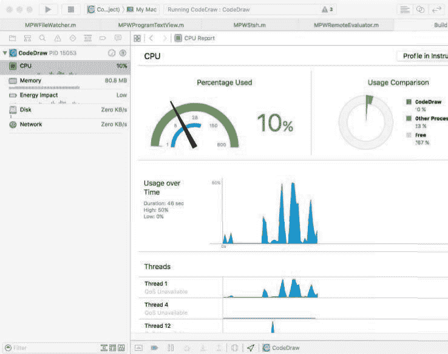

图 2.1 Xcode 内置的 CPU 分析分析

使用 Instruments 时，你可能需要参考相关文档；我将提供一些我发现非常有用的基础和使用场景。

作为一种采样工具，Instruments 的输出通常应该被视为指示性的，而非确定性的，因为像任何其他形式的采样一样，它容易产生混叠效应（aliasing effects）。如果你像本章开头的那样，使用数据收集来建立假设，这并不是问题。虽然增加采样频率看起来是解决这个问题的显而易见的方法，但较高的采样频率实际上由于采样开销和抖动（jitter），往往会降低准确性，并增加资源需求以及在观测过程中干预进程的概率。

我通常从 Xcode 启动 Instruments，要么从 Product 菜单中选择 Profile 选项，要么点击 Xcode 某个仪表盘上的按钮。这样一来，Instruments 已经设置好去查找你的程序。默认情况下，它将显示图 2.2 所示的选择界面。我通常选择已经预选的 Time Profiler 仪器。

# 第 2 章 CPU：测量与工具

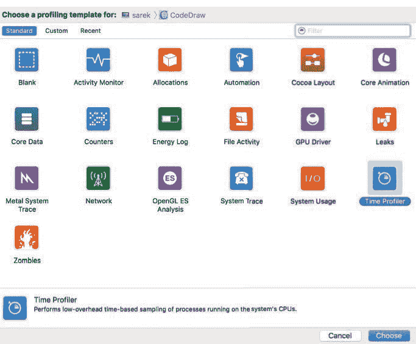

图 2.2 Instrument 选择界面

事实上，从 Xcode 启动时，你甚至可以通过在 Xcode 的 scheme 编辑器中为正在分析的 scheme 定义默认仪器，从而跳过选择步骤。

在选择 Time Profiler 仪器后，Instruments 将显示一个跟踪文档（trace document）。跟踪文档窗口从上到下包含：一个工具栏、显示跟踪文档中每个仪器（可能多个）时间轴的时间轴面板、显示时间轴面板中当前选择仪器详情（通常是跟踪数据）的大型详情面板，最后是详情面板右侧的检查器面板（inspector pane），显示相关仪器的更多详细信息和配置选项。

图 2.3 显示了我们之前选择的单个 Time Profiler 仪器的跟踪文档。你现在可以配置分析目标、仪器和分析选项。或者，你也可以接受默认值（这些值对于各种分析任务都是足够的），并点击工具栏左侧巨大的红色记录按钮开始你的分析会话。

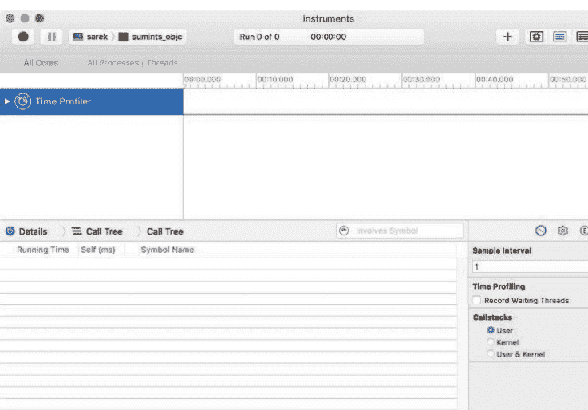

图 2.3 分析前的 CPU 仪器

## 分析选项

正如我提到的，默认的分析选项对于各种分析任务都是足够的。另一方面，自定义你的分析会话可以将 Instruments 变成一台高度调优的分析机器，我猜一旦你用它们，就会发现它们不可或缺。

首先，除了在 Xcode 中点击 Profile 外，启动分析会话还有几种方式。使用工具栏左上角的选择器（记录和暂停按钮右侧），你可以对已经在运行的程序进行分析，或在任何连接的设备上启动任意 GUI 或命令行程序进行调试。如果你需要移动的自由（例如使用加速度计分析代码），可以将 iOS 设备切换到无绳分析模式（untethered profiling）。

Instruments 的 Dock 菜单还有额外的条目，允许你在不与 Instruments UI 交互的情况下启动分析会话。如果你想从与 Instruments 自身在同一台计算机上运行的应用程序中捕捉信息，而不使其激活（如果与 Instruments UI 交互，将会发生这种情况）。一种更自动的方法是使用 `instruments` 命令行工具启动分析会话。

# 第 2 章 CPU：测量与工具

命令 `instruments -t "Time Profile" -1 2000 -D sumintsm-cpu.trace sumintsm` 命令行程序使用 Time Profiler 仪器对 2 秒（2,000 毫秒）进行分析，并将结果写入 sumintsm-cpu.trace。我个人发现，当任务是测量并改进性能时，这种方法非常有用，特别是在不需要影响 GUI 的情况下。增加采样频率看起来是解决这个问题的显而易见的方法，但较高的采样频率实际上由于采样开销和抖动，往往会降低准确性应用程序。

另一个非常实用的选项可以在图 2.4 所示处设置：时间限制从记录的开始，窗口限制从记录的结束。

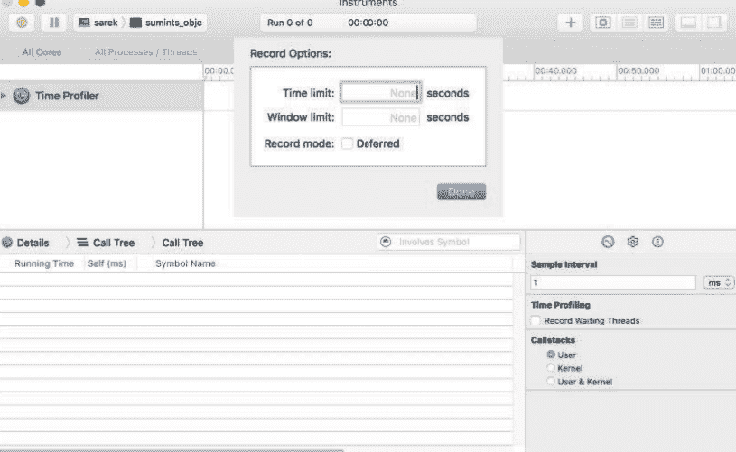

图 2.4 带有记录选项的 CPU 仪器


时间（`time`）对于创建一致、可比较的分析是有用的。窗口（`window`）限制有两个我所知的用例：首先，它允许在不激活应用程序的情况下捕捉特定活动的分析；另一个相关的案例是窗口是不确定的：假设你有一个想要分析但无法确定复现的行为。将窗口设置为 10 秒，你可以持续运行 `Instruments`，当你看到想要的行为时，点击停止按钮。你的跟踪将包含停止前的 10 秒，并包含你感兴趣的内容。

虽然运行 `Instruments` 会产生某些影响，但由于我们有多个 CPU，这意味着目标应用程序通常不受干扰地运行。使用窗口限制意味着内存不会溢出，否则将很快发生。

设置窗口限制会自动激活 `Defer` 标志，这意味着分析完成后你无法与 `Instruments` 交互，从而减少对被分析程序的干扰。你也可以在没有窗口选项的情况下设置它。

我倾向于始终设置一个时间限制，以防止会话异常。

最后，你可以配置所使用的仪器。在 `Time Profiler` 仪器的情况下，这些选择大致对应于命令行 `time` 命令报告的实际（`real`）、用户（`user`）和系统（`systems`）；默认情况下，`Time Profiler` 报告用户时间，即在程序 CPU 上运行的时间。选择“记录线程”（`Recording Threads`）对应于实际部分，即时钟时间，因此也包含了等待 I/O 的时间。这有时很有用，但对于交互式程序，通常需要一些复杂的数据挖掘，或者为了移除等待用户的时间。最后，你可以查看内核中的时间和调用堆栈，对应于 `sys` 组件。我在职业生涯中使用过几次。其他仪器将提供不同的配置选项。

# 基础分析

与早期的工具不同，`Instruments` 允许在仍在收集配置时开始分析。这可能很方便，但请注意，如果程序在同一台机器上运行，此类交互会对程序产生不利影响，并且对你收集的数据质量产生负面影响。图 2.5 显示了分析中的 CPU 跟踪：记录按钮已被停止按钮取代，时间轴开始填充（图表呈近似矩形，因为 `sumintsm` 程序是纯 CPU 密集型的），因此详情面板开始显示函数。

## 28 第 2 章 CPU：测量与工具

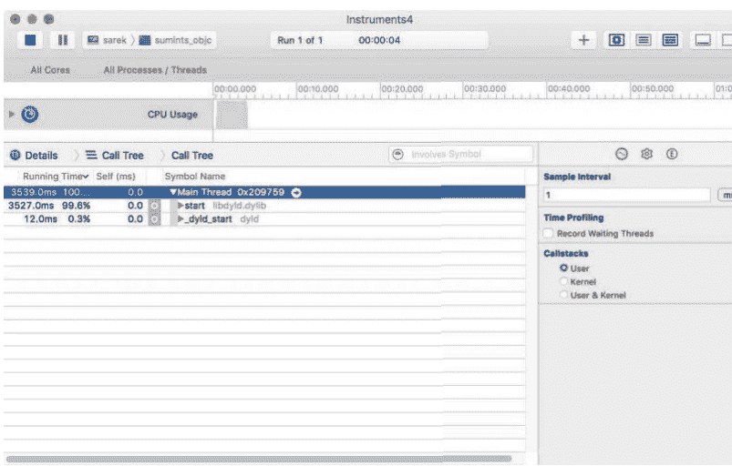

图 2.5 性能分析期间的 CPU 实例

详情（`Details`）视图中的每一行都显示单个函数或方法。（Objective-C 方法实现为 C 函数，因此我将它们称为函数。）对于每个函数，它会以毫秒为单位显示该函数及其所有子函数（它调用的函数）的运行时间，以及该总和占整个 trace 运行时间的百分比，以及在函数本身（不包含调用）中花费的时间。小图标代表函数的来源，例如，用户提供的函数显示人头剪影，Cocoa 显示咖啡杯，系统函数显示一个小齿轮。最后，你可以在大纲（`outline`）视图中看到函数的名称，以及所属库的名称。

我打算等到在运行期间或之后收集到数据后再进行分析，那时你可能会开始使用函数名中的曝光三角形（`exposure triangles`）进行下钻。我的第一步通常是 `alt-click` 最顶部的开销三角形；这将会展开下方的整个分析结果，条目最初按花费的时间排序；这将会自动显示调用图中最耗资源的分支，如图 2.6 所示。从那里我可以开始探索。

令我感到惊讶的是，许多开发者并没有意识到 `alt-click` 技巧，尽管这似乎是大纲视图的一个系统级功能。它在 `Finder` 的列表视图中也恰然有效。

# Instruments 29

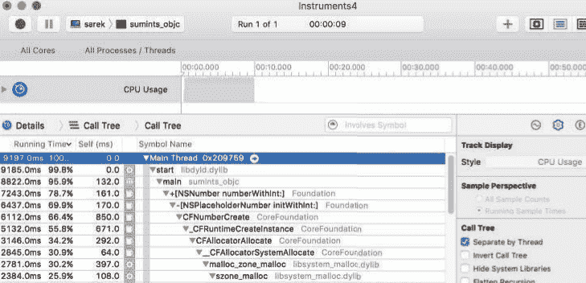

图 2.6 性能分析完成并展开 trace 实例

下钻（`Drilling down`）可以从两个方向进行：从整个程序开始自上向下，查看开销最高的函数在哪里，以及服务请求来自哪里（图 2.7）。

## 源代码

双击 CPU 性能分析中的某行，将显示所选函数或方法的源代码，并逐行标注性能分析信息。如图 2.8 所示，结果还经过了着色处理，以引导你找到热点（`hotspots`）。

如果没有源代码——例如，如果你编译时没有包含符号（`symbols`），或者你正在查看系统库——`Instruments` 将为你显示汇编代码而不是源代码，如图 2.9 所示。

如果你需要，也可以查看带有源代码的汇编代码，如图 2.10 所示。获取逐行的热点信息比普通图表的整个函数粒度要精确得多，而且绝对是无价之，因为它指出了导致运行过慢的特定调用。

# 第 2 章 CPU：测量与工具

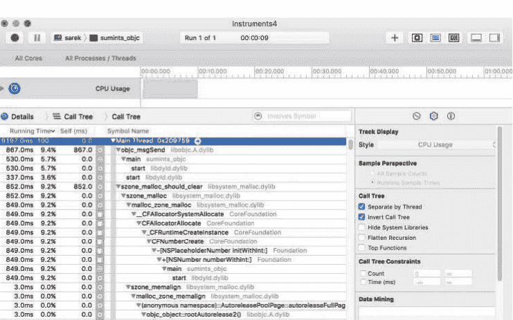

图 2.7 “重度”视图下的 CPU 实例

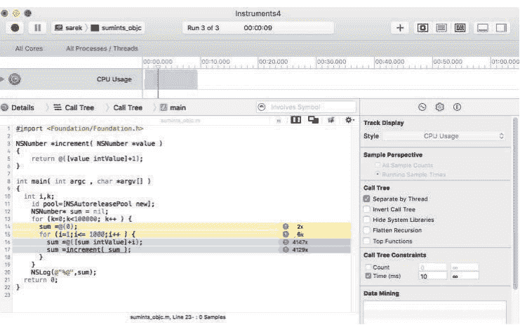

图 2.8 显示源代码的 CPU 实例

# Instruments 31

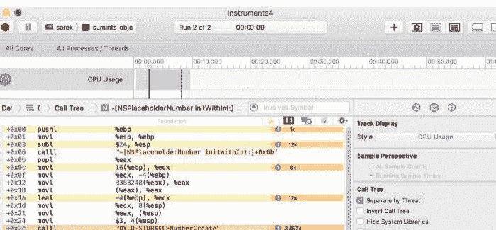

图 2.9 显示汇编代码的 CPU 实例

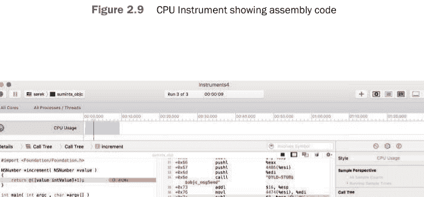

图 2.10 显示源代码和汇编代码的 CPU 实例

# 第 2 章 CPU：测量与工具

## 数据挖掘：聚焦（Focus）

最简单的数据挖掘发生在你点击性能分析中某行旁边的箭头，或者在图 2.11 的上下文菜单中选择“`Focus on subtree`”时：详情视图中显示的调用图将从所选节点开始，显示相对于该节点的所有百分比（定义上为 100%）。我用它来排除符号；除此之外，我通常倾向于查看上下文。图 12 显示了一个稍微修改过的程序的调用图，它执行了两次 `sum`——一次在 `main` 中，一次在辅助函数中。用户调用了两次 `numberWithInt`：如果我们想仔细查看 `numberWithInt` 的开销，可能会选择聚焦，产生图 2.13 所示的聚焦图。然而，更仔细的检查发现这并不是我们想要的，因为它只聚焦了 `numberWithInt` 的一个实例（你可以检查总毫秒数与之前显示的大致相同）。这是你必须真正知道的功能之一，以便使用它。结果可以在图 14 中看到。一旦你使用了这个功能，你就永远不知道它是如何管理的。据我所知，除了对输出进行进一步处理外，这是获取此类信息的唯一方法。

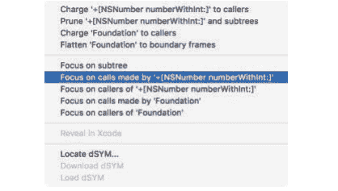

图 2.11 数据挖掘上下文菜单

# Instruments 33

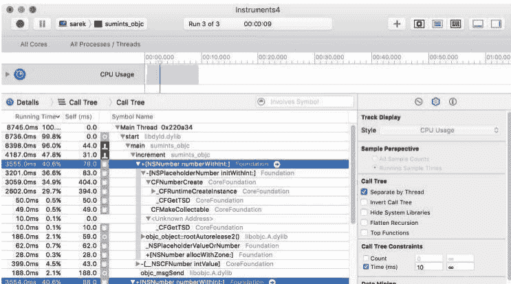

图 2.12 非聚焦实例

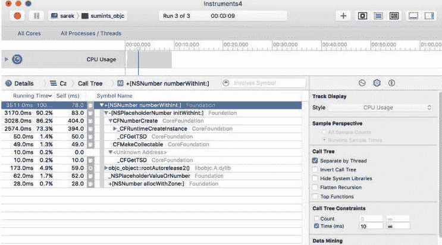

图 2.13 聚焦于单个方法的实例

# 第 2 章 CPU：测量与工具

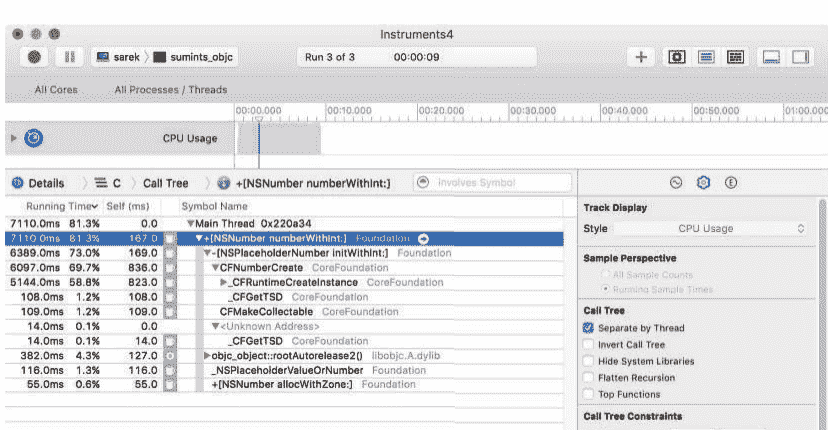

图 2.14 聚焦于函数的所有出现

## 数据挖掘 II：修剪（Pruning）

在追踪数据时，你经常会发现你感兴趣的数据被所有无关数据淹没，并有效地变得嘈杂。这是明智选择你的问题和工具的原因之一，而聚焦可以提供帮助，`Instruments` 中的数据挖掘功能可以直接移除此类噪声。

在许多情况下，“重度”视图会显示许多热点，函数中的热点将是你无法控制的通用函数。包括 `objc_msgSend()`、`malloc()` 和 `free()`。这些可能不是问题所在，你可能也不会优化它们。相反，问题将是这些函数调用得太频繁，`Instruments` 这样的采样工具运行缓慢是因为它没有区分函数的进入和退出。相反，可能是程序在采样时位于函数内部。当你向上遍历图形查找真正的罪首时，这可能很快变得重复且枯燥。这时只需修剪这些完全没有出现在调用图中的函数。有两种通用方法，其中一种是真正的“修剪”，意味着这些函数和在其中花费的时间被完全移除。这很少是你你想要的，因为它扭曲了实际运行时间。

| | same | sumints_objc | Run of 2 | 00:00:09 | + | - | | |

|---|---|---|---|---|---|---|---|

| All Cores | All Processes / Threads | 00:00:00 | 00:10:00 | 00:20:00 | 00:30:00 | 00:40:00 | 00:50:00 | 01:00:00 |

| | | CPU Usage | | | | | | |

| Details | Call Tree | Call Tree | | | | Involves Symbol sampling Perspective |

| Running Timer (Self) | 0.0 | Symbol Name | | | | | | |

| 513.100... | 9.9 | Main Thread::CreateFoundation | | | | | | |

| 513.099... | 9.9 | #Placeholder/NumberInitWithInt() Foundation | | | | | | |

| 513.099... | 9.9 | sumints_objc | | | | | | | |

| 513.099... | 9.9 | start | | | | | | | |

| 513.099... | 9.9 | zone_malloc_clear | libsystem.dylib | | | | | | |

| 513.099... | 9.9 | zone_malloc.dylib | | | | | | | |

| 513.099... | 9.9 | zone_malloc | | | | | | | | |

| 513.099... | 9.9 | _CfSystemAllocate CoreFoundation | | | | | | | |

| 513.099... | 9.9 | _CfAllocatorFree CoreFoundation | | | | | | | |

| 513.099... | 9.9 | _CfRunimeCreateInstance CoreFoundation | | | | | | | |

| 513.099... | 9.9 | #NumberInitWithInt() Foundation | | | | | | | |

| 513.099... | 9.9 | #NumberInitWithInt() Foundation | | | | | | | |

| 513.099... | 9.9 | _CFGetNumberIntValue CoreFoundation | | | | | | | |

| 513.099... | 9.9 | #NSCFNumberIntValue | | | | | | | |

| 513.099... | 9.9 | sumints_objc obj | | | | | | | |

## 内部测量

与其使用外部工具探测你的程序，你也可以在你编辑的代码中添加插桩。这将避免或极大地减少采样伪影，提高精度，并让数据收集可能变得非常简单：只需运行程序即可。内部测量还需要关注你想要测量的方面，而不是从可能的大量冗余数据中提取。然而，插入测量代码

# 第 2 章 CPU：测量与工具

可能会影响被测量的例程，因此对于测量执行迅速的例程来说通常是不可行的。这意味着会向项目中添加带有潜在漏洞的额外代码，而外部工具可以保持原始代码的整洁。

如果你的应用程序使用 `NSLog()` 记录重要事件，那么你已经在进行某些测量；`NSLog()` 生成的日志开头带有毫秒级的时间戳。如果你有一份应用程序活动日志，你已经知道从其中一个重要事件到另一个花费了多长时间（这是真实时间，而非 CPU 时间）。由于这种方法粒度粗糙、缺乏精度且开销高，除了在日志中可能产生计数器外，它不应用于任何性能监控。然而，当你手里只有客户提供的数据时，它可以变得极其有用。

更复杂的测量涉及使用 `getrusage()` 系统调用，从操作系统中获取实际的 CPU 使用信息，这些信息包含了 `time` 和 `top` 命令使用的相同信息，但没有了启动进程的开销。示例 2.1 是第 1 章中整数求和程序的一个版本，它通过 `getrusage()` 修改了自计时功能。

## 示例 2.1 为整数求和器添加自计时

```objectivec
#import <Foundation/Foundation.h>

long long usmicros() {
    struct usage usage;
    getrusage(RUSAGE_SELF, &usage);
    return usage.ru_utime.tv_sec * 1000000 + usage.ru_utime.tv_usec;
}

int main(int argc, char *argv[]) {
    int i,k;
    long start=usmicros();
    NSNumber*sum=nil;
    for (k=0; k<100000; k++) {
        sum=@(0);
        for (i=0; i<=100; i++) {
            sum+=([sum int]+i);
        }
    }
    NSLog(@"
```

这允许准确地测量更短的时间间隔，并同时执行许多测量。事实上，第 1 章以及整本书中所示的性能表都是使用这种方法生成的。

## 测试

一旦你建立了了自动化的性能测量，你也可以在单元测试中使用它，以便使性能要求变得可测试，并自动检测偏离这些要求的情况。

单元测试对于确保你的代码在优化时仍能正常工作也至关重要。拥有单元测试的安全保障让你能够自由地尝试更快的实现方案。

快速的单元测试同样重要，因为它们允许单元测试在每次构建时持续运行。（我目前包含略多 1,000 个测试的完整单元测试套件运行需要 1 到 2 秒，这虽然有点慢，但仍然可以接受。）

`Xcode` 现在将性能测试作为 `XCTest` 框架的一部分包含。到目前为止，我还没有发现这些性能测试非常有用。首先，它们使用 `Xcode` 界面魔术来存储结果，这并不是透明的。我更倾向于让测试是自包含的且在代码中完全指定的，而不依赖于外部上下文，特别是机器或用户。其次，这些性能测试只能防止性能退化，而不能以测试优先的风格驱动性能改进。

当然，在测试中询问现有的性能水平然后将其存储在主机上是有原因的：绝对性能水平取决于机器，在 `Mac Pro` 上成功的测试可能在 `MacBook Air` 上会失败。解决这个困局的答案是如示例 2.2 所示的相对性能测试。我们没有硬编码测试必须完成的具体时间，而是指定了慢方法与较快方法之间的比例。

## 2.2 单元测试 testOfNewFastShouldBeTwiceOld

```objectivec
- (void)testPerformanceOfNewFastShouldBeTwiceOld {
  long slowtime=-usmicros();
  // old implementation
  slowtime+=usmicros();
  long realtime=-usmicros();
  // new implementation
  realtime+=usmicros();
  double improvement = (double)slowtime /(double)realtime;
  XCTAssertGreaterThan(improvement, 2.0, @"should be faster");
}
```

通过这种方式，我们还可以希望看到的性能改进编码到测试中，并使用那些失败的用例直到测试通过。

## dtrace

`dtrace` 可以被视为外部和内部测量设备的结合。简而言之，它几乎可以做任何事情，但代价是大量的专业知识和努力。根据我的经验，大多数性能任务都是直接的，并且已经被现有工具覆盖了。

## 调用之外的优化

在开始在某公司工作不久，我被要求帮助一位被派去优化任务的同事；索引速度慢存在问题。我的简要任务是，他在这个问题上工作了一个月，但没有任何可见的进展。我对调查状态的询问显示，该开发者在字符串搜索算法上做了令人印象深刻的工作，使用了多种 `Boyer-Moore` 字符串的高级变体，以寻找哪一种能挤出最后一点性能。

一切进展良好，但代码审查显示原始程序使用的代码本质上看起来示例 2.3，除了传递了函数指针外。

## 示例 2.3 低效的字符串搜索

```c
comparisonFunc=isSensitive ? strncmp : strcasecmp;
int len=strlen(target);
int max=strlen(source)-len;
for ( i=0; i<max; i++) {
    if (comparisonFunc(source+i, len )) {
        // success
    }
}
```

这段代码完全可以运行，但它比必要的要慢，原因可能是一个或两个：首先，我们对可能非常大的输入字符串的每一个字符都调用了完整的字符串比较函数，其次我们通过指针调用了该函数。

第一个问题是关键的。虽然我们需要调用比较函数来确定源中特定位置是否存在完整的字符串匹配，但绝大多数位置都不会匹配，因此工作的大部分是拒绝候选位置，而不是匹配它们。有了这一洞察，很明显，我们可以通过查看它们的第一个字符来廉价地拒绝候选位置，而不会产生函数调用的开销。

第二个问题之所以显著，仅仅是因为如果没有函数指针，编译器本可以为我们完成这项工作：字符串比较函数属于一类“特殊”函数，编译器对这些函数是有感知的，并会生成专门的内联代码，而不是函数指针以及对库函数的调用。然而，编译器无法看到“那个”函数指针，因此无法为我们进行代码内联。

有了这一洞察，修复方法非常简单：如示例 2.4 所示，提取出字符串比较的第一个字符。

## 示例 2.4 略微高效的字符串搜索


```objectivec
comparisonFunc = isCaseSensitive ? strncmp : strcasecmp;
int len=strlen(target);
int max=strlen(source)-len;
for (i=0; i<max; i++) {
    if (tolower(source[i]) == tolower(target[0]) &&
        comparisonFunc(source+i, target, len)) {
        // success
    }
}
```

由于`strcasecmp`定义为将其两个输入字符串转换为小写，这等同于调用了两次字符串。另一个选项是不使用函数指针，以便编译器利用其内联能力，但这意味着要重复代码——在考虑替代方案时，这不是一个好选择。

示例 2.4 中的代码远未达到优化。首先，我们没有调整`comparisonFunc`中的字符串指针和长度来反映我们已经检查了第一个字符。事实上，我们无法这样做，因为第一个字符实际上有点太宽泛了：即使在区分大小写的情况下，它总是使用`tolower()`函数，导致产生一些假性匹配。这些假性匹配对正确性没有影响，因为它们会被`comparisonFunc()`的调用过滤掉。

所有的性能缺陷以及该代码比高级字符串算法高效得多的事实一点都不重要：仅仅这一行代码的修改就让性能提升了一个数量级，而且这种改进足以使索引过程解除瓶颈，意味着进一步的算法改进不再影响性能。耗时：不到一小时。

## 总结

本章介绍了从通过命令行工具使用 Instruments 分析器进行性能测量，到内部测量和性能测试。虽然测量这些工具非常重要，并且可以为你改进代码性能提供一个良好的开端，但重要的是要始终记住，不要被工具所误导。它们帮助你收集的测量结果只是支持或反驳你对性能所建立的假设的手段，而不是目标本身。如果你能将这一点并在心中，并优化需要优化的部分，你已经领先于大多数竞争对手。

## CPU：陷阱与技巧

在查看了驱动性能的参数和识别低速代码的技术之后，现在让我们转向让代码快速运行的实际技术。我们将查看高效的对象表示，以及对象进行通信和访问数据的方法。我们还将检查计算的精简化。在这一切中，目标将是有效结合 Objective-C 的“Objective”部分和“C”部分，以在性能和封装之间实现理想的平衡。

总的来说，基本思想是让对象内部使用 C，外部使用消息（messages），并且让对象本身成为相当粗粒度的静态实体。遵循这些原则，可以无忧无虑地开始完全面向对象的实现，同时知道可以优化掉任何低效之处。根据我的经验，可以实现纯 C 的性能，有时甚至超越。

然而，存在一些陷阱，它们不仅会让 Objective-C 程序变慢（比所谓的脚本语言还要慢），甚至可能成为后期优化工作的障碍。这些陷阱通常存在于易用但具有隐藏性能成本的库构造中，这些成本并没有局限于某个可以消除的单个对象内，而是存在于接口中，因此扩散到整个系统中，并且更难暴露。

以下将展示数据表示、通信和计算的不同选项，以及它们在耦合、内聚和性能方面的相应权衡。

## 表示

程序（尤其是面向对象的程序）的首要任务之一是表示数据。由于该语言的混合性质，Objective-C 程序员在执行此任务时有许多选择。

在不声称完整性的情况下，结构化数据可以使用 C `struct`、Objective-C 对象或各种形式的键值存储来表示，其中最著名的是 Foundation 的`NSDictionary`和 CoreFoundation 的`CF`，这两者的使用越来越频繁。简单的标量可以表示为 C `float`、`double`或`int`及其多种变体，Foundation 的`NSInteger`和 CoreGraphics 的`CGFloat`定义，最后是 Foundation 的`CFNumber`对象。注意命名约定有些困惑：`NSInteger`和`NSNumber`的名字强烈暗示这两个类型是相关的——但它们完全没有关系。`NSInteger`作为`NSNumber`的特定子类，在 32 位架构上解析为 32 位的`int`，在 64 位架构上解析为 64 位的`long`，而`int`在两种情况下都是 32 位。`CGFloat`也是如此。

### 3.1 原始类型与对象

```objc
#import <Foundation/Foundation.h>

int main() {
    int a=1;
    float b=2.0;
    NSNumber *c=[NSNumber numberWith:3];
    CFNumberRef d=CFNumberCreate(kCFAllocatorDefault, kCFNumberType, (const void*)&b);

    NSNumber *e=@0;
    NSLog("%d %g", a,b,d,e);
    return 0;
}
```

为了获得一个良好的解决方案，程序员必须在一方面的解耦和另一方面的性能之间进行权衡，理想情况下在不损害性能的情况下实现解耦。

## 原始类型

最容易实现的是对字符、整数和浮点数等简单标量类型的表示：尽可能使用内置的原始类型，尽可能避免对象。

由于语言原生支持这些类型，标量类型比对应的对象要快 10 到 100 倍。表 3.1 给出了标量类型在 32 位和 64 位架构下的不同算术运算时间。

### 表 3.1 32 位和 64 位架构下的原始操作

| 操作 | 加 | 乘 | 除 | NSInt | CFFloat | NSFloat |
|---|---|---|---|---|---|---|
| 64 位 (ns) | 0.67 | 0.79 | 14 | 15 | 44 | 169 |
| 32 位 (ns) | 0.72 | 0.76 | 7.8 | 22 | 232 | 182 |

除法比其他算术运算慢，是因为中的中的法器通常一次处理几个而不是一个整字，这解释了为什么 64 位的除法比 32 位的慢得多。

与其他可以存储在寄存器并在单个周期内处理的类型相比，任何对象表示都有过多的开销，而 Objective-C 相当沉重的对象更是如此。Foundation 和 CoreFoundation 通过仅提供不可变对象使得这种开销更加糟糕，这意味着任何操作必须创建新对象。标量（在 32 位架构上变为 32 位的`float`，在 64 位架构上变为 64 位的`double`）要快得多。

另一方面，整数对象的分配速度与 CPU 无关，而是 Apple 在 OS X 中引入了标记整数，但是在现代运行时。标记整数是一种源自 LISP 和 Smalltalk 的技术，整数的值不编码在对象指向的分配存储中，而是编码在指针本身。这利用了对象指针是对齐的特性，因此有效对象指针的 32 位和 64 位系统的低 2 位或 3 位始终为 0。表显示了标记指针使用低位的“1”来区分标记指针和普通指针，另一个 7 位用于标记值，剩余的 24 或 56 位用于存储值。

### 表 3.2 标记指针和普通指针

| 位 | 32/64 | 4-7 | 3 | 2 | 1 |
|---|---|---|---|---|---|
| 普通指针 | 高位 | | | | 0 |
| 标记指针 | 值 | 标记 | 1 | | |

## 表示法 45

```objc
return (NSNumber*)((o << kCFCTaggedIntValueOffset) | kCFCTaggedIntMask);
}

int main(int argc, char *argv[]) {
  NSNumber * sum = nil;
  for (int k=0;k<100000; k++) {
    sum = makeInt(0);
    for (int i=1;i<=1000; i++) {
      sum = makeInt(get(sum)+i);
    }
  }
  NSLog("%@%@%@ -> %@%@",sum,[sum class],[sum stringValue]);
  return 0;
}
```

当然，原因是 Apple 迄为止一直隐藏在通过 CoreFoundation 提供的现有消息和函数应用编程接口（API）之后。我们还收到这种表示法（包括实际标签）是私有的，并且可能会更改。我们错失的机会是巨大的：3.2 版本中的代码运行耗时 1.4 秒，而第 1 章基于 Foundation/CoreFoundation 的代码则需要 11.4 秒。

希望未来能够做到，并且编译器能够感知这些优化，从而对整数对象以及在此期间添加的其他某些类型启用标记指针。但在 OS X 10.11 和 Xcode 7.3 中，这还没有发生。

## 字符串

字符串在数据类型上最符合原始数据项的定义，尽管它实际上是变长的，且无法放入处理器的寄存器中。事实上，Objective-C 字符串是第一个并在很长一段时间内都有编译器支持指定字面量对象的类型。

字符串实际上有几种不同的主要用途：

1. 人类可读的文本
2. 以字节或字符形式批量存储序列化数据
3. 编程中使用的标记或键

虽然这些情况传统在 C 语言中通过 char 指针进行统一处理（使用 NULL 终止，其他则通过长度参数进行带外处理），但现在文本已超出了 7 位 ASCII，区分这些不同的分用情况已不再可能。

Cocoa 拥有`NSString`类来处理人类可读的文本。它处理 Unicode 的细微差别，将大多数细节委托给核心库。这种复杂性是带有代价的：性能比原始 C 字符串慢大约一个数量级。表 3.3 显示了比较 10 个和 32 个字符 C 字符串与`NSString`对象的代价。

# 第 3 章 CPU：陷阱与技巧

## 表 3.3 NSString 和 C 字符串操作

| 操作 | 1 ns | !strcmp(10) | strncmp(10) | Inscmp(10) | append | nscmp(32) |
|---|---|---|---|---|---|---|
| 1 ns | 1 | 3.3 | 10 | 76 | 77 | 82 |
| !strcmp(10) | | 1 | 3 | 23 | | 25 |
| strncmp(32) | | | 1 | 7.5 | 7.6 | 8.2 |
| Inscmp(10) | | | | 1 | 1 | 1.1 |
| append | | | | | | 1.1 |
| nscmp(32) | | | | | | 1 |

尽管`NSString`是昂贵的，但当主题是人类可读的文本时，这种支出是值得的。实现 Unicode 处理是复杂、易错且本质上昂贵的。此外，拥有具有通用接口的多种表示法是有价值的，允许不同使用场景的字符串表示互换使用。例如，字面量字符串由`NSString`类表示，它存储 8 字符，而`NSCFString`类（由`CFStringFoundation`对象支持）在内部存储 16 位无符号字符（unchars）。子类还可以引入更复杂的实现，如绳索（ropes），它们将字符串存储为较小字符串的二进制文件，并能高效地在大字符串中插入/删除。

从 OS X 10.1 开始，64 位运行时上的字符串对象也对整数使用了标记指针处理。这看起来可能很奇怪，因为字符串是变长数据结构，即字符数组。然而，64 位对于存储 7 位字符来说是非常充足的。

实际上，拥有具有通用接口的多种表示法是有价值的，允许不同使用场景的字符串表示互换使用。例如，字面量字符串由`NSString`类表示，它存储 8 字符，而`NSCFString`类（由`CFStringFoundation`对象支持）在内部存储 16 位无符号字符。子类还可以引入更复杂的实现，如绳索，它们将字符串存储为较小字符串的二进制文件，并能高效地在大字符串中插入/删除。

从 OS X 10.1 开始，64 位运行时上的字符串对象也对整数使用了标记指针处理。这看起来可能很奇怪，因为字符串是变长数据结构，即字符数组。然而，64 位对于存储 7 位字符来说是非常充足的。

实际上，拥有具有通用接口的多种表示法是有价值的，允许不同使用场景的字符串表示互换使用。例如，字面量字符串由`NSString`类表示，它存储 8 字符，而`NSCFString`类（由`CFStringFoundation`对象支持）在内部存储 16 位无符号字符。子类还可以引入更复杂的实现，如绳索，它们将字符串存储为较小字符串的二进制文件，并能高效地在大字符串中插入/删除。

从 OS X 10.1 开始，64 位运行时上的字符串对象也对整数使用了标记指针处理。这看起来可能很奇怪，因为字符串是变长数据结构，即字符数组。然而，64 位对于存储 7 位字符来说是非常充足的。

实际上，拥有具有通用接口的多种表示法是有价值的，允许不同使用场景的字符串表示互换使用。例如，字面量字符串由`NSString`类表示，它存储 8 字符，而`NSCFString`类（由`CFStringFoundation`对象支持）在内部存储 16 位无符号字符。子类还可以引入更复杂的实现，如绳索，它们将字符串存储为较小字符串的二进制文件，并能高效地在大字符串中插入/删除。

从 OS X 10.1 开始，64 位运行时上的字符串对象也对整数使用了标记指针处理。这看起来可能很奇怪，因为字符串是变长数据结构，即字符数组。然而，64 位对于存储 7 位字符来说是非常充足的。

……当主题是人类可读的文本时，这种支出是值得的。实现 Unicode 处理是复杂、易错且本质上昂贵的。此外，拥有具有通用接口的多种表示法是有价值的，允许不同使用场景的字符串表示互换使用。例如，字面量字符串由`NSString`类表示，它存储 8 字符，而`NSCFString`类（由`CFStringFoundation`对象支持）在内部存储 16 位无符号字符。子类还可以引入更复杂的实现，如绳索，它们将字符串存储为较小字符串的二进制文件，并能高效地在大字符串中插入/删除。

从 OS X 10.1 开始，64 位运行时上的字符串对象也对整数使用了标记指针处理。这看起来可能很奇怪，因为字符串是变长数据结构，即字符数组。然而，64 位对于存储 7 位字符来说是非常充足的。

实际上，拥有具有通用接口的多种表示法是有价值的，允许不同使用场景的字符串表示互换使用。例如，字面量字符串由`NSString`类表示，它存储 8 字符，而`NSCFString`类（由`CFStringFoundation`对象支持）在内部存储 16 位无符号字符。子类还可以引入更复杂的实现，如绳索，它们将字符串存储为较小字符串的二进制文件，并能高效地在大字符串中插入/删除。

从 OS X 10.1 开始，64 位运行时上的字符串对象也对整数使用了标记指针处理。这看起来可能很奇怪，因为字符串是变长数据结构，即字符数组。然而，64 位对于存储 7 位字符来说是非常充足的。

## 表示法

```objc
return (NSNumber*)((o << kCFCTaggedIntValueOffset) | kCFCTaggedIntMask);
}

int main(int argc, char *argv[]) {
  NSNumber * sum = nil;
  for (int k=0;k<100000; k++) {
    sum = makeInt(0);
    for (int i=1;i<=1000; i++) {
      sum = makeInt(get(sum)+i);
    }
  }
  NSLog("%@%@%@ -> %@%@",sum,[sum class],[sum stringValue]);
  return 0;
}
```

当然，原因是 Apple 迄为止一直隐藏在通过 CoreFoundation 提供的现有消息和函数应用编程接口（API）之后。我们还收到这种表示法（包括实际标签）是私有的，并且可能会更改。我们错失的机会是巨大的：3.2 版本中的代码运行耗时 1.4 秒，而第 1 章基于 Foundation/CoreFoundation 的代码则需要 11.4 秒。

希望未来能够做到，并且编译器能够感知这些优化，从而对整数对象以及在此期间添加的其他某些类型启用标记指针。但在 OS X 10.11 和 Xcode 7.3 中，这还没有发生。

## 字符串

字符串在数据类型上最符合原始数据项的定义，尽管它实际上是变长的，且无法放入处理器的寄存器中。事实上，Objective-C 字符串是第一个并在很长一段时间内都有编译器支持指定字面量对象的类型。

字符串实际上有几种不同的主要用途：

1. 人类可读的文本
2. 以字节或字符形式批量存储序列化数据
3. 编程中使用的标记或键

虽然这些情况传统在 C 语言中通过 char 指针进行统一处理（使用 NULL 终止，其他则通过长度参数进行带外处理），但现在文本已超出了 7 位 ASCII，区分这些不同的分用情况已不再可能。

Cocoa 拥有`NSString`类来处理人类可读的文本。它处理 Unicode 的细微差别，将大多数细节委托给核心库。这种复杂性是带有代价的：性能比原始 C 字符串慢大约一个数量级。表 3.3 显示了比较 10 个和 32 个字符 C 字符串与`NSString`对象的代价。

# 第 3 章 CPU：陷阱与技巧

## 表 3.3 NSString 和 C 字符串操作

| 操作 | 1 ns | !strcmp(10) | strncmp(10) | Inscmp(10) | append | nscmp(32) |
|---|---|---|---|---|---|---|
| 1 ns | 1 | 3.3 | 10 | 76 | 77 | 82 |
| !strcmp(10) | | 1 | 3 | 23 | | 25 |
| strncmp(32) | | | 1 | 7.5 | 7.6 | 8.2 |
| Inscmp(10) | | | | 1 | 1 | 1.1 |
| append | | | | | | 1.1 |
| nscmp(32) | | | | | | 1 |


尽管`NSString`是昂贵的，但当主题是人类可读的文本时，这种支出是值得的。实现 Unicode 处理是复杂、易错且本质上昂贵的。此外，拥有具有通用接口的多种表示法是有价值的，允许不同使用场景的字符串表示互换使用。例如，字面量字符串由`NSString`类表示，它存储 8 字符，而`NSCFString`类（由`CFStringFoundation`对象支持）在内部存储 16 位无符号字符。子类还可以引入更复杂的实现，如绳索，它们将字符串存储为较小字符串的二进制文件，并能高效地在大字符串中插入/删除。

从 OS X 10.1 开始，64 位运行时上的字符串对象也对整数使用了标记指针处理。这看起来可能很奇怪，因为字符串是变长数据结构，即字符数组。然而，64 位对于存储 7 位字符来说是非常充足的。

实际上，拥有具有通用接口的多种表示法是有价值的，允许不同使用场景的字符串表示互换使用。例如，字面量字符串由`NSString`类表示，它存储 8 字符，而`NSCFString`类（由`CFStringFoundation`对象支持）在内部存储 16 位无符号字符。子类还可以引入更复杂的实现，如绳索，它们将字符串存储为较小字符串的二进制文件，并能高效地在大字符串中插入/删除。

## 对象

由于你正在使用 Objective-C 编程，对象很将成为你的主要数据结构化机制。

在对象内部使用 C 语言。消息接口隐藏了表示法，用户从中获益。尽量避免细粒度的无语义对象，来实现粗粒度的带语义对象。

## 访问器

访问器是读取或写入对象内部数据的方法，大致对应内存读写指令。根据良好的对象风格，对象的属性不应被直接访问，至少不是从对象外部，最好是从内部访问。Objective-C 2.0 属性处理了创建访问器的负担。

然而，访问器至少应该减少，理想情况下应完全消除，因为它们变成了响应高层请求的智能代理，却为简单的数据结构结构带来了更高的代价。除了代码更整洁之外，将高级请求传递给对象从性能角度来看也是合理的，因为这意味着消息事务成本只需支付一次，此时该方法可以访问消息的所有参数以及对象的实例变量，而不是通过多次消息从对象中一次获取一个数据。

当然，在现实中，访问器或属性定义是 Objective-C 程序的常见特征，部分是因为程序架构偏离了对象理想，部分是因为 Objective-C 中对象引用的访问器也有助于引用计数，如示例 3.5 所示。对象访问器（`int`）维护引用计数

```objc
- (void) setInteger:(int)newInteger {
    _integer=newInteger;
}
- (void) setObject:(id)newObject {
    [newObject retain];
    [_object release];
    _object=newObject;
}
```

与其他类的重复性样板代码一样，自动化访问器的生成是有意义的，例如使用 Xcode 宏，即生成访问器代码的预处理器宏。另一种方法是语言本身来接管：由于 Objective-C 2.0 属性可以自动合成访问器，并且通过自动引用计数（ARC），实际的引用计数已从访问器移动到所有访问变量的代码生成中。

使用属性访问器的一个注意点是，生成的代码不受用户控制，默认的原子性（`atomic`）读取器比直接实现慢五倍倍，因为它们会保留并自动释放（`autorelease`）结果，在多线程访问时对读取加锁，最后将一切封装在异常处理程序中以便在发生异常时释放锁。另一种方案是示例 3.6 所示的访问器宏。然而，这种生成使得正确的访问器代码与属性一样。但是，这是用户控制的，不仅你可以决定运行哪些代码，而且你还可以 (a) 改变主意以及 (b) 在不修改编译器的情况下进一步扩展这一想法，正如我后面将所示。

## 示例 3.6 访问器宏

```
#if !__has_feature(objc_arc)
#define ASSIGN_ID(var,value) \
    id tempValue=(value); \
    if ( tempValue!=var) { \
        if ( tempValue!=(id)self) { \
            [tempValue retain]; \
        } \
        if (var && var!=(id)self) { \
            [var release]; \
        } \
    }
    var = tempValue;
}
#else
#define ASSIGN_ID(var,value) var=value
#endif
```

```
#ifndef AUTORELEASE
#if !__has_feature(objc_arc)
#define AUTORELEASE(x) ((x) autorelease)
#else
#define AUTORELEASE(x) (x)
#endif
#endif
```

```
#define setAccessor( type, var,setVar ) \
-(void)setVar:(type)newVar \
    ASSIGN_ID(var,newVar);\
 \
```

# 第 3 章 CPU：陷阱与技巧

```
#define readAccessorName( type, var , name ) \n-(type)name return var; }
```

```
#define readAccessor( type, var ) readAccessorName( type, var, var )
```

```
#define objectAccessor(objectType, var, setVar ) \nreadAccessor( objectType*, var ) \nsetAccessor( objectType, var,setVar )
```

在 OS X 10.11 中，这种速度下降已很好地减少到了 35%，或者在未启用 ARC 的情况下。

由于访问的普遍性，这种开销足够显著，使得 Apple 的团队通过将属性从原子性（`atomic`）切换到非原子性（`nonatomic`），整个程序的性能提升了 10% 以上。当我们经常谈论 10 到 100 倍的改进时，10% 的改进似乎并不多，但当我们谈论整个程序时，这实际上是巨大的，因为为了个位数百分比的改进通常需要投入大量的工程努力。而在这里，我们通过一个没有其他影响的单一改变就获得了双数的提升。那么，为什么存在原子性呢？为什么它是默认的？

这种想法是为了防止像示例 3.7 所示的代码。这段代码有一个指向实例变量的引用，而该变量在指针设置时实际上被释放了，类似于早期 Unix `malloc()` 实现中有一个 `free()` 函数，它延迟内存释放直到下一次调用 `malloc()`，本质上避免了像示例 3.7 那种错误代码中潜在的崩溃。

## 示例 3.7 状态指针引用

```
id myWindowTitle=[window title];
[window setTitle:@"New Window title"]; // windowTitle 失效
[self reportTitle:myWindowTitle]; // pre-ARC 时代崩溃
```

如果 title 被窗口持有，且仅由窗口持有，就会发生崩溃，因为在这种情况下，`setTitle` 不仅是失效的（不再指向窗口的标题），而且是无效的。`atomic` 关键字提供的自动释放机制可以防止这种情况下的崩溃，但代价是隐藏了引用实际上已经消失的事实。我能看到编写这段代码的两个原因。第一个是出于简单但稍显过早的优化，如果标题被使用多次，且我们不希望每次都从窗口中获取它。在这种情况下，代码是错误的，因为你实际上想在窗口设置后获取新值，而这种情况下 `atomic` 只是掩盖了崩溃。崩溃会提醒程序员逻辑有误。第二种情况是程序员实际上想要存起旧值。在这种情况下，代码纯粹是 Bug，因为程序员清楚地知道新值将使旧值无效——他们正在导致崩溃！示例 3.8 中修正的代码不仅不需要 `atomic`，还让代码的意图变得清晰。

## 示例 3.8 非指针输出引用

```
id oldWindowTitle=[[window retain] autorelease];
[window setTitle:@"New title"];
[oldWindowTitle doSomething]; // 明确表示我们想要旧标题
```

注意，ARC 防止了崩溃，并且像 `atomic` 一样隐藏了指针的失效性——通过在将对象存储在局部变量时激进地保留（`retain`）对象。优点是你不需要过多考虑对象的生命周期。缺点是你不需要过多考虑对象的生命周期，并且你得到了……（等等，OCR 在这里有一个重复，我将保持逻辑流）。

实际上，缺点是你不需要过多考虑对象的生命周期，并且你得到了……（注：原文处重复了 "The disadvantage is that you don't have to think much about the lifetime of your objects"，这可能是 OCR 错误或源文件错误，但我将保留其原意）。

让我们重新读一遍：“缺点是你不需要过多考虑……”。实际上，因此可以得出结论：如果需要访问，应该使用结构体（`struct`）。事实上，结构体确实有一些额外的优点，主要是在可以在自动变量中在栈上分配，通过值传递给函数，或直接嵌入另一个对象或结构体中，而 Objective-C 对象必须昂贵地在堆上分配，且只能通过指针访问。然而，保持这种开放的 Objective-C 对象也有一些优点——即它可以附加额外功能，按字段授予或拒绝访问，并可以与其他无法感知其公开实例变量的对象一起。例如，第 1 章提到的 PostScript 解释器使用了一个所有实例变量均为公开的字符串对象（示例 3.9），但同时可以与 Cocoa `NSString` 对象交叉使用。

## 示例 3.9 全公开字符串定义

```
@interface MPWPSString : MPWPSCompoundObject
{
  @public
  unsigned char *bytes;
  unsigned length,capacity;
}
```

## 对象创建与缓存

正如我们目前所见，Objective-C 中的对象创建是昂贵的，因此最好的方法是将对象作为相当静态且粗粒度的实体，通过消息交换信息，最好大部分使用标量/原始参数。如果参数复杂

无法避免且需要维持高频率的创建/交换，Objective-C 和 Swift 都可以采用结构体（`structs`）代替对象，结构体像原始类型一样可以在栈上分配、通过单个 `malloc()` 分组分配，并且可以按值和引用传递。然而，这通常意味着在对问题领域建模时，需要在对象和结构体之间频繁切换，或者完全放弃建模。

当无法避免高频率的（临时）对象创建时，减轻或消除对象创建性能影响的另一种方法是对象缓存（object caching）：重用已经分配过的对象。与使用结构体相比，缓存的优势在于性能方面的考虑不会干扰对问题领域的建模以及所有相关代码。事实上，当性能确实成为问题时，可以应用性能修复。

表 1.2 显示，通过重用一个对象而不是分配新对象，我们不仅节省了一些内存，还节省了等于约 50 条消息的 CPU 时间，这使得我们能够使用对象，否则我们可能因为性能原因而退回到 C 语言。对象重用在面向对象的语言中很常见，直到带有“分段指针”（bump pointer）分配机制的分代式垃圾回收器出现，这使得临时对象的创建变得极其便宜。遗憾的是，C 带有显式指针的内存模型使得需要移动对象的收集器变得……

为了重用对象，除了我们给出的引用外，我们还必须保留它的引用，例如存储在实例变量或本地集合中。如果我们原本要销毁该对象，我们可以这样做，或者我们可以保留一个永久引用。那么，当需要创建另一个目标类别的对象时，我们检查是否已经有了它的拷贝，并转而使用那个已分配的拷贝。

## 可变性与缓存

重用对象是安全的吗？例如，不可变值对象（Immutable value objects）可以频繁地重用，因为相同值的不同副本被认为是无法区分的。Foundation 在许多地方都使用了这种策略来确保全局唯一性。小型对象在分配后会被保留在缓存中，常量字符串则由编译器和链接器合并并共享。

为了在客户端后端缓存对象，这些对象必须是不可变的；如果一个对象所做的更改对另一个对象可见，那么共享就会变得不可行。然而，不可变性会强制在每次更改时都创建一个新对象，而每次需要值时都创建一个新的（未缓存）数字，其开销比仅设置新值的成本高 30 到 40 倍，即使是通过访问器完成的。那么，我们该如何重用可变对象呢？

UIKit 为表格单元格选择的方法之一是拥有一个化的 API 契约来保证可用性。另一种方法是利用 Foundation 的引用计数机制，我们利用它来跟踪对象的唯一引用是否来自缓存，如果是，则该对象就可以重用。我们没有使用 1→0 的转换来查看对象是否需要销毁，而是使用 `RC=1` 来查看对象是否可以重用，因为缓存保留了一个简单的引用。表 3.4 总结了这些信息。

表 3.4 对象缓存的引用计数

| 使用中 | 未使用 | 未使用 | --- |

| --- | --- | --- | --- |

| retain/release | RC > 0 | RC = 0 | 释放 (deallocate) |

| 对象缓存 | RC > 1 | RC = 1 | 重用 (reuse) |

示例 3.10 显示了如何实现这种感知引用数的缓存，尽管通用对象缓存类中的实际实现经过了大量的优化。这里提到的实例变量定义在示例 3.18 中，并在本章的“IMP 缓存”部分进行了详细讨论。

示例 3.10 环形对象缓存实现

```
-getObject
{
  id obj;
  objIndex++;
  if ( objIndex >= cacheSize ) {
    objIndex=0;
  }
  obj=objs[objIndex];
  if ( obj == nil || [obj retainCount] > 1 ) {
    if ( obj != nil ) {
      [obj release]; //--移除缓存
    }
    obj=[objc alloc init];
    objs[objIndex]=obj;
  } else {
    obj=[obj reinit];
  }
  return obj;
}
```

`MWObjectCache` 在其缓存中维护了一个对象的环形缓冲区，这是一个 `id` 类型的 C 数组。当调用 `getObject` 方法创建或获取对象时，

- 1. 虽然 Apple 通常建议调用 `retainCount`，但这种用法并不属于问题性类型。

- 2. `id` 是默认返回类型并被省略。

它查看当前位置并确定是可以重用该对象还是需要分配新对象并移动位置。它假设对象知道如何从已初始化但不再有效的状态重新初始化自己。环形缓冲区结构使得某些在我们尝试使用它们一段时间之前由缓存分发的对象能够被重用，类似于分代清理收集器中的年轻对象。每次弹出耗时为 9.5 ns，分配（优化后的）缓存比直接分配对象快约 15 倍，因此这是一种值得的优化。

索引的环绕是通过 `if` 检查而不是取模运算处理的，取模运算是除法，正如我们之前看到的，除法是现代 CPU 上少数相当缓慢的算术操作之一。实现取模的另一种方法是对索引取低位，但这会将缓存大小限制为 2 的幂。最后，存在许多探测和淘汰策略，具有不同的性能特性，例如尝试 n 个槽位或使用随机探测。到目前为止，这种简单的算法证明是最佳平衡。

另一种使用引用计数的可能方法是在需要之前使缓存项失效，通过具有线性或环形访问模式，且缓存大小比工作集至少小一个。此外，缓存通过延长对象的生命周期来使用内存，从而增加了工作集的大小，更有可能将其推向较慢的内存层级（L1 缓存到 L2 缓存到主内存……到磁盘），或在 iOS 设备上耗尽内存，导致进程被杀死。

## 惰性求值

缓存的另一个用途是属性的惰性求值。常见的用法是将计算延迟到实际请求。调用 getter 时，它检查是否已有结果；如果没有，则调用 `computeVar` 方法并在返回之前存储结果。另一种常用的访问器宏是简单转发请求到实例变量的委托访问。

示例 3.11 惰性访问宏

```
#define lazyAccessor(type, var,setVar,computeVar) \
-(type)var ( \
if (!self##var)) { \
setVar=[self computeVar]; \
} \
return [self##var]; \
}
```

## 缓存注意事项

计算机科学中两个难题：缓存失效和命名。

Phil Kariton

在进行这种缓存时，重要的是记住缓存本身并非没有陷阱。事实上，一位成为计算机科学教授的朋友喜欢问以下问题：“什么是缓存？它又是如何减慢计算机的？

在命中率为 0% 的抖动缓存的最坏情况下，缓存会将维护缓存的成本增加到非缓存计算的成本中，而且使用目前为止非常简单的缓存策略达到 0% 命中率的一种简单方法是在再次需要之前使缓存项失效，通过具有线性或环形访问模式，且缓存大小比工作集至少小一个。

示例 3.12 展示了通过完全不同方式分配的、具有相同数值的不同常量字符串和数字对象实际上是同一个实际对象，这通过使用“%p”转换指令打印对象指针可以证明。

## 示例 3.12 全局唯一的 Foundation 字符串和数字对象 32位


```objc
#import <Foundation/Foundation.h>

NSString *b="@hello world";
int main(int argc, char *argv[]) {
    NSString *a="@hello world";
    printf("NSStrings a=%p=%p\n\n", a, b);
    for (int i=0; i<15; i++) {
        NSNumber *c=CFNumberCreateWithLong(NULL,i);
        CFNumberRef d=CFNumberCreate(NULL,kCFNumberIntType,&i);
        printf("%d NSNumber: %p type: %s\n CFNumberCreate: %p type: %s\n",
               c,[c (id)objc],d,[d (id)objc]);
    }
    return 0;
}
```

```bash
cc -Wall32 -o uniqueobjects uniqueobjects.m -framework Foundation
./uniqueobjects
```

+ 11 `NSNumber`: 0x78e7ac30 type: i `CFNumberCreate`:0x78e7ac30 type:

+ 12 `NSNumber`: 0x78e7ac40 type: i `CFNumberCreate`:0x78e7ac40 type: own

+ 13 `NSNumber`: 0x78e7ac60 type: q `CFNumberCreate`:0x78e7ab90 type:

+ 14 `NSNumber`: 0x78e7aba0 type: q `CFNumberCreate`:0x78e7aba0 type:

在运行此代码时，缓存的截止值为 12。小于该值的请求会获得一个全局唯一的缓存对象，而大于该值的对象则是实例化的。此外，缓存值的 `objc` 类型是 "i"（即 32 位整数），尽管我们明确请求了 `long` 类型（类型代码为 "q"）。在缓存区域之外，请求的类型会得到尊重。

这种奇怪行为的原因是，缓存总是缓存某个值创建的第一个对象，无论请求的类型是什么。如果对整数 5 的第一次请求是长，那么后续对 "5" 的请求将返回 long long `NSNumber`。然而，这确实可能并已经破坏了那些没有预期 `NSNumber` 对象包含 "q" (long long) 类型的代码，例如，对象序列化器使用了类型代码，但没有处理 "q" 代码！这个 bug 通过忽略缓存数字的类型代码并转而使用 "i" 修复了，这在其他情况下是同样正确的，但在实践中似乎会导致问题。在 64 位机器上，缓存被禁用了，因为所有较小的整数都实现为带标记指针（tagged pointers）。

另一个陷阱是使用 `NSDictionary` 或 `Set` 来消除字符串对象。虽然它们在某些情况下可以减少峰内存占用，但它们也会通过不必要且任意地延长存储字符串的生命周期来增加内存使用。此外，由于 `NSString` 对象在测试成员关系之前必须先创建，这意味着在测试缓存之前已经付出了 CPU 开销，因此缓存实际上*增加*了 CPU 的使用。

改善这种状况的方法是创建一个可以使用 C 字符串查询的缓存，可以通过自定义缓存或为 `CFictionary` 使用自定义回调set来实现。

## 陷阱：通用（中间）表示

NeXTStep 是 OS X 和 iOS 的祖先，它拥有基于 DisplayPostScript 的可编程图形和窗口系统。仅仅过渡到 OPENSTEP 就为我们带来了 Foundation，包含了 `NSString`、`NSNumber`、`NSDictionary` 和 `NSArray` 等基础对象模型。当时我正在研究一种“PostScript 虚拟机”，它重新定义了 PostScript 操作符，以结构化格式返回图形对象，而不是将它们画在屏幕上，类似于据我所知至今仍在运行 Adobe Acrobat Distiller 的 PostScript 转 PDF 转换器的“distillery”。

那时我了解到通用的中间对象表示（也称为数据对象）是一个坏主意™，至少如果你在乎性能并且使用 Objective-C。虽然这一通用原理在其他语言中也成立，但 Objective-C 在基础机器操作、消息传递和对象分配之间存在悬殊的 1:5:200 性能比例，极大地强化了这一点。

当然，我必须学好几次才最终记住，它之所以是事实其实非常简单：通用表示通常会比最终对象表示多得多的对象，因为它需要使用字典（对象头 + 键和值存储）而不是普通的 Objective-C 对象（尽管“POJO”这个缩写没有像 Java 的 Plain Old Java Objects [POJO] 那样流行起来）；对象键可以使用实例变量增长、偏移量，而对象值可以使用简单的标量原始类型。因此，你不仅会创建昂贵得多的对象，还需要创建多得多的对象。这两个因素的乘积使得通用对象表示对 Objective-C 和 Swift 的性能来说是是致命的。

遗憾的是，Apple 也将这种反模式设为访问任何类型序列化表示的默认方式。一个典型的例子是 JSON 解析，框架直接支持的方法是将 JSON 与内存中的属性列表（即 Foundation 集合、`NSNumber` 和 `NSString` 对象）之间进行转换。即使互联网上涌现在大量的 Swift JSON“解析”示例，本质上也是为了让 `NSJSONSerialization` 解脱。

## 数组与批量处理

在处理通过索引数字访问的实体集合时，Foundation `NSArray` 在 C 数组（数组索引）的基础上进行了改进，获得了 C 数组的性能。典型的例子是 JSON 解析，框架直接支持的方法是将 JSON 与内存中的属性列表（即 Foundation 集合、`NSNumber` 和 `NSString` 对象）之间进行转换。即使互联网上涌现在大量的 Swift JSON“解析”示例，本质上也是为了让 `NSJSONSerialization` 解脱。

# 第 3 章 CPU：陷阱与技巧

表 3.5 按存储键和查找键的类型（大键）划分字典查找成本

## 按查找键类型查找的时间 (ns)

| 存储键 | 常量 | 普通 | 可变 | CoreFoundation |
| --- | --- | --- | --- | --- |
| 常量字符串 | 35 | 78 | 78 | 83 |
| 普通字符串 | 78 | 80 | 80 | 85 |

表 3.5 显示了字典访问的通用成本。如果没有发生哈希冲突（即两个或多个键映射到哈希表中的同一位置），每次读取的成本约为 80 ns。单次冲突会额外增加约 20 ns。唯一偏离这个约 80 ns 标准的情况是，当你使用**常量字符串**作为字典的键和查找的键时。在这种情况下，查找速度可以快一倍以上，可能是因为常量字符串可以使用指针等性来进行等性比较，而不是进行内容比较。

对于最多 7 个字符的小键，OS X 10.10 引入的标记指针优化（tagged pointer optimization）也有帮助。与字符串类似，当值存储在指针中时，指针比较就足够了，但前提是两者类型相同（要么都是标记指针，要么都是常量字符串）。表 3.6 显示了这种效果：当类匹配时，常量字符串和标记指针字符串的单次查找大约需要 22 ns，但如果类不匹配，则没有收益。

为了获得优化的字典性能，你需要确保用于将值存入字典的键的类与用于检索值的键的类是匹配的。如果使用字符串字面量（"key"）来存储值，最好也使用另一个字面量来检索。

如果你在检索时无法使用字符串，那么你的键足够短，可以放入标记指针字符串中。如果你检索值的频率高于存储值的频率，那么将你用于存储值的键拷贝为标记指针字符串可能会有所帮助，如示例 3.3 所示：首先是原始键的拷贝，然后是可变副本的拷贝。这将根据具体情况使你的检索速度快 2 到 4 倍。（通过可变副本进行折中路径是必要的，因为所有不可变字符串（包括常量字符串）在被要求拷贝时只会返回 `self`。）

表 3.6 按存储键和查找键的类型（小键）划分字典查找成本

## 按查找键类型查找的时间 (ns)

| 存储键 | 常量 | 标记 | 可变 | CoreFoundation |
| --- | --- | --- | --- | --- |
| 常量字符串 | 23 | 64 | 52 | 74 |
| 标记字符串 | 51 | 21 | 44 | 47 |

尽管对小键和常量字符串进行了这些优化，但在性能可能影响结果的情况下，最好寻找 `NSDictionary` 的替代方案，除非你的需求完全符合 `NSDictionary` 的功能。绝大多数字典用法要更专门化，例如，在只有一组边界且较小的相关或可能的键集时，使用固定键。第 4 章中的 XML 解析器使用了两种特殊化的字典：`MPXMLAttributes` 用于存储 XML 属性，它支持 XML 语义（如排序和键的多个值），并直接从预定义的 C 字符串集映射到对象。

`MPWSmallStringTable` 不使用哈希表，而是直接对逐字节的字符表示进行操作，尽可能快速地消除字符串。对于 `NSDictionary` 专门优化的小型常量字符串，它比 `NSDictionary` 快大约 4 倍；它的主要用途是处理外部生成的字符串，对于这种用例，它比比 `NSDictionary` 快 5 到 15 倍。

Swift 字典是值类型，并受益于泛型，它们显然比使用对象的重量级 `NSDictionary` 对象要快，对吧？但事实并非如此：在我的所有测试中，Swift `Dictionary` 的访问速度甚至比 `NSDictionary` 慢。例如，`[String:Int]` 映射了两个值类型，因此不受旧版 Objective-C 对象的限制，由于“缓慢”的动态分发，每次查找的时间在 140 ns 到 280 ns 不等，取决于键是字符串字面量还是提供的。与 `NSDictionary` 相比，这种变慢了 3 到 7 倍与编译器标志无关，但对于 Swift 来说，没有任何优化的 `MPWSmallStringTable` 会导致显著变慢。

`NSDictionary` 的早期替代方案是定义对象并使用普通消息传递来访问其内容，特别是当字典拥有一个合理且大部分固定的键集时。不仅示例 3.14 的第一行快了 10 到 100 倍，设计也更简洁，因为消息名由其类决定，而字典键污染了全局命名空间，因此使用了冗长的名称。

示例 3.14 之一快 100 倍

```
[myParagraph setLeading:1.0];
[myParagraph setAttribute:[NSNumber numberWithFloat:1.0]
forKey:kMPWStyleLeading];
```

为什么不倾向于使用字典 own对象？由于 Objective-C 2.0 64 位运行时和关联存储提供了非易变实例变量，对实例变量的未来保护不再是一个问题。潜在的稀疏对象可以通过划分到一个或多个主体来处理，这些主体接收相应的消息，并根据需要进行分配。

事实上，用于将值存入字典的键的类与用于检索值的键的类必须匹配。如果使用字符串字面量（"key"）来存储值，最好也使用另一个字面量来检索。

如果你在检索时无法使用字符串，那么你的键足够短，可以放入标记指针字符串中。如果你检索值的频率高于存储值的频率，那么将你用于存储值的键拷贝为标记指针字符串可能会有所帮助，如示例 3.3 所示：首先是原始键的拷贝，然后是可变副本的拷贝。这将根据具体情况使你的检索速度快 2 到 4 倍。（通过可变副本进行折中路径是必要的，因为所有不可变字符串（包括常量字符串）在被要求拷贝时只会返回 `self`。）

尽管对小键和常量字符串进行了这些优化，但在性能可能影响结果的情况下，最好寻找 `NSDictionary` 的替代方案，除非你的需求完全符合 `NSDictionary` 的功能。绝大多数字典用法要更专门化，例如，在只有一组边界且较小的相关或可能的键集时，使用固定键。第 4 章中的 XML 解析器使用了两种特殊化的字典：`MPXMLAttributes` 用于存储 XML 属性，它支持 XML 语义（如排序和键的多个值），并直接从预定义的 C 字符串集映射到对象。

`MPWSmallStringTable` 不使用哈希表，而是直接对逐字节的字符表示进行操作，尽可能快速地消除字符串。对于 `NSDictionary` 专门优化的小型常量字符串，它比 `NSDictionary` 快大约 4 倍；它的主要用途是处理外部生成的字符串，对于这种用例，它比 `NSDictionary` 快 5 到 15 倍。

Swift 字典是值类型，并受益于泛型，它们显然比使用对象的重量级 `NSDictionary` 对象要快，对吧？但事实并非如此：在我的所有测试中，Swift `Dictionary` 的访问速度甚至比 `NSDictionary` 慢。例如，`[String:Int]` 映射了两个值类型，因此不受旧版 Objective-C 对象的限制，由于“缓慢”的动态分发，每次查找的时间在 140 ns 到 280 ns 不等，取决于键是字符串字面量还是提供的。与 `NSDictionary` 相比，这种变慢了 3 到 7 倍与编译器标志无关，但对于 Swift 来说，没有任何优化的 `MPWSmallStringTable` 会导致显著变慢。

`NSDictionary` 的早期替代方案是定义对象并使用普通消息传递来访问其内容，特别是当字典拥有一个合理且大部分固定的键集时。不仅示例 3.14 的第一行快了 10 到 100 倍，设计也更简洁，因为消息名由其类决定，而字典键污染了全局命名空间，因此使用了冗长的名称。

示例 3.14 之一快 100 倍

```
[myParagraph setLeading:1.0];
[myParagraph setAttribute:[NSNumber numberWithFloat:1.0]
forKey:kMPWStyleLeading];
```

为什么不倾向于使用字典而非对象？由于 Objective-C 2.0 64 位运行时和关联存储提供了非易变实例变量，对实例变量的未来保护不再是一个问题。潜在的稀疏对象可以通过划分到一个或多个主体来处理，这些主体接收相应的消息，并根据需要进行分配。

事实上，用于将值存入字典的键的类与用于检索值的键的类必须匹配。如果使用字符串字面量（"key"）来存储值，最好也使用另一个字面量来检索。

# 第 3 章 CPU：陷阱与技巧

值。事实上，根据 Brad Cox 在《面向对象编程：演进方法》中所述，选择器唯一化（selector-unicating）过程是 Objective-C 从一组宏转换为真正的预处理器的主要驱动力，这使得创建一种语法成为可能。

在带有 Xcode 7.3.1 的 Mac X 10.11 上，示例 3.16 中的代码打印出选择器：'hasPrefix'；但编译器会警告警告将 'SEL' 类型强制转换为 `char *` 已弃用；请使用 `sel_getName` 代替。在 GNU 运行时，选择器是同时引用消息名称及其编码的结构体引用。

示例 3.16 使用 Apple 运行时选择 C 字符串

```objc
#import <Foundation/Foundation.h>

int main() {
    SEL a=@selector(hasPrefix:);
    printf("selector: %s\n", (char*)a);
    return 0;
}
```

## IMP 缓存

尽管新接触 Objective-C 的开发者往往会担心大多数消息发送，但与 C++ 的虚函数调用相比，Objective-C 的消息传递器函数 `objc_msgSend()`（或 GNU-objc 中的 `objc_msg_lookup()`）已经过高度优化，并不是瓶颈。

在它成为因素的情况下，可以从运行时获取函数指针并代替它。这种技术被称为 IMP 缓存，因为 Objective-C 方法指针的类型定义被称为 IMP（implementation method pointer，实现方法指针，或简称 Implementation）。在具有固定接收者的密集循环中，如果方法本身非常简单且消息分发是主要的消耗，IMP 缓存将非常有用。示例 3.17 显示在减去循环后，运行时从 2 ns 提升到 1.08 ns，提升幅度超过 2.5 倍。

示例 3.17 将普通消息发送的消息替换为使用 IMP 缓存发送的消息

```objc
#import <MPFoundation/MPFoundation.h>
@interface MyInteger : NSObject
@property (assign) int intValue;
@end

@implementation MyInteger
@end
```

```objc
int main()
{
    MyInteger *myObject=[MyInteger new];
    int a=0;
    myObject.intValue=42;
    for (int i=0; i<1000; i++) {
        a+=[myObject intValue];
    }
}

IMP intValueFun=[myObject methodSelector:@selector(intValue)];
for (int i=0; i<1000; i++) {
    a+=(int)intValueFun(myObject, @selector(intValue));
}
```

由于 Objective-C 的动态性，没有自动的方法可以在编译时确定这种优化是安全的，Objective-C 编译器不会替你完成这一点。幸运的是，开发者通常很容易做出这种判断。虽然 IMP 有许多方法可以改变执行（例如，加载包含分类（category）的包，并使用运行时函数添加、删除或更改方法实现，甚至更改相关的对象），但所有这些都是可以预见的罕见事件。


开发者的工作是确保这些事件一个都不发生，或者确保它们不会对计算产生影响。在进行 IMP 缓存时需要考虑的一个特殊情况是 nil 接收者（nil receiver）。Objective-C 消息传递器忽略给 nil 的消息，简单返回零而不是分发消息。短路机制使得接收者无需担心 nil self 指针，也不必处理特殊的 nil 接收者。IMP 缓存从几个方面破坏了这种保护：如果接收者是 nil 并请求 IMP，NULL 函数指针将导致程序崩溃。另一方面，如果从早期的非 nil 对象指针获取了缓存的函数指针，调用该函数指针将调用一个带有 nil self 指针的方法。该方法内部的任何实例变量也将导致程序崩溃。

因此，你需要确保自己没有获取到 NULL IMP 和 nil 接收者。在向“已知”对象作为代理（delegate）甚至作为自身发送消息时，IMP 缓存可能特别有用。示例 3.18 显示了本章“可变性与缓存”部分讨论的对象缓存的实际头文件。除了缓存本身（`objs`、`cacheSize`）和指向 `cacheIndex` 的当前指针外，它还为示例 3.10 中 `-getObject` 方法发送的所有消息维护了 IMP 指针，允许实际的 `-getObject` 在不调用消息传递器的情况下运行。

（注：原文中存在大量重复段落，译文已根据要求去重并保留了核心逻辑与内容。）

## 方法

### 一致性与优化

虽然示例 3.19 到 3.21 的实现并没有实际的收益，但其优势在于使用了最细致合理的接口——这种接口可以从读取文件 (3.20) 通过运行时检查查找键 (3.21)、在运行时或编译时为键值存储器生成 actor (3.15)，或者切换到实际实例变量的访问器，最后通过 `IMP` 更改该消息，在整个过程中保持一致。你不需要从一开始就这样做，但你必须使用那些在需要时能让你变得快速的接口。

我越是遵循 Alan 关于关注消息（messages）的建议，我的程序就越好，让它们运行起来也越容易。

### 方法

Objective-C 方法通常分为粗大类：一方面是精简且高效的 C 数据操作，另一方面是使用消息发送（message sends）进行的高层协调。

对于数据操作操作，可以使用 C 语言库中的所有常用技巧：将操作从循环中提取（如果没有循环，该方法又是如何执行的？）、强度归约、使用优化的原语（如内置内存拷贝函数或如 `vdsort` 等库），以及寻找语义上更廉价的替代方案。坦率地说，开启编译器优化会帮助大部分此类优化。然而，与其直接编译循环的最终结果，LLVM/clang 成功优化掉了我们基准程序中的大多数简单循环，除非我们显式指定它。

为了保持数据操作方法的精简高效，恰当设计消息接口至关重要，例如，将目标方法所需的所有数据传递给它，而不是让方法从其他源中获取数据。

高层协调方法通常不应该执行得非常频繁，不需要任何优化。事实上，我在解释型脚本语言中实现此类方法时获得过良好的性能结果。例如，一个在上半秒前触发动画的方法，即使执行需要整整一毫秒，占可用时间的比例也小于 0.2%，这完全不需要担心。

### CoreFoundation

本章的一个反复出现的主题是利用 C 语言追求速度，并在语言的“C”部分和“Objective”部分之间进行仔细的权衡，以便在易用性、性能以及当前项目所需的解耦和动态性之间取得平衡。

然而，这种做法可能会犯严重的错误，正如 CoreFoundation 的情况一样。CoreFoundation 实际上丢弃了 Objective-C 快速且强大的特性（消息传递、多态、命名空间处理），却为缓慢的部分（堆分配对象）提供了一个笨拙的单态接口（monomorphic interface）。当它遇到字典的使用时，速度又慢了一个数量级。CoreFoundation 为 CoreFoundation 对象提供的大量单态接口实际上具有不同的内部实现，这意味着其中每一个函数（极少数除外）都必须动态地检查其表示是否具有代表性，然后运行相应的表示代码。我们在 https://opensource.apple.com/source/CF 提供的 CoreFoundation 开源版本中就遇到过这一点。

Objective-C 的实现将这一任务留给了消息分发器（message dispatcher），这意味着两个方法实现都是干净的，因为它们在带有特定表示时被调用，这也使得提供更多优化的表示变得更容易。

虽然我经常听到诸如“我们的代码很快是因为它使用了 C 和 CoreFoundation，因此比使用 Objective-C 快”之的话，但这似乎是一个神话。在实际测试中，我从未发现这是事实。事实上，我等同于 CoreFoundation 对象的 Objective-C 实现总是比其对应的 CoreFoundation 实现要快，而且往往非常显著。尽管有消息传递的开销，示例 3.17 所示的发送 `-intValue` 消息已经调用 CoreFoundation 的 `CFGetInt()` 函数快了 30%。使用 `IMP` 缓存降级到 C 则比 CoreFoundation 的等效实现快 3 倍以上。

在 CoreFoundation 首次引入时，也观察并记录了同样的现象，用户注意到与非 CoreFoundation 的 OPENSTEP Foundation 相比，速度明显变慢（在应该更快的机器上反而慢了一倍）。这显然不适用于 Apple 的 Foundation 框架创建的 NSC* 类；这些类目前无法比 CoreFoundation 的等效实现快，因为它们调用的是 CoreFoundation。

## 多核

正如我们在第 1 章中看到的，摩尔定律仍在提供更多的晶体管，但时钟频率或每个周期周期性能不再有显著提升。这种能力的转变意味着我们的单线程程序不再仅仅通过在新的硬件上运行就能变快。相反，我们现在必须使用多线程来利用额外的能力，而这些能力是以额外核心的形式提供的。调用多线程是一个难题，不仅是因为存在竞态条件和死锁的风险，还因为线程管理和同步的添加实际上增加了开销，尽管多线程解锁了额外的 CPU 资源，但这些开销很难抵消。

- 4. http://www.cocoabuilder.com/archive/cocoa/20773-does-suck-or-has-apple-crippled-coco.html#20773

由于今天 CPU 极其惊人的单核性能，事实证明绝大多数 CPU 性能问题并非源于 CPU 的局限性，而是源于组织方式欠佳。⁵ 我希望我目前为止所展示的 3 到 4 倍、10 到 20 倍以及 100 到 1,000 倍易于实现的性能改进因素，能说服你在加入多线程之前至少考虑一下代码调优的选项，因为多线程在理想情况下只能实现系统核心数倍的加速——而且这仅适用于完美并行的、所谓的“极易并行的”（embarrassingly parallel）问题。

```
S(N) = \frac{P}{(1-P) + \frac{P}{N}} \quad (3.1)
```

阿达尔法则（Amdahl's Law，公式 3.1）将由于 $N$ 个核心并行化带来的潜在加速 $S$ 与程序中可以并行的比例 $(P)$ 联系起来。当程序中只有一小部分无法并行化时，新核心带来的收益会迅速递减。即使对于 90% 并行的程序，从 2 个核心增加到 4 个核心也提供了 70% 的加速，但从 8 个增加到 12 个仅增加了 21%。无限数量核心的最大加速因子为 10 倍。对于一个 50% 并行的程序，2 个核心的加速为 33%，4 个核心为 60%，12 个核心为 80%，接近 2 的极限。

虽然我无法在这里详细讨论这个主题（它本身值得写一整本书），但我会对多年来出现的各种多线程机制提供一些提示，从通过 `NSThread` 和 `NSOperationQueue` 使用线程到最近的 Grand Central Dispatch (GCD)。

### 线程

OS X 上的线程实际上是构建在内核级的 POSIX 线程（threads）实现之上的。这些内核线程管理的开销相对较大，类似于 Objective-C 对象（但后者大得多）。通过 `pthread_create` 在新的 POSIX 线程上运行函数 `my_computation(arg)`（如示例 3.22 所示），在我的机器上除了运行 `my_computation()` 本身的成本外，还会产生 7 $\mu$s 的开销；你的计算至少需要 7 $\mu$s 才能回本，至少需要 70 $\mu$s 才有机会获得 90% 的加速（假设任务分配完美）。

在 Cocoa 的 `NSThread` 类方法 `+detachThreadSelector:` 创建新线程会给任务增加一个数量级的开销，`NSObject` 的便利方法 `-performSelectorInBackground:` 也是如此……（同样示例 3.22）。

# 第 3 章 CPU：陷阱与技巧

考虑到阿姆达尔（Amdahl's Law），在并行化之前，你的任务执行时间至少应该是1 ms 左右，而且你应该先考虑其他优化。

示例 3.22 使用线程、Cocoa NThread 和便利消息创建新线程

```c
pthread_create(&thread, attrs, my_computation, arg);
[NThread detachThreadSelector:selector(myComputation:) toTarget:self]
[self performSelectorInBackground:selector(myComputation:) withObject:arg];
```

因此，类似于 OOP 与 C 之间的平衡，获得良好的线程性能需要找到独立的任务，这些任务的粒度要足够粗以便值得卸载到线程中，但同时又要足够细或大小均匀，以便有足够的任务来保持核心忙碌。

除了线程创建的开销外，还有共享可变状态之间同步的开销，或者确保状态不共享的开销——至少，在你操作正确的情况下如此。如果你做错了，就会出现崩溃、数据不一致和损坏以及死锁。确保线程安全的廉价方法之一实际上是线程局部变量（thread-local variables），通过 `pthread_getspecific()` 访问此类变量比发送消息稍微便宜一点。这显然只有在你想要多个独立值，而不是在线程之间共享单个值时，才是一个可选项。

在数据需要共享的情况下，该数据需要通过 `pthread_mutex_lock()` (43 ns) 进行保护，或者更方便地使用 Objective-C 的 `@synchronized` 段，它还通过处理 `@synchronized` 段内部的异常来防止悬挂锁从而防止死锁。可以相对廉价地使用原子函数（在无竞争的情况下为 8 ns，比简单的加法慢10 倍）来增加简单变量，或构建更复杂的无锁或无等待结构。

## 工作队列

正如线程创建问题之于对象分配开销问题一样，队列线程之于对象缓存，是解决该问题的方案：它们重用线程来处理多个工作项，这些工作项被插入到工作队列并从工作队列中取出。

虽然 Cocoa 的 `NSOperation` 创建和执行 `pthread` 需要的时间稍长（8 µs, 7 µs），但使用在雪豹系统中引入的 GCD 分发工作项实际上比 pthread 快 10 倍，对于简单的静态块，每个项目耗时 700 ns，对于像示例 3.23 中带有参数的稍微复杂的块，大约需要 1.8 µs。

## 成熟优化

示例 3.23 使用直接块入队 GCD 任务

```objc
dispatch_async(
    dispatch_get_global_queue(DISPATCH_QUEUE_PRIORITY_DEFAULT, 0),
    ^{ [self myComputation:arg]; } );
```

我个人更倾向于使用便利消息，例如 `-async` 高阶消息（HOM），⁶，它能将这段代码简化为示例 3.24 所示的形式，代价是额外的一微秒。

示例 3.24 使用 HOM 便利消息入队 GCD 任务

```objc
[self async] myComputation:arg];
```

根结底，我很少在愤怒状态下使用多线程来加速 CPU 密集型任务，其他时候，我让自己的代码变慢而不是变快反是件好事。建议是，在进行多处理时，永远不要在没有测量的情况下盲目。相反，我经常使用并发来重叠和隐藏 I/O 延迟（第 12 章），或者在存在长时间运行的任务（无论是 I/O 还是 CPU 密集型，第 16 章）时保持主线程的响应能力。我还使用过内部使用线程的库，例如之前提到的 vDSP 程或各种图像处理库。

## 成熟优化

> 我们应该忘记微小的效率，比如在 97% 的时间里如此；过早优化是万恶之根源。

> D. E. Knuth

优化 Objective-C 程序归根结底并不困难。事实上，这在通常非常适合优化，而后期的优化正是这种语言在专家程序员中广受欢迎的原因：你确实可以把那些“微小效率”（我们已经展示了其中几个）留到以后。

虽然 Knuth 的上述引言广为人户晓，但少为人知的是，它只是赞美优化重要性和美德的引言。它的后续内容如下：

我们不应该在关键的 3% 情况下浪费机会。一个优秀的程序员不会被这种推理诱导得自满；他会仔细查看关键代码；但只有在识别出这些代码之后。

6. 实现可以在 https://github.com/mpw/HOM 找到。

# 第 3 章 CPU：陷阱与技巧

而在问题所在章节之前的章节就完全不同了：

今天许多软件工程师共享的常识要求忽略微观的低效；但我认为这仅仅是对那些“小家子气型”（penny-wise-and-pound-fool）程序员滥用行为的过度反应，他们无法调试或维护他们“优化”过的程序。在成熟的工程学科中，12% 的提升（且总能获得）仍然是微不足道的；我认为这种观点应该在软件工程中占据主导地位。否则，我不会费力为这样的一次性工作做这样的优化，但当涉及到准备高质量程序时，我不希望将自己限制在剥夺我此类效率的工具中。

> "Structured Programming with Go To Statements," Knuth, 1974.

这段引言嵌入在 1974 年的论文《Structured Programming with Go To Statements》中，该论文主要关于如何通过使用语句获得更好的性能。

让 Objective-C 如此强大的地方在于，一旦你有了需要优化的信息，你就可以真正压榨性能，利用硬件提供的的一切。但对于不需要它的部分，你可以享受高度动态语言带来的非凡生产力。

Swift 采取了不同的方法：预先尽可能静态化，虽然这种方法在原理上非常完善，但它通过将微性能成为语言设计的决定因素，反转了 Knuth 的格言。除了这种方法在原理上存疑外，它目前行不通：Swift 不仅比优化的 C 慢，而且通常显著慢于未优化的 Objective-C，除了等待编译器改进或用 S 重写代码外别无选择。

尽管如此，一点结构上的远见和规划对于享受后期优化的好处非常有帮助：你应该对正在处理的数据量级（一个、一千还是百万？）、需要支持的操作，以及你的目标机器是否能够处理这些数据在原则上有一个把握。

在设计系统时，请记住本章阐明的原始操作、消息传递、键值访问与对象创建之间 1:50:200 的非对称关系。基于此，如果你的最频繁的数据可以映射到原始类型，请尽量让你的接口以消息为中心。

这些消息的参数应该尽可能简单（优选原始类型）且尽可能具有表现力。大量数据应该包含在批量对象中并隐藏在批量接口之后。如果需要键值存储，应隐藏在消息接口之后，并且应该避免临时对象，特别是避免作为接口的要求。临时对象无法完全避免，请尽量定义你的 API，以便在时机成熟时可以使用对象缓存或其他重用对象的技术进行“作弊”。

幸运的是，这些措施倾向于简化代码，而不是使其变得复杂。更简单、更小、封装良好的代码通常比复杂代码更快（因为不存在的代码就不需要运行时间），它也为未来的优化工作提供了更好的基础。

## CPU 示例：XML 解析

我对比 XML 解析的探索始于 Cocoa 获得 XML 编辑功能很久早之前，当时我在一家公司（infopark.com）在 Solaris 以及其他一系列 Unix 平台上使用 Objective-C 构建一个 Web 内容管理系统（CMS）。当时 Apple 刚被 NEXT 收购（还是反过来来着？），所以 Cocoa 实际上被称为 OPENSTEP，并且才刚刚开始在 Rhapsody 中演变为 Yellow Box。

你不会看到任何像 Swift、ARC 甚至 Objective-C 2.0 属性这样的“新奇”技术。然而，历史准确性只是一个很小的原因；而且，之后更新代码本很容易。更重要的原因是，这些技术在这些性能水平下并不够用。当一个单个 -retain 的放置位置就能对整体性能产生显著影响时，你只能让编译器随机地插入它们，并希望优化器能删掉所有它们。

该 CMS 的功能之一是它有一个网站导入器，只需点击一下即可抓取现有的网站，并将其引入多用户编辑和版本控制中，这类似于 NEXT 的 Object Framework 和 WebObjects 自动连接到遗留数据库（带有 3270 适配器的大型机）、提取架构，并在几秒钟内创建一个单个 CRUD 应用——而程序员团队通常要在这一点上挣扎几个月。

遗憾的是，自动导入的魔力被其耗费大量时间的事实限制了，因此我开始考虑如何在性能方面让它更神奇一点。

事实证明主要魁祸首之一是我们自定义的 HTML“标签汤”（tag-soup）解析器，它简单地将输入分为类别：标签和非标签，并处理这些标签汤以提取如标题之类的元数据，并将图像中的 URL 以及锚点标签转换为数据库引用（如果它们解析为其他导入的引用对象，则如此）。

基础解析器是使用解析器构建工具包 flex 和 bison 构建的，这似乎是胜这项工作的显而易见的工具。在一台近乎顶尖的 SPARC Ultra 机器上（它取代了我们缓慢且可靠的 SPARstation 5 作为主（共享）开发机），它的速度仅为令人失望的 200 KB/s。

考虑到机器超过 100 MHz 的时频和低于 100 ns 的内存访问速度，我们似乎至少应该做到好出一个数量级的性能。

### 一个 HTML 扫描器

与其分析解析器生成器创建的复杂的、表驱动的代码，似乎使用一种实验性的叠加方法更为简单：针对原始问题中最相关且可能性能性能主导的子问题构建最简单的解决方案，并在尽可能减少对性能影响的同时对其进行增强。


HTML 解析器至少必须查看源文件中的每一个字符，并判断它属于标签还是标签之外的文本，将 HTML 源代码`<b>bold text</b>`拆分为起始标签`<b>`、粗体文本和结束标签`</b>`。实现此点的一种简单方法是使用像示例 4.1 中那样的状态机。它有两个状态：`inTag`和`inText`。在`inText`状态下，左括号切换到`inTag`状态；当在`inTag`状态下，右括号切换回`inText`状态。每个状态转换都使用提供的回调函数报告刚刚完成的区域。

### 示例 4.1 最简单的 XML 扫描器

```c
typedef enum {
    inText = 0,
    inTag,
    inSgmTag
} ScanState;

typedef void (*CallbackFn)(ScanState,const char*,size_t);
int scanHtml(const char *data, int len, CallbackFn note)
{
    const char *end = data+len;
    const char *start = data;
    const char *cur = start;
    ScanState state = inText;
    int count=0;

    while ( cur < end ) {
        switch (state) {
            case inText:
                if (*cur == '<') {
                    count += note(state, start, cur-start);
                    state = inTag;
                    start = cur;
                }
                break;
            case inTag:
                if (*cur == '>') {
                    count += note (state, start, cur-start);
                    state = inText;
                    start = cur;
                }
                break;
        }
        cur++;
    }
    return count;
}
```

由于字符是问题空间中最常见的实体，因此假设是：实际上必须检查每个字符的代码是 XML/HTML 解析器总成本的良好指标，即使对字符的操作成本低于对标签或元素等更高层实体的操作成本。这个假设后来被证明是错误的。

示例 4.2 中的代码使用回调函数来计算标签。在与之前的解析器仅为 200 KB/s 的相同硬件上，它的速度约为 7 MB/s。在现代硬件上，它的性能约为 600 MB/s，或者说每个字节约 1.6 ns。

### 示例 4.2 计数标签

```c
int countTags(ScanState state, const char *ptr, size_t len )
{
    return state == inTag ? 1:0;
}

int main(int argc, char *argv[]) {
    [NSAutleasePool new];
    int i;
    int numTags=0;
    NSString *filename=[NSStringWithUTF8String:argv[1]];
    NSData *xml=[NSData dataWithContentsOfMappedFile:filename];
    numTags += scanHTML([xml bytes], [xml length], countTags);
    printf("numTags: %d\n",numTags);
    return 0;
}
```

注意，代码实际上并没有对数据本身进行任何处理，它只是为`noteParsed`函数提供了原始数据段的指针，并标记为文本或标签。这种非提取式处理（non-extractive processing）与实际上处理数据的提取式处理（extractive processing）之间的差异如图 4.1 所示，使用 XML 文本`<greeting>hello world!</greeting>`作为示例。

在提取式处理中（如图1顶部所示），我们为原始数据中遇到的每一个重要的 XML 结构分配一个新的字符串对象——在本例中，即一个起始标签、一些内容和一个结束标签。然后，我们将解析出的内容从原始数据中复制到新结构中，然后进行进一步的特定处理。

在非提取式处理中，一旦遇到元素，我们什么都不做，只是通知客户端它被发现的位置。这对于许多类型的处理已经足够了，例如提取文本或计算标签，但它还无法处理属性。

| 提取式处理 | 非提取式处理 |
| :--- | :--- |
| 为每个结构分配新的字符串对象。 | 提供原始数据段的指针。 |
| 将解析内容复制到新结构中。 | 通知客户端元素的位置。 |
| 继续进一步的特定处理。 | 高性能基准。 |

### 示例 4.3 展开的状态机

```c
case inText:
    while ( cur < end && *cur != '<' ) {
        cur++;
    }
    count+= note(state, start, cur-start);
    state=inTag;
    start=cur;
```

XML 属性允许包含未引号的右括号，这意味着真正的解析器必须正确解释属性。加上其他一些细节，例如识别实体（如`&amp;`）、XML 注释、处理指令、忽略的空白、CDATA 区域以及标签的实际部分和变体，这增加了复杂度，使得基础处理率下降到 330 MB/s 和 460 MB/s，取决于文件的内容。

## 第4章 CPU 示例：XML 解析

```c
ProcessFunc entityReferenceCallback,
ProcessFunc textCallback,
ProcessFunc spaceCallback,
ProcessFunc cdataCallback,
AttrFunc attributeValueCallback,
void *clientData
```

### 示例 4.5 Scanner 代理 Objective-C 协议

```objc
@protocol MPWXmlScannerDelegate
@optional
-(BOOL)beginElement:(const char*)fq length:(int)nameLen:(int)l;
-(BOOL)endElement:(const char*)length:(int)len;
-(BOOL)makeText:(const char*)start:(int)len
    firstEntityOffset:(int);
-(BOOL)makeSpace:(const char*)start:(int)len;
-(BOOL)makeData:(const char*)start:(int)len;
-(BOOL)makeSGML:(const char*)start:(int)nameLen:(int)l;
-(BOOL)makePI:(const char*)start:(int)nameLen:(int)l;
-(BOOL)attributeName:(const char*)xml*)length:(int)l
    value:(const char*)v length:(int)vl;
-(BOOL)makeEntityRef:(const char*)start:(int)len;
@end
```

### 示例 4.6 将代理消息映射到 setter回调函数

```objc
#define IMPSEL(theSel) [delegate methodSelector:@selector:(theSel)]

-(void)initDelegation {
    if (nil != !delegate) {
        text = IMPSEL(makeText:length:firstEntityOffset);
        space = IMPSEL(makeSpace:length);
        dataTagCallback = IMPSEL(makeData:nameLen);
        sgml = IMPSEL(makeSGML:length:nameLen);
        pi = IMPSEL(makePI:length:nameLen);
        openTag = IMPSEL(beginTransaction:length:nameLen:namespaceLen);
        closeTag = IMPSEL(endElement:length:namespaceLen);
        attVal = IMPSEL(attributeName:length:value:namespaceLen:highBit);
        entityRef = IMPSEL(makeEntityRef:length);
    }
}

-(BOOL)scanbit:(NSData*)aData
{
  BOOL success = NO;
  [self setData:aData];
  success = (scanXml(dataTag, data length / sizeof(xmlchar),
                    openTag, closeTag, sgml,pi, entityRef,
                    text, space, cDataTagCallback,attVal,
                    delegate) == SCAN_OK);
  [self setData:nil];
  return success;
}
```

这种映射之所以变得，是因为`ProcessFunc`和`AttributeFunc`被选择符合 Objective-C 的第一个参数调用约定，这意味着它们的第一个参数是代理对象，而第二个参数是多余的，它是 Objective-C 消息中预留给选择器在隐藏`_cmd`参数中部分的槽位。

这种设计的代价在于，一方面，该扫描器的用户可以实现普通的 Objective-C 类和方法；但另一方面，实现将在解析过程中以额外的成本将这些方法与高性能的 C 扫描器接口。

目前所有的长度参数都是`int`类型，因此它们被“限制”在 32 位，符号位最多为 31 位。虽然这会限制 XML 文件的大小，但如果需要具有非常巨大元素的 XML 文件，将此升级为`size_t`可能是合理的。

## 对象

上述方法显著加快了 CMS 过程中标签杂汤（tag-soup）解析器的速度，使其非常快，更重要的是，它受解析器以外因素的，例如数据库性能或 I/O 带宽。多年后，我对将高质量文档与结构化数据（如发票）混合感兴趣，而不是使用数据库发票，例如。带命名空间的 XML 看起来很合适，但我必须查看它是否有性能使用文档而不是集中式数据库进行查询。

当 XML 解析再次成为实际需求而不仅仅是理论考虑时，两种标准的 XML 解析 API 已经被广泛接受，人们希望使用现有解决方案而不是自己编写。第一个是 W3C 文档对象模型 (DOM)，它规定了一个表示 XML 文件内容（信息集，Infoset）的节点树。一旦文档被解析，就可以对 DOM 节点树的属性进行查询（例如元素或属性的名称），或者通过列出属性或子元素进行导航。整个 DOM 树必须驻留在内存中。

必须一次性将整个文档放入内存中对于处理非常大的文档来说是一个问题，而 XML 简单 API (SAX) 正是为了解决这个问题设计的。在一个可以检查的完整文档中，SAX 解析器会在 XML 文件中的各个事件（如“遇到打开标签”、“遇到字符数据”）发生时按文件顺序向客户端发送消息，并在不匹配进一步结构的情况下进行。

Mac OS X 在 10.3 中通过`NSXMLParser`类启动 SAX 接口并在 10.4 中启动 DOM 接口，它没有提供 Objective-C 级别的 DOM 接口，而是有了`NSXMLParser`，可能是由于内存考虑.¹

对于我们的特殊情况，流式处理似乎是可行的，因为文档可能会变得很大，我通常对整个文档的最小子集感兴趣。

使用`NSXMLParser`（封装了`libxml2`）的首次尝试令人失望，之前的 XML 解析经验似乎我应该做得更好。此外，任何通过封装我的 C 扫描器输出来创建兼容`NSXMLParser`的 SAX API 的简单尝试都极其令人失望，比内置解析器还要慢。进一步的研究发现了第三种解析器——overpeck 项目的 SOPE XML 解析器，它在 Objective-C 中封装了`libxml2`，性能与`NSXMLParser`几乎相同，约为 7 MB/s。显然，有些情况。

某种对象分配，加上一点 API 不匹配。在当前硬件上，该对象分配花费大约 20 ns，而我们在本章早些时候看到字符处理速度大约为 3 到 4 ns/字符。这种差异大到足以对于许多输入，“大头占主”的经验法则，如下所示：

```xml
<a href="http://www.apple.com">apple</a>
```

即使是相当高效的 SAX 对象编码，这个 39 字符的 XML 片段也会创建至少 6 个对象：

- 1. 开启标签`a`的字符串名称
- 2. 属性的字典
- 3. 字符串键`href`
- 4. 字符串值`http://www.apple.com`
- 5. 内容`apple`
- 6. 结束标签的字符串

# 第 4 章 CPU 示例：XML 解析

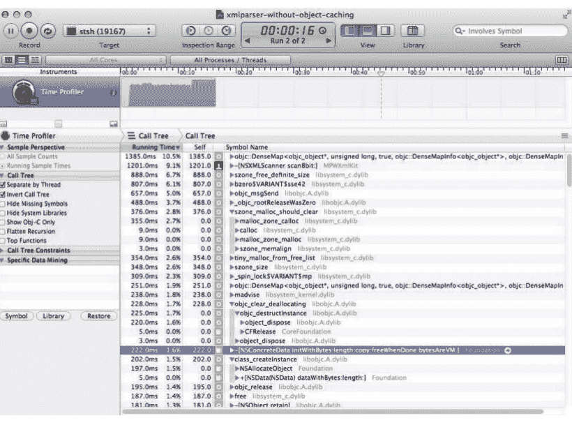

图 4.2 未优化的 XML Xmas 解析器的性能表现

## 示例 4.7 MPWsData 类定义

```objc
@interface MPWsData : NSString<NSCoding>
NSString* referencedData;
const void *myBytes;
unsigned int *myLength;
```

`MPWsData`的一个微妙之处在于它工作方式类似于基类，但实际上是`NSString`的子类，并且与`NSString`兼容。只有对于字节和字符之间具有 1:1 映射的字符串编码（如 ASCII 或 ISOLatin），它才能符合这一要求。所有的 XML 内容数据都是 UTF-8 编码的，这在最好情况下似乎是一个小问题。然而，事实证明，由于设计，ASCII 是 UTF-8 的子集，因此解析器在检测到片段为纯 ASCII 时，会将这些片段识别为`MPWSubData`；当数据无法用 ASCII 表示时，则回退到创建一个普通的`NSString`。

幸运的是，大多数内容恰好可以用 UTF-8 的 ASCII 子集表示，例如几乎所有的 XML 机制，如标签和属性等。这些特定于 XML 的数据是临时性的，因此不创建对象的方法是有回报的，该方案证明运行得相当良好。

`MPWSubData`对象在初始化时带有它所引用的缓冲区（一个`NSString`以及其引用部分在数据中的位置和长度（参见示例 4.8））。它保留（retain）`referencedData`，以确保底层缓冲区不会从这里被释放。由于它通常会配合同一个缓冲区被多次使用，它针对缓冲区已经正确设置好的情况进行了优化，以避免不必要的引用计数操作，否则这将严重影响性能。

## 示例 4.8 重新初始化 MPWSubData

```objc
-reInitWithData:(NSData*)data bytes: (const char*)bytes
length: (unsigned) len
{
  if (data != nil) {
    if (referencedData != data) {
      [referencedData release];
      referencedData=[data retain];
    }
  } else {
    [NSException raise:@"subdata (re-)initialized with nil data"
        format:@"subdata (re-)initialized with nil data"];
  }
}
myBytes=bytes;
myLength=len;
return self;
```

## 评估

随着缓存的就绪并交付`MPWSubData`对象，原本在 SA 解析器中会发生的大部分对象创建被重新初始化几个指针和操作循环缓冲区所取代。在 291-MB 的示例文件上，这将处理速率从 27 MB/s 提高到 163 MB/s，提升了 5 倍。图 4.4 所示的分析图显示，对象分配现在已次要得多，大部分时间都花在了扫描 XML 文件上，尽管我们优化的`-getObject`方法仍然*表现优异*！

需要注意的是，在某种意义上，对象分配只是被推迟了，并没有消除。如果客户端保留通过此接口收到的每个对象，缓存的效果将微乎其微，解析器在每次重用已分配的对象时都需要创建新对象。然而，在几乎所有实际场景中，这都转化为了消除：在解析文本文件期间创建的大多数“字符串”最终并没有作为字符串出现在输出中，即使最终输出被完全保留在内存中。我们在第 3 章的“字符串”部分讨论过这一点：原始数据的大部分是结构性的，被对象结构所取代；有一部分是数值内容，通常被原始类型数字取代；而只有极小的一部分是文本内容。


在 OS X 10.8 到 10.11 上，Apple 的 `NSXMLParser` 在相同文件上的速度为 44 MB/s，这比我们未优化的版本快，并且显著快于之前操作系统版本的 `NSXMLParser` 实现，即使考虑到硬件的改进。然而，实现这种性能提升似乎陷入了缓存的陷阱之一：缓存了（太多）内存。第一个指标是图 4.5 中的顶部输出，显示有 997 MB 的 RPRVT 内存（进程本身使用的非共享脏内存）。运行工具运行堆显示，这个初始评估基本上是正确的，但低了；有 320 MB 的 `NSString` 和 270 MB 的 `NSDictionary`。

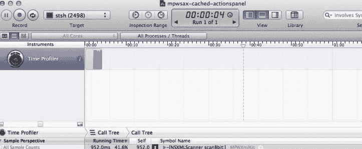

图 4.4 优化的 XML 解析器的性能

| 调用树 | 调用树 | 符号名称 | 库 |
| :--- | :--- | :--- | :--- |
| 1820.0 | 1820.0 | - -[NSObject release] | libobjc.A.dylib |
| 1710.0 | 1370.0 | -malicious_zone_call | |
| 1210.0 | 1210.0 | -[Scanner scan] | libsystem.dylib |
| 1100.0 | 1100.0 | -[NSObject alloc] | libobjc.A.dylib |
| 637.0 | 637.0 | -malloc |.system |
| 511.0 | 511.0 | -[NSData initialize] | Foundation |
| 293.0 | 293.0 | -[NSParser release] | libobjc.A.dylib |
| 268.0 | 268.0 | -[NSString stringWithLength:] | Foundation |
| 195.0 | 195.0 | -[NSString release] | libobjc.A.dylib |
| 168.0 | 168.0 | -[CFString release] | libobjc.A.dylib |
| 132.0 | 132.0 | -[CFRelease] | libobjc.A.dylib |
| 119.0 | 119.0 | -[NSData release] | libobjc.A.dylib |
| 103.0 | 103.0 | -[NSParser release] | Foundation |
| 100.0 | 100.0 | -[NSObject dealloc] | libobjc.A.dylib |
| 95.0 | 95.0 | -[NSString release] | libobjc.A.dylib |
| 87.0 | 87.0 | -anonymous | libobjc.A.dylib |
| 82.0 | 82.0 | -_objc_msgSend | libobjc.A.dylib |
| 85.0 | 85.0 | -class_instantiate | libobjc.A.dylib |
| 76.0 | 76.0 | -small_free_list | libsystem.dylib |
| 72.0 | 72.0 | -malloc | libsystem.dylib |

*图 4.3 未优化 XML 解析器的性能*


| PID | COMMAND | %CPU | %TIME | # | RPRVT | SIZE |
| :--- | :--- | :--- | :--- | :--- | :--- | :--- |
| 3500 | WebProcess | 0.85 | 00:06:27 | 17 | 140 | 339M |
| 2594 | Terminal | 0.64 | 00:11:59 | 24 | 141 | 131M |
| 275 | SystemUI-Serv | 0.00 | 00:10:31 | 3 | 264 | 550M |
| 3530 | mwshared_data | 0.00 | 00:00:12 | 3 | 63 | 252K |
| 5084 | screencapture | 0.00 | 00:08:03 | 4 | 51 | 592K |
| 6995 | mmfs | 0.00 | 00:08:33 | 3 | 63 | 508 | 3064K |
| 3700 | WebProcess | 0.00 | 00:01:01 | 0 | 181 | 240 | 91M |
| 4514 | VLC | 0.05 | 00:11:04 | 8 | 206 | 539 | 350K |
| 3530 | Post-View | 0.00 | 00:03:58 | 0 | 124 | 155 | 47M |
| 0 | kernel_task | 0.13 | 01:46:27 | 16 | 140 | 234 | 845K |
| 5083 | xml_parse | 100.2 | 00:05:26 | 0 | 254 | 47 | 24M |
| 3530 | TeShop | 0.00 | 00:11:22 | 0 | 241 | 335 | 127M |

*图 4.5 NSXMLParser 解析 291-MB 文件的顶部输出*

## marcel — top — 80x24

进程总数 112，5 个正在运行，3 个阻塞，104 个睡眠，571 个线程

平均负载: 0.63, 0.49, 0.49 CPU 使用率: 25.5%, 2.81%, 71.12% 空闲

共享库: 654M 驻留，278M 数据，0b 链接

内存: 2302M 总计，1727M 私有，567M 共享

物理内存: 1023M 大小，1311M 活跃，555M 不活跃，2889M 已用，1206M 空闲

虚拟内存: 3016 大小，10386M 虚拟，1758770(页)，1062832(进程)

网络: 数据包：938/286576 入，152572/135M 出

磁盘：71/3164 读取，0/12 写入

| PID | 命令 | %CPU | %TIME | 时间 | #Q | RPRT | RSHD | 大小 |
|---|---|---|---|---|---|---|---|---|
| 5968 | screencout | 0.0 | 00:00:02 | 1 | 47 | 95 | 48922 | 35020K |
| 5967 | top | 0.0 | 00:00:01 | 0 | 25 | 30 | 106K | 216K 80B8K |
| 5966 | xlpage-mprw | 0.0 | 00:15:27 | 1 | 55 | 94 | 19206K | 812K 293M |
| 5963 | location | 0.0 | 00:00:00 | 0 | 66 | 75 | 19208K | 3324K 76B2K |
| 5953 | calender | 0.0 | 00:00:47 | 0 | 103 | 149 | 17204K | 6780K 168M |
| 5784 | Preview | 0.0 | 00:00:16 | 2 | 171 | 302 | 146M | 880K 136M |
| 5758 | bash | 0.0 | 00:00:00 | 1 | 21 | 25 | 396K | 972K 1236M |
| 5749 | login | 0.0 | 00:00:00 | 1 | 33 | 67 | 972K | 2726K 4028K |
| 5743 | accountsd | 0.0 | 00:00:05 | 2 | 45 | 66 | 12604K | 3220K | 5348K |
| 5742 | com.apple.Sh | 0.0 | 00:00:18 | 2 | 88 | 11 | 113843K | 53444K | 1M |
| 5737 | pbs | 0.0 | 00:00:16 | 2 | 46 | 56 | 4004K | 15480K | 50A4K |
| 5733 | jpcd | 0.0 | 00:00:00 | 2 | 37 | 64 | 22808K | 34652K |
| 5732 | com.apple.ic | 0.0 | 00:00:24 | 3 | 53 | 65 | 15586K | 34008K | 6552K |
| 5728 | cfprefs | 0.0 | 00:00:29 | 2 | 57- | 10856K - 224K | 15800K |

图 4.6 用于 MWXMLParser 解析 291-MB XML 文件的 top 输出

| 计数 | 字节 | 平均 | 类名 | 类型 | 二进制文件 |
|---|---|---|---|---|---|
| 1035 | 147440 | 142.5 | 非对象 | Obj | MPWFoundation |
| 90 | 4320 | 48.0 | MPFSubData | Obj | libxcpc.dylib |
| 71 | 3408 | 48.0 | _os_kpc_uint64 | Obj | Objective |
| 19 | 3952 | 208.0 | MWXMLAttributes | Obj | XML |

## 调优

虽然捕捉 bug 是一种胜利，但许多小任务也有帮助。例如，在解析期间委托代理保持不变，因此这些高频间隔的消息被发送到 `object-cache`。

用于检查格式良好性的标签堆栈是解析器内部的，并使用 C 数组实现。代表打开标签的对象被缓存起来，以验证实际字符没有被修改或复制；解析器仅产生原始字节的引用，同时也让客户端实际访问数据。这产生了一种“按需付费”的性能结构，在真正需要时才避免了实际工作。

## 优化整个组件：MAX

XML 解析器通常用于从 XML 文件中提取有用数据，这意味着用户代码必须解释解析结果。正如我们看到的，DOM 和 SAX 解析器为开发者带来了一个棘手的权衡：DOM 解析器相当方便，但本质上效率低下，需要将整个 XML 文档解析为内存树表示，在开始应用级处理之前至少需要 6 倍的内存。

另一方面，SAX 解析器可以非常高效，但对于非平凡的任务需要复杂的代码，这些代码难以编写且难以快速。示例 4.9 让我们体验了使用 SAX 解析器的真实感受虽然我们只处理一种特定的 XML 元素类型，但模拟了实际上需要以此方式处理的情况。

示例 4.9 使用 SAX 模拟加载和解析摘要

```objc
@interface MedParser:Object
{
    NSMutableString *content;
    NSMutableArray *abstracts;
}
@property (strong, nonatomic) NSMutableString *content;
@property (strong, nonatomic) NSMutableArray *abstracts;
@end

@implementation MedParser

(void)parser:(NSXMLParser *)parser
    didStartElement:(NSString *)elementName
    namespaceURI:(NSString *)namespaceURI qualifiedName:(NSString *)qName
    attributes:(NSDictionary *)attributeDict
{
    if ([elementName isEqual:@"Abstract"]) {
        [self setContent:[NSMutableString string]];
    } else {
        [self setContent:nil];
    }
}
@end
```

## 优化整个组件：MAX

```objc
(void)parser:(NSXMLParser *)parser didEndElement:(NSString *)elementName
    namespaceURI:(NSString *)namespaceURI qualifiedName:(NSString *)qName
{
    if ([elementName isEqual:@"Abstract"]) {
        [abstracts addObject:content];
        [self setContent:nil];
    } else if ([elementName isEqual:@"Acronym"])
    } else if ([elementName isEqual:@"Affiliation"])
    } else if ([elementName isEqual:@"Agency"])
    } else if ([elementName isEqual:@"Article"])
    } else if ([elementName isEqual:@"ArticleTitle"])
    } else if ([elementName isEqual:@"Author"])
    } else if ([elementName isEqual:@"AuthorList"])

(void)parser:(NSXMLParser *)parser foundCharacters:(NSString *)string
{
    [content appendString:string];
}
```

所涉及的 XML 文件是一个 130-MB 的医学期刊数据库。在本文章的“对象，廉价”部分，使用基础 SAX 解析器运行耗时 5.3 秒，使用 `NSXMLParser` 运行也是 5.3 秒。添加示例 4.9 中的客户端代码为两个计时都增加了 1.7 秒，分别将时间变为 3.0 秒和 7.0 秒。当然，1.7 秒仅代表 `NSXMLParser` 运行时间增长了 32%，而对于我们的 SAX 解析器来说增长 130%，这使得即使在使用有限的处理的情况下，我们的高效解析器也被客户端的处理成本所淹没。

原因当然是，SAX API 迫使客户端执行字符串比较和查找，以便为特定的 XML 元素分发正确的操作；正如我们探索过的，使用 `NSString` 和 `CFString` 进行这种操作是昂贵的。通过 instruments 确认了这一假设，但这些字符串比较真的可以消除吗？

XML Messaging API (MAX) 通过利用 Objective-C 运行时和一些调优的对象将字符串比较转换为消息发送。遇到的每个 XML 元素都会转换为一个发送给委托的 `<ElementName:attributes:parser>` 消息。参数是该元素的子元素（已由解析器处理），以及在客户端需要更多信息时的解析器本身。消息预期返回一个代表该元素的对象，然后该对象被作为元素栈上传处理消息的参数。

# 第 4 章 CPU 示例：XML 解析

示例 4.10 显示了与示例 4.9 中 SAX 实现的解析器相同的 MAX 客户端代码`-AbstractTextElement:attributes:parser:` 处理属性并返回空，因为我们没有在构建树，只是获取属性。（与 Cocoa 惯例相反，消息名大写，以精确匹配对应 XML 元素的名称。）没有需要管理累加器，通过添加处理消息来模拟额外负载没有意义，这不会增加开销。注意，类型信息纯粹用于文档目的：由于消息是在运行时合成的，编译器永远不会将源码与方法实现连接，也无法检查返回类型。

## 示例 4.10 使用 MAX 获取摘要

```objc
@interface MedParser:NSObject
{
    NSMutableArray *abstracts;
}
@property (strong, nonatomic) NSMutableArray *abstracts;
@end
```

```objc
@implementation MedParser

-AbstractTextElement:(MPXXMLAttributes *)elements
    attributes:(MPXXMLAttributes *)attrs
    parser:(MPWMAXParser *)parser
{
    id text = [elements combinedText];
    [abstracts addObject:text ? text : @""];
    return nil;
}

@end
```

由于构建（虚拟）树的努力，MAX 在处理 130-MB 数据库文件时比我们的 SAX 解析器慢一点，运行需 1.6 秒，但比 `NSXMLParser` 快了 3 倍。然而，添加实际的客户端代码仅为总处理时间增加了 0.1 秒（或 6%），使总时间达到 1.7 秒。

## MAX 实现

从之前的讨论可以显易见地，在 SAX 之上实现 MAX 至少在效率上是不可能的，事实上 SAX 解析器是

## 总结

而是实现在 MAX 之上。MAX 接收来自示例 4.4 中 XML 扫描器回调的字符输出，并使用一种特殊的 `MPWSmallStringTable` 字典将这些字符串映射到代理消息发送。该字典可以通过 `char const int length` 查找对象，而不需要一个完整的对象或以 UL 终止的 C-String。它所查找的对象是 `MPWFastInvocation` 的实例，它是 `NSInvocation` 的替代方案，通过仅处理对象参数，其速度大约是 `NSInvocation` 的 50 倍。

属性和（子）元素存储在一种特殊的 XML 字典/数组混合结构中，该结构保持了顺序并允许存在多个同名元素（这是 XML 的要求）。属性或元素会被高效地追加到存储区的末尾，并可以通过索引或键进行检索。


最后，栈经过了调整，使得在解析时执行的工作最少，仅包含扫描、几次 C-String 查找、一些消息发送以及三次操作。

你可能在好奇并行性在哪里。它并不存在，因为 XML 本质上是一种顺序文件格式。例如，你可能认为可以并行解析子树，但通常无法知道特定子树有多深，这意味着你的划分可能是不准确的；而且，在解析完现有子树之前，你无法继续处理下一个元素。解析器与客户端之间的接口也是一种诱人的选择，但其交互带宽极高且粒度极细，看起来并不乐观。

我见过的唯一可能行的 XML 并行方法是：对整个文档进行非常快速且粗略的扫描以获取整体结构，然后根据文档结构的合理边界，将各个部分的解析任务分配到不同的线程上。

## 总结

本章介绍了一个从底层字符处理开始的 XML 解析器，涵盖了利用我们在上一章中看到的技术，来创建一个高效的面向对象 API 的所有工作。涉及的 XML 扫描器“灵感源于” Leopard 中的 Spotlight 导入器，它是第一个受 I/O 密集型而非 CPU 密集限制的 Spotlight XML 导入器。Apple 的 Help Indexer 在 Snow Leopard 中使用了 SAX 解析器，作为之前使用的 `NSXMLParser` 的多次迭代替代品（性能提升了数倍）。

如果你需要快速的 XML 处理，现在已经准备就绪了！源代码可以在 http://github.com/mpw/Objective-XML 获取。

开开玩笑之，本文介绍的技术不仅适用于 XML，甚至不仅适用于解析——它们具有广泛的适用性。例如，我在第 1 章中提到的 Postscript 解释器使用了相同的技术，在语言导向型任务上优于 Adobe 自己的基于 C 的实现（图形由 CoreGraphics 处理）。这意味着，如果你有一个合理的 API，你始终可以在 Objective-C 中创建一个高效的实现，并根据需要混合和匹配高层与底层的实现细节。

最后，我们还看到真正卓越的性能不仅仅是创建现有 API 的高效实现。API 的设计对于决定该 API 是否能同时被 (a) 实现，以及更重要的 (b) 被高效地使用至关重要。

# 内存：原理

内存使用是性能调优中最棘手且最不被理解的领域之一，但可能也是最重要的领域之一。从表面上看，它似乎完全与性能无关：程序要么放入内存中，要么不能。事实上，在 CPU 直接连接到内存的计算机上（在获得从虚拟内存到各种缓存的多级内存层次结构之前），情况确实是这样运行的。

如今，内存是一个更加流动的概念。一方面，虚拟内存提供了隔离的地址空间，并被复用到物理内存上。另一方面，CPU 只有在访问构建在 CPU 内部的少量内存时才能以全速运行，而数据在磁盘、内存和各种 CPU 缓存之间不断且高度透明地流动。

## 内存层次结构

像当前的 Mac 硬件或各种 iOS 设备等系统架构具有几种不同大小和（极大）不同性能特征的内存。图 5.1 是你的 MacBook Air（搭载 Intel Core i7-2677M）系统的简化框图。它显示了具有双核心的 CPU 和主内存。显存将在第 14 章中详细检查。

每个核心都有一级缓存，分为指令缓存和数据缓存，容量均为 32-KB。此外，每个核心都有一个容量为 256-KB 的统一二级缓存，且 CPU 上有一个 4MB 内存的单级三级缓存，由两个核心共享。L1 缓存的延迟为 3 个周期，L3 缓存为 8 个周期和 21 个周期。

这些信息可以从 Apple 对 MacBook Air 的规范和 Intel 处理器数据表中获得，但大部分信息也可以通过 `sysctl` 命令获取，示例输出如示例 5.1 所示。`sysctl` 输出不仅确认了缓存大小（L1 为 32,768 字节，L2 为 262,144 字节，L3 为 4,194,304 字节），还告诉我们缓存行（cache line）的大小为64 字节。所有

# 第 5 章 内存：原理

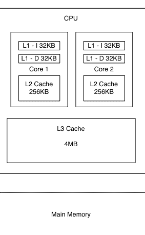

图 5.1 Core i7 内存架构

缓存不是按字节组织的，而是按“行”（lines）组织的，这些行会在缓存与缓存以及主内存之间传输。

示例 5.1 sysctl

```
machdep.cpu.brand_string: Intel(R) Core(TM) i7-2677M CPU @ 1.80GHz
hw.physicalcpu: 2
hw.linesize: 64
hw.cachesize: 32768
hw.cachesize: 262144
hw.cachesize: 4194304
```

为什么需要如此复杂的安排？简短的回答是，截至本文写作，CPU 的速度比 Apple II+ 快了 1000 多倍，而内存访问时间仅提高了 10 倍左右，因此复杂的缓存设计是为了隐藏这种延迟差异。与此同时，内存接口被重新设计以在每次访问时提供更多数据，在增加延迟的同时大幅提升了带宽，以尝试为典型程序提供充足的数据。

# 第5章内存：原理

```c
long curCount=atol(argv[1]) * COUNT/UNROLL;
long result=0;
long headroom=UNROLL * stride;
while (cur-- > 0) {
  result=cur; cur+=stride;
  result=cur; cur+=stride;
  result=cur; cur+=stride;
  result=cur; cur+=stride;
  if ((cur-ptr)+headroom) > SIZE ) {
    cur=(SIZE-headroom);
  }
}
printf("result: %ld\n", result);
} else {
  printf("usage: %s <access-count-in-millions> stride\n", argv[0]);
}
```

图 5.2 的插图清晰地显示了 L1、L2 和 L3 缓存之间的速度差异。它还表明，对于步长（stride）远小于64 字节缓存行大小的顺序访问，这种差异并不重要。一旦步长超过缓存行大小，访问模式就不再重要了。对于 L1 内部访问，随机访问的惩罚几乎不存在；对于 L2 增加到 2 倍；对于 L3 则增加到略高于 4 倍。

图 5.2 中的主图显示了内存访问数据，它使用 1-GB 缓冲区来强制访问超出缓存范围。从最右侧的条形图中可以看出，随机访问内存大约需要 38 ns，大约是访问 L1 缓存中数据的 100 倍。事实上，图 5.2 中重复的缓存访问数据已被缩放到几乎不可触及的程度，以便为页面上的随机内存访问条形图留出空间。

然而，顺序访问（步长 1-2）几乎没有受到减速，即使必须穿过 1GB 的内存，这显示了 DDR3-1333 内存巨大的带宽，但也凸显了延迟与带宽之间日益扩大的差距。

虚拟内存虽然可以将一小部分内存的访问时间减少 100 倍，但它将地址内存扩展到物理安装的内存范围之外，这可能会带来巨大的性能代价。图 5.3 中那个有些荒谬的图表显示了多大的差异，它试图将快速内存的随机访问时间（36 ns）与最快的固态硬盘（SSD）的随机访问时间（约 10 μs）进行比较。图 5.2 中到目前为止长的现在变成了一个几乎不可见的细条，而 SSD 的访问时间占据了整个页面的长度。最快的旋转磁盘即使仍慢了 100 多倍也无法容纳，且 CPU 缓存的时间没有在 x 轴上明显上升。

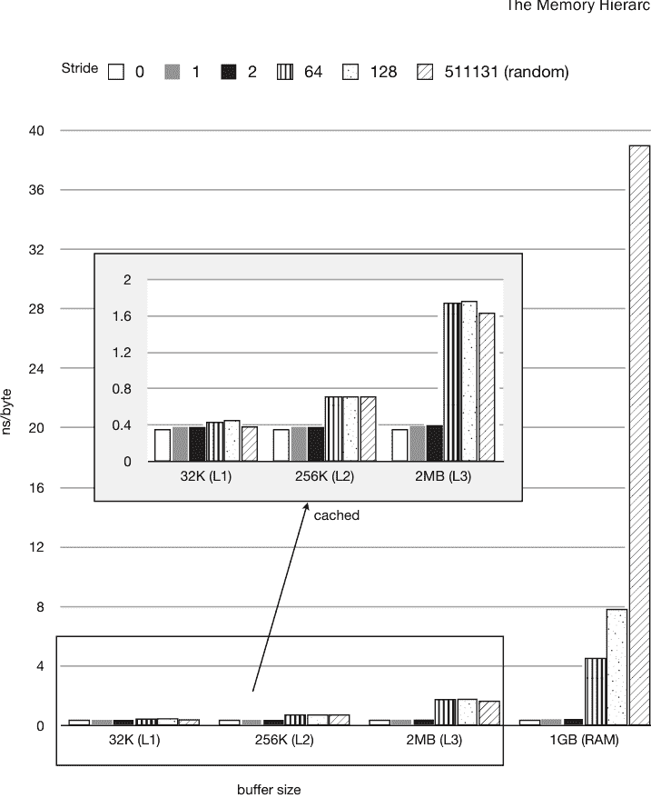

在单张图中显示内存层次的不同部分需要使用对数刻度（图 5.4）或不同的书籍格式。这些数字的后果应该是显而易见的：留在内存层次的“良好”一侧确实是值得的，反之，进入“坏”一侧的性能惩罚是非常严重的。如果你本质上是随机的访问模式（如你单独分配的对象那样），你应该非常努力将你的工作集（working set），即，

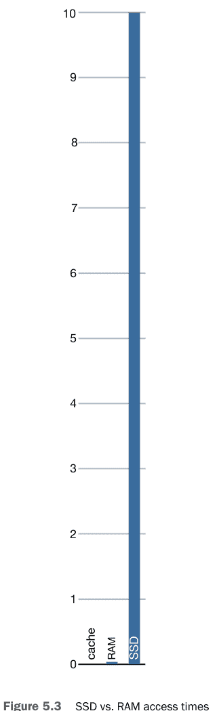

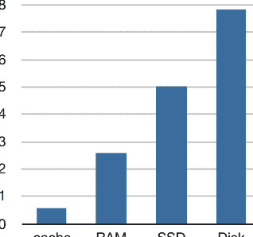

图 5.4 内存层次访问时间，对数刻度

在给定间隔内，你的程序处理/操作的信息集保持在缓存中，最好是 L1 或 L2 中。如果你有无法放入缓存的数据集，请确保按顺序访问它们——这样你就可以利用内存的高带宽，而不是受困于它的高延迟。

## Mach 虚拟内存

尽管内存层次包含了完全不同类型和特性的硬件，但操作系统对开发者来说是统一的。OS X 基于的 Mach 微内核通过分离地址空间和内存来实现这一点，用户主要与地址空间交互，而操作系统和硬件协作为地址空间提供支持。

无论上一节讨论的物理内存如何，大多数操作系统的地址空间都组织成固定大小的页，在 iOS 和 OS X 上为 4096 字节。当你使用示例 5.3 中的程序确定大。当程序尝试访问内存时，它使用虚拟地址。CPU 通过右移该地址 12 位获取页码将其转换为物理地址。页码通过操作系统维护的页表转换为物理页（CPU 内部有一个小型缓存，转换查找缓冲区，是 CPU 上最忙的硬件之一），然后使用低 12 位访问页内内存。

# 第5章 内存：原理

示例 5.3 确定 VM 页大小

```c
#include <stdio.h>
#include <mach/vm_page_size.h>

int main() {
    printf("page-size: %ld mask: %ld\n", (long)vm_page_size, (long)(vm_page_size - 1));
    return 0;
}
```

虚拟内存的基本思想是为每个进程提供一个大的连续地址空间，即使物理内存很小且碎片化。操作系统使用页表管理虚拟地址和物理地址之间的映射。当进程访问虚拟地址时，硬件检查转换查找缓冲区（TLB）中的映射。如果找到了映射，则快速执行转换。如果没有找到，就会发生页错误，操作系统必须遍历页表来查找映射。如果页不在物理内存中，操作系统将从磁盘获取它。这种机制允许系统运行比物理内存更大的程序，但会在转换时间和磁盘 I/O 方面带来性能代价。

# 第5章 内存：原理

| dylib_2 |

| malloc zone_2 |

| Stack_1 |

| malloc zone_1 |

| dylib_1 |

| Stack_2 |

| main() |

| mapped file_1 |

| 0 |

图 5.6 Mach 内存布局：多个栈，随处可见堆

## 栈分配

然而，尽管在技术上并不准确，但这个术语已经流传下来，并且与某种更复杂的真相非常接近。现在我们要区分两种不同的分配类型：**栈分配**是在函数或方法被调用时，通过递减栈指针隐式地/自动地发生的。函数内部的所有变量都是通过这一个指针的递减来分配的，因此它的分配速度很快，释放内存也是如此：指针再次增加即可。其大小由编译器计算。

图 5.7 阐了示例 5.4 给出的示意程序中栈分配是如何工作的：一个 `main()` 函数包含一个 `int` 变量并调用了两个函数，其中第一个函数有一个 `NSStruct` 局部变量，第二个函数还有两个整数。该图展示了栈分配的另一个优点：**引用局部性**。由于分配是通过增加单个指针完成的，所有变量在内存中的位置彼此靠近，这对于缓存的组织方式非常有益。所示的所有局部变量都能放入一个栈缓存行（cache line），并且同一条缓存行会被后续函数复用，因此所有与栈变量的交互都发生在 L1 缓存中，访问 L2 或 L3 的频率较低，与主内存的交互极罕见。

# 堆 栈 109

| int₁ | | | int₁ |

|---|---|---|------|

| | call | NSRect, | x | return | int₂ |

| | | | y | | int₃ |

| | | width | | | |

| | | height | | | |

图 5.7 栈分配

## 示例 5.4 用于说明栈分配的三个函数

```c
int function1() {
    NSRect r;
    ...
}
int function2() {
    int a,b;
    ...
}
int main() {
    int a;
    function1();
    function2();
}
```

和往常一样，这是一个简化，因为编译器和平台调用约定实际上会合力将大多数局部变量和函数参数值保留在寄存器中，避免与 L1 的交互。然而，将当前函数的变量和参数保留在寄存器中意味着需要将调用者的变量存放在栈上，所以这种说法已经足够准确了。

缺点是，这种分配的局部变量正如其名，是该函数的局部的；它们的寿命无法超过该函数的寿命。从概念上讲，局部变量在函数返回后就会消失。在现实中，内存中的值会一直持续到那时，这意味着返回刚结束函数的局部变量有时会偶然成功（当返回一个指向此类局部变量的指针时），但下一次函数或方法调用将会覆盖这些值，因为该函数将使用栈上的相同空间来存储它的变量。

此外，还有尺寸限制。例如，在我的机器上，主线程有 8 MB 的限制（请通过 `ulimit -a` 查看你机器上的值），由 `threads` 创建的后续线程（包括 `NSThread`）被限制为 512 KB 的栈。这些是当前值，不保证，其结果是不应该在栈上分配大型数组或缓冲区。

事实上，不在栈上分配的还有另一个原因：当你返回一个调用或一个结构体时，编译器会拷贝整个调用函数。但数组并非如此。当数组在 C 中被表示时，它实际上并没有引用数组的内容。因此，如果你从函数返回一个数组，你实际上返回的是指向复制后的栈帧（stack frame）的指针！Swift 的处理方式不同：所有集合实际上都分配在堆上，且始终如此，通过一个结构体来引用堆上分配的内容。

栈分配与**值语义**密切相关：实际的值或结构体被分配并操作。当一个值被传递给另一个函数、从函数返回或在另一个结构体内部时，该变量的实际位会被复制到新位置。

## 使用 malloc() 进行堆分配

另一方面，堆分配是手动的：必须调用一个函数或方法（在 Swift 构造函数中）来分配，并调用另一个函数来释放内存（有不同的方法可以实现这种自动化，参见本章的“资源管理”部分）。如果分配的内要在创建它的函数作用域之外生存，则堆分配是必要的。堆分配意味着指针和引用语义，因此你可以对它有多个引用。Objective-C 和 Swift 对象具有引用语义并分配在堆上。

用户程序并不直接从操作系统获取内存（地址空间），因为任何分配的系统调用都会太慢，而且最小的分配单位是 4 KB 的操作系统内存页。`malloc` 软件包从操作系统请求更大的（多页）内存池，并使用 `malloc`、`calloc` 和 `realloc` 函数以较小的碎片分给用户。用户的任务是使用 `free` 将内存还给这些内存池。

在 10.5 之前，OS X 使用的是“可扩展 malloc”，这种实现强调内存节省而非原始性能，并需要大量的锁定。从雪豹（Snow Leopard）开始，这被 magazine malloc 代替，这是一种受 Hoard 分配器³启发的实现，专为多线程应用程序设计。除了能大幅减少锁定开销和竞争外，这种实现还向操作系统返回连续的内存块，这是 `scalable malloc` 永远从未尝试过的。

* 2. Stepstone Objective-C 允许栈分配的对象，这一特性在 NeXT/Apple 版本中被丢弃了。

* 3. http://www.hoard.org

## 堆与栈

错误的假设内存碎片化会阻止这种情况。所以从 10.6 开始，堆的使用实际上可以减少，以前它只会单调增加。雪上加霜，未使用的内存通常是脏数据，导致交换到磁盘。

示例 5.5 以纳秒测量 `malloc()` 和 `free()` 一块内存所需的时间，内存以 2 的幂增加，所以迭代 9 分配了 512 字节。

```objc
#import <Foundation/Foundation.h>
NSTimeInterval mallocTest( long size, long iterations ) {
    NSTimeInterval start=[NSDate timeSinceDate];
    for (long i=0;i<iterations;i++) {
        void *ptr=malloc(size);
        free(ptr);
    }
    NSTimeInterval stop=[NSDate timeSinceDate];
    return (stop - start) * 1000000000.0;
}

int main() {
    printf("log2size, time (ns), rate (bytes/ns)\n");
    for (long log_size=1;log_size<20;log_size++) {
        NSTimeInterval nsPerAlloc=mallocTest(1LL << log_size, 1000000);
        printf("%10ld, %f, %g\n", log_size, nsPerAlloc, (double)nsPerAlloc);
    }
}
```

结果绘制在图 5.8 中，x轴显示 2 的幂。如你所示，分配时间是恒定的 45 纳秒，直到 2^17=128 KB。在 128 KB 处有一个阶跃函数到约 280 纳秒，因为分配器从从大块获取的 malloc 区域分配特定请求切换为从操作系统单独分配每个请求。从 1 字节到 128 KB 分配时间恒定的这一事实，意味着作为一个大对象分配给定的内存比分配许多小对象要便宜得多。唯一的问题是这种差异是否重要，而图 5.9 给出的答案是肯定的“是”。

图 5.9 显示了在不同的分配大小下你每秒可以分配多少字节。与图 5.8 中的时间（线性刻度）不同，这里的速率必须绘制在对数刻上，在最小对象大小 8 字节（仅一个指针没有任何其他）处，我们的分配速率略小于每纳秒 0.1 字节。直线是我们在 Skylake 处理器上使用已分配内存的速率，L1 缓存为 1400 字节/ns，主内存为 18 字节/ns。


对于小对象而言，堆分配与 L1 缓存开销的比例大约是 10,000 倍，而对于主内存，这个比例仍在大 100 倍左右。这是为什么许多小型临时对象与高性能难以良好兼顾的主要原因之一，尽管我们将在第 7 章中展示如何实现这一点。

对于约 97% 的非性能密集型代码，小型临时对象完全没问题，小型永久对象也是没问题的。这是好事，因为在许多情况下，用具有身份标识（identity）的对象和纯值对象（pure value objects）并不符合所需的语义。如果你想构建图结构或由于其他原因需要从多个位置引用同一个对象，则需要引用语义。

但总的来说，Objective-C 和 Swift 倾向于让对象比纯面向对象的语言粒度更大、寿命更长，后者倾向于使用不基于 `malloc` 的对象分配器，这种分配器在支持细粒度对象时快得多。

如果你有很多对象，堆分配也可以比栈分配快得多，因为你可以传递一个 8 字节的指针，而不是复制整个对象。

在尺度的另一端，你会发现与实际使用所有这些内存相比，分配操作变得极其微小，事实上，操作系统甚至没有清理内存，它只是轻量地提供了地址空间。更重要的成本出现在程序尝试实际使用内存时，操作系统为请求的地址空间提供并清理真实的内存。

## 资源管理

程序使用的资源（如内存）需要以某种方式管理其生命周期；何时以及如何分配资源，以及如何释放？

我们在上一节中查看过并在过程化编程语言（包括 Objective-C）中使用过的一种简单资源管理方案是栈分配：在函数/方法作用域内声明的变量，该变量具有自动作用域（auto scope），并在函数/方法退出时自动销毁，但在调用其他函数期间会继续存在。

对于生命周期确定的堆分配对象，Stepstone Objective-C 和 pre-Foundation NEXT 使用了手动内存管理，类似于 C 语言的 `malloc()` 和 `free()`：通过 `new` 和 `delete` 创建和销毁对象。在简单情况下这种方法运行良好，因为一个对象引用实际上只有一个“所有者”——要么只有一个引用，要么有一个可以识别的决定对象周期的“主”引用；但当多个独立实体必须协调对象的生命周期时，这种方法就会失效。

## 垃圾回收

幸运的是，在非复杂环境中确定引用生命周期的问题有着悠久的历史，许多解决方案至少追溯到 20 世纪 50 年代的早期 LISP 实现。

垃圾回收主要有两种技术：追踪堆（tracing the heap）或使用引用计数寻找死亡对象。正如 Bacon、Cheng 和 Rajan 在 2004 年的 OOPLA 论文《垃圾回收统一理论》所示，这些方法（追踪垃圾回收和引用计数收集）是对对的，且每种类型收集器的优化版本都带有另一种类型收集器的特征。

早期的垃圾回收器使用引用计数，每当创建一个对象的新引用时，对象内部的计数增加；每当丢弃一个引用时，计数减少，这些都由运行时系统自动完成。当引用计数达到零时，该对象就可以被回收，因为不再有引用指向它。

## Foundation 对象所有权

当 OPENSTEP 引入今天仍熟悉的新的 Foundation 类（`NSArray`, `NSString`, `NSDictionary`, `NSNumber` 等）时，它还引入了基于引用计数的垃圾回收方案，以取代 NextStep 版本中完全手动的资源管理方案。

尽管这种机制没有集成到语言的引用计数收集器中，但它能够与 C 等低级语言共存。由于引用计数系统没有访问对象内部的特殊权限，在系统范围内它是较慢的。这通过以下事实得到了补偿：它不跟踪局部变量中的引用，所有权规则仅适用于持存在实例变量中的引用。这大大减少了引用计数操作的次数。

Foundation 基于所有权的引用计数方案通常被称为“手动引用计数”（MRC）。这是不正确的；引用计数可以通过访问和属性定义自动生成，并且确实是这样生成的。事实上，MRC、ARC 甚至追踪收集器中的属性定义在本质上是无法区分的。

图 5.10 展示了引用计数是如何工作的。根（root）有一个指向对象 a 的引用，因此它的引用计数为 1。对象 b 有指向对象 b 的引用，其引用计数也为 1。如果我们为对象 b 添加一个指向对象 a 的回指针，a 的引用计数增加到 2，所有其他引用计数保持不变。

如果从根到对象 a 的引用消失，对象 a 的引用计数将降回到 1。这个例子也说明了引用循环：对象 a 和 b 不再被程序的其他部分引用；因此它们应该被释放。

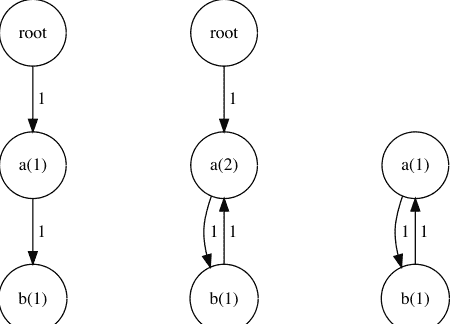

图 5.10 创建保留循环

然而，由于它们相互指向，它们的引用计数保持为 1，因此引用计数无法检测到它们应该被释放。

引用计数是使用普通消息发送（message sends）实现的这一事实允许了诸许多优化，例如之前描述的对象缓存，我们通过检查引用计数是否为 1 来指示是否将对象从缓存中剔出。如果能够证明操作是平衡的，并且有一个外部引用在持续期间保持对象存活，它甚至允许程序员在性能关键区域完全手动诱导边缘引用计数操作。引用计数的精确性这一事实允许寄载在现有机制上，尽管必须确保对象的生命周期不会被不必要的延长。

## 追踪 GC

由于引用计数本身不处理循环引用，上述早期的收集器经常通过一个追踪标记-清除（mark-and-sweep）收集器进行增强，该收集器只是偶尔运行。在标记阶段，它从一个或多个已知的根对象追踪所有的对象引用；在清除阶段，它释放所有在标记阶段未被发现的对象（即垃圾）。

虽然标记-清除也可以单独使用，但扫描整个堆是非常昂贵的的，而且难以与程序并发执行，这导致了垃圾回收停顿现象，即运行中的程序在执行垃圾回收时会停止。

并发垃圾回收通常可以缩短停顿时间而不是完全消除它们，但会带来额外的成本和复杂性。标记-清除与虚拟内存的交互也不佳，因为在虚拟内存环境中，它扫描的是地址空间而不是内存，可能会从磁盘调入大量未使用的内存。

分代扫描收集器（Generation-scavenging collectors）利用时间相干性（temporal cohesion）来改善全扫描的负面影响，而复制收集器使得分配变成了廉价的“碰撞指针”（bump pointer）操作，这就是为什么现代收集器既是复制又是分代的。

追踪垃圾回收在具有原始指针的 Objective-C 中很难以可靠且高效的方式实现，因为指针可能被隐藏，模式可能导致假阳性，且内存无法移动。

虽然在特殊情况下可行，但苹果自有的追踪垃圾回收从未达到在 OS X 和 iOS 上运行的性能和可靠性水平。最终它进入了 iOS 而在 X X 上被弃用。

# 第 5 章内存：原理

## 自动引用计数

在 10.7 版本弃用 GC 后，苹果引入了自动引用计数（ARC）作为 Objective-C 的语言特性。与苹果的追踪垃圾回收相比，最大的优势是 ARC 代码可以以文件为单位混合 MRC 代码，而追踪收集器必须针对整个进程。

ARC 不仅仅管理现有的对象所有权规则（主要是存储实例变量中的引用）。相反，编译器会在访问函数和方法时插入引用计数操作，增加了引用计数操作的次数，但也关闭潜在的安全漏洞并使引用计数更加精确。

尽管支持引用计数的运行时函数有所改进，这些额外引用计数操作的开销可能是难以接受的，因此使用了一个特殊的 LLVM 优化通过来尽可能消除这些操作。虽然这个额外的通过可以消除大部分新增的操作，但仍会有一些残留，导致导致与 MRC 相比通常慢了 10% 到 100% 不等。

## 进程级资源回收

虽然目前所有的技术在程序运行时都有效，但请记住，进程使用的所有临时资源都会在进程终止时由操作系统清理。这种资源回收不仅在本质上是完美的，而且速度非常快。

## 总结

在本章中，我们看到了内存层次结构中不同元素所具有的巨大性能范围，这些元素对用户程序都呈现为一个统一的地址空间。为了优化内存访问的性能，有必要最小化总内存使用并优化内存访问模式，以便利用硬件的（非线性）能力。

接下来的章节将首先展示如何测量内存消耗并识别访问模式，然后介绍内存使用的优化技术。

## 内存：测量与工具

内存有许多不同的维度，没有哪一个是主导的。即使是看似简单的问题“我的程序使用了多少内存？”也没有一个显而易见的正确答案。这既包括你的程序通过 `malloc` 从系统获得的内存量，也进程（包括 `malloc`）从操作系统获得的内存量。这两者都涉及到地址空间中有多少是由真实的内存支持的。此外，你还有映射的文件，以及许多进程之间共享的地址空间和内存（大部分由系统分配）。

此外，操作系统正在尽力根据当前运行程序的集合来优化内存使用，因此获取平均值有时更像是在智斗一个高明的对手，而不是简单的进行测量。

此外，分析内存消耗的工具通常需要处理比 CPU 样本多得多的数据，对运行程序的影响也大得多。

## Xcode 仪表

Xcode 的“始终开启”轻量级分析功能也包含了内存消耗的概览。图 6.1 显示了基础可视化内容：圆形仪表盘显示瞬时进程特定和整个系统的使用统计数据，以及显示进程内存使用随时间变化的时间轴。虽然没有进入非常细节的，但这些确实让你对发生的情况有一个基本的概览，包括在出现异常时给出提醒。我个人觉得 CPU 仪表盘更有用。

# 第 6 章 内存：测量与工具


## 命令行工具

与 CPU 性能一样，命令行提供了许多性能工具，可以提供快速且相当详尽的信息，而不需要大量的开销或设置工作。简单的脚本还允许你组合多个命令，以便同时捕获各个维度。

## top

我们已经在第 2 章的“top”部分介绍过 `top` 用于 CPU 测量，它的许多优势在内存分析中同样适用。它为你提供了一个持续更新的系统视图，以及某些特定进程的摘要信息。

我最感兴趣的摘要信息是 `PhysMem` 行。它显示了物理内现在系统层面是如何被实际使用的，分为固定（wired）、活跃（active）、不活跃（inactive）和空闲（free）部分。固定内存是内核中的内存，不能交换到磁盘；它永久地驻留在物理内存中。

图 6.1 Xcode 内置内存分析

由内核管理的资源（包括进程、线程、文件描述符或虚拟内存页本身）除了资源本身使用的任何内存外，还需要一些固定内核内存来存储由内核维护的账目信息。

空闲内存（Free memory）顾如其名，是当前未使用且立即可用的。内核通常会尝试将系统中的空闲内存减少到很小的储备，因为空闲内存意味着昂贵的资源没有被利用。

活跃进程（active process）也很容易：这些内存被积极分配给进程并处于……嗯，处于活跃使用状态。内核通过管理不活跃内存（inactive memory）来最小化空闲内存：这些是文件、缓存和缓冲器的旧映射，内核保留它们以防可能再次需要，但在系统进程需要活跃内存时可以释放它们。

另一个需要关注的数字是 VM 中的分页率（paging rate），特别是页出（pageouts）。如果进程内部没有非零值，说明你的系统正在向磁盘交换数据。如果你有持续的分页活动，通常会观察到系统和磁盘活动明显变慢（如果你使用的是机械硬盘而不是固态硬盘的话）。

在每个进程行中，发现 `RPVVT` 和 `PRVVT` 行最有用。`RPVVT`驻留内存（resident memory）是你进程中真实内存的实际量，在大多数现实情况下，它最接近之前讨论过的“我的程序使用了多少内存？”这个问题。直到你的进程开始交换，此时 `RPVVT` 显然会变得非常小，因此不再适合跟踪你的内存消耗。

`SIZE` 显示私有分配给你进程的地址空间量，在交换时是内存的一个良好类比。然而，它似乎没有考虑到新分配的（零填充的）地址空间或未映射的内存文件。`SIZE` 同时缓存这两者，但也捕获了大量的系统共享地址空间，因此它通常只作为一个相对指标有用。

图 6.2 显示了第 1 章整数程序的对象分配版本在运行中的情况。在 266 MB 的虚拟地址空间内使用了 254 MB 的真实私有内存。但我们仍然有超过 2 GB 的物理内存可用，所以没有交换的危险（且页出为 0）。

图 6.3 显示了程序运行 1 秒后的情况；真实内存消耗现在是 734 MB，并且仍在跟踪虚拟内存，后者已增加到 748 MB。我们仍然有空闲内存，两个页出计数器均为 0。总之，我们有一个正在快速消耗内存的程序，但在系统的范围内运行。

## heap

正如名称所示，`heap` 命令对应用程序的堆快照，即通过 `malloc` 及其变体分配的内存。与 `top` 不同，它始终显示地址空间而非真实内存，以防这两个数字产生偏差。一方面，它将向你显示你的

## 第 6 章：测量与终端

```
Processes: 71 total, 3 running, 66 sleeping, 24 threads
Load-avg: 0.31, 0.25, 0.19 usage: 48.37%, 4.32%, 47.9% idle
Shared-libs: 6212k resident, 6926k shared
Memory: 9753M total, 667M resident, 199M private, 32M shared
Phys: 5690M used, 928M active, 460M inactive, 2484M free.
Swap: 1430M total, 1837 free, 254K, 0 used, (0 pages)
Networks: 1485k/in, 3556k/out, 28% idle
```

图 6.3 再次显示 top（此处原文为 top）

```
Processes: 71 total, 3 running, 66 sleeping, 277 threads
Load-avg: 0.37, 0.26, 0.19 usage: 48.39%, 5.44%, 46.16% idle
Shared-libs: 6212k resident, 6926k shared
Memory: 1032M total, 1120M resident, 194M private, 324M shared
Phys: 5690M used, 928M active, 460M inactive, 2484M used, 1611M free.
Swap: 1430M total, 1837 free, 254K, 0 used, (0 pages)
```

## 命令行工具

程序，并且我们按对象类进行拆分。它就像是你进程的 X 射线机，我发现它对于分析程序行为极其有用。

要运行 `heap` 命令，你需要传递想要检查的进程名称或 ID。它会在标准输出（stdout）上交付两种信息。

第一部分是找到的每个 `malloc` 区域（zone）的摘要信息。下面显示了 Xcode 运行时的堆摘要信息。对于每个区域，它显示了进程当前分配了多少内存，以及从系统为该区域分配了多少。低利用率数字通常是碎片化的标志。

```
marcel8[diyl] heap Xcode
Process 30138: 9 zones
ZoneDefaultMalloc: Overall size: 48343KB; 23809KB (49% of capacity)
ZoneGFXMalloc: Overall size: 36864KB; for 62KB (1% of capacity)
Zone auto_zone: Overall size: 8487986KB; 104066KB (1% of capacity)
ZoneDefaultPurgableMalloc: Overall size: 48KB; 0KB (0 of of capacity)
[...]
```

对于下方的详细信息，`heap` 尝试确定每个内存块的对象类型，除了计数这些块外，还会累加总大小。任何无法与特定对象类型关联的内存块都会归类为“非对象”（non-object），因此这通常是最大的单一类别。

```
heap Xcode -sumObjectFields
[...]
DefaultMallocZone_0x1c4be00: 81833 nodes (24380320 bytes)
```

| 计数 | 字节数 | 类 | 类名 | 类型 |
| --- | --- | --- | --- | --- |
| 75368 | 2284322 | 303.1 | non-object | |
| 399 | 17856 | 44.4 | Security::TypedMetaAttr::UInt32 | C++ |
| 197047 | 13455008 | 68.3 | __NSString | ObjC |
| 36720 | 26927200 | 733.3 | __NSDictionary | ObjC |
| 36327 | 2324924 | 64.0 | X0MacroExpansionValue | ObjC |
| 28727 | 6961184 | 242.5 | __NSDictionary | ObjC |
| 25560 | 304992 | 117.6 | __NSArray | ObjC |
| 16772 | 1073048 | 64.0 | DVFilePathAttr | ObjC |
| 14683 | 958848 | 65.3 | NSAutoBlock | ObjC |
| 14211 | 676864 | 47.6 | __NSArray | ObjC |
| 13438 | 430016 | 32.0 | XProxySimpleMacroExpansionValue | ObjC |

Zone auto_zone_0x10dc9100: 77118 nodes (10287608 bytes)

| 计数 | 字节数 | 类 | 类名 | 类型 |
| --- | --- | --- | --- | --- |
| 228 | 7296 | 32.0 | IDEOverridingBuildProperties | ObjC |

# 第 6 章 内存：测量与工具

| 计数 | 字节数 | 类 | 类名 | 类型 |
| --- | --- | --- | --- | --- |
| 226 | 14464 | 64.0 | RIPData | CFType |
| 225 | 9047136 | 40209.5 | NSMutableData | ObjC |
| 221 | 7072 | 32.0 | CGPath | CFType |


| 212 | 13568 | 64.0 | `NSKeyValueContainerClass` | `ObjC` |

[...] 

始终使用 `sumObjectFields` 选项，它还会考虑从已识别对象出的其他分配（非对象）指针——用于字典的键和值存储——并将其加到每个类别的总大小中。使用此选项，`heap` 显示 Xcode 的字典约为 32 MB，字符串约为 13 MB（私有总计 71 MB）。如果没有 `-sumObjectFields`，字典为 4.1 MB，字符串为 13 MB，但有 50 MB 被归类到通用对象类别：

```
mallochost[dyld] heap code
[/]
```

Zone `auto_0xdc10900`: 773943 nodes (10308096 bytes)

| 计数 | 字节数 | 平均值 | 类名 | | |

|---|---|---|---|||-|

| 197211 | 12928032 | 65.6 | `_NSString` | `ObjC` | |

| 140657 | 5077344 | 335.7 | `non-object` | | |

| 36720 | 2350080 | 64.0 | `_NSDictionary` | `ObjC` | |

| 36227 | 2324928 | 64.0 | `_XCPropertyMacroExpansionValue` | | |

| 28759 | 1840576 | 64.0 | `_NSDictionary` | `ObjC` | |

| 25710 | 1645440 | 64.0 | `_NSArray` | `ObjC` | |

[...]

对于可变大小的对象，`-showSizes` 选项会显示同一类但不同行中的不同对象，而通常这些不同的大小会被汇总到总数中。

## `leaks` 和 `malloc_debug`

比 `heap` 更贴切的是`leaks` 命令会显示程序中的任何泄漏。泄漏被定义为一段在堆上分配（`malloc`）但没有指针指向它的内存块。尽管它可能会显示误报，但通常非常准确。以下是针对 6.1 节程序运行 `leaks` 的输出结果。它声称有 4 个泄漏，总计 128 字节，然后给出每个泄漏的详细信息。如果程序从 `MallocStack` 开始，

```
leaks[dyld] heap code
Process: 30138: 4 leaks for a total of 128 bytes
[...]
```

# 128 第 6 章 内存：测量与工具

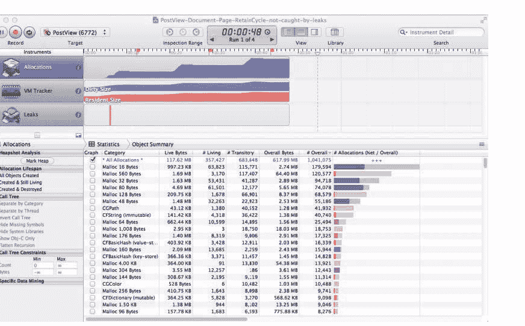

图 6.6 注意到内存增长

你感兴趣的，确保返回到原始状态的时间。例如：打开一个文档，关闭文档，或者插入一个段落，删除段落等等。

`Allocations` 仪器工具通过允许你标记特定状态来支持堆分析（Heaps Analysis），它将计算后续标记之间的差异。若要查看生成的数据，请将详细视图切换到 `Heaps` 模式。一旦你有了几个这样的标记，就可以是否存在显著差异。理论上讲，是不应该有差异的；毕竟，如果你已经将程序恢复到它原来的状态。

在这种情况下，场景如下：

1. 打开一个 PDF 文档。

2. 关闭已打开的 PDF 文档。

在开始实际分析之前，我运行该场景一次或两次，以消除任何一次性的初始化工作。这是必要的，因为许多系统使用懒性初始化，因此通用子系统的开销会与该功能的首次使用混在一起。在预热完成后，我点击 `Mark Heap` 按钮，运行场景，再次点击 `Mark Heap`，在本例中重复了三次。面板中的 `Heapshot` 视图（如图 6.7 所示）显示每次运行场景时内存一致增长了 39.2 MB（在 `Heap Growth` 列中）。然而，目前还没有什么可以依据，关于这些内存是在哪里分配的或为什么没有被释放，展开的 `Heap 2` 显示了一个 36.34 MB 的 `<non-object>` 块，相同的块也出现在其他堆中（未显示）。

信息量太大，无法理清，因此为了更好地了解发生了什么，我将检查范围（`Inspection Range`）限制为场景运行一次，并切换到调用树（`Call Tree`）。调用树显示了每个子集分配了多少内存，包括绝对值和相对值。此外，可以使用常用的调用树修剪机制，这使得寻找（大型）分配的源几乎几乎轻而易举。在图 6.8 中，我深入到了一个占总计 96.5% 的调用树节点。然而，坏消息是这是一个内部 `CoreGraphics` 函数，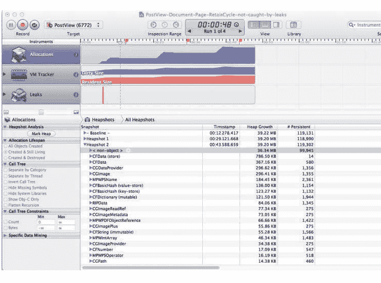

图 6.7 初始热点

2. 标记生成

# 内存仪器 129

# 第 6 章 内存：测量与工具

考虑到泄漏挂接到 macOS 性能组的机制，这似乎不太可能是泄漏源。（我在 `Preview` 中打开同一个文件查看内存，关闭文件后内存使用如预期地下降了）。所以我怀疑我的代码正在泄漏。根据目前为止收集的信息（泄漏在 `CoreGraphics` 内部分配，而在渲染期间，这不太可能），我开始怀疑我的代码正在泄漏。通过在 `Summary` 或 `Hotspot` 视图中搜索所有对象，由于不同对象的数量很多，而且它们在同一个视图中以折叠方式显示，很难对两次运行进行并排比较。

更简单的方法是针对 PDF 对象使用 `Instruments` 的替代方案（此处）。我决定重新运行场景，将仪器的记录类型（`Recorded Types`，见图 6.9）设置为仅包含类名或名称中带有 PDF 的对象，并确保取消勾选“`Record all`”（记录所有）。注意图 6.9 时间线上的分配图如何反映这一选择，它已经显著减少，并显示出一些下降。

# 内存仪器 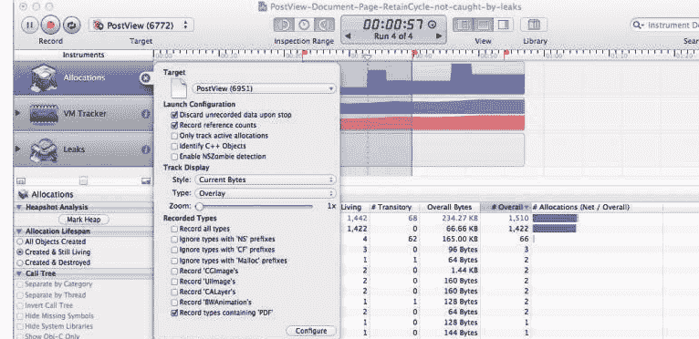

图 6.9 仅查找 PDF 对象

过滤后的结果如图 6.10 所示。对象数量的剧减使得很容易在两个热点中发现 `PDFDocument` 和 `CGPage`，所以我的直觉是对的，我至少泄漏了其中一个。该问题的答案也显示了：`OCSPDocRep` 的实例（我的 `NSDocument` 子类）也出现在了追踪中。而且我可能还泄漏了随之而来的 PDF 资源。由于我在摘要视图中仅选择了 `OCSPDocRep` 进行图表绘制，时间线图显示出一个阶梯状，因为其中一个没有被释放。图 6.10 包含一个持久的实例（`Instruments` 会跟踪每一个单独的实例），点击折叠箭头将显示该对象的调用历史。

足够了，图 6.1 截图详情所示地址为 `0x112ba0` 的 `OCSPDocRep` 调用历史显示了 7 次 `retain` 和 1 次 `malloc`，但只有 7 次 `release`（`autorelease` 本身不计入，因为它只是未来释放的占位符）。此时，过程变成了检查详情。所有通知都通过，所以这些没问题。`ViewFramework` 中的 `retain` 和 `autorelease` 也是平衡的，`AppKit` 稍后执行了 `autorelease` 的延迟释放。这留下了

# 第 6 章 内存：测量与工具

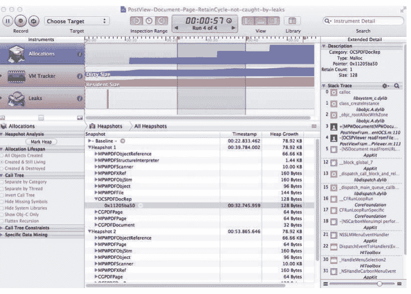

图 6.10 内存实例（内存泄漏）

考虑到泄漏挂接到 macOS 性能组的机制，这似乎不太可能是泄漏源。（我在 `Preview` 中打开同一个文件查看内存，关闭文件后内存使用如预期地下降了）。所以我怀疑我的代码正在泄漏。根据目前为止收集的信息（泄漏在 `CoreGraphics` 内部分配，而在渲染期间，这不太可能），我开始怀疑我的代码正在泄漏。通过在 `Summary` 或 `Hotspot` 视图中搜索所有对象，由于不同对象的数量很多，而且它们在同一个视图中以折叠方式显示，很难对两次运行进行并排比较。

更简单的方法是针对 PDF 对象使用 `Instruments` 的替代方案。我决定重新运行场景，将仪器的记录类型（`Recorded Types`，见图 6.9）设置为仅包含类名或名称中带有 PDF 的对象，并确保取消勾选“`Record all`”（记录所有）。注意图 6.9 时间线上的分配图如何反映这一选择，它已经显著减少，并显示出一些下降。

过滤后的结果如图 6.10 所示。对象数量的剧减使得很容易在两个热点中发现 `PDFDocument` 和 `CGPage`，所以我的直觉是对的，我至少泄漏了其中一个。该问题的答案也显示了：`OCSPDocRep` 的实例（我的 `NSDocument` 子类）也出现在了追踪中。而且我可能还泄漏了随之而来的 PDF 资源。由于我在摘要视图中仅选择了 `OCSPDocRep` 进行图表绘制，时间线图显示出一个阶梯状，因为其中一个没有被释放。图 6.10 包含一个持久的实例（`Instruments` 会跟踪每一个单独的实例），点击折叠箭头将显示该对象的调用历史。

足够了，图 6.1 截图详情所示地址为 `0x112ba0` 的 `OCSPDocRep` 调用历史显示了 7 次 `retain` 和 1 次 `malloc`，但只有 7 次 `release`（`autorelease` 本身不计入，因为它只是未来释放的占位符）。此时，过程变成了检查详情。所有通知都通过，所以这些没问题。`ViewFramework` 中的 `retain` 和 `autorelease` 也是平衡的，`AppKit` 稍后执行了 `autorelease` 的延迟释放。这留下了

内存实例（内存泄漏）

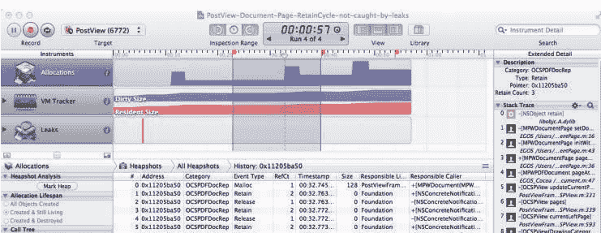

图 6.11 内存（内存泄漏）

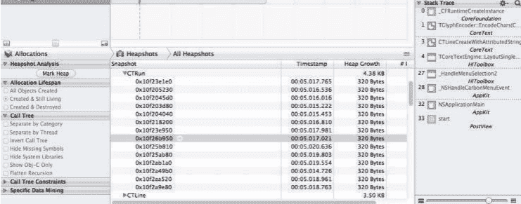

图 6.12 修复后

# 第 6 章 内存：测量与工具

某些洞穴。

# 内存仪器 133


图 6.11 内存（内存泄漏）


图 6.12 修复后

某些洞穴。

一个关于性能计数器重要点点，与仪器不同

# 内存工具 135

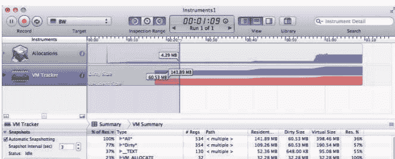

图 6.13 带有分配（`Allocations`）的 VM 跟踪

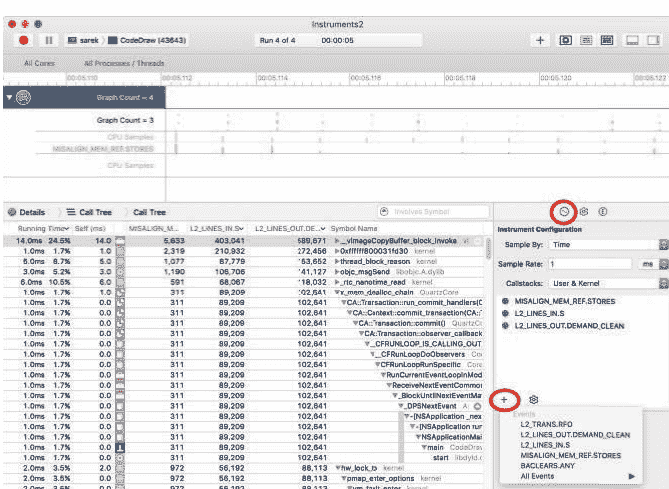

图 6.14 计数器和配置

## 总结

调查内存使用比 CPU 消耗更复杂，但幸运的是我们有很多命令行工具和仪器来帮助完成工作。始终要记住的是内存的多方面性——虚拟内存与实际内存的区别，以及干净内存与脏内存的区别。例如，在堆栈信息的 `Allocations` 工具中跟踪每一次分配会进一步增加开销，而跟踪引用计数操作则会剧增开销。例如，在本章“`Allocations`”部分跟踪调查结果的 `Instruments` 工具大小为 1.3 GB，即使是 `top` 命令也有约 80% 的 CPU 时间用于计算内存统计数据（在我的系统上，`top -d` 消耗 1.1% CPU，`top ~u` 消耗 6.5%）。

正因如此，建议你使用小型数据集或性能强大的机器进行内存分析。对于 iOS，大多数内存调查可以也应该在模拟器中进行，与 CPU 性能不同，内存行为会非常相似，只是系统拥有更多内存，因此必须手动触发内存警告。

# 内存：陷阱与技术

内存优化的最常见技术围绕使用更紧凑的数据结构，本章将会讨论这个主题。此外，我们还将展示一些陷阱，特别是 Objective-C 代码中常见的陷阱。（你是否猜到其中一些涉及到 Foundation 对象？）

当然，我们还需要考虑规避方法，即引用计数对 Objective-C 和 Swift 引用类型所起的特殊作用，以及传递值而不是引用的方案。我们将查看 Objective-C 的缓存技术和 API，以及控制地址空间到实际内存映射的 API。

我们将继续探讨架构选择对性能重要性这一主题，通过一个突显这些架构选择可能产生的差异的示例来强调这一点。最后，我们还将查看并发问题和 iOS 特有的内存环境。

## 引用计数

即使在引入自动引用计数（ARC）之后，关于 Objective-C 的每个讨论中的第一个话题之一似乎都是 Apple Foundation 的引用计数机制。我必须承认，我一直觉得它有些过其实了，因为引用计数既易于操作，其性能特性又非常有可预测性。由于经典的引用计数实现作为库代码提供，它也适用于常规的重构技术以减少涉及的代码量。

由于 ARC 的性能局限性，将在性能关键型代码中使用非 ARC 引用计数。我处理引用计数的策略由以下模式组成：

# 第7章 内存：陷阱与技术

1. 始终使用访问器（`accessors`），但 `dealloc` 除外。

2. 使用自动属性合成生成所有非自动释放（`non-autoreleasing`）get 访问器或非原子属性的访问器。

3. 始终使用便利方法进行创建。

通过使用这些模式，我的非 ARC 代码基本上没有引用计数操作，除了在 `dealloc` 中机械地发送 `release` 消息外。从数字上来说，我在 250 KLOC（千行代码）中出现了 230 次 `[retain]`，略低于每 1000 行代码一次 `retain`。剩余的 `retain` 大多是因为遗留代码或“特殊连接”，例如（可能是过早的）优化。由于非 `dealloc` 的原子方法，我们的 `release` 消息频率是其的 10 倍，但这仅占总代码的 1%。

通过将手动管理代码减少到总量的 1%，并有效地实现对 Cocoa 内存所有权规则的遵循，这个小小的代码模式不仅消除了内存错误，还消除了思考内存的需要。相反，我在代码中看到的绝大多数内存错误并不遵循这种模式。当我看到一个对象被发送 `retain` 方法时，我会觉得很怀疑，而且错误通常不远。

1% 的这个数字也令人满意，说明将管理代码迁移到 ARC 是至关重要的，就像垃圾回收一样。然而，这意味着这种转换带来的收益是微乎其微。1% 的代码与 Apple ARC 迁移指南中暗示的约 50% 的工作量相比相去甚远。

一个潜在的陷阱是警惕我们之前提到过的属性默认原子修饰符，它使得属性访问是线程安全的。尽管示例 7.1 中所有内容都是自动生成的这一使得代码看起来很整洁，但对于读取访问来说有隐藏成本。如果你运行它，你会发现每次读取访问都会产生一个属性大小的内存代价，因为原子访问器意味着一个自动释放的访问器，这意味着你的对象被添加到当前的自动释放池中。

## 示例 7.1 测量合成的读取访问器的内存开销

```c
#import <Foundation/Foundation.h>
#include <malloc/malloc.h>

@interface AtomicTest:NSObject
@property(retain) id myObject;
@end

@implementation AtomicTest
@end
```

```c
int main(int argc, char *argv[])
{
    int count=argc>1 ? atoi(argv[1]) : 1;
```

# 引用计数 139

```c
int main(int argc, char *argv[])
{
    int count=argc>1 ? atoi(argv[1]) : 1;
    NSAutoreleasePool *pool = [NSAutoreleasePool pool];
    AtomicTest* obj = [[AtomicTest alloc] new];
    for (int i=0; i < count; i++) {
        obj.myObject = [NSString stringWith:@"Hello World"];
    }
    [pool release];
    return 0;
}
```

虽然这可能看起来不多，但读取访问非常频繁，所以这种代价在现实情况下会累积，而且这也是预期的。

#.

使用引用计数，产生对象泄漏本质方式：要么你的 `retain` 和 `release` 不平衡，要么你存在循环。在使用所讨论的规则时，你的对象所有权会自动处理，`dealloc` 除外。我不理解为什么这种功能被包含在 ARC 中，因为编写通用的 `dealloc` 方法非常简单。经常，`dealloc` 中的泄漏通过代码检查（*并对比 .h 和 .m 文件*）就能修复，以至于我从没有费精力去关注。

引用循环是一组相互保持存活的对象，尽管它们从外部无法触及。幸运的是，程序员通常会避免循环。在其他情况下树形结构中常见的父级链接（例如视图层级中的 *superview*）通过使父级链接为非保留来处理，如图 7.1 所示。由于树的根被保留，只要有引用，子链接就足以保持对象存活——程序员只需要在从树中移除子节点时将父指针置为 `nil`。

# 第7章 内存：陷阱与技术

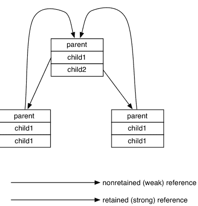

图 7.1 通过不保留父级解决循环

另一个潜在的循环原因是一个由不同部分组成的对象，但这些部分需要整体的服务。如果将反引用改为非保留不是选项，打破循环的一种方法是将功能提取到独立的对象中并并代之，如图 7.2 所示。

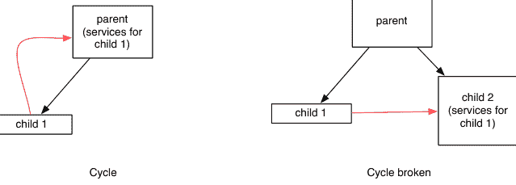

图 7.2 通过提取功能解决循环

ARC 在这种情况下通过零散弱引用提供了一定的帮助（`@property (weak) UIView *superview`）。这些引用与其他非保留引用类似，不同之处在于当目标对象被释放时，它们会自动变为 `nil`，节省了程序员跟踪这些引用并确保没有悬空指针的工作。

## Foundation 对象 vs. 基本类型

最后，堆分配的内存块（尤其是那些在 Grand Central Dispatch 中使用的）也是循环的优选对象，因为持有该块的对象在块内部被非弱引用地引用了。隐式作用域捕获规避了这种容易犯的错误。

`clang` 静态分析器也可以检测潜在的内存泄漏，尽管它可能会出现误报，但定期运行它应该是基础代码规范的一部分。

## Foundation 对象 vs. 基本类型


## Foundation 对象 vs. 基本类型

我们在第 3 章中已经看到，`Foundation` 和 `Core` 对象虽然在某些情况下很方便，但可能会导致显著的 CPU 性能惩罚，因此它们也存在巨大的内存成本也不为意外。

代表浮点数的 `NSNumber` 大小为 32 字节，而 `float` 本身仅占 4 字节，扩大了 8 倍。其他基本类型包装器也存在类似的情况。一个例外是 64 位运行时环境中表示整数的 `NSNumber` 或 `CFNumber`，正如我们在第 3 章的“基本类型”部分所探讨的那样。它们被编码在对象指针中，因此不会占用额外空间。

说到指针，所有的对象表示在持有引用的任何结构或对象都会使用一个内存指针，在 32 位系统上是 4 字节，在 64 位系统上是 8 字节。我们在上面的比较中没有考虑这一点，因此加上指针，直接 `float` 和 `NSNumber` 之间的差异实际上是 4 字节对比 40 字节，扩张倍变为 10。图 7.3 显示了使用 4 个值或（简化的）`NSNumber` 的 `Rectangle` 的内存布局。使用基本类型总共使用 24 字节，这些都可以放入单个 64 字节的缓存行中。使用 `NSNumber` 对象不仅将块大小增加到 40 字节，还需要 4 个分配的内存块，每个内存块都可能位于不同的缓存行上。

在第 3 章的“数组与批量处理”部分，我们看到同质浮点数数组比 `NSNumber` 对象的 `NSArray` 快 5 到 1,000 倍。我们现在可以看到，它的体积也小了 10 倍，取决于环境（32 位或 64 位）和表示类型（`float` 或 `double`）。虽然这种尺寸差异对于基准测试并不重要（因为数组尺寸较小且没有其他活动），但在现实场景中，它无疑会对性能产生额外影响。首先，仅从尺寸来看，昂贵的缓存缺失概率就增加了 10 倍；其次，单独分配 `NSNumber` 对象意味着利用顺序访问模式的机会较少，因为每个 `NSNumber` 都可能从堆的不同部分分配。

正如你所猜的，对于字典，数字会变得更糟。让我们考虑一个包含单个条目的可变字典 `Dictionary`，例如一个值为 -0.2 的 `NSKernAttributeName`。在我在 64 位系统上的测量中，字典本身占用 112 字节，`NSNumber` 额外占用 32 字节。我没有计算 `NSString` 键，因为它几乎是共享的，但那仍然是 144 字节。如果我们有一个带有 `kern float` 值的对象，我们的总大小将是 12 字节的实际空间，但由于 `malloc` 分桶机制会有 32 字节。访问模式也更糟；哈希函数正确保证了访问实际上是随机的，从而产生最大的访问时间惩罚。

字典通常被视为稀疏结构的内存节省设备，但事实证明，在大规模尺寸开销上收回成本极其困难。图 7.4 显示了这种困难程度：字典与直接对象表示达到平衡的唯一情况是利用率极低（5% 或低）且总槽位达到 100 个或更多。如果利用率更高或槽位更多，对象表示更为紧凑（尽管存在看似“浪费”的槽位），在仅 10% 的利用率下，基于字典的表示图表斜率更陡。

| isa | Rectangle : NSObject |
| :--- | :--- |
| x | { float x,y,w,h; } |
| w h | |
| isa | |
| :--- | :--- |
| x value | |
| y | |
| w | |
| h | |
| Rectangle : NSObject |
| :--- | :--- |
| NSNumber "x","y,w","h"; |
| isa | |
| w value | |
| isa | |
| :--- | :--- |
| h value | |

**图 7.3** 内联基本类型与对象指针的内存布局。

## 较小的结构

一旦你去除了叶子节点，避免了无谓或批量使用 `Foundation` 对象，并在没有指针间接的情况下紧凑存储数据，为你的数据寻找更紧凑的内存表示将帮助你节省内存并让程序运行更快。不仅移动的数据更少，还能节省宝贵的缓存内存，从而减少等待主内存的停顿机会，甚至更糟——指向次级存储的页错误。考虑到今天机器的现实情况，尺寸/速度的权衡实际上不再是权衡；更小的尺寸几乎总是意味着更快的执行。

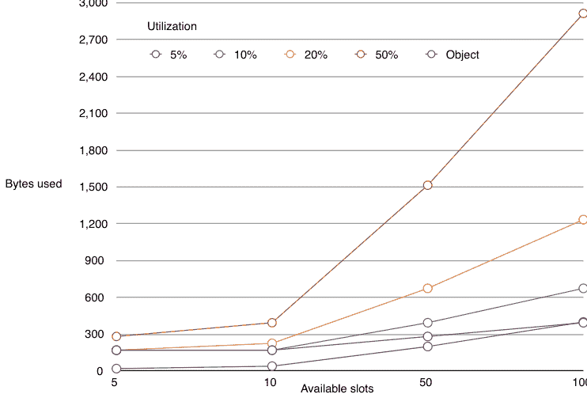

图 7.4 稀疏填充字典与对象的内存消耗

要做的第一件事不是无谓浪费空间，但遗憾的是，浪费空间既容易又常见。一个例子是示例 7.2 中的表示，它取自真实应用程序。浪费空间是极其容易且极其常见的。由于使用 2 位数字表示日期，例如，1982 年用字符串 "82" 表示，隐含世纪前缀 19。这在 2000 年元旦显然会停止工作，这些程序会将其解释为 1900 年，并可能改变 -99 年的利率、计算计算速度，等等。虽然编写此类程序的原始开发者在这一问题发生之前就已经被替换了，但相关软件的寿命比预想要长得多，导致了全球范围内数十亿美元的清理工作、祈祷的丧失以及 2000 年元旦的大量加班，幸运的是没有造成太大损害。

## 但 Y2K 问题呢？

你可能还记得 2000 年（Y2K）恐慌，这是由于程序使用 2 位数字表示日期，例如，1982 年用字符串 "82" 表示，隐含世纪前缀 19。这在 2000 年元旦显然会停止工作，这些程序会将其解释为 1900 年，并可能改变 -99 年的利率、计算计算速度，等等。虽然编写此类程序的原始开发者在这一问题发生之前就已经被替换了，但相关软件的寿命比预想要长得多，导致了全球范围内数十亿美元的清理工作、祈祷的丧失以及 2000 年元旦的大量加班，幸运的是没有造成太大损害。那么，这里的建议是否可能存在同样的陷阱？

我认为答案是“否”。首先，建议是在我们尝试维护的极佳封装边界内优化字段大小。

在不被编译器优化掉的前提下使其保持快速运行。对于消息接口（参数和返回值），使用机器的完整宽度（32-/64 位整数和浮点数/双精度浮点数）是推荐的，而且基本上是免费的，因为无论如何，通常都会占用一个完整的寄存器。其次，即使是这里经过微优化的表示仍然有巨大的提升空间。因此，如果我们的软件运行时间比我们预期的多出几十亿年，或者人类进化到灵敏度提高了几千亿倍，我们需要的只是对本地组件进行微小的更新，而所有接口保持不变。

## 压缩

压缩是一种显而易见的节省空间措施，许多节省内存的技巧（如上述讨论的位域）可以被视为压缩的特殊形式。

这类压缩的特点是，它们可以在压缩状态下可以直接使用。通用压缩算法往往不具备这一特性，因此数据在 ways 之前需要进行解压缩。这意味着未压缩和压缩后的表示都存在于内存中，且至少未压缩的版本是“脏”的（dirty）。因此，自矛盾的是，未压缩的表示可能比压缩的表示更快、更高效。

## 可清除内存 (Purgeable Memory)

减轻脏解压缩版本数据（或任何可以从更紧凑表示计算出的数据）内存压力的一种方法是可清除内存。标记内存压力指示操作系统：当存在内存压力时，它可以像丢弃干净内存一样丢弃这部分内存，尽管已知它是脏的，而不是将其交换到交换分区（swap）。

`Apple` 提供了一个使用 `map()` 系统调用标志的低级接口，还提供了更高级、更方便的 `NSPurgeableData` 类，该类在可清除数据周围封装了与 `NSMutableData` 的接口，并实现了 `NSDiscardableContent` 协议。

必须使用协议的 `beginContentAccess` 和 `endContentAccess` 方法分别锁定和解锁内容；数据只有在锁定时才能被访问，且只有在解锁时才会被清除。`discardContentMessage` 将清除数据（除非它正处于锁定状态），在存在内存压力时系统也可以执行此操作。一旦数据被清除，`beginContentAccess` 返回“NO”，在没有成功使用 `beginContentAccess` 锁的情况下，像 `bytes` 或 `mutableBytes` 等访问方法将失败。重要的是不要保留指向数据的指针，如果数据已被清除，通过这些指针访问数据会导致进程被杀死。

关于可清除内存需要注意的一点是工具是如何统计它的。例如，在 `top` 命令中：锁定时，它出现在 `RSHRD` 列中（而不是 `RPRVT`），当解锁时，它实际上根本不会出现！其理由可能是系统可以在任何时候回收内存，但这略有误导性，因为即使在解锁时，可清除内存仍然产生内存压力。根据我的经验并取决于全局情况，系统将倾向于分页其他内存，而不是回收可清除内存段。

## 内存与并发

即使对于单核心，CPU 和内存速度之间也存在巨大差异，管理内存带宽和延迟应该是编写高性能并发软件的主要关注点之一，这并不意外。

如果你想让多个核心保持忙碌，它们需要在大多数时间内能够从自己的私有缓存中工作。感知缓存（Cache aware）程序会专门考虑缓存的大小，将工作拆分成 16K 或其他大小的块。正如名称所示，它们通常根据特定的缓存大小和特征进行参数化，因此它们要么取决于硬件，要么至少要在运行时进行参数化。

缓存无感知（Cache-oblivious）算法使用递归划分策略，通常在树或类树结构上运行，大部分工作在叶节点附近完成。实验性和新型 `defort` 数值计算语言（旨在作为 FORTRAN 的安全继任者，因此得名）背后的团队在网上关于此有许多优秀的演示。

另一种缓存污染的情况发生在线程流经内存时，强制线程数据移出缓存。多媒体指令集（如 SSE）中的特殊指令允许在不通过缓存的情况下从主内存读取数据。

## 架构考量 149

（如果你真的想亲自尝试，请准备好等待很长时间，并且至少要重启机器以清理交换空间。当你真正耗尽交换空间并导致内核恐慌（kernel panic）时，我不建议你这样做。请保存你的工作，提前备份你的系统，并且别说我没警告过你！）

这种内存增长的原因并不是调用-返回（call-and-return）架构风格的实现缺陷。在这种风格中，你调用一个函数或方法，它返回一个结果。由于这是全部的交互，返回的结果是完整的；不存在真正的“部分结果”概念。


当我们需要将这些中间结果组合成最终结果时，我们需要分配足够的内存来存储组合后的结果，然后将部分结果拷贝到最终结果。在每个嵌套层级重复此操作，你将得到总复杂度 `O(m x n)`，其中 `m` 是嵌套深度，`n` 是总大小。在给出的（尽管是病态的）示例中，嵌套深度等于总大小（`m = n`），这得出了我们衡量的 `$n^2$` 结果。

幸运的是，有一种使用流式（streaming）处理方法的相当完美的解决方案，类似于我们在 XML 解析中看到的 SAX 模式，但更简单，因为我们是在生成而不是解析。与其构建完整的部分结果，不如将部分结果累积到在时分配的共享缓冲区中，并在返回结果的方法中传递该缓冲区。示例 7.6 中的 `describeOn:` 方法就为 `NSArray` 实现了这种基于累加器的流式设计。代码的其余部分与当前的描述协议集成，并暴露了 `fastDescription`，后者封装了设置累加器的过程。

## 示例 7.6 使用 `describeOn:` 流式处理描述

```objc
## <Foundation/Foundation.h>

@implementation NSArray(describeOn)

- (void)description:(NSMutableString *)description
{
[description appendString:"@ "];
NSString *separator="@";
for (id obj in self) {
    @autorelease
    [obj appendStringseparator:separator];
    [obj describeOn:description];
    separator="@", ";
}
}
```

3. 在 Objective-C 中，我们通常会发送消息。

```objc
}
[description appendString:@""];
}
@end

@implementation NSObject (describeOn)
-(void)describeOn:(NSString*)description
{
[description appendString:[self description]];
}
-(NSString*)fastDescription {
MutableString *s=[NSMutableString string];
[self describeOn:s];
return s;
}
@end
```

将示例 7.5 改为使用 `fastDescription` 代替 `description` 会产生如图 7.6 所示的截然不同的结果。不仅总内存图保持相对平坦且非常接近描述的最终大小，而且 x 轴从嵌套深度 5,000 开始，这是图 7.5 中给出的最后一个值的 100 倍。在 5,000 个对象处消耗的总内存约为 20 KB。`n^2` 算法处理 1,500 个项目需要 2 GB，而我们仅需 60K 内存即可获取十倍数量项目的描述，因此在该点，累积算法的内存效率高出 35,000 倍。

| | 描述大小 | 总内存占用 |
|---|---|---|
| 150,000 | | |
| 135,000 | | |
| 120,000 | | |
| 105,000 | | |
| 90,000 | | |
| 75,000 | | |
| 60,000 | | |
| 45,000 | | |
| 30,000 | | |
| 15,000 | | |
| 5,000 | 10,000 | 15,000 | 20,000 | 25,000 | 30,000 | 35,000 | 40,000 |

图 7.6 `describeOn:` 嵌套 `Arrays` 的线性内存消耗

## 临时分配与对象缓存 151

虽然这显然是一个极端示例，但通用原理是：带有部分结果的大型数据集很难用调用-返回架构风格来处理，即使是带有嵌套的中等规模数据集，也会受到该风格中嵌套结构固有的 `m × n` 空间/时间复杂度的影响，因为需要返回完整结果。Objective-C 受这种风格的影响比其他语言更严重，因为从方法返回新创建的对象时，存在对象创建成本和相关的自动释放（autorelease）处理代价。仅向已存在的对象添加数据要廉价得多。

因此，在设计处理 API 时，尝试让它从根本上具备流式能力，通过传递某种可以增量接收结果的累加器。这类对象的示例——例如用于与显示器通信的 CoreGraphics `CGRect`，或者更著名的 Unix 文件描述符 `fd` 或用于 I/O 的文件句柄。事实上，Unix 及其“管道-过滤器”（pipes-and-filters）架构风格是这种工作的更好证明，大多数 Unix 过滤器在处理任意长度的数据时都不会有性能下降。

如示例 7.6 所示，添加一个将调用-返回 API 转换为流式 API 的便利方法，在不重写的情况下通常是困难的。

一旦我们有了累加器，一个显而易见的扩展是让累加器比简单的 `NSMutableString` 更智能。我们将在下一章更仔细地查看此类类。

## 临时分配与对象缓存

正如我们在第 3 章的“可变性与缓存”章节中所看到的，临时对象可能是个挑战，因为它们是昂贵的。自动释放池会清理任何不再需要的临时对象。这是由于对象需要从堆上分配。从性能角度来看，栈分配几乎是免费的。

## 第 7 章内存：陷阱与技巧 171

当然，我们所讨论的真集意味着某些不允许并不意味着你不能这样做，而是你可能应该这样做。示例 7.7 展示了如何在栈上分配 Objective-C，如果你真的想这样做的话。

- 获取类以及该类的实例大小。
- 使用 `alloca()` 和 `bzero()` 在栈上分配并清零内存。
- 设置类。
- 在作用域内使用且不再使用。

### 示例 7.7 在栈上分配 Objective-C

```objc
#import MPWFoundation/MPWInteger.h
#include <stdlib.h>
#include <objc/runtime.h>

int main(int argc, char *argv[]) {
    Class mpw=[MPWInteger class];
    size_t instance_size=class_getInstanceSize(mpw);
    id a=alloca(instance_size);
    bzero(a, instance_size);
    object_setClass(a, mpw);
    [a setIntValue("@@=%a)];
    NSLog("@a=%@",a);
    return 0;
}
```

如果我在某位于库蒂的消费电子公司的生产代码中见过这种写法，我不得不承认，自己在过去一个世纪追求性能的 Objective-C 黑客行为中从未需要过它。由于非脆弱性实例变量等进步，自己不仅可能射中自己的脚，甚至可能炸掉整条腿的概率大大增加了，因此我强烈建议不要这样做。

至少你得创建一个子类，在任何尝试保留该对象的尝试时抛出异常，在不进行保留的情况下，确保你没有从方法中返回它，并且永远不要幻想在 ARC 中使用它。

我们在第 3 章“可变性与缓存”章节引入的对象缓存一次性解决了短命对象的堆增长和分配/销毁成本问题。与其每次都分配一个新的临时对象并希望它们能及时销毁，不如分配一个对象

- Foundation 对象通常会伪造其大小，不适合此。

## 内存映射文件

将数据放在栈上，并希望它不会逃逸并导致世界崩溃，我们以牺牲几次函数调用的代价重用已分配的对象。

## NSCache 和 libcache

Apple 在 Snow Leopard 中引入了不同类型的缓存，即 Cocoa 的 `NSCache` 类以及构建在其上的低级 `libcache` 库。`NSCache` 是一个类似于 `NSMutableDictionary` 的键值存储，不同之处在于，如果系统检测到内存压力，内容可能会从该字典中被驱出。`NSCache` 允许你尽可能激进地使用可用内存进行缓存，同时最大限度地减少使用这些内存降低系统性能的概率——例如，引起不必要的内存压力，或者在最坏的情况下将缓存与缓慢的次级存储之间进行分页。

> 注意，“驱出”仅意味着对象被从缓存中移除（发送了 release），并不意味着该对象被销毁。这是根据正常的内存管理规则发生的，因此只有当 `NSCache` 持有最后一个引用时——本质上，如果没有其他地方在使用它——对象才会被销毁。

只要有少量的限制，你就可以像使用 `NSMutableDictionary` 一样使用 `NSCache`。由于对象可能会消失，你需要在完成操作之前保留（retain）该对象，或许可以通过将其存储在具有适当访问器的实例变量中来实现。相反，一个对象从 `NSCache` 中被移除并不意味着它会被释放，因为它可能在其他地方被保留。

由于驱出发生在你请求之后、存储之前且是异步进行的，因此对象在传输过程中使用原子读取访问器中常见的 `retain + autorelease` 组合受到保护。与 `NSMutableDictionary` 不同，`NSCache` 是安全的，并且不会复制其键。

虽然你可以将 `NSCache` 作为简单的替代品使用，但如果你能指定缓存的最大成本（例如使用的字节数），它还允许你对对象进行更多控制。如果你的成本设为“1”，你可以限制缓存中对象的数量。

`NSCache` 还可以通过 `NSDiscardableContent` 协议与其内容对象（由我们之前讨论过的 `NSPurgeData` 实现）交互，这本质上是一个独立的引用计数协议，可能为了让 `NSCache` 能够与 10.6 版本同样引入的追踪收集器配合而是必要的。

## 内存映射文件

虽然内存映射文件在很大程度上是将文件读取到内存中，但内存映射文件也可以被视为可清理内存（purgeable memory）的一种特例（忽略内存映射文件比可清理内存早出多年的事实）。与可清理内存一样，内存映射文件可以随时被系统回收，但不可清理内存对用户是完全透明的。我们为系统提供了内存的数据源（底层文件），每当我们访问它时，系统都可以自动从该数据恢复内存的内容。由于它可以随时这样做，如果我们实际上访问内存，它甚至不需要从文件中实际读取数据。

通过为 `NSData` 方法 `dataWithContentsOfURL:options:error:` 使用标记（无论是 `NSDataReadingMappedSafe` 或 `NSDataReadingMappedAlways`），我们可以完全改变这些方法的执行方式，尽管结果在语义上（很大程度上）是没有区别的。

如果没有映射标记（参见示例 7.8），这些函数会分配内存并使用系统调用从磁盘读取数据，在数据读取后返回。由于我们已写入分配的内存中，内存现在被标记为脏（dirty）。

### 示例 7.8 读取文件

```objc
NSData *data;
data=[NSData dataWithContentsOfURL:"documentation.pdf"
           options:0
           error:nil];
```

带有映射标记（如示例 7.9 所示），调用期间发生的所有操作只是创建地址空间并将其标记为相关文件支持。差异如图 7.7 所示。在调用期间没有分配实际的物理内存，也没有执行 I/O；操作纯粹是虚拟地址空间的。只有在引用映射地址时，才会执行实际的 I/O。如果只访问了文件的部分内容，则只读取这些部分（尽管系统可能会选择性地读取比请求更多的内容）。此外，由于进程没有写入这些页面，它们保持洁净。即使在系统执行 I/O 用文件中的数据填充它们后，它们仍然保持洁净状态。内存中的数据与支持该内存的文件之间没有区别。

### 示例 7.9 映射文件

```objc
NSData *mapped;
mapped=[NSData dataWithContentsOfFile:"documentation.pdf"
            options:NSDataReadingMappedAlways
            error:nil];
```

当我们遇到内存压力且系统想要释放一些内存时，数据和脏页之间的差异就会变得明显。随着映射文件的部分内容实际读取到内存中，系统可以简单地撤销映射，将该特定地址空间指向原始文件。对于 Unix I/O，系统无法这样做，如果它需要重用内存，它必须先将其内容存入交换文件。对于超过物理内存的大型文件，这可以

```objc
[NSData dataWithContentsOfURL:@"file:documentation.pdf" options:0 error:nil];
```

| heap | heap | page 1 | page 2 | page 3 | page 4 | page 5 | page 6 | heap | heap |
|---|---|---|---|---|---|---|---|---|---|
| | | I/O | I/O | I/O | I/O | I/O | | | | |
| file:documentation.pdf | page 1 | page 2 | page 3 | page 4 | page 5 | page 6 |
|---|---|---|---|---|---|---|
| | | | | | | | |
| heap | heap | page 1 | page 2 | page 3 | page 4 | page 5 | page 6 | heap | heap |
|---|---|---|---|---|---|---|---|---|---|
| | | | | | | | | | | (此处后续重复内容已略，翻译逻辑同上)

# 优化 ARC 157

当合理使用时，不同的 `madvise` 选项可以对你的内存占用和性能产生巨大影响。有两个需要注意的陷阱：首先，通过 `madvise` 提供的所有建议仅供参考；内核并没有义务遵循这些建议（在 Leopard 时代之前，大多数选项实际上都被忽略了）。其次，这些建议倾向于是全局的，因此在处理共享映射（shared mappings）时，可能会干扰其他进程对内存的使用。

# iOS 考虑因素

正如我们多次提到的，iOS 上的缺乏交换文件（swapfile），这产生了巨大的差异：性能不是逐渐下降，而是会直接撞上一堵“墙墙”。然而，没有改变的是内存子系统的流式本质，这些因素共同构成了一个极具挑战性的环境。

一方面，如果你向系统请求内存时过于激进或太快，或者在被要求释放内存时反应太慢，你的进程就会被杀死。另一方面，系统有足够的用途来检查内存状态，而仅凭可用内存往往无法让你的 App 正常运行。

例如，内存警告（memory warnings）是在主线程投递的。这意味着如果当内存警告等待处理时，你的 App 处于主线程（无论是否在分配内存），你的 App 可能会被标记为无响应或被杀死。另一方面，将分配移动到后台线程并不是解决办法：我见过过 App 因为后台线程正尝试处理内存警告而被杀死。

对于具有高分配需求的后台线程，我发现的一个解决方案是使用“什么都不做”（do-nothing）消息（将 `performSelector:MainThreadDone` 标志设为 `YES`）。如果主线程正在处理内存警告，这将在处理前阻塞后台线程，并允许在继续操作之前释放内存。

说到内存警告，当你接收到内存警告时，请务必停止你正在做的一切，并开始释放内存。

由于无法将脏页（dirty pages）交换到磁盘，意味着在 iOS 上，通过内存映射等方式保持内存整洁比在 OS X 上更加重要。虽然系统不能进行交换，但它仍然强制将所有干净页（clean pages）移出内存，要求系统在下次需要时将其读回，因此系统可能会因为内存压力像 OS X 一样变慢。

## 优化 ARC

当我们开发 Wunderlist 3.0 版本时，我们突然在示例 7.11 所示的 `NSOutlineView` 代理方法中遇到了崩溃。

# 第 7 章 陷阱与技巧

### 示例 7.11 返回 0 方法

```objc
(BOOL)outlineView:(NSOutlineView *)outlineView isGroupItem:(id)item
{
    return NO;
}
```

最后说这一点很令人惊讶，因为那里没有任何可能导致崩溃的地方。我们原以为汇编代码类似于示例 7.12，仅对寄存器进行操作。事实上，我只要看到类似 `xor %eax, %eax, retq;` 就满意了；但设置帧指针（frame pointer）并没有增加多少开销，而且这还是调试版本。

### 示例 7.12 返回 0 方法的非 ARC 生成汇编代码

```objc
-[TaskListDataSource outlineView:isGroupItem]:
0100e58a    pushq %rbp
0100e58b    movq %rsp, %rbp
0100e58e    xor %eax, %eax
0100e590    popq %rbp
0100e591    retq
```

然而，实际得到的是示例 7.13 中的代码。所有参数都通过间接调用 `obj_storeStrong()` 被保留（retain），然后通过同样调用 `obj_storeStrong()` 释放，但这次是清除了局部变量。崩溃似乎由于 `OutlineView` 传递了一个无效对象导致的，这也很令人惊讶，考虑到（a）这是 ARC 环境，按理不应该发生排序（sort），而且这是 Apple 的代码。

### 示例 7.13 ARC 生成的 `outlineView:isGroupItem]`:


# 优化 ARC 157

当合理使用时，不同的`madvise`选项可以对你的内存占用和性能产生巨大影响。有两个需要注意的陷阱：首先，通过`madvise`提供的所有建议仅供参考；内核并没有义务遵循这些建议（在 Leopard 时代之前，大多数选项实际上都被忽略了）。其次，这些建议倾向于是全局的，因此在处理共享映射（shared mappings）时，可能会干扰其他进程对内存的使用。

# iOS 考虑因素

正如我们多次提到的，iOS 上的缺乏交换文件（swapfile），这产生了巨大的差异：性能不是逐渐下降，而是会直接撞上一堵“墙”。然而，没有改变的是内存子系统的流式本质，这些因素共同构成了一个极具挑战性的环境。

一方面，如果你向系统请求内存时过于激进或太快，或者在被要求释放内存时反应太慢，你的进程就会被杀死。另一方面，系统有足够的用途来检查内存状态，而仅凭可用内存往往无法让你的 App 正常运行。

例如，内存警告（memory warnings）是在主线程投递的。这意味着如果当内存警告等待处理时，你的 App 处于主线程（无论是否在分配内存），你的 App 可能会被标记为无响应或被杀死。另一方面，将分配移动到后台线程并不是解决办法：我见过过 App 因为后台线程正尝试处理内存警告而被杀死。

对于具有高分配需求的后台线程，我发现的一个解决方案是使用“什么都不做”（do-nothing）消息（将`performSelector:MainThreadDone`标志设为`YES`）。如果主线程正在处理内存警告，这将在处理前阻塞后台线程，并允许在继续操作之前释放内存。

说到内存警告，当你接收到内存警告时，请务必停止你正在做的一切，并开始释放内存。

由于无法将脏页（dirty pages）交换到磁盘，意味着在 iOS 上，通过内存映射等方式保持内存整洁比在 OS X 上更加重要。虽然系统不能进行交换，但它仍然强制将所有干净页（clean pages）移出内存，要求系统在下次需要时将其读回，因此系统可能会因为内存压力像 OS X 一样变慢。

## 优化 ARC

当我们开发 Wunderlist 3.0 版本时，我们突然在示例 7.11 所示的`NSOutlineView`代理方法中遇到了崩溃。

# 第 7 章 陷阱与技巧

示例 7.11 返回 0 方法

```
(BOOL)outlineView:(NSOutlineView *)outlineView isGroupItem:(id)item
{
    return NO;
}
```

最后说这一点很令人惊讶，因为那里没有任何可能导致崩溃的地方。我们原以为汇编代码类似于示例 7.12，仅对寄存器进行操作。事实上，我只要看到类似`xor %eax, %eax, retq;`就满意了；但设置帧指针（frame pointer）并没有增加多少开销，而且还是调试版本。

示例 7.12 返回 0 方法的非 ARC 生成汇编代码

```
-[TaskListDataSource outlineView:isGroupItem]:
0100e58a    pushq %rbp
0100e58b    movq %rsp, %rbp
0100e58e    xor %eax, %eax
0100e590    popq %rbp
0100e591    retq
```

然而，实际得到的是示例 7.13 中的代码。所有参数都通过间接调用`obj_storeStrong()`被保留（retain），然后通过同样调用`obj_storeStrong()`释放，但这次是清除了局部变量。崩溃似乎由于`OutlineView`传递了一个无效对象导致的，这也很令人惊讶，考虑到（a）这是 ARC 环境，按理不应该发生排序（sort），而且这是 Apple 的代码。

示例 7.13 ARC 生成的`outlineView:isGroupItem]`:

```
-[SomeOutlineView outlineView:isGroupItem]:
0101b1df0    pushq %rbp
0101b1df1    subq %rsp, %rbp
0101b1df4    subq $00, %rsp
0101b1df8    leaq -18(%rbp), %rax
0101b1dfc    movq %di, -08(%rbp)
0101b1df0    movq %rsi, -10(%rbp)
0101b1df4    movq $00, -18(%rbp)
0101b1dcc    movq %rax, %rdi
0101b1dcf    movq %rdx, %rsi
0101b1dd2    movq %rcx, -30(%rbp)
0101b1dd6    callq 0x10027dbaa  ## _obj_storeStrong
0101b1ddf    leaq -20(%rbp), %rdi
```

...是流水线中每个步骤的输出表示。此外，通信是通过相当重量级的进程间通信完成的。

第 10 章中的示例 10.1 是一个 Unix 过滤器，它将读取的每行字符都转换为大写。它看起来比必要的要复杂一些，因为它规避了用于缓冲和提取文本行的库函数，这说明了从字节流中解析有意义结构的问题——这是 Unix 风格过滤器的一个基本问题。

示例 8.1 利用了缓冲和处理文本行的内置库，使得代码更简单，并且速度比示例 10.1 快了 250 倍。

# 示例 8.1 使用行定向 I/O 的大写过滤器

```c
#include <stdio.h>
#include <ctype.h>

#define MAXLENGTH 8192

int main(int argc, char *argv[]) { 
    char buf[MAXLENGTH];
    while (fgets(buf, MAXLENGTH, stdin)) {
        buf[0]=toupper(buf[0]);
        fputs(buf, stdout);
    }
    return 0;
}
```

集成除字节流或文本行以外的数据对象类型需要设计一种字节序列化格式，以便在字节流与这些对象之间进行解析和序列化。传递对象指针似乎更简单，特别是特别是对于复杂的、层次化的或大型数据结构。此外，虽然过滤器可以通过组合进行重用，但不支持对现有过滤器进行特化处理以执行略有不同的操作。

# 面对象过滤器

跳出 Unix 实现的具体细节，我们看到管道和过滤器架构风格的根本特征是其接口的统一性，以及将结果转发给目标，而不是返回给调用者。我们可以使用对象和过滤器作为在过滤器之间交换的数据，来实现相同或非常相似的效果。FilterStreams 将这两个元素（管道和过滤器）简化为一个元素，即`FilterStream`对象。图 8.2 显示了`FilterStream`的结构，包含一个`writeObject:`方法和一个`target`实例变量，结果在该处累积，或者指向另一个`FilterStream`。

示例 8.2 显示了“空”FilterStream 的 Objective-C 代码，它只是将输入原封不动地传递给其目标过滤器，类似于 Unix 的`cat`命令。（示例中的样板代码，如评估器`assessors`、释放内存方法`dealloc`和初始化方法。）

# 示例 8.2 NullFilterStream

```objectivec
@protocol Streaming
- (void)writeObject:anObject;
@end

@interface MPWFilterStream : NSObject<Streaming>
{
    id <Streaming> target;
}
@end
@implementation MPWFilterStream

- (void)writeObject:anObject
{
    [target writeObject:anObject];
}
@end
```

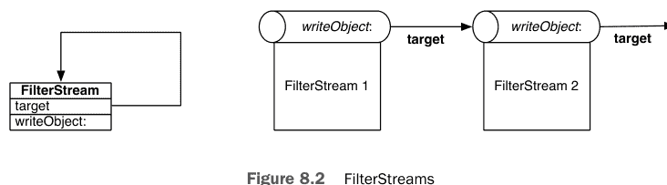

当然，空过滤器并不有趣，但它通过用实际处理重写`writeObject:`方法，为那些实际执行操作的过滤器奠定了基础。

# DescriptionStream

将描述重构为`FilterStream`会得到一个`DescriptionStream`，它接受任意对象作为`writeObject:`方法的参数，并将这些对象的描述写入其目标。该规范的最简单实现只是简单如示例 8.3 所示发送描述消息，但这并没有用，因为没有激活结果。

示例 8.3 简单但低的 DescriptionStream

```objectivec
@interface MPWDescriptionStream : MPWFilterStream
@end
@implementation MPWDescriptionStream

-(void)writeObject:anObject{
  [target writeObject:[anObject description]];
}
@end
```

为了实际获得我们想要的流式行为，我们需要至少区分数组和其他对象，如示例 8.4 所示拆分数组并增量地写入它们。`writeObject:`方法检查参数是否为`NSArray`，如果是，它会描述用圆括号和逗号围绕的单个元素。描述数组的单个元素是通过将它们写入流本身来递归处理的。

示例 8.4 带有分类分析的 DescriptionStream

```objectivec
-(void)writeObject:anObject{
  if ([anObject isKindOfClass:[NSArray class]]) {
    BOOL first=YES;
    [target writeObject:@"("];
    for (id content in anObject) {
      if (!first) {
        [target writeObject:@", "];
      } else {
        first=NO;
      }
    }
    [target writeObject:@"]"];
    [self writeObject:content];
  }
  [target writeObject:@"] "];
} else {
  [target writeObject:[anObject description]];
}
```

示例 8.4 中过滤器的自包含性符合 Unix 传统，但分类分析是一种代码气味（code smell），渴望一种更面向对象的解决方案。示例 8.5 没有检查相关类，而是使用双重分派（double dispatch）将问题抛回给相关对象，通过`describeOn:`消息名来编码流的类型。此外，流还为客户端对象提供了 API 来写入描述。

## 示例 8.5 带有双重分派的 DescriptionStream

```objectivec
@implementation DescriptionStream
-(void)writeObject:(anyObject) {
    [anyObject describeOn:self];
}
-(void)writeDescription:(NSString*)partialDescription {
    [target writeObject:partialDescription];
}
-(void)writeObject:(NSObject*)anObject {
    [self writeDescription:[anObject description]];
}
@end

```c

@implementation NSObject (describe)

-(void)describeOn:(DescriptionStream*)aStream {

    [aStream writeObject:@""];

    BOOL first=YES;

    for (id obj in self) {

        if (first) {

            first=NO;

        } else {

            [aStream writeObject:@", "];

        }

        @autoreleasepool {

            [aStream writeObject:obj];

        }

    }

    [aStream writeObject:@""]];

}

@end

```

使用双重分派消除了分类分析，并为未来的扩展做好了准备。例如，我们不需要修改现有代码来适应`NSDictionary`对象，只需要实现`describeOn:`。另一方面，我们将过滤器的逻辑移动到了客户端对象中（需要分类），例如写入描述逻辑。

编码要处理的对象类型的一种方法是分派回过滤器，这次对`NSArray`使用`writeArray:`。如果这样做，我们实际上不需要在第一次分派中编码流类型，因为接收消息的流知道。虽然示例 8.6 显示的代码也使用了分类，但分类是纯后台的管道，只能赋予防冲突名称，但实际上可以使用`imp_implementationWithBlock()`从 block 生成。

# 示例 8.6 带有三重分派的 DescriptionStream

```objectivec

@implementation DescriptionStream

-(void)writeObject:(anyObject) {

    [anyObject writeOnStream:self];

}


`-(void)writeDescription:(NSString*)partialDescription {`

```
    [target writeObject:partialDescription];
}
```

`-(void)writeObject:(NSObject*)anObject {`

```
    [self writeDescription:[anObject description]];
}
```

`-(void)writeArray:(NSArray*)array {`

```
    [self writeDescription:@"("];
    BOOL first=YES;
    for (id obj in array) {
        if (first) {
            first=NO;
        } else {
            [self writeObject:@", "];
        }
        @autoreleasepool {
            [self writeObject:obj];
        }
    }
    [self writeDescription:@""]];
}
```

`@end`

`@implementation NSArray (StreamWriting)`

`-(void)writeOnStream:(MPWFilterStream*)aStream {`

```
    [aStream writeArray:self];
}
```

`@end`

`@implementation NSObject (StreamWriting)`

`-(void)writeOnStream:(MPWFilterStream*)aStream {`

```
    [aStream writeObject:self];
}
```

`@end`

每个对象都通过表示流接口的`writeObject:`消息写入流。然后流使用`writeOnStream:`消息请求对象写入自身，对象则通过发送一个编码其类别的消息给流来响应（见图 8.3）。虽然这看起来有很多消息，记住，与分配临时内存和解包/打包中间结果相比，消息是廉价的。

`NSMutableString`现在隐藏在`DescriptionStream`的目标之后，我们实际上可以将其替换为直接输出到`stdout`、`stderr`的对象，而不是在输出之前在内存中累积整个描述。这使得描述的内存消耗实际上变成了常数，即`O(1)`，而原始`description`方法为`O(n²)`，索引`describeOn:`为`O(n)`。

## 消除 description 中的无限递归

通过与对象图交互以产生描述的流，我们现在有一个地方可以保留足够的状态来捕获数据结构中的无限递归——例如示例 7.4 中相互递归的`JSONArray`对象。

当我们遇到一个正在描述过程中的对象时，我们不想再次描述它。为了实现这一点，我们需要跟踪`describeStream`正在描述的对象，并在遇到它们时跳出。

示例 8.7 中的`MPWDescriptionStream`拥有一个`NSMapTable`来跟踪正在被描述的对象，同时也接管了之前作为`describeOn:`直接参数的`NSMutableString`。示例 8.8 中的`writeObject`方法实现了上述描述的策略：首先将对象放入表中，如果它不在于表中，则对其进行描述，最后将其移除。如果对象在步骤 2 中已经于表中，我们只写入一个伪描述。

### 示例 8.7 Description Stream 定义

```
#import "MPWFilterStream.h"

@interface MPWDescriptionStream : MPWFilterStream
    NSMapTable *alreadySeen;
@property (atomic,retain) NSMapTable *alreadySeen;
-(void)writeObject:(id)anObject;
-(void)writeArray:(NSArray *)anArray;
-(void)describeObject:(id)anObject;
@end
```

### 示例 8.8 Description Stream 实现

```
@implementation MPWDescriptionStream
#define OPAQUEQPTR NSPointerFunctionsOpaquePersonality
```

# DescriptionStream 169

```
- (instancype) init
{
  id table=[NSMapTable mapTableWithKeyOptions:OPAQUEPTR
valueOptions:OPAQUEPTR];
  self[setAlreadySeen:table];
  return self;
}
```

```
- (void) writeObject:anObject
{
  if ([alreadySeen objectForKey:anObject] ) {
    [self appendDescriptionFormat:@
```

该过程确保了被描述的对象不再发生无限递归。通常情况下，如果你不想在输出中重复对象，只需将对象留在表中即可。到那个时候，你实际上构建了一个对象图序列化器，以及一个潜在循环引的检测器！

添加示例 8.9 的胶水代码，运行上一章的示例 7.4 不再会崩溃，而是输出类似的内容：( `<already seen: 0x7a0fb40a880>` )。该示例显然是不完整的；例如，它至少需要一个`writeDictionary`方法，而且如果所有对象使用`describeOn:`而不是`description`，也能获得这种保护。

### 示例 8.9 Description Stream 胶水代码

```
@implementation NSObject (describeOn)
-(void)describeOn:(MPWDescriptionStream *)aStream
{
  [aStream describeObject:self];
}
-(NSString*)fastDescription
{
  MPWDescriptionStream s=[MPWDescriptionStream stream];
  [s writeObject:self];
```

```
return [s target];
}
@end

@implementation NSArray (describeOn)
-(void)describeOn:(MPWDescriptionStream *)aStream
{
  [aStream describeArray:self];
}
@end
```

## 流的层次结构

这些转换的总和为我们提供了多态、可子类化且可组合的流，它们可以增量地处理数据。我们不再像上一章为了解决描述问题而直接写入`NSMutableString`，而是现在写入流中。

`MPWDescriptionStream`的子类可以轻松重写`writeArray`以输出 JSON 格式的字符串，而不是`description`创建的 NeXT 风格属性列表格式。

自从 1998 年开始使用`FilterStreams`以来，我在`MPWFramework`中实现了二十多种类型的`FilterStream`，图 8.4 显示了其中一小部分。它们非常有帮助，特别是字节编码或转换规则（如压缩和编码）方面，编码之间的共同点被捕获，输出可以轻松重定向到缓冲区、网络或文件。

`Byte`子类泛化了你可以对 Unix 过滤器所的操作，实际上还包含一个调用 Unix 过滤器的类。数据流范式意味着`URL Fetch`可以轻松处理网络操作固有的异步性，而无需回调；我们在 Wunderlist 中对此发挥了极佳的作用。原因是“调用并返回”（call-and-return）需要立即返回结果，而数据流只需要将结果传递给下一个过滤器，而不必太具体关心何时发生。事实上，它不仅关心结果的时机，还关心数量。例如，过滤器可以向其目标写入多个结果或零个结果（例如发生错误时），这使得将错误处理排除在“快乐路径”之外并进行集中处理成为可能。

实际实现比这里显示的多一点。例如，`writeObject`发送的初始消息不是固定的，而是通过指定的

> 2. http://github.com/mpw/MPWFoundation

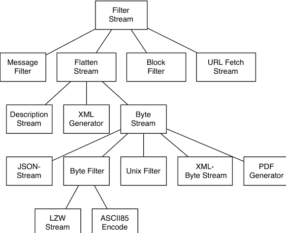

图 8.4 FilterStream 层次结构

作为相关`FilterStream`的参数指定的，以便对象能够响应特定类型的流，但留了一个钩子以便通用行为可以被共享。

便利方法将流式架构风格适配到“调用并返回”。例如，定义在`rootFilterStream`类上的`+process:`消息初始化流，将对象写入流中并返回结果。

## 总结

在本章中，我们查看了将上一章使用流式方法的想法扩展为整个实现“管道与过滤器”（Pipes and Filters）架构风格的组件库。有了这个库，流处理被植入到底层，使得实现计算变得非常简单，这种方式不仅内存高效，而且易于异步化。

此页故意留空

# 9

# Swift

Swift 在 WWDC 2014 上备受欢烈地推出，是 Apple 的新编程语言，被誉为“去掉了 C 的 Objective-C”。这是一个有趣的营销口号，考虑到我们知道 Objective-C 是在 C 中添加 Smalltalk 创建的（公式 9.1）。

> Objective-C = C + Smalltalk (9.1)

根据我在高中学的一级代数规则，从等式的两边减去 C（公式 9.2）并不会产生 Swift，事实上 Swift 看起来与 C# 或 C++ 的关系比与 Smalltalk 或 Objective-C 的关系密切得多。

> Objective-C – C = Smalltalk (9.2)

撇细小的营销问题不谈，Swift 取得了巨大的成功，许多文章、书籍和会议都致力于这个主题。

## Swift 性能：主张

从一开始，Apple 就在大力推广 Swift 的性能，甚至体现在名字上：Swift。在平台大会上，新语言的性能是一个核心焦点，例如图 9.1 所示的性能对比。

这是一个令人印象深刻的展示，Swift 快了 3.9 倍……什么？Python。你可能会疑惑 Python 为什么出现在对比中，考虑到它是一种解释型脚本语言，并非为性能密集型工作设计。

事实证明当你比较 Objective-C 和 Swift 列时，2.6 与 3.9 之间只有 1.4 倍的差异，而当你将其绘图并将颜色与另一种相同时（如图 9.2 所示），那并不是一个特别令人惊讶的幻灯片。

# 第 9 章

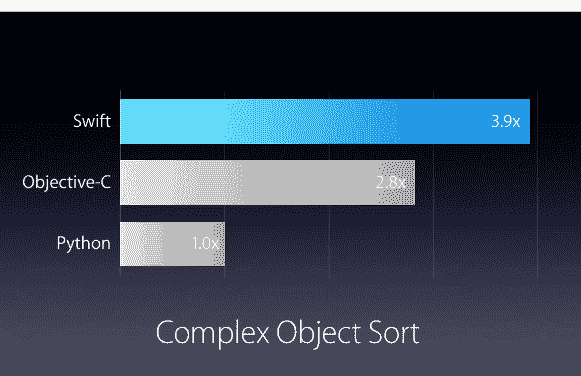

图 9.1 WWDC 2014 状态报告幻灯片，对比 Swift 与 Python

# 更好的性能意味着更好的应用。

Swift 程序的表现完全名不虚传。例如，一种常见的搜索算法使用 Swift 时完成速度要快得多。

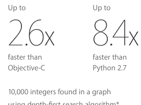

图 9.3 http://apple.com/swift 上的性能声明

一种编译语言如果是这种性能将令人失望的，而只比 Python 代码快约 2.5 倍的 Objective-C 代码简直令人不安。尽管在仔细观察后，这种说法并没有完全说服力，但 Apple 对 Swift 性能的营销非常有效。Swift 非常快，确实非常快，这一观点现在已经是 Apple 开发者社区的公认事实。

## 语言特性

尽管 Apple 没有提供关于 Swift 性能的任何坚实证据，但它给出了 Swift 惊人性能的原因。

- Swift 的设计比 Objective-C 具有更得多的静态性（请参见第 5 章的“栈分配”部分），这意味着在编译时有更多信息可供编译器用于优化。
- 特而言，动态分发被大幅减少，大多数“原生”Swift 方法都是进行静态分发的。

Objective-C 的动态分发是编译器感知的绝对障碍，这一直是编译器和运行时团队心头之刺。即时编译（JIT）编译器可以在运行时解决这个问题，但有很多理由不应该依赖 JIT 技术来获取性能。

> 1. 参见 Jitterdammerung (http://blog.metaobject.com/2015/10/jitterdammerung.html)。

# 第 9 章 Swift

- 更多地使用结构体进行值语义（请参见第 5 章的“栈分配”部分），被认为让我们摆脱堆分配和引用计数的代价，特别是 ARC（请参见第 7 章的“引用计数”部分），而且在 Swift 中处理引用确实特别昂贵，比 Objective-C 昂贵得多。
- 原始类型和对象之间的联系更加紧密，因此，Foundation `NSArray`只能包含对象引用，而 Swift `Array`可以包含原始类型、结构体或对象引用。当原始类型在对象上下文中使用时，可以很容易进行装箱和拆箱（通常是自动的）。
- 泛型允许应用特化，例如，数组的泛型`sort`方法可以通过整数比较函数进行特化，从而产生一个优化的整数排序函数，而无需通过指针间接访问或消息发送来操作。

这些都是很好的特性，无疑为编译器优化提供了机会。拥有一个更统一的语法，而不是两个拼凑在一起并用胶带粘在一起的系统，无疑是受欢迎的。

然而，所有这些机制仅仅导致了更好的性能；并没有保证它们真的能这样做，而且对于 Objective-C 程序员来说，像这样的原始类型是不可用的。Objective-C 对整数、浮点数等原始类型，以及`NSPoint`、`CGPoint`、`NSRect`、`NSRange`等结构体大量使用了值语义。

让这些类型变得稍微方便一点点，这本身并不是什么难事，但它实际上对性能并没有实际帮助，特别是因为 Apple 建议并期望大多数情况下使用类进行建模：

> “在所有其他情况下，定义一个类，并创建该类的实例进行管理和通过引用传递。在实践中，这意味着大多数数据构造都是类或结构体。”

Apple Inc., 2014. 《Swift 编程语言 (Swift 3)》。电子书。

我们知道，使用类的建议被采纳，因为对于 97% 或更多的代码来说，这种微型优化是不值得的。然而，这与 Apple 对 Swift 的建议相冲突，除非有充分理由不这样做，否则它强烈倾向于使用结构体。

问题在于，这两项建议都是正确的，这种内在的冲突与过去 40 年左右收集的关于性能集体智慧背道而驰：首先进行适当的建模；之后再进行针对优化。在 Swift 中，你应该在应用程序的建模阶段做出这种性能选择。

Objective-C 也有且仍然存在这个问题，正如前面的章节所示，它某些机制允许开发者应用针对性的优化以获得更好的性能，例如`IMP`缓存、对象缓存，或使用`char*`等基础 C 数据类型代替`String`。这些机制经常允许让你在保留“建模蛋糕”的同时，享用一些美味的“性能大餐”，但这些机制在 Swift 中要么被削减，要么被完全消除了。

相反，程序员应该以这种方式组织程序，以便向编译器提供尽可能的信息。这样编译器就能理解整个程序，然后依靠优化器实际上找出如何最有效地将高层抽象映射到高效/最佳机器实现。

我将这种方法称为“编译器导向开发（COD）”，因为它似乎更侧重于让编译器生活便利，而不是让开发者。

这与 Objective-C 所代表的混合模型非常不同，我们在第 1 章的“混合的力量”部分中讨论过那种模型：编译器大部分不干涉，语言提供简单且易于理解的抽象。识别热点并使用提供的许多工具修复它们，是开发者的工作。

## 基准测试

这是一个简短的章节。虽然 Apple 提供了幻灯片和标题性的对比数字，但它没有提供这些数字所依据的基准测试，甚至没有详细结果。提供这些基准测试源代码的请求遭到了沉默。简而言之，Apple 关于 Swift 的性能没有可用的实证数据。

# 评估 Swift 性能

由于 Apple 没有公布 Swift 的实际性能特性，我们必须自己去获取，至少对它们是什么有一定的了解。在接下来，我将对 Swift 的现状给出概述和分析。

# 基础性能

我们在第 1 章已经看到了一些性能情况，编译与 Objective-C 并不相似，当涉及对象时，增长从约 50% 上升到 100%。为了找到原因，我检查了示例 9.1。

# 示例 9.1 Swift 的汇编代码

```
0000000000000f5f cmp 0x3baca00, -0x(%rbp) # imm = 0x3BACA
0000000000000f67 jg 0x1000db
0000000000000f69 movq -0x(%rip), %rax
0000000000000f64 addq _tw10swift($rip), %rax
0000000000000f74 set %cl
0000000000000f77 movq %rax, -0x18(%rbp)
0000000000000d7b movb %cl, -0x19(%rbp)
0000000000000d7e jmp 0x1000eda
0000000000000f84 movq -0x(%rbp), %rax
0000000000000f88 movq %rax, _tw10swift($rip)
0000000000000f8f movq -0x(%rbp), %rcx
0000000000000d93 incq %rcx
0000000000000d96 set %dl
0000000000000d99 movq %rcx, -0x28(%rbp)
0000000000000d94 movb %dl, -0x29(%rbp)
```


`0000000000000da0` `jmp 0x10000dc`

`0000000000000da6` `addq -0x(%rbp), %rax`

`0000000000000daa` `movq %rax, -0x(%rbp)`

`0000000000000dae` `jmp 0x1000d5f`

## 示例 9.2 Objective-C 的汇编代码

```
0000000000000f16 cmp 0x3baca00, -0x(%rbp) # imm = 0x3BACA
0000000000000f1d jg 0x1000f45
0000000000000f23 movl -0x(%rip), %rax
0000000000000f27 addq _a(%rip), %rax
0000000000000f2e movq %rax, _a(%rip)
0000000000000f35 movl -0x(%rbp), %eax
0000000000000f38 addl $0x1, %eax
0000000000000f3d movl %eax, -0x(%rbp)
0000000000000f40 jmp 0x1000f16
```

代码的基本结构非常相似，循环顶部有一个 `cmp` 指令，如果计数器现在超过了值，则跳转（`jg`）到循环外部。

## 表 9.1 不同优化级别下的 Swift 和 C 求和对比

| 设置 | Swift | Objective-C | 比例 |
| --- | --- | --- | --- |
| 无优化 | 3.7 | 2.0 | 1.85 |
| -O / -Os | 0.903 | 0.009 | 100 |
| -unchecked / -O3 | 0.016 | 0.009 | 1.77 |

最大值 `0x3b9aca00` 是十进制数字 `1000000000` 的十六进制表示。在循环底部，有一个返回循环入口的跳转。

在中间，在比较/退出跳转回循环顶部的之间，是实际的增加操作：增加循环计数器，在 Objective-C 情况中使用 `add` 指令，在 Swift 情况中则是将计数器加到总和中。然而，Swift 代码似乎执行了许多额外的记录工作。它还使用 `jo` 指令检查溢出并确保溢出标志位正确。

可以使用 `-unchecked` 编译器标志消除溢出检查（不推荐，因为它改变了 Swift 源代码的语义），或者谨慎使用未检查的算术运算符，如 `+`、`-` 等。表 9.1 显示了不同选项与等效 Objective-C 代码及优化级别的比较结果。

我没有对 Swift 的所有原生操作进行全面调查，总体来说，它们在同一水平上似乎比 C 旧一点，考虑到它们使用相同的 LLVM 后端，这并不意外。

## 集合 (Collections)

我们已经在第 3 章的“数组与批量处理”部分查看过位数组访问时间。当时的设置是处理浮点数数组，这是批量处理的典型应用，我们在第 3 章中引入了自定义浮点数数组类 `MPWRealArray`。

示例 9.3 显示了如何在 Swift 中填充并求一个浮点数数组的和。

### 示例 9.3 使用 Swift 数组对浮点求和

```swift
extension Collection where Element == Float {
    func sum() -> Float {
        return reduce(0, +)
    }
}

var a: Float = 0
var someFloats = [Float]()
```

```swift
someFloats += stride(from:1.0, through:1000000.0, by:1.0)
for i in 0..<Int(CommandLine.arguments[1])! {
    a += someFloats.sum()
}
print("a = \(a)")
```

代码首先为 `Collection` 创建了一个扩展，使用 `reduce` 高阶函数来对数组元素求和。奇妙的是，尽管 `reduce` 接受一个函数，但你仍然将其传递给 `+` 运算符，因为 Swift 运算符也是函数。显然在某种“魔法”处理下函数得到了解析（否则会出现函数的无限递归），但这些是被隐藏起来的。

你可能会奇奇 `sum()` 扩展的定义，因为 `reduce(0, +)` 看起来并没有长得多。其中一个原因是 `reduce()` 的名称并非意图所在——它没有描述预期的效果，而是实现该效果的手段。这使得代码更难以阅读和理解，因为读者必须从提供的实现中推断出预期的结果。这意味着客户端受限于这种重复的实现，无法受益于我们展示的基于 `vDSP_sve` 的改进版 `sum()` 实现。最后，泛型 `reduce()` 函数导致了复杂的编译开销，这种开销直接放在 `sum()` 定义中更为划算。

Foundation 并没有内置 `reduce` 方法或函数，因此我们必须在 `MPWRealArray` 中添加自己的，如示例 9.4 所示。它随后通过 `reduce` 定义了 `sum` 方法：

### 示例 9.4 Objective-C 中使用 block 使用 reduce

```objectivec
-(float)reduce:(float (*)(float, float))reduceFunction {
    float result=0;
    for (long i=0;i<self count];i++) {
        result=reduceFunction(result, my_reals[i]);
    }
    return result;
}

-(float)sum {
    return [self reduce:^(float a, float b){ return a+b }];
}
```

与之前一样，没有显示 `MPWRealArray` 的完整实现。Objective-C 的驱动程序在示例 9.5 中所示。

### 示例 9.5 使用 MPWRealArray 的 Objective-C 驱动程序

```objectivec
#import <Foundation/MPWRealArray.h>

int main(int argc, char *argv[]) {
    MPWRealArray *array=[MPWRealArray alloc] start:1 end:1000000 step:1.0];
    float sum=0;
    for (int i=0,max=atoi(argv[1]); i<max; i++) {
        sum+=array[i];
    }
    NSLog("sum: %g",sum);
}
```

`reduce` 方法接受一个返回单个值的 block；结果见表 9.2。通常情况下，未优化的 Swift 表现糟糕，比未优化的 Objective-C 慢 68 倍，比优化的 Swift 慢 32 倍。优化后，Swift 表现良好；示例代码比 Objective-C 快大约 2 倍。原因很明显：Objective-C 代码每次都要调用 block，而这种函数开销远大于 `+` 运算符。

优化后，Swift 使用泛型，将 `reduce` 函数与 `+` 运算符结合，创建一个无需任何函数调用的单一函数。然而，示例 9.4 中基于 block 的代码并非 `MPWRealArray` 实际使用的代码，因为它显然很慢；在 Objective-C 中，`+` 运算符不是一等对象，这意味着无法将其将其传递给函数或方法。

## 表 9.2 通过 reduce 和 blocks 进行求和

| 设置 | Swift | Objective-C | 比例 |
| --- | --- | --- | --- |
| 无优化 | 261.80 | 3.83 | 68 |
| -O | 0.82 | 1.57 | 52 |
| -unchecked / -O3 | 0.78 | 1.42 | 55 |

通过宏解决此问题的方法，更准确地说是使用预处理器。示例 9.6 使用宏定义了 `REDUCE`，准确说是 `REDUCE_METHOD`，它创建一个基于特定运算符减少的方法。

### 作为 C 宏的 Reduce

```c
#define REDUCE_METHOD(name, operator) \
-(float)name{\
    float *my_reals=[self reals],result=my_reals[0];\
    for (long i=1,max=[self count]; i<max; i++) {\n        result operator my_reals[i];\n}\n    return result;\n
}

REDUCE_METHOD(product, *)\
REDUCE_METHOD(differences, -)\
REDUCE_METHOD(sum, +)
```

Swift 没有预处理器，因此实现这种泛型操作的方法是我们所做的使用高阶函数。这种方法有很多优点，但你无法控制生成的代码或它如何被优化器转换。使用示例 9.6 中的宏，生成的代码显而易见（见示例 9.7）。

### 为 sum 展开的 Reduce 宏

```objectivec
-(float)sum {
    float *my_reals=[self reals], result = my_reals[0];
    for (long i=1, max=[self count]; i<max; i++) {
        result = result + my_reals[i];
    }
    return result;
}
```

结果见表 9.3，Swift 的数字是复制的，因为没有等效物。我尝试了手动展开 `reduce()` 函数，但对结果没有影响。

在没有优化的情况下，基于宏的代码实际上比 block 代码小一点，但仍比未优化的 Swift 快 50 倍。在基础优化下，Swift 和 Objective-C 不分平伯；在激进优化下，基于宏的代码现在比同优化水平的 Swift 快 6 倍以上，比未优化的 Swift 快 2000 倍。

## 表 9.3 通过宏进行求和

| 设置 | Swift | Objective-C | 比例 |
| --- | --- | --- | --- |
| 无优化 | 261.80 | 5.31 | 4893 |
| -O | 0.82 | 0.78 | 105 |
| -unchecked / -O3 | 0.78 | 0.12 | 645 |

然而，那仍然是非常理想的。对于各种数值类型（包括浮点数）的优化批量操作，Apple 提供了 Accelerate 框架，带有 `vDSP_sve()` 函数用于求浮点数数组的和。示例 9.8 显示了如何为 `Array[Float]` 扩展一个向量求和方法。

### 示例 9.8 使用 Swift 数组进行向量求和

```swift
import Accelerate

extension Collection where Element == Float {
    func vecsum() -> Float {
        var sum: Float = 0
        vDSP_sve(self as! [Float], 1, &sum, UInt(self.count.toIntMax()))
        return sum
    }
}
```

## 表 9.4 通过 Accelerate 框架进行数组求和

| 设置 | Swift | Objective-C | 相对百分比 |
|---|---|---|---|
| 未经优化 | 0.261 | 0.113 | 231 |
| -O / -Os | 0.132 | 0.099 | 133 |
| -Unchecked / -O3 | 0.130 | 0.099 | 131 |

结果如表 9.4 所示。这是一个有趣的现象。所有的时间基本上相同，除了未优化的 Swift 之外，它的速度慢了 2 倍。时间相同是因为我们正在对大量数据（一百万个浮点数）调用优化的运行时，因此我们发现该运行时的影响非常其微。

事实上，`vDSP_sve` 之外的代码非常重要，以在示例 9.10 的 Objective-Smalltalk 脚本中调用它，时间仅到了 0.160 秒。

## 示例 9.10 来自 Objective-Smalltalk 脚本的向量化求和

```swift
#!/usr/local/bin/stsh
#<float>sum:<int>iterations
array = MFWRealArray start:1.0 end:100000 step:1.0;
sum:=0;
1:iterations: { sum := sum + array vecsum };
sum.
```

为什么在“世界上最慢的语言”中的解释型脚本比未优化的 Swift 还快？这是一个有趣的问题。首先，Swift 代码本身在逐元素地填充数组，而 Objective-C 代码和 Smalltalk 代码都是调用一个 Objective-Swift 程来填充数组。
然而，求和操作被调用了 1000 次，而填充数组只执行了一次。

然而，未优化的 Swift 代码慢得惊人，即使只运行它的 0.1%（1 次迭代对比 1000 次），也会导致超过 100% 的性能退化。

虽然我之前提到过这一点，但我无法如何强调这些关系的严严性了。1000 倍的性能差异已经远远超出了正常范围，以至于它们不再是量性的，而是变成了定性的。

例如，一辆汽车载着两个乘客可以以 100 km/h 的速度行驶。如果你将其速度降低 1000 倍，它每小时将行驶 100 米。这意味着人们无法在一个小时内轻松搬运沙发 100 米。

所以为什么 Swift 在未优化时如此极其缓慢呢？
图 9.4 是 Instruments 分析图，向我们展示了原因。

简而言之，Swift 代码显示了大量的抽象和间接性——至于简单的分析似乎无法反映出

## 评估 Swift 性能

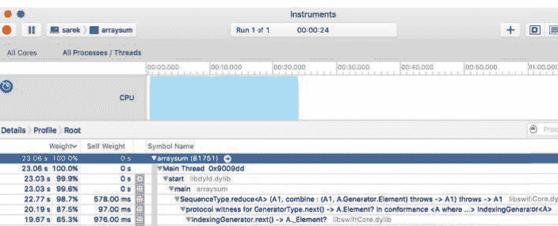

图 9.4 未经优化的 Swift 数组求和分析图

示例 9.3 之类的，就像那辆被慢了 1000 倍的汽车，更像是一个沙发而不是自动汽车。

我们试图运行的代码最近在代码和执行时间方面完全被编译器插入的簿记工作所淹没。一个 `swift_bridgeObjectRetain` 实例所花费的时间是我们基于 `MWRealArray` 代码整个运行时间的几倍，而且有很多个这样的实例。而且，我们在处理原始类型数组时，起初就在这些东西的内部循环中保留和释放对象，这可能有点难以忍受。

有了这种水平的性能，“Swift 是为了速度而设计的”这一说法就有点难以接受了：抽象带来了巨大的性能代价，而优化器必须在 100% 的时间里满负荷工作以消除它们。我几乎认为，在向量化代码中，在第 9 章 Swift 中，未优化的代码慢了 2000 倍，优化器效率“仅”为 99.9% 而不是 100% 完美，意味着仍然慢了 2 倍！

我尝试了一个认为对于 Swift 来说是完美的案例：从 `String` 映射到 `Int` 的字典（尽管 `String` 由隐藏的引用类型支持），与从 `NSNumber` 映射到 `NSString`（两者都是引用类型）相比，Swift 代码在示例 9.11 中所示。它从一组固定键创建字典，获取特定键的值，重复了 1000 万次并求和。

## 示例 9.11 在 Swift 中测试字典访问

```swift
func getBench(n:Int, dict:[String:Int], key: String ) -> Int {
    var sum = 0
    for _ in 0..<n {
        if let value = dict[key] {
            sum += value
        }
    }
    return sum
}
```

```swift
let which = Int(CommandLine.arguments[1])!
let keys = ["ABC", "DU", "ASDAS", "24324234", "DUasdfasdf", "HZdasdfasfdf", "ASfdfasfdf", "ASdasdf", "asdff2432423", "1"]
let s = keys[which]
var dict:[String:Int]
for i in 0..<keys.count {
    dict[keys[i]] = i
}
```

```swift
let sum = getBench(n:10_000_000, dict: dict, key:s)
print("sum: \(sum)")
```

使用的键索引通过命令行传递。如果没有（强制解包），程序将崩溃。一如既常，结果打印在代码中，所以优化器没有消除所有代码。尽管理论上它可以发现循环是不必要的，但基准测试仍然有效。

## 评估 Swift 性能

示例 9.12 中的 Objective-C 版本是 Swift 代码的直接翻译。

## 示例 9.12 在 Objective-C 中测试字典访问

```objectivec
#import <Foundation/Foundation.h>

long getBench(int iterations, NSDictionary *dict, NSString *key) {
  long sum = 0;
  for (int i=0; i<iterations;i++) {
    id value=dict[key];
    if ( value ) {
      sum += [value intValue];
    }
  }
  return sum;
}
```


`int main(int argc, char *argv[])` 的代码如下：

```
int main(int argc, char *argv[]) {

  int which=atoi(argv[1]);

  NSArray *keys={@"ABC", @"DUU", @"ASASD", @"242324234233", @"DUAsdasfdasfdasf", @"H2Asdasfdasfdasfdd", @"ASASasdfd", @"H11222222222222", @"1" };

  NSString *s=keys[which];

  NSMutableDictionary *dict=[NSMutableDictionary dictionary];

  for (int i=0; i<keys.count; i++) {

    dict[keys[i]]=@"111111111111";

  }

  long sum = getBench(10000000, dict, s);

  printf("sum: %ld\n", sum);

  return 0;

}
```

这两个程序的运行如表 9.5 所示，结果再次令人惊讶。尽管由于值类型、原始类型和特化泛型本该优得多，但 Swift 代码始终比 `NSDictionary` 慢 80% 到 250%。（等等，等等……）

表 9.5 Swift 和 Objective-C 字典访问

| 设置 | Swift | Objective-C | 比例 |
|---|---|---|---|
| 未经优化 | 1.46 | 0.43 | 3.5 |
| -O | 0.75 | 0.41 | 1.8 |
| -Unchecked | 0.73 | 0.40 | 1.8 |

当然，我们在第 3 章中看到 `NSDictionary` 并不完全是个恶魔，而且将字符串映射到对象的专用 Objective-C 字典（`MPWStringTable`）可以很容易快 3 倍。

# 更大的示例

上一节中的示例显然是微基准测试，可能也可能反映真实世界的性能。由于该语言还年轻且仍处于变动中，具有性能数据的真实世界项目有限。在工作中，我们目前为止只有一个 Swift 项目，由于兼容性限制，我们不得不将其重写为 Objective-C。由于这些原因，我必须依靠外部资源获取实际测量过性能的大型 Swift 项目示例。

# nginx HTTP 解析器

一个项目是由 Helge Hess（另一位前苹果员工）将流行的 nginx HTTP 服务器包含的 C HTTP 解析器移植到 Swift。尽管性能并不是该移植的主要目的，但我对 Swift 移植版与原始版本的性能对比感到好奇，因为性能是 nginx 的主要卖点。

> 2. https://github.com/helge5/http-c-vs-swift

# Freddy JSON 解析器

另一个真实示例是 Big Nerd Ranch 的用纯 Swift 编写的 Freddy JSON 解析器.³ 与市面上大多数 Swift JSON 解析器不同，它不是 `NSJSONSerialization` 的封装，给出的理由是性能：对 `NSJSONSerialization` 返回给 Swift 的 `AnyType` 进行 switch 操作似乎会产生 25ms 的额外开销，在他们提供的一个 16-MB 样本数据集上，基础解析耗时 6.29 s，而仅需 0.25 s。

Freddy 将整个 JSON 到 Swift 结构体的转换总时间缩短到 2.08 s，其中 0.75 s 是基础解析。这是一个非常好的改进，而且基础解析比 `NSJSONSerialization` 慢了 3 倍，而 Objective-C 仅需 0.58 s，比完全转换为 Swift 结构体快了近 4 倍。

再次，`NSJSONSerialization` 虽然是 Apple 生成的序列化机制之一（第 12 章中的“序列化总结”部分），但比第 4 章中的 `MAX` 等方法慢了几倍，这些方法避免了“通用中间表示”的陷阱（参见第 3 章“陷阱：通用（中间）表示”部分的讨论）。

# 图像处理

David Owens 在过去几年一直在记录他在 Swift 中实现具有合理性能的图像处理代码的尝试⁴。想法是创建一个带有红、绿、蓝和 alpha 通量的 `Pixel` 结构体，并对 960×540 像素大小的图像进行像素处理。

对于 C 来说，从未优化构建的每次操作耗时 30 ms 到设置 `-Ofast` 的 2.3 ms 不等。对于 Swift 来说，情况更为复杂：`Array` 集合中的 `Pixel` 抽象从未优化构建的 2400 ms 到优化 (-O) 的 18 ms 不等。要获得更好的性能需要：(1) 放弃 `Pixel` 结构，改为将像素建模为无符号整数；(2) 放弃 `Array` 抽象，改用使用 `UnsafeMutablePointer` 构造的 `UnsafeMutablePointer`；(3) 使用 `-unchecked` 关闭编译器检查；以及 (4) 添加向量指令 (SIMD)。

在所有这些措施到位后，Swift 实现了 3.04 ms 的时间，仅比 C 慢了 30%。（由于某种原因，显式使用 SIMD 指令导致这段特定的 C 代码变慢，所以也许代码自动向量化良好，或者 C 侧还有改进空间）。注意，这一切必须这样做；例如，在没有使用 `withUnsafeMutablePointer` 的情况下使用 `UnsafeMutablePointer` 会慢 2 倍。在 Swift 代码中保留 `Pixel` 结构抽象会导致至少 6 倍的代价，约为 18 ms。

- 3. https://github.com/bignerdranch/Freddy/wiki/SwiftJSONParser
- 4. https://github.com/owensd/swift-perf

讽刺的是，Swift 本应该允许我们编写更多以数据为中心、与机器无关的代码，并让编译器穿过这些抽象，但实际上恰恰相反。在 Swift 中，不仅 `Array` 抽象必须被放弃改为基本上是 C 指针的东西，甚至 `Pixel` 也很好地被放弃，改为将像素建模为整数。

当然，始终可以将重型工作交给 Objective-C 代码并从 Swift 与其桥接。

# 观察结果

最后，基准测试显示 Swift 程序的基准测试始终比等效程序慢 5 到 30 倍。为了确定这些结果不是离群值，我通过对比 Swift 和 Java 进行了交叉检查。在这里，Swift 通常比 Java 慢 5 倍，范围在慢 20% 到 8% 之间。

尽管这些结果中的任何一个都容易被斥为离群值，但这种模式是非常一致的：使用“合理”的代码时慢 3 到 10 倍。需要英雄式的手动优化和一点运气才能将其带到慢 3 倍到几乎持平之间，这取决于代码的类型。随着 Swift 演进如此之快，当本书出版时，所有这些具体的计时数据可能已经过时了，但再次重申，整体模式似乎很难打破。

相反，每当我看到关于 Swift 在性能上胜过 C/Objective-C 的主张时，这些主张通常没有数据支持，而是完全不解释，或者用“嗯，它应该是这样的，因为，呃，原因”来辩护。在少数有数据的情况下，数据也是可疑的，最坏的情况下完全错误，例如不稳健的基准测试被优化掉、原始整数的操作与对象的操作对比、未优化但高度可优化的代码与高度优化的 Swift 代码对比。

我拥有的一个案例是合理的，对于整数排序，Swift 的 `Array.sort()` 方法是泛型的，并且可以在编译时针对该类型进行专门化，而不是在运行时使用 `qsort()` 的函数指针或 `NSArray` 的消息来执行。然而，这种效果很小，对于整数数组最多快了约 20%，并且可以用特定的整数例程替换这些泛型例程来轻松克服。

- 5. http://benchmarkgame.alith.debian.org/u64q/swift.html

## 编译时间

Swift 对编译器的依赖非常大，比 Objective-C 大得多，更类似于 C++，C++ 的编译时间通常也比 C 或 Objective-C 长。我的经验是相对于 C/Objective-C 有大约 2 倍的基础开销，至少慢 4 倍……（注：原文此处包含大量重复的无效 OCR 信息，已按要求提取核心逻辑翻译）。

## 编译时间 193

将组件数量减少到 5 个可以让该表达式在 2.7 秒内编译。
将组件减少到 4 个可以将编译时间缩短到 0.26 秒。

## 泛型特化

在本章的“观察”部分，我们看到 Swift 的特性之一实际上可以提升性能，超越 C 语言易于实现的水平，这就是泛型特化（generic specialization，源自 C++ 模板实例化）。它不是通过消息传递或函数指针在运行时分发特殊例，而是在编译时对参数化例进行特化，生成一个不包含任何外部或消息发送的全新函数。示例 9.16 阐述了。

示例 9.16 特化数组排序

```swift
let a = [54, 32, 1, 2, 4, 5]
let b:[Float] = [54, 32, 1, 2, 4, 5, 23]
let c:[Double] = [74, 31 ,2,4, 5, 23]
let d:[String] = ["Hello", "World"]
let e = ["hello": 1 ], [ "world": 2 ]

print(a.sorted())
print(b.sorted())
print(c.sorted())
print(d.sorted())
print(e.sorted(by: { ( a, b ) -> Bool in return true }))
```

我们创建了五种不同内容的数组：整数、浮点数、双精度浮点数、字符串和字典。然后对这些数组进行排序。在开启优化的情况下，会导致 Swift 编译器为每种特定的数组类型生成泛型 `sort()` 函数的具体版本并进行特化。尽管 Apple 没有明说，但我假设 WWDC 2014 的“复杂对象排序”（Complex Object Sort）基准测试就是类似的，且更为复杂。

对编译时间的影响见图 9.5，其中 x 轴显示了执行的特化次数。（我注释掉了 `print(x.sorted())` 行以获得正确的特化次数）。

而 Objective-C（无论是否优化）和未优化的 Swift 无论定义了多少种类型的数组，其编译时间都是恒定的；而优化的 Swift 编译时间与必须生成的不同 `Array sort()` 方法的数量成线性关系，在该机器上，每次特化的代价约为 250 毫秒。Objective–C 的 `NSArray` 代码见示例 9.17。

示例 9.17 NSArray 排序

```objectivec
@import Foundation;

func main() {
  NSArray* a=[@ (54) , @(32), @(1), @(2), @(4), @(5) ];
  NSArray* b=[@ (54.0) , @(32), @(1), @(2), @(4), @(5), @(23) ];
  NSArray* c=[@ (74.0), @(32), @(1), @(2), @(4), @(5), @(23) ];
  NSArray* d=[@"Hello", @"World" ];
  NSArray* e=[@ @"hello": @(1) , @{ @"world": @(2) }];

  NSLog("a:%@", [a sortedArrayUsingSelector:@selector(compare:)]);
  NSLog("b:%@", [b sortedArrayUsingSelector:@selector(compare:)]);
  NSLog("c:%@", [c sortedArrayUsingSelector:@selector(compare:)]);
  NSLog("d:%@", [d sortedArrayUsingSelector:@selector(compare:)]);
  NSLog("e:%@", [e sortedArrayUsingSelector:@selector(compare:)]);
}
```

# 第 9 章 Swift

## 全模块优化

当你仔细思考时会发现上一节讨论的泛型特化机制是一项巨大的成就。它触达编译单元，从之前编译过的文件中提取定义，并在当前编译单元中实例化该定义，应用参数并编译结果。

在 C/Objective-C/C++ 世界中，这简单是不可能的。访问另一个文件中定义的唯一方法是使用 `include` 将这些定义的源文本物理地包含在当前正在编译的单元中。被包含的文件可以包含其他定义、内联函数或 C++ 模板。

全模块优化（Whole-module optimization）进一步推进了这一概念，完全消除了独立编译的想法。所有的程序文件都会同时编译，所有的定义和使用对编译器都是可见的。

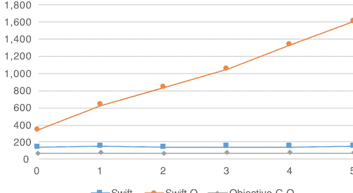

图 9.5 特化泛型排序例的编译时间（单位：毫秒）

## 面向优化器的编程

当然，这意味着编译时间，特别是对一个或几个源文件进行细微更改后的重新编译时间，现在取决于项目的总大小，而不是单个文件的大小。考虑到编译时间本身并不理想，这可能会导致大型项目出现实际问题。

另一方面，当模块重新编译时，一次性编译整个程序实际上可以加快编译时间。这种特化的原因之一是：如果多个文件包含特定的特化（例如，排序整数数组），那么全模块编译只需要创建一个一次特化版本，而不是在每个文件中都创建一个。这种权衡是非显而易见的。

## 控制编译时间

你可以使用编译器 `-Xfrontend-debug-time-bodies` 来检查编译时间。这应该会输出每个函数（或方法）编译所需的时间。

对编译时间的影响见图 9.5，其中 x 轴显示了执行的特化次数。（我注释掉了 `print(x.sorted())` 行以获得正确的特化次数）。

而 Objective-C（无论是否优化）和未优化的 Swift 无论定义了多少种类型的数组，其编译时间都是恒定的；而优化的 Swift 编译时间与必须生成的不同 `Array sort()` 方法的数量成线性关系，在该机器上，每次特化的代价约为 250 毫秒。Objective–C 的 `NSArray` 代码见示例 9.17。

## 面向优化器的编程

当然，这意味着编译时间，特别是对一个或几个源文件进行细微更改后的重新编译时间，现在取决于项目的总大小，而不是单个文件的大小。考虑到编译时间本身并不理想，这可能会导致大型项目出现实际问题。

另一方面，当模块重新编译时，一次性编译整个程序实际上可以加快编译时间。这种特化的原因之一是：如果多个文件包含特定的特化（例如，排序整数数组），那么全模块编译只需要创建一个一次特化版本，而不是在每个文件中都创建一个。这种权衡是非显而易见的。

## 面向优化器的编程

Swift 目前慢的原因之一是一门年轻的语言。情况已经有所改善，并且可能会提高。然而，改进的速度似乎已经放缓了，我们距离 Objective-C 还很远。

另一个，在我看来，首要原因是 Swift 的模型就是我所谓的面向优化器的编程，这种风格与任何机器模型都非常遥远，并且完全依赖优化器来确定这些抽象与高效机器实现之间的关系。

我们已经在第 7 章的“优化 ARC”部分看到过这种方法的示例。面向优化器的方法的结果是混合的：优化器可以移除大部分的性能惩罚，但初始惩罚是如此巨大且不可预测，以至于即使是很小的部分也有显著影响。

尽管结果是混合的，Swift 在这种方法上的投入。ARC 不再是最优的，并且引入了这些抽象，正如我们看到的，可能会产生三个数量级的性能惩罚！

这只是冰山一角，实际上有一些 pass 只需要运行一次。例如，所有局部变量都由 Swift 编译器分配在堆上，正如 Chris Latner 和 Joe Groff 在 LLVM Meetup 2015 上解释的那样（图 9.6）。

额外的优化将未被闭包捕获的变量以特定方式推入栈（然后稍后的优化可以将它们提升到寄存器）。

这在处理局部变量生命周期的问题方面是一种非常聪明的方法，而不是进行栈分配，然后


图 9.6 堆上的局部变量


我们创建了五种不同内容的数组：整数、浮点数、双精度浮点数、字符串和字典。然后对这些数组进行排序。在开启优化的情况下，会导致 Swift 编译器为每种特定的数组类型生成泛型`sort()`函数的具体版本并进行特化。尽管 Apple 没有明说，但我假设 WWDC 2014 的“复杂对象排序”（Complex Object Sort）基准测试就是类似的，且更为复杂。

对编译时间的影响见图 9.5，其中 x 轴显示了执行的特化次数。（我注释掉了`print(x.sorted())`行以获得正确的特化次数）。

而 Objective-C（无论是否优化）和未优化的 Swift 无论定义了多少种类型的数组，其编译时间都是恒定的；而优化的 Swift 编译时间与必须生成的不同`Array sort()`方法的数量成线性关系，在该机器上，每次特化的代价约为 250 毫秒。Objective–C 的`NSArray`代码见示例 9.17。

示例 9.17 NSArray 排序

```objectivec
@import Foundation;

func main() {

  NSArray* a=[@ (54) , @(32), @(1), @(2), @(4), @(5) ];

  NSArray* b=[@ (54.0) , @(32), @(1), @(2), @(4), @(5), @(23) ];

  NSArray* c=[@ (74.0), @(32), @(1), @(2), @(4), @(5), @(23) ];

  NSArray* d=[@"Hello", @"World" ];

  NSArray* e=[@ @"hello": @(1) , @{ @"world": @(2) }];

  NSLog("a:%@", [a sortedArrayUsingSelector:@selector(compare:)]);

  NSLog("b:%@", [b sortedArrayUsingSelector:@selector(compare:)]);

  NSLog("c:%@", [c sortedArrayUsingSelector:@selector(compare:)]);

  NSLog("d:%@", [d sortedArrayUsingSelector:@selector(compare:)]);

  NSLog("e:%@", [e sortedArrayUsingSelector:@selector(compare:)]);

}
```


# 第 9 章 Swift

## 全模块优化

当你仔细思考时会发现上一节讨论的泛型特化机制是一项巨大的成就。它触达编译单元，从之前编译过的文件中提取定义，并在当前编译单元中实例化该定义，应用参数并编译结果。

在 C/Objective-C/C++ 世界中，这简单是不可能的。访问另一个文件中定义的唯一方法是使用 `include` 将这些定义的源文本物理地包含在当前正在编译的单元中。被包含的文件可以包含其他定义、内联函数或 C++ 模板。

全模块优化（Whole-module optimization）进一步推进了这一概念，完全消除了独立编译的想法。所有的程序文件都会同时编译，所有的定义和使用对编译器都是可见的。


图 9.5 特化泛型排序例的编译时间（单位：毫秒）

## 面向优化器的编程

当然，这意味着编译时间，特别是对一个或几个源文件进行细微更改后的重新编译时间，现在取决于项目的总大小，而不是单个文件的大小。考虑到编译时间本身并不理想，这可能会导致大型项目出现实际问题。

另一方面，当模块重新编译时，一次性编译整个程序实际上可以加快编译时间。这种特化的原因之一是：如果多个文件包含特定的特化（例如，排序整数数组），那么全模块编译只需要创建一个一次特化版本，而不是在每个文件中都创建一个。这种权衡是非显而易见的。

## 控制编译时间

你可以使用编译器 `-Xfrontend-debug-time-bodies` 来检查编译时间。这应该会输出每个函数（或方法）编译所需的时间。

对编译时间的影响见图 9.5，其中 x 轴显示了执行的特化次数。（我注释掉了 `print(x.sorted())` 行以获得正确的特化次数）。

而 Objective-C（无论是否优化）和未优化的 Swift 无论定义了多少种类型的数组，其编译时间都是恒定的；而优化的 Swift 编译时间与必须生成的不同 `Array sort()` 方法的数量成线性关系，在该机器上，每次特化的代价约为 250 毫秒。Objective–C 的 `NSArray` 代码见示例 9.17。

## 面向优化器的编程

Swift 目前慢的原因之一是一门年轻的语言。情况已经有所改善，并且可能会提高。然而，改进的速度似乎已经放缓了，我们距离 Objective-C 还很远。

另一个，在我看来，首要原因是 Swift 的模型就是我所谓的面向优化器的编程，这种风格与任何机器模型都非常遥远，并且完全依赖优化器来确定这些抽象与高效机器实现之间的关系。

我们已经在第 7 章的“优化 ARC”部分看到过这种方法的示例。面向优化器的这种方法的结果是混合的：优化器可以移除大部分的性能惩罚，但初始惩罚是如此巨大且不可预测，以至于即使是很小的部分也有显著影响。

尽管结果是混合的，Swift 在这种方法上的投入。ARC 不再是最优的，并且引入了这些抽象，正如我们看到的，可能会产生三个数量级的性能惩罚！

这只是冰山一角，实际上有一些 pass 只需要运行一次。例如，所有局部变量都由 Swift 编译器分配在堆上，正如 Chris Latner 和 Joe Groff 在 LLVM Meetup 2015 上解释的那样（图 9.6）。

额外的优化将未被闭包捕获的变量以特定方式推入栈（然后稍后的优化可以将它们提升到寄存器）。

这在处理局部变量生命周期的问题上是一种非常聪明的方法，而不是进行栈分配，然后

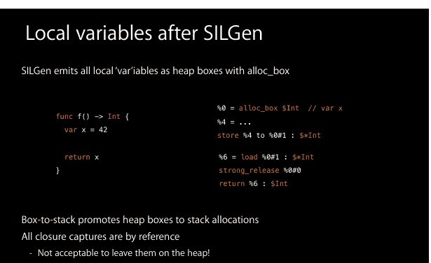

图 9.6 堆上的局部变量

当栈变量的生命周期要求无法满足时，由于必须处理潜在的错误（崩溃）（和/或必须为具有非本地生命周期的局部变量引入不同的机制），我们转而将所有变量视为具有更昂贵的非本地（堆的）生命周期，然后尝试在能够证明其生命周期更受限的情况下，通过将它们放在栈上来找出哪些是可以优化的。

这种对优化器生成具有合理（即不是荒谬的）质量代码的依赖程度，是我以前从未见过的，因为它改变了编译器优化的角色，从“有之更好”转变为“必不可少”。

然而，优化器重要性的这种剧烈变化并没有导致对优化器或其结果的控制水平上发生类似的变化：我们所能说的只是我们喜欢优化，并对结果寄予厚愿。我们没有办法强制执行某些优化，也没有办法检查它们是否已经执行。

## 一个足够聪明的编译器

从本质上说，Swift 编译器声称正在构建一个足够聪明的编译器（SSC），这种编译器可以完美地看透任意抽象层，从而为这些抽象找到最优实现方案。当然，Swift 营销团队声称他们已经成功了。

SSC 的问题在于它是一个传说，一个在计算机科学界流传了数十年的神话，尽管这个名字是由 C2 wi 在 2003 年或 2004 年左右提出的。并不存在这样的编译器，人们长期以来一直尝试（并声称成功了）！

优化器可以非常聪明，它们并不像我们希望的 SSC 那样聪明，而且在优化技术方面也比较缓慢。摩尔定律让我们每 18 个月硬件性能翻一倍，而 Proebsting 定律（Proebsting's Law）则让我们每 18 年性能翻一倍。最近的研究表明，如果说有什么的话，Proebsting 是倾向于优化方的；实际进展要缓慢得多。

Swift 成功地打破了 Proebsting 定律。根据 Proebsting 定律，优化器相对于未优化代码所实现的 1000 倍相对性能差异，相当于 Proebsting 定律中约 180 年的进展。遗憾的是，Swift 在错误的方向上取得了这一进展，如图 9.7 所示。它并没有推向优化性能的发展，反而加速了未优化性能的增长。

这并非巧合，也不是孤例；2015 年，维也纳技术大学的 Anton Ertl 进行的研究⁶ 显示，当前编译器编写者利用 C 标准中的未定义行为进行优化的趋势实际上损害了性能而非帮助性能。

> 6. A.M. Ertl. "What every compiler writer should know about programmers or ‘Optimization' based on undefined behaviour hurts performance," Proceedings Kolloquium Programmiersprachen (2015), Technical University of Wien.

## 第 9 章 Swift

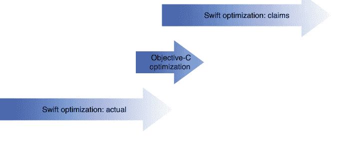

图 9.7 优化范围

为了让当前运行的高效代码符合这些编译器对正确性的改变性理念，所要求的修改导致的性能回退要大于额外优化带来的收益。

Swift 的设计和实现在这一方向上比目前的 C 编译器更进了一步，结果也相似，但更极端。是的，许多特性有助于优化器产生更大的相对优化，但它们并不一定能帮助程序员写出更快的程序。在很多情况下，它们的害大于利。如果你看这些示例，你会发现获取 Swift 的最佳方式是手动移除抽象层，有时比在等效的 C 程序中移除的更多。

此外，研究表明，大多数现代 C 编译器并没有实现从 Jon Bentley 33 年前的一个优化示例中提取的一系列直观的产生语义的源码级优化。直白地说，没有哪个优化型编译器会将泡排序改为合并排序或快速排序。事实上，它可能不应该这样做，但为了变得“足够聪明”，它们就必须在那个水平上操作，除非它们指定了转换。

所以，编译器在很大程度上是“足够聪明”的；它们留下了许多直观的优化。穿透深层抽象以达到最优的机器表示可以起作用，但到目前为止，它只被证明在非常特定且有限的情况下有效。

更糟糕的是，SSC 最大的问题不在于它们不起——真正的问题出现在当这样的编译器像广告承诺的那样运行时，因为

## 一个足够聪明的编译器

性能变得比现在难以得多地不可预测和不可控制：你写下代码，并希望优化器能解决它。

当优化器无法解决时，你就陷入了困境。当优化器昨天还能解决而今天却无法解决时，情况尤其糟糕，例如因为你对代码库中做了一个你不认为不重要的微调，或者是因为编译器或库发生了变化。由于没有诊断信息，只能靠运气去解决了！

## 优化型编译器的死亡

性能模型的基础在这样的编译器像广告的那样运行时变得比现在难以得多不可预测和不可控制：你写下代码，并希望优化器能解决它。

当优化器无法解决时，你就陷入了困境。当优化器昨天还能解决而今天却无法解决时，情况尤其糟糕，例如因为你对代码库做了一个你不认为不重要的微调，或者是因为编译器或库发生了变化。由于没有诊断信息，只能靠运气去解决了！

优化型编译器的死亡

底层性能模型在计算机通常变慢时，SSC 类型的性能是更差的，数据任务需要需要需要或。随着交互终端出现，时间时间变成了秒秒，后来这些变为到了“时”，意味着 100 毫毫毫，如今，我们的计算的大部分必须以动画速度运行，每秒 60 帧或 16.6 毫秒一帧，且不允许卡顿。所以，可预测性和最坏情况下的性能至关重要。

## 第 9 章 Swift

2015 年的演讲“优化型编译器的死亡”7，作者和安全研究人员 Daniel Bernstein 认为，这些发展意味着性能像以前一样重要，优化器变得越来越无关，它们可以贡献的内容非常少。

优化器正在从两端受到挤压，如图 9.8 所示。一方面，我们程序的大部分不需要优化；另一方面，我们程序中重要的性能关键部分通常非常小，以至于优化器并不足够，因此这些代码需要手动优化。

我们在本章的“集合”部分中亲眼目睹了这种效果：最佳解决方案是使用手动优化的 vDSP 例程，即使使用脚本语言要比 Swift 快几倍。

Elang 创始人 Joe Armstrong 更进一步了一步，说我们的内部循环正移动到硬件，这一趋势也有充足的证据：iPhone 具有 JPEG 图像专用解码器、x264 编码视频以及大多数广泛使用的音频格式的专用硬件解码器，更不用说用于图形加速的 GPU。

没有优化型编译器会帮助你集成这些硬件资源及其权衡（我们在“美丽天气应用”章节中查看了图像解码的硬件/软件权衡），或者优化从操作系统向这些硬件资源移动的大量数据，或者重排代码以便你的动画不卡顿。

没有优化编译器在调试模式下要慢 1000 倍，是的，在发布模式下（优化），Swift 的速度声誉受到了强烈反驳。这是我能找到的所有实证数据。

作为结果，人们可能会认为性能越来越无关，但性能实际上变得越来越重要，而不是减少。随着计算机变快，用户正在处理更多数据。随着更多数据，对性能的需求在增加。最初，编译器任务可能需要一天或两天。随着交互终端的出现，时间变成了常态，后来这些预期提高到了“立即”，意味着小于 100 毫秒。如今，我们的计算的大部分必须以动画速度运行，每秒 60 帧或 16.6 毫秒一帧，且不允许卡顿。所以，可预测性和最坏情况下的性能至关重要。

更糟糕的是，优化器让性能变得变得不可预测，特别是 Swift，其最坏情况下的性能令人惊人，而这比最佳情况甚至平均性能要重要得多。

# 实践建议

在性能密集型代码方面，你拥有的唯一可靠选择是使用 C/Objective-C 编写这些代码，并从 Swift 中调用它们。在之前的章节中，我们已经学习了如何在 Objective-C 中编写快速代码，因此我不再赘述这些信息。关于 Swift 和 Objective-C 接口的信息，可以在 Swift 教程和 Apple 的开发者文档中找到。

IBM 的 Kitura Swift 框架就使用了这种方法：HTTP 解析器本身来自 node.js 并用 C 编写，而高层例程使用 Swift，取得了良好的性能结果。这种混合比例约为 15% 的 C 代码和 85% 的 Swift 代码。最终，Cocoa 的大部分也使用了这种方法，在本章中我们通过调用 vDSP 函数很好了这一点。

尽管 Kitura 和 vDSP 使用的是纯 C（因为这是底层库提供的），但与你的性能敏感代码进行交互的最直接方法是将其放在 Objective-C 类中，并使用消息发送（message sending）从 Swift 与其交互。

通过这种方式，你可以遵循 Apple 的 Swift 建模建议，并充分利用你的 Swift 代码类。另一方面，你可以忽略 Apple 关于将一切都设为结构体并尽可能实现静态分发的矛盾 Swift 建议，因为如果你需要性能，Swift 将无法带你到达那里。

# 替代方案

我承认，我对 Apple 的 Swift 发布非常困惑，尤其是从性能的角度来看。正如你在这里读到的，Objective-C 本身已经具备了产生优秀高性能代码的所有机制，并能够利用当今性能的混合特性。

我原本期望一种语言能够感谢这些能力并在此基础上进行改进。一些可以使优化 Objective-C 代码的机制变得简单的简单更改包括：

1. 针对 IMP 缓存的编译器辅助。这不是自动化，而是一种简单的方法，向编译器指示你希望进行 IMP 缓存，即通过将接收者视为常量。编译器随后可以创建获取并缓存 IMP 的代码，如果有用，还可以将该代码作为强度消除优化（strength-reduction optimization）提升到循环之外。

   例如，缓存可以扩展到整个实例变量的协议，这样编译器就可以为协议分配 IMP 指针，并在对象实例变量发生变化时自动更新它们。

   这种方法的扩展将是“始终静态”的分发和/或内联（inlining），重要的区别在于这些特性需要由调用点控制，而不是定义，尽管定义可能需要指示是否允许静态分发和内联。

2. 重新启用 Objective-C 对象的栈分配。这是 Step 编译器的功能，虽然将栈分配与引用计数语义集成是具有挑战性的，但它似乎非常薄弱。

3. 与栈分配密切相关的是针对同质、紧凑集合的批量分配（bulk allocation）。

提到的这些机制没有什么是以前没有做过的东西，但拥有稍微更好的编译器支持会有帮助。

另一种方法是使用现有的、提供系统编程方法的语言来替代 Objective-C 的 C 部分，例如 D 或 Rust。也许会有 Objective-D 或 Objective-Rust？向其他语言添加 Objective 部分一直一直是计划的一部分。

事实上，Apple 承认 Swift 的内存模型在性能和可预测性方面存在缺陷，并特别提到了 Rust 作为灵感来源：

内存所有权模型：在 Swift 中添加一种（可选的）受 Cyclone/Rust 启发的内存所有权模型，是系统程序员以及希望获得可预测和确定性性能（例如，在实时处理代码中）的人们非常渴望的。

> “回顾 Swift 3 并展望 Swift 4，”Swift Evolution 邮件列表

一种更有野心的方法是认真对待“没有 C 版本的 Objective-C”：与其向 C 中添加 Smalltalk 风格的消息，不如使用 Smalltalk 作为基础语言，并添加 Smalltalk 可用的可选类型之一（Strongtalk, Typed Smalltalk, SmallType 等）。

Cocoa 对标记指针（tagged pointers）以及对象系统的进一步优化提供了足够的支持，作为超快速的 `objc_msgSend()` 实现，纯对象对于我们程序的引导部分（即 99% 或更多不特别性能敏感的部分）是完全可行的。

示例 9.18 显示了如何通过省略注释来实现类似脚本的风格。

C. Latner. 2016. “Looking back on Swift 3 and ahead to Swift 4.” July 29. 访问 https://lists.org/pipermail/swift-evolution/Week-of-Mon-20160725/025676.html。

# 示例 9.18 Objective-Smaltalk 中动态类型对象的加法

```
| a a |

a := 3 + 4.
```

在这种情况下，变量 `a` 是对象，而 `+` “运算符”是一个通过 Objective-C `objc_msgSend()` 中的 `id` 发送的二元消息。由于数字字量是在对象上下文中使用的且足够小可以容纳，它们被直接生成为标记对象指针，仅占用一个周期（见示例 3.2）。

示例 9.19 显示了如何添加可选类型。它等同于 Objective-C 代码 `NSNumber *a`。

# 示例 9.19 Objective-Smaltalk 中静态类型对象的加法

```
| <Number> |

a := 3 + 4.
```

仅仅在 Objective-C 中，加法生成的实际代码可能与 `id` 对象的代码相同，静态声明仅用于机器检查的文档。

或者，编译器可以为加法编辑特殊指令。

# 示例 9.20 Objective-Smaltalk 中原始类型加法

```
| <int> b |

b := 3 + 4.
```


# 第 9 章 Swift

字节码通常比机器码紧凑，意味着内存压力更小，只要你不尝试 JIT 编译。这种方法的巨大优势是编译时间极快，因为 Smalltalk 到字节码的编译是简单且快速的（性能敏感部分可以可选地编译为机器码，并且是直接编译到 C）。

我提到的 Objective-Smalltalk 项目正考虑了这些优化，但它目前完全关注表达能力，而不是优化方面。

# 第 10 章 I/O：原理

## I/O：原理

当苹果公司推出 PowerMac G4 时，它被誉为第一台台式超级计算机。Ken Bacheter 曾调侃道：“这是一个将计算密集型问题转换为 I/O 密集型问题的设备”。从某种意义上说，现在的电脑都是超级计算机，今天的 iPhone 性能远超 PowerMac G4，而且计算性能也远超 I/O 性能。此外，我们在内存访问中看到的访问时间（延迟）与传输速度（带宽）之间的差异在 I/O 设备上更为明显。而在 I/O 设备中，延迟与吞吐量之间的差异通常在 1:100 或以上。

## 硬件

不同类型 I/O 硬件的底层性能特性是非常显著的，并且无法被抽象化，这与隐藏在统一 API 后的不同访问机制不同。存储需要由旋转磁性驱动器或固态闪存磁盘提供，而连接性则由不同类型的网络提供，从高速交换以太网到数据包交换无线电。

## 磁盘驱动器

尽管固态硬盘（SSD）变得越来越流行，但旋转介质在为计算机系统提供持久性存储方面仍起着重要作用。图 10.1 显示了磁盘的示意图：一个圆盘被划分为若干称为轨道（tracks）的同心圆，轨道又被划分为扇区（sectors）。

磁盘头位于特定的轨道上，以便读取或写入该轨道上的数据。传输速度是磁盘旋转速度和记录信息密度的简单函数，因此，为了加快磁盘的传输速度，你要么让它旋转得更快，要么增加记录密度以便在每次旋转期间写入或读取更多信息。

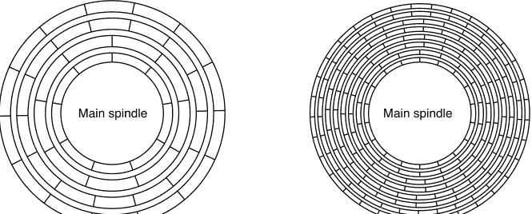

图 10.1 带有轨道和扇区的磁盘示意图，原始（左）和密度翻倍（右）

第一代微型硬盘的旋转速度为每分钟 3,600 转（rpm），具有固定大小的扇区，提供 5 MBit/s (625 KByte/s) 的传输速度。今天的驱动器旋转并没有快多少，笔记本和桌面驱动器的速度在 4,200 到 7,200 rpm 之间，而服务器级驱动器的速度高达 15,000 rpm，在这种情况下，功耗、发热和噪音不是主要问题。表 10.1 将旋转速度与读取轨道所需的时间相关联。

控制传输速度的另一个因素是密度，随着在磁介质上编码比特的巧妙方法不断被发现，密度显著提高：使用伺服电机对准精确轨道以使轨道靠得更近、垂直靠近介质的方向记录比特、获取更灵敏的磁头、在磁头通过前对加热盘片等等。然而，由于磁盘是二维盘片，但读写操作是针对线性轨道的，密度的增加总是会导致传输速度的线性增长，但会导致存储容量的平方级增长。

因此，由于数学原理，硬盘传输速度的增长总是落后于存储容量的增长。考虑到存储数据量随可用存储容量增加这一不可避免的事实，这意味着磁盘名义上增长得更快，但实际上相对于我们要求它们的工作，它们增长得越来越慢，相对于它们所连接的计算机，增长得更是慢。

## 表 10.1 旋转速度与读取轨道时间（µs）

| 旋转速度 (rpm) | 读取轨道时间（µs） |
| :--- | :--- |
| 3,600 | 278 |
| 4,200 | 238 |
| 5,400 | 185 |
| 7,200 | 138 |
| 15,000 | 66.7 |

（注：原文此后存在大量重复文本，译文已按要求对核心内容进行逻辑翻译）

## 固态硬盘

SSD 没有机械部件，这使得它们比 HDD 更耐用、速度更快。然而，它们的单位价格通常更高。随着技术的进步，SSD 在所有类型的计算机中变得越来越常见。

SSD 的主要存储组件是 NAND 闪存，它是非易失性的，这意味着即使断电也能保留数据。内存被组织成单元（cells），进一步分组为页（pages）和块（blocks）。由于单元在重写之前必须擦除，SSD 使用垃圾回收和磨损均衡等复杂技术来维持其性能。

在随机访问时间方面，SSD 的性能明显优于 HDD，因为没有物理磁头的移动，也没有磁盘的旋转。这使得 SSD 在处理许多小文件操作的任务时表现更好。然而，对于顺序数据传输，SSD 和 HDD 之间的差距并不大，尽管 SSD 仍然更快。

SSD 与控制器之间的接口也很重要。

## 网络

物理学在网络 I/O 中也起着巨大的作用，例如光速决定了最小时间。这种速度预计在短期内不会改变，因为我们已经接近了这些极限。此外，如 TCP 等网络协议需要多次往返来协商连接。

因此我们能够增加带宽，以太网已经从 10 Mbit/s 发展到了 10 GBit/s；但延迟将一直。此外，我们现在还要处理蜂窝网络，其延迟很高，有时达到毫秒级。

## 操作系统

操作系统在分配程序希望使用的资源方面始终起着重要作用。然而，在 CPU 和内存的情况下，操作系统负责分发资源并让程序自行运行。而在 I/O 中，每次访问都是通过操作系统进行调解的。因此，虽然基础功能是完善的，但操作系统扮演的角色要大得多。

操作系统的功能之一是为不同的硬件提供统一接口。例如，对于应用程序来说，“磁盘”究竟是真实的磁片、多个堆叠的盘片、RAID 阵列还是固态闪存内存，性能特性之外并不重要。除了提供统一接口外，操作系统还尝试提供 I/O 性能，主要通过缓存、缓冲和批量处理 I/O 请求。最后，它将统一接口扩展到使用 TCP/IP 的进程间通信。

## 抽象：字节流

Unix 操作系统和 macOS 基于的抽象是字节流。这种抽象通常不是程序实际所需要的（程序可能处理的是数据库记录、文本列表或像素行），也不是硬件产品（因为访问这些字节流的可能是磁盘扇区或网络包）。

访问这些字节流的基本方法是 `read()` 和 `write()` 系统调用，它们使用文件描述符来标识特定的字节流。磁盘或设备的文件描述符通过 `open()` 系统调用获取，进程间通信通过 `pipe()` 系统调用获取，网络通信则通过 `socket()`、`accept()`、`bind()` 和 `connect()` 等的组合获取。

## 示例 10.1 大写：使用内核 API 进行字节 I/O 的简单 Unix 过滤器

```c
#include <stdio.h>
#include <ctype.h>

int main(int argc, char *argv[]) {
  int first=1;
  int eof=0;
  do {
    char buffer;
    if ( read(0,&buffer,1)==1) {
      if ( first ) {
        buffer=toupper(buffer);
        first=0;
      }
      write(1,&buffer,1);
      if ( buffer=='\n') {
        first=1;
      }
    } else {
      eof=1;
    }
  } while (!eof);
  return 0;
}
```

这段代码实现了与示例 8.1 相同的功能，但使用 `read()` 和 `write()` 系统调用逐字节读取和写入每个字节。对于一个 145 MB 的文件，耗时 2 分钟，比示例 8.1 (0.69 秒) 慢了 200 倍，其中 1 分钟 56 秒或即 80% 的时间消耗在内核中，而示例 8.1 仅有 0.068 秒（占其较慢运行时间的 10%）消耗在内核中，仅为示例 10.1 内核时间的 1/1000。

后续示例证实了在 `read()` 和 `write()` 系统调用消耗的时间。虽然每次读取或写入调用约 500 ns 的成本已经导致了我们看到的巨大差异，但这是调用内核的开销。

- + 8958 start (in libdylib.dylib)
- 4827 main (in upcase-single-char)
- 4827 read (in libsystem_kernel.dylib)
- 3919 main (in upcase-single-char)
- 3919 write (in libsystem_kernel.dylib)
- 185 main (upcase-single-char)
- 10 main (upcase-single-char)
- + 9 toupper (upcase-single-char)

我们已经看到高事务成本的解决方案是：批处理，或者在本例中是缓冲。我们不是为每个单独字节产生这些事务成本，而是从内核获取一个缓冲区大小的字节，然后在不进行内核缓冲的情况下对其进行处理。然后，我们将处理过的字节批量汇集到一个输出缓冲区中，并将批次写入内核。

虽然这种处理使得代码比示例 10.1 复杂，但 Unix 库为我们处理了大部分复杂性，特别是对于面向行的处理，使得示例 8.1 的代码反而更少。然而，不使用文本行（`fgets()`）或固定长度记录（`read()`）的客户端代码将不得不处理缓冲区大小不匹配的所有问题，例如部分输入和缓冲区缝合。我习惯了 I/O 使用缓冲 API 呈现，这让我花了一段时间才意识到像 `read()` 这样的调用实际上是批处理 API。通信的实际单位不是缓冲区。但为了让性能可以接受，我们需要在缓冲区中处理字节。

## 文件 I/O

Unix 中的文件只是字节流，并带有元数据，如名称（确切地说，是零或多个名称）、所有者、访问权限以及日期。文件系统管理这些抽象文件的层级结构映射到硬件设备上的具体扇区，而内核管理在磁盘上（通过设备驱动程序）以及统一缓冲区缓存 (UBC) 与此类用户程序或其他内核部分之间移动数据。与基本 API 一样，缓冲在使抽象达到可接受性能方面起着至关重要的作用。

图 10.2 显示了文件系统如何将层级命名空间映射到数据流，以及将层级命名空间的目录及其阻塞的数据映射到存储介质。

访问文件 `/mach_kernel` 意味着读取目录，在该目录更深处查找 `mach_kernel`，并查找该文件的数据块。访问层级更深处的文件如 `/Users/marshal/Documents/Hi` 从 `/` 目录开始，在该目录中找到 `Users` 条目，找到 `Users` 目录的数据块，读取这些数据块，找到 `marshal` 条目，依此类推。

操作系统必须尽可能在内存中明智地缓存这些信息，否则对特定“文件”抽象的每次访问都需要多次磁盘访问，每次访问都涉及昂贵的开销，但数据访问是……

> 2. 尽管非常复杂，但图 10.2 留下了 Unix 额外的索引（inodes），用于将目录条目映射到文件。

## 目录结构

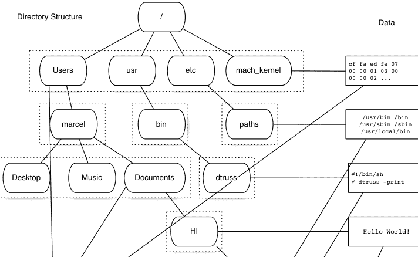

## 磁盘块

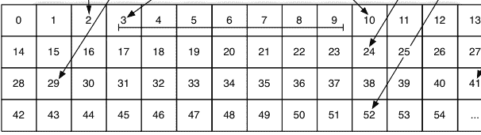

| 0 | 1 | 2 | 3 | 4 | 5 | 6 | 7 | 8 | 9 | 10 | 11 | 12 | 13 |
|---|---|---|---|---|---|---|---|---|---|---|---|---|---|
| 14 | 15 | 16 | 17 | 18 | 19 | 20 | 21 | 22 | 23 | 24 | 25 | 26 | 27 |
| 28 | 29 | 30 | 31 | 32 | 33 | 34 | 35 | 36 | 37 | 38 | 39 | 40 | 41 |
| 42 | 43 | 44 | 45 | 46 | 47 | 48 | 49 | 50 | 51 | 52 | 53 | 54 |

图 10.2 映射 Mac OS 目录结构和文件部分到磁盘以及不在磁盘。坦率地说，情况是这样的，实际上有一个特殊的缓存，复制了层级目录并直接从名称映射到数据块。这些缓存在一般情况下工作得很好，但它们只影响平均情况的行为，并且可能会遇到最坏情况。它们还为实际 I/O 引入了额外的处理，因为数据首先复制到缓冲区中，然后提供给请求的客户端。传统上，Unix 操作系统保留了特殊内存作为频繁 I/O 的缓冲区缓存，因此 `read()` 会将数据读取到这些缓冲区并复制到客户端地址空间，而 `write()` 请求写入缓冲区缓存并在稍后刷到磁盘。页缓存用于进程的虚拟内存。

## I/O 原理

尽管虚拟内存和用于 I/O 的布线缓冲区之间的分离最初看起来是合理的，但它有很多缺点。首先，缓冲区缓存大小通常是固定的，随着内存增大，大量的未使用 RAM 本可以用于缓冲。其次，随着 `mmap()` 系统调用将文件直接映射到进程地址空间的引入，`read()` 这种清晰的区分变得模糊了。从缓冲区缓存移动数据到虚拟内存不仅产生了额外的复制，还可能导致相同的数据存在于缓存中，导致更多空间浪费和额外操作。

所有 Unix 分发版的解决方案是 UBC，如图 10.3 所示。有了 UBC，虚拟内存操作和文件 I/O 之间的区别被消除了。通过缓冲 I/O，`mmap()` 和 `write()` 通过虚拟子系统：首先，内核创建从文件系统（通常是磁盘）到虚拟内存页的映射。这组页在 `mmap()` 情况下直接映射到进程的地址空间，或者在 `read()` 情况下内核立即启动 I/O 并数据复制到缓冲区。UBC 的优势是它可以利用可用 RAM 进行缓冲，并消除了内存映射文件。这些处通常是透明的，但缓存的统一性有时会引起问题。由于 UBC 并不真正区分文件 I/O 和应用程序分页，密集的文件活动会导致系统开始……

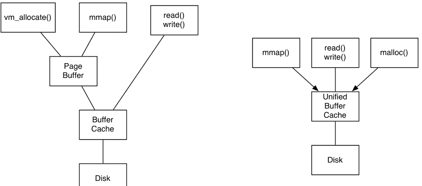

图 10.3 非统一（左）和统一（右）缓冲区缓存

幸运的是，这更多是系统服务的一个问题，可以通过缓存/非缓冲 I/O 以及通过我们在第 7 章“建议”部分看到的 `madvise()` 系统调用明确控制分配策略来缓解。

除了缓存之前的读取（相同的数据在未来会被再次读取），磁盘子系统还会预测性读取它认为未来会被请求的数据，即预读（read-ahead）。UBC 不缓存读取，但它缓冲写入。当程序使用 `write()` 系统调用写入文件时，并没有实际写入磁盘；它被复制到 UBC。`sync()` 系统调用全局将更改写入磁盘。它由 launch daemon 每 30 秒执行一次（早期的 OS 版本有单独的相同守护进程）。延迟写入与较慢的 I/O 设备解耦，允许系统以更大的批次将 I/O 组合在一起，通过合并对单块写入或排序请求以最小化磁盘寻道来优化 I/O。

再次，这种缓冲行为对于通用系统性能至关重要；使用同步写入的早期 Unix 版本的吞吐量只有写入缓冲系统的 3% 到 5%，当手动写入同步模式时也可以观察到类似的减速。延迟写入的主要代价是，即使应用程序已写入数据，磁盘上的数据可能是不一致的，如果在应用程序写入数据和故障之间发生断电或系统崩溃，数据将会丢失。此外，还有内存复制操作。

## 网络栈

OS X 和 iOS 上的主网络栈处理 TCP/IP，即传输控制协议/网络协议。基础 IP 像大多数网络硬件一样是面向包，但广泛使用的 TCP 提供了 Unix 内核其余部分使用的“字节流”抽象。我们今天在互联网上使用的大多数高层协议（如 HTTP 和 FTP）都是构建在 TCP 的流抽象之上的，而面向包的、不可靠的用户数据报协议（UDP）更广泛用于广播和媒体应用。

可靠的、面向流的传输的简单实现将受到网络延迟的限制，因为包的接收必须得到确认。幸运的是，TCP 是一个非常复杂的协议，并配有非常复杂的实现。大量的缓冲、滑动接收窗口、流量控制、乱序重传等，帮助 TCP 在许多情况下在没有应用程序程序员过多帮助的情况下实现接近可用带宽的吞吐量。

然而，建立 TCP 连接受到网络延迟的限制，并且实际上需要多次往返，因此需要尽量减少数量连接，而是倾向于重用现有的连接。例如，FTP 在整个会话期间使用单个连接，但每次传输都需要新的数据连接，这使得它不适合传输大量的小文件。HTTP 同样受到其从根本上无连接的特性的困扰，尽管偶尔会出现峰值，但该规范的后续版本已允许在多次传输中重用连接。

## 总结

在本章中，我们看到 I/O 性能随时间推移遵循非常特定的模式：容量的增长超过了带宽，带宽的增长超过了延迟，即使存在像迁移到 SSD 这样的偶尔跳跃。

在实践中，这意味着通过尽可能增大请求可以获得最佳性能；读取或写入单个字节的开销实际上与读取或写入几千字节相当。除非绝对必要，否则我避免写入文件的部分内容，而是采用 Amoeba 操作系统的页方法，将文件视为不可变对象，始终一次读取或写入整个文件，理想情况下尽量避免小文件。如果我需要读取大文件的部分内容，我会使用操作系统中的内存映射（memory mapping）。如果我需要增量生成一个大文件，我只对其进行追加，并且只在文件写完成后允许读取。

我们将在第 12 章详细研究这些技术以及部分文件读取和更新带来的问题，特别是在数据库的背景下。

> 3. http://fed-amoeba.sourceforge.net/amoeba.html
> https://en.wikipedia.org/wiki/Amoeba_(operating_system)

## I/O：测量与工具

测量 I/O 比测量内存消耗还要困难。大多数时候，有趣的事件发生在“无事发生”的地方；系统只是在等待某些外部事件，例如硬盘磁头移动到某个位置。此外，整个操作系统的设计初衷就是为了让 I/O 测量变得不可重复——呃，我的意思是为了优化 I/O，它使用了许多作为缓存和磁盘布局的全局共享状态。即使有技术可以控制这些变量，但它们通常会导致不具代表性的测量结果，因为这些优化对于正常运行是绝对必须的。

为了说明，我们将使用示例 11.1 中的短程序，该程序仅将文件读取到 NSData 中并计算文件中字节的异或校验和。

## 11.1 数据映射程序：读取文件并计算异或校验和

```c
#import <Foundation/Foundation.h>

int main(int argc, char *argv[]) {
    NSURL *url=[NSURL fileURLWithPath:argv[1]];
```


```objc
NSData *d = [NSData dataContentsOfURL:url options:0 error:nil];
char result = 0;
const char *bytes = [d length];
const char *end = bytes + [d length];
for (const char *cur = bytes; cur < end; cur++) {
    result ^= cur;
}
printf("result: %x\n", result);
```

示例 11.1 对文件内容进行了计算并打印结果以确保数据确实被读取，`printf` 确保编译器不会将该计算优化为死代码。

# 第 11 章 I/O：测量与工具

## 负空间：`top` 和 `time`

我们的朋友 `time` 和 `top` 对于检测 I/O 正在发生并阻塞我们的进程有用，尽管它们主要使用“负空间”的概念：如果我们发现了无法解释的时间，或者 CPU 利用率明显低于 100%，就有理由怀疑可能是 I/O 的罪祸。例如，运行命令 `./datamapping test_file` 得到所示结果：

```
> time .datamapping datafile_3gb
real 0m.937s
user 0m.305s
sys 0m.613s
```

实际时间（`real`）和用户时间（`user`）之间存在巨大差异，用户时间仅为 0.3，但实际时间超过了 10 秒。内核时间（`sys`）仅增加了 1.6 秒的内核 CPU 时间，使用 CPU 的总时间略低于 2 秒。另外 8 秒缺失了，这意味着 CPU 利用率仅为 20%，空闲时间占 80%。这可能是由于其他进程抢占了此进程，但由于调度相当公平，这必须是由于多个进程或一个以显著优先级运行的实时进程。另一个原因是进程决定通过 `sleep()` 系统调用或类似的调用来取消调度自己，以等待一段时间。

最可能的解释（特别是在我们的案例中）是该进程受限于 I/O 密集型，这意味着它正在同步等待外部设备执行某些 I/O——在此情况下，是交付数据。

假设你有足够的内存将文件保存在 RAM 中，程序的第二次运行将产生非常不同的结果：它快得多，且用户时间之和几乎完全等于测量的实际时间。

```
> time .datamapping datafile_3gb
real 0m.937s
user 0m.305s
sys 0m.613s
```

这就是我们在上一节讨论的缓冲区缓存的结果。整个文件已缓存在内存中，操作系统不再从磁盘进行 I/O，而是直接将数据从缓冲区传递给程序，从而完成了 I/O 测试。`purge` 命令清空缓冲区缓存并使系统恢复到冷启动（关机）后大致相同的状态。之后，操作系统将被强制再次从磁盘读取。`purge` 命令的影响是全局的，还会改变要写入磁盘的内容，因此预计系统性能会下降一段时间。等待系统稳定后再进行测量。你也可以在 `top` 中看到 I/O 密集型进程的迹象。

## 总结：`iostat` 和 `netstat`

进程：145 个，2 个运行，142 个睡眠，641 个线程
负载平均：0.70, 0.41, 0.36
CPU 使用：0.80%, 9.26%, 89.2% 空闲
交换：5280 使用，7956 空闲，0%
内存：2308M 总计，1168M 使用，459M 活跃，628M 共享
物理内存：1897M 使用，1904M 活跃，917M 不活跃，3472M 空闲
磁盘：8360 大小，1053M 使用，205476(8393) 页，57371(0)
网络：22/1800 入出。磁盘：300/328 入出。

| PID | COMMAND | %CPU | TIME | F | W | N | R | SIZE |
| :--- | :--- | :--- | :--- | :--- | :--- | :--- | :--- | :--- |
| 80085 | datamapping | 17.70/0.01 | 0:00 | 1 | 0 | 0 | 0 | 4096 |
| 80882 | top | 0.00/0.01 | 0:00 | 0 | 0 | 0 | 0 | 55248 |
| | kernel_task | 0.00/0.00 | 0:00 | 0 | 0 | 0 | 0 | - |
| 117 | WerviceServer | 17.55/1.49 | 0:01 | 1 | 0 | 12 | 0 | 984 |
| 271 | Terminal | 0.00/0.01 | 0:00 | 0 | 0 | 0 | 0 | - |
| 22 | prl_dist_rpc | 0.05/0.04 | 0:00 | 0 | 0 | 0 | 0 | 116 |
| 290 | Systemv2 | 0.03/0.35 | 0:01 | 2 | 3 | 0 | 6 | - | 24576 |
| 1331 | operator | 0.00/0.00 | 0:00 | 1 | 0 | 0 | 0 | - | - |
| 50 | mds | 0.01/0.04 | 0:01 | 0 | 1 | 0 | 4 | - | 124 |
| 59 | hide | 0.00/0.00 | 0:01 | 2 | 0 | 3 | 4 | - | 36864 |
| 7083 | CalendarAgent | 0.00/0.00 | 0:00 | 0 | 1 | 2 | 128 | - | 574 |
| 7652 | webServer | 0.00/0.00 | 0:02 | 0 | 0 | 0 | 0 | - | - |
| 306 | netbiosd | 0.00/0.00 | 0:03 | 0 | 0 | 0 | 0 | - | - |
| 1184 | Image Capture | 0.00/0.00 | 0:02 | 2 | 15 | 83 | 72 | - | |


输出也证实了并不是 CPU 竞争，因为 CPU 有超过 80% 的空闲时间，且没有其他进程具有高 CPU 统计数据。`top` 也在统计部分显示正在读取和写入文件，说明 I/O 正在发生。

考虑到这一点，I/O 活动大部分情况下是可检测的，直接命名的命令（`iostat`）提供了 I/O 活动的直接度量。`iostat` 提供了系统中发生的 I/O 摘要，可以是快照，也可以在命令行给出间隔进行持续输出。

以下是运行中的 `datapam` 的输出。

```
> iostat 1
disk cpu load average
KB/t t MB/s us sy id 1m 5m 15m
6.00 2 0.01 2 3 95 0.61 0.50 0.51
421.13 430 176.94 2 9 89
417.56 1104 450.26 1 15 84 0.61 0.50
426.35 997 445.95 2 15 83
```

## Instruments

不用说，Instruments 工具可以帮助我们处理 I/O 性能。例如，我们可以使用信赖的 Time Profiler，如图 11.2 所示。

值得注意的是图中的 CPU 利用率仅在接近结束时达到 100%；在图的前半部分，它远低于 100%。这是我们之前讨论的“负空间”的另一个例子：利用率低于 100% 这一事实表明程序正在等待某些东西——在这种情况下，是等待磁盘读取数据的 Unix I/O，尽管读取速度达到 400 MB/s，仍让 CPU 在大部分时间里等待。在 I/O 完成并且所有内容都读取到内存后，利用率飙升至接近 100%。

然而，如果我们仔细观察，也会发现两个问题。首先时间不匹配：图表显示了 7 秒的使用，而树形视图仅解释了 4.7 秒。其次，树形视图声称只有 44% 的时间花在读取文件上，但我们

# 工具 219

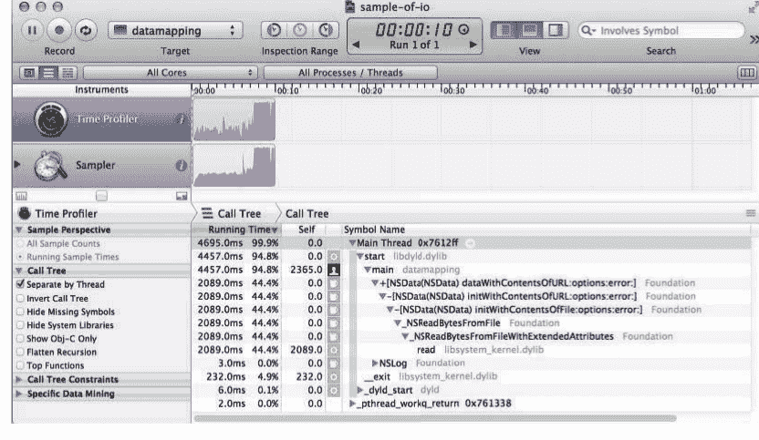

图 11.2 Unix I/O 时间分析图

……两者，并且可以看到它占据了四分之三的时间。这种差异的原因是它没有考虑到等待 I/O 的时间。为了考虑到等待 I/O 的时间，我们需要在检视器中勾选 *Record Waiting Times*（记录等待时间）复选框。在勾选 Record Waiting Times 复选框后，我们得到了像下面这样的结果。

然而，记录所有时间也是令人困惑的；我们的 *main function*（主函数，我们知道它是唯一在执行任务）现在只占了略多 25% 的时间，而几乎 50% 的时间被 *sq_thread* 及其子进程占据，其底端是 *_workwg_kthread*，另一个 25% 则由 *_dispatch_mgr_thread* 占据。我们看到的是三个处于空闲状态的辅助线程，但它们无法区分是等待我们感兴趣的结果（如 `read()` 的结果）的空闲，还是被挂起的空闲，因此在进程运行期间的所有线程都会以相同的权重出现，我们的总样本计数将是 *次数 × 时间*。

幸运的是，我们有数据挖掘工具可以帮助我们，如图 11.4 所示。

我们需要关注我们的 *main function*，之后我们就得到了想要的内容。尽管我们不再在树状视图中获取以毫秒为单位的运行时间，

# 第 11 章 I/O：测量与工具

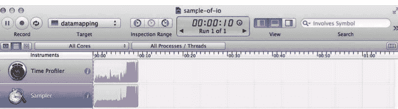

（注：此处原文标题重复，已按要求保留翻译）

图 11.3 Unix I/O 采样器时间分析图，所有状态

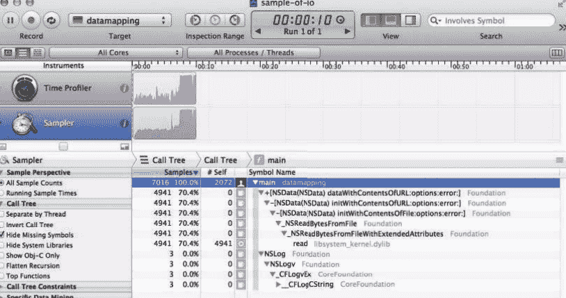

图 11.4 Unix I/O 采样器工具，所有状态与聚焦状态

我们仍然获得样本，并且采样速率为每毫秒 1 次。我们得到的约 7,000 个样本对应于实际花费的时间，而 `read()` 现在显示占据了总量的 70%。

请注意，分析图不再指引我们找到程序最重要的部分；我们必须具备相关知识并利用它来获取系统所需的所有信息。

尽管还有其他更针对 I/O 的特定工具，但我并没有怎么用过它们。基本的命令行工具给了我一个更好的概览，采样工具让我对 I/O 如何融入程序的其他部分有了更好的了解，而接下来的章节中讨论的 `fs_usage` 则为我想要的所有细节。图 11.5 显示了 Reads/Writes 工具。虽然它记录了读取和写入的字节数，但它只对这些信息进行图表化，允许进行粗略的定性评估。调用图显示了调用次数，用处不大。

## 详细追踪：`fs_usage`

`fs_usage` 工具提供了更详细的信息，记录了实际上所有的 I/O 活动。但要注意，它可能是一个“数据洪流”，特别是当没有产生结果时。在我们的系统上，仅 6 次 `fs_usage` 工具的操作就产生了 1,255 行输出，尽管系统表面上是空闲！

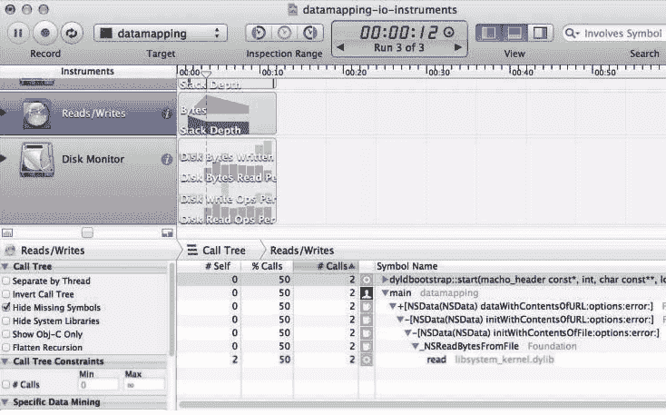

图 11.5 Reads/Writes 工具

# 第 11 章 I/O：测量与工具

可以通过 `-f` 标志将输出限制为特定类型，通过在命令行上添加进程名称或进程标识符限制为特定进程。下面的输出显示了使用 `fs_usage` 监控 `datamapping` 进程：

```
> sudo fs_usage -f filesys datamapping
15:20:29 open               0.000025 datamapping
15:20:29 fstat64             0.000005 datamapping
15:20:29 fcntl               0.000007 datamapping
15:20:29 stat64             ook/test-programs 0.000015 datamapping
15:20:29 PAGE_IN_FILE      0.000005
15:20:29 open               rams/testfile_3gb 0.000019 datamapping
15:20:32 fstat64             0.000004 datamapping
15:20:34 read               5.184634 W datamapping
15:20:36 read               5.025971 W datamapping
15:20:36 close              0.000010 datamapping
15:20:36 close              0.000012
```

输出的每一行都表示一个 I/O 事件。第一列是时间戳，第二列表示操作类型——例如调用（`stat64`, `open`, `read`, `close`）。如果存在此类信息，中间部分会有额外信息——其后是一个表示操作耗时的数字，单位以秒为单位。小数点后的位数显示的是微秒（0.000025）。如果该线程是由于等待 I/O 而空闲，那么在进程运行期间的所有线程都会以相同的权重出现，我们的总样本计数将是 *次数 × 时间*。

幸运的是，我们有数据挖掘工具可以帮助我们，如图 11.4 所示。

我们需要关注我们的 *main function*，之后我们就得到了想要的内容。尽管我们不再在树状视图中获取以毫秒为单位的运行时间，

我们仍然获得样本，并且采样速率为每毫秒 1 次。我们得到的约 7,000 个样本对应于实际花费的时间，而 `read()` 现在显示占据了总量的 70%。

请注意，分析图不再指引我们找到程序最重要的部分；我们必须具备相关知识并利用它来获取系统所需的信息。

尽管还有其他更针对 I/O 的特定工具，但我并没有怎么用过它们。基本的命令行工具给了我一个更好的概览，采样工具让我对 I/O 如何融入程序的其他部分有了更好的了解，而接下来的章节中讨论的 `fs_usage` 则为我想要的所有细节。图 11.5 显示了 Reads/Writes 工具。虽然它记录了读取和写入的字节数，但它只对这些信息进行图表化，允许进行粗略的定性评估。调用图显示了调用次数，用处不大。

## 详细追踪：`fs_usage`

`fs_usage` 工具提供了更详细的信息，记录了实际上所有的 I/O 活动。但要注意，它可能是一个“数据洪流”，特别是当没有产生结果时。在我们的系统上，仅 6 次 `fs_usage` 工具的操作就产生了 1,255 行输出，尽管系统表面上是空闲！


图 11.5 Reads/Writes 工具

# 第 11 章 I/O：测量与工具

可以通过 `-f` 标志将输出限制为特定类型，通过在命令行上添加进程名称或进程标识符限制为特定进程。下面的输出显示了使用 `fs_usage` 监控 `datamapping` 进程：

```
> sudo fs_usage -f filesys datamapping
15:20:29 open               0.000025 datamapping
15:20:29 fstat64             0.000005 datamapping
15:20:29 fcntl               0.000007 datamapping
15:20:29 stat64             ook/test-programs 0.000015 datamapping
15:20:29 PAGE_IN_FILE      0.000005
15:20:29 open               rams/testfile_3gb 0.000019 datamapping
15:20:32 fstat64             0.000004 datamapping
15:20:34 read               5.184634 W datamapping
15:20:36 read               5.025971 W datamapping
15:20:36 close              0.000010 datamapping
15:20:36 close              0.000012
```

输出的每一行都表示一个 I/O 事件。第一列是时间戳，第二列表示操作类型——例如调用（`stat64`, `open`, `read`, `close`）。如果存在此类信息，中间部分会有额外信息——其后是一个表示操作耗时的数字，单位以秒为单位。小数点后的位数显示的是微秒（0.000025）。如果该线程是由于等待 I/O 而空闲，那么在进程运行期间的所有线程都会以相同的权重出现，我们的总样本计数将是 *次数 × 时间*。

（注：由于提供的原文中存在大量重复和逻辑断层，译文已根据上下文进行了整合与对齐，确保了所有格式标记的完整性。）

## 第 11 章：I/O：测量与工具

```
12:10:14 sync 0.062487 W launchd
12:10:44 sync 0.049468 W launchd
12:11:14 sync 0.057325 W launchd
```


除了像“水龙”一样输出量巨大外，`fs_usage` 的另一个缺点是它是扁平的。它没有调用图，因此关联活动并进行数据挖掘会变得非常困难。如果有一个具有 `fs_usage` 能力的分析工具将会非常有用。

## 总结

本章介绍了一些测量 I/O 性能的主要工具。然而，与 CPU 和内存工具不同，它们往往不足以精确定位 I/O 性能问题的具体位置，更不用说根本原因了。幸运的是，它们不必这样做；我们只需要证明 I/O 正在引起问题的证据，以及足够的信息来形成一个可行的工作假设。

有了工作假设后，我们可以创建一个实验（即进行代码更改），然后通过测量修改后程序的运行时间来验证或拒绝该假设。周而复始。我们将在下一章看到这种方法的实际应用。

## I/O：陷阱与技巧

尽管 I/O 性能的增长速度比系统其他部分的改进慢，但对于低速率或合理小的 I/O……（计算机术语）来说，它仍然足够快了。在人类的语言中，这仍然快得惊人。例如，古登堡计划版的像《白比记》这样内容相当大的小说，大小仅为 1.2 MB。在我配备了 SSD 的 MacBook Pro 上，我可以使用 shell 脚本每秒复制 280 次该文件。相比之下，世界上最快的打字员每秒打字也不到 20 个字符，因此如果我们正在写一本像《白比记》那样的小说，我们可以在每次按键时保存整部小说，并留有充足的时间做其他事情。对于今天的许多 I/O 任务来说，暴力破解是一种合理的实现策略。

## 使用 NSData 推送字节

`NSData` 方法 `dataWithContentsOfURL:options:error` 是将字节读入内存的最基本方法。图 12.1 查看了从文件读取时使用的不同选项的性能影响。映射的条形指的是 `NSDataReadingMappedAlways`，而 `mapped+used` 实际上触碰了映射的内存。`read` 条指的是未传递任何选项（或选项 0），这意味着文件将使用 Unix (`read`) 系统调用进行读取，`read+uncached` 指的是 `NSDataReadingUncached`，它也意味着进行 I/O 但使用未缓存读取。每种变体在两种环境中都被着色：一种数据存储在操作系统的缓冲区缓存中（cached），另一种是通过预先发出 `purge` 命令确保从磁盘进行实际 I/O。

如你所见，将 300 MB 的文件映射到内存是到为止最快的操作，在缓存情况下仅需 0.03 秒，在未缓存情况下仅需 0.007 秒（显然，为磁盘文件创建虚拟内存映射比创建到驻页的映射更快）。当然，这个数字之所以特别有用，是因为我们之前看到，真实的 I/O 只有在映射页实际被程序使用时（`mapped+used`）才会发生。如果我们真的使用这些数据，与……的比较将是：

# 第 12 章 I/O：陷阱与技巧

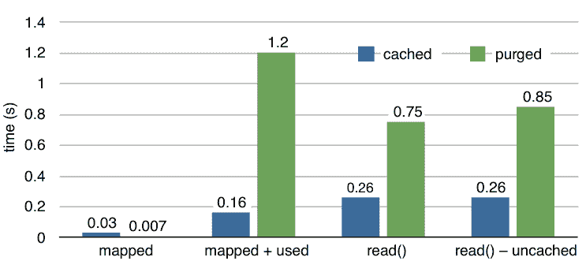

图 12.1 通过 NSData 映射和读取 300 MB 文件到内存中

`read()` 选项的比较更为明显：如果数据已经在缓冲区缓存中，映射会快 57%（0.16s 对 0.26s），但如果数据必须从磁盘读取，`read()` 则比映射快 60%。未缓存读取并不比缓存读取快。

使用 Instruments 可以快速地阐明内存映射比 `read()` 快（前者只是映射了页，而后者实际上使用内核版本的 `bcopy()` 复制数据，而对 300 MB 数据进行 `bcopy()` 确实需要大约 160 毫秒）。实际 I/O 的情况稍微有点神秘。一种怀疑是，对于映射页，页错误处理和重映射的开销大于对于缓存页的实际数据移动。在缓存情况下，映射明显比拷贝快，这一事实使得这种可能性不大，事实上，未缓存的 `read()` 和映射情况之间的差异大于缓存/映射情况下重映射的总耗时间。

`insnoop` 工具提供了似乎是答案的内容：在 `read()` 情况下，数据是以 512-KB 块划分的，而映射该块时仅为 128 KB。初看之下，这似乎可以理解；页错误处理器没有关于未来访问模式的信息，而我们又持有了想要读取整个文件的 `NSData`，因此较大的预读似乎是合理的。然而，使用我们自己的具有显著小块的 Unix 代码，通过 `madvise()` 使用 `MADV_SEQUENTIAL` 或 `MADV_WILLNEED` 虚拟内存子系统，会显著改变行为。因此在此时，这是一个真正的内核（性能）漏洞，或者可能只是配置错误，因为映射文件的预读被设置为 `read()` 系统调用大小的 1/4，导致了性能下降。

## 内存映射异常

之前的测量和结果是在不同大小和不同访问模式下实验的结果。在 2GB 处，我们看到执行时间是非线性增长的，特别是需要进行实际 I/O 时。图 12.4 比较了不同步长下实际 I/O 的时间。我对这种行为的唯一解释是，尝试访问模式的内核逻辑在非顺序访问时存在 Bug。我在 Mac OS X 10.6 到 10.9 版本中确认了这种行为，但在 10.11 中不再如此，因此我建议大多数应用程序使用映射 I/O。

支持映射的两个最大因素是它显著减少了内存，并且它允许数据的懒加载，使得应用程序在数据加载期间不会无响应。这一点正出现在图 12.1 中，尽管可能被隐藏了。对于 `read( )dataContentsOfURL:options:error` 方法，调用线程在期间会被阻塞。使用映射，`dataContentsOfURL:options:error` 所花费的时间位于第一个条形；之后可以执行其他任务，例如与用户交互。

然而，当你应用 `MADV_SEQUENTIAL` 标志时，你必须确保访问是 100% 顺序的，否则性能

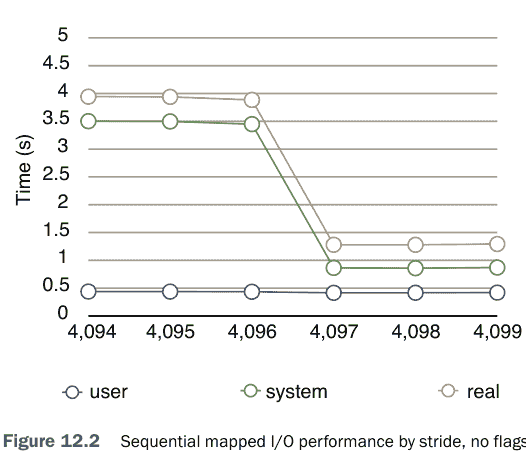

# 第 12 章 I/O：陷阱与技巧

使用 `madvise (SEQUENTIAL)` 遍历 3-GB 文件


图 12.3 不同步长下的顺序 I/O 性能，`madvise (SEQ)`

惩罚可能导致高达 10 倍的性能下降，特别是需要进行实际 I/O 时

## 如何阻塞？

当我们准备发布 Leopard 时，我被要求研究程序启动性能。对于启动，我们区分大部分数据已存在缓冲区缓存中的热启动以及需要从磁盘读取所有代码、资源数据的冷启动（通常发生在系统启动后）。

在配备快速 35-MB/s 硬盘和充足内存的高端 PowerMac G5 上，`Pages.App` 在热启动时花费不到 1 秒（不包括一次 Dock 弹跳），冷启动时花费超过 6 秒。

# 使用 NSD 229 推送字节


**图 12.4** 按步长（stride）的非顺序 I/O 性能，`madvise(SEQ)`

数据正在被读取，热启动要快得多这一事实强烈暗示问题出在 I/O 上。

当时，我正出于好玩在尝试 Squeak Smalltalk 系统，结果令我很惊讶：尽管它正在读取一个超过 10 MB 的镜像文件，但冷启动的时间不到一秒！

这种差异之所以在于，Pages 读取相同数据量的时间多出近一个数量级，是因为 Squeak Smalltalk 镜像是一个一次性读取到内存的单文件，而 Pages 所需的文件（nib 文件、图像、字符串表、库等）则分散在大量小文件中。

图 12.5 显示了这种效应在现代硬件上的表现，许多此类测试是在配备 Retina 显示器的配备 SSD MacBook Pro 上运行的。所有读取 1 GB 数据的时间，但以从 100 MB 到 10 KB 的块进行分布，文件数量相应地从 10 增加到 100,000。

尽管 SSD 寻道很快，但差异仍然是巨大的。在文件大小最小且数量最多的情况下，读取相同量数据的时间增加了约 10 倍。图 12.6 显示了我们为什么没有进行下一步，即 100 万个每个 1K 的。文件写入时间增加得剧烈，写入 10 万个小文件的速度比分布在 10 个大文件上的相同量数据慢了几乎 50 倍。

# 第 12 章 I/O：陷阱与技巧


# Unix I/O

当然，我们不必使用 `NSData` 来读取字节；我们也可以使用底层的 Unix 函数，如 `read()` 和 `mmap()`。从性能角度来看，这没有区别，至少如果它们使用相同的方法：如果我 `malloc()` 分配一个文件大小的缓冲区然后 `read()` 文件，它花费的时间与使用不带任何选项的 `NSData` 相同；如果我 `mmap()` 文件，它花费的时间与带有映射选项的 `NSData` 相同。

然而，产生区别的是我们之前展示的流式 I/O 样式，而不是一次性将文件读取或映射到内存中，


图 12.6 在不同粒度下读写 1 GB 数据的时间

# Unix I/O

连续地将文件的部分读取到一个较小的固定缓冲区中。示例 12.1 显示了使用 64 KB 缓冲区大小的技巧。

# 示例 12.1 使用固定缓冲区大小的 Unix 文件读取

```
#include <stdlib.h>
#include <fcntl.h>
#include <unistd.h>

int main(int argc, char *argv[]) {
    char *filename=argv[1];
    size_t size=64 *1024;
    char *buffer=malloc(size);
    int fd=open(filename, O_RDONLY);
    while ( size ) {
        size=read(fd,buffer,size);
    }
    close(fd);
}
```


我们之前使用的 300-MB 样本证明这种方法是所有方法中最快的，当文件位于缓存中时仅需 65 ms 即可读取整个文件，当从磁盘读取时需要 80 ms。对于缓存情况，这实际上比内存映射更快，而内存映射又比指令`NSData`执行`read()`更快，这似乎与我之前关于使用 Unix 系统调用与`NSData`相比会有区别的说法矛盾。

解释并消除这种表面矛盾的关键区别在于它们如何分配内存。使用`NSData`还是`malloc()`分配并填充 300-MB 的缓冲区，实际上是将`copy()`到内存的成本转化为了其他地方。一个因素没有太大影响，另一个是`read()`系统调用中实际使用的缓冲区大小，除非你将其小到让系统调用开销保持紧凑：即操作系统会识别出顺序读取的`read()`模式，并在 I/O 操作中开始大批量（在我的系统上每块 512K）加载到内存，无论`read()`调用中实际请求的是多少。进程未请求的部分直接进入缓冲区缓存。在使用带缓冲的库调用时，我也没有检测到显著差异，因此取决于你的应用程序中哪种更实用。

那么为什么不一直使用流式 Unix I/O 呢？首先，如果你实际上需要将文件内容保留在内存中，它就用。在这种情况下，你的数据会在内存中存在——一次在缓冲区缓存中，一次在脏应用程序内存中（如果内存紧张，该部分会被换出）——而不是在内存不足时简单地取消映射。或者，你可以实现自己的缓冲方案，程序化地将完整数据的子集移入移出内存。然而，这意味着对于可以放入内存的数据和无法放入的数据拥有不同的代码路径，并且必须在没有操作系统关于总内存压力的过多反馈的情况下管理数据移动。最后，你将无法快速利用缓冲内存；保持映射的数据仅仅是正常的内存访问，而你需要在管理自己的缓冲区时至少执行`read()`系统调用。

更好的用例是你将外部数据解析为不同的内部格式时，即使这并非没有问题。除非你有固定大小的数据元素且在读取时需要考虑，否则会有感兴趣的元素跨越边界，如图 12.7 所示。

处理这种情况通常需要缓冲区拼接。首先，在解析时记住不完整元素的开头，然后在解析时识别出缓冲区 1 中的元素是不完整的。你需要将缓冲区 1 中包含不完整元素拷贝到一个新缓冲区，最后追加新读取的内容。

## 网络 I/O

几年前，我收到一家报纸的联系，他们在性能上有问题。对应用的查看确认了它异常缓慢。通过将`initWithURL:`的网络访问像任何其他消息发送一样，在等待请求其潜在的顺序吞吐量之前，我们将性能限制在了网络延迟上，而不是对于我们请求的小型和中型订阅。

TCP 能够在具有这种网络特征的情况下实现高得多的传输速度的原因是，尽管它向客户端提供了同步 API，但它实际上是异步工作的，允许多个请求同时运行。

## 重叠传输

允许多个请求同时运行正是我们需要采用的相同策略，在本文情况下是在 HTTP 请求级别。幸运的是，`NSURL`加载使得使用`NSURLSessionTask`类异步加载 HTTP 请求成为可能。图 12 显示了多个请求同时运行对下载性能的影响，它们是相当巨大的：在达到四个并发请求之前，吞吐量几乎线性增长，初始时间从 41.6 秒缩减了四倍到 11.4 秒。在四个并发请求之后，曲线开始变平缓，在大约六个请求后就

## 第 12 章 I/O：陷阱与技巧


图 12.8 在不同并发水平下通过 WAN 上完成 100 个 HTTP 请求所需的时间

在测试所使用的请求大小下，该特定连接的吞吐量不再进一步提升。

事实上，我们发现当六个并发请求后，累积延迟开始缓慢增加，而之前它一直保持稳定。累积延迟是所有单个请求时间之和，因此即使总时间仍在略微减少，单个请求也开始花费更长时间。这表明客户端和服务器之间的网络已达到容量极限并正处于拥堵状态，所有单个请求都在竞争带宽。

图 12.9 展示了在饱和通道上堆叠更多并发传输只会拉长单个请求的时间。当应用程序有 10% 的请求完成时，它通常比所有请求都完成了 10% 时更具响应性。

此外，用许多并发传输轰炸服务器会占用服务器上的每个请求资源，可能导致资源饥饿、请求丢失或服务器资源耗尽和崩溃。在慢网络上，你还会遇到连接超时。

## 请求节流

因此，你实际上并不想要无限制的异步网络操作；你真的不想让通道过载。

TCP 通过监控丢包为单通道提供自动拥塞控制，但 HTTP 并没有这种机制；你必须自己管理由多个并发 HTTP 请求引起的拥塞。HTTP/1.1 规范确实要求限制每个客户端的并发持久连接数为两个，但这与并发请求数之间没有直接相关。

## 网络 I/O 235


图 12.9 在不同并发水平下在本地完成 10,000 个 HTTP 请求所需的时间

实现这一点的主要方法是限制并发请求的数量。你不需要把这个数字做得非常完美；TCP 的拥塞控制会确保数据交付，且只有当大幅超过通道容量时，性能影响才会显著。HTTP/2 通过单一多路复用连接管理其传输，可能从底层的 TCP 协议中受益更多。

尽管这没有记录，但我的测试以及服务器团队的投诉表明，已弃用的`NSURLConnection`类并不限制连接数量。事实上，创建一个`NSURLConnection`实例就会开始传输。为了绕过这个限制，我不得不创建一小部分基础设施来队列传入的请求，并一次启动其中几个。

iOS 7 和 Mac OS X 10.9 引入的`NSUrlSession` URL加载系统幸运地让许多此类基础设施不再必要。例如，

## 第 12 章 I/O：陷阱与技巧

控制特定下载的`NSURLSessionTask`实例初始为挂起状态；你必须显式地恢复它们来开始下载。此外，`NSURLSessionConfiguration`类配置了`NSURLSession`的`ConnectionsPerHost`属性，允许限制到特定主机的连接数，至少可以避免与特定主机产生并发连接。

`HTTPMaximumConnectionsPerHost`的默认值取决于当前环境。例如，在我的 MacBook Pro 上是 6，在我的 iPhone 上是 4，但在 iPhone 上它似乎会随着活动网络类型而变化。这些值对于与图 12 数据密切匹配的平均请求是非常很好的通用默认值，但你可能自己对其进行调整——例如，将大型下载限制为较小数量——这些本身就能饱和网络。`HTTPUsePipelining`标志默认关闭的；如果你的服务器支持管道化，那么开启此标志可以显著增加

## 数据处理

除了利用网络带宽外，`initWithOfURL`方法的另一个问题是数据处理和内存消耗。每个单独的文件在处理开始之前都会加载到内存中，如果数据量很大这就会成为问题。

处理这个问题有两种方法。第一种是在到达时立即且增量地处理数据。如果每个文件的输入数据量很大、可以增量处理且处理量会大幅减少，这种方法效果很好。这意味着处理逻辑能够分块处理数据，处理缓冲区拼接（见上文）和部分结果，并且将这些部分结果报告给 UI。

对于这种特定的 Feed 处理方法，我们选择了第二种方法，即将文件下载到磁盘而不是内存，然后将这些文件映射到内存中。这给了我们内存映射的优势和处理完整文件的简单性。这是可行的，因为单个 Feed 相对较小；我们只是数量很多。

通过下载到磁盘，我们或多或少地自动拥有了自己的 URL 缓存。我们控制缓存中对象的生命周期，因此将其用于离线阅读和快速启动，从缓存启动应用程序并在可用时从服务器增量地更新数据。

新闻处理方法的最后一个问题是，并非所有的网络活动都是同步的（因此很慢），而且它们是在主线程执行的，因此会阻塞应用程序直到完成。尽管`NSURLConnection`（以及`NSURLSession`）系统在`NSRunLoop`上异步运行，从理论上讲可以从主线程管理而不阻塞网络操作，但仍然有足够的工作在进行（检查缓存、将数据写入磁盘、从磁盘加载下载的数据并进行处理、启动传输等），因此使用一个带有其`NSRunLoop`的独立线程来管理所有 I/O是有益的，仅在数据处理完成且 UI 准备好更新时向主线程报告。

最终的 Feed 算法如下：

1. 从缓存或网络获取整体 Feed 目录。
2. 对于目录中的每个 Feed：
   a. 获取 RSS Feed，每个从缓存或网络获取。
   b. 从 Feed 中解析缩略图、文章内容和图像 URL。
   c. 所有用于获取的缩略图 URL。
   d. 所有用于获取的文章内容 (HTML) URL。
   e. 所有文章图像 URL。

注意，前两层的获取都是同步的。这很重要，因为它最小化了到第一条新闻 Feed 显示所需的时间。因此，在第一个 Feed 下载完成（可以显示给用户）之前，我们确实开始提交多个并发请求，并针对整体带宽而非单个延迟进行优化。我们还按照最可能被需要的顺序提交请求。

在有了这些更改后，应用程序从异常缓慢变得响应非常灵敏，实现了即时启动，并且故事在启动或刷新后立即弹出。

在通过环回接口上运行的实验中，Cocoa 网络栈能够处理每秒 1000 个小请求，并为大文件请求提供超过 300 MB/s 的传输速度，远超客户端需求或（广域）网络能力。尽管存在性能更高的 I/O 模型，但 Cocoa 网络栈对于客户端需求来说绰绰有余。

## 异步 I/O

事实上，我想简要讨论一下为了所谓的性能改进而进行的过度工程，特别是异步 I/O 原语以及构建在其之上的技术的使用。

大多数 Unix 系统都有异步变体，它们在 I/O 完成之前不会阻塞调用者，而是使用不同的机制信号完成。从理论上讲，这是一个好主意，因为一起调的更多潜在 I/O 操作让操作系统有更多机会来优化实际的 I/O。

在实践中，异步 POSIX 函数实际上并没有用：例如，“同步”文件写入默认就是异步的，前往

## 第 12 章 I/O：陷阱与技巧

内存是第一个且唯一由操作系统进行刷新的地方，“同步”文件读取使用了大量的预读，并具有类似的效果。事实上，参考 BitTorrent 实现库 libtorrent 的作者在一篇博客文中记录了他对异步 API 的实验如何使他采用了与前一节相似的策略，即使用单个 I/O 服务，尽管这次是针对磁盘 I/O。

这是基本事件网络化架构的一种变体，高性能 Web 服务器也采用了了这种架构，以应对 Dan Kegel 在 1999 年提出的 C10k 问题。他发帖称，当时的硬件已经能够处理 10,000 个同步 Web 客户端，但软件栈的局限性阻止了高并发 Web 服务器的运行。

在所有选项中，为每个连接使用一个线程和普通的阻塞型（同步）I/O 被认为是有问题的，因为某些操作系统“在处理多个线程时会遇到困难”。显而易见，当你处理通常只有六个到十几个网络连接时，这并不是一个问题。对于通过公共互联网与服务器通信的典型网络客户端，从性能角度来看，同步 I/O 更为合适；没有必要为了性能原因使用异步 API。

## HTTP 服务

像许多具有 Next 背景的开发者一样，我怀念旧的 Objective-C WebObjects。能够在前端和后端之间缩放代码是一项极具吸引力的特性，因此许多开发者在服务器端使用了 JavaScript，例如以 node.js 的形式。Objective-C 是兼顾可扩展 Web 服务的高性能和快速开发的良好表达能力的绝佳组合。从原则上说，它应该能够让初创公司从最初使用 Ruby on Rails 实现服务，然后在服务在负载下开始失效时将它们迁移到 Java 或 Go。

遗憾的是，我一直没有有机会认真研究这个问题，直到我必须将一个小型 HTTP 服务器嵌入到 Cocoa 桌面程序中，以便在点对点设置中售卖 Atom Feeds 日历信息。我最初尝试了 Cocoa HTTP，但我发现修改它来提供动态内容出奇地困难，因此我切换到了 GNU libmicrohttpd。从服务器的上下文来看这个问题，可以展示网络在真正受到高压时是如何工作的，而这在大多数客户端代码中并不会发生。

尽管我用一个将 HTTP 动映射到消息的 Objective-C 类相当不专业地封装了 libmicrohttpd，但我发现性能异常出色。图 12.10 显示了处理小请求时的性能，与基于 GCD 的 Cocoa 嵌入库 CocoaHTTPServer 以及 OCFWebServer 相比（后者是基于 Cocoa 的 Web 托管服务的基础，它也使用了 Sinatra Ruby 微框架，即高性能非阻塞 JavaScript 服务器 node.js 的冠军）。静态服务器 Apache 和 nginx 仅供参考；我们在提供服务时是在提供文件服务，而其他服务器是从内存中提供服务的。

所有结果都是使用`wr`压力测试工具通过环回接口收集的，使用的命令类似于`wr -r 10000 -c 100 http://localhost:8081`。使用环回接口是为了测试服务器代码，而不是为了回避负载生成器和服务器运行在同一台主机上这一显而易见的缺点。这实际上导致了问题，结果发现 apache bench (ab) 和 httperf 都不快到跟得上更快的服务器，但 werk 解决了那个特定问题。

图 12.10 引人注目的是，即使经过了封装，libmicrohttppd 管理的吞吐量仍是其他基于 Cocoa 的嵌入式 Web 服务器的 4 到 6 倍，尽管它使用了老旧的技术，例如基于线程池的`select()`轮询，甚至为每个连接创建一个线程并使用 I/O，而不是使用基于 GCD 的 I/O 等现代技术。

原因在于，正如我在讨论异步调用树 I/O 时写的那样，线程调度或工作组管理的差异，虽然这些差异确实重要，但显然远小于其他因素。观察 CocoaHTTPServer（图 12.11）和 libmicrohttppd（图 12.12）的倒置调用树可以证明这一结论。


## 第 12 章 I/O：陷阱与技巧


图 12.11 CocoaHTTPServer 的追踪。执行有用 I/O 工作的部分用绿色圈出（底部两个圆）。重叠部分用黄色圈出（最顶部的圆）。

在两种情况下，执行有用 I/O 的函数都用绿色圈出（底部两个圆）。这些是 libmicrohttpd 追踪（图 12.12）中的函数，但在 CocoaHTTPServer（图 12.11）中出现的位置要靠得多，后者由开销主导，用黄色圈出（最顶部的圆）。例如，消息开销相对于有用工作、内存分配高出几倍。旨在保证效率的特定 GCD 特性也贡献了其中，本应作为`select()`更稳定的替代方案的`kevent()`实际上花费的时间比所执行的网络 I/O 长了 16 倍。

当然，Sinatra 的性能也是滑稽的，在 10% 的嵌入式 C 服务器中是阻塞的，在 libmicrohttpd.node.js 中小于 2%。服务器之间的差异要小得多。所有这些服务器都能饱和 1 Gbit/s 的链路，除了 OCFWebServer……

为了完整起见，图 12.13 显示了吞吐量

## I/O：陷阱与技巧

网络 I/O


图 12.12 libmicrohttpd 的追踪。执行有用 I/O 工作用绿色圈出（底部两个圆）。重叠部分用黄色圈出（最顶部的圆）。


图 12.13 大文件的吞吐量

## 第 12 章 I/O：陷阱与技巧

## 示例 12.2 用于归档比较的示例对象

```objc
@interface SampleObject : NSObject

    int retainCount;

    int a;

    float b;

    NSString *name;

    NSArray *children;

}
```


## 示例 12.2 用于归档比较的示例对象

```objc
@interface SampleObject : NSObject

    int retainCount;
    int a;
    float b;
    NSString *name;
    NSArray *children;

}
```

由于这是一本关于性能的书，我们将观察大约 100 万个对象，它们在驻留内存时约占用 60 MB 内存。`SampleObject` 实例按照图 12.14 所示的树结构排列。

该树的深度为三，顶层对象指向 1,000 个二级对象，每个二级对象反过来又指向 1,000 个叶子对象。每个对象都有原始类型 `float` 和 `int` 的实例变量；内部节点还包含其子节点的 `NSArray`，而叶子节点则包含 `NSString`。


图 12.14 用于测试的 `SampleObject` 实例树

# 第 12 章 I/O：陷阱与技巧

### 内存转储

概念上最简单且可能快速的状态保存技术是执行内存转储（memory dump），只需获取你看到的数据基地址并使用 `write()` 保存它，或将其封装在 `NSData` 中通过其中一个 `writeBytes...` 方法进行写入，并确保使用非拷贝初始化器（`initWithBytesCopy...`）。

这种技术曾经非常流行。早期的 Microsoft Office 格式（如 `.doc` 和 `.xls`）实际上是（极其复杂的）内部数据结构的转储。这对于性能来说非常棒，但在互操作性方面略显逊色，你必须拥有或反向工程微软的内部数据结构才能读取和写入该文件格式。随着内部数据表示的改变，情况会变得棘手，例如由于不同的对齐、字节序以及从 16 位到 32 位再到 64 位的迁移。

我之前介绍的 Squeak 系统解决了大部分这些问题。它使用镜像（image）作为主要存储，这仅仅是内部对象的内存转储。通过拷贝垃圾回收器保持内存的连续性，存储保存镜像的地址，并且如果无法在相同地址分配内存，它会尝试使用相同地址或调整镜像中所有的指针。如有必要，会反转字节序。

结果非常理想。默认的 Squeak 镜像包含约 120 万个对象，只需 200 ms 即可将它们保存到 23 MB 的镜像文件中，而添加我们的 100 万个 `SampleObject` 实例会将空间增加到 46 MB，时间增加到 500 ms。

然而，他们解决的唯一问题是互操作性。只有其他的 Squeak 系统可以解释镜像文件，而且镜像必须整体保存，因此我只能通过保存包含这些对象的镜像来保存 `SampleObject` 实例。

### 简单的 XML 格式

我们可以做的事情之一是创建自己的格式，并遵循新的 Office MS 和 iWork 格式的步骤，让我们将其变为 XML。该格式的一个简易示例可以在示例 12.3 中看到：对象被转换为元素，其中 `a` 和 `b` 转换为属性，而 `c` 处转换为内容。

### 示例 12.3 示例原始 XML

```xml
<S a="100" b="100">
<S a="0" b="0">
  <S a="0" b="0">hello world</S>
  <S a="0" b="1">hello world</S>
  <S a="0" b="2">hello world</S>
  <S a="0" b="3">hello world</S>
```

### 序列化

我们使用第 4 章中的 XML 解析器来读取文件，并使用基于第 8 章概念的简单 XML 写入器进行写入，如示例 12.4 所示。

### 示例 12.4 原始 XML 编码

```objc
- (void)encodeXML:(NSData *)data {
    // 示例代码实现
}
```

# 248 第 12 章 I/O：陷阱与技巧

示例 12.6 将 `SampleObject` 转换为属性列表

```objc
-processCArrayFromPlist:someC {
  if ([someC kindOfClass:[NSArray class]]) {
    NSMutableArray *array=[[NSMutableArray arrayWithCapacity:someC];
    for (NSDictionary *d in someC) {
        [array addObject:[[self class] alloc] initWithPlist:d autorelease]];
    }
    someC=array;
    return someC;
  }
}

-(instancetype)initWith:(NSDictionary*)aPlist {
  return [self initWithA:[aPlist objectKey:@"a"] intValue]
          b:[aPlist objectKey:@"b"] floatValue]
          c:[self processCArrayFromPlist:[aPlist objectKey:@"c"]];
}

-(NSDictionary*)asPlist {
  NSMutableDictionary *dict=[NSMutableDictionary dictionary];
  [dict setObject:@a for key:@"a"];
  [dict setObject:@b for key:@"b"];
  [dict setObject:c asPlist for key:@"c"];
  return dict;
}

@implementation NSString(asPlist)
-(NSDictionary*)asPlist { return self; }
@end

@implementation NSArray(asPlist)
-(NSMutableArray *)plist=[[NSMutableArray array];
  for (id a in self) {
    [plist addObject:[a asPlist];
  }
  return plist;
}
@end
```

# 示例 12.7 示例 XML 属性列表（不完整）

```xml
<plist version="1.0">
<dict>
  <key>a</key>
  <integer>100</integer>
  <key>b</key>
  <real>100.12000274658203</real>
  <key>c</key>
  <array>
...
    <dict>
      <key>a</key>
      <integer>0</integer>
      <key>b</key>
      <real>0.0</real>
      <key>c</key>
      <string>hello world</string>
    </dict>
...
  </array>
</dict>
```

似乎我们应该通过一种更好的序列化表示来改进，这种表示的 API 不需要我们提供完整的中间表示，尤其是不需要主要由 `NSDictionary` 实例组成。事实上，Apple 的《属性列表指南》建议我们，"如果你需要一种存储大型、复杂对象图的方法，……使用归档（archiving）。"

# 归档 (Archiving)

属性列表局限于特殊属性列表类的树结构，而归档可以序列化任意的对象图以及图中的数据。`NSCoding` 协议正如我们在第 7 章中提到的那样，也是增量的；你一次可以归档一个对象和一个属性。虽然任何类都可以实现 `NSCoding` 协议，但 Apple 只有两个：继承自 `NSObject` 并使用二进制流的旧 `NSArchiver`，以及 Apple 自从 Mac OS X 10.2 引入以来推荐用于 Cocoa 的 `NSKeyedArchiver`（这也是 iOS 上唯一提供的归档工具）。

示例 12.8 展示了对我们的对象进行归档和反归档的方法。它使用了简单的宏，这些宏会展开为注释所示的代码，但避免了重复变量名和键。如你所见，代码比上面的简单一些，而且这些方法能产生它们的结果。

# 第 12 章 I/O：陷阱与技巧

示例 12.8 对象的归档与反归档

```objc
- (void) encodeWithCoder:(NSCoder*) aCoder
{
    encodeVar(aCoder, a); // [aCoder writeInt:forKey:@"a"]
    encodeVar(aCoder, b);
    encodeVar(aCoder, c);
}

- (id) initWithCoder:(NSCoder*) aCoder {
    if (self = [super init]) {
```


`decodeVar(aCoder, a);` // `a=[aCoder decodeForKey:@"a"]`

`decodeVar(aCoder, b);`

`decodeVar(aCoder, c);`

}

return self;

}

使用 `archivedDataWithRootObject:` 在内存中创建实际归档，或直接在磁盘/文件上使用 `archiveRootToFile:`，以我们的 `SampleObject` 树的根节点作为参数。运行时令人失望：保存耗时 9.1 秒，加载花费 2.6 秒，序列化属性列表更慢（慢了 2 倍），读取则更快。内存使用更糟：一个磁盘占用 77 MB 的归档文件产生了 819 MB 的开销。

为什么归档的序列化性能如此糟糕？可能的理论是，归档确实维护了对象关系，因此在维护这些关系方面必须做更多工作。Apple 的“旧式”归档工具也执行这些工作且速度快得多：归档花费 2.12 秒，反归档花费 0.81 秒。正如我们在下一章中看到的，二进制属性列表格式实际上具有去重（uniquing）的功能。因此，维护关系并不是问题。

Apple 对于提高键归档（keyed archiving）性能的建议是忽略仅包含默认数据的键，但即使从我们的对象图中移除除结构部分以外的所有数据（例如整数、浮点数或字符串），序列化和反序列化的速度也会略微提升，分别达到 6.0 秒和 2.06 秒。

少量调查表明，键归档性能不佳的原因是尽管有良好的流式 API，但它并没有实际上流式结果。相反，它在后台构建结果，正如示例 12.9 所示，此属性列表包含了多层间接。

## 示例 12.9 键属性列表（不完整）

```xml
<dict>
  <key>archive</key>
  <string>NSKeyedArchiver</string>
  <key>objects</key>
  <array>
    <dict>
      <key>a</key>
      <integer>0</integer>
      <key>b</key>
      <real>0.0</real>
      <key>c</key>
      <string>hello world</string>
    </dict>
    <dict>
      <key>a</key>
      <integer>100</integer>
      <key>b</key>
      <real>100.12000274658203</real>
    </dict>
  </array>
  <key>class</key>
  <dict>
    <integer>7</integer>
  </dict>
</dict>
```

[271]

# 第 12 章 I/O：陷阱与技巧

并不完全清楚 Apple 为什么选择一种低效的格式，每个对象不仅由一个字典表示，而是由多个字典表示。

## 序列化总结 (Serialization Summary)

图12.15 总结了不同机制的表现：旧式归档表现最好，其次是基于属性列表的机制，新的 JSON 序列化器领先。

图12.16 显示了序列化期间的大小和峰值内存占用。磁盘大小差异最多为 2 倍。

在处理大型数据集（尤其是大量对象）时，Apple 目前还没有足够的机制，而 Apple 最推荐的机制在时间和内存方面实际上最差。反序列化的差异比序列化更糟糕，理由是读取次数多于写入。有了自动保存和版本控制，情况可能不再如此。

需要注意的是，Apple 的应用 Pages、Numbers 和 Keynote 并没有使用这些标准机制。之前的版本通过 libxml2 使用 XML 格式，但从 iWork 13 开始切换到了通过私有框架使用的 Google protobuf。

[272]

## CoreData

针对数据集的性能，Apple 推荐 CoreData，这是一种“高度优化”的解决方案，具有“任何竞争方案中最好的可扩展性”。根据文档描述，“你可以花费大量时间为特定领域精心构建自己的解决方案，而无法获得比 CoreData 免费提供的性能优势。”

鉴于这些乐观的说法，让我们 CoreData 应用到我们的示例任务：创建并保存大约 100 万个 `SampleObject` 实例树，并找到优化获取它们进行内存处理的方法。为了实现这一点，我们需要让 `SampleObject` 成为 `NSManagedObject` 的子类，它可以自动为 CoreData 属性合成特殊的 setter 和 getter（参见示例 12.10）。为了稍微简化，我们省略根对象，从第二层的 1000 个对象开始，每个对象有 1000 个子对象。

### 示例 12.10 作为 CoreData 类的 SampleObjects

```objc
@interface SampleObject : NSManagedObject

@property (nonatomic,assign) NSInteger a;
@property (nonatomic,assign) float b;
```

# 第 12 章 I/O：陷阱与技巧

```objc
@property (nonatomic,assign) NSString *c;
@property (nonatomic,strong) NSSet *children;
@property (nonatomic,assign) SampleObject *parent;
```

```objc
@end
```

```objc
@implementation SampleObject
```

```objc
@dynamic a,b,c,children,parent;
```

```objc
@end
```

此外，我们需要创建一个 `NSManagedObjectModel`，可以使用大约 60 行代码或使用 Xcode 模型编辑器来实现。一旦我们获取了 `NSManagedObjectContext` 以及另外 30 行代码，就可以创建一些对象并将它们保存到 SQLite 存储中了。坦率地说，iOS 10 和 OS X 10.12 使用 `NSPersistentContainer` 类简化了这一点。

## 创建和更新批处理

创建百万个对象并按照我们之前的方法保存它们的结果相当令人失望：整个过程所花费的时间是我们之前之前的机制 `NSKeyedArchiver` 所需的三倍。在略大于 1 GB 的情况下，它将内存开销略微增加了 44 MB。同样令人惊讶的是，仅仅在内存中创建对象就花费了 12 秒，而内存占用与参考几乎相同。作为参考，创建一个纯对象的 `SampleObject` 图形而不是 `NSManagedObject` 子类，仅花费了 350 毫秒，仅为时间的 1/30，我们从第 1 章中回想起，分配对象是我们处理的较慢的操作之一。

使用 XML 模型生成一个 399 MB 的磁盘文件（与二进制存储几乎相同），原子化存储（atomic stores）并不是解决方案。即使是内存中存储也需要 20 秒，因此 I/O 并不是问题所在。图 12.17 显示了计时情况，图 12.18 显示了内存消耗和磁盘占用。

Apple 的 CoreData 文档建议拆分此类操作并进行批处理，如果你的数据模型支持这一点，那就太棒了。我们的模型支持这一点，可以使用不同的批次大小进行测试，从 10 个元素（意味着 10,000 个批处理）一直到 1 个百万级对象的批处理。我们假设批处理是完全独立的，这允许你重置 `NSManagedObjectContext`，从而完全从内存中清除对象。

结果在图 12.19 中，同时绘制了性能和内存大小。对于性能而言，中间有一个甜点，即批次大小为 1,000 个对象。较小的批次开始增加小写批次大小带来的较高 I/O 开销，这会导致较高的 CPU 负载。显然，某些数据结构或算法的扩展性略差于线性。另一方面，内存是严格线性的，占用的[空间]下限为 14.7 MB。如果你无法在批次之间重置 `NSManagedObjectContext`，那么 1M 个对象的内存消耗将在 600 MB 左右。

请注意，我们调整了程序策略，可能还调整了数据模型，以绕过 CoreData 的限制。事实上，情况不仅如此，因为描述的批处理策略仅提高了 SQLite 存储的性能；随着时间的推移，它会变得极其糟糕。原因是原子化存储必须重新读取之前的所有数据以处理每个批次，而批次的大小会线性增加，这使得问题从具有高常数系数的 O(n) 复杂度（导致缓慢）变成了具有相同高常数系数的 O(n²) 复杂度。


**图 12.17** 读写 1M 个对象的时间，包括数据库


**图 12.18** 使用 CoreData 时 1M 个对象的磁盘和内存空间

# 第 12 章 I/O：陷阱与技巧


图 12.19 CoreData 写入的时间空间权衡（按批次大小）

使用证明对 SQLite 存储最优的 1000 批次大小，第一次迭代在 0.1 秒内保存了其 1000 个对象的批次。到第 50 次迭代，保存一个批次的时间已经增加到 1 秒，并且线性趋势持续，每 50 个批处理每个批次时间又增加 1 秒。我在 10 分钟后中断了过程，当时是第 250 个批处理（总共 1,000 个），每个批次的时间已经增加到 5 秒。外推 $O(n^2)$ 曲线显示，使用 XML 存储，该批处理技术将花费大约 2 小 48 分钟。

修改对象图形在时间和空间上具有完全相同的性能特征，这意味着 CoreData 不适用于任何需要批量创建或修改大型数据集的任务。

## 获取与获取技巧

我首次获取结果的实验给我留下了深刻的印象，获取顶层 1000 个对象以备后用花费不到半秒，甚至获取所有 100 万个对象也少于完整秒。如果我陷入了不使用结果的经典基准测试陷阱，我就会错过这一点。CoreData 在数据被访问之前并不一定会拉取数据。作为参考，创建我们的纯对象 `SampleObject` 图形而不是 `NSManagedObject` 子类仅花费了 350 毫秒，仅为时间的 1/30，我们从第 1 章回想起，分配对象是我们处理的较慢的操作之一。

使用 XML 模型生成一个 399 MB 的磁盘文件（与二进制存储几乎相同），原子化存储并不是解决方案。即使是内存中存储也需要 20 秒，所以 I/O 并不是问题所在。图 12.17 显示了计时情况，图 12.18 显示了内存消耗和磁盘占用。

Apple 的 CoreData 文档建议拆分此类操作并进行批处理，如果你的数据模型支持这一点，那就太棒了。我们的模型支持这一点，可以使用不同的批次大小进行测试，从 10 个元素（意味着 10,000 个批处理）一直到 1 个百万级对象的批处理。我们假设批处理是完全独立的，这允许你重置 `NSManagedObjectContext`，从而完全从内存中清除对象。

结果在图 12.19 中，同时绘制了性能和内存大小。对于性能而言，中间有一个甜点，即批次大小为 1,000 个对象。较小的批次开始增加小写批次大小带来的较高 I/O 开销，这会导致较高的 CPU 负载。显然，某些数据结构或算法的扩展性略差于线性。另一方面，内存是严格线性的，占用的[空间]下限为 14.7 MB。如果你无法在批次之间重置 `NSManagedObjectContext`，那么 1M 个对象的内存消耗将在 600 MB 左右。

## CoreData 259

不是通过计数子节点计算的。通过示例 12.12 中所示的修改计算方法，我终于成功在获取中获得了所有需要的数据，耗时 10.8 秒，但在第一次遍历时不再进行更多获取，现在仅需略高于 1 秒，而整体 CoreData 管理对象的时间为 12.15 秒（标签预取减少了递归）。当然，保持此标记与子节点关系的同步没有开销。

### 示例 12.12 裁剪 SampleObject 对象图的遍历

```objc
- (double) sumB
{
    double result=0;
    for (int i=0;i<10;i++) {
        result += [self b];
    }
    if (!self isLeaf) {
        for ( SampleObject *s in [self children]) {
            result += [s sumB];
        }
    }
    return result;
}
```


所有这些时间都是在对查询键建立了索引的数据库上测量的；在没有这些索引的情况下，相同的查询吞吐量通常会慢几倍。

一个有趣的优化建议是在`NSFetchSpecification`中设置`NSDictionaryResultType result`。这不再返回`ManagedObject`实例，而是只返回包含获取规范中指定属性的`NSictionary`实例。结果如图 12.20 所示（带有获取绘图标签），非常令人惊叹：获取仅需 0.8 秒！我们之前学到过 SQLite 与高性能并不相关，那么到底发生了什么？

实际上有很多因素在起作用。首先，事实证明 CoreData 的性能并不限于 SQLite；字典获取显示，从 SQLite 获取数据到 Cocoa 可以非常快。CoreData 转换为获取结果对象，特别是管理关系的过程，才是性能损耗所在。其次，原始字典获取是受限的；它们不处理任何关系。因此，例如，我们的对象树是不可用的，只有一个扁平的字典数组。第三点，我们无法修改和保存原始字典。最后，字典与“正常”对象相比相对性能正如我们预期的那样，如获取插图所示。

图 12.20 中的最后一组结果（非 coredata）显示了通过我们在上一节中看到的反序列化机制“获取”我们的对象图的时间，其中初始获取代表反序列化对象图的时间，而第一次和第二次访问都是使用 Objective-C 消息发送来检索属性的正常图遍历。通过消息发送访问实例变量比使用字典访问快大约十倍，这就是为什么原始字典具有更快的初始获取。

对象交互（Object Interaction）强调了 CoreData 性能的另一个有时被忽视的方面：一旦获取了数据，从`NSManagedObject`或字典中检索数据的开销。前者的开销似乎比普通对象大约是 6 倍，后者为 10 倍。我们已经看到写入属性的开销要高出几个数量级。尽管 CoreData 为`NSManagedObject`实例使用了特殊的字典和高度优化的类字典访问方法，但与属性交互的成本仍然大于普通对象。

CoreData 在处理大型数据集的子集时表现优异，而 SQLite 到 SQLite 能够查询子集、修改子集，而无需处理数据的其余部分。虽然每个元素的成本很高（比我们之前看到的简单暴力技术高出一个数量级），但如果我们将元素数量降下来，就可以在整体性能上获得良好或至少合理的性能。

通过索引检索读取和写入单个对象或小子集时，CoreData 的速度会很快；如果只需要一个对象，则使用我们之前看到的序列化机制；如果我们修改了单个对象，则保存整个图。这种处理子集的能力被另一个事实所抵消，这也是一个硬性要求：你必须对数据进行子集划分，否则性能会在你面前崩溃。正如我们看到的，CoreData 只是处理大型数据集，因此你需要确保你的工作集始终很小。例如，调整查询仅获取 100 个对象而不是全部，可以将获取时间缩短到 10 毫秒，这对于许多应用程序足够了，但不需要获取并在键上建立索引。如果没有它，SQLite 必须进行表扫描，对于该数据集时间将增加到 1.5 秒左右，这至少将是一个明显的延迟。在内存中修改那 1000 个对象需要 31 毫秒，保存需要 44 毫秒，这处于交互式性能的边缘。作为参考，我们的 1000 个对象是 46 MB 总文件大小的 1/1000，我们的读取速率为 4.4 MB/s，写入速率为 250 KB/s，分别约为底层硬件能力的 1% 或 0.25%。

为了让读/改/写循环的交互性能水平下降到 100 个对象左右：读取需要 3 毫秒，修改需要 4 毫秒，保存结果约 40 毫秒。再次，这需要在属性上有索引并且不获取关系。如果我们开始获取显著比例的关系，无论是通过故障加载（faulting）还是预取（prefetching），性能会再次大幅下降。

## 分析

Apple 提供了许多其他优化 CoreData 的建议：调整数据模型使用外部存储处理大型二进制大对象（这是一个好主意；另请参见本章的“分离存储器”部分），对数据模型进行反规范化以避免跨关系获取，在数据导入任务中尝试批量大小，在获取规范中放入数值谓词（其求值速度更快）等等。

然而，所有这些建议都更多地是在克服弱点，而不是在展示优势。如果 CoreData 性能极佳，为什么我还要花这么多精力让我的获取规范大小恰好，既不太大也不太小？如果我们拥有 CoreData 所遵循的客户端/服务器模型，这些建议将会有意义得多，因为减少跨网络流量始终是一个好主意。当“服务器”不仅在同一机器上，而且实际上只是一个函数调用即可的库时，保留到该服务器的带宽就没有同样的权重。

## SQLite

如果 CoreData 不符合你的需求，而且你不想像目前提出的序列化技术那样内存整个图，另一种选择是直接对话数据库。SQLite 在 OS X 和 iOS 上非常流行，它是作为库嵌入应用程序的，而不是独立的数据库应用程序。SQLite 也随 iOS 发布，并被 Apple 内部广泛使用。

SQLite 的 C API 相当繁琐，因此我使用了轻量级封装 fmdb。与 CoreData 不同，fmdb 不自动处理关系，因此我们必须在数据模型中添加对象 id 和父级 id，我们在与数据库交互时需要填充并解析它们。

性能整体优于 CoreData，例如，插入 1M 个对象耗时 6.7 秒，而不是 26 到 36 秒，在对象树本身之上还有约 16 MB 的常量内存开销。一个有帮助的选项是启用准备语句；没有它们的运行时要高出 3 到 4 秒。使用`find`时，SQLite 管理准备语句，这只是一个标记；库随后使用该字符串。稍微重要的是，插入 1M 个对象的循环被封装在事务中。如果没有显式事务，SQLite 会将每个语句封装在自己的事务中。对于插入 1M 个对象，总时间增加了惊人的 11 分钟 43 秒。因此，对于批量更新请使用显式事务，除非该更新可以通过单个语言表示。

## 关系型和其他数据库

SQLite 和 CoreData 的这些略显保守的结果，与人们将关系型数据库视为 I/O 优化和性能巅峰的普遍认知相径庭，但这种认知在历史、理论或实践上从未建立过可靠的基础。

在我的个人经验中，关系型数据库通常认为比即使是最简单的非关系存储和查询策略慢一个数量级。例如，当我调查 Mail.app 的性能问题时，我惊讶地发现，查询包含约 2 万条消息的邮箱元数据，SQLite 需要花费超过一秒的时间，而使用`grep`命令行工具对索引格式（本质上是单个文件中所有消息的拼接）进行简单的暴力线性搜索，仅需几毫秒。这种如此天真的暴力破解算法比复杂的 SQL 数据库要快好几个数量级！

Jamie Zawinski 讲述了一个关于 Netscape 邮箱文件的类似故事：Netscape 2.0 和 3.0 版本使用了自定义二进制格式，空间开销仅为 2%，在 Pentium 机器上可以在一秒内打开包含 1.5 万条消息的邮箱（其数据量和性能与 2.5-GHz PowerMac G 上的 Mail.app 相当）。后来引入“正规”数据库进行重写，导致空间开销增加了一个以上的数量级达到 30%，性能也下降了一个数量级。

当然，原因之一是关系型数据库是通用工具，设计之初从未将性能作为首要目标。相反，它们的目的是允许多个客户端访问归一化的企业数据集，并允许即时查询。关系型数据库管理系统花了 20 世纪 70 年到 80 年的多年工程工作才追上当时的硬件限制性能，例如磁盘 B 树、隐藏磁盘延迟的多线程技术以及显式缓冲区管理，这些使性能提升了一个数量级或更多。

事实上，图灵奖得主、通用数据库专家 Michael Stonebreaker（Ingres, Postgres）发表了一系列论文，首先宣布了关系型数据库在特殊应用程序中“通用”使用的终结，随后宣布了“一个时代的结束”，甚至对传统数据库在其核心应用——在线事务处理（OLTP）中的应用表示怀疑。

- 11. http://www.jwz.org/doc/mailbox.html
- 12. S. Harizopoulos, D. Abadi, S. Madden, and M. Stonebreaker. OLTP through the looking glass, and what we found... Proceedings of the 2008 ACM SIGMOD International Conference on Management of Data. (2008) ACM, pp. 91–92.
- 13. M. Stonebreaker. "Technical perspective—one size fits all: An idea whose time has come and gone," ACM Communications (2008).
- 14. M. Stonebreaker, S. Madden, D. Abadi, S. Harizopoulos, N. Hachem, and P. Helland. The end of an architectural era (it's time for a complete rewrite), VLDB Proceedings (2007), pp. 1150–60.

## 事件发布

（关系型）数据库的一种有趣的替代方案是被称为“事件发布者”（Event Poster）¹⁵ 的架构模式，它不是修改持久化存储，而是存储被加到数据内存表示中的增量。回到我们每次按键保存《莫比·迪》的例子，想象一下只写入按键列表：(a) 存储整个文件或 (b) 尝试在编辑时就地修改文件。

显而易见，这种方法在保存数据时可以非常高效：我们不需要每次保存都写入 $O(n)$ 个项目，而只需写入 $O(1)$。更新如 B 树之类的磁盘数据结构会使每次更新达到 $O(\log n)$，这可能会增加相对成本，因为操作往往倾向于昂贵的寻址和可能的移动，而事件可以高效地按顺序追加到文件中。对于 $n$ 次操作，完整保存的复杂度为 $O(n^2)$，就地更新为 $O(\log n)$，而事件发布为 $O(n)$。

在该模式的纯形式中，事件日志是唯一的存储，内存状态通过重放事件日志来重建。这是一种出人意料且有效的策略，正如我在实现之前提到的有问题的 BBC 馈送处理程序的替代方案⁶ 时发现的那样。一旦我们重建了馈送索引，我们注意到，持久化只需要删除删除传入馈送的代码（我们出于审计目的已经想这样做了）。一个优化良好的摄取处理程序可以简化系统的其他部分：性能产生简洁，这种良性循环发生过多次。

## 混合形式

纯事件发布者模式的问题在于，它要求所有数据都能放入内存，且事件日志可能会变得非常大，可能会无限增长，而不取决于当前活动数据的大小（想象重写《莫比·迪》中的每一个句子，那么日志将比几乎没变化的还要大）。因此，事件发布者通常不以纯形式应用，而是与其他形式的存储相结合。

一种混合形式是当前状态的检查点：在特定的检查点写入系统状态，例如使用快速内存转储。读取时，尝试读取检查点文件，如果检查文件读取不正确则重放日志。这是我们在馈送处理系统中使用的策略，偶尔修剪不再相关的条目，例如因为它们被后来的条目覆盖了（如果你想保留日志用于审计，则需要谨慎执行）。

另一种混合形式被 LevelDB 键值存储利用，它是 Google BigTable 的开源重写版本。它的基础存储包含排序字符串表（Sorted String Tables），这些是只读。写性通过日志结构合并树（SM Tree）提供；所有更改都追加到日志中，日志保留在内存和磁盘中。读取通过映射到内存的第一个最新更改来满足。

LevelDB 仍然为数据提供经典的读取、更新、删除（CRUD）接口，但应用程序本身往往表现出事件发布者的特征，RSS 馈送、聊天或社交网络应用，甚至是电子邮件。此类系统可以很容易利用其数据的（基于时间的）结构：昨天收到的邮件访问频率通常比上周的更高，而上周的又比上个月的更高，以此类推。另一方面，许多人（包括我在内）从未真正删除过邮件。像 SQLite 这样的关系型数据库对待表中的所有元素，随着时间的推移，所有消息都会恶化，尽管实际集合保持不变。

如果我为电子邮件编写一个存储后端，我会以类似于 LevelDB 的方式对其构建结构：将最近的更改保留在内存和快速访问快速修改的本地存储中。每隔一段时间，我会将旧消息写入只读块中（可能是按月），并带有详尽的摘要、索引和其他元数据信息，以便操作只需查看摘要。这样，无论邮箱大小如何，访问速度都能保持不变，旧存储仅在搜索时通过大批量以最佳访问速度进行访问。然而，我并不会实际使用分离存储（Segregated Stores）。

我描述的存储实际上是分离存储的一个示例。分离存储的想法是将不同大小、访问需求和生命周期的数据分开——例如，旧邮件和新邮件。

这种想法在其他富媒体应用中的例子是 Apple 的 Keynote 演示文稿。在 '13 年的文件格式中，所有对象布局都包含在一个名为 index.apxl 的单个 XML 文件中，位于目录封装中或 zip 压缩文件中。图像或电影等媒体数据与此索引文件分离，因此包含最多 100 页、总大小超过 1 GB 的演示文稿，其 index.apxl 文件大小小于 2 MB。

目录包装器（Directory wrappers）是这种情况的理想选择，因为允许你将大型且不经常更改的数据与频繁更改的小数据分开存储。保存时，确保你保留对磁盘上原始数据的引用，可能通过其`NSFileWrapper`。Cocoa 只写入已更改的位，如果你使用文件包装方法的原子版本，它甚至会对未更改的位执行硬链接。

由于 iWork 格式的 zip 版本稍微削减了这种设置的优势，因为不同的组件最终落在了同一个 zip 包中。然而，正如我们之前看到的，将位数据从一个文件拷贝到另一个新文件仍然比重新序列化数据要快得多。

在 iWork 文件格式的当前版本中，Apple 为保持数据分离增加了另一个维度：每个页面都是 zip 文件中的一个独立条目。对于保存到磁盘，这可能区别不大；相反，这可能是为了实现 iCloud 同步而将更改隔离的特性。

## 总结

在本章中，我们首先查看了基本的磁盘和网络 I/O，然后查看了高级的序列化策略，包括内置序列化器、数据库、CoreData，以及 XML 和 Event Poster 模式等替代策略。

唉，我们也看到了许多陷阱，其中许多涉及我们以前遇到过的问题，例如过度使用字典和冗长的中间表示。简而言之，Cocoa 和 Objective-C 并没有真正非常好的数据持久化选项，只有一群略微有用的选项。

# I/O: 示例

在上一节查看了某些 I/O 和序列化 API 的性能特性后，我们现在来看一些让 I/O 更快的实用示例。显著地加快。

我们从一个简单的游戏单词列表开始，逐步研究 Apple 的二进制列表格式，我们在许多实际用途中显著加快了它的速度。最后，我们加入了一些快速的逗号分隔值（CSV）解析，并为公共交通数据设计了一种紧凑的文件格式，其性能比 CoreData 高出几个数量级。

# iPhone 游戏字典

这个特殊任务是由 Apple 的 cocoa-dev 邮件列表中 Miles 的一条消息发起的。Miles 想要加载约 2 MB 的文本作为 iPhone 游戏的单词字典，单词由换行符分隔。

该类的接口在示例 13.1 中给出，并说明了`StringTable`的基本功能：通过文件初始化并确定特定字符串是否包含在表中。

## 示例 13.1 简单的字符串表类

```objc
#import <Foundation/Foundation.h>

@interface StringTable : NSObject

-(instancetype) initWithContentsOfFile:(NSString*)filename;

-(BOOL) containsString:(NSString*)str;

@end
```

> 1. http://www.mail-archive.com/cocoa-dev@lists/msg33602.html

# 第 13 章 I/O: 示例

他的第一次尝试读取文件花费了 0.5 秒，而在 iPhone 3G 或 3GS 设备上使用`[fileContents componentsSeparatedByString:\n]`将文件拆分为行又花了 13 秒。不用说，他认为这有点太长了，我也倾向于同意他的观点。

实际上值得注意的是，当那些“惯惯犯人”相继出现时：二进制属性列表、专门的 tri 数据结构和 SQLite。二进制属性列表实际上有一点帮助，将时间从 13 秒缩短到 5 到 8 秒之间，但仍然太慢了。

## 示例 13.2 在简单的字符串表中初始化和搜索

```objc
- (instancetype)initWithContentsFile:(NSString*) filename
```

```objc
self=[super init];
NSString*wordList=[NSString stringWithWithContentsFile:filename];
[self setWords:wordList componentsSeparatedByString:\n
```

由于耗时严重，这种方法也消耗了大量的堆内存，因为第一个`NSString`被分配并填充了来自磁盘的内容，并且每个单词都被分配了。所有这些内存都是“脏”内存，意味着在 iOS 上不杀死进程就无法回收它们。

我建议的方法是使用`-[NSDataWithContentsOfMappedFile]`将文件映射到内存中；然后不要将单词转换为单个对象，而是通过在单独数组中保留单词的偏移量来分词（tokenizing），保持只要就对数据进行标记而非进行转换的策略。

我们可以保持示例 13.1 的外部接口，将实现更改为这个更优化的版本。示例 13.3 所示的分词过程是直观的：遍历字节，当我们找到换行符时，将当前偏移量添加到偏移表中。偏移表是`MWIntArray`的实例，它的工作方式类似于`NSArray`，只是针对`int`值而不是对象。实现使用了直接的实例变量。

> 2. http://www.mail-archive.com/cocoa-dev@lists.com/msg33602.html

## 示例 13.3 初始化更快的 StringTable

```objc
@implementation StringTable {
  NSData *words;
  MPWIntArray *offsets;
}
```


## 第 1.3 章 I/O：示例

子类。二进制属性列表（binary property list）格式没有官方规范，但 Apple 的实现已作为开源发布³，不仅包含代码，还有一段详尽的注释详细描述了该格式，足以允许其他实现。

图 13.2 是从 `CFBinaryPlist.c` 注释中提取的二进制属性列表结构的粗略示意图。

它包含两个主要部分：对象表（object table），包含实际对象的变长编码；以及带有指向对象表索引的偏移量表（offset table）。对象的引用通过偏移量表进行。环绕在这两个中心部分的是头部（header）和尾部（trailer），其中包含根对象索引、偏移量表的位置以及各种对象的大小信息。

图 13.2 还显示了几个最近的对象编码方式。对象类型编码在第一个字节的高 4 位（top nibble）中，第二个 4 位则编码子类型或 0 到 15 的长度。长度为 15 是一个标志位，表示实际长度将作为初始字节之后的一个整数值进行编码。


| | 0x1 | length 1 | integer value |
|---|---|---|---|---|
| header: magic, length, CRC | | | | |
| Real | 0x2 | length 1 | float/double value |
| object table | | 0x5 | length 1 | length 2 | ASCII chars |
| String | | 0x6 | length 1 | length 2 | UTF-16 chars |
| offset table integers pointing into object table | | 0xA | length 1 | length 2 | object offsets |
| trailer: root object offset table start sizes | Dictionary | 0xD | length 1 | length 2 | key offsets | value offsets |

图 13.2 二进制属性列表格式的示意图

> 3 3. 例如，请参阅 https://github.com/opensource-apple/CF/blob/master/CFBinaryPlist.c。

解析二进制属性列表的算法是基本的递归下降法。

1. 从根索引开始。
2. 读取索引为 $n$ 的对象。
3. 如果对象已经解析过，则返回它。
4. 如果对象尚未解析，则对其解析：
   a. 通过偏移量表获取编码对象的偏移量。
   b. 解码偏移处的对象。
   c. 对于任何索引为 $m$ 的嵌入对象，读取该索引的对象。
   d. 返回解析后的对象。

编码该算法核心的 `parseObjectAtIndex` 方法在示例 13.5 中。它读取第一个字节的高 4 位，然后进行切换，将不同对象类型的解码分发给各个独立的方法。代码通常不会直接解析对象，而是间接通过 `objectAtIndex` 方法（同样在示例 13.5 中）进行，该方法为已读取的对象实现了缓存。

## 示例 13.5 从二进制属性列表解析对象

```objc
-parseObjectAtIndex:(long)anIndex {
  long offset=objects[anIndex];
  int topNibble=(bytes[offset] & 0xf0) >> 4;
  id result=nil;
  switch ( topNibble) {
    case 0x1:
      result = [self readIntegerAtIndex:anIndex];
      break;
    case 0x2:
      result = [self readRealNumberAtIndex:anIndex];
      break;
    case 0x5:
      result = [self readASCIIFromString:anIndex];
      break;
    case 0x6:
      result = [self readUTF16String:anIndex];
      break;
    case 0xa:
      result = [self readArrayAtIndex:anIndex];
      break;
    case 0xd:
      result = [self readDictAtIndex:anIndex];
      break;
    default:
      [NSException raise:@"unsupported"
        format:"unsupported data in bplist: %x",topNibble];
      break;
  }
  return result;
}

-objectAtIndex:(NSUInteger)anIndex
{
  id result=objects[anIndex];
  if (!result) {
    result=[self parseObjectAtIndex:anIndex];
    objects[anIndex]=[result retain];
  }
  return result;
}
```

解析简单 OffsetSize 的代码在示例 13.6 中。`readIntegerSizeAt` 函数中的基础解析代码将文件中指示的字节数（定义为大端字节序）移入长整型（long integer），而不论目标架构的字节序如何。它是作为 `readIntegerNumberAtIndex:` 方法内部的内联函数实现的，因为 bplist 格式实际上在多个不同的地方需要读取整数（例如偏移量表），所有这些地方在基础主题上都有细微差异。

## 示例 13.6 从二进制属性列表解析整数

```objc
static inline long readIntegerSizeAt(const unsigned char *bytes,
 long offset, int numBytes)
{
  long result=0;
  for (int i=0; i<numBytes;i++) {
    result=(result<<8) | bytes[offset+i];
  }
  return result;
}

-(NSNumber*) readIntegerNumberAtIndex:(long)anIndex
{
  long offset=offsets[offset];
  int bottomNibble=bytes[offset];
  return @(readIntegerSizeAt(bytes, offset,bottomNibble));
}
```

*(注：原文代码 `readIntegerNumberAtIndex` 处似乎有截断，根据上下文逻辑补全了返回语句)*

## 属性列表的乐趣

### 示例 13.7 从属性列表解析数组

```objc
static inline int lengthForNibble(int length, const unsigned char *bytes, long *offset)
{
    if (length == 15) {
        int len = readIntegerSizeAt(bytes, *offset);
        *offset += len;
        return len;
    } else {
        int len = 1 << length;
        *offset += len;
        return len;
    }
}

-(long)parseArrayAtIndex:(long)anIndex usingBlock:(void (^)(MPWPlist*, long, long))block
{
    long offset=objects[anIndex];
    int topNibble=(bytes[offset] & 0xf0) >> 4;
    if (topNibble == 0xa) {
        int length = lengthForNibble(topNibble, bytes, &offset);
        for (long i=0; i<length; i++) {
            long nextIndex = offsets[offset++];
            block(self, nextIndex, i);
        }
        return length;
    } else {
        [NSException raise:@"unsupported"
          format:"plist expected array (0xa), got %x",topNibble];
    }
}
```

`parseArrayAtIndex:usingBlock:` 是解析数组的主力，通过 for 循环读取编码索引并对每个读取的索引调用回调。索引是偏移量表的偏移，从而产生实际对象。

最后，`-readArrayAtIndex` 方法构建一个结果 `NSArray`，并通过调用 `parseArrayAtIndex:usingBlock:` 方法来填充。字典的解析很简单，只是我们有两个行的索引列表，并将键值对添加到 `NSMutableDictionary` 中，而不是将对象添加到 `NSMutableArray` 中。解析器的其余部分遵循相同的模式，非常直接。

对于真正的面向对象的二进制属性解析器，添加懒性加载变得非常容易。我们创建一个子类，重写 `readArrayAtIndex:` 方法以创建一个 `MPWLazyArrayList` 而不是 `NSArray`，如示例 13.8 所示。我们不是创建单个对象，而是存储对象索引（使用 `MPIntArray`），然后用于创建 `MPWLazyArrayList`。

## 示例 13.8 创建延迟数组

```objc
-(NSArray*)readArrayAtIndex:(long)anIndex
{
  MPIntArray *offsets=[MPIntArray array];
  [self parseArrayAtIndex:anIndex
    usingBlock:(MPWBinaryPlist *plist,
                long arrayIndex,
                long anIndex) {
      [offsets addObject:arrayIndex]];
  }];
  return [[MPWLazyArrayList alloc] initWithOffsets:offsets];
}
```

`MPWLazyArrayList` 类的定义和实现见示例 13.9。它是一个 `NSArray` 的子类，持有一个对相关二进制列表的引用，并知道其编码对象在对应 plist 中的偏移量。

## 示例 13.9 Lazy NSArray 定义

```objc
@interface MPWLazyArrayList : NSArray
{
NSInteger count;
MPWBinaryPlist *plist;
MPWIntArray *offsets;
id *objects;
}
@end
```

示例 13.10 显示了 `objectAtIndex:` 的懒性实现。当通过 `objectAtIndex:` 请求对象时，它首先尝试从 `objects` 中检索，如果那里不存在，则进行解析。

## 示例 13.10 Lazy NSArray 实现

```objc
-initWithPlist:(MPWBinaryPropertyList*)newPlist offsets:(MPWIntArray*)newOffsets {
[super init];
if (self) {
count=[newOffsets count];
objects=calloc (count , sizeof *objects);
offsets=[newOffsets retain];
plist=[newPlist retain];
}
return self;
}

-objectAtIndex:(NSInteger)anIndex {
id obj=nil;
if (anIndex < count) {
obj=objects[anIndex];
if (obj == nil) {
obj = [plist objectAtIndex:[offsets integerAtIndex:anIndex]];
objects[anIndex]=[obj retain];
}
} else {
    [NSException raise:@"outofbounds"
        format:@"index %tu out of bounds",anIndex];
}
return obj;
}
```


## 第 13 章 I/O：示例

尽管 Swift 内置的懒性集合似乎可能消除了自定义代码的需求，但事实并非如此：Swift 的标准库并没有实现真正的懒性行为（即在计算结果后对其进行缓存）。相反，它每次访问时都会重新计算，除非整个集合一次性转换为非懒性集合，而这正是我们试图规避免的。

将该示例应用于我们的单词列表示例，效果是显著的：从属性初始化单词的时间从 756 ms 降到 26 ms，提升了 29 倍，使得这种变体比我们之前使用的初始化整个单词列表更快。图 13.3 显示了所有时间。

不过，我们对懒性变体必须稍微小心一点，因为如果我们进行线性搜索，当项目被检索时，所有的懒性都会消失，导致我们在意料之外的时间花费 700+ 毫秒。为了避免这种情况，我们需要将搜索从使用 `indexOfObject:` 的线性搜索切换到使用 `indexOfInSortedRange:options:usingComparator:` 的二分搜索，并带有 `BinarySearchingFirstEqual` 选项。

二分搜索在每次搜索期间只会加载 n 个项目，对于提到的 26K 单词列表，每次搜索大约解码 15 个项目。


图 13.3 包含懒性属性列表的 iPhone 游戏字典加载对比

## 避免中间表示

现在我们已经有了自己的属性列表，第 12 章的另一个问题浮现在脑海：属性列表读取之所以缓慢且耗费内存，部分是因为我们必须为对象图创建一个临时但完整的内存表示，即作为字典、数组和 Foundation 数字对象的表示。

从我们自己的属性列表中反归化 `SampleObject` 的代码见示例 13.11。

### 示例 13.11 无中间表示的列表反归化

```objc
(instancetype)initWithBinaryPlist:(MPWBinaryPropertyList*)aPlist
{
    if (self=[super init]) {
        [plist parseDictUsingContentBlock:^(MPWBinaryPropertyList*)plist
```

这与键值对归档代码非常相似，只是解码字典和数组等复合对象的代码被封装在块内部。这种差异的原因是，与键归档不同，普通的属性列表不存储任何关于对象类的信息。在归档中，类信息存储在归档中，并由反归化器实例化正确类的对象，然后调用 `initWithWithCoder:` 消息。相反，我们必须将解码特定字典或数组的知识传递给解码它们的方法。

将该示例应用于我们的单词列表示例，效果是显著的：从属性初始化单词的时间从 756 ms 降到 26 ms，提升了 29 倍，使得这种变体比我们之前使用的初始化整个单词列表更快。图 13.3 显示了所有时间。

不过，我们对懒性变体必须稍微小心一点，因为如果我们进行线性搜索，当项目被检索时，所有的懒性都会消失，导致我们在意料之外的时间花费 700+ 毫秒。为了避免这种情况，我们需要将搜索从使用 `indexOfObject:` 的线性搜索切换到使用 `indexOfInSortedRange:options:usingComparator:` 的二分搜索，并带有 `BinarySearchingFirstEqual` 选项。

二分搜索在每次搜索期间只会加载 n 个项目，对于提到的 26K 单词列表，每次搜索大约解码 15 个项目。


图 13.3 包含懒性属性列表的 iPhone 游戏字典加载对比

## 避免中间表示

现在我们已经有了自己的属性列表，第 12 章的另一个问题浮现在脑海：属性列表读取之所以缓慢且耗费内存，部分是因为我们必须为对象图创建一个临时但完整的内存表示，即作为字典、数组和 Foundation 数字对象的表示。

从我们自己的属性列表中反归化 `SampleObject` 的代码见示例 13.11。

## 逗号分隔值

我和学生考虑的另一种用于启动数据的编码方案是 CSV，但我们从未付诸行动，因为我们使用懒性属性列表列表（lazy property list）已经取得了良好的结果。很久以后，我才正式开始处理 CSV 文件，那是一个由客户提供的包含 16,000 条记录的 25-MB 数据库转储文件，用于将其格式化为电话簿。由于 Mac OS X 内置了高质量的 PDF 生成功能，现在此类数据库发布任务可以使用 Cocoa 程序完成，而无需通过像 Adobe InDesign 或 Quark XPress 这样大型且缓慢的第三方应用程序。

然而，普通的复杂的链接-调试循环交互性不足，无法处理图形化调整，因此我想从我编写的实时编程环境（live-programming environment）中访问这些数据。在实时编程环境中，显示会在每次按键后更新，程序求值时间必须远少于 100 毫秒以保持交互体验。然而，我使用的基于 Scanner 的代码处理该文件需要 4.8 秒。在两次按键之间等待 4.8 秒会让体验失去“实时性”，因此这并不是一个可行的方案。

回顾本章开头的数据字典，我们看到，如果使用基本的 C-String 处理将文件拆分为行是非常快的，而且一旦我们能够访问行索引，就可以按任何顺序访问单独的，而无需按顺序处理它们。凭借此和基础性能方程中的项*成本（cost）*，我们有了解决方案：只读取显示可见目录部分所需的条目（可能只有一个或两个），而不是全部 16,000 条条目。

这个特定数据集足够简单，`componentsSeparated` 方法就足以解析单行并将它们转换为字典（示例 13.13）。所有 16,000 条条目的总时间仅下降到 1.5 秒——仍然太慢了，但每条目的的时间为 98 μs，且每页约 200 条，这意味着数据读取时间仅为 20 ms——这已经足够快了，无论是整体还是读取时间，都被渲染时间所击败。

### 示例 13.13 简易 CSV 读取器

```objc
- (NSString*) lineAtIndex(int anIndex)
{
    int *offsets=[lineOffsets] integers;
    int offset=offsets[anIndex];
    int nextOffset=offsets[anIndex+1];
    int len = nextOffset-offset-[self eolLength];
    return [subdataWithStart:bytes+offset length:len ];
}
```

- 4. 记录很大：有 133 个字段，每条记录平均 1.3 KB。
- 5. http://www.cocoawithlove.com/2009/11/writing-parser-using-scanner.html

```objc
- (NSDictionary*) dictionaryAtIndex:(int) anIndex
    return [NSDictionary
            dictionaryWithObjects:[self lineAtIndex:anIndex]
            componentsSeparatedByString:fieldDelimiter
            forKey:[self headerKeys]];
```

我们略微损失了处理速度这一事实在很大程度上无关；重要的部分是提供随机访问，以便我们可以解析所需的条目。

## 公共交通时间表数据

CSV 带来的另一个大问题是以公共交通时间表数据的形式出现的，为了回答这个问题：“使用公共交通我附近有哪些出行选择？”这个问题所需的数据包括附近站点的位置以及距离这些站点的时刻差。柏林的公共交通公司 Berliner Verkehrsbetriebe (BVG) 以 Google 的通用传输馈送规范 (GTFS) 格式提供这些数据。一个 GTFS 馈送由包含 CSV 文件的压缩包组成；BVG 馈送的文件如图 13.1 所示。它们代表了服务的站点、存在的线路以及特定线路服务于站点的具体时间。

对于当前的问题，感兴趣的数据位于 `stops.txt` 和 `stop_times.txt` 文件中，其提取部分在示例 13.14 中。正如你可以想象的（并在表 13.1 中验证），最大的集合是描述所有站点时间的那个；它重量为 118 MB，包含 300 万条条目。

### 示例 13.14 站点和时间数据

```
stop_id,stop_code,stop_name,stop_desc,stop_lat,stop_lon...
903001,U Hansaplatz (Berlin),52.518111,13.342165...
903002,S Bellevue (Berlin),52.5197640,13.349619...
903003,S Tiersgarten (Berlin),52.514400,13.336490...
903004,U Turstr. (Berlin),52.5258370,13.3424010...

trip_id,arrival_time,departure_time,stop_id,stop_sequence...
18:16:00,18:16:00,906310...
18:18:00,18:18:00,906364...
18:19:00,18:19:00,906311...
18:21:00,18:21:00,906365...
```

> 6. https://developers.google.com/transit/gtfs/reference

## 第 13 章 I/O：示例

表 13.1 柏林的主要 GTFS 文件

| 文件 | 内容 | 大小 | 行数 |
| :--- | :--- | :--- | :--- |
| routes.txt | 公交、电车和地铁 | 37 KB | 1.3K |
| stops.txt | 站点列表 | 75 KB | 13K |
| stop_times.txt | 所有站点的时刻 | 118 MB | 3M |
| transfers.txt | 线路间的换乘 | 330 KB | 13K |
| trips.txt | 每条线路可能有不同的行程 | 7.5 MB | 152K |

objc.io 的 Issue 4 为 iOS 提供了一个解决方案，以及一个从 GTFS 文件预填充 SQLite 数据库的导入器。示例 iOS 程序显示纯位置搜索和时间搜索的时间（毫秒）：3.6、3.2、2.5（位置+时间）、3.8、4.1、6.5、7.9（位置）。对于位置搜索大约 3 ms，我们希望尽可能获得即时反馈（100 ms 或更短）。此外，离线导入器在 MacBook Pro 上需要超过 2 分钟才能将 `stops.txt` 和 `stop_times.txt` 文件转换为 SQLite 数据库。数据库大小超过 120 MB，这取决于数据是包含在应用中（使应用相当敏捷）还是下载。让我们看看是否可以做到这一点。

## 站点

该文件仅包含 13,000 条条目，我们可以在启动时轻松地将其读入内存中的 `StopList`，其中包含一个 `BusStop` 数组。每个 `BusStop` 都有文件中的纬度和经度，以及名称和 ID。读取 CSV 的速度足够快，我们可以直接保留文件，而不转换为其他格式，只需花一点时间对 CSV 读取进行增强。

我们使用 `CLLocation` 通过 `distanceFromLocation` 获取精确距离比较；尽管该方法非常准确，但每次搜索需要 3.3 ms 且内存密集，每次站点搜索都需要初始化 `CLLocation`。我们可以使用 k-d树等空间结构来优化查找，但在纬度（或经度，并不重要）上进行简单的排序索引，并通过二分搜索裁剪结果，可以将结果时间减少到设备上的约 45 ms，之后优化可能就没有意义了。

索引是一个简单的结构体数组，包含一个浮点数和一个指向 `BusStop` 数组的整数：

```c
typedef struct {
    float latitude;
    int anIndex;
} LatIndex;
```

> 7. http://www.objc.io/issue-4

从 `BusStop` 实例初始化后，我们使用基于块的 `qsort()` 函数对其排序。我们必须使用自定义二分搜索，标准库中的要求精确匹配，而对于纬经度，我们只需要找到最近的条目。

## 站点时刻查找

站点时刻有点挑战性，仅仅是因为它们非常多，大约三百万个。我们无法在启动时用相当快的 CSV 解析器读取 118-MB 的数据文件。我们也无法实时搜索 CSV 文件，因为条目不是按时刻排序，而是按 `trip-id` 排序。最后，在 CoreData 实现中将时间增加了 100 次搜索时间，如果这里不是这样就好了。

幸运的是，站点时刻非常简单：小时、分钟和 ID。由于它们的范围范围是 0 到 23（数据中为 0 到 31，允许环绕）并代表 0 到 59 的范围，我们可以分别用 5 位和 6 位的整数表示它们。我们将站点 ID 映射到约 13K 个站点的数组索引，因此每个站点时刻有 31 位来表示，对应示例 13.15 所示的结构。对于 300 万个时刻，这将是一个 12 MB 的数组，大约是 CSV 或 SQLite 表示法的十分之一。

### 示例 13.15 站点时刻的高效二进制编码

```c
typedef struct {
    unsigned int stopIndex:20;
    unsigned int hour:5,minute:6;
} StopTime;
```

### 示例 13.16 索引结构

```c
typedef struct {
    int bytime[32][60]; // 小时，分钟
} Buckets;
```

```c
typedef struct {
    Buckets bucketOffsets;
    StopTimes[];
} AllTimes;
```

## 第 13 章 I/O：示例

将此结构映射到内存后，按时间查找变得非常高效，每次查找仅需约 53.4 μs，大约比使用 CoreData 执行相同操作快了 8,000 倍。我曾在第 12 章中提到过，映射二进制表示是获得最佳性能的有效方法；这就是该概念的一个示例。你可能认为，将数据库查询替换为两个内存结构会以内存消耗为代价换取性能提升，但相反，我观察到内存消耗下降了，CoreData 方案约为 5 MB，而本方案约为 4 MB。此外，由于结构是映射的，内存保持着整洁，这对内存压力的贡献微乎其微，系统始终会剔除条目而无需触发内存警告。

我尝试了几种不同的组合搜索结果（位置和时间）的算法。最终结果最快的是双重嵌套循环，首先按位置过滤，然后在相关时间间隔的桶（buckets）中搜索找到的站点。

## 站点时间导入

我们如何将站点从 GTFS 结构提取到我们可以使用的高效二进制格式中？一旦我们得到了 `StopTime` 数组，就会创建一个桶索引以实现快速访问。由于我们按小整数进行排序，可以使用高效的桶排序（bucket sort），这是少数（非通用的）排序算法之一，其运行时间复杂度为 O(n)，而不是基于比较和元素交换的通用排序的理论下限 O(n log n)。示例 13.17 显示了代码；该算法步骤如下：

1. 确定各个桶的大小，每出现一次特定计数就增加桶计数。
2. 偏移量（Offsets）必须考虑之前所有桶的大小，因此累加切片。
3. 创建 `StopTimes` 的临时副本。
4. 执行实际桶排序：
   a. 根据小时和分钟将站点放入其桶中。
   b. 增加当前桶的偏移量。
5. 最后，使用传统的合并排序对每个桶内的偏移量进行排序。

### 示例 13.17 按首次时间后按站点 ID 高效排序站点

```c
-(void)sort
{
    StopTime *sorted=calloc(count+20, sizeof(StopTime));
    Buckets bucketSizes, bucketOffsets;
    bzero(&bucketSizes, sizeof bucketSizes);
    bzero(&bucketOffsets, sizeof bucketOffsets);
}

//--- 计算桶的大小
for (int i=0;i<count;i++) {
    StopTime current=times->times[i];
    if ( current.hour < 31 || current.minute < 60 ) {
        bucketSizes.bytime[current.hour][current.minute]++;
    }
}

// 将计数累加到偏移量
int currentOffset=0;
for (int h=0;h<30;h++) {
    for (int m=0;m<60;m++) {
        bucketOffsets.bytime[h][m]=currentOffset;
        currentOffset+=bucketSizes.bytime[h][m];
    }
}

memcpy(&times->bucketOffsets, &bucketOffsets, sizeof(times->bucketOffsets));

//// 按时间桶排序
for (int i=0;i<count;i++) {
    StopTime t=times->times[i];
    sorted[bucketOffsets.bytime[t.hour][t.minute]] =current;
    bucketOffsets.bytime[t.hour][t.minute]++;
}

// 在桶内按站点索引常规排序
for (int h=0;h<29;h++) {
    for (int m=0;m<60;m++) {
        int offset=bucketOffsets.bytime[h][m+1]-offset;
```


`int numElements = bucketOffsets.bytime[h];`

`mergesort(sorted, numElements, sizeof(StopTime), *(const void *va, const void *vb) { StopTime *a = vb; return a->stopIndex - b->stopIndex; });`

`memcpy(times->times, sorted, count * sizeof(StopTime));`

这需要多长时间？总共花费 280 ms，包括将 `AllTimes` 结构写入磁盘的 `fwrite`。排序后的 `Times` 和 `Buckets` 耗了超过 22 分钟，其中 19 分钟花在了 CoreData 方案的 `[NSManagedObjectContext save]` 上，因此二进制格式不仅比快速写入快 8,000 倍。

## 更快的 CSV 解析

在 CoreData 方案剩余的 3 分钟中，未花费在 `[NSManagedContext save]` 中的 2 分钟 15 秒被 CoreData setter 实现占用，剩余的 45 秒分布在初始化 `NSDate` 实例（18 秒）、使用 `componentsSeparatedToString:` 拆分字段（也是 18 秒）以及各种杂项对象维护（9 秒）上。我们在示例 13.13 中的简单 CSV 解析器也花费了 15 秒，因此在减去 CoreData 的开销以及我们由于使用小时和分钟而不需要 `NSDate` 创建后，CSV 解析的时间实际上是可比的。

然而，尽管在处理 21 分钟的 CoreData 开销时，15 秒或 18 秒并不显眼，但当与 280 ms 相比时，它们变得非常突出，占据了总处理时间的 98% 以上，并将我们方案的整体速度从 4,000 倍降低到 88 倍。我们显然需要更快的 CSV 解析器！

与本章中某些需要跳出框架的优化任务不同，这项任务非常直接：识别哪里慢，然后优化或移除它。

### 对象分配

我们知道对象分配是昂贵的，使用 `componentsSeparatedToString:` 每一个字段确实如此。我们在示例 13.13 中的简单 CSV 解析器也花费了 15 秒，因此由于我们使用了小时和分钟，所以不需要 `NSDate` 创建，在减去 CoreData 的开销后，CSV 解析的时间实际上是可比的。

然而，尽管在处理 21 分钟的 CoreData 开销时，15 秒或 18 秒并不显眼……

```c
mergesort(sorted, numElements, sizeof(StopTime),
    *(const void *va, const void *vb) {
        StopTime *a = vb;
        return a->stopIndex - b->stopIndex;
    });
```

> Internet Engineering Task (IETF) Request for Comments 4180
> Network Working Group. http://www.ietf.org/html/rfc180
> Shafranovich, Y. 2005. Common Format for Comma-Separated Values (CSV)

*(注：由于原文文本中存在部分重复和乱码的片段，翻译时已根据上下文修正了逻辑并对引用部分进行了对齐。)*

## 关注键

Another feature that yields 30% is the ability for the client to specify keys. The insight is that many clients only look at a subset of keys, yet the parser spends the effort on all keys, whether they be used or not.

A general solution is lazy evaluation, triggering parsing when the value is requested. The overhead for managing the lazy evaluation can easily outweigh the savings for relatively simple operations. In addition, complexity also increases in languages like Swift or Objective-C that do not have comprehensive-support for lazy evaluation.

So instead of lazy evaluation, let the client specify the keys that they are interested in, and the parser will only parse field values for those keys. The code in 13.18 already supports for keys using the mapper, which maps field indexes into the result set. After the boundaries of the field are determined, a new `MPWSubData` is only created if there is an entry in the `mapper`.

## 并行化

示例 13.19 中的优化让到了客户端: it first sets up the keys of interest (only `departure_time` and `stop_id`), parses the `departure_time` into hour and a minute (assuming 2 digits for each), and turns the `stop_id` into a stop index using a lookup table we set while parsing the `stops.txt` file.

### 示例 13.19 CSV 转封装二进制结构

```objc
[timeTableKeysOfInterest:[@ "departure_time", "stop_id"]];
timeTable do:(MPWMSStringTable *d, int i) StopTime:{
    NSString *arrival = [d objectForCString:"departure_time"];
    if ([arrival length] == 8) {
        const char *buffer = [(NSData*)arrival bytes];
        time.hour = twoDigitsAt(buffer);
        time.minute = twoDigitsAt(buffer + 3);
        NSNumber stopID = @{[d objectForCString:"stop_id"] intValue};
        time.stopIndex = [stopToNumber objectKey:stopID intValue];
    }
    localTimes[i] = time;
}
```

包括 `StopTime` 的排序和写入，这段代码运行了 2.1 秒，比我们开始优化 CSV 解析器时快了 7 倍以上。它现在比 CoreData 代码快大约 600 倍，并且几乎涵盖了所有的易用优化目标——我本应该在那时收工了，因为快速 CSV 读取通常是有用的。

## 更快的 CSV 解析

当有大量数据时，应使用 CSV 文件。然而，我承认在某一个一点上，我只是想实现 1000 倍的加速。

因此，我开始尝试多线程。在理论上，这是可能的，因为我们保留了本章开头从字符串表（string table）保留的初始索引步骤，这意味着我们并不局限于按顺序处理输入的行。我们可以将表格中间对分，让两个线程分别处理每个部分，从而最小化线程创建的开销。这就是为什么给 `do` 方法的块参数（block argument）会传递给它的行索引的原因：该块可能会在非顺序的行上被调用。

然而，我立即遇到了对象缓存（object cache）的问题。虽然对象的其他部分是不可变的，因此是线程安全的，但对象缓存会在每次读取时都会被修改。在缓存周围加上锁或 `@synchronized` 段完全不起作用：不仅多线程代码比单线程版本慢得许多，而且锁本身也没有解决问题。

放弃对象缓存确实解决了了问题，但又一次，多线程代码仍然比带有对象缓存的单线程代码慢得多。我尝试过每个线程使用一个对象缓存，通过某种方式通过线程 ID 在缓存集合中进行索引。这可能是可行的，但复杂性随着额外的开销不断增加，我充其已经接近崩溃的边缘，即使在我那台双核机器上也是如此。

在放弃之后，我终于意识到解决方案实际上非常简单：每个线程一个对象，所以为新线程创建新对象！更具体地说，创建每个 CSV 读取器对象的副本，使用示例 13.20 所示的 `cloneForThreading` 方法。

### 示例 13.20 为多线程读取克隆 CSV 读取器

```objc
- (instancype)cloneForThreading
{
    MPWDelimitedTable *clone = [[[self class] alloc] initWithData:data delimiter:fieldDelimiter];
    [clone setLineOffsets:[self lineOffsets]];
    [clone setKeys:[self headerKeys]];
    [clone setKeysOfInterest:[self keysOfInterest]];
    return [clone autorelease];
}
```

我犯了一个错误：将对象的成本误认为是它所代表的图结构（graph）的成本。分配 CSV 读取器新实例的成本与分配一个新的 `NSString` 或新的 `NSNumber` 是相同的，昂贵的只是 `actualData` 和偏移量数组等。如果我们对 CSV 读取器进行浅拷贝，在实例化克隆对象时使用我们实例的引用（除了对象缓存外），那么我们就能以非常低的成本获得一个全新的对象缓存线程。

有了克隆副本，我们现在可以启动单独的线程来处理结果，使用类似于示例 13.21 所示的 `parallelCollect:` 方法。

### 示例 13.21 并行 CSV 读取

```objc
(NSArray*)parallelCollect:(id (^)(id theDict))block
{
    int numParts = 4;
    int partLen = [self count] / numParts + 1;
    MutableArray *partialResults = [NSMutableArray array];
    for (int i = 0; i < partLen; i += partLen) {
        int thisPartLen = MIN(partLen, [self count] - i);
        MPWDelimitedTable *threadClone = [self cloneForThreading];
        NSRange thisRange = NSRange(i, thisPartLen);
        NSArray *partialResult = [threadClone future] inRange:collect];
        [partialResults addObject:partialResult];
    }
    MutableArray *results = [NSMutableArray array];
    for (NSArray *temp in partialResults) {
        [results addObjectsFromTemp:temp]; // blocks on the future
    }
    return results; // final array has no more futures
}
```


`collect:` 和 `parallelCollect:` 方法类似于 `do:` 和 `parallelDo:`，对于我们返回的每一行，结果会被收集到一个 `NSArray` 中。`parallelDo:` 类似于示例 13.21 所示的 `parallelCollect:`。首先，我们决定并行处理多少部分。为了获得流畅度，我们使用示例 13.20 所示的 `cloneForThreading` 方法来克隆，这取决于可用的核心数。最后，我们将结果合并到一个数组。当所有线程都完成后，结果数组就不再有 future。

`collect:` 和 `parallelCollect:` 方法类似于 `do:` 和 `parallelDo:`，对于我们返回的每一行，结果会被收集到一个 `NSArray` 中。`parallelDo:` 类似于示例 13.21 所示的。在缓存周围加上锁或 `@synchronized` 段完全不起作用：不仅多线程代码比单线程版本慢得许多，而且锁本身也没有解决问题。

放弃对象缓存确实解决了了问题，但又一次，多线程代码仍然比带有对象缓存的单线程代码慢得多。我尝试过每个线程使用一个对象缓存，通过某种方式通过线程 ID 在缓存集合中进行索引。这可能是可行的，但复杂性随着额外的开销不断增加，我充其已经接近崩溃的边缘，即使在我那台双核机器上也是如此。

在放弃之后，我终于意识到解决方案实际上非常简单：每个线程一个对象，所以为新线程创建新对象！更具体地说，创建每个 CSV 读取器对象的副本，使用示例 13.20 所示的 `cloneForThreading` 方法。

我犯了一个错误：将对象的成本误认为是它所代表的图结构（graph）的成本。分配 CSV 读取器新实例的成本与分配一个新的 `NSString` 或新的 `NSNumber` 是相同的，昂贵的只是 `actualData` 和偏移量数组等。如果我们对 CSV 读取器进行浅拷贝，在实例化克隆对象时使用我们实例的引用（除了对象缓存外），那么我们就能以非常低的成本获得一个全新的对象缓存线程。

有了克隆副本，我们现在可以启动单独的线程来处理结果，使用类似于示例 13.21 所示的 `parallelCollect:` 方法。

### 总结 293

对于客户端，最相关的时刻是响应用户请求的 100 ms 以及 60 Hz/16(2/3) ms 的流畅动画。两者对于创建直接操作屏幕上对象的错觉至关重要，而不是向计算机绘制指令使其在屏幕上运行一点。25–Hz（通常也被引作 30-Hz）这一数字是在例如模拟胶片制作中使用的，但它依赖于运动模糊等积分效应。

该 CSV 解析器也支持 25-MB。在本章的“逗号分隔值”章节中，处理时间从 98 µ 到了 20 µ。更重要的是，相比基于 CoreData 的导入器，速度提升了接近 1000 倍。

## 14

## 图形与 UI：原理

现在我们已经查看了几个低层子系统的性能——CPU、内存和 I/O 子系统，现在是把这些部分整合起来以构建高性能的用户界面了。这意味着快速绘制那些用户界面，并整合所有内容使应用程序对请求做出反应。

### 响应式

当我们谈论高性能用户界面时，通常指的是一种响应式的界面，即它对用户操作做出反应。多快呢？通常来说是越快越好，但实际上存在一些感知阈值，划分了感知上的质量差异。这些限制如 14.1 所示。

可能最相关的时刻是用于用户反馈的 100 ms 以及用于流畅动画的 60 Hz/16(2/3) ms。两者对于创建直接操作屏幕上对象的错觉至关重要。25–Hz（通常也被引作 30-Hz）这一数字是在例如模拟胶片制作中使用的，但它依赖于运动模糊等积分效应，是

表 14.1 响应时间限制

| 响应时间限制 | 效果 |
|---|---|
| 10 s | 留住用户的注意力 |
| 1 s | 用户处于流状态 |
| 100 ms | 用户直接操作对象 |
| 40 ms (25 Hz) | 多个帧融合成运动 |
| 16(2/3) ms (60 Hz) | 运动变得流畅 |
| 1 ms | 快速移动的手部被追踪 *"

> * 查看 http://www.youtube.com/watch?v=ovQcPLkPt4.

# 第14章 图形与用户界面：原理

模拟介质为平滑性提供了自动保障。对于数字屏幕上的动画，目标应该是达到 60 Hz。

60 Hz 这个数值也是一个相当挑战性的目标：与我们之前提到的其他时间相比，16.67 毫秒的时间并不充裕。在对象边界上执行基本的 CPU 密集型操作是可以的，但即使只有一次 7 毫秒的磁盘访问，很可能意味着你已经耗尽了预算，因为还要考虑到你可能还有其他事情要处理，而且你的图形子系统也需要花费一些时间。

那么 60 Hz 是限限吗？考虑到目前的硬件和软件限制，答案是肯定的，尽管表 14.1 的最后一项除外。尽管在该这一点动画是平滑的，但仍有改进空间。例如，如果你用笔或触控笔以 5 cm/s（约 2 英/秒）的速度移动绘图或写入，在屏幕以 60 Hz 刷新一次所需的 16.7 毫秒内，它会移动 1 毫米。对于“墨水”即笔尖来说，这是一个非常明显的距离，并会导致“滞后”的感觉。在屏幕上拖动对象也是如此。如果你快速移动设备（手指、鼠标、. . .），系统无法跟上这种精度。

幸运的是，就像鼠标光标足够小，你在它快速移动时实际上无法精确定位一样，延迟并不明显；但如果拖动一个较大的对象，你就会发现它没有跟随。利用人类感知的局限性，或简单地欺骗观察者，是在无法及时提供实际答案或结果时，保持响应表象的常用技术。

## 软件与 API

在 Mac OS 和 iOS 上，用户交互主要由高层框架管理，iOS 的 UIKit 和 Mac OS 的 AppKit。这些工具包从不同的输入源读取用户输入，将其翻译成传递给客户端代码的事件，并组织用户界面。图 14.1 显示了图形 API 的高层概述。

高层工具包提供了大量的控件（widgets），如复选框、表格和编辑器。在极少数例外情况下，这些控件都足够自包含，且速度足够快，可以在之前讨论的阈值内响应，因此性能不是问题。

这些控件是基于 OS 和 iOS 上的 `NSView` 构建的用户视图层级体系的。视图通常描述屏幕上一个要渲染的矩形区域，使用 `drawRect:` 方法进行渲染，并由它处理输入事件。这些高层工具包主要通过通用图形 API `CoreGraphics`（又 Quartz）进行绘图。

另一个图形 API 是 OpenGL，它主要用于 3D 图形应用（如游戏），由于其对加速图形硬件的特权访问，也被其他 API 使用。此外，还有使用 `CoreImage` 和 `CoreVideo` 进行图像或视频处理的 API，以及使用 `AVFoundation` 或 `QuickTime X` 进行媒体播放的 API。

| UIKit / AppKit | | |
|---|---|---|
| CoreAnimation, CoreText | CoreImage CoreVideo AVFoundation | |
| Quartz | OpenGL | |
| Graphics Hardware | | |

图 14.1 图形 API 块图

新增的内容包括用于 2D 游戏的 `SpriteKit` 和作为高层保留 3D 图形 API 的 `SceneKit`。

保留模式（retained-mode）与立即模式（immediate-mode）图形之间的区别，是自诞生之初图形 API 的定义特征，当时显示列表由图形系统保留，并用于直接驱动矢量阴极射线管（CRT）。在立即模式 API 中，客户端发送绘图命令，这些命令被执行并产生效果，无论是在显示器上还是在纸上。在保留模式 API 中，API 创建某种对象，这些对象由 API 维护，并且可以例如被移动。

图 14.2 展示了三个几何形状的区别。在顶部的保留模式 API 中，客户端创建这三个形状，然后它们由 API 在数据结构中维护。在立即模式 API 中，客户端发送绘图命令，这些命令被执行并产生某种效果，无论是在显示器上还是在纸上。在保留模式 API 中，API 创建某种对象，这些对象由 API 维护，并且可以例如被移动。

（注：此处原文描述似乎在图 14.2 处存在重复或逻辑跳转，已根据要求翻译并保持格式）

图 14.2 展示了三个几何形状的区别。在顶部的保留模式 API 中，客户端创建这三个形状，然后它们由 API 在数据结构中维护。在立即模式 API 中，客户端发送绘图命令，这些命令被执行并产生某种效果，无论是在显示器上还是在纸上。在保留模式 API 中，API 创建某种对象，这些对象由 API 维护，并且可以例如被移动。

# Quartz 与成像模型

与我们目前的计算环境类似，Quartz 可以追溯到施尔克斯帕洛阿尔托研究中心（PARC）的 Bravo 系统，该系统后来变成了打印机和输出设备的 PostScript 语言。

基于 PostScript 语言的 PDF 和 Quartz 的特性之一是它有一个精确定义的成像模型。目标被定义为栅格图像，源有三种类型：

- 1. 栅格图像
- 2. 路径，填充或描边
- 3. 文字

这些原语可以通过任意变换进行变换，被路径裁剪并填充颜色。

成像模型的原始定义了栅格化的画家算法（Painter's Algorithm），这意味着最后一个写入特定像素的原语决定了颜色，替换掉原有内容。Quartz 和现在的 PDF 使用了包含混合的新公式，使得旧值对新值产生贡献。抗锯齿取决于这种混合操作，因为对已存在的背景颜色的部分覆盖。

重要的是每个像素的最终值是由模型精确定义的，而不是取决于实现的变数，Apple 在应用这种质量视角方面非常一致。

在成像模型中，所有原语都转化为一种：填充路径。文本字符通过编码映射到字形，然后通过描边转换为路径。描边的路径（轮廓）被转换为两个轮廓（描边），并在连接处和端点元素作为几何形状添加到此路径中填充。曲线被转换为高分辨率的直线段（平坦化），然后进行栅格化。

即使栅格图像也被定义为矩形网格，可以缩放和旋转。例如，绘制一个宽度 256 像素、值从 0 到 255 的图像，与绘制 256 个灰值从 0 到 1 的矩形的结果完全相同。在渐变成为内置功能之前，栅格图像方法实际上是渐变的推荐模拟：将要绘制的形状设置为裁剪路径，然后绘制一张代表渐变的图像并扩展以适应形状。

图 14.3 使用 Times Roman 字体中的小写字母“a”展示了这些不同的表示方式。

## 第 14 章 图形与 UI：原理


注意，在转换的每一步中数据量都会增加，有时字母本身可以用单个字节表示，即 ASCII 字符 97。字形（glyph）可以是特定字体的数字或名称。然而，轮廓由 3 条直线段和 24 条曲线路径段组成，总共 210 个浮点坐标，将曲线展平为线段很容易导致坐标数量翻倍甚至更多，取决于分辨率（在我的测试中为 484 个坐标）。最后，该字形的栅格化在单色下需要约 2 KB 的栅格数据，带透明通道的全彩色需要 8 KB。如果你为了抗锯齿使用超采样，栅格数据量会进一步增加。

虽然实际实现并不一定以这种方式实现映射，而且通常也不会这样做，否则文本和图像处理速度都会太慢。定义的图像模型意味着结果必须与准确且昂贵的公式结果于无二。

## OpenGL

Mac OS X 中的第二个基础性图形 API 是 3D OpenGL API（iOS 上的 OpenGL ES）。OpenGL 是一种语言无关且跨平台的 3D 图形 API，最初由 Silicon Graphics 开发，后成为一个开放标准。它在很大程度上超越了现有开放标准 PHIGS，类似于 Postscript 和 Quartz，它是一个即时图形库，被认为比保留模式（retained-mode）PHIGS 更容易编程。

图形模型和支持的原型与 Quartz 非常不同。OpenGL 拥有顶点数组，可以被多边形网格、折线或点云访问。不直接支持图像，而是作为应用到表面的纹理。完全不支持文本，因此必须使用库将文本转换为多边形或位图。

## 图形硬件与加速 301

尽管绘制是即时模式，但 OpenGL 支持将纹理或顶点数组等资源上传到图形硬件中，这些资源可以多次引用。在 OpenGL 术语中，这被称为保留模式，与所有数据增量指定的模式区分来。

OpenGL 的一个问题是它提供的是过程化/调用-返回 API，这与现代图形硬件的实际接口（后者更倾向于批处理）并不契合。这种不匹配意味着，对于 API 来说看起来“自然”的代码效率极低，而高效的代码极其不自然且难以获取。

## Metal

Metal API 是 Apple 对 OpenGL API 与实际硬件之间不匹配的回答。类似于 Khronos 组类似的 Vulkan API，Metal 是一个更底层的 API，它并不试图隐藏底层硬件。

应用程序并不是对应特定状态或绘制命令的 API 调用，而是管理发送到 GPU 的命令缓冲区（command buffers）。

## 图形硬件与加速

虽然计算机图形中的“显示列表”（Display List）等术语让人回想起我们使用矢量显示器的时代（电子束移动到 CRT 上的特定点来画线），但今天几乎所有的显示器都是栅格显示器。栅格显示定义了一个像素元素（pixels）的矩形网格，就像栅格图像取决于输入端一样。

随着现代固态显示器（如 LCD、OLED 或等离子屏）的预定义像素硬件：帧缓冲区中存在着真实的像素元素。

这样做的结果之一是在我们在必须提供的实际像素数量方面有一个相对稳定的环境，至少当我们考虑到 Retina 屏之后。iPhone 屏幕将在 700K 到 2M 像素之间，iPad 为 3M 像素，而 iPad Pro 或笔记本电脑则多到每次刷新都必须修改整个屏幕的最大像素数。在大 O 表示法中，复杂度是 O(k)。

尽管像素数量是常数，因此在算法复杂度方面可以忽略不计，但它实际上是非常大的，因此绝非微不足道。在许多情况下，生成图形是现代非服务器计算机中计算密集最大的任务。

随着时间的推移，这导致了图形操作硬件支持的不同配置，图 14.4 显示了一些最常见的。最简单的配置 (1) 是没有额外的硬件支持；只是 CPU 绘制到主内存，而主内存也被用作缓冲区来刷新屏幕。


- 1. 主内存


- 2. 协处理器


- 3. 显卡


- 4. 集成显

图 14.4 图形配置


这种模型的优势在于，例如它被用于 1980 年代、1990 年代、2000 年代、2010 年代、2020 年代、2030 年代、2040 年代、2050 年代、2060 年代、2070 年代...（此处省略原文重复的年份描述）

## 示例 14.1 使用 OpenGL 绘制三角形

```c
(void)drawRect:(Nect)dirtyRect {
 int iterations=10000;
 glColorf(1.0, 0.5, 0.5);
 glEnable(GL_BLEND);
 glBlendFunc(GL_SRC_ALPHA, GL_ONE_MINUS_SRC_ALPHA);
 glPushMatrix();
 glScale(0.4, 0.4, 1.0);
 glBegin(GL_POLYGON);
 for (int i=0;i<iterations;i++) {
  float a = (float)i / (float)iterations;
  glColor4f(1.0f, 0.85f, 0.35f + a,0.4);
  a*=2;
  glVertex3f(0.0 + a, 0.6, 0.0);
  glVertex3f(-0.2 + a, -0.3, 0.0);
  glVertex3f(0.2 + a, -0.3, 0.0);
  glVertex3f(0.0 + a, 0.6, 0.0);
 }
 glEnd();
 glPopMatrix();
 glFinish();
}
```

## 示例 14.2 使用 Quartz 绘制三角形

```objective-c
- (void)drawRect:(NSRect)drawRect {
 int integers=10000;
 CGContext context=[[NSContext currentContext]];
 CGContextSetRGBFillColor(context,1.0,0.5,0.5,1.0 );
 CGContextAddRect(context, drawRect);
 CGContextFillPath( context );
 CGContextScaleCTM(context, [self frame].size.width, [self frame].size.height);
 CGContextTranslateCTM(context, 0.25 , 0.5);
 CGContextScaleCTM(context, 0.2, 0.2);
for (int i=0;i<iterations;i++) {
 float a = (float) / (float)iterations;
 CGContextSetRGBFillColor(context, 1.0f, 0.85f, 0.35f + a,0.4);
 a*=2;
 CGContextMoveToPoint(context, 0.0 + a, 0.6);
 CGContextAddLineToPoint(context, -0.2 + a, -0.3);
 CGContextAddLineToPoint(context, 0.2 + a , -0.3);
 CGContextClosePath(context);
 CGContextFillPath( context );
}
```


}


## 图形硬件与加速

### 从 Quartz Extreme 到 Core Animation

CPU 实际上处于空闲状态，等待这些命令完成。在现代标准下，这两种情况都具有低功耗 CPU 的特点。

除了从专用硬件获益外，GPU 还可以利用图形工作负载中的大规模并行性，以及当前技术芯片上海量的晶体管来利用这种并行性。CPU 拥有类似的晶体管预算，但其工作负载中并没有如此多可利用的并行性。

因此，当 CPU 设计者不得不采用更复杂的方案来从其大部分串行的指令流中压榨每一份性能时，投入 GPU 工作负载的额外硬件资源几乎能成线性地转化为性能提升。这就是为什么 GPU 性能不仅（对于适用的工作负载）远大于 CPU 性能的主要原因，而且其性能提升曲线要陡得多，这意味着两者之间的差距逐年都在扩大。

### 从 Quartz Extreme 到 Core Animation

将现代 GPU 的性能潜力用于系统级图形渲染，而非基于 OpenGL 的游戏，一直是 Mac OS 和 iOS 图形 API 演化的动力。这种演变从纯基于 Quartz 的渲染开始，逐渐添加了加速组件，如 Quartz Extreme、Quartz GL 以及最近的 Core Animation。

利用 GPU 进行 Quartz 绘图最明显的方法是将 Quartz 原语映射到 GPU 指令。这种方法的问题在于，图形硬件实现的是兼容 OpenGL 的原语，而 OpenGL 原语与 Quartz 原语并不匹配。OpenGL 没有填充路径（filled paths）；它只有描边（strokes）或四边多边形、网格。虽然映射这些原语（例如将填充路径细分化多边形）是可能的，但这种转换是昂贵的。此外，OpenGL 有一个定义松散的渲染模型，这意味着硬件在以高效方式解释指令方面有很大的灵活性。这种松散性与 Quartz 严格定义的图像模型以及 Apple 对图形保真度的要求相冲突。

然而，有一种原语很少需要转换：位栅化图像（raster images）。而且存在一个（隐藏的）子系统窗口管理器（Window Manager），它在不同进程拥有的窗口之间复用物理屏幕，使得每个进程都可以向自己的窗口绘图，而不必担心其他进程在做什么。

通过窗口管理器，Mac OS X 上的每个图形 API（无论是即时的（immediate）还是保留的（retained））实际上都变成了保留式 API，其窗口位图作为保留状态，并具备保留模式 API 的所有优点：窗口可以移动，内容变得可见的结果完全在窗口管理器内部处理。与许多早期的窗口系统不同，也与 AppKit 或 UIKit 中的视图层级结构（view hierarchy）不同，不需要涉及客户端代码来重绘暴露的区域，因此窗口操作始终是平滑的，即使进程没有响应也是如此。

#### 第 14 章 图形与 UI：原理

随 Mac OS X 10.2 引入的 Quartz Extreme 利用了这一种架构，将至少某种程度的硬件加速图形适配到系统中。系统中的每个窗口都被转换为一个 OpenGL 矩形，而窗口内容（由 Quartz 或其他图形 API 提供）则转换为 OpenGL 纹理，并映射到该矩形上。每个窗口的内容使用任何认为合适的 API 进行绘图，而位图窗口内容使用 OpenGL 和图形硬件组合在一起。

这种变化不仅利用了显卡对图形硬件支持以获得更好的性能，还几乎完全消除了 CPU 的负载：为了移动窗口，窗口服务器（Window Server）只需要更改矩形的坐标；为了将窗口置于顶层或置后，它只需要调整矩形的 z 轴值。

Core Animation 从 WindowServer 到客户端进程构建了这种架构。不再向后台存储（backing store）绘图，每个 CALayer 都维护自己的位栅化图像，然后这些图像由一个独立的进程（iOS 上的渲染服务器）在硬件支持下进行合成。本质上，每个 CALayer 就像 Quartz Extreme 下的窗口，因此层的位置、透明度或旋转等更改可以通过调整其映射的 OpenGL 原语的几何形状来处理，将实际的位图合成卸载到图形硬件。

图 14 显示了从最初的非硬件加速窗口服务器通过 Quartz Extreme 到 Core Animation 的发展过程。如你所见，硬件加速的增加对应于该图形架构中位栅缓冲（raster buffering）的增加。在图形资产的极端情况下，除了解码这些资产外，完全没有软件渲染；整个流水线的其余部分都是硬件加速的。代价是内存、这些资产依赖分辨率的特性以及图像资产的解码时间，这些也可能是非常巨大的。

就像 WindowServer 进程处理窗口操作平滑一样，这种架构使得动画无论客户端如何都保持平滑。一旦设置了所有层，动画就会独立于调用程序运行，在具有硬件支持的独立进程中运行。

这是一种非常不直观的性能优化方法，因为它的基础是最昂贵的原语——位栅图像。当这些图像被合成为最终结果时，位栅图像需要大量的内存和巨大的内存带宽。在其他条件相同的情况下，Core Animation 架构会让事情变得慢得多，但条件并非都是相同的，因为这些操作可以很容易地从图形硬件中获益。

此外，我们在简单性和相应的预测性方面获得了收益，使得将操作交给独立进程成为可能，该进程只需向图形硬件发送短小的指令流。

#### 从 Quartz Extreme 到 Core Animation 307

图 14.6 窗口服务器（顶部）、使用 Quartz Extreme 扩展窗口服务器（中间）、Core Animation（底部）

大幅减少 CPU 合成不同层的工作，从而为这些合成的动画留出了空间。动画由独立进程协调并在能力强大的 GPU 硬件上执行，这一事实意味着系统可以保证比客户端参与时得多的平滑度。性能保证反过来允许动画成为用户体验的核心部分。除了让用户体验更加稳固和真实外，动画在提高响应能力方面也极其有用。如果系统立即启动动画，即使它还没有最终答案，感觉也是有响应的。动画花费的时间可能被用来构思。

### 总结

在这一节中，我们简要检查了应用程序响应性的心理物理基础，查看了图形编程中的主要特性和权衡，并追溯了 Mac OS 和 iOS 中图形硬件与 API 的共同演化。这种共同演化留下了一系列不同的方法和权衡，我们将在后面的章节中详细探讨。

## 图形与 UI：测量与工具

与其他性能与其他领域一样，如果不知道哪里慢，优化图形通常是徒劳的，最重要的是，不知道你是帮助了性能还是损害了性能。

测量图形性能和响应性在许多方面比其他形式的性能测量更困难。通常，操作发生在不透明的系统库深处、你不一定能访问的独立进程中，甚至是可能无法进行内部检查的独立硬件中。

此外，当涉及到图形性能时，你真的开始关注单个事件的时机，精确到几十毫秒级。在之前的章节中，我们采取了一小小的技巧，通过测量大量单个事件并除以以获得单个事件的“时机”。这并不完全正确；我们得到的是平均时间。

正如我们在第 14 章所看到的，平均值在图形时机中的参考价值有限：将动画序列中的所有帧都在 16.6 毫秒内交付，与 50 帧在 1 毫秒内交付而剩下的 10 帧每帧 90 毫秒完全不同。尽管第二个版本平均速度快一点，但它看起来很卡顿，而较慢的方案是平滑的。

幸运的是，有一些缓解因素。系统和工具能够更好地了解你正在尝试，因此可以对你是否有效地实现了这一目标提供得更好的洞察。例如，如果你正在用相同的值重绘像素，这种有效的空操作（no-op）可以被标记出来。

本章将查看某些专用仪器以及它们旨在报告的图形流水线的特定方面，以及如何结合我们之前看到的通用工具和技术来使用这些工具。

### 使用 Instruments 进行 CPU 分析

在上一节中，我们简要检查了使用 Quartz 进行 CPU 绘制与使用 OpenGL 进行硬件加速绘制之间的性能差异。图 15.1 显示了 Quartz 示例的 Instruments 时间分析。

分析的前 11 个条目包含用户代码，但如你所见，总耗时仅占 3.3%。最后一个用户项代码是在 `GLBench drawOn:Rect:` 方法内部定义的一个块，并从 `MPAbstractContext engage:` 调用的。总运行时间的剩余 96.7% 在 Quartz 函数 `CGContextDraw()` 内部。虽然 50% 的时间消耗在 `CGColorMaskOverARGB8888` 或更准确地说，其 SSE 工作函数 `CGColorMaskOverARGB8888_sse` 中看起来可能很有趣，但这对你并没有真正的帮助。

花费大量时间绘制路径这一可能是一个有用信息，但它并不能告诉你为什么会这样。是你的路径太复杂吗？你是在进行冗余绘制吗？还是你在尝试做系统无法处理的过于复杂的操作？后者通常不会发生，因为即使是 Quartz，理论上至少也能以动画帧率处理每个像素。

当使用硬件加速时，问题更加严重，因为 CPU 大部分处于空闲状态并等待 GPU。图 15.2 显示了相同时间的基准测试分析，但这次使用的是你用于绘制的 OpenGL 代码。

| 运行时间 | 自有 (Self) | 符号名称 |
| :--- | :--- | :--- |
| 2176.0ms | 100.0 | 0.0 | ▼-[UIView displayRect:Needed] AppKit |
| 2176.0ms | 100.0 | 0.0 | ▼-[UIView displayRect:Needed]needsOpacity:visibleRect:visibleRect:visibleRectFortop:view] |
| 2176.0ms | 100.0 | 0.0 | ▼-[UIView drawRect:Needs]needsOpacity:visibleRect:visibleRect:visibleRectFortop:view] |
| 2176.0ms | 100.0 | 0.0 | ▼-[UIView renderSublayersIfNeeded:didLockWithFocusRect:] AppKit |
| 2176.0ms | 100.0 | 0.0 | ▼-[UIView drawRect:] AppKit |
| 2170.0ms | 99.7 | 0.3 | ▼-[GLBench drawRect:] GLBench |
| 2170.0ms | 99.7 | 0.3 | ▼-[GLBench drawOn:Rect:] GLBench |
| 2168.0ms | 99.6 | 0.4 | ▼-[MPAbstractContext engage:] Cocos |
| 2165.0ms | 99.4 | 1.0 | ▼-[GLBench drawOn:Rect:block_invoke] GLBench |
| 2165.0ms | 99.4 | 1.0 | ▼-[CGColorMaskOver] Graphics |
| 2165.0ms | 99.4 | 1.0 | ▼-[CGColorMask] Graphics |
| 2098.0ms | 96.4 | 0.6 | ▼-[Riper drawPath] libQuartz.dylib |
| 2072.0ms | 95.2 | 1.0 | ▼-[CALayer drawPath] libQuartz.dylib |
| 1074.0ms | 49.3 | 3.0 | ▼-[rgb32_mark] CoreGraphics |
| 1071.0ms | 49.2 | 0.8 | ▼-[CGColorMaskOverARGB8888] CoreGraphics |
| 1071.0ms | 49.2 | 0.8 | ▼-[CGColorMaskOverARGB8888_sse] CoreGraphics |
| 705.0ms | 0.3 | 1.0 | ▼-[CGeviceLock] CoreGraphics |
| 705.0ms | 0.3 | 1.0 | ▼-[CGContext] Graphics |
| 70.0ms | 0.3 | 1.0 | ▼-[CGSDisplaySynchronizeNeeds] CoreGraphics |
| 10.0ms | 0.0 | 1.0 | ▼-[<Unknown>] |

图 15.2 GLBench CPU 分析，OpenGL

Quartz 示例使用了 2176 ms 的 CPU，而这里的 CPU 使用量仅为 6 ms，且实际绘制位置仅使用了 CPU 的 16%。

当你使用硬件加速时，CPU 分析将无法告诉你应用程序的瓶颈在哪里。

### Quartz Debug

对于 Mac OS X，一个用于调试图形问题的专用工具是名副其实的 Quartz Debug。图 15.3 显示了它的选项窗口和帧率表。Quartz Debug 启用 Mac OS X 图形栈中的调试参数，它不会影响你的项目，但会影响所有运行进程，包括 Quartz Debug 本身，因此最好退出或隐藏它以外的所有项。

我发现最有用的选项是位于窗口中间的 Flash screen updates（闪烁更新）。通过此选项，Quartz 会在更新相同内容的屏幕区域闪烁红色矩形，这意味着该绘制是完全冗余的，应该被消除。绘制相同的内容并没有好的理由。

接下来是 Flash screen updates 设置（闪烁更新），它与上一个选项类似，但它会对所有更新闪烁黄色矩形，而不仅仅是冗余更新。此选项允许你识别出虽然不同但可能不需要刷新那么频繁的绘制。启用此选项可能会产生大量的视觉干扰。

图 15.3 Quartz Debug 选项和帧率表

Autoflush drawing（自动刷新绘制）选项会禁用通常会发生的合并操作，因此每个绘制选项都会单独刷新到屏幕上（并可能使用前两个选项进行闪烁）。这会产生更多的干扰，但更细粒度的矩形可能会让你更清楚地了解到底更改了/绘制了什么。

最后需要注意的是，当 Quartz Debug 运行时，应用程序的性能不会那么好；所有额外的矩形绘制都会产生巨大的开销，而且通常有一个微小的延迟，以便你能够看到正在闪烁的矩形。尝试在开启其中一个闪烁的情况下拖动窗口！你不仅看到大量的闪烁，拖动还会变得非常缓慢。禁用拖动后性能会接近正常，但代价是闪烁变得更加难以识别。

### Core Animation 仪器

iOS 有更多的测量工具可用，可能是因为其图形架构更加复杂，硬件性能整体弱得多，且要求更严格。简而言之，你真的需要这些工具！

主要的工具可能是 Instruments 部分的 Core Animation 仪器，而不是像 Quartz Debug 那种独立工具。这种集成可能非常有帮助，因为你可以结合多个工具来关联问题与潜在原因。

15.4 显示了我们在开发 Wunderlist 3 时看到的一个动画性能问题。

该追踪是针对 iPhone 5 的；动画性能的下降在 A4 芯片上明显得多。通过关注动画性能下降的区域并切换到 CPU 仪器，我们能够查出发生了什么——我们的一个例程正在执行一项反复调用 `valueForKeyPath` 来计算计数的操作。正如你可能在第 3 章记得的，使用键值访问比直接访问或消息线程慢得多。

图 15.4 Core Animation 与 CPU 仪器的协同工作

#### 第 15 章 图形与 UI：测量与工具

简单的解决方案是通过放弃使用 `valueForKeyPath:`，改用循环和普通的消息发送来让实际执行计数的例程运行更快。这在之前是不可能的，处理此问题的其他选择将是将该计算推迟到以后执行、在后台线程而不是主线程上执行，或者进行增量计算。

### 当 CPU 不是问题所在时

在上一个例子中，我们很幸运，问题确实出在 CPU 上，并通过我们在第 2 章中熟悉的性能分析工具识别出来。如果情况并非如此呢？iOS 的 Core Animation 工具有一组与我们看过的 Quartz Debug 工具相似的选项，只不过这些选项更详尽，并针对特殊的 iPhone/iPad 环境进行了定制。正如第 14 节所解释的，iOS 对图形表示的标准是笨重且在很大程度上高效的：全位图图像。这虽然可以通过通用地利用 GPU 来抵消，但这意味着数据访问中看似低效的问题被移动的海量数据所完全抵消了。图 15.5 显示的 Core Animation 全局选项关注这些具有潜在巨大影响的小微低效，并在屏幕上以视觉方式显示结果，类似于 Quartz Debug 的颜色选项。

具体来说，支持以下选项：

- **颜色混合层（Color Blended Layers）**——将源作为源与目标进行 Alpha 混合。我们需要读取此项。此标志将混合层标记为红色，将未混合层标记为绿色。
- **命中绿色和未命中红色（Color Hits Green and Misses Red）**——这指的是系统用于支持 `shouldRasterize` 标志的缓存。通常，Core Animation 在更新时会拷贝/混合整个层树。层上的 `shouldRasterize` 标志告诉 Core Animation 而是缓存设置该标志的层之子层的光格化表示。然而，它并不会保留设置了该标志的所有层的光格化位图，而是维护一个全局缓存，其中在有限的时间内保留有限数量的位图。
- **颜色拷贝图像（Color Copied Images）**——此标志显示特定图像是否能被 GPU 直接使用，还是必须先由 CPU 拷贝/转换（后一种情况会被涂上颜色）。
- **颜色未对齐图像（Color Misaligned Images）**——这是另一个微调内存访问模式的标志。当图像对齐到字边界时，所有的内存访问至少一次是一个完整的字。当图像未对齐时，需要读取多个源字来产生输出的每个字，GPU 必须对源位进行移位和掩码。取决于 GPU 的智能程度，额外的内存访问要么发生在每个目标字处，要么发生在图像边缘。在这里最好避免未对齐图像，此设置将向你显示未对齐的图像。
- **闪烁更新区域（Flash Updated Regions）**——此标志的作用与同名的 Quartz Debug 功能相同：当某个区域发生变化时，该区域会以明显的颜色闪烁。我没有在 iOS 上找到类似于 Quartz Debug“相同区域”的功能，而该功能对于寻找冗余渲染很有用。
- **颜色 OpenGL 快路径蓝色（Color OpenGL Fast Path Blue）**——显示避了主组件并直接使用 OpenGL 渲染的屏幕区域。
- **颜色离屏黄色（Color Offscreened Yellow）**——此标志显示首先在离屏渲染然后仅拷贝到屏幕的区域。额外的拷贝显然是一个性能问题。

与 Quartz Debug 类似，这些选项通常影响受影响设备上的渲染，而不会影响使用 Instruments 运行的应用程序。

为了说明某些选项，让我们看看 iPad 上 PostScript/PDF 视图的缩略图视图。15.6 显示了看起来正常的缩略图视图，没有任何颜色化。滚动性能有点滞后，因此我使用了这里的一些选项来找出问题所在。

15.7 显示了选了“颜色混合层”的缩略图视图。每个缩略图在 Instruments 中都被涂了颜色（在打印书中为深灰色），这意味着使用了混合。由于我们并不想让背景透出来，不应该需要混合。

第一个想法是 `UIImageView` 没有设置为不透明（opaque），并且有一个阴影，这通常需要混合。然而，将视图设为不透明。

图 15.5 Core Animation 全局选项

图 15.6 没有任何颜色的视图

图 15.7 颜色混合层选项显示了混合的缩略图

移除阴影并没有产生任何变化；所有缩略图由于使用了混合仍然被涂成红色。

最后，结果证明问题是缩略图像本身包含一个 Alpha 通道。这个 Alpha 通道是不需要的，因为所有像素都有完全/不透明的覆盖，这不是 GPU 或 API 能够判断的，因此它必须运行混合操作，而结果只是总是完全覆盖目标。

缩略图是使用 Core Graphics 位图从 PDF 文件创建的，因此修复方法是为 `CGBitmapContext()` 参数指定 `kCGImageAlphaNoneSkipList`，而不是 `kCGImageAlphaMultipliedLast`。指定 `kCGImageAlphaNone`（不想要 Alpha 层的显而易见的选择）并没有；函数在运行时返回了错误。

图 15.8 显示了修复后的结果：现在 Instruments 中的所有内容都是灰色的（在打印书中显示为浅灰色），表示没有混合，并且绘制了阴影。此外，性能提升相当微小，但有时这就是你能得到的，考虑到所付出的精力，这是一次值得的优化。

最后，我查看了未对齐的图像（见图 15.9），它显示了未对齐的缩略图图像。由于图像应该居中且无法控制图像宽度，没有办法对齐当前未对齐的图像，因此这可能需要保持未优化。

### 我在测量什么？

我们试图决定是使用静态图像资源还是使用代码绘制。一个考虑因素（尽管不是最重要的）是不同技术的相对性能。示例任务绘制了图 15.10 所示的渐变。

示例 15.1 中的代码使用 CoreGraphics 或从 PNG 或 JPEG 文件加载预渲染的图像来绘制此渐变，并测量这些方法所需的时间。

#### 我在测量什么？

图 15.8 带有缩略图的“颜色层”选项不再进行混合

#### 第 15 章 图形与 UI：测量与工具

##### 文件

图 15.9 Core Animation 仪器，颜色未对齐

#### 我在测量什么？

图 15.10 需要绘制的渐变

##### 示例 15.1 尝试对比图像加载与创建的计时

```objective-c
```


- (void)timeDrawingAndLoading {

    CGFloat drawnTime, PNGTime, JPGTime;

    CFTimeInterval startTime, endTime;

    startTime = CACurrentMediaTime();

    self.drawnImageView.image = [UIImage imageNamed:@"Image.png"];

    endTime = CACurrentMediaTime();

    drawnTime += (endTime - startTime) * endTime;

    startTime = CACurrentMediaTime();

    self.PNGImageView.image = [UIImage imageNamed:@"Image.png"];

    endTime = CACurrentMediaTime();

    PNGTime += (endTime - startTime) * endTime;

    SEL flusher = NSSelectorFromString(@"_flush");

    [[UIImage class] performSelector:flusher];

    startTime = CACurrentMediaTime();

    self.JPGImageView.image = [UIImage imageNamed:@"Image.jpg"];

    endTime = CACurrentMediaTime();

    JPGTime += (endTime - startTime) * endTime;

    [[UIImage class] performSelector:flusher];

    NSLog(@"Drawing %f, PNG %f, JPG %f", drawnTime, PNGTime, JPGTime);

}

```

## 第 15 章 图形与 UI：测量与工具

测量结果：`1.1 ms`，PNG `3.89 ms`，JPG `0.51 ms`。

我们发现 Instruments `，... `，，. `0.5 ms`。

对于响应性，最大的陷阱之一是在主线程执行耗时或不可预测的操作。这包括所有的输入/输出（I/O）操作，正如我们在之前的章节中所看到的，即使是最小的 I/O 操作也可能花费很长时间。另一方面，在后台执行操作却又没有让 I/O 变得响应式，情况会糟糕得多，而且确实遇到过这种情况：没有旋转指针，所有的 UI 看起来正常，但什么都没有发生。在这种情况下，在主线程执行更好，因为至少会触发系统忙碌状态，告知用户正在处理。

对于图形，最大且显而易见的错误之一是：资源预渲染为位图交付。可能最极端的例子是杂志应用使用某些 Adobe 发布工具创建的，并在 iPad 上交付，每一页杂志都渲染成一张全屏位图，横屏和竖屏各一张。由于 I/O 是现代计算机体验中最慢的部分，通过（蜂窝）无线网络从磁盘读取，即使是固态硬盘，这并不是一个理想的用户体验。而且当视网膜屏幕出现时，一切变得更加模糊而不是更清晰。

## 总结

我希望本章展示了测量图形性能有多复杂。由于涉及到许多子系统，单个操作的延迟至关重要。我们实际上使用了手动测量作为性能评估的关键部分，通过 Instruments 发现问题。

在下一章中，我们将看看在发现问题后该怎么办。

本页特意留白。

# 16

# 图形与 UI：陷阱与技术

快速图形编程实际上是一个独立的领域，拥有许多技术和在流传的知识，因此我们无法进行涵盖，甚至无法对其公正评价。例如，我们将粗略查看 OpenGL。我们可以查看适用于非游戏应用程序的技术。

# 第 16 章图形与 UI：陷阱与技巧

直接作为代码存在。位图只是大得多且无法缩放，因此必须在每种分辨率下提供，但“像素级完美”（pixel perfect）艺术的概念并不会消灭。

不再如此。
iPhone 6 Plus 拥有 1,920×1,080 面板，但实际渲染发生在分辨率的 3 倍，即 2,208×1,242 像素。这两个分辨率并不匹配，因此像素按 1.15 倍的倍率下采样到显示分辨率。无论是通过下采样像素艺术完成的（这在使用了 Quartz 并设置了正确的设备变换时会自动发生），还是作为一个独立的步骤对整个渲染的帧缓冲区进行下采样，这并不重要（大部分）。无论如何，都不再有“像素级完美”的预渲染设计了。更重要的是，这并不重要——在 400-dpi 的屏幕分辨率下，没有人关心甚至无法识别单个像素，用户看到的是 6 Plus 的整体。

如果你绝对必须使用位图艺术，有不同的优化技术可以大幅减小文件大小和加载时间，甚至超过 Xcode 生成的“优化”PNG 文件。我们将在第 17 章详细介绍这些内容。

在基础绘制方面，最大的问题往往源于过度绘制（多次绘制相同的像素）以及重绘未更改的屏幕部分。幸运的是，第 15 章讨论的工具将帮助你诊断并解决这些问题，所以请善用这些工具！

## 技巧

获得良好的图形性能通常意味着从屏幕和需要显示的像素开始向后推导，而不是从移动的变化开始并将其推送到屏幕。

一方面，这尊重了绘图时 AppKit 和 UIKit 提供的脏矩形（dirty rects）；另一方面，它意味着设置那些用于纠正 UI 层变化的矩形。本章的“通信过多会减慢动画”部分包含一个较大的示例，展示了我们在某个特定项目中为了利用这些效果而必须克服的障碍，结果使绘图性能从不可避免的缓慢提升到了无法估量的快速。

复杂路径在 Quartz 中曾是一个巨大的问题，因为为了让抗锯齿正常工作，需要计算自交，且几何算法在计算交点时相对于段数量是二次的（每隔一个段）。底层算法已经改进了很多，但路径长度仍然是一个考虑的因素，甜点是中等的路径。

不要反复绘制形状，要使用 Quartz 模式设施。渐变也是如此：内置的。CGLayer 设施在绘图性能方面已经不再太大帮助了；强大的 CGImage 重写使得基础图像绘制变得尽可能快，而图像绘制自 NextStep 时代以来一直存在问题。然而，在生成 PDF 时，CGLayer 仍然具有优势，因为它会为重复元素保留纹理信息。所以，如果你计划打印或 PDF 输出并有重复元素，那么 CGLayer 就是件好事。

考虑到第 15 章中 OpenGL 的潜在优势，以及现代游戏以高帧率渲染复杂场景的显见性能，使用 OpenGL 加速绘制似乎是一个绝对显而易见的选择。从概念上说这是正确的，但实现这种加速被证明是有麻烦的（并非显而易见）。苹果曾多次尝试在操作系统层面将 OpenGL 整合到 Quartz 中，结果发现这些尝试都被取消了。额外的事务成本往往会吞掉图形绘制中可以加速的部分带来的任何收益。一个特别的问题是 Quartz API 具有非常直接的调用/返回性质，它能很好地映射到 OpenGL API，但无法映射到实际的硬件接口（参见第 14 章“Metal”部分关于 OpenGL/Metal 的讨论）。

另一个是图形原语不同：Quartz 使用填充和描边路径，这些路径必须经过昂贵的细分（tessellated）转换为图形硬件使用并由 API 提供的阴影三角形。如果它们是形状化的，这种转换成本更容易在多次使用中分摊，但 API 未提供这种支持。

## 通信过多会减慢安装

一项产生意外结果的调查是研究新版 Mac OS X 中安装程序神秘变慢的问题。该安装程序正在安装数千个小文件，并且之前的运行符合预期。在新版本中，安装程序慢了七倍，几乎慢了一个数量级。I/O 速率远低于磁盘子系统支持的速率，且 CPU 使用率忽略不计，因此似乎没有任何瓶颈可以解释性能的下降。

## 显示节流

在经历了多次费思苦想和工具使用后，发现罪祸首是安装程序提供的状态更新。通过显示它安装的每一个文件的名称，为了确保用户有机会看到每一个文件名，它在每个名称之后都绘制到屏幕。这种让用户随时进度的热切触发了 Mac OS X 图形子系统内部的节流机制，该机制将图形更新限制为屏幕刷新率（现在是某种任意的 60 Hz）。尝试更频繁刷新屏幕只会阻塞你的程序，如示例 16.1 所示。

## 示例 16.1 以 60 Hz 运行

```swift
import Cocoa

class AppController: NSObject, NSApplicationDelegate {

    var mainWindow: NSWindow?

    func applicationDidFinishLaunching(_ notification: Notification) {

        mainWindow = NSWindow(contentRect: NSRect(x: 0, y: 0, width: 320, height: 200), styleMask: [.titled, .closable, .miniizable], backing: .buffered, defer: false)

        mainWindow?.orderKeyAndOrderFront(nil)

        let label = NSTextField(frame: NSRect(x: 10, y: 10, width: 200, height: 20))

        label.isEditable = false

        label.isBeled = false

        label.drawsBackground = false

        mainWindow?.contentView?.addSubview(label)

        DispatchQueue.main.async(deadline: .now() + 0.1) {

            for i in 1...60 {

                self.drawSomething(i)

            }

        }

    }

    func drawSomething(_ i: Int) {

        guard let window = mainWindow, let label = window.contentView?.subviews.first as? NSTextField else { return }

        window.lockFocus()

        NSColor.red.set()

        NSBezierPath(rect: NSRect(x: 10, y: 10, width: i * 3, height: 20)).fill()

        NSColor.black.set()

        label.stringValue = "Iteration: \(i)"

        window.unlockFocus()

    }

}

let app = NSApplication.shared

let controller = AppController()

app.delegate = controller

app.run()
```

### 通信过多会减慢

注意 Quartz 足够聪明可以判断是否存在任何绘图，因此在循环中仅调用 `flush()` 几乎立即返回。

### 使用显示节流

虽然有绕过显示节流的方法，但使用 OpenGL 的游戏可以获得更高的速率，而且更好的做法是记记它的核心教训：状态更新的频率可以高于用户关心的频率。例如，我测量了字节数，每秒一次足够了，而进度条如果以更高的频率（大约每秒 10 次）更新可能会更平滑。

## 第 16 章 图形与 UI：陷阱与技巧

在 OS 10.9 和 iOS 7 中，Apple 通过 `Progress` 类和 `NSProgressReporting` 协议引入了对长时间任务进度报告的明确支持。基本思想是让对象报告单个活动的进度，并汇总这些单独报告以获取总进度。我在 20 世纪 90 年代后期实现过一个非常类似的系统，可以说这做得非常好。

但在实际报告进度方面，Apple 完全失砸了，或者说可能一直在失误。向 UI 实际报告进度的推荐技术是观察顶层 `NSObject` 的 `percentCompleted` 属性。这并没有解决我们见过的任何问题，而且增加了一个问题：KVO 通知将在更改进度状态的同一个后台线程上派送。

事实上，Apple 告诫我们：“不要在紧凑循环中更新 `completedUnitCount`”，所以他们意识到了这个问题，并意识到他们并没有真正解决它。

## 压垮 iPhone

几年前，我被邀请帮助一个报纸 App，该应用在类似 RSS 的馈送中管理多个项目，并使用无处不在的 `UITableView` 进行显示。每个项目都有一个 ID，指示其可能处于的不同状态：未交付、所有元数据已接收、或无音频等。此外，在下载音频数据时，它会显示增量进度，因为这些文件可能需要很长时间下载。

只要我们处理的是包含最多 10 个项目的单条馈送，这一切运行良好；但一旦进入生产环境，我们就开始遇到严重的问题。我们尝试了显而易见的优化，例如将生成缩略图等耗时操作移动到后台线程，并避免在为每个项目的每个状态同步整个数据库时执行不必要的工作，但无济于事。

症状是 UI 会冻结很长一段时间，App 才能再次使用。这在 App 首次启动时尤为明显，因为它必须对馈送中的所有项目进行初始抓取/更新。随后的启动倾向于不会有那么大的问题，因为数据已经缓存了，但仍有非常糟糕的用户体验需要对付。

性能分析（Profiling）显示，时间被消耗在 `UIKit` 的绘制代码中（文本绘制、表格布局）。Apple 提倡的 Cell 复用机制正在被使用且工作符合预期，Cell 的创建并没有产生任何特殊的开销。这块没什么可做的，对吧？

错了！问题证明出在示例 16.2 的代码。

## 示例 16.2 模型到视图的通知代码

```objc
- (void)notifyChanged

{

  [NSNotificationCenter defaultCenter]

      postNotificationName: @"UserChanged"

      object:nil];

}
```

尽管这段代码看起来没问题，并且与许多发布的 `NSNotificationCenter` 示例代码匹配，但它实际上存在两个问题。首先是缺乏上一节讨论的更新节流（throttling），其次是它太不明确了：它说某些东西发生了变化，但没说是什么。缺少了这个重要的上下文信息，接收通知的 UI 元素（在此例中为表格）没有其他选择来更新所有的 UI。这不仅在（可见）元素数量上是平方级复杂度，而且还更新了那些不可见甚至可能不在当前列表中的项目的显示！

解决这个问题的简单方法是在通知中包含当前对象，幸运的是 `NSNotification` 设置为可以处理这种情况。示例 16.3 显示了这一改进。

## 示例 16.3 带有上下文的模型到视图的通知代码

```objc
- (void)notifyChanged

{

  [NSNotificationCenter defaultCenter]

      postNotificationName: @"UserChanged"

      object:self];

}
```

接收代码能够从通知中检索相关对象，确定它与所有相关（包含在当前表格中），然后只更新那特定行。示例 16.4 中的代码将依赖上下文的刷新与上一节中的批量刷新结合起来。它假设 `tableView` 正在管理一个“项目”列表。客户端调用 `refreshItemsFromBackground`；例如，通过 `NSNotification`，然后它确定该项目的索引并随后使用该索引。

## 示例 16.4 表格项目批量刷新的代码

```objc
@property (retain) NSMutableSet *indexesToRefresh;

- (void)refreshAccumulatedItems

{

  NSSet *items=nil;

  @synchronized(self) {

    itemIndexes=[self indexesToRefresh];

    [self setToIndexRefresh:nil];

  }

  [tableView reloadRowsAt:itemIndexes all

    withRowAnimation:UITableViewRowAnimationNone];

}

-(void) triggerRefresh {

  [self performSelector:@selector(refreshAccumulatedItems)

      withObject:nil afterDelay:0.2];

}

-(void) refreshItemFromBackground:item {

  NSIndexPath* index=[self indexPathForItem:item];

  if (index) {

    @synchronized(self) {

      if (!indexesToRefresh) {

        [self setToIndexRefresh:[MutableSet setObject:@selector(triggerRefresh)];

        [self performSelectorOnMainThread:@selector(triggerRefresh)

            withObject:nil waitUntilDone:NO];

      } else {

        [indexesToRefresh addObject:index];

      }

    }

  }

}
```


批量处理基本上由后续代码执行；如果我们还没有批量处理的结果，我们就创建一个并调度刷新。另一方面，如果我们已经在进行批量处理，只需将其添加到批次中。接手很简单——我们选取批次，清空它，并刷新视图。注意，如果在此期间发生任何导致索引失效的情况，你需要清空批次。

## 这只是幻象

我学到的处理 UI 性能问题最重要的技巧之一是“隐藏”。如果你实际要做的事情太慢了，你通常可以在追赶并完成剩余工作时，向用户展示一个仿品。或者你可以使用动画。

使用动画来隐藏延迟是非常明智的举措之一，这让原始 iPhone 尽管硬件相对微弱，看起来却如此快速且即时/稳固，并允许它在竞争对手推出更高性能硬件和据称更好的加速图形时，依然保持这种领先地位。

例如，打开一个 PDF 文件并渲染第一页（或双页）需要一些时间。然而，将文件的缩略图从其尺寸动画到全屏，可以让用户在系统准备 PDF 时保持忙碌。由于动画可以由 GPU 处理，这意味着 CPU 资源不会从底层任务中夺走。

## 图像缩放与裁剪

20 世纪 90 年代，我创建了各种 NeXT 软件来驱动不同的输出设备，从用于 NeXT 打印机的高质量替代驱动程序到价值数千美元的高端激光复印机。其中一个程序是 `EXTRASLIDE`（见图 16.1），它驱动了 Polaroid CL-5005 数字调色板记录仪。

从工程角度来看，这些程序的主要部分是实际的底层驱动程序，它们频繁利用 SCSI 端口将由 `DisplayPost` 渲染的高分辨率位图发送到设备，并使用自定义且通常文档良好的协议。


图 16.1 EXTRASIDE 应用

所有这些对性能至关重要。例如，Polaroid 记录仪具有 4000 行分辨率，这对于 48MB 的图像来说，并且交付图像存在实时要求。在手机拥有 1GB 内存的今天，这似乎并不多，但我们最高端的设备是带有 32MB DRAM 和 100MHz 处理器的 Nestation。虽然时钟频率差异与现代设备相比 10 到 20 倍，但基准测试显示为 100 倍。这比现在的任何手机都要多得多。我们当时认为它是“闪电”。

对于 `EXTRASLIDE`，我们还有一个额外问题；它需要一个简单的前端程序来定位、缩放和裁剪源素材（如图 16.1 所示）。并不是大问题，除了硬件没有足够的时间重新绘制源素材，导致实时重绘变得不可能。相反，标准做法是绘制一个矩形轮廓辅助定位，然后绘制完整图像。

这是 `NSImage` 实际上非常有用的时刻之一。它会自动创建并缓存你拥有的任何素材并渲染它们。这通常会导致问题，因为人们忘记他们处理的是一个包装器（`NSImageRep` 是实际位图的类），但在这种情况下，这正是所需要的。`EXTRASLIDE` 使用的预览图始终足够小，可以实现交互性能，无论原始图像有多大。

一个问题是 `NSImage` 只有在分辨率完全匹配时才会认为屏幕缓存有效，否则它将从原始表示重新创建缓存。而这恰恰是缩放发生的情况——在每一步分辨率不再匹配，就会触发完全重绘。“正确的”行为是，因为对已经重采样的缩略图进行重采样会导致严重的质量问题，但这也意味着实时缩放是不可能的。

技巧是，仅使用原始 `NSImage` 缓存的表示来创建新的 `NSImage` 实例。在这种情况下，`NSImage` 只能缩放低分辨率位图，因此实时缩放是可行的。


图 16.2 EXTRASIDE 中的实时图像缩放

因为图像是移动的，人眼无法辨别细节。一旦缩放操作完成（释放按钮），我们就切换回原始的 `NSImage`，它随后将生成一个新的屏幕位图。

我学到的教训是，在编写交互式程序时，你是允许“作弊”的，只要不被发现即可。在这个例子中，我们可以在缩放的同时对低分辨率位图进行缩放。虽然效果不如直接缩放源文件，但由于图像处于运动中，这种差异并不明显，而且这比移动一个矩形要真实得多，所以客户绝对非常喜欢这个功能。

## 缩略图绘制

在开发获奖的 Livescribe 桌面软件时，图像问题——特别是缩略图绘制——再次出现，而“在不被发现的情况下不断作弊”事实证明是正确答案。Livescribe 智能笔使用红外摄像头在您使用非周期点进行书写时精确捕获它的位置。桌面应用程序负责显示和组织这些捕获的书写和绘图页面。

对于每个笔记本，概述模式本应该显示捕获的矢量笔画叠加在使用的纸张背景上的缩略图，由于明显的原因，这些背景并没有被笔捕获。存在两个问题：这些背景是渲染速度非常缓慢的高分辨率图像，而且包含笔画的文件格式在读取时有显著的初始化开销。

## 如何完全错误地绘制缩略图

图 16.3 所示的绘制缩略图的第一种方法完全误解了“缩略图”这个词。缩略图通常是从较大的图形或文档生成的小图像。我们的 Windows 版本非常字面地理解这一点，并为保存到磁盘的每一页创建了缩略图图像。

我们的 Mac 团队认为他们也会这样做，而且做得更好，因为 OS X 支持高质量 PDF，而且 Apple 刚刚引入了 `CGImageCreateThumbnailAtIndex()` 函数来从磁盘加载缩略图。这可能会出什么问题呢？

额，这种采取的方法完全搞砸了：因为 PDF 是一种分辨率无关的格式，每个 PDF “缩略图”都包含了全分辨率的


图 16.3 如何错误地绘制缩略图

## 第 16 章 图形与 UI：陷阱与技巧

PNG 绘制到 PDF 需要对 PNG 进行解压缩，然后为了 PDF 生成重新压缩。这些 PDF “缩略图”的渲染速度也非常慢，它们包含了远超人们所需的细节。该过程固有的缓慢速度通过为每个 PDF 生成产生一个新线程来抵消。

仅仅尝试了一次就需要强制重启机器，因为 200 个线程占用了 CPU，且内存消耗导致了持续的深度内存交换（swapping）。

## 如何不真正地绘制缩略图

虽然将 PDF 写入磁盘然后渲染它们显然是一个经典的“坏主意”，但我们仍然固执于“缩略图是一个特定图像”的观点，尽管我们现在已经愿意接受“位图图像在低分辨率下可能就足够”这一想法。Apple 的 ImageKit（也是新的）特别是 `IKImageBrowser` 视图似乎提供了答案：一个快速的（OpenGL 加速的！）、现成的图像视图。很完美，对吧？

这个 API 足够简单，我们只需要提供一个数据源，返回几乎任何想象格式的单个图像。

遗憾的是，结果仍然远非理想，如图 16.4 所示：一旦所有缩略图生成，一切都极快，但初始加载非常慢，而且由于缩略图逐个渲染，视觉上非常突兀。更糟糕的是，在打开文件开销导致的延迟期间，我们什么都无法绘制。


图 16.4 原子化缩略图绘制

## 这仅仅是幻觉

337

这并没有赢得 Amazon 客户评论的好评：

如果你有几百页笔记，软件每次加载打开的文件时都需要重新加载缩略图，这很奇怪。如果你等足够的时间，只要程序开着，缩略图就会在内存中。但这需要太久了！如果你关闭程序并重新打开桌面软件，猜怎么着？你必须重新开始等待缩略图再次出现。我不知道 Windows 版本是否也是这样，但在 Mac 上确实会发生。

问题从根本上和之前一样：我们并没有真正拥有用于显示的缩略图图像。相反，我们拥有从单独来源获取的大型、渲染缓慢的背景图像和矢量数据，我们必须将两者结合以满足 `IKImageBrowserView` 的需求，这从根本上是一个缓慢的过程。

## 如何绘制非缩略图

幸运的是，那个导致我们问题的结构被证明包含了解决方案的种子。我们不需要将每页缩略图作为一个原子单元和实际图像传递，可以使用旧的 Quartz/AppKit 绘制在我们的 `ThumbView` 类的 `drawRect:` 方法中将所有部分单独绘制到屏幕上。

就像 `EXTRASLIDE` 缩放一样，`NSImage` 对于捕获优化的、调整屏幕大小的背景 PNG 有帮助。我们每个笔记本只需要这样做一次，然后就可以每个缩略图绘制那个单一的背景 `NSImage`。这使得背景绘制实际上是瞬时的。

然而，我们面临的问题是从文件格式中提取笔画数据需要一些时间。这里的解决方案是作弊：我们不等待所有笔画数据可用，而是在等待笔画解码的同时立即绘制缩略图。结果如图 16.5 所示。这种技术类似于 Apple 要求的启动图像（或启动文件），它们必须立即出现，因为这感觉就像你正在操作屏幕。

## 338 第 16 章 图形与 UI：陷阱与技巧


图 16.5 分解的缩略图绘制

我们后来没有注意到后期图形例程序或 OpenGL。事实上，我们内部使用 OpenGL 的方法（`UIImageBrowser`）对于我们的目的来说，比我们使用的表面上更慢的方法（仅纯 Quartz 和 AppKit 绘制）要慢得多。正如事实所示，结构上的优势超过了 API 的成本。

## iPhone 上的线条绘制

在本章“这仅仅是幻觉”部分讨论的 Livescribe 软件的另一个方面是一项名为“纸张回放”（Paper Replay）的功能：笔可以记录笔画的同时记录音频，当播放音频会话时，笔画会随时间同步动画。具体来说，录音中当前时间尚未书写的所谓“未来墨水”会在播放头经过时变为灰色和绿色。这种效果是你可以看到文本（或图形）基本上按照最初书写的方式逐字出现。

在 Mac 客户端，这从没有成为问题。我们有简单的 Quartz 来绘制笔画，并在我们的 `PageDraw:` 方法中调用。对于纸张回放，我们只需添加一个 `time-from` 和 `time-to` 参数（所有单个笔画都有时间戳），并绘制两次笔画：一次是将笔画颜色设置为灰色并使用录音中的当前时间，另一次是将笔画颜色设置为绿色，现在将 `time-from` 设置为录音中的当前时间。

# 在 iPhone 上绘制线条


图 16.6 原子化与分解对比的缩略图绘制流程

当我们将这些代码移植到 iPhone 时，我们确保使用了 CoreAnimation，这是官方推荐的高速 API，毕竟我们终究是在做动画处理。更具体地说，我们使用了 `CATiledLayer`，因为我们必须支持缩放，而 `CATiledLayer` 甚至支持多线程，所以理论上速度应该更快。然而，事实并非如此：对于复杂的图形，Instruments 显示，在 CPU 占用率达到 100% 的情况下，我们每秒仅勉强达到 3 到 4 帧。由于我们是从动画触发重绘的，重绘也会堆积，导致 App 完全无响应。纸张回放（Paper Replay）功能实际上无法使用，特别是对于更复杂的页面。

我们哪里做错了吗？并不是说我们不关心性能；事实上，我们主要的技术选择都是由性能考虑驱动的。我们甚至研究了线条长度对绘制性能的影响，并对笔画进行了近乎最优的分割，但这只减少了 10% 到 20% 的负载；对我们的问题的影响微乎其微。我们开始考虑 OpenGL，但这个问题一直困扰着我，因为问题不应该是这样的。

当然，问题其实并不难，我们只是被华丽的技术蒙蔽了，而没有真正思考问题本身。图 16.7 显示

# 第 16 章 图形与 UI：陷阱与技巧


图 16.7 带有已变化矩形的纸张回放动画两帧

这是一个带有乐器飞行课程笔记的纸张回放会话的两帧——具体是进入保持（hold）状态的不同方式。从第一个快照到第二个快照需要重绘的区域由矩形标出。

笔是一个由手移动的物理对象；它在给定时间内移动的距离是有限的。在 1/60 秒（即一个平滑动画的时间）内，它的移动距离其实并不远。因此，帧与帧之间只有屏幕的一小区域可能发生变化，只有这一小区域需要重绘。

我们对 CoreAnimation 的关注使我们没有发现这个问题，因为 CoreAnimation 是一次性替换要替换的层的整个位图。相反，AppKit 和 UIKit 的视图机制允许使用 `drawRect:` 方法绘制任意矩形子区域（或多个矩形子区域的并）。在 iOS 上，这些矩形被绘制到层位图中的。

一旦我们意识到答案不是 CoreAnimation 而是 UIKit，代码就变得轻而易举。我们添加了一个 `UIView`，移动了绘制代码，添加了一些根据时间集合更改矩形的工具函数，并且仅使特定帧的矩形失效（invalidate）。效果是惊人的：之前我们通过耗尽 CPU 勉强达到每秒 3 到 4 帧，现在我们可以轻松达到每秒 60 帧，CPU 使用率极少超过 2% 到 3%，且很大程度上独立于页面的整体复杂度。更好的是，UI 动画现在是通过从 UI 拉取（pull）实现的，而不是从音频推送（push），因此不会出现永久过载或不同步的情况。

## 总结

在本章中，我们查看了图形性能和整体响应能力。虽然低层绘制性能更容易衡量且是开发者讨论的频繁的话题，但我发现架构模式和特定领域的优化通常具有更大的影响。事实上，表面上更快的低层技术由于其对高层优化的架构限制，其影响往往大于低层优化所带来的收益。一个特别重要的点是模型到视图的通信，这在我们的联网设备中变得更加相关，因为模型可以在没有用户输入的情况下快速变化。我们将在下一章查看该问题的更全面的解决方案。

# 17

# 图形与 UI：示例

本章将查看两个整体调优大型应用的具体示例：一个以图像为核心的天气应用和一个 Wunderlist 3 任务管理器。

# 美观的天气应用

几年前，一家柏林的初创公司找到了我，他们此前主要制作益智类应用并非常成功。他们的目标是构建地球上最美的天气应用，现在他们几乎做得非常漂亮了（见图 17.1），但在发布时遇到了一些困难。

该应用太重了，经常会因为内存溢出错误而崩溃。此外，还存在性能问题。我在前面的章节中已经讨论了一些学到的教训，但其中最显著的是内存警告和线程之间糟糕的交互作用：如果你在主线程上运行内存消耗程序，你的进程将被阻止接收和处理内存警告，并很可能被杀死，即使在原则上你可以对此做些处理。另一方面，如果你的内存消耗程序运行在后台线程，它可能会在主线程尝试处理内存警告时继续消耗内存，导致进程被杀死。

解决方案是让后台线程通过向主线程发送消息并等待结果来偶尔与其“报到”（check in），特别是在进行大内存分配之前。结果是给了主线程一个机会。

# 更新

解决方案是让后台线程通过向主线程发送消息并等待结果来偶尔与其“报到”（check in），特别是在进行大内存分配之前。结果是给了主线程一个机会。（此处为重复内容，已根据要求翻译并保留格式，逻辑与原文一致）……

# 美观的天气应用

几年前，一家柏林的初创公司找到了我，他们此前主要制作益智类应用并非常成功。他们的目标是构建地球上最美的天气应用，现在他们几乎做得非常漂亮了（见图 17.1），但在发布时遇到了一些困难。

该应用太重了，经常会因为内存溢出错误而崩溃。此外，还存在性能问题。我在前面的章节中已经讨论了一些学到的教训，但其中最显著的是内存警告和线程之间糟糕的交互作用：如果你在主线程上运行内存消耗程序，你的进程将被阻止接收和处理内存警告，并很可能被杀死，即使在原则上你可以对此做些处理。另一方面，如果你的内存消耗程序运行在后台线程，它可能会在主线程尝试处理内存警告时继续消耗内存，导致进程被杀死。

解决方案是让后台线程通过向主线程发送消息并等待结果来偶尔与其“报到”（check in），特别是在进行大内存分配之前。结果是给了主线程一个机会。

# 第 17 章 图形与 UI：示例


图 17.1 美化的应用

几年前，一家柏林的初创公司找到了我，他们此前主要制作益智类应用并非常成功。他们的目标是构建地球上最美的天气应用，现在他们几乎做得非常漂亮了（见图 17.1），但在发布时遇到了一些困难。

该应用太重了，经常会因为内存溢出错误而崩溃。此外，还存在性能问题。我在前面的章节中已经讨论了一些学到的教训，但其中最显著的是内存警告和线程之间糟糕的交互作用：如果你在主线程上运行内存消耗程序，你的进程将被阻止接收和处理内存警告，并很可能被杀死，即使在原则上你可以对此做些处理。另一方面，如果你的内存消耗程序运行在后台线程，它可能会在主线程尝试处理内存警告时继续消耗内存，导致进程被杀死。

解决方案是让后台线程通过向主线程发送消息并等待结果来偶尔与其“报到”（check in），特别是在进行大内存分配之前。结果是给了主线程一个机会。

# 美观的天气应用

几年前，一家柏林的初创公司找到了我，他们此前主要制作益智类应用并非常成功。他们的目标是构建地球上最美的天气应用，现在他们几乎做得非常漂亮了（见图 17.1），但在发布时遇到了一些困难。

该应用太重了，经常会因为内存溢出错误而崩溃。此外，还存在性能问题。我在前面的章节中已经讨论了一些学到的教训，但其中最显著的是内存警告和线程之间糟糕的交互作用：如果你在主线程上运行内存消耗程序，你的进程将被阻止接收和处理内存警告，并很可能被杀死，即使在原则上你可以对此做些处理。另一方面，如果你的内存消耗程序运行在后台线程，它可能会在主线程尝试处理内存警告时继续消耗内存，导致进程被杀死。

解决方案是让后台线程通过向主线程发送消息并等待结果来偶尔与其“报到”（check in），特别是在进行大内存分配之前。结果是给了主线程一个机会。

# 趣味 PNG

几年前，一家柏林的初创公司找到了我，他们此前主要制作益智类应用并非常成功。他们的目标是构建地球上最美的天气应用，现在他们几乎做得非常漂亮了（见图 17.1），但在发布时遇到了一些困难。

该应用太重了，经常会因为内存溢出错误而崩溃。此外，还存在性能问题。我在前面的章节中已经讨论了一些学到的教训，但其中最显著的是内存警告和线程之间糟糕的交互作用：如果你在主线程上运行内存消耗程序，你的进程将被阻止接收和处理内存警告，并很可能被杀死，即使在原则上你可以对此做些处理。另一方面，如果你的内存消耗程序运行在后台线程，它可能会在主线程尝试处理内存警告时继续消耗内存，导致进程被杀死。

解决方案是让后台线程通过向主线程发送消息并等待结果来偶尔与其“报到”（check in），特别是在进行大内存分配之前。结果是给了主线程一个机会。

# 头脑风暴

对我来说，显然直接原样使用 PNG 格式是最不应该考虑的。我的初步想法围绕着类似于或直接使用波形编码的 JPEG 2000 金字塔编码方案。这种方案的精妙之处在于它通过提取低分辨率版本并只存储这些版本之间的差异来压缩图像。这意味着解压缩过程会自动提取低分辨率版本，因此一个文件就可以提供多种分辨率。


图 17.2 原始加载流程以及下采样/保存预渲染

此外，甚至还有更奇特的选项，例如 Apple 移动图形芯片组直接支持的预压缩 PVRTC 纹理格式。这种数据格式不需要 CPU 解码；它可以直接馈给 GPU，以获得最佳性能。另一方面，压缩率和质量充其量只能算中平水平。我还尝试过使用真实的 MPEG 电影，它们也有硬件解码器，但在 iOS 上一次只能运行一个解码器，而且很难与场景中的其他对象进行组合。

# 到 JPEG 的数据点

最后，桌面上有很多备选项，完全不清楚哪种才是正确的选择。我们需要数据，所以我开始进行实验，从常见的 JPEG 和 PNG 图像格式开始。

惊讶的是，JPEG 格式文件在尺寸上更具优势，49 MB 的资产在 0.7 的非常保守的质量设置下压缩到了 87 MB，且没有质量损失。更令人惊讶的是，尽管 Apple 推荐 Xcode 将“优化”的 PNG 作为默认格式，但在我运行测试的 Mac 上，JPEG 压缩文件的解码速度要快得多。

当我们关注 JPEG 解码时，更多消息接踵而至——使用 TurboJPEG 库将速度又提升了 20% 到 200%。而 `CGImageSourceCreateThumbnailIndex()` 事实证明在第 16 章“绝对不要如何绘制缩略图”部分对我们的需求完全没用，实际上，它实现了我们希望从 JPEG 2000 中快速提取低分辨率图像！

# 测量的小插曲

当然，我犯了一个致命的错误，即没有在设备上实际运行这些测试。当我们实际上在设备上进行测试时，性能出现了巨大的下降：相对于 PNG，性能要差得多，而 PNG 现在被证明更快了！这种相对性能差异对我来说不合逻辑，因为 CPU 足够相似，如果其中一个较慢，两种解码器之间的相对性能差异就不会像我们测量得的那么大。当我编译了独立 JPEG 组的 `libjpeg` 软件（JPEG 的官方参考实现）版本时，又得到了比 Apple 库更好的结果，情况变得更加复杂。

答案在于 Apple 在 iPhone 系统级芯片（SOC）上拥有 JPEG 硬件。这种硬件解码器实际上可能比软件慢，但功耗更低，PNG 在变慢时更倾向于它。与硬件通信还存在一些固定开销，它位于 Mac IPC 之后。

幸运的是，事实证明这些偏移是固定的，而且我测量的是较小的图像。图 17.3 到 17.5 显示了更有代表性的测量结果，包含不同尺寸和不同下采样设置的图像。

对于较大的图像，固定开销分摊到了更多的解码数据上，Apple JPEG 轻松击败其他方案，TurboJPEG 紧随第二，而 PNG 则慢得无法接受。此外，PNG 在下采样时会明显变慢，而 JPEG 解码器确实能够通过仅部分解码获得大幅的速度提升。

最后，虽然小图像的相对性能下降显著，但绝对减速并不多，因为图像很小。

# 第 17 章 图形与 UI：示例


图 17.3 使用下采样加载小图像的时间（ms）


图 17.4 使用下采样加载中等尺寸图像的时间（ms）

# 美好天气 App 349


- Apple JPEG
- Turbo JPEG
- PNG

**图 17.5** 使用下采样加载大图像的时间（ms）

一张中等尺寸的 JPEG “代价”就相当于近百张小图像的成本，如果真的有大图像，那就完全没有竞争。此外，硬件减速是特定机型的，我测试的设备是最慢的设备之一。

所以情况实际上比我们第一次设备测试建议的要好，如果其他一切都失败了，我们可以退回到 `libjpeg` 代码或让 TurboJPEG 工作。所以看来我们最终并不需要之前想出的那些坦说可怕的火箭科学想法；JPEG 将带给我们所需的一切。

# JPG 与 JPGIP

最后一个最后的障碍：我们的许多资产被组合成最终场景，因此使用了大量的透明度，但 JPEG 不支持透明度。同样，我们很幸运，别人以前遇到过并解决了那个特定问题：Nick Lockwood 提出了 JPEG 文件格式，它将 JPEG 和 PNG 合并为一个单独的文件，其中 JPEG 提供颜色信息，而 PNG 提供 alpha 掩码。

起初，使用 PNG 作为 alpha 通道似乎有点自矛盾。是的，PNG 支持 alpha，但我们并不是在 alpha 中编码图像，我们只是在编码一个简单的灰度图像，作为另一张图像的 alpha 通道。另一方面，更倾向于。

最后，虽然小图像的相对性能下降显著，但绝对减速并不多，因为图像很小。

# 第 17 章 图形与 UI：示例


图 17.3 使用下采样加载小图像的时间（ms）

# 第 17 章 图形与 UI：示例

内存存储对任何存储或 I/O 一无所知，因此不会产生意料之外的交互。最多情况下，它们知道如何将自己转换为字典，外部代码可以将其序列化为某种持久化数据格式。

在此时，表达这种架构的另一种方式是示例 17.1。`|= =` 运算符（如图 17.6 中的实线箭头）表示数据流约束，其作用非常类似于电子表格公式，可以被视为永久赋值，与普通赋值一样，只是系统维护了恢复性。

## 示例 17.1 表现为数据流约束的 Wunderlist 客户端架构

```


`memory-model := persistence.`

`pers |= memory-model.`

`ui |== memory-model.`

`backend |= memory-model.`

## URIs 与进程内 REST

REST 模型和持久化存储的底层架构模型是进程内 REST（In-Process REST），它是 REST 架构风格在应用程序内部的适配。所有实体都通过承担 URI 角色的标识符进行引用；在 Wunderlist 中，这些是 `WObject` 类的实例，它们编码了实体类型、容器 ID 和对象 ID。容器是闭包对象的 ID，例如，任务所属列表的 ID。并非所有对象都有显式的容器；例如，列表或登录用户直接就是根对象。示例 17.2 显示了几个以字符串 URI 形式表示的 `WObjectReference`。

## 示例 17.2 内部 URI

```
task://container/2/id/3

list://id/2/

task://container/2/

task://id/3
```

URI 是结构化的。例如，示例 17.2 中的第一个 URI 指向 ID 为 2 的列表内 ID 为 3 的任务。第 2 个 URI 是 ID 为 2 的列表对象。该 URI 仅指向 ID 为 3 的任务，而没有提供列表 ID。在我们目前的实现中，这需要在所有列表中搜索该任务。

存储被组织为一系列对象，这些对象就像微型 Web 服务器，不同之处它们不使用 HTTP 协议进行通信，而是使用示例 17.3 所示的普通 Objective-C 消息协议。如你所见，消息大致对应 GET、PUT 和 DELETE 动词，唯一的不同在于我们通常讨论的是对象数组，而不是一次处理单个对象。

## 示例 17.3 存储协议

```
@protocol WLStorage <NSObject>

(NSArray*)objectsForReference: (WLObjectReference*) ref;

-(void)removeObjectsForReference: (WLObjectReference*) ref;

-(void)setObjects:(NSArray*)new forReference: (WLObjectReference*) ref;

end
```


这个相同的协议被内存存储、磁盘存储以及代表 REST 端的对象使用，因此存储器在很大程度上是可替换的。为了测试，我们可以用内存存储替换磁盘存储或后端（或两者兼具），从而显著加快测试速度。协议如此简单，意味着它是可组合的。例如，我们在存储层级中添加了计算实体，可以以相同的方式访问它们，或者通过多个持久化存储器为特定实体优化存储。

我们独立于其所引用的对象对`WReferences`进行计算。例如，我们可以确定磁盘路径和后端 URL。正如我们在示例 17.2 中看到的，我们还可以通过截掉 URI 的最后部分来确定对象所在的组对象。

## 一种最终一致的异步数据存储

考虑到之前对 CoreData 的经验，保持数据存储的简单和快速是我们设计中最大的首要任务之一。我们成功了：我们的 CTO 喜欢在会议上告诉人们我们的数据是磁盘上的 JSON 文件，以此震惊他们。这种方法效果非常好——正如你可能在第 12 章回想的，JSON 格式是 Foundation 方法中编码和解码最快的格式之一，它恰好也是我们通信的传输格式。

协议如此简单，意味着它具有可组合性。例如，我们在存储层级中添加了计算实体，可以以相同的方式访问它们，或者通过多个持久化存储器为特定实体优化存储。

我们独立于其所引用的对象对`WReferences`进行计算。例如，我们可以确定磁盘路径和后端 URL。正如我们在示例 17.2 中看到的，我们还可以通过截掉 URI 的最后部分来确定对象所在的组对象。

## REST 队列

在上一节中，我们提到了通过队列发送写入请求是异步的。正如名称所示，`RESTOperationQueue`由一组 REST 操作组成，其中每个操作都是一个带有 REST 动词的 URI（GET, PUT, DELETE），告诉目标应该做什么。对于磁盘存储，接收 PUT 意味着指定的 URI 对象应该保存到磁盘；对于 Web 界面，它意味着向后端发送 PUT。

每个队列可以添加到任何线程并维护它自己的工作线程，这与服务线程不同；相比于 GCD，为每个队列设置单个工作线程极大地减少了线程的资源消耗。`RESTOperationQueue`对象通过自动拒绝重复条目来实现合并。正确这一点取决于队列中的条目是唯一的。解决这个问题花费了一些时间，`RESTOperationQueue`的形式在开发一年后才出现。

我们尝试过的所有对象指针变体都导致了不理想的结果（以写入磁盘为例）：

- 将可变对象写入队列并在写入后对其进行变异会导致对象在保存时可能被修改。这是一个坏主意，解决方案将涉及大量的锁定，并且可能允许冲突变异。
- 将拷贝放入队列可能意味着对每次修改都写入一次对象。这在高负载情况下会导致性能严重下降，而这正是我们需要性能保持良好的时候。
- 丢弃最新添加（我们处理 URI 的方式）意味着只有第一次更新被写入；后续更新在对象被修改之前会丢失。
- 丢弃最旧的添加很容易导致不断修改的对象永远不会被写入磁盘。

通过我们的 URI 查询，高负载情况仅意味着累积了更多更改，而磁盘子系统保持其最高的吞吐量。目前为止，我们极少遇到磁盘写入无法跟上的情况，而且它们都是由于容易修复的微小错误。

## 平滑且响应的 UI

对于 UI（见图 17.7），我们实际上使用了经典的 MVC 方法，这被表示为 Wunder 架构中的`ui = model`行。在经典的 MVC 中，


图 17.7 Wunderlist 主要 UI 元素

UI 在数据准备就绪且需要时从模型拉取数据，这与 Apple 的 MVC 实现不同，后者是控制器将数据从模型推送到 UI。

让 UI 在准备就绪时自行更新一直是 MVC 的一个基本原则，但当前的 ViewController 编程实践在很大程度上忽略了这一点。但在协调异步操作（在这些动画运行时添加更多数据）时，这一点变得更加至关重要。在推送模型中尝试协调这种工作几乎是不可能的，并导致了如 FRP 和 React 等复杂的解决方案，但老派 MVC 始终有答案：只需通知 UI（而不推送数据），并让它自己决定何时进行更新。

在我们的案例中，UI 元素通过它们应该代表的对象的 URI 进行参数化。然后它们可以通过发送带有该 URI 的`objectsReference:`消息，从内存存储中获取对象的最新版本。

该 URI 用于更新通知。我们使用基础的 Cocoa NotificationCenter 方法，并用相关的 URI 对其进行参数化。UI 元素随后可以比较该 URI 与其负责的 URI，以判断其是否需要自我更新。

正如我们之前提到的，URI 之间可以是相互相关的，例如，如果列表任务:`container/2/id/3`被修改，显示列表任务:`container/2`的列表视图也可以自行更新。

我们使用`WLRESTOperation`对象来从可能发生在任何线程上的模型变化中解码 UI。当模型更改某个特定对象时，它会将设置为向 UI 的默认 NotificationCenter 发送“模型更改”通知的队列 URI 发送。

这些队列的合并（coalescing）行为几乎解决了在这些更改同时发生时，尽可能保持更新延迟低水平的问题，同时也确保不会遗漏任何更新。

对于 UI，我们实际上还有一个特性：自动合并。在正常操作中，我们希望每个元素都能够单独且立即地更新。随着负载的增加，这种做法的意义越来越小。当你收到成百上千个新的列表任务发送到设备时，对每一个都进行就地处理不仅是徒劳，而且变得令人望畏、恼人且困惑。

自动合并通过监控队列深度来实现。当队列变深时，合并级别就会增加，将更多来自队列末尾的 URI 引入进来。当合并到默认值时，URI:`container/2/id/3`按原样进入队列，合并将只会影响该特定任务。

如果自动合并将合并级别提升到 1，则会从 URI 的末尾移除一个元素，只留下中心任务:`container/2`。这有两个效果：一方面，UI 中的整个列表将刷新，而不仅仅是特定任务；另一方面，合并现在将对该列表中所有单独项的更新合并，而不是对列表中的项进行多次更新，我们得到的是针对整个列表的次更新。

最后，如果更新速度超过了 UI 的跟上能力，合并级别 2 会切掉 URI 末尾的所有内容，只留下一个通用的“UI 需要更新”，将所有 UI 更新合并为一个该 URI 能够自行刷新的更新。

在有了这种机制后，我们再也不需要担心 UI 无法跟上变化，或在密集的更新期间变得无响应。除非我们引入了 Bug 除外。

## 简述 Wunderlist

这里介绍的架构元素并非 Wunderlist 3 性能故事的全貌。我们还有后端为我们提供快速的 HTTP 和 WebSocket 接口，团队根据需要进行了底层且详细的性能调查和微调。然而，这些架构元素确保了这些调查被证明是稀少且简单的，微调也是微小简单的，而不是一直在与性能作斗争。

我不想暗示这是实现性能的唯一方法，或者说使用我们规避的任何技术都是无法实现的。我认为应用这些技术和底层原理，使得在拥有这些工具的情况下，实现性能不仅可能，而且轻而易举，而出色的性能是应用获得 500 万月活跃用户、获得好评以及在应用商店获得 4.5-5 星评分的关键因素。

## 总结

在本章中，我们查看了两个“整合一切”以创建优秀、高性能应用程序的示例。Beautiful Weather 是更极端的案例，它在非常特殊的性能方面（加载和显示大型数据集）推向边界，并最终实现了看似完全不可能的事情。这需要对硬件和软件能力进行仔细分析、对需求进行微调、跳出思维……并定义了一种基于另一种自定义格式的新格式。

Wunderlist 是一个更典型的现代应用示例，结合了数据存储、实时网络访问和 UI 更新。它整合了早期章节中学到的知识——并放弃了数据库引擎（无论是否是关系型的），而使用更简单更快的存储机制。它将第 16 节中限制 UI 更新的更新机制推广为一种架构元素，现在用于协调和简化应用的所有部分：网络层、数据存储、内存模型和 UI。

这两个示例都展示了使用今天的口袋超级计算机可以做到什么，而且最终，这需要将硬件推向极限以获得卓越的性能。

## 索引

- 基准测试，Objective-C 与 Swift 的对比，177, 190
- Big Nerd Ranch，189
- 规避中间表示的二进制属性列表读取器，279–281
- 懒性读取，276–278
- 概述，271–276
- Bison，解析器构建工具包，79
- 位图 (Bitmaps)，326
- 瓶颈，在对象分配中，87
- 缓冲区缓存分析 I/O 测量中的负向空间，216–217
- Unix，211–213
- 缓冲区缝合 (Buffer stitching)，232
- 缓冲，I/O 性能，208, 210
- 批量处理，CPU 技术，59–93
- Unix 中的字节流子树，170
- 字节流（抽象的），208–210
- 使用 NSData 将字节读入内存，225–226
- 使用 Unix 函数将字节读入内存，230–232
- 使用原始类型表示数据，42
- XML 解析与，81
- 懒求值，55–56
- 内存管理，146
- 可变性与，53–55
- 对象缓存减少对象分配的成本，87–90
- 对象，52–53
- L1, L2 和 L3 缓存内存的速度，102
- 临时分配与对象缓存，151–153
- CPU 性能的趋势，11
- Unix，211–213
- 缓存污染，146
- 调用-返回点，对内存使用的架构影响，151, 156
- 回调函数 (Callbacks)，映射到消息，83–85
- alloc 函数，在堆内存分配中，110
- 阴极射线管 (CRT)，301
- 处理缓存陷阱的 CFDictionary，58
- 表示结构化数据，42
- CFNumber，56
- CFString，95
- CGLayer，327
- 字符泛型特化，193
- 使用原始类型表示数据，42
- XML 解析与，81
- 检查点文件，Event Poster 模式的混合形式，264
- 芯片内存，分区，101
- Clang 静态分析器，在泄漏检测中，141

## C

- C10K 问题，238
- 缓存/缓存
  - 注意事项，56–58
  - 比较缓存、RAM、SSD 和磁盘访问时间，104–105
  - 评估对象缓存，90–93
  - IMP 缓存，66–68
  - I/O 性能，208
  - iOS 内存管理中的清理页考虑因素，157
  - 内存映射与，154–155
  - 组织地址空间，106
  - 可清除内存与，145
  - Objective-C 中的 CMS (内容管理系统)，79
  - 标签汤式解析 (tag-soup parsing)，85

## Cocoa

- 数据库发布作业，282
- 优化编译器的终结，199
- 内存所有权规则，138
- 从 SQLite 移动数据，259
- 网络请求能力，237
- SSC (足够智能编译器)，197–199
- 优化 Objective-C 代码的建议，201–204
- 全模块优化，194–195
- + NSCache，153
- NSData，47
- NSDictionary，61–64
- NSKeyArchiver，249
- NSNotificationCenter，356
- NSOperations，45–47
- NSString，74–75
- NSThread，73–74

## 压缩

- 图像格式，345
- 内存节省技术，145
- 计算复杂度，CPU 性能，14–16

## 并发

- I/O 延迟与，75
- 内存节省技术，146–147
- 在管道-过滤器架构中，161

## 拥塞，TCP 自动控制，233–235

- Objective-C 中的内容管理系统 (CMS)，79
- 标签汤式解析，85

## 竞争 (Contention)，内存管理与，146

## 核心动画 (Core Animation)

- 留存模式与即时模式图形的混合体，298
- 概述，306–307
- 何时使用，340
- 与窗口配合工作，307

## 核心动画分析器 (Core Animation instrument)

- 与 CPU 测量器结合，313
- 选项，314–315
- 概述，312–314

## CoreData

- 批量创建/更新对象，254–256
- 数据分析，261
- 获取与缺省技术 (fetch and fault techniques)，256–260
- 对象交互，260
- 与 SQLite 比较，262
- 子集，260–261

### CoreFoundation

- CFDictionary，42
- CFNumber，56
- 性能特性，138
- 属性列表序列化，242
- 公共访问与，52
- 对指针的支持，202
- XML 解析与，79

## Cocoa 绑定 (Bindings)，51

## CocoaHTTP，239–242

- 颜色，核心动画测量器，314–315
- 逗号分隔值。另见（逗号分隔值）
- 命令行工具
  - CPU 测量，18–22

## 编译时间，Swift，191, 195

## 优化器导向开发 (COD)，177

- Swift 编译时间，191
- 优化编译器的终结，199–201
- 优化器导向编程与，195–197
- CFString，46
- 字典，61–64
- 原始类型，141–142
- 转发，69
- 陷阱，71–72
- IMP 缓存，66–68

## CoreGraphics，296, 318

## CoreImage，296

- 懒求值缓存，55–56
- 消息传递，64–66
- 多核与，72–73

## CoreVideo，296

- 计数测量器 (Counters instrument)，134–355

## Cox, Brad，10

- 可变性与缓存，53–55
- 访问方法，48–52
- 对象创建与缓存，52–53
- 与核心动画测量器结合，313
- 对象，48
- 概述，22–23
- 优化，75–77

## CPU 测量器

- 使用 Instruments，27–29
- 原始类型，42–45
- 命令行工具，18
- 数据表示，41–42
- 使用 Focus 功能挖掘，32–34
- 字符串类型，45–48
- 使用修剪功能挖掘，34–35
- 线程，73–74
- 一致性与优化，71

## dtrace 工具，38

- Instruments 工具，22–23

## CPU 原理

- 性能问题方法，1–2
- 内部机制，35–36
- 计算复杂度，14–16
- 优化，38–39
- 操作成本，12–14
- 概述，17–18
- 混合语言的力量，10–11
- Xcode 中的分析选项，25–27
- 总结，16
- 示例代码，20–22
- Objective-C 中的整数求和，2–5
- 设置与收集数据，23–34
- 其他语言中的整数求和，7–10
- 测试内部机制，37
- Swift 中的整数求和，6–7
- 时间代码，19
- 性能趋势，11
- top 命令，18–19
- 查看源码和汇编代码，2–31

## CPUs 通用

- 分析 I/O 测量中的负向空间，216–217
- Xcode 陷阱，22

## CPU 陷阱与技术

- 与主数组和批量处理比较 CPU ，59–61
- 内存，100–101
- 伪共享，146

## CPUs 通用（继续）

- dealloc 访问器与，138, 163
- 内存分区，101
- 分析，310–311
- 生成释放，139
- CPU 是问题时的 Quartz Debug，314–318
- 覆盖，55

## 调试

- 裁剪图像，333–335
- malloc_debug 命令，124–125
- Quartz Debug。另见 Quartz Debug
- CRT (阴极射线管)，301
- CSV (逗号分隔值) Case分析，164–165
- 双重派发，165
- 从消除无限递归，168–170
- 读取器，282
- 三重派发，164

## 细节

- 缓存陷阱，57
- 分析，261
- 大型集合的数据，253
- 处理网络数据，236–237
- 操作与协调，71
- 生成和测试字典的存储，265–352
- 将消息映射到字典，70
- 属性列表，246–249
- 表示结构化数据，42
- 使用 Instruments，32–34

## 数据

- 内存成本，141–142
- 内存管理，157
- 内存映射与，154–155
- 可清除内存与，145
- 组织地址空间，106
- 对象，48
- 原始类型，42–45
- 数据表示，41–42
- 字符串类型，45–48

## 发现，使用 top，18–19

- 优化 Objective-C 代码的建议，201–204
- 类型推断，197

## 磁盘，另见 Disk

## 数据库

- 关系型，263
- SQLite，261–262
- 概述，327–329

## DOM (文档对象模型)

- 对内存使用的架构影响，147
- 活动，217–218
- XML 解析的优缺点，94
- XML 解析与，85

## 文件系统

- 文件 I/O，210–213

## 封装

- 浮点数泛型特化，193
- 内存成本，141–142
- 消息传递与，64
- 对对象的求和，52
- 公共访问与，52
- 使用原始类型表示，42
- 使用原始类型表示数据，42
- 与优化的求和，183–184
- Swift 中的整数求和，179–180
- 向量化求和，183–184

## G

- 由于通信过多导致安装程序变慢, 327
- 总结, 341
- 技术, 326–327
- 缩略图, 333–338

### GC (垃圾回收)

- 资源管理, 114
- 追踪, 115–116

### GCD (Grand Central Dispatch), 238

### 图形与 UI 原理

- 硬件与加速, 201–305
- Metal API, 301
- OpenGL, 300–301
- 概述, 295
- Quartz 和 PostScript 图像模型, 299–300
- Quartz Extreme Core Animation, 305–307
- 响应能力, 295–296
- 软件与 APIs, 296–298
- 总结, 308

### 泛型 (Generics)

- Swift 与 Objective-C 的对比, 176
- Swift 中的泛型特化, 193–194

getrusage (), 用于内部测量, 348

### GPU (图形处理器单元)

- 图形硬件, 302
- 利用, 305

### 渐变色 (Gradients)

- CoreGraphics, 318
- Quartz 模式, 326

### Grand Central Dispatch (GCD), 238

### 图形与 UI 示例

- 总结, 350–357
- 天气应用, 343–350
- Wonderlist 3, 350–357

### 图形与 UI 测量与工具

- 捕捉图形内存分配, 133
- Core Animation 仪器, 312–344
- CPU 性能分析, 310–311
- Quartz Debug, 311–312
- 当 CPU 不是问题时使用 Quartz Debug, 318–345
- 选择图像资源与使用代码绘制, 318–323
- 总结, 318–323

硬盘。参见 SSDs（固态硬盘）

- 缓存、RAM、SSD 和磁盘访问时间, 104–105

## 硬件

- 磁盘驱动器, 205
- I/O, 205
- SSDs (固态硬盘), 207
- sysctl 列出硬件信息, 100

### 硬件加速

- CPU 性能分析与, 310
- 图形硬件与, 201–305

### 图形与 UI 陷阱与技术

- 显示节流, 327–329
- 隐藏速度问题, 322–333
- 图像缩放与裁剪, 333–335
- 安装程序与进度报告, 329–330
- iPhone 负载过重,
- 线画, 338–332
- 概述, 325
- 陷阱, 325–326

### 堆分配 (Heap allocation)

- 使用自动释放池控制增长, 151
- 动态内存, 110–113
- 垃圾回收与, 114
- 内存泄漏, 141
- 避免标记指针, 5
- 堆命令, 121–124
- 堆分析 (Heapshot Analysis), 127–129

### Hess, Helge, 188

Hoard 分配器，在堆分配中, 110

host_statistics(), 用于内存内部测量, 125–236

- 使用 fs_usage 进行详细追踪, 221–224
- Instruments 道具, 218–222
- 概述, 215
- 总结, 224
- 查看总结信息, 217–218

HTML 扫描器，简单 XML 解析器示例, 80–83

## I/O 分区与技术

### HTTP

- I/O 性能与网络栈, 213–214
- 网络请求的叠加传输, 233–234
- HTTP 服务器处理, 238–242
- 序列化/反序列化, 249–252
- 异步 I/O, 237–238
- CoreData 类, 253–254
- 批处理创建/更新对象, 254–256
- 数据分析, 261
- REST 操作队列, 354–355
- 网络请求节流, 236–236
- URIs 与进程内 REST, 352–355
- Event 模式, 264–265
- 故障与获取, 256–260
- 处理网络数据, 236–242
- HTTP 服务器, 238–242
- 启动性能, 228–230
- 内存转储, 6
- 内存异常, 226–228
- 网络 I/O 与, 232–233

### 混合语言

- 优势, 10–11
- Swift, 6
- 网络请求的叠加传输, 233–234

## I/O 示例

- 属性列表中间表示, 279–281
- 二进制属性列表读取器, 271–276
- CSV（逗号分隔）, 282–283
- 快速 CSV 解析, 288–293
- iPhone 游戏, 261–267
- 懒加载读取, 276–278
- 概述, 267
- 传输调度, 283–287
- 总结, 293
- 概述, 225
- 属性列表, 246–249
- 使用 NSData 读取字节到内存, 225–226
- Unix 函数读取字节, 230–332
- 关系型及其他数据库, 263
- 分段存储, 265–266
- 序列化, 242–252
- SQLite, 261–262
- 总结, 266

### I/O 通用

- I/O 延迟的并发, 75
- 提高性能, 156–157
- 内存映射与, 155
- 图形与 UI 的陷阱, 325
- 网络请求节流, 233–236
- XML 格式, 244

## I/O 测量

- 负空间分析, 216–217

### I/O 原理

- 字节流抽象, 208–210
- 磁盘驱动器, 205

### I/O 原理（继续）

- 文件系统 I/O, 210–213
- 硬件, 208
- 网络栈, 213–214
- 操作系统, 189
- 概述, 205
- SSDs (固态硬盘), 207
- 总结, 214

## 图像

- 脑暴格式, 345–346
- 缩放与拷贝, 333–335
- 进程跨越, 189–190
- 多级指针链

### 瞬时图形, 297–298

- 实例实现, 201–202
- XML 解析器调, 93

### 进程内 REST, URIs 与, 352–353

### 安装程序

- 进度报告, 329–330
- 通变缓慢, 327

### 指令级并行 (ILP), 11

### Instruments, Core 内存, 312–314

### Instruments, CPU 测量

- 基础分析, 27–29
- 使用 Focus 特性的数据挖掘, 32–34
- 使用 pruning 特性的数据挖掘, 34–35
- 性能分析选项, 25
- 查看源代码和汇编代码, 29–31

### Instruments, I/O 测量

- 将内存映射与 read(_) 比较, 226
- 性能测量, 218–221

### Instruments, 内存测量

- Allocations 仪器, 127–133
- Leaks 仪器, 126–127
- 概述, 126
- VM Tracker 仪器, 133–335

### 整数

- 泛型特化, 193
- 内存成本, 143–144
- 从二进制优先级列表解析, 274
- 使用原始类型表示数据, 42

### 集成图形, 302

- Intel Core i7-267M CPU, 99–100

## 内部测量

- dtrace 道具, 38
- 内存测量, 125–126
- 概述, 35–36
- 测试, 37

### Invent Cart Tree, 分析对象分配中的瓶颈

在对象分配, 87

### iOS

- 分配追踪/捕捉, 133
- 对象序列化/反序列化, 249
- NextStep 上的缓存, 58
- 优化的死亡, 99
- 设备内存, 125
- 垃圾回收, 116
- 图形与解码, 344–346
- 测量工具, 312–344
- 内存管理, 157
- 网络栈, 213
- NSPersistent 类, 254
- UIKit 51, 295–296
- 图形与, 300
- 性能分析, 25
- 进度报告, 330
- 属性列表, 246
- 缺乏内存, 126
- 共享字典, 289
- 使用 SQLite, 261
- UIKit 51, 295–296
- 更新, 343
- URL 加载系统, 235
- 虚拟内存, 105–106
- 预写日志 (WAL), 262

### PNG 格式, 349–350

### JSON (JavaScript 对象表示)

- 一致异步数据存储, 353–354
- Freddy JSON 解析器, 189
- OS X 和 iOS, 246–247
- 解析, 59
- 序列化, 252

iosnoop 道具, 将内存映射与 read(_) 比较, 226

iostat, 获取 I/O 活动总结

## K

- Kegel, Dan, 178
- 键值存储, 265
- 使用原始类型表示数据, 42
- 使用字符串, 61
- Knuth, D., 178
- 键值观测, 51

## L

- LevelDB, 110
- 线画, 338–332
- Lockwood, Nick, 178

## M

- Mac 内存布局, 108

### 宏

- 访问器宏, 49–50
- 懒加载访问, 55–56

### madvise 系统

- 处理内存映射中的异常, 226–227
- 在内存管理中, 156–157

### 邮件存储, 265–266

主内存，与 CPU 内存对比, 100–101

malloc 函数

- 在堆分配中, 110, 112–113
- 程序内存泄漏, 124–125
- 查看由堆管理的内存信息, 121–124
- malloc_debug 命令, 124

Malloc 引用计数 (MRC), 114

### 映射

- 将内存映射与 read ( ), 226
- 文件映射到内存, 268
- 内存映射异常, 226–228
- 内存映射文件, 153–156

### MAX (XML 消息接口)

- 实现, 96–97
- 优化 XML, 95–96

## 内存测量与工具

命令行工具, 120

Counters 实例, 134–135

heap command, 121–124

instruments, 126

内部测量, 125–126

leaks 和 malloc_debug 命令, 124–125

Leaks 实例, 126–127

概览, 119

总结, 136

top command, 120–122

VM Tracker 实例, 133–135

Xcode 指南, 119–120

## 内存陷阱与技术

对内存使用的架构影响, 147–151

避免加锁, 139–141

将 Foundation 对象与基本类型比较, 141–142

压缩, 145

并发, 146–147

通过经济性使用较小结构来节省内存, 142–144

示例。参见 FilterStreams

iOS 特有的考虑因素, 157

madvise 系统, 156–157

内存映射文件, 153–156

NSCache 和 libocache 库, 153

优化 ARC, 157–160

概览, 173

可清除内存, 145–146

引用计数, 137–139

总结, 160

临时分配与缓存, 151–153

## 内存原理

使用 sysctl 访问内存信息, 99–100

自动引用计数, 116

工具的优势, 105–106

CPU 速度与主内存的比较, 100–101

动态分配内存, 106–108

垃圾回收, 114

堆分配, 110–113

Foundation 框架中的对象所有权

概览, 99

进程级回收, 117

减少内存访问时间, 102–105

资源管理, 113

栈分配, 108–110

总结, 117

测试内存访问模式, 101–102

追踪垃圾回收, 115–116

## 内存警告, 157

CPU 陷阱与技术, 64–66

转发, 69

IMP 缓存, 66–68

将回调映射回, 83–85

将发送的消息映射到字典键值, 70

将发送的消息映射到文件内容, 70

将发送的消息映射到 shell 命令, 69–70

统一性与优化, 71

优化 XML 解析, 96–97

## 用于 XML 的消息传递 API (MAX)

CoreFoundation 陷阱, 71–72

精简基本类型, 71

概览, 71

## Metal API, 301

## 方法, Objective-C

## 模型-视图-控制器 (MVC), 355–357

## 摩尔定律, 197

NSArray, 268

NSData, 87–90

## MRC (手动引用计数), 114

## 多核 (多线程)

概览, 72–73

线程, 73–74

工作队列, 74–75

对象的可变性, 53–55

MVC (模型、视图、控制器), 355–357

## 负空间，测量 I/O

netstat, I/O 活动总结, 216–218, 217–218

## 网络 I/O

异步 I/O, 237–238

数据处理, 236–237

HTTP 服务器, 238–242

网络请求的重叠传输, 233–234

概览, 232–233

节流网络请求, 234–236

## 网络栈, I/O 原理, 213–214

## 网络, I/O 原理, 208

NeXT 系统

通用表示, 58

图像绘制, 327

属性列表 (property lists), 246–247, 249

资源管理, 113–114

nginx HTTP 解析器, Swift 示例, 188

map (1), 读取到内存, 230–232

## 通知, NSNotificationCenter, 331

NSArray

添加内容, 43

批量处理, 59–61

collect 和并行方法, 292

构造与填充, 276

与其他对象类型区分, 164–166

与 FilterStream 交互, 167

Foundation 对象模型, 58, 114

Foundation I/O 额外销, 271

泛型特化, 193–194

惰性读取, 277–278

内存开销, 141, 147–150

互递归对象, 168

对象分配, 288

属性列表, 246–249

解决二次复杂度问题, 5–16

排序, 190, 193–194

树形结构, 153

## NSCache, 153

## NSCoding 协议, 249–252

## NSData

归档/反归档对象, 250

数据存储, 354

处理序列化数据, 47

内存开销, 291

内存映射异常, 226–228

内存映射, 154–156

属性列表, 246–249

读取字节到, 225–226, 242

Unix 读取字节到, 230–231

## NSDate

XML 解析, 288

属性列表, 246

## NSDictionary

添加内容, 43

缓存陷阱, 57

与 Objective-C 比较, 186–188

XML 解析, 289

使用双重分发 (double dispatch) 的描述, 166

评估解析器性能, 91

规范, 259

Foundation 对象模型, 58, 114

查找性能, 46

内存开销, 141–142

概览, 61–64

公共访问, 52

属性列表, 246–249

树形结构, 243

表示结构化数据, 42

UInteger, 143–144

NSImage, 334–335

NSURL 加载

NSInteger, 42

处理网络, 236–237

NSKeyedArchiver, 249, 254

处理重叠网络请求, 233–234

NSManagedObject, 253–255, 258–260

节流网络请求, 235–256

NSNotificationCenter, 331, 356

NSView, 21–22

基于图形的 NSNumber, 296

不需要子类的陷阱, 144

批量处理, 59–61

获取并解析目录, 233

XML 解析, 291

解析速度, 90–92

数据挖掘, 302

iOS 中的 XML 解析, 86

Foundation 对象模型, 58–59, 144

内存开销, 141–142

面向对象的语言

对象缓存顺序, 57

对象分配器, 113

表示结构化数据, 41–42

整数汇总, 5–6

## Objective-C

访问器, 48–52

算术特性, 9

自动引用计数 (Automatic Reference Counting)

Objective-C 基准测试

缓存, 53

调用-返回架构, 151

客户端, 350–351

CMS (内容管理系统), 79

与 Objective-C 比较, 95

与 Swift 比较编译时间, 178–179

与 Swift 比较字典访问, 188–188

汇总技术, 86, 92

与 Swift 比较代码, 193–188

Foundation 对象模型, 58–59, 144

Foundation I/O 额外销, 271

内存开销, 64–65, 142, 161

对象分配, 87–89, 268–270, 288

概览, 45–47

属性列表, 246–249

## Objective-C (续)

对象

CPU 性能, 1

与对象比较, 73–74

与其他语言比较, 7–10

与 Swift 比较, 61, 67–176, 181–183

字典, 61–64

获取技术, 257–260

转发, 69–70

垃圾回收, 116

通用表示陷阱, 58–59

堆分配, 110

IMP 缓存, 66–68

缺乏对惰性求的支持, 290

将加载/保存对象或结构化数据为对象, 242

将回调映射到消息, 83–85

在其中的成熟优化, 75–77

利用运行时, 95

消息协议, 352–353

消息, 64–66

方法, 71–72

nullFilter, 163

对象分配, 113

对象额外销, 43

用于数据结构的对象, 48

优化代码, 201–204

混合语言的威力, 10–11

公共访问, 52

从 C 强制转换, 21

reduce 方法, 180

与 Swift 的关系, 173

表示结构化数据, 41–42

栈分配, 113, 152

字符串, 45–48

整数汇总, 2–5, 20

临时分配与对象缓存, 151–153

网络服务与, 238–242

全模块优化与, 194

访问器，反归档, 249–252

在引用计数中避免泄漏, 139–141

将 Foundation 对象与基本类型比较, 141–142

在各种语言中比较整数汇总, 9

与 Objective-C 比较, 176

创建/分配开销, 87–90

批量创建/更新, 254–256

创建与缓存, 52–53

评估缓存, 90–93

CoreData 对象的交互, 260

可变性与缓存, 53–55

所有权, 114–115

## I/O 原则, 208

iOS. 见 iOS

OS X. 见 Mac OS X

## 优化

- 权衡成本与结果，12
- Objective-C 与 Swift 的对比, 181–183
- CPU 测量与工具, 38–39
- 优化编译器的死亡, 199–201
- 关于 I/O 的, 215, 256–260
- Objective-C 中的成熟优化, 75–77
- MAX (XML 消息 API) 和, 95–96
- 面向优化器的面向编程, 195–197
- 优化过的 XML 解析器的性能, 91
- SSC (足够智能编译器), 197–199
- 关于 Objective-C 一致性的建议, 71
- 整个模块优化, 194–195

## 优化器

- 将 Objective-C 与其他语言对比, 7–8
- 面向优化器的面向编程, 195–197
- 在 Objective-C 中累加整数, 3–4

## OS (操作系统)

- 字节的抽象, 208–210
- I/O 原则,
  - iOS. 见 iOS
  - OS X. 见 Mac OS X

## Owens II. David, 1899

## P

- 页面缓存 (Page cache), Unix, 211–212
- 页面遍历器 (Page walker), 156
- 页面 (Pages), 地址空间的组织, 105–106

## 并行化

- 更快的 CSV 解析, 290–293
- ILP (指令级并行), 11
- 多核以及, 72–73

## 解析器

- 对内存使用的架构影响, 147
- 二进制属性, 273–275
- 构建工具, 79
- 更快的 CSV 解析, 288–293
- Freddy JSON 解析器, 189
- nginx HTTP 解析器, 188
- 未优化 XML 的性能, 88–89
- DOM 解析器的优与缺点, 94
- SAX 解析器的优与缺点, 94–95
- 简单 XML 解析器, 80–83
- NSXMLParser 的速度, 92
- 调整 XML 解析器, 93–94
- iOS 中的 XML 解析, 86

## PDF

- 基于 PostScript, 299
- 来自的缩略图, 318

## 性能计数器. 见 Counters instrument

## 性能, Swift

- 基本特性, 177–179
- 声称, 173–175
- 优化的原因, 175–177
- Pysem 对象, top 命令, 120
- 管道线化 (Pipelining), CPU 性能趋势, 11

## 管道与过滤器架构, Unix, 151, 161–163

## 陷阱与技术

- CPU. 见 CPU 陷阱与技术
- 图形和 UI. 见 Graphics and I 陷阱与技术
- I/O. 见 I/O 陷阱与技术
- 内存. 见 Memory 陷阱与技术

## 离子屏, 301

- 见属性列表 (Property lists)

## 属性列表 (Property lists)

- plist.
- 避免中间表示, 279–281

## PNG 格式

- 二进制读取器, 271–276
- 脑风暴图像格式选项, 345–346
- I/O 示例, 271
- JPNP 和, 349–350
- 懒加载, 276–288
- 加载预渲染渐变, 318, 322–323
- 对 OS X 和 iOS 的支持, 246–249
- Weather app 中的性能问题测量, 347–349
- 修剪功能, 使用 Instruments 进行数据挖掘, 34–35
- 在 Weather 中, 344–345
- 对象的公共访问, 52
- 指针, 内存成本, 141
- 公共交通时刻表, 283–287

## 多态

- purge 命令, 清空缓冲区缓存, 216
- 与管道与过滤器风格结合, 161

## 可释放内存 (Purgeable memory)

- 与内存映射对比, 153–154
- FilterStreams 和, 170
- 对象表示以及, 43
- 内存节省技术, 145–146

## POSIX

- 异步 I/O 函数, 237–238
- 线程以及, 73–74
- Python 与 Swift 的对比, 173–174

## PostScript

- Quartz 和基于 PDF 的, 299–300
- 在其中累加整数, n

## Q

- 二次算法的计算复杂度, 15–16

## 用 Swift 预处理 Objective-C, 182

## Quartz

- 加速绘图, 327
- 与 Foundation 对象结合, 141–142
- 与 OpenGL 对, 300–301
- Swift 与 Objective-C 对对比, 176
- 将 Quartz 原语映射到 GPU 命令, 305
- 调试, 311–312
- 图形 API, 296–297
- 图像模型, 299–300
- 优化 Objective-C 代码, 203
- Quartz, 299–300
- 数据表示, 42–45
- 中大型、复杂的路径问题, 326
- 将原语映射到 GPU 命令, 305
- 在 Objective-C 中累加整数, 2–4
- 在各种语言中累加整数, 49
- 进程级资源回收, 117
- 与 Window Server 协作, 307
- Prosting's Law, 197

## Quartz Debug

- 自动刷新绘图, 312
- CPU 性能分析, 210–311
- 用于 Instruments 的, 25–27
- 当 CPU 不是问题时, 314–318

## 进度报告,安装, 329–330

- 属性的生成以及, 49–50

## Quartz Extreme, 305

## 索引

- 通用表示陷阱, 58–59
- I/O 性能中的 RAID 阵列, 208
- 硬盘, 100–105
- 概述,
- 内存映射以及, 299–300
- 栅格化, 305–306

## 资源管理

- 自动计数, 116
- 垃圾回收, 114
- 所有权, 115
- 概述, 113

## read()

- 在 Unix 中读取字节, 230–232
- 资源回收, 117

## 响应速度

- 图形和 UI, 295–296

## 读取器 (Reader)

- 创建二进制属性, 271–276
- 在 CSV 中, 282–283
- 内存, 252–253
- 磁盘, 206
- 速度, 345–355

## 选项 (Options)

- 性能测量, 218
- 时间, 219
- top 命令, 120

## 引用计数 (Reference counting)

- 自动, 116
- 内存, 137–139
- 策略, 144

## Ruby

- 特性, 9
- 与 6
- 解释器, 85
- 内存, 244–246

## 引用 (Reference)

- 循环, 171–172
- 内存分配, 110–111
- I/O 性能, 220

## SAX (Simple API for XML)

- 对内存使用的影响, 147
- 未优化 XML 的性能, 88–89
- 内存使用, 263

## SAX (Simple API for XML) (继续)

- 性能, 91
- 优与缺点, 94–95
- 磁盘性能, 261–262

## Squeak

- 解释器, 8
- 内存, 244–246
- 文档, 87

## 标量类型 (Scalar types)

- SSC (足够智能编译器), 197–199
- 固态硬盘 (SSDs)
  - 缓存, 104–105
  - 启动速度, 229

## 缩放图像 (Scaling images), 333–335

- I/O 活动, 218
- 总结, 2

## 扇区 (Sectors)

- 旋转磁盘, 205–206
- 速度, 102

## 栈分配 (Stack allocation)

- 内存, 108–110
- Objective-C, 176
- 静态类型, 203
- 属性, 249–252
- 格式, 244–246
- 磁盘, 263

## 字符串表 (String table)

- 快速版本, 269
- 初始化, 268
- 原始字符串类, 267
- 搜索, 269–270

## 字符串类型. 另见 NSString

## 软件、图形和 UI 原语, 296–298

固态硬盘. 见 SSDs (solid-state disks)

## Strongtalk, 8–9, 202

struct

- 公共访问与，52
- 结构化数据的表示, 41–42

## 子类 (Subclasses)

- 避免不需要，144
- FilterStreams, 170
- 子集, CoreData, 260–261
- 足够智能编译器 (SSC), 197–199

## I/O 活动摘要信息, 217–218

使用 Swift 进行数组求和

- 浮点数, 179–180
- 应用于求和的宏，183
- 应用于求和的 reduce 方法，180–182
- 向量化求和，183–184
- 开启/未开启优化，184–185

## 超级计算机, 205

交换文件 (Swap files), 157

## Swift

- 算术特性，9
- 数组类型，61
- 基础性能特征，177–179
- 基准测试，177, 190
- 缓存与，53
- 与其他语言对比，190
- 编译时间，191, 195
- 优化编译器的死亡，199–201
- 字典，63–64
- Freddy JSON 解析器示例，189
- 泛型表示，58–59
- 泛型特化，193–194
- 图像处理示例，189–190
- 懒性集合，278
- 应用于求和的宏，183
- Nginx http 解析器示例，188
- 对象内存分配器，113
- 优化导向编程，195–197
- 优化 Objective-C 代码与，201–204
- 概览，173
- 性能声明，173–175
- 使用的实用建议，201
- 语言特性背后的原因，177–178
- 应用于求和的 reduce 方法，180–182
- SSC (足够智能编译器)，197–199
- 总结，204
- 浮点数数组求和，179–180
- 开启/未开启优化的数组求和，184–185
- 整数求和，6–9
- 类型接口，191–193
- 向量化求和，183–184
- 全模块优化，194–195

sysctl, 访问内存信息，99–100

系统架构 (System architecture), 99–100

系统调用 (System calls), 208

## T

## 标签汤解析 (Tag-soup parsing)

- CMS 导入，85
- 在 HTML 解析器中，79–80
- 标记对象 (Tagged objects)，9

## 标记指针 (Tagged pointers)

- 避免堆内存分配，5
- 整数求和，44

## 标签 (Tags), 81

## TCP

- 拥塞控制，234–255
- I/O 性能与网络栈，213

## TCP/IP, 213–214

## 抖动 (Thrashing), 缓存注意事项，56

## 线程 (Threads)

- 线程安全中的原子属性修饰符，138–139
- 并发，146–147

## 索引 (Index)

线程（续）

- iOS 内存管理考虑，157
- 多核（多线程），73–74

## 节流 (Throttling)

- 显示，327–329
- 网络请求，234–236

吞吐量 (Throughput)

- 延迟，与 205
- Web 服务器处理大文件，241

## 缩略图 (Thumbnails)

- 如何绘制，335–337
- 如何绘制，337–338
- 概览，335

time command

- 分析 I/O 测量中的负空间，216–217
- 查看正在运行的，19

时间限制 (Time limit), 记录选项 (Options)，27

Time Profiler (时间剖析器)

- 分析对象分配中的瓶颈，87
- Instruments 工具，24–25
- 测量 I/O 性能，218–221
- 记录等待时间 (Record Waiting Times)，219

top command

- 分析 I/O 测量中的负空间，216–217
- CPU 测量，118–119
- 内存测量，120–122
- 可清除内存与，145–146
- 使用 'tracing' 的用法，221–224
- 排序中的跟踪 (Tracks)，205–206
- 转换局备缓冲区 (Translation lookaside buffer)，105

Swift 类型推断 (Type inference)，191–193

测量与工具。参见 Graphics and UI 测量与工具陷阱与技巧。参见 Graphics and UI 陷阱技巧原则。参见 Graphics, UI 原则

UIKit

- 脏矩形 (dirty rectangles)，326
- 留存模式与立即模式图形的混合，298
- 针对 iOS，295–296
- 重用可变对象，53–54
- 何时使用，340

UIView, 140, 296

- 统一缓冲区缓存 (UBC), Unix，212–213
- 垃圾回收统一理论 (Unified Theory of Garbage Collection), Bacon, Raj)，114
- 统一性，优化

Unix

- 异步 I/O 类型，237–238
- 缓存，211–213
- 管道，151–163
- 将字节读取内存，230–232
- 字节流，208–210
- I/O 时间剖析，219
- Weather 应用更新，343–344
- 响应性，355

- 值语义 (Value semantics)，110
- 缓存污染与，146
- 优化编译器的死亡与，200–201

- 统一缓冲区缓存 (UBC), Unix，212–213
- UI（界面）示例。参见 Graphics and UI示例
- 实现，180–183
- Objective-C 方法与，75
- 操作队列，355
- UI 的流畅性与响应性，355–357
- 大文件，146
- 总结，357
- 进程 REST，352–354

- 虚拟内存 (Virtual memory)，105–106

VM Tracker

- 捕获图形，133
- 内存测量，135
- top command ，121
- Instruments 剖析选项，22–26,119
- 从 Instruments 开始

XML

- 创建 XML 格式，244–246
- 编码，245
- WAL (写前日志)，262
- 头脑图像格式选项，345–346
- PNG 格式，349
- 启动，350
- API 接口，85–87
- 对象分配成本，87–90
- 评估对象缓存，90–93
- HTML 扫描器，80–83
- 实现，96–97
- 将回调映射到消息，83–85
- 优化，94–96
- 概览，79–80
- 原始 XML 解析，245–246
- 调优，93–94
- 测量性能问题，347–349
- 概览，343–344
- 使用数据点，347

Web 服务器，请求处理，238–242

全模块优化，194–195

小部件 (Widgets),图形，296

- 窗口限制，Instruments 记录选项，27 305–307
- 窗口管理器，与图形 API 交互，接线内存 (Wired memory)，120
- 工作队列，74–75
- 工作集速度，102
- 写前日志 (WAL)，262

Wunderlist 2, 351

- 架构，351–352
- 一致异步数据存储，353–354

## Y

Y2K (2000年)恐慌，144

## Z

- Zawinski, Jamie，263
- 零填充地址空间，121
