# iPad 编程：iPhone 开发者快速启动指南

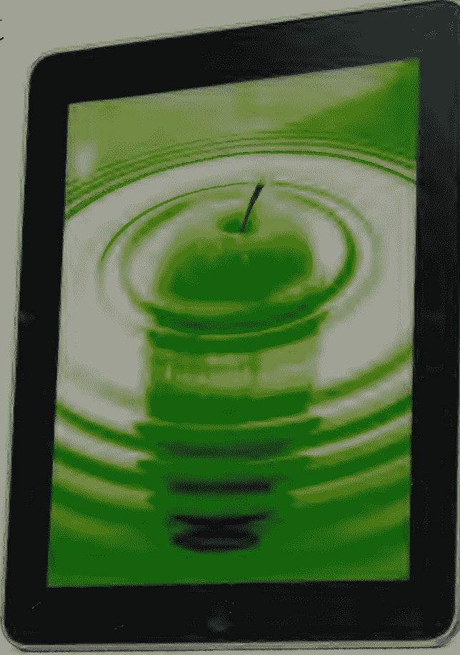

# 读者对 iPad 编程的评价

《iPad Programming》是 iPhone 开发者沉浸 iPad 开发新世界的绝佳资源。无论是创建新的 iPad 应用，还是为 iPhone 和 iPad 创建通用型应用，本书都涵盖了 iPad 特有的核心用户界面和开发主题，让初学者和进阶 iPhone 开发者都能参与这一令人兴奋的 iPad 应用市场。

- Raven Zachary
  iPhoneDevCamp 和 iPadDevCamp 创始人，Small Society 主席

- 计划创建新 iPad 应用或期待将 iPhone 应用移植到这一新设备的软件开发者的必读之作。Eric 和 Daniel 在书中并没有简单地列举类和方法，而是详细地介绍了 3.2 SDK 的每一个新功能，而且这些介绍都是建立在任何 iOS 应用中最重要的元素——用户体验的背景下的。这本书帮助开发者构建出不仅快速稳定，而且利用了 iPad 所有神奇功能的应用。

- Adrian Kosmaczewski
  akosma software 总监

《iPad Programming》包含了一些你在其他地方无法发现的惊人珍珠和细节。它已成为我参考手势、视频以及视频和键盘自定义控制的首选指南。

- Joseph Heck
  Seattle Xcoders SLG 创始人

这本书恰恰恰好处：它没有涵盖初级 iPhone 编程书籍的内容，但也不要求你成为专家。任何掌握了 iPhone 开发基础并想将 iPad 纳入自己的技能范围的人，都能从书中中学到东西并从中获得乐趣。我知道我将把这本书作为我下一个开发项目的参考。

- Janine Sisk
  Trial by Fyre Software, LLC

作为一名 iPhone 开发者，参与 iPad 开发是一个自然且必须的步骤。读这本书时，我原以为它只是一本描述某功能“如何做”的技术文档。然而，我发现它的语气发生了变化感到非常惊喜。这种语气让我能够从非开发者的视角来看 iPad。我开始看到它实际上“是什么”，以及它具备什么能力。这本书会被频繁引用。

- Kevin J. Garriott
  Rockfish Interactive 移动应用高级开发人员

# iPad 编程

制作本书的团队包括：

- 编辑：Colleen Toporek
- 索引：Sara Eastler
- 文字编辑：Kim Wimpsett
- 布局：Steve Peter
- 制作：Janet Furlow
- 客户支持：Ellie Callahan
- 国际：Juliet Benda

## 目录

- 4.9 总结 .................................................. 92
- 8 高级视频播放功能 ........................................ 145
  - 8.6 让播放控制动态化 ...................................... 162
- 9 Apple 的 HTTP Live Streaming (HLS) ........................ 169
- 10 在另一个屏幕上显示内容 .................................. 179
- 11 连接设备 ................................................ 191
- 12 处理文档 ................................................ 207
  - 12.1 使用 iTunes 传输文档 .................................. 208
  - 12.2 持久化文档 ............................................ 209
  - 12.3 注册文件类型 .......................................... 211
  - 12.4 启动时打开文件 ........................................ 212
  - 12.5 打开文件 .............................................. 213
  - 12.6 预览文件 .............................................. 216
  - 12.7 总结 .................................................. 217
- 13 整合一切 ................................................ 19
  - 13.1 从用户开始 ............................................ 19
  - 13.2 同等对待横屏和竖屏视图 ................................ 220
  - 13.3 平坦化层级 ............................................ 220
  - 13.4 创建沉浸式、丰富的、真实的视图 ........................ 221
  - 13.5 手势是强大的 .......................................... 221
  - 13.6 你的 iPad 想要协作 .................................... 222
  - 13.7 文档 .................................................. 222
  - 13.8 视频很重要 ............................................ 222
  - 13.9 外部显示器需要自定义实现 ................................ 223
  - 13.10 通过流媒体提升你的服务质量 ............................ 223
  - 13.11 致谢 ................................................. 223
- 参考文献 .................................................. 227
- 索引 ...................................................... 229

# 第 1 章：从 iPhone 到 iPad

在为 iPad 编写任何代码之前，你必须将设备握在手里。当你沉浸在某个 App 中，你需要感觉到设备仿佛消失了一样。这正是我们想要编写的 App。

我们不仅仅想要编写运行在 iPad 上的 App；我们想要编写完美适配平台的 App。这怎么可能呢？iPad 不是运行在我们已经熟悉并喜爱的 iOS 上的大型 iPod touch 吗？不是。这个高分辨率设备有着本质的不同，它的大屏幕可以握在手里却放不进口袋——这是一个通过多触（Multi-Touch）手势进行导航的设备。在书中，我们将教你如何为这个新设备构建体验。我们将探索为 iPad 开发与为 iPhone 开发之间的相似之处和差异。我们不会一次性展示所有的示例；而是关注单个话题，并由你决定如何使用。

在 WWDC 2010 上，之前被称为 iPhone OS 的操作系统被重命名为 iOS。此时，操作系统被称为 iOS，而开发者 API 仍称为 iPhone SDK。我们将从熟悉的领域开始。在本章中，我们将开始创建一个 iPhone App，并将其转换为运行在 iPad 上的 App。但首先，让我们弄清楚 iPad 是处于用户生活中的——位于笔记本电脑和 iPhone 之间。

## 1.1 iPad 与笔记本电脑

一旦你在 iPad 上查看了邮件或浏览了网页，你的笔记本电脑看起来比拿起 iPad 之前更笨重、更不便于携带。突然之间，你会意识到键盘、触控板、硬盘和电池需要多少空间。

另一方面，你的 iPad 受到更多限制。它并不是设计作为独立设备生活的。它必须经常与笔记本电脑或台式机同步。它没有笔记本电脑的处理能力、内存或存储空间。它的设计是属于单个用户的，在任何时候只有一个 App 占据你的注意力。iPad 并不是桌面电脑或笔记本电脑那样的数字中心。目前，它是枢纽上的一个节点，而不是你宇宙的中心。

最重要的是，通过触摸屏幕进行交互与必须使用鼠标或触控板完全不同。在 iPad 上，你用手指在《飞行》(Flight)中降落飞机，在《画笔》(Brushes)中绘制美丽的图像，并将邮件标记为删除。如果你想移动或引导一个物体，只需将手指放在上面并移动手指。物体就会随之移动。

如果你想调整物体的大小，可以使用两个手指捏合或缩放。你用手指来调整图像的大小、位置并进行裁剪。你缩放网页以便更好地阅读，并让你的手指轻松地选择正确的输入框。这些手势已经变得如此自然，以至于使用鼠标选择物体并抓取手柄进行缩放和移动会感觉很奇怪。去拿鼠标或触控板破坏了这种感觉。

同样，iPad 确实比 iPhone 大得多。iPad 的尺寸与这本书的纸质版差不多——高出约半英寸，稍微薄一点，但尺寸大致相同。iPhone 要小得多。下面这张图片显示了两个 iPhone 屏幕相对于 iPad 屏幕的相对大小：

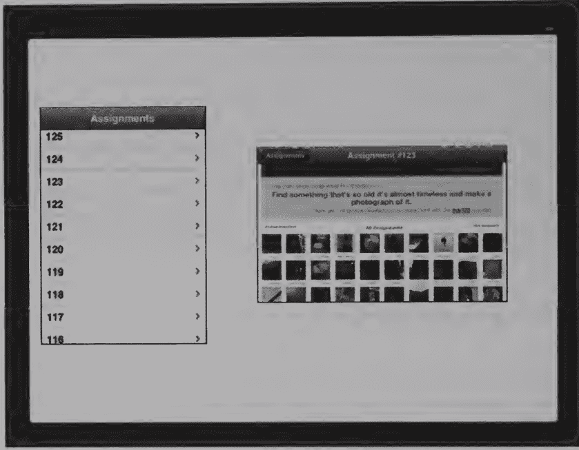

所以，iPad 是一个大号的 iPod touch——但它**仅仅**是一个大号的 iPod touch。尺寸大是其特殊之处的关键。

尺寸是这个故事中的重要部分。在 iPad 上，你可以以全分辨率浏览网页，通过手指轻滑将图片归类，并可以使用可以容纳你所有手指的键盘来填写表单。

如果你从开发者的角度来看 iPad，那么你可能错离了重点。这些 API 与 iPhone 应用的 API 非常相似，一个设备可以轻松在另一台设备上运行。当你开始为 iPad 创建应用时，请花时间去理解这个设备的不同之处和特殊之处。

## 本书所需的准备

你需要在 `http://developer.apple.com/iPhone` 免费注册成为 iPhone 开发者。如果你想将应用部署到你的 iPad 或 iPhone，或者在 iTunes App Store 上销售你的应用，则需要支付额外的年度费用（99 美元）。

书中某些涉及文件共享和使用外部显示器的材料要求你在设备上运行示例。

注册好后，请下载最新版本的工具和 SDK。目前，iPad 开发要求在 Intel 机器上运行 Mac OS X 10.6.2。书中的示例是使用 Xcode 3.2.3 和 iPhone SDK 3.2 创建的。我们假设你正在使用首次随 Xcode 3.2.3 发布的现代模拟器。

此外，你还可以从书的主页网站 `http://ipag.com/titles/sfipad` 下载本书的所有项目。我们对项目进行了分阶段处理，这样你可以跟随进度进行，也可以在某个特定节点加入，将你的工作与我们的进行对比。

Apple 提供的模板在不断变化，因此你可能会偶尔发现一些细微的差异。

你喜爱的 iPhone 应用以自然的方式利用了 iPhone 的所有功能。³ 它们在合适的时候整合了加速度计、指南针、GPS、摄像头以及手机本身。在书的剩余部分，我们将向你展示如何为 iPad 编写程序，但编写什么程序取决于你自己。

> ³ 每次都说“iPhone 和 iPod touch”会很冗长。我们经常会使用其中一个来指代这个通用平台。

## 1.3 开始

在书中，我们假设你已经知道如何开发 iPhone 应用。也许你已经为了盈利编写过一两个 iPhone 应用。你对 Cocoa、Objective-C 和 iPhone API 非常熟悉。你习惯最新版本的 Xcode 和 Interface Builder。你懂得如何处理视图控制器（`view controllers`）和代理（`delegates`），并可以使用引用计数来管理内存。

我们将从那里开始。

我们将创建一个 iPhone 应用，并快速回顾你在书中需要了解的一些关键概念。这些技术在 iPhone 和 iPad 开发中是通用的。在本章的末尾，你会看到这一点，当时我们将将其从一个仅在 iPhone 和 iPad 上运行的项目转换为通用项目。

到本章结束时，你将发现自己已经具备了本书所需的背景知识。一切都应该是熟悉的，快速回顾足以让你跟上书中其余部分的进度。如果你发现自己很困惑，或者我们进展得太快了，那么你可能需要从一本关于 Cocoa 或 iPhone 开发的书开始看。⁴

> ⁴ 你可以从 [Cocoa Programming: A Quick-Start Guide for Developers [ST09]] 和/或 [iPhone SDK Development [DA09]] 开始。

如果你认为我们进展得太慢，并想直接进入 iPad 内容，请从代码下载中 `FromTo/DailyShoot` 目录下的项目开始，并直接跳到第 1.8 节“兼容模式”。

我们将围绕 The Daily Shoot 网站（`http://dailshoot.com`）构建一个简单的导航应用，该网站由 Mike Clark 和 James Duncan Davidson 创建。他们的网站自 2009 年 11 月以来就开始为摄影师提供每日任务。在此类应用中，用户通过若干层表格视图（`table views`）导航，直到选择一个项目并导航到详情视图。

## 消失的 ivars

如果你已经为 iPhone 编程了一段时间，那么你可能已经习惯了声明属性的节奏：你在头文件中声明一个 ivar（实例变量）和对应的属性，在实现文件中对属性进行合成（synthesize），并将其释放（release）。

现在，随着 Xcode 3.2.3 发布了新的模拟器，你不再需要声明 ivar 了。实例变量将由模拟器中的运行时合成，就像它在设备上一直那样。很快，一旦“默认合成”作为编译器选项可用，你就不再需要显式地合成属性了。

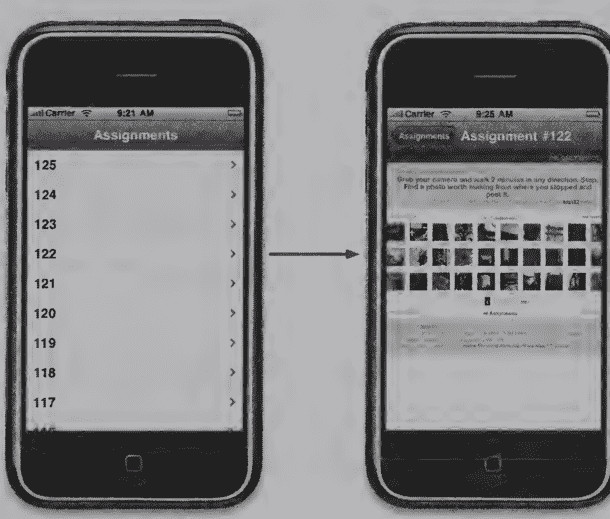

我们的应用启动时将有一个简单的表格，其中填充了前 125 个任务的编号。当用户选择一个数字时，我们将显示详情视图。

## 添加模型对象

表格视图需要数据源来回答基础问题：

- 表格中有多少节（sections）？
- 每个节有多少行（rows）？
- 每一行中有什么内容？

表格视图向控制器发送 `tableView:numberOfInSection:` 消息。控制器反过来将计数发送给 `Assignments` 对象。模型对象响应表格视图，以便它知道行将如何显示。

保存你的工作，并在 IB 中打开 `RootViewController.sib`。在 Library（库）的 Classes 选项卡中，找到我们创建的 `Assignments` 类。将其拖入 Document（文档）窗口以创建 `Assignments` 的实例。保存。

模型对象现在已经完成了。让我们把它连接到控制器。

## 1.5 MVC 中的 C

`RootViewController` 需要与刚刚创建的同一个模型对象进行通信。由于它们在同一个 nib 中被实例化，因此我们可以轻松地连接它们。在 `RootViewController.h` 中添加一个类型为 `Assignments` 的属性，并将其声明为一个 outlet（输出口）。

```
FromTo/DailyShoot/Classes/RootViewController.h
@import UIKit/UIKit.h
@class Assignments;

@interface RootViewController : UITableView
@property(nonatomic, retain) IBOutlet Assignments *assignments;
@end
```

保存头文件，跳转到 IB，将 outlet 连接到 `RootViewController.sib` 中的 `Assignments` 对象。保存 IB 中的工作。

在 `RootViewController.m` 顶部引入 `Assignments.h`，并合成（synthesize）其 `assignments` 变量。在 `viewDidLoad` 中将视图的标题设置为 Assignments，并让 `shouldAutotateToInterfaceOrientation` 方法返回 YES。

```
FromTo/DailyShoot/Classes/RootViewController.h
#import "RootViewController.h"
#import "Assignments.h"
#import "AssignmentViewController.h"

@implementation RootViewController
@synthesize assignments;
-(void)viewDidLoad {
[super viewDidLoad];
self.title = @"Assignments";
}
-(BOOL)shouldAutotateToInterfaceOrientation
(UIInterfaceOrientation)interfaceOrientation {
    return YES;
}
```

你需要对数据源方法进行以下高亮显示的更改：


# FromTo/DailyShoot/Classes/RootViewController.m

```objective-c
-(NSInteger)numberSectionsInView:(UIView *)tableView {
    return 1;
}
-(NSInteger)tableView:(UIView *)tableView
numberRowsInSection:(NSInteger)section {
    return [self.assignments count];
}
-(UICollectionViewCell *)tableView:(UIView *)tableView
cellForRowAtIndexPath:(NSIndexPath *)indexPath {
    static NSString *CellIdentifier = @"Cell";

    UICollectionViewCell *cell = 
    [tableView dequeueReusableCellWithIdentifier:CellIdentifier];
    if (cell == nil) {
        cell = [[UICollectionViewCell alloc] initWithStyle:UICollectionViewCellStyleDefault
        reuseIdentifier:cell.identifier] autorelease];
    }
    cell.accessoryType = UICollectionViewAccessoryDisclosureIndicator;
    cell.textLabel.text = 
    [self.assignments assignmentAtIndex:indexPath.row] stringValue];
    return cell;
}
```

需要添加的代码不多。编译并运行，应用程序应该可以编译并启动；你应该能在表格视图中看到递减的作业编号。我们已经完成了一半。

## 详情视图及其控制器

当最终用户在表格视图中选择作业编号时，我们将显示一个新的视图，其中包含一个带有作业落地页的网页视图。我们需要实现代理方法 `tableView:didSelectRowAtIndexPath:`，以便它创建一个控制器来控制此视图，然后我们需要将该视图控制器推送到导航控制器管理的栈上。

# 第 1 章：从 iPhone 到 iPad

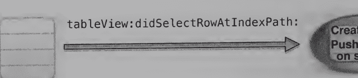

| UITableView | RootViewController |

在本节中，我们将创建控制器及其关联的 nib。在下一节中，我们将实现代理方法。

创建一个 ViewController 子类，仅选择“With XIB for user interface”选项。将其命名为 `AssignmentViewController`。如果你将 nib 文件移动到 Resources 组，并将源代码留在 Classes 组，你会发现管理起来会更方便。

`AssignmentViewController` 需要一个 outlet 来与其网页视图通信，以及一个属性，以便 `RootViewController` 能够传递与所选行对应的作业编号。

## FromTo/DailyShot/Classes/AssignmentViewController.h

```objective-c
#import <UIKit/UIKit.h>

@interface AssignmentViewController : UIViewController
@property (nonatomic, retain) UIView *webView;
@property (nonatomic, retain) NSNumber *assignmentNumber;
@end
```

双击 `AssignmentViewController` nib 文件用 IB 打开它。使用属性检查器查看视图的顶部栏是否为导航栏。将网页视图作为子视图添加到视图，并调整大小以占据视图上剩余空间。在网页视图的属性检查器中勾选 Scales To Fit 框。将 `AssignmentViewController` 的 outlet 连接到网页视图。保存。你可以退出 IB 了。

实现 `AssignmentViewController` 类，合成变量，加载正确的 URL，并在 `view-viewDidLoad` 方法中设置页面标题。

## FromTo/DailyShot/Classes/AssignmentViewController.m

```objective-c
@synthesize webView, assignmentNumber;

- (void)loadSelectedPage {
    NSString *url =
    [NSString stringWithFormat:@"http://dailysh.com/assignments/%@", self.assignmentNumber];

    [self.webView loadRequest:
    [NSRequest requestWithURL:[NSURLWithString:url]]];
}
-(void)viewDidLoad {
    [super viewDidLoad];
    self.title = [NSString stringWithFormat:@"Assignment %@",
                               self.assignmentNumber];
    [self loadSelectedPage];
}
```

此时，你已经准备好了将视图控制器及其控制的视图推送到栈；同时实现 `shouldRotateToInterfaceOrientation:` 方法并返回 YES。

### 1.7 实现代理方法

表格视图既有数据源也有代理。我们已经在 `RootViewController` 中实现了所需的数据源方法。这些方法用于告诉视图应该显示什么。特别是，当用户选择一个作业时，会调用代理方法 `tableView:didSelectRowAtIndexPath:`。在这个基于导航的示例中，`RootViewController` 是表格视图的代理。我们只需要更改控制器类和加载的 nib 为 `AssignmentViewController`。

```objective-c
-(void)tableView:(UITableView *)tableView didSelectAtIndexPath:(NSIndexPath *)indexPath {

    AssignmentViewController *detailViewController =
        [[AssignmentViewController alloc]
        initWithName:@"AssignmentViewController" bundle:nil];
    detailViewController.assignmentNumber =
        [self.assignments assignmentAtIndex:indexPath.row];
    [self.navigationController pushViewController:detailViewController animated:YES];
}
```

别忘记导入 `AssignmentViewController.h`。现在当你编译运行运行时，一切都应该正常工作。

我们的 iPhone App 开发完成了。我们处理了 nib、设置了 outlet、实现了一个 MVC 模式的示例、使用了代理方法，并通过创建一个新的视图控制器和一个作为 File's Owner 的 nib 更改了屏幕显示内容。如果你在跟进示例时没有遇到，那么你已经准备好进入 iPad 的介绍了。

事实上，是时候将我们的项目从一个仅限 iPhone 项目转换为一个跨平台项目了。

## 1.8 兼容模式

我们刚刚创建的应用程序将在兼容模式下运行在 iPad 上。它目前不是 iPad 应用——是一个可以在 iPad 上运行的 iPhone 应用。为了在模拟器中查看它，我们需要对项目设置进行细微更改。

选择菜单项 Project > Edit Project Settings...，并选择 Build 选项卡。假设你使用的是 Xcode 3.2.3 或更高版本，Base SDK 和 iPhone OS Deployment Target 都设置为 iPhone 4.0。在本文编写时，iPhone SDK 4.0 不适用于 iPad。你需要使用下拉菜单将 iPhone OS Deployment target 更改为 iPhone OS 3.2。

现在你可以在 iPad 模拟器中运行 DailyShoot 应用。在 Project 菜单中，确保 Set Active SDK 设置为 Simulator，Set Active Executable 设置为 Daily Shoot - iPad Simulator 3.2。运行它，iPad 模拟器应该启动。

## 转换为通用型应用程序

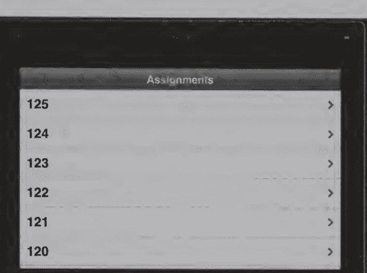

这非常不错。Apple 为 iPhone App 提供了一种简单的方法，让它们可以在 iPad 上运行，而无需要求开发者进行任何更改。这种兼容模式是为开发者提供的便利，而不是你应该依赖的特性。在 iPad 上，iPhone App 可以按其原始大小查看。此外，就像在设备上一样，你可以点击模拟器右下角的 2x 圆形按钮，以其原始大小的两倍来查看该 App。

好消息是，这让大量的现有 iPhone App 引入了 iPad，使得新设备能够带着丰富的内容首次亮相。坏消息是，这些自动调整的 App 看起来并不锐利。一个像素变成了四个像素——每个方向上两个。虽然在截图中可能很难看出像素化问题，但你可以在模拟器和设备上立即看到它们。

所以，在不进行任何工作的情况下，你的 iPhone App 就可以在 iPad 上运行。你的下一步不需要花费太多精力，就能得到一个能够全分辨率利用 iPad 全屏的 App。

## 1.9 转换为通用型应用程序

现在你有一个 iPhone App。诚然，你已经看到它可以同时在 iPhone 和 iPad 上运行，但它在 iPad 上的看起来并不原生。即使你的用户没有对模糊感感到困扰，他们可能也会注意到你的 App 并没有占据他们的整个屏幕。这在某种程度上是因为 iPhone 和 iPad 的宽高比不同。

# 第 1 章：从 iPhone 到 iPad

如果你显式地同时为 iPhone 和 iPad 开发，你有三个基本选择：

- 你可以从单个项目中的单个目标创建一个通用应用程序。这将产生一个二进制文件，在 iPhone 上运行 iPhone 版本，在 iPad 上运行 iPad 版本。用户购买并下载单个应用程序，它会根据安装的设备表现出不同的行为。如果你本质上是在为两个平台编写相同的应用程序，你应该优先选择这种方法。

- 如果 iPhone 和 iPad App 在用户看来是不同的，但共享许多代码，你应该生成两个二进制文件。换句话，你有一个包含两个目标的项目。

- 如果 iPhone 和 iPad App 在用户看来是不同的，且它们不共享任何文件，那么你可能想要创建两个独立的项目。这是最不推荐的选项。

我们将选择第一种方案，并将我们的 iPhone 应用程序转换为通用应用程序，以便它可以在 iPad 或 iPhone 上运行。目前，我们将在两个平台上运行完全相同的应用程序。在下一章中，你将看到如何更改每个平台的外观和感受。

在 Xcode 中，选择目标名称 DailyShoot，右键点击它，并选择“Upgrade current target for iPad（升级当前目标用于 iPad）”。

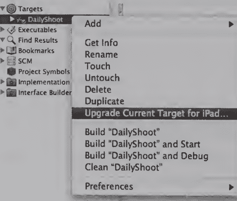

你也可以在 Project 菜单的菜单列表中找到此选项。

无论你采取哪条路径，你都将获得创建一个单个通用应用程序或两个特定设备的应用程序的选择。选择创建一个通用应用程序，并点击 OK 按钮。

有两个细微的可见变化。你应该看到创建了一个新组用于存放你的 iPad 资源，它包含一个新的 nib 文件。

- Resources
  - AssignmentViewController.xib
  - RootViewController.xib
  - MainWindow.nib
  - DailyShoot-info.plist
- Resources
  - MainWindow-iPad.nib

双击 `MainWindow-iPad` nib 在 IB 中打开它，你会看到它的结构与 `MainWindow` nib 完全相同。窗口的尺寸是不同的。

现在当你将应用程序作为 iPad App 构建并运行时，App 将填充整个屏幕，分辨率与原始 iPhone 原生 App 相同。

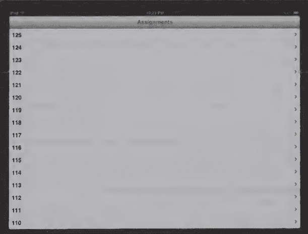

哇。那看起来太糟糕了。看那些浪费的空间。如果你能看到任何一个作业，那么详情页面看起来很棒。你会看到全尺寸和全分辨率的浏览器。但从这个例子中你可以看出为什么没有模板供你创建一个基于导航的 iPad App。

### 检查 MainWindow-iPad 转换为通用应用时未正常工作

有时升级后生成的 nib 实际上是一个 iPad 窗口 nib 而不是 iPhone nib。你应该检查它是否不是 iPhone nib。双击 nib 内部的 Window 对象，将打开一个包含该对象的窗口。如果它是 iPhone 窗口的大小，那么你需要升级该 nib。选择 Document 窗口，选择菜单项 File > Create iPad Version。你需要删除 iPhone 版本，并将 iPad 版本保存为 `MainWindow-iPad.xib`。

用于 iPad 的 app。在下一章中，

## 1.10 添加细节

有些微调是在我们继续之前需要做的。iPad 的启动屏是 72x72，而 iPhone 的启动屏是 57x57。同样，我们需要让启动屏取决于 App 是在竖屏还是横屏运行。最后，我们需要确保启动屏在横屏下显示。

### 图标

让用户会感到困惑。

的截图。

5500， 一个 29x29 图标。

为 iPad 创建两个启动。

启动。命名 iPhone 版本为 `icon.png`，它是 57x57。命名 iPad 版本为 `icon-iPad.png`，它是 72x72。

将这些文件放入 Resources 组。清理目标，退出模拟器，然后构建运行。打开 `DailyShoot.plist`，替换以下项：

```xml
<key>CFBundleIconFiles</key>
<array>
  <string>icon.png</string>
  <string>icon-iPad.png</string>
</array>
```

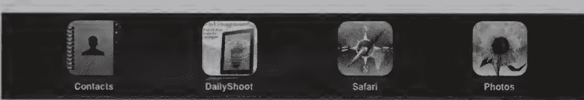

Apple 还建议为 Spotlight 使用一个 50x50 图标。

### 启动屏

我们的应用程序通常不需要启动屏。让我们为 iPad 创建一个。它们可以是启动面的图片。这次我们需要创建三个不同的文件。设置 iPhone 的启动屏尺寸为 320x460 像素，并保存为 `Default.png`。对于 iPad，我们需要一个 768x1000 像素的竖屏版本保存为 `Default-Portrait.png`，以及一个 1024x748 像素的横屏版本保存为 `Default-Landscape.png`。

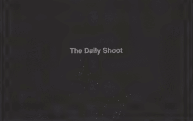

将这三个文件放入 Resources 组，以便启动屏在启动时显示。

### 在启动时支持多方向

一旦运行，通过在我们的每个视图控制器中从 `shouldAutorateToInterfaceOrientation:` 返回 YES，确保我们的 App 可以在任何方向上运行。然而，如果你希望能够以任何方向启动 App，你需要在 `DailyShoot.plist` 中添加此元素。

```xml
<key>UISupportedInterfaceOrientations-ipad</key>
<array>
  <string>UIInterfaceOrientationPortrait</string>
  <string>UIInterfaceOrientationPortraitUpsideDown</string>
  <string>UIInterfaceOrientationLandscapeLeft</string>
  <string>UIInterfaceOrientationLandscapeRight</string>
</array>
```

iPad App 始终以竖屏启动。通过将支持的界面方向添加到列表中，你允许你的 iPad App 在你包含的任何方向启动。

## 1.11 总结

我们应用程序的通用版本并没有充分利用 iPad。它仍然是为 iPhone 构建的，并经过了调整以便在 iPad 上看起来尚可。作为一个思想实验，让我们对最初用于比较 iPhone 和 iPad 屏幕大小的图片进行一些细微调整，以创建一个既在运行上与 iPhone 应用程序类似，又利用了 iPad 额外空间的应用程序。

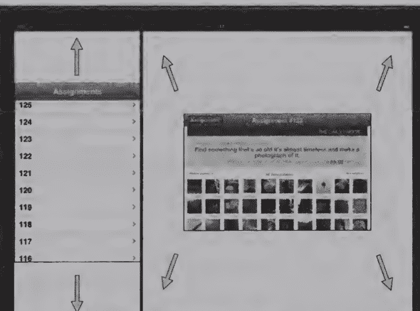

在 iPad 的横屏模式下，我们可以同时显示导航视图和浏览器。想象一下我们将导航视图拉伸到屏幕左侧，并放大浏览器以填充剩余部分。这正是我们在下一章中使用分屏视图时将得到的。

竖屏模式下呢？


## 1.11 总结

我们应用程序的通用版本并没有充分利用 iPad。它仍然是为 iPhone 构建的，并经过了调整以便在 iPad 上看起来尚可。作为一个思想实验，让我们对最初用于比较 iPhone 和 iPad 屏幕大小的图片进行一些细微调整，以创建一个既在运行上与 iPhone 应用程序类似，又利用了 iPad 额外空间的应用程序。


在 iPad 的横屏模式下，我们可以同时显示导航视图和浏览器。想象一下我们将导航视图拉伸到屏幕左侧，并放大浏览器以填充剩余部分。这正是我们在下一章中使用分屏视图（split view）时将得到的。

竖屏模式下呢？

> 8. 这是使用 Java 编程语言编写应用程序的核心价值主张。

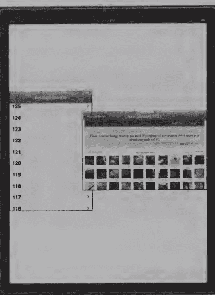

你可以看到，在这种方向下，我们甚至无法在 iPad 屏幕上放进原始的 iPhone 屏幕。如果我们垂直拉伸它们，组合看起来会非常拥挤且变形。这就是为什么在竖屏模式下，分屏视图将只显示浏览器而不显示导航。遵循 Apple 的做法，针对每个设备真正地完善你界面的各个方面。

另一方面，我们已经快速上手了。你已经创建了一个可以运行在 iPhone 和 iPad 上的通用应用程序。在此过程中，我们回顾了使用 iPhone SDK 为这两个设备进行编程时通用的某些核心概念。你可以在 Apple 的《iPad 编程指南 [App10b]》中阅读更多关于创建通用应用程序以及你可以设置的各种列表属性的内容。现在，让我们开始使用一个 iPad 特有的控件：`UISplitViewController`。

## 第 2 章

## 介绍分屏视图

本章完全关于创建一个感觉上是专为 iPad 设计的应用程序。我们将使用两个 iPad 特有的控制器：`UISplitViewController` 和 `UIPopoverController`。

分屏视图控制器允许我们将导航和详情视图合并在一个集成的屏幕中。在本章中，你将使用分屏视图控制器同时展示导航和详情视图。

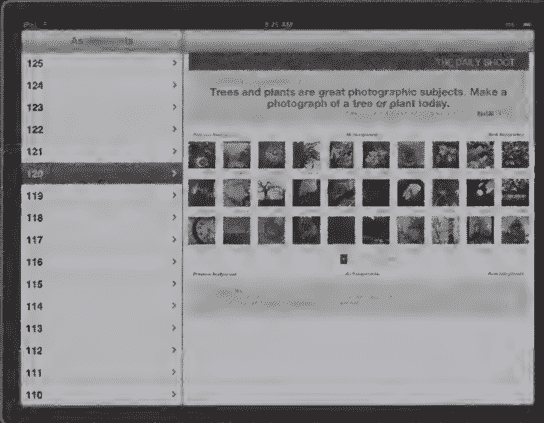

当用户水平拿着 iPad 时，这种效果非常好，但如果用户旋转设备并竖直持有，它看起来就会糟糕极了。正如你在上一章中看到的，没有足够的空间同时显示两个窗格。

答案是将导航视图滑出视线，只显示详情视图。如果用户需要访问导航，他们可以旋转 iPad，或者他们点击按钮弹出一个名为弹出框（popover）的新浮动菜单。

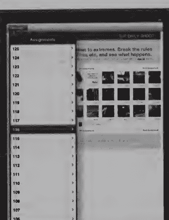

以下是计划。

我们将为应用程序的 iPad 版本引入分屏视图控制器。记住，这是一个通用应用程序。当我们开发 iPad 版本时，我们的 iPhone 版本必须继续按照目前的方式运行。如果我们仅针对 iPad，我们将从基于分屏视图的应用程序模板开始一个新项目。你会在本章末尾发现这留了一项练习。

无论如何，我们已经建立并运行了分屏视图控制器，应用程序在任何方向下启动时看起来都是正确的，但在两种情况下其表现都不正确。为了让横屏视图正确，我们必须与导航视图和详情视图进行通信，以便当用户在导航视图中选择一个项目时，该项目对应的页面加载到详情视图中。为了让竖屏视图正确，我们需要引入一个弹出框，在用户需要时显示分配任务，并在用户不再需要时关闭弹出框。

### 2.1 介绍分屏视图

在基于导航的 iPhone 应用程序中，你向用户展示一个表格视图。当用户选择某一行时，你要么导航到另一个表格视图，要么向他们展示该项的详情视图。由于 iPhone 的尺寸限制，每个视图都绘制在上一个视图之上。

在 iPad 上的是基于分屏视图的应用程序。在横屏模式下，表格视图出现在左侧。当用户选择某一行时，你要么导航到另一个表格视图，要么向他们展示该项的详情视图。区别在于，如果他们导航到另一个表格视图，始终在屏幕右侧可见的详情视图将在用户与其交互或当他们导航到不同的选择时进行更新。

打开 `MainWindow-iPad` nib。


该窗口看起来与 iPhone 版本使用的 `MainWindow` nib 一样。我们现在来更改它。选择导航控制器，并使用菜单 `Edit > Delete` 将其删除。在库（Library）中找到分屏视图控制器，将其拖到原来导航控制器的位置。

打开展开器，你会看到它包含了两个控制器：一个导航控制器和一个视图控制器。我们需要进行一些调整以确保我们正在加载我们的类。

```objc
} else {
    [self.window addSubview:self.navigationController.view];
}
    [self.window makeKeyAndVisible];
}
```

编译并运行，你将看到类似的内容：

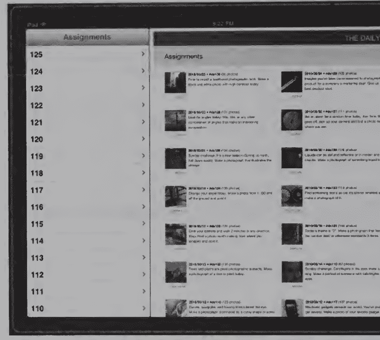

它看起来很漂亮。尝试不同的方向，你会看到看到页面的导航部分会随着设备的旋转而滑入和滑出屏幕。如果你在旋转设备时应用程序没有旋转，请检查是否已在 `RootViewController.m` 和 `AssignmentViewController.m` 中都实现了 `shouldAutotateInterfaceOrientation:` 方法并返回 YES。

正如常见的情况，既有好消息也有坏消息。好消息是，分屏视图（split view）在用户选择特定作业之前，其详情视图中就已经填充了默认的 Assignments 页面。你可以从 `AssignmentViewController.m` 中的 `viewDidLoad` 方法看到，这种意外的收益是尝试加载页面 `http://dailyshoot.com/assignments/`（在最后的正斜杠后没有任何任何内容）带来的。

正如本章引言提到的，我们将修复横屏模式下的某些问题以及竖屏模式下的其他问题。我们将从修复横屏模式开始。要查看哪里错了，请选择屏幕左侧导航视图中的某个作业。

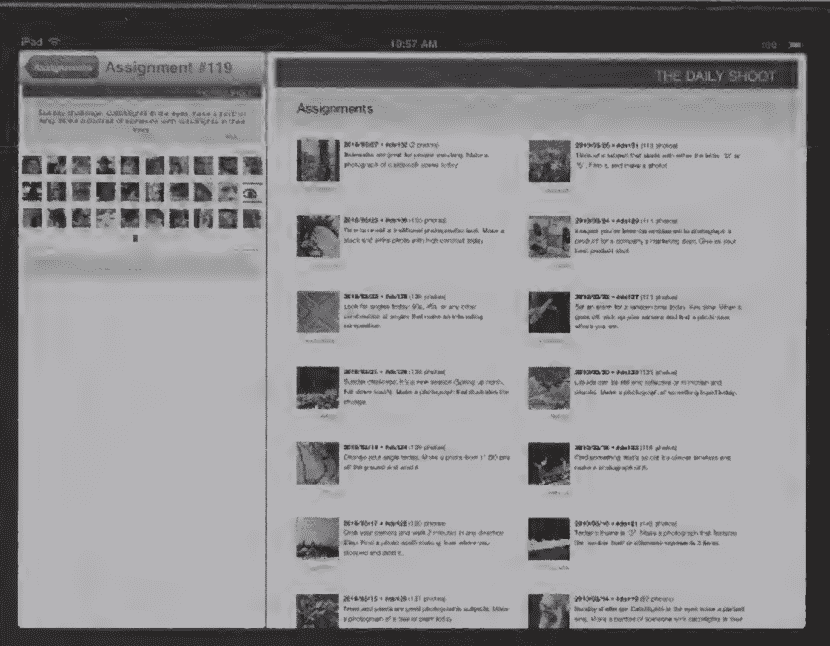

这是我们在 iPhone 版本中预期的行为。我们将表格视图中所选项目的详情视图推到表格视图之上，而不是让表格视图可见，并且我们正在更新屏幕右侧正在的网页。让我们现在修复这个问题。

## 在视图控制器之间进行通信

让我们先在负责分屏视图每个部分的控制器之间建立一个双向连接。在 `AssignmentViewController` 中创建一个类型为 `RootViewController` 名为 `rootVC` 的输出（outlet），并在 `RootViewController` 类中创建一个类型为 `AssignmentViewController` 名为 `assignmentVC` 的输出。

唯一包含这两个对象的 nib 文件是 `MainWindow-iPad`。在这里建立连接。

我们有多种方案来同时为两个平台实现正确的行为。让我们看看在应用程序运行的设备上自定义表格视图代理的两种变体。首先，我们将修改 `RootViewController`，使其成为两个设备上表格视图的代理。在下一节中，我们将尝试另一种方法，涉及用于 iPhone 和 iPad 实现的并行视图控制器集。你应该理解这两种方法，但在本章的剩余部分，我们将使用第二个版本。

目前，`RootViewController` 对象是表格视图的代理。我们可以这样修改代理方法 `tableView:didSelectRowAtIndexPath:`：

```swift
// DailyWoc5/Classes/RootViewController.m
- (void)tableView:(UITableView *)tableView didSelectRowAtIndexPath:(NSIndexPath *)indexPath {
    if (USER_INTERFACE_IDIOM() == UserInterfaceIdiomPad) {
        [self.assignments assignmentAtIndex:indexPath.row];
        [self.assignmentVC loadSelectedPage];
    } else {
        AssignmentViewController *detailViewController = [AssignmentViewController alloc]
        [detailViewController initWithName:@"AssignmentViewController" bundle:nil];
        detailViewController.assignmentNumber = [self.assignments assignmentAtIndex:indexPath.row];
        [self.navigationController pushViewController:detailViewController animated:YES];
    }
    [detailViewController release];
}
```


换句话说，如果设备是 iPhone，那么我们就创建一个 `AssignmentViewController` 的新实例，配置它，并像以前一样将其推入导航栈。相反，如果我们在 iPad 上运行，则使用 `AssignmentViewController` 的现有实例，配置它，并使用这些信息重新加载网页浏览器。

## 2.4 使用子类针对不同的设备

我们的代码开始充满了对我们处于什么设备上的检查。请记住，维护代码花费的时间将远大于你编写代码花费的时间。在大型项目中，由于这些散落在各处的语句，在 iPhone 或 iPad 上追踪其行为将变得非常困难。

这些建议中并没有针对 iPad 的特定内容。当你认为代码中充满了条件判断时，使用你传统的工具箱技巧来拆分方法和类，以便代码的意图更加清晰。

例如，更健壮的方法是将类文件拆分为三个不同的类别。所有在两个平台之间共享的代码都放在共享文件中。你将为需要针对 iPhone 或 iPad 定制的代码创建子类。到下一节结束，我们的源代码将包含以下文件：⁵

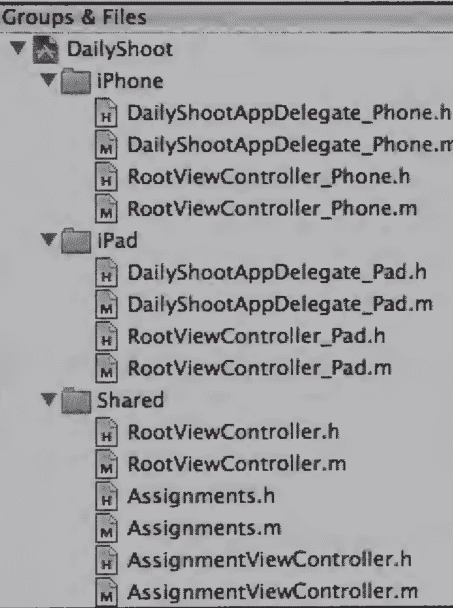

首先，考虑 `RootViewController`。我们针对设备自定义其行为的唯一地方是在表格视图代理的 `tableView:didSelectRowAtIndexPath:` 方法的实现中。我们将从 `RootViewController` 类中删除此方法并创建两个实现它的子类。

创建一个名为 `RootViewController_Pad` 的 `RootViewController` 子类。头文件非常空闲。

- ⁵ 你可以添加三个名为 Shared、iPad 和 iPhone 的新分组，并将相应的源文件移动那里。

```
SplitVC/DailyShot66/Classes/RootViewController_Pad.h
```

```objc
#import "RootViewController.h"
```

```objc
@interface RootViewController_Pad : RootViewController {
}
@end
```

实现文件也没有什么内容。我们实现 iPad 特有的代码。你可以从 `RootViewController.m` 的 `tableView:didSelectRowAtIndexPath:` 方法复制并粘贴相应的行。

```
SplitVC/DailyShot66/Classes/RootViewController_Pad.m
```

```objc
#import "RootViewController_Pad.h"
#import "Assignments.h"
#import "AssignmentViewController.h"
```

```objc
@implementation RootViewController_Pad

-(void)tableView:(UITableView *)tableView didSelectRowAtIndexPath:(NSIndexPath *)indexPath {
    self.assignmentVC.assignmentNumber = self.assignments.AtIndex:indexPathrow;
    [self.assignment.SelectedPage];
}

@end
```

我们将按照相同的模式处理 iPhone 情况。创建一个名为 `RootViewController_Phone` 的第二个 `RootViewController` 子类。

```
SplitVC/DailyShot66/Classes/RootViewController_Phone.h
```

```objc
#import "RootViewController.h"
```

```objc
@interface RootViewController_Phone : RootViewController {
}
@end
```

它的方法实现包含了 iPhone 特有的行为。再次从 `RootViewController.m` 的 `tableView:didSelectRowAtIndexPath:` 方法复制并粘贴相应的行。

```objc
@implementation RootViewController_Phone
```

```objc
(void)tableView:(UITableView *)tableView
    didSelectRowAtIndexPath:(NSIndexPath*)indexPath {
        AssignmentViewController *detailViewController = 
            [[AssignmentViewController alloc] 
            WithName:@"AssignmentViewController" bundle:nil];
        detailViewController.assignmentNumber = 
            self.assignments objectAtIndex:indexPath.row;
        [self.navigationController pushViewController:detailViewController
            animated:YES];

        [detailViewController release];
}
end
```

我们使用 `RootViewController` 的子类轻松地拆分了设备特定的行为。我们从 `RootViewController.m` 中删除了 `tableView:didSelectRowAtIndexPath:` 的实现。父类拥有所有表格视图的数据源方法，我们将设备特定的代理方法移动到了子类中。

遗憾的是，我们应用程序的其他部分对这些新子类一无所知。让我们将应用程序代理分为 iPhone 和 iPad 类，并调用相应的 `RootViewController`。

## 2.5 分离应用程序代理

我们需要进行一些更改，以便使用相应的 `RootViewController` 子类。我们将为每个平台创建应用程序代理。我们将两个设备通用的代码放在基类 `DailyShootAppDelegate` 中。这是它的头文件：

```
ViewController/DailyShotMock/Classes/DailyShootAppDelegate.h
```

```objc
#import <UIKit/UIKit.h>

@interface DailyShootAppDelegate : NSObject <UIApplicationDelegate> {
}
@property (nonatomic, retain) UIWindow *window;
@property (nonatomic, retain) UINavigationController *navigationController;

@end
```

实现文件删除了对目标设备的检查。我们将推迟将初始视图添加到子类。

- 4. 如果你收到编译器警告或错误，请检查你是否添加了 @class 声明和导入，并且声明了 `loadSelectedPage` 方法。

这里是 DailyShootAppDelegate.m：

```
SplitVC/DailyShoot6/Classes/DailyShootAppDelegate.m
```

```objc
#import "DailyShootAppDelegate.h"

@implementation DailyShootAppDelegate

@synthesize window, navigationController;

- (BOOL)application:(UIApplication*)application
    didFinishLaunchingWithOptions:(NSDictionary*)launchOptions {

    [self.window makeKeyAndVisible];

    return YES;
}

- (void)dealloc {
    [navigationController release], navigationController = nil;
    [window release], window = nil;
    [super dealloc];
}

@end
```

创建一个带有此头文件的 `DailyShootAppDelegate_Phone` 类：

```
SplitVC/DailyShoot6/Classes/DailyShootAppDelegate_Phone.h
```

```objc
#import <UIKit/UIKit.h>
#import "DailyShootAppDelegate.h"

@interface DailyShootAppDelegate_Phone : DailyShootAppDelegate {
}
@end
```

在 iPhone 的情况下，我们将导航控制器视图作为顶层视图，并调用父类的 `application:didFinishLaunchingWithOptions:` 方法。

```
SplitVC/DailyShoot6/Classes/DailyShootAppDelegate_Phone.m
```

```objc
#import "DailyShootAppDelegate.h"

@implementation DailyShootAppDelegate_Phone

- (BOOL)application:(UIApplication*)application
    didFinishLaunchingWithOptions:(NSDictionary*)launchOptions {

    [self.window addSubview:self.navigationController.view];

    return [super application:application
        didFinishLaunchingWithOptions:launchOptions];
}

@end
```

同样，创建一个带有以下头文件的 `DailyShootAppDelegate_Pad` 类：

```
SplitVC/DailyShoot6/Classes/DailyShootAppDelegate_Pad.h
```

```objc
#import <UIKit/UIKit.h>
#import "DailyShootAppDelegate.h"

@interface DailyShootAppDelegate_Pad : DailyShootAppDelegate {
}
@property (nonatomic, retain) IBOutlet UISplitViewController *splitVC;
@end
```

我们需要在这个子类中为分屏视图控制器添加一个属性。

在实现中，我们将分屏视图控制器的视图作为顶层视图，并在 `dealloc` 方法中清理对象。

```
SplitVC/DailyShoot6/Classes/DailyShootAppDelegate_Pad.m
```

```objc
#import "DailyShootAppDelegate_Pad.h"

@implementation DailyShootAppDelegate_Pad

@synthesize splitVC;

- (BOOL)application:(UIApplication*)application
    didFinishLaunchingWithOptions:(NSDictionary*)launchOptions {
    [self.window addSubview:splitVC.view];
    return [super application:application
        didFinishLaunchingWithOptions:launchOptions];
}

- (void)dealloc {
    [splitVC release];
    splitVC = nil;
    [super dealloc];
}

@end
```

我们几乎已经完成了。我们需要对 nib 文件进行一些细小的调整。在 IB 中打开 `MainWindow.xib` 文件，使用身份检查器（Identity Inspector）将 `DailyShootAppDelegate` 对象的类型更改为 `DailyShootAppDelegate_Phone`，并将 `RootViewController` 对象的类型更改为 `RootViewController_Phone`。

| Name | Type |
|---|---|
| File's Owner | UIApplication |
| First Responder | UIResponder |
| Daily Shoot App Delegate Phone | DailyShootAppDelegate_Phone |
| Window | UIWindow |
| Navigation Controller | UINavigationController |
| Navigation Bar | UINavigationBar |
| Root View Controller | RootViewController_Phone |
| Navigation Item | UINavigationItem |

同样，在 Interface Builder 中打开 `MainWindow-iPad.xib` 文件，再次使用身份检查器将 `DailyShootAppDelegate` 对象的类型更改为 `DailyShootAppDelegate_Pad`。

| Name | Type |
|---|---|
| File's Owner | UIApplication |
| First Responder | UIResponder |
| Daily Shoot App Delegate | DailyShootAppDelegate_Pad |
| Window | UIWindow |
| Split View Controller | UISplitViewController |
| Navigation Controller | UINavigationController |
| Navigation Bar | UINavigationBar |
| RootViewController_Pad (Root Vi...) | RootViewController_Pad |
| Navigation Item (Root View Co...) | UIBarButtonItem |
| Assignment View Controller | AssignmentViewController |

保存所有更改，编译并运行，一切都应该像以前一样运行。

哇！为了替换两个简单的 `if` 语句，感觉步骤有很多步骤。但另一方面，你的代码现在更具可读性和灵活性。你可能也发现，实现这些更改花费了很小的时间——只是当我们这些页面上明确说明它们时，看起来要做很多工作。

## 2.6 在详情视图（Detail View）中添加工具栏

接下来，让我们在 iPad 版本中由 `AssignmentViewController` 管理的视图顶部添加一个工具栏，但在 iPhone 版本中不添加。我们很快就会在 iPad 版本的竖屏模式下需要工具栏，将其也包含在横屏版本中使其看起来更整洁。我们在 iPhone 版本中已经有了导航栏，所以我们想确保不在那里添加额外的工具栏。

我们将创建一个 iPad 版本的 `AssignmentViewController` 类以及相应的 nib。选择 iPad 组，创建一个 `UIViewController` 子类的新文件。确保勾选了目标为 iPad 和创建 XIB 的选项框。将新类命名为 `AssignmentViewController_Pad`。

### 在详情视图中添加工具栏

在 `AssignmentViewController_Pad` 类中添加一个类型为 `UIToolbar` 的名为 `toolbar` 的属性，并将其标记为 outlet。将父类从通用的 `UIViewController` 更改为 `AssignmentViewController`。

```
SplitVC/DailyShoots/Classes/AssignmentViewController_Pad.h
```

```objc
#import "AssignmentViewController.h"

@interface AssignmentViewController_Pad : AssignmentViewController {
}
@property (nonatomic, retain) IBOutlet UIToolbar *toolbar;
@end
```

打开 `AssignmentViewController_Pad` nib 文件。在视图顶部放置一个工具栏，并用 `UIWebView` 填充其余部分。移除工具栏上的按钮。我们稍后会创建自己的按钮。在 web view 中选择“自适应比例”（Scales to Fit）。从 File's Owner 连接这些元素。现在我们为 `AssignmentViewController_Pad` 类编写实现：

```
SplitVC/DailyShoots/Classes/AssignmentViewController_Pad.m
```

```objc
#import "AssignmentViewController_Pad.h"

@implementation AssignmentViewController_Pad

- (BOOL)shouldAutorotateToInterfaceOrientation:(UIInterfaceOrientation)interfaceOrientation {
    return YES;
}

- (void)dealloc {
    [toolbar release];
    toolbar = nil;
    [super dealloc];
}

@end
```


像以前一样，我们需要对 `MainWindow-iPad` nib 进行一些调整。使用身份检查器将 `AssignmentViewController` 对象的类型更改为 `AssignmentViewController_Pad`。你还需要使用属性检查器将 NIB 名称更改为 `AssignmentViewController_Pad`。

编译并运行以查看新添加的工具栏。

## 2.7 分屏视图代理

我们的应用程序在横屏模式下看起来和运行都很良好。


看看当我们把它转过来时发生了什么。导航栏消失了，我们没有简单的方法导航到某一个任务。


幸运的是，Apple 为我们提供了赋予用户这种能力的机制，而且 Apple 使得实现变得非常简单。

当用户横屏持有 iPad 时，我们希望应用程序像现在这样显示。当用户切换到竖屏时，我们将在工具栏上添加一个任务按钮。当用户按下按钮时，他们将获得任务列表，如果改变主意不选择，我们需要清理列表。

分屏视图管理器两个子控制器。在我们的情况下，当 iPad 旋转时，分屏视图隐藏或显示由 `RootViewController_Pad` 控制的视图，并调整由 `AssignmentViewController_Pad` 控制的视图。由 `AssignmentViewController_Pad` 管理的视图是在过程中变化的视图。这意味着 `AssignmentViewController_Pad` 对象将是 `UISplitViewController` 的代理。

在 `AssignmentViewController_Pad.h` 头文件中添加 `UIViewControllerDelegate` 协议的声明。现在连接这个代理。打开 `MainWindow-iPad` nib，将 `UISplitViewController` 的 delegate outlet 连接到 `AssignmentViewController_Pad` 对象。

iPad 有一个名为弹出框的新组件，它当然由弹出框控制器管理。它类似于菜单，但并没有附加到按下以显示的按钮上。正如你在第 4 章“弹出框和模态对话框”中看到的，可以设置在用户触摸屏幕特定区域时显示弹出框。现在，我们将在按下按钮时弹出我们的弹出框。

在 `AssignmentViewController_Pad.h` 中添加一个名为 `popoverController`、类型为 `UIPopViewController` 的属性。在添加弹出器的步骤中，我们实际上不需要这个变量，但在下一节确保我们移除弹出窗口时，将会需要它。

前往 `UISplitViewControllerDelegate` 的文档，复制并粘贴此方法的签名：

```
- (void)splitViewController:(UISplitViewController*)svc hideViewController:(UIViewController*)aViewControllerWithBarButtonItem:(UIBarButtonItem*)barButtonItem forPopoverController:(UIPopoverController*)pc
```

是的，复制并粘贴。这是一个代理方法，如果你即使出现一点最微小的拼写错误，该方法在运行时也不会被调用，而且你不会收到任何错误或警告来提示原因。

当用户从横屏切换到竖屏，且 `RootViewController_Pad` 的视图即将隐藏时，会调用此方法。注意，该方法将该视图控制器作为第二个参数传递，并将工具栏上的按钮作为第三个参数传递。方法的最后一个参数是一个弹出控制器。

要实现该方法，请设置按钮的标题，在工具栏上显示按钮，并设置 `popoverController` 属性的值。

```
SPLVC/ViewController/Classes/AssignmentViewController_Pad.m
- (void)splitViewController:(UISplitViewController*)svc
hideViewController:(UIViewController*)aViewControllerWithBarButtonItem:(UIBarButtonItem*)barButtonItem
forPopoverController:(UIPopoverController*)pc {
    barButtonItem.title = aViewController.title;
    self.toolbar setItems:[NSArray arrayWithObject:barButtonItem] animated:YES];
    self.popoverController = pc;
}
```

就是这样。试一下。按钮和弹出器在竖屏下应该显示正常。横屏下的情况不太对，但我们稍后会修复它。

## 2.8 弹出器如何填充内容

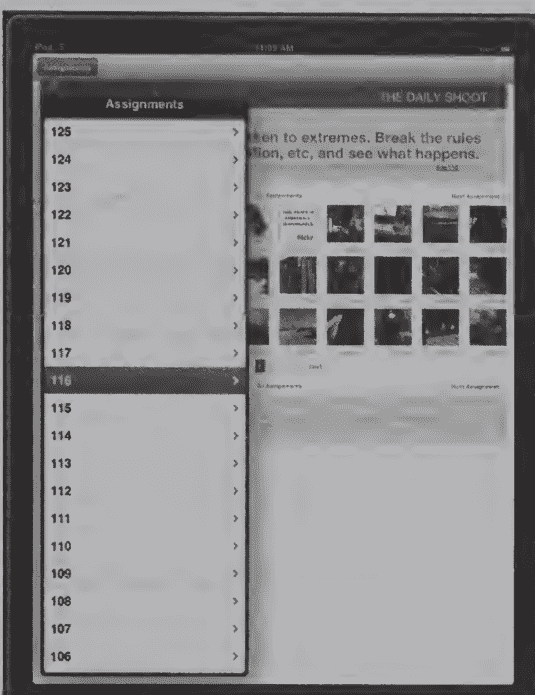

等一下。弹出器是如何填充了那些曾经在 `RootViewController` 中列出的作业的？这是那种魔法时刻之一，足以让你会微笑。当代理方法被调用时，正在隐藏的视图控制器（在我们的案例中是 `RootViewController`）是参数之一，而我们想要用其信息填充的弹出器是另一个参数。这就是弹出器在 iPad 旋转时填充被隐藏视图内容的方式。非常酷。

## 2.9 移除弹出器和按钮

现在你已经对我们的应用程序进行了试运行，你可能注意到了几个需要处理的细节。首先，如果你从弹出器的列表中选择了某项作业，新页面会在弹出器后面加载，但弹出器本身并没有消失。让我们改变这一点，使得在任何时候页面加载时，我们都关闭弹出器。

```
Split/DailySchool8/Classes/Assignment/ViewController_Pad.m
-(void) loadSelectedPage {
    [super loadSelectedPage];
    if (self.popoverController) {
        [self.popoverController dismissPopoverAnimated:YES];
    }
}
```

其次，你可能已经注意到，当你将应用程序切换回横屏模式时，按钮仍然留在工具栏中。要修复这个问题，只需为分屏视图控制器实现以下代理方法即可：

```
Split/DailySchool8/Classes/Assignment/ViewController_Pad.m
-(void)splitViewController:(UISViewController*)svc
willShowViewController:(UIView*)view
invalidatingBarButtonItem:(UIBarButtonItem*)barButtonItem {
    [self.toolbar setItems:[NSArray array] animated:YES];
    self.popoverController = nil;
}
```

恭喜。你现在有了一个通用应用程序，它在 iPhone 上运行像一个原生基于导航的 App，在 iPad 上运行像一个基于分屏视图的 App。

## 2.10 创建一个仅限 iPad 的基于分屏视图的应用

作为一个练习，既然我们已经有了一个可以在两个平台运行的通用应用，现在从头开始创建一个仅限 iPad 的应用。使用基于分屏视图的应用程序模板创建一个新的 Xcode 项目。你会发现，你使用的 nib 文件和类比我们在运行示例中使用的要少。

你自己试一试；这里有一个你如何实现一种可能的解决方案的快速草图，尽可能减少对模板生成代码的修改。

创建一个名为 `DailySchool-iPad` 的新分屏应用。引入 `Assignments` 类的源文件。在 `RootViewController` 类中添加一个类型为 `Assignments` 名为 `assignments` 的对象。在 `MainWindow` nib 中添加一个类型为 `Assignments` 的对象，并连接输出。

修改 `ViewController` 中的数据源方法，以返回 `assignments` 属性的值。

## 2.11 总结

`DetailViewController` 正在取代 `AssignmentViewController` 的位置。将它的 `UILabel` 替换为 `UIImageView`；我们需要在 `DetailView` nib 文件和控制器的源文件中都执行这两项操作。

我们将使用 `detailitem` 来持有我们的作业编号。我们可以将其类型更改为 `NSNumber`。在 `RootViewController.m` 中，如下所示实现表格视图代理方法：

```
SplitVC/DailyShootPad/Classes/RootViewController.m
-(void)tableView:(UITableView *)tableView
    didSelectRowAtIndexPath:(NSIndexPath *)indexPath {
    self.detailViewController.detailItem = \
    [self.assignments assignmentAtIndex:indexPath.row];
}
```

剩下的剩下的是在 `DetailViewController.m` 中实现 `configureView` 方法，以显示选中的网页。

```
SplitVC/DailyShootPad/Classes/DetailViewController.m
(void)configureView {
NSString *url =
[NSString stringWithFormat:"http://dailyshoot.com/%@", self.detailItem];
[self.webview loadRequest:[NSURLRequest requestWithURL:url]];
}
-(void)viewDidLoad {
    [super viewDidLoad];
    [self configureView];
}
```

正如与 Cocoa 开发一样，我们在本章中取得了进展。我们添加了分屏视图及其控制器，这些是我们在上一节中使用的 `RootViewController` 和 `AssignmentViewController`。通过极少的修改，我们将此转变为具有原生 iPad 视觉效果的体验的应用。我们学习了如何响应设备运行状态，并编写了代码使其正确。我们学习了如何处理设备运行方向，并实现了填充内容的弹出器。

在本书的剩余部分中，我们将构建仅限 iPad 的应用程序。我们将利用该设备提供的 API 和技术。到目前，你可以按照任何顺序阅读书籍。直接进入手势部分，或者跳转。如果你想了解更多关于弹出器的信息，可以从第 75 页的弹出窗口和模式对话框开始。

# 第 3 章 使用手势

iPad 的大表面不仅仅是为了查看，更是为了让手参与并使用手势与应用程序交互。当然，iPhone 也使用多点触摸作为主要的交互手段，但其小屏幕限制了我们充分探索手势，并最终限制了我们创建浸式体验的能力。

iPhone 的另一个方面让在应用程序中使用手势具有挑战性——SDK。为了编写手势，你需要在类之间复制粘贴触摸代码，而没有任何方便的重用方法。从 iOS 3.2 开始，Apple 改进了手势融入 UIKit 架构的方式，并让你能够在 iPad 上抽象和重用手势（从 iOS 4.0 开始，你在 iPhone 上可以使用相同的工具）。Apple 还提供了一些现成的手势供你使用，包括点击、滑动、缩放、旋转——如果内置手势无法满足你的需求，你可以轻松扩展新架构并编写自己的。

正如你在本章看到的，Apple 显著改进了创建手势的工具，但请注意在使用预构建识别器（或编写新的手势识别器）时有很多知识，在本章中我们将详细探索手势；我们将从使用和配置预构建识别器开始，并添加更复杂的行为，自定义并控制识别器的行为。最后，我们将创建一个识别器来寻找我们自定义的手势。让我们开始吧！

## iPad 虚拟泡泡膜

谁能想到在 1957 年发明了泡泡膜™ 的 Sealed Air 公司，竟然会让它变成一种让全年龄段都为上瘾且解感的活动？¹ 毕竟，当你面对一张布满气泡的新气泡泡膜时，谁不想开始戳破它们呢？

当然，另一项发明——互联网的出现，它带来了虚拟包装；而今天，你只需要说“泡泡膜”，就能听到“这种事有对应的 App！”的回应。泡泡膜已经进入了 iPhone。接下来会是什么？当然是 iPad 的虚拟泡泡膜——想象一下，将所有的空间和多点触控手势都用于戳破模拟的充气泡泡。

在本章中，我们将创建一个自己的虚拟泡泡膜应用程序，并在过程中充分探索新的手势 API。我们不会呈现一个可以戳破的传统泡泡页，而是将使用手势来创建自定义的泡泡膜布局（通过点击手势）、戳破你想戳破的所有泡泡（使用略有不同的点击手势）、调整泡泡大小（使用捏合手势）、滑动屏幕并重置（通过滑动手势），甚至实现一个允许删除泡泡的自定义手势。

为了开始，我们将执行以下操作：

1. 创建一个基于视图的简单应用程序作为“泡泡页”。
2. 使用内置手势捕捉“点击”，并在每次点击时在纸页上放置一个泡泡。
3. 重用此点击手势来戳破泡泡。

一旦我们完成了基础工作，我们将返回并添加调整大小、滑动和删除功能——这些都通过手势实现。

> 1. 如果你不熟悉泡泡膜，它是一种嵌入了充气泡泡的透明塑料片，用作运输物品的保护包装。许多娱乐活动源于挤压气泡（并产生随之而来的巨大“啪”声）。

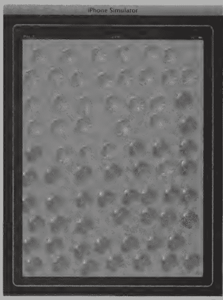

图 3.1：泡泡膜界面

## 3.2 使用简单的点击手势

在深入之前，我们有时间进行简短的鼓励；如果你有 UIKit 视图的经验，并且对多点触控事件有基本的了解，那么理解新的手势设计就很简单。新的架构围绕着手势识别器展开，你可以实例化它们并将其附加到任何视图上。这些识别器充当多点触控事件的观察者，并在你的视图之前对事件进行预视。识别器处理多点触控事件，直到其手势被识别，然后向你指定的目标发送一个动作消息；如果你的识别器在系列多点触控事件中没有找到手势，这些事件将传递给其他识别器（如果你有的话），并且最终，如果没有识别出任何手势，则将其传递给视图本身。在完成这个简短的总结后，理解手势最好的方法是看它的运行，所以让我们开始实现吧。

为了让这一切运转起来，我们已经创建了一个名为 `Bubbles` 的项目，你可以在示例代码的 `gestures` 文件夹中找到它；为了让应用程序更有泡泡膜的感觉，我们特意在 Interface Builder 打开了 `BubblesViewController.xib` 文件，并将主视图的背景更改为良好的中灰色。为了戏剧效果（你稍会看到），我们还在 `MainWindow.xib` 文件中将主窗口的背景颜色改为纯黑色。最后，我们在项目中放置了两个图像，一个是充气的泡泡（命名为 `bubble.png`），另一个是破了的泡泡（`popped.png`）。

### 实例化手势

我们的第一个编码任务是创建一个点击手势，当它被识别时，会在主应用程序视图上放置一个泡泡。为了实现这一点，我们在 `BubblesViewController` 中重写 `viewDidLoad` 并初始化一个点击识别器。让我们来看：

```
gestures/BubblesViewController/Classes/BubblesViewController.m
- (void)viewDidLoad {
    [super viewDidChange];

    UITapGestureRecognizer *tapRecognizer = 
        [[UITapGestureRecognizer alloc]
        initWithWithTarget:self
        action:@selector(handleTapFrom:)];
}
```

在这里，我们通过调用 `UITapGestureRecognizer` 的 `initWithTarget:action` 方法来实例化点击识别器。手势识别器使用通 Cocoa 目标-动作模式，当手势被识别时，目标将作为一个动作消息。我们将 `self` 指定为目标，并将 `handleTapFrom` 指定为动作，因此当此手势被识别时，将在我们的 `BubblesViewController` 实例上调用 `handleTapFrom` 方法。

### 将手势附加到视图

对于任何手势，在实例化后，你都需要通过属性对其进行配置，并且必须将其附加到视图上才能有用。以下是我们如何对点击识别器进行操作：

```
gestures/BubblesViewController/Classes/BubblesViewController.m
- (void)viewDidLoad {
    [super viewDidChange];

    UITapGestureRecognizer *tapRecognizer = 
        [[UITapGestureRecognizer alloc]
        initWithWithTarget:self
        action:@selector(handleTapFrom:)];
    [tapRecognizer setNumberOfTapsRequired:1];

    [self.view addGestureRecognizer:tapRecognizer];
    [tapRecognizer release];
}
```


# 使用手势

## 配置点击手势识别器

我们首先通过 `setNumberOfTapsRequired` 方法配置识别器，允许我们指定识别器应该寻找多少次点击。在这种情况下，一次点击可能是最自然的手势。我们通过 `[self.view addGestureRecognizer:tapRecognizer]` 将识别器附加到视图，然后通过 `[tapRecognizer release]` 释放。

> （注：此处原文逻辑描述略有重复，译文已根据语意微调以保持流畅）

## 动作处理手势

现在点击识别器实例化并附加到视图后，我们需要实现动作。我们如何处理？我们需要实现一个在视图上放置泡泡的特定逻辑。

```
gestures/BubblesViewController/Classes/BubblesViewController.m
-(void)handleTapFrom:(UITapGestureRecognizer *)recognizer {
  CGPoint location = [recognizer locationInView:self.view];
  CGRect rect = CGRectMake(location.x - 40, location.y - 40, 80, 80);
  UIImageView *bubble = [[UIImageView alloc] initWithImage:@"bubble.png"];
  [bubble setFrame:rect];
  [self.view addSubview:bubble];
}
```

让我们逐步分析代码：`handleTapFrom:` 接收了接受手势的识别器。可以使用 `locationInView:` 方法确定点击的位置，它可以给定视图并告诉我们手势发生的位置。在这里我们对 `BubblesViewController` 视图中的点击感兴趣，所以我们传递 `self.view`。现在我们有了点击发生的位置，我们需要创建一个泡泡并将其放置在那里。我们通过创建一个边界框来实现这一点，实例化图像，并设置图像源为 `bubble.png`。最后，我们需要做的是将图像作为子视图添加到 `self.view` 中。

## 创建一些泡泡

到此时，你已经准备好测试这些代码了。编译并运行项目，你应该看到一个空白的灰色屏幕——只需点击视图（或使用模拟器点击），你就会看到泡泡在点击处出现。

在继续之前，让我们回想一下做了什么：

- 我们创建了一个点击手势识别器并将其配置为识别单次点击。
- 我们将手势对象附加到 `BubblesViewController` 的视图上，因此当多点触控事件发生在该视图时，手势识别器可以预视这些事件并判断它们是否构成点击。
- 并且假设存在点击，我们告诉手势识别器调用 `BubblesViewController` 的 `handleTapFrom:` 方法。
- 我们还编写了 `handleTapFrom:` 方法的代码，它从识别器对象确定点击的位置，然后创建一个像泡泡的图像。

这么多代码效果不错，对吧？现在让我们通过增强泡泡使其能够戳破来让变得更有趣。

> 2 我们将在本章节后面详细讨论接受手势的具体含义；目前，当点击识别器看到看起来像点击手势的多点触控事件时，它会识别手势并调用目标上的动作。

## 3.3 多点事件与视图层级结构

为了创建一个泡泡破裂的效果，我们需要知道用户何时点击了泡泡。我们如何实现这一点呢？你可能会认为，一种识别泡泡（在我们的案例中是代表泡泡的 `UIImageView`）何时被点击的方法，是为每个 `UIImageView` 附加另一个点击手势，并编写另一个动作来处理其余部分。这种方法行得通，而且事实上，我们也将通过在图像上附加属性来实现一个缩放手势，但在这里，我们将采取另一种更直接的方法，来演示视图层级结构是如何处理触摸的。接下来的几段非常重要，因为它们详细说明了多点事件如何与视图层级结构工作，以及它们与手势之间的关系。让我们研究细节，然后让这些泡泡运行起来。

当 iPad 接收到多点事件时，默认情况下，它会将触摸传递给应用程序的窗口视图，并递归地传递给每个触摸落在其边界内的子视图。层级结构中落在触摸范围内的最终视图被称为“命中测试视图”（hit-test view）。在识别手势时，命中测试视图首先获得识别多点事件的机会，如果它们没有被识别，则会将它们沿链向上传递给窗口和应用程序，前提是没有任何视图使用它们。

在我们当前的代码中，当用户触摸泡泡的 `UIImageView` 时，该视图首先尝试将触摸识别为手势；如果未被识别，事件将传递给父视图，即我们的 `BubblesViewController` 的视图。由于我们没有在 `UIImageView` 中添加手势或任何识别多点事件的代码，事件将始终传递到 `BubblesViewController` 的视图，因此即使我们点击的是其中一个泡泡图像，点击操作也会被识别。

这听起来有点复杂；为什么不直接在 `UIImageView` 上安装另一个手势就完事了呢？嗯，利用对视图层级结构和命中测试的知识，我们可以编写出更简单的代码来实现泡泡破裂。通常情况下，通过你对多点事件的新理解，你将能够以更高级的方式使用手势（事实上，在章节的后半部分，我们将通过编写自己的自定义手势来直接利用这一点）。

## 实现泡泡破裂

现在你已经有了一些背景知识，是时候运用你的新知识了。以下是我们如何编写代码来破泡泡的方法：我们将使用现有的点击手势，而我们没有给 `Bubbles1ViewController` 的视图附加任何手势。当用户点击泡泡时，触摸事件将命中泡泡的 `UIImage`，该图像没有手势来处理它——因此它将传播到 `Bubbles1ViewController` 的视图，在那里，我们当前的手势将识别该点击。此时，当 `handleTapFrom:` 方法被调用时，我们将（使用命中测试）确定被点击的是哪个视图，如果它是我们的 `UIImageView` 之一，我们将它的源图像更改为 `popped.png`，正如我们所描：


让我们看代码；你会发现 `handleTapFrom:` 动作中有一些新的添加：

```objc
gestures/Bubbles2/Classes/Bubbles2ViewController.m
-(void)handleTapFrom:(UIGestureRecognizer *)recognizer {
    CGPoint locationInView = [recognizer locationInView:self.view];

    UIView *hitView = [self.view hitTest:locationInView withEvent:nil];
    if ([hitView isKindOfClass:[UIImageView class]]) {
        
        [(UIImageView *)hitView setImage:[UIImage imageNamed:@"popped.png"]];
    
    }
    else {
        CGRect rect = CGRectMake(locationInView.x - 40, locationInView.y - 40, 80.0, 80.0);
        UIImageView *image = [[UIImageView alloc] initWithFrame:rect];
        [image setImage:[UIImage imageNamed:@"bubble.png"]];
        [image setUserInteractionEnabled:YES];

        [self.view addSubview:image];

        [image release];
    }
}
```

记得你之前版本的该方法，你首先从识别器中获取点击的位置。我们的新代码获取此位置并调用 `hitTest:withEvent:` 来获取命中测试视图。如果这是在泡泡上的点击，它将位于一个 `UIImageView` 上；如果不是，它将位于 `Bubbles1ViewController` 的视图上。

鉴于此，我们需要做的只是判断命中测试视图是否为 `UIImageView`，如果是，将图像从 `bubbles.png` 更改为 `popped.png`。另一方面，如果命中测试视图不是图像视图，它必须是我们的 `Bubbles1ViewController` 视图，这意味着用户想要在视图上放置另一个泡泡。在这种情况下，我们使用之前编写的相同代码。

注意我们对旧代码进行了一项添加以处理 `UIImageView` 的一个问题。事实证明，图像视图默认配置为丢弃多点事件，将 `setUserInteractionEnabled` 设置为 `YES` 让我们能够使用触摸事件与图像视图进行交互。如果我们不将 `setUserInteractionEnabled` 设置为 `YES`，我们会在控制器的视图中获取多点事件，但图像本身永远不会成为命中测试视图（我们永远无法破裂泡泡）。

## 测试泡泡包装

你现在准备好构建泡泡包装了。

# 第 3 章：使用手势

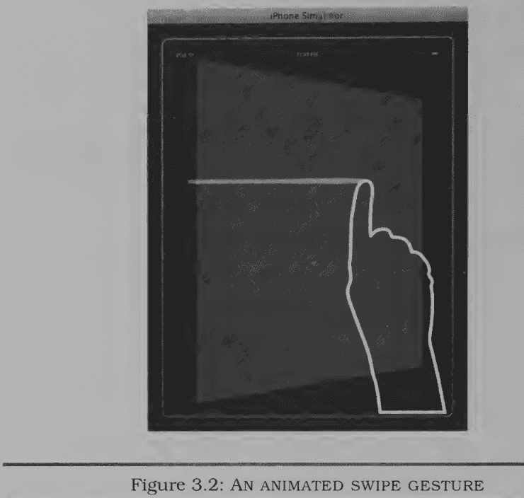

例如，如果你将此属性设置为 2，那么手势识别器只有在滑动时使用两个手指时才会识别该手势。^3

`UITipTapGestureRecognizer` 也有一个 `numberNumberOfTouchesRequired` 属性。虽然它没有多指滑动那么常见，但你也可以创建需要多次触摸的点击识别器。

## 3.5 离散与连续手势

到目前为止，我们查看了两种手势识别器：点击（tap）和滑动（swipe）。当它们的手势被识别时，它们都会向目标发送单个动作消息——我们把这些称为*离散*手势。

还有另一种类型的识别器，它会根据单个手势发送多个动作消息，称为*连续*手势。例如：

> 注意，如果你将此值设置为大于1，则你的手势必须在实际设备上进行测试，因为模拟器无法提供模拟超过一个手指触摸的方法（不过，稍后我们将看到一种测试缩放手势的方法）。

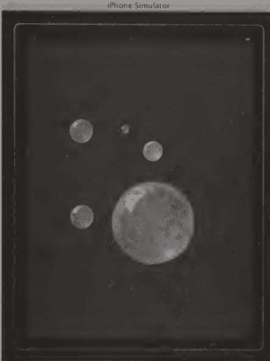

图 3.3：气泡纸应用程序中缩放大小的图像

想象在你的 iPhone（或 iPad）上缩放一张图片。该手势随着时间的推移发生，当你捏合图片变大或变小时会持续直到你抬起手指。

## 使用缩放手势调整气泡大小

让我们创建一个缩放手势，允许我们调整气泡的大小（变大或变小）——你可以在图 3.3 中看到这种效果。为了使气泡能够被缩放，我们将缩放手势直接附加到每个 `UIImageView` 上——我们之前讨论过在气泡图像的点击手势上可以如何工作，现在我们将对缩放手势进行真实尝试。

与其在 `viewDidLoad` 方法中实例化缩放手势，我们将把代码放在 `handleTapFrom:` 方法中。想一想，气泡图像是在 `handleTapFrom:` 方法中创建的，所以那里是为它们附加手势的自然位置。

# 第 3 章：使用手势

让我们来看创建 `UIPinchGestureRecognizer` 对象的代码：

```objc
gestures/Bubbles4/Classes/BubblesViewController.m
- (void)handleTapFrom:(UITapGestureRecognizer *)recognizer {
    CGPoint location = [recognizer locationInView:self.view];

    UIView *hitView = [self.view hitTest:location withEvent:nil];
    if ([hitView isKindOfClass:[UIImageView class]]) {

        [(UIImageView *)hitView setImage:[UIImage imageNamed:@"popped.png"]];
    } else {
        CGRect rect = 
            CGRectMake(location.x - 40, location.y - 40, 80.0f, 80.0f);
        UIImageView *image =
            [[UIImageView alloc] initWithFrame:rect];
        [image setImage:[UIImage imageNamed:@"bubble.png"]];
        [image setUserInteractionEnabled:YES];

        UIPinchGestureRecognizer *pinchRecognizer =
            [[UIPinchGestureRecognizer alloc] initWithTarget:self
            action:@selector(handlePinchFrom:)];
        [image addGestureRecognizer:pinchRecognizer];
        [pinchRecognizer release];

        [self.view addSubview:image];
        [image release];
    }
}
```

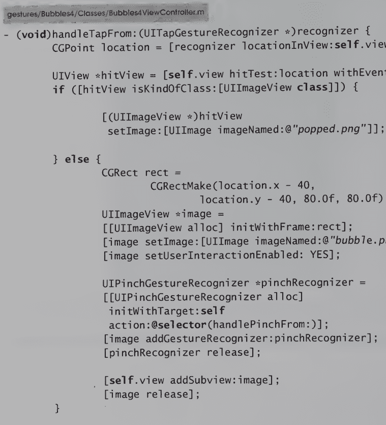

这段代码看起来应该很熟悉；我们正在实例化 `UIPinchGestureRecognizer`，将其操作设置为 `handlePinchFrom:`，并将该手势添加到每个图像视图中。我们直接使用此识别器，不进行任何特殊配置。

一旦手势附加到视图上，我们现在就可以专注于更有趣的任务了：编写处理来自缩放识别器的动作消息的代码，并根据缩放的比例调整屏幕上气泡图像的大小。要做到这一点，我们使用 `UIPinchGestureRecognizer` 的一个名为 `scale` 的属性，它代表缩放的缩放因子。

它是这样工作的：在缩放手势开始后，缩放因子会随着你的手指捏合和张开进行调整，并连续地传递给你的动作方法。一旦你有了缩放因子，你需要做的就是通过该缩放因子调整气泡图像的大小。让我们来看看如何操作：

```objc
// gestures/Bubbles4/Classes/Bubbles4ViewController.m
- (void)handlePinchFrom:(UIGestureRecognizer *)recognizer {
    CGFloat scale = recognizer.scale;
    CGAffineTransform transform = 
        CGAffineTransformMakeScale(scale, scale);
    recognizer.view.transform = transform;
}
```

首先，我们使用识别器并获取其 `scale` 属性，该属性包含一个代表缩放手势指示缩放量的值。我们使用 `scale` 来创建一个变换矩阵。如果你不熟悉变换（transforms），可以使用它们来操作视图的坐标，为你提供一种自然的方式来缩放和旋转视图——通过将视图的 `transform` 属性设置为变换矩阵，视图就会被绘制出来。

## 测试缩放

等等，让我们测试一下缩放。

## 3.6 创建自定义手势


# 第 3 章：使用手势

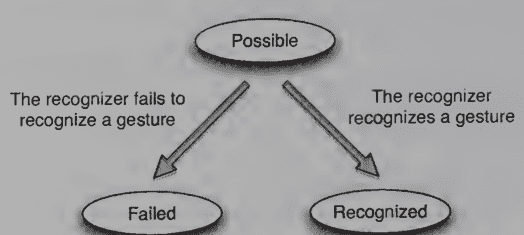

图 3.4：离散手势的状态

## 手势识别器的工作原理

将手势识别器想象成简单的状态机，它们根据接收到的触摸事件在状态之间切换。所有识别器从相同的状态开始：`UIGestureRecognizerPossible` 状态，这表示识别器正在检查触摸事件。一旦手势被识别，离散手势切换到 `UIGestureRecognizerRecognized` 状态。另一方面，如果识别器未能找到手势，它将到达 `UIGestureRecognizerFailed` 状态。

连续手势的处理方式略不同：与离散手势不同，它们停留在 `Possible` 状态，但当连续手势首次被识别时，识别器移动到 `Began`。然后随着手势的变化，识别器反复将状态设置为 `Changed`。事实上，随着手势的持续，识别器将不断将其状态设置为 `Changed`。从 `Changed` 状态开始，连续识别器遵循两条路径：要么用户抬起手指，手势移动到 `Ended` 状态，要么识别器可以判定手势不再满足要求并切换到 `Cancelled` 状态。

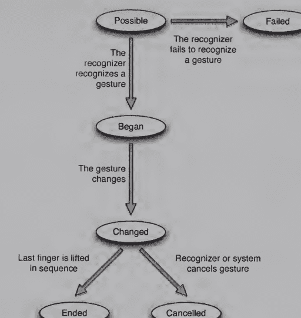

图 3.5：连续手势识别器的状态

## 创建删除手势

在了解这些背景的情况下，让我们谈谈我们将实现的手势：如果你接触过 Apple Newton，你可能记得一种手势，它要求你在物体上画一个之字形，类似于你用铅笔橡擦擦除时的图案。一旦识别出该手势，Newton 就会删除底层对象。

我们将实现一个能够识别相同手势的识别器，然后用它来删除底层的气泡。思考一下你将如何编写代码来检测这种手势。虽然有许多方法可以分析多点触摸事件来寻找类似橡皮擦的动作，但我们将看看简单的启发式方法能带我们走多远。

以下是我们的启发式方法的原理：注意删除手势实际上只是向上或向下的运动，我们可以通过简单观察 y 轴附近的运动来追踪它。如果 y 值从增加变为减少（或反之），我们就知道移动方向发生了变化。进一步来说，如果我们统计这些变化，那么在发生两次或三次变化后，我们就可以判断这是一个删除手势。当然，这并不完美，这就是为什么我们称之为*启发式*（heuristic）。可能会出现什么问题呢？嗯，用户可能会做一个波动过大的长滑动动作，导致滑动看起来像删除操作。或者取决于滑动算法（此处未提供细节），可能一个太宽的删除手势可能会被解释为滑动。这个问题有多大呢？正如你将看到的，这并不是一个大问题，但考虑到手势之间具有某些相似性，可能会发现它偶尔会发生。没关系；我们会在本章稍后修复它。

## UIGestureRecognizer 子类化

是时候编写这个删除识别器了。我们通过首先创建一个基础识别器的子类来实现；让我们从创建一个名为 `DeleteUIGestureRecognizer.h` 的接口开始。

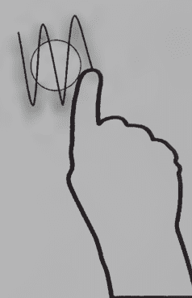

## 创建自定义手势

```objc
// gestures/Bubbles5/Classes/DeleteGestureRecognizer.h
#import <Foundation/Foundation.h>
#import <UIKit/UIGestureRecognizerSubclass.h>

@interface DeleteGestureRecognizer : UIGestureRecognizer

@property (nonatomic, retain) UIView *viewToDelete;

- (void)touchesBegan:(NSSet *)touches withEvent:(UIEvent *)event;
- (void)touchesMoved:(NSSet *)touches withEvent:(UIEvent *)event;
- (void)touchesEnded:(NSSet *)touches withEvent:(UIEvent *)event;
- (void)touchesCancelled:(NSSet *)touches withEvent:(UIEvent *)event;
- (void)reset;

@end
```

在这里，我们导入 `UIGestureRecognizer` 头文件，它定义了基础类 `UIGestureRecognizer`，并为 `DeleteGestureRecognizer` 声明了一个新接口，该接口继承自 `UIGestureRecognizer`。

现在我们将添加子类化 `UIGestureRecognizer` 所需的方法。在你的接口定义中添加以下方法：

```objc
// gestures/Bubbles5/Classes/DeleteGestureRecognizer.h
#import <Foundation/Foundation.h>
#import <UIKit/UIGestureRecognizerSubclass.h>

@interface DeleteGestureRecognizer : UIGestureRecognizer

bool isStrokeMoving;
int touchChangedDirection;
UIView *viewToDelete;

@property (nonatomic, retain) UIView *viewToDelete;

- (void)touchesBegan:(NSSet *)touches withEvent:(UIEvent *)event;
- (void)touchesMoved:(NSSet *)touches withEvent:(UIEvent *)event;
- (void)touchesEnded:(NSSet *)touches withEvent:(UIEvent *)event;
- (void)touchesCancelled:(NSSet *)touches withEvent:(UIEvent *)event;
- (void)reset;

@end
```

我们添加了三个新内容：第一个是名为 `strokeMovingUp` 的 `bool` 变量，如果手势向正 y 方向移动，则它的值将为 `YES`（否则为 `NO`）。接下来，添加一个 `int` 变量 `touchChangedDirection`，用于存储手势方向改变的次数。我们的最后一个属性是名为 `viewToDelete` 的 `UIView`，它将持有一个在手势被识别时要删除的视图的引用。

## 实现 DeleteGestureRecognizer

现在是时候写实现代码了；在此时，我们将输入 `DeleteGestureRecognizer` 文件的骨架。

```objc
// gestures/Bubbles5/Classes/DeleteGestureRecognizer.m
@implementation DeleteGestureRecognizer

@synthesize viewToDelete;

@end
```

我们将逐个检查从 `UIGestureRecognizer` 类中重写的每个方法，包括 `reset` 方法以及接口文件中所有以 `touches` 开头的方法。这些方法紧密地映射了 UIKit 支持的多点触摸事件处理框架。如果你好奇这些事件在比手势更低层面是如何处理的，请查看 iPhone 应用程序编程指南 [App09b] 中的“多点触摸事件”；我们将在实现方法的同时，描述它们在 `UIGestureRecognizer` 中的作用。

我们将从实现 `reset` 方法开始。每当识别器完成（无论是通过识别手势还是失败）时，都会调用此方法来重置识别器；无论何种情况，`reset` 都会清理现场并将属性重置为初始值，为下一次使用做好准备：

```objc
// gestures/Bubbles5/Classes/DeleteGestureRecognizer.m
- (void)reset {
    [super reset];
    strokeMovingUp = YES;
    touchChangedDirection = 0;
    viewToDelete = nil;
}
```


现在是处理各种 touches 方法的时间了；让我们来看看它们。

```objc
// gestures/Bubbles5/Classes/DeleteGestureRecognizer.m
- (void)touchesBegan:(NSSet *)touches withEvent:(UIEvent *)event {
    [super touchesBegan:touches withEvent:event];
    if ([touches count] == 1) {
        self.state = UIGestureRecognizerStateFailed;
        return;
    }
}

- (void)touchesMoved:(NSSet *)touches withEvent:(UIEvent *)event {
    [super touchesMoved:touches withEvent:event];
    if (self.state == UIGestureRecognizerStateFailed) return;

    CGPoint newPoint = [[touches anyObject] locationInView:self.view];
    CGPoint prevPoint = [[touches anyObject] previousLocationInView:self.view];

    if (strokeMovingUp == YES) {
        if (newPoint.y < prevPoint.y) {
            strokeMovingUp = NO;
            touchChangedDirection++;
        }
    } else if (newPoint.y > prevPoint.y) {
        strokeMovingUp = YES;
        touchChangedDirection++;
    }

    if (touchChangedDirection >= 3) {
        self.state = UIGestureRecognizerStateRecognized;
    }
}

- (void)touchesEnded:(NSSet *)touches withEvent:(UIEvent *)event {
    [super touchesEnded:touches withEvent:event];
    self.state = UIGestureRecognizerStateFailed;
}

- (void)touchesCancelled:(NSSet *)touches withEvent:(UIEvent *)event {
    [super touchesCancelled:touches withEvent:event];
    self.state = UIGestureRecognizerStateFailed;
}
```

# 创建自定义手势

```objc
- (void)touchesEnded:(NSSet *)touches withEvent:(UIEvent *)event {
    [super touchesEnded:touches withEvent:event];
    if (self.state == UIGestureRecognizerStatePossible) {
        if (touchChangedDirection >= 3) {
            self.state = UIGestureRecognizerStateRecognized;
        }
    } else {
        self.state = UIGestureRecognizerStateFailed;
    }
}
```

最后，我们还有 `touchesCancelled:withEvent:` 方法，它在系统等待取消触摸事件时被调用。如果发生这种情况，我们可以将手势的 `state` 设置为 `UIGestureRecognizerStateFailed`。

```objc
- (void)touchesCancelled:(NSSet *)touches withEvent:(UIEvent *)event {
    [super touchesCancelled:touches withEvent:event];
    [self reset];
    self.state = UIGestureRecognizerStateFailed;
}
```

恭喜！你刚刚为 iPad 编写了一个功能完整的手势识别器。花点时间欣赏一下你的成果，让我们把你的手势附加到视图并让它工作起来。

## 安装自定义手势

使用你新的 `GestureRecognizer` 与我们处理过的其他识别器并没有区别之处：我们将它附加到视图上，并定义当视图识别出手势时调用的动作（action）。我们稍后会讨论动作，但我们想把它附加到什么上呢？

如果我们将其附加到单个气泡上，我们必须在气泡内部启动删除手势，以便触摸事件发送到该视图。在气泡图像周围执行类似橡皮擦的手势更为自然——而不一定非要在气泡内部。

所以，让我们将删除手势附加到 `Bubbles5Controller` 的视图上（该视图包含了气泡），这样我们就可以在任何地方开始手势。当然，在某个时刻，我们必须弄清楚要删除哪个图像视图——别担心；我们在处理气泡点击手势时已经做过类似的操作了。首先，让我们查看用于将手势附加到 `Bubbles5Controller` 视图的代码。

# 第 3 章：使用手势

```objc
// gestures/Bubbles5/Classes/BubblesViewController.m
- (void)viewDidLoad {
    [super viewDidLoad];

    // 之前的 gestureRecognizer 代码在此处

    DeleteGestureRecognizer *deleteRecognizer =
        [[DeleteGestureRecognizer alloc]
         initWithTarget:self
         action:@selector(handleDeleteFrom:)];
    [self.view addGestureRecognizer:deleteRecognizer];
    [deleteRecognizer release];
}
```

你之前见过所有这些内容了：唯一需要注意的是，我们将使用一个名为 `handleDelete` 的动作。让我们来实现它：

```objc
// gestures/Bubbles5/Classes/BubblesViewController.m
- (void)handleDeleteFrom:(UIGestureRecognizer *)recognizer {
    if (recognizer.state == UIGestureRecognizerStateRecognized) {
        UIView *viewToDelete = recognizer.view;
        [viewToDelete removeFromSuperview];
    }
}
```

这段代码非常简单直接：我们从识别器中获取要删除的视图，然后简单地将其从父视图（即我们的 `BubblesViewController`）中移除。只有一个问题：如果你回头看识别器的 `viewToDelete` 属性，在附加期间我们从未给它赋值过视图（即一个包含待删除图像子视图的视图）。这里有一段关于如何实现此点的新代码：`DeleteGestureRecognizer` 的 `touchesMoved:withEvent:` gestures/Bubbles5/Classes/DeleteGestureRecognizer.m


```objc
(void)touchesMoved:(NSSet *)touches withEvent:(UIEvent *)event {
    [super touchesMoved:touches withEvent:event];
    if (self.state == UIGestureStateFailed) return;

    CGPoint point = [[touches anyObject] locationInView:self.view];
    CGPoint prevPoint = [[touches anyObject] locationInView:self.view];

    if (strokeMovingUp == YES) {
        if (point.y < prevPoint.y) {
            strokeMovingUp = NO;
            touchChangedDirection++;
        }
    } else if (point.y > prevPoint.y) {
        strokeMovingUp = YES;
        touchChangedDirection++;
    }

    if (viewToDelete == nil) {
        UIView *hit = [self.view hitTest:point withEvent:nil];
        if (hit != nil && hit != self.view) {
            viewToDelete = hit;
        }
    }
}
```

让我们过一遍这个。如果 `viewToDelete` 尚未确定，我们获取用户手指移动时的当前位置，并在控制器的视图层级中执行命中测试（hit test），以找到最底层视图。如果没有找到视图或仅找到控制器视图，说明我们没有找到图像。否则，如果用户手指正在拖动，将其赋值给 `viewToDelete`。这就是我们的最后一段代码。我们的气泡应用程序已准备好编译并测试，以创建气泡然后删除它们。

## 删除识别器

我们只用惊人的少行代码就编写了一个自定义识别器并将其集成到我们的气泡应用中。尽管如此，在这个小小的实现背后有大量的思考：我们创建了一个识别器，用于跟踪单手指在 y 轴上的上下运动。如果使用了多个手指，我们将进入失败状态，并调用 `reset` 来为下一组触摸事件准备识别器做好就绪。如果用户在运动方向改变三次之前抬起手指，我们也会进入失败状态。但如果用户在拖手指，我们就给 `viewToDelete` 赋值。我们的气泡应用程序已准备好编译并测试，以创建气泡并删除气泡。

# 第 3 章：使用手势

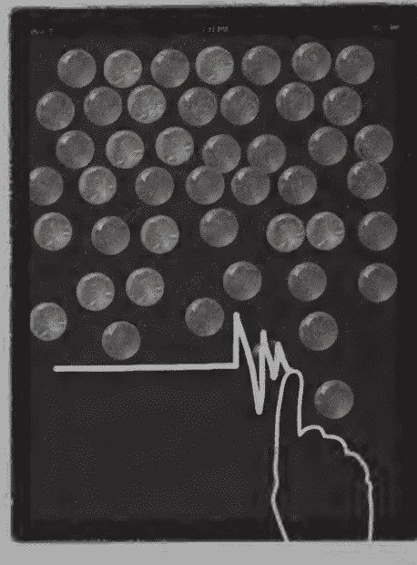

图 3.6：竞争的删除手势与滑动手势

向右滑动相当长的距离。起初这看起来像是一个滑动手势，但随后我们执行了必要的动作来使其变为删除手势——至少我们是认为它应该是这样运行的。但如果你的经历和我们一样，你会发现这经常（如果不是总是）会被识别为滑动手势，导致你的整个画板被擦除。

为了给本章画句号，我们将通过修复这种行为，确保删除手势在滑动手势完成之前有机会被识别。要理解它是如何工作的，我们首先需要讨论在同一个视图上的两个手势是如何操作的。在我们的案例中，我们在主视图上安装了几个手势：单单击、滑动手势，以及我们自定义的删除手势。当接收到触摸事件时，它们会被路由到这三个识别器。在我们的示例中，滑动手势看到了告诉它存在滑动的触摸事件，并在我们开始手势的删除部分之前识别了滑动。在某些实现中，这实际上可能是你想要的行为，但在本示例中，这感觉是不对，因此我们想稍微修改识别器，允许单个删除操作优于滑动手势。

为了解决这个问题，我们将引入 `UIGestureRecognizer` 基类的一个新方法 `requireGestureRecognizerToFail`，它允许我们要求一个识别器在另一个识别器有机会识别多点（Multi-Touch）事件流之前失败。

`requireGestureRecognizerToFail` 方法可以在任何识别器上调用，并带有一个参数：另一个识别器。这里是我们如何使用它的示例：

```
[secondRecognizer requireGestureRecognizerToFail:firstRecognizer]
```

该方法会导致 `secondRecognizer` 保持在它的 `UIGestureRecognizerStatePossible` 状态，直到 `firstRecognizer` 达到 `UIGestureRecognizerStateFailed` 状态。如果 `firstRecognizer` 没有达到，而是达到了 `UIGestureRecognizerStateStarted` 或 `UIGestureRecognizerStateBegan` 状态，那么 `secondRecognizer` 将其状态更改为 `UIGestureRecognizerStateFailed` 状态。在 `firstRecognizer` 达到 `UIGestureRecognizerStateFailed` 状态的情况下，`secondRecognizer` 就获得了识别多点触摸事件的机会。

基于此，我们需要确保我们的删除识别器在滑动识别器开始检查手势之前有机会识别该手势。为了做到这一点，我们需要在滑动手势识别器上调用 `requireGestureRecognizerToFail:` 方法，并为其传递删除识别器。

在讨论之后，编写代码实际上非常简单——你只需要在 `viewDidLoad` 中创建滑动和删除手势下方添加一行代码即可：

```
gestures/BubblesConflict/Classes/BubblesViewController.m
- (void)viewDidLoad {
    [super viewDidLoad];

    // 之前的 gestureRecognizer *deleteRecognizer 代码在这里

    DeleteGestureRecognizer *deleteRecognizer =
        [DeleteGestureRecognizer alloc]
            initWithTarget:self
            action:@selector(handleDeleteFrom:)];
    [self addGestureRecognizer:deleteRecognizer];

    [swipeRecognizer requireGestureRecognizerToFail:deleteRecognizer];
    [deleteRecognizer release];
    [swipeRecognizer release];
}
```

> **额外奖励：弹出已经弹出的泡泡？**
>
> 按照目前的实现，你可以出一个已经弹出的泡泡。去吧，试一下。看到它！
>
> 你的额外奖励任务是稍微修改代码以确保这种情况不会发生。你打算怎么做？

正如我们已经讨论过的，我们正在告诉 `swipeRecognizer`，`deleteRecognizer` 在它开始尝试识别手势之前需要失败。注意，你还应该将两个手势的 `release` 移动到 `requireGestureRecognizerToFail:` 方法下方。编译你的代码并尝试一下。

## 3.9 总结

在本章中，我们只生成了少量的实际代码，尽管我们的示例很简单，但我们已经展示了手势的一些强大用途。你会发现，在自己的应用程序中添加相同的行为是很容易的。

虽然我们在本章中已经涵盖了 Apple 新手势 API 的所有重点，但如果你想更精确地控制视图、手势和多个手势的行为，你可能想要探索额外的底层调用，这些调用允许你细调这些行为（更多详情请参见 iPad 编程指南 [App10]）。然而，对于大多数常见用途，你不需要做得那么深。总的来说，你会发现在大多数情况下，新的手势 API 显著降低了在视图中添加手势的复杂性，你可能正在发现手势是设计 iPad 体验中至关重要的部分。

# 第 4 章：弹出框和模态对话框

有时，用户需要输入比单个手势能传递更多的信息。他们可能需要从选项列表中选择，以设置组件的颜色、文本的字体或要加载的网页。

在本章中，我们将创建一个简单的 App，其特点是有一个容器，用户可以从中选择颜色。这并不是世界上最有趣的 App——我们会在最后通过添加一个面板来允许用户在屏幕上移动该容器。

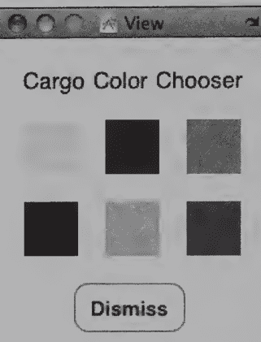

看到视图底部的那个关闭（Dismiss）按钮了吗？这就是你用于模态视图（modal view）的控制器视图与用于弹出框（popover）的视图之间的主要区别。用户期望通过完成某个操作或触摸弹出框以外的屏幕来关闭弹出框。模态视图必须为用户提供一种关闭方式，因为在模态视图获取焦点时，不允许发生其他输入。

`CargoColorChooser` 类需要为“关闭”和颜色按钮提供动作，并且它需要与货物 UI 对象进行通信。以下是 `CargoColorChooser.h` 中的输出（outlet）和两个动作：

```objc
#import <UIKit/UIKit.h>

@interface CargoColorChooser : UIViewController {
    @IBOutlet UIView *cargoView;
    -(IBAction) dismiss;
    -(IBAction) setCargoColor:(id)sender;
}
@end
```

`CargoColorChooser` 对象是你的主应用程序视图与模态对话框之间的桥梁；它需要兼顾两个世界。它已经是 `CargoColorChooser` nib 文件中的 File's Owner，所以你可以将按钮连接到 `dismiss` 和 `setCargoColor:` 动作。在连接时，选择 `Touch Up inside` 事件来触发这些动作。

将 `CargoColorChooser` 的实例拖入 `ViewController` nib 中，并连接 `cargoView` 输出。检查属性检查器（Attributes inspector）中的 `CargoColorChooser` 并确保 `Resize View from NiB` 的复选框未勾选。在 `CargoViewController.h` 中添加一个类型为 `CargoColorChooser` 命名为 `CargoColorChooser` 的输出。将此输出连接到 `CargoViewController` nib 中的 `CargoColorChooser` 对象。

到目前为止，无论你计划使用模态对话框还是弹出框，设置基本上是相同的。接下来，让我们实现模态对话框。

## 4.3 弹出模态视图

准备好了所有部分；现在让我们添加一些最后的修饰并弹出我们的模态视图。目前，`CargoViewController.m` 中的 `cargoContainerDidGetTapped` 方法切换货物容器的颜色。

将实现更改如下，以打开模态视图：

```objc
(void)cargoContainerDidGetTapped {
  [self presentModalViewController:cargoColorChooser animated:YES];
}
```

编译并运行。现在，当你点击货物容器时，模态视图应该从底部动画并填充整个屏幕。

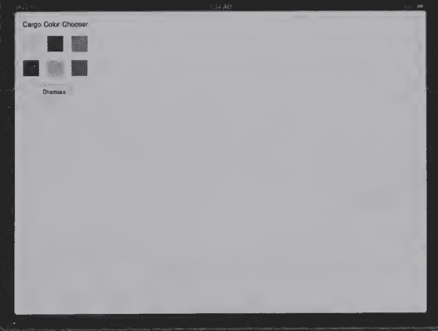

这简单得简直让人有些害意思。

## 准备与完成

呈现模态视图或弹出框就像油漆工的工作。尽管他们在涂抹最后一层油漆时需要小心，但真正的工作是在准备表面和为最后一层油漆做好一切准备。呈现和关闭我们视图的代码是非常简洁的。大部分工作涉及准备将要显示的控制器和 nib。

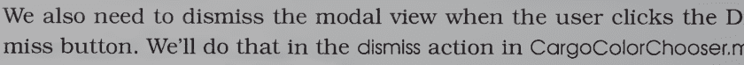

```objc
- (IBAction) dismiss {
  [self dismissModalViewControllerAnimated:YES];
}
```

最后，让我们实现根据用户在模态视图中的选择更改货物容器颜色的动作。

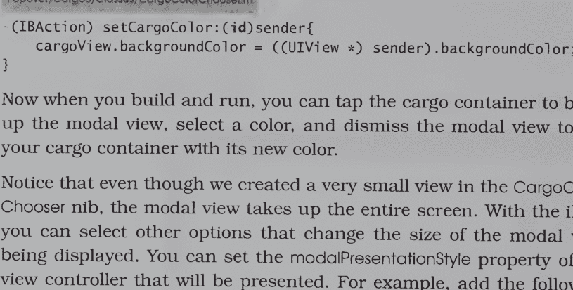

现在当你构建程序时，可以点击货物容器调出模态视图，选择一种颜色，然后关闭模态视图以看到带有新颜色的货物容器。

注意，尽管我们在 `CargoColorChooser` 中创建了一个非常小的视图，但模态视图占据了整个屏幕。在 iPad 上，你可以选择其他更改显示模态视图大小的选项。你可以设置将呈现的控制器的 `modalPresentationStyle` 属性。例如，`cargoContainerDidGetTapped` 实现中高亮的行：

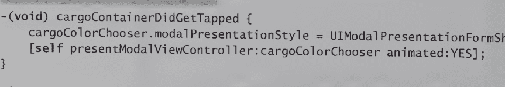

`ModalPresentationFormSheet` 选项产生一个较小的模态视图，居于屏幕中央，背景变暗，让用户知道他们不应该与模态视图之外的任何内容交互。

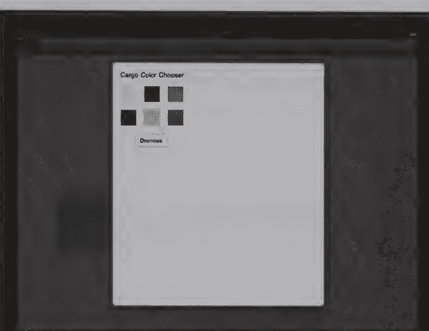


# 第 4 章 弹出框与模态对话框

## 4.4 精简控制器

现在当用户选择其他颜色时，他们会立即看到结果，而不是等到屏幕关闭。这当然无法保证。如果货物容器被放在屏幕中心，即使是这个较小的模态视图也会遮挡它。一种解决方案是将 `CargoColorChooser` 的视图设置为透明背景色。在我们的情况下，更好的解决方案是使用弹出框。

用户不应该被要求使用某种按钮来关闭弹出框。当用户点击弹出框以外的屏幕时，弹出框应该消失；或者如果自然，弹出框可以在用户完成操作后消失。在我们的示例中，我们可以在用户选择颜色时关闭弹出框——或者让它保持在那里以便他们继续选择。

注意，尽管我们在 `CargoColorChooser` 中创建了一个非常小的视图，但模态视图占据了整个屏幕。在 iPad 上，你可以选择其他更改显示模态视图大小的选项。你可以设置将呈现的控制器的 `modalPresentationStyle` 属性。例如，`cargoContainerDidGetTapped` 实现中高亮的行：


`ModalPresentationFormSheet` 选项产生一个较小的模态视图，居于屏幕中央，背景变暗，让用户知道他们不应该与模态视图之外的任何内容交互。


## 4.5 显示弹出框

显示弹出框比模态视图稍微复杂一点。为了配置弹出框，我们需要告诉它将使用哪个控制器作为内容。弹出框本身不是一个控制器；它托管一个视图。在呈现弹出框时，我们需要指定用户点击的视觉元素，以便箭头指向弹出框。在我们的情况下，我们修改整个货物容器，所以我们将矩形设置为 `cargoView.bounds`。

### 显示弹出框

```
Popover/Cargo8/Classes/CargoViewController.m
-(void) cargoContainerDidGetTapped {
  popover = [[UIPoverController alloc]
    initWithContentView:cargoColorChooser];
  popover.popupContentSize = cargoColorChooser.frame.size;
  popover presentPopoverFromRect:cargoView.bounds
    inView:cargoView
    permittedArrowDirections:UIPoverDirectionAny animated:YES);
}
```

编译并运行，当你点击货物容器时，你应该看到这样的效果：

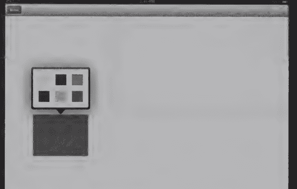

我们没有指定箭头的方向。对于 `permittedArrowDirections`，我们传递了 `UIPoverDirectionAny` 值。尽可能使用此选项，让系统决定在哪里绘制弹出框最好。如果由于强力的理由指定特定的方向，那么提供选项是一个好主意。例如，在这里指示可以在视图的左侧或右侧绘制弹出框：

```
Popover/Cargo8/Classes/CargoViewController.m
-(void) cargoContainerDidGetTapped {
  popover = [[UIPoverController alloc]
    initWithContentView:cargoColorChooser];
  popover.popupContentSize = cargoColorChooser.frame.size;
  popover presentPopoverFromRect:cargoView.bounds
    inView:cargoView
    permittedArrowDirections:UIPoverDirectionLeft
    UIPoverDirectionRight animated:YES);
}
```

在这种情况下，容器距离左边缘太近，因此弹出框向右侧绘制。这取决于个人口味，但这个特定的弹出框在视图旁边比在上方或下方显示效果更好。

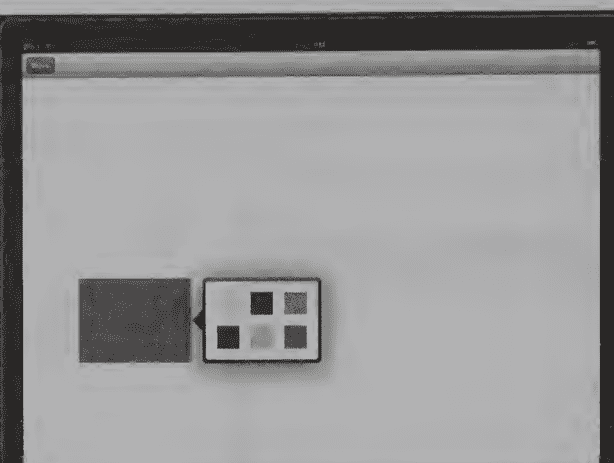

现在我们已经让弹出框出现了，让我们让它消失吧。目前，用户可以通过点击屏幕上的任何地方来让弹出框消失。要现在每次选择颜色时让弹出框消失，并不费力。

你需要一个指向弹出框控制器的句柄。在 `CargoColorChooser` 类中添加一个名为 `popoverController`、类型为 `UIPopoverViewController` 的属性。在 `CargoViewController.m` 的 `cargoViewControllerDidGetTapped` 方法中添加下面的高亮行来设置该属性：

```
Popover/Cargo9/Classes/CargoViewController.m
-(void) cargoContainerDidGetTapped {
    popover = [[UIPopoverController alloc] initWithContentViewController:cargoColorChooser size:cargoChooser.view.frame.size];
    cargoChooser.popoverController = popover;
    [popover presentPopoverFromRect:cargoView.bounds
inView:cargoView
permittedArrowDirections:UIPopoverArrowDirectionLeft +
UIPopoverArrowDirectionRight
animated:YES];
}
```

### 在选择颜色后关闭弹出框控制器

```
Popover/Cargo9/Classes/CargoColorChooser.m
-(IBAction)setColorEffects:(id)sender{
    cargoView.backgroundColor = ((UIView *)sender).backgroundColor;
    [self.popoverController dismissPopoverAnimated:YES];
}
```

## 4.6 重新回顾分屏视图和弹出框

回想在第 2.8 节“添加弹出框”中，当分屏视图从横屏切换到竖屏模式时，我们为详情视图添加了一个按钮。现在你能够更好地理解发生了什么。

在我们的示例中，当 iPad 旋转时，`RootViewController` 被隐藏，因此我们希望将其内容放在点击工具栏按钮时出现的弹出框中。

当 iPad 旋转到竖屏方向时，调用了此代理方法：

```
SpriteVC/DetailShowiPad/Classes/DetailViewController.m
-(void)splitViewController:(UISplitViewController*)svc
willHideViewController:(UIViewController*)aViewController
withBarButtonItem:(UIBarButtonItem*)barItem
forPopoverController:(UIPopoverController*)pc {
    barButtonItem.title = aViewController.title;
    mutableArray *items = {[toolbar items] mutableCopy];
    [items insertObject:barButtonItem atIndex:0];
    [toolbar setItems:items animated:YES];
    [items release];
    self.popoverController = pc;
}
```

这个方法为我们提供了所需的一切柄，但大部分工作在其他地方完成。方法的体主要由配置按钮并将其添加到工具栏组成。在该方法调用之前，弹出框的内容被设置为被隐藏的视图控制器。因此，我们看到当点击按钮时，`RootViewController` 的内容神奇地出现了。

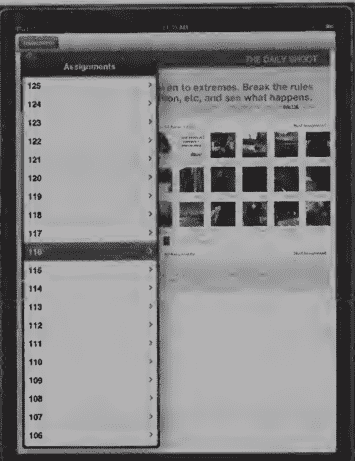

实际上，让我们自己为按钮挂载弹出框并不费力。让我们接下来来做这一点。

## 4.7 从按钮创建弹出框

我们看到，设置货物容器颜色的运行示例在模态视图或弹出框中效果同样良好。通常，如果我们不需要模态视图，就不应该使用它。换句话说，在这个例子中我们显然更倾向于使用弹出框。有时选择会清晰得多。假设我们有一个弹出框控制器，可以在屏幕上移动容器。

我们项目的下一个阶段在 `Cargo10` 文件夹中。你会找到一个名为 `CargoDriver` 的额外视图以及相应的 nib 文件。nib 中的视图如下：

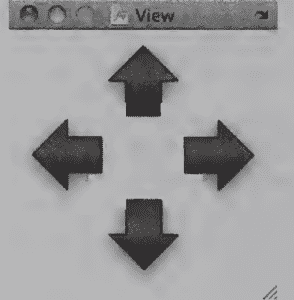

让我们将其连接到“Move”按钮上。

在 `CargoViewController` 类中为 `CarDriver car` 添加一个 outlet（输出）。将 `CarDriver` 实例拖入 `CargoViewController` 的 nib 中，并将输出连接到它。确保 `CarDriver` 的“Resize View from NIB”复选框未勾选。

我们需要一个在按下按钮时调用的 action。在 `ViewController.h` 中声明一个名为 `showDriverControls:` 的 IBAction。事实上，由于这是我们添加到 `CargoViewController` 头文件的最后项内容，现在可能是查看其全部内容的良机了——支持货物容器和两个弹出框所需的内容不多。

```
Popover/Cargo11/Classes/CargoViewController.h
#import <UIKit.h>
@class CargoColorChooser;
@class CarDriver;

@interface CargoViewController : UIViewController
IBOutlet UIView *cargoView;
IBOutlet CargoColorChooser *cargoColorChooser;
IBOutlet CarDriver *carDriver;
@end
-(IBAction)showDriverControls:(id)sender;
@end
```

将按钮连接到该 action，然后如下实现：

```
-(IBAction)showDriverControls:(id)sender {
    UIViewController *controls = [[UIPopoverController alloc]
        initWithViewController:carViewController];
    controls.popoverContentSize = carViewController.view.frame;
    [controls presentFromBarButtonItem:sender
        permittedArrowDirections:UIPopoverArrowDirectionAny
        animated:YES];
}
```

之前一样，我们实例化弹出框并指定大小。接下来，我们将 ViewController 设置为弹出框的代理。你可能想看看漏掉这一点会发生什么。

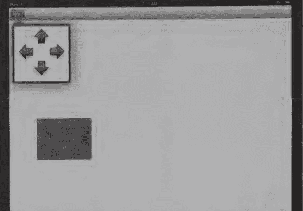

作为练习，响应代理回调以移动容器。一个解决方案在 `Cargo12` 中。

当弹出框已经显示时按下按钮会发生什么？`showControls` 方法被再次调用，它包含了创建并显示弹出框的代码。再次按下按钮。现在在左上角有其他方式关闭弹出框。


这不对。你希望在第二次按下时关闭弹出框。可以通过在 `CargoViewController` 中添加一个类型为 `UIPopoverViewController` 的实例变量 `driveControls` 来实现。将 `showDriverControls:` 方法重命名为 `showOrHideControls:` 并修复 nib 中的连接。

实现 `showOrHideControls:` 来切换弹出框。如果控制器存在，则关闭它并将其置空。如果控制器不存在，则创建、配置并显示它。

我们还需要处理用户点击屏幕上任何地方关闭驾驶的情况。对于这种情况，我们将 ViewController 对象设为弹出框的代理。你需要在 `ViewController.h` 中添加 `UIPopoverController` 协议的声明。当代理方法 `popoverControllerDidDismiss:` 调用时，我们将删除驾驶控制弹出框。


# 自定义键盘

## 示例代码：Popover/Cargo13/Classes/CargoViewController.m

```objectivec
- (IBAction)showOrHideControls:(id)sender {
    if (driveControls) {
        driveControls dismissPopoverAnimated:YES;
        driveControls = nil;
    } else {
        driveControls = [[UIPopoverController alloc]
            initWithViewController:carViewController];
        driveControls.popoverContentSize = carViewController.view.frame;
        [driveControls presentFromBarButtonItem:sender
            permittedArrowDirections:UIPopoverArrowDirectionAny
            animated:YES];
    }
    driveControls.delegate = self;
}

- (void)popoverControllerDidDismissPopover:(UIPopoverController *)popoverDelegate {
    driveControls = nil;
}
```

在我们的示例中，实际上没有任何需要排列的视觉元素，因此我们将添加四个不同颜色的 `UIView`，以便你看到该技术是如何工作的。在每个角放置一个大小为 100 x 100 的 `UIView`，并将每个背景颜色设置为不同的颜色。

使用“尺寸检查器”设置 `cargoView` 在设备旋转时保持其与每个侧的距离。在 `CargoViewController` 中创建名为 `corner1`、`corner2`、`corner3` 和 `corner4` 的 outlet。当应用程序运行时，我们将在设备旋转时交换对角线的正方形。初始位置可能如下所示：

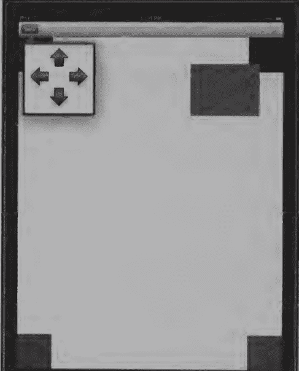

协调动画的关键是在视图控制器的 `willAnimateRotationToInterfaceOrientation:duration:` 方法中添加任何额外的动画。

## 示例代码：Popover/Cargo14/Classes/CargoViewController.m

```objectivec
- (void)willAnimateRotationToInterfaceOrientation:(UIInterfaceOrientation)interfaceOrientation duration:(NSTimeInterval)duration {
    if (interfaceOrientation == UIInterfaceOrientationPortrait ||
        interfaceOrientation == UIInterfaceOrientationUpsideDown) {
        corner1.frame = CGMakeRect(0, 44, 100, 100);
        corner2.frame = CGMakeRect(668, 44, 100, 100);
        corner3.frame = CGMakeRect(0, 904, 100, 100);
        corner4.frame = CGMakeRect(668, 904, 100, 100);
    } else {
        corner4.frame = CGMakeRect(0, 44, 100, 100);
        corner3.frame = CGMakeRect(924, 44, 100, 100);
        corner2.frame = CGMakeRect(0, 648, 100, 100);
        corner1.frame = CGMakeRect(924, 648, 100, 100);
    }
}
```

> **注意**：在这个简单的示例中，我们硬编码了每个角在每个方向下的视图尺寸。在一个需要维护的应用程序中，你将分别使用调用设置系统和常量。你将在第 5.5 节中看到此示例。参见“键盘通知”。

结束位置可能如下所示：

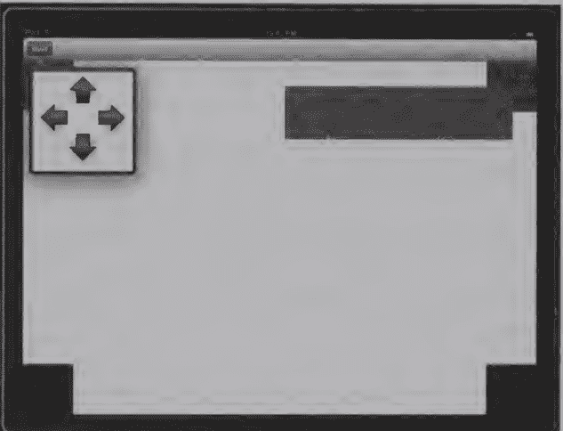

我们只指定了每个角块的起始和结束位置。要获得完整效果，请在模拟器或设备上旋转 iPad 来运行动画。弹出框将淡出，四个角会在 `cargoView` 调整大小的同时交换它们的位置。

如果我们保持 `cargoView` 位于顶层，此动画看起来会更好，因此在 `CargoViewController.m` 的 `viewDidLoad` 方法中添加此行：

```objectivec
[self.view bringSubViewToFront:cargoView];
```

在整个 iPad 开发过程中，请记住你需要考虑如何在每个方向下最佳地展示你的应用程序。在本节中，你看到了一个当用户旋转设备时平滑移动和调整元素的简单示例。这种动画并不是多余的（好吧，在这个示例中它是）。你正在帮助用户关注他们当前最感兴趣的项目。你正在帮助他们完成从一个方向到另一个方向的过渡。

## 4.9 总结

在本章中，我们看了模态视图和弹出框的变体。我们创建了一个覆盖整个屏幕的模态视图，以及一个占据中心并让屏幕非响应区域变暗的视图。我们在点击视图部分和按下按钮时创建了弹出框。我们看到了如何相对于触发弹出框显示的 UI 组件不同地排列弹出框。我们看到了如何在用户操作后关闭弹出框，以及从弹出框或模态视图向另一个对象通信。

这种基本模式我们在整个 iPad 编程中都会用到：我们创建了一个 nib，并在作为该 nib 文件所有者的视图控制器完成了大部分工作。当需要显示模态视图或弹出框时，我们需要在每个方向建立一些连接，并调用包含由自定义视图控制器管理的内容的新视图。这是创建自定义表格单元格和其他内容时使用的相同基本技术。

# 第 5 章：自定义键盘

想象有一个为 iPhone 设计的 Apple Keynote 或 Pages 应用程序。它会做什么？你可以想象查看现有的文档或演示文稿，但在如此小的屏幕上创建新文档将非常困难。你一直可以在 iPhone 上输入文本——但你如何在 Safari 中输入 URL，在 Maps 中输入地址，或在 Mail 中回复电子邮件呢？虽然在急用时，但 iPhone 不会是你处理复杂文档的首选设备。

关键问题是你的手指占据了大量的 iPhone 屏幕空间。正如 Craig Hockenberry 所写：“iPhone 屏幕在每英寸显示空间内挤进了 160 像素——而你……”

为每个按钮准备一个 PNG 文件。你可以随意使用在 `Feelings2` 目录的代码下载包中找到的文件。我们将按钮设计为 75x75 像素的自定义按钮，间距均匀，并在视图中居中。


向你展示将标准键盘替换为我们刚刚创建的键盘是如此简单，简直有点不好意思了。为 `FeelingsViewController.h` 中你添加到新 nib 文件的视图添加一个 outlet，并为文本视图添加另一个 outlet。

## 示例代码：TextField/Feelings2/Classes/FeelingsViewController.h

```objectivec
#import <UIKit/UIKit.h>

@interface FeelingsViewController : ViewController
{
}
@property (nonatomic, retain) IBOutlet UIView *moodKeyboard;
@property (nonatomic, retain) IBOutlet UITextView *textView;
@end
```

`FeelingsViewController` 有三个 outlet，对应于我们关心的属性：`moodKeyboard`、`textView` 和 `view`。`view` 应该已经连接到 `FeelingsViewController.ib` 中的视图。在同一个 nib 文件中，将 `textView` outlet 连接到文本视图。将 `moodKeyboard` outlet 连接到 `MoodKeyboard.ib` 中的视图。

你已经做好了所有的准备工作；这是设置自定义键盘所需的唯一代码。在 `FeelingsViewController.m` 中实现 `viewDidLoad` 方法。

## 示例代码：TextField/Feelings2/Classes/FeelingsViewController.m

```objectivec
- (void)viewDidLoad {
    [super viewDidLoad];
    [[NSBundle mainBundle] loadNamed:@"MoodKeyboard"
                              owner:self
                            options:nil];
    self.textView.inputView = self.moodKeyboard;
}
```

在加载 nib 并设置其 File's Owner 后，高亮行将视图的 `inputView` 属性设置为包含自定义按钮的视图。现在，让我们让按钮工作起来吧。

## 5.3 响应自定义按钮

我们将启用按钮，以便当它们被按下时，它们会执行多次按键的工作。例如，当你按下愤怒按钮时，你应该看到以下界面：

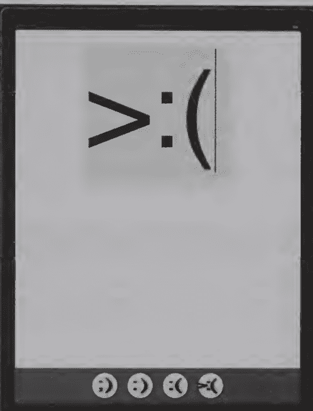

我们能够利用 Cocoa 编程中的基本范式之一。`FeelingsViewController` 对象存在于两个不同的 nib 文件。我们可以向它添加 action，在 `MoodKeyboard` nib 中将自定义按钮连接到这些 action，然后通过 `FeelingsViewController` nib 中的 outlet 与文本视图通信。

在 `FeelingsViewController` 头文件中添加这些 action：

## 示例代码：TextInput/Feelings3/Classes/FeelingsViewController.h

```objectivec
- (IBAction)didTapWinkKey;
- (IBAction)didTapHappyKey;
- (IBAction)didTapSadKey;
- (IBAction)didTapAngryKey;
```

将这些 action 绑定到按钮上，并实现它们以将文本视图的文本设置为相应的字符串，然后放弃第一响应者。

例如，当用户使用愤怒按钮时，会调用 `didTapAngryKey` 方法，该方法转而调用 `updateTextViewWithMood:` 方法，并传递对应愤怒表情的字符串。

```objectivec
- (void)updateTextViewWithMood:(NSString *)mood {
    self.textView.text = mood;
    [self.textView resignFirstResponder];
}
- (IBAction)didTapAngryKey {
    [self updateTextViewWithMood:@":"];
}
```

编译并运行。当你点击文本视图时，自定义键盘会滑入并到位。点击任何一个自定义键，相应的文本就会出现在文本视图中。我们的自定义键盘让我们只需输入一个字符而不是输入三个。

## 5.4 添加辅助视图

你很少需要单独输入表情符号。大多数时候我们用它们来为文本标点。我们真正想做的是标准键盘旁边显示我们的自定义键盘。事实证明，我们只需要更改这一行代码：

```objectivec
- (void)viewDidLoad {
    [super viewDidLoad];
    [[NSBundle mainBundle] loadNamed:@"MoodKey"
                         owner:self
                         options:nil];
    self.textView.inputAccessoryView = self.moodKeyboard;
}
```

现在，当你选择文本视图时，标准键盘会滑入位置，我们的自定义键盘位于其上方。将我们的自定义键盘想象成键盘的配件。正如代码中所所示，你只需要设置文本视图的 `inputAccessoryView` 属性而不是 `inputView` 属性。

我们需要对文本视图进行一些调整，以突出需要完成的额外工作。将视图的背景颜色设置为红色。将文本视图的字体大小从当前的 28 修改。将背景设置为白色。最重要的是，更改文本视图的大小使其覆盖整个视图。在每侧留出 20 像素的边距，这样你就可以看到由视图背景色框出的文本视图。

最后，调整 `updateTextViewWithMood:` 方法，使其追加表情符号而不是替换它，并且在输入后不再放弃第一响应者。

## 示例代码：TextInput/Feelings3/Classes/FeelingsViewController.m

```objectivec
- (void)updateTextViewWithMood:(NSString *)mood {
    self.textView.text = [self.textView.text stringWithFormat:@"@ %@", mood];
}
```

编译并运行。起初看起来还可以。然而，这里有一个小问题，正如在这里看到的：

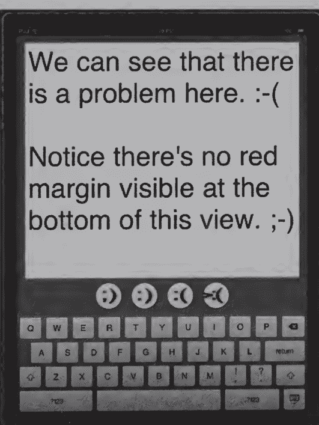

文本视图的底部被键盘遮住了。如果你继续这样做，你会发现正在输入的字符是不可见的。我们需要在键盘出现和消失时调整文本视图的大小。

## 5.5 使用键盘通知

记住，后台一直有信息在运行。当键盘需要出现或隐藏时，系统会发送通知。我们只需要注册并监听它们。在 `viewDidLoad` 中，我们将注册 `KeyboardShowNotification` 和 `UIKeyboardHideNotification`，并指定在接收通知时将调用的方法。

## 示例代码：Input/Feelings3/Classes/FeelingsViewController.m

```objectivec
- (void)viewDidLoad {
    [super viewDidLoad];
    [[NSNotificationCenter defaultCenter] addObserver:self selector:@selector(keyboardWillAppear:) name:KeyboardShowNotification object:nil];
    [[NSNotificationCenter defaultCenter] addObserver:self selector:@selector(keyboardDisappear:) name:KeyboardHideNotification object:nil];
    [[NSBundle mainBundle] loadNamed:@"Keyboard" options:nil];
    self.textField.inputAccessoryView = self.keyboard;
}
```

在这里，我们向默认通知中心注册了，以便在发布 `KeyboardShowNotification` 时收到通知。我们将此 `FeelingsViewController` 实例（即 `self`）设置为观察者，并指定将发送 `keyboardWillAppear:` 消息。换句话说，每当有 `KeyboardShowNotification` 时，默认通知中心都会向我们发送这样的消息：

```objectivec
- (void)keyboardWillAppear:(NSNotification *)notification {
    NSLog("Keyboard will appear:", notification);
}
```

我们实现了 `keyboardWillAppear:` 和对应的 `keyboardDisappear:` 方法。现在，让我们通过打印通知来实现这两个方法，以查看我们可以获取哪些信息：

> 如果你不知道如何处理通知，你可以在《Cocoa 编程：开发者快速上手指南》中找到介绍和示例。

```objectivec
- (void)keyboardDisappear:(NSNotification *)notification {
    NSLog("Keyboard will disappear: %@", notification);
}
```

编译并运行。当你轻点文本视图时，你会在日志中看到这些：


# 5.6 文本视图动画

我们将使用 `userInfo` 字典中的信息来随键盘动画调整文本视图。

我们需要处理文本视图调整的两件事。我们希望确保文本视图动画的持续时间与键盘滑入滑出的时间相同。顺便说，我们还可以确保使用与键盘相同的动画曲线，以便完美匹配动画。

```objc
-(void)animationTo:(NSDictionary *)userInfo {
    [UIView setAnimationDuration:
        [[userInfo objectForKey:UIKeyboardAnimationDurationUserInfoKey] doubleValue]];
}
```

```objc
[UIView setAnimationCurve:
    [[userInfo objectForKey:UIKeyboardAnimationCurveUserInfoKey] intValue]];
```

我们还需要根据键盘和辅助栏的高度来调整文本视图。首先，我们将计算键盘的结束高度：

```objc
// TextInput/Feelings/Classes/FeelingsViewController.m
-(CGFloat)keyboardEndingFrameHeight:(NSDictionary *)userInfo {
    CGRect keyboardEndingUncorrectedFrame = 
        [[userInfo objectForKey:UIKeyboardFrameEndUserInfoKey] CGRectValue];
    CGRect keyboardEndingFrame = 
        [self convertRect:keyboardEndingUncorrectedFrame fromView:nil];
    return keyboardEndingFrame.size.height;
}
```

注意，我们必须使用 `convertRect:from:` 方法来转换从 `UIKeyboardFrameEndUserInfoKey` 获取的结束矩形。我们返回的矩形没有考虑到屏幕的方向，因此如果设备处于横屏模式，我们需要调用 `convertRect:from:` 方法来交换宽度和高度。

现在我们已经有了键盘的高度，就可以为文本视图计算新的帧大小了。如果键盘出现，我们将键盘的高度减少文本视图的高度；如果键盘消失，我们将键盘的高度增加文本视图的高度。

```objc
// TextInput/Feelings/Classes/FeelingsViewController.m
-(CGRect)adjustHeightBy:(CGFloat)change multipliedBy:(NSInteger)direction {
    return CGRectMake(20,
        20,
        self.textView.frame.size.width,
        self.textView.frame.size.height + change * direction);
}
```

使用这些方法在 `keyboardWillAppear:` 和 `keyboardWillDisappear:` 方法中获得正确的行为。

```objc
// TextInput/Feelings/Classes/FeelingsViewController.m
-(void)keyboardWillAppear:(NSNotification *)notification {
    [UIView beginAnimations:nil context:NULL];
    [self matchAnimationTo:[notification userInfo]];
    self.textView.frame = [self adjustHeightBy:[self keyboardEndingFrameHeight:[notification userInfo]] multipliedBy:-1];
    [UIView commitAnimations];
}

-(void)keyboardWillDisappear:(NSNotification *)notification {
    [UIView beginAnimations:nil context:NULL];
    [self matchAnimationTo:[notification userInfo]];
    self.textView.frame = [self adjustHeightBy:[self keyboardEndingFrameHeight:[notification userInfo]] multipliedBy:1];
    [UIView commitAnimations];
}
```

编译并运行。现在在竖屏和横屏模式下行为都是正确的。例如，当键盘可见时，文本视图看起来应该是这样的：

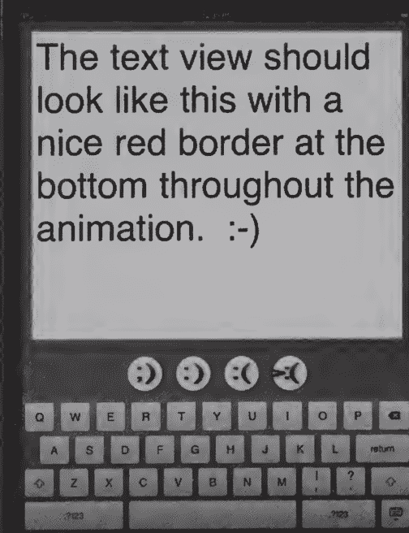

检查是否可以在键盘可见时旋转设备并关闭键盘，并且所有动画都能正常播放。创建自定义键盘和键盘辅助栏是简单的，但通常有像这样的细节需要处理。

# 5.7 总结

在本章中，你看到了如何轻松地提供你自己的自定义键盘、为 Apple 提供的键盘之一添加辅助栏，或者两者兼顾。但请记住，你应该有一个标准键盘无法满足的明确需求。你的用户对内置键盘会非常熟悉。确保使用非标准键盘有一个令人信服的理由。你的自定义键盘增加了认知负担。你需要确保它们提供的价值足以证明这种努力是值得的。

例如，这里来自 Apple Numbers 应用程序的自定义键盘：

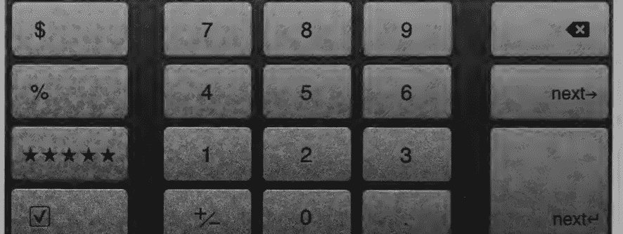

这个非标准键盘让所选单元格的数据输入变得更快更容易。每当用户需要输入文本时，你应该首先考虑使用哪一个标准键盘，然后考虑你是否可以通过提供自定义键盘来让他们的任务变得更容易。记住，你的目标是让你的 App 和设备“消失”，让你能够专注于他们正试图体验或完成的事情。

正如你在这一章中看到的，自定义文本输入并不需要太多工作。你只需要设置 `inputView` 或 `inputKeyboardView` 属性，正确地配置它，处理所有适当的操作，并确保妥善地移动键盘周围的元素。

# 第 6 章 自定义绘制

Apple 的这些新设备让设计师们忙不可交。你有一组可能在 iPhone App 中使用过的图像，而 iPad 也来了。所以，现在你可能需要回到设计板重新开始。一张在 iPhone 上看起来很棒的图像在 iPad 上可能太小了，因此你可能需要像我们在本书第一章处理图标那样，创建图像的 iPhone 和 iPad 版本。

故事并没有此结束。iPhone 4 拥有一个全新的显示器，每个方向的像素数量都是两倍。如果你不更新你的作品以针对这个新设备，你将得到我们在第一章中使用兼容模式在 iPad 上运行 iPhone App 时得到的那种模糊感。所以，如果你的目标是 iPhone 和 iPad，你需要为这三个不同的屏幕为每张图像准备三个不同的版本，而且你知道很快还会有更多版本。

我们可以要求设计师提供数字资产的三个不同版本，在很多情况下这是正确的解决方案。然而，通常我们完全可以程序化地绘制我们需要的一些形状。这可能是枯燥的，可能会很痛苦，但对于简单的示例来说，这可能正是正确的选择。

在本章中，我们将从多年来一直用于在 iPhone 和 Mac 上绘制的基于 C 语言的 API 开始。然后我们将使用新引入的 `Cocoa UIBezierPath` 类，它与它的 Mac OS X 兄弟类 `NSBezierPath` 类几乎相同。

在每种情况下，绘制的通用策略都是相同的。你将创建一个上下文（context）和一个路径（path），你对其进行填充、描边或两者兼顾。如果你在 (0,0) 处绘制对象，然后将其移动到你想让它出现的地方，细节通常会更容易处理。

即使使用了改进后的类，用代码绘制仍然是枯燥的。这个示例的重点不是结果，而是你在过程中学到的技巧。

## 6.1 使用 Core Graphics 绘制

创建一个名为 Bezier 的 iPad 项目。添加一个 `UIView` 的子类并命名为 `Bezier`。不要忘记将你的 ViewController 类型改为 `Bezier`。

我们将所有的绘制工作都放在 `drawRect:` 方法中。我们可以将工作拆分到其他方法。

```objc
-(void)drawRect:(CGRect)rect {
    CGMutablePathRef triangle = [self triangle];
    CGContextRef ctx = UIGraphicsGetCurrentContext();
    [self centerContext:ctx];
    [self fill:triangle withColor:[UIColor yellowColor] inContext:ctx];
    [self stroke:triangle withColor:[UIColor blackColor] width:20 inContext:ctx];
    [self restoreContext:ctx];
    CGPathRelease(triangle);
}
```


`drawRect:` 方法概述了需要完成的任务。

当我们完成后，我们希望看到这样的效果：

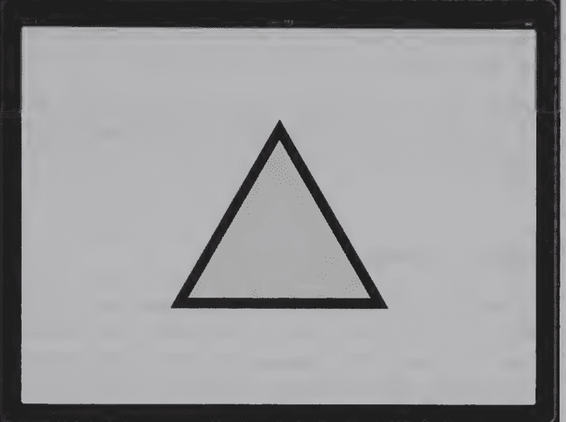

你可以看到首先我们创建一个路径，并获取当前的图形上下文。`CGMutablePathRef` 和 `CGContextRef` 是整个绘制过程中使用的基础对象。

我们创建三角形，将其移动到屏幕中心，填充黄色，用 20 像素宽的黑线描边边界，并进行清理。

让我们探索每一个步骤。

### 创建三角形路径

我们通过 `drawRect:` 方法中的此调用创建并持有我们的三角形路径：

```objc
// Drawing/Bezier1/Classes/Bezier.m
-(CGMutablePathRef)triangle {
    CGMutablePathRef path = CGPathCreateMutable();
    CGPathMoveToPoint(path, NULL, 0, -173);
    CGPathAddLineToPoint(path, NULL, 200, 173);
    CGPathAddLineToPoint(path, NULL, -200, 173);
    CGPathCloseSubpath(path);
    return path;
}
```

所有移动都是通过 C 函数调用完成的。注意，`CGPathMoveToPoint()`、`CGPathAddLineToPoint()` 和 `CGPathCloseSubpath()` 函数都接受 `path` 作为参数。

### 移动路径并返回

如果在 (0,0) 中心绘制路径并在稍后移动它，会更加简单。这让你的路径计算变得更容易，并且让你能够相对容易地重用工作。例如，我们可以轻松创建一个应用程序，在用户触摸屏幕的任何地方盖上一个黄色三角形。我们会不断绘制三角形，并将它们移动到触摸发生的位置。

移动曲线的调用包含在 `drawRect:` 方法的以下行中：

```objc
[self centerContext:ctx];
```

在绘制完成后，有一个相应的 `restoreContext:` 调用来恢复环境。这两个方法并没有多少复杂的内容：

```objc
-(void)centerContext:(CGContextRef)ctx {
    CGPoint point = [self convertPoint:self.center fromView:nil];
    CGContextSaveGState(ctx);
    CGContextTranslateCTM(ctx, point.x, point.y);
}

-(void)restoreContext:(CGContextRef)ctx {
    CGContextRestoreGState(ctx);
}
```

在 `centerContext:` 中，我们计算视图的中心，以便能够设备旋转。在移动上下文之前，我们存储了当前的 Core Graphics 状态。然后我们将上下文平移到视图中心。这意味着三角形现在位于视图中心，而不是左上角。绘制完成后，我们将状态恢复到我们保存的值。

### 描边和填充

到此时，我们已经完成了大部分工作。我们创建了三角形并将其移动到了屏幕中心。遗憾的是，现在什么也可见。我们将通过 `drawRect:` 方法中的这些调用来添加颜色：

```objc
[self fill:triangle withColor:[UIColor yellowColor] inContext:ctx];
[self stroke:triangle withColor:[UIColor blackColor] width:20.0 inContext:ctx];
```

你必须将路径传递给这些方法对三角形进行描边和填充，这并不令人意外。然而，你必须将路径和上下文都传进去，这有点让人意外。当你查看这些方法的实现时，你会发现每个函数调用都需要上下文作为参数：

```objc
- (void)fill:(CGMutablePathRef)path withColor:(UIColor *)color inContext:(CGContextRef)ctx {
    CGContextSetFillColorWithColor(ctx, color.CGColor);
    CGContextAddPath(ctx, path);
    CGContextFillPath(ctx);
}

- (void)stroke:(CGMutablePathRef)path withColor:(UIColor *)color width:(CGFloat)width inContext:(CGContextRef)ctx {
    CGContextSetStrokeColorWithColor(ctx, color.CGColor);
    CGContextSetLineWidth(ctx, width);
    CGContextAddPath(ctx, path);
    CGContextStrokePath(ctx);
}
```

在每种情况下，我们设置要使用的颜色，将路径添加到此修改后的上下文，然后对路径进行描边或填充。最后，有东西可见了。你应该能在屏幕中心看到一个带有粗边框的大黄色三角形。

在下一节中，我们将使用 `UIBezierPath` 类重新回顾这个示例。这样做并没有真正的理由。`UIBezierPath` 类具有更多功能，使其非常具有吸引力，但如果你只是在构建线段和简单曲线的路径，可以使用本节描述的基于 C 的 API。

## 6.2 使用 Cocoa APIs

你可以一眼从 `drawRect:` 方法看出，我们的 Cocoa 版本实现更简单。最引人注目的是，我们没有显式地使用图形上下文，也不需要获取它的引用并将其传递到填充和描边的方法中。

```objc
-(void)drawRect:(CGRect)rect {
    UIBezierPath *triangle = [[self triangle] retain];
    [self centerPath:triangle];
    [self fill:triangle withColor:[UIColor yellowColor]];
    [self stroke:triangle withColor:[UIColor blackColor] width:20.0];
    [triangle release];
}
```


现在我们有了一个 Cocoa 实现，在设置时我们必须遵循引用计数规则，因此在移动和绘制三角形时，我们需要对三角形添加一个 `retain`。让我们看看实现中的其他差异。

### 创建路径

从 C 函数到 Objective-C 方法的翻译非常直接。例如，这个：

`CGPathMoveToPoint(path, NULL, 0, -173);`

变为以下 `UIBezierPath` 方法：

`[path moveTo:CGPointMake(0,-173)];`

你不需要将路径变量作为参数传递，因为你是在向它发送消息。在整个范围内进行类似的更改以获得三角形的 Cocoa 版本：

```objc
+(UIBezierPath *)triangle {

    UIBezierPath *path = [UIBezierPath bezier];

    [path moveTo:CGPointMake(0,-173)];

    [path addLineToPoint:CGPointMake(200,-173)];

    [path addLineToPoint:CGPointMake(-200,-173)];

    [path close];

    return path;

}
```

每个方法仅仅是 C 函数之上的一个薄薄的封装，但这种方法感觉更整洁。这就是为什么我们展示这种方法。

## 绘制圆和矩形

```objc
UIBezierPath *exclamationPoint = [[self exclamationPoint] retain];

[self centerPath:exclamationPoint];

[self fill:exclamationPoint initWithColor:[UIColor black]];

[exclamationPoint release];

[triangle release];
```

叹号由两个部分组成：顶部和底部的点。使用 `appendPath:` 来由这两个组件构建出叹号：

```objc
- (UIBezierPath *) exclamationPoint {

    UIBezierPath *path = [UIBezierPath bezierPath];

    [path appendPath:[self top]];

    [path appendPath:[self dot]];

    return path;

}
```

顶部是用 `bezierPathWithRect:` 方法创建的矩形，而底部是用 `bezierPathWithOvalInRect:` 创建的圆。

```objc
- (UIBezierPath *) top {

    return [UIBezierPath 
        bezierPathWithRect:CGRectMake(-20, -70, 40, 140)];

}
```

```objc
- (UIBezierPath *) dot {

    return [UIBezierPath 
        bezierPathWithOvalInRect:CGRectMake(-25, 95, 50, 50)];

}
```

从这里开始到本章结束，我们将对顶部进行细微调整以改变叹号的外观。例如，我们可以通过将矩形改为圆角矩形来稍微软化角：

```objc
- (UIBezierPath *) top {

    return [UIBezierPath 
        bezierPathWithRoundedRect:CGRectMake(-20, -70, 40, 140) 
        cornerRadius:8.0];

}
```

# 第 6 章：自定义绘制


我们可以使用等于矩形宽度一半的圆角来使角更加圆润：

```objc
Drawing/Bezier/Classes/Bezier.m

-(UIBezierPath *) top {

    return [UIBezierPath
        bezierPathWithRoundedRect:CGRectMake(-20, -70, 40, 40)
        cornerRadius:20.0];

}
```

这看起来就像我们在矩形的两端都放置了一个半圆：

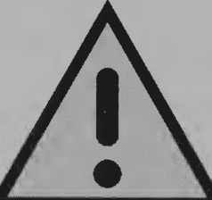

接下来，我们将修改路径并从圆的弧添加到路径中。

## 6.4 不规则路径

我们将修改叹号顶部部分的路径，使其在底部变细。主要目的是确保它不是由矩形构建的：

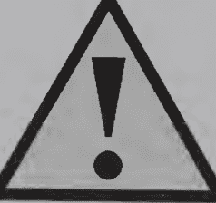

Drawing/Bezier/Classes/Bezier.m

```objc
- (UIBezierPath *) top {

    UIBezierPath *path = [UIBezierPath bezierPath];

    [path moveTo:CGPointMake(-30, -70)];

    [path addLineTo:CGPointMake(30, -70)];

    [path addLineTo:CGPointMake(5, 70)];

    [path addLineTo:CGPointMake(-5, 70)];

    [path closePath];

    return path;

}
```

你已经看到如何从其他路径构建路径，以及如何从线条和曲线构建路径。组件部分虽然简单，但它们的组合可以非常强大且复杂。例如，对以下高亮部分进行更改，将叹号顶部和底部的线段替换为半圆。


Drawing/Bezier7/Classes/Bezier.m

```objc
- (UIBezierPath *) top {

    UIBezierPath *path = [UIBezierPath bezierPath];

    [path moveTo:CGPointMake(-30, -70)];

    [path appendPath:[UIBezierPath bezierPathWithArcCenter:CGPointMake(0, -70) radius:30 startAngle:M_PI endAngle:2*M_PI clockwise:YES]];

    [path addLineTo:CGPointMake(30, -70)];

    [path addLineTo:CGPointMake(5, 70)];

    [path appendPath:[UIBezierPath bezierPathWithArcCenter:CGPointMake(0, 70) radius:5 startAngle:0 endAngle:M_PI clockwise:YES]];

    [path addLineTo:CGPointMake(-30, -70)];

    return path;

}
```

对于每个圆弧，我们指定圆的中心和半径以及以弧度为单位的起始结束角度。我们还需要指示从开始到结束是顺时针还是逆时针移动。在我们的情况下，我们顺时针遍历每个弧。这部分部分是因为我们是沿着路径顺时针移动的。如果我们逆时针遍历弧，在末端就会是凹处而不是凸起。

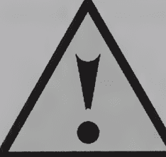

如果你沿着相反的方向移动路径，你会得到凹处而不是凸起。尽管曲线看起来是平滑的，但实际上并非如此。不过请记住，本章的目的是介绍实用的技术。

## 6.5 使用贝塞尔曲线

`UIBezierPath` 类允许你绘制两种类型的曲线：二次和三次曲线。二次曲线由端点和一个控制点指定。起点是当前点，初始方向由第一个控制点设置。终点再次是第一个参数，结束方向由第二个控制点设置。结果是平滑连接每个侧的曲线。

```objc
[exclamationPoint release];

[triangle release];
```

```objc
(void)drawRect:(CGRect)rect {

  [self drawInCurrentContext];

}
```

如果我们进行编译并运行，将得到与之前相同的结果，但现在我们可以设置 PDF 上下文并使用 `drawInCurrentContext` 将我们的警告绘制到 Documents 目录下的 PDF 中。第一步，`pathToWarningFile` 返回我们将创建的路径，并使用 `applicationDocumentDirectory` 来保存 PDF。

```objc
Drawing/Bezier12/Classes/BezierView.m

(NSString *)applicationDocumentDirectory {

  return [[NSString searchPathForDirectoriesInDomains(NSDocumentDirectory, NSUserDomainMask, YES) lastObject];

}
```

```objc
-(NSString *)pathToWarningFile {

  return [[self applicationDocumentDirectory] stringByAppendingPathComponent:@"Warning.pdf"];

}
```

这为我们提供了 Documents 目录中 `Warning.pdf` 文件的路径。将其作为第一个参数传递给 `UIGraphicsBeginPDFContextToFile`，该函数用于创建并配置当前文本，以便创建一个将要保存的 PDF。另外两个参数是 `CGRect` 类型的页大小，以及一个包含文档信息的可选 `NSDictionary`。我们使用视图的尺寸作为页面的尺寸。你可以使用 `CGRectMake()` 来创建一个 `CGRect`，或者使用 `CGRectZero` 创建一个 8.5 x 11 英寸或 612 x 792 像素的页面。

与其将 PDF 保存到文件，你也可以使用 `UIGraphicsBeginPDFContextToData` 函数将 PDF 写入 `NSData` 对象中。我们将写入文件。

你首先创建一个新的 PDF，然后像绘制到屏幕上一样绘制到 PDF 页面。我们将在整个文档中使用完全相同的页面信息，以便我们可以使用 `UIGraphicsBeginPDFPage()` 方法。在创建新页面时，你可以使用 `UIGraphicsBeginPDFPageWithInfo()` 函数来更改页面信息。

如果你需要另一个页面，就再次开始这两个函数中的另一个。当你完成最后一页时，就结束 PDF 上下文。在我们简单的示例中，我们只有一个页面。以下是创建 PDF 的代码：

```objc
Drawing/Bezier12/Classes/BezierView.m

(void)drawRect:(CGRect)rect {

    [self drawInCurrentContext];

    UIGraphicsBeginPDFContextToFile([self pathToWarningFile], self.frame, nil);

    UIGraphicsBeginPDFPage();

    [self drawInCurrentContext];

    UIGraphicsEndPDFContext();

}
```

我们用于写入 PDF 的代码与写入屏幕的代码完全相同。唯一的区别在于，我们从设置上下文并创建一个新页面开始，并在结束时关闭上下文。在模拟器中编译并运行。你可以通过以下应用程序的路径找到你创建的 PDF：`Library/Application Support/iPhone Simulator/3.2/Applications`。你会看到一系列带有编号的目录。进入每个目录，直到找到我们的应用程序。找到与 Bezier 应用程序对应的目录，并查看其 `Documents` 目录。你应该能找到 `Warning.pdf` 文件。它包含了该符号。

| Bezier | Warning.pdf | 预览: |
| --- | --- | --- |
| Documents | | |
| Library | | |
| tmp | | ![⚠️] |

你可以在 Apple 的《iPad 编程指南》[App10b] 中的“图形与绘图”部分读到关于写入 PDF 的知识。

## 6.7 总结

`UIBezierPath` 类让绘图变得更容易且更强大。你始终有机会使用绘图程序生成一个图像文件，并在应用程序中使用它。如果绘图代码并不复杂，那么你应该倾向于自己绘图，而不是引入这样的图像。⁴

- 你将在 Jeff LaMarche 的一篇博客中看到对 Joe Cowan 评论的讨论。请从这个网站开始：http://iphonedevelopment.blogspot.com/2010/05/some-advice.html。

# 第 7 章

# 电影播放器

iPad 的核心设计是为媒体消费而设计的；巨大的手持屏幕非常适合图形显示，尤其是视频。在 iPhone 上，你只能在全屏查看器中显示视频，而 iPad 的 SDK 允许你将视频直接构建到应用程序中，并对其周围的用户体验进行完全自定义。SDK 还暴露了播放器的状态，因此你可以直接控制视频，并将其播放与你应用程序的其他部分进行协调。

在接下来的两个章节中，我们将探索电影播放器控制器：将其嵌入应用程序中、在其上方叠加其他视图、创建我们自定义的播放控制和播放列表、生成导航缩略图以及流媒体内容。如果你过去用过视频播放器框架，可能会发现它们很难使用。有了 Apple 的新框架，我们将拥有一个运行快速的复杂播放器。

## 7.1 为电影设置视图

在接下来的几页中，我们将从零开始在 iPad 应用程序中播放视频。一旦完成这一步，我们将退后一步详细查看 `MPMoviePlayerController` 架构，并让我们的实现变得更有趣。我们已经在 `MoviePlayer` 文件夹中为你准备了一个项目（如果你倾向于真正从零开始，可以创建一个基于视图的项目）。打开项目，你会发现我们已经在 `Resources` 目录下添加了一个名为...的视频

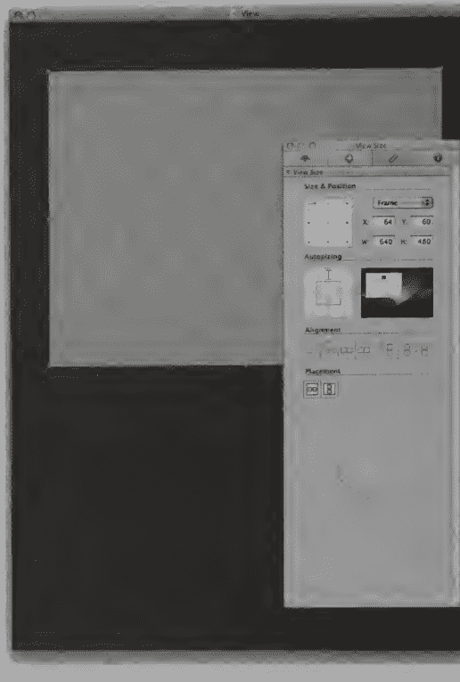

图 7.1：设置电影播放器视图

BigBuckBunny_640x360.m4v.¹ 我们还把 `MediaPlayer` 框架添加到了你的 `frameworks` 文件夹中。

我们将首先关注实例化一个 `MPMoviePlayerController` 来管理我们视频的播放。该类管理播放的所有细节，并提供一个你可以添加到视图层次结构以显示视频的视图。`MPMoviePlayerController` 还可以全屏显示我们的视频内容（我们将在本章稍后介绍这一点）。

让我们从在 Interface Builder 中打开 `MoviePlayerViewController.xib` 文件并添加一个可以包含 `MPMoviePlayerController` 视频的视图开始。首先选择 ModelAndViewController 的主视图，并将其背景颜色重置为纯黑色。然后从 Interface Library 拖入一个 `UIView` 到视图中。

1. 取决于你的分发
2. 为了确保我们没有理解，`MoviePlayerViewController` 是我们为应用程序编写的主视图控制器；`MPMoviePlayerController` 是 iOS 3.2 的一个类，由 Apple 编写，用于管理视频播放。

我们定义了一个名为 `viewFor` 的输出，并将其声明为属性。不要忘记在 `MoviePlayerViewController.m` 中添加同步。

```objc
movieplayer/Classes/MovieViewController.m

@synthesize viewFor;
```

现在让我们通过回到 Interface Builder 中的 `MoviePlayerViewController.xib` 文件来连接各个。我们将连接刚刚声明的 `IBOutlet`（对于 `viewFor`）。为此，按住 Control 点击 File Owner 并拖到新视图上。当连接弹出出现时，选择 `viewFor`，正如我们在下一页中所所示。

## 认识 MPMoviePlayerController

完成 Interface Builder 的工作后，让我们专注于代码。我们将通过在 `MoviePlayerViewController.h` 头文件中声明来添加 `MPMoviePlayerController` 类的实例。我们需要导入电影播放器的 `MPMoviePlayerController.h` 文件，以及 `player` 的属性声明。既然在这里了，我们还添加一个名为 `movieURL` 的方法声明（我们稍后会回到这里）。

```objc
movieplayer/MoviePlayer/Classes/MovieViewController.h

#import <UIKit/UIKit.h>
#import <MediaPlayer/MPMoviePlayerController.h>
```

```objc
@interface MoviePlayerViewController : UIViewController {

    UIView *viewFor;
    MPMoviePlayerController *player;
}
```

```objc
@property (nonatomic, retain) IBOutlet UIView *viewFor;
@property (nonatomic, retain) MPMoviePlayerController *player;
-(NSURL *)movieURL;
@end
```

让我们来看 `MoviePlayerViewController` 的实现。
我们从 `viewDidLoad` 方法开始并实例化 `MPMoviePlayerController`。让我们添加代码然后逐一分析：

```objc
movieplayer/MoviePlayer1/Classes/MoviePlayerViewController.m
```


## 第 7 章：视频播放器

### 7.1 初始化播放器

```objc
-(void)didLoad {
    self.player = [[MPMPlayerController alloc] init];
    self.player.contentURL = [self movieURL];
}
```

在这里，我们首先对控制器进行了内存分配和初始化，并将其赋值给我们的 `player` 属性。接下来，我们为播放器分配了一个 `contentURL`——这是我们想要播放的视频内容的位置，它可以是 bundle 中的本地文件，也可以是基于网络的 URL。目前，我们将使用一个本地文件作为视频内容。让我们快速跳转一下查看 `movieURL` 方法，它构建了指向 bundle 中视频的基于文件系统的 URL：

```objc
// movieplayer/MoviePlayer1/Classes/MoviePlayerViewController.m
-(NSURL *)movieURL {
    NSBundle *bundle = [NSBundle mainBundle];
    NSString *moviePath = [bundle pathForResource:@"BigBunny_640x360" ofType:@"m4v"];
    if (moviePath) {
        return [NSURL fileWithPath:moviePath];
    } else {
        return nil;
    }
}
```

如果你曾经构建过指向 bundle 中图像或其他资源的 URL，那么这段代码看起来应该很熟悉：我们获取 bundle 的引用，构建指向我们视频的 URL，将其封装在 `NSURL` 对象中并返回。我们将在本章稍后的部分回到这里，并构建一些基于网络的 URL 来向 iPad 流传输内容。

### 7.2 使用 `MPMoviePlayerController` 的 `view` 属性

回到正题，我们将查看本章中最重要的概念之一：`MPMoviePlayerController` 的 `view` 属性的使用。正如我们之前提到的，播放器控制器维护了一个特殊的视图，该视图可以作为子视图添加到你的任何视图中以显示视频内容。对待这个视图要非常小心——虽然我们在本章稍后会发现一些有趣的方法来向播放器视图添加我们自己的子视图，但通常情况下，这是一个由播放器控制的不透明对象，应该被那样对待。

```objc
// movieplayer/Movie/Classes/MoviePlayerViewController.m
- (void)viewDidLoad {
    [super viewDidLoad];
    self.player = [[MPMoviePlayerController alloc] init];
    self.player.contentURL = [self movieURL];
    self.player.view.frame = self.viewForMovie.bounds;
    self.player.view.autoresizingMask = UIViewAutoresizingFlexibleWidth | UIViewAutoresizingFlexibleHeight;
    [self.viewForMovie addSubview:self.player.view];
    [self.player play];
}
```

获取 `MPMoviePlayerController` 的 `view` 视图很容易；我们只需要像访问其他属性一样访问播放器的 `view` 属性，这正是我们在代码中所做的。在获取视图引用后，我们首先设置了两个属性：视图的 `frame` 以及几个控制视图如何调整大小的掩码。就像任何视图的 `frame` 一样，它控制着视图在屏幕上的尺寸。在这里，我们从 `viewForMovie` 获取 `frame` 并进行同步。我们设置该视图，以便在需要时可以通过宽度或高度对其进行调整。

现在是有趣的部分：我们获取播放器控制器的视图，并将其作为子视图添加到我们之前在 Interface Builder 中创建的 `viewForMovie` 视图中。完成后，我们向播放器发送消息开始播放。在此时，构建并运行你的项目，你应该能在你的 `UIView` 中看到视频正在播放。触摸视图应该显示控件，包括全屏控制，旋转设备应该给你提供合理的调整大小行为。

### 7.3 整体概念

让我们思考一下刚刚发生了什么——第一次看可能会有点困惑。尽管这看起来有点复杂，但一旦你理解了涉及的所有视图和控制器，它实际上相当简单。

我们创建的是一个 `MPMoviePlayerController` 对象，它作为显示视频内容的控制器。我们很快就会进入细节，但可以使用它来管理视频播放的所有方面，包括停止、开始、暂停和其他操作。该控制器还暴露了一个名为 `view` 的内置属性，我们可以获取它的引用并将其添加到我们的视图中以显示视频。这正是我们所做的。记住，我们首先在 Interface Builder 中创建了一个 `UIView` 作为视图的落脚点；在创建 `MPMoviePlayerController` 之后，我们获取了它的内部视图并将其作为子视图添加到我们的 `UIView` 中。结果是？视频直接在我们的应用程序中播放。

### 7.4 窥视播放器属性

现在我们已经实例化了一个播放器，并将其视图添加到我们的视图层次结构中，让我们从播放器及其正在执行的操作中获取一些信息。为了做到这一点，我们将视频播放器应用程序添加一个信息按钮和一个标签，并在点击按钮时使用 `MPMoviePlayerController` 在标签中显示实时信息。

在深入 `MPMoviePlayerController` 代码之前，我们先处理机械部分——在 Interface Builder 中重新打开 `MovieViewController.xib` 文件，在主视图上拖入一个 `UILabel` 视图和一个 `UIButton` 按钮。将它们都放置在 iPad 屏幕的底部（见图 7.3）。

我们还想做一些事情来正确配置标签和按钮。现在你已经更新了 `MovieViewController.h`，返回 Interface Builder，并将信息按钮连接到标签；然后我们就准备好深入研究 `MPMoviePlayerController` 了。

```objc
// movieplayer/MoviePlayer1/Classes/MovieViewController.h
@interface MovieViewController : UIViewController
@property (nonatomic, retain) UIView *view;
@property (nonatomic, retain) MPMoviePlayerController *player;
@property (nonatomic, retain) UILabel *onDisplayLabel;
-(NSURL *)movieURL;
-(IBAction)getInfo:(id)sender;
@end
```


现在我们已经实例化播放器并将其视图附加到我们的视图层次结构，由于 `MPMoviePlayerController` 维护了一组描述当前状态的属性（仅举几个），我们在本章中会涉及到许多属性，但要查看详尽列表，请参阅 `MPMoviePlayerController` 类参考。

#### 编写 `getInfo:` 方法

```objc
// movieplayer/MoviePlayer/Classes/MoviePlayerViewController.m
- (void)getInfo:(id)sender {
    MPMoviePlayerController *moviePlayer = self.player;
    float width = moviePlayer.naturalSize.width;
    float height = moviePlayer.naturalSize.height;
    float playbackTime = moviePlayer.currentPlaybackTime;
    float playbackRate = moviePlayer.currentPlaybackRate;
    float duration = moviePlayer.duration;
    onDisplayLabel.text = [NSString stringWithFormat:@"[Time: %.1f of %f secs] \n[Playback: %0fx] \n[Size: %0fx%.0f]",
                           playbackTime,
                           duration,
                           playbackRate,
                           width,
                           height];
}
```

我们正在获取视频控制器的引用，然后使用它的 `naturalSize` 属性来获取视频的实际尺寸。注意，播放器可能会缩放视频（如果这对你的应用程序很重要，你可以检查播放器的帧大小及其缩放属性），但此属性提供了视频真实的原始尺寸。

我们正在查看与视频相关的三个属性：视频中的当前播放时间（`currentPlaybackTime`）、视频的总时长（`duration`）以及播放速率（`currentPlaybackRate`）。虽然时长是一个只读属性，但另外两个属性可以设置以影响当前位置和播放速率。它们也是 `MPMediaPlayback` 协议的一部分，并为我们提供了播放媒体的标准化接口（带有常用方法如 `play`、`pause`、`start`、`stop` 和 `seek`）。我们将在本章稍后部分和下一章中回到这些方法。

编译并运行这段新代码。触摸信息按钮；事实上，你可以多次触摸它，你会看到这些属性的当前状态随着你的操作而更新。当你触摸按钮时，你会看到类似的内容：

> [Time: 1.5 of 596 secs] [Playback: 1x] [Size: 640x359]

既然我们已经写了这些代码，我们必须坦诚相告，有一点我们一直在回避：这些属性中的许多一个在控制器加载视频到一定程度之前是无法获知的。在目前的情况下，控制器是从本地文件加载的，因此这个过程发生非常快，但我们可能会通过网络检索资源——这会引入大量的延迟。实际上，在这些属性确定之前，用户很容易就可以点击信息按钮。那么，我们如何知道播放器的属性已经就绪了呢？这就是我们现在要讨论的，通过介绍播放器如何通过通知向应用程序通信其状态。

### 7.5 接收通知

`MPMoviePlayerController` 类支持丰富的通知集合，你可以利用它们来获取电影播放状态的信息。正如你预期的那样，你可以接收到播放事件的通知，例如停止、暂停和结束事件，但你也可以接收以下情况的通知：

- 视频元数据的可用性
- 缩放和视频分辨率的变化（包括从全屏模式切换的变化）
- 基于网络视频的加载导致的状态变化
- 生成的缩略图的可用性（我们稍后会回到这个话题）

我们不会详细介绍所有这些内容，但我们将学习使用 `MPMoviePlayerController` 类通知的机制，并在稍后的章节中处理缩略图功能。

现在，让我们回到在播放器加载足够视频以获取该信息之前就访问属性（如视频时长）的问题。使用通知，我们可以通过注册在元数据可用时接收通知来解决这个问题。以下是我们可以接收的基于元数据的通知：

- `MPMovieDurationAvailableNotification`：当视频时长被确定时发送。
- `MPMediaTypesAvailableNotification`：当音频和视频类型被确定时发送。
- `MPMovieNaturalSizeAvailableNotification`：当视频的宽度和高度已知时发送。

让我们写一些代码来使用 `MPMovieDurationAvailableNotification` 通知；作为一个简单的测试，我们将在时长可用时直接调用我们的 `getInfo` 动作（我们还假设了时长是可用的，其他元数据也是如此；这可能是一个安全的假设，但显然你需要检查值的有效性）。请注意，更好的实现可能是先将信息按钮设为禁用状态，然后在元数据可用时将其启用。不过，目前我们正在处理与 `MPMoviePlayerController` 相关的通知机制——我们将在下一节中返回一个更复杂的通知示例。

#### 深入研究通知

电影播放器控制器使用 Cocoa 的标准通知系统。这里是快速回顾：要接收通知，你可以将一个对象作为观察者添加到具名通知（如 `MPMovieDurationAvailableNotification`）中，并提供一个在发生通知时被调用的选择器。你还可以提供一个可选的负载对象，该对象会在每次发送通知时传递给观察者；如果未提供负载对象（使用 `nil` 值），则发送的通知将直接传递。

以下是注册你的 `MoviePlayerViewController` 以接收 `MPMovieDurationAvailableNotification` 的代码；我们将这段新代码放在 `viewDidLoad` 方法中，以便它在视频安装之前完成注册。我们将 `movieDurationAvailable:` 设置为通知的选择器，因此每当触发 `MPMovieDurationAvailableNotification` 时，该方法就会被调用。

```objc
// movieplayer/MoviePlayer3/Classes/MoviePlayerViewController.m
-(void)viewDidLoad {
    [super viewDidLoad];
    [[NSNotificationCenter defaultCenter]
        addObserver:self
        selector:@selector(movieDurationAvailable:)
        name:MPMovieDurationAvailableNotification
        object:nil];

    self.player = [[MPMoviePlayerController alloc] init];
    self.player.contentURL = [self movieURL];
    self.player.view.frame = self.viewForMovie.bounds;
    self.player.view.autoresizingMask = UIViewAutoresizingFlexibleWidth | UIViewAutoresizingFlexibleHeight;
    [self.viewForMovie addSubview:self.player.view];
    [self.player play];
}
```

在电影播放器上设置通知就完成了；现在我们只需要编写在通知到达时被调用的方法：

```objc
- (void)movieDurationAvailable:(NSNotification*)notification {
    [self getInfo:nil];
}
```

我们在这个方法中做的仅仅是调用 `getInfo` 方法。当我们构建并运行这段代码时，一旦时长可用，你就应该能看到标签被填充了内容，就像你点击了信息按钮一样。这种通知的传统做法是在方法中直接获取时长。我们该如何做呢？如下所示：

```objc
MPMoviePlayerController *moviePlayer = [notification object];
float duration = [moviePlayer duration];
```

在这里，我们首先从通知中获取播放器对象（记住，我们没有使用负载对象，而是发送通知的对象——即电影播放器——被传递给我们），然后我们可以直接使用 `duration` 属性获取值。虽然从技术上讲我们可以访问 `self.player.duration`，但更通用地说，我们可能会将 `movieDurationAvailable:` 方法放在任何无法直接访问播放器的任意对象中，因此通知对象为我们提供了一种解耦的方式来访问播放器。

现在我们已经掌握了基础通知，让我们进入更有趣的示例。

### 7.6 添加播放列表

现在我们知道了如何从播放器接收通知，我们将利用它们为我们的播放器编写一个简单的播放列表处理器。请注意，我们讨论的不是 iTunes 播放列表；你可以访问它们，并且你想要查看框架来实现这一点。我们将编写一个播放列表控制器来处理你自己的媒体视频列表。

为了实现这一点，我们将保持简单，使用数组来表示播放列表的模型（在实际应用程序中，你通常从云端检索播放列表）。为了这样做，在 Xcode 中创建一个名为 `PlaylistController` 的视图控制器子类。打开对应的 `PlaylistController.h` 并添加这些属性：

```objc
// movieplayer/MovieWithPlaylist/Classes/PlaylistController.h
@interface PlaylistController : UIViewController
@property (nonatomic, retain) NSArray *items;
@property (nonatomic, retain) MoviePlayerViewController *playerController;
@end
```


# 第 7 章 视频播放器

我们将使用 `items` 数组为每个播放列表项目存储字典，该字典将包含播放列表项目的标题以及文件名。我们将使用 `player` 属性持有对 `MPMovieController` 的引用。让我们通过为 `PlaylistController` 定义初始化方法来设置播放器：

```objc
// movieplayer/MovieWithPlaylist/Classes/PlaylistController.m
-(id)initWithPlayer:(MoviePlayerViewController *)player {
    self = [super init];
    if (self) {
        playerController = player;
    }
    return self;
}
```

在这里，我们将播放器赋值给本地属性——稍后我们会修改 `MovePlayerViewController` 来实例化这个类并将活动播放器传递给它。现在，我们继续完善播放列表控制器，通过其项目数组实际创建一个项目列表。为此，我们在 `viewDidLoad` 方法中进行设置：

```objc
// movieplayer/MovieWithPlaylist/Classes/PlaylistController.m
-(void)viewDidLoad {
    [super viewDidLoad];
    items = [[NSArray arrayWithObjects:
        [NSDictionary dictionaryWithObjectsAndKeys:
            "Introduction", @"title",
            @"elephantsdream-720-h264-st-aac-1", @"URL",
            @"mov", @"FileType",
            nil],
        [NSDictionary dictionaryWithObjectsAndKeys:
            "Watch out!", @"title",
            @"elephantsdream-720-h264-st-aac-2", @"URL",
            @"mov", @"FileType",
            nil],
        [NSDictionary dictionaryWithObjectsAndKeys:
            "Follow me!", @"title",
            [playerController movieURL:@"elephantsdream-720-h264-st-aac-3" withFiletype:@"mov"], @"URL",
            nil]
    ] retain];
}
```

在这里，我们正在实例化一个包含 `NSDictionary` 类型元素的 `NSArray`；每个字典都包含两个键值：标题和一个电影的 URL。对于我们的电影，我们将使用从电影《大象之梦》（Elephants Dream）中剪辑的三个电影片段；你可以在项目中已经找到这些片段，你也可以在 `viewDidLoad` 方法中添加你自己的电影片段和标题。

> **注意**：这部电影是由 Blender Foundation 创建的，可以在 http://www.elephantsdream.com 找到。

现在我们已经准备好了模型并有了一个控制器（稍后我们将对其进行更多添加），我们将通过在 `PlayerViewController` 的实现中添加一个表格视图来实现。在你的 `viewDidLoad` 方法底部，就在添加 `player.view` 作为子视图的行之前，添加以下代码：

```objc
// movie/Player3WithPlaylist/Classes/PlayerViewController.m
Playlist *playlist = [[Playlist alloc] initWithPlayer:self];
CGRect rect2 = CGRect(64, 600, 60, 350);
playlist.frame = rect2;
[self.view addSubview:playlist.view];
```

在这里，我们正在实例化一个 `PlaylistViewController`（记住它是 `UITableViewController` 的子类），设置它的框架，然后将其作为子视图添加到 `PlayerViewController` 的视图中。

现在让我们对表格视图进行一些微调，使其看起来更适合我们的应用程序。你需要在 `PlaylistController` 的 `viewDidLoad` 方法中添加这些内容：

```objc
// movie/Player3WithPlaylist/Classes/PlaylistController.m
UITableView *table = self.tableView;
[table setRowHeight:30];
[table setBackgroundColor:[UIColor clearColor]];
[table setSeparatorStyle:UITableViewSeparatorStyleNone];
[table setIndicationStyle:UIScrollViewIndicationStyleWhite];
```

这些都是美观上的更改，将产生一个带有白色文字的黑色表格、没有分割线并且带有渐变背景。我们还需要稍微修改单元格的显示方式，因此我们为你提供了一个 `tableView:cellForRowAt:indexPath:` 的实现，你可以使用并查看（但并不是本章的重点）。

现在我们需要一些表格数据，以便你看到它是什么样的。我们将通过实现 `UITableView` 的数据源方法来实现。让我们从 `numberOfSectionsInTableView:` 和 `tableView:numberOfRowsInSection:` 方法开始，它们非常直观；你只需为表格的分数量返回1，并根据你的 `items` 数组中的项目数量返回行数：

```objc
- (NSInteger)numberOfSectionsInTableView:(UITableView *)tableView {
    return 1;
}
```

```objc
- (NSInteger)tableView:(UITableView *)tableView numberOfRowsInSection:(NSInteger)section {
    return [self.items count];
}
```

现在我们准备好处理有趣的部分：当播放列表中的项目被选中时，我们需要更改播放器正在播放的电影并开始播放它：

```objc
- (void)tableView:(UITableView *)tableView didSelectRowAtIndexPath:(NSIndexPath *)indexPath {
    NSURL *url = [[self.items objectAtIndex:indexPath.row] objectForKey:@"URL"];
    [self.playerController setContentURL:url];
    [self.playerController play];
}
```

为了实现这一点，我们使用被选中项目的 `indexPath` 并确定其行索引。一旦知道了项目的行索引，你就可以从 `items` 数组访问电影的 `contentURL` 并将其赋值给 `url` 变量。现在，有了 URL，我们将设置播放器的 `contentURL` 属性指向不同的电影。最后，调用播放器的 `play` 方法开始播放。在此处，编译并运行！

在你的测试中，你可能注意到如果你点击播放列表中的一个项目，得到了预期的行为，片段开始播放。但当片段播放结束时，播放列表中的下一个项目并没有自动开始播放。我们现在使用通知来修复这个问题。使用 `NSNotificationCenter`，我们将播放控制器作为 `MPMPlayerDidFinishNotification` 的观察者。该通知在电影播放结束时触发。要做到这一点，在你的 `viewDidLoad` 方法底部添加此代码：

```objc
[[NSNotificationCenter defaultCenter]
    addObserver:self
    selector:@selector(playerPlaybackDidFinish:)
    name:MPMPlayerDidFinishNotification
    object:nil];
```

注意这个触发的 `playerPlaybackDidFinish:` 选择器——让我们现在编写它：

```objc
- (void)playerPlaybackDidFinish:(NSNotification*)notification {
    UITableView *tv = self.tableView;
    int rows = [tv numberOfRowsInSection:0];
    int selectedRow = [tv indexPathForSelectedRow].row;
    if (selectedRow + 1 < rows) {
        NSIndexPath *path = [NSIndexPath indexPathForRow:selectedRow+1 section:0];
        [tv selectRowAtIndexPath:path
                          animated:YES
                   scrollPosition:YES];
        [self.playerController setContentURL:[[items objectAtIndex:selectedRow+1] objectForKey:@"URL"]];
        [self.playerController play];
    }
}
```

让我们详细说明一下：代码的第一部分确定表格中的当前选中行，存储在 `selectedRow` 变量中。接下来，我们需要查看当前行之外是否有另一行，创建一个下一行的路径并使用 `selectRowAtIndexPath:animated:scrollPosition:` 让表格显示该行。该方法不会调用我们的 `tableView:didSelectRowAtIndexPath:` 方法，我们仍然需要分配内容并请求播放。编译并运行这段代码。如果是商业实现，会有许多我们需要实现的其他细节，以及广告投放、片头、片尾等功能。但你已经掌握了实现自定义播放列表的基础知识。现在让我们继续看看还能用通知和播放器做些什么。

## 7.5 创建缩略图

`MPMPlayerController` 的有趣功能之一是可以生成视频内容的缩略图。控制器提供了两种生成缩略图的方法，一个同步的，另一个异步的。同步调用 `thumbnailAtTime:timeOption:` 每次生成一个缩略图，而异步版本 `requestThumbnailImagesAtTimes:timeOption:` 可以生成多个缩略图。如果你想生成一组缩略图，考虑到性能影响，你应该使用异步调用。注意，Apple 目前将缩略图生成限制为视频内容，不支持流内容的生成。

在转向异步调用之前，让我们简要检查同步方法：

```objc
- (UIImage *)thumbnailAtTime:(NSTimeInterval)playbackTime timeOption:(MPMTimeOption)option
```

`thumbnailAtTime` 方法接收 `playbackTime` 和 `timeOption` 作为参数，并返回 `UIImage` 形式的缩略图。播放时间指定为 `NSTimeInterval`；如果你以前遇到过这种类型，它被定义为 `double`，整数部分表示秒，小数部分表示秒。`timeOption` 可以是两者之一：`MPMTimeOptionNearestFrame` 或 `MPMTimeOptionExact`。使用 `MPMTimeOptionExact` 时，使用视频中的精确时间位置生成缩略图。使用 `MPMTimeOptionNearestFrame` 选项时，使用的是最近的时间帧，可能与指定时间有几秒的偏差。

```objc
- (void)requestThumbnailImagesAtTimes:(NSArray *)playbackTimes timeOption:(MPMTimeOption)option
```

这里有两个区别。首先，异步版本接收一个播放时间数组而不是单个时间，其次，该方法的返回类型为 `void`。所以，既然返回类型是 `void`，我们如何从该方法获取缩略图呢？我们使用通知。当方法被调用时，它会在后台处理缩略图，每当一张图像准备好，就会发布一个 `MPMThumbnailImageRequestDidFinishNotification`。我们做的只是监听通知并获取图像。

### 为我们的缩略图设置视图

你现在可能猜到我们将为我们的电影应用程序编写生成和显示缩略图的代码。我们还将启用这些缩略图，以便通过触摸它们跳转到视频播放的相应位置。我们首先需要一种良好的这些缩略图的方法。我们将首先处理界面，然后编写为整个视频文件生成缩略图的代码。在此之前，我们应该提到，我们将离开刚刚创建的信息显示，但你将在下一章中以更高级的方式看到它。

让我们先在界面中获取 `UIScrollView`。打开你的 `MoviePlayerViewController.xib` 文件，将一个 scroll view 拖到播放器正下方。你将在下一页的图 7.4 中看到我们精确的尺寸和属性设置。

在 Interface Builder 中保存更改，打开 `MoviePlayerViewController.h` 文件，为 scroll view 添加一个 `IBOutlet`（如下代码所示），然后返回 Interface Builder 并将该输出连接到你的新的 scroll view：

```objc
// movieplayer/MoviePlayer4/Classes/MoviePlayerViewController.h
@interface MoviePlayerViewController : UIViewController {
    UIView *viewForMovie;
    MPMoviePlayerController *player;
    UIScrollView *thumbnailScrollView;
}

@property (nonatomic, retain) IBOutlet UIView *viewForMovie;
@property (nonatomic, retain) MPMoviePlayerController *player;
@property (nonatomic, retain) IBOutlet UIScrollView *thumbnailScrollView;

-(NSURL *)movieURL;

@end
```

处理完这些后，让我们进入实际代码。

### 编写缩略图代码

假设我们将在整个视频（或我们通过应用程序查看的任何其他视频）中等隔生成 20 个缩略图。我们需要知道视频的时长，而且只有在收到 `MPMovieDurationAvailableNotification` 之后，我们才能确定可以获得准确的时长。幸运的是，我们在上一节中已经写了一个名为 `movieDurationAvailable:` 的方法，该方法在时长可用时会被调用。

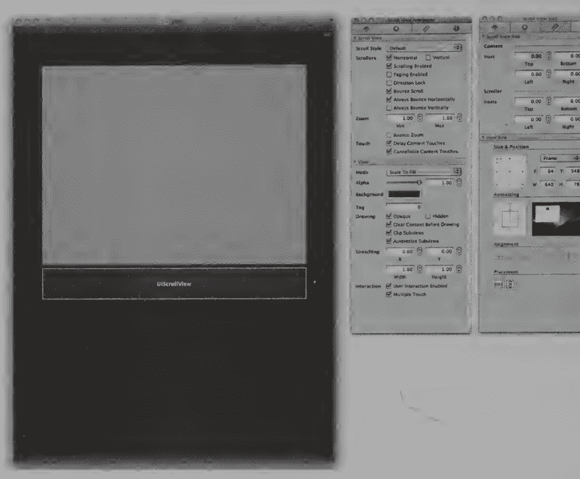

让我们解码 `movieDurationAvailable:` 方法中的代码并添加以下代码：

```objc
// movieplayer/MoviePlayer4/Classes/MoviePlayerViewController.m
-(void)movieDurationAvailable:(NSNotification*)notification {
    float duration = [self.player duration];
    [[NSNotificationCenter defaultCenter]
        addObserver:self
        selector:@selector(playerThumbnailImageRequestDidFinish:)
        name:MPMovieThumbnailImageRequestDidFinishNotification
        object:nil];
    NSMutableArray *times = [[NSMutableArray alloc] init];
    for(int i = 0; i < 20; i++) {
        // ... 循环体内容缺失
    }
}
```


```objc
float playbackTime = i * duration/20;

[times addObject:[NSNumber numberWithFloat:playbackTime]];

}

[self.player
    requestThumbnailImagesAtTimes:times
    timeOption:MPMovieTimeOptionExact];
```

## 创建缩略图

在这里，我们首先直接从视频播放器获取视频的时长。⁴ 然后，在为 `MPMoviePlayer` 设置缩略图请求之前，我们确保已经注册了 `MPMoviePlayerThumbnailRequestDidFinishNotification` 通知，将任何此类通知重定向到 `playerThumbnailRequestDidFinish:` 方法，该方法我们将在稍后编写。

现在是时候设置缩略图请求了。记得 `requestThumbnailImagesAtTimes:` 方法接收一个我们想要获取缩略图的时间数组。由于我们的目标是创建 20 个缩略图，我们创建了一个 `NSMutableArray` 并迭代 20 次，每次根据分成 20 份的时长计算一个偏移量。然后我们使用数组调用 `requestThumbnailImagesAtTimes:`，并使用 `MPMovieTimeOptionExact` 时间选项表示我们希望缩略图尽可能接近时间码（用效率换取准确性）。因此，总结一下，我们等待播放器的元数据可用，并在此我们注册了接收缩略图通知，同时还获取了特定的异步请求，以从播放器视图创建 20 个缩略图。现在我们需要编写 `playerThumbnailRequestDidFinish:` 方法来在缩略图生成时对其进行处理。

## 处理缩略图

缩略图生成会产生一个通知，其中 `userInfo` 字典中包含两个我们感兴趣的项目：`MPMoviePlayerThumbnailKey` 的值是一个带有缩略图的 `NSNumber` 对象，而 `MPMoviePlayerThumbnailImageKey` 的值是缩略图本身。在代码中，我们检索这两个对象并使用辅助方法 `makeThumbnailImageViewFromImage:andTimeCode:` 创建一个图像，然后将其添加到 scroll view 中。

```objc
movieplayer/MoviePlayer4/Classes/MPMoviePlayerViewController.m
```

```objc
- (void)playerThumbnailRequestDidFinish:(NSNotification*)notification {

    NSDictionary *userInfo = [notification userInfo];

    NSNumber *timecode =
        [userInfo objectForKey:MPMoviePlayerThumbnailKey];

    UIImage *image =
        [userInfo objectForKey:MPMoviePlayerThumbnailImageKey];

}
```

- 4. 记得我们也可以从通知中检索播放器对象，就像我们在 132 页的代码中做的那样。

```objc
ImageViewWithTime *imageView =
    [self makeThumbnailImageViewFromImage:image andTimeCode:timecode];
```

```objc
[thumbnailScrollView addSubview:imageView];
```

你会注意到 `makeThumbnailImageViewFromImage:andTimeCode:` 方法返回的是一个 `ImageViewWithTime` 对象而不是标准的 `UIImageView`。这些类的唯一区别在于 `ImageViewWithTime` 有一个名为 `timecode` 的额外属性，用于将时间码直接与缩略图图像视图关联；正如你将要看到的，我们将在用户触碰缩略图时使用它。`makeThumbnailImageViewFromImage:andTimeCode:` 还处理了在滚动视图的帧（frame）中设置合适的位置，以便将其放置在滚动视图内。此时，你已经准备好再次构建并运行代码了。这一次，触碰缩略图将直接带你相应的视频内容（你可以在下一页的图 7.5 中看到我们的测试）。


```objc
(void)playerThumbnailRequestDidFinish:(NSNotification*)notification {

    NSDictionary *userInfo = [notification userInfo];

    NSNumber *timecode =
        [userInfo objectForKey:MPMoviePlayerThumbnailKey];

    UIImage *image =
        [userInfo objectForKey:MPMoviePlayerThumbnailImageKey];

}
```

```objc
ImageViewWithTime *imageView =
    [self makeThumbnailImageViewFromImage:image andTimeCode:timecode];
```

```objc
[thumbnailScrollView addSubview:imageView];
```

```objc
UITapGestureRecognizer *tapRecognizer =
    [[UITapGestureRecognizer alloc] initWithTarget:self action:@selector(handleTapFrom:)];

[tapRecognizer setNumberOfTapsRequired:1];
```

```objc
[imageView addGestureRecognizer:tapRecognizer];

[tapRecognizer release];
```

```objc
movieplayer/MoviePlayer4/Classes/MoviePlayerViewController.m

(void)handleTapFrom:(UIGestureRecognizer *)recognizer {

    ImageViewWithTime *imageView = (ImageViewWithTime *)recognizer.view;

    self.player.currentPlaybackTime = [imageView time floatValue];

}
```

`handleTapFrom:` 方法首先获取我们上的手势识别器（滚动视图中的一个图像视图），并将播放器的 `currentPlaybackTime` 设置为 `ImageViewWithTime` 存储的时间码。这将重置播放到时间码所在的视频内容。

## 7.6 展望

在本章中，你学习了基础：实例化 `MPMoviePlayerController` 并为视频渲染提供视图，检查视频播放属性，创建播放器状态通知的观察者，生成视频缩略图，甚至创建了一个简单的播放列表。

在下一章中，我们将进一步学习如何添加叠加在视频之上的视图，创建自定义播放控件，甚至查看全屏视频。最后，在之后的章节中，我们将学习流媒体视频内容。

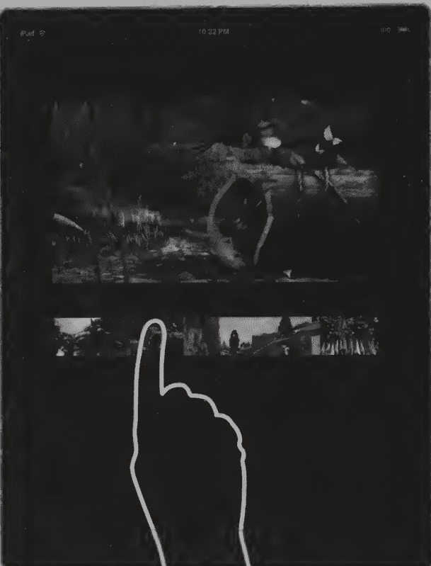

图 7.5：带有视频播放器的缩略图视图

# 第8 章

# 高级视频播放器

在花费了整个章节研究 `MPMoviePlayerController` 之后，你现在掌握了许多关于控制播放器、从其获取状态信息以及在状态更改时接收通知的知识。你还知道如何为存储在设备本地的视频内容生成缩略图。

在本章中，我们将更进一步，通过为播放器添加交互性：首先是实现覆盖在视频之上的基于时间的消息，然后创建一套自定义的播放控制控件。随后，我们将通过探索全屏视频的处理来添加一些最后的润饰工作。

## 8.1 视频弹幕 (Video Shoutouts)

`MPMoviePlayerController` 的视图不仅可以播放内容。尽管你应该谨慎地处理此视图并且不要直接修改它的任何属性，但你可以添加自己的子视图（subviews），这为我们提供了在视频上层层内容的方法。

在本节中，我们将利用此功能创建一个简单的弹幕系统，允许我们在播放过程中的特定时间点显示视觉提示（callouts）——如果你见过 VH-1 风格的“弹出式”视频，你就知道我们要去哪里了（请查看下一页的图 8.1 预览）。为了这一目标，我们在 Movie5 项目中放置了一个 `CommentView` 类，它显示了一个思想气泡风格的图形，并配有透明度阴影和文本覆盖（如果你对代码感兴趣，可以尽管查看它，但它与我们这里的讨论稍微有点离题）：

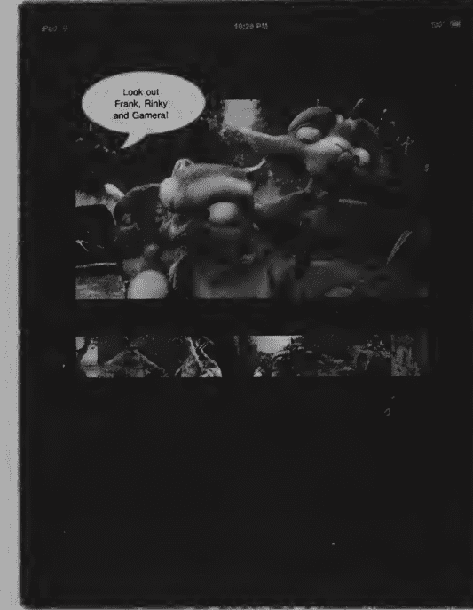

在开始编写代码之前，请记住，我们的目标是演示如何向视频添加子视图，而不是实现一套维护弹幕文本和时间的复杂系统。事实上，我们关于弹幕的模型和逻辑可能被认为简单得令人尴尬。尽管如此简单，但让我们来看看这个模型：

```objc
movieplayer/MoviePlayer6/Classes/MovieViewController.m

-(void)viewDidLoad {

    [super viewDidLoad];

    shoutOutTexts = [[NSArray
        arrayWithObjects:
            @"This film rendered using\ncloud computing",
            @"Look out Frank, Rinky\nand Gamera!",
            nil) retain];
```

## 视频弹幕

```objc
shoutOutTimes = [[NSArray arrayWithObjects:[[NSNumber alloc] initWithInt:2],[[NSNumber alloc] initWithInt:325],nil] retain];

position = 0;

// rest的 viewDidLoad 放在这里

}
```

为了存储弹幕，我们使用了两个简单的数组：一个用于存储弹幕应该出现的时间码，另一个用于存储弹幕的文本。例如，我们可能会存储 "Hello Ma!" 和 17，以表示文本 "Hello Ma" 在视频播放 17 秒时显示。注意，我们还假设时间是有顺序的，较晚的时间在较早的时间之后。我们还添加了一个整数实例变量 `position`，我们设置它来跟踪此处（这里稍后我们会获取它），以跟踪当前的弹幕。

现在，为了知道何时显示弹幕，我们需要监控视频播放。为了做到这一点，让我们使用 `NSTimer` 类来设置每隔一段时间调用一次方法；在 `viewDidLoad` 方法中添加此代码，紧接弹幕数组实例化下方：

```objc
moviePlayer/moviePlayer5/Classes/MovieViewController.m

[NSTimer
    scheduledTimerWithTimeInterval:1.0f
    target:self
    selector:@selector(checkShoutouts)
    userInfo:nil
    repeats:YES];
```

我们正在使用 `NSTimer` 在一秒后调度方法调用，目标是类中的 `checkShoutouts` 方法。此外，我们希望这个定时器每秒重复执行该方法调用。

现在我们需要编写由定时器调用的 `checkShoutouts` 方法。它的工作原理如下：我们将维护一个实例变量 `position`，作为下一个要显示的弹幕的指针。每当定时器调用 `checkShoutouts` 方法时，我们将把播放器的当前 `currentPlaybackTime` 与当前弹幕时间进行比较，如果 `currentPlaybackTime` 等于或小于当前弹幕时间，我们将显示并增加 `position`。我们将时间比较逻辑将其抽象成一个名为 `timeForNextShoutout:` 的方法：

```objc
moviePlayer/Classes/MoviePlayerViewController.m

-(BOOL)isTimeForNextShoutout {

    int count = [shoutOutTimes count];

    if (position < count) {

        int timecode = [[shoutOutTimes objectAtIndex:position] intValue];

        if (self.player.currentPlaybackTime >= timecode) {

            return YES;

        }

    }

    return NO;

}
```

让我们使用这个方法来编写 `checkShoutouts`。首先，我们需要检查是否有新的弹幕要显示，如果是，我们将显示：

```objc
moviePlayer/Classes/MoviePlayerViewController.m

-(void)checkShoutouts:(NSTimer *)timer {

    if ([self isTimeForNextShoutout]) {

        CommentView *commentView = [[CommentView alloc] initWithText:shoutOutTexts[position]];

        [self.player.view addSubview:commentView];

        position++;

    }

}
```

等等，让我重新对齐逻辑。根据代码片段，它是这样的：

```objc
moviePlayer/Classes/MoviePlayerViewController.m

-(void)checkShoutouts {

    if ([self isTimeForNextShoutout]) {

        // 这里的逻辑

    }

}
```

实际上，为了操作，我们将移除：

```objc
moviePlayer/MoviePlayer5/MovieViewController.m

-(void)removeView:(NSTimer *)timer {

    UIView *view = self.commentView;

    [view removeFromSuperview];

}
```


这就完成了我们对弹幕的处理。编译、运行并享受吧。注意，我们还提供了一个自定义的版本，而不是 Apple 的默认外观。

# 控件

## 8.2 实现播放控件

到此为止，我们已经掌握了一些东西：从播放器获取状态信息、接收通知以及向视频添加子视图。现在你将采取这些知识，并利用它们来构建你自己的控件。为什么你想这么做呢？嗯，让我们看看 Apple 内置的：


Apple 提供了一套完善的播放控件实现，包括播放/暂停按钮、用于快速进的滑动条、时间显示以及全屏按钮。但是，难道在某些时候，你可能想为用户提供额外的功能（例如社交网络选项）或改进控件的外观吗？

我们是这样认为的，为了这一目标，我们将通过创建以抬头显示形式呈现的播放控件来探索这一空间。

## 音量控制

你可能注意到，我们在设计中省略了音量控制（正如 Apple 在其设计中那样），考虑到用户通常在播放控件中期待音量条，这可能看起来很奇怪。尽管如此，Apple 没有提供直接控制 `MPMovieController` 音量的方法，并期望用户通过设备上的物理音量按钮调整音量。

这是我们设想的想法：

[此处应有图片，但根据上下文描述，此处显示逻辑占位符]


对于初版方案来说，这是一种改进，不是吗？现在，我们还没有疯狂进行品牌化或从根本上改变控件——这将留给你和你的应用程序处理——但我们实现了一种更具沉浸感的控件，它是半透明的并位于视频正中央。我们提供了所有 Apple 提供的基础功能，并暗示了一些可以添加的新功能（例如代表共享能力的思想气泡，我们不会实现它，但它正在等待你）。

创建新播放控件的视觉稿（comps）相当简单，但实现一个功能像 Apple 那样良好的播放控件需要一些细致的工作。让我们思考一下什么样的播放控制需要正常工作功能。我们需要知道播放器的状态。它正在播放吗？暂停了吗？用户是否正在视频内拖动？播放位置在哪里？我们是否调整了时间和滑块的播放位置？用户是否正尝试改变播放器的状态（例如，从播放到暂停）？用户是否想进入全屏？当播放到达视频结束时我们该怎么办？显然有很多细节，而且很清楚我们的实现可能会变得非常复杂。考虑到我们已经学到的许多工具，我们可以保持设计相当小巧且简单。在接下来的几页中，我们将深入研究这些细节中的每一个，并确保一切都能正常工作。

## 创建视图

我们将从构建播放控制开始，将其作为一个独立的视图和控制器，然后将其集成到电影播放器的视频视图中。首先打开 `movieplayer/MoviePlayer` 项目，你会注意到我们从上一个项目中提供了一些视图项：Images 组中的一些新图像，以及一个名为 `PlaybackView-Controller.xib` 的 nib 文件。双击该 nib 文件在 Interface Builder 中打开它，你将看到以下界面：


如果你参考刚才查看的播放控制组件，你会发现它们看起来有点不同：首先，滑块看起来像 Apple 传统的滑块，而不是我们自定义的——这没关系；稍后，我们将通过代码实现我们想要的样式。界面看起来也是实心灰色，而我们想要的是一个精致的透明控件。这也可以接受，因为 nib 位于实心白色背景上，让人很难看出它实际上是透明的。一旦我们将此界面放置在视频上方，你将看到背景是半透明的（有关半透明视图的更多信息，请参阅第 153 页的侧边栏）。

花几分钟探索一下这个 nib；这里有很多内容。查看我们添加的视图以及使用的相关文本和图像。例如，播放/暂停按钮有两个状态，每个状态都有一个对应的图像。你会发现在 Interface Builder 中使用列表视图来查看我们做的工作非常有帮助。你应该看到这个：


快速扫览后，你应该能看到作为所有控件视觉容器的背景图像。我们有几个 `UIView`；有些在界面中作为简单的文本标签，另一些将用于显示实时信息，如时间和状态。你还会看到一个 `UISlider`；这是我们用于拖动视频视频（也称为滚动条或进度条）的控件。

接下来，你会发现几个按钮：我们已经提到的播放/暂停按钮，它可以在播放和暂停状态之间切换；全屏按钮将把显示进入视频的全屏播放（以两个思考气泡的形式呈现）；以及一个分享按钮（我们将它留作供你可以添加到自己的播放控制中的一个东西（我们的目的不是实现该功能，而是为了展示你可以扩展基本控件来添加新功能）。

所以，我们已经在 Interface Builder 中为你完成了所有的设计工作；现在该是赋予它灵魂的真正工作了——为了做到这一点，让我们创建一些 `IBAction` 和 `IBOutlet`，然后将控制器连接到此视图。

## 创建控制器

回到 Xcode，为该 nib 创建一个视图控制器——选择 `File > New File...` 并创建一个 `UITableViewCell` 子类。你需要确保取消勾选 "XIB for user interface" 和 "UITViewController subclass"。将控制器命名为 `PlaybackViewController.m` 并点击 Finish。然后打开 `PlaybackViewController.h`，添加以下 `IBOutlet`（为每个我们需要在控制器代码中访问的视图添加一个）：

```
movieplayer/MoviePlayer6/Classes/PlaybackViewController.h

@interface PlaybackViewController : UIViewController {

    IBOutlet UISlider *playbackSlider;

    IBOutlet UIButton *playPauseButton;

    IBOutlet UIButton *fullScreenButton;

    IBOutlet UILabel *statusLabel;

    IBOutlet UILabel *timeLabel;

}

}
```

返回 Interface Builder，并将每个 outlet 连接到 nib 文件中相应的视图。你还想要点击 File's Owner 并在 Identity 选项卡上将其类设置为 `PlaybackViewController`。

为了获得一点即时的满足感，让我们将此视图连接到我们的电影播放器，通过运行它让代码跑起来，然后我们回来开始实现它的行为。打开 `MovieViewController.m`，并在 `viewDidLoad` 方法的底部添加代码：

```
movieplayer/MoviePlayerStart/Classes/MoviePlayerViewController.m

self.player.controlStyle = MPMovieControlStyleNone;
PlaybackController *controls =
    [[PlaybackController alloc] init];
    CGRect rect = self.view.frame;
    rect.origin.y = 170;
    rect.origin.x = 90;
    controls.view.frame = rect;
    [self.player.view addSubview:controls];
```

让我们逐步分析。首先，我们设置了电影播放器的 `controlStyle` 属性，它控制其内置控件的样式。我们将此属性设置为 `MPovieControlStyleNone`，这实际上移除了内置控件。如果我们不这样做，就会向用户展示两组控件。接下来，我们实例化播放控制器，然后将其添加到视图。编译并运行这段代码；你应该看到播放控件位于（但还没有功能）。

## 8.3 实现控件

让我们从让播放/暂停按钮工作开始。为了这一点，我们首先需要给我们的播放控件一个播放器的引用——所以，在播放控制头文件中添加一个新属性：

```
movieplayer/MoviePlayerStart/Classes/PlaybackViewController.h
MPoviePlayerController *player;
```

在 `PlaybackViewController.m` 实现中添加一个新的初始化方法，名为 `initWithPlayer:`：

```
movieplayer/MoviePlayerStart/Classes/PlaybackViewController.m
-(id)initWithPlayer:(MPoviePlayerController *)thePlayer {
    self = [super init];
    if (nil != self) {
        player = thePlayer;
    }
    return self;
}
```

在这里我们完成了调用父类的初始化方法并将播放器赋值给属性。现在你需要更新 `MovieViewController.m` 中的 `viewDidLoad` 方法，替换对 `initWithPlayer:` 的调用并传递 `self.player`：

```
PlaybackController *controls =
    [[PlaybackController alloc] initWithPlayer:self.player];
```

现在我们准备好编写播放/暂停按钮的实际代码了。由于这是一个 `UIButton`，我们需要一个在按钮被触摸时调用的 action；在 `PlaybackViewController.m` 实现中添加名为 `handlePlayPause:` 的 action：

```
movieplayer/MoviePlayerStart/Classes/PlaybackViewController.m
-(IBAction)handlePlayPause:(id)sender {
    UIButton *button = (UIButton *)sender;
    if (button.selected) {
        button.selected = NO;
        [player play];
    } else {
        button.selected = YES;
        [player pause];
    }
}
```

记得我们在 Interface Builder 中探索界面时，按钮有两个状态，一个播放状态（未选中状态）和一个暂停状态（选中状态）。如果按钮处于选中状态，说明它是暂停的，所以我们将状态更改为未选中并让播放器播放视频。同样，如果按钮处于未选中状态，我们将状态设置为选中，然后让播放器暂停视频。

现在你需要将按钮连接到这个 action，所以，在 Interface Builder 中，通过拖动到 File's Owner 将 UIButton 连接到 `handlePlayPause:` 方法。就是这样；编译并运行代码，尝试播放/暂停按钮。

## 8.4 管理回放时间

我们的界面中有几个部分涉及到时间：时间标签（我们打算用它来同时显示当前时间和视频的总时长）以及滑块（slider，它会随着视频的播放而更新，并允许用户拖动来查看视频）。让我们先从编写更新时间标签的代码开始，这与你在上一章中编写的代码非常相似。

如果你还记得的话，我们可以设置一个 `MPMovieDurationAvailableNotification` 监听，然后在播放器知道视频时长后开始跟踪视频的时间（稍后我们也会用它来更新滑块）。要实现此此操作，请打开 `ViewController.m` 并在 `initWithPlayer` 方法中添加代码：

```
movieplayer/MoviePlayerStart/Classes/ViewController.m
-(id)initWithPlayer:(MPPlayerController *)thePlayer {
    self = [super init];
    if (nil != self) {
        player = thePlayer;
        [NSNotificationCenter defaultCenter]
            addObserver:self
            selector:@selector(movieDurationAvailable:)
            name:MPMovieDurationAvailableNotification
            object:nil];
    }
    return self;
}
```

在这里，我们设置了通知，当播放器知道视频时长时调用 `movieDurationAvailable:`。让我们来编写 `movieDurationAvailable:` 方法：

```
movieplayer/MoviePlayerStart/Classes/ViewController.m
-(void)movieDurationAvailable:(NSNotification*)notification {
    if (playbackTimer == nil) {
        playbackTimer = [NSTimer scheduledTimerWithTimeInterval:1.0
                          target:self
                          selector:@selector(updatePlaybackTime:)
                          userInfo:nil
                          repeats:YES];
    }
}
```

这看起来很熟悉。我们将设置一个计时器，每秒调用一次 `updatePlaybackTime:` 方法，以此跟踪视频播放的时间。将此更新方法输入控制器文件，让我们来看下 `updatePlaybackTime:` 方法：

```
movieplayer/MoviePlayerStart/Classes/ViewController.m
-(void)updatePlaybackTime:(NSTimer*)timer {
    float playbackTime = player.currentPlaybackTime;
    float duration = player.duration;
    timeLabel.text = [NSString stringWithFormat:
                        "%.1f of %.f secs",
                        playbackTime,
                        duration];
}
```

这看起来也很熟悉：我们从播放器获取时长和当前播放时间，对其进行格式化，并设置 `timeLabel` 输出的文本。

顺便如此，我们再利用同样熟悉的 `MPMPlayerPlaybackStateDidChangeNotification` 为界面添加一些状态信息。在 `initWithPlayer:` 方法中这样设置通知：

```
movieplayer/MoviePlayerStart/Classes/ViewController.m
[[NSNotificationCenter defaultCenter] 
 addObserver:self
 selector:@selector(playerPlaybackStateDidChange:)
 name:MPMPlayerPlaybackStateDidChangeNotification
 object:nil];
```

现在我们来定义 `playerPlaybackStateDidChange:` 方法：


# 第 8 章：高级视频播放器

## 8.5 实现视频进度滑块

我们快要完成了。剩下的只需要实现滑块和全屏按钮了。正如你预期的那样，滑块是实现中最复杂的部分，因为我们必须跟踪它的进度并适当进行更新。实际上，我们的首要任务是改变它的外观，以实现我们想要的自定义效果。让我们从这里开始。

在播放控制器的 `viewLoad` 方法中添加以下代码：

```objc
movieplayer/MoviePlayer/Classes/PlaybackViewController.m
[playbackSlider
setThumbImage:[UIImageViewNamed:@"thumb.png"]
forState:UIControlStateNormal];
UIImage *stretchLeftTrack = [[UIImageViewNamed:@"leftslider.png"]]
stretchableImageWithLeftCapWidth:5.0
topHeight:0.0];
UIImage *stretchRightTrack = [[UIImageViewNamed:@"rightslider.png"]]
stretchableImageWithLeftCapWidth:5.0
topHeight:0.0];
[playbackSlider setMinimumTrack:stretchLeftTrack
forState:UIControlStateNormal];
[playbackSlider setMaximumTrack:stretchRightTrack
forState:UIControlStateNormal];
```

虽然这段代码看起来有点复杂，但它只是指定了几个图像。这段代码只是为了给滑块提供不同的外观，让它能够功能。具体来说，我们提供了三个图像：一个用于滑块（thumb），另外两个代表滑块左右两侧的轨道。此时，你可以编译、运行并看到新滑块的作用（尽管它对控件还没有产生影响）。顺便如此，我们需要处理一些清理工作。为了让滑块正常工作，我们需要知道最小值和最大值。我们知道最小值是零，但对于最大值，我们需要视频的总时长。更好的设置位置不过于我们刚刚写的 `movieDurationAvailable:` 方法了。

```objc
movieplayer/MoviePlayerStart/Classes/ViewController.m
(void)movieDurationAvailable:(NSNotification*)notification {
    if (playbackTimer == nil) {
        playbackTimer = [NSTimer scheduledTimerWithTimeInterval:1.0
            target:self
            selector:@selector(updatePlaybackTime:)
            userInfo:nil
            repeats:YES];
    }
    playbackSlider.minimumValue = 0;
    playbackSlider.maxValue = [player duration];
}
```

这种效果应该良好——只要视频加载，滑块的最小值和最大值就会被设置。现在我们有了范围，我们需要滑块在视频播放时跟踪进度。由于我们已经有一个跟踪播放器进度的方法（`updatePlaybackTime:` 方法），我们只需在调用它时更新滑块的值即可：

```objc
movieplayer/MoviePlayerStart/Classes/PlaybackViewController.m
(void)updatePlaybackTime:(NSTimer*)timer {
    float playbackTime = player.currentPlaybackTime;
    float duration = player.duration;
    timeLabel.text = [NSString stringWithFormat:"%.1f of %.f secs", playbackTime, duration];
    playbackSlider.value = playbackTime;
}
```

现在是时候再次编译并运行应用程序了。此时，你应该看到滑块随着视频播放而移动，但你仍然无法通过滑块调整视频的位置。现在是实现功能的时候了。为了做到，我们必须返回 Interface Builder 并连接两个额外的 Action。在播放控制头文件中输入 Action 的声明，然后打开播放控制 nib。以下是声明内容：

```objc
moviePlayer/MoviePlayerStart/Classes/PlayerViewController.h
-(IBAction)playbackSliderMoved:(UISider *)sender;
- (IBAction)playbackSliderDone:(UISider *)sender;
```

要进行连接，选择 nib 中的 `UISider` 视图并打开检查器的 Connections 标签。你需要从此标签向 File's Owner 创建两个连接：将 `Touch Inside` 事件连接到 `playbackSliderDone` 方法，将 `Value Changed` 事件连接到 `playbackSliderMoved` 方法。你的检查器标签看起来应该是这样的：


前者事件在用户完成滑块操作并抬手指时发生。后者事件在用户在滑块内左右滑动手指时发生。现在我们将开始实现这些事件的行为，从 `playbackSliderMoved` 方法开始。

```objc
movieplayer/moviePlayerStart/Classes/PlaybackViewController.m
- (IBAction)playbackSliderMoved:(UIS *)sender {
    if (player.playbackState != MPMPlaybackStatePaused) {
        [player pause];
    }
    player.currentPlaybackTime = sender.value;

    timeLabel.text = [NSString stringWithFormat:
        "%.1f of %.f secs",
        sender.value, player.duration];

    sliding = YES;
}
```

如果播放器没有处于暂停状态，我们就将其暂停。如果我们让播放器在这种状态下继续播放，视频和滑块之间就会陷入一场“拔锯战”。接下来，我们将当前播放器的 `PlaybackTime` 设置为滑块的值，该值反映了视频播放器的实际播放进度。然后，我们更新了新的布尔属性 `sliding`，用于跟踪我们当前是否正在使用滑块（别忘记在 `PlaybackViewController` 的头文件中添加这个实例变量）。稍后我们将看到为什么需要这个布尔值来跟踪滑块状态。

在继续之前，让我们回顾一下：当你第一次触摸滑块时，视频首先会被暂停，然后随着我们在滑块的最小值（0）和最大值（视频时长）之间滑动，视频的播放位置也会随之改变。在此期间，我们会更新控件的时间标签，并确保一旦开始使用滑块，实例变量 `sliding` 被设置为 `YES`。让我们处理一下用户手指离开滑块时发生的情况：

```objc
movieplayer/moviePlayerStart/Classes/PlaybackViewController.m
- (IBAction)playbackSliderDone:(UIS *)sender {
    sliding = NO;

    if (player.playbackState != MPMPlaybackStatePlaying) {
        [player play];
    }
}
```

事实证明，这个方法非常简单。我们只需要在用户抬起手指时，将 `sliding` 属性设置为 `NO`，并通过向播放器发送 `play` 消息来重启暂停的视频。

就是这样，试一下吧（稍微提一下，滑块可以工作，但并不完全如我们想要的那样）；

## 滑块的另一个问题

如果你玩过滑块，可能会注意到另一个问题：有时当你抬起手指时，视频仍保持暂停状态且不会重新播放。你能想到这是为什么会发生这种情况吗？这会不会是 `UIS` 的一个 Bug 没有产生 `Touch Up Inside` 事件？别急。先看看其他的 `UIS` 事件，看看你是否能发现潜在的问题（并找到解决方案）。

好了，你知道我们放那个布尔值是有原因的。你可能注意到滑块有一个有点奇怪的行为：当你沿着滑块范围滑动时，每秒钟滑块的位置都会跳回上一个位置。为什么呢？因为 `updatePlaybackTime:` 方法每秒都会被调用一次，而每当调用它时，它都会更新滑块的值。在我们正在滑动滑块的情况下，我们不希望这种情况发生。使用 `sliding` 布尔值，我们现在可以修复这个问题。我们是这样做的：

```objc
movieplayer/MoviePlayerStart/Classes/PlayerViewController.m
- (void)updatePlaybackTime:(NSTimer*)timer {
  if (sliding) {
    float playbackTime = player.currentPlaybackTime;
    float duration = player.duration;

    timeLabel.text = [NSString stringWithFormat:"%.1f secs",
    playbackTime, duration];

    playbackSlider.value = playbackTime;
  }
}
```

滑块的实现到此结束。编译并对其进行充分的测试。现在是时候添加一些润色了。

## 8.6 让播放控制动态化

我们已经几乎实现了播放控制的所有基本功能，现在是时候集中精力在控件如何显示的细节上了（而不是像现在这样一直显示在屏幕上）。我们希望的行为是：当用户在视频视图边界内点击时，播放控制控件将逐渐淡入并保持可见，直到控件四秒内未被触摸，然后它们应该淡出，再次完全显示视频。

我们的首要任务是修改实现，使用户在应用程序启动时看不到控制控件。为了实现这一点，我们只需通过将播放控制器视图的 `alpha` 设置为 0 来将其透明度设置为透明（这将使所有子视图变为透明）。这在 `PlaybackViewController` 的 `viewDidLoad` 方法中很容易实现；你可以在该方法的末尾添加这一行：

```objc
self.view.alpha = 0.0;
```

此时尝试运行你的应用程序——你会发现播放控制控件消失了。别担心，我们会让它们回来的。

从这里开始，事情变得有点有趣了。你必须决定何时应该显示控件，在它们显示时通过动画赋予它们一点光彩，然后仔细管理它们何时消失。做得好，这将为你的播放控制控件带来专业感；如果做错了，你的用户会非常沮丧。

我们需要处理的任务任务是感知用户在视图边界内的点击。通过将 `MPMViewController` 的视图视为一个不可的透明视图（除了添加子视图外），我们将创建一个名为 `touchView` 的 `UIView`，并放在视频上方。

```objc
movieplayer/MoviePlayerStart/Classes/PlaybackViewController.m
UIView *touchView = [[UIView alloc] init];
touchView.frame = self.view.frame;
[self.view addSubview:touchView];
```

现在为该视图添加一个简单的手势：

```objc
movieplayer/MoviePlayerStart/Classes/PlaybackViewController.m
UITapGestureRecognizer *tapRecognizer = [[UITapGestureRecognizer alloc] initWithTarget:self action:selector(handleTap:)];
[touchView addGestureRecognizer:tapRecognizer];
```

在这里，我们使用 `handleTap:` 作为动作创建了一个手势。在它们显示时通过动画给它们一点光彩：

```objc
movieplayer/MoviePlayerStart/Classes/PlaybackViewController.m
- (void)handleTap:(UITestureRecognizer *)recognizer {
    [UIView beginAnimations];
    [UIView setAnimationDuration:0.5];
    self.view.alpha = 1.0;
    [UIView commitAnimations];
}
```

等等，我们需要控件自动消失。我们需要设置一个四秒后触发的定时器。为了实现这一点，我们添加以下方法：

```objc
movieplayer/MoviePlayerStart/Classes/PlaybackViewController.m
-(void)setControlsTimer {
  if (controlsTimer) {
    [controlsTimer invalidate];
    [controlsTimer release];
  }
  controlsTimer = nil;

  controlsTimer = [NSTimer timerWithInterval:4.0
                               target:self
                               action:selector(handleControlsTimer:)
                               userInfo:nil
                               repeats:NO];
  [[NSRunLoop mainLoop] addTimer:controlsTimer];
}
```

以及 `handleControlsTimer:` 方法：

```objc
movieplayer/MoviePlayerStart/Classes/PlaybackViewController.m
(void)handleControlsTimer:(NSTimer *)timer {
    [self removeControls];
    [controlsTimer release];
    controlsTimer = nil;
}
```

`removeControls:` 方法简单地按照最初显示的方式隐藏播放控件，只是顺序反过来：在动画块中将 `alpha` 设置回零：

```objc
movieplayer/MoviePlayerStart/Classes/PlaybackViewController.m
-(void)removeControls {
    [UIView beginAnimations];
    [UIView setAnimationDuration:1.5];
    self.view.alpha = 0.0;
    [UIView commitAnimations];
}
```

现在，我们需要确保在用户触摸屏幕时控件会再次出现。可以通过在触摸播放/暂停按钮或滑块时重置定时器来实现：

```objc
[setControlsTimer];
```

这产生了任何时候重置定时器的效果，为我们提供了良好的淡入和淡出效果。

控件会在四秒后消失（试一试）。你会如何修改实现，以便在按下按钮（或另一个按钮）时让控件保持在屏幕上呢？思考一下，在我们看解决方案之前，尝试一下：


## 代码示例

```objc
movieplayer/MoviePlayerFull/Classes/PlaybackViewController.m
-(IBAction)handlePlayAndPauseButton:(id)sender {
    UIButton *button = (UIButton *)sender;
    if (button.selected) {
        button.selected = NO;
        [player play];
        [self setControlsTimer];
    } else {
        button.selected = YES;
        [player pause];
        [controlsTimer invalidate];
        [controlsTimer release];
        controlsTimer = nil;
    }
}
```

## 8.7 处理全屏

应用内视频在 iPad 上非常棒，你觉得呢？但在全屏观看时效果会更好；现在不是时候让那个全屏按钮工作了吗？要实现这一点，请在你的 `PlaybackViewController.h` 头文件中添加一个名为 `fullscreenButton` 的 `IBAction`，然后使用 Interface（界面）将播放控制器中的全屏按钮连接到此操作。一旦完成这些，进入全屏就如调用 `setFullScreenAnimated` 方法一样简单，如下：

```objc
movieplayer/MoviePlayerFull/Classes/PlaybackViewController.m
-(IBAction)handleFullScreen {
    [player setFullScreen:YES animated];
}
```

如果你跳前前面编译并运行了这段代码，你可能注意到一个小问题：一旦进入全屏，就没有播放器控件了。为什么呢？我们将播放器控件添加为应用内视图的子视图；当播放器进入全屏时，它会创建另一个视图来实现这一点。将自定义控件移动到此视图需要访问 iPad 的 `mainWindow`，这是我们将在第 10 章“在另一个屏幕上显示内容”中做的。与其走那条路，让我们充分探索围绕全屏的 API。

## 总结

并使用通知在视频全屏时重新启用默认控件。

让我们首先在 `PlaybackViewController.m` 文件的 `initWithPlayer` 方法中注册接收两个通知；将此代码添加到方法的末尾：

```objc
moviePlayer/MoviePlayerFull/Classes/PlaybackViewController.m
[[NSNotificationCenter defaultCenter]
    addObserver:self
    selector:@selector(playerWillExitFullscreen:)
    name:MPMoviePlayerWillExitFullscreenNotification
    object:nil];
[[NSNotificationCenter defaultCenter]
    addObserver:self
    selector:@selector(playerDidEnterFullscreen:)
    name:MPMoviePlayerDidEnterFullscreenNotification
    object:nil];
```

现在让我们定义 `playerDidEnterFullscreen:` 方法；在此方法中，我们需要将播放器控件样式设置为如 `MPCPlayerStyleDefault` 这样的样式，它包含了控件和退出全屏的方法：

```objc
moviePlayer/MoviePlayerFull/Classes/PlaybackViewController.m
- (void)playerDidEnterFullscreen:(NSNotification*)notification {
    player.controlStyle = MPCPlayerStyleDefault;
}
```

然而，当我们退出全屏时，我们不希望保留自定义控件和默认控件样式，因为我们会得到两组冲突的控件。让我们通过另一个处理的通知来设置控件样式：

```objc
moviePlayer/MoviePlayerFull/Classes/PlaybackViewController.m
- (void)playerWillExitFullscreen:(NSNotification*)notification {
    player.controlStyle = MPCPlayerStyleNone;
}
```

编译并运行，你就应该拥有一个功能全的全屏观看体验了。

## 8.8 总结

回顾过去的两章，我们涵盖了大量内容。你现在已经能够创建自己的复杂的视频观看体验，或者以高度集成和交互的方式将视频包含在你的应用程序中。

然而，我们还缺少一个部分：处理从互联网流式传输的视频，这正是我们下一章要解决的问题。

## 第 9 章

## Apple 的 HTTP 媒体传输 (HLS)

正如你在前两章中所看到的，从应用程序包（bundle）播放视频是简单的（当然，某些应用程序适合嵌入你的视频内容）；封装的视频还让我们专注于创建出色的视频体验，而无必担心网络连接、服务器、延迟和带宽等问题。然而，对于许多应用程序（如果不是大多数），你将需要通过网络向 iPad 流传输视频。

在本章中，我们将探索 iPad 视频流——你为什么需要它、它意味着什么、它与本地播放视频有何不同以及如何实现。你将能够播放在前两章中学到的几乎所有内容（少数例外除），我们还将添加一些你将在网络环境中创建视频体验所需的额外知识。

## 9.1 渐进式视频 vs 流式视频

让我们先从一个常见的困惑开始：渐进式视频 vs 流式视频。对于渐进式交付的视频，你将视频资源放在 Web 服务器上，然后要求客户端通过 HTTP 协议获取它。使用这种方法，媒体播放器本质上是在获取内容的同时下载资源并进行播放（通常以本地缓存文件的形式）。

渐进式下载有其优点：它简单，并且通过将你的视频文件放在任何 Web 服务器上即可工作。它也有缺点：它可能成本高昂（通常你下载的远大于观看次数），而且它没有给你提供调整比特率的方法。此外，如果你的视频超过十分钟或 5MB 数据，你必须使用流传输。原因是什么？流式传输避免了我们刚刚提到的渐进式下载的陷阱，并允许我们根据需要调整比特率。缺点是什么？传统需要私有基础设施和协议。Apple 通过其改进了。

## 9.2 Apple 的 HTTP 媒体传输

Apple 创建了一种基于开放标准的协议，称为 HTTP Live Streaming（简称 HLS）。鉴于 Apple 拥有所有浏览器和 Web 服务器使用的协议，你将能够将视频内容放在任何 Web 服务器上。

### 流式传输的工作原理

大多数流解决方案使用私有协议通过一个或多个 socket 传输你的视频内容。支持这些解决方案通常需要建立和维护大型服务器群（通常托管在内容网络上）。

HLS 使用不同的方法，将你的视频分成许多小片段并存储在传统的 Web 服务器上。客户端播放器使用传统的 HTTP 协议请求并接收这些片段，这些片段被缝合在一起以创建无缝视频播放。

HLS 方法有一些重要的优点：首先，正如我们提到的，视频可以从任何 Web 服务器存储和交付。此外，由于 HTTP 协议的普及，避免了在使用私有协议时在可能遇到的许多潜在网络问题。还有另一个显著优势：由于视频被分成片段，每当播放器需要获取新片段时，它可以根据可用带宽做出决定，并在可用时请求以较高或较低比特率编码的片段，从而提高视频传输的服务质量。

### 视频分割

正如预期的，视频分割引入了一些额外工作，因为它需要将视频制成小块（通常为十秒）供 HLS 使用，此外，为了使用比特率切换，你需要对同一资源执行多次操作（每个你想支持的比特率执行一次）。

视频分割超出了本书的范围；但是，有很多 Apple 工具和资源可以帮助。请查看 HTTP Streaming 概述 [App09a]，它本身包含了指向所有

## 第 9 章 Apple 的 HTTP 直流传输 (HLS)

这是为 HLS 准备视频所需的工具和背景。虽然我们不会详细介绍分片过程，但你确实需要了解 Apple 分片工具的输出内容，以便理解客户端如何从 Web 服务器获取视频。

分片过程如上一页图 9.1 所示——分片器获取视频资源并生成一组 `.ts` 文件（分段）以及一个名为*播放列表*（playlist）的清单文件（请勿与我们在第 121 页第 7 章《电影播放器》实现的播放列表混淆）。HLS 的清单文件被称为 M3U8 文件，这是一个示例：

```
#EXTM3U
#EXT-X-DURATION:10
#EXT-X-MEDIA-SEQUENCE:0
#EXTINF:10, no desc
fileSequence0.ts
#EXTINF:10, no desc
fileSequence1.ts
#EXTINF:10, no desc
fileSequence2.ts
#EXTINF:10, no desc
fileSequence3.ts
...
#EXTINF:1, no desc
fileSequence180.ts
#EXT-X-ENDLIST
```

清单文件的作用是描述从给定视频资源生成的每一个视频分段（直播视频应用中的用法略有不同，那超出了我们这里讨论的范围）。

让我们逐行分析文件。第一行标识文件类型。下一行是目标时长，描述每个分段的长度（在本例中为十秒），第三行提供了用于直播流应用的序列号。接下来，按顺序列出每个分段（为了节省空间，我们省略了 180 个分段中的部分），包括其时长、可选的描述，最后是分段的资源名称。

因此，给定此播放列表，媒体播放器首先检索 `fileSequence0.ts`，然后是 `fileSequence1.ts`，依此类推。播放器本身负责管理何时检索分段以及如何将它们拼接在一起以实现无缝播放的所有计时方面。

现在，像这样的清单文件通常会为我们要支持的每个比特率生成一个。我们需要另一个文件来描述所有可能的的分段（按比特率划分）。该文件看起来如下：

```
#EXTM3U
#EXT-X-STREAM-INF:PROGRAM-ID=1, BANDWIDTH=200000
gear1/prog_index.m3u8
#EXT-X-STREAM-INF:PROGRAM-ID=1, BANDWIDTH=311111
gear2/prog_index.m3u8
#EXT-X-STREAM-INF:PROGRAM-ID=1, BANDWIDTH=484444
gear3/prog_index.m3u8
#EXT-X-STREAM-INF:PROGRAM-ID=1, BANDWIDTH=737777
gear4/prog_index.m3u8
```

此 M3U8 文件列出了四个可能的资源：编码速率为 200Kbps 位于 `gear1/prog_index.m3u8` 清单文件中；另一个为 311Kbps 位于 `gear2/prog_index.m3u8` 文件中，依此类推。当你指向一个播放器文件时，播放器将解析它以确定每个比特率，以便根据可用带宽决定下一步检索哪个资源。请注意，当播放器首次检索内容时，它始终会从第一个列出的清单文件开始，并根据网络状况判断后续的检索。

## 深入学习 HLS

正如你所怀疑的，我们对 HLS 后端的分片和配置仅只是触毛一角，如果你打算认真使用 HLS，会有很多东西要学。话虽如此，如果你想让他们来托管你的 HLS 内容，CDN 和其他供应商会乐意为你承担大部分痛苦。

现在，在对分片有了基本了解后我们将进入本章真正的主题：如何在客户端支持流媒体传输。

## 9.3 创建流媒体播放器

正如你将看到的，考虑到你过去两个章节所做的工作，运行一个流媒体播放器是非常轻而易见的。我们将回到 `MoviePlayer3` 并从那里开始——实际上，我们创建了它的新版本，名为 `MoviePlayer3Streaming`。

你需要对 `MoviePlayerViewController` 文件进行一个小小的更改：找到 `movieURL` 方法，删除其中所有的代码，然后用以下代码替换：

```objc
movieplayer/MoviePlayerStreamed/Classes/MoviePlayerViewController.m
- (NSURL *)movieURL {
    return [NSURL URLWithString:
        "http://devimages.apple.com/iphone/samples/bop/gear1/prog_index.m3u8"];
}
```

在讨论这段新代码之前，请注意，你不再只是创建了一个指向 bundle 内资源的 `NSURL`；相反，你正在创建一个指向托管在 Apple 服务器上的 M3U8 文件的 URL。

进行此更改，编译并运行（确保你已连接网络！）。在经过短暂缓冲后，你应该看到像对面图 9.2 那样的测试视频。这个视频是……

## 9.4 响应网络环境

Apple 的一个优秀特性是它能够随着网络状况的变化处理细节。尽管如此，当带宽不足时，你仍然会遇到视频卡顿的情况。

在这里我们首先从播放器获取加载状态。我们关注两个状态：`MPMovieLoadStateStalled` 和 `MPMovieLoadStatePlaythroughOK`。当加载状态为 `MPMovieLoadStateStalled` 时，我们希望启动活动指示动画，因为视频卡顿了，我们希望告知用户后台正在进行缓冲活动。同样，当状态为 `MPMovieLoadStatePlaythroughOK` 时，我们希望停止指示器的动画，因为视频再次开始播放。

输入这段代码并运行它。测试可能会有些困难，因为你必须模拟不可靠的网络连接。你可以通过临时断开以太网（从你的无线路由器断开，如果你正在使用模拟器，则从你的 Macintosh 断开）来实现。

大好了！你现在已经熟悉了在客户端流媒体内容的基本细节。

## 9.5 总结

我们刚刚学习了视频流媒体的基础知识，结合前两个章节中涵盖的所有工具，将为你创建引人入胜的视频体验提供巨大的起点。这并不是说我们涵盖了每一个细节；特别是流媒体传输的许多方面，例如在播放过程中切换流媒体（例如为了投放广告），你需要深入研究分段和 HLS 协议才能实现。你还需要注意，HLS 是一个年轻的协议，它以及 `MPMoviePickerController` 中相应的实现在未来的几个版本中肯定会增长和变化。

## 第 10 章

## 在另一个屏幕上显示内容

Apple 提供了一系列适配器线，例如 iPad Dock 连接转 VGA 适配器（也有复合和分量版本），它们允许你将 iPad 连接到外部屏幕，例如大投影仪或显示器。现在，你可能认为（特别是在 Steve Jobs 在他的主题演讲中演示 iPad 之后）这个适配器是用来将你的 iPad 主屏幕镜像到外部屏幕上的。事实并非如此，而且遗憾的是，无论 Steve 使用什么来镜像他的 iPad，我们其他人都是无法使用的。尽管如此，但对于许多应用程序来说，镜像显示并不是最好的选择；例如，考虑一个演示文稿应用程序，你希望观众在外部屏幕上查看你的幻灯片，而你在主屏幕上查看一组笔记。

在本章中，你将学习如何将次要屏幕集成到你的应用程序中。要做到这一点，你需要了解如何检测第二个屏幕、如何获取其对象的引用，以及如何在上面创建视图。你需要考虑你想要如何使用这个第二个屏幕（记住它不是用户直接交互的多点触显示器）。我们将从一个寻找外部显示器的简单应用程序开始，然后在此基础上构建，直到显示全屏视频。

# 第 10 章：在另一个屏幕上显示内容


图 10.1：设置状态标签

## 10.1 检测外部显示器

为了在外部显示器上显示内容，你首先需要知道 iPad 是否连接了第二个屏幕。`UIScreen` 类提供了两个通知项：`UIScreenDidConnectNotification` 和 `UIScreenDidDisconnectNotification`，当新屏幕连接或断开与 iPad 的连接时会发布这些通知。让我们创建一个简单的基于视图的应用程序，它可以检测你何时插入或拔出外部屏幕。

首先在 Xcode 中创建一个名为 `ExternalDisplay` 的新基于视图的应用程序。接下来，打开 `ExternalViewController.xib` 并添加两个标签，如图 10.1 所示。在 `ExternalViewController` 头文件中添加一个名为 `statusLabel` 的输出（outlet），并在 Interface Builder 中将其连接到状态标签（右侧的标签）。

现在打开 `ExternalViewController` 类，取消注释提供的 `didLoad` 方法，并添加以下代码来接收两个 `UIScreen` 通知：

```objc
ExternalDisplay/ExternalDisplay/Classes/ExternalViewController.m
-(void)didLoad {
    NSNotificationCenter *notificationCenter = [NSNotificationCenter defaultCenter];
    [notificationCenter addObserver:self
        selector:@selector(screenDidConnect:)
        name:UIScreenDidConnectNotification
        object:nil];
    [notificationCenter addObserver:self
        selector:@selector(screenDidDisconnect:)
        name:UIScreenDidDisconnectNotification
        object:nil];
}
```

### 检测外部显示器


# 第 10 章：在另一个屏幕上显示内容

在这里我们获取了 `NSNotificationCenter` 的引用，并使用它来注册 `UIScreenDidConnectNotification` 通知，当该通知发布时，会导致 `screenDidConnectNotification:` 方法被调用；同样，当 `UIScreenDidDisconnectNotification` 发布时，会导致 `screenDidDisconnectNotification:` 方法被调用。

现在来写这两个方法：

```
ExternalDisplay/ExternalDisplay1/Classes/ExternalDisplayViewController.m
- (void)screenDidConnectNotification:(NSNotification *)notification {
    statusLabel.text = @"Connected";
}
```

```
ExternalDisplay/ExternalDisplay1/Classes/ExternalDisplayViewController.m
- (void)screenDidDisconnectNotification:(NSNotification *)notification {
    statusLabel.text = @"Disconnected";
}
```

这里并没有什么复杂的操作；我们只是在外部屏幕连接和断开时更新 `statusLabel` 的状态。我们应该为日后参考指出的一点是，`UIScreenDidConnectNotification` 通知对应的对象将指向新连接的 `UIScreen` 对象。因此，我们可以这样获取新的 `UIScreen` 对象：`UIScreen *externalScreen = (UIScreen *)notification.object;`

我们稍后会回来使用这个。

实际上，我们需要在应用程序启动时手动检查是否连接了第二个屏幕。如何做到？我们将通过 `UIScreen` 类来实现，它提供了两个我们将要使用的类方法：`screens` 和 `mainScreen`。`mainScreen` 方法返回代表主显示的 `UIScreen` 对象。而 `screens` 方法返回一个包含所有连接显示器的对象数组。在 iPad 上，由于目前的连接器，最多有一个外部屏幕，让我们写一些代码来判断是否存在屏幕并返回其对象：

```
ExternalDisplay/ExternalDisplay1/Classes/ExternalDisplayViewController.m
- (UIScreen *)scanForExternalScreen {
    NSArray *deviceScreens = [UIScreen screens];
    for (UIScreen *screen in deviceScreens) {
        if (![screen isEqual:[UIScreen mainScreen]]) {
            return screen;
        }
    }
    return nil;
}
```

在这里首先利用 `screens` 类方法，它返回所有连接屏幕的数组。在 iPad 上，如果没有外部屏幕，这将是一个大小为 1 的数组，其唯一元素是主屏幕的引用。如果有连接的屏幕，那么这将是一个大小为 2 的数组。

然后我们遍历数组，寻找不是主屏幕的屏幕——我们的比较是与从 `mainScreen` 类方法返回的屏幕进行的。如果我们找到了不是主屏幕的屏幕，立即返回它。如果没有找到，则返回 `nil`。

现在有了这个方法，我们可以在应用程序启动时使用它为 `statusLabel` 确定正确的状态（连接或未连接）。你需要在 `ExternalDisplayViewController` 中添加一个类型为 `UIScreen` 的属性来持有对显示器的引用。接下来，将此代码添加到你的 `viewDidLoad` 方法中：

```
ExternalDisplay/ExternalDisplay1/Classes/ExternalDisplayViewController.m
UIScreen *externalScreen = [self scanForExternalScreen];
if (externalScreen) {
    statusLabel.text = @"Connected";
}
```

> 1. 显然，这在本书出版后可能会发生变化。

现在，当我们启动应用程序时，`viewDidLoad` 方法会检查是否已经连接了显示器，如果是，则将状态标签设置为“Connected（已连接）”。

在继续之前，让我们改进一下 `screenDidConnectNotification:` 方法，当我们在接收到屏幕已连接的通知时，同时也设置 `externalScreen` 属性——记住，我们早些提到过 `UIScreenDidConnectNotification` 对象包含了新连接屏幕的 `UIScreen` 对象。鉴于我们可以像这样捕获外部屏幕：

```
ExternalDisplay/ExternalDisplay1/Classes/ExternalDisplayViewController.m
- (void)screenDidConnectNotification:(NSNotification *)notification {
    statusLabel.text = @"Connected";
    externalScreen = (UIScreen *)notification.object;
}
```

将此代码添加到您的 `screenDidConnectNotification:` 方法中，并尝试通过不同的 iPad 插入/拔出状态来测试代码。

## 向外部显示器进行简单输出

现在我们已经知道何时连接了外部显示器，就可以开始使用它了。我们将从在外部屏幕上创建一个窗口/视图层级结构开始，并使用它来设置屏幕的颜色。首先，在 iPad 的主显示上，让我们创建一个颜色选择器（实际上，让我们直接复用我们在第 4 章“弹出框和模态对话框”（第 75 页）中制作的）。要这样做，首先打开 `ExternalDisplay/ExternalDisplay2/ExternalDisplay.xcodeproj` 项目，你会发现我们已经添加了第 4 章“弹出框和模态对话框”第 75 页中的颜色选择器：


我们还将所有内容连接在一起，这样当选择了一种颜色时，颜色视图会在 `setBackgroundColor:` 方法中更新：

```
ExternalDisplay/ExternalDisplay2/Classes/ExternalViewController.m
- (void)setBackgroundColor:(UIColor *)color {
    colorView.backgroundColor = color;
}
```

现在，我们在外部显示器上需要一个视图，以便我们可以设置它的背景颜色。让我们这样做操作：

```
ExternalDisplay/ExternalDisplay2/Classes/ExternalDisplayViewController.m
- (void)setupExternalScreen {
    if (!externalScreen) {
        externalScreen = [self scanForExternalScreen];
    }

    if (externalScreen) {
        statusLabel.text = @"Connected";
        thisWindow = [[UIWindow alloc] initWithFrame:[externalScreen bounds]];
        [thisWindow setScreen:externalScreen];
        externalView = [[UIView alloc] initWithFrame:[thisWindow bounds]];
        [externalView setBackgroundColor:[UIColor grayColor]];
        [thisWindow addSubview:externalView];
        [thisWindow makeKeyAndVisible];
    }
}
```

我们创建了一个新方法来处理设置新视图层级的具体细节。让我们来看这个方法：首先，我们确保有一个外部屏幕；如果没有的话。如果我们找到了，我们就确保我们的状态标签设置正确，并开始创建视图。

一旦我们获取了屏幕，我们需要一个 `UIWindow` 来放置视图。鉴于此，我们实例化 `UIWindow` 对象并设置其 `screen` 属性。我们还将其 `frame` 设置为匹配屏幕的 `bounds`。² 然后我们创建一个 `UIView`，并将其 `bounds` 基于窗口的。最后，我们将视图的背景颜色设置为灰色，将其作为子视图添加，并使整个窗口可见。

> ² 如果你想为你的外部显示器使用另一个支持的尺寸，可以使用 `UIScreen` 的 `availableModes` 属性来检查屏幕对象的支持模式。然后你可以将 `currentMode` 属性设置为你喜欢的模式。

### 当我拔出并插入屏幕时，我的 iPad 并不总是看到屏幕

在应用程序运行时插入和拔出屏幕似乎不可靠（对于某些内置应用程序）。尽管如此，重启应用程序通常可以解决任何问题。`object` 被赋值给属性 `externalView`。现在，为了使用这些代码，你需要在 `viewDidLoad` 方法中调用 `setupExternalScreen`，以便在 iPad 连接到显示器时：

```
ExternalDisplay/ExternalDisplay2/Classes/ExternalViewController.m
if (externalScreen == nil) {
    [self setupExternalScreen];
}
```

完成这些更改后，运行应用程序，你应该能看到。在 `setBackgroundColor:` 方法中添加如下代码：

```
ExternalDisplay/ExternalDisplay2/Classes/ExternalViewController.m
- (void)setBackgroundColor:(UIColor *)color {
    colorView.backgroundColor = color;
    if (externalScreen) {
        externalView.backgroundColor = color;
    }
}
```

添加这些代码，让应用程序运行起来。

你应该将屏幕设置为：


## 添加视图到外部显示器

既然我们有了外部屏幕的 `UIWindow`，我们可以通过 `UIImageView` 轻松切换视频。在 `viewDidLoad` 方法中添加如下：

```
ExternalDisplay/ExternalDisplay2/Classes/ExternalDisplayViewController.m
- (void)setupExternalScreen {
    if (!externalScreen) {
        externalScreen = [self scanForExternalScreen];
    }

    if (externalScreen) {
        statusLabel.text = @"Connected";
        thisWindow = [[UIWindow alloc] initWithFrame:[externalScreen bounds]];
        [thisWindow setScreen:externalScreen];
        externalView = [[UIView alloc] initWithFrame:[thisWindow bounds]];
        [externalView setBackgroundColor:[UIColor grayColor]];
        [thisWindow addSubview:externalView];
        [thisWindow makeKeyAndVisible];
    }
}
```

在这里，我们获取屏幕的 `bounds` 然后居中 logo。这样


## 向外部显示器发送视频

什么比在外部屏幕显示视频更好？听起来困难吗？很好，我们可以从第 7 章“视频播放器”（第 121 页）中借用一些代码。在 `screenDidConnectNotification:` 方法在 iPad 连接到显示器时：

```
ExternalDisplay/ExternalDisplay3/Classes/ExternalDisplayViewController.m
- (void)screenDidConnectNotification:(NSNotification *)notification {
    statusLabel.text = @"Connected";
    externalScreen = (UIScreen *)notification.object;
}
```

在 `setBackgroundColor:` 方法中添加如下：

```
ExternalDisplay/ExternalDisplay2/Classes/ExternalViewController.m
- (void)setBackgroundColor:(UIColor *)color {
    colorView.backgroundColor = color;
    if (externalScreen) {
        externalView.backgroundColor = color;
    }
}
```

## 外部显示器

既然我们有了外部屏幕的 `UIWindow`，我们可以通过 `UIImageView` 轻松切换视频。

```
ExternalDisplay/ExternalDisplay2/Classes/ExternalDisplayViewController.m
- (void)setupExternalScreen {
    if (!externalScreen) {
        externalScreen = [self scanForExternalScreen];
    }

    if (externalScreen) {
        statusLabel.text = @"Connected";
        thisWindow = [[UIWindow alloc] initWithFrame:[externalScreen bounds]];
        [thisWindow setScreen:externalScreen];
        externalView = [[UIView alloc] initWithFrame:[thisWindow bounds]];
        [externalView setBackgroundColor:[UIColor grayColor]];
        [thisWindow addSubview:externalView];
        [thisWindow makeKeyAndVisible];
    }
}
```

将 `player.view` 添加到 iPad 主屏幕的 `viewForMovie` 上。添加该代码，然后编译并尝试一下代码。

嗯，对于第一次尝试来说这很不错；视频正如我们预期的那样在屏幕之间来切换。不过，我们还需要做一些完善——如果你看到的和我看到的一样，视频的大小并没有扩展到外部显示器。让我们在切换时将外部显示器设置为全屏模式：

```
ExternalDisplay/ExternalDisplay3/Classes/ExternalViewController.m
- (IBAction)switchMovie {
    if (player.view.superview == viewForMovie) {
        [player.view removeFromSuperview];
        [externalView addSubview:player.view];
        [player setFullscreen:YES animated:NO];
    } else {
        [player.view removeFromSuperview];
        [viewForMovie addSubview:player.view];
        [player setFullscreen:NO animated:NO];
    }
}
```

现在编译并尝试一下——这正是我们想要的效果：

当我们切换到外部显示器时，我们看到了全屏视频。太棒！


# 总结


在本章中，你已经看到了为了追踪第二个屏幕需要做的工作，此外，将内容放置在外部视图上就像在我们在主屏幕上创建视图一样简单。当然，我们必须记住，第二个屏幕并不是多点触控（`Multi-Touch`）设备（至少目前不是），而且我们通常希望将第二个屏幕处理为与主屏幕不同的显示类型。

尽管在 Apple 为我们提供功能之前，我们无法轻松地将主屏幕镜像到外部屏幕上，但无论如何，这通常并不是我们想要的。目前，我们有足够的工具在存在第二个屏幕时使用它创建一些非常有趣的应用程序。

# 第 11 章 连接设备

iPad 的屏幕足够大，你可以轻松地在上面玩各种棋类。你可以玩国际象棋、围棋、双陆棋等。你无法从其他玩家那里拿走物品来查看另一所持有的牌牌。这消除了如数独大师（`Mastermind`）、拼字游戏（`Scrabble`）、战舰大战（`Battleship`）以及大多数竞争性卡牌游戏¹。

真的如此吗？

如果我们不只用一个 iPad 玩游戏呢？如果我们使用多个 iPad，或者用一个 iPad 作为公共棋盘，并用 iPhone 和 iPod touch 向其他玩家隐藏牌牌呢²？使用数千美元的设备来替代两美元的一副牌牌似乎有点愚蠢，但开始思考当一群人拥有兼容的设备时会发生什么变化。对于多个连接的设备，你可以创造什么样的新体验，而这些体验对于单机设备来说并不完全合理？在构建应用时，你应该考虑如果它能找到附近的其他应用实例，它将如何变得更强大。

在本章中，我们将查看两个简单的示例，展示了你将在 iPad 和第二个设备之间进行通信的不同技术。在第一个示例中，我们将创建一个服务器和客户端网络来解决一个名为“蒙提霍尔问题”（`Monty Hall problem`）的经典问题。在第二个示例中，我们将实现一个简单的点对点聊天系统，展示了在网络上发现和连接对节点的不同方法。这两个示例都使用了 Apple 的 `Game Kit` 框架，并通过蓝牙运行，适用于彼此距离几米内的设备。

1. `Mastermind` 的权利归 `Invict Places` 所有，`Scrabble` 的权利归 `Hasbro` 所有，`Battleship` 的权利归 `Milton Bradley` 公司所有。
2. 你可以在 App Store 上找到这些用于各种游戏的多设备应用，以及更严肃的应用。

## 11.1 蒙提霍尔问题

对于第一个示例，我们将使用一个基于老电视游戏节目《交易之旅》（`Let's Make a Deal`）的谜题。该谜题以该节目的长期主持人蒙提·霍尔（`Monty Hall`）命名。谜题中有三扇门。其中一扇后面是某种理想的奖品，而另外两扇后面没有价值。参赛者选择一扇门。主持人打开参赛者没有选择的一扇门，显示其后面没有价值。然后主持人给参赛者选择保留原来的门或切换的机会。谜题在于参赛者是否应该切换，或者切换是否有区别。

我们正在创建两个不同的应用程序。一个将从参赛者的角度展示游戏，另一个将从节目主持人的角度展示游戏。我们也可以创建一个既能当主持人又能当参赛者的单一应用程序。我们的案例中，角色是如此独特，因此让一个应用程序充当服务器另一个充当客户端是有意义的。两个参赛者找到彼此或两个主持人找到彼此是不合意义的。另一方面，如果你在编写卡牌游戏，让玩家处于这种状态可能更有意义。

你可以在代码下载中找到我们的两个应用程序。一个叫做 `Contestant`（参赛者），它是一个基于视图的 iPad 应用程序。另一个叫做 `MontyHall`（蒙提·霍尔）。我们决定将其创建一个基于视图的 iPhone 应用程序，因为许多开发者没有两个 iPad，但有一个 iPhone 或 iPod touch。我们使用 `Game Kit` 在设备之间通信，因此你需要推送每个相应的设备。此外，当然，如果你确保在设置中启用了蓝牙，你会对结果满意得多。

3. 答案是参赛者应该始终切换。
4. 我们当然为两者都创建了一个通用应用程序，但我们希望代码专注于所教授的内容。

## 11.2 启动和发布服务器

`Contestant` 应用程序将作为服务器。当视图控制器加载视图时，它将创建一个 `GKSession` 对象，将视图控制器设置为会话代理，并使用 `initWithSessionID:displayName:sessionMode:` 宣布会话现在可用。

`initWithSessionID:displayName:sessionMode:` 取三个参数。第一个参数是一个 Bonjour 风格的服务名称。你应该在 DNS-SD 注册表（http://www.dns-sd.org/ServiceTypes.html）中注册你的名称。我们使用 `example` 作为你的名称，因为该名称被专门留给书籍示例使用。

第二个参数是你传递一个他人可以使用来识别你的友好名称的地方。在这种情况下，我们将其硬编码为 `Contestant`，但通常你会告诉用户一个将使用的名称。

最后一个参数是你指定你正在启动的会话模式。你可以作为一个服务器并发布会话供他人发现，作为一个客户端搜索已发布的会话，或者作为一个对节点（peer）既发布会话又搜索他人发布的会话。

我们在 `launchServerSession` 方法中初始化会话，并在 `viewDidLoad` 方法中调用它。

```objc
Devices/Contestant/Classes/ContestantViewController.m
-(void)launchServerSession {
    self.session = [[GKSession alloc] initWithSessionID:@"example"
                    displayName:@"Contestant"
                    sessionMode:GKSessionModeServer];

    self.session.delegate = self;
    self.session.available = YES;
}
```

一旦你发布了新会话，就没什么可以做的了。换句话说，你将实现相应的代理方法，当主机需要响应的变化时，这些方法将被调用。主机在接收连接请求以及检测到另一个设备成功连接到它或断开连接时，需要做出响应。

5. 当然，记得在 `ContestantViewController` 中声明 `GKSessionDelegate` 协议。
6. 术语有点困惑，因为一旦你连接到会话，你连接的所有其他设备都是你的对节点（peers），无论你是如何连接到会话的。

首先，我们将通过实现类似下面的 `session:didReceiveConnectionRequestFromPeer:` 方法，在客户端请求连接时做出响应：

```objc
-(void)session:(GKSession *)session
didReceiveConnectionRequestFromPeer:(NSString *)peerID {
    self.statusField.text =
        [NSString stringWithFormat:@"%@ has asked to be our host.",
        [self.session displayNameForPeer:peerID]];
    NSError *error = nil;
    [self.session acceptConnectionFromPeer:peerID error:&error];
}
```

在正式应用程序中，你可能会显示一个带有消息的模态视图，让用户决定是否接受此请求。在我们的案例中，我们将接受任何请求。我们通过向 `GKSession` 对象发送 `acceptConnectionFromPeer:error:` 消息来实现这一点。

每当你编写一个在网络上进行通信的应用程序时，你必须考虑到设备会接入和离开这一事实。我们将通过实现 `session:peer:didChangeState:` 方法来监控这些变化，以便在节点连接或断开连接时我们能收到通知。

```objc
-(void)session:(GKSession *)session
peer:(NSString *)peerID
didChangeState:(GKPeerConnectionState)state {
    switch (state) {
        case GKPeerStateConnected:
            [self connectToPeer:peerID];
            break;
        case GKPeerStateDisconnected:
            self.statusField.text = @"The host has disconnected.";
            //在这里放置实际的处理代码
            break;
        default:
            break;
    }
}
```

当我们连接到客户端时，可以调用名为 `connectToPeer` 的方法，这样我们就可以在收到连接通知时将操作隔离在独立的方法中。在 `connectToPeer` 中，我们将显示一条消息表示我们已连接，并将我们的会话设置为不再可用，以便不再有客户端连接到它。我们还将使用 `setDataReceiveHandler:withContext:` 方法告诉会话哪个对象负责处理发送到节点的数据。在我们的案例中，我们将让视图控制器处理我们收到的任何数据。

```objc
Devices/Contestant/Classes/ContestantViewController.m
- (void)connectToPeer:(NSString *)peerID{
    self.statusField.text = [NSString stringWithFormat:@"Connected to %@.", [self.session displayNameForPeer:peerID]];
    self.session.available = NO;
    [self.session setDataReceiveHandler:self withContext:nil];
}
```

在实现更多服务器功能之前，让我们看看启动客户端并找到该服务器需要什么。

## 11.3 启动并连接客户端

用于启动客户端的代码与我们用于启动服务器的代码几乎相同。这次，模式被设置为 `GKSessionModeClient`。

```objc
Devices/MontyHall/Classes/MontyHallViewController.m
- (void)launchSessionWithSessionID:(NSString*)example {
    self.session = [[GKSession alloc] initWithSessionID:example
                    displayName:@"Monty"
                    sessionMode:GKSessionModeClient];

    self.session.delegate = self;
    self.session.available = YES;
}
```

你将再次实现 `session:peer:didChangeState:` 代理来响应来自被发现节点的不同状态。在这种情况下，我们将对发现可用节点、连接到节点以及与节点断开做出响应。

```objc
- (void)session:(GKSession *)session
peer:(NSString *)peerID
didChangeState:(GKPeerConnectionState)state {
    switch (state) {
        case GKPeerStateAvailable:
            [self connectToAvailablePeer:peerID];
            break;
        case GKPeerStateConnected:
            [self beginSession];
            break;
        case GKPeerStateDisconnected:
            //处理服务断开
            break;
        default:
            break;
    }
}
```

当我们发现一个可用节点时，我们会尝试连接到它。我们创建了 `connectToAvailablePeer:` 方法，以便在连接状态为 `GKPeerStateAvailable` 时调用它。在这个方法中，我们将更新消息的显示，并调用 `connectToPeer:withTimeout:` 方法尝试连接到发现的设备。

```objc
Devices/MontyHall/Classes/MontyHallViewController.m
-(void)connectToAvailablePeer:(NSString *)peerID {
    self.statusField.text = [NSString stringWithFormat:@"Connecting to %@.", [self.session displayNameForPeer:peerID]];
    [self.session connectToPeer:peerID withTimeout:30];
}
```

当我们应用程序已知的设备报告其状态更改为 `GKPeerStateConnected` 时，我们调用 `beginSession`。在我们的案例中，我们将显示一条消息表示我们已连接，并将我们的会话设置为不再可用，以便不再有客户端连接到它。我们还将使用 `setDataReceiveHandler:withContext:` 方法告诉会话哪个对象负责处理发送到节点的数据。在我们的案例中，我们将让视图控制器处理我们收到的任何数据。

```objc
Devices/MontyHall/Classes/MontyHallViewController.m
-(void)beginSession {
    self.statusField.text = @"Pick a door.";
    self.session.available = NO;
    [self.session setDataReceiveHandler:self withContext:nil];
}
```

## 11.4 添加游戏逻辑

`connectToAvailablePeer:` 方法中还有另一个重要操作。`connectToPeer:withTimeout:` 方法将尝试连接到发现的设备。

如果你运行游戏，你会看到第三扇门被选中，我们的界面看起来如下：

- 我们将显示消息。
- 我们将选中的门设为绿色。
- 我们将禁用按钮。

```objc
if (isPrizeIn) {
    [self revealDoor];
} else {
    [self hideOtherDoors];
}
```

我们还将存储选中的编号，并更改 `isPrizeIn` 标志，以便下次按下按钮时调用 `revealDoor:` 方法。

我们将使用一个名为 `doors` 的数组来存放门。在开始会话时，用 `door1`、`door2` 和 `door3` 填充数组。我们还将使用 `setAllDoorsExcept:` 方法将选中的门设为绿色，另外两个设为红色。

`placePrizeBehindDoor:` 方法中执行了另一个重要操作。发送 `sendMessage:forDoor:` 消息。这是启动将所选门的信息发送到已连接设备的操作。

```objc
Devices/MontyHall/Classes/MontyHallViewController.m
-(void)placePrizeBehindDoor:(id)sender {
    [self setAllDoorsEnabled:NO];
    self.statusField.text = @"Wait contestant makes choice.";
    prizeDoor = ((UIButton *)sender).tag;
    [self turnAllDoorsExcept:sender];
    [self sendMessage:@"hideThePrize" forDoor:prizeDoor];
    isPrizeIn = YES;
}
```

## 11.5 向另一个设备发送数据

从一个设备发送到另一个设备的任何内容都需要封装为 `NSData`。在我们的 `sendMessage:forDoor:` 方法中，我们通过创建一个键值归档来准备要发送的数据，其中键等于对端要调用的方法名，值等于门编号。我们将使用以下代码将信息发送给参赛者：

```objc
Devices/MontyHall/Classes/MontyHallViewController.m
NSError *error = nil;
[self.session sendDataToAllPeers:data
              withDataMode:GKSendDataReliable
                       error:&error];
```

将这些与数据归档和内存管理相结合，这里是我们的 `sendMessage:forDoor:`：

```objc
Devices/MontyHall/Classes/MontyHallViewController.m
-(void) sendMessage:(NSString *)message
         forDoor:(NSInteger)doorNumber {
    NSMutableData *data = [NSMutableData data];
    NSKeyedArchiver *archiver = [[NSKeyedArchiver alloc] initForWritingWithMutableData:data];
    [archiver encodeInteger:doorNumber forKey:message];
    [archiver finishEncoding];
    NSError *error = nil;
    [self.session sendDataToAllPeers:data
                  withDataMode:GKSendDataReliable
                           error:&error];
    [archiver release];
    [data release];
}
```

这样，数据就被发送到了所有节点设备。接下来，让我们看看参赛者在接收消息时会做什么。

## 11.6 接收从其他设备发送的数据

记住，我们通过以下调用注册了 `ContestantViewController` 对象，感兴趣发送到会话的数据：

```objc
Devices/Contestant/Classes/ContestantViewController.m
[self.session setDataReceiveHandler:self withContext:nil];
```


# 连接设备

## 接收数据

当你接收到数据时，系统会调用名为 `receiveData:fromPeerSession:context:` 的代理方法。我们将反归化数据并查看发送了哪个键作为数据。我们将使用该名称调用方法，并将数据数字作为参数传递。

```objc
Devices/Contestant2/Classes/ContestantViewController.m

-(void)receiveData:(NSData *)data fromPeer:(NSString *)peerID
 inSession:(GKSession*)session
 context:(void *)context {
 NSKeyedUnarchiver *archiver = [
  [NSKeyedUnarchiver alloc] initForReadingWithData:data];
  if ([archiver containsValueForKey:@"hideThePlayer"]) {
    [self hideThePlayer:[archiver decodeForKey:@"hideThePlayer"]];
  } else if ([archiver containsValueForKey:@"revealEmptyData"]) {
    [self revealEmptyData:[archiver decodeForKey:@"revealEmptyData"]];
  }
}
```

在我们的案例中，我们正在调用 `Prize:` 方法。该方法的作用并没有特别有趣的之处。在某个时刻，参赛用户可以选择一扇门，然后被打包并发送回 MontyHall。

为了说明不同的方法，我们将在 MontyHall 应用中使用一种略有不同的策略来接收数据。这次我们消除了接收（`:fromPeer:inSession:context:`）中的部分重复内容：

```objc
- (void) receiveData:(NSData*)data
fromPeer:(NSString*)peerID
inSession:(GKSession*)session
context:(void*)context {
[NSKeyedUnarchiver alloc] initWithForReadingWithData:data];
[self invokeMethod:@contestDidChooseDoor:if:FoundIn:unarchiver];
[self invokeMethod:@finalDoorSelected:if:FoundIn:unarchiver];
}
```

`invokeMethodForKey` 方法包含了我们从代理方法中消除的所有内容。这包括在调用相应方法之前，检查反归化器是否包含具有特定名称的键，并传递与该键对应的值。

```objc
- (void) invokeMethodForKey:(NSString*)keyName
FoundIn:(NSKeyedUnarchiver*)unarchiver {
if ([unarchiver valueForKey:keyName]) {
[self performSelector:SelectorFromString(keyName) withObject:[NSNumber number decodeForKey:keyName]];
}
}
```

这是我们处理指定方法名及其参数的数据的两种变体。你可能需要在设备之间发送非常不同类型的数据，并且你可能想以多种方式对其进行格式化。因为你同时拥有对话的两端，你可以创建任何想要的格式，并在接收时对其进行适当处理。我们将在本章稍后的部分查看另一种可能的协议。

## 清理

一旦参赛者做出了最终选择，他们将看到自己是否获胜，并且会将他们的最终选择发送到 MontyHall 应用，以便游戏节目主持人能够看到参赛用户是否获胜。此时，游戏结束了。

无论是 Monty Hall 还是参赛者对两台设备之间的连接都不再有进一步的需求，在 `MontyHallViewController` 中，我们将调用 `disconnectFromAllPeers` 方法。

```objc
Devices/MontyHall2/Classes/MontyHallViewController.m
-(void)finalDoorSelected:(NSNumber *)doorNumber {
    NSInteger integerNumber = [doorNumber intValue];
    [self setAllDoorsToHidden:YES];
    [self setDoorNumber:doorNumberHidden:NO];
    if (doorNumber == prize) {
        self.statusField.text = @"The contestant wins.";
    } else {
        self.statusField.text = @"The contestant loses.";
    }
    [self.session disconnectFromAllPeers];
}
```

## 广播节点

在第二个示例中，我们将创建一个简单的聊天应用程序，并使用 `GKPeerPickerController` 来广播应用程序的可用性。在 `PeerChat` 目录中可以看到，我们有一个带有单个 `UITextField` 的 iPhone 应用程序。

`PeerChatViewController` 充当文本字段的 `UITextFieldDelegate`。当用户输入他们的姓名时，应用程序会创建并启动 `GKPeerPickerController` 实例。

7. 这可以是一个 iPad 应用。同样，我们创建了一个 iPhone 应用，因为你需要两台设备来测试此内容。


我们通过将对等选择器的类型设置为 `GKPeerConnectionTypeNearby` 来设置蓝牙聊天。当设备彼此靠近，例如 10 米内时，蓝牙是一个很好的选择。你也可以使用 WiFi，但你可能会遇到设备连接到不同网络而无法看到彼此的问题。如果你使用 WiFi，你必须创建自己的界面来设置。

这就是我们如何创建对等选择器并将其设置为代理的：

```objc
Devices/PeerChat1/Classes/ChatViewController.m
- (void)createAndStartPeer {
    self.peerPC = [[GKPeerPickerController alloc] init];
    self.peerPC.delegate = self;
    self.peerPC.connectionTypes = GKPeerConnectionTypeNearby;
    [self.peerPC show];
}
```

我们现在将使用对等选择器来连接。

## 连接节点

我们需要为对等选择器实现两个代理方法。`peerPickerController:connection:` 返回一个初始化的会话。

代码看起来非常熟悉。除了会话模式为 `GKSessionModeClient` 或 `Server` 之外，这是我们在之前章节初始化会话的方式：

```objc
Devices/PeerChat/Classes/PeerViewController.m

- (GKSession *) session {
    if (!session) {
        self.session = [[GKSession alloc] initWithSessionID:@"example"
                                        displayName:self.userName
                                    sessionMode:GKSessionModePeer];
        self.session.delegate = self;
        [self.session setDataHandler:self withContext:nil];
    }
    return session;
}
```

在这种情况下，我们现在将看到 PeerChat 正在聊天。


8. 延迟初始化意味着我们在需要时才创建它。

## 11.10 聊天

一旦一个人选择了另一个人，被选者的设备将有机会做出响应。


这一切发生是因为我们在前面的代理方法中返回了会话。一旦建立了连接，我们必须停用对等选择器并确保会话设置正确。我们在以下代理方法中执行操作：

```objc
Devices/PeerChat2/Classes/PeerViewController.m

-(void)peerPickerController:(GKPeerPickerController *)picker
    didConnectPeer:(NSString *)peerID
    toSession:(GKSession *)activeSession {
    self.session = activeSession;
    [picker dismiss];
    self.peerPC = nil;
}
```

在 `PeerChat` 文件夹中，你会注意到我们添加了一个 `UITextView` 和名为 `chatView` 的相应属性。当任何用户在文本字段中输入消息时，我们将此消息显示在文本视图顶部，并将消息发送给连接的节点。如之前一样，使用 `sendDataToAllPeers:withDataMode:error:` 方法将数据发送到其他设备。由于我们发送的是字符串，因此我们可以直接对其进行编码。

```objc
-(void) sendAllPeersMessage:(NSString *)message {
    [self.session sendDataToAllPeers:[message dataUsingEncoding:NSUTF8StringEncoding]
                       withDataMode:GKSendDataReliable
                          error:nil];
}
```

同样，我们需要使用从其他参与节点接收到的数据。

```objc
-(void) receivedData:(NSData*)data
fromPeer:(NSString*)peerID
inSession:(GKSession*)session
withContext:(void*)context {
    [self addMessage:[[NSString alloc] initWithData:data
                                encoding:NSUTF8StringEncoding
                                    autorelease]
    forParticipant:[self.session displayNameForPeer:peerID]];
}
```

最后，如果其中一个参与节点断开了连接，我们需要向其他参与节点通知这一事实。我们在这里实现它：

```objc
-(void) session:(GKSession *)session
peer:(NSString*)peerID
didChangeState:(GKPeerConnectionState)state {
switch (state) {
    case GKPeerStateDisconnected:
        [self addMessage:@"*** disconnected"
        forParticipant:[self.session displayNameForPeer:peerID]];
        //处理断开
        break;
    default:
        break;
}
}
```

这是一个非常基础的聊天应用程序，但它让我们了解了如何设置和使用对等设备。

## 11.11 总结

本章包含了许多酷炫的技术，但它们与你有什么关系呢？实际上，即使你不是在创建一个使用这些技术显而易见的应用，问自己这个问题也是一个非常重要的问题。

在一段时间内，iTunes 只是一个用于购买、刻录和听音乐的应用。然后，这个音乐应用支持了 Bonjour，iTunes 突然拥有了分享你的音乐以及发现并收听他人音乐的能力。

在本章中，我们向你展示了发现运行与你相同应用程序的附近设备的两种不同策略。你学习了如何在这些其他设备和你的设备之间移动数据。这些技术并不简单，但另一方面，它们也并不复杂。你应该始终考虑，如果你的 App 能够发现运行在另一个 iPhone 或 iPad 上的一个或多个相同 App 实例，你的 App 将变得多么丰富。

# 第 12 章 处理文档

在苹果手持设备上处理文档的方式一直在演进。iPod 设计用于消费其他地方制作媒体和文档。你可以在 iPod 上听音乐、看视频并查看日历和地址，但你无法对你的预约或联系信息进行任何更改。

iPhone 和 iPod touch 改变了这一点。你可以在上面编写短信、电子邮件并创建新内容。虽然可以在这些设备上创作内容，但它们的主要用途仍然是消费其他地方制作的内容。

iPad 扩展了这个光谱。它足够大用于编写文档。苹果在 iPad 发布当天发布了 iPad 版 Pages、Numbers 和 Keynote，明确了这种区别。你可以从这些 iWork 应用看到苹果是如何想象你如何在 iPad 上处理文档的。

在本章中，我们将查看处理文档的几个方面。你将学习如何使用 iTunes 在你的应用程序 Documents 目录之间传输文档。你将在该目录下打开和保存文档。你将注册你的应用程序可以打开特定类型的文档，并将使用 `UIDocumentInteractionController` 及其代理让其他应用程序打开你的应用程序无法打开的文档。最后，你将学习如何预览文档。

无论好坏，iPad 并没有 Finder。你的用户不应该考虑目录结构。他们不应该担心文档存储在哪里。他们只想处理文档。我们将让这一切变得简单。

## 12.1 使用 iTunes 传输文档

在第 6.6 节 *将 Drawing 保存为 PDF*（第 118 页）中，我们在 Documents 目录中保存了 PDF。每个应用程序都有自己的目录，在 iPhoneOS 3.2 之前，该目录的内容对用户是不可见的。通过对应用程序 plist 进行简单的添加，你将能够使用 iTunes 从你的计算机上传输文件。

打开用于写入 PDF 的项目版本。使用文本编辑器打开 Info.plist，并添加以下键值对：

```xml
<key>UIFileSharingEnabled</key>
<true/>
```

如果你愿意，可以双击列表并使用 plist 编辑器添加条目。对应的文字是 Application supports iTunes file sharing。

| Key | Value |
|---|---|
| Information List (Items) | |
| Application supports iTunes file sharing | |

如果应用已经在你的设备上，请删除它，这样新的设置会在同步 iTunes 时被拾取。现在在设备上运行应用并同步 iPad。当你的设备被选中时，你应该在底部看到如图 12.1 所示。这就是启用你的电脑和 iPad 之间的文档传输的所有内容。将 Drawing.pdf 拖到电脑，然后打开它。你会看到我们在 iPad 上画的内容。你可以从电脑将文件添加到 iPad，但没用。应用程序不知道如何打开任何文件。你还可以通过 Bonjour 使用网络将文档发送给自己，并在 iPad 上打开它们。这些细节超出了本书的范围。

## 持久化文档

下面列出的应用程序可以在你的 iPad 和电脑之间传输文档。


图 12.1：你的应用程序文档

## 12.2 持久化文档

在我们的应用中，能够在文本视图中输入文本。在示例中，当我们退出应用程序并重新启动时，它是空白的。在大多数应用程序中，你会保存工作，以便重新启动时可以从上次继续。

在 iPad 上，你像在任何其他电脑上一样。你需要指定文档的位置，并需要一种读取文件和写入文件的方法。你在 iPad 上启用这些功能的用户的预期。在 iPad 上，当用户向文档输入新文本时，他们并不期望自己需要手动保存文档。他们期望你会为他们处理。

在应用中，每当他们隐藏键盘时，你可能想要保存用户的工作。这表示“我现在结束编辑了”。你可能想要在退出应用程序时保存工作。

> 如果你正在处理多个文档，你需要展示一个库或让用户选择他们想要的文档或创建一个，但其他细节保持不变。

从用户的角度考虑。他们启动你的应用，在文本视图中输入一些，现在由于他们完成了，按下 Home 键并退出应用。他们可能期望工作被保存。

打开 `/code/Files/Feelings` 中的项目。你会看到我们添加了一个名为 `FileManager` 的类来管理文件的保存和打开，并设置为文本视图的代理。当文本视图放弃第一响应者时，会调用 `textViewShouldEndEditing:`。当应用程序终止时，代理调用 `applicationWillTerminate:` 方法。在任何情况下，`FileManager` 对象都会保存当前文档。


## 代码示例

```objective-c
(void)saveDocument:(UIView *)textView {
    NSError *error = nil;
    [textView.text writeToFile:[self fileLocation]
        atomically:YES
        encoding:UTF8StringEncoding
        error:&error];
}

-(BOOL)textViewShouldEditing:(UIView *)textView {
    [self saveDocument:textView];
    return YES;
}

-(void)applicationWillTerminate:(UIView *)textView {
    [self saveDocument:textView];
}
```

此外，当应用程序首次启动时，代理调用 `applicationDidFinishLaunching:` 方法，如果 `Mood.txt` 文件存在，则加载它并将内容显示在文本视图中。

img/06d76a71c379bfa5e689124aa6bb2d_221_1.

```objective-c
(void)applicationDidFinishLaunching:(UIView *)textView {
    NSError *error = nil;
    if ([[NSFileManager defaultManager] fileExistsAtPath:[self fileLocation]]) {
        textView.text = [NSString stringContentsOfFile:[self fileLocation]
            encoding:UTF8StringEncoding
            error:&error];
    }
}
```

- 3. 记住当文本字段被选中时，它会成为第一响应者并准备好键盘输入，因此键盘会出现。当你不再对在文本字段输入感兴趣时，它应该放弃第一响应者，以便键盘消失。

我们现在有了一个可以处理纯文本文件的应用程序。我们将编写另一个程序，并为它提供一个需要读取的文本文件。我们希望允许 Feelings 应用来提供帮助。这分为三个步骤：

1. 我们将让系统知道 Feelings 应用可以处理纯文本内容。我们将通过在列表中简单添加一项来实现。
2. 我们将修改 Feelings 应用，使其能够打开传递给它的纯文本文件。
3. 我们将为新应用程序提供一种能力，当它遇到自己无法打开的文件类型时可以寻求帮助。

我们将一个一个地执行这些步骤。

## 12.3 注册文件类型

第一步是向系统注册 Feelings 能够打开纯文本文档。你可以使用文本编辑器或 plist 编辑器在 `Feelings-Info.plist` 中添加此条目。

```xml
<key>CFBundleDocumentTypes</key>
<array>
  <dict>
    <key>LSItemContentTypes</key>
    <array>
      <string>public.plain-text</string>
    </array>
  </dict>
</array>
```

注意，`CFBundleDocumentTypes` 键对应的值是一个字典数组。每个字典用于指定应用程序可以打开的文档类型。在这里，我们使用统一类型标识符 (UTI) 指定了纯文本类型。我们只使用了 `LSItemContentTypes` 键。我们也可以使用 `CFBundleTypeIcon` 键来传入 PNG 文件作为文件图标。如果你正在创建自己的自定义类型，应该咨询 Apple 的 iPad 编程指南 [App10b]。

从你的 iPad 上移除旧版本的 Feelings 应用，以设备为目标进行编译并运行。Feelings 应该像以前一样启动。你不应该注意到它有任何不同。我们没有以任何方式改变 Feelings 的工作原理——我们改变的是其他应用程序查看 Feelings 的方式。

要查看此更改，请使用 TextEdit 创建一个纯文本文件并将其作为附件发送给自己。在 iPad 上检查邮件并查看附件。Mail 应该带你进入类似这样的视图，右上角有一个“打开方式...”(Open In...)按钮。选择该按钮，你应该看到类似这样的内容：


这些是已向系统注册可以打开纯文本文件的应用程序。根据你安装的应用程序，你系统上的列表可能不同。然而，你现在应该能在列表中看到 Feelings 应用。这就是第 1 步。

一旦我们执行第 2 步，你就能用 Feelings 应用查看文本文件。目前，Feelings 应用将打开你上次运行应用时 `Mood.txt` 文件包含的内容。

## 12.4 在启动时打开文件

当用户选择用 Feelings 应用打开文件时，要打开的文件和一个字典会被传递给应用程序。我们在 `FeelingsAppDelegate` 的 `didFinishLaunchingWithOptions:` 方法内部使用这些信息。

这可能是你第一次处理此方法调用时的任何选项。Apple 明确表示，如果应用程序是因为有文件要打开而启动，那么你需要立即打开该文件并将其显示给用户。

```objective-c
// Files/Feelings/Classes/FeelingsAppDelegate.m
-(BOOL)application:(UIApplication *)application
didFinishLaunchingWithOptions:(NSDictionary *)launchOptions {
    [self.window addSubview:self.viewController.view];
    [self.window makeKeyAndVisible];

    [self.myFM applicationDidFinishWithFileURL:
        [launchOptions objectForKey:UIApplicationLaunchOptionsURLKey]
        inView:self.view.textView];

    return YES;
}
```

在这里，我们从选项字典中读取要打开的文档对应的 `NSURL`。如果我们想在某处进行回调，可以从 `UIApplicationLaunchSourceApplicationKey` 提取它的包 ID。如果有更多信息需要传递，可以将其作为条目包含在 `launchOptions` 字典中。

```objective-c
// Files/Feelings/Classes/FeelingsAppDelegate.m
-(void)application:(UIApplication *)application
didFinishWithFileURL:(NSURL *)url
    inView:(UIView *)textView {
    NSError *error;
    textView.text = [NSString stringWithContentsOfURL:url
        encoding:NSUTF8StringEncoding
        error:&error];
}
```

我们将使用 `UIApplicationLaunchOptionsURLKey` 获取文件的 URL。

## 12.5 处理文档

现在我们有了 `UIDocumentInteractionController`，我们可以用它做三个基础操作：向用户显示包含可打开文件的应用程序的弹出窗口、在模态视图控制器中预览文档，以及显示可以执行的操作（打开或预览）。

只有可用的选项会被呈现。例如，在我们的当前应用程序中，我们将显示一个打开 `Mood.txt` 的弹出窗口。如果没有应用程序声明过打开纯文本文件的能力，弹出窗口将不会显示。

在 `Info.plist` 中创建一个新条目以允许文件共享：

```xml
<key>UIFileSharingEnabled</key>
<true/>
```

大部分代码都在创建 `Mood.txt` 的 URL。如果你的文件有不同的名称，你需要在此处替换掉 `Mood.txt`。我们使用类方法 `interactionControllerWithURL` 初始化控制器。

在视图控制器头文件中声明一个类型为 `UIDocumentInteractionController` 的属性：

```objective-c
// files/SingleFile1/Classes/SingleFileViewController.h
#import <UIKit/UIKit.h>

@interface SingleFileViewController : UIViewController
@property (nonatomic, retain) UIDocumentInteractionController *controller;
-(void)applicationDidFinishLaunching;
@end
```

我们在 getter 方法中懒初始化控制器：

```objective-c
// files/SingleFile1/Classes/SingleFileViewController.m
-(UIDocumentInteractionController *)controller {
    if (_controller == nil) {
        NSString *applicationDocumentsDirectory = [[NSSearchPathForDirectoriesInDomains(NSDocumentDirectory, NSUserDomainMask, YES) lastObject];
        NSString *fileLocation = [applicationDocumentsDirectory stringByAppendingPathComponent:@"Mood.txt"];
        self.fileURL = [NSURL fileURLWithPath:fileLocation];
        _controller = [UIDocumentInteractionController interactionControllerWithURL:self.fileURL];
    }
    return _controller;
}
```

我们还声明了 `applicationDidFinishLaunching` 方法，你应该在 app delegate 的 `application:didFinishLaunching:` 方法结束时调用它。

```objective-c
-(void)applicationDidFinishLaunching {
    [self.controller presentOpenInMenuFromRect:self.view.frame inView:self.view animated:YES];
}
```

在设备上编译并运行 SingleFile，当应用启动时你会看到这个弹出窗口：


在 Feelings 中打开文件。SingleFile 将退出，Feelings 将启动并显示你的文档。

6. 你可以选择文本字段编辑文档，但此时我们还没有保存任何更改。

# 第 12 章 处理文档


你也可以在模拟器上遵循这些步骤。在模拟器上构建并运行 Feelings，然后退出应用。同样构建并运行 SingleFile。此时，不应该发生任何事情。你无法通过 iTunes 向模拟器添加 `Mood.txt` 文件，但你可以直接将其添加到 `~/Library/Application Support/iPhone/Simulator/3.2/Applications` 下的 Documents 目录。构建并运行，你应该看到我们在设备上看到的那个弹出框。

现在，将一个 PDF 文件复制到目录中。例如，如果你有这本书的 PDF，我们可以使用它。将其命名为 `iPadBook.pdf`，并更改控制器加载此文件而不是 `Mood.txt`。这次我们构建并运行，没有出现弹出框。这是你的设备上没有注册用于打开 PDF 的应用程序。

## 12.6 预览文件

我们无法打开 PDF，但可以在离开 SingleFile 应用程序的情况下预览它。我们需要更改对 `presentPreviewAnimated:` 的调用：

```objective-c
// SingleFile/Classes/SingleViewController.m
- (void)applicationDidFinishLaunching {
    self.controller.delegate = self;
    [self.controller presentPreviewAnimated:YES];
}
```

你可以看到我们还需要为 `UIDocumentInteractionController` 设置代理。当我们打开文档时不需要这样做，但当我们预览文档时，我们需要指定将作为显示的模态视图父视图的视图控制器。

我们在这个代理方法中执行操作：

```objective-c
// Files/SingleFile2/Classes/SingleFileViewController.m
- (UIViewController *)documentInteractionControllerViewControllerForPreview:
    (UIDocumentInteractionController *)controller {
    return self;
}
```


在头文件中添加 `UIDocumentInteractionDelegate` 协议的声明。构建并运行。你应该能看到 PDF 的完整预览。


## 总结

记住，iPad 的很大特点在于它不会干扰我们的终端用户。本章中的技术让你的用户更容易在你的应用程序和计算机之间移动文档，而无需了解文件系统的任何知识。你已经学习了如何让你的应用程序与其他应用程序协作以预览或打开不同类型的文档。

iPad 应用通常比 iPhone 应用复杂一点，但比 Mac OS X 应用简单。当你为 iPad 编写代码时，你可能会发现构建一组较小的应用程序比构建一个大而复杂的应用程序更合适。本章中的技术让你能够根据用户的需要方便地来回传递文档。


# 第 13 章 整合一切

恭喜你。在探索本书介绍的离散主题的同时，你已经深入了 iPad 编程的许多细节。我们涵盖了从分屏控制器（`split-view controllers`）到目标外部显示器的广泛范围——从新的手势 API 到让你的设备相互通信。尽管我们在书中涵盖的所有内容都是针对 iPad 的 iPhone 3.2 SDK 引入的，但你会发现它们中的许多在 iPhone 的 iOS 4 中同样适用。你在书中学到的大多数技术都适用于 iPad 以及最新版本的 iPad 和 iPod touch。

在整本书中，我们专注于展示如何在技术层面完成工作——如何显示电影。

我们将在结束本章和全书之际，感谢许多对本项目提供过帮助的仁士。

## 13.1 从用户开始

在你编写第一行代码或创建第一个 nib 之前，你对你的应用是为谁准备的有一个清晰的想法。苹果对 iPhone 应用的建议是创建一个清晰简洁的产品描述。这一建议对 iPad 应用也同样重要。

了解你的目标受众是谁，以及你的应用设计用于执行哪些特定任务。这将帮助你识别需要包含的功能，以及同样重要的——你应该放弃哪些功能。对用户有坚固的认知将帮助你判断你是在创建一个通用应用（`universal app`）、一个 iPad 专用应用，还是两个应用：一个用于 iPhone，一个用于 iPad。

如果没有对用户以及你正在为他们解决的问题有清晰的想法，功能膨胀（`Feature creep`）是非常容易发生的。有人会测试你的应用并说类似的话：“你知道吗，如果只是添加……就太酷了。”他们建议的功能可能是可以添加的，并且可能像你朋友建议的那样很酷。但如果它不符合应用功能的核心描述，它可能会让你的应用更难用，并且对目标受众的吸引力更小。

## 13.2 等待横屏和竖屏视图

单手拿起 iPhone。无论你是把它放在耳边打电话，还是在表格视图中查找内容，你可能都是以竖屏模式拿着它。竖屏是 iPhone 上的首选方向——至少目前是这样。

iPad 完全不同。设备没有自然的朝向。确实，它有一个 Home 按钮，但没有什么鼓励用户使用底部的按钮来操作设备。此外，某些外壳强制了默认横屏方向，且 Home 按钮位于左侧。

你需要在应用程序中同时支持竖屏和横屏模式。你需要允许用户以任何一种方向启动你的应用，并且你需要充分利用你选择使用的任何方向。

## 13.3 扁平层级结构

你可能已经为手机积累了一身锦囊，但你现在需要重新考虑你的一些设计决定。针对手机时需要做的一个根本折衷是深层层次结构。你的手机一次只能显示少量数据，所以你学会了使用标签栏（`tab bars`）和导航控制器（`nav controllers`），并帮助用户在屏幕之间移动以导航到他们需要的细节级别。

从技术上讲，所有这些技术在 iPad 上仍然有效。但请从设计和可用性的角度停下来重新考虑你的应用程序。你现在可以在单个屏幕上显示更多信息，这种方式对用户来说更容易理解。

我们看到过在 iPad 上将导航控制器替换为分屏视图（`split view`）的示例。在 iPhone 版本中，用户选择一行，详细视图就会替换表格视图。如果用户想返回查看还有哪些可用选项，他们必须点击详细视图上的“返回”按钮回到表格视图。

在 iPad 上，我们可以使用分屏视图在左侧显示表格视图，在屏幕其余部分显示详细视图。用户可以选择并查看详细视图，而不会丢失其他选择。即使在竖屏视图下，这些选择也在一个弹出框（`popover`）中，用户只需点击按钮即可调出，而不会丢失当前的详细视图。在应用程序中寻求扁平化层级结构。

## 创建沉浸式、丰富的、写实的视图

如果你在 iPad 出现之前是一个开发者，你就知道苹果的建议通常是坚持 Apple UI 指南，使用标准组件，并仅在极端情况下创建自定义视图。

这些建议随着 iPad 的出现而发生了变化，苹果现在鼓励你构建基于现实世界主义的界面。你只需要查看电子书、日历和许多第三方应用程序就能看到很好的范例。当你设计应用程序时，考虑创建反映你的应用程序现实世界对应物的视图（假设存在的话）。如有需要，请聘请设计师。这并不是说你不应该在合适的地方使用标准组件：这些组件将帮助用户导航你的应用程序。

## 手势是强大的

在 iOS 3.2（以及 iPhone 的 4.0）中，苹果给了我们一个强大的 API，可以轻松添加点击、平移、缩放、旋转和滑动等手势。仔细研究这些内容，并确保你以用户预期的方式使用它们（苹果人界面指南 [App10a]）；你最不想做的就是让你的用户以不常规、混乱的方式进行手势。

尽管如此，苹果的新 API 也赋予了你创建自己的独特手势的权力，尽管这些应该节制使用，但这些手势词汇仍在演变中。谁能说你不会发明下一个手势，或者至少发明一个适用于你独特应用的新手势呢？

## 13.6 你的 iPad 想要协作

在开发周期的某个时刻，问问自己：“如果我的独立应用程序可以与附近的相同应用程序实例通信，会发生什么变化？”也许你设计的一个允许人们创建文档的应用程序，变成了一个也允许人们协作文档的应用程序。也许你设计的一个允许人们记录想法的 App，变成了一个也允许人们分享和比较想法的 App。

你已经在书中看到，设备之间的通信机制非常简单。你只需要决定实例之间的关系是客户端-服务器还是对等节点集合，然后对代理方法（`delegate methods`）做出响应。业务决策才是困难的。你想要通过协作实现什么？可能性是无限的。

## 13.7 文档

你有一台 iPhone、一台 iPad 和一台笔记本电脑——将在一个设备上创建的文档传输到另一台设备有多难？事实证明，通过 iPhone 3.2 SDK，答案是“并不难”。你可以轻松支持在任何通过 iTunes 同步时将文档从一个设备移动到另一个设备。

我们还查看了如何构建一个能够处理不同文档类型的应用程序生态系统。你看到了让系统知道你的应用程序支持某些类型的文档是多么简单，以及如何让你的文档利用其他应用程序的帮助来打开你的 App 不支持的文档。

## 13.8 视频非常重要

如果视频在你的应用程序中有意义，那么你现在拥有了直接在视图（`views`）中嵌入视频构建体验的工具。除此之外，视频 API 还提供了你同步界面与视频（以及反之）所需的所有功能。考虑一下让视频超越“网页中的视频”模式，探索真正的交互式体验，包括额外信息、社交功能和共享观看体验（先从这些开始）。

## 13.9 外部显示器需要自定义实现

尽管你可能想直接将 iPad 插入外部显示器并实现屏幕镜像显示，但这并不是 iPad 的工作方式；要在第二个屏幕上显示内容，你需要创建并管理一个独立的视图层级结构（`view hierarchy`）。

虽然这看起来可能很麻烦，但它可以转化为你的优势。考虑将你体育应用程序中的视频路由到大屏幕，同时使用 iPad 切换摄像角度并监控比赛统计数据。或者，扮演游戏节目的主持人，让谜题显示在大屏幕上，而你从 iPad 上运行游戏。为你的第二个屏幕发挥创意吧！

## 13.10 通过流媒体视频提高服务质量

对于你的应用程序，你还需要考虑视频是可以直接包含在包（`bundle`）中，还是需要流传输到你的应用程序。如果答案是流传输，你需要确定分段和托管的细节以支持 Apple 的 HLS 协议，特别是当你交付高价值或高质量内容时。

为 HLS 准备内容有一个学习曲线，但考虑到视频播放器会适应可用带宽（即使带宽随时间变化），这种努力是值得的。

## 13.11 致谢

这本书对我们来说都非常有趣。

我们都感谢提交勘误报告的技术评审员和读者。这些反馈非常有帮助。特别感谢 Kim Shrier，她购买了测试版并在整个测试过程中为我们提供了优秀的建议。Janine Sisk 在技术评审期间给了我们详细的建议，极大地改进了这个最终版本。Carlos A. Weber 博士和 Paul Lynch 提供了优秀的技术评审，Elisabeth Robson 和 Joe Heck 也为书的质量做出了帮助。

此外，感谢 Chris Adamson 和 Craig Castellaz，这两个乐于讨论 Obj-C 代码的朋友。同样感谢 Bill Dudley 和 Eryk Vershen 在技术点上提供的宝贵帮助。

### 来自 Daniel

首先感谢我的合作者 Eric Freeman。Eric 和我认识了很长时间，并曾一起合作过一些项目，但从未一起写过书。他合作起来异常地容易相处，尽管我们主要编写的是独立的章节，但这是一个非常有协作性的项目。我期待将来能与 Eric 合作编写另一本书。

感谢 Mike 和 Nicole Clark，Pragmatic Studio (https://pragmaticsudio.com) 的所有者。在过去教授 Mac、iPhone 以及现在 iPad 编程课程期间，我学到了很多。我目前与 Matt D 同教课程，最初与 Bill Dudley 同教了这些课程。这两个哥们儿都是明星，教了我很多（事实上，Bill 承担了 Matt 离开的 Apple 布道师职位）。

感谢神奇妻子 Kimmy-the-wonderwife，她一直是最棒的。与 Kim 和我们的女儿 Maggie 度过时光是我每天最喜欢的部分。我的写作伴侣是 Anabelle，我们那两半大的英国短毛/黑拉布多混血犬。当我坐在后院野餐桌旁输入代码和散文时，她会越过我的肩膀。当她看向别处时，我意识到失去了她的注意力，于是我会重写那个段落。

最后，感谢我在 Prags 的朋友和同事们。那里是我四年的家，我很喜欢在这个团队一起编辑和编写书籍。我会想念与他们一起工作的。

你可以在 http://dimsumthinking.com 跟踪我的最新项目。

### 来自 Eric

非常感谢我的合作者 Daniel。我一直想和 Dan 一起做一个项目，很高兴我们找到了如此令人兴奋的项目来做。感谢我在 Prags 的新朋友 Dave Thomas 和 Andy Hunt。我从未见过如此简单且强大的工具集，我期待未来有更多项目和衍生作品。特别感谢我完美的妻子 Jenn，她在写这本书期间产下了孩子。最后，感谢你，读者，购买这本书并与我们一起学习在这些设备上创作。

请访问 http://ericfreeman.com。

# 附录 A 参考文献

- [09a] Apple, Inc. HTTP Live Streaming 概述。http://developer.apple.com/library/documentation/Networking/Conceptual/StreamingMedia/, 2009.
- [09b] Apple, Inc. iPhone 编程指南。http://developer.apple.com/library/documentation/iPhone/Conceptual/iPhoneOSProgrammingGuide, 2009.
- [10a] Apple, Inc. iPad 人界面指南。http://developer.apple.com/iphone/library/documentation/iPadHig/Introduction.html, 2010.
- [10b] Apple, Inc. iPad 编程指南。http://developer.apple.com/library/documentation/General/Conceptual/IPadProgrammingGuide/Introduction/Introduction.html, 2010.
- [10c] Apple, Inc. MPMoviePlayer 类参考。https://developer.apple.com/iphone/iperelase/library/documentation/MediaPlayer/Reference/MPoviePlayerController_Class/MPoviePlayerController/MPoviePlayerController.html, 2010.
- [DA09] Bill Dudney 和 Chris Adamson. iPhone SDK 开发。The Pragmatic Programmers, LLC, Raleigh, NC, and Dallas, TX, 2009.
- [Dud08] Bill Dudley. Core Animation for OS X：创建动态迷人的用户界面。The Pragmatic Programmers, LLC, Raleigh, NC, and Dallas, TX, 2008.
- [GL06] David Gelphman 和 Bunny Laden. Mac OS X 上的 Quartz, 2D 和 PDF 图形编程。Morgan Kaufmann, San Francisco, 2006.
- [Ste09] Daniel H. Steinberg. Cocoa 编程：开发者快速上手指南。The Pragmatic Programmers, LLC, Raleigh, NC, and Dallas, TX, 2009.
- [Th06] R. Scott Thompson. 面向 Mac OS X 开发者的 Quartz 2D 图形。Pearson Education, Inc., Boston, MA, 2006.

# 索引

## A
- `acceptConnectionFromPeer:`, 194
- Accessory view, 98-99
- Adapter cables, 179
- `addGestureRecognizer` method, 49
- `addQuadCurveToPoint:controlPoint:` method, 116
- `alloc`, 125
- Animation, of text view, 101
- `appendPath:` method, 113
- `applicationDidFinishLaunchingOptions:` method, 34, 212, 214
- `applicationDidFinishLaunching:` method, 210, 214
- `applicationDocumentDirectory:` method, 119
- Applications
    - communication and collaboration, 222
    - compatibility with other devices, 392
    - hierarchy and, 220
    - orientation and, 220
    - realistic views and, 221
    - streaming ability, 223
    - universal vs. device specific, 15-18
    - view features, 222
    - writing for audience, 219
- `applicationTerminate:` method, 210
- Arrays, layouts, 147
- `assignment:` method, 9
- assignments, 42
- AssignmentViewController, 26
- Audience, keeping in mind, 219
- `autorelease`, 77

## B
- Background color, changing, 48
- `beginSelection` method, 196
- Bezier project, 106-109
    - see also Drawing
- `bezierPathWithOvalRect:` method, 113
- `bezierPathRect:` method, 113
- BezierView, 106
- Bit rate, 176
- Bluetooth capability, 192
- Buttons, 97-98

## C
- Cargo container
    - attaching gesture to, 76
    - design plan for, 75
    - popover display for, 83
    - touch and, 76
- CargoColorChooser, 78
- `cargoContainerDidGetTapped` method, 77, 84
- `centerContext:` method, 108
- `CGContext` object, 107
- `CGMutablePath` object, 107
- `CGPathAddLineToPoint` method, 108
- `CGPathCloseSubpath` method, 108
- `CGPathMoveToPoint` method, 119
- `CGRectMake`, 119
- `CGZeroRect` object, 119
- Chatting, 205
- `checkShouldOut` method, 147
- Circles, drawing, 112-118
- Clark, Make, 66
- Cocoa API, drawing with, 110-112
- Cocoa Programming: A Quick-Start Guide for Developers (Steinberg), 6, 100

## Code
- checking device it's running on, 27
- readability, 36


`sample`, 47


# 索引

## 符号

- `@at touchup`，20

## A

- `addSubview` 方法，55
- `advertising peers`，201–202
- `application choices`，16
- `audio and developers`，219
- `autorelease`，77

## B

- `background`，25–26
- `bubble wrap`，55
- `bubble`，51
- `built-in gestures`，45

## C

- `cvar = avar + bvar` 表达式中的加法运算符（`+`）将 `avar` 与 `bvar` 相加，得到它们的和 `cvar`
- `configure-View`，43
- `connectToAvailablePeer:` 方法，196
- `connectToPeer:` 方法，194
- `Continuous gestures`，57, 56, 61f
- `controller variable`，214
- `convertFromView:` 方法，102
- `Core Animation for Mac OS and iPhone: Creating Compelling Interfaces (Dudney)`，55, 59
- `Core Graphics`，106–109
    - `count` 方法，8, 9
- `currentPlaybackRate`，129
- `currentPlaybacktime`，129
- `currentPoint variable`，116, 117
- `Custom devices`，60, 59–70

## D

- `Detail view`
    - 添加工具栏到，36–37
    - 交互，25
    - 方向与，98
- `Developers`
    - 应用选择，16
    - 音频与，219
    - 手势与，221
    - 方向与，220
    - 真实设计与，221
    - 注册为，5
- `Devices`，参见 Connecting
- `dis` 方法，98
- `disconnectFromAllPeer` 方法，201
- `Discrete gestures`，55, 60, 61f
- `demis`，81
- `Dismiss button`，78
- `Display`，参见 External
- `DNS-SD registry`，193
- `Documents`，207–218
    - 设备支持，222
    - 打开，212–216
    - 概述，207
    - 预览，216–217
    - 注册文件类型，211–212
    - 保存，209–211
    - 传输，通过 iTunes，208, 209
- `Downloads`，5, 27, 96, 121
- `drawInContext` 方法，119
- `Drawing`，105–120
    - 圆和矩形，112–138
    - Cocoa API，110–102
    - Core Graphics，106–109
    - 创建三角形路径，107
    - 设计计划，107
    - 文件保存，118–120
    - 移动路径，108, 111
    - 描边和钻取，109, 111
    - `drawRect` 方法，106, 108, 110–118
    - `duration`，129
- `Data`
    - 接收，199–200
    - 发送，198–199
- `dealloc`，27, 39
- `delegate`，39
- `delegate methods`，123
- `Delete gesture`，61, 7f, 72–74
- `Delete recognizers`，69
- `Design`，18
- `Emoticons`，94, 95
- `Exclamation point`，112
- `External display`，179–190, 223
    - 视图，180, 180–187
    - 简单输出，183–187
    - 拔出设备期间，185
- `ExternalDisplay class`
    - 视频内容和，187–189
- `ExternalViewController class`，180

## E

- `handlePinchFrom:` 方法，58
- `handPlayAndPauseButton:` 方法，165
- `handleTapFrom:` 方法，49, 52, 57, 143, 164
- `FeelingsViewController`，97
- `File types`，注册，211–222
- `Files`，打开，212–216
- `fil`，112
- `Filling`，109, 111
- `Finder`，207
- `Flip animation`，55
- `Full-screen`，电影播放器，166–168

## F

- `Hierarchies`，扁平化，220
- `Hockenberry, Craig`，93
- `HTTP Live Streaming (Apple)`，171
- `HTTP Live Streaming protocol (HLS)`，71f, 170–173
- `Game Kit`，192
- `Gestures`，45–74
    - 处理，49
    - 附加到视图，48
    - 内置，45
    - 竞争，72–74
    - 连续，61f
    - 创建，143
    - 自定义，59–70
    - 删除，61
    - 启发式与，62
    - 安装，67
    - 实例化，48
    - 电影播放器，单击，163
    - 多指，55
    - 概述，45, 74
    - 响声，70–71
    - 力量，221
    - 识别器与，47
    - 泡泡膜，55
    - 泡泡，51
    - 连续手势，57, 59
    - 点击，47
    - 多点触摸事件，51
    - 滑动手势，47, 50
    - `UISwipeRecognizer`，57, 56, 61f
    - 尺寸，98
    - 参见 External
- `getinfo button`，78
- `getinfo:` 方法，116, 117

## 多点触摸事件，51–53

- 多指手势，55

## N

- `naturalSize` 属性，129
- 导航视图
- 更改为主视图，27
- 隐藏，23
- 方向与，25
- 基于导航的应用程序
- 模板，8
- `navigationController`，26
- `nibs`
- 调整，35
- 文件所有者对象，123
- iPad 对比 iPhone，18
- 编程中的作用，92
- `nanomatic`，27
- 通知，100–101, 132–137, 157, 180
- `NSTimerInterval`，13
- `NSTimer` 方法，47
- `NSUrl` 对象，125
- `numberOfTouchesRequired`，56

## O

- `onScreenDisplayLabel`，127
- 打开文件，212–216
- 方向
- 汽车容器应用，89–92
- 代理方法，40
- 设计目标，220
- 键盘与，94
- 导航对比详情，23
- `path` 变量，108, 110, 112
- `pathToWarningFile`，119
- PDF，保存为，118–120
- 同等节点
- 广告，201–202
- 聊天，205
- 连接，203–204
- 连接到，193
- 断开连接，201
- 来自的通知，194
- 选择器控制器用于，203
- 持久化文档，209–211
- 缩放手势，57
- 缩放因子，58
- 测试，59
- 像素化，15
- `placePrizeBehindDoor:` 方法，198
- 播放控制
- 自定义，149–154
- 动态化，162–166
- 播放时间，播放器移动器，156–158
- `playbackSliderDone:` 方法，160
- `playbackSliderMoved:` 方法，160, 165
- `playbackTime`，137
- `player` 属性，123, 125
- `playerDidEnterFullscreen:` 方法，167
- `playerBackDidFinish:` 选择器，136
- `playerThumbnailImageRequestDidFinish:` 方法，141
- 播放列表，添加到 Movie，132–137
- `PlayController`，132
- PNG 文件，96
- `popoverController`，40, 84
- `popoverControllerDismissPopover:` 方法，89
- 弹出框，24, 75–92
- 添加，39–41
- 从按钮，86–89
- 颜色控制器用于，77–79
- 关闭按钮用于，78
- 显示，82–85
- 模态视图与，76
- 方向与，89–92
- 准备，80
- 推入模态，79–81
- 移除，41–42
- 分栏视图，85–86
- 优化控制器，81–82
- 触摸与，76–77
- 弹出声，70–71
- 竖向方向
- 启动，20
- 设计目标，220
- 键盘尺寸与，94
- 屏幕尺寸，20
- `own` 变量，147
- `preparePoSound:` 方法，70, 71
- `presentOpenMenuRectInUIView:animated:` 方法，216
- `presentPreviewAnimated:` 方法，216

## 在 Mac OS X 中使用 Quartz、2D 和 PDF 图形进行编程

- 在 Mac OS X 中使用 Quartz、2D 和 PDF 图形进行编程 (Gelchman)，106
- 渐进式视频，169
- 项目菜单，16
- 项目设置，14
- `screenDidDisconnectNotification:` 方法，181
- 屏幕
- 方向，20
- 竖向对比横向，18, 20
- 尺寸，18
- `screens` 方法，182
- 视频调节器，158–162
- 视频分段，171
- `selectedRow` 变量，136
- `self.player.duration`，132
- `sTransmitInterface` 方法，205
- `sendDataToAllPeers:sendMessageForDone:` 方法，198, 199
- 服务器，为参赛者应用程序启动，193
- `sessionDidConnectionRequestFromPeer:` 方法，194
- `session:peerDidChangeState:` 方法，194
- `setBackgroundColor:` 方法，184, 185
- `setControlsTimer:` 方法，164
- `setDataReceiverHandler:` 方法，195
- `setFullscreenAnimated` 方法，166
- `setNumberOfFlapsRequired:` 方法，49
- `setUpdateAutolayoutInterface:` 方法，28
- 视频致谢，145–149
- `howDrawControls:` 方法，87, 88
- `showOnDrawControls:` 方法，89
- 模拟器，兼容模式以及，14
- 滑块，视频播放器控制，162
- 声音，泡泡破裂声，70–71
- 启动屏，18
- 创建，19
- 尺寸，19

## Mac OS X 的 Quartz 2D 图形

- Mac OS X 开发者 Quartz 2D 图形指南 (Thompson)，106
- 只读，129
- `receiveDataFromSession:` 方法，199
- 附加到缩略图，143
- 自动释放，77
- 竞争，72–74
- 连续手势，61
- 删除，69
- 离散手势，60
- 工作原理，60
- 滑动，54
- 识别器，47, 48, 112–118
- 注册文件类型，211–212
- 注册为开发者，5
- `removeFromView` 方法，55
- `removeView`，149
- `requestThumbnailImagesAtTime:` 方法，141
- `requiresRecognizerToFail:` 方法，64
- 调整大小手势，57
- `retain`，27
- `revealOrder:` 方法，197
- `rootVC`，29
- `RootViewController`，26
- 示例代码
- 泡泡，17
- 保存文档，209–211
- 将绘图保存为 PDF，118–120
- `scalingMode` 属性，129
- `screenDidConnectNotification:` 方法，183, 185
- 分栏视图
- 设计目标，220
- 横向模式，21
- 弹出框与，85–86
- 背景，25–26
- 控制器之间的通信，29–30
- 连接到，26
- 代理用于，38–39
- 作为独立应用，42–43
- 方向与，23

## 基于分栏视图的模板

- 基于分栏视图的模板，8
- `outlet`，27
- 概述，43
- 弹出框，添加，39–41
- 弹出框，移除，41–42
- 子类，针对目标设备，30–33
- 三角形，见绘图

## 虚拟泡泡膜

- `UIBezierPath` 类，110, 116
- `UIDocumentInteractionController`
- 打开文件，使用 213–216
- 预览文件，使用 216–217
- `UIGestureRecognizer`，62
- `IraphicsBeginPDFContextData` 方法，119
- `IraphicsBeginPDFContextToFile` 方法，119
- `IraphicsBeginPDFPage` 方法，119
- `UITab` 调栏，添加到详情视图，36–37
- `splitVC`，27
- Spotlight 图标，19
- 状态标签设置，180
- 流媒体，169–177
- 带有该功能的应用程序，223
- 创建层用于，173–174
- 网络环境，174–175
- 概述，169
- 渐进式对比流媒体视频，169
- 划动，109, 111
- 子类，针对目标设备，30–33
- 切换手势，56f, 53, 72–74
- `switchMethod`，188
- `UITab` 视图，127
- `UIPopoverController`，23
- `UIScreen`，180
- `UISplitViewController`，23
- `UISplitViewControllerDelegate`，39
- `UISwipeGestureRecognizer`，56f, 53–56
- 通用应用，15–18
- `playbackMethod:` 方法，157
- `updateTextViewWith:` 方法，98
- 当前目标升级，148
- `userInfo`，模板，8

## T

- 表格视图，13
- 表格，8, 13
- `tableView:didSelectRow:`，30, 31, 33
- 点击手势，47–50, 143
- 模板，更新，8
- 文字输入，94–95
- 文本动画，101
- `extViewDidEnding:` 方法，210
- `thumbnailImage@at:` 方法，137
- 缩略图
- 创建，140f, 137–143, 144f
- `timeOption` 参数，137
- 属性，37
- 工具栏
- 添加按钮到，添加到详情视图，36–37

## V

- 视频，见媒体播放器
- `video` 属性，125
- 视频调节器，158–162
- 视频隐藏层，146f, 145–149
- `video` 属性，126
- 视图控制器，11–23
- 视图层级
- 多点触摸事件与，51–53
- `viewDidChange:` 方法，28, 43, 57, 71, 73, 96, 100, 125, 134, 158, 180, 183
- `ViewForItem`，189
- 视图
- 附加到，48
- 视图，69
- 虚拟泡泡膜，46
- 删除页，55
- 竞争手势，72–74
- 连续手势，57f, 56–59, 61, 70
- 自定义手势，60
- 设计目标，46

## 音量控制

- 实现，52
- 音量控制，150

## W

- 基于窗口的模板，8

---

# 实用主义书架

实用主义书架涵盖了由开发者为开发者编写的书。这些书籍延续了广为人知的《实用程序员》系列风格，并持续获得奖项和好评如潮。随着开发变得越来越复杂，实用主义程序员们将持续提供更多书目和产品，帮助你保持顶尖水平。

# 在线访问我们

- [iPad 编程首页](http://prprog.com/titles/ipad)
  本书的源代码、错误表及其他资源。也欢迎向我们提供反馈！
- [注册更新](http://prprog.com/updates)
  当有更新和新书发布时，您将收到通知。
- [加入社区](http://prprog.com/community)
  阅读我们的博客，加入在线讨论，参与我们的邮件列表，与我们的 wiki 互动，并从其他实用主义程序员的经验中获益。
- [新动态与关注](http://prprog.com/news)
  查看最新的实用主义进展、新书目和其他产品。

# 购买电子书优惠

购买此书的电子版优惠。拥有本书的纸质版有权以极低的折扣购买电子版本。

PDF 非常适合在笔记本电脑上携带——它们带有超链接、彩色且支持全文搜索。大多数书籍也适用于 iPhone、iPod touch、Amazon Kindle 以及其他流行的电子阅读器。

立即访问 prprog.com/coupon 购买。

# 联系我们

- 在线订单：www.prprog.com/catalog
- 客户服务：support@prprog.com
- 非英语版本：translations@prprog.com
- 实用主义教学：academic@prprog.com
- 投稿提案：proposals@prprog.com
- 联系我们：1-800-699-PROG (+1 919 847 3884)

# iPad 编程

这本快速上手指南将让你迅速编写 iPad 应用程序。你将结合熟悉的 iPhone API 以及新的 API 和专为创建 iPad 应用程序设计的额外模板。你将学习关于以下的所有内容：

- 从 iPhone 迁移到 iPad
- 使用新的分屏视图
- 使用手势在大屏幕上进行有效交互
- 与弹出框和模态对话框交互
- 创建和使用自定义键盘

每当你转过头，iPhone App Store 似乎又增加了10,000个应用。如果你正在构建 iPad 专用应用，你正面临着全新的机遇。在书中，我们不仅教你编写运行在 iPad 上的程序，还教你创建让 iPad 用户感到惊喜的程序。

> Daniel H Steinberg 是 Dim Sum Thinking 的作者、培训师和程序员。他编写了《Cocoa Programming: A Quick-Start Guide for Developers》，这是实用主义程序员关于雪豹系统开发 Cocoa 应用的畅销书。
> Eric Freeman 博士是作者、教育者和技术高管，他的畅销书包括《入门设计模式》和《入门 HTML & CSS》。


