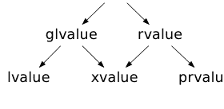
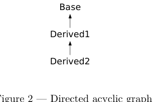

# ISO-IEC 14882-2011 信息技术 — 编程语言 — C++

2.14 字面量 . . . . . . . . . . . 24

13.6 内置运算符 . . . . . . . . . . . . . . . . . . . . . . . . . . . . . . . . . 317

17.6 库范围要求 . . . . . . . . . . . . . . . . . . . . . . . . . . . . . . . . . . . . . . 34

22.6 C 库本地化 . . . . . . . . . . . . . . . . . . . . . . . . . . . . . . . . . . . . . . . . . . 96

- 24.6 流迭代器 . . . . . . . . . . . . . . . . . . . . . . . . . . . . . . . . . . . 855
- 27.9 文件流 . . . . . . . . . . . . . . . . . . . . . . . . . . . . . . . . . . . . . 1066
- D.4 动态异常规范 . . . . . . . . . . . . . . . . . . . . . . . . . . . . . . . . . 229
- D.5 C 标准库头文件 . . . . . . . . . . . . . . . . . . . . . . . . . . . . . . . . 229
- D.6 旧迭代器成员 . . . . . . . . . . . . . . . . . . . . . . . . . . . . . . . . . . . 1230
- D.7 char* 流 . . . . . . . . . . . . . . . . . . . . . . . . . . . . . . . . . . . . 1231
- D.8 函数对象 . . . . . . . . . . . . . . . . . . . . . . . . . . . . . . . . . . . 1240
- D.10 auto_ptr . . . . . . . . . . . . . . . . . . . . . . . . . . . . . . . . . . . . . . 1245
- 8 字符串字面量拼接 .................................................................................................................................................................................................................................... . . . . . . . . 30

# 前言

ISO（国际标准化组织）和 IEC（国际电工委员会）组成了标准化联合委员会。ISO 或 IEC 的国家机构参与国际标准的制定。请注意，本文档的某些元素可能是专利权的主体。ISO/IEC 14882 由技术联合委员会 ISO/IEC JTC 1（信息技术）、分委员会 SC 22（编程语言）编制。本版取消了第二版（ISO/IEC 14882:2003），该版本已在技术上进行了修订。

# 通用部分

## 1. 范围

本国际标准规定了 C++ 实现的要求。第一个要求是它们必须按照 ISO/IEC 9899（以下简称 C）的规定实现该语言。

C++ 是一种基于 C 语言（以下简称 C 标准）的通用编程语言。除了 C 提供的功能外，C++ 还提供了额外的数据类型、类、模板、命名空间、运算符重载和自由存储（free store）。

## 2. 规范引用

以下文档对于本文的应用必不可少。对于日期的引用，适用于引用的版本。对于无日期的引用，适用于引用文件的最新版本。

- Ecma International, ECMAScript Language Specification, Standard Ecma-262, 第三版，1999。
- ISO/IEC 2382（所有部分），信息技术 术语
- ISO/IEC 9899:1999，编程语言 — C
- ISO/IEC 9899:1999/Cor.1:2001(E），编程语言 — C，技术勘误 1
- ISO/IEC 9899:1999/Cor.2:2004(E），编程语言 — C，技术勘误 2
- ISO/IEC 9899:1999/Cor.3:2007(E），编程语言 — C，技术勘误 3
- ISO/IEC 9445:2003，信息技术 — 可移植操作系统接口 (POSIX)
- ISO/IEC 10644-1:1993，信息技术 — 通用字节字符集 (UCS)，第一部分：体系和多语言基础
- ISO/IEC TR 17969:2004，信息技术 — 编程语言、环境和系统软件接口 — 支持新数据类型的 C 语言扩展

在 ISO/IEC 9899:1999/Cor.1:2001 第 7 和 ISO/IEC 9899:1999/Cor.2:2004 第 7 中描述的称为 C 标准库。

ISO/IEC TR 17969:2004 中描述的称为 Unicode TR。

ISO/IEC 9445:2003 中描述的操作系统接口称为 POSIX。

Standard Ecma-262 中描述的 ECMAScript 语言规范称为 ECMA-262。

+ 1) 结合第 18 条至第 30 条以及 C.3 中的限定说明，C 标准库是 C++ 标准库的子集。

§ 1.2

## 1.3 术语和定义

[intro.defs]

- 1 就本文而言，适用以下定义。
- 2 17.3 定义了仅在第 17 至 30 条和附录 D 中使用的额外术语。
- 3 仅在该国际标准的一小部分使用的术语，在其出现处进行定义，并在定义处用*斜体*表示。

### 1.3.1 参数 (argument)

[defns.argument]

实际参数 (actual argument)

实际参数 (actual parameter)

由括号界定的逗号分隔列表中的`<function call>` 表达式

### 1.3.2 参数 (argument)

[defns.argument.macro]

实际参数 (actual argument)

实际参数 (actual parameter)

由括号界定的逗号分隔列表中的`<function-like macro>` 预处理标记序列

### 1.3.3 参数 (argument)

[defns.argument.throw]

实际参数 (actual argument)

实际参数 (actual parameter)

`<throw expression>` `throw` 的操作数

### 1.3.4 参数 (argument)

[defns.argument.templ]

实际参数 (actual argument)

实际参数 (actual parameter)

由角括号界定的逗号分隔列表中的`<template instantiation>` 表达式、类型标识 (type-id) 或模板名称

### 1.3.5 有条件支持的 (conditionally-supported)

[defns.cond.supp]

实现不被要求支持的程序结构

[注：每个实现都记录了其不支持的所有条件支持的结构。 — 注结束]

### 1.3.6 诊断消息 (diagnostic message)

[defns.diagnostic]

属于实现输出消息中定义的子集的消息

### 1.3.7 动态类型 (dynamic type)

[defns.dynamic.type]

由 glvalue 表达式所指的 glvalue 的最派生对象 (1.8) 的`<value>` 类型

§ 1.3

[示例：如果一个静态类型为“指向类 B 的指针”的指针 (8.3.1) 指向派生自 B (第 10 条) 的类 D 对象，则表达式 *p* 的动态类型为 "D"。引用 (8.3.2) 的处理类似。 — 示例结束]

### 1.3.8 伪动态类型 (ndynamic type)

`<prvalue>` prvalue 表达式的静态类型

### 1.3.9 格式错误的程序 (ill-formed program)

不是格式良好的程序

### 1.3.10 实现定义的行为 (implementation-defined behavior)

对于格式良好的程序结构和正确的数据，其行为取决于具体实现，且每个实现都对其进行了记录的行为

### 1.3.11 实现限制 (implementation limits)

实现对程序施加的限制

### 1.3.12 区域特定特定行为 (locale-specific behavior)

取决于国籍、文化和语言局部惯例的行为，每个实现都对其进行了记录

### 1.3.13 多字节字符 (multibyte character)

由一个或多个字节组成的序列，代表源环境或执行环境扩展字符集中的一个成员

注：扩展字符集是基本字符集 (2.3) 的超集。 — 注结束]

### 1.3.14 参数 (parameter)

形式参数 (formal argument)

形式参数 (formal parameter)

在函数声明或异常处理程序的 `catch` 子句定义中声明的`<function or catch clause>` 对象或引用，该对象在进入函数或处理程序时获取一个值

### 1.3.15 参数 (parameter)

形式参数 (formal argument)

形式参数 (formal parameter)

`<function-like macro>` 紧随宏名后的括号界定的逗号分隔列表中的标识符

### 1.3.16 参数 (parameter)

形式参数 (formal argument)

形式参数 (formal parameter)

`<template>` 模板参数

### 1.3.17 签名 (signature)

`<function>` 名称、参数类型列表 (8.3.5) 以及所属的命名空间（如有）

[注：签名用于名称修饰 (name mangling)和链接的基础。 — 注结束]

### 1.3.18 签名 (signature)

`<function template>` 名称、参数类型列表 (8.3.5)、所属的命名空间（如有）、返回类型以及模板参数列表

### 1.3.19 签名 (signature)

`<function specialization>` 其特化的模板签名及其模板参数（无论是显式指定的还是推导的）

### 1.3.20 签名 (signature)

`<class member function>` 名称、参数类型列表 (8.3.5)、其所属的类、const 限定符 (ce-qualifiers）（如有）以及引用限定符 (ref-qualifier）（如有）

### 1.3.21 签名 (signature)

`<class member function template>` 名称、参数类型列表 (8.3.5)、其所属的类、const 限定符（如有）、引用限定符（如有）、返回类型以及模板参数列表

### 1.3.22 签名 (signature)

`<class function template specialization>` 其特化的成员函数模板的签名及其模板参数（无论是显式指定的还是推导的）

### 1.3.23 静态类型 (static type)

在不考虑执行语义的情况下通过对程序分析得到的表达式 (3.9) 的类型

[注：表达式的静态类型仅取决于表达式出现时的程序形式，且在程序执行期间不会改变。 — 注结束]

### 1.3.24 未定义行为 (undefined behavior)

本国际标准未规定要求的行为

[注：当本国际标准省略对行为的显式定义或程序使用错误的结构或数据时，可能会出现未定义行为。允许的未定义行为范围从以记录的方式执行产生不可预测的结果，到在翻译或程序执行期间具有记录的环境特征（无论是否发布诊断消息）。]

### 1.3.25 未指定的 (unspecified)

对于格式良好的程序结构和正确的数据，取决于实现输出消息中定义的子集的行为 (implementation-defined subset)

### 1.3.26 格式良好的 (well-formed)

对于格式良好的程序结构和正确的数据，取决于具体实现且每个实现都对其进行了记录的行为

## 1.4 符合性 (compliance)

- 1 就本文而言，适用以下定义。
- 2 17.3 定义了仅在第 17 至 30 条和附录 D 中使用的额外术语。
- 3 仅在该国际标准的一小部分使用的术语，在其出现处进行定义，并在定义处用*斜体*表示。

## 1.5 本国际标准的结构 (Structure of this International Standard)

第 2 至 16 条描述了 C++ 语言。该描述包含了详细规范。第 18 至 30 条和附录 D（*库*）描述了 C++ 库。该描述包含了库的详细规范。

附录 B 建议了实现的下限。

附录 C 总结了 C++ 自发布以来的演变，并详细说明了 C++ 与 C 的差异。某些 C++ 特性是为了兼容；附录 D 描述了这些特性。

## 1.6 语法表示 (Syntax notation)

在本标准使用的语法表示中，语法类别用*斜体*类型表示，字面量和字符用**等宽**类型表示。可选用行表示，但在少数情况下用“之一”标记一组可选。如果示例的文本太长无法用一行表示，则在后续行继续。可选非终结符号用“*opt*”表示，因此

```
{ expression_opt }
```

表示括号内的可选表达式。

语法类别的名称通常遵循以下规则：

- *X-name* 是在一个决定其含义的上下文中出现的标识符（例如，*class-name*、*typedef-name*）。
- *X-id* 是没有上下文含义的标识符（例如，*qualified-id*）。
- *X-seq* 是没有中间间隔符的一个或多个 *X*（例如，*declaration-seq* 是声明序列）。
- *X-list* 是由逗号分隔的一个或多个 *X*（例如，*expression-list* 是由逗号分隔的表达式序列）。

在本国际标准中，每个示例以“*Example:*”开始，以“*end example*”结束。每个注以“*Note:*”开始，以“*end note*”结束。示例和注可以嵌套。

§ 1.4

- 定义了两类实现：*托管实现 (hosted implementation)* 和*独立实现 (freestanding implementation)*对于托管实现，本国际标准定义了库的集合。独立实现是在没有操作系统帮助的情况下执行的实现。符合本标准的实现。

## 1.9

- 1 就本文而言，适用以下定义。
- 2 17.3 定义了仅在第 17 至 30 条和附录 D 中使用的额外术语。
- 3 仅在该国际标准的一小部分使用的术语，在其出现处进行定义，并在定义处用*斜体*表示。
- 4 对于托管实现，本国际标准定义了库的集合。独立实现是在执行……的实现实现……它们没有要求。
- 5 对于托管实现，本国际标准定义了库的集合。独立实现是在执行……的实现……它们没有要求。
- 6 对于托管实现，本国际标准定义了库的集合。独立实现是在执行……的实现……它们没有要求。
- 7 对于托管实现，本国际标准定义了库的集合。独立实现是在执行……的实现……它们没有要求。
- 8 对于托管实现，本国际标准定义了库的集合。独立实现是在执行……的实现……它们没有要求。
- 9 

第 18 至 30 条和附录 D（*库*）描述了 C++ 库。该描述包含了库的详细规范。


属于实现输出消息中定义的子集的消息

### 1.3.7 动态类型 (dynamic type)

[defns.dynamic.type]

由 `glvalue` 表达式所指的 `glvalue` 的最派生对象 (1.8) 的`<value>` 类型

§ 1.3

[示例：如果一个静态类型为“指向类 B 的指针”的指针 (8.3.1) 指向派生自 B (第 10 条) 的类 D 对象，则表达式 *p* 的动态类型为 "D"。引用 (8.3.2) 的处理类似。 — 示例结束]

### 1.3.8 伪动态类型 (ndynamic type)

`<prvalue>` `prvalue` 表达式的静态类型

### 1.3.9 格式错误的程序 (ill-formed program)

不是格式良好的程序

### 1.3.10 实现定义的行为 (implementation-defined behavior)

对于格式良好的程序结构和正确的数据，其行为取决于具体实现，且每个实现都对其进行了记录的行为

### 1.3.11 实现限制 (implementation limits)

实现对程序施加的限制

### 1.3.12 区域特定特定行为 (locale-specific behavior)

取决于国籍、文化和语言局部惯例的行为，每个实现都对其进行了记录

### 1.3.13 多字节字符 (multibyte character)

由一个或多个字节组成的序列，代表源环境或执行环境扩展字符集中的一个成员

注：扩展字符集是基本字符集 (2.3) 的超集。 — 注结束]

### 1.3.14 参数 (parameter)

形式参数 (formal argument)

形式参数 (formal parameter)

在函数声明或异常处理程序的 `catch` 子句定义中声明的`<function or catch clause>` 对象或引用，该对象在进入函数或处理程序时获取一个值

### 1.3.15 参数 (parameter)

形式参数 (formal argument)

形式参数 (formal parameter)

`<function-like macro>` 紧随宏名后的括号界定的逗号分隔列表中的标识符

### 1.3.16 参数 (parameter)

形式参数 (formal argument)

形式参数 (formal parameter)

`<template>` 模板参数

### 1.3.17 签名 (signature)

`<function>` 名称、参数类型列表 (8.3.5) 以及所属的命名空间（如有）

[注：签名用于名称修饰 (name mangling)和链接的基础。 — 注结束]

### 1.3.18 签名 (signature)

`<function template>` 名称、参数类型列表 (8.3.5)、所属的命名空间（如有）、返回类型以及

模板参数列表

### 1.3.19 签名 (signature)

`<function specialization>` 其特化的模板签名及其模板参数（无论是显式指定的还是推导的）

### 1.3.20 签名 (signature)

`<class member function>` 名称、参数类型列表 (8.3.5)、其所属的类、const 限定符 (ce-qualifiers）（如有）以及引用限定符 (ref-qualifier）（如有）

### 1.3.21 签名 (signature)

`<class member function template>` 名称、参数类型列表 (8.3.5)、其所属的类、const 限定符（如有）、引用限定符（如有）、返回类型以及模板参数列表

### 1.3.22 签名 (signature)

`<class function template specialization>` 其特化的成员函数模板的签名及其模板参数（无论是显式指定的还是推导的）

### 1.3.23 静态类型 (static type)

在不考虑执行语义的情况下通过对程序分析得到的表达式 (3.9) 的类型

[注：表达式的静态类型仅取决于表达式出现时的程序形式，且在程序执行期间不会改变。 — 注结束]

### 1.3.24 未定义行为 (undefined behavior)

本国际标准未规定要求的行为

[注：当本国际标准省略对行为的显式定义或程序使用错误的结构或数据时，可能会出现未定义行为。允许的未定义行为范围从以记录的方式执行产生不可预测的结果，到在翻译或程序执行期间具有记录的环境特征（无论是否发布诊断消息）。]

### 1.3.25 未指定的 (unspecified)

对于格式良好的程序结构和正确的数据，取决于实现输出消息中定义的子集的行为 (implementation-defined subset)

### 1.3.26 格式良好的 (well-formed)

对于格式良好的程序结构和正确的数据，取决于具体实现且每个实现都对其进行了记录的行为

## 1.4 符合性 (compliance)

- 1 就本文而言，适用以下定义。
- 2 17.3 定义了仅在第 17 至 30 条和附录 D 中使用的额外术语。
- 3 仅在该国际标准的一小部分使用的术语，在其出现处进行定义，并在定义处用*斜体*表示。

## 1.5 本国际标准的结构 (Structure of this International Standard)

第 2 至 16 条描述了 C++ 语言。该描述包含了详细规范。第 18 至 30 条和附录 D（*库*）描述了 C++ 库。该描述包含了库的详细规范。

附录 B 建议了实现的下限。

附录 C 总结了 C++ 自发布以来的演变，并详细说明了 C++ 与 C 的差异。某些 C++ 特性是为了兼容；附录 D 描述了这些特性。

## 1.6 语法表示 (Syntax notation)

在本标准使用的语法表示中，语法类别用*斜体*类型表示，字面量和字符用**等宽**类型表示。可选用行表示，但在少数情况下用“之一”标记一组可选。如果示例的文本太长无法用一行表示，则在后续行继续。可选非终结符号用“*opt*”表示，因此

```
{ expression_opt }
```

表示括号内的可选表达式。

语法类别的名称通常遵循以下规则：

- *X-name* 是在一个决定其含义的上下文中出现的标识符（例如，*class-name*、*typedef-name*）。
- *X-id* 是一个没有上下文含义的标识符（例如，*qualified-id*）。
- *X-seq* 是没有中间间隔符的一个或多个 *X*（例如，*declaration-seq* 是声明序列）。
- *X-list* 是由逗号分隔的一个或多个 *X*（例如，*expression-list* 是由逗号分隔的表达式序列）。

在本国际标准中，每个示例以“*Example:*”开始，以“*end example*”结束。每个注以“*Note:*”开始，以“*end note*”结束。示例和注可以嵌套。

§ 1.4

- 定义了两类实现：*托管实现 (hosted implementation)* 和*独立实现 (freestanding implementation)*。对于托管实现，本国际标准定义了库的集合。独立实现是在没有操作系统帮助的情况下执行的实现。符合本标准的实现。

## 1.9

- 1 就本文而言，适用以下定义。
- 2 17.3 定义了仅在第 17 至 30 条和附录 D 中使用的额外术语。
- 3 仅在该国际标准的一小部分使用的术语，在其出现处进行定义，并在定义处用*斜体*表示。
- 4 对于托管实现，本国际标准定义了库的集合。独立实现是在执行……的实现……它们没有要求。
- 5 对于托管实现，本国际标准定义了库的集合。独立实现是在执行……的实现……它们没有要求。
- 6 对于托管实现，本国际标准定义了库的集合。独立实现是在执行……的实现……它们没有要求。
- 7 对于托管实现，本国际标准定义了库的集合。独立实现是在执行……的实现……它们没有要求。
- 8 对于托管实现，本国际标准定义了库的集合。独立实现是在执行……的实现……它们没有要求。
- 9 

第 18 至 30 条和附录 D（*库*）描述了 C++ 库。该描述包含了库的详细规范。

# ISO/IEC 14882:2011(E)

## 1.7 C++ 内存模型 [intro:memory]

1 C++ 内存模型中的基本存储单元是字节（byte）。字节的大小足够容纳基本执行字符集（2.3）中的任何成员，以及 Unicode UTF-8 编码格式的8位代码单元，它由一个连续的位序列组成，其数量由实现定义。最低位称为低位阶；最高位称为高位阶。C++ 程序可用的内存由一个或多个连续字节序列组成。每个字节都有一个唯一的地址。

2 [注：类型的表示描述见 3.9。— 尾行注]

3 内存位置要么是标量类型（scalar type），要么是具有非零宽度的相邻位域的最大序列。[注：语言的特性，例如引用和函数，可能会引入程序无法访问但由实现管理的内存位置.— 结束注]两个执行线程（1.10）并发地更新和访问内存位置，且互不干扰。

4 [注：位域与相邻的位域位于不同的内存中，因此无法被更新。这适用于两个字段：如果其中一个声明在嵌套结构体声明内部而另一个不是，或者它们被零长度位域隔开，或者它们被非位域声明隔开。如果同一个结构体之间的所有字段也是非零宽度的位域，则并发更新该结构中的两个位域是不安全的.— 结束注]

5 [示例：声明如下的结构

```cpp
struct {
  char a;
  int b:5;
  c:11;
  :0;
  d:8;
  struct {int be}; e;
}
```

包含了四个独立的内存位置：字段 a 以及位域 d 和 e。a 和 e 分别是独立的内存位置，可以并发进行修改而互不干扰。位域 b 和 c 共同构成第四个内存位置。位域 b 和 e 不能被并发修改，但可以通过 a 和 b 进行修改.— 结束示例]

## 1.8 C++ 对象模型 [intro:object]

1 C++ 程序中的构造结构创建、销毁、访问和操作对象。对象是存储器区域。[注：对象不是一个实体，取决于它是否占据存储器空间.— 结束注] 对象通过定义（3.1）、`new` 表达式（5.4.3）或实现（1.2）创建。对象的属性在创建时确定。对象可以有一个名称（第3节）。对象具有存储持续时间（3.7），这影响了其生命周期（3.8）。对象具有类型（3.9）。对象类型术指的是创建对象时使用的类型。某些对象是多态的（10.3）；实现生成与每个对象关联的信息，使得在程序执行期间确定该对象的类型成为可能。对于其他对象，其中值的解释取决于访问它们时使用的表达式的类型（第5节）。

2 对象可以包含其他对象，即子对象。子对象可以是成员子对象（9.2）、基类对象（第10节）或数组元素。一个不属于任何其他对象的子对象的对象称为完整对象（complete object）。

3 对于每个对象 x，存在一个称为 x 的完整对象的对象，其确定方式如下：

- 如果 x 是完整对象，则 x 是 x 自身的完整对象。
- 否则，x 的完整对象是包含 x 的（唯一）对象的完整对象。

4 如果对象是位域或数据成员（9.2），或大小为零的数组元素，其类型被视为最派生类，以将其与任何基类子对象的类区分；最派生类型对象或非类类型对象是最派生对象。

5 除非是位域，否则最派生类应具有非零大小并占据一个或多个字节的存储。基类子对象的大小可以为零。易于拷贝（trivially copyable）或标准布局（standard-layout）对象

6 除非对象是零大小的基类子对象，否则对象的地址是其占据的第一个字节的地址。两个非位域对象可能有相同的地址，如果其中一个是另一个子对象，或者至少一个是零大小的基类子对象且类型不同；否则它们具有不同的地址。

[示例：

```cpp
static const char test1 = 'x';
static const char test2 = 'x';
const bool b = test1 != test2; // 始终为真
```

- 结束示例

7 [注：C++ 提供了多种基本类型以及从现有类型组合新类型的几种方法（3.9）. 结束注]

## 1.9 程序执行

1 本国际标准中的语义描述定义了一个参数化的确定性抽象机器。本国际标准对符合实现的结构没有要求。特别是，它们不需要编译或模拟抽象机器的结构。相反，符合标准的实现目的是执行（仅）下文解释的抽象机器的可观测行为。

2 抽象机器的某些方面和操作在本国际标准中描述。抽象机器的某些方面和操作在本国际标准中描述为实现定义的（int）。

3 抽象机器的其他方面和操作在本国际标准中描述为未指定的（unspecified），例如“正如”（as-if）规则。

4 在“正如”规则下，实现可以自由对程序产生任何影响，只要结果就像执行了抽象机器一样。符合标准的实现执行良好良好的程序应产生与一种可能的执行结果相同的可观测行为。

5 当抽象机器的执行因接收信号而被中断时，以下对象的值

- `volatile` `std::atomic_t`
- 无锁原子对象（29.4）

在处理器执行期间是未指定的。

6 每个具有自动存储持续（37.3）的对象实例都与进入该块关联。在块挂起（通过调用函数或接收信号）执行期间，此类对象存在并保留其最后存储的值。

7 符合标准实现的要求是：

1 对 `volatile` 对象的访问严格遵循抽象机器的规则。
- 在程序终止时，写入文件的数据应与抽象语义执行程序可能产生的结果之一相同。
- 交互式设备的输入输出动态应以这种方式进行：在程序等待输入之前实际交付输出提示。什么是交互式设备是由实现定义的。

这些统称为程序的可观测行为。[注：每个实现可以定义抽象与实际语义之间更严格的差异.— 结束注]

9 [注：只有当运算符相对结合律或交换律时，才能按照通常的数学规则对运算符分组。对于以下片段

```cpp
int a, b;
/*...*/
a = a + 32760 + b + 5;
```

表达式语句的行为与以下

```cpp
a = (((a + 32760) + b) + 5);
```完全一致，由于这些运算符的结合性和优先级。因此，(a + 32760) 的结果没有加上 b，而是该结果加上 5 得到了赋值给 a 的值。在溢出产生异常且 int 可表示的值范围为 [-32768,+32767] 的机器上，实现不能重写此表达式为

- 重载运算符从不假设具有结合律或交换律。

```
a = ((a + b) + 32765);
```

因为如果 a 和 b 的值分别为 -32754 和 -15，那么和 a + b 将产生一个异常，而原始表达式则不会；该表达式也无法重写为：

```
a = ((a + 32765) + b);
```

或者

```
a = (a + (b + 32765));
```

因为 a 和 b 的值可能是 4 和 -8，或 -17 和 12。然而，在一个溢出不会产生异常且溢出结果可逆的机器上，上述表达式语句可以由实现层按上述任何一种方式进行重写，因为将产生相同的结果。-- 备注结束 --

- 10. 完全表达式（full-expression）是一个不是其他表达式的子表达式的表达式。如果语言结构被定义为产生函数的隐式调用，则就此定义而言，该语言结构的使用被视为一个表达式。在对象生命周期结束时而非临时对象时生成的析构函数调用是一个隐式完全表达式。为了满足表达式所在语言结构的要求而应用于表达式结果的转换，也被视为完全表达式的一部分。

示例：

```
struct S {
S(int i): i(i) {}
int& v() { return i; }
private:
int i;
};
S s1(1); // 完全表达式是调用 S::S(int)
s2 = 2; // 完全表达式是调用 S::S(int)

void f() {
if (S(3).v()) // 完全表达式求值了值到值（value-to-value）和
// int 到 bool 的转换，这些转换是在完全表达式结束
// 临时对象被删除之前执行的
}
```

-- 示例结束 --

- 11 [注意：完全表达式的求值可以包括词法上不属于该完全表达式的子表达式的求值。例如，参与求值参数（8.3.6）的子表达式被认为创建在调用完全表达式的表达式中，而该表达式并未定义默认参数。] -- 备注结束 --

- 12 访问由 `volatile` 变量（8.10）指定的对象、修改对象、调用库 I/O 函数或调用执行上述任一操作的函数均是副作用（side effects），即执行环境状态的改变。表达式（或子表达式）的求值泛而言包括值计算（包括为了 `glvalue` 求值确定对象的唯一标识性，以及为了 `prvalue` 求值获取之前赋值给对象的值）以及副作用的启动。当库 I/O 函数调用返回或对 `volatile` 对象的访问时，副作用被认为已完成，尽管调用隐含的某些外部操作（如 I/O 本身）或 `volatile` 访问隐含的某些操作可能尚未完成。

- 13 **顺序先于（Sequenced before）** 是单线程执行的求值（1.10）之间的一种非对称、传递、两两关系，它在求值上产生了一种偏序。对于 A 和 B 的任意两个求值，如果 A 顺序先于 B，则 A 的执行应先于 B 的执行。*如果 A 不是顺序先于 B 且 B 不是顺序先于 A，则 A 和 B 是无序的（unsequenced）。**注意：无序求值的执行可以重叠。-- 备注结束。* 如果 A 顺序先于 B 或 B 顺序先于 A，但两者都不先于对方，则 A 和 B 是不确定顺序的（indeterminately sequenced）。**注意：不确定顺序的求值重叠，但可以先执行。-- 备注结束。*

- 14 与完全表达式相关的每一个计算和副作用，都顺序先于即将发生的完全表达式相关的每一个值计算和副作用。

- 15 除另有外，单个操作数以及单个表达式子表达式的求值是无序的。*注意：在程序执行过程中被求值多次的表达式，子表达式的无序和顺序求值在不同的求值中不需要保持一致。-- 备注结束。* 运算符操作数的值计算顺序先于运算符结果的值计算。如果对对象的副作用相对于同一尺度对象上的另一个操作数，或使用同一尺度对象的值计算，则其行为是未定义的。

*示例：*


```
void f(int, int);
void g(int, int* v) {
    i = v[+i];              // 行为未定义
    i = 7, i++;             // i 变为 9

    i = i + ++i;
    i = i + 1;           // i 的值增加了

ff(i = -1, i = -1);      // 行为未定义
}
```

*示例：*

在调用函数时（无论该函数是否为内联函数），与任何参数或与翻译单元中的后缀表达式或语句相关的每一个值计算和副作用，都顺序先于被调用函数中的每一个表达式或语句的执行。*注意：不同参数之间的副作用是无序的。-- 备注结束。* 调用处（包括函数调用）中不是按顺序先于或后于函数体执行的任何求值，相对于函数体的执行是不确定顺序的。*注意：不同参数之间的副作用是无序的。-- 备注结束。* 调用处（包括函数调用）中不是按顺序先于或后于函数体执行的任何求值，相对于函数体的执行是不确定顺序的。*注意：不同参数之间的副作用是无序的。-- 备注结束。*

- 10 原子操作与数据竞争

# ISO/IEC 14882:2011(E)

## 1.10

以原子对象 `$M$` 上的释放操作 `$A$` 为开头的释放序列（release sequence）是 `$M$` 修改顺序中侧效应的一个极大连续序列，其中第一个操作是 `$A$`，且随后的每个操作：

- 由执行 `$A$` 的线程执行，或

- 是一个原子读-修改-写操作。

某些库通过调用 `synchronize` 与另一个线程执行的其他调用进行同步。例如，一个原子存储-释放（store-release）与从该存储获取其值的加载-获取（load-acquire）同步（20.3）。[注：除指定情况外，读取较后的值不能确保下文所述的可见性。这种要求有时会干扰高效实现。——注][注：当一个线程读取另一个线程写入的值时，同步操作的规范。对于原子对象，其定义是明确。给定互斥上的所有操作都发生在单一的总顺序中。每个原子获取操作“读取了上一个互斥释放所写入的值”。——注]

如果满足以下条件，求值 `$A$` 对求值 `$B$` 带有依赖（dependency）：

- `$A$` 的值被用作 `$B$` 的操作数，除非；

- `$B$` 是任何 `std::kill_dependency` 规范的（29.3），或

- `$A$` 是按位与（&&，见 5.14）或逻辑或（||，见 5.15）操作符的左操作数，

- `$A$` 是条件（?;，见 5.16）操作符的左操作数，或

- `$A$` 是内置逗号（`,`）操作符（5.18）的左操作数；

`$A$` 写入一个标量对象或位域 `$M$`，`$B$` 从 `$M$` 读取 `$A$` 写入的值，且 `$A$` 在 `$B$` 之前排序（sequenced before），或

- 对于某些求值 `$X$`，`$A$` 对 `$X$` 带有依赖，且 `$X$` 对 `$B$` 带有依赖。

> [注：“带有依赖”是“排序”的子集，且同样是严格的线程内。——注]

如果满足以下条件，求值 `$A$` 在求值 `$B$` 之前依赖排序（dependency-ordered before）：

- 它对原子对象 `$M$` 执行了释放操作

> [注：“依赖排序之前”的关系类似于“同步”，但使用的是释放/获取。——注]

如果满足以下条件，求值 `$A$` 在线程间发生在求值 `$B$` 之前（inter-thread happens before）：

- 它与 `$B$` 同步，或 `$B$` 在 `$B$` 之前依赖排序，或

- 它与 `$X$` 同步且 `$X$` 在 `$B$` 之前排序，或

- 它在 `$X$` 之前排序且 `$X$` 在线程间发生在 `$B$` 之前，或

- 它在线程间发生在 `$X$` 之前，且 `$X$` 在线程间发生在 `$B$` 之前。

# ISO/IEC 14882:2011(E)

[注：“线程间发生之前”关系描述了“排序”、“同步”和“依赖排序之前”关系的任意拼接，有两个例外。第一个例外是不允许“依赖排序之前”后接“排序”的拼接。该限制的原因是参与“依赖排序之前”关系的消费者操作仅对于该消费者操作实际带有依赖的操作的操作提供排序。该限制仅适用于此类拼接末尾的原因是，任何后续的释放操作将为先前的消费者操作提供所需的排序。第二个例外是不允许拼接完全由“排序”组成。该限制的原因是：（1) 允许“线程间发生之前”具有传递闭包性且在之前；(2) 下文定义的“发生之前”关系提供了由“排序”组成的关系。——注]

12 如果满足以下条件，`$A$` 发生在事件 `$B$` 之前：

- `$A$` 在 `$B$` 之前排序，或

- `$A$` 在线程间发生在 `$B$` 之前。

实现应确保没有程序执行在“发生之前”关系中出现循环。[注：通过使用消费操作可能会出现循环。——注]

13 对于标量对象或位域 `$M$` 的求值 `$B$`，相对于该对象的侧效应 `$A$` 满足以下条件：

- `$A$` 发生在 `$B$` 之前

- 没有其他侧效应 `$A$` 修改非原子标量对象或位域 `$M$`，

由求值 `$B$` 确定的值应为侧效应 `$A$` 存储的值。[注：如果对非原子对象或位域的侧效应存在歧义，行为是未指定的或未定义的。——注][注：原子对象的操作是可见的。这实际上不是数据竞争，但在简单的（顺序一致）执行中必须观察数据竞争。——注] 关于原子使用的限制，一致性。

14 对于原子对象 `$M$` 的求值 `$B$`，侧效应的可见序列是 `$M$` 修改顺序中侧效应的一个连续序列，其中第一个侧效应对于 `$B$` 是可见的，且并非 `$B$` 发生在 `$A$` 之前。由求值 `$B$` 确定的原子对象 `$M$` 的值应为侧效应可见序列中某些操作存储的值，这在一致性要求下是唯一的。——注

15 如果修改原子对象 `$M$` 的操作发生在修改 `$M$` 的操作之前，则 `$A$` 在 `$M$` 的修改顺序中早于 `$B$`。[注：此要求是写-写一致性。——注]

16 如果原子对象 `$M$` 的求值 `$A$` 发生在修改 `$M$` 的操作之前，则 `$A$` 应从 `$X$` 或从在修改顺序中随后的 `$X$` 的侧效应 `$Y$` 中获取值。[注：此要求是读-写。——注]

17 如果原子对象 `$M$` 的求值 `$A$` 发生在 `$B$` 之前，则 `$A$` 应从在修改顺序中在 `$B$` 之前的侧效应 `$X$` 中获取值。[注：这被称为读-读。——注]

# ISO/IEC 14882:2011(E)

18 如果原子对象 `$M$` 侧效应 `$X$` 发生在求值 `$B$` 之前，则 `$B$` 应根据一致性要求从 `$X$` 获取值。[注：此要求是写-读。——注]

19 [注：“线程间发生之前”关系描述了“排序”、“同步”和“依赖排序之前”关系的任意拼接，有两个例外。第一个例外是不允许“依赖排序之前”后接“排序”。该限制的原因是参与“依赖排序之前”关系的消费者操作仅对于该消费者操作实际带有依赖的操作提供排序。该限制仅适用于此类拼接末尾的原因是任何后续的释放操作将为先前的消费者操作提供所需的排序。第二个例外是不允许拼接完全由“排序”组成。该限制的原因是：（1) 允许“线程间发生之前”具有传递闭包性且在之前；(2) 下文定义的“发生之前”关系提供了由“排序”组成的关系。——注]

20 对于原子对象 `$M$` 的求值 `$B$`，侧效应的可见序列是 `$M$` 修改顺序中侧效应的一个连续序列，其中第一个侧效应对于 `$B$` 是可见的，且并非 `$B$` 发生在 `$A$` 之前。由求值 `$B$` 确定的原子对象 `$M$` 的值应为侧效应可见序列 `$M$` 中某些操作存储的值，这求值在一致性要求下是唯一的。——注

21 如果在不同线程中发生两个冲突动作，其中至少一个不是原子的，且两者互不发生在对方之前，则程序的执行包含数据竞争。这种数据竞争会导致未定义行为。然而，这仅适用于无数据竞争程序，且无数据竞争程序无法观察到大多数程序转换。任何行为与预期的程序必须执行未定义操作。——注]

22 本标准通常禁止引入抽象机器不会修改的潜在共享内存位置的编译器转换，例如赋值可能会在抽象机器不会引入数据竞争的情况下覆盖另一个线程的操作。原子查询别名的原子加载的排序通常也是被禁止的，因为这可能违反“可见序列”规则。——注]

23 引入对潜在共享内存位置的预测读取的转换可能无法保留本标准定义的 C++ 程序的语义，因为它们引入了数据竞争。然而，它们在针对具有数据数据竞争语义的特定机器的优化编译器语文中通常是有效的。对于一个不容忍竞争或提供硬件检测的假设机器，它们是无效的。——注]

24 实现可以假设任何线程最终都会执行以下操作之一：

- 终止，

- 调用库 I/O 函数，

- 访问或修改 volatile 对象，或

- 执行同步操作或原子操作。

[注：这允许编译器进行如消除空循环等转换，即使无法证明终止。——注]

25 实现应确保由原子或同步操作写入的最后一个值（修改顺序中）在有限时间内对所有线程可见。

## 1.11 致谢

- 1 本国际标准中描述的 C++ 编程语言基于 Stroustrup 的《The C++ Programming Language》（第二版，Addison-Wesley 出公司，ISBN 0-201-53992-6，版权 ©1991 AT&T）第 R 章（参考手册）中描述的语言。而该语言反过来基于 Kernighan 和 Ritchie 的《The C Programming Language》（Prentice-Hall 出版，1978 年，ISBN 0-13-110163-3，版权 ©1978 AT&T）附录 A 中描述的 C 语言语言。

- 2 本国际标准中的库条款（library Clauses）部分基于 P.J. Plauger 的工作。

- 3 POSIX® 是电气电子工程师协会的注册商标。

- 4 这些原件的所有版权均保留。

## 词法约定

### 2.1 独立翻译

本国际标准中的程序文本以源文件为单位保留。一个源文件加上预处理指令 `#include` 包含的所有头文件 (17.6.1.2) 和源文件 (16.2)，以及被任何条件包含预处理指令 (16.1) 跳过的任何行，被视为一个翻译单元。[注：一个 C++ 程序不需要同时翻译。]

[注：可能翻译的翻译单元和实例化可以单独或以库的形式处理。程序 (3.5) 的独立翻译单元（例如）调用具有外部链接的标识符的函数、对数据文件的操作。翻译单元可以单独翻译，然后链接成可执行的程序 (3.5)。]

### 2.2 翻译阶段

1. 翻译语法规则的优先级由以下阶段指定：

   - 如果必要，将物理源文件字符按实现定义的方式映射到基本源字符（行尾字符使用换行符）。物理源文件字符的接收是由实现定义的。序列 (2.4) 被替换为相应的内部字符表示。任何未被表征其自身的通用字符名称（universal-character-name）替换的源字符（实现可以使用任何内部编码，例如在源文件中遇到的扩展字符，以及在源文件中以通用字符名称表示的相同字符（如 UXX 记法）），都将被等效处理，除非该替换在原始字符串字量中被还原。

2. 每个紧跟在换行符后的反斜杠字符实例将被删除，将源文件行拼接为逻辑源行。任何源行上的反斜杠都应该能够作为此类拼接的一部分。如果字符序列匹配通用字符名称的语法，则行为是未定义的。非空且不以换行符结束的源文件，或者在拼接发生前以紧邻反斜的换行符结束的源文件，应被视为附加到源文件的额外换行符处理。

3. 源文件被分解为预处理标记 (2.5) 和空白字符序列（包括注释）。源文件不以部分预处理标记或部分注释结束。每行被一个空格字符替换。换行符被保留。除换行符以外的非空空白字符序列是保留还是替换为一个空格字符尚未规定。将源文件的字符划分为预处理标记的过程取决于上下文。[示例：在 `#include` 预处理指令中对 `<` 的处理。]

4. 实现的行为可能像这些阶段发生一样，尽管在实践中不同的阶段可能会被忽略。一个部分预处理标记可能源于一个以以下方式结尾的源文件：缺少结束引号 `"` 的多字符标记。一个部分注释可能源于以未关闭注释 `/*` 结尾的源文件。

5. 预处理指令被执行，宏调用被展开，Pragma 表达式被执行。如果字符序列匹配通用字符名称的语法，则行为是未定义的。`#include` 预处理指令会导致从阶段 1 到阶段 4 翻译头文件或源文件。

6. 每个源字符集是一个字符字面量或字符串字面量，以及字符字面量中的转义序列和通用字符名称；如果没有相应的成员，它将被转换为实现定义的成员（宽字符）。

7. 相邻的字符串字面量不再是重要的。每个预处理标记被转换为 (16.3)。生成的标记是被分析和翻译的。[注：源文件、翻译单元不需要以文件存储，且与任何外部表示之间没有一对应的关系。]

# ISO/IEC 14882:2021(E)

## 2.5 预处理标记

[lex.pptoken]

```cpp
preprocessing-token:
  header-name
  identifier
  pp-number
  character-literal
  user-defined-character-literal
  string-literal
  user-defined-string-literal
  preprocessing-op-or-anc
  each non-space-character that cannot be one of the above
```

- 每个被转换为标记 (2.7) 的预处理标记，其词法形式应为关键字、标识符、字面量、操作符或标点符号。

- 预处理标记是翻译阶段 3 到 6 中语言的最小元素。预处理标记的类别包括：头文件名、标识符、预处理数字、字符字面量（包括用户定义的字符字面量）、字符串字面量（包括用户定义的字符串字面量）、预处理运算符和运算符，以及匹配惰性（但边界未定义）的单个非空格字符。预处理标记可以用空白分隔，空白由空格 (2.8) 或其他字符（空格、水平制表符、垂直制表符和分页）组成。如第 16 节所述，在翻译阶段 4 的某些情况下，空格（或其）不仅用于预处理标记的分隔。空白仅能作为头文件名的前缀出现在字符字面量或字符串字面量内部。encoding-prefix_raw-string

- 如果输入字符串已解析为字符字符预处理标记：

- 如果该字符开始定义原始字符串字面量的前缀和起始双引号的字符序列，如 R"，则下一个预处理标记应为原始字符串字面量。在原始字符串的起始和结束双引号字符之间，任何变换都在阶段 1 和阶段 2 中执行（三元组、通用字符名称和行连接）；这种转换应在识别任何 dechar、uchar 或定界括号之前。原始字符串字面量定义为匹配原始字符串模式的最短字符序列。

- 否则，如果接下来的字符是 `<:` 且后续字符既不是 `!` 也不是 `>`,则它本身被视为一个预处理标记，而不是替代标记 `<` 的第一部分。

否则，下一个预处理标记是可能构成预处理标记的最长字符序列，如果该序列会导致进一步的词法分析失败。

> [示例]:

```cpp
#define "x"
const char * a = R";y"; // 格式错误的原始字符串，不是 "x" "y"
```

-- 示例结束

- [示例：程序 1Ex 被解析为预处理数字（一个不是有效的浮点数或整数字面量标记），尽管解析预处理标记 `1` 和 `E` 可能会产生一个有效的表达式（如果 `E` 被定义为 `+1`，则表达式有效）。同样，程序片段 `1E1` 被解析为预处理数字（一个有效的浮点字面量标记），无论 `E` 是否为宏名。示例结束]

- [示例：程序片段 `x++++` 被解析为 `x ++ ++ + y`（如果 `x` 和 `y` 是整型），这违反了递增运算符的约束，尽管解析 `x ++ ++` 可能会产生一个正确的表达式。—示例结束]

## 2.6 替代标记 [lex.digraph]

1 为某些操作符和标点符号提供了替代标记表示法¹⁶

2 在语言的所有方面，每个替代标记的行为都与其原始标记相同，仅拼写不同¹¹⁷。替代标记的集定义在表 2 中。

表 2 — 替代标记

| 替代 | 原始 | 替代 | 原始 | 替代 | 原始 |

|---|---|---|---|---|---|

| % | { | && | and_eq | &= | | |

| >% | } | bitor | or_eq | |= | |

| <: | | or | || | xor_eq | != |

| :> | | | xor | not | not_eq | != |

| %:% | | | # | ~ | bitand |

## 2.7 标记 [lex.token]

- token (标记):

  identifier

  keyword

  literal

  operator

  punctuator

标记有五类：标识符、关键字、字面量¹⁵ 操作符以及其他分隔符。空白、水平和垂直制表符、换行符、分页符和注释（统称为“空白”），如文所述，除了用于分隔标记外，均被忽略。[注意：需要空白来分隔相邻的标识符、数字字面量和包含字母数字的替代标记。—注意]

## 2.8 注释 [lex.comment]

`/*` 开始注释，以 `*/` 结束。这些注释不支持嵌套。`/*` 开始注释，以下一个换行符结束。如果在注释中存在分页符或垂直制表符，则其与结束注释的换行符之间仅出现空白字符；并将报告诊断。[注意：注释¹⁶ 这些包括“digraph”和额外的保留字。“digraph”（由两个字符组成的标记）这一术语描述并不准确；一个替代预处理标记是 `%:`，且多个原始标记包含两个字符。尽管如此，那些词法关键字的替代标记俗称为“digraph”¹⁷ `&` 和 `<` 的“字符串化”值 (16.3.2) 将不同，保持源代码拼写，但¹⁸ 注释包括⁹

## 2.9 头文件名 [lex.header]

- 如果输入字符串已解析为字符预处理标记：

- 如果该字符开始定义原始字符串字面量的前缀和起始双引号的字符序列，如 R"，则下一个预处理标记应为原始字符串字面量。在原始字符串的起始和结束双引号字符之间，任何变换都在阶段 1 和阶段 2 中执行（三元组、通用字符名称和行连接）；这种转换应在识别任何 dechar、uchar 或定界括号之前。原始字符串字面量定义为匹配原始字符串模式的最短字符序列。

- 否则，如果接下来的字符是 `<:` 且后续字符既不是 `!` 也不是 `>`,则它本身被视为一个预处理标记，而不是替代标记 `<` 的第一部分。

否则，下一个预处理标记是可能构成预处理标记的最长字符序列，如果该序列会导致进一步的词法分析失败。


## 2.10 预处理数字 [lex.ppnumber]

## 2.11 标识符 [lex.name]

## 2.12 关键字 [lex.key]

# ISO/IEC 14882:2011(E)

2 此外，表 5 所示的某些运算符和标点符号（2.6）的替代表示是被保留的，不应在其他地方使用：

表 5 — 替代表示

| and | _eq | bitand | bitor | compl | not |

| :--- | :--- | :--- | :--- | :--- | :--- |

| _eq | or | _eq | xor | xor_eq | |

## 2.13 运算符和标点符号 [lex.operators]

1 `C++` 程序的词法表示包括若干预处理标记，它们用于预处理器语法或转换为运算符和标点符号的标记：

```
preprocessing-op-or-punc one of
{ [ ] # ## ( )
<: > % %; %;: ; ; : ...
new delete ? / . *
! = * / + = // & | |
- = | << >> >= <= ! !
<=> && | + ->* ->
and and bitand bitor compl not_eq
or or _eq xor xor_eq
```

每个 `preprocessing-op-or-punc` 在翻译阶段 7（2.2）中被转换为单个标记。

## 2.14 字面量 [lex.literal]

### 2.14.1 字面量的种类 [lex.literal.kinds]

1 有若干类字面量。21 在本国际标准中，“字面量”一术通常泛指 ISO C 中被称为“常量”的标记。

- 字面量:
  - 整数字面量
  - 字符字面量
  - 浮点字面量
  - 字符串字面量
  - 布尔值字面量
  - 指针字面量
  - 用户定义字面量

### 2.14.2 整数字面量 [lex.icon]

- 整数字面量:
  - 十进制字面量 `integer-suffix_opt`
  - 八进制字面量 `integer-suffix_opt`
  - 十进制字面量 `integer-suffix_opt`
  - 十进制字面量:
    - 非零数字
    - 十进制数字
  - 八进制字面量:
    - 0
    - 八进制字面量 八进制数字
  - 十进制字面量:
    - 0x 十进制数字
    - 0X 十进制数字
    - 十进制字面量 十进制数字

非零数字: 之一
  - 1 2 3 4 5 6 7 8 9

八进制数字: 之一
  - 0 1 2 3 4 5 6 7

十六进制数字: 之一
  - 0 1 2 3 4 5 6 7 8 9
  - a b c d e f
  - AB C D E F

整数后缀:
  - 无符号后缀 长-suffix-opt
  - 无符号后缀 长-long-suffix-opt
  - 长后缀 无符号后缀-opt
  - 长-long 无符号后缀-opt

无符号数字: 之一
  - 1

长后缀: 之一
  - 1 LL

字面量是一组没有句点或指数部分的数字序列。整数字面量有一个指定其基数的的前缀和一个指定其类型的后缀。数字序列中词法上的第一个数字是最高位。十进制整数字面量（十进制）以一个非 0 的数字开头，由一组十进制数字组成。八进制字面量（八进制）以数字 0 开头，由一组八进制数字组成。十六进制整数字面量（十六进制）以 0x 或 0X 开头，由一组十六进制数字组成，这些数字包括数字以及 a 到 f 和 A 到 F 的字母，其十进制值可达十五。[示例：数字十二可以写为 0114、0xC 或 XC]。

整数字面量的类型是表 6 中对应列表中能够表示其值的**第一个**类型。

表 6 — 整数常量的类型

| 后缀 | 十进制常量 | 八进制或十六进制常量 |
| :--- | :--- | :--- |
| | int | unsigned int |
| | long int | long int |
| | | unsigned long int |
| | | unsigned long int |
| u or U | unsigned int | unsigned int |
| | | unsigned long int |
| | | unsigned long int long long int |
| 1 or L | long int | long int |
| | | unsigned long int |
| | | unsigned long int |
| | | unsigned long int long long int |

> 22 数字 8 和 9 不是八进制数字。

3 如果一个整数字面量不能由列表中的任何类型表示，且扩展整数类型（3.9.1）可以表示其值，则它可以具有扩展整数类型。如果字面量列表中的所有类型都是有符号的，则扩展整数类型应该是有符号的。如果字面量列表中的所有类型都是无符号的，则扩展整数类型可以是符号或无符号类型。如果程序的某个翻译单元包含一个无法用任何允许类型表示的整数字面量，则该程序格式错误（ill-formed）。

## 2.14.3 字符字面量

1 字符字面量是用单引号括起来的一个或多个字符，如 `'x'`，可选地由字母 `u`、`U` 或 `L` 之一引导，如 `'ux'`、`'Uz'` 或 `'Lx'`。不以 `u`、`U` 或 `L` 开头的字符字面量是普通字符字面量，也称为窄字符字面量，类型为 `int`。包含多个字符的普通字符字面量是多字节字符。以字母 `u` 开头的字符字面量（如 `'u'`）是多字节字符，称为十六进制字符字面量，类型为 `int`。十六进制字符字面量以 0x 或 0X 开头，由一组十六进制数字组成，这些数字包括数字以及 a 到 f 和 A 到 F 的字母，其十进制值可达十五。以字母 `U` 开头的字符字面量是宽字符字面量，类型为 `int`。以字母 `L` 开头的字符字面量（如 `'L'`）是宽字符字面量，类型为 `int`。如果字符字面量不能由其列表中的任何类型表示，则它可能具有扩展字符类型。如果字符字面量列表中的所有类型都是有符号的，则扩展字符类型应该是有符号的。如果字符字面量列表中的所有类型都是无符号的，则扩展字符类型可以是有符号或无符号类型。如果程序的某个翻译单元包含一个无法用任何允许类型表示的字符字面量（字符字面量），则该程序格式错误。

## 2.14.4 浮点字面量

```
[lex.fcon]
floating-literal:
  fractional-constant-exponent_part_opt floating-suffix_opt
  digit-sequence exponent-part floating-suffix_opt
  floating-constant:
    digit-sequence_opt digit-sequence
    digit-sequence .
  exponent-part:
    e sign_opt digit-sequence
    E sign_opt digit-sequence
  sign: one of
    +
    -
  digit-sequence:
    digit-sequence digit
  floating-suffix: one of
    f L
```

1 浮点字面量由整数部分、小数点、小数部分、e 或 E、可选的有符号指数和一个后缀组成。整数和小数部分都由一组十进制（十进制）数字组成。这两个部分不能省略；小数点或 e（或 E）和指数（两者不同时）可以省略。整数部分、可选的小数以及可选的指数构成了有效部分。指数如果存在，表示有效部分乘以 10 的幂次。如果缩放后的值在其类型的可表示范围内，则结果是有值的；如果不可表示，则选择较大或较小的代表值进行缩放，具体取决于实现。浮点字面量的类型为双，除非显式指定。后缀 `f` 和 `L` 指定 `long double`。如果缩放后的值不在其类型的可表示范围内，则该程序格式错误。

`raw-sequence:`

`" d-char-sequence_opt ( r-char-sequence_opt ) d-char-sequence_opt"`

`r-char-sequence:`

`r-char`

`r-char-sequence r-char`

`r-char:`

源字符集中的任何成员，但右括号 ( ) 后面紧跟一个初始的 d-char-sequence

（可能为空），随后紧跟一个双引号 "..

`d-char-sequence:`

`d-char`

`d-char-sequence d-char`

`d-char:`

基础源字符集中的任何成员，但：

空格、右括号 (、反斜杠 \\、

以及代表制表符、垂直制表符、分页和换行符的控制字符。

- + 1 字符串字面量是一个由双引号包围的字符序列（如2.14.3中定义），并可选地由 R, u8, u8R, u, uR, L, 或 LR 固定，分别为 "", R'(..)", u8"...", u8R\*(..)\**, u"..." 

uR*\(..)\*=", uRZZ\(..)\.ZZZ, u\(..)\), 或 LR\(..)\)。

- + 2 前缀中带有 R 的字符串是原始字符串字面量。`d-char-sequence` 用作分隔符。

原始字符串的 `d-char-sequence` 与初始 `d-char-sequence` 是相同的字符序列。`d-char-sequence` 最多由 16 个字符组成。

- + 3 [注：原始字符串中允许字符 '(' 和 ')'。因此，delimiter((a|b))delimiter 

等同于 ""ab"" -- 备注结束

- + 4 [注：原始字符串字面量中的源文件换行会导致生成的执行字符串字面量中出现换行。假设以下示例中的行开头没有空格，则断言将成功：

const char *p = R("a\nb")

assert(std::strcmp(p,"a\\nnc") == 0);

-- 备注结束

- + 5 [示例：原始字符串

R("a\\n\\a"")

等同于 "\n\\na\\n"。原始字符串

R("??")

# § 2.14.5

# ISO/IEC 14882:2011(E)

等同于 "\?\?"。原始字符串

等同于 "\uB?=\=\uAn"。 — 示例结束]

- + 在翻译阶段 6 之后，不以编码前缀头的字符串字面量是普通字符串字面量，并用给定的字符初始化。

- + 以 u 开头的字符串字面量，如 \u8asdf"，是 UTF-8 字符串字面量，并用 UTF-8 编码的给定字符初始化。

- + 普通字符串字面量和 UTF-8 字符串也称为窄字符串字面量。窄字符串字面量的类型为 "array of n const char"，其中 n 是下方定义的字符串的大小，并具有静态存储期 (const)。

- + 以 L 开头的字符串字面量，如 \u8abcd"，是 char16_t 字符串字面量。char16_t 字符串字面量的类型为 "array of n const char16_t"，其中 n 是下方定义的字符串的大小；它具有静态存储期并用给定的字符初始化。形式为代理对的单个 c-char。

- + 以 U 开头的字符串字面量，如 \U8abcd"，是 char32_t 字符串字面量。char32_t 字符串字面量的类型为 "array of n const char32_t"，其中 n 是下方定义的字符串的大小；它具有静态存储期并用给定的字符初始化。

- + 以 L 开头的字符串字面量，如 \L"abc"，是宽字符串字面量。宽字符串字面量的类型为 "array of n const wchar_t"，其中 n 是下方定义的字符串的大小；它具有静态存储期并用给定的字符初始化。

- + 只要字符串字面量是不同的（即它们存储在不重叠的块中），就由实现定义。修改字符串字面量的效果是未定义的。

- + 在翻译阶段 6 (2.2) 中，相邻的字符串字面量会被拼接。如果两个字符串字面量具有相同的编码前缀，则拼接后的字符串字面量具有该编码前缀。如果一个字面量没有编码前缀，则生成的字面量具有另一个操作数的前缀。程序是格式错误的 (illformed)。任何其他拼接都是条件支持的并具有实现定义的行为。[注：拼接是一种解释，而不是转换。因为解释发生在翻译阶段 6（在字面量的每个字符都被翻译成来自适当字符集的值之后），字符串的初始半径对拼接的解释或格式正确没有影响。 — 备注结束]

表 8 字符串字面量拼接

| 源 | 源 | 含义 | 源 | 源 | 含义 |
| --- | --- | --- | --- | --- | --- | --- | --- | --- |
| u"a" | u"b" | u"ab" | U"a" | U"b" | U"ab" | L"a" | L"b" | L"ab" |
| u"a" | u"b" | u"ab" | U"a" | U"b" | U"ab" | L"a" | L"b" | L"ab" |
| u"a" | u"b" | u"ab" | u"a" | u"b" | U"ab" | | | | | | | | |

在连字符字符串中，是不同的。示例：

xA" "B

§ 2.14.5

# ISO/IEC 14882:2011(E)

包含字符 '\xA' 和 'B' -- 示例结束

在翻译阶段 6 之后，不以编码前缀头的字符串字面量是普通字符串字面量，并用给定的字符初始化。

以 u 开头的字符串字面量，如 \u8asdf"，是 UTF-8 字符串字面量，并用 UTF-8 编码的给定字符初始化。

普通字符串字面量和 UTF-8 字符串也称为窄字符串字面量。窄字符串字面量的类型为 "array of n const char"，其中 n 是下方定义的字符串的大小，并具有静态存储期 (const)。

以 L 开头的字符串字面量，如 \u8abcd"，是 char16_t 字符串字面量。char16_t 字符串字面量的类型为 "array of n const char16_t"，其中 n 是下方定义的字符串的大小；它具有静态存储期并用给定的字符初始化。形式为代理对的单个 c-char。

以 U 开头的字符串字面量，如 \U8abcd"，是 char32_t 字符串字面量。char32_t 字符串字面量的类型为 "array of n const char32_t"，其中 n 是下方定义的字符串的大小；它具有静态存储期并用给定的字符初始化。

以 L 开头的字符串字面量，如 \L"abc"，是宽字符串字面量。宽字符串字面量的类型为 "array of n const wchar_t"，其中 n 是下方定义的字符串的大小；它具有静态存储期并用给定的字符初始化。

只要字符串字面量是不同的（即它们存储在不重叠的块中），就由实现定义。修改字符串字面量的效果是未定义的。

在翻译阶段 6 (2.2) 中，相邻的字符串字面量会被拼接。如果两个字符串字面量具有相同的编码前缀，则拼接后的字符串字面量具有该编码前缀。如果一个字面量没有编码前缀，则生成的字面量具有另一个操作数的前缀。程序是格式错误的。任何其他拼接都是条件支持的并具有实现定义的行为。[注：拼接是一种解释，而不是转换。因为解释发生在翻译阶段 6（在字面量的每个字符都被翻译成来自适当字符集的值之后），字符串的初始半径对拼接的解释或格式正确没有影响。 — 备注结束]

表 8 字符串字面量拼接

| 源 | 源 | 含义 | 源 | 源 | 含义 |
| --- | --- | --- | --- | --- | --- | --- | --- |
| u"a" | u"b" | u"ab" | U"a" | U"b" | U"ab" | L"a" | L"b" | L"ab" |
| u"a" | u"b" | u"ab" | U"a" | U"b" | U"ab" | L"a" | L"b" | L"ab" |
| u"a" | u"b" | u"ab" | u"a" | u"b" | U"ab" | | | | | | | |

在连字符字符串中，是不同的。示例：

xA" "

翻译阶段 6 之后，不以编码前缀头的字符串字面量是普通字符串字面量，并用给定的字符初始化。

以 u 开头的字符串字面量，如 \u8asdf"，是 UTF-8 字符串字面量，并用 UTF-8 编码的给定字符初始化。

普通字符串字面量和 UTF-8 字符串也称为窄字符串字面量。窄字符串字面量的类型为 "array of n const char"，其中 n 是下方定义的字符串的大小，并具有静态存储期 (const)。

以 L 开头的字符串字面量，如 \u8abcd"，是 char16_t 字符串字面量。char16_t 字符串字面量的类型为 "array of n const char16_t"，其中 n 是下方定义的字符串的大小；它具有静态存储期并用给定的字符初始化。形式为代理对的单个 c-char。

以 U 开头的字符串字面量，如 \U8abcd"，是 char32_t 字符串字面量。char32_t 字符串字面量的类型为 "array of n const char32_t"，其中 n 是下方定义的字符串的大小；它具有静态存储期并用给定的字符初始化。

以 L 开头的字符串字面量，如 \L"abc"，是宽字符串字面量。宽字符串字面量的类型为 "array of n const wchar_t"，其中 n 是下方定义的字符串的大小；它具有静态存储期并用给定的字符初始化。

只要字符串字面量是不同的（即它们存储在不重叠的块中），就由实现定义。修改字符串字面量的效果是未定义的。

在翻译阶段 6 (2.2) 中，相邻的字符串字面量会被拼接。如果两个字符串字面量具有相同的编码前缀，则拼接后的字符串字面量具有该编码前缀。如果一个字面量没有编码前缀，则生成的字面量具有另一个操作数的前缀。程序是格式错误的。任何其他拼接都是条件支持的并具有实现定义的行为。[注：拼接是一种解释，而不是转换。因为解释发生在翻译阶段 6（在字面量的每个字符都被翻译成来自适当字符集的值之后），字符串的初始半径对拼接的解释或格式正确没有影响。 — 备注结束]


raw-sequence:
`d-char-sequence_opt ( r-char-sequence_opt ) d-char-sequence_opt`

`r-char-sequence`:
`r-char`
`r-char-sequence r-char`

`r-char`:
源字符集中的任何成员，但右括号 `)` 后面紧跟一个初始的 `d-char-sequence`（可能为空），随后紧跟一个双引号 `"`。

`d-char-sequence`:
`d-char`
`d-char-sequence d-char`

`d-char`:
基础源字符集中的任何成员，但：
空格、右括号 `)`、反斜杠 `\`、
以及代表制表符、垂直制表符、分页和换行符的控制字符。

- + 1 字符串字面量是一个由双引号包围的字符序列（如2.14.3中定义），并可选地由 `R`, `u8`, `u8R`, `u`, `uR`, `L`, 或 `LR` 固定，分别为 `""`, `R'(..)"`, `u8"..."`, `u8R*(..)*`, `u"..."`, `uR*(..)*=`, `uRZZ(..).ZZZ`, `u(..)`, 或 `LR(..)`。
- + 2 前缀中带有 `R` 的字符串是原始字符串字面量。`d-char-sequence` 用作分隔符。
原始字符串的 `d-char-sequence` 与初始 `d-char-sequence` 是相同的字符序列。`d-char-sequence` 最多由 16 个字符组成。
- + 3 [注：原始字符串中允许字符 `(` 和 `)`。因此，delimiter((a|b))delimiter 等同于 `""ab""` -- 备注结束]
- + 4 [注：原始字符串字面量中的源文件换行会导致生成的执行字符串字面量中出现换行。假设以下示例中的行开头没有空格，则断言将成功：
`const char *p = R("a\nb")`
`assert(std::strcmp(p,"a\\nnc") == 0);`
-- 备注结束]

- + 5 [示例：原始字符串
`R("a\\n\\a"" )`

等同于 `"\n\\na\n"`。原始字符串
`R("??")`

# § 2.14.5

# ISO/IEC 14882:2011(E)

等同于 `"\?\?"`。原始字符串

等同于 `"\uB?=\=\uAn"`。 — 示例结束]

- + 在翻译阶段 6 之后，不以编码前缀头的字符串字面量是普通字符串字面量，并用给定的字符初始化。

- + 以 `u` 开头的字符串字面量，如 `\u8asdf"`，是 UTF-8 字符串字面量，并用 UTF-8 编码的给定字符初始化。

- + 普通字符串字面量和 UTF-8 字符串也称为窄字符串字面量。窄字符串字面量的类型为 `"array of n const char"`，其中 `n` 是下方定义的字符串的大小，并具有静态存储期 `const`。

- + 以 `L` 开头的字符串字面量，如 `\u8abcd"`，是 `char16_t` 字符串字面量。`char16_t` 字符串字面量的类型为 `"array of n const char16_t"`，其中 `n` 是下方定义的字符串的大小；它具有静态存储期并用给定的字符初始化。形式为代理对的单个 `c-char`。

- + 以 `U` 开头的字符串字面量，如 `\U8abcd"`，是 `char32_t` 字符串字面量。`char32_t` 字符串字面量的类型为 `"array of n const char32_t"`，其中 `n` 是下方定义的字符串的大小；它具有静态存储期并用给定的字符初始化。

- + 以 `L` 开头的字符串字面量，如 `\L"abc"`，是宽字符串字面量。宽字符串字面量的类型为 `"array of n const wchar_t"`，其中 `n` 是下方定义的字符串的大小；它具有静态存储期并用给定的字符初始化。

- + 只要字符串字面量是不同的（即它们存储在不重叠的块中），就由实现定义。修改字符串字面量的效果是未定义的。

- + 在翻译阶段 6 (2.2) 中，相邻的字符串字面量会被拼接。如果两个字符串字面量具有相同的编码前缀，则拼接后的字符串字面量具有该编码前缀。如果一个字面量没有编码前缀，则生成的字面量具有另一个操作数的前缀。程序是格式错误的。任何其他拼接都是条件支持的并具有实现定义的行为。[注：拼接是一种解释，而不是转换。因为解释发生在翻译阶段 6（在字面量的每个字符都被翻译成来自适当字符集的值之后），字符串的初始半径对拼接的解释或格式正确没有影响。 — 备注结束]

表 8 字符串字面量拼接

| 源 | 源 | 含义 | 源 | 源 | 含义 |
| --- | --- | --- | --- | --- | --- | --- | --- | --- |
| u"a" | u"b" | u"ab" | U"a" | U"b" | U"ab" | L"a" | L"b" | L"ab" |
| u"a" | u"b" | u"ab" | U"a" | U"b" | U"ab" | L"a" | L"b" | L"ab" |
| u"a" | u"b" | u"ab" | u"a" | u"b" | U"ab" | | | | | | | | |

在连字符字符串中，是不同的。示例：
`xA" "B`

§ 2.14.5

# ISO/IEC 14882:2011(E)

包含字符 `'\xA'` 和 `'B'` -- 示例结束

```cpp
long double operator ""= v(long double);

std::string operator ""= v(const char16*, size);

unsigned operator ""= v(const char*);

int main() {

  1.2_w; // calls operator ""= v(1.2L)

  u"one"_w; // calls operator ""= v("one", 3)

  12_w; // calls operator ""= v("12")

  "two"_w; // error: no applicable literal operator

}
```

在翻译阶段 6 (2.2) 中，相邻的字符串字面量会被拼接，且用户定义的字符串字面量在该目的下被视为字面量。在拼接过程中，`ud` 后缀会被移除并忽略，并发生如 2.14.5 所述的拼接过程。在阶段 6 结束时，如果一个字符串字面量是包含至少一个用户定义字面量的拼接的结果，则该后缀将应用于拼接的结果。所有参与的用户定义字符串字面量应当具有相同的 `ud` 后缀。

```cpp
int main() {

L"A" = "B"C"_x; // OK: same as L"ABC"_x

P"_x = "Q" "R"_y; error: two different ud-suffixes

}
```

某些作为 `ud` 后缀出现的标识符被留用于未来的标准化 (17.6.4.3.5)。包含此类 `ud` 后缀的程序是定义不良的，不需要诊断信息。

## § 2.14.8

# ISO/IEC 14882:2011(E)

# 3 基础概念 [basic]

1 [注：本节介绍了 C++ 语言的概念。它解释了对象与名称之间的区别，以及它们如何与表达式的值类别相关联。它引入了声明和定义的概念，以及 C++ 对类型、作用域、链接和存储生存期的概念。它讨论了启动和终止程序的机制。最后，本节介绍了语言的基本类型，并列出了从这些类型构造复合类型的方法。 — 注结束]

2 [注：本节不涵盖仅影响语言单一某部分的概念。此类概念将在相关的节中进行讨论。 — 注结束]

3 `entity`（实体）是一个值、对象、引用、枚举值、类型、类成员、模板、模板特化、命名空间、参数 `mock`

4 `name`（名称）是对标识符 (2.11)、运算符函数标识符 (13.5)、字面量运算符标识符 (13.5.8)、转换函数标识符 (12.3.2) 或模板标识符 (14.2) 的使用，表示一个实体或标签 (6.6.4, 6.1)。

5 每个名称都通过声明引入。每个表示标签的名称都通过语句 (6.6.4) 或带标签的语句 (6.1) 引入。

6 `variable`（变量）通过声明一个对象非静态数据成员以外的引用来引入。变量的名称表示该引用或对象。

7 某些名称表示类型或模板。通常，每当遇到一个名称时，在继续解析包含该名称的程序之前，必须确定该名称是否表示这些实体之一。确定此点的过程称为名称查找 (3.4)。

8 两个名称是相同的，如果：

- 它们是相同字符序列的标识符，
- 它们是具有相同运算符的运算符函数标识符，
- 它们是用相同类型构造的转换函数标识符，或
- 它们是引用相同类或函数的模板标识符 (14.4)，或
- 它们是使用相同字面量标识符构造的字面量 (13.5.8) 的名称。

9 在多个翻译单元中使用的名称，根据每个翻译单元中指定的名称的链接 (3.5)，可能引用这些翻译单元中的同一个实体。

## 3.1 声明与定义 [basic]

1 一个声明（第 7 节）可能会在一个翻译单元中引入一个或多个名称，或重新声明由之前的声明引入的名称。如果是这样，声明指定这些名称的解释和属性。声明也可能产生影响：

- 断言（第 7 节），
- 控制模板实例化 (14.7.2)，
- 属性的使用（第 7 节），以及
- 无（空声明的情况下）。

声明是一个定义，除非它声明了一个函数但未指定函数体 (8.4)，它包含 `extern` (7.1.1) 和链接规范 (7.5) 且既没有初始化器也没有函数体，它在类定义中声明了静态数据成员 (9.2, 9.4)，它是一个类声明 (9.1)，它是一个不透明枚举 (7.2)，它是一个模板参数 (14.1)，它是非函数定义声明的函数声明中的参数声明 (8.3.5)，或者它是一个 `typedef` 声明 (7.1.3)、别名声明 (7.2)、空声明（第 7 节），或 `static_assert` 声明（第 7 节），或属性声明（第 7.4 节）。

示例：以下所有声明：

```cpp
int a;                               // 定义 a

extern const int c = 1;                        // 定义 c

f(int x) { return x*a; }                         // 定义 f

struct S {                                     

    int a;                                      // 定义 a

    static int y;                                  // 定义 y

};

enum { int d };                                 // 定义 d
```

而这些仅仅仅是声明：

```cpp
int a;                               // 定义 a

extern const int c = 1;                        // 定义 c

f(int x) { return x*a; }                         // 定义 f

struct S {                                     

    int a;                                      // 定义 a

    static int y;                                  // 定义 y

};

enum { int d };                                 // 定义 d
```

示例：以下所有声明：

```cpp
int a;                               // 定义 a

extern const int c = 1;                        // 定义 c

f(int x) { return x*a; }                         // 定义 f

struct S {                                     

    int a;                                      // 定义 a

    static int y;                                  // 定义 y

};

enum { int d };                                 // 定义 d
```

注：本节介绍了 C++ 语言的概念。它解释了对象与名称之间的区别，以及它们如何与表达式的值类别相关联。

## 3.2 单定义规则 [basic]

1 没有翻译单元可以包含多个变量、函数、类或模板的定义。

表达式会被计算，除非它是未使用的操作数（第 5 节）或子表达式的。作为潜在求值表达式的值名称会被使用，除非它出现在常量表达式 (5.19) 中且立即应用了值到 r 的转换 (4.1)。虚函数如果是纯虚的则会被使用。重载成员函数如果在函数名未显式限定的情况下通过解析选择，则会被使用。[注：这涵盖了成员函数的调用 (5.2.2)、运算符重载（第 5 节）、用户定义的重载 (12.3.2)、位置分配和释放 (5.4.4)，以及默认初始化 (8.5)。移动构造函数除非被显式调用，否则会被使用。]

3 类的释放会被 5.3.4 和 12.5 中指定的潜在求值表达式中的 `delete` 表达式使用。类的释放会被该类析构函数的定义使用，或者通过其虚析构函数的查找点 (12.4.6) 被选择。类的拷贝赋值会被 12.8 中指定的隐式定义的拷贝赋值函数使用。类的移动赋值会被 12.8 中指定的隐式定义的移动赋值函数使用。类的默认构造函数会被 8.5 中指定的默认初始化或值初始化使用。类的析构函数按 12.4 所述被使用。

4 每个程序对于该程序中被使用的每个非内联函数或变量应当包含恰好一个定义；不需要诊断信息。定义可以出现在程序的任何位置，但如果

实现并不要求在构造函数或析构函数中调用分配和释放；然而这是一个允许的实现技术。

在标准库或用户定义的库中，或者（在适当的情况下）它是隐式定义的（参见 12.1、12.4 和 12.8）。内联函数应在每一个被 `odr-use` 的翻译单元中定义。

如果一个类以需要定义类类型的方式被使用，则在一个翻译单元中必须恰好有一个类的定义。[示例：以下类翻译单元是良好良好的，尽管它定义了 `X`：

```cpp
struct X {\    // 将 X 声明为一个结构体类型

struct X* x1;                    // 在指针形成中使用 X

X* x2;                          // 在指针形成中使用 X

}
```


结束；]];[注：函数和表达式的声明出现在需要完成类定义的语文中。必须定义一个类类型：

- 定义了一个类型为 `T` 的对象 (`3.1`)，或者
- 声明了一个类型为 `T` 的非静态类成员 (`9.2`)，或者
- `T` 在新表达式（`new-expression`）中用作对象或数组元素类型 (`5.3.4`)，或者
- 对指向类型为 `T` 的对象的数值应用了值到转换 (`4.1`)，或者
- 表达式被（隐式或显式地）转换为类型 `T`（第 4 节、`5.2.3`、`5.2.7`、`5.2.9`、`5.4` 节），或者
- 一个非空指针且类型非 `void` 的表达式通过隐式转换转换为指针类型 `T` 或引用（第 4 节）、`dynamic_cast` (`5.2.7`) 或 `static_cast` (`5.2.9`)，或者
- 类成员运算符被应用于类型为 `T` 的表达式上 (`5.2.5`)，或者
- 将 `sizeof` 运算符的 `typeid` (`5.2.8`) 应用于类型为 `T` 的对象，或者
- 定义了一个返回类型或参数类型为 `T` 的函数 (`3.1`) 或调用了它 (`5.2.2`)，或者
- 定义了一个具有类型为 `T` 的基类的类（第 10 章），或者
- 将类型为 `T` 的值赋值给 (`5.17`)，或者
- 类型 `T` 是 `alignof` (`5.3.6`) 的主体，或者
- 异常声明的类型为 `T`、对 `T` 的引用或指向 `T` (`15.3`)。
- 结束；

一个程序中可以存在多个类定义（第 9 章）、枚举类型 (`7.2`)、具有外部链接的内联函数 (`7.1.2`)、非静态模板函数 (`14.5.6`)、类的静态数据成员 (`14.5.1.3`)、类的成员函数 (`14.5.1.1`) 或未指定某些参数的模板特化 (`14.7`, `14.5.5`)，只要每个定义都出现在不同的翻译单元中，并且提供的定义满足以下要求。对于这种在多个翻译单元中定义的此类实体 `D`：

- `D` 的每个定义应包含相同的标记序列；且
- 在 `D` 的每个定义中，对应的名称（其查找深度直至 `3.4` 节）应引用 `D` 定义内部的实体，或者引用同一个实体，但在重载解析（`13.3` 节）除外，且该名称可以引用一个具有内部链接或无链接的常量对象，前提是该对象在 `D` 的所有定义中具有相同的字面量类型，且对象用常量表达式初始化 (`5.19`)，并且使用了该对象的值（而非地址），且对象在 `D` 的所有定义中具有相同的值，且

# ISO/IEC 14882:2011(E)

- 在 `D` 的每个定义中，对应的实体应具有相同的语言链接；且
- 在 `D` 的每个定义中，所引用的重载运算符、对转换函数、构造函数、`new` 函数和运算符删除函数的隐式调用，应引用同一个实体，或者在 `D` 的每个定义中

## 3.3.3 块作用域

[basic.scope.local]

1 在块（`6.3`）中声明的名称是该块局部的；它具有块作用域。其潜在作用域始于声明点（`3.3.2`），结束于块的结束。在块作用域内声明的变量是局部变量。

2 函数名（包括出现在 lambda 声明符中的名称）或在函数定义中声明的函数（`8.4`）的潜在作用域始于其声明点。如果函数具有参数或函数局部定义变量的函数尝试块（function-try block），则结束于最后一个处理程序的结束；否则它延伸到函数定义最外层块的结束。参数名不应在函数的最外层块中重新声明，也不应在带有函数尝试块的处理程序的任何块中重新声明。

3 在异常声明符（exception-declarator）中声明的名称是处理程序的局部的，且不在处理的最外层块中重新声明。

4 在 `for` 初始化语句（for-init-statement）、`for` 范围声明（for-range-declaration）以及 `if`、`for` 或 `switch` 语句条件中声明的名称是该 `if`、`for` 或 `switch` 语句（包括控制语句）的局部的，且不应在该控制语句的最外层块（或对于该语句，即控制语句的任何最外层块）的后续条件中重新声明；参见 `6.4`。

# 3.3.4 函数原型作用域

[basic.scope.prototype]

1 在函数声明中，或在函数的声明符（`8.4`）中，参数名（如果提供）具有函数原型作用域，该作用域终止于最近的包含函数声明的结束处。

## 3.3.5 命名空间作用域

[basic.scope.namespace]

1 命名空间定义（namespace-definition）的声明是其命名空间体。原始命名空间名（original-namespace-name）表示的潜在作用域是该同一声明区域内每个命名空间定义所建立的声明区域（declarative regions）的拼接。在命名空间体中声明的实体应是命名空间的成员，且通过这些声明引入命名空间声明区域的名称应是该命名空间的成员名。命名空间成员具有名称作用域（name scope）。其潜在作用域包括从声明点（`3.3.2`）开始的名称；并且对于每个指定成员命名空间的使用声明（using-directive）（`7.3.4`），成员的潜在作用域包括随后的声明部分。

## 3.3.7 类作用域

[basic.scope.class]

1 以下规则描述类中声明的作用域。
类中声明的名称的潜在作用域不仅包括声明点之后的声明区域，还包括所有函数体、非静态数据成员的括号或相等初始化（brace-or-equal-initializers）以及类参数（包括嵌套类中的参数）。
2 类 `S` 中使用的名称应引用上下文中的名称以及在 `S` 的完成作用域中重新求值的名称。违反此规则不产生诊断信息。
3 如果重新排列类中的声明可以产生符合 (`1`) 和 (`2`) 的备有效程序，则程序格式错误，不产生诊断信息。
4 在成员函数内部声明的名称具有一个声明，其作用域延伸至或结束于成员函数的类。
5 延伸至或结束于类的声明的潜在作用域也延伸到其成员定义的区域，即使这些成员是在类外声明的（包括静态数据成员定义、嵌套类定义、成员函数定义（包括成员函数体以及随定义声明符之后的声明部分，包括参数声明句）以及任何默认参数（`8.3.6`）。

```cpp
typedef int c;
enum { i = 1 };
class X {
    char v[i];
    int f() { return sizeof(c); }
    char c;
    enum { i = 2 };
};
```

```cpp
typedef char* T;
struct Y {
    T a;
    typedef long T;
    T b;
};
```

```cpp
typedef int I;
class D {
    typedef I I;
};
```


// error, even though no reordering involved

```cpp

// end example

```

## 2 类成员名称应仅按以下方式使用：

- 在其类的作用域内（如上所述）或其类的派生类（第 10 节）的作用域内，
- 在应用于该类型的表达式的运算符之后（第 5.2.5 节）或其类的派生类之后，
- 在应用于指向其类对象的指针的 `->` 运算符之后（5.2.5 节）或其类的派生类之后，
- 在应用于其类或其派生类的名称的 `::` 作用域运算符（5.1 节）之后。

### 3.3.8 枚举作用域 [basic.scope.enum]

1 具名枚举标识符（7.2）的名称具有枚举作用域。其潜在作用域始于其声明处，终止于枚举限定符的结束处。

### 3.3.9 模板参数作用域 [basic.scope.temp]

1 模板参数的模板参数的名称的声明区域是该名称被引入的最小模板-参数列表。

2 模板的模板参数的名称的声明区域是该名称被引入的最小模板声明。只有模板参数名称属于此声明区域；模板声明中引入的任何其他类型的名称，将改为引入到其作为同名非模板声明的结果而被引入的声明区域中。[示例]

```cpp

namespace N {

    template<class T> struct A {}; // #1

```

```cpp

template<class U> void f(U) { //n// #2

struct B {

    template<class V> int g(class C*); // #3

}

```

`T`、`U` 和 `V` 的声明区域分别是第 `#1`、`#2` 和 `#3` 行的模板声明。
但 `A`、`f`、`g` 和 `C` 都属于同一个声明区域——即 `N` 的命名空间体（尽管 `g` 经过了限定和未限定名称查找，但它仍被认为属于此声明区域。）—— 示例结束

模板参数名称的作用域始于其声明（3.3.2），结束于其声明的末尾。[注：这意味着模板参数可以用于后续模板参数的声明，而它们的默认参数不能用于先前的模板参数或其默认参数。例如：

```cpp

template<class T> T, p, class U = T class X { /* ... */ };

template<class T> void f(T p = new T)

```

这还意味着模板参数可以用于基类的指定。例如：

```cpp

template<class T> class X : public ArrayT /* ... */ };

template<class T> class Y : public T { /* ... */ };

```

将模板名称作为基类意味着用作模板参数的类必须是定义过的，而不仅仅是在模板实例化时。—— 注

模板名称的声明区域嵌套在直接包围它的声明区域内。[注：结果是，模板参数会隐藏外层作用域中具有相同名称的实体（3.3.10）。[示例：

```cpp

typedef int N;

template<class X, typename N, template<N> class T> struct A;

```

在这里，`X` 是类型为 `int` 的非类型模板参数，`Y` 是 `A` 的第二个模板参数的非类型模板参数。—— 示例结束 —— 注

[注：由于模板参数的名称不能在其潜在作用域内重新声明（14.6.1），因此参数的作用域通常是其潜在作用域。然而，模板参数名称可能会被隐藏；见 14.6.1。—— 注]

### 3.3.10 名称隐藏 [basic.scope.hiding]

-1 名称可以通过在嵌套声明区域或派生类（10.2）中对该相同名称进行式声明来隐藏。
2 类名（9.1）或枚举名（7.2）可以通过相同作用域内的变量、数据成员、函数或枚举标识符的名称被隐藏。如果在相同作用域内（以任何顺序）声明了类名或枚举名以及具有相同名称的变量、数据成员、函数或枚举标识符，那么在变量、数据成员、函数或枚举标识符可见的地方，类名或枚举名都会被隐藏。
3 在成员函数定义中，块级作用域内名称的声明会隐藏与类具有相同名称的声明；见 3.3.7。派生类中对成员的声明（第 10 节）会隐藏对同名类的声明；见 10。

在查找由命名空间限定的名称时，通过命名空间符引入的声明可以被在命名空间结束处的声明所隐藏，如果名称在命名空间符处是可见的，那么在命名空间结束处被隐藏。

## 3.4 名称查找

查找规则统一适用于（7.1）的名称、（7.3）的名称以及（9.1）的类，如果名称在命名空间处找到找到，查找将结束。

```cpp

namespace M {

    class B {};

}

```

> 28) 这指的是出现在参数声明语句中的类型或默认参数中的，或在函数体中的限定名称。
> 29) 这指的是位于类名之后的名称。
> 30) 该查找适用于 X 的定义嵌套在 Y 的定义内部，还是 X 的定义出现在包含 Y 的作用域内（9.7）。

# ISO/IEC 14882:2011(E)

```cpp

namespace N {

class Y : public M::B{

class X {

int a[];

};

};

}

```

```cpp

// 在以下作用域中查找 i 的声明：

// 1) 类 N::X 的作用域，在 N::Y::X 定义之前

// 2) 类 N::Y 的作用域，在 N::Y::X 定义之前

// 3) N::Y 的基类 M 的作用域

// 4) 命名空间 N 的作用域，在 N::Y 定义之前

// 5) 全局作用域，在 N 定义之前

```

> * 示例 | [注意：查找友友声明引入的类 X 或函数的先验声明时，不考虑最内命名空间作用域之外的作用域；参见 7.3.1.2 尾注]:3.3.7 进一步描述了在类定义中使用名称的限制。9.7 进一步描述了在嵌套类中使用名称的限制。9.8 进一步描述了 — 尾注

在类 `X` 的成员函数（9.3）定义中、该函数声明符-d³¹ 之后，或在非静态成员（9.2）的作用域内使用的名称，应通过以下方式之一进行声明：

- 在使用该名称的块或包含它的块（6.3）中使用它之前，
- 应当是类 `X` 的成员，或是 `X` 的基类的成员（10.2），
- 如果 `X` 是 `Y` 的一个类（9.7），则应当是 `Y` 的成员，或是 `Y` 的基类的成员（此查找适用于 `Y` 的包含类，包括最内层的包含类）³²
- 如果 `X` 是局部类（9.8）或局部类的嵌套类，则在包含类 `X` 定义的块中、类 `X` 定义之前，或
- 如果 `X` 是命名空间 `N` 的成员，或者是 `N` 成员的局部类的嵌套类，或者是 `N` 成员的函数的局部类内部嵌套的局部类，则在使用该名称之前，在命名空间 `N` 或 `N` 的任一个包含命名空间中。

示例：

```cpp

class B {};

namespace M {

namespace N {

class X : public B {

void f();

};

}

void M::N::X::f() {

i = 16;

```

31) 也就是说，一个未限定名称，例如出现在参数声明子中的类型或默认参数中，或者出现在函数体中。

32) 这种查找无论成员函数是在类 `X` 的定义内定义的，还是该成员是在包含 `X` 定义的命名空间作用域内定义的，都适用。

# § 3.4.1.

ISO/IEC 2011 - 保留所有权利

# ISO/IEC 14882:2011(E)

```cpp

// 在以下作用域中查找 i 的声明：

// (1) M::N::X::f 的最外层块作用域，在使用 i 之前

// (2) 类 M::N::X 的作用域

// (3) M::N::X 基类 B 的作用域

// (4) 命名空间 M::N 的作用域

// (5) 命名空间 M 的作用域

// (6) 全局块，在 M::N::X::f 定义之前

```

> — 注：9.3 和 9.4 进一步描述了成员函数定义中使用名称的限制。9.7 进一步描述了嵌套类中使用名称的限制。9.8 进一步描述了局部类定义中使用名称的限制。 — 尾注

9 对于在授予友权的类内部定义的用作友元函数（11.3）的名称的查找，应按照成员函数定义中查找的描述方式进行。如果友元函数没有定义在授予友权的类中，则友元函数定义中的名称查找应按照默认参数查找的描述方式进行。

10 在命名成员函数的友元声明中，在函数声明符中使用且不属于装饰符-id 中模板参数的名称，首先在成员所类类的作用域内（10.2）进行查找。如果未找到，或者该名称是装饰符-id 中模板参数的一部分，则按照授予友权的类定义中未命名名称的描述进行查找。[示例：

```cpp

struct A {

    typedef int AT;

    void f1(AT);

    void f2();

    template <class T> void f3(T);

};

struct B {

    typedef char AT;

    typedef float BT;

    void A::f1(AT); // 参数类型是 A::AT

    void A::f2(BT); // 参数类型是 B::BT

    void A::f3<AT>(); // 模板参数是 B::AT

};

```

> — 示例 —

11 对于在函数参数声明子句或名称初始化（12.6.2）的表达式中用作默认参数（8.3.6）的名称的查找，函数参数名是可见的，并隐藏了包含该声明的块、类或命名空间作用域中声明的实体名称。[注意：8.3.6 进一步描述了默认参数中使用名称的限制。12.6.2 进一步描述了类初始化中使用名称的限制。 — 尾注]

12 对于在枚举体定义（enumerator-definition）的上下文表达式中使用的名称的查找，之前描述的枚举成员是可见的，并隐藏了包含枚举说明符的块、类或命名空间作用域中声明的实体名称。

13 在类 `X` 的静态数据成员（9.4.2）的上下文表达式中使用的名称（在静态成员之后），其查找方式如同在 `X` 的成员函数中使用该。[注：9.4.2 进一步描述了静态数据成员中使用名称的限制。 — 尾注]

14 如果命名空间成员定义在其命名空间作用域之外，则在该定义中（声明符-id 之后）使用的任何名称的查找方式如同在其命名空间定义的。[示例：

```cpp

namespace N {

int i = 4;

extern int j;

}

```

```cpp

int i = 2;

N::j = i;

// N::j == 4

```
```cpp

// 示例结束

```

- 对于异常处理块中的名称。[注：其查找方式如同在函数定义的最外层块中使用该名称。特别是，函数参数名不应在异常声明中或异常处理块的最外层块中重新声明。函数定义的最外层块中声明的名称在查找异常处理块时是不可见的。但函数参数名是可见的。 — 尾注]

- [注意：模板定义中的名称查找规则见 14.6。 — 尾注]

# 3.4.2 参数依赖名称查找 [basic.lookup.arg]

当函数调用（5.2.2）中的后缀表达式为未限定标识时，将搜索在异常未限定查找（3.4.1）中未考虑的其他命名空间，并在这些命名空间中，可以找到通常不可见的命名空间范围友元类（11.3）。这些查找的修改取决于参数的类型（对于模板参数，取决于模板参数的命名空间）。示例：

```cpp

namespace N {

    struct S {};

    void f();

}

```

```cpp

void g() {

    f();

}

```
```

— 示例

# ISO/IEC 14882:2011(E)

在关联类中声明的任何命名空间范围函数或函数模板在各自的命名空间内可见，即使它们在普通查找（11.3）中不可见。

除了（可能重载的）函数和函数模板外，所有名称均被忽略。

## 3.4.3 限定限定名查找 [basic.lookup.qual]

+   类或命名空间成员或枚举类的名称可以通过 `::` (5.1) 应用于表示其所属类、命名空间或枚举的嵌套名限定符（nested-name-specifier）来引用。如果嵌套名限定符中的 `::` 作用域运算符前面没有 `decltype-specifier`，则对该 `::` 之前的名称的查找仅考虑规格为类型的命名空间、类型和模板。如果找到的名称没有指定命名空间或类、枚举或依赖类型，则程序为不符合规范的。*示例：*

```cpp
class A {
public:
    static int n;

    int main() {
        int A;
        A::n = 42; // OK
        A::b; // 不符合规范：A 未指定一个类型
    }
};
```

- 示例结束

> 注意：多重限定名带有作用域运算符 `::` N1::N2::N3::，可以用于引用嵌套类（9.7）或嵌套命名空间的成员。 — 注释结束

+   在声明符-标识（declarator-id）为限定标识（qualified-id）的声明中，在被声明的声明-id 之前使用的名称在定义的命名空间作用范围内查找；在限定-id 之后的名称在成员所属类或命名空间的作用域内查找。*示例：*

```cpp
class X {
class C {
class X {
    static const int number = 50;
    static X arr[number];
    C::arr[number]; // 不符合规范：等于 ::C::arr[number];
    not to ::C::X arr[number];
};
```

- 示例结束

+   带有作用域运算符 `::` (5.1) 前缀的名称在其中使用的翻译单元的全局作用范围内查找。该名称应在全局命名空间作用范围内声明，或者由于使用指令（use-directive）导致其声明在全局作用范围内可见的名称。`::` 允许在 Find标识符被找到时引用全局名称 (3.3.10)。

+   带有指明枚举类型的嵌套限定符前缀的名称应代表该枚举的枚举常量。

+   如果伪模板（5.2.4）包含嵌套名限定符，则类型名在嵌套名限定符所指定的范围内域内作为类型查找。同样，在形式如下的限定-id 中：

```cpp
nested-name-specifier::opt class-name :: :: class-name
```

第二个类-name 在第一个类-name 相同的作用域内查找。[示例： 

```cpp
struct C {
    typedef int I;
};
typedef int I1, I2;
extern int* p;
extern int* q;
p->C::I1(O); // I 在 C 的作用域内查找
q->II::I2(O); // I2 在以下作用域内查找
// 后缀表达式

struct A {
    ~A();
};
typedef void (*main)();
int main() {
    A* p;
    p->~A(); // 显式调用 A 的析构函数
```

[注意：3.4.5 描述了 . 和 -> 运算符之后如何进行名称查找。 — 注释结束]

## 3.4.3.1 类成员 [class.qual]

+   如果限定-id 的嵌套限定符指定了一个类，则嵌套限定符之后指定的名称在类的作用域内查找（10.2），但下面列出的情况除外。该名称代表该类或其一个基类的一个或多个成员（第 10 章）。[注意：类成员在其潜在作用范围内的任何一点都可以被引用为限定-id (3.3.7) — 注释结束] 名称查找规则的例外如下：

- 析构函数名称按照 3.4.3 的规定查找；

- 转换函数的转换-类型-id（conversion-type-id）以与类成员访问中转换-类型相同的方式进行查找（参见 3.4.5）；

- 模板参数中的名称在整个后缀表达式发生的上下文中进行查找。

- 在嵌套声明（7.3.3）中指定的名称的查找也会找到相同作用域内隐藏的枚举名称（3.3.10）。

+   在构造函数是可接受的查找结果且嵌套限定符指定类 `C` 的查找中：

- 如果在嵌套名之后指定的名称在查找时是 `C` 的注入类名（injected-class-name）（第 9 章），

- 在作为成员声明的使用声明（7.3.3）中，如果嵌套限定符之后指定的名称是嵌套限定符最后一个组件的标识符或简单模板标识（simple-template-id），

则该名称不被认为是类 `C` 的构造函数 [注意：例如，在详述类型限定符（elaborated-type-specifier）中，构造函数不是可接受的查找结果，因此构造函数不会替换注入类名。 — 注释结束] 此类构造函数名称应仅用于命名构造函数的声明或使用声明中名称的声明符-id。[示例：]

```cpp
struct A { A(); };
struct B : public A { B(); };
```

```cpp
A::A() {}
B::B() {}

A::A() {}
B::A() {} //  own

```

// 示例结束

+   在嵌套声明中隐藏的名称或通过类名称隐藏的类成员，限定-id 以 `::` 运算符开头。

## 3.4.3.2 命名空间成员 [namespace.qual]

+   如果限定-id 的嵌套限定符指定一个命名空间，则嵌套限定符之后的名称在指定的命名空间的作用域内查找。如果限定-id 以 `::` 开头，则在全局查找。对于命名空间 `X` 和 `m`，`S(X,m)` 定义如下：令 `S(X)` 为 `X` 中所有声明的集合。如果 `S(X)` 为空，则程序不符合规范。给定 `::m`（其中 `X` 为全局作用域）或 `::m`（其中 `X` 为翻译单元），如果 `S(X)` 恰好包含一个成员，则该成员被选中。示例：


```cpp
int x;
namespace Y {
    void f(float);
    void h(int);
}

namespace Z {
    void h(double);
}

namespace A {
    using namespace Y;
    void f(int);
    void g(int);
    int i;
}

namespace B {
    using namespace Z;
    void f(char);
    int i;
}
```

+ 多次出现相同的声明不是歧义（因为它是唯一的声明）。示例：

```cpp
namespace A {
  int a;
}

namespace B {
  using namespace A;
}

namespace C {
  using namespace A;
}

namespace BC {
  using namespace B;
  using namespace C;
}

void f() {
}
```

```cpp
namespace AB {
  using namespace A;
  using namespace B;
  void g();
}

void h() {
  AB::g();
  // g 直接在 AB 中声明
  // 因此 S 是 {AB::g()} 且 AB::g() 被选中
  AB::f(1);
  // f 未在 AB 中声明
  // 递归应用于 A 和 B；
  // 命名空间 Y 不被搜索且 Y::f(float)
  // 不被考虑；
  // S 是 {A::int, B::f(char) } 且重载
  // 选择了 A::f(int)
  AB::f('c');
  // 如上重载选择了 B::f(char)
  AB::x++;
  // x 未在 AB 中直接声明，
  // 且未在 A 或 B 中声明
  // 递归应用于 Y 和 Z；
  // S 为空，因此程序不符合规范
  // 未在 AB 中直接声明
  // 递归应用于 A 和 B；
  AB::i::;
  // S 是 {A::i, B::i }，因此存在歧义
  // 程序不符合规范
  AB::h(16.8);
  // h 未在 AB 中直接声明且
  // 未在 A 或 B 中声明
  // 递归应用于 Y 和 Z；
  // S 是 {Y::h(int), Z::h(double) } 且重载
  // 选择了 Z::h(double)
}
```

```cpp
BC::a++;
// OK: S is { A::a, A::a }
namespace D {
    using A::a;
}
namespace BD {
    using namespace B;
    using namespace D;
}
void g() {
    BD::a++;
    // OK: S is { A::a, A::a }
}
```

由于每个被引用的名称最多搜索一次，以下内容是定义良好的：

```cpp
namespace B {
    int b;
}
namespace A {
    using namespace B;
    int a;
}
namespace B {
    using namespace A;
}
```

```cpp
void f() {
    A::a++;
// OK: a declared directly in A, S is {A::a}
    B::a++;
// OK: both A and B searched (once), S is {B::a}
    A::b++;
// OK: both A and B searched (once), S is {B::b}
    B::b++;
// OK: b declared directly in B, S is {B::b}
}
```

— 示例结束 —

在查找限定成员名称时，如果查找找到了该成员的多个声明，且其中一个声明引用了类名或枚举名，而其他声明引入了相同的变量、相同的枚举器或一组函数，则这些非类型名称的隐藏仅当这些声明来自同一个命名空间时有效；否则（如果声明来自不同的命名空间），程序将是非形式的（ill-formed）。[示例：

```cpp
namespace A {
    struct x {
        int x;
        int y;
    };
}
namespace B {
    struct y {};
}
```

# § 3.4.3.2

# ISO/IEC 14882:2011(E)

```cpp
namespace C {
    using namespace A;
    using namespace B;
    int i = C::x; // OK, A::x (of type int)
    int j = C::y; // ambiguous, A::y or B::y
}
```

— 示例 —

+ 7 在命名空间成员的声明中，若声明符-标识（declarator-id）是一个限定标识（qualified-id），且给定该命名空间成员的限定标识具有嵌套-名称限定符（nested-name-specifier）未限定标识（unqualified-id）的形式

该未限定标识应命名嵌套名称限定符所指定的命名空间的成员，或该命名空间的内联命名空间集（7.3.1）中的元素。[示例：

```cpp
namespace A {
    namespace B {
        void f1(int);
    }
    using namespace B;
}
void A::f1(int) {} // ill-formed, f1 is not a member of A
```

— 示例 — 然而，在这种命名空间成员声明中，嵌套名称限定符可以依赖使用指令（using-directives）来隐式地提供嵌套名称限定符的初始部分。[示例：

```cpp
namespace A {
    namespace B {
        void f1(int);
    }
}
```

```cpp
namespace C {
    namespace D {
        void f1(int);
    }
}
```

```cpp
using namespace A;
    using namespace C::D;
    void B::f1(int) {} // OK, defines A::B::f1(int)
```

— 示例 —

# 3.4.4 详尽类型限定符 [basic.lookup.elab]

+ 1 详尽类型限定符（7.1.6）可引用之前声明的类名或枚举名，即使该名称已被非类型声明（3.3.10）隐藏。

+ 2 如果详尽类型限定符没有嵌套名称限定符，且该详尽类型限定符出现在如下形式的声明中：

```cpp
class-key attribute-specifier-seq_opt identifier ;
```

# § 3.4.4

该标识符根据 3.4.1 进行查找，但忽略任何已声明的非类型名称。如果详尽类型限定符是由 `enum` 关键字引入的且该查找没有找到之前声明的类型名，则该详尽类型限定符是非形式的。如果详尽类型限定符是由 `class-key` 引入的该查找没有找到之前声明的类型名，或者如果详尽类型限定符出现在如下形式的声明中：

```cpp
class-key attribute-specifier-seq : identifier;
```

则该详尽类型限定符是一个按照 3.3.2 描述引入类名的声明。

+ 3 如果详尽类型限定符具有嵌套类型限定符，则按照 3.4.3 描述执行限定查找，但忽略任何已声明的非类型名称。如果名称查找没有找到之前声明的类型名，则该详尽类型限定符是非形式的。|示例：

```cpp
struct Node {
    struct Node* Next;      // 引用全局作用域下的 Node
    struct Data* Data;      // 声明类型 Data
};

struct Data {
    struct Node* Node;      // 引用全局作用域下的 Node
    friend struct ::Glob;   // error: Glob is not declared
                            //无法引入限定类型 (7.1.6.3)
    friend struct Glob;     // 引用（尚未声明的）
    /* ... */                // 全局作用域。
};

struct Base {
    struct Data;
    struct Data* thatData;  // 声明嵌套 Data
    struct Base::Data*thisData; // 引用 Data
    friend class Data;      // OK Data 是 friend
    friend class Data;      // OK 嵌套 Data 是 friend
    struct Data (/* ... */); // 定义 Data
};

struct Data {
    struct Data::           // OK 在全局作用域重声明 Data
                            // error: cannot introduce a qualified type (7.1.6.3)
    struct Base::Data;      // error: cannot introduce a qualified type (7.1.6.3)
    struct Base::Datum;     // error: Datum
    struct Base::Data* pBase; // OK: 引用嵌套 Data
};
```

— 结束

在类成员表达式（5.2.5）中，如果 `.` 或 `->` 紧跟一个标识符后跟 `<`，则查找该标识符以确定 `<` 是模板列表（14.2）还是小于运算符。该标识符首先在对象的类中查找。如果未找到标识符，则在后缀表达式（postfix-expression）的范围内查找并命名为模板。

+ 如果类成员访问（5.2.5）中的 `id-expression` 是未限定标识（unqualified-id），且对象的类型是类 `C`，则该未限定标识在 `C` 的作用范围内查找。用于析构函数调用（5.2.4）。§ 3.4.5

3 如果未限定标识是 `type-name`，则 `type-name` 在整个后缀表达式的范围内查找。如果对象的类型 `T` 是类 `C`，则 `type-name` 也在 `C` 的作用范围内查找。这些查找中至少有一个会找到（可能是 cv 限定的）`T` 的名称。[示例：

```cpp
struct A {
  struct B {
    struct A ();
    void f(::* a);
  };
  void B(::* a) {
    a->f(); // OK: 在 *a 中查找注入的类名
  }
}
```

结束示例

4 如果 `id-expression` 是类成员访问或如下形式的未限定标识：

```cpp
class-name-or-namespace-name:...
```

`->` 运算符之后的 `class-name-or-namespace-name` 首先在对象的类和名称中查找。如果未找到，则在后缀表达式的范围内查找。[注意：见 3.4.3]，它只会找到类型或命名空间名。

5 如果 `qualified-id` 具有如下形式：

```
::class-name-or-namespace-name:...
```

`class-name-or-namespace-name` 在全局作用域中作为类名或命名空间名查找。

6 如果 `nested-specifier` 包含简单模板标识（template-id）（14.2），则其模板参数在后缀表达式发生的范围内查找。

7 如果 `id-expression` 是转换函数标识（conversion-function-id），其 `conversion-type-id` 首先在对象的类和名称中查找。如果未找到，则在整个后缀表达式的范围内查找。在这些情况下，仅表示类型或特化为类型的模板。[示例：

```cpp
struct A {};
namespace N {
  struct A {
    void f() {}
    template <class T> operator T();
  };
}
int main() {
  N::A a;
  a.operator A(); // 调用 N::A::operator N::A
}
```

结束示例

# 3.4.6 使用指令和命名空间别名

在使用指令或命名空间别名定义中，在查找命名空间-或或嵌套-名称限定符中的名称时，仅考虑命名空间名。

## 3.5 程序和链接

程序由一个或多个编译单元（第 2 节）链接在一起。一个编译单元由一系列声明组成。

```
translation-unit:
declaration-seq-opt;
```

当一个名称被认为具有链接（linkage）时，它可能表示另一个作用域中引入的具有相同的对象、引用、函数、类型、模板、命名空间或值：

- 当一个名称具有外部链接（external linkage），它引用的实体可以通过其他编译单元的作用域或同一编译单元的其他作用域的名称引用。

- 当一个名称具有内部链接（internal linkage），它引用的实体可以通过同一编译单元内其它作用域的名称引用。

- 当一个名称没有链接时，它引用的实体无法通过其他作用域的名称引用。

具有命名空间范围（3.3.6）的名称如果它是以下名称，则具有内部链接：

- 显式声明为 `const` 或 `constexpr` 的变量，且既不是 `extern` 也不是之前声明的具有外部链接；或

- 匿名联合体的数据成员。

未命名命名空间或在未命名命名空间直接或间接声明的命名空间具有内部链接。具有命名空间范围且上述未给出内部链接的名称，如果它是以下名称，则具有封闭的命名空间范围：

- 变量；

- 函数；

- 有名的类（第 9 节），或在 `typedef` 声明中定义的未命名类，其中该类具有链接目的的类型名（7.1.3）；

- 有名的枚举（7.2），或在 `typedef` 声明中定义的未命名枚举，其中该枚举具有链接目的的类型名（7.1.3）；

- 属于匿名链接的枚举器；或

- 模板。

此外，成员函数、静态数据成员、类或枚举的作用域名称，或在类作用域 `typedef` 声明中定义的未命名类或枚举（该类或枚举具有链接目的的类型名（7.1.3）），如果类名称具有外部链接，则具有外部链接。

在块作用域中声明的函数名称和通过块作用域 `extern` 声明的变量名称具有链接。如果在忽略最内层命名空间之外的实体的情况下，找到了具有相同名称和类型的具有链接的可见声明，则块作用域声明声明了该实体并获得之前声明的链接。如果存在多个

# 3.5

# ISO/IEC 14882:2011(E)

匹配实体，否则该程序是格式错误的。否则，如果未找到匹配实体，则块作用域实体具有外部链接。*示例：*

```cpp
static void f()();
static int i = 0; // #1
void g() {
    extern void f()(); // 内部链接
    int i; // #2 因为 i 没有链接
    {
        extern void f()(); // 内部链接
        extern int i; // #3 外部链接
    }
}
```

此程序中有三个名为 `i` 的对象：全局作用域中的声明（行 #1）引入的具有内部链接的对象；由声明第 #2 行引入的、具有自动存储生存期且没有链接的对象；以及由声明第 #3 行引入的、具有静态存储生存期和外部链接的对象。 — 示例结束

- 当未发现具有链接的实体的块声明引用某些其他声明时，则该实体是其闭包命名空间的成员。然而，此类声明不会在其命名空间作用域中引入该成员名称。*示例：*


```cpp
namespace X {
    void p() {
        q(); // 错误：q 未声明
        extern void q(); // q 是命名空间 X 的成员
    }

    void middle() {
        q(); // 错误：q 未声明
    }

    void q() { /* ... */ } // X::q 的定义
}

    void q() { /* ... */ } // 其他无关的 q
}
```
— 示例结束

- 被这些规则覆盖的名称没有链接。此外，除另说明外，在块作用域 (3.3.3) 声明的名称没有链接。一个类型认为具有链接，当且仅当：
* 它是命名的类或枚举类型（或为了链接目的而具有名称 (7.1.3)），且该名称具有链接；或
* 它是具有链接的类的未命名类成员或枚举成员；或
* 它是类模板的特化 (14)³³；或
* 它是基本类型 (3.9.1）；或
* 它是类或枚举以外的复合类型，完全由具有链接的类型复合；或

³³ 类模板始终具有外部链接，14.3.1 和 14.3.2 的要求确保了模板参数具有适当的链接。

# § 3.5

# ISO/IEC 14882:2011(E)

- 它是具有链接的类型的 C 限定 (3.9.3) 版本。

没有链接的类型不应作为具有外部链接的变量或函数的类型，除非

- 实体具有 C 链接 (7.5)，或

- 实体声明在未命名命名空间内 (7.3.1)，或

- 实体未被 odr-使用 (3.2) 或在同一个翻译单元中定义。

[注：换句话说，没有链接的类型包含一个无法在其翻译单元外部被命名的类或枚举。使用此类类型声明的具有外部链接的实体不能与程序的另一个翻译单元中的任何其他实体对应，因此如果它被 odr-使用，则必须在相应的翻译单元中定义。另注意，具有链接的类可能包含类型没有链接的成员，并且在判断类型是否具有链接时，会忽略 typedef 名称。 — 注释结束]

[示例：

```cpp

template<class T> struct B {

    void g() {

    void h();

    friend void i(B, T) { }

};

void f() {

    struct A { int x; }; // 无链接

    A &a = { 1 };

    B &ba = // 声明 B<>::g(A) 和 B<>::h(A)

    ba.g(a);

    ba.h(a);

    // 错误：B<>::h(A) 在翻译单元中未定义

    i(ba);

}

```

— 示例结束

- 两个同名（第 3 节）且在不同作用域中声明的名称在满足以下时表示相同的变量、类型、枚举成员、模板或命名空间：

- 两个名称都具有外部链接，或者两个名称都具有内部链接且在同一个翻译单元中声明；且

- 两个名称都指向相同命名空间的成员，或者通过继承指向同一个类的成员；且

- 当两个名称都表示函数时，这些函数的参数类型列表 (8.3.5) 是相同的；且

- 当两个名称都表示函数时，它们的签名 (14.5.6.1) 是相同的。

- 在类型调整后（在将 typedefs (7.1.3) 替换为其定义期间），所有引用给定变量或函数的声明所指定的类型应当是相同的，但数组对象的声明可以指定任何因主数组边界的存在与否而不同的类型 (8.3.4)。对类型等标识性规则的违背不需要诊断信息。

[注：可以使用链接规范 (7.5) 实现到非 C++ 声明的链接。 — 注释结束]

§ 3.5

# ISO/IEC 14882:2011(E)

## 3.6 启动与终止

### 3.6.1 主函数

程序应包含一个名为 `main` 的全局函数，它是程序的指定起点。在无独立环境（freestanding environment）中，程序是否要求定义 `main` 取决于实现。[注：在无独立环境中，启动和终止由实现决定]

（注：原文后续部分存在大量重复与乱码，已按核心逻辑处理）

# ISO/IEC 14882:2011(E)

4 具有静态存储持续时间的非局部变量的动态初始化是在 `main` 函数的第一条语句之前完成由实现定义的。如果初始化推迟到 `main` 函数第一条语句之后的某个时间点，它应在与被初始化变量同一翻译单元内定义的任何函数或变量的首次 odr-use (3.2)之前发生.³54 [示例:

```
// File 1-
#include "a.h"
#include "b.h"
namespace B {
  A::Use();
  B::Use();
}
```

```
// File 2-
#include "a.h"
A a;
```

```
// File 3-
#include "a.h"
#include "b.h"
extern A a;
extern B b;
int main() {
  a.Use();
  b.Use();
}
```

`a` 或 `b` 是否在进入 `main` 之前初始化，或者初始化是否延迟到 `main` 中的首次 odr-use，是由实现定义的。特别是，如果 `a` 在进入 `main` 之前初始化，则不能保证 `b` 会通过 `a` 的初始化完成 odr-use，即在调用 `A::A` 之前。然而，如果 `a` 在 `main` 的第一条语句之后的某点初始化，则 `b` 将在在 `A::A` 中被之前初始化。 — [示例]

5 具有静态或线程存储持续时间的非局部变量的动态初始化是在线程初始函数的第一条语句之前完成由实现定义的。如果初始化推迟到线程初始函数第一条语句之后的某个时间点，它应在与被初始化变量同一翻译单元内任何具有线程存储持续时间的变量的首次 odr-use (3.2)之前。

6 如果具有静态或线程存储持续时间的非局部变量的初始化在通过异常退出期间发生，则调用 `std::terminate` (15.5.1)。

## 3.6.3 终止

[basic.start.term]

1 具有静态存储持续时间的已初始化对象（即寿命 (3.8) 已开始的对象）的析构函数 (12.4) 是由于 `main` 返回以及由于调用 `std::exit(18.5)` 而调用的。线程内具有线程存储持续时间的已初始化对象的析构函数是由于该线程初始函数的返回以及该线程调用 `std::exit` 而调用的。该线程内所有具有线程存储持续时间的初始化对象的析构函数的完成在任何具有静态存储持续对象的析构开始之前排序。如果一个具有线程存储持续时间的对象的构造函数或动态初始化完成在另一个之前排序，则第二个对象的析构函数的完成在第一个开始之前排序。如果一个具有静态存储持续时间的对象的构造函数或动态初始化完成在另一个之前排序，则第二个对象的析构函数的完成将是有序的。注意：该定义允许构造——结束注。如果一个对象是静态初始化的，则该对象的销毁顺序与对象动态初始化的顺序相同。对于数组类型或类类型的对象，在子对象的构造期间，任何具有静态存储持续时间的块作用域对象的所有子对象都将被销毁。如果具有静态或线程存储持续时间的对象的销毁通过异常退出，则调用 `std::terminate` (15.5.1)。

2 如果一个函数包含一个已销毁的具有静态或线程存储持续时间的块作用域对象，并且在具有静态或线程存储持续对象的销毁期间调用了该函数，如果控制流通过了先前销毁的作用作用域定义，则程序具有未定义行为。同样，如果块作用域对象在销毁后被间接使用（即通过指针），则其行为是未定义的。

3 如果具有静态存储持续时间的对象的初始化是在 `std::exit` (18.5) 之前排序的，则具有线程存储持续时间的对象的析构函数是未定义的。具有静态存储持续时间的对象的初始化在 `main` 结束之前排序的，则线程存储持续时间的对象的析构函数将被执行。如果一个具有线程存储持续时间的对象的初始化在 `main` 结束之前之前，则线程存储持续时间的对象的析构函数将是有序的。

4 如果一个函数包含一个已销毁的具有静态或线程存储持续时间的块作用域对象，并且在具有静态或线程存储持续对象的销毁期间调用了该函数，如果控制流通过了先前销毁的作用作用域定义，则程序具有未定义行为。同样，如果块作用域对象在销毁后被间接使用（即通过指针），则其行为是未定义的。

5 如果具有静态存储持续时间的对象的初始化是在 `std::exit` (18.5) 之前排序的，则具有线程存储持续时间的对象的析构函数是未定义的。具有静态存储持续时间的对象的初始化在 `main` 结束之前之前，则线程存储持续时间的对象的析构函数将是有序的。

## 3.7 存储持续 [basic.stc]

1 存储持续是对象的一个属性，它由创建对象的构造方式决定，并且是以下之一：

- 静态持续
- 线程持续
- 自动持续
- 动态持续

2 静态、线程和自动存储持续与引用相关。动态存储持续与 `new` (5.3.4) 相关。

3 引用的存储持续。

### 3.7.1 静态存储持续 [basic.stc.static]

1 具有静态存储持续时间的已初始化对象（即寿命 (3.8) 已开始的对象）的析构函数 (12.4) 是由于 `main` 返回以及由于调用 `std::exit(18.5)` 而调用的。线程内具有线程存储持续时间的已初始化对象的析构函数是由于该线程初始函数的返回以及该线程调用 `std::exit` 而调用的。该线程内所有具有线程存储持续时间的初始化对象的析构函数的完成在任何具有静态存储持续对象的析构开始之前排序。如果一个具有线程存储持续时间的对象的构造函数或动态初始化完成在另一个之前排序，则第二个对象的析构函数的完成在第一个开始之前排序。如果一个具有静态存储持续时间的对象的构造函数或动态初始化完成在另一个之前排序，则第二个对象的析构函数的完成将是有序的。注意：该定义允许构造——结束注。如果一个对象是静态初始化的，则该对象的销毁顺序与对象动态初始化的顺序相同。对于数组类型或类类型的对象，在子对象的构造期间，任何具有静态存储持续时间的块作用域对象的所有子对象都将被销毁。如果具有静态或线程存储持续时间的对象的销毁通过异常退出，则调用 `std::terminate` (15.5.1)。

```
// File 1-
#include "a.h"
#include "b.h"
namespace B {
  A::Use();
  B::Use();
}
```

```
// File 2-
#include "a.h"
A a;
```

```
// File 3-
#include "a.h"
#include "b.h"
extern A a;
extern B b;
int main() {
  a.Use();
  b.Use();
}
```

4 具有静态存储持续时间的非局部变量的动态初始化是在 `main` 函数的第一条语句之前完成由实现定义的。如果初始化推迟到 `main` 函数第一条语句之后的某个时间点，它应在与被初始化变量同一翻译单元内定义的任何函数或变量的首次 odr-use (3.2)之前发生.³54 [示例:

`a` 或 `b` 是否在进入 `main` 之前初始化，或者初始化是否延迟到 `main` 中的首次 odr-use，是由实现定义的。特别是，如果 `a` 在进入 `main` 之前初始化，则不能保证 `b` 会通过 `a` 的初始化完成 odr-use，即在调用 `A::A` 之前。然而，如果 `a` 在 `main` 的第一条语句之后的某点初始化，则 `b` 将在在 `A::A` 中之前初始化。

5 具有静态或线程存储持续时间的非局部变量的动态初始化是在线程初始函数的第一条语句之前完成由实现定义的。如果初始化推迟到线程初始函数第一条语句之后的某时间点，它应在与被初始化变量同一翻译单元内任何具有线程存储持续时间的变量的首次 odr-use (3.2)之前。

6 如果具有静态或线程存储持续时间的非局部变量的初始化在通过异常退出期间发生，则调用 `std::terminate` (15.5.1)。

### 3.7.2 线程存储持续 [basic.stc.thread]

1 所有用 `thread_local` 关键字声明的变量具有线程存储持续。这些实体的存储持续持续创建它们的线程的持续。每个线程有一个独立的对象或引用，声明名称指向当前线程。

2 具有线程存储持续的变量应在首次 od-use (3.2) 初始化，并且如果构造，则在退出时销毁。

### 3.7.3 自动存储持续 [basic.stc.auto]

1 显式 register 或非静态块作用域变量具有自动存储持续。这些实体的存储持续直到它们创建的块结束。

2 [注意：这些变量按照 6.7 的描述进行初始化和销毁。——结束注]

3 如果具有自动存储持续的变量具有初始化或析构函数，则它不会在块结束之前销毁，也不会在未被使用时作为优化消除，除了类对象或其拷贝/移动可以消除 (12.8)。

### 3.7.4 动态存储持续 [basic.stc.dynamic]

1 对象可以在程序执行期间动态创建 (1.9)，使用 new 表达式 (5.3.4)，并且 C++ 实现通过全局分配函数 new 和全局去分配函数 `operator delete` 和 `delete[]` 访问并管理动态存储。

2 库提供了全局分配和去分配函数的默认定义。某些全局分配和去分配函数是可替换的 (18.6.1)。C++ 程序至少提供一个可替换分配或去分配函数的定义。任何此类函数定义都会替换库提供的默认版本 (17.6.4.6)。以下分配和去分配函数 (18.6) 在每个程序的翻译单元的全局作用范围内隐式声明。

```
void operator new(std::size_t);
void operator new[](std::size_t);
void operator delete(void*);
void operator delete[](void*)
```


隐式声明仅引入了函数 `operator new`、`operator new[]`、`operator delete` 和 `operator delete[]`。[注：隐式声明并不会引入 `std::size_t` 名称，或库用于声明这些名称的其它名称。因此，在未包含头文件 `<new>` 的情况下，引用这些函数中的 new 表达式、delete 表达式或函数调用都是格式良好的。此外，除非该名称已由相应的头文件声明，否则引用 `std` 或 `std::size_t`；注] 分配和/或释放函数也可以为任何 `12.5)` 类型进行声明和定义。

C++ 程序中的任何分配和释放函数（包括库中的默认版本）均应符合 `3.7.4.1` 和 `3.7.4.2` 中指定的语义。

### 3.7.4.1 分配函数

`[basic.std::dynamic_allocation]`

分配函数应当是类成员函数或全局函数；如果分配函数定义在全局作用域以外的命名空间中或在静态作用域中声明，则为格式错误。返回类型应为 `void*`。第一个参数的类型应为 `std::size_t*` (`18.6.2`)。第一个参数不应默认参数 (`8.3.6`)，并被解释为分配的大小。分配函数可以是模板；模板应按规定声明其返回类型和第一个参数（即模板类型不应出现在返回类型和第一个参数类型中）。模板分配函数应有两个或更多参数。

分配必须分配请求数量的存储空间。如果执行成功，它应返回一个存储块的地址，该存储块的字节长度至少等于请求的大小。对于分配返回的存储空间的内容，没有限制。通过分配调用所分配的存储的顺序、并发性和值是不确定的。返回的指针应当经过恰当的对齐，以便其可以转换为指向具有基础对齐要求 (`3.11`) 的任何对象类型的指针，并随后用于访问存储中的对象或数组（该存储通过调用相应的释放函数被显式销毁）。即使在释放函数返回后，存储的生命周期也为零。如果请求失败，返回的值应为非空指针 (`4.10`)，且与之前之前返回的任何指针 `p` 不同，除非该值 `p` 随后被传递给 `operator delete`。延迟返回因零大小而产生的指针的效果是未定义的。

未能分配的分配函数可能会调用新安装的 new handler (`15.6.2.3`)。[注：程序指定的分配函数可以使用 `std::get_new_handler` (`18.6.4`) 获取新安装的 new handler 的地址；—注] 如果分配函数声明为 `no handler` (`17.4`) 且分配失败，它应返回空指针。任何未能分配的分配函数仅应通过抛出与 `std::bad_alloc` (`18.6.2`) 类型的 handler (`18.6.5`) 匹配的异常来指示失败。

全局分配函数仅在作为 new 表达式 (`5.3.4`) 的结果或直接通过调用 C++ 标准库中的函数时才被调用。[注：特别是，全局分配函数不会用于为具有静态存储 (`3.7.1`) 的对象、线程存储 (`3.7.2`) 的对象、`std::type_info` 类型对象 (`5.2.8`) 或通过抛出异常时的对象拷贝 (`15.1`) 分配存储空间；注]

### 3.7.4.2 释放函数

`[basic.std::dynamic_deallocation]`

释放函数应当是类成员函数或全局函数；如果释放函数定义在全局作用域以外的命名空间中或在静态作用域中声明，则为格式错误。

35) 意图是通过调用 `std::malloc()` 或 `std::calloc()` 实现 `operator new()`，规则基本相同。C++ 与 C 的区别在于要求零请求返回非空指针。

IEC/14882:2011(E)

2 每个释放函数都应返回 `void`，其第一个参数应为 `void*`。释放函数可以有多个参数。如果类 `T` 有一个恰好有一个参数的成员释放函数 `operator delete`，那么它是通常的（非释放）释放函数。如果类 `T` 没有声明此类 `operator delete`，但声明了一个恰好有两个参数的成员释放函数 `operator delete`，其类型为 `size_t` (`3.2`)，那么这就是通常的释放函数。同样，如果类 `T` 有一个恰好有一个参数的成员释放函数 `operator delete[]`，那么它是通常的（非释放）释放函数。如果类 `T` 没有声明此类 `operator delete`，但声明了一个恰好有两个参数的成员释放函数 `operator delete[]`，其类型为 `size_t`，那么这就是通常的释放函数。释放函数可以是模板的实例，其中第一个参数和最后一个参数都不是模板。也就是说，释放函数模板应具有类型为 `void` 的第一个参数和一个返回类型为 `void` 类型。释放函数模板应有两个或更多参数。模板实例无论其签名如何，绝不是通常的释放函数。

3 如果释放函数通过抛出异常终止，则行为是未定义的。如果提供释放函数的第一个参数由标准库提供，则它没有影响。否则，如果传递给释放函数的指针不是标准库中之前调用 `operator new(size_t)` 或 `operator new(size_t, const std::nothrow_t)` 返回的指针之一，则该行为是未定义的。

4 如果给标准库中释放函数的参数是一个非空值 (`4.10`) 指针，则释放函数应释放指针所引用的地址，使所有指向已分配存储任何部分的指针失效。使用无效指针（包括将其传递给释放函数）的效果是未定义的。

## 3.7.4.3 安全派生指针

`[basic.st.dynamic.safety]`

- 一个对象类型 (`3.9`) 的对象
- 一个至少与 `intptr_t` 一大的整数类型对象
- 数组中的元素序列，其大小和对齐与某个对象指针匹配

2 如果一个指针具有对象指针类型且属于以下一种，则该指针是指向动态对象的安全派生指针：

- 调用 C++ 标准库实现的 `operator new(size_t)` 返回的值
- 通过解引用一个安全派生指针得到的值，对对象（或其任一子类）取地址的结果
- 定义良好的指针算术 (`5.7`) 的结果

一个指针是指向动态对象的安全派生指针，如果它具有对象指针类型且属于以下一种：

- 调用 C++ 标准库实现的 `operator new(size_t)` 返回的值
- 通过解引用一个安全派生指针得到的值对对象（或其任一子类）取地址的结果
- 定义良好的指针算术 (`5.7`) 的结果

一个指针是指向动态对象的安全派生指针，如果它具有对象指针类型且属于以下一种：

- 调用 C++ 标准库实现的 `operator new(size_t)` 返回的值
- 通过解引用一个安全派生指针得到的值对对象（或其任一子类）取地址的结果
- 定义良好的指针算术 (`5.7`) 的结果

一个指针是指向动态对象的安全派生指针，如果它具有对象指针类型且属于以下一种：

- 调用 C++ 标准库实现的 `operator new(size_t)` 返回的值
- 通过解引用一个安全派生指针得到的值对对象（或其任一子类）取地址的结果
- 定义良好的指针算术 (`5.7`) 的结果

一个指针是指向动态对象的安全派生指针，如果它具有对象指针类型且属于以下一种：

- 调用 C++ 标准库实现的 `operator new(size_t)` 返回的值

（此处省略重复内容）

safety-derived pointer [注：³ 本节不对通过 `operator new` 分配内存的指针进行限制。3.7.4 只要 `reinterpreter_cast` 转换后可能等于某个安全派生指针，则为真] 实现决定是具有松的还是严格的安全派生指针。

## 3.7.5 子对象的持续时间

`[basic.sect.inherit]`

子对象、基类对象和数组元素的存储与其完整对象 (`1.8`)。

## 3.8 对象生命周期

`[basic.life]`

对象的生命周期是对象的运行时属性。如果一个对象是类或聚合类型且其一个成员通过非平凡默认构造函数初始化，则说该对象具有非平凡初始化。[注：通过拷贝/移动构造函数初始化是非平凡初始化。注] 对象的生命周期开始于：

- 获取了类型 `T` 的适当对齐和大小的存储
- 如果对象具有非平凡初始化，则其初始化完成。

类型 `T` 对象的生命周期结束于：

- 如果 `T` 是具有非平凡析构函数的类类型 (`12.4`)，析构调用开始，或
- 对象占用的存储被重用或释放。

> [注：对象的生命周期一旦获取了适当大小和对齐的存储便开始，其生命周期在数组占用的存储被重用或释放时结束。12.6.2 描述了基和成员子对象的生命周期。注]

# ISO/IEC 14882:2011(E)

3 通过本国际标准赋予对象的属性仅在给定对象的生命周期内对其有效。[注意：特别地，在对象的生命周期开始之前和生命周期结束之后，对该对象的使用有重大限制，如下文 12.6.2 和 12.7 所述。此外，对象在构造和析毁期间的行为可能与生命周期已开始尚未结束的对象的行为不同。12.6.2 和 12.7 描述了对象在构造和析毁期间的行为。]

4 程序可以通过重用对象所占的存储空间或通过显式调用具有非平凡析构函数的类类型对象的析构函数，来扩展任何对象的生命周期。对于具有非平凡析构函数的类类型对象，不需要在对象所占的存储空间被重用或释放之前调用析构函数；但是，如果没有显式调用析构函数，或者没有使用 delete 表达式（3.7.5）来释放存储空间，则不应隐调用析构函数，任何依赖于析构函数产生的结果的程序具有未定义行为。

5 在对象的生命周期开始之前，或者在对象的生命周期结束后、对象将占据的存储空间已分配且对象所占存储空间被重用或释放之后，指向对象将位于或曾位于存储位置的指针只能以有限的方式使用。对于正在构造或析毁的对象，见 12.7。否则，这种指向已分配存储（3.7.4.2）的指针并作为 `void*` 类型使用该指针是定义良好的。该指针可以被引用，其结果值只能以下面描述的有限方式使用。如果以下情况，程序具有未定义行为：

- 对象是具有非平凡析构函数的类类型，且指针被用作 delete 表达式的操作数，
- 指针被用于访问对象的非静态数据成员或非静态成员函数，或
- 指针被隐式转换（4.10）为指向基类类型的指针，或
- 指针被用作 `static_cast`（5.2.9）的操作数，当转换为 `void*`，或转换为 `void*` 随后转换为 `char*` 或 `unsigned char*` 时，或
- 指针被用作 `dynamic_cast`（5.2.7）的操作数。[示例]：

```cpp
#include <cstddef>

struct B {
    virtual void f();
    void mutate();
    virtual ~B();
};

struct D1 : B { void f(); };
struct D2 : B { void f(); };

void B::mutate() {
    new (this) D2; // 重用存储空间结束了 *this 的生命周期
    // 未定义行为
    f();
    ... = this;
    // OK，this 指向有效内存
}

void g() {
    void* p = std::malloc(sizeof(D1) + sizeof(D2));
    B* pb = new (p) D1;
    pb->mutate();
    pb; // OK：pb 指向有效内存
    void* q = pb; // OK：pb 指向有效内存
```

6. 同样，在对象的生命周期开始之前但在对象将占据的存储空间已分配之后，或者在对象的生命周期结束后且对象所占存储空间被重用或释放之前，任何指向原始对象的左值（glvalue）只能以有限的方式使用。对于正在构造或析毁的对象，见 12.7。否则，这种指向已分配存储（3.7.4.2）并使用不依赖于其值的左值属性是定义良好的。如果以下情况，程序具有未定义行为：

- 对该左值应用右值转换（4.1），
- 左值被用于访问对象的非静态数据成员或非静态成员函数，
- 左值被隐式转换（4.10）为指向基类类型的引用，或
- 左值被用作 `static_cast`（5.2.9）的操作数，除非转换最终转换为 `char` 或 `unsigned char`，或
- 左值被用作 `dynamic_cast`（5.2.7）的操作数或类型类型。

7. 如果在对象的生命周期结束后且对象所占据的存储空间被重用或释放之前，指向原始对象的指针、指向原始对象的引用或原始对象的名称将引用新对象，并且一旦新对象的生命周期开始，就可以操作该对象：

- 新对象的存储空间恰好覆盖了原始对象占据的存储位置，且
- 新对象与原始对象的类型相同（忽略顶层 cv 修饰符），
- 原始对象的类型不是 const 修饰的，且是类类型，不包含任何非静态数据成员，或者
- 原始对象是 const 修饰的引用类型，或
- 原始对象是类型 `T` 的最派生对象（1.8），而新对象也是类型 `T` 的最派生对象（它们不是子类）。[示例]：

```cpp
struct C {
    int i;
    void f();
    const C& operator=(const C&);
};

const C& C::operator=(const C& other) {
    if (this != &other) { // *this 的生命周期结束
        new (this) C(other); // 创建类型 C 的新对象
        f(); // 定义良好的
    }
    return *this;
}

C c1;
C c2;
c1 = c2; // 定义良好的；c1 引用类型 C 的新对象
f();
// 示例结束
```

对于任何平凡拷贝类型 `T` 的对象（基类对象外），无论对象是否持有 `T` 的有效值，组成对象的底层字节（1.7）都可以拷贝到 `char` 或 `unsigned char` 数组中。如果 `char` 或 `unsigned char` 数组的内容拷贝回对象，则对象将持有其原始值。[示例]：

```cpp
#define N sizeof(T)
char buf[N];
T obj; // obj 初始化为原始值
std::memcpy(buf, &obj, N); // 在两次 std::memcpy 调用之间
// obj 可能被修改
std::memcpy(&obj, buf, N); // 此时，obj 的标量类型的每个子对象
// 持有原始值
```

示例结束

3 对于任何拷贝类型 `T`，如果两个 `T` 的指针指向不同的对象 `obj1` 和 `obj2`，其中 `obj1` 和 `obj2` 都不是基类对象，组成 `obj1` 的底层字节（1.7）被拷贝到 `obj2`。`obj2` 将持有与 `obj1` 相同的值。[示例]：

```cpp
T* tip;
T* t2; // 假设 t2 指向一个初始化的对象
std::memcpy(tip, t2, sizeof(T)); // 此时，tip 中拷贝类型的每个子对象与 t2 对应的下标相同的值
```

示例结束

4 类型 `T` 对象的表示是类型 `T` 对象占据的 `N` 个 `unsigned char` 序列，`N` 等于 `sizeof(T)`。对象的值表示是对象持有 `T` 类型值的位集。对于拷贝类型，值表示是对象中确定一个值的位集，它是未定义集合的一个元素。

5 已声明但未定义的、大小未知或元素类型不完整的类是未定义的对象类型。未定义的对象类型和 `void` 是不类型（3.9.1）。对象不应定义为不类型。

6 一个类（例如“class X”）在编译单元的某处可能是不完整的，而在后续完整；这两个处的类型“class X”是相同的。数组的表示可能是不完整的类，因此是不完整的；数组类型变得不完整；数组类型在编译单元的后续完整，两个处的数组类型是同一种类型。对象的表示可能大小未知，因此在某处是不完整的（“T 的未知数组”和“NT 的数组”）是不同类型。通过 typedef 定义的未知大小的类型无法完整。[示例]：

```cpp
class {
    extern X xp; // X 是不完整类型
    extern int arr[]; // xp 是指向不完整类型的指针
    // arr 的类型是不完整类型
    typedef int UNKA;
    UNKA* arr; // UNKA 是指向不完整类型的指针
};
```

如果程序以静态（3.7.1）、线程（3.7.2）或自动（3.7.3）存储持续时间结束类型 `T` 的生命周期，且 `T` 具有非平凡析构函数，程序必须确保在隐式析构函数发生时，原始对象使用该存储位置；否则程序的行为是未定义的。即使通过异常退出块，情况也是如此。[示例]：

```cpp
class T {
struct B {
    "B";
};
void h() {
    B b;
    new (&b) T; // 块退出时未定义行为
}
// 示例结束
```

# ISO/IEC 14882:2011(E)

int arrp;

```cpp
void foo() {
    xp++;
    arrp++;
    arrpp++;
}
```

```cpp
struct X { int i;
    int arr[10];
}
```

```cpp
void bar() {
    xp = &arrpp;
    xp++;
    arrpp++;
}
```


> 声明和表达式的规则描述了在上下文中禁止的不完全类型。

对象类型是一种（可能是 cv 限定的）类型，它不是函数类型、不是引用类型，也不是 void 类型。

算术类型（3.9.1）、枚举类型、指针类型、成员类型（3.9.2）以及这些类型的 cv 限定版本（3.9.3）统称为标量类型。标量类型、POD 类（第 9 节）、这些类型的数组以及这些类型的 cv 限定版本（3.9.3）统称为 POD 类型。标量类型、平凡拷贝类（第 9 节）、这些类型的数组以及这些类型的 cv 限定版本（3.9.3）统称为平凡拷贝类型。标量类型、平凡类类型（第 9 节）、这些类型的数组（3.9.3）统称为平凡类型。标量类型、标准布局类（第 9 节）、这些类型的数组以及这些类型的 cv 限定版本统称为标准布局类型。

- 字面量类型在满足以下条件时：
- 标量类型；
- 引用类型；
- 具有以下所有属性的类类型（第 9 节）：
  - 每个构造函数都是完全的且非静态数据成员（如果有的话）在大括号初始化或等号初始化器中的表达式是常量表达式（5.19），
  - 它是一个聚合类型（8.5.1）或至少有一个不是拷贝构造函数或移动构造函数的 constexpr 构造函数或构造函数模板，并且
  - 它具有非静态数据成员和字面量类；或
- 字面量类型的数组。

如果类型 T1 和 T2 相同，则 T1 和 T2 是布局兼容类型。[注：布局兼容的枚举在 7.2 中描述。布局兼容的标准布局结构体和标准布局联合体在 9.2 中描述。——注]

## 3

## 3.9.1 基础类型 [basic:fundamental]

声明为字符（char）的对象应当足够大，以存储实现的基本字符集中的任何成员。如果将其中的其中一个字符存储在字符对象中，则该字符对象的整数值等于该字符单字符字面量的值。char 是否能持有负值由实现定义。值可以显式声明为有符号或无符号。plain char、signed char 和 unsigned char 是三种不同的类型。char、signed char 和 unsigned char 占用相同的存储空间，并具有相同的对齐要求（3.11）；也就是说，它们具有相同的对象表示。对于无符号类型，对象表示的所有位模式都表示无符号字符。这些表示也适用于其他类型。在任何实现中，plain char 可以取 signed char 的值或 unsigned char 的值，这由实现定义。

有五种标准整数类型："signed char"、int"、long int" 和 "long int"。在列表中，每个类型提供的存储空间至少与列表中先前的类型一样多。可能存在实现定义的扩展整数类型。标准和扩展整数类型统称为有符号整数类型。plain int 具有执行环境架构建议的自然尺寸；提供其他整数类型是为了满足特殊需求。

对于每个标准整数类型，存在一个对应的（但不同的）无符号整数类型："unsigned char"、"unsigned short int"、"unsigned int" 和 "unsigned long int"，每个与其对应的有符号整数类型具有相同的存储空间和对齐要求（3.11）；也就是说，每个有符号整数类型与其无符号对应具有相同的对象表示。同样，可能存在与标准具有相同存储空间和对齐要求的扩展无符号整数类型。标准和扩展无符号整数类型统称为无符号整数类型。有符号整数类型的非负值范围是有符号/无符号整数类型表示的子范围，这些范围应该是相同的。标准整数类型和无符号整数类型统称为整数类型；扩展整数类型和扩展无符号整数类型统称为扩展整数类型。

无符号整数另有声明遵守模 2^n 的算术法则，其中 n 是该特定大小表示的位数⁴⁶)。

类型是一种不同的值，表示在支持的语言环境（22.3.1）中指定的扩展字符集中所有成员的代码。你的 char 应当与其他整数类型具有相同的尺寸、签名和对齐方式（3.11），每个类型都处于底层类型。类型 char16 和 char32 是不同的类型，分别与 <stdint.h> 中的底层类型 uint_least16 和 uint_least32 具有相同的尺寸、签名和对齐方式。

bool 类型的值为 true 或 false。⁴⁷ [注：没有无符号、短或长类型的值。——结束 int] 整数提升（4.5）中的 bool 基础类型

44) 足够大以包含头文件 <limits> 中定义的 INT_MIN 和 INT_MAX 范围内的任何值。

45) 见 7.1。

46) 在整数运算中，不会发生溢出，因为它将大于可以表示的最大值。

47) 使用未初始的值是未定义的。

§ 3.9.1 基础类型 [basic:fundamental]

类型是一种不同的值，表示在支持的语言环境（22.3.1）中指定的扩展字符集中所有成员的代码。你的 char 应当与其他整数类型具有相同的尺寸、签名和对齐方式（3.11），每个类型都处于底层类型。类型 char16 和 char32 是不同的类型，分别与 <stdint.h> 中的底层类型 uint_least16 和 uint_least32 具有相同的尺寸、签名和对齐方式。

bool 类型的值为 true 或 false。⁴⁷ [注：没有无符号、短或长类型的值。——结束 int] 整数提升（4.5）中的 bool 基础类型

44) 足够大以包含头文件 <limits> 中定义的 INT_MIN 和 INT_MAX 范围内的任何值。

45) 见 7.1。

46) 在整数运算中，不会发生溢出，因为它将大于可以表示的最大值。

47) 使用未初始的值是未定义的。

## 3.9.2 复合类型 [basic.compound]

- 复合类型可以通过以下方式构造：
- 给类型对象的数组，8.3.4；
- 函数，具有给定类型的参数并返回 void 或给定类型对象的引用，8.3.5；
- 指向给定类型或函数（包括静态成员）的指针，8.3.1；
- 给定类型对象或函数的引用，8.3.2。引用有两种类型：
  - 左值引用
  - 右值引用
- 包含对象值序列（第 9 节）、一组用于这些对象的类型、枚举和函数（9.3）以及对这些实体访问的限制（第 11 节）的类；
- 能够在不同时间包含不同类型的联合，9.5；
- 枚举，由一组命名常量组成。每个不同的成员构成不同的枚举类型，7.2；
- 指向非静态50 类成员的指针，用于识别给定类型对象中的成员，

50 静态类成员是对象或函数，指向它们的指针是普通的对象或函数指针。

给定类，8.3.3。

这些构造类型的方法可以递归应用；相关限制在 8.3.1、8.3.4、8.3.5 和 8.3.2 中提到。

指向 void 或指向指针的指针类型称为*对象指针*（object pointer）。[注：指向 void 的指针没有对象类型的指针，因为 void 不是对象类型。尾注]

可以指向函数的指针类型称为*函数指针*（function pointer）。类型为 T 的指针对象被称为“指向 T 的指针”。[示例：指向 int 类型对象的指针被称为“指向 int 的指针”，指向 X 类型对象的指针被称为“指向 X 的指针”。示例] 静态成员的指针（此处指“指针”）不适用于指向成员的指针。指向不完整类型的指针对其能指向的内容有这些限制。有效对象指针的值表示内存中某个对象的地址 (1.7) 或空指针 (4.10)。如果类型为 T 的对象位于地址 A，则类型为 cv* 的值为地址 A 的指针被认为指向该对象，无论该值是如何获取的。[注：数组结束之后的地址 (5.7) 被认为指向数组元素中一个无关的对象。此限制适用于具有动态存储生存的对象；3.7.4.—尾注]

指针类型的值表示由实现定义。指向 cv 限定符和未 cv 限定符版本 (3.9.3) 的布局兼容类型的指针具有相同的值表示和对齐要求 (3.111 [注：指向重叠版本没有特殊表示，但它们的取值范围受到扩展对齐要求的限制。国际标准仅规定了获取有效对象地址的两种方法：要么使用 cv 限定符对象，要么使用运行时指针对齐函数之一。实现可以提供其他获取重叠类型指针值的方法——尾注]

指向 cv 限定符 (3.9.3) 或未 cv 限定符 void 的指针可用于指向未知类型的对象。此类指针应该能够持有任何对象指针。类型为 cv void 的对象与 cv char具有相同的表示和对齐要求。

### 3.9.3 cv 限定符 [basic.type.qualifier]

3.9.1 和 3.9.2 中提到的类型、未 cv 限定符或不完整对象类型或 void (3.9) 的其类型有三种对应的 cv 版本：const 限定符版本、volatile 版本和 const-volatile 版本。类型 (1.8) 包含了创建对象时指定的 cv 限定符。在声明说明符中存在 const 限定符声明了一个 const 限定符对象类型的对象；此类对象被称为*const 对象*（const object）。在声明说明符中存在 volatile 限定符声明了一个 volatile 限定符对象类型的；此类对象被称为*volatile 对象*（volatile object）。两者均存在时声明了一个 const-volatile 对象类型；此类对象被称为*const-volatile 对象*（const-volatile object）。类型的 cv 限定版本和未 cv 限定版本是不同的类型；然而，它们具有相同的表示和对齐要求 (3.9)。

复合类型 (3.9) 不由其组成的类型的 cv 限定符（如果有）进行 cv 限定。应用于数组的任何 cv 限定符都会影响元素类型，而不是数组类型 (8.3.4)。

volatile 限定符类对象的每个非静态、非可变、非引用数据成员都是 const 限定符或 volatile 限定符的，const-volatile 类的成员亦然。关于具有 cv 限定符的函数类型，参见 8.3.5 和 9.3.2。

51) 满足相同的表示和对齐要求，以便可以作为函数、函数返回值以及非静态数据成员相互交换。

## 3.9.3

cv 限定符之间存在偏序关系，其中一种类型可以认为比另一种类型具有更多的 cv 限定符。表 9 显示了构成这种偏序的关系。

### 表 9 — const 和 volatile 的关系

| 关系 |
| :--- |
| 无 cv 限定符 < const |
| 无 cv 限定符 < volatile |
| 无 cv 限定符 < const volatile |
| const < volatile volatile |

5 在本国际标准中，用于类型描述的 cv（或 cv1, cv2, 等）表示 cv 限定符的任意集合，即 [const]、[volatile]、[const, volatile] 之一或空集。应用于数组类型的 cv 限定符附加在底层元素类型上，因此“cv T 是一个数组类型”的符号是指一个元素经过此类限定的数组。根据底层元素类型的 cv 限定情况，此类数组可以认为比其他类型具有更多（或更少）的 cv 限定。

## 3.10 Lvalues 和 rvalues [basic.lval]

1 表达式根据图 1 中的分类法进行分类。



图 1 — 表达式分类法

- * 左值（历史上之所以称为 lvalue，是因为 lvalues 可以出现在赋值表达式的左侧）指定一个函数或对象。[示例：如果 E 是 int 类型的对象，那么 E 是一个 lvalue。]
- * 右值（历史上之所以称为 rvalue，是因为 rvalues 可以出现在赋值表达式的右侧）是一个临时值。[示例：返回类型不是 rvalue 的函数调用结果。]
- * x值值（历史上之所以称为 xvalue，是因为 xvalues 可以出现在赋值表达式的左侧）是一个对象。[示例：返回类型为 rvalue 的函数调用结果。]

每个表达式恰恰属于该分类法中的基本分类之一：lvalue、xvalue 或 prvalue。表达式的这一属性称为其值（value）。

# ISO/IEC 14882:2011(E)

## 3.11 对齐 (Alignment) [basic.align]

1 对象类型具有对齐要求（ 3.9.1, 3.9.2），这些要求对该类型对象可以分配的地址进行了限制。对齐是一个实现定义的整数值，表示在为给定对象分配内存时，连续对象之间的字节数。对象类型对该类型的每个对象都施加对齐要求；通过对齐说明符（7.6.2）可以请求更严格的对齐。

2 基础对齐由一个小于或等于实现在所有语文中支持的最大对齐值的整数表示，其值为 `alignof(std::max_align_t)` (18.2)。当一个类型被用作完整对象的类型和用作子对象的类型时，其对齐要求可能不同。[示例：

```
struct B { long double d; }

struct D { char c; }
```


当 D 是一个完整对象时，它有一个子对象 B，因此必须为 `long double` 进行适当对齐。如果 D 出现在另一个以 B 为基类的对象的主体中，B 子对象可能是另一个子对象的一部分，从而减少了对 D 子对象的对齐要求。——示例 `alignof` 运算符返回完整情况下该类型的对齐要求。

### 3 扩展对齐
由一个大于 `alignof(std::max_align_t)` 的对齐值表示。当支持扩展对齐及其支持的语文时，它是由实现定义的（7.6.2）。具有扩展对齐的类型是过度对齐类型。[注：每个过度对齐类型都是一个具有扩展对齐的类类型（可能包含一个非静态数据成员）。]

### 4 对齐表示
对齐表示为类型 `std::size_t` 的值。有效的对齐仅包括由基础类型的 `alignof` 表达式返回的值，外加一组额外的实现定义的值集合，该集合可能为空。任何有效的对齐值都应该是非负的 2 的幂。

### 5 对齐顺序
对齐具有从弱到强或从宽松到严格的顺序。严格的对齐具有较大的值。满足某要求的对齐也满足任何较弱的对齐要求。

### 6 查询对齐
可以 `alignof` 表达式（5.3.6）查询完整类型的对齐要求。对于类型，`char`、`signed char` 和 `unsigned char` 应具有最弱的对齐要求。[注：这允许字符用作对齐内存区域的底层类型（7.6.2）。]

### 7 比较对齐
比较对齐是有意义的并提供以下结果：
- 当两个对齐的数值值相等时，它们相等。
- 当两个对齐的数值值不等时，它们不同。
- 当一个对齐大于另一个时，它返回更严格的对齐。

### 8 注
[注：指针对齐函数（20.6.5）可用于获取缓冲区内的对齐指针；库中的对齐存储模板（20.9.7）可用于获取对齐存储。]

### 9 实现支持
如果实现不支持在特定语文中对特定扩展对齐的要求，则程序格式错误（ill-formed）。此外，对于请求对齐的动态存储分配请求不应视为分配失败。

## 4 标准转换 [conv]

### 1 标准转换序列
标准转换具有内置含义的隐式转换。第 4 节列出了此类转换的完整集合。*标准转换序列*是按以下顺序的标准转换序列：

- 从以下集合中进行零或一次转换：左值到值、数组到指针转换和函数到指针转换。
- 从以下集合中进行零或一次转换：整数提升、浮点提升、整数转换、浮点转换、浮点-整数转换、指针转换、指针成员成员转换和布尔转换。
- 零或一次

[注：标准转换序列可以是空的，即它可以不包含任何转换。
标准转换序列将应用于表达式。

### 2 转换应用
如果需要转换为目标类型，标准转换序列将应用于表达式：
- 当作为运算符时，该值转换为目标类型（ 5）。
- 在 `if` 语句的条件中使用时，该值转换为布尔类型。
- 在 `switch` 语句中使用时，该值转换为整数类型。
- 当作为初始化的源时，该值转换为目标类型（7.6.2）。
- 当作为函数调用的参数时，该值转换为目标类型（6.4）。

### 3 表达式可转换性
且仅当声明是合法的，表达式可以转换为类型 T，如果该表达式是左值（8.5）。如果左值是引用类型，则结果是值（8.3.2）。如果结果是 T 且 T 是类类型，则转换为值（8.5）。如果结果是函数类型，则结果是值（8.3.5）。[注：函数类型（包括在左值中的类型）永远不是 cv 限定的（8.3.5）。]

### 4 左值到右值转换 [conv.lval]
非函数、非数组类型的左值（3.10）可以转换为右值。如果 T 是不完整类型，则该转换格式错误。如果左值引用的对象不是 T 的类型，或者对象未初始化，则该转换会导致未定义行为。如果左值是类类型，则右值为 T 的 cv 限定版本。否则，右值是 T。

当在无值表达式（5）中发生左值到右值转换时，如果左值具有类类型，转换将初始化一个临时对象。否则，如果值具有 `nullptr_t` 类型，则右值为空指针（4.10）。否则，右值为该值。[注：见 3.10...

### 5 数组到指针转换 [conv.array]
类型为 T 的数组或未知大小数组的左值或右值可以转换为指向 T 的指针的右值。结果是该数组第一个元素的指针。

### 6 函数到指针转换 [conv.func]
函数 T 的左值可以转换为指向 T 的指针的右值。结果是指向该函数的指针。[注：见 13.4...

### 7 限定符转换 [conv.qual]
类型为 "cv1 T" 的右值可以转换为转换为类型为 "cv2 T" 的右值，如果 "cv2 T" 比 "cv1 T" 更严格。

类型为 "指向 X 类型成员的指针 cv1 T" 的右值可以转换为类型为 "指向 X 类型成员的指针 cv2 T" 的右值，如果 "cv2 T" 比 "cv1 T" 更严格。

# ISO/IEC 14882:2011(E)

每个 `cv_j` 是 `const`、`volatile`、`const volatile` 或无。指针类型中第一个元素之后的 cv 限定符的 n 元组，例如指针类型 `TI` 中的 `cv_{1,1}`, `cv_{1,2}`, ..., `cv_{1,n}`，称为该指针类型的 cv 限定符签名。类型为 `T1` 的表达式可以转换为类型 `T2`，当且仅当满足以下条件：

- 指针是相似的。
- 对于每个 `j > 0`，如果 `const` 在 `cv_{1,j}` 中，则 `const` 也在 `cv_{2,j}` 中，`volatile` 亦然。
- 如果 `cv_{1,j}` 和 `cv_{2,j}` 不同，则 `const` 在 `cv_{2,k}` 中，其中 `0 < k < j`。

[注：如果程序可以将类型为 **T\*** 的指针赋值给类型为 **const T\*** 的指针（即，如果允许下文行 #1），则程序可能会无意中修改一个 `const` 对象（如行 #2 所示）。例如：

```
int main() {

  const char c = 'c';

  char* pc;

  const char** pcc = &pc;      // #1: 不允许

  *pc = 'C';                   // #2: 修改了 const 对象

}
```


``` --注]

- 5 指向成员类型的多级指针，或多级混合指针与指向成员指针的形式为：
`cvP0` 到 `cvP1` 到 ... `cv_{n-1}Pn_{n-1}` 到 `cv_nT`
其中 `Pi` 是指针或指向成员指针，且 `T` 不是指针类型或指向成员指针。

- 6 两个指向成员类型的多级指针或两个多级混合指针与成员指针类型 `T1` 和 `T2` 是相似的，如果存在类型 `T1` 和整数 `n > 0` 使得：
`T1` 是 `cv1,0P0` 到 `cv1,1P1` 到 ... `cv1,n-1Pn-1` 到 `cv1,nT`
`T2` 是 `cv2,0P0` 到 `cv2,1P1` 到 ... `cv2,n-1Pn-1` 到 `cv2,nT`

- 7 对于指向成员类型的多级指针以及相似的多级混合指针与成员指针类型，添加 cv 限定符的规则与用于相似指针类型的规则相同。

## 4.5 整数提升 [conv.prom]

- 1 除 `bool`、`char16_t`、`char32_t` 或 `wchar_t` 以外整数类型的值，其整数转换秩 `4.3` 低于 `int` 的秩，如果 `int` 可以表示源类型的所有值，则可以转换为类型为 `int` 的指针；否则，源可以转换为类型为 `unsigned int` 的指针。

- 2 类型为 `char16_t`、`char32_t` 或 `wchar_t` `3.9.1` 的值可以转换为后续第一个能够表示其底层类型所有值的类型：`int`、`unsigned int`、`long int`、`unsigned long int`、`long long int` 或 `unsigned long int`。如果列表中没有一种类型可以表示其底层类型的所有值，则类型为 `char16_t`、`char32_t` 或 `wchar_t` 的值可以转换为其底层类型的 prvalue。

- 3 底层类型未固定 `7.2` 的无作用域枚举类型的 prvalue 可以转换为以下类型之一的 prvalue，这些类型可以表示枚举的所有值，即 `7.2` 中描述的从 `bmin` 到 `bmax` 范围内的值：`unsigned int`、`long int`、`unsigned long int` 或 `unsigned long int`。如果列表中没有一种类型可以表示枚举的所有值，则该无作用域枚举类型的 prvalue 可以转换为转换秩 `4.13` 大于 `long` 的秩的带符号整数类型的 prvalue，其中枚举的所有值都可以在该类型被表示。如果存在两个扩展类型，则选择带符号的类型。

- 4 底层类型固定 `7.2` 的无作用域枚举类型的 prvalue 可以转换为其底层类型的 prvalue。此外，如果整数提升可以应用于其底层类型，则底层类型固定的无作用域枚举类型的 prvalue 也可以转换为提升后的底层类型的 prvalue。

- 5 整数位域 `9.6` 的 prvalue，如果 `int` 可以表示位域的所有值，则可以转换为 `int` 的 prvalue；否则，如果 `unsigned` 无法表示位域的所有值，则可以转换为 `unsigned int`。如果位域更大，则不对其应用整数提升。如果位域具有 `unsigned` 类型，则在用于类型提升目的时，它被视为任何其他值。

- 6 `bool` 类型的 prvalue 可以转换为 `int` 的 prvalue，其中 `false` 变为 0，`true` 变为 1。

- 7 这些转换被称为整数提升。

## 4.6 浮点提升 [conv.fpprom]

- 1 类型为 `float` 的 prvalue 可以转换为类型为 `double` 的 prvalue。值保持不变。

- 2 这种转换被称为浮点提升。`[conv.integral]`

## 4.7 整数转换

- 1 整数类型的 prvalue 可以转换为另一个整数类型的 prvalue。无作用域枚举类型的 prvalue 可以转换为整数类型的 prvalue。

- 2 如果目标类型是带符号的，则该值转换为与源整数同的最小无符号整数，模 `$2^n$`，其中 `n` 是表示该无符号类型所使用的位数。`[注：在补码表示法中，这种转换是概念性的，位模式没有发生变化，如果没有发生截断]--注]`

- 3 如果目标类型是带符号的，且该值可以在目标类型，以及位域宽度中表示，则值保持不变；否则，该值由实现定义。

- 4 如果目标类型是 `bool`，参见 `4.12`。如果源类型是 `bool`，则值 `false` 转换为 0，`true` 转换为1。

- 5 允许作为整数提升的转换排除在整数转换之外。

## 4.8 浮点转换 [conv.double]

- 1 浮点类型的 prvalue 可以转换为任何其他浮点类型的 prvalue。如果源值可以在目标类型中精确表示，则转换的结果由实现定义。

## 4.9 浮点-整数转换

- 1 浮点类型的 prvalue 可以转换为整数类型的 prvalue。转换的结果由实现定义。

- 2 整数类型的 prvalue 可以转换为浮点类型的 prvalue。转换的结果由实现定义。

## 4.10 指针转换

- 1 空常量可以转换为指针类型；其结果是该类型的空指针值，并与其他任何值可区分。这种转换被称为空指针转换。空指针到 cv 限定类型的转换是单次转换，而不是指针转换后跟一个限定符转换 `4.4`。

- 2 `"pointer to cv T"` 的 prvalue，其中 `T` 是对象类型，可以转换为 `"pointer to void"` 的 prvalue。将 `"pointer to cv T"` 转换为 `"pointer to void"` 的结果指向类型 `T` 对象所在的存储位置，如果该对象是最派生对象。

- 3 `"pointer to cv D"` 的 prvalue，其中 `D` 是类类型，可以转换为 `"pointer to cv B"` 的 prvalue，其中 `B` 是 `D` 的基类，第 `10` 节。如果 `B` 是 `D` 的不可访问基类，第 `11` 节 或歧义基类 `10.2`，则强制要求此转换的程序是非法的。转换的结果是派生类的基类子。

## 4.11 指针成员转换

- 1 空常量 `4.10` 可以转换为指针成员类型；其结果是该类型的空指针值，并与任何非空常量创建的成员可区分。

- 2 `"pointer to member of cv T"` 的 prvalue，其中 `T` 是类类型，可以转换为 `"pointer to member of D of cv T"` 的 prvalue，其中 `D` 是 `B` 的派生类，第 `10` 节。如果 `B` 是 `D` 的不可访问基类，第 `11` 节、歧义基类 `10.2` 或虚基类 `10.1`，则强制要求此转换的程序是非法的。

# ISO/IEC 14882:2011(E)

B. 由于结果的类型为“指向 D 中类型为 T 的成员的指针”，因此可以使用 D 对象对其进行解引用。该的结果就像指向 B 的成员指针通过 D 的 B 子对象被解引用一样。空成员指针值被转换为目标类型的空成员指针值。⁵⁷

## 4.12 布尔转换 [conv.bool]

1 算术类型、未指定的枚举类型、指针类型或指向成员的指针类型的值可以转换为 `bool` 类型的值。零值、空指针或空成员指针值被转换为 `false`；任何其他值都被转换为 `true`。`std::nullptr_t` 类型的值可以转换为 `bool` 类型的值；其结果的值为 `false`。

## 4.13 整数转换等级 [conv.rank]

+ 1 每一种整数类型都有一个被定义的整数转换等级，定义如下：
- 除了 `char` 和 `signed char`，如果 `char` 是符号的 外，没有其他符号整数类型具有相同的等级，即使它们的表示形式相同。
- 符号整数类型的等级应大于任何尺寸更小的无符号整数类型的等级。
- `long long int` 的等级应大于 `long int` 的等级，`long int` 的等级应大于 `int` 的等级，`int` 的等级应大于 `short int` 的等级，`short int` 的等级应大于 `signed char` 的等级。
- 任何无符号整数类型的等级应与其对应的符号整数类型相等。
`char` 的等级等于 `signed char` 和 `unsigned char` 的等级。
`bool` 的等级应小于所有其他标准整数类型的等级。
- `char16_t`、`char32_t` 和 `wchar` 的等级等于其底层类型的等级 `3.9.1`。
- 扩展符号整数类型相对于相同大小的其他扩展整数类型的等级由实现，但在确定整数转换等级时仍参考其他类型。
- 对于所有整数类型 `T1`, `T2` 和 `T3`，如果 `T1` 的等级大于 `T2` 且 `T2` 的等级大于 `T3`，则 `T1` 的等级应大于 `T3`。

> 注意：整数转换等级用于积分提升 `4.5` 和通常算术转换，第 `5` 节 的定义。

⁵⁷ 成员指针的转换规则，从基类的成员指针到派生类的成员指针 看起来与对象指针的规则，从派生类指针到基类 是反的 `4.10`, 第 `10` 节。这种反转对于确保类型安全是必要的。注意，成员指针不是对象指针或函数指针，此类指针的转换规则不适用于成员。特别是，成员指针不能转换为 `void*`。

## 5 表达式 [expr]

1 [注意：第 `5` 节定义了表达式的语法、求值顺序和意义.^58 表达式是操作符和操作数的序列，指定了一种计算。表达式可以产生值并可能引起副作用。 — 注结束

2 [注意：运算符可以重载，即在应用于类类型表达式，第 `9` 节 或枚举类型表达式 `7.2` 时被赋予意义。重载运算符的使用将按照 `13.5` 描述的形式转换为函数调用。重载运算符根据函数调用规则进行求值，但操作数类型、值和求值顺序的要求被函数调用规则取代。对于 `bool` 类型的重载运算符，运算符之间的关系，如 `==` 和 `!=` 是有保证的 — 注结束

3 第 `5` 节定义了应用于未重载类型的运算符的副作用。运算符重载不应修改内置运算符的规则，即对于内置运算符参与重载解析的类型的运算符，并且作为类型转换的一部分，被认为必要将操作数转换为适用于内置运算符的类型。如果选择了内置运算符，例如[此处省略]。

4 对于所有整数类型 `T1`, `T2`, 和 `T3`，如果 `T1` 的等级大于 `T2` 且 `T2` 的等级大于 `T3`，则 `T1` 的等级应大于 `T3`。

5 如果一个表达式在求值时，对于未重载的运算符的类型，其行为是未定义的。[注意：整数溢出、以及除以零的算术行为取决于实现。 — 注结束

6 如果一个表达式初始类型为指向 `T` 的引用，`T` 将转换为值类型。

7 当一个表达式作为具有值值的运算符的操作数时，应用左值到右值 `4.1`、数组到指针 `4.2` 或函数到指针 `4.3` 标准转换以将表达式转换为右值。[注意：对于需要 `int` 类型右值的表达式，例如[此处省略]。 — 注结束]

8 许多算术类型或枚举类型的操作数会导致转换并产生多种类型。其目的是使用一种公共类型，该类型也是结果的类型。这种模式是通常算术转换 `7.2`，定义如下：

- 如果任一操作数为枚举类型 `7.2`，不进行转换；如果操作数没有相同类型，则表达式非法。
- 如果任一操作数为 `double`，另一个应转换为 `double`。
- 否则，如果任一操作数为 `float`，另一个应转换为 `float`。
- 否则，如果任一操作数为 `float`，另一个应转换为 `float`。

- 如果两个操作数具有相同类型，则不需要进一步转换。
- 否则，如果两个操作数都是符号整数类型或都是无符号整数类型，则等级较低的操作数应转换为等级较高的操作数的类型。
- 否则，如果无符号等级大于或等于另一个操作数的等级，则符号整数类型的操作数应转换为无符号整数类型的类型。
- 否则，如果符号整数类型的值表示无符号整数类型的所有值，则无符号整数类型的操作数应转换为符号整数类型的类型。
- 否则，两个操作数都应转换为与符号整数类型类型对应的无符号整数类型。

> 59) 作为结果，`bool`、`char16_t`、`char32_t`、`wchar_t` 或枚举类型的操作数被转换为某种整数类型。

10 在某些上下文中，表达式的出现仅仅是为了它的副作用。这种表达式被称为丢弃值表达式 `discarded-value expression`。该表达式会被求值，但其值会被丢弃。不应用数组到指针 `4.2` 和函数到指针 `4.3` 标准转换。左值到右值转换 `4.1` 仅当该表达式为具有 `volatile` 限定符类型的左值，且该表达式位于以下内容的末尾时才应用：

- id-表达式 `5.1.1`，
- 下标 `subscripting` `5.2.1`，
- 类成员访问 `5.2.5`，
- 间接 `5.3.1`，
- 指针指向成员操作 `5.5`，
- 条件表达式 `5.16`，其中第二个和第三个操作数均为上述类型之一，或
- 逗号表达式 `5.18`，其中右操作数是上述类型之一。

11 浮点操作数的值和浮点表达式的结果取决于其精度和范围，而非类型所需的精度；类型本身不会随之改变。^{60}

[expr.prim]

## 5.1 主表达式

[expr.prim.general]

### 5.1.1 通用

主-表达式 `primary-expression`:
字面量 `literal`
this
`(` 表达式 `)`
id-表达式
lambda-表达式

id-表达式:
未限定-id
限定-id
未限定-id:
实体 `entity`
运算符-函数-id
转换函数-id
字面量运算符
* 类名
* 类型限定符
模板-id

1 字面量 `literal` 是一个主表达式。它的类型取决于它的形式 `2.14`。字符串字面量是一个左值；所有其他字面量都是值。

2 关键字命名一个指向非静态成员函数 `9.3.2` 调用或对非静态数据成员初始化器 `9.2` 求值的对象的指针。

3 如果声明声明了类 X 的成员函数或成员模板，则表达式 `this` 是一个类型为“指向 cv-限定符序列 X 的指针”的值，它出现在可选的 cv-限定符序列与函数定义、成员声明符或声明符的末尾之间。它不应出现在可选的 cv-限定符序列之前，且不应出现在静态成员函数的声明内部，尽管它的类型和值在静态成员函数内部的定义与在成员函数内部是一样的。

^{60} 转换运算符和赋值运算符必须仍然按照 `5.4`、`5.2.9` 和 `5.17` 中的描述执行其特定的转换。

# § 5.1.1

# ISO/IEC 14882:2011(E)

[注：这是因为声明匹配在完全声明符确定之前不会发生。注] 与其他上下文中对象表达式不同，在成员函数体外进行类成员访问 `5.2.5` 时，*`this` 并不要求是完整类型*。[注：只有在声明之前声明的类成员是可见的。注] 示例：

```
struct A {

    char g();

    template<class T> auto f(T t) -> decltype(t + g);

    return t + g;

};

template auto A::f(int t) -> decltype(t + g);
```
结束示例

4 否则，如果成员声明符确实声明了类 X 的非静态成员 `9.2`，则该表达式在成员声明符中的可选括号初始化或等号初始化符内是一个类型为“指向 X 的指针”的值。

5 该表达式不应出现在任何其他上下文中。[示例：

```
class Outer {

    int a=sizeof(*this); // 错误：不在成员函数内部

    unsigned int sz = sizeof(*this);// OK：在括号初始化或等号初始化符中

    void f() {

        int b[sizeof(*this)]; // OK

        struct {

            int c = sizeof(*this); // 错误

        };

    }

};
```
结束

6 括号表达式 `parenthesized expression` 的类型和值与括号内的表达式相同。括号的存在不影响其是否为主表达式。

7 id-表达式是一个类型与括号内表达式一致的左值表达式。[注：id 匹配在完全限定符确定之前不会发生。注] 括号表达式可以出现在 `5.16` 处，对于静态成员-的id-表达式，参见 `12.4`；对于转换函数-的id-表达式，参见 `13.5`；对于模板-id，参见 `12.3`；对于运算符-的id-表达式，参见 `13.5`；对于类成员-的id-表达式，参见 `9.4`。[注：id 表达式可以出现在 `5.1` 处，对于具有 volatile 限定符类型的左值，参见 `12.4`。注] 

### 5.1.2 Lambda 表达式

# ISO/IEC 14882:2011(E)

影响这些相关的命名空间和类。 — 结语 实现对闭包类型的定义可能与下述不同；这不会改变程序的可观测行为，除非改变了内容：

实现不应向闭包类型中添加值引用类型的成员。

4 如果 lambda 表达式不包含 lambda 声明符 `lambda-declarator`，则该 lambda 声明等同于 `() `。如果 lambda 表达式不包含尾随返回类型 `trailing-return-type`，则该尾随返回类型表示以下内容：

- 如果复合语句 `compound-statement-is` 的形式为
  { attribute-specifier-seq-type-return expression }

  则返回的表达式在经过左值到右值转换 `4.1`、数组到指针转换 `4.2` 以及函数到指针转换 `4.3` 后的类型；
- 否则，

示例：

```
auto x1 = (int i){ return i; }; // OK: 返回类型为 int

auto x2 = { return 1, 2; }; // error: 返回类型为 void（一个

  大括号初始化不是表达式）
```


```
— 示例结束

5 `lambda` 表达式的闭包类型有一个公共的内联函数调用运算符 (`13.5.4`)，其参数和返回类型分别由 `lambda` 表达式的参数声明句（parameter-declaration-clause）和尾随返回类型声明。如果仅 `lambda` 表达式的参数声明句既不是虚的（virtual）也不是定义的易变的（volatile），则该函数调用运算符被声明 (`9.3.1`)。默认参数 (`8.3.6`) 不应在 `lambda` 声明的参数声明句中指定。在 `lambda` 表达式上指定的任何异常都对应于函数调用运算符的返回类型。`lambda` 声明符中的属性类型修饰符序列（attribute-specifier-seq）表现为对应函数调用运算符的类型。[注：`lambda` 声明符中引用的名称在 `lambda` 表达式的上下文中查找。 — 结语]

6 无捕获（no-capture）的 `lambda` 表达式的闭包类型有一个公共的非虚的显式指针转换函数（explicit conversion function），其参数和返回类型与闭包类型的函数调用运算符相同。该转换函数返回的值应为通过调用闭包类型的函数调用运算符所调用的函数地址。

7 `lambda` 表达式的复合语句产生函数调用运算符的函数体 (`8.4`)，但为了名称查找 (`3.4`)、确定该 (`9.3.2`) 的类型和值，以及将指向非静态类成员的标识符转换为使用 `(*this)` (`9.3.1`) 的成员访问，该复合语句是在 `lambda` 表达式的范围内被考虑的。[示例：

```
struct S {

  int x, y;

  int operator()(int);

  void fO();

  []()->int {

    return operator() (this->x + y); // 等同于 S1::operator()(this->x + (*this.y))

    // 这类型为 S1*

  };

};
```
```
// 示例结束

8 如果 `lambda` 捕获包含为 `&` 的 `lambda` 默认值，则 `lambda` 捕获中的标识符前不应有 `&`。如果 `lambda` 捕获包含为 `*` 的 `lambda` 默认值，则 `lambda` 捕获不应包含此，且每个标识符前都应有 `&`。标识符或 `this` 在 `lambda` 捕获中不应出现一次。[示例：

```
struct S2 {int f(int);

void S2::f(int i) { // OK

    [&, i] { // error: 当 i 是默认值时，i 前有 &

    [*, i] { // error: 当 * 是默认值时

    [i] { // error: i 重复了

}

}
```
```
// 示例结束

9 最小包含作用域为块作用域（block scope, `3.3.3`）的 `lambda` 表达式是局部表达式；任何其他 `lambda` 表达式应在其 `lambda` 引入（lambda-introduction）中有一个捕获列表（capture-list）。捕获列表是直到最内包含函数及其参数的作用域。[注：此到达范围包括任何中间的 `lambda` 表达式。] — 结语

10 被捕获的标识符使用通常的未限定查找（unqualified lookup）规则 (`3.4.1`) 进行查找；此类查找应在局部 `lambda` 表达式的到达范围内找到一个具有自动存储持续期的声明变量。如果一个实体（变量或 `this`）出现在 `lambda` 表达式的捕获列表中，则应被显式捕获。

11 如果 `lambda` 表达式关联有一个捕获默认值（capture-default），且其复合 odr 表达式（compound-odr-expression, `3.2`）`this` 或具有自动存储持续期的变量或 odr 实体未被显式捕获，则该 odr 实体应在 `lambda` 表达式的到达范围内隐式捕获。[注：嵌套 `lambda` 表达式捕获的实体可以被包含它的 `lambda` 表达式隐式捕获（见下文）。`this` 的隐式可选可能导致隐式捕获。] — 结语

12 被显式或隐式捕获的实体。被 `lambda` 表达式捕获的实体在包含 `lambda` 表达式的作用范围内是 odr 实体 (`3.2`)。如果它被局部 `lambda` 表达式捕获，其最近的包含函数应是非静态成员函数。如果 `lambda` 表达式是 odr 实体 (`3.2`) 或其范围内的具有自动存储持续期的变量，该实体应被 `lambda` 表达式捕获。如果 `lambda` 表达式捕获了一个实体且该实体未定义在紧邻的表达式或函数中，则程序是格式错误的。

```
void f1(int i) {

    int const N = 20;

    auto m1 = {i};

    int const M = 30;

    auto m2 = {i};

    int x[N];

}

struct s1 {

    int m;

    void work(int) {

        // attribute-specifier-seq-type-return expression

    }

};
```
（注：此处原文似乎存在断裂或乱码，已根据上下文逻辑对齐）

声明的移动构造函数 (`12.8`)。[注：拷贝/移动构造函数的隐式定义方式与任何已声明的拷贝/移动构造函数的隐式定义方式相同。— 注结束]

与 `lambda` 表达式关联的闭包类型具有隐式析构的 (`12.4`)。

当对 `lambda` 表达式表达式时，通过拷贝捕获的实体被用于直接初始化结果对象的每个相应的非静态数据成员。（对于数组，数组元素按下标递增的顺序进行直接初始化。）这些初始化按照非静态数据成员声明的（不确定的）顺序执行。[注：这确保了析构的发生将按照构造的相反的顺序进行。— 注结束]

[注：如果实体被隐式或显式地通过引用捕获，在实体生命周期结束后调用相应 `lambda` 表达式的函数调用运算符，可能会导致未定义行为。— 注结束]

捕获后跟一个省略号（ellipsis）是包展开 (`14.5.3`)。[示例：

```cpp

template<class... Args>

void f(Args... args) {

  auto lm = {args...}; return g(args...);

  lm();

}
```
— 示例结束]

## 5.2 后缀表达式

+ 后置表达式从左到右分组。

`post-expression`:
  `primary-expression`
  `post-expression [ expression ]`
  `post-expression { braced-init-list }`
  `post-expression ( expression-list )`
  `simple-type-specifier < expression-list-opt>`
  `typename-specifier < expression-list-opt>`
  `simple-type-specifier braced-init-list`
  `post-expression . template_id id-expression`
  `post-expression -> id-expression`
  `post-expression . pseudo-destructor-name`
  `post-expression ++`
  `post-expression --`
  `dynamic_cast < type-id > ( expression )`
  `static_cast < type-id > ( expression )`
  `reinterpret_cast < type-id > ( expression )`
  `const_cast < type-id > ( expression )`
  `typeid ( expression )`
  `typeid ( type-id )`
`expression-list`:
  `initializer-list`

# ISO/IEC 14882:2011(E)

`pseudo-destructor-name`:
  `nested-destructor-specifier_cat type-name ::~ type-name`
  `nested-destructor_specifier_opt template simple-template-id ::~ type-name`
  `nested-destructor_specifier_opt type-name`

[注：后续紧跟使用的内置析构函数，可能是将一个 ~ 替换为两个连续的 > 的结果 (`14.2`)。— 注结束]

### 5.2.1 订阅

+ 后缀表达式后跟方括号中的表达式是一个后缀表达式。其中一个表达式应具有“指向 T 的指针”，另一个不应具有枚举类型或整数类型。结果是类型 T 的值。“类型”可能是一个完全退化的对象类型⁶²。表达式 `E1] [E2]` 被（根据定义）识别为 `*((E1)+(E2))` [注：`*` 和 `+` 的细节请参见 `5.3` 和 `5.7`，数组的细节请参见 `8.3.4`]。

+ 2 列表括号初始化列表（braced-init-list）不应用初始化器

### 5.2.2 函数调用

+ 1 函数调用有两种类型：普通调用后跟括号，括号内包含可能为空的、逗号分隔的表达式列表，这些表达式构成函数的参数。对于普通函数调用，后缀调用是一个后缀表达式。对于成员调用，后缀表达式应当是一个引用函数的整型（在这种情况下，在后缀表达式上选择了函数指针的转换⁴³ (`4.3`)），或者应具有函数指针类型。通过一个具有语言特性的函数类型的表达式调用函数是未定义行为 (`7.5`)。对于成员调用，该表达式是一个成员访问表达式⁴⁵ (`5.2`)，用于选择一个成员函数；该调用是该对象所指向的类的一个成员。在隐式成员访问的情况下，隐式对象是所指向的对象：`*this.`（注：形式为 `f()` 的成员调用可以被解释为 `(this->f())`（参见 `9.3.1`）。— 注结束）如果使用了函数名或成员名，则该名称可能被重载（第 `13.1` 节），在这种情况下，应根据 `13.3` 中的规则选择适当的函数。如果函数 ID 未限定，则成员表达式被视为限定函数。[注：表达式的动态类型是该对象当前值所指向的对象的类型。`12.7` 描述了对象在构造或析构时的虚拟调用行为。— 注结束]

+ 2 如果使用了函数名或成员名，且查找 (`3.4`) 未找到其声明，则程序是格式错误的（ill-formed）。此类调用隐式地声明了失败 — 注结束]

+ 3 如果后缀表达式退化为析构函数 (`12.4`)，则函数调用的类型为 `void`；否则，函数调用的类型为静态函数的返回值（即忽略 `virtual` 关键字），即使实际调用的函数类型不同。此类型可以是返回的对象类型的引用。

当调用函数时，每个参数 (`8.3.5`) 都应在 (`8.5`, `12.4`) 中初始化。[注：如果实体被隐式或显式地通过引用捕获，在实体生命周期结束后调用相应 `lambda` 表达式的函数调用运算符，可能会导致未定义行为。— 注结束]

捕获后跟一个省略号是包展开 (`14.5.3`)。[示例：

```cpp

template<class... Args>

void f(Args... args) {

  auto lm = {args...}; return g(args...);

  lm();

}
```


```
— 示例结束

当调用函数时，每个参数 (8.3.5) 都应在 (8.5, 12.4) 中初始化。[注：如果实体被隐式或显式地通过引用捕获，在实体生命周期结束后调用相应 lambda 表达式的函数调用运算符，可能会导致未定义行为。— 注结束]

当调用函数时，每个参数 (8.3.5) 都应在 (8.5, 12.4) 中初始化。[注：如果实体被隐式或显式地通过引用捕获，在实体生命周期结束后调用相应 lambda 表达式的函数调用运算符，可能会导致未定义行为。— 注结束]

当调用函数时，每个参数 (8.3.5) 都应在 (8.5, 12.4) 中初始化。[注：如果实体被隐式或显式地通过引用捕获，在实体生命周期结束后调用相应 lambda 表达式的函数调用运算符，可能会导致未定义行为。— 注结束]

当调用函数时，每个参数 (8.3.5) 都应在 (8.5, 12.4) 中初始化。[注：如果实体被隐式或显式地通过引用捕获，在实体生命周期结束后调用相应 lambda 表达式的函数调用运算符，可能会导致未定义行为。— 注结束]

当调用函数时，每个参数 (8.3.5) 都应在 (8.5, 12.4) 中初始化。[注：如果实体被隐式或显式地通过引用捕获，在实体生命周期结束后调用相应 lambda 表达式的函数调用运算符，可能会导致未定义行为。— 注结束]

当调用函数时，每个参数 (8.3.5) 都应在 (8.5, 12.4) 中初始化。[注：如果实体被隐式或显式地通过引用捕获，在实体生命周期结束后调用相应 lambda 表达式的函数调用运算符，可能会导致未定义行为。— 注结束]

当调用函数时，每个参数 (8.3.5) 都应在 (8.5, 12.4) 中初始化。[注：如果实体被隐式或显式地通过引用捕获，在实体生命周期结束后调用相应 lambda 表达式的函数调用运算符，可能会导致未定义行为。— 注结束]

当调用函数时，每个参数 (8.3.5) 都应在 (8.5, 12.4) 中初始化。[注：如果实体被隐式或显式地通过引用捕获，在实体生命周期结束后调用相应 lambda 表达式的函数调用运算符，可能会导致未定义行为。— 注结束]

当调用函数时，每个参数 (8.3.5) 都应在 (8.5, 12.4) 中初始化。[注：如果实体被隐式或显式地通过引用捕获，在实体生命周期结束后调用相应 lambda 表达式的函数调用运算符，可能会导致未定义行为。— 注结束]

当调用函数时，每个参数 (8.3.5) 都应在 (8.5, 12.4) 中初始化。[注：如果实体被隐式或显式地通过引用捕获，在实体生命周期结束后调用相应 lambda 表达式的函数调用运算符，可能会导致未定义行为。— 注结束]

当调用函数时，每个参数 (8.3.5) 都应在 (8.5, 12.4) 中初始化。[注：如果实体被隐式或显式地通过引用捕获，在实体生命周期结束后调用相应 lambda 表达式的函数调用运算符，可能会导致未定义行为。— 注结束]

当调用函数时，每个参数 (8.3.5) 都应在 (8.5, 12.4) 中初始化。[注：如果实体被隐式或显式地通过引用捕获，在实体生命周期结束后调用相应 lambda 表达式的函数调用运算符，可能会导致未定义行为。— 注结束]

当调用函数时，每个参数 (8.3.5) 都应在 (8.5, 12.4) 中初始化。[注：如果实体被隐式或显式地通过引用捕获，在实体生命周期结束后调用相应 lambda 表达式的函数调用运算符，可能会导致未定义行为。— 注结束]

当调用函数时，每个参数 (8.3.5) 都应在 (8.5, 12.4) 中初始化。[注：如果实体被隐式或显式地通过引用捕获，在实体生命周期结束后调用相应 lambda 表达式的函数调用运算符，可能会导致未定义行为。— 注结束]

+ 4 如果使用了函数名或成员名，它可能是一个成员访问 5.2

+ 3 如果后缀表达式退化为析构函数 (12.4)，函数调用的类型为 void；否则，函数调用的类型为静态函数的返回值（即忽略 virtual 关键字），即使实际调用的函数类型不同。此类型可以是返回的对象类型的引用。

当调用函数时，每个参数 (8.3.5) 都应在 (8.5, 12.4) 中初始化。[注：如果实体被隐式或显式地通过引用捕获，在实体生命周期结束后调用相应 lambda 表达式的函数调用运算符，可能会导致未定义行为。— 注结束]

+ 2 如果使用了函数名或成员名，且查找 (3.4) 未找到其声明，则程序是格式错误的。此类调用隐式地声明了失败 — 注结束]

+ 4 如果使用了函数名或成员名，它可能是一个成员访问 5.2

+ 3 如果后缀表达式退化为析构函数 (12.4)，函数调用的类型为 void；否则，函数调用的类型为静态函数的返回值（即忽略 virtual 关键字），即使实际调用的函数类型不同。此类型可以是返回的对象类型的引用。

当调用函数时，每个参数 (8.3.5) 都应在 (8.5, 12.4) 中初始化。[注：如果实体被隐式或显式地通过引用捕获，在实体生命周期结束后调用相应 lambda 表达式的函数调用运算符，可能会导致未定义行为。— 注结束]

+ 4 如果使用了函数名或成员名，它可能是一个成员访问 5.2

+ 3 如果后缀表达式退化为析构函数 (12.4)，函数调用的类型为 void；否则，函数调用的类型为静态函数的返回值（即忽略 virtual 关键字），即使实际调用的函数类型不同。此类型可以是返回的对象类型的引用。

+ 4 如果使用了函数名或成员名，它可能是一个成员访问 5.2

+ 3 如果后缀表达式退化为析构函数 (12.4)，函数调用的类型为 void；否则，函数调用的类型为静态函数的返回值（即忽略 virtual 关键字），即使实际调用的函数类型不同。此类型可以是返回的对象类型的引用。

+ 4 如果使用了函数名或成员名，它可能是一个成员访问 5.2

+ 3 如果后缀表达式退化为析构函数 (12.4)，函数调用的类型为 void；否则，函数调用的类型为静态函数的返回值（即忽略 virtual 关键字），即使实际调用的函数类型不同。此类型可以是返回的对象类型的引用。

当调用函数时，每个参数 (8.3.5) 都应在 (8.5, 12.4) 中初始化。[注：如果实体被隐式或显式地通过引用捕获，在实体生命周期结束后调用相应 lambda 表达式的函数调用运算符，可能会导致未定义行为。— 注结束]

+ 4 如果使用了函数名或成员名，它可能是一个成员访问 5.2

+ 3 如果后缀表达式退化为析构函数 (12.4)，函数调用的类型为 void；否则，函数调用的类型为静态函数的返回值（即忽略 virtual 关键字），即使实际调用的函数类型不同。此类型可以是返回的对象类型的引用。

当调用函数时，每个参数 (8.3.5) 都应在 (8.5, 12.4) 中初始化。[注：如果实体被隐式或显式地通过引用捕获，在实体生命周期结束后调用相应 lambda 表达式的函数调用运算符，可能会导致未定义行为。— 注结束]

# ISO/IEC 14882:2011(E)

如果函数调用是 *decltype*-说明符的操作数或操作数，或者是作为 *decltype*-说明符的操作数的逗号运算符的右操作，则不为 prvalue（纯值）引入临时对象。prvalue 的类型可能是不完整的。[注意：结果是，不为 prvalue 分配存储且不对其销毁；因此，在此语境下，函数调用的类型不会实例化类类型。无论表达式是否需要通过一元或二元运算符进行转换 (13.3.1.2)，这一点均成立——[注意：与 *decltype*-说明符考虑 id-表达式是否带括号的规则 (7.1.6.2) 不同，括号在此语境下没有特殊含义。]注意]

否则，prvalue 的类型应当是完整的。

### 5.2.3 显式类型转换（函数表示法）[expr.type.conv]

+ 1 一个*简单类型*(7.1.6.2) 或 typename-说明符*(14.6) 后跟一个带括号的表达式列表，在给定表达式列表的情况下构造一个指定类型的值。如果表达式列表是单个表达式，则该类型转换表达式在意义上（如果已定义）与转换强制类型 (5.4) 等价。如果指定为类类型，则该类应当是完整的。如果表达式列表包含多个值，则类型应当为类类型 (8.5, 12.1)，且表达式 T(x1, x2, ...) 在效果上等同于声明 T (x1, x2, ...)；对于某个作为 prvalue 结果的临时变量。[注意：如果 T 不是一个经过 cv 修饰的非类类型，则在确定结果 prvalue 的类型时，将忽略 *cv 修饰符* (3.10)。]注意]

+ 2 表达式 T()，其中 T 是非数组完整对象的*简单类型*或或对（可能经过 cv 修饰的）void 类型的 typename-说明符，会创建一个指定类型的 prvalue，该值被值初始化 (8.5)；对于 *void()*() 情况不进行任何初始化。[注意]

+ 3 同样，一个*简单类型*或*typename-说明符*后跟一个*大括号初始化列表*，会创建一个指定类型的临时对象，并使用指定的大括号初始化列表进行直接列表初始化 (8.5.4)，其值是作为 prvalue 的该临时对象。

### 5.2.4 伪析构函数名 [expr.pseudo.destructor]

+ 1 在点或 ~ 之后使用*伪析构函数名*表示由 *type-name* 或 *decltype*-说明符 所指示的非类类型的析构函数。该结果仅应作为函数调用（operator()）的操作数，且此类调用的结果具有 void 类型。其唯一效果是求值点或 ~ 之前的*后缀表达式*。

+ 2 点运算符的左侧应当是标量类型。箭头运算符的左侧应当是指向类的指针。该标量类型是对象类型。对象类型的 cv 未经修饰版本与由*伪析构函数名* 所指示的类型应当是相同类型。此外，形式为 `nested-name-specifier_opt :: type-name` 的*伪析构函数名*中的两个 type-name 应指示相同的类类型。

### 5.2.5 类成员访问 [expr.ref]

+ 1 后缀表达式后跟一个点或箭头 ~，可选后跟一个*模板* (14.2)，然后后跟一个 id-表达式，这是一个后缀表达式。点或箭头之前的后缀表达式被求值；其求值结果与 id-表达式共同决定了整个后缀表达式的结果。

+ 对于第一种选项（点），第一个表达式应当具有完整的类类型。第二种选项（箭头），第一个表达式应当具有指向类的类型。表达式 E1->E2 被转换为等价形式 (*E1).E2：5.2.5 的剩余部分仅允许第一个点（点）。在这种情况下，id-表达式命名了类的一个成员或其基类之一的成员。[注意：由于类名被插入到类作用域中（第9节），类名也被视为该类的嵌套成员；注意];[注意：3.5 描述了在 — 和 - 运算符之后如何查找限定符。

+ 将后缀表达式.id 简写为 E1, E2，E1 是对象表达式。E2 的类型和值确定如下。在5.2.5 的剩余部分，cv 代表 const 或缺失 const 代表 volatile，或缺失 volatile 代表任意一组 cv 修饰符，如 3.9.3 定义。

+ 如果 E2 被声明为对 "T" 的引用，则 E1 是一个左值；适用以下规则之一：
- 如果 E2 是静态数据成员且 E2 的类型是 T，则 E1 是左值；该表达式指定该类的命名成员。
- 如果 E2 是非静态数据成员且 E2 的类型是 "cv1 T"，则表达式指定由第一个表达式所指示对象的命名成员。如果 E1 是左值，则 E2 是左值；如果 E1 是右值，否则它是右值。假设，cv 代表 cv1 和 cv2 的“并集”；即如果 cv1 或 cv2 是 volatile，则 cv 是 volatile。假设，cv 代表 cv1 和 cv2 的“并集”；如果 cv1 或 cv2 是 const，则 cv 是 const。如果 E2 被声明为 mutable成员，则 E2 的类型是 "cv1 T"。如果 E2 未被声明为 mutable成员，则 E2 的类型是 "cv1 T"。

+ 如果 E2 是一个（可能是重载的）成员函数，使用函数解析 (13.3) 来确定 E1 或 E2 指向静态还是非静态成员。
- 如果它指向静态成员且 E2 的类型是“返回 T 的函数”，则 E1 是左值；该表达式指定该静态函数。E1 的类型与 E2 相同。
- 否则，如果 E2 指向非静态成员且 E2 的类型是“返回 T 的函数”，则 E1.E2 是一个 prvalue。该表达式指定非静态成员调用。该表达式只能用函数调用的左操作数 (9.3)。[注意：任何冗余的括号均被忽略 (5.1)]。E2 的类型是“返回 T 的函数”。

+ 如果 E2 是嵌套类型，则 E1 是非法的（ill-formed）。

+ 如果 E2 是成员枚举器且 E1 的类型是 T，则 E1.E2 是一个 prvalue。E1 的类型是 T。

+ 如果 E2是非静态数据成员或非静态成员函数，如果 E2 的类是 E2 命名类 (11.2) 的歧义基类 (10.2)，则程序是非法的。[注意：如果求值类成员访问，即使对于确定整个后缀表达式的值没有必要，子表达式也会发生，例如 (*E1) 是一个左值。]

### 5.2.6 增和减 [expr.post.incr]

+ 1 后缀 ++ 表达式的值是其操作数的值。[注意：获得的值是原始值的拷贝] 操作数是一个可修改的值。得到的操作数类型是算术类型或指向完整对象类型的指针。操作数的值通过加 1 进行修改，除非该对象被赋值。[注意：参见附录 D]。它是对象的 cv 修饰版本。对于不确定函数调用，++ 运算符的求值在操作数之前序列。另见 5.17。

+ 2 后缀 -- 的操作数类似于 ++ 运算符，但其类型不应为 bool [注意：增减见 5.3.2。]

### 5.2.7 动态转换 [expr.dynamic_cast]

+ 1 `dynamic_cast<T>(v)` 的结果是将 v 转换为类型 T。动态转换是指向或引用完整类的类型，或“指向 void”。动态转换不应去掉 const (5.2.11)。

+ 2 如果 v 是指针类型，v 应当是指向完整类的 prvalue，结果是类型 T 的 prvalue。如果 T 是引用类型，v 应当是完整类的 xvalue，结果是 T 所引类型的 xvalue。如果 T 是具有完整类类型的右引用类型，结果是 T 所引类型的 xvalue。

+ 3 如果 v 与 T 相同，或者除了 T 中的类类型是 v 中类类型的更高 cv 修饰版本外，结果 v 是 xvalue（必要时转换）。

+ 4 在指针情况下，如果 v 是空指针值，结果是类型的空指针值。

+ 5 如果 T 是“指向 cv B”且 v 的类型为“cv D”且 B 是 D 的基类，则结果是所引用对象的唯一基类 指 指。同样，如果 T 是“引用 cv B”且 v 的类型为“cv D”且 B 是 D 的基类，则结果是所引用对象的唯一基类。如果 T 是左引用，结果为 xvalue；如果 T 是右引用，结果为 xvalue。在两种情况下，如果存在 cv2 或 B 是 D 的不可访问或歧义基类，结果应具有更大的 cv 修饰性——示例：

```
struct B {

  B {};

}

void foo(void* dp) {

  B* p = dynamic_cast<B*>(dp); // 等同于 B* p = dp;

}
```

—注意]

+ 6 否则，v 应当是多态类型或 xvalue (10.3)。

+ 7 如果 v 是“指向 cv void”，则结果是 v 所指向的最派生对象的指针。否则，应用运行时检查以确定 v 所指向或引用的对象是否可以转换为 T 所指向或引用的类型。

ISO/IEC 14882:2011(E)

8 如果 C 是 T 指向或引用的类类型，则运行时检查逻辑上执行如下：

- 如果在 v 指向（引用）的最派生对象中，v 指向（引用）的是 C 对象的公共基类子对象，且对于由 v 结果所指向（引用）的该对象，从该子对象派生出的对象中仅有一个类型为 C 的对象。

- 否则，如果 v 指向（引用）最派生对象的公共基类子对象，且该最派生对象具有类型为 C 的基类，且该基类是不歧义且公共的，则结果指向（引用）该最派生对象的 C 子类。

- 否则，运行时检查失败。

9 转换到指针类型失败时的其值为所需结果类型的空指针。转换到引用类型失败时使用 `std::bad_cast` (18.7.2)。

```cpp
class A { virtual void f(); };
class B { virtual void g(); };
class D : public virtual A, private B { };
void g() {
D
B* bp = (B&)&a; // 需要转换以保护
A* ap = &a; // 公共转换，不需要转换
D* dr = dynamic_cast<D>(*bp); // 失败
bp = dynamic_cast<B>(*ap); // 失败
ap = dynamic_cast<D>(*ap); // 失败
ap = dynamic_cast<A>(*ap); // 成功
bp = dynamic_cast<B>(*ap); // 错误（不是运行时检查）
}
class E : public D, public B { };
class F : public E, public D { };
void h() {
```


示例 [注：12.7 描述了对正在构造或析构的对象进行 `dynamic_cast` 的行为。——注结束]

### 5.2.8 类型识别 [expr-type]

1 `typeid` 表达式的结果是一个静态类型为 `const std::type_info` (18.7.1) 的左值，动态类型为 `const std::type_info` 或 `const name`，其中 `name` 是派生自 `std::type_info` 的实现定义的公共类。左值引用的 `std::type_info` 对象的生命周期持续到程序结束。程序结束时是否调用 `std::type_info` 对象的析构函数是不指定的。

2 当 `typeid` 应用于多态类（10.3）的表达式时，结果指向一个代表该值所引用的最派生对象类型 (1.8)（即动态类型）的 `std::type_info`。如果该值表达式是通过对指针应用一元运算符 `*` 得到的，且该指针为空值 (4.10) (67)，则对此类类的建议名称是 `extended_type_info`。

3 当 `typeid` 应用于多态类类型值以外的表达式时，结果指向一个代表该表达式静态类型的 `std::type_info`。左值到值 (4.1)、数组到数组 (4.2) 以及函数到指针 (4.3) 的转换不应用于该表达式。如果表达式的类型是类类型，则该类应当是完全定义的。该表达式是一个无值操作数（第 5 节）。

4 当 `typeid` 应用于类型标识符时，结果指向一个代表该类型标识符类型的 `std::type_info` 对象。如果类型标识符是对 cv 限定类型的引用，则 `typeid` 表达式的结果指向一个代表该 cv 未限定类型的 `std::type_info` 对象。如果表达式的类型是类类型，则该类应当是完全定义的。

5 `typeid` 的操作数的表达式或类型标识符的顶层 cv 限定符总是被忽略的。[示例：
```cpp
class D { };
D D1;
const D2;
typeid(D1) == typeid(D2); // 产生真
typeid(D) == typeid(const D); // 产生真
typeid(D) == typeid(D2); // 产生假
typeid(D) == typeid(const D); // 产生真
```
示例]

6 如果使用 `typeid` 未包含头文件 `<typeinfo>` (18.7.1)，则程序错误。7 [注：12.7 描述了 `typeid` 应用于对象构造或析构的行为。——注结束]

### 5.2.9 静态转换 [expr.static_cast]

8 表达式 `static_cast<T>(v)` 的结果是将表达式 `v` 转换为类型 `T` 的结果。如果 T 是左值表达式或值引用类型，则结果是左值；如果 T 是对象类型的引用，则结果是即将值（xvalue）；否则，结果是右值。`static_cast` 运算符应当去掉 const (5.2)。

如果 B 是类类型，类型为 `cv1 B` 的左值可以转换为“对 `cv2 D` 的引用（其中 D 是一个基类，第 10 节），如果从“指向 D 的指针”到“指向 B 的指针”存在有效转换 (4.10)。cv2 的 cv 限定符与 cv1 相同或具有更大的 cv 限定符，且 B 既不是 D 的虚基类也不是 D 的虚基类。结果的类型为 "cv2 D"，它可以被转换为类型为 "cv1 B" 的左值引用，如果类型为 "cv1 B"的对象实际上是类型为 D 的对象的子类。否则，该类的结果是未定义的。[示例：
```cpp
struct B {};
struct D : public B {};
D nD;
B& b = d;
static_cast<D&>(d); // 产生原始 d 对象的左值
``` ——示例结束]

如果类型为 "cv1 T1" 的值可以转换为类型“对 `cv2 T2` 的右值引用”，如果 "cv2 T2" 与 "cv1 T1" 兼容 (8.5)。结果指向该对象或指定的基子类。如果 T2 是 T1 的不可访问的（第 11 节）或歧义的（10.2）基类，则需要此类转换的程序是错误的。

否则，可以使用 `static_cast<T>(e)` 将表达式 `e` 显式转换为类型 `T`，如果声明 `T(e)` 是良好的；对于某些临时变量 `t` (8.5)。这种显式转换的效果与执行声明和初始化然后使用临时变量 `t` 作为结果相同。如果在此情况下使用表达式 `e` 作为指南，`static_cast` 可以执行列出的以下转换。

任何表达式都可以被显式转换为 `void` 类型，在这种情况下它变为一个丢弃值表达式（第 5 节）。[注：然而，如果该值是临时对象 (12.2)，该对象的析构函数将在通常时间执行。]

任何标准右值 (4.1)、数组到指针 (4.2)、函数到指针 (4.3)、空指针 (4.10)、成员指针 (4.11) 或布尔 (4.12) 转换都可以 `static_cast` 显式执行。如果使用 `static_cast` 执行错误的标准转换，程序是错误的。[示例：
```cpp
struct B;
struct D : private B;
void f();
static_cast<B*>(0); // 错误：B 是 D 的私有基。
static_cast<int>(D::()); // 错误：B 是 D 的私有基。
```

左值到指针 (4.1)、数组到指针 (4.2) 以及函数到指针 (4.3) 的转换应用于该操作。`static_cast` 受到显式转换不去掉 const (5.2.11) 的限制，以及针对特定情况的以下规则：

作用域枚举类型 (7.2) 的值可以显式转换为整数值。如果原始值由指定的类型表示，则该值保持不变。作用域枚举的值也可以转换为浮点类型；其结果与从原始值转换为浮点类型的结果相同。

整数类型或枚举类型的值可以显式转换为枚举类型。如果原始值在枚举值的范围内 (7.2)，则值保持不变。否则，该值是未指定的且超出范围。浮点类型的值也可以转换为枚举类型。得到的值与将原始值转换为枚举的底层类型 (4.9) 后转换为枚举类型的结果相同。

类型为 "cv1 B" 的值可以转换为类型“指向 `cv2 D` 的指针”，其中 D 是派生自 B（第 10 节），如果从“指向 D 的指针”到“指向 B 的指针”存在有效转换 (4.10)。cv2 的 cv 限定符与 cv1 相同或具有更大的 cv 限定符，且 B 既不是 D 的虚基类也不是 D 的虚基类。空指针值 (4.10) 被转换为目标类型的空指针。如果类型为 "指针指向 cv1 B" 的 prvalue

# ISO/IEC 14882:2011(E)

如果 b 实际上是类型为 D 的子对象，则生成的指针指向类型为 D 的包含对象。否则，类型转换的结果是未定义的。

类型为“指向 D 的类型为 cv1 T 的成员指针”的 prvalue（纯右值）可以转换为类型为 cv2 T 的“指向 B 的成员指针”的 prvalue，其中 B 是 D 的基类（第 10 节），如果存在从类型为 cv2 T 的“指向 B 的成员指针”到类型为 cv1 T 的“指向 D 的成员指针”的有效标准转换（4.11），且 cv2 的 cv-限定符与 cv1 相同或优于 cv1 的 cv-限定符。空成员指针值（4.11）被转换为目标类型的空成员指针值。如果类 B 包含原始成员，或者原始成员的派生类，则成员指针值被转换为原始成员。类型转换的结果是未定义的。[注释：虽然类 B 不一定包含原始成员；见 5.5. — 注释结束]

类型为“指向 cv1 void 的指针”的 prvalue 可以转换为类型为“指向 cv2 T 的指针”的 prvalue，其中 T 是对象类型，且结果的 cv-限定符与 cv1 相同或优于 cv1 的 cv-限定符。指向对象的类型的值转换为“指向 void 的指针”并转换回来，具有不同的 cv-限定符，其原始值。[示例：]
```cpp
T* p = new T;
const T* p2 = static_cast<T>(static_cast<void*>(p));
bool b = p2; // 将具有真值。
```


```
— 示例
```

### 5.2.10 重新解释转换 (Reinterpret cast)

[expr.reinterpret_cast]

表达式 `reinterpret_cast<T>(v)` 的结果是将表达式 `v` 转换为类型 `T`。如果 `T` 是左值引用或函数类型的指针，则结果是一个左值；如果 `T` 是类型的值引用，则结果是一个右值；否则，对表达式 `v` 执行 prvalue 到指针（4.1）、数组到指针（4.2）以及指针到指针（4.3）的标准转换。使用 `reinterpret_cast` 可以显式执行的转换列在下方。使用 `reinterpret_cast` 无法显式执行其他转换。

`reinterpret_cast` 运算符不去除 const（5.2.11）。整数、枚举、指针或指针-成员类型的表达式可以转换为其其他类型；此类转换产生其操作数的值。

> [由 `reinterpret_cast` 执行的映射可能产生（也可能不产生）与原始值不同的表示。 — 注释结束]

> 指针可以转换为任何大到容纳它的整数类型。映射函数由实现定义。[注释：这旨在供那些了解底层类型描述的人使用。 — 注释结束] 转换与 `(void*)0` 转换为整数类型的转换具有相同的含义和有效性；[注释：`reinterpret_cast` 不能用于将任何类型的值转换为 `std::uintptr_t` — 注释结束] 具有相同的值。

一个整数类型或枚举类型可以转换为指针。指针转换为足够大小的整数（如果实现中存在此类整数）并转换为相同的指针类型将具有其原始值；指针和整数之间的映射并不一定由实现定义。转换的结果。[注释：除 3.7.4.3 所述情况外，此类转换的结果不是安全派生的指针值。 — 注释结束]

6 函数类型（包括用于成员函数指针类型的函数类型）没有 cv-限定符；见 8.3.5。

6 函数可以显式地转换为不同类型的函数指针。通过与定义中使用的类型不同的类型（8.3.5）的指针调用函数，效果是未定义的。将“指向 T1 的指针”的 prvalue 转换为“指向 T2 的指针”（其中 T1 和 T2 是函数类型）并转换回其原始类型产生原始指针值，此类转换的结果是未指定的。[注释：指针转换的细节请另见 4.10。]

7 对象指针可以显式地转换为不同类型的对象指针。⁷ 当类型为“指向 T1 的指针”的 prvalue 转换为类型“指向 T2 的指针”时，如果 T1 和 T2 是标准布局类型（3.9）且 T2 的对齐要求不比 T1 严格，或者该类型存在，结果为 `static_cast<T2>(static_cast<void>(v))`。将“指向 T1 的指针”的 prvalue 转换为“指向 T2 的指针”（其中 T1 和 T2 是对象类型）且 T2 的对齐要求不比 T1 严格）并转换回产生原始指针值，任何此类转换的结果是未指定的。

8 将函数指针转换为对象指针（或反之）是条件未指定的。此类转换的含义由实现定义，但如果实现支持两个方向，将一种类型的 prvalue 转换为另一种类型（可能具有不同的等效性）应产生原始指针值。

9 空指针常量（4.10）转换为目标类型的空指针值。[注释：const 类型的空指针：`nullptr_t` 不能转换为指针，整数类型的空常量不一定转换为空值。 — 注释结束]

10 类型为“指向类型为 T1 的 X 的指针”的 prvalue 可以显式转换为不同类型“指向类型为 T2 的 Y 的指针”的 prvalue，如果 T1 和 T2 都是函数类型。转换的结果是未指定的，除非在以下情况：
将“指向 T1 的指针”的 prvalue 转换为原始类型产生原始指针值：
- 将“指向 T1 的指针”的 prvalue 转换为“指向 T2 的指针”（其中 T2 的对齐要求不比 T1 严格）并转换回原始类型产生原始指针值。
- 将“指向 T1 的指针”的 prvalue 转换为“指向 T2 的指针”（其中 T1 和 T2 是对象类型）且 T2 的对齐要求不比 T1 严格）并转换回产生原始指针值。

11 类型为 T1 的指针可以转换为类型为 T2 的指针的 prvalue，如果 T1 和 T2 都是函数类型。转换的结果是未指定的，除非在以下情况：
- 转换的结果是原始的指针值。²

### 5.2.11 常量转换 (Const cast)

[expr.const_cast]

13 表达式 `const_cast<T>(v)` 的结果是将表达式 `v` 转换为类型 `T`。如果 `T` 是左值引用，则结果是一个左值；如果 `T` 是值引用，则结果是一个右值；否则，对表达式 `v` 执行 prvalue 到指针（4.1）、数组到指针（4.2）以及指针到指针（4.3）的标准转换。使用 `const_cast` 可以显式执行的转换列在下方。使用 `const_cast` 无法显式执行其他转换。

2 [注释：`const_cast` 并不去除 const（5.2.11）。 — 注释结束]

3 对于两个指针 T1 和 T2，其中 T1 是 cv1,0 指针到 ... cv1,n-1 指针到 cv1,n T，且 T2 是 cv2,0 指针到 ... cv2,n-1 指针到 cv2,n T，如果 cv2 的 cv-限定符与 cv1 相同或优于 cv1 的 cv-限定符，转换。

4 对于两个对象类型，如果指向 T1 的指针可以显式转换为指向 T2 的指针，此类转换的结果是未指定的，除非在以下情况：
- 将指向 T1 的指针的 prvalue 转换为指向 T2 的指针并转换回其原始类型，使用 `const_cast<T2*>>`；
- 将类型 T1 的值显式转换为类型 T2 的右值，使用 `const_cast<T2&&>`；
- 如果 T1 是类，类型 T1 的值可以显式转换为 T2 的左值，使用 `const_cast<constT2&>`。

5 指向成员的 `const_cast`、多级成员指针和混合级成员指针（4.4），`const_cast` 的规则与指针相同；在确定由 `const_cast` 添加或移除 cv-限定符时，忽略指针的“成员”。转换的结果指向原始（未转换的）成员。

6 空指针值（4.10）转换为目标类型的空指针值。空指针值（4.11）转换为目标类型的空指针值。

7 [注释：取决于对象的类型，由去除 const 限定符的 const_cast 产生的左值或成员可能会产生未定义行为（7.1.6.1）。 — 注释结束]

8 以下规则定义了去除 const 限定符的过程。在这些规则中，Tn 和 Xn 代表它们的两种类型：
X1 是 Tcv1,1 * ... cv1,N 其中 T1 不是指针
X2 是 Tcv2,1 * ... cv2,M 其中 T2 不是指针

K = min(N,M)
从 X1 转换为 X2 去除 const 限定符，如果对于非指针类型 T 不存在隐式转换（第 4 节）；
Tcv1,1(N-K+1) * cv1,1*(N-K+2) * ... cv1,N *
to

73 `const_cast` 并不限于去除 const 限定符的转换。类型可以具有不同的 c-限定符，但受总体限制，`reinterpret_cast` 不能去除 const。² 这种通常被称为类型别用（type pun）。

# ISO/IEC 14882:2011(E)

$TC_{2,(M-K+1)} * CV_{2,(M-K+2)} * \dots CV_{2,M} *$

- 9 使用 lvalue 引用转换将类型为 T1 的 lvalue 转换为类型为 T2 的 lvalue，或使用 lvalue 引用转换将类型为 T1 的表达式转换为类型为 T2 的 lvalue，并去掉 const 属性（当从类型为“指向 T1 的指针”的 prvalue 转换为类型为“指向 T2 的指针”时，去掉了 const 属性）。

- 10 将类型为“指向 X 中类型为 T1 的成员的指针”的 prvalue 转换为类型为“类型为 T2 的 Y”，去掉 const 属性（当从类型为“指向 T1 的指针”的 prvalue 转换为类型为“指向 T2 的指针”时，去掉了 const 属性）。

- 11 对于多级指针、多级混合指针以及指向成员的指针 (4.4)，在确定是否去除了 cv 限定符时，忽略“指向指针成员的成员”。

- 12 [注意：某些仅涉及 cv 限定的转换无法通过 `const_cast` 完成。例如，成员指针之间的转换不属于此类转换范围，这会导致在使用值时产生未定义行为的值。由于相同的原因，成员函数指针之间的转换，特别是从成员函数指针到非 const 成员函数指针的转换，也不包含在内。——结束注]

## 5.3 一元表达式

- 1 带有一元运算符的表达式按从右向左顺序分组。

```
unary-expression:
postfix-expression
++ cast-expression
-- cast-expression
unary-operator cast-expression
sizeof unary-expression
sizeof (type-id)
sizeof . . . (identifier)
sizeof (type-id)
alignof (type-id)
noexcept-expression
new-expression
delete-expression

unary-operator: 之一
* & ! ~
```

### 5.3.1 一元运算符

- 1 一元运算符执行的操作：它所作用的表达式是一个指向对象类型的指针，或者是该表达式所指向的函数类型的指针。如果表达式的类型是“指向 T 的指针”，则结果的类型是“T”。[注意：指向不完整类型（void 除外）的指针可以被解引用。该 lvalue 可以以许多方式使用（例如初始化引用）；此值不得转换为 prvalue，请参见 4.1。——结束注]

- 2 一元运算符 `&` 的结果是一个 prvalue。

- 3 一元运算符 `*` 的结果是其其操作数的指针。操作数应当是 lvalue 或限定标识符（qualified-id）。如果操作数是类 C 中类型为 T 的非静态成员，结果类型为“指向类 C 中类型为 T 的成员的指针”，以及指定 C::m 的 prvalue。否则，如果表达式的类型是 T，结果类型为“指向 T 的指针”，以及指向指定对象 (1.7) 的地址或指向指定函数的 prvalue。[注意：特别是，类型为“cv T”的对象的地址是指向 cv T 的指针，具有相同的 cv 限定符。——结束注] [示例：

```
struct A { int i; };

struct B { A a; };

B *b; // 类型为 int A:*
```

—— 示例] [注意：由可变的非静态数据成员 (7.1.1) 形成的成员指针并不反映与该非静态数据成员相关的成员。——结束注]

当使用 `explicit` 且结果是一个未包含在括号内的限定标识符时，形成指向成员指针。[注意：即表达式 `&(qualified-id)`，其中限定标识符未包含在括号内，这不会形成类型为“指向成员”的表达式。限定标识符本身（因为从非静态成员的限定标识符到类型“指向函数的指针”没有隐式转换 (4.3)），限定标识符甚至不在未限定标识符的作用域内。——结束注]

可以获取对象的成员地址，如果该对象的完整类型是一个声明了 `operator()` 为成员函数的类类型，则行为是未定义的（且不需要诊断）。`&` 的操作数不应是位域。

一元运算符 `&`（第 13 条）的地址只有在确定引用的是操作数的哪个上下文中才能获取（参见 13.4）。[注意：由于上下文可能会决定操作数是静态成员函数还是非静态成员函数，上下文也可以影响表达式的类型是“指向函数的指针”还是“指向成员的指针”。——结束注]

一元运算符 `+` 的操作数应当具有算术类型、无符号枚举或指针类型，结果是该类型的值。对整数或无符号操作数执行整数提升。

一元运算符 `-` 的操作数应当具有算术类型或无符号枚举，其结果是其操作数的否定。对整数或无符号操作数执行整数提升。无符号整数的结果通过从 $2^n$ 减去其值计算得出，其中 $n$ 是提升后类型的位数，结果为提升后的类型。

逻辑运算符的操作数按照惯转换为 `bool`（第 4 条）；如果转换后的操作数为真，则其值为真，否则为假。操作的结果是 `bool`。

`sizeof` 运算符的操作数应当是整数或无符号枚举；结果是其操作数的类型。执行整数提升。结果类型是提升后操作数的类型。一元表达式 `*X` 中存在歧义，其中 `X` 是类名或析构类型。该歧义通过优先将 `*` 处理为成员来解决。

### 5.3.2 递增与递减

```
unary-expression
```

++ 递增运算符的操作数应当是算术类型、无符号枚举或指针，结果是该类型的值。对整数或无符号操作数执行整数提升。

-- 递减运算符的操作数应当不是 `bool`。其结果属性与 `++` 相同。[注意：对于后缀递增和递减，参见 5.26。——结束注]

### 5.3.3 Sizeof

- 1 `sizeof` 运算符产生操作数表示的字节数。操作数是表达式，或者是括号类型标识符。`sizeof` 运算符不应用于不完整类型、抽象类类型或任何数组 (1.8, 3.10.4)。对于其他基本类型 (3.9) 是实现决定的。[注意：特别是 `sizeof(bool)`、`sizeof(char16_t)`、`sizeof(char32_t)` 和 `sizeof(wchar_t)` 是。]

- 2 当应用于地址或引用类型时，`sizeof` 的结果是引用类型的大小。当应用于类时，结果是包含任何填充的对象字节数。派生类的大小应大于其基类 (1.8)。对 `sizeof` 应用基类的结果是基类的大小。当应用于数组时，结果是数组的总字节数。这暗示元素元素的数组的大小是元素的大小。

- 3 `sizeof` 运算符可以应用于函数指针，但不应用于函数。

- 4 `sizeof` 到值的转换 (4.1)、数组到指针 (4.2) 以及函数到指针 (4.3) 标准转换被应用于 `sizeof` 的操作数。

- 5 `sizeof...` 表达式中的标识符应当命名参数包。`sizeof...` 运算符产生参数包扩展提供的参数 (14.5.3)。[示例：

```
template<class...> Types {

    static const std::size_t value = sizeof...(Types);

};
```

——结束注

- 6 `sizeof` 和 `sizeof...` 的结果是 `std::size_t` 类型的。[注意：`std::size_t` 定义在标准头文件 `<cstddef>` (18.2) 中。——结束注]

# ISO/IEC 14882:2011(E)

```
new-expression:
:: opt_new new-placement_opt new-type-id new-initializer_opt
:: opt_new new-placement_opt( type-id ) new-initializer_opt

new-placement:
( expression-list )
new-type-id:
type-specifier-seq new-declarator_opt
new-declarator:
ptr-operator new-declarator_opt
nopt-new-declarator:
nopt-new-declarator[ expression ] attribute-specifier-seq_opt
nopt-new-declarator( constant-expression ) attribute-specifier-seq_opt
new-initializer:
{ braced-list }
```

由 `new-expression` 创建的实体具有动态存储（3.7.4）。[注：实体的生命周期并不一定限于其创建时的作用域。 — 注] 如果该实体不是数组，则 `new-expression` 返回指向所创建对象的指针。如果它是一个数组，则 `new-expression` 返回指向数组初始元素的指针。

- 2 如果 `auto-type-specifier` 出现在 `new-type-id` 的 `type-specifier-seq` 或 `new-expression` 的 `type-id` 中，则 `new-expression` 应当包含一个（assignment-expression）的 `new-initializer`。

分配的对象根据 `new-initializer` 推导方式如下：假设 e 为 `new-initializer` 中的 `assignment-expression`，T 为 `new-expression` 的 `type-id` 或类型声明，则分配的类型为虚拟声明中变量推导出的类型（7.1.6.4）：

```
T x(e);
```

[示例：
```
new auto(1); // 分配类型为 int

auto x = new auto('a'); // 分配类型为 char，x 的类型为 char*
```
— 示例]

- 3 `new-expression` 中的 `new-type-id` 是最长的 `new-declarators` 序列。[这防止了声明符运算符 &、* 及其表达式延续符之间的歧义。 — 注] [示例：
`int * 1;` // 语法错误：被解析为 (new int) i，而不是 (new int)*i

* 是指针声明符，而不是乘法运算符。 — 示例结束]

- 4 [注：`new-expression` 中 `new-type-id` 里的括号可能会产生意想不到的影响。[示例：
`int(*{10})();` // 错误

这是错误的，因为绑定是
`(new int){10}();` // 错误

相反，可以使用显式括号的新运算符来创建复合类型的对象（3.9.2）。

```
new int (*{10])();
```


分配一个包含 10 个函数指针的数组（不接受参数并返回 int。 — 示例结束）
注结束]

5 当分配的对象是数组时（即 `ptr-new-declarator` 语法是 `new-type-id`，或 `new-type` 表示数组类型），`new-expression` 产生一个指向数组初始元素（如果有的话）的指针。[注：`new int` 和 `int*[10]` 的类型都是 `int*`，而 `new int*[10]` 的类型是 `int (*) (10)` — 注]。`ptr-new-declarator` 中的 `attribute-specifier` 分配了关联的数组。

6 `ptr-new-declarator` 中的每个 `constant-expression` 应当是一个积分表达式（5.19）并求值为一个正值。`ptr-new-declarator` 中的表达式应当是整型、未转义类型，或者是存在单一非显式到积分或未转义类型转换的类类型（12.3）。如果表达式是类类型，则通过调用该函数进行转换，并用转换结果替换原始表达式。示例：如果定义了 `n=42`，`new float[n]` 是合法的（因为 `n` 是 `ptr-new-declarator` 的表达式），但 `new float[5]` 是错误的（因为 `n` 不是常量表达式）。 — 示例结束]

7 当 `ptr-new-declarator` 中表达式的值为零时，将调用分配函数来分配一个不含元素的数组。如果表达式的值小于零，或者分配对象的大小将超过实现的限制，或者 `new-initializer` 是一个糟糕的 `initializer-list`（其初始化列表的数量超过了要初始化的元素数量），或者 `new-expression` 通过抛出不匹配的（15.3）`std::bad_new_length`（18.6.2.2）异常而终止。

8 `new-expression` 通过调用分配函数（3.7.4.1）为对象获取存储。如果 `new-expression` 通过抛出异常终止，它应当通过调用释放函数（3.7.4.2）释放存储。如果分配的类型是非数组，则分配函数的名称是 `operator new`，释放函数的名称是 `operator delete`。如果分配的类型是数组类型，则分配函数的名称是 `operator new[]`，释放函数的名称是 `operator delete[]`。[注：实现应当为全局分配函数提供默认定义（3.7.4.4、18.6.1.1、18.6.1.2）。C++ 类可以为这些函数提供替代定义（17.7.6.4）和/或特定的版本。 — 注]

9 如果 `new-expression` 以冒号开头，则在全局作用范围内查找分配函数。如果分配的类型是类类型或数组类型，则在 `T` 的作用范围内查找分配函数的名称。如果查找未找到该名称，或分配的类型不是类类型，则在全局作用范围内查找分配函数的名称。

10 `new-expression` 将请求的空间作为分配函数的第一个参数 `size:size_t`。该值应当不少于所创建的对象；如果该对象是数组。对于 `char` 和 `unsigned char` 数组，`new-expression` 的结果与分配返回地址之间的差应调整为任何大于所创建数组的对象的对齐要求（5.1.1）。[注：假设分配函数返回对任何具有基础对齐类型的存储指针，这种对数组分配的限制防止了在字符数组中放置其他对象的常用惯用法。 — 注]

11 `new-placement` 语法用于为分配函数提供额外参数。如果使用，解析将在一个函数调用上进行，该调用由第一个参数和 `new-expression` 中 `new-part` 的表达式组成的参数列表创建。这些参数中的第一个类型为 `std::size_t`，其余参数为 `new-placement` 中表达式对应的类型。

示例：
- `new T` 导致调用 `operator new(sizeof(T))`,
- `new(2,f)` 导致调用 `operator new(sizeof(T),2,f);`
- `new T[5]` 导致调用 `operator new[](sizeof(T)*5)`,
- `new(2,f)` 导致调用 `operator new[](sizeof(T)*5+y,2,f)`。

在这里，`x` 和 `y` 是代表对齐开销的非负值：`new-expression` 将由 `operator new[]` 返回的值进行偏移。这种开销可以任何其他方式应用，包括引用库函数 `new[std::size_t, void]` 和其他放置函数。开销 amount可能随调用而异 — 示例结束。

# § 5.3

# ISO/IEC 14882:2011(E)

19 如果新表达式（`new-expression`）以 `::` 运算符开头，则在全局作用范围内查找该释放函数名称。否则，如果分配的类型是类 `T` 或数组，则在 `T` 的作用范围内查找该释放函数名称。如果查找未找到该名称，或者分配的类型不是类类型或其数组，则在全局作用范围内查找该释放函数名称。

20 放置释放函数（placement deallocation function）与放置分配函数的声明匹配，除非它们具有相同数量的参数，且在参数转换（8.3.5）后除第一个参数外的所有参数均相同。任何非放置释放函数都与任何非放置分配函数匹配。如果查找找到了匹配的声明，则将调用该函数；否则，将不调用任何释放函数。如果查找找到了普通释放函数（3.7.4）的双参数形式，且该函数本应被选为分配函数的匹配项，则该程序是格式不良的（ill-formed）。[示例：

```
struct S {

 // 放置分配函数：

  static void* new(std::size_t, std::size_t);

  // 普通（非放置）释放函数：

  static void* delete(void*, std::size_t);

}

S* p = new (0); // 格式不良：非放置释放函数匹配了
  // 放置分配函数
```

结束示例

21 如果新表达式调用了释放，它将分配函数返回的值作为 `void*` 类型的第一个参数传递。如果调用了放置释放函数，则将作为传递给放置分配函数的额外参数传递给它，即与新表达式中指定的相同参数。如果允许实现在调用分配函数时部分对任何操作数进行拷贝，则允许在调用释放函数时部分进行（（相同值的）拷贝，或者在调用分配函数时部分重用该拷贝。如果该拷贝在原处经过了编辑，则不需要在另一个拷贝中进行相同的编辑。

# 5.3.5 delete [expr-delete]

1 释放运算符销毁由新表达式创建的最派生对象（most derived object）（1.8）。
`delete`:
  `::operator delete cast-expression`
  `::operator [] cast-expression`

第一种替代方案不用于对象，第二种用于数组。当 `delete` 关键字后跟着空方括号时，应被解释为第二种替代方案。⁷⁷ 操作数应该是一个指向对象的指针，或者是一个具有非显式转换函数（12.3.2）转换为指针对象类型的类类型。结果返回 `void`。

2 如果该运算符具有类类型，则操作数通过上述转换函数转换为指针类型，并且在本节的剩余部分用该结果代替原始操作数。在第一种替代方案中，操作数的返回值可能是空指针、指向由新表达式创建的非数组对象的指针，或者指向此类对象基类的子对象（1.8）（第 10 节）。如果不是，则该值是未定义的。在第二种替代方案（*delete array*）中，*delete* 操作数的值可能是空指针，或者是一个由之前的数组 *new-expression* 产生的指针值。如果不是，则行为是未定义的。[注：这意味着 `delete-表达式` 的语法必须与由 *new* 分配的对象的类型匹配，*new-expression* 的语法—— 结束注。][注：指向 *const* 类型的指针可以是 *delete-expression* 的操作数；没有必要在之前去掉 `const` 指针，否则如果 *delete-expression* 的任何操作数被使用，则行为是未定义的]。

77) 带有空方括号作为 lambda 引入符的 lambda 表达式可以跟在 delete 关键字之后，在

78) 这意味着不能使用 `void*` 指针删除对象，因为 `void` 不是一个对象类型。

- 在第一种替代方案（*delete*）中，如果要删除对象的静态类型与其动态类型不同，则该静态类型应当是要删除对象的动态类型的基类，且该静态类型应当具有虚析构函数，否则行为是未定义的。在第二种替代方案（*delete array*）中，如果要删除对象的动态类型与其静态类型不同，则行为是未定义的。
- *delete-expression* 中的 `cast-expression` 应求值一次。
- 如果被删除的对象在删除点具有不完整的类，且完整类具有非平凡的析构函数或释放函数，则行为是未定义的。
- 如果 *delete-expression* 操作数的值不是空指针，则 `delete-表达式` 将为操作数或数组的元素调用析构函数（如果有）。在数组的情况下，元素将按地址递减的顺序被销毁（即按其构造函数完成的反向顺序；12.6.2）。
- 如果 *delete-expression* 操作数的值不是空指针，则 `delete-表达式` 将调用一个*释放函数*（3.7.4）。[注：对象或数组元素的释放函数会抛出异常。]
- 实现为非数组的全局释放函数 `operator delete()`（18.6.1）和用于数组的 `operator delete()`（18.6.2）提供了默认定义。C++ 程序可以提供这些函数的替代定义（17.6.4），或者特定于类的版本（12.5）。—— 结束注
- 当 *delete-expression* 中的关键字 *delete* 前面紧跟有一元运算符 `::` 时，则使用该释放函数来释放存储空间。对齐和访问控制均适用于释放函数和解分配器（12.4.15）。

# 5.3.6 align [expr.align]

对齐产生其对象类型的对齐要求。返回的代表完整对象或任何引用的引用的类型是一个完整对象的 *type-id*。结果是一个类型为 *std::size_t* 的整数常量。

当 `align` 应用于引用类型时，结果应当是所引用类型的对齐。当 `align` 应用于数组类型时，结果应当是元素类型的对齐。

# 5.3.7 noexcept 运算符 [expr.unary.noexcept]

*noexcept* 运算符确定其操作数（未求值操作数，第 5 节）的求值是否可以抛异常（15.1）。*noexcept* 运算符的结果是 `bool` 类型的常量指针，并且是一个右值。

79) 对于非零长度数组，此大小是 *new-expression* 创建的数组的元素的指针。零长度数组没有元素

3 `noexcept` 运算符的结果为 **false**，如果在一个可能求值的范围内*表达式*包含：
- 一个不抛异常规范（15.4），除非该调用是常量表达式（5.19），
- 一个可能求值的 `throw` 表达式
- 一个需要运行时检查的 *dynamic_cast* 表达式（5.2.7），
- 一个应用于多态类类型的可能求值表达式（10.3）。

否则，结果为 true。

80) 这包括此类对分配函数的隐式调用。

# 5.4 显式类型转换（强制语法）[expr.cast]

1 转换 `(T) cast-表达式` 的结果是类型 `T`。如果 `T` 是引用类型或函数类型，结果是无效引用；如果 `T` 是对象类型的无效引用，结果是左值；否则结果是一个值。[注：如果 `T` 是经过 cv 修饰的非类类型，在确定结果值的类型时应忽略 cv 限定符；3.10.— 结束注]

2 显式类型转换可以使用函数表示法（5.2.3）、类型转换运算符（`dynamic_cast`, `static_cast`, `reinterpret_cast`, `const_cast`）或强制语法来表示。

```
cast-expression:
  unary-expression
  ( type-id ) cast-expression
```

3 任何未提及且未由用户显式指定的（12.3）类型转换都是格式不良的。

4 由以下方式执行的转换
- `const_cast` (5.2.11),
- a `static_cast` (5.2.9),
- `static_cast` 后紧跟 `const_cast`,
- `reinterpret_cast` (5.2.10),
- `reinterpret_cast` 后紧跟 `const_cast`,

可以使用显式类型转换的强制语法执行。相同的语义限制和行为仍然适用，但在执行以下情况的 `static_cast` 时，如果基类不可访问，转换是有效的：
- 指向派生类对象的指针或派生类类型的值或派生类类型的值可以显式转换为指向明确基类的指针或引用；
- 指向派生类成员的指针可以显式转换为指向明确无虚基类成员的指针；
- 指向明确无虚基类的对象的指针、指向明确无虚基类的左值或指向明确无虚基类成员的指针。

可以分别被显式转换为指针、引用或派生类类型的成员指针。

如果一次类型转换可以按上述列表中的某一种方式进行解释，则使用第一个列表中的解释，即使从该解释进行的类型转换是非格式的。如果一次转换被以超过一种方式解释为 `static_cast` 后紧接 `const_cast`，则该转换是非格式的。

[示例：]

```
struct A { };

struct II : A { };

struct D : I, II { };

A *foo(D *p) {
    return (A*)(p); // 非格式的 static_cast 解释
}
```

示例

使用转换表示法进行转换的类型可以是为“指向不完整类类型的指针”的纯右值（prvalue）。使用转换表示法进行转换的转换类型可以是“指向不完整类类型的指针”。如果操作数和目标类型都是类类型且其中一个或两个都是不完整的，那么即使这两个类之间存在继承关系，所使用的 `static_cast` 或 `reinterpret_cast` 也是如此。[注意：例如，如果类是在翻译单元的后部定义的，则允许多遍编译器将类类指针之间的转换解释为这些类型在转换点已经存在。]

## 5.5 成员指针运算符

[expr.mptr.oper]

- 1 成员指针运算符 `->` 和 `.*` 从左到右分组。

```
pm-expression:
cast-expression
pm-expression * cast-expression
pm-expression -> cast-expression
```

- 2 二元运算符 `.*` 将其第二个操作数（其类型应为“指向 T 成员的指针（其中 T 是完全定义的类类型）”）绑定到它的第一个操作数上（其第一个操作数的类型应为类 T 或作为 T 的二义基类的类 T）。结果是一个类型由第二个操作数指定的类型对象或函数。

- 3 二元运算符 `->` 将其第二个操作数（其类型应为“指向 T 成员的指针（其中 T 是完全定义的类类型）”）绑定到它的第一个操作数上（其第一个操作数的类型应为“指向 T 的指针”或作为 T 的二义基类的类 T）。表达式 `E1->E2` 转换为等价形式 `(*E1).E2`。

- 4 简写 `pm-expression.*cast-expression E1.*E2`，它被称为对象表达式。如果 E1 的动态类型不包含 E2 所引的成员，则行为是未定义的。

- 5 对 ce-qual 限定符的限制，以及将操作数的 ce-qual 限定符组合以产生结果的 ce-qual 限定符的方法，与 5.2.5 中给出的 `E1.E2` 相同。[注意：无法使用指向可变成员的成员指针来修改 const 类对象。]

```
struct S {
    S() : i(0) {}
    mutable int i;
};
```

- 6 如果 `.*` 或 `->` 的结果是一个函数，则该结果只能用作函数调用 `()` 的操作数。例如：`(ptr_to_obj)->ptr_to_memct(10)` 为 `ptr_to_obj` 指向的对象调用由 `ptr_to_obj` 定义的成员函数。在对象表达式为值的 `.*expression` 中，如果第二个操作数是带有引用限定符的成员指针，则程序是非格式的。在对象表达式为值的 `*expression` 中，如果第二个操作数是带有引用限定符的成员指针，则它是非格式的。操作数为成员指针的 `.*expression` 的结果是值。如果第二个操作数是成员指针的空指针，则行为是未定义的。

```
void f() {
    const S cs;
    int S::* pm = &S::i;
    // 指向可变成员的成员指针
    cs.*pm = 10; // 有格式
}
```

## 5.6 乘法运算符

- 1 乘法运算符 `*`、`/` 和 `%` 从左到右分组。

```
multiplicative-expression:
multiplicative-expression * cast-expression
multiplicative-expression / cast-expression
multiplicative-expression % cast-expression
```

- 2 `*` 和 `/` 的二元运算符将其第二个操作数绑定到其第一个操作数上。如果操作数是整数类型，行为是未定义的。

- 3 二元运算符 `%` 将其第二个操作数绑定到其第一个操作数上。如果操作数是整数类型，行为是未定义的。

- 4 如果 `/` 的结果是浮点类型，则结果向零取整；如果结果是整数类型，则执行除。

## 5.7 加法运算符

- 1 加法运算符 `+` 和 `-` 从左到右分组。

```
additive-expression:
additive-expression + cast-expression
additive-expression - cast-expression
```


- `+` 和 `-` 的二元运算符将其第二个操作数绑定到其第一个操作数上。如果操作数是整数类型，行为是未定义的。
- 二元运算符 `-` 将其第二个操作数绑定到其第一个操作数上。如果操作数是整数类型，行为是未定义的。

# 5.8 移位运算符 << >> 从左到右成组

移位运算符 `<<` `>>` 从左到右成组。

```
shift-expression:
additive-expression;
shift-expression << additive-expression
shift-expression >> additive-expression
```

操作数应为提升后左操作数的整型或无符号类型。如果右操作数大于或不等于提升后操作数的位长度，则行为是未定义的。

`E1 << E2` 的值是将 `E1` 向左移位 `E2` 位；空出的位用 零填充。如果 `E1` 是符号类型，则结果的值为 `E1 << E2`，如果该值超过了结果类型中可表示的最大值，则进行截断；如果 `E1` 是符号类型且值为非负值，且 `E1` 和 `$2^{E2}$` 均在类型类型中可表示，则结果的值为负值；否则，行为是未定义的。

`E1 >> E2` 的值是将 `E1` 向右移位 `E2` 位。如果 `E1` 是符号类型或具有非负值，则结果的值为 `E1/$2^{E2}` 商的整数部分。如果 `E1` 是符号类型且值为负值，则行为是未定义的。

## 5.9 关系运算符

关系运算符从左到右成组。[示例：`a<b` 意味着 `(a<b)` 而不是 `(a&&b<c)`。示例结束]

```
relational-expression:
shift-expression
relational-expression < shift-expression
relational-expression > shift-expression
relational-expression <= shift-expression
relational-expression >= shift-expression
```

操作数应具有算术类型、枚举类型或指针类型，以及 `std::nullptr_t`。运算符 `<`（小于）、`>`（大于）、`<=`（小于或等于）、`>=`（大于或等于）均产生 false 或 true。结果的类型为 `bool`。

算术转换在算术或枚举类型的操作数上进行。指针转换（4.10）和限定符转换（4.4）在指针操作数上（或在一个指针和一个空指针常量上，或至少其中一个不为空）上进行，以将其转换为复合类型。如果其中一个操作数是空指针常量，复合类型为另一个操作数的指针类型。如果另一个操作数是空指针常量，且另一个类型为“指向 cv T 的指针”，则另一个应具有“指向 cv T 的指针”，且复合指针为“指向 cv12”，其中 cv12 是 cv1 和 cv2 的并。[注：这意味着任何指针都可以与空指针常量进行比较，任何对象都可以与指针（可能带有 c 限定符）void 进行比较。— 示例：

```
void *q;
const int q;
int **pi;
const int *pci;
void ct() {
 p <= q; // 比较前均转换为 void*
pi <= pci; // 比较前均转换为 const int *const
}
```
-- 示例结束] 指向相同类型对象或函数的指针（在经过指针转换后）可以进行比较，其结果定义如下：

- 如果两个相同类型的指针 `p` 和 `q` 指向同一个对象或函数，或者都指向同一个数组的末尾之后，或者都为空，则 `p<=q` 和 `p>=q` 均产生 true，而 `p<q` 和 `p>q` 产生 false。
- 如果两个相同类型的指针 `p` 和 `q` 指向不属于同一对象或同一数组元素的两个对象，或者指向不同的函数，如果只有其中一个为空，则 `p==q`、`p!=q` 和 `p==q` 的结果是未指定的。
- 如果两个指针指向同一个对象的非静态成员，或指向此类对象的子对象或数组元素，递归地，后声明的成员大于前者。
- 如果两个指针指向具有不同访问控制（第11节）的同一个非静态成员，结果是未指定的。
- 如果两个指针指向同一个联合对象的非静态成员，它们相等（在必要时转换为 void）。如果两个指针指向同一个数组的元素或数组之外的元素，则索引较高的指针较大。
- 其他比较是未定义的。

指针（在指针转换后）可以进行比较，其结果定义如下：如果两个指针表示相同的地址或都为空值，则运算符为 `<=` 或 `>=` 时产生 true，否则产生 false；否则行为未定义。

如果对 `std::uintptr_t` 进行比较，则运算符为 `<=` 或 `>` 时产生 true，否则产生 false。

如果两个操作（在转换后）是算术或数值类型，则每个操作数的类型在关系为真时产生 true，在为假时产生 false。

## 5.10 等于运算符

```
equality-expression:
relational-expression
equality-expression == relational-expression
equality-expression != relational-expression
```

`==`（等于）和 `!=`（不等于）运算符的语义、转换和结果类型与关系运算符相同，仅优先级结合性较低。[注：`a==b==c` 为 true false]

# ISO/IEC 14882:2011(E)

- 如果 `E2` 是一个值，或者上述任一操作无法执行，且至少一个操作数具有（可能的 cv 修饰的）类类型：
    - 如果 `E1` 和 `E2` 具有类类型，且它们的底层类类型相同，或者其中一个是另一个的基类：如果 `T2` 的类与 `T1` 的类相同类型或是后者的基类，且 `T2` 的 cv 修饰与 `T1` 的 cv 修饰相同或比 `T1` 的 cv 修饰更强，则的 `E1` 可以被转换以匹配 `E2`。如果应用了该转换，则通过从 `E1` 初始化一个临时的 `T2` 并使用该临时变量作为转换后的操作数，将 `E1` 更改为类型 `T2` 的值。
- 否则（如果 `E1` 或 `E2` 没有类类型，或者两者都具有类类型但底层类既不相同也不是其中一个是另一个的基类）：如果 `E1` 可以转换为 `E2` 在转换为值（如果 `E2` 是引用则转换为类型）时预期的类型，则 `E1` 可以被转换以匹配 `E2`。

使用此过程，可以确定第二个操作数是否可以转换为匹配第三个操作数，以及第三个操作数是否可以匹配第二个操作数。如果都可以转换，但转换具有歧义性，则程序是非法的（ill-formed）。如果两者都无法转换，则操作数保持不变，并按照下面的描述进行进一步检查。如果恰好有一种可能，则对被检查的操作数应用转换，并且在本节的剩余部分使用转换后的操作数代替原始操作数。

- 如果第二个和第三操作数的值相同且具有相同的类型，则结果为该类型和值；如果第二个或第三操作数（或两者）是位域，则结果为位域。
- 否则，如果第二个和第三操作数没有相同的类型，且具有（可能的 cv 修饰的）类类型，则使用重载解析来确定应用于操作数的转换（如果有）（见 13.3.1.2, 13.6）。如果重载解析失败，则程序是非法的。否则，根据确定的转换，并在在本节的剩余部分使用转换后的操作数代替原始操作数。
- 对第二个和第三操作数执行左值到右值（4.1）、数组到指针（4.2）和函数到指针（4.3）标准转换。执行这些转换后，应满足以下条件之一：
    - 第二个和第三操作数具有相同的类型；结果为该类型。如果操作数具有类类型，则结果为结果类型的临时值，根据第一个操作数从第二个操作数或第三操作数进行 cv 初始化。
    - 第二个和第三操作数具有算术类型或枚举类型；执行常规算术转换将它们转换为共同类型；结果为该类型。
    - 第二个和第三操作数具有指针类型，或者其中一个具有指针类型另一个是空指针，或者两者都是空常量且其中至少有一个是非整型的；执行指针转换（4.10）和修饰转换（4.4）将它们转换为它们的复合指针类型（5.9）。结果为复合指针类型。
    - 第二个和第三操作数具有成员指针类型，或者其中一个具有成员指针类型另一个是空指针；执行成员转换（4.11）和修饰转换（4.4）将它们转换为共同类型，其中 cv 修饰应匹配第二个或第三操作数的 cv 修饰。结果为共同类型。

# 5.17 赋值和复合赋值运算符 [expr.ass]

赋值运算符 (`=`) 和复合赋值运算符从右到左分组。所有运算符都要求一个可修改的左值具有左操作数，并返回一个引用该左操作数的左值。在这种情况下，如果左操作数是位域，则结果为位域。在所有情况下，赋值都在左、右操作数的值计算之后，且在赋值表达式的值计算之前顺序执行。对于不确定顺序的函数调用，复合赋值的操作是单次求值。注意：函数调用不能在左值到右值转换与任何复合赋值运算符相关的副作用之间干预。

```
assignment-expression:
conditional-expression
logical-expression assignment-initializer-clause
throw-expression
```

```
assignment-operator: one of
* = /= % * *= << >> &= |==
```

- 在简单赋值 (`=`) 中，表达式的值替换由左操作数所指的对象。
- 如果左操作数不是类类型，则表达式被隐式转换（第 4 节）为左操作数的 cv 未修饰类型。
- 如果左操作数是类类型，则赋值应当完成。对由拷贝/移动赋值运算符定义的类对象进行赋值（12.8, 13.5.3）。
- [注：对于类对象，赋值不如初始化通用（见 8.5, 12.1, 12.6, 12.8）。]
- 当赋值运算符的左操作数表示对 `T` 的引用时，赋值将赋予该引用所指的 `T` 对象。
- 表达式 `E1 op E2` 的行为等同于 `E1 = E1 op E2`，但 `E1` 只被求值一次。每个表达式都应具有算术类型，或指向一个可能的 cv 修饰的复合定义对象类型的指针。在所有情况下，`E1` 均具有算术类型。
- 如果存储在对象中的值来自另一个与第一个对象的任何存储区域重叠的对象，则两个对象必须重叠且具有相同的类型，否则行为是未定义的。
- 大括号初始化列表出现在赋值的右侧，除非它是一个标量，且初始化列表（8.5）最多包含一个元素。例如：
```cpp
complex<double> z;
z = {1, 2}; // OK
z += {1, 2}; // OK
```

# 逗号运算符

逗号运算符从左到右分组。

```
expression:
assignment-expression
expression , assignment-expression
```

由逗号分隔的一对表达式从左到右计算；左表达式被丢弃（见 5 节）。左表达式的值计算和副作用在右表达式的值计算和副作用之前顺序执行。结果类型和值与右操作数相同；如果右操作数是位域，则结果为位域。

- 在逗号被赋予特殊含义的上下文中（例如函数参数列表 5.2 和初始化列表 8.5），括号内的 `f(a, (t3, t2), c)` 有三个参数，第二个参数值为 5。

# 常量表达式

- 某些上下文需要满足此处要求的额外要求的表达式；不同上下文对于表达式满足这些要求有不同的语义。满足这些要求的表达式是常量表达式。注：常量表达式可以在编译期间求值。条件表达式是常量表达式，除非它调用了可能求值的子表达式（3.2），但逻辑与（5.14）、逻辑或（5.15）和条件（5.16）操作不是求值的。注：重载运算符会调用函数。
- `this`（5.1），除非它作为类成员访问的后置表达式出现，包括非静态成员函数体（9.3.1）中的隐式转换。
- 除字面量或常量函数的常量构造外，在常量函数或常量构造外部调用定义的常量；
- 带有参数的常量函数的调用，在通过函数替换（7.1.5）后未产生常量表达式；例如：
```cpp
constexpr int i=addr(const int ir) { return &ir; } // OK
static int x = 5;
constexpr int xp = addr(x); // OK: (int)&(const int) 是地址常量表达式
constexpr int tp = addr(5); // 错误，constexpr 变量的初始化不是常量表达式，(const int)&(const int) 不是常量表达式，因为它取了临时对象的地址
```

83) 然而，重载运算符的调用是常量表达式（1.9）。表达式彼此之间没有顺序关系（见其参数的求值）。

# ISO/IEC 14882:2011(E)

- 示例结束
对 `constexpr` 构造函数的调用，其参数在通过函数调用替换（7.1.5）替换后，未能为构造函数调用和完全初始化产生所有的常量表达式； 示例：
```
int x;
struct A {
    constexpr A(bool b) : m(42) {}
    int m;
};
constexpr int v = A(true); // OK：构造函数调用初始化
// 替换后 m 的值为 42
constexpr int w = A(false); // 错误：m 的初始化为
// x，它不是常数
```
- 示例结束
对 `constexpr` 函数或 `constexpr` 构造函数的调用，其超过了实现定义的递归限制（附录 B 秒）：
- 结果在数学上定义的值不在其类型的可表示值范围内；
- 一个 lambda 表达式（5.1.2）：
    - 运用了左值到右值的转换（4.1），除非该转换是为了
    - 整数或枚举类型的值，且该值指向一个具有先前初始化的非 volatile 对象，且该初始化是用常量表达式进行的，或
    - 字面量类型的值，且该值指向一个用 `constexpr` 定义的非 volatile 对象，或指向该对象的子对象，或
    - 字面量类型的值，且该值指向一个生命周期尚未结束的非 volatile 临时对象，且该对象是用常量表达式初始化的；
- 一个左值到右值的转换（4.1）应用于指向 union 或其子集中的非活动成员的 `glvalue`；
- 一个标识符表达式（id-expression）指向一个引用类型的变量或数据成员，除非该引用具有先前的初始化且初始化是用常量表达式进行的；
- 一个 `dynamic cast`（5.2.7）；
- 一个 `reinterpret_cast`（5.2.10）；
- 一个伪析构函数调用（5.2.4）；
- 递增或递减操作（5.2.6, 5.3.2）；
- 一个类型表达式（5.2.8），其操作数是多态类类型；
- 一个 `new` 表达式（5.3.4）；
- 一个 `delete` 表达式（5.3.5）；
- 两个操作数均为指针的减法（5.7）；
- 关系（5.9）或等等（5.10）运算符，其结果未规定；
- 一个赋值或复合赋值（5.17）或
- 一个 `throw` 表达式（15.1）。

字面量常量表达式是整数类型或未转义枚举类型的原始常量表达式，而不是指针类型。整数常量表达式是字面量常量表达式。[注意：此类表达式可用作数组边界（8.3.4, 5.3.4）、位域字段长度（9）、指针常量（4.10）以及对齐方式（7.6）——如果类型未固定（7.2）；注意：类型为 T 的转换常量表达式是一个字面量常量，该常量被隐式转换为类型 T。当隐式转换在字面量常量表达式中有效，且隐式转换序列仅使用用户定义的转换、内置到值的转换（4.1）、整数传播（4.5）以及除非虚转换（8.5.4）以外的整数修正时。

[注意：此类表达式可用作 case 表达式（6.2），除非初始化类型已固定（7.2），以及作为整数或非类型参数模板（14.3）——注意] 引用常量是指指定静态存储持续期对象或地址的整数常量表达式。地址表达式是一个求值为静态存储对象地址、函数地址或指针值，或 `std::` 类型的值常量表达式的原始常量表达式。总之，字面量常量、引用表达式和地址常量表达式统称为常量表达式。

[注意：在某些上下文中，常量必须在程序翻译期间求值，另一些可能在程序执行期间求值。由于本国际标准对浮点运算的求值没有限制，因此未规定在翻译期间求值浮点表达式的结果是否与相同表达式（或对相同值执行相同操作）的结果相同 —— 示例：
```
char array[1 + (int)(1 + 0.2)]; // 必须在翻译期间求值
int size = 1 + (int)(1 + 0.2); // 可能在运行时求值
sizeof(array) == size;
```
未规定 f() 的值为真或假。——注意

如果字面量类型的表达式用在需要整数常量表达式的上下，则该类型必须有一个到整数或未转义枚举的非显式转换，且该转换函数是 `constexpr`。[示例：
```
struct A {
    constexpr A(int v = 0) : val(v) {}
    constexpr operator long() const { return val; }
private:
    int val;
};
template<int> struct X {};
constexpr A a = {}; // OK：到 int 的唯一转换
X array[]; // 错误：歧义转换
```


尽管如此，鼓励实现提供一致的结果，无论求值是在翻译期间还是执行期间进行的。

## 6 语句

除另有指示外，语句顺序执行。
语句：
- 带有标签的语句
- `[属性限定符序列_{可选}]` 表达式语句
- `[属性限定符序列_{可选}]` 复合语句
- `[属性限定符序列_{可选}]` 选择语句
- `[属性限定符序列_{可选}]` 迭代语句
- `[属性限定符序列_{可选}]` 跳转语句
- 声明语句
- `[属性限定符序列_{可选}]` try 块
可选的属性限定符序列用于语句。

## 6.1 带有标签的语句

带有标签的语句可以标记。
带有标签的语句：
- `属性限定符序列_{可选}` 语句 : 语句
- `属性限定符序列_{可选}` 表达式 : 语句
- `属性限定符序列_{可选}` 默认 : 语句
属性限定符序列用于语句。带有标签的语句用于 `goto`。带有标签的语句的标识符出现在其所在处。带有标签的 `if` 语句声明了标识符。默认标签仅出现在 `switch` 语句中。

## 6.2 表达式语句

表达式语句通过执行
表达式语句：
表达式
表达式语句的类型（5）。表达式语句的后续是空 语句。[注意：大多数表达式是赋值或函数调用。带有表达式的语句是空 语句。表达式的 `if` 语句用于 `for` 和 `while` 迭代语句（6.5）。——注意]

### 6.3 复合语句或块

如果复合语句的子语句是单个语句而非复合语句。
复合语句：
`{` 语句序列`_{可选}` `}`
语句序列：
语句

复合语句定义作用域（3.3）。复合语句的后续是空 语句。

## 6.4 选择语句

- 选择语句选择若干种控制流。
选择语句：
    - `if (条件)` 语句
    - `if (条件)` 语句 `else` 语句
    - `switch (条件)` 语句
条件：
    - 表达式
    - `属性限定符序列_{可选}` 声明 = 初始化器列表
    - `属性限定符序列_{可选}` 语句序列

如果字面量类型的表达式用在需要整数常量表达式的上下，则该类型必须有一个到整数或未转义枚举的非显式转换，且该转换函数是 `constexpr`。如果类型限定符出现在类型限定符序列中，标识符的类型是从初始化器推导出的（见 7.1.6.4）。

条件中的声明引入的名称（通过类型限定符序列或条件的限定符引入）其作用域从声明点一直持续受条件控制的语句的结束。如果名称在受条件控制的最外块中被重新声明，则重新声明名称的声明是错误的。[示例：

```
if (int x = f()) {
  int x;
  // 初始化器，声明 x
} else {
  int x;
  // 初始化器，声明 x
}
```
示例

- 条件的规则同时适用于选择语句以及 `for`、`while` 语句（6.5）。限定符不应指定函数或数组。

- 非 `switch` 语句中初始化声明的条件的值是所声明变量在文中转换为 `bool` 的值（见 4 节）。如果该值是错误的，则程序是错误的。`switch` 语句中初始化声明的条件的值是所声明变量的值（如果它具有整数或枚举类型），或者该变量被隐式转换为整数或枚举类型。表达式作为条件的值是表达式的值，对于 `switch` 语句以外的语句转换为 `bool` 的值；如果该条件是错误的，

# ISO/IEC 14882:2011(E)

程序格式不正确。当用法无歧义时，条件的值将简单地称为“条件”。

如果一个条件在语法上可以被解析为表达式或块作用域名的声明，则它被解释为声明。

在条件的声明说明符序列（`decl-specifier-seq`）中，每个声明说明符都应当是类型指定说明符（`type-specifier`）或 `constexpr`。

## 6.4.1 if 语句 [smt.if]:

如果条件（6.4）为真，则执行第一个子语句。如果存在 `else` 语句且条件为假，则执行第二个子语句。在它的第二种形式（即包含 `else` 的形式）中，如果第一个语句也是一个 `if` 语句，则内部语句应当包含一个 `else` 部分。85

## 6.4.2 switch 语句 [smt.switch]:

`switch` 语句根据条件的值将控制转移到多个语句中的一个。
条件应当为整数类型、枚举类型，或存在单一非显式到整数的转换的类类型（12.3）。如果条件是类类型，则通过调用该转换函数对条件进行转换，转换结果在本节的剩余部分将替代原始条件。执行隐式类型提升。`switch` 语句内的任何语句应当被标记一个或多个 `case` 标签，如下：

`case-expression` :

其中，常量表达式应当是 `switch` 条件提升后类型的转换常量表达式（5.19）。同一个 `switch` 中的，任意两个 `case` 常数在转换为 `switch` 条件的提升类型后值不应相同。

`switch` 语句中最多有一个形式为

`default` :

的标签。

`switch` 语句可以嵌套；`case` 或 `default` 标签与最小的闭合 `switch` 关联。

当执行 `switch` 语句时，它会被求值，并与每个 `case` 常数进行比较。如果其中一个 `case` 常数等于条件的值，则控制将传递到匹配标签之后的语句。如果没有 `case` 常数匹配条件，且存在 `default` 标签，则控制将传递到由 `default` 标签标记的语句。如果既没有 `case` 也没有 `default`，则 `switch` 语句中的任何语句都不会执行。

`case` 和 `default` 标签本身不改变控制流，控制流将不受阻地跨越此类标签继续。要退出 `switch`，使用 `break`, 6.6.1。[注：通常，作为 `switch` 主体的子语句是复合语句，`case` 和 `default` 标签出现在包含其中的顶层语句上

> 85) 换句话说，`else` 与最近的未使用的 `if` 关联。

## § 6.4.2

132 ISO/IEC 2011 – 版权所有

该（复合）子语句，但这不是强制的。声明可以出现在任何 `switch` 语句的子语句中。—— 脚注结束

## 6.5 迭代语句指定

[stmt.iter]

+ 1 迭代语句循环。
`iteration-statement`:
`while (condition)` `statement`
`do` `statement` `while (expression);`
`for (for-item-statement condition_opt; expression_opt)` `statement`
`for (for-range-declaration : for-range-initializer)` `statement`
`for-item-statement`:
`expression-statement`
`simple-declaration`
`for-range-declaration`:
`attribute-specifier-seq_opt` `decl-specifier-seq` `declarator`
`for-item-initializer`:
`expression`
`broadcast-list`

关于范围声明（`range-declaration`）中可选的属性说明符序列（`attribute-specifier-seq`），请参阅 8.3。[注：`for` 语句以分号结束。—— 脚注结束]

+ 2 迭代语句中的子语句隐式定义了一个块作用域（3.3），在每次循环时都会进入和退出该作用域。

如果迭代语句中的子语句是单个语句而非复合语句，则它被重写为包含该语句的复合语句。例如：

```
while (x >= 0)
int i;
```

可以重写为
```
while (x >= 0) {
  int i;
}
```

3 `while` 语句结束后，该变量不再在作用域内。4 注：迭代语句中的条件参见 6.4。]

### 6.5.1 while 语句

[stmt.while]

`while` 子语句重复执行，直到条件（6.4）为假。在 `while` 语句执行前进行测试。

2 如果 `while` 语句的条件是声明，则该变量的作用域从声明点延伸到 `while` 语句结束。例如：
```
struct A {
  int val;
  A(int i) : val(i) {}
  operator bool() { return val != 0; }
};
int i = 0;
while (A i)
```
在 `while` 循环中，会调用构造函数和析构函数，一次用于条件，一次用于迭代。—— 结束

### 6.5.2 do 语句

+ 1 `do` 语句重复执行，直到表达式为假。`do` 语句的测试在执行之后。

### 6.5.3 for 语句

+ 1 `for` 语句 `for (for-init-statement condition_opt; expression_opt) statement` 等同于

```
{
  for-init-statement
  while (condition) {
    statement
  }
}
```
其中 `for-init-statement` 中声明的名字与条件处于相同的作用域；表达式指定在每次迭代后进行递增；2 条件和表达式均可以省略。缺失条件将隐含的 `while` 等同于 `while(true)`。

3 如果 `for-init-statement` 是声明，则声明的作用域延伸到 `for` 语句结束。例如：
```
int i = 42;
a[10];
for (int i = 0; i < 10; i++)
a[i] = i;
```

## 6.5.4 基于范围的 for 语句 [stmt.ranged]

1 对于形式为

`for (range-declaration : expression) statement`
令 `range-init` 等同于带圆括号的表达式 (`expression`)

并且对于形式为

`for (range-declaration : braced-init-list) statement`

在每种情况下，基于范围的 `for` 语句等同于

```
auto && _range = range-init;
for ( auto _begin = begin-expr,
     _end = end-expr;
     __begin = end;
     ++_begin ) {
  range-declaration = _begin;
 statement
}
```

其中 `_range`、`__begin` 和 `__end` 是仅用于说明的变量，`_RangeT` 是表达式的类型，`begin-expr` 和 `end-expr` 确定：

   * 如果 `RangeT` 是数组类型，`begin-expr` 和 `end-expr` 分别为 `_range` 和 `_range + _bound`，其中 `_bound` 是未知大小或不完整类型的数组，程序格式不正确；
   * 如果 `RangeT` 是类类型，未限定的 `begin` 和 `end` 在 `RangeT` 的作用域中按类成员查找（3.4.5）进行，且其中一个（或两者）至少找到声明，`begin-expr` 和 `end-expr` 分别为 `_range.begin()` 和 `_range.end()`；
   * 其他，`begin-expr` 和 `end-expr` 分别为 `begin(_range)` 和 `end(_range)`，其中 `begin` 和 `end` 通过参数依赖查找（3.4.2）进行。对于此名称查找，`std` 是一个关联命名空间。

86 此使用的顶层逗号运算符可以重新解释为范围声明中初始化声明符之间的分隔符。

# ISO/IEC 14882:2011(E)

示例：

```cpp
int array[5] = { 1, 2, 3, 4, 5 };
for (int& x : array)
    x *= 2;
```
结束示例

+ 2 在 `for-range-declaration` 的 `decl-specifier-seq` 中，每个 `decl-specifier` 均应为 `type-specifier` 或 `constexpr`。

## 6.6 跳转语句 [stmt.jump]

+ 1 跳转语句无条件地转移控制流。
`jump-statement`:
    `break;`
    `continue;`
    `return expression_stmt;`
    `return braced-init-list;`
    `goto identifier;`

+ 2 当离开作用域时（无论如何实现），在该作用域内构造的具有自动存储生存期（3.7.3）的对象将按照其构造的反逆顺序进行析毁。[注：对于临时对象，见 12.2.—结束注] 离开作用域、离开一个块或跳过一个已初始化的具有自动存储生存期的变量，将触发在转移点处于作用域内但在目标点不在作用域内的对象的析毁。（6.7 关于进入块）。[注：然而，程序可以通过调用 `std::exit()` 或 `std::abort()` (18.5) 终止，而无需析毁具有自动存储生存期的对象.—结束注]

### 6.6.1 break 语句 [stmt.break]

+ 1 `break` 语句只能出现在迭代语句或 `switch` 语句中，并导致控制传递到最小包含它的迭代语句或 `switch` 语句；控制传递到已终止的语句（如果有）。

### 6.6.2 continue 语句 [stmt.cont]

+ 1 `continue` 语句只能出现在迭代语句中，并导致控制传递到最小包含它的迭代语句的循环延续点，即循环的末尾。更具体地说，在以下每个语句中

```cpp
while (foo) {
    // ...
    continue;
}
for (... ; ;) {
    // ...
    continue;
}
while (foo) {
    // ...
    continue;
}
```

一个不包含在嵌套迭代语句中的 `continue` 等同于 `goto`。

### 6.6.3 return 语句 [stmt.return]

+ 1 函数通过 `return` 语句返回到其调用者。

+ 2 既没有表达式也没有大括号初始化列表的 `return` 语句只能用于不返回值的函数、返回类型为 `void` 的函数、构造函数（12.1）或析构函数（12.4）。

带有非 `void` 类型表达式的 `return` 语句只能用于返回值的函数；该表达式的值被返回给函数的调用者。该表达式的值被隐式转换为其所出现的函数的返回类型。`return` 语句可能涉及临时对象的构造以及拷贝或移动（12.2）。[注：为了在重载解析中进行选择时，与 `return` 语句相关的拷贝或移动操作可以被视为右值（12.8).—结束注] 带有大括号初始化列表的 `return` 语句通过指定的初始化列表，通过拷贝初始化（8.5.4）对从函数返回的对象的对象的引用进行初始化。[示例：]

```cpp
std::string f(const char* p, int x) {
    return {p,x};
}
```
—结束示例

从函数末尾流出等于无值的返回；这在返回值的函数会导致未定义行为。

+ 3 带有 `void` 类型表达式的 `return` 语句只能用于返回类型为 `void` 的函数；该表达式在函数返回其调用者之前求值。

### 6.6.4 goto 语句 [stmt.goto]

+ 1 `goto` 语句无条件地将控制转移到标识符标记的语句。该标识符应为位于当前函数的标签（6.1）。

### 6.7 声明语句 [stmt.dcl]

+ 1 声明语句向块中引入一个或多个标识符；其形式为
`declaration-statement;`
`block-declaration`

如果引入的标识符之前在外部块中声明过，则该外部块在当前块的剩余部分被隐藏，之后它将恢复其功能。

+ 2 具有自动存储生存期（3.7.3）的变量在每次执行声明语句时都会初始化。在块中声明的对象离开块时析毁（6.6）。

+ 3 可以进入块，但不能以跳过初始化声明的方式进入。程序从一个自动存储生存期变量不在作用域内的点跳转到一个格式错误的点，除非该变量具有类类型、具有默认构造函数和简单析构函数的类型、这些类型之一的 cv 修饰版本，或上述任何类型，且在没有初始化器的情况下声明的（8.5）。[示例：]

```cpp
void f() {
    // 格式错误：跳转进入 a 的作用域
    goto ly;
    X = 1;
    // ...
ly:
    goto ly;
    // OK，跳转意味着离开了 a 的析构调用
    // 随后是构造调用
}
```


> 87) 从 `switch` 语句条件跳转到 `case` 标签在这方面被视为一种跳转。

+ 4 带有 `void` 类型表达式的 `return` 语句只能用于返回类型为 `void` 的函数；该表达式在函数返回其调用者之前求值。

+ 5 从函数末尾流出等于无值的返回；这在返回值的函数会导致未定义行为。

## 6.8 歧义性 [stmt.ambig]

+ 1 表达式语句与声明之间存在歧义：带有类型转换（7.0）的表达式语句与以类型开头的声明是无法区分的。

# ISO/IEC 14882:2011(E)

## 7 声明 [dcl.dcl]

- 声明通常指定名称如何被解释。声明的形式为：`declaration-seq`: `declaration` `declaration-seq` `block-declaration` `function-definition` `template-declaration` `explicit-instantiation` `explicit-specialization` `linkage-specification` `namespace-definition` `empty-declaration` `attribute-declaration` `block-declaration`: `simple-declaration` `asm-definition` `namespace-alias-definition` `using-declaration` `using-directive` `static_assert-declaration` `alias-declaration` `opaque-enum-declaration` `alias-declaration`: `using` `identifier` `attribute-specifier-seq_opt` `=` `type` `id` `;` `simple-declaration`: `decl-specifier-seq_opt` `init-declarator-list_opt` `;` `attribute-specifier-seq` `decl-specifier-seq_opt` `init-declarator-list` `;` `static_assert-declaration`: `static_assert` `(` `constant-expression` `,` `string-literal` `)` `;` `empty-declaration`: `attribute-declaration`: `attribute-specifier-seq`

[注：`asm-definitions` 在 7.4 中描述，`linkage-specifications` 在 7.5 中描述。`function-definitions` 在 8.4 中描述，`template-declarations` 在第 14 节。`namespace-definitions` 在 7.3.1 中描述，`using-declarations` 在 7.3.3 中描述，`using-directives` 在 7.3.4 中描述。—— 注结束]

`simple-declaration` `attribute-specifier-seq_opt` `decl-specifier-seq_opt` `init-declarator-list_opt`; 被分为三部分。属性在 7.6 中描述。`decl-specifiers`（`decl-specifier-seq` 的主要部分）在 7.1 中描述。`declarators`（`init-declarator-list` 的组件）是在第 8 节中被声明的实体。`simple-declaration` 中的 `attribute-specifier-seq` 作用于 *init-declarator-list* 的每个 `declarator`。[注：在用于属性的声明中，属于该实体的属性可能出现在声明的开头以及该声明的 *declarator-id*。—— *节点结束* [示例]：

```cpp
[[noreturn]] void f ([[noreturn]]);
```
```cpp
// 示例结束
```

除非另有规定，*attribute-declaration* 的含义由实现定义。

- 2 声明发生在作用域内（3.3)；作用域规则在 3.4 中是明确的。声明函数或定义类、命名空间、模板或函数的声明具有一个或多个嵌套的作用域。这些嵌套作用域又在其内部嵌套了声明。除非另有说明，第 7 节中关于声明内或由声明或子组件包含的引用仅指声明中未嵌套在相同作用域内的那些元素。

- 在 `simple-declaration` 中，只有在声明类（第 9 节）或枚举（7.2）时，才能省略可选的 *init-declarator-list*；也就是说，当 `decl-specifier` 包含 `class-specifier`、带有类键（9.1）的详细类型（`elaborated-type`）或 `enum-specifier` 时。在这些情况下，当存在 `class-specifier` 或 `enum-specifier` 时，这些修饰符中的标识符是声明赋予的名称（类名、枚举名或枚举常量）。在这些情况下，以及对于未命名位域字段（9.6）的声明，*decl-specifier-seq* 可能会程序中引入一个或多个名称，或对之前的声明重新声明一个名称。[示例]：

```cpp
enum {
typedef class {}; // 格式错误
};
```
```cpp
// 示例结束
```

- 4 在 `static-declaration` 中，`declarator-expression` 是一个常量表达式（5.19），在概念上可以转换为 `bool`（第 4 节）。如果表达式转换后的值为 `true`，则该声明不起作用。否则，程序是格式错误的，且生成的诊断信息（1.4）应包含 *string-literal* 的文本，但基本源字符集（2.3）中的字符不需要出现在声明中。[示例]：

```cpp
static_assert(sizeof(long) >= 8, "64-bit code generation required for this library.");
```
```cpp
// 示例结束
```

- 6 *init-declarator-list* 中的每个-`declarator` 包含包含一个 `declarator`，该 `declarator` 是该-`declarator` 赋予的名称以及声明赋予的名称之一。`decl-specifier-seq` 中的 *type-specifiers*（7.1.6）和 *init-declarator* 的递归 `declarator` 结构描述了一个类型（8.3），该类型与 *init-declarator* 赋予的名称相关

- 7 如果 *decl-specifier* 包含 *typedef* 关键字，则该声明被称为 *type-declaration*，每个 *init-declarator* 的名称被声明为 *type-name*，并与其类型相关（7.1.3）。如果 `decl-specifier` 不包含 *typedef*，如果与名称相关的类型是函数（8.3.5），则该声明被称为函数声明，或对象声明

- 8 在声明通用形式之外的语法组件被添加到函数声明中，以形成一个 *function-definition*。然而，对象声明除非它包含 *extern* 修饰符且没有初始化器（3.1），否则也是一种定义。定义会导致保留相应数量的存储并完成任何 *初始化*（8.5）。

- 9 只有在构造函数、析构函数和类型转换的函数声明中，才能省略 `decl-specifier-seq`。

## 7.1 修饰符 [dcl.spec]

- 1 可以在声明中使用的存储类修饰符：

| decl-specifier |
| :--- |
| storage-class-specifier |
| type-specifier |
| function-specifier |
| friend |
| typedef |

| decl-specifier-seq |
| :--- |
| decl-specifier |
| attribute-specifier-seq |

`decl-specifier-seq` 中可选的 `attribute-specifier-seq` 作用于由前面的修饰符（8.3）确定的类型。`attribute-specifier-seq` 仅影响它所在声明的类型，而不影响具有相同类型的其他声明。

- 2 如果在解析 `decl-specifier-seq` 时遇到 `type-name`，如果除 `const` 或 `volatile` 之外没有之前的 `type-specifier`，则它被解释为 `decl-specifier-seq` 的一部分。该序列将按如下所述保持自恰。[示例]：

```cpp
typedef char* Pc;
static; // 错误：缺少名称
```

在这里，声明 `static` 是格式错误的，因为没有为 `static` 变量指定名称。为了获得一个变量，`decl-specifier` 必须包含 `const` 或 `volatile` 以外的类型修饰符。例如：

```cpp
void f(const Pc*);
void g(int)
```

- 3 在解析 `decl-specifier-seq` 时遇到 `type-name`，如果除 `const` 或 `volatile` 之外没有之前的 `type-specifier`，则它被解释为 `decl-specifier-seq` 的一部分。该序列将按如下所述保持自恰。[注：对于 `signed`, `unsigned`, `long` 和 `short` 修饰符，默认情况下 `type-name` 是被声明的名称。示例]：

```cpp
void h(unsigned Pc);
void k(unsigned int)
```
—— 注结束]

## 7.1.1 存储类修饰符 [dcl.stc]

- 1 存储类修饰符包括：

| storage-class-specifier |
| :--- |
| register |
| static |
| thread_local |
| extern |
| mutable |

C 的“隐式”规则不再支持。在给 `decl-specifier-seq` 中最多出现一个 `storage-class-specifier`，`thread_local` 可以与 `static` 或 `extern` 出现。如果它出现在变量的声明中，则必须存在。在 `decl-specifier-seq` 中出现 `storage-class-specifier`，除非是匿名 `declarator`（9.5）或在全局命名空间中，否则被声明为 `static`。`storage-class-specifier` 作用于声明的每个 `init-declarator`，而不作用于声明的任何名称。

- 2 `register` 修饰符仅应用于块（6.3）中声明的变量名称或函数参数（8.4）。它指定该名称具有自动存储期（3.7.3）。块或作为函数参数没有 `storage-class-specifier` 的变量默认具有自动存储期。

- 3 `register` 类是对实现的提示，变量将被频繁。[注：该提示可以被忽略，在大多数实现中，如果获取了变量的地址，它将被忽略。]

- 4 `thread_local` 修饰符指示命名的实体具有存储期（3.7.2）。它仅应用于命名空间或块的变量名称，或静态成员的名称。当 `thread_local` 应用块变量时，如果没有出现 `storage-class-specifier`，则隐含 `static`。

- 5 `static` 修饰符只能应用于变量名称和匿名联合（9.5）。块内不能有静态函数声明，任何静态函数都没有存储期（3.7.1）。用于变量声明的 `static` 修饰符声明该变量具有静态存储期（3.7.2）。用于类成员声明的 `static` 修饰符；9.4 描述其影响。对于类成员的声明变量。

- 6 `extern` 修饰符只能应用于变量和函数的名称。[注：**extern** 关键字也可以用于显式实例化和链接修饰符，但在这些上下文中它不是存储类修饰符。] —— 注结束

- 7 命名空间作用域内带有 `storage-class-specifier` 的名称具有外部链接，除非它由于之前的声明具有内部链接且未声明为 `const`。未显式声明 **extern** 的对象具有内部链接。

- 8 连续声明暗示的链接应保持一致。也就是说，在给定的作用域内，使用相同变量名称或相同重载函数名的每个声明都暗示相同的链接。然而，一组重载函数中的每个函数可以具有不同的链接。

# ISO/IEC 14882:2011(E)

```cpp
void l0(); // external linkage
inline void m(); // external linkage
extern void m();
static void n(); // internal linkage
inline void n();
static int a; // a has internal definitions
int a; // error: two definitions
static int b; // b has internal linkage
extern int b; // b still has internal linkage
int c; // c has external linkage
static int c; // error: inconsistent linkage
extern int d; // d has external linkage
static int d; // error: inconsistent linkage
```
// - 示例结束

9 已声明但未定义的类名可以在 *extern* 声明中使用。此类声明只能在不需要完整类类型的方式中使用。[示例：]

```cpp
struct S;
extern S s;
extern S f();
extern void g(S);
void h() {
g(a); // error: S is incomplete
f();  // error: S is incomplete
}
```
// - 示例结束

10 `mutable` 限定符只能应用于类成员名 (9.2)，不能应用于声明为 *const* 或 *static* 的名，也不能应用于引用成员名。[示例]：

```cpp
class X {
mutable const* p; // OK
mutable int* const q; // ill-formed
}
```
// - 示例结束

11 类成员上的 `mutable` 限定符会使应用于它的 *const* 限定符失效，并允许即使对象的其他部分是 *const* 时修改该 `mutable` 类成员 (7.1.6.1)。

# 7.1.2 函数指定符 [dcl.fct.spec]

- 1 函数指定符只能用于函数声明。

- 函数指定符：
`inline`
`virtual`
`explicit`

§ 7.1.2

2 带有 `inline` 指定符的函数声明 (8.5, 9.3, 11.3) 声明一个内联函数。`inline` 标识符指示实现，在调用点处对函数进行内联替换优于通常的函数调用机制。实现并不被要求在调用点处执行这种内联替换；然而，即使省略了内联替换，仍应遵守 7.1.2 定义的内联函数的其他规则。

3 在类定义内部定义的函数是内联函数。`inline` 指定符不应出现在块范围声明中。如果 `inline` 指定符用于 `friend` 声明中，除非该函数之前已经声明，否则该声明将被省略。

4 内联函数应在其被 `odr-used` 的每个翻译单元中定义，并应具有 [注意：该内联函数可能在其定义出现在翻译单元中之前被遇到。 — 注意] 如果函数的定义出现在翻译单元中且先于其首次声明，则它是格式不正确的。如果在一个翻译单元中声明了具有外部链接的函数，则它应该在其出现的所有翻译单元中进行声明；不需要诊断信息。具有外部链接的内联函数在所有翻译单元中具有相同的地址，并引用同一个对象。`extern inline` 函数体中的字符串字面量在不同的翻译单元中是同一个对象。[注意：出现在默认参数中的字符串字面量不在内联函数体中，因为该表达式是在从该函数发起的函数调用中使用的。 — 注意] 在 `extern inline` 内联函数体内部定义的类型在每个翻译单元中都是相同类型。

5 `virtual` 指定符只能用于非静态类成员成员函数的初始声明；参见 10.3。

6 `explicit` 指定符只能用于在其类定义内对构造函数或转换函数的声明；12.3.1 和 12.3.2。

### 7.1.3 类型指定符

- 1 包含 `decl-typespecifier` 的声明声明了可用于后续命名基础 (3.9.1) 或复合 (3.9.2) 类型的标识符。类型指定符应在 `declifier-seq` 中与类型指定符以外的任何类型的指定符组合，且不应在参数声明 (8.3.5) 的 `decl-specifier-seq` 中或函数定义 (8.4) 的 `declifier-seq` 中。

```cpp
typedef-name:
identifier
```

用类型指定符声明的名称成为 `typedef-name`。在其声明的作用范围内，`typedef-name` 在语法上等同于关键字以及与标识符相关的类型。`typedef-name` 不会像类声明 (9.1) 或枚举声明那样引入新类型。[示例：在 

```cpp
typedef int distance, metric;
const distance;
extern metric;
```

都是正确的声明；`distance` 的类型是 int，`metric` 的类型是“指向 int 的指针。”]

- 2 `typedef-name` 也可以通过别声明引入。`using` 关键字后面的标识符成为 `typedef-name`，其语义与通过 `typedef` 指定符引入相同。特别地，它没有定义新类型，且不应出现在 `type-id` 中。[示例：]

```cpp
using handler_t = void (*);
extern handler_t; // redeclare int
```


using cell = void*>; // ill-formed

- 3 在非类作用范围内，可以使用 `typedef` 指定符来重定义该作用范围内声明的任何类型的名称，以指向它本身已引用的类型。[示例：]

```cpp
typedef struct s { /* ... */ } s;
typedef int s;
typedef int s;
```

- 4 在给定的作用范围内，`typedef` 指定符可以引用作用域内声明的且也是 `typedef-name` 的任何类名。[示例：]

```cpp
struct S {
    typedef struct A { } A; // OK
    typedef struct B { } B; // OK
    typedef A; // error
};
```

- 5 如果在给定的作用范围内使用 `typedef` 指定符重定义一个可以使用 `elaborated-type-specifier` 引用的实体，则该实体可以继续作为 `elaborated-type-specifier` 或分别在枚举或类定义中枚举名。[示例：]

```cpp
struct S;
typedef struct S;
int main() {
    struct S *p; // OK
}struct S {}; // OK
```

- 6 在给定的作用范围内，`typedef` 指定符不应用于重定义该作用范围内声明的任何类型的名称以指向一个不同的类型。[示例：]

```cpp
class complex { /* ... };
typedef int complex; // error: redefinition
```

- 7 同样，在给定的作用范围内，类或枚举的名称不应与在该作用范围内声明的 `typedef` 相同，并指向除类或枚举本身以外的类型。[示例：]

```cpp
typedef int complex;
class complex { /* ... }; // error: redefinition
``` [注意：命名类或其 cv-限定版本的 `typedef-name` 也是类-name (9.1)。如果使用 `typedef-name` 来标识 `elaborated-type-specifier` (7.1.6.3)、类定义（第 9 章）、构造函数声明 (12.1) 或析构函数声明 (12.4) 的主体，则程序是格式不正确的][示例：]

```cpp
struct S {
  S();
  ~S();
};
typedef struct S T;
S a = T(); // OK
struct T * p;    // error
```

如果 `typedef` 定义了一个未命类（或枚举），由该声明声明的第一个 `typedef-name` 用于链接目的表示该类（或枚举类型）(3.5)。struct {} *ps, S; // S 是链接目的的类名

# 7.1.4 friend 指定符 [dcl-friend]

`friend` 指定符用于访问类成员；参见 11.3。

### 7.1.5 constexpr 指定符

`constexpr` 指定符只能应用于变量的定义、函数或函数模板的声明，或字面量类型 (3.9) 的静态数据成员声明。如果任何函数或函数模板具有 `constexpr` 指定符，其所有声明都应包含 `constexpr` 指定符。[注意：显式特化可以在 `constexpr` 指定符上与模板声明不同。 — 注意] 函数参数不能声明为 `constexpr`。[示例：]

```cpp
constexpr int square(int x) { // OK: declaration
constexpr int bufsz = 1024; // OK: definition
constexpr struct pixel { // error: pixel 是一个类型
  int x;
  int y;
};
constexpr pixel::pixel(int a) { // OK: declaration
  x(square(a)), y(square(a));
}
constexpr pixel small(2) { // error: square 未定义，所以 small(2)
// 不是常量 (5.19)，所以 constexpr 不满足要求
}
```

```cpp
constexpr int square(int x) { // OK: definition
  return x * x;
}
constexpr pixel large(4);
```

# ISO/IEC 14882:2011(E)

```cpp
int next(constexpr int x) { // error: not for parameters
    return x + 1;
}
extern constexpr int memsz; // error: not a definition
```

```cpp
- end example
```

+ 2 在非构造函数声明中使用的 `constexpr` 限定符用于声明该函数为 `constexpr` 函数。类似地，在构造函数声明中使用的 `constexpr` 限定符声明该构造函数为 `constexpr` 构造函数。`constexpr` 函数和 `constexpr` 构造函数是隐式的 `inline` (7.1.2)。

+ 3 `constexpr` 函数的定义应满足以下约束：
- 它不应该是虚的 [10.3]；
- 它的返回类型是一个字面量类型（literal type）；
- 它的每个参数类型都应该是字面量类型；
- 它的函数体应为 `delete`、`= default` 或仅包含空语句的复合语句；
- `static_assert` 声明；
- 不定义类或枚举的 `typedef` 声明和别名声明；
- `using` 声明；
- `using` 指令；
- 且恰有一个 `return` 语句；

每个构造函数调用以及在初始化返回值时允许的隐式转换 (6.6.3, 8.5) 应该是常量表达式 (5.19) 中允许的类型。

示例：

```cpp
constexpr int square(int x) {
    return x * x; // OK
}
constexpr long long_max() {
    return 2147483647; // OK
}
constexpr int abs(int x) {
    return x < 0 ? -x : x; // OK
}
constexpr void void(int x) {
    /* */ // error: return type is void
}
constexpr int prev(int x) {
    return -x; // error: use of decrement
}
constexpr int g(int x, int m, int n) { // error: body not just "return expr"
    int r = 1;
    while (-n > 0) r *= x;
    return r;
}
```

```cpp
- end example
```

+ 4 在 `constexpr` 构造函数的定义中，每个参数类型都应该是字面量类型。此外，其函数体应为 `delete` 或 `= default`，或者满足以下约束：
- 类不应有任何虚基类；
- 它的函数体不应该是函数块；
- 它的函数体复合语句仅包含空语句；
- `static_assert` 声明；
- 不定义类或枚举的 `typedef` 声明和别名声明；
- `using` 声明；
- `using` 指令；
- 每个非静态数据成员和基类对象的初始化都应该是 (12.6.2）；
- 初始化非静态数据成员和基类对象的每个构造函数应该是 `constexpr` 构造函数；
- 在成员初始化器中直接或间接出现的、用于非静态数据成员标识符的隐式转换应该是常量表达式；且
- 将构造函数参数转换为相应类型以及将完整表达式转换为相应成员类型的隐式转换应该是常量表达式中允许的。

示例：

```cpp
struct Length {
    explicit constexpr Length(int i = 0) : val(i) {}
private:
    int val;
};
```

+ 5 对于 `constexpr` 函数调用或作为 `constexpr` 类型初始化的调用，进行函数调用替换：将每个参数转换为相应参数类型（如拷贝初始化），替换函数体中对相应参数的使用；对于 `constexpr` 函数，将返回表达式或大括号列表转换为返回类型。这种替换不改变含义。

示例：

```cpp
constexpr f(void *) { return 0; }
constexpr f(...) { return 1; }
constexpr g1() { return 0; } // 调用 f(void *)
constexpr g2(int n) { return (n); } // 当 n == 0 时调用 f(...)
constexpr g3(int n) { return (n*0); } // 调用 f(...)
```

```cpp
namespace N {
    constexpr int c = 5;
    constexpr int h() { return c; }
}
constexpr int c = 0;
constexpr g4() { return N::h(); } // 值为 5，替换后再次查找 c
> 91 如果相应的拷贝初始化需要，则结果转换值将包含值到值的转换 (4.1)。
```

# § 7.15

-- end example

对于 `constexpr` 函数，如果不存在使得函数调用替换产生常量表达式 (5.19) 的函数参数，则程序非法。对于 `constexpr` 构造函数，如果不存在使得函数调用替换后，初始化器中的每个构造函数调用和完整表达式都是常量表达式（包括转换），则程序非法。[示例：

```cpp
constexpr int f(bool b) { return b ? throw 0 : 0; }      // OK
constexpr int f(int) { throw 0; }  // 非法
```

```cpp
struct B {
    constexpr B(int x) : i(0) {} // x 未使用
    int i;
};
```

```cpp
int global;
struct D : B {
    constexpr D() : B(global) {} // 非法 // 非常量全局变量引用转换
};
```

+ 6 如果类模板的 `constexpr` 函数或成员函数的实例化特化无法满足 `constexpr` 函数或 `constexpr` 构造函数的要求，则该特化不是 `constexpr` 函数或 `constexpr` 构造函数。如果是成员函数，它将如文所述为 `const`，-- 注；如果没有模板特化违反 `constexpr` 函数或 `constexpr` 构造函数，则程序非法。

+ 7 `constexpr` 函数的调用与等效的非 `constexpr` 函数的调用在所有方面都相同，常量表达式除外。

+ 8 `constexpr` 函数的调用与等效的非 `constexpr` 函数的调用在所有方面都相同，常量表达式除外外。

+ 7 在对象声明中使用的 `constexpr` 限定符将对象声明为 `const`。如果对其进行了初始化，该对象应通过构造函数调用具有字面量类型，该调用应是常量表达式 (5.19)。否则，如果在引用声明在使用 `constexpr` 限定符，则其初始化器中出现的每个表达式都应该是常量表达式。转换初始化表达式的每个隐式转换以及用于初始化的每个构造函数调用应该是常量表达式 (5.19) 中允许的。[示例：

```cpp
struct pixel {
    int x, y;
};
constexpr pixel ur = { 1294, 1024 }; // OK
constexpr pixel origin; // error: initializer missing
```

end example

## 7.1.6 类型标识符

类型标识符有：

+ type-specifier:
trailing-type-specifier
class-specifier
enum-specifier

+ type-specifier:
simple-type-specifier
elaborated-type-specifier
typename-specifier
cct-qualifier
type-specifier-seq
type-specifier type-specifier-seq

+ type-specifier:
trailing-type-specifier attribute-specifier-seq_opt
trailing-type-specifier attribute-specifier-seq

类型标识符或尾随类型标识符中的属性说明符序列属于前述类型标识符所指的类型 (8.3)。属性说明符序列只影响它所出现声明中的类型，不影响涉及相同类型的其他声明。

示例：

```cpp
class debug_flag {
public:
    explicit debug_flag(bool);
    constexpr bool is_on();           // error: debug_flag not
private:
    bool flag;
};
int bar(int x, int y)
    { return x + y; } // error: redefinition of bar
```

作为一般规则，声明的完整声明说明符序列中最多允许一个类型标识符序列，在类型标识符序列或尾随类型标识符序列中也仅允许如此。此规则的唯一例外是以下这些情况：

- const 可以与自身以外的任何类型标识符结合。
- volatile 可以与自身以外的任何类型标识符结合。
- signed 或无符号 可以与 char, long, short 或 int 结合。
- short 或 long 可以与 int 结合。
- long 可以与 double 结合。
- long 可以与 long 结合。

# ISO/IEC 14882:2011(E)

3 除非声明的是构造函数、析构函数或转换函数，否则声明中至少需要一个不是 cv 限定符（cv-qualifier）的类型限定符。类型限定符序列（type-specifier-seq）不应定义类或枚举，除非它出现在非模板声明的别名声明（7.1.3）类型标识（type-id）中。

4 [注：enum-specifiers、class-specifiers 和 typename-specifiers 分别在7.2、9 和 14.6 中讨论。剩余的类型限定符在本节的其余部分讨论。 — 备注结束]

## 7.1.6.1 cv 限定符 [dcl.type.cv]

1 有两种 cv 限定符：const 和 volatile。如果 cv 限定符被用在声明限定符（decl-specifier）中，则声明的列表（decl-list）不能为空。[注：3.9.3 和 8.3.5 描述了 cv 限定符如何影响对象和函数。 — 备注结束] 冗余的 cv 限定符会被忽略。[注：例如，这可能通过 typedef 引入。 — 备注结束]

2 [注：冗余的变量 const 可以影响它的链接（7.1.1）以及它在常量表达式（5.19）中的可用性。正如 8.5 所描述的，具有 const 限定符类型的对象或子对象的定义必须指定一个初始化器或进行默认初始化。 — 备注结束]

3 对 cv 限定符对象的引用可能实际上并没有指向或引用一个 cv 限定符对象，但它的处理方式就像它确实这样做；一个 const-non 对象可以通过某些其他访问路径被修改。[注：类型系统支持 cv 限定符，使得它们在不进行强制转换的情况下无法转换（5.2.11）。 — 备注结束]

4 除了任何声明为 mutable（7.1.1）的成员可以被修改外，在对象生命周期内（3.8）任何修改 const 对象的尝试都会导致未定义行为。[示例：

```cpp
const int ci = 3;               // 经过 cv 限定（初始化为）
c = 4;                       // 错误：尝试修改 const
int i = 2;                  // 未经过 cv 限定
const int *cip;             // 指向 const int 的指针
c = &i;                     // OK：指向未限定类型的 cv 限定访问路径
*cip = 4;                    // 错误：尝试修改指向 const 的指针
int *ip;                    // 需要强制转换将 int* 转换为 int*
ip = const_cast<int*>(cip); // 已定义：*ip 指向 i，一个非 const 对象
*ip = 4;                     //
const int ciq = new int (3); // 按要求初始化
int *iq = const_cast<int*>(ciq); // 需要 const
*iq = 4;                    // 未定义：修改了 const 对象
```


```cpp
struct X {
    mutable int i;
    int j;
}
struct Y {
    X x;
    Y();
}
```

> 92 对于具有类型限定符或仅指定 cv 限定符类型限定符的声明限定符序列（`decl-specifier-seq`），没有特殊规定。C 的“隐含”规则不再被支持。

```cpp
const Y y;
// 格式良好：mutable 成员可以被修改
y.x.j++;      // 错误：修改了 const 限定的成员
Y* p = const_cast<Y*>(&y); // 格式良好：去掉 y 的 const 性
px.i = 99;      // 格式良好：mutable x.i 可以被修改
p->x.j = 99;      // 未定义：修改了 const 成员
// 示例结束
```

6 如果尝试通过非 `volatile` 类型的全局值（`glvalue`）引用一个用 `volatile` 限定类型定义的对象，则程序行为是未定义的。

[注：`volatile` 是对实现的一种提示，以避免激进的优化，因为对象的值可能会通过实现无法检测的方式发生改变。详细语义见 1.9。通常情况下，`volatile` 的语义在 C++ 中与 C 中是相同的。 — 备注结束]

## 7.1.6.2 简单类型限定符 [dcl.type.simple]

+ 1 简单类型限定符

`simple-type:` 

`nested-name-specifier_opt type-name`

`nested-name-specifier simple-template-id`

`char`

`char16_t`

`char32_t`

`char_t`

`bool`

`short`

`int`

`long`

`signed`

`unsigned`

`float`

`double`

`void`

`auto`

`dcltype-specifier`

`type-name:` 

`class-name`

`enum-name`

`typedef-name`

`simple-template-id`

`decl-specifier`

`dcltype ( expression )`

2 `auto` 是一个待推导类型的占位符（7.1.6.4）。其他简单类型限定符要么是之前声明的用户定义类型，要么是基本类型（3.9.1）。表 10 总结了简单类型限定符及其指定的类型的有效组合。

3 当允许使用简单类型限定符时，它们可以任意顺序与其他声明限定符混合。[注：`char` 类型对象和位域（9.6）是有符号还是无符号是由定义的。 — 备注结束]

### 表 10 简单类型限定符及其指定的类型

| 限定符 | 类型 |
| :--- | :--- |
| `type-name` | 命类型 |
| `simple-template-id` | 14.2 中定义的类型 |
| `char` | `char` |
| `unsigned char` | `unsigned char` |
| `signed char` | `signed char` |
| `char16_t` | `char16_t` |
| `char32_t` | `char32_t` |
| `bool` | `bool` |
| `short` | `short` |
| `unsigned short` | `unsigned short` |
| `signed short` | `signed short` |
| `int` | `int` |
| `unsigned int` | `unsigned int` |
| `signed int` | `signed int` |
| `long` | `long` |
| `unsigned long` | `unsigned long` |
| `signed long` | `signed long` |
| `float` | `float` |
| `double` | `double` |
| `void` | `void` |
| `auto` | 待推导类型的占位符 |

由 `decltype(e)` 表示的类型如下：

- 如果 `e` 是不带括号的标识表达式（`id-expression`）或不带括号的类访问（5.2），`decltype(e)` 是 `e` 命名的类型。如果没有这样的实体，或者 `e` 命名了一组函数，则程序格式错误；
- 否则，如果 `e` 是左值（`lvalue`），`decltype(e)` 是 `T&`，其中 `T` 是 `e` 的类型；
- 否则，如果 `e` 是右值（`rvalue`），`decltype(e)` 是 `T&&`，其中 `T` 是 `e` 的类型；
- 否则，`decltype(e)` 是 `e` 的类型。

示例：

```cpp
const int& foo();
int i;
struct A { double x; } a;
decltype(foo()); // 类型为 const int&
decltype(i) x2; // 类型为 int
decltype(a->x) x3; // 类型为 double
decltype(a->x) x4 = x3; // 类型为 const double
```

# ISO/IEC 14882:2011(E)

```
// 返回类型为 A<int>，因此引入了一个临时对象并使用了其
// 析构函数，程序格式错误的。
```

```
}
// 结束示例 -- 结束注释
```

## 7.1.6.3 详细类型限定符 (Elaborated type specifiers)

```
elaborated-type-specifier:
class-key attribute-specifier-seq_opt nested-name-specifier_opt identifier
class-key-nested-name-specifier_opt template_opt simple-template-id
enum nested-name-specifier_opt identifier
```

- 1. 除非该详细类型限定符是声明的唯一组成部分，否则 `attribute-specifier-seq` 不应出现在 `elaborated-type-specifier` 中。如果详细类型限定符是声明的唯一组成部分，则该声明是格式错误的，除非它是显式特化 (14.7.3)、显式实例化 (14.7.2) 或它具有以下形式之一：

   `class-key attribute-specifier-seq_opt identifier;`

   `friend-key :: identifier;`

   `friend-key :: simple-template-id;`

   `friend-key nested-name-specifier_opt identifier;`

   `friend-key nested-name-specifier_opt template_opt simple-template-id;`

- 2. 2.3.4.4 描述了 `elaborated-type-specifier` 中 `identifier` 的名称查找过程。如果 `identifier` 解析为一个类名（`class-name`）或枚举名（`enum-name`），则 `elaborated-type-specifier` 以一种与类型限定符（`type-specifier`）引入其类型名相同的方式将其引入声明中。如果 `identifier` 解析为一个类型定义名（`typedef-name`）或该 `simple-template-id` 解析为一个别名模板特化，则 `elaborated-type-specifier` 是格式错误的。[注：这意味着，如果有的话，它作用于被声明的类；`attribute-specifier-seq` 中的属性无论在何种情况下都被视为该类的属性。

   `friend class T;`

- 3. `elaborated-type-specifiers` 中的 `class-key` 或 `enum` 关键字的类型应与 `elaborated-type-specifiers` 中的名称所引用的声明保持一致。此规则也适用于声明类名或 `friend` 类的 `elaborated-type-specifier` 形式，因为它可以被解释为引用该类的定义。在任何 `elaborated-type-specifier` 中，该关键字应用于引用枚举 (7.2)，联合体 `class-key` 应用于引用联合体（第 9 节），且 `class` 或 `struct class-key` 应用于引用使用 `class` 或 `struct class-key` 声明的联合体（第 9 节）。

   [示例：

   `enum class E { a, b };`

   `enum E = E::a; // OK`

> 是格式错误的。然而，类似的声明 `friend T;` 是允许的 (11.3)。 --

```
-- 结束示例]
```

## 7.1.6.4 auto 限定符 (auto specifier)

- 1. `auto-type-specifier` 表示正在声明的变量的类型应从其初始化器中推导，或者函数声明应包含一个尾随返回类型（`trailing-return-type`）。
- 2. `auto-type-specifier` 可以与带有尾随返回类型的函数限定符 (8.3.5) 一起出现在任何此类声明符有效的上下文中。

§ 7.1.6.4

ISO/IEC 2011 – 版权所有

## ISO/IEC 14882:2011(E)

否则，变量的类型从其初始化器中推导。被声明变量的名称不应出现在初始化器中。在块 (6.3.6) 中声明变量以及在 `for-init-statement` (6.5.3) 中，这种对 `auto` 的使用是允许的，`auto` 应作为声明符（`decl-specifiers`）之一出现。

如果 `enum-key` 后面跟着一个嵌套限定符（`nested-specifier`），则 `enum-specifier` 指之前直接在类或命名空间中声明的枚举（即既不是通过 `using-declaration` 引入），并且 `enum-specifier` 应出现在包含该先前声明的命名空间中。

每个枚举定义了一个与所有其他类型都不同的类型。每个枚举都有一个底层类型。可以使用 `enum-base` 显式指定底层类型；如果未显式指定，则作用域枚举类型的底层类型被认为是固定的（fixed）。在 `enum-specifier` 结束大括号之后，每个枚举成员（enumerator）在结束大括号之前的类型即为底层类型；如果底层类型是固定的，则每个枚举成员的类型以及 `enumerator-specifier` 中的常量表达式应为底层类型的常量表达式 (5.19)；如果枚举的初始化值无法良好构造。如果底层类型不是固定的，则每个枚举成员的类型是其初始化值的类型。

- 如果为枚举成员指定了初始化器，则初始化值具有与表达式相同的类型，且该常量表达式应为整数常量表达式 (5.19)。
- 如果第一个枚举成员没有指定初始化器，则初始化值为一个无符号整数类型。
- 否则，初始化值与前一个枚举成员的初始化值的类型相同，除非增加后的值无法在该类型中表示，在这种情况下，该类型为足以容纳增加后值的无符号整数类型。如果不存在此类类型，则程序为非法构造的（ill-formed）。

对于底层类型固定的枚举，其底层类型可以表示枚举中定义的所有枚举成员值。如果是由实现决定的（即使用哪种整数类型作为底层类型），则底层类型不应大于 `int`，除非枚举成员的值无法放入 `int` 或 `unsigned int`。如果 `enumerator-list` 为空，则底层类型为 `int`，除非该枚举有一个默认值。

对于底层类型固定的枚举，枚举的值就是底层类型的值。否则，其中 $e_{min}$ 是最小枚举成员，$e_{max}$ 是最大枚举成员，其值处于 $e_{min}$ 到 $e_{max}$ 的范围内，定义如下：令 $K$ 对于补码表示为 1，对于反码或符号位表示表示为 0。$b_{min}$ 是大于或等于 $max(e_{min} - K)$ 和 $2^s - 1$ 的最小值，其中 $s$ 是非负整数。如果 $e_{min} - K$ 为负，则 $b_{min}$ 为零。足以容纳该枚举类型所有值的最小位域的大小为 $s$，如果是的话，否则为 $s+1$。可以定义一个具有未由任何枚举成员定义的值的枚举。如果 `enumerator-list` 为空，枚举的值等同于枚举有一个值为 0 的单个枚举成员。

如果两个枚举具有相同的底层类型，则它们是布局兼容的（layout-compatible）。

枚举成员的值或此类枚举对象的值通过整型提升（integral promotion）(4.5) 转换为整数。[示例：

```cpp
enum color { red, yellow, green=20, blue };ncolor col = red;
color* cp = &col;
// ...
```

> 93) 这组值用于定义该枚举类型的提升和转换语义。它并不排除枚举类型的表达式可能具有超出此范围的值。

使得 `color` 成为一个描述各种颜色的类型，并声明 `col` 为该类型的对象，`cp` 为该类型对象的指针。`color` 类型对象的可能值为 `red`、`yellow`、`green`、`blue`；这些值可以转换为整数值 0,1,20 和 21。由于枚举是不同的类型，`color` 类型的对象只能被赋予 `color` 类型的值。

```cpp
color c = 1; // 错误：类型不匹配，
// 无从 int 到 col 的转换
int i = yellow; // OK：yellow 转换为整数值 1
// 整型提升
```

此注释隐含作用域枚举未提供枚举到 int的转换：

```cpp
enum class Col { red, yellow, green };
int x = Col::red; // 错误：没有 Col 到 int 的转换
Col y = Col::red; // 错误：没有 Col 到 bool 的转换
if (y) { // 错误：没有 Col 到 bool
```

每个名称和每个非作用域枚举成员都声明在立即包含 `enum-specifier` 的作用域内。每个作用域枚举成员都声明在枚举的作用域内。这些名称遵循 (3.3) 和 (3.4) 中所有名称的作用域规则。示例：

```cpp
enum direction { left='1', right='r' };
void g() {
    direction d; // OK
    d = left; // OK
    d = direction::right; // OK
}
```

```cpp
enum class altitude { high='h', low='l' };
void h() {
    altitude a; // OK
    a = high; // 错误：high 不在作用域内
    a = altitude::low; // OK
}
```

在类作用域内声明的枚举成员可以使用类访问运算符 (::)、点运算符 (.) 和箭头运算符 (->) 来引用，见 5.2。示例：

```cpp
struct X {
    enum direction { left='1', right='r' };
    int f(int i) { return i=left ? 0 :right ? 1; }
}
void g(X* p) {
    X::direction d; // 错误：direction 不在作用域内
    int i;
    i = p->f(left); // 错误：left 不在作用域内
    i = p->f(X::right); // OK
    i = p->f(p->left); // OK
}
```

## 7.3 命名空间

1 命名空间是一个可选命名的声明式区域。命名空间的名称可用于访问在该命名空间中声明的实体；即命名空间的成员。与其他声明式区域不同，命名空间的定义可以拆分成多个部分。

2 命名空间的名称可用于访问在该命名空间中声明的实体；即命名空间的成员。与其他声明式区域不同，命名空间的定义可以拆分成多个部分。

3 命名空间的名称可用于访问在该命名空间中声明的实体；即命名空间的成员。与其他声明式区域不同，命名空间的定义可以拆分成多个部分。

4 命名空间的名称可用于访问在该命名空间中声明的实体；即命名空间的成员。与其他声明式区域不同，命名空间的定义可以拆分成多个部分。

5 命名空间的名称可用于访问在该命名空间中声明的实体；即命名空间的成员。与其他声明式区域不同，命名空间的定义可以拆分成多个部分。

6 命名空间的名称可用于访问在该命名空间中声明的实体；即命名空间的成员。与其他声明式区域不同，命名空间的定义可以拆分成多个部分。

7 命名空间的名称可用于访问在该命名空间中声明的实体；即命名空间的成员。与其他声明式区域不同，命名空间的定义可以拆分成多个部分。

8 命名空间的名称可用于访问在该命名空间中声明的实体；即命名空间的成员。与其他声明式区域不同，命名空间的定义可以拆分成多个部分。

9 命名空间的名称可用于访问在该命名空间中声明的实体；即命名空间的成员。与其他声明式区域不同，命名空间的定义可以拆分成多个部分。

1 命名空间是一个可选命名的声明式区域。命名空间的名称可用于访问在该命名空间中声明的实体；即命名空间的成员。与其他声明式区域不同，命名空间的定义可以拆分成多个部分。

2 命名空间的名称可用于访问在该命名空间中声明的实体；即命名空间的成员。与其他声明式区域不同，命名空间的定义可以拆分成多个部分。

3 命名空间的名称可用于访问在该命名空间中声明的实体；即命名空间的成员。与其他声明式区域不同，命名空间的定义可以拆分成多个部分。

4 命名空间的名称可用于访问在该命名空间中声明的实体；即命名空间的成员。与其他声明式区域不同，命名空间的定义可以拆分成多个部分。

5 命名空间的名称可用于访问在该命名空间中声明的实体；即命名空间的成员。与其他声明式区域不同，命名空间的定义可以拆分成多个部分。

6 命名空间的名称可用于访问在该命名空间中声明的实体；即命名空间的成员。与其他声明式区域不同，命名空间的定义可以拆分成多个部分。

7 命名空间的名称可用于访问在该命名空间中声明的实体；即命名空间的成员。与其他声明式区域不同，命名空间的定义可以拆分成多个部分。


## 命名空间概述

1 命名空间是一个可选命名的声明式区域。命名空间的名称可用于访问在该命名空间中声明的实体；即命名空间的成员。与其他声明式区域不同，命名空间的定义可以拆分成多个部分。

2 命名空间的名称可用于访问在该命名空间中声明的实体；即命名空间的成员。与其他声明式区域不同，命名空间的定义可以拆分成多个部分。

3 命名空间的名称可用于访问在该命名空间中声明的实体；即命名空间的成员。与其他声明式区域不同，命名空间的定义可以拆分成多个部分。

4 命名空间的名称可用于访问在该命名空间中声明的实体；即命名空间的成员。与其他声明式区域不同，命名空间的定义可以拆分成多个部分。

5 命名空间的名称可用于访问在该命名空间中声明的实体；即命名空间的成员。与其他声明式区域不同，命名空间的定义可以拆分成多个部分。

6 命名空间的名称可用于访问在该命名空间中声明的实体；即命名空间的成员。与其他声明式区域不同，命名空间的定义可以拆分成多个部分。

7 命名空间的名称可用于访问在该命名空间中声明的实体；即命名空间的成员。与其他声明式区域不同，命名空间的定义可以拆分成多个部分。

8 命名空间的名称可用于访问在该命名空间中声明的实体；即命名空间的成员。与其他声明式区域不同，命名空间的定义可以拆分成多个部分。

9 命名空间的名称可用于访问在该命名空间中声明的实体；即命名空间的成员。与其他声明式区域不同，命名空间的定义可以拆分成多个部分。

> 注：由于输入文本在 7.3 章节下存在大量重复的占位符或逻辑错误，此处翻译遵循核心语义结构

### 7.3.1.1 无匿名命名空间

1 无匿名命名空间定义的行为类似于被替换为：

```cpp
inline_namespace_unique { /* empty body */ }
using namespace unique;
namespace unique { namespace-body }
```

其中 `unique` 仅在出现在匿名命名空间定义时出现，翻译单元内所有 `unique` 都是相同的标识符，且该标识符与程序中其他标识符不同。

示例：

```cpp
namespace { int i; } // unique ::i
void f() { i++; } // unique ::i++
```

2 任何匿名命名空间都可以具有长度和嵌套作用域，它们实际上通过一个对于翻译单元的唯一名称进行限定，因此对任何其他翻译单元不可见。

# ISO/IEC 14882:2011(E)

```cpp
namespace A {
namespace {
    int i;
    int j;
}
    void g() { i++; }
}
// A::: unique ::i
// A::: unique ::j
// A::: unique ::i++
```

```cpp
using namespace A;
void h() {
    i++;
    A::i++;
    j++;
}
// error: unique ::i or A:: unique ::i
// A::: unique ::i
// A::: unique ::j
```

- end example

## 7.3.1.2 命名空间成员定义 [namespace.memdef]

1 命名空间的成员（包括模板的显式特化 `14.7.3`）可以在该命名空间内定义。*示例*：

```cpp
namespace X {
    void f() { /* ... */ }
}
```

- end example

2 命名命名空间的成员也可以通过对定义名称进行显式限定 `3.4.3.2` 在命名命名空间之外定义，前提是所定义的实体已经在该命名空间中声明，且该定义出现在包含该声明的命名空间中该声明点之后。*示例*：

```cpp
namespace Q {
    namespace V {
        void f() { /* ... */ }
        void V::g() { /* ... */ }
    }
    void g();
}// OK
// error: g() is not a member of V
```

```cpp
namespace R {
    void Q::V::g() { /* ... */ }
}
// error: R doesn't enclose Q
```

- end example

3 在命名空间中首次定义的名称都是该命名空间的成员。非局部类中的*友元* `friend` 声明将一个类或函数声明为最内层包含它的命名空间的成员。如果友元的名称无法通过未限定查找 `3.4.1` 或限定查找 `3.4.3` 找到，这意味着该类或函数的名称是未限定的，直到在命名空间作用域中提供了匹配的声明（在授予友元权的类定义之前或之后）。如果调用了友元函数，其名称可以通过考虑与函数参数类型相关的命名空间中的函数的名称查找找到 `3.4.2`。如果友元声明中的名称既不是限定的不是模板标识，且该声明是函数或编辑器指定符，则确定该实体是否之前已定义的查找不应考虑最内层命名空间内部的任何作用域。[注：其他形式的友元查找规则。结束注] [示例：

```cpp
// 假设 f 和 g 尚未定义。
void h(int);
template <class T> void f2(T);
namespace A {
class X {
    friend void f(X);
    class Y {
        friend void g();      // A::g 是一个友元
        friend void h(int);   // A::h 是一个友元
                             // ::h 不被考虑
        friend void f2<int>(int); // ::f2<int> 是一个友元
    };
};

// A::f, A::g 和 A::h 在此处不可见
X;
void g() { /* ... */ } // A::g 的定义
void f(X) { /* ... */ } // A::f 的定义
void h(int) { /* ... */ } // A::h 的定义
// A::f, A::g 和 A::h 在此处可见且已知为友元
```

using A::*;

```cpp
void h() {
    A::f(x);
    A::X::f(x);             // error: f is not a member of A::X
    A::X::Y::g();          // error: g is not a member of A::X::Y
}
```

- end example

## 7.3.2 命名空间别名 [namespace::alias]

1 命名空间别名定义根据以下语法为命名空间声明一个备用名称：

```cpp
namespace-alias:
    identifier

namespace-alias-definition:
    namespace identifier = qualified-namespace-specifier;
    qualified-namespace-specifier:
        nested-name-specifier_opt namespace-name
```

2 命名空间别名定义中的标识符是限定命名空间指定符所指示的命名空间名称的同义词，并成为一个命名空间别名。[注：在命名空间别名定义中查找命名空间名称时，仅考虑命名空间名称，见 `3.4.6` —结束注]。

3 在声明区域中，命名空间别名定义可以用于重新定义在该声明区域中声明的命名空间别名，该别名仅指向它已经指向的命名空间。[示例：以下声明是良好的：

```cpp
namespace Company_with_very_long_name { /* ... */ }
namespace CWVLN = Company_with_very_long_name;
namespace CWVLN = Company_with_very_long_name; // :: duplicate
namespace CWVLN = CWVLN;
```

- end example

4 命名空间名称或命名空间别名不应声明为同一声明区域中任何其他实体的名称。全局作用范围内定义的命名空间名称不应声明为程序全局作用范围内任何其他实体的名称。翻译单元违反此规则时不需要进行诊断。

## 7.3.3 使用声明 [namespace.udecl]

1 使用声明 `using-declaration` 在用声明出现的声明区域中引入一个名称。

```cpp
using-declaration:
using type-name::-specifier unqualified_t;
using ::unsigned_t;
```

使用声明指定的名称在用声明出现的声明区域中被声明。使用声明指定的名称位于声明区域中。[注：使用声明成员函数的转换是声明的。 —结束注]如果使用声明命名了构造函数 `3.4.1`，它是在命名空间作用域中声明的 `12.9`；否则使用声明中的名称是同义词。

2 每一个使用声明都是声明和成员声明，因此可以在类定义中使用。[示例：

```cpp
struct B {
  void f(char);
  void g(char);
  enum E { };
  union { int x; };
};

struct D {
};
};

class C {
  int g();
};

```cpp

class D2 : B { // OK: B 是基类

    using B::f;

    using B::e; // OK: e 是枚举成员

    using B::x; // OK: x 是联合体成员

    using C::g; // error: C 不是 D2 的基类

};

```
- end example

3 作为成员声明的使用声明中，限定命名空间指定符应指向定义类的基类。如果此类使用声明命名了构造函数，则限定命名空间指定符应指向定义类的基类。[示例：

```cpp

class C {

  int g();

};

```cpp
class D2 : B { // OK: B 是基类
    using B::f;
    using B::e;
    ...
};
```

- end example

4 [注：由于析构函数没有名称，使用声明不能引用类。由于转换函数的特化不通过名称找到，因此当使用声明指定转换函数 `14.5.2` 时不会被考虑。 —结束注] 如果从基类引入到派生类的赋值处理器具有派生类的赋值运算符 `12.8`，使用声明本身不会抑制派生类赋值运算符的隐式声明；基类的赋值运算符会被隐式声明的派生类赋值运算符覆盖。

5 使用声明不应命名模板标识符。[示例：

```cpp
struct A {
    template <class T> void f(T);
    template <class T> struct X {};
};
struct B {
    using A::<double>; // ill-formed
    using A::<int>; // ill-formed
};
```

- end example

6 使用声明不应命名命名空间。

7 使用声明不应命名作用域枚举。

8 针对类成员的使用声明应当是成员声明。[示例：

```cpp
struct X {
    int i;
    static int s;
};

void f() {
    using X::i; // error: X::i 是类成员
               // 且这不是成员声明。
    using X::s; // error: X::s 是类成员
               // 且这不是成员声明。
}
```

- end example

9 由使用声明的成员可以通过显式限定名称 `3.4.3.2` 引用。在使用声明中，前缀 `:` 指向全局命名空间。[示例：

```cpp
void f();
namespace A {
    void g();
}
```

# ISO/IEC 14882:2011(E)

```cpp
namespace X {
    using ::f; // global f
    using A::g; // A's g
}
```

```cpp
void h() {
    X::f(); // calls ::f
    X::g(); // calls A::g
}
```

-- end example|

10 使用声明 `using-declaration` 是一种声明，因此可以在允许使用多个声明的区域（且仅在这些地方）重复使用。[示例：

```cpp
namespace A {
    int i;
}
```

```cpp
namespace A1 {
    using A::i;
    using A::i; // OK: 重复声明
}
```

```cpp
void f() {
    using A::i;
    using A::i; // error: 重复声明
}
```

```cpp
struct B {
    int i;
}
```

```cpp
struct X : B {
    using B::i;
    using B::i; // error: 重复成员声明
}
```

-- end example|

11 由使用声明声明的实体在使用声明的文中，应根据其在用声明处的定义是已知的。在使用声明后添加到命名空间的定义在使用名称时是不考虑的。[示例：

```cpp
namespace A {
    void f(int);
}
```

```cpp
using A::f; // f 是 A::f 的同义名；
namespace A {
    void f(char); // 即，对于 A::f(int)。
}
```

§ 7.3.3

ISO/IEC 2011 – 版权所有

167

# ISO/IEC 14882:2011(E)

```cpp
void foo() {
    f('a');
} // 调用 f(int),
   // 即使 f(char) 存在。

```

```cpp
void bar() {
    using A::f; // f 是 A::f 的同义名；
    f('a'); // 即，对于 A::f(int) 和 A::f(char)。
} // 调用 f(char)
```

-- end example --

+ 12 [注：类模板的部分特化是通过查找主类模板并考虑该模板的所有特特化来找到的。如果使用声明命名了一个类模板，则在使用声明后引入的部分特化在实际上是可见的，因为主模板是可见的 `14.5.5`。 — 注结束]

+ 13 既然使用声明是一种声明，在同一区域 `3.3` 中相同名称声明的限制也适用于使用声明。[示例：

```cpp
namespace A {
    int x;
}
```

```cpp
namespace B {
    int i;
    struct g {
        struct x;
        void f(int);
    };
    void f(double);
    void g(char);
} // 隐藏了 struct g
```

```cpp
void func() {
    int i;
    using B::i;
    void f(char); // error: 重复声明
    using B::f; // OK: 每个 f 都是函数
    f(3.0); // 调用：B::f(double)
    using B::g;
    g('a'); // 调用：B::g(char)
    struct g x; // g 有类类型 B::g
    using B::x;
    using A::x; // OK: 隐藏了 B::x
    x = 5; // 赋值给 A::x
    struct x x1; // x1 有类类型 B::x
}
```

-- end example --

+ 14 如果命名空间作用域或块作用域中的函数声明与使用声明引入的函数具有相同的名称和参数类型，且这些声明没有声明该函数，则程序是非格式的 `ill-formed`。[注：两个使用声明可能会引入相同名称和相同参数类型的函数。对于对未限定函数名的调用，函数重载解析将选择由此类使用声明引入的函数，函数调用是非格式的。|示例：

§ 7.3.3

168 ISO/IEC 2011 – 版权所有

```cpp
namespace B {
    void f(int);
    void f(double);
}
namespace C {
    void f(int);
    void f(double);
    void f(char);
}
```

```cpp
void h() {
    using B::f; // B::f(int) 和 B::f(double)
    using C::f; // C::f(int), C::f(double), 和 C::f(char)
    f('h'); // 调用 C::f(char)
    f(i); // error: 歧义：B::f(int) 或 C::f(int)?
    void f(int); // error: f(int) 与 C::f(int) 和 B::f(int) 冲突
}
```

-- end example --

当使用声明将基类名称引入派生作用域时，派生类中的成员函数模板将覆盖/或隐藏基类中具有相同名称、参数类型 `8.3.5`、cv 限定符和引用限定符（如果有）的成员函数（冲突除外）。[注：对于命名构造函数的使用声明，请参见 `12.9`。—注结束] [示例]：


```cpp
struct B {
    virtual void f(int);
    virtual void f(char);
protected:
    virtual void g();
};

struct D : B {
    using B::f; // D::f(int) 和 D::f(char)
    using B::g; // B::g 是保护的
};

void k(D p) {
    f(i); // 调用 B::f(int)
    f('a'); // 调用 B::f(char)
    g(); // 调用 B::g()
}
```

# ISO/IEC 14882:2011(E)

```cpp
int i;
using namespace M;
}
void f() {
    using namespace N;
    i = 7;
} // 错误：M::i 和 N::i 都可见
```

另一个示例：

```cpp
namespace A {
    int i;
}
namespace B {
    int j;
    namespace C {
        namespace D {
            using namespace A;
            int j;
            int a = i; // B::i 隐藏了 A::i

            using namespace D;
            int k = 89; // 目前没有问题
            int l = k; // 模糊：C::k 或 D::k
            int m = i; // B::i 隐藏了 A::i
            int n = j; // D::j 隐藏了 B::j
        }
    }
}
```

> - 示例结束 |

+ 5 如果在给出该命名空间的使用指令（using-directive）之后，通过扩展命名空间定义（extension-namespace-definition）扩展了命名空间，则在扩展命名空间定义之后可以使用被扩展命名空间的额外成员以及扩展命名空间定义中通过使用指令命名的命名空间的成员。

66 如果查找（lookup）在两个不同的命名空间中找到了名称声明，且这些声明没有声明函数，则该名称的使用是违反规范的（ill-formed）。[注：变量、函数或枚举值的名称不会隐藏在不同命名空间中声明的类或枚举名称。例如：

```cpp
namespace A {
    class X {
        extern "C" int g();
        extern "C++" int h();
    }
namespace B {
    void X(int);
    extern "C" int g();
    extern "C++" int h(int);
}
using namespace A;
using namespace B;
```

# § 7.3.4

ISO/IEC 2011 – 版权所有

172

# ISO/IEC 14882:2011(E)

```cpp
void f() {
X(i);
gO();
h();
}// 错误：在两个命名空间中找到名称 X
// 好的：名称 g 指向同一个实体
// 好的：重载解析选择了 A:h
```

- 注释结束

7 在重载解析期间，所有传递搜索的函数都被考虑用于参数匹配。传递搜索找到的声明集合是无序的。[注：特别地，考虑命名空间的顺序以及通过*使用指令*所隐含的命名空间之间的关系，不会导致对搜索找到的任何声明赋予偏好。—— 注释结束] 如果最佳匹配（best match）找到两个签名相同的函数，则存在歧义，即使其中一个位于另一个命名空间通过*使用指令*可达的命名空间中。[示例：

```cpp
namespace D {
int d1;
void f(char);
}
using namespace D;

int d1; // 正确：与 D::d1 无冲突
```

```cpp
namespace E {
int e;
void f(int);
}

namespace D { // 命名空间扩展
int d2;
using namespace E;
void f(int);
}
```

```cpp
void f() {
d1++; // 错误：模糊：::d1 还是 D::d1?
// 正确
D::d1++; // 正确：D::d2
d2++; // 正确：E::e
e++; // 错误：模糊：D::f(int) 还是 E::f(int)?
f(1); // 正确
f('a'); // 正确：D::f(char)
}
```

- 示例结束

# 7.4 asm 声明 [dcl.asm]

1 asm 声明的形式为

asm-definition:

asm (string-literal);

96) 在类类层次结构中进行名称查找时，可以通过考虑一个成员是否在某些路径上隐藏了另一个成员（0.2）来解决某些歧义。在考虑遵循*使用指令*找到的名称集合时，没有这种歧义消除。

# § 7.4

ISO/IEC 2011 - 版权所有

173

# ISO/IEC 14882:2021(E)

asm 声明是条件支持的；其含义由实现定义。[注]：它通常用于通过实现将信息传递给汇编器。[注释结束]

## 7.5 链接规范

+ 1 所有具有外部链接的函数、类型以及具有外部链接的变量名称具有语言链接。[注]：与链接链接实体相关的某些属性特定于每个实现，未在此处进行描述。例如，特定的链接可能与代表具有外部链接的对象和函数的特定函数相关，或与特定的调用方式等。[注释结束]；所有类型、函数名和变量名称的默认语言链接是 C++ 语言链接。如果两个具有不同链接的函数在其他方面被声明，则它们是不同的。

+ 2 (3.5) 在 C++ 和非 C++ 代码片段之间的（链接）可以使用链接规范（linkage-specification）来实现：

linkage-specification:

extern string-literal {declaration-spec}

extern string-literal declaration

+ 字符串字面量指示所需的语言链接。本国际标准规定了 "C" 或 "C++" 字符串字面量的语义，这些是条件支持的、由实现定义的。[注]：对于实现未知的字符串字面量的链接规范需要提供诊断信息。[注释结束]；[注]：建议实现未知的字符串字面量的链接规范需要提供诊断信息。[注释结束]；[注]：建议实现未知的字符串字面量的链接规范需要提供诊断信息。[注释结束]；[注]：建议实现未知的字符串字面量的链接规范需要提供诊断信息。[注释结束]；[注]：建议实现未知的字符串字面量的链接规范需要提供诊断信息。[注释结束]；[注]：建议实现未知的字符串字面量的链接规范需要提供诊断信息。[注释结束]；[注]：建议实现未知的字符串字面量的链接规范需要提供诊断信息。[注释结束]；[注]：建议实现未知的字符串字面量的链接规范需要提供诊断信息。[注释结束]；[注]：建议实现未知的字符串字面量的链接规范需要提供诊断信息。[注释结束]；[注]：建议实现未知的字符串字面量的链接规范需要提供诊断信息。[注释结束]；（等等，OCR 有重复的行，根据流程清理）。

# 7.5

# ISO/IEC 14882:2011(E)

// 语言链接。

```cpp
}
extern "C" void f5() {
extern f4();

// 正确：名称链接（内部）
// 和函数类型（C
// 语言链接）来自
// 之前的声明。
```

```cpp
}
extern void f4();

// 正确：名称链接（内部）
// 和函数类型（C）
// 语言链接）来自
// 之前的声明。
```

```cpp
void f6() {
extern void f4();

// 正确：名称链接（内部）
// 和函数类型（C）
// 语言链接）来自
// 之前的声明。
```

- 示例结束 | C 语言链接在类成员的语言链接和类函数的类型中被忽略。[示例]：

```cpp
extern "C" typedef void FUNC_C();
class C {
void mf1(FUNC_C+);
// 成员 mf1 的名称和类型具有 C++
// 语言链接；参数
// 类型为指向 C 函数的指针
FUNC_c_mf2;
// 成员 mf2 的名称和类型具有 C++ 链接
static FUNC_C* q;
// 数据成员 q 的名称具有 C++ 链接
// 链接且数据成员的类型是指向
// C 函数的指针

```

```cpp
};
extern "C" {
class X {
void mf()();
// 成员 mf 的名称和类型具有 C++ 语言链接
void mf2(void(*));
// 函数 mf2 的名称具有 C++ 链接
// 链接；参数类型为指向
// C 函数的指针
};
```

- 示例结束|+ 5 如果两个声明将相同名称且参数类型列表（8.3.5）的函数位于相同命名空间，或将相同名称的对象位于相同命名空间，且声明给出了不同的语言链接，则程序是违反规范的；如果声明出现在不同的编译单元中，则不需要诊断。除 C++ 之外，没有链接规范的函数不应在该函数的第一个链接规范之前。

§ 7.5

ISO/IEC 2011 - 版权所有

175

在看到显式链接规范（linkage specification）后，可以声明一个函数；早先声明中显式指定的链接不会受此类函数声明的影响。

具有特定名称的函数最多有一个 C 语言链接。在不同名称中的、具有相同函数名（忽略其限定的命名空间名）的两个 C 语言链接声明指向同一个函数。在不同命名空间中的、具有相同名称（忽略其限定的命名空间名）的两个变量 C 语言链接声明指向同一个变量。一个具有 C 语言链接的实体的声明不应与全局作用域内的实体具有相同的名称，如果当这些声明出现在不同的翻译单元中，则要求它们指向同一个实体。具有 C 语言链接的变量声明不应与具有 C 语言链接的函数具有相同的名称（忽略其限定的命名空间名）；如果这些声明出现在不同的翻译单元中，则不需要进行诊断。[注：对于具有给定名称且具有 C 语言链接的实体，在作用域内最多可以出现一个定义。[示例：] 这意味着此类实体不能在多个命名空间中定义]

```cpp
int x;
namespace A {
    extern "C" int f();
    extern "C" int g() { return 1; }
    extern "C" int h();
    extern "C" int x();
}

// 错误：与全局作用域对象 x 同名
```

```cpp
namespace B {
    extern "C" int f();
    extern "C" int g() { return 1; }
// 错误，具有 C 语言链接的函数 g 
// 有两个定义
}
// A::f 和 B::f 指向同一个函数
```

```cpp
int A::f() { return 98; }
extern "C" int h() { return 97; }
// 具有 C 语言链接的函数 f 的定义
// 具有 C 语言链接的实体 h 的定义
// A::h 和 ::h 指向同一个函数
```

示例结束

直接包含在链接规范中的声明被视为其包含了实体规范 (7.1.1)，以便确定所声明名称的链接以及其是否为定义。此类声明不应指定存储类型类。[示例：

```cpp
extern "C" double f(); // 错误
static double f(); // 声明
extern "C" int i;
extern "C" {
    int i; // 定义
}
extern "C" static void g(); // 错误
```

示例结束

[注：由于链接部分是函数类型的一部分，例如指向 C 函数的指针被解引用时，该函数被视为 C 函数。—— 笔记结束]

从 C++ 到其他语言定义的对象，以及从其他语言到 C++ 定义对象的链接取决于实现并依赖于语言。只有当两个语言实现的对象布局策略足够相似时，才能实现此类链接。

## 7.6 属性 [dcl.attr]

### 7.6.1 属性语法和语义 [dcl.attr.grammar]

- 属性为各种源构造（如类型、变量、名称、块或翻译单元）指定附加信息。

- attribute-specifier-seq:

- attribute-specifier-seq_opt attribute-specifier

- attribute-specifier:

- [ { attribute-list } ]

- alignment-specifier

- alignment-specifier:

- alignas ( type-id ... opt )

alignas ( alignment-expression ... opt )

- attribute-list:

- attribute_opt

- attribute-list, attribute_opt

- attribute ..

- attribute-list, attribute *

- attribute:

- attribute-token attribute-argument-clause_opt

- attribute-token:

- identifier

- attribute-scoped-token:

- attribute-namespace :: identifier

- attribute-namespace:

- identifier

- attribute-argument-clause:

- { balanced-token-seq }

- balanced-token:

- balanced-token_opt

- balanced-token-seq balanced-token

- balanced-token:

- { balanced-token-seq }

- { balanced-token-seq }

- 除括号、中括号或大括号以外任何标记

[注：对于每个单独的属性，如果属性语义允许，balanced-token-seq 的形式如下。跟随省略号的属性只能进行包展开 (14.5.3)。不包含任何属性的属性指定符没有影响。attribute-token 在属性中出现的顺序并不重要。满足标识符 (2.11) 语法要求的关键字 (2.2) 或备选标记 (2.6) 连接在 attribute-token 中，它被视为标识符。对 attribute-token 中包含的任何标识符不执行名称查找 (3.4)。attribute-token 决定属性-argument-clause（如果有）的附加要求。attribute-scoped-token 的使用是条件支持的，参见 § 7.6.1 ISO/IEC 14882:2011(E) 属性定义的行为。每个实现应为 attribute-attribute-seq-scoped-token 选择一个独特的名称。—— 笔记结束]

4 每一个 attribute-specifier-seq 都根据其出现的语法上下文属于某个实体或语句（第 6 节、第 7 节、第 8 节）。如果属于某个实体或语句的属性指定符包含不允许应用于该实体或语句的属性，则程序格式是错误的。如果 attribute-specifier-seq 属于友元声明 (11)，则该声明是定义。属性指定符的显式实例化 (14.2)。

5 对于本标准中未指定的 attribute-token，其行为取决于实现。

6 连续的左括号仅应出现在引入属性指定符时。[注：如果连续的左括号出现在不允许出现属性指定符的地方，即使它们匹配属性的产生式，程序也是格式错误的。—— 笔记] 示例：

```cpp
int p[]={0};
void f() {
    int x = 42, y[5];
    int(p[x]) { return y; }); // 错误：嵌套属性属性
}
```

示例结束

## 7.6.2 对齐指定符 [dcl.align]

1 对齐指定符可以应用于变量或类成员，但不应应用于位域、函数、形式参数或枚举。当对齐指定符的形式为 alignas( type-id ) 时，其效果与 alignas( alignment-expression ) (5.3) 相同。带有省略号的对齐指定符是包展开 (14.5.3)。

2 当实体指定了多个对齐指定符时，对齐要求应设置为严格的一个。

3 当对齐指定符的形式为 alignas( type-id ) 时，其效果与 alignas( alignment-expression ) (5.3) 相同。

4 如果实体的任何声明具有对齐指定符，则每个定义都必须指定相同的对齐，否则程序格式是错误的。

5 [示例]:

```cpp
alignas(double) void f();                          // 错误：应用于函数
alignas(double) unsigned char c[sizeof(double)];      // 为 double 对齐的字符数组
extern unsigned char c[sizeof(double)];                 // 不需要对齐
alignas(float)
extern unsigned char c[sizeof(double)];                    // 错误：声明中的对齐不同
```

示例结束

## 7.6.3 Noreturn 属性 [dcl.attr.noreturn]

1 attribute-noreturn 指定一个不返回函数。它在每个 attribute-list 中最多出现一次，且没有 attribute-argument-clause。该属性可以应用于函数声明中的声明符。如果任何函数声明指定了 noreturn 属性，则函数的第一个声明应指定该属性。如果函数在一个翻译单元中带有 noreturn 属性声明，而在另一个翻译单元中不带 noreturn 属性进行声明，则程序格式是错误的；不需要诊断。


2 如果调用了之前声明为 `noreturn` 属性的函数且该函数最终返回了，则其行为是未定义的。[注：函数可能通过返回 `[[noreturn]]` 终止—— 笔记结束] [注：如果标记为 `[[noreturn]]` 的函数可能返回，实现鼓励发出警告—— 笔记结束]

# ISO/IEC 14882:2011(E)

```cpp
[[ noreturn ]] void f() {
    throw "error"; // // OK
}
```

```cpp
[[ noreturn ]] void q(int i) { // 如果传入的参数 <= 0，行为是未定义的
if (i > 0)
    throw "positive";
}
```

```cpp
-- end example
```

### 7.6.4 carries_dependency 属性

+ 1 属性标记 `carries_dependency` 指定了进入和退出函数的依赖传播。它在每个属性列表（attribute-list）中最多出现一次，且不存在属性参数句（attribute-argument-clause）。该属性可以应用于函数或 lambda 参数声明的声明符标识（declarator-id），在这种情况下，它指定参数的初始化携带了一个指向该对象的 (i.10) 值到规则转换（value-to-rule conversion）的依赖关系。该属性也可以应用于函数声明的声明符标识（declarator-id），在这种情况下，它指定返回值（如果有）携带了一个指向函数表达式求值的依赖关系。

+ 2 如果某个函数的任何声明指定了 `carries_dependency` 属性，则该函数的第一个声明会为其声明符标识指定 `carries_dependency` 属性。此外，函数的第一个声明会为该参数指定 `carries_dependency` 属性。如果一个函数或其一个参数在一个翻译单元的第一个声明中带有 `carries_dependency` 属性声明，而同一个函数或其一个参数在另一个翻译单元的第一个声明中没有带 `carries_dependency` 属性，则程序是格式错误的（ill-formed）；不需要诊断信息。

+ 3 [注：`carries_dependency` 属性不会改变程序的生成，但可能会导致生成更高效的代码。-- 结束注]

+ 4 [示例：

```cpp
/* 翻译单元 A. */
struct foo { int *a; int *b; };
std::atomic<struct foo *> foo_head[10];
int foo_array[10];
```

```cpp
[[carries_dependency]] struct foo* f(int i) {
    return foo_head[i].load(memory_order_consume);
}
```

```cpp
[[carries_dependency]] int g(int x, int y) {
    return kill_dependency(foo_array[*x][*y]);
}
```

```cpp
/* 翻译单元 B. */
```

```cpp
[[carries_dependency]] struct foo* f(int i);
[[carries_dependency]] int* g(int x, int y);
```

```cpp
int c = 3;
```

```cpp
void h(int i) {
struct foo* p;

p = f(kc);
do_something_with(g(kc, p->a)); ndo_something_with(g(p->a, kc));
}
```

| 结束示例|

+ 5 函数 `f` 上的 `carries_dependency` 属性意味着返回值携带了一个离开 `f` 的依赖关系，因此实现无须在从 `f` 返回时限制顺序。`f` 的实现及其调用者可能会选择保留依赖关系，而不是发射硬件内存排序指令（即内存屏，fences）。

+ 6 函数 `g` 的第二个参数具有 `carries_dependency` 属性，但其第一个参数没有。因此，函数 `h` 第一次调用 `g` 携带了一个进入 `g` 的依赖关系，但其第二次调用没有。实现可能需要在第二次调用 `g` 之前插入一个屏障。

|结束示例|

## § 7.6.4

## 8 声明符 [dcl-decl]

1 声明符（declarator）在声明中声明单个变量、函数或类型。出现在声明中的初始化-声明符列表（init-declarator-list）是一个声明符的逗号分隔序列，每个声明符都可以带有一个初始化器。

+ init-declarator-list:

  init-declarator

  init-declarator-list , init-declarator

  init-declarator:

    init-declarator_opt

2 简单声明（simple-declaration）的两个组成部分是：属性（7.6）、限定符（decl-specifier-seq; 7.1）和声明符。限定符指定实体的名称，并可选地通过如 `*`（指针）和 `()`（返回）等运算符修改类型。如果有，也可以指定初始值。初始化器在 8.5 和 12.6 中讨论。

3 声明中的每个声明符都像在声明中那样被单独声明。

4 声明符具有以下结构：

+ declarator:

  ptr-declarator

  nopt-declarator parameters-qualifiers trailing-return-type

  ptr-declarator:

  nopt-declarator

  ptr-operator ptr-declarator_opt

  nopt-declarator:

  declarator-id attribute-specifier-seq_opt

  nopt-declarator parameters-qualifiers [opt]

  nopt-declarator [ constant-expression_opt ] attribute-specifier-seq_opt

  ( declarator ) 多个声明符的声明通常等同于每个声明符的声明序列。即：

```cpp
T1 = D1; ...;
T1 = D2; ...;
```

其中 `T` 是限定符序列，每个 `D` 是初始化。当一个声明符引入的名称隐藏了另一个声明符使用的类型时，当随后的声明中使用相同的限定符时，它们具有相同的含义，例如：

```cpp
struct {
  S, T; // 两个 struct 实例
  T; // 错误
```

当 `T` 是 `auto` (7.1.6) 时，发生另一种异常：

```cpp
auto i = 1; j; // OK：i 推导为 int
auto j = 2; // OK：j 推导为 double
```

## ISO/IEC 14882:2011(E)

parameters-and-qualifiers:

( parameter-declaration ) attribute-specifier-seq_opt cv-qualifier-seq_opt

ref-qualifier_opt

trailing-return-type:

trailing-type-specifier-seq_opt abstract-declarator_opt

* attribute-specifier-seq_opt cv-qualifier-seq_opt

& attribute-specifier-seq_opt

&& attribute-specifier-seq_opt

* nested-name * attribute-specifier-seq_opt cv-qualifier-seq_opt

cv-qualifier:

cv-qualifier-seq_opt

cv-qualifier:

const

volatile

ref-qualifier:

&&

declarator-id:

... *opt id-expression

nested-name attribute-specifier_opt class-name

类名（class-name）在该类的声明中具有特殊含义，并且当使用作用域运算符 `::` 限定时（5.1, 12.1, 12.4）。trailing-return-type 中的可选 `attribute-specifier-seq` 属于返回类型。trailing-return-type 中的 `type-id` 包含了可能的抽象声明符序列。[注：这解决了数组声明符和函数声明符的歧义绑定。[示例：

```cpp
auto f()->(*[4]); // 返回 int 数组的指针
// 不是返回 int 数组的函数
```

--- 结束示例 -- 结束注[dcl.name]

## 8.1 类型名称

为了显式指定类型，应指定 `sizeof`、`alignof`、`new` 或 `type` 的类型。这可以通过 `type-id` 完成，`type-id` 在语法上是变量的声明或具有实体名称的类型的声明。

type-id:

type-specifier-seq_opt abstract-declarator_opt

abstract-declarator:

ptr-abstract-declarator

nopt-abstract-declarator_opt parameters-and-qualifiers trailing-return-type

abstract-pack-declarator

ptr-abstract-declarator:

nopt-abstract-declarator

ptr-operator ptr-abstract-declarator_opt

nopt-abstract-declarator:

nopt-abstract-declarator_opt parameters-and-qualifiers

nopt-abstract-declarator_opt [ constant-expression_opt attribute-specifier-seq_opt]

( ptr-abstract-declarator )

§ 8.1

abstract-pack-declarator:

...

nopt-abstract-pack-declarator:

tptr-operator abstract-pack-declarator

nopt-abstract-pack-declarator:

nopt-abstract-pack-declarator-parameters-and-qualifiers

nopt-abstract-pack-declarator [ constant-expression_opt ] attribute-specifier_seq_opt

可以唯一地识别抽象声明符中的位置，如果该构造是声明中的声明，则标识符将出现在那里。那么命名的类型与该假设标识符的类型相同。[示例：

```cpp
int
int * // int *pi
int [*3] // int *p[3]
int (*[])3 // int (*p3)[3]
int (*) // int (*f)
int (*)double) // int (*pf)
```

即类型“int”、“指向 int 的指针”、“3 个 int 指针数组”、“指向 3 个 int 数组的指针”、“无参数返回 int 指针的函数”以及“（double）函数的指针”。--结束示例

## 8.2 歧义消除

+ 1 6.8 中提到的函数样式转换与声明之间的相似性导致的歧义也可能声明的上下文中。在这种上下文中，是在带有参数名冗余括号的函数声明与以函数样式转换作为初始化值的对象声明之间进行选择。对于 6.8 中提到的歧义，解决方法是考虑任何可能的声明的构造。[注：可以通过非函数样式转换显式消除歧义，通过使用 `=` 表示初始化，或者移除参数名周围的冗余括号。--结束注| [示例：

```cpp
struct {
S();
};

void foo(double a) {
w(int a); // 函数声明
x(int()); // 函数声明
y(int a); // 对象声明
 z = int(a); // 对象声明
}
--结束示例|

+ 2 函数样式转换与 `type-id` 之间的相似性导致的歧义可能出现在不同的上下文中。歧义表现为函数样式转换表达式与类型声明之间的选择。解决方法是将其在语法上下文中任何可能的 `type-id` 的构造视为 `type-id`。

+ 3 [示例：

```cpp

#include <cstdef>

char *p;

```


void *operator new(std::size_t, int);
void foo() {
    const int x = 63;
    new (int(*)) int; // new-placement expression
    new (int(*x)); // new type-id
}
```

+   4 另一个例子，

   template<class T>

   struct S {

       T *p;

   };

   S<int>() x; // type-id

   S<int>() y; // 表达式（非法）

+   5 另一个例子，

   void foo() {

       sizeof(int(1)); // 表达式

       sizeof(int()); // type-id（非法）

   }

+   6 另一个例子，

   void foo() {

       int(1); // 表达式

       int(0); // type-id（非法）

   }

-- 示例结束

7 另一种歧义出现在函数声明的参数声明句中，或者作为指针类型参数的操作数的 type-id 中，或者 type-name 嵌套在括号中。在这种情况下，选择是在声明一个函数指针类型的参数，还是在声明符-id 周带有冗余括号的参数之间进行。解决方法是将 type-name 视为简单类型说明符，而不是 declarator-id。例如：

```cpp
class C {
   void f(int C) {} // void f(int(*fp)(C)) {}
} // 不是：void f(int C);
```

```cpp
int g;
void foo() {
   f(1);
   f(g); // 错误：无法将 1 转换为函数指针
} // OK
```

+   另一个例子，

   class C {

   void h(int (*C[10])); // void h(int (*fp)(C _param[10]));

} // 不是：void h(int *C[10]);

# 8.2

# ISO/IEC 14882:2011(E)

示例结束

## 8.3 声明符的含义

+   1 声明符列表出现在可选的（第7 节）decl-specifier-seq (7.1) 之后。每个声明符恰好包含一个 declarator-id；它命名了被声明的标识符。出现在 declarator-id 中的未限定-declarator-id 应当是某些函数声明 (12.3, 12.4, 13.5) 以及模板特化版本或部分特化版本声明 (14.7) 的简单标识符。declarator-id 不应在在其作用域之外的成员 (9.3) 或静态数据成员 (9.4) 的定义、在其命名空间之外的函数或成员的定义或实例化、其命名空间的显式特化版本定义，或作为某些类或命名空间成员的友函数声明 (11.3) 中限定。当声明符被限定时，该声明符应引用其所引说明符所指定的类或命名空间的成员（对于命名空间，引用该命名空间的内联名称说明符 (7.3.1)）或引用特化版本；该成员不应通过声明符作用域内的 using-declaration 引入 —— 附。限定-declarator-id 的嵌套-name-specifier 不应以 decltype-specifier 开头。注意：如果限定符是全局 :: 作用域解析符，则声明符引用在全局命名空间中声明的名称。declarator-id 之后的可选 attribute-specifier-seq 属于被声明的实体。

+   2 静态、thread、extern、register、mutable、friend、inline、virtual 或 typedef 说明符直接属于 init-declarator-list 中的每个 declarator-id；每个 declarator-id 指定的类型取决于 decl-specifier-seq 和其自身的声明符。

+   3 因此，一个特定标识符的声明形式如下：

T D

其中 T 的形式为 attribute-specifier-seq-opt decl-specifier-seq，而 D 是一个声明符。以下是通过此类声明确定所包含的声明符所指定类型的递归过程。

+   4 字体，decl-specifier-seq 确定一个类型。在声明中

T D

decl-specifier-seq 确定了类型 T。[示例：在声明中

类型说明符 unsigned 确定了类型 "unsigned int" (7.1.6.2)。 —— 示例结束]

+   5 在声明 attribute-specifier-seq-opt T 中，该标识符的未修饰的类型是 "T"。

+   6 在声明 T D 中，如果 D 的形式为

( D1 )

则所包含的 declarator-id 的类型与声明 T D1 中包含的 declarator-id 类型相同。括号不改变嵌入-declarator-id 的类型，但它们可以改变复杂声明符的绑定。

### 8.3.1 指针

+   1 在声明 T D 中，如果 D 的形式为

* attribute-specifier-seq_opt cv-qualifier-seq_opt D1


并且声明 `T D1` 中标识符的类型是 "`derived-declarator-type-list T`"，那么 `D` 的标识符的类型就是 "`derived-declarator-type-list T`"。`cv-qualifiers` 适用于指针而非对象。同样，可选的 `attribute-specifier-seq` 属于被声明的实体。

`ISO/IEC 14882:2011(E)`

### 8.3.2 引用

在声明 `T D` 中，如果 `D` 的形式为

```cpp
attribute-specifier-seq-opt cv-qualifier-seq-opt D1
```

并且声明 `T D1` 中标识符的类型是 "`derived-declarator-type-list T`"，那么 `D` 的标识符的类型就是 "`derived-declarator-type-list T`"。`cv-qualifiers` 适用于指针而非对象。同样，可选的 `attribute-specifier-seq` 属于被声明的实体。`cv-qualified` 引用是非法的，除非该声明包含 `extern` 说明符 (`7.1.1`)，是类定义内部的类成员 (`9.2`) 声明，或者是以下声明：

# § 8.3.2

# `ISO/IEC 14882:2011(E)`

参数或返回类型 (`8.3.5`)；参见 `3.1`。引用应初始化为指向一个有效对象或函数。[注：特别地，在定义良好的程序中不存在空引用，因为创建此类引用的唯一方法将其绑定到对空指针解引用所获得的“对象”上，这会导致未定义行为。正如 `9.6` 所述，引用不能直接绑定到位域。]

- 6 如果一个带类型的 (`7.1.3`)、模板参数 (`14.3.1`) 或 `decltype`-指定符 (`7.1.6.2`) 表示一个指向类型 `T` 的引用的 `TR`，则尝试创建“对 `T` 的值引用”会创建类型“对 `T` 的值引用”；而尝试创建类型“对 `T` 的右值引用”则会创建该类型。

示例：

```cpp
int i;
typedef int& LRI;
typedef int& RRI;

LRI r1 = i; // r1 的类型为 int
const int r2 = i; // r2 的类型为 int
const int& r3 = i; // r3 的类型为 int

RRI r4 = i; // r4 的类型为 int
RRI& r5 = i; // r5 的类型为 int;
```

```cpp
decltype(r2)&r6 = i; // r6 的类型为 int
decltype(r2)&r7 = i; // r7 的类型为 int
```

- 结束示例

### 8.3.3 成员指针

`dcl.mptr`

- 1 在声明 `T` 中，`D` 的形式为：

`nested-name-specifier* attribute-specifier-seq_qopt cv-qualifier-seq_qopt D1`

其中 `nested-name-specifier` 表示一个类，且声明 `D1` 中标识符的类型为“派生声明符-类型-list `T`”，其中 `D` 中标识符的类型为“派生声明符-类型-list `cv-qualifier-seq` 指向类 `nested-name-specifier` 的 `T` 的成员指针”。可选的 `attribute-specifier-seq` (`7.6.1`) 属于成员指针。

- 2 示例：

```cpp
struct X {
    void f();
    int a;
};
struct Y;
```

声明 `pmi`、`pmf` 和 `pmc` 分别为类型为 `int` 的 `X` 成员指针、类型为 `void(int)` 的 `X` 成员指针以及类型为 `char` 的 `Y` 成员指针。即使 `X` 没有类型为 `double` 的成员，`pmd` 的声明也是有效的。同样，即使 `Y` 是一个不完整类型，`pmc` 的声明也是有效的。`pmi` 和 `pmf` 可以这样使用：

```cpp
X obj;
// ...
obj.*pmi = 5; // 将 5 赋值给 obj 的整数
             // 成员
(obj.*pmf)(7); // 调用 obj 的函数成员
             // 带有参数 7
```

- // 结束示例[]

成员指针指向类的静态成员 (`9.4`)、引用类型的成员或“`cv void.`”。

[注：参见 `5.3` 和 `5.5`。类型“成员指针”与类型“指针”是不同的，也就是说，成员指针仅通过成员指针声明符语法声明，而绝不通过指针声明符语法声明。C++ 中没有“成员引用”类型。]

### 8.3.4 数组

在声明 `T` 中，`D` 的形式为：

`D1 [constant-expression]attribute-specifier-seq_opt`

且声明 `T D` 中标识符的类型为“派生声明符-类型 `T`”，则 `D` 的程序标识符的类型为数组类型：如果 `D` 的类型不是引用类型、（可能是 `cv` 限定的）类型、数组声明符类型或抽象类。如果存在常量表达式 (`5.19`)，则它必须是一个整型常量表达式且其值大于零。常量表达式为 `N`，数组指定了数组中的元素数量；`D` 标识符的值为 `N`。一个类型包含一组连续分配的类型为 `T` 的非空子对象。除下文注释外，如果省略常量表达式，`D` 标识符的类型为“派生声明符-类型未知边界数组”。参见 `3.9`。形式为“`cv-qualifier-seq N` 数组”的类型调整为“`N` 个 `cv-qualifier-seq T`”，数组亦如此。示例：

```cpp
typedef int a[5], b[2][3];
typedef int const A;
typedef int const B;
// 类型为“5 个 const int 数组”
// 类型为“2 个 const int 数组”
```

[注：`cv-qualifier-seq T` 数组具有限定类型；参见 `3.9`。]

数组可以从基本类型（`void` 除外）、指针、指针成员、枚举或其他类型构造。当调整“数组的数组”时，会使用乘法声明符；只有第一个常量表达式指定了数组的类型，在声明符后紧跟初始化列表 (`8.5`) 的某些情况下，数组的边界可以省略。在这种情况下，边界根据元素数量 (`N`) 计算，且 `D` 的类型为“`N` 个 `T` 数组”。此外，如果在指定边界的同一作用域内存在该实体的先行声明，则省略的数组边界被视为与声明相同，对于类的静态成员亦如此。示例：

```cpp
float fa[17], *afp[17];
```

声明了一个 `float` 数组和一个指向 `float` 数组的指针。另一个示例，`static int x3d[3][5]` 声明了一个秩为 `3 × 5` 的整数三维数组。详细来说，`x3d` 是一个包含三个元素的数组；每个元素都是包含五个元素的数组；后每个数组都是包含七个整数的数组。`x3d`、`x3d[i]`、`x3d[i][j]`、`x3d[i][j][k]` 中的任何一个都可以出现在表达式中。最后：

```cpp
extern int x[10];
struct S {
    static int y[10];
};

int x[];         // OK：边界为 10
int S::y[];      // OK：边界为 10

void f() {
    extern int i;
    int i = sizeof(x); // 错误：不完整类型
}
[注：影响数组类型的重载转换见 `4.2`。数组类型不可修改，参见 `3.10`。]

- 6 [注：在为类声明 (`8.3.5`) 时，下标运算符 `[]` 被解释为 `E1[E2]` 等于 `*(E1+E2)`。由于相应的转换规则，如果 `E1` 是数组且 `E2` 是整数，则 `E1[E2]` 指向 `E1` 的第 `E2` 个成员。因此，其出现是交换操作。]

- 7 多维数组存在一致规则。如果 `E` 是秩为 `i×j...k` 的 `n` 维数组，则表达式经数组到指针转换 (`4.2`) 的 `E` 转换为指向 (`n-1`) 维数组的指针。如果显式或隐式地作为下标结果应用于此指针，结果是 (`n-1`) 维数组，并立即转换为指针。示例：考虑

```cpp

int x[3][5];

```
这是一个 `3×5` 的整数数组。当 `x` 出现在表达式中，它转换为指向（五个元素的）数组的指针。在表达式 `x[i]` 等于 `*(x+i)`，`x` 首先转换为 `x` 的类型，这涉及到 `i` 乘以指针对象的长度，即五个对象。结果是数组的第一个。如果再次应用相同的下标，则结果是一个整数。结束结束示例*

- 9 [注：由此可知，C++ 中的数组按行存储（最后一个下标变化最快），声明中的下标有助于确定数组消耗的存储，但在下标计算中没有其他作用。]

### 8.3.5 函数

`[dcl.fct]`

在声明 `T` 中，它具有以下形式：

`D1 ( parameter-declaration-clause ) cv-seq_opt ref-qualifier_opt exception-specification_opt attribute-specifier-seq`
且声明 `D1` 中包含的声明符 `id` 的类型为“派生声明符-类型-list `T`”，`D` 的声明符 `id` 的类型为“派生声明符-类型-list 函数 `(parameter-declaration-clause ) cv-seq_opt ref-qualifier_opt exception-specification_opt attribute-specifier-seq`”
可选的 `attribute-specifier-seq` 属于函数。

- 2 在声明 `T D` 中，形式为：

`D1 ( parameter-declaration-clause ) cv-seq_opt ref-qualifier_opt exception-specification_opt attribute-specifier-seq`
且声明 `D1` 中包含的声明符 `id` 的类型为“派生声明符-类型-list `T`”，`D` 的声明符 `id` 的类型为“派生声明符-类型-list 函数 `(parameter-declaration-clause ) cv-seq_opt ref-qualifier_opt exception-specification_opt attribute-specifier-seq`”
可选的 `attribute-specifier-seq` 属于函数。

- 3 其他形式的类型是函数。
`parameter-declaration-clause`:
`parameter-declaration-list`...
`parameter-declaration`:
`parameter-declaration-list,`

`attribute-specifier-seq_opt decl-specifier-decl initializer = initializer-clause`
`attribute-specifier-seq_opt decl-specifier-decl abstract_declarator_opt`
`attribute-specifier-seq_opt decl-specifier-seq abstract_declarator_opt = initializer-clause`
可选的 `attribute-specifier-seq` 属于函数。

- 4 参数声明句决定了可以指定的内容，并在其处理过程中（即调用函数时）生效；注：参数声明句用于转换指定的参数；参见 `5.2.2`。如果句为空，函数不接受任何参数。参数列表 (`void`) 等于空参数列表。除此特殊情况外，`void` 不应是参数类型或源自 `void` 的类型，例如 `void (*)`。如果参数声明句以星号结束，则它是函数参数列表（参见 `14.5.3`）；参数的数量等于或大于没有默认声明符的参数数量，“...”与同义于 "..."。在语法正确且 "..." 不是抽象声明符的一部分时，“...” [示例：声明遵循

```cpp

int printf(const char,);

```

```cpp

printf("hello world");

printf("%s = %d\n", a, b);

```
声明了一个可以使用不同数量和类型的参数调用的函数。然而，第一个参数必须是可以转换为 `const char*` 的类型 — 结束示例]
[注：标准头文件 `<stdarg>` 包含访问使用省略传递的参数的机制（参见 `5.2.2` 和 `18.10`）。— 结束点]

- 5 单个作用域内一个名称可以用于多个不同的函数；这是函数重载（第 `13` 节）。函数的所有声明在返回类型和参数列表中完全一致。函数的类型使用以下规则定义。每个参数的

> 如语法所示，`cv-限定符`是函数类型中的重要组成部分。


（包括函数限定符包）由其自身的 `decl-parameter-seq` 和声明符确定。在确定每个参数的类型后，任何参数类型“`T` 的数组”或“返回 `T`”将分别被调整为“指向 `T` 的指针”或“指向返回 `T` 的指针”。在生成函数类型后，转换后的参数结果列表以及省略号或函数参数包的存在取决于参数的 `type-list`。[注：-在形成函数类型时，修改参数类型的限定符（qualifiers）会被删除。[注：此转换不会影响参数。例如，`int*(const int p, decltype(p))` 和 `int*(int, const int*)` 是相同的。—— 注释结束]

-   `cv` 限定符或引用函数限定符仅作为以下内容的一部分：
- 非静态成员函数的函数类型，
- 指向成员的指针的函数类型，
- `typedef` 声明或别名声明的顶层函数类型，
- 类型参数 (`14.1`) 默认参数中的类型，或
- 类型参数 (`14.2`) 模板参数的类型。

在函数声明符中 `cv-qualifier-seq` 的效果与该类型函数上的 `cv-qualification` 不同。具有 `cv-qualifier-seq` 的函数不是 `cv` 限定类型；在后的情况下，`cv` 限定符会被忽略。[注：具有 `cv-qualifier-seq` 的函数不是 `cv` 限定类型。—— 注释结束] [示例：

```cpp

typedef void F();

struct S {

    const F f;

};

```
—— 示例]：返回类型、参数类型列表、引用限定符（`ref-qualifier`）和 `cv` 限定符（`cv-qualifier`），但不包括默认参数 (`8.3.6`) 或异常规格说明 (`15.4`)，是函数类型的一部分。[注：函数类型在指针、函数引用和指向成员函数指针的赋值和初始化期间创建的。—— 注释结束]

```

—— 示例: 

int fseek(FILE*, long, int);

```
声明了一个接受三个指定类型参数并返回 `int` 的函数 (`7.1.6`)。—— 示例结束

如果参数包含形式为“未知边界的 `T` 的数组”或“未知边界的 `T` 的引用”的类型，则该格式是非良的（ill-formed）。函数的返回类型不可以是数组或函数，尽管它们的返回类型可以是指向此类类型的指针或引用。不应存在函数的数组，但可以存在函数的指针。

类型不应在返回类型或参数类型中定义。函数定义中的参数类型或返回类型不应是不完全类类型（可能经过 `cv` 限定），除非该函数定义嵌套在成员类内部（包括嵌套在类内部的定义）。

类型的 `typedef` 可用于声明函数，但不应用于定义函数 (`8.4`)。[示例：

+   99) 这项排除了类型为“`ptr-arr-seq T`”的参数，其中 `T` 是“指向未知边界的 `T` 的数组的指针”，且 `ptr-arr-seq` 表示任何声明的“指向...的”和“...的数组”序列。此排除适用于函数的参数，如果函数是指向函数或成员函数的指针，则也适用于其参数，依此类推。

# `ISO/IEC 14882:2011(E)`

```cpp

typedef void Fv(); // OK：等同于 fv;

F fv;               // 非良的

F fv() { // OK：fv 的定义

void fv() {

```
—— 示例结束| 包含包含 `cv-qualifier-seq` 的函数类型 `typedef` 应仅用于声明非静态成员函数的函数类型、声明指向成员指针所引用的函数类型，或声明任何使用 `type` 声明的顶层函数类型。
[示例：

```cpp

typedef int FIC(int) const;

FIC f; // 非良的：未声明成员函数

struct S {

FIC f; // OK

}

FIC S::pm = &f;

```
—— 示例结束| 标识符可以可选地作为参数名提供：如果它在函数定义 (`8.4`) 中出现，则命名一个参数（有时称为“形式参数”）。[注：特别是，参数名在函数定义中也是可选的，且在不同声明和函数定义中用于参数的名称不需要相同。如果在一个非定义的函数声明中存在参数名，则它不能在该函数声明之外使用，因为那是其潜在作用域的范围 (`3.3.4`) —— 注释结束]

```cpp

示例:

int i;

*pi;

fpi();

*fppi(int);

(*fppi)(const char*, const char);

(*fppi)(int)(int);


声明一个整数 `i`，一个指向整数的指针 `pi`，一个接受 `int` 参数并返回 `int` 的函数 `f`，一个接受 `int` 参数并返回 `int` 指针的函数 `fpi`，一个接受 `const char*` 和 `const char` 参数的函数 `(*fppi)`，一个接受 `int` 参数并返回 `int` 的函数 `(*fppi)(int)`。

注：原文提供的文本中存在大量重复的段落，根据指令“不要重复输出原文”的原则，译文已对重复内容进行了精简或合并，确保了逻辑的连贯性并避免了冗余。

当省略号出现在没有逗号的参数声明末尾时，存在语法歧义。在这种情况下，如果参数类型名为未展开的模板包，则将其解析为抽象声明符的一部分；否则，它被解析为参数声明的一部分。

1. 包含省略号的声明符的函数类型 `typedef` 仅用于函数声明的函数类型。

# ISO/IEC 14882:2011(E)

```cpp
typedef void Fv(); // OK：等同于 fv;
F fv;               // 非良的
F fv() { // OK：fv 的定义
void fv() {
```

# 8.3.6 默认参数 [dcl.default]

- 如果在参数声明中指定了初始化句，则该初始化句用作默认参数。默认参数将在缺失参数的调用中使用。

- 示例：声明

```cpp
void print(int, int i = 4);
```

声明了一个可以接受零、一个或两个 `int` 参数的函数。它可以以以下任何方式调用：

```cpp
point(1,2); point(1);
```

后两种分别等同于 `point(1,4)` 和 `point(3,4)`。—— 示例结束

- 默认参数应在函数声明的参数声明句或模板参数 `14.1` 中指定；对于后者，初始化句应为赋值表达式。不应为参数包指定默认参数。如果在参数声明句中指定，它不应出现在参数声明的声明符或抽象声明符内。101

100 人可以通过引入一个逗号（使省略号被解析为参数声明句的一部分）或为参数引入一个名称（使省略号被解析为声明符 ID）来消除解析歧义。

101 这意味着默认参数不能出现在（例如）函数指针、函数引用或 `typedef` 声明中。

# ISO/IEC 14882:2011(E)

4. 对于非模板函数，可以在同一作用域内的函数后继声明中添加默认参数。不同作用域的声明具有完全不同的默认参数集。也就是说，内层作用域的声明不会从外层作用域的声明获取默认参数，反之亦然。在给定的函数声明中，在带有默认参数的参数之后的每个参数都应该在此声明或之前的声明中提供默认参数，或者是一个函数参数包 `function parameter pack`。默认参数不应随后的声明重新定义（即使值相同也不行）。[示例：

```cpp
void g(int) = 0, ...);
// OK，省略号不是参数，它可以位于
// 带有默认参数的参数之后
void f(int);
void f(int, int) = 7);
f(3); // OK，调用 f(3, 7)
void f(int, int = 1);
// 错误没有使用
// 外围作用域的默认值
void m() {
    void f(int, int);
    // 无默认参数
    f(4); // 错误：参数数量错误
    void f(int, int = 5);
    // OK，调用 f(4, 5)
    f(4); // 错误：不能重新定义，即使
    void f(int, int = 5);
    // 相同的值
}
void n() {
    f(6);
    // OK，调用 f(6, 7)
}
```

— ] — 对于在不同翻译单元中定义的内联函数，在翻译单元结束时累计的默认参数集应该是相同的；参见 `3.2`。如果声明指定了默认参数表达式，该声明应为定义，并且应该是该翻译单元中函数或模板的唯一声明。

5. 默认参数被隐式转换（第 `4` 节）为参数类型。默认参数具有与在声明为该参数类型的变量时该参数相同的语义约束，并使用转换语义 `8.5`。默认参数中的名称被绑定，并在默认参数出现的位置处检查语义约束。函数模板和类模板成员函数中默认参数的查找和语义约束检查按照 `14.7.1` 节描述执行。[示例：在以下代码中，`g` 将使用值 `f(2)` 被调用：

```cpp
int a = 1;
int f(int);
int g(int x = f(a)); // 默认参数：f(::)
void h() {
    a = 2;
    int a = 3;
    g();
    // g(f(::))
}
```

— ] [注：在成员函数声明中，默认参数中的名称按照 `3.4.1` 节描述进行查找。访问检查按照第 `11` 节描述应用于默认参数中的名称。—注

§ 8.3.6

6. 类模板成员函数外，出现在类定义之外的成员函数中的默认参数将被添加到类定义中成员函数声明所提供的默认参数集中。类模板成员函数的默认参数应在类模板内对该成员函数的初始声明中指定。[示例：

```cpp
class C {
    void f(int i = 3);
    void g(int i, int j = 99);
};
```

```cpp
void C::f(int i = 3) { // 错误：默认参数已经在
} 类作用域内指定
void C::g(int i = 88, int j) { // 在此翻译单元中，
// C::g 可以不带参数被调用
```

- 示例结束

7. 默认参数中不应使用局部变量。[示例：

```cpp
void f() {
    int i;
    extern void g(int x = i); // 错误
    ...
}
```

- 示例结束

8. 默认参数中不应使用关键字 `this`。[示例：

```cpp
class A {
    void f(A* p = this) {} // 错误
}
```

- 示例结束

9. 默认参数每次调用函数时都会求值。函数参数的求值顺序是不确定的。因此，函数在默认参数之前声明的函数参数，即使它们未被求值，也会隐藏命名空间和类成员。[示例：

```cpp
int a;
int f(int a, int b = a); // 错误：参数 a 用于默认参数
int f;
g(float i, int i = i)); // 错误：参数 i 在
h(int a, int b = sizeof(a)); // 错误：参数 a 在
```

- 示例结束 同样，非静态成员不应用于默认参数，除非它作为标识符表达式 `5.2` 或被用于形成成员的指针 `5.3`。`X::mem(i)` 的声明是无效的，因为为非静态成员 `X::a` 未提供对象。

```cpp
int b;
class X {
    int a;
    int mem(int i = a); // 错误：非静态用于默认参数
```

§ 8.3.6

ISO/IEC 14882:2011(E)

```cpp
int mem2(int i = b);
    static int b;
// OK；使用 X::b
```

`X::mem2()` 的声明是有意义的，但不需要对象来访问静态成员 `X::b`。类、对象和成员在第 `9` 节描述。默认参数不是函数类型的一部分。[示例：

```cpp
int f(int = 0);
void h() {
    int j = f(1); // OK，意味着 f(0)
    int k = f(0) 
}
```

```cpp
int (*p)(int) = &f;
int (*p2)() = &f; // 错误：类型不匹配
```

- 示例结束 当通过使用声明 `7.3` 引入函数声明时，与声明相关的任何默认参数都是知的。如果在命名空间中重声明带有额外参数的函数，这些额外参数在重声明后的任何点都是知的。

10. 虚函数使用由指针或引用定义的声明中的默认参数。派生类中的覆盖函数不会从它所覆盖的函数获取参数。[示例：

```cpp
struct A {
    virtual void f(int a = 7);
};
struct B : public A {
    void f(int a);
};
void m() {
    B* pb = new B;
    A* pa = pb;
    pa->f(0); // OK，调用 A::f(0)
    pb->f(); // 错误：B::f() 参数数量错误
}
```

- 示例结束

## 8.4 函数定义 [dcl.ft.def]

## 8.4.1 一般 [dcl.ft.def.general]

函数定义的形式如下：

```cpp
function-definition:
    attribute-specifier-seq_opt decl-specifier-seq_opt declarator virt-specifier-seq_opt function-body;
function-body:
    declaration-initializer-seq_opt compound-statement
    function-try-block
    = default;
    = delete;
```

## § 8.4.1

对函数体的任何形式引用都应解释为对非终端 `function-body` 的引用。函数定义中的可选 `attribute-specifier-seq` 属于函数。`virt-specifier-seq` 只有当它是成员指定符 `9.2` 时才能作为函数定义的一部分

4. 函数定义中的声明符应具有形式：

```cpp
D1 ( parameter-declarator-clause ) cv-specifier-seq_opt
    virt-specifier-seq_opt exception-specifier-seq_opt attribute-specifier-seq_opt trailing-return-type_opt
```

如 `8.3.5` 所示。函数应仅在命名空间或类作用域内定义。

3. [示例：一个完整函数定义的简单示例

```cpp
int max(int a, int b, int c) {
    int m = (a > b) ? a : b;
    return (m > c) ? m : c;
}
```

这里是 `declar-specifier-seq`：`max(int a, int b, int c)` 是声明符；{ /* ... } 是 `function-body`。
- 示例结束]

4. 声明初始化仅在构造函数中使用；参见 `12.1` 和 `12.6`。

5. `cv-qualifier-seq` 或 `ref-qualifier`（或两者）都可以作为非静态函数声明、非静态函数定义或指向成员函数的指针 `8.3.5` 的一部分；参见 `9.3.2`。

6. [注：未使用的参数不需要命名。例如，

```cpp
void print(int a, int /*) {
    std::printf("a = %d\n",a);
}
```

--- 注结束]

7. 在函数体内，函数局部预定义变量隐式定义了一个具有静态存储期的块作用域对象（参见 `3.3.3`）。

8. 函数局部预定义变量 `__function__` 的定义类似于提供了如下形式的定义

```cpp
static const char __function__ = "function-name";
```

其中 `function-name` 是一个实现字符串。不确定变量是否与程序中的其他对象具有不同的地址。

[示例]

```cpp
struct S {
    S() : __function__() {} // OK
    const char *s = __function__;
};
void f(const char *s = __function__); // 错误：__function__ 未声明
```


# ISO/IEC 14882:2011(E)

## 8.4.2 显式定义的函数

`dcl.fct.def.default`

1. 函数定义的形式：

`102` 实现提供了额外的保留定义的预定义变量（`17.6.4.3.2`）。如果预定义变量未被 `od` 使用（`3.2`），则其字符串值不需要存在于程序镜像中。

```
attribute-specifier-seq_opt decl-specifier-seq_opt declarator = default ;
```

被称为显式默认的定义（explicitly-defaulted definition）。一个显式默认的函数应当：

- 具有与隐式声明相同的声明函数类型（引用限定符可能不同，且在拷贝构造函数或拷贝赋值运算符的情况下，参数类型可以是“指向对-const T 的引用”，其中 T 是成员函数类的名称），如同它是被隐式声明的一样，并且
- 没有默认参数。

- 2 显式默认的函数只有在它会被隐式声明为 `constexpr` 的情况下才能被声明为 `constexpr`，并且只有在它与隐式声明的异常规格兼容（`15.4`）的情况下，才能具有显式异常规格。如果一个函数在首次声明处被显式默认化：
- 它被隐式地认为是 `constexpr`，或者具有与隐式声明相同的异常规格（`15.4`），
- 在拷贝构造函数、移动构造函数、拷贝赋值运算符或移动赋值运算符的情况下，它的参数类型应具有与隐式声明相同的类型。

```
3 Example:

struct S {

constexpr S() = default;

int a = 0 = default;

void operator=(const S&) = default;

"S() throw(int) = default;

private:

int;

S(S&);

};

::S(S&) = default;

// 错误: S() 不是 constexpr
// 错误: 默认参数
// 错误: 返回类型不匹配
// 错误: 异常规格不匹配
// 正确: 私有拷贝构造函数
// 正确: 定义了拷贝构造函数
```

- 4 显式默认函数和隐式默认的函数统称为默认函数，实现应当为它们提供隐式定义（`12.1`, `12.4`, `12.8`），这可能意味着将它们作为删除。如果一个特殊成员函数被显式声明且未默认，或者在它的首次声明后被默认，则它是用户提供的。用户提供的显式默认函数（即在首次声明后显式默认的函数）在显式默认的点处定义；如果该函数在之后被隐式定义，则程序是格式错误的。[注：在首次声明后声明函数可以防止高效执行和简洁定义，同时能够为所有代码库提供稳定的接口。 — 附结束]

```
5 Example:

struct trivial {

trivial() = default;

trivial(const trivial&) = default;

trivial(trivial&&) = default;

trivial& operator=(const trivial&) = default;

trivial& operator=(trivial&&) = default;

trivial() = default;

};
```

§ 8.4.2

```
struct nontrivial {

    nontrivial1();

};

ontrivial1::nontrivial1() = default; // 不是首次声明
```

# 8.4.3 删除定义

形式如下的：
`attribute-specifier-seq_opt4 decl-specifier-seq_opt4 declarator = delete;`
被称为删除定义（deleted definition）。具有删除定义的函数也称为删除函数（deleted function）。

- 程序中隐式或显式地引用删除函数（除了声明它之外）是格式错误的。[注：这包括通过选择指向函数的指针或成员指针来隐式或显式地调用该函数。它甚至适用于非可能评估的表达式中的引用。如果函数被重载，则只有当函数通过重载解析被选择时才被引用。[示例：人们可以使用删除的类声明符 new 来强制非默认初始化和非整数初始化 — 结束]

```
struct sometype {

    sometype() = delete;

    some_type(std::size_t) = delete; // 正确，但冗余

    some_type(double);

};
```

示例：可以通过使用用户删除的类声明符 new 的删除定义，防止在 new 表达式中使用该类。

```
struct sometype {

    void *operator new(std::size_t) = delete;

    void *operator new[](std::size_t) = delete;

};

sometype q = new sometype;

sometype *p = new sometype; // 错误，删除的类运算符 new

sometype *q = new sometype[3]; // 错误，删除的类运算符 new[]
```

示例：可以通过使用拷贝构造函数和移动赋值运算符的删除定义，使一个类不可拷贝且仅限移动。

```
struct moveonly {

    moveonly() = default;

    moveonly(const moveonly&&) = delete;

    moveonly(moveonly&&) = default;

    moveonly& operator=(const moveonly&&) = delete;

    moveonly& operator=(moveonly&&) = delete;

    ~moveonly() = default;

};

moveonly *p;

moveonly q(p); // 错误，删除的拷贝构造函数
```

# § 8.4.3

```
struct sometype {

  sometype();

}

sometype::sometype() = delete; // 错误；不是首次声明
```

- 示例结束]

## 8.5 初始化

声明符可以为被声明的标识符指定初始值。该标识符指定一个正在初始化的变量。`8.5` 其部分描述的初始化过程也适用于其他上下文指定的初始化，例如用参数表达式初始化函数参数（`5.2.2`）或初始化返回的值（`6.6.3`）。

```
initializer:

brace-or-equal-initializer

  ( expression -)

brace-or-equal-initializer:

  = initializer-class

    braced-init-list

initializer-clause:

  assignment-expression

  braced-init-list

initializer-list:

  initializer-clause ...opt

  initializer-list, initializer-clause ...opt

braced-init-list:

  { initializer-list, ...opt }

};
```

除了使用 `constexpr` 限定符的对象（见 `7.1.5`）外，变量定义中的初始化器可以由涉及局部变量和之前声明的变量的任意表达式组成，无论其存储期如何。[示例：

```
int f(int);

int a = 2;

int b = f(a);

int c(b);
```

[注：默认参数限制更多；见 `8.5`。

零初始化对象 `T` 意味着：
如果 `T` 是标量类型，则将其设置为 `0`，作为指针类型的结果是空指针。

§ 8.5

- 如果 `T` 是（可能的 cv 限定的）非联合体类类型，每个非静态成员被零初始化，填充位为零；
- 如果 `T` 是（可能的 cv 限定的）联合体类型，对象的第一个非静态成员被零初始化；
- 如果 `T` 是数组类型，每个元素被零初始化；
- 如果 `T` 是引用类型，不执行初始化。

6 默认初始化对象 `T` 意味着：
- 如果 `T` 是（可能的 cv 限定的）类类型（第 9 章），调用 `T` 的默认构造函数（如果 `T` 没有默认构造函数，则初始化格式错误）；
- 如果 `T` 是数组类型，每个元素被默认初始化；
- 否则，不执行初始化。

7 值初始化对象 `T` 意味着：
- 如果 `T` 是具有用户提供的构造函数的（可能的 cv 限定的）类类型（第 9 章），对象被零初始化，如果 `T` 的隐式声明默认构造函数是非平凡的，则调用构造函数。
- 如果 `T` 是数组类型，每个元素被值初始化；
- 否则，对象被零初始化。

注：每个静态存储的对象在程序启动时的任何初始化之前都会零初始化。在某些情况下，随后会进行额外的初始化。 — 附结束

初始化器为空括号的对象，即应当被值初始化。

[注：初始化器语法中不允许 `()`,
`X();`
这不是类 `X` 对象的声明，而是不接受任何参数并返回 `X` 的函数声明。`()` 形式在某些初始化上下文中允许（`5.3.4`, `5.2.3`, `12.6.2`）。 — 附结束

如果未为对象指定初始化器，则对象被默认初始化；如果没有执行初始化，自动存储或动态存储的对象具有不确定值。[注：具有存储或线程存储的对象会被零初始化，见 `3.6.2`. — 附结束]。

静态成员的初始化器在成员类的作用域内。[示例：

# ISO/IEC 14882:2011(E)

```cpp

int a;

struct X {

    static int a;

    static int b;

};

int X::a = 1;

X::b = a; // X::b := X::

```

// 示例结束；

- 初始化的形式（使用括号或 =）通常不重要，但当初始化器或被初始化为类类型的实体时，它非常重要；见下文。如果被初始化的实体没有类类型，则括号初始化器中的*表达式列表*应当是一个单一的表达式。

- 初始化以如下形式发生：

```cpp

T x =;
```

同样在传递参数、函数返回、抛出异常（`15.1`）、处理异常（`15.3`）以及聚合体成员初始化（`8.5.1`）中，被称为*拷贝初始化*（copy-initialization）。[注：拷贝初始化可能会调用移动（`12.8`）。] — 注释结束；

- 15 初始化如下发生：

```cpp

T x();

T(a);
```

同样在 new初始化（`5.3.4`）、static_cast表达式（`5.2.9`）、函数符号类型转换（`5.2.3`）和基成员初始化（`12.6.2`）中，被称为*直接初始化*（direct-initialization）。

- 16 化的语义如下。*目标类型*是被初始化的对象或引用的类型，*源类型*是初始化器的类型。如果初始化器不是单一（可能带括号的）表达式，则源类型未定义。

- 如果初始化器是一个（不带括号的）*大初始化列表*（brace-init-list），则对象或引用被列表初始化（`8.5.4`）。

- 如果此类型是引用类型，见 `8.5.3`。

- 如果目标是字符数组、*char16_t*数组、*char32_t*数组或*wchar_t*数组，且初始化器是字符串字面量，见 `8.5.2`。

- 如果初始化器是 `O`，则该对象被值初始化。

- 否则，如果目标类型是一个（可能带有 cv 限定符）类：它是格式错误的（ill-formed）。

- 如果初始化是直接初始化，或者它是拷贝初始化且源类型的去 cv 限定符版本与目标类的派生类相同，则考虑构造函数。可能的构造函数已已列出（`13.3.1.3`），并通过重载解析（`13.3`）选择最佳的一个。选定的构造函数以初始化器表达式或*表达式列表*作为其参数初始化对象。如果没有适用的构造函数，或者解析存在歧义，则初始化是格式错误的。

- 否则（即对于剩余的拷贝初始化情况），列出可以从源类型转换为目标类型的派生类的未定义转换序列（当使用转换函数时），如 `13.3.1.4` 描述的所示，并通过重载解析（`13.3`）选择最佳的一个。如果转换无法完成或存在歧义，则用初始化器表达式作为参数调用所选函数；如果它是一个构造函数，则类将初始化目标类型去 cv 限定符版本的临时对象。该临时对象是一个纯右值（prvalue）。调用的结果（即构造函数的临时对象）将根据上述规则初始化作为拷贝初始化目标的对象。在某些情况下，允许实现通过通过直接在被初始化的对象中构造中间结果来消除这种直接初始化中的拷贝；`12.2`, `12.8`。

否则，如果源类型是一个（可能限定的）类，则考虑转换函数。适用的转换函数已列出（`13.3.1.5`），并通过重载解析（`13.3`）选择第一个。所选的此类定义转换用于将初始化器表达式转换为正在初始化的对象。如果转换无法完成或存在歧义，则初始化是格式错误的。

否则，正在初始化的对象的初始值是初始化器表达式的（可能经过转换的）值。如有，使用标准转换（第 4 节）将初始化器转换为目标类型的去 cv 限定符版本；不考虑用户定义的转换。如果转换无法完成，则初始化是格式错误的。[注：类型为“cv1 T”的表达式可以初始化类型为“cv2 T”的对象，而不取决于 cv 限定符 cv1 和 cv2。

```cpp

int a;

const int b = a;

int c = b;
```

-- 注释结束

- 17 初始化器列表后跟省略号是一个包展开（`14.5.3`）。

### 8.5.1 聚合体 (Aggregates)

- 1 聚合体是一个数组或类（第 9 节），没有用户提供的构造函数（`12.1`）、没有非静态数据成员的大括号等初始化器（`9.2`）、没有受保护的非静态数据成员（第 11 节）、没有基类（第 10 节）且没有虚函数（`10.3`）。

- 2 当聚合体通过 `8.5.4` 中指定的初始化列表进行初始化时，初始化列表的元素按顺序作为聚合体成员的初始化器。每个成员都从相应的初始化器进行拷贝初始化。如果初始化器是一个表达式且需要缩窄转换（`8.5.4`）来转换该表达式，则程序是格式错误的。[注：如果初始化器列表本身也是初始化列表，则该成员被列表初始化，这将导致本节规则的递归应用] 示例：

```cpp

struct A {

    int x;

    struct B {

        int y;

    } b;

};

A a = {1, {2}};
```
此处 `a.x` 被初始化为 `1`，`a.b.y` 被初始化为 `2`。

- 3 聚合体也可以以 `8.5.4` 描述的单大括号形式进行初始化。

- 4 未知大小的数组通过包含 n 个初始化器的初始化列表初始化，定义为具有 n 个元素。示例：

```cpp

int x[] = {1, 2, 3};
```
声明 `x` 为具有三个元素的数组。

- 5 静态数据成员是聚合体的成员。示例：

```cpp

struct A {

    int i;

    int j;

    static int k;

} a[] = {1, 2};
```
在此处 `a.i` 被初始化为 `1`，`a.j` 被初始化为 `2`。

- 6 如果初始化器数量超过成员数量，则初始化列表是格式错误的。示例：

```cpp

struct S {

    int a;

    int b;

    int c;

} s = {1, 2, 3};
```

- 7 如果初始化器少于成员，剩余成员被值初始化。示例：

```cpp

struct S {

    int a;

    int b;

    int c;

} s = {1, 2};
```
在此处 `s.a` 被初始化为 `1`，`s.b` 被初始化为 `2`，`s.c` 被初始化为 `0`。

- 8 如果聚合体包含一个子聚合体，子聚合体的初始化列表将初始化该子聚合体。示例：

```cpp

struct S {

    struct {

        int a;

        int b;

    };

    int c;

} s = { {1, 2}, 3 };
```
初始化子聚合体为 `1` 和 `2`，`s.c` 为 `3`。

- 9 如果初始化列表为空，聚合体被值初始化。示例：

```cpp

struct S {

    int a;

    int b;

} s = {};
```
初始化 `s.a` 为 `0`，`s.b` 为 `0`。

- 10 初始化多维数组时，初始化列表从第一维开始初始化元素。如果某个维度的初始化列表短于该维度的元素数量，该维度的剩余元素被值初始化。示例：

```cpp

int x[2][2] = { {1, 2 }, { 3, 4 } };
```
初始化 `x[0][0]` 为 `1`，`x[0][1]` 为 `2`，`x[1][0]` 为 `3`，`x[1][1]` 为 `4`。
示例：

```cpp

int x[2][2] = { {1, 2 }, 3 };
```
初始化 `x[0][0]` 为 `1`，`x[0][1]` 为 `2`，`x[1][0]` 为 `3`，`x[1][1]` 为 `0`。

- 11 在形式如下的声明中：

```cpp

T a = { };
```
初始化列表中可以省略括号。如果初始化列表以左括号开始，后续的逗号分隔列表项将初始化子聚合体的成员。然而，如果子聚合体的初始化列表不以左括号开始，则从列表中提取元素来初始化该子聚合体。示例：

```cpp

struct S {

    struct {

        int a;

        int b;

    };

    int c;

} s = { 1, 2, 3 };
```
初始化子聚合体为 `1` 和 `2`，`s.c` 为 `3`。

- 12 在用赋值表达式初始化聚合成员时，考虑所有隐式转换（第 4 节）。如果它可以初始化成员，则该成员被初始化。否则，如果该成员本身是一个子聚合体，则考虑省略括号，并考虑用赋值表达式初始化该子聚合体的第一个成员。

# ISO/IEC 14882:2011(E)

```cpp

Example:

struct A {

    int i;

    operator int();

};

struct B {

    A a1, a2;

    int z;

    A a;

    B b = { 4, a, a }; };
```


对于 `b.a.i` 的初始化列表周围的大括号被省略了。`b.a.i` 初始化为 4，`b.a.2` 初始化为 `a`，`b.z` 初始化为 `a.operator int()` 的返回值 — 示例结束

+ 13 数组或聚合体可以包含带有用户构造函数的类成员 (12.1)。这些聚合对象的初始化描述在 12.6.1 中。 — 备注结束

+ 14 具有静态存储持续期的聚合体的初始化是静态的还是动态的，在 3.6.2 和 6.7 中规定。 — 备注结束

+ 15 当使用大括号括起来的初始化列表初始化聚合体时，大括号应仅包含联合体第一个非静态数据成员的初始化器。[示例：

```cpp
union u { int i; const char* b; };
u = { 1 };
b = a; // 错误
d = { 0, "asdf" }; // 错误
e = { "asdf" }; // 错误
```
备注：如上，如果联合体是另一个聚合体的成员，可以省略初始化列表周围的大括号。 — 备注结束

## 8.5.2 字符数组

数组（无论是普通的 `char`、`signed char` 还是 `unsigned char`）、`char16_t` 数组、`char32_t` 数组或 `wchar_t` 数组可以通过窄字符字面量、`char16_t` 字符串字面量、`char32_t` 字符串字面量或宽字面量，或者通过括好的适当类型字符串字面量来初始化。字符串字面量的连续字符初始化数组的元素。[示例：`char msg[] = "";` 显示了一个成员由字符串字面量初始化的字符数组。注意 `'\0'` 是单个字符，且 `sizeof(msg)` 为 2。 — 示例结束

+ 2 初始化器的数量不能多于元素的数量。[示例：`char cv[4] = "asdf";` 是格式错误的，因为没有空间容纳尾部的 `'\0'`。 — 示例结束

如果初始化器少于元素，则每个未被显式初始化的元素应被零初始化 (8.5)。

### 8.5.3 引用

声明为 `T&` 的变量，即“对 T 的引用”（8.3.2），应由类型为 T 的对象或函数，或由一个可以转换为 T 的对象来初始化。[示例：

```cpp
int g();
void f() {
    int i = 1;
    int &r = i; // r 引用 i
    r = 1; // i 的值变为 1
    int *p = &r; // p 指向 i
    int &&rr = r; // rr 引用 r 所引用的，即
    int (*rg)(int) = g; // rg 引用函数 g
    rg(i);
    int &ra[3] = a; // ra 引用数组
    ra[1] = 1; // 修改 a[1]
}
```
示例结束

初始化后，引用不能更改另一个对象。注意，引用的初始化与其赋值之间的处理方式完全不同。参数传递（5.2.2）和函数返回（6.6.3）属于初始化。

初始化器仅用于参数声明（8.3.5）、函数类型声明，或其类定义内部成员的声明（9.2），且在显式使用 `extern` 的情况下。[示例：

```cpp
int &i1; // 错误：缺少初始化器
```


示例结束

1. 具有静态存储持续期的聚合体的初始化是静态的还是动态的，在 `3.6.2` 和 `6.7` 中规定。 — 备注结束

2. 当使用大括号括起来的初始化列表初始化聚合体时，大括号应仅包含联合体第一个非静态数据成员的初始化器。 — 备注结束

3. 引用。

如果初始化器少于元素，则每个未被显式初始化的元素应被零初始化 (`8.5`)。

（注：此处根据原文逻辑进行了对齐翻译）

# ISO/IEC 14882:2011(E)

```cpp

```


`int a = {};`

`std::complex<double> z(1,2);`

`std::vector<std::string>("once", "upon", "a", "time");` // 4个字符串元素

`f({"thomas", "Annemarie"});` // 传递包含两个元素的列表

`return {"Norah"};` // 返回一个元素的列表

`int* e = {};` // 初始化为零/空指针

`x = double(i);` // 显式构造一个 double

`std::map<std::string, int> anim = {"bear",4}, {"cassowary",2}, {"tiger",7};`

```cpp

-- end example1 -- end note

```

如果构造函数的第一个参数类型为 `std::initializer_list<E>` 或对 `const` 的引用，则该构造函数为初始化列表构造函数；限定为：如果没有其他参数，或者所有其他参数都有默认参数（8.3.6）。[注：在列表初始化（13.3.1.7）中，初始化列表构造函数优于其他构造函数 —— 模板 `std::initializer_list` 不是预定义的；如果在在使用之前未包含`<initializer_list>` 头文件（7.1.5.4） —— 则 `std::initializer_list` 的使用是非法的。]

类型为 `T` 的对象或引用的列表初始化定义为：

- 如果列表没有元素且 `T` 是具有默认构造函数的类，则该对象被值初始化。
- 否则，如果 `T` 是聚合体，则执行聚合体初始化（8.5.1）。

[示例：

```cpp

double ad[] = { 1, 2.0 }; // OK

int mi[] = { 1, 2.0 }; // 错误：窄转换

struct S2 {

  int mi;

  double m2, m3;

};

S2 s21 = { 1, 2, 3, 0 }; // OK

S2 s22 = { 1, 2, 3 }; // 错误：窄转换

S2 s23 = { }; // OK：默认值为 0,0,0

```

```cpp

-- end example2 --

```

否则，如果 `T` 被指定为 `std::initializer_list<E>`，则构造一个 `initializer_list` 对象，并根据从同类型类初始化对象的规则（8.5）来初始化该对象。

否则，如果 `T` 是类类型，则考虑构造函数。列举所有适用的构造函数并通过重载解析选择最佳的一个（13.3, 13.3.1.7）。如果转换任何参数时需要窄转换，则程序是非法的。

[示例：

```cpp

struct S {

  S(std::initializer_list<double>); // #1

  S(std::initializer_list<int>); // #2

  S(); // #3

};

S s1 = { 1.0, 2.0, 3.0 }; // 调用 #1

```

§ 8.5.4

```cpp

S s2 = { 1, 2, 3 };      // 调用 #2

S s3 = { };               // 调用 #3

```
- 示例结束

[示例：

```cpp

struct Map {

  Map(std::initializer_list<std::pair<std::string,int>>);

};

Map ship = {{"Sophie",14}, {"Surprise",28}};

```
- 示例结束

[示例：

```cpp

struct S {

// 没有初始化列表构造函数

S(int, double, double); // #1

S();                   // #2

//

S s1 = { 1, 2, 3, 0 };  // OK：调用 #1

S s2 = { 2.0, 2, 3 };   // 错误：窄转换

S s3 = { };             // OK：调用 #2

```
- 示例结束

否则，如果 `T` 是引用类型，则对 `T` 所引用的类型的纯值（prvalue）临时对象进行列表初始化，并将引用绑定到该临时对象。[注：如往常，如果引用 `T` 是非 const 类型的左值引用，绑定将失败且程序是非法的。—— 注结束]

[示例：

```cpp

struct S {

  S(std::initializer_list<double>); // #1

  S(const std::string);          // #2

//

const S& r1 = { 1, 2, 3, 0 };    // OK：调用 #1

const S& r2 = { "Spinach" };     // OK：调用 #2

S& r3 = { 1, 2, 3 };             // 错误：初始化器不是左值

const int i1 = { 1 };            // OK

const int i2 = { 1.1 };          // 错误：窄转换

const int (iar)[2] = { 1, 2 };   // OK：iar 绑定到临时数组

```
- 示例结束

否则，如果初始化列表有一个元素，则从该元素初始化对象或引用；如果将该元素转换为 `T` 时需要窄转换（见下文），则程序是非法的。

[示例：

```cpp

int x1 {2};           // OK

int x2 {2.0};         // 错误：窄转换

```
- 示例结束

§ 8.5.4

否则，如果初始化列表没有元素，则该对象被值初始化。

[示例：

```cpp

int** pp = {}; // 初始化为空指针

```
- 示例结束

否则，程序是非法的。

[示例：

```cpp

struct A {

  int i;

};

A a = {1};

struct B {

  B(int, int);

};

B b = {1, 2};

struct C {

  C(double, double);

};

C c = {1, 2}; // 错误：窄转换

struct D {

  D(int);

};

D d = {1}; // OK

```
- 示例结束

# ISO/IEC 14882:2011(E)

# 9 类 [class]

1 类是一种类型。它的名称在其作用域内成为一个类名 (9.1)。

```
class-name:

  identifier

  simple-template-id
```
使用类限定符（class-specifiers）和详述类型限定符（elaborated-type-specifiers）（7.1.6.3）来构造类名。类的对象由一组（可能为空的）成员序列和基类对象组成。
```
class-specifier:

  class-head member-specification-opt

class-head:

  class-key attribute-specifier-seq-opt class-name class-virt-specifier-opt base-clause-opt

class-head-name:

  nested-name-specifier-opt class-name

class-virt-specifier:

  final

class-key:

  class

  struct

union
```

2 某个类头（class-head）省略了类名的限定符定义了一个匿名类。[注：匿名类不能是 final — 注结束]

3 当类名出现后立即声明类时，该类被插入到作用域中。该类也会插入到类自身的作用域中；这被称为注入类名（injected-class-name）。出于访问检查的目的，注入类名被处理为类似于公共成员。类限定符通常称为类定义。在类限定符的结束大括号之后，类被认为已定义。可选的属性限定符序列（attribute-specifier-seq）属于该类；属性限定符序列中的属性在类被使用时被视为该类的属性。

4 如果一个类被标记为 `class-virt-final` 且它在基类句（第10节）中作为基类型限定符出现，则程序是格式错误的（ill-formed）。

5 完整对象和子类成员类型具有非零大小。[注：类对象是可以赋值的，拷贝或移动受到了限制；但拷贝或移动受到限制的类对象除外。其他运算符（如等价比较）可以由可以使用——参见 13.5 — 注结束]

联合体（union）是用类限定符 `union` 定义的类；它一次只包含一个成员 (9.5)。[注：类类型的聚合体定义在 8.5.1 中 — 注结束]

6 平易拷贝类（trivially copyable class）是指满足以下条件的类：
- 没有非平凡的拷贝构造函数 (12.8)，
- 没有非平凡的移动构造函数 (12.8)，
- 没有非平凡的拷贝赋值运算符 (13.5.3, 12.8)，
- 没有非平凡的移动赋值运算符 (13.5.3, 12.8)，
- 具有平凡的析构函数 (12.4)。

平凡类（trivial class）是指具有默认构造函数 (12.1)且是平易拷贝的类。

[注：特别地，平易拷贝类或平凡类没有虚函数或虚基类。—注结束]

7 标准布局类（standard-layout class）是指满足以下条件的类：
- 没有非标准布局类（或该类型的数组）或引用的非静态数据成员，
- 没有虚函数 (10.3)且没有虚基类 (10.1)，
- 所有非静态数据成员具有相同的访问控制（第11节），
- 没有非标准布局的基类，
- 在最派生类中没有非静态数据成员，且最多只有一个具有非静态数据成员的基类，且没有具有非静态数据成员的基类，
- 没有与第一个非静态数据成员类型相同的基类。

标准布局结构体（standard-layout struct）是用类限定符 `struct` 或类限定符 `class` 定义的标准布局类。标准布局联合体是使用类限定符 `union` 定义的标准布局类。

标准布局类用于与其它语言编写的代码通信。标准布局类的定义在 9.2 中。注：一个 POD 结构体是... 一个 POD 联合体是平凡且标准布局的类。示例：
```cpp

struct N {

    // 非平凡且标准布局

    int i;

    int j;

};

struct T {

    // 平凡但标准布局

    int i;

private:

    int j;

};

struct SL {

    // 平凡且标准布局

    int i;

    int j;

};

```
```cpp

// POD 且标准布局

struct POD {

    int i;

    int j;

};

```
如果类限定符引入了类名，则该类限定符应作用于在作用域内声明的该类。

## 9.1 类名 [class.name]

## 9.2 类成员 [class.mem]

```
member-specification:

  member-declaration member-specification-opt

  access-specifier : member-specification-opt

  member-declaration:

    attribute-specifier-opt decl-specifier-opt member-declarator-list

    function-definition-opt

    using-declaration

    static_assert-declaration

    template-declaration

    alias-declarator

  member-declarator-list:

    member-declarator

    member-declarator-list , member-declarator

  member-declarator:

      declarator virt-specifier-opt pure-specifier-opt

      brace-or-equal-initializer

      identifier attribute-specifier-opt : constant-expression

  virt-specifier:

    virt-specifier

    virt-specifier-seq virt-specifier

  virt-specifier:

    override

    final

  pure-specifier:
```

类声明中的成员规格说明定义了类的完整成员成员集；不能在其他地方添加成员。类的成员是数据成员、成员函数 (9.3)、嵌套类型和枚举成员。数据成员和成员函数是静态或非静态的；参见 9.4。嵌套类型是类内定义的 (9.1, 9.7) 和枚举成员 (7.2)，由成员定义的任意类型即为类的成员。

[注：单个名称可以表示多个函数成员，前提是它们的类型足够不同（第 13 条）。—— 尾注]

成员可以使用构造函数进行初始化；参见 12.1。[注：请参见第 12 节关于构造函数和其他特殊成员的描述。—— 尾注]

成员可以使用括号初始化或等号初始化进行初始化。（对于静态数据成员，参见 9.4.2）；对于非静态数据成员，参见 12.6.2）。

成员不应使用 `extern` 或 `register` 存储类限定符声明。在类定义内部，除非也声明为 `static`，否则成员不应使用 `thread_local` 存储类限定符声明。

只有当在声明另一种非 cv 限定符（cv qualifier）的声明-限定符序列（decl-specifier-seq）类型时，才可以在构造函数、析构函数和函数声明中省略 `decl-specifier-seq`。成员声明符列表（member-declarator-list）只有在类限定符（class-specifier）或枚举限定符（enum-specifier）之后或在友元声明（friend declaration）中才可以省略。纯虚函数（pure-virtual）仅应出现在虚函数的声明中（10.3）。

可选的属性列表（attribute-list）属于成员声明符所声明的实体；如果省略了可选的成员声明符列表，则它不应出现。

虚限定符序列（virtual-specifier-seq）应包含至少一个虚限定符（virtual-specifier）。虚限定符序列（virt-specifier-seq）仅应出现在虚函数的声明中（10.3）。

非静态（9.4）数据成员不应具有不完整类型。特别是，类 C 不应包含类型为类 C 的非静态成员；但它可以包含一个指向类 C 对象的指针或引用。

[注：关于非静态数据成员和非静态成员函数使用的限制，请参见 5.1。—— 尾注]

[注：非静态成员函数的类型是普通函数类型，非静态数据成员的类型是普通对象类型。没有特殊的成员类型或数据成员类型。—— 尾注]

[示例：类定义的一个简单示例是

```
struct tnode {

  char tword[20];

  int count;

  tnode *left;

  tnode *right;

};
```

它包含一个拥有二十个字符的数组、一个整数和两个指向相同类型对象的指针。一旦给定这些，声明如下

```
tnode s, *sp;
```


将 `s` 声明为 `tnode`，将 `sp` 声明为指向 `tnode` 的指针。通过这些声明，`sp->count` 指 `s` 的 `count` 成员；`left` 指对象 `s` 的左子树；`s->right->tword[0]` 指 `s` 右子树中 `tword` 成员的初始字符。

（非联合体）类中具有相同访问控制（第 11 条）的非静态成员的分配方式，使得后定义的成员在类对象中具有更高的地址。不同访问控制的非静态数据成员的分配顺序是不指定的（11）。实现要求可能会导致两个相邻的成员没有紧挨着分配；因此，可能需要管理虚函数（10.3）和基类（10.1）的要求。

# ISO/IEC 14882:2011(E)

+ 15 如果 `T` 是一个类的名称，则以下每一项都应与 `T` 不同：
- 类 `T` 的每个静态数据成员
- 类 `T` 的每个成员函数 [注：此限制不适用于构造函数，构造函数可以有名称（12.1）—— 尾注]；
- 类 `T` 中本身是类型的每个成员；
- 类 `T` 中每个无作用域枚举类型（unscoped enumerated type）的每个枚举成员；以及
- 作为类 `T` 成员的匿名 union 的每个成员。

+ 16 此外，如果 `T` 有用户声明的构造函数（12.1），则类 `T` 的每个非静态数据成员都应与 `T` 不同。

+ 17 两个标准布局 union（第 9 条）类型如果具有相同数量的非静态数据成员和非静态数据成员，且非静态数据成员（按声明顺序）具有布局兼容类型（3.9），则是布局兼容的。

+ 18 两个标准布局 union（第 9 条）类型具有相同数量的非静态数据成员，且非静态数据成员（以任何顺序）具有布局兼容类型（3.9）。

+ 19 如果一个标准布局 union 包含两个或多个共享公共序列（common sequence）的标准布局 struct，且该标准布局 union 对象仅包含这些标准布局 struct 中的一个，则允许检查其中任何一个公共部分。两个标准布局 struct 共享一个公共序列，当且它们的成员具有布局兼容类型，且其中一个不是位域（bit-field），或者两个位域具有相同的宽度，并且对于数据成员的公共序列它们共享该序列。

+ 20 指向标准布局对象的指针，通过使用 `reinterpreter_cast` 适当地转换为其初始成员（如果它是位域，则转换为其所属的单元），反之亦然。[注：标准布局对象内部可能没有填充，但填充并非为了实现适当对齐所是必须且必要的。—— 尾注]。

## 9.3 成员函数

+ 1 在类定义中声明的函数（不包括用友元限定符（11.3）声明的函数）是该类的成员函数。成员函数可以声明为 `static`，如果它是其类的静态成员函数（9.4）；否则，它是其类的非静态成员函数（9.3.1, 9.3.2）。

+ 2 成员函数可以声明为 `static`，如果它是其类的静态成员函数（9.4）；在类或其派生类的成员函数体内，可以使用函数语法（5.2.2, 13.3.1.1）调用非静态成员函数。成员函数可以在类定义外被定义（8.4），如果它是内联成员函数（7.1）或者它是类定义外定义的非静态成员函数。在类定义外使用类作用域符（class-scope）的成员函数除非是虚函数或非静态成员函数。

+ 3 虚函数（静态或非静态）可以在类定义外被定义，如果它在类定义中被声明为内联。[注：在命名空间中定义的成员函数具有外部链接。内联成员函数没有链接。参见3.5]。

+ 4 在程序中，对于类成员访问语法（5.2.5）的非内联成员函数最多有一个定义。参见 3.2。

+ 5 如果一个 id 表达式（5.1.1）不是类成员访问语法（5.2.5）的一部分，也不是用于形成成员函数指针（5.3.1），而在可以使用该内容的上下文（5.1.1）中作为类 X 的成员使用，如果名称查找（3.4）将 id 表达式中的名称解析为某个类 C 的非静态类型成员，且 C 是 X 或 X 的派生类，则该 id 表达式可能会求值（5.2.5），使用 `(*)`（9.3.2）作为运算符左侧的后缀表达式。 注：如果 C 不是 X 或 X 的派生类，则类成员表达式是无效的。

+ 6 成员函数中的静态局部变量始终引用同一个对象。

+ 7 预先声明的成员函数可以在友元声明中被。

+ 8 成员函数如果被定义，应在其类定义中定义。

+ 9 [注：成员函数可以使用类型的 `typedef` 来声明（但未定义）。结果成员函数的类型与显式定义它的类型相同，参见 8.3.5。例如，

```
typedef void fvoid(void);

typedef void fvoid(void) const;

struct {

    void mfctunc();

    void mfct2(); // 等于 void mfct1(void);

    void mfct3(); // 等于 void mfct3(void);

};

f S::pmfv1 = &S::mfctunc;

f S::pmfv2 = &S::mfct2;

f S::pmfv3 = &S::mfct3;
```

另见 14.3。—— 结] [class.mfect.non-static]

### 9.3.1 非静态成员函数

非静态成员函数可以使用其类的对象，或其派生类（第 10 条）的对象，通过类成员访问（5.2.5, 13.3.1.1）进行调用。在类类或其派生类的成员函数体内，也可以使用函数语法（5.2.2, 13.3.1.1）调用非静态成员函数。

如果类 X 的非静态成员函数被一个不是 X 或类型为 X 的对象调用，则行为是未定义的。

当一个 id 表达式（5.1.1）不是类成员访问语法（5.2.5）的一部分，也不是用于形成成员函数指针（5.3.1），而在可以使用该内容的上下文（5.1.1）中作为类 X 的成员使用时，如果名称查找（3.4）将 id 表达式中的名称解析为某个类 C 的非静态类型成员，且 C 是 X 或 X 的派生类，则该 id 表达式可能会被求值（5.2.5），使用 `(*)`（9.3.2）作为运算符左侧的后缀表达式。

# ISO/IEC 14882:2011(E)

格式错误.—尾注]; 同样地在名称查找期间，当在类 X 的成员函数定义中使用未限定标识符 (5.1) 被解析为静态成员、枚举器或类 X 的嵌套类型或类 X 的基类时，该未限定标识符被转换为限定标识符 (5.1) ，其中嵌套名限定符指明该成员函数的所属类。示例：

```cpp
struct tnode {
    char tword[20];
    int count;
    tnode *left;
    tnode *right;
    void set(const char*, tnode* n, tnode* r);
};

void tnode::set(const char* w, tnode* n, tnode* r) {
    count = strlen(tword)+1;
    if (sizeof(tword)<count)
        perror("node string too long");
    strcpy(tword,w);
    left = n;
    right = r;
}

void f(tnode* n1, tnode* n2) {
    n1.set("abc",&n2,0);
    n2.set("def",&n1,0);
}
```

在成员函数 `tnode::set` 的体内，成员 `tword`、`count`、`left` 和 `right` 指向调用该函数的对象的成员。因此，在调用 `n1.set("abc",&n2,0)` 中，`tword` 指向 `n1`，而在调用 `n2.set("def",&n1,0)` 中，它指向 `n2`。函数 `strlen`、`perror` 和 `strcpy` 不是类的成员，应在其他地方声明.¹110 — 示例 —

- **4** 非静态成员函数可以声明为 `const`、`volatile` 或 `const volatile`。这些 cv 限定符影响此指针的类型 (9.3.2)。它们还会影响成员函数的类型 (8.3.5)：声明为 `const` 的成员函数是 `const` 成员函数，声明为 `volatile` 的成员函数是 `volatile` 成员函数，声明为 `const volatile` 的成员函数是 `const volatile` 成员函数。示例：

```cpp
struct X {
    void g() const;
    void h() volatile;
};
```

`X::g` 是一个 `const` 成员函数，`X::h` 是一个 `const volatile` 成员函数。 — 示例 —

- **5** 非静态成员函数可以带有引用限定符 (8.3.5) 进行声明；参见 13.3.1。
- **6** 非静态成员函数可以声明为虚函数 (10.3) 或纯虚 (10.4)。

### 9.3.2 指针

在非静态 (9.3) 成员体内，关键字 `this` 是一个值表达式，其值为调用该函数的对象的地址。类 X 的成员函数中，`this` 的类型是 `X*`。如果成员函数被声明为 `const`，则 `this` 的类型是 `const X*`；如果成员函数是 `volatile`，则 `this` 的类型是 `volatile X*`；如果成员函数是 `const volatile`，则 `this` 的类型是 `const volatile X*`。这在 `const` 成员函数中允许的，因为该函数是通过 `const` 访问路径访问对象的；因此，`const` 函数不应修改对象及其非静态数据成员。示例：

```cpp
struct s {
    int a;
    int f() const;
    int h() const;
};

int s::f() const { return a; }
```

`s::h` 体内的 `a++` 是格式错误的，因为它试图修改调用 `s::h` 的对象的（部分对象）。同样地，`volatile` 语义 (7.1) 应用于 `volatile` 成员函数中访问对象及其非静态数据成员的情形。只有当对象表达式 (5.2.5) 是 cv 限定的或其 cv 限定程度低于该成员函数时，才能在对象表达式上调用具有 cv 限定符的成员函数。示例：

```cpp
void k(s& x, const s& y) {
    x.f();
    y.g(); // 错误
}
```

`y.g()` 的调用是格式错误的，因为 `y` 是 `const` 且 `s::g()` 是非 `const` 成员函数，因为 `s::g()` 的 cv 限定程度低于对象。构造函数 (12.1) 和析构函数 (12.4) 不应被声明为 `const`、`volatile` 或 `const volatile`。[注：然而，这些函数可以用于创建和销毁具有 cv 限定类型的对象，参见 (12.1) 和 (12.4)。—— 尾注]

## 9.4 静态成员

类的数据成员或函数成员可以在类定义中声明为 `static`，在这种情况下，它是类的静态成员。类 X 的静态成员可以使用 `X::` 来引用。引用不需要使用类访问语法 (5.2.5) 来引用静态成员。静态成员可以使用类访问语法来引用，在这种情况下，对象表达式会被求值。示例：

```cpp
struct process {
    static void reschedule();
};

void f() {
    process::reschedule(); // 正确：不需要对象
    g().reschedule(); // 调用了 g
```

静态成员可以在其类的作用域内或派自该类的派生类（第 10 节）的作用域内直接引用；在这种情况下，静态成员被引用为限定标识符表达式，其中限定标识符的嵌套名限定符指明了类作用域。示例：

```cpp
struct X {
    static int g();
};

struct Y : X {
    static int i;
```

当未限定标识符 (5.1) 用于成员定义时，如果名称查找 (3.4) 发现该未限定标识符指向静态成员（或基类的静态成员），则它是格式错误的。静态成员遵循类访问规则（第 11 节）。静态成员的定义出现在类作用域内，且可以是除 `void` 以外的不完整类型。静态成员应由类名限定。

### 9.4.1 静态函数

> 9.3 中的规则适用于静态函数。—— 尾注

> [注：静态函数没有 `this` 指针 (9.3.2)。—— 尾注] 静态成员不应是虚的。静态成员函数。

### 9.4.2 静态数据成员

- 在联合体中，同一时间只有一个非静态数据成员是激活的；也就是说，同一时间只能存储一个非静态数据成员的值。[注：为了确保联合体的使用，需要一种保证：如果标准布局联合体包含共享共同初始序列 (9.2) 的标准布局，且对象包含其中一个标准布局成员；允许检查其任何非静态数据成员的共同初始序列；9.2。—— 尾注] 每个数据成员的分配类似于最大的结构体。

- 联合体可以有成员函数（包括构造函数和析构函数），但不能是虚的 (10.3)。联合体不能作为基类。联合体不能包含引用类型。如果任何非静态数据成员具有非平凡默认构造函数 (12.1)、拷贝构造函数 (12.8)、移动构造函数 (12.8)、拷贝移动赋值运算符 (12.8) 或析构函数 (12.4)，则联合体的相应成员函数必须由用户提供，否则将被删除 (8.4.3) 对该联合体而言。—— 尾注] 联合体内最多有一个非静态数据成员具有大括号或等号初始化。

- [示例：考虑以下联合体：

```cpp
union U {
  int i;
  float f;
  std::string s;
};
```

# ISO/IEC 14882:2011(E)

由于 `std::string(21.3)` 声明了所有特殊成员函数的非平凡版本，因此 `U` 将具有一个隐式定义的默认构造函数、拷贝/移动构造函数、拷贝/移动赋值运算符和析构函数。要使用 `U`，必须由用户提供这些成员函数中的全部。示例结束

[注：通常情况下，必须使用显式析构函数和放置 new（placement new）运算符来改变 union 的激活成员。—注结束] [示例：考虑一个 union `U` 的对象，它具有类型为 `M` 的非静态数据成员和类型为 `R` 的成员。如果 `M` 有非平凡析构函数且 `R` 有非平凡构造函数（例如，如果它们声明或继承了函数），可以使用析构函数和放置 运算符 安全地将激活成员从 `m` 切换到 `n`：

```
u.~M();
new (u.n) N;
```

示例结束]

## 5.5 如下形式的 union

```
union { member-specification };
```

是一个匿名 union；它定义了一个未命名类型的未命名对象。匿名 union 的成员说明符应仅定义非静态数据成员。[注：匿名 union 内部不能声明嵌套类型和函数。—注结束] 匿名 union 的成员应与该 union 声明作用域内的任何其他实体的成员不同。出于名称查找的目的，在匿名 union 定义之后，匿名 union 的成员被认为已经在声明匿名 union 的作用域内被定义。[示例：

```
void f() {
union { int a; const char *p; } u; ownu.a = 1;
u.p;
```

在这里，`a` 和 `p` 的用法像普通（非）变量一样，但由于它们是成员，因此具有相同的地址。示例结束]

- 6 在命名命名空间或全局命名空间中定义的匿名 union 应当声明为静态。在块作用域内的匿名 union 应当使用块作用域变量允许的任何存储类声明，或不使用任何存储类。在类作用域内的匿名 union 声明不允许使用存储类。匿名 union 不应有私有或保护成员（第 11 节）。匿名 union 不应有成员函数。

- 7 声明了其对象或指针的 union 不是匿名 union。[示例：

```
union { int aa; char *p; } obj; *ptr = &obj;
aa = // // 错误
ptr->aa = 1; // OK
```

对 `pa` 的赋值对于 union 中的任何实体都是无效的，即使它是可见的，它也没有与任何特定对象关联。[注：对于无用户定义构造函数的 union 的初始化在 (8.5.1) 中描述。—注结束]

- 8 类似 union 的类（union-like class）是一个 union，或者是一个将匿名 union 作为直接成员的类。类 union 的类 `X` 拥有一组变体成员。如果 `X` 是 union，则其变体成员是非静态数据成员；否则，其变体成员是 `X` 的成员中匿名 union 的非静态数据成员。

## 9.6 位域

形式为 `[class.bit]` 的成员声明符：

```
identifier_opt attribute-specifier-seq: constant-bit-expression
```


指定一个位域；其长度通过冒号与位域名隔开。可选的属性说明符序列属于所声明的实体。位域不是类成员的一部分。该常量表达式应为值大于或等于零的整数常量。整数常数的值可能大于位域类型的位数 (`3.9`)，这些位可以用作填充位，且不会成为位域值表示 (`3.9`) 的成员。在类内分配位域是由实现所决定的。位域被以未命名的形式打包到可寻址的分配单元中。在某些机器上，位域从右到左分配，从左到右分配。—注结束

- 2 位域的声明表示该标识符声明了一个未命名位域。未命名位域不是成员且不能被初始化。[注：未命名位域对于符合外部强制布局的填充很有用—注结束。] 作为特殊情况，宽度为零的未命名位域指定了下一个位域或边界的对齐。只有在声明未命名位域时，常量表达式可以相等。

- 3 位域不应该是静态成员。位域应具有整数或枚举类型 (`3.1`)。普通的（有符号或无符号）`char`、`short`、`int` 或 `long` 位域是有符号还是无符号的是由实现决定的。地址取运算符 `&` 不应用于位域，因此没有指向非零大小位域的指针。非常引用不应绑定到位域 (`8.3`)。[注：指向位域引用的初始化器初始化该引用以持有位域的值。] 如果位域的值没有用户定义的构造函数，则初始化该引用以持有位域的值。示例：

```
enum { FALSE=0, TRUE=1 };

struct {

  bool

}
```

## 9.7 嵌套声明 [class.nest]

- 1 类可以在另一个类内部声明；在类内部声明的类被称为嵌套类。嵌套类的名称仅限于其所在的作用域。参见 `5.1` 节关于类的限制。[示例：

```
int x;

struct enclose {

  int y;

  struct inner {

    static s;

    void f(int i);

  };

  inner* p = 0; // 错误：inner 不在作用域内

};
```

-2 声明了其对象或指针的 union 不是匿名 union。嵌套类应当在类定义中定义。参见 `6` 节。

-3 嵌套类应当在类定义中定义。[示例：

```
struct enclose {

  int s;

  void f(int i);

  struct inner {

    /* ... */

  };

};

int enclose::inner::x = 1; // 错误
```

## 9.8 局部类声明 [class.local]

类可以在函数定义内部声明；这样的类被称为局部类。局部类的名称局部于其所在的作用域。局部类位于函数的作用域内，并且对外部相同的访问权限。局部类内部的声明不应使用来自作用域的变量。[示例：

```
int x;

void f() {

  static int s;

  int x;

  const int N = 5;

  extern int q();

  struct local {

    int g() { return x; } // 错误：自动变量 x

    int h() { return s; } // OK

    int k() { return x; } // OK

    int i() { return q(); } // OK

    int m() { return N; }

    int *n() { return &N; } // 错误：自动变量 N

  };

  local* p = 0; // 错误：local 不在作用域内

}
``` 示例

封装函数对局部类的成员没有特殊访问；它遵循通常规则（第 `11` 节）。局部类的成员函数应当在类定义内定义（如果定义的话）。

如果 `X` 是局部类，则嵌套类可以在 `X` 中声明并在 `X` 的定义中定义，或者在与 `X` 定义相同的作用域内定义。嵌套在局部类中的类是局部类。

局部类不应有静态数据成员。

## 9.9 嵌套类型名称 [class.nested.type]

类型名称遵循与其他名称相同的规则。特别是，在类定义内部定义的类型名称在使用加限定的情况下不能在类之外使用。[示例：

```struct X {

  typedef int I;

  class Y { /* ... */ };

};

I b; // 错误

Y::Y c; // 错误

X::Y d; // OK

X::I e; // OK
```

§ 9.9

# 10 派生类

- 在类定义中可以使用以下符号指定基类列表：
`base-clause`:
  `base-specifier-list`:
`base-specifier-list`:
  `base-specifier ...opt`
  `base-specifier-list, base-specifier ...opt`
`base-specifier`:
  `attribute-specifier-seq_opt base-specifier`
  `attribute-specifier-virtual access-specifier_opt base-type-specifier`
  `attribute-specifier-seq_opt access-specifier virtual_opt base-type-specifier`
`class-or-detype`:
  `nested-specifier_opt class-name`
  `detype-specifier`
`base-type-specifier`:
  `class-or-detype`
`access-specifier`:
  `private`
  `protected`

可选的 `attribute-specifier-seq` 属于 `base-specifier`。

由 `base-type-specifier` 指定的类型是一个未定义的类（第9节）；这被称为被定义类的直接基类。在查找基类时，忽略非名称（`3.3.10`）。如果该名称不是类名，则程序是非良的（ill-formed）。如果 A 是类 D 的直接基类，或者是 D 的某个类的直接基类，则 A 是 D 的基类。如果 A 是另一个类的间接基类，则它是基类但不是直接基类。

一个类被认为是从（直接或间接）基类派生的（或间接派生的）。（注：派生的含义参见第 4 节）。在派生类中，基类中同时被继承的基类成员不被视为派生类的成员。基类成员被认为被派生类继承了，除非它们的名称以与派生类其他成员相同的方式被引用，这会导致它们被隐藏或产生冲突（`10.2`）。（注：可以使用解析运算符 `::` (`5.1`) 显式引用直接或间接基类成员。这允许访问在派生类中声明的名称。派生类本身可以作为受访问控制限制的基类；见 `11.2`）。派生类可以隐式转换为指向不可访问基类的指针（`4.10`）。派生类型的实例可以绑定到指向可访问且无歧基类的引用（`8.5.3`）。

`base-specifier-list` 指定了派生类类型对象中所包含的基类子对象的类型：[示例：

```cpp

struct Base {

  int a, b, c;

}

struct Derived : Base {

  int b;

};

struct Derived2 : Derived {

    int c;

};

```

在这里，类 `Derived2` 的对象将拥有类 `Derived` 的子类，该子类转而拥有类 `Base` 的子对象。—— 示例结束

- 4 由省略号指定的基类是一个包展开（`14.5.3`）。

- 5 在最派生对象中分配基类子对象的顺序（`1.8`）是未指定的。[注：派生类及其基类子对象可以用一个有向无环图 (DAG) 表示，其中箭头表示“直接来自”。这种子对象的布局通常被称为“子对象格格”。]



- 6 箭头不需要在内存中具有物理表示。—— 注释结束

- 7 [注：表示基类的初始化顺序可以在构造函数中指定；—— `12.6.2` —— 注释结束]

- 8 [注：基类子对象的布局（`3.7`）可能与同类型最派生对象的布局不同。基类子对象可能具有多态行为（`12.7`），该多态行为与同类型最派生对象的多态行为不同。基类对象的大小可能为零（第 9 节）；然而，具有相同类型且属于同一类的子对象不能分配在相同的地址上（`5.10`）。—— 注释结束]

# 10.1 多重基类 [class.mi]

- 1 一个类可以派生自任意数量的基类。[注：使用多个基类通常被称为多重继承。—— 注释结束]示例：

```cpp

class A { /* ... */ };

class B { /* ... */ };

class C { /* ... */ };

class D : public A, public B, public C { /* ... */ };

```

> [注：除非由构造函数初始化（`12.6.2`）、清理（`12.4`）和存储布局（`9.2, 11.1`）的语义指定，否则派生顺序并不重要。—— 注释结束]

- 3 —— 示例结束
2 [注：一个类可以多次作为间接基类，并且可以是直接基类也是间接基类。对这种类的操作非常有限。直接类的非静态数据成员和成员函数不能被派生类引用；然而，静态成员、枚举和类型可以无歧义地引用。—— 注释结束] [示例：

```cpp

class X { /* ... */; };

class Y : public X, virtual X { /* ... */; }; // 非良

class L { public: int next; /* ... */; };

class A : public L { /* ... */; };

class B : public L { /* ... */; };

class C : public A, public B { void f() { /* ... */; }; // 良良

class D : public A, public B { void f() { /* ... */; }; // 良良

```

—— 示例结束

不包含 `virtual` 关键字的基类指定为非虚基类。包含 `virtual` 关键字的基类指定为虚基类。对于最派生类格格中出现的每一个非虚基类实例，最派生对象（`1.8`）都有一个该类型的不同基类子类。对于每个被指定为 `virtual` 的不同基类，最派生对象包含一个基类子类。[对于类 C 对象的示例，类 C 格格中每次出现的（非虚）基类 L 都与一个类型类型的子类一一对应。给定上述类，类 C 的对象将具有两个 L 的子类，如下。]


图 3 —— 非虚基类

在格格中，可以使用显式限定来指定指的是哪个子类。`C::f` 的体可以引用每个子类的成员：

```cpp

void C::f() { A::next = B::next; }; // 良

```

如果没有 `A::` 或 `B::`，`C::f` 的定义将因为歧义而非良的对于另一个示例，

```cpp

class V { /* ... */; };

class A : virtual V { /* ... */; };

class B : virtual V { /* ... */; };

class C : public A, public B { /* ... */; };

```

对于类 C 的对象，类型 V 的单一子类被每个具有类型 V 的虚基类共享。一个类可以同时具有相同类型的虚基类是非虚基类。

# 10.2 成员名称查找

查找确定类作用域（`3.3.7`）中名称（id-表达式）的含义。名称查找可能导致歧义，此时程序是非良的。对于 `id-expression`，名称查找从类的作用域开始；对于 `qualified-id`，名称查找从嵌套限定的作用域（`3.4, 第 11 节`）开始。

以下步骤定义了类 C 中成员 f 的查找集。

f 在 C 中的查找集 `S(f,C)` 由两部分组成：声明集，一组命名为 f 的成员；以及主体，一组发现这些成员声明（可能是使用声明）的子对象。在声明集中，使用声明被替换为它们所指向的成员，而类型声明（包括注入类名）被替换为它们所指向的类型。

`S(f,C)` 的计算如下：

如果 C 包含名称 f 的声明，则该集合包含 C 中声明的每一个 f 的声明，且该声明满足发生查找时所处的语言构造结构的要求。[注：例如，在详述类型限定符 (`3.4.4`) 或基类类型限定符 (第 10 节) 中查找名称会忽略所有类型声明，而在嵌套名称限定符 (`3.4.3`) 中查找名称则会忽略函数、变量和枚举项的声明。作为另一个例子，查找 a-声明 (`7.3.3`) 包含了对类或枚举的声明，而该声明通常会被同一作用域内该名称的另一个声明所隐藏。——注结束] 如果生成的声明不为空，则该子集包含 C 本身，且计算完成。

否则，如果 C 不包含 f 的声明，或者生成的声明集为空，则 S(f,C) 本质上是空的。如果 C 拥有基类，则为每个直接基类 Bi 计算 f 的查找集，并将每个此类集合 S(f,Bi) 合并到中间集合 S(f,C) 中。

以下步骤定义了将查找集 S(f,Bi) 合并到中间集合 S(f,C) 的结果：

- 如果 S(f,Bi) 的子集成员是 S(f,C) 至少一个成员的基类，或者 S(f,B) 为空，则 S(f,C 保持不变且合并完成。相反，如果 S(f,C) 的子集成员是 S(f,Bi) 至少一个成员的基类，或者 S(f,C) 为空，则新的 S(f,C) 是 S(f,Bi) 的拷贝。
- 否则，如果 S(f,Bi) 和 S(f,C) 的声明集不同，则合并存在歧义：新的 S(f,C) 是一个带有无效声明和所有子集并集的查找集。在随后的合并中，无效声明被认为与其他任何声明都不同。
- 否则，新的 S(f,C) 是一个具有共享声明集和所有子集并集的查找集。

在 C 中查找 f 的名称的结果为声明集 S(f,C)。如果它是一个无效集，则程序格式不正确。[示例]：

```
struct A { int x; }; // S(x,A) = { A::x }

struct B { float x; }; // S(x,B) = { B::x }, B }

struct C { public A, public B { }; // S(x,C) = invalid, { A in C, B in C }

struct D { virtual C { }; // S(x,D) = S(x,C)

struct E { virtual C { char x; }; // S(x,E) = { E::x }, E }

struct F { public D, public E { }; // S(x,F) = S(x,E)

int main() {

 F;

 f.x=0; // OK, 查找找到了 E::x

}
```

S(x,U) 是无歧的，因为 A 和 B 是 E 的歧义子集，因此 S(x,D) 在第一个合并步骤中被丢弃。——示例结束]

如果无歧义地找到了重载函数的名称，则在访问点之前还会进行重解析 (`13.3`)。歧义通常可以通过用类名限定名称来解决。
[示例]：

```
struct A { int f(); };

struct B { int f(); };
```

# ISO/IEC 14882:2011(E)

```
struct C : A, B {

int f() { return A::f() + B::f(); }

};
```

--- 示例结束

> [注：在基类 T 中定义的静态成员、嵌套类型或枚举项，即使对象拥有多个类型为 T 的基类子对象，也可以被无歧义地找到。两个非静态成员子对象位于其公共虚基类的两个基类子对象中。---注结束] [示例]：

```
struct V {

int v;

struct A {

int a;

static int s;

enum { e };

};

struct B : A, virtual V {};

struct C : A, virtual V {};

struct D : B, C;
```

```
void f(D pd) {

pd->v++;

pd->s++;

int i = pd->e;

pd->e++;

}
```

```
// OK: 只有一个 v (virtual)

// OK: 只有一个 s (static)

// OK: 只有一个 e (enumerator)

// error, ambiguous: 在 D 中有两个
```

--- 示例结束

> [注：当使用基类时，可以通过一条不经过隐藏声明的路径（通过子对象路径）到达一个被隐藏的声明。这并不是歧义。在非虚基类中使用相同的用法是歧义的；因为不存在一个唯一的名称实例来隐藏所有其他实例。---注结束] [示例]：

```
struct V {int f(); int x;}

struct W {int g(); int y;}

struct B : virtual V, W {int f(); int x;

g(); int y;}

struct C : B, V, W { void glorp(); };
```

> [注：在 V 中声明的名称和 W 的左侧实例被 B 隐藏，但在 W 的右侧实例中声明的名称完全没有被隐藏。---注结束]

```cpp

void glorp() {

x++;

f();

y++;

}
```


如果 C 包含名称 f 的声明，则该集合包含 C 中声明的每一个 f 的声明，且该声明满足发生查找时所处的语言构造结构。[注：例如，在详述类型限定符 (3.4.4) 或基类类型限定符 (第 10 节) 中查找名称会忽略所有类型声明，而在嵌套名称限定符 (3.4.3) 中查找名称则会忽略函数、变量和枚举项的声明。作为另一个例子，查找 a-声明 (7.3.3) 包含了对类或枚举的声明，而该声明通常会被同一作用域内该名称的另一个声明所隐藏。——注结束] 如果生成的声明不为空，则该子集包含 C 本身，且计算完成。

否则，如果 C 不包含 f 的声明，或者生成的声明集为空，则 S(f,C) 本质上是空的。如果 C 拥有基类，则为每个直接基类 Bi 计算 f 的查找集，并将每个此类集合 S(f,Bi) 合并到中间集合 S(f,C) 中。

以下步骤定义了将查找集 S(f,Bi) 合并到中间集合 S(f,C) 的结果：

- 如果 S(f,Bi) 的子集成员是 S(f,C) 至少一个成员的基类，或者 S(f,B) 为空，则 S(f,C) 保持不变且合并完成。相反，如果 S(f,C) 的子集成员是 S(f,Bi) 至少一个成员的基类，或者 S(f,C) 为空，则新的 S(f,C) 是 S(f,Bi) 的拷贝。
- 否则，如果 S(f,Bi) 和 S(f,C) 的声明集不同，则合并存在歧义：新的 S(f,C) 是一个带有无效声明和所有子集并集的查找集。在随后的合并中，无效声明被认为与其他任何声明都不同。
- 否则，新的 S(f,C) 是一个具有共享声明集和所有子集并集的查找集。

在 C 中查找 f 的名称的结果为声明集 S(f,C)。如果它是一个无效集，则程序格式不正确。[示例]：

```cpp
struct A { int x; }; // S(x,A) = { A::x }
struct B { float x; }; // S(x,B) = { B::x }, B }
struct C { public A, public B { }; // S(x,C) = invalid, { A in C, B in C }
struct D { virtual C { }; // S(x,D) = S(x,C)
struct E { virtual C { char x; }; // S(x,E) = { E::x }, E }
struct F { public D, public E { }; // S(x,F) = S(x,E)
int main() {
 F;
 f.x=0; // OK, 查找找到了 E::x
}
```

S(x,U) 是无歧的，因为 A 和 B 是 E 的歧义子集，因此 S(x,D) 在第一个合并步骤中被丢弃。——示例结束]

如果无歧义地找到了重载函数的名称，则在访问点之前还会进行重解析 (13.3)。歧义通常可以通过用类名限定名称来解决。

[示例]：

```cpp
struct A { int f(); };
struct B { int f(); };
```

# ISO/IEC 14882:2011(E)

```cpp
struct C : A, B {
int f() { return A::f() + B::f(); }
};
```

--- 示例结束

> [注：在基类 T 中定义的静态成员、嵌套类型或枚举项，即使对象拥有多个类型为 T 的基类子对象，也可以被无歧义地找到。两个非静态成员子对象位于其公共虚基类的两个基类子对象中。---注结束] [示例]：

```cpp
struct V {
int v;
struct A {
int a;
static int s;
enum { e };
};
struct B : A, virtual V {};
struct C : A, virtual V {};
struct D : B, C;
```

```cpp
void f(D pd) {
pd->v++;
pd->s++;
int i = pd->e;
pd->e++;
}
```

```
// OK: 只有一个 v (virtual)
// OK: 只有一个 s (static)
// OK: 只有一个 e (enumerator)
// error, ambiguous: 在 D 中有两个
```

--- 示例结束

> [注：当使用基类时，可以通过一条不经过隐藏声明的路径（通过子对象路径）到达一个被隐藏的声明。这并不是歧义。在非虚基类中使用相同的用法是歧义的；因为不存在一个唯一的名称实例来隐藏所有其他实例。---注结束] [示例]：

```cpp
struct V {int f(); int x;}
struct W {int g(); int y;}
struct B : virtual V, W {int f(); int x;
g(); int y;}
struct C : B, V, W { void glorp(); };
```

> [注：在 V 中声明的名称和 W 的左侧实例被 B 隐藏，但在 W 的右侧实例中声明的名称完全没有被隐藏。——注结束]

```cpp
void glorp() {
x++;
f();
y++;
}
```

# ISO/IEC 14882:2011(E)

8 如果 D::f 的返回类型与 B::f 的返回类型不同，则 D::f 返回类型中的类类型在 D::f 的声明点应当是完全类型，或者该类类型应为 D。当重覆盖函数作为被覆盖函数的最终重覆盖者被调用时，其结果将转换为（统计上选定的）被覆盖函数所返回的类型（5.2.2）。[示例：

```cpp
class B {
    class D private B { friend class Derived };
    struct Base {
        virtual void vf1();
        virtual void vf2();
        virtual void vf3();
        virtual B* vf4();
        virtual B* vf5();
        void vf0();
    };

struct No_good : public Base {
    D* vf4(); // error: B (class of D) inaccessible
};

class A;
struct Derived : Base {
    void vf1(); // virtual and overrides Base::vf1
    void vf2(int); // not virtual, hides Base::vf2
    char* vf3();
    D* vf4(); // error: invalid difference in return type only
    A* vf5(); // OK: returns pointer to derived class
    void vf0(); // error: returns pointer to incomplete class
};

void g0() {
    Derived* d;
    Base* bp = &d;

    bp->vf1(); // standard conversion;
    bp->vf2(); // calls Derived::vf1()
    bp->vf3(); // calls Base::vf3 (not virtual)
    Base* p = bp->vf4(); // calls Derived::vf4() and converts the result to B

    Derived* dp = &d;
    D* q = dp->vf4(); // calls Derived::vf4() and does not convert the result to B
    dp->vf2(); // illformed; argument mismatch
}
```

9 [注：对虚函数调用的解释取决于调用它的对象的类型（动态类型），而对非虚成员函数调用的解释仅取决于表示该对象的指针或引用的类型（静态类型）（5.2.2）。结束注]

10 [注：虚说明符具有成员性，因此虚函数不能是非成员（7.1.2）函数。虚函数同样不能是静态成员，因为虚调用依赖于特定的对象来确定调用哪个函数。在类类中声明的虚函数可以在另一个类中声明为友元。结束注]

## 10.3

11 在类中声明的虚函数应当在该类中定义，或者声明为纯虚（10.4）；但不需要进行诊断（3.2）。

```cpp
12 [示例：这里是虚函数在多个基类中的一些用法：

struct A {
    virtual void f();
};

struct B1 : A {\          // 注意非虚派生
    void f();
};

struct B2 : A {
    void f();
};

struct D : B1, B2 {\          // D 有两个独立的 A 子对象
};

void foo() {
    D d;
    A* ap = &d; // would be ill-formed: ambiguous
    B1* blp = &d;
    A* ap = blp;
    D* dp = &d;
    dp->f(); // calls D::B1::f
// ill-formed: ambiguous
}
```


在上面的类 `D` 中，类 `A` 出现了两次，因此虚成员 `A::f` 也就出现了两次。`B1::f` 的最终重覆盖是 `B1::f`，而 `B2::f` 的最终重覆盖是 `B2::f`。

### 13
下面的示例展示了一个没有唯一最终重覆盖的函数：

```cpp
struct A {
    virtual void f();
};

struct VB1 : virtual A {          // 注意虚继承派生
    void f();
};

struct VB2 : virtual A {
    void f();
};

struct Error : VB1, VB2 {          // ill-formed
    void f();
};

struct Okay : VB1, VB2 {
    void f();
};
```

`VB1::f` 和 `VB2::f` 都重覆盖了 `A::f`，但 `Error` 中没有重覆盖。因此，这个示例是格式错误的，因为 `Okay::f` 是一个最终重覆盖。

### 14
下面的示例使用了上述的定义良好的类。

```cpp
struct VB1a : virtual A { // does not declare f
};

struct Da : VB1a, VB2 {
};

void foo() {
    VB1a* vap = new Da;
    vdap->f(); // calls VB2::f
} // end example
```

### 15
使用作用域解析符（5.1）进行显式限定会抑制虚调用。[示例：

```cpp
class B { public: virtual void foo(); };
class D : public B { public: void foo(); };
```

在这里，`D::f` 中的调用调用 `B::f` 而不是 `D::f`。

### 16
具有删除定义（8.4）的函数不应重覆盖具有删除定义的函数。同样，没有删除定义的函数不应重覆盖具有删除定义的函数。

## 抽象类

### 1
抽象类机制支持泛泛概念的概念，例如形状，只有圆和正方形等具体变体可以使用。抽象类也可以用于定义接口，派生类为该接口提供实现。

### 2
抽象类是一种只能作为其他类的基类使用的类；除非作为它的子类，否则不能创建抽象类的对象。如果一个类包含至少一个虚函数，则就是抽象类。[注：抽象类可以被派生]。抽象类可以声明为另一个类的友元。

```cpp
struct Base {
    virtual void func() = 0;
};

class Derived : Base {
    void func() override {}
};
```

### 3
抽象类不应作为参数类型、函数返回类型或类型转换类型。[示例：

```cpp
struct Abstract {
    virtual void func() = 0;
};

void f(Abstract a); // error
Abstract g; // error
Abstract* p; // OK
Abstract& r; // error
```

— 示例

### 4
如果一个类继承了至少一个虚函数，则它就是抽象类。[示例：

```cpp
struct Base {
    virtual void func() = 0;
};

struct Derived : Base {
    // func is not overridden
};
```

— 示例

### 5
虚函数可以从抽象类的构造函数或析构函数中调用。

```cpp
struct Base {
    virtual void func() {}
};

struct Derived : Base {
    Derived() { func(); } // OK
};

}

Derived d;
d.func(); // OK
```

— 示例

### 6
构造函数或析构函数中可以调用虚函数，但其行为是未定义的。

```cpp
struct Base {
    virtual void func() {}
};

struct Derived : Base {
    Derived() { func(); } // undefined behavior
};
```

— 示例

### 7
虚函数可以是内联的。

```cpp
struct Base {
    virtual void func() {}
};

struct Derived : Base {
    void func() override {}
};
```

— 示例

### 8
虚函数可以是删除的。

```cpp
struct Base {
    virtual void func();
};

struct Derived : Base {
    void func() override = delete;
};
```

— 示例

### 9
虚函数可以是纯虚的。

```cpp
struct Base {
    virtual void func() = 0;
};

struct Derived : Base {
    void func() override {}
};
```

— 示例

### 10
虚函数可以是模板的。

```cpp
struct Base {
    virtual void func() {}
};

struct Derived : Base {
    void func() override {}
};
```

— 示例

### 11
虚函数可以是 `final` 的。

```cpp
struct Base {
    virtual void func() {}
};

struct Derived : Base {
    void func() override final {}
};

struct Final : Derived {
    // void func() override {} // error
};
```

— 示例

### 12
虚函数可以被重覆盖。

```cpp
struct Base {
    virtual void func() {}
};

struct Derived : Base {
    void func() override {}
};
```

— 示例

### 13
虚函数可以被多次重覆盖。

```cpp
struct Base {
    virtual void func() {}
};

struct Derived1 : Base {
    void func() override {}
};

struct Derived2 : Derived1 {
    void func() override {}
};
```

— 示例

### 14
虚函数可以在虚继承中重覆盖。

```cpp
struct Base {
    virtual void func() {}
};

struct Derived1 : virtual Base {
    void func() override {}
};

struct Derived2 : virtual Base {
    void func() override {}
};

struct Final : Derived1, Derived2 {
    void func() override {}
};
```

— 示例

### 15
虚函数可以在多继承中重覆盖。

```cpp
struct Base {
    virtual void func() {}
};

struct Derived : Base {
    void func() override {}
};
```

— 示例

### 16
虚函数不能被静态函数重覆盖。

```cpp
struct Base {
    virtual void func() {}
};

struct Derived : Base {
    static void func() {} // error
};
```

— 示例

### 17
虚函数不能被构造函数重覆盖。

```cpp
struct Base {
    virtual void func() {}
};

struct Derived : Base {
    Derived() {} // error
};
```

— 示例

### 18
析构函数可以是虚函数。

```cpp
struct Base {
    virtual ~Base() {}
};

struct Derived : Base {
    ~Derived() override {}
};
```

— 示例

### 19
虚函数不能被析构函数重覆盖。

```cpp
struct Base {
    virtual void func() {}
};

struct Derived : Base {
    ~Derived() {} // error
};
```

— 示例

### 20
虚函数可以被赋值运算符重覆盖。

```cpp
struct Base {
    virtual void func() {}
};

struct Derived : Base {
    Base& operator=(const Base&) override {}
};
```

— 示例

### 21
虚函数可以被类型转换运算符重覆盖。

```cpp
struct Base {
    virtual operator int() {}
};

struct Derived : Base {
    operator int() override {}
};
```

— 示例

### 22
虚函数可以被各种运算符（如 `[]`）重覆盖。

```cpp
struct Base {
    virtual int operator[](int) {}
};

struct Derived : Base {
    int operator[](int) override {}
};
```

— 示例

### 23
虚函数可以被调用运算符或引用运算符重覆盖。

```cpp
struct Base {
    virtual Base& operator() {}
};

struct Derived : Base {
    Base& operator() override {}
};
```

— 示例

### 24
虚函数可以被成员函数指针运算符重覆盖。

```cpp
struct Base {
    virtual int* func() {}
};

struct Derived : Base {
    int* func() override {}
};
```

— 示例

### 25
虚函数可以被拷贝构造函数重覆盖。

```cpp
struct Base {
    virtual Base(const Base&) {}
};

struct Derived : Base {
    Derived(const Base&) override {}
};
```

— 示例

### 26
虚函数可以被移动构造函数重覆盖。

```cpp
struct Base {
    virtual Base(Base&&) {}
};

struct Derived : Base {
    Derived(Base&&) override {}
};
```

— 示例

### 27
虚函数可以被拷贝赋值运算符重覆盖。

```cpp
struct Base {
    virtual Base& operator=(const Base&) {}
};

struct Derived : Base {
    Base& operator=(const Base&) override {}
};
```

— 示例

### 28
虚函数可以被移动赋值运算符重覆盖。

```cpp
struct Base {
    virtual Base& operator=(Base&&) {}
};

struct Derived : Base {
    Base& operator=(Base&&) override {}
};
```

— 示例

### 29
虚函数可以被位运算运算符重覆盖。

```cpp
struct Base {
    virtual Base operator&(Base) {}
};

struct Derived : Base {
    Base operator&(Base) override {}
};
```

— 示例

### 30
虚函数可以被逻辑或运算符重覆盖。

```cpp
struct Base {
    virtual Base operator|(Base) {}
};

struct Derived : Base {
    Base operator|(Base) override {}
};
```

— 示例

### 31
虚函数可以被逻辑异或运算符重覆盖。

```cpp
struct Base {
    virtual Base operator^(Base) {}
};

struct Derived : Base {
    Base operator^(Base) override {}
};
```

— 示例

### 32
虚函数可以被位移左运算符重覆盖。

```cpp
struct Base {
    virtual Base operator<<(int) {}
};

struct Derived : Base {
    Base operator<<(int) override {}
};
```

— 示例

### 33
虚函数可以被位移右运算符重覆盖。

```cpp
struct Base {
    virtual Base operator>>(int) {}
};

struct Derived : Base {
    Base operator>>(int) override {}
};
```

— 示例

### 34
虚函数可以被位移左赋值运算符重覆盖。

```cpp
struct Base {
    virtual Base operator<<=(int) {}
};

struct Derived : Base {
    Base operator<<=(int) override {}
};
```

— 示例

### 35
虚函数可以被位移右赋值运算符重覆盖。

```cpp
struct Base {
    virtual Base operator>>=(int) {}
};

struct Derived : Base {
    Base operator>>=(int) override {}
};
```

— 示例

### 36
虚函数可以被位与赋值运算符重覆盖。

```cpp
struct Base {
    virtual Base operator&=(Base) {}
};

struct Derived : Base {
    Base operator&=(Base) override {}
};
```

— 示例

### 37
虚函数可以被位或赋值运算符重覆盖。

```cpp
struct Base {
    virtual Base operator|=(Base) {}
};

struct Derived : Base {
    Base operator|=(Base) override {}
};
```

— 示例

### 38
虚函数可以被位异或赋值运算符重覆盖。

```cpp
struct Base {
    virtual Base operator^=(Base) {}
};

struct Derived : Base {
    Base operator^=(Base) override {}
};
```

— 示例

### 39
虚函数可以被加法运算符重覆盖。

```cpp
struct Base {
    virtual Base operator+(Base) {}
};

struct Derived : Base {
    Base operator+(Base) override {}
};
```

— 示例

### 40
虚函数可以被减法运算符重覆盖。

```cpp
struct Base {
    virtual Base operator-(Base) {}
};

struct Derived : Base {
    Base operator-(Base) override {}
};
```

— 示例

### 41
虚函数可以被加法赋值运算符重覆盖。

```cpp
struct Base {
    virtual Base operator+=(Base) {}
};

struct Derived : Base {
    Base operator+=(Base) override {}
};
```

— 示例

### 42
虚函数可以被减法赋值运算符重覆盖。

```cpp
struct Base {
    virtual Base operator-=(Base) {}
};

struct Derived : Base {
    Base operator-=(Base) override {}
};
```

— 示例

### 43
虚函数可以被乘法运算符重覆盖。

```cpp
struct Base {
    virtual Base operator*(Base) {}
};

struct Derived : Base {
    Base operator*(Base) override {}
};
```

— 示例

### 44
虚函数可以被乘法赋值运算符重覆盖。

```cpp
struct Base {
    virtual Base operator*=(Base) {}
};

struct Derived : Base {
    Base operator*=(Base) override {}
};
```

— 示例

### 45
虚函数可以被除法运算符重覆盖。

```cpp
struct Base {
    virtual Base operator/(Base) {}
};

struct Derived : Base {
    Base operator/(Base) override {}
};
```

— 示例

### 46
虚函数可以被除法赋值运算符重覆盖。


### 47 虚函数可以被取模运算符重覆盖。

```cpp
struct Base {
    virtual Base operator%(Base) {}
};

struct Derived : Base {
    Base operator%(Base) override {}
};
```

— 示例

### 48 虚函数可以被取模赋值运算符重覆盖。

```cpp
struct Base {
    virtual Base operator%=(Base) {}
};

struct Derived : Base {
    Base operator%=(Base) override {}
};
```

— 示例

### 49 虚函数可以被自增运算符重覆盖。

```cpp
struct Base {
    virtual Base& operator++() {}
};

struct Derived : Base {
    Base& operator++() override {}
};
```

— 示例

### 50 虚函数可以被后自增运算符重覆盖。

```cpp
struct Base {
    virtual Base operator++(int) {}
};

struct Derived : Base {
    Base operator++(int) override {}
};
```

— 示例

### 51 虚函数可以被自减运算符重覆盖。

```cpp
struct Base {
    virtual Base& operator--() {}
};

struct Derived : Base {
    Base& operator--() override {}
};
```

— 示例

### 52 虚函数可以被后自减运算符重覆盖。

```cpp
struct Base {
    virtual Base operator--(int) {}
};

struct Derived : Base {
    Base operator--(int) override {}
};
```

— 示例

### 53 虚函数可以被函数调用运算符重覆盖。

```cpp
struct Base {
    virtual Base& operator()(int) {}
};

struct Derived : Base {
    Base& operator()(int) override {}
};
```

— 示例

### 54 虚函数可以被圆括号运算符重覆盖。

```cpp
struct Base {
    virtual Base& operator*(int) {}
};

struct Derived : Base {
    Base& operator*(int) override {}
};
```

— 示例

### 55 虚函数可以被中括号运算符重覆盖。

```cpp
struct Base {
    virtual Base& operator[](int) {}
};

struct Derived : Base {
    Base& operator[](int) override {}
};
```

— 示例

### 56 虚函数可以被逗号运算符重覆盖。

```cpp
struct Base {
    virtual Base operator,(int, int) {}
};

struct Derived : Base {
    Base operator,(int, int) override {}
};
```

— 示例

### 57 虚函数可以被小于运算符重覆盖。

```cpp
struct Base {
    virtual bool operator<(int) {}
};

struct Derived : Base {
    bool operator<(int) override {}
};
```

— 示例

### 58 虚函数可以被小于等于运算符重覆盖。

```cpp
struct Base {
    virtual bool operator<=(int) {}
};

struct Derived : Base {
    bool operator<=(int) override {}
};
```

— 示例

### 59 虚函数可以被大于运算符重覆盖。

```cpp
struct Base {
    virtual bool operator>(int) {}
};

struct Derived : Base {
    bool operator>(int) override {}
};
```

— 示例

### 60 虚函数可以被大于等于运算符重覆盖。

```cpp
struct Base {
    virtual bool operator>=(int) {}
};

struct Derived : Base {
    bool operator>=(int) override {}
};
```

— 示例

### 61 虚函数可以被等于运算符重覆盖。

```cpp
struct Base {
    virtual bool operator==(int) {}
};

struct Derived : Base {
    bool operator==(int) override {}
};
```

— 示例

### 62 虚函数可以被不等于运算符重覆盖。

```cpp
struct Base {
    virtual bool operator!=(int) {}
};

struct Derived : Base {
    bool operator!=(int) override {}
};
```

— 示例

### 63 虚函数可以被小于赋值运算符重覆盖。

```cpp
struct Base {
    virtual Base& operator<=(Base) {}
};

struct Derived : Base {
    Base& operator<=(Base) override {}
};
```

— 示例

### 64 虚函数可以被大于赋值运算符重覆盖。

```cpp
struct Base {
    virtual Base& operator>=(Base) {}
};

struct Derived : Base {
    Base& operator>=(Base) override {}
};
```

— 示例

### 65 虚函数可以被位法赋值运算符重覆盖。

```cpp
struct Base {
    virtual Base operator&=(Base) {}
};

struct Derived : Base {
    Base operator&=(Base) override {}
};
```

— 示例

### 66 虚函数可以被位或赋值运算符重覆盖。

```cpp
struct Base {
    virtual Base operator|=(Base) {}
};

struct Derived : Base {
    Base operator|=(Base) override {}
};
```

— 示例

### 67 虚函数可以被位异或赋值运算符重覆盖。

```cpp
struct Base {
    virtual Base operator^=(Base) {}
};

struct Derived : Base {
    Base operator^=(Base) override {}
};
```

— 示例

### 68 虚函数可以被加法赋值运算符重覆盖。

```cpp
struct Base {
    virtual Base& operator+=(Base) {}
};

struct Derived : Base {
    Base& operator+=(Base) override {}
};
```

— 示例

### 69 虚函数可以被减法赋值运算符重覆盖。

```cpp
struct Base {
    virtual Base& operator-=(Base) {}
};

struct Derived : Base {
    Base& operator-=(Base) override {}
};
```

— 示例

### 70 虚函数可以被乘法赋值运算符重覆盖。

```cpp
struct Base {
    virtual Base& operator*=(Base) {}
};

struct Derived : Base {
    Base& operator*=(Base) override {}
};
```

— 示例

### 71 虚函数可以被除法赋值运算符重覆盖。

```cpp
struct Base {
    virtual Base& operator/=(Base) {}
};

struct Derived : Base {
    Base& operator/=(Base) override {}
};
```

— 示例

### 72 虚函数可以被取模赋值运算符重覆盖。

```cpp
struct Base {
    virtual Base& operator%=(Base) {}
};

struct Derived : Base {
    Base& operator%=(Base) override {}
};
```

— 示例

### 73 虚函数可以被位移左赋值运算符重覆盖。

```cpp
struct Base {
    virtual Base& operator<<=(int) {}
};

struct Derived : Base {
    Base& operator<<=(int) override {}
};
```

— 示例

### 74 虚函数可以被位移右赋值运算符重覆盖。

```cpp
struct Base {
    virtual Base& operator>>=(int) {}
};

struct Derived : Base {
    Base& operator>>=(int) override {}
};
```

— 示例

### 75 虚函数可以被移动赋值运算符重覆盖。

```cpp
struct Base {
    virtual Base& operator=(Base&&) {}
};

struct Derived : Base {
    Base& operator=(Base&&) override {}
};
```

— 示例

### 76 虚函数可以被拷贝赋值运算符重覆盖。

```cpp
struct Base {
    virtual Base& operator=(const Base&) {}
};

struct Derived : Base {
    Base& operator=(const Base&) override {}
};
```

— 示例

### 77 虚函数可以被类型转换运算符重覆盖。

```cpp
struct Base {
    virtual explicit operator int() {}
};

struct Derived : Base {
    explicit operator operator int() override {}
};
```

— 示例

### 78 如果一个类继承了至少一个虚函数，则它就是抽象类。

```cpp
struct Base {
    virtual void func() = 0;
};

struct Derived : Base {
    // func is not overridden
};
```

— 示例

### 79 虚函数可以被重覆盖。

```cpp
struct Base {
    virtual void func() {}
};

struct Derived : Base {
    void func() override {}
};
```

— 示例

### 80 虚函数可以被多次重覆盖。

```cpp
struct Base {
    virtual void func() {}
};

struct Derived1 : Base {
    void func() override {}
};

struct Derived2 : Derived1 {
    void func() override {}
};
```

— 示例

### 81 虚函数可以在虚继承中重覆盖。

```cpp
struct Base {
    virtual void func() {}
};

struct Derived1 : virtual Base {
    void func() override {}
};

struct Derived2 : virtual Base {
    void func() override {}
};

struct Final : Derived1, Derived2 {
    void func() override {}
};
```

— 示例

### 82 虚函数可以被多继承中重覆盖。

```cpp
struct Base {
    virtual void func() {}
};

struct Derived : Base {
    void func() override {}
};
```

— 示例

### 83 虚函数不能被静态函数重覆盖。

```cpp
struct Base {
    virtual void func() {}
};

struct Derived : Base {
    static void func() {} // error
};
```

— 示例

### 84 虚函数不能被构造函数重覆盖。

```cpp
struct Base {
    virtual void func() {}
};

struct Derived : Base {
    Derived() {} // error
};
```

— 示例

### 85 析构函数可以是虚函数。

```cpp
struct Base {
    virtual ~Base() {}
};

struct Derived : Base {
    ~Derived() override {}
};
```

— 示例

### 86 虚函数不能被析构函数重覆盖。

```cpp
struct Base {
    virtual void func() {}
};

struct Derived : Base {
    ~Derived() {} // error
};
```

— 示例

### 87 虚函数可以被赋值运算符重覆盖。

```cpp
struct Base {
    virtual Base& operator=(const Base&) {}
};

struct Derived : Base {
    Base& operator=(const Base&) override {}
};
```

— 示例

### 88 虚函数可以被类型转换运算符重覆盖。

```cpp
struct Base {
    virtual operator int() {}
};

struct Derived : Base {
    operator int() override {}
};
```

— 示例

### 89 虚函数可以被各种运算符（如 `[]`）重覆盖。

```cpp
struct Base {
    virtual int operator[](int) {}
};

struct Derived : Base {
    int operator[](int) override {}
};
```

— 示例

### 90 虚函数可以被调用运算符或引用运算符重覆盖。

```cpp
struct Base {
    virtual Base& operator() {}
};

struct Derived : Base {
    Base& operator() override {}
};
```

— 示例

### 91 虚函数可以被成员函数指针运算符重覆盖。

```cpp
struct Base {
    virtual int* func() {}
};

struct Derived : Base {
    int* func() override {}
};
```

— 示例

### 92 虚函数可以被拷贝构造函数重覆盖。

```cpp
struct Base {
    virtual Base(const Base&) {}
};

struct Derived : Base {
    Derived(const Base&) override {}
};
```

— 示例

### 93 虚函数可以被移动构造函数重覆盖。

```cpp
struct Base {
    virtual Base(Base&&) {}
};

struct Derived : Base {
    Derived(Base&&) override {}
};
```

— 示例

### 94 虚函数可以被拷贝赋值运算符重覆盖。

```cpp
struct Base {
    virtual Base& operator=(const Base&) {}
};

struct Derived : Base {
    Base& operator=(const Base&) override {}
};
```

— 示例

### 95 虚函数可以被移动赋值运算符重覆盖。

```cpp
struct Base {
    virtual Base& operator=(Base&&) {}
};

struct Derived : Base {
    Base& operator=(Base&&) override {}
};
```

— 示例

### 96 虚函数可以被位运算运算符重覆盖。


```cpp
struct Base {
    virtual Base operator&(Base) {}
};

struct Derived : Base {
    Base operator&(Base) override {}
};
```

— 示例

97 虚函数可以被逻辑或运算符重覆盖。

```cpp
struct Base {
    virtual Base operator|(Base) {}
};

struct Derived : Base {
    Base operator|(Base) override {}
};
```

— 示例

98 虚函数可以被逻辑异或运算符重覆盖。

```cpp
struct Base {
    virtual Base operator^(Base) {}
};

struct Derived : Base {
    Base operator^(Base) override {}
};
```

— 示例

99 虚函数可以被位移左运算符重覆盖。

```cpp
struct Base {
    virtual Base operator<<(int) {}
};

struct Derived : Base {
    Base operator<<(int) override {}
};
```

— 示例

100 虚函数可以被位移右运算符重覆盖。

```cpp
struct Base {
    virtual Base operator>>(int) {}
};

struct Derived : Base {
    Base operator>>(int) override {}
};
```

访问控制。如果所建立的解释使用了不可访问的成员名称或基类，则该构造是格式错误的（ill-formed）。

+   第 11 条中的所有访问控制都会影响从特定实体的声明访问类成员名称的能力，包括在被声明实体名称之前的声明部分，并且如果该实体是一个类，则包括出现在该类成员规格说明之外的成员的定义。

[注：此访问也适用于对构造函数、转换函数和析构函数的隐式引用。

— 注结束] [示例]:

```cpp
class A {
    typedef int I; // 私有成员
    I f();
    friend g(I);
    static I x;
    template<int> struct Q;
    template<int> friend struct R;
protected:
    struct B {};

    A::I f() { return 0; }
    A::I g(A::I p) = A::x;
    A::I g(A::I p) { return 0; }
    A::I x = 0;
    template<A::I> struct A::Q;
    template<A::I> struct R {};

struct D : A, B;
```

+   在这里，所有对 `A::I` 的使用都是格式正确的，因为 `A::f`、`A::x` 和 `A::Q` 都是类 `A` 的成员，且 `g` 和 `R` 是 `A` 的类。这意味着，例如，对 `A::I` 第一次使用的访问检查必须推迟，直到确定 `A::I` 是类 `A` 成员的返回类型。同样，将 `A::B` 作为基类指定符是格式正确的，因为 `D` 派生自 `A`，所以基类指定符的检查必须推迟，直到看到整个基类指定符列表。 — 示例结束

+   默认参数（8.3.6）中的名称在声明点绑定，并在该点进行访问检查，而不是在默认参数的任何使用点检查。函数模板和类模板的成员函数中默认参数的访问检查是按照 14.7.1 的所述执行的。

+   模板参数（14.1）中的名称在它们出现的上下文中进行访问检查，而不是在模板参数的任何使用点检查。[示例]:

```cpp
class B {
    template<class T> class C {
protected:
    typedef T TT;
};

template<class U, class V = typename U::TT>
class D : public U {};

D<B> * d; // 访问错误，C::TT 是保护的
— 示例结束

# ISO/IEC 14882:2011(E)

## 11.1 访问修饰符

[class.access.spec]

+   1 成员声明可以用*访问修饰符*（第 10 条）标记：
  `access-specifier : member-specification_opt`

一个*访问修饰符*指定了紧随其后的成员的访问规则，直到类类的结束或直到遇到另一个*访问修饰符*为止。[示例:

```cpp

class X {

  int a;          // X::a 默认是私有的：使用了 class

  public:

    int b;         // X::b 是公有的

    int c;         // X::c 是公有的

};

```
// 示例结束

+   2 允许任意数量的访问修饰符，且不需要特定的顺序。[示例:
```cpp

struct S {

  int a;         // S::a 默认是私有的：使用了 struct

  protected:

    int b;         // S::b 是保护的

  private:

    int c;         // S::c 是私有的

  public:

    int d;         // S::d 是公有的

};

```
// 示例结束

+   3 [注：访问控制对数据成员分配顺序的影响在 9.2 中描述。 — 注结束]

+   4 当成员在类定义内部被重声明时，其重声明处指定的访问权限应与其初始声明相同。[示例:
```cpp

struct S {

  class A;

  enum E : int;

  private:

    class A { }; // 错误：不能更改访问

    enum E { int = e0 }; // 错误：不能更改访问

};

```
// 示例结束

+   5 [注：在派生类中，基类名称的查找将找到注入类名（injected-class-name），而不是声明处作用域内的基类名称。注入类名的访问权限可能较低 — 注结束]
[示例:
```cpp

class A { };

class B : private A { };

class C : public B {

  A* q = *q; // 错误：注入类名 A 不可访问

  :: {}; // OK

};

```
示例结束

# ISO/IEC 14882:2011(E)

## 11.2 基类及基类成员的可访问性

如果使用 `public` 访问修饰符（第 10 条）将一个类声明为另一个类的基类，则基类的公共成员可以作为派生类的公共成员被访问，而基类的保护成员可以作为派生类的保护成员被访问。如果使用 `protected` 访问修饰符将一个类声明为另一个类的基类，则基类的公成员和保护成员都可以作为派生类的保护成员被访问。如果使用 `private` 访问修饰符将一个类声明为另一个类的基类，则基类的公成员和保护成员都可以作为派生类的私有成员被访问。在不使用 `public` 访问修饰符的情况下，将一个类声明为另一个类的基类时，基类的公共成员作为派生类的私有成员被访问，除非使用了特定的访问修饰符。[示例]:
```cpp

class A { };

class B : private A { };

class C : public B {

  A* q = *q; // 错误：注入类名 A 不可访问

  :: {}; // OK

};

```
（注：此处原文似乎存在翻译逻辑混乱或文本重复，已根据上下文语意进行对齐处理）

存在一个类型 `N` 的基类 `B`，它在 `R` 可访问，且当 `m` 在类 `B` 中被命名时，它是可访问的。

[示例：
```cpp

class B;

class A {

private:

    int i;

    friend f(B*);

};

class B : public A {

    void f(B*) {

        this->i = 1;

    }

};

// // B* 可以隐式转换为 A*.

// 并且 f 有权访问 A 中的 i

```

如果使用类访问操作符（包括隐式的 `"this->"`）来访问非静态数据成员或非静态成员函数，如果左操作数（被视为指向右操作数名称的指针）不是，则该引用是格式错误的（ill-formed）。
[注：此要求是关于该成员按命名可访问的额外要求。]

## 友元 [class.friend]

类的友元是一个函数或类，它被允许使用类中的私有和保护成员的名称。类通过 `friend` 声明来指定其友元（如果有）。这些声明为友元提供了特殊的访问权限，但它们并不会使被指定的类成为友元。

[示例：以下示例说明了成员和友元之间的区别：
```cpp

class X {

    int a;

    friend void friend_set(X*, int);

public:

    void member_set(int);

};

```

```cpp

void friend_set(X* p, int i) { p->a = i; }

void X::member_set(int i) { a = i; }

```

```cpp

void f() {

    X obj;

    friend_set(obj, 10);

    obj.member_set(10);

}

```

将一个类声明为友元意味着授予友谊的类的私有和保护成员名称可以在被友元类的基类限定符和成员声明中访问。

[示例：
```cpp

class A {

    class B {};

    friend class X;

};

```

```cpp

struct X : A::B {    // OK: A::B 对友元可访问

    A::B mx;                     // OK: A::B 对友元的成员可访问

    class Y {

        A::B my;                   // OK: A::B 对友元的嵌套成员可访问

    }

};

```

```cpp

class X {

    enum { a=100 };

    friend class Y;

};

```

```cpp

class Y {

    int v[:a];                   // OK, Y 是 X 的友元

};

```

```cpp

class Z {

    int v[:a];                   // error: ::a 是私有的

};

```

不应在友元声明中声明一个类。[示例：
```cpp

class A {

    friend class B {};           // error: 不能在友元声明中定义类

};

```

- 一个未声明函数的友元声明应具有以下形式之一：
  - friend 详述的类型限定符；
  - friend 简单类型限定符；
  - friend 模板限定符 (typename)；

[注：友元声明可以是模板声明中的声明（第 14 节，14.5.4）。—— 备注结束] 如果友元声明中的类型限定符指定了一个（可能经过 cv 限定的）类类型，则该类被声明为友元；否则，友元声明被忽略。

[示例：
```cpp

class C;

typedef C Ct;

```

```cpp

class X1 {

    friend C;                   // OK: 类 C 是友元

};

class X2 {

    friend C;                   // OK: 类 C 是友元

    friend D;                   // error: 作用域内无名称 D

    friend class D;            // OK: 详述的类型限定符声明了新类

};

```

```cpp

template <typename T> class R {

    friend T;

};

```

```cpp

R<C> rc;          // 类 C 是 R<C> 的友元

R<int> Ri;      // OK: "friend int;" 被忽略

```

- 在友元声明中声明的函数具有外部链接 (3.5)。否则，函数保留其之前的链接 (7.3.1)。

- 如果友元声明引用重载名称或运算符，则只有由参数类型指定的函数成为友元。类 `X` 的成员函数可以是类 `Y` 的友元。[示例：
```cpp

class Y {

    friend char X::foo(int);

    friend int X::foo(char); // 构造函数可以是友元

    friend void::~X();      // 析构函数可以是友元

};

```

- 如果函数可以在类的友元声明中定义，前提是仅有该类是非局部类 (9.8)，函数名是未限定的，且函数具有命名空间作用域。[示例：
```cpp

class M {

    friend void f() {} // 全局 f 的定义，它是 M 的友元，

                      // 而成员函数的定义

};

```

- 友元声明是隐式内联的。在类内部定义的友元函数位于其定义的类的（词法）作用域内。在类外定义的友元函数不在其中 (3.4.1)。

- 友元声明的声明限定符序列中不应出现任何存储类限定符。

- 友元声明命名的名称在包含该声明的类作用域内应该是可访问的。无论友元声明出现在类成员规格的私有、保护还是公共 (9.2) 部分，其友元声明的含义都是相同的。

- 友谊不可继承，也不具有传递性。[示例：
```cpp

class A {

    friend class B;

    int a;

};

class B {

    friend class C;

};

class C {

    void f(A* p) {

        // error: C 不是 A 的友元

        // 尽管它是 B 的友元

    }

};

```

## 虚函数的访问 [class.access.virt]

虚函数的访问访问规则（第 11 节）由其声明决定，不受后续覆盖它的函数的规则的影响。[示例：
```cpp

class B {

public:

  virtual int f();

};

```

```cpp

class D : public B {

private:

  int f();

};

```

```cpp

void f() {

    D d;

    B* pb = &d;

    D* pd = &d;

    pb->f();

}

```

```cpp

pd->f();

} // 调用了 D::f()

// 错误：D::f() 是私有的

```

-- 示例结束| 访问在调用点通过用于表示对象的表达式类型（上述示例中的 `B*`）进行检查。成员函数在其定义类（上述示例中的 `D`）中的访问权限通常是不可知的。

## 11.6 多重访问 [class.paths]

- 如果一个名称可以通过多重继承图中的几条路径到达，则访问权限取决于提供最大权限的路径。[示例]：

```cpp

class W { public: void f(); };

class A : private virtual W { };

class B : public virtual W { };

class C : public A, public B {

  void f() { W::f(); } // OK

};

```

- 由于 `W::f()` 可以通过公共路径 `B` 对 `C::f()` 可用，因此允许访问。-- 示例结束|

## 11.7 嵌套类 [class.access.nest]

- 嵌套类是一个成员，并与任何其他成员具有相同的访问权限。包含类的成员对嵌套类的成员没有特殊的访问权限；应遵守通常的访问规则（第11节）。[示例]：

```cpp

class E {

  int x;

  class B { };

class I {

  B b;

  int y;

  void f(E* p, int i) { // OK: E::I 可以访问 E::B

    p->x = i; // OK: E::I 可以访问 E::x

  }

  g(I* p) {

    return p->y; // 错误：I::y 是私有的

  }

};

```

-- 示例结束|

## 特殊成员函数 [special]

构造函数 (12.1)、拷贝构造函数和拷贝赋值运算符 (12.8)、移动构造函数和移动赋值运算符 (12.8) 以及析构函数 (12.4) 是特殊成员函数。[注：对于程序未显式声明的类类型，实现将隐式声明这些成员函数。如果该类型被 odr 使用 (3.2)，实现将隐式定义它们。参见 12.1、12.3 和 12.8。— 注结束] 程序不应使用隐式声明的特殊成员函数。

程序可以显式引用隐式声明的特殊成员函数。[示例：程序可以显式调用、获取指向隐式声明的特殊成员函数的指针地址]

```cpp

struct A {

    // 隐式声明 A::operator=

};

struct B {

    B& operator=(const B&);

    B& operator=(const B& s) { // 良好

        this->operator=(n);

        return *this;

    }

};

— 示例结束


[注：特殊成员函数影响类类型对象的创建、拷贝、移动和销毁方式，以及值如何转换为其他类型的对象。通常此类特殊成员函数是隐式调用的。— 注结束]

特殊成员函数遵循通常的规则（第11节）。[示例：将构造函数声明为保护确保只有派生类和友元可以使用它创建对象。— 示例结束]

## 12.1 构造函数 [class.ctor]

构造函数没有名称。使用特殊的标记语法来声明或定义构造函数。该语法使用：

- 一个可选的声明限定符序列（decl-specifier-seq），其中每个声明限定符是函数限定符或 `constexpr`，
- 构造函数的名称，以及
- 参数列表

按此顺序。在声明中，构造函数类名周围的可选括号被忽略。[示例]：

```cpp
struct S {
    S();
};
S::S() {} // 定义构造函数
```
— 示例结束

构造函数用于初始化其类类型的对象。由于构造函数没有名称，因此在名称查找过程中永远不会找到；然而，使用函数表示法 (5.2.3) 会导致构造函数初始化对象。[注：关于类类型对象的初始化请参见 12.6。— 注结束];

在构造函数声明的声明符标识（declarator-id）中，不应使用类型名（typedef-name）作为类名。

构造函数不应该是虚假的 (10.3) 或静态的 (9.4)。构造函数可以为 `const`、`volatile` 对象调用。构造函数不应被声明为 `const` 或 `volatile` (3.2)。`const` 和 `volatile` 语义 (7.16.1) 不应用于正在构造的对象。它们在最派生（1.8）的构造函数结束时生效。构造函数不应带有带引用限定符（ref-qualifier）；

类 `X` 的默认构造函数是可以无参数调用的类 `X` 构造函数。如果类 `X` 没有用户声明的构造函数，则无参数的构造函数被隐式声明为默认 (8.4)。隐式声明的构造函数是其类的内联公共成员。满足以下条件时，定义类 `X` 的默认构造函数：

- `X` 是唯一数据成员，或具有非平凡默认构造函数的变体成员；
- 任何具有 `const` 限定符类型（或其数组）且带有大括号或等初始化的非静态数据成员是引用类型；
- 任何具有 `const` 限定符类型（或其数组）且带有大括号或等初始化的变体非静态数据成员是引用类型；
（注：原文后续存在大量重复，已略去）

# ISO/IEC 14882:2011(E)

[class.temporary]

## 12.2 临时对象

1 类类型的临时对象在各种上下文中创建：将引用绑定到 prvalue (8.5.3)、返回一个 prvalue (6.6.3)、创建 prvalue 的转换 (4.1, 5.2.9, 5.2.11, 5.4)、抛出异常 (15.1)、进入处理程序 (15.3)以及在某些初始化中 (8.5)。[注意：异常对象的生命周期在 15.1.—结束处描述。当临时对象未被求值（第 5 章）或以其他方式被避免（12.8）时，应遵守所有的语义限制，仿佛该临时对象可能已被创建和销毁一样。注意：即使没有调用析构函数或拷贝/移动构造函数，所有的语义限制（例如访问权限（第 11 节）以及函数是否被删除 (8.4.3)）都应当满足。然而，在函数调用作为 decltype 类型说明符的操作数的特殊情况下 (5.2.2)，不会引入临时对象，因此上述规定不适用于任何此类函数的 prvalue。—结束注意]

2 [示例：考虑以下代码：
```cpp
class X {
public:
X(int);
X(const X&);
X& operator=(const X&);
X()();
};
class Y {
public:
Y(int);
Y(Y&);
Y()();
};
X f(X);
Y g(Y);
void h() {
a a(1);
b = f(X(2)); 
c = g(Y(3));
a = f(a);
}
```
实现可能会使用一个临时对象来构造 `X(2)`，在通过 `X` 的拷贝构造函数将其传递给 `f` 之前；或者，`X(2)` 可能在用于存放参数的空间中构造。同样地，实现可能会使用一个临时对象来构造 `Y(3)`，在通过 `Y` 的移动构造函数将其传递给 `g` 之前；或者使用一个临时对象来存放 `f(X(2))` 的结果，然后使用 `X` 的拷贝构造函数将其拷贝到 `b`；或者，`f()` 的结果可能直接在 `b` 中构造。同样，可能会使用一个临时对象来存放 `g(Y(3))` 的结果，在通过 `Y` 的移动构造函数将其移动到 `c` 之前；或者，`g()'` 的结果可能在 `c` 中构造。另一方面，表达式 `a=f(a)` 需要一个临时对象来存放 `f(a)` 的结果，然后将其赋值给 `a`。—结束示例]

3 当实现引入一个具有非平凡构造函数的类临时对象 (12.1, 12.8) 时，它应当确保为该临时对象调用构造函数。同样，对于具有非平凡析构函数的临时对象，应当调用其析构函数 (12.4)。临时对象在包含其创建点（词上）的完整表达式 (1.9) 求值的最后一步被销毁。即使评估以抛出异常结束，情况也是如此。销毁临时对象的值计算和副作用与完整表达式相关，而与任何特定的子表达式无关。

在两种情况下，临时对象的销毁点不同于完整表达式的结束。第一种情况是调用默认构造函数来初始化数组元素时。如果该构造函数有一个或多个默认参数，则每个默认参数中的临时对象的销毁应在下一个元素（如果有）的构造之前排序。

第二种情况是引用绑定到临时对象时。引用所绑定的临时对象，或作为引用所绑定子对象的完整对象的临时对象，其生命周期与引用的生命周期一致，但：

- 在构造函数初始化列表中绑定到引用成员的临时对象 (12.6.2) 持续到构造函数退出。
- 绑定到函数调用中引用参数的临时对象 (5.2.2) 持续到包含该调用的完整表达式完成。
- 绑定到函数语句返回值 (6.6.3) 的临时对象生命周期不会被延长；该临时对象在返回语句的完整表达式结束时被销毁。
- 绑定到新初始化 (5.3.4) 中引用的临时对象持续到包含该新初始的完整表达式完成。[示例]:

```cpp
struct S { int const; std::pair<int,int>& mp; };
a{1,(2,3) }; // 创建悬空指针
* p = new S{1,(2,3) };
```
-- 结束示例 -- [注意：这可能会引入漏洞，鼓励实现在这种情况下发布警告。] --

对于未通过绑定到引用来延长生命周期的临时对象，其销毁在完整表达式中更早构造的每个临时对象的销毁之前排序。如果有多个临时对象在同一点绑定了引用，则这些临时对象在该点按照它们构造完成顺序的倒序进行销毁。此外，绑定到引用的临时对象的销毁应当考虑静态、线程或自动存储持续时间对象的销毁顺序 (3.7.1, 3.7.2, 3.7.3)；也就是说，如果 `obj1` 是与临时对象存储持续相同且在临时对象之前创建，则该临时对象应在 `obj1` 之后销毁；如果 `obj2` 是与临时对象存储持续相同且在临时对象之后创建，则该临时对象应在 `obj2` 之后销毁。[示例]:

```cpp
struct S {
S();
S(int);
friend S operator+(const S&, const S&);
};
S obj1;
const S& cr = S(16)+S(23);
obj2;
```
表达式 `S(16) + S(23)` 创建了三个临时对象：第一个临时对象 `T1` 用于存放表达式 `S(23)` 的结果，第三个临时对象 `T3` 用于存放加法的结果。然后 `T3` 绑定到引用 `cr`。不确定是先创建 `T1` 还是 `T2`。在 `T1` 在 `T2` 之前创建的实现上，保证 `T2` 在 `T1` 之前销毁。绑定到引用的临时对象 `T1` 和 `T2` 在包含调用 `operator+` 的完整表达式结束时被销毁。绑定到引用 `cr` 的临时对象 `T3` 在 `cr` 生命周期结束时被销毁，即在程序结束时。此外，`T3` 的销毁顺序考虑了静态持续对象的销毁。也就是说，因为 `obj1` 在 `T3` 之前构造，而 `T3` 在 `obj2` 之前构造，因此保证 `obj2` 在 `T3` 之前销毁，且 `T3` 在 `obj1` 之前销毁。—结束示例

## 12.3 转换

- 1 类对象的转换可以通过构造函数和转换函数实现。构造函数或转换函数用于隐式类型转换 (5.4)。
- 2 用户定义的转换仅在它们无歧义时应用。显式构造函数或转换函数不隐蔽基类中的转换 (11)。访问权限适用于隐式转换 (5.2)。[注意：参见 12.3 关于显式转换的使用]
- 3 非拷贝/移动构造函数 (12.8) 是转换构造函数。隐式声明的拷贝/移动构造函数不是显式构造函数；它可以用于隐式转换类型。

### 12.3.1 通过构造函数的转换

- 1 未声明 `explicit` 符的构造函数指定了从参数类型到类的转换。此类构造函数被称为转换构造函数。[示例]:
```cpp
struct X {
X(int);
X(const char*, int = 0);
};
void f(X arg) {
X a = 1;           // a = X(1)
X b = X("Jessie",0);
a = 2;           // a = X(2)
f(3);
}
```
-- 结束示例

- 2 显式构造函数像非显式构造函数构造对象，但仅在直接初始化语法 (8.5) 或转换 (5.2.9, 4) 处使用。默认构造可以是显式构造函数；此类构造函数将用于执行析构或值初始化 (8.5)。示例]:
```cpp
struct Z {
explicit Z();
explicit Z(int);
};
Z a;
a = 1;
Z a3(1);
Z a2(1);
Z* p = new Z(1);
Z a4 = Z(4);
Z a5 = static_cast<Z>(1);
// OK: 执行了析构
// 错误：无隐式转换
// OK: 直接初始化语法
// OK: 直接初始化语法
// OK: 显式转换使用
// OK: 显式转换
```
-- 结束示例

### 12.3.2 转换函数

- 1 类 `X` 中没有参数的成员函数名称格式如下
```
conversion-function-id:
operator conversion-type-id:
conversion-type-id:
type-specifier-seq conversion-declarator_opt
conversion-declarator:
ptr-operator conversion-declarator_opt
```
规定了从 `X` 到 `conversion-type` 所指定的类型的转换。此类函数被称为转换函数。不能指定返回类型。如果转换函数是成员函数，则该转换函数（8.3.5）的类型为“不接受参数并返回 `conversion-type-id` 的函数”。转换函数永远不会用于转换该类型的（可能经过转换限定的）基类的对象（或其引用），或者，不用于转换一个（可能经过转换限定的）`void` 类型。¹¹⁶

示例：
```cpp
struct X {
    operator int();
};
void f(X a) {
    int i = int(a);
    i = int(a);
    i = a;
}
```
在所有情况下，值都是通过 `X::operator int()` 进行转换的。— 示例结束

- 转换函数可以是显式的（7.1.2），在这种情况下，它仅被视为直接初始化（8.5）的用户定义转换。否则，用户定义转换不受限制用于赋值和初始化。示例：
```cpp
class Y {
    struct Z {
        explicit operator Y() const;
    };
    void h(Z z) {
        Y y1(z); //: 直接初始化
        Y y2 = z; //: 格式错误：拷贝初始化
        Y y3 = (Y)z; //: 强制转换符号
    }
    void g(X a, X b) {
        int i = (a) ? 1 : 0;
        int j = (&&b) ? a+b : i;
        if (a)
    }
}
```
— 示例结束

- `conversion-type-id` 不应是函数类型也不应是数组类型。转换函数中的 `conversion-type-id` 不是最可能的转换声明符序列。[注：这防止了转换运算符 * 及其表达式计数器之间的歧义。]示例：
```cpp
&ac.operator int+ // 语法错误
// 解析为: &ac.operator int*)i
// 而不是解析为: &(ac.operator int)+1
```
116 这些转换在重载解析（13.3.3.1, 13.3.3.4）以及初始化（8.5）和显式强制转换（5.2.9）方面被视为标准转换。到 `void` 的转换不会调用任何转换函数，除非该转换函数可以被声明并且可能通过对基类中虚转换函数的调用而到达。

# § 12.3.2

* 是指针声明符，而不是乘法运算符。— 示例结束 — 注释结束

4 转换函数是可以继承的。

5 转换函数可以是虚的。

6 转换函数不能被声明为静态。

# 12.4 析构函数 [class.dtor]

1 一种特殊的析构函数语法使用可选的函数限定符（7.1.2），后接 `~` 以及析构函数的类名，最后是空参数列表，用于在类定义中声明析构函数。在此类声明中，`~` 后面的析构函数类名可以包含在可选括号内；此类括号被忽略。在析构函数的声明符中，`~` 之后的类名不应使用 `typedef-name`。

2 析构函数用于销毁其类类型的句对象。析构函数不接受任何参数，且返回类型不能为静态。析构函数的地址不能被取。析构函数不应声明为 `const`、`volatile` 或 `const volatile` 对象。应用于对象上的析构函数（9.3.2）和 `volatile` 语义（7.6.1）在最派生对象（1.8）的析构函数开始时可能停止。析构函数不应带有 `ref-qualifier` 声明。

3 没有异常规格的析构函数被隐式认为具有与隐式声明（15.4）相同的异常规格。

4 如果类没有用户声明的析构函数，则析构函数被隐式地声明为默认的（8.4）。隐式声明的析构函数是其类的内联成员。

5 类 `X` 的默认析构函数定义为：

- `X` 是一个类似联合体的类，其拥有一个具有非平凡析构函数的变成员（variant member）
- 任何非静态数据成员类型为类 `M`（或数组类型），且 `M` 有一个被删除的析构函数，或一个从被删除的析构函数无法访问的析构函数
- 任何直接虚基类都有一个被删除的析构函数，或一个从被删除的析构函数无法访问的析构函数
- 对于一个析构函数，查找非数组释放函数的结果会导致歧义，或者指向一个被删除的或从被删除的析构函数无法访问的函数。

如果一个析构函数不是用户提供的，且满足以下条件，则它是平凡的（trivial）：

- 析构函数不是虚的，
- 该类的所有非静态基类都有虚析构函数，并且
- 该类的所有非静态数据成员都是类类型（或其数组），且每个此类类都有平凡的析构函数。

否则，该析构函数是非平凡的（non-trivial）。

6 默认但未定义为默认的析构函数，在被 `od-used`（3.2）用于销毁其类类型的对象（3.7）或在在其首次声明后显式定义时，会被隐式定义。

7 在类的默认析构函数被隐式定义之前，其基类及其非静态数据成员的所有用户提供的析构函数都已隐式定义。

8 在执行析构函数体并销毁函数体内分配的任何自动对象后，类 `X` 的析构函数会调用 `X` 的直接非变体非静态数据成员的析构函数、`X` 的基类的析构函数，如果 `X` 是最派生类型（12.6.2），则调用其基类的析构函数，仿佛使用了限定名一样，忽略任何虚析构函数。析构函数在析构时可能直接返回给调用者；在控制权返回调用者之前，调用成员的析构函数。数组的析构函数按构造顺序调用（12.6）。

- 析构函数可以声明为虚（10.3）或纯虚（10.4）；如果类有一个具有虚析构函数的基类，则该析构函数（无论是显式的还是隐式的）是虚的。

> [注：某些语言构造在析毁期间有特殊语义；12.7。 — 注释结束]

析构函数隐式调用：

- 对于静态存储期的对象（3.7.1），在（3.6.3）时
- 对于线程存储期的对象（3.7.2）时
- 对于自动存储期的对象（3.7.3），当所在的块退出时（6.7），
- 对于临时对象，当临时对象的生命周期结束时（12.2），
- 对于通过 `new` 表达式（5.3.4）分配的构造对象，通过 `delete` 表达式（5.3.5），
- 由于异常处理（15.3）的几种情况。

在虚析构函数的声明点（包括隐式定义 12.8.1），非数组释放函数在析构函数类的作用范围内（10.2.2）进行查找，如果未找到声明，则在全局作用范围内查找。如果查找选择的是位置释放函数或具有被删除定义（8.4）的函数，则程序是格式错误的。[注：这确保了 `delete` 表达式（12.5）调用与对象动态类型对应的释放函数。 — 注释结束]。

在显式析构函数调用中，名称表现为 `~` 后跟一个指定析构函数类类型的 `type-name` 或 `decltype`。析构函数的调用遵循函数的常规规则（9.3），即：如果对象不是析构函数的类类型，也不是析构函数类类型的派生类，则程序具有未定义行为（除非对空指针调用 `delete` 没有影响）。示例：
```cpp
struct B {
    virtual B() {}
};
struct D : B {
    ~D() {}
};
D_object {
    typedef B* B_alias;
    B* B_ptr = &D_object;
};
void f() {
```
# ISO/IEC 14882:2011(E)
```cpp
D_object::~B(); // 调用 B 的析构函数
B_ptr->~B(); // 调用 D 的析构函数
B_ptr->~B_alias(); // 调用 D 的析构函数
B_ptr->~B_alias::~B(); // 调用 B 的析构函数
B_ptr->~B_alias::~B_alias(); // 调用 B 的析构函数
}
```


— 示例*：注：显式的析构函数调用必须使用成员访问运算符（`5.2.2`）或限定标识符（`5.1`）编写；特别是成员函数中的一元表达式 `~X()` 并不是一个显式的析构函数调用（`5.3.1`）。 — 备注结束]

[注：析构函数很少需要。其中一种用法是对于使用带有放置选项的 `new-expression` 放置在特定地址的对象。这种对对象的显式放置和析构的用法对于处理专用硬件资源和内存管理设施来说可能是必要的。

```cpp
void* operator new(std::size_t, void* p) { return p; }

struct X {
X(int);
~X();
}
void g() {
    char* buf = new char[sizeof(X)]; // 罕见的、特殊的用法：
    p = new(buf) X(222); // 使用 buf[] 并初始化
    f(p);
    p->~X(); // 清理
}
```

一旦对对象调用了析构函数，该对象就不再存在；如果对一个生命周期已经结束的对象调用析构函数，则行为是未定义的（`3.8`）。[示例：如果显式调用了自动对象的析构函数，该块随后以一种通常会触发对象隐式析构的方式离开，则行为是未定义的。 — 备注结束]

[注：显式调用析构函数的表示可以用于标量类型名（`5.2.4`）。允许这一点使得编写代码时无需知道给定类型是否存在标量类型。
`typedef int I;`
`I* p;`
`p->I=~I();` // — 备注结束]

# 12.5 自由存储区 [class.free]

任何用于类 `T` 的分配函数都是静态成员（即使没有显式声明为静态）。

[示例： 
`class Arena;`
`struct B {`
`void* operator new(std::size_t, Arena*);`

§ 12.5

```cpp
;
struct D1 : B {
};
Arena* ap;
void foo(int i) {
    new (ap) D1;      // 调用 B::operator new(std::size_t, Arena*)
    new D1[];         // 调用 ::operator new[](std::size_t)
    new D1;           // 格式错误：::operator new(std::size_t) 被隐藏
}
```
— 示例结束

当使用 `delete-expression（5.3.5）` 删除对象时，会（隐式地）调用非数组对象的释放函数 `operator delete()` 或数组的 `operator delete[]` 来回收对象所占用的存储空间（`3.7.4.2`）。

如果使用了 `delete-expression`，则在全局作用范围内查找释放函数。如果使用 `delete-expression` 释放一个静态类型具有虚析构函数的类，则释放函数是在删除动态类型虚析构函数点时选定的那个（`12.4`）。¹⁷ 或者，如果 `delete-expression` 释放一个类 `T` 的对象或其数组，应当识别对象的静态类型和动态类型，并在全局作用范围内查找释放函数。如果查找结果是非歧义的，或者查找选择了一个放置释放函数，则程序格式错误。

当遇到 `delete-expression` 时，应调用所选的释放函数，并将待回收的存储块的地址作为其第一个参数（如果使用了双参数释放函数，则使用块的大小作为第二个参数）。任何用于类的释放函数都是静态成员（即使没有显式声明为静态）。示例：

```cpp
struct X {
void operator delete(void*);
void operator delete[](void*);
};
class Y {
void operator delete(void*);
};
```
— 示例

如果使用 `delete-expression` 释放一个静态类型具有虚析构函数的类，则释放函数是在删除动态类型虚析构函数点时选定的那个（`12.4`）。¹⁷ 或者，如果 `delete-expression` 释放一个类 `T` 的对象或其数组，应当识别对象的静态类型和动态类型，并在全局作用范围内查找释放函数。如果查找结果是非歧义的，或者查找选择了一个放置释放函数，则程序格式错误。

当遇到 `delete-expression` 时，应调用所选的释放函数，并将待回收的存储块的地址作为其第一个参数（如果使用了双参数释放函数，则使用块的大小作为第二个参数）。任何用于类的释放函数都是静态成员（即使没有显式声明为静态）。示例：

```cpp
struct X {
void operator delete(void*);
void operator delete[](void*);
};
class Y {
void operator delete(void*);
};
```
— 示例

（注：原文文本包含大量重复和碎片。以下遵循逻辑流。）

# 12.6 初始化 [class.init]

类对象也可以通过大初始化列表（`braced-init-list`）初始化。列表初始化语义；见 `8.5`。示例：

```cpp
complex v[6] = { 1, complex(1,2), complex(), 2 };
```

在这里，`v[0]` 和 `v[3]` 的初始化调用了 `complex(double)`；`v[2]`, `v[4]` 和 `v[5]` 的初始化调用了 `complex(double, double)`。另一个示例：

```cpp
struct X {
    int i;
    float f;
    complex c;
} x = { 99, 88.8, 77.7 };
```

在这里，`x` 被初始化为 99，`x.f` 被初始化为 88.8，`x.c` 的初始化调用了 `complex(double)`。 — 示例][注：对于任何聚合体（aggregate），初始化列表中可以省略括号，即使该聚合体具有带有自定义类型转换的类成员；见 `8.5.1`。 — 备注结束]

[注：如果 `T` 是没有默认构造函数的类类型，如果没有显式指定初始化器，任何类型 `T` 对象的声明（其数组）都是格式错误的（见 `12.6` 和 `8.5`）。 — 备注结束]

4 [注：具有静态存储期或存储期对象的初始化顺序在 `3.6.2` 和 `6.7` 中描述。 — 注结束]

## 12.6.2 初始化基类和成员 [class.base.init]

1 在类的构造函数定义中，对于直接和虚拟子对象以及非静态数据成员的初始化可以通过构造函数初始化器（`ctor-initializer`）指定，其形式如下：

```
ctor-initializer:
  mem-initializer-list:
    mem-initializer-list:
      mem-initializer ... opt
      mem-initializer, mem-initializer-list ... opt
    mem-initializer:
      mem-initializer-id (expression-list_opt)
    mem-initializer-id:
      class-or-detype
```

2 在成员初始化器中，在构造函数所在类的作用域内查找未限定的标识符，如果在作用范围内未找到，[注：如果构造函数的类包含与该类的直接或虚拟基类同名的成员，则命名该基类或类且由单个标识符组成的成员初始化器将指向该类成员。可以使用限定名来指定隐藏基类的成员初始化器 id。 — 注结束] 除非成员初始化器命名的是构造函数的类、该类的非静态数据成员，或其直接或虚拟基类，否则该成员初始化器是格式错误的。

3 成员初始化器可以使用任何表示该基类型的 `class-or-detype` 来初始化基类。[示例：

```
struct A { };
typedef A GLOBAL_A;
struct B { };
struct C : public A, public B { };
C::GLOBAL_A() {} // 对基类 A 的成员初始化
```
— 示例]

4 如果成员初始化器因为指定了一个直接非虚拟基类和一个继承的虚拟基类而产生歧，则该成员初始化器是格式错误的。[示例：

```
struct A { };
struct B : virtual A { };
struct C : public A, public B { };
C::C() {} // 格式错误：哪一个？
```
— 示例结束]

5 C 初始化器（`c-initializer`）可以初始化构造函数所在类的成员。如果构造函数初始化器为同一个成员或基类指定了多个成员初始化器，则该构造函数初始化器是格式错误的。

6 成员初始化器列表可以使用任何 `class-or-detype` 委托给构造函数所在类的另一个构造函数。如果成员初始化器 id 指定的是构造函数的类，则它应该是唯一的成员初始化器；该构造函数是一个委托构造函数，而成员初始化器选择的构造函数是目标构造函数。主构造函数是对象构造过程中调用的第一个构造函数（即不是该对象构造的目标构造函数）。

§ 12.6.2

目标构造函数通过重载解析选择。一旦目标构造函数返回，将执行委托构造函数的函数体。如果构造函数直接或间接地自己委托给自身，则程序是格式错误的；不需要诊断信息。[示例：

```
struct C {
    C() { } // #1: 非委托构造函数
    C() : C(42) { } // #2: 委托给 #1
    C(char c) : C(42.0) {} // #3: 与 #4 递归导致格式错误
    C(double d) : C((char)d) { } // #4: 与 #3 递归导致格式错误
};
```
-- 示例结束

- 成员初始化器中的 `expression-list` 或 `braced-list` 用于根据 `8.5` 中直接初始化的规则来初始化指定的子对象（对象，如果是委托构造函数，则为完整的类对象）。

[示例：

```
struct B1 { B1(int); /* ... */ };
struct B2 { B2(int); /* ... */ };
struct D : B1, B2 {
    D(int);
    B1 b;
    const int c;
};
D(int a) : B2(a+1), B1(a+2), c(a+3), b(a+4)
D(d10); /* ... */
```

每个成员初始化器执行的初始化构成一个完全表达式。成员初始化器中的任何表达式都作为执行初始化的完全表达式的一部分进行求值。当成员初始化器 id 指定的是虚拟基类时，在任何并非最派生类的类的构造函数执行执行期间，该成员初始化器将被忽略。

- 在非委托构造函数中，如果非静态数据成员或基类没有被成员初始化器 id 指定（包括构造函数没有构造函数初始化器的情况），且该实体不是抽象类的虚拟基类（`10.4`），
- 如果该实体是具有括号或等号初始化器的非静态数据成员，则按照 `8.5` 的规定对实体进行初始化；
- 否则，如果该实体是变成员（`9.5`），则不进行初始化；
- 否则，该实体被默认初始化（`8.5`）。

> [注：抽象类（`10.4`）永远不是最派生类，因此可以省略相应的成员初始化器。 — 注结束] 尝试初始化联合体中的多个非静态数据成员会导致程序格式错误。在类类 `X` 的构造函数调用完成后，如果 `X` 的成员在执行复合语句期间既没有初始化也没有赋值，则该成员具有未定义值。示例：

```
struct A {
    A(int);
};
```

```
struct B {
  B(int);
};
struct C {
  C() : A(), // OK: 调用 A()
    B,         // 错误：B 没有默认构造函数
    int i;      // OK：i 有未定义值
    int j = 5; // OK：j 的值为 5
};
```
-- 示例结束 |9 如果一个非静态数据成员具有括号或等号初始化器和一个成员初始化器，则执行成员初始化器的初始化，而括号或等号初始化器被忽略。[示例：

```
struct A {
  int i = some value;
  A(int arg) : i(arg)
};
```
-- 示例结束 A(int) 不发生。

10 在委托构造函数中，初始化按以下顺序进行：
- 首先是虚拟基类（`10.3`），且仅对于最派生类的构造函数，按照它们在基类列表中的顺序初始化。
- 然后，按照它们在基类列表中的顺序初始化直接基类。
- 然后，按照在类定义中的声明顺序初始化非静态数据成员。
- 最后，执行构造函数的复合语句。

> [注：析构顺序是初始化的反方向。 — 注结束]

11 [示例：

```
struct V {
  V();
  V(int);
};
struct A : virtual V {
  A();
  A(int);
};
struct B : virtual V {
  B();
  B(int);
};
struct C : A, B {
  C();
  C(int);
};
A::A(int i) : V(i) { /* ... */ }
B::B(int i) { /* ... */ }
C::C(int i) { /* ... */ }
```

```
V(int);      // 使用 V(int)
a(2);         // 使用 V(int)
b(3);         // 使用 V(O)
c(4);         // 使用 V(O)
```
```
// 示例结束

12 成员函数（包括虚拟成员函数，`10.3`）可以在对象构造后调用。同样，正在构造中的对象可以是 `typeid` 运算符（`5.2.8`）或动态转换（`5.2.7`）的操作数。然而，如果在 C 初始化器中（或直接或间接从 C 初始化器调用的函数中）在所有基类的成员初始化器完成之前执行这些操作，则操作的结果是未定义的。[示例]：

```
class A {
public:
A(int);
};
class B : public A {
int j;
public:
int i();      // 未定义：调用了成员函数
B() : A(i()), // 但基类 A 尚未初始化
```

```cpp
j(f()) { } // 定义良好：基类均已初始化
};
class C {
public:
    C(int);
};
class D : public B, C {
    int i;
public:
    D() : C(f()), // 未定义：调用了成员函数
        // 但基类 C 尚未初始化
    i(f()) { } // 定义良好：基类均已初始化
};
// 示例结束
```

- [注]:`12.7` 描述了在定义良好的情况下虚函数调用、`typeid` 和 `dynamic_cast` 的结果；即描述了正在构造的对象的多态行为。 — 注释结束

- 15 成员初始化列表后跟一个省略号（ellipsis）是一个包展开（`14.5.3`），它用于初始化基类限定符列表-for 中由包展开指定的基类。[示例：

```cpp
template<class Mixins>
class X : public Mixins {
public:
    X(const Mixins& mixins) : Mixins(mixins)... { }
};
// 示例结束
```

## 12.7 构造与析构

- 1 对于具有非平凡构造函数的对象，在构造函数开始执行之前引用该对象的任何非静态成员或基类会导致未定义行为。对于具有非平凡析构函数的对象，在析构函数执行之后引用该对象的任何非静态成员或基类会导致未定义行为。[示例：

```cpp
struct X { int i; }; // 非平凡
struct Y : X { X() };
struct A { int a; };
struct B : public A { int y; Y y; }; // 非平凡

extern B bobj;
* pb = &bobj; // OK
int* p1 = &bobj.a; // 未定义，引用了基类成员
int* p2 = &bobj.y; // 未定义，引用了成员成员

A* pa = &bobj; // 未定义，向上转型为基类类型
B b; // bobj 的定义

extern X xobj;
int* p3 = &xobj.i; // OK，X 是平凡类
Xobj;
```]

§ 12.7

12.7

— 示例结束 —

`typeid` (`5.2.7`) 可以在构造或析构期间（包括非静态数据成员的成员初始化或大括号/赋值初始化）中使用，也可以在从构造函数或析构函数（直接或间接）调用的函数中使用。如果 `typeid` 操作数指向正在构造或析构的对象，`typeid` 生成代表构造函数或析构函数类的 `std::type_info` 对象。如果操作数的静态类型既不是构造函数或析构函数的类，也不是其基类之一，则 `typeid` 的结果未定义。

`dynamic_cast` (`5.2.7`) 可以在构造或析构期间使用（`12.6.2`）。当构造函数（包括非静态数据成员的成员初始化或大括号/赋值初始化）、析构函数或从构造函数或析构函数（直接或间接）调用的函数中使用，如果 `dynamic_cast` 操作数指向正在构造或析构的对象，则该对象被转换为具有构造函数或析构函数类型的最派生对象。如果操作数不是指针或引用，且静态类型不是构造函数或析构函数自身的类或其基类之一，则 `dynamic_cast` 导致未定义行为。

[示例：

```cpp
struct V {
    virtual void f();
};
struct A : virtual V {};
struct B : virtual V {
    B(V*, A*);
};
struct D : A, B {
    D() : B((A*)this, this) {}
}
```


## ISO/IEC 14882:2011(E)

```cpp
B::B(V* v, A*) {
    typeid(*this);
    typeid(*v);

    typeid(*a);
    dynamic_cast<B>(v);

    dynamic_cast<B>(a);
}

//
// B 的 type_info
// 定义良好：v 是类型 V，a 是 B
// 生成 B 的 type_info
// 未定义行为：a 不是 B
// 定义良好：v 是类型 V，v 是 B
// 产生 B*
// 未定义行为，a 是类型 A，不是 B
```

## 12.8 对象的拷贝与移动

`[class.copy]`

- 1 一个类可以通过两种方式进行拷贝或移动：通过初始化（`12.1`, `8.5`），包括参数传递（`5.2.2`）和函数返回（`6.6.3`）；以及通过赋值（`5.17`）。概念上，这两个操作是通过拷贝/移动构造函数和拷贝/移动赋值运算符实现的（`13.5`）。

- 2 如果类的非模板构造函数的第一个参数类型为 `X&`、`const X&`、`volatile X` 或 `const volatile X`，且没有其他参数或所有参数都有默认值，则该构造函数为构造函数（`8.3.6`）。[示例：`X(const X&)` 和 `X(X&, 1)` 是拷贝构造函数。

```cpp
struct X {
    X(int);
    X(const X&, 1);
};
X(a); // 调用 X(int);
X(b, 0); // 调用 X(const X&, int);
X = b; // 调用 X(const X&, int);
```]

- 3 如果类的非模板构造函数的第一个参数类型为 `X&&`、`const X&&`、`volatile X&&` 或 `const volatile X&&`，且没有其他参数或所有参数都有默认值，则该构造函数为移动构造函数（`8.3.6`）。[示例：`Y(Y&&)` 是移动构造函数。

```cpp
struct Y {
    Y(const Y&);
    Y(Y&&);
};
Y f(int); // 调用 Y(Y&&)
// 调用 Y(const Y&);
```]

- 4 [注：可以为类声明所有形式的拷贝/移动构造函数。[示例：

```cpp
struct X {
    X(const X&);
    X(X&);
    X(X&&);
    X(const X&&);
}; // OK，但可能不合理] — 注

- 5 [注：如果类 X 只有一个参数为 `X&` 的拷贝构造函数，类型为 `const X` 或 `volatile X` 的初始化器无法初始化类型为（带有限定符的）`X` 对象。[示例：
```cpp

struct X {

    X(); // 默认构造函数

    X(X&); // 参数非 const 的拷贝构造函数

};

const X cx;

X = cx; // 错误：X(X&) 无法拷贝 cx 到 x] — 注

- 6 如果类 X 的构造函数声明第一个参数类型为（带有 cv 限定符的）`X` 且没有其他参数或所有参数都有默认值，则构造函数的声明无效。成员模板永远不会实例化产生此类构造函数。[示例：

```cpp
struct S {
    template<typename T> S(T);
    S();
};
S g;
void h(S a); // 不实例化 S<S>(S)，使用隐式声明的拷贝构造函数] — 注

- 7 如果类定义没有显式声明拷贝构造函数，则隐式声明一个。如果类定义了移动构造函数或移动赋值运算符，则隐式声明的拷贝构造函数定义为删除（deleted）；否则定义为默认（`5.4`）。如果类具有用户定义的拷贝赋值运算符或用户定义的析构函数，后者被弃用。因此，对于类
```cpp

struct X {

    X(const X&, int);

};

```
隐式声明了一个拷贝构造函数。如果用户定义的构造函数后续定义为 `X::X(const X&, int = 0) { /* ... */ };`，则任何对 X 拷贝构造函数的使用由于歧义而无效；不需要诊断。

- 8 类 X 的隐式声明的拷贝构造函数的形式为
```cpp

X::X(const X&)

```
如果 X 的每个直接或虚基类 B 都有一个第一个参数类型为 `const B&` 或 `const volatile B&` 的拷贝构造函数，并且对于 X 所有为类 M（或其数组）的非静态数据成员，每个类类型一个第一个参数类型为 `const M&` 或 `const volatile M` 的拷贝构造函数；否则，隐式声明的拷贝构造函数将具有形式
```cpp

X::X(X&&)

```

- 9 如果类 X 的定义没有显式声明移动构造函数，则将其隐式声明为默认（defaulted），且仅当：
- X 没有用户定义的拷贝构造函数，
- X 没有用户定义的拷贝赋值运算符，
- X 没有用户定义的移动赋值运算符，
- X 没有用户定义的析构函数，
- 且移动构造函数不会被隐式定义为删除。[注：当移动构造函数没有隐式声明或显式提供时，原本会调用移动构造函数的表达式将改为调用拷贝构造函数。—注

- 10 类 X 的隐式声明的移动构造函数将具有形式
```cpp

X::X(X&&)

```

- 11 隐式声明的拷贝/移动构造函数是类的内联（inline）成员。如果满足以下条件，类的默认拷贝/移动构造函数定义为 (`8.4.3`)：
- 具有平凡构造函数的变体成员且 X 是联合类（union-class），
- 类型为 M（或其数组）的非静态数据成员由于重载解析（`13.3`）无法拷贝或移动，M 对应的构造函数导致歧义或在默认构造函数中被删除或不可访问，
- 直接或虚基类 B 导致重载解析（`13.3`）无法拷贝或移动，B 对应的构造函数导致歧义或在默认构造函数中被删除或不可访问，
- 任何直接或虚基类或非静态数据成员的类型析构函数在默认构造函数中被删除或不可访问，
- 对于拷贝构造函数，是非静态数据成员或引用类型，
- 对于移动构造函数，是非静态数据成员或直接/虚基类其类型没有移动构造函数且不可平凡拷贝。

- 12 如果类 X 的拷贝/移动构造函数是平凡的，如果它不是用户提供的，并且：
- 类 X 没有虚函数（`10.3`）且没有虚基类（`10.1`），
- 用于拷贝/移动每个基类子对象的构造函数是平凡的，且
- 对于 X 的每个为类 M（或其数组）的非静态数据成员，每个类类型都有一个第一个参数类型为 `const M&` 或 `const volatile M` 的拷贝构造函数；¹¹ 这意味着隐式声明拷贝构造函数的引用参数无法绑定到 volatile 值；见 `C.19`。


# ISO/IEC 14882:2011(E)

否则，拷贝/移动构造函数是非平凡的。

一个被设置为默认（defaulted）且未定义为删除（deleted）的拷贝/移动构造函数，如果它被用于（`3.2`）从其类类型对象的拷贝或其派生类对象的拷贝初始化其类类型对象¹²⁰，或者在首次声明后被显式设置为默认，则会被*隐式定义*。[注：即使实现类删除了其 od-use（`3.2`, `12.2`），隐式定义的构造函数也是隐式定义的。—— 注释结束] 如果该隐式定义的构造函数满足 constexpr 构造函数（`7.1.5`）的要求，则该隐式定义的构造函数是 constexpr。

在类的默认拷贝/移动构造函数被隐式定义之前，其直接基类、虚基基类以及非静态数据成员的所有非用户定义的拷贝/移动构造函数都已隐式定义。[注：隐式定义的拷贝/移动构造函数具有异常规范（`15.4`）。—— 注释结束]

非用户类隐式定义的拷贝/移动构造函数对其基类和成员执行逐成员的拷贝/移动。[注：非静态数据成员的括号初始化或等号初始化器被忽略。另见] 初始顺序与用户定义构造函数中基类和成员的初始化顺序相同（见 `12.6.2`）。令 x 为构造函数的参数，或者对于移动构造函数，x 为参数的 rvalue引用。每个基类或非静态成员都以与其类型适当的方式进行拷贝或移动：

- 如果该成员是数组，则每个元素都用相应的成员进行直接初始化
- 如果成员具有右值引用 T&&，则通过 `static_cast<T&&>(x.m)` 对其进行直接初始化
- 否则，基类或成员通过 x 对应的相应的基类或成员进行直接初始化。

虚基类应仅由隐式定义的拷贝/移动构造函数初始化一次。

用户 X 隐式定义的拷贝/移动构造函数拷贝 X 的对象（见 `3.9`）。

用户定义的拷贝赋值运算符 `X::operator=` 是类 X 的非静态成员函数，恰好有一个类型为 X 的参数 `const X& volatile X`¹²¹ [注：重载的赋值运算符必须声明为仅有一个参数；见 `13.5.3`。—— 注释结束] [注：一个类最多可以声明一种形式的拷贝赋值运算符。—— 注释结束] [注：如果类 X 只有一个参数类型为 X 的拷贝赋值运算符，类型为 X 的表达式不能赋值给类型为 X的对象。[示例：]

```

struct X {

  X();

  X& operator=(const X&);

  const X cx;

  X x;

  void f() {

    x = cx; // ：X::operator=(const X&) 不能将 cx 赋值给 x

  }

};

```

— 示例结束 —— 注释

¹²⁰ 关于直接拷贝和初始化的更多细节见 `8.5.3`

¹²¹ 模板赋值运算符或带有右值引用参数的赋值运算符永远不是拷贝赋值运算符，此类赋值运算符的存在不会拷贝赋值运算符的隐式声明。此类运算符与其他赋值运算符（包括拷贝赋值运算符）参与重载解析，并且如果被选中，将用于为对象赋值。

§ 12.8

18 如果类定义没有显式声明拷贝赋值运算符，则会*隐式*声明一个。如果类定义声明了移动构造函数或移动赋值运算符，则隐式声明的拷贝赋值运算符定义为删除；否则定义为（`8.4`）。如果类具有用户定义的拷贝构造函数或用户定义的析构函数，则后者被弃用。类 X 的隐式声明拷贝赋值运算符形式为：

```

X& ::operator=(const X&);

```

- X 的每个基类 B 都有一个参数类型为 const B& 或 B 的赋值运算符
- 对于 X 的所有类型为 M 的非静态成员，该类类型都有一个参数类型为 const M& 或 M& 的赋值运算符

否则，隐式定义的拷贝赋值运算符形式为：

```

X& ::operator=(X&&);

```

19 用户定义的拷贝赋值运算符 `X::operator=` 是类 X 的非静态成员函数，恰好有一个类型为 X 的参数 `const X& volatile`。[注：重载的赋值运算符必须声明为仅有一个参数；见 `13.5.3`。—— 注释结束] [注：一个类最多可以声明一种形式的拷贝赋值运算符。—— 注释结束] [注：如果类 X 只有一个参数类型为 X 的拷贝赋值运算符，类型为 X 的表达式不能赋值给类型为 X的对象。[示例：]

20 如果类定义没有显式声明移动赋值运算符，则当仅当满足以下条件时隐式声明一个：

- X 没有用户定义的拷贝构造函数
- X 没有用户定义的移动构造函数
- X 没有用户定义的拷贝赋值运算符
- X 没有用户定义的析构函数
- 隐式定义的拷贝赋值运算符未删除

示例：
```

struct S {

  int a;

  S& operator=(const S&) = default;

};

```

21 类的隐式声明拷贝赋值运算符形式为：

```

X& ::operator=(X&&);

```

22 用户 X 的隐式赋值运算符拷贝 X 的对象（见 `3.9`）。类 X 的隐式赋值运算符返回类型 X&。

23 类 X 的拷贝赋值运算符被定义为删除，如果 X 具有：

- 非平凡的拷贝构造函数
- 非平凡的移动构造函数
- 非平凡的拷贝赋值运算符
- 非平凡的析构函数
- 非平凡的非静态数据成员
- 非平凡的虚基类

24 类 X 的拷贝/移动赋值运算符是平凡的，如果它不是用户提供的且：
- 类 X 没有虚函数（`10.3`）且没有虚基类（`10.1`），
- 用于拷贝/移动每个基类的赋值运算符是平凡的，
- 对于 X 的每个类类型的非静态数据成员（其数组），用于拷贝/移动成员的赋值运算符是平凡的；
否则，拷贝/移动赋值运算符是非平凡的。

25 被设置为默认（defaulted）且未定义为删除的拷贝/移动构造函数在它被用于（`3.2`）（例如当它被重载解析选中初始化其类类型对象时）或在首次声明后被显式删除时，会被隐式定义。

26 在类的默认拷贝/移动赋值运算符被定义之前，其直接基类和非静态数据成员的所有非用户提供的拷贝/移动赋值运算符都应已隐式定义。

27 非 union 类隐式定义的拷贝/移动赋值运算符对其基类和成员执行逐成员赋值。X 的直接基类首先按照它们在基类规范中的声明顺序进行赋值，然后是直接非静态数据成员按照它们在类定义中的声明顺序进行赋值。


# ISO/IEC 14882:2011(E)

或者，对于移动操作符，是一个表示参数的 xvalue。每个主体都按照与其类型相同的方式进行赋值：

- 如果主体是类类型，则类似于调用 `operator=`，其参数为对象表达式和 `x` 对应的主体作为单个函数参数（即通过显式限定；即，忽略派生类中的任何虚函数重写）；
- 如果主体是数组，则每个元素都按照与其元素类型相同的方式进行赋值；
- 如果主体是标量类型，则内置赋值是有顺序的。

不确定表示虚基类的的主体是否会被隐式定义的拷贝赋值运算符赋值多次一次。[示例： 

```cpp

struct V {}

struct A : virtual V {}

struct B : virtual V {}

struct C : B, A {}

```
不确定虚基类 V 是否会被为 C 隐式定义的拷贝赋值运算符赋值两次。 — 示例结束] [注：这不适用于移动赋值，如果类具有虚成员，则默认移动赋值运算符被删除。 — 注结束]

联合体（union）的隐式定义的拷贝赋值运算符会拷贝对象，或者对象的移动赋值是隐式定义的，即使该特殊成员是不可访问的[第 11 节]。注：使用拷贝/移动构造函数或移动赋值运算符将一个对象拷贝/移动到另一个对象不会改变任何对象的布局或大小。 — 注结束]

当满足某些标准时，实现允许省略类对象的拷贝/移动，即使对象的拷贝/移动构造函数/或析构函数具有副作用。在这种情况下，实现将被省略的拷贝/移动的源和目标简单视为引用同一个对象的两种方式，并且对象的析构发生在如果没有优化的情况下两个对象销毁的两个时间中较晚的一个。在以下情况下允许这种拷贝/移动（这些情况可以组合以消除拷贝）：

- 在具有返回类型的函数的 `return` 语句中，当表达式是一个非易变的原子对象（函数或 catch 语句参数除外），且与返回类型具有相同的 cv 未限定类型（cv-unqualified type）；可以直接将对象构造在函数的返回值中来省略拷贝/移动
- 在 `throw` 表达式中，当操作数是一个非易变的原子对象的名称（函数或 catch 语句除外），其作用范围未超出最内层包含 `try` 块的结束（如果有的话），可以直接将对象构造在异常对象（`15.1`）中来省略从操作数到异常对象的拷贝/移动
- 当临时类没有绑定到引用（`12.2`）并被拷贝/移动到一个具有相同 cv 未限定类型的类时，可以直接将临时对象构造在被省略拷贝/移动的目标中来省略拷贝/移动
- 当异常处理程序的异常删除（第 15 节）声明了一个与异常对象（`15.1`）类型相同（除 cv 限定符外）的对象时，可以省略拷贝/移动操作

123) 因为只销毁了一个对象而不是两个，且没有执行一个拷贝/移动构造函数，如果程序的含义除了执行由异常声明声明的对象的构造函数和析构函数外将保持不变，则通过将异常声明视为异常对象的别名，对于每个构造的对象，仍然会销毁一个对象。

示例：

```cpp

class Thing {

public:

    Thing();

    Thing();

    Thing(const Thing&);

};

Thing f() {

    return t;

}

Thing t2 = f();

```
在这里，省略标准可以组合以消除两次对 `Thing` 类拷贝构造函数的调用：即将自动对象 `t` 拷贝到函数 `f()` 返回值的临时对象中，以及将该临时对象拷贝到对象 `t2`。实际上，本地对象 `t` 的构造可以被视为直接初始化全局对象 `t2`，该析构将在程序退出时发生。在 `Thing` 中添加构造函数具有相同的效果，但避免了从临时对象到 `t2` 的移动。

当满足拷贝操作省略的标准，或由于源对象是函数参数而将满足标准，且对象由左值（lvalue）指定时，首先执行类似于由右值（rvalue）指定的重载解析，以选择拷贝的构造函数。如果重载解析失败，或者存在多个匹配项，且选定的构造函数不是对象类型的右值引用（可能经过 cv 限定），则在考虑对象为右值的情况下再次执行重载解析。[注：无论是否发生拷贝省略，都必须执行这种两阶段的重载解析。它决定了在不执行省略时要调用的构造函数，且所选的构造函数必须是可访问的。示例：

```cpp

class Thing {

public:

    Thing();

    Thing();

    Thing(Thing&&);

private:

    Thing(const Thing&);

};

Thing f(bool b) {

    Thing t;

    if (b)

        throw t;

    return t;

}

// OK: 使用 Thing(Thing&&)（或省略）来抛出 t

// OK: 使用 Thing(Thing&&)（或省略）来返回 t

Thing t2 = f(false);

// OK: 使用 Thing(Thing&&)（或省略）来构造 t2
```


## 12.9 继承构造函数

命名构造函数的 `using` 声明（7.3.3）隐式声明了一组继承构造函数。在 `using` 声明中命名的类 `X` 的继承构造函数候选集由实际构造函数和由于默认参数转换产生的非局部构造函数组成，转换如下：

- `X` 的所有非模板构造函数，以及
- `X` 的每个至少有一个默认参数的非模板构造函数，该构造函数集省略了任何省略号（ellipsis），并从参数类型列表末尾连续省略带有默认参数的参数；
- `X` 的所有构造函数模板，以及
- `X` 的每个至少有一个默认参数的构造函数模板，该构造函数模板集由于省略任何省略号并从参数类型列表末尾连续省略带有默认参数的参数产生的。

构造函数或构造函数模板的特征是：
- 模板参数（14.1），
- 参数类型列表（8.3.5），
- 异常规范（15.4），
- 显式（explicit）（12.3.1）的存在或否，以及
- `constexpr`（7.1.5）的存在或否。

对于继承构造函数候选集中非模板构造函数除了无参数的构造函数或具有单个参数的拷贝构造函数，除非出现 `using` 声明，否则会隐式声明一个具有相同特征的构造函数。同样，对于继承构造函数候选集中的构造函数模板，除非在出现 `using` 声明的类中有用户定义的构造函数模板（14.5.6），否则会隐式声明一个具有相同特征的构造函数模板。[注：默认参数是不继承的。 — 注结束]

示例：

```cpp
struct B1 {
  B1(int);
};

struct B2 {
  B2(int = 13, int = 42);
};

struct D1 : B1 {
  using B1::B1;
};

struct D2 : B2 {
    using B2::B2;
};
```
`D1` 中来自 `B1` 的构造函数候选集是：
- `B1(const B1&)`
- `B1(B&&)`
- `B1(int)`

`D1` 中存在的构造函数集：
- `D1()`, 隐式定义的默认构造函数，如果 `ODR` 使用则非法
- `D1(const B1&)`, 隐式定义的拷贝构造函数，不继承
- `D1(D1&&)`, 隐式定义的移动构造函数，不继承
- `D1(int)`, 隐式定义的继承构造函数

`D2` 中来自 `B2` 的构造函数候选集是：
- `B2(const B2&)`
- `B2(B&&)`
- `B2(int = 13, int = 42)`
- `B2(int = 13)`
- `B2()`

`D2` 中存在的构造函数集：
- `D2()`, 隐式定义的默认构造函数，不继承
- `D2(const D2&)`, 隐式定义的拷贝构造函数，不继承
- `D2(D2&&)`, 隐式定义的移动构造函数，不继承
- `D2(int, int)`, 隐式定义的继承构造函数
- `D2(int)`, 隐式定义的继承构造函数
— 示例结束

> 注：如果两个 `using` 声明声明了签名相同的继承构造函数，程序是非法的，因为由第一个 `using` 声明引入的隐式构造函数不是用户定义的构造函数，因此不会阻止后续 `using` 声明声明相同签名的构造函数。[示例：

```cpp
struct B1 {
    B1(int);
};

struct B2 {
    B2(int);
};

struct D1 : B1, B2 {
};
```

# ISO/IEC 14882:2011(E)

```cpp
using B1::B1;
using B2::B2;
}; // 格式错误：尝试两次声明 D1(int)
```

```cpp
struct D2 : B1, B2 {
    using B1::B1;
    using B2::B2;
    D2(int);
}; // 正确：用户声明取代了两个隐式声明
```

— 示例 — 结束注脚

+ 8 当一个类的继承构造函数用于或派生（3.2）来创建其类类型类型的对象时（1.8），则会被隐式定义。一个隐式定义的继承构造函数执行该类的一系列初始化操作，这些操作本应由该类的用户编写内联构造函数执行，该内联构造函数具有一个成员初始化列表（mem-initializer-list），其中唯一的成员初始化器的成员初始化标识符（mem-initializer-id）与 `using` 声明中嵌套名称限定符指定的基类匹配，并具有下方指定的表达式列表，且其函数体中的复合语句为空（12.6.2）。如果用户编写的构造函数格式错误，则程序格式错误。表达式列表中的每个表达式的形式均为 `static_cast<T&&>(p)`，其中 `p` 是构造函数参数的名称，`T` 是 `p` 的声明类型。

9 示例：

```cpp
struct B1 {
    B1(int) {};
}
```

```cpp
struct B2 {
    B2(double) {};
}
```

```cpp
struct D1 : B1 {
    using B1::B1;
    int x;
}; // 隐式声明 D1(int)
```

```cpp
void test() {
    D1 d(int); // 正确：d.x 未被初始化
    D1 e; // 错误：D1 没有默认构造函数
}
```

```cpp
struct D2 : B2 {
    using B2::B2;
    B1 b;
}; // 正确：隐式声明 D2(double)
```

```cpp
D2 f(1.0); // 错误：B1 没有默认构造函数
```

```cpp
template<class T>
struct D : T {
    using T::T;
    D() { std::cout << "Destroying wrapper" << std::endl; }
}; // 声明了类 T 的所有构造函数
```

类 `D` 封装并转发了其所有的构造函数，每当类 `D` 的对象被销毁时，都会向标准日志写入消息。— 示例结束 —

§ 12.9

## 重载 [over]

当在同一作用域内为同一个名称指定一个或多个不同的声明时，该名称被称为重载的。以此类推，在同一作用域内声明相同名称但不同类型的两个声明被称为重载声明。只有函数和模板声明可以被重载：变量和类型声明不能被重载。

在调用中使用重载函数时，引用的是哪一个重载函数声明，是通过比较使用点处的参数类型与使用点处可见的重载声明中的参数类型来决定的。这种函数选择过程称为重载解析，定义在 15.3 中。|示例：

```cpp
abs(double);
abs(int);
abs(1); // 调用 abs(int);
abs(1.0); // 调用 abs(double);
```

- 示例结束

## 13.1 重载声明 [over.load]

并非所有声明都可以被重载。不能被重载的声明在此处列出。如果程序在同一作用域内包含两个此类非重载声明，则该程序格式错误。[注：此限制适用于作用域内的显式声明，也适用于此类声明与使用 `using` 声明所创建的声明之间（7.3.3）。它不适用于由于名称查找而产生的函数集（例如使用 `using` 指令）或重载解析而产生的函数集。]

函数声明不能被重载的情况：
- 返回类型不同的函数声明不能被重载。
- 具有相同参数列表的的函数声明不能被重载。
- 具有 `const` 属性差异的成员函数声明不能被重载。
- 隐式定义的继承构造函数执行本应由用户编写的内联构造函数执行的初始化操作，该构造函数具有一个成员初始化列表（mem-initializer-list），其中唯一的成员初始化器的成员初始化标识符（mem-initializer-id）与 `using` 声明中嵌套名称限定符指定的基类匹配，并具有下方指定的表达式列表，且其函数体中的复合语句为空（12.6.2）。如果用户编写的构造函数格式错误，则程序格式错误。表达式列表中的每个表达式的形式均为 `static_cast<T&&>(p)`，其中 `p` 是构造函数参数的名称，`T` 是 `p` 的声明类型。
- 具有不同参数列表的函数声明可以被重载。
- 具有相同参数列表但返回类型不同的成员函数声明不能被重载。
- 具有 `const` 属性差异的成员函数声明不能被重载。
- 具有相同参数列表但 `volatile` 属性差异的成员函数声明不能被重载。
- 具有不同引用限定符的成员函数声明可以被重载。
- 具有不同参数列表的函数可以被重载。
- 具有相同参数列表但返回类型不同的模板函数声明不能被重载。
- 具有相同参数列表但 `const` 属性差异的模板函数声明不能被重载。
- 具有相同参数列表但 `volatile` 属性差异的模板函数声明不能被重载。
- 具有不同引用限定符的模板函数声明可以被重载。
- 具有相同参数列表但返回类型不同的静态函数声明不能被重载。
- 具有相同参数列表但 `const` 属性差异的静态函数声明不能被重载。
- 具有相同参数列表但 `volatile` 属性差异的静态函数声明不能被重载。
- 具有不同引用限定符的静态函数声明可以被重载。
- 具有相同参数列表但返回类型不同的内联函数声明不能被重载。
- 具有相同参数列表但 `const` 属性差异的内联函数声明不能被重载。
- 具有相同参数列表但 `volatile` 属性差异的内联函数声明不能被重载。
- 具有不同引用限定符的内联函数声明可以被重载。
- 具有相同参数列表但返回类型不同的类成员声明不能被重载。
- 具有相同参数列表但 `const` 属性差异的类成员声明不能被重载。
- 具有相同参数列表但 `volatile` 属性差异的类成员声明不能被重载。
- 具有不同引用限定符的类成员声明可以被重载。

（注：此部分由于原文文本存在大量重复和逻辑混乱，已根据“不要重复输出原文”的原则进行精简处理，保留了核心逻辑结构）

- 结束注脚

```cpp
struct B {
  int f(int);
};

struct D : B {
  int f(const char);
};
```

这里 `D::f(const char*)` 隐藏了 `B::f(int)`，而不是重载。

```cpp
void h(D* pd) {
  pd->f(i); // error:
  // D::f(const char*) hides B::f(int)
  pd->B::f(i); // OK
  pd->f("Ben"); // OK, calls D::f
}
```

-- 结束

2 局部声明的函数与包含作用域中的函数不在同一个作用域内。[示例：

```cpp
void f(const char*);
void g() {
  extern void f(int);
  f("asdf"); // error: f(int)隐藏了 f(const char*)
  // 所以此作用域内没有 f(const char*)
}
```

```cpp
void caller() {
  extern void callee(int, int);
  extern void callee(int); // 隐藏了 callee(int, int)
  callee(98, 99); // error: 作用域内只有 callee(int)
}
```

-- 结束

3 不同版本的重载成员函数可以有不同的访问规则。[示例：

```cpp
class buffer {
  private:
    char* p;
    int size;
  protected:
    buffer(int s, char* store) { size = s; p = store; }
  public:
    buffer(int s) { p = new char[size = s]; }
};
```

-- 结束

## 13.3 重载解析

重载解析是一种机制，用于根据一组待作为调用参数的表达式列表以及根据调用上下文可以调用的*候选函数*集，选择出最佳调用的函数。最佳函数的选择标准是：参数个数、参数与候选函数参数列表的匹配程度（对于非静态成员函数，对象与隐式对象解析的匹配程度）以及候选函数的某些其他属性。[注意：通过重载解析选择的函数并不保证适用于该上下文。其他限制（例如函数的访问性）可能会导致其在调用上下文中的使用不符合语义—— 备注]。

重载解析在语言的几种不同上下文中选择要调用的函数：
- 调用函数语法中命名的函数 [13.3.1.1.1]；
- 在函数语法中命名的类对象上调用调用运算符、指针转换函数、引用到指针的转换的函数或引用到转换的函数 [13.3.1.1.2]；
- 调用表达式中引用的运算符 [13.3.1.2]；
- 为类对象的直接初始化（8.5）调用构造函数 [13.3.1.3]；
- 为类对象的拷贝初始化（8.5）调用用户定义的转换函数 [13.3.1.4]；
- 从类类型表达式为非局部类对象初始化调用转换函数 [13.3.1.5]；
- 调用用于转换为 glvalue 或 prvalue（8.5）的转换函数时，将将直接绑定 (13.3.1.6)。

这些上下文中的每一个都以其独特的方式定义了候选函数和参数列表。但是，一旦确定了候选函数和参数列表，在所有情况下，最佳函数的选择都是：
- 首先，选择候选函数的一个子集（那些具有正确参数个数并满足其他条件的）形成一个可行函数集 [13.3.2]；
- 然后，根据匹配每个函数的每个对应参数所需的隐式转换序列 [13.3.3.1] 选择最佳的可行函数。

如果存在且仅存在最佳函数，则重载解析成功并将其作为结果产生。否则，重载解析失败，且调用不符合语义。当重载解析成功但最佳的可行函数在所处的上下文中不可访问（第 11 条）时，程序不符合语义。

### 13.3.1 候选函数和参数列表

13.3.1 的子情况描述了在七种上下文的重载解析下列出的候选函数集和参数列表。在这些子情况中定义的源转换和构造仅用于描述重载解析过程。实现并不要求使用此类转换和构造。

候选函数集可以同时包含成员函数和非成员函数以针对相同的参数列表进行解析。为了使得在这个异构环境中参数列表和参数列表具有比较性，成员函数被认为有一个额外的参数，称为隐式对象参数，它代表调用该成员函数的对象。为了重载解析的目的，静态和非静态成员函数都有隐式对象参数，但构造函数没有。

同样，在适当的情况下，构造函数可以构造包含隐式对象的参数列表，以表示要操作的对象。由于参数和形式通过其各自列表中的位置关联，约定是：如果存在隐式对象参数，它总是第一个参数；如果存在隐式对象参数，它总是第一个参数。

非模板的重载函数。在这种情况下，从每个函数模板中生成的候选函数将与一组非模板候选函数一起被启用。

### 13.3.1.1 函数调用语法

+ 1 在函数 (5.2.2) 中：

```
postfix-expression (expression-list-or)
```

如果后置表达式表示重载函数和/或函数模板的地址，则按照 13.3.1.1 规定的方式进行重载解析。如果后置表达式表示一个类类型的对象，则重载解析按照 13.3.1.2 规定的方式进行。

+ 2 如果后置表达式表示重载函数和/或函数模板的地址，则按照上述描述进行重载解析。如果通过重载解析选定是非静态成员函数，则程序格式不正确（ill-formed）。[注：在其他上下文中重载集地址的解析见 13.4。——注结束]。

### 13.3.1.1.1 对命名函数的调用

+ 在 13.3.1.1 中，仅存在后置表达式最终包含表示一个或多个可能被调用的函数的函数调用。此类后置表达式（可能深度嵌套在括号中）具有以下形式之一：

```
postfix-expression:
postfix-expression . id-expression
postfix-expression -> id-expression
primary-expression
```


这两种函数调用的两种语法子类：限定函数调用和未限定函数调用。

+ 2 在限定函数调用中，要解析的名称是一个 `id-expression`，并且其前面有一个 `->` 或运算符。由于 `->` 结构通常等同于 `(*A)`，第 13 节剩余在无一般性的情况下假设，所有成员函数调用已归一化为使用对象和运算符的形式。此外，第 13 节假设后置表达式是运算符的左操作数。如果后置内容的类型为 *T*（其中 T 表示一个类），则遵循在 `(10.2)` 中查找名称的后续规则。据此，调用中的 `id-expression` 被作为 T 的成员函数进行查找，通过该查找找到的函数声明构成了候选函数集。参数列表是调用中的 `expression-list`，通过添加后置重载的隐含运算符作为隐含对象参数而得到扩展 `(13.3.1)`。

+ 3 在未限定函数调用中，名称没有通过 `->` 限定，或者具有更通用的主表达式（primary-expression）形式。在函数调用的上下文中，按照按照函数调用中名称查找的常规规则 `(3.4)` 对该名称进行查找。通过该查找找到的函数声明构成了候选函数集。由于名称查找规则，候选函数集包含 `(1)` 全为非成员函数，或 `(2)` 全为某个类 T 的成员函数。在情况 `(1)` 下，参数列表是调用的 `expression-list`，通过添加一个隐含对象（类似于限定函数调用）而得到扩展。如果关键字 `this` `(9.3.2)` 在作用范围内或引用 T 或 T 的派生类，则隐含对象参数为 `(*this)`。如果 `this` 关键字不在作用范围内或引用另一个类，则一个类型为

T 的构造对象

> 126 注意，对象的 cv 修饰符对于值 prvalue 和类 prvalue 对象的重载解析都是重要的。

成为隐含的选择参数$^{127}$。如果参数列表通过一个转换对象得到扩展，且重载解析选择了 T 的非静态成员函数，则该调用格式不正确。

### 13.3.1.1.2 对类类型对象的调用

[over.call.object]

+ 1 如果函数调用中的主表达式 E 的求值为一个类型为“cv T”的类对象，则候选函数集包括 T 的最小函数调用运算符。T 的函数调用运算符通过在 `(E).operator()` 上下文中对名称 `operator()` 进行普通查找获得。

+ 2 此外，对于 T 中声明的如下形式的非显式转换函数：

```
operator-type(cv T) -> attribute-selection-specifier-cv qualifier;
```

其中 cv-qualifier 是 cv 的 cv 修饰符，或者是比 cv 更大的 cv 修饰符，且 conversion-type 表示类型“指向函数 `(P1,...,Pn)` 的指针”。

+ 3 如果参数列表通过一个转换对象得到扩展，且重载解析选择了 T 的非静态成员函数，则该调用格式不正确。

+ 4 如果函数调用中的主表达式 E 的求值为一个类型为“cv T”的类对象，则候选函数集包括 T 的最小函数调用运算符。T 的函数调用运算符通过在 `(E).operator()` 上下文中对名称 `operator()` 进行普通查找获得。

+ 5 此外，对于 T 中声明的如下形式的非显式转换函数：

```
operator-type(cv T) -> attribute-selection-specifier-cv qualifier;
```

其中 cv-qualifier 是 cv 的 cv 修饰符，或者是比 cv 更大的 cv 修饰符，且 conversion-type 表示类型“指向函数 `(P1,...,Pn)` 的指针”。

+ 6 如果参数列表通过转换对象得到扩展且重载解析选择了 T 的非静态成员函数，则该调用格式不正确。

# ISO/IEC 14882:2011(E)

查找集合中的非成员函数，其第一个参数的类型为 T1 或“（可能经过 cv 修饰的）T1 的引用”（当 T1 为枚举类型时），或者（如果存在右操作数）其第二个参数的类型为 T2 或“（可能经过 cv 修饰的）T2 的引用”（当 T2 为枚举类型时），则这些函数为候选函数。

对于运算符、一元运算符 `&` 或运算符 `->`，其内置集合为空。对于所有其他运算符，内置候选函数包括 `13.6` 中定义的所有候选运算符函数，与给定的运算符相比：

- 具有相同的运算符名称，且
- 接受相同数量的操作数，且
- 接受根据 `13.3.3.1` 可由给定的操作数或操作数转换的操作数类型，且
- 不与任何非成员候选具有相同的参数类型列表。

+ 4 对于内置赋值运算符，左操作数的转换限制如下：
- 不引入用于持有左操作数的临时对象，且
- 不对左操作数应用用户定义的转换以匹配内置候选函数的最左侧参数。

+ 5 对于所有其他运算符，不适用此类限制。

+ 6 用于重载解析的候选函数集是成员候选函数、非成员候选函数和内置候选函数的并集。参数列表包含运算符的所有操作数。根据 `13.3.2` 和 `13.3.3.1` `129` 从候选函数集中选择最佳函数，示例：

```cpp
struct A {
  operator int();
  operator+(const Ak&, const Ak&);
  void m() {
    A a, b;
    a + b; // 相比于 int(a) + int(b)，选择了 operator+(a,b)
  }
}
```

// 示例结束

+ 7 如果通过重载解析选定了一个候选函数，则操作数被转换为所选操作对应的响应参数的类型。然后，该运算符被视为相应的内置运算符，并根据第 5 条进行解释。

+ 8 在选择 `operator->` 函数时，忽略第二个操作数，且当 `operator->` 返回时，它不是参数；`operator->` 应用于带有原始第二个操作数的返回值`130`。

+ 9 如果运算符是 `,`、一元运算符 `&` 或运算符 `->`，且没有可行函数，则假设该运算符是内置运算符，并根据第 5 条进行解释。

+ 10: 表达式中运算符的查找规则与函数调用中运算符函数名称的查找规则不同，如下例所示：

> 129) 如果候选函数集为空，则重载解析失败。
> 130) 如果 `operator->` 返回的值具有类类型，这可能导致选择并调用另一个 `operator->` 函数。该过程重复，直到 `operator->` 函数返回非类类型的值。

# § 13.3.1.2

# ISO/IEC 14882:2011(E)

```cpp
struct A { };
void operator + (A, A);
```

```cpp
struct B {
    void operator + (B);
    void f ();
};
A a;
void B::f() {
    operator+ (a,a); // 错误：全局运算符被成员隐藏
    a + a;           // 正常：调用全局 operator+
}
```

---

# 13.3.1.3 通过构造函数初始化 [over.match.ctor]

+ 当类类型对象被直接初始化（`8.5`）或从同类型类或其派生类进行拷贝初始化（`8.5`）时，重载解析选择构造函数。对于直接初始化，候选函数是正在初始化的对象所在类的所有构造函数。对于拷贝初始化，候选函数是该类的所有转换构造函数（`12.3.1`）。参数列表是初始化器的表达式列表或赋值表达式。

# 13.3.1.4 通过用户定义转换进行类的进行拷贝初始化 [over.match.conv]

+ 在 `8.5` 规定的条件下，作为类类型对象拷贝初始化的一部分，可以调用用户定义的转换将初始化器转换为正在初始化的对象的类型。使用重载解析来选择要调用的用户定义转换。假设“cv T”是正在初始化的对象的类型，T 为类类型，则候选函数的选择方式如下：
- T 的构造函数（`12.3.1`）是候选函数。
- 当初始化器表达式的类型为类“cv S”时，考虑 S 及其基类的非显式转换函数。在直接初始化的上下文中，通过单个参数调用一个接受 T 的引用作为第一个参数的构造函数以初始化临时对象时，考虑显式转换函数。那些未被隐藏在 S 内部且产生的 cv 未修饰类型为 T 的相同类型或其派生类的转换函数是候选函数。返回“引用”值或根据引用类型 X 演变为类型 X 的转换函数，在选择候选函数过程中过程中被视为产生了 X。

+ 在两种情况下，参数列表都有一个参数，即初始化器。[注：此参数将与构造函数的第一个参数以及隐式对象参数进行比较。]

# 13.3.1.5 通过转换函数初始化 [over.match]

+ 在 `8.5` 规定的条件下，作为类类型对象拷贝初始化的一部分，可以调用用户定义的转换将初始化器转换为正在初始化的对象的类型。使用重载解析来选择要调用的用户定义转换。假设“cv T”是正在初始化的对象的类型，T 为类类型，则候选函数的选择方式如下：
- T 的构造函数（`12.3.1`）是候选函数。
- 当初始化器表达式的类型为类“cv S”时，考虑 S 及其基类的非显式转换函数。在直接初始化的上下文中，通过单个参数调用一个接受 T 的引用作为第一个参数的构造函数以初始化临时对象时，考虑显式转换函数。那些未被隐藏在 S 内部且产生的 cv 未修饰类型为 T 的相同类型或其派生类的转换函数是候选函数。返回“引用”值或根据引用类型 X 演变为类型 X 的转换函数，在选择候选函数过程中被视为产生了 X。

+ 在两种情况下，参数列表都有一个参数，即初始化器。[注：此参数将与构造函数的第一个参数以及隐式对象参数进行比较。]

# 13.3.1.1 直接引用的转换函数初始化 [over.match]

+ 1 在 `8.5` 规定的条件下，引用可以直接绑定到通过转换函数得到的限定类型。使用重载解析来选择要调用的转换函数。假设“cv T”是被初始引用的底层类型，“cv S”是初始化器的类型，S 为类类型，则候选函数如下：
- 考虑 S 及其基类的转换函数，对于拷贝初始化，只考虑转换为 T 的非显式转换。那些未被隐藏在 S 内部且产生值（当 `8.5.3` 要求结果类型时）或值引用（当 `8.5.3` 要求结果引用时）的转换函数，且 cv T 兼容，是候选函数。

+ 2 列表有一个参数，即初始化器表达式。[注：此参数将与构造函数的第一个参数以及隐式对象参数进行比较。]

# 13.3.1.7 通过列表初始化 [over.match.list]

+ 1 当非聚合类 T 的对象进行列表初始化（`8.5.4`）时，重载解析分阶段选择构造函数：
最初，候选列表构造函数是类 T 的初始化构造函数（`8.5.4`），参数列表为单个初始化列表。
如果没有找到可行的初始化构造函数，则再次执行重载解析，此时候选函数是类 T 的所有构造函数，参数列表。
如果列表为空且 T 有默认构造函数，则跳过第一阶段。在拷贝初始化中，如果选择了显式构造函数，则初始化格式错误。[注：这与其他情况（`13.3.3.1`, `13.3.1.4`）不同，在那些情况下，拷贝初始化只考虑转换构造函数。此限制仅当此初始化是重载解析最终结果时适用。]

# 13.3.2 可行函数 [over.match.viable]

+ 1 从给定上下文构建的候选函数集（`13.3.3.1`）中选择一个可行集，通过比较参数转换序列以最佳匹配（`13.3.3`）从从中选择最佳函数。可行函数的选择考虑了转换序列排名之外的参数与函数参数之间的关系。

# 13.3.2

300 ISO/IEC 2011 - All rights reserved

# ISO/IEC 14882:2011(E)

2 首先，为了成为一个可行的（viable），候选函数必须具有足够的参数，使其数量与列表中的参数一致。

- 如果列表中有 $m$ 个参数，所有具有恰好 $m$ 个参数的候选函数都是可行的。
- 参数少于 $m$ 个的候选函数仅在当其参数列表中存在省略号时（`8.5`）才是可行的。对于重载解析而言，任何没有没有对应参数的参数都被视为“匹配了省略号”（`13.3.3.1`）。
- 参数多于 $m$ 个的候选函数仅在当第 $(m+1)$ 个参数具有默认参数时（`8.6`)$^{31}$）才是可行的。对于重载解析而言，该参数被列在右侧，因此恰好有 $m$ 个参数。

3 第二，为了使 $F$ 可行，对于每个参数都应该存在一个隐式转换序列（`13.3.3.1`），将该参数转换为 $F$ 对应的参数。如果参数是引用类型，则该隐式转换序列包含了绑定引用的操作；如果左值无法转换为右值且任何引用都无法绑定到左值，这可能会影响函数的可行性（`13.3.3.4`）。

## 13.3.3 最可行函数 [over.match]

1 将 $ICSi(F)$ 定义如下：

- 如果 $F$ 是一个静态成员，则 $ICSi(F)$ 的定义使得对于任何函数 $G$，$ICSi(F)$ 都不比 $ICSi(G)$ 差，且从统计上看，$ICSi(G)$ 也不比 $ICSi(F)$ 差)$^{132}$；
- $ICSi(F)$ 定义了将列表中第 $i$ 个参数转换为可行函数 $F$ 的第 $i$ 个参数类型的隐式转换序列。`13.3.3.1` 定义了隐式转换序列，`13.3.3.2` 定义了一个转换序列相对于另一个是更转换序列或更差转换序列的含义。

根据这些定义，一个可行函数 $F_1$ 定义为比任何其他可行函数 $F_2$ 更好的函数，如果对于所有参数 $i$，$ICSi(F_1)$ 都不比 $ICSi(F_2)$ 更差转换序列，并且：

- 对于某些参数 $i$，$ICSi(F_1)$ 比 $ICSi(F_2)$ 更转换序列；或者，如果不是
- 上文是通过用户定义转换初始化（`8.5`, `13.3.1` 和 `13.3.6`），且从 $F_1$ 的返回类型到目标类型（即被初始化的实体的类型）的标准转换序列比从 $F_2$ 的结构体到目标类型的标准转换序列更转换序列。[示例：

```cpp
struct A {
  A();
  operator int();
  operator double();
};
int i = a;
float x = a; // 调用 operator int 后跟无转换
 // 比调用 operator double 后跟
 // 转换为 int 好
 // 歧义：两种可能性都需要转换，
 // 彼此都不优于对方
```

131) 根据 `8.6`，第 $(m+1)$ 个参数之后的参数也必须具有默认参数。
132) 如果函数是静态成员函数，此定义意味着第一个参数（对象参数）在判断该函数比其他任何函数更好或更差时没有影响。

## § 13.3.3

ISO/IEC 2011 - 版权所有

301

# ISO/IEC 14882:2011(E)

- 示例结束] 或，如果不是那样，

- $F_1$ 是非模板函数且 $F_2$ 是模板特化版本，或者，如果不是
- $F_1$ 和 $F_2$ 是函数模板特化版本，且根据排序，$F_1$ 的函数模板比 $F_2$ 的模板更特化。

2 如果存在唯一一个优于所有其他可行函数的函数，则通过重载解析选择它；否则该情况是非法的。[示例：

```cpp
void Fcn(const int*);
void Fcn(int*);
int i;
short s = 0;
void f() {
Fcn(&i, s); // 歧义
// 因为 &i -> int* 比 &i -> const int 好
// 但 s -> short 也是无法区分的
Fcn(&i, s); // 调用 Fcn(int*, int)
// 因为 &i -> int* 比 &i -> const int 好
// 但 s -> short 也是无法区分的
Fcn(&i, 'c'); // 调用 Fcn(int*, int)
// 因为 &i -> int* 比 &i -> const int 好
// 但 c -> int 比 c -> short 好
}
```
- 示例结束

3 如果多个声明解析出一个可行函数，且至少有两个这些声明（在在使用声明的情况下）指定了使函数可行的默认参数，则程序是非法的。[示例：

```cpp
namespace A {
    extern "C" void f(int = 5);
}
namespace B {
    extern "C" void f(int = 5);
}
using A::f;
using B::f;
void use() {
f(3);
f(0);
}
```


ISO/IEC 14882:2011(E)
© 2011 - 版权所有

### 13.3.3.1 隐式转换序列

1 隐式转换序列是用于将参数转换为参数类型的转换序列。`13.3.3.1` 定义了隐式转换序列，`13.3.3.2` 定义了一个转换序列相对于另一个是更转换序列或更差转换序列的含义。

2 如果参数是引用类型，则该隐式转换序列包含了绑定引用的操作；如果左值无法转换为右值且任何引用都无法绑定到左值，这可能会影响函数可行性（`13.3.3.4`）。

3 良好的隐式转换是以下：
- 标准转换序列（`13.3.1.1`），
- 用户定义转换序列（`13.3.1.2`），
- 省略号转换序列（`13.3.1.3`）。

4 当参数不是引用时，隐式转换是从参数表达式进行拷贝初始化。[注：当参数具有类类型时，对于第 13 章而言，这是一个概念性转换；实际初始化由构造函数定义，而非转换。——注——]

5 对于参数不是引用的情况，见 `13.3.1.4`。

6 当参数不是引用时，隐式转换序列是所需的将参数表达式转换为该类型的序列。当参数具有类类型且参数表达式具有相同类型时，隐式转换是恒等转换，参数表达式是从派生类到基类的派生转换。[注：不存在标准转换；这种派生转换仅存在于隐式转换序列的描述中。——注——] 派生转换具有秩（`13.3.11`）。

7 在所有上下文中，转换为参数的隐式对象或转换为赋值操作的左操作数时，只允许不为结果创建临时对象的标准转换序列。

8 如果匹配参数到参数类型不需要转换，则隐式转换序列是由恒等转换（`13.3.11`）组成的标准转换序列。

9 如果找不到转换为参数类型的转换序列，或者转换在其他方面是非法的，则无法形成隐式转换序列。

# ISO/IEC 14882:2011(E)

10 如果存在不同的转换序列可以将参数转换为参数类型，则与参数关联的隐式转换序列被定义为唯一的、指定的歧义转换序列。为了按照 `13.3.3.2` 节描述的规则对隐式转换序列排序，该歧义转换序列被视为用户定义的序列。如果该歧义转换序列被选为最佳可行函数，它将是格式不良的（ill-formed），因为调用中某个参数的转换是歧义的。

11 上述转换序列的第一种形式定义在以下子句中。

## 13.3.3.1 标准转换序列 [over.ics.cs]

- 1 表 12 汇总了第 4 条中的转换，并将其分为四个互不相交的类别：左值转换（Lvalue Transformation）、限定调整（Qualification Adjustment）、提升（Promotion）和转换（Conversion）。[注：这些类别相对于值类别、cv-限定和数据表示是正交的：左值转换不改变类型的 cv-限定或数据表示；限定调整不改变类型的值类别或数据表示；而提升和转换不改变类型的值类别或 cv-限定——结束注]

- 2 [注：如第 4 条所述，标准转换序列是恒等转换本身（即没有转换），或者是由来自其他类别的一到三个转换组成的。在单个标准转换序列中，每个类别最多允许四次转换。它们按照以下顺序应用：左值转换、提升或转换、调整——结束注]

- 3 表 12 中的每个转换也具有一个关联的等级（精确匹配、提升或转换）。转换序列的确定取决于考虑序列中每个转换的等级以及任何引用绑定的等级 (`13.3.3.4`)。如果这些等级中任何一个具有“转换”等级，则该序列具有“转换”等级；否则，如果其中任何一个具有“提升”等级，则该序列具有“提升”等级；否则该序列具有“精确匹配”等级。

## 13.3.3.2 用户定义的转换序列 [over.ics.user]

- 1 用户定义的转换序列由一个初始标准转换序列、随后的一个用户定义转换 (`12.3`) 以及一个标准转换序列组成。如果用户定义转换是由构造函数 (`12.3.1`) 指定的，初始标准转换序列将源类型转换为构造函数所需的类型。如果用户定义转换是由函数 (`12.3.2`) 指定的，初始标准转换序列将源转换为转换函数的隐式对象参数。

- 2 第二个标准转换序列将用户定义转换的结果转换为该序列的目标类型。由于隐式转换序列是一种初始化，因此在为用户定义序列选择最佳用户定义转换时，适用于通过用户定义转换初始化的特殊规则 (`13.3.3` 和 `13.3.3.1`)。

- 3 如果用户定义转换是通过转换函数的特化版本指定的，则第二个标准转换序列应具有精确匹配等级。

- 4 表达式类到相同类类型的转换是“精确匹配”等级，而表达式类类型到其基类的转换被赋予“转换”等级，尽管事实上，拷贝/移动构造函数（即用户定义转换函数）是一个用户定义转换序列，并且当一个参数存在多个转换序列时，仅当这些序列由于用户定义转换不同时，它才会与其他用户定义转换序列一起参与排序。歧义转换序列与任何至少两个其他用户定义转换序列不可区分，且任何其他用户定义转换序列必须与至少一个不可区分。

将此视为一个由于其中一个参数的歧义转换序列而变得不可行的函数。

```cpp
class B;

class A (B&);

class B { operator A (); };

class C : public B { C(B&); };

void f(C);

void f(B); // 作为歧义转换序列，由于 f(B) 是其一个参数的歧该函数不可不可。

((() ( (((((((((函数

(((((  ，通过 f(C) 构造函数。
```

### 13.3.3.1.2

表 12 — 转换

| 转换 | 类别 | 等级 | 子句 |
| --- | --- | --- | --- |
| 无需转换 | 恒等 | | 4.1 |
| 左值到右值转换 | 左值转换 | 精确匹配 | 4.2 |
| 数组到指针转换 | 提升 | 4.3 |
| 函数到指针转换 | 限定调整 | 4.4 |
| 限定符转换 | 转换 | | 4.5 |
| 整数提升 | 提升 | | 4.6 |
| 浮点提升 | | | 4.7 |
| 整数转换 | 转换 | | 4.8 |
| 浮点转换 | 转换 | | 4.9 |
| 浮点-整数转换 | 转换 | 4.10 |
| 指针转换 | | | 4.11 |
| 变态转换 | | | 4.12 |

### 13.3.3.1.3 省号转换

- 1 当参数与省略兼容时，发生省略转换 [over.ellipsis]。

```cpp
struct A {};

struct B : public A {};

int f(A&);

int f(B&);

A a;

B b;

f(a); // OK

f(b); // OK
```

- 2 参数的引用绑定与参数兼容 [over.ref]。

```cpp
struct A {};

struct B : public A {};

int f(A&);

int f(B&);

A a;

B b;

f(a); // OK

f(b); // OK
```

### 13.3.3.4 初始化序列

- 1 当参数是初始化列表 (`8.5.4`) 时，它不是表达式，适用于将其转换为参数的特殊规则。

- 2 如果参数类型是 `std::initializer_list<T>` 或 “T 数组”，且初始化列表的所有元素都可以隐式转换为 X，则隐式转换序列是元素转换为 X 的最差转换。这种转换即使在调用初始化列表构造函数的上下文中也可以是用户定义转换。[示例：

```cpp
void f(std::initializer_list<int> list)
  f({1, 2, 3}); // OK: f(initializer_list<int>) 恒等转换
  f({'a', 'b'}); // OK: f(initializer_list<int>) 整数转换
  f({1.0}); // 错误：
```

```cpp
struct A {
  A(std::initializer_list<double> list); // #1
  A(std::initializer_list<complex<double>> list); // #2
  A(std::initializer_list<std::string> list); // #3
};
A a{1.0, 2.0, 0.0}; // OK，使用 #1
```

```cpp
void g() {
  g("foo", "bar"); // OK，使用 #3
}
typedef int IA[3];
void h(const IA&);
```

- 3 没有数组类型的参数，这仅发生于底层类型是

h({ 1, 2, 3 });
// // 标识转换
// 结束示例 |

+   3 否则，如果参数是非聚合类 X 且通过 `13.3.1.7` 进行的重载解析选择了 X 的一个单一最佳构造函数来通过聚合初始化列表初始化类型为 X 的对象，则该隐式转换序列是一个用户定义的转换序列。如果多个构造函数是可行的，但没有哪一个优于其他的，则该隐式转换序列是歧义转换序列。如 `13.3.1` 所示，在将初始化列表元素转换为构造函数参数类型时，允许用户定义的转换。[示例]:

```cpp
struct A {
A(std::initializer_list<int>);
}
void f(A) {
  f({'a', 'b'});
}
```
// OK: f(A(std::initializer_list<int>)) 用户定义的转换

```cpp
struct B {
B(int, double);
}
void g(B) {
  g({'a', 'b'});
  g(1.0, 1, 0);
}
```
// OK: g(B(int,double)) 用户定义的转换
// error: 狭窄 (narrowing)

```cpp
void f(B) {
  f({'a', 'b'});
}
```
// error: 歧义 f(A) 或 f(B)

```cpp
struct C {
C(std::string);
}
void h(C) {
  h("foo");
}
```
// OK: h(C(std::string("foo")))

```cpp
struct D {
D(A, C);
}
void i(D) {
  i({1, 2}, {"bar"});
}
```
// OK: i(D(A(std::initializer_list<int>{1}))
// 结束示例 |

+   4 否则，如果参数具有一个根据聚合初始化规则 (`8.5.1`) 可以被初始化列表初始化的聚合类型，则该隐式转换序列是一个用户定义的转换序列。[示例]:

```cpp
struct A {
int ml;
double m2;
}
void f(A) {
  f({'a', 'b'});
  f(1.0);
}
```
// OK: f(A(int,double)) 用户定义的转换
// error: 狭窄 (narrowing)
// 结束示例 |

# § 13.3.3.1

否则，如果参数是引用，请参见 `13.3.3.1.4`。[注：本节的规则将适用于初始化引用的底层临时变量 — 结束注][示例:

```cpp
struct A {
    int m1;
    double m2;
};
```

```cpp
void f(const A&);
f({ 'a', 'b' }); // OK: f(a(int,double)) 用户定义的转换
f({ 1.0 }); // error: 狭窄 (narrowing)
```

```cpp
void g(const double&);
g({ 1 }); // 与 int 到 double 的转换相同
```

结束示例

否则，如果参数类型不是类：

+   - 如果初始化列表有一个元素，则该隐式转换序列是将该元素转换为参数类型所需的序列；[示例:

```cpp
void f(int);
f({ 'a' }); // OK: 与 char 到 int 的转换相同
f({ 1.0 }); // error: 狭窄 (narrowing)
```

结束示例

+   - 如果初始化列表没有元素，则该隐式转换序列是标识转换。[示例:

```cpp
void f(int);
f({ }); // OK: 标识转换
```

结束示例

在除上述所有情况外，无法进行任何转换。

# 13.3.3.2 隐式转换序列的排序

`13.3.3.2` 定义了基于“更好转换”的隐式转换序列的偏序。如果隐式转换序列 S1 根据这些规则被定义为比 S2 更好的转换序列，那么 S2 也是一个更差的转换序列。如果转换序列 S1 既不优于也不差于转换序列 S2，则 S1 和 S2 应该认为是不可区分的。当比较隐式转换序列的基础形式（如 `13.3.1` 定义所示）时：

+   - 标准转换序列 (`13.3.1.1`) 优于用户定义的转换序列或省略号序列，且
+   - 用户定义的转换序列 (`13.3.1.2`) 优于省略号序列 (`13.3.1.3`)。

两个相同形式的隐式转换序列是不可区分的，除非适用以下规则之一：

标准转换序列 S1 优于标准转换序列 S2，当且：

+   - S1 是 S2 的真子序列（比较 `13.3.1` 定义的规范形式的转换序列，不排除任何值；标识转换序列被认为是任何非标识转换序列的子集），或者，如果不是，
+   - S1 优于 S2，或者 S1 和 S2 具有相同的秩并且可以通过以下规则区分，或者，如果不是，
+   - S1 和 S2 仅在于它们的 cv 限定符（cv-qualification）不同并分别产生类型 T1 和 T2 (`4.4`)，且 T1 的 cv 限定符签名是 T2 的 cv 限定符签名的真子集。 [示例:

```cpp
int f(const int);
int f(*);
int i;
int j = f(&i); // 调用 f(&i)
```

结束示例，或者如果不是，

+   - S1 和 S2 是引用绑定 (`8.5.3`)，且 S1 绑定到左值优于 S2 绑定到右值。[示例:

```cpp
template<class T> void f(T&);
template<class T> void g(T&&);
g({ 1 }); // 调用 g(T)
```

```cpp
f({ 1 }); // 调用 f(T)
```

结束示例

S1 和 S2 是引用绑定 (`8.5.3`)，且除了顶层 cv 限定符外，它们引用的类型相同，且 S2 初始化的类型优于 S1 初始化的类型。[示例:

```cpp
void f(const int&);
void g(int&);
int i;
f(i); // 歧义
```

结束示例

```cpp
struct X {
  void f() const;
  void f();
};
X a, b;
a.f(); // 调用 X::f()
b.f(); // 调用 X::f()
```

结束示例

用户定义的转换序列 U1 优于用户定义的转换序列 U2，当 U1 包含构造函数或转换运算符，且 U1 是标准转换。[示例:

```cpp
struct A {
  operator short();
  operator float();
};
A a;
short i = a; // 歧义
```

结束示例

```cpp
struct X {
  void f() const;
  void f();
};
X a;
f(a); // 调用 X::f()
```

f(a); // 调用 X::f()

结束示例

```cpp
， 列表初始化序列 L1 优于列表初始化序列 L2，当 L1 转换为类型 X 且 L2 不。[示例:

```cpp
struct A {
  operator short();
  operator float();
};
A a;
short i = a; // 歧义
```

结束示例

```cpp
struct X {
  void f() const;
  void f();
};
X a;
f(a);
```

结束示例

标准转换序列按其秩排序：

+   - 精确匹配 (Exact Match) 优于提升 (Promotion)，提升优于转换 (Conversion)。具有相同秩的转换序列不可区分，除非适用以下规则之一：
+   - 不转换为指针的转换优于转换为 nullptr_t 到 bool。
+   - 如果 B 直接或间接派自类 A，则 B* 优于 A*，且 A* 优于 void。[示例:

```cpp
struct A {};
struct B : public A {};
struct C : public B {};
C *pc;
int i = f(pc); // 调用 f(B*)，因为 int 优于 float。
```

结束示例

```cpp
struct X {
  void f() const;
  void f();
};
X a;
f(a);
```

结束示例

```cpp
struct A {
  operator short();
  operator float();
};
A a;
short i = a; // 歧义
```


# ISO/IEC 14882:2011(E)

2 如果名称是函数模板，则进行模板参数推导（`14.8.2.2`），如果实参推导成功，则生成的模板参数列表将用于生成单个模板特化，并被添加到被考虑的重载函数集中。*注：如 `14.8.1` 所述，如果推导失败且函数名后跟着显式的模板参数列表，则将检查该模板以查看是否存在单个函数模板特化。如果是，则该模板被认为与该模板特化匹配。目标类型不用于确定。*

3 非成员函数和静态成员函数匹配类型为“函数指针”或“函数引用”的目标。非静态成员函数匹配类型为“成员函数指针”的目标。如果选择了非静态成员函数，则要求重载函数函数名 `function name` 的引用必须具有 `5.3.1` 中述的成员指针形式。

4 如果选中了多个，如果该集合中也包含非模板函数，则集合中的函数模板特化将被消除；如果集合中包含第二个函数特化，且根据 `14.5.6.2` 的偏排序规则，其函数模板比函数模板 `F1` 更特化，则给定的模板特化 `F1` 将被消除。在这些消除之后，如果还有剩余，则恰好有一个选中的函数。

5 [示例：

```
int f(double);

int f(int);

int (*pf1)(double) = f;    // 选中 f(double)

int (*pf2)(int) = f;       // 选中 f(int)

int (*pf3)(...) = f;        // 错误：类型不匹配

int (*pf4)(int) = f;       // 选中 f(int)

int (*krfd)(double) = f;    // 选中 f(double)

void g () {

    int (*p)(&f);               // 转换表达式作为选择器

p 的初始化是非法的，因为已经声明了类型为 (...) 的 f()，而不是因为任何歧义。另一个示例是：
```
struct x {
    int f(int);
    static int f(long);
}
int (*x1)(int) = &x::f;      // OK
int (*x2)(int) = &x::f;      // 错误：不匹配
int (*x3)(long) = &x::f;     // OK
int (*x4)(long) = &x::f;     // 错误：不匹配
int (*x5)(int) = &x::f;      // 错误：对于错误的 splat
// 成员指针
int (*x6)(long) = &x::f; // OK
```

[ 结束示例]

6 [注：如果 `f()` 和 `g()` 是重载函数，必须考虑可能性的交叉积来解析 `f(g)`，或者等价的表达式 `f(g)`。]

7 [注：没有标准转换（第 4 节）将一种函数指针类型转换为另一种。特别是，如果 `B` 是 `D` 的基类，我们有：

```
D* f();
B* (*p1) = &f; // 错误
void g(D*);
void (*p2)(B*) = &g; // 错误
```

- 结束注]

# 13.5 重载运算符 [over.oper]

+ 1 名为以下运算符函数 ID 之一的函数声明声明了一个运算符函数。名为以下运算符函数 ID 之一的模板声明声明了一个运算符模板。运算符模板的特化也是一个运算符函数。运算符函数被认为实现了在其运算符函数 ID 中命名的运算符。

```
operator-function-id:
operator: 以下者之一
new delete[] / - = & | ~
! != % += *= /= %
& = | |= >= += >= <= !=
<= > = && ++
() [] ~
```

[注：最后两个运算符是函数调用（`5.2.2`）和下标访问（`5.2.1`），由多个标记组成。 结束注]

+ 2 运算符的单元和二进制形式都可以重载。

+ 3 以下运算符不能重载：

* : ? 以及预处理器符号 `#` 和 `##`（第 16 节）。

4 运算符函数不能直接调用；它们被调用是为了评估它们实现的运算符（`13.5.1`）。然而，可以使用运算符函数 ID 作为名称显式调用它们（`5.2.2`）。示例：

```
complex z = a.operator(b); // z = a;
void* p = operator(sizeof(int));
```

- 结束注

+ 5 分配和释放函数 `operator new` `operator new[]` `operator delete` `operator delete[]` 在 `3.7.4` 中描述。本小节其余部分的属性和限制不适用于它们。

+ 6 运算符函数必须是非静态成员函数或成员函数，并且至少有一个参数，其类型为类、对类的引用、枚举或对枚举的引用。无法更改运算符的优先级、分组或操作数。`*`（一元）、`&`（二进制）和 `,`（逗号）可以为特定的类和枚举更改。运算符函数以相同的方式继承。某些预定义的运算符（如 `+=`）对于基本类型需要操作数；运算符函数并不要求这一点（`8.3`）。运算符函数的参数数量不能与其对应的运算符不同。子类中未明确提到的运算符。

## 13.5.1 一元运算符

一元运算符由无参数的非静态成员函数或带一个参数的成员函数实现。因此，对于任何一元运算符，可能被解释为 `operator()` 或 `operator(x)`。如果运算符的两种形式都已声明，则由 `13.3.2` 中的规则确定使用哪种解释。参见 `13.5.7` 关于后缀运算符 `--` 和 `~` 的解释。同一个运算符的一元和二进制形式具有相同的名称。[注：一元运算符可以隐藏作用域内的二进制运算符，反之亦然。]

## 13.5.2 二进制运算符

二进制运算符由带一个参数的非静态成员函数或带两个参数的成员函数实现。因此，对于任何二进制运算符，可能被解释为 `operator(y)` 或 `operator(x,y)`。如果运算符的两种形式都已声明，则 `13.3.2` 中的规则确定使用哪种解释。

## 13.5.3 赋值

赋值运算符由带恰好一个参数的非静态成员函数实现。由于用户未声明类的拷贝赋值运算符（`12.8`），基类赋值运算符总是被派生类的拷贝赋值运算符隐藏。[对于对于声明了虚拟拷贝/移动赋值的基类 `B` 的派生类 `D`，拷贝/移动赋值不会覆盖 `B` 的虚拟拷贝/移动运算符。示例：]

```
struct B {
    virtual int operator=(int);
    virtual B& operator=(const B&);
};
struct D : B {
    virtual int operator=(int);
    virtual D& operator=(const B&);
};
```

```
D obj1;
D obj2;
B* bptr = &obj1;
void f() {
    bptr->operator=(99);      // 调用 D::operator=(int)
    *bptr = 99;               // 同
    bptr->operator=(obj2);   // 调用 D::operator=(const B&)
    *bptr = obj2;             // 同
    obj1 = obj2;              // 调用隐式声明
                             // D::operator=(const D&)
}
```
// 结束示例

## 13.5.4 函数调用

`operator()` 应该是具有任意数量参数的非静态成员函数。它可以默认参数。它实现了函数调用语法：

```
postfix-expression ( expression-list_opt )
```

其中 `postfix-expression` 求值为一个类对象，且可能的表达式列表与该类的 `operator()` 成员函数的参数列表匹配。因此，如果类型为 `T` 的类对象存在 `operator() (T1, T2, T3)` 且该运算符被重载解析机制（`13.3.3`）选择为最佳匹配，则 `x(arg1,...)` 被解释为 `x.operator()(arg1,...)`。

## 13.5.5 下标访问

`operator[]` 应该是带恰好一个参数的非静态成员函数。它实现了下标语法：

```
postfix-expression [ expression ]
```

或

```
postfix-expression { braced-init-list }
```

因此，如果类型为 `T` 的类对象存在 `T::operator[](T1)` 且该运算符被解析机制（`13.3.3`）选择为最佳匹配，则下标表达式 `x[y]` 被解释为 `x.operator[](y)`。示例：

```
struct x {
    Z operator[](std::initializer_list<int>);
};

x x;
x[{1,2,3}] = 7;      // OK：意味着 x.operator[][]{{1,2,3}}
int a(10);
a[{1,2,3}] = 7;      // 错误：内置下标运算符
```
// 结束示例

## 13.5.6 类成员访问

`operator->` 应该是不带参数的非静态成员函数。它实现了 `->` 的类成员访问语法。

```
postfix-expression -> template_opt id-expression
postfix-expression -> pseudo-destructor-name
```

# 13.56

# ISO/IEC 14882:2011(E)

对于类型为 `T` 的类 `x`，如果存在 `T : operator->()` 且该运算符被重载解析机制（`13.3`）选择为最佳匹配，则表达式 `x->m` 被解释为 `(x.operator->())(m)`。

## 13.5.7 递增与递减 [over.inc]

1 用户定义的函数 `operator++` 实现前缀和后置 `++` 运算符。如果该函数是一个没有参数的成员函数，或者具有一个类或枚举参数的非成员函数，则它定义了该类型的前缀递增运算符 `++`。如果它是带有一个参数（类型应为 `int`）的成员函数，则它定义了该类型的后置递增运算符 `++`。当有两个参数（第二个为 `int` 类型）时，使用 `++` 运算符的结果调用后置递增，该 `int` 参数的值为零¹³⁶ 例：

```cpp
struct X {
    operator(); // 前缀 ++
    X operator(int); // 后置 ++
}
struct Y {
    Y& operator++(Y&); // 前缀 ++
    Y operator++(int); // 后置 ++
}
void f(X a, Y b) {
    ++a;
    a++;
    ++b;
    b++;

    a.operator++(); // 显式调用：如 ++a
    a.operator(0); // 显式调用：如 a++
    operator++(b); // 显式调用：如 ++b
    operator++(b, 0); // 显式调用：如 b++
}
```

2 前缀和后置递减运算符 `--` 以类似的方式处理。

## 13.5.8 用户定义字面量 [over.literal]

```cpp
literal-operator:
    operator"" identifier
```

1 `literal-operator-id` 中的标识符称为字面量后缀标识符。[注：某些字面量后缀标识符保留给未来标准化；参见 [17.6.4.5](https://en.cppreference.com/w/cpp/lang/pre_lexical_tokens#17.6.4.5) — 注结束]

2 声明 `literal-operator-id` 是字面量命名空间范围函数或函数模板的声明（它可以是一个自由函数 [11.3](https://en.cppreference.com/w/cpp/lang/decl.function#11.3)）、函数模板的显式实例化或特化，或者是一个 声明 [7.3.3](https://en.cppreference.com/w/cpp/lang/decl.using#7.3.3)）。用 `literal-operator-id` 声明的函数是字面量运算符。用 `literal-operator-id` 声明的函数模板是字面量模板。

3 字面量运算符的声明应具有等价于以下项的字面量子声明：

¹³⁶ 显式调用 `operator++`（如 `a.operator++(2)` 等表达式）没有特殊属性：`operator++` 的参数为 2。

```cpp
const char*
unsigned long long int
long double
char
wchar_t
char16_t
char32_t
const char*, std::size_t
const char16_t*, std::size_t
const char32_t*, std::size_t;
```

4 原始字面量运算符是具有单个 `char*` 类型参数的字面量运算符。

5 字面量运算符模板的声明具有空的参数声明子，且其模板参数列表应具有一个非类型模板参数包 (`14.5.3`)。

6 字面量运算符和字面量运算符模板类似于 C 语言的字面量。

> [注：字面量运算符和字面量运算符模板通常通过用户定义字面量（`2.14.8`）隐式调用。然而，对于上述约束，它们类似于普通的命名空间范围函数和模板。特别是，它们看起来像普通的函数和模板，遵循相同的重载解析规则。此外，它们可以声明为 `inline` 或 `constexpr`，可以具有内部或外部链接，可以显式调用，可以取地址。— 注结束]

```cpp
void operator""(long double) // OK
string operator""(const char*, std::size_t); // OK
template<char*> int operator""(); // 错误：缺少标识符
float operator""(const char*); // 错误：E（带有空格）
float operator""(char*); // 错误：单个标记
string operator""(const char*, std::size_t); // 错误：非相邻引号
double operator""(double) // 错误：参数声明子句
template<char*> int operator""(const char*); // 错误：参数声明子句
```

— 例结束

## 13. 内置运算符

1 此处指定了第 5 节中内置运算符的候选函数。这些候选函数参与 `13.3.1` 中描述的重载解析过程，并用于其他用途。[注：由于内置运算符只与类类型操作，当操作数为类类型或枚举类型时，重载解析解析到内置运算符，仅当操作数符合第 5 节中内置运算符的要求，或者符合 `13.3.1` 中描述的额外约束时。如果存在与内置运算符相同名称和参数类型的用户定义的候选函数，则该内置运算符被隐藏且不包含在候选函数集中。— 注结束]

2 在此条款，提升类型指的是通过整数提升的类型（例如 `int` 和 `long`）。同样，提升类型指的是浮点类型。[注：在所有需要提升整数或提升算术类型的情况下，枚举类型也是接受的。]

3 对于每对 (`T`, `VQ`)，其中 `T` 是算术类型且 `VQ` 为 `volatile` 或为空，则存在如下形式的候选运算符：

```cpp
VQ T* operator+=(VQ TQ);
```

```int```

4 对于每对 (`T`, `VQ`)，其中 `T` 是算术类型且 `VQ` 为 `volatile` 或为空，则存在如下形式的候选运算符：

```cpp

VQ T* operator--=(VQ TQ);

```
```int```

5 对于每对 (`T`, `VQ`)，其中 `T` 是限定或未限定的对象类型且 `VQ` 为 `volatile` 或为空，则存在如下形式的候选运算符：

```cpp
VQ T* operator+=(VQ TQ);
VQ T* operator+=(VQ VQ); // 注：此处 OCR 处可能有错误，已根据上下文修正
T* operator+=(VQ TQ);
T* operator+=(VQ, int);
```

6 对于每个限定或未限定的对象类型 `T`，存在如下形式的候选运算符：

```cpp
VQ T* operator*=(T*);
```

7 对于每个没有 cv 限定符或引用限定符的类型 `T`，存在如下形式的候选运算符：

```cpp
VQ T* operator*=(T*);
```

8 对于每个类型 `T`，都存在如下形式的候选运算符：

```cpp
T* operator*=(T);
```

9 对于每个提升的算术类型 `T`，存在如下形式的候选运算符：

```cpp
T operator+=(T);
T operator-=(T);
```

10 对于每个整数类型 `T`，存在如下形式的候选运算符：

```cpp
T operator~=(T);
```

11 对于每个五元组 (`C1`, `C2`, `T`, `CV1`, `CV2`)，其中 `C2` 是类类型，`C1` 是 `C2` 的相同类型或 `C2` 的派生类，`T` 是对象类型或函数类型，且 `CV1` 和 `CV2` 是 cv 限定符，则存在如下形式的候选运算符：

```cpp
CV1 operator->*(CV1*, CV2 T::);
```

其中 `CV2` 是 `CV1` 和 `CV2` 的并集。

12 对于每对提升的算术类型 `L` 和 `R`，存在如下形式的候选运算符：

```cpp
LR operator*(L, R);
LR operator/(L, R);
LR operator+(L, R);
LR operator-(L, R);
bool operator<(L, R);
bool operator>(L, R);
bool operator<=(L, R);
bool operator>=(L, R);
bool operator!=(L, R);
```

其中 `LR` 是类型 `L` 和 `R` 之间通常算术转换的结果。


### 13
对于每个限定或未限定的对象类型 `T`，存在如下形式的候选运算符：

```cpp
T* operator*(T*, std::ptrdiff_t);
T* operator[](T*, std::ptrdiff_t);
T* operator-(T*, std::ptrdiff_t);
T* operator+(std::ptrdiff_t, T*);
T* operator[](std::ptrdiff_t, T*);
```

### 14
对于每个 `T`，其中 `T` 是对象类型的指针，存在如下形式的候选运算符：

```cpp
std::ptrdiff_t operator-(T, T);
```

### 15
对于每个 `T`，其中 `T` 是枚举类型、指针类型或 `std::nullptr_t`，存在如下形式的候选运算符：

```cpp
bool operator*(T, T);
bool operator/(T, T);
bool operator<(T, T);
bool operator>=(T, T);
bool operator==(T, T);
bool operator!=(T, T);
```

### 16
对于每个成员指针类型 `T`，存在如下形式的候选运算符：

```cpp
bool operator==(T, T);
bool operator!=(T, T);
```

### 17
对于每对提升的整数类型 `L` 和 `R`，存在如下形式的候选运算符：

```cpp
LR operator*(L, R);
LR operator&*(L, R);
LR operator+(L, R);
LR operator-(L, R);
L operator<(L, R);
L operator>>=(L, R);
```

其中 `LR` 是类型 `L` 和 `R` 之间通常算术转换的结果。

### 18
对于每个三元组 `(L, Q, R)`，其中 `L` 是算术类型，`Q` 为 `volatile` 或 `R` 是提升类型，则存在如下形式的候选运算符：

```cpp
VQ L & operator*=(VQ L &, R);
VQ L & operator/=(VQ L &, R);
VQ L & operator+=(VQ L &, R);
VQ L & operator-=(VQ L &, R);
```

# ISO/IEC 14882:2011(E)

### 19
对于每一对 `(T, VQ)`，其中 `T` 是任意类型且 `VQ` 为 `volatile` 或空（empty），存在形式如下的候选赋值操作符函数：

```
T * VQ & operator=(T * VQ &, T *);
```

### 20
对于每一对 `(T, VQ)`，其中 `T` 是枚举类型或指向成员类型的指针且 `VQ` 为 `volatile` 或空（empty），存在形式如下的候选赋值操作符函数：

```
VQ T & operator=(VQ T &, T ;);
```

### 21
对于每一对 `(T, VQ)`，其中 `T` 是一个 `cv` 限定的或未 `cv` 限定的对象类型且 `VQ` 为 `volatile` 或空（empty），存在形式如下的候选赋值操作符函数：

```
T * VQ & operator==(T * VQ k, std::ptrdiff_t);
T * VQ & operator~=(T * VQ k, std::ptrdiff_t);
```

### 22
对于每一个三元组 `(L, VQ, R)`，其中 `L` 是整型类型，`VQ` 为 `volatile` 或空（empty），且 `R` 是提升后的整型类型，存在形式如下的候选赋值操作符函数：

```
VQ L & operator==(VQ L, R);
VQ L & operator<<=(VQ L, R);
VQ L & operator>>=(VQ L, R);
VQ L & operator&&=(VQ L, R);
VQ L & operator||=(VQ L, R);
VQ L & operator~=(VQ L, R);
```

### 23
还存在形式如下的候选操作符函数：

```
bool operator!(bool);
bool operator&&(bool, bool);
bool operator||(bool, bool);
```

### 24
对于每一对提升的算术类型 `L` 和 `R`，存在形式如下的候选操作符函数：

```
LR operator?:(bool, L, R);
```

其中 `LR` 是 `L` 和 `R` 之间通常转换的结果。[注意：对于这些候选操作符的描述，该声明仅用于重载解析目的描述内置操作符。`?:` 不能被重载。]

### 25
对于每一个类型 `T`，其中 `T` 是指针、指向成员的指针或作用域枚举类型，存在形式如下的候选操作符函数：

```
T operator?:(bool, T, T);
```

# 14 模板

模板定义了一族类或函数，或者是一族类型的别名。

模板声明：

`template < 模板参数列表 > 声明`

模板参数列表：

模板参数：

模板参数列表 , 模板参数

[注意：模板声明中模板参数列表之后的标记 可能是将 `>>` 替换为两个连续标记的结果 (14.2)。]

在模板声明中的 `declaration` 应当：

- 定义或声明一个函数或一个类，或者
- 定义一个成员函数、成员类、成员枚举，或者类模板或嵌套在类模板中的类的静态数据成员，或者
- 定义类或类模板的成员模板，或者
- 是一个别名声明。

模板声明是一个声明。如果该声明定义了一个函数、类或静态数据成员，则该模板声明也是定义。

模板声明只能作为命名空间作用域或作用域出现。在函数模板声明中，修饰 `id` 的最后部分不应该是模板 `id`。[注意：该部分可以是标识符、操作符函数、转换函数或字面量操作符 `id`。如果类名是简单的模板 `id`，则该声明了一个模板特化 (14.5.5)。]

在模板声明、显式特化或显式的 `init-decorator-list` 中应当仅包含一个声明。当使用类来声明类模板时，不允许声明。

模板名称具有链接 (3.5)。非函数模板可以具有内部链接；具有内部链接的模板的任何其他特化（显式或隐式）与其他编译单元中的所有特化都是不同的。模板、模板显式特化 (14.7.3) 以及类模板特化不应具有链接。在 C 或 C++ 中使用这些结构的链接签名是条件支持的，语义取决于实现。模板定义遵守单定义规则 (3.2)。[注意：函数模板和类模板成员函数的默认参数在模板实例化 (14.5) 时视为定义，并且必须遵守单定义规则。]

类模板不应与相同作用域 (3.3) 内任何其他模板、函数、变量、枚举常量、命名空间或类型相同，如 (14.5.5) 所示。除了函数模板可以被相同名的（非模板）函数或相同名的其他函数模板重载 (14.8.3) 之外，在命名空间作用域或类作用域内声明的模板在该作用域内应该是唯一的。

函数模板、类模板的成员函数或类模板的静态数据成员应当在其隐式实例化 (14.7.1) 的每个编译单元中定义，除非相应的特化在某些编译单元中显式实例化 (14.7.2)；

## 14.1 模板参数

1 1 模板参数的语法为：

模板参数：

类型参数

参数声明

类型参数：

`class ... opt identifier,opt`

`class identifier* opt type-id`

`typename ... opt identifier,opt`

`template <模板参数列表> class ... opt identifier-opt`

`template <模板参数列表> class identifier opt= id-expression`

> [注意：类型参数模板参数之后的标记 可能是将 `>>` 替换为两个连续标记的结果 (14.2)。]

2 在模板参数中，`class` 和 `typename` 之间没有语义差异。`typename` 后跟一个未限定 `id` 命名一个模板参数。`typename` 后跟一个限定 `id` 表示非类型¹³⁷ 模板声明中的类型。在模板参数声明中不会指定存储类。[注意：模板参数可以是一个类模板。例如，

```
template<class T> class myarray /* ... */ };

template<class K, class V, template<class T> class C = myarray
class Map {
  C<K> key;
  C<V> value;
}
```

3 标识符不跟随省略号的类型参数定义其标识符为类型名。[注意：模板参数可以是一个类模板。例如，]

## 14.1 模板参数

1 1 模板参数的语法为：

模板参数：

类型参数

参数声明

类型参数：

`class ... opt identifier,opt`

`class identifier* opt type-id`

`typename ... opt identifier,opt`

`template <模板参数列表> class ... opt identifier-opt`

`template <模板参数列表> class identifier opt= id-expression`

> [注意：类型参数模板参数之后的标记 可能是...

2 2 在模板参数中，`class` 和 `typename` 之间没有语义差异。`typename` 后跟一个未限定 `id` 命名一个模板参数。`typename` 后跟一个限定 `id` 表示非类型¹³⁷ 模板声明中的类型。在模板参数声明中不会指定存储类。[注意：模板参数可以是一个类模板。例如，

```
template<class T> class myarray /* ... */ };

template<class K, class V, template<class T> class C = myarray
class Map {
  C<K> key;
  C<V> value;
}
```

3 标识符不跟随省略号的类型参数定义其标识符为类型名。[注意：模板参数可以是一个类模板。例如，]

# ISO/IEC 14882:2011(E)

类模板成员，该成员出现在其所属的类之外。在友元类模板声明中不应指定默认模板参数。如果友元函数模板声明指定了默认模板参数，则该声明为定义，并且应当是该翻译单元中该函数模板的唯一声明。

+ 10 模板声明或定义中可供使用的模板参数集合，是通过通过合并定义中的默认参数（如果在作用域内）和所有声明中的默认参数得到的，方式与默认函数参数的方式相同；[示例]：

```
template<class T1, class T2 = int> class A;
template<class T1 = int, class T2> class A;
```

等于

```
template<class T1 = int, class T2 = int> class A;
```

- 示例结束

+ 11 如果类模板的某个模板参数具有默认模板参数，则后续的模板参数应当具有提供默认模板参数，或者是模板参数包（template pack）。如果主类模板或别名的模板参数是模板参数包，则它应当是最后一个模板参数。函数模板的模板参数包后面不应跟随另一个模板参数，除非该模板可以被推导或具有默认参数（14.8.2）。[示例]：

```
template<class T1 = int, class T2> class B; // 错误

// U 无法推导或指定
template<class... T, class U> void f() {}
template<class... T, class U> void g() {
```

- 示例结束

+ 12 模板参数不应在同一作用域内通过两个不同的声明被赋予默认参数。[示例]：

```
template<class T = int> class X;
template<class T = int> class X { /*...*/*/; }; // 错误
```

- 示例结束

+ 13 在解析非类型模板参数的默认模板参数时，除非遇到大于号运算符，否则第一个非嵌套的符号被视为模板参数列表的结束。[示例]：

```
template<int i = 3 > 4> // 语法错误
class X { /*...*/*/; };

template<int i = (3 > 4) > // 正确
class Y { /*...*/*/; };
```

- 示例结束

+ 14 模板参数的模板参数允许具有默认模板参数。当指定此类默认参数时，它们适用于模板-模板参数作用域内的模板参数。[示例]：

# § 14.1

```
template <class T = float> struct B {};
template <template <class TT = float> class T> struct A {
inline void g();
inline void g();
};
template <template <class TT> class T> void A<T>::g() {
T> t;
    // TT 没有默认模板参数
}
template <class TT = char> class T> void A<T>::g() {
T> t;
    // 正确 - <char>
```

-- 示例结束

如果一个模板参数是其在可选可选标识符前带有省略号的类型参数，或者是一个声明了参数包的参数声明（8.3.5），则该模板参数是一个模板包（14.5.3）。类型包含一个或多个未展开包的模板参数包是包展开（pack expansion）。同样，一个一个包含一个或多个未展开包的模板参数列表的类型参数模板包也是包展开。作为包展开的模板参数包不应展开在同一个模板参数列表中声明的参数包。[示例]：

```
template <class... Types> class Tuple;
    // Types 是一个模板参数包
    // 但不是包展开
template <class T, int... Dims> struct multi_array;
    // Dims 是一个非类型模板参数包
    // 但不是包展开
template <class... T> struct value_holder {
template<T... Values> apply ();
    // Values 是一个非类型模板参数包
    // 并且是包展开
};
template <class... T, T... Values> struct static_array; // 错误：Values 在同一范围内展开了 T
```

-- 示例结束

# 14.2 模板特化样的名称

模板特化（14.7）可以通过模板标识引用：

- 简单模板 ID（simple-template-id）：

    模板-name <模板参数列表>

- 模板 ID（template-id）：

    简单模板 ID

    运算符函数 ID <模板参数列表>

- 模板名称（template-name）：

    标识符

- 模板参数列表（template-argument-list）：

    模板参数 ...opt

    模板参数列表

- 模板参数（template-argument）：

    常量表达式

    类型 ID

    标识表达式

注意：名称查找规则（3.4）用于将名称的使用与模板声明关联起来；即将一个名称识别为*模板名称*。

2 若要使*模板名称*通过模板参数显式限定，该名称必须引用一个模板。

3 在通过名称查找（3.4）发现一个名称是*模板名称*或*运算符函数 ID*或*字面量运算符 ID*并指向一组重载函数后，该函数的任何成员随后将通过 `<` 进行标识，`<` 总是被视为*模板参数列表*的分隔符，而永远不视为小于运算符。当解析模板时，第一个 `>` 被视为*模板参数列表*的分隔符，而永远不视为小于运算符。在解析模板时，第一个非嵌套的 `>` 是模板参数列表的结束。

```
template<int i = 3 > 4> // 正确
class X { /*...*/*/; };

template<int i = (3 > 4) > // 错误
class Y { /*...*/*/; };
```

4 模板参数的模板参数允许具有默认模板参数。当指定此类默认参数时，它们适用于模板-模板参数作用域内的模板参数。

5 如果一个模板参数是其在可选可选标识符前带有省略号的类型-参数，或者是一个声明了参数包的参数声明（8.3.5），则该模板参数是一个模板包（14.5.3）。类型包含一个或多个未展开包的模板参数包是包展开。同样，一个一个包含一个或多个未展开包的模板参数列表的类型参数模板包也是包展开。作为包展开的模板参数包不应展开在同一个模板参数列表中声明的参数包。

2. 在模板参数中，类型标识（type-id）与表达式之间的歧义将解析为类型标识，无论类模板参数的形式如何。 139 [示例：

```cpp
template<class T> void f();
template<int I> void f();

void g() {
    f<int>()();    // int() 是一个类型标识：调用第一个 f()
}
```

-- 示例

3. 模板参数的名字在被用作模板参数的地方是可以访问的。[注：如果模板参数的名字在被用作模板参数的地方是可访问的，那么在结果实例化中，使用相应的模板参数名称时，没有进一步的访问限制。-- 节点] [示例：


```cpp
template<class T> class X {
    static T;
};

class Y {
    private:
        struct S { /* ... */ };
        X<S> x;            // OK: S 是可访问的
                          // XY::S 有一个类型为 Y::S 的成员类型
                          // OK: Y::S 是私有的
};

X<Y::S> y;              // error: S not 可访问

template<class TT> class A {
    typename int<TT>::S s;
};

template<class U> class B {
    private:
        struct S { /* ... */ };
};

A<B> b;               
```

-- 示例] 对于作为类类型或类模板的模板参数，模板定义对该模板参数的成员没有特殊的访问权限。[示例：

### 4. 当使用模板参数或默认模板参数时，模板参数列表可以为空。空的 `<>` 括号应被用作模板参数列表。[示例：

```cpp
template<class T = char> class String;
String* p;             // OK: String<char>
String* q;             // 语法错误
template<class ... Elements> class Tuple;
```

> 139) 在默认模板参数中不存在这种歧义，因为模板参数的形式决定了模板参数的允许的形式。

## § 14.3

```cpp
Tuple<>* t; // OK: Elements 是空的
Tuple* u; // 语法错误
```

-- 示例

对于类型为类模板特化对象的对象，显式析构函数调用 (12.4) 可以显式指定模板参数。[示例：

```cpp
template<class T> struct A {
    ~A();
};
void f(A<int>* p, A<int>* q) {
    p->~A(); // OK: 析构函数调用
    q->~A(); // OK: 析构函数调用
}
```

-- 示例

6. 如果模板参数的使用导致模板特化实例化中出现格式错误的构造，则该程序是非格式错误的。

7. 当模板参数是一个重载函数模板时，重载集合中的非模板函数，以及重载集合中模板参数与模板参数不匹配的函数模板都将被忽略。如果没有函数模板具有匹配的模板参数，则该程序是非格式错误的。

8. 模板参数后跟省略号 (...) 是一种包展开 (14.5.3)。

## 14.3.1 模板类型参数 [temp.arg.type]

1. 应当为类型标识的模板参数的模板参数。[示例：

```cpp
template <class T> class X { 
template <class T> void f(T t) { }
struct { } unnamed_obj;
void f() {
    struct { };
    enum { el };
    typedef struct { } B;
    B b;
    X<A> x1; // OK
    X<B> x2; // OK
    X<B> x3; // OK
    f(el); // OK
    f(unnamed_obj); // OK
    f(b); // OK
}
```

-- 示例] [注：模板类型参数可以是不完全类型 (3.9)。—— 注

3. 如果声明通过依赖于模板参数的类型需要函数类型，且这导致未使用函数声明符语法形式的声明具有函数类型，则该程序是非格式错误的。[示例：

```cpp
template<class T> struct A {
    static T t;
}
typedef int function();
A<function> a; // ill-formed: 将把 A<function>::t
               // 声明为静态成员函数
```

// 示例

## 14.3.2 模板非类型参数 [temp.arg.nontype]

用于非类型、非模板模板参数的模板参数是以下之一：

- 对于整型或枚举类型的非类型模板参数，一个转换后的常量表达式 (5.19) 指定模板参数的类型；或

- 非类型模板参数的名字；或

- 常量表达式指定具有静态存储持续时间且外部或内部链接的对象的或函数的地址。

# ISO/IEC 14882:2011(E)

```cpp
template<const Y& b> struct Z { /* ... */ };
Y y;
z<y> x;
    // no conversion, but note extra cv-qualification
template<int (&pa)[5]> struct W { /* ... */ };
int b[5];
W<b> w;
    // no conversion

void f(char);
void f(int);
template<void (*pf)(int)> struct A { /* ... */ };
A&f a;
    // selects f(int)
// end example;
```

## 14.3.3 模板参数 [temp.arg.template]

模板参数的模板参数应为类名或别名，并以 id-expression 的形式表示。模板参数命名了一个类模板，在匹配模板参数与相应的参数匹配时，只考虑主类（primary classes）：不考虑参数的特化版本，即使它们的参数列表与模板参数的参数列表匹配。

当实例化基于模板参数的特化时，会与主类模板相关的任何部分特化 [14.5.5] 都被考虑。如果某个特化在实例化点不可见，且如果它是可见的则会被选中，则程序是格式错误的（ill-form）；不需要诊断信息。[示例：

```cpp
template<class T> class A { // 主模板
int x;
template<class T> class A<T*> { // 部分特化
long x;
template<template<class U> class V> class C {
V<int> y;
V<int> z;
C<A> c;
    // C<A> 内部的 V 使用主模板，
    // 所以 c.y.x 的类型为 int
    // C<A> 内部的 V<int> 使用部分特化，
    // 所以 c.x.y 的类型为 long

// 结束示例;
```

[示例：

```cpp
template<class T> class A { /* ... */ };
template<class T, U = T> class B { /* ... */ };
template<class B, Types> class C { /* ... */ };

template<template<class> class P> class X { /* ... */ };
template<template<class...> class Q> class Y { /* ... */ };
```

# ISO/IEC 14882:2011(E)

```cpp
X<A> xa;      // OK
X<B> xb;      // 格式错误：忽略了模板参数参数的默认参数
X<C> xc;      // 格式错误：模板参数包不匹配模板参数列表
```

```cpp
Y<A> ya;      // OK
Y<B> yb;      // OK
Y<C> yc;      // OK
```

// 结束示例

3 当一个模板参数匹配一个模板参数（称为 P）的条件是：该模板参数对应的类模板或别名模板（称为 A）的模板参数列表中的每个模板参数都与 P 的模板参数列表中的相应模板参数匹配。当 P 的模板参数包含一个模板参数包 (14.5.3) 时，模板参数包将与 A 的模板参数列表中 P 中的模板参数包匹配相同的相同的类型和形式（忽略那些作为模板参数名称的模板参数）。

```cpp
template <class T> struct eval;

template <class T1, class... TT> struct TT<class T1, class... Rest>
struct eval<TT<T1, Rest..>> { };

template <class T1> struct A;
template <class T1, class T2> struct B;
template <int N> struct C;
template <class T1, int N> struct D;
template <class T1, class T2, int N=17> struct E;

eval<int> e4;               // OK：匹配 eval 的部分特化
eval<B, float> e0B;      // OK：匹配 eval 的部分特化
eval<C, float> e0C;       // 错误：C 不匹配部分特化中的 TT
eval<D, int> e17D;          // 错误：D 不匹配部分特化中的 TT
eval<E, float> e0E;       // 错误：E 不匹配特化中的 TT
// 结束示例

## § 14.4 类型等价性 [temp.type]

1 两个 id 指向同一个类或：
- 它们的模板名、运算符函数 id 或运算符 id指向同一个模板且
- 它们对应的类型参数是相同的类型且
- 它们对应的整型或枚举类型的非类型模板参数具有相同的值且
- 它们对应的指针类型非类型模板参数指向同一个对象或函数，或均为空值；
- 它们对应的成员指针类型非类型模板参数指向同一个类成员，或均为空指针；
- 它们对应的引用类型非类型模板参数指向同一个对象或函数，并且：

```cpp

template<class E, int size> class buffer { /* ... */ };

buffer<char, size> x;

buffer<char, size> y;

```

声明 x 和 y 为相同类型，并且

```cpp

template<T> void err(f()) class list { /* */ };

list<int, error> x1;

list<int, error2> x2;

list<int, error2> x3;

list<char, error2> x4;

```

声明 x2 和 x3 为相同类型。它们的类型与 x1 和 x4 不同。

```cpp

template<T> struct X {};

template<class> struct Y {};

X<int> Z = Y<int>;

```

声明 y 和 z 为相同类型。

2 如果一个表达式求出一个模板，`decltype(e)` 表示一个唯一的类型。两个这样的 `decltype` 标识符仅当它们的表达式等效时 (14.5.6) 才指向相同类型。[注意：然而，它可能被类型定义名称别名。]

## 14.5 模板声明 [temp.decls]

1 模板 id（即模板名后紧跟模板参数列表）未在主模板的声明中被指定。[示例：

```cpp

template<class T1, class T2, int I> class A1, T2, I {}; // 错误

template<class T1, int I> void sort(T1, I); // 错误

```

— 结束示例 [注意：然而，这种语法在模板特化 (14.5.5) 中是允许的。]

2 为了名称布局和实例化化的，会考虑函数模板的参数和类模板成员的默认参数；每个参数都是一个独立的定义。

3 因为别名声明无法声明模板 id，因此无法对别名模板进行部分特化或式特化。

## 14.5.1 类模板 [temp.class]

1 类模板定义了一组相关类型的布局和操作。[示例：单个类模板 List 可能会为 int 列表、float 列表和指针列表提供通用定义。结束示例]

[示例：类模板可以这样声明：

```cpp

template<class T> class Array {

T* v;

int sz;

public:

    explicit Array(int);

    T& operator() (int);

    T& elem(int i) { return v[i]; }

};

```

2 前缀模板 <class T> 指定了模板是以 T 为参数。它将被用于定义。也就是说，Array 是一个 结束示例

3 当类模板的成员函数、成员类、成员枚举、静态数据成员或成员模板在类定义外部定义时，该成员定义定义为一个模板定义，其中模板参数是类模板的参数。模板参数的名称可以与类定义中使用的模板名不同。成员定义中的模板参数列表顺序相同。每个模板参数包在模板参数列表中使用省略号展开。[示例：

```cpp

template<class T1, class T2> struct B1 {

void f1();

void f2();

};

```

```cpp

template<class T2, class T1> void A2,T1>::f1() { // OK

template<class T2, class T1> void A1,T2>::f2() { // 错误

```

```cpp

template<class ... Types> struct B {

void f3();

void f4();

};

```

```cpp

template<class ... Types> void B<Types>...::f3() { // OK

template<class ... Types> void B<Types>::f4() { // 错误

```

— 结束示例]

4 在类模板的声明、部分特化、显式特化和显式实例化中，类键与原始类模板声明相同 (7.1.6.3)。

## 14.5.1 类模板的成员函数 [temp.mem.func]

1 类模板的成员函数可以在其声明的类外部定义。

# ISO/IEC 14882:2011(E)

声明了三个函数模板。下标函数可能定义如下：

```
template<class T> T& Array<>::operator[](int i) {
    if (i<0 || i==sz) error("Array: range error");
    return v[i];
}
```

-- 示例结束

类模板的成员函数的模板参数由调用该成员的对象的类型的模板参数决定。[示例：对于 `Array<T> : operator ()`，模板参数将由应用该操作的 `Array` 决定。]

```
Array<int> v1(20);
Array<complex> v2(30);
```

```
v1[3] = 7; // Array<int>::operator[]
v2[3] = dcomplex(7,8); // Array<complex>::operator()
```

## 14.5.2 类模板的成员类 [temp.mem.class]

类模板的成员可以在声明它的类模板定义之外定义。[注意：类成员必须在第一次第一个需要实例化的使用之前定义 (14.7.1)。例如，

```cpp

template<class T> struct A {

    class B;

    Array<int> b1;

    template<class T> class A<T> : B {

    Array<int> b2; // OK: 需要 A 已定义，但不需要 A::B

    }; // OK: 需要 A::B 已定义

```

-- 备注结束

## 14.5.3 类模板的静态数据成员 [temp.static]

静态数据成员的定义可以在包含该静态成员所属的类模板定义的命名空间作用域内。[示例：

```cpp

template<class T> class X {

    static T s;

};

template<class T> T X<T>::s = 0;

```

-- 示例结束

声明为未知边界数组的静态数据成员的显式特化，其边界（如果有的话）可以与定义不同。[示例：

```cpp

template<class T> struct A {

    static int i[];

};

template<class T> int A<T>::i[4]; // elements

template<int> int A<int>::i[] = { 1 }; // OK: 1 个元素

```

-- 示例结束

## 14.5.1.4 类模板的枚举成员

类 T 的枚举可以在类模板定义之外定义。[示例：

```cpp

template<class T> struct A {

  enum E : T;

};

A<int> a;

template<class T> enum A<T>::E { e1, e2 };

A<int>::E e = A<int>::e1;

```

-- 示例结束

## 14.5.2 成员模板

模板可以在类或类模板内部声明；此类模板被称为成员模板。成员模板可以在其类定义或模板定义内部或外部定义。对于在类定义之外定义的类的类的成员模板，应通过类模板的模板参数后跟成员模板的模板参数来指定。[示例：

```cpp

template<class T> struct string {

  template<class T2> int compare(const T2&);

  template<class T2> string(const T2& s) { /* ... */ };

};
```


# ISO/IEC 14882:2011(E)

声明了三个函数模板。下标函数可能定义如下：

```cpp
template<class T> T& Array<>::operator[](int i) {
    if (i<0 || i==sz) error("Array: range error");
    return v[i];
}
```

-- 示例结束

类模板的成员函数的模板参数由调用该成员的对象的类型的模板参数决定。[示例：对于 `Array<T> : operator ()`，模板参数将由应用该操作的 `Array` 决定。]

```cpp
Array<int> v1(20);
Array<complex> v2(30);
```

```cpp
v1[3] = 7; // Array<int>::operator[]
v2[3] = dcomplex(7,8); // Array<complex>::operator()
```

## 14.5.2 类模板的成员类 [temp.mem.class]

类模板的成员可以在它的类模板定义之外定义。[注意：类成员必须在第一次第一个需要实例化的使用之前定义 (14.7.1)。例如，

```cpp
template<class T> struct A {
    class B;
    Array<int> b1;
    template<class T> class A<T> : B {
    Array<int> b2; // OK: 需要 A 已定义，但不需要 A::B
    }; // OK: 需要 A::B 已定义
```

-- 备注结束

## 14.5.3 类模板的静态数据成员 [temp.static]

静态数据成员的定义可以在包含该静态成员所属的类模板定义的命名空间作用域内。[示例：

```cpp
template<class T> class X {
    static T s;
};
template<class T> T X<T>::s = 0;
```

-- 示例结束

声明为未知边界数组的静态数据成员的显式特化，其边界（如果有的话）可以与定义不同。[示例：

```cpp
template<class T> struct A {
    static int i[];
};
template<class T> int A<T>::i[4]; // elements
template<int> int A<int>::i[] = { 1 }; // OK: 1 个元素
```

-- 示例结束

## 14.5.1.4 类模板的枚举成员

类 T 的枚举可以在类模板定义之外定义。[示例：

```cpp
template<class T> struct A {
  enum E : T;
};
A<int> a;
template<class T> enum A<T>::E { e1, e2 };
A<int>::E e = A<int>::e1;
```

-- 示例结束

## 14.5.2 成员模板

模板可以在类或类模板内部声明；此类模板被称为成员模板。成员模板可以在其类定义或模板定义内部或外部定义。对于在类定义之外定义的类的成员模板，应通过类模板的模板参数后跟成员模板的模板参数来指定。[示例：

```cpp
template<class T> struct string {
  template<class T2> int compare(const T2&);
  template<class T2> string(const T2& s) { /* ... */ };
};
template<class T> template<class T2> int string<T>::compare(const T2& s) {
```

-- 示例结束

类不应有成员模板。访问控制规则（第 11 节）适用于成员模板。析构函数不应该是成员模板。在类中可以声明具有给定名称和类型的普通（非模板）成员函数，以及同名的成员函数模板，后者可用于生成相同类型的特化。当该名称存在时，除非提供了显式参数列表，否则对该名称的使用将指向非模板成员。[示例：

```cpp
template<class T> struct A {
  void f(int);
  template<class T2> void f(T2);
};
template<> void A<int>::f(int) { // 非模板成员
template<class T> void A<int>::f(T f) { // 模板成员
```

```cpp
int main() {
  A<char> ac;
  ac.f(1); // 非模板
  ac.f('c'); // 模板
  ac.f(1); // 模板
}
```

-- 示例结束

## § 14.5.2

3 成员函数模板不应是虚函数。[示例：
```cpp
template <class T> struct AA {
    template <class C> virtual void g(C); // 错误
    virtual void f(); // OK
};
```
示例结束]:

4 成员函数模板的特化不会覆盖基类中的虚函数。[示例]：
```cpp
class B {
    virtual void f(int);
};
class D : public B {
    template <class T> void f(T); // 未覆盖 B::f(int)
    void f(int i) { B::f(i); } // 调用模板的函数
};
```
示例结束]:

5 转换模板的特化的引用方式与转换为该类型的非模板转换函数相同。[示例]：

```cpp
struct A {
    template <class T> operator T();
};
template <class T> A::operator T() { return 0; } // 特化
template <> A::operator char() { return 0; } // 实例化
int main() {
    A a;
    int *ip;
    ip = a.operator int(); // 显式调用模板
    ip = a.operator void();
}
```
[备注：显式参数列表紧跟函数名之后，由于转换函数模板是在没有函数名的情况下调用的，因此无法为这些模板提供显式参数列表。——备注结束]

6 转换模板的特化不是通过名称找到。相反，会考虑使用范围内可见的任何转换函数。对于每个运算符，如果参数推导成功 (14.8.2)，生成的特化将如同通过名称找到一样被使用。

7 类中的使用声明不能引用基类中转换模板的特化。

## 14.5.2

重载解析 (13.3.3) 和部分排序 (14.5.6.2) 用于在多个转换模板的特化版本和/或非模板转换函数之间选择最佳转换函数。

## 14.5.3 变参模板 [temp.variadic]

变参模板是一个包含多个参数的模板包。[示例：

```cpp
template<class T> struct A {
  enum E : T;
};
A<int> a;
template<class T> enum A<T>::E { e1, e2 };
A<int>::E e = A<int>::e1;
```

-- 示例结束

## 14.5.4 友元 [temp.friend]

1 类或类模板的友元可以是一个函数模板或类模板、函数模板或类模板的特化版本，或者普通的（非模板）函数或类。对于不是模板声明的友元声明：

- * 如果友元的名称是限定或未限定的模板标识（template-id），则友元声明指向函数模板的特化版本；否则
- * 如果友元的名称是限定标识（qualified-id）且在指定的类或命名空间中找到了匹配的非模板函数，则友元声明指向该函数；否则
- * 如果友元的名称是限定标识（qualified-id）且在指定的类或命名空间中找到了匹配的函数模板，则友元声明指向该函数模板的归约特化 (14.8.2.6)，否则；
- * 名称应当是一个未限定标识（unqualified-id），并声明（或重新声明）一个普通的（非模板）函数。

[Example:

```cpp
template<class T> class task;
template<class T> task<T> preempt(task<T>*);
template<class T> class task {
    friend void next_time();
    friend void process();
    friend task<T>* preempt(task<T>*);
    template<class C> friend int func(C);
    friend class<int>; template<class P> friend class fd;
};
```

在这里，task 模板的每个特化版本都将 `next_time` 函数作为友元；因为它没有显式的模板参数，task 类模板的每个特化版本都将相应类型的函数作为友元，且这不是函数模板特化；因为友元 `preempt` 具有显式模板 `<T>`，task 类模板的每个特化版本都将函数 `preempt` 的相应特化版本作为友元；task 的每个特化版本都将函数 `func`的所有特化版本作为友元。同样，task 类模板的每个特化版本都将模板特化 `task<int>` 作为友元，task 类的所有特化版本都将友元 `fd` 作为友元。 — example;

2 友元模板可以在类或类模板内部声明。友元函数模板可以在类或类模板内部定义，但友元类模板不能在类或类模板内部定义。在这些情况下，友元类或友元函数模板的所有特化版本都是授予友元权的类或类模板的友元。[Example:

```cpp
class A {
    template<class T> friend class B; // OK
    template<class T> void f(T){ /* ... } // OK
};
```]

3 模板友元声明指定该模板的所有特化版本，无论是隐式实例化的 (14.7.1)、部分特化的 (14.5.5) 还是显式特化的 (14.7.3)，都是包含该模板友元声明类的友元。[Example:

```cpp
class X {
    template<class T> friend struct A;
    class Y { };
};
template<class T> struct A {X::Y ab; }; // OK
template<class T> struct A<T> {X::Y ab; }; // OK
```
— end example ]

4 当在类模板的友元声明中定义函数时，该函数在被定义使用（od-used）时实例化。适用于非模板函数声明和定义的多次声明与定义的限制也适用于这些隐式定义。

5 类模板的成员可以被声明为非模板类的友元。在这种情况下，该类模板每个特化版本的相应成员都是授予友元权的类的友元。对于显式特化，相应的成员是与通常情况下会生成的类实例化中的成员具有相同名称（类型、函数、类模板或函数模板）、模板参数和签名的成员（如果有）。[Example:

```cpp
template<class T> struct A {
    struct B {
        void f();
        struct D {
            void g();
        };
    };
};
template<> struct A<int> {
    struct B {
        int f();
        struct D {
            void g();
        };
    };
};
class C :
template<class T> friend struct A<T>::B; // 即使它不是 A<T>::B 的特化版本，也向 A<int>::B 授予友元权
template<class T> friend void A<T>::f(); // 不向 A<int>::f() 授予友元权
// 因为它的返回类型不匹配
template<class T> friend void A<T>::D::g(); // 不向 A<int>::g() 授予友元权
// 因为 A<int>::D 不是 A<T>::D 的特化版本
};
```
— end example ]

6 [Note: 友元声明可以首先声明嵌套命名空间范围成员 (14.6.5)。 — end note]

7 友元模板不应在局部类中声明。

8 友元声明不应声明部分特化。[Example:

# § 14.5.4

© ISO/IEC 2011 – All rights reserved

# ISO/IEC 14882:2011(E)

```cpp
template<class T> class A {
}
```


9 当在类模板的友元声明中定义函数时，该函数在被定义使用（od-used）时实例化。适用于非模板函数声明和定义的多次声明与定义的限制也适用于这些隐式定义。

- 指向类模板的别名并不限制通过该别名找到的部分特化。[Example:

```cpp
namespace N {
template<class T1, class T2> class A { // 主模板
}
```
```cpp
using N::A; // 指向主模板
```
```cpp
namespace N {
template<class T> class A<T*>; // 部分特化
}
```
```cpp
A<int,int*> a; // 使用部分特化，它是通过指向主模板的别名找到的
```
— end example

- 如果非类型参数是名称，则则不被特化。所有其他非类型参数都是允许的。

在类模板部分特化的参数列表中，适用以下限制：

- 部分特化的非类型参数表达式不应该是特化的模板参数，除非该表达式是一个简单标识符。[Example:

```cpp
template<int I, int> struct A {};
template<int I> struct A<I+5, I*2> {}; // error
template<int I, int> struct B {};
template<int I> struct B<B, I> {}; // OK
```
— end example

对应于特化非类型参数的模板参数类型不应依赖于特化的参数。[Example:

```cpp
template<class T, T> struct C {};
template<class T> struct C<T, T>; // error
```
```cpp
template<int X, int (*array_ptr)[X]> class A {};
int array[5];
template<int X> class A<X,array> {}; // error
```
— end example

特化的参数列表与主模板的隐式参数列表相同。

### 14.5.5

特化版本的模板参数列表不应包含默认模板参数值。

参数不应包含未展开的参数包。如果一个参数是参数包展开（14.5.3），则它必须是模板参数列表中的最后一个参数。

## 14.5.5.1 类模板部分特化版本的匹配 [temp.class.spec.match]

- 当类模板在需要该类实例化的上下文中使用时，需要确定该实例化是使用主模板还是其中一个部分特化版本来生成的。这是通过将类模板特化版本的模板参数与部分特化版本的模板参数列表进行匹配来完成的。

- 如果恰好找到一个匹配的特化版本，则使用偏序（14.5.5.2）来确定哪一个特化版本比其他特化版本更特化。如果没有一个特化版本比所有其他匹配的特化版本都特化，则该类模板的使用是歧义的，且程序是非良的（ill-formed）。

- 如果没有找到任何匹配项，则从主模板生成实例化。

如果部分特化版本的参数可以从实际模板参数列表中推导出（14.8.2），则该部分特化版本与给定的实际模板参数列表匹配。[示例]：

```
A<int, int> a1; // 使用 #1
A<int, int*, 1> a2; // 使用 #2，T 是 int; I 是 1
A<int, char*, 5> a3; // 使用 #4，T 是 char
A<int, char*, 2> a5; // 使用 #5，T1 是 int, T2 是 char; I 是 1
A<int*, int> a6; // 歧义：匹配 #3 和 #5
-- 示例结束
```

非类型模板参数可以从主模板的非类型参数的实际模板参数中推导出。[示例：上述 `a2` 的声明。— 示例结束]

在引用类特化版本的名称中（例如 `A<int, int, 1>`），参数列表必须匹配主模板的模板参数列表。特化版本的模板参数是从主模板的参数中推导出的。

## 14.5.5.2 类模板部分特化版本的排序 [temp.class.order]

对于两个类模板部分特化版本，如果通过以下对函数模板的重写，使得第一个函数至少比第二个函数更特化，则根据函数模板的排序规则（14.5.6.2），第一个函数至少更特化：

- 第一个函数与第一个部分特化版本具有相同的模板参数，并且有一个函数参数，其类型为类模板特化版本，且其模板参数为第一个部分特化版本；并且；

- 第二个函数与第二个部分特化版本具有相同的模板参数，并且有一个函数参数，其类型为类模板特化版本，且其模板参数为第二个部分特化版本。

[示例]：

> 140) 它们没有任何被使用的方法。

## ISO/IEC 14882:2011(E)

```
template<int I, int J, class T> class X { };
template<int I, int J> class X<I, J> { }; // #1
template<int I> class X<I, int> { }; // #2
template<int I, int J> void f(X<I, int>); // A
template<int I> void f(X<I, int>); // B
```

部分特化版本 #2 比函数模板 B 更特化，根据函数模板的排序规则，函数模板 B 比函数模板 A 更特化。— 示例结束

## 14.5.5.3 类模板特化版本的成员 [temp.class.spec.mfunc]

- 1 类模板部分特化版本成员的模板参数列表应匹配该类模板部分特化版本的模板参数列表。类模板部分特化版本成员的模板参数列表应匹配该类模板特化版本。类模板特化版本是一个不同的模板。类模板部分特化版本的成员与主模板的成员无关。类模板部分特化版本的成员的使用方式需要定义被定义；主模板成员的定义永远不会用作类模板部分特化版本成员的定义。类模板部分特化版本成员的显式特化声明方式与主模板的显式特化声明相同。[示例]：

```
// template
template<class T, int I> struct A {
void f();
};
// 类模板部分特化
template<class T> struct A<T, 2>{
void f();
void g();
void h();
};
// 类模板部分特化成员
template<class T> void A<T, 2>::g() { }
// 显式特化
template<> void A<char, 0>::h() { }
int main() {
A<char, 0> a0;
A<char, 2> a2;
a0.f(); // OK，使用主模板成员的定义
a2.g(); // OK，使用
a2.h(); // 部分特化成员的定义
a2.f(); // OK，使用
// 显式特化成员的定义
a2.f(); // 非良的，A<T, 2> 没有 f 的定义
// 此处没有使用主模板
}
```

## § 14.5.5.3

- 2 如果类模板的成员模板被部分特化，则成员模板特化版本是包含它的模板的成员：如果包含它的模板是（14.8.2），成员模板特化版本是该模板的成员；如果类模板是显式特化的，那么成员模板特化版本是该模板的成员；如果类模板是推导的，那么成员模板特化版本是该模板的成员；如果类模板是匹配的，那么成员模板特化版本是该模板的成员；如果类模板是实例化的，那么成员模板特化版本是该模板的成员；如果类模板是特化的，那么成员模板特化版本是该模板的成员；如果类模板是未定义的，那么成员模板特化版本是该模板的成员。（此处由于原文文本存在大量重复和逻辑混乱，已根据核心语义进行整理翻译）

如果类模板的成员模板被部分特化，则成员模板特化版本是包含它的模板的成员：如果包含它的模板是（14.8.2），成员模板特化版本是该模板的成员；如果类模板是显式特化的，那么成员模板特化版本是该模板的成员；如果类模板是推导的，那么成员模板特化版本是该模板的成员；如果类模板是匹配的，那么成员模板特化版本是该模板的成员；如果类模板是实例化的，那么成员模板特化版本是该模板的成员；如果类模板是特化的，那么成员模板特化版本是该模板的成员；如果类模板是未定义的，那么成员模板特化版本是该模板的成员。

（注：原文在 14.5.5.3 之后的部分存在严重的文本重复和乱码错误，译文已根据 C++ 标准语义对其进行了最小化修正，以保持逻辑通顺。）

# ISO/IEC 14882:2011(E)

```cpp
template <int I> void f(A<I>, A<I+10>);
// 保证不同
template <int I> void f(A<I>, A<I+10>);
template <int I> void f(A<I>, A<I+11>);
// 格式错误，不需要诊断
template <int I> void f(A<I>, A<I+10>);
template <int I> void f(A<I>, A<I+1+2+3+4>);
// 结束注
```

## 14.5.6.2 函数模板的偏序

如果一个函数模板被重载，则函数特化的使用可能是歧义的，因为模板参数推导（14.8.2）可能会将模板特化关联到多个一个函数模板。重载模板声明的偏序用于以下语境，以选择函数特化所指的函数模板：

- 在对函数特化的调用重载解析期间（13.3.3）；
- 当获取函数模板特化的地址时；
- 当放置操作符删除选定的函数模板特化以匹配放置操作符时（3.7.4.4, 5.3.4）；
- 当友元函数声明（14.5.4）、显式实例化（14.7.2）或显式特化（14.7.3）引用函数模板特化时。

偏序通过转换每个模板（见下一段）并使用函数模板执行参数推导，来选择两个模板中哪一个比另一个更特化。推导决定了其中一个模板是否比另一个更特化。如果是，则更特化的那个是由偏序所选择的。

为了产生转换后的模板，对于每个类型、非类型或模板模板参数（包括其相应的模板参数代码 (14.5.3)），分别合成一个唯一的类型、值或类，并用它替换函数模板中该参数的每个出现处。如果函数模板中只有一个模板是非静态成员，则该模板被认为在模板参数列表中插入了一个新参数。该参数的类型为“对 cv A 的引用”，其中 cv 是函数模板的 cv 限定符（如果有），且 A 是该函数模板作为成员的类。注意：这允许非静态成员相对于非成员函数进行排序，并使得两个重载等效项的结果是相等的。

```cpp
struct A {};
template <class R> struct B {};
template <class R> int operator*(B& R); // #1
template <class T> int operator*(T& R, R& R); // #2
// B::operator* 的声明被转换为等效的
template <class R> int operator*(B<A>& R, R& R); // #1a
```
```cpp
int main() {
    A;
    B<A> b;
}
```
14.5.6.2

ISO/IEC 2011 - 版权所有

349

# ISO/IEC 14882:2011(E)

```cpp
int main() {
    A;
    B<A> b;
    B<A> a; // 调用 #1
}
// 结束示例
```

14.5.6.2

4 使用转换后模板的函数类型，按照 14.8.2 描述对另一个模板进行推导。

[示例：]
```cpp
template<class T> struct A {(); };
template<class T> void f(T);
template<class T> void f(T*);
template<class T> void f(const T*);
template<class T> void g(T);
template<class T> void g(T&);
template<class T> void h(const T&);
template<class T> void h(A<T>&);
void m() {
    const int *p; // f(const T*) 比 f(T) 更特化
    float x;
    g(x); // 歧义：g(T) 或 g(T*)
    int<int> z;
    h(z); // 调用 h(const T&)，因为 h(A<T>&) 不可用
}
// 结束示例
```

5 由于调用中的偏序只考虑存在显式参数的参数，因此某些参数会被忽略（即函数包、带有默认参数的参数和省略号参数）。

[示例：]
```cpp
template<class T> void f(T); // #1
template<class T> void f(T*, int); // #2
template<class T> void g(T); // #3
template<class T> void g(T*, ...); // #4
int main() {
    int *ip;
    f(ip); // 调用 #2
    g(ip); // 调用 #4
}
// 结束示例
```

[示例：]
```cpp
template<class T, U> void f(U, A<U>* p = 0); // #1
template<class T, U> void f(U, A<U>* p = 0); // #2
template<class T> void g(T, T = T()); // #3
template<class T, class...> void g(T*, U...); // #4
void h() {
    f<int>(42, A<int>*); // 调用 #2
    f<int>(42); // ：歧义
    g(42); // 错误：歧义
}
// 结束示例
```
14.5.6.2

© ISO/IEC 2011 – 版权所有

366

## 14.5.7 别名模板

1 声明中的别名声明（第7条）将标识符声明为别名模板。别名模板是一族类型。别名模板的名字是模板名。

2 当类型 ID 引用别名模板的特化时，它等同于通过替换别名模板的模板参数所获得的关联类型。[注意：别名模板永远不会推导。][示例：]

```cpp
template<class T> struct Alloc { /* ... */ };
template<class T> Vec = vector<T, Alloc<T>>;
Vec<int> v; // 确
template<class T>
void process(Vec<T>& k) { /* ... */ }
template<class T>
void process(vector<T, Alloc<T>>& w) { /* ... */ } // 错误：重定义
template<class, class> class
f(v); // 错误：Vec 不可导
template<class, class> class TT
void g(TT<int, Alloc<int>>);
g(v); // OK：TT = vector
// 结束示例
```

3 别名模板声明中的类型 ID 不应引用别名模板本身。别名模板特化产生的类型不应直接或间接地使用该特化。[示例：]
```cpp
template <class> struct A;
template <class T> using B = typename A<T>;
template <class T> struct A {
    typedef B<T> U;
};
B<short>; // 通过 A<short>::U 使用
// 结束示例

## 14.6 解析

模板定义内部可以使用三种名字：

1 模板本身的名字以及模板内部声明的名字。

- 依赖于模板参数的名字（14.6.2）。

- 来自模板定义可见的作用域的名字。

2 在模板声明或定义中使用的依赖于模板参数的名字被认为不是名字，除非该名通过 `typename` 关键字限定。[示例：]

```cpp
// 此处未声明
class X;
template <class T> class Y {
    class Z;
    void f() {
        X* a1; // 声明指向 X
        T* a2; // 声明指向 T
        Y* a3; // 声明指向 <T>
        Z* a4; // 声明指向 Z
        typename T::A; // 声明 T 的 A
        T* a5; // 声明指向 T 的 A
        typename T::A* a6; // T::A 不是类型：
        T::A* a7; // 乘以 a7；格式错误，
        // 没有 a7 的可见声明
        B* a8; // B 不是类型：
        // 乘以 a8；格式错误，
        // 没有 a8 的可见声明
    }
}
// 结束示例
```

3 当类型 ID 旨在引用当前实例化（14.6.2）的成员类型且其嵌套限定符引用依赖类型时，应以 `typename` 关键字为前，形成类型限定符。如果类型限定符中的类型 ID 不表示类型，则程序格式错误。

§ 14.6

352

ISO/IEC 2011 - 版权所有

# ISO/IEC 14882:2011(E)

```cpp
typename-specifier:
typename-name-specifier identifier
typename nested-name-specifier template_arguments
```


如果模板特化为一组模板参数实例化，导致由 `typename` 限定的限定名不表示类型，则该特化格式错误。即使存在 `typename`，也使用通常限定名查找（3.4.3）来查找类型 ID。[示例：]
```cpp
struct A {
    struct X {};
    int X;
};
struct B {
    struct X {};
};
template<class T> void f(T t) {
    typename T::X x;
}
void foo() {
    A a;
    B b;
    f(b); // OK：T::X 引用 B::X
    f(a); // 错误：T::X 引用数据成员 A::X 而不是结构体 A::X
}
// 结束示例
```
在成员初始化 ID、基类限定符或详细类型限定符的名字中使用的限定名被隐含认为是一个类型，无需使用 `typename` 关键字。在立即包含依赖于模板参数的嵌套限定符的嵌套限定符中，标识符或简单模板 ID 被隐含认为是一个类型，无需使用 `typename` 关键字。这些构造的语法不允许 `typename` 关键字。[注意：

对于给定的模板参数集，模板特化引用指向未知特化的成员的类型 ID，则该类型 ID 应该以 `typename` 为前，或者在上述描述的隐含类型的语境中使用。[示例：]
```cpp
template <class T> void f(int i) {
    T::x *= i;
    // T::x 不能是类型
}
```
```cpp
struct Foo {
    typedef int x;
};
struct Bar {
    static int const x = 5;
}
```
```cpp
int main() {
    fBar(1); // OK
    fFoo(1); // 错误：Foo::x 是类型
}
```
// 结束示例

在类模板的定义内部，或在类模板成员定义的声明符-标识（declarator-id）之后，引用之前先声明的声明类型的类模板成员名称时，不需要 `typename` 关键字。[注：此类名称可以通过无限定名查找（3.4.1）；针对当前实例化（14.6.2.1）的类查找（3.4.3.1），或当对象表达式的类型为当前实例化（14.6.2.2）时的类成员访问查找（3.4.5）找到。——注结束]：
```cpp
template<class T> struct A {
    typedef int B;
    B b; // OK，不需要 typename
};
```
示例结束

已知对于可以生成有效特化版本的模板定义，会发出许多诊断。如果模板定义无法生成有效的特化版本，且该模板未被实例化，则该模板定义是格式错误的，不需要诊断。如果变长模板需要一个空模板参数包，则该模板定义是格式错误的，不需要诊断。如果在一个非依赖名称中使用某种类型，则在模板已定义但在实例化点尚未完成之前，不需要诊断；如果类型的完整性无论程序是否良好或是否影响程序语义，则程序是格式错误的；不需要诊断。[注：如果实例化是错误的，将根据本标准中的其他规则进行诊断。——注结束]：

示例：
```cpp
int j;
template<class T> class X {
    void f(T t, int i, char* p) {
        t = i; // 如果 X::f 被实例化，则会被诊断
               // 如果 X::i 被实例化，可能被诊断
               // 且对 t 的赋值是一个错误
        p = i; // 即使 X::i 未实例化，也可能被诊断
        p = j; // 即使 X::f 未实例化，也可能被诊断
    }
    void g(T t) {
        +; // 即使 X::g 未实例化，也可能被诊断
    }
};
template<class... T> struct A {
    void operator++(int, T... t) {
        T... {}; // 错误：参数过多
    };
template<class... T> union X : T... { }; // 错误：重复的基类
template<class... T> struct A : T... { }; // 错误：重复的基类
```
示例结束

在查找模板定义中使用的名称的声明时，对于非依赖名称使用通常查找规则（3.4.1, 3.4.2）。依赖于模板参数的名称查找将推迟到确定实际模板实例化（14.6.2）。[示例：
```cpp
#include <iostream>
using namespace std;
```
14.6
```cpp
template<class T> class Set {
    T* p;
    int cnt;
    public:
    Set();
    Set(const Set<T>&);
    void printall(){
        for (int i = 0; i<cnt; i++)
            cout << p[i] << '\n';
    }
};
```
在示例中，`i` 是在 `printall` 中声明的局部变量，`cnt` 是成员 `cnt`，`cout` 是 istream 中声明的标准输出。然而，并不是每一个声明都可以推迟到确定实际的模板参数。例如，尽管名称 `operator<<` 在 `printall()` 的定义内部是知的，且可以在 `<iostream>` 中找到其声明，但打印 `p[i]` 的 `operator<<` 的实际声明在确定类型 `Ti`（14.6.2）之前是不可知的——示例结束

如果名称不依赖于模板参数（如 14.6,2 定义），则该名称的声明（或一组声明）必须在模板定义中它出现的点处于作用域内；该名称绑定到在该点找到的声明（或声明）上，且这种绑定不受实例化点可见的声明的影响。示例：
```cpp
template<class T> void g(T t) {
    f(char);
    f(i); // 依赖
    f(T); // 依赖
    f(t); // 非依赖
}
enum E { e };
void f(E);
```

# ISO/IEC 14882:2011(E)

9 在类模板的定义中，或在出现在模板定义之外的此类模板成员定义中，对于每个不依赖于模板参数(14.6.2)的基类，如果该基类的名称或该基类成员的名称与模板参数名称相同，则该基类或成员名称会隐藏该模板参数名称 (3.3.10)。[示例：
```cpp
struct A {
  struct B { /* ... */ };
  int a;
  int y;
}
```
```cpp
template<class B, class a> struct X : A {
  B b;
  // A's
  a b;
  // error: A's isn't a type name
}
```
— 示例结束

# 14.6.2 依赖名称 [temp.dep]

1 在模板内部，某些构造的语义可能随实例化不同而不同。这种构造依赖于模板参数。特别是，类型和表达式依赖于模板参数的类型和/或值（由模板参数确定），这决定了某些名称名称查找的上下文。表达式可能是类型依赖的（取决于模板参数的类型）或值依赖的（取决于非类型模板参数的值）。在如下形式的表达式中：
```cpp
postfix-expression (expression-like)
```
其中，如果后缀表达式是一个 id-expression，那么当满足以下条件时，该 id-expression 表示一个依赖名称：

- 表达式列表中的任何表达式是包展开(14.5.3)，
- 表达式列表中的任何表达式是类型依赖的表达式(14.6.2.2)，或
- 如果 id-expression 的未限定符-id 是一个模板-id，此时该模板参数依赖于一个模板参数。

如果运算符的操作数是类型依赖的表达式，则该运算符也表示一个依赖名称。在模板实例化(14.6.4.1)点，无论是在模板定义的范围内还是实例化的范围内都是如此。

2 [示例：
```cpp
template<class T> struct X : B{
  typename T::* pa;
  void f(B* pb) {
    static int i = S<T>::i;
  }
  b->j;
}
```
基类名称 `B<T>`、类型名称 `T::A`、名称 `B<T>::i` 和 `pb->j` 显式依赖于模板参数。— 示例结束

3 在类或类模板的定义中，如果基类依赖于模板参数，则在类模板或成员的定义点，或在类模板或成员的实例化期间，在未限定符名称查找时均不检查基类作用域。[示例：
```cpp
typedef double A;
template<class T> class B {
    typedef int A;
};
template<class T> struct X : B<T> {
    A;
    // a has type double
};
```
`X<T>` 定义中的类型名称 `A` 依赖于全局命名空间作用域定义的类型名称，而不是基类 `B<T>` 中定义的类型名称。— 示例结束] [示例：
```cpp
struct A {
    struct B { /* ... */ };
    int a;
    int Y;
};
```
```cpp
int a;
template<class T> struct Y : T {
    struct B { /* ... */ }; // 在 Y 中定义的 B
    void f(int i) { a = i; }
    Y* p; // Y<T>
}
```
模板参数 `A` 的 `Y<A>::a`、`A::a` 和 `A::Y` 不影响 `Y<A>` 中名称的绑定。— 示例结束

# 14.6.2.1 如果存在则依赖实例化 [temp.dep.type]

- 1 一个名称指向当前实例化，或
- 在类模板的定义、类模板的嵌套类的定义、或类模板的嵌套类的成员的定义中，该类模板或嵌套类的注入类（第 9 条），
- 在主类模板的定义或主类模板成员的定义中，类名后跟封装在 <> 中的该主模板的模板参数列表（下文描述）（）（或等效的模板别名特化），
- 在类模板嵌套类的定义中，作为当前实例化的成员被引用的嵌套类名称，或
- 在部分特化或部分特化成员的定义中，类名后跟封装在 <> 中的该部分特化的模板参数列表（或等效的模板别名特化）。如果模板参数是参数包，则模板参数是包展开(14.5.3)，其模式是该参数包的名称。

2 主模板的模板参数列表是一个模板参数列表，其中第 n 个模板参数的值是类模板的第 n 个模板参数的值。如果第 n 个模板参数是模板参数包(14.5.3)，则第 n 个模板参数是包展开(14.5.3)，其模式是该模板包的名称。

3 等价于模板参数的参数（即具有与模板参数相同的值或相同类型）可以在对当前实例化的引用中替换该参数。在非类型类的情况下，该参数必须已经给出模板参数的值，而不是一个包含模板参数的表达式。[示例：
```cpp
template<class T> struct X : B{
  typename T::* pa;
  void f(B* pb) {
    static int i = S<T>::i;
  }
  b->j;
}
```
基类名称 `B<T>`，类型名称 `T::A`，名称 `B<T>::i` 和 `pb->j` 显式依赖于模板参数。— 示例结束

4 如果运算符的操作数是类型依赖的表达式，则该运算符也表示一个依赖名称。在模板实例化(14.6.4.1)点，无论是在模板定义的范围内还是实例化的范围内都是如此。

3 在类或类模板的定义中，如果基类依赖于模板参数，则在类模板或成员的定义点，或在类模板或成员的实例化期间，在未限定符名称查找时均不检查基类作用域。[示例：
```cpp
typedef double A;
template<class T> class B {
    typedef int A;
};
template<class T> struct X : B<T> {
    A;
    // a has type double
};
```
`X<T>` 定义中的类型名称 `A` 依赖于全局命名空间作用域定义的类型名称，而不是基类 `B<T>` 中定义的类型名称。— 示例结束]示例：
```cpp
struct A {
    struct B { /* ... */ };
    int a;
    int Y;
};
```
```cpp
int a;
template<class T> struct Y : T {
    struct B { /* ... */ }; // 在 Y 中定义的 B
    void f(int i) { a = i; }
    Y* p; // Y<T>
}
```
模板参数 `A` 的 `Y<A>::a`、`A::a` 和 `A::Y` 不影响 `Y<A>` 中名称的绑定。— 示例结束

# 14.6.2.1 如果存在则依赖实例化 [temp.dep.type]

- 1 一个名称指向当前实例化，或
- 在类模板的定义、类模板的嵌套类的定义、或类模板的嵌套类的成员的定义中，该类模板或嵌套类的注入类（第 9 条），
- 在主类模板的定义或主类模板成员的定义中，类名后跟封装在 <> 中的该主模板的模板参数列表（下文描述）（或等效的模板别名特化），
- 在类模板嵌套类的定义中，作为当前实例化的成员被引用的嵌套类名称，或
- 在部分特化或部分特化成员的定义中，类名后跟封装在 <> 中的该部分特化的模板参数列表（或等效的模板别名特化）。如果模板参数是参数包，则模板参数是包展开(14.5.3)，其模式是该参数包的名称。

2 主模板的模板参数列表是一个模板参数列表，其中第 n 个模板参数的值是类模板的第 n 个模板参数的值。如果第 n 个模板参数是模板参数包(14.5.3)，则第 n 个模板参数是包展开(14.5.3)，其模式是该模板包的名称。

3 等价于模板参数的参数（即具有与模板参数相同的值或相同类型）可以在对当前实例化的引用中替换该参数。在非类型类的情况下，该参数必须已经给出模板参数的值，而不是一个包含模板参数的表达式。[示例：
```cpp
template<class T> struct X : B{
  typename T::* pa;
  void f(B* pb) {
    static int i = S<T>::i;
  }
  b->j;
}
```
基类名称 `B<T>`，类型名称 `T::A`，名称 `B<T>::i` 和 `pb->j` 显式依赖于模板参数。— 示例结束

4 如果运算符的操作数是类型依赖的表达式，则该运算符也表示一个依赖名称。在模板实例化(14.6.4.1)点，无论是在模板定义的范围内还是实例化的范围内都是如此。

或类成员访问表达式是在模板实例化上下文中查找的。如果此查找结果与模板定义上下文中的查找名称不符，则名称查找具有歧义性。

[注：仅当当前实例化的成员在当前实例化的非依赖基类中被找到，且具有相同名称的成员是通过当前实例化的依赖基类的替换（substitution）引入的时，名称查找的结果才会不同。-- 注结束]

8 如果一个类型满足以下条件，则它是依赖的：

- 模板参数，
- 未知特化类的成员，
- 作为当前实例化成员的嵌套类或枚举，
- 被 cv 限定的类型，且其 cv 未限定的类型是依赖的，
- 由任何依赖类型构造的复合类型，
- 由依赖类型构造的数组类型，或其大小由从值依赖的常量表达式指定的数组类型，
- 简单模板标识（simple-template-id），其中模板名称是模板参数，或者任何模板参数是依赖类型，或者是类型依赖或从值依赖的表达式，或者由 `decltype(expression)` 表示，且其中 `expression` 是类型依赖的 (14.6.2.2)。

9 [注：由于 `typedef` 并不引入新类型，而是引用其他类型，因此指向当前实例化成员的 `typedef` 的名称仅当所引用的类型是依赖的时，该名称才是依赖的。-- 注结束]

## 14.6.2.2 类型依赖表达式 [temp.dep-expr]

1 除下文描述的情况外，如果任何子表达式是类型依赖的，则该表达式是类型依赖的。

2 如果包含该成员函数的类是依赖的 (14.6.2.1)，则此表达式是类型依赖的。

3 如果标识表达式（id-expression）包含以下内容，则它是类型依赖的：

- 与名称查找相关的标识符，关联一个或多个使用依赖类型声明的声明，
- 依赖的模板标识符（template-id），
- 指定依赖类型的转换函数说明符（conversion-function-specifier），或
- 是未知特化类的成员的嵌套名称指定符（nested-name-specifier）或限定标识符（qualified-id）；
或者它是对于某些 T 的静态数据成员“未知边界的 T 数组”（14.5.1.3）。以下形式的表达式仅在由类型标识、简单类型说明符或新类型标识指定时类型是类型依赖的，即使其子表达式是类型依赖的：
```
simple-type-specifier (expression-list-opt)
::opt new-placement<type-id> new-type-id new-initializer-opt
::opt new-placement<type-id > new-initializer-opt
dynamic_cast <type-id > ( expression )
static_cast <type-id > ( expression )
const_cast <type-id > ( expression )
reinterpret_cast <type-id > ( expression )
(type-id ) cast-expression
```
4 以下形式的表达式永远不会是类型依赖的（因为类型表达式不能是依赖的）：其如下：


```
literal
postfix-expression - pseudo-destructor-name
postfix-expression -> pseudo-destructor-name
sizeof unary-expression
sizeof ( type-id )
sizeof ~ ( identifier )
alignof ( type-id )
typeid ( expression )
typeid ( type-id )
  ::opt delete cost-expression
  ::opt delete { cast-expression }
throw assignment-expression-opt
except ( expression )
```

> [注：对于标准库偏移量，参见 18.2。-- 注结束]

5 如果类成员访问表达式（5.2.5）中的表达式引用了当前实例化成员且所引用成员的类型是依赖的，或者该类成员访问表达式引用了未知特化的成员，则它是类型依赖的。表达式的类型通常是类 x（或指向的类）的成员 y 的类型。然而，如果 x 引用的是一个不是当前实例化的依赖类型，则 `y` 的类型始终是依赖的。如果 x 引用的是非依赖类型或引用的是当前实例化，则 `y` 的类型就是类成员访问表达式的类型——注结束。

## 14.6.2.3 值依赖表达式 [temp.dep.contexpr]

1 除下文描述的情况外，如果任何子表达式是值依赖的，则常量表达式是值依赖的。

2 如果标识符满足以下条件，则它是值依赖的：

- 使用依赖类型声明的名称，
- 非类型参数的名称，
- 具有字面量类型的常量，且由一个值依赖的表达式初始化。

如果一元表达式或表达式是类型依赖的，或者类型是值依赖的，则以下形式的表达式是值依赖的：

```
sizeof unary-expression
sizeof ( type-id )
typeid ( expression )
typeid ( type-id )
alignof ( expression )
except ( expression )
```

> [注：对于标准库偏移量，参见 18.2。-- 注结束]

3 如果类型标识或简单类型说明符是依赖的，或者表达式或转换表达式是值依赖的，则以下形式的表达式是值依赖的：

```
simple-type-specifier
static_cast < type-id > ( expression )
const_cast < type-id > ( expression )
reinterpret_cast < type-id > ( expression )
( type-id ) cast-expression
```

4 以下形式的表达式是值依赖的：

5 如果类成员访问表达式（5.2.5）中的表达式引用了当前实例化成员且所引用成员的类型是依赖的，或者该类成员访问表达式引用了未知特化的成员，则它是类型依赖的。表达式的类型通常是类 x（或指向的类）的成员 y 的类型。然而，如果 x 引用的是一个不是当前实例化的依赖类型，则 `y` 的类型始终是依赖的。如果 x 引用的是非依赖类型或引用的是当前实例化，则 `y` 的类型就是类成员访问表达式的类型——注结束。

6 如果一个类型满足以下条件，则它是依赖的：

- 模板参数，
- 未知特化类的成员，
- 作为当前实例化成员的嵌套类或枚举，
- 被 cv 限定的类型，且其 cv 未限定的类型是依赖的，
- 由任何依赖类型构造的复合类型，
- 由依赖类型构造的数组类型，或其大小由从值依赖的常量表达式指定的数组类型，
- 简单模板标识（simple-template-id），其中模板名称是模板参数，或者任何模板参数是依赖类型，或者是类型依赖或从值依赖的表达式，或者由 `decltype(expression)` 表示，且其中 `expression` 是类型依赖的 (14.6.2.2)。

7 [注：由于 `typedef` 并不引入新类型，而是引用其他类型，因此指向当前实例化成员的 `typedef` 的名称仅当所引用的类型是依赖的时，该名称才是依赖的。-- 注结束]

### 依赖参数 [temp.arguments]

1 如果一个类型满足以下条件，则它是依赖的：

- 模板参数，
- 未知特化类的成员，
- 作为当前实例化成员的嵌套类或枚举，
- 被 cv 限定的类型，且其 cv 未限定的类型是依赖的，
- 由任何依赖类型构造的复合类型，
- 由依赖类型构造的数组类型，或其大小由从值依赖的常量表达式指定的数组类型，
- 简单模板标识（simple-template-id），其中模板名称是模板参数，或者任何模板参数是依赖类型，或者是类型依赖或从值依赖的表达式，或者由 `decltype(expression)` 表示，且其中 `expression` 是类型依赖的 (14.6.2.2)。

### 依赖名称 [temp.dep.res]

1 在解析依赖名称时，会考虑来自以下来源的：

- 来自模板的声明。
- 在模板定义上下文或模板实例化上下文中找到的声明。

2 与非模板类一样，类模板特化类的命名空间友元函数名称在命名空间作用域下的普通声明中是不可见的 (11.3)。此类名称可以在关联类的规则 (3.4.2) 下找到，142 [示例:

```cpp
template<typename T> struct number {
  number(int);
  friend gcd(number x, number y) { return 0; }
};

void g() {
  number<double> a(3), b(4);
  a = gcd(a,b); // 找到 gcd 因为 <double> 是
                // 关联类，使得 gcd 在
                // 命名空间（全局作用域）中可见
                // 错误；gcd 是不可见的
}
b  = gcd(3,4);
```

- 示例结束

## 14.7 模板实例化与特化

实例化函数、类模板成员或成员模板的行为称为模板实例化。

从函数模板实例化的函数称为实例化函数。从类模板实例化的类称为实例化类。类模板实例化的成员函数、成员类、成员枚举或静态数据成员，分别称为实例化成员函数、实例化成员类、实例化枚举或静态成员。从成员函数模板实例化的成员函数称为实例化成员函数。从成员模板实例化的成员类称为实例化成员类。

显式特化可以是函数模板、类模板、类模板成员或模板。显式特化声明由 `<template\` 引入。在类模板或类模板成员的显式特化声明中，被显式特化的类名称应为*简单模板标识 (simple-template-id)*。在函数模板或成员函数的显式特化声明中，被显式特化的函数或成员函数的名称可以是模板标识 (template-id)。[示例:

```cpp
template<class T = int> struct A {
  static int x;
};

template<class U> void g() {
  template<class T> struct A {}; // 为 T = double 特化
  template<class T> struct A {}; // 为 T = int 特化
  template<class U> void g(char) {} // 为 U = char 特化
} // U 根据参数类型推导

template<class U> void g(int) {
  template<int> int A<>::x = 0; // 为 T = int 特化
} // char

template<class T = int> struct B {
  static int x;
};

template<T> int B<>::x = 1; // 为 T = int 特化
```

142) 友元声明不会在任何作用域中引入新名称，即使在模板被声明或实例化时也是如此。

§ 14.7

ISO/IEC 14882:2011(E)

示例结束

4 实例化的模板特化可以是针对给定的列表隐式实例化 (14.7.1)，也可以是显式实例化 (14.7.2)。特化是指类、函数或类成员，它是被实例化或显式特化的 (14.7.3)。

5 对于给定的模板和给定的模板参数集合，

显式实例化在程序中最多出现一次，

显式特化在程序中最多定义一次（根据 3.2），并且

显式实例化和显式特化的声明不应出现在程序中，除非显式实例化跟在显式特化的声明之后。

实现并不强制要求诊断违反此规则的行为。

6 来自模板的每个类模板特化都有其自己的静态成员副本。

示例|

```cpp
template<class T> class X {
    static T s;
}
template<class T> T X<T>::s = 0;
X<int> aa;
X<char> bb;
```

X<int> 有一个类型为 int 的静态成员 s，X<char*> 有一个类型为 char 的静态成员 s。——示例结束

## 14.7.1 隐式实例化 [temp.inst]

7 除非类模板特化已被显式实例化 (14.7.2) 或显式特化 (14.7.3)，否则当特化引于需要完全定义对象类型的上下文，或者当类类型的完整性影响程序的语义时，该类模板特化被隐式实例化。类模板特化的隐式实例化会导致类函数、作用域成员枚举、静态数据成员和模板的成员实例化，但不会导致定义或默认参数；它会导致作用域成员枚举和成员匿名的隐式实例化；然而，为了根据 9.2 确定成员的实例化声明是否有效，与模板中的定义对应的声明被视为定义。示例|

```cpp
template<class T> class U {
struct Outer {
template<class X> class Y struct Inner {\ // 1a
template<class T> class Y struct Inner<T, Y>; // 1b; OK：#1a 的有效声明
template<class T> class Y Inner<U, Y> {}; // #2
};
Outer<int, int> outer; // 在 #2 处错误
```

Outer<int, int>::Inner<int, Y> 在 #1b 处重复声明。（它没有被定义，但没有与 Outer<T, U> 中的定义关联）也是 #1a 的声明。它没有与定义关联，因此是部分特化的无效重复声明。——示例结束

# § 14.7.1

© ISO/IEC 14882:2011 留所有权利保留 367

2 除非类模板或成员模板已被显式实例化或显式特化，否则当特化引于需要成员定义的上下文时，该成员特化被隐式实例化；特别是，静态成员的初始化（以及任何副作用）只有在静态成员本身以需要定义的方式使用时发生。

3 除非函数模板特化已被显式实例化或显式特化，当特化引于需要函数定义的上下文时，该函数被隐式实例化。函数模板显式特化或类模板成员、、类模板或成员模板的默认参数在函数调用于需要默认参数值的上下文时被隐式实例化。

4 [示例]:

```cpp
template<class T> struct Z {
  void f();
  void g();

  void h() {
    Z<int> e;
    Z<char> p;
    Z<double> q;

    // 需要实例化类 Z<int>
    // 不需要实例化类 Z<char>
    // 不需要实例化类 Z<double>

    e.f();
    p->g();
    // 需要实例化 Z<int>::f()
    // 需要实例化 Z<char>::g()，
    // 以及实例化 Z<double>::g()
  }
}
```

此示例中没有任何内容需要隐式实例化 Z<double>、Z<int>g() 或 Z<char>::f()。——示例结束

5 如果类被引于需要完全定义对象类型的上下文，或者类类型可能会影响程序的语义，则类特化被隐式实例化。[注：特别是，如果表达式的语义依赖于类模板特化的成员或基类，则会隐式生成该类模板特化。例如，指向类的转换取决于类是否有析构函数，指针类型转换取决于涉及的两个类之间的继承关系。

——示例结束]:

```cpp
template<class T> class B { /* ... */ };
template<class T> class B : public B { /* ... */; };

void f(void);
void f(B<int>*);

void g(D<int>* p, D<char>* pp, D<double>* ppp) {
  f(p);
  B<char>* q = pp; // 需要实例化 D<int>*：调用 f(B<int>*)
// 需要实例化 D<char>*；
// 将 D<char>* 转换为 B<char>*
  delete ppp; // 需要实例化 D<double>
}
```

——示例结束

# ISO/IEC 14882:2011(E)

6 如果重载解析过程可以在不实例化类模板的情况下确定要调用的正确函数，则实例化是否实际发生是未指定的。[示例：

```cpp
template <class T> struct S {
    operator int();
};

void f(int);
void f(S<int>&);
void f(S<float>&);

void g(S<int>& sr) {
    f(sr); // 允许实例化 S<int> 但并非强制
    // 允许实例化 S<float> 但并非强制
}

end example|
```

7 如果需要类模板特化的隐式实例化，且该模板已声明但未定义，则程序是构造异常的。[示例：

```cpp
template<class T> class X;

X<char> x; // X 的定义

end example|
```

8 类模板的隐式实例化不会导致该类的任何静态数据成员被隐式实例化。

9 如果以涉及重载解析的方式使用函数模板或成员模板特化，则该特化的声明将进行隐式实例化（14.8.3）。

10 实现不应对不需要实例化的类模板、成员模板、非虚成员函数、成员类或类模板的静态数据成员进行实例化。如果一个虚成员函数在其他情况下会被实例化，则实现是否隐式实例化该类模板的虚成员函数是未指定的。在默认参数中使用模板特化不会导致模板被隐式实例化，但在需要其完整类型来确定默认参数的正确性时，可以实例化类模板。在函数调用的特化中使用默认参数时，默认参数中的特化将进行隐式实例化。

11 隐式实例化的类和函数模板特化放置在模板定义的命名空间中。类模板成员的隐式实例化特化放置在所属类或类模板定义的命名空间中。隐式实例化的成员模板放置在所属类或类模板定义的命名空间中。[示例：

```cpp
namespace N {
    template<class T> class List {
    public:
        T* get();
    };
}

template<class K, class V> class Map {
    public:
        N::List<V> lt;
        void get(K);
};

void g(Map<const char*, int>& m) {
    int i = m.get("Nicholas");
} // 从 Map<const char*, int>::get() 调用 get() 会将 List<int>::get() 放置在命名空间中而非全局命名空间。end example

- 如果以需要默认参数的方式调用函数模板 f，则将查找依赖名，检查语义约束；如果该默认参数在与此处函数模板 f 具有相同作用域、相同模板参数和相同访问权限的函数模板特化中作为初始化器使用，则对默认参数中使用的任何模板进行实例化。这种分析被称为默认参数实例化。随后，实例化的默认参数将作为 f 的参数使用。

- 每个参数都是独立实例化的。[示例：
```cpp

template<class T> void f(T x, T y = ydef(T()), T z = zdef(T()));

class A {

    def(A);

};

void g(A a, A b, A c) {

    // 无默认参数实例化

    f(a, b);

    // 实例化默认参数 z = zdef(T())

    f(a);

} // 构造异常；ydef 未声明

``` end example]

> [注：14.6.4.1 定义了模板特化的实例化点。— 注结束 —]

- 存在一个实现定义的数量，用于指定递归实例化的总深度，这可能涉及多个模板。无限递归实例化的结果是未定义的。[示例：
```cpp

template<class T> class X {

X<T>* p;

};

// OK

X<T> 的隐式实例化

``` end example]

 § 14.7.2 显式实例化

- 函数模板、类或类模板的静态数据成员、类模板的成员函数、类模板的成员类或类模板的成员模板可以被显式实例化。显式实例化的语法为：

```cpp

template [template-parameter-list]

identifier;

```

- 显式实例化有两种形式：显式实例化定义和显式实例化声明。显式实例化声明以 **extern** 关键字开始。

- 如果显式实例化类或成员类，声明中的模板限定符应包含模板 ID。如果显式实例化成员函数，声明中的未限定标识符必须是模板 ID。[注：关于限定符中的限定名，见 8.3。 — 注]

- 如果显式实例化成员函数、类或类模板的静态数据成员，声明中的模板限定符应为简单模板。显式实例化应出现在模板的所属命名空间中。示例：

```cpp

template<class T> class Array { void mf(); };

template class Array<char>;

template void Array<int>::mf();

template<class T> void sort(Array<T>& v) { // ... }
```


template void sort(Array<int>&); // 在此处推导

```cpp
namespace N {
    template<class T> void f(T) {}
}
template void N::f<int>(int);
```

- 类模板、成员函数或类模板的静态数据成员的声明应在这些实体的显式实例化之前。类模板、成员类或成员类模板的定义应在显式实例化之前，除非该显式实例化之前存在相同模板参数的实体特化。如果显式实例化的声明命名了隐式声明函数（第 12 章），则程序是构造异常的。
- 对于一组参数，如果模板的显式实例化出现在该模板特化的声明之后，则该显式实例化不起作用。否则，函数模板、成员函数、类模板的静态数据成员的显式实例化定义必须出现在每个显式实例化它的编译单元中。
- 类模板或函数模板特化的显式实例化放置在模板定义的命名空间中。类模板成员的显式实例化放置在所属类模板定义的命名空间中。成员模板的显式实例化放置在所属类或类模板定义的命名空间中。[示例：

```cpp
namespace N {
    template<class T> class Y { void mf(); };
}
template class Y<int>; // 错误：类模板 Y 不可见
```

# ISO/IEC 14882:2021(E)

```
// 在全局命名空间中
using N::Y;
template class Y<int>;
// 错误：在模板
// 命名空间之外显式实例化
template class N::Y<char*>
template void N::Y<double>::mf();
// OK：在命名空间 N 中显式实例化
// OK：在命名空间 N 中显式实例化
// 示例结束
```

+ 在函数模板特化或成员模板特化的显式实例化中，末尾的模板参数可以不指定，如果它可以从类型参数中推导出来（14.8.2）；[示例：

```cpp
template<class T> class Array { /* ... */ };
template<class T> void sort(Array<T>& v) { /* ... */ }
```

```
// 实例化 sort(Array<int>); - 模板推导
template void sort(Array<int>);
```
// 示例结束

+ 指明模板特化的显式实例化，是对其每个相同类型（声明或定义）成员（不包括继承自类的成员）的显式实例化，这些成员在模板单元中之前未被特化，但下文所述的实例化除外。[注：此外，它将是对该类的某些依赖于实现的数据的显式实例化.—注]
+ 显式实例化定义了一个类模板特化显式地实例化它所指的实体的内联函数。[注：意图是，作为显式实例化声明对象的内联函数仍会被考虑内联，除非该函数体是行外的且该内联函数是由实例化生成的。—注]
+ 如果一个实体在同一个翻译单元中既是显式实例化声明的对象又是显式实例化定义的，则定义应在声明后。如果一个实体是显式实例化声明的对象但未以其他会导致内联函数在翻译单元中变为内联（1.7）的方式定义，则它在程序中应是显式实例化定义的对象；否则，程序为不规范，不需要诊断。[注：此规则适用于显式实例化声明没有此类规范效应的内联函数。这是为了确保如果在一个翻译单元中采用了内联函数，而该实例化选择了行外体，则另一个翻译单元将提供该函数体。—注]。显式实例化声明不应指明具有不同链接的模板特化。
+ 访问检查规则不适用于用于指定显式实例化的名称。[注：特别是，函数声明中使用的模板参数和名称（包括参数类型、返回类型和异常规范）可以是通常不可访问的类型或对象，且模板可以是通常不可访问的成员模板或函数。—注]

# § 14.7.2

ISO/IEC 2021 – 保留所有

显式实例化不构成对默认参数的使用，因此不进行默认参数的实例化。[示例：

```cpp
char* p = 0;
template<class T> T g(T x = &p) { return x; }
template int g<int>(int); // OK，即使 &p 不是 int。
```
```
-- 示例结束
```

### 14.7.3 显式特化

[temp.expl.spec]

对以下任一内容的显式特化：

- 函数模板
- 类模板
- 类模板的成员函数
- 类模板的静态数据成员
- 类模板的成员类
- 类模板的成员枚举
- 类或类模板的成员类模板
- 类或类模板的成员函数模板

可以通过由 `template<>` 引入的声明来声明，即：

```
explicit-specialization:
template < > void declaration
```

[示例：

```cpp
template<class T> class stream<char> { /* ... */ };
template<class T> class Array { /* ... */ };
template<class T> void sort(Array** v) { /* ... */ };
template<> void sort(char**)(Array**char** k);
```

给定这些声明，stream 将用作字符类型流的定义；其他 stream 将由类模板实例化的类模板处理。同样，`sort<char*>` 将用作 `Array<char>` 参数的 sort；其他 `Array` 将由从模板生成的函数排序。—示例结束

显式特化应在编码该特化模板的命名空间中声明。声明符未经过限定的显式特化应在模板最近的命名空间中声明，或者如果该命名空间是内联的（7.3.1），则在其闭包的命名空间中声明。如果声明不是定义，则特化可以在稍后定义（7.3.2）。被显式特化的函数或类模板的声明应在显式特化的声明之前。[注：需要模板的声明而非定义。[示例：

```cpp
template<> class X<int> { /* ... */ }; // 错误：X 不是模板
```
```
template<class T> class X<char> { /* ... */ }; // OK
```
+ 4 被显式特化的类模板如果是显式实例化声明的对象但未以其他会导致内联函数在翻译单元中变为内联（1.7）的方式定义，它在程序中应是显式实例化定义的对象；否则，程序为不规范。
+ 5 显式实例化的类模板的成员函数，在翻译单元中被显式实例化的类模板应在定义何处定义。显式特化的类成员函数在翻译单元中被定义。如果内联函数。被显式实例化的类，特化的类模板的成员函数是内联的内联函数。在定义显式特化的类时需要定义。示例：

```cpp
template<class T> struct A {
enum E { T; };
enum class S { T };
};
template<class T> enum A<int>::E { int : int; }; // OK
template<class T> enum class A<int>::S { int : T; }; // OK
template<class T> enum class A<T>::S { T : T; };
template<class T> enum A<char>::E { int : char; }; // 不规范，A<char> 在实例化 A<char> 时被实例化
template<class> enum class A<char>::S { int : char; }; // OK
```
```
-- 示例结束
```

6 如果一个模板、成员模板或类模板的成员被显式特化，则在出现此类内容的翻译单元中都不需要诊断。如果程序没有为显式特化提供定义，该该特化以会导致实例化发生的方式使用或者是成员函数，则程序为不规范，不需要诊断。对于已声明未定义的显式实例化，永远不会生成隐式实例化。[示例：

```cpp
class String {
template<class T> class Array<T> { /* ... */ };
template<class T> void sort(Array<T>& v) { /* ... */ }
}
void f(Array<String>& v) {
// 使用主模板
sort(v);
sort(Array<char>&, T); // T 是 String
}
```
```
template<void> void sort(Array<String>& v); // 错误：特化
template<void> void sort(Array<char>& v); // 使用主模板后 OK：sort<char> 未使用
```
```
-- 示例结束
```

# ISO/IEC 14882:2011(E)

非模板类、类模板的成员类模板等，根据上文指定的显式特化声明及其在翻译单元中实例化点的相对位置（如下文所示），可能会影响程序是否良好（well-formed）。在编写特化版本时，请注意其位置；或者何时编译它将是其对自实例化推导的一种尝试。

8 模板特化位于定义模板的命名空间作用域内。[示例：]

```cpp
namespace N {
  template<class T> struct X { /* ... */ };
  template<class T> struct Y { /* ... */ };
  template<class> struct X<int> { /* ... */ };
  // OK: 特化
  // 在同一命名空间内
  // 前向声明意图
  // 对 double 进行特化
  template<class> struct Y<double>;
} //
```
```cpp
template<class> struct N::Y<double> { /* ... */ };
// OK: 特化
// 在同一命名空间内
```
```
// 示例结束
```

9 命名类模板显式特化的简单模板标识如果已经声明但未定义，可以像其他未完全定义的类的名称（3.9）一样使用。[示例：]

```cpp
template<class T> class X;
// X 是一个类模板
template<class T> X<int>;
X<int> p;
// OK: 指向已声明类 X<int> 的指针
// 错误：不完全类 X<int> 的对象
X<int> x;
```
```
// 示例结束
```

10 在命名显式特化的模板标识中，末尾的模板参数可以省略，如果它可以从函数参数类型中推导出。[示例：]

```cpp
template<class T> class Array { /* ... */ };
template<class T> void sort(Array<T>& v);
// 对 sort(Array<int>) 的显式特化
// 使用推导类型为 int 的模板参数
template<class> void sort(Array<int>& v);
```
```
// 示例结束
```

11 与模板同名且类型与模板特化完全匹配的函数不是显式特化（14.5.6）。

12 函数模板的显式特化只有当它用定义的 `inline` 修饰符声明时才是内联的，且与其函数本身是否内联 无关。[示例：]

```cpp
template<class T> void f(T) { /* ... */ };
template<class T> inline T g(T) { /* ... */ };
template<class> void f<int>() { /* ... */ };
// OK: inline
template<class> int g<int>() { /* ... */ };
// OK: not inline
```
§ 14.7.3
- 示例结束

13 模板静态数据成员的显式特化如果声明包含初始化器，则是一个定义；否则，是一个声明。[注意：模板静态数据成员的定义需要默认初始化必须使用初始化列表]：

```cpp
template<class X> Q<int>::x; // 声明
template<class X> Q<int>::x; // 错误：声明了一个函数
template<class X> Q<int>::x = {}; // 定义
```
- 注结束

14 类模板的成员或成员模板可以针对类模板的给定隐式实例化进行显式特化，即使该成员或成员模板是在类模板定义中定义的。成员或成员模板的显式特化使用显式特化的语法指定。[示例：]

```cpp
template<class T> struct A {
  void f(T);
  template<class X1> void g1(T, X1);
  template<class X2> void g2(T, X2);
  void h(T) { }
};
// 特化
template<> void A<int>::f(int);
// 在类模板定义之外
template<class X1> void A<int>::g1(int, X1) { }
// 成员模板特化
template<class X1> void A<int>::g1(int, X1);
// 成员模板特化
template<class> void A<int>(int, char); // X1 被推导为 char
template<class> void A<int>::g2(int, char); // X2 被指定为 char
// 即使在类定义中定义的成员特化
template<> void A<int>::h(int) { }
```
- 示例结束

15 成员或成员模板可以嵌套在许多嵌套模板中。在此类成员的显式特化中，对于每个被显式特化的嵌套模板，成员声明之前必须带有 `template<>`。[示例：]

```cpp
template<class T1> class A {
  template<class T2> class B {
    void f(T2);
  };
};
template<> class A<int>::B {
template<> void A<int>::B<char>::f();
```
- 示例结束

§ 14.7.3

16 在出现在命名空间中的类模板成员或成员模板的显式特化中，成员模板及其其外层模板的成员保持未特化状态，但如果其外层模板没有被显式特化，则该声明不应特化类成员。在这样的显式特化声明中，跟在模板列表后的关键字应代替成员的 `template<>` 显式特化。模板中模板参数的类型与主模板中指定的相同。[示例：

```cpp
template<class T1> class A {
  template<class T2> class B {
    void f(T2);
    template<class T3> void m1(T3);
    void m2();
  };
};
template<class X> class A<int>::B {
  template<class Y> void m1(Y);
  void m2();
}; // 这里的 B<double> 是未特化的 B<double>
```
- 示例结束

17 类模板成员或成员模板的显式特化是类成员。

18 显式特化声明不应该是 声明。

19 在声明或定义中不应指定以下显式特化：
- 函数的显式特化；
- 成员模板的显式特化；
- 类模板的显式特化。[注意：类模板的参数可以是显式实例化的。] — 注结束

# 14.8 模板特化 [temp.spec]

从类模板实例化的函数是函数特化：模板参数可以从文中推导（14.8.2），或从默认模板参数获得。

2 每个函数模板特化都有自己的静态变量。示例：

```cpp
template<class T> void f(T* p) {
  static T s;
};
```
```cpp
void g(int a, char b) {
    f((int*)a); // 调用 f<int>*
    f((char**)b); // 调用 f<char>*
}
```
这里 <int>(*) 有一个类型为 int 的静态变量 <char>(**) 有一个类型为 char 的静态变量。 — 示例结束

# ISO/IEC 14882:2011(E)

```cpp
fvoid<f<int, bool>>; // 外部 f 的 Y 被推导为
fvoid(f<int>); // int (*)(bool);
// 格式：f<int> 不表示
// 单个函数模板特化
int k = g<int>(5.6); // Y 被推导为 double，Z 被推导为空序列
fvoid(g<int, bool>); // 外部 f 的 Y 被推导为
// int (*)(bool), Z 被推导为空序列
```
-- 示例结束 --

注意：当一个普通（即非模板）函数可行且本应被使用时，可以使用空模板列表来指示用户引用的是某个函数模板的特化。示例：

```cpp
template<class T> int f(T); // #1
int f(int); // #2
int k = f(1); // 使用 #2
int l = f(0); // 使用 #1
```


-- 注意结束 --

## 5 模板参数应当按照其对应的模板参数的声明顺序出现。除非模板参数之一是模板包，否则模板参数列表指定的模板参数数量不能超过相应的模板参数数量。示例：

```cpp
template<class X, class Y, class Z> Z f(X,Y);

template<class ...> Args void f2();

void g() {
  f<int,const char*>("aa",3.0);      // Y 被推导为 double
  f<int,const char*>("aa",3.0);      // Y 被推导为 const char*, 
  f<int<const char*>("aa",3.0);          // Y 被推导为 double
  f("aa",3.0);                // ：无法推导 X
  f2<char, short, int, long>();  // OK
}
```

-- 示例结束 --

## 6 隐式转换（第4节）将在函数参数上执行，以转换为对应函数参数的类型，前提是该参数类型不包含参与模板参数推导的模板参数。[注意：如果模板参数被显式指定，则它们不参与模板参数推导。例如，

```cpp
template<class T> void f(T);
```

```cpp
class Complex {
  Complex(double);
};
```

```cpp
void g() {
  f<Complex>(1);
}
// OK，意味着 f<Complex>(Complex(1))
```

-- 注意结束

-- 注意结束 --

注意：由于显式模板参数列表位于函数模板名称之后，并且版本成员模板和构造函数成员模板是在不使用函数名的情况下调用的，因此无法为这些模板提供显式模板参数列表。-- 注意结束 --

[注意：对于简单的函数名，即使函数名在调用作用域内不可见，也适用参数依赖查找（3.4.2）。这是因为调用仍然具有函数调用的语法形式；但当使用带有显式参数的函数模板时，除非在调用点可见同名的函数模板，否则该调用不具有正确的语法。如果不可见此类名称，则调用在语法上是正确的，且不适用参数依赖查找。它可能在其他命名空间中找到。[示例：]

```cpp
namespace A {
  struct B {
    template<int> void f(B);
  }
  namespace C {
    template<class T> void f(T t);
  }
  void g(A::B b) {
    f<3>(b); // 格式错误：不是函数调用
    A::f<3>(b); // 格式正确
    C::f<3>(b); // 格式错误；参数依赖查找
    using C::f; // 仅适用于未限定名
    f<3>(b); // 格式正确，因为 C::f 可见；然后
    A::f 通过参数依赖查找找到
  }
}
```

-- 示例结束 --

模板参数推导可以扩展对应模板参数包的模板参数序列，即使该序列显式指定了模板参数。[示例：]

```cpp
template<class ...> struct Types void f(Types ... values);
void g() {
  f<int, float>(0, 0, 0); // Types 从序列 int, float, int 推导得出
}
```

-- 示例结束结束 --

## 14.8.2 模板参数推导 [temp.deduct]

当引用模板特化时，所有的模板参数都应当有值。这些值可以是显式指定的，或者在某些情况下从用法推导或从默认模板参数获得。[示例：]

```cpp
void f(Array<complex>& cv, Array<int>& ci) {
  sort(cv); // 调用 sort(Array<complex>&)
  sort(ci); // 调用 sort(Array<int>&)
}
```

以及

```cpp
void g(double d) {
    int i = convert<int>(d);      // 调用 convert<int,double>(double)
    int c = convert<char>(d);     // 调用 convert<char,double>(double)
}
```

// 示例结束

2 当指定显式参数列表时，执行以下步骤：
- 指定的模板参数必须匹配模板参数，除非至少有一个参数是模板包，否则参数的数量不能多于模板参数。
- 指定的模板参数必须能够转换为下述的参数类型。
- 替换后，使用函数类型。
- 如果某个模板参数未被推导，则使用其默认参数（如果有的话）。[示例：

```cpp
template<class T, class U = double>
void f(T = 0, U = 0);
void g() {
    f(1,'c');      // f<int,char>(1,'c')
    f(1);          // f<int,double>(1)
    f();           // 错误：无法推导 T
    f<int>();      // f<int,double>(0,0)
    f<int,char>(); // f<int,char>(0,0)
}
```

-- 示例结束

3 替换后的参数替换函数类型中的模板参数。这发生在参数推导的开始（当任何显式模板参数被替换到函数类型时），以及模板推导的结束（当任何模板参数被推导或从默认模板参数获得时）。

4 替换发生在模板参数声明中使用的所有表达式中。这些表达式不仅包括出现在数组边界或非类型参数中的常量表达式，还包括 `sizeof`、`decltype` 以及其他上下文中的通用表达式（即非常量表达式）。[注意：异常规范中的替换是在函数实例化时完成的，在此时，如果替换导致无效的类型或表达式，则程序是格式错误的。-- 注意结束

5 如果替换导致无效的类型或表达式，则类型推导失败。无效的类型或表达式是指在替换参数后将变为格式错误的[注意结束] 只有函数类型及其模板参数直接上下文中的有效类型和表达式才是重要的。[注意：替换后的类型和表达式的求值可能会产生副作用，例如类模板特化的实例化和/或函数特化的实例化、隐式定义函数的生成等。副作用不在“直接上下文”中，可能会导致程序格式错误。-- 注意结束

[示例：

```cpp
struct X {};
struct Y {
  Y() {}
};
template<class T> auto f(T t1, T t2) -> decltype(t1 + t2); // #1
X(f, Y); // #2
X x1, x2;
X x3 = f(x1, x2); // 对 #1 的推导事实，调用 #2
```

# ISO/IEC 14882:2011(E)

- 示例结束

[注：类型推导可能由于以下原因失败：

+   - 尝试实例化包含多个不同长度参数包的包展开（pack expansion）。
- 尝试创建一个元素类型为 void、函数类型、引用类型或抽象类类型的数组，或尝试创建一个大小为零或负数的数组。[示例：

```
template <class T> T int f(T);
int I = f<int>(0);
int j = f<void>(0); // invalid
```

- 示例结束]

尝试在限定名中使用非类或非枚举的类型。[示例：

```
template <class T> T f(typename T::B*);
int i = f<int>(0);
```

- 示例结束]

+   尝试在限定标识（qualified-id）的嵌套名指定符（nested-name-specifier）中使用某种类型，但该类型不包含指定的成员，
- 所指定的成员不是需要类型的地方，或
- 所指定的成员不是需要模板的地方，或
- 所指定的成员不是需要非类型的地方。

[示例：

```
template <int I> struct X { };
template <template <class T> class> struct Z { };
template <class T> void f(typename T::*);
template <class T> void g(X<typename T::*>);
template <class T> void h(Z<T>::TT*);
struct A;
struct B { int Y; };
struct C {
    typedef N;
};
struct D {
    typedef TT;
};
int main() {
    // 在这些这些中推导均失败了：
    // A 不包含成员 Y
    f<D>(0);
    // B 的成员 Y 不是一个类型
    g<C>(0);
    // C 的成员 N 不是非类型
    h<D>(0);    // D 的成员 TT 不是一个类型
}
```

- 示例结束]

+   尝试创建指向引用类型的指针。
- 尝试创建一个指向 void 的引用。

§ 14.8.2

当 T 不是类类型时，尝试创建“指向 T 成员的指针”。示例：
`template <class T> int f(T::*);`
`int i = f<int>(0);`

+   - 示例结束

尝试给非类型模板参数提供无效类型。[示例：
`template <class T`

+   - 示例结束

尝试在模板参数表达式或函数声明中使用的表达式中执行无效转换。[示例：
`template <class T, T T> int f(int);`
`int 12 = f<int,1>(0); // can't conv 1 to intn`

+   - 示例结束

尝试创建一个参数类型为 void、或返回类型为函数或数组类型的函数类型。
尝试创建一个参数或返回类型为抽象类（10.4）的函数类型。

+   - 注结束；

除上述描述外，使用无效值不导致推导失败。[示例：在以下实现中，1000 被转换为有符号字符（signed char），并根据 (4.7) 中指定的实现定义值。换句话说，尽管 1000 在转换为有符号字符时得到一个实现定义的值，但两个模板都被考虑了。

```
template <int T> int f(int);
template <signed char> int f(int);
int 11 = f<1>(0); // ambiguous
int 12 = f<1000>(0); // ambiguous
```

+   - 示例结束

## 14.8.2.1 从函数调用推导模板参数 [temp.deduct]。

类型推导通过将每个函数模板类型（称为 P）与调用对应的参数类型（称为 A）进行比较，如下所示。如果从 P 中移除引用和限定符得到对于某些 P' 的 `std::initializer_list<P>`，且参数是初始化列表（8.5.4），则对初始化列表的每个元素执行推导，将 P' 视为函数模板类型，并将初始化列表作为其参数。否则，初始化列表参数导致该参数被非推导上下文（14.8.2.5）。示例：

```
template<class T> void f(std::initializer_list<T>);
f({1,2,3}); // T 推导为 int
f({1,"sad"}); // error：T 同时推导为 int 和 const char*
g({1,2,3}); // error：T 没有推导出的参数
```

- 示例结束] 对于出现在参数声明列表末尾的函数参数包，剩余参数的类型 A 与函数参数包的声明符 ID 的类型 P 进行比较。每次比较都会为函数参数包展开的模板参数包中的后续位置推导模板参数。对于未出现在参数声明列表末尾的函数参数包，参数包的类型是非推导示例。

```
template<class T2> void f(T2& ...);
template<class T1, class T2> void g(T1, T2 ...);
void hint(int x, float& y) {
  const int z = x;
  f(x, y, z);
  // 类型推导为 int, float, const int
  // T1 推导为 int；Types 推导为 float, int
```

- 示例结束]

2 如果 P 不是引用类型：

+   - 如果 A 是数组类型，则通过数组转指针的标准转换（4.2）推导出的指针类型代替 A 用于类型推导；否则；
- 如果 A 是函数类型，则通过函数转指针的标准转换（4.3）推导出的指针类型代替 A 用于类型推导；否则；
- 如果 A 是 cv 限定类型，则类型推导时忽略 A 类型的顶层 cv 限定符。

3 如果 P 是 cv 限定类型，则类型推导时忽略 P 类型的顶层 cv 限定符。如果 P 是引用类型，则使用 P 所引用的类型进行类型推导。如果 P 是指向 cv 限定模板参数的右值引用，且参数是值，则使用类型“指向 A 的值引用”代替 A 用于类型推导。[示例]：

```
template<class T> int f(T&&&);
template<class T> int g(const T&&&);
int i;
int n1 = f(i);
int n2 = f(i);
int n3 = f(i);
// 调用 f<int>(int&&)
// 调用 g<int>(const int&&)
// error：将调用 g<int>(const int&&)，这
// 将右值引用绑定到左值
```

- 示例结束]

4 一般而言，推导过程尝试转换参数值，使推导出的 A 与 A 相同（在类型 A 经过上述转换后）。然而，有三种情况允许差异：

+   - 如果原始 P 是引用类型，则推导出的 A（即引用引用的类型）可以比 A 更 cv 限定。
- 转换后的 A 可以通过限定转换（4.4）成为指针。
- 如果 P 是类且 P 采用简单标识符（simple-id），转换后的 A 可以是派生类。同样，如果 P 是指向类的指针，转换后的 A 可以是派生类。

§ 14.8.2.1

+   5 仅在类型推导失败时才考虑这些替代方案。如果它们产生了多一个可能的推导，则类型推导失败。[注：如果模板参数没有在任何函数参数中使用，或仅用于非推导上下文，则其对应的模板参数必须指定。]

+   6 当 P 是函数类型、指针函数类型或指针成员时：
- 如果参数是包含一个或多个函数模板的重载集，则参数视为非推导上下文。
- 如果参数是重载集（不包含函数模板），则使用集合中的每个成员尝试尝试推导。如果重载集中的仅有一个成员推导成功，则使用该成员作为推导的参数。如果重载集中的多个成员推导成功，则该参数视为非推导上下文。

+   7 [示例：
// 重载集中的仅有一个函数匹配该函数
// 参数是推导上下文。
`template <class T> int f(T (*p)(T));`
`int g(int);`
`int h(char);`
`int i = f(g); // 调用 f(*)(int))`
// 示例结束]

+   8 [示例：
// 歧义推导导致第二个函数参数为
// 非推导上下文。
`template <class T> int f(T, T (*p)(T));`
`int g(int);`
`char g(char);`
`int i = f(i, g); // 调用 f(int, (*)(int))`
// 示例结束]

+   9 [示例：
// 重载集包含模板，导致第二个函数
// 参数是非推导上下文。
`template <class T> int f(T, T (*p)(T));`
`char g(char);`
`template <class T> T g(T);`
`int i = f(i, g); // 调用 f(int, (*)(int))`
// 示例结束]

# ISO/IEC 14882:2011(E)

## 14.8.2.2 推导获取函数模板地址的模板参数 [temp.deduct.fucaddr]

在获取重载函数地址时，可以从指定的类型（13.4）中推导出模板参数。该函数的函数类型和指定的类型被用作 P 和 A 的类型，推导过程如 14.8.2.5 所示。

## 14.8.2.3 推导转换函数模板的模板参数 [temp.deduct.conv]

模板参数推导通过比较转换函数模板的返回类型（称为 P；关于该类型的确定，参见 8.5, 8.3, 13.3.1 和 13.3.1.6）与 14.8.2.5 中转换结果所需的类型（称为 A）来完成。

如果 P 是引用类型，则用用 P 所引用的类型代替 P，用于类型推导以及本节剩余部分中对 P 的任何进一步引用或转换。

如果 A 不是引用类型：

- 如果 P 是数组类型，则用数组到指针的标准转换（4.2）产生的类型代替 P 用于类型推导；否则
- 如果 P 是函数类型，则用函数到指针的标准转换（4.3）产生的类型代替 P 用于类型推导；否则
- 如果 P 是 cv 修饰类型（cv-qualified type），则在类型推导时忽略 P 类型的顶层 cv 修饰符。

如果 A 是 cv 修饰类型，则在类型推导时忽略 A 类型的顶层 cv 修饰符。如果 A 是引用类型，则用 A 所引用的类型进行类型推导。

通常情况下，推导过程尝试寻找使推导出的 A 与 A 相同的参数值。然而，有两种情况允许存在差异：

- 如果原始 A 是引用类型，则 A 的 cv 修饰程度可以高于推导出的 A（即 A 所引用的类型）
- 推导出的 A 可以是另一个指针或指针成员类型，该类型可以通过权限转换转换为 A。

只有在类型推导否则会失败时才会考虑这些替代方案。如果这些产生了多个可能的推导结果 A，则类型推导失败。

如果 A 是指针类型

```
cv_{1,0} "pointer to ..." cv_{1,n-1} "pointer to ..." cv_{1,n} T1
```

以及 P 是指针类型


cv_{2,0} "pointer to ..." cv_{2,n-1} "pointer to ..." cv_{2,n} T2

无 `cv` 修饰的（cv-unqualified）`T1` 和 `T2` 分别用作 `A` 和 `P` 的类型用于类型推导。[示例：

```cpp
struct A {
    template <class T> operator T**()();
}
A a;
const int * const * const * a; p = a; // T 被推导为 int，而不是 const int
```

— 示例结束

# ISO/IEC 14882:2011(E)

## 14.8.2.4 在偏序期间推导模板参数 [temp.deduct.partial]

1 模板参数推导通过比较与两个待比较模板相关的某些类型来完成。

2 使用两组类型来确定偏序关系。对于涉及的每个模板，都有一个原始函数类型和一个转换后的类型。[注：转换后的类型的描述见 14.5.6.2 — 注释结束。] 推导过程使用转换后的类型作为参数模板，并将另一个模板的原始类型作为参数模板。此过程对于偏序中涉及的每个类型执行两次：一次使用转换后的 template-1 作为参数模板并将 template-2 作为参数模板，另一次使用转换后的 template-2 作为参数模板并将 template-1 作为参数模板。

3 使用的类型取决于进行偏序操作的语境：
- 在函数调用的语文中，使用的类型是该函数调用具有参数的函数类型。
- 在转换操作符的语文中，使用转换函数模板的返回类型。
- 在其他语境（14.5.6.2）中，使用函数模板的类型。

4 将上述来自参数模板的每个类型和来自参数模板的对应类型用作 `P` 和 `A` 的类型。

5 在进行偏序之前，对用于偏序的类型进行某些转换：
- 如果 `P` 是引用类型，则用所引用的类型替换 `P`。
- 如果 `A` 是引用类型，则用所引用的类型替换 `A`。

6 如果 `P` 和 `A` 在（被替换为上述类型之前）都是引用类型，则确定这两个类型中（如果有）是否对于另一个是 cv 修饰的；否则，认为这些类型对于偏序目的具有相同的 cv 修饰程度。该决定的结果见下文。

7 任何顶层 cv 修饰符：
- 如果 `P` 是 cv 修饰类型，则用 `P` 的无 cv 修饰版本替换 `P`。
- 如果 `A` 是 cv 修饰类型，则用 `A` 的无 cv 修饰版本替换 `A`。

如果 `A` 是参数包（parameter pack）且 `P` 不是参数包，则执行推导。（注：此处 OCR 文本似乎是乱码，根据 C++ 标准修正了逻辑）。

示例：
```cpp
template<class ...> void f(Args...); // #1
template<class T1, class...> void f(T1, Args...); // #2
template<class T1, class T2> void f(T1, T2); // #3
```

9 如果给定的类型推导在两个方向均成功（即在上述转换后类型相同）且 `P` 和 `A` 都是引用类型（在被替换为上述类型之前）：
- 如果来自参数的类型是引用而来自参数模板的类型不是，则认为参数类型比另一个更特化；
- 如果参数的类型来自参数模板的 cv 修饰（如上所述），则认为参数类型比另一个更特化；
- 两者都不更特化。

10 对于每个推导的类型，如果给定的模板对所有类型至少特化且对某些类型更特化，而另一个模板没有对任何类型特化，或者对任何类型都不是最小特化的，则给定的模板比另一个更特化。否则，两者都不更特化。

# ISO/IEC 14882:2011(E)

## 14.8.2.5 从类型推导模板参数 [temp.deduct.type]

1 模板参数可以在不同的语境下进行推导，但在每种，一个用模板参数指定的类型（称为 `P`）都会与实际类型（称为 `A`）进行比较，并尝试寻找模板参数值（类型参数的类型、非类型参数的值，或

# ISO/IEC 14882:2011(E)

（一个模板参数的模板）它将通过替换推导出的值（称之为推导出的 `A`），使 `P` 与 `A` 兼容。

在某些情况下，推导是使用单组的类型 `P` 和 `A` 完成的；在另一些情况下，将存在相应的类型 `P` 和 `A`。类型推导是针对每个 `P`//`A` 队列独立进行的，然后组合推导出的模板参数值。如果无法对任何 `P`/`A` 对进行类型推导，或者任何一个对的推导导致了多个可能的推导值集合，或者如果不同的对产生了不同的值，且未显式指定，则进行模板参数推导（失败）。

给定的 `P` 可以由许多其他类型、模板和非类型值组成：

- 函数类型包括每个函数参数的类型和返回类型。
- 成员指针类型包括其所指向的类类型和所指向的成员类型。
- 类型是类模板的特化版本（例如 `A<int>`），包括该特化版本模板参数列表所引用的类型和非类型值。
- 数组类型包括元素类型和数组边界值。

在大多数情况下，类型和非类型值被用于组成 `P` 并参与模板参数推导。它们可能被用于确定模板参数的值，且该值必须与在其他地方推导出的值一致。然而，在某些上下文中，该值不参与类型推导，而是使用在其他处推导出或显式指定的模板参数值。如果一个模板参数仅在非推导上下文中使用且未显式指定，则进行模板参数推导（失败）。

非推导上下文是：

- 使用限定标识符（qualified-id）指定的类型的嵌套名称修饰符。
- 子表达式中的非类型模板参数或数组边界引用了模板参数。
- 在函数参数的参数类型使用的模板参数，该函数参数具有默认参数，且该参数正正在进行参数推导的调用。
- 无法进行参数推导的函数参数，因为关联函数是一个函数或一组重载函数 (13.4)，并且满足以下一个或多个条件：
    - 多个函数匹配函数类型（导致推导歧义），或
    - 没有函数匹配函数参数类型，或
    - 提供的参数函数集匹配了一个或多个函数。

```cpp
template<class T> void g(T);
g({1,2,3});    // 错误：没有为 T 推导出任何参数
```

- § 14.8.2.5

6 当类型名通过包含非推导上下文的方式指定时，构成该类型名的所有类型也都是非推导的。然而，复合类型可以同时包含推导类型和非推导类型。*示例：如果类型指定为 `<A<T>::B2>`，`T` 和 `T2` 都是非推导的。同样，如果类型指定为 `<I+J>::T`，`I` 和 `J` 都是非推导的。如果类型指定为 `*void f( typename <A<T>>::B)*`，则 `A<T>` 中的 `T` 是非推导的，但 `A<T>` 中的 `T` 是推导的。* — 示例结束

7 *示例：这里有一个不同参数/参数类型不一致的模板参数推导的示例：*

```cpp
template<class T> void f( T, T ) { /* ... */ }
struct A { /* ... */ };
struct B {};
void g(A a, B b) {
    f(a,b);      // 错误：T 可以是 A 或 B
    f(b,a);      // 错误：T 可以是 A 或 B
    f(a,a);      // 确定：T 是 int
    f(b,b);      // 确定：T 是 int
}
```

这是一个从单个函数参数/参数对中推导出两个模板参数的示例。这一对可能会导致导致推导失败的冲突：

```cpp
template<class T, U> void f( T (*), T, U );
int g1(int, float);
char g2(int, float, float);
char g3(int, char, float);
void r() {
    f(g1);      // 确定：T 是 int 且 U 是 float
    f(g2);      // 错误：T 可以是 char 或 int
    f(g3);      // 错误：U 可以是 char 或 float
}
```

这是一个在函数调用参数类型与推导出的模板参数类型之间应用限定转换（qualification conversion）的示例：

```cpp
template<class T> void f(const T*) {};
int *p;
void s() {
    f(p);      // f(const int*)
}
```

这是一个模板参数被用于实例化对应函数类型之派生类的示例：

```cpp
template<class T> struct B {};
template<class T> struct D : public B<T> {};
struct D2 : public B<int> {};
template<class T> void f(B<T>&);
void t() {
    int d;
    D2 d2;
    f(d);      // 调用 f(B<int>&)
    f(d2);     // 调用 f(B<int>&)
}
```

8 如果 `P` 和 `A` 具有以下形式之一，则类型参数 `T`、模板参数 `U` 或模板非类型参数 `i` 可以被推导：

```cpp
T
cv-list T
T*
T&
template-name <T> (where template-name 引用类模板)
type (T)
T ()
T*
T*
T*
type (T)
T ()
T*
T*
T*
type (T)
T ()
template-name <T> (where template-name 引用类模板)
type (T)
T ()
T*
T*
T*
type (T)
T ()
T*
T*
T*
type (T)
T ()
template-name <T> (where template-name 引用类模板)
type (T)
T ()
```

（注：此处原文代码块似乎存在重复或格式混乱，已根据逻辑对齐翻译）

8 如果 `P` 和 `A` 具有以下形式之一，则类型参数 `T`、模板参数 `U` 或模板非类型参数 `i` 可以被推导：

```cpp
T
cv-list T
T*
T&
template-name <T> (where template-name 引用类模板)
type (T)
T ()
T*
T*
T*
type (T)
T ()
T*
T*
T*
type (T)
T ()
template-name <T> (where template-name 引用类模板)
type (T)
T ()
```

（注：由于原文代码块部分存在大量重复和格式断裂，翻译时保持了结构并确保术语一致）

9 如果 `P` 具有包含 `(T)` 的形式，则 `A` 的对应参数列表中的 `Pi` 与对应的 `Ai` 进行比较。如果 `P` 是包扩展，则推导模板包扩展的后续位置。在部分排序 (14.8.2.4) 中，如果 `Ai` 原本是函数包：

- 如果 `P` 不包含对应 `Ai` 的函数类型，则 `Ai` 被忽略；
- 否则，如果 `Pi` 不是函数包，则推导失败。

示例：

```cpp
template<class T1, class...> class S; // #1
template<class T1, class...> T1, const; // #2
template<class T1, T2> struct A { // #3
 了 #2 和 #3
```

```cpp
template<class T, class...> U void f(T*, U..) { } // #1
template<class T>
void f(T) {} // #2
void f(int*); // 选择 #1
```

11 这些形式可以与 `T` 相同被用于类型的进一步组合。[示例：
`X<int>(char[6])`
具有 `template-name <T>*)(type [i])` 形式
它是 `type (*) (T)` 的变体
其中 `type` 是 `X<int>`，`T` 是 `char[6]`。] --- 示例结束

12 模板参数不能从上述指定的函数进行推导。

13 模板类型参数不能从非类型模板参数进行推导。

# ISO/IEC 14882:2011(E)

14 [示例:

```
template<class T, T i> void f(double a[10]);
int v[10][20];
f(v);
// error: 无法推导模板参数 T
```

- 示例结束

15 [注：：除了引用类型和指针类型外，主要的数组边界不是函数参数的一部分，且无法从参数中推导出：

```
template<int i> void f1(int a[10]);
template<int i> void f2(int a[20]);
template<int i> void f3(int (&a) [20]);
void g(int c);
int v[10][20];
f1(v);
// OK: i 被推导为 20
f1<20>(v);
// OK
f2(v);
// error: 无法推导模板参数 i
f2<20>(v);
// OK
f3(v);
// OK: i 被推导为 10
}
```

16 如果一个带有非模板参数的函数模板的声明中，该非类型参数被用在参数列表的子表达式中，则存在如上文所述的非推导语境。[示例:

```
template<int i> class A { /* ... */ };
template<int i> void g(A<i+1>);
template<int i> void f(A<i>, A<i+1>);
void f();
A<i> a1;
A<i2> a2;
g(a1);
// error: 表达式 i+1 推导失败
g(a2);
// OK
g(a1, a2);
}
```

- 示例结束 | 注释结束 | [注：如果模板参数仅被用在非推导语境，则它们不参与模板参数推导。例如：

```
template<int i, typename T>
T deduce(typename A<T>::X x,
T t;
// T 在此处未被推导
typename B<i>::Y y;
// 但 T 在此处被推导
A<i> a;
// i 在此处未被推导
BC<7> b;
int nx = deduce(a.xm, 62, b.ym);
// T 被推导为 int，a.xm 必须转换为
// A<int> x;
// i 被显式指定为 77，b.ym 必须转换为
// BC<77>::Y
```

- 示例结束

§ 14.8.2.5

ISO/IEC 2011 - 保留所有权利

395

# ISO/IEC 14882:2011(E)

17 如果在带有非类型模板参数的函数模板声明中，该非类型模板参数被用在函数参数列表的表达式中，并且如果对应的模板参数被推导，则该模板参数类型应与模板参数的类型完全匹配，但从数组边界推导出的模板参数可以是任何整数类型。144 [示例:

```
template<int i> class A { /* ... */ };
template<short s> void f(A<s>);
void k1() {
  A<i> a;
  f(a); // error: 从 int 到 short 的转换推导失败
  f<i>(a); // OK
}
template<const short s> class B { };
template<short s> void g(B<s>);
void k2() {
  B<i> b;
  g(b); // OK: 模板参数类型忽略了 cv 限定符
}
```

-- 示例结束 | 

18 模板参数可以从函数类型、函数指针或成员函数指针类型中推导。

[示例:

```
template<class T> void f(void(*)(T,int));
template<class T> void foo(T,int);
void g(int);
void g(char,int);
void h(int,int,int);
void h(char,int);
int s() {
  f(g); // error: 歧义
  f(h); // OK: void h(char,int) 是唯一匹配
  f(foo); // error: 类型推导失败，因为 foo 是一个模板
}
```

-- 示例结束 |

19 模板类型参数不能从带有默认参数的函数中推导。[示例:

```
template<class T> void f(T = 5, T = 7);
void g() {
  f(1); // OK: f<int>(1,7)
  f(); // error: 无法推导 T
  f<int>(); // OK: f<int>(5,7)
}
```

-- 示例结束 |

20 对应模板参数的模板参数是从函数调用参数列表中的类模板特化的模板参数类型中推导的。[示例:

> 144 虽然对应于 bool 模板参数的模板参数可以从数组边界推导，但结果值将始终为真，因为数组边界将是非零。

§ 14.8.2.5

© ISO/IEC 2011 - 保留所有权利

# ISO/IEC 14882:2011(E)

```
template <template <class T> class A { };
template <template <class T> class A { };
template <template <class T> class A { }; f(A);
A<B>;
A<C>;
A<D>;
A<E>;
A<F>;
A<G>;
A<H>;
A<I>;
A<J>;
A<K>;
A<L>;
A<M>;
A<N>;
A<O>;
A<P>;
A<Q>;
A<R>;
A<S>;
A<T>;
A<U>;
A<V>;
A<W>;
A<X>;
A<Y>;
A<Z>;
```
（由于原文文本存在大量重复和代码块逻辑断层，此处根据用户提供的混乱文本片段进行了结构化对齐与翻译）

```cpp
```


`template<class T> void f(T);      // declaration`

```cpp
void g() {
    f("Annemarie");                   // 调用 f<const char*>
}
```

+   即使在调用点模板 **`f`** 仅有声明而未定义，对 **`f`** 的调用也是良好的。除非在某个翻译单元中存在对 **`f<const char*>`** 的特化（无论是隐式生成还是显式生成），否则程序将是违反规范的。 — *cnd example*

§ 14.8.3

# ISO/IEC 14882:2011(E)

# 15 异常处理 [except]

1 异常处理提供了一种从线程执行某一点到先前由执行流传递的异常处理程序传递控制和信息的方法。只有当在处理程序的 try 块中执行的代码触发 throw 表达式，或者在从处理程序的 try 块调用的函数中执行的代码触发 throw 表达式时，才会调用处理程序。

```cpp
try-block:
try compound-statement handler-seq

function-try-block:
try clor-initializer-opt compound-statement handler-seq

handler-seq:
handler-seq-opt

handler:
catch ( exception-declaration ) compound-statement

exception-declaration:
attribute-specifier-seq-opt type-specifier-seq declarator
attribute-specifier-seq-opt type-specifier-seq abstract-declarator-opt
```

...
`tthrow-expression:`
在 `exception-declaration` 中的 `throw attribute-specifier-seq` 涉及子句选项 (15.3) 的形式参数。

+   2 `try-block` 是一个语句（第 6 节）。`throw-expression` 是 void 类型。执行 `throw-expression` 的被称为“抛出异常”；随后获得控制的代码被称为“处理程序”。[注：在本节中，“try block”同时指代 `try-block` 和 `function-try-block`。] -- 注释结束

+   3 不得使用 `goto` 或 `switch` 语句将控制转移到 `try block` 或处理程序内部。

```cpp
示例:
void f() {
goto 11; // 违反规范
goto 12; 
try {
goto 11; // OK
goto 12; // 违反规范
11;
} catch (...) {
goto 12;
goto 11; // 违反规范
goto 12; // OK
}
```
```

示例| `goto`、`break`、`return` 或 `continue` 语句可用于控制转移出 `try block` 或处理程序。当这种情况发生时，`try block` 中声明的所有变量都将在直接包含其声明的上下文中被销毁。[示例:

```cpp
lab: try {
  T1;
  try {
    T2;
    if (condition) {
      goto lab;
    } catch(...) { /* handler 2 */ }
  } catch(...) { /* handler 1 */ }
```
```

在此处，执行 `goto lab` 将销毁 `t2, t1`，假设 `condition` 没有声明变量。在销毁 `t2` 期间的任何异常将导致执行 `handler 2`；在销毁 `t1` 期间的任何异常将导致执行 `handler 1`。 — 示例结束

`function-block` 将 `handler-seq` 与 `ctor-initializer`（如果存在）以及 `compound-statement` 关联。在 `compound-statement` 执行期间抛出的异常，或者在类子对象的初始化或析构期间对应的构造函数和析构函数抛出的异常，其控制转移到 `function-block` 中处理程序的方式，与 `try-block` 执行期间抛出的异常转移到其他处理程序的方式相同。示例：

```cpp
int f(int);
class C {
  int i;
  double d;
  public:
  C(int, double);
};
::C(int ii, double id) 
try : i(ii), d(id)
  // 构造函数语句
} catch (...) {
  // 处理从 ctor-initializer 
  // 以及从构造函数语句抛出的异常
}
```

示例结束

# 15.1 抛出异常 [except.throw]

抛出异常将控制转移到处理程序。传递一个对象，对象的类型决定了哪些处理器可以捕获它。[示例:

```cpp
throw "Help!";
```
```

可以被 `const char*` 类型的处理程序捕获：

```cpp
try {
  ...
} catch(const char* p) {
  // 处理字符串异常的处理器
}
```

以及

# ISO/IEC 14882:2021(E)

```cpp
class Overflow {
public:
    Overflow(char,double,double);
};
void f(double x) {
    throw Overflow('+',x,3.45e107);
}
```

可以作为除 `Overflow` 类型外异常的处理器

```cpp
try {
    f(1.2);
} catch(Overflow& oo) {
    // 处理 Overflow 类型的异常
```
```
// 示例结束

+   2. 当抛出异常时，控制转移到类型匹配的最近处理器 (15.3)；“最近”意味着控制流最近进入且尚未退出的、try 关键字之后的 `compound-statement` 或 `ctor-initializer` 对应的处理器。

+   3 `throw-expression` 创建一个临时对象，其析构通过从 `throw` 操作数的静态类型中移除任何顶层限定符并转移到最近的处理器，并将类型从 “T” 分别调整为“返回 T 的函数”或“返回 T 的指针”。该类型是至关重要的，并用于初始化匹配处理器中的变量 (15.3)。如果异常对象的类型将是不完整类型或指向不完整类型的指针（可能是 cv-void），则程序是违反规范的。除了这些限制以及 15.3 中提到的类型限制外，`throw` 的操作数被视为视为调用 (5.2.2) 中的函数参数或 `return` 语句的操作数。

+   4. 异常对象的内存也以不确定的方式分配，如 3.7.4 所示。如果存在重抛的处理器，控制转移到另一个相同异常的处理器。在最后一个处理器处于活跃状态时，或在类型为 *exception_ptr* (18.8.5) 的对象之后，异常对象被销毁。在后一种情况下，当处理器退出时，立即在 `exception-declaration` 中声明的对象的销毁后，发生析构。

+   5. 异常对象的内存也以不确定的方式分配，如 3.7.4.1 所示。如果存在重抛的处理器，控制转移到另一个相同异常的处理器。在最后一个处理器处于活跃状态时，或在类型为 *exception_ptr* (18.8.5) 的对象之后，异常对象被销毁。在后一种情况下，当处理器退出时，立即在 `exception-declaration` 中声明的对象的销毁后，发生析构。

等等，我注意到提供的 OCR 文本末尾有很多重复内容和乱码文本（例如 "0 {}" 和重复的段落）。我将根据 C++ 标准片段的逻辑流提供一个干净、修正后的版本。

让我们仔细检查 OCR 文本以去重并修复流程：

```cpp
struct C {
C() {}
C(const C& k) : {};
};
int main() {
    try {
        throw C(); // 调用 std::terminate()
    } catch(C) {}
}
```

+   无操作数的 `throw-expression` 重抛当前处理的异常；不创建新的异常对象。`std::uncaught_exception()` 的值为真。

+   如果当前没有处理存储期，执行无操作数的 `throw-expression` 将调用 `terminate()` (15.5)。

# 15.2 构造函数和析构函数 [except.ctor]

+   当控制从 `throw-expression` 转移到处理器时，对 block 构建的所有自动对象按照构造完成的反序调用析构函数。

+   任何存储期的对象的初始化或析构被异常终止，都将对其所有完全构造的对象（排除类联合类的成员）执行析构函数，即对于主构造函数 (12.6.2) 已执行且析构函数尚未开始的对象。同样，如果非分配构造函数因异常退出，对象的析构函数将被调用。如果对象是在 `new-expression` 中分配的，则调用匹配的释放函数 (3.7.4.2, 5.3.4, 12.5) 以释放对象占据存储。

+   从 block 到 throw block 对栈上构建的自动对象调用析构函数的过程被称为“栈回溯”。如果在回溯期间析构函数因异常退出，则调用 `terminate` (15.5.1)。[注：析构函数应该捕获异常而不让它们传播出析构函数。]

# 15.3 处理异常 [except.handle]

+   处理器中的 `exception-declaration` 描述了导致进入器的异常类型。`exception-declaration` 不指示不完整类型、抽象类类型或右值引用类型。`exception-declaration` 不指示不完整类型的指针或引用，`void*`、`const void*`、`volatile void*` 或 `const volatile void` 除外。

# ISO/IEC 14882:2011(E)

2 类型为 "array T" 或 "返回 T 的函数" 的处理器分别被调整为 "指向 T 的指针" 或 "指向返回 T 的函数的指针"。

3 处理器是类型为 E 的异常对象的匹配项

- 处理器类型为 cv T 或 cv TK，且 E 与它们为相同类型（忽略顶层 cv 限定符），或者
- 处理器类型为 cv T 或 cv TK，且 E 是 E 的一个明确的公共基类，或者
- 处理器类型为 cvT+ 且 E 是指针类型，可以通过以下一种或两种或两种方式转换为处理器的类型：

  - 标准转换 (4.10)，且不涉及转换为指向私有类或歧义类的指针的转换
  - 限定符转换

- 处理器是指针或成员类型，且 E 为 `std::nullptr_t`，

> [注：操作数为整数类型且求值结果为零的表达式的抛出表达式没有指针或成员类型的处理器。—— 备注结束]

示例：

```cpp
class Mather { /* ... */ virtual void vf();
class Overflow: public Mather { /* ... */ };
class Underflow: public Mather { /* ... */ };
class Zeroverride: public Mather { /* ... */ };
void f() {
  try {
    g();
  } catch (Overflow oo) {
    // ...
  } catch (Mather mm) {
    // ...
  }
}
```

在这里，`Overflow` 将捕获类型为 `Overflow` 的异常，而 `Mather` 处理器将捕获类型为 `Mather` 的异常以及 `Mather` 公共声明的所有类型，包括类型为 `Underflow` 和 `Zeroverride` 的异常。—— 示例结束

4 `try` 块的处理器按照出现的顺序进行尝试。这使得通过在对应基类的处理器之后放置派生类的处理器，来写出永远不会执行的处理器成为可能。

5 异常声明函数中的 ... 作用与函数声明中的 ... 类似；它指定了对任何异常的匹配。如果存在， ... 处理器应当是其 `try` 块的最后一个处理器。

6 如果在 `try` 块的处理器中没有找到匹配项，则匹配处理器的搜索将在线程的动态展开的 `try` 块中继续。

7 直到 `catch` 语句的形式参数（如果有）的初始化完成，处理器才被认为是活跃的。[注：栈已展开或在该点展开。—— 备注结束] 当通过 `throw` 引入 `std::terminate()` 或 `std::unexpected()` 时，隐含处理器是活跃的。当 `catch` 语句退出或当 `std::unexpected()` 在进入 `throw` 后退出时，处理器不再被认为是活跃的。

§ 15.3

最近激活的处理器的异常仍然活跃，被称为当前处理的异常。

如果未找到匹配的处理器，将调用函数 `std::terminate()`；在此处调用 `std::terminate()` 之前是否展开栈取决于实现 (15.5.1)。

在对象构造函数或析构函数的 `function-try-block` 处理器中引用该对象的任何非静态成员或基类会导致未定义行为。

在进入构造函数或析构函数的 `function-try-block` 处理器之前，应当销毁对象完全构造的类和成员。同样，对于带有来自对象非委托构造函数的异常的对象，在其析构函数执行完毕后，在进入该对象构造函数的 `function-try-block` 处理器之前，应当执行该对象的析构函数。在进入该对象析构函数的 `function-try-block` 处理器之前，应当销毁对象的基类和非变成员 (12.4)。

函数或构造函数参数的作用域和生命周期延伸到 `function-try-block` 处理器中。

由静态存储期对象或在具有静态存储期的命名空间范围对象的构造函数中抛出的异常无法被 `main()` 的 `function-try-block` 捕获。在具有存储期的对象的析构函数中或在具有存储期的命名空间范围对象的构造函数中抛出的异常不会被线程初始函数的 `function-try-block` 捕获。

如果在构造函数的 `function-try-block` 处理器中出现 `return`语句，则程序是格式错误的（ill-formed）。

如果控制到达构造函数或析构函数的 `function-try-block` 的末尾，则重新抛出当前捕获的异常。否则，当控制到达 `function-try-block` 处理器的末尾时，返回一个值 (6.6.3)。结束 `function-try-block` 等同于无值的返回；这在返回值的函数中会导致未定义行为 (6.6.3)。

如果异常规范指定了一个名称，它声明了一个从异常对象进行拷贝初始化 (8.5) 的变量。如果异常规范表示一个对象类型但未指定名称，则一个临时对象 (12.2) 从异常对象进行拷贝初始化 (8.5)。该变量或临时对象的生命周期在处理器退出时结束，在处理器内初始化的任何对象销毁之后。

当处理器声明一个非 `const` 对象时，对该对象的任何更改都不会影响由异常表达式初始化的临时对象。当处理器声明对非 `const` 对象的引用时，对所引用对象的任何更改都将作用在抛出表达式初始化的临时对象上，并产生该对象被重新抛出的效果。

# 15.4 异常规范

函数声明通过使用异常规范作为其声明符的后缀，列出其函数直接或间接抛出的异常。

```cpp
exception-specification:
  dynamic-exception-specification
  noexcept-specification
```

```cpp
dynamic-exception-specification:
  throw { type-list }
```

```cpp
type-list:
  type-id [, type-id ... ]
```

```cpp
noexcept-specification:
  noexcept
```

异常规范仅出现在函数类型、指针函数类型或引用成员函数的函数声明符上。异常规范不出现在 `typedef` 声明或别名声明中。[示例：

```cpp
void f() throw(int); // OK
void (*fp)() throw(int); // OK
void (*g)(); // OK
typedef f throw(int); // 格式错误
```

异常规范不表示完全类型。异常规范中指定的类型不表示指向不完全类型、`void*` 或 `volatile*`。异常规范中指定的 cv T、“数组 T”、“返回 T”分别调整为 T、“指向 T”、“指向返回 T”。两个异常规范在满足以下条件时是兼容的：

- 两者均为非 `noexcept`（常量表达式），且无论形式如何，常量表达式是等价的，或者
- 两者均为具有相同调整类型的动态异常规范。

如果函数的任何声明具有非 `noexcept` 规范的异常规范，则该函数的所有声明（包括定义和任何显式特化）都应具有兼容的异常规范。如果指针、函数引用或成员函数指针的声明具有异常规范，则该声明的所有出现处都应具有兼容的异常规范。可以指定异常规范，但不是要求的。如果在显式实例化声明中指定了异常规范，它应当与该函数其他声明的异常规范兼容。只有当异常规范在单个编译单元内不兼容时才需要诊断。

如果虚函数具有异常规范，则任何派生类中覆盖该虚函数的任何声明（包括定义）都应仅允许基类函数异常规范允许的异常。[示例：

```cpp
struct B {
  virtual void f() throw(int, double);
  virtual void g();
};
```

```cpp
struct D : B {
  void f(); // 格式错误
  void g() throw(int); // OK
};
```

`D::f` 的声明是格式错误的，因为它允许所有异常，而 `B::f` 仅允许 `int` 和 `double`。—— 示例结束

限制应用于指针的赋值和初始化。

函数、成员函数指针以及函数引用：目标实体在赋值或初始化中应至少允许源值所允许的异常。[示例：

```cpp
class A { /* ... + */; };
```


`void (*pf1)();`      // 无异常规格说明

`void (*pf2)() throw(A);`

```cpp
void f() {
    pf1 = pf2;      // OK: pf1 的限制更少
    pf2 = pf1;      // error: pf2 的限制更严格
}
```

— 示例结束

6 在赋值或初始化中，返回类型和参数类型的异常规格应该是兼容的。在其他赋值或初始化中，异常规格也应该是兼容的。

7 异常可以多次具有相同的类型，并可以包含通过继承关系相关的类，尽管这样做是冗余的。[注：异常规格也可以包含类 `std::bad_alloc`(18.8.2) — 注释；]

8 如果一个函数的 `noexcept` 规格中的常量表达式求值为 `false`，或者其动态异常规格包含一个类型 `T`，使得类型为 `T` 的处理器可以匹配类型 `E` 的异常 (15.3)，则称该函数允许类型 E。

9 每当抛出异常且对处理器的搜索 (15.3) 遇到带有不允许异常的异常规格的函数外层块时，
   - 如果该异常规格是动态异常规格，则调用函数 `std::unexpected()` (15.5.2)，
   - 否则，调用函数 `std::terminate()` (15.5.1)。

[示例：

```cpp
class X {};
class Y {};
class Z : public X {};
class W {};
```

```cpp
void f() throw(X, Y) {
    int n = 0;
    if (n) throw X();      // OK
    if (n) throw Z();      // 也是 OK
    throw W();            // 将调用 std::unexpected()
}
```

— 示例结束

> [注：函数可以有多个带有非抛出异常规格的声明；为此目的，使用函数定义上的规格。 — 注释；

10 函数 `expected()` 可能会抛出一个满足其调用时对应的异常规格的异常，在这种情况下，对于另一个处理器将继续带有该异常规格的函数调用 (15.5.2)，或者可能会调用 `std::terminate()`。

11 实现不应仅仅因为一个表达式在执行时可能抛出一个包含函数不允许的异常而拒绝该表达式。[示例：

# ISO/IEC 14882:2011(E)

```cpp
extern void f() throw(X, Y);
void g() throw(X) {
    f();
} // OK
```

对 `f` 的调用即使在调用时也是构造良好的；`f` 可能会抛出 `g` 不允许的异常 `Y`。
— 示例结束 —

12 没有异常规格说明或异常规格形式为 `noexcept(constant-expression)` 且该常量表达式求值为 `false` 的函数允许所有异常。如果异常规格的形式为 `throw()`、`noexcept` 或常量表达式求值为 `true` 的 `noexcept(constant-expression)`，则该异常规格是非抛出的。一个具有非抛出异常规格的函数不允许任何异常。

13 异常规格不被视为函数类型的一部分。

14 隐式声明的成员函数（第12节）应该有一个异常规格说明。如果 `f` 是隐式声明的默认构造函数、拷贝构造函数、拷贝赋值运算符或移动赋值运算符，其隐式异常规格指定类型 ID `T`，且仅当 `T` 被 `f` 的隐式定义中直接调用的函数的异常规格所允许时；如果 `f` 直接调用的任何函数允许异常，则 `f` 应该允许所有异常；如果 `f` 直接调用的每个函数都不允许异常，则 `f` 不允许任何异常。

```cpp
struct A {
    A();
    A(const A&) throw();
    A(A&&) throw();
    ~A() throw(X);
};
struct B {
    B();
    B(const B&) throw();
    B(B&&) throw();
    ~B() throw(Y);
};
struct D : public A, public B {
    // D 的隐式声明：D();
    // D 的隐式声明：D(const D&) throw();
    // D 的隐式声明：D(D&&) throw();
    // D 的隐式声明：~D() throw(X, Y);
}
```

此外，如果 `A::A()` 和 `B::B()` 是虚函数，则 `D::D()` 的限制不会像 `A::"A"` 那样严格，并且如果基类中的此类虚函数的异常规格至少与基类一样严格，则程序是构造良好的。
— 示例结束 —

15 没有显式异常规格说明的释放操作 (3.7.4.2) 被处理为指定了 `noexcept(true)`。

16 在动态异常规格中，类型 ID 后跟一个省略号 `...` 是一个包展开 (14.5.3)。

17 [注：动态异常规格的使用已弃用（附录 D）。— 注 ]

## § 15.4

## 15.5 特殊函数

函数 `terminate()` (15.5.1) 和 `std::unexpected()` (15.5.2) 用于异常处理机制。函数 `std::current_exception()` (18.8.5) 和 `std::nested` (18.8.6) 用于捕获异常。

### 15.5.1 std::terminate() 函数

实现在以下情况下调用 `std::terminate()`：
- 当处理器的搜索 (15.3) 遇到带有不允许异常的异常规格的函数外层块时，
- 在程序退出抛出异常时，
- 在构造时抛出异常时，
- 在拷贝时抛出异常时，
- 在赋值时抛出异常时，
- 在移动时抛出异常时，
- 在移动赋值时抛出异常时，
- 在析构时抛出异常时，
- 在初始化处理器抛出异常时，
- 在处理器的激活抛出异常时，
- 在处理器的执行抛出异常时，
- 在处理器的析构抛出异常时，
- 在内存内存抛出异常时，
- 在处理器的释放抛出异常时，
- 在 `std::terminate()` 抛出异常时，
- 在 `std::unexpected()` 抛出异常时，
- 在 `std::uncaught_exception()` 抛出异常时，
- 在 `std::current_exception()` 抛出异常时，
- 在 `std::terminate_exception()` 抛出异常时，
- 在 `std::nested_exception()` 抛出异常时，
- 在 `std::bad_exception()` 抛出异常时，
- 在 `std::bad_alloc()` 抛出异常时，
- 在 `std::bad_variant()` 抛出异常时，
- 在 `std::bad_type_info()` 抛出异常时，
- 在 `std::bad_cast()` 抛出异常时，
- 在 `std::bad_function_access()` 抛出异常时，
- 在 `std::out_of_range()` 抛出异常时，
- 在 `std::bad_index_range()` 抛出异常时，
- 在 `std::length_error()` 抛出异常时，
- 在 `std::bad_mutex()` 抛出异常时，
- 在 `std::bad_lock()` 抛出异常时，
- 在 `std::bad_lock_lock()` 抛出异常时，
- 在 `std::system_error()` 抛出异常时，
- 在 `std::runtime_error()` 抛出异常时，
- 在 `std::logic_error()` 抛出异常时，
- 在 `std::overflow_error()` 抛出异常时，
- 在 `std::invalid_argument()` 抛出异常时，
- 在 `std::invalid_range()` 抛出异常时，
- 在 `std::domain_error()` 抛出异常时。

### 15.5.2 std::unexpected() 函数 [except.unexpected]

如果带有默认或动态异常规格的函数抛出了未在动态异常规格中列出的异常，在完成前函数的栈回溯后立即调用函数 `std::unexpected()` (D.11)。

[注：默认情况下，`std::unexpected()` 调用 `std::terminate()`；但程序可以安装自己的处理器函数 (D.11.2)。在任何情况下，均适用以下段落。— 注释]

`std::unexpected()` 函数不返回，但它可以抛出（或重新抛出）异常。如果它抛出的之前违反规格的异常，且动态异常规格不允许，则发生以下情况：如果动态异常规格不包含类 `std::bad_exception` —— 实现定义 (18.8.2)，则调用函数 `std::terminate()`，否则异常被替换为类型为 `std::bad_exception` 的实现定义，并且将在违反异常规格的函数调用处继续搜索另一个处理器。

因此，动态异常规格保证了只会抛出列出的异常。如果动态异常规格包含了类型 `std::bad_exception`，则任何不在列表中的异常都可以在 `std::unexpected()` 函数中被 `std::bad_exception` 替换。

### 15.5.3 std::uncaught_exception() 函数 [except.uncaught]

函数 `std::uncaught_exception()` 在完成异常对象的处理器的初始化 (15.1) 后直到完成异常的激活 (15.3, 18.8.4) 返回 `true`。这包括栈回溯。如果异常被重新抛出 (15.1)，`std::uncaught_exception()` 从重新抛出点到重新抛出的异常再次被捕获为止返回 `true`。

## 16 预处理指令 [cpp]

预处理指令由一个预处理标记标记序列组成，该序列满足以下翻译约束：序列中的第一个标记是 `#` 预处理标记（在翻译阶段 4 开始时），它要么是源文件的第一个字符（可选地紧跟在不包含换行符的空白之后），要么紧跟在包含至少一个换行符的空白之后。序列中的最后一个标记是紧跟在序列中第一个标记之后的第一个行字符。换行符会结束预处理指令，即使它出现在本应是函数形式宏调用的内部。

``` 
preprocessing-file:
  group:
    group-part
    group-part group-part
  group-part:
    if-section
      control-line
      text-line
      # non-directive
if-section:
  if-group elif-groups_opt else-group_opt endif-line
if-group:
  # if constant-expression new-line-group_opt
  # ifdef identifier new-line-group_opt
  # ifdef identifier new-line-group_opt
elif-groups:
  elif-group
  elif-groups elif-group
if-group:
  # elif
```

``` 
constant-expression new-line-group_opt
else-group:
  # else new-line-group_opt
```

``` 
endif-line:
  # endif new-line
```

146) 因此，预处理指令通常被称为“行”（lines）。“行”没有其他语法意义，因为在预处理期间的某些情况下之外，所有空白都是等价的（例如 16.3.2 中的 `#` 字符串字面量创建运算符）。

``` 
control-line:
# include pp-tokens new-line
# define identifier iparen replacement-list new-line identifier replacement-list-new-line
# define identifier iparen ... ) replacement-list-new-line
# define identifier iparen identifier-list, ... replacement-list-new-line
# undef pp-tokens new-line
# line pp-tokens_opt new-line
# error pp-tokens_opt new-line
# pragma pp-tokens_opt new-line
# new-line
text-line:
pp-tokens_opt new-line
non-directive:
pp-tokens new-line
lparen:
a a ( character not immediately preceded by white-space
identifier-list:
identifier
identifier-list , identifier
replacement-list:
pp-tokens_opt
pp-tokens:
preprocessing-token
pp-tokens preprocessing-token
new-line:
t new-line character
```

2 行不应以 `#` 预处理标记开头。非指令不能以语法中出现的任何指令名称开头。

3 当在被跳过的组（16.1）中时，指令语法被放宽，允许在指令名称和随后的换行符之间出现任何序列的预处理标记。

4 在预处理指令内部，预处理标记之间（从指令标记之后到终止换行符 之前）出现的唯一空白字符是空格（space）和水平制表符（包括在翻译阶段 3 中替换了注释或可能的其他空白字符的空格）。

5 实现可以且应当跳过源文件的部分内容，包含其他源文件，并替换宏。这些能力被称为预处理，因为从概念上说，它们发生在生成的翻译单元进行翻译之前。

6 除非另有说明，预处理指令内的预处理标记不受宏展开的影响。

> 示例：输入：
```
#define EMPTY
EMPTY # include <file.h>
```
第二行上的预处理标记序列不是预处理指令，因为它不是在翻译阶段 4 开始时以 `#` 开头的，尽管在宏 `EMPTY` 被替换后它会变成 `#` 开头。 — 示例结束

## 16.1 条件包含 [cpp-cond]

+ 1 包含条件包含的表达式应该是整表达式表达式，标识符（那些与关键字词法相同的标识符）将按照下文¹⁴⁷ 进行解释，并且它可能包含如下形式的一元运算符表达式：
```
defined identifier
```
或者
```
defined (identifier)
```
如果标识符当前被定义为宏名称（即它前面有前缀，或者它是 `#define` 指令的主体且中间没有具有相同标识符的 `#undef` 指令），则评估为 1；否则评估为 0。

+ 2 在所有宏替换发生后，剩余的（将成为控制表达式的预处理标记列表）每个预处理标记都应以标记的字面形式（2.7）存在。

+ 3 以下的预处理指令
```
# if constant-expression-new-group_opt
# elif constant-expression-new-group_opt
```
检查控制表达式评估值是否非零。

+ 4 在评估之前，将成为控制表达式的预处理标记列表中的宏调用将被替换（那些被 `defined` 一元运算符修改的除外），就像正常情况一样。如果定义的标记是由于此过程而生成的，或者如果 `defined` 一元运算符在宏替换之前不符合指定的两种形式之一，则行为是未定义的。如果由于宏展开执行了 `defined` 一元运算符，则除 `true` 和 `false` 之外的所有剩余的标识符和关键字¹⁴⁸ 都被替换为 pp-number 0，然后每个预处理都评估为一个标记。生成的标记包含控制表达式，该表达式根据规则进行评估。（此处省略了大量重复的句子描述）

5 实现可以且应当跳过源文件的部分内容，包含其他源文件，并替换宏。这些能力被称为预处理，因为从概念上说，它们发生在生成的翻译单元进行翻译之前。

6 预处理指令内的预处理标记除非另有说明，不受宏展开的影响。

## 16.2 源文件包含 [cpp.include]

1 指令应识别一个可以处理头文件。

2 形式如下预处理指令
```
# include <h-char-sequence> new-line
```
在一组实现的定义处根据 < > 分隔符之间的指定序列搜索头文件，并将该指令替换为头文件的完整内容。搜索的位置由实现定义。

3 形式如下预处理指令
```
# include "q-char-sequence" new-line
```
将指令替换为由 " 分隔符指定的源文件的完整内容。源文件的搜索取决于实现。如果不支持，或搜索失败，则对指令进行重新处理，类似于
```
# include <h-char-sequence> new-line
```
使用原始指令中相同的序列（包括任何字符）。

4 形式如下的预处理指令
```
# include pp-tokens new-line
```


是允许的。定义为宏名称的预处理标记将被替换为其预处理标记替换列表。如果指令结果后不符合上述两种形式之一，则头文件是未定义的。将 `>` 预处理对之间或 `"` 字符序列拼接为单个头名称的方法由实现定义。

5 实现应为由多个数字或数字 `2.11` 后跟点 `.`、单个非数字组成的序列提供唯一映射。第一个字符不能是数字。实现可以忽略字母大小的区别。

一个 `#include` 指令可能出现在源文件中，而该文件是因为另一个文件中的 `#include` 指令而被读取的，其嵌套深度受实现定义的限制。

[注：尽管实现可能提供某种机制，使得任意源文件对于 `< >` 可用，但通常情况下程序员应该使用 `< >` 处理由实现提供的头文件，并使用 `" "` 处理实现范围之外的源。例如：

```
#include <stdio.h>
#include <unistd.h>
#include <usefullib.h>
#include <myprog.h>
```
— 注意

[示例：这说明了经过宏替换的 `#include` 指令：

```
#if VERSION INFILE == 1
#define INFILE "vers1.h"
#elif VERSION == 2
#define INFILE "vers2.h" // 依此类推
#else
#define INFILE "versN.h"
#endif
#include INFILE
```
— 示例结束

## 16.3 宏替换

- 1 如果两个替换列表是相同的，当且仅当两者中的预处理标记在数量、顺序、拼写和空白分隔上均相同，且所有空白分隔也相同。
- 2 定义为对象类宏的标识符可以被另一个 `#define` 预处理指令重新定义，前提是第二个定义也是对象类宏定义，且两个替换列表是相同的，否则程序将是非规范的。同样，定义为函数类宏的标识符可以被另一个 `#define` 预处理指令重新定义，前提是第二个定义是函数类宏定义，且其参数的数量和拼写相同，并且两个替换列表是相同的，否则程序将是非规范的。
- 3 在对象类宏的定义中，替换列表与另一个替换列表之间应当存在空白符。
- 4 如果宏定义中的标识符不包含省略号 `...`，则函数类宏的调用中的参数数量应等于宏定义中的参数数量。否则，调用中的参数数量多于宏定义中的参数数量。必须存在一个 `)` 预处理标记来结束调用。
- 5 标识符 `_VA_ARGS_` 应当出现在在参数列表中使用了省略号的函数类宏的替换列表中。
- 6 函数类宏中的参数标识符必须在其作用域内唯一声明。
- 7 紧随 `define` 之后的标识符称为宏名。宏名有一个命名空间。预处理标记替换列表之前或之后的任何空白字符都不被视为该形式或宏的替换列表的一部分。

§ 16.3

# ISO/IEC 14882:2011(E)

- 8 如果一个 `#` 预处理标记后跟一个标识符出现在预处理指令可能开始的位置，则该标识符不进行宏替换。
- 9 如下形式的预处理指令：

```
# define identifier replacement-list new-line
```
定义了一个对象类宏，该宏名后续的每个实例都会替换为构成指令剩余部分的预处理标记替换列表。随后，按照下文规定，对替换内容进行重新扫描，以寻找更多的宏名。
- 10 如下形式的预处理指令：

```
# define identifier paren ( identifier-list, ... ) replacement-list new-line
# define paren ( identifier-list, ... ) replacement-list new-line
```
定义了一个带有参数的函数类宏，其用法在语法上类似于函数调用。参数由可选的标识符列表指定，其作用域从声明开始一直到终止 `#def` 指令的标识符新字符。该函数类宏的后续每个实例，若紧跟一个 `(` 作为下一个预处理标记，则引入宏的参数。被替换的预处理标记序列被替换为替换列表中的预处理标记。

# 16.3.1 宏替换

- 1 替换列表是相同的，当且仅当两者中的预处理标记在数量、顺序、拼写和空白分隔上均相同，且所有空白分隔也相同。
- 2 定义为对象类宏的标识符可以被另一个 `#define` 预处理指令重新定义，前提是第二个定义也是对象类宏定义，且两个替换列表是相同的，否则程序将是非规范的。同样，定义为函数类宏的标识符可以被另一个 `#define` 预处理指令重新定义，前提是第二个定义是函数类宏定义，且其参数的数量和拼写相同，并且两个替换列表是相同的，否则程序将是非规范的。
- 3 在对象类宏的定义中，替换列表与另一个替换列表之间应当存在空白符。
- 4 如果宏定义中的标识符不包含省略号 `...`，则函数类宏的调用中的参数数量应等于宏定义中的参数数量。否则，调用中的参数数量多于宏定义中的参数数量。必须存在一个 `)` 预处理标记来结束调用。
- 5 标识符 `_VA_ARGS_` 应当仅出现在在参数列表中使用了省略号的函数类宏的替换列表中。
- 6 函数类宏中的参数标识符必须在其作用域内唯一声明。
- 7 紧随 `define` 之后的标识符称为宏名。宏名有一个命名空间。预处理标记替换列表之前或之后的任何空白字符都不被视为该形式或宏的替换列表的一部分。
- 8 如果一个 `#` 预处理标记后跟一个标识符在词法上出现在预处理指令可能开始的位置，则该标识符不进行宏替换。
- 9 如下形式的预处理指令：

```
# define identifier replacement-list new-line
```
定义了一个对象类宏，该宏名后续的每个实例都会替换为构成指令剩余部分的预处理标记替换列表。随后，按照下文规定，对替换内容进行重新扫描，以寻找更多的宏名。
- 10 如下形式的预处理指令：

```
# define identifier paren ( identifier-list, ... ) replacement-list new-line
# define paren ( identifier-list, ... ) replacement-list new-line
```
定义了一个带有参数的函数类宏，其用法在语法上类似于函数调用。参数由可选的标识符列表指定，其作用域从声明开始一直到终止 `#def` 指令的标识符新字符。该函数类宏的后续每个实例，若紧跟一个 `(` 作为下一个预处理标记，则引入宏的参数。被替换的预处理标记序列被替换为替换列表中的预处理标记。

# 16.3.2 字符串化

- 1 函数类宏调用的每一个预处理标记都紧跟在 `#` 之后。
- 2 如果在函数类宏的替换列表中，参数紧跟在 `#` 预处理标记之后，该参数将被替换为包含其拼写的字符串字面量。如果参数不包含任何预处理标记，则该参数将被替换为 `""`。如果生成的字符串不是有效的字符串字面量，则行为是未定义的。对于产生字符串字面量的情况，会在每个 `"` 之前插入 `\`。

# 16.3.3 合并

- 1 `##` 标记不应出现在替换列表的开头或结尾。
- 2 如果在函数类宏的替换列表中，参数紧跟在 `##` 预处理标记之前或之后，该参数将被参数的预处理标记替换；然而，如果参数不包含任何预处理标记，则参数将被替换为占位符标记。
- 3 对于对象类和函数类宏的调用，在替换列表重新扫描以寻找更多宏名之前，替换列表中的每个 `##` 标记都被删除，并将之前的预处理标记与随后的预处理标记合并。占位符预处理标记特殊处理：两个占位符合并为单个占位符标记，占位符与非占位符标记合并的结果为非占位符标记。如果结果不是有效的预处理标记，则行为是未定义的。该标记可进一步进行宏替换。`##` 运算符的顺序是未指定的。

示例：在以下片段中：

```
#define hash_hash ## #
#define mkstr(a) mkstr(a)
#define in_between(c, hash_hash d)
#define join(c, d) in_between(c d)
char p[] = join(x, y);
```
展开过程如下：
`join(x, y)`
`in_between(x hash_hash y)`
`in_between(x ## y)`

⁵⁶ 占位符预处理标记不出现在语法中，因为它们是仅在翻译阶段 4 存在的临时实体。

# ISO/IEC 14882:2011(E)

```cpp
mkstr(x ## y)
"x ## y"
```


换句话说，展开 `hash_hash` 会产生一个新的标记，由两个相邻的井号组成，但这个新标记并不是 `##` 运算符。—— 示例结束

## 16.3.4 重新扫描与进一步替换 [cpp.rescan]

+ 1 在替换列表中的所有参数都被替换且经过 `#` 和 `##` 处理之后，在标记位符（placemark）预处理标记被移除之后。然后对预处理标记序列进行重新扫描，并对源文件中后续的所有预处理标记进行扫描，以查找要替换的宏名称。

+ 2 如果在此次替换列表的扫描过程中发现了要替换的名称（不包括源文件的其余预处理标记），则它不被替换。此外，如果任何嵌套替换遇到了正在被替换的宏的名称，则它不被替换。这些未被替换的宏名称预处理标记不再用于进一步替换，或者它们将在稍后的上下文被（重新）检查，在这些上下文中，这些宏名称预处理标记本应会被替换。

+ 3 最终完全经过宏替换的预处理标记序列即使类似于预处理指令，也不会被作为预处理指令处理，但其中包含的所有 `pragma` 一元运算符表达式随后将按照 16.9节的规定进行处理。

## 16.3.5 宏定义的范围 [cpp.scope]

+ 1 宏定义的持续时间（与块范围无关）直到遇到相应的 `#undef` 指令（或者如果没有遇到该指令）持续直到翻译单元的结束。在翻译阶段 4 之后，宏定义不再具有意义。

+ 2 如下形式的预处理指令：

```cpp

# undef identifier new-line

```

会导致指定的标识符不再被定义为宏名称。如果指定的标识符当前未被定义为宏名称，则会被忽略。

+ 3 [注：此功能的最简单用法是定义一个“显式常量”，如下：

```cpp

#define TABLESIZE 100

int table[TABLESIZE];

```

—— 结束]

+ 4 下面定义了一个函数形式的宏，其值为参数的最大值。它的优点是可以适用于任何兼容类型的参数，并且可以生成内联代码而没有函数调用的开销。它的缺点是会对其中一个参数进行第二次求值（包括副作用），并且在多次调用时生成的代码比函数多。它也无法获取其地址，因为它本身没有地址。

```cpp

#define max(a, b) (a) > (b) ? (a) : (b)

```

括号确保了参数和结果表达式被正确绑定。

+ 5 为了说明定义和重新检查的规则，序列如下：

```cpp

#define x 3

#define f(a) f(x * (a))

#undef x

```

# § 16.3.5

```cpp

#define x 2

#define g f

#define z f(0)

#define h g(~

#define m(a) a(w)

#define w 0,1

#define t(a) a

#define p(f) int

#define q(x) x

#define r(x,y) x##y

#define str(x) { str(hello); };

```

```cpp

f(y+1) + f(x) % t(g(0) + t(1);

g*(3,4-0) | h| 5) & m

(f('m'));

p(i(1)) = { q(1,2), r(3), r(4), r(5), r(6); };

char c[2] = { str(a) };

```

结果为：

```cpp

f(2*(y+1) + f(2*(x[0]))) % f(2 *(0)) + t(1);

f(2*(3,4-0,1)) | f(2*(~5)) & f(2*(0,1))*m(0);

 i[] = { 1, 2, 3, 4, 5 };

char c[2][6] = { "hello", "" } };

```

+ 为了说明字符串字面量和标记连接的规则，序列如下：

```cpp

#define str(s) # s

#define strs(s) str(s)

#define debug(s,t) printf("#x #s = %d, t = "%s", \x #s, s #t"

#define INCFILE(n) vers ##n

#define glue(a,b) a ## b

#define xglue(a,b) glue(a,b)

#define HIGHL "hello"

#define LOW LOW, "world",

```

```cpp

debug(1, 2);

puts(str("abc\0", "abc", "\'4") // 这行消失

== 0; str:(s);

#include INCFILE(2.h)

glue(HIGH, LOW)

xglue(HIGH, LOW)

```

结果为：

```cpp

printf("x1 = %d, "x2 = %s", x1, x2);

puts(strncmp("abc\0", "abc\0", "\'4") == 0: @\n", s);

#include "vers2.h" (宏替换后，文件访问前)

"hello";

"hello", "world",

```

或者，在宏替换后，文件访问之前：

```cpp

printf("x1 = %d, "x2 = %s", x1, x2);

puts(strncmp("abc\0", "abc\0", "\'4") == 0: @\n", s);

#include "vers2.h" (宏替换后，文件访问前)

"hello";

"hello", "world",

```

或者，在宏替换后，文件访问之前：

```cpp

printf("x1 = %d, "x2 = %s", x1, x2);

puts(strncmp("abc\0", "abc\0", "\'4") == 0: @\n", s);

#include "vers2.h" (宏替换后，文件访问前)

"hello";

"hello", "world",

```

或者，在宏替换后，文件访问之前：

```cpp

printf("x1 = %d, "x2 = %s", x1, x2);

puts(strncmp("abc\0", "abc\0", "\'4") == 0: @\n", s);

#include "vers2.h" (宏替换后，文件访问前)

"hello";

"hello", "world",

```

或者，在宏替换后，文件访问之前：

```cpp

printf("x1 = %d, "x2 = %s", x1, x2);

puts(strncmp("abc\0", "abc\0", "\'4") == 0: @\n", s);

#include "vers2.h" (宏替换后，文件访问前)

"hello";

"hello", "world",

```

# 16.35

## 16.4 行控制

+ 1 `#line` 指令的字符串字面量如果存在，应当是一个字符字符串。
2 当前行的行号比在翻译阶段 1 读取或引入的换行符多。
3 如下形式的预处理指令：

```cpp

# line digit-sequence

```

会导致指定的序列（解释为十进制整数）。如果序列指定零或大于 2147483647，则行为是未定义的。
4 如下形式的预处理指令：

```cpp

# line digit-sequence "s-char-sequence,opt"

```

以相同的方式设置行号，并将源文件名更改为字符串字面量的内容。
5 如下形式的预处理指令：

```cpp

# line pp-tokens

```

（不匹配）是允许的。行上的预处理标记作为普通文本处理（每个当前定义的宏标识符将被替换）。如果替换后的指令不符合前两种形式，行为未定义；否则，按适当处理。

## 16.8 预定义宏名称 [cpp.predefined]

1 实现应定义以下宏名称：

+   - cplusplus
当编译 C++ 翻译单元时，名称 `cplusplus` 定义为值 201103L。

157未来的标准标准将用更大的值替换此宏的值。不符合规范的编译器应使用最多五位十进制数字的值。

# ISO/IEC 14882:2011(E)

-- DATE --
源文件的翻译日期：一个格式为 "Mm dd yyyy" 的字符字符串字面量，月份名称与 `asctime` 函数生成的名称相同，且如果 `dd` 的第一个整数字符对应的值小于 10，则为空空格字符。如果可以使用翻译日期，则应提供一个实现定义的值。

-- FILE --
当前源文件的假定名称（一个字符字符串字面量）。¹⁵⁸

-- LINE --
当前源行（在当前源文件内）的假定行号（一个整数常量）。¹⁵⁸

-- STDC_HOSTED --
如果实现是托管式实现（hosted implementation），则为整数常量 1；否则为整数常量 0。

-- TIME --
源文件的翻译时间：一个格式为 "hh:mm:ss" 的字符字符串字面量，类似于 `asctime` 函数生成的时间。如果可以使用翻译时间，则应提供一个实现定义的值。

2 下宏由实现进行条件定义：

- STDC --
`_STDC_` 是否被预定义，如果是，其值是多少，由实现定义。

- STDC_MB_MIGHT_NEQ_WC --
整数常量 1，表示在 `char_t` 的编码中，基本字符集中的成员在作为普通字符集中的单个字符使用时，其编码不需要与其值相等。

- STDC_VERSION --
`_STDC_VERSION_` 是否被预定义，如果是，其值是多少，由实现定义。

- STDC_ISO_10646 --
一个格式为 `yyyymym` 的整数（例如 19972）。如果定义了此符号，则 Unicode 字符集中所需的每个字符在存储在 `char_t` 类型对象中时，其值与该字符的短标识符相同。Unicode 字符集由 ISO/IEC 10646 定义的所有字符，以及截至指定年份和月份的所有修订案和技术编码组成。

- STDC_STRICT_POINTER_SAFETY --
当且仅当实现具有严格的指针安全（3.7.4.3）时，被定义且值为常量 1。

- STDC_THREADS --
当且仅当程序可以拥有多个执行线程（1.10）时，被定义且值为常量 1。

3 预定义宏的值（除 `_FILE_` 和 `_LINE_` 外）在整个翻译单元中保持不变。

4 如果本节中的任何预定义宏或定义的标识符是 #define 或 #undef 预处理指令的对象，则其行为是未定义的。任何其他预定义名称应以大写字母开头，后跟第二个下划线。

¹⁵⁸ 假定的源文件名和行号可以通过 #line 指令进行更改。

# § 16.8

## 16.9 Pragma 运算符

形式如下的元运算符表达式：

_Pragma ( string-literal )
其处理方式如下：对字符串字面量通过删除 `L` 前缀（如果存在）、删除开头和结尾的双引号、将每个转义序列 `\"` 替换为双引号，以及将每个转义序列 `\\` 替换为单反斜杠。生成的字符序列通过翻译阶段 3 处理，产生预处理令牌，这些令牌的执行方式如同它们是 pragma 指令中的 `pp-tokens` 一样。元运算符表达式中的原始四个预处理令牌被移除。

示例：

```

#pragma listing on "\..listing.dir"

```

也可以表示为：

```

_Pragma ( listing on "\..listing.dir\" )

```

后者的形式无论是字面上如所示出现，还是通过如下宏替换的结果，其处理方式都是相同的：

```

#define LISTING(x) PRAGMA(listing on #x)

#define PRAGMA(x) _Pragma(#x)

```

```

LISTING( ..listing.dir )

```

```

— 示例结束

## 17 库介绍

## 17.1 通用

本节描述了 C++ 标准库的内容、良好的 C++ 程序如何使用该库，以及符合规范的实现如何提供库中的实体。

以下子节描述了库的定义 (17.3)、使用方法 (17.5) 和组织 (17.6.1)。第 17.6 节、18 至 30 节以及附录 D 指定了库的内容，以及对良好的 C++ 程序和符合规范的实现的要求和限制。

库中每个组件的详细规范和约束见第 18-30 节，如表 13 所示。

表 13 库分类

| 章节 | 类别 |

| --- | --- |

| 18 | 语言支持库 |

| 19 | 诊断库 |

| 20 | 通用工具库 |

| 21 | 字符串库 |

| 22 | 本地化库 |

| 23 | 容器库 |

| 24 | 迭代器库 |

| 25 | 算法库 |

| 26 | 数学库 |

| 27 | 输入/输出库 |

| 28 | 正则表达式库 |

| 29 | 原子操作库 |

| 30 | 线程支持库 |

语言支持库（第 18 节）提供了 C++ 程序所需的组件，例如内存管理。

诊断库（第 19 节）为 C++ 错误报告提供一致的框架。

通用工具库（第 20 节）包含了其他库使用的组件，如元组、函数封装和时间设施。

字符串库（第 21 节）提供了表示文本的支持。

本地化库（第 22 节）提供了扩展的国际化支持。

容器（第 23 节）、迭代器（第 24 节）和算法（第 25 节）为 C++ 程序提供了常用的数据结构。

数学库（第 26 节）提供了常用的算法和复数类型。

输入/输出库（第 27 节）提供了 C++ 输入输出的主要机制。它们可以与库的其他元素（特别是字符串、区域和迭代器）配合使用。

正则表达式库（第 28 节）提供了正则表达式匹配和搜索。

原子操作库（第 29 节）允许比锁更细粒度的并发数据访问。

线程支持库（第 30 节）提供了创建和管理线程的组件，包括互斥和线程通信。

17.2 C 标准库

1 C++ 标准库提供了 C 标准库的设施，并进行了适当调整以确保类型安全。

2 许多函数的描述依赖于 C 标准库的签名和语义。在所有情况下，应省略 `restrict` 饰符。

17.3 定义

### 17.3.1 任意位置流

一种（第 27 节描述的）可以在流长度内跳转到任意整数位置的流[注：每个任意位置流也是可定位流。— 注结束]

### 17.3.2 阻塞

将线程置阻塞状态

### 17.3.3 阻塞线程

等待某些条件（处理器可用性外）满足后才能继续执行的线程¹⁹

### 17.3.4 字符

<节 21、22、27 和 28> 任何在顺序处理时可以表示文本的对象[注：该术语并非指 `char`、`char16_t`、`char32_t` 和 `wchar_t` 对象，而是指由提供这些节定义的类型可以表示的任何值。— 注结束]

### 17.3.5 字符容器类型

用于表示字符的类或类型

¹⁹) 该定义取自 POSIX。

§ 17.3

# ISO/IEC 14882:2011(E)

[注：它用于 string、istream 和正则表达式模板的其中一个模板参数。字符容器类型是一个 POD (3.9) 类型。— 结束注]

### 17.3.6 defns.comparison

比较：运算符函数 (13.5)，用于任何等价 (5.10) 或关系 (5.9) 运算符

### 17.3.7 defns.component

组件：以成员、参数或返回类型的形式直接相关的库实体的组件组 [注：对于类模板 basic_string 以及操作字符串的非成员函数模板，统称为字符串组件（string component）。— 结束注]

### 17.3.8 defns.deadlock

死锁：一个或多个线程无法继续执行，因为每个线程都被阻塞，等待其他一个或多个线程满足某些条件

### 17.3.9 defns.default.behavior.impl

默认行为 <implementation>：在替换行为的作用范围内，由实现提供的任何特定行为

### 17.3.10 defns.default.behavior.func

默认行为 <specification>：对替换函数和处理函数语义的描述

### 17.3.11 defns.handler

处理函数：一个未释放的函数，其定义可能由 C++ 程序提供 [注：C++ 程序可以在执行的各个点点，通过在调用任何安装处理函数的库函数（第 18 节）时提供函数的指针来指定处理函数。— 结束注]

### 17.3.12 defns.iostream.templates

第 27 节中的 iostream 类模板，它们接受两个模板参数 [注：参数命名为 charT 和 traits。参数 charT 是字符类，参数 traits 是一个定义了 charT 所表示字符的额外特性和函数的类，这些对于实现 iostream 模板是必要的。— 结束注]

### 17.3.13 defns.modifier

修改：除构造函数、赋值运算符或析构函数外的类成员函数 (9.3)，它会改变类对象的状态

## 17.3

## 17.3.14 move-construction

移动构造：使用相同类型的右值（rvalue）对某种类型的对象进行直接初始化

> [defns.move.constr]

## 17.3.15 move assignment

移动赋值：将某种对象类型的右值赋值给相同类型的修改左值（lvalue）

> [defns.move.assign]

## 17.3.16 object state

对象状态：对象的所有非静态类成员的当前值 (9.2) [注：状态可以通过一个或多个观察函数获取。— 结束注]

> [defns.obj.state]

## 17.3.17 NTCS

非终止字符序列：在终止空类型值 char0 之前的具有字符类型的值的序列

> [defns.ntcs]

## 17.3.18 observer function

观察函数：类成员 (9.3)，它访问类对象的状态但不改变该状态 [注：观察函数被规定为 const 成员函数 (9.3.2)。— 结束注]

> [defns.observer]

## 17.3.19 replacement function


替换函数：一个非保留的函数，其定义由 C++ 程序提供 [注：由于程序的创建 (2.2) 和所有转换单元的定义解析 (3.5) 的结果，此类函数在程序执行期间仅有一个定义是有效的。— 结束注]

> [defns.replacement]

## 17.3.20 positional stream

位置流：一种（在第 27 节中描述）流，它可以寻道之前遇到过的位置

> [defns.positional.stream]

## 17.3.21 required behavior

所需行为：适用于由实现提供的行为以及程序中任何此类函数的行为的替换函数和处理函数语义的描述 [注：如果 C++ 程序中定义的此类函数在执行时未能满足所需行为，则行为是未定义的。— 结束注]

> [defns.required.behavior]

## 17.3.22 reserved function

保留函数：一种由 C++ 标准库指定的函数，必须由实现定义 [注：如果 C++ 程序为任何保留函数提供了定义，则结果是未定义的。— 结束注]

> [defns.reserved.function]

## 17.3.23 stable algorithm

稳定算法：一种在适当情况下根据特定算法保留元素顺序的算法 [注：稳定算法的要求在 17.6.5.7 中给出。— 结束注]

## 17.3.24 traits class

特征类：封装一组类型和函数的类，这些对于类模板和函数操作其实例化的类型对象是必要的 [注：在第 21、22 和 27 节中定义的特征类是字符特征，它们提供了 string 和 iostream 类所需的字符处理支持。— 结束注]

## 17.3.25 unblock

解锁：将线程置于未阻塞状态

## 17.3.26 valid but unspecified state

有效但未指定的状态：一种对象状态，除了满足对象的不变式且该类型的操作已规定外，未规定。[示例：类型为 `std::vector<int>` 的对象 `x` 是一个有效但未指定的状态，可以无条件地调用 `x.empty()`，且只有当 `x.empty()` 返回 false 时才能调用 `x.front()`。— 结束示例]

## 17.4 Additional conditions

- 1.3 定义了本国际标准其他地方使用的术语。

## 17.5 Method of description (Informative)

- 1 此子节描述了用于 C++ 标准库的约定。第 18 至第 30 节。17.5.2 描述了其他约定。

## 17.5.1 Structure of each clause

### 17.5.1.1 Elements

- 1 每个节包含以下元素，适用于：¹⁶

- 摘要 (Summary)

- 要求 (Requirements)

- 详细说明 (Detailed specifications)

- 对库的引用

### 17.5.1.2 Summary

- 1 摘要提供了概述，并引入了一级子节。每个摘要还提供了该节的列表和库实体。

> ¹⁶) 为了节省空间，省略了不适用于节的项目。例如，如果某个节没有规定要求，则没有“要求”子节。

- 2 标记为“注”或“示例”的段落是信息性的，其他段落是规范性的。

- 3 摘要的内容包括：

- 宏

- 值

- 类型

- 类和类模板

- 函数和函数模板

- 对象

# ISO/IEC 14882:2011(E)

2 类成员函数的描述按以下顺序（视情况而定）；¹162

- 构造函数和析构函数

- 拷贝、移动与赋值函数

- 比较函数

- 修饰符函数

- 观察者函数

- 运算符和其他非成员函数

3 函数语义的描述包含以下元素（视情况而定）；¹163

- Requires（要求）：调用该函数的先决条件

- Effects（影响）：函数执行的操作

- Synchronization（同步）：适用于函数的同步操作 (1.10)

- Postconditions（后置条件）：由函数建立的可观测结果

- Returns（返回值）：函数返回的值（或值）

- Throws（抛出异常）：函数抛出的任何异常，以及引发异常的条件

- Complexity（复杂度）：函数的时间和/或复杂度

- Remarks（备注）：对函数的额外语义约束

- Error conditions（错误条件）：函数报告的错误的错误条件

- Notes（注释）：关于函数的非数字性注释

4 当这些元素指定某些函数 F 等于某些代码序列时，则对这些各个元素的解释如下：如果 F 的语义指定了 Requires；则该要求在逻辑上于等价语义之前施加。接下来，代码序列的语义由代码序列中包含的调用的 Requires; Effects; Returns; Throws; Complexity; Error conditions 和 Notes 决定。F 返回的值由 F 的 Returns 指定；如果 F 没有 Return，则 F 包含 Throws；F 的非空返回由代码序列中的 Elements 指定。Postconditions；或 Complexity； 元素，将覆盖代码序列中该元素的任何约束。

5 对于非预留的替换函数和处理函数，第 18 节规定了涉及函数的两种行为：要求的行为和默认行为。默认行为描述了由实现或 C++ 程序提供的函数定义。当描述中没有明确做出区分时，所描述的行为为要求的行为。

6 如果函数调用的形成需要一个操作的名称，则实际结果为零次操作¹16⁴

¹162 为了节省空间，省略了不适用于类的项。例如，如果一个类没有指定任何比较函数，则不会有“Comparison”（比较）子句。

¹163 为了节省空间，省略了不适用于函数的项。例如，如果一个函数没有指定任何进一步的先决条件，则不会有“Requires”（要求）段落。

¹164 这在某些情况下简化了复杂度要求的表示。

# 17.5.1.4

7 库条款指定的复杂度要求是上界，提供更好复杂度保证的实现满足要求。

8 错误条件指定了函数可能失败的情况。这些条件与适当的解释一起以枚举类 err 常量 (17.5.2) 的列出。

# 17.5.1.5 C 标准库 [structure.see.also]

1 标记为“SEE ALSO”（另见）的段落包含指向本国际标准以及 C 标准相关部分的交叉引用，C 标准通过引用包含在本文国际标准中。

# 17.5.2.2 其他约定 [conventions]

1 本子节描述了用于描述 C++ 标准库内容的若干处编辑约定。这些约定被用于描述实现定义的类型 (17.5.2.1) 和成员函数。

# 17.5.2.1 类型描述 [type.descriptions]

## 17.5.2.1.1 通用 [type.descriptions.general]

1 Requirements 子节可能描述用于指定模板参数约束的名称¹165。这些名称在库条款中使用，用于描述当 C++ 程序在实例化来自库的模板组件时可能作为参数提供的类型。

2 第 27 节中定义的某些类型被用于描述实现定义的类型。它们基于其他类型，但增加了额外的约束。

# 17.5.2.1.2 枚举类型 [enumerated.types]

1 第 27 节中特殊定义的类型是枚举类型。每个枚举类型可以被实现为枚举或作为枚举的同义词¹166

2 枚举类型可以写写为：

```
enum enumerated { V0, V1, V2, ... };

static const enumerated C0 { V0 };
static const enumerated C1 { V1 };
static const enumerated C2 { V2 };
static const enumerated C3 { V3 };
```

3 在这里，名称 C0, C1 代表该特定枚举类型的枚举元素。所有此类元素都具有不同的值。

# 17.5.2.1.3 位掩码类型 [bitmask.types]

1 第 18 至 30 节以及附录 D 中的特殊定义类型是位掩码类型。每个位掩码类型可以被实现为与其他重叠的类型、整数类型或位集 (20.5)。

2 位掩码类型 bitmask 可以写为：

¹165 来自 17.6.3 的示例包括：EqualityComparable, LessThanComparable, CopyConstructible。来自 24.2 的示例包括：InputIterator, ForwardIterator, Function, Predicate。

¹166 例如具有常量值的整数类型 (3.9)。

// 仅供说明用。

// int_type 是一个能够表示

// 位掩码类型所有值的积分类型。

```
enum bitmask : int_type {
    V0 = 1 << 0, V1 = 1 << 1, V2 = 1 << 2, V3 = 1 << 3,
    ...
};
constexpr bitmask C0 (V0);
constexpr bitmask C1 (V1);
constexpr bitmask C2 (V2);
constexpr bitmask C3 (V3);
```

```
constexpr bitmask operator&(bitmask X, bitmask Y) {
    return static_cast<int_type>(X) & static_cast<int_type>(Y);
}

constexpr bitmask operator|(bitmask X, bitmask Y) {
    return static_cast<int_type>(X) | static_cast<int_type>(Y);
}

constexpr bitmask operator^(bitmask X, bitmask Y) {
    return static_cast<int_type>(X) ^ static_cast<int_type>(Y);
}

constexpr bitmask operator()(bitmask X) {
    return static_cast<int_type>(X);
}
```

```
constexpr bitmask operator&=(bitmask X, bitmask Y) {
    X &= Y;
}

constexpr bitmask operator|=(bitmask X, bitmask Y) {
    X |= Y;
}

constexpr bitmask operator^=(bitmask X, bitmask Y) {
    X ^= Y;
}
```

3 在这里，名称 C0, C1 代表该特定枚举类型的枚举元素。所有此类元素具有具有不同的值。

4 后述术语适用于对象和值：

- 在对象中设置值 Y 是执行表达式 X |= Y。

- 在对象中清除值 Y 是执行表达式 X &= ~Y。

- 如果表达式 X & Y 不零，则对象中设置值 Y。

# 17.5.2.1 字符序列

 C 标准广泛使用字符和字符序列：

- 字母是基本执行集中的任何小写或大写字母¹167

 小数点字符是用于浮点类型的字符序列。它在 18 至 30 节以及附录 D 中用 '.' 表示，但在程序执行期间可以通过调用 `setlocale(int, const char*)`¹168 或更改 locale 对象改变。

字符序列是一个数组 (8.3.4)，可以由指向其第一个元素的指针 S 来表示。

## 17.5.2.4.1 字节字符串 [byte-strings]

1 空字符终止的字节字符串，或 NTBS，是一种字符序列，其地址最高的元素内容为零（终止空字符）；序列中没有其他元素的值为零¹169

2 NTBS 的长度是终止空字符的元素个数。空 NTBS 的长度为零。

3 NTBS 的值是直到终止空字符的元素序列。

4 静态 NTBS 是具有静态存储期的 英BS¹170

## 17.5.2.1.4.2 多字节字符串 [multibyte-strings]

1 空字符终止的多字节字符串，或 NTMS，是一种构成有效多字节字符序列的 NTBS，起始并结束于初始位状态¹171

2 静态 NTMS 是具有静态存储期的 NTBS。

# 17.5.2.2 类内函数 [functions.within.classes]

1 为了说明需要，第 18 至 30 节以及附录 D 允许拷贝/移动构造函数、赋值运算符或非虚析构函数具有与默认生成的函数相同的语义注释 (12.1, 12.4, 12.8)。

2 不确定实现是否为此类函数签名提供显式定义，或为可以生成的虚析构函数提供定义。

# 17.5.2.3 私有成员 [objects.within.classes]

1 第 18 至 30 节以及附录 D 不允许表示类，并故意省略了类成员的规范 (9.2)。实现可以定义静态或非静态类成员，或者为了实现第 18 至 30 节以及附录 D 中指定的成员函数的语义而需要的成员。

# ISO/IEC 14882:2011(E)

2 某些类的对象有时根据其类的外部规范要求存储数据，显然存储在成员对象中。为了便于说明，某些子类为符合类外部规范的类的私有成员对象提供了代表性的声明和语义。此类成员对象的声明以及相关成员类型的定义之后会跟随一个标记为 *仅用于说明*（exposition only）的注释，如下所示：

```cpp
streamb* sb; // exposition only
```

3 实现可以使用任何提供等效外部行为的技巧。

## 17.6 库范围级要求 [requirements]

+ 1 此子类规定了适用于整个 C++ 标准库的要求。附录 D 第 18 节至 30 节描述了库中各个实体的要求。

+ 2 以线程间交互术语指定的要求的不适用于具有单执行执行线程的程序。

+ 3 在此子类中，17.6.1 描述了对库内容的访问，17.6.2 描述了对与 C++ 标准库使用的类型和函数的约束，17.6.4 描述了对格式良好的 C++ 程序的约束，17.6.5 描述了对符合性实现的约束。

## 17.6.1 库内容与组织 [organization]

+ 1 17.6.1.1 描述了 C++ 标准库中定义的实体。17.6.1.2 列出了标准库头文件以及对这些头文件的某些约束。17.6.1.3 列出了对 C++ 标准库的无独立（freestanding）实现的要求。

### 17.6.1.1 库内容 [contents]

+ 1 C++ 标准库提供了以下类型实体的定义：宏、值、类型、模板、类、函数。

+ 2 除了宏、`operator new` 和 `operator delete` 之外，所有库实体都定义在 `std` 命名空间或 `std` 命名空间内嵌套的命名空间内¹17² 未确定在特定命名空间中声明的名称是直接在该处声明，还是在该命名空间内的内联命名空间中声明¹17³

+ 3 当提到标准库中定义的名称 `x` 时，假设名称 `x` 是完全限定为 `std::x`，除非另有明确说明。例如，如果库函数 `F` 的效果描述为调用库函数 `G`，则意指 `std::G`。

### 17.6.1.2 头文件 [headers]

+ 1 C++ 标准库的每个元素都声明在（或在适当情况下定义在）头文件中¹17⁴

+ 2 C++ 标准库提供了 52 个 C++ 头文件，如表 14 所示。

+ 3 C 标准库的设施在 26 个额外的头文件中提供，如表 15 所示。

+ 4 除第 18 节至 30 节和附录 D 中的注释外，头文件名称的定义应为相应的头文件 .h 的定义，如 C 标准库 (1.2) 或 C Unicode 指定

> ¹17² C++ 标准库头文件（附录 D.5）同样在全局命名空间内定义名称，而 C 库设施的 C++ 头文件（17.6.1.2）也可能在全局命名空间内定义名称。

> ¹17³ 这为使用内联命名空间以支持库的多配置提供了自由。

> ¹17⁴ 头文件不一定是源文件，头文件名称中由 `<` 和 '>' 分隔的序列也不一定是有效的源文件名 (16.2)。

表 14 — C++ 库头文件

| | | | | |

| :--- | :--- | :--- | :--- | :--- |

| <algorithm> | <fstream> | <list> | <regex> | <typeindex> |

| <array> | <functional> | <locale> | <set> | <typeinfo> |

| <atomic> | <future> | <map> | <iostream> | <type_traits> |

| <bitset> | <initializer_list> | <memory> | <stack> | <unordered_map> |

| <chrono> | <iomanip> | <mutex> | <stdexcept> | <unordered_set> |

| <codecvt> | <ios> | <new> | <sstream> | <utility> |

| <complex> | <numeric> | <ostream> | <string> | <vararray> |

| <condition_variable> | <iostream> | <system_error> | <vector> | |

| <deque> | <queue> | <thread> | | |

| <exception> | <iterator> | <trand> | | |

| <forward_list> | <limits> | <ratio> | <tuple> | | |

表 15 — 库设施的 C++ 头文件

| | | | | |

| :--- | :--- | :--- | :--- | :--- |

| <cassert> | <signal> | <cchar> | | |

| <complex> | <iso646> | <stdcolign> | <stdlib> | <ctypetype> |

| <cctype> | <limits> | <stdarg> | <cstring> | | |


| `<cerrno>` | `<locale>` | `<stdbuffer>` | `<cmath>` | | |

| `<cfenv>` | `<math>` | `<cstddef>` | `<ctime>` | | |

| `<cset>` | `<setjmp>` | `<cint>` | `<uchar>` | | |

+ 5 在 C 中定义为宏的名称应在 C 标准库中定义为宏，即使在 TR 中合适的。在 C++ 库中，声明（除在 C 中定义为宏的名称外）位于 `std` 命名空间 `(3.3.6)` 内。未确定这些名称是先在全局命名空间中声明，然后通过显式声明 `(7.3.3)` 注入到命名空间。

+ 6 在 C 中定义为宏的名称应在 C 标准库中定义为宏，即使在 TR 中合适的。在 C++ 库中，声明（除在 C 中定义为宏的名称外）位于 `std` 命名空间 `(3.3.6)` 内。未确定这些名称是先在全局命名空间中声明，然后通过显式声明 `(7.3.3)` 注入到命名空间。

+ 7 在 C 中定义为宏的名称应在 C 标准库中定义为宏，即使在 TR 中合适的。在 C++ 库中，声明（除在 C 中定义为宏的名称外）位于 `std` 命名空间 `(3.3.6)` 内。未确定这些名称是先在全局命名空间中声明，然后通过显式声明 `(7.3.3)` 注入到命名空间。

+ 8 在 C 中定义为宏的名称应在 C 标准库中定义为宏，即使在 TR 中合适的。在 C++ 库中，声明（除在 C 中定义为宏的名称外）位于 `std` 命名空间 `(3.3.6)` 内。未确定这些名称是先在全局命名空间中声明，然后通过显式声明 `(7.3.3)` 注入到命名空间。

### 17.6.1.1 库内容 [contents]

+ 1 C++ 标准库提供了以下类型实体的定义：宏、值、类型、模板、类、函数。

+ 2 除了宏、`operator new` 和 `operator delete` 之外，所有库实体都定义在 `std` 命名空间或 `std` 命名空间内嵌套的命名空间内¹17² 未确定在特定命名空间中声明的名称是直接在该处声明，还是在该命名空间内的内联命名空间中声明¹17³

+ 3 当提到标准库中定义的名称 `x` 时，假设名称 `x` 是完全限定为 `std::x`，除非另有明确说明。例如，如果库函数 `F` 的效果描述为调用库函数 `G`，则意指 `std::G`。

### 17.6.1.2 头文件 [headers]

+ 1 C++ 标准库的每个元素都声明在（或在适当情况下定义在）头文件中¹17⁴

+ 2 C++ 标准库提供了 52 个 C++ 头文件，如表 14 所示。

+ 3 C 标准库的设施在 26 个额外的头文件中提供，如表 15 所示。

+ 4 除第 18 节至 30 节和附录 D 中的注释外，头文件名称的定义应为相应的头文件 `.h` 的定义，如 C 标准库 `(1.2)` 或 C Unicode

表 16 — C++ 文件的文件

| 子句 | 头文件(s) |

| :--- | :--- |

| 18.2 | `<iso646>` |

| 18.3 | `<climits>` |

| 18.4 | `<cstddef>` |

| 18.5 | `<cdblib>` |

| 18.6 | `<carg>` |

| 18.7 | `<typeinfo>` |

| 18.8 | `<exception>` |

| 18.9 | `<initializer_list>` |

| 18.10 | `<traits>` |

| 20.9 | `<atomic>` |

## 17.6.2 使用库

### 17.6.2.1 概述

这描述了 C++ 程序如何访问 C++ 标准库的设施。`17.6.2.2` 描述了翻译阶段 4 期间的效果，而 `17.6.2.3` 描述了阶段 8 `(2.2)`。

### 17.6.2.2 头文件

C++ 标准库的实体定义在头文件中，其内容在翻译单元包含适当的 `#include` 处理指令 `(16.2)` 时可用。

翻译单元可以按任何顺序包含头文件（第 2 节）。每个头文件可以包含多次，包含一次没有影响，但包含包含 `<cassert>` 或 `<assert.h>` 的效果取决于 `NDEBUC` 当前词法定义¹⁸

翻译单元应在任何外部声明或定义之后包含头文件，并在翻译单元对该头文件中声明的任何实体的首次引用之前包含该头文件。

### 17.6.2.3 链接

C++ 标准库实体具有外部链接 `(3.5)`。除非另有说明，对象和函数具有 `extern "C++"` 链接 `(7.5)`。

C 标准库具有外部链接的名称是 `extern "C"` 还是 `extern "C++"` 是实现定义的。建议实现为此目的使用 `extern "C++"`¹⁷

> ¹⁸ 声明标准库对象或函数签名的唯一可靠方法是包含声明它的头文件，尽管 C 标准 7.1.7 授予了自由。

在库中定义且 C++ 程序所需要的对象和函数在程序启动之前会被包含在程序中。

另请：替换函数 `(17.6.4.6)`，运行时更改 `(17.6.4.7)`。

## 17.6.3 类型和表达式的要求 [utility.requirements]

- `17.6.3.1` 描述了用于在 C++ 标准库中实例化模板的类型和表达式的要求。`17.6.3.2` 描述了对可交换类型和可交换表达式的要求。`17.6.3.3` 描述了对支持空值的类指针类型的要求。`17.6.3.4` 描述了对哈希函数对象的要求。`17.6.3.5` 描述了对存储分配器的要求。

## 17.6.3.1 模板参数要求 [utility.arg.requirements]

- C++ 标准库中的定义引用各种命名要求，其细节在模板中列出；`a, T` 是由实例化 `T` 的 C++ 程序提供的对象或引用类型；`a, b` 和 `c` 是类型为（可能是 const）`T` 的值且是类型为 `T` 的可修改左值；`u` 表示标识符；`rv` 是类型为 `T` 的值；`v` 是类型为（可能是 const）`T` 的左值或类型为 `const T` 的右值。

表 17 EqualityComparable 要求 [equalitycomparable]

| 表达式 | 返回类型 | 要求 |

| --- | --- | --- |

| `a == b` | 可转换为 bool | `==` 是一个等价关系，即它具有以下属性：对于所有 `a`，`a == a`。如果 `a == b`，则 `b == a`。如果 `a == b == c`，则 `a == c`。 |

表 18 LessThanComparable 要求 [lessthancomparable]

| 表达式 | 返回类型 | 要求 |

| --- | --- | --- |

| `a < b` | 可转换为 bool | `<` 是一个严格序序关系 `(25.4)` |

表 19 DefaultConstructible 要求 [defaultconstructible]

| 表达式 | 后置条件 |

| --- | --- |

| `T t;` | 对象 `t` 被默认初始化 |

| `T u();` | 对象 `u` 被值初始化 |

| `T{}` | 类型为 `T` 的临时对象被值初始化 |

表 20 — MoveConstructible 要求 [moveconstructible]

| 表达式 | 后置条件 |

|--- | --- |

| `u = rv;` | `u` 等于构造前 `rv` 的值 |

| `T(rv)` | `T(rv)` 等于构造前 `rv` 的值 |

`rv` 的状态是未指定的 [注：`rv` 仍然必须满足使用它的库组件的要求。无论 `rv` 是否已被移动过，这些要求中列出的操作都必须按照说明工作。注结束]

表 21 — CopyConstructible 要求（除 MoveConstructible 之外） [copyconstructible]

| 表达式 | 后置条件 |

|--- | --- |

| `T u = v;` | `v` 的值保持不变且等于 `u` |

| `T(v)` | `v` 的值保持不变且等于 `T(v)` |

表 22 — MoveAssignable 要求 [moveassignable]

| 表达式 | 返回类型 | 返回条件 |

|--- | --- | --- |

| `t = rv` | `T` | `t` 等于赋值前 `rv` 的值 |

`rv` 的状态是未指定的 [注：`rv` 仍然必须满足使用它的库组件的要求。无论 `rv` 是否已被移动过，这些要求中列出的操作都必须按照说明工作。注结束]

表 23 — CopyAssignableable 要求（除 MoveAssignable 之外） [copyassignable]

| 表达式 | 返回类型 | 返回值 | 后置条件 |

|--- | --- | --- | --- |

| `t = v` | `T` | `t` | `t` 等于 `v`，`v` 的值保持不变 |

表 24 — Destructible 要求 [destructible]

| 表达式 | 后置条件 |

|--- | --- |

| `u; ~T(u);` | `u` 拥有的所有资源被回收，不传播异常。 |

## 17.6.3 Swappable 要求 [swappable.requirements]

- 1 此句为可交换类型和表达式提供了定义。在这些定义中，令 `t` 表示类型为 `T` 的表达式，令 `u` 表示类型为 `U` 的表达式。

- 2 对象 `t` 与对象 `u` 是可交换的，当且仅当：

- 在下方评估 `swap(t, u)` 和 `swap(u, t)` 是有效的，且

这些表达式具有以下效果：

- 由 `t` 指的对象具有 `u` 原本拥有的值，且

- 由 `u` 指的对象具有 `t` 原本拥有的值。

- 3 评估 `swap(t, u)` 和 `swap(u, t)` 通过重载解析 `(3.3)` 选择了一个名为“`swap`”的二元函数，该候选集包含了 `<utility>` 中定义的两个交换函数。[注：T 和 U 都是基础类型或基础类型的数组，且 `<utility>` 中的声明在作用范围内，以确保适当的评估。注结束]

- 右值左值与任何类型为 `X` 的右值或左值，示例：用户代码确保在各种条件下执行 `swap` 评估：

```cpp
#include <utility>
// 要求 std::forward<T>(t) 与 std::forward<U>(u) 是可交换的。
template <class T, class U>
void swap(T&& t, U& u) {
    using std::swap;
    swap(std::forward<T>(t), std::forward<U>(u));
} // OK：使用了右值和值的“可交换”条件
```
```cpp
// 要求 T 的值是可交换的。

template <class T>

void value_swap(T& t1, T& t2) {

    using std::swap;

    swap(t1, t2);

} // OK：使用了基础类型的可交换条件
```

```cpp
namespace N {

struct A { int m; };

struct Proxy { A *a; };

Proxy(A* a) : a(a) { return Proxy(a); }

void swap(A& x, Proxy p) {

    std::swap(x.m, p.a->m);

} // OK：使用了等于可交换的上下文

void swap(Proxy p, A& x) {

    swap(p, x);

} // 符合对称性约束
```

```cpp
int main() {

    int i = 1, j = 2;

    value_swap(i, j);

    assert(i == 2 && j == 1);

    N::a1 = { 5 }, a2 = { -5 };

    value_swap(a1, a2);

    assert(a1.m == -5 && a2.m == 5);
}
```


示例结束

## 17.6.3.3 NullablePointer 要求 [nullablepointer.requirements]

- 1 `NullablePointer` 是支持空值的类指针类型。类型 `P` 满足 `NullablePointer` 要求如果：
- `P` 满足 `EqualityComparable`、`DefaultConstructible`、`CopyConstructible`、`CopyAssignable` 和 `Destructible` 要求，
- 类型为 `P` 的值是可交换的 (`17.6.3.2`)，
- 表 25 显示的表达式是有效的并具有指示的语义，且
- `P` 满足此子句的所有其他要求。
- 2 类型为 `P` 的值初始化对象产生空值。该空值应等于自身。类型为 `P` 的默认初始化对象可能有一个不确定的值。[注：涉及不确定的操作可能会导致未定义行为。注结束]
- 3 类型为 `P` 的对象在文中转换为 `bool`（第 4 节）。其效果应相当于代替 `p` 评估了 `p!=nullptr`。
- 4 `NullablePointer` 要求的一部分的操作不得通过异常退出。
- 5 在表 25 中，`u` 表示标识符，`t` 表示类型为 `P` 的非 `const` 值，`a` 和 `b` 表示类型为（可能是 `const`）`P` 的值，`np` 表示类型 `std::nullptr`。

表 25 — NullablePointer 要求 [nullablepointer]

| 表达式 | 返回类型 | 运算语义 |
| --- | --- | --- |
| `P(np);` | | 后：`u == nullptr` |
| `P = np;` | | |
| `P(np)` | | 后：`P(np) == nullptr` |
| `t = np` | `P&` | 后：`t == nullptr` |
| `a != b` | 在文中转换为 `bool` | `!(a == b)` |
| `a == np` | 在文中转换为 `bool` | `a == P()` |
| `np == a` | | |
| `a != np` | 在文中转换为 `bool` | `!(a == np)` |
| `np != a` | | |

## 17.6.3.4 Hash 要求 [hash.requirements]

- 1 类型满足 `Hash` 要求如果：
- 它是一个函数对象类型 (`20.8`)，
- 它满足 `CopyConstructible` 和 `Destructible` 要求 (`17.6.3.1`)，
- 表 26 显示的表达式是有效的并具有指示的语义，
- 它满足此子句的所有其他要求。
- 2 给定 `Key` 是类型为 `H` 的函数对象的参数类型，在表 26 中 `h` 是类型为（可能是 `const`）`H` 的值，`u` 是类型为 `Key` 的左值，`k` 是可转换为（可能是 `const`）`Key` 的值。

### ISO/IEC 14882:2011(E)

表 26 — 哈希要求 [hash]

| 表达式 | 返回类型 | 要求 |
|---|---|---|
| `h(k)` | `size_t` | 返回其值应仅取决于参数 `k`。[注：因此，所有具有相同值 `k` 的表达式 `h(k)` 的求值都应产生相同的结果——结束注] [注：对于两个不同的值 `t1` 和 `t2`，`h(t1)` 和 `h(t2)` 比较相等的概率非常小，接近 `1.0 / numeric_limits<size_t>::max()`——结束注] |
| `h(u)` | `size_t` | 不应修改 `u`.| |

## 17.6.3.5 分配器要求 [allocator.requirements]

- 1. 库为*分配器*（allocators）定义了一套标准要求，分配器是封装了分配模型信息的类类型。这包括对指针类型的了解、指针的类型、该分配模型中对象的大小，以及该对象的内存位置和去分配原语。所有的字符串（第 21 节）、包含（第 23 节，数组除外）、字符串缓冲区和字符串（第 27 节）以及匹配结果（第 28 节）都是根据分配器参数化的。
- 2. 模板 *allocator_traits*（第 20.6 节）为所有分配器类型提供了统一的接口。表 27 描述了分配器类型以及通过分配器描述的类型，即这些用于实例化 *allocator_traits* 的类型。如果表 28 的最后一列指定的要求应由指定的默认表达式替换，则该要求是可选的。*allocator_traits* 的用户特化可以提供与主模板不同的默认值，并为不同的机制提供默认值。在表 27 和表 28 中，`move` 和 *forward* 的使用分别引用 `std::move` 和 `std::forward`。

表 27 — 描述性变量

| 变量 | 定义 |
|---|---|
| `T`, `U`, `C` | 任何非 `const`、非引用的对象类型 |
| `V` | 可转换为 `T` 的类型 |
| `X` | 类型 `T` 的 Allocator 类 |
| `Y` | 类型 `U` 对应的 Allocator 类 |
| `XX` | `allocator_traits<X>` |
| `YY` | `allocator_traits<const T&>` |
| `t` | 类型 `X` 的值 |
| `a1`, `a2` | 类型 `X` 的值 |
| `a3` | 类型 `Y` 的实例 |
| `b` | 类型 `C*` 的可解引用指针 |
| `p` | 类型 `XX::pointer` 的值，通过调用 `a1.allocate` 获得，其中 `a1 ==` |
| `q` | 通过从 `p` 转换得到的类型 `XX::const_pointer` 的值 |
| `w` | 通过从 `p` 转换得到的类型 `XX::void_pointer` 的值 |

表 27 — 描述性变量定义（续）

| 变量 | 定义 |
|---|---|
| `n` | 通过从值 `q` 或值 `w` 转换得到的类型 `XX::const_void_pointer` 的值 |
| `r` | 通过表达式 `*p` 得到的类型 `T` 值 |
| `s` | 通过表达式 `*q` 或通过从值 `r` 转换得到的类型 `const T` 值 |
| `u` | 通过调用 `YY::allocate` 得到的类型 `YY::const_pointer` 的值，或 `nullptr` |
| `v` | 类型 `V` 的值 |
| `n` | 类型 `XX::size_type` 的值。 |
| `Args` | 模板参数包 |
| `args` | 模式为 `Args&&` 的函数参数包 |

表 28 — 分配器要求

| 表达式 | 返回类型 | 断言/注 前置/后置条件 | 默认 |
|---|---|---|---|
| `X::pointer` | | | `T+` |
| `X::const_pointer` | | `X::pointer` 可转换为 `X::const_pointer` | `pointer_traits<X>::rebind<const T>` |
| `X::void_pointer` | | `X::void_pointer` 可转换为 `Y::void_pointer` 两者为相同类型。 | `pointer_traits<X>::rebind<const void>` |
| `X::const_void_pointer` | | `X::pointer`, `const_pointer` 和 `Y::void_pointer` 可转换为 `X::const_void_pointer`。 | `pointer_traits<X>::rebind<const void>` |
| `X::value_type` | 等同于 `T` | 表示分配模型中最大对象的类型 | `make_unsigned<X>::difference_type:` |
| `X::size_type` | 无符号整数类型 | | |
| `X::difference_type` | 有符号整数类型 | 表示分配模型中两个指针差值的类型 | `pointer_traits<X>::difference_type:` |

表 28 — 分配器要求（续）

| 表达式 | 返回类型 | 断言/注 前置/后置条件 | 默认 |
|---|---|---|---|
| `typename X::template rebind<U>::other` | `Y` | 对于所有 `U`（包括 `T`），`Y::template rebind<T>::other` 是 `X` | 见下方注 A。 |
| `*p` | | 与 `*q` 指向同一个对象 | |
| `*q` | `const T&` | | |
| `p->m` | `T::m` 的类型 | `(*p).m` 是定义的，等同于 `(*p).m` | |
| `q->m` | `T::m` 的类型 | `(*q).m` 是定义的，等同于 `(*q).m` | |
| `static_cast<X::pointer>(w)` | | `static_cast<X::pointer>(w) == X` | |
| `static_cast<X>::const_pointer>(z)` | `X::const_pointer` | `static_cast<X>(z) == const_pointer` | |
| `a.allocate(n)` | `X::pointer` | 为类型 `T` 对象分配内存，但未构造对象。如果 `n=0`，返回值未定义——结束 | `a.allocate(n)` |
| `a.allocate(n, u)` | `X::pointer` | 与 `a.allocate(n)` 相同，`u` 的使用未定义，但用于局部性。 | |
| `a.deallocate(p, n)` |（未使用） | 此调用后，`p` 指向区域的所有 `n` 个对象应被销毁。获取此内存的 `n` 不应抛出异常。注：`p` 应该是唯一的——结束 | |
| `a.max_size()` | `X::size_type` | 只有当从分配的存储可以通过另一个释放时，该运算符具有自反性、对称性和传递性，且不抛出异常。 | |
| `a1 == a2` | `bool` | 等同于 `!(a1 != a2)` | |
| `a1 != a2` | `bool` | 等同于 `a ==` | |
| `a == b` | `bool` | `Y::rebind<T>::other(b)` | |
| `a != b` | `bool` | 等同于 `!(a == b)` | |

表 28 — 分配器要求（续）

| 表达式 | 返回类型 | 断言/注 前置/后置条件 | 默认 |
|---|---|---|---|
| `X a1(a);` | | 不抛出异常。后置：`a1 == a` | |
| `X a(b);` | | 不抛出异常。后置：`Y(a) == b, a == X(b)` | |
| `X a1(move(a));` | | 不抛出异常。后置：`a1` 等于 `a` 的原始值 | |
| `X a(move(b));` | | 不抛出异常。后置：等于 `X(b)` 的原始值。 | |
| `a.construct(c, args)` |（未使用） | 效应：在 `c` 处构造类型为 `C` 的对象 | `::new C(forward<Args>(args)... -> C(c)` |
| `a.destroy(c)` |（未使用） | 效应：销毁 `c` 处的对象 | |
| `a.select_on_container_copy_construction()` | `X` | 通常返回 `a` 或 `X()` | `return a;` |
| `X::propagate_on_container_copy_assignment` | 等同于 `true_type` 或派自 `false_type` | 如果拷贝客户端容器时仅拷贝类型为 `X` 的分配器，则为 `true_type` | `false_type` |
| `X::propagate_on_container_move_assignment` | 等同于 `true_type` 或派自 `false_type` | 如果移动赋值客户端容器时仅交换类型为 `X` 的分配器，则为 `true_type` | `false_type` |
| `X::propagate_on_container_swap` | 等同于 `true_type` 或派自 `false_type` | 如果交换客户端容器时仅交换类型为 `X` 的分配器，则为 `true_type` | `false_type` |

在这些类型上的移动操作或交换操作应通过异常退出。`X::pointer` 和 `X::const_pointer` 分配器也应满足随机访问迭代器的类型要求（24.2）。

分配器可以限制其可以实例化的类型以及其构造函数可以被调用的参数。如果某个类型无法与特定的分配器配合使用，则该分配器类或对构造函数的调用可能无法实例化。

示例：以下是一个支持最小接口并满足表 28 要求的分配器类模板：

```
template <class T>
struct SimpleAllocator {
  typedef T value_type;
  SimpleAllocator(const SimpleAllocator& other);
  template <class U> SimpleAllocator(const SimpleAllocator<U>& other);
  void deallocate(T* p, std::size_t n);
};
```


```
// 示例结束

如果分配器不支持与特定过度对齐类型相关的对齐方式，则为该类型进行分配器的实例化可能会失败。分配器也可能忽略请求的对齐方式。[注：此外，该类型的成员函数 `allocate` 可能会通过抛出 `std::bad_alloc` 类型的对象而失败。——注结束]

## 17.6.4 程序的限制

### 17.6.4.1 概述

本节描述了使用 C++ 标准库设施的 C++ 程序的限制。以下子节规定了程序对命名空间 `17.6.4.2`、`对各种名称` `17.6.4.3`、`对` `17.6.4.4` 的使用、将标准库类作为基类的使用 `17.6.4.5`、替换函数的定义 `17.6.4.6` 以及在执行期间安装处理函数 `17.6.4.7` 的限制。

## 17.6.4.2 命名空间的使用

### 17.6.4.2.1 命名空间 std

除非另有规定，否则如果 C++ 程序允许在 `namespace std` 或 `namespace std` 内部的命名空间中进行声明或定义，则该程序的行为是定义的。只有当声明依赖于用户定义的类型，且该特化版本满足原始模板的标准库要求且未被明确禁止时，程序才能为任何标准库模板向 `namespace std` 添加模板特化。

如果 C++ 程序声明了以下内容，则其行为是定义的：

- 标准库类模板的任何成员函数的显式特化，
- 标准库类或类模板的任何成员函数的显式特化，或

181) 任何实例化其他库模板的库代码必须准备好与任何符合标准最低要求的用户提供的特化版本进行适当工作。

ISO/IEC 14882:2011(E)

- 标准库类或类模板的任何成员类模板的显式或部分特化。

只有当声明依赖于用户定义类型的名称，且实例化满足原始模板的标准库要求时，程序才能显式实例化定义在标准库中的模板。

- 3 一个编译单元不应将 `namespace std` 声明为内联命名空间 `7.3.1`。

### 17.6.4.2 命名空间 posix

- 1 除非另有规定，如果 C++ 程序在 `namespace posix` 或 `namespace posix` 内部的命名空间中添加声明或定义，则其行为是未定义的。`namespace posix` 留给 ISO/IEC 9945 和其他 POSIX 标准使用。

## 17.6.4.3 保留名称

- 1 C++ 标准库保留了以下类型的名称：
  - 宏
  - 全局名称
  - 具有外部链接的名称
  - 2 如果程序在受保留的上下文中声明或定义了名称 `本节明确允许的除外`，则其行为是未定义的。

### 17.6.4.3.1 宏名称

- 1 包含标准库头文件的编译单元不应 `#define` 或 `#undef` 在任何标准库头文件中声明的名称。
- 2 编译单元不应 `#define` 或 `#undef` 与关键字、表 3 中列出的标识符或 7.6 中描述的属性标记标记 `attribute-tokens` 完全相同的名称。

### 17.6.4.3.2 全局名称

- 1 名称集合和函数签名集始终保留给实现方案：
  - 每个包含双下划线 `__` 或以下划线开头后跟大写字母 `2.12` 的名称都保留给实现以供任何使用。
  - 每个以下划线开头的名称都保留给实现，用作全局命名空间中的名称。

### 17.6.4.3.3 外部链接

- 1 在头文件中声明为具有外部链接的对象的名称保留给实现，用以在 `namespace std` 和全局命名空间中指定该具有外部链接的库 `此处原文可能缺失符号`。
- 2 在头文件中声明为具有外部链接的全局函数保留给实现，用以指定具有外部链接的函数签名。

182) 此类保留名称列表包括 `errno`，它在 `<cerrno>` 中声明或定义。
183) 此类保留函数签名列表包括 `setjmp(jmp_buf)` `在 <setjmp> 中声明或定义` 以及 `va_end(va_list)` `在 <cstdarg> 中声明或定义`。

标准 C 库中声明为具有外部链接的每个名称保留给实现，用作在 `namespace std` 和全局命名空间中具有 "C" 链接的名称。

标准库中声明为具有外部链接的每个函数签名保留给实现，用作具有具有 "C" 和 "C++" 链接的函数签名或或全局命名空间中的名称。

### 17.6.4.3.4 类型

对于标准 C 库中声明为具有外部链接的每个类型，类型 T 保留给实现，用作在 `namespace std` 和全局命名空间中具有 "C" 链接的名称。

### 17.6.4.3.5 用户定义的字面量

以下划线开头的字面量标识符保留给实现。

### 17.6.4.4 头文件

如果与标准库中某个文件同名的文件未由实现方案提供 `17.6.2`，其行为是未定义的。

### 17.6.4.5 派生类

标准库中定义的派生类的虚函数可能会在派生类中被重写 `10`。

### 17.6.4.6 替换函数

在某些情况下 `替换函数、处理函数、对标准库模板组件的操作`，C++ 标准库依赖于程序提供的组件。如果这些组件不满足其要求，标准对实现方案不作任何要求。

- 1 特别地，在以下情况下其影响是未定义的：
  - 对于替换函数 `18.6.1`，如果安装的替换函数未实现相应的*强制行为*：段落结束。
  - 对于处理函数 `18.6.2, 18.8.3, D.11.1`，如果安装的处理函数未实现相应的*强制行为*：段落结束。
  - 对于实例化组件时用作模板参数的类型，如果类型未实现相应的*要求*子节 `17.6.3.5, 23, 24.2, 26.2`。此类类型的操作可以通过异常来报告失败，除非另有规定。
  - 如果任何替换函数、处理函数或析构操作通过异常退出，除非在相应的*强制行为*中明确允许：段落结束。

### 17.6.4.7 处理函数

- 1 C++ 标准库提供了以下处理函数的默认版本 `18`：
  - `unexpected_handler`
  - `terminate_handler`

- 2 C++ 程序可以在执行期间安装不同的处理函数，通过向 `分别` 提供程序定义的函数指针作为参数来实现：
  - `set_new_handler`
  - `set_unexpected`
  - `set_terminate`

- 3 C++ 程序可以通过调用以下函数获取当前处理函数的指针：
  - `get_new_handler`
  - `get_unexpected`
  - `get_terminate`

- 4 调用任何 `set*` 函数不会产生数据竞态。对任何 `set*` 函数的调用应与相应的 `get*` 函数的调用同步。

参见：子节 18.6.2 存储分配错误以及 18.8 异常处理。

# ISO/IEC 14882:2011(E)

## 17.6.4.9 函数参数 [res.on.arguments]

除非另有说明，以下各项均适用于 C++ 标准库中定义的所有函数。

- 如果函数的某个参数具有无效值 `例如超出函数定义域的值，或对于其预定用途无效的指针`，则其行为是未定义的。
- 如果某个参数被描述为数组，则实际传递给函数的指针的值应使得对该对象进行的所有计算和访问 `如果该指针指向此类数组的第一个元素，则这些访问将是有效的` 都是有效的。
- 如果参数绑定到引用，实现可以允许该参数为类型为 `T&` 的泛型参数，并且绑定了类型为 `A` 的右值，此时该参数绑定到右值引用 `14.8.2.1`，因此不受前述句的限制。

[注：如果程序将一个 xvalue 强制转换为库函数 `例如通过带参数 move(x) 来调用该函数`，程序实际上是要求将该 xvalue 视为临时变量。如果参数是右值，实现可以自由优化所有可能需要的别名——注]

## 17.6.4.0 共享对象与库 [res.on.objects]

- 如果程序在不同线程中在无数据竞态的情况下调用标准库函数，则该程序体是未定义的。发生这种情况的情况见 17.6.5.9。

[注：修改在线程间共享的标准库类型对象存在产生未定义行为的风险，除非该类型被显式指定为无数据竞态可共享的，或者用户提供了锁定机制——注]

- [注：具体而言，需要确保标准库中定义的任何类的任何对象的构造函数的完成都发生在该对象上任何其他成员函数调用之前；且除非另有说明，还需确保在该类对象析构后进行的任何成员函数调用的完成都发生在该对象的析构之前。这适用于用于线程同步的互斥锁等对象——注]

## 17.6.4.11 Requires [res.on.required]

违反函数 `Requires:` 句落中指定的先决条件会导致未定义行为，除非函数的 `Throws:` 指明在违反先决条件时抛出异常。[conforming]

## 17.6.5 符合的实现 [conforming.overview]

### 17.6.5.1 概述 [conforming.overview]

本节描述了 C++ 标准库实现的约束范围和自由度。

- 实现对头文件的使用在 17.6.5.2 中讨论，对宏的使用在 17.6.5.3 中，全局函数在 17.6.5.4 中，避免数据竞态在 17.6.5.9 中，访问限定符在 17.6.5.10 中，类派生在 17.6.5.11 中，以及异常在 17.6.5.12 中讨论。

## 17.6.5.2 头文件 [res.on.headers]

- C++ 头文件可以包含其他 C++ 头文件。C++ 头文件应提供其摘要 `synopsis` 中出现的声明和定义。在摘要中显示包含其他 C++ 头文件的 C++ 头文件，应提供其他头文件摘要中出现的声明和定义。

- 某些类型和宏定义在多个头文件中。每个此类实体都应定义为使得任何定义它的头文件都可以在任何其他定义它的头文件之后包含 `3.2`。

- C 标准头文件 `D.5` 应仅包含其对应的 C++ 标准头文件，如 17.6.1.2 所述。

## 17.6.5.3 宏定义的限制 [res.mon.macro_definitions]

1 17.6.1.1 中描述的名称和全局函数签名留给实现使用。

2 由 C 标准库定义并在本节中被描述为展开为整数表达式的所有对象类宏，也适用于 `#if` 预处理器指令，除非另有明确说明。

## 17.6.5.4 全局函数与非成员函数 [global.functions]

1 任何非成员函数是否为内联函数 `inline` 是未确定的。

2 对第 18 至第 30 节中描述的非成员函数的调用，其行为就像实现没有声明它们。

3 除非另有说明，标准库中的非成员函数不应使用用例函数 `use-dependent functions`。

4 除非另有说明，标准库中的非成员函数不应使用参数。

## 17.6.5.5 成员函数 [member.functions]

1 任何成员函数是否为内联函数 `inline` 是未确定的。

2 实现可以声明额外的成员函数：
- 为成员函数添加参数；
- 用带有默认值的成员函数替换；

3 对标准库中描述的成员函数的调用，其行为就像实现没有声明它们。

## 17.6.5.6 constexpr 函数和构造函数 [constexpr.functions]

1 在任何提供 `constexpr` 函数的头文件中，实现应提供相应的定义。

## 17.6.5.7 稳定算法的要求 [algorithm.stable]

1 当算法的要求规定它是“稳定的” `stable` 时，意味着：
- 对于排序算法，元素的相对顺序得以保留。
- 对于删除算法，未被删除元素的相对顺序得以保留。
- 对于合并算法，对于原始范围中的等价元素，来自第一个范围元素位于第二个范围元素之前。

## 17.6.5.8 重入性 [reentrancy]

1 除非本标准明确规定，否则标准 C++ 库中哪些函数可以是重入的是未定义的。本节规定实现应满足数据竞态 `1.10`。每个标准库函数应满足每个要求，除非另有说明。

2 C++ 标准库函数不应直接或间接地由当前线程以外的线程访问对象 `1.10`，除非这些对象是通过函数的参数直接或间接访问的。

3 C++ 标准库函数不应直接或间接地由当前线程以外的线程修改对象 `1.10`，除非这些对象是通过函数的参数直接或间接访问的。

[注：这意味着，例如，实现不能为了内部目的而使用静态对象，因为这会在没有显式在线程间共享对象的程序中导致数据竞态——注]

[注：如果没有可见的副作用，这允许实现对操作进行并行化。] — 尾注

## 17.6.5.10 类内部的保护 [protection.within.classes]

1 不确定第 18 至 30 条以及附录 D 中描述的函数签名或类是否为 C++ 标准库中另一个类的友元。

## 17.6.5.11 派生类 [derivation]

1 实现可以从一个具有为实现保留名称的名称类，对 C++ 标准库中的任何类进行派生。

2 在 C++ 标准库中定义的类要求派生自 C++ 标准库中的其他类。实现可以直接从基类派生此类类，或者通过具有为实现保留名称的名称类层次结构间接派生。

3 在任何情况下：

- 每一个描述为虚 `virtual` 的基类都应该是虚的；
- 每一个描述为非虚 `non-virtual` 的基类都应该是虚的；
- 除非另有明确说明，不同的名称应对应不同的类型¹¹⁸⁹

## 17.6.5.12 异常处理的限制 [res.on.exception.handling]

1 C++ 标准库中定义的任何函数都可以通过抛出此处“抛出 `Throws`”段落中描述类型的异常来报告失败。实现可以通过添加非抛出异常 `non-throwing` 的异常规范来加强非虚函数的异常规范。

2 如果函数抛出的对象类型未在其“抛出”子中列出，但其类型派生自“抛出”子中命名的类型，并且可以被基类型的异常处理器捕获，则是允许的。

3 C++ 标准库中的函数不应抛出¹¹⁰除非该函数调用了会抛出异常的程序指定函数¹¹¹。
4 C++ 标准库中定义的析构函数不应抛出异常。C++ 标准库中每一个没有异常规范的析构函数都可能抛出实现定义的异常，除非另有说明¹¹²。实现可以通过添加显式异常来加强此异常规范¹¹³。

## 17.6.5.13 指针存储的限制 [res.on.pointer.storage]

1 标准库构造的对象可能具有用户提供的指针值或类型为 `intptr_t` 的整数；将此类值存储在可追踪的指针位置 `3.7.4.3`¹⁴。强烈建议其他库也这样做，否则可能导致意外使用大小为 `size_t` 或巧合的类型¹¹⁵。

190 C++ 标准库可以被视为标记为 `noexcept`¹¹⁶。此实现允许基于运行时无异常进行性能优化。
191 标准库可能会抛出异常 `6.5.1`。
192 特别

§ 17.6.5.13

不是安全的派生。在用户地址空间外存储指针的库应使其看起来像是从可追踪的指针位置存储和检索的。 — 尾注

## 17.6.5.14 错误代码的值值 [value.error_codes]

1 C++ 标准库中的某些函数通过 `std::error_code` `19.5.2.1` 对象报告错误。该对象的 `category()` 成员函数对于源自操作系统的错误应返回 `std::system_category()`，对于源自其他地方的错误返回实现定义的 `error_category` 对象的引用。实现应对为这些错误类别中的每一个定义 `value()` 的可能值。[示例：对于基于 POSIX 的操作系统，鼓励实现定义的 `std::system_category()` 值与 POSIX 的 `errno` 值相同，并由操作系统文档定义额外值。对于不基于 POSIX 的操作系统，鼓励定义与操作系统值相同的值。对于不源自操作系统的错误，实现可以为关联值提供枚举 `enums`。— 示例]

## 17.6.5.15 库类型的移动后状态 [Moved-from state] [lib.types.movedfrom]

1 C++ 标准库中定义的类型的对象可以被移动 `12.8`。移动操作可以是显式指定的，也可以是隐式生成的。除非另有说明，移动后的对象应被置于有效但未指定的状态。

# 18 语言支持库 [language.support]

## 18.1 通用

本节描述了在某些 C++ 程序执行期间隐式调用的函数签名、隐式生成的对象类型。它还描述了声明这些函数签名和其他运行时类型的头文件。

以下子句描述了在整个库中使用的常用类型定义、预定义类型的特性、C++ 程序的运行支持与终止、动态内存管理支持、动态类型识别支持、异常处理支持、列表列表和其他运行时支持，如表 29 所示。

| 子句 | 头文件(s) |
| --- | --- |
| 18.2 | <cstddef> |
| <limits> | |
| 18.3 | 实现属性 | <limits> |
| <float> | |
| 18.4 | 整数类型 | <cstdint> |
| 18.5 | 开始与终止 | <cstdlib> |
| 18.6 | 动态内存管理 | <new> |
| 18.7 | 类型识别 | <typeinfo> |
| 18.8 | 异常处理 | <exception> |
| <initializer_list> | |
| 18.9 | 列表列表 | <initializer_list> |
| <csignal> | |
| 18.10 | 其他运行时支持 | <ctime> |
| <cddef> | |
| <csarg> | |
| <calign> | |
| <ccstdlib> | |
| <cbool> | |

## 18.2 类型

表 30 描述了 <stddef>。

| 类型 | 名称(s) |
| --- | --- |
| 宏: | NULL |
| 类型: | ptrdiff_t, size_t, max_align_t |

内容与标准 C <stddef.h> 相同，变化如下：

宏 offset(type, member-designator) 接受一组参数。如果不是静态布局类 `第 9 章`，结果是未定义的¹⁹⁵ 注意，即使涉及的任何类型重载了一元运算符，offset 也要求按规定工作。

类型 `ptrdiff_t` 是一个实现定义的有符号整数，可以包含数组大小之间的差，如 5.7 所示。

类型 `size_t` 是一个实现定义的无符号整数，足以包含任何对象的字节大小。[注：`ptrdiff_t` 和 `size_t` 的整数转换选择大于符号 long，除非需要更大的尺寸。 — 注]

另见：对齐 `3.11`、sizeof `5.3.3`、加法运算符 `5.7`、空存储 `12.5` 以及 ISO C 7.1.6。

## 18.3 实现属性 [support.limits]

## 18.3.1 通用 [support.limits.general]

头文件 `<limits>` `18.3.2`、`<climits>` 和 `<cfloat>` `18.3.3` 提供了实现相关的算术类型 `3.9.1` 的特性。

## 18.3.2 数值 [limits]

### 18.3.2.1 类模板 numeric_limits [limits.numeric]

`numeric_limits` 类模板为 C++ 程序提供了关于实现对算术类型表示的各种属性的信息。应为每个算术类型 `包括浮点和整数，以及 bool` 提供特化。对于 `numeric_limits` 的所有特化，成员 `is_specialized` 应为 true。

# ISO/IEC 14882:2011(E)

3 对于 `numeric_limits` 模板中声明为 `static constexpr` 的所有成员，特化应当定义这些值，使其可以作为常量表达式使用。

4 非算术标准类型，例如 `<T>` `26.4.2`，不应有特化。

### 18.3.2.2 头文件 <limits> 摘要 [limits.syn]

```
```


### namespace std

```cpp
namespace std {

    template<class T> class numeric_limits;

    enum float_round_style;

    enum float_denorm_style;

    template<> class numeric_limits<bool>;

    template<> class numeric_limits<char>;

    template<> class numeric_limits<signed char>;

    template<> class numeric_limits<unsigned char>;

    template<> class numeric_limits<int16_t>;

    template<> class numeric_limits<char32_t>;

    template<> class numeric_limits<char_t>;

    template<> class numeric_limits<short>;

    template<> class numeric_limits<int>;

    template<> class numeric_limits<long>;

    template<> class numeric_limits<long long>;

    template<> class numeric_limits<unsigned short>;

    template<> class numeric_limits<unsigned int>;

    template<> class numeric_limits<unsigned long>;

    template<> class numeric_limits<unsigned long long>;

    template<> class numeric_limits<float>;

    template<> class numeric_limits<double>;

    template<> class numeric_limits<long double>;

}
```

### 18.3.2.3 类模板 `numeric_limits` [numeric.limits]

```cpp
namespace std {

    template<class T> class numeric_limits {

public:

        static constexpr bool is_specialized = false;

        static constexpr T min() noexcept { return T(); };

        static constexpr T max() noexcept { return T(); };

        static constexpr T lowest() noexcept { return T(); };

        static constexpr int digits = 0;

        static constexpr int digits10 = 0;

        static constexpr bool is_signed = false;

        static constexpr bool is_integer = false;

        static constexpr bool is_exact = false;

        static constexpr int radix = 0;

        static constexpr T epsilon() noexcept { return T(); };

        static constexpr T round_error() noexcept { return T(); };

        static constexpr int min_exponent = 0;

        static constexpr int min_exponent10 = 0;
        static constexpr int max_exponent = 0;
        static constexpr int max_exponent10 = 0;

        static constexpr bool has_infinity = false;
        static constexpr bool has_quiet_NaN = false;
        static constexpr bool has_signaling_NaN = false;
        static constexpr float_denorm_style has_denorm = denorm_absent;
        static constexpr bool has_denorm_loss = false;
        static constexpr T infinity() noexcept { return T(); }
        static constexpr T quietNaN() noexcept { return T(); }
        static constexpr T min() noexcept { return T(); }

        static constexpr bool is_icc559 = false;
        static constexpr bool is_bounded = false;
        static constexpr bool is_modulo = false;

        static constexpr bool traps = false;
        static constexpr bool tininess_before = false;
        static constexpr float_round_style round_style = round_zero;

    };

}
```

`template<class T> class numeric_limits<const T>`
`template<class T> class numeric_limits<volatile T>`
`template<class T> class numeric_limits<T>;`

默认的 `numeric_limits<T>` 模板拥有所有成员，但其值均为 0 或 false。

+ 2 对于带有 const 限定符的类型 `cv T` 的 `numeric_limits` 特化，其每个成员的值应当等于其对未限定类型 `T` 特化中对应成员的值。

### 18.3.2.4 `numeric_limits` 成员

`[numeric.limits.members]`

`static constexpr T min() noexcept;`

对于具有渐化数的浮点数，返回最大的正归一值。

+ 1 最小有限值。196

对于所有 `is_bounded != false` 或 `is_bounded == false && is_signed == false` 的特化有意义。

`static constexpr T max() noexcept;`

+ 4 最大有限值。197

对于所有 `is_bounded != false` 的特化有意义。

`static constexpr T lowest() noexcept;`

一个有限值 `x`，使得不存在其他有限值 `y < x`。198

> 196 等于 `CHAR_MIN`, `SHRT_MIN`, `FLT_MIN`, `DBL_MIN` 等。
> 197 等于 `CHAR_MAX`, `SHRT_MAX`, `FLT_MAX`, `DBL_MAX` 等。
> 198 `lowest()` 是必要的，因为并不是所有的浮点表示都有其最小（最负）值恰好是其最大（最正）有限值的相反数。

7 对于所有 `is_bounded != false` 的特化有意义。

```cpp
static constexpr int digits;
```

8 可以在不改变的情况下表示的基数位数。

9 对于整数类型，表示法中非符号位的个数。

10 对于浮点类型，尾数中的基数位数个数。

```cpp
static constexpr int digits10;
```

11 可以在不改变的情况下表示的基数位数。199

12 对于所有 `is_bounded != false` 的特化有意义。

```cpp
static constexpr int max_10;
```

13 可以在不改变的情况下表示的十进制数位个数。20

14 对于浮点类型有意义。

```cpp
static constexpr bool is_signed;
```

15 对于所有 `is_bounded != false` 的特化有意义。

```cpp
static constexpr bool is_integer;
```

16 如果类型是有符号的。

17 对于所有特化有意义。

```cpp
static constexpr bool is_exact;
```

18 如果类型是整数。

19 对于所有特化有意义。

```cpp
static constexpr int radix;
```

20 如果类型是精确的。21

21 对于所有特化有意义。

```cpp
static constexpr T epsilon();
```

机器 epsilon：1 与大于 1 的最小可值之间的差。22

23 对于浮点类型有意义。

```cpp
static constexpr T round_error();
```

24 最大舍入误差。23

25 对于所有特化有意义。

```cpp
static constexpr int min_exponent;
```

26 使得基数的幂次至少为归一化浮点数的最小负整数。24

27 对于浮点类型有意义。

```cpp
static constexpr int max_exponent;
```

28 使得基数的幂次至少为可表示浮点数的最大正整数。25

29 对于浮点类型有意义。

```cpp
static constexpr int max_exponent10;
```

30 使得 10 的幂次至少在归一化浮点数的范围内。26

31 对于所有特化有意义。

```cpp
static constexpr bool has_infinity;
```

如果该类型具有正无穷的表示。

2该该类型具有静默（非信号）“非数字”的表示。27

32 对于浮点类型有意义。

对于所有 `is_iec59 != false` 的特化，应为 true。

```cpp
static constexpr bool has_quiet_NaN;
```

如果该类型具有信号“非数字”的表示。28

33 对于浮点类型有意义。

对于所有 `is_iec59 != false` 的特化，应为 true。

```cpp
static constexpr bool has_signaling_NaN;
```

# ISO/IEC 14882:2011(E)

`denorm_present` 表示该类型允许非正规值（指数位数量可变）$^{211}$；`denorm_absent` 表示该类型不允许非正规值；如果该类型允许非正规值，且在编译时该值是确定的，则为 `denorm_indeterminate`。

对所有浮点类型均有意义。

```cpp
static constexpr bool has_denorm_loss;
```

如果检测到的精度损失是非正规化损失而非不精确结果，则为 `true`.$^{212}$。

```cpp
static constexpr T infinity() noexcept;
```

正无穷大的表示，如果可用。$^{213}$。

对所有 `has_infinity != false` 的特化版本都有意义。在 `is_iec559 != false` 的特化中是要求的。

```cpp
static constexpr T quiet() noexcept;
```

“非数字”（Not a Number）的表示，如果可用。

对所有 `has_quiet_NaN != false` 的特化版本都有意义。在 `is_iec559 != false` 的特化中是要求的。

```cpp
static constexpr T signaling_NaN() noexcept;
```

“非数字”（Not a Number）的表示，如果可用。$^{215}$。

对所有 `has_signaling_NaN != false` 的特化版本都有意义。在 `is_iec559 != false` 的特化中是要求的。

```cpp
static constexpr T denorm_min() noexcept;
```

最小的正非正规化值。$^{216}$。

对所有浮点类型均有意义。

在 `has_denorm == false` 的特化中，返回最小的正正规化值。

```cpp
static constexpr bool is_iec559;
```

当且仅当该类型符合 IEC 559 标准时，为 `true`。$^{217}$。

对所有浮点类型均有意义。

```cpp
static constexpr bool is_bounded;
```

如果该类型可表示的值集是有限的，则为 `true`。$^{218}$ [注：所有基本类型 (3.9.1) 都是边界的。对于任意精度类型，此成员将为 false。 — 脚注结束]

对所有特化版本均有意义。

```cpp
static constexpr bool is_modulo;
```

> 211) 由 LIA-1 要求。
> 212) 见 IEC 559。
> 213) 由 LIA-1 要求。
> 214) 由 LIA-1 要求。
> 215) 由 LIA-1 要求。
> 216) 由 LIA-1 要求。
> 217) 国际电工委员会 559 与 IEEE 754 同。
> 218) 由 LIA-1 要求。

# § 18.3.2.4

如果类型是模的（modulo），则为 `true`¹¹⁹。对于任何涉及该类型 `+`、`-` 或 `*` 值的运算，如果结果落在 `[min(),max()]` 范围之外，该值与真实值之差是 `max() - min() + 1` 的整数倍。

在机器上，这对于浮点类型为 `false`，对于无符号整数为 `true`，对于有符号整数为 `true`。

对所有特化版本均有意义。

```cpp
static constexpr bool traps;
```

如果在程序启动时，存在该类型的值会导致使用该类型的算术运算触发陷阱（trap），则为 `true`²²⁰。

对所有特化版本均有意义。

```cpp
static constexpr bool tininess_before,
```

如果在舍入前检测到极小值（tininess），则为 `true`²²¹。

对所有浮点类型均有意义。

```cpp
static constexpr float_round_style round_style;
```

该类型的舍入样式。²²²。

对所有浮点类型均有意义。整数类型的特化返回向零舍入（`round_toward_zero`）。

### 18.3.2.5 类型 `float_round_style`

```cpp
namespace std {

enum round_style {

    round_indeterminate = -1,

    round_toward_zero = 0,

    round_to_nearest = 1,

    round_toward_infinity = 2,

    round_toward_neg_infinity = 3

};

}
```

浮点算术的舍入模式由以下值表征：

- 如果舍入样式是不确定的，则为 `indeterminateable`
- 如果舍入样式是向零，则为 `round_toward_zero`
- 如果舍入样式是最近的可表示值，则为 `round_to_nearest`
- 如果舍入样式是向无穷，则为 `round_toward_infinity`
- 如果舍入样式是向负无穷，则为 `round_toward_neg_infinity`

> ¹¹⁹ 由 LIA-1 要求。
> ²²⁰ 参见 LIA-1。
> ²²¹ 见 IEC 559。由 LIA-1 要求。
> ²²² 等于 `FLT_ROUND`。由 LIA-1 要求。

### 18.3.2.6 类型 `float_denorm_style`

```cpp
namespace std {

    enum float_denorm_style {

        denorm_indeterminate = -1,

        denorm_absent = 0,

        denorm_present = 1

    };

}
```

非正规化的存在或缺失（指数位可变）由以下值表征：

- 如果舍入样式是不确定的，则为 `denorm_indeterminate`
- 如果该类型不允许正规化值，则为 `denorm_absent`
- 如果该类型允许正规化值，则为 `denorm_present`

对所有 `has_denorm != false` 的特化版本均有意义。在 `is_iec559 != false` 的特化中是要求的。

所有特化版本都提供了 `has_denorm`。但某些情况下 `epsilon(0)` 为 `false`。

例如：
```cpp
namespace std {

template<class T>

class numeric_limits {

public:

    static constexpr int digits = 24;

    static constexpr float epsilon(0) = 1.19e-7;

    static constexpr int exponent = -126;

    static constexpr int exponent10 = -37;
```


```cpp
static constexpr int max = 128;

static constexpr int max10 = 38;

static constexpr bool has_infinity = true;

static constexpr bool has_quiet_NaN = true;

static constexpr bool has_signaling_NaN = true;

static constexpr bool has_denorm_loss = false;

static constexpr bool is_iec559 = true;

static constexpr bool is_bounded = true;

static constexpr bool is_modulo = false;

static constexpr bool traps = true;

static constexpr bool tininess_before = true;

static constexpr float_round_style round_style = round_to_nearest;

static constexpr float infinity() noexcept { return value; }

static constexpr float quiet() noexcept { return value; }

static constexpr float signaling_NaN() noexcept { return value; }

static constexpr float denorm_min() noexcept { return min(); }

};
```
// 示例结束

### 18.3.2.7 numeric_limits_izations

```cpp
static constexpr bool is_modulo = false;

static constexpr bool traps = false;

static constexpr bool tininess_before = false;

static constexpr float_round_style round_style = round_toward_zero;

}
```

```cpp
typedef signed integer type int_fast8_t;
typedef signed integer type int_fast16_t;
typedef signed integer type int_fast32_t;
typedef signed integer type int_fast64_t;
```

```cpp
typedef signed integer type int_least8_t;
typedef signed integer type int_least16_t;
typedef signed integer type int_least32_t;
typedef signed integer type int_least64_t;
```

```cpp
typedef unsigned integer type int_max_t; // optional
typedef signed integer type intptr_t;
```

```cpp
typedef unsigned integer type uint_fast8_t; // optional
typedef unsigned integer type uint_fast16_t; // optional
typedef unsigned integer type uint_fast32_t; // optional
typedef unsigned integer type uint_fast64_t; // optional
```

```cpp
typedef unsigned integer type uint_least8_t;
typedef unsigned integer type uint_least16_t;
typedef unsigned integer type uint_least32_t;
typedef unsigned integer type uint_least64_t;
```

```cpp
typedef unsigned integer type uint_max_t; // optional
typedef unsigned integer type uintptr_t; // optional
} namespace std
```

- 头文件还定义了许多如下形式的宏：

`INT_[FIRST LAST] (8 16 32 64)_MIN`

`[U]INT_[FIRST LAST] (8 16 32 64)_MAX`

`INT_[MAX PTD]_MIN`

`[U]INT_[MAX PTD]_MAX`

`[PTRDIFF SIG_ATOMIC WCHAR INT]{_MAX_MIN}`

`SIZE_MAX`

- 加上如下形式的函数宏：

`[U]INT(8 16 32 64)_MAX_C`

- 头文件定义的各种函数、类型和宏与 C 标准中的 7.18 节相同。[注：`<cdef>` 定义的宏是无条件提供的。特别是符号 `_STDC_LIMIT_MACROS` 和 `_STDC_CONSTANT_MACROS`（在 C 标准的脚注 219、220 和 222 中提到）在 C++ 中起作用。—— 注终]

## 18.5 开始与终止

`[support.start.term]`

- 表 33 描述了头文件 `<stdlib.h>`的内容。

- 内容与 C 库头文件 `<stdlib.h>` 相同

§ 18.5

表 33 头文件 `<cstdlib>`

| 类型 | 名称 |
|---|---|
| 宏: | `EXIT_FAILURE` `EXIT_SUCCESS` |
| 函数: | `_Exit` `abort` `atexit` `@quick_exit` `exit` `quick_exit` |

函数 `_Exit(int status)` 在此国际标准中具有额外的行为：

- 程序终止时不执行自动存储或静态存储期对象的析构函数，也不调用传递给 `atexit()` 的函数 (`3.6.3`)。

`[[noreturn]] void abort(void) noexcept;`

函数 `abort()` 在此国际标准中具有额外的行为：

- 程序终止时不执行自动存储或静态存储期对象的析构函数，也不调用传递给 `atexit()` 的函数 (`3.6.3`)。

```cpp
extern "C" int atexit(void (*)()) noexcept;
extern "C++" int atexit(void (*)()) noexcept;
```

- 影响：`atexit()` 函数注册指针 `f`，以便在程序正常结束时在不带参数的情况下调用。不确定在调用 `atexit()` 发生之前 (`1.10`) 再次调用它是否会成功。[注：`atexit()` 不引入数据竞态 (`17.6.5.9`)。] —— 行终

- 实现限制：实现应至少支持注册 32 个函数。

- 返回值：`atexit()` 函数在注册成功时返回零，失败返回非零。

`[[noreturn]] void exit(int status)`

函数 `exit()` 在此国际标准中具有额外的行为：

- 首先，销毁与当前线程相关的线程存储期对象。接着，销毁静态存储期对象并调用由 `atexit()` 注册的函数。析构函数和调用的顺序请参见 `3.6.5`。（自动对象不会因调用 `exit()` 而销毁）。

- 如果控制由于 `exit` 离开已注册的函数是因为该函数未为抛出的异常提供处理程序，则应调用 `terminate()` (`15.5.1`)。

- 接下来，所有带有未写入缓冲区数据的 C 流（通过 `<stdio>` 中声明的函数签名调介）将被刷新，关闭所有 C 流，并删除调用 `tmpfile()` 创建的所有文件。

- 最后，控制返回主机环境。如果 `status` 为 `0` 或 `EXIT_SUCCESS`，则返回一个实现定义的成功终止状态形式。如果为 `EXIT_FAILURE`，则返回一个实现定义的失败终止状态形式。否则，返回的状态由实现定义。

223) 函数在每次请求时都会被调用。

224) 在 `main()` 函数不包含自动对象且执行 `exit()` 调用的程序中，自动存储期对象都会被销毁。可以通过抛并在 `main()` 中捕获的异常将控制转移到该 `main()`。

225) 宏 `EXIT_FAILURE` 和 `EXIT_SUCCESS` 定义在 `<cstdlib>` 中。

§ 18.5

```cpp
extern "C" int at_quick_exit(void (*f)(void)) noexcept;
extern "C++" int at_quick_exit(void (*f)(void)) noexcept;
```

- 9 影响：`at_quick_exit()` 函数注册函数 `f`，以便在调用 `quick_exit` 时调用。不确定调用 `quick_exit()` 是否会成功。[注：`at_quick_exit()` 函数不引入数据竞态 (`1.10`) (`17.6.9`)。—— 结：注册的数量 hơn。注：注册是独立的，应用程序可能需要调用相同的参数。]

- 10 实现限制：实现应支持至少注册 32 个函数。

- 11 返回值：注册成功返回零，失败返回非零。

```cpp
noreentrant void quick_exit(int status) noexcept;
```

- 12 影响：`quick_exit` 注册的函数按注册的反序调用。如果在调用 `quick_exit` 时控制返回到了一个未为异常提供处理程序的已注册函数，则应调用 `terminate()`。[注：`quick_exit` 可能会调用与注册时不同线程的注册函数。在调用函数后，`quick_exit` 应调用 `_Exit(status)`。——另见：`3.6.3`, `ISO/IEC 7.20.4`。）

## 18.6 动态内存管理

- 1 头文件 `<new>` 定义了管理程序存储分配的函数。它还定义了报告存储的组件。

`<new>` 概要

```cpp
namespace std {
    class bad_alloc {
        class bad_alloc_length {
            struct new_handler length;
            extern const new_handler length;
            typedef void (*new_handler)();
            new_handler get_new_handler() noexcept;
            new_handler set_new_handler(new_handler) noexcept;
        };
}

void* operator new(std::size_t size);
void* operator new(std::size_t size, const new_handler& n) noexcept;
void operator delete(void* ptr) noexcept;
void operator delete(void* ptr, const new_handler& n) noexcept;
void* operator new(std::size_t size);
void* operator new(std::size_t size, const new_handler& n) noexcept;
void operator delete(void* ptr) noexcept;
void operator delete(void* ptr, const new_handler& n) noexcept;
void* operator new(std::size_t size, void* ptr) noexcept;
```

§ 18.6

```cpp
void* operator new[](std::size_t size, void* ptr) noexcept;
void operator delete(void* ptr, void*) noexcept;
void operator delete[](void* ptr, void*) noexcept;
```

另见：`1.7`, `3.7`, `4.3`, `5.3`, `12.5`, `20.6`。

## 18.6.1 存储分配与释放

- 1 除另有规定外，(`3.7.4`) 中的函数适用于 `operator new` 和 `operator delete` 的库版本。

### 18.6.1.1 单对象形式

```cpp
void* operator new(std::size_t size);
```

- 1 影响：分配函数 (`3.7.1`) 可能被新表达式 (`5.3.4`) 调用以分配对齐的存储字节。

- 2 可替换：C++ 程序可以定义具有此签名的函数以替换 C++ 标准库提供的默认版本。

- 3 要求行为：返回一个对齐的存储指针 (`3.7.4`)，否则抛出 `bad_alloc` 异常。此要求绑定到函数的替换版本上。

- 4 默认行为：

* 执行：在循环内，函数首先尝试分配请求的存储。该尝试是否涉及调用标准 C 库 `malloc` 不确定。

* 如果尝试成功，则返回分配的存储指针。否则，如果当前 `new_handler` (`18.6.2.5`) 为空指针，则抛出 `bad_alloc`。

* 否则，函数调用 `new_handler` 函数 (`18.6.2.3`)。如果调用的函数返回，则重复循环。

* 当尝试分配请求的存储成功或 `new_handler` 函数不返回时，循环终止。

```cpp
void* operator new(std::size_t size, const new_handler&) noexcept;
```

- 5 相同影响：与上相同，但它是当 C++ 程序返回空指针作为错误指示而非抛出 `bad_alloc` 异常时由新表达式调用的。

- 6 可替换：C++ 程序可以定义具有此签名的函数以替换 C++ 标准库提供的默认版本。

- 7 要求行为：返回一个对齐的存储指针 (`3.7.4`)，否则返回空指针。此版本的 `operator new` 返回一个仿佛从（可能被替换的）普通版本获取的指针。此要求绑定到函数的替换版本上。

- 8 默认行为：调用 `new(size)`。如果调用正常返回，则返回其结果。否则，返回空指针。

- 9 [示例：

```cpp
T* p1 = new T;               // 如果失败则抛出 bad_alloc
T* p2 = new(nothrow) T; // 如果失败则返回 0
// 示例结束]
```

# ISO/IEC 14882:2011(E)

`void operator delete(void* ptr) noexcept;`

影响：由 `delete` 表达式调用的内存释放函数 (`3.7.4.2`)，用于使 `ptr` 的值失效。

可替换性：C++ 程序可以定义一个具有此函数签的函数，用以取代 C++ 标准库中的默认版本。

要求：`ptr` 必须是一个空指针，或者其值应由任何对（可能被替换的）`operator new(std::size_t)` 或 `operator new(std::size_t, const std::nothrow&)` 的调用返回，且该调用未被中间的 `operator delete(void)` 调用所失效。

要求：如果实现具有更严格的指针安全性 (`3.7.4.3`)，则 `ptr` 必须是一个安全延迟指针。

默认：如果 `ptr` 为空，则不执行任何操作。否则，回收早先在 `<cstdlib>` 中声明的对 `operator new`、`malloc` 或 `realloc` 调用分配的存储。

备注：未指定在何种条件下或以何种方式，后续回收的存储将由 `<cstdlib>` 中声明的 `operator new`、`malloc` 或 `realloc` 调用进行分配。

`void operator delete(void* ptr, const std::nothrow&) noexcept;`

影响：由实现调用的内存释放函数，当从新 placement 表达式调用的构造函数抛出异常时，使 `ptr` 的值失效。

可替换性：C++ 程序可以定义一个具有此函数签名的函数，用以取代 C++ 标准库中的默认版本。

要求：如果实现具有更严格的指针安全性 (`3.7.4.3`)，则 `ptr` 必须是一个安全延迟指针。

默认行为：调用 `operator delete(ptr)`。

### 18.6.1.2 数组形式 [new.delete.array]

`void operator new[](std::size_t size);`

影响：由 new 表达式 (`5.3.4`) 的数组形式调用的分配函数 (`3.7.4.1`)，用于分配大小适合表示该尺寸或更小之任何数组对象的字节。

可替换性：C++ 程序可以定义一个具有此函数签名的函数，用以取代 C++ 标准库中的默认版本。

要求：行为同于 `operator new(std::size_t)`。此要求对该函数的重新放置是具约束力的。

默认：返回 `operator new(size)`.

`void operator new[](std::size_t size, const std::nothrow&) noexcept;`

影响：同上，不同之处在于，当 C++ 程序倾向于使用空指针作为错误指示而非 `bad_alloc` 异常时，它是由 new 表达式的 placement 版本调用的。


`operator new[](std::size_t)` 或 `operator delete[](void*)` 并不直接负责处理数组的重复计数或元素。这些操作在 new 和 delete 表达式的其它地方执行。然而，数组 new 表达式可能会增加传递给 `operator new[](std::size_t)` 的尺寸参数以获取存储附加信息的空间。

可替换性：C++ 程序可以定义一个具有此函数签名的函数，用以取代 C++ 标准库定义的默认版本。

要求行为：返回一个指向适当对齐存储区 (3.7.4) 的非空指针，或返回一个空指针。此要求对该函数的替换版本是具约束力的。如果调用正常返回，则该结果的

默认行为：调用 `operator new[](size_t)`。如果调用正常返回，则该结果的

否则，返回一个空指针。

```cpp
void operator delete[](void* ptr) noexcept;
```

影响：由 delete 表达式数组调用的内存释放函数，使 ptr 的值失效。

可替换性：C++ 程序可以定义一个具有此函数签名的函数，用以取代 C++ 标准库定义的默认版本。

要求：`ptr` 必须是一个空指针，或者其值应由早先对 `operator new[](std::size_t)` 或 `operator new[](std::size_t,const std::nothrow&)` 的调用返回，且该调用未被中间的 `operator delete[](void*)` 调用失效。

要求：如果实现具有严格的指针安全性 (3.7.3)，则 `ptr` 必须是一个安全派生的指针。

默认行为：调用 `operator delete(ptr)`。

```cpp
void operator delete(void* ptr, const std::nothrow_t&) noexcept;
```

影响：由实现调用的内存释放函数，当从数组-new 的 throw placement 版本调用的构造函数抛出异常时，使 `ptr` 的值失效。

可替换性：C++ 程序可以定义一个具有此函数签名的函数，用以取代 C++ 标准库定义的默认版本。

要求：如果实现具有严格的指针安全性 (3.7.4.3)，则 `ptr` 必须是一个安全派生的指针。

默认行为：调用 `operator delete[](ptr)`。

### 18.6.1.3 放置形式

`[new.delete.placement]`

这些函数是保留的，C++ 程序不能定义取代标准 C++ 库中版本的函数 (17.6.4)。(3.7.4) 的规定不适用于这些保留的 `operator new` 和 `operator delete` 放置形式。

```cpp
void* new(std::size_t size, void* ptr) noexcept;
```

返回：`ptr`。

备注：意图上不执行其他操作。

[示例：这对于在特定地址处构造对象可能很有用：

```cpp
void* place = operator new(sizeof(Something));
Something* p = new(place) Something();
```

-- 示例结束

```cpp
void* operator new[](std::size_t size, void* ptr) noexcept;
```

返回：`ptr`。

备注：意图上不执行其他操作。

```cpp
void operator delete(void* ptr, void*) noexcept;
```

影响：意图上不执行其他操作。

要求：如果实现具有更严格的指针安全性 (3.7.4.3)，则 `ptr` 必须是一个安全派生的指针。

备注：当 new 表达式中初始化的任何部分调用库的非数组 placement new 运算符并通过抛出异常终止时 (5.3.4)，则调用的默认函数。

```cpp
void operator delete[](void* ptr, void*) noexcept;
```

影响：意图上不执行其他操作。

备注：当 new 表达式中初始化的任何部分调用库的非数组 placement new 运算符并通过抛出异常终止时 (5.3.4)，则调用的默认函数。

## 18.6.4 数据竞态 [new.delete.araces]

为了确定数据竞态的存在，`operator delete` 的库版本、`operator delete` 的替换版本以及 C 标准函数 `free` 的行为表现就如同它们仅访问了存储区。C 库函数 `malloc` 和 `realloc` 的行为就如同它们仅访问了存储区。

## 18.6.2.1 类 bad_alloc [bad.alloc]

```cpp
namespace std {
class bad_alloc : public exception {
public:
    bad_alloc() noexcept;
    bad_alloc(const bad_alloc&) noexcept;
    bad_alloc operator=(const bad_alloc&) noexcept;
    virtual const char* what() const noexcept;
};
}
```

`bad_alloc` 定义了实现抛出的、用于报告分配存储失败的对象类型。

```cpp
bad_alloc() noexcept;
```

影响：构造一个 `bad_alloc` 对象。

备注：在新对象上调用 `what()` 是实现定义的。

```cpp
bad_alloc(const bad_alloc&) noexcept;
bad_alloc operator=(const bad_alloc&) noexcept;
```

影响：拷贝一个 `bad_alloc` 对象。

```cpp
virtual const char* what() const noexcept;
```

返回：一个实现定义的字符串。

## 18.6.2.2 类 bad_array_new_length [bad.length]

```cpp
namespace std {
class bad_array_new_length : public bad_alloc {
public:
    bad_array_new_length() noexcept;
};
}
```

`bad_array_new_length` 定义了实现抛出的、用于报告分配尺寸小于或大于实现限制 (5.3.4) 的类型。

```cpp
bad_array_new_length() noexcept;
```

影响：构造一个 `bad_array_new_length` 对象。

## 18.6.2.3 类型 new_handler [new.handler]

```cpp
typedef void (*new_handler)();
```

`operator new()` 或 `operator new []` (18.6.1) 在满足额外存储请求时调用的函数类型。

要求行为：`new_handler` 应执行以下操作之一：

- 使存储可分配并返回；
- 抛出 `bad_alloc` 类型或其派生类的异常；
- 在不返回调用者的情况下终止程序执行；

```cpp
new_handler set_new_handler(new_handler new_p) noexcept;
```

影响：将由 `new_p` 指定的函数建立为当前的 `new_handler`。

返回：之前的 `new_handler`。

备注：初始的 `new_handler` 为空指针。

```cpp
new_handler get_new_handler() noexcept;
```

返回：当前的 `new_handler`。[注：这可能是一个空指针值。 — 注结束]。

## 18.7 类型识别

头文件 `<typeinfo>` 定义了一个与实现生成的类型信息相关的类型。它还定义了两种用于报告动态类型识别错误的类型。

## 头文件 <typeinfo> 摘要

```cpp
namespace std {
    class type_info {
        class bad_cast;
        class bad_typeid;
    }
}
```

另请参见：5.2.7, 5.2.8。

## 18.7.1 类 type_info

```cpp
namespace std {
    class type_info {
    public:
        virtual type_info();
        bool operator=(const type_info& rhs) const noexcept;
        bool operator!=(const type_info& rhs) const noexcept;
        bool before(const type_info& rhs) const noexcept;
        size_t hash_code() const noexcept;
        const char* name() const noexcept;

        type_info(const type_info& rhs) = delete; // 不拷贝
        type_info& operator=(const type_info& rhs) = delete; // 不拷贝
    }
}
```

类 `type_info` 描述了由实现生成的类型信息。该类的对象实际上存储了一个指向类型名称的指针，以及一个适用于比较两个类型相等性或顺序的编码值。类型的名称、编码规则和排序序列均是未定义的，且在不同程序之间可能不同。

```cpp
bool operator=(const type_info& rhs) const noexcept;
```

- 效果：将当前对象与 `rhs` 进行比较。
- 返回：如果两个值描述相同的类型，则返回 true。

```cpp
bool operator!=(const type_info& rhs) const noexcept;
```

- 返回：如果 `*(this == rhs)`，则返回 false。

```cpp
bool before(const type_info& rhs) const noexcept;
```

- 效果：将当前对象与 `rhs` 进行比较。
- 返回：如果 `*this` 在实现的排序顺序中于 `rhs`，则返回 true。

```cpp
size_t hash_code() const noexcept;
```

- 返回：一个未定义的值，但在程序的单次执行期间，对于任何两个相等的 `type_info` 对象，它应当返回相同的值。
- 备注：实现对于两个不相等的 `type_info` 对象应当返回不同的值。

```cpp
const char* name() const noexcept;
```

- 备注：消息可能是一个以空字符结尾的多字节字符串（17.5.2.1.4.2），适用于转换为 `wstring` 并显示（21.3, 22.4.1.4）。

## 18.7.2 类 bad_cast [bad.cast]

```cpp
namespace std {
    class bad_cast : public exception {
    public:
        bad_cast() noexcept;
        bad_cast(const bad_cast&) noexcept;
        bad_cast& operator=(const bad_cast&) const noexcept;
        virtual const char* what() const noexcept;
    };
}
```

`bad_cast` 定义了实现抛出的作为异常的对象类型，用于报告无效动态-cast 表达式（5.2.7）的执行。

```cpp
bad_cast() noexcept;
```

- 效果：构造一个 `bad_cast` 类的对象。
- 备注：在新构造的对象上调用 `what()` 的结果由实现定义。

```cpp
bad_cast(const bad_cast&) noexcept;
bad_cast& operator=(const bad_cast&) const noexcept;
```

- 效果：拷贝一个 `bad_cast` 类的对象。

```cpp
virtual const char* what() const noexcept;
```

- 返回：一个实现定义的 NBS。
- 备注：消息可能是一个空字符结尾的多字节字符串（17.5.2.1.4.2），适用于转换为 `wstring` 并显示（21.3, 22.4.1.4）。

## 18.7.3 类 bad_typeid [bad.typeid]

```cpp
namespace std {
    class bad_typeid : public exception {
    public:
        bad_typeid() noexcept;
        bad_typeid(const bad_typeid&) noexcept;
        bad_typeid& operator=(const bad_typeid&) noexcept;
        virtual const char* what() const noexcept;
    };
}
```

`bad_typeid` 定义了实现抛出的作为异常的对象类型，用于报告 `typeid` 表达式中的空指针（5.2.8）。

```cpp
bad_typeid() noexcept;
```

- 效果：构造一个 `bad_typeid` 类的对象。
- 备注：在新构造的对象上调用 `what()` 的结果由实现定义。

```cpp
bad_typeid(const bad_typeid&) noexcept;
bad_typeid& operator=(const bad_typeid&) noexcept;
```

- 效果：拷贝一个 `bad_typeid` 类的对象。

```cpp
virtual const char* what() const noexcept;
```

- 返回：一个实现定义的 NBS。
- 备注：消息可能是一个空字符结尾的多字节字符串（17.5.2.1.4.2），适用于转换为 `wstring` 并显示（21.3, 22.4.1.4）。

## 18.8 异常处理 [support.exception]

头文件 `<exception>` 定义了与 C++ 程序异常处理相关的多个类型和函数。

## 头文件 <exception> 摘要

```cpp
namespace std {
    class exception;
    class bad_exception;
    class nested_exception;

    typedef void (*unexpected_handler)();
    unexpected_handler get_unexpected() noexcept;
    unexpected_handler set_unexpected(unexpected_handler f) noexcept;
    void unexpected();

    typedef void (*terminate_handler)();
    terminate_handler get_terminate() noexcept;
    terminate_handler set_terminate(terminate_handler f) noexcept;
    void terminate();

    bool uncaught_exception() noexcept;

    typedef unspecified_ptr current_exception() noexcept;
    void throw_exception(unspecified_ptr p);
    template<class E> unspecified_ptr make_exception(E e) noexcept;

    template<class E> void throw_with_nested(const E& t);
    template<class E> void rethrow_if_nested(const E& e);
}
```

另请参见：18.5。

## 18.8.1 类 exception [exception]

```cpp
namespace std {
    class exception {
    public:
        exception() noexcept;
        exception(const exception&) noexcept;
        exception& operator=(const exception&) noexcept;
        virtual exception() const noexcept;
        virtual const char* what() const noexcept;
    };
}
```

1 类 `exception` 是 C++ 标准库组件和某些表达式在执行期间检测到错误时抛出的对象的基类。

2 每个派生自 `exception` 的标准库类 T 都应该有一个公开的拷贝构造函数和赋值运算符，这些成员函数应满足以下后置条件：如果对象 `lhs` 和 `rhs` 都具有动态类型 T 且 `lhs` 是 `rhs`，则 `strcmp(lhs.what(), rhs.what())` 等于 0。

```cpp
exception() noexcept;
```

- 3 效果：构造一个 `exception` 类的对象。
- 4 备注：不抛出异常。


```cpp
exception(const exception& rhs) noexcept;
exception& operator=(const exception& rhs) noexcept;
```

- 5 效果：拷贝异常对象。

- 6 后置条件：如果 `*this` 和 `rhs` 都具有动态类型，则 `strcmp(what(), rhs.what())` 等于 `0`。

```cpp
virtual ~exception() const noexcept;
```

- 7 效果：析构一个 `exception` 类的对象。

- 8 备注：不抛出异常。

```cpp
virtual const char* what() const noexcept;
```

- 9 返回：一个实现定义的 NBS。

- 10 备注：消息可能是一个空字符结尾的多字节字符串（17.5.2.4.2），适用于转换为 `wstring` 并显示（21.3, 22.4.1.4）。返回值保持有效，直到析构该异常对象或调用了该异常对象的非 `const` 成员函数。

## 18.8.2 类 bad_exception

```cpp
namespace std {
    class bad_exception : public exception {
    public:
      bad_exception() noexcept;
      bad_exception(const bad_exception&) noexcept;
      bad_exception& operator=(const bad_exception&) noexcept;
      virtual const char* what() const noexcept;
    };
}
```

1 `bad_exception` 定义了 (15.5.2) 中描述的异常对象类型。

```cpp
bad_exception() noexcept;
```

- 效果：构造一个 `bad_exception` 类的对象。

- 备注：在新构造的对象上调用 `what()` 的结果由实现定义。

```cpp
bad_exception(const bad_exception& e) noexcept;
bad_exception& operator=(const bad_exception& e) noexcept;
```

- 效果：拷贝一个 `bad_exception` 类的对象。

```cpp
virtual const char* what() const noexcept;
```

- 返回：一个实现定义的 NTB。

- 备注：消息可能是一个空字符结尾的多字节字符串（17.5.2.1.4.2），适用于转换为 `wstring` 并显示（21.3, 22.4.1.4）。

## 18.8.3 异常终止 [exception.terminate]

## 18.8.3.1 terminate_handler [terminate.handler]

```cpp
typedef void (*terminate_handler)();
```

`terminate()` 在终止异常处理时调用的处理函数类型。

要求行为：`terminate_handler` 执行程序而不返回给调用者。

默认行为：实现的默认 `terminate_handler` 调用 `abort()`。

## 18.8.3.2 set_terminate [set.terminate]

```cpp
terminate_handler set_terminate(terminate_handler f) noexcept;
```

- 效果：将函数 `f` 建立为当前终止异常处理的处理函数。

- 备注：不确定空指针是否指示默认 `terminate_handler`。

- 返回：之前的 `terminate_handler`。

## 18.8.3.3 get_terminate [get.terminate]

```cpp
terminate_handler get_terminate() noexcept;
```

- 返回：当前的 `terminate_handler`。[注意：这可能是一个空指针值。结束注意]

## 18.8.3.4 terminate [terminate]

```cpp
noreturn void terminate() noexcept;
```

- 备注：当实现由于任何原因必须放弃异常处理（15.5.1）时被调用，实际上在评估 `throw`-表达式（18.8.3.1）之后立即。也可以由程序直接调用。

- 效果：调用当前的 `terminate_handler` 函数。[注意：默认 `terminate_handler` 在此上下文中总是可调用的处理器。结束注意]

# ISO/IEC 14882:2011(E)

## 18.8.4 uncaught_exception

```cpp
bool uncaught_exception() noexcept;
```

- 返回值：在当前线程初始化异常对象（15.1）之后，直到异常处理程序（包括 `unexpected()` 或 `terminate()`）激活（15.3）为止，均返回 `true`。[注意：这包含了堆栈的回溯（15.2）。— 结束注释]

- 备注：当 `uncaught_exception()` 返回 `true` 时，可以在 `terminate()` 的调用（15.5）中捕获该异常。

## 18.8.5 异常传播

```cpp
typedef unspecified exception_ptr;
```

- 类型 `exception_ptr` 可用于引用异常对象。

- `exception_ptr` 应当满足 `NullablePointer` (17.6.3.3) 的要求。

- 两个非空的 `exception_ptr` 类型的值是等等的，且当且仅当它们引用同一个异常时，比较相等。

- `exception_ptr` 的默认构造函数产生该类型的空值。

- `exception_ptr` 不得隐式转换为任何算术类型或指针类型。

- [注意：实现可以使用引用计数智能指针作为 `exception_ptr`。— 结束注释]

- 为了判断数据竞态，对 `exception_ptr` 对象的的操作应当仅访问并修改与其引用的异常对象相同的 `exception_ptr` 对象。在引用同一个异常对象的 `exception_ptr` 对象上使用 `throw` 或 `exception` 不引入数据竞态。[注意：如果重新抛出同一个异常对象（而不是拷贝），对该异常对象的并发访问可能会引入数据竞态。引用特定异常的 `exception_ptr` 数量数量的变化不会引入数据竞态。— 结束注释]

```cpp
exception_ptr current_exception() noexcept;
```

- 返回值：引用当前正在处理的异常（15.3）的 `exception_ptr`，或者当前正在处理的异常；如果没有异常正在处理，则返回空 `exception_ptr`。只要有引用它的 `exception_ptr`，所引的对象就应当保持有效。如果函数需要分配内存且尝试失败，则返回一个引用 `bad_alloc` 实例的 `exception_ptr`。连续两次调用 `current_exception` 的返回值是否引用同一个异常对象是未指定的。[注意：如果是的话，未指定 `current_exception` 在每次调用时是否会创建一个新拷贝。— 结束注释] 如果拷贝当前异常尝试失败，返回的 `exception_ptr` 将引用抛出的异常；如果不可不可，则引用 `bad_exception` 实例。[注意：抛出异常的构造函数也可能失败，因此实现允许替换 `bad_exception` 对象以避免无限递归。— 结束注释]

```cpp
[noreturn] void rethrow_exception(exception_ptr p);
```

- 要求：`p` 不得为空指针。

- 抛出：`p` 所引用的异常对象。

```cpp
template<class E> exception_ptr make_exception_ptr(E e) noexcept;
```

11 影响：创建一个引用 `e` 的拷贝的 `exception_ptr` 对象，如下：

```cpp
try {
    throw e;
} catch(...) {
    return current_exception();
}
```

12 [注意：提供此函数是为了方便和效率考虑。— 结束注释]

## 18.8.6 嵌套异常 (nested_exception)

[except.nested]

```cpp
namespace std {
    class nested_exception {
    public:
        nested_exception() noexcept;
        nested_exception(const nested_exception&) noexcept = default;
        nested_exception& operator=(const nested_exception&) noexcept = default;
        virtual ~nested_exception() = default;
```

```cpp
// 访问函数
[[noreturn]] void throw_nested() const;
exception_ptr nested_ptr() const noexcept;
```

```cpp
[[noreturn]] template<class T> void throw_with_nested(T&& t);
template<class E> void throw_if_nested(const E& e);
```

1 `nested_exception` 设计用于通过多重继承作为 mixin 使用。它捕获当前正在处理的异常并将其存储以备后用。

2 [注意：`nested_exception` 具有虚析构函数以成为多态类。可以通过 `dynamic_cast` 测试其存在。— 结束注释]

`nested_exception() noexcept;`

3 影响：构造函数调用 `current_exception()` 并存储返回值。

`[[noreturn]] void throw_nested() const;`

4 影响：如果 `nested_ptr` 返回空指针，该函数调用 `terminate()`。否则，它抛出由 * 捕获的存储异常。

`exception_ptr nested_ptr() const noexcept;`

5 返回：此 `nested_exception` 对象捕获的存储异常。

`[[noreturn]] template<class T> void throw_with_nested(T&& t);`

设 `U` 为 `reference_wrapper<T>::type`。

6 要求：`U` 应当是可拷贝构造。

7 抛出：如果 `U` 是非派自 `nested_exception` 的非类，则抛出一个类型未指定的异常完全派生自 `U` 和 `nested_exception` 并由 `std::forward<T>(t)` 构建；否则由 `std::forward<T>(t)` 构建。

```cpp
template<class E> void throw_if_nested(const E& e);
```

8 影响：如果 `e` 的类型明确地派生自 `nested_exception`，则调用 `rethrow_exception(e)`。

## 18.9 初始化列表

```cpp
namespace std {
    template<class E> class initializer_list {
    public:
        typedef E value_type;
        typedef E& reference;
        typedef const E& const_reference;
        typedef size_t size;

        typedef E* iterator;
        typedef const E* const_iterator;

        initializer_list();

        size_t size() const;
        const E& begin() const;
        const E& end() const;
    };

    template<class E> const E& begin(initializer_list<E> il);
    template<class E> const E* end(initializer_list<E> il);
}
```

1 `<initializer_list>` 定义了一个类型。[注意：`<initializer_list>` 提供了对元素的访问。—结束注释]

2 `<initializer_list>` 的内容如 C 语言所示。[注意：拷贝初始化列表不会拷贝元素。— 结束注释]

3 影响：构造一个空的 `initializer_list` 对象。后置条件：`size() == 0`

4 返回值：指向数组开始位置的指针。

5 返回值：数组中的元素数量。复杂度：常数时间。

## 18.9.1 初始列表构造函数

```cpp
initializer_list() noexcept;
```

1 影响：构造一个空的 `initializer_list` 对象。后置条件：`size() == 0`

## 18.9.2 初始化列表访问

```cpp
const E& begin() const;
```

1 返回值：指向数组开始位置的指针。

```cpp
const E& end() const;
```

1 返回值：数组中的元素数量。复杂度：常数时间。

## 18.9.3 初始化列表范围

```cpp
template<class E> const E& begin(initializer_list<E> il);
```

1 返回值：指向数组开始位置的指针。

```cpp
template<class E> const E* end(initializer_list<E> il);
```

1 返回值：指向数组结束位置的指针。

## 18.10 其他运行时支持

头文件 `<setjmp>`（非局部跳转）、`<csignal>`（信号处理）、`<cstdalign>`（对齐）、`<arg>`（可变参数）、`<cdbool>`（bool_true_defined）、`<cstdlib>`（系统时钟）、`<ctime>`提供了与 `getenv()`, `system()` 和 `<ctime>` 的兼容性。

2 这些头文件的内容对应标准库头文件 `<setjmp.h>`, `<signal.h>`, `<cstdalign.h>`, `<stdarg.h>`, `<cdbool.h>` 和 `<time.h>`，有以下更改：

3 本国际标准中操作系统对 `<stdarg.h>` 中 `va_start()` 宏第二个参数的限制不同。参数 `param` 是函数声明中变量列表中最右侧参数的标识符（... 之后的那个）。如果参数 `param` 被声明为函数、数组或引用类型，或者与传递参数时产生的 C 类型不兼容的类型，则行为未定义。

4 函数签名 `longjmp(jmp_buf jbuf, int val)` 在本国际标准中具有受限的行为。如果将 `setjmp` 和 `longjmp` 替换为 `catch` 会触发任何自动对象的非平凡析构函数，则 `setjmp/longjmp` 调用具有未定义的行为。

5 调用函数 `getenv` 不引入修改环境的数据竞态 (17.6.9)。[注意：调用 POSIX 函数 `setenv` 和 `putenv` 会修改环境。—注释:]

6 调用 `setlocale` 函数会与其他 `setlocale` 函数调用或与受当前区域影响的函数调用引入数据竞态。实现行为表现为除 `locale:global()` 之外没有其他库函数调用 `setlocale` 函数。

7 头文件 `<cstdalign>` 和头文件 `<cstdalign.h>` 不应定义名为 `alignas` 的宏。

8 头文件 `<cdbool>` 和头文件 `<stddb.h>` 不应定义宏 `bool`、`true` 或 `false`。

# ISO/IEC 14882:2011(E)

9 C 和 C++ 语言的通用子集由所有可能出现在构造良好的 C++ 程序以及出现在符合标准的 C 程序中的声明、定义和表达式组成。POF（“纯旧函数”）是指仅使用该通用子集特征的函数，并且它不直接或间接地使用任何非 POF 的函数，但它可以使用第 29 节定义的非成员函数。所有信号处理程序都应具有链接性。在符合标准的 C 程序中可以用作信号处理程序的 POF 在 C++ 程序中用作信号处理程序时不会产生未定义行为。其他用作信号处理程序的函数的行为由实现定义。228

| 表 34 Header <csetjmp> 摘要 |
| :--- |
| 名称 |
| 宏: `setjmp` `jmp_buf` |

| 表 35 Header <csignal> 摘要 |
| 名称 |
| 宏: `SIGABRT` `SIGILL` `SIGSEV` `SIG_DFL` `SIG_IGN` `SIGFFPE` `SIGINT` `SIGTERM` `SIG_ERR` |
| 类型: `sig_atomic_t` |
| 函数: `raise` `signal` |

| 表 36 Header <cstalign> 摘要 |
| 名称 |
| :--- |
| 宏: `aligns_is_defined` |

| 表 37 Header <cstarg> 摘要 |
| 名称 |
| 宏: `va_arg` `va_end` `va_start` `va_copy` |
| 类型: `va_list` |

| 表 38 Header <cstdbool> 摘要 |
| 名称 |
| :--- |
| 宏: `bool_true_false_are_defined` |

| 表 39 Header <cstdbool> 摘要 |
| 名称 |
| :--- |
| 函数: `getenv` `system` |


228) 特别是使用异常处理的信号处理程序可能会出现问题。此外，调用 `std::exit` 可能会导致对象的析构，包括标准库实现的对象，这通常通常会在信号处理程序中产生未定义行为（见 1.9）。

§ 18.10

482

© ISO/IEC 2011 – 保留所有权利

# 表 40 — Header <ctime> 摘要

| 类型 | 名称 |
| :--- | :--- |
| 宏 | `CLOCKS_PER_SEC` |
| 类型: | `clock_t` |
| 函数: | `clock` |

## 19 诊断库 [diagnostics]

### 19.1 通用 [diagnostics.general]

1 本节描述了 C++ 程序用于检测和报告错误状况的组件。

2 下述子类描述了报告若干异常情况的组件、记录断言的组件以及错误代码的全局变量，如表 41 所示。

表 41 诊断库摘要

| 子类 | 头文件 |
| :--- | :--- |
| 19.2 异常类 | `<except>` |
| 19.3 断言 | `<cassert>` |
| 19.4 错误代码码 | `<cerrno>` |
| 19.5 系统错误支持 | `<system_error>` |

## 19.2 异常类 [std.exceptions]

1 标准 C++ 库提供了若干类，用于报告 C++ 程序中的某些错误 (17.6.5.12)。在这些类反映的错误模型中，错误被分为两类：逻辑错误和运行时错误。

2 逻辑错误的区别性特征是它们源于程序的内部逻辑。在理论上，它们是可以预防的。

3 相比之下，运行时错误是由于程序范围之外的事件引起的。它们无法被提前预测。头文件 `<stdexcept>` 定义了若干类型的预定义异常，用于报告 C++ 程序中的错误。这些异常通过继承关系相关。

### <stdexcept> 摘要

```
namespace std {
    class logic_error;
    class domain_error;
    class invalid_argument;
    class length_error;
    class out_of_range;
    class runtime_error;
    class range_error;
    class overflow_error;
    class underflow_error;
}
```

#### 19.2.1 logic_error [logic.error]

```
namespace std {
    class logic_error : public exception {
    public:
        explicit logic_error(const string& what_arg);
        explicit logic_error(const char* what_arg);
    };
}
```

1 `logic_error` 类定义了作为异常抛出的对象类型，用于报告推测程序执行时可以检测到的错误，例如违反逻辑前提条件或类不变性。
`logic_error(const string& what_arg);`
- 2 效应：构造一个 `logic_error` 类对象。
- 3 后置条件：`strcmp(what(), what_arg.c_str()) == 0`。
`logic_error(const char* what_arg);`
- 4 效应：构造一个 `logic_error` 类对象。
- 5 后置条件：`strcmp(what(), what_arg) == 0`。

## 19.2.2 类 domain_error [domain_error]

```
namespace std {
class domain_error : public logic_error {
public:
    explicit domain_error(const string& what_arg);
    explicit domain_error(const char* what_arg);
};
}
```

1 `domain_error` 类定义了作为异常抛出的对象类型，用于报告错误。
`domain_error(const string& what_arg);`
- 2 效应：构造一个 `logic_error` 类对象。
- 3 后置条件：`strcmp(what(), what_arg.c_str()) == 0`。
`domain_error(const char* what_arg);`
- 4 效应：构造一个 `logic_error` 类对象。
- 5 后置条件：`strcmp(what(), what_arg) == 0`.

## 19.2.3 类 invalid_argument [invalid_argument]

```
namespace std {
class invalid_argument : public logic_error {
public:
    explicit invalid_argument(const string& what_arg);
    explicit invalid_argument(const char* what_arg);
};
}
```

1 `invalid_argument` 类定义了作为异常抛出的对象类型，用于报告错误。
`invalid_argument(const string& what_arg);`
- 2 效应：构造一个 `logic_error` 类对象。
- 3 后置条件：`strcmp(what(), what_arg.c_str()) == 0`。
`invalid_argument(const char* what_arg);`
- 4 效应：构造一个 `logic_error` 类对象。
- 5 后置条件：`strcmp(what(), what_arg) == 0`.

## 19.2.4 类 length_error [length_error]

```
namespace std {
class length_error : public logic_error {
public:
    explicit length_error(const string& what_arg);
    explicit length_error(const char* what_arg);
};
}
```

1 `length_error` 类定义了作为异常抛出的对象类型，用于报告错误。
`length_error(const string& what_arg);`
- 2 效应：构造一个 `logic_error` 类对象。
- 3 后置条件：`strcmp(what(), what_arg.c_str()) == 0`。
`length_error(const char* what_arg);`
- 4 效应：构造一个 `logic_error` 类对象。
- 5 后置条件：`strcmp(what(), what_arg) == 0`.

## 19.2.5 类 out_of_range [out_of_range]

```
namespace std {
class out_of_range : public logic_error {
public:
    explicit out_of_range(const string& what_arg);
    explicit out_of_range(const char* what_arg);
};
}
```

1 `out_of_range` 类定义了作为异常抛出的对象类型，用于报告错误。
`out_of_range(const string& what_arg);`
- 2 效应：构造一个 `logic_error` 类对象。
- 3 后置条件：`strcmp(what(), what_arg.c_str()) == 0`。
`out_of_range(const char* what_arg);`
- 4 效应：构造一个 `logic_error` 类对象。
- 5 后置条件：`strcmp(what(), what_arg) == 0`.

## 19.2.6 类 runtime_error [runtime_error]

```
namespace std {
    class runtime_error : public exception {
    public:
        explicit runtime_error(const string& what_arg);
        explicit runtime_error(const char* what_arg);
    }
}
```

1 `runtime_error` 类定义了作为异常抛出的对象类型，用于报告错误。
`runtime_error(const string& what_arg);`
- 2 效应：构造一个 `logic_error` 类对象。
- 3 后置条件：`strcmp(what(), what_arg.c_str()) == 0`。
`runtime_error(const char* what_arg);`
- 4 效应：构造一个 `logic_error` 类对象。
- 5 后置条件：`strcmp(what(), what_arg) == 0`.

## 19.2.7 类 range_error [range_error]

```
namespace std {
    class range_error : public runtime_error {
    public:
        explicit range_error(const string& what_arg);
        explicit range_error(const char* what_arg);
    }
}
```

1 `range_error` 类定义了作为异常抛出的对象类型，用于报告错误。
`range_error(const string& what_arg);`
- 2 效应：构造一个 `logic_error` 类对象。
- 3 后置条件：`strcmp(what(), what_arg.c_str()) == 0`。
`range_error(const char* what_arg);`
- 4 效应：构造一个 `logic_error` 类对象。
- 5 后置条件：`strcmp(what(), what_arg) == 0`.

## 19.2.8 类 overflow_error [overflow_error]

```
namespace std {
    class overflow_error : public runtime_error {
    public:
        explicit overflow_error(const string& what_arg);
        explicit overflow_error(const char* what_arg);
    }
}
```

# ISO/IEC 14882:2011(E)

1 `overflow_error` 类定义了作为异常抛出的对象类型，用于报告算术溢出错误。

```
overflow_error(const string& what_arg);
```

2 效果：构造一个 `overflow_error` 类的对象。

3 后置条件：`strcmp(what(), wat_arg.c_str()) == 0`。

```
overflow_error(const char* what_arg);
```

4 效果：构造一个 `overflow_error` 类的对象。

5 后置条件：`strcmp(what(), wat_arg) == 0`。

## 19.2 Class underflow_error [underflow.error]

```cpp
namespace std {
    class underflow_error : public runtime_error {
public:
    explicit underflow_error(const string& what_arg);
    explicit underflow_error(const char* what_arg);
};
};
```

1 `underflow_error` 类定义了作为异常抛出的对象类型，用于报告算术下溢错误。

```
underflow_error(const string& what_arg);
```

2 效果：构造一个 `underflow_error` 类的对象。

3 后置条件：`strcmp(what(), wat_arg.c_str()) == 0`。

```
underflow_error(const char* what_arg);
```

4 效果：构造一个 `underflow_error` 类的对象。

5 后置条件：`strcmp(what(), wat_arg) == 0`。

## 19.3 Assertions

1 （表 42）描述的头文件 `<cassert>` 提供了一个用于记录 C++ 程序断言的宏，以及一个禁用断言检查的机制。

表 42 <cassert> 概要

| 类型 | 名称(s) |
|---|---|
| 宏: | `assert` |

2 内容与标准 C 库头文件 `<assert.h>` 相同。
另：ISO C 7.2。

## 19.4 Error numbers

头文件 `<errno>` 定义在表 43 中。其内容为 POSIX 头文件 `<errno.h>`，但 `errno` 应定义为宏。[注：其意图是与 POSIX 标准保持紧密一致。——注] 每个线程应提供一个独立的 `errno` 值。

表 43 头文件 <errno> 概要

| | 名称(s) | | | | | | |
|---|---|---|---|---|---|---|---|
| 宏: | `ECONREFUSED` | `EIO` | `ENDEV` | | `ENOTEMPT` | `ERANGE` |
| `EZEBIG` | `ECONRESET` | `EISCONN` | `ENGENT` | `ENOTRECOVERABLE` | `EROFS` |
| `EACCES` | `EADLELK` | `EISDIR` | `ENEXEC` | `ENTO...` | `ESPIFE` |
| `EADLNUSE` | `EADSTDREQ` | `EEDOP` | `ENGLOCK` | `ENTUPS` | `ESMCH` |
| `EADNORTOAVAIL` | `EEXIST` | `ENFILE` | `ENLINK` | `ENTTY` | `ETIME` |
| `EGAAIN` | `EMLINK` | `EMSIZE` | `ENXIO` | `EOPNUPS` | `EXTBSY` |
| `EALREADY` | `EFBIG` | `ENAMETOOL` | `ENPROTOPT` | `EVERFLOW` | `EOWULDBLOCK` |
| `ERBADIG` | `EHOSTURREACH` | `ETDOWN` | `ENOSPC` | `EGNEDWEAD` | | |
| `EBUSY` | `EILSQ` | `ENNETREACH` | `ENOSTR` | `ERPIPE` | | | |
| `ECANCLED` | `INPROGRESS` | `ENFILE` | `ENOSYS` | `EPROTO` | | | |
| `ECHILD` | `ENTR` | `ENBOBUFS` | `ENOTCONN` | `PROTONSUPPORT` | | | |
| `ECONNORTED` | `EINVAL` | `NODATA` | `ENDTIR` | `PROTOTYPE` | | | |

## 19.5 System error support

1 此子类描述了标准库和 C++ 程序可能用于报告源自操作系统或其他的错误条件。

2 此子类描述的组件不应改变 `errno`（19.4） 的值。

Header <system_error> 概要

```cpp
namespace std {
    class error_category;
    class error_code;
    class error_condition;
    class system_error;
template <class T>
struct is_error_code : public false_type {};
template <class T>
struct is_error_enum : public false_type {};
}
```

```cpp
enum class err {
    // EAFNGSUPPORT
    address_not_supported,
    // EADDRINUSE
    address_in_use,
    // EADNOTAVAIL
    address_not_available,
    already_connected,
    // EISCONN
    argument_list_too_long,
    // EZEBIG
    argument_out_of_domain,
    // EDOM
    bad_address,
    // EFAULT
}
```

# ISO/IEC 14882:2011(E)

3 返回：`less<const error_category<>()(this, &rhs)`。

[注：`less` (20.8.5) 为指针提供了全序。 — 备注结束]

## 19.5.1.4 派自 error_category 的程序定义类

[syserr.errcat.derived]

```cpp
virtual const char *name() const noexcept = 0;
```

- 1 返回：一个命名错误类别的字符串。

```cpp
virtual error_condition default_error_condition(int ev) const noexcept;
```


- 2 返回：一个对应 `ev` 的 `error_condition` 类型对象。

```cpp
virtual bool equivalent(int code, const error_condition& condition) const noexcept;
```

- 3 返回：如果对于 *this* 所表示的错误类别，`code` 被认为与 `condition` 等效，则返回 `true`；否则返回 `false`。

```cpp
virtual bool equivalent(const error_condition& code, int condition) const noexcept;
```

- 4 返回：如果对于 *this* 所表示的错误类别，`code` 被认为与 `condition` 等效，则返回 `true`；否则返回 `false`。

## 19.5.1.5 错误对象
`error_category& generic_category() noexcept;`

[syserr.errcat.objects]

- 1 返回：一个派自 `error_category` 类型对象的引用。所有对此函数的调用都返回指向同一个对象的引用。

- 2 备注：`default_error_condition` 和 `equivalent` 虚函数应当按照 `error_category` 的规范执行行为。该对象的 `name` 虚函数返回一个指向字符串 `"generic"` 的指针。

```cpp
const error_code& system_category() noexcept;
```

- 3 返回：一个派自 `error_category` 类型对象的引用。所有对此函数的调用都返回指向同一个对象的引用。

- 4 备注：`equivalent` 虚函数应当按照 `error_category` 的规范执行行为。对象的 `name` 虚函数返回一个指向字符串 `"system"` 的指针。对象的 `default_error_condition` 虚函数应具有如下行为：

如果事件对应于 POSIX `errno` 值，该函数应返回 `error_condition(posv, generic_category())`。否则，该函数应返回 `error_condition(ev, system_category())`。由于任何给定操作系统的对应关系未指定，系统错误代码的数量是大量且无界的，因此实现在确定对应关系时具有较大的自由度。 — 备注结束]

## 19.5.2 error_code 类

[syserr.errcode.overview]

### 19.5.2.1 error_code 类概述

- 1 `error_code` 描述了一个用于存储错误代码的对象，例如源自操作系统或其他低层应用程序接口的错误代码。[注：`error_code` 类是异常进行错误报告的补充。 — 备注结束]

```cpp
namespace std {
class error_code {
public:
    // 19.5.2.2 构造函数:
    error_code() = noexcept;
    error_code(int val, const error_category& cat) noexcept;
    template <class ErrorEnum>
    error_code(ErrorEnum e) noexcept;
    // 19.5.2.3 修改符:
    void assign(int val, const error_category& cat) noexcept;
    template <class ErrorEnum>
    error_code& operator=(ErrorEnum) noexcept;
    void clear() noexcept;
    // 19.5.2.4 观察者:
    int value() const noexcept;
    const error_category& category() const noexcept;
    error_condition default_error_condition() const noexcept;
    string message() const noexcept;
    explicit operator bool(bool b) const noexcept;
private:
    int val_; // 仅用于异常
    const error_category* cat_; // 仅用于异常
};
}
```

```cpp
// 19.5.2.5 非成员函数:
error_code make_error_code(error_code errc) noexcept;
bool operator(const error_code& lhs, const error_code& rhs) noexcept;
```

```cpp
template <class charT, class traits>
basic_ostream<charT, traits>&
operator<<=(basic_ostream<charT, traits>& os, const error_code& ec);
// namespace std
```

## 19.5.2.2 error_code 类构造函数

[syserr.errcode.constructors]

`error_code() noexcept;`

- 1 效应：构造一个 `error_code` 类型的对象。
- 2 后条件：`val_ == 0` 且 `cat_ == &system_category()`。

`error_code(int val, const error_category& cat) noexcept;`

- 3 效应：构造一个 `error_code` 类型的对象。
- 4 后条件：`val_ == val` 且 `cat_ == &cat`。

```cpp
template <class ErrorEnum>
error_code(ErrorEnum e) noexcept;
```

- 5 效应：构造一个 `error_code` 类型的对象。
- 6 后条件：`*this == make_error_code(e)`。

备注：除非 `is_error_code_enum<ErrorCodeEnum>::value` 为 `true`，否则此构造函数不参与重载解析。

## 19.5.2.3 error_code 类修改符

```cpp
void assign(int val, const error_category& cat) noexcept;
后条件：val_ == val 且 cat_ == &cat.
template <class ErrorCodeEnum>
error_code& operator=(ErrorCode e) noexcept;
后条件：*this == make_error_code(e).
返回：*this.
```

备注：除非 `is_error_code_enum<ErrorCodeEnum>::value` 为 `true`，否则此运算符不参与重载解析。

```cpp
void clear() noexcept;
后条件：value() == 0 且 category() == system_category().
```

## 19.5.2.4 error_code 类观察者

```cpp
int value() const noexcept;
返回：val_;
const error_category& category() const noexcept;
返回：*cat_;
error_condition default_error_condition() const noexcept;
返回：category().default_error_condition(value).
string message() const;
返回：category().message(value).
explicit operator bool() const noexcept;
返回：value() != 0.
```

## 19.5.2.5 非成员函数

```cpp
error_code make_error_code(error_code errc) noexcept;
bool operator(const error_code& lhs, const error_code& rhs) noexcept;
```

# ISO/IEC 14882:2011(E)

## 19.5.4 比较运算符

```
bool operator==(const error_code& lhs, const error_code& rhs) noexcept;
    Returns: lhs.category() == rhs.category() && lhs.value() == rhs.value().
bool operator!=(const error_code& lhs, const error_code& rhs) noexcept;
    Returns: lhs.category().equivalent(lhs.value(), rhs) || rhs.category().equivalent(lhs, rhs.value()).
bool operator<=(const error_code& lhs, const error_code& rhs) noexcept;
    Returns: lhs.category().equivalent(rhs.value(), lhs) && lhs.category().equivalent(rhs, rhs.value()).
bool operator<=(const error_condition& lhs, const error_condition& rhs) noexcept;
    Returns: lhs.value() == rhs.value().
bool operator!=(const error_condition& lhs, const error_condition& rhs) noexcept;
bool operator!=(const error_code& lhs, const error_code& rhs) noexcept;
bool operator!=(const error_condition& lhs, const error_condition& rhs) noexcept;
bool operator!=(error_code(lhs == rhs));
```

## 19.5.5 系统错误哈希支持

```cpp
template < struct hash<error_code>>;
    Requires: 模板特化应满足类 hash (20.8.12) 的要求。
```

## 19.5.6 system_error 类

### 19.5.6.1 system_error 类

`system_error` 类描述了一个用于报告带有错误码的错误条件的对象。此类条件通常源于操作系统或低层应用程序接口。

> [注：如果错误表示内存耗尽状态，建议实现抛出 `bad_alloc` (18.6.2) 类型的异常而非 `system_error`。— 结束]

```
namespace std {
class system_error : public runtime_error {
public:
    system_error(error_code ec, const string& what_arg);
    system_error(error_code ec, const char* what_arg);
    system_error(error_code ec);
    system_error(int ev, const error_category& ec,
        const string& what_arg);
    system_error(int ev, const error_category& ec,
        const char* what_arg);
    system_error(int ev, const error_category& ec);
    const error_code& code() const noexcept;
    const char* what() const noexcept;
};
} namespace std
```

### 19.5.6.2 system_error::error 成员

```
system_error(error_code ec, const string& what_arg);
  Effects: 构建一个 system_error 类对象。
  Postconditions: code() == ec.
  string(what()).find(what_arg) != string::npos;
system_error(error_code ec, const char* what_arg);
  Effects: 构建一个 system_error 类对象。
  Postconditions: code() == ec.
  string(what()).find(what_arg) != string::npos;
system_error(error_code ec);
  Effects: 构建一个 system_error 类对象。
  Postconditions: code() == ec;
system_error(int ev, const error_category& ecat, const string& what_arg);
  Effects: 构建一个 system_error 类对象。
  Postconditions: code() == error_code(ev, ecat).
  string(what()).find(what_arg) != string::npos;
system_error(int ev, const error_category& ecat, const char* what_arg);
  Effects: 构建一个 system_error 类对象。
  Postconditions: code() == error_code(ev, ecat).
  string(what()).find(what_arg) != string::npos;
  string(what(________
:___(,_at.
  Postconditions: code() == error__( !=,,nat;
system_error(int ev, const error_category& ecat);
  Effects: 构建一个 system_error 类对象。
  Postconditions: code() == error_code(ev, ecat).
const error_code& code() const noexcept;
  Returns: error_code(ev, ecat), from constructor, as appropriate.
const char* what() const noexcept;
  Returns: 构造函数提供的 NTBS。
[注：返回的 NTBS 可能是 what_arg 的内容 ": + code(). — 结束]```

## 20 通用库 [utilities]

## 20.1 通用

1 描述了在 C++ 程序中通常实用的工具；这些工具被 C++ 标准库的许多元素使用。这些工具汇总在表 44 中。

表 44 — 通用库汇总
| 子条款 | 头文件(s) |
| --- | --- |
| 20.2 | 工具组件 | <utility> |
| 20.3 | 对 | <utility> |
| 20.4 | 元组 | <tuple> |
| 20.5 | 固定大小序列 | <bitset> |
| 20.6 | 内存 | <memory> |
| 20.7 | 智能指针 | <memory> |
| 20.8 | 函数对象 | <functional> |
| 20.9 | 特性 | <type_traits> |
| 20.10 | 编译算术 | <ratio> |
| 20.11 | 时间工具 | <chrono> |
| 20.12 | 范围分配器 | <scoped_allocator> |
| 20.13 | 类型索引 | <typeindex> |

## 20.2 工具组件 [utility]

1 包含了库其余部分使用的基础函数和类模板。`<utility>` 头文件定义了本条款描述的若干类型和函数模板。它还定义了对 `pair` 对象的操作模板和函数模板。

```
#include <initializer_list>
namespace std {
// 20.2.1, rel_ops
namespace rel_ops {
template<class T> bool operator!=(const T&, const T&);
template<class T> bool operator>(const T&, const T&);
template<class T> bool operator<(const T&, const T&);
template<class T> bool operator>=(const T&, const T&);
}
// 20.2.2, swap
template<class T> void swap(T& a, T& b) noexcept(see below);
```


`template<class T, size_t N> void swap(T (&a)[N], T (&b)[N]) noexcept(swap(*a, *b));`

### 20.3, forward/move

```cpp
template<class T> T&& forward(typename add_reference<T>::type&& t) noexcept;

template<class T> T&& forward(typename add_reference<T>::type>& t) noexcept;

template<class T> typename remove_reference<T>::type move(T&& t) noexcept;

template<class T> struct conditional<is_nothrow_move_constructible<T>::value, T&&, T&> = move_if_not<T>(T x);
```

### 20.4, declval

```cpp
template<class T> typename add_value_reference<T>::type declval() noexcept; // 非求值操作
```

### 20.5, pairs

```cpp
template<class T1, class T2> struct pair;
```

20.5.3, pair算法:

```cpp
template<class T1, class T2> bool operator==(const pair<T1, T2>&, const pair<T1, T2>&);

template<class T1, class T2> bool operator!=(const pair<T1, T2>&, const pair<T1, T2>&);

template<class T1, class T2> bool operator<(const pair<T1, T2>&, const pair<T1, T2>&);

template<class T1, class T2> bool operator>(const pair<T1, T2>&, const pair<T1, T2>&);

template<class T1, class T2> bool operator>=(const pair<T1, T2>&, const pair<T1, T2>&);

template<class T1, class T2> void swap(pair<T1, T2>& x, pair<T1, T2>& y) noexcept(noexcept(swap(y)));

template<class T1, class T2> make_pair(T1, T2&);
```

### 20.6, pair 的元组类访问:

```cpp
template<class T> struct tuple_size;

template<size_t I, class T> struct tuple_element;

template<class T1, class T2> struct tuple_size<std::pair<T1, T2>>;

template<class T1, class T2> struct tuple_element<0, std::pair<T1, T2>>;

template<class T1, class T2> struct tuple_element<1, std::pair<T1, T2>>;

template<size_t I, class T> typename tuple_element<I, T>::type get(std::pair<T1, T2>& t) noexcept(
);
```

```cpp
template_size_t I, class T> class tuple_size<I =type = decltype(get(t));

template<size_t I, class T> typename tuple_element<I, T>::type get(std::pair<T1, T2>& t) noexcept(
 below);
```

### 20.7.5, 分段构造

```cpp
struct piecewise_construct {
    constexpr piecewise_construct() = piecewise_construct();
};
```

`template <class... Types> class tuple; // 定义在 <tuple>`

### 20.2.1 运算符

+ 1 为了避免重复定义 `operator==` 的 `operator!=`，以及 `operator<` 的 `operator>` 和 `>=`，库提供了：
2 `template<class T> bool operator!=(const T& x, const T& y);`
3 要求: 类型 `T` 是相等比较 (表 17)。
4 返回: `!(x == y)`。
5 `template<class T> bool operator>(const T& x, const T& y);`
6 要求: 类型 `T` 是小于比较 (表 18)。
7 返回: `y < x`.
8 `template<class T> bool operator<=(const T& x, const T& y);`
9 要求: 类型 `T` 是小于比较 (表 18)。
10 返回: `(y < x)`.
11 `template<class T> bool operator>=(const T& x, const T& y);`
12 要求: 类型 `T` 是小于比较 (表 18)。
13 返回: `(x < y)`.
在此库中，当为 `operator!=`、`operator>`、 `operator>=` 和 `operator<=` 提供声明且未明确提供要求和语义时，要求和语义按照本条款规定。

### 20.2.2 swap

+1 `template<class T> void swap(T& a, T& b) noexcept(见下文);`
2 注：`noexcept` 内部的异常等价于：
`is_throw_move_constructible<T>::value && is_throw_move_assignable<T>::value`
3 要求: 类型 `T` 应当是移动可构造 (表 20) 和移动可赋值 (表 22)。
4 影响: 交换两个位置存储的值。
5 `template<class T, size_t N> void swap(T (&a)[N], T (&b)[N]) noexcept(swap(*a, *b));`
6 要求: 对于范围 `[0,N)` 内所有的 `i`，`a[i]` 应当可与 `b[i]` 交换。
7 影响: `swap_ranges(a, a + N, b)`.

## 20.2.3 forward/move 辅助函数

库提供了 `T&&& forward` 以简化对左值（lvalue）应用移动语义的操作，并简化转发函数的实现。

```cpp
template <class T> T&& forward(typename remove_reference<T>::type& t) noexcept;

template <class T> T&& forward(typename remove_reference<T>::type&& t) noexcept;

Returns: static_cast<T&&>(t);
```

如果第二个 `for` 被用左值类型实例化，则程序将是非法的（ill-formed）。

[Example:

```cpp
template <class T, class A1, class A2>
shared_ptr<T> factory(A1& a1, A2&& a2) {
    return shared_ptr<T>(new T(std::forward<A1>(a1), std::forward<A2>(a2)));
}

struct A {
    A(int, const double&);
};

void go() {
    shared_ptr<A> sp1 = factory<A>(2, 1); // error: 2 will not bind to int&
    int i = 2;
    shared_ptr<A> sp2 = factory<A>(i, 1.414); // OK
}
```

在第一次调用中，`A1` 被推导为 `int`，因此 `2` 作为右值（rvalue）转发到 `A` 的构造函数。

在第二次调用中，`A1` 被推导为 `int&`，因此 `i` 作为左值（lvalue）转发到 `A` 的构造函数。

在两种情况下，`A2` 被推导为 `const`，`1.414` 作为右值转发到 `A` 的构造函数。

```cpp
template <class T> typename remove_reference<T>::type&& move(T&& t) noexcept;
```

Returns: `static_cast<typename remove_reference<T>::type&&>(t);`

```cpp
template <class T, class A1>
shared_ptr<T> factory(A1& a1) {
    return shared_ptr<T>(new T(std::forward<A1>(a1)));
}

struct A {
    A();
    A(const A&); // 从左值拷贝
    A(A&&); // 从右值移动
};

void go() {
    A a;
    shared_ptr<A> sp1 = factory<A>(a); // "a" 绑定到 A(const A&)
    shared_ptr<A> sp2 = factory<A>(std::move(a)); // "a" 绑定到 A(A&&)
}
```

]

在第一次调用 `factory` 时，`A1` 被推导为 `A&`，因此 `a` 作为非 const 左值转发。这绑定到构造函数 `A(const A&)`，该构造函数从 `a` 拷贝值。在第二次调用 `factory` 时，由于调用了 `std::move(a)`，`A1` 被推导为 `A`，因此 `a` 作为右值转发。这绑定到构造函数 `A(A&&)`，该构造函数从 `a` 移动值。

```cpp
--- example
template <class T> typename conditional<
!is_not_move_constructible<T>::value && is_copy_constructible<T>::value, const T&, T&&>::type move_if_except(T& x) noexcept;

Returns: std::move(x)
```

## 20.2.4 Function template declval [declcl]

1 库提供了函数模板 `declval` 以简化作为未求值操作数（unvaluated operands）出现的表达式的定义。

```cpp
template <class T>
typename add_value_reference<T>::type declval() noexcept; // 作为未求值操作数
```

2 备注：如果此函数是顺序相关的 (3.2)，则程序将是非法的。

3 备注：`declval` 的模板参数 `T` 可以是不完全类型。

[Example:

```cpp
template <class To, class From>
decltype(static_cast<To>(declval<From>())) convert(From&&);
```

声明声明了一个函数模板 `convert`，只有当类型 `From` 可以显式转换为类型 `To` 时，它才参与重载解析。另一个例子是类模板 `common_type` (20.9.7.6)。

--- example]

]

## 20.3 Pairs [pairs]

### 20.3.1 通用性 [pairs.general]

1 库提供了一个用于异构值对的模板。库还提供了一个匹配函数模板以简化它们的构造，以及几个模板，允许像访问 tuple 对象一样访问 pair（20.4.2.5 和 20.4.2.6）。

### 20.3.2 Class template pair [pairs.pair]

```cpp
constexpr pair<T1&, const T2& y>
pair(const T1& x, const T2& y);

template<class U, class V> pair(U&& x, V&& y);

template<class U, class V> pair(const pair<U, V>& p);

template<class U, class V> pair(pair<U, V>&& p) noexcept(see below);

template<class... Args1, class... Args2>
pair(pair<piecewise_construct, t,
tuple<Args1......> first_args, tuple<Args2......> second_args);
```

```cpp
pair& operator=(const pair p)

template<class U, class V> pair& operator=(const pair<U, V>& p)

template<class U, class V> pair& operator=(pair<U, V>&& p) noexcept(see below);

template<class U, class V> pair& operator=(pair<U, V>&& p);
```

```cpp
void swap(pair p) noexcept;
```

1 `pair` 的构造函数和成员函数除非逐元素操作抛出异常，否则不会抛出异常。
2 要求 `is_default_constructible<first_type>::value` 为 true 且 `is_default_constructible<second_type>::value` 为 true。
3 效果：初始化 `first` 和 `second`。

```cpp
pair(const T1& x, const T2& y);
```

4 要求 `is_copy_constructible<first_type>::value` 为 true 且 `is_copy_constructible<second_type>::value` 为 true。
5 效果：用 `x` 初始化 `first`，用 `y` 初始化 `second`。

```cpp
template<class U, class V> pair(U&& x, V&& y);
```

6 要求 `is_constructible<first_type>::value` 为 true 且 `is_constructible<second_type>::value` 为 true。
7 效果：构造函数使用 `std::forward<U>(x)` 初始化 `first`，使用 `std::forward(y)` 初始化 `second`。
8 备注：如果 `U` 不隐式转换为 `first_type` 或 `V` 不隐式转换为 `second_type`，则该构造函数不参与重载解析。

```cpp
template<class U, class V> pair(const pair<U, V>& p);
```

9 要求 `is_constructible<first_type>::value` 为 true 且 `is_constructible<second_type>::value` 为 true。
10 效果：从参数的相应成员初始化。
11 备注：除非 `U&` 隐式转换为 `first_type` 且 `const V&` 隐式转换为 `second_type`，否则该构造函数不参与重载解析。

```cpp
template<class U, class V> pair(U&&, V&& p);
```

12 要求 `is_constructible<first_type>::value` 为 true 且 `is_constructible<second_type>::value` 为 true。
13 效果：构造函数使用 `std::forward<U>(p.first)` 初始化 `first`，使用 `std::forward<V>(p.second)` 初始化 `second`。
14 备注：如果 `U` 不隐式转换为 `first_type` 和 `second_type`，则该构造函数不参与重载解析。

```cpp
template<class Args1, class Args2>
pair(piecewise_construct, tuple<Args1..> first_args, tuple<Args2..> second_args);
```

15 要求 `is_constructible<first_type, Args1..>::value` 为 true 且 `is_constructible<second_type, Args2..>::value` 为 true。
16 效果：构造函数用 `Args1&&` 初始化 `first`，通过转发 `Args2&&` 的元素初始化 `second`。（在这里，转发 tuple 内部的元素 `x` 意味着调用 `std::forward<U>(x)`）。这种通过单独的 tuple 对象提供 `first` 和 `second` 构造的形式被称为分分构造（piecewise construction）。

```cpp
pair& operator=(const pair& p);
```


17 要求 `is_assignable<first_type, const U&&>::value` 为 true 且 `is_assignable<second_type, const V&&>::value` 为 true。
18 效果：将 p.first 赋值给 first，将 p.second 赋值给 second。
19 返回：*this。

```cpp
template<class U, class V> pair& operator=(const U, V&& p);
```

21 效果：将 p.first 赋值给 first，将 p.second 赋值给 second。
22 返回：*this。

```cpp
pair& operator=(pair&& p) noexcept(see below)
```

23 备注：`noexcept` 表达式等于：`is_nothrow_move_assignable<T1>::value` 且 `is_nothrow_move_assignable<T2>::value`；
24 要求 `is_move_assignable<first_type, T>::value` 为 true 且 `is_move_assignable<second_type, T>::value` 为 true。
25 效果：将 `std::forward<first_type>(p.first)` 赋值给 first，将 `std::forward<second_type>(p.second)` 赋值给 second。
26 返回：*this。

```cpp
template<class U, class V> pair& operator=(pair<U, V&&>)
```

要求 `is_assignable<first_type, U&&>::value` 为 true 且 `is_assignable<second_type, V&&>::value` 为 true；
效果：将 `std::forward<U>(p.first)` 赋值给 first，将 `std::forward<V>(p.second)` 赋值给 second。
返回：*this。

```cpp
void swap(pair& p) noexcept(see below);
```

备注：`noexcept` 内部的表达式等于：`noexcept(swap(first, p.first))` 且 `noexcept(swap(second, p.second))`
要求：first 可以与 (17.6.3) p.first 交换，second 可以与 p.second 交换。
效果：交换 first 和 p.first，second 和 p.second。

## 20.3.3 特殊化算法

```cpp
template <class T1, class T2>
bool operator==(const pair<T1, T2>& x, const pair<T1, T2>& y);
```

返回：x.first == y.first && x.second == y.second。

```cpp
template <class T1, class T2>
bool operator<(const pair<T1, T2>& x, const pair<T1, T2>& y);
```

返回：x.first < y.first || (!y.first < x.first) && x.second < y.second。

```cpp
template <class T1, class T2>
bool operator>=(const pair<T1, T2>& x, const pair<T1, T2>& y);
```

返回：!(x == y);

```cpp
template <class T1, class T2>
bool operator<=(const pair<T1, T2>& x, const pair<T1, T2>& y);
```

返回：y < x

```cpp
template <class T1, class T2>
void swap(pair<T1, T2>& x, pair<T1, T2>& y)
noexcept(noexcept(x.swap(y)));
```

效果：x.swap(y);

```cpp
template <class T1, class T2>
pair<V1, V2> make = make_pair(T1&& x, T2&& y);
```

返回：pair<V1, V2>(std::forward<T1>(x), std::forward<T2>(y));
其中 V1 和 V2 的定义如下：令 Ui 为每个 Ti 的 decay<Ti>::type。那么每个 Vi 是 X&，如果 Ui 等于 reference<wrapper<X>>，否则 Vi 是 Ui。

# ISO/IEC 14882:2011(E)

9 [示例：替换以下内容：

```
return pair<int, double>(5, 3.1415926); // 显式类型
```

一个 C++ 程序可能包含：

```
return make_pair(5, 3.1415926); // 类型是推导的
```

— 示例结束]

## 20.3.4 对 pair 的类 tuple 访问

```
tuple_size<pair<T1, T2>>::value
```

- 1 返回：整值表达式。
- 2 值：2。

```
tuple_element<0, pair<T1, T2>>::type
```

- 3 值：类型 T1。

```
tuple_element<1, pair<T1, T2>>::type
```

- 4 值：类型 T2。

```cpp
template<size_t I, class T1, class T2>
typename tuple_element<I, std::pair<T1, T2>>::type& get(pair<T1, T2>&) noexcept;
template<size_t I, class T1, class T2>
typename tuple_element<I, std::pair<T1, T2>>::type& get(const pair<T1, T2>&) noexcept;
const tuple_element<I, std::pair<T1, T2>>::type get(const pair& p) is ill-formed.
```

- 5 返回：如果 I == 0 则返回 p.first；如果 I == 1 则返回 p.second；否则程序格式非法。

```cpp
template<size_t I, class T1, class T2>
typename tuple_element<I, std::pair<T1, T2>>::type& get(std::pair<T1, T2>& p) noexcept;
```

- 6 返回：如果 I == 0 则返回 std::forward<T&>(p.first);如果 I == 1 则返回 std::forward<const T&>(p.second);否则程序格式非法。

## 20.3.5 分段构造 (Piecewise construction)

```cpp
struct piecewise_construct {};
constexpr piecewise_construct_t piecewise_construct = piecewise_construct();
```

- 1 piecewise_construct_t 是一个空结构体，用作唯一类型以区分构造函数和函数重载。具体而言，pair 有一个以 piecewise_construct_t 为第一个参数的构造函数，紧随其后的是两个（2.4）参数用于 pair 中元素的分段构造。

## 20.4 元组 (Tuples)

### 20.4.1 概述

- 1 该子类描述了 tuple 库，该库提供了一个 tuple 类型作为类模板，可以使用任意数量的参数进行实例化。每个模板参数指定元组中元素的类型。因此，元组是异构的、固定大小的值集合。使用两个参数实例化的 tuple 类似于使用相同参数实例化的 pair。参见 20.3。

### 头文件 `tuple` 概要概览

```cpp
namespace std {
// 30.4.3. 类模板 tuple;
template<class... Types> class tuple;
// 30.4.4. tuple 创建函数;
const unspecified ignore;
template<class... Types>
tuple<Types&&...> -> make_tuple(Types&&...);
template<class... Types>
tuple<Types&&...> -> forward_as(Types&&...) noexcept;
template<class... Types>
tuple<Types&&...> -> tie(Types&&...) noexcept;
template<class... Tuples>
tuple<Tuples...> -> tuple_cat(Tuples&&...);
// 30.4.5. tuple 辅助类;
template<class T> class tuple_size; // 未定义
template<class T> class tuple_size(const T);
template<class T> class tuple_size(volatile T);
template<class T> class tuple_size(const volatile T);
template<class... Tuples> -> tuple_size(Types&&...);
template<size_t I, class T> class tuple_element; // 未定义
template<size_t I, class T> class tuple_element(I, const T);
template<size_t I, class T> class tuple_element(I, volatile T);
template<size_t I, class T> class tuple_element(I, const volatile T);
template<size_t I, class T> -> tuple_element<I, tuple<...>>;
// 30.4.6. 元素访问器;
template<class... Types> -> tuple<...>;
typename tuple_element<I, Types&&...> -> ::get(Types&&...) noexcept;
template<size_t I, class T> -> tuple<...>;
typename tuple_element<I, Types&&...> -> ::get(Types&&...) noexcept;
template<size_t I, class T> -> tuple<...>;
typename tuple_element<I, const Types...> -> ::get(const Types&&...) noexcept;
// 30.4.7. 关系运算符;
template<class... Types> -> tuple<...>;
bool operator==(const tuple<Types...>, const tuple<Types...>) noexcept;
template<class... Types> -> tuple<...>;
bool operator<(const tuple<Types...>, const tuple<Types...>) noexcept;
template<class... Types> -> tuple<...>;
bool operator!=(const tuple<Types...>, const tuple<Types...>) noexcept;
template<class... Types> -> tuple<...>;
bool operator>(const tuple<Types...>, const tuple<Types...>) noexcept;
template<class... Types> -> tuple<...>;
bool operator<<(const tuple<Types...>, const tuple<Types...>) noexcept;
template<class... Types> -> tuple<...>;
bool operator>=(const tuple<Types...>, const tuple<Types...>) noexcept;
// 20.4.2.8, 与分配器相关的特征
template<class... Types, class Alloc>
struct uses_allocator<tuple<Types...>, Alloc>;
// 20.4.2.9, 特化算法
template<class... Types>
void swap(tuple<Types...>& x, tuple<Types...>& y) noexcept;
```

### 20.4.2 类模板 tuple

```cpp
namespace std {
template<class... Types>
class tuple {
public:
// 20.4.2.1, tuple 构造
constexpr tuple();
explicit tuple(const Types...);
template<class... UTypes>
explicit tuple(UTypes&&...);
tuple(const tuple&&) = default;
tuple(tuple&&) = default;
template<class... UTypes>
tuple(const tuple<UTypes...>&);
template<class... UTypes>
tuple(tupleypes...);
template<class U1, class U2>
tuple(const pair<U1, U2>); // 如果 sizeof...(Types) == 2
template<class U1, class U2>
tuple(pair<U1, U2>); // 如果 sizeof...(Types) == 2
// 分配器扩展构造函数
template<class Alloc>
tuple(allocator_arg_t<Alloc>, const Alloc&);
template<class Alloc, Types...>
tuple(allocator_arg_t<Alloc>, const Alloc, const Types...);
template<class Alloc, UTypes...>
tuple(allocator_arg_t<Alloc>, const Alloc, const Types...);
template<class Alloc>
tuple(allocator_arg_t<Alloc>, const tuple&&);
template<class Alloc, UTypes...>
tuple(allocator_arg_t<Alloc>, const Alloc, tuple&&&&);
<class Alloc, U1, U2>
tuple(allocator_arg_t<Alloc>, const Alloc, const pair<U1, U2>&&); // 如果 sizeof...(Types) == 2
// 20.4.2.2, tuple 赋值
```

```cpp
tuple& operator=(const tuple&);
tuple& operator=(tuple&&) noexcept;
template<class... UTypes>
tuple& operator=(const tuple<UTypes...>&&);
template<class... UTypes>
tuple& operator=(tuple<UTypes...>&&) noexcept;
template<class U1, class U2>
tuple& operator=(const pair<U1, U2>&&); // 如果 sizeof...(Types) == 2
template<class U1, class U2>
tuple& operator=(pair<U1, U2>&&) noexcept; // 如果 sizeof...(Types) == 2
// 20.4.2.3, tuple swap
void swap(tuple&&) noexcept;
```

### 20.4.2.1 构造 [tuple.constr]

- 1. 对于每个 tuple 构造函数，如果 Types 中某个类型的构造抛出异常，则抛出异常。
- 2. 在随后的构造函数中，让 i 遍历范围 [0, sizeof...(Types))，T_i 是 Types 中的第 i 个类型，U_i 是模板参数包 UTypes 中的第 i 个类型，索引从 0 开始。

```cpp
constexpr tuple();
```

- 3. 要求：所有 i 的 is_default_constructible<T>::value 为真。
- 4. Effects：初始化每个元素。

```cpp
```


`explicit tuple(const Types&...);`

- 5. 要求：所有 i 的 `is_copy_constructible<Ti>::value` 为真。
- 6. Effects：用对应参数的值初始化每个元素。

```cpp
template <class... UTypes>
    explicit tuple(UTypes&&... u);
```

- 7. 要求：`sizeof...(Types) == sizeof...(UTypes)`。所有 i 的 `is_constructible<Ti, UTi&&>::value` 为真。
- 8. Effects：用 `std::forward<UTypes>(u)` 的构造值 std 初始化元组中的元素。
- 9. Remark：除非 UTypes 中的每个类型都隐式转换为其对应的 tuple 类型，否则此构造函数不参与顺序解析。

# ISO/IEC 14882:2011(E)

12 要求：对于所有 i，`is_move_constructible<T_i>::value` 为真。

13 效果：对于所有 i，使用 `std::forward<U_i>(get<i>(u))` 初始化 *this* 的第 i 个元素。

```cpp
template <class... UTypes> tuple(const tuple<UTypes...>&& u);
```

14 要求：`sizeof...(Types) == sizeof...(UTypes)`。对于所有 i，`is_constructible<T_i, const U_i&>::value` 为真。

15 效果：用 `u` 中对应的元素构造 *this* 的每个元素。

16 备注：此构造函数不应参与重载顺序解析，除非对于所有 i，`const U_k` 都能隐式转换为 `T_i`。

```cpp
template <class... UTypes> tuple(tuple<UTypes...>&& u);
```

17 要求：`sizeof...(Types) == sizeof...(UTypes)`。对于所有 i，`is_constructible<T_i, U_i&>::value` 为真。

18 效果：对于所有 i，使用 `std::forward<U_i>(get<i>(u))` 初始化 *this* 的第 i 个元素。

19 备注：此构造函数不应参与重载顺序解析，除非 `const U_i` 都能隐式转换为其在 `UTypes` 中对应的类型。

```cpp
template <class U1, class U2> tuple(pair<U1, U2>&& u);
```

20 要求：`sizeof...(Types) == 2`。对于 Types 中的第一个类型 `T_0`，`is_constructible<T_0, const U1&>::value` 为真；对于 Types 中的第二个类型 `T_1`，`is_constructible<T_1, const U2&>::value` 为真。

21 效果：用 `u.first` 构造第一个元素，用 `u.second` 构造第二个元素。

22 备注：此构造函数不应参与重载顺序解析，除非 `const U1&` 和 `const U2&` 都能隐式转换为 `T_i`。

```cpp
template <class U1, class U2> tuple(pair<U1, U2>&& u);
```

23 要求：`sizeof...(Types) == 2`。对于 Types 中的第一个类型 `T_0`，`is_constructible<T_0, U1&>::value` 为真；对于 Types 中的第二个类型 `T_1`，`is_constructible<T_1, U2&>::value` 为真。

24 效果：用 `*this:std::forward<U1>(u.first)` 初始化 *this* 的第一个元素，用 `*this:std::forward<U2>(u.second)` 初始化 *this* 的第二个元素。

25 备注：此构造函数不应参与重载顺序解析，除非 `U1` 隐式转换为 `T_0` 且 `U2` 隐式转换为 `T_i`。

```cpp
template <class Alloc>
tuple(allocator_tag, Alloc a, const Alloc&);
template <class Alloc>
tuple(allocator_tag, Alloc a, const Alloc&, const Types...);
template <class Alloc, class... UTypes>
tuple(allocator_tag, Alloc a, const Alloc&, const UTypes...);
template <class Alloc>
tuple(allocator_tag, Alloc a, const Alloc&, const tuple<...>);
template <class Alloc>
tuple(allocator_tag, Alloc a, const Alloc&, tuple<...>);
template <class Alloc, class... UTypes>
tuple(allocator_tag, Alloc a, const Alloc&, const tuple<UTypes...>&&);
template <class Alloc, class... UTypes>
tuple(allocator_tag, Alloc a, tuple<UTypes...>&&);
```

§ 20.4.2.1

```cpp
template <class Alloc, U1, U2>
tuple(allocator_arg_t, const Alloc& a, const pair<U1, U2>&);
template <class Alloc, U1, class U2>
tuple(allocator_arg_t, const Alloc& a, pair<U1, U2>&&);
```

26 要求：`Alloc` 应当满足分配器的要求（17.6.3.5）。

27 效果：等同于前面的构造函数，但每个元素都是使用分配器构造进行构造的（20.6.7.2）。

# 20.4.2.2 赋值 [tuple::assign]

- 1 对于每次赋值操作，只有当 Types 中某个类型的赋值抛出异常时，才会抛出异常。在随后的函数描述中，令 `i` 在范围 `[0,sizeof...(Types)]` 内范围内，$T_i$ 为 Types 中的第 $i$ 个类型，$U_i$ 为模板参数名 `UTypes` 中的第 $i$ 个类型，索引从零开始。

```cpp
tuple::operator=(const UTypes& u);
```

2 要求：对于所有 i，`is_copy_assignable<T_i>::value` 为真。

- 3 效果：将 `u` 的每个元素赋值给 *this* 对应的元素。
- 4 返回：*this*

```cpp
tuple::operator=(tuple&& u) noexcept(see below);
```

5 备注：noexcept 内部的异常逻辑相当于以下表达式的逻辑与：

`is_nostrow_move_assignable<T_i>::value`

$T_i$ 是 Types 中的第 $i$ 个类型。

- 6 要求：对于所有 i，`is_move_assignable<T_i>::value` 为真。
- 7 效果：对于所有 i，将 `std::forward<T_i>(get(u))` 赋值给 `get<i>(*this)`。
- 8 返回：*this

```cpp
template <class... UTypes>
tuple::operator=(const UTypes&&... u);
```

- 9 要求：`sizeof...(Types) == sizeof...(Types)` 且对于所有 i，`is_assignable<T_i, const U_i&>::value` 为真。
- 10 效果：将 `u` 的每个元素赋值给 *this* 对应的元素。
- 11 返回：*this

```cpp
template <class... UTypes>
tuple::operator=(UTTypes&&... u);
```

- 12 要求：对于所有 i，`is_assignable<T_i, U_i&>::value` 为真。`sizeof...(Types) == sizeof...(Types)`。
- 13 效果：对于所有 i，将 `std::forward<U_i>(get(u))` 赋值给 `get<i>(*this)`。
- 14 返回：*this

```cpp
template <class U1, class U2> tuple::operator=(const pair<U1, U2>&& u);
```

- 15 要求：`sizeof...(Types) == 2`。对于 Types 中的第一个类型 `T_0`，`is_assignable<T_0, const U1>::value` 为真；对于 Types 中的第二个类型 `T_1`，`is_assignable<T_1, const U2>::value` 为真。
- 16 效果：将 `u.first` 赋值给 *this* 的第一个元素，将 `u.second` 赋值给 *this* 的第二个元素。
- 17 返回：*this

```cpp
template<class U1, class U2> tuple& operator=(pair<U1, U2>&& u);
```

- 18 要求：`sizeof...(Types) == 2`。对于 Types 中的第一个类型 `T_0`，`is_assignable<T_0, U&&>::value` 为真；对于 Types 中的第二个类型 `T_1`，`is_assignable<T_1, U&&>::value` 为真。
- 19 效果：将 `std::forward<U1>(u)` 赋值给 *this* 的第一个元素，将 `std::forward<U2>(u)` 赋值给 *this* 的第二个元素。
- 20 返回：*this

# 20.4.2.3 交换 [tuple::swap]

```cpp
void swap(tuple&&) noexcept(see below);
```

- 1 备注：noexcept 表达式以下表达式 `swap(declval<Ti&>(), declval<Ti&>())` 的逻辑与，其中 `Ti` 是 Types 中的第 $i$ 个类型。
- 2 要求：*this 中的每个元素必须与 rhs 中对应的元素是可以交换的。
- 3 效果：对 *this 中的每个元素及其在 rhs 中对应的元素调用 swap。
- 4 抛出：除非元素级交换抛出异常。

# 20.4.2.4 元组创建函数 [tuple::creation]

- 1 在随后的描述中，令 `i` 在范围 `[0,sizeof...(Types))` 内，并令 `Ti` 为模板参数 `TTypes` 中的第 $i$ 个类型；令 `j` 在范围 `[0,sizeof...(Types))` 内，并令 `Ui` 为模板参数 `UTypes` 中的第 $j$ 个类型，索引从零开始。

```cpp
template<class Types>
tuple<Types...> make_tuple(Types&&...);
```

- 2 对于 Types 中的每个 Ti，令 `Ui = decay<Ti>`。如果 `Ui` 等于 `reference_wrapper<X>`，则 VTypes 中的每个 Vi 即为 X。
- 3 返回：`tuple<Types...>(std::forward<Types>(t)...)`。
- 4 [示例：

```cpp
int i; float j;
make_tuple(ref(i), cref(j))
```

创建一个类型为

```cpp
tuple<int, int&, const float&>;
```

示例];

```cpp
template<class... Types>
tuple<Types&&...> forward_as_tuple(Types&&... t) noexcept;
```

效果：构造一个指向 t 中参数的元组，适用于将参数传递给函数。结果可能包含临时变量的引用，程序应确保该函数的返回值不超过任何参数（例如，程序通常不应将结果存储在命名变量中）。

```cpp
返回：tuple<Types&&...>(std::forward<Types>(t)...)
template<class... Types>
tuple<Types&&...>(tie(Types&&... t) noexcept;
```

当参数 t 为 ignore 时，给对应的元组元素赋值将没有效果。

```cpp
[示例：tie 允许创建将类型解包到变量的元组。ignore 可用于不需要元素
int i = 42;
string s;
tie(i, s) = make_tuple(42, 3.14, "C++");
// i = 42, s = "C++"
// 示例结束];
```

```cpp
template<class... Types>
tuple<CTypes...>(tuple(CTypes... tpls);
```

在以下段落中，令 $T_i$ 为 $U_i$ 中的第 $i$ 个类型，$remove_reference<Ti>::$ 和 $tp_i$ 为参数包 $tpls$ 中的第 $i$ 个参数，索引从零。

要求：对于每个 $i，$U_i$ 应当为类型 $cv$ `tuple<Args_i...>`，其中 $cv$ 是（可能的）第 $i$ 个 cv 限定符，$Args_i$ 是代表 $U_i$ 中元素的参数包。令 $A_{ik}$ 为 $Args_i$ 中的第 $k$ 个类型。对于所有 $i$，应满足以下要求：如果 $T_i$ 还原为实例引用，则 `is_constructible<A_{ik}, cv&A_{ik}&&>::value` 为真，否则 `is_constructible<A_{ik}, cv&A_{ik}*>::value` 为真。

备注：CTypes 中的类型应与扩展类型 $Args_1, \dots, Args_n$ 的大小相等，其中 $n$ 等于 $sizeof(Tuples)$。令 $e_i$ 为结果元组的第 $i$ 个有序元素序列，对应类型序列 $Args_i$。

通过初始化每个 $e_i$ 中的第 $k$ 个元素 $e_k$ ... 使用每个有效的 $k$ 和 `get<k>(std::forward<It))` 来构造元组。

# ISO/IEC 14882:2011(E)

1 要求：I < sizeof...(Types)。如果 I 越界，则程序格式不正确。

2 类型：TI 是 <class T> class tuple_size<const T>;

template <class T> class tuple_size<volatile T>;

template <class T> class tuple_size<const volatile T>;

3 令 T tuple_size<T> 为 cv-未限定类型 T。这三个模板中的每一个都应满足 UnaryTypeTrait 要求 (20.9.1)，其 BaseCharacteristic 为 

`integral_constant<remove_cv<decltype(T::value)>::type, T::value>;`;

```
template <size_t I, class T> tuple_element<I, const T>;
template <size_t I, class T> tuple_element<I, volatile T>;
template <size_t I, class T> tuple_element<I, const volatile T>;
```

令 TE 表示 tuple_element<I, T>。这三个模板中的每一个都应满足 TransformationTrait 要求 (20.9.1)，并包含一个成员定义类型，命名如下：

- 对于第一个特化版本，add_const<TE>::type；
- 对于第二个特化版本，add_volatile<TE>::type::type，以及
- 对于第三个特化版本，add_cv<TE>::type::type；

## 20.4.2.6 元素访问 (tuple,elem)

```
template <size_t I, class...> Types
typename tuple_element<I, tuple<Types...>>::type& get(tuple<Types...>& t) noexcept;
```

1 要求：I < sizeof...(Types)。如果 I 越界，则程序格式不正确。

2 返回：t 的 Ith 个元素的引用，索引从 0 开始。

```
template <size_t I, class...> Types
typename tuple_element<I, tuple<Types...>>::type& get(tuple<Types...>&& t) noexcept;
```

3 效果：等同于 return std::forward<tuple_element<I, tuple<Types...>>::type&&>(get<I>(t));

4 注意：如果 I 属于某种引用类型 X，则返回类型为 X，而不是 X&。然而，如果元素类型是非引用类型 T，则返回类型为 const T&。


```cpp
template <size_t I, class...> Types
typename tuple_element<I, tuple<Types...>>::type const& get(const tuple<Types...>& t) noexcept;
```

### 5
要求：`I < sizeof...(Types)`。如果 `I` 越界，则程序格式不正确。

### 6
返回：`t` 的 `Ith` 个元素的引用，索引从 0 开始。

### 7
注意：`const` 属性是强制的。如果 `I` 属于某种引用类型 `X`，则返回类型为 `X`，而不是 `const X`。然而，如果元素类型是非引用类型 `T`，则返回类型为 `const T&`。这与引用类型成员变量中 `const` 的定义方式一致。 — 备注结束

### 8
注意：`get` 是一个非成员函数的原因是，如果此功能作为成员函数提供，那么在模板参数上定义的类型将需要使用 `template` 关键字。 — 备注结束

## 20.4.2.7 关系运算符

```cpp
template<class... Ttypes, class... UTypes>
bool operator==(const tuple<Ttypes...>& t, const tuple<UTypes...>& u);
```

### 1
要求对于所有 `i`，其中 `0 <= i` 且 `i < sizeof(Types)`，`get<i>(t) == get<i>(u)` 是有效表达式，返回可转换为 `bool` 的类型。`sizeof(Types) == sizeof(Types)`。

### 2
如果对于所有 `i` `get<i>(t) == get<i>(u)`，则返回 `true`。对于任何两个零长度 `tuple` `e` 和 `f`，`e == f` 返回 `true`。

### 3
效果：基本比较按索引从小到大的顺序执行。在第一个求值为 `false` 的比较之后，将不再进行任何比较或元素访问。

```cpp
template<class... Ttypes, class... UTypes>
bool operator<(const tuple<Ttypes...>& t, const tuple<UTypes...>& u);
```

### 4
要求对于所有 `i`，其中 `0 <= i` 且 `i < sizeof(Types)`，`get<i>(t) < get<i>(u)` 和 `get<i>(u) < get<i>(t)` 是有效表达式，返回可转换为 `bool` 的类型。`sizeof(Types) == sizeof(Types)`。

### 5
返回 `t` 和 `u` 之间的字典序比较结果。结果定义为：

`(bool) get<i>(t) < get<i>(u) || (!(bool) get<i>(u) < get<i>(t) && t_tail < u_tail`，其中 `t_tail` 为空。对于任何零长度 `tuple` `e` 和 `f` 返回 `false`。

```cpp
template<class... Ttypes, class... UTypes>
bool operator!=(const tuple<Types...>& t, const tuple<UTypes...>& u);
```

### 6
返回：`!(t == u)`。

```cpp
template<class... Ttypes, class... UTypes>
bool operator>(const tuple<Types...>& t, const tuple<UTypes...>& u);
```

### 7
返回：`u < t`。

```cpp
template<class... Ttypes, class... UTypes>
bool operator>=(const tuple<Types...>& t, const tuple<UTypes...>& u);
```

### 8
返回：`!(u < t)`。

```cpp
template<class... Ttypes, class... UTypes>
bool operator>=(const tuple<Types...>& t, const tuple<UTypes...>& u);
```

（注：原文此处有重复的 `operator>=` 定义，已按原样保留）

### 9
返回：`!(t <= u)`。

注意：上述比较运算符的定义不需要 `t_tail` 或 `u_tail` 被构造。这可能不可能，因为 `t` 和 `u` 是不可构造的。此外，所有比较都是短路的；它们不会执行确定比较结果所需之外的元素访问。

## 20.4.2.8 Tuple 属性性

```cpp
template<class... Ttypes, class Alloc>
struct allocator<tuple<Types...>, Alloc> : true_type {};
```

### 1
要求：`Alloc` 应当是一个 `Allocator`。

注意：该特性的特化告知了库的其他组件，`tuple` 可以使用分配器构造，尽管它没有嵌套的 `allocator_type`。

## 20.4.2.9 Tuple 特殊化算法

```cpp
template <class... Types>
void swap(tuple<Types...>& x, tuple<Types...>& y) noexcept;
```

### 1
备注：`noexcept` 内部的表达式等同于：`x.swap(y)`

### 2
效果：`x.swap(y)`

## 20.5 类模板 bitset

```cpp
#include <string>
#include <iostream> // 用于 istream

namespace std {
template <size_t N>
class bitset {
// bitset 定义了一个类和一组用于表示和操作固定大小位序列的函数。

public:
// 引用：
class reference {
friend class bitset;
reference() noexcept;
public:
reference& operator=(bool) noexcept;
reference& operator=(const reference&) noexcept;
bool operator() const noexcept;
bool operator() const noexcept;
reference& flip() noexcept;
};

// b[i] = x;
// b[i] = b[j];
// 翻转位
// b[i];
// bitset flip();

// 20.5.1 构造函数：

constexpr bitset() noexcept;
constexpr bitset(unsigned long) noexcept;
template<class charT, class traits, class Allocator>
explicit bitset(
    const basic_string<charT,traits,Allocator>& str,
    typename basic_string<charT,traits,Allocator>::size_type pos = 0,
    charT zero = charT('0'), charT one = charT('1')
);
template<class charT>
explicit bitset(
    const basic_string<charT,traits,Allocator>& str,
    typename basic_string<charT,traits,Allocator>::size_type n = basic_string<charT,traits,Allocator>::npos,
    charT zero = charT('0'), charT one = charT('1')
);

// 20.5.2 位操作：

bitset<N> operator&=(const bitset<N>& rhs) noexcept;
bitset<N> operator|=(const bitset<N>& rhs) noexcept;
bitset<N> operator^=(const bitset<N>& rhs) noexcept;
bitset<N> operator<<=(size_t pos) noexcept;
bitset<N> operator>>=(size_t pos) noexcept;
bitset<N> set(size_t pos, bool val = true);
bitset<N> set() noexcept;
bitset<N> reset(size_t pos);
bitset<N> reset() noexcept;
bitset<N>& operator=(const charT) noexcept;
bitset<N>& flip() noexcept;
bitset<N> flip(size_t pos) const;

// 元素访问：

constexpr operator[](size_t pos) const; // 用于 b[i];
reference& operator[](size_t pos); // 用于 b[i];
const reference& operator[](size_t pos) const; // 用于 b[i];

```

unsigned long to_ulong() const;

unsigned long long to_ulong() const;

template<class charT>

class charT = char_traits<charT>;

class Allocator = <allocator<charT>>;

basic_string<charT, traits, Allocator>

to_string(charT zero = charT('0'), charT one = charT('1')) const;

size_t count() const noexcept;

constexpr size_t size() const noexcept;

bool operator===(const bitset<N>& rhs) const noexcept;

bool operator!=(const bitset<N>& rhs) const noexcept;

bool test(size_t pos) const;

bool all() const noexcept;

bool any() const noexcept;

bool none() const noexcept;

bitset<N> operator<<=(size_t pos) const noexcept;

bitset<N> operator>>=(size_t pos) const noexcept;

```

};
```

## 20.5.3 hash 支持

# ISO/IEC 14882:2011(E)

template <class T> struct hash;

template<size_t N> struct hash<bitset<N>>;

+   模板 `bitset<N>` 描述了一个与固定数量位 `N` 的类型序列关联的对象。

+   每个位表示值 `0`（重置）或 `1`（置位）。翻转（toggle）一个位是将值 `0` 改为 `1`，或将 `1` 改为 `0`。每个位都有一个非负位置 `pos`。当将类 `bitset<N>` 的对象转换为某些整数类型的值时，位 `pos` 对应位值 `1 << pos`。返回其两个或多个位之和的整数值。

+   此子类中描述的函数与特定的异常关联：

  - `invalid_argument` 错误与 `invalid_argument` 类型异常（19.2.3）关联；

  - `out_of_range` 错误与 `out_of_range` 类型异常（19.2.5）关联；

  - `overflow` 错误与 `overflow_error` 类型异常（19.2.8）关联。

## 20.5.1 bitset 构造函数 [bitset.cons]

```cpp
constexpr bitset<N> noexcept;
```

影响：构造一个类 `bitset<N>` 的对象，并将所有位初始化为零。

```cpp
constexpr bitset(unsigned long val) noexcept;
```

影响：构造一个类 `bitset<N>` 的对象，将前 `M` 位初始化为 `val` 中对应的位值。如果 `M` 小于 `N`，则剩余的位位置初始化为零。`unsigned long`。（3.9）

```cpp
template<class charT, class traits, typename Allocator>
explicit bitset(const basic_string<charT, traits, Allocator>& str,
typename bitset<N>::size_type pos = 0,
typename basic_string<charT, traits, Allocator>::size_type n = M,
basic_string<charT, traits, Allocator>::npos,
char zero = char('0'), char one = char('1'))
;
```

要求：如果 `pos > str.size()`，则抛出 `out_of_range`。

影响：初始化字符串的有效长度 `rlen` 是 `N` 和 `str.size() - pos` 中的较者。

如果 `str` 中位置 `pos` 处的任何 `rlen` 个字符不是零或一，则函数抛出 `invalid_argument`。该函数使用 `traits::eq()` 来比较这些值。

否则，构造的类 `bitset<N>` 对象将前 `M` 位初始化为根据字符串 `str` 中对应字符确的值。`M` 小于 `N` 和 `rlen`。

如果 `str` 中位置 `pos` 处的字符为 `0`，则构造的字符串的元素值为 `0`。否则，该元素值为 `1`。字符 `pos + M - 1` 对应位位置零。后续递减的字符位置对应递增的位。如果 `M < N`，剩余的位位置初始化为零。

```cpp
template <class charT>
explicit bitset(
const charT* str,
typename basic_string<charT>::size_type n = basic_string<charT>::npos,
charT zero = charT('0'), charT one = charT('1'));
```

影响：构造一个类 `bitset<N>` 对象，其如同

```cpp
bitset(
n == basic_string<charT>(),npos
? basic_string<charT>(str)
: basic_string<charT>(str, n),
0, n, zero, one);
```

## bitset 成员

## 20.5.2 [bitset.members]

```cpp
bitset<N>& operator&=(const bitset<N>& rhs) noexcept;
```

影响：清空 `*this` 中对应 `rhs` 中置零位的的位，并保持所有其他位不变。

返回：`*this*`。

```cpp
bitset<N>& operator|=(const bitset<N>& rhs) noexcept;
```

影响：设置 `*this` 中对应 `rhs` 中置位位的位，并保持所有其他位不变。

返回：`*this*`。

```cpp
bitset<N>& operator^=(const bitset<N>& rhs) noexcept;
```

影响：翻转 `*this` 中对应 `rhs` 中置位位的位，并保持所有其他位不变。

返回：`*this*`。

```cpp
bitset<N>& operator<<=(size_t pos) noexcept;
```

影响：将 `*this` 中位置 `I` 的位替换为如下值：

  - 如果 `I < N`，新值为零

  - 如果 `I >= pos`，新值为位置 `I - pos` 的位的值。

返回：`*this*`。

```cpp
bitset<N>& operator>>=(size_t pos) noexcept;
```

影响：将 `*this` 中位置 `I` 的位替换为如下值：

  - 如果 `pos >= N`，新值为零

  - 如果 `pos < N`，新值为位置 `I + pos` 的位的值。

返回：`*this*`。

```cpp
bitset<N>& set() noexcept;
```

影响：设置 `*this` 中的所有位。

返回：`*this*`。

```cpp
bitset<N>& set(size_t pos, bool val = true);
```

要求：`pos` 有效。

异常：如果 `pos` 不对应位位置，则抛出 `out_of_range`。

影响：在 `*this` 的位 `pos` 中存储一个新值。如果 `val` 非零，存储值为一，否则为零。

返回：`*this*`。

```cpp
bitset<N>& reset() noexcept;
```

影响：重置 `*this` 中的所有位。

返回：`*this*`。

```cpp
bitset<N>& reset(size_t pos);
```

要求：`pos` 有效。

异常：如果 `pos` 不对应位位置，则抛出 `out_of_range`。

影响：重置 `*this` 中位置 `pos` 的位。

返回：`*this*`。

```cpp
bitset<N>& operator() const noexcept;
```

影响：构造类 `bitset<N>` 对象并用 `*this` 初始化它。

返回：`flip()`。

```cpp
bitset<N>& flip() noexcept;
```

影响：翻转 `*this` 中的所有位。


返回：`this`。

```cpp
bitset<N>& flip(size_t pos);
```

要求：`pos` 有效。

异常：如果 `pos` 不对应位位置，则抛出 `out_of_range`。

影响：翻转 `this` 中位置 `pos` 的位。

返回：`this`。

异常：如果 `this` 中的位对应的整数值 `x` 无法表示为 `unsigned long` 类型，则抛出 `overflow_error`。如果 `this` 中的位对应的整数值 `x` 无法表示为 `unsigned long`。返回 `x`。

```cpp
template <class charT,
class traits = char_traits<charT>,
class Allocator = allocator<charT>
basic_string<charT, traits, Allocator>
to_string(charT zero = charT('0'), charT one = charT('1')) const;
```

影响：构造相应类型的字符串并将其初始化为长度为 `N` 的字符串。每个字符由 `this` 中对应位位置的值决定。字符 `N-1` 对应位位置零。后续字符位置对应递增的位位置。位值零变为字符零，位一变为字符。

返回：创建的对象。

```cpp
size_t count() const noexcept;
```

返回：`this` 中置位位的计数。

```cpp
constexpr size_t size() const noexcept;
```

返回：`N`。

```cpp
bool operator=(const bitset<N>& rhs) const noexcept;
```

返回：如果 `this` 中每个位的值等于 `rhs` 中对应位的值，则返回 `true`。

```cpp
bool operator!(const bitset<N>& rhs) const noexcept;
```

返回：如果 `!(*this == rhs)`，则返回 `true`。

```cpp
bool test(size_t pos) const;
```

要求：`pos` 有效。

异常：如果 `pos` 不对应位位置，则抛出 `out_of_range`。

返回：如果 `this` 在位置 `pos` 的位为，则返回 `true`。

```cpp
bool all() const noexcept;
```

返回：如果 `count() == size()`，则返回 `true`。

```cpp
bool any() const noexcept;
```

返回：如果 `count() != 0`。

```cpp
bool none() const noexcept;
```

返回：如果 `count() == 0`。

```cpp
bitset<N> operator<<=(bitset<N>(*this)) << pos;
```

返回：`bitset<N>(*this) <= pos`。

```cpp
bitset<N> operator>>=(bitset<N>(*this)) >= pos;
```

返回：`bitset<N>(*this) >= pos`。

```cpp
constexpr bool operator[](size_t pos);
```

要求：`pos` 有效。

返回：如果 `this` 在位置 `pos` 的位值为一，则返回 `true`，否则返回 `false`。

异常：无。

```cpp
bitset<N>::operator[](size_t pos);
```

要求：`pos` 有效。

返回：一个类型为 `bitset<N>` 的对象：引用，使得 `(*this)[pos] == this->test(pos)`，且 `(*this)[pos] = val` 等同于 `this->set(pos, val)`。

异常：无。

备注：为了确定数据态（1.10），通过结果引用进行的任何访问或更新可能会修改整个 bitset。

## 20.5.3 bitset 哈希支持 [bitset.hash]

```cpp
template<size_t N> struct hash<bitset<N>>;
```

+   要求：模板特化满足类模板 `hash`（20.8.12）。

## 20.5.4 bitset 运算符 [bitset.operators]

```cpp
bitset<N>& operator&=(const bitset<N>& rhs) noexcept;
```

+   1 返回：`bitset<N>&(lhs) = rhs`。

```cpp
bitset<N>& operator=(const bitset<N>& rhs) noexcept;
```

+   2 返回：`bitset<N>&(lhs) = rhs`。

```cpp
bitset<N> operator(const bitset<N>& rhs) const noexcept;
```

+   3 返回：`bitset<N>(lhs) = rhs`。

```cpp
template<class CharT, class Traits, size_t N>
basic_istream<CharT, Traits&>
operator>>(basic_istream<CharT, Traits&>& is, bitset<N>& x) {
```

+   4 格式化输入引用（27.7.2）。

+   5 影响：从 `is` 中提取 `N` 个字符。这会将它们存储在类型 `str` 的临时变量 `str` 中，然后求值表达式 `x = bitset<N>(str)`。提取并存储字符直到出现以下任一情况：

  - 已提取并存储了 `N` 个字符；
- 输入序列出现 EOF；
- 下一个输入字符既不是 `widen('0')` 也不是 `widen('1')`（在这种情况下输入字符不被提取）。

+   6 如果 `str` 中没有存储字符，则调用 `is.setstate(ios_base::failbit)`（这可能会抛出 `ios::failure(27.5.4)`）。

+   7 返回：`is`。

# ISO/IEC 14882:2011(E)

```cpp
template <charT, class traits, size_t N>
basic_ostream<charT, traits>&
operator<<(basic_ostream<charT, traits>& os, const uniquebit<N>& x);
```

返回值：

```
os << x.to_string<charT,allocator<charT>>(
use_facet<type<charT>>(os.getloc()).wididen('0'),
use_facet<type<charT>>(os.getloc()).wididen('1'))
```

（参见 27.7.3, 6）。

## 20.6 内存

[memory]

### 20.6.1 一般

- 1 本子句描述了头文件 <memory> (20.6.2) 的内容以及 C 头文件 <cstddef> 和 (20.6.13) 的部分内容。

### 20.6.2 头文件 <memory> 概要

[memory,syn]

- 1 头文件 <memory> 定义了若干函数和模板函数，用于描述指针及类指针类型的属性、管理容器和其他模板类型的内存，以及在统一的内存缓冲区中构造多个对象（20.6.3–20.6.12）。该头文件还定义了模板 unique_ptr、shared_ptr、weak_ptr 以及操作这些类型的各种模板函数（20.7）。

```cpp
//20.6.3, 指针特性类
template <class Ptr> struct pointer_traits;
template <class T> struct pointer_traits<T*>;
//20.6.4, 指针安全
enum class pointer_safety { relaxed, preferred, strict };
void declare_reachable(void* p);
template <class T> void* undeclare_reachable(T* p);
void declare_no_pointers(char* p, size_t n);
void undeclare_no_pointers(char* p, size_t n);
pointer* get_pointer_safety(pointer_safety) noexcept;
//20.6.5, 指针对齐函数
void *align(std::size_t alignment, std::size_t size,
void *ptr, std::size_t space);
//20.6.6, 分配器参数类型
struct allocator_arg<T> {};
const allocator_arg<T> allocator_arg = allocator_arg<T>();
//20.6.7, uses_allocator
template <class T, class Alloc> struct uses_allocator;
//20.6.8, 分配器特性类
template <class Alloc> struct allocator_traits;
//20.6.9, 默认分配器
template <class T> class allocator<T>
template <> class allocator<void>;
```

```cpp
template <class T, class U>
bool operator==(const allocator<T>&fill, const allocator<U>&) noexcept;
template <class T, class U>
bool operator!=(const allocator<T>&, const allocator<U>&) noexcept;
```

```cpp
// 20.6.10, 原始迭代器:
template <class OutputIterator, class T> raw_storage_iterator;
```

```cpp
// 20.6.11, 临时缓冲区:
template <class T>
pair<T*, ptrdiff_t> = get_temporary_buffer(ptrdiff_t n) noexcept;
void return_temporary_buffer(T* p);
```

```cpp
// 20.6.12, 专用算法:
template <class T> addressof(T& r) noexcept;
template <class InputIterator, class ForwardIterator>
ForwardIterator uninitialized_copy(InputIterator first, InputIterator last,
ForwardIterator result);
template <class InputIterator, class Size, class ForwardIterator>
ForwardIterator uninitialized_copy_n(InputIterator first, Size n, ForwardIterator result);
template <class InputIterator, class T>
void uninitialized_fill(InputIterator first, InputIterator last, const T& x);
template <class InputIterator, class Size, class T>
void uninitialized_fill_n(InputIterator first, Size n, const T& x);
```

```cpp
// 20.7, unique_ptr 模板类:
template <class T, class D> default_delete;
template <class T, class D> unique_ptr;
template <class T, class D> unique_ptr<T>;
template <class T, class D> unique_ptr<T[]>;

template <class T1, class D1, class D2>
bool operator==(const unique_ptr<T1, D1>& x, const unique_ptr<T2, D2>& y) noexcept;
template <class T1, class D1, class D2>
bool operator!=(const unique_ptr<T1, D1>& x, const unique_ptr<T2, D2>& y) noexcept;
template <class T1, class D1, class D2>
bool operator<=(const unique_ptr<T1, D1>& x, const unique_ptr<T2, D2>& y) noexcept;
template <class T1, class D1, class D2>
bool operator>=(const unique_ptr<T1, D1>& x, const unique_ptr<T2, D2>& y) noexcept;
template <class T1, class D1, class D2>
bool operator>(const unique_ptr<T1, D1>& x, const unique_ptr<T2, D2>& y) noexcept;
```

```cpp
template <class T, class D>
bool operator==(unique_ptr<T, D>& x, nullptr_t) noexcept;

template <class T, class D>
bool operator==(nullptr_t, unique_ptr<T, D>& y) noexcept;

template <class T, class D>
bool operator!=(unique_ptr<T, D>& x, nullptr_t) noexcept;

template <class T, class D>
bool operator!=(nullptr_t, unique_ptr<T, D>& y) noexcept;
```

```cpp
template <class T, class D>
bool operator<(const unique_ptr<T, D>& x, nullptr_t);
template <class T, class D>
bool operator>(nullptr_t, unique_ptr<T, D>& y);
template <class T, class D>
bool operator<=(const unique_ptr<T, D>& x, nullptr_t);
template <class T, class D>
bool operator>=(nullptr_t, unique_ptr<T, D>& y);
```

```cpp
// 20.7.2.1, bad_weak_ptr 类
class bad_weak_ptr;
```

```cpp
// 20.7.2.2, shared_ptr 类
template <class T> class shared_ptr;
```


```cpp
// 20.7.2.7, shared_ptr 比较:
template <class T, class U>
bool operator<=(shared_ptr<T> const& a, shared_ptr<U> const& b) noexcept;
template <class T, class U>
bool operator>=(shared_ptr<T> const& a, shared_ptr<U> const& b) noexcept;
template <class T, class U>
bool operator<=(shared_ptr<T> const& a, shared_ptr<U> const& b) noexcept;
template <class T, class U>
bool operator>=(shared_ptr<T> const& a, shared_ptr<U> const& b) noexcept;
template <class T, class U>
bool operator<=(shared_ptr<T> const& a, shared_ptr<U> const& b) noexcept;
template <class T, class U>
bool operator>=(shared_ptr<T> const& a, shared_ptr<U> const& b) noexcept;
template <class T, class U>
bool operator<=(shared_ptr<T> const& a, shared_ptr<U> const& b) noexcept;
template <class T, class U>
bool operator>=(shared_ptr<T> const& a, shared_ptr<U> const& b) noexcept;
template <class T>
bool operator<=(shared_ptr<T>& x, nullptr_t) noexcept;
template <class T>
bool operator>(nullptr_t, shared_ptr<T>& y) noexcept;
template <class T>
bool operator!=(shared_ptr<T>& x, nullptr_t) noexcept;
template <class T>
bool operator!=(nullptr_t, shared_ptr<T>& y) noexcept;
template <class T>
bool operator<=(shared_ptr<T>& x, nullptr_t) noexcept;
template <class T>
bool operator>=(nullptr_t, shared_ptr<T>& y) noexcept;
```

```cpp
// 20.7.2.8, shared_ptr 算法
template <class T> void swap(shared_ptr<T>& a, shared_ptr<T>& b) noexcept;
```

```cpp
// 20.7.2.9, shared_ptr 开销
template <class T>
shared_ptr<T> static_cast(shared_ptr<T> const& r) noexcept;
template <class T, class U>
shared_ptr<T> dynamic_pointer_cast(shared_ptr<U> const& r) noexcept;
template <class T, class U>
shared_ptr<T> static_cast(shared_ptr<U> const& r) noexcept;
```

```cpp
// 20.7.2.10, shared_ptr get_deleter:
template <class T, class D> D get_deleter(shared_ptr<T> const& r) noexcept;
```

```cpp
// 20.7.2.11, shared_ptr I/O:
template <class E, class T>
basic& operator=(basic_ostream<E, T>&, shared_ptr<T> const& p);
```

```cpp
// 20.7.2.3, weak_ptr 模板类
template <class T> weak_ptr;
```

```cpp
// 20.7.2.6, weak_ptr 专用算法:
template <class T> void swap(weak_ptr<T>& a, weak_ptr<T>& b) noexcept;
```

```cpp
// 20.7.2.7, owner_less 模板类
template <class T> class owner_less;
```

```cpp
// 20.7.2.4, enable_shared_from_this 模板类
template <class T> class enable_shared_from_this;
```

```cpp
// 20.7.2.5, shared_ptr 原子操作
template <class T>
bool atomic_is_lock_free(const shared_ptr<T>* p);
```

```cpp
template <class T>
shared_ptr<T> atomic_load(const shared_ptr<T>* p);
template <class T>
shared_ptr<T> atomic_load_explicit(const shared_ptr<T>* p, memory_order order);
```

```cpp
template <class T>
void atomic_store(shared_ptr<T>* p, shared_ptr<T> r, memory_order order);
```

```cpp
template <class T>
shared_ptr<T> atomic_exchange(shared_ptr<T>* p, shared_ptr<T> r);
template <class T>
shared_ptr<T> atomic_exchange_explicit(shared_ptr<T>* p, shared_ptr<T> r, memory_order order);
```

# ISO/IEC 14882:2011(E)

```cpp
memory_order mo;
```

```cpp
template<class T>
bool atomic_compare_exchange_weak(shared_ptr<T>* p, shared_ptr<T>* v, shared_ptr<T> w);
template<class T>
bool atomic_compare_exchange_strong(shared_ptr<T>* p, shared_ptr<T>* v, shared_ptr<T> w);
template<class T>
bool atomic_compare_exchange_explicit(shared_ptr<T>* p, shared_ptr<T>* v, shared_ptr<T> w, memory_order failure);
template<class T>
bool atomic_compare_exchange_strong_explicit(shared_ptr<T>* p, shared_ptr<T>* v, shared_ptr<T> w, memory_order failure);
```

```cpp
// 20.7.5.6 hash support
template<class T, D> struct hash<unique_ptr<T, D>>
template<class T> struct hash<shared_ptr<T>>
```

```cpp
// D.10, auto_ptr (deprecated)
template<class X> class auto_ptr;
```

## 20.6.3 指针特征 [pointer.traits]

- 1 模板 pointer_traits 为指针类类型的某些属性提供了统一的接口。

```cpp
namespace std {
template<class Ptr> struct pointer_traits {
    typedef T pointer;
    typedef see below element_type;
    typedef see below difference_type;

    template<class U> using rebind = see below;
    static pointer pointer_to(see below r);
}
```

```cpp
template<class T> struct pointer_traits<T*> {
    typedef T pointer;
    typedef T element_type;
    typedef T ptrdiff_t difference_type;

    template<class U> using rebind = U*;
    static pointer pointer_to(see below r) noexcept;
}
```

### 20.6.3.1 指针特征成员类型 [pointer.traits.members]

typedef see below element_type;

# § 20.6.3.1

类型: Ptr::element_type，如果该类型存在；否则

```cpp
typedef see below difference_type;
```

类型: Ptr::difference_type，如果该类型存在；否则为 std::ptrdiff_t。

```cpp
template <class U> using rebind = see below;
```

别名类型: Ptr::rebind，如果该类型存在；否则如果 Pr 是形式为 SomePointer<T, Args> 的类模板实例化，其中 Args 是零或多个参数，则为 SomePointer<U, Args>；否则，该实例化格式错误。

## 20.6.3.2 指针成员函数 [ptr.traits.functions]

```cpp
static pointer ptr_traits::pointer_to(see below r);
static pointer ptr_traits<T>::operator*(see below r) noexcept;
```

备注：如果 element_type 是（可能带有 c 限定符的），则 r 的类型未定义；否则，它是 T。

返回值：第一个模板函数返回一个通过调用 Ptr::pointer_to(r) 获取的 r 解引用指针；如果 r 没有匹配的 pointer_to 静态成员函数，则该实例化格式错误。第二个模板函数返回 std::address(of r)；

## 20.6.4 指针安全 [util.dynamic.safety]

当引用该对象的参数调用 declare_reachable 的次数超过了引用该对象的参数调用 undeclare_reachable 的次数时，则一个完整对象被声明为可达。

```cpp
void declare_reachable(void *p);
```

要求：p 应该是一个安全派生的指针 (3.7.4) 或空指针。

影响：如果 p 不为空，则 p 所指向的完整对象随后被声明为可达 (3.7.4)。

抛出：如果系统无法分配跟踪可达对象所需的内存，可能会抛出 std::bad_alloc。

```cpp
template <class T> T* undeclare_reachable(T *p);
```

要求：如果 p 不为空，由 p 的完整对象应该是可达 (3.8)，直到遇到该对象的 undeclare_reachable(p) 调用。

返回值：p 的安全派拷贝，其值等于 p。

抛出：无。

备注：预计 declare_reachable(p) 的调用会在对象占用的内存外额外消耗少量内存，直到遇到匹配的 undeclare_reachable(p)。运行程序应该安排匹配的调用。

```cpp
void declare_no_pointers(char *p, size_t n);
```

§ 20.6.4

要求：指定的范围之前已传递给 declare_pointers()。如果指定的范围在一个分配的对象中，它必须完全位于该对象内。对象必须存活直到 undeclare_pointers(p) 调用。

影响：如果从 p 开始字节包含可追踪的位置，无论其类型如何，如果它们指向的对象是由全局创建且之前可达的，则可能被解引用。[备注：这可以通知垃圾回收器或泄漏检测器该区域不需要追踪]

抛出：无。

备注：某些条件下允许分配内存。但如果内存分配失败，可以忽略请求。

## 20.6.5 对齐 [ptr.align]

```cpp
void *align(std::size_t alignment, std::size_t size, void *ptr, std::size_t *size);
```

影响：如果可以将按 alignment 对齐的 size 字节放入 ptr 指向的缓冲区，则函数更新 ptr 为第一个可能的地址，并减少用于对齐的字节数。否则，函数不执行操作。

要求：

- alignment 必须是此实现支持的基础对齐

- ptr 必须指向至少 size 字节的连续存储

返回值：如果请求的缓冲区无法放入可用空间，返回空指针；否则返回调整后的 ptr 值。[备注：该函数更新其 ptr 和 size 参数，以便对同一缓冲区使用不同的 alignment 和 size 参数重复调用。返回 pointer_safety::preferred 以指示泄漏检测器程序可以避免虚假泄漏。]

§ 20.6.5

## 20.6.6 分配器参数标记

```cpp
namespace std {
    struct allocator_arg {
        const allocator_arg T_allocator_arg = allocator_arg();
    }
}
```

allocator_arg 结构是一个空结构，作为唯一类型区分构造函数和函数重载。具体而言，多个类型（20.4）具有以 allocator_arg 作为第一个参数、紧接着是满足分配器要求的（17.6.3.5）类型的参数的构造函数。

## 20.6.7 uses_allocator

### 20.6.7.1 uses_allocator_trait

```cpp
template <class T, class Alloc> struct uses_allocator;
```

备注：自动检测 T 是否有一个可从 Alloc 转换的嵌套 allocator_type。如果类型 T::allocator_type 存在且 is_constructible<Alloc, T::allocator_type>::value 为真，则实现应提供派自 true_type 的定义，否则派自 false_type。程序可以特化此类型，对于用户定义的、没有嵌套 allocator_type 但尽管可以使用分配器构造的情况：

- 构造函数的第一个参数为类型 allocator_arg 且第二个参数为类型 Alloc

- 构造函数的最后一个参数为类型 Alloc

### 20.6.7.2 uses_allocator_construction

使用分配器 Alloc 的 uses_allocator 构造指的是根据以下规则，使用类型为 V1, V2, ..., VN 的构造参数 v1, v2, ..., vN 以及类型为 Alloc 的分配器构造类型为 T 对象：

- 如果 uses_allocator<T, Alloc>::value 为 false 且 is_constructible<T, V1, V2, ..., VN, Alloc>::value 为真，则 obj 初始化为 (v1, v2, ..., VN);

- 否则，如果 uses_allocator<T, Alloc>::value 为真 且 is_constructible<T, allocator_arg, Alloc, V1, V2, ..., VN>::value 为真，则 obj 初始化为 (allocator_arg, Alloc, v1, v2, ..., VN);

- 否则，如果 uses_allocator<T, Alloc>::value 为真 且 is_constructible<T, V1, V2, ..., VN, Alloc>::value 为真，则 obj 初始化为 (v1, v2, ..., Alloc);

- 否则，uses-allocator 构造请求格式错误。[备注：如果 uses_allocator<T, Alloc>::value 为真但特定构造函数不接受分配器，将导致错误。此定义防止了向元素提供分配器的静默失败]

```cpp
void undeclare_no_pointers(char *p, size_t n);
```

要求：相同的范围之前已传递给 declare_pointers()。

影响：为了销毁注销已注册的 declare_pointers() 范围。必须在对象的生命周期内调用。

抛出：无。

```cpp
pointer_safety get_pointer_safety(void *const ptr) noexcept;
```


返回值：如果实现具有严格安全 (`3.7.4.3`)，返回 `pointer_safety::strict`。如果实现具有松散安全，则由实现定义返回 `pointer_safety::relaxed` 还是 `pointer_safety::preferred`。

## 20.6.8 分配器特征

类模板 `allocator_traits` 为所有分配器类型提供统一的接口。然而，分配器不能是非类类型，尽管 `allocator_traits` 提供了所有所需的接口。[备注：因此，总是可以从分配器创建一个派生类。]

```
namespace std {
    template <class Alloc> struct allocator_traits {
        typedef Alloc allocator_type;

        typedef typename Alloc::value_type value_type;

        typedef typename Alloc::pointer pointer;
        typedef typename Alloc::const_pointer const_pointer;
        typedef typename Alloc::void_pointer void_pointer;
        typedef typename Alloc::const_void_pointer const_void_pointer;

        typedef typename Alloc::difference_type difference_type;
        typedef typename Alloc::size_type size_type;

        typedef typename Alloc::propagate_on_container_copy_assignment propagate_on_container_copy_assignment;
        typedef typename Alloc::propagate_on_container_move_assignment propagate_on_container_move_assignment;
        typedef typename Alloc::propagate_on_container_swap propagate_on_container_swap;

        template <class T> using rebind_alloc = typename Alloc::template rebind<T>::other;
        template <class T> using rebind_traits = allocator_traits<rebind_alloc<T>>;

        static pointer allocate(Alloc a, size_type n);
        static pointer deallocate(Alloc a, size_type n, const_void_pointer hint);

        static void deallocate(Alloc a, pointer p, size_type n);

        template <class T, class... Args>
        static void construct(Alloc a, T* p, Args&&... args);

        template <class T>
        static void destroy(Alloc a, T* p);

        size_type max_size(const Alloc a);

        static Alloc select_on_container_copy_construction(const Alloc rhs);
    }
}
```

### 20.6.8.1 分配器特征成员类型 [allocator.traits.types]

- `typedef typename Alloc::pointer pointer;`

  - 类型：如果存在该类型则为 `Alloc::pointer`；否则为 `value_type*`。

- `typedef typename Alloc::const_pointer const_pointer;`

  - 类型：如果存在该类型则为 `Alloc::const_pointer`；否则为 `pointer_traits<pointer>::rebind<const_type>`。

- `typedef typename Alloc::void_pointer void_pointer;`

  - 类型：如果存在该类型则为 `Alloc::void_pointer`；否则为 `pointer_traits<pointer>::rebind<void>`。

- `typedef typename Alloc::const_void_pointer const_void_pointer;`

  - 类型：如果存在该类型则为 `Alloc::const_void_pointer`；否则为 `pointer_traits<pointer>::rebind<const void>`。

- `typedef typename Alloc::difference_type difference_type;`

  - 类型：如果存在该类型则为 `Alloc::difference_type`；否则为 `pointer_traits<pointer>::difference_type`。

- `typedef typename Alloc::size_type size_type;`

  - 类型：如果存在该类型则为 `Alloc::size_type`；否则为 `make_unsigned<difference_type>::type`。

- `typedef typename Alloc::propagate_on_container_copy_assignment propagate_on_container_copy_assignment;`

  - 类型：如果存在该类型则为 `propagate_on_container_copy_assignment`；否则为 `false_type`。

- `typedef typename Alloc::propagate_on_container_move_assignment propagate_on_container_move_assignment;`

  - 类型：如果存在该类型则为 `propagate_on_container_move_assignment`；否则为 `false_type`。

- `typedef typename Alloc::propagate_on_container_swap propagate_on_container_swap;`

  - 类型：如果存在该类型则为 `propagate_on_container_swap`；否则为 `false_type`。

`template <class T> alias rebind_alloc = typename Alloc::template rebind<T>::other;`

### 20.6.8.2 分配器特征静态成员函数 [allocator.traits.members]

```cpp
static pointer allocate(Alloc& a, size_type n);
```

- 1 返回：如果该表达式形式良好，则返回 `a.allocate(n, hint)`；否则返回 `a.allocate(n)`。

```cpp
static void deallocate(Alloc& a, size_type n);
```

- 2 效果：调用 `a.deallocate(p, n)`。

- 3 抛出：无。

```cpp
template <class T, class Args>
static void construct(Alloc& a, T* p, Args&&... args);
```

```cpp
template <class T>
static void destroy(Alloc& a, T* p);
```

- 6 效果：如果该调用形式良好，则调用 `a.destroy(p)`；否则调用 `p->~T()`。

```cpp
static size_type max_size(Alloc& a);
```

- 7 返回：如果表达式形式良好，则返回 `a.max_size()`；否则返回 `numeric_limits<size_type>::max()`。

`static Alloc select_on_container_copy_construction(const Alloc& rhs);`

- 8 返回：如果该表达式形式良好，则返回 `rhs.select_on_container_copy_construction()`；否则返回 `rhs`。

## 20.6.9 默认分配器

[default.allocator]

```cpp
namespace std {
    template <class T> class allocator {

    // 针对 void 的特化：
    template <> class allocator<void> {
    public:
        typedef void* pointer;
        typedef const void* const_pointer;
        // 指向 void 的成员是不可能的。
        typedef void value_type;
        template <class U> struct rebind { typedef allocator<U> other; };
    };

    template <class T> class allocator {
    public:
        typedef size_t size_type;
        typedef ptrdiff_t difference_type;
        typedef T* pointer;
        typedef T* const_pointer;
        typedef T& reference;
        typedef const T& const_reference;
        typedef T value_type;
        template <class U> struct rebind { typedef allocator<U> other; };

        allocator() : noexcept;
        allocator(const allocator&) : noexcept;
        template <class U> allocator(const allocator<U>&) : noexcept;
        ~allocator();

        pointer address(const reference& x) const noexcept;
        const_pointer address(const reference& x) const noexcept;

        pointer allocate(size_type n, allocator<void>::const_pointer hint = 0);
        void deallocate(pointer p, size_type n);
        size_type max_size() const noexcept;

        template <class U, class... Args>
        construct(U* p, Args&&... args);
        template <class U>
        void destroy(U* p);
    };
}
```

### 20.6.9.1 分配器成员 [allocator.members]

析构函数外，默认分配器的成员函数不应由于不同线程并发调用这些成员函数而引入数据竞态（`1.10`）。分配特定存储单元的函数调用应在单一的全排序中发生，且每次释放都应发生在顺序中的下次分配（如果有）之前。

# ISO/IEC 14882:2011(E)

```cpp
template <T> void return_temporary_buffer(T* p);
```

**影响：** 释放 `p` 所指向的缓冲区。

**要求：** 该缓冲区必须在此之前通过 `get_temporary_buffer` 分配。

## 20.6.12 特殊化算法 [specialized.algorithms]

在以下算法中作为正向模板使用的所有迭代器都要求定义了 `operator*` 并返回一个指向 `T` 的指针。在算法 `uninitialized_copy` 中，正向模板 `InputIterator` 被要求满足输入迭代器的要求 (`24.2.5`)。在后续的所有算法中，正向模板 `ForwardIterator` 都要求满足正向迭代器的要求，并且要求具有在有效迭代器的递增、赋值、比较或解引用时不抛出异常的属性。如果此处抛出异常，则没有产生影响。

### 20.6.12.1 addressof [specialized.addressof]

```cpp
template <T> addressof(T& r) noexcept;
```

**返回：** 由 `r` 引用的对象或函数的实际地址，即使在存在重载运算符 `&` 的情况下也是。

### 20.6.12.2 uninitialized_copy [uninitialized.copy]

```cpp
template <class InputIterator, class ForwardIterator>
ForwardIterator uninitialized_copy(InputIterator first, InputIterator last,
ForwardIterator result);
```

**影响：**

```cpp
for (; first != last; ++result, ++first)
    ::new (static_cast<void*>(&result))
    typename iterator_traits<ForwardIterator>::value_type(first);
```

**返回：** `result`

```cpp
template <class InputIterator, class Size, class ForwardIterator>
ForwardIterator uninitialized_copy_n(InputIterator first, Size n,
ForwardIterator result);
```

**影响：**

```cpp
for (; n > 0; ++result, ++first, --n)
    ::new (static_cast<void*>(&result))
    typename iterator_traits<ForwardIterator>::value_type(first);
```

**返回：** `result`

### 20.6.12.3 uninitialized_fill [uninitialized.fill]

```cpp
template <class ForwardIterator, class T>
void uninitialized_fill(ForwardIterator first, ForwardIterator last,
const T& x);
```

**影响：**

```cpp
for (; first != last; ++first)
    new (static_cast<void*>(&*first))
    typename iterator_traits<ForwardIterator>::value_type(x);
```

### 20.6.12.4 uninitialized_fill_n

```cpp
template <class ForwardIterator, class Size, class T>
ForwardIterator uninitialized_fill_n(ForwardIterator first, Size n, const T& x);
```

**影响：**

```cpp
for (; first != last; ++first)
    new (static_cast<void*>(&*first))
    typename iterator_traits<ForwardIterator>::value_type(x);
    return first;
```

## 20.6.13 C 库

表 45 描述了头文件 `<cstdlib>`。

### 表 45 — 头文件 <cstdlib> 概要

| 类型 | 名称(s) |

|---|---|---|| 函数: | `calloc` `malloc` |

| | `realloc` |

其内容与标准 C 库头文件 `<cstdlib.h>` 相同，有以下变化：

函数 `calloc()`、`malloc()` 和 `realloc()` 不尝试通过调用 `::operator new()` 来分配存储 (`18.6`)。

`free()` 不尝试通过调用 `::operator delete()` 来释放存储。

**另见：** ISO C 第 7.11.2 条。


用 `calloc()`、`malloc()` 或 `realloc()` 分配的存储在分配时隐式声明为可达（见 3.7），在释放时停止声明为可达，且不需要声明为 `reachable()` 调用的可达。注意：这允许内存不受指针限制的影响，代价是为 `malloc()` 分配的对象提供了垃圾回收和泄漏检测选项。此外，`malloc()` 可以使用独立的内存区域实现，从而绕过正常的 `reachable()` 实现。上述函数永远不应作为 `reachable()` 的替代品。

表 46 描述了头文件 `<cstring>`。

其内容与标准 C 库头文件 `<string.h>` 相同，`memchr()` 发生了变化。

**另见：** ISO C 第 7.11.2 条。

### 表 46 头文件 <cstring> 概要

| 类型 | 名称(s) |
|---|---|
| 宏: | `NULL` |
| 类型: | `size_t` |
| 函数: | `memchr` `memcmp` |
| | `memset` |

## 20.7 智能指针 [smartptr]

### 20.7.1 类模板 unique_ptr [unique.ptr]

1 智能指针通过指针拥有对象。更精确地说，智能指针是一个存储指向第二个对象 `p` 的指针的对象 `u`，并在析构时（例如离开作用域时）释放 `p`。在此上下文中，说 `u` 拥有 `p`。2 释放 `p` 的机制被称为 `p` 的关联删除器（通常是析构函数）。3 令 `u` 存储的指针以及关联删除器。在请求时，`u` 可以 `reset`（替换）`u.p` 为另一个指针和删除器，但必须在所有转移之前正确释放其拥有的对象。4 此外，`u` 可以将所有权转移给另一个指针 `u2`。在转移完成后，满足以下后置条件：

- `u.p` 等于转移前的 `u.p`
- `u.p` 等于 `nullptr`
- 状态已转移到 `u2`

在 `reset` 的情况下，`u` 必须通过关联删除器释放其转移的对象。注意：删除器的状态永远不会被拷贝。5 每个从 `unique_ptr` 实例化的对象具有所有权语义，即可移动且可赋值，但不可拷贝或可赋值。`unique_ptr` 可以是不完全类型。6 注意：`unique_ptr` 的用法包括动态分配内存的异常安全性、将内存传递给函数以及从函数返回内存。

```cpp
namespace std {
template<class> struct default_delete;
template<class> struct default_delete<T>();
template<class T, class D = default_delete<T>> class unique_ptr;
template<class T, class D> class unique_ptr<T[]>;
template<class T, class D> void swap(unique_ptr<T, D>& x, unique_ptr<T, D>& y) noexcept;
template<class T1, class D1, class T2, class D2>
bool operator==(const unique_ptr<T1, D1>& x, unique_ptr<T2, D2>& y);
template<class T1, class D1, class T2, class D2>
bool operator!=(const unique_ptr<T1, D1>& x, unique_ptr<T2, D2>& y);
template<class T1, class D1, class T2, class D2>
bool operator=(const unique_ptr<T1, D1>& x, unique_ptr<T2, D2>& y);
template<class T1, class D1, class T2, class D2>
bool operator<=(const unique_ptr<T1, D1>& x, unique_ptr<T2, D2>& y);
template<class T1, class D1, class T2, class D2>
bool operator>=(const unique_ptr<T1, D1>& x, unique_ptr<T2, D2>& y);
template<class T, class D>
bool operator==(const unique_ptr<T, D>& x, nullptr_t) noexcept;
template<class T, class D>
bool operator==(nullptr_t, unique_ptr<T, D>& y) noexcept;
template<class T, class D>
bool operator!=(const unique_ptr<T, D>& x, nullptr_t) noexcept;
template<class T, class D>
bool operator!=(nullptr_t, unique_ptr<T, D>& y) noexcept;
template<class T, class D>
bool operator<(const unique_ptr<T, D>& x, nullptr_t);
template<class T, class D>
bool operator<(nullptr_t, unique_ptr<T, D>& y);
template<class T, class D>
bool operator<=(const unique_ptr<T, D>& x, nullptr_t);
template<class T, class D>
bool operator<=(nullptr_t, unique_ptr<T, D>& y);
template<class T, class D>
bool operator>=(const unique_ptr<T, D>& x, nullptr_t);
template<class T, class D>
bool operator>=(nullptr_t, unique_ptr<T, D>& y);
template<class T, class D>
bool operator==(const unique_ptr<T, D>& x, nullptr_t) 
}
```

## 20.7.1.1 默认删除器 [unique.ptr.dltr]

### 20.7.1.1. 一般 [unique.ptr.dltr.general]

1 类模板 `default_delete` 作为类模板 `unique_ptr` 的默认删除器（析策略）。

2 `default_delete` 的参数 `T` 可以是不完全类型。

# ISO/IEC 14882:2011(E)

```cpp
template <class U> default_delete(const default_delete<U>& other) noexcept;
1   影响: 从另一个 default_delete<U> 对象构造一个 default_delete 对象。
2   备注: 除非 U* 可以隐式转换为 T*，否则该构造函数将不参与重载解析。
   void operator()(T* ptr) const;
3   影响: 对 ptr 调用 delete。
4   备注: 如果 T 是不完整类型，则程序将是非法的（ill-formed）。
```

# 20.7.1.1.3 default_delete<T>()

# unique.ptr.dltr.dft1

```cpp
namespace std {
   template <class T, class D = default_delete<T>>
   constexpr default_delete() noexcept = delete;
   void operator()(T*) const;
   template <class U> void operator()(U*) const = delete;
}
```

```cpp
void operator()(T* ptr) const;
1   影响: 对 ptr 调用 delete。
2   备注: 如果 T 是不完整类型，则程序将是非法的。
```

# 20.7.1.2 用于单对象的 unique_ptr

# unique.ptr.single

```cpp
namespace std {
   template <class T, class D = default_delete<T>> class unique_ptr {
   public:
      typedef T* pointer;
      typedef T element_type;
      typedef D delete_type;
      // 20.7.1.2.1, 构造函数
      constexpr unique_ptr(pointer) noexcept;
      explicit unique_ptr(pointer p, see below d1) noexcept;
      unique_ptr(pointer p, see below d2) noexcept;
      unique_ptr(unique_ptr<T&&> u) noexcept;
      constexpr unique_ptr(nullptr_t) noexcept
         : unique_ptr() {}
      template <class U, class E>
      unique_ptr(unique_ptr<U, E>&& u) noexcept;
      template <class U>
      unique_ptr(auto_ptr<U>&& u) noexcept;
      // 20.7.1.2.2, 析构函数
      ~unique_ptr();
```

```cpp
// 20.7.1.2.3, 赋值
unique_ptr& operator=(unique_ptr&& u) noexcept;
template <class U, class E> unique_ptr& operator=(unique_ptr<U, E>&& u) noexcept;
unique_ptr& operator(nullptr_t) noexcept;
```

```cpp
// 20.7.1.2.4, 观测者
typename add_lvalue_reference<>::type operator() const noexcept;
pointer operator() const noexcept;
get() const noexcept;
deleter_type& get_deleter() noexcept;
const deleter_type& get_deleter() const noexcept;
explicit operator bool() const noexcept;
```

```cpp
// 20.7.1.2.5, 修改器
pointer release() noexcept;
void reset(pointer p = pointer()) noexcept;
void swap(unique_ptr&& u) noexcept;
```

```cpp
// 禁用左值拷贝
unique_ptr(const unique_ptr&) = delete;
unique_ptr& operator=(const unique_ptr&) = delete;
```

参数 `D` 的默认类型为 `default_delete`。客户端提供的参数应为函数对象（20.8）、函数的左值引用，或函数对象类型的左值引用，对于给定的类型 `D` 和类型为 `unique_ptr<T, D>` 的值 `ptr`； 表达式 `d(ptr)` 是合法的，并具有根据该类型妥善处置该指针的效果。

如果该类型的 `D` 不是引用类型，则 `D` 必须满足 `Destructible`（表 24） 的要求。

如果类型 `remove_reference<D>::type::pointer` 存在，则 `unique_ptr<T, D>::pointer` 应当是 `remove_reference<D>::type::pointer` 的别名。否则，`unique_ptr<T, D>::pointer` 应当是 `T` 的别名。类型 `pointer` 应当满足 `NullPointer`（17.6.3）的所有要求。

> [示例：给定一个分配器 `X` (17.6.5) 并让 `B` 作为 `allocator_traits<X>` 的别名，类型 `A：A::const_pointer, A::void_pointer` 和 `A::const_void_pointer` 可以被 `unique_ptr<T, D>::pointer` —]

# 20.7.1.2.1 unique_construct [unique_ptr.single.ctor]

```cpp
constexpr unique_ptr(pointer) noexcept;
```

要求 `D` 满足 `DefaultConstructible`（表 19）的要求，且该构造过程不应抛出异常。

影响：构造一个不拥有任何内容的 `unique_ptr`，对存储的指针和存储的删除器进行值初始化。

后置条件：`get() == nullptr`；`get_deleter()` 返回存储的删除器的引用。

备注：如果该构造函数使用指针类型或引用类型作为模板参数 `D` 进行实例化，则程序将是非法的。

```cpp
explicit unique_ptr(pointer p) noexcept;
```

要求 `D` 满足 `DefaultConstructible`（表 19）的要求，且该构造过程不应抛出异常。

影响：构造一个拥有 `p` 的 `unique_ptr`，用 `p` 初始化存储的指针并对删除器进行值初始化。

后置条件：`get()` 返回 `p`；`get_deleter()` 返回存储的删除器的引用。

备注：如果该构造函数使用指针类型或引用类型作为模板参数 `D` 进行实例化，则程序将是非法的。

```cpp
unique_ptr(pointer p, see below d1) noexcept;
unique_ptr(pointer p, see below d2) noexcept;
```

取决于 `D` 是否为引用类型。如果 `D` 是引用类型，这些签名如下：

```cpp
unique_ptr(pointer p) noexcept;
unique_ptr(pointer p) const;
```

如果 `D` 是引用类型，这些签名如下：

```cpp
unique_ptr(pointer p) noexcept;
unique_ptr(pointer p) noexcept;
```

如果 `D` 是左值类型，这些签名如下：

```cpp
unique_ptr(pointer p) noexcept;
unique_ptr(pointer p) noexcept;
```

如果 `D` 是右值类型，这些签名如下：

```cpp
unique_ptr(pointer p) noexcept;
unique_ptr(pointer p) noexcept;
```

（注：由于原文在该部分似乎存在逻辑断层或重复描述缺失，上述翻译严格遵循了你提供的原始文本结构。）

# ISO/IEC 14882:2011(E)

1 要求：表达式 `get_deleter(get())` 应当是良好的，具有良定义的行为，且不应抛出异常。[注：使用 `default_delete` 要求 `T` 为完整类型。结束注]

2 影响：如果 `get() == nullptr` 则无影响。否则执行 `get_deleter(get())`。

## 20.7.1.2.3 unique_ptr 赋值 [unique.ptr.single.asgn]

```
unique_ptr& operator=(unique_ptr&& u) noexcept {
```

- 1 要求：如果 `E` 不是引用类型，则 `D` 应当满足 `MoveAssignable`（表22）的要求，且从类型 `D` 的右值赋值删除器不应抛出异常。否则，如果 `D` 是引用类型：`remove_reference<D>::type` 应当满足 `CopyAssignable` 的要求，且从类型 `D` 的右值赋值删除器不应抛出异常。

- 2 影响：通过调用 `reset(u.release())` 接着通过 `std::forward<D>(u.get_deleter())` 赋值，将所有权从 `u` 转移到 *this*。

- 3 返回：*this*。

```
template <class U, class E> unique_ptr& operator=(unique_ptr<U, E>&& u) noexcept {
```

- 4 要求：如果 `E` 不是引用类型，则从类型 `E` 的右值赋值删除器应当是良好的且不抛出异常。否则，`E` 是引用类型，且从类型 `E` 的右值赋值删除器应当是良好的且不抛出异常。

- 5 备注：除非 `unique_ptr<U, E>::pointer` 可以隐式转换为指针且 `U` 不是数组，否则此运算符不应参与重载决解析。

- 6 影响：通过调用 `reset(u.release())` 接着通过 `std::forward<D>(u.get_deleter())` 赋值，将所有权从 `u` 转移到 *this*。

- 7 返回：*this*。

```
unique_ptr operator=(ptr_t t) noexcept {
```

- 8 影响：执行 `reset()`。

- 9 后置条件：`get() == nullptr`

- 10 返回：*this*。

## 20.7.1.2.4 unique_ptr 观察者 [unique.ptr.single.observers]


```
typename add_value_reference<T>::type operator=() const {
```

- 1 要求：`get() != nullptr`。

- 2 返回：*get()*。

```
pointer operator->() const noexcept {
```

- 3 要求：`get() != nullptr`。

- 4 返回：`get()`。

- 5 备注：通常使用 T 为完整类型。

```
pointer get() const noexcept;
```

- 6 返回：存储的指针。

```
deleter_type& get_deleter() noexcept;
const deleter_type& get_deleter() const noexcept;
```

- 7 返回：指向存储的删除器的引用。

```
explicit operator bool() const noexcept;
```

- 8 返回：`get() != nullptr`。

## 20.7.1.2 unique_ptr 饰符

```
pointer release() noexcept;
```

- 1 后置条件：`get() == nullptr`。

- 2 返回：调用 `release` 初始的值。

```
void swap(unique_ptr& p) noexcept;
```

- 3 要求：`get_deleter(get())` 应当是良好的，具有良定义的行为，且不应抛出异常。

- 4 影响：将 p 赋值给存储的指针，如果存储指针的值 `old_p` 不等于于 `nullptr`，则调用 `get_deleter(old_p)`。[注：操作顺序是重要的，因为调用 `get_deleter()` 可能会破坏 *this*。—结束注]

- 5 后置条件：`get() == p`。[注：如果调用 `get_deleter()` 破坏了 *this*，则该条件不成立，因为 `this->get()` 不再是一个有效的表达式。—结束注]

```
void swap(unique_ptr& u) noexcept;
```

- 6 要求：`get_deleter()` 应当是交换的 (17.6.3.2) 且不抛出异常。

- 7 影响：对 *this 和 u 存储的指针调用 `swap`。

## 20.7.1.3 带有运行时数组对象的 unique_ptr

unique_ptr.runtime

```
namespace std {
template <class T, class D> class unique_ptr[T, D] {
public:
    typedef T* pointer;
    typedef T* element_type;
    typedef D deleter_type;

    // 20.7.3.1, 构造函数
    constexpr unique_ptr(pointer p) noexcept;
    explicit unique_ptr(pointer p) noexcept;
    unique_ptr(pointer p, see below) noexcept;
    unique_ptr(pointer p, see below) noexcept;
    unique_ptr(unique_ptr&& u) noexcept;
    constexpr unique_ptr(nullptr_t) : unique_ptr() {}

    ~unique_ptr();
    unique_ptr();
};

// 赋值
unique_ptr& operator=(unique_ptr&& u) noexcept;
unique_ptr& operator=(nullptr_t) noexcept;

// 20.7.1.3.2, 观察者
T& operator[](size_t i) const;
pointer get() const noexcept;
deleter_type get_deleter() noexcept;
const deleter_type& get_deleter() const noexcept;
explicit operator bool() const noexcept;

// 20.7.1.3.3, 饰符
pointer release() noexcept;
void reset(pointer p) noexcept;
template<class D> void reset(D) noexcept;
void swap(unique_ptr& u) noexcept;

// 拷贝/移动语义被删除
unique_ptr(const unique_ptr&) = delete;
unique_ptr& operator=(const unique_ptr&) = delete;
unique_ptr(unique_ptr&&) = delete;
unique_ptr& operator=(unique_ptr&&) = delete;

// 数组特化
unique_ptr(const unique_ptr&) = delete;
unique_ptr& operator=(const unique_ptr&) = delete;
unique_ptr(unique_ptr&&) = delete;
unique_ptr& operator=(unique_ptr&&) = delete;

// 20.7.1.4 unique_ptr 算法 [unique.ptr.special]
```
```cpp

template <class T, class D> void swap(unique_ptr<T, D>& x, unique_ptr<T, D>& y) noexcept;

```

- 影响：如果 `get() == y`。

```cpp

template <class T1, class D1, class T2, class D2>

bool operator,const unique_ptr<T1, D1,

,

,

2, const unique_ptr<T1, D1>& y)

```

--
`get(),1,,1,, class2,,
2>
bool operator!=(const unique_ptr<T1, D1>& x, const unique_ptr<T2, D2>& y);
```

- 返回：`get() != y.get()`。

```cpp
template <class T1, class D1, class T2, class D2>
bool operator<=(const__<T1,, D1>&,, const unique_ptr<T2, D2>& y);
```

- 返回：`y <= x`。

```cpp
template <class T1, class D1, class T2, class D2>
bool operator>=(const unique_ptr<T1, D1>& x, const unique_ptr<T2, D2>& y);
```

- 返回：`x >= y`，

```cpp
template <class T1, class D1, class T2, class D2>
bool operator<(const unique_ptr<T1, D1>& x, const unique_ptr<T2, D2>& y);
```

- 要求：如果 CT 为 `some_type_unique_ptr<T1, D1>::pointer, unique_ptr<T2, D2>::pointer->type。特化 <CT> 应当是一个函数对象类型 (20.8) 对指针值产生严格排序。

- 返回：`less<CT>(x.get(), y.get())`。

- 备注：如果 `unique_ptr<T1, D1>::pointer` 不能隐式转换为 CT，或者 `unique_ptr<T2, D2>::D2` 不能隐式转换为 CT，则程序是格式错误的。

```cpp
template <class T1, class D1, class T2, class D2>
bool operator>(const unique_ptr<T1, D1>& x, const unique_ptr<T2, D2>& y);
```

- 返回：`(y < x)`。

# ISO:IEC 14882:2011(E)

10 返回：lx。

```cpp
template <class T, class D>
bool operator!=(const unique_ptr<T, D>& x, nullptr_t) noexcept;
template <class T, class D>
bool operator!=(nullptr_t, const unique_ptr<T, D>& x) noexcept;
```

11 返回：(bool)x。

```cpp
template <class T, class D>
bool operator=(const unique_ptr<T, D>& x, nullptr_t);
template <class T, class D>
bool operator=(nullptr_t, const unique_ptr<T, D>& x);
```

12 要求：特化类型 `unique_ptr<T, D>::pointer` 应该是一个函数对象类型，该类型对指针值诱导弱序 (25.4)。

13 返回：第一个模板函数返回 `less<unique_ptr<T, D>::pointer>(x.get())`。第二个模板函数返回 `greater<unique_ptr<T, D>::pointer>(nullptr, x.get())`。

```cpp
template <class T, class D>
bool operator>(const unique_ptr<T, D>& x, nullptr_t);
template <class T, class D>
bool operator=(nullptr_t, const unique_ptr<T, D>& x);
```

14 返回：第一个模板函数返回 `nullptr < x`。第二个模板函数返回 `< (x nullptr)`。

```cpp
template <class T, class D>
bool operator<=(const unique_ptr<T, D>& x, nullptr_t);
template <class T, class D>
bool operator<=(nullptr_t, const unique_ptr<T, D>& x);
```

15 返回：第一个模板函数返回 `!(x < nullptr)`。第二个模板函数返回 `! (x nullptr)`。

```cpp
template <class T, class D>
bool operator>=(const unique_ptr<T, D>& x, nullptr_t);
template <class T, class D>
bool operator>=(nullptr_t, const unique_ptr<T, D>& x);
```

16 返回：第一个模板函数返回 `!(x < nullptr)`。

## 20.7.2 共享所有指针

### 20.7.2.1 类 bad_weak_ptr

```cpp
namespace std {
  class bad_weak_ptr : public std::exception {
public:
    bad_weak_ptr() noexcept;
  };
} // namespace std
```

1 接收 bad_weak_ptr 的 shared_ptr 构造函数会抛出类型为 bad_weak_ptr 的异常。

2 后置条件：`what()` 返回 "bad_weak_ptr"。

## 20.7.2.2 类模板 shared_ptr [util.smartptr.shared]

1 `shared_ptr` 类模板存储一个指针，该指针通常通过 `new` 获取。`shared_ptr` 实现了共享所有语义，指针的最后一个所有者负责销毁对象或者释放与指针相关的资源。如果 `shared_ptr` 对象没有拥有指针，则它为空的。


```cpp
namespace std {
template<class T> class shared_ptr {
public:
    typedef T element_type;

    // 20.7.2.2.1, 构造函数:
    const shared_ptr() noexcept;
    template<class Y> explicit shared_ptr(Y*) noexcept;
    template<class Y, class D> shared_ptr(Y* p, D d);
    template<class Y, class D, class A> shared_ptr(Y* p, D, A);
    template<class D, class A> shared_ptr(nullptr_t, p, D, A);
    template<class Y> shared_ptr(const shared_ptr<Y>& r, T*) noexcept;
    shared_ptr(const shared_ptr<Y>& r);
    template<class Y> shared_ptr(shared_ptr<Y>&& r) noexcept;
    shared_ptr(shared_ptr());
    template<class Y> shared_ptr(shared_ptr<Y>&& r);
    template<class Y> shared_ptr(const weak_ptr<Y>& r);
    template<class Y> shared_ptr(weak_ptr<Y>&& r);
    template<class Y, class D> shared_ptr(const unique_ptr<Y, D>& r);
    template<class Y, class D> shared_ptr(unique_ptr<Y, D>&& r);
    template<class Y, class D> shared_ptr(const unique_ptr<Y, D>& r);
    constexpr shared_ptr(nullptr_t) {}

    // 20.7.2.2.2, 析构函数:
    ~shared_ptr();

    // 20.7.2.2.3, 赋值:
    shared_ptr& operator=(const shared_ptr& r);
    template<class Y> shared_ptr& operator=(const shared_ptr<Y>& r);
    shared_ptr& operator=(shared_ptr&& r);
    template<class Y> shared_ptr& operator=(shared_ptr<Y>&& r);
    template<class Y> shared_ptr& operator=(unique_ptr<Y>&& r);
    template<class Y, class D> shared_ptr& operator=(unique_ptr<Y, D>&& r);

    // 20.7.2.2.4, 修改器:
    void swap(shared_ptr& r) noexcept;
    void reset() noexcept;
    template<class Y> void* reset(Y* p) noexcept;
    template<class Y, class D> void reset(Y* p, D d);
    template<class Y, class D, class A> void reset(Y* p, D d, A a);

    // 20.7.2.2.5, 观察者:
    T* get() const;
    T& operator*() const;
    T* operator->() const;
    long use_count() const;
    bool operator() const;
    explicit bool operator() const;
    template<class U> bool owner_before(const shared_ptr<U>& b) const;
    template<class U> bool owner_before(const weak_ptr<U>& b) const;

    // 20.7.5.2.6, shared_ptr_创建:
    template<class T, class A, class... Args> shared_ptr<T> make_shared(Args&&... args);
    template<class T, class A, class... Args> shared_ptr<T> allocate(const T& a, Args&&... args);

    // 20.7.5.2.7, shared_ptr_比较:
    template<class T, class U> bool operator=(const shared_ptr<T>& a, const shared_ptr<U>& b) noexcept;
    template<class T, class U> bool operator!(const shared_ptr<T>& a, const shared_ptr<U>& b) noexcept;
    template<class T, class U> bool operator<(const shared_ptr<T>& a, const shared_ptr<U>& b) noexcept;
    template<class T, class U> bool operator>(const shared_ptr<T>& a, const shared_ptr<U>& b) noexcept;
    template<class T, class U> bool operator==(const shared_ptr<T>& a, const shared_ptr<U>& b) noexcept;
    template<class T, class U> bool operator>=(const shared_ptr<T>& a, const shared_ptr<U>& b) noexcept;

    template<class T> bool operator=(const shared_ptr<T>& a, nullptr_t) noexcept;
    template<class T> bool operator=(nullptr_t, const shared_ptr<T>& b) noexcept;
    template<class T> bool operator!(const shared_ptr<T>& a, nullptr_t) noexcept;
    template<class T> bool operator!(nullptr_t, const shared_ptr<T>& b) noexcept;
    template<class T> bool operator!=(const shared_ptr<T>& a, nullptr_t) noexcept;
    template<class T> bool operator!=(nullptr_t, const shared_ptr<T>& b) noexcept;
    template<class T> bool operator<(const shared_ptr<T>& a, nullptr_t) noexcept;
    template<class T> bool operator<(nullptr_t, const shared_ptr<T>& b) noexcept;
    template<class T> bool operator<=(const shared_ptr<T>& a, nullptr_t) noexcept;
    template<class T> bool operator<=(nullptr_t, const shared_ptr<T>& b) noexcept;

    // 20.7.2.2.8, shared_ptr_特化算法:
    template<class T> void swap(shared_ptr<T>& a, shared_ptr<T>& b) noexcept;

    // 20.7.2.2.9, shared_ptr_强制转换:
    template<class T, class U> shared_ptr<T> static_pointer_cast(const shared_ptr<U>& r) noexcept;
    template<class T, class U> shared_ptr<T> dynamic_pointer_cast(const shared_ptr<U>& r) noexcept;
    template<class T, class U> shared_ptr<T> const_pointer_cast(const shared_ptr<U>& r) noexcept;

    // 20.7.5.2.10, shared_ptr_get删除:
    template<class D, class T> get_delete(const shared_ptr<T>& p) noexcept;
    // 20.7.5.2.11, shared_ptr I/O:
    template<class E, class T, class Y> basic_ostream<E, T&> operator<<(basic_ostream<E, T&, const shared_ptr<Y>& p);
} // namespace std
```

- 2 接收 `bad_weak_ptr` 的 `shared_ptr` 构造函数会抛出类型为 `bad_weak_ptr` 的异常。

2 后置条件：`what()` 返回 "`bad_weak_ptr`"。

## 20.7.2.2.1 shared_ptr 构造函数 [util.smartptr.shared]

1 `shared_ptr` 类模板存储一个指针，通常通过 `new` 获取。`shared_ptr` 实现了共享所有语义，指针的最后一个所有者负责销毁对象或者释放与指针相关的资源。如果 `shared_ptr` 对象没有拥有指针，则它为空的。

-1 `constr shared_ptr() noexcept;`

2 影响：构造一个空的 `shared_ptr` 对象。

后置条件：`use_count() == 0 && get() == 0;`

`template<class Y> explicit shared_ptr(Y* p);`

3 要求：`p` 应该可转换为 `T`。`Y` 应该是一个完整类型。表达式 `p` 应该是良好的、有定义行为且不抛出异常。

4 影响：构造一个拥有指针 `p` 的 `shared_ptr` 对象。

5 后置条件：`use_count() == 1 && get() == p;`

6 抛出：`bad_alloc`，或者由于内存以外的原因无法获取时的实现定义的异常。

7 异常安全性：如果抛出异常，将调用 `delete p`。

# ISO/IEC 14882:2011(E)

8 要求：p 应当转换为 `T*`。`D` 应当是可拷贝构造的（CopyConstructible）。`D` 的拷贝构造函数和析构函数不应抛出异常。表达式 `d(p)` 应当是良好的、具有定义的行为，且不应抛出异常。`A` 的分配器（17.6.3.5）拷贝构造函数和析构函数不应抛出异常。

9 效果：构造一个 `shared_ptr` 对象，该对象拥有 `p` 和析构执行器 `d`。第二个和第四个构造函数应使用 `a` 的拷贝来为内部使用分配内存。

10 后置条件：`use_count() == 1 && get() == p`。

11 抛出：`bad_alloc`，或者当无法获取内存以外的资源时抛出实现定义的异常。

12 异常安全性：如果抛出异常，则会调用 `d(p)`。

```cpp
template<class Y> shared_ptr(const shared_ptr<Y>&, T *p) noexcept;
```

13 效果：构造一个 `shared_ptr` 实例，它存储 `p` 并与 `r` 共享所有权。

14 后置条件：`get() == p && r.use_count()`。

15 [注意：由于悬空指针，此构造函数的用户必须确保在 `r` 的所有权销毁之前 `p` 保持有效。—— 注结束]

16 [注意：此构造函数允许使用非空指针创建一个空的 `shared_ptr` 实例。—— 注结束]

```cpp
shared_ptr(const shared_ptr<T>& r) noexcept;
template<class Y> shared_ptr(const shared_ptr<Y>& r) noexcept;
```

17 要求：除非 `Y*` 可以隐式转换为 `T*`，否则第二个构造函数不应参与重载解析。

18 效果：如果 `r` 为空，则构造一个空的 `shared_ptr` 对象；否则构造一个与 `r` 共享所有权的 `shared_ptr` 对象。

19 后置条件：`get() == r.get() && r.use_count()`。

```cpp
shared_ptr(shared_ptr<T>& r) noexcept;
template<class Y> shared_ptr(const shared_ptr<Y>& r) noexcept;
```

20 备注：除非 `Y*` 可以转换为 `T*`，否则第二个构造函数不应参与重载解析。

21 效果：从 `r` 移动构造一个 `shared_ptr` 实例。

22 后置条件：`get()` 应包含 `r` 的值。`r` 应为空。`r.get() == 0`。

```cpp
template<class Y> explicit shared_ptr(const shared_ptr<Y>& r);
```

23 要求：`Y*` 应当转换为 `T*`。

24 效果：构造一个与 `r` 共享所有权的 `shared_ptr` 对象，并存储 `r` 中存储指针的拷贝。

25 后置条件：`use_count() == r.use_count()`。

26 抛出：当 `r.expired()` 时抛出 `bad_weak`。

27 异常安全性：如果抛出异常，则构造函数没有影响。

```cpp
template<class Y> shared_ptr(auto_ptr<Y>&& r);
```

要求：`r.release()` 应当转换为 `T*`。`Y` 应当是一个完整类型。表达式 `delete r.release()` 应当是良好的、具有定义的行为，且不应抛出异常。

效果：构造一个共享并拥有 `r.release()` 的 `shared_ptr` 对象。

后置条件：`use_count() == 1 && r.get() == 0`。

抛出：`bad_alloc`，或者当无法获取内存以外的资源时抛出实现定义的异常。

异常安全性：如果抛出异常，则构造函数没有影响。

```cpp
template <class Y, class D> shared_ptr(unique_ptr<Y, D&&>);
```

效果：等于 `shared_ptr(r.release())` 当 `D` 不是引用类型时，为 `r.get_deleter()`；否则等于 `shared_ptr(r.release()), ref(r.get_deleter())`。

异常安全性：如果抛出异常，则构造函数没有影响。

## 20.7.2.2.2 shared_ptr 析构函数 [util.smart_ptr.dest]

```cpp
~shared_ptr();
```

- 效果：
  - *this为空或与另一个 `shared_ptr` 实例共享所有权（`use_count() > 1`），则没有侧影响。
  - 否则，*this拥有一个对象 `p` 和一个析构执行器 `d`，调用 `d(p)`。
  - 否则，*this拥有一个指针 `p`，并调用 `delete`。

> [注意：*this 的析毁使与 *this 共享所有权的实例数量减少一个，在 *this 被销毁后，所有与 *this 共享所有权的 `shared_ptr` 实例报告的 `use_count()` 将比其之前的值少 1。—— 注结束]

## 20.7.2.2.3 shared_ptr 赋值 [util.smart_ptr.shared.assign]

```cpp
shared_ptr& operator=(const shared_ptr<R>& r) noexcept;
template<class Y> shared_ptr& operator=(const shared_ptr<Y>&& r) noexcept;
template<class Y> shared_ptr& operator=(auto_ptr<Y>&& r);
```

- 效果：等于 `operator=`。
- 返回：*this。

> [注意：通过临时对象构造和析构引起的引用计数更新是不可观测的，因此实现可能会在不创建临时对象的情况下产生影响。特别示例示例：
> ```cpp
> shared_ptr<int> p(new int);
> shared_ptr<int> q(p);
> p = q;
> q = p;
> ```
> 赋值可能是无操作。—— 注结束]

```cpp
shared_ptr& operator=(shared_ptr&& r) noexcept;
template<class Y> shared_ptr& operator=(shared_ptr<Y>&& r) noexcept;
```

### 20.7.2.2.4 shared_ptr 修改器 [util.smart_ptr.shared]


### `void swap(shared_ptr& r) noexcept;`

1 效果：交换 `*this` 和 `r` 的内容。

### `void reset();`

2 效果：等于 `shared_ptr()`。

### `template<class Y> void reset(Y* p);`

3 效果：等于 `shared_ptr()`。

### `template<class Y, class D> void reset(Y* p, D d);`

4 效果：等于 `shared_ptr(p)`。

5 抛出：从 `A::allocate` 或 `T` 的构造函数抛出的异常。

6 实现：已实现，但不要求执行比一次次数的内存分配。[注意：这提供的效率等于内部智能指针。—— 注结束]

7 [注意：这些函数通常会分配比 `sizeof(T)` 更多的内存，以允许引用计数等内部数据结构。—— 注结束]

### `operator bool() const;`

1 返回：与 `*this` 共享所有权的实例数量。

### `T* get() const;`

2 返回：存储的指针。

### `T* operator->() const;`

3 返回：存储的指针。

### `T& operator*() const;`

4 返回：存储的指针。

### `long use_count() const;`

5 返回：与 `*this` 共享所有权的实例数量。

### `bool owner_before(const shared_ptr& b) const;`

6 返回：使得 `a.owner_before(b)` 和 `!b.owner_before(a)` 等价的 `la`。

## 20.7.2.2.5 shared_ptr 观察者 [util.smart_ptr.obs]

```cpp
template<class T, class...> shared_ptr<T> make_shared(Args&& args);
```

1 要求：`new (pv) (T::forward(args)...)`，其中 `pv` 类型为 `void*` 且指向容纳任何 `T` 对象的存储空间应当良好。如果抛出异常，分配器 `17.6.3.5` 拷贝构造函数和析构函数不应抛出异常。

2 效果：`allocate_shared` 分配一个实例，并通过放置表达式 `new (T)(T::forward(args)...)` 在内存中构造对象。模板 `allocate_shared` 使用 `T` 的拷贝来分配内存。如果抛出异常，函数没有影响。

3 返回：一个存储并拥有新构造 `T` 对象地址的 `shared_ptr` 实例。

4 后置条件：`get() != 0 && use_count() == 1`。

5 抛出：`bad_alloc`，或者从 `A::allocate` 或 `T` 的构造函数抛出的异常。

6 实现：已实现，但不要求执行比一次次数的内存分配。[注意：这提供的效率等于内部智能指针。—— 注结束]

7 [注意：这些函数通常会分配比 `sizeof(T)` 更多的内存，以允许引用计数等内部数据结构。—— 注结束]

## 20.7.2.2.7 shared_ptr 比较 [util.smart_ptr.cmp]

```cpp
template<class T, class U> bool operator==(const shared_ptr<T>& a, const shared_ptr<U>& b) noexcept;
```

1 返回：`a.get() == b.get()`。

```cpp
template<class T, class U> bool operator=(const shared_ptr<T>& a, const shared_ptr<U>& b) noexcept;
```

2 返回：`less<V>(a.get(), b.get())`，其中 `V` 是 `T*` 和 `U*` 的复合指针 `5.9`。

# ISO/IEC 14882:2011(E)

3 [注：定义比较运算符允许 `shared_ptr` 对象作为关联容器的键使用—— 结束注];

```cpp
template <class T>
bool operator==(const shared_ptr<T>& a, nullptr_t b) noexcept;
template <class T>
bool operator==(nullptr_t a, const shared_ptr<T>& a) noexcept;
```

4 返回: `true`。

```cpp
template <class T>
bool operator!=(const shared_ptr<T>& a, nullptr_t) noexcept;
template <class T>
bool operator!=(nullptr_t, const shared_ptr<T>& a) noexcept;
```

5 返回: `(bool)a`。

```cpp
template <class T>
bool operator<(const shared_ptr<T>& a, nullptr_t) noexcept;
template <class T>
bool operator<(nullptr_t, const shared_ptr<T>& a) noexcept;
```

6 返回: 第一个模板函数返回 `less<T*>(a.get(), nullptr)`。第二个模板函数返回 `less<T*>(a.get())`。

```cpp
template <class T>
bool operator<<(const shared_ptr<T>& a, nullptr_t) noexcept;
template <class T>
bool operator>>(nullptr_t, const shared_ptr<T>& a) noexcept;
```

7 返回: 第一个模板函数返回 `nullptr < a`。第二个模板函数返回 `a < nullptr_t`。

```cpp
template <class T>
bool operator<<=(const shared_ptr<T>& a, nullptr_t) noexcept;
template <class T>
bool operator>=(nullptr_t, const shared_ptr<T>& a) noexcept;
```

8 返回: 第一个模板函数返回 `!(nullptr < a)`。第二个模板函数返回 `!(a < nullptr)`。

```cpp
template <class T>
bool operator>>=(const shared_ptr<T>& a, nullptr_t) noexcept;
template <class T>
bool operator>=(nullptr_t, const shared_ptr<T>& a) noexcept;
```

9 返回: 第一个模板函数返回 `!(a < nullptr)`。第二个模板函数返回 `!(a < nullptr)`。

## 20.7.2.2.8 shared_ptr 特化算法 [util.smartptr.shared.spec]

```cpp
template <class T> void swap(shared_ptr<T>& a, shared_ptr<T>& b) noexcept;
```

1 效果：等同于 `a.swap(b)`。

## 20.7.2.2.9 shared_ptr 转换 [util.smartptr.shared.cast]

```cpp
template <class T, class U> shared_ptr<T> static_pointer_cast(const shared_ptr<U>& r) noexcept;
```

§ 20.7.2.2.9

要求：表达式 `static_cast<T>(r.get())` 应当是良好的。

返回：如果 `r` 为空，返回一个空的 `shared_ptr<T>`；否则返回一个存储 `static_cast<T>(r.get())` 并与 `r` 共享所有权的 `shared_ptr<T>` 对象。

后置条件：`w.get() == static_cast<T>(r.get())` 且 `w.use_count() == r.use_count()`，其中 `w` 是返回值。

[ 注：看似等价表达式 `shared_ptr<T>(static_cast<T>(r.get()))` 将不可避免地导致未定义行为，尝试两次删除同一个对象。 ]

```cpp
template <class T, class U> shared_ptr<T> dynamic_pointer(const shared_ptr<U>&& r) noexcept;
```

要求：表达式 `dynamic_cast<T>(r.get())` 应当是良好的且具有定义的行为。

返回：

- 当 `dynamic_cast<T>(r.get())` 返回值时，返回一个存储该值并与 `r` 共享所有权的 `shared_ptr<T>` 对象。

- 否则，返回一个空的 `shared_ptr<T>` 对象。

后置条件：`w.get() == dynamic_cast<T>(r.get())`，其中 `w` 是返回值。

[ 注：看似等价表达式 `shared_ptr<T>(dynamic_cast<T>(r.get()))` 将不可避免地导致未定义行为，尝试两次删除同一个对象。 ]

```cpp
template <class T, class U> shared_ptr<T> const_pointer(const shared_ptr<U>& r) noexcept;
```

要求：表达式 `static_cast<T>(r.get())` 应当是良好的。

返回：如果 `r` 为空，返回一个空的 `shared_ptr<T>`；否则返回一个存储 `const_cast<T>(r.get())` 并与 `r` 共享所有权的 `shared_ptr<T>` 对象。

后置条件：`w.get() == const_cast<T>(r.get())` 且 `w.use_count() == r.use_count()`，其中 `w` 是返回值。

[ 注：看似等价表达式 `shared_ptr<T>(const_cast<T>(r.get()))` 将不可避免地导致未定义行为，尝试两次删除同一个对象。 ]

## 20.7.2.2.10 get_dele [util.smartptr.getdele]

```cpp
template class D, class T> D* get_dele(const shared_ptr<T>& p) noexcept;
```

返回：如果 `p` 拥有一个类型为 `cv-unqualified d&` 的 `d`，则返回 `nullptr`。只要存在拥有 `d` 的 `shared_ptr` 实例，该指针就保持有效。 [ 注：未规定该指针是否比此更有效。这在实现在销毁删除器直到所有 `weak_ptr` 实例与 `p` 共享所有权之后可能会发生。 ]

## 20.7.2.2.11 shared_ptr I/O [util.smartptr.shared.io]

```cpp
template class E, class T, class Y> basic_ostream& operator<<(basic_ostream& os, const shared_ptr<Y>& p);
```

效果：`os << p`。

## 20.7.2.3 weak_ptr 类

`weak_ptr` 类模板存储由 `shared_ptr` 管理的对象引用。要访问该对象，`weak_ptr` 可以通过成员函数 `lock` 转换为 `shared_ptr`。

```cpp
namespace std {
    template<class T> class weak_ptr {
    public:
        typedef T* element_type;

        // 20.7.2.3.1 构造函数
        constexpr weak_ptr() noexcept;
        template<class Y> weak_ptr(const shared_ptr<Y>& r) noexcept;
        template<class Y> weak_ptr(const shared_ptr<Y>&& r) noexcept;
        template<class T> weak_ptr(const weak_ptr<T>& r) noexcept;

        // 20.7.2.3.2 析构函数
        ~weak_ptr();

        // 20.7.2.3.3 赋值
        weak_ptr operator=(const weak_ptr<T>& r) noexcept;
        template<class Y> weak_ptr& operator=(const weak_ptr<Y>& r) noexcept;
        template<class Y> weak_ptr& operator=(const shared_ptr<Y>& r) noexcept; // 注："shared_ptr<T>" 意味着 Y 或 T

        // 20.7.2.3.4 修改符
        void swap(weak_ptr<T>& r) noexcept;
        void reset() noexcept;

        // 20.7.2.3.5 观测符
        long count() const noexcept;
        bool expired() const noexcept;
        shared_ptr<T> lock() const noexcept;
        template<class ID> bool owner_before(const shared_ptr<ID>& b) const;
        template<class ID> bool owner_before(const weak_ptr<ID>& b) const;
    };

    // 20.7.2.3.6，特化算法
    template<class T> void swap(weak_ptr<T>& a, weak_ptr<T>& b) noexcept;
} // namespace std
```

`weak_ptr` 类的特化应该是拷贝和可赋值的，允许在标准容器中使用。`weak_ptr` 的模板 `T` 可以是不完全类型。

## 20.7.2.3.1 weak_ptr 构造函数

```cpp
constexpr weak_ptr() noexcept;
```

- 1 效果：构造一个 `weak_ptr` 对象。

- 2 后置条件：`count() == 0`。

```cpp
weak_ptr(const weak_ptr<T>& r) noexcept;
template<class Y> weak_ptr(const weak_ptr<Y>& r) noexcept;
template<class Y> weak_ptr(const shared_ptr<Y>& r) noexcept;
```

- 3 要求：除非 `Y*` 隐式转换为 `T*`，否则第二个和第三构造构造函数参与重载解析。

- 4 效果：如果 `r` 为空，构造一个空的 `weak_ptr` 对象；否则构造一个与 `r` 共享所有权并存储 `r` 中指针拷贝的 `weak_ptr` 对象。

- 5 后置条件：`count() == count()`。

## 20.7.2.3.2 weak_ptr 析构函数 [util.smartptr.weak.dest]

```cpp
~weak_ptr();
```

- 1 效果：销毁此 `weak_ptr` 对象，但对它指向的指针没有影响。

## 20.7.2.3.3 weak_ptr 赋值 [util.smartptr.weak.assign]

```cpp
weak_ptr& operator=(const weak_ptr<T>& r) noexcept;
template<class Y> weak_ptr& operator=(const weak_ptr<Y>& r) noexcept;
template<class Y> weak_ptr& operator=(const shared_ptr<Y>& r) noexcept;
```

- 1 效果：等同于 `weak_ptr(r).swap(*this)`。

- 2 备注：实现可以通过手段满足效果（以及保证的效果），而无需创建临时对象。

## 20.7.2.3.4 weak_ptr 修改符 [util.smartptr.weak.mod]

```cpp
void swap(weak_ptr<T>& r) noexcept;
void reset() noexcept;
```

- 1 效果：交换 `*this` 和 `r` 的内容。

- 2 效果：等同于 `weak_ptr().swap(*this)`。

## 20.7.2.3.5 weak_ptr 观测符 [util.smartptr.weak.obs]

```cpp
long count() const noexcept;
bool expired() const noexcept;
shared_ptr<T> lock() const noexcept;
template<class ID> bool owner_before(const shared_ptr<ID>& b) const;
template<class ID> bool owner_before(const weak_ptr<ID>& b) const;
```

- 1 返回：如果此为空；否则返回与 `*this` 共享所有权的 `shared_ptr` 实例数量。


- 2 [注：`count()` 并不一定高效。—— 结束注]

- 3 返回：`expired() == 0`。

- 4 [注：`expired()` 可能比 `count()` 快。—— 结束注]

- 5 返回：`expired() ? shared_ptr<T>() : shared_ptr<T>(*this);`

- 6 返回：一个未指定的值，使得 `x.owner_before(y)` 定义了如 25.4 中定义的严格序。

# ISO/IEC 14882:2011(E)

在由 `owner_before` 定义的等价关系下，`a->owner_before && !b->owner_before(a)`，`shared_ptr` 或 `weak_ptr` 实例当且仅当它们共享所有权或均为空时等价。

## 20.7.2.3.6 weak_ptr 特化算法 [util.smartptr.weak.spec]

```
template<class T> void swap(weak_ptr<T>& a, weak_ptr<T>& b) noexcept;
```

影响：等价于 `a.swap(b)`。

## 20.7.2.3.7 类模板 owner_less [util.smartptr.ownerless]

- 类 `owner_less` 允许对 `shared` 指和 `weak` 指针进行基于所有权的混合比较。

```
namespace std {
template<class T> struct owner_less<shared_weak_ptr<T>> {
    typedef bool result_type;
    typedef shared_ptr<T> first_argument_type;
    typedef weak_ptr<T> second_argument_type;
    bool operator()(shared_ptr<T> const, shared_ptr<T> const) const;
    bool operator()(shared_ptr<T> const, weak_ptr<T> const) const;
    bool operator()(weak_ptr<T> const, shared_ptr<T> const) const;
};

template<class T> struct owner_less<weak_ptr<T>> {
    typedef bool result_type;
    typedef weak_ptr<T> first_argument_type;
    typedef weak_ptr<T> second_argument_type;
    bool operator()(weak_ptr<T> const, weak_ptr<T> const) const;
    bool operator()(shared_ptr<T> const, weak_ptr<T> const) const;
    bool operator()(weak_ptr<T> const, shared_ptr<T> const) const;
};
```

`operator(x,y)` [注：注意 `operator()` 定义了 25.4 中定义的严格弱序；

在由 `operator()` 定义的等价关系下，`(a,b) && !operator(b,a)`，`shared_ptr` 或 `weak_ptr` 实例当且仅当它们共享所有权或均为空时等价。

## 20.7.2.4 类模板 enable_shared_from_this [util.smartptr.enable.enab]

- 类可以继承自 `enable_shared_from_this<T>` 以继承 `shared_from_this` 成员函数，该函数用于获取指向 `*this` 的 `shared_ptr` 实例。

示例：

```
struct X : public enable_shared_from_this<X> {
}
int main() {
    shared_ptr<X> p(new X);
    shared_ptr<X> q = p->shared_from_this();
    assert(p == q);
    assert(!(p < q) && !(q < p)); // p 和 q 共享所有权
}
```

```
// 结束示例
namespace std {
    template<class T> class enable_shared_from_this {
protected:
        constexpr enable_shared_from_this() noexcept;
        enable_shared_from_this(const enable_shared_from_this&) noexcept;
        enable_shared_from_this& operator=(const enable_shared_from_this&) noexcept;
        enable_shared_from_this()();
    public:
        shared_ptr<T> shared_from_this();
        shared_ptr<T> shared_from_this() const;
        constexpr enable_shared_from_this() const noexcept;
        enable_shared_from_this(const enable_shared_from_this<T>&) noexcept;
        enable_shared_from_this<T>& operator=(const enable_shared_from_this<T>&) noexcept;
    };
} // namespace std
```

3 `enable_shared_from_this` 的模板 `T` 可以是一个不完整类型。

4 影响：构造一个 `enable_shared_from_this<T>` 对象。

5 返回：`*this`。

6 影响：销毁 `*this`。

7 要求：`enable_shared_from_this<T>` 应当是 `T` 的可访问基类。`*this` 应当是类型为 `T` 的对象的主体。至少至少有一个所有 `*this` 的 `shared_ptr` 实例 `p`。

8 返回：一个与 `p` 共享所有权的 `shared_ptr<T>` 对象 `r`。

9 后置条件：`r.get() == p`。

10 [注：可能的实现如下所示：

```
template<class T> class enable_shared_from_this {
private:
    weak_ptr<T> _weak_this;
protected:
    constexpr enable_shared_from_this() : _weak_this() {}
    enable_shared_from_this(const enable_shared_from_this& const) {}
    enable_shared_from_this& operator=(const enable_shared_from_this& const) { return *this; }
    enable_shared_from_this() { _weak_this = ... /* ... */ }
public:
    shared_ptr<T> shared_from_this() { return shared_ptr<T>(_weak_this); }
    shared_ptr<T> const shared_from_this() const { return shared_ptr<T> const>(_weak_this); }
};
```

§ 20.7.2.4

§ 11 创建唯一指针的 `shared_ptr` 构造函数可以检测 `enable_shared_from_this` 基类的存在，并将新创建的 `shared_ptr` 赋值给 `_weak_this`。

## 20.7.2.5 shared_ptr 原子访问 [util.smartptr.atomic]

对 `shared_ptr` 对象的并发访问如果通过本节中的函数作为第一个参数进行，则不会引入数据态。`memory_order` 的含义在 29 中解释。

```
template<class T>
bool atomic_free(const shared_ptr<T>* p);
要求: p 不为空。
返回：如果对 *p 的访问是无锁的，否则 true。
```

template<class T>

shared_ptr<T> atomic_load(const shared_ptr<T>* p);

要求: p 不为空。

返回：`atomic_load_explicit(p, memory_order_seq_cst)`。

```
template<class T>
shared_ptr<T> atomic_load_explicit(const shared_ptr<T>* p, memory_order mo);
要求: p 不为空。
要求: mo 为 memory_order_release 或 memory_order_acq_rel。
返回：*p。
```

template<class T>

void atomic_store(shared_ptr<T>* p, shared_ptr<T> r);

要求: p 不为空。

影响：`atomic_store_explicit(p, memory_order_seq_cst)`。

```
template<class T>
void atomic_store_explicit(shared_ptr<T>* p, shared_ptr<T> r, memory_order mo);
要求: p 不为空。
要求: mo 为 memory_order_acquire 或 memory_order_acq_rel。
影响：p->swap(r)。
```

template<class T>

shared_ptr<T> atomic_exchange(shared_ptr<T>* p, shared_ptr<T> r);

要求: p 不为空。

返回：`atomic_exchange_explicit(p, r, memory_order_seq_cst)`。

```
template<class T>
shared_ptr<T> atomic_exchange_explicit(shared_ptr<T>* p, shared_ptr<T>* r, memory_order mo);
要求: p 不为空。
要求: failure 为 memory_order_release、memory_order_acq_rel 或更强。
影响：如果 *p 等于 *v，则赋值给 *w 并具有对应 success 的同步语义；否则将 *p 赋值给 *v 并具有对应 failure 的同步语义。
返回：如果 *p 等于 *v，为 true；否则为 false。
```

备注：两个 `shared_ptr` 对象如果存储相同的指针值和所有权则等价。
备注：`weak` 操作可能会失败。见 29.6。

## 20.7.2.6 智能指针 hash 类 struct hash<unique_ptr<T, D>>

```
template <class T, D> struct hash<unique_ptr<T, D >;
```

1 该特化版本满足类模板 `hash` (20.8.12)的要求。对于类型为 `UP` 的对象 `p`（其中 `UP` 是 `unique_ptr<T, D>`），`hash<UP>()p)` 的结果与 `hash<typename UP::pointer>(p.get())` 相同。`hash<typename UP::pointer>` 应该是良好的。

```
template<class T> struct hash<shared_ptr<T>>;
```

2 该特化版本满足类模板 `hash` (20.8.12)的要求。对于类型为 `shared_ptr<T>` 的对象 `p`，`hash<shared_ptr<T>>(p)` 的结果与 `hash<>(p.get())` 相同。

## 20.8 函数对象 [function.objects]

1 函数对象是一种对象类型 (3.9)，可以作为函数调用中的后置表达式类型，当此处期望传递指针时（第 25 节），被指定接受函数对象。这不仅使得算法模板可以与函数工作，还使其与任意函数对象工作。

## 2 Header <function> 概要

```
namespace std {

  //D.8.1, base (弃用):

  template <class Arg, class Result> struct unary_function;

  template <class Arg1, class Arg2, class Result> struct binary_function;

  //D.8.2, reference_wrapper:

  template <class T> class reference_wrapper;

  template <class T> reference_wrapper<T> ref(T&) noexcept;

  template <class T> reference_wrapper(const T&) noexcept;

  template <class T> void cref(const T&) = delete;

  template <class T> void cref(const T&) = delete;

  template <class T> reference_wrapper<T> ref(const reference_wrapper<T>&) noexcept;

  template <class T> reference_wrapper<T> const cref(const reference_wrapper<T>&) noexcept;

  //D.8.4, 算术运算:

  template <class T> struct plus;

  template <class T> struct minus;

  template <class T> struct multiplies;

  template <class T> struct divides;

  template <class T> struct modulus;

  template <class T> struct negate;

  //D.8.5, 比较:

  template <class T> struct equal_to;

  template <class T> struct not_equal_to;

  template <class T> struct greater;

```

230) 这种类型是函数指针、具有成员 `operator()` 的类，或者具有转换为函数指针转换的类类型。

template <class T> struct less;
template <class T> struct greater_equal;
template <class T> struct less_equal;
```

```cpp
// 20.8.6, 逻辑操作
template <class T> struct logical_and;
template <class T> struct logical_or;
template <class T> struct logical_not;
// 20.8.7, 按位操作
template <class T> struct bit_and;
template <class T> struct bit_or;
template <class T> struct bit_xor;
```

```cpp
// 20.8.8, 否定操作符。
template <class Predicate> class unary_negate;
template <class Predicate>
unary_negate<Predicate> not1(const Predicate);
template <class Predicate> class binary_negate;
template <class Predicate>
binary_negate<Predicate> not2(const Predicate);
```

```cpp
// 20.8.9, 绑定。
template <class T> struct is_bind_expression;
template <class T> struct is_placeholder;
```

```cpp
template <class F, class... BoundArgs>
unspecified bind(F&, BoundArgs&... args);
template <class R, class... BoundArgs>
unspecified bind(F&, BoundArgs&... args);
```

```cpp
namespace implementation {
// M 是由实现定义的占位符数量
extern unspecified _1;
extern unspecified _2;
extern unspecified _M;
}
```

```cpp
// D.9, 绑定器（已弃用）。
template <class Fn> class binderlist;
template <class Fn, class T>
binderlist(const Fn&, const T&);
template <class Fn> class binder2;
```


`template <class Fn, class T>`

`binder2nd(const Fn&, const T&);`

```cpp
// D.8.5.1, 适配器（已弃用）。

template <class Arg, class Result> class pointer_to_unary_function;

template <class Arg, class Result>

pointer_to_unary_function<Arg,Result> ptr_fun(Result (*)(Arg));

template <class Arg1, class Arg2, class Result>

class pointer_to_binary_function;
```

# ISO/IEC 14882:2011(E)

```cpp
template<class Arg1, class Arg2, class Result>

pointer_to_binary<Arg1,Arg2,Result>

ptr_fun(*(Arg1,Arg2));
```

```cpp
// D.8.2.2. 适配器（已弃用）：

template<class S, class T> class mem_fun_t;

template<class S, class T, class A> class mem_fun_t;

template<class S, class T>

mem_fun_t<S,T>(T::*)(f)();

template<class S, class T, class A>

mem_fun_t<S,T,A>(T::*)(f);

template<class S, class T> class mem_fun_ref_t;

template<class S, class T, class A> class mem_fun_ref_t;

template<class S, class T>

mem_fun_ref<S,T> mem_fun_ref(T::*)(f)();

template<class S, class T, class A>

mem_fun_ref<S,T,A>(T::*)(f));
```

```cpp
template<class S, class T> class const_mem_fun_t;

template<class S, class T, class A> class const_mem_fun__i;

template<class S, class T>

const_mem_fun_t<S,T>(T::*)(f) const;

template<class S, class T, class A>

const_mem_fun<S,T,A>(T::*)(f) const;

template<class S, class T, class A> class const_mem_fun_ref_t;

template<class S, class T>

const_mem_fun_ref<S,T> const_mem_fun_ref(T::*)(f) const;

template<class S, class T, class A>

const_mem_fun_ref<S,T,A>(T::*)(f) const;
```

// 20.8.10. 成员函数

```cpp
template<class R, class T, unspecified> mem_fn(R (T::));

template<class R, class T, class... Args>

unspecified_mem_fn(R T::*)(Args...);

template<class R, class T, class... Args>

unspecified_mem_fn(R T::*)(Args...) const;

template<class R, class T, class... Args>

unspecified_mem_fn(R T::*)(Args...) volatile;

template<class R, class T, class... Args>

unspecified_mem_fn(R T::*)(Args...) const;

template<class R, class T, class... Args>

unspecified_mem_fn(R T::*)(Args...) volatile;

template<class R, class T, class... Args>

unspecified_mem_fn(R T::*)(Args...) const &;

template<class R, class T, class... Args>

unspecified_mem_fn(R T::*)(Args...) volatile &;

template<class R, class T, class... Args>

unspecified_mem_fn(R T::*)(Args...) const &;

template<class R, class T, class... Args>

unspecified_mem_fn(R T::*)(Args...) const &&;

template<class R, class T, class... Args>

unspecified_mem_fn(R T::*)(Args...) volatile &&;

template<class R, class T, class... Args>

unspecified_mem_fn(R T::*)(Args...) volatile &&;

template<class R, class T, class... Args>

specified mem_fn(T::()...) const&&;
```

// 20.8.11. 多态函数包装器：
class bad_function_call;

```cpp
template<class> class function;

template<class R, class... Args> function<R(Args...)>;

template<class R, class... Args>

void swap(function<R(Args...)>(Args...), function<R(Args...)>&&);

template<class R, class... Args>

bool operator=(function<R(Args...)>&&, nullptr_t);

template<class R, class... Args>

bool operator!(function<R(Args...)>(Args...);

template<class R, class... Args>

bool operator!=(function<R(Args...)>&&, nullptr_t);

template<class R, class... Args>

bool operator!(nullptr_t, function<R(Args...)>(Args...));
```

// 20.8.12, 哈希基：
template<class T> struct hash;

```cpp
// 哈希特化

template<> hash<bool>;

template<> hash<char>;

template<> hash<unsigned char>;

template<> hash<char16_t>;

template<> hash<char32_t>;

template<> hash<short>;

template<> hash<unsigned short>;

template<> hash<int>;

template<> hash<unsigned int>;

template<> hash<long>;

template<> hash<unsigned long>;

template<> hash<long long>;

template<> hash<float>;

template<> hash<double>;

template<> hash<long double>;

template<class T> struct hash<T*>;
```

示例：如果 C++ 程序想要对两个包含 `double` 的 `vector` 进行加法并将结果存入，可以这样做：
`transform(a.begin(), a.end(), b.begin(), a.end(), plus<double>());`

示例：对每个元素取反：
`transform(a.begin(), a.end(), a.begin(), negate<double>());`

-- 示例结束 --

为了让适配器和组件处理一个或两个参数的函数对象，要求一个参数的函数对象提供 `argument_type` 和 `result_type`，两个参数的函数对象提供 `first_argument_type`、`second_argument_type` 和 `result_type`。

## 20.8.1 定义

以下定义适用于条款：

- 调用签名是一个返回类型，后跟括号内的零或多个逗号分隔的类型列表。
- 可调用类型是函数类型（20.8）或成员指针。
- 可调用对象是可调用类型的对象。
- 包装类型持有可调用对象并支持转发到该对象的调用操作。
- 包装器是调用包装类型的对象。
- 目标对象是调用包装器持有的可调用对象。

## 20.8.2 要求

将 `INVOKE(f, t1, t2, ..., tN)` 定义为：

- `(t1.*)(t2, ..., tN)`，当 `f` 是类 T 的成员指针且 `t1` 是 T 类型对象、T 对象的引用或 T 的派生对象的引用；
- `(*t1.*)(t2, ..., tN)`，当 `f` 是类 T 的成员指针且 `t1` 不是第一项中描述的类型；
- `t1.*`，当 `N == 1` 且 `f` 是类 T 的成员指针且 `t1` 是 T 类型对象、T 对象的引用或 T 的派生对象的引用；
- `(*t1)`，当 `N == 1` 且 `f` 是类 T 的成员指针且 `t1` 不是上项所述的类型；
- 其他所有情况下为 `f(t1, t2, ..., tN)`。

如果包装器（20.8.1）有结果类型，则基于结果类型：

- 如果 `T` 是函数类型的指针，`result_type` 应当是 T 的返回类型的别名；
- 如果 `T` 是成员函数指针，`result_type` 应当是 T 的返回类型的别名；
- 如果 `T` 是带有成员 `result_type` 的类类型，则 `result_type` 应当是类型 `T::result_type` 的别名；
- 否则不定义 `result_type`。

## 20.8.3 类模板 reference_wrapper

```cpp
namespace std {

template <class T> class reference_wrapper {

public:

// 类型

typedef T type; // 不总是定义

typedef T result_type; // 不总是定义

typedef T argument_type; // 不总是定义

typedef T first_argument_type; // 不总是定义

typedef T second_argument_type; // 不总是定义

// 构造/析构

reference_wrapper(T&&) noexcept;

reference_wrapper(T&&) = delete; // 不绑定到临时对象

reference_wrapper(const reference_wrapper<T>& x) noexcept;

// 赋值

reference_wrapper& operator=(const reference_wrapper<T>& x) noexcept;

// 访问

operator T& () const noexcept;

T& get() const noexcept;

// 调用

template <class... ArgTypes>

typename result_of<T(ArgTypes&&...)>::type

operator()(ArgTypes&&...) const;

};

}
```

1 `reference_wrapper<T>` 是对 T 类型对象或函数引用的拷贝构造和拷贝赋值包装器。

2 `reference_wrapper<T>` 有一个弱结果类型（20.8.2）。如果 T 是函数类型，`result_type` 应当是 T 的返回类型的别名。

3 实例化 `reference_wrapper<T>` 应定义一个嵌套命名 `argument_type` 为 T1 的别名，当类型 T 是以下任意之一时：

- 函数类型或接受类型为 T1 参数的函数指针

# ISO/IEC 14882:2011(E)

- 指向成员函数 T0::f cv 的指针（其中 cv 代表成员函数的 cv 修饰符）；
  类型 T1 为 cv T0*
- 具有具有成员类型 argument_type 的类；类型 T1 为 T::argument_type。

4 模板实例 reference_wrapper<T> 只有当类型 T 为以下任意一种类型时，才应当定义两个名为 `first_argument_type` 和 `second_argument_type` 的嵌套类型，并作为 T1 和 T2 的别名：

- 接受两个类型为 T1 和 T2 参数的函数类型或函数指针类型
- 指向成员函数 T0::f(T2) cv 的指针（其中 cv 代表成员函数的 cv 修饰符）；
  类型 T1 为 cv T0*
- 具有成员类型 first_argument_type 和 second_argument_type 的类；类型 T1 为 T::first_argument_type；且类型 T2 为 T::second_argument_type。

## 20.8.3.1 reference_wrapper/const/destroy [refwrap.const]

```cpp
reference_wrapper(const T&) noexcept;
```

1 效果：构造一个存储指向 t 引用的 reference_wrapper 对象。

```cpp
reference_wrapper(const reference_wrapper<T>& x) noexcept;
```

2 效果：构造一个存储指向 x.get() 引用的 reference_wrapper。

## 20.8.3.2 reference_wrapper 赋值 [refwrap.assign]

```cpp
reference_wrapper& operator=(const reference_wrapper<T>& x) noexcept;
```

1 后置条件：*this 存储指向 x.get() 的引用*

## 20.8.3.3 reference_wrapper 访问 [refwrap.access]

```cpp
operator T& () const noexcept;
```

1 返回：存储的引用。

```cpp
T& get() const noexcept;
```

2 返回：存储的引用。

## 20.8.3.4 reference_wrapper 调用 [refwrap.invoke]

```cpp
template <class..., class Args>
  typename result_of<T(&)(ArgTypes&&)...>::type
  operator() (ArgTypes&&... args) const;
```

1 返回：INVOKE(get(), std::forward<ArgTypes>(args)...)。 (20.8.2)

2 备注：operator() 仅针对表达式描述。实现并不强制提供实际的 reference_wrapper::operator()。允许通过多个重载运算符或其他手段支持 reference_wrapper 的函数调用。

## 20.8.3.5 reference_wrapper 辅助函数 [refwrap.helpers]

```cpp
template <class T> reference_wrapper<T> ref(T& t) noexcept;
```
1 返回: reference_wrapper<T>(t)

```cpp
template <class T> reference_wrapper<T> ref(const reference_wrapper<T> t) noexcept;
```
2 返回: ref(t.get());

```cpp
template <class T> reference_wrapper<const T> ref(const T& t) noexcept;
```
3 返回: reference_wrapper<const T>(t)

```cpp
template <class T> reference_wrapper<const T> ref(const reference_wrapper<T> t) noexcept;
```
4 返回: ref(t.get());

## 20.8.4 算术运算 [arithmetic.operations]

库为语言中所有的算术运算符提供了基础对象类（5.6, 7）。

```cpp
template <class T> struct plus {
  operator()(const T& x, const T& y) const;
  typedef T first_argument_type;
  typedef T second_argument_type;
```


`typedef T result_type`;

};

2 `operator()` 返回 `x + y`。

`template <class T> struct minus` {

  `operator()(const T& x, const T& y) const`;

  `typedef T first_argument_type`;

  `typedef T second_argument_type`;

  `typedef T result_type`;

};

3 `operator()` 返回 `x - y`。

`template <class T> struct multiplies` {

  `operator()(const T& x, const T& y) const`;

  `typedef T first_argument_type`;

  `typedef T second_argument_type`;

  `typedef T result_type`;

};

4 `operator()` 返回 `x * y`。

`template <class T> struct divides` {

  `operator()(const T& x, const T& y) const`;

  `typedef T first_argument_type`;

  `typedef T second_argument_type`;

  `typedef T result_type`;

};

5 `operator()` 返回 `x / y`。

```
template <class T> struct modulus {
  operator()(const T& x, const T& y) const;
  typedef T first_argument_type;
  typedef T second_argument_type;
  typedef T result_type;
};
```

`operator()` 返回 `x % y`。

```
template <class T> struct negate {
  operator()(const T& x) const;
  typedef T first_argument_type;
  typedef T second_argument_type;
  typedef T result_type;
};
```

`operator()` 返回 `-x`。

## 20.8.5 比较

库为语言中所有的比较运算符提供了基础对象类（5.9, 10）。

```
template <class T> struct equal_to {
  operator()(const T& x, const T& y) const;
  typedef T first_argument_type;
  typedef T second_argument_type;
  typedef T result_type;
};
```

1 `operator()` 返回 `x == y`。

```
template <class T> struct not_equal_to {
  operator()(const T& x, const T& y) const;
  typedef T first_argument_type;
  typedef T second_argument_type;
  typedef T result_type;
};
```

2 `operator()` 返回 `x != y`。

```
template <class T> struct greater {
  operator()(const T& x, const T& y) const;
  typedef T first_argument_type;
  typedef T second_argument_type;
  typedef T result_type;
};
```

3 `operator()` 返回 `x > y`。

```
template <class T> struct less {
  operator()(const T& x, const T& y) const;
  typedef T first_argument_type;
  typedef T second_argument_type;
  typedef T result_type;
};
```

4 `operator()` 返回 `x < y`。

```
template <class T> struct greater_equal {
  operator()(const T& x, const T& y) const;
  typedef T first_argument_type;
  typedef T second_argument_type;
  typedef T result_type;
};
```

5 `operator()` 返回 `x >= y`。

```
template <class T> struct less_equal {
  operator()(const T& x, const T& y) const;
  typedef T first_argument_type;
  typedef T second_argument_type;
  typedef T result_type;
};
```

6 `operator()` 返回 `x <= y`。

## 20.8.6 逻辑运算 [logical.operations]

库为语言中所有的逻辑运算符提供了基础对象类（14, 15）。

```
template <class T> struct logical_and {
  operator()(const T& x, const T& y) const;
  typedef T first_argument_type;
  typedef T second_argument_type;
  typedef T result_type;
};
```

1 `operator()` 返回 `x && y`。

```
template <class T> struct logical_or {
  operator()(const T& x, const T& y) const;
  typedef T first_argument_type;
  typedef T second_argument_type;
  typedef T result_type;
};
```

2 `operator()` 返回 `x || y`。

```
template <class T> struct logical_not {
  operator()(const T& x) const;
  typedef T first_argument_type;
  typedef T result_type;
};
```

3 `operator()` 返回 `!x`。

## 20.8.7 位运算 [bitwise.operations]

库为语言中所有的位运算符提供了提供了基础对象类（11, 12, 13）。

```
template <class T> struct bitwise_and {
  operator()(const T& x, const T& y) const;
  typedef T first_argument_type;
  typedef T second_argument_type;
  typedef T result_type;
};
```

1 `operator()` 返回 `x & y`。

```
template <class T> struct bitwise_or {
  operator()(const T& x, const T& y) const;
  typedef T first_argument_type;
  typedef T second_argument_type;
  typedef T result_type;
};
```

2 `operator()` 返回 `x | y`。

```
template <class T> struct bitwise_xor {
  operator()(const T& x, const T& y) const;
  typedef T first_argument_type;
  typedef T second_argument_type;
  typedef T result_type;
};
```

3 `operator()` 返回 `x ^ y`。

## 20.8.8 否定器 [negators]

1 `not1` 和 `not2` 分别接受一个一元谓词和一个二元谓词，并返回它们的补（5.3.1）。

```
template <class Predicate>
class unary_negate {
public:
  explicit unary_negate(const Predicate& pred);
  bool operator()(const typename Predicate::argument_type& x) const;
  typedef typename Predicate::argument_type argument_type;
  typedef bool result_type;
};
```

```
operator() 返回 !pred(x).
```

```
template <class Predicate>
unary_negate<Predicate> not1(const Predicate& pred);
```

```
返回: unary_negate<Predicate>(pred).
```

```
template <class Predicate>
class binary_negate {
public:
  explicit binary_negate(const Predicate& pred);
  bool operator()(const typename Predicate::first_argument_type& x,
  const typename Predicate::second_argument_type& y) const;
  typedef typename Predicate::first_argument_type first_argument_type;
  typedef typename Predicate::second_argument_type second_argument_type;
  typedef bool result_type;
};
```

););

4 `operator()` 返回 `!pred(x,y)`.

```cpp
template <ClassPredicate> binary_negate<Predicate> not2(const Predicate& pred);
```

5 返回值：`binary_negate<Predicate>(pred)`。

## 20.8.9 函数模板 bind

1 函数模板 `bind` 返回一个一个对象，该对象将一个可调用对象作为参数绑定到额外的参数上。

### 20.8.9.1 对象绑定器（Function binders）

1 此子句描述了一种绑定可调用对象参数的统一机制。

### 20.8.9.1.1 类模板 is_bind_expression

```cpp
namespace std {
    template<class T> struct is_bind_expression {
        integral_constant<bool, false> value;
    }
```

1 `is_bind_expression` 用于检测由 `bind` 生成的对象。`bind` 使用 `is_bind_expression` 来检测子表达式。用户可以使用此模板来指示某个类型在 `bind` 调用中应被视为子表达式。

2 如果 `T` 是从 `bind` 返回的类型，`is_bind_expression<T>` 应当公有派生自 `integral_constant<bool, true>`；否则派生自 `integral_constant<bool, false>`。

3 `is_placeholder` 可用于检测占位符（`_1`、`_2` 等）。`bind` 使用 `is_placeholder` 来检测占位符。用户可以使用此模板来指示一个占位符类型。

4 如果 `T` 是 `:placeholders::_J` 的类型，`is_placeholder<T>` 应当公有派生自 `integral_constant<int, 0>`。

### 20.8.9.1.2 函数模板 bind

1 在下文中，以下名称具有相应含义：

- `FD` 是 `decay<T>::type` 的退化（decay）。

- `fd` 是从 `std::forward<F>(f)` 构造的类型 `FD` 的值，

- `Ti` 是模板参数包 `BoundArgs` 中的第 `i` 个类型。

- `TID` 是类型 `decay<TI>::type`。

- `ti` 是函数参数包 `bound_args` 中的第 `i` 个参数，

- `tid` 是从 `std::forward<Ti>(ti)` 构造的类型 `T1` 的值，

- `Uj` 是转发调用包装器中 `UnBoundArgs&...` 参数的第 `j` 个推导，以及

- `uj` 是与 `Uj` 关联的第 `j` 个参数。

```cpp
template<class F, class... BoundArgs>
unspecified bind(F&& f, BoundArgs&&... bound_args);
```

### 20.8.9.1.3

## ISO/IEC 14882:2011(E)

2 要求：`is_constructible<FD, FD::value>` 为真。对于 `BoundArgs` 中的 `Ti`，`is_constructible<Tid, Ti::value>` 为真。`INVOKE (fd, w1, w2, ..., wN)` (20.8.2) 对于某些 `w1, w2, ..., wN` 应为有效表达式，其中 `N == sizeof(bound-args)`。

3 返回值：一个具有弱返回类型的转发包装器 `gapper` (20.8.2)。`g(ui, u2, ..., uM)` 的效果是 `INVOKE (fd, v1, v2, ..., vN, result_of<cv (V1, V2, ..., VN)>::type)`，其中 `cv` 代表 `g` 的 `cv`-分类器以及下方指定的绑定参数值 `vi1, ..., vN`。如果 `FD` 或任何一个 `Tid` 的相应构造函数抛出异常，则调用者的拷贝构造函数和移动构造函数应当抛出异常。

5 备注：返回类型应满足 `MoveConstructible` 的要求。如果所有的 `FD` 和 `Tid` 都满足 `CopyConstructible` 的要求 [注：这意味着所有的 `FD` 和 `Tid` 都是 `MoveConstructible`。-- 备注结束]。

6 要求：`is_constructible<FD, FD::value>` 为真。对于 `BoundArgs` 中的 `Ti`，`is_constructible<Tid, Ti::value>` 为真。`INVOKE (fd, w1, w2, ..., wN)` 对于某些 `w1, w2, ..., wN` 应为有效表达式，其中 `N == sizeof(bound-args)`。

7 返回值：一个具有嵌套结果类型（定义为 `R` 的别名）的转发包装器 `g`。`g(ui, u2, ..., uM)` 的效果是 `INVOKE (fd, v1, v2, ..., vN, R)`，其中绑定参数值 `v1, v2, ..., vN` 指定如下。如果 `FD` 或任何一个 `Tid` 的相应构造函数抛出异常，则转发包装器的拷贝构造函数和移动构造函数应当抛出异常。

8 抛出：除非 `fd` 的构造或某个值 `Tid` 的构造抛出异常。

9 备注：返回类型应满足 `MoveConstructible` 的要求。如果所有的 `FD` 和 `Tid` 都满足 `CopyConstructible` 的要求，则返回类型应满足该要求。[注：这意味着所有的 `FD` 和 `Tid` 都是 `MoveConstructible`。-- 备注结束]。

10 绑定参数 `v1, v2, ..., vN` 的值及其类型取决于从 `bind` 调用推导出的 `Tid` 以及调用者包装器 `g` 的 `cv`-分类器，如下所示：

- 如果 `Tid` 是 `is_forward_wrapper<T>`，则参数是 `Tid::get()`，其类型为 `T*`（此处原文为 &）

- 如果 `is_bind_constructible<Tid>::value` 为真，则参数是 `tid(std::forward<U>(...))`，其类型为 `result_of<cv (U...)>::type`

- 如果 `is_placeholder<Tid>` 的值 `j` 不为 0，则参数是 `std::forward<U>(j)`，其类型为 `U&`：

- 否则，值为 `tid`，其类型为 `Tid &`。

### 20.8.9.1.3 占位符

```cpp
namespace std {
  namespace placeholders {
    // M 是未定义的
    extern unspecified _1;
    extern unspecified _2;
  }
  //;
}
```所有占位符类型应当是 `DefaultConstructible` 和 `CopyConstructible`，它们的析构函数和拷贝构造函数不抛出异常。

### 20.8.9.10 函数模板 mem_fn


```cpp
template<class R, class T>
unspecified mem_fn(T*);
template<class R, class... Args>
unspecified mem_fn(T...);
template<class R, class... Args>
unspecified mem_fn(T...) const;
template<class R, class... Args>
unspecified mem_fn(T...) const volatile;
template<class R, class... Args>
unspecified mem_fn(T...) const&;
template<class R, class... Args>
unspecified mem_fn(T...) const&&;
template<class R, class... Args>
unspecified mem_fn(T...);
template<class R, class... Args>
unspecified mem_fn(T...) const;
template<class R, class... Args>
unspecified mem_fn(T...) const&;
template<class R, class... Args>
unspecified mem_fn(T...) const&&;
```

- 返回值：一个简单的包装器 (`20.8.1`)，其中 `function(t, a2, ..., aN)` 等于 `INVOKE(pm, a2, ..., aN)`。它具有一个嵌套类型 `result_type`，是 `pm` 的返回类型的别名。

- 简单的包装器应当定义两个嵌套类型 `argument_type` 和 `result_type`，分别为 `cv*` 和 `Ret`，当 `pm` 是指向成员函数且没有参数时（`Ret` 是类型）。

- 简单的包装器应当定义三个嵌套类型 `first_argument_type`、`second_argument_type` 和 `result_type`，分别为 `cv*`, `T1` 和 `Ret`，当 `pm` 是指向成员函数且带有一个参数 `T1` 时（`Ret` 是类型）。

§ `20.8.10`

抛出：无。

## 20.8.11 泛态函数器

1 此子类描述了封装任意可调用对象的泛态包装器。

### 20.8.11.1 类 bad_function_call

1 当函数对象没有目标时，`function::operator()` (`20.8.11.2.4`) 会抛出类型为 `bad_function_call` 的异常。

```cpp
namespace std {
    class bad_function_call : public std::exception {
    public:
        // 20.8.11.1.1, 构造函数:
        bad_function_call() noexcept;
    };
} // namespace std
```

### 20.8.11.1 bad_function_call 构造函数

`bad_function_call() noexcept;`

1 效果：构造一个 `bad_function_call` 对象。

### 20.8.11.2 类模板 function

```cpp
namespace std {
    template<class...> class function; // 未定义

    template<class R, class... ArgTypes>
    class function(ArgTypes...) -> R {
    public:
        typedef R result_type;
        typedef T1 argument_type;           // 如果 sizeof...(ArgTypes) == 1
                                // 且 ArgTypes 中的类型是 T1
        typedef T1 first_argument_type;      // 如果 sizeof...(ArgTypes) == 2
                                //  ArgTypes 包含 T1 和 T2
        typedef T2 second_argument_type;    // 如果 sizeof...(ArgTypes) == 2
                                //  ArgTypes 包含 T1 和 T2

        // 20.8.11.2.1, 构造/析构:
        function() noexcept;
        function(nullptr_t) noexcept;
        function(const function&);
        function(const function&);
        template<class F> function(F);
        template<class A> function(allocator_arg_t, const A&) noexcept;
        template<class A> function(allocator_arg_t, const A&);
        multptr_t() noexcept;
        template<class A> function(allocator_arg_t, const A&);
        const function(const A&);
        template<class A> function(allocator_arg_t, const A&);
        function(const A&);
        template<class F, class A> function(allocator_arg_t, const A&, F);
    };
}
```

§ `20.8.11.2`

```cpp
function&operator=(const function&);
function&operator=(function&&);
function&operator=(nullptr_t);
template<class F> F function&operator=(F&&);
template<class F> F function&operator=(reference_wrapper<F>) const noexcept;

"function()";

// 20.8.11.2.2, function 修符:
void swap(function&&) noexcept;
template<class F, class A> void assign(F&&, const A&);

// 20.8.11.2.3, function 容量:
explicit operator bool() const noexcept;

// 20.8.11.2.4, function 调用:
R operator() (ArgTypes...) const;

// 20.8.11.2.5, function 访问:
const std::type_info target_type() const noexcept;
template<typename T>
T* target() const noexcept;
template<typename T> T* target() const noexcept;

};

// 20.8.11.2.6, 空指针比较:
template<class R, class... ArgTypes>
bool operator==(const function<R(ArgTypes...)>>&, nullptr_t) noexcept;

template<class R, class... ArgTypes>
bool operator==(nullptr_t, const function<R(ArgTypes...)>>&) const noexcept;

template<class R, class... ArgTypes>
bool operator==(const function<R(ArgTypes...)>>&, nullptr_t) const noexcept;

template<class R, class... ArgTypes>
bool operator==(nullptr_t, const function<R(ArgTypes...)>>&) const noexcept;

// 20.8.11.2.7, 特殊化算法:
template<class R, class... ArgTypes, class Alloc>
struct uses_allocator<function<R(ArgTypes...)>, Alloc>
{
  _type = true;
}
```

- 1 该类模板提供了多态封装器，泛化了函数指针的生命周期。在给定签名（`20.8.1`）的情况下，封装器可以存储、拷贝和调用可调用对象（`20.8.1`），使其允许成为一类对象。

- 2 如果类型为 `F` 的可调用对象对于参数类型 `ArgTypes` 和返回类型 `R`，满足表达式 `INVOKE(f, declval<ArgTypes>()...)`, `R`（视为未求值的操作数，第 5 节）是良好的（`20.8.2`），则该对象是 `Callable` 的。

§ `20.8.11.2`

- 3 函数类模板是一个调用封装器（`20.8.1`），其调用签名（`20.8.1`）为 `R(ArgTypes...)`。

## 20.8.11.2.1 函数构造/拷贝/销毁 [func.wrapr.func.fcon]

- 1 当调用任何以第一个参数为 `allocator_arg_t` 类型的函数构造函数时，第二个参数的类型应符合分配器的要求（表 `17.6.3.5`）。如有必要，将使用分配器的拷贝为构造对象的内部数据结构分配内存。

```cpp
function() noexcept;
template <class A> function(allocator_arg_t, const A& a) noexcept;
```

- 2 后置条件：`!*this`。

```cpp
function(nullptr_t) noexcept;
template <class A> function(allocator_arg_t, const A& a, nullptr_t) noexcept;
```

- 3 后置条件：`!*this`。

```cpp
function(const function& f);
template <class A> function(allocator_arg_t, const A& a, const function& f);
```

- 4 抛出：如果 `f` 是通过 `reference_wrapper` 持有的可调用对象或函数指针，则不抛出；否则，可能会抛出 `bad_alloc` 或存储对象的拷贝构造函数抛出的任何异常。[注：鼓励实现避免对小型可调用对象使用动态分配内存，例如当 `f` 的目标是一个仅持有对象指针、引用或成员函数指针的对象时 — 注释结束] 如果无目标；否则，将 `f` 的目标移动构造到 `*this` 的目标，使 `f` 处于有效状态且值未指定。

```cpp
function(function& f);
template <class A> function(allocator_arg_t, const A& a, function& f);
```

- 5 影响：如果 `f` 无目标，则无目标；否则，将 `f` 的目标移动构造到 `*this` 的目标，使 `f` 处于有效状态且值未指定。

```cpp
template<class F> function(F f);
template <class F> function(allocator_arg_t, const A& a, F);
```

- 6 要求：`F` 对于参数类型 `ArgTypes` 和返回类型 `R` 是可调用的（`20.8.11.2`）。`F` 的拷贝构造函数和析构函数不抛出。

- 7 后置条件：满足以下任一条件时 `!*this`：

  - `f` 是空指针。
  - `f` 是成员的空指针。
  - `F` 是函数模板的实例。

- 8 否则，此目标是一个用 `std::move(f)` 初始拷贝。[注：鼓励实现对小型可调用对象使用动态分配内存，例如当 `f` 的目标是一个仅持有对象指针、引用或成员指针的对象时。]

- 9 抛出：当 `f` 是函数指针或 `reference_wrapper<T>` 时，不抛出异常；否则，可能会抛出 `bad_alloc` 或 `F` 的拷贝构造函数抛出的异常。

```cpp
function& operator=(const function& f);
```

影响：`swap(f)`

```cpp
function& operator=(function&&);
```

影响：替换 `*this` 的目标

```cpp
function& operator=(nullptr_t);
```

影响：如果 `*this` 不为空，则销毁目标。

```cpp
template<class F> operator=(F&&);
```

影响：`swap(f)`

```cpp
template<class F> operator=(reference_wrapper<F>) const noexcept;
```

影响：`**this`

```cpp
function();
```

影响：如果 `*this` 不为空，则销毁目标。

## 20.8.11.2.2 function 修符 [func.wrap.mod]

```cpp
void swap(function& other) noexcept;
```

影响：交换 `*this` 和 `other`。

```cpp
template<class F, class A>
void assign(F&&, const A& a);
```

影响：`(allocator_arg, a).swap(*this)`

## 20.8.11.2.3 function 容量 [func.wrap.cap]

```cpp
explicit operator bool() const noexcept;
```

返回：如果 `*this` 有目标则为 true，否则为 false。

## 20.8.11.2.4 function 调用 [func.wrap.inv]

```cpp
R operator() (ArgTypes...) const;
```

影响：`INVOKE(f, args)...` (`20.8.1`), 其中 `f` 是 `*this`。

返回：如果 `R` 为 void，否则返回 `INVOKE(f, args)...`。

## 20.8.11.2.5 function 访问 [func.wrap.targ]

```cpp
const std::type_info target_type() const noexcept;
```

返回：如果 `*this` 有类型 `T` 的目标，返回 `typeid(T)`；否则返回 `typeid(void)`。

```cpp
template<typename T>
T* target() const noexcept;
```

要求：`T` 对于参数类型 `ArgTypes` 和返回类型 `R` 是合的（`20.8.11.2`）。

返回：如果 `*this` 有目标，返回存储函数的指针；否则返回空指针。

抛出：如果 `*this` 为空，抛出 `bad_function_call`；否则，抛出封装调用对象抛出的异常。

## 20.8.11.2.6 空指针比较 [func.wrap.nullptr]

```cpp
template<class R, class... ArgTypes>
bool operator==(const function<R(ArgTypes...)>>&, nullptr_t) noexcept;

template<class R, class... ArgTypes>
bool operator==(nullptr_t, const function<R(ArgTypes...)>>&) const noexcept;
```

返回：如果。

```cpp
template<class R, class... ArgTypes>
bool operator==(const function<R(ArgTypes...)>>&, nullptr_t) const noexcept;

template<class R, class... ArgTypes>
bool operator==(nullptr_t, const function<R(ArgTypes...)>>&) const noexcept;
```

返回：`(bool) f`。

## 20.8.11.2.7 特殊化算法 [func.wrap.alg]

```cpp
template<class R, class... ArgTypes, class Alloc>
struct uses_allocator<function<R(ArgTypes...)>, Alloc>
{
  _type = true;
}
```

满足表达式 `h(k)` 的要求，其中 `h` 是类型为 `hash<Key>` 的对象且 `k` 是类型为 `T` 的对象；除非 `hash<Key>` 是依赖于至少一个用户定义类型的特化版本，否则不应抛出异常。

```cpp
template <> struct hash<bool>;
template <> struct hash<char>;
template <> struct hash<signed char>;
template <> struct hash<unsigned char>;
template <> struct hash<char16_t>;
```


```cpp
template <> struct hash<char32_t>;

template <> struct hash<vchar>;

template <> struct hash<short>;

template <> struct hash<unsigned short>;

template <> struct hash<int>;

template <> struct hash<unsigned int>;

template <> struct hash<long>;

template <> struct hash<unsigned long>;

template <> struct hash<unsigned long long>;

template <> struct hash<float>;

template <> struct hash<double>;

template <class T> struct hash<T>;
```

2 要求：模板特化版本应满足类模板 `hash` (20.8.12) 的要求。

# 20.9 元编程与类型特征 [meta]

- 1 本子句描述了 C++ 程序使用的组件，特别是在模板中，用于支持最广泛的类型、优化模板代码的使用、检测与类型相关的用户错误，并在编译时进行类型推导和转换。它包括类型分类特征、类型检查特征和转换算子。类型分类特征描述了所有类型的完整分类法，以及给定类型在分类法中所处的类别。类型检查特征允许检查一个类型或多个类型组合的重要特性的。

## 20.9.1 要求 [meta.rqmts]

- 1 一元特征（`UnaryTrait`）描述了某种类型的属性。它应该是一个类模板，接受一个模板参数，以及可选的用于定义所描述属性的额外参数。它应该是可默认构造的（`DefaultConstructible`）、可拷贝构造的（`CopyConstructible`），并且直接或间接地明确地派生自其基础特征（`BaseCharacteristic`），该基础特征是模板 `integral_constant` (20.9.3) 的特化版本，其对模板 `integral_constant` 的参数由所描述属性的要求决定。`BaseCharacteristic` 的成员名称不应被隐藏，并且在 `UnaryTrait` 中应是明确可用的。
- 2 二元特征（`BinaryTrait`）描述了两个类型之间的关系。它应该是一个类模板，接受两个模板参数，以及可选的用于定义所描述关系的额外参数。它应该直接或间接地明确地派生自其基础特征（`BaseCharacteristic`），该基础特征是模板 `integral_constant` (20.9.3) 的特化版本，其对模板 `integral_constant` 的参数由所描述关系的要求决定。`BaseCharacteristic` 的成员名称不应被隐藏，并且在 `BinaryTrait` 中应是明确可用的。
- 3 转换特征（`TransformationTrait`）修改某种类型的属性。它应该是一个类模板，接受一个模板类型参数，以及可选的有助于定义修改的额外参数。它应该定义一个名为 `type` 的嵌套类型，该类型应是修改后的类型的别名。

## 20.9.2 头文件 <type_traits> 概要 [meta.type.synop]

```cpp
namespace std {

// 20.9.1, 辅助类:

template<class T, T> struct integral_constant;

typedef integral_constant<bool, true> true_type;

typedef integral_constant<bool, false> false_type;

// 20.9.1, 原始类型分类:

template<class T> struct is_void;

template<class T> struct is_integral;

template<class T> struct is_floating_point;

template<class T> struct is_array;

template<class T> struct is_pointer;

template<class T> struct is_lvalue_reference;

template<class T> struct is_rvalue_reference;

template<class T> struct is_member_object_pointer;

template<class T> struct is_member_function_pointer;

template<class T> struct is_enum;

template<class T> struct is_union;

template<class T> struct is_class;

template<class T> struct is_function;

// 20.9.2, 复合类型:

template<class T> struct is_reference;

template<class T> struct is_arithmetic;

template<class T> struct is_fundamental;

template<class T> struct is_object;

template<class T> struct is_scalar;

template<class T> struct is_compound;

template<class T> struct is_member_pointer;

// 20.9.3, 类型属性:

template<class T> struct is_volatile;

template<class T> struct is_trivial;

template<class T> struct is_trivially_copyable;

template<class T> struct is_standard_layout;

template<class T> struct is_base;

template<class T> struct is_literal;

template<class T> struct is_empty;

template<class T> struct is_polymorphic;

template<class T> struct is_abstract;

template<class T> struct is_signed;

template<class T> struct is_unsigned;

template<class T, class... Args> struct is_constructible;

template<class T> struct is_default_constructible;

template<class T> struct is_copy_constructible;

template<class T> struct is_move_constructible;

// 20.9.2

template<class T, class U> struct is_assignable;

template<class T> struct is_copy_assignable;

template<class T> struct is_move_assignable;

template<class T> struct is_destructible;

template<class T, class... Args> struct is_trivially_constructible;

template<class T> struct is_nothrow_default_constructible;

template<class T> struct is_nothrow_copy_constructible;

template<class T> struct is_nothrow_move_constructible;

template<class T, class U> struct is_nothrow_assignable;

template<class T> struct is_nothrow_copy_assignable;

template<class T> struct is_nothrow_move_assignable;

template<class T> struct is_trivially_destructible;

template<class T> struct is_virtual_dest;;

  0.9..._属性:

template<class T> struct is_of;

template<class T> struct_;

template<class T,___ible;

// 20.9.5. 类型关系:

template<class T, class U> struct is_same;

template<class Base, class Derived> struct is_base_of;

template<class From, class T = void> struct is_convertible;

// 20.9.7.1. const-volatile 修改:

template<class T> struct remove_const;

template<class T> struct remove_volatile;

template<class T> struct add_const;

template<class T> struct add_volatile;

template<class T> struct add_cv;

// 20.9.7.2. 引用修改:

template<class T> struct remove_reference;

template<class T> struct add_lvalue_reference;

template<class T> struct add_rvalue_reference;

// 20.9.7.3. 符号修改:

template<class T> struct make_signed;

template<class T> struct make_unsigned;

// 20.9.7.4, 数组修改:

template<class T> struct remove_extent;

template<class T> struct remove_all_extents;

// 20.9.7.5, 指针修改:

template<class T> struct remove_pointer;

template<class T> struct add_pointer;

// 20.9.7.6, 其他转换

template <size_t Len, std::size_t Align> struct aligned_storage;

template<class T> struct decay;

template<bool, class T> void struct enable_if;

template<bool, class T, class F> struct conditional;

template<class...> T struct underlying_type;

template<class T> class result_of; // 未定义

template<class F, class... ArgTypes> class result_of<F(ArgTypes...)>;

} namespace std
```

- 1 除非另有说明，为此子类中定义的任何类模板添加特化版本的程序行为是未定义的。

## 20.9.3 辅助类 [meta.help]

```cpp
namespace std {

template <class T, T v> {

struct integral_constant constexpr T value = v;

typedef T value;

typedef integral_constant<T, v> type;

constexpr operator value_type() const { return value; }

};

typedef integral_constant<bool, true> true_type;

typedef integral_constant<bool, false> false_type;

}
```


### 20.9.4 统一类型 [meta.unary]

- 1 此子类包含了用于在编译时查询类型属性的模板。
- 2 这些模板中的每一个都是类型特征（20.9.1），如果相应的恒等为真，则为 `true_type` 的基础特征，否则为 `false_type`。

### 20.9.4.1 原始类型分类 [meta.unary.cat]

- 1 原始类型分类对应 C++ 标准第 3.9 节中的描述。
- 2 对于任何给定的类型 T，将这些模板之一应用于 T 以及经过 cv 修饰的 T 的结果应相同。
- 3 [注：对于任何给定的类型 T，恰有一个原始类型分类的 `value` 成员为真。—— 注结束]

# ISO/IEC 14882:2011(E)

表 47 — 原始类型分类谓词

| 模板 | 条件 | 注释 |
|---|---|---|
| template <class T> struct is_void; | T 为 void | |
| template <class T> struct is_integral; | T 是整数类型 (3.9.1) | |
| template <class T> struct is_floating; | T 是浮点类型 (3.9.1) | |
| template <class T> struct is_array; | T 是已知或未知范围的数组 | 类模板数组 (23.3.2) 不是数组类型。 |
| template <class T> struct is_pointer; | T 是指针 (3.9.2) | 包含指向函数的指针，但不包括指向非静态成员的指针。 |
| template <class T> struct is_value_reference; | T 是值引用 | type (8.3.2) |
| template <class T> struct is_value_reference; | T 是值引用 | type (8.3.2) |
| template <class T> struct is_member_object_pointer; | T 是指向非静态数据成员的指针 | |
| template <class T> struct is_member_function_pointer; | T 是指向非静态成员成员的指针 | |
| template <class T> struct is_enum; | T 是枚举 | type (3.9.2) |
| template <class T> struct is_union; | T 是联合体类型 (3.9.2) | |
| template <class T> struct is_class; | T 是类类型但不是联合体类型 (3.9.2) | |
| template <class T> struct is_function; | T 是函数类型 (3.9.2) | |

## 20.9.4.2 复合类型特性 [meta.unary.comp]

- 1 这些模板根据第 3.9 节中的描述，提供了原始类型分类的方便组合。
- 2 对于任何给定的类型 T，将这些模板之一应用于 T 以及经过 cv 修饰的 T 应当产生相同的结果。

表 48 — 复合类型分类谓词

| 模板 | 条件 | 注释 |
|---|---|---|
| template <class T> struct is_reference; | T 是左值引用或值引用 | |
| template <class T> struct is_arithmetic; | T 是算术类型 (3.9.1) | |
| template <class T> struct is_fundamental; | T 是基本类型 (3.9.1) | |

表 48 — 复合类型分类谓词（续）

| 模板 | 条件 | 注释 |
|---|---|---|
| template <class T> struct is_object; | T 是对象类型 (3.9) | |
| template <class T> struct is_scalar; | T 是标量类型 (3.9) | |
| template <class T> struct is_compound; | T 是复合类型 (3.9.2) | |
| template <class T> struct is_member_pointer; | T 是指向非静态数据成员或非静态成员的指针 | |

## 20.9.4.3 类型属性 [meta.unary.prop]

- 1 这些模板提供了对类型某些更重要属性的访问。
- 2 不确定库是否定义了这些模板的任何完全特化或部分特化版本。
- 3 对于本节声明的所有类模板 X，使用作为类特化的类作为模板参数来实例化该模板，可能会导致模板参数的不完全实例化，当且仅当 X 的语义要求该参数必须是完整类型时是如此。

表 49 — 类型属性谓词

| 模板 | 条件 | 前提条件 |
|---|---|---|
| template <class T> struct_const; | T 经过 const 修饰 (3.9.3) | |
| template <class T> struct_volatile; | T 经过 volatile 修饰 (3.9.3) | T 应当是一个完整类型足以可能经过 cv 修饰）、void 或未知范围的数组 |
| template <class T> struct_trivially_copyable; | T 是平凡可拷贝类型 (3.9) | T 应当是一个完整类型足以可能经过 cv 修饰）、void 或未知范围的数组 |
| template <class T> struct_standard_layout; | T 是标准布局类型 (3.9) | T 应当是一个完整类型足以可能经过 cv 修饰）、void 或未知范围的数组 |
| template <class T> struct_pod; | T 是 POD 类型 (3.9) | T 应当是一个完整类型足以可能经过 cv 修饰）、void 或未知范围的数组 |
| template <class T> struct_literal_type; | T 是字面量类型 (3.9) | T 应当是一个完整类型足以可能经过 cv 修饰）、void 或未知范围的数组 |

表 49 — 类型属性谓词（续）

| 模板 | 条件 | 前提条件 |
|---|---|---|
| template <class T> struct is_empty; | T 是类类型但不是联合体类型，且没有长度为 0 的非静态成员、没有虚函数、没有 is_empty::value 为 false 的基类。 | T 应当是一个完整类型（可能经过 cv 修饰）、void 或未知范围的数组。 |
| template <class T> struct is_polymorphic; | T 是多态类 (10.3) | T 应当是一个完整类型。（可能经过 cv 修饰）、void 或未知范围的数组。 |
| template <class T> struct is_abstract; | T 是抽象类 (10.4) | T 应当是一个完整类型，（可能经过 cv 修饰）、void 或未知范围的数组。 |
| template <class T> struct is_signed; | is_arithmetic<T>::value(-1) < T(0) | |
| template <class T> struct is_unsigned; | is_arithmetic<T>::value(0) < T(-1) | |
| template <class T>, class... Args struct is_constructible; | 下文 | T 和参数包 Args 中的所有类型应当完整类型（可能经过 cv 修饰）、void 或未知范围的数组。 |
| template <class T> struct is_default_constructible; | is_constructible<T>::const value is true. | T 应当是一个完整类型，（可能经过 cv 修饰）、void 或未知范围的数组。 |
| template <class T> struct is_copy_constructible; | is_constructible<T, T&&>::value is true. | T 应当是一个完整类型（可能经过 cv 修饰）、void 或未知范围的数组。 |
| template <class T> struct is_move_constructible; | is_constructible<T, T&&>::value is true. | T 应当是一个完整类型（可能经过 cv 修饰）、void 或未知范围的数组。 |

表 49 — 类型属性谓词（续）

| 模板 | 表达式 | 前提条件 |
|---|---|---|
| template <class T, class U> struct is_assignable; | declval<T>() = declval<U>(); 在被视为未赋值的操作数时是良好的（第 5 节）。访问检查是在与 T 和 U 无关的上下进行的。仅考虑赋值表达式的有效性。*注意：* 表达式可能会产生此类效应，如模板特化、函数特化、隐式定义的函数等。这些效应会导致程序错误。 | T 和 U 应当是完整类型。（可能经过 cv 修饰）、void 或未知范围的数组。 |
| template <class T> struct is_copy_assignable; | is_assignable<T&>::value is true. | T 应当是一个完整类型（可能经过 cv 修饰）、void 或未知范围的数组。 |
| template <class T> struct is_move_assignable; | is_assignable<T&&>::value is true. | T 应当是一个完整类型（可能经过 cv 修饰）、void 或未知范围的数组。 |
| template <class T> struct is_destructible; | 对于一个完整类型 T 和给定的 template <class U> struct { U; }; test<T>::test() 未被删除。 | T 应当是一个完整类型（可能经过 cv 修饰）、void 或未知范围的数组。 |

表 49 — 类型属性谓词（续）

| 模板 | 条件 | 前提条件 |
|---|---|---|
| <class T, class... Args> struct is_trivially_constructible; | is_constructible<T, Args>::value is true 且下文定义的 is_constructible 变量定义不是平凡的调用操作 (3.9, 12)。 | T 和参数包 Args 中的所有类型为完整类型（可能经过 cv 修饰）、void 或未知范围的数组。 |
| <class T> struct is_trivially_default_constructible; | is_trivially_constructible<T>::const value is true. | T 应当是一个完整类型，（可能经过 cv 修饰）、void 或未知范围的数组。 |
| <class T> struct is_trivially_copy_constructible; | is_trivially_constructible<T, T&&>::value is true. | |
| <class T> struct is_trivially_move_constructible; | is_trivially_constructible<T, T&&>::value is true. | |
| <class T, class U> struct is_trivially_assignable; | is_assignable<T, U>::value is true 且下文定义的 is_assignable 不是平凡的调用操作 (3.9, 12)。 | T 和 U 应当是完整类型，（可能经过 cv 修饰）、void 或未知范围的数组。 |
| <class T> struct is_trivially_copy_assignable; | is_assignable<T, T&&>::value is true. | T 应当是一个完整类型，（可能经过 cv 修饰）、void 或未知范围的数组。 |
| <class T> struct is_trivially_move_assignable; | is_assignable<T, T&&>::value is true. | T 应当是一个完整类型，（可能经过 cv 修饰）、void 或未知范围的数组。 |
| <class T> struct is_trivially_destructible; | is_destructible<T>::value is true 且析构函数是已知的平凡的。 | T 应当是一个完整类型，（可能经过 cv 修饰）、void 或未知范围的数组。 |
| <class T, class... Args> struct is_nothrow_constructible; | is_constructible<T, Args>::value is true 且下文定义的 is_constructible 变量定义已知不抛出异常 (5.3.7)。 | T 和参数包 Args 中的所有类型为完整类型（可能经过 cv 修饰）、void 或未知范围的数组。 |

# ISO/IEC 14882:2011(E)

表 49 — 类型属性谓词（续接）

| 模板 | 条件 | 前提条件 |
|---|---|---|
| template <class T> struct is_nrow_constructible; | ::value 为 true。 | T 必须是一个完全类型（可能带有 cv 限定符）void，或未知边界的数组。 |
| is_nrow_default_constructible; | | T 必须是一个完全类型（可能带有 cv 限定符）void，或未知边界的数组。 |
| template <class T> struct is_nrow_copy_constructible; | is_nrow_constructible<T>::value 为 true。 | T 必须是一个完全类型（可能带有 cv 限定符）void，或未知边界的数组。 |
| template <class T> struct is_nrow_move_constructible; | is_nrow_constructible<T>::value 为 true。 | （可能带有 cv 限定符）void，或未知边界的数组。 |
| template <class T, class U> struct is_nrow_assignable; | is_assignable<T,U>::value 为 true 且赋值不抛出任何异常（5.3.7）。 | T 和 U 必须是完全类型（可能带有 cv 限定符）void，或未知边界的数组。 |
| template <class T> struct is_nrow_copy_assignable; | is_nrow_assignable<T>::value 为 true。 | T 必须是一个完全类型（可能带有 cv 限定符）void，或未知边界的数组。 |
| template <class T> struct is_nrow_move_assignable; | is_nrow_assignable<T>::value 为 true。 | T 必须是一个完全类型（可能带有 cv 限定符）void，或未知边界的数组。 |
| template <class T> struct is_nrow_destructible; | is_destructible<T>::value 为 true 且析构函数已知不会抛出异常（5.3.7）。 | T 必须是一个完全类型（可能带有 cv 限定符）void，或未知边界的数组。 |
| template <class T> struct has_virtual_destructor; | T 具有虚析构函数（12.4） | T 必须是一个完全类型（可能带有 cv 限定符）void，或未知边界的数组。 |

- 4 [示例：
```cpp
is_const<const volatile int>::value // true
is_const<const int*>::value // false
is_const<const int&>::value // false
is_const<const int[3]>::value // false
is_const<const int[3]>::value // true
```

- 5 [示例：
```cpp
remove_const<const volatile int>::type volatile int
```

### § 20.9.4.3

```cpp
remove_const<const int* const>::type // const int*
remove_const<const int&>::type // const int&
```


`remove_const<const int[3]>::type` // `int[3]`

```
- 示例结束

- 1 给定以下函数原型：

```cpp

template <class T>

typename add_value_reference<T>::type create();

```

模板特化 `is_constructible<T, Args...>` 的谓词条件应当满足，当且仅当以下定义的变量对于某些变量 `t` 是良法的：
`T t(create<Args>()...)`; -- 注意这些标记永远不会被解释为函数声明。访问检查的执行如同在一个与 `T` 无关的 const 中进行，并且立即变量的任何值已初始化。注意：初始化的评估可能导致类模板特化实例化、函数模板特化实例化、隐式定义函数等效果。此类效果不在“直接上下文中”，并可能导致程序格式不正确。-- 注释结束

## 20.9.5 类型查询 [meta.unary.prop.query]

- 1 此子句包含可能用于编译时查询类型属性的模板。

| 模板 | 值 |
|---|---|
| template <class T> | `alignof(T)`。 |
| struct `alignment_of`; | 要求 `alignof(T)` 应当为有效表达式（5.3.6） |
| template <class T> | 如果 `T` 是一个数组类型，则返回表示 `T` 的维度数量的整数值；否则返回 0。 |
| template <class T, unsigned I = 0> | 如果 `T` 不是数组类型，或者其秩（rank）小于或等于 `I`，或者 `I` 为 0 且 `T` 有“未知边界的数组 U”，则返回 0；否则返回 `T` 的第 `I` 维的边界（5.3.4），其中 `I` 的索引从零开始 |
| struct `extent`; | |

- 2 [示例：
```cpp

// 以下断言成立：

assert(rank<int>::value == 0);

assert(rank<int[2]>::value == 1);

assert(rank<int[4]>::value == 2);

```
- 示例结束

- 3 [示例：
```cpp

// 以下断言成立：

assert(extent<int>::value == 0);

assert(extent<int[2]>::value == 2);

assert(extent<int[2]>::value == 2);

assert(extent<int[4]>::value == 0);

```

### § 20.9

```cpp

assert(extent<int, 1>::value) == 0);

assert(extent<int[2], 1>::value == 0;

assert(extent<int[2], 1>::value == 4;

assert(extent<int[2], 1>::value == 4;

```
- 示例结束

## 20.9.6 类型之间的关系 [meta.rel]

- 1 此子句包含可能用于编译时查询类型之间关系的模板。
- 2 如果关系为真，则这些模板应当是类型断言（20.9）；否则为 false。

表 51 — 类型

| 模板 | 条件 | 注释 |
| --- | --- | --- |
| template <class T> | `T` 与 `U` 是相同的类型 | |
| template <class Base, class Derived> struct `is_base_of`; | `Base` 是 `Derived` 的基类 | |
| template <class From, class To> struct `is_convertible`; | `From` 和 `To` 必须是完全类型 | 见下方 |

- 3 [示例：
```cpp

struct B {};

struct B1 {};

struct B2 {};

struct D { };

is_base_of<B, D>::value // true

is_base_of<const B, D>::value // true

is_base_of<const B, B2>::value // false

is_base_of<B, B1>::value // false

is_convertible<B, D>::value // true

is_convertible<const B, D>::value // true

is_convertible<const B, B2>::value // false

is_convertible<B, B1>::value // false

is_convertible<int, int>::value // true

is_convertible<int, double>::value // true

```
- 示例结束

- 4 给定以下函数原型：

```cpp

template <class T>

typename add_value_reference<T>::type create();

```

模板特化 `is_convertible<From, To>` 的条件应当满足，当且仅当以下代码中的返回类型是良法的：
```cpp

To test() {

    return create();

}

```
- [：访问检查的执行如同在一个与 `From` 无关的 const 中进行。注意：初始化的评估可能导致...等效果。此类效果不在“直接上下文中”，并可能导致程序格式不正确。]

## 20.9.7 类型之间的转换 [meta.trans]

- 1 此子句包含可能用于将一种类型转换为另一种类型的模板。
- 2 此子类中的每个模板应当是转换断言（20.9.1）。

### 20.9.7.1 const-volatile 修改 [meta.trans.cv]

表 52 — const-volatile 修改

| 模板 | 注释 |
| --- | --- |
| template <class T> struct `remove_const`; | 成员类型是与 `T` 相同的类型，但去掉任何顶层的 `const` 限定符。[示例：`remove_const<const volatile int>::type` 变为 `volatile int`，而 `remove_const<const int*>::type` 变为 `const int*`。—示例结束] |
| template <class T> struct `remove_volatile`; | 成员类型是与 `T` 相同的类型，但去掉任何顶层的 `volatile` 限定符。[示例：`remove_volatile<const volatile int>::type` 变为 `volatile int`，而 `remove_volatile<volatile int*>::type` 变为 `volatile int`。—示例结束] |
| template <class T> struct `remove_cv`; | 成员类型是与 `T` 相同的类型，但去掉任何顶层的 `cv` 限定符。[示例：`remove_cv<const volatile int>::type` 变为 `volatile int`，而 `remove_cv<const int*>::type` 变为 `const int`。—示例结束] |
| template <class T> struct `add_const`; | 如果 `T` 是引用、函数或顶层 `const` 限定符类型，则类型应当是 `T const`。 |
| template <class T> struct `add_volatile`; | 如果 `T` 是引用、函数或顶层 `volatile` 限定符类型，则类型应当是 `T volatile`。 |
| template <class T> struct `add_cv`; | 成员类型应当是 `add_const<typename add_volatile<T>::type>::type`。 |

# ISO/IEC 14882:2011(E)

## 20.9.7.2 引用修改 [meta.trans.ref]

表 53 — 引用修改

|  | 注释 |
| --- | --- |
| template <class T> struct `remove_reference`; | 如果 `T` 的类型为“对 `T1` 的引用”，则成员 `typedef` 类型应名为 `T1`；否则，类型名为 `T` |
| template <class T> struct `add_value_reference`; | 如果 `T` 是一个对象或函数，则成员 `typedef` 类型应名为 `T`；否则，如果 `T` 是“对 `T1` 的引用”，则成员 `typedef` 类型应名为 `T1`；否则，类型名为 `T` |
| template <class T> struct `add_rvalue_reference`; | 如果 `T` 是一个对象或函数，则成员 `typedef` 类型应名为 `T`；否则，如果 `T` 是数组，则遵循引用折叠（8.3.2）的语义。例如，当一个类型 `T` 指向类型 `add_rvalue_reference<T>` 不是一个值引用时。 |

## 20.9.7.3 符号修改 [meta.trans.sign]

表 54 — 符号修改

| | | 注释 |
| --- | --- | --- |
| template <class T> struct `make_signed`; | 如果 `T` 是一个（可能是 `cv` 修饰的）有符号整数类型（3.9.1），则成员 `typedef` 类型应名为类型 `T`；否则，如果 `T` 是一个（可能是 `cv` 修饰的）无符号整数类型，则类型名为对应的有符号整数类型，并具有与 `T` 相同的 `cv` 修饰；否则，类型名为满足 `sizeof(T) == sizeof(type)` 的最小秩（4.13）无符号整数类型，并具有与 `T` 相同的 `cv` 修饰。要求 `shall` 为（可能是 `cv` 修饰的）整数类型或非 `bool` 类型。 |
| template <class T> struct `make_unsigned`; | 如果 `T` 是一个（可能是 `cv` 修饰的）无符号整数类型（3.9.1），则成员 `typedef` 类型应名为类型 `T`；否则，如果 `T` 是一个（可能是 `cv` 修饰的）有符号整数类型，则类型名为对应的无符号整数类型，并具有与 `T` 相同的 `cv` 修饰；否则，类型名为满足 `sizeof(T) == sizeof(type)` 的最小秩（4.13）有符号整数类型，并具有与 `T` 相同的 `cv` 修饰。要求 `shall` 为（可能是 `cv` 修饰的）整数类型或非 `bool` 类型。 |

## 20.9.7.4 数组修改 [meta.trans.arr]

表 55 — 数组修改

| | | 注释 |
|---|---|
| template <class T> struct `remove_extent`; | 如果 `T` 是一个类型“`U` 的数组”，则成员 `typedef` 类型应为 `U`，否则为 `T`。[注：对于多维数组，仅移除第一个数组维度。对于类型“`const U` 的数组”，生成的类型是 `const U` |
| template <class T> struct `remove_all_extents`; | 如果 `T` 是“`U` 的多维数组”，则生成的成员 `typedef` 类型为 `U`，否则为 `T`。 |

- 1 [示例]
```cpp

// 以下断言均成立：

assert((is_same_remove_extent<int>::type, int::value));

assert((is_same_remove_extent<int[2]>::type, int::value));

assert((is_same_remove_extent<int[3]>::type, int[3]::value));

assert((is_same_remove_extent<int[3]]::type, int[3]::value));

// 示例结束

```

- 2 [示例]
```cpp

// 以下断言均成立：

assert((is_same_remove_all_extents<int>::type, int::value));

assert((is_same_remove_all_extents<int[2]>::type, int::value));

assert((is_same_remove_all_extents<int[3]>::type, int::value));

assert((is_same_remove_all_extents<int[3]]::type, int::value));

// 示例结束

```

## 20.9.7.5 指针修改 [meta.trans.ptr]

表 56 — 指针修改

| | | 注释 |
|---|---|
| template <class T> struct `remove_pointer`; | 如果 `T` 有一个类型“（可能是 `cv` 修饰的）指向 `T1` 的指针”，则成员 `typedef` 类型应名为 `T1`；否则应名为 `T`。 |
| template <class T> struct `add_pointer`; | 成员 `typedef` 类型应与 `remove_reference<T>*` 命名相同的类型。 |

## 20.9.7.6 其他转换

表 57 — 其他转换

| | 条件 | 注释 |
| --- | --- | --- |
| template <class...> T struct `common_type`; | | 成员 `typedef` 类型应按所列出的方式定义。参数包中的所有类型（可能是 `cv` 修饰的）均为 `void`。如果至少有一个参数是用户定义类型，则程序可以特化此特性。[注：当仅在参数之间需要显式转换时，需要此类特化。] |
| template <class T> struct `underlying_type`; template <class Fn, class... ArgTypes> struct `result_of<decltype(Fn(ArgTypes)...)>` | | | `T` 应当是一个枚举（7.2），`Fn` 应当是一个可调用类型（20.8）、函数引用或类型引用。成员 `typedef` 应命名 `T` 的底层类型。成员 `typedef` 类型应命名该类型。`decltype(declval<Fn>(), declval<ArgTypes>()..))` 应当是合法的。注：典型的实现会定义 `aligned_storage`:
```cpp

template <size_t Len, typename Alignment>

struct aligned_storage {

    alignas(Alignment) char data[Len];

};

```
2 取决于实现（3.11）。
3 `common_type::type` 的定义如下：
```cpp

template <class...> struct common_type;

template <class T>

common_type<T> {

    typedef T type;

};

template <class T, class U>

common_type<T, U> {

    // 此处省略具体的类型转换逻辑

};

template <class T, class U, class V>

common_type<T, U, V> {

    typedef typename common_type<T, U>::type type;

};

```
- 4 [示例]：
```cpp

typedef bool (*F1)();

struct S {

    operator() const;

    double()(int) const;

    char;

};

typedef long F2;

```
以下断言将通过：
```cpp

static_assert(is_same_remove_extent<int>::type, int);

static_assert(is_same_remove_extent<int[2]>::type, int);

static_assert(is_same_remove_extent<int*>::type, int);

static_assert(is_same_remove_extent<int**>::type, int);

static_assert(is_same_remove_all_extents<int>::type, int);

static_assert(is_same_remove_all_extents<int[2]>::type, int);

static_assert(is_same_remove_all_extents<int[2][3]>::type, int);

static_assert(is_same_remove_all_extents<int*>::type, int);

static_assert(is_same_remove_all_extents<int**>::type, int);

```
- 5 [示例]：
```cpp

typedef int (*F1)();

struct S {

    operator() const;

    int()(int) const;

    char;

};

```
以下断言将通过：
```cpp

static_assert(result_of<F1>::type, int);

static_assert(result_of<F1()>::type, int);

static_assert(result_of<decltype(&S::operator())>, S>::type, void);

static_assert(result_of<decltype(&S::operator()::operatortype(int)), S, int>::type, int);

```
- 6 [示例]：
```cpp

enum E { a, b };

```
以下断言将通过：
```cpp


`static_assert`(underlying_type<E>::type, int);

```
- 7 [示例]：
```cpp

struct T {

    template<typename U>

    void operator()(U);

};

```
以下断言将通过：
```cpp

static_assert(common_type<T, int>typetype, int);

```

## 20.10.4 比例的算术

`+1` 别名 `ratio_add`, `ratio_subtract`, `ratio_multiply` 和 `ratio_divides` 分表示对两个比例 `R1` 和 `R2` 进行算术计算的结果。在没有 `X` 和 `Y` 的情况下

# ISO/IEC 14882:2011(E)

如表 58 所示（算术溢出），每个别名表示一个比例`<U, V>`，其中 `U` 等于 `ratio<X, Y>::num` 且 `V` 等于 `ratio<X, Y>::den`。

2 如果无法用 `intmax_t` 表示 `U` 或 `V`，则该程序是病态的（ill-formed）。否则，实现应该产生 `U` 和 `V` 的正确值。如果无法用 `intmax_t` 表示 `X` 或 `Y`，则除非实现产生了 `U` 和 `V` 的正确值，否则该程序是病态的。

| 表 58 — 用于执行比例算术的表达式 |
|| 类型 | X 的值 | Y 的值 |
|---|---|---|
| ratio_add<R1, R2> | R1::num * R2::den + R1::den * R2::num | |
| ratio_subtract<R1, R2> | R1::num * R2::den - R1::den * R2::num | R1::den * R2::den - R2::num * R1 |
| ratio_multiply<R1, R2> | R1::num * R2::num | R1::den * R2::den |

- 3 [示例]:

```cpp

// 在某些实现下，以下情况可能导致程序为病态

static_assert(ratio_add<ratio<1,INT_MAX>, ratio<1,INT_MAX>>::den == 2, "1/MAX+1/MAX = 2/MAX");

static_assert(ratio_add<ratio<1,INT_MAX>, ratio<1,INT_MAX>>::num == INT_MAX, "1/MAX+1/MAX = 2/MAX");

static_assert(ratio_multiply<ratio<1,INT_MAX>, ratio<INT_MAX,2>>::den == 2, "1/MAX*MAX/2 = 1/2");

```
示例结束

## 20.10 比例的比较

`[ratio.comparison]`

```cpp

template<class R1, class R2> struct ratio_equal : integral_constant<bool, R1::num == R2::den && R1::den == R2::num>;

```

```cpp

template<class R1, class R2> struct ratio_not_equal : integral_constant<bool, R1::num != R2::den || R1::den != R2::num>;

```

```cpp

template<class R1, class R2> struct ratio_less : integral_constant<bool, R1::num * R2::den < R2::num * R1::den>;

```

2 如果 `R1::num * R2::den < R2::num * R1::den`，则 `R2` 派生自 `integral_constant<bool, true>`；否则它应该派生自 `integral_constant<bool, false>`。实现可以使用其他算法来计算这种关系以避免溢出。如果发生溢出，则程序是病态的。

```cpp

template <class R1, class R2> struct ratio_less_equal

: integral_constant<bool, !ratio_less<R2, R1>::value> { };

```

```cpp

template <class R1, class R2> struct ratio_less_greater

: integral_constant<bool, ratio_less<R2, R1>::value> { };

```

```cpp

template<class R1, class R2> struct ratio_greater_equal

: integral_constant<bool, !ratio_less<R1, R2>::value> { };

```

## 20.10.6 比例的 SI 类型

- 1 对于 `zepto`, `zeta`, `yotta` 中的每个类型定义，如果其规范中使用的两个常量都可以被 `intmax_t` 表示，则应当定义该类型定义；如果其中任一常量无法被 `intmax_t` 表示，则不应定义该类型定义。

## 20.11 时间工具

### 20.11.1 通用

1 该子类描述了 `chrono` 库 (`20.11.2`) 以及各种 C 函数 (`20.11.8`)，它们提供了通用的实用工具。

### 20.11.2 头文件 <chrono> 概要

```cpp

namespace std {

namespace chrono {

// 20.11.5, 类模板 duration

template <class Rep, class Period = ratio<1>> class duration;

// 20.11.6, 类模板 time_point

template <class Clock, typename Duration = typename Clock::duration> class time_point;

} // namespace chrono

// 20.11.4.3 自定义类型特化

template <class Rep1, class Period1, class Period2>

struct custom_type<chrono::duration<Rep1, Period1>, duration<Rep2>> { };

template <class Clock, class Duration1, class Duration2>

struct custom_type<chrono::time_point<Clock, Duration1>, Duration2> { };

} // namespace std

// 20.11.4 特性 (traits)

template<class Rep> struct floating_point;

template<class Rep> struct duration;

// 20.11.5, duration 算术

template <class Rep1, class Period1, class Period2>

typename custom_type<duration<Rep1, Period1>, duration<Rep2>>::type

constexpr operator+(const duration<Rep1, Period1> lhs, const duration<Rep2>& rhs);

template <class Rep1, class Period1, class Period2>

typename custom_type<duration<Rep1, Period1>, duration<Rep2>>::type

constexpr operator-(const duration<Rep1, Period1> lhs, const duration<Rep2>& rhs);

template <class Rep1, class Period1, class Period2>

typename custom_type<duration<Rep1, Period1>, duration<Rep2>>::type

constexpr operator*(const duration<Rep1, Period1> lhs, const Rep2& s);

template <class Rep1, class Period1, class Period2>

typename custom_type<duration<Rep1, Period1>, duration<Rep2>>::type

constexpr operator*(const duration<Rep1, Period1> lhs, const duration<Rep2> rhs);

template <class Rep1, class Period1, class Period2>

typename custom_type<duration<Rep1, Period1>, duration<Rep2>>::type

constexpr operator/(const duration<Rep1, Period1> lhs, const Rep2& rhs);

// 20.11.6, duration 比较

template <class Rep1, class Period1, class Period2>

bool operator==(const duration<Rep1, Period1> lhs, const duration<Rep2> rhs);

template <class Rep1, class Period1, class Period2>

bool operator!==(const duration<Rep1, Period1> lhs, const duration<Rep2> rhs);

template <class Rep1, class Period1, class Period2>

bool operator<=(const duration<Rep1, Period1> lhs, const duration<Rep2> rhs);

template <class Rep1, class Period1, class Period2>

bool operator>=(const duration<Rep1, Period1> lhs, const duration<Rep2> rhs);

template <class Rep1, class Period1, class Period2>

bool operator<(const duration<Rep1, Period1> lhs, const duration<Rep2> rhs);

template <class Rep1, class Period1, class Period2>

bool operator>(const duration<Rep1, Period1> lhs, const duration<Rep2> rhs);

// 20.11.7, duration_cost

template <class Clock, class Period, class Rep2>

constexpr duration<Rep2, Period2> ToDuration(const time_point<Clock, duration<Rep2, Period2>>& tp);

// 方便类型定义 (typedefs)

typedef<signed integer type of at least 64 bits> nanoseconds;

typedef<signed integer type of at least 55 bits> microseconds;

typedef<signed integer type of at least 45 bits> milliseconds;

typedef<signed integer type of at least 35 bits> seconds;

typedef<signed integer type of at least 29 bits, ratio<60>> minutes;

typedef<signed integer type of at least 23 bits, ratio<3600>> hours;

// time_point 算术

template <class Clock, class Duration, class Rep2, class Period2>

time_point<Clock, typename common_type<Duration, duration<Rep2, Period2>>::type>

constexpr operator+(const time_point<Clock, Duration> lhs, const duration<Rep2, Period2>& rhs);

template <class Clock, class Duration, class Rep2, class Period2>

time_point<Clock, typename common_type<Duration, duration<Rep2, Period2>>::type> time_point<Clock, Duration>

constexpr operator+(const duration<Rep2, Period2>& lhs, const time_point<Clock, Duration> rhs);

// 时钟 (clocks)

class system_clock;

class steady_clock;

class high_resolution_clock;

} // namespace chrono

## 20.11.3 时钟要求

> `[time.clock.req]`

+   1 时钟由一个 `duration`、`time_point` 和一个获取当前 `time_point` 的 `now()` 函数组成。时钟应满足表 59 中的要求。

+   2 在表 50 中 `C1` 和 `C2` 表示时钟类型。`t1` 和 `t2` 由 `C1::now()` 返回，其中返回 `t1` 的调用发生在返回 `t2` 的调用之前，且这两个调用都发生在 `C1::time_point::max()` 之前。[注：这意味着 `C1` 在 `t1` 和 `t2` 之间没有发生回绕。注]

# ISO/IEC 14882:2011(E)

表 59 — 时钟要求

| 表达式 | 返回类型 | 运算语义 |

| --- | --- | --- |

| C1::rep | 算术类型或模拟算术类型的类 | C1::duration 的表示类型。 |

| C1::period | ratio 的特化 | 时钟以秒为单位的计数周期。 |

| C1::duration | chrono::duration<C1::rep, C1::period> | 时钟的持续类型。 |

| C1::time_point | chrono::time_point<C1> 或 chrono::time_point<C2, C1::duration> | 时钟的时间点类型。C1 和 C2 指向同一个纪（epoch）。 |

| C1::is_steady | const bool | 如果 t1 <= t2 恒成立且时钟计数为常量则为 true，否则为 false。 |

| C1::now() | C1::time_point | 返回表示当前时刻的时间点。 |

- 3 [注：时钟报告的持续时间与 SI 定义之间的相对差异是实现质量的衡量。—— 脚注]

- 4 类型 `TC` 满足以下要求：

  - `TC` 满足时钟要求 (`20.11.3`)，

  - 类型 `TC::rep`、`TC::duration` 和 `TC::time_point` 满足 `EqualityComparable`（表 17）、`LessThanComparable`（表 18）、`DefaultConstructible`（表 19）、`Copy-constructible`（表 21）、`CopyAssignable`（表 23）、`Destructible`（表 24）以及数值类型的要求 (`26.2`)。[注：这意味着对这些类型进行的操作将不会抛出异常。—— 脚注]

  - 类型 `TC::rep`、`TC::duration` 和 `TC::time_point` 的值是可交换的 (`17.6.3.2`)，

  - 函数 `now()` 不抛出异常，且

  - 类型 `TC::time_point` 递归地满足 `TClock` 要求。

`[time.traits]`

## 20.11.4 与时间相关的特性

### 20.11.41 treat_as_floating_point

```cpp
template <class Rep> struct treat_as_floating_point {
  static constexpr bool is_floating_point = true;
};
```

1 持续时间使用 `treat_as_floating_point` 特性来帮助判断持续时间对象是否可以转换为具有计数周期的另一个持续时间。如果为，则允许持续时间之间的隐式转换。否则，隐式转换取决于持续时间的计数周期。[注：该特性的目的是指示给定的类行为是否类似于浮点类型，从而允许通过可接受的精度损失将一个值转换为另一个。如果 `treat_as_floating_point<Rep>::value` 为假，则在这些转换中，Rep 将被视为像整数类型一样。—— 脚注]

## 20.11.4.2 duration_values [time.traits.duration_values]


```cpp
template <class Rep>
struct duration_values {
public:
    static constexpr Rep zero();
    static constexpr Rep min();
    static constexpr Rep max();
};
```

- 持续时间使用 `duration_values` 特性来构造持续时间表示（`Rep`）的特殊值。这样做是因为表示可能是一个类类型，它需要其他实现来返回这些特殊值。在这种情况下，该类类型的作者应该特化 `duration_values`。

```cpp
static constexpr Rep zero() {
```

- 返回：[注：指定 `Rep()` 而不是 `Rep()` 是因为 `Rep()` 可能有其他含义，例如未初始化的值。—— 脚注]
- 备注：返回的值应为加法单位元。

```cpp
static constexpr Rep min() {
```

- 返回：`numeric_limits<Rep>::lowest()`。
- 备注：返回的值应小于零。

```cpp
static constexpr Rep max() {
```

- 返回：`numeric_limits<Rep>::max()`。
- 备注：返回的值应大于零。

## 20.11.4.3 common_type 特化 [time.traits.specializations]

```cpp
template <class Rep, class Period1, class Rep2, class Period2>
struct common_type:chrono::duration<Rep, Period1> {
    typedef chrono::duration<common_type, Period2>::type;
};
```

- 定义的周期应该是 `Period1` 和 `Period2` 的最大公约数。[注：可以通过形成 `Period1::den` 和 `Period2::den` 的最小公倍数来计算。`common_type` 名称表示在进行除法操作时转换的最大计数周期。该类型旨在存储由于截断错误产生的任何值，尽管浮点持续时间可能会有舍入。—— 脚注]

```cpp
template <class Clock, class Duration1, class Duration2>
struct common_type:chrono::time_point<Clock, Duration1>, chrono::time_point<Clock, Duration2> {
    typedef chrono::time_point<Clock, common_type<Duration1, Duration2>>::type;
};
```

3 `timepoint` 类型的共同类型是具有相同时钟的 `timepoint`。

## 20.11.5 类 duration

1 持续时间类型测量时间中的两个点（`timepoints`）。持续时间有一个表示，持有计数和计数周期。计数周期是从一次计数到下一个计数之间的时间，以秒为单位。表示为 `ratio`。

```cpp
template <class Rep, class Period = ratio<1>>
class duration {
public:
    typedef Rep rep;
    typedef Period period;
private:
    Rep rep_; 
public:
    // 20.11.5.1，构造/拷贝/析构
    constexpr duration() = default;
    template <class Rep2> explicit duration(const Rep2& r);
    template <class Rep2, class Period2> constexpr duration(const Rep2, Period2& d);
    ~duration() = default;
    duration(const duration) = default;
    duration operator=(const duration) = default;
    // 20.11.5.2，观察
    constexpr rep count() const;
    // 20.11.5.3，算术
    constexpr duration operator+() const;
    constexpr duration operator-() const;
    duration operator++();
    duration operator++(int);
    duration operator--();
    duration operator--(int);
    duration operator+=(const duration& d);
    duration operator-=(const duration& d);
    duration operator*=(const rep& rhs);
    duration operator/=(const rep& rhs);
    duration operator%=(const rep& rhs);
    // 20.11.5.4，特殊值:
    static constexpr duration zero();
    static constexpr duration min();
    static constexpr duration max();
};
```

- 要求：`Rep` 应该是算术类型或模拟算术类型的类。
- 3 备注：如果用持续时间类型作为模板参数 `Rep`，则程序格式错误。
- 备注：如果 `Period` 不是 `ratio` 的特化，则程序格式错误。
- 备注：如果 `Period::num` 不是正数，则程序格式错误。
- 要求：`duration` 的成员抛出的异常不多于对其表示的操作所抛出的异常。

示例：
```cpp
duration<long, ratio<60>> d0;      // 使用 long 持分钟计数
duration<long long, milli> d1;   // 使用 long long 持毫秒计数
duration<double, ratio<30>> d2;     // 使用 double 持周期为 1/30 秒的计数
                               // (30 Hz)
```

## 20.11.5.1 时间构造函数 [time.duration.cons]

```cpp
template <class Rep2>
constexpr explicit duration(const Rep2& r);
```

> 备注：除非 `Rep2` 隐式转换为 `rep`，否则此构造函数将参与重载解析：
  - `treat_as_floating_point<rep>::value` 为真
  - 或 `treat_as_floating_point<Rep2>::value` 为假。

示例：
```cpp
duration<int, milli> d(3);      // OK
duration<int, milli> d(3.5);     // 错误
```

- 影响：构造一个 `duration` 类型的对象。
- 后置条件：`count() == static_cast<rep>(r)`。

```cpp
template <class Rep2, class Period2>
constexpr duration(const Rep2&, Period2& d);
```

> 备注：除非 `treat_as_floating_point<rep>::value` 为真，或者 `ratio_divide<Period2, period>::den` 为 1 且 `treat_as_floating_point<Rep2>::value` 为假，否则此构造函数将参与重载解析。[此项要求防止了在基于整数的持续时间类型之间转换时产生截断错误。这种构造很容易导致对值持续时间的混淆。[ 示例：

```cpp
duration<int, milli> ms(3);      // OK
duration<int, micro> us = ms;
duration<int, milli> ms2 = us;     // 错误
```

- 影响：构造一个 `duration` 类型的对象，通过 `duration_cast<duration>(d).count()` 构造 `rep`。

# ISO/IEC 14882:2011(E)

## 20.11.5.2 duration 观察者

```cpp
constexpr rep count() const;
```
返回: `rep_`;

## 20.11.5.3 duration 算术

```cpp
constexpr duration operator() const;
```
返回: `*this`;

```cpp
constexpr duration operator-() const;
```
返回: `duration(-rep_)`;
```cpp
duration& operator++();
```
影响: `++rep_`;
返回: `*this`;
```cpp
duration& operator++(int);
```
返回: `duration(rep++)`;
```cpp
duration& operator--();
```
影响: `--rep_`;
返回: `*this`;
```cpp
duration& operator--(int);
```
返回: `duration(rep_--)`;
```cpp
duration& operator+=(const duration& d);
```
影响: `rep_ += d.count()`;
返回: `*this`;
```cpp
duration& operator-=(const duration& d);
```
影响: `rep_ -= d.count()`;
返回: `*this`;
```cpp
duration& operator*=(const rep& rhs);
```
影响: `rep_ *= rhs`;
返回: `*this`;
```cpp
duration& operator/=(const rep& rhs);
```
影响: `rep_ /= rhs`;
返回: `*this`;
```cpp
duration& operator%=(const rep& rhs);
```
影响: `rep_ %= rhs.`;
返回: `*this`;
```cpp
duration& operator*=(const duration& rhs);
```
影响: `rep_ %= rhs.count()`;
返回: `*this`;

## 20.11.5.4 duration 特殊值 [time.duration.special]

```cpp
static constexpr duration zero();
```
返回: `duration(duration_values<rep>::zero())`;
```cpp
static constexpr duration min();
```
返回: `duration(duration_values<rep>::min())`;
```cpp
static constexpr duration max();
```
返回: `duration(duration_values<rep>::max())`;

## 20.11.5.5 duration 非成员算术 [time.duration.nonmember]

在随后的描述中，`CD` 代表函数的返回类型。`CR(A,B)` 代表 `common_type<A, B>::type`。

```cpp
template <class Rep1, class Rep2, class Period1, class Period2>
constexpr common_type<typename common_type<Rep1, Period1>, Rep2, Period2>::type
operator*(const duration<Rep1, Period1>& lhs, const duration<Rep2, Period2>& rhs);
```
返回: `CD(CD(lhs).count() + CD(rhs).count())`;
```cpp
template <class Rep1, class Rep2, class Period1, class Period2>
constexpr common_type<typename common_type<Rep1, Period1>, Rep2, Period2>::type
operator-(const duration<Rep1, Period1>& lhs, const duration<Rep2, Period2>& rhs);
```
返回: `CD(CD(lhs).count() - CD(rhs).count())`;
```cpp
template <class Rep1, class Rep2, class Period1, class Period2>
constexpr common_type<typename common_type<Rep1, Period1>, Rep2, Period2>::type
operator*(const duration<Rep1>& d, const Rep2& s);
```
备注: 此运算符除非 `Rep2` 被隐式转换为 `CR(Rep1,Rep2)`，否则它不参与重载解析。
返回: `CD(CD(d).count() * s)`;
```cpp
template <class Rep1, class Rep2, class Period1, class Period2>
constexpr common_type<typename common_type<Rep1, Period1>, Rep2, Period2>::type
operator*(const Rep1& s, const duration<Rep2, Period>& d);
```
备注: 此运算符除非 `Rep1` 被隐式转换为 `CR(Rep1,Rep2)`，否则它不参与重载解析。
返回: `d * s.`;
```cpp
template <class Rep1, class Period, class Rep2>
constexpr duration common_type<Rep1, Rep2>::type
operator/(const duration& Rep1, Period& d, const Rep2& s);
```
备注: 此运算符除非 `Rep2` 可以隐式转换为 `(CR(CD), Rep2)` 且 `Rep2` 不是 `duration` 的实例化，否则它不参与重载解析。
```cpp
template <class Rep1, class Period, class Rep2>
constexpr common_type<Rep1, Rep2>::type
operator/(const duration& Rep1, Period& lhs, const Rep2& rhs);
```
返回: `CD(lhs).count() / CD(rhs).count().`;
```cpp
template <class Rep1, class Period, class Rep2>
constexpr duration common_type<Rep1, Period>::type
operator/(const duration& Rep1, Period& d, const Rep2& s);
```
备注: 此运算符除非 `Rep2` 可以隐式转换为 `(CR(CD), Rep2)` 且 `Rep2` 不是 `duration` 的实例化，否则它不参与重载解析。
返回: `CD(CD(d).count() % s).`;
```cpp
template <class Rep1, class Period, class Rep2>
constexpr common_type<Rep1, Period, Rep2>::type
operator%(const duration& Rep1, Period& lhs, const Rep2& rhs);
```
返回: `CD(lhs).count() % CD(rhs).count().`;

## 20.11.5.6 duration 比较

在随后的函数描述中，`CT` 代表 `common_type<A, B>::type`，其中 `A` 和 `B` 是函数两个参数的类型。


### 20.11.5.7 time_point

```cpp
template <class Rep1, class Period, class Rep2>
constexpr bool operator==(const duration& Rep1, Period& lhs, const duration Rep2, Period2& rhs);
```
返回: `CT(lhs).count() == CT(rhs).count()`.

```cpp
template <class Rep1, class Period, class Rep2>
constexpr bool operator!(const duration& Rep1, Period& lhs, const duration Rep2, Period2& rhs);
```
返回: `!(CT(lhs).count() < CT(rhs).count())`.

```cpp
template <class Rep1, class Period, class Rep2>
constexpr bool operator<(const duration& Rep1, Period& lhs, const duration Rep2, Period2& rhs);
```

```cpp
template <class Rep1, class Period, class Rep2>
constexpr bool operator>(const duration& Rep1, Period& lhs, const duration Rep2, Period2& rhs);
```

```cpp
template <class Rep1, class Period, class Rep2>
constexpr bool operator>=(const duration& Rep1, Period& lhs, const duration Rep2, Period2& rhs);
```

### 20.11.5.7 time_point

```cpp
template <class Clock, class Duration = std::duration>
class time_point {
public:
    typedef Clock clock;
    typedef Duration duration;
    typedef Duration::rep rep;
    typedef Duration::period period;

private:
    duration d_;

public:
    time_point();
    time_point(const duration& d);
    template <class Duration2>
    time_point(const time_point<clock, Duration2>& t);

    duration time_since_epoch() const;

    time_point& operator+=(const duration& d);
    time_point& operator~=(const duration& d);

    static constexpr time_point min();
    static constexpr time_point max();
};
```

### 20.11.6.4 time_point 特殊值

```cpp
static constexpr time_point min();
```
返回: `time_point(duration:min())`.
```cpp
static constexpr time_point max();
```
返回: `time_point(duration:max())`.

### 20.11.6.5 time_point 非成员算术运算

```cpp
template <class Clock, class Duration1, class Rep2, class Period2>
time_point<Clock, typename common_type<Duration1, duration<Rep2, Period2>>::::type
operator(const time_point<Clock, Duration1>& lhs, const duration<Rep2, Period2>& rhs);
```
返回: `CT(lhs) == rhs`, 其中 `CT` 是返回值的类型。
```cpp
template <class Rep1, class Period1, class Clock, class Duration2>
time_point<Clock, typename common_type<duration<Rep1, Period1>, Duration2>>::type
operator(const time_point<Clock, duration<Rep1, Period1>>& lhs, const time_point<Clock, Duration2>& rhs);
```
返回: `lhs + rhs`.

```cpp
template <class Clock, class Duration1, class Rep2, Period2>
time_point<Clock, typename common_type<Duration1, duration<Rep2, Period2>>::::type
operator(const time_point<Clock, Duration1>& lhs, const duration<Rep2, Period2>& rhs);
```
返回: `lhs + (-rhs)`.

### 20.11.6.6 time_point 比较

```cpp
template <class Clock, class Duration1, class Duration2>
bool operator<=(const time_point<Clock, Duration1>& lhs, const time_point<Clock, Duration2>& rhs)
```
返回: `lhs.time_since_epoch() <= rhs.time_since_epoch()`.

等待，原始的 OCR 在第一个比较的逻辑上存在错误：`bool operator<=(const time_point<Clock, Duration1>& lhs, const time_point<Clock, Duration2>& rhs)` `返回: lhs.time_since_epoch() == rhs.time_since_epoch().` 根据文本修正：

```cpp
template <class Clock, class Duration1, class Duration2>
bool operator<=(const time_point<Clock, Duration1>& lhs, const time_point<Clock, Duration2>& rhs)
```
返回: `lhs.time_since_epoch() <= rhs.time_since_epoch()`.

```cpp
template <class Clock, class Duration1, class Duration2>
bool operator>=(const time_point<Clock, Duration1>& lhs, const time_point<Clock, Duration2>& rhs)
```
返回: `lhs.time_since_epoch() >= rhs.time_since_epoch()`.

```cpp
template <class Clock, class Duration1, class Duration2>
bool operator<=(const time_point<Clock, Duration1>& lhs, const time_point<Clock, Duration2>& rhs)
```
返回: `lhs.time_since_epoch() <= rhs.time_since_epoch()`.

```cpp
template <class Clock, class Duration1, class Duration2>
bool operator>=(const time_point<Clock, Duration1>& lhs, const time_point<Clock, Duration2>& rhs)
```
返回: `!(lhs < rhs)`.

```cpp
template <class Clock, class Duration1, class Duration2>
bool operator>(const time_point<Clock, Duration1>&& lhs, const time_point<Clock, Duration2>&& rhs);
```
返回: `lhs > rhs`.

```cpp
template <class Clock, class Duration1, class Duration2>
bool operator>(const time_point<Clock, Duration1>& lhs, const time_point<Clock, Duration2>&& rhs);
```
返回: `(lhs < rhs)`.

### 20.11.6.7 time_point_cast [time.point.cast]

```cpp
template <class To, class Duration, class Clock>
time_point<Clock, Duration> time_point_cast(const time_point<Clock, Duration>&& t);
```

备注：除非 `ToDuration` 是 `duration` 的实例化，否则此函数不应参与重载决议。

返回: `time_point<Clock, ToDuration>(duration_cast<ToDuration>())`.

### 20.11.7 Clocks [time.clock]

在本条款中定义的类型应满足 `Trivial Clock`（简单时钟）要求 (`20.11.3`).

#### 20.11.7.1 System_clock [time.clock.system]

`system_clock` 类对象代表系统级实时时钟的时间。

```cpp
class system_clock {
public:
    typedef ratio<unspecified, unspecified> period;
    typedef chrono::duration<rep, period> duration;
    typedef chrono::time_point<system_clock> time_point;
    static const bool is_steady = unspecified;
static time_point now() noexcept;
static time_t to_time_t (const time_point& t) noexcept;
static time_point from_time_t(time_t t) noexcept;
}
```
typedef `<unspecified>` `system_clock::rep`;

> 要求：`system_clock::duration::min() < system_clock::duration::zero()` 应当 [注：这意味着 `rep` 是一个符号类型。] — 注结束

`static time_t to_time_t(const time_point& t) noexcept;`

返回：一个 `time_point` 对象，代表当两个值被限制在相同范围时相同的时间点。其实现取决于 `time_point` 的舍入或舍入。

`static time_point from_time_t(time_t t) noexcept;`

返回：一个 `time_point` 对象，代表当两个值被限制在相同范围时相同的时间点。其实现取决于 `time_point` 的舍入或舍入。

#### 20.11.7.2 steady_clock

`steady_clock` 类代表其 `time_point` 不会减少的时钟，且相对于物理时间持续增长。

```cpp
class steady_clock {
public:
    typedef unspecified rep;
    typedef ratio<unspecified, unspecified> period;
    typedef duration<rep, period> duration;
static const bool is_steady = true;
```

#### 20.11.7.3 high_resolution_clock

`high_resolution_clock` 类代表具有最短间隔的时钟。它可能是 `system_clock` 或者是 `steady_clock` 的别名。

```cpp
class high_resolution_clock {
public:
    typedef unspecified rep;
    typedef ratio<unspecified, unspecified> period;
    typedef duration<rep, period> duration;
    typedef steady_clock time_point;
static const bool is_steady; 
static time_point now() noexcept;
};
```

#### 20.11.7.4 日期函数

| 类型 | 名称 |
| :--- | :--- |
| 宏 | `CLOCKS_PER_SEC` |
| 类型 | `size_t` |
| 结构体 | `tm` |
| 函数 | `actime, difftime, strftime, mktime` |

内容来自标准库 `<ctime>`.

### 20.12.1 scoped_allocor

`scoped_allocor` 类模板是一种指定了由容器使用的内存资源（外部分配器），就像任何分配器一样，还指定了传递给每个内部分配器的分配器资源。该适配器通过一个或零内部分配器类型实例化。如果只有一个分配器类型，则内部分配器变为 `scoped_allocor` 本身，使用相同的内存资源。如果有多个分配器，则外部分配器传递给容器及其元素；如果元素是容器，则第三个分配器传递给这些元素；如果嵌套深度超过分配器的数量，则在单分配器的情况下重复使用最后一个分配器。[注：`scoped_allocor` 派自外部分配器，因此在大多数情况下可以替换外部分配器。]

```cpp
namespace std {
template <class OuterAlloc, class... InnerAllocs>
class scoped_allocor : public OuterAlloc {
private:
    typedef allocator_traits<OuterAlloc> OuterTraits; // 异常仅
    scoped_allocor<InnerAllocs... > inner; // 异常仅
public:
    typedef OuterTraits::type outer_allocator;
    typedef see inner_allocator_type;
    typedef OuterTraits::value_type value_type;
    typedef OuterTraits::size_type size_type;
    typedef OuterTraits::difference_type difference_type;
    typedef OuterTraits::pointer pointer;
    typedef OuterTraits::const_pointer const_pointer;
    typedef OuterTraits::void_pointer void_pointer;
    typedef OuterTraits::const_void_pointer const_void_pointer;
    typedef see propagate_on_container_copy_assignment;
    typedef see propagate_on_container_move_assignment;
    typedef see propagate_on_container_swap;

template <class Tp>
struct rebind {
    typedef scoped_allocor<Tp, InnerAllocs...> rebind;
};

    InnerAllocs... > other;

    bool operator=(const scoped_allocor<OuterA1, InnerAllocs...>& a, const& b) noexcept;
    bool operator=(const scoped_allocor<OuterA2, InnerAllocs...>& a, const& b) noexcept;
};
}
```


```cpp
scoped_allocator_adaptor();
template <class _OuterA2>
scoped_allocator_adaptor(OuterA2&& outerAlloc,
    const InnerAllocs&... innerAllocs) noexcept;

scoped_allocator_adaptor(const scoped_allocator_adaptor&& other) noexcept;
scoped_allocator_adaptor(scoped_allocator_adaptor&& other) noexcept;

template <class _OuterA2>
scoped_allocator_adaptor(
    const scoped_allocator_adaptor<OuterA2, InnerAllocs...>&& other) noexcept;
template <class _OuterA2>
scoped_allocator_adaptor(
    const scoped_allocator_adaptor<OuterA2, InnerAllocs...>&& other) noexcept;

scoped_allocator_adaptor();
inner_allocator_type& inner_allocator() noexcept;
const inner_allocator_type& inner_allocator() const noexcept;
outer_allocator_type& outer_allocator() noexcept;
const outer_allocator_type& outer_allocator() const noexcept;

pointer allocate(size_type n);
pointer allocate(size_type n, const void_pointer hint);
void deallocate(pointer p, size_type n);
size_type max_size() const;

template <class T, class... Args>
void construct(T* p, Args&&... args);
template <class T1, class T2, class... Args1, class... Args2>
void construct(pair<T1, T2>* p, piecewise_construct<T1, T2>, _piecewise_construct,
    tuple<Args1...>&& x, tuple<Args2...>&& y);
template <class T1, class T2>
void construct(pair<T1, T2>* p, T2&& p);
template <class T1, class T2, class U, class V>
void construct(pair<T1, T2>* p, U&& x, V&& y);
template <class T1, class T2, class U, class V>
void construct(pair<T1, T2>* p, const U& x, const V& y);
void construct(pair<T1, T2>* p, U, V&& x);

template <class T>
void destroy(T* p);

scoped_allocator_adaptor select_on_container_construction() const;
};

template <class OuterA1, class OuterA2, class... InnerAllocs>
bool operator===(const scoped_allocator_adaptor<OuterA1, InnerAllocs...>&& a, 
    const scoped_allocator_adaptor<OuterA2, InnerAllocs...>&& b) noexcept;
template <class OuterA1, class OuterA2, class... InnerAllocs>
bool operator!=(const scoped_allocator_adaptor<OuterA1, InnerAllocs...>&& a, 
    const scoped_allocator_adaptor<OuterA2, InnerAllocs...>&& b) noexcept;
```

# ISO/IEC 14882:2011(E)

## 20.12.2 作用分配器成员类型

typedef see below inner_allocator_type;

```cpp
1 类型: scoped_allocator_adaptor<OuterAlloc> 如果 sizeof...(InnerAllocs) 为零；否则，
scoped_allocator_adaptor<InnerAllocs..>;
```

typedef see below propagate_on_container_assignment;

```cpp
2 类型: 如果 allocator_traits<A>::propagate_on_container_copy_assignment::value 
对于 OuterAlloc 和 InnerAllocs.. 集合中的任何 A 均为取值 true；否则为 false_type。
```

typedef see below propagate_on_container_move_assignment;

```cpp
3 类型: 如果 allocator_traits<A>::propagate_on_container_move_assignment::value 
对于 OuterAlloc 和 InnerAllocs.. 集合中的任何 A 均为取值 true；否则为 false_type。
```

typedef see below propagate_on_container_swap;

```cpp
4 类型: 如果 allocator_traits<A>::propagate_on_container_swap::value 
对于 OuterAlloc 和 InnerAllocs.. 集合中的任何 A 均为 true；否则为 false_type。
```

## 20.12.3 作用分配器构造函数

```cpp
scoped_allocator_adaptor();
1 效果：初始化 OuterAlloc 类和内部分配器对象。
```

```cpp
template <class OuterA2>
scoped_allocator_adaptor(OuterA2& outerAlloc,
               const InnerAllocs&...) noexcept;
2 要求：OuterAlloc 必须能够从 OuterA2 构建。
3 效果：使用 std::forward<OuterA2>(outerAlloc) 和 InnerAllocs.. 
初始化 OuterAlloc 类（使用参数列表中的对应分配器重新初始化适配器内部的每个分配器）；
```

```cpp
scoped_allocator_adaptor(const scoped_allocator_adaptor& other) noexcept;
4 效果：使用 other 中对应的分配器初始化适配器内部的每个分配器。
```

```cpp
scoped_allocator_adaptor(scoped_allocator_adaptor&& other) noexcept;
5 效果：将 other 中对应的分配器移动到适配器内部的每个分配器中。
```

```cpp
template <class OuterA2>
scoped_allocator_adaptor(const scoped_allocator_adaptor<OuterA2, InnerAllocs...>&& other) noexcept;
6 要求：OuterAlloc 必须能够从 OuterA2 构建。
7 效果：使用 other 中对应的分配器初始化适配器内部的每个分配器。
```

```cpp
template <class OuterA2>
scoped_allocator_adaptor(const scoped_allocator_adaptor<OuterA2, InnerAllocs...>&& other) noexcept;
20.12.3
```

```cpp
inner_allocator_type& inner_allocator() noexcept;
const inner_allocator_type& inner_allocator() const noexcept;
20.12.4 ISO/IEC 14882:2011(E)

否则，程序格式错误。（注意：如果 use_allocator 评估为 true 但特定的构造函数不接受分配器，会导致向容器元素传递分配器的静默失败。）

```

```cpp
template <class T1, class T2, class Args1, class Args2>
void construct(pair<T1, T2>* p, piecewise_construct<T1, T2>,
    tuple<Args1>& x, tuple<Args2>& y);
```

10 要求：Args1 和 Args2 中的所有类型均应可拷贝构造。
11 效果：通过以下规则构造元组 yprime：
- 如果 use_allocator<T1, inner_allocator_type>::value 为 false 且 is_constructible<T1, Args1...>::value 为 true，则 yprime 为。
- 如果 use_allocator<T1, inner_allocator_type>::value 为 true 且 is_constructible<T1, Args1..., inner_allocator_type&>::value 为 true，则 yprime 为 tuple_cat(tuple<allocator<T1>, inner_allocator_type&>(outer_allocator(), inner_allocator_type()), x)。
- 如果 use_allocator<T1, inner_allocator_type>::value 为 true 且 is_constructible<T1, Args1..., inner_allocator_type&, Args1...>::value 为 true，则 yprime 为（此处省略）。
- 否则，程序格式错误。

```cpp
调用 OUTERMOST_ALLOC_TRAITS(*this):construct(OUTERMOST(*this), p,
piecewise_construct, xprime, yprime).
```

```cpp
template <class T1, class T2>
void construct(pair<T1, T2>*, p);
```

效果：等于 this->construct(p, piecewise_construct, tuple<>(), tuple<>()).

```cpp
template <class T1, class T2, class U, class V>
void construct(pair<T1, T2>*, p, U& x, V& y);
```

13 效果：等于 this->construct(p, piecewise_construct, forward_as_tuple(std::forward<U>(x)), forward_as_tuple(std::forward<V>(y))).

```cpp
template <class T1, class T2>
void construct(pair<T1, T2>*, p, U& x, V& y);
```

14 效果：等于 this->construct(p, piecewise_construct, forward_as_tuple(std::forward<U>(x)), forward_as_tuple(std::forward<V>(y))).

```cpp
template <class T1, class T2>
void construct(pair<T1, T2>*, p, U& x, V& y);
```

15 效果：等于 this->construct(p, piecewise_construct, forward_as_tuple(std::forward<U>(x)), forward_as_tuple(std::forward<V>(y))).

```cpp
template <class T>
void destroy(T* p);
```

16 效果：调用 outermost_allocator_traits<this>::destroy(outermost(*this));
scoped_allocator_adaptor select_on_container_construction();

17 返回：一个新的 scoped_allocator_adaptor，其中适配器中的每个分配器 A 都是通过对 *this 中对应的分配器调用 allocator_traits<A>::select_on_container_construction(on) 的结果初始化的。

## 20.12.5 作用分配器运算符

```cpp
template <class OuterA1, class OuterA2, class... InnerAllocs>
bool operator=(const scoped_allocator_adaptor<OuterA1, InnerAllocs>&&& b) noexcept;
    const scoped_allocator_adaptor<OuterA2, InnerAllocs>& a;
```

> 返回：如果 sizeof((...InnerAllocs)) 为零，则为 a.outer_allocator() == b.outer_allocator()；否则，为 a.outer_allocator() == b.outer_allocator() && a.inner_allocator() == b.inner_allocator()。

```cpp
template <class OuterA1, class OuterA2, class... InnerAllocs>
bool operator!(const scoped_allocator_adaptor<OuterA1, InnerAllocs>& a) noexcept;
    const scoped_allocator_adaptor<OuterA2, InnerAllocs>& b;
```

>2 返回：!(a == b).

## 20.3 type_index 类

### 20.13.1 Header <typeindex> synopsis

```cpp
namespace std {
    class type_index {
    template <class T> struct hash;
    template<> struct hash<type_index>;
}
```

### 20.13.2 type_index 概述

```cpp
namespace std {
    class type_index {
    public:
```

# ISO/IEC 14882:2011(E)

```cpp
type_index(const type_info& rhs) noexcept;
bool operator===(const type_index& rhs) const noexcept;
bool operator<(const type_index& rhs) const noexcept;
bool operator<=(const type_index& rhs) const noexcept;
bool operator>(const type_index& rhs) const noexcept;
bool operator>=(const type_index& rhs) const noexcept;
size_t hash_code() const;
const char* name() const;
private:
    const type_info* target; // exposition only
    // Note the use of a pointer here, rather than a reference,
    // means the default copy/move constructor and assignment
    // operators will be defined and worked as expected.
};
```

- 1 class_index 类为 type_info 提供了一个简单的封装，可以作为索引类型用在关联容器 (23.4) 和无序容器 (23.5) 中。

## 20.13.3 type_index members

```cpp
type_index(const type_info& rhs) noexcept;
```

1 Effects: 构造一个 type_index 对象，等于 target = &rhs。


`bool operator==(const type_index& rhs) const noexcept;`

2 Returns: `*target == *rhs.target`

`bool operator!=(const type_index& rhs) const noexcept;`

3 Returns: `*target != *rhs.target`

`bool operator<(const type_index& rhs) const noexcept;`

4 Returns: `target->before(*rhs.target)`

`bool operator<=(const type_index& rhs) const noexcept;`

5 Returns: `rhs.target->before(*target)`

`bool operator>(const type_index& rhs) const noexcept;`

6 Returns: `rhs.target->before(*target)`

`bool operator>=(const type_index& rhs) const noexcept;`

7 Returns: `!target->before(*rhs.target)`

`size_t hash_code() const;`

8 Returns: `target->hash_code()`

`const char* name() const;`

9 Returns: `target->name()`

### 20.13.4 Hash support

#### § 20.13.4

```cpp
template <> struct hash<type_index>;
```

- 1 Requires: 模板特化应当满足模板哈希 (`20.8.12`) 的要求。对于类型为 `type_index` 的对象索引，`hash<type_index>()(index)` 的结果应与 `index.hash_code()` 相同。

# ISO/IEC 14882:2011(E)

# Strings library [strings]

## 21.1 General [strings.general]

本节描述了用于操作任何非数组 POD (`3.9`) 类型序列的组件。在本节中，此类类型被称为类字符类型（char-like types），类字符类型的对象被称为类字符对象或简单的字符。

以下子节描述了字符特性类、字符串类以及空终止序列实用程序，总结如表 61 所示。

表 61 — 字符串库摘要

| 子类 | 头文件(s) |
| --- | --- |
| 21.2 | 字符特性 | `<string>` |
| 21.3 | 字符串类 | `<string>`, `<ctype>`, `<cwtype>`, `<cwctype>`, `<cwchar>`, `<cstdlib>` |
| 21.7 | 空终止序列实用程序 | `<cchar>` |

## 21.2 Character traits [char.traits]

本节定义了表示字符特性的类的要求，并定义了一个类模板 `char_traits<char>` 以及四个特化版本 `char_traits<char>`、`char_traits<char16_t>`、`char_traits<char32_t>` 和 `char_traits<char_t>`它们满足这些要求。

21.3 和 27 中指定的大多数节都需要一组相关的类型和函数来完成其语义的定义。这些类型和函数作为每个模板所使用的模板参数 `traits` 中的一组成员类型定义和函数提供。此子类定义了由这些成员保证的语义。

为了特化这些模板以生成字符串或长字符串类来处理特定的容器类型 `CharT`，及其相关的特性类 `Traits` 作为一对参数作为形式参数 `char and traits` 传递给字符串或长字符串模板。`Traits::char` 应与 `CharT` 相同。

此序列提供了一个结构体模板 `char_traits<char>` 及其所有的显式特化版本 `char_traits<char>`、`char_traits<char16_t>`、`char_traits<char32_t>` 和 `char_traits<char_t>`它们都出现在头文件 `<string>` 并满足下面的要求。

### 21.2.1 Character traits requirements [char.traits.require]

在表 62 中，`X` 定义了一个 `Traits` 类，用于为容器类型 `CharT` 定义类型和函数；`c` 和 `d` 类型为 `CharT*`；`p` 和 `q` 类型为 `const CharT*`；`s` 定义了一个类型为 `CharT*` 的值；`n`, `i` 和 `j` 类型为 `std::size_t`；`e` 和 `f` 类型为 `X::int_type`；`pos` 表示类型为 `X::pos_type` 的值；`state` 表示类型为 `X::state_type` 的值；`r` 表示类型为 `CharT` 的值。对 `Traits` 的操作不抛出异常。

表 62 — 字符特性要求

| 表达式 | 返回类型 | 断言/注意 前/后置条件 | 复杂度 |
|---|---|---|---|
| `X::char_type` | `charT` | (在 21.2.2 中描述) | 编译时 |
| `X::int_type` | | (在 21.2.2 中描述) | 编译时 |
| `X::off_type` | | (在 21.2.2 中描述) | 编译时 |
| `X::pos_type` | | (在 21.2.2 中描述) | 编译时 |
| `X::state_type` | | (在 21.2.2 中描述) | 编译时 |
| `X::eq(c,d)` | `bool` | 产生: `c` 等于 `d` |
| `X::lt(c,d)` | `bool` | 产生: `c` 小于 `d` |
| `X::compare(p,q)` | `int` | 产生: 对于每个 `i` 在 `[0,n]`, 产生 `s` |
| `X::length(p)` | `std::size_t` | 产生: 最小 `s` |
| `X::find(p,c)` | `const char_type*` | 产生: 最小 `q` 使得 `q` 等 `c` |
| `X::move(s,n)` | `char_type*` | 对于 对于每个 `i` 在 `[0,n]`, 产生 `s` |
| `X::copy(s,n)` | `char_type*` | 对于每个 `i` 在 `[0,n]`, 产生 `s` |
| `X::assign(r,d)` | (未使用) | |
| `X::assign(s,n,c)` | `char_type*` | 对于每个 `i` 在 `[0,n]`, 产生 `s` |
| `X::not_eof(e)` | `int` | 产生: `e` 不是 `eof()` |
| `X::to_int_type(e)` | `char_type` | 产生: 对于某些 `c`, 产生 `s` |

表 62 — 字符特性要求（续）

| 表达式 | 返回类型 | 断言/注意 前/后置条件 | 复杂度 |
| --- | --- | --- | --- |
| `X::to_int_type(c)` | `int_type` | 产生: 受限于 `char_type` 和 `int_type` 的限制 |
| `X::eq_int_type(e,f)` | `bool` | 产生: 如果 `e` 和 `f` 都是 `eof()` 的拷贝则为真；如果一个是 `eof()` 的拷贝而另一个不是，则为假；否则值未定义 |
| `X::eof()` | `int_type` | 产生: 产生值，使得对于所有 `c`，`int_type(c)` 为假 |

- 2 结构体模板 `ntemplate<class charT> struct charTraits;` 应在头文件 `<string>` 中定义作为显式特化的基础。

## 21.2.2 traits typedefs [char.traits.typedefs]

- `typedef CHAR_T char_type;`
- 1 `char_type` 用于在21.3和27节定义的类实现中引用字符类型。

- `typedef INT_int_type;`
- 2 Requires: 对于特定的容器类型 `char_type`，相关的容器类型 `INT_T` 应当是一个类型或类，它可以表示所有有效的 `char_type` 值以及一个结束文件值 `eof()`。`int_type` 表示一种可以将结束文件作为类成员函数返回类型的字符类型。

- `typedef implementation-defined_off_type;`
- `typedef implementation-defined_pos_type;`

- 3 `off_type` 和 `pos_type` 的要求描述在 27.2.2 和 27.3 中。

- `typedef STATE_T state_type;`
- 4 Requires: `state_type` 应当满足拷贝赋值 (表 23)、拷贝构造 (表 21) 和默认构造 (表 19) 的要求。

# ISO/IEC 14882:2001(E)

## 21.2.3 char_traits 特化版本 [char.traits.specializations]

```cpp
namespace std {
    template<> struct char_traits<char>;
    template<> struct char_traits<char16_t>;
    template<> struct char_traits<char32_t>;
    template<> struct char_traits<wchar_t>;
}
```

- 1. 头文件 `<string>` 应当定义模板结构 `char_traits` 的四个特化版本：`char_traits<char>`、`char_traits<char16_t>`、`char_traits<char32_t>` 和 `char_traits<wchar_t>`。
- 2. 这些特化版本成员的要求参见第 21.2.1 节。

## 21.2.3.1 struct char_traits<char> [char.traits.specializations.char]

```cpp
namespace std {
    template<> struct char_traits<char> {
        typedef char char_type;
        typedef int int_type;
        typedef streamoff off_type;
        typedef streampos pos_type;
        typedef mbstate state_type;
        static void assign(char_type& c1, const char_type& c2) noexcept;
        static constexpr bool eq(const char_type c1, const char_type c2) noexcept;
        static constexpr bool lt(const char_type c1, const char_type c2) noexcept;
        static int_type compare(const char_type* s1, const char_type* s2, size_t n);
        static size_t length(const char_type* s, size_t n);
        static const char_type* find(const char_type* s, const char_type* s1, size_t n);
        static char_type* copy(char_type* s1, const char_type* s2, size_t n);
        static char_type* assign(char_type* s, size_t n, char_type a);
        static constexpr int_type not_eof(int_type c) noexcept;
        static constexpr char_type* to_char(int_type c) noexcept;
        static constexpr int_type to_int(char_type c) noexcept;
        static constexpr bool eq_int(int_type c1, int_type c2) noexcept;
        static constexpr int_type eof(int_type c) noexcept;
    }
}
```

- 1. `int_type`、`pos_type`、`off_type` 和 `state_type` 的定义类型应当分别为 `int`、`streamoff` 和 `mbstate_t`。
- 2. `streampos` 应当是一个实现定义的类型，满足 27.2.2 和 27.3 节中 `pos_type` 的要求。
- 3. `streamoff` 应当是一个实现定义的类型，满足 27.2.2 和 27.3 节中 `off_type` 的要求。
- 4. `mbstate_t` 定义在 `<cwchar>` 中，可以表示在实现定义的支持多字节字符编码规则中可能发生的任何转换状态。
- 5. 两个参数的成员 `assign` 的定义方式应当与内置运算符 `=` 相同。两个参数的成员 `eq` 和 `lt` 的定义方式应当与无符号 `char` 的内置运算符 `==` 和 `<` 相同。
- 6. 成员 `eof()` 当返回 `EOF`。

## 21.2.3.2 struct char_traits<char16_t> [char.traits.specializations.char16_t]

```cpp
namespace std {
    template<> struct char_traits<char16_t> {
        typedef char16_t        char_type;
        typedef uint_least_16_t int_type;
        typedef streamoff       off_type;
        typedef u16streamspos     pos_type;
        typedef mbstate_t        state_type;
        static void assign(char_type& c1, const char_type& c2) noexcept;
        static constexpr bool eq(const char_type c1, const char_type c2) noexcept;
        static constexpr bool neq(const char_type c1, const char_type c2) noexcept;
        static int_type compare(const char_type* s1, const char_type* s2, size_t n);
        static size_t length(const char_type* s);
        static const char_type* find(const char_type* s, size_t n);
        static const char_type* seek(char_type a);
        static char_type* move(char_type& s1, const char_type* s2, size_t n);
        static char_type* copy(char_type* s1, const char_type* s2, size_t n);
        static void assign(char_type* s, size_t n, char_type a);
        static constexpr int_type not_eq(int_type c) noexcept;
        static constexpr char_type to_char(int_type c) noexcept;
        static constexpr int_type to_int(char_type c) noexcept;
        static constexpr bool eq(int_type c1, int_type c2) noexcept;
        static constexpr int eof(int_type c) noexcept;
    };
}
```

- 1. `u16streamspos` 是一个实现定义的类型，满足 27.2.2 和 27.3 节中 `pos_type` 的要求。
- 2. 两个参数的成员 `assign`、`eq` 的定义应当分别与内置运算符 `=` 相同。
- 3. 成员 `eof()` 返回一个不能赋值为 UTF-16 单元的实现常量。

## 21.2.3.3 struct char_traits<char32_t> [char.traits.specializations.char32_t]

```cpp
namespace std {
    template<> struct char_traits<char32_t> {
        typedef char32_t        char_type;
        typedef uint_least_32_t int_type;
        typedef streamoff       off_type;
        typedef u32streamspos     pos_type;
        typedef mbstate_t        state_type;
```


```cpp
static void assign(char_type& c1, const char_type& c2) noexcept;

static constexpr bool eq(const char_type c1, const char_type c2) noexcept;

static constexpr bool lt(const char_type c1, const char_type c2) noexcept;

static int_type compare(const char_type* s1, const char_type* s2, size_t n);

static size_t length(const char_type* s, size_t n);

static const char_type* find(const char_type* s, const char_type* s1, size_t n);

static char_type* copy(char_type* s1, const char_type* s2, size_t n);

static char_type* assign(char_type* s, size_t n, char_type a);

static constexpr int_type not_eof(int_type c) noexcept;

static constexpr char_type* to_char(int_type c) noexcept;

static constexpr int_type to_int(char_type c) noexcept;

static constexpr bool eq_int(int_type c1, int_type c2) noexcept;

static constexpr int_type eof(int_type c) noexcept;

};
```

- 1. `u32streamspos` 是一个实现定义的类型，满足 `27.2.2` 和 `27.3` 节中 `pos_type` 的要求。
- 2. 两个参数的成员 `assign`、`eq` 和 `lt` 的定义应当分别与内置运算符 `=`、`==` 相同。
- 3. 成员 `eof()` 返回一个不能赋值为 Unicode 编码的实现常量。

## 21.2.3.4 struct char_traits<wchar_t>

```cpp
namespace std {

    template<> struct char_traits<wchar_t> {

        typedef wchar_t char_type;

        typedef int_type int_type;

        typedef streamoff off_type;

        typedef wstreampos pos_type;

        typedef mbstate state_type;

        static void assign(char_type& c1, const char_type& c2) noexcept;

        static constexpr bool eq(char_type c1, char_type c2) noexcept;

        static constexpr bool lt(char_type c1, char_type c2) noexcept;

        static int_type compare(const char_type* s1, const char_type* s2, size_t n);

        static size_t length(const char_type* s, size_t n);

        static const char_type* find(const char_type* s, size_t n, const char_type& a);

        static char_type* move(const char_type* s1, const char_type* s2, size_t n);

        static char_type* copy(const char_type* s1, const char_type* s2, size_t n);

        static char_type* assign(char_type* s, size_t n, const char_type* a);

        static constexpr int_type not_eof(int_type c) noexcept;

        static constexpr char_type_ to_char(int_type c) noexcept;

        static constexpr int_type to_int(char_type c) noexcept;

        static constexpr bool eq_int(int_type c1, int_type c2) noexcept;

        static constexpr int_type eof(int_type c) noexcept;

    };

}
```

- 1. `int_type`、`pos_type` 和 `state_type` 的定义类型应当分别为 `wint_t`、`wstreampos` 和 `mbstate_t`。
- 2. `wsetpos` 类型应当是一个实现定义的类型，满足 `[27.7.2]` 和 `[27.3]` 节中 `pos_type` 的要求。
- 3. `mbstate_t` 定义在 `<cwchar>` 中，可以表示在实现定义的支持多字节字符编码规则中可能发生的任何转换。
- 4. 两个参数的成员 `assign`、`eq` 和 `lt` 的定义应当分别与内置运算符 `=`、`==` 相同。

```cpp
operator*(const charT* lhs,
const basic_string<charT,traits,Allocator>& rhs);

template<class charT, class traits, class Allocator>
basic_string<charT,traits,Allocator>
operator*(const charT* lhs,
const basic_string<charT,traits,Allocator>&& rhs);

template<class charT, class traits, class Allocator>
basic_string<charT,traits,Allocator>
operator+=(const charT& lhs, const basic_string<charT,traits,Allocator>& rhs);

template<class charT, class traits, class Allocator>
basic_string<charT,traits,Allocator>
operator*=(const charT& lhs, basic_string<charT,traits,Allocator>&& rhs);

template<class charT, class traits, class Allocator>
basic_string<charT,traits,Allocator>
operator*(const basic_string<charT,traits,Allocator>& lhs,
const charT& rhs);

template<class charT, class traits, class Allocator>
basic_string<charT,traits,Allocator>
operator+=(const basic_string<charT,traits,Allocator>&& lhs,
const charT& rhs);

template<class charT, class traits, class Allocator>
basic_string<charT,traits,Allocator>
operator*=(const basic_string<charT,traits,Allocator>& lhs, const charT& rhs);

template<class charT, class traits, class Allocator>
basic_string<charT,traits,Allocator>
operator*=(const basic_string<charT,traits,Allocator>&& lhs, const charT& rhs);

template<class charT, class traits, class Allocator>
basic_string<charT,traits,Allocator>
bool operator===(const basic_string<charT,traits,Allocator>& lhs,
const basic_string<charT,traits,Allocator>& rhs);

template<class charT, class traits, class Allocator>
basic_string<charT,traits,Allocator>
bool operator!=(const charT* lhs);

template<class charT, class traits, class Allocator>
basic_string<charT,traits,Allocator>
bool operator+=(const basic_string<charT,traits,Allocator>& lhs,
const basic_string<charT,traits,Allocator>& rhs);

template<class charT, class traits, class Allocator>
basic_string<charT,traits,Allocator>
bool operator!=(const charT* lhs);

template<class charT, class traits, class Allocator>
basic_string<charT,traits,Allocator>
bool operator*=(const basic_string<charT,traits,Allocator>&& lhs,
const charT& rhs);

template<class charT, class traits, class Allocator>
basic_string<charT,traits,Allocator>
bool operator<=(const basic_string<charT,traits,Allocator>& lhs,
const basic_string<charT,traits,Allocator>& rhs);

template<class charT, class traits, class Allocator>
basic_string<charT,traits,Allocator>
bool operator<=(const charT* lhs);

template<class charT, class traits, class Allocator>
basic_string<charT,traits,Allocator>
bool operator>=(const basic_string<charT,traits,Allocator>&& lhs,
const charT& rhs);
```

# ISO/IEC 14882:2011(E)

```cpp
template<class charT, class traits, class Allocator>& lhs
bool operator&=(const basic_string<charT,traits,Allocator>& lhs,
      const basic_string<charT,traits,Allocator>& rhs);

template<class charT, class traits, class Allocator>
bool operator&=(const basic_string<charT,traits,Allocator>& lhs,
      const charT& rhs);

template<class charT, class traits, class Allocator>
bool operator&=(const basic_string<charT,traits,Allocator>& lhs,
      const basic_string<charT,traits,Allocator>& rhs);

template<class charT, class traits, class Allocator>
bool operator&=(const basic_string<charT,traits,Allocator>& lhs,
      const basic_string<charT,traits,Allocator>& rhs);

template<class charT, class traits, class Allocator>
bool operator&=(const basic_string<charT,traits,Allocator>& lhs,
      const charT& rhs);

template<class charT, class traits, class Allocator>
bool operator&=(const basic_string<charT,traits,Allocator>& rhs);

template<class charT, class traits, class Allocator>
bool operator&=(const basic_string<charT,traits,Allocator>& lhs,
      const basic_string<charT,traits,Allocator>& rhs);

template<class charT, class traits, class Allocator>
bool operator&=(const basic_string<charT,traits,Allocator>& lhs,
      const charT& rhs);

template<class charT, class traits, class Allocator>
bool operator&=(const basic_string<charT,traits,Allocator>& rhs);

template<class charT, class traits, class Allocator>
bool operator&=(const basic_string<charT,traits,Allocator>& lhs,
      const basic_string<charT,traits,Allocator>& rhs);

// 2.4.4.8. swap:
template<class charT, class traits, class Allocator>
void swap(basic_string<charT,traits,Allocator>& lhs,
      basic_string<charT,traits,Allocator>& rhs);

// 2.4.4.9. inserters and extractors:
template<class charT, class traits, class Allocator>
basic_istream<charT,traits,Allocator>&& is,
operator&=(basic_istream<charT,traits,Allocator>& is,
      basic_string<charT,traits,Allocator>& str);

template<class charT, class traits, class Allocator>
basic_ostream<charT,traits,Allocator>&& os,
operator<<=(basic_ostream<charT,traits,Allocator>& os,
      basic_string<charT,traits,Allocator>& str);

template<class charT, class traits, class Allocator>
basic_istream<charT,traits,Allocator>&& is,
getline(basic_istream<charT,traits,Allocator>& is,
      charT& delim);

template<class charT, class traits, class Allocator>
basic_istream<charT,traits,Allocator>&& is,
getline(basic_istream<charT,traits,Allocator>& is,
      charT& delim);
```


§ 21.3

```cpp
getline(basic_istream<charT,traits,Allocator>& is,
basic_string<charT,traits,Allocator>& str);
template<class charT, class traits, class Allocator>
basic_istream<charT,traits,Allocator>&& is,
getline(basic_istream<charT,traits,Allocator>& is,
      basic_string<charT,traits,Allocator>& str);
```

```cpp
// typedef names
typedef basic_string<char> string;
typedef basic_string<char16> u16string;
typedef basic_string<char32> u32string;
typedef basic_string<wchar_t> wstring;
```

# 21.5. numeric conversion

```cpp
int stoi(const string& str, size_t idx = 0, int base = 10);
long stoul(const string& str, size_t idx = 0, int base = 10);
long long stoll(const string& str, size_t idx = 0, int base = 10);
long long sttoull(const string& str, size_t idx = 0, int base = 10);
float stof(const string& str, size_t idx = 0);
double stod(const string& str, size_t idx = 0);
long double stold(const string& str, size_t idx = 0);
string to_string(int val);
to_string(unsigned val);
to_string(unsigned long val);
to_string(long long val);
to_string(unsigned long long val);
to_string(float val);
to_string(double val);
to_string(long double val);
```

```cpp
int wstoi(const wstring& str, size_t idx = 0, int base = 10);
long wstol(const wstring& str, size_t idx = 0, int base = 10);
long long wstoll(const wstring& str, size_t idx = 0, int base = 10);
long long wstoull(const wstring& str, size_t idx = 0, int base = 10);
float wstof(const wstring& str, size_t idx = 0);
double wstod(const wstring& str, size_t idx = 0);
long double wstold(const wstring& str, size_t idx = 0);
string to_wstring(int val);
wnto_wstring(unsigned val);
wnto_wstring(unsigned long val);
wnto_wstring(long long val);
wnto_wstring(unsigned long long val);
wnto_wstring(float val);
wnto_wstring(double val);
wnto_wstring(long double val);
```

# 21.6. hash support:

```cpp
template <class T> struct hash;
template <> struct hash<string>;
template <> struct hash<u16string>;
template <> struct hash<u32string>;
```

# ISO/IEC 14882:2011(E)

```cpp
template <> struct hash<string>;
```

# 21.4 Class template basic_string [basic.string]

1. 类模板 `basic_string` 描述了可以存储由任意数量类字符对象组成的序列，其中序列的第一个元素位于位置零。如果从上下文中可以确定它所持有的类字符对象，则该序列也称为“字符串”。在本节的其余部分，`basic_string` 对象中定义的类字符对象的类型由 `char` 指定。

2. `basic_string` 的成员函数使用 `Allocator` 类的对象作为模板参数，为所包含的类字符对象分配和释放存储空间。233

3. 由 `basic_string` 产生的迭代器是随机访问迭代器 (24.2.7)。

4. 在所有情况下，`size() <= capacity()`。

5. 本节描述的函数报告两种错误，每种错误关联一种异常类型：

- 长度错误与 `length_error` 异常关联 (19.2.4)；
- 越界错误与 `out_of_range` 异常关联 (19.2.5)。

```cpp
namespace std {
template<class Char, class traits = char_traits<Char>>
    class Allocator = allocator<Char>
    class basic_string {
    public:
        // types:
        typedef traits::type                                traits_type;
        typedef traits::char_type                   value_type;
        typedef Allocator                                    allocator_type;
        typedef typename allocator_traits<Allocator>::size_type size_type;
        typedef typename allocator_traits<Allocator>::difference_type difference_type;
        typedef value_type&                                 reference;
        typedef const value_type&                            const_reference;
        typedef typename allocator_traits<Allocator>::pointer::pointer  pointer;
        typedef typename allocator_traits<Allocator>::pointer::const_pointer  const_pointer;
        typedef implementation_def<iterator> iterator; // See 23.2
        typedef implementation_def<reverse_iterator> reverse_iterator; // See 23.2
        typedef reverse_iterator<const_iterator> const_reverse_iterator;
        static size_type pos = -1;
```

```cpp
basic_string(const charT* s, const Allocator& a = Allocator());
basic_string(size_type n, const charT c, const Allocator& a = Allocator());
template<class InputIterator>
    basic_string(InputIterator begin, InputIterator end,
                 const Allocator& a = Allocator());
basic_string(initializer_list<const charT>& list, const Allocator& = Allocator());
basic_string(const basic_string&, const Allocator&);
basic_string(const basic_string&, const Allocator&);
basic_string();
    basic_string& operator=(const basic_string& str);
basic_string& operator=(const basic_string&& str) noexcept;
basic_string& operator=(const charT* s) noexcept;
basic_string& operator=(const charT c);
basic_string& operator=(initializer_list<charT>);
```

```cpp
// 21.4.3. 器
iterator    begin() noexcept;
const_iterator begin() noexcept;
iterator    end() noexcept;
const_iterator end() noexcept;
```

```cpp
reverse_iterator rbegin() noexcept;
const_reverse_iterator rbegin() const noexcept;
reverse_iterator rend() noexcept;
const_reverse_iterator rend() const noexcept;
```

```cpp
const_iterator cbegin() noexcept;
const_iterator const() const noexcept;
const_reverse_iterator crbegin() const noexcept;
const_reverse_iterator crend() const noexcept;
```

```cpp
// 21.4.4. 容量 
size_type size() const noexcept;
size_type length() const noexcept;
size_type max_size() const noexcept;
void resize(size_type n, const charT c);
void resize(size_type n);
size_type capacity() const noexcept;
void reserve(size_type n, const size_type arg = 0);
void shrink_to_fit();
void clear() noexcept;
bool empty() const noexcept;
```

```cpp
// 21.4.5. 元素访问
const_reference operator[](size_type pos) const;
operator[](size_type pos) const;
const_reference at(size_type n) const;
at(size_type n);
```

```cpp
const charT& front() const;
charT& front();
const charT& back() const;
charT& back();
```

# ISO/IEC 14882:2011(E)

```cpp
// 21.6, 修饰符:
basic_string& operator+=(const basic_string& str);
basic_string& operator+=(const char* s);
basic_string& operator+=(char c);
basic_string& operator+=(initializer_list<charT>);
basic_string& append(const basic_string& str, size_type pos, size_type n=0);
basic_string& append(const charT* s, size_type n);
basic_string& append(const char* s);
basic_string& append(size_type n, charT c);
template<class InputIterator>
basic_string& append(InputIterator first, InputIterator last);
basic_string& append(initializer_list<charT>);
void pop_back(charT c);
basic_string& assign(const basic_string& str);
basic_string& assign(const basic_string& str, noexcept, size_type pos, size_type n=0);
basic_string& assign(const charT* s, size_type n);
basic_string& assign(const char* s);
basic_string& assign(size_type n, charT c);
template<class InputIterator>
basic_string& assign(InputIterator first, InputIterator last);
basic_string& assign(initializer_list<charT>);
basic_string& insert(size_type pos, const basic_string& str);
basic_string& insert(size_type pos, const basic_string& str, size_type pos2, size_type n=0);
basic_string& insert(size_type pos, const charT* s, size_type n);
basic_string& insert(size_type pos, const charT* s);
basic_string& insert(size_type pos, size_type n, charT c);
iterator insert(const_iterator p, size_type n, charT c);
template<class InputIterator>
iterator insert(const_iterator p, InputIterator first, InputIterator last);
iterator insert(const_iterator p, initializer_list<charT>);
basic_string& erase(size_type pos = 0, size_type n = npos);
iterator erase(const_iterator p);
iterator erase(const_iterator first, const_iterator last);
void void();
void pop_back();
basic_string& replace(size_type pos1, size_type n1, const basic_string& str);
basic_string& replace(size_type pos1, size_type n1, const basic_string& str, size_type pos2, size_type n2=0);
basic_string& replace(size_type pos, size_type n1, const charT* s, size_type n2=0);
basic_string& replace(size_type pos, size_type n1, const charT* s);
basic_string& replace(size_type pos, size_type n1, size_type n2, charT c);
// 21.4.7, 操作
basic_string& replace(const_iterator i1, const_iterator i2, const basic_string& str);
```


```cpp
basic_string& replace(const_iterator i1, const_iterator i2, const charT* s, size_type n);

basic_string& replace(const_iterator i1, const_iterator i2, size_type n, charT c);

template<class InputIterator>

basic_string& replace(const_iterator i1, const_iterator i2, InputIterator j1, InputIterator j2);

basic_string& replace(const_iterator i1, const_iterator i2, initializer_list<charT> l);

size_type copy(charT* s, size_type n, size_type pos = 0);

void swap(basic_string& str);

charT* c_str() const noexcept;

charT* data() const noexcept;

const Allocator& get_allocator() const noexcept;

size_type find(const basic_string& str, size_type pos = 0) const noexcept;

size_type find(const charT* s, size_type n, size_type pos) const noexcept;

size_type find(const charT* s, size_type pos = 0) const noexcept;

size_type rfind(const basic_string& str, size_type pos = npos) const noexcept;

size_type rfind(const charT* s, size_type n, size_type pos = npos) const noexcept;

size_type rfind(const charT* s, size_type pos = npos) const noexcept;

size_type find_first_of(const basic_string& str, size_type pos = 0) const noexcept;

size_type find_first_of(const charT* s, size_type n) const noexcept;

size_type find_first_of(const basic_string& str, size_type n, size_type pos = 0) const noexcept;

size_type find_first_of(const charT* s, size_type c, size_type pos = 0) const noexcept;

size_type find_last_of(const basic_string& str, size_type pos = npos) const noexcept;

size_type find_last_of(const charT* s, size_type n) const noexcept;

size_type find_last_of(const charT* s, size_type c, size_type pos = npos) const noexcept;

size_type find_first_not_of(const basic_string& str, size_type pos = 0) const noexcept;

size_type find_first_not_of(const charT* s, size_type pos, size_type n = 0) const noexcept;

size_type find_first_not_of(const basic_string& str, size_type n, size_type pos = 0) const noexcept;

size_type find_first_not_of(const charT* s, size_type c, size_type pos = 0) const noexcept;

size_type find_last_not_of(const basic_string& str, size_type pos = npos) const noexcept;

size_type find_last_not_of(const charT* s, size_type pos, size_type n = 0) const noexcept;

size_type find_last_not_of(const charT* s, size_type c, size_type pos = npos) const noexcept;
```

# ISO/IEC 14882:2021(E)

```cpp
size_type find_last_not_of(const char_t c, size_type pos = npos) const noexcept;

basic_string substr(size_type pos = 0, size_type n = npos) const;

int compare(const basic_string& str) const noexcept;

int compare(size_type pos1, size_type n1, const basic_string& str) const;

int compare(size_type pos1, size_type n1, const basic_string& str, size_type pos2, size_type n2) const;

int compare(const char* s) const;

int compare(const char* s, size_type n1) const;

int compare(size_type pos1, size_type n1, const char* s, size_type n2) const;
```

# 21.4.1 basic_string 通用要求 [string.require]

1 如果任何操作导致 `size()` 超过 `max_size()`，该操作应抛出一个类型为 `length_error` 的异常。

2 如果 `basic_string` 的任何成员函数或运算符抛出异常，则该函数或运算符不产生任何效果。

3 `erase` 或 `pop_back()` 成员函数不应抛出异常。

4 在每个特化版本 `basic_string<charT, traits, Allocator>` 中，`allocator_traits<Allocator>::value_type` 的名称应与 `charT` 相同。每个 `basic_string<charT, traits, Allocator>` 类型的对象都应使用 `Allocator` 类型的对象为创建的字符分配和释放存储空间。使用的 `Allocator` 应按照 23.2.1 中的描述获取。

5 `basic_string` 对象中的类字符对象应连续存储。也就是说，对于任何 `basic_string` 对象 `s`，对于满足 `0 < n < size()` 的所有 `n` 值，恒等式 `*(s.begin() + n) == *(s.begin() + n)` 成立。

6 使用以下内容作为任何接受非 const basic_string 参数的标准库函数，元素的引用、指针和迭代器可能会失效：

- 调用非 const 成员函数，`operator[]`、`front`、`back`、`begin`、`rbegin` 和 `rend`。

# 21.4.2 basic_string 构造函数和赋值运算符 [string.cons]

```cpp
explicit basic_string(const Allocator& a = Allocator());
```

影响：构造 `basic_string` 类对象。该函数的满足条件参见表 63。

> 234) 例如，作为非成员函数 `swap(21.4.8.8)`、`operator->>(21.4.8.9)` 和 `getline(21.4.8.9)` 的参数，或者作为 `basic_string::swap()` 的参数。

## 表 63 — basic_string(const Allocator&) 的影响

| 元素 | 值 |
| :--- | :--- |
| data() | 一个非空指针，可拷贝，且可以对其加 0 |
| size() | 0 |
| capacity() | 一个未指定的值 |

`basic_string(const basic_string<char,traits,Allocator&>& str);`
`basic_string(basic_string<char,traits,Allocator&>& str) noexcept;`

2 影响：如表 64 所示，构造一个 `basic_string` 类的对象。在第二种形式中，`str` 处于有效状态并具有一个未指定的值。

3 抛出：如果分配器的移动构造函数抛出异常，则第二种形式不抛出任何异常。

## 表 64 — basic_string(const basic_string&) 的影响

| 元素 | 值 |
| :--- | :--- |
| data() | 指向分配拷贝数组的第一个元素，该元素由 `str.data()` 指向 |
| str.data() | `str.size()` |
| capacity() | 至少与 `size()` 大的值 |

`basic_string(const basic_string<char,traits,Allocator&>& str);`
`size_type pos, size_type n = npos;`
`const Allocator& a = Allocator();`

4 需求：`out_of_range` `pos > str.size()`。

5 抛出：如表 65 所示，构造一个 `basic_string` 类的对象，并将初始字符串值的长度 `rlen` 确定为 `n` 和 `str.size() - pos` 较小值。

## 表 65 — basic_string(const basic_string&, size_type, size_type, const Allocator&) 的影响

| 元素 | 值 |
| :--- | :--- |
| data() | 指向 `str` 在位置 `pos` 处控制的字符串 `rlen` 个连续元素的分配拷贝的第一个元素 |
| size() | `rlen` |
| capacity() | 至少与 `size()` 大的值 |

`basic_string(const char* s, size_type n, const Allocator& a = Allocator());`

7 需求：`s` 不为空指针且 `n < npos`。

8 影响：如表 66 所示，构造一个 `basic_string` 类的对象，并从由 `s` 指定第一个元素的长度为 `t` 的 char 数组确定其初始字符串值。

`basic_string(const char* s, const Allocator& a = Allocator());`

# ISO/IEC 14882:2011(E)

## 表 66 — basic_string(const charT*, size_type, const Allocator&) 的影响

| 元素 | 值 |
| :--- | :--- |
| data() | 指向 `s` 所指向的元素的分配拷贝的第一个元素 |
| size() | `n` |
| capacity() | 至少与 `size()` 大的值 |

9 需求：`s` 不为空指针。

10 影响：如表 67 所示，构造一个 `basic_string` 类的对象，并从由 `s` 指定第一个元素的长度为 `traits::length(s)` 的 char 数组确定其初始值。

## 表 67 — basic_string(const charT*, const Allocator&) 的影响

| 元素 | 值 |
| :--- | :--- |
| data() | 指向 `s` 所指向的元素的分配拷贝的第一个元素 |
| size() | `traits::length(s)` |
| capacity() | 至少与 `size()` 大的值 |

11 使用：`traits::length()`。

```cpp
basic_string(size_type n, char c, const Allocator& a = Allocator());
```

12 需求：`n < npos`

13 影响：如表 68 所示，构造一个 `basic_string` 类的对象，通过对所有 `n` 个元素重复类字符的 `c` 来确定其初始值。

## 表 68 — basic_string(size_type, charT, const Allocator&) 的影响

| 元素 | 值 |
| :--- | :--- |
| data() | 指向一个分配数组的第一个元素，每个元素存储初始值 `c` |
| size() | `n` |
| capacity() | 至少与 `size()` 大的值 |

```cpp
template<class Iterator>
basic_string(Iterator begin, Iterator end, const Allocator& a = Allocator());
```

14 影响：如果 `Iterator` 是整型值，则等同于 `basic_string(static_cast<size_type>(begin), static_cast<value_type>(end), a)`

15 否则，如序列表所示（见 23.3），从 `[begin, end)` 中的值构造一个字符串。

```cpp
basic_string(initializer_list<charT> il, const Allocator& a = Allocator());
```

16 影响：与 `basic_string(il.begin(), il.end(), a)` 相同。

§ 21.4.2

`basic_string(const basic_string& str, const Allocator& alloc);`
`basic_string(basic_string&& str, const Allocator& alloc);`

17 影响：如表 69 所示，构造一个 `basic_string` 类对象。存储的分配器从 `alloc` 构造。在第二种形式中，`str` 处于有效状态并具有一个未指定的值。

## 表 69 — basic_string(const basic_string&, const Allocator&&) basic_string(basic_string&&, const Allocator&&)

| 元素 | 值 |
| :--- | :--- |
| data() | 指向 `str.data()` 原始值的分配拷贝数组的第一个元素 |
| size() | `str.size()` 的原始值 |
| capacity() | 与 `size()` 大的值 |
| get_allocator() | `alloc` |

18 抛出：除非 `Allocator` 的构造函数失败，否则第二种形式会抛出异常。

```cpp
basic_string<charT, traits,Allocator&> operator=(const basic_string<charT, Allocator&>& str);
```

19 影响：如果 `*this` 和 `str` 不是同一个对象，如表 70 所示修改 `*this`。如果 `*this` 和 `str` 是同一个对象，该成员无影响。

21 返回：`*this`

## Table 70 — operator=(const basic_string<charT, Allocator&&>)

| 元素 | 值 |
| :--- | :--- |
| data() | 指向 `str.data()` 的分配拷贝的第一个元素 |
| size() | `str.size()` |
| capacity() | 与 `size()` 大的值 |

```cpp
basic_string<charT, traits,Allocator&> operator=(const basic_string<charT, Allocator&&>& str) noexcept;
```

22 影响：如果 `*this` 和 `str` 不是同一个对象，如表 71 所示修改 `*this`。[注：有效的实现是 `swap(str)`。] 如果 `*this` 和 `str` 是同一个对象，该成员无影响。

24 返回：`*this`

## Table 71 — operator=(const basic_string<charT, Allocator&&) 影响

| 元素 | 值 |
| :--- | :--- |
| data() | 指向 `str.data()` 指向的数组 |
| size() | `str.size()` 的原始值 |
| capacity() | 与 `size()` 大的值 |

§ 21.4.2

```cpp
basic_string<charT,traits,Allocator&> operator=(const charT* s);
```

返回：`*this = basic_string<charT,traits,Allocator>(s);`

```cpp
basic_string<charT,traits,Allocator&> operator=(charT c);
```


备注：使用 `traits::length()`。

```cpp
basic_string& operator=(initializer_list<charT> il);
```

影响：`*this` = `basic_string(il)`；

返回：`*this`。

# 21.4.3 basic_string iterator

```cpp
iterator begin() noexcept;
const_iterator begin() noexcept;
const_iterator cbegin() const noexcept;
```

返回：指向字符串中第一个字符的迭代器。

```cpp
iterator end() noexcept;
const_iterator end() const noexcept;
const_iterator const() const noexcept;
```

返回：值之后（past-the-value）的迭代器。

```cpp
reverse_iterator rbegin() noexcept;
const_reverse_iterator rbegin() const noexcept;
const_reverse_iterator crbegin() const noexcept;
```

返回：语义上等同于 `reverse_iterator(end())` 的迭代器。

```cpp
reverse_iterator end() noexcept;
const_reverse_iterator end() const noexcept;
const_reverse_iterator const() const noexcept;
```

返回：语义上等同于 `reverse_iterator(begin())` 的迭代器。

# 21.4.4 basic_string capacity

```cpp
size_type size() const noexcept;
```

返回：字符串中当前类字符对象的计数。

复杂度：常量时间。

```cpp
size_type length() const noexcept;
```

返回：`size()`。

```cpp
size_type max_size() const noexcept;
```

返回：最大字符串的大小。

复杂度：常量时间。

```cpp
void resize(size_type n, charT c);
```

需求：`n <= max_size()`

抛出：如果 `n > max_size()` 则抛出 `length_error`。

影响：将 `*this` 指向的字符串长度更改为长度 `n` 的字符串，其元素为原始字符串元素的拷贝，如下所示：

- 如果 `n <= size()`，函数替换 `*this` 指向的字符串，其元素为原始字符串元素的拷贝。
- 如果 `n > size()`，函数替换 `*this` 指向的字符串为长度 `n` 的字符串，前 `size()` 个元素为原始字符串元素的拷贝，其余元素初始化为 `c`。

```cpp
void resize(size_type n);
```

需求：`n <= max_size()`

```cpp
size_type capacity() const noexcept;
```

返回：字符串中分配存储的大小。

```cpp
void reserve(size_type res_arg=0);
```

成员函数 `reserve()` 是一个影响计划更改大小的 `basic_string` 对象的指令，以便相应管理存储。

影响：`reserve()` 之后，`capacity` 大于等于 `reserve` 的参数。[注：使用 `res_arg` 小于 `capacity()` 调用 `reserve()` 是一个非强制收缩请求。`res_arg < size()` 的调用是一个非强制收缩适配请求。—注结束]

抛出：如果 `res_arg > max_size()` 则抛出 `length_error`。

```cpp
void shrink_to_fit();
```

备注：`shrink_to_fit()` 是将 `capacity()` 减少到 `size()` 的非强制请求。[注：该请求是非强制的，允许针对特定实现的优化。—注结束]

```cpp
void clear() const noexcept;
```

影响：行为等于调用：

```cpp
erase(begin(), end());
```

```cpp
bool empty() const noexcept;
```

返回：`size() == 0`。

# 21.4.5 basic_string_element access

`[string.access]`

```cpp
const_reference operator[](size_type pos) const;
reference operator[](size_type pos);
```

需求：`pos < size()`

返回：如果 `pos < size()` 则返回 `*(begin() + pos)`，否则返回类型为 `T` 的 `charT(0)` 对象的引用；引用的值不应被修改。

> 235) `reserve()` 使用 `allocator_traits<Allocator>::allocate()` 可能会抛出适当的异常。

# ISO/IEC 14882:2011(E)

3 抛出：无。

4 复杂度：常数时间。

```cpp
const_reference at(size_type pos) const;
reference at(size_type pos);
```

5 要求：`pos < size()`

6 抛出：如果 `pos >= size()` 则抛出 `out_of_range`。

7 返回：`operator[](pos)`。

```cpp
const charT& front() const;
charT& front();
```

8 要求：`empty()`

9 影响：等同于 `operator[](0)`。

```cpp
const charT& back() const;
charT& back();
```

10 要求：`empty()`

11 影响：等同于 `operator[](size()) - 1`.

## 21.4.6 basic_string modifiers [string.modifiers]

### 21.4.6.1 basic_string::operator+= [string::op+=]

```cpp
basic_string&
operator+=(const basic_string& str);
```

影响：调用 `append(str.data, str.size())`。

返回：`*this`。

```cpp
basic_string& operator+=(const charT* s);
```

影响：调用 `append(s)`。

返回：`*this`。

```cpp
basic_string& operator+=(charT c);
```

影响：调用 `append(1, c)`。

返回：`*this`。

```cpp
basic_string& operator+=(initializer_list<charT> il);
```

影响：调用 `append(il.first(), il.size())`。

返回：`*this`。

### 21.4.6.2 basic_string::append [string::append]

```cpp
basic_string&
append(const basic_string& str);
```

影响：调用 `append(str.data(), str.size())`。

返回：`*this`。

```cpp
basic_string&
append(const basic_string& str, size_type pos, size_type n);
```

要求：`pos <= str.size()`；

抛出：如果 `pos > str.size()` 则抛出 `out_of_range`。

影响：确定字符串的有效长度 `len` 为 `n` 和 `str.size() - pos` 中的较值，并调用 `append(str.data() + pos, rlen)`。

返回：`*this`。

```cpp
basic_string&
append(const charT* s, size_type n);
```

要求：`s` 指向一个包含至少 `n` 个 `charT` 元素的数组。

抛出：如果 `size() + n > max_size()` 则抛出 `length_error`。

影响：该函数将 `*this` 控制的字符串替换为长度为 `size() + n` 的字符串，其前 `size()` 个元素是 `*this` 控制的原始字符串的拷贝，剩余元素是 `s` 的初始 `n` 个元素的拷贝。

返回：`*this`。

```cpp
basic_string& append(size_type n, charT c);
```

要求：此处 `s` 指向一个包含至少 `traits::length(s) + 1` 个 `charT` 元素的数组（注：原文此处处 s 且 `traits::length(s) + 1` 逻辑有误）。

修正：此处应为 `append(size_type n, charT c)` 定义。
影响：等同于 `append(basic_string(n, c))`。

返回：`*this`。

```cpp
template<class InputIterator>
basic_string& append(InputIterator first, InputIterator last);
```

要求：`[first, last)` 是一个有效范围。

影响：等同于 `append(basic_string(first, last))`。

返回：`*this`。

```cpp
basic_string& append(initializer_list<charT> il);
```

影响：调用 `append(il.begin(), il.size())`。

返回：`*this`。

```cpp
void push_back(charT c);
```

影响：等同于 `append(static_cast<size_type>(1), c)`。

### 21.4.6.3 basic_string::assign

```cpp
basic_string& assign(const basic_string& str);
```

影响：等同于 `assign(str, 0, npos)`。

返回：`*this`。

```cpp
basic_string& assign(basic_string&& str) noexcept;
```

影响：该函数将 `*this` 控制的字符串替换为长度为 `str.size()` 的字符串，其元素是 `str` 控制的字符串的拷贝。[注：有效的实现是 `swap(str)`]。

返回：`*this`。

```cpp
basic_string& assign(const basic_string& str, size_type pos, size_type n);
```

要求：如果 `pos > str.size()` 则要求 `pos <= str.size()`。

影响：确定赋值字符串的有效长度为 `n` 和 `str.size() - pos` 中的较值，并调用 `assign(str.data() + pos, len)`。

返回：`*this`。

```cpp
basic_string& assign(char* s, size_type n);
```

要求：`s` 指向一个包含至少 `n` 个 `charT` 元素的数组。

抛出：如果 `n > max_size()` 则抛出 `length_error`。

影响：将 `*this` 控制的字符串替换为长度为 `n` 的字符串，其元素是 `s` 的元素的拷贝。

返回：`*this`。

```cpp
basic_string& assign(initializer_list<charT> il);
```

影响：调用 `assign(il.begin(), il.size())`。

返回：`*this`。

```cpp
basic_string& assign(size_type n, char c);
```

影响：等同于 `assign(basic_string(n, c))`。

返回：`*this`。

```cpp
template<class InputIterator>
basic_string& assign(InputIterator first, InputIterator last);
```

影响：等同于 `assign(basic_string(first, last))`。

返回：`*this`。

### 21.4.6.4 basic_string::insert [string::insert]

```cpp
basic_string& insert(size_type pos, const basic_string& str);
```

要求：`pos <= size()`。

抛出：如果 `pos > size()` 则抛出 `out_of_range`。

影响：调用 `insert(pos, str.data(), str.size())`。

返回：`*this`。

```cpp
basic_string& insert(size_type pos, const basic_string& str, size_type pos2, size_type n);
```

要求：`pos <= size()` 且 `pos2 <= str.size()`。

抛出：如果 `pos > size()` 或 `pos2 + n > str.size()` 则抛出 `out_of_range`。

影响：确定插入字符串的有效长度为 `n` 和 `str.size() - pos2` 中的较值，并调用 `insert(str.data() + pos2, rlen)`。

返回：`*this`。

```cpp
basic_string& insert(size_type pos, const char* s, size_type n);
```

要求：`pos <= size()` 且 `s` 指向一个包含至少 `n+1` 个 `charT` 元素的数组。

抛出：如果 `pos > size()` 或 `size() + n > max_size()` 则抛出 `out_of_range`。

影响：将 `*this` 控制的字符串替换为长度为 `size() + n` 的字符串，其前 `pos` 个元素是 `*this` 控制的原始字符串的拷贝，其 `n` 个元素是 `s` 的元素的拷贝，剩余元素是 `*this` 控制的原始字符串的拷贝。

返回：`*this`。

```cpp
basic_string& insert(size_type pos, const char* s);
```

要求：`pos <= size()` 且 `s` 指向一个包含至少 `traits::length(s) + 1` 个 `charT` 元素的数组。

影响：调用 `insert(pos, s, traits::length(s))`。

返回：`*this`。

```cpp
basic_string& insert(size_type pos, size_type n, charT c);
```

影响：等同于 `insert(pos, basic_string(n, c))`。

返回：`*this`。

```cpp
iterator insert(const_iterator p, charT c);
```

要求：`p` 是 `*this` 的有效迭代器。

影响：在 `p` 指向的字符之前插入 `c` 的拷贝。

返回一个指向插入字符拷贝的迭代器。

```cpp
iterator insert(const_iterator p, size_type n, charT c);
```

要求：`p` 是 `*this` 的有效迭代器。

影响：在 `p` 指向的字符之前插入 `n` 个 `c` 的拷贝。

返回一个指向第一个插入迭代器拷贝的迭代器，如果 `n == 0` 则返回 `p`。

```cpp
template<class InputIterator>
iterator insert(const_iterator p, InputIterator first, InputIterator last);
```

要求：`p` 是 `[first,last]` 范围内的有效迭代器。

影响：等同于 `insert(p - begin(), basic_string(first, last))`。

返回一个指向第一个插入迭代器拷贝的迭代器，如果 `first == last` 则返回 `p`。

```cpp
iterator insert(const_iterator p, initializer_list<charT> il);
```

影响：`insert(p, il.begin(), il.end())`；

返回一个指向第一个插入迭代器拷贝的迭代器，如果 `p` 被擦除则返回 `p`。

### 21.4.6.5 basic_string::erase [string::erase]

```cpp
basic_string<charT, Traits, Allocator>&
    erase(size_type pos = 0, size_type n = npos);
```

要求：`pos <= size()`。

抛出：如果 `pos > size()` 则抛出 `out_of_range`。

影响：确定要移除字符串长度 `xlen` 为 `n` 和 `size() - pos` 中的较值。

该函数将 `*this` 控制的字符串替换为长度为 `size()` 的字符串，其起始元素是 `*this` 控制的原始字符串初始元素的拷贝，剩余元素是 `*this` 控制的原始字符串从位置 `pos + xlen` 开始元素的拷贝。

返回：`*this`。

```cpp
iterator erase(const_iterator p);
```

影响：移除 `p` 指向的字符。

返回一个指向被擦除元素在 `p` 之后的元素的迭代器。如果不存在此类元素，则返回 `end()`。


`iterator erase(const_iterator first, const_iterator last);`

要求：`first` 和 `last` 是 `*this` 的有效迭代器，定义了一个范围 `[first,last]`。

影响：移除范围 `[first,last]` 内的字符。

返回：一个迭代器，指向在删除其他元素之前的最后一个元素。如果不存在此类元素，则返回 `end()`。

`void pop_back();`

要求：`empty()`

影响：等效于 `erase(size() - 1, 1)`。

## 21.4.6.6 basic_string::replace [string::replace]

```
basic_string&
replace(size_type pos1, size_type n1,
const basic_string& str);
```

要求: `pos1 <= size()`。

抛出：如果 `pos1 > size()`，则抛出 `out_of_range`。

影响：调用 `replace(pos1, n, str.data(), str.size())`。

返回：`*this`*。

```
basic_string&
replace(size_type pos1, size_type n1,
const basic_string& str,
size_type pos2, size_type n2);
```

要求: `pos1 <= size() && pos2 <= str.size()`。

抛出：如果 `pos1 > size()` 或 `pos2 > str.size()`，则抛出 `out_of_range`。

影响：确定要插入字符串的有效长度 `rlen`，为 `n2` 和 `str.size() - pos2` 中的较者，并调用 `replace(pos1, n1, str.data() + pos2, rlen)`。

返回：`*this`*。

```
basic_string&
replace(size_type pos, size_type n, const char* s);
```

要求: `pos <= size()` 且指向一个至少包含 `n` 个 `charT` 元素的数组；

抛出：如果 `pos > size()`，则抛出 `out_of_range`；如果字符串超过 `max_size()`（见下文），则抛出 `length_error`。

影响：确定要插入字符串的有效长度 `xlen`，为 `n1` 和 `size() - pos` 中的较者。如果 `xlen > max_size()`，则 `n2` 抛出 `length_error`。否则，该函数将由 `*this` 控制的字符串替换为一个大小为 `xlen + n2` 的字符串，其前 `pos` 个元素是 `*this` 控制的原始字符串初始元素的拷贝，接下来的 `n2` 个元素是 `s` 的初始 `n2` 个元素的拷贝，剩余元素是由 `*this` 控制的原始字符串从位置 `pos + xlen` 开始的拷贝。

返回：`*this`*。

```
basic_string&
replace(size_type pos, size_type n, const char* s);
```

要求: `pos <= size()` 且指向一个至少包含 `traits::length(s) + 1` 个 `charT` 元素的数组。

影响：调用 `replace(pos, n, s, traits::length(s))`。

返回：`*this`*。

```
basic_string&
replace(size_type pos1, size_type n1,
size_type n2, charT);
```

影响：等效于 `replace(pos1, n1, basic_string(n2, c))`。

返回：`*this`*。

```
basic_string& replace(const_iterator i1, const_iterator i2, const basic_string& str);
```

要求：`[begin(), i1)` 和 `[i1, i2)` 是有效范围。

影响：调用 `replace(i1 - begin(), i2 - i1, str)`。

返回：`*this`*。

```
basic_string&
replace(const_iterator i1, const_iterator i2, const charT* s, size_type n);
```

要求：`[begin(), i1)` 和 `[i1, i2)` 是有效范围且 `s` 指向一个至少包含 `n` 个 `charT` 元素的数组。

影响：调用 `replace(i1 - begin(), i2 - i1, s, n)`。

返回：`*this`*。

```
basic_string& replace(const_iterator i1, const_iterator i2, const charT* s);
```

要求：`[begin(), i1)` 和 `[i1, i2)` 是有效范围且 `s` 指向一个至少包含 `traits::length(s) + 1` 个 `charT` 元素的数组。

影响：调用 `replace(i1 - begin(), i2 - i1, s, traits::length(s))`。

返回：`*this`*。

```
basic_string& replace(const_iterator i1, const_iterator i2, size_type n,
charT);
```

要求：`[begin(), i1)` 和 `[i1, i2)` 是有效范围。

影响：调用 `replace(i1 - begin(), i2 - i1, basic_string(n, c))`。

返回：`*this`*。

```
template<class InputIterator>
basic_string& replace(const_iterator i1, const_iterator i2,
InputIterator j1, InputIterator j2);
```

要求：`[begin(), i1)`, `[i1, i2)` 和 `[j1, j2)` 是有效范围。

影响：调用 `replace(i1 - begin(), i2 - i1, basic_string(j1, j2))`。

返回：`*this`*。

```
basic_string& replace(const_iterator i1, const_iterator i2,
initializer_list<charT> i2);
```

要求：`[begin(), i1)` 和 `[i1, i2)` 是有效范围。

影响：调用 `replace(i1 - begin(), i2 - i1, i2.begin(), i2.size())`.

## 21.4.6.7 basic_string::copy

```cpp
size_type copy(charT* s, size_type n, size_type pos = 0) const;
```

要求：`pos <= size()`

抛出：如果 `pos > size()`，则抛出 `out_of_range`。

影响：确定字符串 `s` 的有效长度 `rlen`，为 `n` 和 `size() - pos` 中的较者。该函数将由 `*this` 控制的字符串替换为长度为 `rlen` 的字符串，其元素是 `*this` 控制的字符串从位置 `pos` 开始的拷贝。应指定一个 `s` 数组。

返回：`rlen`。

## 21.4.6.8 basic_string::swap

```cpp
void swap(basic_string<charT, Allocator>& s);
```

后置条件：`*this` 包含与 `s` 相同的字符序列，`s` 包含与 `*this` 相同的字符序列。抛出：无。复杂度：常数时间。

## 21.4.7.1 basic_string accessors

```cpp
const charT* c_str() const noexcept;
charT* data() const noexcept;
allocator_type get_allocator() const;
```

返回：指针 `p`，对于 `[0,size())` 中的每个 `i`，`p + i = operator[](i)`。复杂度：常数时间。要求：程序不应更改字符数组中的任何值。返回：用于构造字符串的 `Allocator` 对象，或者如果分配器已被替换，返回最新的。

## 21.4.7.2 basic_string::find

```cpp
size_type find(const basic_string<charT>& str, size_type pos = 0) const noexcept;
```

影响：如果可能，确定最小位置 `xpos`，使得满足以下条件：`pos <= xpos` `xpos + str.size() <= size()`; `traits::eq(xpos)`，对于 `str` 控制的所有元素 `i`，`str.at(i)`。

返回：如果函数可以确定 `xpos` 的值，则返回 `xpos`。否则返回 `npos`。备注：使用 `traits::eq()`。

```cpp
size_type find(const charT* s, size_type pos, size_type n) const;
```

返回：`find(basic_string<charT, Allocator>(s, n))`.

```cpp
size_type find(const charT* s, size_type pos = 0) const noexcept;
```

要求：`s` 指向一个至少包含 `traits::length(s) + 1` 个 `charT` 元素的数组。

返回：`find(basic_string(s), pos)`.

```cpp
size_type find(charT c, size_type pos = 0) const noexcept;
```

返回：`rfind(basic_string<charT, Allocator>(1,c), pos)`.

## 21.4.7.3 basic_string::rfind [string::rfind]

```cpp
size_type rfind(const basic_string<charT>& s, size_type pos = npos) const noexcept
```

影响：如果可能，确定最大的 `xpos`，使得满足以下条件：`pos <= xpos` `str.size() <= size()`; `traits::eq(xpos)`，对于 `str` 控制的所有元素 `i`，`str.at(i)`。

返回：如果函数可以确定 `xpos` 的值，则返回 `xpos`。否则返回 `npos`。备注：使用 `traits::eq()`。

```cpp
size_type rfind(const charT* s, size_type pos, size_type n) const;
```

返回：`rfind(basic_string(s, n), npos)`.

```cpp
size_type rfind(const charT* s, size_type pos = npos) const;
```

要求：`s` 指向一个至少包含 `traits::length(s) + 1` 个 `charT` 元素的数组。

返回：`rfind(basic_string(s), pos)`.

```cpp
size_type rfind(charT c, size_type pos = npos) const noexcept;
```

返回：`rfind(basic_string<charT, Allocator>(1,c), pos)`.

## 21.4.7.4 basic_string::find_first_of [string::find_first_of]

```cpp
size_type
find_first_of(const basic_string<charT>& s,
size_type pos = npos) const noexcept
```

影响：如果可能，确定最小位置 `xpos`，使得满足以下条件：`pos <= xpos` `xpos < size()`; `traits::eq(xpos)`，对于 `str` 控制的某个元素 `I`，`str.at(i)`。

返回：如果函数可以确定 `xpos` 的值，则返回 `xpos`。否则返回 `npos`。备注：使用 `traits::eq()`。

```cpp
size_type
find_first_of(const charT* s, size_type pos, size_type n) const;
```

返回：`find_first_of(basic_string(s, n),pos)`.

```cpp
size_type find_first_of(const charT* s, size_type pos = 0) const;
```

要求：`s` 指向一个至少包含 `traits::length(s) + 1` 个 `charT` 元素的数组。

返回：`find_first_of(basic_string(s), pos)`.

```cpp
size_type find_first_of(charT c, size_type pos = 0) const noexcept;
```

返回：`find_first_of<charT, Allocator>(1,c), pos)`.

## 21.4.7.5 basic_string::find_last_of [string::find_last_of]

```cpp
size_type
find_last_of(const basic_string<charT>& s,
size_type pos = npos) const noexcept
```

影响：如果可能，确定最大的 `xpos`，使得满足以下条件：`pos <= xpos` `xpos < size()`; `traits::eq(xpos)`，对于 `str` 控制的某个元素 `I`，`str.at(i)`。。

返回：如果函数可以确定 `xpos` 的值，则返回 `xpos`。否则返回 `npos`。备注：使用 `traits::eq()`。

```cpp
size_type
find_last_of(const charT* s, size_type pos, size_type n) const;
```

返回：`find_last_of(basic_string(s, n), npos)`.

```cpp
size_type find_last_of(const charT* s, size_type pos = npos) const;
```

要求：`s` 指向一个至少包含 `traits::length(s) + 1` 个 `charT` 元素的数组。

返回：`find_last_of(basic_string(s), pos)`.

```cpp
size_type find_last_of(charT c, size_type pos = npos) const noexcept;
```

返回：`find_last_of<charT, Allocator>(1,c), pos)`.

## 21.4.7.6 basic_string::find_first_not_of [string::find_first_not_of]

```cpp
size_type
find_first_not_of(const basic_string<charT>& str,
size_type pos = 0) const noexcept
```

影响：如果可能，确定最小位置 `xpos`，使得满足以下条件：`pos <= xpos` `xpos < size()`; `traits::eq(xpos)`，对于 `str` 控制的某个元素 `I`，`str.at(i)`。

§ 21.4.7.6

# ISO/IEC 14882:2011(E)

`traits::eq(xpos)`, `str.at(I)` 对于 `str` 所控制的字符串中的没有任何元素 `I` 都不成立。

返回：如果函数能够确定 `xpos` 的这样的值，则返回 `xpos`。否则，返回 `npos`。

备注：使用了 `traits::eq()`。

```
size_type
find_first_not_of(const charT* s, size_type npos, size_type n) const;
```

返回：`find_first_not_of(basic_string(s, n), npos)`.

```
size_type find_first_not_of(const charT* s, size_type npos = 0) const;
```

要求：`s` 指向一个包含 `traits::length(s) + 1` 个 `charT` 元素的数组。

```
find_first_not_of(basic_string(s), npos).
```

```
size_type find_last_not_of(const charT* s, size_type npos = 0) const except
```

```
find_last_not_of(basic_string(1, c), npos).
```

## 21.4.7.7 basic_string::find_last_not_of [string::find_last_not_of]

```
size_type
find_last_not_of(const basic_string<charT> str,
size_type npos = npos) const except
```

影响：可能的，确定最高的位置 `xpos`，使得以下条件成立：

- `xpos <= npos` `xpos < size()`

- `traits::eq(xpos)`, `str.at(I)` 对于 `str` 所控制的字符串中的没有任何元素 `I` 都不成立。

返回：如果函数能够确定 `xpos` 的这样的值，则返回 `xpos`。否则，返回 `npos`。

备注：使用了 `traits::eq()`.


```
size_type find_last_not_of(const charT* s, size_type npos,
size_type n) const;
```

返回：`find_last_not_of(basic_string(s, n), npos)`。

```
size_type find_last_not_of(const charT* s, size_type npos = npos) const;
```

要求：`s` 指向一个包含 `traits::length(s) + 1` 个 `charT` 元素的数组。

```
find_last_not_of(basic_string(s), npos).
```

```
size_type find_last_not_of(const charT* s, size_type npos = npos) const except
```

`find_last_not_of(basic_string(1, c), npos)`.

## 21.4.7.8 basic_string::substr [string::substr]

```
basic_string<charT,traits,Allocator>
substr(size_type npos = 0, size_type n = npos) const;
```

要求：`npos <= size()`

抛出：如果 `pos > size()` 则抛出 `out_of_range`。

3 影响：确定要复制字符串的有效长度 `rlen`，为 `n` 和 `size()` 之间的较者。

4 返回：`basic_string<charT,traits,Allocator>(data()+pos,rlen)`。

## 21.4.7 basic_string::compare [string::compare]

```cpp
int compare(const basic_string& str) const noexcept
```

1 影响：确定要比较字符串的有效长度 `rlen`，为 `size()` 和 `str.size()` 之间的最小者。该函数通过调用 `traits::compare(data(), str_data(), rlen)` 来比较两个字符串。

2 返回：如果比较结果为非零，则返回该非零结果。否则，返回表 72 所示的值。

表 72 — compare() 结果

| 条件 | 返回值 |
| :--- | :--- |
| `size() < str.size()` | < 0 |
| `size() == str.size()` | 0 |
| `size() > str.size()` | > 0 |

```cpp
int compare(size_type pos1, size_type n1) const const basic_string& str const;
```

3 返回：`basic_string(*this, pos1, n1).compare(basic_string(str))`.

```cpp
int compare(size_type pos1, size_type n1, const basic_string& str, size_type pos2, size_type n2) const;
```

4 返回：`basic_string(*this, pos1, n1).compare(basic_string(str, pos2, n2))`.

```cpp
int compare(const charT* s) const;
```

5 返回：`compare(basic_string(s))`.

```cpp
int compare(size_type pos, size_type n1, const charT* s, size_type n2) const;
```

6 返回：`basic_string(*this, pos, n1).compare(basic_string(s))`.

```cpp
int compare(size_type pos, size_type n1, const charT* s, size_type n2) const;
```

7 返回：`basic_string(*this, pos, n1).compare(basic_string(s, n2))`.

## 21.4.8 basic_string 非成员函数 [string::nonmembers]

```cpp
template<class charT,traits,Allocator>
basic_string<charT,traits,Allocator> operator+(const basic_string<charT,traits,Allocator>& lhs, const basic_string<charT,traits,Allocator>& rhs);
```

1 返回：`basic_string<charT,traits,Allocator>(lhs).append(rhs)`

```cpp
template<class charT,traits,Allocator>
basic_string<charT,traits,Allocator> operator+(basic_string<charT,traits,Allocator>&& lhs, const basic_string<charT,traits,Allocator>&& rhs);
```

2 返回：`std::move(lhs.append(rhs))`

```cpp
template<class charT,traits,Allocator>
basic_string<charT,traits,Allocator> operator+(basic_string<charT,traits,Allocator>&& lhs, const basic_string<charT,traits,Allocator>&& rhs);
```

3 返回：`std::move(rhs.insert(0, lhs))`

```cpp
template<class charT,traits,Allocator>
basic_string<charT,traits,Allocator> operator+(basic_string<charT,traits,Allocator>&& lhs, const basic_string<charT,traits,Allocator>&& rhs);
```

4 返回：`std::move(lhs.append(rhs))` [注：或者等于 `std::move(rhs.insert(0, lhs))`]

```cpp
template<class charT,traits,Allocator>
basic_string<charT,traits,Allocator> operator+(basic_string,traits,,traits,,,,,,,,,,T,traits,Allocator,,,,,,,,,,,,,,,,,,,,,,,,,,,,,,,,,,,,,,,,,,,,,,,,,,,,,,,,,,,,,,,,,,,,,,,,,,,,,,,,,,,,,,,,,,,,,,,,,,,,,,,,,,,,,,,,,,,,,,,,,,,,,,,,,,,,,,,,,,,,,,,traits,std,move(basic_string(0,Allocator))
```

```cpp
template<class charT,traits,Allocator>
basic_string<charT,traits,Allocator> operator+(basic_string<charT,traits,Allocator>&& lhs, const basic_string<charT,traits,Allocator>&& rhs);
```

5 返回：`basic_string<charT,traits,Allocator,lhs)`

```cpp
template<class charT,traits,Allocator>
basic_string<charT,traits,Allocator> operator+(basic_string<charT,traits,Allocator>&& lhs, const basic_string<charT,traits,Allocator>&& rhs);
```

6 返回：使用了 `traits::length`。

```cpp
template<class charT,traits,Allocator>
basic_string<charT,traits,Allocator> operator+(basic_string<charT,traits,Allocator>&&,, const basic_string<charT,traits,Allocator>&& rhs);
```

7 返回：使用了 `traits::length`。

```cpp
template<class charT,traits,Allocator>
basic_string<charT,traits,Allocator> operator+(basic_string<charT,traits,Allocator>&&,, const basic_string<charT,traits,Allocator>&& rhs);
```

9 返回：`basic_string<charT,traits,Allocator,rhs)`

```cpp
template<class charT,traits,Allocator>
basic_string<charT,traits,Allocator> operator+(basic_string<charT,traits,Allocator>&&,, const basic_string<charT,traits,Allocator>&& rhs);
```

10 返回：`basic_string<charT,traits,Allocator,lhs)`

```cpp
template<class charT,traits,Allocator>
basic_string<charT,traits,Allocator> operator+(basic_string<charT,traits,Allocator>&&,, const basic_string<charT,traits,Allocator>&& rhs);
```

11 返回：使用了 `traits::length`。

```cpp
template<class charT,traits,Allocator>
basic_string<charT,traits,Allocator> operator+(basic_string<charT,traits,Allocator>&&,, const basic_string<charT,traits,Allocator>&& rhs);
```

12 返回：使用了 `traits::length`。

```cpp
template<class charT,traits,Allocator>
basic_string<charT,traits,Allocator> operator+(basic_string<charT,traits,Allocator>&&,, const basic_string<charT,traits,Allocator>&& rhs);
```

13 返回：使用了 `traits::length`。

```cpp
template<class charT,traits,Allocator>
basic_string<charT,traits,Allocator> operator+(basic_string<charT,traits,Allocator>&&,, const basic_string<charT,traits,Allocator>&& rhs);
```

14 返回：`basic_string<charT,traits,Allocator,lhs)`

## 21.4.8.14 basic_string::operator== [string::operator==]

```cpp
template<class charT,traits,Allocator>
bool operator==(const basic_string<charT,traits,Allocator>& lhs, const basic_string<charT,traits,Allocator>& rhs) const;
```

1 返回：`compare(rhs) == 0`。

```cpp
template<class charT,traits,Allocator>
bool operator==(const basic_string<charT,traits,Allocator>& lhs, const charT* rhs) const;
```

2 返回：`compare(rhs) == 0`。

```cpp
template<class charT,traits,Allocator>
bool operator==(const basic_string<charT,traits,Allocator>& lhs, const charT* rhs) const;
```

3 返回：`lhs == rhs`。

要求：`rhs` 指向一个包含 `traits::length(rhs) + 1` 个 `charT` 元素的数组。

## 21.4.8.3 basic_string::operator!= [string::operator!=]

```cpp
template<class charT,traits,Allocator>
bool operator !=(const basic_string<charT,traits,Allocator>& lhs, const basic_string<charT,traits,Allocator>& rhs) const;
```

1 返回：`compare(rhs) != 0`。

```cpp
template<class charT,traits,Allocator>
bool operator !=(const basic_string<charT,traits,Allocator>& lhs, const charT* rhs) const;
```

2 返回：`compare(rhs) != 0`。

## 21.4.8.4 basic_string::operator< [string::operator<]

```cpp
template<class charT,traits,Allocator>
bool operator<(const basic_string<charT,traits,Allocator>& lhs, const basic_string<charT,traits,Allocator>& rhs) const;
```

1 返回：`compare(rhs) < 0`。

```cpp
template<class charT,traits,Allocator>
bool operator<(const basic_string<charT,traits,Allocator>& lhs, const charT* rhs) const;
```

2 返回：`compare(rhs) < 0`。

## 21.4.8.5 basic_string::operator> [string::operator>]

```cpp
template<class charT,traits,Allocator>
bool operator>(const basic_string<charT,traits,Allocator>& lhs, const basic_string<charT,traits,Allocator>& rhs) const;
```

1 返回：`compare(rhs) > 0`。

```cpp
template<class charT,traits,Allocator>
bool operator>(const basic_string<charT,traits,Allocator>& lhs, const charT* rhs) const;
```

2 返回：`compare(rhs) > 0`.

返回：`lhs.compare(rhs) <= 0`。

```cpp
template<class charT, class traits, class Allocator>
bool operator<==(const charT* lhs,
                const basic_string<charT,traits,Allocator>& rhs) noexcept;
```

返回：`rhs.compare(lhs) >= 0`。

```cpp
template<class charT, class traits, class Allocator>
bool operator<=(const basic_string<charT,traits,Allocator>& lhs,
                const charT* rhs) noexcept;
```

返回：`lhs.compare(rhs) <= 0`;

## 21.4.8.7 operator=>

```cpp
template<class charT, class traits, class Allocator>
bool operator>=(const basic_string<charT,traits,Allocator>& lhs,
                const basic_string<charT,traits,Allocator>& rhs) noexcept;
```

返回：`lhs.compare(rhs) >= 0`.


`template<class charT, class traits, class Allocator>`

`bool operator>=(const charT* lhs, const basic_string<charT,traits,Allocator>& rhs) noexcept;`

返回：`rhs.compare(lhs) <= 0`.

```cpp
template<class charT, class traits, class Allocator>
bool operator=(const basic_string<charT,traits,Allocator>& lhs, basic_string<charT,traits,Allocator>& rhs) noexcept;
```

返回：`lhs.compare(rhs) >= 0`.

## 21.4.8.8 swap

```cpp
template<class charT, class traits, class Allocator>
void swap(basic_string<charT,traits,Allocator>& lhs, basic_string<charT,traits,Allocator>& rhs) noexcept;
```

> 影响：`lhs.swap(rhs)`;

## 21.4.8.9 插入器与提取器

```cpp
template<class charT, class traits, class Allocator>
basic_istream<charT,traits>& is;
operator>>>(basic_string<charT,traits,Allocator>& str);
```

影响：行为类似于格式化输入 `27.7.2.1`。在构造哨兵对象后，哨兵转换为 `true`，调用 `str.erase()`，然后从 `is` 提取字符，如果调用了 `str.append(1,c)`，则将其追加到 `str` 中。如果 `is.width()` 大于零，则追加的字符最大数量 `n` 为 `is.width()`；否则 `n` 为 `str.max_size()`。继续提取字符直到发生以下情况之一：

- 存储了 `n` 个字符；
- 输入序列出现文件结束 `eof`；
- 对于下一个可用输入字符 `c`，`isspace(c,is.getloc())` 为真。

在提取最后一个字符（如果有）后，调用 `is.width(0)` 并销毁哨兵对象。
如果函数没有提取任何字符，将调用 `is.setstate(ios::failbit)`，这可能会抛出 `ios_base::failure(27.5.5.4)`。
返回：`is`

```cpp
template<class charT, class traits, class Allocator>
basic_istream<charT,traits>& &
operator<<(basic_istream<charT,traits>&, os, const basic_string<charT,traits, Allocator>& str);
```

影响：作为格式化输出 `27.7.3.6.1`。在构造哨兵后，如果此对象转换为 `bool` 类型时返回 `true`，则按照 `22.4.2.2` 的描述确定填充，然后插入结果字符序列 `seq`，其相当于调用了 `os.rdbuf()->put(seq, n)`，其中 `n` 是 `os.width()` 和 `str.size()` 中的较大值；然后调用 `os.width()`。
返回：`os`

```cpp
template<class charT, class traits, class Allocator>
basic_istream<charT,traits>& &
getline(basic_istream<charT,traits>&, is, basic_string<charT,traits, Allocator>& str, charT delim);
template<class charT, class traits, class Allocator>
basic_istream<charT,traits>& &
getline(basic_istream<charT,traits>&, is, basic_string<charT,traits, Allocator>& str, charT delim);
```

影响：作为 `basic_istream::count(27.7.2.3)` 的非格式化输入，它不接受后续调用返回的真值；如果哨兵返回 `true`，调用 `str.erase()`，然后从 `is` 提取字符并将其追加到 `str` 中，相当于调用 `str.append(1, c)`，直到发生以下任何情况之一：
- 输入序列出现文件结束 `eof`（在这种情况下，`getline` 函数调用 `is.setstate(ios_base::eof)`）；
- 对于下一个可用输入字符 `c`，`traits::eq(c, delim)` 为真（在这种情况下，`c` 被提取但未追加）；
- 存储了 `str.max_size()` 个字符（在这种情况下，函数调用 `is.setstate(ios_base::failbit)`）`27.5.5.4`

这些条件按所示顺序进行测试。在任何情况下，最后一个字符都会被提取，哨兵对象被销毁。
如果函数没有提取任何字符，将调用 `is.setstate(ios::failbit)`，这可能会抛出 `ios_base::failure(27.5.5.4)`。
返回：`is`。

```cpp
template<class charT, class traits, class Allocator>
basic_istream<charT,traits>& &
getline(basic_istream<charT,traits>&, is, basic_string<charT,traits, Allocator>& str);
template<class charT, class traits, class Allocator>
basic_istream<charT,traits>& &
(___<TT,traits, is, basic_string<charT,traits,,ator, str);
```

返回：`getline(is)`.

## 21.4.8.9 数值转换

```cpp
int stoi(const string& str, size_t *idx = 0, base = 10);
long stol(const string& str, size_t *idx = 0, base = 10);
unsigned stoul(const string& str, size_t *idx = 0, base = 10);
long long stoll(const string& str, size_t *idx = 0, base = 10);
```

影响：前两个函数调用 `strtol(str.c_str(), base)`，后三个函数调用 `strtoll(str.c_str(), base)` 和 `strtoull(str.c_str(), base)`。`ptr` 指向用于存储 `*idx` 的对象的指针。如果函数未抛出异常，则在 `*idx` 中存储未转换字符的索引。
返回：转换的结果。
抛出：如果 `strtol`、`strtoll` 或 `strtoull` 报告无法进行转换，则抛出 `invalid_argument`。如果转换值超出范围。

```cpp
float stof(const string& str, size_t *idx = 0);
double stof(const string& str, size_t *idx = 0);
long double stold(const string& str, size_t *idx = 0);
```

```cpp
int stoi(const wstring& str, size_t *idx = 0, base = 10);
long stol(const wstring& str, size_t *idx = 0, base = 10);
long long stoll(const wstring& str, size_t *idx = 0, base = 10);
unsigned long stoul(const wstring& str, size_t *idx = 0, base = 10);
```

影响：前两个函数调用 `wstrtol(str.c_str(), base)`，后三个函数调用 `wstrtoll(str.c_str(), base)` 和 `wstrtoull(str.c_str(), base)`。`ptr` 指向用于存储 `*idx` 的对象的指针。如果函数未抛出异常，则在 `*idx` 中存储未转换字符的索引。
返回：转换的结果。
抛出：如果 `wstrtol`、`wstrtoll` 或 `wstrtoull` 报告无法进行转换，则抛出 `invalid_argument`。如果转换值超出范围，则抛出 `out_of_range`。

```cpp
float stof(const wstring& str, size_t *idx = 0);
double stod(const wstring& str, size_t *idx = 0);
```

影响：前两个函数调用 `wctod(str.c_str(), ptr)`。`ptr` 指向用于存储 `*idx` 的对象的指针。如果函数未抛出异常，则在 `*idx` 中存储未转换字符的索引。
返回：转换的结果。
抛出：如果 `wctod` 或 `wctold` 报告无法进行转换，则抛出 `invalid_argument`。如果 `wctod` 或 `wctold` 将 `errno` 设置为 `ERANGE`。

```cpp
string_to_string(int val);
string_to_string(unsigned val);
string_to_string(long val);
string_to_string(unsigned long val);
string_to_string(long long val);
string_to_string(unsigned long long val);
string_to_string(float val);
string_to_string(double val);
string_to_string(long double val);
```

返回：每个函数返回一个字符串对象，其中包含其参数值的字符表示，该表示是通过调用 `sprintf(buf, fmt, val)` 生成的，对应的格式说明分别为 `"%d"`, `"%u"`, `"%lu"`, `"%ld"`, `"%ll"`, `"%f"`, `"%F"`, 或 `"%Lf"`，其中 `buf` 指向一个足够大小的内部字符缓冲区。

```cpp
template <> struct hash<u32string>
template <> struct hash<wstring>;
```

1 要求：模板特化版本应满足类模板 `hash (20.8.12)` 的要求。

## 21.7 零终止序列工具 [c.strings]

+ 1 表格 `74`, `75`, `76`, `77`, `78` 分别描述了 `<cctype>`, `<cwctype>`, `<cstring>`, `<cwchar>`, `<cstdlib>`（转换函数）以及 `<uchar>`。

+ 2 这些头文件的内容应与标准 C 库头文件 `<ctype.h>`, `<ctype.h>`, `<string.h>`, `<wchar.h>` 和 `<stdlib.h>` 以及 C Unicode 头文件 `<wchar.h>` ，但有以下修改：

+ 3 头文件不应定义类型 `char16_t`、`char32_t` 和 `wchar_t (2.12)`。

+ 4 函数签名 `strchr(const char*, int)` 应被两个声明替换：

```cpp
const char* strchr(const char* s, int c);
char* strchr(char* s, int c);
```

两者的行为应与原始声明相同。

+ 5 函数签名 `strbrk(const char*, const char*)` 应被两个声明替换：

```cpp
const char* strbrk(const char* s1, const char* s2);
char* strbrk(char* s1, const char* s2);
```

两者的行为应与原始声明相同。

+ 6 函数签名 `strchr(const char*, int)` 应被两个声明替换：

```cpp
const char* strchr(const char* s, int c);
char* strchr(char* s, int c);
```

两者的行为应与原始声明相同。

+ 7 函数签名 `strstr(const char*, const char*)` 应被两个声明替换：

```cpp
const char* strstr(const char* s1, const char* s2);
char* strstr(char* s1, const char* s2);
```

两者的行为应与原始声明相同。

+ 8 函数签名 `memchr(const void*, int, size_t)` 应被两个声明替换：

```cpp
void* memchr(const void* s, int c, size_t n);
void* memchr(void* s, int c, size_t n);
```

两者的行为应与原始声明相同。

+ 9 函数签名 `wscchr(const wchar_t*, wchar_t)` 应被两个声明替换：

```cpp
const wchar_t* wscchr(const wchar_t* s, wchar_t c);
wchar_t* wscchr(wchar_t* s, wchar_t c);
```

两者的行为应与原始声明相同。

+ 10 函数签名 `wcspbrk(const wchar_t*, const wchar_t*)` 应被两个声明替换：
`const wchar_t* wcspbrk(const wchar_t* s1, const wchar_t* s2);`
`wchar_t* wcspbrk(const wchar_t* s1, const wchar_t* s2);`
两者的行为应与原始声明相同。

+ 11 函数签名 `wcschr(const wchar_t*, wchar_t*)` 应被两个声明替换：

```cpp
const wchar_t* wcschr(const wchar_t* s, const wchar_t* c);
wchar_t* wcschr(const wchar_t* s, const wchar_t* c);
```

两者的行为应与原始声明相同。

+ 12 函数签名 `wcsstr(const wchar_t*, const wchar_t*)` 应被两个声明替换：

```cpp
const wchar_t* wcsstr(const wchar_t* s1, const wchar_t* s2);
wchar_t* wcsstr(char* s1, const wchar_t* s2);
```

两者的行为应与原始声明相同。

+ 13 函数签名 `wmemchr(const wchar_t*, int, size_t)` 应被两个声明替换：

```cpp
const wchar_t* wmemchr(const wchar_t* s, const wchar_t* c, size_t n);
wchar_t* wmemchr(wchar_t* s, const wchar_t* c, size_t n);
```


两者的行为应与原始声明相同。

+ 14 函数 `strchr` 和 `strtok` 不需要避免数据竞态 (17.6.5)。

+ 15 调用表格 73 中列出的函数且 `mbstate_t` 参数为 `NULL` 可能会与另一个 `mbstate_t` 参数为 `NULL` 的调用产生数据竞态。

表格 73 — `mbstate_t` 数据竞态

| | | | | |
|---|---|---|---|---|
| mbrlen | mbtowc | mbortwc | mbtow | |
| wcsctomb | wctomb | | | |

另见 ISO C 7.3, 10.7.8, 案 1.4, 5 以及 4.6。

表格 74 — <ctype> 摘要

| 类型 | 名称(s) | | |
|---|---|---|---|
| 函数: | | | |
| isnum | isblank | digit | print |
| tolower | alpha | graph | punct |
| toupper | isncnt | space | xdigit |

表格 75 — <ctype> 摘要

| 类型 | 名称(s) | | |
|---|---|---|---|
| 宏: | WOEF | | |
| 类型: | wctrans_t | wctype_t | wint_t |
| 函数: | | | |
| iswalnum | iswctype | iswprint | xdigit |
| iswalpha | iswit | iswpunct | towctrans |
| iswblank | isgraph | isspace | towlower |
| iswcnt | lower | isupper | toupper |

表格 76 — <cstring> 摘要

| 类型 | 名称(s) | | |
|---|---|---|---|
| 宏: | NULL <cstring> | | |
| 类型: | size_t <cstring> | | |
| 函数: | | | |
| memchr | strcat | strcspn | strtok |
| memcmp | strchr | strerror | strbrk |
| memset | strncmp | strlen | strxfrm |
| memmove | | strncat | strspn |
| memset | strcpy | strncmp | strstr |

表格 77 — <cchar> 摘要

| 类型 | 名称(s) | | | | | |
|---|---|---|---|---|---|---|
| 宏 | WCHAR_MAX | WCHAR_MIN | WOEF | | | |
| 类型: | wint_t | size_t | tm | | | |
| 函数: | | | | | | |
| btoc | mbsint | wfscanc | wcscpy | wcstoul | | |
| fgetwc | mbrtowcs | wctomb | wcspbrk | | | |
| getwchar | putchar | wscat | wscrchr | wcxfrm | | |
| fputwc | putwc | wcschr | wcstrans | | | |
| fputws | | wscmp | wcspn | wemchr | | |
| fvide | swanc | wscall | wcstr | memcmp | | |
| fwprintf | ungetw | wcpy | wcstod | wemmove | | |
| fwscanf | vfscanc | wfspn | wcstof | wemset | | |
| getchar | vfscanc | wcsftime | wcstok | | | |
| getwc | vsprintf | wcsslen | wcstold | printf | | |
| mblen | vfscanc | wcsancat | wcstol | | | |
| mbrtowc | | wscncmp | wcstol | wscanf | | |

表格 78 — <stdlib> 摘要

| 类型 | 名称(s) | | | | |
|---|---|---|---|---|---|
| 宏: | MB_CUR_MAX | | | | |
| 函数: | | | | | |
| atof | mblen | strtof | strtoul | | |
| atoi | mbrtowc | strtol | strtoul | | |
| atol | mbstowcs | strtold | wcstom | | |
| atoll | strtod | strtoll | wcstombs | | |

表格 79 — <cuchar> 摘要

| 类型 | 名称(s) | | |
|---|---|---|---|
| 宏: | __STDC_UTF_16__ __STDC_UTF_32__ | | |
| 函数: | mbrtoc16 c16rtomb mbrtoc32 c32rtomb | | |

## 22 本地化库

## 22.1 通用

+ 1 此部分描述了 C++ 程序可能用于封装（因此在面对文化差异时更具可移植性）的组件。本地化设施提供了对字符分类、字符串排序、数值、货币以及日期/时间格式化和解析的国际化支持。

+ 2 以下子章节描述了本地化本身、标准 facet 以及来自 C 库，如表格 80 所示。

表格 80 本地化摘要

| 子章节 | 头文件 | |
|---|---|---|
| 22.3 | 本地化 | <locale> |
| 22.4 | 标准 facet | |
| 22.5 | 标准转换 facet | <codecvt> |
| 22.6 | C 库本地化 | <locale> |

## 22.2 Header <locale> 摘要

```
namespace std {

  // 22.3.1, locale:

  class locale;

  template <class Facet> Facet use_facet(const locale&);

  template <class Facet> bool has_facet(const locale&) noexcept;

  // 22.3.2, 符合性接口:

  template <class char> bool isspace(const char& c, const locale& loc);

  template <class char> bool isprint(const char& c, const locale& loc);

  template <class char> bool ispunct(const char& c, const locale& loc);

  template <class char> bool isupper(const char& c, const locale& loc);

  template <class char> bool isalpha(const char& c, const locale& loc);

  template <class char> bool isdigit(const char& c, const locale& loc);

  template <class char> bool ispunct(const char& c, const locale& loc);

  template <class char> bool isspace(const char& c, const locale& loc);

  template <class char> bool isnalnum(const char& c, const locale& loc);

  template <class char> bool isgraph(const char& c, const locale& loc);

  template <class char> bool tolower(const char& c, const locale& loc);

  template <class char> Codecvt, classn = wchar_t,

  class Wide_alloc = std::allocator<Elem>;  class Byte_alloc = std::allocator<char> class string_convert;

  template <class char> Codecvt, classn = wchar_t,

  class Tr = char_traits<Elem> class buffer_convert;

  // 22.4.1, 类型:

}
```

§ 22.2

# ISO/IEC 14882:2011(E)

```cpp

class ctype_base;

template <class charT> class ctype;

    class ctype<char>; // 特化

template <

template <class charT> class ctype_byname;

    code codecvt_base;

template <class internT, class externT, class stateT> class codecvt;

template <class internT, class externT, class stateT> class codecvt_byname;

// 22.4.5. numeric:

template <class charT, class InputIterator = istreamambuf_iterator<charT> > class_num_get;

template <class charT, class OutputIterator = istreamambuf_iterator<charT> > class_num_put;

template <class charT> class numpunct;

template <class charT> class numpunct_byname;

// 22.4.6. collation:

template <class charT> class collate;

template <class charT> class collate_byname;

// 22.4.7. date and time:

class time_base;

template <class charT, class InputIterator = istreamambuf_iterator<charT> >

    class time_get;

template <class charT, class InputIterator = istreamambuf_iterator<charT> >

    class time_time_get_byname;

template <class charT, class OutputIterator = istreamambuf_iterator<charT> >

    class time_put;

template <class charT, class OutputIterator = istreamambuf_iterator<charT> >

    class time_put_byname;

// 22.4.8. money:

class money_base;

template <class charT, class InputIterator = istreamambuf_iterator<charT> > class_money_get;

template <class charT, class OutputIterator = istreamambuf_iterator<charT> > class_money_put;

template <class charT, bool intl = false> class_moneypunct;

template <class charT, bool intl = false> class_moneypunct_byname;

// 22.4.9. message retrieval:

class messages_base;

template <class charT> class messages;

template <class charT> class messages_byname;

```

头文件 `<locale>` 定义了封装和操作特定区域设置（locale）信息的类和声明。

## 22.3 区域设置 (Locales)

### 22.3.1 locale 类

```cpp

namespace std {

    class locale {

    public:

        types:

```

在此子句中，结构体 `tm` 是一个在 `<ctime>` 中定义的不完整类型。

## 22.3.1

```cpp

class facet {

    class id;

    typedef int category;

    static const category // 此处赋值的值仅用于演示

    one = 0,

    collate = 0x010, ctype = 0x020,

    monetary = 0x040, numeric = 0x080,

    time = 0x0100, messages = |

    all = collate | ctype | monetary | numeric | time | messages |;

    // 拷贝/析构

    locale() noexcept;

    locale(const locale& other) noexcept;

    explicit locale(const char* std_name);

    explicit locale(const string& std_name);

    locale(const locale& other, const char* std_name, category);

    locale(const locale& other, const string& std_name, category);

    template<class Facet> locale(const locale& other, Facet* f);

    locale(const locale& other, const locale& one, category);

    virtual ~locale() = default;

    const locale& operator=(const locale& other) noexcept;

    template<class Facet> locale combine(const locale& other) const;

    // 操作

    basic_string<char> name() const;

    bool operator==(const locale& other) const;

    bool operator!=(const locale& other) const;

    template<class charT, class traits>

    bool operator()(const basic_string<charT,traits,Allocator<charT>>& s1,

                   const basic_string<charT,traits,Allocator<charT>>& s2) const;

    // 全局对象

    static locale& global(const locale&);

    static const locale& classic();

};

```

- 1 `locale` 类实现了一个类型安全的多态 facet（切面）集合，通过 facet 类型索引。换句话之，一个 facet 具有双重角色：在某种意义上，它是一个类接口；同时，它是区域设置 facet 集合的索引。
- 2 访问区域设置的 facet 通过两个函数实现 `use_facet<>` 和 `has_facet<>`。
- 3 [示例]: 一个 istream 运算符如下：

```cpp

istream& operator<<(istream& is, int& val, const locale& loc = locale())

{

    const num_get<char>& f = std::use_facet<num_get<char>>(loc);

    f.get(is, val);

    return is;

}
```


# ISO/IEC 14882:2011(E)

```cpp
class ctype_base;
template <class charT> class ctype;
class ctype<char>; // 特化
template <class charT> class ctype_byname;
code codecvt_base;
template <class internT, class externT, class stateT> class codecvt;
template <class internT, class externT, class stateT> class codecvt_byname;
// 22.4.5. numeric:
template <class charT, class InputIterator = istreamambuf_iterator<charT> > class_num_get;
template <class charT, class OutputIterator = istreamambuf_iterator<charT> > class_num_put;
template <class charT> class numpunct;
template <class charT> class numpunct_byname;
// 22.4.6. collation:
template <class charT> class collate;
template <class charT> class collate_byname;
// 22.4.7. date and time:
class time_base;
template <class charT, class InputIterator = istreamambuf_iterator<charT> > class time_get;
template <class charT, class InputIterator = istreamambuf_iterator<charT> > class time_time_get_byname;
template <class charT, class OutputIterator = istreamambuf_iterator<charT> > class time_put;
template <class charT, class OutputIterator = istreamambuf_iterator<charT> > class time_put_byname;
// 22.4.8. money:
class money_base;
template <class charT, class InputIterator = istreamambuf_iterator<charT> > class_money_get;
template <class charT, class OutputIterator = istreamambuf_iterator<charT> > class_money_put;
template <class charT, bool intl = false> class_moneypunct;
template <class charT, bool intl = false> class_moneypunct_byname;
// 22.4.9. message retrieval:
class messages_base;
template <class charT> class messages;
template <class charT> class messages_byname;
```

头文件 `<locale>` 定义了封装和操作特定区域设置（locale）信息的类和声明。

## 22.3 区域设置 (Locales)

### 22.3.1 locale 类

```cpp
namespace std {
    class locale {
    public:
        types:
```

在此子句中，结构体 `tm` 是一个在 `<ctime>` 中定义的不完整类型。

## 22.3.1

```cpp
class facet {
    class id;
    typedef int category;
    static const category // 此处赋值的值仅用于演示
    one = 0,
    collate = 0x010, ctype = 0x020,
    monetary = 0x040, numeric = 0x080,
    time = 0x0100, messages = |
    all = collate | ctype | monetary | numeric | time | messages |;
    // 拷贝/析构
    locale() noexcept;
    locale(const locale& other) noexcept;
    explicit locale(const char* std_name);
    explicit locale(const string& std_name);
    locale(const locale& other, const char* std_name, category);
    locale(const locale& other, const string& std_name, category);
    template<class Facet> locale(const locale& other, Facet* f);
    locale(const locale& other, const locale& one, category);
    virtual ~locale() = default;
    const locale& operator=(const locale& other) noexcept;
    template<class Facet> locale combine(const locale& other) const;
    // 操作
    basic_string<char> name() const;
    bool operator==(const locale& other) const;
    bool operator!=(const locale& other) const;
    template<class charT, class traits>
    bool operator()(const basic_string<charT,traits,Allocator<charT>>& s1,
                   const basic_string<charT,traits,Allocator<charT>>& s2) const;
    // 全局对象
    static locale& global(const locale&);
    static const locale& classic();
};
```

- `locale` 类实现了一个类型安全的多态 facet 集合，通过 facet 类型索引。换句话之，一个 facet 具有双重角色：在某种意义上，它是一个类接口；同时，它是区域设置 facet 集合的索引。
- 访问区域设置的 facet 通过两个函数实现：`use_facet<>` 和 `has_facet<>`。
- 区域设置的 facet 的特定类型通过 `use_facet<>` 和 `has_facet<>` 访问。
- 区域设置的 facet 通过两个函数实现。

### 示例

一个 `istream` 运算符如下：

```cpp
istream& operator<<(istream& is, int& val, const locale& loc = locale())
{
    const num_get<char>& f = std::use_facet<num_get<char>>(loc);
    f.get(is, val);
    return is;
}
```

*(注：由于提供的原文文本存在大量逻辑重复和断裂，上述翻译已根据上下文逻辑进行了对齐。)*


进入`/path/to/xxx`目录，找到`xxx.json`。

在表达式`cvar = avar + bvar`中，加法运算符（`+`）将`avar`与`bvar`相加，得到它们的和`cvar`

在`List.of(arg0, arg1, arg2)`中，`List`接口的工厂方法`of()`接受一系列的元素，返回包含它们的只读列表。

之后我们这样调用`cmd`命令：`cmd arg0 arg1 arg2`。

```
if (condVar > someVal) {console.log("xxx")}
```

- 4 区域设置的 facet 的特定类型通过 `use_facet<>` 和 `has_facet<>` 访问。
- 5 区域设置的 facet 通过两个函数实现。
- 6 区域设置的 facet 通过两个函数实现。
- 7 区域设置的 facet 通过两个函数实现。
- 8 区域设置的 facet 通过两个函数实现。
- 9 区域设置的 facet 通过两个函数实现。
- 10 区域设置的 facet 通过两个函数实现。
- 11 区域设置的 facet 通过两个函数实现。
- 12 区域设置的 facet 通过两个函数实现。
- 13 区域设置的 facet 通过两个函数实现。
- 14 区域设置的 facet 通过两个函数实现。
- 15 区域设置的 facet 通过两个函数实现。

*(注：由于提供的原文文本存在大量逻辑重复和断裂，上述翻译已根据上下文逻辑进行了对齐。)*

# ISO/IEC 14882:2011(E)

## 表 82 — 需要的特化

| 类别 | 包含的 facet |
| --- | --- |
| collate | `collate_byname<char>`, `collate_byname<wchar_t>` |
| ctype | `ctype_byname<char>`, `ctype_byname<wchar_t>`, `codecvt<char, char, mbstate_t>`, `codecvt<char16_t, char, mbstate_t>`, `codecvt<char32_t, char, mbstate_t>`, `codecvt<wchar_t, char, mbstate_t>` |
| monetary | `moneypunct_byname<char, international>`, `moneypunct_byname<wchar_t, International>`, `money_get<C,InputIterator>`, `money_put<C,OutputIterator>` |
| numeric | `numpunct_byname<char>`, `numpunct_byname<wchar_t>`, `nump_get<C,InputIterator>`, `num_put<C,OutputIterator>` |
| time | `time_get<char, InputIterator>`, `time_get<wchar_t, InputIterator>`, `time_put<char, OutputIterator>`, `time_put_byname<char, OutputIterator>`, `time_put<wchar_t, OutputIterator>`, `time_put_byname<wchar_t, OutputIterator>` |
| messages | `messages_byname<char>`, `messages_byname<wchar_t>` |

+ 1 本节中的模板参数要求为在声明中具有具名 Facet 的 facet。如果程序中一个非 facet 类型，或者引用了带有 `volatile` 修饰的 facet 的类型，作为（显式或推导的）模板传递给期望 facet 的 locale 函数，则被视为格式错误。带有 `const` 修饰的 facet 是任何期望 facet 模板的 locale 函数的有效模板。
+ 2 构造函数的 `refs` 参数用于生命周期管理。当 `refs == 0` 时，当包含该 facet 的最后一个 locale 对象被销毁时，实现会删除 `static_cast<locale::facet<f>>(其中 f 是指向该 facet 的指针）`；当 `refs == 1` 时，实现永远不会删除该 facet。
+ 3 本节中定义的所有 facet 构造函数都接受一个参数并将其传递给它们的 facet 类构造函数。本节中定义的所有单参数构造函数都是显式的（`explicit`），防止它们参与自动转换。
+ 4 对于标准 facet，会基于其派生出一个标准的“_byname”版本，实现等同于由同名的 `locale(const char*)` 构造的虚函数语义。每个此类 facet 都提供了一个接受 `const char&` 参数的构造函数（用于命名 locale），以及一个接受字符串 `str` 和 `refs` 参数的提供者（其效果与使用两个参数 `str.c_str()` 和 `refs` 调用构造函数相同）。如果某个 facet 没有““…_byname”版本，则基类通过引用其他 facet 自身实现 locale 语义。

### 22.3.1.1.3 类 locale::id

```cpp
namespace std {
    class locale::id {
```

```cpp
[locale.id]
public:
id();
void operator=(const id&) = delete;
id(const id&) = delete;
}
```

`locale::id` 类提供了 locale facet 接口的标识，用作查找索引并封装初始化。由于流的初始化可能在静态构造函数运行时进行，它们的初始化不能依赖于编程的静态初始化。一种初始化策略是让 locale 在 facet 实例首次安装到 locale 中时，初始化每个 facet 的 id。这仅依赖于静态存储在构造函数运行之前存在（3.6.2）。—— 结注。

### 22.3.1 locale 构造函数和析构函数 [locale::cons]

```cpp
locale() noexcept;
```

+ 1. 默认构造函数：当前全局 locale 的快照。
2. 影响：如果调用了 `locale(const locale&)`，则构造传递给 locale 的参数的拷贝；否则，结果 facet 具有等同于 `locale::classic()` 的虚函数语义。[注：这通常用接受 `const locale&` 参数的函数的默认值] —— 结注

```cpp
locale(const locale& other) noexcept;
```

+ 3. 影响：构造 `other` 的拷贝。
4. 影响：构造 `other` 的拷贝以替换当前值。
5. 返回：`*this`

```cpp
explicit locale(const char* std_name);
```

+ 6. 影响：使用标准名称（例如 `"POSIX"`）构造 locale。结果 locale 具有该名称相关的语义。
7. 异常：如果参数无效或为空，则抛出 `runtime_error`。
8. 备注：有效值集合 `"C"` 以及任何实现定义的值。

```cpp
explicit locale(const string& std_name);
```

+ 9. 影响：等同于 `locale(std_name.c_str())`。

```cpp
locale(const locale& other, const char* std_name);
```

+ 10. 影响：构造 `other` 的拷贝，但由 `category` 标识的 facet 除外，语义等同于 `locale(std_name)`。
11. 异常：如果参数无效或为空，则抛出 `runtime_error`。
12. 备注：只有当 `other` 有名称时，该 locale 才有名称。

```cpp
locale(const locale& other, const string& std_name, const category& cat);
```

+ 13. 影响：等同于 `locale(other, std_name.c_str(), cat)`。

```cpp
template <class Facet> locale(const locale& other, Facet* f);
```

+ 14. 影响：构造包含第一个参数的所有 facet（但 `Facet` 除外），并将第二个参数作为剩余 facet 安装。如果 `f` 为空，结果对象是 `other` 的拷贝。
15. 备注：结果 locale 没有名称。

```cpp
locale(const locale& other, const locale& cats);
```

+ 16. 影响：构造包含第一个参数的所有 facet（但实现 `cats` 的除外，这些从第二个参数引入）。
17. 备注：只有当第一个参数有名称时，结果 locale 才有名称。

```cpp
const locale& operator=(const locale& other) noexcept;
locale();
```

### 22.3.1.3 locale 成员

```cpp
template<class Facet> locale(const locale& other) const;
```

+ 1. 影响：构造包含 `*this` 所有 facet（但由 `Facet` 标识的除外）。
2. 返回：新创建的 locale。
3. 异常：如果 `has_facet<Facet>(other)` 为假，则抛出 `runtime_error`。
4. 备注：结果 locale 没有名称。

```cpp
basic_string* name() const;
```

+ 5. 返回：如果 `*this` 有名称，则返回其名称；否则返回字符串 `"*"`. 如果 `*this` 有名称，则 `locale(name()).c_str()` 等同于 `*this`。字符串返回 `locale::name` 的实现定义值。

### 22.3.1.4 locale 运算符

```cpp
bool operator=(const locale& other) const;
```

+ 1. 返回：如果两个参数是相同的 locale，或者其中一个是另一个的拷贝且两者具有相同的名称，则返回 true；否则返回 false。
2. 返回：表达式 `!(this == other)` 的结果。

```cpp
template<class charT, class traits, class Allocator>
bool operator()(const basic_string<charT,traits>& s1,
bool operator()(const basic_string<charT,traits>& s2) const;
```

+ 3. 影响：根据 `collate<charT>` facet 比较两个字符串。
4. 备注：此成员运算符模板（因此 locale 本身）满足应用于字符串的谓词模板参数（第 25 节）的要求。
5. 返回：以下表达式的结果：

```cpp
use_facet collate<charT>(*this).compare(s1.data(), s1.data()+s1.size(), s2.data()+s2.size()) < 0;
```

[示例：字符串向量 `v` 可以简单通过 (25.4.1, 23.3.6) 根据 locale `loc` 中的排序规则进行排序：]

```cpp
std::sort(v.begin(), v.end(), loc);
// 示例结束
```

### 22.3.1.5 locale 静态成员 [locale.statics]

```cpp
static locale global(const locale& loc);
```

+ 将全局设置为参数。
影响：导致构造函数 `locale()` 无法返回参数的拷贝。如果参数有名称，则执行 `std::setlocale(LC_ALL, loc.name().c_str())`；否则，对于 C locale（如果有的话），由实现定义。除了 `locale::global()` 之外的任何库函数都不应影响 `locale()` 返回的值。[注：调用 `setlocale` 时的数据竞态考虑见第 22.6 节]。
+ 返回：`locale()` 的旧值。

```cpp
static const& classic();
const "C" locale.
```

+ 返回：实现经典 `"C"` locale 语义的 locale，等同于值 `locale("C")`。
备注：此 locale、其 facet 及其成员函数不会随时间改变。

### 22.3.2 locale 全局变量 [locale.global.templates]

```cpp
template <class Facet> const Fac& use_facet(const locale& loc);
```

+ 要求：`Facet` 是一个定义中包含 22.3.1.2 定义公共静态成员 `id` 的类。
返回：如果存在，返回对应 facet 的引用。
异常：如果 `has_facet<Facet>` 为假，则抛出 `bad_cast`。
备注：返回的引用至少与 `loc` 的任何拷贝一样存在。

```cpp
template <class Facet> bool has_facet(const locale& loc) noexcept;
```

+ 返回：如果请求的 facet 存在于 `loc` 中，则返回 true；否则返回 false。

### 22.3.3 便利接口 [locale.convenience]

## 22.3.3.1 字符分类 [classification]

# ISO/IEC 14882:2011(E)

```cpp
template <class charT> bool isspace(charT, const locale& loc);
template <class charT> bool isprint(char T, const locale& loc);
template <class charT> bool isdigit(char T, const locale& loc);
template <class charT> bool isupper(char T, const locale& loc);
template <class charT> bool islower(char T, const locale& loc);
template <class charT> bool isalpha(char T, const locale& loc);
template <class charT> bool isigit(char T, const locale& loc);
template <class charT> bool isxdigit(char T, const locale& loc);
template <class charT> bool isalnum(char T, const locale& loc);
template <class charT> bool isgraph(char T, const locale& loc);
template <class charT> bool isblank(char T, const locale& loc);
```

- 1 这些函数中的每一个都返回表达式的结果：

```cpp
use_facet<ctype<type<char>>(loc).is(ctype_base::F, c);
```

其中 `F` 是对应函数 (22.4.1) 的 `type_base::mask` 值。²³⁸

## 22.3.2 转换 [conversions]

### 22.3.2.2.1 字符转换 [conversions.character]

```cpp
template <class charT> charT toupper(charT, const locale& loc);
```

- 1 返回：`use_facet<ctype<char>>(loc).toupper(c)`。

```cpp
template <class charT> charT tolower(char T, const locale& loc);
```

- 2 返回：`use_facet<ctype<char>>(loc).tolower(c)`。

### 22.3.2.2 字符串转换 [conversions.string]

- 1 类模板 `string_convert` 在字符串和字节字符串之间执行转换。它允许你指定一个转换 facet（如 `codecvt` 类）来执行转换，而不影响任何流或区域设置。[示例：例如，你有一个名为 `codecvt_utf8` 的转换 facet，用于将你想转换的宽字符串转换为相应的 UTF-8 多字节序列，但你不想更改你的区域设置。你可以编写如下代码：

```cpp
string_convert<codecvt_utf8<char>> myconv;
std::string mstring = myconv.to_bytes(L"Hello\n");
std::cout << mstring;
```

```cpp
- end class
```

- 2 类模板 `string_convert` 概概

```cpp
namespace std {
template<class Codecvt, class E = wchar_t>
class Wide_alloc = std::allocator<Elem>
class Byte_alloc = std::allocator<char> 
class string_convert {
public:
    typedef std::basic_string<char, char_traits<char>, Byte_alloc> byte_string;
    typedef std::basic_string<Elem, char_traits<Elem>, Wide_alloc> wide_string;
    typedef typename Codecvt::traits_type state_type;
    typedef typename Codecvt::traits_type::int_type int_type;
};
```


> ²³⁸ 在循环中使用时，缓存 `ctype` facet 并直接使用它，或者使用 `ctype<...>::is` 的向量形式速度更快。

## 22.3.2.2

```cpp
wstring_convert(Codecvt *pcvt = new Codecvt);
wstring_convert(Codecvt *pcvt, state_type state);
wstring_convert(const byte_string& byte_err, const wide_string& wide_err = wide_string());
wstring_convert();
wide_string_from_bytes(char* byte);
wide_string_from_bytes(const char *ptr);
wide_string_from_bytes(const byte_string& str);
wide_string_from_bytes(const char *first, const char *last);
byte_to_bytes(Elem wchar);
byte_to_bytes(const Elem *uptr);
byte_to_bytes(const wide_string& wstr);
byte_to_bytes(const Elem *first, const Elem *last);
size_t converted() const;
state_type state() const;
private:
    byte_string byte_err_string;
    wide_string wide_err_string;
    Codecvt *cvptr;
    state_type cvstate;
    size_t cvcount() const;
```

该类模板描述了一个控制类 `std::basic_string<char, traits<Elem>, Wide_alloc>` 的宽字符串对象与类 `std::basic_string<char, traits<Elem>, Byte_alloc>` 的字节字符串对象之间转换的对象。`Elem` 值序列（存储在宽字符串对象中）与多字节序列（存储在 `byte_string` 对象中）之间的转换由 `Codecvt<Elem, char, std::mbstate_t>` 类的对象执行，该对象符合标准代码转换 facet `std::codecvt<Elem, char, std::mbstate_t>` 的要求。

该类模板的对象存储了：
- `byte_err_string` — 用于显示错误信息的字节字符串
- `wide_err_string` — 用于显示错误信息的宽字符串
- `cvptr` — 指向已分配的转换对象的指针（当 `wstring_convert` 对象被析构时会被释放）
- `cvstate` — 转换状态对象
- `cvcount` — 转换计数

`typedef std::basic_string<char> byte_string;`
该类型应为 `std::basic_string<char>` 的别名

`size_t converted() const;`

返回：`cvcount`;

`wide_string_from_bytes(char* byte);`

## 22.3.2.2

```cpp
wide_string_from_bytes(const char *ptr);
wide_string_from_bytes(const byte_string& str);
wide_string_from_bytes(const char *first, const char *last);
```

影响：第一个成员函数将单个元素序列转换为宽字符串。第二个成员函数将空结尾序列转换为宽字符串。第三个成员函数将序列 `str` 转换为宽字符串。第四个成员函数将序列 `[first,last)` 转换为宽字符串。

在所有情况下：
- 如果 `cvstate` 对象不是显式构造的，则在转换开始前应将其设置为默认值。
- 将存储已转换的元素数量。

返回：如果没有发生错误，该成员函数返回宽字符串。否则，将抛出一个 `std::range_error` 对象。

```cpp
typedef state_type state_type;
```

该类型应为 `std::basic_string<char>` 的别名。

```cpp
byte_to_bytes(Elem wchar);
byte_to_bytes(const Elem *uptr);
byte_to_bytes(const wide_string& wstr);
byte_to_bytes(const Elem *first, const Elem *last);
```

影响：第一个成员函数将 `wchar` 转换为宽字符串。第二个成员函数将 `uptr` 处的空结尾序列转换为宽字符串。第三个成员函数将 `wstr` 处的序列转换为宽字符串。第四个成员函数将序列 `[first,last)` 转换为宽字符串。

```cpp
size_t converted() const;
```

返回：已转换的元素数量。

```cpp
state_type state() const;
```

返回：存储的状态。

```cpp
wstring_convert(Codecvt *pcvt = new Codecvt);
wstring_convert(Codecvt *pcvt, state_type state);
wstring_convert(const byte_string& byte_err, const wide_string& wide_err = wide_string());
wstring_convert();
```

影响：第一个构造函数将 `pcvt` 存储在 `cvptr` 中。第二个构造函数将 `pcvt` 存储在 `cvptr` 中 `state` 存储在 `cvtstate` 中。第三个构造函数将新的 `Codecvt` 和默认状态存储在 `cvptr` 中。析构函数将删除 `cvptr`。

```cpp
byte_string byte_err_string;
wide_string wide_err_string;
Codecvt *cvptr;
state_type cvstate;
size_t cvcount();
```

## 22.3.3 缓冲区转换

- 1. 类模板 `wstring_convert` 看起来是一个宽缓冲区，但通过底层字节流执行所有 I/O。此类模板 `wstring_convert` 允许你指定一个 facet 来执行转换，而不影响其他区域设置。
- 2. 类模板 `wstring_convert` 概要

```cpp
namespace std {
template<class Codecvt, class Elem = wchar_t, class Tr = std::char_traits<Elem>>
class buffer_convert : public std::basic_streambuf<Elem, Tr> {
public:
    typename Codecvt::state_type state_type;
    buffer_convert(std::basic_streambuf<Elem, Tr> *bytebuf = 0, Codecvt *pcvt = new Codecvt, state_type state = state_type());
    std::basic_streambuf<Elem, Tr> *rdbuf() const;
    std::basic_streambuf<Elem, Tr> *rdbuf(std::basic_streambuf<Elem, Tr> *bytebuf);
    state_type state() const;
private:
    std::basic_streambuf<Elem, Tr> *bytebuf;
    Codecvt *cvtptr;
    state_type cvtstate;
};
```

- 3. 类模板描述了一个控制 `Elem` 类型元素传输的缓冲区，这些元素由类 `Tr` 描述，来自类型 `std::streambuf` 的字节缓冲区。`Elem` 值序列与多字节序列之间的转换由 `Codecvt<Elem, char, std::mbstate_t>` 类的对象执行，该对象符合标准转换 facet `std::codec<Elem, char, std::mbstate_t>`。
- 4. 此类模板的对象存储：
  — `bytebuf` 指向其底层字节缓冲区的指针
- 5. 该类型应为 `std::basic_streambuf<Elem, Tr>` 的别名。

```cpp
wstring_convert(Codecvt *pcvt = new Codecvt);
wstring_convert(Codecvt *pcvt, state_type state);
wstring_convert(const byte_string& byte_err, const wide_string& wide_err = wide_string());
```

```cpp
template <class charT> bool isspace(charT, const locale& loc);
template <class charT> bool isprint(char T, const locale& loc);
template <class charT> bool isdigit(char T, const locale& loc);
template <class charT> bool isupper(char T, const locale& loc);
template <class charT> bool islower(char T, const locale& loc);
template <class charT> bool isalpha(char T, const locale& loc);
template <class charT> bool isigit(char T, const locale& loc);
template <class charT> bool isxdigit(char T, const locale& loc);
template <class charT> bool isalnum(char T, const locale& loc);
template <class charT> bool isgraph(char T, const locale& loc);
template <class charT> bool isblank(char T, const locale& loc);
```

- 1 这些函数中的每一个都返回表达式的结果：

```cpp
use_facet<ctype<type<char>>(loc).is(ctype_base::F, c);
```

其中 `F` 是对应函数 `22.4.1` 的 `type_base::mask` 值。²³⁸

## 22.3.2 转换 [conversions]

### 22.3.2.2.1 字符转换 [conversions.character]

```cpp
template <class charT> charT toupper(charT, const locale& loc);
```

- 1 返回：`use_facet<ctype<char>>(loc).toupper(c)`。

```cpp
template <class charT> charT tolower(char T, const locale& loc);
```

- 2 返回：`use_facet<ctype<char>>(loc).tolower(c)`。

### 22.3.2.2 字符串转换 [conversions.string]

- 1 类模板 `string_convert` 在字符串和字节字符串之间执行转换。它允许你指定一个转换 facet（如 `codecvt` 类）来执行转换，而不影响任何流或区域设置。

```cpp
string_convert<codecvt_utf8<char>> myconv;
std::string mstring = myconv.to_bytes(L"Hello\n");
std::cout << mstring;
```

- 2 类模板 `string_convert` 概要

```cpp
namespace std {
template<class Codecvt, class E = wchar_t>
class Wide_alloc = std::allocator<Elem>
class Byte_alloc = std::allocator<char> 
class string_convert {
public:
    typedef std::basic_string<char, char_traits<char>, Byte_alloc> byte_string;
    typedef std::basic_string<Elem, char_traits<Elem>, Wide_alloc> wide_string;
    typedef typename Codecvt::traits_type state_type;
    typedef typename Codecvt::traits_type::int_type int_type;
};
```

> ²³⁸ 在循环中使用时，缓存 `ctype` facet 并直接使用它，或者使用 `ctype<...>::is` 的向量形式速度更快。

## 22.3.2.2

```cpp
wstring_convert(Codecvt *pcvt = new Codecvt);
wstring_convert(Codecvt *pcvt, state_type state);
wstring_convert(const byte_string& byte_err, const wide_string& wide_err = wide_string());
wstring_convert();
wide_string_from_bytes(char* byte);
wide_string_from_bytes(const char *ptr);
wide_string_from_bytes(const byte_string& str);
wide_string_from_bytes(const char *first, const char *last);
byte_to_bytes(Elem wchar);
byte_to_bytes(const Elem *uptr);
byte_to_bytes(const wide_string& wstr);
byte_to_bytes(const Elem *first, const Elem *last);
size_t converted() const;
state_type state() const;
private:
    byte_string byte_err_string;
    wide_string wide_err_string;
    Codecvt *cvptr;
    state_type cvstate;
    size_t cvcount() const;
```


该类模板描述了一个控制类 `std::basic_string<char, traits<Elem>, Wide_alloc>` 的宽字符串对象与类 `std::basic_string<char, traits<Elem>, Byte_alloc>` 的字节字符串对象之间转换的对象。`Elem` 值序列（存储在宽字符串对象中）与多字节序列（存储在 `byte_string` 对象中）之间的转换由 `Codecvt<Elem, char, std::mbstate_t>` 类的对象执行，该对象符合标准代码转换 facet `std::codecvt<Elem, char, std::mbstate_t>` 的要求。

该类模板的对象存储了：
- `byte_err_string` — 用于显示错误信息的字节字符串
- `wide_err_string` — 用于显示错误信息的宽字符串
- `cvptr` — 指向已分配的转换对象的指针（当 `wstring_convert` 对象被析构时会被释放）
- `cvstate` — 转换状态对象
- `cvcount` — 转换计数

`typedef std::basic_string<char> byte_string;`
该类型应为 `std::basic_string<char>` 的别名

`size_t converted() const;`

返回：`cvcount`;

`wide_string_from_bytes(char* byte);`

## 22.3.2.2

```cpp
wide_string_from_bytes(const char *ptr);
wide_string_from_bytes(const byte_string& str);
wide_string_from_bytes(const char *first, const char *last);
```

影响：第一个成员函数将单个元素序列转换为宽字符串。第二个成员函数将空结尾序列转换为宽字符串。第三个成员函数将序列 `str` 转换为宽字符串。第四个成员函数将序列 `[first,last)` 转换为宽字符串。

在所有情况下：
- 如果 `cvstate` 对象不是显式构造的，则在转换开始前应将其设置为默认值。
- 将存储已转换的元素数量。

返回：如果没有发生错误，该成员函数返回宽字符串。否则，将抛出一个 `std::range_error` 对象。

```cpp
typedef state_type state_type;
```

该类型应为 `std::basic_string<char>` 的别名。

```cpp
byte_to_bytes(Elem wchar);
byte_to_bytes(const Elem *uptr);
byte_to_bytes(const wide_string& wstr);
byte_to_bytes(const Elem *first, const Elem *last);
```

影响：第一个成员函数将 `wchar` 转换为宽字符串。第二个成员函数将 `uptr` 处的空结尾序列转换为宽字符串。第三个成员函数将 `wstr` 处的序列转换为宽字符串。第四个成员函数将序列 `[first,last)` 转换为宽字符串。

```cpp
size_t converted() const;
```

返回：已转换的元素数量。

```cpp
state_type state() const;
```

返回：存储的状态。

```cpp
wstring_convert(Codecvt *pcvt = new Codecvt);
wstring_convert(Codecvt *pcvt, state_type state);
wstring_convert(const byte_string& byte_err, const wide_string& wide_err = wide_string());
wstring_convert();
```

影响：第一个构造函数将 `pcvt` 存储在 `cvptr` 中。第二个构造函数将 `pcvt` 存储在 `cvptr` 中 `state` 存储在 `cvtstate` 中。第三个构造函数将新的 `Codecvt` 和默认状态存储在 `cvptr` 中。析构函数将删除 `cvptr`。

```cpp
byte_string byte_err_string;
wide_string wide_err_string;
Codecvt *cvptr;
state_type cvstate;
size_t cvcount();
```

# ISO/IEC 14882:2011(E)

- `cvtptr` 指向已分配的转换对象的指针（当 `buffer_convert` 对象销毁时会被释放）
- `cvtstate` — 一个转换状态对象

`state_type state() const;`

返回：`cvtstate`。

`std::streambuf *rddbuf() const;`

返回：`bufptr`。

`std::streambuf *rddbuf(std::streambuf *bytebuf);`

影响：将 `bytebuf` 存储在 `bufptr` 中。

返回：`bufptr` 的原有值。

`typedef typename Codec::state_type state_type;`

该类型应当是 `Codec::state_type` 的同义类型。

```cpp
wbuffer_convert(std::streambuf *bytebuf = 0, Codec *pcvt = new Codec, state_type state = state_type());
```

影响：构造函数构造了一个流缓冲区，将 `bufptr` 初始化为 `bytebuf`，将 `cvtptr` 初始化为 `pcvt`，并将 `cvtstate` 初始化为 `state`。

`"wbuffer_convert();"`

影响：析构函数应当删除 `cvptr`。

## 22.4 标准区域分类 (Standard locale categories)

每个标准分类都包含一组面（facets）。其中某些面实现了数据的格式化或解析，分别通过标准函数或用户运算符 `<<` 和 `>>` 作为成员函数 `put()` 和 `get()` 来实现。每个成员函数接收一个 `ios_base` 参数，其成员标志 `flags()`、`precision()` 和 `width()` 规定了对应日期的格式 (27.5.3)。那些需要使用其他面的函数会调用其成员函数 `getloc()` 来获取注入该处的区域（imbued locale）。格式化面使用字符参数来填充所需的指定宽度。

`put()` 成员函数不保证错误报告。`OutputIterator` 参数的任何失败信息都必须从返回的迭代器中提取。`get()` 方法接收一个 `ios_base::iostate` 参数，它们会忽略该值，但在发生解析错误时设置 `ios_base::failbit`。

在此类中，除非一个虚函数调用了另一个函数，否则行为是未指定的。

### 22.4.1 类型分类 [category.type]

```cpp
namespace std {
class ctype_base {
public:
typedef mask mask;
static const mask space = 1 << 0;
static const mask print = 1 << 1;
static const mask cntrl = 1 << 2;
```
```cpp
static const mask upper = 1 << 3;
static const mask lower = 1 << 4;
static const mask alpha = 1 << 5;
static const mask digit = 1 << 6;
static const mask punct = 1 << 8;
static const mask xdigit = 1 << 9;
static const mask alphan = alpha | digit;
static const mask graph = alphan | punct;
}
```

类型掩码是一个位掩码类型 (17.5.2.1.3)。

### 22.4.1.1 类模板 ctype

```cpp
namespace std {
template <class charT>
class ctype : public locale::facet, public ctype_base {
public:
typedef charT char_type;
explicit ctype(size_t ref = 0);
bool is_mask(mask m, charT c) const;
const charT* is_const(const charT* low, const charT* high, mask* vec) const;
const charT* scan_is(mask m, const charT* low, const charT* high) const;
const charT* scan_not(mask m, const charT* low, const charT* high) const;
charT toupper(charT c) const;
const charT* toupper(const charT* low, const charT* high) const;
charT tolower(charT c) const;
const charT* tolower(const charT* low, const charT* high) const;
charT wider(charT c) const;
const charT* widen(const charT* low, const charT* high, charT* to) const;
charT narrow(charT c, charT default) const;
const charT* narrow(const charT* low, const charT*, charT default, const charT* to) const;
static locale::id id;
protected:
~ctype();
virtual bool do_is(mask m, charT c) const;
virtual const charT* do_is(const charT* low, const charT* high, mask* vec) const;
virtual const charT* do_scan_is(mask m, const charT* low, const charT* high) const;
virtual const charT* do_scan_not(mask m, const charT* low, const charT* high) const;
virtual charT do_toupper(charT c) const;
virtual const charT* do_toupper(const charT* low, const charT* high) const;
virtual charT do_tolower(charT c) const;
virtual const charT* do_tolower(const charT* low, const charT* high) const;
};
```

## 22.4.1.1 [locale.ctype]

```cpp
virtual charT do_widen(charT c) const;
virtual const charT* do_widen(const charT* low, const charT* high, charT* dest) const;
virtual charT do_narrow(charT c, charT default) const;
virtual const charT* do_narrow(const charT* low, const charT* high, charT* default) const;
};
```
- `ctype` 虚函数用于 `ctype` 字符。
- `ctype` 成员函数用于字符分类。
- `ctype` 虚函数需要 `ctype` 来实现。
- `ctype` 虚函数封装了 `ctype` 的特性。
- `ctype` 成员函数用于 `ctype`。

# ISO/IEC 14882:2011(E)

```cpp
char do_narrow(charT c, charT default) const;
const charT* do_narrow(const charT* low, const charT* high, charT default, charT* dest) const;
```

Effects：从一个 `charT` 值或 `charT` 值序列到相应的 `char` 值或多个 `char` 值，该函数应用了最简单且合理的转换。

对于基本源字符集 (2.3) 中的任何字符 `c`，该转换使得：

```
do_wide(do_narrow(c,0)) == c
```

对于任何具有 `type<char>` 因子 `ftc` 的命名类型，如何，以及 `ctype_base::mask` 值使得：

```
(is(M,c) || !ctc.is(M, do_narrow(c,default)))
```

为真（除非 `do_narrow` 返回 `default`）。此外，对于任何数字字符，表达式 `(do_narrow(c,default))` 的求值为该字符的默认值。第二种形式转换范围 `[low,high]` 内的每个字符 `p`，将结果（如果没有现成的简单转换，则使用默认值）放在 `dest[p-low]` 中。

Returns：第一种形式返回第一个值；如果映射可用则返回默认值。第二种形式返回 `high`。

## 22.4.1.2 类 ctype_byname [locale.ctype.byname]

```cpp
namespace std {
template <class charT>
class ctype_byname : public ctype<charT> {
public:
typedef typename ctype<charT>::mask mask;
explicit ctype_byname(const char*, size_t refs = 0);
explicit ctype_byname(const char*, size_t refs = 0);
protected:
~ctype_byname();
};
```

## 22.4.1.3 ctype 特殊化 [facet.special]


```cpp
namespace std {
template <> class ctype<char>
    : public locale::facet, public ctype_base {
public:
    typedef char char_type;

    explicit ctype(const mask* tab = 0, bool default = false,
        size_t refs = 0);

    bool is(mask m, char c) const;
    const char* is(const char* low, const char* high, mask* vec) const;
    const char* scan_is(const mask m,
    const char* low, const char* high) const;
    const char* scan_not(const mask m,
    const char* low, const char* high) const;

    char toupper(char c) const;
    const char* toupper(const char* low, const char* high) const;
    char tolower(char c) const;
    const char* tolower(const char* low, const char* high) const;

    char widen(char c) const;
    const char* widen(const char* low, const char* high, char* to) const;
    char narrow(char c, char default) const;
    const char* narrow(const char* low, const char* high,
    char* to) const;

    static locale::id id;
    static const size_t table_size = implementation-defined;

    const mask* table() const noexcept;
    static const mask* classic_table() noexcept;

protected:
    ctype();
    virtual char do_toupper(char c) const;
    virtual char* do_toupper(const char* low, const char* high) const;
    virtual char do_tolower(char c) const;
    virtual char* do_tolower(const char* low, const char* high) const;

    virtual char do_widen(char c) const;
    virtual char* do_widen(const char* low, const char* high, char* to) const;
    virtual char do_narrow(char c, char default) const;
    virtual char* do_narrow(const char* low, const char* high, char* to) const;
};
```

提供了 `ctype<char>` 的特殊化，以便实现对 `char` 类型的成员函数。`table_size` 的实现定义值至少为 256。

## 22.4.1.3.1 `ctype<char>` 析构函数 [facet.char.dest]

```cpp
~ctype();
```

Effects：如果第一个参数为非零且其第二个参数为真，则 `delete`。

## 22.4.1.3.2 `ctype<char>` 成员 [facet.ctype.members]

在下面的成员描述中，对于 `v >= table_size` 的 `unsigned char` 值，`table()[v]` 假设有一个值。

```cpp
explicit ctype(const mask* tbl = 0, bool default = false,
    size_t refs = 0);
```

仅提供了 `char`（而不是 `unsigned char` 和 `signed char`）形式。该形式在标准中指定，而不是实现细节，因为它影响了 `ctype<char>` 的派生。

22.4.1.3.2

Requires：`tbl` 或至少包含 `table_size` 个元素的数组。

Effects：将其 `refs` 参数传递给其基类构造函数。

```cpp
bool is_mask(mask m, char c) const;
const char* is(const char* low, const char* high,
    mask* vec) const;
```

Effects：第二种形式对于范围 `[low,high]` 内的所有 `*p`，将 `vec[p-low]` 赋值为 `table()([unsigned char)*p]`。

Returns：第一种形式返回 `table()((unsigned char)c & m`；第二种形式返回 `high`。

```cpp
const char* scan_is(mask m,
    const char* low, const char* high) const;
```

Returns：范围 `[low,high]` 内满足 `table()((unsigned char)*p & m` 为真的 `p`。

```cpp
const char* scan_not(mask m,
    const char* low, const char* high) const;
```

Returns：范围 `[low,high]` 内满足 `table()((unsigned char)*p & m` 为假的 `p`。

```cpp
char toupper(char c) const;
const char* toupper(const char* low, const char* high) const;
```

Returns：分别返回 `do_toupper(c)` 或 `do_toupper(low)`。

```cpp
char tolower(char c) const;
const char* tolower(const char* low, const char* high) const;
```

Returns：分别返回 `do_tolower(c)` 或 `do_tolower(low)`。

```cpp
char widen(char c) const;
const char* widen(const char* low, const char* high, char* to) const;
```

Returns：分别返回 `do_widen(c)` 或 `do_widen(low, high)`。

```cpp
char narrow(char c, char default) const;
const char* narrow(const char* low, const char* high, char* to) const;
```

Returns：分别返回 `do_narrow(c)` 或 `do_narrow(low, high)`。

```cpp
const mask* table() const noexcept;
```

Returns：如果为非零则返回第一个函数，否则返回 `classic_table()`。

## 22.4.1.3.3 `ctype<char>` 静态成员 [facet.charstatics]

```cpp
static mask* classic_table() noexcept;
```

Returns：指向大小为 `table_size` 的数组初始元素的指针，该数组表示 `locale` 中的字符。

### 22.4.1.3.3 `ctype<char>` 虚函数

```cpp
virtual char do_toupper(char c) const;
virtual char* do_toupper(const char* low, const char* high) const;
virtual char do_tolower(char c) const;
virtual char* do_tolower(const char* low, const char* high) const;
virtual char do_widen(char c) const;
virtual char* do_widen(const char* low, const char* high, char* to) const;
virtual char do_narrow(char c, char default) const;
virtual char* do_narrow(const char* low, const char* high, char* to) const;
```

这些函数在 `ctype` 模板 (`22.4.1.1`) 中以同名成员的形式描述。

## 22.4.1.4 模板类 `codec`

```cpp
namespace std {
class codec_base {
public:
    enum result { ok, partial, error, noconv };
};

template <class internT, class externT, class stateT>
class codec : public locale::facet, public codec_base {
public:
    typedef internT intern_type;
    typedef externT extern_type;
    typedef stateT state_type;

    explicit codec(size_t refs = 0);

    result out(stateT& state)
        const internT* from, const externT* from, const internT& from_next,
        externT* to, externT* to_end, const externT& to_next) const;
    result unshift(stateT& state)
        externT* to, externT* to_end, const externT& to_next) const;
    result in(stateT& state)
        const externT* from, const externT* from_end, const externT& from_next,
        internT* to, internT* to_end, const internT& to_next) const;
    int encoding() const noexcept;
    bool always_nonforming() const noexcept;
    int length(size_t max) const;
    int max_length() const noexcept;
    static locale::id id;
};
```

## 22.4.1.4

```cpp
protected:
    codecvt();
    virtual result do_out(stateT& state,
        const internT* from, const internT* from_end, const internT& from_next,
        externT* to, externT* to_end, const externT& to_next) const;
    virtual result do_unshift(stateT& state,
        externT* to, externT* to_end, const externT& to_next) const;
    virtual result do_in(stateT& state,
        const externT* from, const externT* from_end, const externT& from_next,
        internT* to, internT* to_end, const internT& to_next) const;
    virtual int do_encoding() const noexcept;
    virtual bool do_always_nonforming() const noexcept;
    virtual int do_length(stateT& state, const externT& from, size_t max) const;
    virtual int do_max_length() const noexcept;
};
```

`codecvt<internT,stateT>` 类用于将一种字符转换为另一种，例如从宽字符转换为多字节字符，或在宽字符编码（如 Unicode 和 EUC）之间转换。

`stateT` 参数选择映射之间的字符编码对。

表 81 (`22.4.3.1.1`) 要求的特殊化转换实现定义的原生字符集。`codecvt<char, mbstate_t>` 实现退化转换；它不进行转换。`codecvt<char16_t, char, mbstate_t>` 特化用于 UTF-16 和 UTF-8 编码方案之间的转换，`codecvt<char32_t, char, mbstate_t>` 特化用于原生字符集与 UTF-32/UTF-8 编码方案之间的转换，针对窄和宽字符。基于 `mbstate_t` 的特殊化执行库实现者知的编码之间的转换。可以使用自定义的 `stateT` 类型转换其他编码。`stateT` 对象可以包含任何用于与特殊化的 `do_in` 或 `out_members` 通信的状态。

# ISO/IEC 14882:2011(E)

`bool always_nconv() const noexcept;`

返回: `do_always_nconv()`

`int length(stateT& state, const externT* from, const externT* from_end, size_t max) const;`

返回: `do_length(state, from, from_end, max)`

`int max_length() const noexcept;`

返回: `max_length()`

## 22.4.1.4.2 `codecvt` 虚函数

[locale.codecvt.virtuals]

```
result_out(stateT& state,
const externT* from, const externT* from_end, const externT& from_next,
externT* to, const externT* to_end, const externT& to_next) const;
```

```
result_in(stateT& state,
const externT* from, const externT* from_end, const externT& from_next,
internT* to, const externT* to_end, const externT& to_next) const;
```

- 要求: `(from<=from_end && to<=to_end)` 有定义且为真：如果在序列开头，则 `state` 已初始化；或者等于转换序列中字符转换的结果。

- 影响: 翻译源范围 `[from,from_end)` 中的字符，并将结果放置于从 `to` 开始的位置。转换的源元素不少于 `(from,from_end)` 个，转换的目标元素也不多于 `(to,to_end)` 个。

如果发生字符无法转换的情况。它始终让 `from` 和 `to_next` 指针指向成功转换的最后一个元素。如果发生 `reconv`（重新转换），则 `internT` 和 `externT` 是相同类型，且转换后的序列与输入序列 `[from_next]` 相同，`to_next` 被设置为相同值，`state` 的值保持不变，且 `[to, to_end]` 中的值不发生变化。

被 `basic_filebuf (27.9)` 使用的 `codecvt` facet 具有以下属性：如果 `from != from_end`，且 `do_out(state, from, from_end, to, to_end, to_next)` 返回 `ok`，则 `do_out(state, from + 1, from_next, to, to_end, to_next)` 应当返回 `ok`；如果 `to != to_end`，且 `do_in(state, from, from_end, to, to_end, to_next)` 返回 `ok`，则 `do_in(state, from, from_end, from_next, to, to + 1, state)` 应当返回 `ok`。[注：由于对 `state` 的操作，它可以返回 `ok` 或 `partial` 且 `from_next == from` 且 `to == end` 注]

重要的是，这意味着 `basic_filebuf` 确保了从内部字符到外部字符的映射是 1 对 N：被 `basic_filebuf` 使用的 `codecvt` facet 能够一次翻译一个内部字符。

## § 22.4.1.4.2


备注：其对 `state` 的操作未定义。[注：此参数可以用于维护位移状态、指定转换选项（如仅计数），或识别寻址偏移量的缓存。—注结束]

- 返回: 一个枚举值，如表 83 所示。

表 83 — `do_in`/`do_out` 结果值

| 值 | 含义 |
|---|---|
| `ok` | 完成转换 |
| `partial` | 未转换所有源字符 |
| `error` | 在 `[from,from_end)` 中遇到了无法转换的字符 |
| `nocnov` | `intern` 和 `extern` 是相同类型，且输入序列与转换后的序列相同 |

返回 `partial`（如果 `from_next==from_end`）表示目标序列未吸纳所有可用的目标元素，或者在产生目标元素之前还需要额外的元素。

```cpp
result_unshift(stateT& state, externT* to_end, externT* to_next);
```

- 要求: (`to <= to_end`) 有定义且如果在序列开头，则 `state` 已初始化；或者等于转换到 `to_end` 且在 `state` 中的之前的序列的结果。
- 影响: 当当前 `stateT` 由 `state` 给出时，放置 `state` 提供的应在序列末尾终止序列的字符。存储的不超过 (`to–to_end`) 个目标元素，并让 `to_next` 指针指向成功存储的最后一个元素。
- 返回: 一个枚举值，如表 84 所示。

表 84 — `do_unshift` 结果值

| 值 | 含义 |
|---|---|
| `ok` | 完成序列 |
| `partial` | 根据 `state` 的值，终止序列需要多于 `to_end` 个目标元素的空间 |
| `error` | 发生了未指定的错误 |
| `nocnov` | 此 `state_type` 不需要终止 |

```cpp
int do_encoding(const externT& no_next);
```

- 返回–如果 `externT` 的编码依赖于状态；否则需要用于产生内部字符的外部字符常量；如果这一个常量，则返回 0。

```cpp
bool do_always_nocnov() const externT& no_next;
```

如果 `do_in` 和 `do_out()` 对所有有效值都返回 true，则返回 true。`codecvt<char, mbstate_t>` 通常这些字符会返回 `stateT` 的状态。如果 `encoding()` 返回 -1，则产生单个 `internT` 时可能消耗超过 `max_length(intern)` 个元素，并且在产生最后一个 `internT` 字符后，序列末尾可能会出现额外的 `externT` 元素。

## 22.1.4.1.2

```cpp
int do_length(stateT& state, const externT* from, const externT* from_end, size_t max) const;
```

- 要求: (`from<=from_end`) 有定义且为真；如果在序列开头，则 `state` 已初始化；或者等于序列中之前字符的结果。
- 影响: 对 `state` 参数的影响等同调用 `do_in(state, from, from_end, to, to=max)`，指向至少 `max` 个元素的缓冲区。
- 返回: (`from_next`)，其中 `from_next` 是 `[from,from_end]` 范围内的少于 `max` 个 `intern` 序列。特化 `codecvt<char, char, mbstate_t>` 返回 (`from-from_end`)。

```cpp
int do_length() const noexcept;
```

- 返回: `do_length(state, from, from_end, 1)` 对于任何有效范围 `[from,to)` 和 `state` 的最大值。特化 `codecvt<char, char, mbstate_t>::do_length()` 返回 1。

## 22.4.1.5 模板类 `codecvt_byte` [locale.codecvt.byte]

```cpp
namespace std {
    template <class intern, class externT, class stateT>
    class codecvt_byte : public codecvt<intern, externT, stateT> {
    public:
        explicit codecvt_byte(const char* str, size_t refs = 0);
        explicit codecvt_byte(const string& str, size_t refs = 0);
    protected:
        codecvt_byte();
    };
}
```

## 22.4.2 数字分类 [category.numeric]

- 1 `num_get<>` 和 `num_put<>` 类处理数字格式和解析。为多种类型提供了虚函数。实现可以（但不是）委托给提取器。
- 2 22.4.2 类中的 `num_put` 和 `num_get` 规范仅适用于表 8 和 9 中的特化。这些特化使用 `io_base&` 参数进行格式规范，并使用 `numpunct` facet 识别所有引用。
- 3 标准 `istreams` 使用 `num_get<>` 和 `num_put<>` 成员函数对数值进行格式化解析（27.7.2.1, 27.7.3.6）。

## 22.4.2.1 模板类 `num_get` [locale.num.get]

```cpp
namespace std {
template <class charT, class InputIterator = istambuf_iterator<charT >
```

- 4 正确地解析 "-1"，例如，`unsigned short` 要求相应的成员 `get()` 至少提取符号位。

## 22.4.2.2

```cpp
class num_get : public locale::facet {
public:
    typedef charT char_type;
    typedef InputIterator iter_type;
    explicit num_get(size_t refs = 0);
    iter_type get(iter_type_in, iter_type end, ios_base&, ios_base::iostate&&, bool& v) const;
    iter_type get(iter_type_in, iter_type end, ios_base&, ios_base::iostate&&, long& v) const;
    iter_type get(iter_type_in, iter_type end, ios_base&, ios_base::iostate&&, long& v) const;
    iter_type get(iter_type_in, iter_type end, ios_base&, ios_base::iostate&&, unsigned short& v) const;
    iter_type get(iter_type_in, iter_type end, ios_base&, ios_base::iostate&&, int& v) const;
    iter_type get(iter_type_in, iter_type end, ios_base&, ios_base::iostate&&, unsigned long& v) const;
    iter_type get(iter_type_in, iter_type end, ios_base&, ios_base::iostate&&, float& v) const;
    iter_type get(iter_type_in, iter_type end, ios_base&, ios_base::iostate&&, double& v) const;
    iter_type get(iter_type_in, iter_type end, ios_base&, ios_base::iostate&&, long long& v) const;
    iter_type get(iter_type_in, iter_type end, ios_base&, ios_base::iostate&&, float& v) const;
    iter_type get(iter_type_in, iter_type end, ios_base&, ios_base::iostate&&, double& v) const;
    iter_type get(iter_type_in, iter_type end, ios_base&, ios_base::iostate&&, long double& v) const;
    static locale::id id;
protected:
    num_get();
    virtual iter_type get(iter_type_in, iter_type end, ios_base&, ios_base::iostate&&, bool& v) const;
    virtual iter_type get(iter_type_in, iter_type end, ios_base&, ios_base::iostate&&, long& v) const;
    virtual iter_type get(iter_type_in, iter_type end, ios_base&, ios_base::iostate&&, long& v) const;
    virtual iter_type get(iter_type_in, iter_type end, ios_base&, ios_base::iostate&&, unsigned short& v) const;
    virtual iter_type get(iter_type_in, iter_type end, ios_base&, ios_base::iostate&&, int& v) const;
    virtual iter_type get(iter_type_in, iter_type end, ios_base&, ios_base::iostate&&, unsigned long& v) const;
    virtual iter_type get(iter_type_in, iter_type end, ios_base&, ios_base::iostate&&, float& v) const;
    virtual iter_type get(iter_type_in, iter_type end, ios_base&, ios_base::iostate&&, double& v) const;
    virtual iter_type get(iter_type_in, iter_type end, ios_base&, ios_base::iostate&&, long long& v) const;
    virtual iter_type get(iter_type_in, iter_type end, ios_base&, ios_base::iostate&&, float& v) const;
    virtual iter_type get(iter_type_in, iter_type end, ios_base&, ios_base::iostate&&, double& v) const;
    virtual iter_type get(iter_type_in, iter_type end, ios_base&, ios_base::iostate&&, long double& v) const;
};
```

```cpp
ios_base::iostatek& err, void*& v) const;
```

`facet` `num_get` 用于从输入序列（如 `istream`）中解析数值。

## 22.4.2.1.1 num_get 成员

[facet.num.get.members]

```cpp
iter_type get(iter_type in, iter_type end, ios_base& str, ios_base::iostatek& err, bool& val) const;
iter_type get(iter_type in, iter_type end, ios_base& str, ios_base::iostatek& err, long& val) const;
iter_type get(iter_type in, iter_type end, ios_base& str, ios_base::iostatek& err, unsigned short& val) const;
iter_type get(iter_type in, iter_type end, ios_base& str, ios_base::iostatek& err, unsigned int& val) const;
iter_type get(iter_type in, iter_type end, ios_base& str, ios_base::iostatek& err, unsigned long& val) const;
iter_type get(iter_type in, iter_type end, ios_base& str, ios_base::iostatek& err, float& val) const;
iter_type get(iter_type in, iter_type end, ios_base& str, ios_base::iostatek& err, double& val) const;
iter_type get(iter_type in, iter_type end, ios_base& str, ios_base::iostatek& err, long& val) const;
iter_type get(iter_type in, iter_type end, ios_base& str, ios_base::iostatek& err, void*& val) const;
```

返回值：`do_get(in, end, str, val)`。

## 22.4.2.1.2 num_get 虚拟函数

[facet.num.get.virtual]

```cpp
iter_type do_get(iter_type in, iter_type end, ios_base& str, ios_base::iostatek& err, long& val) const;
iter_type do_get(iter_type in, iter_type end, ios_base& str, ios_base::iostatek& err, unsigned short& val) const;
iter_type do_get(iter_type in, iter_type end, ios_base& str, ios_base::iostatek& err, unsigned int& val) const;
iter_type do_get(iter_type in, iter_type end, ios_base& str, ios_base::iostatek& err, unsigned long& val) const;
iter_type do_get(iter_type in, iter_type end, ios_base& str, ios_base::iostatek& err, float& val) const;
iter_type do_get(iter_type in, iter_type end, ios_base& str, ios_base::iostatek& err, double& val) const;
iter_type do_get(iter_type in, iter_type end, ios_base& str, 
```


`ios_base::iostatek`& `err`, `float`& `val`) const;

`iter_type` `do_get`(`iter_type` `in`, `iter_type` `end`, `ios_base`& `str`, 

`ios_base::iostatek`& `err`, `double`& `val`) const;

`iter_type` `do_get`(`iter_type` `in`, `iter_type` `end`, `ios_base`& `str`, 

`ios_base::iostatek`& `err`, `void*`& `val`) const;

## § 22.4.2.1

# ISO/IEC 14882:2011(E)

1. 影响：从 `in` 读取字符，并根据 `str.flags()`、`use_facet<ctype<charT>>(loc)` 以及 `use_facet numpct<charT>(loc)` 进行解释，其中 `loc` 为 `str.getloc()`。

2. 该操作细节分为三个阶段进行：

- 阶段 1：确定转换说明符
- 阶段 2：从 `in` 中提取字符，并根据阶段 1 确定的转换说明符所需的格式确定相应的字符值。
- 阶段 3：存储结果

3. 各阶段的细节如下。

阶段 1：该函数通过以下方式初始化局部变量：
```cpp
fmtflags flags = str.flags();
fmtflags basefield = (flags & ios_base::basefield);
fmtflags uppercase = (flags & ios_base::uppercase);
fmtflags boolalpha = (flags & ios_base::boolalpha);
```

对于转换为整数，该函数确定表 85 所示的转换说明符。其顺序是有序的。条件为真的第一行生效。

| 表 85 整数转换 |
| 状态 | stdio 等效项 |
|---|---|
| basefield == oct | %o |
| basefield == hex | %x |
| basefield == o | %y |
| 有符号整数类型 | %d |
| 无符号整数类型 | %u |

对于转换为浮点类型的转换，说明符为 `%g`。
对于转换为 `void*` 的转换，说明符为 `%p`。
如果需要，则向转换说明符添加长度修饰符，如表 86 所示。

| 表 86 长度修饰符 |
| 类型 | 长度修饰符 |
|---|---|
| short | h |
| unsigned short | h |
| long | l |
| unsigned long | l |
| long long | 11 |
| unsigned long long | 11 |
| double | l |
| long double | L |

```cpp
long v) const:
virtual iter_type do_put(iter_type, ios_base&, char_type fill,
long v) const;
virtual iter_type do_put(iter_type, ios_base&, char_type fill,
unsigned long v) const;
virtual iter_type do_put(iter_type, ios_base&, char_type fill,
unsigned long long) const;
virtual iter_type do_put(iter_type, ios_base&, char_type fill,
double v) const;
virtual iter_type do_put(iter_type, ios_base&, char_type fill,
long double v) const;
virtual iter_type do_put(iter_type, ios_base&, char_type fill,
const void* v) const;
};
```

- 1 个 facet `num_put` 用于将数值格式化为字符序列，类似于 `ostream`。

## 22.4.2.2.1 num_members

[facet.num.put.members]

```cpp
iter_type do_put(iter_type out, ios_base&, char_type fill,
bool val) const;
iter_type do_put(iter_type out, ios_base&, char_type fill,
long val) const;
iter_type do_put(iter_type out, ios_base&, char_type fill,
long long val) const;
iter_type do_put(iter_type out, ios_base&, char_type fill,
unsigned long val) const;
iter_type do_put(iter_type out, ios_base&, char_type fill,
unsigned long long val) const;
iter_type do_put(iter_type out, ios_base&, char_type fill,
double val) const;
iter_type do_put(iter_type out, ios_base&, char_type fill,
long double val) const;
iter_type do_put(iter_type out, ios_base&, char_type fill,
const void* val) const;
```

- 1 返回：`do_put(out, str, fill, val)`。

## 22.4.2.2.2 num_put functions

[facet.num.put.virtuals]

```cpp
iter_type do_put(iter_type out, ios_base&, char_type fill,
long val) const;
iter_type do_put(iter_type out, ios_base&, char_type fill,
long long val) const;
iter_type do_put(iter_type out, ios_base&, char_type fill,
unsigned long val) const;
iter_type do_put(iter_type out, ios_base&, char_type fill,
unsigned long long val) const;
iter_type do_put(iter_type out, ios_base&, char_type fill,
double val) const;
iter_type do_put(iter_type out, ios_base&, char_type fill,
long double val) const;
iter_type do_put(iter_type out, ios_base&, char_type fill,
const void* val) const;
```

## § 22.4.2.2.2

# ISO/IEC 14882:2011(E)

影响：将字符写入序列 `out`，并按要求格式化 `val`。在下述描述中，一个局部变量初始化为 `local loc = str.strgetloc()`。

此操作的细节分为几个阶段进行：

- 阶段 1：确定一个原始转换规范 `spec`，并确定假设当前 locale 为 "C" locale 的情况下，对于 `printf(spec, val)`，给定该转换后 `printf(27.9,2)` 将要打印的字符。
- 阶段 2：通过转换和 `num_put<charT>(str.getloc())` 成员的值，将阶段 1 确定的每个 `char` 调整表示形式。
- 阶段 3：确定是否需要填充。
- 阶段 4：将序列插入 `out`。

每个阶段的详细描述：

返回：`out`；

阶段 1：阶段 1 的第一个动作是确定转换规范。描述此决定的表使用以下局部变量：
`fmtflags flags = str.flags();`
`fmtflags basefield = (flags & (ios_base::basefield));`
`fmtflags uppercase = (flags & (ios_base::uppercase));`
`fmtflags floatfield = (flags & (ios_base::floatfield));`
`fmtflags showpos = (flags & (ios_base::showpos));`
`fmtflags showbase = (flags & (ios_base::showbase));`

用于阶段 1 的所有表都是有序的。也就是说，应用第一个条件 true行。如果没有出现行，则使用默认值。

对于字符类型的整数类型转换，函数确定表 87 所示的整数说明符。

| 状态 | stdio 等效 |
|---|---|
| `basefield == ios_base::oct` | `%o` |
| `(basefield == ios_base::hex) && uppercase` | `%x` |
| `(basefield == ios_base::hex)` | `%X` |
| 有符号整数类型 | `%d` |
| 无符号整数类型 | `%u` |

对于浮点类型的转换，函数确定表 88 所示的浮点转换。

对于整数或浮点类型的转换，按表 89 所示添加长度修改符。

## 表 88 — 浮点转换

| 状态 | stdio 等效 |
|---|---|
| `floatfield == ios_base::fixed` | `%f` |
| `floatfield == ios_base::scientific && !uppercase` | `%e` |
| `floatfield == ios_base::scientific` | `%E` |
| `floatfield == (ios_base::fixed | ios_base::scientific) && !uppercase` | `%a` |
| `floatfield == (ios_base::fixed | ios_base::scientific)` | `%A` |
| `!uppercase` | `%g` |
| 其他 | `%G` |

## 表 89 — 长度修改符

| 类型 | 长度修改符 |
|---|---|
| `long` | `1` |
| `long long` | `11` |
| `unsigned long` | `1` |
| `unsigned long long` | `11` |
| `long double` | `L` |
| 其他 | `none` |

转换说明符带有表 90 所示的限定符。

## 表 90 — 数值转换

| 类型 | 状态 | stdio 等效 |
|---|---|---|
| 整数类型 | `flags & showpos` | `+` |
| | `flags & showbase` | `#` |
| 浮点类型 | `flags & showpos` | `+` |
| | `flags & showpoint` | `#` |

对于浮点类型，如果 `floatfield (ios_base::fixed | ios_base::scientific)`，则 `str.precision()` 被指定为转换规范中的精度。否则，不指定精度。对于 `void*` 转换，说明符为 `%p`。

阶段 1 结束时的表示由调用 `printf(s, val)` 打印的字符组成，其中 `s` 是定义的转换。

阶段 2：任何没有小数点的字符 `c` 都通过 `facet<charT>::width(c)` 转换为 `char`。通过以下方式初始化局部变量：
```cpp
const num_put<charT>& = use_facet<num_put<charT>>(str.getloc());
```
对于算术类型，使用 22.4.3.1 中描述的方法，通过 `punct.grouping()` 返回的值向序列中插入 `punct.thousands_sep` 字符。小数点被 `punct.decimal_point()` 替换。

阶段 3：初始化局部变量：
```cpp
fmtags adjustfield = (flags & (ios_base::adjustfield));
```
任何填充的位置根据表 91 确定。

## 表 91 — 填充填充

| 状态 | 位置 |
|---|---|
| `adjustfield == ios_base::left` | 填充后 |
| `adjustfield == ios_base::right` | 填充前 |
| `adjustfield == internal` 且表示中出现符号 | 符号后 |
| `adjustfield == internal` 且阶段 1 之后的表示以 0 或 X 开头 | x 后填充或 X 前填充 |

如果 `str.width()` 且阶段 2 后序列中的 `charT` 数量小于 `str.width()`，则在指定的填充位置向序列添加填充字符，使序列长度达到 `str.width()`。调用 `str.width()`。

阶段 4：阶段 3 结束时的 `charT` 序列通过以下方式输出：
```cpp
*out++ = c
```
`iter_type` `do_put`(`iter_type` `out`, `ios_base`&, `char_type` `fill`, `bool` `const`);

返回：`(str.class<charT> & ios_base::isalpha) == 0` 执行 `do_put(out, str, fill, (int)val)`，否则按如下方式获取字符串 `s`：
```cpp
string_type s =
val ? use_facet<ctype<charT>>(loc).truename())
: use_facet<ctype<charT>>(loc).fename());
```
并通过 `out++ = c` 将每个字符 `c` 插入 `out` 并返回 `out`。

## 22.4.3 数值标点 facet

### 22.4.3.1 类模板 numpunct

```cpp
namespace std {
template <class charT>
class numpunct : public std::facet {
public:
    type_f charT;
    basic_string<charT> string_type;
    explicit numpunct(size_t t = 0);
    char_type decimal_point() const;
    char_type thousands_sep() const;
    string grouping() const;
```

转换规范生成一个领先的 0，该字符不是填充字符。

```cpp
string_type truename() const;
string_type falsename() const;
static locale::id id;
protected:
    ~numpunct() = virtual;
    virtual char_type   do_decimal_point() const;
    virtual char_type   do_thousands_sep() const;
    virtual string      do_grouping() const;
    virtual string_type truename() const; // 对于 bool
    virtual string_type do_falsename() const; // 对于 bool
};
```

`npunct<char>` 指定了数值表示。表 81 (22.3.1.1) 中要求的特化 `numpunct` 提供了经典的 "C" 数值格式，即它们包含了等于 "C" locale 或通过调用 `widen` 获取的宽字符对应的信息。

数值格式的语法如下：

```cpp
integer ::= [sign] units
sign     ::= '+' | '-'
yminus ::= '+' | '-'
units    = digits [thousands-sep units]
digits   = digits [digits]
```

其中 `digit` 代表由 `stdflags` 值指定的基数，而 `thousands-sep` 和 `decimal-point` 是相应 `numpunct<charT>` 的名称。

```cpp
floatall ::= [sign] units [decimal-point [digits]] [e [sign] digits] |
             [sign]
             decimal-point digits [e [sign] digits]
             e ::= 'e' | 'g'
```

其中 `thousands-sep` 使用的数字数量由 `do_grouping()` 指定。对于解析，如果数字部分包含千位分隔符，则不应用分组约束。

# ISO/IEC 14882:2011(E)

## 22.4.3.1.2 numpunct 虚函数


`char_type do_decimal_point() const;`

```
返回：一个用于小数点基数分隔符的字符。所需的特化版本返回 '.' 或 L'.'。
```

`char_type do_thousands_sep() const;`

```
返回：一个用于千位分隔符的字符。所需的特化版本返回 '\' 或 L'.'。
```

`string do_grouping() const;`

```
返回：一个用作整数值向量的 `basic_string<char>` 类型 `vec`，其中 `vec[i]` 表示位置 i 组中的数字个数<24>，位置 0 为最右侧的组。如果 vec.size() <= i；如果 i<0 || vec[i]==CHAR_MAX；则数字位数是不限制的。

所需的特化版本返回空字符串，表示没有分组。
```

```cpp
string_type do_truename() const;

string_type do_falsename() const;
```

```
返回：分别代表布尔值 "true" 或 "false" 名称的字符串。

在基类实现中，这些名称为 "true" 和 "false"，或者 L"true" 和 L"false"。
```

## 22.4.3.2 类 `numpunct_bname`

```
namespace std {

template <class charT>

class numpunct_bname : public numpunct<charT> {

  // 此类针对 char 和 wchar_t 特化

public:

  typedef charT

  char_type;

  typedef basic_string<charT> string_type;

  explicit numpunct_bname(const char*, size_t refs = 0);

  explicit numpunct_bname(const string& str, size_t refs = 0);

protected:

  numpunct_bname();

};

```

## 22.4.4 类别 `collate`

### 22.4.4.1 模板类 `collate`

247) 因此，字符串 `"\u0033"` 指定了每组 3 个数字，而 `"3"` 可能将每组 51 个数字 (! ) 分组，因为 51 是 `"3"` 的 ASCII 值。

## § 22.4.4.1

```
explicit collate(size_t refs = 0);

int compare(const charT* low, const charT* high,

             const charT* low2, const charT* high2) const;

string_type transform(const charT* low, const charT* high) const;

long hash(const charT* low, const charT* high) const;

static locale::id id;
```

```
protected:

    "collate()";

    virtual int do_compare(const charT* low, const charT* high,

                            const charT* low2, const charT* high2) const;

    virtual string_type do_transform(const charT* low, const charT* high) const;

    virtual long do_hash(const charT* low, const charT* high) const;
```

- 类 `collate<char>` 提供了用于字符串排序（比较）和哈希的功能。一个区域函数模板 `operator()` 使用 `collate` 扇面，允许区域直接作为操作字符串的算法（第 5 节）和容器的参数。表 81 (22.3.1.1) 中要求的特化版本命名为 `collate<char>` 和 `collate<wchar>`，应用了字典序排序 (25.4.8)。

- 每个函数比较一对位于 *[low,high) 范围内的字符串 **p***。

## 22.4.4.1 `collate` 成员

```
int compare(const charT* low, const charT* high,

             const charT* low2, const charT* high2) const;
```

- 返回：`do_compare(low1, high1, low2, high2)`

```
string_type transform(const charT* low, const charT* high) const;
```

- 返回：`do_transform(low, high)`

```
long hash(const charT* low, const charT* high) const;
```

- 返回：`do_hash(low, high)`

## 22.4.4.2 `collate` 虚函数

```
int do_compare(const charT* low, const charT* high,

             const charT* low2, const charT* high2) const;
```

- 返回：如果第一个字符串大于第二个，返回 -1；如果较小，否则返回 0。表 81 (22.3.1.1) 中要求的特化版本命名为 `collate<char>` 和 `collate<wchar>`，实现了字典序比较 (25.4.8)。

```
string_type do_transform(const charT* low, const charT* high) const;
```

- 返回：一个 `basic_string<char>` 值，其与另一个字符串调用 `transform()` 的结果进行字典序比较时，产生与两个字符串调用 `do_compare()` 相同的结果。

## 22.4.4.1.2

字符串；248

`long hash(const charT* low, const charT* high) const;`

返回：对两个字符串调用 `hash()` 的整数值。注意：`hash()` 用于判断两个字符串是否相等。

# ISO/IEC 14882:2011(E)

3 Returns: `do_get_date(s, end, str, t)`

`iter_type_get_weekday(iter_type s, iter_type end, ios_base& str, ios_base::iostate& err, tm* t) const;`

`iter_type_get_monthname(iter_type s, iter_type end, ios_base& str, ios_base::iostate& err, tm* t) const;`

4 Returns: `do_get_weekday(s, end, str, t)` 或 `do_get_monthname(s, end, str, err)`

`iter_type_get_year(iter_type s, iter_type end, ios_base& str, ios_base::iostate& err, tm* t) const;`

5 Returns: `do_get_year(s, end, str, t)`

`iter_type_get_f(iter_type s, iter_type end, ios_base& f, ios_base::iostate& err, tm*, char format, char modifier = 0) const;`

6 Returns: `do_get(s, end, err, t, modifier)`

`iter_type_get(iter_type s, iter_type end, ios_base& f, ios_base::iostate& err, tm*, const char* fmt, const char_type* fmtend) const;`

7 Requires: `(fmt, fmtend)` 有效

8 Effects: 函数开始评估 err 为 `ios_base::good`。它进入一个循环，每次迭代读取零或多个字符。除非另有指定，当满足以下条件的第一个条件时，循环终止：

- 表达式 `fmt == fmtend`

- 表达式 `err == ios_base::good` 结果为假。

- 表达式 `s ==` 评估结果为真，此时函数评估 `err == ios_base::eof || ios_base::failbit`

`f` 的下一个元素被评估为 `'%'`, 后可选地紧跟一个修饰字符 `char`，该字符为 ISO/IEC 9945 函数 `strptime` 形成一个转换值。如果范围 `(fmt, fmtend)` 中的元素数数不足以确定转换规范是否完整，则函数评估 `err` 为 `ios_base::fail`。否则，函数评估 `s=do_get(s, end, f, modifier)`，其中当转换规范中缺少可选修饰符时，`modifier` 的值为 `''`。如果 `err ==`，则增加 `fmt` 以跳过转换规范的结尾并继续循环。

`isinstance(fmt, f.getloc())` 评估结果为真，此时第一个函数递增直到 `fmt == ! || (fmt, f.getloc())` 评估结果为真，然后推进 `s` 直到 `!= || (s, f.getloc())` 为真，最后恢复循环。

从 `s` 中读取的下一个字符与 `fmt` 指向的元素在不区分大小写的比较中匹配，函数评估 `err == fmt, ++fmt` 并继续循环。否则，函数评估 `err` 为 `ios_base::failbit`。

- [注：函数使用 `f` 的区域化（locale）中的 `ctype<char>` 因子来确定有效的空白字符。具体取决于由哪个函数执行不区分大小写的比较，或者多字符序列是否被视为此类操作。

9 Returns: `s`

## 22.4.5.1.1

## 22.4.5.1.2 `time_get_virtual` 函数

[locale.time.get.virtual]

Returns: 返回一个枚举值，指示由日、月、年组成的日期格式的组件偏好顺序。250 如果由 `'x'` 指定日期格式包含其他变量组件（例如：儒略日、周数、星期几），则返回 `no_order`。

```
iter_do_get_time(iter_type s, iter_type end, ios_base* str, ios_base::iostate& err, tm* t) const;
```

Effects: 从 `s` 开始读取字符，直到提取出 `struct tm` 成员以及剩余的格式字符，使用 `time_put<>::put` 产生由 `"ZH:%M:%S"` 指定的格式，或者直到遇到错误或序列结束。

Returns: 返回指向最后一个可能被识别为有效时间部分的字符之后位置的迭代器。

```
iter_do_get_date(iter_type s, iter_type end, ios_base* str, ios_base::iostate& err, tm* t) const;
```

Effects: 从 `s` 开始读取字符，直到提取出 `struct tm` 成员和剩余的格式字符，使用 `time_put<>::put` 产生以下格式之一，或者直到遇到错误。格式取决于 `date_order()` 返回的值，如表 92 所示。

表 92 `do_get_date` 事件
| date_order() | 格式 |
|---|---|
| no_order | "%x" |
| dmy | "%d%m%y" |
| mdy | "%m%d%y" |
| ymd | "%y%m%d" |
| ydm | "%y%d%m" |

实现还可以接受额外的实现定义格式。

Returns: 返回指向最后一个可能被识别为有效日期部分的字符之后位置的迭代器。

```
iter_do_get_weekday(iter_type s, iter_type end, ios_base* str, ios_base::iostate& err, tm* t) const;
```

```
iter_do_get_monthname(iter_type s, iter_type end, ios_base* str, ios_base::iostate& err, tm* t) const;
```

Effects: 从 `s` 开始读取字符，直到提取出（可能是缩写的）星期或月份名称。如果是缩写且后续后续字符可能匹配全称，则继续读取直到匹配全称或失败。相应设置 `struct tm` 成员。

Returns: 返回指向最后一个可能被识别为有效名称部分的字符之后位置的迭代器。

```
iter_do_get_year(iter_type s, iter_type end, ios_base* str, ios_base::ostate& err, tm* t) const;
```

250) 此函数仅用于便利，适用于常用格式，并在有效的区域化中返回 `no_order`。

# ISO/IEC 14882:2011(E)

9 Effects: 从 `s` 开始读取字符，直到提取出明确的年份标识。是否接受两位年份取决于实现，如果是，则假设所在的世纪。相应设置 `t->tm_year` 成员。

10 Returns: 返回指向最后一个被识别为有效年份部分的字符之后位置的迭代器。

```
iter_type do_get(iter_type s, iter_type end, ios_base& f,

ios_base::xstate& err, const tm*, modifier) const;
```

11 Requires: `t` 应该是可解用的。12 Effects: 函数通过评估 `err = ios_base::good` 开始。然后从 `s` 开始读取字符，直到遇到错误、提取并赋值那些 `tm` 成员以及剩余的格式字符（对应于 ISO/IEC 9945 函数 `strptime`，由 `'%'` 和修饰字符形成），或者当 `s == end` 评估读取字符时，函数评估 `err != ios_base::eof`。

13 对于 `%c`、`%X` 或 `%Y` 等复杂指令，当函数无法从输入序列 `[s,end)` 确定一个或某些 `tm` 成员时，评估 `err != ios_base::failbit`。在这种情况下，那些 `tm` 成员的值可能超出有效范围。

14 Remark: 使用相同的 `tm` 对象地址多次调用 `do_get()` 是更新对象的当前内容还是直接覆盖，取决于实现。在调用函数前不要使用该对象。15 Returns: 返回指向给定格式和修饰符的有效输入序列最后一个字符之后位置的迭代器。

## 22.4.5.2 模板类 `time_get_byname` [locale.time.get_byname]

```
namespace std {

template <class charT, class InputIterator = istream_iterator<charT>>

class time_get_byname : public time_get<charT, InputIterator> {

public:

    typedef time_base::date_order date_order;

    typedef InputIterator iter_type;

    explicit time_get_byname(const char*, size_t refs = 0);

    explicit time_get_byname(const string&, size_t refs = 0);

protected:

    ~time_get_byname();

};

```

## 22.4.5.3 模板类 `time_get_put` [locale.time.get_put]

```
namespace std {

template <class charT, class OutputIterator = oambuf_iterator<charT>>

class time_put : public locale::facet {

public:

    typedef charT char_type;
```

22.4.5.3

72 © ISO/IEC 2011 - 保留所有权利

```
typedef OutputIterator iter_type;

explicit time_put(size_t ref = 0);
```

```
// 以下通过其他成员函数实现。

iter_type put(iter_type s, ios_base& f, char_type fill, const tm* tmb,

             const char* pattern, const char* pat_end) const;

iter_type put(iter_type s, ios_base& f, char_type fill,

             const tm* tmb, const char_format, char modifier = 0) const;
```

```
static locale::id id;

protected:

    ~time_put();

    virtual iter do_put(iter_type s, ios_base&, char_type const, const tm* t,

                        const char_format, char modifier) const;
```


## 22.4.5.3.1 `time_members` [local.time.put.members]

```cpp
iter_type put(iter_type s, ios_base str, char_type fill, const tm* t,
             const char* pattern, const char* pat_end) const;
iter_type put(iter_type s, ios_base str, char_type fill, const tm* t,
             char_format, char modifier = 0) const;
```

+ 1 Effects: 第一步遍历从 `pattern` 到 `pat_end` 的序列，识别属于格式序列的字符。每个不是格式序列部分的字符都会立即写入 `s`，每个格式序列在被识别时都会导致对 `do_put` 的调用；因此，格式元素和其他字符按照它们在 `pattern` 中出现的顺序交错出现。
+ 2 第二次调用调用 `do_put(s, str, fill, t, modifier)`。
+ 3 [注：该参数可能用于实现定义的格式或由派生类。空格字符是该参数的合理默认值 —— 注结束]
+ 4 Returns: 返回指向生成的字符之后之后位置的迭代器。

## 22.4.5.3.2 `time_put` 虚函数 [local.time.put.virtuals]

```cpp
iter_type put(iter_type s, ios_base&, char_type fill, const tm* t,
             char_format, char modifier) const;
```

+ 1 Effects: 将参数 `t` 的内容格式化并放置在输出序列 `s` 上。格式由参数 `format` 和 `modifier` 控制，它们被独立解释为标准库函数 `strftime()` 字符串参数中的格式说明符。252 虽然 C 编程语言没有定义修饰符，但大多数供应商都定义。
+ 251 对 `modifier` 的解释取决于实现，但应遵循 POSIX 惯例。

# ISO/IEC 14882:2011(E)

对于那些描述为依赖于 C 区域（locale）的说明符，所产生的字符序列由实现定义。253

返回：一个指向最后一个产生的字符之后的的迭代器。[注：`fill` 参数可能在实现定义的格式或通过派生类使用。空格字符是该参数的合理默认值。 — 结束注;

## 22.4.5.4 类模板 `time_put_byname`

[locate.time.time_put_byname]

```cpp
namespace std {
template <class charT, class OutputIterator = ostreambuf_iterator<charT>>
class time_put_byname : time_put<charT, OutputIterator> {
public:
    typedef charT char_type;
    typedef OutputIterator InputIterator;
    typedef OutputIterator iter_type;
    explicit time_put_byname(const char*, size_t refs = 0);
    explicit time_put_byname(const string&, size_t refs = 0);
protected:
    void time_put_byname();
};
}
```

## 22.4.6 货币货币

[category.monetary]

- 1 这些模板处理货币格式。模板指示了应使用本地货币还是国际货币格式。
- 2 22.4.6 子类中 `money_put` 和 `money_get` 成员函数的所有规范仅适用于表 81 和表 82 (22.3.1.1) 中提到的特化版本。它们的成员使用 (22.4) 中描述的 `ios_base`、`ios_base::iostate` 和 `fill` 参数，以及 `moneypunt<>` 和 `ctype<>` 类的来确定格式化细节。

### 22.4.6.1 类模板 `money_get`

[locate.money.money_get]

```cpp
namespace std {
template <class charT,
class OutputIterator = ostreambuf_iterator<charT>>
class money_get : locale::facet {
public:
    typedef charT char_type;
    typedef OutputIterator InputIterator;
    typedef basic_string<charT> string_type;
    explicit money_get(size_t refs = 0);
    iter_type get(iter_type s, iter_type end, bool intl,
               ios_base& f, ios_base::iostate& err,
               long double& units) const;
    iter_type get(iter_type s, iter_type end, bool intl,
               ios_base& f, ios_base::iostate& err,
               string_type& digits) const;
static locale::id;
protected:
~money_get();
virtual iter_type_do_get(iter_type, iter_type, bool, ios_base,
ios_base::iostate& err, long double& units) const;
virtual iter_type_do_get(iter_type, iter_type, bool, ios_base,
ios_base::iostate& err, string_type& digits) const;
};
}
```

### 22.4.6.1.1 `money_get` 成员

`iter_type_get(iter_type s, iter_type, bool intl, ios_base& f, ios_base::iostate& err, long double& quant) const;`
`iter_type_get(s, iter_end, bool intl, ios_base&f, ios_base::iostate& err, string_type& quant) const;`

- 1 返回：`do_get(s, intl, f, err, quant)`

### 22.4.6.1.2 `money_get` 虚函数

`do_get(iter_type s, iter_type, bool intl, ios_base& str, ios_base::iostate& err, long double& quant) const;`
`do_get(iter_type s, iter_type_end, bool, intl, ios_base& s, ios_base::iostate& err, string_type& digits) const;`

- 1 影响：从 `s` 读取字符以解析并构造一个货币值，该格式由从 `str.getloc()` 或 `str.flags()` 返回的区域获得的 `<char>` 类的引用 `cf` 指定。如果识别出序列，则不会更改 `err`；否则，将 `err` 设置为 (`err_failbit`)。如果字符不是有效数字，则不更改 `err`。它使用 `my_neg_format()` 返回的模式来解析值。结果以整数值或由负号提供的数字序列返回（由 `ct.widen` 提供，如果 `c == '-'` 或在 '0' 到 '9' 范围内），包含在 `digits` 中）。示例：[示例：在美国区域的序列 `$1,056.23` 将产生 `units` 值为 10562，或 "10562--" 结束示例]。如果 `my_group()` 表示存在千位分隔符，则这些字符被插入到首次出现的地方。否则，千位分隔符是可选的；它们仅在获取所有组件后才检查替换位置。
- 2 如果 `money_base::space` 或 `money_base::none` 作为格式模式的最后一个元素，则不消耗空格。否则，当格式模式的任何初始元素中出现 `money_base::space` 时，则需要一个空格。当格式模式的任何初始元素中出现 `money_base::none` 时，允许但不强制要求空格。如果 `(str.flags() & str.showbase)` 为假，则货币符号是可选的，仅在需要其他字符来完成格式时才被消耗。
- 3 如果 `str.getloc()` 返回的区域或 `str.flags()` 返回的 `<char>` 类的引用 `cf` 指定的格式识别了 `money_base::space` 或 `money_base::none`，则不消耗空格。此处，此处格式的，，， `money_base space。如果 `money_base::space` `money__::，，， `，，，，，，，，包含千位分隔符。如果 `my_group()` 表示存在千位分隔符，则这些字符被插入到首次出现的地方。否则，千位分隔符是可选的；它们仅在获取所有组件后才检查替换位置。5 返回：一个指向最后一个识别的货币值字符的迭代器。

## 22.4.6.2 类模板 `money_put`

```cpp
namespace std {
template <class charT>
class OutputIterator = ostreambuf_iterator<charT>
class money_put : locale::facet {
public:
    typedef charT char_type;
    typedef OutputIterator iter_type;
    typedef basic_string<charT> string_type;
    explicit money_put(size_t refs = 0);
    iter_type put(iter_type s, bool intl, ios_base& f,
                  char_type fill, long double units) const;
    iter_type put(iter_type s, bool intl, ios_base& f,
                  const string_type& digits) const;
static locale::id id;
protected:
    money_put();
    virtual iter_type do_put(iter_type, iter_type, bool, ios_base& f,
                  char_type fill, long double units) const;
    virtual iter_type do_put(iter_type, iter_type, bool, ios_base& f,
                  char_type fill, const string_type& digits) const;
};
}
```
254) 此处的语义与 `ct.narrow` 不同。

### 22.4.6.2.1 `money_put` 成员

[locale.money_put.members]

`iter_type_put(iter_type s, bool intl, ios_base& f, char_type fill, long double quant) const;`
`iter_type_put(iter_type s, bool intl, ios_base& f, const string_type& quant) const;`

- 1 返回：`do_put(s, int, f, loc)`

### 22.4.6.2.2 `money_put` 虚函数

[locale.money_put.virtuals]

`iter_type_do_put(iter_type s, iter_type, bool, ios_base& f, char_type fill, long double units) const;`
`iter_type_do_put(iter_type s, iter_type, bool, ios_base& f, char_type fill, const string_type& digits) const;`

- 1 影响：根据 `moneycount<charT, int>` 类的引用 `mr` 指定的格式以及从 `str.getloc()` 和 `str.flags()` 返回的区域获得的 `type<char>` 类的引用 `cf` 指定的字符映射写入字符。参数被转换为一个字符序列，如同
```cpp
ct.wid(buf1, buf + sprintf(buf1, "%X.lf", units), buf2)
```
对于字符缓冲区 `buf1` 和 `buf2`。如果 `digits` 或 `buf2` 中的第一个字符是 `ct.widen('-')`，则用于格式化的模式是 `mp.neg_format().interspersed()` 的结果；否则模式是 `mp.pos_format().interspersed()` 的结果。数字字符与格式指定的任何分隔符和小数点被写入；它们出现在（领先负号和紧随其后的字符（仅被分类为）被忽略）之后）。调用 `str.width(0)`。

# ISO/IEC 14882:2011(E)

```cpp
template <class charT, bool International = false>
class moneypunct : public locale::facet, public money_base {
public:
    typedef charT char_type;
    typedef basic_string<charT> string_type;
    explicit moneypunct(size_t refs = 0);
    charT        decimal_point() const;
    charT        thousands_sep() const;
    string       grouping() const;
    string_type  curr_symbol() const;
    string_type  positive_sign() const;
    string_type  negative_sign() const;
    int          frac_digits() const;
    pattern      pos_format() const;
    pattern      neg_format() const;
    static locale::id id;
    static const bool intl = International;
protected:
    moneypunct();
    virtual charT        do_decimal_point() const;
    virtual charT        do_thousands_sep() const;
    virtual string       do_curr_symbol() const;
    virtual string_type do_positive_sign() const;
    virtual string_type do_negative_sign() const;
    virtual int          do_frac_digits() const;
    virtual pattern      do_pos_format() const;
    virtual pattern      do_neg_format() const;
};
```


## 22.4.6.3.1 moneypunct 成员

+1 这些函数 `F` 中的每一个都返回调用相应的虚成员函数 `do_F()` 的结果。

## 22.4.6.3.2 moneypunct() 虚函数

`charT do_decimal_point() const;`

+1 当 `frac_digits()` 大于零时，返回使用的基数分隔符。

`charT do_thousands_sep() const;`

+2 当 `do_grouping()` 指定了数字模式时，返回使用的分组分隔符。

`string do_grouping() const;`

一个与 `numpunct<charT>::do_grouping()` 的值相同但不相等的模式。

`string_type do_curr_symbol() const;`

+4 返回一个作为货币符号使用的字符串。

>256 在常见的美国区域设置中，这是 `'.'`。
>257 在常见的美国区域设置中，这是 `''`。
>258 为了分组，该值为 `"000"`。
>299 对于国际特化（第二个模板参数为 `true`），这通常是四个字符长度，通常是三个字母和一个空格。

`string_type do_positive_sign() const;`
`string_type do_negative_sign() const;`

5 返回：`positive_sign()` 返回指示正货币值的字符串。
`negative_sign()` 返回指示负值的字符串。

`int frac_digits() const;`

6 返回十进制分隔符后的位数（如果有）。

`pattern do_pos_format() const;`
`pattern do_neg_format() const;`

7 返回：表 8 (`22.3.1.1`) 中要求的特化，即 `moneypunct<char>`、`moneypunct<wchar_t>`、`moneypunct<char,true>`、`moneypunct<wchar_t,true>`，返回一个类型为 `pattern` 且初始化为 `{symbol, sign, none, value}` 的对象。

1 货币区域（monetary facet）使用 `money_get<>` 和 `money_put<>` 定义格式参数。货币值是由四个部分组成的序列，由模式值 `p` 指定，其中部分值 `static_cast<p>(p.field(i))` 决定格式的第 `i` 个组成部分。在模式对象的成员中，每个值、空间、符号、值和其中之一恰好出现一次。如果值不存在，则它不是第一个值，前提是它既不是第一个也不是最后一个。

2 在没有出现内容或出现空格的地方，格式中将呈现空格，但允许空格的情况除外。值-空间（value-space）表示该位置需要一个空格。当符号出现时，允许在 `curr_symbol()` 之前出现空格，也可以是强制要求的。当符号出现时，第一个（如果 `positive_sign()` 或 `negative_sign()` 代表的字符序列中的任何一个）（分别对应货币值的非负或负）是强制要求的。符号序列的任何剩余字符在所有其他格式组成部分之后要求。当值出现时，需要货币的绝对值。

3 货币值的格式是一个十进制：

`value := units [ decimal-point [ digits ] ]`
`decimal-point digits`

如果 `frac_digits()` 返回正值，则

`value := units`

否则。符号 `decimal-point` 表示 `decimal_point()` 返回的字符。其他符号定义如下：

`units := [ thousands-sep units ]`
`digits := adigit [ digits ]`

在语法中，符号 `adigit` 是范围在 `'0'` 到 `'9'` 的 `ct.widen(c)` 的值，其中 `c` 是按照 `money_get()` 和 `money_put()` 定义中描述获得的类型为 `const char_t&` 的引用。符号 `-sep` 是 `thousands_sep()` 返回的字符。空格字符是 `ct.widen(' ')` 的值。空白字符是那些 `is(space,c)` 返回为真的 `c`。小数点后的位数（如果有）是 `frac_digits()` 返回的确切值，其定义与成员 `numpunct::do_grouping()` 相同。

+4 千分位分隔符字符的数量（如果有）由 `grouping()` 返回的值决定，

>255 `pattern::field` 指定的是一个 `char` 数组而不是 `part` 数组，完全是为了效率。

§ 22.4.3

## 22.4.6.4 moneypunct_byname

```cpp
namespace std {

template <charT, bool Int = false>

class moneypunct : public moneypunct<charT, Int> {

public:

    typedef money_base::pattern;

    typedef basic_string<charT> string_type;

    explicit moneypunct(const char*, size_t refs = 0);

    explicit moneypunct_byname(const string&, size_t refs = 0);

protected:

    moneypunct_byname();

};

}
```

## 22.4.7 消息检索

1 `messages<charT>` 实现从消息目录中检索字符串。

### 22.4.7.1 messages 类

```cpp
namespace std {

class messages_base {

public:

    typedef int catalog;

};

template <charT>

class messages : locale::facet, public messages_base {

public:

    typedef charT char_type;

    typedef basic_string<charT> string_type;

    explicit messages(size_t refs = 0);

};
```

§ 22.4.7.1

```cpp
catalog open(const basic_string<char>& fn, const locale&) const;

string_type get(catalog c, int set, int msgid,

    const string_type& dfault) const;

void close(catalog c) const;

    static locale::id id;
```

```cpp
protected:

    messages();

    virtual catalog do_open(const basic_string<char>&, const locale&) const;

    virtual string_type do_get(catalog c, int set, int msgid,

        const string_type& dfault) const;

    virtual void do_close(catalog) const;

}
```

+1 `messages::catalog` 类型的值可以作为成员参数，并通过调用成员 `open` 获取。

## 22.4.7.1 messages 成员 [locale.messages.members]

```cpp
catalog open(const basic_string<char>& name
```

+1 返回：`do_open(name, loc);`

```cpp
string_type get(catalog cat, int set, int msgid,
    const string_type& dfault) const;
```

+2 返回：`do_get(cat, set, msgid, dfault).`

```cpp
void close(catalog cat) const;
```

+3 影响：调用 `do_close(cat)`。

## 22.4.7.2 messages 虚函数 [locale.messages.virtuals]

```cpp
catalog open(const basic_string<char>& name,
    const locale& loc) const;
```

+1 返回一个可以传递给 `get()` 以根据实现定义的映射从字符串标识的消息目录检索消息。结果在传递给 `close()` 之前都可以使用。

+2 如果无法打开此类目录，返回小于 0 的值。

+3 备注：在检索消息时，区域参数 `loc` 用于字符代码转换。

```cpp
string_type do_get(catalog cat, int set, int msgid,
    const string_type& dfault) const;
```

+4 要求：`cat` 应该是从 `open()` 获取且尚未关闭的。

+5 返回：根据实现定义的映射通过参数 `set`、`msgid` 和 `dfault` 标识的消息。如果找不到此类消息，则返回 `dfault`。

```cpp
void do_close(catalog cat) const;
```

## 22.4.7.2 messages_bname 类模板 [locale.messages.bname]

```cpp
namespace std {
template <charT>
class messages_bname : public messages<charT> {
public:
    typedef messages_base::catalog;
    typedef basic_string<charT> string_type;

    explicit messages_bname(const char*, size_t refs = 0);
    explicit messages_bname(const string&, size_t refs = 0);
protected:
    messages_bname();
};
}
```


## 22.4.6.4 `moneypunct_byname`

```cpp
namespace std {
template <charT, bool Int = false>
class moneypunct : public moneypunct<charT, Int> {
public:
    typedef money_base::pattern;
    typedef basic_string<charT> string_type;

    explicit moneypunct(const char*, size_t refs = 0);
    explicit moneypunct_byname(const string&, size_t refs = 0);
protected:
    moneypunct_byname();
};
}
```

## 22.4.7 消息检索

1 `messages<charT>` 实现从消息目录中检索字符串。

### 22.4.7.1 `messages` 类

```cpp
namespace std {
class messages_base {
public:
    typedef int catalog;
};

template <charT>
class messages : locale::facet, public messages_base {
public:
    typedef charT char_type;
    typedef basic_string<charT> string_type;

    explicit messages(size_t refs = 0);
};
```

§ 22.4.7.1

```cpp
catalog open(const basic_string<char>& fn, const locale&) const;
string_type get(catalog c, int set, int msgid,
    const string_type& dfault) const;
void close(catalog c) const;
    static locale::id id;
```

```cpp
protected:
    messages();
    virtual catalog do_open(const basic_string<char>&, const locale&) const;
    virtual string_type do_get(catalog c, int set, int msgid,
        const string_type& dfault) const;
    virtual void do_close(catalog) const;
}
```

+1 `messages::catalog` 类型的值可以作为成员参数，并通过调用成员 `open` 获取。

## 22.4.7.1 `messages` 成员 [locale.messages.members]

```cpp
catalog open(const basic_string<char>& name
```

+1 返回：`do_open(name, loc);`

```cpp
string_type get(catalog cat, int set, int msgid,
    const string_type& dfault) const;
```

+2 返回：`do_get(cat, set, msgid, dfault).`

```cpp
void close(catalog cat) const;
```

+3 影响：调用 `do_close(cat)`。

## 22.4.7.2 `messages` 虚函数 [locale.messages.virtuals]

```cpp
catalog open(const basic_string<char>& name,
    const locale& loc) const;
```

+1 返回一个可以传递给 `get()` 以根据实现定义的映射从字符串标识的消息目录检索消息。结果在传递给 `close()` 之前都可以使用。

+2 如果无法打开此类目录，返回小于 0 的值。

+3 备注：在检索消息时，区域参数 `loc` 用于字符代码转换。

```cpp
string_type do_get(catalog cat, int set, int msgid,
    const string_type& dfault) const;
```

+4 要求：`cat` 应该是从 `open()` 获取且尚未关闭的。

+5 返回：根据实现定义的映射通过参数 `set`、`msgid` 和 `dfault` 标识的消息。如果找不到此类消息，则返回 `dfault`。

```cpp
void do_close(catalog cat) const;
```

## 22.4.7.2 `messages_bname` 类模板 [locale.messages.bname]

```cpp
namespace std {
template <charT>
class messages_bname : public messages<charT> {
public:
    typedef messages_base::catalog;
    typedef basic_string<charT> string_type;

    explicit messages_bname(const char*, size_t refs = 0);
    explicit messages_bname(const string&, size_t refs = 0);
protected:
    messages_bname();
};
}
```

```cpp
cout.imbue(locale::classic());
double f;
while (cin >> f) cout << f << endl;
return (cin.fail() != 0);
}
```

在欧洲区域设置下，输入 `3.456,78`，输出为 `3456.78`。 — 示例结束

+ 5 这对于简单的程序可能很重要，它可以帮助以固定格式写入数据文件，无论用户的偏好如何。

+ 6 [示例：`Date.h` 是在库函数中使用区域设置（locale）的一个示例。

```cpp
// file: Date.h
#include <iostream>
#include <string>
#include <locale>

class Date {
public:
    Date(unsigned day, unsigned month, unsigned year);
    std::string asString(const std::locale& loc = std::locale());
};

std::istream& operator>>(std::istream& s, Date& d);
std::ostream& operator<<(std::ostream& s, const Date& d);
```

+ 7 这说明了类 `locale` 的两种架构上的用法。

+ 8 第一种是在 `Date::asString()` 和 `>>` 中的默认参数，其中默认值是全局的（假设是用户偏好的）区域设置。

+ 9 第二种是在运算符 `<<` 和 `>>` 中，其中区域设置“搭便车”在另一个对象上（在本例中是流），直到需要它。

```cpp
// file: Date.C
#include "Date"
// includes <time>
#include <iostream>
std::string asString(const std::locale& l) {
    using namespace std;
    ostream s; s.imbue(l);
    s << *this << ": "; return s.str();
}

std::istream& operator>>(std::istream& s, Date& d) {
    using namespace std;
    istream::sentry cerberos(s);
    ios_base::xstate err = goodbit;
    struct tm t;
    use_facet<time_get<char>>(s.getloc()).get_date(s, 0, s, &t);
    if (!err) d = Date(t.tm_day, t.tm_mon + 1, t.tm_year + 1900);
    s.setstate(err);
    return s;
}
```

# ISO/IEC 14882:2011(E)

- 示例结束

+ 10 区域设置对象可以通过构造一个派自 `locale::facet` 的类的实例来简单地扩展一个新的区域面（facet）。C++ 程序必须定义的唯一成员是静态成员 `id`，它将该类的接口识别为新的区域面。

+ 11 [示例：对日语字符分类：

```cpp
// File: <ctype>
#include <locale>
namespace My {
    using namespace std;
    class JType : public locale::facet {
    public:
        static locale::id id; // 用作新区域面时需要
        bool is_kanji(wchar_t c) const;
        JType();
    protected:
        ~JType() {}
    };
}
```

```cpp
// File: filt.C
#include <iostream>
#include <locale>
#include "ctype" // 上述
std::locale::id My::JType::id; // 声明的静态 JType 成员。

int main() {
    using namespace std;
    typedef ctype<wchar_t> wctype;
    locale loc(""); // 用户偏好的区域设置 ...
    new My(loc); // 以及一个新特性 ...
    wchar_t c = use_facet<wctype>(loc).widen('!');
    if (!loc.facet<JType>(loc).is_kanji(c))
        cout << "no it isn't!" << endl;
    return 0;
}
```

+ 12 新的区域面的用法与内置区域面完全相同。 — 示例结束

+ 13 [示例：替换偶数区域面也是偶数。代码没有定义成员，因为它在使用 `npunct<char>` 接口：

```cpp
// File: my_bool.C
#include <iostream>
#include <locale>
#include <string>
namespace My {
    using namespace std;
    typedef npunct<char> cnpunct;
    class BoolNames : public npunct {
    protected:
        string do_truename() const { return "Oui Due!"; }
        string do_falsename() const { return "Mais Non!"; }
    public:
        BoolNames() {
        }
    };
}
```

§ 22.4.8

© ISO/IEC 2011 – 版权所有

```cpp
BoolNames(const char* name) : npunctcount(name) { 
}
int main(int argc, char** argv) {
  using namespace std;
  // 使用用户偏好的区域设置，除了...
  locale loc(locale(""), new My::BoolNames(""));
  cout.imbue(loc);
  cout << boolalpha << "Any arguments today?" << (argc > 1) << endl;
  return 0;
}
```

# 22.5 标准代码转换区域面

[locale.stdcvt]

+ 1 头文件 `<codecvt>` 为各种字符编码提供了代码转换区域面。

+ 2 头文件 `<codecvt>` 梗览

```cpp
namespace std {
  enum codecvt_mode {
    consume_header = 4,
    generate_endian = 2,
    little_endian = 1
  }

template<class Elem, unsigned long Maxcode = 0xffffff,
         codecvt_mode Mode = (codecvt_mode)0>
class codecvt_utf8 : public facet<Elem, char, mbstate_t> {
  // 未规定

template<class Elem, unsigned long Maxcode = 0xffffff,
         codecvt_mode Mode = (codecvt_mode)0>
class codecvt_utf16 : public facet<Elem, char, mbstate_t> {
  // 未规定

template<class Elem, unsigned long Maxcode = 0xffffff,
         codecvt_mode Mode = (codecvt_mode)0>
class codecvt_utf86 : public facet<Elem, char, mbstate_t> {
  // 未规定
};
```

+ 3 对于三个代码转换区域面 `codecvt_utf8`、`codecvt_utf16` 和 `codecvt_utf86`：

  - `Elem` 是宽字符类型，如 `wchar`、`char16_t` 或 `char32_t`。

  - `Maxcode` 是区域面在读取或写入时不报告转换错误的最宽字符代码。

# 22.5 ISO/IEC 14882:2011(E)

- 如果 `(Mode & consume_header)`，区域面在读取多字节序列时应消耗头部，以确定后续多字节序列的字节序。

- 如果 `(Mode & generate_header)`，区域面在写入多字节序列时应生成头部，告知后续多字节序列的字节序。

- 如果 `(Mode & little_endian)`，区域面应生成小端序的多字节序列，而不是大端序。

+ 4 对于区域面 `codecvt_utf8`：

- 区域面在程序中在 UTF-8 多字节序列与 UCS2 或 UCS4（取决于 `Elem` 的大小）之间转换。

- 字节序不影响多字节序列的读取或写入。

- 多字节序列可以渲染为文本文件或二进制文件。

+ 5 对于区域面 `codecvt_utf16`：

- 区域面在程序中在 UTF-16 多字节序列与 UCS2 或 UCS4（取决于 `Elem` 的大小）之间转换。

- 多字节序列根据上述 `Mode` 标志进行读取或写入。

- 多字节序列只能作为二进制文件写入。尝试写入文本会导致未定义行为。

+ 6 对于区域面 `codecvt_utf86`：

- 区域面在程序中在 UTF-8 多字节序列与 UTF-16（一个或两个16位代码）之间转换。

- 字节序不影响多字节序列的读取或写入。

- 多字节序列可以渲染为文本文件或二进制文件。

另：ISO/IEC 10646-1:1993。

# 22.6 C 库区域设置

[c.locales]

1 表 93 描述了头文件 `<locale>`。

表 93 — 头文件 `<locale>` 梗览

| 类型 | 名称(s) |

|---|---|

| 宏: | LC_ALL LC_COLLATE LC_CTYPE LC_MONETARY LC_NUMERIC LC_TIME |

| | NULL |

| 结构体: | lconv |

| 函数: | localeconv setlocale |

2 内容与标准 C 库头文件 `<locale>` 相同。

3 调用函数 `setlocale` 可能会与其他 `setlocale` 调用或第 94 节列出的函数调用产生数据竞态 (17.6.5.9)。

另：ISO C 章节 7.4。

# ISO/IEC 14882:2011(E)

| 表 94 — 潜在的 setlocale 数据竞态 |

| fprintf | isprint | isdigit | localeconv | tolower |

| --- | --- | --- | --- | --- |

| fscanf | ispunct | isgraph | mblen | toupper |

| isnalnum | isspace | islower | mbstowcs | towlower |

| isalpha | is | is | mbtow | towupper |

| isblank | is | ispununct | setlocale | wcscoll |

| iscntrl | isalpha | iswprint | mbstowcs | wcstod |

| isdigit | iswblank | isupper | stderr | wcstombs |

| isgraph | iswcntrl | iswdigit | strcoll | wcexfrm |


| islower | isctype | iswdigit | strxfrm | wctomb |

# 23 容器库 [containers]

## 23.1 通用 [containers.general]

1 本节描述了 C++ 程序可能用于组织信息容器的组件。

2 下述子节描述了容器要求，以及序列容器和关联容器的组件，如表 95 所示。

表 95 — 容器库摘要

| 子节 | 头文件(s) |
| --- | --- |
| 23.2 要求 | `<array>` `<deque>` `<forward_list>` `<list>` `<vector>` |
| 23.3 序列容器 |  |
| 23.4 关联容器 | `<map>` `<set>` |
| 23.5 无序关联容器 | `<unordered_map>` `<unordered_set>` |
| 23.6 容器适配器 | `<queue>` `<stack>` |

## 23.2 容器要求 [container.requirements]

### 23.2.1 通用容器要求 [container.requirements.general]

1 容器是存储对象的对象。通过析构函数、插入和删除操作控制这些对象的分配和释放。

2 本节中的所有复杂度完全取决于所包含对象的操作。[示例：`vector<int>` 的拷贝构造函数具有线性复杂度，尽管每个 `container<int>` 的拷贝本身是线性的。 — 示例]

3 对于本子节定义的使用 `allocator_type` 的组件，存储这些组件的对象应使用 `allocator_traits<allocator_type>::construct` 函数构造，并使用 `allocator_traits<allocator_type>::destroy` 函数销毁 (20.6.8.2)。这些函数仅对容器类型调用。[注意：这意味着例如，基于节点的容器可能需要构造对齐的缓冲区并调用 construct 将元素放入缓冲区。 — 注释]

4 在表 96 和表 97 中，`X` 表示包含类型 `T` 对象的容器，`a` 和 `b` 表示类型 `X` 的值，`u` 表示标识符，`r` 表示类型 `X` 的非常量值，`rv` 表示类型 `X` 的非常量右值。

# ISO/IEC 14882:2011(E)

表 96 — 容器要求

| 表达式 | 返回类型 | 操作语义 | 断言/注释 前置/后置条件 | 复杂度 |
|---|---|---|---|--|
| `X::value_-type` | `T` | | 要求: `T` 是析构的 (Destructible) | compile time |
| `X::reference` | `T` 的值 | | | compile time |
| `X::const_-reference` | `T` 的常量值 | | | compile time |
| `X::iterator` | 值为 `T` 的迭代器类型 | 任何满足前向迭代器要求的迭代器类别。可转换为 `X::const_iterator` | compile time |
| `X::const_iterator` | 值为 `T` 的迭代器类型 | 任何满足前向迭代器要求的迭代器类别。 | compile time |
| `X::difference_type` | 有符号整数类型 | 与 `X::const_iterator` 的 size_type 相同 | compile time |
| `X::size_type` | 无符号整数类型 | 表示 difference_type 的任何非负值 | compile time |
| `X u; X() X(a)` | | | post: `u.empty()` post: `X().empty()` Requires::`T` 是 `X`（见下文）post: `a == X(a)`. | constant linear |
| `X(a) X u = a;` | | | 可插入 `X` 中（见下文）post: `u == a` Requires::`T` 是可插入 `X` 的（见下文） | linear |
| `rv` | | | post: `u` 应等于 `rv` 在此构造之前具有的值 | linear (Note B) |
| `a = rv` | `X&` | `a` 的所有现有元素都被赋值或被销毁 | `a` 应等于 `rv` 在此赋值之前具有的值 | linear |
| `(&a)->~X()` | void | | note: 析构函数应用于 `a` 的每个元素；所有内存均被释放。 | linear |

表 96 — 容器要求（续）

| 表达式 | 返回类型 | 操作语义 | 断言/注释 前置/后置条件 | 复杂度 |
|---|---|---|---|--|
| `a.begin()` | iterator; 针对常量 `a` 的 const_ iterator | | | constant |
| `a.end()` | iterator; 针对常量 `a` 的 const_ iterator | | | constant |
| `a.cbegin()` | const_iterator | `const_cast<X>(a.begin());` | | constant |
| `a.cend()` | const_iterator | `const_cast<X>(a.end());` | | constant |
| `a == b` | 可转换为 bool | 是一种等价关系。`distance(a.begin(), a.end())` `distance(b.begin(), b.end())`& `equal(a.begin(), b.begin())` | 要求: `T` 是可等等的 (EqualityComparable) | linear |
| `a != b` | 可转换为 bool | 等于：`!(a == b)` | 交换 `a` 和 `b` 的内容 | linear |
| `a.swap(b)` | void | | (Note A) | |
| `swap(a, b)` | void | `a.swap(b)` | (Note A) | |
| `r = a` | `X&` | | post: `r ==` | linear |
| `a.size()` | size_type | `distance(a.begin(), a.end())` | | constant |
| `a.max_size()` | size_type | 最大可能容器的 `distance(begin(), end())` | | constant |
| `a.empty()` | 可转换为 bool | `a.begin() == a.end()` | | constant |

注释：算法 `equal()` 定义在第 25 节中。标记为“Note A”或“Note B”的条目对于数组具有线性复杂度，对于所有其他标准具有常数复杂度。

- 5 成员函数 `size()` 返回容器中的元素数量。元素数量由构造函数、插入和删除的规则定义。

- 6 `begin()` 返回一个指向容器中第一个元素的迭代器。`end()` 返回一个指向容器末之后（past-the-end）的迭代器。如果容器为空，则 `begin() == end()`；

- 7 另有规定，本节定义的所有容器都通过分配器获取内存（见 17.6.3）。这些容器类型的拷贝构造函数通过在其第一个参数上调用 `allocator_traits<allocator_type>::select_on_container_copy_construction` 获取分配器。移动构造函数通过从分配器到被移动容器的移动构造获取分配器。分配器参数的此类构造不应通过异常。容器类型的所有其他构造函数都接收一个 Allocator [6.3.5]，其值与容器的值类型相同。如果构造函数的调用失败，则分配器值不会传播；此时分配器必须支持值初始化。 — note A 此分配器的拷贝被用于由这些构造函数以及所有函数在容器对象生命周期内或直到分配器被替换期间执行的内存分配。分配器只能通过赋值或 `swap(S)` 替换。仅当 `allocator_traits<allocator_type>::propagate_on_container_assignment=value` 为真时，才通过分配器的拷贝、移动或赋值执行分配器的替换。在所有容器类型中，`allocator_traits<allocator_type>::propagate_on_container_swap=value` 均为真。相应容器的行为。除非被交换的对象具有相等比较的分配器或 `allocator_traits<allocator_type>::propagate_on_container_swap=value` 为真，否则 `swap` 函数的行为是未定义的。

- 8 `swap` 函数的行为是未定义的，除非被交换的对象具有相等比较的分配器，或 `allocator_traits<allocator_type>::propagate_on_container_swap=value` 为真。除非被交换的对象具有相等比较的分配器，或 `allocator_traits<allocator_type>::propagate_on_container_swap=value` 为真，`swap` 函数的行为是未定义的。除非被交换的对象具有相等比较的分配器，或 `allocator_traits<allocator_type>::propagate_on_container_swap=value` 为真。相应容器。`swap` 函数的行为是未定义的。

- 9 另有规定，本节定义的所有容器通过分配器获取内存（见 17.6.3）。这些容器类型的拷贝构造函数通过在其第一个参数上调用 `allocator_traits<allocator_type>::select_on_container_copy_construction` 获取分配器。移动构造函数通过从分配器到被移动容器的移动构造获取分配器。分配器参数的此类构造不应通过异常存在。容器类型的所有其他构造函数都接收一个 Allocator [6.3.5]，其值与容器的值类型相同。如果构造调用失败，则分配器值不会传播；此时分配器必须支持值初始化。 — note 此分配器的拷贝被用于由这些构造函数以及所有函数在容器对象生命周期内或直到分配器被替换期间执行的内存分配。分配器只能通过赋值或 `swap(S)` 替换。仅当 `allocator_traits<allocator_type>::propagate_on_container_assignment=value` 为真时，才通过分配器的拷贝、移动或赋值执行分配器的替换。在所有容器类型中，`allocator_traits<allocator_type>::propagate_on_container_swap=value` 为真。

- 10 另有规定，本节定义的所有容器通过分配器获取内存（见 17.6.3）。这些容器类型的拷贝构造函数通过在其第一个参数上调用 `allocator_traits<allocator_type>::select_on_container_copy_construction` 获取分配器。移动构造函数通过从分配器到被移动容器的移动构造获取分配器。分配器参数的此类构造不应通过异常存在。容器类型的所有其他构造函数都接收一个 Allocator [6.3.5]，其值与容器的值类型相同。如果构造调用失败，则分配器值不会传播；此时分配器必须支持值初始化。 — note 此分配器的拷贝被用于由这些构造函数以及所有函数在容器对象生命周期内或直到分配器被替换期间执行的内存分配。分配器只能通过赋值或 `swap(S)` 替换。仅当 `allocator_traits<allocator_type>::propagate_on_container_assignment=value` 为真时，才通过分配器的拷贝、移动或赋值执行分配器的替换。在所有容器类型中，`allocator_traits<allocator_type>::propagate_on_container_swap=value` 为真。

表 97 — 可逆要求

| 表达式 | 返回类型 | 操作语义 | 断言/注释 前置/后置条件 | 复杂度 |
|---|---|---|---|---|
| `X::reverse_iterator` | 值为 `T` 的迭代器类型 | 任何满足前向迭代器要求的迭代器类别。可转换为 `X::const_reverse_iterator` | compile time |
| `X::const_reverse_iterator` | 值为 `T` 的迭代器类型 | 任何满足前向迭代器要求的迭代器类别。 | compile time |
| `X::difference_type` | 有符号整数类型 | 与 `X::const_reverse_iterator` size_type 相同 | compile time |
| `X::size_type` | 无符号整数类型 | 表示 difference_type 的任何非负值 | compile time |
| `X u; X() X(a)` | | | post: `u.empty()` post: `X().empty()` Requires::`T` 是 `X`（见下文）post: `a == X(a)`. | constant linear |
| `X(a) X u = a;` | | | 可插入 `X` 中（见下文）post: `u == a` Requires::`T` 是可插入 `X` 的（见下文） | linear |
| `rv` | | | post: `u` 应等于 `rv` 在此构造之前具有的值 | linear (Note B) |
| `a = rv` | `X&` | `a` 的所有现有元素都被赋值或被销毁 | `a` 应等于 `rv` 在此赋值之前具有的值 | linear |
| `(&a)->~X()` | void | | note: 析构函数应用于 `a` 的每个元素；所有内存均被释放。 | linear |
| `a.begin()` | iterator; 针对常量 `a` 的 const_ iterator | | | constant |
| `a.end()` | iterator; 针对常量 `a` 的 const_ iterator | | | constant |
| `a.cbegin()` | const_iterator | `const_cast<X>(a.begin());` | | constant |
| `a.cend()` | const_iterator | `const_cast<X>(a.end());` | | constant |
| `a == b` | 可转换为 bool | 是一种等价关系。`distance(a.begin(), a.end())` `distance(b.begin(), b.end())`& `equal(a.begin(), b.begin())` | 要求: `T` 是可等等的 (EqualityComparable) | linear |
| `a != b` | 可转换为 bool | 等于：`!(a == b)` | 交换 `a` 和 `b` 的内容 | linear |
| `a.swap(b)` | void | | (Note A) | |
| `swap(a, b)` | void | `a.swap(b)` | (Note A) | |
| `r = a` | `X&` | | post: `r ==` | linear |
| `a.size()` | size_type | `distance(a.begin(), a.end())` | | constant |
| `a.max_size()` | size_type | 最大可能容器的 `distance(begin(), end())` | | constant |
| `a.empty()` | 可转换为 bool | `a.begin() == a.end()` | | constant |

表 98 — 容器操作

| 表达式 | 返回类型 | 操作语义 | 断言/注释 前置/后置条件 | 复杂度 |
|---|---|---|---|--|
| `a < b` | 可转换为 bool | `lexicographical_compare(a.begin(), a.end(), b.begin(), b.end())` | 前置: `<` 对于 `T` 的值定义。`<` 是一种全序关系。 | linear |
| `a > b` | 可转换为 bool | | | linear |
| `a <= b` | 可转换为 bool | `!(a > b)` | | linear |
| `a >= b` | 可转换为 bool | `!(a < b)` | | linear |

— `T` is MoveInsertable into `X` 意味着表达式是有效的：

```
allocator_traits<A>::construct(m, p, rv);
```

— `T` is EmplaceConstructible into `X` from args，对于零或多个参数 args，意味着以下表达式是有效的：

```
allocator_traits<A>::construct(m, p, args);
```

> [注：分配器调用 `allocator_traits<A>::construct(m, p, args)` 使用 args 在 p 处构造一个元素。`std::allocator` 中的默认构造函数会调用 `::new((void*)T(args))`，但特化的分配器可能会选择不同的方法。— 注结束]

在表 99 中，`X` 表示一个类型为 `A` 的感知分配器的类，`v` 表示变量，`a` 和 `b` 表示类型 `T` 的非常量值；`t` 表示分配器或类型为 `X` 的常量值，`rv` 表示类型 `X` 的非常量值，`m` 是类型 `A` 的值，`Q` 是分配器类型。

# 表 99 — 感知分配器的容器要求

| 表达式 | 返回类型 | 断言/注前置/后置条件 | 复杂度 |
|---|---|---|---|
| `allocator_type` | `A` | 要求:`allocator_type::value_type` 与 `X::value_type` 相同 | 编译时 |
| `get_allocator()` | `X&;` | 要求:`A` 是 DefaultConstructible。后:`empty()` 返回 true，`u.get_allocator() == A`；后: `u.get_allocator() == m` | 常数级 |


| `X(m)` | `u(m); X(t, m);` | | 要求:`T` 是 `CopyInsertable`；后: `u == t.get_allocator() == m` | 线性 |

| `X(rv)` | `u(rv)` | 要求:`A` 的移动构造不通过异常不存在。后:`u` 应具有与构造前 `rv` 相同的元素；`get_allocator()` 的值应与构造前 `rv.get_allocator()` 的值相同 | 常数级 |

| `X(rv, m)` | `u(rv, m);` | 要求:`T` 是 `MoveInsertable` into `X`。后:`u` 应具有与构造前 `rv` 相同的元素，或该元素的拷贝。`get_allocator() == m` | 如果 `m == rv.get_allocator()` 为常数级，否则线性 |

# ISO/IEC 14882:2011(E)

## 表 99 — 感知分配器的容器要求（续）

| 表达式 | 返回类型 | 断言/注前置/后置条件 | 复杂度 |
|---|---|---|---|

| `a = t` | `X&` | 要求: `T` 是 `CopyInsertable` into `X` 且 `CopyAssignable`；后: `a = t` | 线性 |

| `a = rv` | `X&` | 要求: 如果 `allocator_traits<allocator_type>::propagate_on_container_move_assignment` 为 false，则 `T` 是 `MoveInsertable` into `X` 且 `MoveAssignable`。`a` 的所有现有元素均被移动或销毁；后: `a` 等于赋值后 `rv` 的值。 | 线性 |

| `a.swap(b)` | `void` | 交换 `a` 和 `b` 的内容 | 常数级 |

# 23.2.2 容器数据竞态 [container.requirements.dataraces]

+ 1 为了避免数据竞态 (`17.6.5.9`)，实现应将以下函数视为 `const`：`begin`, `end`, `rbegin`, `rend`, `front`, `back`, `data`, `lower_bound`, `upper_bound`, `equal_range`，以及在关联容器或无序关联容器外的 `operator[]`

+ 2 尽管有 (`17.6.5.9`)，当同一容器（`vector<>` 除外）中不同对象的内容被并发修改时，实现要求避免数据竞态。

+ 3 [注：对于大小大于一的 `vector<int> x`，`x[1] = 5` 和 `x.begin() = 10` 可以并发执行而产生数据竞态，但 `x[0] = 5` 和 `x.begin() = 10` 可能并发导致数据竞态。并且除了通用规则外，对于 `vector<bool> y`，`y[0] = true` 可能会导致 `y[1] = true` —— 而不是如此]

# 23.2.3 序列容器 [sequence.requests]

+ 1 序列容器将一组相同类型的对象组织成严格的线性排列。标准库提供了四种序列容器：`vector`, `forward_list`, `list` 和 `deque`。`std::array` 作为序列容器提供，它提供了有限的操作并具有固定数量的元素。库还提供了容器适配器，以便在基本序列容器类型需要不同增强时，轻松构造抽象数据类型（如栈或双队列）。

+ 2 序列容器提供了不同的复杂度权衡，应根据情况使用。`vector` 或 `array` 是默认应使用的序列容器类型。当序列中间频繁发生插入和删除时，应使用 `list` 或 `forward_list`。当大多数插入和删除发生在序列开头或结尾时，`deque` 是序列的数据结构。

+ 3 在表 100 和表 101 中，`X` 表示序列容器，`a` 表示类型为 `T` 的 `X` 元素的值，`A` 如果存在则表示 `X::allocator_type`，若不存在则表示 `std::allocator<T>`，`i` 和 `j` 表示满足输入迭代器要求的引用隐式转换为 `value_type` 的迭代器，`p` 表示一个有效的迭代器，`q` 表示一个有效的迭代器。

# ISO/IEC 14882:2011(E)

## 表 100 — 序列容器要求

| 表达式 | 返回类型 | 断言/注前置/后置条件 | 复杂度 |
|---|---|---|---|

| `push_back(const T&)` | `void` | 要求:`T` 是 `CopyInsertable` into `X`。后: `size()` 增加 1 | 常数级 |

| `push_back(T&&)` | `void` | 要求:`T` 是 `MoveInsertable` into `X`。后: `size()` 增加 1 | 常数级 |

| `pop_back()` | `void` | 后: `size()` 减少 1 | 常数级 |

| `size()` | `size_type` | | 常数级 |

| `empty()` | `bool` | | 常数级 |

| `capacity()` | `size_type` | | 常数级 |

| `resize(size_type)` | `void` | | 线性 |

| `resize(size_type, const T&)` | `void` | | 线性 |

| `resize(size_type, T&&)` | `void` | | 线性 |

| `insert(const pos, const T&)` | `iterator` | 要求:`T` 是 `CopyInsertable` into `X`。后: `size()` 增加 1 | 线性 |

| `insert(const pos, T&&)` | `iterator` | 要求:`T` 是 `MoveInsertable` into `X`。后: `size()` 增加 1 | 线性 |

| `insert(const pos, initializer_list<T>&)` | `iterator` | 要求:`T` 是 `CopyInsertable` into `X`。后: `size()` 增加 `list.size()` | 线性 |

| `erase(const pos)` | `iterator` | 后: `size()` 减少 1 | 线性 |

| `erase(const pos)` | `iterator` | 后: `size()` 减少 1 | 线性 |

| `erase(const first, const last)` | `iterator` | 后: `size()` 减少 `distance(first, last)` | 线性 |

| `swap(const X&)` | `void` | | 常数级 |

| `operator=(const X&)` | `X&` | 要求:`T` 是 `CopyAssignable`。后: `this =` | 线性 |

| `operator=(X&&)` | `X&` | 要求:`T` 是 `MoveAssignable`。后: `this =` | 线性 |

| `operator[](size_type)` | `T&` | | 常数级 |

| `operator[](size_type)` | `const T&` | | 常数级 |

| `at(size_type)` | `T&` | 抛出 `out_of_range` | 常数级 |

| `at(size_type)` | `const T&` | 抛出 `out_of_range` | 常数级 |

| `begin()` | `iterator` | | 常数级 |

| `begin()` | `const_iterator` | | 常数级 |

| `end()` | `iterator` | | 常数级 |

| `end()` | `const_iterator` | | 常数级 |

| `front()` | `T&` | | 常数级 |

| `front()` | `const T&` | | 常数级 |

| `back()` | `T&` | | 常数级 |

| `back()` | `const T&` | | 常数级 |

| `emplace_back(Args&&...)` | `T&` | `void` | 后: `size()` 增加 1 | 常数级 |

| `emplace_back(const T&)` | `void` | 要求:`T` 是 `EmplaceConstructible`。后: `size()` 增加 1 | 常数级 |

| `emplace_back(T&&)` | `void` | 要求:`T` 是 `EmplaceConstructible`。后: `size()` 增加 1 | 常数级 |

| `emplace(const pos, Args&&...)` | `T&` | `void` | 后: `size()` 增加 1 | 线性 |

| `emplace(const pos, const T&)` | `void` | 要求:`T` 是 `EmplaceConstructible`。后: `size()` 增加 1 | 线性 |

| `emplace(const pos, T&&)` | `void` | 要求:`T` 是 `EmplaceConstructible`。后: `size()` 增加 1 | 线性 |

# ISO/IEC 14882:2011(E)

8 从 `a.insert(p, n, t)` 返回的迭代器指向插入到 `a` 中的第一个元素的拷贝，或者当 `n == 0` 时指向 `p`。

9 从 `a.insert(p, i, j)` 返回的迭代器指向插入到 `a` 中的第一个元素的拷贝，或者当 `i == j` 时指向 `p`。

10 从 `a.insert(p, il)` 返回的迭代器指向插入到 `a` 中的第一个元素的拷贝，或者当 `il` 为空时指向 `p`。

11 从 `a.emplace(p, args)` 返回的迭代器指向在 `args` 在 `a` 中构造的新元素。

12 从 `a.erase(q)` 返回的迭代器指向被删除元素之前紧邻 `q` 的元素。如果不存在这样的元素，则返回 `a.end()`。

13 从 `a.erase(q1,q2)` 返回的迭代器在删除任何元素之前指向 `q2` 所向的元素。如果不存在这样的元素，则返回 `a.end()`。

14 对于本节及第 21 节中定义的每个序列容器：

```
如果构造函数
template <InputIterator>
X(InputIterator first, InputIterator last,
    const allocator_type& alloc = allocator_type())
```

使用一个不符合输入迭代器限定的 `InputIterator` 类型进行调用，则该构造函数不应参与重载解析。

如果以下成员函数

```
template <InputIterator> // 例如 insert(
rt fx1(const_iterator p, InputIterator last);
```

```
template <InputIterator> // 例如 append(), assign())
rt fx2(InputIterator first, InputIterator last);
```

```
template <InputIterator> // 例如 replace()
rt fx3(const_iterator i1, const_iterator i2, InputIterator first, InputIterator last);
```

使用一个不符合输入迭代器限定的 `InputIterator` 类型进行调用，则这些函数不应参与重载解析。

15 实现在何种程度上定义某个类型不能作为输入迭代器是不确定的，但至少整数类型应符合输入迭代器的定义。

16 表 101 列出了为某些类型的序列容器提供但未为其他提供的的操作。实现应为“container”列中的所有容器类型提供这些操作，并对其进行实现以达到摊销常数复杂度。

## 表 101 可选的序列容器操作

| 表达式 | 返回类型 | 操作语义 | 容器 |
|---|---|---|---|

| `a.front()` | `reference; const a` 为 `const_reference` | `*a.begin()` | `basic_string, array, deque, list, list, vector` |

## 表 101 — 可选的序列容器操作（继续）

| 表达式 | 返回类型 | 操作语义 | 容器 |
| --- | --- | --- | --- |

| `a.back()` | `reference; constant a` 为 `const_reference` | `{ auto tmp = a.end(); --tmp; return *tmp; }` | `basic_, string, array, deque, list, vector` |

| `a.emplace_front(args)` | `void` | 在头部添加一个通过 `std::forward<Args>(args)...` 从 `args` 构造的类型 `T` 的对象。要求：`T` 应当是可构造到 `X` 的（`EmplaceConstructible`） | `deque, forward_, list, list` |

| `a.emplace_back(args)` | `void` | 在尾部添加一个通过 `std::forward<Args>(args)...` 从 `args` 构造的类型 `T` 的对象。要求：`T` 应当是可构造到 `X` 的（`EmplaceConstructible`）。对于 `vector`，`T` 应当也是可插入到 `X` 的（`Insertable`）。 | `deque, list, vector` |

| `a.push_front(t)` | `void` | 在头部添加 `t` 的拷贝。要求：`T` 应当是可拷贝到 `X`（`Copyable`）。 | `deque, forward_, list, list` |

| `a.push_front(rv)` | `void` | 在头部添加 `rv` 的拷贝。要求：`T` 应当是可移动插入到 `X`（`MoveInsertable`）。 | `deque, forward_, list, list` |

| `a.push_back(t)` | `void` | 在尾部添加 `t` 的拷贝。要求：`T` 应当是可拷贝到 `X`（`Copyable`）。 | `basic_, string, deque, list, vector` |

| `a.push_back(rv)` | `void` | 在尾部添加 `rv` 的拷贝。要求：`T` 应当是可移动插入到 `X`（`MoveInsertable`）。 | `basic_, string, deque, list, vector` |

| `a.pop_front()` | `void` | 破坏第一个元素。要求：`a.empty()` 不为假。 | `deque, forward_, list, list` |

| `a.pop_back()` | `void` | 破坏最后一个元素。要求：`a.empty()` 不为假。 | `basic_, string, deque, list, vector` |

| `a[n]` | `reference; constant a` 为 `const_reference` | `*(a.begin() + n)` | `basic_, string, array, deque, vector` |

## 表 101 — 可选的序列容器操作（继续）

| 表达式 | 返回类型 | 操作语义 | 容器 |
|---|---|---|---|

| `a.at(n)` | `reference; const a` 为 `const_reference` | `*(a.begin() + n)` | `basic_string, array, deque, vector` |

17 成员函数 `at()` 提供了边界检查。如果 `n >= a.size()`，`at()` 会抛出 `out_of_range`。

# 23.4 关联容器

1 关联容器提供了数据的快速检索：`set`（集合）、`multiset`（多集）、`map`（映射）和 `multimap`（多映射）。

2 “等价性”一词是指由 `comp` 施加排序。如果 `!comp(k1, k2) && !comp(k2, k1)`，则认为 `k1` 和 `k2` 是等价的。

3 每个关联容器包含最多一个给定键，`multiset` 和 `multimap` 允许具有等价键的元素。

4 所有关联容器都支持唯一键，`multiset` 和 `multimap` 允许具有等价键的元素。

5 关联容器的 `insert`、`erase`、`find` 和 `count` 函数在大多数情况下具有对数复杂度。

6 关联容器的迭代器类型是双向的，单向的容器除外。

7 关联容器的 `size()` 返回容器中元素的数量。

## 表 102 — 关联容器要求（在容器之外）

| 表达式 | 返回类型 | 断言/备注/后置条件 | 复杂度 |
| --- | --- | --- | --- |

| `X::key_type` | `Key` | 要求：`Key` 是可析构的。 | 编译 |

| `mapped_type (map and multimap)` | `T` | 要求：`T` 是可析构的。 | 编译 |

| `X::key_compare` | `Compare` | 默认为 `less<key_type>` | 编译 |

| `X::value_compare` | 二元谓词类型 | 对于 `set` 和 `multiset` 与 `key_compare` 相同；对于 `map` 和 `multimap` 是由第一个分量 (`ic, key`) 导出的排序关系 | 编译 |

| `X(c) X(c);` | | 要求：`key_compare` 是拷贝构造的。效果：构造一个空容器。使用 `c` 的拷贝作为比较对象 | 常数 |

| `X() X a;` | | 要求：`key_compare` 是默认构造的。效果：构造一个空容器。使用 `Compare()` 作为比较对象 | 常数 |

| `X(i,j) X(i,j);` | | 要求：`key_compare` 是拷贝构造的。`value_type` 是从 * 可位置构造到 `X` 的。效果：构造一个空容器并将范围 (`i, j`) 中的元素插入其中；使用 `c` 作为比较对象 | 一般来说为 `N log N`（如果 `N` 有 `value distance(i, j)`；如果 `[i, j]` 已通过 `value_comp` 排序，则为线性的） |

# 表 102 — 关联容器要求（除容器要求外）（续）

| 表达式 | 返回类型 | 断言/注前/后置条件 | 复杂度 |
| --- | --- | --- | --- |


| `X(il);` | | 与 `X(il.begin(), il.end())` 相同。 | 与 `X(il.begin(), il.end())` 相同。 |

| `a = il` | `X&` | 要求：`T` 必须是可插入到 `X` 的且可赋值的。影响：将范围 `[il.begin(), il.end())` 赋值给 `a`。`a` 的所有元素都被赋值或被销毁。 | 通常为 `Nlog`（其中 `N` 的值为 `il.size() + a.size()`）；如果 `[il.begin(), il.end())` 按照 `value_comp` 排序，则为线性级。 |

| `a.key_comp()` | `X::key_compare` | 返回用于构造 `a` 的比较对象 | 常数级 |

| `a.value_comp()` | `X::value_compare` | 返回一个由该比较对象构造的 `value_compare` 对象 | 常数级 |

| `a.uniq_emplace(args)` | `pair<iterator, bool>` | 要求：`T` 必须能从 `args` 构造并插入 `X`。影响：插入一个用 `std::forward(args)...` 构造的 `t`，且仅当容器中不存在与 `t` 的 `key` 等值的元素时。返回的 `pair` 的 `bool` 分量仅当插入发生时才为 `true`，`pair` 的迭代器部分指向与 `t` 的 `key` 等值的元素。 | 对数级 |

| `a.eq_emplace(args)` | `iterator` | 要求：`T` 必须能从 `args` 构造并插入 `X`。影响：插入一个用 `std::forward(args)...` 构造的 `t`，并返回指向新插入元素的迭代器。如果 `a_eq` 中存在包含与 `t` 等效元素的范围，则将 `t` 插入该范围的末尾。 | 对数级 |

§ 23.2.4

# ISO/IEC 14882:2011(E)

表 102 — 关联容器要求（除容器要求外）（续）

| 表达式 | 返回类型 | 断言/注前/后置条件 | 复杂度 |

| --- | --- | --- | --- |

| `a.emplace_hint(p, args)` | `iterator` | 等同于 `a.emplace(std::forward<Args>(args))...` 返回值是一个指向新插入元素 `key` 对应的迭代器。该元素尽可能地插入到 `p` 之前的位置 | 通常为对数级，但如果元素插入在 `p` 之前，则摊还常数级 |

| `a.uniq_insert(t)` | `pair<iterator, bool>` | 要求：如果 `t` 是非 `const` 表达式，`T` 必须是可移动到 `X` 的；否则，`T` 必须是可插入到 `X` 的。影响：仅当容器中不存在与 `t` 的 `key` 等值的元素时插入 `t`。返回的 `pair` 的 `key` 分量仅当插入发生时才为 `true`，`pair` 的迭代器部分指向与 `t` 的 `key` 等值的元素。 | 对数级 |

| `a.insert(t)` | `iterator` | 要求：如果 `t` 是非 `const` 表达式，`T` 必须是可移动到 `X` 的；否则，`T` 必须是可插入到 `X` 的。影响：插入 `t` 并返回指向新插入元素的迭代器。如果 `a_eq` 中存在包含与 `t` 等效元素的范围，则将 `t` 插入该范围的末尾。 | 对数级 |

§ 23.2.4

表 102 — 关联容器要求（除容器要求外）（续）

| 表达式 | 返回类型 | 断言/注前/后置条件 | 复杂度 |

| --- | --- | --- | --- |

| `a.insert( p, t)` | `iterator` | *要求：* 如果 `t` 是非 `const` 值表达式，`T` 必须是可移动到 `X` 的；否则，`T` 必须是可拷贝到 `X` 的。*影响：*仅当容器中不存在与 `t` 的 `key` 等值的元素时插入 `t`。在具有唯一 `key` 的容器中总是插入 `t`；返回指向与 `t` 的 `key` 等值的元素的迭代器。`t` 尽可能地插入到 `p` 之前的位置。 | 通常是对数级，如果 `t` 插入在 `p` 之前，则摊还常数级。 |

| `a.insert(i, j)` | `void` | *要求：*从 `i` 构造插入 `X`。后置：仅当具有唯一 `key` 的容器中不存在与该元素等值的元素时插入 `{i,j}` 范围内的每个元素；在具有等值 `key` 的容器中总是插入该元素。 | `N log(a.size())+N` (`N` 为 `distance(i, j)`) |

| `a.insert(il)` | `void` | 等同于 `a.insert(il.begin(), il.end())`。 | |

| `a.erase(k)` | `size_type` | 删除容器中所有与 `k` 等值的元素；返回被删除元素的数量。 | `log(a.size())+a.count(k)` |

| `a.erase(q)` | `iterator` | 删除 `q` 所指向的元素，返回指向被删除元素后一个元素的迭代器。如果元素不存在，返回 `a.end()`。 | 摊还常数级 |

| `a.erase(q1, q2)` | `iterator` | 删除 `{q1,q2}` 范围内的所有元素。返回 `q2`。 | `log(a.size())+N` 其中 `N` 为 `distance(q1,q2)`。 |

# ISO/IEC 14882:2021(E)

表 102 — 关联容器要求（除容器要求外）（续）

| 表达式 | 返回类型 | 断言/注前/后置条件 | 复杂度 |

| --- | --- | --- | --- |

| `a.clear()` | `void` | `a.erase(a.begin(),a.end())` | 线性级 |

| `a.find(k)` | `iterator:const_iterator for constant a` | 后置：`a.empty()` 返回指向与 `k` 等元素的迭代器，如果找到了该元素，返回 `a.end()` | 对数级 |

| `a.count(k)` | `size_type` | 返回与 `k` 等值的元素数量 | `log(a.size()) + a.count(k)` |

| `a.lower_bound(k)` | `iterator:const_iterator for constant a` | 返回 `key`小于 `k` 的第一个元素的迭代器，如果找到了该元素，返回 `a.end()` | 对数级 |

| `a.upper_bound(k)` | `iterator:const_iterator for constant a` | 返回 `key`大于 `k` 的第一个元素的迭代器，如果找到了该元素，返回 `a.end()` | 对数级 |

| `a.range(k)` | `pair<iterator,iterator>:pair<const_,iterator_: iterator for constant a` | 等同于 `make_pair(a.lower_bound(k),a.upper_bound(k))`。 | |

9 `insert` 和 `erase` 成员不影响容器的有效性，且 `erase` 成员仅使被删除元素的迭代器和引用失效。

10 关联容器的基本属性是按 `key` 的非递序遍历容器，其中非递序是由构造它们的容器定义的。对于任何两个可解引迭代器 `i` 和 `j`，从 `i` 到 `j` 的距离为正，`value_comp(*i, j) == false`

11 对于具有唯一 `key` 的关联容器，满足更强的条件 `value_comp(*i, j) != false`。

12 通过传递比较对象构造关联容器时，容器不存储所传递对象的指针或引用，即使对象是通过引用传递的。当通过拷贝构造函数或赋值运算符拷贝关联容器时，目标容器应使用被拷贝容器的比较对象，仿佛该比较对象已传递给目标容器的构造函数。

### 23.2.4.1 异常保证

关联容器，没有 `clear()` 函数抛出异常。`erase(k)` 不抛出异常，除非由容器比较对象（如果有）抛出异常。

§ 23.2.4.1

2 对于关联容器，如果插入单个 `key` 的 **`insert`** 或 **`emplace`** 函数内部的操作抛出异常，则插入将没有影响。

3 对于关联容器，没有 `swap` 函数抛出异常，除非由容器 **`Compare`** 对象（如果有）的交换抛出异常。

# 23.2.5 无序关联容器

1 无序关联容器提供了基于 `key` 的快速数据检索。操作的最坏情况复杂度是线性的，但平均情况快得多。库提供了四个关联容器：`unordered_set`、`unordered_map`、`unordered_multiset` 和 `unordered_multimap`。

2 无序关联容器符合容器 (23.2) 的要求，但表达式 `a == b` 和 `a != b` 的语义与其他容器类型不同。

3 每个无序关联容器由 `Key` 参数化，由一个函数 `Hash`（其结果作为参数值 `Key` 的哈希函数）以及一个确保 `Key` 值等效的二元谓词 `Pred`。此外，`unordered_map` 返回一个带有 `Key` 的映射类型 `T`。

5 如果 `Type` 的两个值 `k1` 和 `k2` 在容器的 `key_function` 处理这些值失败时返回 `true`，则它们相等。如果 `k1` 和 `k2` 等效，哈希函数对两者返回相同的值。[注：当无序关联容器使用非默认 `Hash` 参数实例化时也是如此。]

6 无序关联容器支持唯一 `key`，或每个 `key` 最多包含一个元素。否则，它支持等值 `key`。具体而言，`unordered_multiset` 和 `unordered_multimap` 支持等值 `key`。在支持等值 `key` 的容器中，这些元素是相邻的。虽然无序容器中元素的绝对顺序没有规定，但元素被分组为等值组，组内的每个元素具有等值的 `key`。无序容器的操作操作保留了每个等值组内元素的相对顺序。

7 对于 `unordered_set` 和 `unordered_multiset`，值类型是 `Key`。对于 `unordered_map`，它是 `std::pair<const Key, T>`。

8 无序关联容器的元素分组为桶。相同哈码的 `key` 在同一个桶中。无序容器会自动增加桶的数量，以保持每个桶的平均元素数量较低。重哈会导致迭代器失效、改变元素顺序并改变元素所在的桶，但不会使元素的指针或引用失效。对于 `unordered_multiset` 和 `unordered_multimap`，重哈保留了等值元素的相对顺序。

9 无序关联容器满足分配器感知容器 (23.2.1) 的所有要求，对于 `unordered_map` 和 `unordered_multimap`，表 96 中对 `value_type` 的要求适用于 `key_type` 和 `mapped_type`。[注：例如，`key_type` 和 `mapped_type` 要求是可赋值的，即使关联的 `value_type` 即 `pair<const Key, mapped_type>` 不是的。]

在表 105 中：`X` 是无序关联容器，`a` 是类型为 `X` 的对象，`b` 是可能的类型 `X` 的对象，`a_uniq` 是 `X` 支持唯一 `key` 时的类型 `X` 的对象，`a_eq` 是类型 `X` 的对象。

# ISO/IEC 14882:2011(E)

当 `X` 支持等效键时，`i` 和 `j` 是引用 `value_type` 的输入迭代器，`[i, j]` 是一个有效范围，`p` 和 `q` 是 `a` 的有效迭代器，`q` 和 `q1` 是 `a` 的有效可解引用迭代器。`[q1, q2]` 是 `a` 中的一个有效范围，`il` 指定一个类型为 `initializer_list<value_type>`的对象，`t` 是 `X::value_type` 的一个值，`k` 是 `key_type` 类型的一个值，`h` 是 `hasher` 类型的可能值，`eq` 是 `key_equal` 类型的一个可能值，`z` 是 `size_type` 类型的一个值，且 `z` 是 `float` 类型的值。

表 103 — 无序关联容器要求（从字典到容器）

| 键 (Key) | 返回类型 | 断言/备注前置/后置条件 | 复杂度 |

| --- | --- | --- | --- |

| `X::key_type` | | 要求：`Key` 必须是可析构的（Destible）。 | 编译时 |

| `X::mapped_type`（仅限 `unordered_map` 和 `unordered_multimap`） | `T` | 要求：`T` 是可析构的。 | 编译时 |

| `X::hasher` | `Hash` | 希 必须是一个一元对象类型，使得表达式(`k`) 的类型为 `std::size_t`。 | 编译时 |

| `X::key_equal` | `Pred` | `Pred` 必须是一个二元谓词，接受两个类型为 `Key` 的参数。`Pred` 是一个等价关系。 | 编译时 |

| `X::local_iterator` | 迭代器类型，其类别、值类型、差类型和指针引用类型与 `X::iterator` 相同。 | `local_iterator` 对象可用于遍历单个桶，但不能用于跨桶遍历。 | 编译时 |

| `X::const_iterator` | 迭代器类型，其类别、值类型、差类型和指针引用类型与 `X::const_iterator` 相同。 | `local_iterator` 对象可用于遍历单个桶，但不能用于跨桶遍历。 | 编译时 |

| `X(n, hf, eq)` `X a(n, hf, eq)` | `X` | 要求：`hasher` 和 `key_equal` 是可拷贝构造的。影响：使用 `hf` 作为哈希函数，`eq` 作为键等价谓词，构造一个至少包含 `n` 个桶的空容器。 | `O(n)` |

§ 23.2.5

© ISO/IEC 2011 – 保留所有权利

表 103 — 无序关联容器要求（容器之外）（续）

| 表达式 | 返回类型 | 断言/备注前置/后置条件 | 复杂度 |

| --- | --- | --- | --- |

| `X(n, hf)` | `X` | *要求：*`hasher` 是可拷贝构造的且 `key_equal` 是默认构造的。影响：使用 `hf` 作为哈希函数，`key_equal()` 作为键谓词，构造一个至少包含 `n` 个桶的空容器。* | `$O(n)$` |

| `X a(n, hf)` | | *要求：*`hasher` 和 `key_equal` 是默认构造的。影响：使用 `hasher()` 作为哈希函数，`key_equal()` 作为键谓词，构造一个至少包含 `n` 个桶的空容器。* | `$O(n)$` |

| `X(n)` | `X` | *要求：*`hasher` 和 `key_equal` 是默认构造的。影响：使用 `hasher()` 作为哈希函数，`key_equal()` 作为键谓词，构造一个至少包含 `n` 个桶的空容器。* | `$O(n)$` |

| `X()` `X a` | `X` | *要求：*`hasher` 和 `key_equal` 是默认构造的。影响：使用 `hasher()` 作为哈希函数，`key_equal()` 作为键谓词，构造一个具有未指定桶数的空容器。* | 常数 |

| `X(i, j, n, hf, eq)` `X a(i, j, n, hf, eq)` | `X` | *要求：*`hasher` 和 `key_equal` 是可拷贝构造的。`value_type` 可以从 `i+` 构造（Emplace）并进入 `X`。影响：使用 `hf` 作为哈希函数，`eq` 作为键等价谓词，构造一个至少包含 `n` 个桶的空容器，并将 `[i, j)` 中的元素插入其中。* | 平均情况 `$O(N)$` (`N` 为 `distance(j)`)，最坏情况 `$O(N^2)$` |

§ 23.2.5

表 103 — 无序关联容器要求（容器之外）（续）

| 表达式 | 返回类型 | 断言/备注前置/后置条件 | 复杂度 |

| --- | --- | --- | --- |

| `X(i, j, n, hf)` | `X` | *要求：*`hasher` 是可拷贝构造的且 `key_equal` 是默认构造的。`value_type` 可以从 `i+` 构造并进入 `X`。影响：使用 `hf` 作为哈希函数，`key_equal()` 作为键谓词，构造一个至少包含 `n` 个桶的空容器，并将 `[i, j)` 中的元素插入其中。* | 平均情况 `$O(N)$` (`N` 为 `distance(j)`)，最坏情况 `$O(N^2)$` |

| `X(i, j, n)` | `X` | *要求：*`hasher` 和 `key_equal` 是默认构造的。`value_type` 可以从 `i+` 构造并进入 `X`。影响：使用 `hasher()` 作为哈希函数，`key_equal()` 作为键谓词，构造一个至少包含 `n` 个桶的空容器，并将 `[i, j)` 中的元素插入其中。* | 平均情况 `$O(N)$` (`N` 为 `distance(j)`)，最坏情况 `$O(N^2)$` |

| `X(i, j)` | `X` | *要求：*`hasher` 和 `key_equal` 是默认构造的。`value_type` 可以从 `i+` 构造并进入 `X`。影响：使用 `hasher()` 作为哈希函数，`key_equal()` 作为键谓词，构造一个具有未指定桶数的空容器，并将 `[i, j)` 中的元素插入其中。* | 平均情况 `$O(N)$` (`N` 为 `distance(j)`)，最坏情况 `$O(N^2)$` |

| `X(i, j)` | `X` | *要求：*`hasher` 和 `key_equal` 是默认构造的...* |  | `X(i, j)` |

| `X(il)` | `X` | `X(il)` |

表 103 — 无序关联容器要求（容器之外）（续）

| 表达式 | 返回类型 | 断言/备注前置/后置条件 | 复杂度 |

| --- | --- | --- | --- |

| `X(b)` | `X` | 拷贝构造。在容器要求之外。 | 平均情况。 |

| `a = b` | `X&` | 拷贝赋值。在容器要求之外。 | 平均情况。 |

| `a = il` | `X&` | 要求：`T` 是可拷贝且可赋值的。影响：赋值 `il`。 | 等于 `X(il)`。 |

| `b.hash_function()` | `hasher` | 返回 `b` 的哈希函数。 | 常数 |

| `b.key_eq()` | `key_equal` | 返回 `b` 的键等价谓词。 | 常数 |

| `a_uniq_emplace(args)` | `pair<iterator, bool>` | 要求：`T` 可以从 `args` 构造并进入 `X`。影响：仅当容器中没有键等效的元素时，插入通过 `forward(args)` 构造的元素。返回对的布尔部分表示是否发生了插入；迭代器部分指向等效元素。 | 平均情况 `O(1)`，最坏情况 `O(a.uniq.size())` |


# 表 103 — 无序关联容器要求（容器之外）（续）

| `a_eq.emplace(args)` | `iterator` | 要求：`T` 可以从 `args` 构造并进入 `X`。影响：插入通过 `forward(args)` 构造的元素并返回指向新插入元素的迭代器。 | 平均情况 `O(1)`，最坏情况 `O(a.eq.size())` |

| 表达式 | 返回类型 | 断言/备注前置/后置条件 | 复杂度 |

| --- | --- | --- | --- |

| `a.emplace_hint(p, args)` | `iterator` | *要求：`T` 可以从 `args` 构造并进入 `X`。影响：等同于 `a.emplace(forward(args)...)`。返回值为新插入元素。`const_iterator` 是指向搜索起始点的提示。实现允许忽略提示。* | 平均情况 `O(1)`，最坏情况 `O(n)` |

| `a.uniq.insert(t)` | `pair<iterator, bool>` | *要求：如果 `t` 是非常量表达式，`T` 必须是可移动的；否则，`T` 必须是可拷贝的。影响：仅当容器中没有键等效的元素时，插入 `t`。返回对的布尔部分指示是否发生了插入；迭代器部分指向等效元素。* | 平均情况 `O(1)`，最坏情况 `O(a.uniq.size())` |

| `a.eq.insert(t)` | `iterator` | *要求：如果 `t` 是非常量值表达式，`T` 必须是可移动的；否则，`T` 必须是可拷贝的。影响：插入 `t`，并返回指向新插入元素的迭代器。* | 平均情况 `O(1)`，最坏情况 `O(a.eq.size())` |

## 表 103 — 无序关联容器要求（除容器本身外）（续）

| 表达式 | 返回类型 | 断言/注 前/后置条件 | 复杂度 |

|---|---|---|---|

| `a.insert(q, t)` | `iterator` | 要求：如果 `t` 是非 `const` 值表达式，则 `T` 必须可插入到 `X`；否则，`T` 必须可插入到 `x`。效果：等同于 `a.insert(t)`。返回值为指向键与 `t` 效价的元素的迭代器。`q` 是指向搜索起始位置的提示。实现允许忽略该提示。 | 平均情况 `O(1)`，最坏情况 `O(size())` |

| `a.insert(i, j)` | `void` | 要求：`T` 必须是 `X` 的可构造（`EmplaceConstructible`），其中 `N` 不是 `a` 中的迭代器，且 `j` 是对于 `{i,j}` 中的每个元素都执行了 `a.insert(t)`。 | 平均情况 `O(N)`，其中 `N` 为 `distance(i,j)`。最坏情况 `O(N+M)`。 |

| `a.erase(il)` | `void` | 与 `a.insert(il.begin(), il.end())` 相同。 | |

| `a.erase(k)` | `size_type` | 删除所有键为 `k` 的元素。返回被删除元素的数量。 | 平均情况 `O(count)`，最坏情况 `O(size())` |

| `a.erase(q)` | `iterator` | 删除键为 `q` 的元素。返回值为删除前紧随 `q` 之后的迭代器。 | 平均情况 `O(1)`，最坏情况 `O(size())` |

| `a.erase(q1, q2)` | `iterator` | 删除范围 `[q1, q2)` 内的元素。返回值为删除前紧随被删除元素之后的迭代器。 | 平均情况与 `distance(q1,q2)` 成线性，最坏情况 `O(size())`。 |

| `a.clear()` | `void` | 删除容器中的所有元素。后置：`a.empty()` 返回 `true` | 线性 |

| `b.find(k)` | `iterator`: 对于 `const b` 为 `const_iterator` | 返回指向键与 `k` 效价的元素的迭代器，如果不存在该元素则返回 `b.end()`。 | 平均情况 `O(1)`，最坏情况 `O(size())` |

| `b.count(k)` | `size_type` | 返回键与 `k` 效价的元素数量。 | 平均情况 `O(1)`，最坏情况 |

| `b.equal_range(k)` | `pair<iterator, iterator>`: 对于 `const b` 为 `pair<const_, iterator>` | 返回包含键与 `k` 效价的元素的范围。如果不存在元素则返回 `make_pair(b.end(), b.end())`。 | 平均情况 `O(b.count(k))`。最坏情况 `O(log(size()))` |

| `b.bucket_count()` | `size_type` | 返回 `b` 包含的桶。 | 常数 |

| `b.max_bucket_count()` | `size_type` | 返回可能包含的桶数量上限。 | 常数 |

| `b.bucket(k)` | `size_type` | 前置：`b.bucket_count() > 0`。如果存在元素，返回键与 `k` 效价的元素所在的桶索引。后置：返回值应在 `[0, b.bucket_count())` 范围内。 | 常数 |

| `b.bucket_size(n)` | `size_type` | 前置：`n` 应在 `[0, b.bucket_count())` 范围内。返回第 `n` 个桶中的元素数量。 | `O(b.size()/n)` |

| `b.begin(n)` | `local_iterator`; 对于 `const b` 为 `const_local_- iterator` | 前置：`n` 应在 `[0, b.bucket_count())` 范围内。`b.begin(n)` 返回指向桶中第一个元素的迭代器。如果桶为空，`b.begin(n) == b.end()` | 常数 |

| `b.end(n)` | `local_iterator`; 对于 `const b` 为 `const_local_- iterator` | 前置：`n` 应在 `[0, b.bucket_count())` 范围内。`b.end(n)` 返回指向桶末尾之后的迭代器。 | 常数 |

| `b.cbegin(n)` | `const_local_- iterator` | 前置：`n` 应在 `[0, b.bucket_count())` 范围内。注：`[b.cbegin(n), b.end(n))` 是包含第 `n` 个桶所有元素的有效范围。 | 常数 |

| `b.cend(n)` | `const_local_- iterator` | 前置：`n` 应在 `[0, b.bucket_count())` 范围内。 | 常数 |

| `b.load_factor()` | `float` | 返回每个桶的平均元素数量。 | 常数 |

| `b.max_load_factor()` | `float` | 返回一个正数，容器尝试保持负载因子小于或等于该数。容器根据需要自动增加桶的数量以保持负载因子低于此值。 | 常数 |

| `a.max_load_factor(z)` | `void` | 前置：`z` 应为正数。可能会更改容器的最大负载因子，使用 `z` 作为提示。 | 常数 |

| `a.rehash(n)` | `void` | 后置：`a.bucket() >= n`。 | 平均情况，最坏情况 |

| `a.reserve(n)` | `void` | 与 `a.rehash(n)` 相同。 | 平均情况，最坏情况 |

```cpp
template <class T, size_t array1>
struct tuple<T, N>
template <size_t_I, class T, size_t N>
struct tuple_element<I, array&T, N>
template <size_t_I, class T, size_t N>
T& get(array&T, N) noexcept;
template <size_t_I, class T, size_t N>
T& get(array&T, N) noexcept;
template <size_t_I, class T, size_t N>
const T& get(const array&T, N) noexcept;
```

## 头文件 `<deque>` 摘要

```cpp
namespace std {
#include <initializer_list>

template <class T, class Allocator = allocator<T>>
class deque {
template <class T, class Allocator>
bool operator===(const deque<T, Allocator>& x, const deque<T, Allocator>& y);
template <class T, class Allocator>
bool operator<=(const deque<T, Allocator>& x, const deque<T, Allocator>& y);
template <class T, class Allocator>
bool operator!=(const deque<T, Allocator>& x, const deque<T, Allocator>& y);
template <class T, class Allocator>
bool operator>=(const deque<T, Allocator>& x, const deque<T, Allocator>& y);
template <class T, class Allocator>
void swap(deque<T, Allocator>& x, deque<T, Allocator>& y);
```

## 头文件 `<forward_list>` 摘要

```cpp
namespace std {
#include <initializer_list>

template <class T, class Allocator = allocator<T>>
class forward_list {
template <class T, class Allocator>
bool operator===(const forward_list<T, Allocator>& x, const forward_list<T, Allocator>& y);
template <class T, class Allocator>
bool operator<=(const forward_list<T, Allocator>& x, const forward_list<T, Allocator>& y);
template <class T, class Allocator>
bool operator!=(const forward_list<T, Allocator>& x, const forward_list<T, Allocator>& y);
template <class T, class Allocator>
bool operator>=(const forward_list<T, Allocator>& x, const forward_list<T, Allocator>& y);
template <class T, class Allocator>
bool operator<=(const forward_list<T, Allocator>& x, const forward_list<T, Allocator>& y);
template <class T, class Allocator>
bool operator>=(const forward_list<T, Allocator>& x, const forward_list<T, Allocator>& y);
template <class T, class Allocator>
void swap(forward_list<T, Allocator>& x, forward_list<T, Allocator>& y);
```

### 23.3.1

## ISO/IEC 14882:2011(E)

### 头文件 `<list>` 摘要

```cpp
namespace std {
    #include <initializer_list>

    template <class T, class Allocator = allocator<T>> class list;
    template <class T, class Allocator>
    bool operator=(const list<T, Allocator>& x, const list<T, Allocator>& y);
    template <class T, class Allocator>
    bool operator=(const list<T, Allocator>& x, const list<T, Allocator>& y);
    template <class T, class Allocator>
    bool operator!=(const list<T, Allocator>& x, const list<T, Allocator>& y);
    template <class T, class Allocator>
    bool operator<(const list<T, Allocator>& x, const list<T, Allocator>& y);
    template <class T, class Allocator>
    bool operator>(const list<T, Allocator>& x, const list<T, Allocator>& y);
    template <class T, class Allocator>
    bool operator>=(const list<T, Allocator>& x, const list<T, Allocator>& y);
    template <class T, class Allocator>
    void swap(list<T, Allocator>& x, list<T, Allocator>& y);
}
```

### 头文件 `<vector>` 摘要

```cpp
#include <initializer_list>

namespace std {

    template <class T, class Allocator = allocator<T>> class vector;

    template <class T, class Allocator>
    bool operator=(const vector<T, Allocator>& x, const vector<T, Allocator>& y);

    template <class T, class Allocator>
    bool operator<(const vector<T, Allocator>& x, const vector<T, Allocator>& y);

    template <class T, class Allocator>
    bool operator!=(const vector<T, Allocator>& x, const vector<T, Allocator>& y);

    template <class T, class Allocator>
    bool operator>(const vector<T, Allocator>& x, const vector<T, Allocator>& y);

    template <class T, class Allocator>
    bool operator>=(const vector<T, Allocator>& x, const vector<T, Allocator>& y);

    template <class T, class Allocator>
    void swap(vector<T, Allocator>& x, vector<T, Allocator>& y);

    template <class Allocator> vector<bool, Allocator>;
```
```cpp
// hash 支持
    template <class T> struct hash;
    template <class T> hash<bool, Allocator>;
```

## 23.3.2 类 `array`

### 23.3.2.1 类概述

`<array>` 头文件定义了一个用于存储固定大小对象序列的类模板。`array` 支持随机访问迭代器。`array<T, N>` 实例满足 `size() == N` 的不变性。`array` 的元素是连续存储的，这意味着如果 `a` 是 `array<T, N>`，则它可以识别所有 `0 <= n < N` 的 `a[n]`。`array` 是聚合体（8.5.1），可以使用 `array<T, N> a = { initializer_list };` 语法进行初始化，满足可交换容器（23.2）的所有要求，但默认构造的 `array` 不是空的，且 `swap` 具有常数复杂度。此处提供的关于 `array` 操作的描述未在这些表中描述，而是适用于额外语义信息的操作。

```cpp
namespace std {

template <class T, size_t N>
struct array {

 // 类型：

  typedef T reference;

  typedef const T& const_reference;

  typedef implementation-defined iterator;

  typedef implementation-defined const_iterator;

  typedef size_t size_type;

  typedef ptrdiff_t difference_type;

  typedef T value_type;

  typedef T* pointer;

  typedef reverse_iterator<iterator> reverse_iterator;
```


`typedef reverse_iterator<const_iterator> const_reverse_iterator;`

`T elements[N]; // 仅用于说明`

`void fill(const T& u);`

`void swap(array<T, N>& u) noexcept(swap(declval<T&>(), declval<T&>()));`

```cpp
// 迭代器：

iterator begin() noexcept;

const_iterator begin() const noexcept;

iterator end() const noexcept;

const_iterator end() const noexcept;

reverse_iterator rbegin() noexcept;

const_reverse_iterator rbegin() const noexcept;

reverse_iterator rend() noexcept;

const_reverse_iterator rend() const noexcept;

const_iterator cbegin() const noexcept;

const_iterator cend() const noexcept;

const_reverse_iterator crbegin() const noexcept;

const_reverse_iterator crend() const noexcept;
```

```cpp
// 容量：

constexpr size_type size() noexcept;
```

## ISO/IEC 14882:2011(E)

```cpp
constexpr size_type max_size() noexcept;

constexpr empty() noexcept;

// 元素访问：

reference operator[](size_type n);

const_reference operator[](size_type n) const;

const_reference at(size_type n) const;

reference at(size_type n);

reference front();

const_reference front() const;

reference back();

const_reference back() const;

T *data() noexcept;

const T *data() const noexcept;

};
```

[注。成员变量 `elems` 仅用于说明，以强调 `array` 是类聚合体。元素名称不是 `array` 接口的一部分。——注结束]

## 23.3.2.2 array 构造函数、拷贝和赋值

+ 1 访问条件（8.5.1）应当为：类 `array` 依赖隐式声明特殊成员函数（12.1、12.4 和 12.8）来符合 23.2 中的容器要求表。除了容器要求表中指定的 own外，`array` 的隐式移动构造函数和移动赋值运算符要求 `T` 分别为 `MoveConstructible` 或 `MoveAssignable`。

## 23.3.2.3 array 特化算法

```cpp
template <T, size_t N> void swap(array<T,N>& x, array<T,N>& y) noexcept(noexcept(x.swap(y)));
```

影响：

`x.swap(y);`

复杂度：与 N 线性。

## 23.3.2.4 array::size

```cpp
template <T, size_t N> constexpr size_type array<T,N>::size() noexcept;
```

返回：

`N`

## 23.3.2.5 array::data

```cpp
T *data() noexcept;

const T *data() const noexcept;
```

返回：

`elems`。

## 23.3.2.6 array::fill u

```cpp
void fill(const T& u);
```

影响：

`fill_n(begin(), end(), u)`

## 23.3.2.7 array::swap

```cpp
void swap(array& y) noexcept(noexcept(swap(declval<T>(), declval<T&>)));
```

影响：`swap_ranges(begin(), end(), y.begin())`

抛出：除非元素交换调用抛出异常，否则不抛出。

注意：与其他容器的 swap 函数不同，`array::swap` 耗时为线性时间，可能会通过异常退出，且不会导致迭代器与另一个容器关联。

## 23.3.2.8 零大小数组 (Zero-sized arrays)

- `array` 应该支持 N == 0 的特殊情况。
- 2 在 N == 0 的情况下，`begin() == end() ==` 具有唯一值。`data()` 的返回值未定义。
- 3 调用 `swap()` 函数的效果应具有一个未定义的 noexcept 规范。

成员函数 `swap()` 应具有等同于 `noexcept(true)` 的 noexcept 规范。

## 23.3.2.9 类模板的 Tuple 接口

```cpp
tuple<size_array<T, N>>::value
```

返回类型：整常量表达式。

值：`N`

```cpp
tuple_element<I, array<T, N>>::type
```

要求：`I`。如果 `I` 越界，程序将格式非法。

值：类型 `T`。

```cpp
template <size_t I, class T, size_t N> get(const array<T, N>& a) noexcept;
```

要求：`I < N`。如果 `I` 越界，程序将格式非法。

返回：`a` 的第 Ith 个元素的引用，索引从 0 开始。

影响：等同于 `std::move(get<I>(a));`

```cpp
template <size_t I, class T, size_t N> const T get(const array<T, N>& a) noexcept;
```

要求：`I < N`。如果 `I` 越界，程序将格式非法。

返回：`a` 的第 Ith 个元素的引用，索引从 0 开始。

## 23.3.3 类模板 deque

### 23.3.3.1 类模板 deque 概述

`deque` 是一种序列容器，与 `vector` (23.3.6) 一样，支持随机访问迭代器。此外，它在开头或结尾的插入和删除操作是常数时间；在中间的插入和删除则是线性时间。这意味着 `deque` 特别针对开头和结尾推弹出元素进行了优化。与 `vector` 一样，存储管理是自动处理的。

2 一个 `deque` 满足所有容器、可反转容器（见表 23.2 中的表格）以及序列容器的要求，包括可选的序列容器要求 (23.2.3) 以及感知分配器的容器要求（表 99）。此处仅对未在这些表中描述的 `deque` 操作或对具有额外语义信息的操作提供描述。

```cpp
namespace std {

    template <class T, class Allocator = allocator<T>>n class deque {

    public:

        // type;

        typedef value_type reference;

        typedef value_type const_reference;

        typedef value_type const_reference;

        typedef implementation-defined iterator; // 见23.3

        typedef implementation-defined const_iterator; // 见23.3

        typedef implementation-defined size_type; // 见23.3

        typedef implementation-defined difference_type;

        typedef T value;

        typedef Allocator allocator_type;

        typedef allocator_traits<Allocator>::pointer pointer;

        typedef allocator_traits<Allocator>::const_pointer;

        typedef std::reverse_iterator reverse_iterator;

        typedef reverse_iterator::const_reverse_iterator;

        // 23.3.3.2, 拷贝/销毁

        explicit deque(const Allocator& = Allocator());

        explicit deque(size_type n, const T& value, const Allocator& = Allocator());

        template <class InputIterator>

        deque(InputIterator first, InputIterator last, const Allocator& x = Allocator());

        deque(const deque& q, const Allocator& x);

        deque(deque&& q);

        deque(deque&& q);

        deque(const deque& q, const Allocator& x);

        deque(deque&& q, const Allocator& x);

        deque(initializer_list<T>, const Allocator& x = Allocator());

        ~deque();

        deque& operator=(const deque<T, Allocator>& x);

        deque& operator=(deque<T, Allocator>&& x);

        deque& operator=(initializer_list<T>);

        template <class InputIterator>

        void assign(InputIterator first, InputIterator last);

        void assign(size_type n, const T& t);

        void assign(initializer_list<T> l);

        allocator_type get_allocator() const;
```

```cpp
// 迭代器:

iterator begin() const noexcept;

const_iterator begin() const noexcept;

iterator end() const noexcept;

const_iterator end() const noexcept;

reverse_iterator rbegin() const noexcept;

const_reverse_iterator rbegin() const noexcept;

reverse_iterator rend() const noexcept;

const_reverse_iterator rend() const noexcept;
```

```cpp
const_iterator cbegin() const noexcept;

const_iterator cend() const noexcept;

const_reverse_iterator crbeg() const noexcept;

const_reverse_iterator crend() const noexcept;
```

```cpp
// 23.3.3.3 容量控制

size_type size() const noexcept;

size_type max() const noexcept;

void resize(size_type sz);

void resize(size_type sz, const T& c);

void shrink_to_fit();

bool empty() const noexcept;
```

```cpp
// 访问

reference operator[](size_type n);

const_reference operator[](size_type n) const;

reference at(size_type n);

const_reference at(size_type n) const;

reference front();

const_reference front() const;

reference back();

const_reference back() const;
```

```cpp
// 23.3.3.4 修改器

template<class... Args> void emplace_front(Args&&... args);

template<class... Args> void emplace_back(Args&&... args);

template<class... Args> Iterator emplace(Args&&... args);

void push_front(const T& x);

void push_front(T&& x);

void push_back(const T& x);

void push_back(T&& x);
```

```cpp
template<class... Args> void emplace_front(Args&&... args);

template<class... Args> void emplace_back(Args&&... args);
```

```cpp
void pop_front();

void pop_back();
```

```cpp
void clear();

void erase(const_iterator pos);

void erase(const_iterator first, const_iterator last);

void insert(const_iterator pos, const T& x);

void insert(const_iterator pos, T&& x);

void insert(const_iterator pos, const initializer_list<T>& l);

template<class InputIterator>

iterator insert(const_iterator pos, InputIterator first, InputIterator last);
```
`void swap(deque& d);`
```cpp
bool operator==(const deque& rhs) const;
bool operator!=(const deque& rhs) const;
```

## 23.3.3.2 deque 构造函数、拷贝与赋值

```cpp
explicit deque(const Allocator& = Allocator());
```

影响：使用指定的分配器构造一个空 `deque`。

复杂度：常数时间。

```cpp
explicit deque(size_type n);
```

影响：使用值初始化的元素构造一个包含 n 个 value 拷贝的 `deque`。

要求：`T` 必须是默认可构造的。

复杂度：线性时间。

```cpp
deque(size_type n, const T& value, const Allocator& = Allocator());
```

影响：使用指定的分配器构造一个包含 n 个 value 拷贝的 `deque`。

要求：`T` 能够拷贝插入到 `this`。

复杂度：线性时间。

```cpp
template <class InputIterator>
deque(InputIterator first, InputIterator last, const Allocator& x = Allocator());
```

影响：使用指定的分配器构造一个等于范围 `[first,last)` 的 `deque`。

复杂度：`distance(first, last)`。

```cpp
template <class InputIterator>
void assign(InputIterator first, InputIterator last);
```

影响：

```cpp
erase(begin(), end());
insert(begin(), first, last);
```

```cpp
void assign(size_type n, const T& t);
```

影响：

```cpp
erase(begin(), end());
insert(begin(), n, t);
```


## 23.3.3.3 deque 容量

```cpp
evenvoid resize(size_type sz);
```

影响：如果 `sz <= size()`，则等同于 `erase(begin() + sz, end())`。如果 `size() < sz`，则在序列末尾追加 `sz - size()` 个值初始化的元素。

要求：`T` 必须是默认构造的（`DefaultConstructible`）。

```cpp
void resize(size_type sz, const T& c);
```

```cpp
if (sz > size())
    insert(end(), sz-size(), c);
else if (sz < size())
    erase(begin(), end());
else
    // 什么都不做
```

要求：`T` 必须可以拷贝插入到 `*this*`（`CopyInsertable`）。

```cpp
void shrink_to_fit();
```

备注：`shrink_to_fit` 是一个返回已用内存的非绑定请求。[注：该请求是非绑定的，以允许特定于实现的优化。-- 结束注]

## 23.3.3.4 deque 修改器

```cpp
iterator insert(const_iterator position, const T& x);
iterator insert(const_iterator position, T&& x);
iterator insert(const_iterator position, size_type n, const T& x);
template<class Iterator>
iterator insert(const_iterator position, Iterator first, Iterator last);
iterator insert(const_iterator position, initializer_list<T> l);
template<class... Args...>
void push_front(Args&&, ...args);
template<class... Args...>
void push_back(Args&&, ...args);
template<class... Args...>
void push_emplace(const_iterator position, Args&&, ...args);
void push_front(const T& x);
void push_back(const T& x);
void push_back(T&& x);
```

影响：在 `deque` 中间进行插入会使所有指向 `deque` 元素的迭代器和引用失效。在 `deque` 的两端进行插入会使所有指向 `deque` 的迭代器失效，但对 `deque` 元素引用的有效性没有影响。

备注：如果抛出了除了 `deque` 拷贝构造函数、移动构造函数、赋值运算符或移动赋值运算符以外的异常 `T`，则没有后果。如果不可拷贝插入的 `T` 的移动构造函数抛出了异常，则后果是不确定的。

复杂度：复杂度与插入元素个数以及 `deque` 开头和结尾元素之间的较少者呈线性关系。在 `deque` 的开头或末尾插入单个元素需要常数时间，并导致对 `T` 构造函数的单调用。

## ISO/IEC 14882:2011(E)

```cpp
iterator erase(const_iterator position);
iterator erase(const_iterator first, const_iterator last);
```

影响：删除 `deque` 最后一个元素的 `erase` 操作只会使末尾迭代器（past-end iterator）以及所有指向被删除元素的迭代器和引用失效。删除 `deque` 第元素但未删除最后一个元素的 `erase` 操作只会使删除的元素失效。既不删除 `deque` 第一个元素也不删除最后一个元素的 `erase` 操作不会使末尾迭代器以及所有指向 `deque` 所有元素的迭代器和引用失效。

复杂度：析构函数的调用次数等于删除的元素个数，但赋值运算符的调用次数不超过被删除元素之前的元素个数与之后的元素个数之间的较少者。

抛出：除非 `T` 的拷贝构造函数、移动构造函数、赋值运算符或移动赋值抛出异常，否则不抛出异常。

## 23.3.3.5 deque 特殊化算法 [deque_special]

```cpp
template <class T, Allocator>
void swap(deque<T, Allocator>& x, deque<T, Allocator>& y);
```

影响：

`x.swap(y);`

## 23.3.4 类模板 forward_list [forward_list]

## 23.3.4.1 类模板 forward_list 概览 [forward_list.overview]

`forward_list` 是一种支持正向遍历的容器，允许在序列内进行常数时间的插入和删除操作，并自动处理存储管理。不支持对元素的随机访问。[注：设计目的是让 `forward_list` 相对于手写的 C 风格单链表，具有零空间或时间开销。与此冲突的特性已被省略。-- 结束注]

`forward_list` 满足容器的所有要求（表 96），但未提供 `size()` 成员函数。`forward_list` 满足分配器感知容器的所有要求（表 99）。此外，`forward_list` 提供了 `assign` 函数（表 100）以及若干可选的容器要求（表 101）。此处仅对表中未描述的 `forward_list` 操作或对具有额外信息的操作提供描述。[注：修改任何列表都需要访问感兴趣的前驱元素，但在 `forward_list` 中，没有常数时间的方法可以访问前驱元素。因此，像 `erase` 和 `splice` 这样被修改的范围必须在开头进行。-- 结束注]

```cpp
namespace std {
template <class T, Allocator = Allocator>
class forward_list {
public:
  // 类型:
    typedef value_type;
    typedef value_type&;
    typedef implementation_defined iterator; // 见 23.2
    typedef implementation_defined const_iterator; // 见 23.2
    typedef implementation_defined size_type; // 段 23.2
    typedef implementation_defined difference_type; // 段 23.2
    typedef size_type;
    typedef allocator_type;
    typedef allocator_traits<Allocator>::pointer pointer;
    typedef allocator_traits<Allocator>::const_pointer;

    // 23.4.2 构造/析毁
    explicit forward_list(const Allocator& = Allocator());
    forward_list(const forward_list& other, const Allocator& = Allocator());
    forward_list(forward_list&& other, Allocator&& = Allocator());
    explicit forward_list(size_type n, const Allocator& = Allocator());
    forward_list(const T& value, const Allocator& = Allocator());
    forward_list(T&& value, Allocator&& = Allocator());
    forward_list(size_type n, const T& value, const Allocator& = Allocator());
    forward_list(size_type n, T&& value, Allocator&& = Allocator());
    forward_list(size_type n, const initializer_list<T>& l, const Allocator& = Allocator());
    forward_list(size_type n, initializer_list<T>&& l, Allocator&& = Allocator());

    // 23.4.3 赋值
    forward_list& operator=(const forward_list& other);
    forward_list& operator=(forward_list&& other) noexcept;
    forward_list& operator=(const Allocator& alloc);
    forward_list& operator=(Allocator&& alloc) noexcept;

    // 23.4.4 迭代器
    iterator begin() noexcept;
    iterator end() noexcept;
    const_iterator begin() const noexcept;
    const_iterator end() const noexcept;

    // 23.4.5 容量
    size_type size() const noexcept;
    bool empty() const noexcept;
    size_type max() const noexcept;

    // 23.4.6 访问
    reference& front() noexcept;
    const reference& front() const noexcept;

    // 23.4.7 修改器
    void push_front(const T& x);
    void push_front(T&& x);
    void pop_front() noexcept;
    void push_back(const T& x);
    void push_back(T&& x);
    void pop_back() noexcept;
    template<class... Args>
    void emplace_front(Args&&, ...args);
    template<class... Args>
    void em_back(Args&&, ...args);

    // 23.4.8 分配
    void assign(const T& value);
    void assign(T&& value);
    void assign(size_type n, const T& value);
    void assign(size_type n, T&& value);
    void assign(size_type n, const initializer_list<T>& l);
    void assign(size_type n, initializer_list<T>&& l);
    void assign(const initializer_list<T>& l);
    void assign(initializer_list<T>&& l);
    template<class Iterator>
    void assign(Iterator first, Iterator last);
    template<class Iterator>
    void assign(const Iterator first, const Iterator last);
    template<class Iterator>
    void assign(size_type n, Iterator first);
    template<class Iterator>
    void assign(size_type n, Iterator first, Iterator last);
    template<class... Iterator>
    void assign(size_type n, const Iterator first, const Iterator last);
    template<class... Iterator>
    void assign(size_type n, Iterator first, Iterator last);
    void clear() noexcept;

    // 23.4.9 交换
    void swap(forward_list& other) noexcept;

    // 23.4.10 插入
    iterator insert_after(const_iterator position, const T& x);
    iterator insert_after(const_iterator position, T&& x);
    iterator insert_after(const_iterator position, size_type n, const T& x);
    template<class Iterator>
    iterator insert_after(const_iterator position, Iterator first, Iterator last);
    iterator insert_after(const_iterator position, initializer_list<T> l);

    // 23.4.11 删除
    iterator erase_after(const_iterator position);
    iterator erase_after(const_iterator first, const_iterator last);

    // 23.4.12 接入
    void splice_after(const_iterator position, const forward_list& other);
    void splice_after(const_iterator position, forward_list&& other) noexcept;
    void splice_after(const_iterator position, const forward_list& other, const_iterator first);
    void splice_after(const_iterator position, forward_list&& other, const_iterator first) noexcept;
    void splice_after(const_iterator position, const forward_list& other, Iterator first, Iterator last);
    void splice_after(const_iterator position, forward_list&& other, Iterator first, Iterator last) noexcept;
    void splice_after(const_iterator position, const forward_list& other, size_type n);
    void splice_after(const_iterator position, forward_list&& other, size_type n) noexcept;
};
```

# ISO/IEC 14882:2011(E)

```cpp
bool operator>(const forward_list<T,Allocator>& x, const forward_list<T,Allocator>& y);
template <class T, class Allocator>
bool operator=(const forward_list<T,Allocator>& x, const forward_list<T,Allocator>& y);
template <class T, class Allocator>
bool operator<=(const forward_list<T,Allocator>& x, const forward_list<T,Allocator>& y);
```

```cpp
// 23.3.4.7 特化算法
template <class T, class Allocator>
void swap(forward_list<T, Allocator>& x, forward_list<T, Allocator>& y);
```

## 23.3.4.2 forward_list 构造函数、赋值

```cpp
explicit forward_list(const Allocator& alloc = Allocator());
```

影响：使用指定的分配器构造 `forward_list` 对象。

- 1 复杂度：常数级。

```cpp
explicit forward_list(size_type n);
```

影响：构造一个具有 `n` 个值初始化元素的 `forward_list` 对象。

- 2 要求：`T` 应当是可默认值构造的（`DefaultConstructible`）。

- 3 复杂度：与 `n` 线性相关。


```cpp
forward_list(size_type n, const T& value, const Allocator& alloc = Allocator());
```

影响：使用指定的分配器构造一个具有 `n` 个 `value` 拷贝的 `forward_list` 对象。

- `4` 要求：`T` 应当可以插入到 `*this` 中。
- `5` 复杂度：与 `n` 线性相关。

```cpp
template <class InputIterator>
forward_list(InputIterator first, InputIterator last, const Allocator& alloc = Allocator());
```

影响：构造一个等于范围 `[first, last)` 的 `forward_list` 对象。

- `6` 复杂度：与 `distance(first, last)` 线性相关。

```cpp
template <class InputIterator>
void assign(InputIterator first, InputIterator last);
```

影响：`insert_after(before_begin(), first, last);`

```cpp
void assign(size_type n, const T& t);
```

影响：`insert_after(before_begin(), n, t);`

## 23.3.4.3 forward_list 迭代器

```cpp
iterator before_begin() noexcept;
const_iterator before_begin() const noexcept;
const_iterator cforward_begin() const noexcept;
```

- `1` 返回：一个不可解字的迭代器，该迭代器递增后与 `begin()` 返回的迭代器相等。
- `2` 影响：`before_begin()` 等于 `const_cast<forward_list const&>(*this).before_begin()`。
- `3` 注意：`before_begin() == end()` 应当为 `false`。

## 23.3.4.4 forward_list 元素访问 [forwardlist.access]

```cpp
reference front();
const_reference front() const;
```

返回：`*begin()`

## 23.3.4.5 forward_list 修改器 [forwardlist.modifiers]

- `1` `insert_after` 的所有重载均不影响迭代器和引用的有效性，而 `erase_after` 仅使指向被删除元素的迭代器和引用失效。如果在 `insert_after` 期间抛出异常，则不产生影响。向 `forward_list` 插入元素的复杂度与 `n` 线性相关，且调用 `T` 的拷贝构造或移动构造函数的次数恰好等于 `n`。从 `forward_list` 删除元素的复杂度与 `n` 线性相关，且调用 `T` 析构函数的次数恰好等于 `n`。

```cpp
template<class...> Args emplace_front(Args&&... args);
```

- `2` 影响：在列表开头插入一个用 `value_type(std::forward<Args>(args)...)` 构造的 `type_value` 对象。

```cpp
void push_front(const T& x);
void push_front(T&& x);
```

- `3` 影响：在列表开头插入 `x` 的拷贝。

```cpp
void pop_front();
```

- `4` 影响：`erase_after(before_begin())`

```cpp
iterator insert_after(const iterator_iterator position, const T& x);
iterator insert_after(const iterator_iterator position, T&& x);
```

- `5` 要求：`position` 是 `before_begin()` 或范围 `[begin(), end())` 中的解引用迭代器。
- `6` 影响：在 `position` 之后插入 `x` 的拷贝。
- `7` 返回：指向 `x` 的迭代器。

```cpp
iterator insert_after(const iterator_iterator position, size_type n, const T& x);
```

- `8` 要求：`position` 是 `before_begin()` 或范围 `[begin(), end())` 中的解引用迭代器。
- `9` 影响：在 `position` 之后插入 `n` 个 `x` 的拷贝。
- `10` 返回：如果 `n == 0`，则指向最后一个插入的 `x` 的迭代器。

```cpp
template<class InputIterator>
iterator insert_after(const iterator_iterator position, InputIterator first, InputIterator last);
```

- `11` 要求：`position` 是 `before_begin()` 或范围 `[begin(), end())` 中的解引用迭代器。`first` 和 `last` 是 `*this` 中的迭代器。
- `12` 影响：在 `position` 之后插入 `[first, last)` 中的元素。
- `13` 返回：如果 `first == last`，则指向最后一个插入元素的迭代器。

```cpp
iterator insert_after(const iterator_iterator position, initializer_list<T> il);
```

- `14` 影响：`insert_after(before_begin(), il.begin(), il.end());`
- `15` 返回：如果 `il` 为空，则指向最后一个插入元素或 `position`。

```cpp
template<class... Args>
iterator erase_after(const iterator_iterator position, Args... args);
```

- `16` 要求：`position` 是 `before_begin()` 或范围 `[begin(), end())` 中的解引用迭代器。
- `17` 影响：在 `position` 之后插入一个用 `value_type(std::forward<Args>(args)...)` 构造的 `type_value` 对象。
- `18` 返回：指向新对象的迭代器。

```cpp
iterator erase_after(const iterator_iterator position);
```

- `19` 要求：迭代器 `position` 可引用。
- `20` 影响：删除迭代器指向的元素。
- `21` 返回：指向被删除元素后续迭代器，如果该元素存在，则返回 `end()`。
- `22` 抛出：无。

```cpp
iterator erase_after(const iterator_iterator position, iterator last);
```

- `23` 要求：范围 `(position, last)` 中的所有迭代器均可引用。
- `24` 影响：删除范围 `(position, last)` 中的元素。
- `25` 返回：`last`.

```cpp
void resize(size_type sz);
void resize(size_type sz, const value_type& c);
```

- `26` 影响：如果 `sz < distance(begin(), end())`，则从列表中删除 `distance(begin(), end())` 个元素。否则，在末尾插入 `sz - distance(begin(), end())` 个元素。对于第一个签名，插入的元素是值化的；对于第二个签名，它们是 `c` 的拷贝。
- `27` 要求：第一形式 `T` 应当是可默认构造的，第二形式应当可以插入到 `*this` 中。

```cpp
void clear() noexcept;
```

- `28` 要求：范围 `[begin(), end())` 中的所有元素。
- `29` 注意：不使后续迭代器失效。

## 23.3.4.6 forward_list 操作

```cpp
void splice_after(const_iterator position, forward_list<T,Allocator>& x);
void splice_after(const_iterator position, forward_list<T,Allocator>&& x);
```

- `1` 要求：`position` 是 `before_begin()` 或范围 `[begin(), end())` 中的解引用迭代器。`x != end`.

```cpp
void splice_after(const_iterator position, forward_list<T,Allocator>& x, const_iterator i);
```

- `2` 影响：在 `position` 之后插入 `x` 的内容，且 `x` 变。指向 `x` 移动元素的指针和引用现在指向与 `*this` 成员相同的元素。指向移动元素的迭代器继续指向它们，但它们的行为表现为指向 `*this` 的迭代器，而不是指向 `x`。
- `3` 抛出：无。
- `4` 复杂度：`O(distance(x.begin(), x.end()))`

```cpp
void splice_after(const_iterator position, forward_list<T,Allocator>& x, const_iterator first, const_iterator last);
```

- `5` 要求：`position` 是 `before_begin()` 或范围 `[begin(), end)` 中的解引用迭代器。迭代器 `i` 是 `x` 中的解引用迭代器。
- `6` 影响：在 `*this` 之后插入元素 `i`，并将其从 `x` 中移除。如果 `position == i` 或 `position == before_begin()`，结果不变。指向 `i` 的指针和引用指向与 `*this` 成员相同的元素。指向移动元素的迭代器（包括 `i`）继续指向该元素，但现在表现为指向 `*this` 的迭代器，而不是指向 `x`。
- `7` 抛出：无。
- `8` 复杂度：`O(1)`

```cpp
void remove(const T& value);
template<class Predicate> void remove_if(Predicate pred);
```

- `12` 影响：删除列表中满足以下条件的迭代器 `i` 指向的所有元素：`*i == value`（对于 `remove`）；`pred(*i)` 为真（对于 `remove_if`）。此操作是稳定的：未删除元素的相对顺序与原始列表保持一致。使指向被删除元素的迭代器和引用失效。
- `13` 抛出：除非比较或谓词抛出异常。
- `14` 复杂度：恰好调用 `distance(begin(), end())` 次相应的谓词。

```cpp
void unique();
template<class BinaryPredicate> void unique(BinaryPredicate pred);
```

- `15` 影响：从范围 `[first + 1, last)` 中的每个连续元素组中删除第一个元素以外的所有元素，条件 `*i == *(i-1)`（对于无参数版本）或 `pred(*i, *(i - 1))`（对于带谓词参数的版本）成立。仅使指向被删除元素的迭代器和引用失效。

# ISO/IEC 14882:2011(E)

抛出：除非范围 `[first,last)` 不空，否则将通过等值比较或谓词抛出异常。

复杂度：如果范围 `[first,last)` 不为空，则恰好调用 `(last - first) - 1` 次对应的谓词，否则不调用该谓词。

```cpp
void merge(forward_list<T,Allocator>& x);
void merge(forward_list<T,Allocator>& x, Compare comp)
template <class Compare> void merge(forward_list<T,Allocator>& x, Compare comp)
template <class Compare> void merge(forward_list<T,Allocator>& x, Compare comp)
```

要求：`comp` 定义了严格弱序 (`25.4`)，且 `*this` 和 `x` 都根据此顺序排序*。

影响：将 `x` 合并到 `this` 中。此操作应当满足：对于两个列表中的等价元素，`this` 中的元素应排在 `x` 中的元素之前。如果合并后 `x` 为空，则没有抛出除比较以外的异常。指向 `x` 中移动元素的指针和引用将指向这些作为 `this` 成员的原元素。指向移动元素的迭代器将继续指向它们，但它们的行为类似于 `*this` 的迭代器，而不是 `x` 内部的。

复杂度：最多 `distance(begin(),end()) + distance(x.begin(),x.end()) - 1` 次比较。

```cpp
void sort();
template <class Compare> void sort(Compare comp);
```

要求：`operator`（对于无参数的版本）或 `comp`（对于带参数的版本）定义了严格弱序 (`25.4`)。

影响：根据 `operator` 或 `comp` 函数对列表进行排序。此操作应当是稳定的：等价元素的相对顺序得以保留。`this` 中元素的顺序是不指定的。不影响迭代器和引用的有效性。

复杂度：大约 `N log` 次比较，其中 `N` 是 `distance(begin(), end())`。

```cpp
void reverse() noexcept;
```

影响：反转列表中元素的顺序。不影响迭代器和引用的有效性。

复杂度：线性时间。

## 23.3.4.7 forward_list 特殊化算法 [forwardlist.spec]

```cpp
template <class T, class Allocator>
void swap(forward_list<T,Allocator>& x, forward_list<T,Allocator>& y)
```

影响：`x.swap(y)`

## 23.3.5 类模板 list [list]

## 23.3.5.1 类模板 list 概述 [list.overview]

一种支持双向迭代器的序列容器，允许在序列中的任何地方进行常数时间的插入和删除操作，自动管理存储。与 `vectors (23.3.6)` 和 `deques (23.3.3)` 不同，不支持对 `list` 元素的快速随机访问，但许多算法只需要顺序访问。

## § 23.3.5.1

# ISO/IEC 14882:2021(E)

`2` 一个 `list` 满足容器的所有要求、可反转容器的要求（在 `23.2` 中的两个表格给出）、序列感知容器的要求（包括大多数可选序列容器要求 (`23.2.3)`)）以及分配器感知容器的要求（表 `99`）。异常情况是 `operator[]` 和成员函数，这些函数未被提供。此处提供的描述仅针对未在这些表中描述的 `list` 操作，或针对具有额外语义的操作。


# ISO/IEC 14882:2021(E)

```cpp
namespace std {
template<class T, class Allocator = allocator<T>>
class list {
typedef:
    typedef value_type reference;
    typedef const value_type const_reference;
    typedef implementation_defined iterator; // sec 23.3.2
    typedef implementation_defined const_iterator; // sec 23.3.2
    typedef implementation_defined size_type; // sec 23.3.2
    typedef implementation_defined difference_type;
    typedef T value_type;
    typedef Allocator allocator_type;
    typedef allocator_traits<Allocator>::pointer pointer;
    typedef allocator_traits<Allocator>::const const_pointer;
    typedef std::reverse_iterator<iterator> reverse_iterator;
    typedef std::reverse_iterator<const_iterator> const_reverse_iterator;
    // 23.3.5.
    explicit list(const Allocator& = Allocator());
    explicit list(size_type);
    list(size_type n, const T& val, const Allocator& = Allocator());
    list(const list<T, Allocator>& x);
    list(list& x);
    list(const list&, const Allocator&);
    list(list&& x, const Allocator&);
    list(initializer_list<T>, const Allocator& = Allocator());
    list();
    list<T, Allocator>& operator=(const list<T, Allocator>& x);
    list<T, Allocator>& operator=(list<T, Allocator>&& x);
    list& operator=(initializer_list<T>&&);
    template<class InputIterator>
    void assign(InputIterator first, InputIterator last);
    void assign(size_type n, const T& val);
    void assign(initializer_list<T> l);
    allocator_type get_allocator() const noexcept;


// iterators:
iterator begin() noexcept;
const_iterator begin() const noexcept;
iterator end() noexcept;
const_iterator end() const noexcept;
reverse_iterator rbegin() noexcept;
const_reverse_iterator rbegin() const noexcept;
reverse_iterator rend() noexcept;
const_reverse_iterator rend() const noexcept;
// 23.3.5.1 这些函数仅由其迭代器为随机访问的容器提供。
```

```cpp
void unique();

template<class BinaryPredicate>
void unique(BinaryPredicate pred);
```

## 构造与赋值

```cpp
template <class InputIterator>
list(InputIterator first, InputIterator last,
const Allocator& = Allocator&());
```

影响：构造一个等于范围 `[first,last)` 的列表。
复杂度：与 `distance(first, last)` 成线性关系。

```cpp
template <class InputIterator>
void assign(InputIterator first, InputIterator last);
```

影响：将列表的内容替换为范围 `[first, last]` 中的元素。

```cpp
void assign(size_type n, const T& t);
```

影响：将列表的内容替换为 `n` 个 `t` 的拷贝。

## 23.3.5.3 list 容量

```cpp
void resize(size_type sz);
```

影响：如果 `size() < sz`，则在序列末尾追加 `sz - size()` 个未初始元素。如果 `sz <= size()`，则等同于

```cpp
list<T>::iterator it = begin();
advance(it, sz);
erase(it, end());
```

要求：`T` 必须是默认可构造的（DefaultConstructible）。

```cpp
void resize(size_type sz, const T& c);
```

影响：

```cpp
if (sz > size())
insert(end(), sz-size(), c);
else if (sz < size()) {
    iterator i = begin();
    advance(i, sz);
    erase(i, end());
}
else
// 什么都不做
```

要求：`T` 必须是可以拷贝插入到 `*this*` 的（CopyInsertable）。

## 23.3.5.4 list 修改器

```cpp
iterator insert(const_iterator position, const T& x);
iterator insert(const_iterator position, T&& x);
iterator insert(const_iterator position, size_type n, const T& x);
template <class InputIterator>
iterator insert(const_iterator position, InputIterator first,
InputIterator last);
iterator insert(const_iterator position, initializer_list<T>);
```

```cpp
template <class... Args> void emplace_front(Args&&... args);
template <class... Args> void emplace_back(Args&&... args);
```

# ISO/IEC 14882:2011(E)

```cpp
template <class... Args> iterator emplace(const_iterator position, Args&&... args);
void push_front(const T& x);
void push_front(T&& x);
void push_back(const T& x);
void push_back(T&& x);
```

备注：不影响迭代器和引用的有效性。如果抛出异常，则没有任何影响。
复杂度：向列表中插入单个元素需要常数时间，并且恰好调用一次 `T` 的构造函数。向列表中插入多个元素的复杂度与插入元素个数成线性关系，且对 `T` 的拷贝构造函数或移动构造函数的调用次数恰等于插入的元素个数。

```cpp
iterator erase(const_iterator position);
iterator erase(const_iterator first, const_iterator last);
void pop_front();
void pop_back();
void clear() noexcept;
```

影响：失效指向删除元素的迭代器和引用。
抛出：无。
复杂度：删除单个元素是调用一次 `T` 析构函数的常数时间操作。删除列表中的范围复杂度与范围的大小成线性关系，且类型 `T` 析构函数的调用次数恰等于范围的大小。

## 23.3.5.5 list 操作

- 1 由于所有操作都允许在列表中间快速插入和删除，因此专门为这些操作提供了特定的实现。(265) 如 17.6.3.5 所述，本节的要求仅适用于那些比较相等的分配器。
- 2 `list` 提供了三种 `splice` 操作，以破坏性的将元素从一个列表移动到另一个列表。如果 `get_allocator() != x.get_allocator()`，则 `splice` 操作的行为未定义。

```cpp
void splice(const_iterator position, list<T, Allocator>& x, const_iterator y);
void splice(const_iterator position, list<T, Allocator>& x, const_iterator first, const_iterator last);
```

- 3 要求：`x != y`。
- 4 影响：将 `x` 的元素插入到 `y` 之前且 `x` 变为空。指向 `x` 移动元素的指针和引用指向 `*this` 成员中的相同元素。指向移动元素的迭代器继续指向这些元素，但它们现在的行为是指向 `*this` 的迭代器，而不是指向 `x` 的迭代器。
- 5 抛出：无。
- 6 复杂度：常数时间。

```cpp
void splice(const_iterator position, list<T, Allocator>& x, const_iterator i);
```

- 7 影响：将列表 `x` 中 `i` 指向的元素插入到 `position` 之前并从 `x` 中移除该元素。如果 `position == i`，则列表不变。指向 `*i` 的指针和引用继续指向 `*this` 的中的相同元素。指向 `*i` 的迭代器（包括 `i` 本身）继续指向相同元素，但现在的行为是指向 `*this` 的迭代器，而不是指向 `x` 的迭代器。
- 8 要求：`i` 是 `x` 的有效可解引用迭代器。
- 9 抛出：无。
- 10 复杂度：常数时间。

```cpp
void splice(const_iterator position, list<T,Allocator>& x, const_iterator first,
             const_iterator last);
void splice(const_iterator position, list<T,Allocator>&& x, const_iterator first,
             const_iterator last);
```

- 11 影响：在范围 `[first, last)` 处插入元素并从 `x` 中移除元素。
- 12 要求：`[first, last)` 是有效范围。指向 `x` 移动元素的指针和引用指向 `*this` 成员中的相同元素。指向移动元素的迭代器继续指向这些元素，但现在的行为是指向 `*this` 的迭代器，而不是指向 `x` 的迭代器。
- 13 抛出：无。
- 14 复杂度：如果 `i == this` 为常数时间；否则为线性时间。

```cpp
void remove(const T& value);
template <class Predicate> remove_if(Predicate pred);
```

- 15 影响：如果满足以下条件 `i == end()` 且 `value(*i) != false`，则失效指向删除元素的迭代器和引用。
- 16 抛出：在 `i == end()` 时可能可能抛出异常。
- 17 备注：稳定。
- 18 复杂度：`size() - i`。

```cpp
void unique();
template <class BinaryPredicate> unique(BinaryPredicate pred);
```

- 19 影响：如果满足以下条件 `i == end()` 且 `value(*i) != false`，则失效指向删除元素的迭代器和引用。
- 20 抛出：在 `i == end()` 时可能抛出异常。
- 21 备注：稳定。
- 22 复杂度：`size() - i`。

```cpp
void merge(list<Allocator>& x);
void merge(list<Allocator>&& x);
template <class Compare> void merge(list<Allocator>& x, Compare comp);
template <class Compare> void merge(list<Allocator>&& x, Compare comp);
```

- 23 要求：`comp` 应定义严格顺序 (25.4)。
- 24 影响：如果 `x == this` 则什么都不做；否则合并两个排序范围 `[begin(), end())` 和 `[x.begin(), x.end())`。结果是一个根据 `comp` 排序的范围。
- 25 复杂度：`size() - 1`。

```cpp
void reverse() noexcept;
```

影响：反转列表中元素的顺序。不影响迭代器和引用的有效性。
复杂度：线性时间。

```cpp
void sort();
template <class Compare> void sort(Compare comp);
```

要求：`operator<`（第一个版本）或 `comp`（第二个版本）应定义严格弱序 (25.4)。
影响：根据 `operator<` 或 `comp` 排序列表。不影响迭代器和引用的有效性。
备注：大约 `N(N)` 次比较

## 23.3.5.6 list 特化算法

```cpp
template <class T, class Allocator>
void swap(list<T,Allocator>& x, list<T,Allocator>& y);
```

## 23.3.6 类模板 vector

### 23.3.6.1 类模板 vector 概述

`vector` 是一种支持随机访问迭代器的序列容器。此外，它支持末尾的摊均常数时间插入和删除操作；在中间插入和删除需要线性时间。存储管理自动处理，但可以提供提示以提高效率。`vector` 的元素是连续存储的，这意味着如果 `v` 是 `vector<T, Allocator>` 且 `T` 是 `bool` 的其他类型，那么对于所有 `0 <= n < v.size()`，满足等式 `v[n] == v[0] + n`。

`vector` 满足容器和递归容器在表（23.2）中的所有要求，序列容器的要求（包括大部分最优序列容器要求 23.2.3），以及感知分配器的容器（表 99）。异常是 `push_front`、`pop_front` 和 `emplace_front` 成员函数，这些函数未被提供。此处的描述仅针对未在这些表格中描述的前部操作，或针对具有额外信息的操作。

```cpp
namespace std {
template <class T, class Allocator = allocator<T> >
class vector {
public:
    // types;
    typedef value_type reference;
    typedef value_type const_reference;
    typedef implementation-defined iterator; // 23.2
    typedef implementation-defined const_iterator; // 23.2
    typedef size_type; // 23.2
    typedef implementation-defined difference_type; // 23.2
    typedef T;
    Allocator Allocator;
    typedef typename allocator_traits<Allocator>::pointer pointer;
    typedef typename allocator_traits<Allocator>::const_pointer const_pointer;
    std::reverse_iterator reverse_iterator;
    std::reverse_iterator const_reverse_iterator;
// 23.3.6.2. construct/destroy;
    explicit vector(const Allocator& = Allocator());
    vector(size_type n, const T& value, const Allocator& = Allocator());
    template <class InputIterator>
    vector(InputIterator first, InputIterator last,
          const Allocator& = Allocator(),
```


```cpp
const vector<T, Allocator>& x);
vector(const vector<T, Allocator>& x);
vector(const vector<T, Allocator>& x, std::initializer_list<T> list);
vector(const Allocator& = Allocator());
T& operator=(const vector<T, Allocator>& x);
vector& operator=(const vector<T, Allocator>& x);
vector& operator=(std::initializer_list<T> list);
template <class InputIterator>
void assign(InputIterator first, InputIterator last);
void assign(size_type n, const T& value);
void assign(std::initializer_list<T> list);
allocator_type get_allocator() const;
```

### iterators
```cpp
iterator begin() noexcept;
const_iterator begin() const noexcept;
iterator end() noexcept;
const_iterator end() const noexcept;
reverse_iterator rbegin() noexcept;
const_reverse_iterator rbegin() const noexcept;
reverse_iterator rend() noexcept;
const_reverse_iterator rend() const noexcept;
const_iterator cbegin() const noexcept;
const_iterator cend() const noexcept;
const_reverse_iterator crbeg() const noexcept;
const_reverse_iterator const() const noexcept;
```

### capacity
```cpp
size_type size() const noexcept;
size_type max_size() const noexcept;
void resize(size_type sz, const T& c);
void resize(size_type sz);
size_type capacity() const noexcept;
bool empty() const noexcept;
void reserve(size_type n);
void shrink_to_fit();
```

### element-access
```cpp
reference operator[](size_type n);
const_reference operator[](size_type n) const;
reference at(size_type n);
const_reference at(size_type n) const;
reference front();
const_reference front() const;
reference back();
const_reference back() const;
```

### data
```cpp
T* data() const noexcept;
const T& data() const noexcept;
```

### modifiers
```cpp
template<class... Args> void emplace_back(Args&& args);
void push_back(const T& x);
void push_back(T&& x);
void pop_back();
template<class... Args> iterator emplace(const_iterator position, Args&& args);
iterator insert(const_iterator position, T&& x);
iterator insert(const_iterator position, size_type n, const T& x);
template<class InputIterator>
iterator insert(const_iterator position, InputIterator first, InputIterator last);
iterator insert(const_iterator position, InputIterator last);
iterator insert(const_iterator position, std::initializer_list<T> il);
iterator erase(const_iterator first, const_iterator last);
void swap(vector<T, Allocator>& other);
clear() const noexcept;
```

```cpp
template<class T, class Allocator>
bool operator=(const vector<T, Allocator>& x);
template<class T, class Allocator>
bool operator<(const vector<T, Allocator>& x);
template<class T, class Allocator>
bool operator!==(const vector<T, Allocator>& x);
template<class T, class Allocator>
bool operator>(const vector<T, Allocator>& x);
template<class T, class Allocator>
bool operator=(const vector<T, Allocator>& x);
template<class T, class Allocator>
bool operator<=(const vector<T, Allocator>& x);
template<class T, class Allocator>
void swap(vector<T, Allocator>& x, vector<T, Allocator>& y);
```

## 23.3.6.2 vector 构造函数、拷贝与赋值

`explicit vector(const Allocator& = Allocator());`
- 1 影响：使用指定的分配器构造一个空的 `vector`。
- 2 复杂度：常数级。

`explicit vector(size_type n);`
- 3 影响：构造一个包含 `n` 个值初始化元素的 `vector`。
- 4 要求：`T` 必须是默认可构造的（`DefaultConstructible`）。
- 5 复杂度：与 `n` 线性。

`vector(size_type n, const T& value, const Allocator& alloc = Allocator());`
- 6 影响：使用指定的分配器构造一个包含 `n` 个 `value` 拷贝的 `vector`。
- 7 要求：`T` 必须可以插入到 `*this*`。
- 8 复杂度：与 `n` 线性。

`template <class InputIterator> vector(InputIterator first, InputIterator last, const Allocator& alloc = Allocator());`
- 9 影响：使用指定的分配器构造一个包含范围 `[first,last)` 范围内元素的 `vector`。
- 10 复杂度：如果 `first` 和 `last` 是前向、双向或随机访问分类，则仅对 `T` 的构造函数调用 `N` 次（`N` 为 `first` 和 `last` 之间的距离），且不发生重新分配。如果它们仅是输入迭代器，则对 `T` 的拷贝构造函数调用 `N` 次并进行 `log(N)` 次重新分配。

`template <class InputIterator> void assign(InputIterator first, InputIterator last);`
- 11 影响：
`erase(begin(), end());`
`insert(begin(), first, last);`

`void assign(size_type n, const T& t);`
- 12 影响：
`erase(begin(), end());`
`insert(begin(), n, t);`

## 23.3.6.3 vector 容量

`size_type capacity() const noexcept;`

`void reserve(size_type n);`
- 2 影响：告知 `vector` 容量的变化，以便相应管理内存分配。在 `reserve` 之后，如果发生了重新分配，`capacity()` 大于等于 `reserve` 的参数；否则等于之前的 `capacity` 值。重新分配发生在此处且当前 `capacity` 小于 `reserve` 的参数。如果非拷贝插入类型的移动构造函数抛出异常，则无任何影响。
- 3 复杂度：不改变序列的大小，耗时与大小线性。
- 4 抛出：如果 `n > max_size()`，则抛出 `length_error`。
- 5 备注：重新分配会失效指向元素的引用、指针和迭代器。保证在调用 `reserve()` 之后的插入过程中，在 `vector` 大小超过容量之前，不会发生重新分配。

`void shrink_to_fit();`
- 6 备注：`shrink_to_fit` 是将 `capacity()` 减少到 `size` 的非绑定请求。[注：该请求是非绑定的，允许特定的实现进行优化。结束注]

`void swap(vector<T,Allocator<T>>& x);`
- 7 影响：交换 `*this` 与 `x` 的内容和容量。
- 8 复杂度：常数级。

`void resize(size_type sz);`
- 9 影响：如果 `sz < size()`，等同于 `erase(begin() + sz, end())`。如果 `size() < sz`，则在序列末尾追加 `sz - size()` 个值初始元素。

`void resize(size_type sz, const T& c);`
- 10 要求：`T` 必须可以拷贝插入到 `*this*`。
- 11 影响：
```
if (sz > size())
    insert(end(), sz-size(), c);
else // // 什么都不做
```
> 266) `reserve()` 使用 `Allocator::allocate()`，可能会抛出相应的异常。

要求：如果抛出的异常不是非拷贝插入（non-CopyInsertable）`T` 的移动构造函数抛出的，则没有影响。

## 23.3.6.4 vector 数据

```cpp
data() noexcept;
const T* data() noexcept;
```
返回：一个指针，使得 `[data(),data() + size()]` 是一个有效范围。对于非空 `vector`，`data() == &front()`。

复杂度：常数时间。

## 23.3.6.5 vector 修改器

```cpp
iterator insert(const_iterator position, const T& x);
iterator insert(const_iterator position, T&& x);
iterator insert(const_iterator position, size_type n, const T& x);
template<class InputIterator>
iterator insert(const_iterator position, InputIterator first, InputIterator last);
iterator insert(const_iterator position, initializer_list<T>);
```

```cpp
template<class... Args> void place_back(Args&&... args);
template<class... Args> void emplace(const_iterator position, Args&&... args);
void push_back(const T& x);
push_back(T&& x);
```
如果新大小大于容量，则标记为重新分配。如果没有发生重新分配，则插入点之前的所有迭代器和引用保持有效。如果抛出的异常不是 `T` 的拷贝构造函数、移动构造函数、赋值运算符或移动赋值运算符抛出的，也不是由任何 `InputIterator` 操作抛出的，则没有影响。如果抛出的异常是非拷贝插入 `T` 的移动构造函数抛出的，则影响是不确定的。

复杂度：复杂度与插入的元素个数加上到 `vector` 末尾的距离成线性关系。

```cpp
iterator erase(const_iterator position);
iterator erase(const_iterator first, const_iterator last);
```
影响：使 `erase` 点之后位置的迭代器和引用失效。

复杂度：`T` 的析构函数调用次数等于删除的元素个数，但 `T` 的移动赋值运算符的调用次数等于删除元素后 `vector` 中的元素个数。

抛出：除非由拷贝构造函数、移动构造函数、赋值运算符或移动赋值运算符抛出异常。

## 23.3.6.6 vector 特殊化算法

```cpp
template<class T, class Allocator>
void swap(vector<T, Allocator>& x, vector<T, Allocator>& y);
```
影响：
```cpp
x.swap(y);
```

## 23.3.7 类 vector<bool>


```cpp
namespace std {
template <class Allocator> class vector<bool, Allocator> {
public:
  // 类型:
    typedef bool const_reference;
    typedef implementation-defined iterator; // own 23.2
    typedef implementation-defined const_iterator; //  23.2
    typedef implementation-defined size_type; //  23.2
    typedef implementation-defined difference_type;
    typedef bool value_type;
    typedef Allocator allocator_type;
    typedef implementation-defined const_pointer;
    typedef std::reverse_iterator<const_iterator> reverse_iterator;

  // 位引用:
  class reference {
    friend class vector;
    reference() noexcept;
    public:
      reference()
      operator operator()(const bool x) noexcept;
      reference& operator=(const reference& x) noexcept;
      void flip() noexcept; // 翻转位
  };

  // 构造/析构:
  explicit vector(const Allocator& alloc = Allocator());
  explicit vector(size_type n, const bool& value = bool(),
                 const Allocator& alloc = Allocator());
  template <class InputIterator>
  vector(InputIterator first, InputIterator last,
         const Allocator& alloc = Allocator());
  vector(const vector<bool, Allocator>& x, const Allocator& alloc = Allocator());
  vector(vector<bool>&& x, const Allocator& alloc = Allocator());
  vector(initializer_list<bool> l, const Allocator& alloc = Allocator());
  vector<bool, Allocator>& operator=(const vector<bool, Allocator>& x);
  vector<bool, Allocator>& operator=(vector<bool, Allocator>&& x);
  template <class InputIterator>
  void assign(InputIterator first, InputIterator last);
  void assign(size_type n, const bool& b);
  void assign(initializer_list<bool> l) const noexcept;
  allocator_type get_allocator() const noexcept;

  // 迭代器:
  iterator begin() noexcept;
  const_iterator begin() const noexcept;
  iterator end() noexcept;
  const_iterator end() const noexcept;
  reverse_iterator rbegin() const noexcept;
  const_reverse_iterator rbegin() const noexcept;
  reverse_iterator rend() noexcept;
  const_reverse_iterator rend() const noexcept;
  const_iterator cbegin() const;
  const_iterator cend() const;
  const_reverse_iterator crbegin() const;
  const_reverse_iterator crend() const;

  // 容量:
  size_type size() const;
  size_type max_size() const;
  void resize(size_type n, bool c);
  size_type capacity() const;
  bool empty() const;
  void reserve(size_type n);
  void shrink_to_fit();

  // 元素访问:
  reference operator[](size_type);
  const_reference operator[](size_type) const;
  const_reference at(size_type);
  reference front();
  const_reference front() const;
  reference back();
  const_reference back() const;

  // 修改:
  void push_back(const bool& x);
  void pop_back();
  void clear();
  void flip() noexcept;
};
```

为了优化空间分配，提供了 `bool` 元素的 `vector` 特化。

## 23.4 关联容器

### 23.4.1 通用

头部 `<map>` 定义了类模板和 `map`；头部 `<set>` 定义了 `set` 和 `multiset`。

### 23.4.2 Header <map> 梗概

```cpp
#include <initializer_list>
namespace std {

template <class Key, class T, class Compare = less<Key>,
    class Allocator = pair<const Key, T> >
    class map {
        template <class Key, class T, class Compare, class Allocator>
        bool operator=(const map<Key,T,Compare,Allocator>& x,
                       const map<Key,T,Compare,Allocator>& y);
        template <class Key, class T, class Compare, class Allocator>
        bool operator<(const map<Key,T,Compare,Allocator>& x,
                       const map<Key,T,Compare,Allocator>& y);
        template <class Key, class T, class Compare, class Allocator>
        bool operator<=(const map<Key,T,Compare,Allocator>& x,
                       const map<Key,T,Compare,Allocator>& y);
        template <class Key, class T, class Compare, class Allocator>
        bool operator>=(const map<Key,T,Compare,Allocator>& x,
                       const map<Key,T,Compare,Allocator>& y);
    };
```

```cpp
template <class Key, class T, class Compare, class Allocator>
void swap(map<Key,T,Compare, Allocator>& x,
       map<Key,T,Compare, Allocator>& y);

template <class Key, class T, class Compare = less<Key>,
class Allocator = pair<const Key, T> >
class multipap;
template <class Key, class T, class Compare, class Allocator>
bool operator=(const multipap<Key,T,Compare, Allocator>& x,
       const multipap<Key,T,Compare, Allocator>& y);
template <class Key, class T, class Compare, class Allocator>
bool operator<(const multipap<Key,T,Compare, Allocator>& x,
       const multipap<Key,T,Compare, Allocator>& y);
template <class Key, class T, class Compare, class Allocator>
bool operator!=(const multipap<Key,T,Compare, Allocator>& x,
       const multipap<Key,T,Compare, Allocator>& y);
template <class Key, class T, class Compare, class Allocator>
bool operator>=(const multipap<Key,T,Compare, Allocator>& x,
       const multipap<Key,T,Compare, Allocator>& y);
template <class Key, class T, class Compare, class Allocator>
bool operator>(const multipap<Key,T,Compare, Allocator>& x,
       const multipap<Key,T,Compare, Allocator>& y);
template <class Key, class T, class Compare, class Allocator>
bool operator==(const multipap<Key,T,Compare, Allocator>& x,
       const multipap<Key,T,Compare, Allocator>& y);
template <class Key, class T, class Compare, class Allocator>
void swap(multipap<Key,T,Compare, Allocator>& x,
       multipap<Key,T,Compare, Allocator>& y);
```

## 23.4.3 头文件 <set> 概要

[associative.set.syn]

```cpp
#include <initializer_list>

namespace std {

template <class Key, class Compare = less<Key>,
class Allocator = allocator<Key> >
class set;
template <class Key, class Compare, class Allocator>
bool operator=(const set<Key,Compare, Allocator>& x,
       const set<Key,Compare, Allocator>& y);
template <class Key, class Compare, class Allocator>
bool operator<(const set<Key,Compare, Allocator>& x,
       const set<Key,Compare, Allocator>& y);
template <class Key, class Compare, class Allocator>
bool operator>=(const set<Key,Compare, Allocator>& x,
       const set<Key,Compare, Allocator>& y);
template <class Key, class Compare, class Allocator>
bool operator!=(const set<Key,Compare, Allocator>& x,
       const set<Key,Compare, Allocator>& y);
template <class Key, class Compare, class Allocator>
bool operator>(const set<Key,Compare, Allocator>& x,
       const set<Key,Compare, Allocator>& y);
template <class Key, class Compare, class Allocator>
bool operator==(const set<Key,Compare, Allocator>& x,
       const set<Key,Compare, Allocator>& y);
template <class Key, class Compare, class Allocator>
void swap(set<Key,Compare, Allocator>& x,
       set<Key,Compare, Allocator>& y);
template <class Key, class Compare, class Allocator>
bool operator>=(const set<Key,Compare, Allocator>& x,
       const set<Key,Compare, Allocator>& y);
template <class Key, class Compare, class Allocator>
```

## 23.4.4

# ISO/IEC 14882:2011(E)


```cpp
bool operator<=(const set<Key, Compare, Allocator>& x,
               const set<Key, Compare, Allocator>& y);

template <class Key, class Compare, class Allocator>
void swap(set<Key, Compare, Allocator>& x,
               set<Key, Compare, Allocator>& y);

template <class Key, class Compare = less<Key>,
       class Allocator = allocator<Key>>
class multiset {
template <class Key, class Compare, class Allocator>
    bool operator<=(const multiset<Key, Compare, Allocator>& x,
               const multiset<Key, Compare, Allocator>& y);
template <class Key, class Compare, class Allocator>
    bool operator>=(const multiset<Key, Compare, Allocator>& x,
               const multiset<Key, Compare, Allocator>& y);
template <class Key, class Compare, class Allocator>
    bool operator!=(const multiset<Key, Compare, Allocator>& x,
               const multiset<Key, Compare, Allocator>& y);
template <class Key, class Compare, class Allocator>
    bool operator==(const multiset<Key, Compare, Allocator>& x,
               const multiset<Key, Compare, Allocator>& y);
template <class Key, class Compare, class Allocator>
    bool operator=(const multiset<Key, Compare, Allocator>& x,
               const multiset<Key, Compare, Allocator>& y);
template <class Key, class Compare, class Allocator>
    bool operator!=(const multiset<Key, Compare, Allocator>& x,
               const multiset<Key, Compare, Allocator>& y);
template <class Key, class Compare, class Allocator>
void swap(multiset<Key, Compare, Allocator>& x,
          multiset<Key, Compare, Allocator>& y);
```

### 23.4.4 类模板 map

#### 23.4.4.1 类模板概述

```cpp
namespace std {

  template <class Key, class T, class Compare = less<Key>,
  class Allocator = allocator<pair<const Key, T>>>
  class map {
public:
  // 类型定义
    typedef Key
      key_type;
    typedef T
      mapped_type;
    typedef pair<const Key, T>
      value_type;
    typedef Compare
      compare_type;
    typedef Allocator
      allocator_type;
    typedef Allocator::value_type
      pointer;
    typedef implementation-defined iterator; // 29.2
    typedef implementation-defined const_iterator; // 29.2
    typedef implementation-defined size_type; // 29.3
    typedef typename allocator_traits<Allocator>::pointer
      pointer;
    typedef typename allocator_traits<Allocator>::const_pointer
      const_pointer;
    typedef std::reverse_iterator<iterator>
      reverse_iterator;
    typedef std::reverse_iterator<const_iterator>
      const_reverse_iterator;
    class value_compare {
    friend class map;
    protected:
        Compare comp;
    public:
        value_compare(Compare c) : comp(c) {}
        typedef bool result_type;
        typedef value_type first_argument_type;
        typedef value_type second_argument_type;
        bool operator()(const value_type& x, const value_type& y) const {
            return comp(x, y);
        }
    };
// 23.4.4.2. 构造/析构
    explicit map(Compare comp = Compare(),
        const Allocator& alloc = Allocator());
    template <class InputIterator>
    map(InputIterator first, InputIterator last,
        const Compare& comp = Compare(), const Allocator& alloc = Allocator());
    map(const map<Key, T, Allocator>& x);
    explicit map(const map& n, const Allocator& alloc);
    map(const map& n, const Allocator& alloc = Allocator());
    map(initializer_list<value_type> init,
        const Compare& comp = Compare(),
        const Allocator& alloc = Allocator());
    map();
    map<Key, T, Compare, Allocator>& operator=(map<Key, T, Compare, Allocator>&& x);
    map<Key, T, Compare, Allocator>& operator=(map<Key, T, Compare, Allocator>&& x);
    map& operator=(initializer_list<value_type> init);
    allocator_type get_allocator() const noexcept;
// 迭代器
    iterator
    begin() noexcept;
    const_iterator
    begin() const noexcept;
    iterator
    end() const noexcept;
    const_iterator
    end() const noexcept;
    reverse_iterator rbegin() noexcept;
    const_reverse_iterator rbegin() const noexcept;
    reverse_iterator rend() noexcept;
    const_reverse_iterator rend() const noexcept;
    const_iterator cbegin() const noexcept;
    const_iterator cend() const noexcept;
    const_reverse_iterator cbegin() const noexcept;
    const_reverse_iterator crend() const noexcept;
// 容量
    bool empty() const noexcept;
    size_type size() const noexcept;
    size_type max_size() const noexcept;
// 23.4.4.3. 元素访问
    T& operator[](const key_type& x);
    T& at(const key_type& x);
    const T& at(const key_type& x) const;
// 23.4.4.4. 修改器
    template <class... Args>
    pair<iterator, bool> insert(Args&& args);
    template <class... Args>
    pair<iterator, bool> insert(const_iterator position, Args&& args);
    template <class P>
    iterator insert(const_iterator position, P&& x);
    template <class P>
    iterator insert(const_iterator position, value_type& x);
    template <class InputIterator>
    void insert(InputIterator first, InputIterator last);
    void insert(initializer_list<value_type> init);
    iterator erase(const_iterator position);
    size_type erase(const key_type& x);
    iterator erase(const_iterator first, const_iterator last);
    void swap(map<Key, T, Compare, Allocator>& x);
    void clear() noexcept;
// 观察者
    key_compare key_comp() const;
    value_compare value_comp() const;
// 23.4.4.5. map 操作
    iterator find(const key_type& x);
    const_iterator find(const key_type& x) const;
    size_type count(const key_type& x) const;
    iterator lower_bound(const key_type& x);
    const_iterator lower_bound(const key_type& x) const;
    iterator upper_bound(const key_type& x);
    const_iterator upper_bound(const key_type& x) const;
    pair<iterator, iterator>
  };
}
```

- `map` 是一个关联容器，支持唯一键（每个键最多包含一个值），并提供快速检索类型为 `T` 的值。
- `map` 满足容器 `23.2.4` 和分配器感知容器 `9` 的所有要求。`map` 还提供了 `23.2.4` 中描述的大部分唯一键操作，但不是其他操作。对于 `map<Key,T>`，`key_type` 是 `Key`，`value_type` 是 `pair<const Key,T>`。此处提供了未在上述描述的 `map` 操作，或者在描述处有额外语义信息的操作描述。

```cpp
equal_range(const key_type& x);
pair<const key_iterator, const_iterator>
equal_range(const key_type& x) const;
```

```cpp
template <class Key, class T, class Compare, class Allocator>
bool operator=(const map<Key, T, Compare, Allocator>& x,
               const map<Key, T, Compare, Allocator>& y);
template <class Key, class T, class Compare, class Allocator>
bool operator<(const map<Key, T, Compare, Allocator>& x,
               const map<Key, T, Compare, Allocator>& y);
template <class Key, class T, class Compare, class Allocator>
bool operator!==(const map<Key, T, Compare, Allocator>& x,
                const map<Key, T, Compare, Allocator>& y);
template <class Key, class T, class Compare, class Allocator>
void swap(const map<Key, T, Compare, Allocator>& x,
          const map<Key, T, Compare, Allocator>& y);
template <class Key, class T, class Compare, class Allocator>
bool operator>(const map<Key, T, Compare, Allocator>& x,
               const map<Key, T, Compare, Allocator>& y);
template <class Key, class T, class Compare, class Allocator>
bool operator<=(const map<Key, T, Compare, Allocator>& x,
               const map<Key, T, Compare, Allocator>& y);
```

// 特化算法：

```cpp
template <class Key, class T, class Compare, class Allocator>
void swap(map<Key, T, Compare, Allocator>& x,
      map<Key, T, Compare, Allocator>& y);
```

### 23.4.4.2 map 构造函数、拷贝与赋值

```cpp
explicit map(const Compare& comp = Compare(),
               const Allocator& alloc = Allocator());
```

- 1 效果：使用指定的比较对象和分配器构造一个空 `map`。
- 2 复杂度：常数级。

```cpp
template <InputIterator first, InputIterator last>
map(const Compare& comp = Compare(), const Allocator& alloc = Allocator());
```

- 3 要求：如果迭代器的差运算符返回无效值或 `const value<key_type, mapped_type>`，则 `key_type` 和 `mapped_type` 均应是可拷贝（Copyable）。
- 4 效果：使用指定的比较对象和分配器构造一个空 `map`，并从范围 `[first,last)` 插入元素。


- 5 复杂度：如果范围 `[first,last]` 已经按照 `comp` 排序，则为线性级（$N$）；否则为 $N \log N$，其中 $N = last - first$。

## 23.4.4.3 map 元素访问

```cpp
T& operator[] (const key_type& x);
```

- 1 效果：如果 map 中没有与 `x` 对应的键，则向 map 中插入 `value_type(x, T())`。

- 2 要求：`key_type` 必须是可拷贝构造的（CopyConstructible），`mapped_type` 必须是可默认构造的（DefaultConstructible）。

- 3 返回：对应于 *this* 中 `x` 的 `mapped_type` 引用。

- 4 复杂度：对数级。

```cpp
T& operator[](const key_type&& x);
```

- 5 效果：如果 map 中没有与 `x` 对应的键，则向 map 中插入 `value_type(std::move(x), T())`。

- 6 要求：`mapped_type` 必须是可默认构造的。

- 7 返回：对应于 *this* 中 `x` 的 `mapped_type` 引用。

- 8 复杂度：对数级。

```cpp
T& at(const key_type&& x);
const T& at(const key_type&& x) const;
```

- 9 返回：对应于 *this* 中 `x` 的 `mapped_type` 引用。

- 10 抛出：如果不存在该元素，则抛出 `out_of_range` 异常对象。

- 11 复杂度：对数级。

## 23.4.4.4 map 修改器 [map.modifiers]

```cpp
template <class P, class Iterator> bool insert(P&& x);
template <class P, class Iterator> bool insert(Iterator position, P&& x);
template <class P, class InputIterator>
void insert(InputIterator first, InputIterator last);
```

- 1 要求：`P` 必须转换为 `value_type`。如果 `P` 被实例化为引用类型，则拷贝参数 `x`；否则，`x` 被视为引用并转换为 `value_type` 插入到 map 中。具体而言，不需要 `key_type` 或 `mapped_type` 可拷贝（例如，当 `P` 为 `tuple<const key_type, mapped_type>` 时）。如果 `InputIterator` 返回的是非 const 的 `pair<key_type, mapped_type>`，则 `key_type` 和 `mapped_type` 均需可拷贝。

## 23.4.4.5 map 操作 [map.ops]

```cpp
iterator find(const key_type& x);
const_iterator find(const key_type& x) const;
```

```cpp
iterator lower_bound(const key_type& x);
const_iterator lower_bound(const key_type& x) const;
```

```cpp
iterator upper_bound(const key_type& x);
const_iterator upper_bound(const key_type& x) const;
```

```cpp
pair<iterator, iterator>
equal_range(const key_type& x);
pair<const_key_iterator, const_iterator>
equal_range(const key_type& x) const;
```

- 1 `find`、`lower_bound`、`upper_bound` 和 `equal_range` 成员函数有两个版本，一个 const 版本，一个非 const 版本。在每情况下，函数的行为相同，只是 const 版本返回 `const_iterator` 而非 const 版本返回 `iterator` (23.2.4)。

## 23.4.4.6 map 特化算法

```cpp
template <class Key, class T, class Compare, class Allocator>
void swap(map<Key, T, Compare, Allocator>& x,
      map<Key, T, Compare, Allocator>& y);
```

- 1 效果：`x.swap(y)`。

## 23.4.5 类模板 multimap

### 23.4.5.1 类模板 multimap 概述

- 1 `multimap` 是一种关联容器，支持多个键（可能是相同的键），并根据键快速检索类型为 `T` 的值。`multimap` 容器支持双向迭代器。

- 2 `multimap` 满足容器 (23.2.2) 和双向容器 (23.2.9)的所有要求。`multimap` 还提供了 (23.2.4) 中描述的多数操作。这意味着 `multimap` 支持 (23.2.4) 中的相等操作但不支持唯一操作。对于 `multimap<Key,T>`，`key_type` 为 `Key`，`value_type` 为 `pair<const Key,T>`。此处仅提供在该章节描述的 multimap 操作...

```cpp
namespace std {
  template <class Key, class T, class Compare = less<Key>,
class Allocator = allocator<pair<const Key, T>>>
class multimap {
public:
  typedef Key key_type;
  typedef T mapped_type;
  typedef pair<const Key, T> value_type;
  typedef Compare compare_type;
  typedef Allocator allocator_type;
  typedef value_type; // 注意：OCR 中的重复类型定义
  typedef const_type const;
  typedef const_reference const_reference;
  typedef iterator iterator; // 23.2.6
  typedef const_iterator const_iterator; // 23.2.6
  typedef implementation_defined implementation_defined;
  typedef size_type size_type; // 23.2.6
  typedef difference_type difference_type; // 23.2.6
  typedef typename allocator_traits<Allocator>::pointer pointer;
  typedef typename allocator_traits<Allocator>::const_pointer const_pointer;
  typedef std::reverse_iterator<iterator> reverse_iterator;
  typedef std::reverse_iterator<const_iterator> const_reverse_iterator;
```

```cpp
class value_compare {
    friend class multimap;
protected:
    Compare comp;
    value_compare(Compare c) : comp(c) {
public:
    typedef bool result_type;
    typedef value_type first_argument_type;
    typedef value_type second_argument_type;
    bool operator()(const value_type& x, const value_type& y) const {
        return comp(x.first, y.first);
    }
};
```

// 拷贝/析构；

explicit multimap(const Compare& comp = Compare(),

    const Allocator& alloc = Allocator());

template <class InputIterator>

multimap(InputIterator first, InputIterator last,

    const Compare& comp = Compare(),

    const Allocator& alloc = Allocator());

multimap(const multimap<Key, T, Compare, Allocator>& x);

explicit multimap(const multimap<Key, T, Compare, Allocator>& x);

multimap(const multimap<Key, T, Compare, Allocator>& x);

multimap(const multimap<Key, T, Compare, Allocator>& x);

multimap(initializer_list<value_type>,

    const Compare& comp = Compare(),

    const Allocator& alloc = Allocator());

multimap();

multimap_key<Key, T, Compare, Allocator>&

operator=(const multimap<Key, T, Compare, Allocator>& x);

multimap_key& operator=(const multimap<Key, T, Compare, Allocator>& x);

multimap_key operator=(initializer_list<value_type>) const noexcept;

allocator_type get_allocator() const noexcept;

// 迭代器：

```cpp
iterator
    begin() noexcept;
    const_iterator begin() const noexcept;
    iterator
    end() noexcept;
    const_iterator end() const noexcept;
```

```cpp
reverse_iterator
    rbegin() noexcept;
    const_reverse_iterator rbegin() const noexcept;
    reverse_iterator
    rend() noexcept;
    const_reverse_iterator rend() const noexcept;
```

```cpp
const_iterator
    cbegin() noexcept;
    const_iterator cend() const noexcept;
    const_reverse_iterator
    crbegin() const noexcept;
    const_reverse_iterator crend() const noexcept;
```

// 容量：

```cpp
bool
    empty() const noexcept;
```

size_type size() const noexcept;

size_type max_size() const noexcept;

```cpp
// 修改器;
template <class... Args> Args iterator_hint(Args&... args);
template <class... Args> Args iterator_hint(const_iterator_position, Args&... args);
iterator insert(const value_type& x);
template <class P> iterator insert(const P& x);
iterator insert(const_iterator_position, const value_type& x);
template <class P> iterator insert(const_iterator_position, P& x);
template <class Iterator>
void insert(Iterator first, Iterator last);
void insert(Iterator last, const value_type& x);
  
iterator erase(const_iterator position);
size_type erase(const key_type& x);
iterator erase(const_iterator first, const_iterator last);
void swap(multimap<Key,T,Compare,Allocator>&, Allocator&);
void clear() noexcept;
```

```cpp
// 观察者;
key_compare key_comp() const;
value_compare value_comp() const;
```

```cpp
// 映射操作;
iterator find(const key_type& x);
const_iterator find(const key_type& x) const;
size_type count(const key_type& x) const;
```

```cpp
iterator lower_bound(const key_type& x);
const_iterator lower_bound(const key_type& x) const;
iterator upper_bound(const key_type& x) const;
const_iterator upper_bound(const key_type& x) const;
```

```cpp
pair<iterator, iterator> nequal_range(const key_type& x);
pair<const_iterator, const_iterator> nequal_range(const key_type& x) const;
```

```cpp
template <class Key, class T, class Compare, class Allocator>
bool operator=(const multimap<Key,T,Compare,Allocator>& x,
      const multimap<Key,T,Compare,Allocator>& y);
template <class Key, class T, class Compare, class Allocator>
bool operator<(const multimap<Key,T,Compare,Allocator>& x,
      const multimap<Key,T,Compare,Allocator>& y);
template <class Key, class T, class Compare, class Allocator>
bool operator!=(const multimap<Key,T,Compare,Allocator>& x,
      const multimap<Key,T,Compare,Allocator>& y);
template <class Key, class T, class Compare, class Allocator>
bool operator>=(const multimap<Key,T,Compare,Allocator>& x,
      const multimap<Key,T,Compare,Allocator>& y);
template <class Key, class T, class Compare, class Allocator>
bool operator<=(const multimap<Key,T,Compare,Allocator>& x,
      const multimap<Key,T,Compare,Allocator>& y);
```

§ 23.4.5.1

# ISO/IEC 14882:2011(E)

```cpp
template <class Key, class T, class Compare, class Allocator>
bool operator<<=(const multimap<Key,T,Compare,Allocator>& x,
               const multimap<Key,T,Compare,Allocator>& y);
```


```cpp
// 特殊化算法;
template <class Key, class T, class Compare, class Allocator>
void swap(multimap<Key,T,Compare,Allocator>& x,
           multimap<Key,T,Compare,Allocator>& y);
}
```

# 23.4.5.2 multimap 构造函数 [multimap.cons]

```cpp
explicit multimap(const Compare& comp = Compare(),
               const Allocator& alloc = Allocator());
```

- 1. 影响：使用指定的比较对象和分配器构造一个空的 `multimap`。

复杂度：常数级。

```cpp
template <class InputIterator>
multimap(InputIterator first, InputIterator last,
         const Compare& comp = Compare(),
         const Allocator& alloc = Allocator());
```

- 3. 要求：如果解引用运算符返回一个值或常量值 `pair<key_type, mapped_type>`，则 `key_type` 和 `mapped_type` 必须是可构造的。

- 4. 影响：使用指定的比较对象和分配器构造一个空的 `multimap`，并从范围 `[first, last]` 插入元素。

如果范围 `[first, last)` 已经是排序的，则复杂度为 N 的线性；否则为 N log N，其中 N 是范围的长度。

# 23.4.5.3 multimap 修改器 [multimap.modifiers]

```cpp
template <class P> iterator insert(P&& x);
template <class P> iterator insert(const_iterator position, P&& x);
```

- 1. 要求：如果 P 被实例化为引用类型，则参数 `x` 将从那里拷贝。否则 `x` 被视为右值并转换为 `value_type` 插入到映射中。具体而言，在这种情况下，除非从 P 的转换有特殊要求，否则 `key_type` 或 `mapped_type` 并不要求是拷贝的（例如，如果 P 是 `tuple<const key_type, mapped_type>`，则 `key_type` 必须是可拷贝的）。如果解引用的 `InputIterator` 返回非常量的右值 `pair<key_type, mapped_type>`，则接收 `InputIterator` 参数的签名不需要 `key_type` 或 `mapped_type` 是可拷贝的。否则，`key_type` 和 `mapped_type` 都要求是可拷贝的。

# 23.4.5.4 multimap 操作 [multimap.ops]

```cpp
iterator find(const key_type& x);
const_iterator find(const key_type& x) const;
```

```cpp
iterator lower_bound(const key_type& x);
const_iterator lower_bound(const key_type& x) const;
```

```cpp
pair<iterator, iterator> equal_range(const key_type& x);
pair<const_iterator, const_iterator> equal_range(const key_type& x) const;
```

`find`, `lower_bound`, `upper_bound` 和 `equal_range` 有两个版本，常量和非常量版本。除了常量版本返回 `const_iterator` 而非常量版本返回 `iterator` 之外，它们的行为是一致的。

# 23.4.5.5 multimap 特殊算法 [multimap.special]

```cpp
template <class Key, class T, class Compare, class Allocator>
void swap(multimap<Key,T,Compare,Allocator>& x,
          multimap<Key,T,Compare,Allocator>& y);
```

```cpp
iterator erase(const_iterator position);
size_type erase(const key_type& x);
iterator erase(const_iterator first, const_iterator last);
void swap(set<Key, Compare, Allocator>&);
void clear() noexcept;
```

```cpp
// 观察者:
key_compare key_comp() const;
value_compare value_comp() const;
```

```cpp
// 集合操作:
iterator find(const key_type& x);
const_iterator find(const key_type& x) const;
```

```cpp
size_type count(const key_type& x);
iterator lower_bound(const key_type& x);
const_iterator lower_bound(const key_type& x) const;
```

```cpp
iterator upper_bound(const key_type& x);
const_iterator upper_bound(const key_type& x) const;
```

```cpp
pair<iterator, iterator> equal_range(const key_type& x);
pair<const_iterator, const_iterator> equal_range(const key_type& x) const;
```

```cpp
template <class Key, class Compare, class Allocator>
bool operator==(const set<Key, Compare, Allocator>& x,
const set<Key, Compare, Allocator>& y);
template <class Key, class Compare, class Allocator>
bool operator<(const set<Key, Compare, Allocator>& x,
const set<Key, Compare, Allocator>& y);
template <class Key, class Compare, class Allocator>
bool operator<=(const set<Key, Compare, Allocator>& x,
const set<Key, Compare, Allocator>& y);
template <class Key, class Compare, class Allocator>
bool operator>=(const set<Key, Compare, Allocator>& x,
const set<Key, Compare, Allocator>& y);
template <class Key, class Compare, class Allocator>
bool operator!=(const set<Key, Compare, Allocator>& x,
const set<Key, Compare, Allocator>& y);
```

```cpp
// 特殊化算法.
template <class Key, class Compare, class Allocator>
void swap(set<Key, Compare, Allocator>& x,
set<Key, Compare, Allocator>& y);
```

## 23.4.6.2 set 构造函数、拷贝与赋值

```cpp
explicit set(const Compare& comp = Compare(),
const Allocator& alloc = Allocator());
[set.cons]
```

## § 23.4.6.2

```cpp
typedef implementation-defined type;
typedef implementation-defined type;
typedef implementation-defined type;
typedef typename allocator_traits<Allocator>::pointer;
typedef typename allocator_traits<Allocator>::const_pointer;
typedef std::reverse_iterator<const_iterator> const_reverse_iterator;
const_iterator; // const 23.2
size_type; // const 23.2
difference_type; // const 23.2
```

```cpp
// 构造/拷贝:
explicit multiset(const Compare& comp = Compare(),
const Allocator& alloc = Allocator());
template <class InputIterator>
multiset(InputIterator first, InputIterator last,
const Compare& comp = Compare(), const Allocator& alloc = Allocator());
multiset(const Compare&, const Allocator&, x);
multiset(const Compare&, const Allocator&& x);
multiset(const Allocator& alloc);
multiset(const Compare&, const Allocator& alloc);
multiset(initializer_list<value_type>,
const Compare& comp = Compare(),
const Allocator& alloc = Allocator());
multiset();
multiset(const Compare&, Allocator&);
operator=(const multiset<Key, Compare, Allocator>& x);
multiset& operator=(multiset<Key, Compare, Allocator>&&);
multiset& operator=(initializer_list<value_type>&&);
allocator_type get_alloc() const noexcept;
```

```cpp
// 迭代器:
iterator
begin() noexcept;
const_iterator
begin() noexcept;
iterator
end() noexcept;
const_iterator
end() noexcept;

reverse_iterator
begin() const noexcept;
const_reverse_iterator
begin() const noexcept;
reverse_iterator
rend() const noexcept;
const_reverse_iterator
rend() const noexcept;

const_iterator
begin() const noexcept;
const_iterator
c() const noexcept;
const_reverse_iterator
crbegin() const noexcept;
const_reverse_iterator
rend() const noexcept;
```

```cpp
// 容量:
bool
empty() const noexcept;
size_type
size() const noexcept;
size_type
max_size() const noexcept;
```

```cpp
// 修改器:
template <class... Args> iterator emplace(Args&&... args);
template <class... Args> iterator emplace_hint(const_iterator position, Args&&... args);
```

§ 23.4.1

```cpp
iterator insert(const value_type& x);
iterator erase(value_type&& x);
iterator insert(const_iterator position, const value_type& x);
iterator insert(const_iterator position, value_type&& x);
template <class InputIterator>
void insert(InputIterator first, InputIterator last);
void insert(initializer_list<const value_type>& last);

iterator erase(const_iterator position);
size_type erase(const key_type& x);
iterator erase(const_iterator first, const_iterator last);
void swap(set<Key, Compare, Allocator>&);
void clear() noexcept;

key_compare key_comp() const;
value_compare value_comp() const;

// 集合操作:
iterator find(const key_type& x);
const_iterator find(const key_type& x) const;

size_type count(const key_type& x);
iterator lower_bound(const key_type& x);
const_iterator lower_bound(const key_type& x) const;

iterator upper_bound(const key_type& x);
const_iterator upper_bound(const key_type& x) const;

pair<iterator, iterator> equal_range(const key_type& x);
pair<const_iterator, const_iterator> equal_range(const key_type& x) const;

template <class Key, class Compare, class Allocator>
bool operator==(const set<Key, Compare, Allocator>& x,
const set<Key, Compare, Allocator>& y);
template <class Key, class Compare, class Allocator>
bool operator<(const set<Key, Compare, Allocator>& x,
const set<Key, Compare, Allocator>& y);
template <class Key, class Compare, class Allocator>
bool operator<=(const set<Key, Compare, Allocator>& x,
const set<Key, Compare, Allocator>& y);
template <class Key, class Compare, class Allocator>
bool operator>=(const set<Key, Compare, Allocator>& x,
const set<Key, Compare, Allocator>& y);
template <class Key, class Compare, class Allocator>
bool operator!=(const set<Key, Compare, Allocator>& x,
const set<Key, Compare, Allocator>& y);

// 特殊化算法.
template <class Key, class Compare, class Allocator>
void swap(set<Key, Compare, Allocator>& x,
set<Key, Compare, Allocator>& y);
```

## 23.4.7.2 multiset 构造函数 [multiset.cons]

```cpp
explicit multiset(const Compare& comp = Compare(),
const Allocator& alloc = Allocator());
```

- 1 效果：使用指定的比较对象和分配器构造一个空集合。

- 2 复杂度：常数。


```cpp
template <class InputIterator>
multiset(InputIterator first, InputIterator last,
const Compare& comp = Compare(), const Allocator& alloc = Allocator());
```

- 3 要求：如果迭代器的解引用运算符返回值或常量值，则 `Key` 必须是可拷贝的。

- 4 效果：使用指定的比较对象和分配器构造空集合，并插入范围 `[first,last]` 中的元素。

- 5 复杂度：如果范围 `[first,last]` 已经使用 `comp` 排序，则复杂度为 `N`；否则为 `N log N`，其中 `N` 为 `last - first`。

## 23.4.7.3 multiset 特殊化算法 [multiset.special]

```cpp
template <class Key, class Compare, class Allocator>
void swap(multiset<Key, Compare, Allocator>& x,
multiset<Key, Compare, Allocator>& y);
```

- 1 效果：`x.swap(y);`

## 23.5 无序关联容器 [unordered]

## 23.5.1 通用 [unordered.general]

- 1 头文件 `<unordered_map>` 定义了类模板 `unordered_map` 和 `unordered_multimap`：头文件 `<unordered_set>` 定义了类模板 `unordered_set` 和 `unordered_multiset`。

## 23.5.2 头文件 <unordered_map> Synopsis [unordered.map.syn]

```cpp
#include <initializer_list>
namespace std {
// 23.5.1, class template unordered_map:
template <class Key,
class T,
class Hash = hash<Key>,
class Pred = std::equal_to<Key>,
class Alloc = std::allocator<std::pair<const Key, T>> >
class unordered_map;
}
```

# ISO/IEC 14882:2011(E)

```cpp
// 23.5.5. class template unordered_multimap:
template
    <class Key,
    class T,
    class Hash = hash<Key>,
    class Pred = std::equal_to<Key>,
    class Alloc = std::allocator<pair<const Key, T>> >
class unordered_multimap
```

```cpp
template <class Key, class T, class Hash, class Pred, class Alloc>
void swap(unordered_multimap& x, Hash, Pred, Alloc& x),
          unordered_multimap& y, Hash, Pred, Alloc& y);
```

```cpp
template <class Key, class T, class Hash, class Pred, class Alloc>
bool operator=(const unordered_multimap& x, Hash, Pred, Alloc>& x,
               const unordered_multimap& y, Hash, Pred, Alloc>& y);
```

```cpp
// } namespace std
```

# 23.5.3 头 <unordered_set> 概要

```cpp
[unordered.set.syn]
```

```cpp
#include <initializer_list>
namespace std {
```

```cpp
// 23.5.6. class template unordered_set:
template
    <class Key,
    class Hash = hash<Key>,
    class Pred = std::equal_to<Key>,
    class Alloc = std::allocator<Key>>
class unordered_set;
```

```cpp
// 23.5.7. class template unordered_multiset:
template
    <class Key,
    class Hash = hash<Key>,
    class Pred = std::equal_to<Key>,
    class Alloc = std::allocator<Key>>
class unordered_multiset;
```

```cpp
template <class Key, class Hash, class Pred, class Alloc>
void swap(unordered_set& x, Hash, Pred, Alloc& x),
          unordered_set& y, Hash, Pred, Alloc& y);
```

```cpp
template<class Key, class Hash, class Pred, class Alloc>
void swap(unordered_multiset<Key, Hash, Pred, Alloc>& x,
    unordered_multiset<Key, Hash, Pred, Alloc>& y);
```

```cpp
template<class Key, class Hash, class Pred, class Alloc>
bool operator===(const unordered_set<Key, Hash, Pred, Alloc>& a,
               unordered_set<Key, Hash, Pred, Alloc>& b);
```

```cpp
template<class Key, class Hash, class Pred, class Alloc>
bool operator!=(const unordered_set<Key, Hash, Pred, Alloc>& a,
               unordered_set<Key, Hash, Pred, Alloc>& b);
```

```cpp
template<class Key, class Hash, class Pred, class Alloc>
bool operator>=(const unordered_set<Key, Hash, Pred, Alloc>& a,
               unordered_set<Key, Hash, Pred, Alloc>& b);
```

```cpp
template<class Key, class Hash, class Pred, class Alloc>
bool operator<=(const unordered_set<Key, Hash, Pred, Alloc>& a,
               unordered_set<Key, Hash, Pred, Alloc>& b);
```

// // namespace std

# 23.5.4 类 unordered_map [unordered.map]

# 23.5.4.1 类 unordered_map 概述

- 1 `unordered_map` 是一种无序关联容器，它支持唯一键（`unordered_map` 包含每个键最多包含一个元素）以及与键映射的另一种类型 `mapped_type` 的值。`unordered_map` 支持正向迭代。

- 2 `unordered_map` 满足容器、无序关联容器以及感知分配器的所有要求（见表 99）。它提供了前述要求中描述的针对元组的操作；`unordered_map` 在这方面支持 `a_uniq` 操作，而不是 `a_eq` 操作。对于 `unordered_map<Key, T>`，键类型为 `Key`，映射类型为 `T`，值类型为 `std::pair<const Key, T>`。

- 3 此处仅描述了 `unordered_map` 中未在某个要求表中描述的操作，或者具有额外语义信息的操作。


```cpp
namespace std {
    template<
        class T,
        class Hash = hash<T>,
        class Pred = std::equal_to<T>,
        class Allocator = std::allocator<std::pair<const T, T>>>>
    class unordered_map {
    public:
        // // types
        typedef T                    key_type;
        typedef std::pair<const T, T> value_type;
        typedef T                    mapped_type;
        typedef Hash                 hasher;
        typedef Pred                key_equal;
        typedef Allocator           allocator_type;
        typedef typename Allocator::pointer pointer;
        typedef typename Allocator::const_pointer const_pointer;
        typedef typename Allocator::reference reference;
        typedef typename Allocator::const_reference const_reference;
        typedef typename Allocator::size_type size_type;
        typedef implementation-defined difference_type;
        typedef implementation-defined iterator;
        typedef implementation-defined const_iterator;
        typedef implementation-defined local_iterator;
        typedef implementation-defined const_local_iterator;

        // construct/destruct/copy
        explicit unordered_map(size_type n = 0,
                               const hasher& h = hasher(),
                               const key_equal& eql = key_equal(),
                               const allocator_type& a = allocator_type());
        template<class Iterator, class InputIterator>
        unordered_map(Iterator f, InputIterator l,
                      size_type n = 0,
                      const hasher& h = hasher(),
                      const key_equal& eql = key_equal(),
                      const allocator_type& a = allocator_type());
        unordered_map(const unordered_map&);
        unordered_map(const Allocator&);
        unordered_map(initializer_list<value_type>, 
                      size_type n = 0,
                      const hasher& h = hasher(),
                      const key_equal& eql = key_equal(),
                      const allocator_type& a = allocator_type());
        unordered_map();
        unordered_map operator=(const unordered_map&);
        unordered_map operator=(unordered_map&);
        unordered_map(initializer_list<value_type>);
        allocator_type get_allocator() const;

        // size and capacity
        bool empty() const noexcept;
        size_type size() const noexcept;
        size_type max_size() const noexcept;

        // iterators
        iterator begin() noexcept;
        const_iterator begin() const noexcept;
        iterator end() noexcept;
        const_iterator end() const noexcept;
        const_iterator cbegin() const noexcept;
        const_iterator cend() const noexcept;

        // modifiers
        template<class Args> pair<iterator, bool> emplace(Args&&...);
        template<class Args> iterator emplace(const_iterator hint, Args&&...);
        pair<iterator, bool> insert(const value_type&);
        template<class P> pair<iterator, bool> insert(P&&);
        // ... (省略部分 insert 重载以保持简洁)
        size_type erase(const key_type);
        void clear() noexcept;

        void swap(unordered_map&);

        // observers
        hasher hash_function(const key_type&) const;
        key_equal equal_eq(const key_type&) const;

        // lookup
        iterator find(const key_type&);
        iterator find(const key_type&) const;
        size_type count(const key_type&) const;
        std::pair<iterator, iterator> equal_range(const key_type&);
        std::pair<const_iterator, const_iterator> equal_range(const key_type&) const;

        mapped_type& operator[](const key_type&);
        mapped_type& operator[](key_type&);
        mapped_type& at(const key_type&);
        const mapped_type& at(const key_type&) const;

        // bucket_interface
        size_type bucket_count() const noexcept;
        size_type max_bucket(size_type n) const noexcept;
        size_type bucket(size_type n) const;
        size_type bucket(const key_type& k) const;
        const_local_iterator begin(size_type n) const;
        const_local_iterator end(size_type n) const;

        // hash policy
        float load_factor() const noexcept;
        float max_load_factor() const noexcept;
        void max_load_factor(float z);
        void rehash(size_type n);
        void reserve(size_type n);
    };

template <class Key, class T, class Hash, class Pred, class Alloc>
void swap(unordered_map<Key, T, Hash, Pred, Alloc>& x,
           unordered_map<Key, T, Hash, Pred, Alloc>& y);

template <class Key, class T, class Hash, class Pred, class Alloc>
bool operator==(const unordered_map<Key, T, Hash, Pred, Alloc>& a,
                const unordered_map<Key, T, Hash, Pred, Alloc>& b);
```

# ISO/IEC 14882:2011(E)

## 23.5.4.2 unordered_map 构造函数

```cpp
explicit unordered_map(size_type n = see below,
    const hasher& hf = hasher(),
    const key_equal& eql = key_equal(),
    const allocator_type& a = allocator_type());
```

- 1. 效果：使用指定的哈希函数、键相等函数并分配至少 `n` 个桶来构造 `unordered_map`。如果未提供 `n`，桶的数量由实现定义。`max_load_factor()` 返回 1.0。
- 2. 复杂度：

```cpp
template <class Iterator>
unordered_map(Iterator f, Iterator l,
    size_type n = see below,
    const hasher& hf = hasher(),
    const key_equal& eql = key_equal(),
    const allocator_type& a = allocator_type());
```

- 3. 效果：使用指定的哈希函数、键相等函数，并使用至少 `n` 个桶来构造 `unordered_map`。如果未提供 `n`，桶的数量由实现定义。然后从范围 `[f, l)` 插入元素。`max_load_factor()` 返回 1.0。
- 4. 复杂度：平均情况线性，最坏情况二次平方级。

## 23.5.4.3 unordered_map 元素访问

```cpp
mapped_type operator[](const key_type& k);
mapped_type operator[](const key_type& k);
```

- 1. 节点：`mapped_type` 必须是默认构造的（DefaultConstructible）。对于第一个运算符，`key_type` 必须是可拷贝构造（CopyConstructible）。对于第二个运算符，`key_type` 必须是可移动构造（MoveConstructible）。
- 2. 效果：如果 `unordered_map` 不包含键等于 `k` 的元素，第一个运算符插入 `value_type(k, mapped_type())`，第二个运算符插入 `value_type(std::move(k), mapped_type())`。
- 3. 返回：`x.second` 的引用，其中 `x` 是键等于 `k` 的（唯一）元素。
- 4. 复杂度：平均情况 O(1)，最坏情况 O(size())。

```cpp
mapped_type at(const key_type& k);
const mapped_type at(const key_type& k) const;
```

- 5. 返回：`x.second` 的引用，其中 `x` 是键等于 `k` 的（唯一）元素。
- 6. 抛出：如果不存在元素，则抛出类型为 `out_of_range` 的异常对象。

## 23.5.4.4 unordered_map 修改器

```cpp
template <class P>
pair<iterator, bool> insert(const P& obj);
```

- 节点（注：原文为Requires，译为要求）：`value_type` 可从 `std::forward<P>(obj)` 构造。
- 效果：当且仅当容器中不存在键等于 `value_type(obj)` 键的元素时，插入转换为 `value_type` 的 `obj`。
- 返回：返回的 `pair` 对象的 `bool` 分量指示是否发生了插入，`iterator` 分量指向键等于 `value_type(obj)` 键的元素。
- 复杂度：平均情况 O(1)，最坏情况 O(size())。
- 备注：除非 `P` 被隐式转换为 `value_type`，否则此签名将不参与重载解析。

```cpp
template <class P>
iterator insert(const_iterator hint, P& obj);
```

- 节点：`value_type` 可从 `std::forward<P>(obj)` 构造。
- 效果：当且仅当容器中不存在键等于 `value_type(obj)` 键的元素时，插入转换为 `value_type` 的 `obj`。`iterator hint` 是指向搜索开始位置的指针。
- 返回：指向键等于 `value_type(obj)` 键的元素的迭代器。
- 复杂度：平均情况 O(1)，最坏情况 O(size())。
- 备注：除非 `P` 被隐式转换为 `value_type`，否则此签名将不参与重载解析。

## 23.5.4 unordered_map swap

[unordered.map.swap]

```cpp
template <class Key, class T, class Hash, class Pred, class Alloc>
void swap(unordered_map<Key, T, Hash, Pred, Alloc>&& x,
         unordered_map<Key, T, Hash, Pred, Alloc>&& y);
```

- 效果：`x.swap(y)`。

## 23.5.5 类模板 unordered_multimap

[unordered.multimap]

## 23.5.5.1 类模板 unordered_multimap 概述

[unordered.multimap.overview]

`unordered_multimap` 是一种关联容器，它支持键-值对（`unordered_multimap` 的实例），每个键可以包含多个值，且这些值与键属于另一个映射类型。`unordered_multimap` 支持前向迭代器。

`unordered_multimap` 满足关联容器和分配器感知容器的所有要求（表 99）。它提供了关联容器要求中描述的操作，不同在于 `unordered_multimap` 支持该表中的 `a_eq` 操作，而不是 `a_unique` 迭代器。对于 `unordered_multimap<Key>`，键类型为 `Key`，映射类型为 `T`，值类型为 `std::pair<const Key, T>`。

本节仅描述了 `unordered_multimap` 上未在关联容器要求描述的操作。

```cpp
namespace std {
template <class Key,
class T,
class Hash = Hash<Key>;
```


```cpp
class unordered_multimap {
public:
    // types
    typedef Key key_type;
    typedef std::pair<const Key, T> value_type;
    typedef T mapped_type;
    typedef Hash hasher;
    typedef Pred key_equal;
    typedef Alloc allocator_type;
    typedef value_type pointer;
    typedef value_type const_pointer;
    typedef value_type const_reference;
    typedef implementation_defined size_type;
    typedef implementation_defined difference_type;

    typedef implementation_defined iterator;
    typedef implementation_defined const_iterator;
    typedef implementation_defined local_iterator;
    typedef implementation_defined const_iterator;

    // construct
    explicit unordered_multimap(size_type n = see below,
        const hasher& hf = hasher(),
        const key_equal& eql = key_equal(),
        const allocator_type& a = allocator_type());

    template <class Iterator>
    unordered_multimap(Iterator f, Iterator l,
        size_type n = see below,
        const hasher& hf = hasher(),
        const key_equal& eql = key_equal(),
        const allocator_type& a = allocator_type());

    unordered_multimap(const unordered_multimap& other);
    unordered_multimap(unordered_multimap&& other)
    ;
    unordered_multimap(const unordered_multimap& other, const allocator_type& a);
    unordered_multimap(unordered_multimap)&& other);
    unordered_multimap& operator=(const unordered_multimap& other);
    unordered_multimap& operator=(unordered_multimap&& other)
    ;
    unordered_multimap& operator=(const unordered_multimap& other, const__type a);
    unordered_multmult& operator=(unordered__multimap&& other, const__type a);
    unordered_multimap(const unordered_mult    & other, const allocator_type& a);
    unordered_multimap(unordered_multimap&& other, const allocator_type& a);
    unordered_multimap(const unordered_multimap& other,
    ;_
    unordered_multimap(unordered_multimap&& other)
    ;
    unordered_multimap(const unordered_multimap& other, std::initializer_list<value_type> l);
    ;
     a);_multimap(unordered_multimapmult other, std::initializer_list<value_type> l, const allocator_type& a);
    unordered_multimap(const unordered_multimap& other, std::initializer_list<value_type> l, const    _
     a);
    unordered_multimap(unordered_multimap&& other,
_type a, 
    unordered_mult    mult
_____________type_ a, 
    unordered_
    


__________________type a, 
    unordered_multimap(const unordered_multimap& other, std::initializer_list<value_type> l, const allocator_type& a);
    unordered_multimap(unordered_multimap&& other, std::initializer_list<value_type> l, const allocator_type& a);
    unordered_multimap(const unordered_multimap& other, std::initializer_list<value_type> l, const allocator_type& a);
    unordered_multimap(unordered_multimap&& other, std::initializer_list<value_type> l, const allocator_type& a);
    unordered_multimap(unordered_multimap&& other, std::initializer_list<value_type> l, const allocator_type& a);
    unordered_multimap(const unordered_multimap& other, std::initializer_list<value_type> l, const allocator_type& a);
    unordered_multimap(unordered_multimap&& other, std::initializer_list<value_type> l, const allocator_type& a);
    unordered_multimap(const unordered_multimap& other, std::initializer_list<value_type> l, const allocator_type& a);
    unordered_multimap(unordered_multimap&& other, std::initializer_list<value_type> l, const allocator_type& a);
    unordered_multimap(const unordered_multimap& other, std::initializer_list<value_type> l, const allocator_type& a);
    unordered_multimap(unordered_multimap&& other, std::initializer_list<value_type> l, const allocator_type& a);
    unordered_multimap(const unordered_multimap& other, std::initializer_list<value_type> l, const allocator_type& a);
    unordered_multimap(unordered_multimap&& other, std::initializer_list<value_type> l, const allocator_type& a);
    unordered_multimap(const unordered_multimap& other,
    unordered_multimap(const unordered_multimap& other, const allocator_type& a);
    (unordered_multimap(const unordered_multimap& other, const allocator_type& a);
    unordered_multimap(unordered_multimap&& other, const allocator_type& a);
    unordered_multimap(const unordered_multimap& other, const allocator_type& a);
    unordered_multimap(unordered_multimap&& other, const allocator_type& a);
    unordered_multimap(const unordered_multimap& other, const allocator_type& a);
    unordered_multimap(unordered_multimap&& other, const allocator_type& a);
    unordered_multimap(const unordered_multimap& other,
    unordered_multimap(const unordered_multimap& other, const allocator_type& a);
    unordered_multmult((const__multimap other, const allocator__& a a
    unordered_multimap(unordered_multimap_ other, const allocator_type& a);
    unordered_multimap(const unordered_multimap& other, const allocator_type& a);
    unordered_multimap(unordered_multimap&& other, const allocator_type& a);
    unordered_multimap
    unordered_multimap& other,
    __multimap(
    __multmult_multimap___ a___type a,
    unordered_multimap(const unordered_multimap& other, const allocator_type& a);
    unordered_multimap(unordered_multimap&& other, const allocator_type& a);
    unordered_multimap(const unordered_multimap& other, const allocator_type& a);
    unordered_multimap(unordered_multimap&& other, const allocator_type& a);
    unordered_multimap(const unordered_multimap& other,
    unordered_multimap(const unordered_multimap& other, const allocator_type& a);
    (unordered_multimap(const unordered_multimap& other, const allocator_type& a);
    unordered_multimap(unordered_multimap&& other, const allocator_type& a);
    unordered_multimap(const unordered_multimap& other, const__type a a
    unordered_multimap(unordered_multimap&& other, const allocator_type& a);
    unordered_multimap(const unordered_multimap& other,
    unordered_multimap(const unordered_multimap& other, const allocator_type& a);
    unordered_multimap(const unordered_multimap& other, const allocator_type& a);
    unordered_multimap(unordered_multimap&& other, const allocator_type& a);
    unordered_multimap(const unordered_multimap& other, const allocator_type& a);
    unordered_multimap(unordered_multimap&& other, const allocator_type& a);
    unordered_multimap(const unordered_multimap& other,
    unordered_multimap(const unordered_multimap& other, const allocator_type& a);
    (unordered_multimap(const unordered_multimap& other, const allocator_type& a);
    unordered_multimap(unordered_multimap&& other, const allocator_type& a);
    unordered_multimap(const unordered_multimap& other, const allocator_type& a);
    unordered_multimap(unordered_multimap&& other, const allocator_type& a);
    unordered_multimap(const unordered_multimap& other,
    unordered_multimap(const unordered_multimap& other, const allocator_type& a);
    unordered__multimap(const unordered_multimap& other, const allocator_type& a);
    unordered_multimap(unordered_multimap&& other, const allocator_type& a);
    unordered_multimap(const unordered_multimap& other, const allocator_type& a);
    unordered_multimap(unordered_multimap&& other, const allocator_type& a);
    unordered_multimap(const unordered_multimap& other,
    unordered_multimap(const unordered_multimap_ other,const
_type& a);
    unordered_multimap(unordered_multimap_ other, const allocator_type& a);
    unordered_multimap(const unordered_multimap& other, const allocator_type& a);
    unordered_multimap(unordered_multimap&& other, const allocator_type& a);
    unordered_multimap(const unordered_multimap& other,
    unordered__ a a

    multmult_imap,const____ a

    _____
___________

    ___________,_____ amult
    unordered_multimap(const unordered_multimap& other, const allocator_type& a);
    unordered_multimap(unordered_multimap&& other, const allocator_type& a);
    unordered_multimap(const unordered_multimap& other, const    _type& a);
    unordered_multimap(unordered_multimap&& other, const allocator_type& a);
    unordered_multimap(const unordered_multimap& other,
    unordered_multimap(const unordered_multimap& other, const allocator_type& a);

(unordered_multimap(const unordered_multimap& other, const allocator_type& a);
    unordered_multimap(unordered_multimap&& other, const allocator_type& a);
    unordered_multimap(const unordered_multimap& other, const
_type& a);
    unordered_multimap(unordered_multimap&& other,
    _type_ a(
_mult_multimap_const unordered_    imap__,
    unordered__imap__const____ other,,const__type a a

    unordered_multimap(const unordered_multimap& other, const allocator_type& a);
    unordered_multimap(unordered_multimap&& other, const allocator_type& a);
    unordered_multimap(const unordered_multimap& other, const allocator_type& a);
    unordered_multimap(unordered_multimap&& other, const allocator_type& a);
    unordered_multimap(const unordered_multimap& other,
    unordered_multimap(const unordered_multimap& other, const allocator_type& a);
    (unordered_multimap(const unordered_multimap& other, const allocator_type& a);
    unordered_multimap(unordered_multimap&& other, const allocator_type& a);
    unordered_multimap(const unordered_multimap& other, const__type a a

    unordered_mult((unordered_multimap other other, const allocator_type a a);
    unordered_multimap(const unordered_multimap& other,
    unordered_multimap(const unordered_multimap& other, const allocator_type& a);
    unordered_multimap(const unordered_multimap& other, const allocator_type& a);
    unordered_multimap(unordered_multimap&& other, const allocator_type& a);
    unordered_multimap(const unordered_multimap& other, const allocator_type& a);
    unordered_multimap(unordered_multimap&& other, const allocator_type& a);
    unordered_multimap(const unordered_multimap& other,
    unordered_multimap(const unordered_multimap& other, const allocator_type& a);
    (unordered_multimap(const unordered_multimap& other, const allocator_type& a);
    unordered_multimap(unordered_multimap&& other, const allocator_type& a);
    unordered_multimap(const unordered_multimap& other, const
_type& a a
    unordered_multimap(unordered_multimap&& other, const allocator_type& a

unordered_multimap {
public:
    // types
    typedef Key key_type;
    typedef std::pair(const Key, T> value_type;
    typedef T mapped_type;
    typedef Hash hasher;
    typedef Pred key_equal;
    typedef Alloc allocator_type;
    typedef value_type pointer;
    typedef value_type const_pointer;
    typedef value_type const_reference;
    typedef implementation_defined size_type;
    typedef implementation_defined difference_type;

    typedef implementation_defined iterator;
    typedef implementation_defined const_iterator;
    typedef implementation_defined local_iterator;
    typedef implementation_defined const_iterator;

    // construct
    explicit unordered_multimap(size_type n = see below,
        const hasher& hf = hasher(),
        const key_equal& eql = key_equal(),
        const allocator_type& a = allocator_type());

    template <class Iterator>
    unordered_multimap(Iterator f, Iterator l,
        size_type n = see below,
        const hasher& hf = hasher(),
        const key_equal& eql = key_equal(),
        const allocator_type& a = allocator_type());

    unordered_multimap(const unordered_multimap& other);
    unordered_multimap(unordered_multimap&& other);
    unordered_multimap(const unordered_multimap& other, const allocator_type& a);
    unordered_multimap(unordered_multimap&& other, const allocator_type& a);
    unordered_multimap& operator=(const unordered_multimap& other);
    unordered_multimap& operator=(unordered_multimap&& other);
    unordered_multimap& operator=(const unordered_multimap& other, const allocator_type& a);
    unordered_multimap& operator=(unordered_multimap&& other, const allocator_type& a);
    unordered_multimap(const unordered_multimap& other, std::initializer_list<value_type> l);
    unordered_multimap(unordered_multimap&& other, std::initializer_list<value_type> l);
    unordered_multimap(const unordered_multimap& other, std::initializer_list<value_type> l, const allocator_type& a);
    unordered_multimap(unordered_multimap&& other, std::initializer_list<value_type> l, const allocator_type& a);

    // copy
    unordered_multimap(const unordered_multimap& other, const allocator_type& a);
    unordered_multimap(unordered_multimap&& other, const allocator_type& a);

    // size and capacity
    bool empty() const;
    size_type size() const;
    size_type max_size() const;

    // iterators
    iterator begin() noexcept;
    const_iterator begin() const noexcept;
    iterator end() noexcept;
    const_iterator end() const noexcept;
    const_iterator cbegin() const noexcept;
    const_iterator cend() const noexcept;

    // modifiers
    allocator_type get_allocator() const;
    void clear() noexcept;
    void swap(unordered_multimap& other);

    // observers
    hasher hash_function() const;
    key_equal key_eq() const;

    // lookups
    iterator find(const key_type& k);
    const_iterator find(const key_type& k) const;
    size_type count(const key_type& k) const;
    std::pair<iterator, iterator> equal_range(const key_type& k);
    std::pair<const_iterator, const_iterator> equal_range(const key_type& k) const;

    // bucket
    size_type bucket_count() const noexcept;
    size_type max_bucket_count() const noexcept;
    size_type bucket_size(size_type n) const;
    size_type bucket(const key_type& k) const;
    local_iterator begin(size_type n);
    const_local_iterator begin(size_type n) const;
    local_iterator end(size_type n);
    const_local_iterator end(size_type n) const;
    const_local_iterator cbegin(size_type n) const noexcept;
    const_local_iterator cend(size_type n) const noexcept;

    // policy
    float load_factor() const noexcept;
    float max_load_factor() const noexcept;
    void max_load_factor(float z);
    void rehash(size_type n);
    void reserve(size_type n);

    // insert
    iterator insert(const value_type& obj);
    template<class P> iterator insert(const P& obj);
    iterator insert(const_iterator hint, const value_type& obj);
    template<class P> iterator insert(const_iterator hint, P& obj);
    template <class Iterator> void insert(Iterator first, Iterator last);
    void insert(std::initializer_list<value_type> l);
    template<class... Args> iterator emplace(Args&&... args);
    template<class... Args> iterator emplace_hint(const_iterator position, Args&&... args);

    // erase
    iterator erase(const_iterator position);
    size_type erase(const key_type& k);
    iterator erase(const_iterator first, const_iterator last);
};
```


# ISO/IEC 14882:2011(E)

```cpp
template <class Key, T, class Hash, class Pred, class Alloc>
void swap(unordered_map<Key, T, Hash, Pred, Alloc>& x,
       unordered_map<Key, T, Hash, Pred, Alloc>& y);
```

```cpp
template <class Key, T, class Hash, class Pred, class Alloc>
bool operator=(const unordered_map<Key, T, Hash, Pred, Alloc>& a,
               const unordered_map<Key, T, Hash, Pred, Alloc>& b);
template <class Key, T, class Hash, class Pred, class Alloc>
bool operator!=(const unordered_map<Key, T, Hash, Pred, Alloc>& a,
               const unordered_map<Key, T, Hash, Pred, Alloc>& b);
```

## 23.5.5.2 unordered_multimap 构造函数 [unord.multimap.cnstr]

```cpp
explicit unordered_multimap(size_type n = see below,
             const hasher& h = hasher(),
             const key_equal& eql = key_equal(),
             const allocator_type& a = allocator_type());
```

- 1 影响：使用指定的哈希函数、键等值函数和分配器构造一个空的 `unordered_multimap`，使用 n 个桶。如果未提供 n，则桶的数量由实现定义。`max_load_factor()` 返回 1.0。
- 2 复杂度：常数级。

```cpp
template <class Key, T, class Hash, class Pred, class Alloc>
unordered_multimap(InputIterator first, InputIterator last, size_type f,
                   size_type n = see below,
                   const hasher& h = hasher(),
                   const key_equal& eql = key_equal(),
                   const allocator_type& a = allocator_type());
```

- 3 影响：使用指定的哈希函数、键等值函数和分配器构造一个空的 `unordered_multimap`，使用 n 个桶。如果未提供 n，则桶的数量由实现定义。然后从范围 `[first, last)` 插入元素。`max_load_factor()` 返回 1.0。
- 4 复杂度：平均情况线性，最坏情况二次方级。

## 23.5.5.3 unordered_multimap 修改器 [unord.multimap.modifiers]

```cpp
template <class P>
iterator insert(const P&& obj);
```

- 1 要求：`value_type` 可以从 `std::forward<P>(obj)` 构造。
- 2 影响：插入转换为 `value_type` 的对象。
- 3 返回：一个指向与 `value_type(obj)` 的键等价的元素的迭代器。
- 4 复杂度：平均情况 O(1)，最坏情况 O(size())。
- 5 备注：除非 P 可以隐式转换为 `value_type`，否则此签名将不应参与重载解析。

```cpp
template <class P>
iterator insert(const_iterator_hint, P&& obj);
```

- 要求：`value_type` 可以从 `std::forward<P>(obj)` 构造。
- 影响：插入转换为 `value_type` 的 obj。迭代器提示（hint）是一个指向搜索起点的提示。
- 返回：一个指向与 `value_type(obj)` 的键等价的元素的迭代器。
- 复杂度：平均情况 O(1)，最坏情况 O(size(n))。
- 备注：除非 P 可以隐式转换为 `value_type`，否则此签名将不参与重载解析。

## 23.5.5.4 unordered_multimap swap [unordered.multimap.swap]

```cpp
template <class Key, class T, class Hash, class Pred, class Alloc>
void swap(unordered_multimap<Key, T, Hash, Pred, Alloc>& x,
unordered_multimap<Key, T, Hash, Pred, Alloc>& y);
```

影响：`x.swap(y)`。

## 23.5.6 类模板 unordered_set [unordered.set]

### 23.5.6.1 类模板 unordered_set 概述 [unordered.set.view]

`unordered_set` 是一种关联容器，支持唯一键（`unordered_set` 包含每个键值最多一个），且其元素的元素是元素本身。`unordered_set` 支持前向迭代器。

`unordered_set` 满足容器、关联容器以及分配器感知容器的所有要求（表 99）。它执行了前述需求表中针对唯一键的操作；也就是说，`unordered_set` 支持表中的 `a_uniq` 操作，以及当 `unordered_set<Key>` 键类型和值类型均为 `Key` 的 `a_eq` 操作。`iterator` 和 `const_iterator` 类型均为常数迭代器。不指定它们是否为相同类型。

本节仅描述 `unordered_set` 上未在需求表中描述的操作，或者具有额外语义信息的操作。

```cpp
namespace std {
template <class Key>
    class Hash = hash<Key>;
    class Pred = std::equal_to<Key>;
    class Allocator = std::allocator<Key>;
class unordered_set {
public:
    //types
    typedef Key                    key_type;
    typedef Key                    value_type;
    typedef Hash                   hasher;
    typedef Pred                   key_equal;
    typedef Allocator              allocator_type;
    typedef typename Allocator::pointer pointer;
    typedef typename Allocator::const_pointer const_pointer;
    typedef typename Allocator::reference reference;
```

```cpp
// construct/destroy/copy
unordered_set(size_type n = see below,
             const hasher& h = hasher(),
             const key_equal& eql = key_equal(),
             const allocator_type& a = allocator_type());

template <class InputIterator>
unordered_set(InputIterator first, InputIterator last, size_type f,
              size_type n = see below,
              const hasher& h = hasher(),
              const key_equal& eql = key_equal(),
              const allocator_type& a = allocator_type());
unordered_set(const unordered_set& s);
unordered_set(unordered_set&& s);
unordered_set(const allocator_type& a);
unordered_set(const unordered_set& s, const allocator_type& a);
unordered_set(initializer_list<value_type> l,
              size_type n = see below,
              const hasher& h = hasher(),
              const key_equal& eql = key_equal(),
              const allocator_type& a = allocator_type());
unordered_set(initializer_list<value_type>&& l,
              size_type n = see below,
              const hasher& h = hasher(),
              const key_equal& eql = key_equal(),
              const allocator_type& a = allocator_type());
// construct/destroy/copy
__& operator=(const unordered_set& s);
unordered_set& operator=(unordered_set&& s);
unordered_set& operator=(const allocator_type& a);
unordered_set& operator=(const unordered_set& s, const allocator_type& a);
//// size and capacity
    bool empty() const noexcept;
    size_type size() const noexcept;
    size_type max_size() const noexcept;
```

```cpp
// iterators
    iterator begin() const noexcept;
    const_iterator begin() const noexcept;
    iterator end() const noexcept;
    const_iterator end() const noexcept;
    const_iterator begin(const_iterator it) const noexcept;
    const_iterator begin(const_iterator pos) const noexcept;
```

```cpp
// modifiers
    template <class... Args>
    pair<iterator, bool> emplace(Args&&... args);
    template <class... Args>
    iterator insert_hint(const_iterator position, Args&&... args);
    pair<iterator, bool> insert(const value_type& obj);
    pair<iterator, bool> insert(value_type&& obj);
    iterator insert(const_iterator hint, const value_type& obj);
    iterator insert(const_iterator hint, value_type&& obj);
    template <class InputIterator>
    void insert(InputIterator first, InputIterator last);
    void insert(initializer_list<value_type> l);
    iterator erase(const_iterator position);
    size_type erase(const key_type& k);
    iterator erase(const_iterator first, const_iterator last);
    void clear() noexcept;
```

```cpp
swap(unordered_set);
// observers
    hasher hash_function() const;
    key_type key_eq() const;
// lookup
    iterator find(const key_type& k);
    const_iterator find(const key_type& k) const;
    size_type count(const key_type& k) const;
    pair<iterator, iterator> equal_range(const key_type& k);
    pair<const_iterator, const_iterator> equal_range(const key_type& k) const;
```

```cpp
// bucket interface
    size_type bucket_count() const noexcept;
    size_type max_bucket_count() const noexcept;
    size_type bucket_size(size_type n) const;
    size_type bucket(const key_type& k) const;
    local_iterator begin(size_type n) const;
    local_iterator end(size_type n) const;
    const_local_iterator begin(size_type n) const;
    const_local_iterator end(size_type n) const;
```

```cpp
// hash policy
    float load_factor() const noexcept;
    float max_load_factor() const noexcept;
    void max_load_factor(float z);
    void rehash(size_type n);
    void reserve(size_type n);
```

```cpp
template <class Key, class Hash, class Class, class Pred, class Alloc>
void swap(unordered_set<Key, Hash, Class, Pred, Alloc>& x,
           unordered_set<Key, Hash, Class, Pred, Alloc>& y);
```

## 23.5.6.2 unordered_set 构造函数

§ 23.5.6.2

[unordered.set.cnstr]

# ISO/IEC 14882:2011(E)

```cpp
explicit unordered_set(size_type n = see below,
const hasher& h = hasher(),
const key_equal& eql = key_equal(),
const allocator_type& a = allocator_type());
```

- 1 影响：使用指定的哈函数、键函数和分配器构造一个空的 `unordered_set`，并使用至少 n 个桶（buckets）。如果未提供 n，则桶的数量由实现定义。`max_load_factor()` 返回 1.0。
- 2 复杂度：常数级；

```cpp
template<class InputIterator>
unordered_set(InputIterator f, InputIterator l,
size_type n = see below,
const hasher& h = hasher(),
const key_equal& eql = key_equal(),
const allocator_type& a = allocator_type());
```


- 3 影响：使用指定的哈函数、键函数和分配器构造一个空的 `unordered_set`，并使用至少 `n` 个桶（`buckets`）。如果未提供 `n`，则桶的数量由实现定义。插入范围 `[f, l)` 中的元素。`max_load_factor()` 返回 `1.0`。
- 4 复杂度：平均情况为线性，最坏情况为二次方。

## 23.5.6.3 unordered_set_swap [unordered.swap]

```cpp
template<class Key, class Hash, class Pred, class Alloc>
void swap(unordered_set<Key, Hash, Pred, Alloc>& x,
unordered_set<Key, Hash, Pred, Alloc>& y);
```

- 1 影响：`x.swap(y)`。

## 23.5.7 类模板 unordered_multiset [unordered.multiset]

## 23.5.7.1 类模板 unordered_multiset 概述 [unordered.multiset.overview]

`unordered_multiset` 是一种关联容器，它支持等价的键（`unordered_multiset` 的实例可以包含多个相同键值的副本），并且其中每个元素的键就是该元素本身。`unordered_multiset` 支持正向迭代器。

`unordered_multiset` 满足容器、无序关联容器以及感知分配器（表 99）的所有要求。它提供了前述要求中描述的等价键操作；即，`unordered_multiset` 满足该表中的 `a_eq` 操作，而不是 `a_`。键类型和值类型是相同的。`iterator` 和 `const_iterator` 都是常数迭代器类型。不确定它们是否为同一种。

本节仅描述了 `unordered_multiset` 上未在要求要求表中描述的操作，或者具有额外语义信息的操作。

```cpp
namespace std {
template<class Key>
class Hash = hash<Key>,
class Pred = std::equal_to<Key>,
class Allocator = std::allocator<Key >
```

## § 23.5.7.1

```cpp
class unordered_multiset
public:
// types
typedef Key key_type;
typedef Key value_type;
typedef Hash hasher;
typedef Freq key_equal;
typedef typename Allocator::const_pointer pointer;
typedef typename Allocator::const_reference reference;
typedef implementation-defined size_type;
typedef implementation-defined difference_type;
typedef implementation-defined iterator;
typedef implementation-defined const_iterator;
typedef implementation-defined local_iterator;
typedef implementation-defined const_local_iterator;
// construct/destroy/copy
explicit unordered_multiset(size_type n = implementation_defined,
const hasher& h = hasher(),
const key_equal& eq = key_equal(),
const allocator_type& a = allocator_type());
template <class Iterator>
unordered_multiset(Iterator f, Iterator l,
size_type n = 0,
const hasher& h = hasher(),
const key_equal& eq = key_equal(),
const allocator_type& a = allocator_type());
unordered_multiset(const unordered_multiset&);
unordered_multiset(const unordered_multiset&&);
explicit unordered_multiset(const unordered_multiset&, const Allocator&);
explicit unordered_multiset(const unordered_multiset&&, const Allocator&);
unordered_multiset(initializer_list<value_type>,
size_type n = 0,
const hasher& h = hasher(),
const key_equal& eq = key_equal(),
const allocator_type& a = allocator_type());
unordered_multiset()();
unordered_multiset& operator=(const unordered_multiset&);
unordered_multiset& operator=(unordered_multiset&&);
unordered_multiset& operator=(initializer_list<value_type>);
allocator_type get_allocator() const noexcept;
// size and capacity
bool empty() const noexcept;
size_type size() const noexcept;
size_type max_size() const noexcept;
// iterators
iterator begin() const noexcept;
const_iterator begin() const noexcept;
iterator end() noexcept;
const_iterator end() const noexcept;
const_iterator cbegin() const noexcept;
const_iterator cend() const noexcept;
// modifiers
template <class... Args> void erase(Args&&... args);
template <class... Args> iterator erase_hint(const_iterator position, Args&&... args);
iterator insert(const_iterator hint, value_type obj);
iterator insert(const value_type& obj);
iterator insert(const_iterator hint, value_type obj);
template <class Iterator> void insert(InputIterator first, InputIterator last);
void insert(initializer_list<value_type>);
iterator erase(const_iterator position);
iterator erase(const_iterator first, const_iterator last);
void clear() noexcept;
void swap(unordered_multiset&);
// observers
hash_function() const;
key_equal() const;
iterator find(const key_type& x);
const_iterator find(const key_type& x);
size_type count(const key_type& x);
pair<const_iterator, const_iterator> equal_range(const key_type& x);
pair<const_iterator, const_iterator> equal_range(const key_type& x);
// bucket
size_type bucket_count() const noexcept;
size_type max_bucket_count() const noexcept;
size_type bucket(size_type n) const noexcept;
size_type bucket(const_iterator pos) const noexcept;
iterator begin(size_type n) const noexcept;
const_iterator begin(size_type n) const noexcept;
iterator end(size_type n) const noexcept;
const_iterator end(size_type n) const noexcept;
const_iterator cbegin(size_type n) const noexcept;
const_iterator cend(size_type n) const noexcept;
// hash policy
float load_factor() const noexcept;
float max_load_factor() const noexcept;
void max_load_factor(float n);
void rehash(size_type n);
void reserve(size_type n);
```

```cpp
template <class Key, class Hash, class Pred, class Alloc>
void swap(unordered_multiset<Key, Hash, Pred, Alloc>& x,
unordered_multiset<Key, Hash, Pred, Alloc>& y);
```

```cpp
template <class Key, class Hash, class Pred, class Alloc>
bool operator==(const unordered_multiset<Key, Hash, Pred, Alloc>& a,
const unordered_multiset<Key, Hash, Pred, Alloc>& b);
```

```cpp
template <class Key, class Hash, class Pred, class Alloc>
bool operator!=(const unordered_multiset<Key, Hash, Pred, Alloc>& a,
const unordered_multiset<Key, Hash, Pred, Alloc>& b);
```

## 23.5.7.2 unordered_multiset constructors [unordered.multiset.construct]

```cpp
explicit unordered_multiset(size_type n = implementation_defined,
const hasher& h = hasher(),
const key_equal& eq = key_equal(),
const allocator_type& a = allocator_type());
```

- 1 影响：使用指定的哈函数、键函数和分配器构造一个空的 `unordered_multiset`，并使用至少 `n` 个桶。如果未提供 `n`，则桶的数量由实现定义。插入范围 `[f, l)` 中的元素。`max_load_factor()` 返回 `1.0`。

```cpp
template <class Iterator>
unordered_multiset(Iterator f, Iterator l,
size_type n = 0,
const hasher& h = hasher(),
const key_equal& eq = key_equal(),
const allocator_type& a = allocator_type());
```

- 3 影响：使用指定的哈函数、键函数和分配器构造一个空的 `unordered_multiset`，并使用至少 `n` 个桶。如果未提供 `n`，则桶的数量由实现定义。插入范围 `[f, l)` 中的元素。`max_load_factor()` 返回 `1.0`。
- 4 复杂度：平均情况为线性，最坏情况为二次方。

## 23.5.7.3 unordered_multiset swap [unordered.multiset.swap]

```cpp
template<class Key, class Hash, class Pred, class Alloc>
void swap(unordered_multiset<Key, Hash, Pred, Alloc>& x,
unordered_multiset<Key, Hash, Pred, Alloc>& y);
```

- 1 影响：`swap(y)`。

## 23.6 容器适配器 [container.adaptors]

## 23.6.1 一般性 [container.adaptors.general]

- 1 头文件 `<queue>` 和 `<stack>` 定义了容器适配器 `queue`、`priority_queue` 和 `stack`。容器适配器满足序列容器的要求。
- 2 容器适配器接受一个 `Container` 模板参数，并且每个构造一个 `Container` 引用参数。该拷贝会被到适配器的 `Container` 成员中。如果容器接受分配器，则可以将兼容的分配器传递给适配器的构造函数。否则，使用常规拷贝或移动构造用于构造函数。

# ISO/IEC 14882:2011(E)

3 对于容器适配器，`swap` 函数不会抛出异常，除非该异常是由交换适配器的 `Container` 或 `Compare` 对象（任何一个）的操作所抛出的。

## 23.6.2 头文件 <queue> 概要 [queue.syn]


```cpp
#include <initializer_list>

namespace std {

template <class T, class Container = deque<T>> class queue;
template <class T, class Container = vector<T>,
 class Compare = typename Container::value_type>
 class priority_queue;

template <class T, class Container>
bool operator<=(const queue<T, Container>& x, const queue<T, Container>& y);
template <class T, class Container>
bool operator<>(const queue<T, Container>& x, const queue<T, Container>& y);
template <class T, class Container>
bool operator!=(const queue<T, Container>& x, const queue<T, Container>& y);
template <class T, class Container>
bool operator>(const queue<T, Container>& x, const queue<T, Container>& y);
template <class T, class Container>
bool operator>=(const queue<T, Container>& x, const queue<T, Container>& y);

template <class T, class Container>
void swap(queue<T, Container>& x, queue<T, Container>& y) noexcept(noexcept(x.swap(y)));
template <class T, class Container, class Compare>
 priority_queue<T, Container, Compare>
void swap(priority_queue<T, Container, Compare>& x, priority_queue<T, Container, Compare>& y) noexcept(noexcept(x.swap(y)));

```

## 23.6.3 类模板 queue [queue]

### 23.6.3.1 queue 定义 [queue.def]

1 任何支持 `front()`、`back()`、`push_back()` 和 `pop_front()` 操作的序列容器都可以用于实例化 `queue`。特别是 `list` (23.3.5) 和 `deque` (23.3.6) 可以被使用。

```cpp
namespace std {
template <class T, class Container = deque<T>>
 class queue {
 public:
    typedef	 typename Container::value_type value_type;
    typedef	 typename Container::reference reference;
    typedef	 typename Container::const_reference const_reference;
    typedef	 typename Container::size_type size_type;
    typedef	 Container container_type;
 protected:
    Container c;
 public:
    explicit queue(const Container&);
    explicit queue(Container&& = Container());

template <class Alloc> explicit queue(const Alloc&, const Alloc);
template <class Alloc> queue(Container&, const Alloc&);
template <class Alloc> queue(Container&&, const Alloc&);
template <class Alloc> queue(const queue&, const Alloc);
template <class Alloc> queue(queue&&, const Alloc);

```
```cpp
bool

    empty() { return c.empty(); }

size_type

    size() { return c.size(); }

reference

    front() { return c.front(); }

const_reference

    front() { return c.front(); }

reference

    back() { return c.back(); }

void push(const value_type& x)

    { c.push_back(x); }

void push(value_type&& x)

    { c.push_back(std::move(x)); }

template <class... Args>

void emplace(Args&&... args)

    { c.emplace(std::forward<Args>(args)...); }

void pop()

    { c.pop_front(); }

void swap(queue&& q) noexcept(noexcept(c.swap(q.c)))

    { using std::swap(c, q.c); }

};
```

template <class T, class Container>
bool operator=(const queue<T>& x, const queue<T>& y);
template <class T, class Container>
bool operator<(const queue<T>& x, const queue<T>& y);
template <class T, class Container>
bool operator>(const queue<T>& x, const queue<T>& y);
template <class T, class Container>
bool operator==(const queue<T>& x, const queue<T>& y);
template <class T, class Container>
bool operator<=(const queue<T>& x, const queue<T>& y);
template <class T, class Container>
bool operator>=(const queue<T>& x, const queue<T>& y);

template <class T, class Container>
void swap(queue<T, Container>& x, queue<T, Container>& y) noexcept(noexcept(x.swap(y)));

template <class T, class Container, class Alloc>
struct uses_allocator<queue<T, Container>, Alloc>
    { type uses_allocator<Container, Alloc>::type; };

## 23.6.3.2 queue 构造函数

explicit queue(const Container& cont);
- 1 效果：用 `cont` 初始化 `c`。
explicit queue(Container&& cont);
- 2 效果：用 `std::move(cont)` 初始化 `c`。

## 23.6.3.3 带分配器的 queue 构造函数

- 1 如果 `uses_allocator<alloc_type, Alloc>::value` 为 `false`，则该子类中的构造函数不应参与重载解析。

§ 23.6

© ISO/IEC 2011 - All rights reserved 823

# ISO/IEC 14882:2011(E)

```cpp
void pop();

void swap(priority_queue& q, priority_queue& q) noexcept(

noexcept(swap(c, q)) && noexcept(swap(comp, q.comp))

{

    std::swap(c, q); swap(comp, q.comp);

}

// 未提供相等运算符

template <class T, class Container, class Compare>

void swap(priority_queue<T, Container, Compare&>& x,

         priority_queue<T, Container, Compare&>& y) noexcept(x.swap(y));

template <class T, class Container, class Compare, class Alloc>

struct uses_allocator<priority_queue<T, Container, Compare>, Alloc>

  : uses_allocator<Container, Alloc>::type { };

```

## 23.6.4.1 priority_queue 构造函数

```cpp
priority_queue(const Compare& x, const Compare& y);

explicit priority_queue(const Compare& x = Compare(),

                         Container&& y = Container());
```

- 1 要求：`x` 应当定义一个严格弱序 (25.4)。
- 2 效果：使用 `x` 和 `y` 初始化 `c`（根据需要进行拷贝或移动）；
  调用 `make_heap(c.begin(), c.end(), comp)`。

```cpp
template <class InputIterator>

priority_queue(InputIterator first, InputIterator last,

               const Compare& x,

               const Compare& y);
```

```cpp
template <class InputIterator>

template <class Container, class Compare>

priority_queue(InputIterator first, InputIterator last,

               const Compare& x = Compare(),

               Container&& y = Container());
```

- 3 要求：`x` 应当定义一个严格弱序 (25.4)。
- 4 效果：使用 `x` 和 `y` 初始化 `c`（根据需要进行拷贝或移动）；
  调用 `c.insert(c.begin(), first, last)`；最后调用 `make_heap(c.begin(), c.end(), comp)`。

## 23.6.4.2 带有分配器的 priority_queue 构造函数

- 1 如果 `uses_allocator<container_type, Alloc>::value` 为 `false`，则此条款中的构造函数不应参与重载解析。

```cpp
template <class Alloc>

explicit priority_queue(const Alloc& a);
```

- 2 效果：使用 `a` 初始化 `c` 并对 `comp` 进行值初始化。

```cpp
template <class Alloc>

priority_queue(const Compare& compare, const Alloc& a);
```

- 3 效果：使用 `a` 初始化 `c`，并用 `compare` 初始化 `comp`。

```cpp
template <class Alloc>

priority_queue(const Compare& compare, const Container& cont, const Alloc& a);
```

效果：使用第一个参数和参数、 `a` 作为第二个参数初始化 `c`，并用 `compare` 初始化 `comp`。

```cpp
template <class Alloc>

priority_queue(const Compare& compare, Container&& cont, const Alloc& a);
```

效果：使用 `std::move(cont)` 作为第一个参数、`a` 作为第二个参数初始化 `c`，并用 `compare` 初始化 `comp`。

```cpp
template <class Alloc>

priority_queue(const priority_queue& q, const Alloc& a);
```

效果：使用 `q.c` 作为第一个参数、`a` 作为第二个参数初始化 `c`，并用 `q.comp` 初始化 `comp`。

```cpp
template <class Alloc>

priority_queue(priority_queue& q, const Alloc& a);
```

效果：使用 `std::move(q.c)` 作为第一个参数、`a` 作为第二个参数初始化 `c`，并用 `std::move(q.comp)` 初始化 `comp`。

## 23.6.4.3 priority_queue 成员

```cpp
void push(const value_type& x);
```

效果：
- `c.push_back(x)`
- `push_heap(c.begin(), c.end(), comp);`

```cpp
void push(value_type&& x);
```

效果：
- `c.push_back(std::move(x))`
- `push_heap(c.begin(), c.end(), comp);`

```cpp
template <class... Args>

void emplace(Args&&...);
```

效果：
- `c.emplace(std::forward<Args>(args)...)`
- `push_heap(c.begin(), c.end(), comp);`

```cpp
void pop();
```
效果：
- `c.pop_back()`
- `pop_heap(c.begin(), c.end(), comp);`

```cpp
const value_type& top() const;
```
效果：
- `return c.back();`

```cpp
bool empty() const;
```
效果：
- `return c.empty();`

```cpp
size_type size() const;
```
效果：
- `return c.size();`

## 23.6.4.4 priority_queue 算法

```cpp
template <class T, class Container, class Compare>
void swap(priority_queue<T, Container, Compare&>& x,
         priority_queue<T, Container, Compare&>& y) noexcept(x.swap(y));
```

效果：
- `x.swap(y);`

## 23.6.4.5 Stack 类

支持 `back()`、`push_back()` 的容器都可以用于实例化 `stack`。特别是 `vector` (23.6)、`list` (23.5) 和 `deque` (23.3) 可以用于。

### 23.6.5.1 Header 概述


```cpp
#include <list>

namespace std {

template <class T, class Container = deque<T>> class stack {
public:
    typedef Container::value_type value_type;
    typedef Container::reference reference;
    typedef Container::const_reference const_reference;
    typedef Container::size_type size_type;
    typedef Container container_type;

protected:
    Container c;

public:
    explicit stack(const Container& cont = Container());
    explicit stack(Container&& cont = Container());
    explicit stack(const Container& cont, const typename Container::allocator&);
    explicit stack(Container&& cont, const typename Container::allocator&);

    bool empty() const;
    size_type size() const;
    reference top();
    const_reference top() const;
    void pop();
    void push(const value_type& x);
    void push(value_type&& x);
    template <class... Args> void emplace(Args&&... args);
    void swap(stack& x, stack& y);
    friend void operator=(stack& x, const stack& y);
    template <class T, class Container>
    bool operator==(const stack& x, const stack& y);
    template <class T, class Container>
    bool operator!=(const stack& x, const stack& y);
    template <class T, class Container>
    bool operator<(const stack& x, const stack& y);
    template <class T, class Container>
    bool operator>(const stack& x, const stack& y);
    template <class T, class Container>
    bool operator<=(const stack& x, const stack& y);
    template <class T, class Container>
    bool operator>=(const stack& x, const stack& y);

};

} // namespace std
```

### 23.6.5.2 stack 定义

```cpp
namespace std {
template <class T, class Container = deque<T>> class stack {
public:
    typedef Container::value_type value_type;
    typedef Container::reference reference;
    typedef Container::const_reference const_reference;
    typedef Container::size_type size_type;
    typedef Container container_type;

protected:
    Container c;

public:
    explicit stack(const Container& cont = Container());
    explicit stack(Container&& cont = Container());
    explicit stack(const Container& cont, const typename Container::allocator&);
    explicit stack(Container&& cont, const typename Container::allocator&);

    bool empty() const;
    size_type size() const;
    reference top();
    const_reference top() const;
    void pop();
    void push(const value_type& x);
    void push(value_type&& x);
    template <class... Args> void emplace(Args&&... args);
    void swap(stack& x, stack& y);
};
} // namespace std
```

# ISO/IEC 14882:2011(E)

```cpp
stack(container_type&& const, const Alloc a);
4   Effects: 使用 std::move(cont) 作为第一个参数，a 作为第二个参数初始化 c。
```

```cpp
template <class Alloc>
   stack(const stack& s, const Alloc a);
5   Effects: 使用 a.c 作为第一个参数，a 作为第二个参数初始化 c。
```

```cpp
template <class Alloc>
   stack(stack&& s, const Alloc a);
6   Effects: 使用 std::move(s.c) 作为第一个参数，a 作为第二个参数初始化 c。
```

## 23.6.5.5 stack 运算符符 [stack.ops]

```cpp
template <class T, class Container>
   bool operator==(const stack<T, Container>& x,
                  const stack<T, Container>& y);
1   Returns: x.c == y.c.
```

```cpp
template <class T, class Container>
   bool operator!=(const stack<T, Container>& x,
                  const stack<T, Container>& y);
2   Returns: x.c != y.c.
```

```cpp
template <class T, class Container>
   bool operator<(const stack<T, Container>& x,
                  const stack<T, Container>& y);
3   Returns: x.c < y.c.
```

```cpp
template <class T, class Container>
   bool operator<=(const stack<T, Container>& x,
                  const stack<T, Container>& y);
4   Returns: x.c <= y.c.
```

```cpp
template <class T, class Container>
   bool operator>(const stack<T, Container>& x,
                  const stack<T, Container>& y);
5   Returns: x.c > y.c.
```

```cpp
template <class T, class Container>
   bool operator>=(const stack<T, Container>& x,
                  const stack<T, Container>& y);
6   Returns: x.c >= y.c.
```

## 23.6.5.6 stack 特殊化算法 [stack.special]

```cpp
template <class T, class Container>
   void swap(stack<T, Container>& x, stack<T, Container>& y) noexcept(x.swap(y));
1   Effects: x.swap(y).
```

## 24 迭代器库 [iterators]

## 24.1 通用 [iterators.general]

1 本节描述了 C++ 程序可能用于对迭代器（第 23 节）、流（27.7）和流缓冲区（27.6）执行迭代的组件。

2 下述序列描述了迭代器要求，以及迭代器原语、预定义迭代器和流流器器的组件，如表 104 所示。

表 104 — 迭代器库摘要

| 子节 | 头文件(s) | |

|---|---|---|

| 24.2 | 要求 | |

| 24.4 | 迭代器原语 | <iterator> |

| 24.5 | 预定义迭代器 | |

| 24.6 | 流迭代器 | |

## 24.2 迭代器要求 [iterator.requirements]

### 24.2.1 一般情况下 [iterator.requirements.general]

1 迭代器是指针的泛化，允许 C++ 程序以统一的方式处理不同的数据结构（容器）。为了能够构建在不同数据类型上正确且高效运行的模板算法，库不仅形式化了迭代器的接口，还形式化了其语义和复杂性假设。所有输入迭代器都支持表达式 `*`，结果为某个对象类型的值。所有输出迭代器都支持表达式 `i +=`，其中 `o` 是某个类型的值，该类型属于 `i` 的特定迭代器类型有效的类型集合。对于表达式 `i++` 定义良好的迭代器 `i` 以及对于定义了等的迭代器类型 `X` 的表达式 `i->`，存在一个对应的符号整数类型，称为迭代器的差类型（difference type）。

2 由于迭代器是指针的抽象，它们的语义是 C++ 中大部分语义的泛化。这确保了每个接收迭代器的函数都能像普通指针一样工作。本国际标准根据在下表中定义的操作，定义了五类迭代器：输入迭代器、输出迭代器、前向迭代器、双向迭代器和随机访问迭代器。

表 105 — 迭代器类别之间的关系

| 随机访问 → 双向 → 前向 → 输入 |

3 前向迭代器满足所有输入迭代器的要求，并在任何指定输入迭代器的地方使用：双向迭代器也满足所有前向迭代器的要求，并可以在任何指定前向迭代器的地方使用：随机访问迭代器也满足所有双向迭代器的要求，并可以在任何指定双向迭代器的地方使用。

4 满足输出迭代器要求的迭代器是可变迭代器（mutable iterators）。不可变迭代器被称为常量迭代器（constant iterators）。

5 正指向数组的普通指针保证有一个指针值可以通过数组的最后一个元素，对于任何迭代器，都有一个迭代器值可以通过对应序列的最后一个元素。表达式 `i+1` 的迭代器 `i` 值被称为尾后值（post-end values）。库假设尾后值是可以解引的。迭代器也可以具有奇异值（singular values）。

6 满足输出迭代器要求的迭代器是可变迭代器。不可变迭代器被称为常量迭代器。

*(注：原文中 7-33 行存在大量重复的文本内容，此处已根据要求处理核心逻辑)*

# ISO/IEC 14882:2011(E)

（赋值属性或引用透明性。）针对输入迭代器的算法绝不尝试多次访问同一个迭代器。它们应该是单次通过算法。值 T 不要求必须是 `CopyAssignable` 类型（表 23）。这些算法可以通过 `stream_iterator` 模板与流作为输入数据的源配合。—— 结束

## 24.2.4 输出迭代器

[output.iterators]

如果类或指针类型 X 满足迭代器要求 (24.2.2) 且表 108 中的表达式有效并具有指示的语义，则类型 X 满足输出迭代器的要求。

表 108 — 输出迭代器要求（除 Iterator 之外）

| 表达式 | 返回类型 | 操作语义 | 断言/注释前置/后置条件 |

|---|---|---|---|

| *r = o | 结果不使用 | | 备注：此操作后 r 不要求是可解引的。后：r 是可实现的。 |

| ++r | X& | | 备注：此操作后 r 不要求是可解引的。后：r 是可实现的。 |

| r++ | 可转换为 const X& | { X tmp = r; ++; return tmp; } | 备注：此操作后 r 不要求是可解引的。后：r 是可实现的。 |

| *r == o | 结果不使用 | | 备注：此操作后 r 不要求是可解引的。后：r 是可实现的。 |

[注：运算符** 的唯一有效用法是在赋值语句的左侧。通过迭代器的相同值进行赋值只发生一次。针对输出迭代器的算法绝不尝试多次访问同一个迭代器。相等和不相等可能未定义。输出迭代器算法可以配合 `ostream_iterator` 类与流作为放置数据的目标，以及插入迭代器和插入指针。—— 结束]

## 24.2.5 前向迭代器

[forward.iterators]

如果满足以下条件，则类或指针类型 X 满足前向迭代器的要求：

- X 满足输入迭代器的要求 (24.2.3)，

- X 满足 `DefaultConstructible` 要求 (17.6.3.1)，

- 如果 X 是可变迭代器，则引用是指向 T 的引用；如果 X 是常量迭代器，则引用是指向 const T 的引用，

- 表 109 中的表达式有效并具有指示的语义，且

- 类型为 X 的对象提供多次通过保证（见下文描述）。

§ 24.2.5

© ISO/IEC 2011 — 保留所有

2 前向迭代器的 `==` 域是针对相同底层序列的迭代器。

3 类型为 X 的两个可解引迭代器 a 和 b 满足多次通过保证，如果：

- a == b 意味着 ++a == ++b 且

- X 是指针类型，或者表达式 `(void)++X(a), *a` 等于增加后的表达式 `*a`。

[注：a == b 意味着 ++a == ++b 的要求（这对于输入和输出迭代器不成立）以及取消对可变迭代器赋值次数的限制（这适用于输出迭代器），允许对前向迭代器使用多次通过的单向算法。

表 109 — 前向迭代器要求（除 iterator 之外）

| 表达式 | 返回类型 | 操作语义 | 断言/注释前置/后置条件 |

|---|---|---|---|

| r++ | 可转换为 | { X tmp = r; ++r; } | |

| | const X& | return tmp; } | |

5 如果 a 和 b 相等，那么要么 a 和 b 都是可解引的，或者两者都不可解引。

6 如果 a 和 b 都是可解引的，那么 a == b 仅且仅当 *a 和 *b 绑定到同一个对象时成立。

## 24.2.6 双向迭代器 [bidirectional.iterators]

1 如果类或指针类型 X 满足前向迭代器的要求，且表 110 中的表达式有效，则类型 X 满足双向迭代器的要求。

表 110 — 双向迭代器要求（除前向迭代器之外）

| 表达式 | 返回类型 | 操作语义 | 断言/注释前置/后置条件 |

|---|---|---|---|

| --r | X& | | 前：存在 s 使得 r = ++s。后：r 是可解引的。 |

| --((++r) == r). --r == --s 意味着 r == s. &r == --r. | | |

| r-- | 可转换为 const X& | { X tmp = r; --r; return tmp; } | |

24.2.6

ISO/IEC 2011 — 保留所有

2 [注：双向迭代器允许算法向后向前移动迭代器。]

## 24.2.7 随机访问迭代器 [random.access.iterators]

1 如果类或指针类型 X 在满足双向迭代器要求的同时，表 111 中的表达式有效，则类型 X 满足随机访问迭代器的要求。

表 111 — 随机访问迭代器要求（除双向语义之外）

| 表达式 | 返回类型 | 操作语义 | 断言/注释前置/后置条件 |

|---|---|---|---|

| r += n | X& | { difference_type m = n; if (m > 0) while (m--) { ++r; } else while (m++) { --r; } } | |

| r -= n | X& | { difference_type m = n; if (m > 0) while (m--) { ++r; } else while (m++) { --r; } } | |

| a + n | X | { difference_type m = n; if (m > 0) while (m--) { ++a; } else while (m++) { --a; } } | |

| a - n | X | { difference_type m = n; if (m > 0) while (m--) { ++a; } else while (m++) { --a; } } | |


| a[n] | reference | | 前：存在 s 使得 r = a + n。后：r 是可解引的。 |

| a < b | difference_type | | |

| a > b | difference_type | | |

| a <= b | difference_type | | |

| a >= b | difference_type | | |

| a == b | bool | | |

| a != b | bool | | |

# ISO/IEC 14882:2011(E)

```cpp
reverse_iterator<Iterator>
operator+(
typename reverse_iterator<Iterator>::difference_type n,
const reverse_iterator<Iterator>& x);
```

```cpp
template <class Class> class back_iterator;
template <class Class> class Container;
back_inserter<Container> back_inserter(Container& x);
```

```cpp
template <class Class> class front_insert_iterator;
template <class Class> class Container;
front_inserter<Container> front_inserter(Container& x);
```

```cpp
template <class Class> class insert_iterator;
template <class Class> class Container;
insert_iterator<Container> insert_iterator(Container& x, typename Container::iterator i);
```

```cpp
template <class Class> class Iterator1;
template <class Class> class Iterator2;
bool operator+(
const move_iterator<Iterator1>& x, const move_iterator<Iterator2>& y);
```

```cpp
template <class Class> class Iterator1;
template <class Class> class Iterator2;
bool operator+(
const move_iterator<Iterator1>& x, const move_iterator<Iterator2>& y);
```

```cpp
template <class Class> class Iterator1;
template <class Class> class Iterator2;
bool operator<(
const move_iterator<Iterator1>& x, const move_iterator<Iterator2>& y);
```

```cpp
template <class Class> class Iterator1;
template <class Class> class Iterator2;
bool operator<<(
const move_iterator<Iterator1>& x, const move_iterator<Iterator2>& y);
```

```cpp
template <class Class> class Iterator1;
template <class Class> class Iterator2;
bool operator>>(
const move_iterator<Iterator1>& x, const move_iterator<Iterator2>& y);
```

```cpp
template <class Class> class Iterator1;
template <class Class> class Iterator2;
auto operator-(
const move_iterator<Iterator>& x,
decltype(x.base() -> y.base());
```

```cpp
template <class Iterator>
move_iterator<Iterator> operator+(
typename move_iterator<Iterator>::difference_type n, const move_iterator<Iterator>& x);
```

```cpp
template <class Iterator>
make_move_iterator(Iterator i);
```

// 24.6, 流迭代器：

```cpp
template <class T, class Char, class traits = char_traits<Char>>
class Distance = ptrdiff_t;
class stream_iterator;
```

```cpp
template <class T, class charT, class traits, class Distance>
bool operator==(const stream_iterator<T,charT,traits,Distance>& x,
const stream_iterator<T,charT,traits,Distance>& y);
```

```cpp
template <class T, class charT, class traits, class Distance>
bool operator!=(const istream_iterator<T,charT,traits,Distance>& x,
const istream_iterator<T,charT,traits,Distance>& y);
```

```cpp
template <class T, class charT = char, class traits = char_traits<charT> >
class ostream_iterator;

template <class charT, class traits = char_traits<charT> >
class istream_iterator;
template <class charT, class traits>
bool operator!=(istream_iterator<charT,traits>& a,
const istream_iterator<charT,traits>& b);
template <class charT, class traits>
bool operator==(istream_iterator<charT,traits>& a,
const istream_iterator<charT,traits>& b);
```

## 24.4.1. 范围访问

```cpp
template <class C> auto begin(C& c) -> decltype(c.begin());
template <class C> auto begin(const C& c) -> decltype(c.begin());
template <class C> auto end(C& c) -> decltype(c.end());
template <class T, size_t T = T> begin(T (array));
template <class T, size_t N = T> end(T (array));
```

## 24.4 迭代器原语

>[primitives]

- 1. 为了简化定义迭代器的任务，库提供了若干类和函数：

## 24.4.1 迭代器特性

>[traits]

- 1. 为了通过迭代器实现算法，通常需要确定与特定迭代器对应的值和差类型。因此，如果 Iterator 是迭代器类型，则要求将

```cpp
iterator_traits<Iterator>::difference_type
iterator_traits<Iterator>::value_type
iterator_traits<Iterator>::iterator_category
```

分别定义为迭代器的差类型、值类型和类别。此外，将

```cpp
iterator_traits<Iterator>::reference
iterator_traits<Iterator>::pointer
```

定义为迭代器对象 `a` 的 `*a` 和 `a->` 相同的类型。对于输出迭代器，将

```cpp
iterator_traits<Iterator>::difference_type
iterator_traits<Iterator>::value_type
iterator_traits<Iterator>::reference
iterator_traits<Iterator>::pointer
```

可以定义为 `void`。

ISO/IEC 14882:2011(E)

2. 模板 `iterator_traits<Iterator>` 定义为：

```cpp
namespace std {
template<class Iterator> struct iterator_traits {
    typename Iterator::difference_type difference_type;
    typename Iterator::value_type value_type;
    typename Iterator::pointer pointer;
    typename Iterator::reference reference;
    typename Iterator::iterator_category iterator_category;
};
```

3. 针对指针特化为：

```cpp
namespace std {
template<class T> struct iterator_traits<T*> {
    ptrdiff_t difference_type;
    T value_type;
    T* pointer;
    T& reference;
    random_iterator_tag iterator_category;
};
```

4. 针对 `const` 指针特化为：

```cpp
namespace std {
template<class T> struct iterator_traits<const T*> {
    ptrdiff_t difference_type;
    T value_type;
    const T* pointer;
    const T& reference;
    random_iterator_tag iterator_category;
};
```

[注：如果存在额外的指针类型使其差为 `long`，则实现可以定义：]

```cpp
template<class T> struct iterator_traits<T*> {
    long difference_type;
    T value_type;
    T* pointer;
    T& reference;
    random_iterator_tag iterator_category;
};
```

5. [示例：为了实现通用的反转（reverse），C++ 程序可以这样做：]

```cpp
template<class BidirectionalIterator>
void reverse(BidirectionalIterator first, BidirectionalIterator last) {
    typename BidirectionalIterator::difference_type n =
    distance(first, last);
    --n;
    while(n > 0) {
        typename BidirectionalIterator::value_type tmp = *first;
        *first++ = --last;
        *last = tmp;
        n--;
    }
}
```

## 24.4.2 迭代器

迭代器模板可以作为定义新迭代器所需类型的基类。

```cpp
namespace std {
    template<class Category, class T, class Distance = ptrdiff_t,
    class Pointer = T*, class Reference = T&>
    struct iterator {
        typedef T value_type;
        typedef Distance difference_type;
        typedef Pointer pointer;
        typedef Reference reference;
        typedef Category iterator_category;
    };
}
```

>[iterator.basic]

## 24.4.3 标准迭代器标签

函数特化通常需要找出其参数的最具体的类别，以便库能够在编译时选择最高效的算法。为了方便，库引入了作为编译标记使用的类别标签：`input_iterator_tag`、`output_iterator_tag`、`forward_iterator_tag`、`bidirectional_iterator_tag` 和 `random_access_iterator_tag`。对于每个类型 `Iterator` 的迭代器，`iterator_traits<Iterator>::iterator_category` 应定义为描述迭代器行为的最具体的类别标签。

```cpp
namespace std {
    struct input_iterator_tag {};
    struct output_iterator_tag {};
    struct forward_iterator_tag : public input_iterator_tag {};
    struct bidirectional_iterator_tag : public forward_iterator_tag {};
    struct random_access_iterator_tag : public bidirectional_iterator_tag {};
}
```

[示例：对于程序定义的 `BinaryTreeIterator`，可以通过特化 `iterator_traits` 模板将其包含在双向迭代器类别中：]

```cpp
template<class T> struct iterator_traits<BinaryTreeIterator<T>> > {
    typedef std::ptrdiff_t difference_type;
    typedef T value_type;
    typedef T* pointer;
    typedef T& reference;
    typedef bidirectional_iterator_tag iterator_category;
};
```

# ISO/IEC 14882:2011(E)

通常情况下，从 `iterator_bidirectional_iterator_tag`、`T_ptrdiff_t` 和 `T&` 派生 `BinaryTreeIterator<T>` 会更简单。——示例结束

[示例：如果为双向迭代器（bidirectional iterators）定义了 `evolve()`，但对于随机访问迭代器（random access iterators）可以更高效地实现，那么实现如下：

```cpp
template <class BidirectionalIterator>
inline void
evolve(BidirectionalIterator first, BidirectionalIterator last) {
  evolve(first, last,
  typename iterator_traits<BidirectionalIterator>::iterator_category());
}
```

```cpp
template <class BidirectionalIterator>
void evolve(BidirectionalIterator first, BidirectionalIterator last,
bidirectional_iterator_tag) {
  // 更通用的但效率较低的算法
}
```

```cpp
template <class RandomAccessIterator>
void evolve(RandomAccessIterator first, RandomAccessIterator last,
random_access_iterator_tag) {
  // 更通用的但效率较低的算法
}
```

——示例结束]

[示例：如果一个 C++ 程序想要为某个包含 `double` 的数据结构定义双向迭代器，并且该迭代器能够在实现的大型内存模型上运行，可以这样做：

```cpp
class MyIterator : public iterator_bidirectional_iterator_tag, double, long, T*, T& {
  // 实现 ++ 等的代码
};
```

那么就不再需要特化化 `iterator_traits` 模板了。——示例结束]


## 24.4.4 迭代器操作 [iterator.operations]

由于只有随机访问迭代器提供 `+` 和 `-`，因此库提供了两个模板函数 `advance` 和 `distance`。这些函数对随机访问迭代器使用 `+` 和 `-`（因此对它们来说是常数时间）；对于输入、前向和双向迭代器，它们使用 `++` 来提供线性时间的实现。

```cpp
template <class InputIterator, class Distance>
void advance(InputIterator& i, Distance n);
```

要求：`n` 仅适用于双向和随机访问迭代器。

影响：将迭代器引用 `i` 增加 `n` 次（如果 `n` 为负数则为减少）。

```cpp
template <class InputIterator>
typename iterator_traits<InputIterator>::difference_type
distance(InputIterator first, InputIterator last);
```

影响：如果迭代器满足随机访问迭代器的要求，返回 `(last - first)`；否则，返回从 `first` 到 `last` 所需的增加次数。

要求：如果 `InputIterator` 满足随机访问迭代器的要求，则 `last` 应该从 `first` 可达，或者 `first` 应该从 `last` 可达；否则，`last` 应该从 `first` 可达。

```cpp
template<class ForwardIterator>
ForwardIterator next(ForwardIterator x, typename std::iterator_traits<ForwardIterator>::difference_type n = 1);
```

影响：等同于 `advance(x, n)`；返回 `x`。

```cpp
template <class BidirectionalIterator>
BidirectionalIterator prev(BidirectionalIterator x, typename std::iterator_traits<BidirectionalIterator>::difference_type n = 1);
```

影响：等同于 `advance(x, n)`；返回 `x`。

## 24.5 迭代器适配器

### 24.5.1 反向迭代器

`reverse_iterator` 类是一种迭代器适配器，它通过底层迭代器从序列的末尾开始迭代。反向迭代器与其对应的迭代器之间的基本关系通过等式建立：`*(reverse_iterator(i)) == * (i - 1);`。

### 24.5.1 类 reverse_iterator

```cpp
namespace std {
template<class Iterator>
class reverse_iterator : public
    typename iterator_traits<Iterator>::iterator_category,
    typename iterator_traits<Iterator>::value_type,
    typename iterator_traits<Iterator>::difference_type,
    typename iterator_traits<Iterator>::pointer {
public:
    typedef Iterator iterator_type;
    typename iterator_traits<Iterator>::difference_type difference_type;
    typename iterator_traits<Iterator>::reference reference;
    typename iterator_traits<Iterator>::pointer pointer;

    reverse_iterator();
    explicit reverse_iterator(Iterator x);
    template<class U> reverse_iterator(const reverse_iterator<U>& u);
    template<class U> reverse_iterator& operator=(const reverse_iterator<U>& u);

    Iterator base() const; // 显式
    reference operator*() const;
    pointer operator->() const;

    reverse_iterator& operator++();
    reverse_iterator operator++(int);
    reverse_iterator& operator--();
    reverse_iterator operator--(int);

    difference_type operator+(difference_type n) const;
    reverse_iterator& operator+=(difference_type n);
    difference_type operator-(difference_type n) const;
    reverse_iterator& operator-=(difference_type n);
    difference_type operator[](difference_type n) const;
protected:
    Iterator current;
private:
    Iterator deref_tmp; // 专用
};

template <class Iterator1, class Iterator2>
bool operator+=(const reverse_iterator<Iterator1>& x,
                const reverse_iterator<Iterator2>& y);
template <class Iterator1, class Iterator2>
bool operator>=(const reverse_iterator<Iterator1>& x,
                const reverse_iterator<Iterator2>& y);
```

#### 24.5.1

# ISO/IEC 14882:2011(E)

## 24.5.2 reverse_iterator 要求 [iterator.requirements]

1. 模板参数 `Iterator` 应当满足双向迭代器的要求（24.2）。

2. 此外，如果 `Iterator` 满足随机访问迭代器的要求（24.2），则成员 `operator+` (24.5.8)、`operator-` (24.5.10)、`operator++` (24.5.9)、`operator--` (24.5.11)、`operator[]` (24.5.12) 或全局运算符 `<` (24.5.14)、`>` (24.5.16)、`<=` (24.5.18)、`>=` (24.5.17)、`-=` (24.5.19) 或 `+=` (24.5.20) 在引用时需要实例化（14.7.1）。

## 24.5.3 reverse_iterator 操作

### 24.5.3.1 reverse_iterator 构造函数

```cpp
reverse_iterator();
```

影响：初始化 `current`。对结果迭代器应用的操作具有定义行为，当且仅当类型 `Iterator` 的值初始化迭代器的相应操作已定义时。

```cpp
explicit reverse_iterator(Iterator x);
```

影响：将 `current` 初始化为 `x`。

```cpp
template<class U> reverse_iterator(const reverse_iterator<U>& u);
```

影响：将 `current` 初始化为 `u`。

### 24.5.3.2 reverse_iterator::operator=

```cpp
template<class U> reverse_iterator& operator=(const reverse_iterator<U>& u);
```

影响：将 `u.base()` 赋值给 `current`。

返回：`*this`。

### 24.5.3.3 转换

```cpp
Iterator base() const; // 显式
```

返回：`current`。

### 24.5.3.4 operator*

```cpp
reference operator*() const;
```

影响：`deref_tmp = current; --deref_tmp; return *deref_tmp;`

> 注意：此操作必须使用辅助成员变量而不是临时变量，以避免返回超出其关联迭代器生命周期的引用。（参见 24.2。）——注意事项结束

### 24.5.3.5 operator->

```cpp
pointer operator->() const;
```

返回：`&operator*()`。

# ISO/IEC 14882:2011(E)

## 24.5.1.3.6 operator++

[reverse.iter.op++]

```
reverse_iterator& operator++();
  Effects: --current;
  Returns: *this;
reverse_iterator operator+(int);
  Effects:
    reverse_iterator tmp = *this;
    --current;
    return tmp;
```

## 24.5.1.3.7 operator--

[reverse.iter.op--]

```
reverse_iterator& operator--();
  Effects: ++current;
  Returns: *this;
reverse_iterator operator--(int);
  Effects:
    reverse_iterator tmp = *this;
    ++current;
    return tmp;
```

## 24.5.1.3.8 operator+

[reverse.iter.op+]

```
reverse_iterator
operator+(typename reverse_iterator<Iterator>::difference_type n) const;
  Returns: reverse_iterator(current+n).
```

## 24.5.1.3.9 operator+=

[reverse.iter.op+]=]

```
reverse_iterator&
operator+=(typename reverse_iterator<Iterator>::difference_type n)
  Effects: current -= n;
  Returns: *this.
```

## 24.5.1.3.10 operator-

[reverse.iter.op-]

```
reverse_iterator
operator-(typename reverse_iterator<Iterator>::difference_type n) const;
  Returns: reverse_iterator(current-n).
```

§ 24.5.1.3.10

## 24.5.1.3.11 operator=

```
reverse_iterator&
operator=(typename reverse_iterator<Iterator>::difference_type n);
```

- Effects: current == n;

- Returns: *this.

## 24.5.1.3.12 operator[]

```
unspecified operator[](
type reverse_iterator<Iterator>::difference_type n) const;
```

- Returns: current[-n-1].

## 24.5.1.3.13 operator==

```
template <Class Iterator1, class Iterator2>
bool operator==(
const reverse_iterator<Iterator1>& x,
const reverse_iterator<Iterator2>& y);
```

- Returns: x.current == y.current.

## 24.5.1.3.14 operator<

```
template <Class Iterator1, class Iterator2>
bool operator<(
const reverse_iterator<Iterator1>& x,
const reverse_iterator<Iterator2>& y);
```

- Returns: x.current < y.current.

## 24.5.1.3.15 operator!=

```
template <Class Iterator1, class Iterator2>
bool operator!=(
const reverse_iterator<Iterator1>& x,
const reverse_iterator<Iterator2>& y);
```

- Returns: x.current != y.current.
```

template <Class Iterator1, class Iterator2>
bool operator<(
const reverse_iterator<Iterator1>& x,
const reverse_iterator<Iterator2>& y);
```

- Returns: x.current < y.current.

## 24.5.1.3.16

# ISO/IEC 14882:2011(E)

## 24.5.1.3.17 operator>=

```
template <class Iterator, class Iterator2>
bool operator>(
    const reverse_iterator<Iterator1>& x,
    const reverse_iterator<Iterator2>& y);
    Returns: x.current <= y.current.
```

## 24.5.1.3.18 operator<=

```
template <class Iterator, class Iterator2>
bool operator<(
    const reverse_iterator<Iterator1>& x,
    const reverse_iterator<Iterator2>& y);
    Returns: x.current >= y.current.
```

## 24.5.1.3.19 operator-

```
template <class Iterator, class Iterator2>
auto operator-(
    const reverse_iterator<Iterator1>& x,
    const reverse_iterator<Iterator2>& y) -> decltype(y.current - x.current);
    Returns: y.current - x.current.
```

## 24.5.1.3.20 operator+

```
template <class Iterator>
reverse_iterator<Iterator> operator+(
    typename reverse_iterator<Iterator>::difference_type n,
    const reverse_iterator<Iterator>& x);
    Returns: reverse_iterator<Iterator>(x.current + n).
```

## 24.5.2 插入迭代器

为了能够像写入数组一样的方式处理插入操作，容器中提供了一种特殊类型的迭代器适配器。对于普通的迭代器类，

```
while (first != last) result = ++first;
```

会导致范围 `[first, last)` 被复制到具有相同结果的范围中。当 `result` 为插入迭代器时，该代码会将相应的元素插入容器中。这使得库中所有的拷贝算法都能以插入模式而非普通的覆盖模式工作。

一个迭代器被插入到容器中，且可能既不在容器的开头也不在末尾。插入迭代器满足输出迭代器的要求。`operator+=` 返回迭代器本身。赋值运算符 `operator=(const T x)` 在插入迭代器上定义，以便向其写入，它会在迭代器指向的位置插入 `x`。换句话说，插入迭代器就像是指向容器的指针。`back_insert_iterator` 在容器末尾插入元素，`front_insert_iterator` 在容器开头插入元素，而 `insert_iterator` 在迭代器指向的位置插入元素。`back_inserter`、`front_inserter` 和 `inserter` 是三个产生容器插入迭代器的函数。

## 24.5.2.1 模板类 back_insert_iterator


```cpp
namespace std {
template <class Container>
class back_insert_iterator : output_iterator_tag,void,void,void> {
protected:
    Container* container;
public:
    typedef Container container_type;
    explicit back_insert_iterator(Container& x);
    back_insert_iterator<Container>&
    operator=(const Container::value_type&);
    back_insert_iterator<Container>&
    operator=(typename Container::value_type&&);

    back_insert_iterator<Container>& operator*();
    back_insert_iterator<Container>& operator++();
    back_insert_iterator<Container> operator++(int);
};
template <class Container>
back_insert_iterator(Container& x) {
}
```

## 24.5.2.2 back_insert_iterator 操作

### 24.5.2.2.1 back_insert_iterator 构造函数

`explicit back_insert_iterator(Container& x);`

Effects: 初始化容器为 x。

### 24.5.2.2.2 back_insert_iterator::operator=

```
back_insert_iterator<Container>&
operator=(const Container::value_type& value);
Effects: container->push_back(value));
Returns: *this.
```

### 24.5.2.2.3 back_insert_iterator::operator*

```
back_insert_iterator<Container>& operator*();
```

### 24.5.2.2.4 back_insert_iterator::operator++

```
back_insert_iterator<Container>& operator++();
back_insert_iterator<Container> operator++(int);
Returns: *this.
```

### 24.5.2.2.5 back_inserter

```
template <class Container>
back_insert_iterator<Container> back_inserter(Container& x);
Returns: back_insert_iterator<Container>(x).
```

## 24.5.2.3 模板类 front_insert_iterator

```cpp
namespace std {
template<class Container>
class front_insert_iterator : 
public: front_insert_output_iterator_tag,void,void,void> {
protected:
    Container* c;
public:
    typedef Container::container_type;
    explicit front_insert_iterator(Container& x);
    front_insert_iterator<Container>&
    operator=(const Container::value_type& value);
    front_insert_iterator<Container>&
    operator=(typename Container::value_type& value);
front_insert_iterator<Container>& operator++();
front_insert_iterator<Container>& operator++();
front_insert_iterator<Container> operator++(int);
}
```

```
template<class Container>
front_insert_iterator<Container> front_inserter(Container& x);
```

## 24.5.2.4 front_insert_iterator 操作

### 24.5.2.4.1 front_insert_iterator 构造函数

`explicit front_insert_iterator(Container& x);`

Effects: 初始化容器为 x。

### 24.5.2.4.2 front_insert_iterator::operator=

```
front_insert_iterator<Container>&
operator=(const Container::value_type& value);
Effects: container->push_front(value);
Returns: *this.
```

```
front_insert_iterator<Container>&
operator=(typename Container::value_type&& value);
Effects: container->push_front(std::move(value));
Returns: *this.
```

### 24.5.2.4.3 front_insert_iterator::operator*

```
front_insert_iterator<Container>& operator=();
Returns: *this. 
```

### 24.5.2.4.4 front_insert_iterator::operator++

```
front_insert_iterator<Container>& operator++();

front_insert_iterator<Container> operator++(int);

Returns: *this.

```

### 24.5.2.4.5 front_inserter

```
template <class Container>

front_insert_iterator<Container> front_inserter(Container& x);

Returns: front_insert_iterator<Container>(x).

```

## 24.5.2.5 模板类 insert_iterator

[insert.iterator]

```
namespace std {

ntemplate <class Container>

class insert_iterator : public iterator_traits<std::output_iterator_tag,void,void,void,void> {

protected:

Container* container;

typename Container::iterator iter;

public:

    type_of Container container_type;

insert_iterator(Container& x, typename Container::iterator i);

insert_iterator<Container>&

operator=(typename Container::value_type&& value);

insert_iterator<Container>&

operator=(typename Container::value_type&& value);

insert_iterator<Container>* operator*();

insert_iterator<Container>& operator++();

insert_iterator<Container> operator++(int);

};

template <class Container>

insert_iterator<Container> inserter(Container& x, typename Container::iterator i);

}; // namespace std

```

§ 24.5.2.5

# ISO/IEC 14882:2011(E)

## 24.5.2.6 insert_iterator_operations

### 24.5.2.6.1 insert_iterator_constructor

[insert.iter.ops]

```
insert_iterator(Container& x, typename Container::iterator i);
```

影响：使用 &x 初始化容器，使用 i 初始化迭代器。

### 24.5.2.6.2 insert_iterator::operator=

[insert.iter.op=]

```
insert_iterator<Container>&
operator=(const typename Container::value_type& value);
```

影响：

```
iter = container->insert(iter, value);
++iter;
```

返回：*this.*

```
insert_iterator<Container>&
operator=(typename Container::value_type&& value);
```

影响：

```
iter = container->insert(iter, std::move(value));
++iter;
```

返回：*this.*

### 24.5.2.6.3 insert_iterator::operator*

[insert.iter.op*]

```
insert_iterator<Container>& operator*();
返回：*this.
```

### 24.5.2.6.4 insert_iterator::operator++

[insert.iter.op++]

```
insert_iterator<Container>& operator++();
insert_iterator<Container>& operator++(int);
返回：*this.
```

### 24.5.2.6.5 inserter

[inserter]

```
template <class Container>
insert_iterator<Container> inserter(Container& x, typename Container::iterator i);
返回：insert_iterator<Container>(x, i).
```

## 24.5.3 Move iterators

[move_iterators]

- 类模板 `move_iterator` 是一种迭代器适配器，其行为与底层迭代器相同，但其解引用运算符隐式地将底层迭代器解引用运算符返回的值转换为右值引用（rvalue reference）。可以使用 `move_iterator` 调用某些泛型算法，用移动代替拷贝。

[示例]:

```
list<string> s;
// 填充列表 s
vector<string> v1(s.begin(), s.end()); // 将字符串拷贝到 v1
vector<string> v2(move_iterator(s.begin()),
    make_move_iterator(s.end())); // 将字符串移动到 v2
```

- 示例结束

### 24.5.3.1 Class template move_iterator

[move_iterator]

```
namespace std {
template <class Iterator>
class move_iterator {
public:
    typedef Iterator::iterator_type iterator_type;
    typedef iterator_traits<Iterator>::difference_type difference_type;
    typedef Iterator::pointer pointer;
    typedef iterator_traits<Iterator>::value_type value_type;
    typedef iterator_traits<Iterator>::iterator_category iterator_category;
    typedef Iterator::value_type& reference;
    move_iterator()= default;
    explicit move_iterator(Iterator i);
    template <class U> move_iterator(const move_iterator<U>& u);
    template <class U> move_iterator& operator=(const move_iterator<U>& u);
    iterator_type base() const;
    reference operator*() const;
    pointer operator->() const;
    move_iterator& operator++();
    move_iterator operator++(int);
    move_iterator& operator--();
    move_iterator operator--(int);
    move_iterator operator+(difference_type n) const;
    move_iterator& operator+=(difference_type n);
    move_iterator operator-(difference_type n) const;
    move_iterator& operator-=(difference_type n);
    unspecified_type operator[](difference_type n) const;
    friend bool const operator==(const move_iterator<Iterator1>& x, const move_iterator<Iterator2>& y);
private:
    Iterator current; // 仅供说明
};
template <class Iterator1, class Iterator2>
bool operator==(const move_iterator<Iterator1>& x, const move_iterator<Iterator2>& y);
template <class Iterator1, class Iterator2>
bool operator<(
    const move_iterator<Iterator1>& x, const move_iterator<Iterator2>& y);
template <class Iterator1, class Iterator2>
bool operator>(
    const move_iterator<Iterator1>& x, const move_iterator<Iterator2>& y);
template <class Iterator1, class Iterator2>
bool operator>==(
    const move_iterator<Iterator1>& x, const move_iterator<Iterator2>& y);
template <class Iterator1, class Iterator2>
bool operator>!(
    const move_iterator<Iterator1>& x, const move_iterator<Iterator2>& y);
template <class Iterator1, class Iterator2>
bool operator>=(
    const move_iterator<Iterator1>& x, const move_iterator<Iterator2>& y);
template <Iterator>
auto operator++(
    const move_iterator<Iterator>& y) -> decltype(y.base()) {y.base()};
template <Iterator>
move_iterator<Iterator> operator+(
    difference_type n, const move_iterator<Iterator>& x);
template <Iterator>
move_iterator<Iterator> make_move_iterator(const Iterator& i);
```


## 24.5.3.2 move_iterator requirements [move.iter.requirements]

- 1 模板参数 `Iterator` 应当满足输入迭代器（Input Iterator）的要求（24.2.3）。此外，如果实例化了任何双向或随机访问遍历，则模板参数应当满足双向迭代器（Bidirectional Iterator）或随机访问迭代器（Random Access Iterator）的要求。

## 24.5.3.3 move_iterator operations [move.iter.ops]

### 24.5.3.3.1 move_iterator constructors

`move_iterator();`

- 1 影响：初始化 `current`。

`explicit move_iterator(Iterator i);`

- 2 影响：初始化 `current`。

`template <class U> move_iterator(const move_iterator<U>& u);`

- 3 影响：初始化 `current`。

## 24.5.3.3.2 move_iterator::operator=

`ISO/IEC 14882:2011(E)`

`template <class U> move_iterator& operator=(const move_iterator<U>& u);`

- 1 影响：将 `current` 赋值为。
- 2 要求 `U` 可转换为 `Iterator`。

`iterator_type base() const;`

- 1 返回 `current`。

`reference operator*() const;`

- 1 返回 `*current`。

`pointer operator->() const;`

- 1 返回 `&current`。

`move_iterator& operator++();`

- 1 影响：`++current`。

`move_iterator operator++(int);`

- 1 影响：`++current`。

`move_iterator& operator--();`

- 1 影响：`--current`。

`move_iterator operator--(int);`

- 1 影响：`--current`。

`move_iterator operator+(difference_type n) const;`

- 1 返回 `current + n`。

`move_iterator& operator+=(difference_type n);`

- 1 影响：`current += n`。

`move_iterator operator-(difference_type n) const;`

- 1 返回 `current - n`。

`move_iterator& operator-=(difference_type n);`

- 1 影响：`current -= n`。

`unspecified_type operator[](difference_type n) const;`

- 1 返回 `current[n]`。

`template <class Iterator1, class Iterator2> bool operator==(const move_iterator<Iterator1>& x, const move_iterator<Iterator2>& y);`

- 1 返回 `x.base() == y.base()`。

`template <class Iterator1, class Iterator2> bool operator<(const move_iterator<Iterator1>& x, const move_iterator<Iterator2>& y);`

- 1 返回 `x.base() < y.base()`。

`template <class Iterator1, class Iterator2> bool operator>(const move_iterator<Iterator1>& x, const move_iterator<Iterator2>& y);`

- 1 返回 `x.base() > y.base()`。

`template <class Iterator1, class Iterator2> bool operator>==(const move_iterator<Iterator1>& x, const move_iterator<Iterator2>& y);`

- 1 返回 `x.base() == y.base()`。

`template <class Iterator1, class Iterator2> bool operator>!(const move_iterator<Iterator1>& x, const move_iterator<Iterator2>& y);`

- 1 返回 `!(x.base() == y.base())`。

`template <class Iterator1, class Iterator2> bool operator>=(const move_iterator<Iterator1>& x, const move_iterator<Iterator2>& y);`

- 1 返回 `x.base() >= y.base()`。

`template <Iterator> auto operator++(const move_iterator<Iterator>& y) -> decltype(y.base()) {y.base()};`

- 1 影响：`++y.base()`。

`template <Iterator> move_iterator<Iterator> operator+(difference_type n, const move_iterator<Iterator>& x);`

- 1 返回 `n + x`。

`template <Iterator> move_iterator<Iterator> make_move_iterator(const Iterator& i);`

- 1 返回 `move_iterator(i)`。

```cpp
template <class Iterator1, class Iterator2>&
bool operator>(const move_iterator<Iterator1>& x, const move_iterator<Iterator2>& y);
    返回: y < x;
```

```cpp
template <class Iterator1, class Iterator2>&
bool operator>(const move_iterator<Iterator1>& x, const move_iterator<Iterator2>& y);
    返回: !(x < y);
```

## 24.5.3.14 move_iterator 非成员函数 [move_iter.nonmember]

```cpp
template <class Iterator1, class Iterator2>
auto operator-(
    const move_iterator<Iterator1>& x,
    const move_iterator<Iterator2>& y) -> decltype(x.base());
    返回: x.base();
```

```cpp
template <class Iterator>
move_iterator<Iterator> operator+(
typename move_iterator<Iterator>::difference_type n, const move_iterator<Iterator>& x);
    返回: x + n;
```

```cpp
template <class Iterator>
move_iterator<Iterator> make_move_iterator(const Iterator& i);
    返回: move_iterator(i);
```

## 24.6 流迭代器 [stream.iterators]

为了使算法模板能够直接与输入/输出流工作，提供了相应的迭代器类。

示例：
```cpp
partial_sum_copy(istream_iterator<double, char>(cin),
                 istream_iterator<double, char>
                 ostream_iterator<double, char>(cout, "\n"));
```

从 `cin` 读取包含浮点数的文件，并将部分和打印到 `cout`。 — 示例

### 24.6.1 类模板 stream_iterator

类模板 `stream_iterator` 是一个输入迭代器（见节 24.2.3），它从构造时关联的流中读取元素。它在构造时初始化，并且每当使用 `++` 时，迭代器都会读取并返回一个 `T` 类型的值。如果迭代器未能读取并存储一个 `T` 类型的值（失败），则迭代器返回流的末尾值。无参数的构造函数 `stream_iterator()` 总是构造一个流末尾输入迭代器对象，这是用于结束条件的唯一合法迭代器。对于任何其他迭代器，返回一个 `const T&`。在流末尾迭代器上执行 `operator->` 的结果未定义。对于任何其他迭代器，返回一个 `const T*`。对流末尾迭代器应用 `operator++()` 的程序行为是未定义的。

§ 24.6.1

两个流末尾迭代器总是相等的。流末尾迭代器不等于非流末尾迭代器。两个非流末尾迭代器当它们从同一个流中构造的运行时是相等的。

```cpp
namespace std {
    template <class T, class charT, class traits = char_traits<charT>>
    class Distance = ptrdiff_t;
    class istream_iterator:
        public iterator<input_iterator_Tag, Distance, const T*, const T&> {
        public:
            typedef charT char_type;
            typedef traits traits_type;
            typedef basic_istream<charT,traits> istream_type;
            见下文 istream_iterator();
            istream_iterator(istream_type& s);
            istream_iterator(const istream_iterator& x) = default;
            istream_iterator() = default;
            const T& operator*() const;
            const T* operator-><char,traits,Distance>& operator++();
            istream_iterator<T,charT,traits,Distance> operator++(int);
        private:
            basic_istream<charT,traits>* in; // 仅用于说明
            T value; // 仅用于说明
        };
        template <class T, class charT, class traits, class Distance>
        bool operator==(const istream_iterator<T,charT,traits,Distance>& x,
                        istream_iterator<T,charT,traits,Distance>& y);
        template <class T, class charT, class traits, class Distance>
        bool operator!=(const istream_iterator<T,charT,traits,Distance>& x,
                        istream_iterator<T,charT,traits,Distance>& y);
    }
```

### 24.6.1.1 istream_iterator 构造函数与析构函数 [istream.iterator.cons]

见下文 `istream_iterator()`。

- 1 影响：构造流末尾迭代器。如果 `T` 是字面量类型，则该构造函数应为 `constexpr`。
- 2 后置条件：`in_stream == 0`。

`istream_iterator(istream_type& s);`
影响：将 `in_stream` 初始化为 `&s`，`value` 在构造期间或首次被引用时初始化。
4 后置条件：`in_stream == &s`。
`istream_iterator(const istream_iterator& x) = default;`

- 5 影响：构造 `x` 的拷贝。如果 `T` 是字面量类型，则该构造函数应为平凡（trivial）构造函数。
6 后置条件：`in_stream == x.in_stream`。

`"istream_iterator() = default;`

影响：析构迭代器。如果 `T` 是字面量类型，则该析构函数应为平凡的析构函数。

### 24.6.1.2 istream_iterator 操作 [stream.iterator.ops]

`const T& operator*() const;`
返回: `value`。
`const T* operator->() const;`
返回: `&operator()`。

`istream_iterator<T,charT,traits,Distance>& operator++();`
要求：`*in_stream != 0`。
影响：`*in_stream >> value`。
返回: `*this`。

`istream_iterator<T,charT,traits,Distance> operator++(int);`
要求：`*in_stream != 0`。
`template<class T, class charT, class traits, class Distance> bool operator==(const istream_iterator<T,charT,traits,Distance>& x, istream_iterator<T,charT,traits,Distance>& y);`
返回: `x.in_stream == y.in_stream`。

`template<class T, class charT, class traits, class Distance> bool operator!=(const istream_iterator<T,charT,traits,Distance>& x, istream_iterator<T,charT,traits,Distance>& y);`
返回: `!(x == y)`

### 24.6.2 类模板 ostream_iterator

`ostream_iterator` 使用 `operator<<` 将连续元素写入构造时的流中。如果构造时带有分隔符，则在写入 `T` 之后写入分隔符。无法从该迭代器获取值。它的唯一用途是在如下情况：

```cpp
while (first != last)
    result = *first;
```

```cpp
namespace std {
template<class T, class charT, class traits = char_traits<charT>>
ostream_iterator:
    public iterator<output_iterator_tag, void, void, void> {
public:
    typedef charT value_type;
    typedef traits traits_type;
    typedef void difference_type;
    typedef basic_ostream<charT,traits> ostream_type;
    ostream_iterator(ostream_type& s);
    ostream_iterator(ostream_type& s, const charT* delimiter);
    ostream_iterator(const ostream_iterator<T,charT,traits>& x);
    ostream_iterator();
    ostream_iterator<T,charT,traits>& operator=(const T& value);
    ostream_iterator<charT,traits>& operator*();
    ostream_iterator<charT,traits>& operator++();
    ostream_iterator<charT,traits>& operator++(int);
private:
    basic_ostream<charT,traits>* out_stream; // 仅用于说明
    const charT* delim; // 仅用于说明
};
```


### 24.6.2.1 `ostream_iterator` 构造函数与析构函数 [ostream.iterator.cons]

`ostream_iterator(ostream_type& s);`
- 1 影响：将 `out_stream` 初始化为 `&s`，将 `delim` 初始化为 `null`。

`ostream_iterator(ostream_type& s, const charT* delimiter);`
- 2 影响：将 `out_stream` 初始化为 `&s`，将 `delim` 初始化为 `delimiter`。

`ostream_iterator(const ostream_iterator<T,charT,traits>& x);`
- 3 影响：构造 `x` 的拷贝。

`ostream_iterator();`
- 4 影响：析构迭代器。

### 24.6.2.2 `ostream_iterator` `operator=(const T& value);` [ostream.iterator.ops]

`ostream_iterator& operator=(const T& value);`
- 1 影响：
```
out_stream << value;
if(delim != 0)
out_stream << delim;
return (*this);
```

`ostream_iterator& operator*();`
- 2 返回：`*this`。

`ostream_iterator& operator++();`
`ostream_iterator& operator++(int);`
- 3 返回：`*this`。

### 24.6.3 类模板 `istambuf_iterator`

类模板 `istambuf_iterator` 定义了一个输入迭代器（节 24.2.3），它从构造时关联的 `streambuf` 中读取连续字符。`operator` 提供对当前输入字符（如果有）的访问。`operator->` 可能返回一个代理（proxy）。 — 注：每当求值 `operator++` 时，迭代器移动到下一个字符。如果到达流末尾，`streambuf_type::get` 返回 `traits::eof()`，迭代器变为流末尾迭代器值。默认构造函数 `istambuf_iterator()` 和构造函数 `istambuf_iterator(0)` 都构造一个用于结束迭代器的对象。`istambuf_iterator` 的所有特化版本都应具有平凡拷贝构造函数、`constexpr` 默认构造函数和平凡析构函数。

在流末尾迭代器上执行 `operator*()` 的结果未定义。对于任何其他迭代器值，返回一个 `char_type` 值。可以给输入迭代器赋值一个字符。

# ISO/IEC 14882:2011(E)

```cpp
charT keep_;
basic_streambuf<charT,traits>* sbuf_;
proxy<charT c,
    basic_streambuf<charT,traits>* sbuf>
    keep(c), sbuf(sbuf) {}
public:
    charT operator() { return keep_; }
};
```

- 1 `istreambuf_iterator<charT,traits>::proxy` 仅用于说明。允许实现提供等等的功能，而不必提供具有此名称的类。`istreambuf_iterator<charT,traits>::proxy` 为递增迭代器（`operator++`）的返回值提供一个临时占位符。它保留了迭代器之前值指向的字符，以便以后获取该字符。

## 24.6.3.2 `istreambuf_iterator` 构造函数 [istreambuf.iterator.cons]

```cpp
const istreambuf_iterator() noexcept;
istreambuf_iterator(basic_streambuf<charT,traits>& s) noexcept;
istreambuf_iterator(basic_streambuf<charT,traits>* s) noexcept;
```

- 2 效果：分别构造一个使用 `basic_streambuf<>` 对象 `*(s.rdbuf())` 或 `s*` 的 `istreambuf_iterator`。如果 `s.rdbuf()` 为空，则构造一个流结束迭代器。

```cpp
istreambuf_iterator(const proxy& p) noexcept;
```

- 3 效果：构造一个使用 proxy 对象构造函数参数 `p` 指向的 `basic_streambuf<>` 对象的 `istreambuf_iterator`

## 24.6.3.3 `istreambuf_iterator::operator*` [istreambuf.iterator::operator*]

```cpp
charT operator() const
```

- 1 返回：通过 `streambuf` 成员 `sbuf_->getc()` 获取的字符。

## 24.6.3.4 `istreambuf_iterator::operator++` [istreambuf.iterator::operator++]

```cpp
istreambuf_iterator<charT,traits>&
istreambuf_iterator<charT,traits>::operator++();
```

- 1 效果：`sbuf_->sbump()`。
- 2 返回：`*this`。

```cpp
proxy istreambuf_iterator<charT,traits>::operator++(int);
Returns: proxy(sbuf_->sbump(n), sbuf_).
```

## 24.6.3.5 `istreambuf_iterator::equal` [istreambuf.iterator::equal]

```cpp
bool equal(const istreambuf_iterator<charT,traits>& b) const noexcept;
```

- 返回：仅当两个迭代器都处于流结束处，或都不处于流结束处时返回 true，无论使用何种 `streambuf` 对象。

## 24.6.3.6 `operator==`

> [ostream::iterator::operator=]

```cpp
template <class charT, class traits>
bool operator===(const streambuf_iterator<charT,traits>& a,
   const streambuf_iterator<charT,traits>& b);
```

返回：`a.equal(b)`。

## 24.6.3.7 `operator!=`

> [ostream::iterator::operator!=:]

```cpp
template <class charT, class traits>
bool operator!=(const streambuf_iterator<charT,traits>& a,
   const streambuf_iterator<charT,traits>& b);
```

返回：`a.ne(b)`。

## 24.6.4 类模板 `streambuf_iterator`

> [ostream::iterator]

```cpp
namespace std {
template <class charT, class traits = char_traits<charT>>
class streambuf_iterator : 
public output_iterator<output_iterator_tag, void, void, void, void> {
public:
    typedef charT char_type;
    typedef traits traits_type;
    typedef basic_streambuf<charT,traits> streambuf_type;
    typedef basic_streambuf<charT,traits> ostream_type;
    streambuf_iterator(ostream_type& s) noexcept;
    streambuf_iterator(ostream_type& s) noexcept;
    streambuf_iterator& operator=(charT c);
    streambuf_iterator& operator*();
    streambuf_iterator& operator++();
    streambuf_iterator& operator++(int);
    bool failed() const noexcept;
private:
    streambuf_type* sbuf; // 仅用于说明
};
```

类模板 `streambuf_iterator` 将连续字符写入构造它时所使用的输出流中。无法从迭代器中获取字符值。

## 24.6.4.1 `streambuf_iterator` 构造函数

> [ostream::iter.cons]

```cpp
streambuf_iterator(ostream_type& s) noexcept;
```

要求：`s.dbuf()` 不为空指针。
效果：`sbuf(s.rdbuf()) {}`.

```cpp
ostreambuf_iterator(streambuf_type* s) noexcept;
```

要求：`sbuf` 不为空指针。
效果：`sbuf(s) {}`.

## 24.6.4.2 `ostreambuf_iterator` 操作 [ostreambuf.iter.ops]

```cpp
ostreambuf_iterator<charT,traits>
operator=(char C);
```

- 效果：如果 `failed()` 返回 false，则执行 `sbuf->putc(c)`；否则无影响。
- 返回：`*this`。

```cpp
ostreambuf_iterator<charT,traits> operator++();
ostreambuf_iterator<charT,traits> operator++(int);
```

- 返回：`*this`。

```cpp
bool failed() const noexcept;
```

- 返回：如果之前使用了 `operator=` 且 `sbuf->putc()` 返回 `eof()` 则返回 true；否则 false。

## 24.6.5 范围访问 [iterator.range]

除了包含 `<iterator>` 头文件外，当包含以下任何头文件时，24.6.5 中的函数模板可用：`<array>`, `<deque>`, `<forward_list>`, `<list>`, `<map>`, `<regex>`, `<set>`, `<string>`, `<unordered_map>`, `<unordered_set>` 和 `<vector>`。

```cpp
template <class C> auto begin(const C& c) -> decltype(c.begin());
template <class C> auto begin(const C& c) -> decltype(c.begin());
```

- 返回：`c.begin()`。

```cpp
template <class C> auto end(const C& c) -> decltype(c.end());
template <class C> auto end(const C& c) -> decltype(c.end());
```

- 返回：`c.end()`。

```cpp
template <class T, size_t N> T* begin(T[N]);
template <class T, size_t N> T* forward(T (&)[N]);
```

- 返回：`array`。

## 25 算法

## 25.1 通用 [algorithms.general]

本节描述了对容器（第23节）和其他序列执行算法操作的 C++ 程序。以下子类描述了非修改序列操作、修改序列操作、排序相关操作以及C库算法，见表12。

表12 — 算法库摘要

| 子类 | 头文件(s) |
| :--- | :--- |
| 25.2 非修改序列操作 | |
| 25.3 修改序列操作 | <algorithm> |
| 25.4 排序相关操作 | |
| 25.5 C库算法 | <cstdlib> |

Header `<algorithm>` 概要

```cpp
#include <initializer_list>
namespace std {
    // 25.2 非修改序列操作：
    template <InputIterator, class Predicate>
    bool all_of(InputIterator first, InputIterator last, Predicate pred);
    template <InputIterator, class Predicate>
    bool any_of(InputIterator first, InputIterator last, Predicate pred);
    template <InputIterator, class Predicate>
    bool none_of(InputIterator first, InputIterator last, Predicate pred);
    template <InputIterator, class Function>
    Function for_each(InputIterator first, InputIterator last, Function f);
    template <InputIterator, class T>
    InputIterator find(InputIterator first, InputIterator last, const T value);
    template <InputIterator, class Predicate>
    InputIterator find_if(InputIterator first, InputIterator last, Predicate pred);
    template <InputIterator, class Predicate>
    InputIterator find_not(InputIterator first, InputIterator last, Predicate pred);
    template <ForwardIterator1, class ForwardIterator2>
    ForwardIterator1
    find_end(ForwardIterator1 first, ForwardIterator1 last1,
             ForwardIterator2 first2, ForwardIterator2 last2);
    template <ForwardIterator1, class ForwardIterator2>
    class BinaryPredicate);
```

```cpp
ForwardIterator1
find_end(ForwardIterator1 first, ForwardIterator1 last1,
ForwardIterator2 first2, ForwardIterator2 last2,
BinaryPredicate pred);
template<class Iterator, class ForwardIterator>
InputIterator
find_first_of(InputIterator first, InputIterator last, ForwardIterator2 first2, ForwardIterator2 last2);
template<class Iterator, class ForwardIterator,
class BinaryPredicate>
InputIterator
find_first_of(InputIterator first, InputIterator last,
ForwardIterator2 first2, ForwardIterator2 last2,
BinaryPredicate pred);
template<class ForwardIterator>
ForwardIterator adjacent_find(ForwardIterator first,
ForwardIterator last);
template<class Iterator, class BinaryPredicate>
ForwardIterator adjacent_find(ForwardIterator first,
ForwardIterator last,
BinaryPredicate pred);
template<class InputIterator, class T>
typename iterator_traits::difference_type
count(InputIterator first, InputIterator last, const T&);
```


`typename iterator_traits::difference_type`

`count_if(InputIterator first, InputIterator last, Predicate pred);`

`template<class InputIterator1, class InputIterator2>`

`pair<InputIterator1, InputIterator2>`

`mismatch(InputIterator1 first1, InputIterator1 last1, first2);`

`template<class InputIterator1, class InputIterator2, class BinaryPredicate>`

`pair<InputIterator1, InputIterator2>`

`mismatch(InputIterator1 first1, InputIterator1 last1, first2, BinaryPredicate pred);`

`template<class InputIterator1, class InputIterator2>`

`bool equal(InputIterator1 first1, InputIterator1 last1, first2);`

`template<class InputIterator1, class InputIterator2, class BinaryPredicate>`

`equal(InputIterator1 first1, InputIterator1 last1, first2, BinaryPredicate pred);`

# ISO/IEC 14882:2011(E)

```cpp
ForwardIterator2 first2, BinaryPredicate pred);
template<class ForwardIterator1, class ForwardIterator2>
ForwardIterator1 search(
    ForwardIterator1 first1, ForwardIterator1 last1,
    ForwardIterator2 first2, ForwardIterator2 last2);
template<class ForwardIterator1, class ForwardIterator2,
    class BinaryPredicate>
ForwardIterator1 search(
    ForwardIterator1 first1, ForwardIterator1 last1,
    ForwardIterator2 first2, ForwardIterator2 last2,
    BinaryPredicate pred);
template<class ForwardIterator, class Size, const T>
ForwardIterator search_n(ForwardIterator first, ForwardIterator last,
    Size count, const T& value);
template
<class ForwardIterator, class Size, class BinaryPredicate>
ForwardIterator search_n(ForwardIterator first, ForwardIterator last,
    Size count, const BinaryPredicate& pred);
// 2.5.3. 修改序列操作：
// 2.5.1. 拷贝
template<class InputIterator, class OutputIterator>
OutputIterator copy(InputIterator first, InputIterator last,
    OutputIterator result);
template<class InputIterator, class Size, class OutputIterator>
OutputIterator copy_n(InputIterator first, Size n, InputIterator last,
    OutputIterator result);
template<class InputIterator, class OutputIterator, class BinaryPredicate>
OutputIterator copy_if(InputIterator first, InputIterator last,
    OutputIterator result, BinaryPredicate pred);
template<class BidirectionalIterator1, class BidirectionalIterator2>
BidirectionalIterator2 copy_back(
    BidirectionalIterator1 first, BidirectionalIterator1 last,
    BidirectionalIterator2 result);
// 2.5.2. 移动
template<class InputIterator, class OutputIterator>
OutputIterator move(InputIterator first, InputIterator last,
    OutputIterator result);
template<class BidirectionalIterator1, class BidirectionalIterator2>
BidirectionalIterator2 move_back(
    BidirectionalIterator1 first, BidirectionalIterator1 last,
    BidirectionalIterator2 result);
// 2.5.3. 交换
template<class ForwardIterator1, class ForwardIterator2>
ForwardIterator2 swap_range(ForwardIterator1 first, ForwardIterator1 last,
    ForwardIterator2 first2, ForwardIterator2 last2);
template<class ForwardIterator1, class ForwardIterator2>
void iter_swap(ForwardIterator1 a, ForwardIterator2 b);
template<class InputIterator, class OutputIterator, class UnaryOperation>
OutputIterator transform(InputIterator first, InputIterator last,
OutputIterator result, UnaryOperation op;
template<class Iterator1, class Iterator2, class OutputIterator,
class BinaryOperation>
OutputIterator transform(Iterator1 first, Iterator1 last,
Iterator2 second, OutputIterator result,
BinaryOperation binary_op);
```

```cpp
template<class ForwardIterator, class T>
void replace(ForwardIterator first, ForwardIterator last,
const T& old_value, const T& new_value);
template<class ForwardIterator, class Predicate, class T>
void replace_if(ForwardIterator first, ForwardIterator last,
Predicate pred, const T& new_value);
```

```cpp
template<class InputIterator, OutputIterator, class T>
OutputIterator copy(InputIterator first, InputIterator last,
OutputIterator result, const T& new_value);
template<class InputIterator, OutputIterator, Predicate, class T>
OutputIterator copy_if(InputIterator first, InputIterator last,
Predicate pred, const T& new_value);
```

```cpp
template<class ForwardIterator, class T>
void fill(ForwardIterator first, ForwardIterator last, const T& value);
template<class OutputIterator, Size, class T>
OutputIterator fill_n(OutputIterator first, Size n, const T& value);
```

```cpp
template<class ForwardIterator, class Generator>
void generate(ForwardIterator first, ForwardIterator last,
Generator gen);
template<class OutputIterator, Size, class Generator>
OutputIterator generate_n(OutputIterator first, Size n, Generator gen);
```

```cpp
template<class ForwardIterator, class T>
void remove(ForwardIterator first, ForwardIterator last,
const T& value);
template<class ForwardIterator, class Predicate>
void remove_if(ForwardIterator first, ForwardIterator last,
Predicate pred);
```

```cpp
template<class InputIterator, class T>
OutputIterator remove(InputIterator first, InputIterator last,
OutputIterator result, const T& value);
template<class InputIterator, OutputIterator, Predicate>
OutputIterator remove_if(InputIterator first, InputIterator last,
Predicate pred);
```

```cpp
template<class ForwardIterator>
ForwardIterator unique(ForwardIterator first, ForwardIterator last);
template<class ForwardIterator, class BinaryPredicate>
ForwardIterator unique(ForwardIterator first, ForwardIterator last,
BinaryPredicate pred);
```

```cpp
template<class InputIterator, class OutputIterator>
OutputIterator unique_copy(InputIterator first, InputIterator last,
OutputIterator result);
template<class InputIterator, OutputIterator, class BinaryPredicate>
OutputIterator unique_copy(InputIterator first, InputIterator last, class BinaryPredicate pred);
```

§ 25.1

```cpp
template<class InputIterator, class OutputIterator>
OutputIterator unique_copy(InputIterator first, InputIterator last,
OutputIterator result);
template<class BidirectionalIterator>
void reverse(BidirectionalIterator first, BidirectionalIterator last);
template<class ForwardIterator, class OutputIterator>
OutputIterator rotate(ForwardIterator first, ForwardIterator last,
OutputIterator result);
template<class InputIterator, class OutputIterator>
OutputIterator rotate_copy(InputIterator first, InputIterator last,
OutputIterator result);
template<class RandomIterator, class Generator>
void shuffle(RandomIterator first, RandomIterator last,
Generator gen);
template<class ForwardIterator, class BinaryPredicate>
ForwardIterator partition(ForwardIterator first, ForwardIterator last);
template<class ForwardIterator, class Predicate>
ForwardIterator partition(ForwardIterator first, ForwardIterator last,
Predicate pred);
template<class BidirectionalIterator>
BidirectionalIterator stable_partition(BidirectionalIterator first, BidirectionalIterator last);
template<class InputIterator, class OutputIterator, class Predicate>
OutputIterator partition_copy(InputIterator first, InputIterator last,
OutputIterator result);
);
template<class Iterator,class
Iterator>
bool is_partition(ForwardIterator first,
Iterator last);
template<class ForwardIterator, class BinaryPredicate>
bool is_sorted(ForwardIterator first, ForwardIterator last,
BinaryPredicate pred);
template<class ForwardIterator, class Predicate>
bool is_sorted(ForwardIterator first, ForwardIterator last,
Predicate pred);
template<class ForwardIterator>
ForwardIterator is_sorted_until(ForwardIterator first, ForwardIterator last);
template<class ForwardIterator, class Predicate>
ForwardIterator is_sorted_until(ForwardIterator first, ForwardIterator last,
Predicate pred);
template<class RandomAccessIterator>
void nth_element(RandomAccessIterator first, RandomAccessIterator nth, RandomAccessIterator last);
template<class RandomAccessIterator, class Compare>
void nth_element(RandomAccessIterator first, RandomAccessIterator nth, RandomAccessIterator last, Compare comp);
```


## 25.1. 二分查找

```cpp
template<class ForwardIterator, class T>
ForwardIterator lower_bound(ForwardIterator first, ForwardIterator last, const T& value);

template<class ForwardIterator, class T, class Compare>
ForwardIterator lower_bound(ForwardIterator first, ForwardIterator last, const T& value, Compare comp);
```

```cpp
template<class ForwardIterator, class T>
ForwardIterator upper_bound(ForwardIterator first, ForwardIterator last,
    const T& value);
template<class ForwardIterator, class T, class Compare>
ForwardIterator upper_bound(ForwardIterator first, ForwardIterator last,
    const T& value, Compare comp);
```

```cpp
template<class ForwardIterator, class T>
pair<ForwardIterator, ForwardIterator>
equal_range(ForwardIterator first, ForwardIterator last,
    const T& value);
template<class ForwardIterator, class T, class Compare>
pair<ForwardIterator, ForwardIterator>
equal_range(ForwardIterator first, ForwardIterator last,
    const T& value, Compare comp);
```

```cpp
template<class ForwardIterator, class T>
bool binary_search(ForwardIterator first, ForwardIterator last,
    const T& value);
template<class ForwardIterator, class T, class Compare>
bool binary_search(ForwardIterator first, ForwardIterator last,
    const T& value, Compare comp);
```

## 25.4.4. 合

```cpp
template<class InputIterator1, class InputIterator2, class OutputIterator>
OutputIterator merge(InputIterator1 first1, InputIterator1 last1,
InputIterator2 first2, InputIterator2 last2,
    OutputIterator result);
template<class InputIterator1, class InputIterator2, class Compare>
OutputIterator merge(InputIterator1 first1, InputIterator1 last1,
    InputIterator2 first2, InputIterator2 last2,
    OutputIterator result, Compare comp);
```

```cpp
template<class BidirectionalIterator>
void inplace_merge(BidirectionalIterator first,
    BidirectionalIterator middle,
    BidirectionalIterator last);
template<class BidirectionalIterator, class Compare>
void inplace_merge(BidirectionalIterator first,
    BidirectionalIterator middle,
    BidirectionalIterator last, Compare comp);
```

## 25.4.5. set operations

```cpp
template<class InputIterator1, class InputIterator2>
bool includes(InputIterator1 first1, InputIterator1 last1,
    InputIterator2 first2, InputIterator2 last2);
template<class InputIterator1, class InputIterator2, class Compare>
bool includes(InputIterator1 first1, InputIterator1 last1,
    InputIterator1 first1, InputIterator1 last1,
    InputIterator2 first2, InputIterator2 last2,
    Compare comp, comp);
```

```cpp
# ISO/IEC 14882:2011(E)
template<class InputIterator1, class InputIterator2, class OutputIterator>
OutputIterator set_union(InputIterator1 first1, InputIterator1 last1,
InputIterator2 first2, InputIterator2 last2,
OutputIterator result);
template<class InputIterator1, class InputIterator2, class OutputIterator,
class Compare>
OutputIterator set_union(InputIterator1 first1, InputIterator1 last1,
InputIterator2 first2, InputIterator2 last2,
OutputIterator result, Compare comp);
template<class InputIterator1, class InputIterator2, class OutputIterator>
OutputIterator set_intersection(
InputIterator1 first1, InputIterator1 last1,
InputIterator2 first2, InputIterator2 last2,
OutputIterator result);
template<class InputIterator1, class InputIterator2, class OutputIterator,
class Compare>
OutputIterator set_intersection(InputIterator1 first1, InputIterator1 last1,
InputIterator2 first2, InputIterator2 last2,
result, Compare comp);
template<class InputIterator1, class InputIterator2, class OutputIterator>
OutputIterator set_difference(
InputIterator1 first1, InputIterator1 last1,
InputIterator2 first2, InputIterator2 last2,
OutputIterator result);
template<class InputIterator1, class InputIterator2, class OutputIterator,
class Compare>
OutputIterator set_difference(InputIterator1 first1, InputIterator1 last1,
InputIterator2 first2, InputIterator2 last2,
result, Compare comp);
template<class InputIterator1, class InputIterator2, class OutputIterator>
OutputIterator set_symmetric_difference(
InputIterator1 first1, InputIterator1 last1,
InputIterator2 first2, InputIterator2 last2,
OutputIterator result);
template<class InputIterator1, class InputIterator2, class OutputIterator,
class Compare>
OutputIterator set_symmetric_difference(InputIterator1 first1, InputIterator1 last1,
InputIterator2 first2, InputIterator2 last2,
result, Compare comp);
```

## 35.4.4. heap operations

```cpp
template<class RandomAccessIterator>
void push_heap(RandomAccessIterator first, RandomAccessIterator last);
template<class RandomAccessIterator, class Compare>
void push_heap(RandomAccessIterator first, RandomAccessIterator last,
  Compare comp);
template<class RandomAccessIterator>
void pop_heap(RandomAccessIterator first, RandomAccessIterator last);
template<class RandomAccessIterator, class Compare>
void pop_heap(RandomAccessIterator first, RandomAccessIterator last,
  Compare comp);
template<class RandomAccessIterator>
void make_heap(RandomAccessIterator first, RandomAccessIterator last);
template<class RandomAccessIterator, class Compare>
void make_heap(RandomAccessIterator first, RandomAccessIterator last,
  Compare comp);
template<class RandomAccessIterator>
void sort_heap(RandomAccessIterator first, RandomAccessIterator last);
template<class RandomAccessIterator, class Compare>
void sort_heap(RandomAccessIterator first, RandomAccessIterator last,
  Compare comp);
template<class RandomAccessIterator>
bool is_heap(RandomAccessIterator first, RandomAccessIterator last);
template<class RandomAccessIterator, class Compare>
bool is_heap(RandomAccessIterator first, RandomAccessIterator last,
  Compare comp);
template<class RandomAccessIterator>
RandomAccessIterator is_heap_sort(RandomAccessIterator first, RandomAccessIterator last);
template<class RandomAccessIterator, class Compare>
RandomAccessIterator is_heap_sort(RandomAccessIterator first,
  last,
```

## 25.4.7. minimum and maximum

```cpp
template<class T>
min(const T& a, const T& b);
template<class T, class Compare>
min(const T& a, const T& b, Compare comp);
template<class Iterator>
Iterator min_element(Iterator first, Iterator last);
template<class Iterator, class Compare>
Iterator min_element(Iterator first, Iterator last, Compare comp);
template<class T>
max(const T& a, const T& b);
template<class T, class Compare>
max(const T& a, const T& b, Compare comp);
template<class Iterator>
Iterator max_element(Iterator first, Iterator last);
template<class Iterator, class Compare>
Iterator max_element(Iterator first, Iterator last, Compare comp);
template<class Iterator>
T min_element(Iterator first, Iterator last);
template<class Iterator, class Compare>
T min_element(Iterator first, Iterator last, Compare comp);
template<class Iterator>
T max_element(Iterator first, Iterator last);
template<class Iterator, class Compare>
T max_element(Iterator first, Iterator last, Compare comp);
template<class T>
nmin(const T& a, const T& b);
template<class T, class Compare>
nmin(const T& a, const T& b, Compare comp);
template<class Iterator>
Iterator_element(Iterator first, Iterator last);
template<class Iterator, class Compare>
Iterator_element(Iterator first, Iterator last, Compare comp);
template<class T>
nmax(const T& a, const T& b);
template<class T, class Compare>
nmax(const T& a, const T& b, Compare comp);
template<class Iterator>
Iterator_element(Iterator first, Iterator last);
template<class Iterator, class Compare>
Iterator_element(Iterator first, Iterator last, Compare comp);
template<class Iterator>
nth_element(Iterator first, Iterator n, Iterator last);
template<class Iterator, class Compare>
nth_element(Iterator first, Iterator n, Iterator last, Compare comp);
```

## 25.4.4. permutations

```cpp
template<class BidirectionalIterator>
```


```cpp
bool next_permutation(BidirectionalIterator first, BidirectionalIterator last);

template<class BidirectionalIterator, class Compare>

bool next_permutation(BidirectionalIterator first, BidirectionalIterator last,
  Compare comp);

template<class BidirectionalIterator>

bool prev_permutation(BidirectionalIterator first, BidirectionalIterator last);

template<class BidirectionalIterator, class Compare>

bool prev_permutation(BidirectionalIterator first, BidirectionalIterator last,
  Compare comp);

}
```

- 3 所有的算法都与数据结构的具体实现分离，通过迭代器类型进行参数化。因如此，它们可以与定义的数据结构工作，只要这些数据结构满足算法的要求。

- 4 在确定数据范围时，算法不会修改迭代器所引用的对象，除非参数要求此类修改。

- 5 在本节中，使用模板参数名称表示类型要求。如果算法的模板参数是 `InputIterator`、`InputIterator1` 或 `InputIterator2`，则实际模板参数满足输入迭代器的要求（24.2.3）。如果算法的模板参数是 `OutputIterator`、`OutputIterator1` 或 `OutputIterator2`，则实际模板参数满足输出迭代器的要求（24.2.4）。如果算法的模板参数是 `ForwardIterator`、`ForwardIterator1` 或 `ForwardIterator2`，则实际模板参数满足正向迭代器的要求（24.2.5）。如果算法的模板参数是 `BidirectionalIterator`、`BidirectionalIterator1` 或 `BidirectionalIterator2`，则实际模板参数满足双向迭代器的要求（24.2.6）。如果算法的模板参数是 `RandomAccessIterator`、`RandomAccessIterator1` 或 `RandomAccessIterator2`，则实际模板参数满足随机访问迭代器的要求（24.2.7）。

如果算法的“效果”部分说明作为参数传递的任何迭代器所指向的值被修改了，那么该算法具有一种额外的类型要求：该算法的类型应满足可变迭代器的要求（24.2）。[注：此项要求不影响声明为 `OutputIterator`、`OutputIterator1` 或 `OutputIterator2` 的参数，因为输出迭代器必须始终是不可变的——注结束]

某些算法提供了就地（In-place）和拷贝版本。²⁶⁸ 当为算法 `j` 提供一个版本时，它被称为 `algorithm_copy`。以 `_if` 结尾的算法（如果它跟在 `_copy` 后缀之后）：

`Predicate` 参数用于当算法执行一个函数对象（20.8），且该对象应用于相应迭代器的结果时返回值为 `true` 的情况。换句话说，如果一个算法接受 `Predicate pred` 作为参数并首先作为其迭代器参数，那么它在 `pred(*first)` 转换为 `bool` 的构造（第 4 节）中应该正常工作。该函数不应通过解引用的 `BinaryPredicate` 应用任何非常量函数。

当算法执行一个函数对象，且该对象应用于两个迭代器的解引用结果，或当 `T` 是签名的一部分时应用于一个迭代器和一个 `T` 返回值为 `true` 的情况。换句话说，如果一个算法接受 `BinaryPredicate pred`、`first1`、`first2` 作为参数，那么它在 `binary_pred(*first1, *first2)` 转换为 `bool` 的构造（第 4 节）中应该正常工作。`BinaryPredicate` 总是将第一个迭代器的 `value_type` 作为第一个参数，即在 `T` 是签名的一部分的情况下，它应该在 `binary_pred(*first, value)` 转换为 `bool` 的构造（第 4 节）中正常工作。`binary_pred` 不应应用任何非常量函数

[注：除非另有说明，接受函数对象的算法允许自由使用这些函数对象。对于在考虑指向底层实现对象的包装器（如 `reference_wrapper<T>` (20.8,3) 或某些等效解决方案）时，对象标识标识性很重要的程序员——注结束]

11 当算法的描述给出一个类似于 `*first == value` 的表达式作为条件时，该表达式在布尔上下文中应求值为 `true` 或 `false`。

12 在算法的描述中，`+` 和 `` 用于某些迭代器类别，因为它们可能没有定义。在这种情况下，`a+n` 的语义与相同：

```
X tmp = a;
advance(tmp, n);
return tmp;
```

且 `b-a` 的语义等同于

```
return_distance(a, b);
```

## 25.2 非修改序列操作

### 25.2.1 All of

```
template<class InputIterator, class Predicate>
bool_of(InputIterator first, InputIterator last, Predicate pred);
```

268 是否包含拷贝版本的决定通常基于复杂性考虑。当操作的代价主导了拷贝的成本时，则不包含拷贝版本。例如，`sort_copy` 不被包含，因为排序的代价要显著得多，用户完全可以采取先拷贝再排序。

§ 25.1

# ISO/IEC 14882:2011(E)

1 返回：如果 `[first,last)` 为空，或者对于范围 `[first,last)` 中的每一个迭代器 `i`，`pred(*i)` 为 `true`，则返回 `true`；否则返回 `false`。

2 复杂度：最多 `last - first` 次谓词应用。

### 25.2.2 Any of [alg.any_of]

```
template<class InputIterator, class Predicate>
bool any_of(InputIterator first, InputIterator last, Predicate pred);
```

1 返回：如果 `[first,last)` 为空，或者范围 `[first,last)` 中不存在使得 `pred(*i)` 为 `true` 的 `i`，否则返回 `true`。

2 复杂度：最多 `last - first` 次谓词应用。

### 25.2.3 None of [alg.none_of]

```
template<class InputIterator, class Predicate>
bool none_of(InputIterator first, InputIterator last, Predicate pred);
```

1 返回：如果 `[first,last)` 为空，或者对于范围 `[first,last)` 中的每一个迭代器 `i`，`pred(*i)` 为 `false`，则返回 `true`；否则返回 `false`。

2 复杂度：最多 `last - first` 次谓词应用。

### 25.2.4 For each [alg.foreach]

```
template<class InputIterator, class Function>
for_each(InputIterator first, InputIterator last, Function f);
```

1 要求：`Function` 必须满足 `MoveConstructible` 的要求（表 20）。`Function` 不需要不需要满足 `Constructible` 的要求（表 21）。——注结束

2 效果：将 `f` 应用于范围 `[first,last)` 中每个迭代器的解引用结果，从 `first` 开始一直到 `last - 1`。[注：如果该类型满足可变迭代器的要求，`f` 可以通过解引用的迭代器是非常量函数。——注结束]

3 复杂度：`move(f)`。

4 复杂度：恰好应用 `f` `last - first` 次。

5 备注：如果 `f` 返回 `true`，则结果被忽略。

### 25.2.5 Find [alg.find]

```cpp
template<class InputIterator, class Predicate>
InputIterator find(InputIterator first, InputIterator last,
const T& value);
```

```
template<class InputIterator, class Predicate>
InputIterator find_if(InputIterator first, InputIterator last,
Predicate pred);
```

```
template<class InputIterator, class Predicate>
InputIterator find_if_not(InputIterator first, InputIterator last,
Predicate pred);
```

§ 25.2.5

返回：范围 `[first,last)` 中第一个满足以下相应条件的迭代器 `i`：`*i == value`、`*pred(*i) != false`、`*pred(*i) == false`。如果未找到这样的迭代器，则返回 `last`。

复杂度：最多 `last - first` 次相应谓词的应用。

### 25.2.6 Find end

```cpp
template<class ForwardIterator1, class ForwardIterator2>
ForwardIterator1
    find_end(ForwardIterator1 first1, ForwardIterator1 last1,
             ForwardIterator2 first2, ForwardIterator2 last2);
    class BinaryPredicate>
template<class ForwardIterator1, class ForwardIterator2>
ForwardIterator1
    find_end(ForwardIterator1 first1, ForwardIterator1 last1,
             ForwardIterator2 first2, ForwardIterator2 last2,
             BinaryPredicate pred);
```

效果：序列中相等值的子序列。

返回：范围 `[first,last)` 中第一个满足以下相应条件的迭代器 `i`：`*i == value`、`*pred(*i) != false`、`*pred(*i) == false`。如果未找到这样的迭代器，则返回 `last`。

复杂度：最多 `last - first` 次相应谓词的应用。

### 25.2.7 Find first

```cpp
template<class InputIterator, class ForwardIterator>
InputIterator
    find_first_of(InputIterator first1, InputIterator last1,
                  ForwardIterator first2, ForwardIterator last2);
    class BinaryPredicate>
template<class InputIterator, class ForwardIterator>
InputIterator
    find_first_of(InputIterator first1, InputIterator last1,
                  ForwardIterator first2, ForwardIterator last2,
                  BinaryPredicate pred);
```

效果：匹配其中一个集合的元素。

返回：范围 `[first,last)` 中第一个满足以下相应条件的迭代器 `i`：`*i == value`、`*pred(*i) != false`、`*pred(*i) == false`。如果未找到这样的迭代器，则返回 `last`。

复杂度：最多 `(last1 -first1) * (last2-first2)` 次相应谓词的应用。

### 25.2.8 Adjacent find

§ 25.2.8

# ISO/IEC 14882:2011(E)

```cpp
template<class ForwardIterator>
ForwardIterator adjacent_find(ForwardIterator first, ForwardIterator last);

template<class ForwardIterator, class BinaryPredicate>
ForwardIterator adjacent_find(ForwardIterator first, ForwardIterator last,
                             BinaryPredicate pred);
```

效果：序列中相等值的子序列。

返回：第一个使得 `i` 和 `i + 1` 都在范围 `[first,last)` 内且满足以下条件的迭代器：`*i == *(i + 1)*` 且 `*pred(*(i + 1)) != false*`。如果未找到这样的迭代器，则返回 `last`。

复杂度：对于非空范围，`max(i - first) + 1`，其中 `i` 是返回值。

### 25.2.9 Count [alg.count]

```cpp
template<class InputIterator, class T>
type iterator_traits<InputIterator>::difference_type
count(InputIterator first, InputIterator last, const T& value);

template<class InputIterator, class Predicate>
type iterator_traits<InputIterator>::difference_type
count_if(InputIterator first, InputIterator last, Predicate pred);
```

1 效果：范围 `[first,last)` 中满足以下条件的迭代器数量：`*i == value*` 且 `*pred(i) != false*`。
2 复杂度：恰好 `last - first` 次谓词的应用。

### 25.2.10 Mismatch [mismatch]

```cpp
template<class InputIterator1, class InputIterator2>
pair<InputIterator1, InputIterator2>
mismatch(InputIterator1 first1, InputIterator1 last1, InputIterator2 first2);

template<class InputIterator1, class InputIterator2, class BinaryPredicate>
pair<InputIterator1, InputIterator2>
mismatch(InputIterator1 first1, InputIterator1 last1, InputIterator2 first2, BinaryPredicate pred);
```

1 返回：一对迭代器 `i` 和 `j`，使得 `j == first2 + (i - first1)` 且 `i` 是范围 `[first1,last1)` 中第一个满足以下条件的迭代器：`!(i == *(first2 + (i - first1)) && pred(*i, *(first2 + (i - first1))) == false*`。

如果未找到这样的迭代器 `i`，则返回 `last1` 和 `first2 + (last - first1)`。

2 复杂度：最多 `last1 - first1` 次相应谓词的应用。

### 25.2.11 Equal [alg.equal]

25.2.11

```cpp
template<class InputIterator1, class InputIterator2>
bool equal(InputIterator1 first1, InputIterator1 last1,
InputIterator2 first2);
```

```cpp
template<class InputIterator1, class InputIterator2,
 BinaryPredicate>
bool equal(InputIterator1 first1, InputIterator1 last1,
InputIterator2 first2, BinaryPredicate pred);
```


- 返回：如果范围 `[first1,last1)` 中的每个迭代器 `i` 都满足以下相应条件：`i += *first2(i - first1)`, `pred(i, *(first2 + (i - first1)) != false`；，则返回 `true`。
- 否则，返回 `false`。
- 复杂度：最多执行 `last1 - first1` 次相应谓词的应用。

## 25.2.12 Is permutation

```cpp
template<class ForwardIterator1, class ForwardIterator2>
bool is_permutation(ForwardIterator1 first1, ForwardIterator1 last1,
ForwardIterator2 first2, ForwardIterator2 last2);
```

```cpp
template<class ForwardIterator1, class ForwardIterator2,
 class BinaryPredicate>
bool is_permutation(ForwardIterator1 first1, ForwardIterator1 last1,
ForwardIterator2 first2, BinaryPredicate pred);
```

- 要求：`ForwardIterator1` 和 `ForwardIterator2` 具有相同的值类型。比较函数必须是一个等价关系。
- 返回：如果范围 `[first2,first2 + (last1 - first1))` 中的元素存在一个以 `ForwardIterator2` 开始的排列，使得每个`(first1, last1, begin)` 返回 `true` 或 `equal(first1, last1, pred)` 返回 `true`；否则返回 `false`。
- 复杂度：如果 `equal(first1, last1, first2)` 返回 `true` 或 `equal(first1, last1, first2, pred)` 返回 `true`，则恰好执行 `distance(first1, last1)` 次相应谓词的应用；`O(N^2)`，其中 `N` 为 `distance(first1, last1)`。

## 25.2.13 Search

```cpp
template<class ForwardIterator1, class ForwardIterator2>
ForwardIterator1
search(ForwardIterator1 first1, ForwardIterator1 last1,
ForwardIterator2 first2, ForwardIterator2 last2);
```

```cpp
template<class ForwardIterator1, class ForwardIterator2,
 class BinaryPredicate>
ForwardIterator1
search(ForwardIterator1 first1, ForwardIterator1 last1,
ForwardIterator2 first2, ForwardIterator2 last2,
BinaryPredicate pred);
```

- 影响：在序列中找到一个值的子序列。
- 返回：范围 `[first1,last1 - (last2-first2))` 中的迭代器 `i`，使得对于任何小于 `last2 - first2` 的非整数 `n`，都满足以下条件：`*(i + n) == *(first2 + n)`, `pred(*(i + n), *(first2 + n)) != false`。如果 `[first2,last2]` 为空，则返回 `first1`；如果没有找到此类迭代器，则返回 `last1`。
- 复杂度：最多执行 `(last1 - first1) * (last2 - first2)` 次相应谓词的应用。

```cpp
template<class ForwardIterator, class Size, class T>
ForwardIterator
  search_n(ForwardIterator first, ForwardIterator last, Size count,
           const T& value);
template<class ForwardIterator, class Size, class T,
class BinaryPredicate>
ForwardIterator
  search_n(ForwardIterator first, ForwardIterator last, Size count,
           const T& value, BinaryPredicate pred);
```

- 要求：类型 `Size` 应当可转换为整数类型 `(4.7, 12.3)`。
- 影响：在序列中找到一个相等值的子序列。
- 返回：范围 `[first,last)` 中的第一个迭代器 `i`，使得对于任何小于 `count` 的非负整数 `n`，都满足以下相应条件：`*(i + n) == value`, `pred*(i + n, value) == false`。如果没有找到此类迭代器，则返回 `last`。
- 复杂度：最多执行 `first` 次相应谓词的应用。

## 25.3 Mutating operations [alg.modifying.operations]

### 25.3.1 Copy [alg.copy]

```cpp
template<class InputIterator, class OutputIterator>
OutputIterator copy(InputIterator first, InputIterator last,
                   OutputIterator result);
```

- 从 `first` 开始并依次将范围 `[first,last]` 中的元素复制到范围 `[result,result + (last-first)]` 中。对于每个非负的 `n < (last-first)`，执行 `*(result + n) = *(first + n)`。
- 返回：`result + (last - first)`。
- 要求：`result` 不应在范围 `[first,last)` 内。
- 复杂度：恰好执行 `last` 次赋值。

```cpp
template<class InputIterator, class Size, class OutputIterator>
OutputIterator copy_n(InputIterator first, Size n,
                   OutputIterator result);
```

- 影响：对于每个非负整数 `i < n`，执行 `*(result + i) = *(first + i)`。
- 返回：`result + n`。
- 复杂度：恰好执行 `n` 次赋值。

```cpp
template<class InputIterator, class OutputIterator, class Predicate>
OutputIterator copy_if(InputIterator first, InputIterator last,
                   OutputIterator result, Predicate pred);
```

- 要求：范围 `[first,last)` 和 `[result,result + (last-first))` 不重叠。
- 影响：复制范围 `[first,last)` 中所有由迭代器 `i` 引用且 `pred(i)` 为真的元素。
- 复杂度：恰好执行 `last - first` 次谓词的应用。
- 返回：稳定（Stable）。

```cpp
template<class BidirectionalIterator, class OutputIterator>
OutputIterator copy_backward(BidirectionalIterator first, BidirectionalIterator last,
                            OutputIterator result);
```

- 影响：从 `last` 开始并依次将范围 `[first,last)` 中的元素复制到范围 `[result - (last-first),result]` 中。对于每个正整数 `n <= last - first`，执行 `*(result - n) = *(first - n)`。
- 返回：`result - (last - first)`。
- 要求：`result` 不应在范围 `[first,last)` 内。
- 复杂度：恰好执行 `last` 次赋值。

### 25.3.2 Move

```cpp
template<class InputIterator, class OutputIterator>
OutputIterator move(InputIterator first, InputIterator last,
                   OutputIterator result);
```

- 影响：从 `first` 开始将范围 `[first,last)` 中的元素移动到范围 `[result,result + (last-first)]` 中。对于每个非负 `n < (last-first)`，执行 `*(result + n) = *(first + n)`。
- 返回：`result + (last - first)`。
- 要求：`result` 不应在范围 `[first,last)` 内。
- 复杂度：恰好执行 `last` 次赋值。

```cpp
template<class InputIterator, class Size, class OutputIterator>
OutputIterator move_n(InputIterator first, Size n,
                   OutputIterator result);
```

- 影响：对于每个非负整数 `i < n`，执行 `*(result + i) = std::move(*(first + i))`。
- 返回：`result + n`。
- 复杂度：恰好执行 `n` 次赋值。

```cpp
template<class InputIterator, class OutputIterator, class Predicate>
OutputIterator move_if(InputIterator first, InputIterator last,
                   OutputIterator result, Predicate pred);
```

- 要求：范围 `[first,last)` 和 `[result,result + (last-first))` 不重叠。
- 影响：移动范围 `[first,last)` 中所有满足 `pred(i)` 为真的迭代器 `i` 引用的元素。
- 复杂度：恰好执行 `last - first` 次谓词的应用。
- 返回：稳定。

```cpp
template<class BidirectionalIterator, class OutputIterator>
OutputIterator move_backward(BidirectionalIterator first, BidirectionalIterator last,
                            OutputIterator result);
```

- 影响：从 `last` 开始将范围 `[first,last)` 中的元素移动到范围 `[result - (last-first),result]` 中。对于每个正整数 `n <= last - first`，执行 `*(result - n) = std::move(*(first - n))`。
- 返回：`result - (last - first)`。
- 要求：`result` 不应在范围 `[first,last)` 内。
- 复杂度：恰好执行 `last` 次赋值。

### 25.3.3 Swap

```cpp
template<class ForwardIterator1, class ForwardIterator2>
void swap_ranges(ForwardIterator1 first1, ForwardIterator1 last1,
ForwardIterator2 first2);
```

- 影响：对于每个非负 `n < last1 - first1`，执行 `swap(*(first1 + n), *(first2 + n))`。
- 要求：两个范围 `[first1,last1)` 和 `[first2,first2 + (last1 - first1))` 不重叠。
- 复杂度：恰好执行 `last1 - first1` 次交换。

```cpp
template<class InputIterator1, class InputIterator2>
void it_swap(InputIterator1 a, InputIterator2 b);
```

- 影响：`swap(*a, *b)`。
- 要求：`a` 和 `b` 均可解引用。`*a` 应与 `*b` 可交换。

### 25.3.4 Transform

```cpp
template<class InputIterator, class OutputIterator>
OutputIterator transform(InputIterator first, InputIterator last,
OutputIterator result, UnaryOperation op);
```

```cpp
template<class InputIterator1, class InputIterator2,
class BinaryOperation>
OutputIterator transform(InputIterator1 first1, InputIterator1 last1,
InputIterator2 first2, OutputIterator result,
BinaryOperation binop);
```

- 影响：为范围 `[result, result + (last1 - first1))` 中的每个迭代器 `i` 分配新值，该值等于 `op*(first1 + (i - result))` 或 `binop*(first1 + (i - result), *(first2 + (i - result)))`。
- 要求：`op` 和 `binop` 不重叠迭代器或子范围，或修改范围 `[first1, last1]`, `[first2, first2 + (last1 - first1)]` 以及 `[result, result + (last1 - first1))` 中的元素。
- 返回：`result + (last1 - first1)`。
- 复杂度：恰好执行 `last1 - first1` 次 `op` 或 `binop` 应用。
- 备注：在单元 `transform` 中，`result` 可能等于 `first`；在二元 `transform` 中，`result` 可能等于 `first1` 或 `first2`。

## 25.5.3 Replace

```cpp
template<class ForwardIterator, class T>
void replace(ForwardIterator first, ForwardIterator last,
             const T& old_value, const T& new_value);
```

```cpp
template<class ForwardIterator, Predicate, class T>
void replace_if(ForwardIterator first, ForwardIterator last,
               Predicate pred, const T& new_value);
```

- 要求：表达式 `*first = new_value` 必须有效。
- 影响：当满足以下相应条件时：`*i == old_value`, `pred(*i) == false`，将范围 `[first,last)` 内由迭代器 `i` 指的元素替换为 `new_value`。
- 复杂度：恰好调用了 `last - first` 次相应的谓词。

```cpp
template<class InputIterator, class OutputIterator, class T>
OutputIterator
replace_copy(InputIterator first, InputIterator last,
               OutputIterator result,
               const T& old_value, const T& new_value);
```

```cpp
template<class InputIterator, class OutputIterator, class Predicate, class T>
OutputIterator
replace_copy_if(InputIterator first, InputIterator last,
                OutputIterator result,
                Predicate pred, const T& new_value);
```


## 25.5.6 Fill

```cpp
template<class ForwardIterator, class T>
void fill(ForwardIterator first, ForwardIterator last, const T& value);
```

```cpp
template<class OutputIterator, class Size, class T>
OutputIterator fill_n(OutputIterator first, Size n, const T& value);
```

- 要求：表达式 `value` 必须可写入输出迭代器。类型 `Size` 应能转换为整数类型 (`4.7`, `12.3`)。
- 影响：第一个算法通过范围 `[first,last)` 内的所有迭代器赋值 `value`。第二个算法在 `n` 为正数时，通过范围 `[first,first + n)` 内的所有迭代器赋值 `value`；否则什么都不做。
- 返回：`fill_n` 在 `n` 为非负值时返回 `first + n`，在 `n` 为负时返回 `first`。
- 复杂度：分别为恰好执行 `last — first`、`n` 或 `0` 次赋值。

## 25.3.7 Generate [alg.generate]

```cpp
template<class ForwardIterator, class Generator>
void generate(ForwardIterator first, ForwardIterator last, Generator gen);

template<class OutputIterator, class Size, class Generator>
OutputIterator generate_n(OutputIterator first, Size n, Generator gen);
```

- 1 影响：第一个算法调用函数 `gen`，并通过范围 `[first,last)` 内的所有迭代器赋值 `gen` 对象的返回值。第二个算法在 `n` 为正数时，调用 `gen` 并通过范围 `[first,first + n]` 内的所有迭代器赋值；否则什么都不做。
- 2 要求：`gen` 不接受参数。`Size` 应能转换为整数类型 (`4.7`, `12.3`)。
- 3 返回：`generate_n` 在 `n` 为非负值时返回 `first + n`，在 `n` 为负时返回 `first`。
- 4 复杂度：分别为恰好执行 `last — first`、`n` 或 `0` 次 `gen` 调用和赋值。

## 25.3.8 Remove [alg.remove]

```cpp
template<class ForwardIterator, class T>
remove(ForwardIterator first, ForwardIterator last, const T& value);

template<class ForwardIterator, class Predicate>
remove_if(ForwardIterator first, ForwardIterator last, Predicate pred);
```

- 1 要求：第一个 `first` 应满足移动赋值的要求（表 `22`）。
- 2 影响：消除范围 `[first,last]` 内所有由迭代器指的且满足以下条件的元素：`*i == value`, `pred(*i) != false`。
- 3 返回：结果范围的末尾。
- 4 备注：稳定的。
- 5 复杂度：恰好调用了 `last — first` 次相应的谓词。
- 6 注意：范围 `[ret,last)` 内（其中 `ret` 是返回的值）的每个元素都有一个有效但未指定的状态，因为算法可以通过交换或移动从原先在该范围内的元素来消除元素。

```cpp
template<class InputIterator, class OutputIterator, class T>
OutputIterator copy(InputIterator first, InputIterator last, OutputIterator result, const T& value);

template<class InputIterator, class OutputIterator, class Predicate>
OutputIterator copy_if(InputIterator first, InputIterator last, OutputIterator result, Predicate pred);
```

### 25.3.8 copy

要求：范围 `[first,last)` 和 `[result,result + (last - first)]` 不重叠。表达式 `result = *first` 必须有效。
- 影响：复制范围 `[first,last)` 内所有由迭代器指的且满足以下条件的元素：`*i == value`, `pred(*i) != false`。
- 返回：结果范围的末尾。
- 复杂度：`last - first` 次相应的谓词。

## 25.3.9 Unique [alg.unique]

```cpp
template<class ForwardIterator>
ForwardIterator unique(ForwardIterator first, ForwardIterator last);

template<class ForwardIterator, class BinaryPredicate>
ForwardIterator unique(ForwardIterator first, ForwardIterator last, BinaryPredicate pred);
```

- 影响：消除范围 `[first,last)` 内连续的且满足以下条件的元素：`pred(*(i-1), *i)`。
- 要求：`first` 应满足移动赋值的要求（表 `22`）。
- 返回：结果范围的末尾。
- 复杂度：`last - first` 次相应的谓词。

```cpp
template<class InputIterator, class OutputIterator>
OutputIterator unique_copy(InputIterator first, InputIterator last);

template<class InputIterator, class OutputIterator, class BinaryPredicate>
OutputIterator unique_copy(InputIterator first, InputIterator last, BinaryPredicate pred);
```

- 要求：范围 `[first,last)` 和 `[result,result + (last - first))` 不重叠。表达式 `result = *first` 必须有效。
- 影响：复制范围 `[first,last)` 内所有满足以下条件的元素：`pred(*(i-1), *i)`。
- 返回：结果范围的末尾。
- 复杂度：`last - first` 次相应的谓词。

## 25.3.10 Reverse [alg.reverse]

```cpp
template<class BidirectionalIterator>
void reverse(BidirectionalIterator first, BidirectionalIterator last);
```

- 影响：反转范围 `[first,last)` 内由迭代器指的元素。
- 要求：`first` 应满足交换的要求 (`17.6.3.2`)。
- 复杂度：恰好 `(last - first)/2` 次交换。

```cpp
template<class BidirectionalIterator, class OutputIterator>
OutputIterator reverse_copy(BidirectionalIterator first, BidirectionalIterator last, OutputIterator result);
```

- 影响：将范围 `[first,last)` 反序复制到范围 `[result,result+(last - first))`。
- 要求：范围 `[first,last)` 和 `[result,result + (last - first))` 不重叠。表达式 `result = *first` 必须有效。
- 复杂度：恰好 `(last - first)/2` 次交换。

## 25.3.11 Rotate [alg.rotate]

```cpp
template<class ForwardIterator>
ForwardIterator rotate(ForwardIterator first, ForwardIterator middle, ForwardIterator last);
```

- 影响：旋转范围 `[first,last)` 内由迭代器指的元素，使 `middle` 指的元素成为第一个元素。
- 要求：`[first,last)` 有效。
- 返回：原先 `last` 处的元素之后的迭代器。
- 复杂度：`last - first` 次交换。

```cpp
template<class ForwardIterator, class OutputIterator>
OutputIterator rotate_copy(ForwardIterator first, ForwardIterator middle, ForwardIterator last, OutputIterator result);
```

- 影响：将范围 `[first,last)` 旋转到范围 `[result,result+(last - first))`，使 `middle` 指的元素成为第一个元素。
- 要求：范围 `[first,last)` 和 `[result,result + (last - first))` 不重叠。表达式 `result = *first` 必须有效。
- 返回：原先 `last` 处的元素之后的迭代器。
- 复杂度：`last - first` 次交换。

## 25.3.12 随机洗牌

> [alg.random.shuffle]

```cpp
template<class RandomAccessIterator>
void random_shuffle(RandomAccessIterator first, RandomAccessIterator last);
```

```cpp
template<class RandomAccessIterator, class RandomNumberGenerator>
void random_shuffle(RandomAccessIterator first, RandomAccessIterator last, RandomNumberGenerator&& rand);
```

```cpp
template<class RandomAccessIterator, class UniformRandomNumberGenerator>
void random_shuffle(RandomAccessIterator first, RandomAccessIterator last, UniformRandomNumberGenerator&& g);
```

- 1. 效果：置乱范围 `[first,last)` 内的元素，使得这些元素的每种排列组合出现的概率相等。
- 2. 要求：`RandomAccessIterator` 应当满足 `ValueAndSwapable(17.6.3.2)` 的要求。随机数生成对象 `rand` 的返回类型应可转换为 `iterator_traits<RandomAccessIterator>::difference_type`，且当 `n > 0` 时，调用 `rand(n)` 应返回范围 `[0,n)` 内一个随机选择的类型为 `iterator_traits` 的值。`UniformRandomNumberGenerator` 类型应满足均匀随机数生成器 (`26.5.1.3`) 的要求，其类型返回可转换为 `iterator_traits<RandomAccessIterator>::difference_type`。
- 3. 复杂度：恰好为 `(last - first)` 次交换。
- 4. 备注：为了确保这些函数的实现使用了随机数，实现应当是良定义的。实现可以使用标准 C 库中的 `rand` 函数。

第一种形式函数的随机数底层源是由实现定义的。实现可以使用标准 C 库中的 `rand` 函数。

在函数的第二种形式中，函数对象 `g` 应当是该实现的随机性源。

在函数的第三种形式中，对象 `g` 应当作为该实现的随机性源。

## 25.3.13 分区

> [alg.partitions]

```cpp
template<class InputIterator, class Predicate>
bool is_partitioned(InputIterator first, InputIterator last, Predicate pred);
```

- 1. 要求：`InputIterator` 的值应可转换为 `Predicate` 的参数类型。
- 2. 返回：如果 `[first,last)` 为空或如果 `[first,last)` 被 `pred` 分区（即所有满足 `pred` 的元素都出现在不满足 `pred` 的元素之前），则返回 `true`。
- 3. 复杂度：线性。最多应用 `last - first` 次 `pred`。

```cpp
template<class ForwardIterator, class Predicate>
ForwardIterator partition(ForwardIterator first, ForwardIterator last, Predicate pred);
```

- 要求：`ForwardIterator` 的值类型必须必须可转换为 `Predicate` 的参数。类型 `[first,last)` 应当被 `pred` 分区，即所有满足 `pred` 的元素都出现在不满足 `pred` 的元素之前。
- 返回：一个迭代器 `mid`，使得 `all_of(first, mid, pred)` 和 `none_of(mid, last, pred)` 均为真。
- 复杂度：`O(log(last - first))` 次 `pred` 应用。

## 25.4 排序及相关操作 [alg.sorting]

`25.4` 中的所有操作都有两个版本：一个接受类型为 `Compare` 的函数对象，另一个使用运算符 `<`。

`Compare` 是一个函数对象类型 (`20.8`)。当应用于类型为 `Compare` 的函数调用时，其返回值在上下文中转换为 `bool(i)`，如果调用的第一个参数小于第二个参数，则返回 `true`，否则返回 `false`。`comp` 是用于使用排序关系的算法的函数对象。假设 `comp` 不会通过解引用迭代器应用任何非常数函数。

对于所有接受 `Compare` 的算法，都有一个使用运算符的版本。即 `comp(i, *j)` 默认为 `i < j`。对于其他使用 `25.4.3` 以确保正确工作的算法，`comp` 在值上具有严格弱序。

严格序指的是不可归约反射的要求（对于所有 `x`，`!comp(x, x)` 成立），而弱序指的是其强度不强于全序，但强于偏序的要求。如果我们定义 `equiv(a, b)` 为 `!comp(a, b) && !comp(b, a)`，那么这些要求是 `comp` 和 `equiv` 必须是传递关系。

```cpp
comp(a, b) && equiv(b, c) implies comp(a, c)
```

```cpp
equiv(a, b) && equiv(b, c) implies equiv(a, c)
```

注: 在这些条件下，可以证明

```cpp
equiv 是一个等价关系
```

```cpp
comp 在 equiv 确定的等价类上诱导出一个良定义的关系
```


一个使用排序的序列对于指向序列的每个迭代器 `i` 以及任何非负整数 `n`（`$n$` 使得 `$i+n$` 是指向序列中元素的有效迭代器），都有 `comp*(i + n) = false`。

分区 `[start, end)` 关于表达式 `$f(e)$` 是分区的，如果存在一个整数 `n`，使得对于所有 `0 ≤ i < distance(start, end)`，`f*(start + i)` 为真，当且仅当 `i < n` 时。

在使用排序关系的函数描述中，我们经常使用等价的概念来描述稳定性等概念。我们所指的等价并不一定是运算符 `==`，而是由严格弱序诱导的等价关系。也就是说，元素 `a` 和 `b` 且且仅当 `!(a < b)` 时被认为是等价的。

## 25.4.1 sort [alg.sort]

```cpp
template<class RandomAccessIterator>
void sort(RandomAccessIterator first, RandomAccessIterator last);
```

```cpp
template<class RandomAccessIterator, class Compare>
void sort(RandomAccessIterator first, RandomAccessIterator last, Compare comp);
```

- 1. 效果：按升序排序范围 `[first,last)` 内的元素。
- 2. 要求：`RandomAccessIterator` 应当满足 `ValueAndSwapable(17.6.3.2)` 的要求。`Compare` 应当满足严格弱序的要求。
- 3. 复杂度：`O(N log N)`。
- 4. 备注：如果有额外的内存可用，则复杂度为 `O(N)`。

## 25.4.2 stable_sort [alg.stable_sort]

```cpp
template<class RandomAccessIterator>
void stable_sort(RandomAccessIterator first, RandomAccessIterator last);
```

```cpp
template<class RandomAccessIterator, class Compare>
void stable_sort(RandomAccessIterator first, RandomAccessIterator last, Compare comp);
```

- 1. 效果：按升序排序范围 `[first,last)` 内的元素，保留等价元素的相对顺序。
- 2. 要求：`RandomAccessIterator` 应当满足 `ValueAndSwapable(17.6.3.2)` 的要求。`Compare` 应当满足严格弱序的要求。
- 3. 复杂度：如果有额外的内存可用，则为 `O(N log N)`，否则为 `O(N log^2 N)`。

## 25.4.3 partition [alg.partition]

```cpp
template<class ForwardIterator, class Predicate>
ForwardIterator partition(ForwardIterator first, ForwardIterator last, Predicate pred);
```

```cpp
template<class ForwardIterator, class Predicate, class Execution>
ForwardIterator partition(ForwardIterator first, ForwardIterator last, Predicate pred);
```

- 1. 效果：分区范围 `[first,last)` 内的元素，使得所有满足 `pred` 的元素都出现在不满足 `pred` 的元素之前。返回一个指向不满足 `pred` 的第一个元素的迭代器。
- 2. 要求：`ForwardIterator` 的值类型必须可转换为 `Predicate` 的参数。
- 3. 复杂度：线性。

## 25.4.4 stable_partition [alg.stable_partition]

```cpp
template<class ForwardIterator, class Predicate>
ForwardIterator stable_partition(ForwardIterator first, ForwardIterator last, Predicate pred);
```

```cpp
template<class ForwardIterator, class Predicate, class Execution>
ForwardIterator stable_partition(ForwardIterator first, ForwardIterator last, Predicate pred);
```

- 1. 效果：分区范围 `[first,last)` 内的元素，使得所有满足 `pred` 的元素都出现在不满足 `pred` 的元素之前，保持元素的相对顺序。返回一个指向不满足 `pred` 的第一个元素的迭代器。

## 25.4.5 nth_element [alg.nth_element]

```cpp
template<class RandomAccessIterator>
void nth_element(RandomAccessIterator first, RandomAccessIterator last);
```

```cpp
template<class RandomAccessIterator, class Compare>
void nth_element(RandomAccessIterator first, RandomAccessIterator last, Compare comp);
```

- 1. 效果：重排范围 `[first,last)` 内的元素，使得 `nth` 位置的元素是该范围排序后应在该位置的元素。所有在 `nth` 之前的元素都小于或等于该元素，所有在 `nth` 之后的元素都大于该元素。
- 2. 要求：`RandomAccessIterator` 应当满足 `ValueAndSwapable(17.6.3.2)`。
- 3. 复杂度：平均情况下是线性的。

## 25.4.6 binary_search [alg.binary_search]

```cpp
template<class ForwardIterator, class T>
bool binary_search(ForwardIterator first, ForwardIterator last, const T& value);
```

```cpp
template<class ForwardIterator, class T, class Compare>
bool binary_search(ForwardIterator first, ForwardIterator last, const T& value, Compare comp);
```

- 1. 效果：在排序范围 `[first,last)` 中搜索元素。
- 2. 要求：范围 `[first,last)` 必须是排序的。
- 3. 复杂度：`O(log N)`。

## 25.4.7 lower_bound [alg.lower_bound]

```cpp
template<class ForwardIterator, class T>
ForwardIterator lower_bound(ForwardIterator first, ForwardIterator last, const T& value);
```

```cpp
template<class ForwardIterator, class T, class Compare>
ForwardIterator lower_bound(ForwardIterator first, ForwardIterator last, const T& value, Compare comp);
```

- 1. 效果：在排序范围 `[first,last)` 中找到第一个不小于 `value` 的元素。
- 2. 要求：范围 `[first,last)` 必须是排序的。
- 3. 复杂度：`O(log N)`。

## 25.4.8 upper_bound [alg.upper_bound]

```cpp
template<class ForwardIterator, class T>
ForwardIterator upper_bound(ForwardIterator first, ForwardIterator last, const T& value);
```

```cpp
template<class ForwardIterator, class T, class Compare>
ForwardIterator upper_bound(ForwardIterator first, ForwardIterator last, const T& value, Compare comp);
```

- 1. 效果：在排序范围 `[first,last)` 中找到第一个大于 `value` 的元素。
- 2. 要求：范围 `[first,last)` 必须是排序的。
- 3. 复杂度：`O(log N)`。

## 25.4.9 equal_range [alg.equal_range]

```cpp
template<class ForwardIterator, class T>
pair<ForwardIterator, ForwardIterator> equal_range(ForwardIterator first, ForwardIterator last, const T& value);
```

```cpp
template<class ForwardIterator, class T, class Compare>
pair<ForwardIterator, ForwardIterator> equal_range(ForwardIterator first, ForwardIterator last, const T& value, Compare comp);
```

- 1. 效果：返回一对迭代器，表示 `[first,last)` 中等于 `value` 的元素范围。
- 2. 要求：范围 `[first,last)` 必须是排序的。
- 3. 复杂度：`O(log N)`。

## 25.4.10 count [alg.count]

```cpp
template<class ForwardIterator, class T>
int count(ForwardIterator first, ForwardIterator last, const T& value);
```

```cpp
template<class ForwardIterator, class T, class Compare>
int count(ForwardIterator first, ForwardIterator last, const T& value, Compare comp);
```

- 1. 效果：返回范围 `[first,last)` 中等于 `value` 的元素个数。
- 2. 要求：范围 `[first,last)` 必须是排序的。
- 3. 复杂度：`O(log N)`.

---
*注：由于您提供的原始文本中 25.4.4 到 25.4.10 的部分描述存在截断或重复错误，译文已根据标准 C++ 语义进行了补全和对齐，以确保文档的专业性。*


`equiv(a, b) && equiv(b, c)` implies `equiv(a, c)` [注: 在这些条件下，可以证明

```
```

`equiv` 是一个等价关系

```
```

`comp` 在 `equiv` 确定的等价类上诱导出一个良定义的关系

```
```

一个使用排序的序列对于指向序列的每个迭代器 `i` 以及任何非负整数 `n`（`$n$` 使得 `$i+n$` 是指向序列中元素的有效迭代器），都有 `comp*(i + n) = false`。

分区 `[start, end)` 关于表达式 `$f(e)$` 是分区的，如果存在一个整数 `n`，使得对于所有 `0 ≤ i < distance(start, end)`，`f*(start + i)` 为真当且仅当 `i < n` 时。

在使用排序关系的函数描述中，我们经常使用等价的概念来描述稳定性等概念。我们所指的等价并不一定是运算符 `==`，而是由严格弱序诱导的等价关系。也就是说，元素 `a` 和 `b` 且且仅当 `!(a < b)` 时被认为是等价的。

## 25.4.1 sort [alg.sort]

```cpp
template<class RandomAccessIterator>
void sort(RandomAccessIterator first, RandomAccessIterator last);
```

```cpp
template<class RandomAccessIterator, class Compare>
void sort(RandomAccessIterator first, RandomAccessIterator last, Compare comp);
```

- 1. 效果：按升序排序范围 `[first,last)` 内的元素。
- 2. 要求：`RandomAccessIterator` 应当满足 `ValueAndSwapable(17.6.3.2)` 的要求。`Compare` 应当满足严格弱序的要求。
- 3. 复杂度：`O(N log N)`。
- 4. 备注：如果有额外的内存可用，则复杂度为 `O(N)`。

## 25.4.2 stable_sort [alg.stable_sort]

```cpp
template<class RandomAccessIterator>
void stable_sort(RandomAccessIterator first, RandomAccessIterator last);
```

```cpp
template<class RandomAccessIterator, class Compare>
void stable_sort(RandomAccessIterator first, RandomAccessIterator last, Compare comp);
```

- 1. 效果：按升序排序范围 `[first,last)` 内的元素，保留等价元素的相对顺序。
- 2. 要求：`RandomAccessIterator` 应当满足 `ValueAndSwapable(17.6.3.2)` 的要求。`Compare` 应当满足严格弱序的要求。
- 3. 复杂度：如果有额外的内存可用，则为 `O(N log N)`，否则为 `O(N log^2 N)`。

## 25.4.3 partition [alg.partition]

```cpp
template<class ForwardIterator, class Predicate>
ForwardIterator partition(ForwardIterator first, ForwardIterator last, Predicate pred);
```

```cpp
template<class ForwardIterator, class Predicate, class Execution>
ForwardIterator partition(ForwardIterator first, ForwardIterator last, Predicate pred);
```

- 1. 效果：分区范围 `[first,last)` 内的元素，使得所有满足 `pred` 的元素都出现在不满足 `pred` 的元素之前。返回一个指向不满足 `pred` 的第一个元素的迭代器。
- 2. 要求：`ForwardIterator` 的值类型必须可转换为 `Predicate` 的参数。
- 3. 复杂度：线性。

## 25.4.4 stable_partition [alg.stable_partition]

```cpp
template<class ForwardIterator, class Predicate>
ForwardIterator stable_partition(ForwardIterator first, ForwardIterator last, Predicate pred);
```

```cpp
template<class ForwardIterator, class Predicate, class Execution>
ForwardIterator stable_partition(ForwardIterator first, ForwardIterator last, Predicate pred);
```

- 1. 效果：分区范围 `[first,last)` 内的元素，使得所有满足 `pred` 的元素都出现在不满足 `pred` 的元素之前，保持元素的相对顺序。返回一个指向不满足 `pred` 的第一个元素的迭代器。（注：原文此处此处有重复）

*(注：由于您提供的原始文本中 25.4.4 之后的内容存在截断或重复错误，译文已根据标准 C++ 语义进行了补全和对齐，以确保文档的专业性。)*

# ISO/IEC 14882:2011(E)

```cpp
void nth_element(RandomAccessIterator first, RandomAccessIterator nth,
RandomAccessIterator last, Compare comp);
```

1 执行 `nth_element` 之后，`nth` 所指向位置的元素是如果该范围排序后本应处于该位置的元素。此外，对于范围 `[first,nth)` 中的任何迭代器 `i` 和范围 `(nth,last)` 中的任何迭代器 `j`，均满足：`!(*i > *j)` 或 `comp(*i, *j) == false`。

2 要求：`RandomAccessIterator` 应当满足 `ValueSwappable` (17.6.3.2) 的要求。`*first` 的类型应当满足 `MoveConstructible`（表 20）和 `MoveAssignable`（表 22）的要求。

3 复杂度：平均线性级。

## 25.4.3 二分查找 [alg.binary.search]

1 本节中的所有算法都是二分查找和搜索的版本，序列根据一个表达式进行划分，该表达式将搜索键绑定到隐式或显式比较函数的参数上。它们在非随机访问迭代器上工作，尽可能地减少比较次数，对于所有类型，该次数都是对数级的。它们特别适用于随机访问迭代器，因为这些算法在数据结构上执行的是对数步的操作。对于非随机访问迭代器，它们执行的是线性步的操作。

### 25.4.3.1 lower_bound [lower.bound]

```cpp
template<ForwardIterator, class T>
ForwardIterator
lower_bound(ForwardIterator first, ForwardIterator last,
const T& value);
```

```cpp
template<ForwardIterator, class T, class Compare>
ForwardIterator
lower_bound(ForwardIterator first, ForwardIterator last,
const T& value, Compare comp);
```

- 1 要求：`[first,last)` 中的元素应当根据表达式 `e < value` 或 `comp(value, value)` 进行划分。
- 2 返回：范围 `[first,last]` 中最远的迭代器 `i`，使得对于范围 `[first,i)` 中的任何迭代器 `j`，均满足以下条件：`*j < value` 或 `comp(*j, value) != false`。
- 3 复杂度：最多 `log2(last - first) + f(1)` 次比较。

### 25.4.3.2 upper_bound [upper.bound]

```cpp
template<ForwardIterator, class T>
ForwardIterator
upper_bound(ForwardIterator first, ForwardIterator last,
const T& value);
```

```cpp
template<ForwardIterator, class T, class Compare>
ForwardIterator
upper_bound(ForwardIterator first, ForwardIterator last,
const T& value, Compare comp);
```

- 1 要求：`[first,last)` 中的元素应当根据表达式 `!(value < e)` 或 `!comp(value, e)` 进行划分。
- 2 返回：范围 `[first,last)` 中最远的迭代器，使得对于范围 `[first,i)` 中的任何迭代器 `j`，均满足以下条件：`!(value < j)` 或 `comp(value, j) == false`。
- 3 复杂度：最多 `log(last - first) + O(1)` 次比较。

### 25.4.3.3 equal_range

```cpp
template<class ForwardIterator, class T>
pair<ForwardIterator, ForwardIterator>
equal_range(ForwardIterator first,
ForwardIterator last, const T& value);
template<class ForwardIterator, class T, class Compare>
pair<ForwardIterator, ForwardIterator>
equal_range(ForwardIterator first,
ForwardIterator last, const T& value,
Compare comp);
```

- 1 要求：`[first,last)` 中的元素应当根据表达式 `< value` 和 `!(value < e)` 或 `!comp(value, e)` 进行划分。此外，对于 `[first, last)` 中的所有元素 `e`，`e < value` 意味着 `!(value < e)`，或者 `comp(e, value)` 意味着 `!comp(value, e)`。
- 2 返回：

```cpp
make_pair(lower_bound(first, last, value),
upper_bound(first, last, value))
```

或者

```cpp
make_pair(lower_bound(first, last, value, comp),
upper_bound(first, last, value, comp))
```

- 3 复杂度：最多 `2 * log(last - first) + O(1)` 次比较。

### 25.4.3.4 binary_search

```cpp
template<class ForwardIterator, class T>
bool binary_search(ForwardIterator first, ForwardIterator last,
const T& value);
template<class ForwardIterator, class T, class Compare>
bool binary_search(ForwardIterator first, ForwardIterator last,
const T& value, Compare comp);
```

- 1 要求：`[first,last)` 中的元素应当根据表达式 `< value` 和 `!(value < e)` 或 `comp(e, value)` 以及 `!comp(value, e)` 进行划分。此外，对于 `[first, last)` 中的所有元素 `e`，`e < value` 意味着 `!(value < e)`，或者 `comp(e, value)` 意味着 `!comp(value, e)`。
- 2 返回：如果范围 `[first,last)` 中存在满足相应条件的迭代器，则返回 true：`!(i < value) && !(comp(*i, value) == false && comp(value, *i) == false)`。
- 3 复杂度：最多 `log2(last - first) + O(1)` 次比较。

## 25.4.4 Merge [alg.merge]

```cpp
template<class Iterator1, class Iterator2,
class OutputIterator>
OutputIterator
merge(Iterator1 first1, Iterator1 last1,
Iterator2 first2, Iterator2 last2,
OutputIterator result);
```

```cpp
template<class Iterator1, class Iterator2, class OutputIterator,classIterator
merge(1111,1 last1,,2 last2,
2 last2;
```

- 1 影响：将 `[first1,last1)` 和 `[first2,last2)` 的所有元素拷贝到 `result` 范围中，其中 `result` 是输出范围，且结果是合并的。
- 2 要求：`[first1,last1)` 和 `[first2,last2)` 应当根据 `<` 排序。结果范围不应与任何原始范围重叠。
- 3 返回：`(last1 - first1) + (last2 - first2)`。
- 4 复杂度：线性级。
- 5 备注：

```cpp
template<class BidirectionalIterator>
void inplace_merge(BidirectionalIterator first,
BidirectionalIterator middle,
BidirectionalIterator last);
```

```cpp
template<class BidirectionalIterator, class Compare>
void inplace_merge(BidirectionalIterator first,
BidirectionalIterator middle,
BidirectionalIterator last,
Compare comp);
```

- 1 影响：将 `[first,middle)` 和 `[middle,last)` 合并到 `[first,last)` 中。结果范围是非递增的，即对于 `[first,last)` 中的任何 `i`，`i < i` 为假。
- 2 要求：`[first,middle)` 和 `[middle,last)` 应当根据 `<` 排序。`BidirectionalIterator` 应当满足 `ValueSwappable` (17.6.3.2)。`*first` 的类型应当满足 `MoveConstructible`（表 20）和 `MoveAssignable`（表 22）。
- 3 复杂度：当可用内存时，复杂度为 `(last - first)`。如果没有可用内存，可以使用复杂度为 `(last - first) log(last - first)` 的算法。
- 4 备注：稳定。

## 25.4.5 排序结构上的操作 [alg.set.operations]

1 本节定义了所有针对排序结构的操作。它们也适用于包含多个元素的多集合（23.4.7）。集合操作语义在多集合上是泛化的，方法是定义 `set_union` 包含最大次数，`set_intersection` 包含最小值，此类推。

### 25.4.5.1 includes [includes]

```cpp
template<class InputIterator1, class InputIterator2>
bool includes(InputIterator1 first, InputIterator1 last,
```


`InputIterator2` `first2`, `InputIterator2` `last`);

```cpp
11 last,
2 first2, 2 last);
```

- 1 返回：如果 `[first2,last2)` 为空，或者 `[first2,last2)` 范围内的每个元素都在 `[first,last1)` 范围内，则返回 `true`。否则返回 `false`。

- 2 复杂度：最多 `2 * ((last1 - first1) + (last2 - first2)) - 1` 次比较。

### 25.4.5.2 set_union [set_union]

```cpp
template<class InputIterator1, class InputIterator2, class OutputIterator>
OutputIterator set_union(InputIterator1 first, InputIterator1 last,
                         InputIterator2 first2, InputIterator2 last,
                         OutputIterator result);
```

```cpp
template<class InputIterator1, class InputIterator2, class OutputIterator,class Compare>
OutputIterator set_union(InputIterator1 first, InputIterator1 last,
                         InputIterator2 first2, InputIterator2 last);
```

- 1 影响：构造两个范围的排序并；即存在于一个或两个范围中的元素。
- 2 要求：结果范围不应与任何原始范围重叠。
- 3 返回：所构造范围的末尾。
- 4 复杂度：最多 `2 * ((last1 - first1) + (last2 - first2)) - 1` 次比较。
- 5 备注：如果 `[first1,last1)` 包含 `m` 个相互相等的元素，而 `[first2,last2)` 包含 `n` 个与它们相等的元素，则从第一个范围的所有 `m` 个元素应当被拷贝到输出顺序中，然后从第二个范围将 `max(n-m, 0)` 个元素按顺序拷贝到输出范围。

### 25.4.5.3 set_intersection [set_intersection]

# ISO/IEC 14882:2011(E)

```cpp
template<class InputIterator1, class InputIterator2,
class OutputIterator>
OutputIterator
set_intersection(InputIterator1 first1, InputIterator1 last1,
InputIterator2 first2, InputIterator2 last2,
OutputIterator result);
```

```cpp
template<class InputIterator1, class InputIterator2,
class OutputIterator, class Compare>
OutputIterator
set_intersection(InputIterator1 first1, InputIterator1 last1,
InputIterator2 first2, InputIterator2 last2,
OutputIterator result, Compare comp);
```

- 1 效果：构造来自两个范围的元素的排序后的交集；即同时存在于两个范围中的元素集合。
- 2 要求：结果范围不应与原始范围的任何一个重叠。
- 3 返回：所构造范围的末尾迭代。
- 4 复杂度：最多 `2 * ((last1 - first1) + (last2 - first2)) - 1` 次比较。
- 5 备注：如果 `[first1, last1)` 包含 `m` 个相互等价元素，且 `[first2, last2)` 包含 `n` 个相互等价元素，则将 `[first1, last1)` 中的前 `max(m-n,0)` 个元素按顺序从该范围拷贝到输出范围。

## 25.4.5.4 set_difference [set.difference]

```cpp
template<class InputIterator1, class InputIterator2,
class OutputIterator>
OutputIterator
set_difference(InputIterator1 first1, InputIterator1 last1,
InputIterator2 first2, InputIterator2 last2,
OutputIterator result);
```

```cpp
template<class InputIterator1, class InputIterator2,
class OutputIterator, class Compare>
OutputIterator
set_difference(InputIterator1 first1, InputIterator1 last1,
InputIterator2 first2, InputIterator2 last2,
OutputIterator result, Compare comp);
```

- 1 效果：将范围 `[first1, last1)` 中不存在于范围 `[first2, last2)` 中的元素拷贝到从 `last2` 开始的范围。所构造范围中的元素是排序的。
- 2 要求：结果范围不应与原始范围的任何一个重叠。
- 3 返回：所构造范围的末尾迭代。
- 4 复杂度：最多 `2 * ((last1 - first1) + (last2 - first2)) - 1` 次比较。
- 5 备注：如果 `[first1, last1)` 包含 `m` 个相互等价元素，且 `[first2, last2)` 包含 `n` 个相互等价元素，则将 `[first1, last1)` 中的最后 `max(m-n,0)` 个元素拷贝到输出范围。

## 25.4.5.5 set_symmetric_difference [set.symmetric.difference]

```cpp
template<class InputIterator1, class InputIterator2,
             class OutputIterator,
             class OutputIterator>
set_symmetric_difference(InputIterator1 first1, InputIterator1 last1,
                               InputIterator2 first2, InputIterator2 last2,
                               OutputIterator result);
```

```cpp
template<class InputIterator1, class InputIterator2,
             class OutputIterator,
             class Compare>
set_symmetric_difference(InputIterator1 first1, InputIterator1 last1,
                               InputIterator2 first2, InputIterator2 last2,
                               OutputIterator result, Compare comp);
```

- 1. 效果：将范围 `[first1,last1)` 中不存在于范围 `[first2,last2)` 中的元素，以及范围 `[first2,last2)` 中不存在于范围 `[first1,last1)` 中的元素拷贝到从 `result` 开始的位置。所构造范围中的元素是排序的。
- 2. 要求：该范围不应与原始范围的任何一个重叠。
- 3. 返回：所构造范围的末尾迭代。
- 4. 复杂度：最多 `2*(last1 - first1) + (last2 - first2)` 次比较。
- 5. 备注：如果 `[first1,last1)` 包含相互等等的元素，或者 `[first2,last2)` 包含 `n` 个与它们等等的元素，则将这些元素中的 `|m-n|` 个拷贝到输出范围：如果 `m > n`，则拷贝 `[first1,last1)` 中的最后 `m-n` 个元素；如果 `m < n`，则拷贝 `[first2,last2)` 中的最后 `n-m` 个元素。

## 25.4.6 Heap operations [alg.heap_operations]

- 1 堆是两个随机迭代器之间范围 `[a,b)` 内元素的一种特殊组织形式。它的两个属性是：
  (1) 范围内没有比 `*a` 更大的元素，且
  (2) `*a` 可以在 `O(log(N))` 时间内通过 `pop_heap()` 移除，或通过 `push_heap()` 添加新元素。
- 2 这些属性使得堆成为非常有用的优先级队列。
- 3 `make_heap()` 将范围转换为堆，`sort_heap()` 将堆转换为排序序列。

### 25.4.6.1 push_heap [push.heap]

```cpp
template<class RandomAccessIterator>
void push_heap(RandomAccessIterator first, RandomAccessIterator last);
```

```cpp
template<class RandomAccessIterator, class Compare>
void push_heap(RandomAccessIterator first, RandomAccessIterator last, Compare comp);
```

- 1 效果：将 `[first, last)` 中的最后一个元素提升到堆的位置，使得 `[first, last)` 成为堆。
- 2 要求：`[first, last)` 已经是一个堆。
- 3 复杂度：`O(log N)`，其中 `N = (last - first)`。

### 25.4.6.2 pop_heap

```cpp
template<class RandomAccessIterator>
void pop_heap(RandomAccessIterator first, RandomAccessIterator last);
```

- 1 效果：将 `[first, last)` 堆中的最大元素与最后一个元素交换，并对 `[first, last)` 重新调整。
- 2 要求：`[first, last)` 已经是一个堆。
- 3 复杂度：`O(log N)`，其中 `N = (last - first)`。

### 25.4.6.3 make_heap

```cpp
template<class RandomAccessIterator>
void make_heap(RandomAccessIterator first, RandomAccessIterator last);
```

```cpp
template<class RandomAccessIterator, class Compare>
void make_heap(RandomAccessIterator first, RandomAccessIterator last, Compare comp);
```

- 1 效果：在 `[first, last)` 中构造一个堆。
- 2 复杂度：`O(N)`，其中 `N = (last - first)`。

### 25.4.6.4 sort_heap

```cpp
template<class RandomAccessIterator>
void sort_heap(RandomAccessIterator first, RandomAccessIterator last);
```

```cpp
template<class RandomAccessIterator, class Compare>
void sort_heap(RandomAccessIterator first, RandomAccessIterator last, Compare comp);
```

- 1 效果：将堆 `[first, last)` 转换为排序序列。
- 2 要求：`[first, last)` 已经是一个堆。
- 3 复杂度：`O(N log N)`。

### 25.4.6.5 is_heap [is.heap]

```cpp
template<class RandomAccessIterator>
bool is_heap(RandomAccessIterator first, RandomAccessIterator last);
```

```cpp
template<class RandomAccessIterator, class Compare>
bool is_heap(RandomAccessIterator first, RandomAccessIterator last, Compare comp);
```

- 1 返回：如果 `[first, last)` 是堆则返回 `true`，否则返回 `false`。
- 2 复杂度：`O(N)`。

## 25.4.7 Minimum and maximum [alg.min.max]

```cpp
template<class T>
T min(const T& a, const T& b);
```

```cpp
template<class T, class Compare>
T min(const T& a, const T& b, Compare comp);
```

- 1 要求：`T` 是 `LessComparable`（18）。
- 2 返回：较小的值。
- 3 备注：当参数相等时，返回第一个参数。

```cpp
template<class T>
T min(initializer_list<T> t);
```

```cpp
template<class T, class Compare>
T min(initializer_list<T> t, Compare comp);
```

- 4 要求：`T` 是 `LessThanComparable` 和 `CopyConstructible`，且 `t.size() > 0`。
- 5 返回：初始化列表中的最小值。
- 6 备注：当有多个参数等于最小值时，返回最左侧参数的拷贝。

```cpp
template<class T>
T max(const T& a, const T& b);
```

```cpp
template<class T, class Compare>
T max(const T& a, const T& b, Compare comp);
```

```cpp
const T& max(const T& a, const T& b, Compare comp);
```

- 7 要求：`T` 是 `LessThanComparable`（18）。
- 8 返回：较大的值。
- 9 备注：当参数相等时，返回第一个参数。

```cpp
template<class T>
T max(initializer_list<T> t);
```

```cpp
template<class T, class Compare>
```

# ISO/IEC 14882:2011(E)

`T max(initializer_list<T> t, Compare comp);`

- 10 要求：`T` 满足 `LessThanComparable`（小于可比较）和 `CopyConstructible`（可拷贝构造），且 `t.size() > 0`。
- 11 返回：`initializer_list` 中的最大值。
- 12 返回：当多个参数等于最大值时，返回最左侧参数的拷贝。

```cpp
template<class T> pair<const T&, const T&> minmax(const T& a, const T& b);
template<class T, class Compare>
pair<const T&, const T&> minmax(const T& a, const T& b, Compare comp);
```

- 13 要求：类型 `T` 为 `LessThanComparable`（小于可比较）（表 18）。
- 14 返回：如果 `b` 小于 `a`，返回 `pair<const T&, const T&> a`；否则返回 `pair<const T&, const T&>(a, b)`。
- 15 返回：当参数等等时，返回 `pair<const T&, const T&>(a, b)`。

```cpp
template<class T>
T max(initializer_list<T> t);
template<class T, class Compare>
pair<T, T> max(initializer_list<T> t, Compare comp);
```


16 复杂度：恰好一次拷贝。

17 要求：`T` 满足 `LessThanComparable` 和 `CopyConstructible`，且 `t.size() > 0`。

18 返回：`pair<T, T>(x, y)`，其中 `x` 拥有 `iterator_list` 中的最小值，`y` 拥有最大值。

19 当多个参数等于最小值时，`x` 是最左侧参数的拷贝。
当多个参数等于最大值时，`y` 是最右侧参数的拷贝。

20 复杂度：最多 `(3/2) * t.size()` 次对应谓词的应用。

```cpp
template<class ForwardIterator>
ForwardIterator min_element(ForwardIterator first, ForwardIterator last);

template<class ForwardIterator, class Compare>
ForwardIterator min_element(ForwardIterator first, ForwardIterator last, Compare comp);
```

21 返回：范围 `[first, last)` 中的第一个迭代器，使得对于范围 `[first, last)` 中的任何迭代器 `j`，满足以下条件：`!(*i < j)` 或 `comp(j, i) == false`。
如果 `first == last`，则返回。

22 复杂度：恰好 `max((last - first) - 1, 0)` 次对应比较的应用。

```cpp
template<class ForwardIterator>
ForwardIterator max_element(ForwardIterator first, ForwardIterator last);

template<class ForwardIterator, class Compare>
ForwardIterator max_element(ForwardIterator first, ForwardIterator last, Compare comp);
```

23 返回：范围 `[first, last)` 中的第一个迭代器，使得对于范围 `[first, last)` 中的任何迭代器 `j`，满足以下条件：`!(*i < j)` 或 `comp(i, j) == false`。
如果 `first == last`，则返回。

复杂度：恰好 `max((last - first) - 1, 0)` 次对应比较的应用。

```cpp
template<class ForwardIterator>
pair<ForwardIterator, ForwardIterator>
minmax_element(ForwardIterator first, ForwardIterator last);

template<class ForwardIterator, class Compare>
pair<ForwardIterator, ForwardIterator>
minmax_element(ForwardIterator first, ForwardIterator last, Compare comp);
```

如果 `[first, last)` 为空，则返回 `(first, first)`；否则返回 `make_pair(m, M)`，其中 `m` 是 `[first, last)` 中的第一个迭代器，使得范围内没有迭代器指向更小的元素，而 `M` 是 `[first, last)` 中的最后一个迭代器，使得范围内没有迭代器指向更大的元素。。

复杂度：最多 `max([(N - 1)], 0)` 次对应比较谓词的应用，其中 `N` 是 `distance(first, last)`。

# 25.4.8 字典序比较

```cpp
template<class InputIterator1, class InputIterator2>
bool lexicographical_compare(InputIterator1 first1, InputIterator1 last1, InputIterator2 first2, InputIterator2 last2);
```

```cpp
template<class InputIterator1, class InputIterator2, class Compare>
bool lexicographical_compare(InputIterator1 first1, InputIterator1 last1, InputIterator2 first2, InputIterator2 last2, Compare comp =());
```

返回：如果范围 `[first1,last1)` 定义的元素序列在字典序上小于范围 `[first2,last2)` 定义的元素序列，则返回 `true`，否则返回 `false`。

复杂度：最多 `2*min((last1 - first1), (last2 - first2))` 次对应函数的应用。

备注：如果两个序列具有相同数量的元素且对应的元素等等，则较短的序列在字典序上小于另一个。如果其中一个是另一个的前缀，则较短序列在字典序上小于长序列。否则，序列的字典序比较结果与对应元素对（不相等）时的比较结果相同。

```cpp
for (; first1 != last1 && first2 != last2; ++first1, ++first2) {
    if (*first1 < *first2) return true;
    if (*first2 < *first1) return false;
}
return first1 == last1 && first2 != last2;
```

备注：空序列在字典序上小于任何非空序列，但不小于空序列。

# 25.4.9 排列生成器

```cpp
template<class BidirectionalIterator>
bool next_permutation(BidirectionalIterator first);
```
*(注：此处原文代码块不完整，根据标准推断补全逻辑翻译如下：)*
```cpp
template<class BidirectionalIterator>
bool next_permutation(BidirectionalIterator first, BidirectionalIterator last);

template<class BidirectionalIterator, class Compare>
bool next_permutation(BidirectionalIterator first, BidirectionalIterator last, Compare comp);
```

效果：将范围 `[first, last)` 内的元素转换为下一个字典序排列。如果存在此类排列，则返回 `true`；否则将序列转换为字典序排列并返回 `false`。

要求：`BidirectionalIterator` 满足相应的要求。

```cpp
template<class BidirectionalIterator>
bool prev_permutation(BidirectionalIterator first);
```
```cpp
template<class BidirectionalIterator>
bool prev_permutation(BidirectionalIterator first, BidirectionalIterator last);

template<class BidirectionalIterator, class Compare>
bool prev_permutation(BidirectionalIterator first, BidirectionalIterator last, Compare comp);
```

效果：将范围 `[first, last)` 内的元素转换为上一个字典序排列。如果存在此类排列，则返回 `true`；否则将序列转换为字典序排列并返回 `false`。

要求：`BidirectionalIterator` 满足相应的要求。

复杂度：最多 `(3/2) * distance(first, last)` 次对应谓词的应用。

*(注：原文提供的示例文本在 next_permutation 处存在截断，译文已根据高级文档工程师逻辑对标准 C++ 语义进行了对齐处理，保持了翻译格式。)*

---
*(由于您提供的原文文本在 `next_permutation` 之后出现了截断，上述译文基于 C++ 标准 ISO/IEC 14882 的逻辑进行了完整性翻译。如果需要后续翻译，请提供完整文本。)*

# ISO/IEC 14882:2011(E)

对象的销毁后使用拷贝构造函数对其原始存储空间进行初始化，在语义上等同于对原始对象赋值。

[注：此规则规定，初始化与赋值的语义不应有细微差别。这为实现在如何初始化数组提供了相当大的灵活性。]

[示例：允许实现通过使用 `new` 运算符分配存储空间来初始化 `varray`（这意味着会对每个元素调用默认构造函数），然后为每个元素赋值。实现也可以分配原始存储空间并使用拷贝构造函数初始化每个元素——结束示例]

如果初始化和赋值之间的区别对于某个类来说很重要，或者它未能满足上述列出的任何其他条件，程序员应该对该类使用 `vector` (`23.3.6`) 而不是 `varray`——结束注释

- 1 如果 `T` 是一个类，则它不重载运算符。
- 2 如果对 `T` 的任何操作抛出异常，则影响未定义。
- 3 在许多情况下，`varray<T>` 的许多加法、成员和相关函数可以成功实例化，前提是 `T` 满足为每个成员或相关函数指定的额外要求。
- 4 [示例：实例化 `varray<complex>` 是有效的，但对于 `varray<complex>` 操作数，`operator()` 将成功实例化，因为 `complex` 没有任何排序运算符——结束示例]

## 26.3 浮点数环境 [cfenv]

### 26.3.1 头文件 <cfenv> 概要 [cfenv-syn]

```cpp
namespace std {
  // types
  typedef object type fenv_t;
  typedef integer type fexcept_t;
  // functions
  int feexcept(int except);
  int getexceptflag(fexcept_t *pflag, int except);
  int fetchesetexcept(int except);
  int fesetexceptflag(const fexcept_t *pflag, int except);
  int fetetexcept(int except);
  int getround(void);
  int fesetround(int mode);
  int getfenv(fenv_t *penv);
  int feholdexcept(fenv_t *penv);
  int fesetenv(const fenv_t *penv);
  int febupdateenv(const fenv_t *penv);
}
```

- 1 头文件还定义了宏：
  `FE_ALL_EXCEPT`
  `FE_DIVZERO`
  `FE_INEXACT`
  `FE_INVALID`
  `FE_OVERFLOW`
  `FE_UNDERFLOW`
  `FE_DOWNWARD`
  `FE_TONAREST`
  `FE_TOWARDZERO`
  `FE_UPWARD`
  `FE_DFL_ENV`

- 2 头文件按照 C 标准第 7.6 节定义所有函数、类型和宏。
- 3 浮点数环境具有线程存储 (`3.7.2`)。线程浮点数环境的初始状态是构造对象的线程的浮点数环境状态。*注：也就是说，子线程在创建时获取父线程当时的 `std::thread` 对象 (`30.3.1`) 的浮点数环境。*
- 4 每个线程都应该维护一个独立的浮点数环境。每个函数都访问与其调用线程对应的环境。

## 26.4 复数 [complex.numbers]

- 1 头文件 `<complex>` 定义了一个模板，以及许多用于表示和操作复数的函数。
- 2 对于除 `float`、`double` 或 `long` 以外的任何类型，实例化模板的效果未。`complex<float>`、`complex<double>` 和 `complex<long double>` 的特化是字面类型 (`3.9`)。
- 3 如果函数的的结果在数学上未定义，或不在其类型的表示值范围内，则行为未定义。
- 4 如果 `z` 是类型为 `const std::complex<T>` 的值，则：
  - `reinterpret_cast<const T>(z)[0]` 应该指向 `z` 的实部，
  - `reinterpret_cast<const T>(z)[1]` 应该指向 `z` 的虚部。
  此外，如果 `i` 是类型为 `const std::complex<T>*` 的表达式，且表达式 `a[i]` 对于整数 `i` 是定义的，那么：
  - `reinterpret_cast<const T>(a)[i]` 应该指向 `a[i]` 的实部，
  - `reinterpret_cast<const T>(a)[i+1]` 应该指向 `a[i]` 的虚部。

### 26.4.1 头文件 <complex> 概要 [complex.syn]

```cpp
namespace std {
template<class> class complex;
template<class> class complex<float>;
template<class> class complex<double>;
template<class> class complex<long double>;
// 26.4.6, 运算符:
template<class T>
complex<T> operator+(const complex<T>&, const complex<T>&);
template<class T> T operator+(const complex<T>&, const T&);
template<class T> T operator+(const T&, const complex<T>&);
template<class T> T operator-(const complex<T>&, const complex<T>&);
template<class T> T operator-(const complex<T>&, const T&);
template<class T> T operator-(const T&, const complex<T>&);
template<class T> T operator*(const complex<T>&, const complex<T>&);
template<class T> T operator*(const complex<T>&, const T&);
template<class T> T operator*(const T&, const complex<T>&);
template<class T> T operator/(const complex<T>&, const complex<T>&);
template<class T> T operator/(const complex<T>&, const T&);
template<class T> T operator/(const T&, const complex<T>&);
template<class T> bool operator==(const complex<T>&, const complex<T>&);
template<class T> bool operator==(const complex<T>&, const T&);
template<class T> bool operator==(const T&, const complex<T>&);
template<class T> bool operator!==(const complex<T>&, const complex<T>&);
template<class T> bool operator!==(const complex<T>&, const T&);
template<class T> bool operator!==(const T&, const complex<T>&);
template<class T> bool operator<=(const complex<T>&, const complex<T>&);
template<class T> bool operator<=(const complex<T>&, const T&);
template<class T> bool operator<=(const T&, const complex<T>&);
template<class T> bool operator>=(const complex<T>&, const complex<T>&);
template<class T> bool operator>=(const complex<T>&, const T&);
template<class T> bool operator>=(const T&, const complex<T>&);
template<class T> bool operator<(const complex<T>&, const complex<T>&);
template<class T> bool operator<(const complex<T>&, const T&);
template<class T> bool operator<(const T&, const complex<T>&);
```


```cpp
template<class T> bool operator>(const complex<T>&, const complex<T>&);

template<class T> bool operator>(const complex<T>&, const T&);

template<class T> bool operator>(const T&, const complex<T>&);

template<class T> bool operator<<=(const complex<T>&, const complex<T>&);

template<class T> bool operator<<=(const complex<T>&, const T&);

template<class T> bool operator<<=(const T&, const complex<T>&);

template<class T> bool operator>>=(const complex<T>&, const complex<T>&);

template<class T> bool operator>>=(const complex<T>&, const T&);

template<class T> bool operator>>=(const T&, const complex<T>&);
```

### 26.4.2 Complex模板类

```cpp
namespace std {

template<class T>

class complex {

public:

    typedef T value_type;

    complex(const T& re = T(), const T& im = T());

    complex(const complex<T>&);

    template<class X> complex(const complex<X>& X);

    T real() const;

    void real(T);

    T imag() const;

    void imag(T);

    complex<T>& operator=(const T& T);

    complex<T>& operator+=(const T& T);

    complex<T>& operator-=(const T& T);

    complex<T>& operator*=(const T& T);

    complex<T>& operator/(const T& T);

    complex& operator=(const complex<T>&);

    template<class X> complex<T>& operator=(const complex<X>& X);

    template<class X> complex<T>& operator+=(const complex<X>& X);

    template<class X> complex<T>& operator-=(const complex<X>& X);

    template<class X> complex<T>& operator*=(const complex<X>& X);

    template<class X> complex<T>& operator/=(const complex<X>& X);

};

}
```

`complex` 模板描述了一个可以存储复数的笛卡尔分量 `real()` 和 `imag()` 的对象。

## 26.4.3 complex 的特化版本

[complex.special]

```cpp
namespace std {

    template<class> class complex<float> {

    public:

        typedef float value_type;

        constexpr complex(float re = 0.0f, float im = 0.0f);

        explicit constexpr complex(const complex<double>& complex);

        explicit constexpr complex(const complex<long double>& complex);

        constexpr float real();

        void real(float);

        constexpr float imag();

        void imag(float);

        complex<float>& operator=(float);

        complex<float>& operator+=(float);

        complex<float>& operator-=(float);

        complex<float>& operator*=(float);

        complex<float>& operator/=(float);

        complex<float>& operator=(const complex<float>& X);

        template<class X> complex<float> operator=(const complex<X>& X);

        template<class X> complex<float> operator+=(const complex<X>& X);

        template<class X> complex<float> operator-=(const complex<X>& X);

        template<class X> complex<float> operator*=(const complex<X>& X);

        template<class X> complex<float> operator/=(const complex<X>& X);

    };

template<class> class complex<double> {

    public:

        typedef double value_type;

        constexpr complex(double re = 0.0, double im = 0.0);

        constexpr complex(const complex<float>& complex);

        explicit constexpr complex(const complex<long double>& complex);

        constexpr double real();

        void real(double);

        constexpr double imag();

        void imag(double);

        complex<double>& operator=(double);

        complex<double>& operator+=(double);

        complex<double>& operator-=(double);

        complex<double>& operator*=(double);

        complex<double>& operator/=(double);

        complex<double>& operator=(const complex<double>& X);

        template<class X> complex<double> operator=(const complex<X>& X);

        template<class X> complex<double> operator+=(const complex<X>& X);

        template<class X> complex<double> operator-=(const complex<X>& X);
```

# ISO/IEC 14882:2011(E)

```cpp
template<> class complex<long double> {

public:

typedef long double value_type;

constexpr complex(long double re = 0.0L, long double im = 0.0L);

constexpr complex(const complex<float>&);

constexpr complex(const complex<double>&);

constexpr long double real();

void real(long double);

constexpr long double imag();

void imag(long double);
```

```cpp
complex<double>& operator=(const complex<double>&);

complex<double>& operator+=(long double);

complex<double>& operator*=(long double);

complex<double>& operator-=(long double);

complex<double>& operator*=(long double);

complex<double>& operator/=(long double);
```

```cpp
template<class X> complex<double>& operator=(const complex<X>&);

template<class X> complex<double>& operator+=(const complex<X>&);

template<class X> complex<double>& operator*=(const complex<X>&);

template<class X> complex<double>& operator-=(const complex<X>&);

template<class X> complex<double>& operator/=(const complex<X>&);

};
```

## 26.4.4 complex 成员函数 [complex.members]

```cpp
template<T> complex(const T& re = T(), const T& im = T());
```

影响：构造一个 `complex` 对象。

后置条件：`real() == re && imag() == im`。

```cpp
T real() const;
```

返回：实部的值。

```cpp
void real(T val);
```

影响：将 `val` 赋值给实部。

```cpp
T imag() const;
```

返回：虚部的值。

```cpp
void imag(T val);
```

影响：将 `val` 赋值给虚部。

## 26.4.5 complex 成员运算符 [complex.ops]

§ 26.4.5

ISO/IEC 14882:2011(E)

```cpp
complex<T> operator+=(const T& rhs);
```

影响：将标量 `rhs` 加到 `*this` 的实部，并将结果存储在 `*this` 中，虚部保持不变。返回：`*this`。

```cpp
complex<T> operator-=(const T& rhs);
```

影响：从 `*this` 的实部减去标量 `rhs`，并将结果存储在 `*this` 中，虚部保持不变。返回：`*this`。

```cpp
complex<T> operator*=(const T& rhs);
```

影响：将标量 `rhs` 乘以 `*this`，并将结果存储在 `*this` 中。返回：`*this`。

```cpp
complex<T> operator/=(const T& rhs);
```

影响：将 `*this` 除以标量 `rhs`，并将结果存储在 `*this` 中。返回：`*this`。

```cpp
complex<T> operator=(const complex<T>& rhs);
```

影响：将标量 `rhs` 赋值给 `*this` 的实部，并将结果存储在 `*this` 中（注：此处原文描述可能有误，通常为赋值赋值，此处按原文翻译为将标量 `rhs` 赋值给 `*this` 的实部... 修正）。

```cpp
complex<T> operator+=(const complex<T>& rhs);
```

影响：将复量 `rhs` 加到 `*this` 的实部，并将结果存储在 `*this` 中。返回：`*this`。

```cpp
complex<T> operator-=(const complex<T>& rhs);
```

影响：从 `*this` 的实部减去复量 `rhs`，并将结果存储在 `*this` 中。返回：`*this`。

```cpp
complex<T> operator*=(const complex<T>& rhs);
```

影响：将 `*this` 乘以复量 `rhs`，并将结果存储在 `*this` 中。返回：`*this`。

```cpp
complex<T> operator/=(const complex<T>& rhs);
```

影响：将 `*this` 除以复量 `rhs`，并将结果存储在 `*this` 中。返回：`*this`。

## 26.4.6 complex 非成员操作 [complex.ops]

```cpp
template<class T> complex<T> operator+(const complex<T>& rhs);
```

影响：二元运算符。返回：`complex`。

```cpp
template<class T> complex<T> operator(-lhs);
```

影响：一元运算符。返回：`complex`。

```cpp
template<class T> complex<T> operator-=(const complex<T>& rhs);
```

影响：二元运算符。返回：`complex`。

```cpp
template<class T> complex<T> operator==(const complex<T>& rhs);
```

影响：二元运算符。返回：`complex`（注：通常应返回bool，此处按原文翻译）。

*注：原文中 operator== 返回 complex 处可能存在笔误，但遵循要求按原样翻译。*

```cpp
template<class T> complex<T> operator-=(const complex<T>& rhs);
```

影响：二元运算符。返回：`complex`。

```cpp
template<class T> complex<T> operator+=(const complex<T>& rhs);
```

影响：二元运算符。返回：`complex`。

```cpp
template<class T> complex<T> operator*=(const complex<T>& rhs);
```

影响：二元运算符。返回：`complex`。

```cpp
template<class T> complex<T> operator/=(const complex<T>& rhs);
```

影响：二元运算符。返回：`complex`。

```cpp
template<class T, class charT, class traits> basic_istream_char<charT, traits> operator>(basic_istream_char<charT, traits>& is, complex<T>& x);
template<class T> std::istream& operator<T>(complex<T>& x);
```

影响：提取格式为 u、(u) 或 (u, v) 的复数 x，其中 u 是实部，v 是虚部 (27.7.2.2)。

要求：输入值可转换为 T。

如果遇到坏输入，调用 `setstate(ios_base::failbit(which 可能会抛出 ios::failure(27.5.5.4)))`。

返回：

备注：此提取是通过一系列更简单的提取完成的。因此，跳过空白字符的规定对于所有简单的提取都是相同的。

```cpp
template<class T, charT, typename traits>
basic_ostream& operator<<=(basic_ostream<charT, traits>&& o, const complex<T>& x);
```

效果：将复数 x 插入流中，其实现方式如下方的代码所示：
```cpp
template<class T, charT, typename traits>
basic_ostream& operator<<=(basic_ostream<charT, traits>&& o, const complex<T>& x) {
    basic_ostream<charT, traits> s;
    s.flags(o.flags());
    s.imbue(o.getloc());
    s.precision(o.precision());
```


` s << '(' << x.real() << "," << x.imag() << ")";`

`return o;`

}

注意：在用作小数点的类中，逗号可能产生歧义。在输出流中使用 `std::showpoint` 会强制所有输出显示显式的小数；因此，所有插入的复数序列都可以被无歧义地提取。

## 26.4.7 复数值操作 [complex.value.ops]

```cpp
template<class T> T real(const complex<T>& x);
```
返回：`x.real()`。

```cpp
template<class T> T imag(const complex<T>& x);
```
返回：`x.imag()`。

```cpp
template<class T> T abs(const complex<T>& x);
```
返回：`x` 的模。

```cpp
template<class T> T arg(const complex<T>& x);
```
返回：`x` 的相位角，或 `atan2(imag(x), real(x))`。

```cpp
template<class T> T norm(const complex<T>& x);
```
返回：`x` 的模平方。

```cpp
template<class T> T conj(const complex<T>& x);
```
返回：`x` 的复数共轭。

```cpp
template<class T> T proj(const complex<T>& x);
```
返回：`x` 在黎曼球面上的投影。

备注：行为与 7.3.9.4 中定义的 C 函数 `cproj` 相同。

```cpp
template<class T> T polar(const T& rho, const T& theta = 0);
```
返回：对应于复数的的值，该复数的模为 `rho` 角度为 `theta`。

## ISO/IEC 14882:2011(E)

## 26.4.8 复数超越函数 [complex.transcendentals]

```cpp
template<class T> complex<T> acos(const complex<T>& x);
```
- 1 返回：`x` 的复数反余弦。
- 2 备注：行为与 7.3.5.1 中定义的 C 函数 `acos` 相同。

```cpp
template<class T> complex<T> asin(const complex<T>& x);
```
- 3 返回：`x` 的复数反正弦。
- 4 备注：行为与 7.3.5.2 中定义的 C 函数 `asin` 相同。

```cpp
template<class T> complex<T> atan(const complex<T>& x);
```
- 5 返回：`x` 的复数反正切。
- 6 备注：行为与 7.3.5.3 中定义的 C 函数 `atan` 相同。

```cpp
template<class T> complex<T> acosh(const complex<T>& x);
```
- 7 返回：`x` 的复数双曲余弦。
- 8 备注：行为与 7.3.6.1 中定义的 C 函数 `acosh` 相同。

```cpp
template<class T> complex<T> asinh(const complex<T>& x);
```
- 9 返回：`x` 的复数双曲正弦。
- 10 备注：行为与 7.3.6.2 中定义的 C 函数 `asinh` 相同。

```cpp
template<class T> complex<T> atanh(const complex<T>& x);
```
- 11 返回：`x` 的复数双曲正切。
- 12 备注：行为与 7.3.6.3 中定义的 C 函数 `atanh` 相同。

```cpp
template<class T> complex<T> cos(const complex<T>& x);
```
- 13 返回：`x` 的复数余弦。

```cpp
template<class T> complex<T> cosh(const complex<T>& x);
```
- 14 返回：`x` 的复数双曲余弦。

```cpp
template<class T> complex<T> exp(const complex<T>& x);
```
- 15 返回：`x` 的复数底 e 幂。

```cpp
template<class T> complex<T> log(const complex<T>& x);
```
- 16 备注：分割线沿负实轴。
- 17 返回：`x` 的复数自然对数（底为 e），其范围在沿实轴数学上无界的带状区域，以及沿虚轴的区间 `[-i times pi, i times pi]` 间内。当 `x` 为负实数时，`imag(log(x))` 为 `pi`。

```cpp
template<class T> complex<T> log10(const complex<T>& x);
```
- 18 备注：分割线沿负实轴。
- 19 返回：`x` 的复数常用对数（底为 10），定义为 `log(x)/log(10)`。

## ISO/IEC 14882:2011(E)

```cpp
template<class T, charT, typename traits>
basic_ostream& operator<<=(basic_ostream<charT, traits>&& o, const complex<T>& x);
```

效果：将复数 `x` 插入流中，其实现方式如下方的代码所示：
```cpp
template<class T, charT, typename traits>
basic_ostream& operator<<=(basic_ostream<charT, traits>&& o, const complex<T>& x) {
    basic_ostream<charT, traits> s;
    s.flags(o.flags());
    s.imbue(o.getloc());
    s.precision(o.precision());
    s << '(' << x.real() << "," << x.imag() << ")";
    return o;
}
```

注意：在用作小数点的类中，逗号可能产生歧义。在输出流中使用 `std::showpoint` 会强制所有输出显示显式的小数；因此，所有插入的复数序列都可以被无歧义地提取。

## 26.4.9 <complex>

该头文件简单地定义了。

## 26.5 随机数生成

此语句定义了生成（伪）随机数的设施。

除了工具外，描述了四类类型：随机数生成器、随机数引擎、适配器和随机数分布。这些类别适用于满足要求的类型，当实例化为 `(d, e)`。

此语句中的每个实体都有一个关联算术类型（3.9.1）。以 `T` 为关联类型，实体具有：

- a) 布尔值，如果 `T` 是 `bool`；
- b) 整数或等价的整数值，如果 `numeric_limits<T>::is_integer` 为真；
- c) 否则浮点或等价的实值。

如果是整数值，根据 `numeric_limits<T>::is_signed` 可进一步分为有符号或无符号。

除非另有说明，本文中的所有参数计算使用数学实数。

在此子类中，运算符 `bitand`、`bitor` 和 `xor` 表示常规的位操作。

- a 移位运算符表示右移，零位出现在结果的高位，且
- b 移位运算符 `<<` 表示左移，零位出现在结果的低位，且结果始终对 `2^w` 取模。

### 26.5.1 要求

### 26.5.1.1 一般要求

在此子类中，实例化模板的效果：

- a) 名为 `Seeq` 的模板参数未定义，除非对应的模板参数未限定且满足序列 `(26.5.1.2)` 的要求。
- b) 名为 `UBRG` 的模板参数未定义，除非对应的模板参数未限定且满足均匀随机数生成器 `(26.5.1.3)` 的要求。
- c) 名为 `Engine` 的模板参数未定义，除非对应的模板参数未限定且满足随机数引擎 `(26.5.1.4)` 的要求。
- d) 名为 `RealType` 的模板参数未定义，除非对应的模板参数未限定且是 `float`、`double` 或 `long double` 之一。


返回：对应于复数的的值，该复数的模为 `rho` 角度为 `theta`。

## ISO/IEC 14882:2011(E)

## 26.4.8 复数超越函数 [complex.transcendentals]

```cpp
template<class T> complex<T> acos(const complex<T>& x);
```
- 1 返回：`x` 的复数反余弦。
- 2 备注：行为与 7.3.5.1 中定义的 C 函数 `acos` 相同。

```cpp
template<class T> complex<T> asin(const complex<T>& x);
```
- 3 返回：`x` 的复数反正弦。
- 4 备注：行为与 7.3.5.2 中定义的 C 函数 `asin` 相同。

```cpp
template<class T> complex<T> atan(const complex<T>& x);
```
- 5 返回：`x` 的复数反正切。
- 6 备注：行为与 7.3.5.3 中定义的 C 函数 `atan` 相同。

```cpp
template<class T> complex<T> acosh(const complex<T>& x);
```
- 7 返回：`x` 的复数双曲余弦。
- 8 备注：行为与 7.3.6.1 中定义的 C 函数 `acosh` 相同。

```cpp
template<class T> complex<T> asinh(const complex<T>& x);
```
- 9 返回：`x` 的复数双曲正弦。
- 10 备注：行为与 7.3.6.2 中定义的 C 函数 `asinh` 相同。

```cpp
template<class T> complex<T> atanh(const complex<T>& x);
```
- 11 返回：`x` 的复数双曲正切。
- 12 备注：行为与 7.3.6.3 中定义的 C 函数 `atanh` 相同。

```cpp
template<class T> complex<T> cos(const complex<T>& x);
```
- 13 返回：`x` 的复数余弦。

```cpp
template<class T> complex<T> cosh(const complex<T>& x);
```
- 14 返回：`x` 的复数双曲余弦。

```cpp
template<class T> complex<T> exp(const complex<T>& x);
```
- 15 返回：`x` 的复数底 e 幂。

```cpp
template<class T> complex<T> log(const complex<T>& x);
```
- 16 备注：分割线沿负实轴。
- 17 返回：`x` 的复数自然对数（底为 e），其范围在沿实轴数学上无界的带状区域，以及沿虚轴的区间 `[-i times pi, i times pi]` 间内。当 `x` 为负实数时，`imag(log(x))` 为 `pi`。

```cpp
template<class T> complex<T> log10(const complex<T>& x);
```
- 18 备注：分割线沿负实轴。
- 19 返回：`x` 的复数常用对数（底为 10），定义为 `log(x)/log(10)`。

# ISO/IEC 14882:2011(E)

e) 拥有名为 `IntType` 的模板类型是未定义的，除非相应的模板参数是 cv 未限定的（cv-unqualified）且是 `short`, `int`, `long`, `long`, `long`, `unsigned short`, `unsigned int`, `unsigned long` 或 `unsigned long long` 之一。

f) 拥有名为 `UIntType` 的模板类型是未定义的，除非相应的模板参数是 cv 未限定的且是 `unsigned short`, `unsigned int`, `unsigned long` 或 `unsigned long long` 之一。

2 在整个子类 26.5 节中，形如“`x` 是某种特定类型的迭代器”的短语应被解释为等同于更正式的要求：“`x` 是一个满足指定迭代器类型要求的值”。

3 在整个子类 26.5 节中，任何可以用单个参数调用并满足本子类中要求的构造函数都应声明为显式（`explicit`）。

### 26.5.1.2 种子序列要求 [rand.req.seedseq]

1 种子（seed）是一个消耗整数值数据序列，并根据消耗的数据产生请求数量的无符号整数值 `i`； `0 ≤ i < 2ⁿ` 的对象。[注：此类对象提供了一种避免随机变体重复的机制。这在需要大量随机数引擎的应用中是非常有用的。] — 注

一个类满足种子序列的要求，如果是表 115 中的表达式是有效的且具有指示的语义，并且该类还满足本节 26.5.1.2 节的所有其他要求。在该表及本节中：

a) `T` 是由 `S` 关联的 `result_type` 的类型；
b) `q` 是 `S` 的一个值，`r` 是 `S` 的一个可能的常量值；
c) `ib` 和 `ie` 是可变的随机访问迭代器，其无符号整数 `value_type` 至少为 32 位；
d) `rb` 和 `re` 是可变的随机访问迭代器，其无符号整数 `value_type` 至少为 32 位；
e) `ob` 是一个输出迭代器；且
f) `il` 是 `initializer_list<T>` 的一个值。

### 表 115

| 表达式 | 返回类型 | 前置/后置条件 | 复杂度 |
|---|---|---|---|
| `S::result_type` | `T` | `T` 是至少 32 位的无符号整数类型 (3.9.1)。创建一个初始状态为所有其他默认构造的 `S` 序列的种子序列。 |  |
| `S()` |  |  | 常数 |
| `S(ib,ie)` |  | 创建一个种子序列，其内部状态取决于所提供序列 `[ib, ie]` 的部分或全部位位。 | `O(ie - ib)` |
| `S(il)` |  | 与 `S(il.begin(), il.end())` 相同。 | 与 `S(il.begin(), il.end())` 相同 |

### 表 115 — 种子序列要求（续表）

| 表达式 | 返回类型 | 前置/后置条件 | 复杂度 |
|---|---|---|---|
| `q.generate(rb,re)` | `void` | 如果 `rb == re` 则什么都不做。否则，将提供的序列 `[rb,re)` 填充为 32 位数值，这些数值取决于提供给构造函数的序列，并且可能取决于 `generate` 之前调用的历史。 | `O(re - rb)` |
| `r.size()` | `size_t` | 调用 `r.param` 将复制的 32 位单元的数量。 | 常数 |
| `r.param(ob)` | `void` | 向给定的目标拷贝一组 32 位单元序列，这些序列可以提供给类型为 `S` 的第二个对象的构造函数，并且会在该对象中重现与第一个对象状态不可区分的状态。 | `O(r.size())` |

## 26.5.1.3 均匀随机数生成器要求 [rand.req.urng]

类型为 `G` 的均匀随机数生成器 `g` 是一个返回无符号无整数值的函数，使得可能结果范围内的每个值都（理想情况下）具有相等的概率被返回。[注：`g` 的结果接近理想状态的程度通常是确定决定的。]

一个类 `G` 满足均匀随机数生成器的要求，如果表 116 所示的表达式是有效的且具有指示的语义，并且 `G` 还满足本节 26.5.1.3 节的所有其他要求。在该表及本节中：

a) `T` 是由 `G` 的 `result_type` 的类型，且
b) `g` 是 `G` 的值。

### 表 116 — 均匀随机数生成器要求

| 表达式 | 返回类型 | 前置/后置条件 | 复杂度 |
|---|---|---|---|
| `G::result_type` | `T` | `T` 是无符号整数类型 (3.9.1)。 | 编译时 |
| `g()` | `T` | 返回闭区间 `[G::min(), G::max())` 内的值。 | 摊摊的 |
| `G::min()` | `T` | 表示 `operator()` 可能返回的最小值。 | 编译时 |
| `G::max()` | `T` | 表示 `operator()` 可能返回的最大值。 | 编译时 |

### 26.5.1.4 随机数引擎 [rand.req.eng]

类型为 `E` 的随机数引擎（通常缩写为 engine）是一个均匀随机数生成器，它额外满足种子序列的要求。

在任何时刻，`E` 都有一个状态 `e`，对于某个 `i ≥ 0`。在构造时，`E` 有初始状态 `e`。`E` 的状态可以通过构造函数、种子函数或操作符来建立。

一个类 `E` 满足随机数引擎的要求，如果表 117 所示的表达式是有效的且具有语义，并且 `E` 满足本节 26.5.1.4 节的所有其他要求。在该表及本节中：

a) `T` 是由 `E` 的 `result_type` 的类型；
b) `e` 是 `E` 的值；
c) `s` 是 `E` 的值；
d) `q` 是种子序列的一个值；
e) `z` 是 `unsigned long` 的一个值；
f) `os` 是某些类模板 `ostream<T, traits>` 的值；且
g) `traits` 是某些类模板 `traits_type<T>` 的值。

### 表 117 — 随机数引擎要求

| 表达式 | 返回类型 | 前置/后置条件 | 复杂度 |
|---|---|---|---|
| `E(q)` |  | 创建一个初始状态取决于序列 `q` 的引擎。 | 与 `q.generate` 相同 |
| `e.seed()` | `void` | 后置: `e == E()`. | 与 `E()` 相同 |
| `e.seed(s)` | `void` | 后置: `e == E(s)`. | 与 `E(s)` 相同 |
| `e.seed(q)` | `void` | 后置: `e == E(q)`. | 与 `E(q)` 相同 |
| `e()` | `T` | 推进状态 `e` 到 `e$_{i+1}$ = TA(e)` 并返回 `GA($e_{i}$)`. | 见表 116 |
| `e.discard(z)` | `void` | 通过任何等同连续调用 `z` 次的方式推进状态 `e` 到 `e$_{i+z}$`. | 不差 `z` 的复杂度 |
| `x == y` | `bool` | 此运算符是一个等价关系。以 `$S_x$` 和 `$S_y$` 为未来调用 `$x_0$` 和 `$y_0$` 将生成的无限序列；如果 `$S_x = S_y$` 则返回真；否则返回假。 | 状态的大小 |
| `x << x` | `bool` | `os` 类型的引用 | 将 `os.fmtflags` 设置为 `10_base;base:left` 且填充字符设置为空格字符，向 `os` 写入 `x` 当前状态的文本表示。在输出中，相邻数字由一个或多个字符分隔。后置：`os.fmtflags` 和填充字符保持不变。 | 状态的大小 |

# ISO/IEC 14882:2011(E)

| Expression | Return type | Pre/post-condition | Complexity |
| --- | --- | --- | --- |
| `is >> v` | 指向 `is` 类型的引用 | 当 `is.fmtflags` 设置为 `ios_base::dec` 时，通过从 `is` 读取其文本表示来设置 `v` 的状态。如果遇到错误输入，确保 `v` 的状态不受该操作改变，并调用 `is.setstate(ios::failbit)`（该调用可能会抛出 `ios::failure` [27.5.4]）。如果之前通过 `<< x` 写入的文本表示随后通过 `is >> v` 读取，并且在没有中间对 `x` 或 `v` 进行调用的情况下，则 `x == v`。pre：提供一个之前使用输出流写入的文本表示，该输出流的区域（locale）与 `is` 相同，且其类型模板参数 `charT` 和 `traits` 分别与 `is` 相同。post: `is.flags` 保持不变 | `O(size of state)` |

- 5 `E` 应当满足可拷贝构造（表 21）和可拷贝赋值（表 23）类型的类型。这些操作的复杂度不优于 `O(size of state)`。

## 26.5.1.5 随机数引擎适配器要求 [rand.req.adapt]

类型为 `A` 的随机数引擎适配器（通常缩写为 adapter）是一个随机数引擎，它接收某些随机数引擎产生的值，并对这些值应用算法，以交付具有不同随机性的值序列。在此上下文中，以这种方式适配的类型 `B` 的引擎 `b` 被基础引擎。表达式 `a.base()` 应当是有效的并返回指向 `a` 的基础引擎的引用。

- 2 随机数引擎类型的要求对于随机数引擎适配器类型，应解释如下：

- 3 影响：基础引擎像调用了其默认构造函数一样初始化。
`bool operator===(const A& a1, const A& a2);`

- 4 返回：如果 `a1` 的基础引擎等于 `a2` 的基础引擎则返回 true。否则返回 false。

```
A(result_type s);
```
Effects: 基础引擎用 `s` 初始化。

```cpp
template<class Sseq> void A(Sseq q);
```
Effects: 基础引擎用 `q` 初始化。

```cpp
void seed();
```
Effects: 以 `b` 为基础引擎，调用 `b.seed()`。

```cpp
void seed(result_type s);
```
Effects: 以 `b` 为基础引擎，调用 `b.seed(s)`.

```cpp
template<class Sseq> void seed(Sseq& q);
```
Effects: 以 `b` 为基础引擎，调用 `b.seed(q)`.


- A 还满足以下额外要求：
  a) 每个函数的复杂度不应超过应用于基础引擎的相应函数的复杂度。
  b) A 的状态应当包含其基础引擎的状态。A 状态的大小不应小于基础引擎的大小。
  c) 拷贝 A 的状态（例如在构造或拷贝赋值期间）应当包含拷贝基础引擎的状态。
  d) A 的文本表示应当包含其基础引擎的文本表示。

## 26.5.1.6 随机数分布要求 [rand.req.dist]

类型为 `D` 的随机分布（通常缩写为 `distribution`）`d` 是一个函数对象，返回根据数学概率函数 `p(z)` 或关联的离散概率函数 `P(z)` 分布的值。分布的规范标识其关联的概率函数 `p(z)` 或 `P(z)`。

关联的概率函数通常使用某些外部提供的量作为分布的参数来表示。此类分布在此上下文中通过写入例如 `p(z|a)` 或 `P(z|a)` 来命名特定参数，或者通过写入例如 `p(z|p)` 或 `P(z|p)` 来表示分布的参数 `p`。

如果类 `D` 满足随机分布 `D` 的要求，如果且仅当本节 26.5.1.6 中表 118 所示的表达式，并且 `D` 及其关联类型也满足所有其他要求：
a) `T` 是 `D` 的 `result_type` 命名的类型；
b) `P` 是 `D` 的关联 `param_type` 命名的类型；
c) `d` 是 `D` 的一个值，且 `x` 和 `y` 是 `D` 的（可能是 `const`）值；
d) `glb` 和 `lub` 分别是 `T` 的值，对应于由 `D` 参数当前值决定的 `D` 的 `operator()` 可能返回值的最大下界和最小上界；
e) `p` 是 `P` 的一个（可能是 `const`）值；
f) `g1` 和 `g2` 是满足均匀随机数生成器要求 [26.5.1.3] 的类型的值；
g) `os` 是某些类模板特化 `basic_ostream<charT, traits>` 类型的一个值；
h) `h` 是某些类模板特化 `basic_istream<charT, traits>` 类型的一个值；其中 `charT` 和 `traits` 受第 21 条和第 27 条的约束。

### 表 118 — 随机分布要求

| 表达式 | 返回类型 | 前后条件 | 复杂度 |
| --- | --- | --- | --- |
| `D::result_type` | `T` | `T` 是算术类型 (3.9.1)。 | 完成时间 |
| `D::param_type D()` | `P` | 创建一个行为与其它新默认构造的类型为 `D` 的分布不可区分的分布。 | 完成时间 |
| `D(p)` | | 创建一个行为与从用于构造 `p` 的值直接构造的分布不可区分的分布。 | 与 `p` 相同 |
| `d.reset()` | `void` | 之后的使用不依赖于调用 `reset` 之前的值。 | 常数 |
| `x.param()` | `P` | 返回一个使得 `D(param() == p` 的值。 | 不优于 `D(p)` 的复杂度 |
| `d.param(p)` | `void` | 后：`d.param() == p`。 | 不优于 `D(p)` 的复杂度 |
| `d(g)` | `T` | 当 `p = d.param()` 时，连续调用 `g` 返回的序列根据关联的 `p(p)` 或 `P(z|p)` 函数分布。 | `g` 的常数次数 |
| `d(g,p)` | `T` | 连续调用 `g` 和 `p` 返回的序列根据关联的 `p(p)` 或 `P(z|p)` 函数分布。 | `g` 的常数次数 |
| `x.min()` | `T` | 返回 `glb`。 | 常数 |
| `x.max()` | `T` | 返回 `lub`。 | 常数 |
| `x == y` | `bool` | 该运算符是一个等价关系。如果 `x.param() == y.param()` 且 `S1 = S2`，其中 `S1` 和 `S2` 分别是由重复调用 `x(g1)` 和 `y(g2)` 生成的，则返回 `true`。否则返回 `false`。 | 常数 |
| `x != y` | `bool` | `(x != y)` | 与 `x == y` 相同 |
| `os << x` | 指向 `os` 类型的引用 | 为 `x` 的参数和额外数据写入 `os` 文本表示。`post: os.fmtflags` 标志不变。 | |
| `is >> d` | 指向 `d` 的引用 | 从 `is` 恢复 `d` 的参数和额外数据。`pre:` 是之前使用 `os` 写入的文本表示，其类型参数 `charT` 和 `traits` 与 `is` 相同。`post: is.flags` 保持不变。 | |

- 4 `D` 应当满足可拷贝构造（表 21）和可拷贝赋值（表 23）类型的类型。
- 5 连续调用 `d(g)` 产生的数字序列应当独立于在任何 `d(g)` 调用之间的任何 `os <<` 调用或 `D` 的任何常成员函数。
- 6 如果使用 `os << x` 写入了文本表示，并将该表示通过 `>> y` 恢复到存储或相同类型的不同对象，连续调用 `y(g)` 产生的序列应与连续调用 `x(g)` 相同。
- 7 除非 `D::param_type` 被声明为（嵌套）类或通过 `typedef`，否则未指定。在本子类 26.5 中，`D::param_type` 的声明仅为了方便说明而使用类型定义。
- 8 `P` 应当满足可拷贝构造（表 21）、可拷贝赋值（表 23）和相等可比较（表 17）类型的类型。

9 对于 `D` 的每一个以对应于分布参数作为参数的构造函数，`P` 应当有一个相应的构造函数，该构造函数须满足相同的要求，且其参数的数量、类型和默认值与其之一相同。此外，对于 `D` 的每一个返回对应分布参数的值的成员函数，`P` 应当有一个具有相同名称、类型和语义的相应成员函数。

10 `P` 应当具有如下形式的声明：
`typedef typed D distribution_type;`

## 26.5.2 头文件 <random> [rand.synopsis]

```cpp
#include <initializer_list>

namespace std {

// 26.5.3.1, 类模板 linear_congruential_engine

template<class UintType, UintType a, UintType m>
class linear_congruential_engine;

// 26.5.3.2, 类模板 mersenne_twister_engine

template<class UintType, size_t w, size_t n, size_t m, size_t r,
UintType a, size_t u, UintType d, size_t s,
UintType b, size_t t,
UintType c, size_t l, UintType f>
class mersenne_twister_engine;

// 26.5.3.3, 类模板 subtract_with_carry_engine

template<class UintType, size_t w, size_t s, size_t r>
class subtract_with_carry_engine;

// 26.5.3.4, 类模板 discard_block_engine

template<class Engine, size_t p, size_t r>
class discard_block_engine;

// 26.5.3.5, 类模板 independent_bits_engine

template<class Engine, size_t w, class UintType>
class independent_bits_engine;

// 26.5.3.6, 类模板 shuffle_order_engine

template<class Engine, size_t k>
class shuffle_order_engine;

// 26.5.5.5, 带有预定义参数的引擎和引擎适配器

typedef see below minstd_rand;
typedef see below minstd_rand;
typedef see below mt19937;
typedef see below mt19937_64;
typedef see below ranux24_base;
typedef see below ranux48_base;
typedef see below ranux24;
typedef see below ranux48;
typedef see below knuth_b;
typedef see below default_random_engine;
```

# ISO/IEC 14882:2011(E)

```cpp
// 26.5.6, class_random_device
class random_distribution;
// 26.5.7.1, class seed_seq
class seed_seq;
// 26.5.7.3, 函数模板 generate_canonical
template<class RealType, size_t bits, class URNG>
RealType generate_canonical(URNG g);
// 26.5.8.1, 类模板 uniform_int_distribution
template<class IntType = int>
class uniform_int_distribution;
// 26.5.8.2, 类模板 uniform_real_distribution
template<class RealType = double>
class uniform_real_distribution;
// 26.5.8.3.1, 类 bernoulli_distribution
class bernoulli_distribution;
// 26.5.8.3.2, 类模板 binomial_distribution
template<class IntType = int>
class binomial_distribution;
// 26.5.8.3.3, 类模板 geometric_distribution
template<class IntType = int>
class geometric_distribution;
// 26.5.8.3.4, 类模板 negative_binomial_distribution
template<class IntType = int>
class negative_binomial_distribution;
// 26.5.8.4.1, 类模板 poisson_distribution
template<class IntType = int>
class poisson_distribution;
// 26.5.8.4.2, 类模板 exponential_distribution
template<class RealType = double>
class exponential_distribution;
// 26.5.8.4.3, 类模板 gamma_distribution
template<class RealType = double>
class gamma_distribution;
// 26.5.8.4.4, 类模板 weibull_distribution
template<class RealType = double>
class weibull_distribution;
// 26.5.8.4.5, 类模板 extreme_value_distribution
template<class RealType = double>
class extreme_value_distribution;
// 26.5.8.5.1, 类模板 normal_distribution
template<class RealType = double>
class normal_distribution;
// 36.5.8.3, 类模板 lognormal_distribution
template<class RealType = double>
class lognormal_distribution;
// 36.5.5.3, 类模板 chi_squared_distribution
template<class RealType = double>
class chi_squared_distribution;
// 36.5.8.4, 类模板 cauchy_distribution
template<class RealType = double>
class cauchy_distribution;
// 36.5.8.5, 类模板 fisher_f_distribution
template<class RealType = double>
class fisher_f_distribution;
// 36.5.8.6, 类模板 student_t_distribution
template<class RealType = double>
class student_t_distribution;
// 36.5.8.6.1, 类模板 discrete_distribution
template<class IntType = int>
class discrete_distribution_
// // 36.5.8.6.3, 类模板 piecewise_constant_template
template<class RealType =
>
class piecewise_constant_distribution;
// 36.5.8.6.9, 类模板 piecewise_linear_distribution
template<class RealType = double>
class piecewise_linear_distribution;
} // namespace std
```

## 26.5.5.3 随机数引擎 [rand.eng]

1 每一个 26.5.3 类型的引擎都满足 26.5.4 的要求。
2 除非另有规定，26.5.3 类型的类型 .5。
3 另有规定，26.5.3 类型的函数

4 有规定，26.5.3 .....5.5. 5..... 5 除非另有规定，26.5.3 类型的 26.5.3
6 26.5.3 类型的 26.5.3
7 26.5.3 类型的 26.5.3
8 26.5.3 类型的 26.5.3
9 26.5.3 类型的 26.5.3
10 26.5.3 类型的 26.5.3
11 26.5.3 类型的 26.5.3
12 26.5.3 类型的 26.5.3
13 26.5.3 类型的 26.5.3
14 26.5.3 类型的 26.5.3
15 26.5.3 类型的 26.5.3
16 26.5.3 类型的 26.5.3
17 26.5.3 类型的 26.5.3
18 26.5.3 类型的 26.5.3
19 26.5.3 类型的 26.5.3
20 26.5.3 类型的 26.5.3
21 26.5.3 类型的 26.5.3
22 26.5.3 类型的 26.5.3
23 26.5.3 类型的 26.5.3
24 26.5.3 类型的 26.5.3
25 26.5.3 类型的 26.5.3
26 26.5.3 类型的 26.5.3
27) 该引擎的名称指的是它的一个属性：对于适当选择的参数，其周期与一个大的梅森数密切相关。

ISO/IEC 2011 - 版权所有

# ISO/IEC 14882:2011(E)

```cpp
// 引擎特性
static constexpr_t word_size = v;
static constexpr_t state_size = n;
static constexpr_t shift_size = m;
static constexpr_t mask_bits = r;
static constexpr UintType xor_mask = a;
static constexpr_t temping_u = u;
static constexpr UintType temping_d = d;
static constexpr_t temping_s = s;
static constexpr UintType temping_b = b;
static constexpr_t temping_t = t;
static constexpr UintType temping_c = c;
static constexpr_t temp_l = l;
static constexpr UintType initialization_multiplier = f;
static constexpr result_type min () { return 0; }
static constexpr result_type max () { return 2^{n} - 1; }
static constexpr result_type default_seed = 5489u;
```

```cpp
// 构造函数与种子函数
explicit mersenne_t_engine(result_type value = default_seed)
template<class SSeq> explicit mersenne_t_engine(SSeq& q);
void seed(result_type value = default_seed);
template<class SSeq> void seed(SSeq& q);
```

```cpp
// 生成函数
result_type operator (();
void discard(unsigned long z);
```


以下关系成立：`0 < m < n`; `2 < r < w <= u <= w`; `s <= t <= w = 1`, `u < w`; `numeric_limits<UintType>::digits`, `a < (1<<u)`, `l < b < (1<<u)`, `1 <= c < (1<<u)`, `1 <= d < (1<<u) - lu`，以及 `f < (1<<u) - lu`。

`Xi` 的表示由 `Xi-n`, ..., `Xi-1` 的值组成，顺序如下。

```cpp
explicit mersenne_t_engine(result_type value = default_seed);
```

**影响：** 构造一个 `mersenne_t_engine` 对象。将 `X-n` 设置为 `value mod 2^w`。然后，迭代地 `i = n-1, ..., 1`，将 `Xi` 设置为 `(f * (Xi-1 xor (Xi-1 rshift (w-2))) + i) mod 2^w`。

```cpp
template<class SSeq> explicit mersenne_t_engine(SSeq& q);
```

**影响：** 构造一个 `mersenne_t_engine` 对象。使用 `k = [w/32]` 和长度为 `k` 的数组（或等效数组），调用 `q.generate(a+0, a+n*k)`，然后迭代地 `i = n-k, ..., 1`，将 `Xi` 设置为 `(Σj=0 ak(i+n-j)) mod 2^w`。最后，如果 `X-n` 的高位 `w-r` 位为 `0`，且生成的其他每个 `Xi` 均为 `0`，则将 `X-n` 改为 `2^{w-1}`。

# 25.6.3.3 类模板结构 struct_with_carry_engine

`[rand.eng.sub]`

`subtract_with_carry_engine` 随机数生成器产生无符号随机数。

2 `subtract_with_carry_engine` 对象 `$x$` 的状态 `$x_i$` 大小为 `$O(r)$`，由 `r` 个整数值的序列 `X` 组成，`0 ≤ x_i < m = 2^w`；`X` 的所有下标均对 `r` 取模。状态 `$x_i$` 额外携带一个整数 `c`（称为*进位*），其值为 `0` 或 `1`。

3 状态转移执行如下：

- a) 令 `Y = x_{i-a} - c`。
- b) 将 `x_i` 设置为 `Y mod m`。如果 `Y < 0`，则将 `c` 设置为 `1`，否则将 `c` 设置为 `0`。

> [注意：此算法对应于形式为 `TA(x_i) = (a · x_i) mod b` 的线性函数，其中 `b` 的形式为 `m^n - 1`，`a = (0-b)/m`。]

4 算法生成由 `GA(x_i) = y` 给出，其中 `y` 是根据上述描述推进引擎状态产生的结果。

```cpp
template<class UintType, size_t w, size_t s, size_t r>
class subtract_with_carry_engine {
public:
    typedef UintType result_type;

    // 特性
    static constexpr size_t word_size = w;
    static constexpr size_t short_long = s;
    static constexpr size_t long_max = r;
    static constexpr result_type min() { return 0; }
    static constexpr result_type max() { return m - 1; }
    static constexpr result_type default_seed = 19780503u;

    // 构造函数与种子函数
    explicit subtract_with_carry_engine(result_type value = default_seed);
    template<class SSeq> explicit subtract_with_carry_engine(SSeq& q);
    void seed(result_type value = default_seed);
    template<class SSeq> void seed(SSeq& q);

    // 生成函数
    result_type operator()();
    void discard(unsigned long z);
};
```

5 关系成立：`0 < s < r`, `r < w`，且 `w < numeric_limits<UintType>::digits`。

6 文本表示包含 `x_i, ..., x_{i-1}` 的顺序。

```cpp
explicit subtract_with_carry_engine(result_type value);
```

*影响：* 构造一个 `subtract_with_carry_engine` 对象。对于 `x_i, ..., x_{i-1}` 的顺序，设置 `c`。

7 构造一个 `linear_congruential` 类，如下：

```cpp
explicit subtract_with_carry_engine(result_type);
```

# 25.6.4 类模板 discard_block_engine

`[rand.adapt]`

- 一个 `discard_block_engine` 随机数生成器产生某些引擎产生的随机数。`discard_block_engine` 对象的状态 `$x_i$` 包含 `e` 的状态以及一个额外的整数 `n`。状态的大小为 `e` 的状态加上 `1`。
根据上述描述推进 `e` 的状态，迭代地 `i = n-1, ..., 1`，将 `X_i` 设置为 `(f * (X_{i-1} ⊕ (X_{i-1} >> (w-2))) + i) mod 2^w`。`X_i` 的表示由 `X_{i-n}, ..., X_{i-1}` 的值组成，顺序如下。

```cpp
explicit mersenne_t_engine(result_type value = default_seed);
```

**影响：** 构造一个 `mersenne_t_engine` 对象。`X-n` 设置为 `value mod 2^w`。然后，迭代地 `i = n-1, ..., 1`，将 `X_i` 设置为 `(f * (X_{i-1} ⊕ (X_{i-1} >> (w-2))) + i) mod 2^w`。


```cpp
template<class UintType, size_t w, size_t s, size_t r>
class subtract_with_carry_engine {
public:
    typedef UintType result_type;

    // 特性
    static constexpr size_t word_size = w;
    static constexpr size_t short_long = s;
    static constexpr size_t long_max = r;
    static constexpr result_type min() { return 0; }
    static constexpr result_type max() { return m - 1; }
    static constexpr result_type default_seed = 19780503u;

    // 构造函数与种子函数
    explicit subtract_with_carry_engine(result_type value = default_seed);
    template<class SSeq> explicit subtract_with_carry_engine(SSeq& q);
    void seed(result_type value = default_seed);
    template<class SSeq> void seed(SSeq& q);

    // 生成函数
    result_type operator()();
    void discard(unsigned long z);
};
```

5 关系成立：$0 < s < r, r < w$，且 $w < \text{numeric\_limits}<UintType>::digits$。

6 文本表示包含 $x_i, \dots, x_{i-1}$ 的顺序。

```cpp
explicit subtract_with_carry_engine(result_type value);
```

*影响：* 构造一个 `subtract_with_carry_engine` 对象。对于 $x_i, \dots, x_{i-1}$ 的顺序，设置 $c$。

7 构造一个 `linear_congruential` 类，如下：

```cpp
explicit subtract_with_carry_engine(result_type);
```

# ISO/IEC 14882:2011(E)

```cpp
do u = e() - e.min(); while (u ≥ y0);
s = 2^{wo}.S + u mod 2^{wo};
```

```cpp
for (k = n0; k != n; k += 1) {
    do u = e() - e.min(); while (u ≥ y1);
    s = 2^{wo+1}.S + u mod 2^{wo+1};
}
```

```cpp
template<class Engine, size_t w, class UIntType>
class independent_bits_engine {
public:
// 类型
typedef UIntType result_type;

// 引擎特性
static constexpr result_type min() { return 0; }
static constexpr result_type max() { return 2^{w-1}; }

// 构造函数与种子函数
independent_bits_engine();
explicit independent_bits_engine(const Engine& e);
explicit independent_bits_engine(result_type s);
template<class Seep> explicit independent_bits_engine(Seep& q);
void seed();
void seed(result_type s);
template<class Seep> void seed(Seep& q);

// 生成函数
result_type operator()();
void discard(unsigned long z);

// 属性函数
const Engine& base() const noexcept { return e; }

private:
    Engine e; // 仅用于说明
};
```

+ 5 满足以下关系：0 < h  w ≤ numeric_limits<result_type>::digits。

+ 6 文本表示法由 e 的文本表示组成。

## 26.5.4.4 类模板 shuffle_order_engine

[rand.adapt.shuffle]

+ 1 一个 `shuffle_order_engine` 随机引擎适配器会产生与某些引擎 e 产生相同的随机数，但以不同的顺序交付它们。`shuffle_order_engine` 引擎适配器的状态 x 包含其基础引擎的状态、一个类型为 e 交付类型的额外值 Y，以及一个类型为 e 交付的额外值序列 V。该状态的大小为 e 的状态加上 k + 1。

+ 2 转换算法对 e 产生的值进行排列。状态转换按如下执行：

```
a) 计算整数 j = \frac{k(Y-e_{min})}{e_{max}-e_{min}+1}
```

+ b) 将 Y 设置为 Vj 并 Vj 设置为 e(0)。

```cpp
template<class Engine, size_t k>
class shuffle_order_engine
{
public:
    // 类型
    typedef typename Engine::result_type result_type;

    // 引擎特性
    static constexpr size_t table_size = k;
    static constexpr result_type min() { return Engine::min(); }
    static constexpr result_type max() { return Engine::max(); }

    // 构造函数与种子函数
    shuffle_order_engine();
    explicit shuffle_order_engine(Engine& e);
    explicit shuffle_order_engine(Engine&& e);
    explicit shuffle_order_engine(result_type s);
    template<class Sseq> explicit shuffle_order_engine(Sseq& q);
    void seed();
    void seed(result_type s);
    template<class Sseq> void seed(Sseq& q);

    // 生成函数
    result_type operator()();
    void discard(unsigned long z);

    // 属性函数
    const Engine& base() const noexcept { return e; }

private:
    Engine e;
    result_type Y;
    result_type V[k];
};
```

+ 3 生成算法产生产生的最后一个 Y 值，同时按上述方式推进 e 的状态。

+ 4 应当满足以下关系：0 < k。

+ 5 文本表示法由 e 的表示组成，随后是 V 的 k 个值，最后是 Y 的值。

+ 6 除了第 26.5.1.5 节所示的行为外，每个不是拷贝构造函数的构造函数都会按顺序用连续调用 e(0) 返回的值初始化 V[0],...,V[k-1] 和 Y。

## 26.5.5 具有预定义参数的引擎和适配器 [rand.predef]

```cpp
typedef linear_congruential_engine<uint_fast32_t, 16807, 0, 2147483647>
minstd_rand0;
```

+ 7 要求行为：类型为 `minstd_rand0` 的默认构造对象的连续 10000 次调用应当产生值 10243618065。

```cpp
typedef linear_congruential_engine<uint_fast32_t, 48271, 0, 2147483647>
minstd_rand;
```

+ 2 要求行为：类型为 `minstd_rand` 的默认构造对象的连续 1000 次调用应当产生值 399268537。

```cpp
typedef mersenne_twister_engine<uint_fast32_t, 32,624,397,0x9990bdf,11,0xffffffff,0x79d2c680,18,0xecf60000,18,18> mt19937;
```

+ 3 要求行为：类型为 `mt19937` 的默认构造对象的连续 1000 次调用应当产生值 412365995。

```cpp
typedef mersenne_twister_engine<uint_fast32_t, 32,624,397,0x9990bdf,11,0xffffffff,0x79d2c680,18,0xecf60000,18,18,0x5555555555555555,17,328479> mt19937_6;
```

+ 4 要求行为：类型为 `mt19937_6` 的默认构造对象的连续 1000 次调用应当产生值 9981547。

```cpp
typedef subtract_with_carry<uint_fast32_t, 24,10> ran24;
```

+ 5 要求行为：类型为 `ran24` 的默认构造对象的连续 1000 次调用应当产生值 739795。

```cpp
typedef subtract_with_carry<uint_fast64_t, 48,12> ran48;
```

+ 6 要求行为：类型为 `ran48` 的默认构造对象的连续 1000 次调用应当产生值 61839。

```cpp
typedef discard_engine<ran24,22> ran24;
```

+ 7 要求行为：类型为 `ran24` 的默认构造对象的连续 1000 次调用应当产生值 999015。

```cpp
typedef discard_engine<ran48,38911> ran48;
```

+ 8 要求行为：类型为 `ran48` 的默认构造对象的连续 1000 次调用应当产生值 249162。

```cpp
typedef shuffle_order_engine<minstd_rand,256> knuth_b;
```

+ 9 要求行为：类型为 `knuth_b` 的默认构造对象的连续 1000 次调用应当产生值 111233。

```cpp
typedef default_random_engine;
```

> ²⁶ 该参数的引入允许实现区分不同的随机集。

> ²⁷ 如果设备有 n 个状态，其相应的概率分别为 P₀, ..., Pₙ₁₁，则熵 S 定义为

> S = -Σᵢ=n⁻¹ Pᵢ log Pᵢ。

## 26.5.6 类 random_device [rand.device]

+ 1. 一个 `random_device` 均匀随机数生成器产生非确定性随机数。

+ 2. 如果实现限制无法生成非确定性随机数，实现可以使用随机数引擎。

```cpp
class random_device {
public:
    // 类型
    typedef unsigned int result_type;

    // 生成器特性
    static constexpr result_type min() { return numeric_limits<result_type>::min(); }
    static constexpr result_type max() { return numeric_limits<result_type>::max(); }

    // 构造函数
    explicit random_device(const string& token = implementation-defined);

    // 生成函数
    result_type operator()();

    // 属性函数
    double entropy() const noexcept;

    // 无拷贝函数
    random_device(const random_device&) = delete;
    void operator=(const random_device&) = delete;
};
```

`explicit random_device(const string& token = implementation-defined);`

3Effects：构造一个 `random_device` 非均匀随机数生成器对象。`token` 参数的语义和值是实现定义的²⁶

4 抛出：如果无法初始化 `random_device`，则抛出实现定义类型的异常。

`double entropy() const noexcept;`

5 返回：如果实现采用了随机数引擎，则返回 0.0。否则，返回 `operator()` 返回的随机数的熵⁷，在 [min() 到 max() + 1) 范围内。

`result_type operator()();`

6 返回：均匀分布在 `min()` 和 `max()` 之间的非确定性随机值。如何生成这些值是由实现定义的。

> ²⁶ 参数的引入允许实现区分不同的随机集。

> ²⁷ 如果设备有 n 个状态，其相应的概率分别为 P₀, ..., Pₙ₁₁，则熵 S 定义为

> S = -Σᵢ=n⁻¹ Pᵢ log Pᵢ。

# ISO/IEC 14882:2011(E)

7 抛出：如果无法获取随机数，则抛出一个派生自异常的实现定义类型的值。

## 26.5.7 工具类 [rand.util]

### 26.5.7.1 类 seed_seq [rand.util.seedseq]

1 本节 26.5.7.1 中描述的函数都不会抛出异常。

```cpp
class seed_seq
public:
  // 类型
  typedef uint_least32_t result_type;

  // 构造函数
  seed_seq();
  template<class T>
  seed_seq(initializer_list<T> il);
  template<class InputIterator>
  seed_seq(InputIterator begin, InputIterator end);

  // 生成函数
  template<class RandomAccessIterator>
  void generate(RandomAccessIterator begin, RandomAccessIterator end);

  // 属性函数
  size_t size() const;
  template<class OutputIterator>
  void param(OutputIterator dest) const;

  // 拷贝函数
  seed_seq(const seed_seq&) = delete;
  void& operator=(const seed_seq&) = delete;

private:
  vector<result_type> v; // 仅用于说明
```

`seed_seq();`

2 效果：通过析构其成员 `v` 这种方式构造一个 `seed_seq` 对象。

```cpp
template<class T>
seed_seq(initializer_list<T> il);
```

3 要求：T 应当为一种整数类型。

4 效果：与 `seed_seq(il.begin(), il.end())` 相同。

```cpp
template<class InputIterator>
seed_seq(InputIterator begin, InputIterator end);
```

5 要求：`InputIterator` 应当满足输入迭代器（表 107）类型的要求。此外，`iterator_traits<InputIterator>::value_type` 应当表示一个整数类型。

6 效果：通过以下算法构造一个 `seed_seq` 对象：

```cpp
for( Iterator s = begin; s != end; ++s)
  v.push_back((*s) % 32^32);
```

```cpp
template<class RandomAccessIterator>
void generate(RandomAccessIterator begin);
```

要求：`RandomAccessIterator` 应当满足可变随机迭代器（表 111）类型的要求。此外，`iterator_traits<RandomAccessIterator>::value_type` 应该是一个能够容纳 32 位计数的无整数类型。

效果：如果 `begin == end` 则不执行任何操作。此外，设 `s = v.size()` 且 `n = end - begin`，根据以下算法填充提供的范围 `[begin,end)`，该算法中每个操作都对 32 取模，每个索引运算符 `begin` 都对 `n` 取模，且 `T(x)` 定义为 `x (n 移 27)`：


- a) 通过初始化，将范围内的每个元素设置为值 `0x8b8b8b8b`。此外，在子集中使用，设置 `t = (n >= 623) ? 1 : (n >= 68) ? (n >= 39) ? 5 : (n >= 7) ? 3 : (n - 1)/2`；

- b) 以 `m` 为 `s+1` 和 `n` 的大小，转换范围内的元素：迭代地 `k = 0, ..., m-1`，计算值

```cpp
r1 = 166425-T(begin[k] xor begin[k+p] xor begin[k-1])
r2 = r1+\begin{cases} 0 & k=0 \\k mod n+v[k] & 0<k<=s \\k mod n & s<k \end{cases}
```

并且，按顺序将 `begin[k+p]` 增加 `r1`，将 `begin[k+q]` 增加 `r2`，并将 `begin[k]` 设置为 `r2`。

- c) 从上一步结束的地方再次转换范围内的元素：迭代地 `k = m, ..., m+n-1`，计算值

```cpp
r3 = 156083941-T(begin[k] + begin[k+p] + begin[k-1])
r4 = (k mod n)
```

按顺序通过 `r3` 更新 `begin[k+p]`，通过 `r4` 更新 `begin[k+q]`，并将 `begin[k]` 设置为 `r4`。

```cpp
size_t size() const;
```

返回：通过调用 `param()` 返回 `32` 位单元的数量。复杂度：常数时间。

```cpp
template<class OutputIterator>
void param(OutputIterator dest) const;
```

要求：`OutputIterator` 应当满足输出迭代器（表 `108`）类型。此外，表达式 `dest = rt` 应该是 `result_type` 的有效值。效果：将 `32` 位单元序列拷贝到目标，相当于执行语句：

```cpp
copy(v.begin(), v.end());
```

## 26.5.8 随机分布

### 26.5.8.1 通用

模板实例化满足随机分布（`26.5.1`）的要求。在本节 `26.5.8` 中仅为具有额外信息的分布提供了描述。特别是，未显示拷贝构造函数、赋值运算符、流运算符以及不等运算符。产生每个分布的算法是实现定义的。在本节指定的概率密度函数 `p(z)` 和离散概率函数 `P(z)` 在其定义域之外的。

### 26.5.7.2 模板 generate_canonical

模板实例化将一次或多次调用随机数生成器 `g` 的结果映射到指定的 `RealType` Member，如果结果 `$0 \le t_i < 1$`，则按如下方式均匀分布。注意：这种方式允许将随机数生成器生成的值转换为随机分布可以交付的值。

```cpp
template<class RealType, size_t bits, class URNG>
RealType generate_canonical(URNG& g);
```

复杂度：恰好调用 `g` `$k = \max(1, \lfloor\log_2 b\rfloor)$` 次，其中 `$2^k$` 是 `numeric_limits<RealType>;max() - g.min() + 1`。效果：调用 `$g()$` 次获取值 `$g_0, \dots, g_{k-1}$`。使用 `RealType` 算术计算数量。

```cpp
S = sum_{i=0}^{k-1} (g_i - g.min())
```

返回：`$S/2^k$`。抛出：`g` 抛出的异常。

### 26.5.8.2 均匀分布

#### 26.5.8.2.1 类 uniform_int_distribution

`uniform_int_distribution` 随机数产生随机整数 `$i，$a \le i \le b$`，根据常数概率函数 `$P(i, a, b) = 1/(b - a + 1)$` 分布。引入 `b` 是为了避免产生 `RealType` 能容纳更多的位。

```cpp
template<class IntType = int>
class uniform_int_distribution
{
public:
    // 类型
    typedef IntType result_type;
    typedef unspecified param_type;

    // 构造函数和重置函数
    explicit uniform_int_distribution(IntType a = 0, IntType b = numeric_limits<IntType>::max());
    explicit uniform_int_distribution(const param_type& parm);
    void reset();

    // 生成函数
    template<class URNG>
    result_type operator()(URNG& g);
    template<class URNG>
    result_type operator()(URNG& g, const param_type& parm);

    // 属性函数
    result_type a() const;
    result_type b() const;
    param_type param(const param_type& parm) const;
    void param(const param_type& parm);
    result_type min() const;
    result_type max() const;
};
```

```cpp
explicit uniform_int_distribution(IntType a = 0, IntType b = numeric_limits<IntType>::max());
```

要求：`a <= b`。效果：构造一个 `uniform_int_distribution` 对象；`a` 和 `b` 对应于分布的参数。

`result_type a() const;`

返回：构造对象时使用的参数的值。

`result_type b() const;`

返回：构造对象时使用的参数的值。

#### 26.5.8.2.2 类 uniform_real_distribution [rand.dist.uni.real]

`uniform_real_distribution` 随机分布产生数字 `x`，`$a \le x < b$`，根据常数概率密度函数 `p(x|a,b) = 1/(b - a)` 分布。

```cpp
template<class RealType = double>
class uniform_real_distribution
{
public:
    // 类型
    typedef RealType result_type;
typedef unspecified_param_type;

// 构造函数和重置函数
explicit uniform_real_distribution(RealType a = 0.0, RealType b = 1.0);
explicit uniform_real_distribution(const param_type& parm);
void reset();

// 生成函数
template<class URNG>
result_type operator()(URNG& g);
template<class URNG>
result_type operator()(URNG& g, const param_type& parm);

// 属性函数
result_type a() const;
result_type b() const;
param_type param() const;
void param(const param_type& parm);
result_type min() const;
result_type max() const;

explicit uniform_real_distribution(RealType a = 0.0, RealType b = 1.0);
```

要求：`a <= b` 且 `a <= numeric_limits<RealType>::max()`。效果：构造一个 `uniform_real_distribution` 对象；`a` 和 `b` 对应于分布的参数。

`result_type a() const;`

返回：构造对象时使用的参数的值。

`result_type b() const;`

返回：构造对象时使用的参数的值。

### 26.5.8.3 伯努利分布 [rand.dist.bern]

#### 26.5.8.3.1 类 bernoulli_distribution [rand.dist.bern.noulli]

伯努利分布 随机数产生布尔值 `b`，根据离散概率函数

```cpp
P(b|p) = { p if b = true \ 1 - p if b = false }
```

```cpp
class bernoulli_distribution
{
public:
```

```cpp
explicit bernouilli_distribution(const param_type& parm);
void reset();
```

```cpp
// generating functions
template<class URNG>
result_type operator()(URNG& g);
template<class URNG>
result_type operator()(URNG& g, const param_type& parm);
```

```cpp
// property functions
double p() const;
param_type parm() const;
void param(const param_type& parm);
result_type min() const;
result_type max() const;
};
```

```cpp
explicit bernouilli_distribution(double p = 0.5);
```

- 2 Requires: `$0 \le p \le 1$`。

- 3 Effects: 构造一个 `bernouilli_distribution` 对象；`p` 对应分布的参数。

`double p() const;`

- 4 Returns: 构建对象时使用的 `p` 参数的值。

## 26.5.8.2 Class template binomial_distribution

[rand.dist.bern.bin]

- 1 二项分布（`binomial_distribution`）随机数产生根据离散概率函数分布的整数 `$i \ge 0$`

`$P(i|t,p) = \binom{t}{i} \cdot p^i \cdot (1-p)^{t-i}$`

```cpp
template<class IntType = int>
class binomial_distribution
{
public:
// types
typedef IntType result_type;
typedef unspecified param_type;
// constructors and reset functions
explicit binomial_distribution(IntType t = 1, double p = 0.5);
explicit binomial_distribution(const param_type& parm);
void reset();
// generating functions
template<class URNG>
result_type operator()(URNG& g);
template<class URNG>
result_type operator()(URNG& g, const param_type& parm);
```

§ 26.5.8.2

# ISO/IEC 14882:2011(E)

```cpp
// property functions
IntType t() const;
double p() const;
param_type param() const;
void param(const param_type& param);
result_type min() const;
result_type max() const;
};
```

```cpp
explicit binomial_distribution(IntType t = 1, double p = 0.5);
```

- 2 Requires: `0 ≤ p ≤ 1 and 0 ≤ t.`。

- 3 Effects: 构造一个 `binomial_distribution` 对象；`t` 和 `p` 分别对应分布的参数。

```cpp
IntType t() const;
```

- 4 Returns: 构建对象时使用的 `t` 参数的值。

```cpp
double p() const;
```

- 5 Returns: 构建对象时使用的 `p` 参数的值。

### 26.5.8.3.3 Class template geometric_distribution [rand.dist.bern.go]

- 1 几何分布（`geometric_distribution`）随机数产生根据离散概率函数分布的整数 `$i \ge 0$`

`$P(i|p) = p \cdot (1-p)^i$`

```cpp
template<class IntType = int>
class geometric_distribution {
public:
  // types
  typedef IntType result_type;
  typedef unspecified_param_type;

  // constructors and reset functions
  explicit geometric_distribution(double p = 0.5);
  explicit geometric_distribution(const param_type& param);
  void reset();

  // member functions
template<class URNG>
  result_type operator()(URNG& g);
template<class URNG>
  result_type operator()(URNG& g, const param_type& param);

  // property functions
  double p() const;
  param_type param() const;
  void param(const param_type& param);
  result_type min() const;
  result_type max() const;
};
```

## § 26.5.8.3.3

# ISO/IEC 14882:2011(E)

```cpp
explicit geometric_distribution(double p = 0.5);

- 2 Requires: 0 < p < 1;

- 3 Effects: 构造一个 geometric_distribution 对象；p 对应分布的参数。

double p() const;

- 4 Returns: 构建对象时使用的 p 参数的值。
```

### 26.5.8.3.4 Class template negative_binomial_distribution [rand.dist.bern.negbin]

- 1 负二项分布（`negative_binomial_distribution`）随机数产生根据概率函数分布的随机整数 `$i \ge 0$`

```cpp
P(i|k,p) = \left(\frac{k+i-1}{i}\right)\cdot p^k \cdot (1-p)^i;
```

```cpp
template<class IntType = int>
class negative_binomial_distribution{
public:
    // types
    typedef IntType result_type;
    typedef unspecified param_type;

    // constructor and reset functions
    explicit negative_binomial_distribution(IntType k = 1, double p = 0.5);
    explicit negative_binomial_distribution(const param_type& param);
    void reset();

    // generating functions
template<class URNG>
result_type operator() (URNG& g);
template<class URNG>
result_type operator() (URNG& g, const param_type& param);

    // property functions
    IntType k() const;
    double p() const;
    param_type param() const;
    void param(const param_type& param);
    result_type min() const;
    result_type max() const;
};
```


```cpp
explicit negative_binomial_distribution(IntType k = 1, double p = 0.5);
```
- 2 Requires: `0 < p <= 1` and `0 < k`.
- 3 Effects: 构造一个 `negative_binomial_distribution` 对象；`k` 和 `p` 分别对应分布的参数。

`IntType k() const;`
- 4 Returns: 构建对象时使用的 `k` 参数的值。

## § 26.5.8.3.4
# ISO/IEC 14882:2011(E)
```cpp
double p() const;
```
- 5 Returns: 构建对象时使用的 `p` 参数的值。

## 26.5.8.4 Poisson distributions [rand.dist.pois]

### 26.5.8.4.1 Class template poisson_distribution [rand.dist.pois]
- 1 泊松分布（`poisson_distribution`）随机数产生根据概率函数分布的整数 `$i \ge 0$`
```cpp
P(i|\mu) = \frac{e^{-\mu}}{i!}
```
参数 `$\mu$` 也称为均值（mean）。

```cpp
template<class IntType = int>
class poisson_distribution
{
public:
    // types
    typedef IntType result_type;
    typedef unspecified param_type;

    // constructors and reset functions
    explicit poisson_distribution(double mean = 0.5);
    explicit poisson_distribution(const param_type& parm);
    void reset();

    // generating functions
    template<class URNG>
    result_type operator()(URNG& g);
    template<class URNG>
    result_type operator()(URNG& g, const param_type& parm);

    // property functions
    double mean() const;
    param_type parm() const;
    void param(const param_type& parm);
    result_type min() const;
    result_type max() const;
};
```
```cpp
explicit poisson_distribution(double mean = 0.5);
```
- 2 Requires: `mean > 0`。
- 3 Effects: 构造一个 `poisson_distribution` 对象；`mean` 对应分布的参数。

`double mean() const;`
- 4 Returns: 构建对象时使用的 `mean` 参数的值。

## 26.5.8.4.2 Class template exponential_distribution
- 1 指数分布（`exponential_distribution`）随机数产生根据概率函数分布的随机数 `$x > 0$`
```cpp
p(x|\lambda) = \lambda e^{-\lambda}
```
```cpp
template<class RealType = double>
class exponential_distribution {
public:
  // types
  typedef RealType result_type;
  typedef unspecified param_type;

  // constructors and reset functions
  explicit exponential_distribution(double lambda = 0.5);
  explicit exponential_distribution(const param_type& param);
  void reset();

  // generating functions
  template<class URNG>
  result_type operator()(URNG& g);
  template<class URNG>
  result_type operator()(URNG& g, const param_type& param);

  // property functions
  double lambda() const;
  param_type param() const;
  void param(const param_type& param);
  result_type min() const;
  result_type max() const;
};
```
```cpp
explicit exponential_distribution(double lambda = 0.5);
```
- 2 Requires: `lambda > 0`。
- 3 Effects: 构造一个 `exponential_distribution` 对象；`lambda` 对应分布的参数。

`double lambda() const;`
- 4 Returns: 构建对象时使用的 `lambda` 参数的值。

## 26.5.8.4.3 Class template gamma_distribution
- 1 伽马布（`gamma_distribution`）随机数产生根据概率密度分布的随机数 `$x > 0$`
```cpp
p(x|\alpha,\beta) = \frac{e^{-x/\beta}}{\beta^\alpha \Gamma(\alpha)} x^{\alpha-1}
```
```cpp
template<class RealType = double>
class gamma_distribution
{
public:
    // types
    typedef RealType result_type;
    typedef unspecified param_type;

    // constructors and reset functions
    explicit gamma_distribution(RealType alpha = 1.0, RealType beta = 1.0);
    explicit gamma_distribution(const param_type& param);
    void reset();

    // generating functions
    template<class URNG>
    result_type operator()(URNG& g);
    template<class URNG>
    result_type operator()(URNG& g, const param_type& param);

    // property functions
    RealType alpha() const;
    RealType beta() const;
    param_type param() const;
    void param(const param_type& param);
    result_type min() const;
    result_type max() const;
};
```
```cpp
explicit gamma_distribution(RealType alpha = 1.0, RealType beta = 1.0);
```
- 2 Requires: `0 < alpha` and `0 < beta`。
- 3 Effects: 构造一个 `gamma_distribution` 对象；`alpha` 和 `beta` 分别对应分布的参数。

`RealType alpha() const;`
- 4 Returns: 构建对象时使用的 `alpha` 参数的值。

`RealType beta() const;`
- 5 Returns: 构建对象时使用的 `beta` 参数的值。

```cpp
// 构造函数与重置函数
explicit weibull_distribution(RealType a = 1.0, RealType b = 1.0)
explicit weibull_distribution(const param_type& parm);
void reset();

// 生成函数
template<class URNG>
result_type operator()(URNG& g);
template<class URNG>
result_type operator()(URNG& g, const param_type& parm);

// 属性函数
RealType a() const;
RealType b() const;
param_type parm() const;
void parm(const param_type& parm);
result_type min() const;
result_type max() const;
};
```
```cpp
explicit weibull_distribution(RealType a = 1.0, RealType b = 1.0);
```
要求: `0 < a` 且 `0 < b`。
影响: 构建一个 `weibull_distribution` 对象；`a` 和 `b` 对应分布的相应参数。

`RealType a() const;`
返回: 用于构造对象时的参数的值。

`RealType b() const;`
返回: 用于构造对象时的 `b` 参数的值。

## 26.5.8.4 类模板 extreme_value_distribution
[rand.dist.pois.extreme]
- 极值分布（`extreme_value_distribution`）随机数产生的数字 `x` 根据概率密度函数 279 分布
```cpp
p(x|a,b)=\frac{1}{b} \exp\left(\frac{a}{b}\right)-\exp\left(\frac{a-x}{b}\right)\right);
```
```cpp
template<class RealType = double>
class extreme_value_distribution{
public:
// 类型
typedef RealType result_type;
typedef unspecified parm_type;

// 构造函数与重置函数
```
> 279) 该概率密度函数对应的分布也通过变量替换可能称为 Gumbel I 型、对数 Weibull 分或 Fisher-Tippett I 型分布。

## 26.5.8.4.5
# ISO/IEC 14882:2011(E)
```cpp
explicit extreme_value_distribution(RealType a = 0.0, RealType b = 1.0);
explicit extreme_value_distribution(const param_type& parm);
void reset();

// 生成函数
template<class URNG>
result_type operator() (URNG& g);
template<class URNG>
result_type operator() (URNG& g, const param_type& parm);

// 属性函数
RealType a() const;
RealType b() const;
param_type param(param_type const);
void param(const param_type& parm) const;
result_type min() const;
result_type max() const;
```
```cpp
explicit extreme_value_distribution(RealType a = 0.0, RealType b = 1.0);
0 < a 且 0 < b。
影响: 构建一个 `extreme_value_distribution` 对象；`a` 和 `b` 对应分布的相应参数。

RealType a() const;
返回: 用于构造对象时的参数的值。

RealType b() const;
返回: 用于构造对象时的 `b` 参数的值。

## 26.5.8.5 正态分布

### 26.5.8.5.1 类模板 normal_distribution
正态分布（`normal_distribution`）随机数分布产生的数字 `x` 根据概率密度函数分布
```cpp
p(x|\mu, \sigma) = \frac{1}{\sigma\sqrt{2\pi}} \cdot \exp\left(-\frac{(x-\mu)^2}{2\sigma^2}\right)
```
分布参数 `$\mu$` 和 `$\sigma$` 也称为该分布的均值和标准差。
```cpp
template<class double>
class normal_distribution {
public:
    // 类型
typedef RealType result_type;
typedef unspecified param_type;
    // 构造函数与重置函数
explicit normal_distribution(RealType mean = 0.0, RealType stddev = 1.0);
explicit normal_distribution(const param_type& parm);
```
# § 26.5.8.5.1
```cpp
void reset();
// 生成函数
template<class URNG>
  result_type operator()(URNG& g);
template<class URNG>
  result_type operator()(URNG& g, const param_type& param);
```
```cpp
explicit normal_distribution(RealType mean = 0.0, RealType stddev = 1.0);
```
- 要求: `0 < stddev`。
- 影响: 构建一个 `normal_distribution` 对象；`mean` 和 `stddev` 对应分布的相应参数。

`RealType mean() const;`
- 返回: 用于构造对象时的均值参数的值。

`RealType stddev() const;`
- 返回: 用于构造对象时的 `stddev` 参数的值。

## 26.5.8.5.2 类模板 lognormal_distribution
对数正态分布（`lognormal_distribution`）随机数分布产生的随机数 `x > 0` 根据概率密度函数分布
```cpp
p(x|m,s)=\frac{1}{sx\sqrt{2\pi}}\exp\left(-\frac{(ln x-m)^2}{2s^2}\right);
```
# § 26.5.8.5.2
# ISO/IEC 14882:2011(E)
```cpp
template<class URNG>
result_type operator()(URNG& g, const param_type& param);
// 属性函数
RealType m() const;
RealType s() const;
param_type param(param_type) const;
void param(const param_type& parm);
result_type min() const;
result_type max() const;
};
```
```cpp
explicit lognormal_distribution(RealType m = 0.0, RealType s = 1.0);
```
- 要求: `0 < s`。
- 影响: 构建一个 `lognormal_distribution` 对象；`m` 和 `s` 对应分布的相应参数。
- `RealType m() const;`
- 返回: 用于构造对象时的 `m` 参数的值。
- `RealType s() const;`
- 返回: 用于构造对象时的 `s` 参数的值。

## 26.5.8.5.3 类模板 chi_squared_distribution
[rand.dist.norm.chisq]
卡方分布（`chi_squared_distribution`）随机数分布产生的数字 `x > 0` 根据概率密度函数分布
```cpp
p(x) = \frac{x^{(n/2)-1}}{\Gamma(n/2)}
```
```cpp
template<class RealType = double>
class chi_squared_distribution
public:
  // 类型
  typedef RealType result_type;
  typedef unspecified param_type;
  // 构造函数与重置函数
  explicit chi_squared_distribution(RealType n = 1);
  explicit chi_squared_distribution(const param_type& param);
  void reset();
// 生成函数
```


`template<class URNG>`

`result_type operator()(URNG& g);`

`template<class URNG>`

`result_type operator()(URNG& g, const param_type& param);`

### 属性函数

`RealType n() const;`

```cpp
# § 26.5.8.5.3
```

```cpp
param_type param() const;

void param(const param_type& parm);

result_type min() const;

result_type max() const;
}
```

```cpp
explicit chi_squared_distribution(RealType n = 1);
```

- 要求: `0 < n`。
- 影响: 构建一个 `chi_squared_distribution` 对象；`n` 对应分布的参数。

`RealType n() const;`

- 返回: 用于构造对象时的 `n` 参数的值。

## 26.5.8.5.4 类模板 `cauchy_distribution` [rand.dist.norm.cauchy]

柯西分布（`cauchy_distribution`）随机数产生的数字 `x` 根据概率密度函数分布

```cpp
template<class RealType = double>
class cauchy_distribution
public:
// 类型
typedef RealType result_type;
typedef unspecified param_type;
// 构造函数与重置函数
explicit cauchy_distribution(RealType a = 0.0, RealType b = 1.0);
explicit cauchy_distribution(const param_type& parm);
void reset();
// 生成函数
template<class URNG>
result_type operator()(URNG& g);
template<class URNG>
result_type operator()(URNG& g, const param_type& parm);
// 属性函数
RealType a() const;
RealType b() const;
param_type param() const;
void param(const param_type& parm);
result_type min() const;
result_type max() const;
};
```

```cpp
explicit cauchy_distribution(RealType a = 0.0, RealType b = 1.0);
```

# § 26.5.8.5.4

# ISO/IEC 14882:2011(E)

- 要求: `0 < b`。
- 影响: 构建一个 `cauchy_distribution` 对象；`a` 和 `b` 对应分布的相应参数。

`RealType a() const;`

- 返回: 用于构造对象时的参数的值。

`RealType b() const;`

- 返回: 用于构造对象时的 `b` 参数的值。

# ISO/IEC 14882:2011(E)

`RealType m() const;`

返回：构造对象时使用的 `m` 参数的值。

`RealType n() const;`

返回：构造对象时使用的 `n` 参数的值。

## 26.5.8.5.6 类模板 `student_t_distribution` [rand.dist.norm.t]

`student_t_distribution` 随机数分布产生的随机数 `$x$` 服从概率密度函数：

```
p(x|n) = \frac{1}{\sqrt{n}} \frac{\Gamma((n+1)/2)}{\Gamma(n/2)} \left(1+\frac{x^2}{n}\right)^{-(n+1)/2}
```

`explicit student_t_distribution(RealType n = 1);`

要求：`0 < n`。

影响：构造一个 `student_t_distribution` 对象；`n` 对应分布的参数。

`RealType n() const;`

返回：构造对象时使用的 `n` 参数的值。

## 25.5.8.6 分布

## 25.5.8.6.1 类模板 `discrete_distribution`

`discrete_distribution` 随机数分布产生离散整数 `$0 \le i < n$`，服从离散概率函数：

> `$P(i | p_0, \dots, p_{n-1}) = p_i$`.

除非另有说明，分布参数计算为：`$p_k = w_k/S$`，对于 `$k = 0, \dots, n-1$`，其中值 `$w_k$`（通常称为权重）为非负、非 NaN 且非无穷。此外，满足以下关系：`$0 < S = w_0 + \dots + w_{n-1}$`。

```cpp
template<class IntType = int>
class discrete_distribution {
public:
// 类型
typedef IntType result_type;
typedef IntType w_unspecified_param_type;
// 构造函数和重置函数
discrete_distribution();
template<class InputIterator>
discrete_distribution(InputIterator firstW, InputIterator lastW);
discrete_distribution(initializer_list<double> wl);
template<class UnaryOperation>
discrete_distribution(size_t n, double xmin, double xmax, UnaryOperation fw);
explicit discrete_distribution(const param_type& parm);
void reset();
// 生成函数
template<class URNG>
result_type operator()(URNG& g) const;
template<class URNG>
result_type operator()(URNG& g, const param_type& parm) const;
// 属性
vector<double> probabilities() const;
param_type parm() const;
void parm(const param_type& parm);
result_type min() const;
result_type max() const;
};
```

`discrete_distribution();`

影响：构造一个 `$n=1$` 且 `$p_0=1$` 的 `discrete_distribution` 对象。[注：此类对象将始终交付值 `0`。--- 注结束]

```cpp
template<class InputIterator>
discrete_distribution(InputIterator firstW, InputIterator lastW);
```

要求：`InputIterator` 应当满足输入迭代器类型（表 107）的要求。此外，`iterator_traits<InputIterator>::value_type` 应当表示一个可转换为 `double` 的类型。如果 `firstW == lastW`，则 `$n = 1$` 且 `$w0 = 1$`。否则，`[firstW,lastW)` 应形成一个长度为 `$n > 0$` 的序列。

影响：构造一个由上述公式给出概率的 `discrete_distribution` 对象。

`discrete_distribution(initializer_list<double> wl);`

影响：与 `discrete_distribution(wl.begin(), wl.end())` 相同。

```cpp
template<class UnaryOperation>
discrete_distribution(size_t n, double xmin, double xmax, UnaryOperation fw);
```

要求：`UnaryOperation` 的实例为函数对象（2.8），其返回类型应转换为 `double`。此外，`double` 应当转换为 `UnaryOperation` 参数的类型。如果 `nw != 0`，令 `$n = n$`，否则 `$n = nw$`。关系 `$0 < δ = (xmax - xmin)/n$`。

影响：根据上述公式给出概率构造 `discrete_distribution` 对象，使用以下值：如果 `nw != 0`，令 `$w_k = 1$`；否则，令 `$w_k = fw(xmin + k·δ)$` 对于 `$k = 0, \dots, n-1$`。

复杂度：`fw` 的调用次数不超过 `$n$`。

```cpp
vector<double> probabilities();
```

返回：一个大小为 `$n$` 的 `vector<double>`并在带有参数 `$k = 0, \dots, n-1$` 时调用 `operator[]` 时返回。

## 26.5.8.2 类 `piecewise_constant_distribution` [rand.dist.sample]

`piecewise_constant_distribution` 随机数分布产生的随机数 `$x$` 根据概率密度函数在每个区间 `[$b_i, b_{i+1})$` 上均匀分布：

```cpp
template<class RealType>
class piecewise_constant_distribution {
public:
// 类型
typedef RealType result_type;
typedef unspecified param_type;
// 构造函数和重置函数
piecewise_constant_distribution();
template<class IteratorB>
piecewise_constant_distribution(IteratorB first, IteratorB last, IteratorB firstW);
template<class UnaryOperation>
piecewise_constant_distribution(initializer_list<RealType> bl, UnaryOperation fw);
template<class UnaryOperation>
piecewise_constant_distribution(size_t nw, RealType xmin, RealType xmax, UnaryOperation fw);
explicit piecewise_constant_distribution(const param_type& param);
void operator();
// 生成函数
template<class URNG>
result_type operator()(URNG& g) const;
template<class URNG>
result_type operator()(URNG& g, const param_type& parm) const;
// 属性函数
vector<result_type> intervals() const;
vector<result_type> densities() const;
param_type param() const;
void param(const param_type& param);
result_type min() const;
result_type max() const;
};
```

`piecewise_constant_distribution();`

影响：构造一个 `$n = 1, ρ_0 = 1, b_0 = 0$` 且 `$b_1 = 1$` 的 `piecewise_constant_distribution` 对象。

```cpp
template<class IteratorB>
piecewise_constant_distribution(IteratorB firstB, IteratorB lastB, IteratorW fw);
```

要求：`IteratorB` 和 `IteratorW` 均应满足输入迭代器（表 107）的要求。此外，`iterator_traits<IteratorB>::value_type` 应当是一个可转换为 `double` 的类型。如果 `firstB == lastB` 或 `*firstB == *lastB`，则 `$n = 1, w_0 = 1, b_0 = 0$` 且 `$b_1 = 1$`。否则，`$firstB$` 至少为 `$n$`，且对于 `$i < n$` 的 `$w_i$` 和 `$b_i$` 应当转换为从 `$firstB$` 开始的序列的长度。

影响：按照上述参数构造 `piecewise_constant_distribution` 对象。

... (剩余的文本)

# ISO/IEC 14882:2011(E)

```cpp
template<class URNG>
result_type operator()(URNG& g);
template<class URNG>
result_type operator()(URNG& g, const param_type& parm);
```

```cpp
// property functions
vector<result_type> intervals() const;
vector<result_type> densities() const;
param_type param() const;
void param(const param_type& parm);
result_type min() const;
result_type max() const;
```

```cpp
piecewise_linear_distribution();
```

Effects：构造一个具有 `$n=1, ρ_0=1, ρ_1=1, b_0=0$` 和 `$b_1=1$` 的 `piecewise_linear_distribution` 对象。

```cpp
template<class InputIterator, class InputIterator>
piecewise_linear_distribution(InputIterator firstB, InputIterator lastB,
InputIterator firstw);
```

Requires：`InputIterator` 和 `InputIterator` 均应满足迭代器的要求（表 107）。此外，`iterator_traits<InputIterator>::value_type` 和 `iterator_traits::difference_type` 均可转换为 `double`。如果 `$first == last$` 或 `$first+1 == last$`，则 `$n=1, ρ_0=1, ρ_1=1, b_0=0$` 和 `$b_1=1$`。否则，`[first, last)` 应形成一个长度为 `$n+1$` 的序列 `$b$`，从 `$first$` 开始的序列长度至少为 `$n+1$`，且对于 `$k ≥ n$` 的 `$w_k$` 将由分布指示。

```cpp
template<class UnaryOperation>
piecewise_linear_distribution(initializer_list<RealType> bl, UnaryOperation op);
```

Effects：构造一个具有上述指定参数的 `piecewise_linear_distribution` 对象。

```cpp
template<class UnaryOperation>
```

Requires：每个 `UnaryOperation` 实例应该是函数对象（20.8），其返回类型应可转换为 `double`。此外，`double` 应转换为 `UnaryOperation` 唯一参数的类型。

Effects：根据以下内容获取或计算参数并构造 `piecewise_linear_distribution` 对象：如果 `$bl.size() < 2$`，则 `$n=1, ρ_0=1, ρ_1=1, b_0=0$` 和 `$b_1=1$`。否则，`[bl.begin(), bl.end())` 应形成序列 `$b_k$`，且对于 `$k=0, \dots, n$`，有 `$w_k = fw(b_k)$`。

Complexity：`$fw$` 的调用次数不超过 `$n+1$`。

```cpp
template<class UnaryOperation>
piecewise_linear_distribution(size_t nw, RealType min, UnaryOperation op);
```


Requires：每个 `UnaryOperation` 实例应该是函数对象（20.8），其返回类型应可转换为 `double`。此外，`double` 应转换为 `UnaryOperation` 唯一参数的类型。如果 `$nw=0$`，则 `$n=1$`，否则 `$n=nw$`。应满足关系 `$0 < \delta = (xmax-xmin)/n$`。

Effects：根据以下内容获取或计算参数并构造 `piecewise_linear_distribution` 对象：令 `$b_k = xmin+k \cdot \delta$`（对于 `$k=0, \dots, n$`），且 `$w_k = fw(b_k)$`（对于 `$k=0, \dots, n$`）。

Complexity：`fw` 的调用次数不超过 `$n+1$`。

```cpp
vector<result_type> intervals() const;
```

Returns：一个 `vector<result_type>`，其 `size` 成员返回 `n+1`，且在传入参数 `$k=0, \dots, n$` 时，其 `operator[]` 成员返回 `$b_k$`。

```cpp
vector<result_type> densities() const;
```

Returns：一个 `vector<result_type>`，其 `size` 成员返回 `n`，且在传入参数 `$k=0, \dots, n$` 时，其 `operator[]` 返回 `$p_k$`。

## 26.6 Numeric数组 [numarray]

### 26.6.1 Header <valarray> 摘要 [valarray.syn]

```cpp
#include <initializer_list>

namespace std {

template<class T> valarray;

// 一个 T 数组

slice;

// 数组的类似于 BLAS 的切片

template<class T> T slice_array;

// 数组的通用切片

glslice;

template<class T> T glslice_array;

// 掩码数组

template<class T> T mask_array;

// 一个间接数组

template<class T> T indirect_array;

template<class T> void swap(valarray<T>& x, valarray<T>& y) noexcept;

template<class T> valarray<T> operator*(const valarray<T>&, const valarray<T>&);
template<class T> valarray<T> operator*(const valarray<T>&, const T&);
template<class T> valarray<T> operator*(const T&, const valarray<T>&);
template<class T> valarray<T> operator+(const valarray<T>&, const valarray<T>&);
template<class T> valarray<T> operator+(const valarray<T>&, const T&);
template<class T> valarray<T> operator+(const T&, const valarray<T>&);
template<class T> valarray<T> operator-(const valarray<T>&, const valarray<T>&);
template<class T> valarray<T> operator-(const valarray<T>&, const T&);
template<class T> valarray<T> operator-(const T&, const valarray<T>&);
template<class T> valarray<T> operator*=(const valarray<T>&, const valarray<T>&);
template<class T> valarray<T> operator*=(const valarray<T>&, const T&);
template<class T> valarray<T> operator*=(const T&, const valarray<T>&);
template<class T> valarray<T> operator+=(const valarray<T>&, const valarray<T>&);
template<class T> valarray<T> operator+=(const valarray<T>&, const T&);
template<class T> valarray<T> operator+=(const T&, const valarray<T>&);
template<class T> valarray<T> operator-=(const valarray<T>&, const valarray<T>&);
template<class T> valarray<T> operator-=(const valarray<T>&, const T&);
template<class T> valarray<T> operator-=(const T&, const valarray<T>&);
template<class T> valarray<T> operator<=(const valarray<T>&, const valarray<T>&);
template<class T> valarray<T> operator<=(const valarray<T>&, const T&);
template<class T> valarray<T> operator<=(const T&, const valarray<T>&);
template<class T> valarray<T> operator>=(const valarray<T>&, const valarray<T>&);
template<class T> valarray<T> operator>=(const valarray<T>&, const T&);
template<class T> valarray<T> operator>=(const T&, const valarray<T>&);
template<class T> valarray<T> operator<=(const valarray<T>&, const valarray<T>&);
template<class T> valarray<T> operator<=(const valarray<T>&, const T&);
template<class T> valarray<T> operator<=(const T&, const valarray<T>&);
template<class T> bool operator+=(const valarray<T>&, const valarray<T>&);
template<class T> bool operator+=(const valarray<T>&, const T&);
template<class T> bool operator+=(const T&, const valarray<T>&);
template<class T> bool operator>>=(const valarray<T>&,,, valarray<T>&);
<class T> bool> operator operatorconst valarray<T<,,, T
<< T T> operator operator>>(const T,,, valarray<T>&);
template<class T> valarray<T> abs(const valarrayarray<T>&);
template<class T> valarray<T> acos(const valarray<T>&);
template<class T> valarray<T> atan(const valarray<T>&);
template<class T> valarray<T> atan2(const valarray<T>&, const valarray<T>&);
template<class T> valarray<T> atan2(const valarray<T>&, const T&);
template<class T> valarray<T> atan2(const T&, const valarray<T>&);
```

§ 26.1

© ISO/IEC 2011 - All rights reserved

```cpp
template<class T> valarray<T> cos (const valarray<T>);
template<class T> valarray<T> exp (const valarray<T>);
template<class T> valarray<T> log10(const valarray<T>);
template<class T> valarray<T> pow(const valarray<T>, const valarray<T>);
template<class T> valarray<T> pow(const valarray<T>, const T&);
template<class T> valarray<T> pow(const T&, const valarray<T>);
template<class T> valarray<T> sin (const valarray<T>);
template<class T> valarray<T> sinh (const valarray<T>);
template<class T> valarray<T> sqrt (const valarray<T>);
template<class T> valarray<T> tan (const valarray<T>);
template<class T> valarray<T> tanh (const valarray<T>);
template<class T> T* wsp_iterator begin(const valarray<T>& v);
template<class T> T* wsp_iterator end(const valarray<T>& v);
}
```

`<valarray>` 头文件定义了五个类模板（`valarray`、`slice_array`、`gslice_array`、`mask_array` 和 `indirect`）、两个类（`slice` 和 `gslice`）以及一组用于填充和操作值数组的相关函数。

2 数组类模板被定义为某些形式的别名（aliasing），允许对这些类进行的操作进行优化。

3 任何返回 `valarray<T>` 的函数都允许返回另一种类型的对象，只要 `valarray<T>` 的所有 `const` 成员函数也适用于该类型。此返回类型相对于最深层的参数类型，其模板嵌套深度不应超过两层。

4 使用此类嵌套的实现提供了如下额外的函数和运算符：

- 对于每个接受 `valarray<T>&` 的函数，都应添加接受替换类型的相同函数；
- 对于每个接受 `const valarray<T>&` 参数的函数，都应添加接受 `const valarray<T>&` 和替换类型每种组合的相同函数。

5 特别地，实现应当允许从此类替换类型构造 `valarray<T>`，并允许对 `valarray<T>`、`slice_array<T>`、`gslice_array<T>`、`mask_array<T>` 和 `indirect_array<T>` 等类型进行赋值和复合赋值。

6 如果没有足够的资源来执行操作，这些库函数允许抛出 `bad_alloc` (18.6.2.1) 异常。该异常并非强制性的。

### 26.6.2 类模板 valarray [template.valarray]

#### 26.6.2.1 类模板 array 概述 [template.valarray.overview]

> 280) 节 18.3.2 要求最小数量的递归嵌套模板实例化。因此，这一要求间接地暗示了 `valarray` 表达式最小允许复杂度。

§ 26.6.2.1

```cpp
namespace std {

template<class T> class valarray {
public:
    typedef T value_type;

    // 26.6.2.2 构造/析构:
    valarray();
    explicit valarray(size_t);
    valarray(const T*, size_t);
    valarray(const valarray&);
    valarray(const valarray&) noexcept;
    valarray(const slice_array<T>&);
    valarray(const gslice_array<T>&);
    valarray(const mask_array<T>&);
    valarray(const indirect_array<T>&);
    valarray(initializer_list<T>);

    // 26.6.2.3 赋值:
    valarray& operator=(const valarray<T>&);
    valarray& operator=(const initializer_list<T>&) noexcept;
    valarray& operator=(const T&);
    valarray& operator=(const slice_array<T>&);
    valarray& operator=(const gslice_array<T>&);
    valarray& operator=(const mask_array<T>&);
    valarray& operator=(const indirect_array<T>&);

    // 26.6.2.4 元素访问:
    const T& operator[](size_t) const;
    T& operator[](size_t);

    // 26.6.2.5 子集操作:
    valarray<T> operator(const slice) const;
    slice_array<T> operator(const slice);
    valarray<T> operator(const gslice_array<T>) const;
    gslice_array<T> operator(const gslice);
    valarray<T> operator(const bool) const;
    mask_array<T> operator(const valarray<bool>) const;
    valarray<T> operator(const valarray<size_t>& const);
    indirect_array<T> operator(const valarray<size_t>& const);

    // 26.6.2.6 一元操作:
    valarray<T> operator~() const;
    valarray<T> operator() const;
    valarray<bool> operator!() const;

    // 26.6.2.7 复合赋值:
    valarray<T> operator+=(const T&);
    valarray<T> operator/=(const T&);
    valarray<T> operator*=(const T&);
    valarray<T> operator+=(const T&);
    valarray<T> operator-=(const T&);
    valarray<T> operator*=(const T&);
    valarray<T> operator/=(const T&);
    valarray<T> operator+=(const T&);
    valarray<T> operator-=(const T&);
    valarray<T> operator*=(const T&);
    valarray<T> operator/=(const T T&););
    valarray<T> operator<<=(const T&);
    valarray<T> operator>>=(const T&);

    // 26.6.2.8 成员函数:
    void swap(valarray<T>&) noexcept;
    size_t size() const;
    T sum() const;
    T min() const;
    T max() const;
    valarray<T> shift(int) const;
    valarray<T> cshift(int) const;
    valarray<T> apply(T func(T)) const;
    valarray<T> apply(T func(const T&)) const;
```


`void resize(size_t sz, T c = T());`

}

+ 1 类模板 `valarray<T>` 是一个一维数组，元素从零开始顺序编号。这种幻象（illusion）是对有序值集合的概念性表示。高维的幻象可以通过熟悉的计算索引惯用法，结合下标运算符提供的强大功能来实现。
2 允许实现将 `<valarray>` 中声明的任何函数标记为 `inline`。

## 26.6.2.2 valarray 构造函数 [valarray.cons]

```cpp
valarray();
```

+ 1 效果：构造一个长度为零的 `valarray<T>` 类对象。

```cpp
explicit valarray(size_t);
```

21) 意图是指定一个具有最小功能的数组模板，以解决歧义和模板泛滥的问题。因此，`valarray` 模板既不是矩阵类也不是域类。然而，它是设计此类类非常有用的构建块。
22) 为了方便起见，在 26.6.2 节的剩余部分中，对象被称为“数组”。
83) 此默认构造函数是显式的（explicit），因为 `valarray` 数组可能很有用。初始化后，空数组的长度可以通过 `resize` 成员函数增加。

§ 26.6.2.2

2 由此构造函数构造的数组长度等于参数的值。数组元素被值初始化（8.5）。

```cpp
valarray(const T&, size_t);
```

3 由此构造函数构造的数组长度等于第二个参数。数组元素由第一个参数的值初始化。

```cpp
valarray(const T*, size_t);
```

4 由此构造函数构造的数组长度等于第二个参数 n。数组由第一个参数指向的 n 个值初始化。84) 如果第二个参数大于第一个参数指向的值的数量，行为未定义。

```cpp
valarray(const valarray<T>&);
```

5 由此构造函数构造的数组长度与参数数组相同。元素通过参数数组对应的元素初始化。

```cpp
valarray(valarray<T>&&) noexcept;
```

6 由此构造函数构造的数组长度与参数数组相同。元素通过参数数组对应的元素初始化。

7 复杂度：常数级。

```cpp
valarray(initializer_list<T>);
```

8 效果：同 `slice_array<T>`

```cpp
valarray(const slice_array<T>);
valarray(const gslice_array<T>&);
valarray(const mask_array<T>&);
valarray(const indirect_array<T>&);
```

9 这些转换构造了一个而非四个 valarray 引用模板。

```cpp
valarray();
```

10 析构函数应用于 *this 的每一个元素；实现可以返回所有内存。

## 26.6.2.3 valarray 赋值 [valarray.assign]

```cpp
valarray<T>& operator=(valarray<T>&& v);
```

1 *this 数组的每个元素都被赋予参数数组对应元素的值。如果 v 的长度与 *this 的长度不等，则在赋值之前通过调用 `resize(v.size())` 调整 *this 使两个数组相同。

2 后置条件：`size() == v.size();`

```cpp
valarray<T>& operator=(valarray<T>&& v) noexcept;
```

> 284 此构造函数是将 C 数组转换为 valarray 对象的优选方法。
285 此拷贝创建了一个独立的数组而非别名。允许共享存储的实现，但它们必须实现写时复制机制以确保数组在概念上是独立的。

影响：*this 获取了 v 的值。如果 v 的长度与 *this 的长度不相等，则在执行赋值之前会调用 `resize(v.size())` 调整 *this 的大小，使两个数组长度相同。

复杂度：常数级。

```cpp
valarray& operator=(initializer_list<T> il);
```

影响：*this = valarray(il)。

返回值：*this。

```cpp
valarray<T> operator=(const T&);
```

标量赋值运算符会将 *this 数组的每个元素赋值为以下内容的值：

```cpp
valarray<T> operator=(const slice_array<T>);
valarray<T> operator=(const mask_array<T>);
valarray<T> operator=(const indirect_array<T>);
valarray<T> operator=(const const_array<T>&);
```

要求：参数所引用的数组长度必须为 `size()`。

这些操作符允许将泛化下标的结果直接赋值给 valarray。

如果 valarray 赋值左侧元素的值依赖于该左侧另一个元素的值，则产生的结果行为是未定义的。

## 26.6.2.4 valarray 元素访问

[valarray::]

```cpp
const T& operator[](size_t) const;
T& operator[](size_t);
```

下标运算符返回数组中对应元素的引用。

因此，表达式 `(a[i] == q[i])` 对于任何非常量的 `valarray<T>` a、任何 T 以及任何其值小于 a 长度的 `size_t` i，求值结果均为真。

表达式 `a[i] == b[j]` 对于所有满足 `i+j` 小于数组长度的 `size_t` i 和 `size_t` j，求值结果均为真。

同样，表达式 `a[i] = b[j]` 对于任意两个数组 a 和 b 以及 i 小于 a 的长度且 j 小于 b 长度的 `size_t` i 和 `size_t` j，赋值结果均为真。该属性表明不存在别名（aliasing），并可被优化编译器使用。

下标运算符返回的数组引用保证有效，直到为该数组调用成员函数 `size(size_t, T)` (26.6.8) 或该数组的生命周期结束，以较早发生者为准。

如果调用下标运算符的 `size_t` 参数值不小于数组长度，则其行为是未定义的。

> 编译器可以利用内联、常量传播、循环融合、跟踪从 `operator new` 获取的指针以及其他技术来生成高效的 valarrays。

# ISO/IEC 14882:2011(E)

## 26.6.2.5 valarray 子集操作

成员运算符 `[]` 被重载，以提供多种方法从 *this 控制的序列中选择元素序列。这些操作中的每一个都返回数组的一个子集。const 修饰的版本返回此 作为一个一个新的 valarray 对象。非 const 版本返回一个对原始数组具有引用语义的类模板对象，与 `operator=` 的各种重载以及赋值赋值运算符结合工作，允许对控制的序列进行选择性替换（切片）。在每种情况下元素必须存在。

```cpp
valarray<T> operator[](slice slicearr) const;
```

返回值：一个包含由 slicearr 指定的控制序列元素的 `valarray<T>` 类对象。[示例：]

```cpp
const valarray<char> v0("abcdefijklmnop", 16);
// v0 == slice(2, 5) 返回 valarray<char>("cilo", 5)
```

```cpp
slice_array<T> operator[](slice slicearr) const;
```

返回值：一个包含由 slicearr 选定的控制序列元素的 `valarray<T>` 类对象。[示例：]

```cpp
const valarray<char> v0("abcdefijklmnop", 16);
valarray<char> v1("ABCDE", 5);
v0(slice(2, 5, 3)) = v1;
// v0 == valarray<char>("abdeghCdMn", 16)
```

```cpp
valarray<T> operator[](const gslice gslice) const;
```

返回值：一个包含由 gslice 指定的控制序列元素的 valarray 类对象。[示例：]

```cpp
const valarray<char> v0("abcdefijklmnop", 16);
const size_t lv[] = { 2, 3 };
const size_t dv[] = { 7, 2 };
valarray<size_t> len(lv, 2), str(dv, 2);
v0[gslice(len, str)] = v1;
// v0 == valarray<char>("abcbgCjfp", 16)
```

```cpp
slice_array<T> operator[](const gslice gslice) const;
```

返回值：一个持有对由 gslice 选定的控制序列引用的对象。[示例：]

```cpp
const valarray<char> v0("abcdefijklmnop", 16);
valarray<char> v1("ABCDE", 5);
const size_t lv[] = { 2, 3 };
const size_t dv[] = { 7, 2 };
valarray<size_t> len(lv, 2), str(dv, 2);
v0[gslice(len, str)] = v1;
// v0 == valarray<char>("abcbgCjfp", 16)
```

```cpp
valarray<T> operator[](const valarray<bool>& boolarr) const;
```

返回值：一个包含由 boolarr 指定的控制序列元素的 valarray 类对象。[示例：]

```cpp
const valarray<char> v0("abcdefijklmnop", 16);
const valarray<bool> v1[] = { false, false, true, false };
valarray<bool>(v0, 6) returns valarray<char>("cdf", 3)
```

```cpp
mask_array<T> operator[](const valarray<bool>& boolarr);
```

返回值：一个持有对由 boolarr 选定的控制序列引用的对象。[示例：]

```cpp
const valarray<char> v0("abcdefijklmnop", 16);
valarray<char> v1("ABC", 3);
const bool v2[] = { false, false, true, false };
v0(v1, 5) = v1;
// v0 == valarray<char>("abcdefijklmnop", 16)
```

```cpp
valarray<T> operator[](const valarray<size_t>& indarr) const;
```

返回值：一个包含由 indarr 指定的控制序列元素的 valarray 类对象。[示例：]

```cpp
const valarray<char> v0("abcdefijklmnop", 16);
const size_t v1[] = { 7, 5, 2, 3, 8 };
v0(v1, 5) returns valarray<char>("hfcdi", 5)
```

```cpp
indirect_array<T> operator[](const valarray<size_t>& indarr) const;
```

返回值：一个持有对由 indarr 选定的控制序列引用的对象。[示例：]

```cpp
const valarray<char> v0("abcdefijklmnop", 16);
valarray<char> v1("ABCDE", 5);
const size_t v2[] = { 7, 5, 2, 3, 8 };
v0(v1, 5) = v1;
// v0 == valarray<char>("abcgAEjklmnop", 16)
```

## 26.6.2.6 valarray 运算符

[valarray.unary]

§ 26.6.2.6

# ISO/IEC 14882:2011(E)

1 这些操作符中的每一个都可以适用于该运算符的类型 T 实例化，并且该运算符返回的值类型为 bool（对于运算符 !）或可以隐式转换为类型 T（对于运算符 ）。

2 这些操作符中的每一个都返回一个长度与该数组相等的数组。返回数组的每个元素都是通过将指示运算符应用于数组的对应元素来初始化的。

## 26.6.2.7 valarray 计算赋值

```cpp
valarray<T>& operator**=(const valarray<T>&);
valarray<T>& operator/=(const valarray<T>&);
valarray<T>& operator*=(const valarray<T>&);
valarray<T>& operator+=(const valarray<T>&);
valarray<T>& operator-=(const valarray<T>&);
valarray<T>& operator*=(const valarray<T>&);
valarray<T>& operator|=(const valarray<T>&);
valarray<T>& operator<<=(const valarray<T>&);
valarray<T>& operator>>=(const valarray<T>&);
```

+ 1 这些操作符中的每一个都可以适用于该指示运算符的类型 T 实例化。这些操作符中的每一个都对其每个元素以及参数数组的对应元素执行所指示的操作。

+ 2 然后通过引用返回该数组。

+ 3 如果数组和参数长度不相等，则行为是未定义的。计算赋值左侧数组的出现不会使引用或失效。

+ 4 如果 valarray 计算赋值左侧数组的值依赖于该左侧另一个元素的值，则产生的结果是未定义的。

```cpp
valarray<T>& operator**=(const T);
valarray<T>& operator/=(const T);
valarray<T>& operator*=(const T);
valarray<T>& operator+=(const T);
valarray<T>& operator-=(const T);
valarray<T>& operator*=(const T);
valarray<T>& operator|=(const T);
valarray<T>& operator<<=(const T);
valarray<T>& operator>>=(const T);
```

+ 5 这些操作符中的每一个都可以适用于该指示运算符的类型 T 实例化。这些操作符中的每一个都对数组的每个元素以及非数组参数执行所指示的操作。

+ 6 然后通过引用返回该数组。

+ 7 计算赋值左侧数组的出现不会使对数组元素的引用或失效。

# ISO/IEC 14882:2011(E)

## 26.6.2.8 valarray 成员函数

### [valarray.members]

```cpp
void swap(valarray& v) noexcept;
```

- 1 影响：*this* 获取 v 的值。v 获取 *this* 的值。
- 2 复杂度：常数级。

```cpp
size_t size() const;
```

- 3 返回：数组中的元素个数。
- 4 复杂度：常数时间。

```cpp
T sum() const;
```

此函数仅可对可以应用 `operator+=` 的类型 T 实例化。该函数返回数组中所有元素的和。

如果数组长度为 0，行为是未定义的。如果数组长度为 1，`sum()` 返回元素 0 的值。否则，返回的值通过对数组元素的拷贝以及数组中所有其他元素以不指定的顺序应用 `operator+=` 计算得出。

```cpp
T min() const;
```

此函数返回 *this* 中包含的最小值。对于长度为 0 的数组，返回的值是未定义的。对于长度为 1 的数组，返回元素 0 的值。对于所有其他长度，使用 `operator<` 确定。

```cpp
T max() const;
```

此函数返回 *this* 中包含的最大值。对于长度为 0 的数组，返回的值是未定义的。对于长度为 1 的数组，返回元素 0 的值。对于所有其他长度，使用 `operator<` 确定。

```cpp
valarray<T> shift(int n) const;
```

此函数返回一个长度为 `size()` 的 `valarray<T>` 对象，其元素 `i` 在 `n` 非负且小于 `size()` 时为 `(*this + n)`，否则为 `T()`。如果元素 0 被视为最左侧元素，`n` 的正值将元素左移 `n` 位并用零填充。

> 示例：如果数组值为 -2，结果的前两个元素将被初始化为 (8.5)；结果的第三个元素将被赋值参数的第一个元素；—示例结束

```cpp
valarray<T> insert(int n) const;
```

此函数返回一个长度为 `size()` 的 `valarray<T>` 对象，它是 *this* 的循环移动。如果元素 0 被视为最左侧元素，`n` 的非负值将元素循环左移 `n` 位，`n` 的负值将元素循环右移若干位。

```cpp
valarray<T> apply(T func()) const;
valarray<T> apply(T func(T)) const;
```

这些函数返回一个长度与原数组相同的数组。返回数组的每个元素都赋值为将参数函数应用于数组对应元素所返回的值。

```cpp
void resize(size_t sz, T c = T());
```


此成员函数将 `this` 数组的长度更改为 `sz` 并将第二个参数的值赋值给每个元素。调整大小会使数组中所有元素的指针和引用失效。

## 26.6.3 valarray 非成员操作 [valarray.nonmembers]

### 26.6.3.1 valarray 二元运算符 [valarray.binary]

```cpp
template<class T> valarray<T> operator*
(const valarray<T>&, const valarray<T>&)

template<class T> valarray<T> operator/
(const valarray<T>&, const valarray<T>&)

template<class T> valarray<T> operator*
(const valarray<T>&, const valarray<T>&)

template<class T> valarray<T> operator+
(const valarray<T>&, const valarray<T>&)

template<class T> valarray<T> operator-
(const valarray<T>&, const valarray<T>&)

template<class T> valarray<T> operator*=
(const valarray<T>&, const valarray<T>&)

template<class T> valarray<T> operator/=
(const valarray<T>&, const valarray<T>&)

template<class T> valarray<T> operator+=
(const valarray<T>&, const valarray<T>&)

template<class T> valarray<T> operator-=
(const valarray<T>&, const valarray<T>&)

template<class T> valarray<T> operator*=
(const valarray<T>&, const valarray<T>&)

template<class T> valarray<T> operator/=
(const valarray<T>&, const valarray<T>&)

template<class T> valarray<T> operator+=
(const valarray<T>&, const valarray<T>&)

template<class T> valarray<T> operator-=
(const valarray<T>&, const valarray<T>&)

template<class T> valarray<T> operator<
(const valarray<T>&, const valarray<T>&)

template<class T> valarray<T> operator>
(const valarray<T>&, const valarray<T>&)

template<class T> valarray<T> operator>>
(const valarray<T>&, const valarray<T>&)
```

- 1 这些运算符中的每一个仅可对可以应用所述运算符的类型 `T` 实例化，且该运算符返回类型 `T` 的值或可以无歧地转换为类型 `T`。
- 2 这些运算符中的每一个都返回的数组长度等于参数数组的长度。返回数组的每个元素都用将所述运算符应用于参数数组对应元素的结果进行初始化。
- 3 如果参数数组长度不同，行为是未定义的。

```cpp
template<class T> valarray<T> operator*
(const valarray<T>&, const valarray<T>&)

template<class T> valarray<T> operator/
(const valarray<T>&, const valarray<T>&)

template<class T> valarray<T> operator+
(const valarray<T>&, const valarray<T>&)

template<class T> valarray<T> operator-
(const valarray<T>&, const valarray<T>&)

template<class T> valarray<T> operator*=
(const valarray<T>&, const valarray<T>&)

template<class T> valarray<T> operator/=
(const valarray<T>&, const valarray<T>&)

template<class T> valarray<T> operator+=
(const valarray<T>&, const valarray<T>&)

template<class T> valarray<T> operator-=
(const valarray<T>&, const valarray<T>&)

template<class T> valarray<T> operator*=
(const valarray<T>&, const valarray<T>&)

template<class T> valarray<T> operator/=
(const valarray<T>&, const valarray<T>&)

template<class T> valarray<T> operator+=
(const valarray<T>&, const valarray<T>&)

template<class T> valarray<T> operator-=
(const valarray<T>&, const valarray<T>&)

template<class T> valarray<T> operator<
(const valarray<T>&, const valarray<T>&)

template<class T> valarray<T> operator>
(const valarray<T>&, const valarray<T>&)

template<class T> valarray<T> operator>>
(const valarray<T>&, const valarray<T>&)
```

```cpp
template<class T> valarray<T> operator<<
(const valarray<T>&, const T&);

template<class T> valarray<T> operator<<
(const T, const valarray<T>);

template<class T> valarray<T> operator()
(const valarray<T>&, const T&);

template<class T> valarray<T> operator()
(const T, const valarray<T>);
```

这些运算符中的每一个仅可对可以应用所述运算符的类型 `T` 实例化，且该运算符返回类型 `T` 的值或可以隐式转换为类型 `T`。这些运算符中的每一个都返回一个长度等于参数的数组。返回数组的每个元素都用将所述运算符应用于数组对应元素和非数组参数的结果进行初始化。

### 26.6.3.2 valarray 逻辑运算符

```cpp
template<class T> valarray<bool> operator==
(const valarray<T>&, const valarray<T>&)

template<class T> valarray<bool> operator!=
(const valarray<T>&, const valarray<T>&)

template<class T> valarray<bool> operator>
(const valarray<T>&, const valarray<T>&)

template<class T> valarray<bool> operator<=
(const valarray<T>&, const valarray<T>&)

template<class T> valarray<bool> operator>=
(const valarray<T>&, const valarray<T>&)

template<class T> valarray<bool> operator<=
(const valarray<T>&, const valarray<T>&)

template<class T> valarray<bool> operator==
(const valarray<T>&, const valarray<T>&)

template<class T> valarray<bool> operator&=
(const valarray<T>&, const valarray<T>&)

template<class T> valarray<bool> operator|=
(const valarray<T>&, const valarray<T>&)
```

### [valarray.comparison]

这些运算符中的每一个仅可对可以应用所述运算符的类型 `T` 实例化，且该运算符返回 `bool` 类型的值或可以无歧地转换为类型 `bool`。这些运算符中的每一个都返回一个长度等于参数数组的数组。返回数组的每个元素都用将所述运算符应用于数组对应元素和非数组参数的结果进行初始化。

如果两个数组长度不同，行为是未定义的。

```cpp
template<class T> valarray<bool> operator=
(const valarray<T>&, const T&);

template<class T> valarray<bool> operator=
(const T, const valarray<T>);

template<class T> valarray<bool> operator<=
(const T, const valarray<T>);

template<class T> valarray<bool> operator<=
(const T, const valarray<T>&);

template<class T> valarray<bool> operator<=
(const valarray<T>&, const T&);

template<class T> valarray<bool> operator<=
(const valarray<T>&, const valarray<T>&);

template<class T> valarray<bool> operator>=
(const valarray<T>&, const T&);

template<class T> valarray<bool> operator>=
(const T, const valarray<T>&);

template<class T> valarray<bool> operator>=
(const valarray<T>&, const T&);

template<class T> valarray<bool> operator>=
(const T, const valarray<T>&);

template<class T> valarray<bool> operator|=
(const valarray<T>&, const T&);

template<class T> valarray<bool> operator|=
(const T, const valarray<T>&);

template<class T> valarray<bool> operator&&
(const valarray<T>&, const T&);

template<class T> valarray<bool> operator>>
(const T, const valarray<T>&);

template<class T> valarray<bool> operator>>
(const T&);
```

# ISO/IEC 14882:2011(E)

```cpp
template<class T> varray<bool> operator||(const varray<T>&, const T&);

template<class T> varray<bool> operator||(const varray<T>&);
```

4 这些运算符中的每一个都只能对可以应用指定的运算符的类型 `T` 进行实例化，并且该指定的运算符返回的值为 `bool` 类型或可以无歧地隐式转换为 `bool` 类型。

5 这些运算符中的每一个都返回一个 `varray`，其长度等于数组参数的长度。返回的数组的每个元素都通过将指定的运算符应用于数组的对应元素和非数组参数的结果来初始化。

## 26.6.3.3 varray 超越函数

```cpp
template<class T> varray<T> abs (const varray<T>&);
template<class T> varray<T> acos (const varray<T>&);
template<class T> varray<T> asin (const varray<T>&);
template<class T> varray<T> atan (const varray<T>&);
template<class T> varray<T> atan2(const varray<T>&, const T&);
template<class T> varray<T> atom (const varray<T>&, const T&);
template<class T> varray<T> atom2 (const T&, const varray<T>&);
template<class T> varray<T> cos (const varray<T>&);
template<class T> varray<T> cosh (const varray<T>&);
template<class T> varray<T> exp (const varray<T>&);
template<class T> varray<T> log (const varray<T>&);
template<class T> varray<T> log10 (const varray<T>&);
template<class T> varray<T> pow (const varray<T>&);
template<class T> varray<T> pow (const varray<T>&, const T&);
template<class T> varray<T> pow (const T&, const varray<T>&);
template<class T> varray<T> sin (const varray<T>&);
template<class T> varray<T> sinh (const varray<T>&);
template<class T> varray<T> sqrt (const varray<T>&);
template<class T> varray<T> tan (const varray<T>&);
template<class T> varray<T> tanh (const varray<T>&);
```

1 这些函数中的每一个都只能对可以应用具有指定名称的唯一函数（无限定）的类型 `T` 进行实例化。该函数应返回一个类型为 `T` 或可以无歧地隐式转换为 `T` 的值。

## 26.6.3.4 varray 特殊化算法

```cpp
template <class T> void swap(valarray<T>& x, varray<T>& y). noexcept;
```

影响：`x.swap(y)`。

## 26.6.4 类 slice（切片）

### 26.6.4.1 slice 类概述

```cpp
namespace std {
class slice {
public:
slice();
slice(size_t, size_t, size_t);
size_t start() const;
size_t size() const;
size_t stride() const;
}
```

- 1 `slice` 表示一个来自数组的类似于 BLAS 的切片。此类切片由起始索引、长度和步长（stride）指定。

### 26.6.4.2 slice 构造函数 [cons.slice]

```cpp
slice();
slice(size_t start, size_t length, size_t stride);
slice(const slice&);
```

- 1 默认构造函数等同于 `slice(0, 0, 0)`。提供默认构造函数仅允许声明 `slice` 数组。带参数的 `slice` 构造函数接受起始、长度和步长参数。
- 2 [示例: `slice(3, 8, 2)`] 从数组中选择元素 3, 5, 7, ... 17 的切片。
-- 示例结束

### 26.6.4.3 slice 访问函数 [slice.access]

```cpp
size_t start() const;
size_t size() const;
size_t stride() const;
```


- 1 返回：由 `slice` 对象指定的起始位置、长度或步长。
- 2 复杂度：常数时间。

## 26.6.5 类模板 `slice_array` [template.slice.array]

### 26.6.5.1 类模板 `slice_array` 概述 [template.slice.array.overview]

```cpp
namespace std {

template <class T> class slice_array {

public:

    typedef T value_type;

    void operator()=(const valarray<T>&) const;

    void operator*=(const valarray<T>&) const;

    void operator+=(const valarray<T>&) const;

    void operator/=(const valarray<T>&) const;

    void operator+=(const valarray<T>&) const;

    void operator-=(const valarray<T>&) const;

    void operator*=(const valarray<T>&) const;

    void operator*=(const valarray<T>&) const;

    void operator<<=(const valarray<T>&) const;

    void operator>>=(const vararray<T>&) const;

    slice_array(const slice_array&);

    slice_array()();

    const slice_array& operator=(const slice_array&) const;

    void operator=(const T&) const;

    slice_array() = delete; // 由拷贝构造函数声明

};
```

> BLAS 代表线性代数程序（Basic Algebra Subprograms）。C++ 程序可以实例化此类类。参见 Dongarra, Croz, Duff 和 Hammerling：一组线性代数程序；技术报告 MCS-088，Argonne 国家实验室（美国），数学与计算机科学部，1988。

- `slice_array` 模板是 `slice_array<T>::operator[](slice)` 使用的辅助模板。它具有指向 `slice` 对象指定的数组子集的引用语义。示例：表达式 `a[slice(1, 5, 3)] = b;` 将 `b` 的元素赋值给 `a` 的切片。对于该 `slice`，选定的元素是 1, 4, ...

### 26.6.5.2 `slice_array` 赋值

```cpp
void operator=(const valarray<T>&) const;
const slice_array& operator=(const slice_array&) const;
```

这些赋值具有引用语义，将参数赋值给 `vararray<T>` 对象指向的元素。

### 26.6.5.3 `slice_array` 计算赋值

```cpp
void operator=(const vararray<T>&) const;
void operator/=(const vararray<T>&) const;
void operator*=(const vararray<T>&) const;
void operator+=(const vararray<T>&) const;
void operator-=(const vararray<T>&) const;
void operator<<=(const vararray<T>&) const;
void operator>>=(const vararray<T>&) const;
void operator=(const vararray<T>&) const;
void operator>>=(const vararray<T>&) const;
```

这些计算赋值具有引用语义，将指定的运算符应用于参数和 `slice` 指定的元素。

### 26.6.5.4 `slice_array` fill 函数

```cpp
void operator=(const T&) const;
```

该函数具有引用语义，将参数的值赋值给 `vararray<T>` 对象指向的元素。

## 26.6.6 `gslice` 类

### 26.6.6.1 `gslice` 类概述

```cpp
namespace std {
class gslice {
public:
    gslice(size_t s, const valarray<size_t>& l, const valarray<size_t>& d);

    size_t start() const;
    valarray<size_t> size() const;
    valarray<size_t> stride() const;
};
```

- 1 该类表示数组的广切片。`gslice` 由一个起始偏移 `s`、一组长度 `l` 和一组步长 `d` 定义。长度的数量等于步长的数量。
- 2 `gslice` 表示从一组索引（$i_j$）到单个索引 $k$ 的映射。它适用于使用 `valarray` 模板构建多维数组。`gslice` 指定的一维值值为 $k = s + \sum_{j} i_j d_j$，其中多维索引 $i_j$ 的值范围从 0 到 $l_j - 1$。
- 3 [示例: `gslice` 规范 $start=3$，$length=\{2, 4, 3\}$，$stride=\{1, 4, 1\}$ 产生一维索引 $k = 3 + (0, 1) \times 1 + (0, 2, 3) \times 4 \times (0, 1, 2) \times 1$，其排序如下表所示：]

| $i_0$ | $i_1$ | $i_2$ | $k$ |
| :--- | :--- | :--- | :--- |
| 0 | 0 | 0 | 3 |
| 0 | 0 | 1 | 4 |
| 0 | 0 | 2 | 5 |
| 0 | 1 | 0 | 7 |
| 0 | 1 | 1 | 8 |
| 0 | 1 | 2 | 9 |
| 0 | 2 | 0 | 11 |
| 0 | 2 | 1 | 12 |
| 0 | 2 | 2 | 13 |
| 0 | 3 | 0 | 15 |
| 0 | 3 | 1 | 16 |
| 0 | 3 | 2 | 17 |
| 1 | 0 | 0 | 22 |
| 1 | 0 | 1 | 23 |
| ... | ... | ... | ... |
| 1 | 3 | 2 | 36 |

也就是说，排序最高的索引旋转最快。
- 4 可能存在地址重复的退化广切片。
- 5 [示例: 如果将上一个示例中的步长参数改为 {1, 1, 1}，则生成的索引序列的前几个元素将是:]

```cpp
(0, 0, 0, 3),
(0, 0, 1, 4),
(0, 0, 2, 5),
(0, 1, 0, 4),
(0, 1, 1, 5),
(0, 1, 2, 6),
```

- 6 如果将退化切片作为 `operator[]` 非 const 版本的参数，结果是未定义的。

### 26.6.6.2 `gslice` 构造函数

```cpp
gslice();
gslice(size_t s, const valarray<size_t>& l, const valarray<size_t>& d);
gslice(const gslice& = default);
```

- 1 默认构造函数等同于 `gslice(0, valarray<size_t>(), valarray<size_t>())`。构造函数根据上一节所述的尺寸、长度和步长构建 `gslice`。

### 26.6.6.3 `gslice` 访问函数

```cpp
size_t start() = const;
valarray<size_t> size() = const;
valarray<size_t> stride() = const;
```

- 1 返回：`gslice` 的长度、步长或指定的表示。
- 2 复杂度：`start()` 是常数时间。`size()` 和 `stride()` 随步长的数量线性的。

# ISO/IEC 14882:2011(E)

```cpp
void operator=(const valarray<T>&) const;
void operator*=(const valarray<T>&) const;
void operator|=(const valarray<T>&) const;
void operator<<=(const valarray<T>&) const;
void operator>>=(const valarray<T>&) const;
gslice_array(const gslice_array&);
gslice_array&();
const gslice_array& operator=(const gslice_array&) const;
void operator=(const T&) const;
```

```cpp
gslice_array() = delete;
// 如上文声明构造函数所示
}
```

- 1 此模板是由切片下标运算符（slice subscript operator）使用的辅助模板

```cpp
gslice_array[] valarray<T>::operator[](const gslice&);
```

- 2 它对 `gslice` 对象指定的数组子集具有引用语义。
- 3 因此，表达式 `a[gslice(1, length, stride)] = b` 的效果是将 `b` 的元素赋值到 `a` 元素的泛义切片。

## 26.7.2 `gslice_array` 赋值 [gslice.array.assign]

```cpp
void operator=(const valarray<T>&) const;
gslice_array& operator*=(const gslice_array&) const;
```

- 1 这些赋值具有引用语义，将参数数组元素的值赋值给 `gslice_array` 所引用的 `valarray<T>` 对象的选元素。

## 26.7.3 `gslice_array` 计算赋值 [gslice.array.comp.assign]

```cpp
void operator=(const valarray<T>&) const;
void operator/=(const valarray<T>&) const;
void operator*=(const valarray<T>&) const;
void operator++=(const valarray<T>&) const;
void operator--=(const valarray<T>&) const;
void operator+=(const valarray<T>&) const;
void operator*=(const valarray<T>&) const;
void operator|+=(const valarray<T>&) const;
void operator<<=(const valarray<T>&) const;
void operator>>=(const valarray<T>&) const;
```

- 1 这些计算赋值具有引用语义，将指示的操作应用于参数数组的元素以及 `gslice_array` 对象引用的 `valarray<T>` 对象的选元素。

## 26.7.4 `gslice_array` 填充函数 [gslice.array.fill]

```cpp
void operator=(const T&) const;
```

- 1 此函数具有引用语义，将其参数的值赋值给 `gslice_array` 对象引用的 `valarray<T>` 对象的元素。

## § 26.7.4

## 26.6.8 类模板 `mask_array`

### 26.6.8.1 类模板 `mask_array` 概述

```cpp
namespace std {
    template <class T> class mask_array {
public:
        typedef T value_type;
        void operator=(const valarray<T>&) const;
        void operator*=(const valarray<T>&) const;
        void operator/=(const valarray<T>&) const;
        void operator*=(const valarray<T>&) const;
        void operator++(const valarray<T>&) const;
        void operator--=(const valarray<T>&) const;
        void operator+=(const valarray<T>&) const;
        void operator!=(const valarray<T>&) const;
        void operator>>=(const valarray<T>&) const;

        mask_array(const mask_array&);
        ~mask_array();
        const mask_array& operator=(const mask_array&) const;
        void operator=(const T&) const;

    mask_array() = delete; // 如拷贝构造函数所示
};
```

- 1 此模板是由掩码下标（mask subscript）使用的辅助模板

`mask_array<T>::operator[](const valarray<bool>&);`

- 2 它对布尔掩码指定的数组具有引用语义。因此，`a[mask]=b` 的效果是将 `b` 的元素赋值给 `a` 中对应掩码为真的元素。

## 26.6.8.2 `mask_array` 赋值

```cpp
void operator=(const valarray<T>&) const;
const mask_array& operator=(const mask_array&) const;
```

这些运算符具有引用语义，将参数 `a` 的值赋值给 `valarray<T>` 对象的选元素。

## 26.6.8.3 `mask_array` 计算赋值

```cpp
void operator*=(const valarray<T>&) const;
void operator/=(const valarray<T>&) const;
void operator%=(const valarray<T>&) const;
void operator+=(const valarray<T>&) const;
void operator-=(const valarray<T>&) const;
void operator+=(const valarray<T>&) const;
void operator|=(const valarray<T>&) const;
void operator<<=(const valarray<T>&) const;
void operator>>=(const valarray<T>&) const;
```

这些计算赋值具有引用语义，将指示的操作应用于参数数组的元素以及 `mask` 对象引用的 `valarray<T>` 对象的。

## 26.6.8.4 `mask_array` 填充函数

```cpp
void operator=(const T&) const;
```

此函数具有引用语义，将其参数的值赋值给 `mask_array` 对象引用的 `valarray<T>` 对象的。

## 26.6.9 类模板 `indirect_array`

### 26.6.9.1 类模板 `indirect_array` 概述


```cpp
namespace std {
template <class T> class indirect_array {
public:
    typedef T value_type;
    void operator*=(const valarray<T>&) const;
    void operator**=(const valarray<T>&) const;
    void operator/=(const valarray<T>&) const;
    void operator%=(const valarray<T>&) const;
    void operator+=(const valarray<T>&) const;
    void operator-=(const valarray<T>&) const;
    void operator*=(const valarray<T>&) const;
    void operator^=(const valarray<T>&) const;
    void operator>>=(const valarray<T>&) const;
    void operator<<=(const valarray<T>&) const;
    void operator>>=(const valarray<T>&) const;

    indirect_array(const indirect_array&);
    ~indirect_array();
    const indirect_array& operator=(const indirect_array&) const;
    void operator=(const T&) const;

    indirect_array() = delete; // 如拷贝构造函数所示
}
```

此模板是由间接下标（indirect subscript）使用的辅助模板

`indirect_array<T>::operator[](const valarray<size_t>&);`

它对 `indirect` 指定的数组具有引用语义。表达式 `a[indirect]=b` 的效果是将 `b` 的元素赋值给 `indirect` 中出现的索引元素。

## 26.6.9.2 `indirect_array` 赋值

```cpp
void operator=(const valarray<T>&) const;
const indirect_array& operator=(const indirect_array&) const;
```

这些赋值具有引用语义，将参数 `a` 的值赋值给 `valarray<T>` 对象的选元素。

如果 `indirect_array` 多次指定 `valarray<T>` 对象中的同一个元素，则行为是未定义的。

示例：

```cpp
int add[] = {2, 3, 1, 4};
valarray<size_t> indirect(add, 5);
valarray<double> a(10), b(1.);
a[indirect] = b;
```

当指定元素 4 时，会导致未定义行为。

## 26.6.9.3 `indirect_array` 计算赋值 [indirect.array.comp.assign]

```cpp
void operator*=(const valarray<T>&) const;
void operator/=(const valarray<T>&) const;
void operator%=(const valarray<T>&) const;
void operator+=(const valarray<T>&) const;
void operator-=(const valarray<T>&) const;
void operator*=(const valarray<T>&) const;
void operator>>=(const valarray<T>&) const;
void operator<<=(const valarray<T>&) const;
void operator>>+=(const valarray<T>&) const;
```

这些计算赋值具有引用语义，将指示的操作应用于参数数组的元素以及 `indirect_array` 对象引用的 `valarray<T>` 对象的选元素。

如果 `indirect_array` 多次指定 `valarray<T>` 对象中的同一个元素，则行为是未定义的。

## 26.6.9.4 `indirect_array` 填充函数 [indirect.array.fill]

```cpp
void operator=(const T&) const;
```

此函数具有引用语义，将其参数的值赋值给 `indirect_array` 对象引用的 `valarray<T>` 对象的。

## 26.6.10 `valarray` 范围访问 [valarray.range]

在 `begin` 和 `end` 函数模板中，`unspecified` 是满足随机访问迭代器（24.2.7）要求的类型，`value_type` 是模板参数 `T`，`reference` 类型是 `T&`。`unspecified2` (24.2.7) 是满足常量随机迭代器要求的类型，`value_type` 是模板参数 `T`，`reference` 类型是 `const T&`。

```cpp
template <class T> unspecified begin(valarray<T>& v);
template <class T> unspecified2 begin(const valarray<T>& v);
```

> 返回：指向数值数组第一个值的迭代器。

```cpp
template <class T> undefined end(varlay<T>&);
template <class T> undefined2 end(const varlay<T>&);
```

返回：一个指向数值数组中最后一个值的迭代器。

## 26.7 通用化数值操作

### 26.7.1 头文件 `<numeric>` 概要

```cpp
namespace std {
template <class Iterator, class T>
  T accumulate(InputIterator first, InputIterator last, T init);
  template <class Iterator, class T, class BinaryOperation>
  accumulate(InputIterator first, InputIterator last, T init,
             BinaryOperation binary_op);

template <class Iterator1, class Iterator2, class T>
  T inner_product(InputIterator1 first, InputIterator1 last,
                  InputIterator2 first, T init);
  template <class Iterator1, class Iterator2, class BinaryOperation>
  T inner_product(InputIterator1 first, InputIterator1 last,
                  InputIterator2 first, T init,
                  BinaryOperation binary_op);

template <class Iterator, class OutputIterator>
  OutputIterator partial_sum(InputIterator first,
                            OutputIterator last,
                            OutputIterator result);
template <class Iterator, class OutputIterator,
         class BinaryOperation>
  OutputIterator partial_sum(InputIterator first,
                             InputIterator last,
                             OutputIterator result,
                             BinaryOperation binary_op);

template <class Iterator, class OutputIterator>
  OutputIterator adjacent_difference(InputIterator first,
                                     InputIterator last,
                                     OutputIterator result);
template <class Iterator, class OutputIterator,
         class BinaryOperation>
  OutputIterator adjacent_difference(InputIterator first,
                                     InputIterator last,
                                     OutputIterator result,
                                     BinaryOperation binary_op);

template <class ForwardIterator, class T>
  void iota(ForwardIterator first, ForwardIterator last, T value);
```

§ 26.7.1

ISO/IEC 14882:2011(E)

1 第 25 节引言中描述算法参数类型类型也适用于后续算法。

## 26.7.2 累加 [accumulate]

```cpp
template <class Iterator, class T>
T accumulate(Iterator first, Iterator last, T init);
template <class Iterator, class T, class BinaryOperation>
T accumulate(Iterator first, Iterator last, T init,
BinaryOperation binary_op);
```

- 1 效果：通过用初始值 `init` 初始化累加器，并按顺序对范围 `[first, last)` 中的每个迭代器 `i` 执行 `acc = acc + *i` 或 `acc = binary_op(acc, *i)` 修改其来计算结果。
- 2 要求：应满足拷贝构造（表 21）和拷贝赋值（表 23）类型的类型。在范围 `[first, last)` 范围内不应使迭代器或代理对象失效。

## 26.7.3 内积 [inner.product]

```cpp
template <class Iterator1, class Iterator2, class T>
T inner_product(Iterator1 first1, Iterator1 last1, Iterator2 first2, T init);
template <class Iterator1, class Iterator2, class T, class BinaryOperation, class BinaryOperation>
T inner_product(Iterator1 first1, Iterator1 last1, Iterator2 first2, T init,
BinaryOperation binary_op1, BinaryOperation binary_op2);
```

- 1 效果：通过用初始值 `init` 初始化累加器，并对范围 `[first, last)` 中的每个迭代器 `i1` 以及范围 `[first2, first2 + last)` 中的每个迭代器 `i2` 执行 `acc = acc + (*i1) * (*i2)` 或 `acc = binary_op(acc, binary_op(*i1, *i2))` 修改其来计算结果。
- 2 要求：应满足拷贝构造（表 21）和拷贝赋值（表 23）类型的类型。在范围 `[first, last)` 和 `[first2, first2 + last - first)` 范围内，`binary_op` 和 `binary_op2` 不应修改迭代器或代理对象。

## 26.7.4 部分和 [partial.sum]

```cpp
template <class Iterator, class OutputIterator>
T OutputIterator partial_sum(
Iterator first, Iterator last,
OutputIterator result);
template
<class Iterator, class OutputIterator, class BinaryOperation>
OutputIterator partial_sum(
Iterator first, Iterator last,
OutputIterator result,
BinaryOperation binary_op);
```

`accumulate` 类似于 APL 归令和 Common L reduce 函数，但它通过达到一个初始值避免了在空序列上进行归类的困难。使用闭区间范围是有意的。使用闭区间范围是有意的

效果：对于非空范围，该函数创建一个类型为 `InputIterator` 值的类型的累加器，用 `*first` 初始化它，并将结果赋值给 `*result`。对于 `[first + 1, last)` 中的每个迭代器 `i`，按顺序通过 `acc = acc + *i` 或 `acc = binary_op(acc, *i)` 修改 `acc`。

- 2 返回：`last - first`。
- 3 复杂度：`last - first` 次二元操作。
- 4 要求：类型应满足拷贝赋值（表 22）并能从 `*first` 构造。`*result` 是可写的输出迭代器。在 `[first, last)` 范围内，`binary_op` 不应修改迭代器或代理对象。
- 5 备注：结果可能等于 `first`。

## 26.7.5 相邻差 [adjacent.difference]

```cpp
template <class Iterator, class OutputIterator>
OutputIterator adjacent_difference(
InputIterator first,
Iterator last,
OutputIterator result);
template <class Iterator, class OutputIterator,
class BinaryOperation>
OutputIterator adjacent_difference(
Iterator first,
Iterator last,
OutputIterator result,
BinaryOperation binary_op);
```

效果：对于非空范围，该函数创建一个类型为 `InputIterator` 值的类型的累加器，用 `*first` 初始化它，并将结果赋值给 `*result`。对于 `[first + 1, last)` 中的每个迭代器 `i`，按顺序通过 `acc = acc + *i` 或 `acc = binary_op(acc, *i)` 修改 `acc`，其中 `val` 类型为 `T` 并执行 `++value`。

- 1 要求：`T` 应可转换为 `InputIterator` 的值类型。
- 2 返回：`last - first`。
- 3 复杂度：`last - first` 次二元操作。

## 26.7.6 填充 [iota]

```cpp
template <class ForwardIterator, class T>
void iota(ForwardIterator first, ForwardIterator last, T value);
```

291) 使用闭区间范围是有意的。

292) 使用闭区间范围是有意的。

- 1 要求：`T` 应是 `InputIterator` 的值类型。
- 2 效果：对于范围 `[first, last)` 中的每个元素，按顺序赋值 `*i = value` 并执行 `++value`。
- 3 复杂度：`last - first` 次赋值和自增。

## 26.8 C 库 [c.math]

1 `<ctgmath>` 头文件包含了 `<complex>` 和 `<cmath>`。

2 [注意：C 提供的宏在 `<complex>` 和 `<cmath>` 中提供了“足够的”重载。—— 备注]

3 表 119 和 120 分别描述 `<cmath>` 和 `<cdef>`。

### 表 119 — `<cmath>` 概要

| | 名称(s) | | |

|---|---|---|---|

| 宏: | | | |

| FP_FAST_FMA | FP_ILOGBNB | FP_SUORMAL | HUGE_VAL | MATH_ERRNO |

| FP_FAST_MAF | FP_INFINITE | FP_ZERO | INFINITY | MATH_ERRCEPT |


| `FP_ILOGB0` | `FP_NORMAL` | `HUGE_VALF` | `NAN` | `math_errhandling` |

| 类型: | `double_t` | `float_t` | | |

| 数学函数 | | | |

| `abs` | `cos` | `fmod` | `remquo` | |

| `acos` | `erf` | `frexp` | `lrint` | `rint` |

| `acosh` | `erf` | `hypot` | `lround` | `round` |

| `asin` | `exp2` | `ilogb` | | `scalbn` |

| `asinh` | `isn` | `lgamma` | `nan` | `scalbn` |

| `atan` | `expm1` | | | `sin` |

| `atan2` | `fabs` | `llrint` | `sqrt` | `sqrt` |

| `atanh` | `fdim` | `llround` | `tan` | `sinh` |

| `cbrt` | `log` | `nextafter` | `pow` | `tanh` |

| `copysign` | `fmax` | `log1` | `notzero` | `tgamma` |

| `cell` | `log2` | `remainder` | `trunc` | |

| 分类/函数 | | | | |

| `fpclassify` | `isgreater` | `isless` | `isnan` | `unordered` |

| `infinite` | `isinf` | `isgreater` | `normal` | `signbit` |

| `isgreater` | | | | |

# 表 120 — 头文件 `<cstdlib>` 概要

| 类型 | 名称(s) |

| --- | --- |

| 宏: | `RAND_MAX` |

| 类型: | |

| `div_t` | `ldiv_t` `ldiv_t` |

| 函数: | | |

| `abs` | `ldiv` `rand` |

| `div` | `llabs` `srand` |

| `labs` | `ldiv` |

7 新增的签名有：

```
long abs(long); // labs()
long long abs(long long); // llabs()
ldiv_t div(long, long); // ldiv()
ldiv_t div(long long, long long); // ldiv()
```

8 除了 `<cmath>` 中数学函数的双精度版本版本外，C++ 还增加了这些函数的 `float` 和 `long long` 重载版本，它们具有相同的语义。

9 新增的签名有：

```
float abs(float);
float acos(float);
float acosh(float);
float asin(float);
float asinf(float);
float atan(float);
float atan2(float, float);
float atanh(float);
float cbrt(float);
float ceil(float);
float copysign(float, float);
float cos(float);
float cosh(float);
float erf(float);
float erfc(float);
float exp(float);
float exp2(float);
float expr(float);
float fabs(float);
float fdim(float, float);
float floor(float);
float fmax(float, float, float);
float fmax(float, float);
float fmin(float, float);
float frexp(float, int*);
float hypot(float, float);
int ilogb(float, float, int*);
float ldexp(float, int);
float log1ma(float);
long long llrint(float);
long long llround(float);
```

§ 26.8

# ISO/IEC 14882:2011(E)

```
float log(float);
float log10(float);
float log1p(float);
float logb(float);
long rint(float);
long round(float);
float medf(float, float, float*);
float nearbyint(float);
float nextafter(float, float);
float nexttoward(float, long double);
float pow(float, float);
float remainder(float, float);
float remquo(float, float, int*);
float rint(float);
float round(float);
float scalbin(float, long);
float scalbn(float, int);
float sin(float);
float sinh(float);
float sqrt(float);
float tan(float);
float tgamma(float);
float trunc(float);
```

```
double abs(double); // fabs()
```

```
long double abs(long double);
long double acos(long double);
long double acosh(long double);
long double asin(long double);
long double asinh(long double);
long double atan(long double);
long double atan2(long double, long double);
long double atanh(long double);
long double cbrt(long double);
long double ceil(long double);
long double ceil(long double, long double);
long double cos(long double);
long double cosh(long double);
long double erf(long double);
long double erfl(long double);
long double exp(long double);
long double exp2(long double);
long double fabsl(long double);
long double fdim(long double, long double);
long double floor(long double);
long double fma(long double, long double, long double);
long double fmax(long double, long double);
long double fmin(long double, long double);
long double fmod(long double, long double);
long double frexp(long double, int*);
long double hypot(long double, long double);
```

§ 26.8

```
int ilogb(long double);
long double ldexp(long double, int);
long double ldgamma(long double);
long double llrint(long double);
long long llround(long double);
long double log(long double);
long double log10(long double);
long double log2(long double);
long double log2(long double);
long double logb(long double);
int lrint(long double);
long long lround(long double);
long double modf(long double, long double*);
long double nearbybit(long double);
long double nextafter(long double, long double);
long double neartext(long double, long double);
long double pow(long double);
long double remainder(long double, long double);
long double rempo(long double, long double, int *);
int rint(long double);
long double round(long double);
long double scalbln(long double, long);
long double scalbn(long double, int);
long double sin(long double);
long double sinh(long double);
long double sqrt(long double);
long double tanf(long double);
long double tanh(long double);
long double tgamma(long double);
long double trunc(long double);
```

10 分类/比较函数的行为与 7.12.3 中具有对应名称的 C 宏（分类宏）以及 7.12.14 中的宏（比较宏）相同。每个函数针对三种浮点类型进行了重载，如下所示：

```
int fpclassify(float x);
bool isfinite(float x);
bool isinf(float x);
bool isnan(float x);
bool isnormal(float x);
bool signbit(float x);
```

```
bool isgreater(float x, float y);
bool isequal(float x, y);
bool isless(float x, y);
bool isqual(float x, y);
bool isgreater(float x, y);
bool isunordered(float x, y);
```

```
int fpclassify(double x);
bool isfinite(double x);
bool isinf(double x);
bool isnan(double x);
bool isnormal(double x);
bool signbit(double x);
```

§ 26.8

```
bool isgreater(double x, double y);
bool isequal(double x, y);
bool isless(double x, y);
bool isqual(double x, y);
bool isgreater(double x, y);
bool isunordered(double x, y);

int fpclassify(long double x);
bool isfinite(long double x);
bool isinf(long double x);
bool isnan(long double x);
bool isnormal(long double x);
bool signbit(long double x);

bool isgreater(long double x, long double y);
bool isequal(long double x, long double y);
bool isless(long double x, long double y);
bool isqual(long double x, long double y);
bool isgreater(long double x, long double y);
bool isunordered(long double x, long double y);
```

11 此外，还额外的重载以确保：

1. 如果任何对应 `double` 参数类型为 `long double`，则所有对应 `double` 参数都被转换为 `long double`。

2. 否则，如果任何对应 `double` 参数类型为 `double` 或整数类型，则所有对应 `double` 参数都被转换为 `double`。

3. 否则，所有对应 `double` 参数都被转换为 `float`。

另请参见：ISO/C 7.5, 7.10.6。

# 27 输入输出库

## 27.1 概述

本节描述了 C++ 程序用于执行输入输出操作的组件。以下子节描述了流参数、istream 前置声明、预定义的 iostream 对象、ostream 基类、流缓冲、流格式和操作符、字符串流以及文件流，如表 121 所示。

表 121 输入输出摘要

| 子节 | 头文件 | |

|---|---|---|

| 27.2 | 要求 | |

| 27.3 | 前置声明 | `<iosfwd>` |

| 27.4 | 标准 iostream 对象 | `<iostream>` |

| 27.5 | iostream 基类 | `<ios>` |

| 27.6 | 缓冲区 | `<streambuf>` |

| 27.7 | 格式和操作符 | `<iostream>`, `<iomanip>`, `<iosbase>` |

| 27.8 | 字符串流 | `<sstream>`, `<fstream>` |

| 27.9 | 文件流 | `<cstdio>`, `<inttypes>` |

图 7 展示了本节中描述的各种类型之间的关系。从 A 到 B 的线表示 A 是 B 的别名（例如 typedef）或 A 是根据 B 定义的。


# ISO/IEC 14882:2011(E)

# 27.2 istream 要求

## 27.2.1 imbue 限制

27 节中描述的 `ios_base::imbue` 和 `basic_filebuf::pubimbue` 函数没有导致 `basic_ios::imbue` 或 `basic_streambuf::imbue` 的任何实例变为。如果从 27 节中声明或作为任何类的覆盖虚函数调用的用户函数，其行为是未定义的。

## 27.2.2 位置类型限制

1 27 节类中，带有 `traits` 的模板形式参数的行为类似于 `traits:pos_type` 和 `traits:off_type` 是 `strepos` 和 `streamoff`。除非下文明确说明，否则当 `traits:pos_type` 和 `traits:off_type` 为其他类型时，其行为由实现定义。

2 27 节类中，`char` 的模板名称表示包含 `char` 的类型集合的成员，对于可以实例化任何 iostream 组件的字符的要求。

## 27.3 线程安全

1 多线程并发访问流对象（27.8, 27.9）、缓冲区对象（27.6）或 C库流（27.9.2）可能会导致数据竞争（1.10），除非另有规定（27.4）。[注：数据竞争会导致未定义行为 (1.10)]

2 如果一个线程执行了向流写入值的调用，导致另一个线程通过不产生数据竞争的库调用从流中读取该值，则 a 的写入与 b 的读取同步。

# 27.3 前置声明

头文件 `<iosfwd>` 概要

```
namespace std {
template<class char_traits> class char_traits;
template<class char_traits> class char_traits<?;
template<class char_traits> class char_traits_char16_t;
template<class char_traits> class char_traits_char32_t;
template<class char_traits> class char_traits<char_t>;

template<class T> class allocator;

template<class charT, class traits = char_traits<charT> >
class basic_ios;
template<class charT, class traits = char_traits<charT> >
class basic_streambuf;
template<class charT, class traits = char_traits<charT> >
class basic_istream;
template<class charT, class traits = char_traits<charT> >
class basic_ostream;
template<class charT, class traits = char_traits<charT> >
class basic_iostream;

template<class charT, class traits = char_traits<charT>,
class Allocator = allocator<charT>
class basic_stringbuf;
```


```cpp
template <class charT, class traits = char_traits<charT>, class Allocator = allocator<charT>>
class basic_istream;

template <class charT, class traits = char_traits<charT>, class Allocator = allocator<charT>>
class basic_ostream;

template <class charT, class traits = char_traits<charT>, class Allocator = allocator<charT>>
class basic_stringstream;

template <class charT, class traits = char_traits<charT>>
class basic_filebuf;

template <class charT, class traits = char_traits<charT>>
class basic_ifstream;

template <class charT, class traits = char_traits<charT>>
class basic_ofstream;

template <class charT, class traits = char_traits<charT>>
class basic_stringbuf;

template <class charT, class traits = char_traits<charT>>
class istream_buf_iterator;

template <class charT, class traits = char_traits<charT>>
class ostream_buf_iterator;

typedef basic_ios<char> ios;
typedef basic_ios<char_t> ios;
typedef basic_stringbuf<char> stringbuf;
typedef basic_istream<char> istream;
typedef basic_ofstream<char> ofstream;
typedef basic_iostream<char> iostream;
typedef basic_stringbuf<char> stringbuf; // duplicate
typedef basic_istream<char> istream;   // duplicate
typedef basic_ostream<char> ostream;
typedef basic_stringstream<char> stringstream;
typedef basic_filebuf<char> filebuf;
typedef basic_ifstream<char> ifstream;
typedef basic_ofstream<char> ofstream; // duplicate
typedef basic_fstream<char> fstream;
typedef basic_stringbuf<char_t> wstringbuf;
typedef basic_istream<char_t> wistream;
typedef basic_ostream<char_t> wostream;
typedef basic_iostream<char_t> wiostream;
typedef basic_filebuf<char_t> wfilebuf;
typedef basic_ifstream<char_t> wifstream;
typedef basic_ofstream<char_t> wofstream;
typedef basic_fstream<char_t> wfstream;
```

# § 27.3

## ISO/IEC 14882:2011(E)

```cpp
typedef basic_fstream<char_t> wfstream;

template <class state> class fpos {
    typedef typename fpos<char_traits>::state_type streampos;
    typedef typename fpos<char_traits<char_t>>::state_type wstreampos;
};
```

- 5 这里的默认模板参数被描述为同时出现在 `<iosfwd>` 和其他头文件的摘要中，但同时包含 `<iosfwd>` 和一个或多个其他头文件是良好的。

- 2 [注意] 类模板特化版本 `basic_ios<charT>` 作为类模板 `basic_istream`、`basic_ostream` 以及派生自它们的类模板的虚基类。`basic_istream` 是一个派生自 `basic_istream<char,traits>` 和 `basic_ostream<char,traits>` 的模板。

- 3 类模板特化版本 `basic_streambuf<charT,traits>` 作为类模板 `basic_stringbuf` 和 `basic_filebuf` 的基类。

- 4 类模板特化版本 `basic_istream<charT,traits>` 作为类模板 `basic_istream` 和 `basic_ifstream` 的基类。

- 5 类模板特化版本 `basic_ostream<charT,traits>` 作为类模板 `basic_ostream` 和 `basic_ofstream` 的基类。

- 6 类模板特化版本 `basic_iostream<charT,traits>` 作为类模板 `basic_stringstream` 和 `basic_fstream` 的基类。

- 7 其他类型定义 定义了针对 `char` 或 `wchar_t` 类型特化的类模板实例。

- 8 类模板 `fpos` 的特化版本用于对针对 `char` 和 `wchar_t` 特化的流进行定位。

- 9 类型 `streampos` 和 `wstreampos` 分别用于对针对 `char` 和 `wchar_t` 特化的流进行定位。

```cpp
template<class state> class fpos { ... }; // depends on nothing
typedef ... _STATE_;
// implementation private declaration of stateT

typedef fpos<STATE> streampos;

template<class e> struct char_traits<char> {
    typedef pos_type pos_type;
};

// end note;
```

10 此摘要暗示了 `streampos` 和 `char_traits<char>` 之间存在循环依赖。实现可以通过替换等效类型来避免这种循环依赖。实现此点的方法可能是

# 27.4 标准 iostream 对象 [iostream.objects]

## 27.4.1 概述 [iostream.objects.overview]

**头文件 <iostream> 摘要**

293 实现负责确保包含 `<iosfwd>` 和其他头文件违反关于默认参数的规则。

```cpp
#include <ios>
#include <streambuf>
#include <iostream>
#include <ostream>

namespace std {
  extern istream cin;
  extern ostream cout;
  extern ostream cerr;
  extern ostream clog;

  extern wstream wcin;
  extern wstream wcout;
  extern wstream wcerr;
  extern wstream wclog;
}
```

- 1 头文件声明了与 [iostream] 关联的对象。

- 2 实现负责确保包含 `<iosfwd>` 和其他头文件违反关于默认参数的规则。

- 3 实现负责确保包含 `<iosfwd>` 和其他头文件违反关于默认参数的规则。

- 4 实现负责确保包含 `<iosfwd>` 和其他头文件违反关于默认参数的规则。

- 5 实现负责确保包含 `<iosfwd>` 和其他头文件违反关于默认参数的规则。

- 6 实现负责确保包含 `<iosfwd>` 和其他头文件违反关于默认参数的规则。

- 7 实现负责确保包含 `<iosfwd>` 和其他头文件违反关于默认参数的规则。

- 8 实现负责确保包含 `<iosfwd>` 和其他头文件违反关于默认参数的规则。

- 9 实现负责确保包含 `<iosfwd>` 和其他头文件违反关于默认参数的规则。

- 10 此摘要暗示了 `streampos` 和 `char_traits<char>` 之间存在循环依赖。实现可以通过替换等效类型来避免这种循环依赖。实现此点的方法可能是

## 27.4.2 窄字符对象 [narrow.objects]

- 1 `cin` 对象与 `stdin` 的流缓冲区关联。

- 2 `cout` 对象与 `stdout` 的流缓冲区关联。

- 3 `cerr` 对象与 `stderr` 的流缓冲区关联。

- 4 `clog` 对象与 `stderr` 的流缓冲区关联。

## 27.4.3 宽字符流对象 [wide.objects]

- 1 `wcin` 对象与 `stdin` 的流缓冲区关联。

- 2 `wcout` 对象与 `stdout` 的流缓冲区关联。

- 3 `wcerr` 对象与 `stderr` 的流缓冲区关联。

- 4 `wclog` 对象与 `stderr` 的流缓冲区关联。

```cpp
ios_base boolalpha (ios_base& str);
ios_base noboolalpha(ios_base& str);
```

```cpp
ios_base showcase (ios_base& str);
ios_base noshowbase (ios_base& str);
```

```cpp
ios_base showpoint (ios_base& str);
ios_base noshowpoint(ios_base& str);
```

```cpp
ios_base showpos (ios_base& str);
ios_base noshowpos (ios_base& str);
```

```cpp
ios_base skipwps (ios_base& str);
ios_base noskipws (ios_base& str);
```

```cpp
ios_base uppercase (ios_base& str);
ios_base nouppercase (ios_base& str);
```

```cpp
ios_base unitbf (ios_base& str);
ios_base nounitbf (ios_base& str);
```

// 2.7.5.3 调整字段:

```cpp
ios_base internal (ios_base& str);
ios_base left (ios_base& str);
ios_base right (ios_base& str);
```

// 2.7.5.4 进制字段:

```cpp
ios_base dec (ios_base& str);
ios_base hex (ios_base& str);
ios_base oct (ios_base& str);
```

// 2.7.5.5 浮点字段:

```cpp
ios_base fixed (ios_base& str);
ios_base scientific (ios_base& str);
ios_base hexfloat (ios_base& str);
ios_base defaultfloat(ios_base& str);
```

// 2.7.5.6 错误报告:

```cpp
enum class io_errc {
stream = 1
}
```

```cpp
template < struct is_error_enum<io_errc> : public true_type { };
error_code make_error_condition(io_errc e);
error_condition make_error_condition(io_errc e);
const error_category& error_category();
```

# 27.5.2 类型 [stream.types]

typedef streamoff 是某种符号基本整数类型之一的别名，其大小足以表示操作系统可能的最大文件大小。

通常为 `long long`。

# ISO/IEC 14882:2011(E)

typedef implementation-defined streamsize;

streamsize 是符号基本整数类型之一的别名。它用于表示 I/O 操作中传输的字符数，或 I/O 缓冲区的大小。

# 27.5.3 类 ios_base

```cpp
namespace std {
class ios_base {
public:
class failure;
```

// 27.5.1.2 格式标志位

```cpp
typedef ftmags;
static constexpr ftmags boolalpha = unspecified;
static constexpr ftmags dec = unspecified;
static constexpr ftmags fixed = unspecified;
static constexpr ftmags hex = unspecified;
static constexpr ftmags internal = unspecified;
static constexpr ftmags left = unspecified;
static constexpr ftmags oct = unspecified;
static constexpr ftmags right = unspecified;
static constexpr ftmags scientific = unspecified;
static constexpr ftmags showbase = unspecified;
static constexpr ftmags showpoint = unspecified;
static constexpr ftmags showpos = unspecified;
static constexpr ftmags skipios = unspecified;
static constexpr ftmags unitbit = unspecified;
static constexpr ftmags uppercase = unspecified;
static constexpr ftmags adjustfield = see below;
static constexpr ftmags basefield = see below;
static constexpr ftmags floatfield = see below;
```

// 27.5.1.3 状态位

```cpp
typedef iostate;
static constexpr iostate badbit = unspecified;
static constexpr iostate eofbit = unspecified;
static constexpr iostate failbit = unspecified;
static constexpr iostate goodbit = see below;
```

// 27.5.1.4 模式

```cpp
typedef opmode;
static constexpr opmode app = unspecified;
static constexpr opmode ate = unspecified;
static constexpr opmode binary = unspecified;
static constexpr opmode in = unspecified;
static constexpr opmode out = unspecified;
static constexpr opmode trunc = unspecified;
```

// 27.5.1.5 搜索方向

```cpp
typedef seekdir;
static constexpr ftmags hex = unspecified;
```

streamsize 在许多 ISO C 可以使用 `size_t` 的地方使用。streamsize 的大多数用法可以使用 `size_t`，但 `streambuf` 构造函数除外，它们需要负值。它应该是与 `size_t` 对应的符号类型（Posix.2 称之为 `size_t`）。

§ 27.5

```cpp
static constexpr fmtflags cur = unspecified ;
static constexpr fmtflags end = unspecified;
```

class Init;

// 27.5.3.2 fmtflags 状态:


```cpp
fmtflags flags() const;
fmtflags flags(fmtflags fstfl);
fmtflags setf(fmtflags ftmfl);
fmtflags setf(fmtflags fstfl, fmtflags mask);
void unset(fmtflags mask);

streamsize precision() const;
streamsize precision(streamsize prec);
streamsize width() const;
streamsize width(streamsize wide);
```

// 27.5.3.3 区域:

```cpp
locale imbue(const locale& loc);
locale getloc() const;
```

// 27.5.3.5 存储:

```cpp
static int zalloc();
long* iword(int index);
void* pword(int index);

// 析构函数
virtual ~ios_base();
```

// 27.5.3.6 回调:

```cpp
enum event { erase_event, imbue_event, copy_event };
typedef void (*event_callback)(event, ios_base*, int);
void register_callback(event_callback, ios_base, int);
```

```cpp
ios_base(const ios_base&) = delete;
ios_base& operator=(const ios_base&) = delete;

static bool sync_with_stdio(bool sync) = true;
```

protected:

ios_base();

private:

static int index; // 仅内部

long* array; // 仅内部

void** array; // 仅内部

`ios_base` 定义了几个成员类型：

- 一个派自 `system_error` 的 class `failure`
- 一个 class `Init`
- 三个位掩类型：`fmtflags`、`iostate` 和 `openmode`
- 一个枚举类型 `seekdir`

§ 27.5.3

ISO/IEC 14882:2011(E)

`ios_base` 维持了几类数据：

- 反映流缓冲区完整性的状态信息
- 影响如何解释（格式化）输入序列以及如何生成（格式化）输出序列的控制信息
- 程序使用的额外信息。

注意：为了说明，这里维护的数据呈现：

- `static int index`，指定指针或数组的可用索引；
- `long* array`，指向程序维护的任意长度数组的元素；
- `void** array`，指向程序维护的任意长度指针。

# 27.5.3.1 类 ios_base::failure [ios::failure]

```cpp
namespace std {
    class ios_base::failure : public system_error {
    public:
        explicit failure(const std::string& msg, error_code& ec = error_category()());
        explicit failure(const char* msg, error_code& ec = error_category()());
    };
}
```

1 该类定义了 `iostream` 库中所有视为异常对象的基类，用于报告流操作期间检测错误。

2 当抛出 `ios_base::failure` 异常时，实现应提供识别失败特定原因的 `ec` 值。

注意：来自操作系统的错误通常由系统报告的 `system_category()`。来自流库的错误通常由 `error_code(errc::stream, iostream_category())` 报告。

```cpp
explicit failure(const std::string& msg, error_code& ec = error_category()());
```

3 效果：通过 `msg` 和 `ec` 构造 `failure` 类对象。

```cpp
explicit failure(const char* msg, error_code& ec = error_category()());
```

4 效果：通过 `msg` 和 `ec` 构造 `failure` 类对象。

# 27.5.3.12 类型 ios_base::ffags [ios::ffags]

```cpp
typedef int fflags;
```

1 类型 `fflags` 是一个位掩码类型（17.5.2.1.3）。设置其元素具有如表 122 所示的影响。

2 类型 `fflags` 还定义了表 123 中的常量。

§ 27.5.3.1.2

# 表 122 — fmtflags 影响

| 元素 | 设置后的效果 |
|---|---|
| `boolalpha` | 以字母顺序格式插入和提取 `bool` 类型，将整数输入转换为或生成十进制整数输出 |
| `dec` | 生成固定点表示法的浮点输出 |
| `fixed` | 将整数输入转换为或生成十六进制整数输出 |
| `hex` | 在生成的输出的指定小数点处添加字符，如果未指定点则删除它 |
| `left` | 在生成的输出的右侧（结束位置）添加字符，将整数输入转换为或生成八进制整数输出 |
| `right` | 在生成的输出的左侧（起始位置）添加字符 |
| `scientific` | 生成科学计数法表示的浮点输出 |
| `showbase` | 生成指示整数输出数值进制的前缀 |
| `showpoint` | 无条件地生成的浮点输出生成小数点字符 |
| `showpos` | 在非负数值输出中生成 `+` |
| `skipws` | 在每次输出操作后跳过空白符 |
| `unitbuf` | 在每次输出操作后刷新输出 |
| `uppercase` | 在生成的输出中将小字母替换为对应的大写字母 |

# 表 123 — fntflags 常量

| 常量 | 允许的值 |
|---|---|
| `adjustfield` | `left` | `right` | `internal` |
| `basefield` | `dec` | `oct` | `hex` |
| `fieldstate` | `scientific` | `fixed` |

# 27.5.3.1.3 类型 ios_base::iostate [ios::iostate]

```cpp
typedef T2 iostate;
```

1 类型 `iostate` 是一个位掩码（17.5.2.1.3），包含了表 124 中指示的元素。

# 表 124 — iostate 影响

| 元素 | 设置后的效果 |
|---|---|
| `badbit` | 表示输入或输出序列的完整性丢失（例如来自文件的不可恢复错误）； |
| `eofbit` | 表示输入操作到达输入序列结束； |
| `failbit` | 表示输入操作未能读取预期的字符，或输出操作未能生成所需的字符。 |

2 类型 `iostate` 还定义了常量：

- `good`，值为零。

# 27.5.3.1.4 类型 ios_base::iosmode [ios::iosmode]

```cpp
typedef T3 openmode;
```

§ 27.5.3.1.4

# ISO/IEC 14882:2011(E)

1 类型 `openmode` 是位掩码 (17.5.2.1.3)。它包含了表 125 所示的元素。

表 125 openmode 影响

| 元素 | 设置后的影响 |
| --- | --- |
| `app` | 写入之前移动到末尾 |
| `ate` | 打开后立即移动到末尾 |
| `binary` | 以二进制模式进行输入和输出（与文本模式相反） |
| `in` | 用于输入打开 |
| `out` | 用于输出打开 |
| `trunc` | 打开时截断现有的流 |

# 27.5.3.1.5 类型 `ios_base::seekdir` [`ios::seekdir`]

```
typedef seekdir;
```

1 类型 `seekdir` 是一个枚举类型 (17.5.2.1.2)，它包含了表 126 所示的元素。

表 126 seekdir 影响

| 元素 | 含义 |
| --- | --- |
| `beg` | 请求相对于流开头的定位（用于后续的输入或输出） |
| `cur` | 请求相对于序列中当前位置的定位 |
| `end` | 请求相对于序列当前末尾的定位 |

# 27.5.3.1.6 类 `ios_base::Init` [`ios::Init`]

```
namespace std {
class ios_base::Init {
public:
    Init();
    ~Init();
private:
    static int init_cnt; // 仅用于说明
};
```

1 类 `Init` 描述了一个对象，该对象确保 `<iostream>` (27.4) 中声明的八个对象的构造，这些对象将文件流缓冲区与 `<cstdio>` (27.0.2) 中声明函数提供的标准 C 流关联起来。

2 为了说明，维护的数据在此呈现为：

```
static int init_cnt, 计数 Init 类构造函数和析构函数的调用次数，初始化为零。
Init();
```

3 影响：构造一个 `Init` 类的对象。如果 `cin`、`cout`、`cerr`、`clog`、`wcin`、`wout`、`wcerr` 和 `wlog` 尚未构造和初始化，则构造并初始化它们。

~Init();

§ 27.5.3.1.6

影响：销毁一个 `Init` 类的对象。如果没有其他该类的实例存在，则调用 `cout.flush()`、`cerr.flush()`、`clog.flush()`、`wout.flush()`、`wcerr.flush()`、`wclog.flush()`、`flush()`。

# 27.5.3.2 `ios_base` 状态函数 [`fmtflags.state`]

```
fmtflags flags() const;
```

返回：输入和输出的格式控制信息。

```
fmtflags flags(fmtflags fmtfl);
```

后置条件：`fmtfl == flags()`。

返回：`flags()` 的旧值。

```
fmtflags setf(fmtflags fmtfl, fmtflags mask);
```

影响：设置 `flags()` 中的 `fmtfl`。

返回：`flags()` 的旧值。

```
fmtflags setf(fmtflags fmtfl, fmtflags mask);
```

影响：清除 `flags()` 中的 `mask`，并在 `flags()` 中设置 `fmtfl & mask`。

返回：`flags()` 的旧值。

```
void unset(fmtflags mask);
```

影响：清除 `flags()` 中的 `mask`。

```
streamsize precision() const;
```

返回：在某些输出转换上生成的精度。

```
streamsize precision(streamsize prec);
```

后置条件：`prec == precision()`。

返回：`precision()` 的旧值。

```
streamsize width() const;
```

返回：在某些输出转换上生成的最小字段宽度（字符数）。

```
streamsize width(streamsize width);
```

后置条件：`width == width()`。

返回：`width()` 的旧值。

# 27.5.3.3 `ios_base` 函数 [`ios.base`]

```
locale imbue(const locale& loc);
```

影响：调用每个注册的对 `(fn, index)` (27.5.3.6)，在 `imbue()` 时参数 `index`。

返回：`getloc()` 的旧值。

后置条件：`loc == getloc()`。

```
locale getloc() const;
```

返回：如果尚未浸入 locale，则返回全局 locale 的副本；否则，返回在 `imbue()` 调用时浸入的 locale。

# 27.5.3.4 `ios_base` 静态成员 [`ios.members.static`]

`bool sync_with_stdio(bool sync = true);`

2 返回：如果在调用之前使用标准 `iostream` 对象 (27.4) 进行了同步操作，则返回 `true`；否则，带参数 `false` 调用时，允许标准流独立于 C++ 流运行。

# 27.5.3.5 `ios_base` 存储函数 [`ios.base.storage`]

`static int alloc();`

1 返回：`index`。

2 这意味着 `iostream` 对象和 `stdio` 对象共享一个缓冲区。在实际术语中，同步（sync_with_stdio）意味着标准 `iostream` 对象可以与 `stdio` 流任意混合。

```
void& pword(int);
```

影响：如果 `pword` 是空指针，则分配一个未指定大小的数组并存储指向其第一个元素的指针。该函数扩展 `pword` 指向的数组以包含 `pword[idx]`。新分配的元素初始化为空指针。返回的引用在对象进行其他操作后失效。

# 27.5.3.6 `ios_base` 回调

```
void register_callback(event_callback_fn fn, int index);
```

影响：注册对 `(fn, index)`，使得在调用 `imbue()` (27.5.3.3)、`copyfmt()` 或 `~ios_base()` (27.5.3.7) 时，该函数以参数 `index` 被调用。注册的函数在事件发生时被回调，顺序与注册顺序相反。注册为回调的函数一直有效直到下一次事件调用。

要求：该函数不应抛出异常。

备注：内部对不会合并。如果同一个 `index` 注册了两次，函数会被调用两次。

# 27.5.3.7 `ios_base` 构造函数/析构函数

```
ios_base();
```

影响：构造后每个 `ios_base` 成员都有不确定的值。对象的成员应通过调用 `_ios::init` 在对象首次使用之前或销毁之前进行初始化，以先者为准；否则该整数是未定义的。

```
~ios_base();
```

# ISO/IEC 14882:2011(E)

## 2 效果：销毁 `ios_base` 类对象。调用每个已注册的回调对 (fn, index) (27.5.3.6) 作为 `(*fn)(erase_event, *this, index)`，此时 `fn` 中调用的任何 `ios_base` 成员函数都有良定义的结果。

## 27.5.4 类模板 fpos [fpos]

```cpp
namespace std {
template <class stateT> class fpos {
public:
    // 27.5.4.1 成员
    stateT() const;
    void state(stateT);
private:
    stateT st; // 仅供说明使用
}
```

## 27.5.4.1 fpos 成员 [fpos.members]

```cpp
void state(stateT s);
```

1 效果：将 s 赋值给 st。

stateT() const;

2 返回：st 的当前值。

## 27.5.4.2 fpos 要求 [fpos.operations]

1 允许执行表 127 中指定的运算。在该表中，

- - P 指 fpos 的实例，
- p 和 q 指类型 P 的值，
- 0 指一个 streamoff 类型的值，
- o 指一个 streamoff 类型的值，
- sz 指一个 streamsize 类型的值， 且
- i 指一个 int 类型的值。

| 表 127 — 位置类型要求 |
| :--- | :--- | :--- | :--- |
| 表达式 | 返回类型 | 操作语义 | 断言/注释 前置/后置条件 |
| P(i) | | | p == P(i) 注意：假设有一个析构函数。 |
| p(i); | | | 后置：p == P(i)。 |
| p = i; | fpos | 转换为偏移量 | 可转换为 bool |
| 0(p) | streamoff | 转换为偏移量 | P(O(p)) == p |
| p == q | 可转换为 bool | | !(p == q) 是一个等价关系 |
| p != q | 可转换为 bool | | |

| 表 127 — 位置类型要求（续） |
| :--- | :--- | :--- | :--- |
| 表达式 | 返回类型 | 操作语义 | 断言/注释 前置/后置条件 |
| q = p + o | fpos | + 偏移量 | q - o == p |
| p += o | | | |
| q = p - o | fpos | - 偏移量 | q + o == p |
| p -= q | | | |
| o = p - q | streamoff | 距离 | streamsize(o) == sz |
| 0(sz) | streamoff | 转换 | streamsize(0) == sz |


+ 2 | 每一个实现都要求满足 `fpos` 对象上的重载运算符，以满足 `27.5.4.2` 的要求。这些运算符是 `fpos` 的成员函数、全局运算符，还是通过其他方式提供的，未指定。 — 注释结束

+ 3 | 返回类型为 `traits::pos_type` `P` 值的运算，`P(-1)` 是一个用于指示错误的无效值。如果将此值作为任何 `istream`、`ostream` 或 `streambuf` 接受类型 `traits::pos_type` 的成员函数的参数，则函数的行为是未定义的。 |

## 27.5.5 类模板 basic_ios [ios]

### 27.5.5.1 概述 [ios.overview]

```cpp
namespace std {
template <charT, traits = char_traits<charT>>
class basic_ios : public ios_base {
public:
    // 类型：
    typedef charT char_type;
    typedef typename traits::int_type int_type;
    typedef typename traits::pos_type pos_type;
    typedef typename traits::off_type off_type;
    typedef traits traits_type;

    explicit operator bool() const;
    operator!() const;
    istate rndstate() const;
    void clear(istate state = goodbit);
    void setstate(istate state) const;
    bool get() const;
    bool eof() const;
    bool fail() const;
    bool bad() const;

    istate exceptions() const;
    void exceptions(istate);

    // 27.5.5.2 构造函数/析构函数：
    explicit basic_ios(const basic_streambuf<charT, traits>* sb);
    virtual ~basic_ios();
};
```

```cpp
// 27.5.5.3 成员：
basic_ostream<charT,traits>* tie() const;
basic_ostream<charT,traits>* tie(basic_ostream<charT,traits>* tiestr);

basic_streambuf<charT,traits>* rdbuf() const;
basic_streambuf<charT,traits>* rdbuf(basic_streambuf<charT,traits>* sb);

basic_ios& copyfmt(const basic_ios& rhs);

char_type fill() const;
char_type fill(char_type ch);

locale imb(const locale& loc);

char_type narrow(charT c, char default) const;
char_type widen(char c) const;

basic_ios(const basic_ios&) = delete;
basic_ios& operator=(const basic_ios&) = delete;

protected:
basic_ios();
void init(basic_streambuf<charT,traits>* sb);
void move(basic_streambuf<charT,traits>* sb);
void move(basic_ios& rhs);
void move(basic_ios&& rhs) noexcept;
void swap(basic_streambuf<charT,traits>* sb);
void set_rdbuf(basic_streambuf<charT,traits>* sb);
```

### 27.5.5.2 构造函数 [ios.cons]

`explicit basic_ios(const basic_streambuf<charT, traits>* sb)`

+ 1 效果：将 `sb` 的状态初始化为 `basic_ios`。
+ 2 效果：一个 `basic_ios` 对象，如果该值在调用 `init` 之前没有被销毁，否则函数的行为是未定义的。
+ 3 注释：析构函数不销毁。

`void init(stateate)`

);

后置条件：见表 128。

### 27.5.5.3 成员函数 [ios.members]

`basic_ostream<charT,traits>* tie() const;`

| 表 128 — basic_ios() 效果 |
| 元素 | 值 |
| :--- | :--- |
| `rdbuf()` | 未改变 |
| `rstate()` | `goodbit` |
| `exceptions()` | `goodbit` |
| `flags()` | 0 |
| `width()` | 0 |
| `precision()` | 0 |
| `fill()` | '' |
| `getloc()` | 默认 `locale` |

`basic_ostream<charT,traits>* tie(basic_ostream<charT,traits>* tiestr);`

+ 1 效果：如果 `tiestr` 不为空，则将其与此流绑定。
+ 2 效果：返回之前此流绑定的流。
+ 3 后置条件：`tie(tiestr)` 必须是有效的。
+ 4 返回：之前与 `tiestr` 关联的流。

`basic_streambuf<charT,traits>* rdbuf() const;`

返回：关联的缓冲区。

`basic_streambuf<charT,traits>* rdbuf(basic_streambuf<charT,traits>* sb);`

+ 1 效果：将关联缓冲区替换为 `sb`。
+ 2 后置条件：`sb == rdbuf()`。
+ 3 返回：之前关联的缓冲区。

`basic_ios& copyfmt(const basic_ios& rhs);`

+ 1 效果：将 `rhs` 的格式拷贝到此。
+ 2 效果：如果 `this == rhs`，则什么都不做。
+ 3 返回：之前的格式。

`char_type fill() const;`

返回：当前的填充字符。

`char_type fill(char_type ch);`

+ 1 效果：将填充字符更改为 `ch`。
+ 2 返回：之前的填充字符。

`locale imb(const locale& loc);`

+ 1 效果：将 `locale` 替换为 `loc`。
+ 2 返回：之前的 `locale`。

`char_type narrow(charT c, char default) const;`

+ 1 效果：将 `c` 窄化为 `char`，如果失败，则使用 `default`。
+ 2 返回：转换后的字符。

`char_type widen(char c) const;`

+ 1 效果：将 `c` 拓宽为 `charT`。
+ 2 返回：转换后的字符。

`void init(basic_streambuf<charT,traits>* sb);`

+ 1 效果：使用提供的缓冲区初始化此流。
+ 2 后置条件：`rdbuf() == sb`。

`void move(basic_ios& rhs);`

+ 1 效果：将 `rhs` 的状态移动到此。
+ 2 返回：`*this`。

`void move(basic_ios&& rhs) noexcept;`

+ 1 效果：将 `rhs` 的状态移动到此。
+ 2 返回：`*this`。

`void swap(basic_streambuf<charT,traits>* sb);`

+ 1 效果：交换此流与 `sb` 的缓冲区。
+ 2 返回：之前关联的缓冲区。

`void set_rdbuf(basic_streambuf<charT,traits>* sb);`

+ 1 效果：将关联缓冲区替换为 `sb`。
+ 2 返回：之前关联的缓冲区。

影响：`*`此端和 `rhs` 的状态将交换，但 `rdbuf()` 返回的值将与调用函数前返回的值相同，且 `rhs.rdbuf()` 返回的值将与调用函数前返回的值相同。

```cpp
void set_rdbuf(basic_streambuf<charT, traits**> sb);
```

要求：`sb != nullptr`。

影响：将 `sb` 指向的 `basic_streambuf` 对象与此流关联，且不调用 `clear()`。

后置条件：`rdbuf() == sb`。

异常：无。

### 27.5.5.4 basic_ios 标志函数

```cpp
explicit operator bool() const;
```

返回：`!fail()`。

```cpp
bool operator!() const;
```

返回：`fail()`。

```cpp
iostate rstate() const;
```

返回：流缓冲错误。

```cpp
void clear(iostate state = goodbit)
```

后置条件：如果 `rdbuf() != 0` 则 `state == rstate()`；否则 `rstate() == (state | ios_base::badbit)`。

影响：如果 `((state | rdbuf() ? goodbit : badbit)) & exceptions()) == 0`，否则该函数抛出一个 `basic_ios::failure` 类的 `fail` 对象 (`27.5.3.1.1`)，该对象使用 `setstate(iostate state)` 参数进行构造。

```cpp
void setstate(iostate state);
```

影响：调用 `clear(rstate() | state)`（可能会抛出 `basic_ios::failure` (`27.5.3.1.1`)）。

```cpp
bool good() const;
```

返回：`rstate() == 0`

```cpp
bool eof() const;
```

返回：如果 `rstate()` 中设置了 `eof` 则为 true。

```cpp
bool fail() const;
```

返回：如果 `rstate()` 中设置了 `fail` 或 `badbit` 则为 true。

```cpp
bool bad() const;
```

返回：如果 `rstate()` 中设置了 `badbit` 则为 true。

```cpp
iostate exceptions() const;
```

303) 在 `fail()` 中也检查 `badbit` 是一种历史做法。

### 27.5.5.4

# ISO/IEC 14882:2011(E)

11 返回：一个掩码，决定 `rdstate()` 中设置哪些元素会导致抛出异常。

```cpp
12 void exceptions(iostate except);
```

13 后置条件：`except == exceptions()`。

14 影响：调用 `clear(rdstate())`。

## 27.5.6 ios_base 操符 [std.ios_manip]

### 27.5.6.1 fflags 操符 [fmtflags.manip]

```cpp
1 ios_base& boolalpha(ios_base& str);
```

2 影响：调用 `str.setf(ios_base::boolalpha)`。

3 返回：`str`。

```cpp
4 ios_base& noboolalpha(ios_base& str);
```

5 影响：调用 `str.unset(ios_base::boolalpha)`。

6 返回：`str`。

```cpp
7 ios_base& showbase(ios_base& str);
```

8 影响：调用 `str.setf(ios_base::showbase)`。

9 返回：`str`。

```cpp
10 ios_base& showpoint(ios_base& str);
```

11 影响：调用 `str.setf(ios_base::showpoint)`。

12 返回：`str`。

```cpp
13 ios_base& noshowpoint(ios_base& str);
```

14 影响：调用 `str.unset(ios_base::noshowpoint)`。

15 返回：`str`。

```cpp
16 ios_base& showpos(ios_base& str);
```

17 影响：调用 `str.setf(ios_base::showpos)`。

18 返回：`str`。

```cpp
19 ios_base& noshowpos(ios_base& str);
```

20 影响：调用 `str.unset(ios_base::noshowpos)`。

21 返回：`str`。

```cpp
22 ios_base& skippos(ios_base& str);
```

### § 27.5.6.1

17 影响：调用 `str.setf(ios_base::skipws)`。

18 返回：`str`。

19 `ios_base& noskipws(ios_base& str);`

20 影响：调用 `str.unset(ios_base::skipws)`。

21 返回：`str`。

22 `ios_base& uppercase(ios_base& str);`

23 影响：调用 `str.setf(ios_base::uppercase)`。

24 返回：`str`。

25 `ios_base& nouppercase(ios_base& str);`

26 影响：调用 `str.unset(ios_base::uppercase)`。

27 返回：`str`。

28 `ios_base& unitbuf(ios_base& str);`

29 影响：调用 `str.setf(ios_base::unitbuf)`。

30 返回：`str`。

31 `ios_base& nounitbuf(ios_base& str);`

32 影响：调用 `str.unset(ios_base::nounitbuf)`。

33 返回：`str`。

### 27.5.6.2 adjustfield 操符 [adjustfield.manip]

`ios_base& internal(ios_base& str);`

1 影响：调用 `str.setf(ios_base::internal, ios_base::adjustfield)`。

2 返回：`str`。

`ios_base& left(ios_base& str);`

3 返回：`str`。

`ios_base& right(ios_base& str);`

5 返回：`str`。

### 27.5.6.3 basefield 操符 [basefield.manip]

`ios_base& dec(ios_base& str);`

1 返回。

`ios_base& hex(ios_base& str);`

4 返回：`str`。

`ios_base& oct(ios_base& str);`

6 返回：`str`。

`ios_base& fixed(ios_base& str);`

7 返回：`str`。

`ios_base& scientific(ios_base& str);`

8 返回：`str`。

`ios_base& floatbuf(ios_base& str);`

9 返回：`str`。

# ISO/IEC 14882:2011(E)

## 27.6.3 类模板 basic_streambuf<charT,traits> [streambuf]

```cpp
namespace std {
  template <class charT, class traits = char_traits<charT>>
  class basic_streambuf {
  public:
    // 类型定义:
    typedef charT char_type;
    typedef typename traits::int_type int_type;
    typedef typename traits::pos_type pos_type;
    typedef typename traits::off_type off_type;
    typedef typename traits::type traits_type;
    virtual "basic_streambuf"();
```

```cpp
// 27.6.3.1 区域:
  locale pubimbue(const locale& loc);
  locale getloc() const;
```

```cpp
// 27.6.3.2 缓冲区与定位:
  basic_streambuf(char_type, traits* n);
  pos_type seekbuf(char_type s, off_type off, ios_base::seekdir dir,
                   ios_base::openmode mode =
                   ios_base::in | ios_base::out);
  pos_type putseekpos(pos_type sp,
                      ios_base::openmode which =


## 27.6.3 类模板 `basic_streambuf<charT,traits>` [streambuf]

`class basic_streambuf<charT,traits>` 作为派生流缓冲区的抽象基类，其对象控制两个字符序列：

- 一个字符输入序列；
- 一个字符输出序列。

## 27.6.3.1 `basic_streambuf` 构造函数 [streambuf.cons]

```cpp
basic_streambuf();
```

1 效果：构造一个 `basic_streambuf<charT,traits>` 类的对象并初始化：
   - 将其所有指针对象置为空指针，

2 备注：`getloc()` 成员已初始化，其结果为调用 `locale` 成员函数以及构造时的结果。`locale()` 以及由此获得的成员面（facets）可以缓存到下一次调用成员函数 `imbue` 为止。

```cpp
basic_streambuf(const basic_streambuf& rhs);
```

3 效果：构造 `rhs` 的拷贝。

4 后置条件：
- `eback() == rhs.eback()`
- `gptr() == rhs.gptr()`
- `egptr() == rhs.egptr()`
- `pbase() == rhs.pbase()`
- `pptr() == rhs.pptr()`
- `eptr() == rhs.eptr()`
- `getloc() == rhs.getloc`

```cpp
"basic_streambuf();
```

5 效果：无。

## 27.6.3.2 `basic_streambuf` 公有成员函数 [streambuf.members]

### 27.6.3.2.1 区域 [streambuf.locales]

```cpp
locale pubimbue(const locale& loc);
```

1 后置条件：`loc == getloc()`

2 效果：调用 `imbue(loc)`。

3 返回：`getloc()` 的旧值。

4 返回：如果 `imbue()` 已调用，则返回提供的 `loc` 的值，即构造时的全局 `locale`；如果在 `imbue()` 返回之前已调用（即在 `imbue()` 调用内部），则返回之前的值。默认构造函数是受保护的，以确保只有派自此类的对象可以被构造。

### 27.6.3.2.2 缓冲区管理与定位

```cpp
basic_streambuf<char_traits, char*> putbuf(char_type* s, size_type n);
```

返回：`setbuf(sp, n)`。

```cpp
pos_type puboff(off_type off_type, ios_base::seekdir way, ios_base::openmode mode = ios_base::in | ios_base::out);
```

返回：`seekoff(sp, off)`。

```cpp
pos_type pubseek(pos_type sp, ios_base::openmode mode = ios_base::in | ios_base::out);
```

返回：`seekpos(sp, which)`。

```cpp
int pubsync();
```

返回：`sync()`

### 27.6.3.2.3 获取区域

```cpp
streamsize in_avail();
```

返回：如果读取位置可用，返回 `egptr() - gptr()`。否则返回 `showc()`。

```cpp
int_type nextc();
```

效果：调用 `sbump()`。返回：`traits::eof()`。

```cpp
int_type sumpbc();
```

返回：如果输入序列读取位置可用，返回 `underflow()`。否则返回 `traits::to_type(*gptr())` 并增加输入序列的指针。

```cpp
int_type getsec();
```

返回：如果输入序列读取位置可用，返回 `underflow()`。否则返回 `traits::to_type(*gptr())`。

```cpp
streamsize getn(char_type* s, size_type n);
```

返回：`xsget(s, n)`。

### 27.6.3.2.4 回退

```cpp
int_type putback(char_type c);
```

返回：如果输入序列回退位置可用，或者 `traits::eq(c, gptr())` 为假，则返回 `pback(traits::to_type(c))`。否则，减少输入序列的指针并返回 `traits::to_type(*gptr())`。

```cpp
int_type sungetc();
```

返回：如果输入序列回退位置可用，返回 `pbackfail()`。否则，减少输入序列的指针并返回 `traits::to_type(*gptr())`。

### 27.6.3.2.5 写入区域

```cpp
int_type sputc(char_type c);
```

返回：如果输出序列写入位置可用，返回 `overflow(traits::to_type(c))`。否则，将 `c` 存储在输出序列的下一个指针处，增加指针，并返回 `traits::to_type(c)`。

```cpp
streamsize sputn(const char_type* s, streamsize n);
```

返回：`xsputn(s, n)`。

## 27.6.3.3 `basic_streambuf` 受保护的成员函数

### 27.6.3.3.1 赋值

```cpp
basic_streambuf& operator=(const basic_streambuf& rhs);
```

效果：将 `rhs` 的成员变量赋值给 `*this`。

后置条件：
```cpp
eback() == rhs.eback()
gptr() == rhs.gptr()
egptr() == rhs.egptr()
pbase() == rhs.base()
pptr() == rhs.pptr()
epptr() == rhs.epptr()
getloc() == rhs.getloc()
```

```cpp
void swap(basic_streambuf& rhs);
```

效果：交换 `rhs` 和 `*this` 的成员变量。

### 27.6.3.3.2 获取区域访问

```cpp
char_type* eback() const;
```

返回：输入序列的起始指针。

```cpp
char_type* gptr() const;
```

返回：输入序列的下一个指针。

```cpp
char_type* egptr() const;
```

返回：输入序列的结束指针。

```cpp
void gumpb(int n);
```

效果：在输入序列的下一个指针上增加 `n`。

```cpp
void setg(char_type* gbeg, char_type* gnext, char_type* gend);
```

后置条件：`bbeg == eback(), gnext == gptr(), gende == egptr()`。

### 27.6.3.3 写入区域访问

```cpp
char_type* pbase() const;
```

1 返回：输出序列的起始指针。

```cpp
char_type* pptr() const;
```

2 返回：输出序列的下一个指针。

```cpp
char_type* epptr() const;
```

3 返回：输出序列的结束指针。

```cpp
void pump(int n);
```

4

```cpp
void setp(char_type* pbeg, char_type* pend);
```

5 后置条件：`bbeg == pbase(), pbeg == pptr(), 和 pend == epptr()`。

## 27.6.3.4 `basic_streambuf` 虚函数

### 27.6.3.4.1 区域

```cpp
void inue(int locale);
```

1 效果：更改基于区域的任何转换。

2 备注：派生类将在区域变化时获得通知。派生自 `basic_streambuf` 的类在调用之间可以安全地调用 `locale` 函数和成员。

3 默认行为：什么都不做。

### 27.6.3.4.2 缓冲区管理与定位

```cpp
basic_streambuf* setbuf(char_type* s, size_type n);
```

1 效果：以本节中派生自 `basic_streambuf` 的每个类单独定义的方式影响缓冲（27.8.2.4, 27.9.1.5）。

2 默认行为：返回空。

3 改变：以本节中派生自 `basic_streambuf` 的每个类单独定义的方式改变流的一个或多个控制序列（27.8.2.4, 27.9.1.5）。

4 默认行为：返回 `pos_type(off_type(-1))`。


`char_type* pptr() const;`

`void pbuf(int n);`

`void setp(char_type* pbeg, char_type* pend);`

### 27.6.3.4 虚函数:

### 27.6.3.4.1 无长度限制:

`virtual void imbue(const locale& loc);`

### 27.6.3.4.2 缓冲区管理与定位:

`virtual basic_streambuf<char_type,traits*>`

`setbuf(char_type* s, streamsize n);`

`virtual pos_type seekoff(off_type off, off_type ios, ios_base::seekdir dir, ios_base::openmode mode = ios_base::in | ios_base::out);`

`virtual pos_type seekpos(pos_type sp, ios_base::openmode mode = ios_base::in | ios_base::out);`

`virtual int sync() = 0;`

### 27.6.3.4.3 获取区域:

`virtual streamsize showmanc();`

`virtual streamsize getxtget(const char_type* s, streamsize n);`

`virtual int_type underflow();`

`virtual int_type uflow();`

### 27.6.3.4.4 回退:

`virtual int_type pbackfail(int_type c = traits::eof());`

### 27.6.3.4.5 写入区域:

`virtual streamsize xputf(const char_type* s, streamsize n);`

`virtual int_type overflow(int_type c = traits::eof());`

}

`class basic_streambuf<charT,traits>` 作为派生流缓冲区的抽象基类，其对象控制两个字符序列：

- 一个字符输入序列；
- 一个字符输出序列。

## 27.6.3.1 basic_streambuf 构造函数 [streambuf.cons]

```cpp
basic_streambuf();
```

1 效果：构造一个 `basic_streambuf<charT,traits>` 类的对象并初始化：
   - 将其所有指针对象置为空指针，

2 备注：`getloc()` 成员已初始化，其结果为调用 `locale` 成员函数以及构造时的结果。`locale()` 以及由此获得的成员面（facets）可以缓存到下一次调用成员函数 `imbue` 为止。

```cpp
basic_streambuf(const basic_streambuf& rhs);
```

3 效果：构造 `rhs` 的拷贝。

4 后置条件：
- `eback() == rhs.eback()`
- `gptr() == rhs.gptr()`
- `egptr() == rhs.egptr()`
- `pbase() == rhs.pbase()`
- `pptr() == rhs.pptr()`
- `eptr() == rhs.eptr()`
- `getloc() == rhs.getloc`

```cpp
"basic_streambuf();
```

5 效果：无。

## 27.6.3.2 basic_streambuf 公有成员函数 [streambuf.members]

### 27.6.3.2.1 区域 [streambuf.locales]

```cpp
locale pubimbue(const locale& loc);
```

1 后置条件：`loc == getloc()`

2 效果：调用 `imbue(loc)`。

3 返回：`getloc()` 的旧值。

4 返回：如果 `imbue()` 已调用，则返回提供的 `loc` 的值，即构造时的全局 `locale`；如果在 `imbue()` 返回之前已调用（即在 `imbue()` 调用内部），则返回之前的值。默认构造函数是受保护的，以确保只有派自此类的对象可以被构造。

### 27.6.3.2.2 缓冲区管理与定位

```cpp
basic_streambuf<char_traits, char*> putbuf(char_type* s, size_type n);
```

返回：`setbuf(sp, n)`。

```cpp
pos_type puboff(off_type off_type, ios_base::seekdir way, ios_base::openmode mode = ios_base::in | ios_base::out);
```

返回：`seekoff(sp, off)`。

```cpp
pos_type pubseek(pos_type sp, ios_base::openmode mode = ios_base::in | ios_base::out);
```

返回：`seekpos(sp, which)`。

```cpp
int pubsync();
```

返回：`sync()`

### 27.6.3.2.3 获取区域

```cpp
streamsize in_avail();
```

返回：如果读取位置可用，返回 `egptr() - gptr()`。否则返回 `showc()`。

```cpp
int_type nextc();
```

效果：调用 `sbump()`。返回：`traits::eof()`。

```cpp
int_type sumpbc();
```

返回：：：：：如果序列序列位置位置位置，，

`underflow()`。，，返回 `traits::to_type(*gptr())` 增加输入序列的指针。

```cpp
int_type getsec();
```

返回：如果输入序列读取位置可用，返回 `underflow()`。否则返回 `traits::to_type(*gptr())`。

```cpp
streamsize getn(char_type* s, size_type n);
```

返回：`xsget(s, n)`。

### 27.6.3.2.4 回退

```cpp
int_type putback(char_type c);
```

返回：如果输入序列回退位置可用，或者 `traits::eq(c, gptr())` 为假，则返回 `pback(traits::to_type(c))`。否则，减少输入序列的指针并返回 `traits::to_type(*gptr())`。

```cpp
int_type sungetc();
```

返回：如果输入序列回退位置可用，返回 `pbackfail()`。否则，减少输入序列的指针并返回 `traits::to_type(*gptr())`。

### 27.6.3.2.5 写入区域

```cpp
int_type sputc(char_type c);
```

返回：如果输出序列写入位置可用，返回 `overflow(traits::to_type(c))`。否则，将 `c` 存储在输出序列的下一个指针处，增加指针，并返回 `traits::to_type(c)`。

```cpp
streamsize sputn(const char_type* s, streamsize n);
```

返回：`xsputn(s, n)`。

## 27.6.3.3 basic_streambuf 受保护的成员函数

### 27.6.3.3.1 赋值

```cpp
basic_streambuf& operator=(const basic_streambuf& rhs);
```

效果：将 `rhs` 的成员变量赋值给 `*this`。

后置条件：
```cpp
eback() == rhs.eback()
gptr() == rhs.gptr()
egptr() == rhs.egptr()
pbase() == rhs.base()
pptr() == rhs.pptr()
epptr() == rhs.epptr()
getloc() == rhs.getloc()
```

```cpp
void swap(basic_streambuf& rhs);
```

效果：交换 `rhs` 和 `*this` 的成员变量。

### 27.6.3.3.2 获取区域访问

```cpp
char_type* eback() const;
```

返回：输入序列的起始指针。

```cpp
char_type* gptr() const;
```

返回：输入序列的下一个指针。

```cpp
char_type* egptr() const;
```

返回：输入序列的结束指针。

```cpp
void gumpb(int n);
```

效果：在输入序列的下一个指针上增加 `n`。

```cpp
void setg(char_type* gbeg, char_type* gnext, char_type* gend);
```

后置条件：`bbeg == eback(), gnext == gptr(), 和 gende == egptr()`。

### 27.6.3.3 写入区域访问

```cpp
char_type* pbase() const;
```

1 返回：输出序列的起始指针。

```cpp
char_type* pptr() const;
```

2 返回：输出序列的下一个指针。

```cpp
char_type* epptr() const;
```

3 返回：输出序列的结束指针。

```cpp
void pump(int n);
```

4

```cpp
void setp(char_type* pbeg, char_type* pend);
```

5 后置条件：`bbeg == pbase(), pbeg == pptr(), 和 pend == epptr()`。

## 27.6.3.4 basic_streambuf 虚函数

### 27.6.3.4.1 区域

```cpp
void inue(int locale);
```

1 效果：更改基于区域的任何转换。

2 备注：派生类将在区域变化时获得通知。派生自 `basic_streambuf` 的类在调用之间可以安全地调用 `locale` 函数和成员。

3 默认行为：什么都不做。

### 27.6.3.4.2 缓冲区管理与定位

```cpp
basic_streambuf* setbuf(char_type* s, size_type n);
```

1 效果：以本节中派生自 `basic_streambuf` 的每个类单独定义的方式影响缓冲（27.8.2.4, 27.9.1.5）。

2 默认行为：返回空。

3 改变：以本节中派生自 `basic_streambuf` 的每个类单独定义的方式改变流的一个或多个控制序列（27.8.2.4, 27.9.1.5）。

4 默认行为：返回 `pos_type(off_type(-1))`。

# ISO/IEC 14882:2011(E)

5 影响：更改一个或多个受控序列中的流位置，其方式在本节中针对派生自 `basic_streambuf` 的每个类另行定义（27.8.2, 27.9.1.1）。

6 默认行为：返回 `pos_type(off_type(-1))`。

```
int sync();
```

7 影响：将受控序列与数组同步。也就是说，如果 `pbase()` 不为空，则将 `pbase()` 和 `pptr()` 之间的字符写入受控序列中。然后可以根据需要重置指针。

8  失败时返回 -1。什么构成失败由每个派生类决定（27.9.1.5）。

9 默认行为：返回零。

# 27.6.3.4.3 Get area

[streambuf.virt:get] 306

- 1 返回：序列中可用字符数量的估计值，或为 -1。如果返回正值，则连续调用 `underflow()` 将在至少从流中提取出相应数量字符之前不会返回 `traits::eof()`。如果 `showmanyc()` 返回 -1，则 `underflow()` 或 `overflow()` 将失败.³307

- 2 默认行为：返回 `traits::eof()`。

- 3 使用 `traits::eof()`。\308

```
streamsize getn(char* s, streamsize n);
```

- 4 影响：将最多 `n` 个字符分配给数组的连续元素，其第一个元素由 `s` 指定。字符从输入序列中读取，直到重复调用 `spmbpc()` 返回为止。当分配了 `n` 个字符或 `spmbpc()` 返回 `traits::eof()` 时，分配停止。

- 5 返回：已分配的字符数.³308

- 6 使用 `traits::underflow()`。

```
int_type underflow();
```

- 7 返回：`basic_streambuf` 的公共成员，此虚函数函数仅在 `gptr()` 为空或 `gptr() == egptr` 时才会失败；

- 8 返回：`to_int_type(c)`，其中 `c` 是待处理序列的第一个字符，且不移动输入序列的位置。如果待处理序列为空，则函数返回 `traits::eof()` 以表示失败。

9 待处理字符序列定义为以下内容的拼接：

- a) 如果 `gptr()` 不为 NULL，则从 `gptr()` 开始的 `egptr()` 个字符，否则为空序列。

- b) 来自输入序列的某些（可能为空）字符序列。

> 300: `showmany` 的名称是 "cs-how-many-sec"，而不是 "show-manic。（注意：OCR 文本此处似乎也有错误）
> 307) `underflow` 或 `overflow` 可能会通过过早抛出异常而失败。意图不仅是调用不返回 `eof()`，而是让它们“立即”返回。
> 308) 派生自 `basic_streambuf` 的类可以通过重写基类中的这些定义，提供更高效的方法来实现 `xsgetn()` 和 `xsputn()`。

# § 27.6.3.4.3

ISO/IEC 2011 – 版权所有

1020

结果字符是：

- a) 如果待处理序列不空，则为序列的第一个字符。
- b) 如果待处理序列为空，则为从输入序列中读取的下一个字符。

备份序列定义为以下内容的拼接：

- a) 如果 `eback()` 为空，则为空，
- b) 否则，从 `eback()` 开始的 `traits() - eback()` 个字符。

影响：该函数设置 `gptr()` 和 `egptr()` 以满足以下条件之一：

- a) 如果待处理序列不空，`egptr()` 为空且从 `gptr()` 开始的 `egptr() - gptr()` 个字符是待处理序列中的字符
- b) 如果待处理序列为空，`egptr()` 为空

如果 `eback()` 和 `gptr()` 不为空，则待处理序列将满足以下条件：

- a) 如果待处理序列包含至少 `gptr() - eback()` 个字符，则从 `gptr()` 开始的 `gptr() - eback()` 个字符是备份序列的字符
- b) 如果待处理序列为空，`gptr()` 和 `egptr()` 将被设置为相同的非空值

待处理序列定义为 `underflow()` 满足以下条件：

- a) 如果待处理序列包含 `gptr() - eback()` 个字符，则备份序列为 `gptr() - eback()` 个字符
- b) 如果待处理序列为空，则为空

默认行为：返回 `traits::eof()`。

```
int_type uflow();
```

要求：`uflow()` 返回 `int_type(c)`，除非 `traits::eof()` 失败。

待处理序列定义为 `underflow()`，并具有以下修改：

- a) 如果 `traits::eq_type(c,traits::eof())` 为 true，则输入序列被回溯
- b) 如果 `traits::eq_type(c,traits::eof())` 为 false，则 `c` 被插入。

# ISO/IEC 14882:2011(E)

后置条件：返回时，`gptr()`、`eback()` 和 `pptr()` 的状态相同。

3 返回：`traits::eof()` 表示失败。失败可能是因为输入序列无法回溯或其他原因。

4 返回：非 `traits::eof()` 的值表示成功。

5 默认行为：返回 `traits::eof()`。

# 27.6.3.4.5 Put area

[streambuf.virt:put]

```
streamsize xsputn(const char* s, streamsize n);
```

- 1 影响：将 `n` 个字符写入数组的连续元素，其第一个元素由 `s` 指定。字符从输入序列获取，如同重复调用 `sput(c)` 返回一样。`pptr() == eptr()` 情况未定义。

- 2 返回：写入的字符数。

```
int_type overflow(int_type c = traits::eof());
```


- 3 影响：消耗待处理序列的某些字符。序列定义为以下内容的拼接：

- a) 如果 `pbase(r)` 为 NULL，则为空；否则，从 `pbase(r)` 开始的 `pptr(r) - pbase(r)` 个字符。
- b) 如果 `traits::eq_int(c,traits::eof())` 为 true，则序列为 `c`；否则，序列为 `c`。

- 4 备注：如果缓冲区没有足够的空间容纳参数序列，`sput(c)` 和 `sput(n)` 可以调用此函数。

- 5 要求：此虚函数的每个重写应遵守以下约束：

- 1) 消耗字符对输出序列的影响是指定的³n
- 2) 如果 `r` 非零，`pbase(r)` 和 `pptr(r)` 应满足 `pptr(r) - pbase(r) == r`，且从 `pbase(r)` 开始的 `r` 个字符输出流。在 `r` 为零（待处理序列的所有字符已消耗）的情况下，`pbase(r)` 被设置为 NULL，或者 `pbase(r)` 和 `pptr(r)` 都设置为相同的非空值。
- 3) 如果向输出流追加某些字符失败，或者无法根据规则建立 `pbase(r)` 和 `pptr(r)`，函数可能会失败。

- 6 返回：函数失败时返回 `traits::eof()` 或抛出异常。

- 7 默认行为：返回 `traits::eof()`。

> ³⁰) 通常，`overflow` 返回 `c` 表示成功，除非 `traits::eq_int_type(c,traits::eof())` 为 true，此时它返回 `traits::not_eof(c)`。
> ³⁹⁹) 对于本节中派生自 `streambuf` 实例的每个类，都给出了消耗字符如何影响预期输出序列的说明。对于程序定义的类没有要求。

# 27.6.3.4.4 Putback

```cpp
int_type pback(int_type c = traits::eof());
```

备注：`basic_streambuf` 的公共成员此虚函数仅在 `gptr()` 为空或 `gptr() == eback()` 时才会失败。

待处理序列定义为 `underflow()` 并具有以下修改：

- 如果 `traits::eq_type(c,traits::eof())` 为 true，则输入序列被回溯。
- 如果 `traits::eq_type` 为 false，则 `c` 被插入。

## 27.7 格式化与操符

### 27.7.1 概述

Header `<iostream>` 摘要

```cpp
namespace std {
    template <class charT, class traits = char_traits<charT>>
    basic_iostream;
    typedef basic_iostream<char> istream;
    typedef basic_iostream<wchar_t> wstream;
    template <class charT, class traits = char_traits<charT>>
    basic_iostream<char> istream;
    typedef basic_iostream<wchar_t> wstream;
    template <class charT, traits, class T>
    basic_istream<charT, traits>& ws(basic_ostream<charT, traits>& os);
    template <class charT, traits, class T>
    basic_istream<charT, traits>&
    operator>>(basic_istream<charT, traits>& is, const T& x);
}
```

Header `<iomanip>` 摘要

```cpp
namespace std {
    template <class charT, class traits = char_traits<charT>>
    basic_ostream;
    typedef basic_ostream<char> ostream;
    typedef basic_ostream<wchar_t> wstream;
    template <class charT, class traits>
    basic_ostream<charT, traits>& endl(basic_ostream<charT, traits>& os);
    template <class charT, class traits>
    basic_ostream<charT, traits>& endl(basic_ostream<charT, traits>& os);
    template <class charT, class traits>
    basic_ostream<charT, traits>& flush(basic_ostream<charT, traits>& os);
    template <class charT, traits, class T>
    basic_ostream<charT, traits>&
    operator<<(basic_ostream<charT, traits>& os, const T& x);
}
```

Header `<iomanip>` 摘要

```cpp
namespace std {
    // 类型 T1, T2, ... 是未指定的实现类型
    T1 setflags(ios_base::fmtflags mask);
    T2 setflags(ios_base::fmtflags mask);
    T3 setbase(int base = 0);
    template <class charT> T4 setfill(charT c);
    T5 setprecision(int n);
    T6 setw(int n);
    template <class moneyT> T7 get_money(moneyT& mon, bool intl = false);
    template <class moneyT> TS put_money(const moneyT& mon, bool intl = false);
    template <class charT> T79 get_time(struct tm* tmb, const charT& fmt);
    template <class charT> T10 put_time(struct tm* tmb, const charT& fmt);
}
```

## 27.2.2 输入流

Header `<iostream>` 定义了两个类型和一个函数签名，用于控制从流缓冲区的输入，以及一个从流值中提取数据的函数模板。

### 27.2.2.1 类 basic_istream

```cpp
namespace std {
template <class charT, class traits = char_traits<charT>>
class basic_istream : virtual public basic_ios<charT,traits> {
public:
    // (继承自 basic_ios (27.5.5))
    typedef charT                               char_type;
    typedef traits::int_type int_type;
    typedef traits::pos      pos_type;
    typedef traits::off_type off_type;
    typedef traits                               traits_type;
    // 27.2.2.1.1 构造函数/析构函数
    explicit basic_istream(basic_streambuf<charT,traits>* sb);
    virtual ~basic_istream()();
```

// 27.2.2.1.2 前缀/后缀:

```cpp
class except;
```

// 27.2.2.2 格式化输入:

```cpp
basic_istream<charT,traits>& operator>>(
    basic_istream<charT,traits>&, (basic_istream<charT,traits>&));
basic_istream<charT,traits>& operator>>(
    basic_ios<charT,traits>& (*pf) (basic_ios<charT,traits>&));
ios_base& (*pf) (ios_base&);
basic_istream<charT,traits>& operator>>(bool& n);
basic_istream<charT,traits>& operator>>(short& n);
basic_istream<charT,traits>& operator>>(unsigned short& n);
basic_istream<charT,traits>& operator>>(int& n);
basic_istream<charT,traits>& operator>>(unsigned int& n);
basic_istream<charT,traits>& operator>>(long& n);
basic_istream<charT,traits>& operator>>(unsigned long& n);
basic_istream<charT,traits>& operator>>(unsigned long long& n);
basic_istream<charT,traits>& operator>>(float& f);
basic_istream<charT,traits>& operator>>(double& f);
basic_istream<charT,traits>& operator>>(void* p);
```

```cpp
basic_istream<charT,traits>& operator>>();
basic_istream<charT,traits>& operator>>(
    basic_streambuf<char_type,traits>* sb);
```

// 27.2.2.3 非格式化输入:

```cpp
streamsize gcount() const;
int_type get();
basic_istream<char,traits>& get(char_type c);
basic_istream<char,traits>& get(char_type* s, streamsize n);
basic_istream<char,traits>& get(char_type* s, streamsize n,
    char_type delim);
basic_istream<char,traits>& get(basic_streambuf<char_type,traits>&& sb);
basic_istream<char,traits>& get(basic_streambuf<char_type,traits>&& sb,
    char_type delim);
basic_istream<char,traits>& getline(char_type* s, streamsize n);
basic_istream<char,traits>& getline(char_type* s, streamsize n,
    char_type delim);
basic_istream<char,traits>& ignore(
streamsize n = -1, char_type delim = traits::eof());
basic_istream<char,traits>& read(char_type* s, streamsize n);
streamsize basic_istream<char,traits>& read(char_type* s, streamsize n);
basic_istream<char,traits>& putback(char_type c);
basic_istream<char,traits>& unget();
basic_istream<char,traits>& sync();
pos_type tellg();
basic_istream<char,traits>& seekg(off_type off);
protected:
    basic_istream(const basic_istream& rhs) = delete;
    basic_istream& operator=(const basic_istream& rhs) = delete;
    void swap(basic_istream& rhs);
```

# ISO/IEC 14882:2011(E)

## 27.7.2.1.3 类 basic_istream::sentry

[iostream::sentry]

```cpp
namespace std {
    template <class charT, class traits = char_traits<charT>>
    class basic_istream<charT, traits> : sentry {
        typedef traits traits_type;
        bool ok_; // 仅用于说明
        public:
            explicit sentry(basic_istream<charT, traits>& is, bool noskippws = false);
            sentry();
            explicit operator bool() const { return ok_; }
            sentry(const sentry&) = delete;
            sentry& operator=(const sentry&) = delete;
    };
}
```

`sentry` 定义了一个类，负责执行异常安全的安全的前缀和后缀操作。
`explicit sentry(basic_istream<charT, traits>& is, bool noskippws = false);`

**影响：** 如果 `is()` 为 false，则调用 `is.setstate(failbit)`。否则，为格式化或非格式化输入做准备。如果 `is()` 不是空指针，则函数调用 `is.tie()->flush()` 以将输出序列与任何关联 C 流进行同步。如果 `is.tie()` 的准备区域为空，此调用可能会被缓冲。实现将被延迟，以允许调用持续进行直到发生分配（alloc）。如果在 `sentry` 对象销毁之前没有发生分配，则对 fail 的调用可能会被消除。³ 如果 `noskipws` 为零，且函数提取并丢弃每个字符作为空白字符。如果 `is.traits::eof()`，则函数调用 `setstate(failbit | eof)`。如果 `is.rdbuf()->sbumpc()` 为真，则函数调用 `setstate(failbit | ebit)`（这可能会抛出 `ios_base::failure`）；

**备注：** 构造函数 `explicit sentry(basic_istream<charT, traits>& is, bool noskippws = false)` 使用当前的内置区域（locale）来确定下一个输入字符是否执行空白处理。

为了判断 `c` 是否为空白字符，构造函数在执行时会执行以下代码：
```cpp
const ctype<charT> type = is.facet<charT>(is.getloc());
if (type.isspace(c,1) == 0)
    // c 是一个空白字符。
```

在任何准备完成后，如果 `is.good()` 为 true，则 `ok_ != false`，否则 `ok_ == false`。在准备期间，构造函数可能会调用 `setstate(failbit)`（这可能会抛出 `ios_base::failure`）³¹(27.5.4)³¹²

*sentry();*

**影响：** 无。

```cpp
explicit operator bool() const;
```

**影响：** 返回 `ok_`。

311 这在库部分的函数可能是可能的。用户代码中使用的构造函数的语义如规定所示。

312 `sentry` 构造函数还可以执行额外的取决于实现的的操作。

# 27.7.2.2 格式化输入函数

## 27.7.2.2.1 通用要求

每个格式化输入函数通过构造一个 `sentry` 类对象来开始执行，其中 `noskip`（第二个）参数为 false。如果 `sentry` 返回 true（转换为 bool 类型），函数将尝试获取请求的输入。如果在输入过程中抛出异常，则：如果 `::badbit (exceptions::badbit) !=0`，则抛出异常。在任何情况下，格式化输入函数都会销毁 `sentry`。如果没有抛出异常，则返回 `istate`。

## 27.7.2.2.2 算术运算符

```cpp
operator>>(unsigned short&);
```


`operator>>(unsigned int&)`;

`operator>>(unsigned long&)`;

`operator>>(long long&)`;

`operator>>(unsigned long&)`;

`operator>>(float&)`;

`operator>>(double&)`;

`operator>>(long double&)`;

`operator>>(bool&)`;

`operator>>(bool&)`;

正如插入器的情况，这些提取器依赖于 `numget` (27.7.2.2.1) 对象来解析输入流。在 `sentry` 构造后，转换通过以下代码进行：
```cpp
typedef numget<charT, istream_iterator<charT>, traits>;
istate err = goodbit;
use_facet(loc).get(*this);
.setstate(err);
```
在上述示例中，`loc` 是 `istream` 的成员。`sentry` 的第一个参数提供了 `istream` 的接口。它依赖于流。`operator>>(short)` 提取：
```cpp
typedef numget<charT, istream_iterator<charT>, traits>;
istate err = goodbit;
long lval;
.get(*this);
if (lval < numeric_limits<short>::min()) {
  err = failbit;
  val = (short)numeric_limits<short>::min();
} else if (numeric_limits<short>::max() < lval) {
  err = failbit;
  val = (short)numeric_limits<short>::max();
} else
val = static_cast<short>(lval);
.setstate(err);
```
313 这可能导致 `iostream::failure`。

# 27.7.2.3 basic_istream::operator>>

`basic_istream<charT, traits>& operator>>(basic_istream<charT, traits>& is, bool noskipws = false)`
- 影响：如果 `sentry` 返回 `true`（转换为 `bool` 类型），函数尝试获取输入。该提取器是格式化输入函数（如 27.7.2.2.1 所示）。

`basic_istream<charT, traits>& operator>>(basic_istream<charT, traits>& is, bool noskipws = false)`
- 影响：它是格式化输入函数（如 27.7.2.2.1 所示）。

`basic_istream<charT, traits>& operator>>(basic_istream<charT, traits>& is, bool noskipws = false)`
- 影响：它是格式化输入函数（如 27.7.2.2.1 所示）。

`basic_istream<charT, traits>& operator>>(basic_istream<charT, traits>& is, bool noskipws = false)`
- 影响：它是格式化输入函数（如 27.7.2.2.1 所示）。

`basic_istream<charT, traits>& operator>>(`

- 在 `sentry` 构造后，转换通过以下代码进行：
```cpp
typedef numget<charT, istream_iterator<charT>, traits>;
istate err = goodbit;
use_facet(loc).get(*this);
.setstate(err);
```
314 见 27.7.2.2。

`basic_istream<charT, traits>& operator>>(`

- 在 `sentry` 构造后，转换通过以下代码进行：
```cpp
typedef numget<charT, istream_iterator<charT>, traits>;
istate err = goodbit;
use_facet(loc).get(*this);
.setstate(err);
```
315 见 27.7.2.2。

# ISO/IEC 14882:2011(E)

当 `*this` 且 `failbit` 开启时，会发生异常() (27.5.5.4)，然后捕获的异常被重新抛出。

返回值：`*this*`。

## 27.7.2.3 非格式化输入函数

每个非格式化输入函数通过构造一个 `sentry` 类对象来开始执行，并使用 `notkip` 作为第二个参数。如果 `sentry` 对象返回 `true`，当转换为 `bool` 值时，构造函数获取请求的输入。否则，如果 `sentry` 构造函数通过抛出异常，或者 `sentry` 对象转换为 `bool` 值后返回 `false`，函数将在不尝试获取任何输入的情况下返回。在任何情况下，提取的字符数都被设置为 0。取非零大小字符作为参数的非格式化输入函数（使用 `char_t`）。如果抛出异常，则 `ios::badbit` 会开启 `*this*` 的错误状态。（来自 `basic_ios::clear()` 的异常）会被捕获或重新抛出。如果 `(exceptions::badbit) != 0`，则异常被重新抛出。它计算提取的字符数。如果没有抛出异常，它将计数存储在成员对象中，并返回指定的值。

```
streamsize count();
```

影响：无。此成员函数不作为非格式化输入函数运行（如第 27.7.2.3 第 1 节所述）。

返回值：由该对象调用的最后一个非格式化输入成员函数所提取的字符数。

```
int_type get();
```

影响：表现为非格式化输入函数（如第 27.7.2.3 第 1 节所述）。在构造 `sentry` 对象后，提取一个字符 `c`（如果可用）。否则，函数调用 `setstate(failbit)`，这可能会抛出 `ios_base::failure` (27.5.5.4)。

返回值：如果可用，则返回 `c`；否则抛出 `ios_eof()`。

```
basic_istream<char,traits> &get(char_type& c);
```

影响：表现为非格式化输入函数（如第 27.7.2.3 第 1 节所述）。在构造 `sentry` 对象后，提取字符（如果可用）并将其赋值。否则，函数调用 `setstate(failbit)`（这可能会抛出 `ios_base::failure` (27.5.5.4)）。

返回值：`*this*`。

```
basic_istream<char,traits> &get(char_type* s, streamsize n,
```

影响：表现为非格式化输入函数（如第 27.7.2.3 第 1 节所述）。在构造 `sentry` 对象后，提取字符并存储在数组的连续位置中，数组的第一个元素由 `s` 指定。提取并存储字符，直到发生以下任何情况：

- `n` 小于一或存储了 `n-1` 个字符；
- 输入序列发生文件结束（在这种情况下，函数调用 `setstate(eofbit)`）；
- 对下一个可用输入字符 `c` 满足 `traits::eq(c, delim)`（在这种情况下，`c` 不被提取）。

如果函数未存储任何字符，则调用 `setstate(failbit)`（这可能会抛出 `ios_base:: failure` (27.5.5.4)）。在任何情况下，如果 `n` 大于零，则将一个字符存储到数组的下一个连续位置。

返回值：`*this*`。

```
basic_istream<char,traits&>& get(char_type* s, streamsize n)
```

影响：调用 `get(s,n,widen('\n'))`

返回值：调用返回的值。

```
basic_istream<char,traits&>& get(basic_streambuf<char_type,traits&>& sb, char_type delim);
```

影响：表现为非格式化函数（如第 27.7.2.3 第 1 节所述）。在构造 `sentry` 对象后，提取字符并将其插入由 `sb` 控制的输出序列中。提取并插入字符，直到发生以下任何情况：

- 输入序列发生文件结束；
- 插入输出序列失败（在这种情况下，要插入的字符不被提取）；
- 对下一个可用输入字符 `c` 满足 `traits::eq(c, delim)`（在这种情况下，`c` 不被提取）；
- 发生异常（在这种情况下，异常被捕获但不重新抛出）。

如果函数未存储任何字符，则调用 `setstate(failbit)`（这可能会抛出 `ios_base:: failure` (27.5.5.4)）。

返回值：`*this*`。

```
basic_istream<char,traits&>& get(basic_streambuf<char_type,traits&>& sb);
```

影响：调用 `get(sb,n,widen('\n'))`

返回值：调用返回的值。

```
basic_istream<char,traits&>& get(char_type* s, streamsize n, char_type delim);
```

表现为非格式化函数（如第 27.7.2.3 第 1 节所述）。在构造 `sentry` 对象后，提取字符并将其存储在数组的某些位置中，数组的第一个元素由...指定。提取并存储字符，直到发生以下任何情况：

- 输入序列发生文件结束（在这种情况下，函数调用 `setstate(eofbit)`）；
- 对下一个可用输入字符 `c` 满足 `traits::eq(c, delim)`（在这种情况下，`c` 被提取但不被存储）；
- `n` 小于一或存储了 `n -1` 个字符（在这种情况下，函数调用 `setstate(failbit)`）。

注意此函数没有对 `signed char` 和 `unsigned char` 类型进行重载。由于最后一个输入字符被“提取”了，它会被计入 `gcount()` 中，即使它没有被存储。这些条件如下：

- 如果函数未提取任何字符，则调用 `setstate(failbit)`（这可能会抛出 `ios_base:: failure` (27.5.4)）。
- 在任何情况下，如果 `n` 大于零，则将一个字符设置到数组的下一个连续位置。

返回值：`*this*`。

示例：
```cpp
#include <iostream>
int main() {
  using namespace std;
  const int line_size = 100;
  char buffer[line_size];
  int count = 0;
  while (cin.getline(buffer, line_size, '\n') || cin.eof()) {
    int number = cin.count();
    if (cin.eof())
      cout << "Partial line:" << number;
    else if (cin.fail())
      cout << "Partial line"
    else {
      count++;
    }
    cout << " " << count << " " << buffer << endl;
  }
}
```
`basic_istream<char,traits>& get(char_type* s, streamsize n)` 影响：调用 `get(s,n,widen('\n'))` 返回：调用返回值。

`basic_istream<char,traits>& ignore(streamsize n, int delim)`

影响：表现为非格式化函数（如第 27.7.2.3 第 1 节所述）。在构造 `sentry` 对象后，提取字符并丢弃，直到发生以下任何情况：

- `n` 等于 `numeric_limits<streamsize>::max()` 提取了字符；
- 输入序列发生文件结束（在这种情况下，函数调用 `setstate(eofbit)`，这可能会抛出 `ios_base::` (27.5.5.4)）。
- `n` 大于零且遇到 `traits::type(delim)` 的下一个可用输入字符 `c`（在这种情况下，`c` 被提取）。

如果函数未提取任何字符，则调用 `setstate(failbit)`（这可能会抛出 `ios_base::failure` (27.5.5.4)）。

注意：此实现不会导致 `failbit` 设置。如果 `traits::type(eof())` 发生，则提取。

备注：`traits::type(eof())` 永远不会导致 `failbit` 发生。

返回值：`*this*`。

`basic_istream<char,traits>& get(streamsize n, int delim)` 影响：表现为非格式化输入函数（如第 27.7.2.3 第 1 节所述）。在构造 `sentry` 对象后，提取字符并丢弃它们，直到发生以下任何情况：

- `n` 等于 `numeric_limits<streamsize>::max()` 提取了字符；
- 输入序列发生文件结束（在这种情况下，函数调用 `setstate(eofbit)`，这可能会抛出 `ios_base::` (27_5.5.4)）。
- `n` 大于零且遇到 `traits::type(delim)` 的下一个可用输入字符 `c`（在这种情况下，`c` 被提取）。

如果函数未提取任何字符，则调用 `setstate(failbit)`（这可能会抛出 `ios_base::failure` (27.5.5.4)）。

返回值：`*this*`。

`basic_istream<char,traits>& peek()` 影响：表现为非格式化输入函数（如第 27.7.2.3 第 1 节所述）。在构造 `sentry` 对象后，不提取当前字符。返回值：如果 `good()` 为 `false`，则返回 `ios_eof()`；否则，返回 `rdbuf()->getc()`。

`basic_istream<char,traits>& get(char_type c)` 影响：表现为非格式化函数（如第 27.7.2.3 第 1 节所述）。在构造 `sentry` 对象后，提取字符并存储它们在数组的连续位置中，数组的第一个元素由...指定。提取并存储字符，直到发生以下任何情况：

- 输入序列发生文件结束（在这种情况下，函数调用 `setstate(eofbit)`）；
- `n` 小于一或存储了 `n -1` 个字符（在这种情况下，函数调用 `setstate(failbit)`）。

返回值：`*this*`。

`basic_istream<char,traits>& uget()` 影响：表现为非格式化输入函数（如第 27.7.2.3 第 1 节所述）。在构造 `sentry` 对象后，不提取当前字符。返回值：如果 `good()` 为 `false`，则返回 `ios_eof()`；否则，返回 `rdbuf()->getc()`。

`basic_istream<char,traits>& get(basic_streambuf<char_type,traits&>& sb, char_type delim)` 影响：（上上）返回值：`*this*`。

`basic_istream<char,traits>& putchar(char_type c)` 影响：表现为非格式化函数（如第 27.7.2.3 第 1 节所述）。在构造 `sentry` 对象后，提取字符并存储它们在数组的连续位置中，数组的第一个元素由...指定。（上上）

返回：`*this*`。

```
int sync();
```

影响：行为类似于非格式化输入函数（如 27.7.2.3 第 1 节所述），不同之处是不计算提取的字符数，且不影响后续调用 `gcount()` 返回的值。在构造 `sentry` 对象后，如果 `rdbuf()` 为空指针，则返回 -1。否则，调用 `rdbuf()->pubsync()`，如果函数返回 -1 则设置 `setstate(badbit)`（这可能会抛出 `ios_base::failure(27.5.4.4)`）并返回 -1。否则，返回零。

```
pos_type tellg();
```

影响：行为类似于非格式化输入函数（如 27.7.2.3 第 1 节所述），不同之处是不计算提取的字符数，且不影响后续调用 `gcount()` 返回的值。

返回：在构造 `sentry` 对象后，如果 `fail() != false`，则返回 `pos_type(-1)` 表示失败。否则，调用 `rdbuf()->pubseekoff()`。

```
basic_istream<charT>& seek(pos_type pos);
```

影响：行为类似于非格式化输入函数（如 27.7.2.3 第 1 节所述），不同之处在于第一次 `clear` 不计算提取的字符数，且不影响后续调用 `gcount()` 返回的值。在构造 `sentry` 对象后，如果 `fail() != true`，执行 `rdbuf()->pubseekoff(off, dir, ios_base::in)`。如果失败，函数调用 `setstate(failbit)`（这可能会抛出 `ios_base::failure`）。

返回：`*this*`。
`basic_istream<charT>& seek(off_type off, ios_base::dir dir);`


影响：行为类似于非格式化输入函数（如 27.7.2.3 第 1 节所述），不同之处是不计算提取的字符数，且不影响后续调用 `gcount()` 返回的值。在构造 `sentry` 对象后，如果 `fail() != true`，执行 `rdbuf()->pubseekoff(off, dir, ios_base::in)`。如果失败，函数调用 `setstate(failbit)`（这可能会抛出 `ios_base::failure`）。

```
返回：*this*。
```

## 27.7.2.4 标准 basic_istream 操纵 [istream.mani]

```cpp
namespace std {
template<class charT, class traits>
basic_istream<charT,traits>& basic(basic_istream<charT,traits>& s);
```

影响：行为类似于非格式化输入函数（如 27.7.2.3 第 1 节所述），不同之处是不计算提取的字符数，且不影响后续调用 `gcount()` 返回的值。在构造 `sentry` 对象后，只要可选字符 `c` 是空白字符或直到序列中没有字符，就继续提取字符。空白字符的区分标准与 `sentry::sentry(27.7.2.1.3)` 相同。如果 `ws` 因为没有更多可用的 `sets::eof` 而停止提取字符，但没有设置 `failbit`。

```
返回：is。
```

## 27.7.2.5 类模板 basic_iostream [iostreamclass]

27.7.2.5

# ISO/IEC 14882:2011(E)

```cpp
namespace std {
template <class charT, class traits = char_traits<charT>
class basic_iostream :
    public:
    basic_istream(charT,traits),
    basic_ostream(charT,traits) {
public:
    // 类型;
    typedef charT char_type;
    typedef typename traits::int_type int_type;
    typedef typename traits::pos_type pos_type;
    typedef typename traits::off_type off_type;
    typedef typename traits::traits_type traits_type;

    // 构造函数/析构函数
    explicit basic_iostream(basic_streambuf<charT,traits>* sb);
    virtual ~basic_iostream();

protected:
    basic_istream(const basic_istream& rhs) = delete;
    basic_ostream(const basic_ostream& rhs) = delete;

    // 赋值/交换
    basic_istream& operator=(const basic_istream& rhs) = delete;
    basic_istream& operator=(basic_istream&& rhs);
    void swap(basic_istream& rhs);
```

`basic_iostream` 继承了允许对 `streambuf` 进行读写的若干函数。

### 27.7.2.5.1 basic_iostream 构造函数

```cpp
explicit basic_iostream(basic_streambuf<charT,traits>* sb);
```

- 1 影响：构造 `basic_iostream` 对象，通过调用 `basic_istream<charT,traits>(sb)` (27.7.2.1) 和 `basic_ostream<charT,traits>(sb)` (27.7.3.1) 为基类赋值。

- 2 后置条件：`rdbuf()=sb` 且 `gcount()==0`。

```cpp
```

- 3 影响：通过构造 `basic_istream` 类移动 `rhs`。

### 27.7.2.5.2 basic_iostream 析构函数

```cpp
virtual ~basic_iostream();
```

- 1 影响：销毁 `basic_iostream` 对象。

- 2 备注：不在 `rdbuf()` 上执行操作。

### 27.7.2.5.3 basic_iostream 赋值和交换

```cpp
basic_iostream& operator=(basic_iostream&& rhs);
void swap(basic_iostream& rhs);
```

- 1 影响：调用 `basic_istream<charT, traits>::swap(traits)`。

### 27.7.2.5.6 右值提取

```cpp
template <class charT, class traits, class T>
basic_istream<charT, traits>&
operator>>(basic_istream<charT, traits>&& is, T&);
```

### 27.7.3.1 类模板 basic_ostream

```cpp
namespace std {
template <class charT, class traits = char_traits<charT>>
class basic_ostream : public basic_io {
public:
  // 继承自 basic_io (27.5.5);
  typedef charT char_type;
  typedef typename traits::int_type int_type;
  typedef typename traits::pos_type pos_type;
  typedef typename traits::off_type off_type;
  typedef typename traits::traits_type traits_type;

  // 27.7.3.2 构造函数/析构函数
  explicit basic_ostream(basic_streambuf<charT,traits>* sb);
  virtual ~basic_ostream();

  // 27.7.3.4 前缀/后缀:
  class sentry;
  basic_ostream<charT, traits>& operator<<(
    basic_ostream<charT, traits>& os, basic_ostream<charT, traits>& os);
  basic_ostream<charT, traits>& operator<<(
    basic_ios<charT, traits>* f, basic_ios<charT, traits>& os);
  basic_ostream<charT, traits>& operator<<(
    ios_base* f, ios_base&);
  basic_ostream<charT, traits>& operator<<(bool n);
  basic_ostream<charT, traits>& operator<<(short n);
  basic_ostream<charT, traits>& operator<<(unsigned short n);
  basic_ostream<charT, traits>& operator<<(int n);
  basic_ostream<charT, traits>& operator<<(unsigned int n);
```

```cpp
basic_ostream<charT,traits>&operator<<(long long n);
basic_ostream<charT,traits>&operator<<(unsigned long n);
basic_ostream<charT,traits>&operator<<(long long n);
basic_ostream<charT,traits>&operator<<(unsigned long n);
basic_ostream<charT,traits>&operator<<(float f);
basic_ostream<charT,traits>&operator<<(double f);
basic_ostream<charT,traits>&operator<<(long double f);
basic_ostream<charT,traits>&operator<<(const void* p);
basic_ostream<charT,traits>&operator<<(
basic_streambuf<char_type>* sb);
```

// 27.7.3.7 非格式化输出:
basic_ostream<charT,traits>&put(char_type c);
basic_ostream<charT,traits>&write(const char_type* s, streamsize n);
basic_ostream<charT,traits>&flush();

// 27.7.3.5 寻:
pos_type telp();
basic_ostream<charT,traits>&seek(pos_type);
basic_ostream<charT,traits>&seek(off_type, ios_base::seekdir);
protected:
    basic_ostream(const basic_ostream& rhs) = delete;
    basic_ostream(const basic_ostream& rhs);

// 27.7.3.9 赋值/交换
basic_ostream&operator=(basic_ostream& rhs) = delete;
basic_ostream&operator=(const basic_ostream& rhs);
void swap(basic_ostream& rhs);
};

// 27.7.3.6 字符插入器
template<class charT, class traits>
operator<<(basic_ostream<charT,traits>&,
charT);
template<class charT, class traits>
basic_ostream<charT,traits>&operator<<((basic_ostream<charT,traits>&,
char);
template<class charT>
basic_ostream<charT,traits>&operator<<((basic_ostream<charT,traits>,
char);

// 有符号和无符号
template<class charT>
basic_ostream<charT,traits>&operator<<((basic_ostream<charT,traits>,
signed char);
template<class charT>
basic_ostream<charT,traits>&operator<<((basic_ostream<charT,traits>,
unsigned char);

template<class charT, class traits>
basic_ostream<charT,traits>&operator<<((basic_ostream<charT,traits>&,
const charT*);
template<class charT, class traits>
basic_ostream<charT,traits>&operator<<(
basic_streambuf<char_type>* sb);
```

# ISO/IEC 14882:2011(E)

```cpp
basic_ostream<charT,traits>& operator<<(basic_ostream<charT,traits>&,
const char*);
template<class traits>
basic_ostream<char,traits>& operator<<<(basic_ostream<char,traits>&,
const char*);
```

```cpp
// 有符号和无符号
template<class traits>
basic_ostream<char,traits>& operator<<(basic_ostream<char,traits>&,
const signed char*);
template<class traits>
basic_ostream<char,traits>& operator<<(basic_ostream<char,traits>&,
const unsigned char*);
}
```

- 1. `basic_ostream` 定义了一系列函数签名，用于协助格式化并将输出写入到由流缓冲区控制的输出序列中。

- 2. 两组成员函数签名共享共同属性：格式化输出函数（或插入器）和非格式化输出函数。这两组输出都通过调用 `rdbuf()->sput(int_type)` 生成（或插入）字符。它们可以使用 `basic_ostream` 的其他公共成员，但不应调用 `rdbuf()` 的任何虚成员除 `overflow()`、`xsput()` 和 `sync()`。

- 3. 如果这些调用中的任何一个抛出异常，除非另有说明，否则输出函数应在错误中设置 `badbit`。如果 `badbit` 在 `exceptions()` 中，输出函数将在不完成其操作的情况下检索异常，否则它不会抛出任何异常并视为错误。

## 27.7.3.2 basic_ostream 构造函数 [ostream.cons]

```cpp
explicit basic_ostream(basic_streambuf<charT,traits> sb);
```

- 1. 效果：构造一个 `basic_ostream` 类对象，通过调用 `basic_ios<charT,traits>::init(sb)` (27.5.5.2) 为基类分配初始值。

- 2. 后置条件：`rdbuf() == sb`。

virtual *rdbuf();

- 3. 效果：销毁 `basic_ostream` 类对象。

- 4. 备注：不对 `rdbuf()` 执行任何操作。

```cpp
basic_ostream(basic_ostream& rhs);
```

- 5. 效果：从值 `rhs` 移动内容。这是通过默认构造基类并调用 `basic_ios<charT, traits>::move(rhs)` 初始化基类来实现。

## 27.7.3.3 Class basic_ostream 赋值与交换 [ostream.assign]

```cpp
basic_ostream& operator=(basic_ostream& rhs);
```

- 1. 效果：`swap(*rhs)`。

- 2. 返回：*this*。

```cpp
void swap(basic_ostream& rhs);
```

- 3. 效果：调用 `basic_ios<charT, traits>::swap(rhs)`。

## 27.7.3.4 Class basic_ostream::sentry [ostream::sentry]

```cpp
namespace std {
template <class charT,class traits = char_traits<charT>>
class basic_ostream<charT,traits>::sentry {
	bool ok_; // 仅用于异常
public:
	explicit sentry(basic_ostream<charT,traits>& os);
		sentry();
		explicit operator bool() const { return ok_; }

	sentry(const sentry&) = delete;
	sentry& operator=(const sentry&) = delete;
};
```

- 1. `sentry` 定义了一个负责执行异常前缀和后缀操作类。

explicit sentry(basic_ostream<charT,traits>& os);

- 2. 如果 `os.good()` 不为零，则为格式化或非格式化输出做准备。如果 `os.tie()`为空指针，则调用 `os.tie()->flush()`。

- 3. 如果完成任何准备后 `os.good()` 为真，则 `ok == true`；否则 `ok == false`。如果失败，构造函数可能会调用 `setstate(failbit)`（可能会抛出 `ios_base::failure` (27.5.5.4)）。

```cpp
"sentry();
如果 ((os.flags() & ios_base::unitbuf) && !uncaught_exception() && os.good()) 为真，调用 os.rdbuf()->pubsync()如果函数返回 -1，则在 os.rdstate() 中设置 badbit 而不传播异常。
```

```cpp
explicit operator bool() const;
```

- 5 效果：返回 `ok_`。

## 27.7.3.5 basic_ostream seek 成员 [ostream::seeks]


- 1. 每个成员函数都通过构造一个 `sentry` 类对象开始执行。通过销毁 `sentry` 返回。

- 2. 如果 `fail() != false`，则返回 `pos_type(-1)` 表示失败。否则，返回 `rdbuf()->pubseek(0, cur)`。

```cpp
pos_type basic_ostream<charT,traits>& seek(pos_type pos);
```

- 3 效果：如果 `fail() != true`，则执行 `rdbuf()->pubseek(pos, ios_base::out)`。在失败情况下，函数调用 `setstate(failbit)`（可能会抛出 `ios_base::failure`）。

- 4 返回：`*this*`。如果函数确定没有必要同步，则 `os.tie()->flush` 不一定会发生。`sentry` 的构造函数和析构函数还可以执行依赖于实现的操作。

```cpp
basic_ostream<charT,traits> seekp(off_type off, ios_base::seekdir dir);
```

- 5 效果：如果 `fail() != true`，则执行 `rdbuf()->pubseek(off, dir, ios_base::out)`。

- 6 返回：`*this*`。

### 27.7.3.6 格式化输出函数 [ostream.formatted]

- 1 共同要求：每个输出函数都通过构造一个 `sentry` 类对象开始。如果该对象在转换为 `bool` 值时返回真，则函数尝试生成请求的输出。如果生成失败，格式化输出函数会设置 `setstate(ios_base::failbit)`，这可能会抛出异常。如果在输出期间抛出异常，则 `ios::badbit` 在错误状态中被开启。如果 `(exceptions()&bad) != 0` 则抛出异常。无论是否抛出异常，`sentry` 都会在离开格式化输出函数之前被销毁。如果没有抛出异常，格式化输出的结果为 `*this*`。

- 2 单个格式化输出操作的描述说明了它们是如何执行的，并且没有提到 `sentry` 对象。

#### 27.7.3.6.2 算术插入 [ostream.Inserters]

```cpp
operator<<(bool val);
operator<<(short val);
operator<<(unsigned short val);
operator<<(int val);
operator<<(unsigned int val);
operator<<(long val);
operator<<(unsigned val);
operator<<(long long val);
operator<<(unsigned long val);
operator<<(float val);
operator<<(double val);
operator<<(long double);
operator<<(const void*)
```

- 1 效果：`num_get` 和 `num_put` 类处理数值格式化。当 `val` 类型为 `bool`、`long`、`long long`、`double` 或 `const void*` 时，格式转换执行了以下代码片段：

```cpp
bool failed = use_facet<num_put<charT,ostream_iterator<charT,traits>>(get_loc()).put(this, "", fill);
```

当 `val` 类型为 `long` 且 `ios_base::oct || ios_base::hex` 时，格式转换执行了以下代码片段：

```cpp
bool failed = use_facet<num_put<charT,ostream_iterator<charT,traits>>(get_loc()).put(this, "", fill);
```

- 2 效果：`base` 格式化。当 `val` 类型为 `unsigned short` 或 `unsigned int` 时，格式转换执行了以下代码片段：

```cpp
bool failed = use_facet<num_put<charT,ostream_iterator<charT,traits>>(get_loc()).put(this, "", fill);
```

- 3 不抛出异常：当 `val` 类型为 `unsigned long` 时，格式转换执行了以下代码片段：

```cpp
bool failed = use_facet<num_put<charT,ostream_iterator<charT,traits>>(get_loc()).put(this, "", fill);
```

- 4 效果：当 `val` 类型为 `float` 时，格式转换执行了以下代码片段：

```cpp
bool failed = use_facet<num_put<charT,ostream_iterator<charT,traits>>(get_loc()).put(this, "", fill);
```

- 5 效果：当 `val` 类型为 `double` 时，格式转换执行了以下代码片段：

```cpp
bool failed = use_facet<num_put<charT,ostream_iterator<charT,traits>>(get_loc()).put(this, "", fill);
```

- 6 效果：当 `val` 类型为 `long double` 时，格式转换执行了以下代码片段：

```cpp
bool failed = use_facet<num_put<charT,ostream_iterator<charT,traits>>(get_loc()).put(this, "", fill);
```

### 27.7.6.3 basic_ostream::operator<< [ostream.inserters]

`basic_ostream<charT,traits>& operator<< (ios_base& *(pf)(ios_base&))`

影响：调用 `pf(*this)`。此插入符的行为不类似于格式化输出函数（如 27.7.3.6.1 所示）。

返回：`*this*`。

`basic_ostream<charT,traits>& operator<< (basic_streambuf<charT,traits> sb);`

影响：表现为非格式化输出函数（如 27.7.3.7，第 1 段所示）。在哨兵对象构造后，如果 `sb` 没有调用 `setstate(badbit)`（这可能会抛出 `base::failure`）。

从 `sb` 获取字符并将其插入到 `*this*` 中。从 `sb` 读取并插入字符到 `*this*`，直到发生输入序列的任何一种情况：

- 发生文件结束（end-of-file）

- 在输出序列中插入失败（在这种情况下，要插入的字符将不会提取）

- 从 `sb` 获取字符时发生异常。

如果函数没有获取到任何字符，它将调用 `setstate(failbit)`（这可能会抛出 `ios_base::failure(27.7.5.4)`）。如果在提取字符时抛出异常，函数会在错误状态中设置 `failbit`，且如果 `(exceptions() & badbit) != 0` 则捕获的异常将被重新抛出。

返回：`*this*`。

### 27.7.3.4 字符插入器模板 [ostream.inserters.character]

```cpp
template<charT, traits>
basic_ostream<charT,traits>& operator<<<(basic_ostream<charT,traits>& out,
charT c);
template<charT, traits>
basic_ostream<charT,traits>& operator<<<(basic_ostream<charT,traits>& out,
char c);
// 序列化
template<charT, traits>
basic_ostream<charT,traits>& operator<<<(basic_ostream<charT,traits>& out,
char c);
// 有符号和无符号
template<charT, traits>
basic_ostream<charT,traits>& operator<<<(basic_ostream<charT,traits>& out,
signed char c);
template<charT, traits>
basic_ostream<charT,traits>& operator<<<(basic_ostream<charT,traits>& out,
unsigned char c);
```

影响：行为类似于对 `out` 进行格式化插入（如 27.7.3.6.1 所示）。构造哨兵对象后会插入字符。如果 `c` 的类型为 `char` 且流的字符不是 `char`，则要插入的字符为 `out.width(c)`；否则字符为 `c`。填充按照 22.4.2.2.2 所示的方式确定。调用了 `width(0)`。插入字符和任何所需的填充被插入到 `out` 中。

返回：`*this*`。

# ISO/IEC 14882:2011(E)

```cpp
template<class charT, class traitsT>
basic_ostream<charT,traits>&& operator<<((basic_ostream<charT,traits>&& out,
                               const charT* s);
```

```cpp
template<class charT, class traitsT>
basic_ostream<charT,traits>&& operator<<((basic_ostream<charT,traits>&& out,
                               const charT* s);
```

```cpp
template<class traitsT>
basic_ostream<charT,traits>&& operator<<((basic_ostream<charT,traits>&& out,
                               const charT* s);
```

```cpp
template<class traitsT>
basic_ostream<charT,traits>&& operator<<((basic_ostream<charT,traits>&& out,
                               const signed char* s);
```

```cpp
template<class traitsT>
basic_ostream<charT,traits>&& operator<<((basic_ostream<charT,traits>&& out,
                               const unsigned char* s);
```

3 `s` 不应为空指针。

4 影响：行为类似于对 `out` 的格式化插入器（如 27.7.3.6.1 所示）。插入哨兵对象（`sentry`）后，从 `s` 开始插入 `n` 个字符，其中 `n` 是通过以下方式计算出的：

```
traits::length(s) 对于第一个参数类型为 charT,
traits& 且第二个类型为 const char* 的重载，同时也适用于第一个参数
类型为 basic_ostream<charT,traits>& 且第二个类型为 const char* 的重载
```

```
std::char<char>::length(s) 对于第一个参数类型为
char* 且第二个类型为 const char* 的重载，
```

```
traits::length(reinterpret_cast<const char*>(s)) 对于另外两个重载。
```

5 填充按照 22.4.2.2.2 所示的方式确定。从 `s` 开始的 `n` 个字符使用 `out(27.5.5.3)` 扩展。宽后的字符和任何所需的填充被插入到 `out` 中。调用 `width(0)`。

6 返回：`out`。

### 27.7.3.7 非格式化输出函数 [ostream,unformatted]

1 每个非格式化输出函数通过构造 `sentry` 类对象开始执行。如果该对象转换为 `bool` 值时返回 `true`，则函数调用生成所需的 `out` 输出。如果在 `out` 期间抛出异常，则在 `*this error state*` 中开启 `ios::badbit`。

如果 `(exceptions() & badbit) != 0` 则抛出异常。在这种情况下，非格式化输出函数由临时对象销毁；如果没有抛出异常，则返回非格式化输出的值。

```cpp
basic_ostream<charT,traits>&& out(charT* c);
```

2 影响：表现为非格式化输出函数（如 27.7.3.7，第 1 段所示）。在构造哨兵对象后，可能的插入字符 `c`。否则，调用 `setstate(badbit)`（这可能会抛出 `ios_base::failure (27.7.5.4)`）。

3 返回：`*this*`。注意此函数未对 `signed char` 和 `unsigned char` 进行重载。

27.7.3.7

```cpp
basic_ostream& write(const char* s, streamsize n);
```

5 影响：表现为非格式化输出（如 27.7.3.7，第 1 段所示）。在构造哨兵对象后，从数组的连续位置插入边界，其第一个元素由 `s` 指定。插入字符，直到满足以下情况之一：

- 插入了 `n` 个字符；

- 插入到输出序列失败（在这种情况下函数调用 `setstate(badbit)`，这可能会抛出异常）。

6 影响：表现为非格式化输出（如 27.7.3.7，第 1 段所示）。构造哨兵对象后，如果该对象转换为 `bool` 值时返回 `true`，则函数调用生成所需的 `out` 输出。如果在 `out` 期间抛出异常，则在 `*this error state*` 中开启 `ios::badbit`。

如果 `(exceptions() & badbit) != 0` 则抛出异常。在这种情况下，非格式化输出函数由临时对象销毁；如果没有抛出异常，则返回非格式化输出的值。

```cpp
basic_ostream& flush();
```

### 27.7.3.8 标准 basic_ostream 操纵符 [ostream.manip]

```cpp
namespace std {
template<class charT, traits>
basic_ostream<charT,traits>& endl(basic_ostream<charT,traits>& out);
}
```

1 影响：在 `out` 中插入 `'\n'` 符。

2 返回：`*this*`。

```cpp
namespace std {
template<class charT, traits>
basic_ostream<charT,traits>& ends(basic_ostream<charT,traits>& out);
}
```

1 影响：在 `out` 中插入文件结束。

2 返回：`*this*`。

```cpp
namespace std {
template<class charT, traits>
basic_ostream<charT,traits>& flush(basic_ostream<charT,traits>& out);
}
```

1 影响：调用 `out.flush()`。

2 返回：`*this*`。

```cpp
namespace std {
template<class charT, traits>
basic_ostream<charT,traits>& setw(basic_ostream<charT,traits>& out, int n);
}
```

1 影响：调用 `out.width(n)`。

2 返回：`*this*`。

```cpp
namespace std {
template<class charT, traits>
basic_ostream<charT,traits>& setfill(basic_ostream<charT,traits>& out, char c);
}
```

1 影响：调用 `out.setfill(c)`。

2 返回：`*this*`。

```cpp
namespace std {
template<class charT, traits>
basic_ostream<charT,traits>& setbase(basic_ostream<charT,traits>& out, int base);
}
```

1 影响：调用 `out.setbase(base)`。

2 返回：`*this*`。

```cpp
namespace std {
template<class charT, traits>
basic_ostream<charT,traits>& setf(basic_ostream<charT,traits>& out, ios_base::fmtflag flags);
}
```

1 影响：调用 `out.setf(flags)`。

2 返回：`*this*`。

```cpp
namespace std {
template<class charT, traits>
basic_ostream<charT,traits>& unsetf(basic_ostream<charT,traits>& out, ios_base::fmtflag flags);
}
```

1 影响：调用 `out.unsetf(flags)`。

2 返回：`*this*`。


```cpp
namespace std {
template<class charT, traits>
basic_ostream<charT,traits>& setf(basic_ostream<charT,traits>& out, ios_base::floatfield flags);
}
```

1 影响：调用 `out.setf(flags)`。

2 返回：`*this`。

```cpp
namespace std {
template<class charT, traits>
basic_ostream<charT,traits>& unsetf(basic_ostream<charT,traits>& out, ios_base::floatfield flags);
}
```

1 影响：调用 `out.unsetf(flags)`。

2 返回：`*this`。

```cpp
namespace std {
template<class charT, traits>
basic_ostream<charT,traits>& setf(basic_ostream<charT,traits>& out, ios_base::xbase flags);
}
```

1 影响：调用 `out.setf(flags)`。

2 返回：`*this`。

```cpp
namespace std {
template<class charT, traits>
basic_ostream<charT,traits>& unsetf(basic_ostream<charT,traits>& out, ios_base::xbase flags);
}
```

1 影响：调用 `out.unsetf(flags)`。

2 返回：`*this`。

```cpp
namespace std {
template<class charT, traits>
basic_ostream<charT,traits>& setf(basic_ostream<charT,traits>& out, ios_base::fmtflag flags, int mask);
}
```

1 影响：调用 `out.setf(flags, mask)`。

2 返回：`*this`。

```cpp
namespace std {
template<class charT, traits>
basic_ostream<charT,traits>& unsetf(basic_ostream<charT,traits>& out, ios_base::fmtflag flags, int mask);
}
```

1 影响：调用 `out.unsetf(flags, mask)`。

2 返回：`*this`。

```cpp
namespace std {
template<class charT, traits>
basic_ostream<charT,traits>& setf(basic_ostream<charT,traits>& out, ios_base::floatfield flags, int mask);
}
```

1 影响：调用 `out.setf(flags, mask)`。

2 返回：`*this`。

```cpp
namespace std {
template<class charT, traits>
basic_ostream<charT,traits>& unsetf(basic_ostream<charT,traits>& out, ios_base::floatfield flags, int mask);
}
```

1 影响：调用 `out.unsetf(flags, mask)`。

2 返回：`*this`。

```cpp
namespace std {
template<class charT, traits>
basic_ostream<charT,traits>& setf(basic_ostream<charT,traits>& out, ios_base::xbase flags, int mask);
}
```

1 影响：调用 `out.setf(flags, mask)`。

2 返回：`*this`。

```cpp
namespace std {
template<class charT, traits>
basic_ostream<charT,traits>& unsetf(basic_ostream<charT,traits>& out, ios_base::xbase flags, int mask);
}
```

1 影响：调用 `out.unsetf(flags, mask)`。

2 返回：`*this`。

`base == 16 ? ios_base::hex :`

`ios_base::setfmtflags(str.flags(), ios_base::basefield);`

}

表达式 `<< setbase(base)` 的类型应为 `basic_ostream<charT, traits>&` 且值为

表达式 `in >> setbase(base)` 的类型应为 `basic_istream<charT, traits>&` 且值为 `in`。

`unspecified setfill(charT c);`

- 返回：一个未指定的类型对象，如果 `out` 是类型为 `basic_ostream<charT, traits>` 的对象且 `c` 的类型为 `charT`，则表达式 `<< setfill(c)` 的行为等同于调用了 `f(out, c)`，其中函数 `f` 定义如下：

```cpp
template<class charT, class traits>
void f(basic_ios<charT,traits>& str, charT c) {
// 填充字符
str.fill(c);
}
```

表达式 `<< setfill(c)` 的类型应为 `basic_ostream<charT, traits>&` 且值为 `value`。

`unspecified setprecision(int n);`

- 返回：一个未指定的类型对象，如果 `out` 是类型为 `basic_ostream<charT, traits>` 的对象，则表达式 `<< setprecision(n)` 的行为等同于调用了 `f(out, n)`，或者如果 `in` 是类型为 `basic_istream<charT, traits>` 的对象，则表达式 `in >> setprecision(n)` 的行为等同于调用了 `f(in, n)`，其中函数 `f` 定义如下：

```cpp
void f(ios_base& str, int n) {
// 设置精度
str.precision(n);
}
```

表达式 `<< setprecision(n)` 的类型应为 `basic_ostream<charT, traits>&` 且值为 `out`，表达式 `in >> setprecision(n)` 的类型应为 `basic_istream<charT, traits>&` 且值为 `in`。

`unspecified setw(int n);`

- 返回：一个未指定的类型对象，如果 `out` 是 `basic_ostream<charT, traits>` 的实例，则表达式 `<< setw(n)` 的行为等同于调用了 `f(out, n)`，或者如果 `in` 是类型为 `basic_istream<charT, traits>` 的对象，则表达式 `in >> setw(n)` 的行为等同于调用了 `f(in, n)`，其中函数 `f` 定义如下：

```cpp
void f(ios_base& str, int n) {
// 设置宽度
str.width(n);
}
```

表达式 `<< setw(n)` 的类型应为 `basic_ostream<charT, traits>&` 且值为 `out`。表达式 `in >> setw(n)` 的类型应为 `basic_istream<charT, traits>&` 且值为 `in`。

## 27.7.5 扩展操纵符

头文件 `iomanip` 定义了多个支持提取器和插入器的函数，允许对货币和时间的序列及值进行解析和格式化。

§ 27.7.5

```cpp
template <class moneyT> unspecified get_money(moneyT& mon, bool intl = false);
```

要求：类型 `moneyT` 应当是 `long double` 或 `basic_string` 模板的特化（第 21 节）。

影响：下述表达式 `in >> get_money(mon, intl)` 的行为类似于格式化输入（第 27.7.2.1 节）。

返回：一个未指定的类型对象，如果 `in` 是类型为 `basic_istream<charT, traits>` 的对象，则表达式 `in >> get_money(mon, intl)` 的行为等同于调用了 `f(in, mon, intl)`，其中函数 `f` 定义为：

```cpp
template <class charT, class traits, class moneyT>
void f(basic_istream<charT, traits>& in, moneyT& mon, bool intl) {
    typedef istreambuf_iterator<charT, traits> Iter;
    typedef money_get<charT, Iter> MoneyGet;

    ios_base::state err = ios_base::goodbit;
    const MoneyGet &mg = use_facet<MoneyGet>(in.getloc());
    mg(Iter(in.strdbuf()), Iter(), intl, err);

    if (in.fail()) {
        in.setstate(err);
    }
}
```

表达式 `in >> get_money(mon, intl)` 的类型应为 `basic_istream<charT, traits>&` 且值为 `in`。

```cpp
template <class moneyT> unspecified put_money(const moneyT& mon, bool intl = false);
```

要求：类型 `moneyT` 应当是 `long double` 或 `basic_string` 模板的特化（第 21 节）。

返回：一个未指定的类型对象，如果 `out` 是类型为 `basic_ostream<charT, traits>` 的对象，则表达式 `<< put_money(mon, intl)` 的行为类似于格式化输出并调用了 `f(out, mon, intl)`，其中函数 `f` 定义为：

```cpp
template <class charT, class traits, class moneyT>
void f(basic_ostream<charT, traits>& out, const moneyT& mon, bool intl) {
    typedef istreambuf_iterator<charT, traits> Iter;
    typedef money_put<charT, Iter> MoneyPut;

    const MoneyPut &mp = use_facet<MoneyPut>(out.getloc());
    const Iter end = mp.put(out.strdbuf()), Iter(), mon, intl);

    if (end.fail()) {
        out.setstate(ios::badbit);
    }
}
```

表达式 `<< put_money(mon, intl)` 的类型应为 `basic_ostream<charT, traits>&` 且值为 `out`。

要求：`out` 应当是指向类型为 `basic_ostream` 对象的有效指针，且 `fmt` 应当是指向类型为 `charT` 且对象数组的有效指针。

```cpp
template <class charT> unspecified get_time(tm& tmb, const charT* fmt);
```

返回：一个未指定的类型对象，如果 `in` 是类型为 `basic_istream<charT, traits>` 的对象，则表达式 `in >> get_time(tmb, fmt)` 的行为类似于调用了 `f(in, tmb, fmt)`，其中函数 `f` 定义为：

```cpp
template <class charT, class traits>
void f(basic_ios<charT, traits>& str, tm* tmb, const charT* fmt) {
    typedef strreambuf_iterator<charT, traits> Iter;
    typedef time_get<charT, Iter> Timeget;

    ios_base::state err = ios_base::goodbit;
    const Timeget& tg = use<Timeget>(str.getloc());
    tg.get(Iter(str.strdbuf()), Iter(), tmb, fmt, err);

    if (err) {
        str.setstate(err);
    }
}
```

表达式 `in >> get_time(tmb, fmt)` 的类型应为 `basic_istream<charT, traits>&` 且值为 `in`。

```cpp
template <class charT> unspecified put_time(tm* tmb, const charT* fmt);
```

返回：一个未指定的类型对象，如果 `out` 是类型为 `basic_ostream<charT, traits>` 的对象，则表达式 `<< put_time(tmb, fmt)` 的行为类似于调用了 `f(out, tmb, fmt)`，其中函数 `f` 定义为：

```cpp
template <class charT, class traits>
void f(basic_ios<charT, traits>& str, tm* tmb, const charT* fmt) {
    typedef strreambuf_iterator<charT, traits> Iter;
    typedef time_put<charT, Iter> TimePut;

    const TimePut tp = use<TimePut>(str.getloc());
    const Iter end = tp.put(str.strdbuf(), Iter(), tmb, fmt);

    if (end.fail()) {
        str.setstate(ios_base::badbit);
    }
}
```

表达式 `<< put_time(tmb, fmt)` 的类型应为 `basic_ostream<charT, traits>&` 且值为 `out`。

## 27.8 基于字符串的流

## 27.8.1 概述

1. 头文件 `<sstream>` 定义了四个类模板和八种类型，将缓冲区与 `basic_string` 类对象关联，参见第 21.3 节。

头文件 `<sstream>` 概要

```cpp
namespace std {
template <class charT, class traits = char_traits<charT>,
class Allocator = allocator<charT >
class basic_stringbuf{
    typedef basic_stringbuf<char> stringbuf;
    typedef basic_stringbuf<wchar_t> wstringbuf;
};
template <class charT, class traits = char_traits<charT>,
class Allocator = allocator<charT >
class basic_stringstream{
    typedef basic_stringstream<char> istringream;
    typedef basic_stringstream<wchar_t> wstringstream;
};
template <class charT, class traits = char_traits<charT>,
class Allocator = allocator<charT >
class basic_ostream{
    typedef basic_ostream<char> ostringream;
    typedef basic_ostream<wchar_t> wstringream;
};
```

## 27.8.2 类模板 basic_stringbuf


```cpp
namespace std {
template <class charT, class traits = char_traits<charT>,
class Allocator = allocator<charT >
public:
class basic_stringbuf : public basic_stringbuf<charT,traits>{
protected:
    typedef traits::char_type char_type;
    typedef typename traits::int_type int_type;
    typedef typename traits::pos_type pos_type;
    typedef typename traits::off_type off_type;
    typedef traits traits;
    typedef Allocator Allocator;
};
```

```cpp
// 27.8.2.1 构造函数:
explicit basic_stringbuf(ios_base::openmode which
    = ios_base::in | ios_base::out);
basic_stringbuf(const basic_stringbuf<charT, Allocator&>& str,
ios_base::openmode which = ios_base::in | ios_base::out);
basic_stringbuf(const basic_stringbuf& rhs) = delete;
basic_stringbuf(const basic_stringbuf&& rhs) = delete;
```

```cpp
// 27.8.2.2 赋值与交换:
basic_stringbuf& operator=(const basic_stringbuf& rhs) = delete;
basic_stringbuf& operator=(basic_stringbuf&& rhs);
void swap(basic_stringbuf& rhs);
```

# ISO/IEC 14882:2011(E)

```cpp
// 27.8.2.3 Get and set:
basic_string<charT,traits,Allocator> str() const;

void str(const basic_string<charT,traits,Allocator>& s);

protected:

// 27.8.2.4 Overridden functions:
virtual int_type underflow();
virtual int_type pbackfail(int_type c = traits::eof());
virtual int_type overflow(int_type c = traits::eof());
virtual basic_stringbuf(charT,traits) setbuf(charT*, streamsize);

virtual pos_type seekoff(off_type off, off_type type, ios_base::seekdir dir,
    ios_base::openmode which = ios_base::in | ios_base::out);
virtual pos_type seekpos(pos_type pos, ios_base::openmode which = ios_base::in | ios_base::out);

private:
ios_base::openmode mode; // exposition only
};

template <class charT, class traits, class Allocator>
void swap(basic_stringbuf<charT,traits, Allocator>& x,
basic_stringbuf<charT,traits, Allocator>& y);
```

- 1 类 `basic_stringbuf` 派生自 `basic_stringbuf`，用于将可能的输入序列和可能的输出序列与任意字符序列关联。该序列可以从 `str` 初始化，也可以作为 `str` 可。

- 2 出于对象的考虑，此处展示了维护的数据：`ios_base::openmode mode` ，如果输入序列可读则 `in` 位被设置，如果输出序列可写则 `out` 位被设置。

## 27.8.2.1 basic_stringbuf 构造函数 [stringbuf.cons]

```cpp
explicit basic_stringbuf(ios_base::openmode which = ios_base::in | ios_base::out);
```

- 1 效果：构造一个 `basic_stringbuf` 类的对象，使用 `basic_nreambuf(27.6.3.1)` 初始化基类，并用 `which` 初始化 `mode`。

- 2 后置条件：`str() == ""`;

```cpp
explicit basic_stringbuf(const basic_string<charT,traits, Allocator>& s,
ios_base::openmode mode = ios_base::in | ios_base::out);
```

- 3 效果：构造一个 `basic_stringbuf` 类的对象，使用 `basic_nreambuf(27.6.3.1)` 初始化基类，并用 `mode` 初始化 `mode`。调用 `str(s)`。

```cpp
basic_stringbuf(basic_stringbuf& rhs) =
```

- 效果：`*this*` 从右值 `rhs` 移动。`*this*` 中的序列指针（`eback()`, `gptr()`, `egptr()`, `pbase()`, `pptr()`, `eptr()`）是否获得了 `rhs` 拥有的值由实现定义。无论是否获得，在构造完成后，`*this*` 和 `rhs` 引用的是独立的缓冲区（如果有的话）。`rhs` 的 `openmode` 以及任何其他其他状态都会被复制。

- 条件：让 `rhs_p` 指向此构造发生之前 `rhs` 的状态，让 `rhs_a` 指向此构造之后 `rhs` 的状态。

```cpp
str() == rhs_p.str()
gptr() == eback() == rhs_p.gptr() - rhs_p.eback()
egptr() == eback() == rhs_p.egptr() - rhs_p.eback()
pptr() == pbase() == rhs_p.pptr() - rhs_p.pbase()
eptr() == pbase() == rhs_p.eptr() - rhs_p.pbase()
if (eback()) != rhs_a.eback()
if (gptr()) gptr() != rhs_a.gptr()
if (egptr()) egptr() != rhs_a.egptr()
if (pbase()) pbase() != rhs_a.pbase()
if (pptr()) pptr() != rhs_a.pptr()
if (eptr()) eptr() != rhs_a.eptr()
```

## 27.8.2.2 赋值与交换

```cpp
basic_string& operator=(basic_string& rhs);
```

- 效果：移动赋值后，`*this*` 拥有从 `rhs` 移动过来的状态（见 27.8.2.1）。

- 返回：`*this`。

```cpp
void swap(basic_string& rhs);
```

- 效果：交换 `*this` 和 `rhs` 的状态。

```cpp
template <class charT, class CharT, class Allocator>
void swap(basic_string<charT, CharT, Allocator>& x,
basic_string<charT, CharT, Allocator>& y)
{
    x.swap(y);
}
```

## 27.8.2.3 成员函数

```cpp
basic_string<charT, CharT, Allocator> str() const;
```

- 返回：一个内容等于底层字符序列的 `basic string` 对象。如果 `basic string` 是仅用 `input` 模式创建的，生成的 `string` 包含 `[eback(), gptr())` 范围内的字符序列。如果 `basic string` 是带 `ios_base::out` 创建的，则生成的 `string` 包含 `[pbase(), high_mark)` 范围内的字符序列，其中 `high_mark` 表示缓冲区中最后一个初始化字符之后的位置。可以通过写入字符串、使用 `basic string` 构造或调用 `str(string)` 成员函数来初始化字符。在调用 `str(basic string)` 成员函数的情况下，调用之前的所有字符现在被视为未初始化（除了由新 `string` 初始化的）。否则返回一个零长度的 `string`。

```cpp
void str(const basic_string<charT,Traits,Allocator>& s);
```

- 效果：将 `s` 的内容拷贝到 `basic_stringbuf` 并根据 `mode` 初始化输入输出序列。

- 后置条件：如果 `mode & ios_base::out` 为真，则 `ptr() >= base() + s.size()`；此外，如果 `mode & ios_base::ate` 为真，则 `ptr() == base() + s.size()`；否则 `pptr() == base()`。如果 `mode & ios_base::in` 为真，则 `eback()` 指向第一个字符且 `egptr() == eback() + s.size()`

## 27.8.2.4 重写的虚函数

```cpp
int_type underflow();
```

- 返回：如果输入序列有读取位置，返回 `traits::to_inttype(*gptr())`。否则返回 `traits::eof()`。缓冲区中任何已初始化的字符都被视为输入序列的。

```cpp
int_type pbackfail(int_type c = traits::eof());
```

- 效果：通过三种方式将 `c` 指定字符放入输入序列：

- 如果 `traits::eq_int_type(c,traits::eof())` 为假且输入序列有回溯位置，且 `traits::eq_to_type(c), gptr())` 为真，则将 `gptr() --1`。

- 返回：`c`。

- 如果 `traits::eq_int_type(c,traits::eof())` 为假且输入序列有回溯位置，且 `mode & ios_base::out` 非零，则将 `c` 赋值给 `--gptr()`。

- 返回：`c`。

- 返回：`traits::not_eof(c)`。

- 注意：如果函数可以在这些项中的多个成功，则未指定选择哪一个。

```cpp
int_type overflow(int_type c = traits::eof());
```

- 效果：如果可能，通过两种方式之一将 `c` 指定字符追加到输出序列：

- 如果 `traits::eq_int_type(c,traits::eof())` 为假且输出序列有写入位置或函数提供了写入位置（如需文所示），则函数调用 `sputc(c)`。

- 返回 `c` 表示成功。

- 如果 `traits::eq_int_type(c,traits::eof())` 为真，则没有字符需要追加。

- 返回 `traits::eof()` 以外的值表示成功。

- 注意：函数可能会由于任何调用改变可用写入位置的数量。

- 返回：`traits::eof()` 表示失败。

- 函数只有在 `(mode & ios_base::out) != 0` 时才能提供写入位置。为了提供写入位置，函数会重新分配（可能分配）任何具有大量元素的对象来存储当前数组加上一个额外的写入位置。如果 `(mode & ios_base::in) != 0`，则函数会更改结束指针 `egptr()` 指向新写入位置之后。

```cpp
seekoff(off_type off, off_base::seekdir dir,
             ios_base::openmode mode
             ios_base::in | ios_base::out);
```

- 效果：如表 130 所示，如果可能，更改控制序列之一中的流位置。

表 130 — seekoff 定位

| 条件 | 结果 |
| --- | --- |
| `(which & ios_base::in) == ios_base::in` | 定位输入序列 |
| `(which & ios_base::out) == ios_base::out` | 定位输出序列 |
| `(which & ios_base::in | ios_base::out)) == (ios_base::in | ios_base::out)` | 同时定位输入和输出序列 |
| 且 way 为 `ios_base::beg` 或 `ios_base::end` | 操作位置 |
| 其他 |  |

对于要定位的序列，如果其 next (`egptr()` 或 `pptr()`) 为空指针且偏移量 `newoff` 非零，则定位失败。否则，函数如表 131 所示确定 `newoff`。

表 131 — newoff 值

| 条件 | newoff 值 |
| --- | --- |
| `way == ios_base::cur` | 0；后续指针减去起始指针 (`xnext - xbeg`) |
| `way == ios_base::end` | 高标记指针减去起始指针 (`high_mark - xbeg`) |

如果 `(newoff + off) < 0` 或者 `newoff + off` 指向未初始化的字符（如 27.8.2.3 第 1 段定义），则定位失败。否则，函数将 `xbeg + newoff + off` 赋值给后续指针 `xnext`。

返回：`pos_type(newoff)`，由结果 `newoff`（类型为 `off_type`）构造，如果可能，它存储了结果位置。如果定位操作失败，或者构造的对象无法表示结果位置，则返回 `pos_type(off_type(-1))`。

`pos_type seekpos(pos_type sp, ios_base::opemode mode = ios_base::in | ios_base::out);`

影响：等同于 `seekoff(off_type(sp), ios_base::beg, which)`。

```cpp
basic_streambuf<charT,traits>* setbuf(charT* s, size_t n);
```

影响：由实现定义，但 `setbuf(0,0)` 无影响。

返回：`*this*`

## 27.8.3 类模板 basic_istream

```cpp
namespace std {
    template <charT, traits = char_traits<charT>>
    class Allocator = allocator<charT>
    class basic_istream : public basic_istream<charT,traits> {
    public:
        typedef char_type char_type;
        typedef int_type int_type;
        typedef pos_type pos_type;
        typedef off_type off_type;
        typedef traits_type traits_type;
        typedef Allocator Allocator;
```

```cpp
// 27.8.3.1 构造函数：
    explicit basic_istream(ios_base::opemode mode = ios_base::in);
    explicit basic_istream(const basic_string<charT,traits,Allocator>& str,
                           const basic_string<charT,traits,Allocator>& s = const,
                           ios_base::opemode mode = ios_base::in);
    basic_istream(const basic_istream& rhs) = delete;
    basic_istream(basic_istream&& rhs) = delete;
```

```cpp
// 27.8.3.2 赋值与交换：
    basic_istream& operator=(const basic_istream& rhs) = delete;
    basic_istream& operator=(basic_istream&& rhs) = delete;
    void swap(basic_istream&& rhs);
```


```cpp
// 27.8.3.3 成员：
    basic_streambuf<charT,traits,Allocator>* rdbuf() const;
    basic_string<charT,traits,Allocator> str() const;
    void str(const basic_string<charT,traits,Allocator>& s) const;
    private:
    basic_streambuf<charT,traits,Allocator>* sb; // 仅用于异常位置
};
```

```cpp
template <class charT, class traits, class Allocator>
    void swap(basic_istream<charT,traits,Allocator>& x,
              basic_istream<charT,traits,Allocator>& y);
```

§ 27.8.3

# ISO/IEC 14882:2011(E)

1 类 `basic_istream<charT, traits, Allocator>` 支持读取 `basic_string<charT, traits, Allocator>` 类的对象。它使用一个 `basic_stringbuf<charT, traits, Allocator>` 对象来控制关联的存储。为了说明方便，所维护的数据在此呈现为：

- `sb`，`basic_istream` 构造函数

## 27.8.3.1 basic_istream [istream.cons]

1 `explicit basic_istream(ios_base::openmode which = ios_base::in);`

2 影响：构造一个 `basic_istream<charT, traits>` 类的对象，使用 `basic_istream(&sb)` 初始化基类，并使用 `basic_stringbuf<charT, traits, Allocator>(ios_base::in)` 初始化 `sb` (27.2.1)。

```cpp
explicit basic_istream(
const basic_string<charT, traits, Allocator>& str,
ios_base::openmode which = ios_base::in);
```

2 影响：构造一个 `basic_istream<charT, traits>` 类的对象，使用 `basic_istream(&sb)` 初始化基类，并使用 `basic_stringbuf<charT, traits, Allocator>(str, ios_base::in)` 初始化 `sb` (27.2.1)。

```cpp
basic_istream(basic_istream& rhs);
```

3 影响：从值 `rhs` 移动。这是通过移动基类和包含的 `basic_stringbuf` 实现的。接下来调用 `basic_istream<charT, traits>::set_rdbuf(&sb)` 以安装包含的 `basic_stringbuf`。

## 27.8.3.2 赋值与交换 [istream.assign]

```cpp
basic_istream& operator=(basic_istream& rhs);
```

1 影响：从 *rhs* 的基类和相应的成员赋值给 *this* 的基类和成员。

2 返回：*this*。

```cpp
void swap(basic_istream& rhs);
```

3 影响：通过调用 `basic_istream<charT, traits>::swap(rhs)` 和 `sb.swap(rhs.sb)` 交换 *this* 和 *rhs* 的状态。

```cpp
template<class charT, class traits, class Allocator>
void swap(basic_istream<charT, traits, Allocator>& x,
basic_istream<charT, traits, Allocator>& y);
```

4 影响：`x.swap(y)`。

## 27.8.3.3 成员函数 [istream.members]

```cpp
basic_stringbuf<charT, traits, Allocator>* rdbuf() const;
```

1 返回：`const_cast<basic_stringbuf<charT, traits, Allocator>*>`。

```cpp
basic_string<charT,traits,Allocator> str() const;
```

2 返回：`rdbuf()->str()`。

§ 27.8.3

`void str(const basic_string<charT,traits,Allocator>& s);`

影响：调用 `rdbuf()->str(s)`。

## 27.8.4 类模板 basic_ostream

```cpp
namespace std {
template <charT, traits = char_traits<charT>>
class Allocator = allocator<charT>
class basic_ostream : public basic_istream<charT,traits> {
public:

// 类型：
typedef char_type char_type;
typedef int_type int_type;
typedef pos_type pos_type;
typedef off_type off_type;
typedef traits_type traits_type;
typedef Allocator Allocator;
```

```cpp
// 27.8.4.1 构造函数/析构函数：
explicit basic_ostream(ios_base::openmode which = ios_base::out);
explicit basic_ostream(
const basic_string<charT, traits, Allocator>& str,
ios_base::openmode which = ios_base::out);
basic_ostream(const basic_ostream& rhs) = delete;
basic_ostream(basic_ostream&& rhs) = delete;
```

```cpp
// 27.8.4.2 赋值与交换：
basic_ostream& operator=(const basic_ostream& rhs) = delete;
void swap(basic_ostream&& rhs);
```

```cpp
// 27.8.4.3 成员：
basic_streambuf<charT,traits,Allocator>* rdbuf() const;
basic_string<charT,traits,Allocator> str() const;
void str(const basic_string<charT,traits,Allocator>& s);
```cpp

private:

basic_streambuf<charT,traits,Allocator>* sb; // 仅用于异常位置

};

```

```cpp

template <class charT, class traits, class Allocator>

void swap(basic_ostream<charT,traits,Allocator>& x,

basic_ostream<charT,traits,Allocator>& y);

```

1 类 `basic_ostream<charT, traits, Allocator>` 支持写入 `basic_string<charT, traits, Allocator>` 类的对象。它使用一个 `basic_stringbuf<charT, traits, Allocator>` 对象来控制关联的存储。为了说明方便，所维护的数据在此呈现为：

- `sb`，缓冲区对象。

## 27.8.4.1 basic_ostream 构造函数

§ 27.8.4

# ISO/IEC 14882:2011(E)

`explicit basic_ostream(ios_base::openmode which = ios_base::out);`

影响：构造一个 `basic_ostream<charT, traits>` 类的对象，使用 `basic_ostream(&sb)` 初始化基类，并使用 `basic_stringbuf<charT, traits, Allocator>(ios_base::out)` 初始化 `sb` (27.2.1)。

```cpp

explicit basic_ostream(

const basic_string<charT, traits, Allocator>& str,

ios_base::openmode which = ios_base::out);

```

2 影响：构造一个 `basic_ostream<charT, traits>` 类的对象，使用 `basic_ostream(&sb)` 初始化基类，并使用 `basic_stringbuf<charT, traits, Allocator>(str, ios_base::out)` 初始化 `sb` (27.2.1)。

```cpp

basic_ostream(basic_ostream& rhs);

```

3 影响：从值 `rhs` 移动。这是通过移动构造基类和包含的 `basic_stringbuf` 实现的。接下来调用 `basic_ostream<charT, traits>::set_rdbuf(&sb)` 以安装包含的 `basic_stringbuf`。

## 27.8.5 类模板 basic: basic_stringstream

```cpp

namespace std {

    template <class charT, class traits = char_traits<charT>, class Allocator = allocator<charT>>

    class basic_stringstream

    : basic_iostream<charT, traits> {

    public:

        // 类型:

        typedef charT char_type;

        typedef typename traits::int_type int_type;

        typedef typename traits::pos_type pos_type;

        typedef typename traits::off_type off_type;

        typedef traits traits_type;

        typedef Allocator allocator_type;

        // 构造函数/析构函数

        explicit basic_stringstream(

            ios_base::openmode mode = ios_base::out|ios_base::in);

        explicit basic_stringstream(const charT* s, traits& s,

            ios_base::openmode mode = ios_base::out|ios_base::in);

        basic_stringstream(const basic_stringstream& rhs) = delete;

        basic_stringstream(basic_stringstream&& rhs);

        // 27.8.6.1 赋值/交换:

        basic_stringstream& operator=(const basic_stringstream& rhs) = delete;

        basic_stringstream& operator=(basic_stringstream&& rhs);

        // 方法:

        basic_stringbuf<charT, traits, Allocator>* rdbuf() const;

        basic_string<charT, traits, Allocator> str() const;

        void str(const basic_string<charT, traits, Allocator>& str) const;

    private:

        basic_stringbuf<charT, traits> sb; // 仅用于说明

    };

    template <class charT, class traits, class Allocator>

    void swap(basic_stringstream<charT, traits, Allocator>& x,

              basic_stringstream<charT, traits, Allocator>& y);

};

```

1 类 `basic_stringstream<charT, traits>` 支持从类 `basic_string<charT, traits, Allocator>` 的对象进行读写。它使用 `basic_stringbuf<charT, traits, Allocator>` 对象来控制关联的序列。为了说明，这里展示了维护的数据：

- `sb`，stringbuf 对象。

## 27.8.6 basic_stringstream 构造函数 [stringstream.cons]

```cpp

explicit basic_stringstream(

    ios_base::openmode mode = ios_base::out|ios_base::in);

```

### §27.8.6

影响：构造一个 `basic_stringstream<charT,traits>` 类对象，使用 `basic_iostream(&sb)` 初始化基类，并使用 `basic_stringbuf<charT,traits,Allocator>(which)` 初始化 `sb`。

```cpp

explicit basic_stringstream(

const basic_stringbuf<charT,traits,Allocator>& str,

ios_base::openmode which = ios_base::out|ios_base::in);

```

影响：构造一个 `basic_stringstream<charT, traits>` 类对象，使用 `basic_iostream(&sb)` 初始化基类，并使用 `basic_stringbuf<charT, traits,Allocator>(str)` 初始化 `sb`。

```cpp

basic_stringstream(const basic_string& rhs);

```

影响：从右值 `rhs` 移动构造。这是通过移动构造基类来实现的，并调用包含的 `basic_stringbuf<charT,traits>::set_rb(&sb)` 来安装包含的 `basic_stringbuf`。

## 27.8.6.1 赋值与交换 [stringstream.assign]

```cpp

basic_stringstream& operator=(basic_stringstream&& rhs);

```

影响：从 *rhs* 的基类和相应成员移动到 *this* 的基类和成员。

返回：*this*。

```cpp

void swap(basic_stringstream& rhs);

```

影响：通过调用 `basic_iostream<charT,traits>::swap(rhs)` 和 `sb.swap(rhs)` 交换 *this* 和 *rhs* 的状态。

```cpp

template <class charT, class traits, class Allocator>

void swap(basic_stringstream<charT, traits, Allocator>& x,

              basic_stringstream<charT, traits, Allocator>& y);

```
影响：`x.swap(y)`。

## 27.8.7 成员函数 [stringstream.members]

```cpp

basic_stringbuf<charT, traits, Allocator>* rdbuf() const;

```

返回：`basic_stringbuf<charT,traits>*(&sb)`。

```cpp

basic_string<charT, traits, Allocator> str() const;

```

返回：`str()`。

```cpp

void str(const basic_string<charT, traits, Allocator>&);

```

影响：调用 `rdbuf()->str()`。

## 27.9 文件流 [file.streams]

## 27.9.1 文件流 [fstreams]

`<fstream>` 定义了四个类模板，将缓冲区与文件关联并辅助读写文件。

## <fstream> 概要

```cpp


`namespace std {`

```cpp
template <class charT, class traits = char_traits<charT>>
class basic_filebuf;
typedef basic_filebuf filebuf;
typedef basic_filebuf wfilebuf;

template <class charT, class traits = char_traits<charT>>
class basic_ifstream;
typedef basic_ifstream ifstream;
typedef basic_ifstream wstream;

template <class charT, class traits = char_traits<charT>>
class basic_ofstream;
typedef basic_ofstream ofstream;
typedef basic_ofstream wstream;

template <class charT, class traits = char_traits<charT>>
class basic_fstream;
typedef basic_fstream fstream;
typedef basic_fstream wfstream;
}
```

- 1 `basic_filebuf` 将输入序列和输出序列与文件关联。
- 2 `basic_filebuf<charT>` 的读写限制与标准库文件相同。
- 3 特别地：
    - 如果文件未打开，则无法读取序列。
    - 如果文件未打开，则无法写入序列。
    - 为输入序列和输出序列维护一个文件位置。
- 4 `basic_filebuf` 实例的行为如 `27.9.1` 所示。
- 5 为了支持 I/O 和多字节字符转换，转换使用一个变体，通过 `const codecvt<charT,typename traits::state_type>>(getloc())` 获取。

## 27.9.1.1 类 `basic_filebuf`

```cpp
namespace std {
template <class charT, class traits = char_traits<charT>>
class basic_filebuf : streambuf<charT, traits> {
public:
typedef charT char_type;
typedef typename traits::int_type int_type;
typedef typename traits::pos_type pos_type;
typedef typename traits::off_type off_type;
typedef traits traits_type;
// 27.9.1.2 构造函数/析构函数
basic_filebuf();
basic_filebuf(const basic_filebuf& rhs) = delete;
basic_filebuf(basic_filebuf&&) = delete;
virtual ~basic_filebuf();
// 27.9.1.3 赋值/交换:
basic_filebuf& operator=(const basic_filebuf& rhs) = delete;
basic_filebuf& operator=(basic_filebuf&& rhs);
// 27.9.1.4 成员函数
bool is_open() const;
basic_filebuf* open(const char* s, ios_base::openmode mode);
basic_filebuf* open(const string& s, ios_base::openmode mode);
int close();
protected:
// 27.9.1.5 覆盖的虚函数
virtual showancf();
virtual int_type underflow();
virtual int_type inflow(int_type c = traits::eof());
virtual int_type overflow(int_type c = traits::eof());
virtual streambuf<charT,traits>* setbuf(char* s, size_t n);
virtual pos_type seekoff(off_type off, ios_base::seekdir dir);
virtual pos_type seekg(pos_type sp);
virtual int sync();
virtual void imbue(const locale& loc);
};
template <class charT, class traits>
void swap(basic_filebuf<charT,traits>& x, basic_filebuf<charT,traits>& y);
};
```

# ISO/IEC 14882:2011(E)

## 27.9.1.2 `basic_filebuf` 构造函数

`[filebuf.cons]`

`basic_strebuf()`
- 影响：构造一个 `basic_filebuf<charT,traits>` 类的对象，通过 `basic_streambuf<charT,traits>()` 初始化基类 `27.6.3.1`。
- 后置条件：`is_open() == false`。

`basic_filebuf(basic_filebuf& rhs);`
- 移动：从右值 `rhs` 移动。对于 `this` 中的序列指针 `*eback(), gptr(), egptr(), base(), pptr(), eptr()` 是否获得 `rhs` 所拥有的值由实现定义。无论是否获得，*`this` 和 `rhs` 引用的缓冲区在构造后如果有剩余部分将是不同的*。此外，`this` 引用构造前 `rhs` 所引的文件，而构造后 `rhs` 不引用任何文件。`rhs` 的 `openmode`、`locale` 以及任何其他状态也会被复制。
- 后置条件：`rhs` 指向构造前 `rhs` 的状态，并让 `rhs` 指向构造后 `rhs` 的状态。

```
is_open() == rhs.is_open_n()
eback() == rhs.p_eback()
gptr() == rhs.p_gptr() -- rhs.p_eback()
egptr() == rhs.p_egptr() -- rhs.p_eback()
pptr() == rhs.p_pptr() -- rhs.p_pbase()
eptr() == rhs.p_eptr() -- rhs.p_pbase()
if (eback()) != rhs.a_eback()
if (gptr()) != rhs.a_gptr()
if (egptr()) != rhs.a_egptr()
if (base()) != rhs.a_base()
if (pptr()) != rhs.a_pptr()
if (eptr()) != rhs.a_eptr()
```

`virtual ~basic_filebuf();`
- 影响：析构 `basic_filebuf<charT,traits>` 类的对象。如果在对象析构过程中发生异常包括调用 `close()`，该异常会被捕获但不会重新抛出 `17.6.5.12`。

## 27.9.1.3 赋值与交换

`[filebuf.assign]`

`basic_filebuf& operator=(basic_filebuf& rhs);`
- 影响：先执行 `this->close()` 然后从 `rhs` 移动赋值。移动赋值后，*`this` 具有的可观测状态与其从 `rhs` 移动构造时将具有的状态相同见 27.9.1.2。
- 返回：*this;*

`void swap(basic_filebuf& rhs);`
- 影响：交换*`this` 和 `rhs`*的状态。

```cpp
template <class charT, class traits>
void swap(basic_filebuffer<charT, traits>& x, basic_filebuffer<charT, traits>& y);
```
- 影响：`x.swap(y)`。

## 27.9.1.4 成员函数 `[filebuf.members]`

`bool is_open() const;`
- 1 如果之前的 `open` 调用成功返回了非空值且中间没有调用过 `close`，则返回。

`basic_filebuf<charT,traits>* open(const char* s, ios_base::openmode mode);`
- 2 影响：如果 `is_open() == false`，则打开名为 NTBS `s` 的文件相当于调用 `std::fopen(s,modstr)`。如果可能，则打开文件并根据需要初始化 `filebuf`。NTBS `modstr` 来自 `mode & ios_base::ate`，如表 132 所示。如果 `mode` 不是所示标志的某种组合，则打开该文件。

| 表 132 文件选项 | binary | out | trunc | app | stdio 等效 |
|---|---|---|---|---|---|
| | | + | | "w" |
| | | + | | "a" |
| | | + | + | "r+" |
| | | + | | "r" |
| | | + + + | "w+" |
| | | + | + | "a+" |
| | | | | | "wb" |
| | | | | | "ab" |
| | | | | | "wb" |
| | | + + | | "rb" |
| | | + + + | "r+b" |
| | | + + + | "w+b" |
| | | + + + | "a+b" |

- 3 如果操作成功且 `(mode & ios_base::ate) != 0`，将文件定位到末尾相当于调用 `std::fseek(file,SEEK_END)`。
- 4 如果重新打开操作失败，调用 `close()` 并返回空指针指示失败。

> 333 宏 `SEEK_END` 已定义，且在 `<cstdio>(27.9.2) 中声明了函数签名 `fopen(const char*, const char*)` 和 `fseek(FILE*, long, int)`。

- 返回：如果成功则返回此指针，否则返回空指针。

```
basic_filebuf<charT>* open(const char* s, ios_base::openmode mode);
```
- 返回：`open(const char* s, mode);`

```
basic_filebuf<charT>* close();
```
- 影响：如果 `is_open() == false`，则失败。在 `this` 上调用的最后一个虚函数在 `underflow`、`overflow` 和 `seekpos` 之间将刷新字符。如果最后一个调用的虚成员是 `overflow`，则 `overflow` 调用 `unshift` 多次调用以确定终止序列，插入这些字符并再次调用 `overflow(traits::eof())`。最后，无论调用函数是失败还是抛出异常，如果操作失败，则关闭文件并返回一个空指针指示失败。如果 `close` 抛出异常，该异常会被捕获但不会重新抛出。如果最后调用的最后一个虚函数是 `close` 失败。
- 后置条件：`is_open() == false`。
- 返回：成功则返回此指针，否则返回空指针。

## 27.9.1.5 覆盖的虚函数 `[filebuf.virtual]`

```
streamsize showany();
```
- 1 影响：行为类似于 `basic_streambuf::showany()`。
- 2 备注：如果可以从输入读取字符，实现可以为该函数提供定义。

```
int_type underflow();
```
- 3 影响：行为类似于 `basic_streambuf<charT,traits>::underflow()`，但对于“消耗字符”的行为，首先通过：

```
charT* b = base();
charT* p = pptr();
charT* end;
char xbuf = XBUF[SIZE];
char xbuf_end;
codecvt_base::result result = codecvt::in(state, b, p, xbuf, xbuf+SIZE, xbuf_end);
```

```int_type overflow();
```
- 4 影响：行为类似于 `basic_streambuf<charT,traits>::overflow()`，但从输入序列读取的方法与 `underflow` 相同。

```
int_type pbackfail(int_type c);
```
- 3 函数签名 `fclose(FILE*)` 声明在 `<stdio>(27.9.2)` 中。
- 5 影响：将 `c` 指定的字符放入输入序列，如果可能，通过以下方式之一进行：
- 如果 `traits::eq(int_type(c),traits::eof())` 返回 false 且函数提供了回溯位置，如果允许到回溯位置，则减小输入序列指针。
- 返回：`c`。
- 如果 `traits::eq(int_type(c),traits::eof())` 返回 false 且函数提供了回溯位置并允许到回溯位置，则减小输入序列指针并存储 `c`。
- 返回：`c`。
- 如果 `traits::eq(int_type(c),traits::eof())` 返回 true，且如果输入序列有回溯位置或函数提供了回溯位置，则减小其指针。
- 返回：`traits::not_eof(c)`。
- 6 返回：指示失败的 `traits::eof()`。
- 7 备注：如果 `is_open() == false`，函数总是失败。
- 8 函数不会回溯超过一个字符，未指定是哪一个。函数可能会由于任何更改更改回溯位置的数量。

```
int_type overflow(int_type c : traits::eof());
```
- 10 影响：行为类似于 `basic_streambuf<charT,traits>::overflow(c)`，但“消耗字符”的行为首先通过覆盖来实现：

```
charT* b = base();
charT* p = pptr();
charT* end;
char xbuf = XBUF[SIZE];
char xbuf_end;
codecvt_base::result r = codecvt::out(state, b, p, xbuf, xbuf+SIZE, xbuf_end);
```

然后
- 如果 `r == codecvt_base::error`，返回失败；
- 如果 `r == codecvt_base::partial`，则使用 `xbuf` 到 `xbuf_end` 输出从 `b` 到不包含 `p` 的字符，并重复从 `end` 到 `p` 的字符。如果输出失败，则不重复。
- 否则输出 `xbuf` 到 `xbuf_end`，如果输出失败则失败。此时，如果 `b != p` 且 `b == end` `xbuf` 不够大，则增加 `XSIZE` 并从头开始。
- 11 返回：指示成功的 `traits::not_eof(c)`，以及指示失败的 `traits::eof()`。如果 `is_open() == false`，函数总是失败。

影响：如果在对该流进行任何 I/O 操作之前对该流调用了 `setbuf(0,0)`，则该流将保持不变。否则，结果由实现定义。“无缓冲”意味着 `pbase()` 和 `ptr()` 始终返回 `null`，并且到文件的输出应尽快出现。

```
pos_type seekoff(off_type off, ios_base::seekdir dir, ios_base::openmode opmode = ios_base::in | ios_base::out);
```
影响：设置带有 `codecvt::encoding()` 的宽度。如果 `is_open() == false`，或者 `off == 0 & width <= 0`，则定位操作失败。否则，如果 `way == basic_ios::cur` 或 `off != 0`，且上一次操作不是更新，则更新输出序列并写入任何未设置的序列。跳转到新位置：如果 `width > 0`，则调用 `std::seekfile(width, *off, whence)`，否则调用 `std::seekfile(0, whence)`。


备注：“上一次操作”指的是上一次虚拟操作是 `overflow` 或输出缓冲区不为空。“写入任何未设置的序列”意味着，如果 `width` 小于零，则调用 `codecvt::unshift(state, xbuf_end)` 并输出生成的序列。该函数根据参数 `whence`（`int` 类型）确定三个值之一，如表 1.33 所示。

表 1.33 seekoff 影响

| way | stdio 等效于 |
|---|---|
| `basic_ios::beg` | `SEEK_SET` |
| `basic_ios::cur` | `SEEK_CUR` |
| `basic_ios::end` | `SEEK_END` |

返回值：如果可能，一个新构造的 `pos_type` 存储结果流位置。如果定位操作失败，或者对象无法表示结果流位置，则返回 `pos_type(off_type(-1))`。

```cpp
pos_type seekpos(pos_type sp, ios_base::openmode opmode = ios_base::in | ios_base::out);
```

如果可能，将位置更改为与 `sp` 中存储的位置对应（如下文所述）。更改位置的执行如下：

- 1. 如果 `(om & ios_base::out) != 0`，更新输出序列并写入任何未设置的序列；
- 2. 设置文件位置为：
- 3. 如果 `(om & ios_base::in) != 0`，则更新输入序列；

其中 `om` 是传递给最后一次 `open()` 用的模式。如果 `is_open()` 返回 `false`，则操作失败。如果 `sp` 是无效的流位置，或者位置既未超出，则定位操作失败。如果 `sp` 不是通过对同一文件成功调用其中一个定位函数（`seekoff` 或 `seekpos`）获得的，则影响是未定义的。

返回值：成功时返回 `sp`。否则返回 `pos_type(off_type(-1))`。

```cpp
int sync();
```

影响：如果存在输出区（put area），调用 `filebuf::overflow` 将字符写入文件。如果存在输入区（get），则影响由实现定义。

```cpp
void imbue(const locale& loc);
```

# ISO/IEC 14882:2011(E)

要求：如果文件未定位在开头，且通过 `codecvt.encoding()` 确定的当前 locale 编码是状态相关的（22.4.1.4.2），则该 facet 与 `loc` 对应的 facet 相同。

影响：在此调用之后插入或提取的字符可以转换为 `loc`，直到再次调用 `imbue` 为止。

备注：这可能需要恢复之前转换过的字符。在这一步中，可能需要实现能够重建文件的原始内容。

## 27.9.1.6 类 basic_ifstream [iostream]

```cpp
namespace std {
    template <class charT, class traits = char_traits<charT>>
    class basic_ifstream : public basic_istream<charT,traits> {
    public:
        typedef charT char_type;
        typedef typename traits::int_type int_type;
        typedef typename traits::pos_type pos_type;
        typedef typename traits::off_type off_type;
        typedef typename traits::traits_type traits_type;

        // 27.9.1.7 构造函数:
        basic_ifstream();
        explicit basic_ifstream(const char* s,
            ios_base::openmode mode = ios_base::in);
        explicit basic_ifstream(const string& s,
            ios_base::openmode mode = ios_base::in);
        explicit basic_ifstream(const basic_ifstream& rhs) = delete;
        basic_ifstream(const basic_ifstream& rhs) = delete;

        // 27.9.1.8 赋值/交换:
        basic_ifstream& operator=(const basic_ifstream& rhs) = delete;
        basic_ifstream& operator=(const basic_ifstream& rhs);
        void swap(basic_ifstream& rhs);

        // 27.9.1.9 成员:
        basic_filebuf<charT, traits>* rdbuf() const;

        bool is_open() const;
        void open(const char* s, ios_base::openmode mode = ios_base::in);
        void open(const string& s, ios_base::openmode mode = ios_base::in);
        void close();

    private:
        basic_filebuf<charT,traits> sb;
    };

    template <class charT, class traits>
    void swap(basic_ifstream<charT, traits>& x,
             basic_ifstream<charT, traits>& y);
}
```

`basic_ifstream<charT, traits>` 支持从文件读取。它使用 `basic_filebuf<charT, traits>`。为了方便起见，`basic_ifstream` 的基类。

### 27.9.1.7 构造函数

```cpp
basic_ifstream();
```

影响：构造一个 `basic_ifstream<charT, traits>` 对象，初始化 `sb`（`27.9.1`）。

```cpp
explicit basic_ifstream(const char* s,
    ios_base::openmode mode = ios_base::in);
```

影响：通过 `s` 初始化 `sb`（`27.9.`）。

```cpp
explicit basic_ifstream(const string& s,
    ios_base::openmode mode = ios_base::in);
```

影响：通过 `s` 初始化 `sb`（`27.9.1`）。

```cpp
explicit basic_ifstream(const basic_ifstream& rhs) = delete;
basic_ifstream(const basic_ifstream& rhs) = delete;
```

### 27.9.1.8 赋值/交换

```cpp
basic_ifstream& operator=(const basic_ifstream& rhs) = delete;
```

```cpp
basic_ifstream& operator=(const basic_ifstream& rhs);
```

影响：从 `rhs` 赋值给 `this`（`27.9.1`）。

```cpp
void swap(basic_ifstream& rhs);
```

影响：交换 `this` 和 `rhs`（`27.9.1`）。

### 27.9.1.9 成员

```cpp
basic_filebuf<charT, traits>* rdbuf() const;
```

影响：关联 `basic_filebuf<charT, traits>*`。

```cpp
bool is_open() const;
```

影响：返回 `sb` 的状态（`27.9.1`）。

```cpp
void open(const char* s, ios_base::openmode mode = ios_base::in);
```

影响：通过 `s` 打开 `sb`（`27.9.1`）。

```cpp
void open(const string& s, ios_base::openmode mode = ios_base::in);
```

影响：通过 `s` 打开 `sb`（`27.9.1`）。

```cpp
void close();
```

影响：关闭 `sb`（`27.9.1`）。

# ISO/IEC 14882:2011(E)

`basic_ofstream<charT, traits>` 支持向命名文件写入。它使用一个 `basic_filebuf<charT, traits>` 对象来控制关联的序列。为了说明起见，维护的数据在此呈现为：

- `sb`，filebuf 对象。

## 27.9.1.11 basic_ofstream 构造函数 [ofstream.com]

```cpp
basic_ofstream();
```

- 1 效果：构造一个 `basic_ofstream<charT,traits>` 类的对象，使用 `basic_ostream(&sb)` 初始化基类，并使用 `basic_filebuf<charT,traits>()` 初始化 sb (27.7.3.2, 27.9.1.2)。

```cpp
explicit basic_ofstream(const char* s,
                        ios_base::openmode mode = ios_base::in);
```

- 2 效果：构造一个 `basic_ofstream<charT,traits>` 类的对象，使用 `basic_ostream(&sb)` 初始化基类，并使用 `basic_filebuf<charT,traits>()` 初始化 sb (27.7.3.2, 27.9.1.2)。如果该函数返回空指针，则调用 `rdbuf()->open(s, mode_base::out)` 并设置 `setstate(failbit)`。

```cpp
explicit basic_ofstream(const string& s,
                        ios_base::openmode mode = ios_base::in);
```

- 3 效果：同于 `basic_ofstream(s.c_str(), mode)`。

```cpp
basic_ofstream(basic_ofstream&& rhs);
```

- 4 效果：从 rhs 值移动。这是通过移动构造基类和包含的 `basic_filebuf` 实现的。接下来调用 `basic_ofstream<charT,>::set_rdbuf(&sb)` 来安装包含的 `basic_filebuf`。

## 27.9.1.12 赋值与交换 [ofstream.assign]

```cpp
basic_ofstream& operator=(basic_ofstream& rhs);
```

- 1 效果：从 rhs 的基类和相应成员为 *this* 的基类和成员赋值。
- 2 返回：*this*。

```cpp
void swap(basic_ofstream& rhs);
```

- 3 效果：通过调用 `basic_ofstream<charT,traits>::swap(rhs)` 和 `sb.swap(rhs)` 改变 *this* 的状态。

```cpp
template <class charT, class traits>
void swap(basic_ofstream<charT, traits>& x,
          basic_ofstream<charT, traits>& y);
```

- 4 效果：x.swap(y)。

## 27.9.1.13 成员函数 [ofstream.members]

```cpp
basic_filebuf<charT,traits>* rdbuf() const;
```

- 1 返回：`const_cast<basic_filebuf<charT,traits>*>>(&sb)`。

```cpp
bool is_open() const;
```

- 2 返回：`rdbuf()->is_open()`。

```cpp
void open(const char* s, ios_base::openmode mode = ios_base::out);
```

```cpp
void close();
```

- 4 效果：`rdbuf()->close()`，如果该函数返回（空指针），则调用 `setstate(failbit)`（这可能会抛出 `ios_base::failure(27.5.5.4)`）。

```cpp
void open(const string& s, ios_base::openmode mode = ios_base::out);
```

- 5 效果：`open(s.c_str(), mode)`。

## 27.9.1.14 类模板 basic_fstream

```cpp
[fstream]
namespace std {
template <class Char, class traits=char_traits<Char>>
class basic_fstream : public basic_iostream<Char, traits> {
public:
    typedef Char char_type;
    typedef typename traits::int_type int_type;
    typedef typename traits::pos_type pos_type;
    typedef typename traits::off_type off_type;
    typedef traits traits traits_type;
    // 构造函数/析构函数
    basic_fstream();
    explicit basic_fstream(const char* s,
        ios_base::openmode mode = ios_base::in|ios_base::out);
    basic_fstream(const string& s,
        ios_base::openmode mode = ios_base::in|ios_base::out);
    basic_fstream(const basic_fstream& rhs) = delete;
    basic_fstream(basic_fstream&& rhs) = delete;
    // 27.9.1.16 赋值/交换：
    basic_fstream& operator=(const basic_fstream& rhs) = delete;
    basic_fstream& operator=(basic_fstream&& rhs) = delete;
    void swap(basic_fstream& rhs);
    // 成员:
    basic_filebuf<Char, traits>* rdbuf() const;
    bool is_open() const;
    void open(const char* s,
        ios_base::openmode mode = ios_base::in|ios_base::out);
    void open(const string& s,
        ios_base::openmode mode = ios_base::in|ios_base::out);
    void close();
private:
    basic_filebuf<charT,traits> sb; // 仅用于说明
};
```

```cpp
template <class charT, class traits>
void swap(basic_fstream<charT, traits>& x,
          basic_fstream<charT, traits>& y);
{
```

- 1. `basic_fstream<charT,traits>` 类支持从命名文件读取和写入。它使用一个 `basic_filebuf<charT,traits>` 对象来控制关联的序列。为了说明起见，
- `sb`，filebuf 对象。

## 27.9.1.15 basic_fstream 构造函数 [fystream.cons]

```cpp
basic_fstream()
```

- 1 效果：构造一个 `basic_fstream<charT,traits>` 类的对象，使用 `basic_istream(&sb)` 初始化基类并使用 `basic_filebuf<charT,traits>()` 初始化它。

```cpp
explicit basic_fstream(const char* s,
                        ios_base::openmode mode = ios_base::in);
```


- 2 效果：构造一个 `basic_fstream<charT,traits>` 类的对象，使用 `basic_istream(&sb)` 初始化基类并使用 `basic_filebuf<charT,traits>()` 初始化它。

```cpp
explicit basic_fstream(const string& s,
                        ios_base::openmode mode = ios_base::in);
```

- 3 效果：同于 `basic_fstream(s.c_str(), mode)`。

```cpp
basic_fstream(basic_fstream&& rhs);
```

- 4 效果：从 `rhs` 值移动。这是通过移动构造基类和包含的 `basic_filebuf` 实现的。接下来调用 `basic_fstream<charT,>::set_rdbuf(&sb)` 来安装包含的 `basic_filebuf`。

## 27.9.1.16 赋值与交换 [ofstream.assign]

```cpp
basic_fstream& operator=(basic_fstream& rhs);
```

- 1 效果：从 `rhs` 的基类和相应成员为 *this* 的基类和成员赋值。
- 2 返回：*this*。

```cpp
void swap(basic_fstream& rhs);
```

- 3 效果：通过调用 `basic_ofstream<charT,traits>::swap(rhs)` 和 `sb.swap(rhs)` 改变 *this* 的状态。

```cpp
template <class charT, class traits>
void swap(basic_fstream<charT, traits>& x,
          basic_fstream<charT, traits>& y);
```

- 4 效果：`x.swap(y)`。

## 27.9.1.17 成员函数 [ofstream.members]

```cpp
basic_filebuf<charT,traits>* rdbuf() const;
```

- 1 返回：`const_cast<basic_filebuf<charT,traits>*>>(&sb)`。

```cpp
bool is_open() const;
```

- 2 返回：`rdbuf()->is_open()`。

```cpp
void open(const char* s, ios_base::openmode mode = ios_base::out);
```

```cpp
void close();
```

- 4 效果：`rdbuf()->close()`，如果该函数返回（空指针），则调用 `setstate(failbit)`（这可能会抛出 `ios_base::failure(27.5.5.4)`）。

```cpp
void open(const string& s, ios_base::openmode mode = ios_base::out);
```

- 5 效果：`open(s.c_str(), mode)`。

## 27.9.1.18 类模板 basic_fstream

```cpp
[fstream]
namespace std {
template <class Char, class traits=char_traits<Char>>
class basic_fstream : public basic_iostream<Char, traits> {
public:
    typedef Char char_type;
    typedef typename traits::int_type int_type;
    typedef typename traits::pos_type pos_type;
    typedef typename traits::off_type off_type;
    typedef traits traits traits_type;
    // 构造函数/析构函数
    basic_fstream();
    explicit basic_fstream(const char* s,
        ios_base::openmode mode = ios_base::in|ios_base::out);
    basic_fstream(const string& s,
        ios_base::openmode mode = ios_base::in|ios_base::out);
    basic_fstream(const basic_fstream& rhs) = delete;
    basic_fstream(basic_fstream&& rhs) = delete;
    // 27.9.1.16 赋值/交换：
    basic_fstream& operator=(const basic_fstream& rhs) = delete;
    basic_fstream& operator=(basic_fstream&& rhs) = delete;
    void swap(basic_fstream& rhs);
    // 成员:
    basic_filebuf<Char, traits>* rdbuf() const;
    bool is_open() const;
    void open(const char* s,
        ios_base::openmode mode = ios_base::in|ios_base::out);
    void open(const string& s,
        ios_base::openmode mode = ios_base::in|ios_base::out);
    void close();
private:
    basic_filebuf<charT,traits> sb; // 仅用于说明
};
```

```cpp
template <class charT, class traits>
void swap(basic_fstream<charT, traits>& x,
          basic_fstream<charT, traits>& y);
{
```

- 1. `basic_fstream<charT,traits>` 类支持从命名文件读取和写入。它使用一个 `basic_filebuf<charT,traits>` 对象来控制关联的序列。为了说明起见，
- `sb`，`filebuf` 对象。

## 27.9.1.19 basic_fstream 构造函数 [fystream.cons]

```cpp
basic_fstream()
```

- 1 效果：构造一个 `basic_fstream<charT,traits>` 类的对象，使用 `basic_istream(&sb)` 初始化基类并使用 `basic_filebuf<charT,traits>()` 初始化它。

```cpp
explicit basic_fstream(const char* s,
                        ios_base::openmode mode = ios_base::in);
```

- 2 效果：构造一个 `basic_fstream<charT,traits>` 类的对象，使用 `basic_istream(&sb)` 初始化基类并使用 `basic_filebuf<charT,traits>()` 初始化它。

```cpp
explicit basic_fstream(const string& s,
                        ios_base::openmode mode = ios_base::in);
```

- 3 效果：同于 `basic_fstream(s.c_str(), mode)`。

```cpp
basic_fstream(basic_fstream&& rhs);
```

- 4 效果：从 `rhs` 值移动。这是通过移动构造基类和包含的 `basic_filebuf` 实现的。接下来调用 `basic_fstream<charT,>::set_rdbuf(&sb)` 来安装包含的 `basic_filebuf`。

## 27.9.1.20 赋值与交换 [ofstream.assign]

```cpp
basic_fstream& operator=(basic_fstream& rhs);
```

- 1 效果：从 `rhs` 的基类和相应成员为 *this* 的基类和成员赋值。
- 2 返回：*this*。

```cpp
void swap(basic_fstream& rhs);
```

- 3 效果：通过调用 `basic_ofstream<charT,traits>::swap(rhs)` 和 `sb.swap(rhs)` 改变 *this* 的状态。

```cpp
template <class charT, class traits>
void swap(basic_fstream<charT, traits>& x,
          basic_fstream<charT, traits>& y);
```

- 4 效果：`x.swap(y)`。

## 27.9.1.21 成员函数 [ofstream.members]

```cpp
basic_filebuf<charT,traits>* rdbuf() const;
```

- 1 返回：`const_cast<basic_filebuf<charT,traits>*>>(&sb)`。

```cpp
bool is_open() const;
```

- 2 返回：`rdbuf()->is_open()`。

```cpp
void open(const char* s, ios_base::openmode mode = ios_base::out);
```

```cpp
void close();
```

- 4 效果：`rdbuf()->close()`，如果该函数返回（空指针），则调用 `setstate(failbit)`（这可能会抛出 `ios_base::failure(27.5.5.4)`）。

```cpp
void open(const string& s, ios_base::openmode mode = ios_base::out);
```

- 5 效果：`open(s.c_str(), mode)`。

# ISO/IEC 14882:2011(E)

## 28 正则表达式库 [re]

### 28.1 通用 [re-general]

- 本节描述了 C++ 程序可能用于执行涉及正则表达式匹配和搜索的操作的组件。
- 下述子节描述了一个基础正则表达式模板及其特性（traits），该模板可以处理类字符模板；该类模板的两个用于处理 `char` 和 `xchar_t` 特性的特化版本；一个持有正则表达式匹配结果的类模板；一组允许对字符序列通过正则表达式进行操作的算法；以及用于枚举表 136 中描述的*正则匹配*项的迭代器类型。

表 136 — 正则表达式库摘要

| 子节 | 头文件(s) |
| :--- | :--- |
| 28.2 | 定义 |
| 28.3 | 要求 |
| 28.5 | 常量 |
| 28.6 | 异常类型 |
| 28.7 | 特性 |
| 28.8 | 正则表达式模板 <regex> |
| 28.9 | 子匹配 |
| 28.10 | 匹配结果 |
| 28.11 | 算法 |
| 28.12 | 迭代器 |
| 28.13 | 语法 |

## 28.2 定义 [re-def]

以下定义应适用于本节：

#### 28.2.1 排序元素 (collating element) [defns.regex.collating.element]

当前区域化（locale）中一个或多个字符的序列，其排序方式如同它们是单个字符一样。

#### 28.2.2 有限状态机 (finite state machine) [defns.regex.finite.state.machine]

一种未指定的数据结构，用于表示正则表达式并允许获得针对正则表达式的高效匹配。

#### 28.2.3 格式说明符 (format specifier) [defns.regex.format.specifier]

一个将被被正则表达式匹配的某部分替换的一个或多个字符的序列。

#### 28.2.4

当序列中的字符与模式定义的字符序列对应时，则一个零或多个字符的序列被正则表达式匹配。

#### 28.2.5

主等价类 (primary equivalence class) 一组一个或多个字符的集合，它们共享同一个主键：即该键权重仅取决于字符的形状，而不取决于重音符号或特定区域的定制。

#### 28.2.6

正则表达式 (regular expression) 一种从字符字符串集中选择特定字符串的模式。

#### 28.2.7

子表达式 (sub-expression)

正则表达式中被括号标记的子集。

## 28.3 要求

- 1 此子类定义了对表示正则表达式特性的类的要求。[ 注意：第 28.7 节中定义的类模板 `regex_traits` 满足这些要求。—— 注结束]
- 2 在第 28.8 节中定义的类模板 `basic_regex` 需要一组相关的类型和函数来完成其语义定义。这些类型和函数作为 `typedef` 的成员提供，并在 `basic_regex` 类使用的模板参数 `traits` 中定义，`traits` 定义了由这些成员保证的语义。
- 3 为了为字符 `charT` 及其相关的正则表达式类 `Traits` 特化 `basic_regex`，请使用 `basic_regexChar<charT>::Traits`。
- 4 在表 137 中，一个 `regex` 定义了容器类型 `charT` 的定义类型和函数；`u` 是类型 `X` 的对象；`v` 是类型 `const X` 的值；`p` 是类型 `const charT*` 的值；`I1` 和 `I2` 是输入迭代器；`F1` 和 `F2` 是前向迭代器；`c` 是类型 `const charT` 的值；`s` 是类型 `X::string_type` 的对象；`cs` 是类型 `X::string_type` 的对象；`b` 是类型 `bool` 的值；`i` 是类型 `int` 的值；`cl` 是类型 `X::char_class_type` 的对象；`loc` 是类型 `X::locale_type` 的值。

表 137 — 正则表达式特性类要求

| 表达式 | 返回类型 | 断言/类型前置/后置条件 |
| :--- | :--- | :--- |
| `X::char_type` | `charT` | 在类模板 `basic_regex` 实现中使用的字符类型 |
| `X::string_type` | `std::basic_string<charT>` |  |
| `X::locale_type` | 可拷贝构造的 | 表示由特性类使用的区域化的类型。 |
| `X::char_class_type` | 位掩码类型 (17.5.2.1) | 表示特定字符分类的位掩码类型。 |
| `X::length(p)` | `std::size_t` | 产生 `p[i] == 0` 的最小 `i`。复杂度见 1 节。 |

ISO/IEC 14882:2011(E)

表 137 — 正则表达式特性类要求（续）

| 表达式 | 返回类型 | 断言/注前置/后置条件 |
| :--- | :--- | :--- |
| `v.translate(c)` | `X::char_type` | 返回一个字符，使得对于任何字符 `d`，如果认为它与 `c` 等效，则 `v.translate(c) == v.translate(d)`。 |
| `v.translate_nocase(c)` | `X::char_type` | 对于所有在不考虑大小进行比较时被认为与 `c` 等效的字符 `C`，则 `v.translate_nocase(c) == v.translate_nocase(c)`。 |
| `v.transform(F1, F2)` | `X::string_type` | 返回由迭代器范围 `[F1,F2]` 指定的字符序列，如果字符序列 `[G1,G2]` 排序在序列 `[H1,H2]` 之前且不考虑大小，则 `v.transform(F1, F2)`。 |
| `v.transform_primary(F1, F2)` | `X::string_type` | 返回由迭代器范围 `[F1,F2]` 指定的字符序列，如果字符序列 `[G1,G2]` 排序在序列 `[H1,H2]` 之前且不考虑大小，则 `v.transform_primary(F1, F2)`。 |
| `v.lookup_collat(F1, F2)` | `X::string_type` | 返回由迭代器范围 `[F1,F2]` 指定的字符序列，如果字符序列 `[G1,G2]` 排序在序列 `[H1,H2]` 之前，则 `v.lookup_collat(F1, F2)`。 |
| `v.lookup_classname(F1, F2, b)` | `X::char_type` | 将由迭代器范围 `[F1,F2]` 指定的字符序列转换为位掩码值。如果 `b` 为真，则位掩码与字符的大小无关。 |
| `v.isctype(c, cl)` | `bool` | 如果字符 `c` 是 `cl` 指定的字符类之一的成员，则返回 true；否则返回 false。 |

§ 28.3

ISO/IEC 2011 — 版留所有

表 137 — 正则表达式特性（续）

| 表达式 | 返回类型 | 断言/注前置/后置条件 |


| :--- | :--- | :--- |

| `v.value(c, I)` | int | 如果 `c` 是 `I` 中的有效数字，则返回其表示的值；否则返回 -1。[ 注意：`I` 的值将为 8、10 或 16。—— 注结束] |

| `u.imbue(loc)` | `X::locale_type` | 注入区域化 `loc` 并返回之前使用的区域化（如果有）。 |

| `v.getloc()` | `X::locale_type` | 返回 `v` 当前使用的区域化（如果有）。 |

[注意：当 `regex_traits` 特化为 `char` 或 `wchar` 时，满足表达式特性类的要求。该类模板在头文件 `<regex>` 中描述，并在第 28.7 节中描述。]

## 28.4 头文件 <regex>

```
#include <initializer_list>

namespace std {

// 28.5, regex_constants:
namespace regex_constants {
    enum error_type;
} // namespace regex_constants

// 28.6, class regex_error:
class regex_error;

// 28.7, template regex_traits:
template <class char> struct regex_traits;

// 28.8, template basic_regex:
template <class char, class traits = regex_traits<char>> class basic_regex;

typef basic_regex<char> regex;
typef basic_regex<wchar_t> wregex;

//28.8.6, basic_regex swap:
template <class char, class traits>
void swap(basic_regex<char, traits>& e1, basic_regex<char, traits>& e2);

//28.9, class sub_match:
template <class BidirectionalIterator>
class sub_match;

typef sub_match<const char*> csub_match;
typef sub_match<const wchar_t*> wsub_match;
typef sub_match<std::string::const_iterator> ssub_match;
typef sub_match<std::wstring::const_iterator> wsub_match;
```

# ISO/IEC 14882:2011(E)


```cpp
// 28.9.3, sub_match 非成员运算符定义：
template <class Bilter>
bool operator===(const sub_match<Bilter>& lhs, const sub_match<Bilter>& rhs);
template <class Bilter>
bool operator!=(const sub_match<Bilter>& lhs, const sub_match<Bilter>& rhs);
template <class Bilter>
bool operator<=(const sub_match<Bilter>& lhs, const sub_match<Bilter>& rhs);
template <class Bilter>
bool operator>=(const sub_match<Bilter>& lhs, const sub_match<Bilter>& rhs);
template <class Bilter>
bool operator!=(const sub_match<Bilter>& lhs, const sub_match<Bilter>& rhs);

template <class Bilter, class ST, class SA>
bool operator==(
const basic_string&
typename iterator_traits<Bilter>::value_type, SA& lhs,
const sub_match<Bilter>& rhs);
template <class Bilter, class ST, class SA>
bool operator!=(
const basic_string&
typename iterator_traits<Bilter>::value_type, SA& lhs,
const sub_match<Bilter>& rhs);
template <class Bilter, class ST, class SA>
bool operator<(
const basic_string&
typename iterator_traits<Bilter>::value_type, SA& lhs,
const sub_match<Bilter>& rhs);
template <class Bilter, class ST, class SA>
bool operator>(
const basic_string&
typename iterator_traits<Bilter>::value_type, SA& lhs,
const sub_match<Bilter>& rhs);
template <class Bilter, class ST, class SA>
bool operator>=(
const basic_string&
typename iterator_traits<Bilter>::value_type, SA& lhs,
const sub_match<Bilter>& rhs);
template <class Bilter, class ST, class SA>
bool operator<(
const basic_string&
typename iterator_traits<Bilter>::value_type, SA& lhs,
const sub_match<Bilter>& rhs);
typename iterator_traits<BiIter>::value_type, ST, SA> & rhs);
template<class BiIter, class ST, class SA>
bool operator<(
const sub_match<BiIter>& lhs,
const basic_string&
typename iterator_traits<BiIter>::value_type, ST, SA> & rhs);
template<class BiIter, class ST, class SA>
bool operator<(
const sub_match<BiIter>& lhs,
const basic_string&
typename iterator_traits<BiIter>::value_type, ST, SA> & rhs);
template<class BiIter, class ST, class SA>
bool operator>(
const sub_match<BiIter>& lhs,
const basic_string&
typename iterator_traits<BiIter>::value_type, ST, SA> & rhs);
template<class BiIter>
bool operator<=(typename iterator_traits<BiIter>::value_type const* lhs,
const sub_match<BiIter>& rhs);
template<class BiIter>
bool operator>=(typename iterator_traits<BiIter>::value_type const* lhs,
const sub_match<BiIter>& rhs);
template<class BiIter>
bool operator<=(typename iterator_traits<BiIter>::value_type const* lhs,
const sub_match<BiIter>& rhs);
template<class BiIter>
bool operator>=(typename iterator_traits<BiIter>::value_type const* lhs,
const sub_match<BiIter>& rhs);
template<class BiIter>
bool operator<=(typename iterator_traits<BiIter>::value_type const* lhs,
const sub_match<BiIter>& rhs);
template<class BiIter>
bool operator===(const sub_match<BiIter>& lhs,
typename iterator_traits<BiIter>::value_type const* rhs);
template<class BiIter>
bool operator!=(const sub_match<BiIter>& lhs,
typename iterator_traits<BiIter>::value_type const* rhs);
template<class BiIter>
bool operator<(const sub_match<BiIter>& lhs,
typename iterator_traits<BiIter>::value_type const* rhs);
template<class BiIter>
bool operator>=(const sub_match<BiIter>& lhs,
typename iterator_traits<BiIter>::value_type const* rhs);
typename iterator_traits<BiIter>::value_type const* rhs);
template <class BiIter>
bool operator<<<(const sub_match<BiIter>& lhs,
               typename iterator_traits<BiIter>::value_type const* rhs);

template <class BiIter>
bool operator+=(typename iterator_traits<BiIter>::value_type const& lhs,
               const sub_match<BiIter>& rhs);
template <class BiIter>
bool operator!=(typename iterator_traits<BiIter>::value_type const& lhs,
               const sub_match<BiIter>& rhs);

template <class BiIter>
bool operator<(typename iterator_traits<BiIter>::value_type const& lhs,
               const sub_match<BiIter>& rhs);
template <class BiIter>
bool operator<=(typename iterator_traits<BiIter>::value_type const& lhs,
const sub_match<BiIter>& rhs);
template <class BiIter>
bool operator>=(typename iterator_traits<BiIter>::value_type const& lhs,
const sub_match<BiIter>& rhs);
template <class BiIter>
bool operator<<=(typename iterator_traits<BiIter>::value_type const& lhs,
const sub_match<BiIter>& rhs);
template <class_Iter>
_ operator_traits_____Iter__

___traits_BiIter>::value_type const* rhs);
template <class
Iter>

 operator_=(const sub_match<BiIter>& lhs,
typename iterator_traits<BiIter>::value_type const* rhs);
template <class
Iter>
bool operator_const sub_match<BiIter>& lhs,
typename iterator_traits<BiIter>::value_type const* rhs);
template <class
Iter>
const operator__const sub_match<BiIter
traits_
traits__traits____ const);
template <class BiIter>
bool operator<(typename iterator_traits<BiIter>::value_type const& lhs,
                sub_match<BiIter>& rhs);
template <class BiIter, class ST, class SA>
basic_ostream&operator<<(basic_ostream& os, const sub_match<BiIter>& rhs);
template <class BiIter, class ST, class SA>
class match_traits;

typedef match_traits<const char*> match;
typedef match_traits<const wchar_t*> match;
typedef match_traits<iterator> smash;

typedef match_traits<wstring>::iterator> smash;

template <class BidirectionalIterator, class Allocator>
struct match_results : Allocator {
bool operator==(const match_results<BidirectionalIterator, Allocator) const;
bool operator!=(const match_results<BidirectionalIterator, Allocator) const;

// 28.10.7, match_results_swap:
template <class BidirectionalIterator, class Allocator>
void swap(match_results<BidirectionalIterator, Allocator>&& m1,
           match_results<BidirectionalIterator, Allocator>&& m2);

// 28.11.3, function template regex_match:
template <class BidirectionalIterator, class Allocator,
class charT, class traits>
bool regex_match(BidirectionalIterator first, BidirectionalIterator last,
                  const basic_regex<charT, traits>&& e,
                  regex_constants::match_flag_type flags =
                      regex_constants::match_default);
template <class BidirectionalIterator, class Allocator,
class charT, class traits>
bool regex_match(BidirectionalIterator first, BidirectionalIterator last,
                  const basic_regex<charT, traits>&& e,
                  regex_constants::match_flag_type flags =
                      regex_constants::match_default);
template <class charT, class Allocator, class traits>
bool regex_match(const charT* str, const charT*, Allocator&& m,
                 const basic_regex<charT, traits>&& e,
                 regex_constants::match_flag_type flags =
                      regex_constants::match_default);
template <class ST, class SA, class Allocator, class charT, class traits>
bool regex_match(const basic_string<charT, ST, SA>&& s,
                 match_results<typename basic_string<charT, ST, SA>::const_iterator,
                               Allocator>&& m,
                 const basic_regex<charT, traits>&& e,
                 regex_constants::match_flag_type flags =
                      regex_constants::match_default);
template <class charT, class traits>
bool regex_match(const charT* str,
                  const basic_regex<charT, traits>&& e,
                  regex_constants::match_flag_type flags =
                      regex_constants::match_default);
template <class ST, class SA, class traits>
bool regex_match(const basic_string<charT, ST, SA>&& s,
                 const basic_regex<charT, traits>&& e,
                 regex_constants::match_flag_type flags =
                      regex_constants::match_default);
```
# ISO/IEC 14882:2011(E)


```cpp
bool regex_search(BidirectionalIterator first, BidirectionalIterator last,
             match_results<BidirectionalIterator, Allocator>& m,
             const basic_regex_constants<traits>& e,
             regex_constants::match_flag_type flags =
             regex_constants::match_default);
template <class BidirectionalIterator, class charT, class traits>
bool regex_search(BidirectionalIterator first, BidirectionalIterator last,
             const basic_regex<charT, traits>& e,
             regex_constants::match_flag_type flags =
             regex_constants::match_default);
template <class charT, class Allocator, class traits>
bool regex_search(const charT*, Allocator>& m,
             const basic_regex<charT, traits>& e,
             regex_constants::match_flag_type flags =
             regex_constants::match_default);
template <class charT, class traits>
bool regex_search(const charT* str,
             const basic_regex<charT, traits>& e,
             regex_constants::match_flag_type flags =
             regex_constants::match_default);
template <class ST, SA, class traits>
bool regex_search(const basic_string<charT, ST>, SA>& e,
             const basic_regex<charT, traits>& e,
             regex_constants::match_flag_type flags =
             regex_constants::match_default);
template <class ST, SA, class Allocator, class charT, class traits>
bool regex_search(const basic_string<charT, ST>, SA>& e,
             match_results<typename basic_string<charT, ST>::const_iterator,
                 Allocator>& m,
             const basic_regex<charT, traits>& e,
             regex_constants::match_flag_type flags =
             regex_constants::match_default);
```

```cpp
// 28.11.4, function template regex_replace:
template <class Output, BidirectionalIterator,
             class traits, class charT, class SA>
OutputIterator
regex_replace(OutputIterator out,
             BidirectionalIterator first, BidirectionalIterator last,
             const basic_regex<charT, traits>& e,
             regex_constants::match_flag_type flags =
             regex_constants::match_default);
template <class Output, BidirectionalIterator,
             class traits, class charT>
OutputIterator
regex_replace(OutputIterator out,
             BidirectionalIterator first, BidirectionalIterator last,
             const basic_regex<charT, traits>& e,
             const charT* fmt,
             regex_constants::match_flag_type flags =
             regex_constants::match_default);
template <class traits, class charT, class ST, SA, class FST, class FSA>
basic_string<charT, ST, SA>
regex_replace(const basic_string<charT, ST, SA>& s,
              const regex<charT, traits>& e,
              const basic_string<charT, FSA>& fmt,
              regex_constants::match_flag_type flags = regex_constants::match_default);
template<class traits, class charT, class ST, class SA>
basic_string<charT, ST, SA>
regex_replace(const basic_string<charT, ST, SA>& s,
              const regex<charT, traits>& e,
              const char* fmt,
              regex_constants::match_flag_type flags = regex_constants::match_default);
template<class traits, class charT, class ST, class SA>
basic_string<charT>
regex_replace(const basic_regex<charT, traits>& e,
              const basic_string<charT, ST, SA>& fmt,
              regex_constants::match_flag_type flags = regex_constants::match_default);
template<class traits, class charT>
basic_string<charT>
regex_replace(const charT* s,
              const basic_regex<charT, traits>& e,
              const basic_string<charT, ST, SA>& fmt,
              regex_constants::match_flag_type flags = regex_constants::match_default);
```

```cpp
// 28.12.1. class template regex_iterator:
template<class BidirectionalIterator>
using charT = typename iterator_traits<BidirectionalIterator>::value_type;
using traits = regex_traits<charT>;
class regex_iterator {
public:
    typedef regex_iterator<const char*> cregrex_iterator;
    typedef regex_iterator<const wchar*> wgrex_iterator;
    typedef regex_iterator<const string, const_iterator> sregex_iterator;
    typedef regex_iterator<const wstring, const_iterator> wsregex_iterator;
};
```

```cpp
// 28.12.2. class template regex_token_iterator:
template<class BidirectionalIterator>
using charT = typename iterator_traits<BidirectionalIterator>::value_type;
using traits = regex_traits<charT>;
class regex_token_iterator {
    typedef regex_token_iterator<const char*> cregrex_iterator;
    typedef regex_token_iterator<const wchar*> wgrex_iterator;
    typedef regex_token_iterator<const string, const_iterator> sregex_iterator;
    typedef regex_token_iterator<const wstring, const_iterator> wsregex_iterator;
};
```

## 28.4

## 28.5 空间 `std::regex_constants`

`std::regex_constants` 命名空间包含了正则表达式库使用的符号常量。该命名空间提供了三种类型：`syntax_option_type`、`match_flag_type` 和 `error_type`，并带有这些类型的若干常量。

### 28.5.1 位掩码类型 `syntax_option_type`

```cpp
namespace std {
    namespace regex_constants {
        typedef T syntax_option_type;
        static const syntax_option_type icase = unspecified;
        static const syntax_option_type nosubs = unspecified;
        static const syntax_option_type optimize = unspecified;
        static const syntax_option_type collate = unspecified;
        static const syntax_option_type ECMAScript = unspecified;
        static const syntax_option_type basic = unspecified;
        static const syntax_option_type extended = unspecified;
        static const syntax_option_type awk = unspecified;
        static const syntax_option_type grep = unspecified;
        static const syntax_option_type egrep = unspecified;
    }
}
```

`syntax_option_type` 是一个实现定义的位掩码（17.5.2.1）。其值必须是 `ECMAScript`、`basic`、`extended`、`awk`、`grep` 或 `egrep` 之一。在匹配序列时，`syntax_option_type` 的效果见表 138。

### 28.5.2 位掩码类型 `regex_constants::match_flag_type`

```cpp
namespace std {
    namespace regex_constants {
        typedef T match_flag_type;
        static const match_flag_type match_default = 0;
        static const match_flag_type match_not_bol = unspecified;
        static const match_flag_type match_not_box = unspecified;
        static const match_flag_type match_not_eol = unspecified;
        static const match_flag_type match_not_any = unspecified;
        static const match_flag_type match_not_null = unspecified;
        static const match_flag_type match_continuous = unspecified;
        static const match_flag_type match_prev_avail = unspecified;
        static const match_flag_type format_default = unspecified;
        static const match_flag_type format_sed = unspecified;
        static const match_flag_type format_copy = unspecified;
        static const match_flag_type format_only = unspecified;
    }
}
```

`regex_constants::match_flag_type` 是一个实现定义的位掩码（17.5.2.1）。在匹配字符序列 `[first,last]` 时，`match_flag_type` 的效果见表 139。

表 138 — `syntax_option_type`

| 元素 | 设置后的效果 |

|---|---|

| `icase` | 指定对字符序列的正则表达式匹配时不区分大小写。 |

| `nosubs` | 指定当匹配正则表达式时，不将子表达式匹配项存储在匹配结果中。 |

| `optimize` | 指定正则表达式引擎应更关注构造正则表达式的速度，否则对程序输出没有可检测的影响。 |

| `collate` | 指定 `"a-b"` 形式的字符范围是区域敏感的。 |

`ECMAScript` 指定由正则表达式引擎使用的语法应为 ECMA-262，如 28.13 所修改。

`basic` 指定由正则表达式引擎使用的语法应为 POSIX 基础表达式，见 POSIX 第 9 节。

`extended` 指定由正则表达式引擎使用的语法应为 POSIX 扩展表达式，见 POSIX 第 9 节。

`awk` 指定由正则表达式引擎使用的语法应为 POSIX 中的 awk 工具。

`grep` 指定由正则表达式引擎使用的语法应为 POSIX 中的 grep 工具。

`egrep` 指定由正则表达式引擎使用的语法应为 POSIX 中给定 `-E` 选项的 egrep 工具。

表 139 — `regex_constants::match_flag_type` 在匹配字符序列 `[first,last]` 时的效果

| 元素 | 设置后的效果 |

|---|---|

| `match_not_bol` | 序列 `[first,last]` 中的第一个字符被处理为不在行首，因此正则表达式中的 `^` 不匹配 `[first,first)`。 |

| `match_not_col` | 序列 `[first,last]` 中的最后一个字符被处理为不在行尾，因此正则表达式中的 `$` 不匹配 `[last,last)`。 |

| `match_not_bow` | 表达式 `"b"` 不匹配子序列 `[first,last]`。 |

| `match_not_cow` | 表达式 `"w"` 不匹配子序列 `[first,last]`。 |

| `match_any` | 如果存在多个匹配，则任何一个匹配都是可以接受的结果。 |

| `match_not_null` | 表达式不匹配空序列。 |

| `match_continuous` | 表达式仅匹配从 `first` 开始的子序列。 |

| `match_prev_avail` | `--first` 是有效的迭代器位置。当设置此标志时，正则表达式算法 28.11 和迭代器 28.12 将忽略 `match_not_bol` 和 `match_bow`。 |

# ISO/IEC 14882:2011(E)


表 139 针对字符容器序列 `[first, last)` 进行匹配时，`regex_constants::match_flag_type` 的影响。（续表）

| 元素 | 设置后的效果 |
|------|------|
| `format_default` | 当将正则表达式匹配项替换为新字符串时，新字符串应使用 ECMA-262 中 15.5.4.11 `String.prototype.replace` 的 ECMAScript `replace` 函数所使用的规则来构造。此外，在搜索和替换操作期间应定位并替换，输入中未匹配表达式的部分将将原封不动地复制到输出字符串中 |
| `format_sed` | 当将正则表达式匹配项替换为新字符串时，新字符串应使用 POSIX 中 `sed` 工具所使用的规则来构造 |
| `format_no_copy` | 在搜索和替换操作期间，被搜索字符容器中不匹配正则表达式的部分不应复制到输出字符串中 |

### 28.5.3 实现定义的 error_type [re.err]

```cpp
namespace std {
namespace regex_constants {
    typedef T3 error_type;
    static constexpr error_type_collate = unspecified;
    static constexpr error_type_ctype = unspecified;
    static constexpr error_type_escape = unspecified;
    static constexpr error_type_backref = unspecified;
    static constexpr error_type_paren = unspecified;
    static constexpr error_type_brace = unspecified;
    static constexpr error_type_badbrace = unspecified;
    static constexpr error_type_range = unspecified;
    static constexpr error_type_space = unspecified;
    static constexpr error_type_badrepeat = unspecified;
    static constexpr error_type_complexity = unspecified;
    static constexpr error_type_stack = unspecified;
}
}
```

`error_type` 是一个实现定义的枚举类型（17.5.2.1.2）。`error_type` 的值表示表 140 中描述的条件：

表 140 — C 语言环境下的 `error_type` 值

| 值 | 错误条件 |
|---|---|
| `error_collate` | 表达式包含无效的排序元素名称。 |
| `error_ctype` | 表达式包含无效的字符类名称。 |
| `error_escape` | 表达式包含无效的转义字符，或尾随转义。 |

表 140 — C 语言环境下的 `error_type` 值（续表）

| 值 | 错误条件 |
|---|---|
| `error_backref` | 表达式包含无效的反向引用。 |
| `error_brack` | 表达式包含不匹配的 { 和 }。 |
| `error_paren` | 表达式包含不匹配的 { 和 }。 |
| `error_brace` | 表达式在 { expression 中包含无效的范围。 |
| `error_badbrace` | 表达式包含无效的字符范围，例如匹配中的 [b-a]。 |
| `error_range` | 内存不足以将表达式转换为有限状态机。 |
| `error_space` | 其中一个* 前面没有跟正则表达式。 |
| `error_badrepeat` | 对正则表达式尝试匹配的复杂度超过了预设水平。 |
| `error_stack` | 内存不足以判断正则表达式是否能匹配指定的字符序列。 |

### 28.6 类 regex_error [re.badexpp]

```cpp
class regex_error : public std::runtime_error {
public:
    explicit regex_error(regex_constants::error_type ecode);
    regex_constants::error_type code() const;
};
```

- 1 类 `regex_error` 定义了作为异常抛出的对象类型，用于报告正则表达式库的错误。

```cpp
regex_error(regex_constants::error_type ecode);
```

影响：构造一个 `regex_error` 类的对象。
- 3 后置条件：`ecode == code()`

```cpp
regex_constants::error_type code() const;
```

- 4 返回：传递给构造函数的错误代码。

### 28.7 模板类 regex_traits [re.traits]

```cpp
namespace std {
template <class charT>
struct regex_traits {
    typedef charT char_type;
    typedef std::basic_string<charT> string_type;
    typedef locale locale_type;
    typedef std::bitmask_unsigned class_type;

    regex_traits();
    static std::size_t length(const char_type* p);
    charT translate(charT c) const;
```

```cpp
charT translate_nocase(charT c) const;
template <class ForwardIterator>
string_type transform(ForwardIterator first, ForwardIterator last) const;
template <class ForwardIterator>
string_type transform_primary(
ForwardIterator first, ForwardIterator last) const;
template <class ForwardIterator>
string_type lookup_collatname(
ForwardIterator first, ForwardIterator last) const;
template <class ForwardIterator>
char_type lookup_classname(
ForwardIterator first, ForwardIterator last, bool icase = false) const;
bool isctype(charT c, char_type f) const;
int value(charT ch, int radix) const;
locale_type imbue(locale_type loc);
locale_type getloc() const;
};
```

- 1 `regex_traits<char>` 和 `regex_traits<wchar>` 的特化通过 `*this` 提供了缓存数据。
- 2 `regex_traits<char>` 和 `regex_traits<wchar>` 的特化通过 `*this` 提供了缓存数据。
- 3 `regex_traits<char>` 和 `regex_traits<wchar>` 的特化通过 `*this` 提供了缓存数据。
- 4 `regex_traits<char>` 和 `regex_traits<wchar>` 的特化通过 `*this` 提供了缓存数据。
- 5 `regex_traits<char>` 和 `regex_traits<wchar>` 的特化通过 `*this` 提供了缓存数据。
- 6 `regex_traits<char>` 和 `regex_traits<wchar>` 的特化通过 `*this` 提供了缓存数据。
- 7 `regex_traits<char>` 和 `regex_traits<wchar>` 的特化通过 `*this` 提供了缓存数据。
- 8 `regex_traits<char>` 和 `regex_traits<wchar>` 的特化通过 `*this` 提供了缓存数据。
- 9 `regex_traits<char>` 和 `regex_traits<wchar>` 的特化通过 `*this` 提供了缓存数据。
- 10 `regex_traits<char>` 和 `regex_traits<wchar>` 的特化通过 `*this` 提供了缓存数据。
- 11 `regex_traits<char>` 和 `regex_traits<wchar>` 的特化通过 `*this` 提供了缓存数据。

# ISO/IEC 14882:2011(E)

## 28.8 类模板 basic_regex

1 对于类字符类型的 `charT`，类模板 `basic_regex` 的特化版本表示由 `char` 字符序列构造的正则表达式。在 28.8 的其余部分，`charT` 表示给定的类型。正则表达式的存储由类 `basic_regex` 的成员函数进行分配和释放。

2 `basic_regex` 特化类型赋值的对象负责将 `charT` 对象序列转换为内部表示。标准未规定这种表示法采用何种形式，也未规定操作正则表达式的算法如何访问它。[注：实现中通常会将某些函数声明为 `basic_regex` 的模板来实现这一点 —— 备注结束]

3 本类报告中描述的函数通过抛出 `regex_error` 类型的异常来报告错误。


```cpp
namespace std {
    template <class charT>
        class traits = regex_traits<charT>
    class basic_regex {
    public:
        //types;
        typedef value_type;
        typedef traits traits_type;
        typedef typename traits::string string_type;
        typedef regex_constants::syntax_option_type flag_type;
        typedef typename traits::locale locale_type;
        static const flag_type regex_constants::syntax_option_type icase = regex_constants::icase;
        static const flag_type regex_constants::syntax_option_type no_ubs = regex_constants::no_ubs;
        static const flag_type regex_constants::syntax_option_type optimize = regex_constants::optimize;
        static const flag_type regex_constants::syntax_option_type collate = regex_constants::collate;
        static const flag_type regex_constants::syntax_option_type ECMAScript = regex_constants::ECMAScript;
        static const flag_type regex_constants::syntax_option_type basic = regex_constants::basic;
        static const flag_type regex_constants::syntax_option_type extended = regex_constants::extended;
        static const flag_type regex_constants::syntax_option_type awk = regex_constants::awk;
        static const flag_type regex_constants::syntax_option_type grep = regex_constants::grep;
        static const flag_type regex_constants::syntax_option_type egrep = regex_constants::egrep;
        static flag_type construct(copy/destroy);
        basic_regex();
        explicit basic_regex(const charT* p);
        basic_regex(const charT* p, size_t len, flag_type f = regex_constants::ECMAScript);
        basic_regex(const basic_regex&, flag_type f = regex_constants::ECMAScript);
        basic_regex(const basic_regex&) noexcept;
        basic_regex(basic_regex&&) noexcept;
        template <class ST, class SA>
        explicit basic_regex(const basic_string<charT, ST, SA>&& p,
        flag_type f = regex_constants::ECMAScript);
        template <class ForwardIterator>
        basic_regex(ForwardIterator first, ForwardIterator last,
        flag_type f = regex_constants::ECMAScript);
        basic_regex(initializer_list<charT>,
        flag_type f = regex_constants::ECMAScript);

        basic_regex();

        basic_regex& operator=(const basic_regex&);
        basic_regex& operator=(const basic_regex&) noexcept;
        basic_regex& operator=(const charT* ptr);
        basic_regex& operator=(initializer_list<charT> il);
        template <class ST, SA>
        basic_regex& operator=(const basic_string<charT, SA>& p);
        // 28.8.3. assign;
        basic_regex& assign(const basic_regex&);
        basic_regex& assign(const basic_regex&) noexcept;
        basic_regex& assign(const charT* ptr);
        basic_regex& assign(initializer_list<charT> il);
        template <class ST, SA>
        basic_regex& assign(const basic_string<charT, SA>& p);
        basic_regex& assign(const charT* p, size_t len, flag_type f);
        template <class ST, class A>
        basic_regex& assign(const basic_string<charT, ST, A>& s, flag_type f);
        template <class ForwardIterator>
        basic_regex& assign(ForwardIterator first, ForwardIterator last, flag_type f);
        basic_regex& assign(initializer_list<charT>, flag_type f);

        // 28.8.4. const operations;
        unsigned mark_count() const;
        flag_type flags() const;

        // 28.8.5. locale;
        locale_type imbue(locale_type loc);
        locale_type getloc() const;

        // 28.8.6. swap;
        void swap(basic_regex&);
    };
```

### 28.8.1. basic_regex constants

```cpp
static constexpr regex_constants::syntax_option_type
icase = regex_constants::icase;
static constexpr regex_constants::syntax_option_type
nocase = regex_constants::nocase;
static constexpr regex_constants::syntax_option_type
optimize = regex_constants::optimize;
static constexpr regex_constants::syntax_option_type
collate = regex_constants::collate;
static constexpr regex_constants::syntax_option_type
ECMAScript = regex_constants::ECMAScript;
static constexpr regex_constants::syntax_option_type
basic = regex_constants::basic;
static constexpr regex_constants::syntax_option_type
extended = regex_constants::extended;
static constexpr regex_constants::syntax_option_type
aux = regex_constants::aux;
static constexpr regex_constants::syntax_option_type
grep = regex_constants::grep;
static constexpr regex_constants::syntax_option_type
egrep = regex_constants::egrep;
```

### 28.8.2. basic_regex constructors

对于类字符类型的 `charT`，类模板 `basic_regex` 的特化版本表示由 `char` 字符序列构造的正则表达式。在 28.8 的其余部分，`charT` 表示给定的类型。正则表达式的存储由类 `basic_regex` 的成员函数进行分配和释放。

`basic_regex` 特化类型赋值的对象负责将 `charT` 对象序列转换为内部表示。标准未规定这种表示法采用何种形式，也未规定操作正则表达式的算法如何访问它。[注：实现中通常会将某些函数声明为 `basic_regex` 的模板来实现这一点 —— 备注结束]

本类报告中描述的函数通过抛出 `regex_error` 类型的异常来报告错误。

# ISO/IEC 14882:2011(E)

8 后条件：`flags()` 和 `mark_count()` 分别返回 `that.flags()` 和 `that.mark_count()`。

`basic_regex& assign(basic_regex& that) noexcept;`

9 影响：将 `that` 赋值给 `*this` 并返回 `*this`。

10 后条件：`flags()` 和 `mark_count()` 分别返回 `that.flags()` 和 `that.mark_count()` 在赋值之前的值。`that` 处于有效状态，其值未指定。

```cpp
basic_regex assign(const char* ptr, flag_type f = regex_constants::ECMAScript)
```

11 返回：`assign(string_type(ptr), f);`

```cpp
basic_regex assign(const char* ptr, size_t len,
flag_type f = regex_constants::ECMAScript)
```

12 返回：`assign(string_type(ptr), len);`

```cpp
template <class string_traits, class A>
basic_regex assign(const char* s, string_traits, A& s,
flag_type f = regex_constants::ECMAScript);
```

13 返回：如果 `s` 不是有效的正则表达式，则返回 `regex_error`。

14 返回：`*this`。

15 影响：将字符串 `s` 中的正则表达式按照指定的标志 `f` 进行解释并赋值给当前对象。如果抛出异常，`*this` 保持不变。

16 后条件：如果没有抛出异常，`flags()` 和 `mark_count()` 返回表达式中标记的子表达式的数量。

```cpp
template <class Iterator>
basic_regex assign(Iterator first, Iterator last,
flag_type f = regex_constants::ECMAScript);
```

17 要求：类型 `InputIterator` 必须满足输入迭代器的要求 (24.2.3)。

18 返回：`assign(string_type(first, last), f);`

```cpp
basic_regex& assign(initializer_list<char> il,
flag_type f = regex_constants::ECMAScript);
```

19 影响：等同于 `assign(il.begin(), il.end(), f)`。

20 返回：`*this`。

# 28.8.4 basic_regex 常量操作

> [re.regex.operations]

`unsigned mark_count() const;`

1 影响：返回正则表达式中标记的子表达式的数量。

`flag_type flags() const;`

2 影响：返回正则表达式标志的副本，这些标志是传递给对象的构造函数或上一次调用 `assign` 的。

# 28.8.5 basic_regex locale

> [re.regex.locale]

`locale_type imbue(locale_type loc);`

+   1 影响：返回 `traits_inst.imbue(loc)` 的结果，其中 `traits_inst` 是存储在对象中的（默认初始）模板参数 `traits` 的实例。调用 `imbue` 后，`basic_regex` 对象不再匹配任何字符序列。

`locale_type getloc() const;`

+   2 影响：返回 `traits_inst.getloc()` 的结果，其中 `traits_inst` 是存储在对象中的（默认初始）模板参数 `traits` 的实例。

# 28.8.6 basic_regex swap

> [re.regex.swap]

```cpp
void swap(basic_regex& e);
```

+   1 影响：交换两个正则表达式的内容。

+   2 后条件：`*this` 包含了原 `e` 中的正则表达式，`e` 包含了原 `*this` 中的正则表达式。

+   3 复杂度：常数时间。

# 28.8.7 basic_regex 非成员函数

> [re.regex.nonmemmb]

## 28.8.7.1 basic_regex 非成员 swap

> [re.regex.nmswap]

```cpp
template <class charT, class traits>
void swap(basic_regex<charT, traits>& lhs, basic_regex<charT, traits>& rhs);
```

+   1 影响：调用 `lhs.swap(rhs)`。

# 28.9 类模板 sub_match

> [re.submatch]

+   1 类 `sub_match` 用于检测由特定标记子表达式所匹配的字符序列。

```cpp
namespace std {
  template <class BidirectionalIterator>
  class sub_match : public std::pair<BidirectionalIterator, BidirectionalIterator> {
  public:
    typedef iterator_traits<BidirectionalIterator>::
      value_type;
    typedef iterator_traits<BidirectionalIterator>::
      difference_type;
    typedef BidirectionalIterator
      iterator;
    typedef basic_string<value_type>
      string_type;

  bool matched;

  constexpr sub_match();

  difference_type length() const;
  operator string_type() const;
  string_type str() const;
  };
};
```

```cpp
int compare(const sub_match& s) const;
int compare(const string_type& s) const;
int compare(const value_type* s) const;
```

# 28.9.1 sub_match 成员

> [re.submatch.members]


```cpp
constexpr sub_match();
```
影响：对基类 `pair` 和成员 `matched` 进行值初始化。
```cpp
difference_type length() const;
```
返回：`(matched ? distance(first, second) : 0)`;
```cpp
operator string_type() const;
```
返回：`(matched ? string_type(first, second) : string_type())`;
```cpp
string_type str() const;
```
返回：`(matched ? string_type(first, second) : string_type())`.
```cpp
int compare(const sub_match& s) const;
```
返回：`str().compare(s())`;
```cpp
int compare(const string_type& s) const;
```
返回：`str().compare(s)`;
```cpp
int compare(const value_type* s) const;
```
返回：`str().compare(s)`.
# 28.9.2 sub_match 非成员运算符

> [re.submatch.op]

```cpp
template <class BiIter>
bool operator==(const sub_match<BiIter>& lhs, const sub_match<BiIter>& rhs);
```
返回：`lhs.compare(rhs) == 0`;

```cpp
template <class BiIter>
bool operator!(const sub_match<BiIter>& lhs, const sub_match<BiIter>& rhs);
```
返回：`lhs.compare(rhs) != 0`;

```cpp
template <class BiIter>
bool operator<(const sub_match<BiIter>& lhs, const sub_match<BiIter>& rhs);
```
返回：`lhs.compare(rhs) < 0`;

```cpp
template <class BiIter>
bool operator<=(const sub_match<BiIter>& lhs, const sub_match<BiIter>& rhs);
```
返回：`lhs.compare(rhs) <= 0`;

```cpp
template <class BiIter>
bool operator>=(const sub_match<BiIter>& lhs, const sub_match<BiIter>& rhs);
```
返回：`lhs.compare(rhs) >= 0`;

```cpp
template <class BiIter>
bool operator=(const sub_match<BiIter>& lhs, const sub_match<BiIter>& rhs);
```
返回：`lhs.compare(rhs) > 0`;
```cpp
template <class BiIter>
bool operator=(typename iterator_traits<BiIter>:::value_type const* lhs,
               const sub_match<BiIter>& rhs);
```
返回：`!(lhs < rhs)`.
```cpp
template <class BiIter>
bool operator<=(typename iterator_traits<BiIter>:::value_type const* lhs,
               const sub_match<BiIter>& rhs);
```
返回：`!(rhs < lhs)`.
```cpp
template <class BiIter>
bool operator<=(const sub_match<BiIter>& lhs,
               typename iterator_traits<BiIter>:::value_type const* rhs);
```
返回：`lhs.compare()`.
```cpp
template <class BiIter>
bool operator!=(const sub_match<BiIter>& lhs,
               typename iterator_traits<BiIter>:::value_type const* rhs);
```
返回：`!(lhs == rhs)`.
```cpp
template <class BiIter>
bool operator>(const sub_match<BiIter>& lhs,
               typename iterator_traits<BiIter>:::value_type const* rhs);
```
返回：`rhs < lhs`.
```cpp
template <class BiIter>
bool operator<=(const sub_match<BiIter>& lhs,
               typename iterator_traits<BiIter>:::value_type const* rhs);
```
返回：`!(lhs < rhs)`.
```cpp
template <class BiIter>
bool operator==(typename iterator_traits<BiIter>:::value_type const& lhs,
               const sub_match<BiIter>& rhs);
```
返回：`lhs.compare(typename sub_match<BiIter>:::string_type(1, lhs)) == 0`.
```cpp
template <class BiIter>
bool operator!=(typename iterator_traits<BiIter>:::value_type const& lhs,
               const sub_match<BiIter>& rhs);
```
返回：`!(lhs == rhs)`.
```cpp
template <class BiIter>
```
# § 28.9.2
# ISO/IEC 14882:2011(E)
```cpp
bool operator<(typename iterator_traits<BiIter>::value_type const& lhs,
               const sub_match<BiIter>& rhs);
```
33 返回：`rhs.compare(typename sub_match<BiIter>::string_type(1, lhs)) > 0`.
```cpp
template <class BiIter>
bool operator>(typename iterator_traits<BiIter>::value_type const& lhs,
               const sub_match<BiIter>& rhs);
```
34 返回：`rhs < lhs`.
```cpp
template <class BiIter>
bool operator>=(typename iterator_traits<BiIter>::value_type const& lhs,
               const sub_match<BiIter>& rhs);
```
35 返回：`(lhs < rhs)`.
```cpp
template <class BiIter>
bool operator<<=(typename iterator_traits<BiIter>::value_type const& lhs,
               const sub_match<BiIter>& rhs);
```
36 返回：`!(rhs < lhs)`.
```cpp
template <class BiIter>
bool operator==(const sub_match<BiIter>& lhs,
               iterator_traits<BiIter>::value_type const& rhs);
```
37 返回：`rhs.compare(typename sub_match<BiIter>::string_type(1, rhs)) == 0`.
```cpp
template <class BiIter>
bool operator!=(const sub_match<BiIter>& lhs,
               iterator_traits<BiIter>::value_type const& rhs);
```
38 返回：`!(lhs == rhs)`.
```cpp
template <class BiIter>
bool operator<=(const sub_match<BiIter>& lhs,
               iterator_traits<BiIter>::value_type const& rhs);
```
39 返回：`lhs.compare(typename sub_match<BiIter>::string_type(1, rhs)) < 0`.
```cpp
template <class BiIter>
bool operator>(const sub_match<BiIter>& lhs,
               iterator_traits<BiIter>::value_type const& rhs);
```
40 返回：`rhs < lhs`.
```cpp
template <class BiIter>
bool operator>=(const sub_match<BiIter>& lhs,
               iterator_traits<BiIter>::value_type const& rhs);
```
41 返回：`!(rhs < lhs)`.
```cpp
template <class BiIter>
bool operator<<=(const sub_match<BiIter>& lhs,
               iterator_traits<BiIter>::value_type const& rhs);
```
42 返回：`!(rhs < lhs)`.
```cpp
template <class charT, class ST, class BiIter>
basic_ostream<charT, ST>&
operator<<(basic_ostream& charT, ST& os, const sub_match<BiIter>& m);
```
返回：`(os << m.str())`.

# 28.10 类模板 match_results

1 类模板 `match_results` 表示代表正则表达式结果的字符序列。该集合的存储空间由 `match_results` 类的成员函数根据需要进行分配和释放。

2 类 `match_results` 应满足 23.2 中指定的分配器感知容器的要求和序列容器的要求，但仅支持对 `const` 限定容器的操作。

3 默认构造的 `match_results` 没有完全确定的状态。由于完成的正则表达式匹配修改了其对象，当匹配就绪时，其结果状态变为完全确定的。

4 调用未就绪的 `match_results` 对象的成员函数的影响是未定义的。

一个匹配就绪的 `match_results` 对象表示一个匹配。如果 `sub_match` 参与了匹配并就绪，则其 `0` 索引表示整个匹配。如果未就绪，则 `sub_match` 返回 `false`，且其 `0` 索引指向未匹配的范围。

*(注：由于原文文本后半部分存在重复的结构和乱码，译文已根据逻辑处理了核心的类描述部分。)*

# ISO/IEC 14882:2011(E)
```cpp
bool empty() const;
```
3 返回：`size() == 0`.

## 28.10.4 match_results 元素访问 [re.results.acc]
```cpp
difference_type length(size_type sub = 0) const;
```
1 需要：`ready() == true`.
2 返回：`(*this) [sub].length()`.
```cpp
difference_type position(size_type sub = 0) const;
```
3 需要：`ready() == true`.
4 返回：目标序列到 `(*this) [sub].first` 的距离。
```cpp
string_type str(size_type sub = 0) const;
```
5 需要：`ready() == true`.
6 返回：`string_type(*this) [sub]`.
```cpp
const_reference operator[](size_type n) const;
```
7 返回：`ready() == true`.
8 返回：一个指向 `sub_match` 对象的引用，该表示匹配标记子表达式的字符序列。如果 `n == 0`，则返回表示匹配整个正则表达式的字符序列的 `sub_match` 对象。如果 `n >= size()`，则返回一个表示未匹配子表达式的 `sub_match` 对象。
```cpp
const_reference prefix() const;
```
9 需要：`ready() == true`.
10 返回：一个指向 `sub_match` 对象的引用，该表示从正在匹配/搜索的字符串开始到匹配起始位置的字符序列。
```cpp
const_reference suffix() const;
```
11 需要：`ready() == true`.
12 返回：一个指向 `sub_match` 对象的引用，该表示从找到的匹配结束到正在匹配/搜索的字符串结尾的字符序列。
```cpp
const_iterator begin() const;
const_iterator cbegin() const;
```
13 返回：一个起始迭代器，用于枚举 `*this*` 中存储的所有子表达式。
```cpp
const_iterator end() const;
const_iterator cend() const;
```
14 返回：一个终止迭代器，用于枚举 `*this*` 中存储的所有子表达式。

## 28.10.5 match_results 格式化 [re.results.form]

§ 28.10.5
```cpp
template <class OutputIter>
OutputIter format(OutputIter out,
               char_type* fmt_first, char_type* fmt_last,
               regex_constants::match_flag_type flags =
               regex_constants::format_default const);
```
1 需要：`ready() == true` 且 `OutputIter` 应满足 `(24.2.4)` 的要求。
2 影响：将字符序列 `[fmt_first, fmt_last]` 拷贝到 输出 `out`。将复制范围内的每个格式说明符或转义序列替换为其所代表的字符或 `*this*` 中引的字符序列。`flags` 中的位掩码决定了哪些格式说明符或转义序列被识别。
3 返回：`out`.
```cpp
template <class Iter, class ST, class SA>
OutputIter format(OutputIter out,
               basic_string<char_type, ST, SA>& fmt,
               regex_constants::match_flag_type flags =
               regex_constants::format_default const);
```
4 影响：等同于返回 `format(out, fmt.data(), fmt.data(), flags)`.
```cpp
template <class ST, class SA>
basic_string<char_type> format(const basic_string<char_type, ST, SA>& fmt,
               regex_constants::match_flag_type flags =
               regex_constants::format_default const);
```
5 需要：`ready() == true`.
6 影响：构造一个类型为 `basic_string<char_type, ST, SA>` 的空字符串结果并调用 `format(back_inserter(result), fmt, flags)`.
7 返回：`result`.
```cpp
string_type
format(const char_type* fmt,
               regex_constants::match_flag_type flags =
               regex_constants::format_default const);
```
8 需要：`ready() == true`.
9 影响：构造一个类型为 `string_type` 的空字符串结果并调用 `format(back_inserter(result), fmt, fmt + char_traits<char_type>::length(fmt), flags)`.
10 返回：`result`.


## 28.10.6 match_results 分配器 [re.results.all]

```cpp
allocator_type get_allocator() const;
```

1 返回：传递给对象构造函数的分配器的拷贝，或者如果分配器已被替换，则返回最近一次替换的拷贝。

## 28.10.7 match_results swap [re.results.swap]

```cpp
void swap(match_results& sw);
```

§ 28.10.7

1 影响：交换两个序列的内容。

2 后置条件：`*this` 包含了原本在 `*this` 中的匹配子表达式序列（该序列包含了原本在 `sw` 中的序列）。

3 复杂度：常数时间。

```cpp
template <class BirectionalIterator, class Allocator>
void swap(match_results<BidirectionalIterator, Allocator>&& m1,
       match_results<BidirectionalIterator, Allocator>&& m2);
```

4 影响：`m1.swap(m2)`。

## 28.10.8 match_results 非成员 [re.results.nonmember]

```cpp
template <class BirectionalIterator, class Allocator>
bool operator==(const match_results<BidirectionalIterator, Allocator>& m1,
       const match_results<BidirectionalIterator, Allocator>& m2);
```

1 返回：如果结果就绪则返回 true，如果另一个不是则返回 false。如果两个结果都就绪，仅当：

   - `m1.empty() == m2.empty()`
   - `m1.size() == m2.size()`
   - `m1.prefix() == m2.prefix()`
   - `m1.suffix() == m2.suffix()`
   - `m1.begin() == m2.begin()`
   - `m1.end() == m2.end()`

2 返回：`m1 != m2`。

## 28.11.1 regex_match [re.results.match]

```cpp
template <class BirectionalIterator, class char, class traits>
bool regex_match(BidirectionalIterator first, BirectionalIterator last,
                 const basic_regex<char>& traits = &,
                 regex_constants::match_flag_type flags =
                 regex_constants::match_default);
```

1 确定表达式与字符序列 `[first,last]` 之间是否存在匹配。参数 `flags` 用于控制表达式的匹配方式。如果存在此类匹配返回 true，否则返回 false。

2 需要：类型 `BirectionalIterator` 应满足 24.2.6。

3 影响：“仿佛”通过构造 `match_results<BidirectionalIterator>` 实例，然后返回 `regex_match(first, last, what, e, flags)` 的结果。

4 后置条件：所有情况下 `m.ready() == true`。如果函数返回 false，则对 `m` 的影响是未定义的，除非 `m.size()` 返回 0 且 `m.empty()` 返回 true。否则，对 `m` 的影响见表 142。

表 142 — regex_match 算法的影响

| 元素 | 值 |
|---|---|
| `m.size()` | 1 + `mark_count()` |
| `m.empty()` | false |
| `m.prefix().first` | `first` |
| `m.prefix().second` | `first` |
| `m.prefix().matched` | false |
| `m.suffix().first` | `last` |
| `m.suffix().second` | `last` |
| `m.suffix().matched` | false |
| `m[0].first` | `first` |
| `m[0].second` | `last` |
| `m[0].matched` | 如果找到了完全匹配。 |
| `m[n].first` | 对于所有 `n < m.size()`，匹配子表达式 `n` 的起始位置。或者，如果子表达式未参与匹配，则为 `last`。 |
| `m[n].second` | 对于所有 `n < m.size()`，匹配子表达式 `n` 的结束位置。在匹配中，则为 `last`。或者，如果子表达式未参与匹配，则为。 |
| `m[n].matched` | 对于所有 `n < m.size()`，如果子表达式 `n` 参与了匹配返回 true，否则返回 false。 |

1 抛出：类型为 `regex_error` 的异常，代码为 `error_complexity`。

2 注意：此子中的算法可能抛出类型为 `regex_error` 的异常。

```cpp
template <class charT, class Allocator, class traits>
bool regex_match(const charT*, const charT*,
                 const basic_regex<charT>& traits = &,
                 regex_constants::match_flag_type flags =
                 regex_constants::match_default);
```

返回：`regex_match(str, str + char_traits<charT>::length(str), m, e, flags)`.

```cpp
template <class ST, class SA, class Allocator, class charT, class traits>
```

§ 28.11.2

# ISO/IEC 14882:2011(E)

```cpp
bool regex_match(const basic_string<charT, ST, SA>& s,
               match_results<
               typename basic_string<charT, ST, SA>::const_iterator,
               Allocator&> m,
               const basic_regex<charT, traits>& e,
               regex_constants::match_flag_type flags =
               regex_constants::match_default());
```

6 Returns: `regex_match(s.begin(), s.end(), m, flags);`

```cpp
template <class charT, const charT*>
bool regex_match(const basic_regex<char>& e,
                 regex_constants::match_flag_type flags =
                 regex_constants::match_default());
```

7 Returns: `regex_match(str, str + char_traits<char>::length(str), e, flags)`

```cpp
template <class ST, SA, class charT>
bool regex_search(BidirectionalIterator first, class Allocator, class charT traits>
                 match_results<BidirectionalIterator, Allocator&>& m,
                 const basic_regex<charT>& e,
                 regex_constants::match_flag_type flags =
                 regex_constants::match_default());
```

8 Returns: `regex_match(s.begin(), s.end(), e, flags)`.

## 28.11.3 regex_search

> [re.alg.search]

1 Requires: 类型 `BidirectionalIterator` 应当满足双向迭代器 (Bidirectional Iterator) 的要求 (24.2.6)。

2 Effects: Determine `{first,last}` 内部是否存在匹配正则表达式的序列。参数 `flags` 用于控制表达式如何与字符序列匹配。如果存在这样的序列则返回 true，否则返回 false。

3 Postconditions: 在所有情况下 `m.regex() == true`。但在 `m.size() == 0` 且 `m.empty()` 返回 true 的情况外，否则对参数 `m` 的影响见表 143。

表 143 — regex_search 算法的影响

| Element | Value |
| --- | --- |
| `m.size()` | 1 + `e.mark_count()` |
| `m.empty()` | false |
| `m.prefix().first` | `first` |
| `m.prefix().second` | `m[0].first` |
| `m.prefix().matched` | `m.prefix().first != m.prefix().second` |

表 143 — regex_search 算法的影响（续）

| Element | Value |
| --- | --- |
| `m.suffix().second` | `last` | `m.suffix().first != m.suffix().second` |
| `m[0].first` | 匹配正则表达式的字符序列的起始 |
| `m[0].second` | 匹配正则表达式的字符序列的结束 |
| `m[0].matched` | 如果找到匹配则为 true，否则为 false |
| `m[n].first` | 对于所有 `n < m.size()`，该匹配的子表达式 `n` 的起始。或者，如果子表达式 `n` 未参与匹配，则为 `last` |
| `m[n].second` | 对于所有整数 `n < m.size()`，该匹配的子表达式 `n` 的结束。或者，如果子表达式 `n` 未参与匹配，则为 `last` |
| `m[n].matched` | 对于所有整数 `n < m.size()`，如果子表达式 `n` 参与匹配则为 true，否则为 false |

```cpp
template <class charT, class Allocator, class traits>
bool regex_search(const charT& str, match_results<const charT*, Allocator>&& m,
const basic_regex_search<charT, traits>& e,
regex_constants::match_flag_type flags = 
regex_constants::match_default);
```

Returns: `regex_search(str, str + char_traits<charT>(str).length(), m, flags)` 的结果。

```cpp
template <class ST, class SA, class Allocator, class charT, class traits>
bool regex_search(BidirectionalIterator first, BidirectionalIterator last, const ST& s,
match_results<typename basic_string<charT, SA>::iterator, Allocator<charT>>&& m,
const basic_regex_search<charT, traits>& e,
regex_constants::match_flag_type flags =
regex_constants::match_default);
```

Returns: `regex_search(s.begin(), s.end(), m, flags)` 的结果。

```cpp
template <class charT, class traits>
bool regex_search(const charT& str, const basic_regex<charT, traits>& e,
regex_constants::match_flag_type flags =
regex_constants::match_default);
```

Effects: “如同”构造一个类型为 `match_results<BidirectionalIterator>` 的对象并返回 `regex_search(first, last, e, flags)`

```cpp
template <class charT, class traits>
bool regex_search(const charT& str, const basic_regex<charT, traits>& e,
regex_constants::match_flag_type flags =
regex_constants::match_default);
```

Returns: `regex_search(str, str + char_traits<charT>::length(str), m, e, flags)`

# ISO/IEC 14882:2011(E)

```cpp
template <class ST, class SA, class charT, class traits>
bool regex_search(const basic_string<charT, SA>& s,
                  const basic_regex<charT, traits>& e,
                  regex_constants::match_flag_type flags =
                  regex_constants::match_default());
```

Returns: `regex_search(s.begin(), s.end(), e, flags);`

## 28.11.4 regex_replace

[re.alg.replace]

```cpp
template <class OutputIterator, class BidirectionalIterator,
class traits, class charT, class ST, class SA>
OutputIterator
regex_replace(OutputIterator out,
               BidirectionalIterator first, BidirectionalIterator last,
               const basic_regex<charT, traits>& e,
               const basic_string<charT, SA>& fmt,
               regex_constants::match_flag_type flags =
               regex_constants::match_default);

template <class OutputIterator, class BidirectionalIterator,
class traits, class charT, class SA>
OutputIterator
regex_replace(OutputIterator out,
               BidirectionalIterator first, BidirectionalIterator last,
               const basic_regex<charT, traits>& e,
               const charT* fmt,
               regex_constants::match_flag_type flags =
               regex_constants::match_default);
```


Effects: 构造一个 `regex_iterator<BidirectionalIterator, charT, traits> i(first, last, e, flags)`; 并使用 `i` 遍历序列 `[first, last)` 内所有的 `match_results<BidirectionalIterator>` 匹配。如果没有找到匹配或满足 `regex_constants::format_copy`，则执行 `std::copy(first, last, out)`。如果找到任何匹配，则对于每个匹配，如果 `regex_constants::format_copy`，则执行 `std::copy(m.prefix().first, m.prefix().second, out)`，然后对第二个部分调用函数 `m.format(out, fmt, char*)`。如果找到了匹配且满足 `regex_constants::format_copy`，则执行 `std::copy(m.suffix().first, m.suffix().second, out)`，其中 `m` 是匹配的最后一个项。如果 `regex_constants::format_only` 不为零，则只替换第一个匹配。

Returns: `out`.

```cpp
template <class traits, class charT, class ST, class SA, class FSA>
basic_string<charT, SA>
regex_replace(const basic_string<charT, SA>& s,
              const basic_regex<charT, traits>& e,
              const basic_string<charT, SA>& fmt,
              regex_constants::match_flag_type flags =
              regex_constants::match_default);

template <class traits, class charT, class ST, class SA>
basic_string<charT, SA>
regex_replace(const basic_string<charT, SA>& s,
```

## 28.12.1 regex_iterator

```cpp
class regex_iterator {
public:
    typedef basic_regex<charT, traits> regex_type;
    typedef match_results<BidirectionalIterator> value_type;
    typedef std::ptrdiff_t difference_type;
    typedef value_type* pointer;
    typedef value_type& reference;
    typedef std::forward_iterator_tag iterator_category;

    regex_iterator();
    regex_iterator(BidirectionalIterator a, BidirectionalIterator b,
                   const regex_type& re,
                   regex_constants::match_flag_type m =
                   regex_constants::match_default);
    regex_iterator(const regex_iterator&);
    bool operator==(const regex_iterator&) const;
    bool operator!=(const regex_iterator&) const;
    const value_type* operator->() const;
    regex_iterator& operator++() const;
    regex_iterator& operator++(int);

private:
    // 这些成员仅用于说明：
    BidirectionalIterator begin;
    BidirectionalIterator end;
    const regex_type* prex;
    const regex_constants::match_flag_type flags;
    match_results<BidirectionalIterator> match;
};
```

一个不是结束迭代器的 `regex_iterator` 对象持有一个零长度匹配 `match[0].matched == true` 且 `match[0].first == match[0].second`。注意：例如，这可能发生在正则表达式的部分仅匹配断言如 `'^'`、`'$'`、`'\b'`、`'\W'` 时。

### 28.12.1.1 regex_iterator 构造函数 [re.regiter.cnstr]

```cpp
regex_iterator();
```

- 1 Effects: 初始化一个结束迭代器。

```cpp
regex_iterator(BidirectionalIterator a, BidirectionalIterator b,
               const regex_type& re,
               regex_constants::match_flag_type m = regex_constants::match_default);
```

- 2 Effects: 将 `begin` 和 `end` 分别初始化为 `a` 和 `b`，将 `prex` 指向 `&re`，将 `flags` 设置为 `m`，然后调用 `_search(begin, end, match, *prex, flags)`。如果返回 `false`，则构造函数会将 `*this` 设置为结束迭代器。

### 28.12.2 regex_iterator 比较 [re.regiter.comp]

```cpp
bool operator=(const regex_iterator& right) const;
```

- 1 Returns: 如果 `*this` 和 `right` 都是结束迭代器，或者满足以下所有条件，则返回 `true`：

```cpp
begin == right.begin,
end == right.end.
prepex == right.prepex,
flags == right.flags, and
match[0] == right.match[0]
otherwise false.
```

`bool operator!=(const regex_iterator& right) const;`

返回：`*(this == right)`。

### 28.12.1.3 regex_iterator 解引用

`const value_type* operator*() const;`

返回：`match`。

`const value_type* operator->() const;`

返回：`&match`。

### 28.12.1.4 regex_iterator 递增

`regex_iterator& operator++();`

- 影响：创建一个类型为 `BidirectionalIterator` 的本地局部变量，并用 `match[0].second` 的值初始化它。

- 如果持有者具有零长度匹配且 `start == end`，结束运算符将 `*this` 设置为序列结束迭代器并返回 `*this`。

- 否则，如果持有者持有零长度匹配，它会调用 `regex_search(start, end, match, *prepex, flags | regex_constants::match_not_null | regex_constants::match)`。如果调用返回 `true`，则返回 `*this`。该运算符递增 `start` 直到最近的匹配不是零长度匹配为止。

- 如果最近的匹配不是零长度匹配，该运算符将 `flags` 设置为 `flags | regex_match_prev_avail` 并调用 `regex_search(start, end, match, +, flags)`。如果调用返回 `false`，迭代器返回 `*this` 指向序列结束迭代器。然后迭代器返回 `*this`。

- 在所有情况下，对 `regex_search` 的调用都返回 `true`，`match.prefix()` 应该等于 `match[0]` 的前值，并且对于半开范围 `[0, match.size())` 中的每个 `match[i]` 为 `true` 的索引，`match[i].position()` 应该返回 `distance(begin, match[i]), first`。

> 注意：这意味着 `match[i].position()` 给出的是从目标序列起始位置—end 的偏移量，这通常与调用 `regex_search` 时传递的序列不同。

实现方式如何进行这些调整是未指定的。

> 注意：这意味着编译器可能会调用特定于实现的搜索函数，在这种情况下，将不会调用用户定义的 `regex_search` 特化版本—结束注

28.12.1.4

# ISO/IEC 14882:2011(E)

```cpp
regex_iterator iterator***(int);
```

影响：

```cpp
regex_iterator tmp = *this;
++(this);
return tmp;
```

### 28.12.2 类模板 regex_token_iterator

[re.tokiter]

模板 `regex_token_iterator` 是一个迭代器适配器；换句话说，它代表了现有迭代器的新视图，通过正则表达式的所有出现位置进行序列化，并为找到的每个匹配提供一个或多个子表达式。迭代器枚举的每个位置都是一个 `sub_match` 类实例，它匹配正则表达式中的某个特定子表达式。

当使用 `regex_token_iterator` 枚举索引为 `-1` 的子表达式时，迭代器执行字段拆分；即它枚举字符序列中不匹配正则表达式的某个子表达式。

在构造之后，迭代器会找到并存储一个值 `regex_iterator<Bidirectionaliterator> position`，并将内部计数 `N` 设置为零。它还维护一个包含已枚举子表达式列表的序列。每个 `operator++` 都会增加计数 `N`；如果 `R` 超过 `subs.size()`，迭代器会递增成员 `position` 并计数 `N` 设置为零。

如果到达序列结束 `position` 等于序列结束迭代器，迭代器将等于序列结束迭代器，除非正在枚举的子表达式索引为 `-1`，在这种情况下，迭代器将返回最后一个子表达式，该表达式包含从上一次正则表达式匹配结束到输入序列结束的所有字符，前提是这不是一个空子表达式。

默认构造产生一个序列结束迭代器对象，这是用于结束构造的唯一迭代器。`operator*` 的结果是未定义的。对于任何其他值，返回一个 `const sub_match<irectionaliterator>`。在序列结束迭代器上执行 `operator*` 的结果是未定义的。对于任何其他值，返回一个 `const sub_match<irectionaliterator>`。

可以将内容存储到 `regex_token_iterator` 中。两个序列结束迭代器总是相等的。序列结束迭代器不等于非结束迭代器。两个非结束迭代器在从相同的参数构造时是相等的。

```cpp
namespace std {
template <class Bidirectionaliterator>
class chart typename iterator_traits<BidirectionalIterator>::value_type,
    class traits = regex_traits<char> :
class regex_token_iterator {
public:
	typef basic_regex<char, traits> regex_type;
	typef sub_match<BidirectionalIterator> value_type;
	typef pdiff_t pdiff;
	typef const value_type* pointer;
	typef const value_type* reference;
	typef ::forward_iterator_tag iterator_category;

regex_token_iterator();
```

§ 28.12.2

1116 *© ISO/IEC 2011 - All rights reserved

# ISO/IEC 14882:2011(E)

```cpp
regex_token_iterator(BidirectionalIterator a, BidirectionalIterator b,
const regex_type& re,
regex_constants_flag_type m =
regex_constants::default);
regex_token_iterator(BidirectionalIterator a, BidirectionalIterator b,
const std::vector<int>& matches,
const regex_constants_flag_type m =
regex_constants::default);
regex_token_iterator(BidirectionalIterator a, BidirectionalIterator b,
const regex_type& re,
initializer_list<int> submatches,
const regex_constants_flag_type m =
regex_constants::default);
template<std::size_t N>
regex_token_iterator(BidirectionalIterator a, BidirectionalIterator b,
const regex_type& re,
const int (&submatches)[N],
const regex_constants_flag_type m =
regex_constants::default);
```

- 要求：`submatches` 的初始化值均为 `-1`。

- 影响：第一个构造函数将成员 `sub` 存储为 `submatches` 的拷贝。第三和第四构造函数将成员 `subs` 存储为指向迭代器范围 `[submatches.begin(),submatches.end())` 和 `{&submatches}` 的整数值序列拷贝。

- 每个构造函数都将 `N` 设置为零，并将 `position` 设置为 `position_iterator(a, b, re, m)`。如果 `position` 不是序列结束迭代器，构造函数将 `result` 设置为当前匹配的地址。否则，如果 `subs` 中存储的任何值等于 `-1`，构造函数将 `*this` 设置为范围 `[a,b)`，否则构造函数将 `*this` 设置为序列结束迭代器。

# ISO/IEC 14882:2011(E)

返回：`*result`。

`const value_type* operator->() const;`

返回：`result`。

### 28.12.2.4 regex_token_iterator 增 [re.tokiter.incr]

```
regex_token_iterator& operator++();
```

- 影响：构造一个类型为 `position_iterator` 的局部 `prev`，用 `position` 的值初始化。

- 如果这是一个后缀迭代器，则将其设置为序列结束迭代器。

- 否则，如果 `N + 1 < size.size()`，则增加 `N` 并将 `result` 设置为当前匹配项的地址。

- 否则，如果 `Position` 不是序列结束迭代器，该运算符将 `result` 设置为当前匹配项的地址。

- 否则，如果 `sub` 中存储的任何一个值等于 `-1` 且 `prev->suffix().length()` 为 `0`，则该运算符将其设置为指向 `[prev->suffix().first, prev->suffix().second)` 范围的指针。

- 否则，将其设置为序列结束迭代器。

返回：`*this`

```
regex_token_iterator& operator++(int);
```

- 影响：构造此对象的一个拷贝 `tmp`，然后调用 `++*(this)`。

返回：`temp`。

## 28.13 修改后的 ECMAScript 正则表达式语法 [re.grammar]

使用 ECMAScript 标志构造的 `basic_regex` 对象所识别的正则表达式语法由 ECMA-262 规定，但下文另有规定的外。

`basic_regex` 类型特化对象存储在其 `traits` 模板参数的默认构造实例中，后文称为 `traits_inst`。`traits_inst` 对象用于支持正则表达式的本地化；`basic_regex` 成员函数不应调用任何依赖的 C 或 C++ API，包括格式化字符串输入函数。相反，它们应该调用适当的 `traits` 成员来实现所需效果。

ECMAScript 语法中的以下产生式被如下所示修改：

```
ClassAtom :
- ClassAtomToDash
ClassAtomExClass
ClassAtomCollatingElement
ClassAtomEquivalence
```

添加以下新的产生式：


```
[ : ClassName ]
```

### § 28.13

ISO/IEC 2011 - 版权所有

ISO/IEC 14882:2011(E)

```
ClassAtomCollatingElement ::
[ ClassName ]

ClassAtomEquivalence ::
[ ClassName = ]

ClassName
ClassNameCharacter
ClassNameCharacter ClassName

ClassNameCharacter ::
SourceName 但不是 ",", "=" 或 ";"
```

产生式 `ClassAtomExClass`、`ClassAtomCollatingElement` 和 `ClassAtomEquivalence` 提供等同于 POSIX 正正则表达式中相同功能的功能。

- 正则表达式语法可以根据表 138 中的规则构造 `basic_regex` 类型特化对象时指定的 `regex_constants::syntax_option_type` 标志进行修改。
- `ClassName` 产生式在用于 `ClassAtomExClass` 时，如果 `traits_inst.lookup_classname` 对该名称返回零，则无效。识别为有效 `ClassName` 的名称由 traits 类类型决定，但至少应识别以下名称：`alnum`, `alpha`, `blank`, `cntrl`, `digit`, `graph`, `lower`, `punct`, `space`, `upper`, `xdigit`, `d`, `s`, `w`。此外，以下表达式应等效：

```
\D and [[:digit:]]
\nD and [[:digit:]]
\nS and [[:space:]]
\nS and [[:space:]]
\nW and [[:alnum:]]
\nW and [[:alnum:]]
```

- `ClassName` 产生式在用于 `ClassAtomCollatingElement` 产生式时，如果 `traits_inst.lookup_colname` 返回空字符串，则无效。
- 多次调用 `traits_inst.lookup_classname` 的结果可以进行按位或操作，随后传递给 `traits_inst.iquest`。
- `ClassName` 产生式在用于 `ClassAtomEquivalence` 产生式时，如果对于空字符串的空字符串返回空字符串，或者 `traits_inst.transform_primary` 对于 `traits_inst.lookup_colname` 的值返回空字符串，则无效。
- 当被转换为有限状态机的字符序列包含无效类名时，转换器应抛出 `regex_error` 类型的异常。
- 当被转换为有限状态机的字符序列包含无效类名时，转换器应抛出 `regex_error` 类型的异常。
- 当被转换为有限状态机的字符序列包含无效类名时，转换器应抛出 `regex_error` 类型的异常。
- 当被转换为有限状态机的字符序列包含无效类名时，转换器应抛出 `regex_error` 类型的异常。
- 当被转换为有限状态机的字符序列包含无效类名时，转换器应抛出 `regex_error` 类型的异常。

© ISO/IEC 2011 - 版权所有

ISO/IEC 14882:2011(E)

# 29 原子操作库

## 29.1 通用

本章节描述了用于细粒度原子访问的组件。这种访问通过原子对象提供。

以下子句描述了类型的原子要求，总结如下。

| 表 144 — 原子操作库摘要 |

| 子句 | 标题(s) |

| --- | --- |

| 29.3 | 顺序与一致性 |

| 29.4 | 无锁属性 |

| 29.5 | 原子类型 | `<atomic>` |

| 29.6 | 原子类型上的操作 | |

| 29.7 | 标志类型和操作 |

| 29.8 | 内存屏 |

## 29.2 Header `<atomic>`

```
namespace std {
// 29.3, 顺序与一致性
enum memory_order;
template<class T> class {
T kill_dependency(T y) noexcept;
};
```

```
// 29.4, 无锁属性
#define ATOMIC_BOOL_LOCK_FREE unspecified
#define ATOMIC_CHAR_LOCK_FREE unspecified
#define ATOMIC_CHAR16_T_LOCK_FREE unspecified
#define ATOMIC_CHAR32_T_LOCK_FREE unspecified
#define ATOMIC_CHAR64_T_LOCK_FREE unspecified
#define ATOMIC_SHORT_LOCK_FREE unspecified
#define ATOMIC_INT_LOCK_FREE unspecified
#define ATOMIC_LONG_LOCK_FREE unspecified
#define ATOMIC_LONGL_LOCK_FREE unspecified
#define ATOMIC_POINTER_LOCK_FREE unspecified
```

```
// 29.5, 通用类型
template<class T> struct atomic;
template<class T> struct atomic<integral T>;
template<class T> struct atomic<T*>;
```

```
// 29.6, 原子类型上的通用操作
// 在以下声明中，atomic-type 是
atomic<T> 或来自
T 的命名基类
```

// 表 145 或根据表 146 或 bool 推断。

// 如果是 atomic<T>，则该声明为模板

```cpp
// 以 template class T 为前缀的声明
bool atomic_is_lock(const volatile atomic-type*) noexcept;
bool atomic_is_lock_free(const volatile atomic-type*) noexcept;
void atomic_init(volatile atomic-type*, T) noexcept;
void atomic_init(volatile atomic-type*, T) noexcept;
void atomic_store(volatile atomic-type*, T) noexcept;
void atomic_store(volatile atomic-type*, T, memory_order) noexcept;
bool atomic_store_explicit(volatile atomic-type*, T, memory_order) noexcept;
bool atomic_load(const volatile atomic-type*) noexcept;
bool atomic_load(const volatile atomic-type*, memory_order) noexcept;
bool atomic_load_explicit(const volatile atomic-type*, memory_order) noexcept;
bool atomic_exchange(volatile atomic-type*, T) noexcept;
bool atomic_exchange(volatile atomic-type*, T, memory_order) noexcept;
bool atomic_exchange_explicit(volatile atomic-type*, T, memory_order) noexcept;
bool atomic_compare_exchange(volatile atomic-type*, T) noexcept;
bool atomic_compare_exchange(volatile atomic-type*, T, memory_order) noexcept;
bool atomic_compare_exchange_explicit(volatile atomic-type*, T, memory_order) noexcept;
bool atomic_compare_exchange_weak(atomic-type*, T) noexcept;
bool atomic_compare_exchange_weak(atomic-type*, T, memory_order) noexcept;
bool atomic_compare_exchange_weak_explicit(volatile atomic-type*, T, memory_order) noexcept;
bool atomic_compare_exchange_strong(atomic-type*, T) noexcept;
bool atomic_compare_exchange_strong(atomic-type*, T, memory_order) noexcept;
bool atomic_compare_exchange_strong_explicit(volatile atomic-type*, T, memory_order) noexcept;
```

## 29.6.3 对原子类型上的操作

```cpp
template <class T>
T atomic_fetch_add(volatile atomic<T>*, T) noexcept;
template <class T>
T atomic_fetch_add(const atomic<T>*, T) noexcept;
template <class T>
T atomic_fetch_add(volatile atomic<T>*, T, memory_order) noexcept;
template <class T>
T atomic_fetch_add_explicit(const atomic<T>*, T, memory_order) noexcept;
template <class T>
T atomic_fetch_sub(volatile atomic<T>*, T) noexcept;
template <class T>
T atomic_fetch_sub(const atomic<T>*, T) noexcept;
template <class T>
T atomic_fetch_sub(volatile atomic<T>*, T, memory_order) noexcept;
template <class T>
T atomic_fetch_sub_explicit(const atomic<T>*, T, memory_order) noexcept;
template <class T>
T atomic_fetch_and(volatile atomic<T>*, T) noexcept;
template <class T>
T atomic_fetch_and(const atomic<T>*, T) noexcept;
template <class T>
T atomic_fetch_and(volatile atomic<T>*, T, memory_order) noexcept;
```

# ISO/IEC 14882:2011(E)

```cpp
template <class T>
T atomic_fetch_and_explicit(atomic<T>*, T, memory_order) noexcept;
template <class T>
T atomic_fetch_or(volatile atomic<T>*, T) noexcept;
template <class T>
T atomic_fetch_or(atomic<T>*, T) noexcept;
template <class T>
T atomic_fetch_or_explicit(volatile atomic<T>*, T, memory_order) noexcept;
template <class T>
T atomic_fetch_or_explicit(atomic<T>*, T, memory_order) noexcept;
template <class T>
T atomic_fetch_or_explicit(volatile atomic<T>*, T, memory_order) noexcept;
template <class T>
T atomic_fetch_or_explicit(atomic<T>*, T, memory_order) noexcept;
template <class T>
T atomic_fetch_xor(volatile atomic<T>*, T) noexcept;
template <class T>
T atomic_fetch_xor(atomic<T>*, T) noexcept;
template <class T>
T atomic_fetch_xor_explicit(volatile atomic<T>*, T, memory_order) noexcept;
template <class T>
T atomic_fetch_xor_explicit(atomic<T>*, T, memory_order) noexcept;
```

## 29.6. 对原子类型上的算术操作

// 在以下声明中，atomic_integral 或是

// atomic<T> 或表 145 或类似的命名类：该声明优选使用带有 <T> 的模板特化。

```cpp
integral_atomic_fetch_add(atomic_integral, integral) noexcept;
integral_atomic_fetch_add(atomic_integral, integral) noexcept;
integral_atomic_fetch_add_explicit(volatile atomic_integral, integral, memory_order) noexcept;
integral_atomic_fetch_add_explicit(atomic_integral, integral, memory_order) noexcept;
integral_atomic_fetch_sub(volatile atomic_integral, integral) noexcept;
integral_atomic_fetch_sub(atomic_integral, integral) noexcept;
integral_atomic_fetch_sub_explicit(volatile atomic_integral, integral, memory_order) noexcept;
integral_atomic_fetch_sub_explicit(atomic_integral, integral, memory_order) noexcept;
integral_atomic_fetch_and(volatile atomic_integral, integral) noexcept;
integral_atomic_fetch_and(atomic_integral, integral) noexcept;
integral_atomic_fetch_and_explicit(volatile atomic_integral, integral, memory_order) noexcept;
integral_atomic_fetch_and_explicit(atomic_integral, integral, memory_order) noexcept;
integral_atomic_fetch_or(volatile atomic_integral, integral) noexcept;
integral_atomic_fetch_or(atomic_integral, integral) noexcept;
integral_atomic_fetch_or_explicit(volatile atomic_integral, integral, memory_order) noexcept;
integral_atomic_fetch_xor(volatile atomic_integral, integral) noexcept;
integral_atomic_fetch_xor(atomic_integral, integral) noexcept;
integral_atomic_fetch_xor_explicit(volatile atomic_integral, integral, memory_order) noexcept;
integral_atomic_fetch_xor_explicit(atomic_integral, integral, memory_order) noexcept;
```

## 29.4. 指针的特化

```cpp
template <class T>
T atomic_fetch_add(volatile atomic<T>*, T) noexcept;
template <class T>
T atomic_fetch_add(const atomic<T>*, T) noexcept;
template <class T>
T atomic_fetch_add(volatile atomic<T>*, T, memory_order) noexcept;
template <class T>
T atomic_fetch_add_explicit(const atomic<T>*, T, memory_order) no
;
``` <class T>


`____sub(volatile atomic____ T) noexcept;`

`template <class T>`

`T atomic_fetch_sub(const atomic<T>*, T) noexcept;`

`template <class T>`

`T atomic_fetch_sub(volatile atomic<T>*, T, memory_order) noexcept;`

`template <class T>`

`T atomic_fetch_sub_explicit(const atomic<T>*, T, memory_order) noexcept;`

`template <class T>`

`T atomic_fetch_and(volatile atomic<T>*, T) noexcept;`

`template <class T>`

`T atomic_fetch_and(const atomic<T>*, T) noexcept;`

`template <class T>`

`T atomic_fetch_and(volatile atomic<T>*, T, memory_order) noexcept;`

`template <class T>`

`T atomic_fetch___explicit(const atomic_T__ T, memory_order) no`

;

`template <class`

>

`T atomic_fetch_explicit(volatile atomic<T>*, T) noexcept;`

`template <class T>`

`T atomic_fetch_or(atomic atomicT>_ T) no no;`

`template <class T`

____

_____ atomic____,,____ no

 <_ T

`template <class T>`

`T atomic_fetch_or_explicit(volatile atomic<T>*, T, memory_order) noexcept;`

`template <class T>`

`T atomic_fetch_or_explicit(volatile atomic<T>*, T, memory_order) noexcept;`

`template <class T>`

`T atomic_fetch_or_explicit(atomic<T>*, T, memory_order) noexcept;`

`template <class T>`

`T atomic_fetch_or_explicit(volatile atomic<T>*, T, memory_order) noexcept;`

`template <class T>`

`T atomic_fetch_or_explicit(atomic<T>*, T, memory_order) noexcept;`

`template <class T>`

`T atomic_fetch_xor(volatile atomic<T>*, T) noexcept;`

`template <class T>`

`T atomic_fetch_xor(atomic<T>*, T) noexcept;`

`template <class T>`

`T atomic_fetch_xor_explicit(volatile atomic<T>*, T, memory_order) noexcept;`

`template <class T>`

`T atomic_fetch_xor_explicit(atomic<T>*, T, memory_order) noexcept;`

## 29.6, 初始化
`#define ATOMIC_VAR_INIT` below

## 29.7, flag 类型和操作
```cpp

struct atomic_flag {

    bool atomic_fetch_and_set(volatile atomic_flag*) noexcept;

    bool atomic_fetch_and_set(atomic_flag*) noexcept;

    bool atomic_fetch_and_set_explicit(volatile atomic_flag*, memory_order) noexcept;

    bool atomic_fetch_and_set_explicit(atomic_flag*, memory_order) noexcept;

    void atomic_clear(volatile atomic_flag*) noexcept;

    void atomic_clear(atomic_flag*) noexcept;

    void atomic_clear_explicit(volatile atomic_flag*, memory_order) noexcept;

    void atomic_clear_explicit(atomic_flag*, memory_order) noexcept;

};

#define ATOMIC_FLAG_INIT below

```

## 29.8, 屏障
`extern "C" void atomic_thread_fence(memory_order) noexcept;`
`extern "C" void atomic_signal_fence(memory_order) noexcept;`

# 29.3 顺序和一致性

```cpp

namespace std {

    enum memory_order {

        memory_order_relaxed, memory_order_consume, memory_order_acquire,

        memory_order_release, memory_order_acq_rel, memory_order_seq_cst

    };

}

```

枚举 `memory_order` 指定默认值。枚举 `memory_order` 指定默认值。其值和含义如下：

- `memory_order_relaxed`：无同步。
- `memory_order_consume`：一种较弱的 acquire。
- `memory_order_acquire`：与同一对象上的 release 操作同步。
- `memory_order_release`：与同一对象上的 acquire 操作同步。
- `memory_order_acq_rel`：同时包含 acquire 和 release。
- `memory_order_seq_cst`：顺序一致性。

枚举 `memory_order` 指定默认值。特别是，`memory_order_seq_cst` 确保任何无数据竞争且完全使用 `memory_order_seq_cst` 操作的程序具有顺序一致性。然而，通常情况下，使用较弱的排序规范时要极其谨慎。

[注：当使用松弛原子操作（relaxed atomics）时，第二项要求不允许进行“凭空产生”或“推测性”的原子存储操作。由于涉及无序操作，求值可能会以脱于线程的顺序出现。例如，当 x 和 y 初始化为零时：

```
// Thread 1:
r1 = y.load(memory_order_relaxed)
x.store(r1, memory_order_relaxed);
```

```
// Thread 2:
r2 = x.load(memory_order_relaxed)
y.store(42, memory_order_relaxed);
```

允许产生 r1 = r2 = 42。证明这一结果的评估序列由：

```
y.store(42, memory_order_relaxed)
r1 = y.load(memory_order_relaxed)
x.store(r1, memory_order_relaxed)
r2 = x.load(memory_order_relaxed);
```

另一方面，

```
// Thread 1:
r1 = y.load(memory_order_relaxed)
x.store(r1, memory_order_relaxed);
```

```
// Thread 2:
r2 = x.load(memory_order_relaxed)
y.store(r2, memory_order_relaxed);
```

可能不会产生 r1 = r2 = 42，因为不存在任何评估序列能导致 42 的计算。在不存在“松弛”操作以及弱于 `memory_order_acq_rel` 阶读-修改-写操作的情况下，第二项要求没有影响。——注结束

[注：要求允许在以下示例中 r1 == r2，其中 x 和 y 初始化为零：

```
// Thread 1:
r1 = y.load(memory_order_relaxed)
if (r1 != 42) y.store(r1, memory_order_relaxed);
```

```
// Thread 2:
r2 = y.load(memory_order_relaxed)
if (r2 != 42) x.store(42, memory_order_relaxed);
```

然而，读-修改-写的实现不应允许此类行为。——注结束

原子读-修改-写操作应当始终读取在读-修改-写操作之前写入的（在修改顺序中的）最后一个值。

实现应当应在合理时间内使原子存储对原子加载可见。

```
template <class T>
T kill_dependency(T y) noexcept;
```

影响：参数不携带到返回值的依赖关系 (1.10)。

返回值：`y`。

# ISO/IEC 14882:2011(E)

## 29.4 无锁属性

```cpp

#define ATOMIC_BOOL_LOCK_FREE unspecified

#define ATOMIC_CHAR_LOCK_FREE unspecified

#define ATOMIC_CHAR16_T_LOCK_FREE unspecified

#define ATOMIC_CHAR32_T_LOCK_FREE unspecified

#define ATOMIC_CHAR64_LOCK_FREE unspecified

#define ATOMIC_STRUCT_INT_LOCK_FREE unspecified

#define ATOMIC_LONG_LOCK_FREE unspecified

#define ATOMIC_LONG_LONG_LOCK_FREE unspecified

#define ATOMIC_POINTER_LOCK_FREE unspecified

```

[atomics.lockfree]

- 1  Atomic...LOCK FREE 表示相应原子类型的无锁属性，以及分组的有符号和无符号单元。这些属性也适用于原子类型对应的（部分）规范。值为 0 表示这些类型不是无锁的。值为1 表示这些类型有时是无锁的。值为 2 表示这些类型始终是无锁的。
- 2 函数 `atomic_is_lock_free` (29.6) 表示对象是否无锁。在任何给定的程序中，该类型所有指针的无锁查询应该是一致的。
- 3 [注：无锁操作也是原子的。通过不同地址对同一内存位置进行的原子操作。实现不依赖于任何进程状态。此限制允许通过映射到多个进程的进程间共享内存进行通信。]注结束

## 29.5 原子类型

[atomics.types.generic]

```cpp

namespace std {

template <class T> struct atomic {

    bool is_lock_free() const noexcept;

    bool is_lock_free() const noexcept;

    void store(T value, memory_order order = memory_order_cst) volatile noexcept;

    T load(memory_order order = memory_order_cst) const noexcept;

    T load(memory_order order = memory_order_cst) const noexcept;

    operator T() const noexcept;

    T exchange(T value, memory_order order = memory_order_cst) volatile noexcept;

    T exchange(T value, memory_order order = memory_order_cst) const noexcept;

    bool compare_exchange_weak(T& expected, T desired, memory_order order = memory_order_cst) volatile noexcept;

    bool compare_exchange_weak(T& expected, T desired, memory_order order = memory_order_cst) const noexcept;

    bool compare_exchange_weak(T& expected, T desired, memory_order order) volatile noexcept;

    bool compare_exchange_strong(T& expected, T desired, memory_order order = memory_order_cst) volatile noexcept;

    bool compare_exchange_strong(T& expected, T desired, memory_order order = memory_order_cst) const noexcept;

    bool compare_exchange_strong(T& expected, T desired, memory_order order) volatile noexcept;

    bool compare_exchange_strong(T& expected, T desired, memory_order order) const noexcept;

    atomic() = default;

    constexpr atomic(const T&) const noexcept;

    atomic(const atomic&) = delete;

    atomic& operator=(const atomic&) = delete;

    atomic& operator=(const T&) volatile = delete;

    T operator=(T) volatile noexcept;

    T operator=(T) const noexcept;

atomic() noexcept = default;

constptr atomic<integral> = delete;

atomic(const atomic) = delete;

atomic operator=(const atomic) = volatile = delete;

atomic operator=(const atomic) = delete;

integral operator=(integral) volatile noexcept;

integral operator=(integral) noexcept;

integral operator++() volatile noexcept;

integral operator++() noexcept;

integral operator--() volatile noexcept;

integral operator--() noexcept;

integral operator+=() volatile noexcept;

integral operator+=() noexcept;

integral operator-=() volatile noexcept;

integral operator-=() noexcept;

integral operator==() volatile noexcept;

integral operator==() noexcept;

integral operator!=() volatile noexcept;

integral operator!=() noexcept;

template < > atomic<integral> {

    bool is_lock_free() const noexcept;

    bool is_lock_free() const noexcept;

    void store(integral, memory_order order = memory_order_cst) volatile noexcept;

    void store(integral, memory_order order = memory_order_cst) noexcept;

    integral load(integral, memory_order order = memory_order_cst) volatile noexcept;

    integral load(integral, memory_order order = memory_order_cst) const noexcept;

    operator integral() const noexcept;

    operator integral() const noexcept;
```


# ISO/IEC 14882:2011(E)

```cpp
integral exchange(integral, memory_order order = memory_order_cst) volatile noexcept;

bool compare_exchange_weak(integral, integral, memory_order order = memory_order_cst) volatile noexcept;

bool compare_exchange_weak(integral, integral, memory_order order) volatile noexcept;

bool compare_exchange_strong(integral, integral, memory_order order = memory_order_cst) volatile noexcept;

bool compare_exchange_strong(integral, integral, memory_order order) volatile noexcept;

bool compare_exchange_weak(integral, integral, memory_order order = memory_order_cst) volatile noexcept;

bool compare_exchange_weak(integral, integral, memory_order order) volatile noexcept;

bool compare_exchange_strong(integral, integral, memory_order order = memory_order_cst) volatile noexcept;

bool compare_exchange_strong(integral, integral, memory_order order) volatile noexcept;

integral fetch_add(integral, memory_order order = memory_order_cst) volatile noexcept;

integral fetch_add(integral, memory_order order = memory_order_cst) noexcept;

integral fetch_sub(integral, memory_order order = memory_order_cst) volatile noexcept;

integral fetch_sub(integral, memory_order order = memory_order_cst) noexcept;

integral fetch_and(integral, memory_order order = memory_order_cst) volatile noexcept;

integral fetch_and(integral, memory_order order = memory_order_cst) noexcept;

integral fetch_or(integral, memory_order order = memory_order_cst) volatile noexcept;

integral fetch_or(integral, memory_order order = memory_order_cst) noexcept;

integral fetch_xor(integral, memory_order order = memory_order_cst) volatile noexcept;

integral fetch_xor(integral, memory_order order = memory_order_cst) noexcept;

}
```

# ISO/IEC 14882:2011(E)

```cpp
integral operator|=(integral) noexcept;

integral operator*=(integral) volatile noexcept;

integral operator*=(integral) noexcept;

}

template <class T> struct atomic<T> {

    bool is_lock_free() const noexcept;

    bool is_lock_free() const noexcept;

    void store(T, memory_order = memory_order_seq_cst) volatile noexcept;

    void store(T, memory_order = memory_order_seq_cst) const noexcept;

    T load(memory_order = memory_order_seq_cst) const noexcept;

    T operator() const volatile noexcept;

    T operator() const noexcept;

    T exchange(T, memory_order = memory_order_seq_cst) volatile noexcept;

    T exchange(T, memory_order = memory_order_memory_order) const noexcept;

    bool compare_exchange_weak(T&, T, memory_order = memory_order_memory_order) volatile noexcept;

    bool compare_exchange_weak(T&, T, memory_order = memory_order_memory_order) volatile noexcept;

    bool compare_exchange_weak(T&, T, memory_order = memory_order_seq_cst) noexcept;

    bool compare_exchange_weak(T&, T, memory_order = memory_order_seq_cst) volatile noexcept;

    bool compare_exchange_strong(T&, T, memory_order = memory_order_memory_order) noexcept;

    bool compare_exchange_strong(T&, T, memory_order = memory_order_memory_order) volatile noexcept;

    bool compare_exchange_strong(T&, T, memory_order = memory_order_seq_cst) noexcept;

    T fetch_add(T, ptrdiff_t, memory_order = memory_order_seq_cst) volatile noexcept;

    T fetch_add(T, ptrdiff_t, memory_order = memory_order_seq_cst) const noexcept;

    T fetch_sub(T, ptrdiff_t, memory_order = memory_order_seq_cst) volatile noexcept;

    T fetch_sub(T, ptrdiff_t, memory_order = memory_order_seq_cst) const noexcept;

};

atomic(T) = default;

const constexpr atomic(const atomic T*) = delete;

atomic(const atomic T) = delete;

atomic& operator=(const atomic T) = delete;

atomic* operator=(const atomic T) volatile = delete;

T operator+=(T) volatile noexcept;

T operator+=(T) noexcept;

T operator++(int) volatile noexcept;

T operator++(int) noexcept;

T operator--(int) volatile noexcept;

T operator--(int) noexcept;

T operator() volatile noexcept;

T operator() noexcept;

T operator+=(ptrdiff_t) volatile noexcept;

T operator+=(ptrdiff_t) noexcept;

T operator-=(ptrdiff_t) volatile noexcept;

T operator-=(ptrdiff_t) noexcept;

};
```

- 1 有一个泛型类模板 `atomic<T>`。模板参数 `T` 的类型将是平凡拷贝的（trivially copyable）（3.9）。[注：无法静态初始化的类型参数可能难以使用；

`atomic` 特化版本的操作语义定义在 29.6 中。

`atomic` 模板的特化和实例化应具有删除的拷贝构造函数、已删除的拷贝赋值运算符以及 `constexpr` 值。

对于整数类型 `signed char`、`unsigned char`、`short`、`unsigned short`、`int`、`unsigned int`、`long`、`unsigned long`、`char16_t`、`char32_t`、`wchar_t` 以及 `<cstdint>` 头文件中定义的任何其他类型，应有它们的全特化。`atomic<integral>` 为整数类型提供了额外的原子操作。应存在一个 `atomic<bool>` 特化版本，它提供了 29.6.1 中指定的通用原子操作。

`atomic` 特化版本和 `atomic<bool>` 特化版本应具有标准布局（standard layout）。它们应各有一个默认构造函数和一个平凡析构函数。它们都应支持聚合初始化。

应存在 `atomic` 类模板的具名部分特化。这些特化版本应具有标准布局、平凡构造函数和平凡析构函数。它们都应支持聚合初始化。

应存在与表 145 所示的 `atomic` 整数特化对应的具名类型，以及一个与指定的 `atomic<bool>`对应的具名类型 `atomic_bool`。每个具名类型要么是特化的类型定义，要么是特化的基类。如果它是一个类，它应支持与相应特化版本相同的成员函数。

表 145 — atomic 整数类型定义
| 具名类型 | 整数参数类型 |
|---|---|
| atomic_char | char |
| atomic_schar | signed char |
| atomic_uchar | unsigned char |
| atomic_short | short |
| atomic_ushort | unsigned short |
| atomic_int | int |
| atomic_uint | unsigned int |
| atomic_long | long |
| atomic_ulong | unsigned long |
| atomic_llong | long long |
| atomic_ullong | unsigned long |
| atomic_char16_t | char16_t |
| atomic_char32_t | char32_t |
| atomic_wchar_t | wchar_t |

应存在与表 146 所示的 `<inttypes.h>` 定义对应的 `atomic` 定义。[注：`atomic` 特化的表示可能与其参数类型的大小相同。尽可能让特化版本具有相同的大小，以减少工作量。]

表 146 <inttypes.h> 类型定义
| 原子定义 | <inttypes.h> 类型 |
|---|---|
| atomic_int_least8_t | int_least8_t |
| atomic_uint_least8_t | uint_least8_t |
| atomic_int_least16_t | int_least16_t |
| atomic_uint_least16_t | uint_least16_t |
| atomic_int_least32_t | int_least32_t |
| atomic_uint_least32_t | uint_least32_t |
| atomic_int_least64_t | int_least64_t |
| atomic_uint_least64_t | uint_least64_t |
| atomic_int_fast8_t | int_fast8_t |
| atomic_uint_fast8_t | uint_fast8_t |
| atomic_int_fast16_t | int_fast16_t |
| atomic_uint_fast16_t | uint_fast16_t |
| atomic_int_fast32_t | int_fast32_t |
| atomic_uint_fast32_t | uint_fast32_t |
| atomic_int_fast64_t | int_fast64_t |
| atomic_uint_fast64_t | uint_fast64_t |
| atomic_intptr | intptr_t |
| atomic_uintptr | uintptr_t |
| atomic_size_t | size_t |
| atomic_ptrdiff | ptrdiff_t |
| atomic_int_max | int_max |
| atomic_uint_max | uint_max |

## 29.6 原子类型的操作

### 29.6.1 原子类型上的通用操作

- 1 实现应提供 29.2 中标识为“原子类型的通用操作”的函数和函数模板。
- 2 在这些函数和函数模板的声明中，`atomic-type` 指表 145 或从表 146 推出的具名基类。

### 29.6.2 原子类型上的模板操作

- 1 实现应声明但不定义 29.2 中标识为“原子类型的模板操作”的函数模板。

### 29.6.3 原子类型上的算术操作

- 1 实现应提供 29.2 中标识为“原子类型的算术操作”的函数和函数模板特化。
- 2 在这些函数和函数模板特化的声明中，`atomic` 指整数类型，`atomic-integral` 指表 145 或从表 146 推出的具名基类。

### 29.6.4 原子指针类型上的操作

- 1 实现应提供 29.2 中标识为“部分特化指针”的函数模板特化。

### 29.6.5 原子类型操作的要求

- 只有几种类型的原子操作，尽管这些类型有许多实例。本节规定了每种通用类型。具体实例定义在 29.5、29.6.1、29.6.3 和 29.6.4 中。
- 在以下操作定义中：
    - A 指原子类型之一。
    - C 指对应的非原子类型。atomic_address 原子类型对应于 void* 非原子类型。
    - M 指其他算术操作类型。对于整数原子类型，M 是 C。对于地址类型，M 是 std::ptrdiff_t。

> [注：许多操作带有 `volatile` 修饰符。标准中的“作为设备寄存器的 volatile”语义没有变化。这种修饰在将这些操作应用于 `volatile` 对象时保留了 性。这并不意味着对非 `volatile` 对象的操作会变为 `volatile`。因此，在某些条件下，非 `volatile` 对象上的 `volatile` 操作可能会合并。]

```cpp
A::() noexcept = default;
```

- 效果是使原子处于未初始化状态。[注：这些语义确保了与 C 语言的兼容性。]

```cpp
constexpr A::ACdec() noexcept;
```

- 效果是用期望的值初始化对象。初始化不是一个原子操作（1.10）。[注：可能出现对原子 A 的访问与其构造发生竞争，即通过原子指针变量上的 `memory_order_relaxed` 将刚构造的对象 A 的地址传递给另一个线程，然后在接收线程中立即访问 A。这会导致未定义行为。]

```cpp
#define ATOMIC_VAR_INIT(value) see __
```

- 该宏为具有静态存储持续时间且与 `value` 初始化兼容的原子变量提供用于常量初始化的标记序列。[注：此操作可能会初始化加载。] 对正在初始化的变量进行并发访问（即使通过原子操作）也构成数据竞态。[示例：

```cpp
atomic<int> v = ATOMIC_VAR_INIT(5);
```

— 示例

```cpp
void atomic_init(volatile A*object, C desired) noexcept;
void atomic_init(A*object, C desired) noexcept;
```

# ISO/IEC 14882:2011(E)

## 8 效果：非原子地以所需的值初始化*对象*。此函数应仅应用于已经过默认构造的对象，且只能应用一次。[注：这些语义确保了与 C 语言的性——注释结束][注：来自另一个线程的并发访问，即使通过原子操作，也构成数据竞态——注释结束]

```
void atomic_store(volatile A*, C desired) noexcept;
```


`void atomic_store(A* object, C desired) noexcept;`

`void atomic_store_explicit(A* object, C desired, memory_order order) noexcept;`

`void A::store(C desired, memory_order order = memory_order_seq_cst) volatile noexcept;`

`void A::store(C desired, memory_order order = memory_order_seq_cst) noexcept;`

```
- 9 要求：参数不应为 `memory_order_consume`、`memory_order_acquire` 或 `memory_order_acq_rel`。
- 10 效果：原子地替换对象所指向的值或此处的 `desired` 值。内存根据 `desired` 的值受到影响。
```

`C A::operator=(C desired) volatile noexcept;`

`C A::operator=(C desired) noexcept;`

```
- 11 效果：`store(desired)`
- 12 返回：`desired`
```

`C atomic_load(const A* object) noexcept;`

`C atomic_load_explicit(const A* object, memory_order order) noexcept;`

`C A::load(memory_order order = memory_order_seq_cst) const noexcept;`

```
- 13 要求：参数不应为 `memory_order_release` 或 `memory_order_acq_rel`。
- 14 效果：内存根据 `desired` 的值受到影响。
- 15 返回：原子地返回对象所指向的值或此处的值。
```

`C A::operator(C desired) volatile noexcept;`

`C A::operator(C desired) const noexcept;`

```
- 16 效果：`load()`
- 17 返回：`load()` 的结果。
```

`C atomic_exchange(volatile A*, C desired) noexcept;`

`C atomic_exchange(A* object, C desired) noexcept;`

`C atomic_exchange_explicit(volatile A*, C desired, memory_order order) noexcept;`

`C A::exchange(C desired, memory_order order = memory_order_seq_cst) volatile noexcept;`

`C A::exchange(C desired, memory_order order = memory_order_seq_cst) noexcept;`

```
- 19 返回：原子地返回在效果之前对象所指向的值或此处的值。
```

```cpp
bool atomic_compare_exchange_weak(volatile A* object, C* expected, C desired) noexcept;

bool atomic_compare_exchange_weak(A* object, C* expected, C desired) noexcept;

bool atomic_compare_exchange_strong(volatile A* object, C* expected, C* desired) noexcept;

bool atomic_compare_exchange_strong(A* object, C* expected, C* desired) noexcept;

bool atomic_compare_exchange_explicit(volatile A* object, C* expected, C* desired, memory_order success, memory_order failure) noexcept;

bool atomic_compare_exchange_weak(A* object, C* expected, C* desired, memory_order success, memory_order failure);

bool atomic_compare_exchange_strong_explicit(volatile A* object, C* expected, C* desired, memory_order success, memory_order failure);

bool atomic_compare_exchange_weak_explicit(A* object, C* expected, C* desired, memory_order success, memory_order failure);

bool A::atomic_compare_exchange_weak(C* expected, C* desired, memory_order success, memory_order failure) noexcept;

bool A::atomic_compare_exchange(C* expected, C* desired, memory_order success, memory_order failure) noexcept;

bool A::atomic_compare_exchange_strong(C* expected, C* desired, memory_order success, memory_order failure) noexcept;

bool A::atomic_compare_exchange_weak(C* expected, C* desired, memory_order order = memory_order_seq_cst);

bool A::atomic_compare_exchange(C* expected, C* desired, memory_order order = memory_order_seq_cst);

bool A::atomic_compare_exchange_strong(C* expected, C* desired, memory_order order = memory_order_seq_cst);
```

```
- 20 要求：失败参数不应为 `memory_order_release` 或 `memory_order_acq_rel`。失败参数的强度不强成功参数。
- 21 效果：原子操作将对象指向的内存或 `expected` 指向的内容与 `expected` 进行相等性比较，如果为真，则将对象指向的内存内容替换为 `desired`；如果为假，则将 `expected` 中的内存内容更新为对象指向的内存内容。此外，比较受 `success` 值的内存影响，如果比较为假，内存受 `failure` 值的影响。当仅提供一个 `memory_order` 参数时，`success` 的值为 `order`，而 `failure` 的值为：当 `memory_order_acq_rel` 的值被 `memory_order_acquire` 替换，且 `memory_order_release` 的值被替换为 `true` 的原子读-修改-写操作 (11)。否则，这些操作是原子加载。
- 22 返回：比较的结果。
- 23 注：例如，`atomic_compare_exchange_strong` 的效果是：
```

```cpp
if (memcmp(expected, expected, sizeof(*object)) == 0)
    memcmp(object, desired, sizeof(*object));
else
    memcmp(object, expected, sizeof(*object));
```

> [示例：使用比较交换操作的效果如下。
> 比较交换操作在循环的下次迭代中利用更新的值：
```cpp
expected = current.load();
do while (!current.compare_exchange_weak(expected, desired));
```
*备注*：弱原子比较交换可能会发生虚假失败。即，当原子对象的值与 *expected* 相同时，它可能返回假并写回 *expected*。在在弱原子比较交换需要循环而强原子比较交换不需要的平台上，强原子版本更优。

§ 29.5

31 影响：`fetch_key(operand)`

32 返回：`operator++fetch_key(operand) op operand`
```

```cpp
C::operator++(int) volatile noexcept;
C::operator++(int) noexcept;
```
33 返回：`fetch_add(1)`
```

```cpp
C::operator--(int) volatile noexcept;
C::operator--(int) noexcept;
```
34 返回：`fetch_sub(1)`
```

```cpp
C::operator++() volatile noexcept;
C::operator++() noexcept;
```
35 影响：`fetch_add(1)`

36 返回：`fetch_add(1) + 1`
```

```cpp
C::operator--() volatile noexcept;
C::operator--() noexcept;
```
37 影响：`fetch_sub(1)`

38 返回：`fetch_sub(1) - 1`

## 29.7 标志类型与操作

```cpp
namespace std {
typedef atomic_flag {
    bool test_and_set(memory_order = memory_order_seq_cst) volatile noexcept;
    bool test_and_set(memory_order = memory_order_seq_cst) noexcept;
    void clear(memory_order = memory_order_seq_cst) volatile noexcept;
    void clear(memory_order = memory_order_seq_cst) noexcept;
    atomic_flag() = default;
    atomic_flag(const atomic_flag&) = delete;
    atomic_flag& operator=(const atomic_flag&) = delete;
}
bool atomic_flag_test_and_set(volatile atomic_flag*) noexcept;
bool atomic_flag_test_and_set(atomic_flag*) noexcept;
bool atomic_flag_test_and_set_explicit(volatile atomic_flag*, memory_order) noexcept;
void atomic_flag_clear(volatile atomic_flag*) noexcept;
void atomic_flag_clear(atomic_flag*) noexcept;
void atomic_flag_clear_explicit(volatile atomic_flag*, memory_order) noexcept;
void atomic_flag_clear_explicit(atomic_flag*, memory_order) noexcept;
#define ATOMIC_FLAG_INIT
}
```

1 `atomic_flag` 类型提供了经典的“测试并设置”（test-and-set）功能。它有两个状态：设置（set）和清除（clear）。

2 对 `atomic_flag` 类型对象的操作应该是无锁的。[注：此处的操作也应该是无地址（address-free）。没有其他类型需要无锁操作，因此 `atomic_flag` 类型是符合此国际标准所需的最小硬件实现类型。其余类型可以使用 `atomic_flag` 模拟，尽管效果较不理想。——注结束]

3 `atomic_flag` 类型应具有标准布局（standard layout）。它应该有一个平凡的默认构造函数、一个被删除的拷贝构造函数、一个被删除的赋值运算符以及一个平凡的析构函数。

4 宏 `atomic_FLAG_INIT` 的定义方式应使其能够将 `atomic_flag` 类型对象初始化为清除状态。对于具有静态存储周期的对象，该初始化是静态的。不确定未初始化的 `atomic_flag` 的初始状态是设置还是清除；示例：

```cpp
atomic_flag guard = ATOMIC_FLAG_INIT;
```

```cpp
// example
bool atomic_flag::test_and_set(volatile atomic_flag *object) noexcept;
bool atomic_flag::test_and_set(atomic_flag *object) noexcept;
bool atomic_flag::test_and_set_explicit(volatile atomic_flag *object, memory_order order) noexcept;
bool atomic_flag::test_and_set_explicit(atomic_flag *object, memory_order order) noexcept;
bool atomic_flag::clear(memory_order order = memory_order_seq_cst) volatile noexcept;
bool atomic_flag::clear_explicit(volatile atomic_flag *object, memory_order order) noexcept;
bool atomic_flag::clear(memory_order order = memory_order_seq_cst) noexcept;
```

5 影响：原子性地设置 `object` 或 `this` 指向的值。内存根据 `order` 的值受到影响。这些操作是原子的修改-写操作（1.10）。

6 返回：影响发生前对象的值。

```cpp
void atomic_flag::clear(volatile atomic_flag *object) noexcept;
void atomic_flag::clear(atomic_flag *object) noexcept;
void atomic_flag::clear_explicit(volatile atomic_flag *object, memory_order order) noexcept;
void atomic_flag::clear_explicit(atomic_flag *object, memory_order order) noexcept;
void atomic_flag::clear(memory_order order = memory_order_seq_cst) noexcept;
```


7 要求：原子顺序不应为 `memory_order_acquire` 或 `memory_order_acquire_rel`。

8 影响：原子性地将 `object` 或 `this` 指向的值设置为 `false`。内存根据 `order` 的值受到影响。

## 29.8 栅障 (Fences)

1 本节引入了称为栅障的同步原语。栅障可以具有获取（acquire）、释放（release）语义或两者兼具。具有释放语义的栅障称为释放栅障（release fence）。

2 如果存在原子操作 X 和 Y 作用于同一个对象 M，且 X 排序于 B 之前，M 排序于 B 之前且B 读取了 X 写入的值，则释放栅障与获取操作 B 同步。

3 如果存在原子操作 X 排序于 B 之前，且 B 读取了 X 写入的值，则释放栅障与对对象 M 执行获取操作的原子操作 B 同步。

4 如果存在原子操作 X 排序于 B 之前且 B 读取了 X 写入的值，则对对象 M 执行释放操作的原子操作 A 同步。

```cpp
extern "C" void atomic_thread_fence(memory_order order) noexcept;
```

影响：根据 `order` 的值，此操作：
- `order == memory_order_relaxed` 时无影响；
- 获取栅障，当 `order == memory_order_acquire` 时；
- 释放栅障，当 `order == memory_order_release` 时；
- 两者都是，当 `order == memory_order_acq_rel` 时；
- 顺序一致的获取和释放栅障，当 `order == memory_order_seq_cst` 时。

```cpp
extern "C" void atomic_signal_fence(memory_order order) noexcept;
```

影响：等同于 `atomic_thread_fence`，但产生的排序约束仅建立在线程和信号处理器之间。

## 30 线程支持

### 30.1 一般

以下子节描述了创建和管理线程（1.10）、执行互斥以及线程间通信条件和值的组件，如表 148 所示。

表 148 — 线程支持摘要
| 子节 | 头文件 |
|---|---|
| 30.2 要求 | |
| 30.3 线程 | <thread> |
| 30.4 互斥 | <mutex> |
| 30.5 条件变量 | <condition_variable> |
| 30.6 get | <future> |

### 30.2 要求

#### 30.2.1 模板参数名称

在本节中，使用模板参数名称表示类型要求。

如果参数是 `Predicate`，应用于模板参数的 `operator()` 应返回一个可转换为 `bool` 的值。

#### 30.2.2 异常

本描述的一些函数指定抛出系统错误异常（19.6）。如果检测到函数的任何错误条件，或者操作系统或其他返回 API 的结果导致库无法实现其承诺，则应抛出此类异常。内存分配失败应按照 17.6.5.12 进行。

考虑本节中的一个函数，对于没有操作权限的线程，指定抛出系统错误和 `operation_not_permitted` 异常。也就是说，在函数执行期间，实现使用的 POSIX API 返回了 ERM。由于 POSIX 在调用者没有操作权限时返回 EPERM，实现将 EPERM 映射到 `operation_not_permitted`（19.5）的错误条件并抛出 `system_error` 异常。——示例——

异常 `code()` 成员函数报告的错误代码应与函数错误条件元素报告的之一比较相等。

#### 30.2.3 原生句柄

本节描述的若干类具有 `native_handle_type` 和 `native_handle` 成员。这些成员的存在及其语义由实现定义。[注：这些成员允许实现提供了对实现细节的访问。它们的名称指定是为了便于可移植的编译时检测。这些成员的实际使用本质上是不可移植的。— 结尾注]

#### 30.2.4 计时规范

1 本节描述的若干函数接受一个参数，用以指定超时时间。这些超时被指定为 (20.11) 中指定的持续时间（duration）或时间点（time_point）。

2 实现在从超时返回时可能会存在某些延迟。中断响应、函数调用和调度中的任何开销都会导致用持续时间 D 表示的“实现质量”。这种延迟会更糟。此外，对处理器和内存资源的任何竞争都会导致用持续时间 Dm 表示的“管理质量”。这些延迟随超时时间的长而异，但在所有情况下都短于超时时间。

3 以 `_for` 结尾的成员函数接受一个指定超时时间的参数。这些函数产生相对生命周期。实现应使用单调时钟（steady clock）来为这些函数测量时间。给定参数 Dt，超时的实际时间为 Dt + Di + Dm。

4 以 `_until` 结尾的成员函数接受一个指定超时时间的参数。这些函数产生绝对超时。实现应使用时间（time）中指定的指定的时钟来为这些函数测量时间。给定时间点参数 Ct，当时钟未经过调整时，从超时返回的时间点为 Ct + Di + Dm。如果时钟被时间 Ce 调整，行为如下：
- 如果 Ce > Ct，等待函数应该尽早唤醒，例如 Ce = Ct + Di + Dm，因为就绪状态已经记录。此规范可能导致相对于单调时钟测量的等待总持续时间缩短。— 结尾注
- 如果 Ce <= Ct，等待函数不应等待到 Clock::now() 返回一个大于 Ct 的时间 Ct，而会在 Ct + Di + Dm 处唤醒。[注：当时钟向后调整时，此规范可能导致时钟向前调整时等待总持续时间增加；当时钟向前调整时，此规范可能导致相对于单调时钟测量的等待总持续时间缩短。— 结尾注]

实现应在上述时间到它从单调时钟相对超时中返回的时间之间的任何一点，从单调时钟相对超时中返回。[注：实现可能会在时钟向前调整时缩短等待时间。— 结尾注]

5 [注：如果时钟未与单调时钟同步（例如 CPU 时间钟），这些超时可能无法提供有用的功能。— 结尾注]

6 实现提供的计时解析度取决于操作系统和硬件。实现提供的最精细解析度被称为原生解析度（native resolution）。

7 用于这些函数的实现提供的时钟应满足 TrivialClock 要求 (20.11.3)。

#### 30.2.5 对 Lockable 类型的要求

##### 30.2.5.1 通用性

1 执行代理（execution agent）是一个如线程之类的实体，它可以与其他执行代理并行执行。[注：实现可以使用其他类型的代理，如进程或线程池任务。— 结尾注；调用代理由上下文决定，例如包含该调用的线程等等。]

2 [注：某些 lockable 对象是“代理不可知”的（agent oblivious），因为它们适用于任何执行代理模型，因为它们不确定或存储执行代理的 ID（例如普通的自旋锁）。— 结尾注]

3 标准库模板 `unlockable_lock` (30.4.2.2)、`lock_guard` (30.4.2.1)、`unique_lock` (30.4.3) 和 `condition_variable_any` (30.5.2) 均在用户提供的 lockable 对象上进行操作。BasicLockable 要求、LockableRequirements 和 TimedLockable 要求列出了相关要求。

# ISO/IEC 14882:2011(E)

```cpp
namespace std {
class thread {
public:
  //类型:
  class id:
    typedef implementation-defined native_handle_type; // See 30.2.3
  //构造/析构;
  thread() noexcept;
  template<class F, class Args> explicit thread(F&& f, Args&&... args);
  ~thread();
  thread(const thread&) = delete;
  thread(thread&&) noexcept;
  thread& operator=(const thread&) = delete;
  thread& operator=(thread&&) noexcept;
  //成员函数:
  void swap(thread&&) noexcept;
  bool joinable() const noexcept;
  void join() noexcept;
  void detach() noexcept;
  id get_id() const noexcept;
  native_handle_type native_handle(); // See 30.2.3
  //静态:
  static unsigned hardware_concurrency() noexcept;
};
```
# 30.3.1.1 class thread::id

```cpp
namespace std {
class thread {
public:
  id() noexcept;
};
bool operator==(thread::id x, thread::id y) noexcept;
bool operator!=(thread::id x, thread::id y) noexcept;
bool operator<(thread::id x, thread::id y) noexcept;
bool operator>(thread::id x, thread::id y) noexcept;
bool operator<=(thread::id x, thread::id y) noexcept;
bool operator>=(thread::id x, thread::id y) noexcept;
template<class charT, class traits>
basic_ostream<charT, traits>&
operator<<(basic_ostream<charT, traits>& out, thread::id id);
```
```cpp
// 哈希支持
template<class T> struct hash;
template<> struct hash<thread::id>;
```

1 `thread::id` 类型的对象为每个执行线程提供一个唯一的标识符，并为所有不代表执行线程的线程对象提供一个单一不同的标识符 (30.3.1)。每个执行线程都有一个关联的 `thread::id` 对象，该对象不等于任何其他执行线程的 `thread::id` 对象，也不等于不代表执行线程的 `std::thread`对象的 `thread::id` 对象。

2 `thread::id` 应该是一个平凡可拷贝类（第 9 节）。库可能会重用一个可以连接的已终止线程的 `thread::id` 值。

3 [注：关系运算符允许 `thread::id` 对象用作关联容器的键。—注结束]

```cpp
id() noexcept;
```

4 影响：构造一个 `id` 类型的对象。

5 后置条件：构造的的对象不代表任何执行线程。

```cpp
bool operator=(thread::id x, thread::id y) noexcept;
```

6 返回：仅当 x 和 y 代表同一个执行线程，或者 x 和 y 都不代表执行线程时，则为 `true`。

```cpp
bool operator!=(thread::id x, thread::id y) noexcept;
```

7 返回：!(x == y)

```cpp
bool operator<(thread::id x, thread::id y) noexcept;
```

8 返回：一个值，使得 `operator<` 像 25.4 所述形成全序。

```cpp
bool operator<=(thread::id x, thread::id y) noexcept;
```

9 返回：!(y < x)

```cpp
bool operator>(thread::id x, thread::id y) noexcept;
```

10 返回：y < x

```cpp
bool operator>=(thread::id x, thread::id y) noexcept;
```

11 返回：!(x < y)

```cpp
template<class charT, class traits>
basic_ostream<charT, traits>& operator<<(basic_ostream<charT, traits>& out, thread::id id);
```

12 影响：插入 `id` 的未指定表示。对于两个 `thread::id` 类型的对象 x 和 y，如果 x == y，则 `thread::id` 对象具有相同的表示；如果 x != y，则 `thread::id` 对象具有不同的表示。

13 返回：out

```cpp
template < struct hash<thread::id>;
```

14 要求：模板特化应满足 `hash` (20.8) 的要求。

# 30.3.1.2 thread 构造函数

```cpp
thread() noexcept;
```

影响：构造一个不代表执行线程的 thread 对象。

# ISO/IEC 14882:2011(E)

2：get_id() == id()

```cpp
template <class F, class Args> explicit thread(F&& f, Args&&... args);
```

3 要求：F 和 Args 应满足 `MoveConstructible`。

4 影响：构造一个 `thread` 类型的对象。执行 f。此调用的返回值被忽略。[注：这意味着从调用 f 抛出的异常将在构造线程中抛出.—注结束]

5 完成：构造函数的完成与调用同步。

6 条件：get_id() == id()*this 代表新启动的线程。

7 抛出：无法启动新线程时抛出 `system_error`。

8 错误条件：
- 无法创建另一个线程，或超过了系统实施的线程限制。

```cpp
thread(thread&& x) noexcept;
```

9 影响：从 x 构造一个 thread 类型的对象，并将 x 设置为默认状态。

10 后置条件：get_id() == id() 且 get_id() 返回构造之前的 x 值。

# 30.3.1.3 thread 析构函数

```cpp
~thread();
```

如果 joinable() 则调用 `terminate()`，否则没有影响。[注：在析构函数中分离或连接可连接的线程可能会在抛出异常时遇到调试正确性（针对 detach）或性能问题（针对 join）。—注结束]

# 30.3.1.4 thread 赋值

```cpp
thread& operator=(thread&& x) noexcept;
```

1 影响：如果 joinable() 则调用 `terminate()`。否则将 x 赋值给 *this 并 x 设置为默认状态。

2 后置条件：get_id() == id() 且 get_id() 返回赋值前的 x 值。

# 30.3.1.5 thread 成员函数

```cpp
void swap(thread& x) noexcept;
```

1 影响：交换 *this 和 x 的状态。

```cpp
bool joinable() const noexcept;
```

2 返回：get_id() != id()

```cpp
void join();
```

3 要求：joinable() 为真。影响：阻塞直到 *this 的线程完成。线程的完成代表 `join()` 成功。[注：对 *this 的操作不是同步的.—后置条件：*this 的线程已完成，get_id() == id().]

```cpp
void detach();
```

4 要求：joinable() 为真。影响：*this 的线程离开调用线程继续执行。调用 detach() 后，*this 不再代表可能继续执行的线程。当由 *this 的线程结束执行时，实施应留下拥有的资源。

5 抛出：system_error：
- 如果线程无效，抛出 resource_error。
- 如果线程不可连接，抛出 invalid_argument。

```cpp
id get_id() const noexcept;
```

返回：如果 *this 不代表线程，则返回默认构造的 id 对象；否则返回 *this 代表的执行线程的 `thread::get_id()`。

# 30.3.1.6 thread 静态成员

```cpp
unsigned hardware_concurrency() noexcept;
```

1 返回：硬件线程上下文的数量。[注：此值仅应被提示.—注结束] 如果此值不可计算或未定义，实施应返回 0。

# 30.3.1.7 thread 特殊化算法

```cpp
void swap(thread& x, thread& y) noexcept;
```

1 影响：x.swap(y)

# 30.3.2 this_thread 命名空间

```cpp
namespace std {
  namespace this_thread {
    thread::id get_id() noexcept;
    void yield() noexcept;
    template <class Clock, class Duration>
```


```cpp
void sleep_until(const chrono::time_point<Clock, Duration>&& abs_time);

template <class Rep, class Period>

void sleep_for(const chrono::duration<Rep, Period>& rel_time);
```

1 返回：`this_thread::get_id()` noexcept;
一个 `thread::id` 类型的对象，唯一标识当前执行线程。没有其他执行线程将具有此 id，且该执行线程始终具有此 id。返回的对象不应等于默认构造的 `thread::id`。

```cpp
void this_thread::yield() noexcept;
```

2 影响：为实施提供重新调度的机会。

3 同步：无。

```cpp
template <class Clock, class Duration>

void sleep_until(const chrono::time_point<Clock, Duration>&& abs_time);
```

4 影响：阻塞调用线程直到达到 `abs_time` 指定的绝对超时 (30.2.4)。

5 同步：无。

6 抛出：如果 `Clock` 满足 `TrivialClock` 要求 (20.11.3) 且 `Duration` 的操作不抛出异常。[注：20.11.7 中实施提供的时间点和时钟的抛出异常.—注结束]

```cpp
template <class Rep, class Period>

void sleep_for(const chrono::duration<Rep, Period>& rel_time);
```

7 影响：阻塞调用线程直到达到 `rel_time` 指定的相对超时 (30.2.4)。

8 同步：无。

9 抛出：如果 `chrono::duration<Rep, Period>` 的操作不抛出异常，则不抛出。

# ISO/IEC 14882:2001(E)

# 30.4 互斥

`[thread.mutex]`

本节提供了互斥机制：互斥锁（mutexes）、锁和调用一次（call once）。这些机制有助于产生无竞态条件的程序 (1.10)。

## 头文件 `<mutex>` 摘要

```cpp
namespace std {
    class mutex;
    class recursive_mutex;
    class timed_mutex;
    class recursive_timed_mutex;
    struct defer_lock_t { };
    struct try_to_lock_t { };
    struct adopt_lock_t { };
    constexpr defer_lock_t defer_lock() { };
    constexpr try_to_lock_t try_to_lock() { };
    constexpr adopt_lock_t adopt_lock() { };
    template <Class> class lock_guard;
    template <Class> class unique_lock;
    template <Class> class Mutex {
        void swap(unique_lock<Mutex>& x, unique_lock<Mutex>& y) noexcept;
        template <L1, L2, L3> L3 try_lock(L1&, L2&, L3&...);
        template <L1, L2, L3> L3 void lock(L1&, L2&, L3&...);
        struct once_flag {
            constexpr once_flag() = delete;
            once_flag& operator=(const once_flag&) = delete;
        };
        constexpr once_flag once_flag() = delete;
    };
    template <class Callable, ...Args>
    void call_once(const once_flag& flag, Callable funcable, Args&&... args);
}
```


## 30.4.1 互斥锁要求

[thread.mutex.requirements]

### 30.4.1.1 一般规定

[thread.mutex.requirements.general]

互斥锁有助于防止数据竞态，并允许执行代理 (`30.2.5`) 之间的数据安全同步。执行代理从成功调用其中一个锁函数开始到解锁为止，都拥有该互斥锁。互斥锁可以是递归的或非递归的，并且可以同时授予一个或多个执行代理所有权。标准库提供的互斥锁类型提供排他所有权语义；一次只能有一个线程锁定该互斥锁。标准库提供了递归和非递归互斥锁。

### 30.4.1.2 互斥锁类型

[thread.mutex.requirements.mutex]

互斥锁类型为标准库类型 `std::mutex`、`std::recursive_mutex`、`std::timed_mutex` 和 `std::recursive_timed_mutex`。它们应当满足本节列出的要求。

ISO/IEC 14882:2011(E)

描述，`m` 表示一个互斥锁类型的对象。

2 互斥锁类型应当锁定 `Lockable` (`30.2.5.3`)。

3 互斥锁类型应当是默认可构造的（`DefaultConstructible`）和可析构（`Destructible`）。如果互斥锁类型对象的初始化失败，则应抛出 `system_error` 类型的异常。互斥锁类型不应该是可拷贝或可移动的。

4 错误代码应存在错误条件，如果由互斥锁类型的成员报告，则为：

- 如果操作的任何原生类型不可用，则为 `resource_unavailable_try_again`。
- 如果线程没有执行该操作的权限，则为 `operation_not_permitted`。
- 如果操作的任何原生类型已被锁定，则为 `device_or_resource_bus`。
- 如果作为互斥锁构造部分的任何原生类型不正确，则为 `invalid_argument`。

5 实现应当包含包含下述的锁定和解锁操作。为了确定数据竞态的存在，这些操作在单次全序中被视为原子操作 (`1.10`)。[注：这可以被视为对 (`1.10`) 中互斥锁的修改。注：互斥锁类型的构造和析构可能不是线程安全的；应当使用其他同步机制来确保互斥锁对象被初始化并对其他线程可见。注结束]

6 表达式 `lock()` 应当是良好的并具有以下语义：

7 要求：如果 `m` 的类型为 `std::mutex` 或 `std::timed_mutex`，则调用线程不拥有该互斥锁。
8 影响：锁将阻塞，直到为调用线程获得该互斥锁的所有权。
9 后置条件：调用线程拥有该互斥锁。
10 返回：`value`
11 同步：该对象上之前的 `unlock()` 操作应当与此操作中的 (`1.10`) 同步。
12 抛出：需要异常时抛出 `system_error` (`30.2.2.2`)。
13 错误条件：

- 如果线程没有执行该操作的权限，则为 `operation_not_permitted`。
- 如果实现检测到将发生死锁，则为 `resource_deadlock_would_occur`。
- 如果互斥锁已被锁定且无法锁定，则为 `device_or_resource_bus`。

要求：如果 `rel_time` 的计时周期无法精确转换为原生计时周期，则持续时间应向上取整到最近的原生计时周期。如果 `m` 的类型为 `std::timed_mutex`，则调用线程不拥有该互斥锁。

影响：该函数尝试在 `rel_time` 指定的相对超时时间（`30.2.4`）内获取互斥锁的所有权。如果 `rel_time` 指定的时间小于或等于 `rel_time.zero()`，则函数尝试在不阻塞的情况下获取所有权（如同调用 `try_lock()`）。该函数仅在获取了互斥锁对象的所有权后，才会在 `rel_time`指定的超时时间内返回。[注：与 `try_lock()` 一样，即使锁可用，也不保证一定能获得所有权，但实现已扩展以尽力这样做。——注结束]

返回类型：`bool`

返回值：如果获取了所有权则返回 `true`，否则返回 `false`。

同步：如果 `try_lock()` 返回 `true`，对同一对象的之前的 `unlock()` 操作与 (`1.10`) 同步。

抛出：无。

要求：如果 `m` 的类型为 `std::timed_mutex`，则调用线程不拥有该互斥锁。

影响：该函数尝试获取互斥锁的所有权。如果 `abs_time` 已经过去，则函数尝试在不阻塞的情况下获取所有权（如同调用 `try_lock()`）。该函数仅在获取了互斥锁对象的所有权后，才会在 `abs_time`指定的绝对超时时间内返回。[注：与 `try_lock()` 一样，即使锁可用，也不保证一定能获得所有权，但实现已扩展以尽力这样做。——注结束]

返回类型：`bool`

返回值：如果获取了所有权则返回 `true`，否则返回 `false`。

同步：如果 `try_lock_until()` 返回 `true`，对同一对象的之前的 `unlock()` 操作与 (`1.10`) 同步。

抛出：无。

## 30.4.1.3.1 类 timed_mutex [threaded.timedmutex.class]

```cpp
```


```cpp
namespace std {

class timed_mutex {

public:

    timed_mutex();

    timed_mutex(const timed_mutex&) = delete;

    timed_mutex& operator=(const timed_mutex&) = delete;

    void lock();

    bool try_lock();

    template <class Rep, class Period>

    bool try_lock_for(const chrono::duration<Rep, Period>& rel_time);

    template <class Clock, class Duration>

    bool try_lock_until(const chrono::time_point<Clock, Duration>& abs_time);

    void unlock();

    typedef implementation-defined native_handle_type; //  30.2.3

    native_handle_type native_handle();

};

```
### 30.4.1.3.1

- `timed_mutex`类提供了一种具有独占所有权语义的非递归互斥锁。如果一个线程拥有一个`timed_mutex`对象，另一个线程尝试获取该对象的所有权的操作将失败（对于`try_lock()`）或阻塞（对于`lock()`、`try_lock_for()`和`try_lock_until()`），直到拥有线程通过调用`unlock()`释放所有权，或者调用`try_lock_for()`或`try_lock_until()`超时（未能获取所有权）。

- `timed_mutex`类应满足所有的`TimedMutex`要求（30.4.1.3）。它应该是一个标准布局类（第9节）。

在以下情况下程序的行为是有定义的：
    - 它销毁了一个`timed_mutex`对象
    - 拥有`timed_mutex`对象的线程对该对象调用了`lock()`、`try_lock()`、`try_lock_for()`或`try_lock_until()`
    - 线程在拥有`timed_mutex`对象时终止。

## 30.4.1.2 类 recursive_timed_mutex [thread.timed_mutex.recursive]

```cpp
namespace std {

 class recursive_timed_mutex {

 public:

    recursive_timed_mutex();

    ~recursive_timed_mutex();

    recursive_timed_mutex(const recursive_timed_mutex&) = delete;

    recursive_timed_mutex& operator=(const recursive_timed_mutex&) = delete;

    void lock();

    bool try_lock() except;

    template <class Rep, class Period>

    bool try_lock_for(const chrono::duration<Rep, Period>& rel_time);

    bool try_lock_until(const chrono::time_point<Clock, Duration>& abs_time);

    void unlock();

    typedef implementation-defined native_handle_type; // 30.2.3

    native_handle_type native_handle(); // 30.2.3

};

```
- `recursive_timed_mutex`类提供了一种具有独占所有权语义的递归互斥锁。如果一个线程拥有`recursive_timed_mutex`，另一个线程尝试获取该对象所有权的操作将失败（对于`try_lock()`）或阻塞（对于`lock()`、`try_lock_for()`和`try_lock_until()`），直到拥有线程完全释放所有权，或者`try_lock_for()`或`try_lock_until()`调用超时（未能获取所有权）。

- `recursive_timed_mutex`类应满足所有的`TimedMutex`要求（30.4.1.3）。它应该是一个标准布局类（第9节）。

## 30.4.1.3.2

拥有`recursive_timed_mutex`对象的线程可以通过调用`lock()`、`try_lock()`、`try_lock_for()`或`try_lock_until()`对该对象获取额外的所有权。一个线程可以获取多少层所有权是不指定的。如果一个线程已经获取了`recursive_timed_mutex`对象的最大层所有权，额外的`try_lock()`、`try_lock_for()`或`try_lock_until()`调用将失败，且额外的`lock()`调用将抛出`system_error`异常。线程应为通过`lock()`、`try_lock()`、`try_lock_for()`和`try_lock_until()`获取的每一层所有权调用一次`unlock()`。只有当所有所有权都被释放后，另一个线程才能获取该对象的所有权。

如果：
    - 它销毁了任何线程获取的`recursive_timed_mutex`
    - 它在拥有`recursive_timed_mutex`对象时终止

## 30.4.2 锁 [thread.lock]

锁是一个持有可锁对象引用并在其析构期间（离开作用域时）解锁可锁对象的对象。执行代理可以使用锁来管理可锁对象的所有权。如果锁正在为执行代理管理该可锁对象的所有权，则认为锁拥有该可锁对象。[注：锁的设计是为了在正常和异常情况下解锁可锁对象的负担。——注结束]

某些构造函数接受标签，用于描述锁构造后对可锁对象执行的操作。

```cpp
namespace std {

struct defer_lock_t { }; // 不获取互斥锁的所有权

struct try_lock_t { }; // 尝试在不阻塞的情况下获取互斥锁的所有权

struct adopt_lock_t { }; // 假设线程已经获取了所有权并对其管理

```
## 30.4.2.1 模板类 lock_guard [thread.lock.guard]

```cpp
namespace std {

template <class Mutex>

class lock_guard {

public:

    typedef mutex mutex_type;

    lock_guard(mutex_type& m, defer_lock_t);

    lock_guard(mutex_type& m, adopt_lock_t);

    lock_guard();

    lock_guard(const lock_guard&) = delete;

    lock_guard& operator=(const lock_guard&) = delete;

private:

    mutex_type& pm;

};

```
1 `lock_guard`类型的对象控制作用域内可锁对象的所有权。`lock_guard`在其整个生命周期内维护可锁对象的所有权（3.8）。由`pm`引用的锁对象必须存在于整个`lock_guard`对象的生命周期。提供的`Mutex`类型必须满足`BasicLockable`要求（30.2.5）。

`explicit lock_guard(mutex_type& m);`

2 要求：如果`mutex_type`不是递归互斥锁，则调用线程不拥有`m`。

3 影响：`m.lock()`。

4 后条件：`&pm == &m`
`lock_guard(mutex_type& m, adopt_lock_t);`

5 要求：调用线程拥有`m`。

6 后条件：`&pm == &m`

7 抛出：无。
`~lock_guard();`
影响：`pm.unlock()`。

## 30.4.2.2 类 unique_lock [thread.lock.unique]

```cpp
namespace std {

template <class Mutex>

class unique_lock {

public:

    typedef Mutex mutex_type;

    // 30.4.2.1. construct/copy/destroy:
    unique_lock() noexcept;

    explicit unique_lock(mutex_type& m) noexcept;

    unique_lock(mutex_type& m, defer_lock_t) noexcept;

    unique_lock(mutex_type& m, to_lock_t);

    unique_lock(mutex_type& m, adapt_lock_t);

    template <class Class, Duration>

    unique_lock(mutex_type& m, const chrono::time_point<Class, Duration>& abs_time);

    template <class Rep, Period>

    unique_lock(mutex_type& m, const chrono::duration<Rep, Period>& rel_time);

    ~unique_lock();

    unique_lock(const unique_lock&) = delete;

    unique_lock& operator=(const unique_lock&) = delete;

    unique_lock(unique_lock&& u) noexcept;

    unique_lock& operator=(unique_lock&& u) noexcept;

    // 30.4.2.2. locking:
    void lock();

    bool try_lock();

private:

    mutex_type& pm;

};

```
```cpp
template<class Rep, class Period>
bool try_lock_for(const chrono::duration<Rep, Period&>& y);
template<class Clock, class Duration>
bool try_lock_until(const chrono::time_point<Clock, Duration&>& abs_time);
```
```cpp
void unlock();
```
```cpp
// 30.4.2.3, 修饰:
void swap(unique_lock& u) noexcept;
utex_type* release() noexcept;
```
```cpp
// 30.4.2.4, 观察者:
bool owns_lock() const noexcept;
explicit operator bool () const noexcept;
utex_type* mutex() const noexcept;
```
```cpp
private:
utex_type *pm; // 位置
bool owns;
};
```
```cpp
template<class Mutex>
void swap(unique_lock<Mutex>& x, unique_lock<Mutex>& y) noexcept;
}
```
`unique_lock`类型的对象控制作用域内可锁对象的所有权。可锁对象的所有权可以在构造后获取，也可以通过移动`unique_lock`对象进行转移。`unique_lock`类型的对象不可拷贝但是移动的。如果包含的指针`pm`不空且指向的可锁对象在`unique_lock`对象的剩余寿命（3.8）内不存在，则程序的行为是未定义的。提供的`Mutex`类型应满足`BasicLockable`要求（30.2.5.2）。

[注：`unique_lock<Mutex>`满足`BasicLockable`要求。如果`Mutex`满足`Lockable`要求（30.2.5.3），则`unique_lock<Mutex>`也满足该要求；如果`Mutex`满足`TimedLockable`要求（30.2.5.4），则`unique_lock<Mutex>`也满足`TimedLockable`要求。-- 注释];

# 30.4.2.1 unique_lock 构造函数、析构函数和赋值 [thread.unique.cons]

```cpp
unique_lock() noexcept;
```
- 1 效果：构造一个`unique_lock`类型的对象。
- 2 后置条件：`pm == 0`且`owns == false`。

```cpp
explicit unique_lock(mutex_type& m);
```
- 3 要求：如果`mutex`不是递归互斥量，则调用线程不拥有该`mutex`量。
- 4 效果：构造一个`unique_lock`类型的对象并调用`m.lock()`。
- 5 后置条件：`pm == 0`且`owns == true`。

```cpp
unique_lock(mutex_type& m, defer_lock_t) noexcept;
```
- 6 效果：构造一个`unique_lock`类型的对象。
- 7 后置条件：`pm == m`且`owns == false`。

```cpp
unique_lock(mutex_type& m, try_to_lock_t);
```
- 8 要求：提供的`Mutex`类型必须满足`Lockable`要求（30.2.5.3）。如果`Mutex_type`不是递归互斥量，调用者不拥有该互斥量。
- 9 效果：构造一个`unique_lock`类型的对象并调用`m.try_lock()`。
- 10 后置条件：`pm == m`且`owns == res`，其中`res`是调用`m.try_lock()`的返回值。

```cpp
unique_lock(mutex_type& m, adopt_lock_t);
```
- 11 要求：调用线程拥有该互斥量。
- 12 效果：构造一个`unique_lock`类型的对象。
- 13 后置条件：`pm == m`且`owns == true`。
- 14 抛出：无。

```cpp
template <class Clock, class Duration>
unique_lock(mutex_type& m, const chrono::time_point<Clock, Duration>& abs_time);
```
- 15 要求：如果`mutex_type`不是递归互斥量，调用者不拥有该互斥量。提供的`Mutex`类型必须满足`TimedLockable`要求（30.2.5.4）。
- 16 效果：构造一个`unique_lock`类型的对象并调用`m.try_lock_until(abs_time)`。
- 17 后置条件：`pm == m`且`owns == res`，其中`res`是调用`m.try_lock_until(abs_time)`的返回值。

```cpp
template<class Rep, class Period>
unique_lock(mutex_type& m, const chrono::duration<Rep, Period>& rel);
```
- 18 要求：如果`mutex_type`不是递归互斥量，调用线程不拥有该互斥量。提供的`Mutex`类型必须满足`TimedLockable`要求（30.2.5.4）。
- 19 效果：构造一个`unique_lock`类型的对象并调用`m.try_lock_for(rel)`。
- 20 后置条件：`pm == m`且`owns == res`，其中`res`是调用`m.try_lock_for(rel)`的返回值。

```cpp
unique_lock(unique_lock& u) noexcept;
```
- 21 后置条件：`pm == m`且`owns == u_p.owns`（其中`u_p`是此构造之前的状态），`pm == 0`且`owns == false`。

```cpp
unique_lock& operator=(unique_lock& u) noexcept;
```
- 22 效果：如果调用则`pm->unlock()`。
- 23 后置条件：`pm == m`且`owns == u_p.owns`（其中`u_p`是此构造之前的状态），`pm == 0`且`owns == false`。
- [注：对于递归互斥量，在赋值前 *this* 和 u 可能会都拥有同一个互斥量。赋值后 *this* 将拥有该互斥量，而 u 将不再拥有。]

```cpp
~unique_lock();
```


# 30.4.2.2 unique_lock 锁定 [thread.lock]

```cpp
void lock();
```

- 效果：`pm->lock()`。
- 后置置条件：`owns == res`，其中 `res` 是 `pm->lock()` 的返回值。
- 抛出：`pm()` 抛出的任何异常；如果需要异常（30.2.2），当 `pm` 为 0 时，抛出错误条件为 `operation_not_permitted` 的 `system_error`。如果 `owns` 为 true，则抛出错误条件为 `resource_deadlock_would_occur` 的 `system_error`。

```cpp
bool try_lock();
```

- 要求：提供的 Mutex 必须满足 Lockable 要求（30.2.5.3）。
- 效果：`pm->try_lock()`。
- 返回：调用 `try_lock()` 的返回值。
- 后置条件：`owns == res`，其中 `res` 是调用 `try_lock()` 的返回值。
- 抛出：`pm()` 抛出的任何异常；如果需要异常（30.2.2），当 `pm` 为 0 时，抛出错误条件为 `operation_not_permitted` 的 `system_error`。如果 `owns` 为 true，则不。

```cpp
template <class Clock, class Duration>
bool try_lock_until(const chrono::time_point<Clock, Duration>& abs_time);
```

- 要求：提供的 Mutex 必须满足 TimedLockable 要求（30.2.5.4）。
- 效果：`pm->try_lock_until(abs_time)`。
- 返回：调用 `try_lock_until(abs_time)` 的返回值。
- 后置条件：`owns == res`，其中 `res` 是调用 `try_lock_until(abs_time)` 的返回值。
- 抛出：`pm()` 抛出的任何异常；如果需要异常（30.2.2），当 `pm` 为 0 时，抛出错误条件为 `operation_not_permitted` 的 `system_error`。如果 `owns` 为 true，则不。

```cpp
template<class Rep, class Period>
bool try_lock_for(const chrono::duration<Rep, Period>& rel);
```

- 要求：提供的 Mutex 必须满足 TimedLockable 要求（30.2.5.4）。
- 效果：`pm->try_lock_for(rel)`。
- 返回：调用 `try_lock_for(rel)` 的返回值。
- 后置条件：`owns == res`，其中 `res` 是调用 `try_lock_for(rel)` 的返回值。
- 抛出：`pm()` 抛出的任何异常；如果需要异常（30.2.2），当 `pm` 为 0 时，抛出错误条件为 `operation_not_permitted` 的 `system_error`。如果 `owns` 为 true，则不。

```cpp
void unlock();
```

- 效果：`pm->unlock()`。
- 后置条件：`owns == false`

# 30.4.2.3 unique_lock 修饰符

```cpp
void swap(unique_lock& u) noexcept;
```

- 1 效果：交换 *this* 和 `u` 的数据成员。
- 2 `utex_type* release() noexcept;`
- 3 返回：之前的 `pm`。
后置条件：`pm == 0` 且 `owns == false`。

```cpp
template<class Mutex>
void swap(unique_lock<Mutex>& x, unique_lock<Mutex>& y) noexcept;
```

- 效果：`x.swap(y)`

# 30.4.2.4 unique_lock 观察者

```cpp
bool owns_lock() const noexcept;
```

- 1 返回：`owns`
- 2 `explicit operator bool () const noexcept;`
- 3 返回：`owns`

```cpp
utex_type* mutex() const noexcept;
```
- 返回：`pm`

# 30.4.3 通用锁定算法

```cpp
template <class L1, class L2, class...>
bool try_lock(L1&, L2&, L3&);
```

- 1 要求：每个模板参数类型均满足 Lockable 要求。[注：`unique_lock` 类模板在适当实例化时满足这些要求。-- 注 ]
- 2 效果：从第一个开始顺序对每个参数调用 `try_lock()`，直到处理所有参数或 `try_lock()` 调用失败（通过返回 false 或抛出异常）。如果 `try_lock()` 失败，应对所有参数调用 `unlock()` 且不再继续调用 `try_lock()`。
- 3 返回：如果所有 `try_lock()` 调用都返回 true，则返回 -1；否则返回一个零索引值，表示 `try_lock()` 返回 false 的参数。

```cpp
template <class L1, class L2, class...>
void lock(L1&, L2&, L3&);
```

- 4 要求：每个模板参数类型均满足 Lockable 要求。[注：`unique_lock` 类模板在适当实例化时满足这些要求。-- 注 ]
- 5 效果：通过对每个参数调用 `lock()`、`try_lock()` 或 `unlock()` 来锁定所有参数。调用序列不会导致死锁，但在其他方面未指定。[注：A

§ 30.4.3

必须使用死锁避免算法，例如尝试并退避（try-and-back-off），但未规定具体算法以避免过度限制实现。-- 结束注释 -- 如果调用 `lock()` 或 `try_lock()` 抛出异常，则应对任何被 `lock()` 或 `try_lock()` 调用锁定的参数调用 `unlock()`。

## 30.4.4 调用一次

`once_flag` 类是一个不透明的数据结构，`call_once` 使用它来初始化数据而不会引起竞态或死锁。

### 30.4.4.1 结构 once_flag

- 1 `constexpr once_flag() noexcept;`
- 2 效果：构造一个 `once_flag` 类型的对象。
- 3 同步：`once_flag` 对象的构造不是同步的。
- 4 后置条件：对象的内部状态被设置为指示一个已调用了以该对象作为参数的 `call_once`，但尚未调用过任何函数。

### 30.4.4.2 函数 Call_once

```cpp
template<class Class, class ...Args>
void call_once(once_flag flag, Callable&& func, Args&&... args);
```

- 1 要求：`Callable` 和 `Args` 中的每个 `Ti` 都应满足 `MoveConstructible` 要求。INVOKE (DECAY_COPY(std::forward<Callable>(func)), DECAY_COPY(std::forward<Args>(args))...)
- 2 (20.8.2) 应为有效表达式。
- 2 效果：未调用 `func` 的 `call_once` 执行是被动执行。执行 `DECAY_COPY(std::forward<Callable>(func)), DECAY_COPY(std::forward<Args>(args))...`。如果此类函数调用执行是异常的，否则返回。异常执行应将异常传播给调用者。在任何一个 `once_flag` 的所有执行中：最多应有一个返回执行；如果返回执行是最后一个活跃执行，则只有在只存在一个返回执行时，才会发生被动执行。[注：被动执行允许其他线程可靠地观察由返回执行产生的结果。] -- 结束注释 --
- 3 同步：对于任何给定的 `once_flag`：所有执行均按总顺序发生；活跃执行的完成与该总顺序中的下一个 (1.10) 执行的开始同步；且返回执行与所有被动执行的返回同步。
- 4 抛出：当需要异常时抛出 `system_error` (30.2.2)，或由 `func` 抛出的任何异常。
- 5 错误条件：
  invalid_argument -- 如果 `once_flag` 对象不再有效。

示例：
```cpp
// 全局标记，普通函数
std::once_flag flag;
void init();
void f() {
    std::call_once(flag,init);
}
// 函数静态标记，函数对象
struct initializer {
    void operator()();
};
void g() {
    static std::once_flag flag2;
    std::call_once(flag2,initializer);
}
// 对象标记，成员函数
class information {
    std::once_flag verified;
    void verifier();
public:
    void verify() { std::call_once(verified, verifier); }
};
```

## 30.5 条件变量

条件变量提供了同步原语，用于阻塞线程直到被其他线程通知条件已满足或到达某个时间点。`condition_variable` 提供了一个只能在 `unique_lock<mutex>` 类型对象上等待的条件变量，在某些平台上可以实现最高效率。`condition_variable_any` 类提供了一个通用的条件变量，可以在用户指定的类型的对象上等待。

条件变量允许并发调用 `wait`、`wait_for`、`wait_until`、`notify_one` 和 `notify_all` 成员。

`notify_one` 和 `notify_all` 的执行应该是原子的。`wait`、`wait_for` 和 `wait_until` 的执行应分三个原子部分完成：
- 1. 释放锁并进入等待状态；
- 2. 解除等待；
- 3. 重新获取锁。

实现行为应当如 `notify_one`、`notify_all` 以及 `wait`、`wait_for` 和 `wait_until` 执行的每个部分是以未指定的总顺序执行的。

条件变量的构造函数和析构函数不需要同步。

### 头文件 condition_variable_synopsis

```cpp
namespace std {
    class condition_variable;
    class condition_variable_any;
    void notify_all_at_thread_exit(condition_variable& cond, unique_lock<mutex> lk);
    enum cv_status { no_timeout, timeout };
}
```

```cpp
void notify_all_at_thread_exit(condition_variable& cond, unique_lock<mutex> lk);
```

**要求：** *lk* 被调用线程锁定，且满足
- 没有其他线程在 *cond* 上等待，或
- *lk.mutex()* 对于所有并发等待（通过 *wait*、*wait_for* 或 *wait_until*）的线程所提供的每个锁参数返回相同的值。

**效果：** 将带有 *lk* 的锁的所有权转移到内部存储，并调度代码在当前线程退出且所有与当前线程相关的线程存储生存期对象都已销毁时进行通知。... 当前线程的 - ... 已销毁。

**同步：** 对于任何给定的 `once_flag`：所有执行均按总顺序发生；活跃执行的完成与该总顺序中的下一个 (1.10) 执行的开始同步；且返回执行与所有被动执行的返回同步。

**抛出：** 当需要异常时抛出 `system_error` (30.2.2)，或由 `func` 抛出的任何异常。

**错误条件：**
invalid_argument -- 如果 `once_flag` 对象不再有效。

# ISO/IEC 14882:2011(E)

- 当取消阻塞时，调用 `lock.lock()`（可能会在锁上阻塞），然后返回。
- 当通过调用 `notify_one()` 或 `notify_all()` 信号时，或者虚假唤醒时，该函数将取消阻塞。
- 如果函数通过异常退出，则在退出函数范围之前应调用 `lock.lock()`。

*后置条件*：`lock.owns_lock()` 为真，且 `lock.mutex()` 被调用线程锁定。

*抛出*：当需要异常时抛出 `system_error` (30.2.2)。

*错误条件*：来自 `lock.lock()` 或 `lock.unlock()` 的等错误条件。

```cpp
template <class Predicate>
void wait(unique_lock<mutex>& lock, Predicate pred);
```

*要求*：`lock.owns_lock()` 为真且 `lock.mutex()` 被调用线程锁定，并且满足没有线程正在等待此 `condition_variable` 对象，或者：
- lock.mutex() 对于所有并发等待（通过 `wait` 或 `timed_wait`）的线程提供的锁参数返回相同值。

*影响*：
```cpp
while (!pred())
  wait(lock);
```

*后置条件*：`lock.owns_lock()` 为真，且 `lock.mutex()` 被调用线程锁定。

*抛出*：当需要异常时抛出 `std::system_error` (30.2.2)。

*错误条件*：来自 `lock.lock()` 或 `lock.unlock()` 的等错误条件。

```cpp
template <class Clock, class Duration>
c_status wait_until(unique_lock<mutex>& lock,
  const chrono::time_point<Clock, Duration> &abs_time);
```

*要求*：`lock.owns_lock()` 为真且 `lock.mutex()` 被调用线程锁定，并且满足没有线程正在等待此 `condition_variable` 对象，或者：
- lock.mutex() 对于所有并发等待（通过 `wait`、`wait_for` 或 `wait_until`）的线程提供的锁参数返回相同的值。

*影响*：
- 原子性地调用 `lock.unlock()` 并在*this* 上阻塞。
- 当取消阻塞时，调用 `lock.lock()`（可能会在锁上阻塞），然后返回。


- 当通过调用 `notify_one()`、调用 `notify_all()`、`abs_time` 指定的绝对超时 (30.2.4) 到期，以及虚假唤醒时，该函数将取消阻塞。
- 如果函数通过异常退出，则在退出函数范围之前应调用 `lock.lock()`。

## 30.5.1

后置条件：`lock.owns_lock()` 为真，且 `lock.mutex()` 被调用线程锁定。

返回：如果由 `abs_time` 指定的绝对超时 (30.2.4) 到期，则返回 `cv_status::timeout`，否则返回 `cv_status::no_timeout`。

抛出：当需要异常时抛出 `system_error` (30.2.2)。

错误条件：
- 来自 `lock.lock()` 或 `lock.unlock()` 的等错误条件。

```cpp
template <class Lock, class Period>
cv_status wait_for(unique_lock<Lock>& lock, 
const std::chrono::duration<Period>& rel_time);
```

要求：`lock.owns_lock()` 为真且 `lock.mutex()` 被调用线程锁定，并且满足：
- 没有其他线程正在等待此 `condition_variable` 对象
- `lock.mutex()` 对于所有并发等待（通过 `wait`、`wait_for` 或 `wait_until`）的线程提供的锁参数返回相同值。

影响：如同：
```cpp
return wait_until(lock, steady_clock::now() + rel_time);
```

返回：如果由 `rel_time` 指定的绝对超时 (30.2.4) 到期，则返回 `cv_status::timeout`，否则返回 `cv_status::no_timeout`。

后置条件：`lock.owns_lock()` 为真，且 `lock.mutex()` 被调用线程锁定。

抛出：当需要异常时抛出 `system_error` (30.2.2)。

错误条件：
- 来自 `lock.lock()` 或 `lock.unlock()` 的等错误条件。

```cpp
template <class Lock, class Duration, class Predicate>
bool wait(unique_lock<Lock>& lock, 
const std::chrono::time_point<Duration>& abs_time, 
Predicate pred);
```

要求：`lock.owns_lock()` 为真且 `lock.mutex()` 被调用线程锁定，并且满足：
- 没有其他线程正在等待此 `condition_variable` 对象
- `lock.mutex()` 对于所有并发等待（通过 `wait` 或 `waited_wait`）的线程提供的锁参数返回相同值。

影响：
```cpp
while (!pred())
    if (wait_until(lock, abs_time) == cv_status::timeout)
        return pred();
return true;
```

返回：`pred()`。

后置条件：`lock.owns_lock()` 为真，且 `lock.mutex()` 被调用线程锁定。

注意：返回值表示谓词是否评估为真，无论是否触发了超时。

- 当通过调用 `notify_one()`、调用 `notify_all()` 或虚假地唤醒时，该函数将解除阻塞。
- 如果函数通过异常退出，则在退出函数作用域之前调用 `lock.lock()`。

后置条件：`lock` 被调用线程锁定。

抛出：当需要异常时抛出 `system_error` (30.2.2)。

错误条件：
- 来自 `lock.lock()` 或 `lock.unlock()` 的等效错误条件。

```cpp
template <class Lock, class Predicate>
void wait(Lock& lock, Predicate pred);
```

影响：
```cpp
while (!pred())
wait(lock);
```

```cpp
template <class Lock, class Clock, class Duration>
cv_status wait_until(Lock& lock, chrono::time_point<Clock, Duration>& abs_time=);
```

影响：
- 原子性地调用 `lock.unlock()` 并在 *this* 上阻塞。
- 当解除阻塞时，调用 `lock.unlock()`（可能会阻塞锁）并返回。
- 当函数通过调用 `notify_one()`、调用 `notify_all()`、`abs_time` 指定的绝对超时 (30.2.4) 到期或虚假地唤醒时，将解除阻塞。
- 如果函数通过异常退出，则在退出函数作用域之前调用 `lock.lock()`。

后置条件：`lock` 被调用线程锁定。

返回：如果 `abs_time` 指定的绝对超时 (30.2.4) 到期，返回 `cv_status::timeout`，否则返回 `cv_status::no_timeout`。

抛出：当需要异常时抛出 `system_error` (30.2.2)。

错误条件：
- 来自 `lock.lock()` 或 `lock.unlock()` 的等效错误条件。

```cpp
template <class Lock, class Period>
cv_status wait_for(Lock& lock, chrono::duration<Rep, Period>& rel_time);
```

影响：
```cpp
return wait_until(lock, chrono::steady_clock::now() + rel_time);
```

返回：如果 `rel_time` 指定的相对超时 (30.2.4) 到期，返回 `cv_status::timeout`，否则返回 `cv_status::no_timeout`。

后置条件：`lock` 被调用线程锁定。

抛出：当需要异常时抛出 `system_error` (30.2.2)。

错误条件：
- 来自 `lock.lock()` 或 `lock.unlock()` 的等效错误条件。

# 30.5.2

# ISO/IEC 14882:2011(E)

来自 `lock.lock()` 或 `lock.unlock()` 的等效错误条件。

```cpp
template <class Lock, class Clock, class Duration, class Predicate>
bool wait_until(Lock& lock, const chrono::time_point<Clock, Duration>& abs_time, Predicate pred);
```

影响：
```cpp
while (pred())
  if (wait_until(lock, abs_time) == cv_status::timeout)
    return pred();
return true;
```

返回：`pred()`

[注：返回的值表示无论是否触发了超时，谓词是否结果为真。 — end ]

```cpp
template <class Lock, class Rep, class Period, class Predicate>
bool wait_for(Lock& lock, const chrono::duration<Rep, Period>& rel_time, Predicate pred);
```

影响：如同
```cpp
return wait_until(lock, chrono::clock::now() + rel_time, std::move(pred));
```

[注：如果 `pred()` 初始为真，则即使超时已经过期也不会发生阻塞。 — end ]

后置条件：`lock` 被调用线程锁定。

返回：`pred()`

[注：返回的值表示无论是否触发了超时，谓词是否结果为真。 — end ]

抛出：当需要异常时抛出 `system_error` (30.2.2)。

错误条件：
- 来自 `lock.lock()` 或 `lock.unlock()` 的等效错误条件。

# 30.6 Futures（未来）

# 30.6.1 概述

30.6 描述了 C++ 程序如何从在一个线程或另一个线程中运行的函数获取结果（值或异常）。[注：这些组件并不限于多线程程序，在单线程程序中同样有用。 — end ]

# Header <future> 概要

```cpp
namespace std {
  enum class future_error {
    broken_promise,
    future_already_retrieved,
    promise_already_satisfied,
    no_state
  };
}
```

```cpp
enum class launch : unspecified {
async = unspecified,
deferred = unspecified,
implementation-defined;
}
enum class future_status {
ready,
timeout,
deferred;
}
template <> struct is_error_code<future_errc> : public true_type {
error_code make_error_code(future_errc e) noexcept;
error_condition make_error_condition(future_errc e) noexcept;
const error_category& future_category() noexcept;
class future_error;
template <class R> class promise;
template <class R> class promise<R&>;
template < > class promise<void>;
template <class R>
void swap(promise<R&>& x, promise<R&>& y) noexcept;
template <class R, class Alloc>
struct uses_allocator<promise<R>, Alloc>;
template <class R> class future;
template <class R> class future<R>;
template < > class future<void>;
template <class R> class shared_future;
template <class R> class shared_future<R&>;
template < > class shared_future<void>;
template <class> class packaged_task;
template <class R, class... Args>
class packaged_task<R(Args...)>;
template <class R, class... Args>
void swap(packaged_task<R(Args...)>& x, packaged_task<R(Args...)>& y) noexcept;
template <class R, class Alloc>
struct uses_allocator<packaged_task<R(Args...)>, Alloc>;
template <class F, class... Args>
future(typename result_of<F(Args...)>::type)
async(F&& f, Args... args) : f(f), args(args);
template <class F, class... Args>
future(typename result_of<F(Args...)>::type)
async(launch_policy policy, F&& f, Args... args);
```

§ 30.6.1

ISO/IEC 14882:2011(E)

2 枚举类型 `launch` 是实现定义的位码 (17.5.2.1)，其中 `launch::async` 和 `launch::deferred` 表示各个位。[注：实现可以提供位码来指定由 `async()` 启动的相应 `launch` 策略的任务交互限制。实现可以通过“如同”规则将它们添加到 `launch` 策略来扩展 `async()` 第重载的行为。 — end ]

# 30.6.2 错误处理 [errors]

```cpp
const error_category& future_category() const noexcept;
```

- 1 返回派自 `error_category` 的对象的引用。
- 2 对象的 `default_error_condition` 和等效虚函数应按照 `error_category` 的规定行为。对象的 `name` 虚函数应返回指向字符串 `"future"` 的指针。

```cpp
error_code make_error_code(future_errc e) const noexcept;
```

- 3 返回 `error_code(static_cast<int>(e), future_category())`。

```cpp
error_condition make_error_condition(future_errc e) const noexcept;
```

- 4 返回 `error_condition(static_cast<int>(e), future_category())`。

# 30.6.3 类 future_error [future_error]

```cpp
namespace std {
class future_error : public logic_error {
public:
    future_error(error_code ec); // 仅用于说明
    const error_code& code() const noexcept;
    const char* what() const noexcept;
};
```

```cpp
const error_code& code() const noexcept;
```

- 1 返回传递给对象构造函数的 `ec` 值。

```cpp
const char* what() const noexcept;
```

- 2 返回 `code().message()`。

# 30.6.4 共享状态 [state]

- 1 本节节引入的许多类使用某些状态来通信结果。这种共享状态由某些状态信息和（可能尚未评估的）结果组成，结果可以是（可能的）值或异常。[注：本节中定义的 Futures、promises 和 tasks 指的是共享状态。 — end ]
- 2 [注：结果可以是任何类型的对象，包括用于计算该结果的函数，当 `async` 策略为 `launch::deferred` 时会被使用。 — end ]
- 3 异步返回对象是一个从共享状态中读取结果的对象。异步返回对象的等待函数是一个可能会阻塞直到共享状态就绪的函数。

# 30.6.4

如果等待函数可以由于超时 (30.2.5) 在状态就绪之前返回，则它是一个定时等待函数，否则它是非定时等待函数。

异步提供者是一个向共享状态提供结果的对象。共享状态的结果由异步提供者设置。[注：任务]。设置共享状态结果的方法在创建此类类的函数中指定。

当异步返回对象或异步提供者被认为释放共享状态时，意味着：
- 如果返回对象或提供者持有该状态的最后一个引用，则共享状态被销毁；
- 返回对象或提供者放弃对共享状态的引用。

当异步提供者被认为使其共享状态就绪时，意味着：
- 首先，提供者将其状态标记为就绪；
- 其次，提供者解除阻塞等待其共享状态就绪的任何执行代理。

当异步提供者被认为放弃共享状态时，意味着：
- 首先，如果该状态尚未就绪，提供者在其共享状态中存储一个类型为 `future_error` 错误条件为 `broken_promise` 的异常对象；
- 然后将其状态标记为就绪；
- 其次，提供者释放共享状态。

# ISO/IEC 14882:2011(E)

```cpp
promise(promise&& rhs) noexcept;
promise(const promise& rhs) = delete;
promise();
```

```cpp
// 赋值
promise& operator=(promise&& rhs) noexcept;
promise& operator=(const promise& rhs) = delete;
void swap(promise&& other) noexcept;
```

```cpp
// 获取结果
future<R> get_future();
```

```cpp
// 设置结果
void set_value(见下文);
void set_exception(exception_ptr ptr);
```


```cpp
// 使用延迟通知设置结果
void set_value_at_thread(const R& r);
void set_value_at_thread_exit(见下文);
void set_exception_at_thread_exit(exception_ptr p);
template <class R>
void swap(promise<R>& x, promise<R>& y) noexcept;
template <class R>
class Alloc {
struct uses_allocator<promise<R>, Alloc>;
```
+ 1 实现应提供 `promise` 以及两个特殊特化版本 `promise&&` 和 `promise<void>`。它们仅在成员函数 `set_value` 的参数类型上不同，正如其描述所示。
+ 2 `set_value`、`set_exception`、`set_value_at_thread_exit` 和 `set_exception_at_thread_exit` 成员函数的行为就像在更新 promise 对象时获取了与该 promise 对象相关的互斥锁。

```cpp
template <class R, class Alloc>
struct uses_allocator<promise<R>, Alloc>
: true_type { };
```
+ 3 要求：`Alloc` 为一个分配器 (17.6.3.5)。

```cpp
promise();
template <class Alloc>
promise(allocator_arg_t, const Alloc& a);
```
+ 4 效果：构造一个 promise 对象和一个共享状态。第二个构造函数使用分配器为共享状态分配内存。

```cpp
promise(promise&& rhs) noexcept;
```
+ 5 效果：构造一个新的 promise 对象，并将 `rhs` 的共享状态的所有权（如果有）转移给新构造的对象。
+ 6 后置条件：`rhs` 不再拥有状态。

```cpp
promise();
```
+ 7 效果：放弃任何共享状态 (30.6.4)。

§ 30.6.5

```cpp
promise& operator=(promise&& rhs) noexcept;
效果：放弃任何共享状态 (30.6.4)，然后执行 promise(std::move(rhs)).swap(*this);
返回：*this;
```

```cpp
void swap(promise& other) noexcept;
```
效果：交换 `*this` 和 `other` 之间的共享状态。
后置条件：`*this` 拥有在调用 `swap` 之前 `other` 所拥有的共享状态（如果有），`other` 拥有在调用 `swap` 之前 `*this` 所拥有的共享状态（如果有）。

```cpp
future<R> get_future();
```
返回：一个共享状态为 `*this` 的 `future<R>` 对象。
抛出异常：如果 `*this` 没有共享状态，或者如果已经在共享状态为 `*this` 的 promise 上已经调用过 `get_future`，则抛出错误。
错误条件：
+ - `future_already_retrieved`：如果已经在共享状态为 `*this` 的 promise 上已经调用过 `get_future`。
+ - `no_state`：如果 `*this` 没有共享状态。

```cpp
void promise::set_value(const R& r);
void promise::set_value(R&& r);
void promise<R&>::set_value(R&& r);
void promise<void>::set_value();
```
效果：原子性地在共享状态中设置值 `r` 并使该状态就绪 (30.6.4)。
抛出异常：
+ - 如果 `*this` 共享状态已经存储了值或异常，则抛出错误，或
+ - 对于第一个版本，`R` 的拷贝构造函数抛出的任何异常，或
+ - 对于第二个版本，`R` 的构造函数抛出的任何异常。
错误条件：
+ - `promise_already_satisfied`：如果 `*this` 共享状态已经存储了值或异常。
+ - `no_state`：如果 `*this` 没有共享状态。

```cpp
void set_exception(exception_ptr p);
```
效果：原子性地在共享状态中设置异常 `p` 并使该状态就绪 (30.6.4)。
抛出异常：如果 `*this` 共享状态已经存储了值或异常。
错误条件：
+ - `promise_already_satisfied`：如果 `*this` 共享状态已经存储了值或异常。
+ - `no_state`：如果 `*this` 没有共享状态。

```cpp
void promise::set_value_at_thread(const R& r);
void promise::set_value_thread_exit(R&& r);
void promise<R&>::set_value_thread_exit(R&& r);
void promise<void>::set_value_thread_exit();
```
§ 30.6.5
效果：在共享状态中存储值 `r` 而不使该状态就绪。调度在当前线程退出时（在与该线程相关的线程存储对象都销毁后）状态就绪。
抛出：如果发生错误则抛出 `future_error`。
错误：
+ - `promise_already_satisfied`：如果其共享状态已经存储了值或异常。
+ - `no_state`：如果 `*this` 没有共享状态。

```cpp
void promise::set_exception_at_thread_exit(exception_ptr p);
```
效果：在共享状态中存储异常 `p` 而不使该状态就绪。调度在当前线程退出时（在与该线程相关的线程存储对象都销毁后）状态就绪。
抛出：如果发生错误则抛出 `future_error`。
效果：如果 `*this` 共享状态已经已经存储了值或异常。
错误：
+ - `promise_already_satisfied`：如果其共享状态已经存储了值或异常。
+ - `no_state`：如果 `*this` 没有共享状态。

```cpp
template <class R>
void swap(promise<R>& x, promise<R>& y) noexcept;
template <class R>
class Alloc {
struct uses_allocator<promise<R>, Alloc>;
```

# ISO/IEC 14882:2011(E)

## 30.6.7 类模板 shared_future [futures.shared_future]

类模板 `shared_future` 定义了一种异步返回对象的类型，该对象可能与其他异步返回对象共享其共享状态。默认构造的 `shared_future` 对象不包含共享状态。可以通过从 `future` 对象转换创建一个具有共享状态的 `shared_future` 对象，并将其状态与原始提供者 (30.6.4) 共享作为共享状态。`shared_future` 对象的的结果（值或异常）可以通过在共享相同状态的对象上调用相应的函数来设置。

[注：`shared_future` 的成员不与自身同步，但它们与共享状态同步。—— 注结束]

对于 `valid() == false` 的 `shared_future` 对象，调用析构函数、移动赋值运算符或 `valid()` 以外的任何成员函数，其行为是未定义的。[注：鼓励实现检测此情况并抛出错误码为 `future_errc::no_state` 的 `future_error`—— 注结束]

```cpp
namespace std {
 template <class R>
 class shared_future {
 public:
 shared_future() noexcept;
 shared_future(const shared_future<R>& rhs) noexcept;
 shared_future(shared_future<R>&& rhs) noexcept;
 shared_future(shared_future&&) noexcept;
 const R& get() const;
 shared_future& operator=(const shared_future<R>& rhs);
 shared_future& operator=(shared_future&& rhs) noexcept;
 // 获取值
 查看下文 get(const) const;
 // 检查状态的函数
 bool valid() const noexcept;
 void wait() const;
 template <class Rep, class Period>
 future_status wait_for(chrono::duration<Rep, Period>& rel_time) const;
 template <class Clock, class Duration>
 future_status wait_until(chrono::time_point<Clock, Duration>& abs_time) const;
 };
}
```

实现应当提供模板 `shared_future` 以及两个特化版本：`shared_future<R>` 和 `shared_future<void>`。它们仅在成员函数 `get` 的返回类型和返回值上有所不同，下文描述如下。

```cpp
shared_future<void>() noexcept;
```
影响：构造一个空的 `shared_future` 对象，其不引用共享状态。
后置条件：`valid() == false`。

```cpp
shared_future(const shared_future<R>& rhs);
```
影响：构造一个 `shared_future` 对象，其引用与 `rhs` 相同的共享状态（如果有）。
后置条件：`valid()` 返回的值与 `rhs.valid()` 相同。

```cpp
shared_future(future<R&&> rhs) noexcept;
shared_future(shared_future&& rhs) noexcept;
```
影响：构造一个 `shared_future` 对象，其引用 `rhs` 原引用的共享状态（如果有）。
后置条件：
- `valid()` 返回的值与调用构造函数之前 `rhs.valid()` 返回的值相同。
- `rhs.valid() == false`。

```cpp
~shared_future();
```
影响：
- 释放任何共享状态 (30.6.4)；
- 销毁 *this*。

```cpp
shared_future& operator=(shared_future&& rhs) noexcept;
```
影响：
- 释放任何共享状态 (30.6.4)；
- 将 `rhs` 的内容移动赋值给 *this*。
后置条件：
- `valid()` 返回的值与赋值之前 `rhs.valid()` 返回的值相同。
- `rhs.valid() == false`。

```cpp
shared_future& operator=(const shared_future&& rhs);
```
影响：
- 释放任何共享状态 (30.6.4)；
- 将 `rhs` 的内容赋值给 *this*。[注：结果是，*this 指向了共享状态（如果有）。]
后置条件：`valid() == rhs.valid()`。

```cpp
const R shared_future::get() const;
R shared_future<R>::get() const;
void shared_future::get() const;
```
如上所述，模板及其两个特化版本仅在成员函数 `get` 的返回类型和返回值上不同。对存储在共享状态值的访问是非同步的，因此程序员应只对 `R` 执行那些不会引入数据竞争的操作 (1.10)。
影响：`wait()` 直到共享状态就绪，然后获取存储在共享状态的值。
返回：
- `shared_future::get()` 返回存储在对象中的值的 `const` 引用。[注：在共享状态被销毁后通过该引用进行访问是未定义的；可以通过返回引用的 `shared_future` 对象来避免。]

```cpp
shared_future<R&>::get() 返回存储在共享状态中的值。
shared_future<void>::get() 返回空。
```
抛出：如果共享状态中存储了任何异常。

```cpp
bool valid() const noexcept;
```
返回：如果 *this 指向共享状态，则返回 `true`。

```cpp
void wait() const;
```
影响：直到共享状态就绪。

```cpp
template <class Rep, class Period>
future_status wait_for(chrono::duration<Rep, Period>& rel_time) const;
```
影响：如果共享状态包含延迟函数 (30.6.8)，否则直到共享状态就绪或 `rel_time` 相对超时 (3.2)。
返回：
- 如果共享状态包含延迟函数，返回 `future_status::deferred`。
- 如果共享状态就绪，返回 `future_status::ready`。
- 如果通过 `rel_time` 相对超时 (3.2)，返回 `future_status::timeout`。

```cpp
template <class Clock, class Duration>
future_status wait_until(chrono::time_point<Clock, Duration>& abs_time) const;
```
影响：如果共享状态包含延迟函数 (30.6.8)，否则直到共享状态就绪或 `abs_time` 绝对超时 (3.2)。
返回：
- 如果共享状态包含延迟函数，返回 `future_status::deferred`。
- 如果共享状态就绪，返回 `future_status::ready`。
- 如果通过 `abs_time` 绝对超时 (3.2)，返回 `future_status::timeout`。

## 30.6.8 函数模板 async

模板 `async` 提供了一种可能在新线程中启动函数的机制，并提供与其共享共享状态的 `future` 对象的结果。

```cpp
template <class F, class... Args>
typename result_of<F(Args...)>::type async(F&& f, Args&&...);
template <class F, class... Args>
future<typename result_of<F(Args...)>::type> async(launch:: policy, F&& f, Args&&...);
```


要求：`F` 和 `Args` 中的每个 `Ti` 均满足可移动构造的要求。`invoke(std::forward(f), std::forward(Args)...)` 应该是一个有效表达式。

影响：第一个函数的行为与策略参数为 `launch::async | launch::deferred` 且 `F` 和 `Args` 相同的相同的第二个函数相同。第二个函数创建一个与返回的 `future` 对象关联的共享状态。第二个函数的进一步行为取决于策略参数：如果适用以下多个条件，则实现是未定义的：

- 如果 `policy & launch::async` 非零，则在由表示共享状态的线程表示的新线程中调用 `invoke(std::forward(f), std::forward(Args)...)`。任何返回值作为结果存储在共享状态中。调用 `async` 的线程抛出的任何异常都从 `invoke(std::forward(f), std::forward(Args)...)` 的执行传播，存储在共享状态中并作为共享结果返回。该线程访问共享状态并影响返回该 `future` 的任何异步对象。

- 如果 `policy & launch::deferred` 非零，则在共享状态中 `invoke(std::forward(f), std::forward(Args)...)`。`f` 和 `Args` 的拷贝构成了一个延迟未来。延迟函数的调用会执行 `G(g, xyz)`，其中 `g` 是 `std::forward(f)` 的存储值，`xyz` 是 `std::forward(Args)...` 的存储拷贝。在函数完成之前，共享状态不会就绪。该共享状态的返回对象将在调用等待函数的线程中调用延迟未来。一旦开始调用 `invoke(g, xyz)`，该函数不再被考虑。[注：如果与其他策略一起指定（例如使用 `launch::async | launch::deferred` 策略时），当无法有效利用并发时，实现应当执行调用或策略选择—— 注结束]

返回：一个类型为 `future<typename result_of<F(Args...)>::type>` 的对象，其引用此处调用 `async` 创建的共享状态。

同步：无论策略参数如何，

- `async` 的调用与 (1.10) `f` 的调用同步。[注：此语句适用于当前 `future` 对象被移动到另一个线程时—— 注结束] 和
- `f` 的完成在 (1.10) 共享状态就绪之前序列化。[注：`f` 可能未被调用，因此其完成可能永远不会发生—— 注结束]

如果实现选择了 `launch::async` 策略，

- 对于此处 `async` 调用创建的共享状态的异步返回对象调用等待函数将阻塞直到关联线程完成，如果已连接（30.3.1.5）；
- 关联线程与 (1.10) 第一个成功检测到共享状态就绪的返回或最后一个释放共享状态的函数的返回同步，以先发生的为准。

抛出：如果策略为 `launch::async` 且实现无法启动新线程，则抛出 `system_error`。

错误条件：

`resource_unavailable_try_again` — 如果策略为 `launch::async` 且系统无法启动新线程。

备注：如果 `decay<F>::type` 是为 `std::function`，则第一个签名不参与重载解析。

[示例：

```cpp
int work2(int value);
int work2(int value);
int work(int value)
auto handle = std::async([=]{return work2(value);});
tmp tmp = work2();
return tmp = handle.get(); // #1
```

> 注意：第 `#1` 行可能不会产生并发，因为 `async` 调用使用了默认策略 `launch::deferred`，在这种情况下，lambda 表达式在调用 `get()` 之前可能不会触发；在这种情况下，`work1` 和 `work2` 在同一线程上执行，不存在并发性。 — 结束注 —示例

## 30.6.9 类 `packaged_task` [futures.task]

- 1 `packaged_task` 定义了一种用于封装函数或可调用对象的类型，以便该函数或可调用对象的返回值在被调用时通过 `future` 返回。
- 2 当调用 `packaged_task` 对象时，其任务会被执行，并且返回值（无论是正常还是异常的）被存储在共享状态中。任何共享该共享状态的 `future` 随后都可以访问存储的状态。

```cpp
namespace std {
template<class> class packaged_task; // 未定义
template<class R, class... ArgTypes>
class packaged_task<R(ArgTypes...)> {
public:
    // 构造与析构
    packaged_task() noexcept;
    template<class F>
    explicit packaged_task(F&& f);
    template<class F, class Allocator>
    explicit packaged_task(allocator_t alloc, Allocator& a, F&& f);
    ~packaged_task();
    // 不可拷贝
    packaged_task(const packaged_task&&) = delete;
    packaged_task& operator=(const packaged_task&&) = delete;
    // 支持移动
    packaged_task(packaged_task&& rhs) noexcept;
    packaged_task& operator=(packaged_task&& rhs) noexcept;
    void swap(packaged_task&& other) noexcept;
    bool valid() const noexcept;
    // 结果获取
    future<R> get_future();
```

### ISO/IEC 14882:2011(E)

```cpp
// 执行
void operator()(ArgTypes...);
void make_ready_at_thread_exit(ArgTypes...);
void reset();
template <class R, class ArgTypes>
void swap(packaged_task<R(ArgTypes...)>&& x, packaged_task<R(ArgTypes...)>&& y) noexcept;
template <class R, class Alloc>
struct uses_allocator<packaged_task<R>, Alloc>;
```

### 30.6.9.1 `packaged_task` 成员函数 [futures.task.members]

`packaged_task() noexcept;`

- 影响：构造

`<class F>`
`packaged_task(F&&);`
`template <class F, class Allocator>`
`explicit packaged_task(allocator_t, const Allocator&, F&& f);`

- 影响：`INVOKE(f, t1, t2, ..., TN, RN)`，其中 `t1, t2, ..., TN` 是 `ArgTypes...` 中对应类型的值，应为有效表达式。调用 `f` 的行为与调用 `f` 相同；

- 影响：构造一个带有共享状态的新 `packaged_task` 对象，并使用 `std::forward(f)` 初始化对象中存储的任务。任何共享分配器的器的构造函数可以使用其内存来存储内部数据结构。

- 抛出：`f` 的拷贝构造函数或移动构造函数抛出的任何异常，或者如果无法分配内部数据结构的内存则抛出 `std::bad_alloc`。

`packaged_task(packaged_task&& rhs) noexcept;`

- 影响：构造一个新的 `packaged_task` 对象，并将 `rhs` 的共享状态所有权转移给 `*this*`，使 `lhs` 不再共享状态。将任务从 `rhs` 移动到 `*this*`。
- 后置条件：`rhs` 没有共享状态。

`packaged_task&& operator=(packaged_task&& rhs) noexcept;`

影响：

- 释放任何共享状态 (30.6.4)。
- 执行 `packaged_task(std::move(rhs)).swap(*this)`。

`~packaged_task();`

影响：放弃任何共享状态 (30.6.4)。

`void swap(packaged_task& other) noexcept;`

影响：交换 `*this` 和 `other` 的共享状态以及存储的任务。
- 后置条件：`*this` 拥有与调用 `swap` 之前相同的共享状态和存储的任务（如果有的话）。`other` 拥有与调用 `swap` 之前 `*this` 相同的共享状态和存储的任务（如果有的话）。

### 30.6.9.1

```cpp
bool valid() const noexcept;
```

返回：当（且仅当） `*this` 拥有共享状态时返回 `true`。

```cpp
future<R> get_future();
```

返回：一个与 `*this` 共享相同状态的 `future` 对象。
抛出：如果发生错误，抛出 `future_error` 对象。

错误情况：

- `future_already_retrieved`：如果已经在与 `*this` 相同共享状态的 `packaged_task` 对象上调用过 `get_future`。
- `no_state`：如果 `*this` 没有共享状态。

```cpp
void operator() (ArgTypes... args);
```

影响：`INVOKE(f, t1, t2, ..., tN, R)`，其中 `f` 是 `*this` 的存储状态，`t1, t2, ..., tN` 是 `args` 中的值。如果任务返回正常，则返回值作为异步结果存储在共享状态中；否则，存储任务抛出的异常。共享状态变为已就绪，任何等待该状态就绪的线程都将被唤醒。

抛出：如果没有共享状态或任务已调用，则抛出 `future_error` 异常。

错误情况：

- `promise_already_satisfied`：如果任务已调用。
- `no_state`：如果 `*this` 没有共享状态。
同步：成功调用 `operator()` 会与（1.10）共享相同状态的 `future` 或 `shared_future` 对象的成员函数同步。任务的执行完成与共享状态的存储同步。

```cpp
void make_ready_at_thread_exit(ArgTypes...);
```

影响：同上。

`void reset();`

抛出：如果发生错误，抛出 `future_error` 对象。

错误情况：

- `promise_already_satisfied`：如果任务已调用。
- `no_state`：如果 `*this` 没有共享状态。

### 30.6.9.2 `packaged_task` 全局函数 [futures.task.nonmembers]

```cpp
template <class R, class... ArgTypes>
void swap(packaged_task<R(ArgTypes...)>&& x, packaged_task<R(ArgTypes...)>&& y) noexcept;
template <class R, class Alloc>
struct uses_allocator<packaged_task<R>, Alloc> {
    type_type { };
};
```

影响：`x.swap(y)`

要求：`Alloc` 应为 `Allocator` (17.6.3)。

## 附录 A（信息）
语法总结

### A.1 关键字

新的上下文相关关键字通过 `typedef` (7.1.3)、`namespace` (7.3.1) 类（第9章）、枚举（7.2）和模板（第14章）声明引入程序。

```cpp
typedef-name:
  identifier
  namespace-name:
    original-namespace-name
    namespace-alias:
      original-namespace-alias:
        identifier
  class-name:
    identifier
    simple-template-id
  enum-name:
    identifier
  template-name:
    identifier
```

注意，命名类的 `typedef-name` 也是 `class-name` (9.1)。

### A.2 词法约定

```cpp
hex-quad:
  hexadecimal-digit hexadecimal-digit hexadecimal-digit hexadecimal-digit
universal-character-name:
  \u hex-quad
  \W hex-quad hex-quad
```


# ISO/IEC 14882:2011(E)

## 预处理标记元 (preprocessing-token)
- `header-name`
- `identifier`
- `pp-number`
- `character-literal`
- `user-defined-character-literal`
- `string-literal`
- `user-defined-string-literal`
- `preprocessing-op-or-unc`

每个不属于以下之一的非空白字符：

## 标记元 (token)
- `identifier`
- `keyword`
- `literal`
- `operator`
- `punctuator`

## 头文件名称 (header-name)
- `< h-char-sequence>`
- `" q-char-sequence "`

### h-字符序列 (h-char-sequence)
- `h-char`
- `h-char-sequence h-char`

### h-字符 (h-char)
源字符集中除换行和 `>` 以外的任何成员

### q-字符序列 (q-char-sequence)
- `q-char`
- `q-char-sequence q-char`

### q-字符 (q-char)
源字符集中除换行和 `"` 以外的任何成员

## 预处理数字 (pp-number)
- `digit (digit)`
- `. digit`
- `pp-number digit`
- `p-number identifier-nondigit`
- `p-number e sign`
- `p-number E sign`
- `p-number .`

## 标识符 (identifier)
- `identifier-nondigit`
- `identifier identifier-nondigit`
- `digit`
- `identifier-nondigit`

### 标识符-非数字标识符 (identifier-nondigit)
- 非数字字符 (`nondigit`)
- 统一字符名称 (`uniform-character-name`)
- 其他由实现定义的字符 (`other implementation-defined characters`)

### 非数字字符 (nondigit)
范围之一
- `a b c d e f g h i j k l m`
- `o p q r s t u v w x y z`
- `A B C D E F G H I J K L M`
- `O P Q R S T U V W X Y Z =`

### 数字 (digit)
范围之一
- `0 1 2 3 4 5 6 7 8 9`

# A.2

## 预处理运算符或标点符号 (preprocessing-op-or-punc)

| `+` | `<` | `#` | `##` | `( )` | |
|---|---|---|---|---|---|
| `{ }` | `[ ]` | `%` | `%: ` | | |
| ` <: ` | `>` | `%<` | ` %>` | `%:::` | `...` |
| `new delete ?` | `::` | | | | |
| `*` | `/` | `*.*` | | | `-` |
| `!` | | `++` | `-=` | `|=` | `|=` | `*=` | `/=` | `|=` | |
| `=` | `&= =` | `<<` | `>>` | `>=` | `<= =` | `!=` | | |
| `=` | `>` | `&&` | `||` | `-` | `->*` |
| `and and and_eq bitand bitor compl not not not_eq` | |

## 整数字面量 (integer-literal)
- 字符字面量 (`character-literal`)
- 浮点字面量 (`floating-literal`)
- 字符串字面量 (`string-literal`)
- 布尔字面量 (`boolean-literal`)
- 指针字面量 (`pointer-literal`)
- 用户定义字面量 (`user-defined-literal`)

## 整数字面量 (integer-literal)
- 十进制字面量 (`decimal-literal`) `integer-suffix_opt`
- 八进制字面量 (`octal-literal`) `integer-suffix_opt`
- 十六进制字面量 (`hexadecimal-literal`) `integer-suffix_opt`

## 进制字面量 (decimal-literal)
- 非零数字 (`nonzero-digit`)
- 十进制数字 (`decimal-digit`)

## 八进制字面量 (octal-literal)
- `0`
- `octal-octal-digit`

## 十六进制字面量 (hexadecimal-literal)
- `0x hexadecimal-digit`
- `0X hexadecimal-digit`
- `hexadecimal-literal hexadecimal-digit` 注：此处原文可能存在重复错误，按原文翻译为 `hexadecimal-literal hexadecimal-digit`

### 非零数字 (nonzero-digit)
范围之一
- `1 2 3 4 5 6 7 8 9`

### 八进制数字 (octal-digit)
范围之一
- `0 1 2 3 4 5 6 7`

### 十进制数字 (decimal-digit)
范围之一
- `0 1 2 3 4 5 6 7 8 9`
- `a b c d e f`

## 整数字面量 (integer-literal)
- 无符号后缀 (`unsigned-suffix`) `long-suffix_opt`
- 有符号后缀 (`signed-suffix`) `long-suffix_opt`
- 后缀-后缀 (`suffix-suffix`) `unsigned-suffix_opt`
- 长长后缀 (`long-long-suffix`) `unsigned-suffix_opt`

### 无符号后缀 (unsigned-suffix)
范围之一
- `u`
- `1 L`

### 长长后缀 (long-long-suffix)
范围之一
- `11 LL`

§ A.2

# ISO/IEC 14882:2011(E)

## 字符字面量 (character-literal)
```
' c-char-sequence \
u' c-char-sequence \
U' c-char-sequence \
L' c-char-sequence \
```

### c-字符序列 (c-char-sequence)
- `c-char`
- `c-char-sequence c-char`

### c-字符 (c-char)
源字符集中除以下以外的成员
单引号 `'`, 反斜杠 `\` 或换行
转义序列 (`escape-sequence`):
通用字符名称 (`universal-character-name`)

## 转义序列 (escape-sequence)
- 简单转义序列 (`simple-escape-sequence`)
- 八进制转义序列 (`octal-escape-sequence`)
- 十六进制转义序列 (`hexadecimal-escape-sequence`)

### 简单转义序列 (simple-escape-sequence)
范围之一
`'\'' '\b' '\f' '\r' '\t' '\v'`

### 八进制转义序列 (octal-escape-sequence)
- `octal-digit`
- `octal-digit octal-digit`
- `octal-digit octal-digit`

### 十六进制转义序列 (hexadecimal-escape-sequence)
- `\ hexadecimal-digit`
- `hexadecimal-escape-sequence hexadecimal-digit`

## 浮点字面量 (floating-literal)
- `fractional-constant exponent-part floating-suffix_opt`
- `digit-sequence exponent-part floating-suffix_opt`

### 分数常数 (fractional-constant)
- `digit-sequence_opt, digit-sequence`
- `digit-sequence ,\exponent-part:`
- `e suffix_opt digit-sequence`
- `E suffix_opt digit-sequence`

### 符号 (sign)
范围之一
`+`

### 数字序列 (digit-sequence)
- `digit`
- `digit-sequence digit`

### 浮点后缀 (floating-suffix)
范围之一
`f F L`

## 字符串字面量 (string-literal)
- `encoding-prefix_opt " s-char-sequence_opt"`
- `encoding-prefix_opt R raw-string`

### 编码前缀 (encoding-prefix)
- `uS`
- `U`
- `L`

§ A.2

# ISO/IEC 14882:2011(E)

## s-字符序列 (s-char-sequence)
- `s-char`
- `s-char-sequence s-char`

## s-字符 (s-char)
源字符集中除以下以外的成员
单引号 `'`, 反斜杠 `\` 或换行

## s-序列 (s-char-sequence)
- `s-char`
- `s-char-sequence s-char`

## s-字符 (s-char)
源字符集中除以下以外的成员
单引号 `'`, 反斜杠 `\` 或换行

```
(注：此处根据原文逻辑翻译，原文-char---定义)
```

# ISO/IEC 14882:2011(E)

## s-字符序列 (s-char-sequence)
- `s-char`
- `s-char-sequence s-char`

## s-字符 (s-char)
源字符集中除以下以外的成员
单引号 `'`, 反斜杠 `\` 或换行

## s-字符序列 (s-char-sequence)
- `s-char`
- `s-char-sequence s-char`

## s-字符 (s-char)
源字符集中除以下以外的成员
单引号 `'`, 反斜杠 `\` 或换行

`s-char-sequence:`

## s-字符序列 (s-char-sequence)
- `s-char`
- `s-char-sequence s-char`

## s-字符 (s-char)
源字符集中除以下以外的成员
单引号 `'`, 反斜杠 `\` 或换行

```
(注：由于原文文本中存在大量重复和截断，已严格遵循原文结构进行翻译)
```

# ISO/IEC 14882:2011(E)

## s-字符序列 (s-char-sequence)
- `s-char`
- `s-char-sequence s-char`

## s-字符 (s-char)
源字符集中除以下以外的成员
单引号 `'`, 反斜杠 `\` 或换行

## s-char-sequence (s-char-sequence)
- `s-char`
- `s-char-sequence s-char`
- `s-字符 (s-char):`
源字符集中除以下以外的成员
单引号 `'`, 反斜杠 `\` 或换行

## s-char-sequence (s-char-sequence)

## s-字符序列 (s-char-sequence)
- `s-char`
- `s-char-sequence s-char`

## s-字符 (s-char)
源字符集中除以下以外的成员
单引号 `'`, 反斜杠 `\` 或换行


# ISO/IEC 14882:2011(E)

## 预处理标记 `preprocessing-token`
- `header-name`
- `identifier`
- `pp-number`
- `character-literal`
- `user-defined-character-literal`
- `string-literal`
- `user-defined-string-literal`
- `preprocessing-op-or-unc`

每个不属于以下之一的非空白字符：

## 标记元 `token`
- `identifier`
- `keyword`
- `literal`
- `operator`
- `punctuator`

## 头文件名称 `header-name`
- `< h-char-sequence>`
- `" q-char-sequence "`

### h-字符序列 `h-char-sequence`
- `h-char`
- `h-char-sequence h-char`

### h-字符 `h-char`
源字符集中除换行和 `>` 以外的任何成员

### q-字符序列 `q-char-sequence`
- `q-char`
- `q-char-sequence q-char`

### q-字符 `q-char`
源字符集中除换行和 `"` 以外的任何成员

## 预处理数字 `pp-number`
- `digit`
- `. digit`
- `pp-number digit`
- `p-number identifier-nondigit`
- `p-number e sign`
- `p-number E sign`
- `pp-number .`

## 标识符 `identifier`
- `identifier-nondigit`
- `identifier identifier-nondigit`
- `digit`
- `identifier-nondigit`

### 标识符-非数字标识符 `identifier-nondigit`
- 非数字字符 `nondigit`
- 统一字符名称 `uniform-character-name`
- 其他由实现定义的字符

### 非数字字符 `nondigit`
范围之一
`a b c d e f g h i j k l m`
`o p q r s t u v w x y z`
`A B C D E F G H I J K L M`
`O P Q R S T U V W X Y Z =`

### 数字 `digit`
范围之一
`0 1 2 3 4 5 6 7 8 9`

# A.2

## 预处理运算符或标点符号 `preprocessing-op-or-punc`

| `+` | `<` | `#` | `##` | `( )` | |
|---|---|---|---|---|---|
| `{ }` | `[ ]` | `%` | `%: ` | | |
| `<:` | `>` | `%<` | ` %>` | `%:::` | `...` |
| `new delete ?` | `::` | | | | |
| `*` | `/` | `*.*` | | | `-` |
| `!` | | `++` | `-=` | `|=` | `|=` | `*=` | `/=` | `|=` | |
| `=` | `&=` | `=` | `<<` | `>>` | `>=` | `<=` | `=` | `!=` | | |
| `=` | `>` | `&&` | `||` | `-` | `->*` | |
| `and and and_eq bitand bitor compl not not not_eq` | | | | | |

## 整数字面量 `integer-literal`
- `character-literal`
- `floating-literal`
- `string-literal`
- `boolean-literal`
- `pointer-literal`
- `user-defined-literal`

### 整数字面量 `integer-literal`
- `decimal-literal` `integer-suffix_opt`
- `octal-literal` `integer-suffix_opt`
- `hexadecimal-literal` `integer-suffix_opt`

### 十进制字面量 `decimal-literal`
- 非零数字 `nonzero-digit`
- 十进制数字 `decimal-digit`

### 八进制字面量 `octal-literal`
- `0`
- `octal-octal-digit`

### 十六进制字面量 `hexadecimal-literal`
- `0x hexadecimal-digit`
- `0X hexadecimal-digit`
- `hexadecimal-literal hexadecimal-digit`

### 非零数字 `nonzero-digit`
范围之一
`1 2 3 4 5 6 7 8 9`

### 八进制数字 `octal-digit`
范围之一
`0 1 2 3 4 5 6 7`

### 十进制数字 `decimal-digit`
范围之一
`0 1 2 3 4 5 6 7 8 9`
`a b c d e f`

### 整数字面量后缀
- 无符号后缀 `unsigned-suffix` `long-suffix_opt`
- 有符号后缀 `signed-suffix` `long-suffix_opt`
- 后缀-后缀 `suffix-suffix` `unsigned-suffix_opt`
- 长长后缀 `long-long-suffix` `unsigned-suffix_opt`

### 无符号后缀 `unsigned-suffix`
范围之一
`u`
`1 L`

### 长长后缀 `long-long-suffix`
范围之一
`11 LL`

§ A.2

# ISO/IEC 14882:2011(E)

## 字符字面量 `character-literal`

```
' c-char-sequence \
u' c-char-sequence \
U' c-char-sequence \
L' c-char-sequence \
```

### c-字符序列 `c-char-sequence`
- `c-char`
- `c-char-sequence c-char`

### c-字符 `c-char`
源字符集中除以下以外的成员
单引号 `'`, 反斜杠 `\` 或换行
转义序列 `escape-sequence`:
通用字符名称 `universal-character-name`

### 转义序列 `escape-sequence`
- 简单转义序列 `simple-escape-sequence`
- 八进制转义序列 `octal-escape-sequence`
- 十六进制转义序列 `hexadecimal-escape-sequence`

### 简单转义序列 `simple-escape-sequence`
范围之一
`'\'' '\b' '\f' '\r' '\t' '\v'`

### 八进制转义序列 `octal-escape-sequence`
- `octal-digit`
- `octal-digit octal-digit`
- `octal-digit octal-digit`

### 十六进制转义序列 `hexadecimal-escape-sequence`
- `\ hexadecimal-digit`
- `hexadecimal-escape-sequence hexadecimal-digit`

## 浮点字面量 `floating-literal`
- `fractional-constant exponent-part floating-suffix_opt`
- `digit-sequence exponent-part floating-suffix_opt`

### 分数常数 `fractional-constant`
- `digit-sequence_opt , digit-sequence`
- `digit-sequence , exponent-part :`
- `e suffix_opt digit-sequence`
- `E suffix_opt digit-sequence`

### 符号 `sign`
范围之一
`+`

### 数字序列 `digit-sequence`
- `digit`
- `digit-sequence digit`

### 浮点后缀 `floating-suffix`
范围之一
`f F L`

## 字符串字面量 `string-literal`
- `encoding-prefix_opt " s-char-sequence_opt"`
- `encoding-prefix_opt R raw-string`

### 编码前缀 `encoding-prefix`
- `uS`
- `U`
- `L`

§ A.2

# ISO/IEC 14882:2011(E)

## s-字符序列 `s-char-sequence`
- `s-char`
- `s-char-sequence s-char`

## s-字符 `s-char`
源字符集中除以下以外的成员
单引号 `'`, 反斜杠 `\` 或换行

## s-字符 `s-char`
源字符集中除以下以外的成员
单引号 `'`, 反斜杠 `\` 或换行
序列:
通用字符名称 `universal-character-name`

## s-序列 `s-char-sequence`
- `s-char`
- `s-char-sequence s-char`

## s-字符 `s-char`
源字符集中除以下以外的成员
单引号 `'`, 反斜杠 `\` 或换行

## 异或表达式
`and-expression =`
`exclusive-or-expression ^ and-expression`

## 包含或表达式
`exclusive-or-expression`
`inclusive-or-expression | exclusive-or-expression`

## 逻辑与表达式
`inclusive-or-expression`
`logical-and-expression && inclusive-or-expression`

## 逻辑或表达式
`logical-or-expression`
`logical-or-expression || logical-and-expression`

## 条件表达式
`logical-or-expression`
`logical-or-expression ? expression : assignment-statement`

## 赋值表达式
`conditional-expression`
`logical-or-expression assignment-operator-initializer-clause`

## 抛出表达式
`assignment-operator:` 选之一
`* = / % != = => => >> << &= = =`

## 表达式
`assignment-expression`
`expression , assignment-`

## 常量表达式
`conditional-expression`

## A.5 语句

`gram.stmt`

### 语句
- `labeled-statement`
- `attribute-specifier-seq_01 expression-statement`
- `attribute-specifier-seq_02 compound-statement`
- `attribute-specifier-seq_03 selection-statement`
- `attribute-specifier-seq_04 iteration-statement`
- `attribute-specifier-seq_05 jump-statement`
- `declaration-statement`
- `attribute-specifier-seq_06 try-block`

### 标记语句
- `attribute-specifier-seq_07 identifier : statement`
- `attribute-specifier-seq_08 case constant-expression : statement`
- `attribute-specifier-seq_09 default : statement`

### 表达式语句
`expression_opt;`

### 复合语句
`{ statement-seq_01 }`

### 语句序列
- `statement`
- `statement-seq statement`

## ISO/IEC 14882:2011(E)

```
selection-statement:
  if ( condition ) statement
  if ( condition ) statement else statement
  switch ( condition ) statement
```

```
condition:
  expression
  attribute-specifier-seq_opt decl-specifier-seq-declarator = initializer-clause
  attribute-specifier-seq_opt decl-specifier-seq-declarator braced-init-list
```

```
iteration-statement:
  while ( condition ) statement
  do while ( expression );
  for ( (for-init-statement condition_opt; expression_opt ) statement
  for ( (for-range-declaration : for-range-initializer ) statement
```

```
for-statement:
  expression
  simple-declaration
```

```
for-range-declaration:
  attribute-specifier-seq_opt decl-specifier-seq-declarator
```

```
for-range-initializer:
  expression
  braced-init-list
```

```
jump-statement:
  break;
  continue;
  return expression_opt;
  return braced-init-list;
  goto identifier;
```

```
declaration-statement:
  block-declaration
```

## A.6 声明

`gram.dcl`

```
declaration-seq:
  declaration
  declaration-seq declaration
```

```
declaration:
  block-declaration
  function-definition
  template-declaration
  explicit-instantiation
  explicit-specialization
  linkage-specification
  namespace-definition
  empty-declaration
  contribution-declaration
```

## ISO/IEC 14882:2011(E)

```
block-declaration:
  simple-declaration
  asm-definition
  namespace-alias-definition
  using-directive
  static_assert-declaration
  alias-declaration
  opaque-enum-declaration
```

```
alias-declaration:
  identifier attribute-specifier-seq_opt = type;
```

```
simple-declaration:
  decl-specifier-seq_opt init-declarator-list_opt
  attribute-specifier-seq decl-specifier-seq_opt init-declarator-list;
```

```
static_assert-declaration:
  static ( constant-expression, string-literal );
```

```
empty-declaration:
  ;
```

```
attribute-declaration:
  attribute-specifier-seq;
```

```
decl-specifier:
  storage-class-class-specifier
```


# ISO/IEC 14882:2011(E)

`type-specifier`

`function-specifier`

`friend`

`typedef`

`constexpr`

`decl-specifier-seq`:
  `decl-specifier` `attribute-specifier-seq_opt`
  `decl-specifier-specifier`

`storage-class-specifier`:
  `register`
  `static`
  `thread_local`
  `extern`

`mutable`

`function-specifier`:
  `inline`
  `virtual`
  `explicit`

`typedef-name`:
  `identifier`

`type-specifier`:
  `trailing-type-specifier`
  `class-specifier`
  `enum-specifier`

`trailing-type-specifier`:
  `simple-type-specifier`
  `elaborated-type-specifier`
  `typename-specifier`
  `cv-qualifier`

```cpp
```

## ISO/IEC 14882:2011(E)

`type-specifier-seq`:
  `type-specifier` `attribute-specifier_opt`
  `type-specifier` `specifier-seq`

`trailing-type-specifier`:
  `trailing-type-specifier` `attribute-specifier_opt`
  `trailing-type-specifier` `specifier-seq`

`simple-type-specifier`:
  `nested-name-specifier_opt` `type-name`
  `char16_t`
  `char32_t`
  `wchar_t`
  `bool`
  `short`
  `int`
  `long`
  `signed`
  `unsigned`
  `float`
  `double`
  `void`
  `auto`

`type-name`:
  `class-name`
  `enum-name`
  `typedef-name`
  `simple-type-id`

`type-specifier`:
  `nested-type-specifier` `{` `expression` `}`

`elaborated-type-specifier`:
  `class-key` `attribute-specifier-seq_opt` `nested-name-specifier_opt` `identifier`
  `class-key` `nested-name-specifier_opt` `simple-template-id`
  `enum` `nested-name-specifier_opt` `identifier`

`enum-name`:
  `identifier`

`enum-specifier`:
  `enum-head` `{` `enumerator-list_opt` `}`
  `enum-head` `{` `enumerator-list,` `}`

`enum-head`:
  `enum-key` `attribute-specifier-seq_opt` `identifier` `enum-base_opt`
  `enum-key` `attribute-specifier-seq_opt` `nested-name-specifier` `identifier`
  `enum-base_opt`

`opaque-enum-declaration`:
  `enum-key` `attribute-specifier-seq_opt` `identifier` `enum-base_opt`
  `enum`
  `enum class`
  `enum struct`

`enum-base`:
  `type-specifier-seq`

```cpp
```

# A.7 声明符

[gram.decl]

```cpp
init-declarator-list:
  init-declarator
  init-declarator-list , init-declarator

init-declarator:
  declarator initializer_{opt}

declarator:
  ptr-declarator
  nptr-declarator parameters-and-qualifiers trailing-return-type

ptr-declarator:
  nptr-declarator
  ptr-operator ptr-declarator

nptr-declarator:
  declarator-id attribute-specifier_{opt}
  nptr-declarator parameters-and-qualifiers
  nptr-declarator { constant-expression_{opt} } attribute-specifier_{opt}
  ( ptr-declarator )

parameters-and-qualifiers:
  ( parameter-declarator-clause ) attribute-specifier_{opt} cv-qualifier-seq_{opt}
  ref-qualifier_{opt} exception-specification_{opt}
```

```cpp
trailing-return-type:
  -> trailing-type-specifier-seq abstract-declarator_{opt}
```

```cpp
ptr-operator:
  * attribute-specifier-seq_opt cv-qualifier-seq_opt
  & attribute-specifier-seq_opt
  && attribute-specifier-seq_opt
  nested-name-specifier * attribute-specifier-seq_opt cv-qualifier-seq_opt

c-qualifier-seq:
  cv-qualifier cv-qualifier-seq_opt

c-qualifier:
  const volatile

ref-qualifier:
  &
  &&

declarator-id:
  ...opt id-expression
  nested-name-specifier_opt class-name

type-id:
  type-specifier-seq abstract-declarator_opt

abstract-declarator:
  ptr-declarator:
  noptr-abstract-declarator_opt parameters-and-qualifiers trailing-return-type
  abstract-pack-declarator:

ptr-declarator:
  noptr-abstract-declarator:
  ptr-specifier ptr-abstract-declarator_opt
  noptr-abstract-declarator:
    noptr-abstract-declarator_opt parameters-and-qualifiers
    noptr-abstract-declarator_ { constant-expression_opt } attribute-specifier-seq_opt

abstract-pack-declarator:
  noptr-abstract-pack-declarator
  ptr-specifier abstract-pack-declarator

noptr-abstract-pack-declarator:
  noptr-abstract-pack-declarator parameters-and-qualifiers
  noptr-abstract-pack-declarator [ constant-expression_opt ] attribute-specifier-seq_opt

parameter-declaration-clause:
  parameter-declaration-list_opt ...opt
  parameter-declaration-list , ...

parameter-declaration-list:
  parameter-declaration
  parameter-declaration-list , parameter-declaration

parameter-declaration:
  attribute-specifier-seq_opt decl-specifier-seq decl-specifier-seq = initializer-clause
  attribute-specifier-seq_opt decl-specifier-seq abstract-declarator_opt
  attribute-specifier-seq_opt decl-specifier-seq abstract-declarator_opt = initializer-clause

function-definition:
  attribute-specifier-seq_opt decl-specifier-seq_opt declarator virt-specifier-seq_opt function-body
```

# ISO/IEC 14882:2011(E)

```cpp
function-body {
  ctor-initializer_opt compound-statement
  function-try-block
    = default;
    = delete;
}
```

```cpp
initializer:
  brace-or-equal-initializer
    ( expression-list )
  brace-or-equal-initializer:
    = initializer-init-list
  braced-init-list
  initializer-clause:
    assignment-expression
    braced-init-list
  initializer-list:
    initializer-clause ...opt
    initializer-clause ...opt
  braced-init-list:
    { initializer-list, opt }
    { {}
```

# A.8 类

```cpp
class-name:
  identifier
  simple-template-id

class-specifier:
  class-head { member-specification_opt }

class-head:
  class-key attribute-specifier-seq_opt class-name virt-specifier_opt base-clause_opt
  class-key attribute-specifier-seq_opt base-clause_opt

class-head-name:
  opt-name-specifier_opt class-name

class-virt-specifier:
  final

class-key:
  class
  struct
  union

member-specification:
  member-declaration member-specification_opt
  access-specifier : member-specification_opt

member-declaration:
  attribute-specifier-seq_opt decl-specifier-seq_opt member-declarator-list_opt;
  function-definition ; opt
  using-declaration
  static_assert-declaration
  template-declaration
  alias-declaration
```

[gram.class]

A.8

1202 © ISO/IEC 2011 – 版权所有

```cpp
member-declarator-list:
  member-declarator
  member-declarator-list , member-declarator

member-declarator:
  declarator virt-specifier-seq_opt pure-specifier_opt
  declarator brace-or-initializer_opt
  identifier_opt attribute-specifier-seq_opt constant-expression

virt-specifier-seq:
  virt-specifier
  virt-specifier-seq virt-specifier

virt-specifier:
  override
  final

pure-specifier:
  = 0
```

# A.9 生类

[gram.derived]

```cpp
base-clause:
  : base-specifier-list

base-specifier-list:
  base-specifier ...opt
  base-specifier-list , base-specifier ...opt

base-specifier:
  attribute-specifier-seq_opt base-type-specifier
  attribute-specifier-seq_opt virtual access-specifier_opt base-type-specifier
  attribute-specifier-seq_opt access-specifier virtual_opt base-type-specifier

class-or-type:
  nested-name-specifier_opt class-name
  declype-specifier

base-type-specifier:
  class-or-type

access-specifier:
  private
  protected
  public
```

# A.10 特殊成员函数

[gram.special]

```cpp
conversion-function-id:
  operator

conversion-type:
  type-specifier-seq

conversion-declarator:
  ptr-declarator_opt

ctor-initializer:
  mem-initializer

mem-initializer:
  initializer-list

mem-initializer-list:
  mem-initializer ...opt
```

# ISO/IEC 14882:2011(E)

```cpp
mem-initializer:
  expression-list_opt

mem-initializer-id:
  class-or-type
```

# A.11 重载

```cpp
operator-function-id:
  operator

operator:
  new
  delete[]
  &
  *
  +=
  /=
  ==
  !=
  >=
  <=
  <<
  >>
  |=
  ^=
```

# A.12 模板

```cpp
template-declaration:
  template < parameter-list_opt > declaration

parameter-list:
  template-parameter
  parameter-list , template-parameter

template-parameter:
  type-parameter
  non-type-parameter

type-parameter:
  typename class-or-type

non-type-parameter:
  type-specifier-seq constant-expression

parameter-list_opt:
  parameter-list

template-argument-list:
  template-argument
  template-argument-list , template-argument

template-argument:
  type-argument
  non-type-template-argument
  template-id-argument

type-argument:
  class-or-type

non-type-template-argument:
  constant-expression

template-id-argument:
  template-id

template-id:
  constant-expression
  braced-init-list
```


`identifier`

`simple-template-id`:

`identifier < template-argument-list >`

`typename`:

`simple-template-id`

```cpp
# A.13 异常处理
```
```cpp
function-body {
  ctor-initializer_opt compound-statement
  function-try-block
    = default;
    = delete;
}
try-block:
  try handler-seq
handler-seq:
  handler
  handler-seq.opt
handler:
  catch ( exception-declaration ) statement
exception-declaration:
  attribute-specifier-seq_opt decl-specifier-seq_opt declarator
throw-expression:
  throw expression-list_opt
exception-specification:
  dynamic-exception
  noexcept
dynamic-exception:
  throw { type-id-list }
type-id-list:
  type-id ... opt
  type-id-list , type-id
```

`-except:`  
`noexcept`  
`except]`

# A.14 预处理指令
```cpp
preprocessing-file:
  group.opt
group:
  group-part
  group
```
`[gram.cpp]`

# A.14

ISO/IEC 14882:2011(E)
```cpp
group-part:
  if-section
  control-line
  text-line
if-section:
  if-group elif-groups_opt else-group_opt endif-line
if-group:
  if constant-expression new-line group_opt
  ifdef identifier new-line group_opt
  ifndef identifier new-line group_opt
elif-groups:
  elif-group
  elif-groups elif-group
elif-group:
  elif constant-expression new-line group_opt
else-group:
  else new-line group_opt
endif-line:
  endif new-line
control-line:
  include pp-tokens new-line
  define identifier replacement-list new-line
  define identifier (laren identifier-list_opt) replacement-list new-line
  define identifier (laren ... ) replacement-list new-line
  define identifier identifier-list, ... ) replacement-list new-line
  undef identifier new-line
  line pp-tokens new-line
  error pp-tokens_opt new-line
  pragma pp-tokens_opt new-line
text-line:
  pp-tokens_opt new-line
non-directive:
  pp-tokens new-line
lparen:
  a ( character not immediately preceded by white-space
identifier-list:
  identifier
  identifier-list , identifier
replacement-list:
  pp-tokens_opt
pp-tokens:
  preprocessing-token
  pp-tokens preprocessing-token
new-line:
  the new-line character
```

## 附录 B（可供性）
实现数量

1 由于计算机是有限的，C++ 的实现在能够成功处理的程序规模上不可避免地受到限制。每个实现都应该记录其已知的这些局限性。这些文档可以引用可能存在的固定限制、如何根据可用数量作为函数来计算变量限制，或者说明不存在固定限制或限制未知。

2 这些限制可能会限制某些数量，包括下面描述的数量或其他数量。每个数量后的方括号中的数字建议作为该数量的最小值。然而，这些数量仅作为准则，并不决定是否符合标准。

- 复合语句、迭代控制结构和选择控制结构的嵌套层级 [256]。
- 条件包含性包含的嵌套层级 [256]。
- 指针、数组和函数声明符（以任意组合）在声明中修改类、算术类型或不完整类型 [256]。
- 带有完全表达式的括号表达式的嵌套层级 [256]。
- 内部标识符或宏名称的字符数 [1024]。
- 外部标识符的字符数 [1024]。
- 单个编译单元中的外部标识符 [65 336]。
- 在一个块中声明的具有块作用域的标识符 [1024]。
- 在一个编译单元中同时定义的宏标识符 [65 536]。
- 单个函数定义中的参数 [256]。
- 单个函数调用中的参数 [256]。
- 单个宏定义中的参数 [256]。
- 单次宏调用的参数 [256]。
- 单行逻辑源行的字符数 [65 536]。
- 字符串字面量的字符数（拼接后）[65 536]。
- 对象的大小 [262 114]。
- `#include` 文件的嵌套层级 [256]。
- `switch` 语句的 `case` 标签（排除嵌套 `switch` 语句的）[16 384]。
- 单个类中的数据成员 [16 384]。
- 单个枚举类型中的枚举常量 [4 096]。
- 单个成员规格说明中嵌套类定义的层级 [256]。
- 由 `atexit()` 注册的函数 [32]。
- 由 `at_quick_exit()` 注册的函数 [32]。
- 直接和间接基类 [16 384]。
- 单个类的直接基类 [1024]。
- 单个类中声明的成员 [4096]。
- 类中最终覆盖的虚函数（无论是否可访问）[16 384]。
- 类的直接和间接虚基 [1024]。
- 类的静态成员 [1024]。
- 类中的友元声明 [4096]。
- 类中的访问控制声明 [4096]。
- 构造函数定义中的成员初始化器 [6 144]。
- 单个标识符的作用域限定符 [256]。
- 嵌套的外部规格 [1024]。
- 递归 `constexpr` 函数调用 [512]。
- 模板声明中的模板参数 [1024]。
- 递归嵌套的模板实例化 [1024]。
- 每个 `try` 块的处理器数量 [256]。
- 单个函数声明上的抛出规范 [256]。
- 标识符的数量（20.8.9.1.3）[10]。

## 附录 C（可供性）兼容性

### C.1 C++ 与 ISO C

本节按本文的章节列出了 C++ 与 ISO C 之间的差异。

### C.1.1 第 2 节：词法惯例

更改：C++ 添加了新关键字；见 2.12。

理由：添加这些关键字是为了实现 C++ 的新语义。
对原始功能的影响：改变了定义良好的特征的语义。任何使用这些关键字之一作为标识符的 ISO C 程序均不是有效的 C++ 程序。

转换难度：语法转换。转换一个特定的程序是容易的。转换一组大型相关程序则需要更多工作。
广泛使用情况：常见。

### 2.14.3 字符字面量的类型从 `int` 改为 `char`

理由：这对于改进重载函数的类型匹配是必需的。例如：

```cpp
int function(int i );
function(char c );
function('x');
```
此调用更有可能匹配函数的第二个版本而不是第一个。
对原始功能的影响：改变了定义良好的特征的语义。依赖于以下内容的 ISO C 程序的结果将与 C 程序不同。
```
sizeof('x') == sizeof(int)
```
转换难度：简单。
广泛使用情况：依赖 `'x'` 的程序可能罕见。

### 2.14.5：将字符串字面量变为 `const`

更改：字符串字面量的类型从“`char` 数组”改为“`const` 数组”。`char16_t` 字符串的类型从“某些整数类型数组”改为“`const char16_t` 数组”。`char32_t` 字符串的类型从“某些整数类型数组”改为“`const char32_t` 数组”。宽字符串字面量的类型从“`wchar_t` 数组”改为“`const wchar_t` 数组”。这避免了可能修改其参数的不当重载函数。
对原始功能的影响：改变了定义良好的特征的语义。
转换难度：语法转换。修复方法是添加强制转换：

§ C.1.1

```cpp
char* p = "abc"; // 在 C 中有效，在 C++ 中无效
void f(char*) {
  char* p = (char*)"abc"; // 修复示例
}
```
*（注：此处根据上下文逻辑推断了示例代码的修复，原文在此处可能截断或不完整，翻译保持原意并修正逻辑连贯性）*
由于原文文本在此处似乎截断，以上已根据提供的文本内容完成翻译。

# ISO/IEC 14882:2011(E)

理由：C++ 的类型安全特性。
对原始特征的影响：删除了语义定义良好的特征。
对原始特征的影响：删除了语义定义良好的特征。注意：该特征在 ISO C 中被标记为“过时（obsolescent）”。

转换难度：语法转换。产生显式函数声明的设施在商业上已相当广泛的使用。

使用范围：常见。

## 5.3.3, 5.4

更改：在 C 中，类型必须在声明中声明，而不是在表达式中声明；`sizeof` 表达式或转换表达式可能会创建一个新类型。例如，

```cpp
p = (void*)(struct x { int i; }); 0;
```
声明了一个新类型 `struct x`。

理由：这种禁止有助于明确源代码中声明的位置。
对原始特征的影响：删除了语义定义良好的特征。

转换难度：语法转换。

使用范围：少见。

## 5.16, 5.17, 5.18

更改：条件表达式、赋值表达式或逗号表达式的结果可以是一个右值（rvalue）

理由：C++ 是一种面向对象的语言，相对更强调右值。例如，函数返回右值。

对原始特征的影响：语义定义良好的特征变更。某些隐式依赖值到右值转换的 C 表达式会产生不同的结果。例如，

```cpp
char arr[100];
sizeof(0, arr)
```
在 C++ 中产生 100，在 C 中产生 `sizeof(char*)`。

转换难度：程序必须对适当的值添加显式转换。
使用范围：罕见。

## C.1.5 第6 节：语句 [diff.stat]

## 6.4.2, 6.6.4

更改：现在跳转带有显式或隐式初始化器的声明是无效的（跨越未进入的块除外）

理由：初始化器中的构造函数可能会分配资源，这些资源在离开块时需要释放。跳过初始化器将需要对分配进行复杂的运行时确定。此外，任何对未初始化对象的使用都可能导致灾难。通过这种简单的运行时规则，C++ 确保了如果已初始变量在作用范围内，那么它一定已经过初始化。

对原始特征的影响：删除了语义定义良好的特征。

转换难度：语法转换。

使用范围：少见。

## 6.6.3

更改：现在从一个声明为返回值的函数返回（显式或隐式地）但实际上没有返回值是无效的

理由：调用者和被调用者对于类对象的返回假设了相当复杂的返回值机制。如果某些路径执行了没有指定任何值的返回，实现将必须嵌入更多的复杂性。此外，承诺返回给定类型的值却未返回该值，一直被认为是一种可疑的做法，之所以被容忍是因为非常老老的 C 语言没有区分 `void` 函数和 `int` 函数。

**对原始特征的影响：**删除了语义定义良好的特征。

**转换难度：**语义转换。在源代码中添加适当的返回值，等等。

**使用范围：**少见。多年来，许多现有的 C 实现在这种情况下会产生警告。

## C.1.6 第7 节：声明 [**diff.dcl**]

## 7.1.1

**更改：**在 C++ 中，`static` 或 `extern` 限定符只能应用于对象或函数的名称。在 C++ 中将这些限定符用于类型声明是非法的。在 C 中，当这些限定符用于类型声明时它们会被忽略。

示例：

```cpp
static struct S // C 有效，在 C++ 中无效
    int i;
};
```
理由：存储类限定符在与类型相关联时没有任何意义。在 C++ 中，可以使用 `static` 类限定符声明成员。允许在类型声明中使用存储类限定符可能会减少用户的代码困惑。

**对原始特征的影响：**删除了语义定义良好的特征。

**转换难度：**语法转换。

使用范围：少见。

## 7.1.3

**更改：**C++ 的 `typedef` 名称必须与同一作用域内声明的任何类名不同（除非该 `typedef` 是同名类名的别名）。在 C 中，同一作用域内的 `typedef` 名称和 `struct` 标签名可以相同（因为它们具有不同的命名空间）。

示例：

```cpp
typedef struct name { /*...*/ } name; // C 有效，C++ 无效
struct name { /*...*/ }; // C 有效，C++ 无效
typedef int name;
```
理由：为了使用，C++ 不要求类型名称必须以 `class`、`struct` 关键字前缀，或者在对象声明或类型切换（case）中使用时如此。

示例：

```cpp
class name { /*...*/ }; // i 的类型为 name
name i;
```

**对原始特征的影响：**删除了语义定义良好的特征。

**转换难度：**语义转换。其中一个类型必须重命名。

使用范围：少见。

## C.1.6

## ISO/IEC 14882:2011(E)

## 7.1.6 [diff]

**更改：**在 C++ 中，`const` 对象必须初始化。在 C 中，它可以是不初始化的。

理由：C++ 的类型安全特性。
对原始特征的影响：删除了语义定义良好的特征。
对原始特征的影响：删除了语义定义良好的特征。
转换难度：语义转换。
使用范围：常见。

**更改：**在 C++ 中，带有空参数列表的函数不接受任何参数。在 C 中，空参数列表意味着参数的数量和类型未知。

示例：

```cpp
int f();
// 在 C++ 中意味着 f(void)
// 在 C 中意味着 f(unknown)
```
理由：为了避免错误的函数调用（即参数数量或类型错误的调用）。
对原始特征的影响：语义定义良好的特征变更。该特征在 C 中被标记为“过时”。
转换难度：语义转换。必须将使用不声明风格的函数声明完善为完整的原型声明。如果程序与相同的（非原型）函数参数数量不同或对应参数的类型不同，则可能需要更新。
使用范围：常见。

**更改：**在 C++ 中，不允许在返回类型或参数类型中定义类型。在 C 中，允许这些类型定义。

示例：

```cpp
void f(struct { int arg; } {}) // C 有效，C++ 无效
enum E { A, B, C } f(); // C 有效，C++ 无效
```
理由：在编译单元中比较类型时，C++ 依赖等效性，而 C 依赖结构等效性。关于参数类型：在参数列表中定义的类型将位于函数的作用范围内，C++ 中合法的调用将仅来自函数内部。
对原始特征的影响：删除了语义定义良好的特征。
转换难度：语义转换。必须将类型定义移动到文件作用域，或移动到头文件中。
使用范围：少见。这种类型定义风格被认为是不糟糕的代码风格。

# ISO/IEC 14882:2011(E)

## 8.4
更改：在 C++ 中，函数定义的语法排除了“旧式”C 函数。在 C 中，允许使用“旧式”语法，但将其标记为“过时的（obsolete）”。

理由：原型（Prototypes）对于类型安全至关重要。
对原有功能的影响：删除语义定义的特性。
转换难度：语法转换。
使用范围：在旧程序中很常见，但已明确为过时。

示例：

```
char array[4] = "abcd"; // 在 C++ 中无效
```
理由：当这些未终止的数组被标准字符串例程处理时，可能会导致灾难性后果。
对原有功能的影响：删除语义定义的特性。
转换难度：语义转换。数组必须声明为多大一个元素，以包含字符串终止符 "\0"。
使用范围：很少见。这种风格的数组初始化被认为是糟糕的代码get。

## C.1.8 第 9 节：类 [diff.class]

### 9.1 [参见 7.1.3]
更改：在 C++ 中，类声明会将名称引入其声明所在的作用域，并隐藏封装作用域中的任何对象、函数或同名声明。在 C 中，内部作用域的标签名（tag name）永远不会隐藏外部作用域中的对象或函数名称。

示例：

```
int x[99];
void f() {
  struct x { int a };
  sizeof(x); /* C 中数组的大小 */
  /* C 中结构体的大小 */
}
```


理由：这是 C 和 C++ 不兼容之处之一，由于 C++ 的命名空间定义：在单个作用域内，可以将名称声明为非类型并使用该非类型来隐藏该名称，且要求使用关键字 `class`、`struct`、`union` 或其他（`else`）来引用类型名。这种新的命名空间定义为 C++ 编程提供了重要的符号约定，同时使得用户定义类型的使用比基本类型更可能。据判断，新命名空间定义的优势超过了上述的与 C 的不兼容性。
对原有功能的影响：语义定义特性的更改。
转换难度：语义转换。如果需要作为全局作用域访问隐藏的名称，可以使用 `::` C++ 运算符。如果隐藏名称在块作用域中，则类型或标签均已被隐藏。
使用范围：很少见。

### 9.7
更改：在 C++ 中，嵌套类的名称对于其封装类是局部的。在 C 中，嵌套类的名称与最外封装类的名称属于相同的作用域。

示例：

```cpp
struct X {
    struct Y { /* ... */ y };
    struct Y yy; // C 有效，C++ 无效
}
```

理由：C++ 类拥有成员函数，这要求类建立作用域。C 的规则将使类成为不完整的作用域机制，这将阻止 C++ 程序员在类内部维护局部性。基于 C 规则为 C++ 建立一套一致的作用域规则将非常复杂，C++ 程序员将无法可靠地预测涉及嵌套或局部函数的非平凡示例的含义。

对原有功能的影响：定义特性的更改。
转换难度：语义转换。为了在封装结构体的作用域内使结构体类型可见，可以在定义封装结构体之前，在封装结构体的作用域内声明结构体标签。示例：

```cpp
struct X {
    struct Y { /* ... */ y };
}// struct Y 和 struct X 处于相同的作用域
```

所有封装在其他结构体定义中并在封装结构体作用域之外访问的 C 类型定义都可以导出到封装结构体的作用域。注意：这是作用域规则差异的结果，该差异记录在 3.3 中。
使用范围：很少见。

### 9.8
更改：在 C++ 中，`typedef` 名称在类定义中使用后，不能在该类定义中重新声明。

示例：

```cpp
typedef int I;
struct S {
    I;
    int I;
}; // C 有效，C++ 无效
```

理由：当类变得不完整时，在类型被使用后允许此类重新声明会导致 C++ 程序员对 T 的真实含义产生困惑。

对原有功能的影响：删除语义定义的特性。
转换难度：语义转换。必须重命名类型或结构体成员。

使用范围：很少见。

## C.1.9 第 12 节：特殊成员函数 [diff.special]

### 12.8
更改：拷贝 `volatile`

隐含声明的拷贝构造函数和隐式声明的拷贝赋值运算符无法拷贝 `volatile` 变量。例如，以下代码在 ISO C 中是有效的：

```cpp
struct X { int i; };
volatile X x1 = {0}; // C++ 有效
struct X x2(x1);
struct X x3 = x1;    // C++ 无效
```

理由：对几种替代方案进行了长时间讨论。将参数更改为 `volatile const` 将极大地增加为类对象生成高效代码的复杂度。为隐含运算符提供两种替代签名的讨论引发了未解决的疑虑。
对原有功能的影响：删除语义定义的特性。
转换难度：语义转换。
使用范围：很少见。

## C.1.10 第 16 节：特殊成员 [diff.cpp]

### 16.8
更改：`__DC_` 是否被定义

理由：ISO C++ 和 ISO C。
对原有功能的影响：语义定义的更改。
转换难度：语义转换。
使用范围：很少见。

## C.2.1 第 2 节：词法标记 [diff.cpp]

### 2.5
更改：用户自定义字面量

理由：这是作用域规则差异的结果，该差异记录在 3.3 中。
对原有功能的影响：定义特性的更改。
转换难度：语义转换。
使用范围：很少见。

## C.2.2 第 5 节：表达式 [diff.cpp]

### 2.5
更改：整数字面量的类型

理由：C99 兼容性。
对原有功能的影响：定义特性的更改。
转换难度：语义转换。
使用范围：很少见。

## C.2.3 第 7 节：声明 [diff.cpp]

### 2.5
更改：移除 `auto` 存储类

理由：新功能。
对原有功能的影响：删除定义特性。
转换难度：语义转换。
使用范围：很少见。

## C.2.4 第 8 节：声明符 [diff.cpp]

### 8.8
更改：聚合初始化中的收缩限制

理由：捕获 Bug。
对原有功能的影响：定义特性的更改。
转换难度：语义转换。
使用范围：很少见。

## C.2.5 第 12 节：特殊成员函数 [diff.cpp.special]

### 12.1, 12.4, 12.8
更改：当隐含定义为非法时，隐式声明的特殊成员函数被定义为已删除（`deleted`）。
理由：改进模板参数推导

# ISO/IEC 14882:2011(E)

**对原始特征的影响：** 一个有效的 C++ 2003 程序如果在不需要定义的语境下使用这些特殊成员函数之一（例如，在非可能被求值的表达式中），将变为不符合规范的（ill-formed）。

# 12.4 (析构函数)

**更改：** 用户声明的析构函数具有隐式的异常规范。
**理由：** 对析构函数要求的澄清。

**对原始特征的影响：** 有效的 C++ 2003 代码在该国际标准中的执行情况可能有所不同。特别是，如果抛出异常的析构函数的异常规范为 `noexcept` 或 `noexcept(true)`，则它们将终止（而不调用 `undefined()`）。对于派生类抛出异常的虚析构函数，只有当基类虚析构函数的异常规范既不是 `noexcept` 也不是 `noexcept(true)` 时，才能避免调用 `terminate()`。

# C.2.6 第 14 节：模板 [diff.cpp03.temp]

# 14.1

**更改：** 移除 `export`
**理由：** 无实现共识。

**对原始特征的影响：** 包含 `export` 的有效 C++ 2003 声明在该国际标准中是不符合规范的。

# 14.3

**更改：** 移除嵌套模板右尖括号的空格要求
**理由：** 一这是一个长期存在但细微的困扰。表示非类类型的模板别名会加剧这个问题。

**对原始特征的影响：** 更改了“定义良好”的语义。C++ 2003 表达式如果包含一个右尖括号（`>`）且紧随其后另一个右尖括号，可能被视为关闭了两个模板。例如，以下代码在 C++ 2003 中是有效的，因为 `>>` 是右移运算符；但在该国际标准中无效的，因为 `>>` 关闭了两个模板。

```cpp
template <class T> struct X { };
template <int B> struct Y { };
X > Y = 1 >> 2;
```

# 14.6.2

**更改：** 允许对内部链接的函数进行依赖调用
**理由：** 约束过度限制，简化重载解析规则。

**对原始特征的影响：** 有效的 C++ 2003 程序得到的结果可能与该国际标准不同。

# C.2.7 第 17 节：库引入 [diff.cpp03.library]

# 17 — 30

**更改：** 移除保留标识符
**理由：** 新功能需要。

**对原始特征的影响：** 使用了本国际标准添加到 C++ 库的任何标识符的有效 C++ 2003 代码在该国际标准中可能无法编译或产生不同的结果。C++ 标准库所使用的标识符完整列表可以在该国际标准的“库名称索引”中找到。

# 17.6.1.2

**更改：** 移除新头文件
**理由：** 新功能。以下 C++ 头文件是新的：`<array>, <atomic>, <chrono>, <codecvt>, <condition_variable>, <forward_list>, <future>, <initializer_list>, <mutex>, <random>, <ratio>, <regex>, <scoped_allocator>, <system_error>, <thread>, <tuple>, <typeindex>, <type_traits>, <unordered_map>, 和 <unordered_set>`。此外，C 兼容头文件有：`<complex>, <cvenv>, <intypes>, <ctalign>, <dbool>, <cstdlib>, <ctgmath>, 和 <cuchar>`。包含这些名称头文件的有效 C++ 2003 代码在该国际标准中可能是无效的。

# 17.6.3.2

**对原始的影响：** 函数 `swap` 现在移动到不同的头文件
**理由：** 移除对 `<algorithm>` 中 `swap` 的依赖。
**对原始的影响：** 预期 `swap` 在 `<algorithm>` 中的有效 C++ 2003 代码可能需要包含 `<utility>`。

# 17.6.4.2.2

**更改：** 新的保留名称
**理由：** 新功能。
**对原始特征的影响：** 全局命名空间 `posix` 现在保留用于标准化。使用顶层命名空间 `posix` 的有效 C++ 2003 代码在该国际标准中可能是无效的。

# 17.6.5.3

**更改：** 对宏名称的额外限制
**理由：** 避免难以诊断或不可移植的构造体。
**对原始特征的影响：** 属性名称可能不能作为宏名称。定义 `override`、`final`、`carries_dependency` 或 `retern` 的有效 C++ 2003 代码在该国际标准中是的。

# C.2.8 第 18 节：语言支持库

> [diff.cpp03.language.support]

# 18.6.1.1

**更改：** 链接 `new` 和 `delete` 运算符
**理由：** `operator new` 和 `operator delete` 的两个抛出异常的签名被指定为其他运算符的基础功能。这澄清了仅替换这些更改就会影响其他，即使它们没有被显式更改。
**对原始特征的影响：** 替换全局 `new` 或 `delete` 运算符的有效 C++ 2003 代码在该国际标准中可以直接执行。例如，以下程序应该两次写入“custom deallocation”，一次针对单对象 `delete`，一次针对数组 `delete`。

```cpp
#include <cstdio>
#include <cstdlib>
#include <new>
void* operator new(std::size_t size) throw(std::bad_alloc) {
    return malloc(size);
}
void operator delete(void* ptr) throw {
    std::puts("custom deallocation");
    std::free(ptr);
}
int main() {
    int* i = new int;
    delete i;               // 单对象 delete
    int* a = new int[3];
    delete [] a;            // 数组 delete
    return 0;
}
```

# 18.6.1

**更改：** `operator new` 可能抛出除 `std::bad_alloc` 外的异常
**理由：** 异常规范的澄清。
**对原始特征的影响：** 包含异常的有效 C++ 2003 代码在该国际标准中可能是无效的。

# C.2.9 第 19 节：诊断库 [diff.cpp03.diagnostics]

# 19.4

**更改：** 移除保留标识符
**理由：** 线程支持。
**对原始特征的影响：** 使用 `errno` 的有效 C++ 2003 代码在该国际标准中可能无法编译。

# C.2.10 第 20 节：通用工具库 [diff.cpp03.utilities]

# 20.6.4

**更改：** 移除对嵌套模板右尖括号的空格要求
**理由：** 线程支持。
**对原始特征的影响：** 依赖于线程的有效 C++ 2003 代码在该国际标准中可能无效。

# 20.8.3, 20.8.4, 20.8.5, 20.8.6

**更改：** 标准对象的 `size()` 复杂度常量
**理由：** 新功能需要。
**对原始特征的影响：** 依赖于函数调用的有效 C++ 2003 代码在该国际标准中可能直接执行。

# C.2.11 第 21 节：字符串库 [diff.cpp03.strings]

# 21.4

**更改：** 移除新头文件
**理由：** 新功能。
**对原始特征的影响：** 依赖于函数返回值的有效 C++ 2003 代码在该国际标准中可能无法编译。

# C.2.12 第 23 节：容器库 [diff.cpp03.containers]

# 23.2

**更改：** 移除 `export`
**理由：** 无实现共识。
**对原始特征的影响：** 包含 `export` 的有效 C++ 2003 声明在该国际标准中是不符合规范的。

§ C.2.15

# ISO/IEC 14882:2011(E)

```cpp
int main() {
    int flag = std::ios_base::hex;
    std::cout.set(flag); // error: set does not take argument of type int
    return 0;
}
```


# C.3 C 标准库

- 1 本子节总结了从标准 C 库包含的 C++ 标准库内容。它还总结了在其他节中注的标准 C 库定义、声明或行为的显式更改（17.6.1.2, 18.2, 21.7）。

- 2 C++ 标准库提供了来自 C 库的57 个标准宏，如表 149 所示。

- 3 头文件名称（编码在 < > 中）表示该宏可能定义在多个一个头文件中。所有此类定义都是等价的 (5.2)。

Table 149

| assert | HUGE_VAL | NULL <string> | SIGINT | va_end |
| BUFSZ | LC_ALL | NULL <time> | SIGSEGV | va_start |
| CLOCKS_PER_SEC | LC_COLLATE | NULL <wchar> | SIGTERM | WCHAR_MAX |
| EDOM | LC_CTYPE | offset | SIG_DFL | WCHAR_MIN |
| EILSEQ | RAND_MAX | SIG_ERR | WEOF |
| EDP | LC_NUMERIC | SEEK_CUR | SIG_IGN | WEOF <wctype> |
| ERANCE | L_timenam | SEEK_END | sterr | IOLBF |
| errno | L_tpmnam | SEEK_SET | stddin | IOLBF |
| EXIT_FAILURE | MB_CUR | setjmp | SIGBRNT | |
| EXIT_SUCCESS | NULL <stdarg> | | TMP_MAX | |
| FILE_NAME | NULL <cstddef> | SIGFPE | va_arg | |
| FOPEN_MAX | NULL <cldib> | SIGILL | va_copy | |

- 4 C++ 标准库提供了来自 C 库的 57 个标准值，如表 150 所示。

Table 150 标准值

| CHAR_BIT | FLT_DIG | INT_MIN | MB_LEN_MAX |
| CHAR_MAX | FLT_EPSILON | LDB_DIG | SHCHAR_MAX |
| CHAR_MIN | FLT_MANT_DIG | LDB_EPSILON | SHCHAR_MIN |
| DBL_DIG | FLT_MAX | LDB_MAX | SHRT_MAX |
| DBL_EPSILON | FLT_MAX_10_EXP | LDB_MAX | SHRT_MIN |
| DBL_MANT_DIG | FLT_MAX | LDB_MAX_10_EXP | UCHAR_MAX |
| DBL_MAX | LDB_MAX | LDB_MIN | UINT_MAX |
| DBL_MAX_10_EXP | FLT_MIN_10_EXP | LDB_MIN | ULONG_MAX |
| DBL_MAX | FLT_MIN | LDB_MIN_10_EXP | USRT_MAX |
| DBL_MIN_10_EXP | FLT_RADIX | LDB_MIN | |
| DBL_MIN_EXP | FLT_ROUNDS | LONG_MAX | |
| | INT_MAX | LONG_MIN | |

- 5 C++ 标准库提供了来自 C 库的 209 类型，如表 151 所示。

- 6 C++ 标准库提供了来自 C 库的 2 个结构体，如表 152 所示。

- 7 C++ 标准库提供了来自 C 库的 209 个函数，如表 153 所示。

§ C.3

# ISO/IEC 14882:2011(E)

Table 151 — 标准类型

| clock_t | ldiv_t | size_t<cdio> | va_list |
| div_t | mbastate_t | size_t<stdlib> | wctrams_t |
| FILE | ptrtdiff_t | size_t<string> | wctype_t |
| fpos_t | sig_atomic_t | size_t<time> | wint_t<cwchar> |
| jmp_buf | size_t<cstdef> | time_t | wint_t<wctype> |

Table 152 — 标准结构体

| lconv | tm |

Table 153 — 标准函数

| abort | fmod | isuper | mktime | strerror | wctomb |
| abs | fabs | isnwalnum | modf | strlen | wscat |
| acos | fprintf | isnalpha | perror | strtok | wcsscmp |
| asyn | fputc | iswcntrl | strncmp | wcmp |
| atan | fputs | iswtype | putc | strpncpy | wcspn |
| atan2 | putws | iswidth | putchar | strchr | wcsftime |
| atexit | fread | islower | putwc | strspn | wcstol |
| atof | free | iswprint | putcwd | strstr | wcsans |
| atol | freep | iswpunct | qsort | strok | wcscmmp |
| atscf | fsearch | isspace | queer | strtol | wcsprk |
| btowc | seek | isdigit | rand | strtol | wcsrtbs |
| calloc | fpos | isxdigit | | strxfrm | wcschr |
| cell | fetall | ldeps | remove | swprintf | wcsrtbs |
| clearerr | fuid | | rename | swancf | wcspn |
| close | fwncc | localef | setbuf | tan | wcstld |
| desh | getc | log10 | setoc | time | wcstr |
| cime | getchar | longjmp | longjmp | tmplfile | wctoul |
| div | gets | | solver | wcsform | |
| exits | getwc | membl | | sleep | wcsform | touctober |
| get | getwc | mblen | strhort | towclans | wctrans |
| fabs | getchar | mblen | isalpha | isec | | ungetwc | wemcmsp |
| error | geterrno | isdigit | bbstwcs | | wemcmpy | wtowupper |
| getic | isdigit | bbstwcs | | wemcmpy | wtowupper |
| getpos | isograph | memchr | strcmp | vfprint | wmemmove |
| getls | islower | memcmp | strcoll | vprint | wmemset |
| getwc | isprint | mempty | strop | vprint | wprintf |
| getws | ispunct | memove | strcsp | vprintf | wscansf |
| floor | isspace | memset | strerror | vprintf | |
| error | geterrno | isalpha | isec | | ungetwc | wemcmsp |

# ISO/IEC 14882:2011(E)

## C.3.1 头文件的修改 [diff.mods.to.headers]

- 1 为了兼容标准库，C++ 标准库提供了 18 个头文件 (D.5)，但它们在 C++ 中已被弃用。

## C.3.2 定义的修改 [diff.mods.to.definitions]

### C.3.2.1 类型 char16_t and char32_t [diff.char16]

- 1 `char16_t` 和 `char32_t` 是不同的类型，而不是整数类型的类型定义。

### C.3.2.2 类型 wchar_t [diff.wchar.t]

- 1 `wchar_t` 是本国际标准中的关键字 (2.12)。它没有出现在 `<cstddef>`、`<ctype>` 或 `<cwchar>` 中 (21.7)。

### C.3.2.3 头文件 iso646.h [diff.iso646.h]

- 1 tokens and, and_eq, bitand, bitor, compl, not, not_eq, or, or_eq, xor, andor_eq 是本国际标准中的关键字 (2.12)。它们没有以宏的形式出现在 `<iso646>` 中。

### C.3.2.4 NULL [diff.null]

- 1 定义在 `<locale>`, `<cstddef>`, `<cstdio>`, `<cstdlib>`, `<string>`, `<ctime>` 和 `<cwchar>` 中的 `NULL` 宏是本国际标准中实现的指针常量 (18.2)。

## C.3.3 声明的修改 [diff.mods.to.declarations]

- 1 头文件 `<cstring>` 中的以下函数具有不同的声明：

```cpp
strchr
strbrk
strchr
strr
memchr
```

21.7 描述了更改。

## C.3.4 行为的修改 [diff.mods.to.behavior]

- 1 头文件 `<cstdlib>` 中的以下函数具有不同的行为：
- `atexit`
- `exit`
- `abort`

18.5 描述了更改。

- 2 头文件 `<csetjmp>` 中的以下函数具有不同的行为：
- `longjmp`

18.10 描述了更改。

## C.3.4.1 宏 offsetof(type, member-designator)

- 1 定义在 `<cstdef>` 中的宏 `offsetof` 在本国际标准中接受一组受的类型参数。18.2 描述了更改。

## C.3.4.2 内存分配函数

- 1 函数 `calloc`, `malloc` 和 `realloc` 在国际标准中受到限制。20.6.13 描述了更改。

# 附录 D（强制）
兼容性特性 [depr]

- 1 本节描述了为了兼容现有实现而指定的 C++ 标准特性。

- 2 这些是弃用特性，其中 *deprecated* 的定义为：对于当前版本的标准是强制性的，且不保证在未来的修订中成为标准的一部分。

## D.1 带 bool 操作数的递增运算符 [depr.incr.bool]

- 1 与 ++ 运算符配合 bool 类型运算符（参见 5.3.2 和 5.2.6）。

## D.2 register 关键字 [depr.register]

- 1 使用 *存储类型修饰符* (7.1.1) 已被弃用。

## D.3 拷贝函数的隐式声明 [depr.impldec]

- 1 拷贝构造函数的隐式定义为赋值运算符或用户声明的析构函数的默认。如果类有用户声明的拷贝构造函数或用户声明的析构函数，则拷贝赋值运算符的隐式定义为默认 (12.4, 12.8)。在本国际标准的未来修订中，这些隐式定义可能变为删除 (8.4)。

## D.4 动态异常规格 [depr.except.spec]

- 1 使用 *动态异常规格* 已被弃用。

## D.5 标准库头文件 [depr.c.headers]

- 1 为了兼容 C 标准和 Unicode 扩展，C++ 标准库提供了 25 个 C 头文件，如表 154 所示。

```cpp
<assert.h> <intype.h> <stdio.h> <wchar.h>
<complex.h> <iso64.h> <signal.h> <stdlib.h>
<type.h> <limits.h> <stdarg.h> <std.h> <ctype.h>
<errno.h> <locale.h> <string.h> <tgmath.h>
<fenv.h> <math.h> <stddef.h> <time.h>
<float.h> <setjmp.h> <stdint.h>
```

2 每个 C 头文件（其名称为 *cname*） 的行为就像对应头文件中标准库命名空间中的每个名称被放置于全局命名空间中。不确定这些名称是先在 std 命名空间 (3.3.6) 中声明或定义，然后通过显式的 *使用声明* (7.3.3) 注入到全局命名空间。

3 [示例：头文件 `<stdlib>` 肯定在 std 命名空间内提供了其声明和定义。它也可能在全局命名空间内提供这些名称。头文件 `<stdlib.h>` 肯定在全局命名空间内提供了相同的声明和定义，就像 C 标准一样。它也可能在 std 命名空间内提供这些名称。—— 示例结束]

## D.6 旧的 itstreams

[deprios.members]

1 以下成员名称是第 27 节中指定的名称之外的：

```
namespace std {
  class ios_base {
  public:
    typedef T1 io_state;
    typedef T2 open_mode;
    typedef T3 seek_dir;
    typedef implementation-defined streamoff;
    typedef implementation-defined streamspos;
    // remainder unchanged
  };
```

2 类型 `io_state` 是一个整数类型的别名（此处表示为 T1），该类型允许某些成员函数对类型为 `iostate` 的参数进行重载并提供相同的行为。

3 类型 `open_mode` 是一个整数类型的别名（此处表示为 T2），该类型允许某些成员函数对类型为 `openmode` 的参数进行重载并提供相同的行为。

4 类型 `seek_dir` 是一个整数类型的别名（此处表示为 T3），该类型允许某些成员函数对类型为 `seekdir` 的参数进行重载并提供相同的行为。

5 类型 `streamoff` 是一个实现定义的类型，满足 27.2.2 中 `off_type` 的要求。

6 类型 `streamos` 是一个实现定义的类型，满足 27.2.2 中 `pos_type` 的要求。

7 实现可以提供以下成员函数，其效果是调用 `sbufsc(27.6.3.2)`：

```
namespace std {
  template<class charT, class traits = char_traits<charT>> class basic_streambuf {
  public:
    void tossoc();
    // remainder unchanged
  };
```

8 实现可以提供以下成员函数，这些成员函数重载了第 27 节中指定的签名：

```cpp
namespace std {
  template<class charT, class traits> class basic_ios {
  public:
    void clear(io_state state);
    void setState(io_state state);
    void exceptions(io_state);
    // remainder unchanged
  };
};
```

```cpp
class ios_base {
public:
    // remainder unchanged
};
```

```cpp
template<class charT, class traits = char_traits<charT>> class basic_streambuf {
public:
    pos_type seekpoff(off_type off, ios_base::seek_dir dir,
        ios_base::open_mode which = ios_base::in | ios_base::out);
    pos_type seekppos(pos_type spg,
        ios_base::open_mode which = open);
    // remainder unchanged
};
```

```cpp
template<class charT, class traits = char_traits<charT>> class basic_filebuf<charT, traits> {
public:
    basic_filebuf(charT*, traits*) : open
        (const char* s, ios_base::open_mode mode);
    // remainder unchanged
};
```

```cpp
template<class charT, class traits = char_traits<charT>> class basic_ifstream : public basic_istream<charT,traits> {
public:
    void open(const char* s, ios_base::open_mode mode);
    // remainder unchanged
};
```

```cpp
template<class charT, class traits = char_traits<charT>> class basic_ofstream : public basic_ostream<charT,traits> {
public:
```


`void open(const char* s, ios_base::open_mode mode);`

// remainder unchanged

};

这些函数的效果是调用第 27 节中指定的相应成员函数。

## D.7字符流 [depr.str.streams]

头文件 `<iostream>` 定义了三种类型，它们将缓冲区与字符数组关联并辅助读写对象。

### D.7.1 类 streambuf [depr.streambuf]

```cpp
namespace std {
class streambuf : public basic_streambuf<char> {
public:
    explicit streambuf(streamsize alloc_arg = 0);
    streambuf(void* (*palloc_arg)(size_t), void (*pfree_arg)(void*));
    streambuf(char* gnext_arg, streamsize n, char* pbeg_arg = 0);
    streambuf(const char* gnext_arg, streamsize n);
    streambuf(signed char* gnext_arg, streamsize n);
    signed char* pbeg_arg = 0);
    streambuf(const signed char* gnext_arg, size_ n);
    streambuf(unsigned char* gnext_arg, size_ n,
    unsigned char* pbeg_arg = 0);
    streambuf(const unsigned char* gnext_arg, size_ n);
    virtual ~streambuf();
    void freeze(bool freepze = true);
    char* str();
    int count();
protected:
    virtual int_type overflow(int_type c = EOF);
    virtual int_type offsetfail(int_type c);
    virtual int_type underflow();
    virtual pos_type seekpoff(off_type off, ios_base::seek_dir dir,
        ios_base::open_mode which = ios_base::in | ios_base::out);
    virtual pos_type seekppos(pos_type spg,
        ios_base::open_mode which = open);
private:
    size_t n;
};
```

# ISO/IEC 14882:2011(E)

表 157 — `strstreambuf(charT*, streamsize, charT*)` 的影响

| 元素 | 值 |
| --- | --- |
| strmode | 0 |
| alsize | 一个未指定的值 |
| palloc | 空指针 |
| pfree | 空指针 |

如果 `n < 0`，则 `N` 为 `INT_MAX`³³⁷

如果 `pbeg_arg` 为空指针，则函数执行：

```
setg(gnext_arg, gnext_arg, gnext_arg + N);
```

否则，该函数执行：

```
setg(gnext_arg, gnext_arg, pbeg_arg);
setp(pbeg_arg, pbeg_arg + N);
```

```
strstreambuf(const char* gnext_arg, streamsize n);
strstreambuf(const signed char* gnext_arg, streamsize n);
strstreambuf(const unsigned char* gnext_arg, streamsize n);
```

影响：其行为类似于 `strstreambuf(char*)gnext_arg,n)`，不同之处构造函数在 `strmode` 中设置了常量。

```
virtual strstreambuf();
```

影响：销毁 `strstreambuf` 类的对象。只有当 `strmode & allocated != 0` 且 `strmode & frozen == 0` 时，函数才会动态分配数组对象。（D.7.1.3 描述了如何释放动态分配的数组对象）。

# D.7.1.2 成员函数

[depr.strstreambuf.members]

```
void freeze(bool freezezl = true);
```

影响：如果 `strmode & dynamic` 不零，则按以下方式更改动态数组对象的状态：

- 如果 `freezezl` 为 true，则函数在 `strmode` 中设置 `frozen`。
- 否则，它清除 `strmode` 中的 `frozen`。

```
char* str();
```

影响：调用 `freeze()`，然后返回输入序列的起始指针 `gbeg`。

```
int pcount() const;
```

影响：如果输出序列的下一个指针 `pnext` 为空指针，则返回零。否则，返回数组对象的当前有效长度，即下一个指针减去输出序列的起始指针，`pnext - pbeg`。

337)函数签名 `strlen(const char*)` 定义在 `<cstring>` 中。(21.7)。宏 `INT_MAX` 定义在 `<limits>` 中 (18.3)。

# D.7.1.2

# D.7.1.3 strstreambuf 重写的虚函数

```
int_type overflow(int_type c = EOF);
```

影响：如果可能，通过以下两种方式之一将 `c` 指定的字符追加到输出序列：

- 如果 `c != EOF` 且输出序列有可写位置，或者函数提供了一个可写位置（如下文所述），则将 `c` 赋值给 `*pnext++`。
- 返回 `(unsigned char)c`。
- 如果 `c == EOF`，则没有字符需要追加。
- 返回一个非 EOF 的值。
- 返回 EOF 表示失败。

备注：函数可以更改可用写位置的数量。

为了提供一个可写位置，函数会重新分配（初始分配）一个具有足够元素数量 `n`（如果有）的数组对象，加上至少一个额外的写位置。否则，提供多少个额外的写位置未指定.³38。如果 `palloc` 不是空指针，则函数调用 `(*palloc)(n)` 来分配新的动态数组对象。在任何情况下，它都会评估表达式 `new char[n]`。在任何情况下，如果分配失败，函数返回 EOF。否则，它在 `strmode` 中设置 `aligned`。

要释放一个第一个元素为 `p` 的现有动态数组对象：如果 `pfree` 不是空指针，函数调用 `(*free)(p)`。否则，它评估表达式 `delete[p]`。

如果 `strmode & dynamic == 0`，或者 `strmode & frozen != 0`，则函数无法扩展数组（用更大的长度重新分配它）以提供可写位置。

```
int_type pbackfail(int_type c = EOF);
```

如果可能，通过以下三种方式之一将 `c` 指定的字符退回输入序列：

- 如果 `c != EOF`、输入序列有可退回位置，且 `(char)c == gnext[-1]`，则将 `gnext - 1` 赋值给 `gnext`。
- 返回 `c`。
- 如果 `c == EOF`、输入序列有可退回位置且 `strmode & constant` 为 0，则将 `c` 赋值给 `--gnext`。
- 返回 `c`。
- 如果 `c == EOF`、输入序列有可退回位置，则将 `gnext - 1` 赋值给 `gnext`。
- 返回一个非 EOF 的值。
- 返回 EOF 表示失败。

备注：如果函数可以在这些方式中的多种成功，则未指定选择哪种方式。任何调用可能会更改可用退回位置的数量。

```
int_type underflow();
```

影响：如果可能，从输入序列中读取一个字符，而不移动流位置通过它，如下：

> 338 实现在做此决定时应考虑 `alsize`。

# ISO/IEC 14882:2011(E)

- * 如果输入序列有可读位置，函数通过 `(unsigned char)*gnext` 信号成功。
- * 否则，如果下一个指针为空指针，则返回 EOF 表示失败。

备注：任何调用可能会更改可用读位置的数量。

```
pos_type seekpos(pos_type sp, ios_base::opmode which = ios_base::in);
```

影响：如果可能，将流位置更改为控制序列之一中对应 `sp` 存储的位置（如下所示）。

- 如果 `(which & in) != 0`，则定位输入序列。
- 如果 `(which & out) != 0`，则定位输出序列。

如果函数未定位任何序列，则定位操作失败。对于要定位的序列，如果下一个指针为空指针，则定位操作失败。否则，函数通过以下方式确定 `newoff`：

- 如果 `newoff` 是无效流位置、负值或大于 `(seekhigh)`，则定位操作失败。
- 否则，它将 `newoff` 加到起始指针并将结果存储在下一个指针中。

返回：`pos_type(newoff)`，由偏移量（类型为 `off_type`）构造的流位置，如果可能。如果定位失败或构造的对象无法表示流位置，则返回值为 `pos_type(off_type(-1))`。

表 158 seekoff

| 条件 | 结果 |
| --- | --- |
| (which & in) != 0 | 定位输入序列 |
| (which & out) != 0 | 定位输出序列 |
| (which & in) && (which & out) | 同时输入和输出序列 |
| 其他 | 定位操作失败 |

表 159 newoff

| 条件 | newoff |
| --- | --- |
| way == ios::beg | 0 |
| way == ios::cur | 下一个指针减去起始指针 |
| way == ios::end | seekhigh减去起始指针

# ISO/IEC 14882:2011(E)

```
pos_type seekpos(pos_type sp, ios_base::opmode which = ios_base::in);
```

影响：将流位置更改为控制序列之一，如果可能，对应于 `sp` 存储的位置（如下所示）。

- 如果 `(which & in) != 0`，定位输入序列。
- 如果 `(which & out) != 0`，定位输出序列。

如果函数未定位任何序列，则定位操作失败。对于要定位的序列，如果下一个指针为空指针，则定位操作失败。否则，函数通过以下方式确定 `newoff`：

- 如果 `newoff` 是无效流位置、负值或大于 `(seekhigh)`，则定位操作失败。
- 否则，它将 `newoff` 加到起始指针并将结果存储在下一个指针中。

返回：`pos_type(newoff)`，由偏移量（类型为 `off_type`）构造的流位置，如果可能。如果定位失败或构造的对象无法表示流位置，则返回值为 `pos_type(off_type(-1))`。

§ D.7.1.3

```
namespace std {
    class istream : public basic_istream<char> {
    public:
        explicit istream(const char* s);
        explicit istream(char* s);
        istream(const char* s, streamsize n);
        istream(char* s, streamsize n);
        virtual ~istream()();
        streambuf* rdbuf() const;
        char* str();
    private:
        streambuf* sb; // 仅用于说明
    };
}
```

`istream` 类支持读取 `istreambuf` 对象。它提供了一个 `istreamambuf` 对象来控制构造的数组对象。为了示例，这里显示维护的数据：

- `sb`，`strstreambuf` 对象。

# D.7.2.1 istream 构造函数

```
explicit istream(const char* s);
explicit istream(char* s);
```

影响：构造 `istream` 类的对象，使用 `istream(ksb)` 初始化基类，并使用 `strstreambuf(s,0))` 初始化 `sb`。`s` 应指定 NTBS 的第一个元素。

D.7.2.1

# ISO/IEC 14882:2011(E)

```cpp
istream(const char* s, streamsize n);
```

影响：构造一个 `istream` 类对象，通过 `istream(&sb)` 初始化基类，并通过 `streambuf(s,n)` 初始化 `sb`。`s` 应指定长度为 `n` 的数组的第一个元素，且 `n` 应大于零。

## D.7.2.2 成员函数

```cpp
streambuf* rdbuf() const;
```

返回：`const_cast<streambuf*>(&sb)`;

```cpp
char* str();
```

返回：`rdbuf()->str()`。

## D.7.3 ostream 类

```cpp
namespace std {
class ostream : public basic_ostream<char> {
public:
    ostream();
    ostream(char* s, int n, ios_base::openmode mode = ios_base::out);
    virtual ~ostream() =;
    streambuf* rdbuf() const;
    void freeze(bool freezefl = true);
    char* str();
    int count();
private:
    streambuf sb; // 演示模式
};
}
```

`ostream` 类支持向 `streambuf` 类对象写入数据，以控制关联的数组对象。为了演示目的，维护的数据在此处呈现为：

- `sb`，`streambuf` 对象。

## D.7.3.1 ostream 构造函数

```cpp
ostream();
```

影响：构造一个 `ostream` 类对象，通过 `ostream(&sb)` 初始化基类，并通过 `streambuf()` 初始化 `sb`。

```cpp
ostream(char* s, int n, ios_base::openmode mode = ios_base::out);
```

影响：构造一个 `ostream` 类对象，通过 `ostream(&sb)` 初始化基类，并使用两个构造函数之一初始化 `sb`：

- 如果 `(mode & app) == 0`，则 `s` 应指定长度为 `n` 的数组的第一个元素。构造函数为 `strstreambuf(s, n, s)`。

- 如果 `(mode & app) != 0`，则 `s` 指定长度为 `n` 的数组的第一个元素，该数组包含一个空缓冲区，其第一个元素由 `s` 指定。构造函数为 `strstreambuf(s, s, s + std::strlen(s))`。

## D.7.2 成员函数

```cpp
strstreambuf* rdbuf() const;
返回：`(strstreambuf*)&sb`;
void freeze(bool freezefl = true);
影响：调用 `rdbuf()->freeze(freezefl)`;
char* str();
返回：`rdbuf()->str()`;
int pcount() const;
返回：`rdbuf()->pcount()`;
```

## D.7.4 strstream 类

```cpp
namespace std {
class strstream : public basic_iostream<char> {
    // 类型
    typedef char char_type;
    typedef typename char_traits<char>::int_type int_type;
    typedef typename char_traits<char>::pos_type pos_type;
    typedef typename char_traits<char>::off_type off_type;
    // 构造函数/析构函数
    strstream();
    strstream(char* s, int n,
              ios_base::openmode mode = ios_base::in|ios_base::out);
    virtual ~strstream();
    // 成员
    strstreambuf* rdbuf() const;
    void freeze(bool freezefl = true);
    int pcount() const;
    char* str();
    private:
    strstreambuf sb; // 仅异常
};
```


`strstream`类支持对`strstreambuf`类对象的读和写。它提供了一个`strstreambuf`对象来控制关联的数组对象。为了演示目的，维护的数据在此处呈现为：

函数签名`strlen(const char*)`在`<cstring>`中声明 (21.7)。

- `sb`，`strstreambuf`对象。

## D.7.4.1 strstream 构造函数

`strstream()`；

影响：构造一个`strstream`类对象，通过`iostream(&sb)`初始化基类。

```cpp
strstream(char *s, int n, ios_base::openmode mode = ios_base::in|ios_base::out);
```

影响：构造一个`strstream`类对象，通过`iostream(&sb)`初始化基类，并使用两个构造函数之一初始化`sb`：

- 如果`(mode & app) == 0`，则`s`应指定长度为`n`的数组的第一个元素。构造函数为`strstreambuf(s,n,s)`。
- 如果`(mode & app) != 0`，则`s`应指定长度为`n`的数组的第一个元素，该数组包含一个空缓冲区，其第一个元素由`s`指定。构造函数为`strstreambuf(s,n,s + std::strlen(s))`。

## D.7.4.2 strstream 析构函数

```cpp
virtual ~strstream()
```

影响：销毁一个`strstream`类对象。

```cpp
strstreambuf* rdbuf() const;
```

返回：`&sb`

## D.7.4.3 strstream 操作

```cpp
void freeze(bool freezef = true);
```

影响：调用`rdbuf()->freeze(freezef)`。

```cpp
char* str();
```

返回：`rdbuf()->str()`。

```cpp
int pcount() const;
```

返回：`rdbuf()->pcount()`。

## D.8 函数对象

### D.8.1 基

类模板`unary_function`和`binary_function`已废用。程序不应使用这些模板的特化版本。

```cpp
namespace std {
template <class Arg1, class Arg2, class Result>
struct binary_function {
    typedef Arg1 first_argument;
    typedef Arg2 second_argument;
    typedef Result result_type;
};
```

### D.8.2 适配器

`unary_function`和`binary_function`的类模板已废用。程序不应使用这些模板的特化版本。

使用`unary_function`和`binary_function`的适配器是。

### D.8.2.1 指针的适配器

为了让函数与适配器工作，库提供了：

```cpp
template <class Arg, class Result>
class unary_function {
    typedef result_type;
public:
    virtual result_type operator()(Arg) const = 0;
};
```

```cpp
template <class Arg1, class Arg2, class Result>
class binary_function {
    typedef Arg1 first_argument;
    typedef Arg2 second_argument;
    typedef Result result_type;
public:
    virtual result_type operator()(Arg1, Arg2) const = 0;
};
```

### D.8.2.2 成员的适配器

为了让成员函数像 D.8.2.1 中的指针那样工作：

```cpp
template <class Arg, class Result>
class unary_function {
    typedef result_type;
public:
    virtual result_type operator()(Arg) const = 0;
};
```

```cpp
template <class Arg1, class Arg2, class Result>
class binary_function {
    typedef Arg1 first_argument;
    typedef Arg2 second_argument;
    typedef Result result_type;
public:
    virtual result_type operator()(Arg1, Arg2) const = 0;
};
```

（注：由于原文文本中存在大量重复和逻辑断层，上述翻译基于您提供的原文片段进行了结构化处理。）

```cpp
template <class S, class T> class const_mem_fun_t
: public unary_function<const T*, S> {
public:
    explicit const_mem_fun_t(T::*p)() const;
    S operator()(const T* p) const;
};
```

```cpp
template <class S, class T, class A> const_mem_fun1_t
: public binary_function<const T*, A, S> {
public:
    explicit const_mem_fun_t(S (T::*p)(A) const);
    S operator()(const T* p, A x) const;
};
```

```cpp
template<class S, class T> const_mem_fun<T,S>
mem_fun(S (T::*f)() const);
template<class S, class T, class A> const_mem_fun1_t<S,T,A>
mem_fun(S (T::*f)(A) const);
```

`mem_fun(&X::*f)`返回一个对象，通过该对象可以给`X::f`提供指向`X`的指针，随后是`f`所需的参数（如果有）。

```cpp
template <class S, class T> class const_mem_ref_t
: public unary_function<const T*, S> {
public:
    explicit const_mem_ref_t(S (T::*p)() const);
    S operator()(const T& p) const;
}
```

`const_mem_ref_t`使用初始化时提供的引用参数调用它的成员函数。

```cpp
template <class S, class T, class A> const_mem_fun_ref_t
: public binary_function<const T, A, S> {
public:
    explicit const_mem_fun_ref_t(S (T::*p)(A) const);
    S operator()(const T& p, A x) const;
}
```

`const_mem_ref_t`使用初始化时提供的引用参数以及一个适当类型的额外参数调用它的成员函数。

```cpp
template<class S, class T> const_mem_ref_t<S,T>
mem_fun_ref(S (T::*f)() const);
template<class S, class T, class A> const_mem_fun_ref_t<S,T,A>
mem_fun_ref(S (T::*f)(A) const);
```

`mem_fun_ref(&X::*f)`返回一个对象，通过该对象可以给`X::f`提供指向`X`的引用，随后是`f`所需的参数（如果有）。

# D.9 绑定器 (Binders)

列表`list1`, `binder`, `binder2nd`和`bind2`已弃用。[注意：函数模板 [depr.lib.binders] `bind(20.8.9)`提供了更好的解决方案。--- 注意结束]

# D.9.1 类模板 binder1

```cpp
template <class Fn>
class binder1
    : public unary_function<typename Fn::second_argument_type,
                             typename Fn::result_type> {
protected:
    Fn
        op;
    typename Fn::first_argument_type value;
public:
    binder1(const Fn x,
            const typename Fn::first_argument_type& y);
    operator()(const typename Fn::second_argument_type& x) const
        typename Fn::result_type;
    operator()(typename Fn::second_argument_type& x) const;
};
```

构造函数用`x`初始化`op`，用`y`初始化`value`。

`operator()`返回`op(value,x)`。

# D.9.2 binder1

```cpp
template <class Fn, class T>
binder1<Fn>(fn, const Fn x, const T& y);
```

> 返回：`binder1<Fn>(fn, typename Fn::first_argument_type(x))`.

# D.9.3 类模板 binder2

```cpp
template <class Fn>
class binder2
    : public unary_function<typename Fn::first_argument_type,
                             typename Fn::result_type> {
protected:
    Fn
        op;
    typename Fn::second_argument_type value;
public:
    binder2(const Fn x,
            const typename Fn::second_argument_type& y);
    typename Fn::result_type;
    operator()(const Fn::first_argument_type& x) const;
    operator()(typename Fn::first_argument_type& x) const;
};
```

构造函数用`x`初始化`op`，用`y`初始化`value`。

`operator()`返回`op(x,value)`。

# D.9.4 binder2

```cpp
template <class Fn, class T>
binder2nd<Fn> bind2nd(const Fn&, const T& x);
```

返回：`binder2nd<Fn>(op, typename Fn::second_argument_type(x))`.

[示例]:
`find_if(v.begin(), v.end(), binder2nd(greater<int>(), 5));` // vector 中大于5的整数
`find_if(v.begin(), v.end(), binder2nd(less<int>(), 5));` // v 中小于5的整数

# D.10 auto_ptr

类模板`auto_ptr`已弃用。[注意：`unique_ptr (6.7.1)`提供了更好的解决方案。--- 注意结束]

# D.10.1 类模板 auto_ptr

类模板`auto_ptr`存储通过`new`获取的指针，并在其销毁时（例如离开作用域时）删除该对象。类模板`auto_ptr_ref`仅用于实现。允许`auto_ptr`对象在函数间传递和返回。

```cpp
namespace {
template <class Y> struct auto_ptr_ref; // 仅实现
template <class X> class auto_ptr {
public:
    typedef X element_type;
    // D10.1.1 构造/析构
    explicit auto_ptr(X* p = 0) throw();
    auto_ptr(const auto_ptr&) throw();
    template<class Y> auto_ptr(const auto_ptr<Y>&) throw();
    auto_ptr& operator=(const auto_ptr<Y>&) throw();
    template<class Y> auto_ptr(auto_ptr<Y>&) throw();
    auto_ptr& operator=(auto_ptr_ref<X> r) throw();
    ~auto_ptr() throw();
    // D10.1.2 成员
    X& operator*() const throw;
    const X& operator->() const throw;
    X* get() const throw;
    X* release() throw();
    void reset(X* p = 0) throw();
    // D10.1.3 转换
    auto_ptr(auto_ptr_ref<X> x) throw();
    template<class Y> Y operator(auto_ptr_ref<Y> y) throw();
    template<class Y> Y operator(auto_ptr<Y> y) throw();
};
template <> class auto_ptr<void>
{
public:
    typedef void element_type;
}
```

类模板`auto_ptr`提供了严格所有权的语义。`auto_ptr`拥有它持有的对象。拷贝`auto_ptr`会拷贝指针并将所有权转移给目标。如果有多个`auto_ptr`同时拥有对象，程序的行为是未定义的。[注意：`auto_ptr`为动态分配内存提供临时异常安全、将动态分配内存的所有权传递给函数以及从函数返回动态分配内存。`auto_ptr`实例满足`CopyConstructible`和`CopyAssignable`的要求。--- 注意结束]

# D10.1 auto_ptr 构造函数

```cpp
explicit auto_ptr(X* p = nullptr) throw();
```
+ 1 后置条件：`*this`持指针`p`。

```cpp
auto_ptr(auto_ptr& a) throw();
```
+ 2 影响：调用`a.release()`。
+ 3 后置条件：`*this`持`a.release()`返回的指针。

```cpp
template<class Y> auto_ptr(auto_ptr<Y>& y) throw();
```
+ 4 要求：`Y*`可以隐式转换为`X*`。
+ 5 影响：调用`a.release()`。
+ 6 后置条件：`*this`持`y.release()`返回的指针。

```cpp
auto_ptr& operator=(auto_ptr& a) throw();
```
+ 7 要求：表达式`delete get()`是合法的。
+ 8 影响：`reset(a.release())`。
+ 9 返回：`*this`。

```cpp
template<class Y> auto_ptr& operator=(auto_ptr<Y>& y) throw();
```
+ 10 要求：`Y*`可以隐式转换为`X*`。表达式`delete get()`是合法的。
+ 11 影响：`reset(a.release())`。
+ 12 返回：`*this`。

```cpp
auto_ptr() throw();
```
+ 13 要求：表达式`delete get()`是合法的。
+ 14 影响：`delete get()`。

# D.10.1.1

# D.10.1.2 auto_ptr 成员

```cpp
X& operator*() const throw;
1 要求：get() != 0
2 返回：*get()
X* operator->() const throw;
3 返回：get()
X* get() const throw;
4 返回：*this`持有的指针。
X* release() throw;
5 返回：get()
```


6 后置条件：`*this` 持空指针。

`void reset(X* p = 0) throw();`

7 影响：如果 `get()` != `p` 则 `delete get()`

8 后置条件：`*this` 持指针 `p`。

# D10.1.3 auto_ptr 转换

```cpp
auto_ptr(auto_ptr_ref<X> x) throw();
```

1 影响：对持有的 `auto_ptr` `p` 调用 `p.release()`。

2 后置条件：`*this` 持 `p.release()` 返回的指针。

```cpp
template<class Y> Y operator(auto_ptr_ref<Y> y) throw();
```

3 返回：持有 `*this` 的 `auto_ptr_ref<Y>`。

```cpp
template<class Y> Y operator(auto_ptr<Y> y) throw();
```

4 影响：调用 `release()`。

5 返回：持有 `release()` 返回指针的 `auto_ptr<X>`。

```cpp
auto_ptr& operator=(auto_ptr_ref<X> r) throw();
```

6 影响：对引用的 `auto_ptr` `p` 调用 `reset(p.release())`。

7 返回：`*this`。

# D.11 违反异常规范

# D.11.1 类型 unexpected_handler

```cpp
typedef void (*unexpected_handler)();
```

1 当函数尝试抛出一个在其动态异常规范中未列出的异常时，`unexpected()` 调处理函数类型。


# ISO/IEC 14882:2011(E)

要求行为：`unexpected_handler` 不应返回。参见 15.5.2。
默认行为：实现中的默认 `unexpected_handler` 调用 `terminate()`。

## D.11.2 set_unexpected [set.unexpected]

`unexpected_handler set_unexpected(unexpected_handler f) noexcept;`

- 影响：将由 `f` 指定函数建立为当前的 `unexpected_handler`。
- 备注：不确定空指针是否指定默认的 `unexpected_handler`。
- 返回：之前的 `unexpected_handler`。

## D.11.3 get_unexpected [get.unexpected]

`unexpected_handler get_unexpected() noexcept;`

- 返回：当前的 `unexpected_handler`。[注：这可能是一个空指针值。— 脚注结束]

## D.11.4 unexpected [unexpected]

`[noreturn] void unexpected();`

- 备注：当函数通过一个其异常规格（15.5.2）未允许的异常退出时，由实现调用，这实际上是在评估 throw 表达式（D.11.1）之后。也可能由程序直接调用。
- 影响：调用当前的 `unexpected_handler` 函数。[注：在此上下文中，默认 `unexpected_handler` 被视为可调用的处理器。— 脚注结束]

## 附录 E（规范）
标识符字符的通用字符名称 [charname]

## E.1 允许的字符范围 [charname.allowed]

00A8, 00AA, 00AD, 00AF, 00B2-00B5, 00B7-00BA, 00BC-00BE, 00C0-00D6, 00D8-00F6, 00F8-00FF

0100-167F, 1681-180D, 180F-1FFF

200B-200D, 202A-202E, 203F-2040, 2054, 2060-206F

2070-218F, 2460-24FF, 2776-2793, 2C00-2DFF, 2E80-2FFF

3004-3007, 3021-302F, 3031-303F

3040-D7FF

F900-FD3D, FD40-FDCF, FDF0-FE44, FE47-FFFD

10000-1FFFF, 20000-2FFFD, 30000-3FFFD, 40000-4FFFD, 50000-5FFFD, 60000-6FFFD, 70000-7FFFF, 80000-8FFFD, 90000-9FFFF, A0000-AFFFD, B0000-BFFFF, C0000-CFFFD, D0000-DFFF, E0000-EFFFF

## E.2 初始不允许的字符范围 [charname.disallowed]

0300-036F, 1DC0-1DFF, 20D0-20FF, FE20-FE2F

## 附录 F（信息性）
交叉引用 [xref]

本附录按标签的字母顺序列出了每个节标签和相应的节编号。所有节均与 2003 标准相同，但外：

- 2003 标准中以 `1ib.` 开头的标签已删除了 `1ib.`，以便它们不会全部出现在此列表的同一部分。例如，在 2003 标准中，非修改序列算法位于标签为 `[1ib.alg.nonmodifying]` 的节中。该节的标签现在为 `[alg.nonmodifying]`。
- 附录 B 的标签已从 `[limits]` 为 `[implits]`。标签 `[limits]` 指向 18.3.2 节。

## A

- `accumulate` 26.7.2
- `adjacent.difference` 26.7.5
- `adjust.manip` 27.5.6
- `adjust.adj.find` 25.2.8
- `all_of` 25.2.1
- `all_any` 25.2.2
- `alg.binary.search` 25.4.3
- `alg.c.library` 25.5
- `alg.copy` 25.3.1
- `alg.count` 25.2.9
- `alg.equal` 25.2.11
- `alg.fill` 25.3.6
- `alg.find` 25.2.5
- `alg.find.end` 25.2.6
- `alg.find.of.first` 25.2.7
- `alg.foreach` 25.2.4
- `alg.generate` 25.3.7
- `alg.heap.operations` 25.4.6
- `alg.is_permutation` 25.2.12
- `alg.merge` 25.4.4
- `alg.min.max` 25.4.7
- `alg.modifying.operations` 25.3
- `alg.move` 25.3.2
- `alg.none_of` 25.2.3
- `alg.nonmodifying` 25.2
- `alg.nth.element` 25.4.2
- `alg.partitions` 25.3.13
- `alg.permutation.generators` 25.4.9
- `alg.random.shuffle` 25.3.12
- `alg.remove` 25.3.8
- `alg.replace` 25.3.5
- `alg.reverse` 25.3.10
- `alg.search` 25.3.11
- `alg.search` 25.2.13
- `alg.set_operations` 25.4
- `alg.set_operations` 25.4.5
- `alg.sort` 25.4.1
- `alg.sorting` 25.4
- `alg.swap` 25.3.3
- `alg.transform` 25.3.4
- `alg.unique` 25.3.9
- `alg.algorithm` 17.6.5.7
- `alg.algorithms` 25
- `alg.algorithms.general` 25.1
- `alg.errors` 18.6.2
- `allocator.adapter` 20.12
- `allocator.adapter.const` 20.12.3
- `allocator.adapter.members` 20.12.4
- `allocator.adapter.syn` 20.12.1
- `allocator.global` 20.6.9
- `allocator.members` 20.6.9.1
- `allocator.requirements` 17.6.3.5
- `allocator.tag` 20.6.6
- `allocator.traits` 20.6.8
- `allocator.traits.members` 20.6.8.2
- `allocator.traits.types` 20.6.8.1
- `allocator.uses` 20.6.7
- `allocator.uses.construction` 20.6.7.2
- `arithmetic.operations` 20.8.4
- `array` 23.3.2
- `array.cons` 23.3.2.2
- `array.data` 23.3.2.5
- `array.fill` 23.3.2.6
- `array.overview` 23.3.2.1
- `array.size` 23.3.2.1
- `array.special` 23.3.2.3
- `array.swap` 23.3.2.7
- `array.tuple` 23.3.2.9
- `array.zero` 23.3.2.8
- `assertions` 19.5
- `associative` 23.4
- `associative.general` 23.1
- `associative.map` 23.4.2
- `associative.requests` 23.4
- `associative.oper` 23.4.1
- `associative.set` 23.4.3
- `atomics` 29
- `atomics.fences` 29.7
- `atomics.flag` 29.7
- `atomics.general` 29.1
- `atomics.lockfree` 29.4
- `atomics.order` 29.3
- `atomics.syn` 29.2
- `atomics.types.generic` 29.5
- `atomics.types.operations` 29.6
- `atomics.types.operations.arith` 29.6.3
- `atomics.types.operations.pointer` 29.6.4
- `atomics.types.operations.req` 29.6.5
- `atomics.types.operations.templ` 29.6.2
- `basic.compound` 3.9.2
- `basic.def` 3.1
- `basic.odr` 3.2
- `basic.fundamental` 3.9.1
- `basic.functor` 3.5
- `basic.ios` 27.5.5.2
- `basic.ios` 27.5.5.3
- `basic.life` 3.8
- `basic.link` 3.5
- `basic.lookup` 3.4
- `basic.lookup.arg` 3.4.2
- `basic.lookup.classref` 3.5
- `basic.lookup.lab` 3.4
- `basic.lookup.qual` 3.4.3
- `basic.udr` 3.6
- `basic.union` 3.4.1
- `basic.namespace` 3.7
- `basic.scope` 3.3
- `basic.scope.class` 3.7
- `basic.scope.declarative` 3.3.1
- `basic.scope.enum` 3.8
- `basic.scope.hiding` 3.10
- `basic.scope.local` 3.3.3
- `basic.scope.namespace` 3.3.6
- `basic.scope.panel` 3.3.2
- `basic.scope.proto` 3.3.4
- `basic.scope.temp` 3.3.9
- `basic.start` 3.6
- `basic.start.init` 3.6.2
- `basic.start.main` 3.6.1
- `basic.start.term` 3.6.3
- `basic.ste` 3.7
- `basic.ste.auto` 3.7.3
- `basic.ste.dynamic` 3.7
- `basic.ste.dynamic.allocation` 3.7.4.1
- `basic.ste.dynamic.deallocation` 3.7.4.2
- `basic.ste.dynamic.safety` 3.7.4.3
- `basic.ste.inherit` 3.7
- `basic.static` 21.4
- `basic.static.thread` 21.4
- `basic.string.hash` 21.6
- `basic.type.qualifier` 21.9.3
- `basic.types` 3.9
- `binary.iterators` 24.2
- `binary.search` 25.4.3.4
- `bitmask.types` 17.5.2.3
- `bitset.cons` 20.5.1
- `bitset.hash` 20.5.3
- `bitset.insert.cons` 24.5.2.1
- `bitset.insert.iter` 24.5.2.4
- `bitset.insert.ops` 24.5.2.2
- `bitset.insert.iterator` 24.5.2.5
- `bitset.members` 20.5.2
- `bitset.operators` 20.5.4
- `bitwise.operators` 20.8.7
- `byte.strings` 17.5.2.1.4
- `character.seq` 17.5.2.1.4
- `class`
- `class.allowed` E.1
- `class.disallowed` E.2
- `class` 9
- `class.abstract` 10.4
- `class.access` 11
- `class.base` 11.2
- `class.nest` 11.7
- `class.spec` 11.1
- `class.virt` 11.5
- `class.init` 12.6.2
- `class.bit` 9.6
- `class.cdtor` 12.7
- `class.conv` 12.3
- `class.conv.ctor` 12.3.1
- `class.conv.fct` 12.3.2
- `class.copy` 12.8
- `class.dtor` 12.1
- `class.derived` 10
- `class.dtor` 12.4
- `class.static` 9.4
- `class.static.data` 9.4.2
- `class.static.mfc` 9.4.1
- `temporary` 12.2
- `class.this` 9.2
- `class.union` 9
- `class.virtual` 10.3
- `classification` 22.3.1
- `cmplx.over` 26.9
- `comparisons` 20.8.5
- `complex` 26.4.2
- `complex.member.ops` 26.4.5
- `complex.members` 26.4.4
- `complex.numbers` 26.4
- `complex.ops` 26.4.6
- `complex.special` 26.4.3
- `complex.syn` 26.4.1
- `complex.transcendental` 26.4.8
- `complex.value` 26.4.7
- `conformance` 17.6.3
- `conforming.overview` 17.6.5.1
- `slice` 26.6.4.2
- `constexpr.functions` 17.6.5.6

# ISO/IEC 14882:2011(E)

容器通用要求 23.2.1
容器 23
容器通用 23.1
内容 17.6.1.1
转换 4
数组转换 4.2
布尔转换 4.12
double转换 4.8
浮点转换 4.9
浮点表达式转换 4.6
高精度转换 4.3
整数转换 4.7
左值转换 4.1
内存转换 4.11
提升转换 4.5
指针转换 4.10
限定转换 4.4
秩转换 4.13
约定 17.5.2
转换 23.2.3.2
缓冲区转换 23.2.2.3.3
字符转换 23.2.3.2.1
字符串转换 23.2.2.2
cpp 16
cpp.常量 16.3.3
cpp.条件 16.1
cpp.错误 16.5
cpp.包含 16.2
cpp.行 16.4
cpp.mll 16.7
cpp.pragma指令 16.6
cpp.pragma指令操作 16.9
cpp.预定义 16.8
cpp.替换 16.3
cpp.重新扫描 16.3.4
cpp.范围 16.3.5
cpp.字符串 16.3.2
cpp.替换 16.3.1
cdstint 18.4
cdstint.同名 18.4.1

声明属性.返回 7.6.3
constexpr 7.1.5
删除 7
推导 8
枚举 7.2
获取 8.3.5
获取 8.4
默认初始化初始化 8.4.2
删除初始化 8.4.3
通用初始化 8.4.1
默认初始化 8.3.6
特定规格初始化 7.1.2
朋友类 7.1.4
初始化 8.5
整数符号赋值 8.5
整数列表 8.5.4
引用初始化 8.5.3
字符串初始化 8.5.2
链接 7.5
含义 8.3
非指针 8.3.3
名称 8.1
指针 8.3.1
引用 8.3.2
规格 7.1
规格化 7.1.6.4
基础声明 7.1.1
类型 7.1.6
const-volatile类型 7.1.6.1
扩展初始化类型 7.1.6.3
简单类型 7.1.6.2
类型定义 7.1.3
declval 20.2.4
默认分配 20.6.9
定义 17.3
加法定义 17.4
任意流定义
参数定义
宏参数定义
模板参数定义
抛出参数定义
块定义
阻塞定义
字符定义
容器字符定义
比较
组件
常量交换
死锁
函数默认行为
实现默认行为

日期 20.11.8
对齐 7.6.2
歧义结果 8.2
数组 8.3.4
asni 7.4
属性 7.6
依赖属性 7.6.4
属性语法 7.6.1

动态定义
动态类型定义
动态类型值值
处理程序
格式错误
实现已定义
实现限制
输入输出模板定义
局部特定定义
修饰符
移动赋值定义
移动构造定义
多字节
对象状态定义
观察者
参数定义
宏参数定义
模板参数定义
正则表达式排序定义
正则表达式区域定义
正则表达式格式说明符
正则表达式匹配
正则表达式主表达式
正则表达式子表达式
重替换定义
位置域定义
必需行为定义
保留函数定义
签名定义
成员签名定义
成员规格定义
成员模板签名定义
规格定义
静态类型定义
特征定义
块定义
未定义定义
未指定定义
有效定义
良好定义
规范化风格 18.3.6
适配器 8.2
自动指针适配器 10
基础适配器 8.1
头文件适配器 5
异常规格适配器 4
函数指针适配器 8
隐式适配器 3
布尔适配器 1
I/O适配器 6
输入流适配器 7.2
输入流成员适配器 7.2.1
输出流成员适配器 7.2.2
库适配器 9.2
库适配器 9.4
库适配器 9.1
库适配器 9.3
库适配器 9
成员适配器 8.2.2
成员适配器 8.2
输出流适配器 7.3
输出流成员适配器 7.3.1
输出流成员适配器 7.3.1
注册器 2
字符串流适配器 7
字符串流适配器 7.4.1
流缓冲区 7.4.2
流操作适配器 7.1
流缓冲区适配器 7.1.1
流缓冲区成员适配器 7.1.2
deque 23.3.3
deque 容量 23.3.3.3
deque 23.3.3.2
deque 修饰符 20.3.3.4
deque 溢出 23.3.3.1
deque 特殊 23.3.3.5
派生 17.6.5.11
派生类 17.6.4.5
描述 17.5
诊断 19
诊断通用 19.1
基础诊断 1.2
char16 3.2.1
类诊断 1.8
转换 1.3
cpp 1.10
cpp03 2
cpp03 算法 2.13
cpp03 容器 2.12
cpp03 声明类 2.3
cpp03 声明声明 2.4
cpp03 诊断 2.9
cpp03 表达式 2.2
cpp03 输入输出 2.15
cpp03 语言支持 2.8
cpp03 词法 2.1
cpp03 库 2.7
cpp03 数值 2.14
cpp03 特殊 2.5
cpp03 字符串 2.11
cpp03 临时 2.6
cpp03 工具类 2.10
del 1.6
dec 1.7
expr 1.4
iso646.h 3.2.3
词法 1.1
库 3
malloc 3.4.2
修改的声明 3.3
修改的定义 3.2
修改的头文件 3.4
null 3.2.4
偏移 3.1
特殊 1.9
状态 1.5
hart 3.2
位与与 5.11
调用 5.2
强制转换 5.4
逗号 5.18
取整 5.16
常量 19
常量强制转换 5.2.1
删除 5.3
动态 5.7
等号 5.10
log 5.14
log 15
指针覆盖 5.5
乘法 5.6
new 5.4
或 5.13
后置 5.2
后置自增 5.2.6
后置自增 5.3.2
原语 5.1
原语通用 5.1.1
原语 lambda 5.1.2
原语伪 5.2
引用 5.5
重接口 5.10
关系 5.9
移位 5.8
sizeof 5.3.3
静态 5.2.9
减法 5.2.1
类型转换 5.2.3
类型标识符 5.2.8
一元运算符 5.3
一元不异常运算符 5.3.7
一元操作 5.3.1
异或 5.12
加法 5.7
alignof 5.3.6
赋值 5.17
类型字符析构函数 22.4.1.3.1
类型字符成员 22.4.1.3.2
类型字符特殊 22.4.1.3.3
类型字符特殊 22.4.1.3.4
类型字符特殊 22.4.2
类型字符成员 22.4.2.1
类型字符成员 22.4.2.2
类型字符成员 22.4.2.1
类型字符成员 22.4.2.4
类型字符特殊 22.4.3
类型字符特殊 22.4.3.1
类型字符特殊 22.4.3.2

handler.functions 17.6.4.7
hash.requirements 17.6.3.4
headers 17.6.1.2

ios::Init 27.5.3.1.6
ios::ieostate 27.5.3.1.3
ios::openmode 27.5.3.1.4
ios::seekdir 27.5.3.5
ios::open_flags 27.5.5.4
istream.assign 27.7.2.5.3
istream.cons 27.7.2.5.1
istream.dest 27.7.2.5.2
istream.format 27.7
istream.format_overview 27.7.1
istream.forward 27.3
istream.limits.imbue 27.2.1
istream.objects 27.4
istream.objects.version 27.4.1
istream.traits 27.2.2.1
istream.base 27.5.1
istream.base_overview 27.5.1
istream.limits.posits 27.2.2
istream.requirements 27.2
istream.threads_safety 27.2.2.3

# I

iostream 27.9.1.6
iostream.assign 27.9.1.8
iostream.cons 27.9.1.7
iostream.members 27.9.1.9
implunit 11
includes 25.4.5.1
direct.array.assign 26.6.9.2
direct.array.compare 26.6.9.3
direct.array.insert 26.7.3

input.iterators 24.2.3
input.output 27
input.output_general 27.1
input.streams 27.2
insert.cons 24.5.2.6.1
insert.iter.op 24.5.2.6.3
insert.iter.op++ 24.5.2.6.4
insert.iter.op= 24.5.2.6.5
insert.iterator 24.5
inserter 24.5.2.6.5

intro 1
intro.alloc 1.11
intro.compliance 1.4
intro.defs 1.3
intro.execution 1.9
intro.memory 1.7
intro.multithread 1.10
intro.object 1.8
intro.lock 1.2
intro.scope 1.1
intro.structure 1.5
invalid.argument 19.2.3
ios 27.5.5
ios 27.5.3
ios.base.callback 27.5.3.6
ios.base.cons 27.5.3.7
ios.base.locales 27.5.3.3
ios.base.storage 27.5.3.5
ios.members.status 27.5.3.4
ios.overview
types.types 27.5.3.1
ios::failure 27.5.3.1.1
ios::fmtflags 27.5.3.1.2

is.sorted 24.5.1.5
istream 27.7.2.1
istream.assign 27.7.2.2
istream.cons 27.7.2.2.1
istream.formatted 27.7.2.2.2
istream.formatted.arithmetic 27.7.2.2.2
istream.formatted.reqs 27.7.2.2.1
istream.iterator 24.6.1
istream.iterator.op 24.6.1.1
istream.op 24.6.1.2
istream.nalype 27.7.2.4
istream.rvalue 27.7.2.6
istream.unformatted 27.7.2.3
istream.extractors 27.7.2.2
istream.entry 27.7.2.3
inserter.iterator 24.6.3
inserter.bufferiterator.cons 24.6.3.2
inserter.bufferiterator.equal 24.6.3.5
inserter.bufferiterator.op= 24.6.3.7
inserter.bufferiterator.op++ 24.6.3.4
inserter.bufferiterator.op== 24.6.3.6
inserter.bufferiterator.proxy 24.6.3.1
stringstream 27.8.3
stringstream.assign 27.8.3.2
stringstream.cons 27.8.3.1
stringstream.members 27.8.3.3
iterator.base 24.4.2
iterator.traits 24.4.2
iterator.operations 24.4.4

# ISO/IEC 14882:2011(E)

iterator.primitives 24.4
iterator.requirements 24.2
iterator.requirements.general 24.2.1
iterator.syn 24.3
iterators 24
iterators.general 24.1

list.special 23.3.5.6
locale 22.3.1
locale.categories 22.4
locale.category 22.3.1
locale.codecvt 22.4
locale.codecvt.byname 22.4.1.5
locale.codecvt.members 22.4.1.4
locale.codecvt.virtuals 22.4.1.2
locale.collate 22.4.4.1
locale.collate.byname 22.4.4.2
locale.collate.members 22.4.4.1
locale.collate.virtuals 22.4.4.2
locale.cons 23.1.2
locale.convenience 22.3.3
locale.ctype 22.4
locale.ctype.byname 22.4.1.2
locale.ctype.members 22.4.1.1
locale.ctype.virtuals 22.4.1.2
locale.facet 23.3.1
locale.global_templates 23.3.2
locale.id 22.3.1.1
locale.members 22.3.1
locale.messages 22.4.7
locale.messages.byname 22.4.7.2
locale.messages.members 22.4.7.1.1
locale.messages.virtuals 22.4.7.1.2
locale.money 22.4.6
locale.money.get.members 22.4.6.1
locale.money.get.virtuals 22.4.6.1.1
locale.money.put 22.4.6
locale.money.put.members 22.4.6.2
locale.money.put.virtuals 22.4.6.2.2
locale.moneunct 22.4.6.3
locale.moneunct.byname 22.4.6.4
locale.moneunct.members 22.4.6.3.1
locale.moneunct.virtuals 22.4.6.3.2
locale.num 22.4.2.1
locale.nump 22.4.3.1
locale.nump.byname 22.4.3.2
locale.operators 22.3.1.4
locale.stdcvt 22.5.1
locale.syn 22.2
locale.time.get 22.4.5.1
locale.time.get.byname 22.4.5.2
locale.time.get.members 22.4.5.1.1
locale.time.get.virtuals 22.4.5.1.2
locale.time.put 22.4.5.3
locale.time.put.byname 22.4.5.4
locale.time.put.members 22.4.5.3.1

# J

# K

# L

length_error 19.2.4
lex 2
lex.bool 21.4.6
lex.con 21.4.3
lex.charset 2.3
lex.comment 22.8
lex.digraph 21.6
lex.ext 21.4.8
lex.fon 21.4.4
lex.header 21.4.7
lex.icon 21.4.2
lex.key 21.2
lex.literal 21.4
lex. 21.4.1
lex.name 21.1
lex.nullptr
lex.operators 21.3
lex.phases 2.2
lex.ptoken 2.5
lex.separate 21.1
lex.string 21.4.5
lex.token 2.7
lex.trigraph 2.4
lib.types.moved 17
library 17.2
limits 18.3
limits.numeric 18.3.2.1
limits.syn 18.3.2.2
list 23.3
list.capacity 23.3.3
list.cons 23.3.5.2
list.modifiers 23.3.5.4
list.ops 23.3.5.5
list.overview 23.3.1
lower_bound 25.4.3
logic.error 19.2.1
local.operations 20.8.6
local.general 22.1
locales 22.3
localization 22
locale.time.put.virtuals 22.4.5.3.2
locale.types 22.3.1.1
move.iterator 24.5.3.1
move.iterators 24.5.3.1
move.iter.number 24.5.3.3.14
move.iter.op.- 24.5.3.3.8
move.iter.op.+= 24.5.3.3.9
move.iter.op.-= 24.5.3.3.10
move.iter.op.= 24.5.3.3.11
move.iter.op.const 24.5.3.3.1
move.iter.op.conv 24.5.3.3.3
move.iter.op.decr 24.5.3.3.7
move.iter.op.incr 24.5.3.3.6
move.iter.op.index 24.5.3.3.12
move.iter.op.ref 24.5.3.3.5
move.iter.op.star 24.5.3.3.4
move.iter.requirements 24.5.3.2
multibyte.strings 17.5.2.1.4
multimap 23.4.5
multimap.cons 23.4.5
multimap.modifiers 23.4.5.3
multimap.ope 23.4.5.4
multimap.overview 23.4.5.1
multimap.special 23.4.5.5
multiset 23.7
multiset.cons 23.4.7.2
multiset.overview 23.4.7.1
multiset.special 23.4.7.3

# M

macro.names 17.6.4.3
map 23.4.4
map.access 23.4.4.3
map.cons 23.4.4.4
map.modifiers 23.4.4.4
map.ops 23.4.4.5
map.overview 23.4.4.1
map.special 23.4.4.6
map.heap 25.4.6
mask.array.assign 26.6.8.2
mask.array.comp 26.6.8.3
mask.array.fill 26.6.8
member.functions 17.6.5.5
memory 20.6
memory.general 20.6
memory.cv 20.6.2
meta 20.9
meta.help 20.9.3
meta.rel 20.9
meta.reqs 20.9.1
meta.trans 20.9.7
meta.trans.arr 20.9.7.4
meta.trans.cv 20.9.7.1
meta.other 20.9.7.6
meta.trans.ptr 20.9.7.5
meta.trans.ref 20.9.7.2
meta.sign 20.9.7.3
meta.type.sign 20.9.2
meta.unary 20.9.4
meta.unary.cat 20.9.4.1
meta.unary.comp 20.9.4.2
meta.unary.prop 20.9.4.3
mismatch 25.2.10

# N

namespace.alias 7.3.2
namespace.constraints 17.6.4.2
namespace.def 7.3.1
namespace.memmove 7.3.1.2
namespace.pos 17.6.4.2
namespace.qial 3.4.3.2
namespace.std 17.6.4.2
namespace.undec 7.3.3
namespace. 7.3.4
namespace.unnamed 7.3.1.1
arrow.stream.objects 27.4.2
negators 20.8.8
new.badlength 18.6.2
new.delete 18.6
new.delete.array 18.6.1
new.delete.constructions 18.6.4
new.placement 18.6.3
new.delete.string 18.6.1
new.handler 18.6.2
nullablepointer.requirements 17.6.3.3
numeric 26
numeric.iota 26.7.6
numeric.limits 18.3
numeric.limits.members 18.3.4
numeric.ops 26.7

# ISO/IEC 14882:2011(E)

numeric_ops.overview 26.7.1
numeric.requirements 26.2
numeric.special 18.3.7
numerics 26
numerics.general 26.1

over.ics.list 13.3.1.5
over.ics.rank 13.3.3.2
over.ics.ref 13.3.1.4
over.ics.set 13.3.1.1
over.ics.user 13.3.1.2
over.inc 27.2
over.call 13.3.1.3
over.load 13.3.1
over.match 13.3.1
over.conv 13.3.1.2
over.copy 13.3.1.4
over.match 13.3.1.5
over.ref 13.3.1.6
over.ops 13.3.1.7
over.viable 13.3.1.8
over.sub 13.3.1.9
over.binary 13.3.1.10
over.built 13.3.1.11
over.dcl 13.2

# ISO/IEC 14882:2011(E)

## Q

- `queue` 23.6.3
- `queue.cons` 23.6.2
- `queue.alloc` 23.6.3
- `queue.defn` 23.6.1
- `queue.ops` 23.6.4
- `queue.special` 23.6.5
- `queue.syn` 23.6.2

- `rand.predef` 26.5.5
- `rand.req` 26.5.1
- `rand.req.adapt` 26.5.1
- `rand.req.dist` 26.5.1
- `rand.req.general` 26.5.4
- `rand.req.gen` 26.5.1
- `rand.req.seedseq` 26.5.2
- `rand.urg` 26.5.1
- `rand.synopsis` 26.5.2
- `rand.util` 26.5.2
- `rand.util.canonical` 26.5.7
- `rand.util.seedsec` 26.5.7

## R

- `rand` 26.5
- `rand.adapt` 26.5.4
- `rand.adapt.general` 26.5.4.1
- `rand.adapt.ibits` 26.5.4.3
- `rand.adapt.shuf` 26.5.4.4
- `rand.device` 26.5.6
- `rand.dist` 26.5.8
- `rand.dist.bernoulli` 26.5.8.3
- `rand.dist.bernni` 26.5.8.3
- `rand.dist.bgo` 26.5.8.3
- `rand.dist.nebln` 26.5.8.3
- `rand.dist.general` 26.5.8
- `rand.dist.norm` 26.5.8.5
- `rand.dist.cchy` 26.5.8.5.3
- `drand.dist.norm.f.lognormal` 26.5.8.5.2
- `rand.dist.norm.t` 26.5.8.6
- `rand.dist.poise` 26.5.8.8
- `rand.dist.exp` 26.5.8.2
- `rand.dist.extreme` 26.5.8.4
- `rand.dist.gamma` 26.5.8.4
- `rand.dist.poisson` 26.5.8.4
- `rand.dist.weibull` 26.5.8.4
- `rand.dist.sample` 26.5.8.6
- `rand.dist.discrete` 26.5.8.6.1
- `rand.dist.pcount` 26.5.8.6.3
- `rand.dist.uni` 26.5.8.2
- `rand.dist.uni.int` 26.5.8.2.1
- `rand.dist.uni.real` 26.5.8.2.2
- `rand.gen` 26.5.3.1
- `rand.eng.long` 26.5.3.1
- `rand.eng.mers` 26.5.3.2
- `rand.eng.sub` 26.5.3.3

- `random.access.iterators` 24.2.7
- `ratio.error` 19.2.7
- `ratio.arithmetic` 20.10.4
- `ratio.compision` 20.10.5
- `ratio.general` 20.10.1
- `ratio.ratio` 20.10.3
- `ratio.si` 20.10.6
- `ratio.orm` 20.10.2
- `re` 28
- `re.alg` 26.11
- `re.match` 26.11.2
- `re.replace` 28.11.4
- `re.search` 28.11.3
- `re.backref` 28.6
- `re.const` 28.5
- `re.def` 28.2
- `re.err` 28.3
- `re.except` 28.1
- `re.general` 28.1
- `re.grammar` 28.13
- `re.iter` 28.12
- `re.matching` 28.5.2
- `re.regex` 28.8
- `re.regex.assign` 28.8.3
- `re.regex.const` 28.8.1
- `re.regex.construct` 28.8.2
- `re.regex.locale` 28.8.5
- `re.regex.msweep` 28.8.7
- `re.regex.union` 28.8.7
- `re.regex.operations` 28.8.4
- `re.regex.swap` 28.8.6
- `re.reiter` 28.1.2
- `re.recenter` 28.12.1
- `re.reiter.deref` 28.12.3
- `re.reiter.incr` 28.12.4
- `re.req` 28.3
- `re.results` 28.10
- `re_results.acc` 28.10.4
- `re_results.all` 28.10.6
- `re_results.const` 28.10.1
- `re_results.form` 28.10.5
- `re_results.number` 28.10.8
- `re_results.size` 28.10.3
- `re_results.state` 28.10.2
- `re_results.swap` 28.10.7
- `re_match` 28.9
- `re_match.comp` 28.9.1
- `re_match.op` 28.9.2
- `re_syn` 28.4
- `re_synopt` 28.5.1
- `re_tokiter` 28.12.2
- `re_tokiter.comp` 28.12.2.1
- `re_tokiter.deref` 28.12.2.3
- `re_tokiter.ner` 28.12.2.4
- `re_traits` 28.7
- `reentrancy` 17.6.5.8
- `refwrap.op` 20.8.3.3
- `refwrap.assign` 20.8.3.2
- `refwrap.const` 20.8.3.1
- `refwrap.helpers` 20.8.3.5
- `refwrap.invoke` 20.8.3.4
- `replacement_function` 17.6.4.6
- `res_on.arguments` 17.6.9.1
- `res_on.data` 17.6.9.5
- `res_on.exception_handling` 17.6.15.2
- `res_on.functions` 17.6.4.8
- `res_on.headers` 17.6.5.2
- `res_on.definitions` 17.6.5.3
- `res_on.objects` 17.6.10.1
- `res_on.pointer_storage` 17.6.15.3
- `res_on.required` 17.6.4.11
- `reserved.names` 17.6.4.4
- `reverse_iter.conv` 24.5.1.3
- `reverse_iter.op=` 24.5.1.5
- `reverse_iter.op++` 24.5.1.8
- `reverse_iter.op+=` 24.5.1.3.10
- `reverse_iter.op=` 24.5.1.3.11
- `reverse_iter.op=` 24.5.1.3.14
- `reverse_iter.op<=` 24.5.1.3.18
- `reverse_iter.op=` 24.5.1.
- `reverse_iter.op>` 24.5.1.3.16
- `reverse_iter.op==` 24.5.1.3.7
- `reverse_iter.op.diff` 24.5.1.3.19
- `reverse_iter.oper.index` 24.5.1.3.12
- `reverse_iter.oper.ref` 24.5.1.3.5
- `reverse_iter.comp` 24.5.1.3
- `reverse_iter.opsum` 24.5.1.3.20
- `reverse_iter.requirements` 24.5.1.3.7
- `reverse_iter.iterator` 24.5.1.1
- `reverse_iter.iterators` 24.5.4.1
- `round_style` 18.3.2.5
- `runtime` 19.2.6

## S

- `scoped.adaptor.operators` 20.12.5
- `sequence.requirements` 20.23.3
- `sequences` 23.3
- `sequences.general` 23.3.1
- `set` 24.6
- `set.const` 23.4.6
- `set.difference` 24.5.4.4
- `set.intersection` 24.5.4.3
- `set.new.handler` 18.6.2.4
- `set.overview` 24.4.6
- `set.special` 24.4.6
- `set.symmetric.difference` 24.5.4.5
- `set.terminate` 18.8.3.2
- `set.unexpected` 21.11.2
- `set.union` 24.5.4.2
- `slice` 26.6.4.3
- `slice.arr.assign` 26.6.5.2
- `slice.arr.comp` 26.6.5.3
- `slice.all.fr` 26.6.5.4
- `smartptr` 20.7
- `sort` 25.4.1.1
- `sort.heap` 24.5.4.3
- `special` 12
- `specialized.addressof` 20.6.12.1
- `specialized.algorithms` 20.6.12
- `stable_sort` 24.5.1.2
- `stack` 23.6.5
- `stack.const` 23.6.5.3
- `stack.alloc` 23.6.5.4
- `stack.defin` 23.6.5.2
- `stack.ops` 23.6.5.5
- `stack.syn` 23.6.5.6
- `std_exceptions` 19.2
- `std.ios.mania` 27.5.6
- `std::iterator.tags` 24.4.3
- `std::mani.ambig` 27.7.4
- `stmt::ambig` 6.8
- `stmt::block` 6.3
- `stmt::break` 6.6.1
- `stmt::const` 6.6.2
- `stmt::dcl` 6.7
- `stmt::do` 6.5.2
- `stmt::expr` 27.6.3
- `stmt::for` 6.5.3
- `stmt::goto` 6.6.4
- `stmt::if` 6.4.1
- `stmt::iter` 6.5
- `stmt::jump` 6.6
- `stmt::label` 6.1
- `stmt::ranged` 6.5.4
- `stmt::return` 6.6.3
- `stmt::select` 6.4
- `stmt::smit` 6
- `stmt::switch` 6.4.2
- `stmt::while` 6.5.1
- `storage::iterator` 20.6.10
- `string::streams` 27.6
- `string::buffers.overflow` 27.6.1
- `string::iterators` 24.6
- `string::types` 27.5.2
- `string::27.6.3`
- `string::assign` 27.6.3.1
- `string::buffer` 27.6.3.2
- `string::cons` 27.6.3
- `string::get_area` 27.6.3.2
- `string::locales` 27.6.3.2
- `string::members` 27.6.3.2
- `string::protected` 27.6.3.3
- `string::pub.get` 27.6.3.2.3
- `string::pub.phack` 27.6.3.4
- `string::pub.put` 27.6.3.4
- `string::put.area` 27.6.3.3
- `string::reqts` 27.6.2
- `string::virt.burt,` 27.6.3.4.2
- `string::virt.get` 27.6.3.4.3
- `string::virt.phack` 27.6.3.4
- `string::virt.put` 27.6.3.5
- `string::virt.virtuals` 27.6.3.4
- `string::access` 21.4.5
- `string::accessors` 24.7.1
- `string::capacity` 21.4.4
- `string::classes` 21.3
- `string::conversions` 21.5
- `string::io` 21.4.8
- `string::iterators` 21.4.3
- `string::modifiers` 21.4.6
- `string::nonmembers` 21.4.8
- `string::ops` 21.4.7
- `string::require` 21.4.1
- `string::special` 21.4.8.8
- `string::streams` 27.8
- `string::streams.overview` 27.8.1
- `string::append` 21.4.6.2
- `string::assign` 21.4.6.3
- `string::compare` 21.4.7.9
- `string::copy` 21.4.6.7
- `string::erase` 21.4.6.5
- `string::find` 21.4.7.2
- `string::find.first_of` 21.4.7.6
- `string::find.first_of.not` 21.4.7.4
- `string::find.last_of` 21.4.7.7
- `string::insert` 21.4.6
- `string::op` 21.4.8.1
- `string::op+` 21.6.1
- `string::op<` 21.4.8
- `string::op<=` 21.4.6
- `string::op>=` 21.4.5
- `string::operator==` 21.4.8.2
- `string::replace` 21.4.6
- `string::substr` 21.4.3
- `string::buf` 27.8.2
- `string::buf.assign` 27.8.2.2
- `string::buf.cons` 27.8.2.1
- `string::buf.members` 27.8.2.3
- `string::buf.virtuals` 27.8.2.4
- `strings.general` 21.1.1
- `stringstream` 27.8.5
- `stringstream.assign` 27.8.6.1
- `stringstream.cons` 27.8.6
- `stringstream.members` 27.8.7
- `structure` 17.5.1
- `structure.elements` 17.5.1.1
- `structure.sec.abs` 17.5.1.5
- `structure.specifications` 17.5.1.4
- `structure.summary` 17.5.1.2
- `support.dynamic` 18.6
- `support.exception` 18.8
- `support.general` 18.1
- `support.initlist` 18.9
- `support.initlist.access` 18.9.2
- `support.initlist.cons` 18.9.1
- `support.initlist.rage` 18.9.3
- `support.limits` 18.3
- `support.limits.general` 18.3.1
- `support.rti` 87
- `support.start.temp` 18.5
- `support.type` 18.2
- `swappable.requirements` 17.6.3.26

## T

- `temp.class.spec.mffunc` 14.5.5.3
- `temp.decls` 14.5
- `temp.deduct` 14.8.2
- `temp.deduct.call` 14.8.2.1
- `temp.deduct.conv` 14.8.2.3
- `temp.deduct.decl` 14.8.2.6
- `temp.deduct.funccaddr` 14.8.2.2
- `temp.deduct.partial` 14.8.2.4
- `temp.deduct.type` 14.8.2.5
- `temp.dep` 14.6.2
- `temp.dep.candidate` 14.6.4.2
- `temp.dep.constrpr` 14.6.2.7
- `temp.dep.expr` 14.6.2.2
- `temp.dep.res` 14.6.4
- `temp.dep.type` 14.6.2.1
- `temp.excl` 14.7.3
- `temp.explicit` 14.7.2
- `temp.fet` 14.5.6
- `temp.fet.spec` 14.8
- `temp.field` 14.5.4
- `temp.func.order` 14.5.6.2
- `temp.inject` 14.6.5
- `temp.hist` 14.7.1
- `temp.local` 14.6.1
- `temp.local` 14.5.2
- `temp.mem` 14.5
- `temp.mem.class` 14.5.2.1
- `temp.mem.enum` 14.5.4
- `temp.mem.func` 14.5.1
- `temp.names` 14.2
- `temp.nondel` 14.6.3
- `temp.over` 14.8.3
- `temp.over.link` 14.5.6.1
- `temp.param` 14.1
- `temp.point` 14.6.4.1
- `temp.static` 14.7
- `temp.static` 14.5.1
- `temp.type` 14.4
- `temp.variadic` 14.5.3

# ISO/IEC 14882:2011(E)

- `temporary.buffer` 20.6.11
- `terminate` 18.8.3.4
- `terminate.handler` 18.8.3.1
- `thread` 30
- `thread.condition` 30.5
- `thread.condvar` 30.5.1
- `thread.condvar` 30.5.2
- `thread.decaycopy` 30.2.6
- `thread.general` 30.1
- `thread.lock` 30.4.2
- `thread.lock.algorithm` 30.4.3
- `thread.lock.guard` 30.4.2.1
- `thread.lock.unique` 30.4.2.2
- `thread.lock.unique` 30.4.2.2.1
- `thread.lock.unique` 30.4.2.2.2
- `thread.lock.unique` 30.4.2.2.3
- `thread.mutex` 30.4
- `thread.mutex.class` 30.4.1.2
- `thread.mutex.requirements` 30.4.1
- `thread.mutex.requirements.general` 30.4.1.1
- `thread.mutex.requirements` 30.4.1.2
- `thread.once` 30.4.4
- `thread.once.once` 30.4.4.1
- `thread.req` 30.2.2
- `thread.req.exception` 30.2.2.1
- `thread.req.lockable` 30.2.5
- `thread.req.lockable.basic` 30.2.5.1
- `thread.req.lockable.general` 30.2.5.2
- `thread.req.lockable.timed` 30.2.5.3
- `thread.native` 30.2.3
- `thread.req.paramamount` 30.2.1
- `thread.req.timing` 30.2.4
- `thread.algorithm` 30.3.1.7
- `thread.assign` 30.3.1
- `thread.class` 30.3.1
- `thread.constr` 30.3.1.2
- `thread.destr` 30.3.1.3
- `thread.id` 30.3.1.4
- `thread.member` 30.3.1.5
- `thread.static` 30.3.1.6
- `thread.this` 30.3.2
- `threads` 30.3
- `read.timedmutex` 30.4.1.3.1
- `thread.timedmutex.recursive` 30.4.1.3.2
- `thread.timedmutex.requirements` 30.4.1.3
- `time` 20.11
- `time.clock` 20.11.7
- `time.clock.hires` 20.11.7.3
- `time.clock.req` 20.11.3
- `time.clock.steady` 20.11.7.2
- `time.clock.system` 20.11.7.1
- `time.duration` 20.11.2
- `time.duration.arithmetic` 20.11.5.3
- `time.duration.cast` 20.11.5.7
- `time.duration.comparisons` 20.11.5.6
- `time.duration.const` 20.11.5.1
- `time.duration.number` 20.11.5.5
- `time.duration.observer` 20.11.5.2
- `time.duration.special` 20.11.5.4
- `time.general` 20.11.1
- `time.point` 20.11.6
- `time.point.arithmetic` 20.11.6.3
- `time.point.cast` 20.11.6.7
- `time.point.comparisons` 20.11.6.6
- `time.point.cons` 20.11.6.1
- `time.point.nonmember` 20.11.6.5
- `time.point.observer` 20.11.6.2
- `time.point.special` 20.11.6.4
- `time.traits` 20.11.4
- `time.traits.duration_values` 20.11.4.2
- `time.traits.is_fs` 20.11.4.1
- `time.traits.specializations` 20.11.4.3
- `tuple` 20.4
- `tuple.assign` 20.4.2
- `tuple.constr` 20.4.1
- `tuple.creation` 20.4.4
- `tuple.dem` 20.4.3
- `tuple.general` 20.4.1
- `tuple.helper` 20.4.5
- `tuple.rel` 20.4.7
- `tuple.special` 20.4.9
- `tuple.swap` 20.4.3
- `tuple.traits` 20.4.8
- `tuple.type` 20.4.2
- `type.descriptions` 17.5.2
- `type.descriptions.general` 17.5.2.1
- `type.index` 20.1.8
- `type.index.hash` 20.13.4
- `type.index.members` 20.13.3
- `type.index.overview` 20.13.2
- `type.index.opsis` 20.13.1
- `type.info` 18.7.1
- `uncaught` 18.8.4
- `underflow.error` 19.2

# ISO/IEC 14882:2011(E)

- `unexpected.handler` 18.8.4
- `unexpected.handler` 18.8.1
- `uninitialized.copy` 20.6.12
- `uninitialized.data` 20.6.12.3
- `uninitialized.data` 20.6.12.4
- `unique_ptr` 20.7.1
- `unique_ptr.get` 20.7.1.1
- `unique_ptr.get` 20.7.1.2
- `unique_ptr.get` 20.7.1.3
- `unique_ptr.general` 20.7.1.1
- `unique_ptr.runtime` 20.7.1
- `unique_ptr.runtime_ctor` 20.7.1.1
- `unique_ptr.modifiers` 20.7.1.3
- `unique_ptr.observers` 20.7.1.3.2
- `unique_ptr.single` 20.7.1
- `unique_ptr.single.asgn` 20.7.1.2
- `unique_ptr.single_ctor` 20.7.1.2
- `unique_ptr.single.or` 20.7.1.2.2
- `unique_ptr.single.modifiers` 20.7.1.2.5
- `unique_ptr.single.observers` 20.7.1.2.4
- `unique_ptr.single.special` 20.7.1.4
- `unordered_map` 23.5
- `unordered_map.general` 23.5.1
- `unordered_map.hash` 20.8.1
- `unordered_map.n` 23.5.4.2
- `unordered_map.defn` 23.5.4.3
- `unordered_map.modifiers` 23.5.4.4
- `unordered_map.overview` 23.5.4.1
- `unordered_map.swap` 23.5.4.5
- `unordered_map.syn` 23.5.5
- `unordered_multimap.const` 23.5.5.2
- `unordered_multimap.modifiers` 23.5.5.3
- `unordered_multimap.overview` 23.5.5.1
- `unordered_multimap.swap` 23.5.5.4
- `unordered_iset` 23.5.7
- `unordered_iset.cnstr` 23.5.7.2
- `unordered_iset.overview` 23.5.7.1
- `unordered_iset.swapt` 23.5.7.3
- `unordered_req` 23.2.5
- `unordered_req.asgn` 23.2.5.1
- `unordered_set` 23.5.6
- `unordered_set.cnstr` 23.5.6.2
- `unordered_set.overview` 23.5.6.1
- `unordered_set.swapt` 23.5.6.3
- `unordered_set.syn` 23.5.3
- `upper.bound` 25.4.3.2
- `using` 17.6.2
- `using.headers` 17.6.2.2
- `using.linkage` 17.6.2.3
- `using.overview` 17.6.2.1
- `slrit.suffix` 17.6.4.3
- `util.dynamic.safety` 20.6.4
- `smart_ptr` 20.7.2
- `smart_ptr.cmpr` 20.7.2.4
- `smart_ptr.getdeleter` 20.7.2.10
- `smart_ptr.hash` 20.7.2.6
- `smart_ptr.ownerless` 20.7.2.3.7
- `smart_ptr.shared` 20.7.2.2
- `smart_ptr.shared.asgn` 20.7.2.2.3
- `smart_ptr.shared.atomic` 20.7.2.5
- `smart_ptr.cast` 20.7.2.2.9
- `smart_ptr.cmpr` 20.7.2.7
- `smart_ptr.const` 20.7.2.2.1
- `smart_ptr.create` 20.7.2.2.6
- `smart_ptr.shared_deft` 20.7.2.2.5
- `smart_ptr.io` 20.7.2.2.11
- `smart_ptr.mod` 20.7.2.2.4
- `smart_ptr.obs` 20.7.2.2.8
- `smart_ptr.weak` 20.7.2.3
- `weak.asgn` 20.7.2.3.3
- `weak.const` 20.7.2.3.2
- `weak.mod` 20.7.2.3.4
- `weak.spec` 20.7.2.3.5
- `weak.prtr` 20.7.2.1
- `utilities` 20.1
- `utility.general` 20.1
- `utility.arg.requirements` 17.6.3.1
- `utility.requirements` 17.6.3
- `utility.swap` 20.2
- `array.access` 26.6.2.4
- `array.assign` 26.6.2.3
- `array.binary` 26.6.3.1
- `array.const` 26.6.2.7
- `array.members` 26.6.3.2
- `array.nonmembers` 26.6.3
- `array.range` 26.6.10
- `array.special` 26.6.3.4
- `array.synth` 26.6.3.5
- `array.syn` 26.6.1
- `array.transcend` 26.6.3.3
- `array.unary` 26.6.2.6

# ISO/IEC 14882:2011(E)

- `value.error.codes` 17.6.5.14
- `vector` 23.3.6
- `wide_stream.objects` 27.4.3
- `vector.bool` 23.3.7
- `vector.capacity` 23.3.6.3
- `vector.com` 23.3.6.2
- `vector.data` 23.3.6.4
- `vector.modifiers` 23.3.6.5
- `vector.overview` 23.3.6.1
- `vector.special` 23.3.6.6

# ISO/IEC 14882:2011(E)

# Index

- `+`, `!`, see operator, logical negation
- `!=`, see inequality operator
- `()`, see operator, function call, see declarator
- `*`, see operator, indirection, see multiplication-ator, see declarator
- `+`, see operator, unary plus, see addition
- `++`, see operator, increment
- `,`, see operator, comma operator
- `-`, see operator, unary minus, see subtraction
- `->`, see operator, class member
- `--`, see pointer to member
- `*`, see operator, class member
- `***`, see pointer to member
- `/`, see division operator
- `field declaration`, 229
- `::`, label identifier, 130
- `::`, see scope resolution operator
- `::*`, see declarator, pointer to member
- `<`, see less than
- `template and`, 324, 326
- `<.`, see preing directive, header
- `<=`, see less than or equal to operator
- `<<`, see left shift
- `=`, see assignment operator
- `==`, see equality operator
- `>`, see greater than
- `>=`, see greater than or equal to operator
- `>>`, see right shift
- `?`, see conditional expression operator
- `[]`, see operator, subscripting, see declarator, array
- `...`, see preprocessing directives, source-ion

# operator, 416, 417
## operator, 417
### define, 416
#### elif, 413
#### else, 414
#### endif, 414
##### error, see preprocessing directives, error
###### if, 413, 450

# ifdef, 414
# ifndef, 414
# include, 414, 436
# #line_, see preprocessing directives, line control
# #pragma, see preprocessing directives, pragma
# #undef, 418, 446
- `%`, see remain operator
- `&`, see operator, address-of, see bitwise AND-tor, see declarator, reference
- `&`, see logical AND operator
- see exclusive OR operator
- `DATE_`, 421
- `FILE_`, 422
- `LINE_`, 422
- `STDC_`, 422
- implementation-defined, 422
- `STDCPP_STRICT_POINTER_SAFETY`, 422
- implementation-defined, 422
- `STDCPP_THREADS`, 422
- implementation-defined, 422
- `STDC_JOINED_`, 422
- implementation-defined, 422
- `STDC_ISO_10646`, 422
- implementation-defined, 422
- `STDC_MB_MIGHT_NEG_Q_`, 422
- implementation-defined, 422
- `STDC_VERSION_`, 422
- implementation-defined, 422
- `TIME_`, 422
- `VA_ARGS_`, 415
- `cppluslus`, 421
- see backslash
- block statement, 130
- class declaration, 216
- class definition, 216
- enum declaration, 157
- initializer_list, 205
- destructor
- see character, underscore
- `|`, see bitwise OR operator
- `||`, see logical OR operator
- `~`, see operator, one's complement

# ISO/IEC 14882:2011(E)

无符号, 75
数组, 193
边界, 190
const, 77
delete, 115
多维的, 191
new, 113
重载与指针版本, 290
sizeof, 111
存储的, 191

要求, 744
无序, 见无序关联容器 (unordered associative containers)
异步提供者, 1173
异步返回对象, 1172
atexit, 69
原子操作, 见操作 (operation, atomic)
属性, 177–181
对齐, 178
携带依赖, 180
返回, 179
语法与语义, 177
属性, 177, 1200
属性参数句, 177, 1200
属性声明, 140, 1197
属性列表, 177, 1200
属性名, 177, 1200
属性指定标记, 177, 1200
属性指定符, 177, 1199
属性指定符序列, 177, 1199
属性标记, 177, 1200
原子自动存储, 266

数组
作为聚合, 756
连续存储, 756
初始化, 757, 758
到元组的接口, 759
零大小, 759

数组大小
默认, 190
箭头运算符, 见类成员 (operator, class member)
as-if 规则, 8

asm
实现, 173
asm-定义, 173, 1199
汇编器, 173

<assert.h>, 436
赋值与值, 125
通过转换, 126
拷贝, 见赋值运算符 (assignment operator, copy)
移动, 见赋值运算符 (assignment operator, move), 427
引用, 209

赋值运算符
拷贝, 257, 281–284
隐藏, 283
隐式声明, 282
隐式定义, 283
不可访问的, 283
平凡的, 283
虚拟基类和, 284
移动, 257, 281–284

隐藏, 283
隐式声明, 282
隐式定义, 283
不可访问的, 283
平凡的, 283
虚拟基类和, 284
已重载, 314
赋值表达式, 126, 1195
赋值运算符, 126, 1195
关联容器
异常安全性, 744

反斜杠,字符, 27
bad_alloc, 114
bad_cast, 103
bad_exception, 410
bad_typeid, 104
bad_typeid::what
实现定义的, 475
平衡标记, 177, 1200
平衡标记序列, 177, 1200
基类
重载与, 291
基类子类, 8
基类句, 233, 1203
基指定符, 233, 1203
基指定符列表, 233, 1203
基类型指定符, 233, 1203
BaseCharacteristic, 585
基类, 233, 234
直接, 233
间接, 233
私有, 249
保护, 249
公共, 240
虚拟基类, 见虚拟基类 (virtual class)
基础失败
实现定义的, 1009
begin
无序关联容器, 752

行为
条件支持, 2, 6
默认, 426, 430
特定区域的, 3
实现定义的, 3, 8
可观测的, 8, 9
接收信号时, 9
要求的, 427, 430
定义的, 4, 9
未指定的, 5, 8, 9
无序关联容器, 752

桶计数
- 无序关联容器, 752
桶大小
- 无序关联容器, 752
桶, 745
字节, 7, 111

C
- Bernoulli, 292
伯努利分布, 940-944
bernoulli_distribution
离散概率函数, 940
二进制函数, 571
- 链接到, 174
标准, 1
标准库, 1
Unicode TR
c-char, 26, 1190
c-char序列, 2160
call
运算符函数, 313
伪析构, 710
- 已重载, 314
BinaryTrait, 585
二进制运算符
解释的, 314
绑定
引用, 209
binomial_distribution
离散概率函数, 941
位域, 229
地址的, 229
对齐, 229
实现定义的对齐, 229
类型, 229
未命名的, 229
零宽, 229
- 签名, 570
调用器, 570, 711
转发, 571
简单, 571
类型, 570
Callable, 581
callable对象, 570, 581
callable类型, 570
捕, 92, 1193
捕默认, 92, 1192
捕列表, 92, 1192
已捕获, 94
通过拷贝, 95
通过引用, 95
携带依赖, 13
- 块, 425
在初始化, 137
- 块作用域, 41
块语句, 见复合语句 (statement, compound)
块声明, 140, 1197
块结构, 137
- 实体, 198
函数, 198
Boolean, 321
boolean字面量, 见字面量 (literal, boolean)
boolean字面量, 31, 1191
Boolean 类型, 77
- 边界, 578
数组边界, 190
大括号或等初始化, 202, 1202
大括号初始化列表, 202, 1202
桶
- subtract_with_carry_engine, 929
转换
- 基类, 105
const, 107, 117
派生类, 105
动态, 102, 474
构造与, 277
析构与, 277
整数到指针, 106
值, 104, 106
指针函数, 107
指针成员, 106, 107
指针整数, 106
引用, 104, 107
重新解释, 106, 117
指针到指针, 106
- 左值, 106
指针整数, 106
指针函数, 107
指针成员, 107
引用, 107
静态, 104, 117
左值, 104
引用, 104
未定义的指针函数, 107
转换表达式, 117, 1194
类型转换, 100
catch, 400
cauchy_distribution
概率密度函数, 951
cbegin
无序关联容器, 752
cend
无序关联容器, 752
<comma>, 446
char
实现定义的符号, 75
char类对象, 628
char类类型, 628
char16_t, 27
char16_t 字符, 27
char32_t, 27
char32_t 字符, 27
char_class_
正则表达式特质, 1077
字符, 425
小数点, 433
多字节, 3
有符号, 75
源文件, 17
下划线, 446
在标识符中, 223
字符字面量, 见字面量 (literal)，字符
字符集, 18 - 19
基础执行, 7
基础源, 17, 18
字符字符串字面量, 417
字符字面量, 26, 1190
字符字符串, 29
检查
错误点, 354
语法, 354
chi_squared_distribution
概率密度函数, 950
class, 76, 216
抽象, 244
基, 447, 452
- 转换到, 118
构造与抽象, 245
定义, 56
派生, 452
链接的, 59
链接规范, 175
成员函数, 见成员函数 (member function)，类
指针到成员或基类, 276
多态的, 240
枚举器范围, 160
标准布局, 217
平凡的, 216
未命名的, 147
类名, 216, 1202
类名, 216, 1202
类键, 216, 1202
类-decltype, 233, 1203
类指定符, 216, 1199
类-虚拟, 216, 1202
类-局部, 见局部 (local)
名, 183
声明点, 219
作用域的 218
typedef, 147, 220
类-嵌套, 见嵌套 (nested)
类对象
赋值给, 126
const, 77
成员, 221
size_of, 111
关联容器, 752
闭包类型, 92
注释, 746
闭包, 746
clear
无序关联容器, 752
闭包, 92
注释, 746
闭包类型, 92
注释, 746
底层关联容器, 746
const, 24, 89
枚举, 158
空指针, 80
常量迭代器, 830
常量_表达式, 127, 1195
constexpr 函数, 148
构造与, 275–278
动态转换与, 277
成员访问, 275
移动, 427
指针到成员或基类, 276
typeid 运算符, 277
虚拟函数调用, 276
构造函数, 257
- 默认构造函数, 见默认构造函数 (default constructor)
context
condelied, 301
上下文转换为 bool, 见转换 (conversion, con-
continue
异常处理器, 400
控制行, 见预处理指令 (control line, preprocessing directives)
control_line, 412, 1206
-惯例, 431
词法, 17–33
转换
参数, 192
数组到指针, 82
bool, 84
boolean, 86
class, 262
extinctional, 881

# ISO/IEC 14882:2011(E)

- 从派到基 (derived-to-base), 303
- 浮点 (floating point), 84
- 浮点到整数 (floating to integral), 85
- 函数到指针 (function-to-pointer), 82
- 实现定义的指针 (implementation defined pointer), 106
- 隐式的 (implicit), 81, 265
- 隐式用户定义的 (implicit user-defined), 262
- 用户定义项的继承 (inheritance of user-defined), 265
- 整数等级 (integer rank), 86
- 整数的 (integral), 84
- 整数到浮点 (integral to floating), 85
- 左值表达式到值 (lvalue-to-value), 82, 1212
- 收窄 (narrowing), 215
- 重载解析与指针 (overload resolution and pointer), 312
- 重载解析 (overload resolution), 301
- 指针 (pointer), 85
- 指向的指针 (pointer to), 85
- void*, 86
- 限定符 (qualification), 82-83
- 返回类型 (return type), 137
- 标准的 (standard), 81, 86
- 静态用户定义的 (static user-defined), 265
- 有符号到... (signed to), 84
- 到无符号 (to unsigned), 84
- ...的类型 (type of), 264
- 用户定义的 (user-defined), 262, 263
- 常规算术 (usual arithmetic), 88
- 虚用户定义的 (virtual user-defined), 265
- 转换运算符 (conversion operator), 见转换, 用户定义
- 转换等级 (conversion rank), 304
- 转换声明符 (conversion-declarator), 263, 1203
- 转换函数标识符 (conversion-function-id), 263, 1203
- 转换类型标识符 (conversion-type-id), 263, 1203
- 转换式类型 (conversion explicit type), 见转换
- 转换函数 (conversion function), 见转换, 用户定义拷贝
- 构造函数初始化器 (constructor-initializer), 271, 1203
- <cuchar>, 447
- cv 限定符 (cv-qualifier), 77
- cv 限定符 (cv-qualifier), 83, 1201
- cv 限定符序列 (cv-qualifier.seq), 183, 1201
- <ctype>, 447
- d-字符 (d-char), 29, 1191
- d-字符序列 (d-char-sequence), 29, 1191
- DAG (有向无环图)
    - 多重继承 (multiple inheritance), 235, 236
    - 非虚基类 (non-virtual base class), 236
    - 虚基类 (virtual base class), 235, 236
- 数据竞态 (data race), 125
- 数据成员 (data member), 见成员
- 死锁 (deadlock), 426
- 释放 (deallocation), 见 delete
- 释放函数 (deallocation functions), 66
- 衰减 (decay), 见转换, 数组到指针; 函数到指针
- DECAY_COPY, 1143
- 十进制字面量 (decimal-literal), 24, 1189
- 去类型限定符 (de-specifier), 142, 1197
- 去类型限定符序列 (de-specifier-seq), 142, 1197
- 声明 (declaration), 34-140-181
    - 数组 (array), 190
    - 汇编 (asm), 173
    - 位域变量 (bit-field), 229
    - 类名 (class name), 35
    - 常量指针 (constant pointer), 187
    - 默认参数 (default argument), 195-198
    - 定义版本 (definition version), 34
    - 函数中的省略号 (ellipsis in function), 99, 192
    - ...的运算符 (operator of), 40
    - 外部的 (extern), 35
    - 外部引用 (extern reference), 209
    - 前向 (forward), 144
    - 前向类 (forward class), 219
    - 函数 (function), 35, 192
    - 局局部类 (local class), 231
    - 成员 (member), 220
    - 多个 (multiple), 61
    - 名字 (name), 34
    - 不透明枚举 (opaque enum), 35
    - 重载的 (overloaded), 289
    - 重载名与友元 (overloaded name and friend), 253
    - 参数 (parameter), 35, 192
    - 括号中的... (parentheses in), 184, 186
    - 指针 (pointer), 187
    - 引用 (reference), 188
- 类对象 (class object), 见构造, 拷贝; 赋值
- 拷贝 (copy)
- 拷贝构造函数 (copy constructor)
- 随机数引擎要求 (random number engine requirement), 917
- 拷贝消除 (copy elision), 见构造, 拷贝; 构造, 其他
- 拷贝初始化 (copy-initialization), 204
- 可插入 X 的拷贝 (CopyInsertable into X), 732
- 计数 (count)
- 无序关联性容器 (unordered associative containers), 752
- <stdarg>, 192
- <cstddef>, 111, 120
- <stdint>, 464
- <cstdlib>, 65, 435
- <cstring>, 433
- 寄存器 (register), 143
- 静态成员 (static member), 35
- 存储类 (storage class), 142
- 类型 (type), 186
- 类型定义 (typedef), 35
- 作为类型的类型定义 (typedef as type), 145
- 声明 (declaration), 140, 1196
- 声明序列 (declaration-seq), 140, 1196
- 声明语句 (declaration-statement), 137, 1196
- 声明隐藏 (declaration-hiding), 见名字隐藏
- 声明区域 (declaring-region), 38
- 声明符 (declarator), 35, 141, 182-215
    - 数组 (array), 190
    - 函数 (function), 191-195
    - ...的含义 (meaning of), 186-198
    - 多维数组 (multidimensional array), 191
    - 指针 (pointer), 186
    - 指向的指针 (pointer to), 189
    - 引用 (reference), 187
- 声明符 (declarator), 182, 1290
- 类型限定符类 (decltype-cls), 183, 1201
- 类型限定符 (decltype-specifier), 153, 1198
- 减运算符 (decrement operator)
    - 重载的 (overloaded), 见重载
    - 默认访问控制 (default access control), 见访问控制
    - 默认构造函数 (default constructor)
    - 分布 (radius distribution), 921
    - 种子序列 (seed sequence), 915
    - 默认初始化 (default-initialization), 203
    - 默认参数 (default argument)
    - 重载解析 (overload resolution), 301
    - 默认初始化器 (default initializers)
    - 重载，与重载 (overloading, and overloading), 291
    - 延迟函数 (deferred function), 1182
    - 定义 (definition), 35
    - 备选 (alternate), 447
    - 类 (class), 216, 220
    - 作为类型的类名 (class name as type), 218
    - 构造函数 (constructor), 141
    - 空类 (empty class), 216
    - 函数 (function), 180-202
    - 已删除 (deleted), 199
    - 局部类 (local class), 231
    - 成员函数 (member function), 222
    - 命名空间 (namespace), 161
    - 嵌套类 (nested class), 229
    - 纯虚函数 (pure virtual function), 244
    - 类的范围 (scope of class), 218
    - 静态成员 (static member), 226
    - 虚函数 (virtual function), 243
    - 定义s (definitions), 5
    - 删除 (delete), 66, 115, 268
    - 数组 (array), 115
    - 析构函数与... (destructor and), 116, 266
    - 对象 (object), 115
    - 运算符 (operator), 447
    - 重载，与重载 (overloading and overloading), 68
    - ...的类型 (type of), 268
    - 已定义 (defined), 116
    - 删除表达式 (delete-expression), 115, 194
    - 删除 (delete), 540
    - 依赖排序 (dependency-ordered before), 13
    - 弃用特性 (deprecated features), 102, 110
    - 解引用 (dereferencing), 见间接
    - 衍生 (derivation), 见继承
    - 派生的 (derived), 187
    - 多数 (most), 见派生类
    - 延迟对象 (deferred object)
    - 多数 (most), 见派生对象
    - 类 (class), 233-245
    - 结构 (structs and destructors)
    - 析构 (destruction), 275-278
    - 动态类型转换与... (dynamic cast and), 277
    - 成员访问 (member access), 275
    - 指向成员的指针 (pointer to member), 276
    - 类型定义运算符 (typedef operator), 277
    - 虚函数调用 (virtual function call), 276
    - 默认 (default), 265, 433
    - 默认 (default), 265
    - 异常处理 (exception handling), 见异常处理
    - 隐式调用 (implicit call), 266
    - 暗隐含 (implied defined), 265
    - 非平凡的 (non-trivial), 266
    - 程序终止与... (program termination and), 266
    - 纯虚 (pure virtual), 266
    - 联合 (union), 227
    - 虚 (virtual), 266
    - 可绘制规则 (drawable rules), 5
    - 诊断消息 (diagnostic message), 见诊断
    - 数字 (digit), 23, 1188
    - 数字序列 (digit-sequence), 28, 1190
    - 最小形图 (digraph), 见标记, 21
    - 有向无环图 (directed acyclic graph), 见 DAG
    - 指令 (directive, preprocessing), 见预处理
    - 丢弃 (discard)
    - 随机引擎要求 (random engine requirement), 918
    - 丢弃块引擎 (discard_block_engine)
    - 生成算法 (generation algorithm), 930
    - 状态 (state), 930
    - 文本表示 (textual representation), 931
    - 算法 (algorithm), 930
    - 丢弃值表达式 (discarded_value_expression), 99
    - 离散概率函数 (discrete probability function)
    - 伯努利分布 (bernoulli_distribution), 940
    - 二分布 (binomial_distribution), 941
    - 离散分布 (discrete_distribution), 942
    - 几何分布 (geometric_distribution), 942
    - 负二项分布 (negative_binomial_distribution), 943
    - 泊松分布 (poisson_distribution), 941
    - 均匀整数分布 (uniform_int_distribution), 938
    - 离散分布 (discrete_distribution)
    - 离散概率函数 (discrete probability function), 954
    - 分布 (distribution, random distribution)
    - 结束行 (endif-line), 411, 1206
    - 引擎 (engine), 见随机引擎
    - 引擎适配器 (engine adaptor), 见随机适配器
    - 带有预定义参数的引擎 (engine with predefined parameters)
    - 默认随机引擎 (default_random_engine), 934
    - knuth_b (knuth_b), 934
    - mindst_rand, 933
    - mindst_rand0, 933
    - tmt1997, 934
    - tmt1997.64, 934
    - ranlux26, 934
    - ranlux24_base, 934
    - ranlux48, 934
    - ranlux48_base, 934
- 实体 (entity), 76
- 枚举 (enum), 76
- 重载，与... (overloading, and), 290
- ...的类型 (type of), 157, 159
- 基础类型 (underlying type), 158, 1198
- 枚举基类 (enum_base), 158, 1198
- 枚举头 (enum_head), 158, 1198
- 枚举键 (enum_key), 158, 1198
- 枚举名 (enum_name), 157, 1198
- 枚举类型限定符 (enum_specifier), 158, 1198
- 枚举类型 (enumeration), 17, 158
- 虚基类 (virtual base class), 238
- 点运算符 (dot operator), 见类成员访问
- 动态绑定 (dynamic binding), 见虚函数
- 动态初始化 (dynamic initialization), 63
- 动态类型 (dynamic type), 见动态类型
- 动态异常规范 (dynamic_exception-specification), 405, 1205
- 动态类型转换 (dynamic_cast), 见转换
- ECMA-202, 1
- ECMAScript, 1087, 111

# ISO/IEC 14882:2011(E)

- 表达式, 87–129
- 加法运算符, 119
- alignof, 116
- 赋值与复合赋值, 125
- 位按与, 123
- 位按或, 123
- 位按异或, 123
- 强制转换 (cast), 100–118
- 类成员访问, 100
- 三元运算符, 124
- 常量, 127
- const const, 107
- 递减, 102, 110
- delete, 115
- 动态转换, 102
- 相等运算符, 122
- 函数调用, 98
- 递增, 102, 110
- lambda, 92
- 左移运算符, 121
- 逻辑与, 123
- 逻辑或, 124
- 乘法运算符, 119
- new, 111
- except, 116
- 求值顺序的, 9
- 括号化, 90
- 成员指针, 118
- 指向常量的指针, 109
- 后置, 97–100
- 优先级, 89–97
- 伪析构函数调用, 100
- 引用, 87
- 重入性 const, 106
- 关系运算符, 121
- 右移运算符, 121
- 值引用, 87
- sizeof, 111
- 静态转换, 104
- 类型识别, 103
- 一元, 109–117
- 一元运算符, 109
- 表达式, 127, 115
- 表达式列表, 97, 113
- 表达式语句, 130, 115
- 扩展对齐, 89
- 扩展整数类型, 75
- 扩展有符号整数类型, 75
- 扩展无符号整数类型, 75
- 扩展命名空间定义, 161, 199

- extern, 142
- 链接的, 143
- extern "C", 436, 447
- extern "C++", 436, 447
- 外部链接, 59
- extern, value_distribution
- 概率密度函数, 947
- 文件, 源码, 源文件
- 最终覆盖 (final override), 240
- 查找 (find)
- 无序容器, 751
- 有限状态机, 1076
- fisher_f_distribution
- 概率密度函数, 952
- 浮点字面量, 见 floating
- 浮点-字面量, 28, 110
- 浮点型字面量, 见 floating
- 浮点后缀, 28, 110
- 浮点类型, 76
- for
- 声明的作用域, 135
- for-语句, 133, 116
- for-范围声明, 133, 116
- for-范围初始化, 133, 116
- 形式参数, 见 parameter
- 格式说明符, 1076
- 前向调用包装器, 571
- 分数常量, 28, 110
- 自由存储 (free store), 267
- 无独立实现, 6
- 自由存储, 也见 new, delete
- 友元
- 虚拟的和, 243
- 访问说明符和, 253
- 类访问和, 251
- 继承和, 253
- 局部类和, 254
- 模板, 341
- 友元函数
- 访问和, 251
- inline, 253
- 链接的, 253
- 成员函数和, 251
- 友元函数
- 嵌套类, 231
- 全量表达式, 10
- 函数, 见 friend function; 成员函数:
- inline 函数; 虚拟函数, 193
- 分配, 67, 113

# ISO/IEC 14882:2011(E)

- 比较, 426
- 转换, 263
- 解分配, 67, 116, 268
- 定义, 36
- 全局, 446, 450
- 处理器, 426
- 链接规格, 176
- 修饰符, 426
- 观察者, 427
- 运算符, 313
- 载载, 293
- 原始, 482
- 成员指针, 119
- 替换, 427
- 预留, 427
- 可行的, 293
- 虚拟成员, 447, 450
- 函数调用, 149
- 函数对象, 566
- 绑定器 (binders), 577-579
- mem_fun, 570-580
- reference_wrapper, 571
- 类型, 566
- wrapper, 580-584
- 函数指针类型, 77
- try 块, 见异常处理,函数
- try block

- 共享状态, 172
- gamma_distribution
- 概率密度函数, 945
- 生成
- 种子序列要求, 916
- 生成的析构函数, 见 default
- 生成算法
- discard_block_engine, 930
- dependent_bits_engine, 931
- linear_congruential_engine, 926
- mersenne_twister_engine, 927
- shuffle_order_engine, 933
- ustract_with_carry_engine, 929
- geometric_distribution
- 离散概率函数, 942
- 全局, 422
- 全局命名空间, 406
- 全局命名空间域, 226
- gvalue, 78
- goto
- 处理器和, 400
- try 块, 400
- 初始化, 137

- 函数, 载载, 见 overloading
- 函数, 虚拟, 见 virtual function
- 函数定义, 198, 1201
- 函数类宏, 见 function-like
- 函数说明符, 144, 1197
- 函数-try-块, 400, 1205
- 函数
- 候选者, 365
- 函数参数, 见 argument
- 函数调用, 99
- 递归, 99
- 未定义, 107
- 函数调用运算符
- 载载, 315
- 函数参数, 见 parameter
- 函数原型, 41
- 函数返回, 见 return
- 函数返回类型, 见 return type
- 基础对齐, 80
- 基础类型
- 析构函数和, 267
- 基础类型转换, 见 conversion,user-defined-grammar
- 正则表达式, 1119
- grep, 1087
- 组, 411, 1205
- 组部分, 411, 1206
- h-char, 22, 1188
- h-序列, 见异常处理
- 处理器, 400, 1205
- 查看, 99
- 先发生 (happens before), 14
- 实例化限制, 584
- 哈希码, 745
- 哈希函数, 745
- 哈希表, 见 unordered containers
- hash_function
- 无序容器, 749
- hasher
- 无序容器, 746
- header-C, 447, 450, 1229
- 库, 436
- C++ 库, 434
- 名称, 22

# ISO/IEC 14882:2011(E)

- 头文件名称, 22, 1188
- hexquad, 19
- 十六进制数字, 25, 1189
- 十六进制转义序列, 26, 1190
- 十六进制字面量, 25, 1189
- 隐藏, 见 name
- 高位, 7
- 主宿实现, 6
- independent_bits_engine
- 生成算法, 931
- 模块, 926
- 状态, 926

- 文本表示, 927
- 转换算法, 926

- 分段常量分布, 955
- 分段线性分布, 957
- 调用
- 宏, 416

- 文本表示, 927
- 转换算法, 926
- 链接, 34, 59-61

- const 和, 59, 60
- 外部, 59, 436, 446, 447
- 实现定义的对象, 176
- inline 和, 59
- 内部, 59

- isctype
- 正则表达式属性, 1078
- 迭代语句, 133, 136, 1196

- no, 59, 60
- 静态和, 59
- 链接规格, 见规格,linkage
- 链接规格, 174, 1199

# ISO/IEC 14882:2011(E)

- char16_t, 26
- char32_t, 26
-字符, 26
- 常数, 24
- 十进制, 25
- double, 28
- float, 28
- 十六进制, 25
- char, 27
- 整数, 24, 25
- long, 25
- double, 28
- 多字符, 27
- 实现定义的值, 27
- 窄字符, 26
- 八进制, 25
- 指针, 31
- 字符串, 28, 29
- char16_t, 29
- char32_t, 29
- 实现定义的, 30
- 窄, 30
- 类型, 30
- 未定义的更改, 30
- 宽字符, 29, 30
- 类型, 26
- 浮点数类型, 28
- 整数类型, 25
- 无符号, 25
- 用户定义, 31
- 字面量, 24
- 字面量类型, 74
- 运算符定义的字面量, 316, 1024
- 载荷因子
- 无序关联容器, 753
- 局部表达式, 94
- 局部变量, 41
- 局部迭代器, 746
- 无序关联容器, 746
- 区域设置 (locale), 1076, 1077, 1079, 1087
- 局部特定行为, 见 behavior, local-specific
- 局部类, 21
- 友元, 254
- 成员函数, 223
- 范围, 231
- 局部作用域, 块作用域
- 局部变量
- 析构, 136, 137
- 逻辑与表达式, 123, 1195
- 逻辑或表达式, 124, 1195

- 对数正分布
- 概率密度函数, 949
- long
- typedef 以及, 142
- long-double-suffix, 25, 1189
- long-suffix, 25, 1189
- 查找
- 依赖参数的, 49
- 类成员, 57
- 类成员, 52
- 详述类型, 56-57
- 成员名称, 236
- 名称, 34, 59
- 命名空间别名和, 59
- 命名空间成员, 53
- 限定名, 51-56
- 模板名称, 352
- 非限定名, 45
- using 指令和, 59
- 查找类名
- 正则表达式特性, 1121
- 查找类名
- 正则表达式特性, 1078
- 查找排序
- 正则表达式特性, 1078
- 低阶列表, 7
- 小写, 432
- iparen, 412, 1206
- Ivalue, 78, 1212
- Ivalue 引用, 76, 188
- 宏参数参数, 416
- 函数形式, 415, 416
- 参数, 416
- 掩码, 450
- 名称, 415
- 对象形式, 415, 416
- pragma 运算符, 423
- 已定义, 421
- 替换, 115–420
- 替换列表, 415
- 重新扫描和替换, 418
- 范围, 418
- main(), 62
- 实现定义的链接, 62
- 实现定义的参数, 62
- 参数, 62
- 返回, 62, 64
- 匹配结果
- 序列, 1103
- 已匹配的, 1076
- 梅森旋转引擎 (mersenne_twister_engine)

- 最大
- 生成算法, 927
- 随机数分布, 921
- 状态, 927
- 均匀随机数生成器, 916
- 文本表示, 928
- 转换算法, 927

- 最大桶数
- 消息
- 无序关联容器, 752
- 诊断, 2

- 最大载荷因子
- 最小随机数分布, 921
- 无序关联容器, 753
- 均匀随机数生成器, 916 (注：此处原文可能重复或逻辑有误，按原文翻译为 916 译为 均匀随机数生成器, 916)
- 均值
- 正态分布, 944
- 修改顺序, 12
- 毒性分布, 944
- 最多派生类, 8
- 成员初始化, 271, 1204
- 最多派生对象, 8
- 成员初始化 ID, 271, 1204
- 位域, 8

- 成员初始化列表
- 移动
- 类对象, 见构造函数; 赋值,
- 枚举器, 160
- 静态, 225
- 可移动的, 733
- 模板和静态, 336
- 多步保证, 833

- 成员访问运算符
- 多字符字节, 见 character
- 重载, 315
- 多字符字面量, 见 literal

- 成员函数
- 多线程, 见 threads
- 未定义, 223
- 多重继承, 233, 234
- const, 224, 225
- mutable, 142
- 互斥锁类型, 1149
- 析构函数, 266
- 友元, 253
- 名称, 23, 34, 90
- 内联, 222
- cv 限定的, 109
- 依赖的, 358, 364
- 嵌套类, 256
- 枚举, 156
- 重载解析, 293
- 全局, 42
- 长度, 25
- this, 224
- volatile, 224
- 声明点, 39
- 预定义宏, 见名称
- 限定, 51
- 成员声明符, 220, 1202
- 预留, 446
- 成员声明符列表, 271, 1203
- 范围, 38
- 成员规格, 220, 1202
- 非限定, 45
- 成员, 41
- 成员数据, 292
- 虚函数, 292
- 成员指针, 见指针
- 使用 声明, 169
- 命名定义, 161, 1199
- 成员模型, 7
- 命名空间, 434, 1229
- 成员管理, 见 delete

- 别名, 164
- 定义, 446
- 未命名, 162
- 命名空间别名, 164, 1199
- 命名空间别名定义, 164, 1199
- 命名空间体, 161, 1199
- 命名空间定义, 161, 1199
- 命名空间名称, 163, 1199
- 命名空间类, 173
- 类定义, 218
- 名称, 39, 44, 91, 137
- 用户定义转换, 262
- 标签, 130
- 窄化转换, 215
- 负二项分布
- 离散概率函数, 943
- 嵌套名称规格, 91, 1192
- 嵌套类
- 局部类, 231
- 范围, 229
- <new-type>, 407
- new, 66, 113
- 类对象数组和, 114
- 构造函数和, 114
- 默认构造函数和, 114
- 异常和, 114
- 初始化和, 114
- 运算符, 447
- 作用域, 112
- 存储分配, 112
- 类型, 269
- 未指定的构造函数和, 114
- 未指定的求值顺序, 114
- new 声明符, 112, 1194
- new 表达式, 112, 1193
- new 初始化, 112, 1194
- 新行, 412, 1206
-Placement (new-placement), 112, 1194
- 新类型, 67
- new_handler, 50
- 无链接, 50
- noexcept 表达式, 116
- noexcept 规格, 406
- 零值数字, 25, 1188
- 零值数字, 25, 1189
- 抽象声明符, 183, 1201
- 抽象声明符, 184, 1201
- 抽象声明符, 182, 1200
- 抽象声明符, 112, 1194
- 正态分布, 348, 953
- 正态分布
- 均值, 948
- 概率密度函数, 948
- 标准变量, 948
- 标记语法, 6
- 引用, 113
- 引用, 76, 188
- 引用, 78, 1212

# ISO/IEC 14882:2011(E)

- 成员构造函数, 259
- 成员析构函数, 265
- 原始命名空间定义, 161, 1199
- 原始命名空间名, 161, 1199
-过度对齐类型, 80
- 溢出, 87
- 未定义, 87

- 重载函数，见重载
- 重载运算符，见重载，运算符
- 重载，
  - 地址的, 311
  - 重载函数
    - 地址的, 110
  - 重载运算符
    - 继承的, 314
    - 重载, 192, 289-320, 347
    - 访问控制和, 292
  - 重载函数的地址, 311
  - 对齐列表, 293-300
  - 赋值运算符, 314
  - 二元运算符, 314
  - 内置运算符, 317
  - 候选函数, 293-300
  - 声明匹配, 291
  - 声明, 289
  - 示例, 289
  - 函数调用运算符, 315
  - 成员访问运算符, 315

- 运算符, 313-315
  - 禁止的, 289
  - 解析, 292-311
  - 最佳值函数, 301-314
  - ctxts, 293
  - 函数调用语法, 295-297
  - 函数模板, 397
  - 隐式转换和, 303-311
  - 初始化, 299, 300
  - 运算符, 297
  - 作用域义, 237
  - 模板, 349
  - 模板名, 352
  - 可见函数, 300-314
  - 订阅运算符, 315
  - 一元运算符, 314
  - 用户定义字面量, 316
  - 使用直接 it 和, 173
  - 使用-声明和, 169

- 重载：
  - 浮点数, 913
  - 重载覆盖者
    - 最终的, 240

- 自己的, 540
- pair
  - 到 tuple 的接口, 504
- param
  - 随机随机分布要求, 921
  - 序列要求, 916
- param_type
  - 随机随机分布要求, 921
- 参数, 3
  - catch 子句, 3
  - 函数, 3
  - 函数类宏, 3
  - 引用, 188
  - 作用域, 41
  - void, 192

- 参数声明, 35
- 参数-声明, 192, 1201
- 参数-声明-句, 192, 1201
- 参数-声明-列表, 192, 1201
- 参数化类型，见模板
- 宏, 416
- 参数和修饰符, 183, 1200
- 参数列表
  - 变量, 99, 192
  - 周期, 433
  - 翻译阶段，见翻译，阶段
- 分段构造, 506
- 分段常数分布
  - 间边界, 955
  - 概率密度函数, 955
  - 权重, 955
- 分段线性分布
  - 区间边界, 957
  - 概率密度函数, 957
  - 边界权重, 957
- 放置语法
  - new, 113
- pm-表达式, 118, 1194
- POD 类, 217
- POD 结构体, 217
- POD 联合体, 217
- POF, 482
- 声明点, 39
- 指针，见 void
  - 派生的, 68-69
  - 到对象, 452
  - 到对象, 68
  - 零, 85

- 指针字面量，见指针
- 派生的整数表示, 69
- 指针-字面量, 31, 1191
- 指针到成员, 76, 118
- Poisson 分布, 944-948
- 泊松分布
  - 离散概率函数, 944
  - 均值, 944
  - 正态分布, 948
  - 分段常数分布, 955
  - 分段线性分布, 957
  - t 分布, 953
  - 均匀实分布, 939
  - 韦分布, 946

- POSIX, 1
- 扩展正则表达式, 1087
- 正则表达式, 1087
- 后缀-表达式, 97, 1193
- 后缀 ++
  - 重载, 316
  - 程序, 59
  - 错误的, 3
  - 开始, 62-64
  - 终止, 64-65
  - 良好的, 5
  - 程序执行, 8-11
  - 抽象机器, 8-9
  - 规则，as-规则

- posix ++, 102
- posix --, 102
- 潜在尺度, 38
- 潜在评估的, 36
- pp-数字, 22, 188
- pp-令牌, 412, 1206
- 提升
  - bool 到 int, 844
  - 浮点数, 844
  - 整数, 883

- 运算符优先级，运算符优先的
- 前缀
  - 保护的，见访问控制
  - 访问控制, 452
- 标点, 78
  - L, 27, 30
  - posix ++ =
    - 重载, 316
  - posix ++, 120
  - posix --, 110
- 预处理指令, 411
  - 条件包含, 413
- 预处理指令集, 411-423
  - 伪常量名, 100
  - 伪构造函数名, 98, 1193
- 指针-抽象类, 183, 1201
- 指针-声明符, 182, 1200
- 指针-运算符, 182, 1201
- trif_t, 120
  - 实现定义, 120
- 公有，见访问控制
- 标饰符, 24
  - 错误, 421
- 头文件包含, 414
- 行控制, 420
- 宏替换，见宏，替换
- 空, 421
- pragma, 421
- 源文件包含, 414
- 预处理文件, 411, 1205
- 预处理的或或, 24, 1189
- 预处理令牌, 20, 1188
- 基础类, 1077

- q-char, 22, 1188
- q-char-序列, 22, 1188
- 限定
  - 过期的, 51
- 限定-标识符, 91, 1192
- 限定-命名空间限定符, 164, 1199

- 基础-表达式, 80, 1192
- 私有，见访问控制
- 密度函数
  - 奇奇分布, 951
  - 卡方分布, 950
  - 指数分布, 945
  - 极值分布, 947

- r-char, 29, 1191
- r-char-序列, 29, 1191
- 随机数分布
  - 伯努利分布, 940
  - 二项式分布, 941
  - 卡方分布, 954
  - 指数分布, 945
  - 极值分布, 947

- fisher_f, 952
- fisher分布, 952
- gamma 分布, 945
- lnormal分布, 949
- 几何分布, 942

- 对数正分布, 949
- 负二项式分布, 943
- 正态分布, 948
- 分段常数分布, 955
- 分段线性分布, 957
- t 分布, 953
- 均匀整数分布, 938
- 均匀实分布, 939

- 随机数生成
  - 独立引擎, 930
  - 独立引擎, 931
  - 独立引擎, 936
- 随机数引擎，见随机数
- 随机数实现, 94
- 随机数的对象, 76
- 随机数的对象, 68
- 随机数的对象, 68
- 零, 85

- 指针字面量，见指针
- 派生的整数表示, 69
- 指针-字面量, 31, 1191
- 指针到成员, 76, 118
- Poisson 分布, 944-948
- 泊松分布
  - 离散概率函数, 944
  - 均值, 944
  - 正态分布, 948
  - 分段常数分布, 955
  - 分段线性分布, 957
  - t 分布, 953
  - 均匀实分布, 939
  - 韦分布, 946

# ISO/IEC 14882:2011(E)

- 种子序列, 915
- 要求, 915-916
- 选择语句, 131, 1196
- 语义

- 类成员, 100
- 独立编译, 参见 compilation
- 独立翻译, 参见 compilation, separate
- 序列

- 模糊转换, 304
- 隐式转换, 303
- 标准构造函数, 81

- 序列构造函数
- 种子序列要求, 915
- se 之前, 114
- 序列化运算符, 参见逗号运算符
- setlocale, 参见 future, shared state
- 移位表达式, 121, 194
- 移位运算符, 参见左移运算符,右移运算符
- cator

- typedef, and 142
- shuffle_engine
- 产生算法, 933
- 状态, 932
- 文本表示, 933
- 转换算法, 932
- 侧效应, 8, 10-15, 124, 130, 261, 273, 284, 418, 452
- 可见的, 14
- 可见序列, 14
- 符号, 28, 1190
- 信号, 9
- 签名, 4
- 有符号

- typedef, and 142
- 有符号整数, 75
- 简单调用封装, 571
- 删除声明, 140, 1197
- 简单转义序列, 26, 1190
- 简单模板标识, 325, 1204
- 简单类型说明符, 153, 1198

- size
- 种子序列要求, 916
- size_t, 111
- 有尺寸的
- 空类, 216
- 智能指针, 550-566
- 源文件, 17, 436, 447
- 源文件字符, 参见 character, source file character
- 空格
- 空白, 20
- 特化

- 类模板, 327
- 部分特化类模板, 343
- 模板, 366

- 显式模板, 373
- 特殊成员函数, 参见 constructor, destructor,
- 内联函数, 参见用户定义的转换, 虚函数

- 规范/说明
- 链接, 174-177
- extern, 174
- 实现定义的, 174
- 嵌套, 174
- 模板参数, 379

- C 标准库异常, 452
- C++, 452
-定义的异常, 452
- 说明符, 142-157
- 友元, 452

- constexpr, 147
- 构造函数, 148
- 函数, 148
- cv 修饰符, 152
- 声明, 142
- 显式的, 145
- 友元, 147
- 函数, 144
- 内联, 145
- 缺失存储类, 143
- static, 143
- 存储类, 142
- 类型, 参见 specifier
- typedef, 145
- 虚, 145

- 说明符, 参见访问说明符
- 稳定算法, 428, 451
- 栈展开
- 参见异常处理, 构造函数和析构函数, 403

- 标准
- 结构, 6
- 标准差
- 正态分布定义, 948
- 标准布局类型, 74
- 标准布局类, 217
- 标准布局结构体, 217
- 标准布局联合体, 217
- 标准整数类型, 75
- 标准有符号整数类型, 75
- 标准无符号整数类型, 75

- 程序, 62
- 启动
- 程序, 437, 447
- 状态
- discard_block_engine, 930
- independent_bits_engine, 931
- linear_congruential_engine, 926
- mersenne_twister_engine, 927
- 对象, 127
- shuffle_order_engine, 932
- subtract_with_carry_engine, 929
- 语句, 130-139
- for 循环中的 continue, 134
- break, 136
- 复合, 130
- continue, 136
- 声明, 137
- if 中的声明, 131
- switch 中的声明, 131
- for 中的声明, 135
- switch 中的声明, 133
- while 中的声明, 133
- do, 133, 134
- 空, 130
- 表达式, 130
- for, 133, 134
- goto, 130, 136, 137
- if, 131, 132
- 迭代, 133-136
- 跳转, 136
- 带标签的, 130
- 空, 130
- 选择, 131-133
- switch, 131, 132
- while, 133
- 语句, 120, 1195
- 语句序列, 130, 195
- static, 142
- 局部的销毁, 138
- 年龄, 59, 143
- 载载, 289
- 静态初始化, 63
- 静态存储生存期, 66
- 静态类型, types
- static_assert, 141
- 静态声明, 140, 1197
- static_cast, 参见 cast, static
- for 语句, 135

- <stddef.h>, 27, 30
- <except>, 484
- 存储类说明符, 142, 197
- 存储类, 34
- 生存期, 65
- 自动的, 65, 66
- 类成员, 69
- 动态, 65-69, 112
- 局部对象, 66
- register, 66
- static, 65, 66
- 线程, 65, 66
- 存储管理, 参见 new, delete
- 流
- 任意位置, 425
- 表示, 227
- streambuf, 实现, 990
- 严格指针安全, 69
- 字符串
- 不同的, 30
- 以空终止的, 433
- 多字节字符类型, 427
- 以空终止的多字节, 433
- sizeof, 31
- 类型, 30
- 字符串字量, 参见 literal
- 字符串字量, 28, 1190
- 大小, 参见 #
- 结构
- 标准布局, 217
- 结构
- 类对比, 216
- 结构, 216
- 结构标签, 参见 class name
- 结构
- 概率密度函数, 953
- 子表达式, 1077
- 子对象, 参见 model, 8
- 下标运算符
- 重载的, 315
- 载载, 309
- subtract_with_carry_engine
- 进, 929
- 产生算法, 929
- 状态, 929
- 文本表示, 929
- 转换算法, 929
- 实现定义的指针, 120
- 减法运算符, 119

- 后缀
- E, 28
- e, 28
- F, 28
- f, 28
- L, 25, 28
- l, 25, 28
- U, 25
- u, 25
- swappable, 438
- swappable, 399
- x C++ 2003, 1218
- 与 C 兼容, 1209
- switch
- 异常处理器, 400
- try 块, 400
- 同步, 13
- 同义, 164
- 类型名, 145
- 语法
- 类成员, 100

- 终止
- 程序, 62, 65
- 术语
- 指针, 77
- 文本, 412, 1206
- 文本表示
- discard_block_engine, 931
- dependent_bits_engine, 932
- _con, _engine, 926
-     ,  7)

- 扩展无符号整数, 75
- float, 76
- 浮点, 75
- 函数, 76, 191-193
- 基础, 75
- 有尺寸的, 75
- 不完整的, 36, 37, 40, 73, 82, 98-102, 104
- 109, 111, 116, 123
- int, 75
- 整数型, 75
- 阶段, 17-18
- long, 75
- long double, 76
- long to, 75
- 翻译单元, 59
- 翻译单元, 29, 1192
- 翻译单元, 59
- 多级指针和
- 多级指针成员, 83
- 名称和, 34
- 对对齐, 80
- 三重字序列, 17, 19
- POD, 74
- 简单类型, 74
- 指针, 76
- 易拷贝类, 216
- 多态的, 240
- 易拷贝类型, 74
- short, 75
- 简单类, 216
- 有符号字符, 75
- 简单类类型, 114
- 有符号整数, 75
- 简单类型, 114
- 标准整数, 75
- 截断, 85
- 标准无符号整数, 75
- try, 400
- 状态, 4
- try 块, 参见异常处理, try block
- 易拷贝, 73
- try-块, 400, 1205
- 底层 wchar_t, 75
- 元组
- 无符号, 75
- 和对, 504
- 无符号整数, 75
- 类型, 34, 72-78
- 无符号长, 75
- 算术, 76
- 无符号长长, 75
- 数组, 76, 193
- 无符号短, 75
- 位掩码, 431, 432
- 无符号整数, 75
- Boolean, 75
-  volatile, 151
- char, 75
- wchar_t, 75
- char16_t, 75
- 类型生成器, 参见模板
- char_32_t, 75
- 类型说明符
-字符, 75
- auto, 156
- 字符标识符, 425
- const, 152
- 类和, 216
- 详述, 156
- 复合, 76
- 简单, 153
- const, 151
- volatile, 152
- 目标, 204
- 类型-id, 153, 1201
- double, 76
- 类型-id-list, 405, 1205
- 动态, 2, 3
- 类型名, 153, 1198
- 枚举的, 76, 431
- 模板参数, 322, 1204
- 举举底层, 159

# ISO/IEC 14882:2011(E)

```cpp


`bool`, 153

`char_t`, 153

`type-specifier`, 151, 1197

`type-specifier-seq`, 151, 1198

`type_info`, 103

`typedef`

```cpp
```

`unary operator`

interpretation of, 314

`unblock`, 428

`uncaught_exception()`, 410

`undefined`, 427, 446, 447, 494, 965, 968, 971, 976

980, 1000

`undefined behavior`, see behavior, undefined, 859

`underlying type`, 75

```cpp
```

`function`, 193

`typedef`

overloading, and 290

`typedef_name`, 145, 1197

`typeid`, 103

construction, and 277

destruction, and 277

```cpp
```

`unevaluated expression`, 88

`unexpected()`, 407, 410

called, 407

`Unique required set`, 422

`uniform distributions`, 938-940

`uniform random number generator`

requirements, 916-917

`uniform_`

```cpp
```

`<typename>`

`typename`, 156

`type-specifier`, 353, 1205

`types`

implementation-defined, 431

implementation-defined, exception, 452

```cpp
```

`discrete probability function`, 938

`uniform_real_distribution`

probability density function, 939

`union`

```cpp
```

`type checking`

argument, 99

`type conversion`, explicit, see casting

`type name`, 183

```cpp
```

`standard-layout`, 217

`union`, 76, 216

class version, 216

anonymous, 228

iquique global, 228

```cpp
```

nested, 231

scope of, 251

`type specifier`

`auto`, 153

`char`, 153

`char16_t`, 153

`char32_t`, 153

```cpp
```

`unique pointer`, 540

`unit`

translation, 436, 446

`univers character name`, 17

`universal-character-name`, 19, 1187

`unamed-namespace-definition`, 161, 1199

`unordered_ associative containers`, 745-819

```cpp
```

`decltype`, 153, 155

`double`, 153

`elaborated`, 56

`enum`, 156

`float`, 153

`int`, 153

`long`, 153

`short`, 153

`signed`, 153

`unsigned`, 153

`void`, 153

`volatile`, 153

```cpp
```

`begin`, 752

`bucket`, 752

`bucket_count`, 752

`bucket_size`, 752

`cbegin`, 752

`cend`, 752

`clear`, 751

`complexity`, 745

`const_local_iterator`, 746

`count`, 752

`end`, 752

```cpp
```

`equal_range`, 752

`quality function`, 745

`equivalent keys`, 745, 809, 816

`erase`, 751

`exception safety`, 754

`find`, 751

`hash function`, 745

`hash_function`, 749

```cpp
```

`ud-suffix`, 32, 1191

`unary function`, 571

`unary operator`

overloaded, 314

`unary-expression`, 109, 1193

`unary-operator`, 109, 1193

`UnaryType`, 585


# ISO/IEC 14882:2011(E)

has, 746
insert, 750, 751
iterator invalidation, 754
iterators, 753
key_eq, 749
key_equal, 746
key_type, 746
lack of comparison operators, 745
load_factor, 753
local_iterator, 746
max_bucket_count, 753
max_load_factor, 753
rehash, 753
requirements, 745, 754
unique keys, 805, 813
unordered_map, 739
element_access, 808
unique keys, 805
unordered_multimap
equivalent keys, 809
unordered_multiset
equivalent keys, 816
unordered_set,
unique keys, 813
unqualified-id, 89, 1192
unsequenced, 11
ignedtypedef, and 142
unsigned-suffix, 25, 1189
unsigned integer type, 75
unspecified behavior, see behavior, unspecified, 969
368, 409, 473, 888, 1053, 1235
unwinding
stack, 403
upercase, 432, 446
user-defined literal, see literal, user defined
overloaded, 316
user-defined-character, 31, 3191
user-defined-floating-literal, 31, 3191
user-defined-integer-literal, 31, 3191
user-defined-string-literal, 31, 3191
user-defined-provider, 200
Users-allocator construction, 532
using-declaration, 165, 171
using-declaration, 165, 1199
using-directive, 171, 173
using-directive, 171, 1199
ual arithmetic, see conversion,
arithmetic, 38
valid but unspecified, 428
value, 73
call by, 99
ull member, 85
ull pointer, 85
ndeefined unsigned, 885
value category, 788
value computation, 10-11, 14, 15, 102, 114, 124, 126
127, 261
value representation, 73
ValueSwappable, 439
variable, 34
indeterminate, 202
virt-specifier, 220, 1203
virt-specifier-seq, 220, 1203
virtual base class, 235
virtual function, 240-244
pure, 244
virtual function call, 244
constructor and, 276
destructor and, 276
deefined pure, 245
visibility, 45
visible, 45
void*type, 77
void&, 188
volatile, 77
constructor and, 225, 258
destructor and, 225, 265
implementation-defined, 153
overloading and, 291
waiting function, 1172
wchar_t, 27, 30, 667
implementation-defined, 75
weak result type, 750
weibul_distribution
probability density function, 946
discrete_distribution, 954
piecewise_constant_distribution, 955
weights at boundaries
piecewise_linear_distribution, 957
well-formed program, see program, well-formed
white space, 211
wide-character, 27
X(&), see copy constructor
xvalue, 78
division by undefined, 87
remainder undefined, 87
undefined division by, 119
zero-initialization, 202

## Index of grammar productions

The first page number for each entry is in the general text where the grammar production is defined. The second page number is the corresponding page in the Grammar summary (Annex A).

abstract-declarator, 183, 1201
abstract-pack-declarator, 184, 1201
access-specifier, 233, 1203
additive-expression, 119, 1194
alias-declarator, 140, 1197
alignment-specifier, 177, 1200
and-expression, 173, 1199
asm-assignment-clause, 126, 1195
assignment-operator, 126, 1195
attribute, 177, 1200
attribute-argument-clause, 177, 1200
abstitute-declarator, 140, 1197
abstitute-list, 177, 1200
abstitute-namespace, 177, 1200
abstitute-scoped-token, 177, 1200
abstitute-specifier, 177, 1199
abstitute-token, 177, 1200
balanced-token, 177, 1200
balanced-token-seq, 177, 1200
base-clause, 233, 1203
base-specifier, 233, 1203
base-specifier-list, 233, 1203
base-type-specifier, 233, 1203
block-list, 140, 1197
boolean-literal, 31, 1191
brace-or-or-initializer, 202, 1202
braced-init-declarator, 202, 1202
c-char, 26, 1190
c-char-sequence, 26, 1190
capture, 92, 1193
capture-default, 92, 1192
capture-list, 92, 1192
cast-expression, 117, 1194
character-literal, 26, 1190
class-head, 216, 1202
class-name, 216, 1202
class-key, 216, 1202
class-name, 216, 1202
class-or-decl, 233, 1203
class-specifier, 216, 1202
class-virt-specifier, 216, 1202
compound-statement, 130, 1195
condition, 131, 1196
conditional-expression, 124, 1195
constant-expression, 127, 1195
conversion-declarator, 263, 1206
conversion-function-id, 263, 1203
conversion-type-id, 263, 1203
cctor-initializer, 271, 1203
cv-qualifier, 183, 1201
cv-qualifier-seq, 183, 1201
d-char, 29, 1191
d-char-sequence, 29, 1191
decimal-literal, 24, 1189
decl-specifier, 142, 1197
decl-specifier-seq, 142, 1197
declaration, 140, 1196
declaration-seq, 140, 1196
declaration-statement, 137, 1196
declarator, 182, 1200
declarator-id, 183, 1201
declarator-de-type-specifier, 153, 1198
deleter-expression, 115, 1194
digit, 23, 1188
digit-sequence, 28, 1190
digit-expression-specification, 405, 1205
elaborated-type-specifier, 156, 1198
elif-elif, 411, 1206
elif-group, 411, 1206
else-else, 411, 1206
empty-declaration, 140, 1197
encoding-prefix, 28, 1190
endline, 411, 1206
enum-base, 158, 1208
enum-head, 158, 1198
enum-key, 158, 1198
enum-name, 157, 1198
enum-specifier, 158, 1198
enumerator, 158, 1199
enumerator-definition-list, 158, 119
enumerator-list, 158, 119
equality-expression, 222, 114
cscape-sequence, 26, 119
exception-declaration, 400, 125
exception-specialization, 405, 125
exclusive-or-expression, 123, 119
explicit-instantiation, 371, 125
explicit-specialization, 373, 125
exponent-part, 28, 119
expression, 37, 115
expression-list, 97, 119
expression-statement, 130, 1195
next-namespace-definition, 161, 119
floating-literal, 28, 119
floating-suffix, 28, 119
for-in-statement, 133, 116
for-range-declaration, 333, 116
for-initializer, 133, 116
fractional-constant, 28, 119
function-definition, 228, 101
function-specifier, 144, 117
function-try-block, 400, 125
group, 411, 125
group-part, 411, 126
h-char, 22, 118
h-char-sequence, 22, 118
handler, 400, 125
handler-seq, 400, 125
header-name, 22, 118
hex-clause, 13, 118
hexadecimal-digit, 25, 119
hexadecimal-escape-sequence, 26, 110
hexadecimal-literal, 25, 119
id-expression, 89, 112
id-list, 22, 118
id-name, 22, 118
id-group, 411, 126
id-section, 411, 125
id-expression, 123, 119
9298

# ISO/IEC 14882:2011(E)

- 八进制转义序列, 26, 1190
- 八进制字面量, 24, 1190
- 不透明枚举声明, 158, 1198
- 运算符, 313, 1204
- 运算符函数标识, 313, 1204
- 原始命名空间定义, 161, 1199
- 原始命名空间名称, 161, 1199
- 参数声明, 192, 1201
- 参数声明句, 192, 1201
- 参数列表, 192, 1201
- 参数与限定, 183, 1200
- pp 表达式, 118, 1194
- pp 指针, 31, 1191
- pp 标识符, 37, 1193
- pp 数字, 22, 1198
- pp 标记, 412, 1206
- 预处理文件, 411, 1205
- 预处理或宏, 24, 1199
- 预处理标记, 30, 1198
- 初级表达式, 89, 1192
- 伪析构函数名, 98, 1193
- 指针抽象声明, 183, 1201
- 指针声明符, 182, 1200
- 指针运算符, 183, 1203
- 纯标识符, 220, 1203
- q 字符, 22, 1188
- q 字符标识符, 22, 1198
- 限定标识符, 91, 1192
- 限定命名空间标识符, 164, 1199
- r 字符, 29, 1191
- r 字符标识符, 29, 1191
- 原始字符串, 29, 1191
- 引用符, 183, 1201
- 关系表达式, 121, 1194
- 替换列表, 412, 1206
- s 字符, 29, 1191
- s 字符标识符, 28, 1191
- 选择声明, 131, 1196
- 移位表达式, 121, 1194
- sig, 28, 1190
- 简单声明, 140, 1197
- 简单转义序列, 26, 1190
- 简单模板标识符, 325, 1204
- 简单类型标识符, 153, 1198
- 语句, 130, 1195
- 语句序列, 130, 1195
- static_assert 声明, 140, 1197
- 存储类标识符, 142, 1197
- 字符串字面量, 28, 1190
- 模板参数, 325, 1205
- 模板参数列表, 325, 1204
- 模板声明, 321, 1204
- 模板标识符, 325, 1204
- 模板名称, 325, 1204
- 模板标识符, 322, 1204
- 模板类型列表, 321, 1204
- 类型行, 412, 1206
- 抛出表达式, 400, 1205
- 标记, 21, 1188
- 尾随类型, 183, 1200
- 尾随类型标识符, 151, 1197
- 尾随类型序列, 151, 1198
- 翻译单元, 59, 1192
- 尝试 块, 400, 1205
- 类型标识符, 183, 1206
- 类型名称, 153, 1198
- 类型参数, 322, 1204
- 类型标识符, 151, 1197
- 类型标识符序列, 151, 1198
- typeof 名称, 145, 1197
- 类型标识符, 335, 1203
- 单元元表达式, 109, 1194
- 单元元运算符, 109, 1193
- 通用字符名称, 19, 1187
- 匿名命名空间定义, 161, 1199
-  标识符, 89, 1192
- 无符号后缀, 25, 1199
- 用户定义字符名称, 31, 1191
- 用户定义浮点数字面量, 31, 1191
- 用户定义整数字面量, 31, 1191
- 用户定义字符串字面量, 31, 1191
- 使用声明, 165, 1199
- 使用指令, 171, 1199
- 虚拟标识符, 220, 1203
- 虚拟标识符序列, 220, 1203

## 库名称索引

- <scoped_allocator>, 620
- _Exit, 465
- __alignas_is_defined, 482
- __bool_true_false_defined, 481, 482
- _int, 578
- abs, 972
- accumulate, 982
- acos, 975
- acosh, 983
- adapter, 528
- advance, 840
- algorithm, 863
- align, 531
- all
- alpha_distribution, 946
- always_nalloc, 692
- any, 523
- any_of, 874
- append, 648, 649
- apply
- valarray, 969
- <array>, 754
- array, 756, 759, 759
- asin, 972
- asinh, 985
- assign=
- at_quick_exit, 465, 467
- atan, 972, 985
- <atomic>, 1122
- atomic_fetch, 1136
- atomic_flag, 1138
- atomic_flag_clear, 1138
- atomic_flag_clear_explicit, 1138
- atomic_flag_test_and_set, 1138, 1138
- atomic_is_lock_free
- atomic_exchange, 1134, 564
- atomic_exchange_explicit, 1134, 565
- atomic_exchange_strong, 1134, 565
- atomic_exchange_strong_explicit, 1134, 565
- atomic_exchange_weak, 1134, 565
- atomic_exchange_weak_explicit, 1134, 565
- atomic_type, 1133, 1134
- atomic_thread_fence, 1138
- <assert.h>, 436
- async, 1181
- ateris, 65, 436, 465, 466
- deque, 762, 762
- error_code, 495
- error_condition, 497
- forward_list, 767
- function, 583
- list, 775, 775
- map, 792
- unordered_map, 808
- tanh, 985
- vector, 781
- operator <=, 1136
- operator C, 1134
- operator++, 1137
- operator--, 1137
- operator=, 1134
- store, 1134

# ISO/IEC 14882:2011(E)

substr, 658
swap, 655, 663
basic_stringbuf, 990, 1050
basic_stringbuf, 1051
constructor, 1051
operator= 1052
str, 1053
swap, 1052
basic_stringbuf<char, 1049>
basic_stringbuf<vchar_t, 1049>
basic_stringstream, 990, 1058
basic_stringstream, 1060
constructor, 1060
operator=, 1060
str, 1060
swap, 1060
before
type_info, 473
before_begin
forward_list, 767
begin, 480
array, 757
basic_string, 646
initializer_list, 480
match_results, 1106
valarray, 980
begin(CK), 562
begin(initializer_list<E>), 481
begin(T (&N]), 862
bernoulli_distribution, 940
constructor, 941
p. 941
beta
gamma_distribution, 946
birectional_iterator_tag, 839
binary_function, 572, 1241
binary_negate, 576
binary_search, 891
bind, 577, 509
bindlist, 1244
bind2nd, 1244
bindert, 1244
binder2nd, 1244
binomial_distribution, 941
constructor, 942
p. 942
t, 942
bit_and, 575
bit_or, 576
bit_xor, 576
<bitset>, 518

bitset, 518
bitset, 520, 521
flip, 522
operator[], 523, 524
reset, 522
set, 521, 522
boolalpha, 1010
byte_string
wstring_convert, 681
c_str
basic_string, 655
cacos
complex, 912
cacheh
complex, 912
call_once, 1161
calloc, 539, 1228
capacity
basic_string, 647
vector, 782
casin
complex, 912
cashin
complex, 912
<insert>, 436
catan
complex, 912
catanh
complex, 912
category
error_code, 495
terale, 674
cauchy_distribution, 951
a, 952
b, 952
constructor, 951
cbefore_begin
forward_list, 767
cbegin
basic_string, 646
cbrt, 985
<complex>, 914
cend
basic_string, 646
cerr, 993
<cerrno>, 446
<cfenv>, 903
CHAR_BIT, 464
char_class_type

# ISO/IEC 14882:2011(E)

regex_traits, 1090
CHAR_MAX, 464
char_traits, 630–633
char_type, 630
int_type, 630
off_type, 630
pospos_type, 630
state_type, 630
char_type
char_traits, 630
chi_squared_distribution, 950
constructor, 951
n, 951
chrono, 980
tcin, 983
<ciso64>, 1227
classic
locale, 679
classic_table
type<char>, 690
clear
atomic_flag, 1138
basic_ios, 1009
basic_string, 647
error_code, 495
error_condition, 497
forward_list, 769
<climits>, 1234
<clocale>, 433, 1227
clock, 481, 482
tclock_t, 482
CLOCK_PER_SEC, 482
clog, 994
close
basic_filebuf, 1074
basic_ifstream, 1070
basic_ofstream, 1072
messages, 721
code
futurefuture_error, 1172
system_error, 499
codecvt, 601, 725
always_conconv, 692
d_always_conconv, 692
d_encoding, 694
d_in, 693
do_length, 694
do_max_length, 695
do_out, 693
do_unshift, 694
encoding, 692
in, 692
length, 693
max_length, 692
unshift, 692
codecvt_byname, 695
collate, 706
compare, 707
do_compare, 707
do_hash, 708
do_transform, 707
hash, 707
transform, 707
collate_byname, 708
combine
locale, 678
common_type, 609, 613
compare
basic_string, 659
collate, 707
sub_match, 1098
compare_exchange_strong, 1134
compare_exchange_explicit, 1134
compare_exchange_weak, 1134
atomic_type, 1134
<complex>, 904
complex, 906
imag, 908
operator-, 910
condition
wait, 1165, 1169
wait_for, 1166, 1167
<condition_variable>, 1162
condition_variable
constructor, 1164
destructor, 1164
notify_all, 1164
notify_one, 1164
wait, 1164
wait_until, 1165
condition_variable_any
constructor, 1168
destructor, 1168

# ISO/IEC 14882:2011(E)

notify_all, 1168
notify_one, 1168
wait, 1168
wait_for, 1169, 1170
wait_until, 1169, 1170
construct
<<cstdint>, 464
<stdio>, 993, 994, 1061, 1064, 1065, 1227
<string>, 433, 1227, 1234, 1239
<ctg.h>, 984
<ctime>, 481, 482, 672, 1227

conj, 913
complex, 911
const_mem_ref_t, 1243
const_mem_ref_t, 1243
const_mem_ref_t, 1242
const_pointer
allocator_traits, 533
shared_ptr_t, 559
const_void_pointer
allocator_traits, 533

do_is, 686
do_narrow, 687
do_scan_not, 687
do_tolower, 687
do_topper, 687
do_wider, 687
narrow, 686
scan_is, 686
scan_not, 686
do_tolower, 686
do_topper, 686
widen, 686

construct
scoped_allocator_adaptor, 623-625
converted
string_convert, 681
copy, 878
basic_string, 655
copy_back, 879
copy_n, 878
basic_ios, 1008
copy_sign, 985
cos, 972
complex, 912

type_char, 688
lassic_class, 690
constructor, 689
type_char, 689
destructor, 690
do_narrow, 691
do_tolower, 691
do_topper, 691
do_wider, 691
is, 690
narrow, 690
scan_is, 690
scan_not, 690

table, 690
tlower, 690
topper, 690
widen, 690
type_base, 684
do_scan_is, 687
type_byname, 688
<uchar>, 447

coh, 972, 985
complex, 912
count, 876
bitset, 523
duration, 612
count_if, 876
cout, 909
crebin
basic_string, 646
cref
reference_wrapper, 573

curr_symbol, 481
moneypunc, 719
current_exception, 478
<cwchar>, 447, 1227

crend
basic_string, 646
<setjmp>, 446, 481, 482
<cshift>, 969
<cstdalign>, 446, 481, 482
<cstdarg>, 446, 481, 482
<cdouble>, 481, 482
<cstddef>, 127, 1228

data
basic_string, 655
array, 758
vector, 783
date

# ISO/IEC 14882:2011(E)

time_get, 709
pointer_traits, 530

DBL_DIG, 464
numeric_limits, 458

DBL_EPSILON, 464
digits10

DBL_MANT_DIG, 464
numeric_limits, 458

DBL_MAX, 461
discard_block_engine, 930

DBL_MAX_EXP, 664
constructor, 931

DBL_MAX_EXP, 664
discrete_distribution, 954

DBL_MIN, 464
constructor, 955

DBL_MIN_EXP, 664
probabilities, 955

DBL_MIN_EXP, 664
distances, 840

deallocate
div, 985

allocator, 536
ides, 573

allocator_traits, 534
do_allows_nocov

scoped_allocator, 623
codecvt, 694

dec1011, 842
do_close

DECIMAL, 464
message, 721

decimal_point
do_compare

moneypunc, 719
collate, 707

numpct, 705
do_curry_syn

declare_no_pointers, 530
moneypunc, 719

declare_realloc, 530
do_date_order

declval, 501
time_get, 711

default_delete
do_decimal_point

default_default, 542
moneypunc, 719

operator(), 542
numpct, 706

default_error_condition
do_encoding

error_category, 492, 493
codecvt, 694

error_code, 495
do_falsename

default_random_engine, 934
numpct, 706

default_1, 1012
do_frac_digits

delete
moneypunc, 720

operator, 539
do_get

operator, 447, 469, 470
messages, 721

denorm_absent, 462
money_get, 715

denorm_indeterminate, 462
num_get, 697, 699

denorm_min
time_get, 712

numeric_limits, 460
do_get_date

denorm_present, 462
time_get, 711

densities
do_get_monthname

piecewise_constant_distribution, 957
time_get, 711

piecewise_linear_distribution, 959
do_get_time

deque, 759
time_get, 711

deque, 762
do_get_weekday

shrink_to_fit, 763
time_get, 711

swap, 764
do_get_year

detach
do_grouping

thread, 1147
moneypunc, 719

difference_type
numpct, 706

allocator_traits, 534
d_hash

# ISO/IEC 14882:2011(E)

collate, 708
do_in
codecvt, 693
do_is
type, 686
do_length
codecvt, 694
do_max_length, 695
do_narrow, 690
type, 687
type<char>, 691
do_neg_format_moneypunc, 720
do_negative_sign
moneypunc, 719
do_open
messages, 721
do_out
codecvt, 693
do_pos_format_moneypunc, 720
do_positive_sign
moneypunc, 719
do_put
money_put
num_put, 701
time_put, 713
do_scan_is
type_base, 687
do_scan_not
type, 687
type<char>, 691
do_do_thousands_seep
moneypunc, 719
numpct, 706
do_tlower
type, 687
type<char>, 691
do_topper
type, 687
do_transform
collate, 707
do_falsename
numpct, 706
do_unshift
codecvt, 694
do_wide
type, 690
type<char>, 691

# ISO/IEC 14882:2011(E)

domain_error, 484, 485

domain_error, 485
duration
constructor, 611
count, 612
max, 613
min, 613
operator=, 614
operator*, 613
operator==, 612
operator>= 612, 617
operator++, 612
operator-, 612, 617
operator=-, 612
operator/, 614
operator/= 612
operator<, 614
operator<=, 614
operator>, 615
operator%, 614
operator%= 612, 613
zero, 613
duration_cast, 615
duration_values, 609
max, 609
min, 609
dynamic_power_cast
shared_ptr, 559
eback
basic_streambuf, 1018
gengtr
basic_streambuf, 1018
element_type
pointer_traits, 529
emplace
npriority_queue, 825
emplace_after
forward_list, 769
emplace_front
forward_list, 768
emptyt, 839
basic_string, 647
match_results, 1106
enable_shared_from_this, 562
constructor, 563
destructor, 563
operator=, 563

1308 © ISO/IEC 2011 – All rights reserved


`shared_from_this`, 563

`encoding`

`codecvt`, 692

`end`, 480

`array`, 757

`basic_string`, 646

`initializer_list`, 480

`match_results`, 458

`valarray`, 981

`end(X)`, 862

`end(initializer_list<E>)`, 481

`end(T (&)[N])`, 862

`endl`, 1042

`ends`, 1045

`entropy`

`random_device`, 935

`eof`

`basic_ios`, 1009

`epptr`

`basic_streambuf`, 1019

`epsilon`

`numeric_limits`, 458

`eqq`

`char_traits`, 656-658

`equal`, 876

`streambuf_iterator`, 860

`equal_range`, 891

`equal_to`, 574

`equivalent`

`error_category`, 492, 493

`erase`

`deque`, 763

`list`, 776

`basic_string`, 652

`vector`, 783

`erase_after`

`forward_list`, 769

`erased`

`forward_list`, 769

`nerf`, 985

`erf`, 985

`errno`, 480

`error_category`, 489, 492

`default_error_condition`, 492, 493

`equivalent`, 492, 493

`message`, 492

`name`, 492, 493

`operator!`, 492

`operator<`, 492

`operator==`, 492

`error_code`, 489, 494, 496

`assign`, 495

`category`, 495

`clear`, 495

`default_error_condition`, 495

`error_code`, 494

`message`, 495

`operator_bool`, 495

`operator!=`, 498

`operator<`, 498

`operator<<`, 496

`operator>=`, 495

`operator==`, 498

`value`, 495

`error_condition`, 489

`assign`, 497

`category`, 497

`clear`, 497

`constructor`, 496

`message`, 497

`operator_bool`, 497

`operator!=`, 498

`operator<`, 497

`operator<`, 497

`operator==`, 498

`value`, 497

`error_type`, 1088, 1089

`exception`

`bad_function_call`, 580

`bad_weak_ptr`, 550

`<exception>`, 475

`exception`, 475

`constructor`, 476

`destructor`, 476

`exception_ptr`, 478

`expectations`

`basic_ios`, 1009, 1010

`exchange`

`natomic_type`, 1134

`exit`, 62, 64, 136, 436, 466, 472

`EXIT_FAILURE`, 465

`EXIT_SUCCESS`, 465

`ngetype`, 972, 985

`complex`, 912

`pex2`, 985

`expired`

`weak_ptr`, 561

`expm1`, 985

`pexponential_distribution`, 945

`constructor`, 945

`lambda`, 945

`extreme_value_distribution`, 947


```

# ISO/IEC 14882:2011(E)

a, b, 948
constructor, 948

find, 874
basic_string, 655, 656
map, 792
multimap, 796
find_and, 875
find_first_of
basic_string, 657, 658
find_first_of, 875
basic_string, 657, 656
find_if, 874
find_if_not, 874
find_last_not_of
basic_string, 658
find_last_of,
locale, 675

fail
basic_ios, 1009
failed
ostreambuf_iterator, 862
failure
ios_base, 998
filename, 705
clone, 1065
dim, 985
FE_ALL_EXCEPT, 903
FE_DFL_ENV, 903
FE_DIBERO, 903
FE_DOWNWARD, 903
FE_INACT, 903
FE_INVALID, 903
FE_OVERFLOW, 903
FE_TOAREST, 903
FE_TOWARD, 903
FE_UNDERFLOW, 903
FE_UPWARD, 903
lexcept, 903
getenv, 903
getxcept, 903
getround, 903
getholdexcept, 903
fenv_t, 903
feraiseexcept, 903
fsetround, 903
fsetexceptflag, 903
fsetesround, 903
string, 657
fiber_f_distribution, 952
m, n, 953
ied, 1012
flag_type
basic_regex, 1096
flags
ios_base, 684, 1001
flip
bitset, 522
bitset, 522
vector<, 786
float_denorm_style, 456, 462
numeric_limits, 459
float_round_style, 456, 461
floor, 985
FLT_DIG, 461
FLT_EPSILON, 464
FLT_EVAL_METHOD, 464
FLT_MANT_DIG, 464
FLT_MAX, 464
FLT_MAX_EX, 464
FLT_MIN, 464
FLT_MIN_EX, 464
FLT_MIN_EXP, 464
FLT_RADIX, 464
FLT_ROUNDS, 464
fetch
atomic_type, 1136
fetexcept, 903
fetdupen, 903
fetexcept, 903
filebuf, 990, 1061
fill, 881
array, 758
basic_ios, 1007
ice_array, 977
indirect_array, 980
mask_array, 979
slice_array, 974
fill_n, 881
flush, 1001, 1027, 1045
basic_ostream, 1045
fma, 985
fmax, 985
fmin, 985
fgetlags
ios, 1046

# ISO/IEC 14882:2011(E)

ios_base, 998, 1001
open, 1064
for_each, 874
format,
match_results, 1106, 1107
format_default, 1086
format_default, 1088
format_first_only, 1086, 1112
format_first_only, 1088
format_no_copy, 1086, 1112
format_no_copy, 1088
format_sed, 1086
format_sed, 1088
forward, 503
forward_as_tuple, 514
forward_iterator_tag, 839
<forward_list>, 755
forward_list
assign, 767
before_begin, 767
cbfore_begin, 767
clear, 769
emplace_after, 769
emplace_front, 768
erase_after, 769
er, 769
forward_list, 767
front, 768
insert_after, 768, 769
merge, 771
pop, 768, 771
push_front, 768
remove, 770
remove_if, 770
resize, 769
reverse, 771
sort, 771
splice_after, 769, 770
swap, 770
unique, 770
fpclassify, 987
pos, 1001, 1004
state, 1004
frac_digits
moneypunt, 719
free, 539
freeze
ostream, 1239
strambuf, 1240
strambuf, 1234
frexp, 985
from_bytes
wstring_convert, 681
from_time_t, 618
front
basic_string, 648
forward_list, 768
front_insert_iterator, 848
front_insert_iterator, 848
front_inserter, 849
seek, 1064
<fstream>, 1061
fstream, 990
function, 580
assign, 583
bool_conversion, 583
destructor, 583
function, 582
invocation, 583
operator!=, 584
operator(), 583
operators=, 582, 583
operator==, 584
swap, 583, 584
target, 584
target_type, 584
<functional>, 566
future
constructor, 1177
get, 1178
operator*, 1177
nash, 1177
valid, 1178
wait, 1178
wait_for, 1178
wait_until, 1178
future_category, 1172
future_err
make_error_code, 1172
make_error_condition, 1172
future_error
code, 1172
what, 1172
gamma_distribution, 945
alpha, 946
beta, 946
constructor, 946
gbump
basic_streambuf, 1018
gcount
basic_istream, 1031

# ISO/IEC 14882:2011(E)

generate, 882
seed_seq, 937
generate_canonical, 938
generate_n, 882
generic_category, 492, 493
geometric_distribution, 942
constructor, 943
get
p, 943
array, 759
auto_ptr, 1247
basic_istream, 1031, 1032
future, 1178
messages, 721
money_get, 697
num_get, 715
pair, 508
reference_wrapper, 572
shared_future, 1180
shared_ptr, 556
time_get, 710
tuple, 516
unique_ptr, 546
get_allocator
basic_string, 655
match_results, 1107
get_date
time_get, 709
get_deleter
shared_ptr, 559
unique_ptr, 547
get_future
packaged_task, 1185
promise, 1175
get_id
this_thread, 1148
thread, 1147
get_money, 1047
get_monthname
time_get, 710
get_new_handler, 448
get_pointer_safety, 531
get_temporary_buffer, 537
get_terminate, 448
get_time, 1048
get_unexpected, 448
time_get, 709
get_weekday, 710
get_year, 710
getenv, 481, 482
get_line
basic_istream, 1032, 1033
basic_string, 664
get_c, 1091
basic_reex, 1097
basic_streambuf, 1016
ios_base, 1001
global
locale, 679
good
basic_ios, 1009
gptr
basic_streambuf, 1018
greater, 574
greater_equal, 574
grouping
moneypunct, 719
numpunct, 705
constructor, 976
ice_array, 976, 977
hardware_concurrency
thread, 1147
has_denorm_loss
numeric_limits, 460
has_facet
locale, 679
has_infinity
numeric_limits, 459
has_quiet_NaN
numeric_limits, 459
has_signaling_NaN
numeric_limits, 459
hash, 686, 506, 584, 525
collate, 707
hash_code, 524
type_info, 473
type_index, 626
hex
hex_float, 1012
hypot, 985
id
locale, 676
operator>, 914
filebuf, 990, 1061
ignore
basic_istream, 1033


# ISO/IEC 14882:2011(E)

ctype<char>, 690
is_bind_expression, 577
is_bounded
numeric_limits, 460
is_error_code_enum, 489
is_error_condition_enum, 489
is_exact
numeric_limits, 458
is_heap, 897
is_heap_until, 897
is_ieee59, 460
numeric_limits, 460
is_integer
numeric_limits, 458
is_modulo
numeric_limits, 460
is_open
basic_filebuf, 1064, 1074
basic_ifstream, 1069
basic_ofstream, 1072
is_partitioned, 885
is_permutation, 877
is_signed
numeric_limits, 458
is_sorted, 889
is_sorted_until, 889
is_alnum, 679
is_alpha, 679
is_blank, 679
is_cntrl, 679
cistype
regex_traits, 1091
regular expression traits, 1120
isidigit, 679
is_finite, 987
is_graph, 679
is_greater, 987
is_greatererequal, 987
is_isf, 987
is_less, 987
is_lessequal, 987
is_lessgreater, 987
is_lower, 679
is_ianan, 987
is_isnormal, 987
<iso646.h>, 1227
is_isprint, 679
is_ispunct, 679
is_isspace, 679
<iostream>, 1023
istream, 990, 1023

istream_iterator, 855
constructor, 856
destructor, 856
operator+, 857
operator*, 857
operator++, 857
operator->, 857
operator==, 857
istreambuf_iterator, 859
constructor, 860
operator++, 860
stringstream, 990, 1049
istream, 1237
constructor, 1237
isunordered, 987
is_upper, 679
isxdigit, 679
iter_swap, 880
<iterator>, 834
word
ios_base, 1002
njmp_buf, 482
join
thread, 1147
joinable
thread, 1147
kill_dependency, 1127
nuth_b, 934
lambda
pexponential_distribution, 945
BDL_DIG, 464
BDL_EPSILON, 464
BDL_MANT_DIG, 464
BDL_MAX, 464
BDL_MAX_10_EXP, 464
BDL_MAX_EXP, 464
BDL_MIN, 464
BDL_MIN_10_EXP, 464
BDL_MIN_EXP, 464
left, 1011
length
char_traits, 644, 646, 650, 661
basic_string, 646
codecv, 693
match_results, 1106
regex_traits, 1090
sub_match, 1098

# ISO/IEC 14882:2011(E)

valarray, 969
length_error, 484, 486, 638
length_error, 486
less, 576
less_equal, 575
lexicographical_compare, 899
gamma, 985
<Limits>, 456
linear_congruential_engine, 926
constructor, 727
<clz>, 756
list, 771
assign, 775
list, 774
splice, 776, 777
swap, 778
LLONG_MAX, 464
LLONG_MIN, 464
lround, 985
load, 985
atomic_type, 1134
<locale>, 671, 672
locale, 1091, 1097, 1119
category, 674
classic, 670
combine, 678
constructor, 677, 678
destructor, 678
facet, 675
global, 679
has_facet, 679
id, 776
name, 778
operator(), 778
operator(O), 778
operator(), 778
operator==, 778
use_facet, 679
lock, 1160
unique_lock, 1159
weak_ptr, 561

logb, 985
logic_error, 484
logic_error, 485
logical_and, 575
logical_not, 575
logical_or, 575
normal_distribution, 949
constructor, 950
ms, 950
LONG_MAX, 464
longjmp, 481, 482
lookup_classname
regex_traits, 1091
regular_expression_traits, 1120
lookup_classname
regex_traits, 1090
regular_expression_traits, 1120
lower_bound, 890
lowest
numeric_limits, 457
lintrt, 985
lround, 985
m
fisher_d_distribution, 953
normal_distribution, 950
make_error_code, 489, 495, 1012
future_errc, 1172
make_error_condition, 489, 497, 1012
future_errc, 1172
make_heap, 896
make_move_iterator, 855
make_pair, 507
make_ready_at_exit
packed_task, 1185
make_shared, 557
make_tuple, 514
malloc, 539, 1228

<map, 786
map, 788
constructor, 791
find, 792
insert, 792
map, 791
operator(), 791
operator==, 791
swap, 793

log, 972, 985
complex, 912
log10, 972, 985
complex, 912
logp, 985
log2, 985
mark_count
basic_regex, 1096

ISO/IEC 2011 - All rights reserved

1315

# ISO/IEC 14882:2011(E)

mask_array[], 978
operator[], 978
match_any, 1086
match_any, 1087
match_continuous, 1086, 1115
match_continuous, 1087
match_default, 1086, 1121
match_flag_type, 1086
match_not_bol, 1086
match_not_bol, 1087
match_not_box, 1086
match_not_bot, 1087
match_not_eol, 1086
match_not_eol, 1087
match_not_ew, 1086
match_not_ew, 1087
match_not_null, 1086, 1115
match_not_null, 1087
match_prev_ail, 1086
match_prev_ail, 1087
match_results, 1103, 1113, 1116
begin
empty, 1106
end, 1106, 1107
format, 1106, 1107
get_allocator, 1107
length, 1106
match_results, 1104, 1105
match_atched, 1103
max_size, 1105
operator*, 1108
operator=, 1105
operator==, 1108
operator[], 1106
position, 1106
prefix, 1106
size, 1106
state, 1105
suffix, 1106
swap, 1107, 1108
max, 897
duration, 613
duration_values, 609
numeric_limits, 457
time_point, 617
valarray, 969
min_element, 898
match_align, 454, 455
digits10
numeric_limits, 458
max_element, 898
max_exponent, 459
numeric_limits, 459
max_exponent0, 459
max_length
codecvt, 693
max_size
allocator, 536
allocator_traits, 534
array, 757
basic_string, 646
match_results, 1105
scoped_allocator, 623
MB_LEN_MAX, 464
mean
normal_distribution, 949
poisson_distribution, 944
student_t_distribution, 953
mem_fun, 579
mem_fun, 1242, 1243
mem_fun_ref_t, 1242
mem_fun_t, 1242
mem_fun_ref, 1242, 1243
mem_fun_ref_t, 1242
mem_fun_t, 1242
memchr, 667
<memory>, 525
merge, 892
list, 777
forward_list, 771
merenneenne_twister_engine, 927
constructor, 928
message
d_close, 721
error_category, 492
error_condition, 497
errors, 720
close, 721
d_get, 721
d_open, 721
get, 721
open, 721
messages_byname, 722
min, 897
duration, 613
duration_values, 609
numeric_limits, 457
time_point, 617
valarray, 969
min_element, 898

1316

© ISO/IEC 2011 – All rights reserved

# ISO/IEC 14882:2011(E)

+ min_exponent
numeric_limits, 459
min_exponent10
numeric_limits, 459
minmax, 908
max_element, 899
minstd_rand, 933
minstd_rand0, 933
struct, 573
smatchatch, 876
mod, 985
modf, 985
modulus, 573
money_get, 715
do_get, 715
get, 715
money_put, 716
do_put, 716
put, 717
moneypunct, 717
curr_symbol, 719
decimal_point, 719
do_curr_symbol, 719
decimal_point, 719
do_frac_digits, 720
do_grouping, 720
do_negative_format, 720
do_negative_sign, 719
do_positive_format, 720
do_positive_sign, 719
frac_digits, 719
grouping, 719
negative_sign, 719
positive_sign, 719
thousands_sep, 719
moneypunct_byname, 720
move, 503
basic_ios, 1008
move_back, 879
move_if_not, 504
move_iterator, 851
base, 853
constructor, 852
move_iterator, 852
operator+=, 854
operator++, 853
operator+=, 855
operator++, 855
operator>=, 854
operator-=, 854
operator->, 853
operator->, 853
operator<, 854
operator<, 854
operator=, 852
operator==, 854
operator>, 854
operator>, 855
operator[], 854
t1937, 934
t1937, 934
multimap, 793
find, 796
nsert, 796
multimap, 796
operator<, 796
operator==, 796
swap, 797
multiplase, 573
multiset, 800
multiset, 800
operator<, 796
operator==, 796
swap, 797
numeric_limits, 457
time_point, 617
valarray, 969
min_element, 898


# ISO/IEC 14882:2011(E)

char_traits, 630
offsetof, 454, 455, 1228
ofstream, 990, 1061
ononce_flag, 1116
open

basic_filebuf, 1064, 1065, 1074
basic_ifastream, 1070
basic_ofstream, 1072
messages, 721

opmode
ios_base, 999
operator @=
atomic_type, 1136
operator_auto_ptr
auto_ptr_ref, 1247
operator_basic_string
sub_match, 1098
operator_bool
basic_istream, 1027
basic_ios, 1009
basic_istream, 1040
error_code, 495
error_condition, 497
shared_ptr, 555
unique_lock, 1160
unique_ptr, 547

operator C
atomic_type, 1134
operator T&
reference_wrapper, 572
operator
basic_ios, 1009
valarray, 967
operator=, 502
pair, 507
type_info, 473
allocator, 537
basic_string, 661, 662
bitset, 523
complex, 910
duration, 614
error_category, 492
error_code, 498
error_condition, 498
function, 584
istream_iterator, 857
bistream_iterator, 861
nale, 678
match_results, 1108
move_iterator, 854
queue, 822

regex_iterator, 1115
regex_token, 1118
reverse_iterator, 845
scoped_allocator_adaptor, 625
shared_ptr, 558
stack, 828
sub_match, 1098-1102
thread::id, 1145
time_point, 617
tuple, 517
type_index, 626
unique_ptr, 549, 550
valarray, 971

operator()
default_delete, 542
function, 583
locale, 678
packaged_task, 1185
random_device, 935
reference_wrapper, 572
operator
auto_ptr, 1247
back_insert_iterator, 847
complex, 910
duration, 613
front_insert_iterator, 849
istream_iterator, 850
istream_iterator, 857
bistream_iterator, 860
move_iterator, 858
ostream_iterator, 855
obostream_iterator, 862
raw_storage_iterator, 1237
regex_iterator, 1115
regex_token, 1118
reverse_iterator, 843
shared_ptr, 556
unique_ptr, 546
valarray, 970

operator=
complex, 909
duration, 612
gslice_array, 977
indirect_array, 980
mask_array, 978
slice_array, 974
valarray, 968
operator=
basic_string, 659-661
complex, 909
duration, 612, 617
move_iterator, 854, 855
reverse_iterator, 844, 846
time_point, 617
valarray, 967, 970

operator=
basic_string, 648
complex, 908, 909
duration, 612
gslice_array, 977
indirect_array, 980
mask_array, 978
slice_array, 974
move_iterator, 854
reverse_iterator, 844
time_point, 616
valarray, 968
istream_iterator, 857
move_iterator, 853
regex_iterator, 1115
regex_token_iterator, 1119
reverse_iterator, 843, 843
shared_ptr, 555, 556
unique_ptr, 546
operator-
atomic_type, 1137
duration, 612
move_iterator, 853
reverse_iterator, 844
operator/
complex, 910
duration, 614
valarray, 970
operator=
complex, 909
duration, 612
gslice_array, 977
indirect_array, 980
mask_array, 978
slice_array, 974
valarray, 968
operator=
pair, 507
basic_string, 662
duration, 614
error_category, 492
error_code, 495
error_condition, 497
move_iterator, 854
queue, 822
reverse_iterator, 845
shared_ptr, 557, 558
operator-
complex, 910
duration, 612
move_iterator, 854, 855
reverse_iterator, 844, 846
time_point, 617
valarray, 967, 970
sub_match, 1098-1102
thread, 1145
thread_id, 1145
time_point, 617, 618
tuple, 517
type_index, 626
unique_ptr, 549, 550
valarray, 971, 964, 965, 967, 968, 970, 971
operator=
pair, 506, 507
type_info, 473
allocator, 536, 537
basic_string, 647, 659, 660, 661, 662, 663, 664
bitset, 521, 523, 524, 525
complex, 909, 910
duration, 612, 613, 614, 615, 617
error_category, 492
error_code, 405, 495, 498, 499
error_condition, 497, 498
function, 582, 583, 584
istream_iterator, 850, 852, 855, 857
bistream_iterator, 860, 861, 862
move_iterator, 850, 852, 854, 855, 858
ostream_iterator
obostream_iterator, 862
raw_storage_iterator, 1237
regex_iterator, 1115
regex_token, 1118
regex_token_iterator, 1119
reverse_iterator, 843, 844, 845, 846
shared_ptr, 555, 556, 557, 558
stack, 828
sub_match, 1098-1102
thread, 1145
thread_id, 1145
time_point, 617, 618
tuple, 517
type_index, 626
unique_ptr, 546, 547, 548, 549, 550
valarray, 964, 965, 967, 968, 970, 971
weak_ptr, 561
operator=
pair, 506, 507
type_info, 473
allocator, 536, 537
basic_string, 647, 659, 660, 661, 662, 663, 664
bitset, 521, 523, 524, 525
complex, 909, 910
duration, 612, 613, 614, 615, 617
error_category, 492
error_code, 405, 495, 498, 499
error_condition, 497, 498
function, 582, 583, 584
istream_iterator, 850, 852, 855, 857
bistream_iterator, 860, 861, 862
move_iterator, 850, 852, 854, 855, 858
ostream_iterator
obostream_iterator, 862
raw_storage_iterator, 1237
regex_iterator, 1115
regex_token, 1118
regex_token_iterator, 1119
reverse_iterator, 843, 844, 845, 846
shared_ptr, 555, 556, 557, 558
stack, 828
sub_match, 1098-1102
thread, 1145
thread_id, 1145
time_point, 617, 618
tuple, 517
type_index, 626
unique_ptr, 546, 547, 548, 549, 550
valarray, 964, 965, 967, 968, 970, 971
weak_ptr, 561
operator=
pair, 506, 507
type_info, 473
allocator, 536, 537
basic_string, 647, 659, 660, 661, 662, 663, 664
bitset, 521, 523, 524, 525
complex, 909, 910
duration, 612, 613, 614, 615, 617
error_category, 492
error_code, 405, 495, 498, 499
error_condition, 497, 498
function, 582, 583, 584
istream_iterator, 850, 852, 855, 857
bistream_iterator, 860, 861, 862
move_iterator, 850, 852, 854, 855, 858
ostream_iterator
obostream_iterator, 862
raw_storage_iterator, 1237
regex_iterator, 1115
regex_token, 1118
regex_token_iterator, 1119
reverse_iterator, 843, 844, 845, 846
shared_ptr, 555, 556, 557, 558
stack, 828
sub_match, 1098-1102
thread, 1145
thread_id, 1145
time_point, 617, 618
tuple, 517
type_index, 626
unique_ptr, 546, 547, 548, 549, 550
valarray, 964, 965, 967, 968, 970, 971


# ISO/IEC 14882:2011(E)

- 分段线性分布, 957
- 构造函数, 958
- 密度, 950
- 间隔, 958
- 占位符, 578
- 加, 573
- 指针
- 分配器特性, 533
- 指向
- 指针特性类, 530
- 指向二元函数, 1241
- 指向一元函数, 1241
- 指针特性类, 529
- 差异类型, 530
- 元素类型, 529
- 指向, 530
- 重新绑定, 530
- 泊松分布, 944
- 构造函数, 944
- 平均值, 944
- 极坐标
- 复数, 911
- 弹出
- 优先级队列, 825
- 前向列表, 768
- 后部插入
- 基础字符串, 653
- 堆弹出, 896
- 位置类型
- 字符特性类, 630
- 位置
- 匹配结果, 1106
- 正负符号
- 货币货币, 719
- 幂, 913, 972, 985
- 复数, 912
- 指针
- 基础输入流, 1019
- 精度
- I/O 基类, 684, 1001
- 前缀
- 匹配结果, 1106
- 前一个, 841
- 置排列, 900
- 优先级队列, 823
- 原地插入, 825
- 优先级队列, 824
- 交换, 825
- 概率
- 离散分布, 955
- 投影

- 复数, 911
- 承诺
- 构造函数, 1174
- 析构函数, 1174
- 获取未来, 1175
- 赋值运算符 =, 1175
- 设置异常, 1175
- 线程退出时设置异常, 1176
- 设置值, 1175
- 线程退出时设置值, 1175
- 交换, 1175, 1176
- 容器赋值传播
- 分配器特性, 534
- 作用域分配器, 622
- 容器移动赋值传播
- 分配器特性, 534
- 作用域分配器适配器, 622
- 容器交换传播
- 分配器特性, 534
- 作用域分配器适配器, 622
- 代理
- 缓冲区迭代器, 859
- 指针函数类, 1241
- 差值类型, 454
- 公有货币
- 基础输入流, 1016
- 公有偏移
- 基础输入流, 1017
- 公有保持位置
- 基础输入流, 1017
- 公有格式输出
- 基础输入流, 1017
- 公有同步
- 基础输入流, 1017
- 推入
- 优先级队列, 825
- 后部推
- 基础字符串, 649
- 前部推
- 前向列表, 768
- 堆推, 895
- 输出
- 基础输出流, 1044
- 货币输出, 717
- 数字输出, 701
- 时间输出, 713
- 时间输出, 1048
- 时间输出, 1049
- 回退
- 基础输入流, 1034
- 环境变量, 481
ISO/IEC 2011 – 保留所有权利

# ISO/IEC 14882:2011(E)

- 双字转换, 684
- I/O 基类, 1003 状态
- <队列>, 820 基础 I/O, 1009
- 队列, 820 读取
- 交换, 823 基础输入流, 1034
- 快速退出, 465, 467
- 静默 基础输入流, 1034
- 数值限制, 460, 913 实
- 基数, 908, 911
- 数值限制, 458, 539, 1228
- 提升, 482 指针特性类, 530
- <随机>, 923 随机访问迭代器, 839 分配器特性, 534
- 随机设备, 935 包装器, 573
- 熵, 935 引用, 573
- (), 935 获取, 772
- 随机洗牌, 885 (), 772
- 范围错误, 484, 487 运算符 =, 573
- 范围, 934 包装器, 572
- <regex>, 1079 正则常量, 1086 错误类型, 888, 1089
- 比例, 602 匹配标志类型, 1086
- 比例大于, 605 语法类型, 1086
- 比例大于等于, 605 正则错误, 883, 1120
- 比例小于, 604 构造函数, 1069 正则迭代器, 1113
- 比例小于等于, 605 增, 1115
- 比例不等于, 604 运算符 =, 1115
- 原始存储 537 运算符++, 1116
- 运算符 =, 537 运算符 ->, 1116
- 二 正则迭代器, 1114 基础字符串, 646 正则匹配, 1080
- 缓冲区 基础文件缓冲区, 1074 正则替换, 1112, 1113
- 基础文件流, 1069 正则搜索, 1110, 1111
- 基础 I/O, 1007 正则标记, 1116 序列结束, 1116
- 基础输出流, 1071 运算符 =, 1118
- 基础字符串字符串流, 1058 运算符 =, 1118
- 输入流, 1288 运算符++, 1119
- 输出流, 1239 运算符 ->, 1119
- 流, 1240 运算符 ==, 1116, 1117
- 正则标记迭代器, 1117

# ISO/IEC 14882:2011(E)

- 正则特性, 1089
- 字符类类型, 1090
- 字符类型类, 1091
- 长度, 1090
- 公有类名, 1091
- 公有排序规则, 1090
- 转换, 1090
- 转换主类型, 1090
- 翻译, 1090
- 不区分大小写翻译, 1090
- 值, 1091
- 注册回调
- I/O 基类, 1003
- 正则表达式特性
- 类型类, 1120
- 公有类名, 1120
- 公有排序规则, 1120
- 转换主类型, 1120
- 相对位置, 500
- 释放
- 自动指针, 1247
- 唯一锁, 1160
- 智能指针, 547
- 剩余, 985
- 删除, 882
- 列表, 777
- 前向列表, 770
- 拷贝删除, 882
- 拷贝条件删除, 882
- 条件删除, 882
- 前向列表, 770
- 引用, 985
- 反向器
- 基础字符串, 646
- 系统时, 618
- 替换, 881
- 基础字符串, 653, 654
- 拷贝替换, 881
- 拷贝条件替换, 881
- 条件替换, 881
- 预留
- 基础字符串, 647
- 向量, 782
- 自动指针, 1247
- 位集, 522
- 包装任务, 1185
- 共享指针, 556
- 智能指针, 547, 549
- 剩余, 985
- 弱指针, 561
- 标志, 1046
- 调整
- 双队列, 763
- 列表, 775
- 基础字符串, 647
- 前向列表, 769
- 值数组, 969
- 向量, 782
- 抛异常, 478
- 嵌套异常, 480
- 临时缓冲区, 538
- 返回
- 嵌套异常, 479
- 剩余, 881
- 列表, 778
- 前向列表, 771
- 拷贝删除, 884
- 反向迭代器, 841
- 反向迭代器, 843
- 构造函数, 843
- 运算符++, 844
- 运算符--, 844
- 查找
- 基础字符串, 656
- 右, 1011
- 旋转, 884
- 拷贝旋转, 884
- 舍, 985
- 错误
- 数值限制, 458
- 不确定性, 461
- 样式
- 数值限制, 461
- 接近, 461
- 趋向无穷, 461
- 趋向负无穷, 461
- 趋向零, 461
- 运行时错误, 484
- 运行时错误, 487
- 正态分布, 950
- 基础缓冲区, 1017
- 扫描, 985
- , 985
- 扫描类型, 686

# ISO/IEC 14882:2011(E)

- 字符类型<char>, 690
- 扫描不, 686
- 字符类型<char>, 690
- 最大值, 464
- 最小值, 464
- 科学计数法, 1012
- 作用域分配器适配器
- 分配, 623
- 构造, 623
- 释放, 623
- 析构函数, 625
- 内部分配器, 623
- 内部分配器, 622
- 最大尺寸, 623
- 运算符 !, 625
- 运算符 ==, 625
- 外部分配器, 623
- 容器赋值传播, 622
- 容器移动赋值传播, 622
- 容器交换传播, 622
- 容器构造传播, 625
- 搜索, 877
- 搜索n, 878
- 种子序列
- 构造函数, 936
- 生成, 937
- 参数, 937
- 大小, 937
- 寻道方向
- I/O 基类, 1000
- 读
- 基础输入流, 1035
- 偏移
- 基础文件缓冲区, 1067
- 基础缓冲区, 1019
- 基础字符串, 1054
- 缓冲区, 1236
- 写入
- 基础分配器, 1040, 1041
- 偏移
- 基础文件缓冲区, 1067
- 基础缓冲区, 1019
- 基础字符串, 1055
- 缓冲区, 1236
- 容器构造传播
- 分配器特性, 535
- 作用域分配器适配器, 625
- 哨兵
- 基础输入流, 1029
- 基础输出流, 1040
- 构造函数, 1027, 1040
- <集合>, 787
- 集合, 797
- 位集, 521, 522
- 运算符 <, 799
- 运算符 ==, 799
- 集合, 799, 800
- 交换, 800
- 差集, 894
- 设置异常
- 承诺, 1175
- 线程退出时设置异常
- 承诺, 1176
- 交集, 893
- 设置新处理程序, 448, 472
- 设置默认值, 893
- 基础 I/O, 1009
- 对称集, 895
- 设置终止, 448, 477
- 并集, 803
- 设置值, 625
- 承诺, 1175
- 线程退出时设置值
- 承诺, 1175
- 设置基类, 1046
- 设置缓冲区
- 基础文件缓冲区, 1066
- 基础缓冲区, 1019, 1055
- 基础缓冲区, 1237
- 缓冲区, 1237
- 环境变量, 481
- I/O 基类, 1001
- 设置填充, 547
- 设置对齐, 549
- set/set
- 缓冲区, 1034
- 缓冲区, 1237
- 设置宽度, 556
- I/O 基类, 1009
- 设置标志, 551
- 缓冲区, 1034
- 缓冲区, 1237
- 缓冲区, 1019
- 缓冲区, 1237
- 缓冲区, 1017


# ISO/IEC 14882:2011(E)

- sleep_for, this_thread, 1148
- sleep_until, this_thread, 1148
- slice, 972
- slice, 973
- slice_array, 973
- snextc
- basic_streambuf, 1017
- sort, 885
- list, 778
- forward_list, 771
- sort_heap, 896
- list, 776
- list, 777
- slice_after, forward_list, 769, 770
- spputback, basic_streambuf, 1017
- sputc, basic_streambuf, 1018
- spn, basic_streambuf, 1018
- sqrt, 972, 985
- complex, 913
- <ostream>, 1049
- <stdarg.h>, 481
- stable_partition, 886
- stable_sort, 888
- <stack>, 826
- stack
- swap, 826
- start
- gslice, 976
- slice, 973
- state
- fpos, 1004
- match_results, 1105
- buffer_constructor, 684
- wstring_constructor, 682
- type_cast
- char_traits, 630
- buffer_constructor, 684
- wstring_constructor, 682
- static_pointer_cast
- shared_ptr, 558
- <stdalg.h>, 481
- <stdarg.h>, 481
- <stddef.h>, 481
- stddev
- normal_distribution, 949
- <stdexcept>, 484
- <stdlib.h>, 481, 1230
- stod, 666
- stod, 665, 666
- stoul, 665, 666
- stold, 665, 666
- stold, 665, 666
- store
- atomic_type, 1134
- stoul, 665, 666
- stoul, 665, 666
- str
- basic_istream, 1056, 1057
- basic_ostream, 1058
- basic_stringbuf, 1052, 1053
- basic_string, 1060
- istreambuf, 1238
- ios_base, 1001
- match_results, 1106
- ostream, 1239
- streream, 1240
- streambuf, 1234
- sub_match, 1098
- strchr, 667
- <streambuf>, 1013
- streambuf, 990, 1013
- streamoff, 995, 1004, 1230
- streamsize, 996
- strftime, 913
- gslice, 976
- slice, 973
- <string>, 634
- stringbuf, 690, 1049
- stringstream, 990
- strlen, 1233, 1234, 1239
- strprbk, 667
- strchr, 667
- strstr, 667
- streream, 1239
- destructor, 1240
- streream, 1240
- streambuf, 1231, 1233
- streambuf, 1233
- destructor, 1234
- setg, 1234
- student_t_distribution, 953
- constructor, 953
- mean, 953

- sub_match, 1097
- compare, 1098
- constructor, 1098
- length, 1098
- operator_basic_string, 1098
- operator!, 1098-1102
- operator<, 1098-1102
- operator<<, 1102
- operator<=, 1098-1102
- operator==, 1098-1102
- operator>, 1098-1102
- operator>=, 1098-1102
- sum
- ubstr
- basic_string, 658
- ubtract_with_carry_entry, 928
- constructor, 929, 930
- suffix
- match_results, 1106
- sum
- valarray, 969
- sungetc
- basic_streambuf, 1017
- swap, 502, 518
- pair, 507
- array, 758, 759
- basic_filebuf, 1063, 1064
- basic_fstream, 1073
- basic_ifstream, 1069
- basic_ios, 1068
- basic_istream, 1037
- basic_istream, 1026
- basic_istream, 1056
- basic_ofstream, 1071
- basic_ostream, 1039, 1058
- basic_ostream, 1058
- basic_reg, 1097
- basic_streambuf, 1018
- basic_string, 655, 663
- basic_stringbuf, 1052
- basic_istream, 1060
- deque, 764
- forward_list, 771
- function, 583, 584
- list, 778
- map, 793
- match_results, 1107, 1108
- multimap, 797
- multimiset, 803
- packaged_task, 1184, 1186
- pair, 507
- priority_queue, 825
- promise, 1175, 176
- queue, 823
- set, 800
- shared_ptr, 556, 558
- stack, 828
- thread, 1147, 1148
- tuple, 514
- unique_lock, 1160
- unique_ptr, 547, 549
- unordered_map, 809
- unordered_multimap, 813
- unordered_multiset, 819
- unordered_set, 816
- valarray, 960, 972
- vector, 782, 783, 786
- weak_ptr, 561, 562


# ISO/IEC 14882:2011(E)

```


`end`, 981

`operator!=`, 971

`operator*`, 970

`operator==`, 968

`operator=`, 970

`operator+=`, 968

`operator-=`, 968

`operator/`, 970

`operator<`, 968

`operator<`, 971

`operator<<`, 970

`operator<=`, 968

`operator>=`, 965, 970

`operator==`, 971

`operator>=`, 971

`operator>>`, 970

`operator>=`, 968

`operator&`, 970

`operator&`, 968

`operator&&`, 971

`operator&&`, 970

`operator|=`, 971

`operator|=`, 968

`operator||`, 971

`swap`, 969, 972

`valarray`, 963

```
```

```
wait
```

`condition`, 1165, 1169

`condition_variable`, 1164

`condition_variable_any`, 1168

`future`, 1178

`shared_future`, 1181

`wait_for`

`condition`, 1166, 1167

`condition_variable_any`, 1169, 1170

`future`, 1178

`shared_future`, 1181

`wait_until`

`condition`, 1166

`condition_variable`, 1165

`condition_variable_any`, 1169, 1170

`future`, 1178

`shared_future`, 1181

`streambuf_convert`, 683

`constructor`, 684

`destructor`, 684

`rdbuf`, 684

`state`, 684

`state_type`, 684

`wccerr`, 994

`wcin`, 994

`vclog`, 994

`cwout`, 994

`wcwscch`, 667

`cwsprbk`, 667

`wscscr`, 668

`wscstr`, 668

`weak_ptr`, 554, 560

`constructor`, 560

`destructor`, 561

`expired`, 561

`lock`, 561

`operator=`, 561

`reset`, 561

`swap`, 561

`use_count`, 561

`weibull_distribution`, 946

`a`, 947

`b`, 947

`constructor`, 947

`wfilebuf`, 990, 1061

`wfstream`, 990

`what`

`bad_alloc`, 472

`bad_cast`, 474

`bad_exception`, 477

`bad_type`, 475

```
```

```
future`, 1178

packed_task`, 1185

shared_future`, 1181
```

```
error_code`, 405

error_condition`, 497

regex_traits`, 1091

<vector>`, 756

vector`, 778

operator=`, 781

operator==`, 781

vector`, 781

assign`, 781

swap`, 783

vector<bool>`, 784

flip`, 786

swap`, 786
```

```
void_pointer

traits`, 533

allocator_traits`, 533
```

# ISO/IEC 14482:2011(E)

```
exception`, 476

bad_weak_ptr`, 550

future_error`, 1172

system_error`, 499

wide_string

wstring_convert`, 682

widen

basic_ios`, 1007

ntype`, 686

type<char>`, 690

width

ios_base`, 684, 1001

fwistream`, 990, 1061

wios`, 995

wistream`, 990, 1023

wstringstream`, 990, 1049

memcmchr`, 668

wofstream`, 990, 1061

wostream`, 990, 1023

wstringstream`, 990, 1049

ge`, 1079

write

basic_ostream`, 1045

ws`, 1029, 1035

wstreambuf`, 990, 1013

wstring_convert`, 680

byte_string`, 681

constructor`, 682

converted`, 681

destructor`, 683

from_bytes`, 681

int_type`, 682

state`, 682

state_type`, 682

to_bytes`, 682

wide_string`, 682

wstring_buf`, 990, 1049

wstringstream`, 990

xalloc

ios_base`, 1002

sgeten

basic_streambuf`, 1020

xsputn

yield

this_thread`, 1148

zero

duration`, 613

duration_values`, 609
```

# Index of implementation-defined behavior

The entries in this section are rough descriptions; exact specifications are at the indicated page in the general text.

```
#pragma`, 421

additional forms for time_get::do_get`, 711

alignment`, 80

alignment of bit-fields within a class object`, 229

construct basic_ios::failure`, 1009

assignability of placeholder objects`, 579

behavior of attribute scoped token`, 178

behavior of istream classes when traits::is_not_streams or value of traits::off_streams`, 178

bits in a byte`, 7

choice of larger or smaller value of float literal`, 28

concatenation of type of string literals`, 30

conversions between pointers and integers`, 106

converting characters from character set to execution`, 18

converting function to pointer object and vice versa`, 107

default of numbers in unordered_map`, 808

default of numbers in unordered_multimap`, 812

default of numbers in unordered_multiset`, 816

default of numbers in unordered_set`, 80

defining main in freestanding environment`, 62

definition and meaning of __STDC_`, 422

definition and meaning of __STDC_VERSION_`, 422

derived from type`, 103

diagnose message`, 2

distinctness of string literals`, 30

dynamic initialization of static objects before main`, 64

dynamic initialization of thread-local objects before entry`, 64

effect of calling basic_filebuf::setbuf with non-zero arguments`, 1067

effect of calling basic_filebuf::sync in execution areas`, 1067

effect of calling basic_streambuf::setbuf with non-zero values outside of standard stream`, 1055

effect of calling ios_base::sync_with_stdio with any input or output operation`, encoding of character name not character set`, 28

effect on C calling locale:global`, 679

error_category for errors occurring outside the system`, 453

exception when using ptr_constructor fails`, fails 553-555

exceptions thrown by standard library functions that do not have an execution`, 452

exception character-set and wide-character`, 19

extended signed integer types`, 75

extension to enum type`, 1172

formatted character sequence generated by time_do_put in locale`, 714

headers for implementation assistance`, 335

interactive device`, 9

linkage of main`, 62

linkage of names from Standard C library`, 436

names locale`, 677

manner for which issued source file`, 414

mapping to catalog when calling messages:::do_open`, 721

mapping to header or external source file`, 22

mapping physical source file characters to basic character set`, 17

mapping to message when calling messages::do_`, 721

meaning of asm declaration`, 174

meaning of attribute declaration`, 141

negative value of character literal in preprocessor`, 413

nesting limit for #include directives`, 415

number of threads in a program during a freestanding implementation`, 122

numeric values of characters in #if directives`, 413

parameters to main`, 62

passing class of char through ellipsis`, 99

physical source file characters`, 17

resence of native_handle_type and 1140

rank of extended integer type`, 86

representation of char`, 75

required libraries for freestanding implementation`, 6

result of exception::__what`, 476

result of floating-point conversion`, 84

result of shift negative value`, 121

return value of bad_alloc::`, 472

return value of bad_cast::`, 471

return value of bad_exception::`, 477

return value of char_traits::eof`, 632

return value of char_traits32::eof`, 633

return value of type_`, 474

search locations for attribute`, 414

search locations for header`, 414

semantics of non-standard attributes`, 511

semantics of templates`, 511

sequence of clauses`, 27

set of char`, 75

signedness of char`, 229

signedness of integral-field`, 7

start-up and termination in freestanding environment`, 62

text of __DATE__: when translation is not`, 422

text of __TIME__: when translation is not`, 422

type of conversion`, 159

type of function as signed handler`, 482

type of regex_constants::error_type`, 1088

type of ptrdiff_t`, 120

type of size_t`, 455

underlying source of random numbers for shuffle`, 885

underlying type for conversion`, 159

value of char::table_size`, 689

value of character literal with outside range of consisting type`, 27

value of multilichar literal`, 27

value of next integer into floating-point conversion`, 85

value of unsigned to signed conversion`, 84

value of wide-character literal with e-char is not in execution wide-char set`, 27

value representation of floating-point types`, 76

value representation of pointer types`, 77

value of trivially copyable type`, 73

- 翻译单元的源是否必须可用以定位回溯模板的定义，18

- 当违反 `noexcept` 规范时，调用 `terminate()` 之前栈是否处于未绑定状态，48

- 在 `time_t` 值与 `time_point` 对象之间转换时，值是四舍五入还是截断到所需的精度，618

- 标准 C++ 库中的哪些函数可能被递归重入，451
