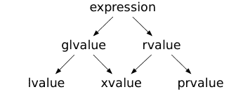
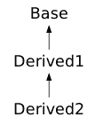
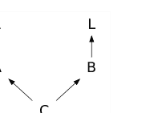
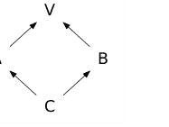
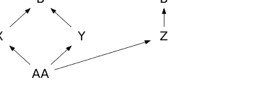
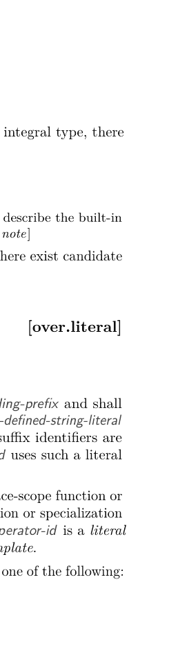
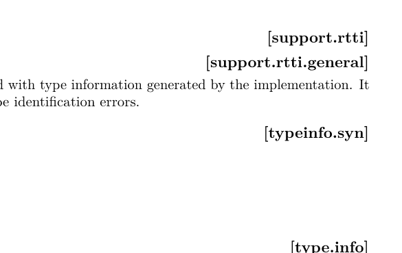

# ISO-IEC 14882-2020 信息技术——编程语言——C++


## 前言

ISO（国际标准化组织）和 IEC（国际电工委员会）构成了全球标准化的专门体系。作为 ISO 或 IEC 成员的国家机构，通过各自组织为处理特定技术活动领域而设立的技术委员会参与国际标准的制定。ISO 和 IEC 技术委员会在共同关切的领域开展合作。与 ISO 和 IEC 保持联系的其他国际组织、政府组织和非政府组织也参与这项工作。

用于制定本文件及其后续维护的程序在 ISO/IEC 指令第 1 部分中描述。尤其应注意不同类型的文件所需的不同批准标准。本文件依据 ISO/IEC 指令第 2 部分的编辑规则起草（见 www.iso.org/directives）。

请注意，本文件的某些内容可能涉及专利权。ISO 和 IEC 不承担识别任何或所有此类专利权的责任。在文件制定过程中识别出的任何专利权的详细信息将在引言和/或 ISO 收到的专利声明清单（见 www.iso.org/patents）或 IEC 收到的专利声明清单（见 http://patents.iec.ch）中给出。

本文件中使用的任何商品名称仅为方便用户而提供的信息，不构成认可。

关于标准的自愿性、ISO 中与合格评定相关的特定术语和表达的含义，以及 ISO 遵守世界贸易组织（WTO）《技术性贸易壁垒协定》（TBT）原则的信息，请参见 www.iso.org/iso/foreword.html。

本文件由联合技术委员会 ISO/IEC JTC 1（信息技术）下属分技术委员会 SC 22（编程语言、其环境和系统软件接口）制定。

本第六版取消并替代了经技术修订的第五版（ISO/IEC 14882:2017）。

与上一版相比，主要变化如下：

- 纳入 ISO/IEC TS 19217:2015、ISO/IEC TS 21425:2017、ISO/IEC TS 22277:2017、ISO/IEC TS 21544:2018 的规定，以及 ISO/IEC TS 19571:2016 和 ISO/IEC TS 19568:2017 的部分内容。
- 新增概念（concepts）、requires 子句、requires 表达式和 `<concepts>`（18.3）头文件
- 新增协程，包括 co_yield、co_await 和 co_return 关键字及 `<coroutine>`（17.12.2）头文件
- 新增模块、导入声明和导出声明
- 新增三路比较、默认化比较、比较运算符表达式的重写和 `<compare>`（17.11.1）头文件
- 新增指定初始化器
- 支持类类型和浮点类型作为非类型模板参数的类型
- 新属性 [[no_unique_address]]、[[likely]]、[[unlikely]]
- 支持在 [[nodiscard]] 属性中使用可选的说明字符串
- 能够使用 constinit 关键字要求常量初始化
- 能够使用 consteval 关键字要求常量求值
- 对常量求值的扩展
- 支持在类特有的 operator delete 函数中控制析构
- 新增 using enum 声明
- 新增 char8_t 类型
- 支持基于范围的 for 循环中的初始化语句
- 支持位域的默认成员初始化器
- 支持带括号的聚合初始化
- 对 lambda 表达式的扩展
- 对结构化绑定的扩展
- 支持嵌套命名空间定义中的内联命名空间
- 支持条件显式成员函数
- 对类模板实参推导的扩展
- 减少需要 `typename` 的情况
- 支持通过依赖于实参的名称查找调用未声明的 *template-id*
- 修订内存模型
- 使用 `__VA_OPT__` 扩展对可变参数宏的支持
- 特性测试宏和 `<version>`（17.3.2）头文件
- 新增范围（ranges）和 `<ranges>`（24.2）头文件
- 新增日历和时区支持
- 新增文本格式化库和 `<format>`（20.20.1）头文件
- 新增 `<barrier>`（32.8.3.2）、`<latch>`（32.8.2.2）和 `<semaphore>`（32.7.2）头文件
- 新增数学常量库和 `<numbers>`（26.9.1）头文件
- 支持表示源代码位置，以及 `<source_location>`（17.8.1）头文件
- 新增 span 视图和 `<span>`（22.7.2）头文件
- 新增可汇合线程类和 `<stop_token>`（32.3.2）头文件
- 对原子类型和操作的扩展
- 新增 `unsequenced` 执行策略
- 标准库中新增实用函数、类型和模板
- 新增位操作库和 `<bit>`（26.5.2）头文件
- 新增同步缓冲输出流和 `<syncstream>`（29.10.1）头文件
- 支持无序容器的异质查找
- 支持关联容器中的元素存在性检测
- 支持 `<numeric>`（25.9）算法中的移动语义
- 支持高效访问 `basic_stringbuf` 的缓冲区
- 扩展标准库中的常量表达式求值支持

对本文件的任何反馈或问题应提交给用户所在的国家标准机构。这些机构的完整列表可在 www.iso.org/members.html 上找到。

## 2 规范性引用文件 [intro.refs]

1 下列文件在文本中被引用，其部分或全部内容构成本文件的要求。对于注日期的引用，仅适用所引用的版本。对于未注日期的引用，适用所引用文件的最新版本（包括任何修订）。

- (1.1) — ISO/IEC 2382，*信息技术 — 词汇*
- (1.2) — ISO 8601:2004，*数据元和交换格式 — 信息交换 — 日期和时间表示*
- (1.3) — ISO/IEC 9899:2018，*编程语言 — C*
- (1.4) — ISO/IEC 9945:2003，*信息技术 — 可移植操作系统接口（POSIX¹）*
- (1.5) — ISO/IEC 10646，*信息技术 — 通用编码字符集（UCS）*
- (1.6) — ISO/IEC 10646:2003，² *信息技术 — 通用多八位编码字符集（UCS）*
- (1.7) — ISO 80000-2:2009，*量和单位 — 第 2 部分：自然科学和技术中使用的数学符号*
- (1.8) — Ecma International，*ECMAScript³ 语言规范*，标准 Ecma-262，第三版，1999 年。

2 ISO/IEC 9899:2018 第 7 条所描述的库以下称为 C 标准库。⁴

3 ISO/IEC 9945:2003 中描述的操作系统接口以下称为 POSIX。

4 标准 Ecma-262 中描述的 ECMAScript 语言规范以下称为 ECMA-262。

5 [注 1：引用 ISO/IEC 10646:2003 仅用于支持已弃用的特性（D.21）。— 注完]

## 3 术语和定义 [intro.defs]

1 为本文件之目的，ISO/IEC 2382 中给出的术语和定义、ISO 80000-2:2009 中给出的术语、定义和符号，以及下列术语和定义适用。

2 ISO 和 IEC 在以下地址维护用于标准化的术语数据库：

- (2.1) — ISO 在线浏览平台：可在 https://www.iso.org/obp 获取
- (2.2) — IEC 电子百科（Electropedia）：可在 http://www.electropedia.org/ 获取

3 仅在本文件的一小部分中使用的术语在其使用处定义，并在其定义处用斜体表示。

### 3.1 访问（access） [defns.access]

⟨执行时动作⟩ 读取或修改对象的值

> [注 1：只有标量类型的对象才能被访问。对标量对象的读取在 7.3.2 中描述，对标量对象的修改在 7.6.19、7.6.1.6 和 7.6.2.3 中描述。尝试读取或修改类类型对象通常会调用构造函数（11.4.5）或赋值运算符（11.4.6）；此类调用本身不构成访问，尽管它们可能涉及对标量子对象的访问。— 注完]

### 3.2 任意位置流（arbitrary-positional stream） [defns.arbitrary.stream]

⟨库⟩ 可以在流的长度范围内定位到任何整数位置的流

> [注 1：每个任意位置流也是可重定位流（3.42）。— 注完]

### 3.3 实参（argument） [defns.argument]

⟨函数调用表达式⟩ 位于括号界定的逗号分隔列表中的表达式

### 3.4 实参（argument） [defns.argument.macro]

⟨函数式宏⟩ 位于括号界定的逗号分隔列表中的预处理记号序列

### 3.5 实参（argument） [defns.argument.throw]

⟨抛出表达式⟩ throw 的操作数

### 3.6 实参（argument） [defns.argument.templ]

⟨模板实例化⟩ 位于尖括号界定的逗号分隔列表中的常量表达式、类型标识或标识表达式

### 3.7 阻塞（block） [defns.block]

⟨执行⟩ 在继续执行越过阻塞操作之前，等待某个条件（除实现执行执行线程的执行步骤之外）得到满足

### 3.8 块（block） [defns.block.stmt]

⟨语句⟩ 复合语句

### 3.9 字符（character） [defns.character]

⟨库⟩ 按顺序处理时可以表示文本的对象

> [注 1：该术语不仅指 char、char8_t、char16_t、char32_t 和 wchar_t 对象（6.8.2），还指任何可由提供第 21 条、第 28 条、第 29 条或第 30 条中所定义的类型表示的值。— 注完]


### 3.21 处理函数 [defns.handler]

⟨库⟩ 非保留函数，其定义可由 C++ 程序提供

> [注1：C++ 程序可以在执行过程中的各个点，通过在任何安装处理函数的库函数（第17章）调用时提供指向该函数的指针，来指定处理函数。 — 尾注]

### 3.22 病式程序 [defns.ill.formed]

不是良构程序（3.60）的程序

### 3.23 实现定义行为 [defns.impl.defined]

对于良构程序构造和正确数据，依赖于实现并且由每个实现进行文档化的行为。

### 3.24 指针上的实现定义严格全序 [defns.order.ptr]

⟨库⟩ 对所有指针值的实现定义严格全序，使得该顺序与内置运算符 `<`、`>`、`<=`、`>=` 和 `<=>` 所施加的偏序一致。

### 3.25 实现限制 [defns.impl.limits]

实现施加于程序的限制。

### 3.26 iostream 类模板 [defns.iostream.templates]

⟨库⟩ 在头文件 `<iosfwd>` 中声明并接受两个模板参数的模板。

> [注1：参数名为 charT 和 traits。参数 charT 是字符容器类，参数 traits 是定义 charT 所表示的字符类型的附加特征和函数的类，这些特征和函数是实现 iostream 类模板所必需的。 — 尾注]

### 3.27 本地特定行为 [defns.locale.specific]

依赖于每个实现所记载的国籍、文化和语言本地惯例的行为。

### 3.28 修改器函数 [defns.modifier]

⟨库⟩ 类的成员函数，但构造函数、赋值运算符或析构函数除外，它改变类的对象的状态。

### 3.29 移动赋值 [defns.move.assign]

⟨库⟩ 将某个对象类型的右值赋给相同类型的可修改左值。

### 3.30 移动构造 [defns.move.constr]

⟨库⟩ 使用相同类型的右值直接初始化某个类型的对象。

### 3.31 多字节字符 [defns.multibyte]

表示源环境或执行环境扩展字符集中成员的一个或多个字节的序列。

> [注1：扩展字符集是基本字符集（5.3）的超集。 — 尾注]

### 3.32 NTCTS [defns.ntcts]

⟨库⟩ 具有字符类型的值序列，该序列位于终止空字符类型值 `charT()` 之前。

#### 4.1.2 抽象机 [intro.abstract]

1 本文档中的语义描述定义了一个参数化的非确定性抽象机。本文档对符合实现的构造没有要求。特别是，它们无需复制或模仿抽象机的结构。相反，符合实现仅需要模拟抽象机的可观察行为，如下所述。⁷

2 本文档将抽象机的某些方面和操作描述为实现定义的（例如，`sizeof(int)`）。这些构成了抽象机的参数。每个实现都应包含文档，描述其在这些方面的特性和行为。⁸ 此类文档应定义与该实现对应的抽象机实例（下文称为“对应实例”）。

3 本文档将抽象机的某些其他方面和操作描述为未指明的（例如，函数调用中参数求值的顺序（7.6.1.3））。在可能的情况下，本文档定义了一组允许的行为。这些定义了抽象机的非确定性方面。对于给定程序和给定输入，抽象机的实例因此可以具有多于一种可能的执行。

4 本文档将某些其他操作描述为未定义的（例如，试图修改 `const` 对象的效果）。

> [注1：本文档对包含未定义行为的程序的行为不施加任何要求。 — 尾注]

5 执行良构程序的符合实现应产生与抽象机对应实例使用相同程序和相同输入的可能执行之一相同的可观察行为。但是，如果任何此类执行包含未定义操作，本文档对该实现使用该输入执行该程序不施加任何要求（甚至对于第一个未定义操作之前的操作也不施加要求）。

6 对符合实现的最低要求是：

- (6.1) — 通过 volatile 泛左值的访问严格按照抽象机的规则进行求值。
- (6.2) — 在程序终止时，写入文件的所有数据应与根据抽象语义执行程序可能产生的结果之一相同。
- (6.3) — 交互设备的输入和输出动态应以这样的方式发生：提示输出在程序等待输入之前实际送达。什么是交互设备是实现定义的。

这些统称为程序的可观察行为。

> [注2：每个实现可以定义抽象语义和实际语义之间更严格的对应关系。 — 尾注]

#### 4.2 本文档的结构 [intro.structure]

1 第5章至第15章描述了 C++ 编程语言。该描述包括以4.3中所述形式给出的详细语法规范。为方便起见，附录A重复了所有这些语法规范。

2 第17章至第32章和附录D（库条款）描述了 C++ 标准库。该描述包括以第16章所述形式给出的构成库的实体和宏的详细描述。

3 附录B推荐了一致性实现容量的下限。

4 附录C总结了 C++ 自首次发布描述以来的演变，并详细解释了 C++ 与 C 之间的差异。C++ 的某些功能仅出于兼容性目的而存在；附录D描述了这些功能。

#### 4.3 语法表示法 [syntax]

1 在本文档使用的语法表示法中，语法类别用斜体表示，文字单词和字符用等宽字体表示。备选方案列在单独行上，除非少数情况下长备选集用短语“one of”标记。如果备选方案的文本太长无法放在一行，则文本在后续行中继续，并从第一行缩进。可选终结符或非终结符用下标“opt”表示，所以

`{ expression_opt }`

表示用大括号括起来的可选表达式。

2 语法类别的名称通常按照下列规则选择：

- (2.1) — X-name 是在确定其含义的上下文中使用标识符（例如，class-name，typedef-name）。
- (2.2) — X-id 是没有上下文相关含义的标识符（例如，qualified-id）。
- (2.3) — X-seq 是一个或多个 X，之间没有分隔符（例如，declaration-seq 是声明的序列）。
- (2.4) — X-list 是一个或多个 X，由逗号分隔（例如，identifier-list 是由逗号分隔的标识符序列）。

## 5 词法约定 [lex]

### 5.1 独立翻译 [lex.separate]

1 程序文本保存在本文档中称为*源文件*的单元中。一个源文件连同通过预处理指令 `#include` 包含的所有头文件（16.4.2.3）和源文件（15.3），减去任何由条件包含（15.2）预处理指令跳过的源行，称为*翻译单元*。

> [注1：C++ 程序不必同时翻译。 — 尾注]

> [注2：先前翻译的翻译单元和实例化单元可以单独或作为库保留。程序的不同翻译单元通过（例如）调用具有外部或模块链接的标识符的函数、操作具有外部或模块链接的标识符的对象或操作数据文件来通信（6.6）。翻译单元可以单独翻译，然后链接以产生可执行程序（6.6）。 — 尾注]

### 5.2 翻译阶段 [lex.phases]

1 翻译的语法规则之间的优先级由以下阶段指定。⁹

1. 物理源文件字符以实现定义的方式映射到基本源字符集（必要时为行尾指示符引入换行字符）。接受的物理源文件字符集是实现定义的。任何不在基本源字符集（5.3）中的源文件字符都被替换为指定该字符的*通用字符名称*。实现可以使用任何内部编码，只要源文件中遇到的实际扩展字符，与源文件中作为*通用字符名称*表示的同一扩展字符（例如，使用 `\uXXXX` 表示法）在除原始字符串字面量中此替换被撤销（5.4）之外的情况下被等价处理。

2. 每个反斜杠字符（`\`）后紧跟换行字符的实例被删除，拼接物理源行以形成逻辑源行。任何物理源行上的最后一个反斜杠才有资格成为这种拼接的一部分。除非在原始字符串字面量中拼接被撤销，如果拼接产生与*通用字符名称*语法匹配的字符序列，则行为未定义。非空且不以换行字符结尾的源文件，或者在任何此类拼接之前以紧跟反斜杠的换行字符结尾的源文件，应被处理，如同追加了一个额外的换行字符。

3. 源文件被分解为预处理记号（5.4）和白空格字符（包括注释）的序列。源文件不应以部分预处理记号或部分注释结尾。¹⁰ 每个注释被替换为一个空格字符。换行字符被保留。除换行外的非空白字符序列是保留还是替换为一个空格字符，是未指明的。将源文件字符划分为预处理记号的过程是上下文相关的。

> [示例1：参见 `#include` 预处理指令中 `<` 的处理。 — 结束示例]

4. 执行预处理指令，展开宏调用，执行 `_Pragma` 一元运算符表达式。如果通过记号连接（15.6.4）产生与*通用字符名称*语法匹配的字符序列，则行为未定义。`#include` 预处理指令使指定的头文件或源文件从阶段1到阶段4递归处理。然后所有预处理指令被删除。

5. *字符字面量*或*字符串字面量*中的每个基本源字符集成员，以及*字符字面量*或非原始字符串字面量中的每个转义序列和*通用字符名称*，都被转换为执行字符集的相应成员（5.13.3, 5.13.5）；如果没有相应成员，则转换为实现定义的成员，但该成员不是空（宽）字符。¹¹

9) 实现的行为如同这些独立阶段发生一样，尽管实际上不同阶段可以合并在一起。

10) 部分预处理记号将产生于源文件以需要终止字符序列的多字符记号的第一部分结尾，例如缺少右双引号 `"` 或 `>` 的*头文件名*。部分注释将产生于源文件以未闭合的 `/*` 注释结尾。

11) 实现不必将所有不对应的源字符转换为相同的执行字符。


### 5.2 翻译阶段 [lex.phases]

6. 相邻的字符串字面量标记会被连接。

7. 分隔标记的空白字符不再具有意义。每个预处理标记被转换为一个标记（5.6）。由此产生的标记在语法上和语义上被分析并作为翻译单元进行翻译。

> [注 1：分析并翻译标记的过程偶尔会使一个标记被替换为一系列其他标记（13.3）。——注结束]

是否需要提供当前翻译单元具有接口依赖关系（10.1、10.3）的模块单元和头单元的源文件，由实现定义。

> [注 2：源文件、翻译单元和已翻译的翻译单元不一定需要存储为文件，也不需要与任何外部表示之间存在一对一的对应关系。描述仅为概念性的，并未规定任何特定的实现。——注结束]

8. 已翻译的翻译单元和实例化单元按如下方式合并：

> [注 3：这些可以全部或部分从库中提供。——注结束]

检查每个已翻译的翻译单元以生成所需实例化的列表。

> [注 4：这可能包括已明确请求（13.9.3）的实例化。——注结束]

定位所需模板的定义。是否需要提供包含这些定义的翻译单元的源文件，由实现定义。

> [注 5：实现可以选择将足够的信息编码到已翻译的翻译单元中，以确保此处不需要源文件。——注结束]

执行所有所需的实例化以生成实例化单元。

> [注 6：这些类似于已翻译的翻译单元，但不包含对未实例化模板的引用，也没有模板定义。——注结束]

如果任何实例化失败，程序格式错误。

9. 解析所有外部实体引用。链接库组件以满足对当前翻译中未定义的实体的外部引用。所有此类转换器输出被收集到一个程序映像中，其中包含在执行环境中执行所需的信息。

### 5.3 字符集 [lex.charset]

1 基本源字符集由 96 个字符组成：空格字符、表示水平制表符、垂直制表符、换页符和换行的控制字符，加上以下 91 个图形字符：¹²

a b c d e f g h i j k l m n o p q r s t u v w x y z
A B C D E F G H I J K L M N O P Q R S T U V W X Y Z
0 1 2 3 4 5 6 7 8 9
_ { } [ ] # ( ) < > % : ; . ? * + - / ^ & | ~ ! = , \ " '

2 通用字符名构造提供了一种命名其他字符的方法。

```
hex-quad:
    hexadecimal-digit hexadecimal-digit hexadecimal-digit hexadecimal-digit
universal-character-name:
    \u hex-quad
    \U hex-quad hex-quad
```

通用字符名指定 ISO/IEC 10646 中（如果有）的字符，其代码点为通用字符名中十六进制数字序列表示的十六进制数。如果该数字不是代码点或为代理代码点，则程序格式错误。非字符代码点和保留代码点被视为指定与任何 ISO/IEC 10646 字符不同的单独字符。如果在字符字面量或字符串字面量的 c-char-sequence、s-char-sequence 或 r-char-sequence 之外（在用户定义字面量内也包括在内）的通用字符名对应于控制字符或基本源字符集中的字符，则程序格式错误。¹³

### 5.4 预处理标记 [lex.pptoken]

4 import-keyword 由处理 import 指令（15.5）产生，module-keyword 由预处理 module 指令（15.4）产生，而 export-keyword 由预处理前两种指令中的任一种产生。

> [注 1：它们没有任何可观察的拼写。——注结束]

> 5 [示例 2：程序片段 0xe+foo 被解析为预处理数字标记（不是有效整数字面量或浮点字面量标记），即使将其解析为三个预处理标记 0xe、+ 和 foo 也能产生有效表达式（例如，如果 foo 被定义为宏 1）。同样，程序片段 1E1 被解析为预处理数字（是有效浮点字面量标记），无论 E 是否为宏名。——示例结束]

> 6 [示例 3：程序片段 x+++++y 被解析为 x ++ ++ + y，如果 x 和 y 具有整型，则违反了增量运算符的约束，即使解析为 x ++ + ++ y 也可以得到正确的表达式。——示例结束]

### 5.5 替代标记 [lex.digraph]

1 为某些运算符和标点符号提供了替代标记表示形式。¹⁴

2 在语言的所有方面，每个替代标记的行为与其实用标记相同，只是拼写不同。¹⁵ 替代标记的集合定义在表 1 中。

### 表 1：替代标记 [tab:lex.digraph]

| Alternative | Primary | Alternative | Primary | Alternative | Primary |
|---|---|---|---|---|---|
| `<%` | `{` | `and` | `&&` | `and_eq` | `&=` |
| `%>` | `}` | `bitor` | `\|` | `or_eq` | `\|=` |
| `<:` | `[` | `or` | `\|\|` | `xor_eq` | `^=` |
| `:>` | `]` | `xor` | `^` | `not` | `!` |
| `%:` | `#` | `compl` | `~` | `not_eq` | `!=` |
| `%:%:` | `##` | `bitand` | `&` | | |

### 5.6 标记 [lex.token]

```
token:
    identifier
    keyword
    literal
    operator-or-punctuator
```

1 有五种标记：标识符、关键字、字面量、¹⁶ 运算符和其他分隔符。空白、水平和垂直制表符、换行符、换页符和注释（统称为“空白”），如下面所述，除用于分隔标记外，均被忽略。

> [注 1：为了分隔否则相邻的标识符、关键字、数字字面量和包含字母字符的替代标记，需要一些空白。——注结束]

### 5.7 注释 [lex.comment]

1 字符 /* 开始注释，以字符 */ 终止。这些注释不嵌套。字符 // 开始注释，以下一个换行符字符之前立即终止。如果此类注释中存在换页符或垂直制表符字符，则在它与终止注释的换行符之间只能出现空白字符；不需要诊断。

> [注 1：注释字符 //、/* 和 */ 在 // 注释中没有特殊含义，并被视为其他字符。同样，注释字符 // 和 /* 在 /* 注释中没有特殊含义。——注结束]

```
[Example 1:
#define R "x"
const char* s = R"y";    // ill-formed raw string, not "x" "y"
— end example]
```

### 5.8 头文件名称 [lex.header]

```
header-name:
  < h-char-sequence >
  " q-char-sequence "

h-char-sequence:
  h-char
  h-char-sequence h-char

h-char:
  any member of the source character set except new-line and >

q-char-sequence:
  q-char
  q-char-sequence q-char

q-char:
  any member of the source character set except new-line and "
```

1 [注 1：头文件名称预处理标记仅出现在 #include 预处理指令、__has_include 预处理表达式中，或在 import 标记的某些出现之后（见 5.4）。——注结束]

两种形式的头文件名称中的序列以实现定义的方式映射到头文件或 15.3 中指定的外部源文件名。

2 在 q-char-sequence 或 h-char-sequence 中出现字符 ' 或 \ 或字符序列 /* 或 // 之一是条件支持的，具有实现定义的语义，同样在 h-char-sequence 中出现字符 " 也是如此。¹⁷

### 5.9 预处理数字 [lex.ppnumber]

```
pp-number:
  digit
  . digit
  pp-number digit
  pp-number identifier-nondigit
  pp-number ' digit
  pp-number ' nondigit
  pp-number e sign
  pp-number E sign
  pp-number p sign
  pp-number P sign
  pp-number .
```

1 预处理数字标记在词法上包括所有整数字面量标记（5.13.2）和所有浮点字面量标记（5.13.4）。

2 预处理数字没有类型或值；它在成功转换为整数字面量标记或浮点字面量标记后才获得两者。

### 5.10 标识符 [lex.name]

```
identifier:
  identifier-nondigit
  identifier identifier-nondigit
  identifier digit

identifier-nondigit:
  nondigit
  universal-character-name
```

> 14) 这些包括“双字符”和额外的保留字。“双字符”（由两个字符组成的标记）这一术语并不完全准确，因为其中一个替代预处理标记是 %:%:，当然几个主标记包含两个字符。尽管如此，那些不是词法关键字的替代标记在口语中通常被称为“双字符”。

> 15) 因此 [ 和 <: 的“字符串化”值（15.6.3）将不同，保持源拼写，但标记在其他方面可以自由互换。

> 16) 字面量包括字符串和字符及数字字面量。

> 17) 因此，类似于转义序列的字符序列可能导致错误，被解释为转义序列对应的字符，或具有完全不同的含义，具体取决于实现。


## ISO/IEC 14882:2020(E)

1 表5中列出的标识符保留用作关键字（即，在阶段7中它们无条件地被当作关键字），但属性标记（attribute-token）中的情况除外（9.12.1）。

> [注1：register 关键字目前未使用，但保留供将来使用。— 注结束]

## 表5：关键字 [tab:lex.key]

| alignas | constinit | false | public | true |
| alignof | const_cast | float | register | try |
| asm | continue | for | reinterpret_cast | typedef |
| auto | co_await | friend | requires | typeid |
| bool | co_return | goto | return | typename |
| break | co_yield | if | short | union |
| case | decltype | inline | signed | unsigned |
| catch | default | int | sizeof | using |
| char | delete | long | static | virtual |
| char8_t | do | mutable | static_assert | void |
| char16_t | double | namespace | static_cast | volatile |
| char32_t | dynamic_cast | new | struct | wchar_t |
| class | else | noexcept | switch | while |
| concept | enum | nullptr | template |  |
| const | explicit | operator | this |  |
| consteval | export | private | thread_local |  |
| constexpr | extern | protected | throw |  |

2 此外，表6中所示的一些运算符和标点符号（5.5）的替代表示也被保留，不得用于其他用途。

## 表6：替代表示 [tab:lex.key.digraph]

| and | and_eq | bitand | bitor | compl | not |
| not_eq | or | or_eq | xor | xor_eq |  |

### 5.12 运算符和标点符号 [lex.operators]

1 C++ 程序的词法表示包括许多预处理记号，它们用于预处理器的语法中，或被转换为运算符和标点符号的记号：

preprocessing-op-or-punc:
  preprocessing-operator
  operator-or-punctuator

preprocessing-operator: one of
  #   ##   %:   %:%:

operator-or-punctuator: one of
  { } [ ] ( ) 
  <: :> <% %> ; : ... 
  ? :: . .* -> ->* ~ 
  ! + - * / % ^ & | 
  = += -= *= /= %= ^= &= |= 
  == != < > <= >= <=> && || 
  << >> <<= >>= ++ -- , 
  and or xor not bitand bitor compl 
  and_eq or_eq xor_eq not_eq

每个 operator-or-punctuator 在翻译阶段7（5.2）中被转换为单个记号。

### 5.13 字面量 [lex.literal]

#### 5.13.1 字面量的种类 [lex.literal.kinds]

1 有几种字面量。19

```
literal:
  integer-literal
  character-literal
  floating-point-literal
  string-literal
  boolean-literal
  pointer-literal
  user-defined-literal
```

#### 5.13.2 整数字面量 [lex.icon]

```
integer-literal:
  binary-literal integer-suffix_opt
  octal-literal integer-suffix_opt
  decimal-literal integer-suffix_opt
  hexadecimal-literal integer-suffix_opt
```

```
binary-literal:
  0b binary-digit
  0B binary-digit
  binary-literal 'opt binary-digit
```

```
octal-literal:
  0
  octal-literal 'opt octal-digit
```

```
decimal-literal:
  nonzero-digit
  decimal-literal 'opt digit
```

```
hexadecimal-literal:
  hexadecimal-prefix hexadecimal-digit-sequence
```

```
binary-digit: one of
  0 1
```

```
octal-digit: one of
  0 1 2 3 4 5 6 7
```

```
nonzero-digit: one of
  1 2 3 4 5 6 7 8 9
```

```
hexadecimal-prefix: one of
  0x 0X
```

```
hexadecimal-digit-sequence:
  hexadecimal-digit
  hexadecimal-digit-sequence 'opt hexadecimal-digit
```

```
hexadecimal-digit: one of
  0 1 2 3 4 5 6 7 8 9
  a b c d e f
  A B C D E F
```

```
integer-suffix:
  unsigned-suffix long-suffix_opt
  unsigned-suffix long-long-suffix_opt
  long-suffix unsigned-suffix_opt
  long-long-suffix unsigned-suffix_opt
```

```
unsigned-suffix: one of
  u U
```

```
long-suffix: one of
  l L
```

long-long-suffix: one of
ll LL

1 在整数字面量中，二进制数字、八进制数字、十进制数字或十六进制数字的序列被解释为如表7所示的 N 进制整数；该数字序列中词法上的第一个数字是最高有效位。

> [注1：在确定值时，前缀和任何可选的分隔单引号都会被忽略。— 注结束]

## 表7：整数字面量的进制 [tab:lex.icon.base]

| 整数字面量的种类 | 基数 N |
|---|---|
| 二进制字面量 | 2 |
| 八进制字面量 | 8 |
| 十进制字面量 | 10 |
| 十六进制字面量 | 16 |

2 十六进制数字 a 到 f 以及 A 到 F 的十进制值为十到十五。

> [示例1：数字十二可以写成 12、014、0XC 或 0b1100。整数字面量 1048576、1'048'576、0X100000、0x10'0000 和 0'004'000'000 都具有相同的值。— 示例结束]

3 整数字面量的类型是表8列表中对应其可选整数后缀且能表示其值的第一个类型。整数字面量是一个纯右值（prvalue）。

## 表8：整数字面量的类型 [tab:lex.icon.type]

| 整数后缀 | 十进制整数字面量 | 其他整数字面量 |
|---|---|---|
| 无 | int<br>long int<br>long long int | int<br>unsigned int<br>long int<br>unsigned long int<br>long long int<br>unsigned long long int |
| u 或 U | unsigned int<br>unsigned long int<br>unsigned long long int | unsigned int<br>unsigned long int<br>unsigned long long int |
| l 或 L | long int<br>long long int | long int<br>unsigned long int<br>long long int<br>unsigned long long int |
| 同时包含 u 或 U 与 l 或 L | unsigned long int<br>unsigned long long int | unsigned long int<br>unsigned long long int |
| ll 或 LL | long long int | long long int<br>unsigned long long int |
| 同时包含 u 或 U 与 ll 或 LL | unsigned long long int | unsigned long long int |

4 如果整数字面量无法由其列表中的任何类型表示，而扩展整数类型（6.8.2）可以表示其值，则它可以具有该扩展整数类型。如果整数字面量列表中的所有类型都是有符号的，则扩展整数类型应为有符号类型。如果整数字面量列表中的所有类型都是无符号的，则扩展整数类型应为无符号类型。如果列表中同时包含有符号和无符号类型，则扩展整数类型可以是有符号的或无符号的。如果某个翻译单元中包含无法由任何允许类型表示的整数字面量，则该程序是非良构的。

#### 5.13.3 字符字面量 [lex.ccon]

character-literal:
    encoding-prefix_opt ' c-char-sequence '

encoding-prefix: one of
    u8 u U L

c-char-sequence:
    c-char
    c-char-sequence c-char

c-char:
    any member of the basic source character set except the single-quote ’, backslash \, or new-line character
    escape-sequence
    universal-character-name

escape-sequence:
    simple-escape-sequence
    octal-escape-sequence
    hexadecimal-escape-sequence

simple-escape-sequence: one of
    \’  \"  \?  \\
    \a  \b  \f  \n  \r  \t  \v

octal-escape-sequence:
    \ octal-digit
    \ octal-digit octal-digit
    \ octal-digit octal-digit octal-digit

hexadecimal-escape-sequence:
    \x hexadecimal-digit
    hexadecimal-escape-sequence hexadecimal-digit

1 不以 u8、u、U 或 L 开头的字符字面量是普通字符字面量。包含单个在执行字符集中可表示的 c-char 的普通字符字面量的类型为 char，其值等于该 c-char 在执行字符集中的编码数值。包含多个 c-char 的普通字符字面量是多字符字面量。多字符字面量，或包含单个在执行字符集中不可表示的 c-char 的普通字符字面量，是有条件支持的，其类型为 int，并且具有实现定义的值。

2 以 u8 开头的字符字面量（例如 u8’w’）是类型为 char8_t 的字符字面量，称为 UTF-8 字符字面量。UTF-8 字符字面量的值等于其 ISO/IEC 10646 码点值，前提是该码点值可以编码为单个 UTF-8 代码单元。
[注1：也就是说，前提是码点值在 [0, 7F]（十六进制）范围内。— 注结束]
如果该值不能用单个 UTF-8 代码单元表示，则程序是非良构的。包含多个 c-char 的 UTF-8 字符字面量是非良构的。

3 以字母 u 开头的字符字面量（例如 u’x’）是类型为 char16_t 的字符字面量，称为 UTF-16 字符字面量。UTF-16 字符字面量的值等于其 ISO/IEC 10646 码点值，前提是该码点值可以用单个 16 位代码单元表示。
[注2：也就是说，前提是码点值在 [0, FFFF]（十六进制）范围内。— 注结束]
如果该值不能用单个 16 位代码单元表示，则程序是非良构的。包含多个 c-char 的 UTF-16 字符字面量是非良构的。

4 以字母 U 开头的字符字面量（例如 U’y’）是类型为 char32_t 的字符字面量，称为 UTF-32 字符字面量。包含单个 c-char 的 UTF-32 字符字面量的值等于其 ISO/IEC 10646 码点值。包含多个 c-char 的 UTF-32 字符字面量是非良构的。

5 以字母 L 开头的字符字面量（例如 L’z’）是宽字符字面量。宽字符字面量的类型为 wchar_t。包含单个 c-char 的宽字符字面量的值等于该 c-char 在执行宽字符集中的编码数值，除非该 c-char 在执行宽字符集中没有表示，在这种情况下该值是实现定义的。
[注3：类型 wchar_t 能够表示执行宽字符集的所有成员（见 6.8.2）。— 注结束]
包含多个 c-char 的宽字符字面量的值是实现定义的。

6 某些非图形字符，单引号 ’、双引号 "、问号 ? 和反斜杠 \，可以根据表9来表示。双引号 " 和问号 ? 可以分别表示为它们自身或通过转义序列 \" 和 \?，但单引号 ’


# ISO/IEC 14882:2020(E)

```
binary-exponent-part:
    p sign_opt digit-sequence
    P sign_opt digit-sequence

sign: one of
    + -

digit-sequence:
    digit
    digit-sequence opt digit

floating-point-suffix: one of
    f l F L
```

1 浮点字面量的类型由其浮点后缀决定，如表 10 所述。

## 表 10：浮点字面量的类型 [tab:lex.fcon.type]

| floating-point-suffix | type |
|---|---|
| none | double |
| f or F | float |
| l or L | long double |

2 浮点字面量的有效数字是十进制浮点字面量的 fractional-constant 或 digit-sequence，或十六进制浮点字面量的 hexadecimal-fractional-constant 或 hexadecimal-digit-sequence。在有效数字中，数字或十六进制数字序列以及可选的句点被解释为基数 N 的实数 s，其中 N 对于十进制浮点字面量为 10，对于十六进制浮点字面量为 16。 [注 1：确定值时，任何可选的分隔单引号都被忽略。——注结束]

如果存在 exponent-part 或 binary-exponent-part，则浮点字面量的指数 e 是将可选符号和数字序列解释为基数 10 整数的结果。否则，指数 e 为 0。字面量的缩放值为 s × 10^e 对于十进制浮点字面量，以及 s × 2^e 对于十六进制浮点字面量。

> [示例 1：浮点字面量 49.625 和 0xC.68p+2 具有相同的值。浮点字面量 1.602'176'565e-19 和 1.602176565e-19 具有相同的值。——示例结束]

3 如果缩放值不在其类型的可表示值范围内，则程序格式错误。否则，浮点字面量的值是如果可表示则为缩放值，否则为最接近缩放值的较大或较小的可表示值，以实现定义的方式选择。

### 5.13.5 字符串字面量 [lex.string]

```
string-literal:
    encoding-prefix_opt " s-char-sequence_opt "
    encoding-prefix_opt R raw-string

s-char-sequence:
    s-char
    s-char-sequence s-char

s-char:
    any member of the basic source character set except the double-quote ", backslash \, or new-line character
    escape-sequence
    universal-character-name

raw-string:
    " d-char-sequence_opt ( r-char-sequence_opt ) d-char-sequence_opt "

r-char-sequence:
    r-char
    r-char-sequence r-char

r-char:
    any member of the source character set, except a right parenthesis ) followed by
    the initial d-char-sequence (which may be empty) followed by a double quote ".

d-char-sequence:
    d-char
    d-char-sequence d-char
```

# ISO/IEC 14882:2020(E)

*d-char:* 除了空格、左括号 (、右括号 )、反斜杠 \ 以及表示水平制表符、垂直制表符、换页符和换行的控制字符之外，基本源字符集的任何成员。

1 具有 R 前缀的 *string-literal* 是 *raw string literal*。*d-char-sequence* 用作分隔符。*raw-string* 的终止 *d-char-sequence* 与初始 *d-char-sequence* 相同的字符序列。*d-char-sequence* 最多应包含 16 个字符。

2 [注 1：字符 ‘(‘ 和 ‘)’’ 允许出现在 *raw-string* 中。因此，R"delimiter((a|b))delimiter" 等价于 "(a|b)"。——注结束]

3 [注 2：原始字符串字面量中的源文件换行会导致结果执行字符串字面量中出现换行。假设以下示例中各行开头没有空白，断言将成功：

```
const char* p = R"(a\
b
c)";
assert(std::strcmp(p, "a\\\n\nb\nc") == 0);
```

——注结束

4 [示例 1：原始字符串 R"a( )\ a" )a" 等价于 "\n)\\na\"\n"。原始字符串 R"(x = \"y\")" 等价于 "x = \"\\\"y\\\"\" 。——示例结束]

5 在翻译阶段 6 之后，不以 *encoding-prefix* 开头的 *string-literal* 是 *ordinary string literal*。普通字符串字面量具有类型“n 个 const char 的数组”，其中 n 为如下定义的字符串大小，具有静态存储期 (6.7.5)，并用给定的字符初始化。

6 以 u8 开头的 *string-literal*，例如 u8"asdf"，是 *UTF-8 string literal*。UTF-8 字符串字面量具有类型“n 个 const char8_t 的数组”，其中 n 为如下定义的字符串大小；对象表示 (6.8) 的每个连续元素具有字符串的 UTF-8 编码的对应代码单元的值。

7 普通字符串字面量和 UTF-8 字符串字面量也称为窄字符串字面量。

8 以 u 开头的 *string-literal*，例如 u"asdf"，是 *UTF-16 string literal*。UTF-16 字符串字面量具有类型“n 个 const char16_t 的数组”，其中 n 为如下定义的字符串大小；数组的每个连续元素具有字符串的 UTF-16 编码的对应代码单元的值。

[注 3：单个 c-char 可能产生 UTF-16 字符形式的高低代理对的多个 char16_t 字符。代理对是对单个代码点作为两个 16 位代码单元序列的表示。——注结束]

9 以 U 开头的 *string-literal*，例如 U"asdf"，是 *UTF-32 string literal*。UTF-32 字符串字面量具有类型“n 个 const char32_t 的数组”，其中 n 为如下定义的字符串大小；数组的每个连续元素具有字符串的 UTF-32 编码的对应代码单元的值。

10 以 L 开头的 *string-literal*，例如 L"asdf"，是 *wide string literal*。宽字符串字面量具有类型“n 个 const wchar_t 的数组”，其中 n 为如下定义的字符串大小；它用给定的字符初始化。

11 在翻译阶段 6 (5.2) 中，相邻的 *string-literals* 会被连接。如果两个 *string-literals* 具有相同的 *encoding-prefix*，则 resulting concatenated *string-literal* 具有该 *encoding-prefix*。如果一个 *string-literal* 没有 *encoding-prefix*，则将其视为具有与另一个操作数相同的 *encoding-prefix* 的 *string-literal*。如果 UTF-8 字符串字面量标记与宽字符串字面量标记相邻，则程序格式错误。任何其他连接都是条件支持的，具有实现定义的行为。

[注 4：此连接是解释，而不是转换。因为解释发生在翻译阶段 6（在每个字符从 *string-literal* 翻译为来自适当字符集的值之后），所以 *string-literal* 的初始原始性对连接的解释或格式良好性没有影响。——注结束]

表 11 给出了一些有效连接的示例。

## 表 11：字符串字面量连接 [tab:lex.string.concat]

| Source | Means | Source | Means | Source | Means |
|---|---|---|---|---|---|
| u"a" u"b" u"ab" | U"a" U"b" U"ab" | L"a" L"b" L"ab" |
| u"a" "b" u"ab" | U"a" "b" U"ab" | L"a" "b" L"ab" |
| "a" u"b" u"ab" | "a" U"b" U"ab" | "a" L"b" L"ab" |

连接字符串中的字符保持区分。

> [示例 2：
> "\xA" "B"
> 连接后包含两个字符 '\xA' 和 'B'（而不是单个十六进制字符 '\xAB'）。
> ——示例结束]

12 在任何必要的连接之后，在翻译阶段 7 (5.2) 中，'\0' 会被追加到每个 string-literal，以便扫描字符串的程序可以找到其结束位置。

13 非原始字符串字面量中的转义序列和通用字符名具有与字符字面量 (5.13.3) 相同的含义，除了单引号 ' 可以由其本身或转义序列 \' 表示，双引号 " 必须前面加上 \，并且 UTF-16 字符串字面量中的通用字符名可能产生代理对。在窄字符串字面量中，通用字符名可能由于多字节编码而映射到一个以上的 char 或 char8_t 元素。char32_t 或宽字符串字面量的大小是转义序列、通用字符名和其他字符的总数量，外加终止 U'\0' 或 L'\0' 的一个。UTF-16 字符串字面量的大小是转义序列、通用字符名和其他字符的总数量，外加每个需要代理对的字符的一个，外加终止 u'\0' 的一个。

> [注 5：char16_t 字符串字面量的大小是代码单元的数量，而不是字符的数量。——注结束]

> [注 6：任何通用字符名都必须对应于范围 [0, D800) 或 [E000, 10FFFF]（十六进制）内的代码点 (5.3)。——注结束]

窄字符串字面量的大小是转义序列和其他字符的总数量，外加每个通用字符名的多字节编码的至少一个，外加终止 '\0' 的一个。

14 评估字符串字面量会产生具有静态存储期的字符串字面量对象，从给定的字符按上述方式初始化。是否所有字符串字面量都是不同的（即存储在不重叠的对象中）以及对字符串字面量的连续求值是否产生相同或不同的对象是未指定的。

> [注 7：尝试修改字符串字面量的效果是未定义的。——注结束]

### 5.13.6 布尔字面量 [lex.bool]

+   boolean-literal:
+     false
+     true

1 布尔字面量是关键字 false 和 true。此类字面量是 prvalues 且具有类型 bool。

### 5.13.7 指针字面量 [lex.nullptr]

+   pointer-literal:
+     nullptr

1 指针字面量是关键字 nullptr。它是类型 std::nullptr_t 的 prvalue。

> [注 1：std::nullptr_t 是一个不同的类型，既不是指针类型也不是指向成员的指针类型；相反，此类型的 prvalue 是空指针常量，可以转换为空指针值或空成员指针值。请参见 7.3.12 和 7.3.13。——注结束]

### 5.13.8 用户定义字面量 [lex.ext]

+   user-defined-literal:
+     user-defined-integer-literal
+     user-defined-floating-point-literal
+     user-defined-string-literal
+     user-defined-character-literal


*user-defined-integer-literal:*
  *decimal-literal ud-suffix*
  *octal-literal ud-suffix*
  *hexadecimal-literal ud-suffix*
  *binary-literal ud-suffix*

*user-defined-floating-point-literal:*
  *fractional-constant exponent-part_opt ud-suffix*
  *digit-sequence exponent-part ud-suffix*
  *hexadecimal-prefix hexadecimal-fractional-constant binary-exponent-part_opt ud-suffix*
  *hexadecimal-prefix hexadecimal-digit-sequence binary-exponent-part_opt ud-suffix*

*user-defined-string-literal:*
  *string-literal ud-suffix*

*user-defined-character-literal:*
  *character-literal ud-suffix*

*ud-suffix:*
  *identifier*

1 如果一个标记同时匹配 *user-defined-literal* 和另一种 *literal* 种类，则将其视为后者。
[示例 1：`123_km` 是 *user-defined-literal*，但 `12LL` 是 *integer-literal*。 — 示例结束]
在 *user-defined-literal* 中位于 *ud-suffix* 前面的语法非终结符，被视为与该非终结符语法相匹配的最长字符序列。

2 *user-defined-literal* 被视为对字面量运算符或字面量运算符模板的调用（12.8）。对于给定的具有 *ud-suffix* X 的 *user-defined-literal* L，其调用形式通过在 L 的上下文中使用无限定名称查找规则（6.5.2）查找其字面量后缀标识符为 X 的 *literal-operator-id* 来确定。设 S 为此次查找找到的声明集合。S 不应为空。

3 如果 L 是 *user-defined-integer-literal*，设 n 为去掉其 *ud-suffix* 后的字面量。如果 S 包含参数类型为 `unsigned long long` 的字面量运算符，则字面量 L 被视为以下形式的调用
`operator "" X(nULL)`
否则，S 必须包含原始字面量运算符或数值字面量运算符模板（12.8），但不能同时包含两者。如果 S 包含原始字面量运算符，则字面量 L 被视为以下形式的调用
`operator "" X("n")`
否则（S 包含数值字面量运算符模板），L 被视为以下形式的调用
`operator "" X<'c1', 'c2', ... 'ck'>( )`
其中 n 是源字符序列 c1 c2...ck。
[注 1：序列 c1c2...ck 只能包含来自基本源字符集的字符。 — 注释结束]

4 如果 L 是 *user-defined-floating-point-literal*，设 f 为去掉其 *ud-suffix* 后的字面量。如果 S 包含参数类型为 `long double` 的字面量运算符，则字面量 L 被视为以下形式的调用
`operator "" X(fL)`
否则，S 必须包含原始字面量运算符或数值字面量运算符模板（12.8），但不能同时包含两者。如果 S 包含原始字面量运算符，则字面量 L 被视为以下形式的调用
`operator "" X("f")`
否则（S 包含数值字面量运算符模板），L 被视为以下形式的调用
`operator "" X<'c1', 'c2', ... 'ck'>( )`
其中 f 是源字符序列 c1 c2...ck。
[注 2：序列 c1c2...ck 只能包含来自基本源字符集的字符。 — 注释结束]

5 如果 L 是 *user-defined-string-literal*，设 str 为去掉其 *ud-suffix* 后的字面量，设 len 为 str 中的代码单元数（即不包括终止空字符的长度）。如果 S 包含一个具有非类型模板参数的字面量运算符模板，且 str 是其良构的 *template-argument*，则字面量 L 被视为以下形式的调用
`operator "" X<str>( )`
否则，字面量 L 被视为以下形式的调用
`operator "" X(str, len)`

6 如果 L 是 *user-defined-character-literal*，设 ch 为去掉其 *ud-suffix* 后的字面量。S 必须包含一个字面量运算符（12.8），其唯一参数的类型为 ch，且字面量 L 被视为以下形式的调用

```
operator "" X(ch)
```

7 [示例 2：

```
long double operator "" _w(long double);
std::string operator "" _w(const char16_t*, std::size_t);
unsigned operator "" _w(const char*);
int main() {
    1.2_w;        // calls operator "" _w(1.2L)
    u"one"_w;    // calls operator "" _w(u"one", 3)
    12_w;         // calls operator "" _w("12")
    "two"_w;     // error: no applicable literal operator
}
```

— 示例结束]

8 在翻译阶段 6（5.2）中，相邻的 *string-literals* 会被连接，并且 *user-defined-string-literals* 为此目的被视为 *string-literals*。在连接期间，*ud-suffixes* 会被移除并忽略，连接过程按 5.13.5 中所述进行。在阶段 6 结束时，如果一个 *string-literal* 是涉及至少一个 *user-defined-string-literal* 的连接的结果，则所有参与的 *user-defined-string-literals* 必须具有相同的 *ud-suffix*，并且该后缀应用于连接结果。

9 [示例 3：

```
int main() {
    L"A" "B" "C"_x;    // OK: same as L"ABC"_x
    "P"_x "Q" "R"_y;  // error: two different ud-suffixes
}
```

— 示例结束]

## 6 基础 [basic]

### 6.1 前言 [basic.pre]

1 [注 1：本条款介绍了 C++ 语言的基本概念。它解释了对象与名称之间的区别以及它们与表达式的值类别的关系。它引入了声明和定义的概念，并介绍了 C++ 对类型、作用域、链接和存储期的概念。讨论了启动和终止程序的机制。最后，本条款介绍了语言的基本类型并列出了从这些类型构造复合类型的方式。 — 注释结束]

2 [注 2：本条款不涵盖仅影响语言某一部分的的概念。此类概念在相关条款中讨论。 — 注释结束]

3 实体是值、对象、引用、结构化绑定、函数、枚举数、类型、类成员、位域、模板、模板特化、命名空间或包。

4 名称是对标识符（5.10）、operator-function-id（12.6）、literal-operator-id（12.8）、conversion-function-id（11.4.8.3）或 template-id（13.3）的一种用法，该用法表示实体或标签（8.7.6，8.2）。

5 每个表示实体的名称都由声明引入。每个表示标签的名称要么由 goto 语句（8.7.6）引入，要么由带标签语句（8.2）引入。

6 变量由引用声明引入，但非静态数据成员除外，或由对象声明引入。变量的名称，如果有，则表示该引用或对象。

7 局部实体是具有自动存储期（6.7.5.4）的变量、其对应变量为此类实体的结构化绑定（9.6），或 *this* 对象（7.5.2）。

8 有些名称表示类型或模板。通常，每当遇到一个名称时，都需要确定该名称是否表示这些实体，然后再继续解析包含它的程序。此过程称为名称查找（6.5）。

9 两个名称是相同的，如果

- (9.1) — 它们是由相同的字符序列组成的标识符，或
- (9.2) — 它们是由相同的运算符形成的 operator-function-id，或
- (9.3) — 它们是由相同的类型形成的 conversion-function-id，或
- (9.4) — 它们是引用同一类、函数或变量的 template-id（13.6），或
- (9.5) — 它们是由相同的字面量后缀标识符形成的 literal-operator-id（12.8）。

10 在多个翻译单元中使用的名称可能取决于名称在每个翻译单元中指定的链接（6.6），从而可能引用这些翻译单元中的同一实体。

### 6.2 声明和定义 [basic.def]

1 声明（条款 9）可向翻译单元引入一个或多个名称，或重新声明先前声明引入的名称。如果是这样，声明指定了这些名称的解释和语义属性。声明还可能具有包括以下效果：

- (1.1) — 静态断言（9.1），
- (1.2) — 控制模板实例化（13.9.3），
- (1.3) — 指导构造函数的模板参数推导（13.7.2.3），
- (1.4) — 属性的使用（9.12），以及
- (1.5) — 无事发生（在空声明的情况下）。

2 除非满足以下条件，否则声明所声明的每个实体也由该声明定义：

- (2.1) — 它声明了一个函数但未指定函数体（9.5），
- (2.2) — 它包含 extern 说明符（9.2.2）或链接说明22（9.11），并且既没有初始值设定项也没有函数体，

22) 出现在链接说明中的大括号封闭的 declaration-seq 中并不影响声明是否为定义。


-   (2.3) — 它在类定义中声明一个非内联静态数据成员（11.4, 11.4.9），
-   (2.4) — 它在类定义之外声明一个静态数据成员，并且该变量在类中使用 constexpr 说明符定义（此用法已弃用；参见 D.7），
-   (2.5) — 它由 elaborated-type-specifier 引入（11.3），
-   (2.6) — 它是一个 opaque-enum-declaration（9.7.1），
-   (2.7) — 它是一个 template-parameter（13.2），
-   (2.8) — 它是一个 parameter-declaration（9.3.4.6），出现在不是函数定义声明符的函数声明符中，
-   (2.9) — 它是一个 typedef 声明（9.2.4），
-   (2.10) — 它是一个 alias-declaration（9.2.4），
-   (2.11) — 它是一个 using-declaration（9.9），
-   (2.12) — 它是一个 deduction-guide（13.7.2.3），
-   (2.13) — 它是一个 static_assert-declaration（9.1），
-   (2.14) — 它是一个 attribute-declaration（9.1），
-   (2.15) — 它是一个 empty-declaration（9.1），
-   (2.16) — 它是一个 using-directive（9.8.4），
-   (2.17) — 它是一个 using-enum-declaration（9.7.2），
-   (2.18) — 它是一个 template-declaration（13.1），其 template-head 后面既不跟 concept-definition 也不跟定义函数、类、变量或静态数据成员的声明。
-   (2.19) — 它是一个 explicit instantiation declaration（13.9.3），或
-   (2.20) — 它是一个 explicit specialization（13.9.4），其声明不是定义。

声明被认为是对其所定义的每个实体的定义。

[示例 1：以下内容中除一个外都是定义：

```
int a;                         // defines a
extern const int c = 1;        // defines c
int f(int x) { return x+a; }   // defines f and defines x
struct S { int a; int b; };    // defines S, S::a, and S::b
struct X {
    int x;                      // defines non-static data member x
    static int y;               // declares static data member y
    X(): x(0) { }               // defines a constructor of X
};
int X::y = 1;                  // defines X::y
enum { up, down };             // defines up and down
namespace N { int d; }         // defines N and N::d
namespace N1 = N;              // defines N1
X anX;                         // defines anX
```

而这些只是声明：

```
extern int a;                  // declares a
extern const int c;            // declares c
int f(int);                    // declares f
struct S;                      // declares S
typedef int Int;               // declares Int
extern X anotherX;             // declares anotherX
using N::d;                    // declares d
```

—— 示例结束]

> 3 [注 1：在某些情况下，C++ 实现会隐式定义默认构造函数（11.4.5.2）、拷贝构造函数、移动构造函数（11.4.5.3）、拷贝赋值运算符、移动赋值运算符（11.4.6）或析构函数（11.4.7）成员函数。—— 注结束]

### 6.3 一定义规则 [basic.def.odr]

[示例 2：给定

```
#include <string>

struct C {
    std::string s;
};

int main() {
    C a;
    C b = a;
    b = a;
}
```

实现将隐式定义函数使 C 的定义等价于

```
struct C {
    std::string s;
    C() : s() { }
    C(const C& x) : s(x.s) { }
    C(C&& x) : s(static_cast<std::string&&>(x.s)) { }
        // : s(std::move(x.s)) { }
    C& operator=(const C& x) { s = x.s; return *this; }
    C& operator=(C&& x) { s = static_cast<std::string&&>(x.s); return *this; }
        // { s = std::move(x.s); return *this; }
    ~C() { }
};
```

—— 示例结束]

4 [注 2：类名也可以由 elaborated-type-specifier（9.2.9.4）隐式声明。—— 注结束]

5 在对象的定义中，该对象的类型不得是不完全类型（6.8）、抽象类类型（11.7.4）或其（可能多维的）数组。

1 任何翻译单元不得包含同一变量、函数、类类型、枚举类型、模板、参数的默认参数（对于给定作用域中的函数）或默认模板参数的多个定义。

2 除非表达式是未求值操作数（7.2）、其子表达式或在该上下文中初始化或转换序列中的转换，否则表达式或转换会被潜在求值。表达式 E 的潜在结果集定义如下：

-   (2.1) — 如果 E 是 id-expression（7.5.4），集合仅包含 E。
-   (2.2) — 如果 E 是数组操作数的下标操作（7.6.1.2），集合包含该操作数的潜在结果。
-   (2.3) — 如果 E 是形如 E1 . templateopt E2 的类成员访问表达式（7.6.1.5），命名非静态数据成员，则集合包含 E1 的潜在结果。
-   (2.4) — 如果 E 是命名静态数据成员的类成员访问表达式，则集合包含指定该数据成员的 id-expression。
-   (2.5) — 如果 E 是形如 E1 .* E2 的指针到成员表达式（7.6.4），集合包含 E1 的潜在结果。
-   (2.6) — 如果 E 具有形如 (E1) 的形式，集合包含 E1 的潜在结果。
-   (2.7) — 如果 E 是 glvalue 条件表达式（7.6.16），集合是第二和第三操作数的潜在结果集的并集。
-   (2.8) — 如果 E 是逗号表达式（7.6.20），集合包含右操作数的潜在结果。
-   (2.9) — 否则，集合为空。

[注 1：该集合是一个（可能为空的）id-expression 集合，其中每个都为 E 或 E 的子表达式。]

[示例 1：在以下示例中，n 的初始化器的潜在结果集包含第一个 S::x 子表达式，但不包含第二个 S::x 子表达式。]

```
struct S { static const int x = 0; };
```

```
const int &f(const int &r);
int n = b ? (1, S::x)
    : f(S::x);
```

// S::x 在此处未 odr-use
// S::x 在此处被 odr-use，因此需要定义

—— 示例结束]
—— 注结束]

## 3 一个函数由表达式或转换命名如下：

-   (3.1) — 如果在形成该表达式或转换过程中作为重载决议的一部分所选的成员是重载集合（6.5, 12.4, 12.5），则函数由表达式或转换命名，除非它是纯虚函数并且表达式不是以显式限定名称命名该函数的 id-expression 或表达式形成指向成员的指针（7.6.2.2）。

> [注 2：这涵盖了取函数地址（7.3.4, 7.6.2.2）、对命名函数的调用（7.6.1.3）、运算符重载（第 12 条）、用户定义转换（11.4.8.3）、new-expression 的分配函数（7.6.2.8）以及非默认初始化（9.4）。为拷贝或移动类类型对象而选择的构造函数即使调用实际被实现省略（11.10.6）也被认为是由表达式或转换命名的。—— 注结束]

-   (3.2) — 如果它是根据 7.6.2.8 由重载决议选择的分配函数所对应的唯一匹配的释放函数，则类的释放函数由 new-expression 命名。

-   (3.3) — 如果它是根据 7.6.2.9 和 11.12 选择的通常释放函数，则类的释放函数由 delete-expression 命名。

## 4 变量 x 只要其名称出现在潜在求值表达式 E 中，就会被 E odr-use，除非

-   (4.1) — x 是可在常量表达式中使用的引用，或
-   (4.2) — x 是可在常量表达式中使用且没有可变子对象的非引用类型变量，并且 E 是对非易失限定非类类型的表达式的潜在结果集的一个元素，该表达式应用了 lvalue-to-rvalue 转换（7.3.2），或
-   (4.3) — x 是非引用类型变量，并且 E 是丢弃值表达式（7.2）的潜在结果集的一个元素，且未对其应用 lvalue-to-rvalue 转换。

5 结构化绑定如果作为潜在求值表达式出现则会被 odr-use。

6 *this 如果 *this 作为潜在求值表达式出现（包括作为非静态成员函数体中隐式转换的结果（11.4.3））则会被 odr-use。

7 虚成员函数如果不是纯虚的则会被 odr-use。函数如果由潜在求值表达式或转换命名则会被 odr-use。类的非 placement 分配或释放函数会被该类构造函数的定义 odr-use。类的非 placement 释放函数会被该类析构函数的定义 odr-use，或在虚析构函数（11.4.7）定义点查找时被选中。23

8 类中的赋值运算符函数会被另一个类的隐式定义的拷贝赋值或移动赋值函数 odr-use，如 11.4.6 所述。类的构造函数如 9.4 所述会被 odr-use。类的析构函数如果可能被调用（11.4.7）则会被 odr-use。

## 9 本地实体（6.1）在声明区域（6.4.1）中是 odr-usable，如果：

-   (9.1) — 要么本地实体不是 *this，要么存在外围的类或非 lambda 函数参数作用域，并且如果最内层的作用域是函数参数作用域，则它对应于非静态成员函数，且
-   (9.2) — 对于实体引入点与该区域之间（*this 被认为是在最内层外围类或非 lambda 函数定义作用域内引入）的每个中间声明区域（6.4.1），要么：
-   (9.2.1) — 中间声明区域是块作用域，或
-   (9.2.2) — 中间声明区域是命名该实体的 simple-capture 或具有 capture-default 的 lambda-expression 的函数参数作用域，并且 lambda-expression 的块作用域也是一个中间声明区域。

如果本地实体在它不是 odr-usable 的声明区域中被 odr-use，则程序格式错误。

> 23) 实现不必从构造函数或析构函数中调用分配和释放函数；然而，这是一种允许的实现技术。


示例 2：

```
void f(int n) {
    [] { n = 1; };                // error: n is not odr-usable due to intervening lambda-expression
    struct A {
        void f() { n = 2; }         // error: n is not odr-usable due to intervening function definition scope
    };
    void g(int = n);               // error: n is not odr-usable due to intervening function parameter scope
    [=](int k = n) {};             // error: n is not odr-usable due to being
                                   // outside the block scope of the lambda-expression
    [&] { [n]{ return n; }; };     // OK
}
```

—— 示例结束

10 对于在该程序中、在丢弃语句（8.5.2）之外被 odr-used 的每个非内联函数或变量，程序应恰好包含一个定义；不需要诊断。该定义可以显式地出现在程序中，可以在标准库或用户自定义库中找到，或者（在适当情况下）被隐式定义（见 11.4.5.2、11.4.5.3、11.4.7 和 11.4.6）。

示例 3：

```
auto f() {
    struct A {};
    return A{};
}
decltype(f()) g();
auto x = g();
```

包含此翻译单元的程序是非良构的，因为 g 被 odr-used 但没有定义，并且它无法在任何其他翻译单元中定义，因为局部类 A 不能在此翻译单元之外被命名。—— 示例结束

11 定义域是私有模块片段或翻译单元中排除其私有模块片段（如果有）的部分。内联函数或变量的定义，应当在该函数或变量于丢弃语句之外被 odr-used 的每个定义域结束时可达。

12 类的定义应当在该类以需要类类型完整的方式被使用的每个语境中可达。

示例 4：以下完整翻译单元是良构的，即使它从未定义 X：

```
struct X;          // declare X as a struct type
struct X* x1;      // use X in pointer formation
X* x2;             // use X in pointer formation
```

—— 示例结束

注 3：关于声明和表达式的规则描述了在哪些语境中需要类类型完整。类类型 T 在以下情况下必须是完整的：

- (12.1) —— 定义了类型 T 的对象（6.2），或
- (12.2) —— 声明了类型 T 的非静态类数据成员（11.4），或
- (12.3) —— T 被用作 new 表达式中的分配类型或数组元素类型（7.6.2.8），或
- (12.4) —— 对引用类型 T 对象的 glvalue 应用了左值到右值转换（7.3.2），或
- (12.5) —— 表达式被（隐式或显式地）转换为类型 T（7.3、7.6.1.4、7.6.1.7、7.6.1.9、7.6.3），或
- (12.6) —— 一个不是空指针常量且类型不是 cv void* 的表达式被使用标准转换（7.3）、dynamic_cast（7.6.1.7）或 static_cast（7.6.1.9）转换为指向 T 的指针或指向 T 的引用，或
- (12.7) —— 对类型 T 的表达式应用了类成员访问运算符（7.6.1.5），或
- (12.8) —— typeid 运算符（7.6.1.8）或 sizeof 运算符（7.6.2.5）应用于类型 T 的操作数，或
- (12.9) —— 定义（6.2）或调用（7.6.1.3）了一个返回类型或实参类型为 T 的函数，或
- (12.10) —— 定义了以类型 T 为基类的类（11.7），或
- (12.11) —— 对类型 T 的左值进行了赋值（7.6.19），或
- (12.12) —— 类型 T 是 alignof 表达式的对象（7.6.2.6），或
- (12.13) —— 异常声明具有类型 T、对 T 的引用或指向 T 的指针（14.4）。

—— 注结束

13 在一个程序中，可以有多个

- 类类型（第 11 条），
- 枚举类型（9.7.1），
- 内联函数或变量（9.2.8），
- 模板实体（13.1），
- 参数的默认实参（对于给定作用域中的函数）（9.3.4.7），或
- 默认模板实参（13.2）

的定义，前提是每个定义出现在不同的翻译单元中，并且这些定义满足以下要求。

给定这样一个在多个翻译单元中定义的实体 D，对于 D 的所有定义，或者，如果 D 是未命名枚举，对于在任何给定程序点可达的 D 的所有定义，应满足以下要求。

- 每个这样的定义不得附属于具名模块（10.1）。
- 每个这样的定义应由相同的记号序列组成，其中闭包类型的定义被认为由对应 lambda 表达式的记号序列组成。
- 在每一个这样的定义中，根据 6.5 查找的对应名称在重载决议（12.4）和部分模板特化匹配（13.10.4）之后应指代同一实体，但名称可以指代
  - 具有内部链接或没有链接的非 volatile const 对象，如果该对象
    - 在 D 的所有定义中具有相同的字面量类型，
    - 用常量表达式（7.7）初始化，
    - 在 D 的任何定义中均未被 odr-used，并且
    - 在 D 的所有定义中具有相同的值，
    或
  - 一个具有内部链接或没有链接的引用，该引用用常量表达式初始化，使得该引用在 D 的所有定义中指代同一实体。
- 在每一个这样的定义中，除了在 D 的默认实参和默认模板实参内，对应的 lambda 表达式应具有相同的闭包类型（见下文）。
- 在每一个这样的定义中，对应的实体应具有相同的语言链接。
- 在每一个这样的定义中，所引用的重载运算符、对转换函数、构造函数、operator new 函数和 operator delete 函数的隐式调用应指代同一函数。
- 在每一个这样的定义中，由（隐式或显式）函数调用使用的默认实参，或由（隐式或显式）template-id 或 simple-template-id 使用的默认模板实参，被视为其记号序列存在于 D 的定义中；也就是说，默认实参或默认模板实参须遵守本段所述的要求（递归地）。
- 如果 D 是具有隐式声明的构造函数（11.4.5.2、11.4.5.3）的类，则构造函数好像在其被 odr-used 的每个翻译单元中被隐式定义，并且每个翻译单元中的隐式定义应为 D 的子对象调用同一构造函数。

示例 5：

```
// translation unit 1:
struct X {
  X(int, int);
  X(int, int, int);
};
X::X(int, int = 0) { }
class D {
  X x = 0;
};
D d1;
// X(int, int) called by D()
```

#### 6.4.3 块作用域 [basic.scope.block]

1 在块（8.4）中声明的名字局部于该块；它具有块作用域。它的潜在作用域始于其声明点（6.4.2），止于其块末尾。在块作用域声明的变量是局部变量。

2 在异常声明中声明的名字局部于处理程序，并且不得在该处理程序的最外层块中重新声明。

3 在 init-statement、for-range-declaration 以及 if、while、for 和 switch 语句的条件中声明的名字局部于该 if、while、for 或 switch 语句（包括受控语句），并且不得在该语句的后续条件中，也不得在受控语句的最外层块（对于 if 语句，则为任一最外层块）中重新声明。

示例 1：

```
if (int x = f()) {
    int x;        // error: redeclaration of x
}
else {
    int x;        // error: redeclaration of x
}
```

—— 示例结束]

#### 6.4.4 函数参数作用域 [basic.scope.param]

1 函数参数（包括出现在 lambda-declarator 中的参数）或函数局部预定义变量（9.5）具有函数参数作用域。参数或函数局部预定义变量的潜在作用域始于其声明点。如果最近的外围函数声明符不是函数定义的声明符，则潜在作用域止于该函数声明符的末尾。否则，如果函数具有 function-try-block，则潜在作用域止于最后一个关联的处理程序的末尾。否则，潜在作用域止于函数定义最外层块的末尾。参数名不得在函数定义的最外层块中，也不得在与 function-try-block 关联的任何处理程序的最外层块中重新声明。

#### 6.4.5 函数作用域 [basic.funscope]

1 标签（8.2）具有函数作用域，可以在声明它们的函数中的任何位置使用。只有标签具有函数作用域。

#### 6.4.6 命名空间作用域 [basic.scope.namespace]

1 命名空间定义的声明性区域是其命名空间体。在命名空间体中声明的实体称为命名空间成员，这些声明引入命名空间声明性区域中的名字称为命名空间成员名。命名空间成员名具有命名空间作用域。其潜在作用域从名字的声明点（6.4.2）起包括其命名空间；对于每个提名该成员命名空间的 using-directive（9.8.4），该成员的潜在作用域包括该 using-directive 潜在作用域中紧随该成员声明点之后的部分。

示例 1：

```
namespace N {
    int i;
    int g(int a) { return a; }
    int j();
    void q();
}
namespace { int l=1; }
// the potential scope of l is from its point of declaration to the end of the translation unit

namespace N {
    int g(char a) { // overloads N::g(int)
        return l+a;   // l is from unnamed namespace
    }

    int i;        // error: duplicate definition
    int j();      // OK: duplicate function declaration
```


```
int j() {        // 正确：N::j() 的定义
    return g(i);    // 调用 N::g(int)
    int q();         // 错误：返回类型不同
}
```

2 如果将翻译单元 *Q* 导入翻译单元 *R*（10.3），则在 *Q* 中以命名空间作用域声明的名称 *X* 的潜在作用域将扩展到 *R* 中相应命名空间作用域的以下部分：该部分位于 *R* 中第一个（直接或间接）导入 *Q* 的 *module-import-declaration* 或 *module-declaration* 之后；扩展的前提是：

+   (2.1) — *X* 不具有内部链接，
+   
+   (2.2) — *X* 在 *Q* 中的 *module-declaration*（如有）之后声明，并且
+   
+   (2.3) — *X* 被导出，或者 *Q* 和 *R* 属于同一个模块。

> [*注 1*：*module-import-declaration* 同时导入其中命名的翻译单元以及其中由导出的 *module-import-declarations* 命名的任何模块，并递归执行此操作。]

```
[*示例 2*：

翻译单元 #1：

    export module Q;
    export int sq(int i) { return i*i; }

翻译单元 #2：

    export module R;
    export import Q;

翻译单元 #3：

    import R;
    int main() { return sq(9); }    // 正确：sq 来自模块 Q

— 示例结束]
— 注结束]
```

3 命名空间成员还可以通过将 `::` 作用域解析运算符（7.5.4.3）应用于其命名空间的名称，或应用于在 *using-directive* 中指名该成员所属命名空间的命名空间名称来引用；参见 6.5.4.3。

4 翻译单元最外层的声明区域也是一个命名空间，称为*全局命名空间*。在全局命名空间中声明的名称具有*全局命名空间作用域*（也称为*全局作用域*）。此类名称的潜在作用域从其声明点（6.4.2）开始，到作为其声明区域的翻译单元末尾结束。具有全局命名空间作用域的名称称为*全局名称*。

#### 6.4.7 类作用域

1 在类中声明的名称的潜在作用域不仅包括名称声明点之后的声明区域，还包括该类的所有完整类上下文（11.4）。

2 在类 *S* 中使用的名称 N，在其上下文中以及在 *S* 的完整作用域中重新求值时，都应指向同一个声明。违反此规则不要求诊断。

3 在成员函数中声明的名称会隐藏同名声明，只要该声明的作用域延伸至成员函数所属类的末尾或更远。

4 类中某个声明的潜在作用域如果延伸至类定义的末尾或更远，则其作用域还会延伸到由该类成员定义的区域，即使这些成员在词法上定义于类外（这包括静态数据成员定义、嵌套类定义以及成员函数定义，包括成员函数体和此类定义的声明符部分中位于声明符标识符之后的任何部分，包括参数声明子句和任何默认实参（9.3.4.7））。

```
5  [*示例 1*：

    typedef int C;
    enum { i = 1 };
```

```
class X {
    char v[i];                // 错误：i 指向 ::i，但重新求值时指向 X::i
    int f() { return sizeof(c); }   // 正确：X::c
    char c;
    enum { i = 2 };
};

typedef char* T;
struct Y {
    T a;                        // 错误：T 指向 ::T，但重新求值时指向 Y::T
    typedef long T;
    T b;
};

typedef int I;
class D {
    typedef I I;                // 错误，即使不存在重排序
};
— 示例结束]
```

6 类成员的名称只能按以下方式使用：

+   (6.1) — 在其所属类的作用域中（如上所述），或在从其所属类派生的类（11.7）的作用域中；
+   (6.2) — 在将 `.` 运算符应用于其所属类类型（7.6.1.5）或从其所属类派生的类类型的表达式之后；
+   (6.3) — 在将 `->` 运算符应用于指向其所属类或从其所属类派生的类的对象的指针之后（7.6.1.5）；
+   (6.4) — 在将 `::` 作用域解析运算符（7.5.4.3）应用于其所属类的名称或从其所属类派生的类的名称之后。

#### 6.4.8 枚举作用域 [basic.scope.enum]

1 有作用域枚举项（9.7.1）的名称具有枚举作用域。其潜在作用域从其声明点开始，到枚举说明符末尾终止。

#### 6.4.9 模板形参作用域 [basic.scope.temp]

1 模板模板形参的模板形参名称的声明区域，是引入该名称的最小模板形参列表。

2 模板的模板形参名称的声明区域，是引入该名称的最小模板声明。只有模板形参名称属于此声明区域；模板声明的声明所引入的任何其他种类的名称，则被引入到非模板声明声明同名名称时应引入的同一声明区域中。

```
[示例 1：
namespace N {
    template<class T> struct A {};                // #1
    template<class U> void f(U) {}                // #2
    struct B {
        template<class V> friend int g(struct C*); // #3
    };
}
```

T、U 和 V 的声明区域分别是第 #1、#2 和 #3 行中的模板声明。但名称 A、f、g 和 C 都属于同一个声明区域，即 N 的命名空间体。（尽管 g 在限定名称查找和非限定名称查找期间被隐藏，但仍认为它属于此声明区域。）— 示例结束]

3 模板形参名称的潜在作用域从其声明点（6.4.2）开始，到其声明区域末尾结束。

[注 1：这意味着，模板形参可以用于后续模板形参及其默认实参的声明中，但不能用于前置模板形参或其默认实参中。例如：

```
template<class T, T* p, class U = T> class X { /* ... */ };
template<class T> void f(T* p = new T);
```

这还意味着，模板形参可以用于基类的指定中。例如：

```
template<class T> class X : public Array<T> { /* ... */ };
template<class T> class Y : public T { /* ... */ };
```

将模板形参用作基类意味着，在类模板实例化时，作为模板实参使用的类必须已经定义，而不能仅仅声明。— 注结束]

4 模板形参名称的声明区域嵌套在其直接外层声明区域中。

[注 2：因此，模板形参会隐藏外层作用域（6.4.10）中具有相同名称的任何实体。

[示例 2：

```
typedef int N;
template<N X, typename N, template<N Y> class T> struct A;
```

这里，X 是类型为 int 的非类型模板形参，而 Y 是类型与 A 的第二个模板形参相同的非类型模板形参。— 示例结束]

— 注结束]

5 [注 3：由于模板形参的名称不能在其潜在作用域内重新声明（13.8.2），模板形参的作用域通常就是其潜在作用域。不过，模板形参名称仍可能被隐藏；参见 13.8.2。— 注结束]

#### 6.4.10 名称隐藏 [basic.scope.hiding]

1 在嵌套声明区域中声明的名称，会隐藏外层声明区域中同名的声明；参见 6.4.1 和 6.5.2。

2 如果类名（11.3）或枚举名（9.7.1）与变量、数据成员、函数或枚举项在同一声明区域中（以任意顺序）以相同名称声明（不包括通过 using-directive（6.5.2）使其可见的声明），则无论变量、数据成员、函数或枚举项名称在哪里可见，类名或枚举名都会被隐藏。

3 在成员函数定义中，块作用域内的名称声明会隐藏类中同名成员的声明；参见 6.4.7。派生类（11.7）中成员的声明会隐藏基类中同名成员的声明；参见 11.8。

4 在查找由命名空间名称限定的名称期间，原本会通过 using-directive 变得可见的声明，可能会被包含该 using-directive 的命名空间中同名的声明隐藏；参见 6.5.4.3。

5 如果名称处于作用域内且未被隐藏，则称其为可见。

### 6.5 名称查找 [basic.lookup]

#### 6.5.1 一般规则 [basic.lookup.general]

1 名称查找规则统一适用于所有名称（包括 typedef 名称（9.2.4）、命名空间名称（9.8）和类名（11.3）），只要语法允许在特定规则所讨论的上下文中使用这些名称。名称查找会将名称的使用与该名称的一组声明（6.2）关联起来。如果名称查找找到的所有声明都表示函数或函数模板，则称这些声明构成一个重载集。名称查找找到的声明必须全部表示同一个实体，或者构成一个重载集。名称查找成功后才进行重载决议（12.4、12.5）。只有在名称查找和函数重载决议（如适用）成功后，才会考虑访问规则（11.9）。只有在名称查找、函数重载决议（如适用）和访问检查均成功后，名称声明及其可达（10.7）重新声明所引入的语义属性，才会在表达式处理（第 7 条）中进一步使用。

2 在“表达式的上下文中查找”的名称，是在表达式所在的作用域中查找的。

3 类的注入类名（11.1）在名称隐藏和名称查找方面，也被视为该类的成员。

4 [注 1：6.6 讨论链接问题。作用域、声明点和名称隐藏的概念在 6.4 中讨论。— 注结束]


#### 6.5.2 未限定名称查找 [basic.lookup.unqual]

1 在 6.5.2 列出的所有情况下，按每个相应类别列出的顺序搜索作用域以查找名称的声明；一旦找到该名称的声明，名称查找即结束。如果未找到声明，则程序格式错误。

2 使用指令命名的命名空间中的声明在包含使用指令的命名空间中变得可见；见 9.8.4。为未限定名称查找规则所述的目的，6.5.2，使用指令命名的命名空间中的声明被视为该包含命名空间的成员。

3 作为函数调用的后缀表达式使用的未限定名称的查找在 6.5.3 中描述。

> [注 1：为确定（在解析期间）表达式是否为函数调用的后缀表达式的目的，适用通常的名称查找规则。在某些情况下，即使名称查找未找到模板名称，后跟 < 的名称也被视为模板名称（见 13.3）。例如，
>
> ```cpp
> int h;
> void g();
> namespace N {
>     struct A {};
>     template <class T> int f(T);
>     template <class T> int g(T);
>     template <class T> int h(T);
> }
>
> int x = f<N::A>(N::A());        // OK: lookup of f finds nothing, f treated as template-name
> int y = g<N::A>(N::A());        // OK: lookup of g finds a function, g treated as template-name
> int z = h<N::A>(N::A());        // error: h< does not begin a template-id
> ```
>
> 6.5.3 中的规则不会影响表达式的语法解释。例如，
>
> ```cpp
> typedef int f;
> namespace N {
>     struct A {
>         friend void f(A &);
>         operator int();
>         void g(A a) {
>             int i = f(a);            // f is the typedef, not the friend function: equivalent to int(a)
>         }
>     };
> }
> ```
>
> 因为表达式不是函数调用，参数相关名称查找（6.5.3）不适用，友元函数 f 未被找到。——注结束]

4 在全局作用域中、在任何函数、类或用户声明的命名空间之外使用的名称，应当在其在全局作用域中使用之前声明。

5 在用户声明的命名空间中、在任何函数或类的定义之外使用的名称，应当在其在该命名空间中使用之前声明，或在其命名空间的包含命名空间中使用之前声明。

6 在命名空间 N 的成员函数的定义中，在函数的声明符标识符<sup>24</sup>之后使用的名称，应当在其使用的块中或其包含块之一中（8.4）在使用之前声明，或在命名空间 N 中在使用之前声明，或如果 N 是嵌套命名空间，则应当在其 N 的包含命名空间之一中使用之前声明。

> [示例 1：
>
> ```cpp
> namespace A {
>     namespace N {
>         void f();
>     }
> }
> void A::N::f() {
>     i = 5;
> }
> ```
>
> —— 示例结束]

其关联的命名空间和实体还包括：为模板类型参数提供的模板参数类型的关联命名空间和实体（不包括模板模板参数）；用作模板模板参数的模板；任何模板模板参数所属的命名空间；以及任何用作模板模板参数的成员模板所属的类。

> [注 1：非类型模板参数不贡献于关联命名空间的集合。——注结束]

- (2.3) — 如果 T 是枚举类型，其关联命名空间是其声明的最内层包含命名空间，其关联实体是 T，以及如果它是类成员，则为该成员的类。
- (2.4) — 如果 T 是指向 U 的指针或 U 的数组，其关联命名空间和实体是与 U 关联的那些。
- (2.5) — 如果 T 是函数类型，其关联命名空间和实体是与函数参数类型关联的那些以及与返回类型关联的那些。
- (2.6) — 如果 T 是指向类 X 的成员函数的指针，其关联命名空间和实体是与函数参数类型和返回类型关联的那些，以及与 X 关联的那些。
- (2.7) — 如果 T 是指向类 X 的数据成员的指针，其关联命名空间和实体是与成员类型关联的那些以及与 X 关联的那些。

如果关联命名空间是内联命名空间（9.8.2），其包含命名空间也包含在集合中。如果关联命名空间直接包含内联命名空间，则这些内联命名空间也包含在集合中。此外，如果参数是重载集合的名称或地址，其关联实体和命名空间是集合中每个成员关联的实体的并集，即其参数类型和返回类型关联的实体和命名空间。此外，如果上述重载集合以模板 id 命名，其关联实体和命名空间还包括其类型模板参数和模板模板参数的那些。

3 设 X 为未限定查找（6.5.2）产生的查找集合，设 Y 为参数相关查找产生的查找集合（定义如下）。如果 X 包含

- (3.1) — 类成员的声明，或
- (3.2) — 不是 using-declaration 的块作用域函数声明，或
- (3.3) — 既不是函数也不是函数模板的声明

则 Y 为空。否则 Y 是按如下所述在与参数类型关联的命名空间中找到的声明的集合。通过名称查找找到的声明集合是 X 和 Y 的并集。

> [注 2：与参数类型关联的命名空间和实体可能包括普通未限定查找中已考虑的命名空间和实体。——注结束]

[示例 2：

```cpp
namespace NS {
  class T {};
  void f(T);
  void g(T, int);
}
NS::T parm;
void g(NS::T, float);
int main() {
  f(parm);                 // OK: calls NS::f
  extern void g(NS::T, float);
  g(parm, 1);              // OK: calls g(NS::T, float)
}
```
—— 示例结束]

4 在考虑关联命名空间 N 时，查找与 N 用作限定符时执行的查找相同（6.5.4.3），除：

- (4.1) — N 中的任何 using-directive 均被忽略。
- (4.2) — 除（可能重载的）函数和函数模板的名称外的所有名称均被忽略。
- (4.3) — 在关联实体集合中具有可达定义的类中声明的命名空间作用域友元函数或友元函数模板（11.9.4）在其各自的命名空间中可见，即使在普通查找期间不可见（9.8.2.3）。

```cpp
namespace Y {
    void f(float);
    void h(int);
}

namespace Z {
    void h(double);
}

namespace A {
    using namespace Y;
    void f(int);
    void g(int);
    int i;
}

namespace B {
    using namespace Z;
    void f(char);
    int i;
}

namespace AB {
    using namespace A;
    using namespace B;
    void g();
}

void h()
{
    AB::g();        // g is declared directly in AB, therefore S is {AB::g()} and AB::g() is chosen

    AB::f(1);       // f is not declared directly in AB so the rules are applied recursively to A and B;
                    // namespace Y is not searched and Y::f(float) is not considered;
                    // S is {A::f(int),B::f(char)} and overload resolution chooses A::f(int)

    AB::f('c');     // as above but resolution chooses B::f(char)

    AB::x++;        // x is not declared directly in AB, and is not declared in A or B, so the rules
                    // are applied recursively to Y and Z, S is {} so the program is ill-formed

    AB::i++;        // i is not declared directly in AB so the rules are applied recursively to A and B,
                    // S is {A::i,B::i} so the use is ambiguous and the program is ill-formed

    AB::h(16.8);    // h is not declared directly in AB and not declared directly in A or B so the rules
                    // are applied recursively to Y and Z, S is {Y::h(int),Z::h(double)} and
                    // overload resolution chooses Z::h(double)
}
```
—— 示例结束]

4 [注 1：多次找到的同一声明不是歧义（因为它仍然是唯一的声明）]。
[示例 2：

```cpp
namespace A {
    int a;
}

namespace B {
    using namespace A;
}

namespace C {
    using namespace A;
}
```


```cpp
namespace BC {
    using namespace B;
    using namespace C;
}

void f()
{
    BC::a++;
    // OK: S is {A::a, A::a}
}
```

— 示例结束]
— 注结束]

5 [示例3：因为每个被引用的命名空间最多被搜索一次，以下定义是良好的：

```cpp
namespace B {
    int b;
}

namespace A {
    using namespace B;
    int a;
}

namespace B {
    using namespace A;
}

void f()
{
    A::a++;
    // OK: a declared directly in A, S is {A::a}
    B::a++;
    // OK: both A and B searched (once), S is {A::a}
    A::b++;
    // OK: both A and B searched (once), S is {B::b}
    B::b++;
    // OK: b declared directly in B, S is {B::b}
}
```

— 示例结束]

6 在限定命名空间成员名称的查找过程中，如果查找发现该成员有多个声明，且其中一个声明引入了类名或枚举名，而其他声明引入了相同的变量、相同的枚举项或一组函数，那么非类型名称隐藏类名或枚举名，当且仅当这些声明来自同一个命名空间；否则（声明来自不同命名空间），程序是非良构的。

[示例4：

```cpp
namespace A {
    struct x { };
    int x;
    int y;
}

namespace B {
    struct y { };
}

namespace C {
    using namespace A;
    using namespace B;
    int i = C::x;    // OK, A::x (of type int)
    int j = C::y;    // ambiguous, A::y or B::y
}
```

— 示例结束]

7  在命名空间成员的声明中，如果*声明符-id*是一个*限定-id*，且该命名空间成员的*限定-id*具有如下形式：

*嵌套名称说明符* *非限定-id*

该*非限定-id*应指名由*嵌套名称说明符*指定的命名空间的成员，或该命名空间的内联命名空间集合（9.8.2）中的某个元素的成员。

```cpp
[示例5：

namespace A {
    namespace B {
        void f1(int);
    }
    using namespace B;
}
void A::f1(int) { }    // error: f1 is not a member of A
```

— 示例结束]

然而，在这种命名空间成员声明中，*嵌套名称说明符*可以依赖*using-指令*来隐式提供*嵌套名称说明符*的起始部分。

```cpp
[示例6：

namespace A {
    namespace B {
        void f1(int);
    }
}

namespace C {
    namespace D {
        void f1(int);
    }
}

using namespace A;
using namespace C::D;
void B::f1(int) { }    // OK, defines A::B::f1(int)
```

— 示例结束]

## 6.5.5  详细类型说明符

1  即使某个名称已被非类型声明（6.4.10）隐藏，*详细类型说明符*（9.2.9.4）仍可用于指代先前声明的*类名*或*枚举名*。

2  如果*详细类型说明符*没有*嵌套名称说明符*，并且*详细类型说明符*未出现在具有以下形式的声明中：

*类关键字* *属性说明符序列*<sub>opt</sub> *标识符* ;

该*标识符*按照6.5.2进行查找，但忽略任何已声明的非类型名称。如果*详细类型说明符*由 enum 关键字引入，并且此查找未找到先前声明的类型名，则*详细类型说明符*是非良构的。如果*详细类型说明符*由*类关键字*引入，并且此查找未找到先前声明的类型名，或者*详细类型说明符*出现在具有以下形式的声明中：

*类关键字* *属性说明符序列*<sub>opt</sub> *标识符* ;

则*详细类型说明符*是一个声明，按 [6.4.2](...) 所述引入*类名*。

3  如果*详细类型说明符*具有*嵌套名称说明符*，则按照 [6.5.4](...) 所述执行限定名称查找，但忽略任何已声明的非类型名称。如果名称查找未找到先前声明的*类型名*，则*详细类型说明符*是非良构的。

[*示例1:*](...)

```cpp
struct Node {
    struct Node* Next;             // OK: Refers to injected-class-name Node
    struct Data* Data;             // OK: Declares type Data at global scope
};

struct Data {
    struct Node* Node;             // OK: Refers to Node at global scope
    friend struct ::Glob;          // error: Glob is not declared, cannot introduce a qualified type
    friend struct Glob;            // OK: Refers to (as yet) undeclared Glob at global scope.
    /* ... */
};

struct Base {
    struct Data;                   // OK: Declares nested Data
    struct ::Data*     thatData;   // OK: Refers to ::Data
    struct Base::Data* thisData;   // OK: Refers to nested Data
    friend class ::Data;           // OK: global Data is a friend
    friend class Data;             // OK: nested Data is a friend
    struct Data { /* ... */ };     // Defines nested Data
};

struct Data;                       // OK: Redeclares Data at global scope
struct ::Data;                     // error: cannot introduce a qualified type
struct Base::Data;                  // error: cannot introduce a qualified type
struct Base::Datum;                 // error: Datum undefined
struct Base::Data* pBase;            // OK: refers to nested Data
```
— *示例结束*

## 6.5.6  类成员访问

1  在类成员访问表达式（7.6.1.5）中，如果 . 或 -> 标记后紧跟一个*标识符*且再后跟 <，则查找该标识符以确定 < 是模板实参列表（13.3）的开始还是小于运算符。该标识符首先在对象表达式（11.8）的类中查找。如果未找到该标识符，则在整个*后缀表达式*的上下文中查找，并且它应指名一个特化为类型的模板。

2  如果类成员访问（7.6.1.5）中的*id-表达式*是一个*非限定-id*，且对象表达式的类型是类类型 C，则在类 C（11.8）的作用域中查找该*非限定-id*。

3  如果*非限定-id*是*类型名*，则在整个*后缀表达式*的上下文中查找*类型名*。如果对象表达式的类型 T 是类类型 C，则还在类 C 的作用域中查找*类型名*。至少有一个查找应找到指向 *cv* T 的名称。

[*示例1:*](...)

```cpp
struct A { };

struct B {
    struct A { };
    void f(::A* a);
};

void B::f(::A* a) {
    a->~A();                         // OK: lookup in *a finds the injected-class-name
}
```
— *示例结束*

4  如果类成员访问中的*id-表达式*是具有以下形式的*限定-id*：

[示例2：

```cpp
namespace X {
    void p() {
        q();
        extern void q();
    }
    void middle() {
        q();
    }
    void q() { /* ... */ }
}
void q() { /* ... */ }
```

— 示例结束]

8  未被这些规则涵盖的名称没有链接。此外，除非另有说明，在块作用域（6.4.3）中声明的名称没有链接。

9  两个相同（6.1）名称若在不同作用域中声明，则应在以下情况下表示同一变量、函数、类型、模板或命名空间：

-   (9.1) — 两个名称都具有外部或模块链接，并且在与同一模块关联的声明中声明；或者两个名称都具有内部链接，并且在同一翻译单元中声明；且
-   (9.2) — 两个名称都引用同一命名空间的成员，或同一类的成员（非继承方式）；且
-   (9.3) — 当两个名称表示函数或函数模板时，其签名（3.45、3.47）相同。

如果具有外部链接的同一名称的多个声明将声明同一实体，但它们关联到不同模块，则程序非良构；无需诊断。

> [注2：using-声明、typedef 声明和 alias-声明不声明实体，而只是引入同义词。类似地，using-指令不声明实体。枚举项没有链接，但可以作为具有链接的枚举的名称（9.7.1）。— 注结束]

10  如果某个声明将重新声明关联到不同模块的可达声明，则程序非良构。

[示例3：

```cpp
"decls.h":
    int f();
    int g();
Module interface of M:
    module;
    #include "decls.h"
    export module M;
    export using ::f;
    int g();
    export int h();
    export int k();
Other translation unit:
    import M;
    static int h();
    int k();
```

— 示例结束]

根据这些规则，实体的所有声明都关联到同一模块；称该实体关联到该模块。

11  在类型的所有调整之后（在此过程中，typedef（9.2.4）会被其定义替换），引用给定变量或函数的所有声明所指定的类型应完全相同，除非声明


对于一个数组对象，可以指定因是否存在主数组界限而不同的数组类型（9.3.4.5）。违反此类型同一性规则不需要诊断。

> [*注 3：* 可以通过*链接说明符*（9.11）实现与非 C++ 声明的链接。— *尾注*]

**13** 如果满足以下条件，则声明 *D* 命名实体 *E*：

- (13.1) — *D* 包含一个 *lambda 表达式*，其闭包类型为 *E*，
- (13.2) — *E* 不是函数或函数模板，且 *D* 包含一个表示 *E* 的 *标识表达式*、*类型说明符*、*嵌套名称说明符*、*模板名* 或 *概念名*，或
- (13.3) — *E* 是函数或函数模板，且 *D* 包含一个命名 *E*（6.3）的表达式，或包含一个引用包含 *E* 的重载集的 *标识表达式*。

> [*注 4：* 实例化声明中的非依赖名称不引用重载集（13.8.4）。— *尾注*]

**14** 如果声明命名了 TU-局部实体（定义如下），或定义了一个初始化为 TU-局部值（定义如下）的 constexpr 变量，则该声明为*暴露*，但忽略以下内容：

- (14.1) — 非内联函数或函数模板的*函数体*（但不包括声明返回类型使用占位类型（9.2.9.6）的（可能实例化的）函数定义所推导出的返回类型），
- (14.2) — 变量或变量模板的*初始化器*（但不包括变量的类型），
- (14.3) — 类定义中的友元声明，以及
- (14.4) — 对具有内部链接或无链接的非 volatile const 对象或引用的任何引用，该引用由常量表达式初始化且不是 odr 使用（6.3），

或者定义了一个初始化为 TU-局部值的 constexpr 变量。

> [*注 5：* 内联函数模板即使其显式特化可能在其他翻译单元中使用，也可能成为暴露。— *尾注*]

**15** 实体是 *TU-局部*的，如果它是：

- (15.1) — 满足以下条件的类型、函数、变量或模板：
  - (15.1.1) — 具有内部链接的名称，或
  - (15.1.2) — 不具有带链接的名称，并且在 TU-局部实体的定义内声明或由 *lambda 表达式*引入，
- (15.2) — 在 *类说明符*、函数体或初始化器之外定义的，或由仅用于声明 TU-局部实体的 *定义类型说明符* 引入的无名称类型，
- (15.3) — TU-局部模板的特化，
- (15.4) — 具有任何 TU-局部模板实参的模板的特化，或
- (15.5) — 其（可能实例化的）声明是暴露的模板的特化。

> [*注 6：* 特化可以通过隐式或显式实例化产生。— *尾注*]

**16** 如果值或对象满足以下任一条件，则它是 *TU-局部*的：

- (16.1) — 它是 TU-局部函数或与 TU-局部变量关联的对象，或是指向它们的指针，或
- (16.2) — 它是类类型或数组类型的对象，并且其任何子对象，或其非静态数据成员或引用类型所引用的任何对象或函数是 TU-局部的，并且可在常量表达式中使用。

**17** 如果模块接口单元（在 *私有模块片段*（如果有）之外）或模块分区（10.1）中的非 TU-局部实体的（可能实例化的）声明或推导指南是暴露，则程序格式错误。在任何其他上下文中的此类声明已弃用（D.8）。

**18** 如果一个翻译单元中出现的声明命名了在另一个翻译单元（不是头单元）中声明的 TU-局部实体，则程序格式错误。为模板特化（13.9）实例化的声明出现在特化的实例化点（13.8.5.1）。

> [*示例 4：*]

翻译单元 #1：

```cpp
export module A;
static void f() {}
inline void it() { f(); }        // 错误：是 f 的暴露
static inline void its() { f(); } // OK
```

> 声明，或者如果它们被非位字段声明分隔。如果同一结构体中的所有字段之间也都是非零宽度的位字段，则并发更新该结构体中的两个位字段是不安全的。— *尾注*]

[*示例 1*：一个类声明为

```cpp
struct {
  char a;
  int b:5,
      c:11,
      :0,
      d:8;
  struct {int ee:8;} e;
}
```

包含四个独立的内存位置：成员 `a` 和位字段 `d` 及 `e.ee` 各自是独立的内存位置，可以并发修改而不会相互干扰。位字段 `b` 和 `c` 共同构成第四个内存位置。位字段 `b` 和 `c` 不能并发修改，但例如 `b` 和 `a` 可以并发修改。

— *尾示例*]

#### 6.7.2 对象模型

C++ 程序中的构造创建、销毁、引用、访问和操作对象。对象由定义（6.2）、*new 表达式*（7.6.2.8）、隐式创建对象的操作（见下文）、隐式改变联合体的活动成员（11.5）或创建临时对象（7.3.5、6.7.7）时创建。对象在其构造期间（11.10.5）、整个生命周期（6.7.3）以及销毁期间（11.10.5）占用存储区域。

> [*注 1*：函数不是对象，无论它是否以对象的方式占用存储。
>
> — *尾注*]

对象的属性在对象创建时确定。对象可以有名称（6.1）。对象具有存储持续时间（6.7.5），这会影响其生命周期（6.7.3）。对象具有类型（6.8）。有些对象是多态的（11.7.3）；实现会生成与每个此类对象关联的信息，使得在程序执行期间能够确定该对象的类型。对于其他对象，其中所包含值的解释由用于访问它们的*表达式*（7.6）的类型决定。

对象可以包含其他对象，称为*子对象*。子对象可以是*成员子对象*（11.4）、*基类子对象*（11.7）或数组元素。不是任何其他对象的子对象的对象称为*完整对象*。如果在与成员子对象或数组元素 `e`（可能在其生命周期内，也可能不在）关联的存储中创建对象，则如果满足以下条件，所创建的对象是 `e` 的包含对象的子对象：

- 1. `e` 的包含对象的生命周期已经开始且尚未结束，并且
- 2. 新对象的存储恰好覆盖与 `e` 关联的存储位置，并且
- 3. 新对象与 `e` 的类型相同（忽略 cv 限定）。

如果在与类型为“`N unsigned char` 的数组”或“`N std::byte` 的数组”（17.2.1）的另一对象 `e` 关联的存储中创建完整对象（7.6.2.8），则该数组*为*所创建的对象*提供存储*，如果：

- 1. `e` 的生命周期已经开始且尚未结束，并且
- 2. 新对象的存储完全适合 `e` 内，并且
- 3. 不存在满足这些约束的更小的数组对象。

> [*注 2*：如果该数组的该部分先前为另一个对象提供了存储，则该对象的生命周期结束，因为其存储被重用（6.7.3）。— *尾注*]

[*示例 1*：

```cpp
template<typename ...T>
struct AlignedUnion {
  alignas(T...) unsigned char data[max(sizeof(T)...)];
};
int f() {
  AlignedUnion<int, char> au;
  int *p = new (au.data) int;       // OK, au.data provides storage
  char *c = new (au.data) char();   // OK, ends lifetime of *p
  char *d = new (au.data + 1) char();
return *c + *d;
}

struct A { unsigned char a[32]; };
struct B { unsigned char b[16]; };
A a;
B *b = new (a.a + 8) B;          // a.a provides storage for *b
int *p = new (b->b + 4) int;     // b->b provides storage for *p
                               // a.a does not provide storage for *p (directly),
                               // but *p is nested within a (see below)
```

— 尾示例]

4 如果满足以下条件，则对象 a 嵌套在另一对象 b 内：

- (4.1) — a 是 b 的子对象，或
- (4.2) — b 为 a 提供存储，或
- (4.3) — 存在对象 c，其中 a 嵌套在 c 内，且 c 嵌套在 b 内。

5 对于每个对象 x，存在某个称为 x 的完整对象的对象，确定方式如下：

- (5.1) — 如果 x 是完整对象，则 x 的完整对象就是它本身。
- (5.2) — 否则，x 的完整对象是包含 x 的（唯一）对象的完整对象。

6 如果完整对象、成员子对象或数组元素是类类型，则其类型被视为最派生类，以区别于任何基类子对象的类类型；最派生类类型的对象或非类类型的对象称为最派生对象。

7 潜在重叠子对象是以下之一：

- (7.1) — 基类子对象，或
- (7.2) — 使用 no_unique_address 属性（9.12.10）声明的非静态数据成员。

8 如果对象满足以下条件，则具有非零大小：

- (8.1) — 不是潜在重叠子对象，或
- (8.2) — 不是类类型，或
- (8.3) — 是具有虚成员函数或虚基类的类类型，或
- (8.4) — 具有非零大小的子对象或非零长度的位字段。

否则，如果对象是没有非静态数据成员的标准布局类类型的基类子对象，则其大小为零。否则，对象具有零大小的情况由实现定义。除非是位字段（11.4.10），否则具有非零大小的对象应占用一个或多个字节的存储，包括其任何子对象完全或部分占用的每个字节。可平凡复制或标准布局类型（6.8）的对象应占用连续的存储字节。

9 除非对象是位字段或零大小的子对象，否则该对象的地址是其占用的第一个字节的地址。生命周期重叠且不是位字段的两个对象，如果其中一个嵌套在另一个内，或者至少一个是零大小的子对象且它们类型不同，则可能具有相同的地址；否则，它们具有不同的地址并占用不相交的存储字节。32

[示例 2：

```cpp
static const char test1 = 'x';
static const char test2 = 'x';
const bool b = &test1 != &test2;      // always true
```

— 尾示例]

非位字段的零大小子对象的地址是该子对象的完整对象所占用的某个未指定存储字节的地址。

10 某些操作被描述为在指定的存储区域内隐式创建对象。对于每个被指定为隐式创建对象的操作，如果这样做会使程序具有定义的行为，则该操作在其指定的存储区域内隐式创建并开始零个或多个隐式生命周期类型（6.8）对象的生命周期。如果没有这样一组对象能使程序具有定义的行为，则

> 32) 在“好像”规则下，如果程序无法观察到差异（6.9.1），则实现允许将两个对象存储在同一机器地址，或者根本不存储某个对象。


behavior, the behavior of the program is undefined. If multiple such sets of objects would give the program defined behavior, it is unspecified which such set of objects is created.

[Note 3: Such operations do not start the lifetimes of subobjects of such objects that are not themselves of implicit-lifetime types. — end note]

11 Further, after implicitly creating objects within a specified region of storage, some operations are described as producing a pointer to a suitable created object. These operations select one of the implicitly-created objects whose address is the address of the start of the region of storage, and produce a pointer value that points to that object, if that value would result in the program having defined behavior. If no such pointer value would give the program defined behavior, the behavior of the program is undefined. If multiple such pointer values would give the program defined behavior, it is unspecified which such pointer value is produced.

12 [Example 3:

```
#include <cstdlib>
struct X { int a, b; };
X *make_x() {
    // The call to std::malloc implicitly creates an object of type X
    // and its subobjects a and b, and returns a pointer to that X object
    // (or an object that is pointer-interconvertible (6.8.3) with it),
    // in order to give the subsequent class member access operations
    // defined behavior.
    X *p = (X*)std::malloc(sizeof(struct X));
    p->a = 1;
    p->b = 2;
    return p;
}
```

— end example]

13 An operation that begins the lifetime of an array of char, unsigned char, or std::byte implicitly creates objects within the region of storage occupied by the array.

[Note 4: The array object provides storage for these objects. — end note]

Any implicit or explicit invocation of a function named operator new or operator new[] implicitly creates objects in the returned region of storage and returns a pointer to a suitable created object.

[Note 5: Some functions in the C++ standard library implicitly create objects (20.10.9.3, 20.10.12, 21.5.3, 26.5.3). — end note]

#### 6.7.3 Lifetime [basic.life]

1 The lifetime of an object or reference is a runtime property of the object or reference. A variable is said to have vacuous initialization if it is default-initialized and, if it is of class type or a (possibly multi-dimensional) array thereof, that class type has a trivial default constructor. The lifetime of an object of type T begins when:

- (1.1) — storage with the proper alignment and size for type T is obtained, and
- (1.2) — its initialization (if any) is complete (including vacuous initialization) (9.4),

except that if the object is a union member or subobject thereof, its lifetime only begins if that union member is the initialized member in the union (9.4.2, 11.10.3), or as described in 11.5 and 11.4.5.3, and except as described in 20.10.10.2. The lifetime of an object o of type T ends when:

- (1.3) — if T is a non-class type, the object is destroyed, or
- (1.4) — if T is a class type, the destructor call starts, or
- (1.5) — the storage which the object occupies is released, or is reused by an object that is not nested within o (6.7.2).

2 The lifetime of a reference begins when its initialization is complete. The lifetime of a reference ends as if it were a scalar object requiring storage.

3 [Note 1: 11.10.3 describes the lifetime of base and member subobjects. — end note]

4 The properties ascribed to objects and references throughout this document apply for a given object or reference only during its lifetime.

[Note 2: In particular, before the lifetime of an object starts and after its lifetime ends there are significant restrictions on the use of the object, as described below, in 11.10.3 and in 11.10.5. Also, the behavior of an object under

construction and destruction is possibly not the same as the behavior of an object whose lifetime has started and not ended. 11.10.3 and 11.10.5 describe the behavior of an object during its periods of construction and destruction. — end note]

5 A program may end the lifetime of any object by reusing the storage which the object occupies or by explicitly calling a destructor or pseudo-destructor (7.5.4.4) for the object. For an object of a class type, the program is not required to call the destructor explicitly before the storage which the object occupies is reused or released; however, if there is no explicit call to the destructor or if a delete-expression (7.6.2.9) is not used to release the storage, the destructor is not implicitly called and any program that depends on the side effects produced by the destructor has undefined behavior.

6 Before the lifetime of an object has started but after the storage which the object will occupy has been allocated33 or, after the lifetime of an object has ended and before the storage which the object occupied is reused or released, any pointer that represents the address of the storage location where the object will be or was located may be used but only in limited ways. For an object under construction or destruction, see 11.10.5. Otherwise, such a pointer refers to allocated storage (6.7.5.5.2), and using the pointer as if the pointer were of type void* is well-defined. Indirection through such a pointer is permitted but the resulting lvalue may only be used in limited ways, as described below. The program has undefined behavior if:

- (6.1) — the object will be or was of a class type with a non-trivial destructor and the pointer is used as the operand of a delete-expression,
- (6.2) — the pointer is used to access a non-static data member or call a non-static member function of the object, or
- (6.3) — the pointer is implicitly converted (7.3.12) to a pointer to a virtual base class, or
- (6.4) — the pointer is used as the operand of a static_cast (7.6.1.9), except when the conversion is to pointer to cv void, or to pointer to cv void and subsequently to pointer to cv char, cv unsigned char, or cv std::byte (17.2.1), or
- (6.5) — the pointer is used as the operand of a dynamic_cast (7.6.1.7).

[Example 1:

```
#include <cstdlib>

struct B {
    virtual void f();
    void mutate();
    virtual ~B();
};

struct D1 : B { void f(); };
struct D2 : B { void f(); };

void B::mutate() {
    new (this) D2;    // reuses storage — ends the lifetime of *this
    f();              // undefined behavior
    ... = this;       // OK, this points to valid memory
}

void g() {
    void* p = std::malloc(sizeof(D1) + sizeof(D2));
    B* pb = new (p) D1;
    pb->mutate();
    *pb;              // OK: pb points to valid memory
    void* q = pb;     // OK: pb points to valid memory
    pb->f();          // undefined behavior: lifetime of *pb has ended
}
— end example]
```

7 Similarly, before the lifetime of an object has started but after the storage which the object will occupy has been allocated or, after the lifetime of an object has ended and before the storage which the object occupied is reused or released, any glvalue that refers to the original object may be used but only in limited ways.

For an object under construction or destruction, see 11.10.5. Otherwise, such a glvalue refers to allocated storage (6.7.5.5.2), and using the properties of the glvalue that do not depend on its value is well-defined. The program has undefined behavior if:

- (7.1) — the glvalue is used to access the object, or
- (7.2) — the glvalue is used to call a non-static member function of the object, or
- (7.3) — the glvalue is bound to a reference to a virtual base class (9.4.4), or
- (7.4) — the glvalue is used as the operand of a dynamic_cast (7.6.1.7) or as the operand of typeid.

8 If, after the lifetime of an object has ended and before the storage which the object occupied is reused or released, a new object is created at the storage location which the original object occupied, a pointer that pointed to the original object, a reference that referred to the original object, or the name of the original object will automatically refer to the new object and, once the lifetime of the new object has started, can be used to manipulate the new object, if the original object is transparently replaceable (see below) by the new object. An object o1 is transparently replaceable by an object o2 if:

- (8.1) — the storage that o2 occupies exactly overlays the storage that o1 occupied, and
- (8.2) — o1 and o2 are of the same type (ignoring the top-level cv-qualifiers), and
- (8.3) — o1 is not a complete const object, and
- (8.4) — neither o1 nor o2 is a potentially-overlapping subobject (6.7.2), and
- (8.5) — either o1 and o2 are both complete objects, or o1 and o2 are direct subobjects of objects p1 and p2, respectively, and p1 is transparently replaceable by p2.

[Example 2:

```
struct C {
    int i;
    void f();
    const C& operator=( const C& );
};

const C& C::operator=( const C& other) {
    if ( this != &other ) {
        this->~C();                 // lifetime of *this ends
        new (this) C(other);        // new object of type C created
        f();                        // well-defined
    }
    return *this;
}

C c1;
C c2;
c1 = c2;                        // well-defined
c1.f();                         // well-defined; c1 refers to a new object of type C
— end example]
```

> [Note 3: If these conditions are not met, a pointer to the new object can be obtained from a pointer that represents the address of its storage by calling std::launder (17.6.5). — end note]

9 If a program ends the lifetime of an object of type T with static (6.7.5.2), thread (6.7.5.3), or automatic (6.7.5.4) storage duration and if T has a non-trivial destructor,34 and another object of the original type does not occupy that same storage location when the implicit destructor call takes place, the behavior of the program is undefined. This is true even if the block is exited with an exception.

[Example 3:

```
class T { };
struct B {
    ~B();
};
```

> 34) That is, an object for which a destructor will be called implicitly—upon exit from the block for an object with automatic storage duration, upon exit from the thread for an object with thread storage duration, or upon exit from the program for an object with static storage duration.


```
void h() {
    B b;
    new (&b) T;
}
// undefined behavior at block exit
```

— 示例结束

10 在具有静态、线程或自动存储期的 const 完整对象所占用的存储中创建新对象，或者在此类 const 对象生存期结束前曾经占用的存储中创建新对象，会导致未定义行为。

[示例 4：

```
struct B {
    B();
    ~B();
};

const B b;

void h() {
    b.~B();
    new (const_cast<B*>(&b)) const B;    // undefined behavior
}
```

— 示例结束

11 在本子条款中，“before”和“after”指的是“happens before”关系（6.9.2）。

[注 4：因此，如果在一个线程中正在构造的对象在没有充分同步的情况下被另一个线程引用，则会导致未定义行为。—— 注结束]

#### 6.7.4 不确定值 [basic.indet]

1 当为具有自动或动态存储期的对象获得存储时，该对象具有不确定值；如果未对该对象执行初始化，则该对象将保留不确定值，直到该值被替换（7.6.19）。

[注 1：具有静态或线程存储期的对象会被零初始化，见 6.9.3.2。—— 注结束]

2 如果求值产生了不确定值，则行为未定义，但以下情况除外：

- (2.1) — 如果以下求值产生了无符号普通字符类型（6.8.2）或 std::byte 类型（17.2.1）的不确定值：
  - (2.1.1) — 条件表达式（7.6.16）的第二或第三操作数，
  - (2.1.2) — 逗号表达式（7.6.20）的右操作数，
  - (2.1.3) — 强制转换或转换（7.3.9、7.6.1.4、7.6.1.9、7.6.3）为无符号普通字符类型或 std::byte 类型（17.2.1）的操作数，或
  - (2.1.4) — 弃值表达式（7.2.3），
  则操作的结果是不确定值。

- (2.2) — 如果简单赋值运算符（7.6.19）的右操作数的求值产生了无符号普通字符类型或 std::byte 类型的不确定值，且其第一操作数是无符号普通字符类型或 std::byte 类型的左值，则该不确定值替换左操作数所引用的对象的值。

- (2.3) — 如果在初始化无符号普通字符类型的对象时，初始化表达式的求值产生了无符号普通字符类型的不确定值，则该对象被初始化为不确定值。

- (2.4) — 如果在初始化 std::byte 类型的对象时，初始化表达式的求值产生了无符号普通字符类型或 std::byte 类型的不确定值，则该对象被初始化为不确定值。

[示例 1：

```
int f(bool b) {
    unsigned char c;
```
```
unsigned char d = c;    // OK, d has an indeterminate value
int e = d;              // undefined behavior
return b ? d : 0;       // undefined behavior if b is true
}
```

— 示例结束]

#### 6.7.5 存储期 [basic.stc]

##### 6.7.5.1 概述 [basic.stc.general]

1 存储期是对象的属性，它定义了包含该对象的存储的最小潜在生存期。存储期由用于创建对象的构造决定，是以下之一：

- (1.1) — 静态存储期
- (1.2) — 线程存储期
- (1.3) — 自动存储期
- (1.4) — 动态存储期

2 静态、线程和自动存储期与由声明（6.2）引入并由实现隐式创建（6.7.7）的对象相关联。动态存储期与由 new 表达式（7.6.2.8）创建的对象相关联。

3 存储期类别同样适用于引用。

4 当某存储区域的存储期结束时，表示该存储区域任何部分地址的所有指针的值都成为无效指针值（6.8.3）。通过无效指针值进行解引用以及将无效指针值传递给释放函数具有未定义行为。对无效指针值的任何其他使用具有实现定义行为。35

##### 6.7.5.2 静态存储期 [basic.stc.static]

1 所有不具有动态存储期、不具有线程存储期且不是局部的变量都具有静态存储期。这些实体的存储持续整个程序运行期间（6.9.3.2、6.9.3.4）。

2 如果具有静态存储期的变量带有具有副作用的初始化或析构函数，则即使它看起来未被使用，也不得被消除，除非类对象或其副本/移动操作可按 11.10.6 中的规定被消除。

3 关键字 static 可用于声明具有静态存储期的局部变量。
[注 1：8.8 描述了局部静态变量的初始化；6.9.3.4 描述了局部静态变量的销毁。—— 注结束]

4 在类定义中应用于类数据成员的 static 关键字使该数据成员具有静态存储期。

##### 6.7.5.3 线程存储期 [basic.stc.thread]

1 所有使用 thread_local 关键字声明的变量都具有线程存储期。这些实体的存储持续到创建它们的线程结束。每个线程有各自不同的对象或引用，使用所声明的名称引用与当前线程关联的实体。

2 [注 1：具有线程存储期的变量按 6.9.3.2、6.9.3.3 和 8.8 中的规定初始化，并且如果已构造，则在线程退出时销毁（6.9.3.4）。—— 注结束]

##### 6.7.5.4 自动存储期 [basic.stc.auto]

1 未显式声明为 static、thread_local 或 extern 的块作用域变量具有自动存储期。这些实体的存储持续到创建它们的块退出为止。

2 [注 1：这些变量按 8.8 中所述进行初始化和销毁。—— 注结束]

3 如果具有自动存储期的变量带有具有副作用的初始化或析构函数，则实现不得在其块结束之前销毁它，也不得将其作为优化而消除，即使它看起来未被使用，除非类对象或其副本/移动操作可按 11.10.6 中的规定被消除。

##### 6.7.5.5 动态存储期 [basic.stc.dynamic]

###### 6.7.5.5.1 概述 [basic.stc.dynamic.general]

1 对象可以在程序执行期间（6.9.1）通过 new 表达式（7.6.2.8）动态创建，并通过 delete 表达式（7.6.2.9）销毁。C++ 实现通过全局分配函数 operator new 和 operator new[] 以及全局释放函数 operator delete 和 operator delete[] 提供对动态存储的访问和管理。

> [注 1：17.6.3.4 中描述的非分配形式不执行分配或释放。—— 注结束]

2 库为全局分配和释放函数提供默认定义。某些全局分配和释放函数是可替换的（17.6.3）。C++ 程序应至多提供一个可替换分配或释放函数的定义。任何此类函数定义都会替换库中提供的默认版本（16.4.5.6）。以下分配和释放函数（17.6）在程序的每个翻译单元的全局作用域中被隐式声明。

```
[[nodiscard]] void* operator new(std::size_t);
[[nodiscard]] void* operator new(std::size_t, std::align_val_t);

void operator delete(void*) noexcept;
void operator delete(void*, std::size_t) noexcept;
void operator delete(void*, std::align_val_t) noexcept;
void operator delete(void*, std::size_t, std::align_val_t) noexcept;

[[nodiscard]] void* operator new[](std::size_t);
[[nodiscard]] void* operator new[](std::size_t, std::align_val_t);

void operator delete[](void*) noexcept;
void operator delete[](void*, std::size_t) noexcept;
void operator delete[](void*, std::align_val_t) noexcept;
void operator delete[](void*, std::size_t, std::align_val_t) noexcept;
```

这些隐式声明仅引入函数名 operator new、operator new[]、operator delete 和 operator delete[]。

> [注 2：隐式声明不引入 std、std::size_t、std::align_val_t 或库用于声明这些名称的任何其他名称。因此，在不导入或不包含头文件 <new>（17.6.2）的情况下引用这些函数之一的 new 表达式、delete 表达式或函数调用是良构的。然而，除非已通过导入或包含相应头文件声明了 std、std::size_t 或 std::align_val_t，否则引用它们是病构的。—— 注结束]

也可以为任何类（11.12）声明和定义分配和/或释放函数。

3 如果分配或释放函数的行为不满足 6.7.5.5.2 和 6.7.5.5.3 中规定的语义约束，则行为未定义。

###### 6.7.5.5.2 分配函数 [basic.stc.dynamic.allocation]

1 分配函数应为类成员函数或全局函数；如果在全局作用域以外的命名空间作用域中声明分配函数，或在全局作用域中将其声明为 static，则程序为病构。返回类型应为 void*。第一个参数的类型应为 std::size_t（17.2）。第一个参数不得具有关联的默认实参（9.3.4.7）。第一个参数的值被解释为所请求的分配大小。分配函数可以是函数模板。此类模板应按上述规定声明其返回类型和第一个参数（也就是说，模板形参类型不得用于返回类型和第一个参数类型）。模板分配函数应具有两个或更多参数。

2 分配函数尝试分配所请求数量的存储。如果成功，它返回一个存储块起始地址，该存储块的字节长度至少与所请求的大小一样大。连续调用分配函数所分配的存储的顺序、连续性和初始值未指定。即使所请求的空间大小为零，请求也可能失败。如果请求成功，可替换分配函数返回的值是一个非空指针值（6.8.3）p0，不同于任何先前返回的值 p1，除非该值 p1 随后被传递给可替换释放函数。此外，对于 17.6.3.2 和 17.6.3.3 中的库分配函数，p0 表示该地址


###### 6.7.5.5.3 解分配函数 [basic.stc.dynamic.deallocation]

一个存储块，与调用者可访问的任何其他对象的存储不相交。通过从零大小请求返回的指针进行间接寻址的效果未定义。36

3 对于除保留的布局分配函数（17.6.3.4）之外的分配函数，成功调用时返回的指针应表示按如下方式对齐的存储地址：

- (3.1) 如果分配函数接受类型为 std::align_val_t 的参数，则存储将具有此参数值指定的对齐方式。
- (3.2) 否则，如果分配函数的名称为 operator new[]，则存储对齐到任何不具有 new 扩展对齐（6.7.6）且不大于请求大小的对象。
- (3.3) 否则，存储对齐到任何不具有 new 扩展对齐且具有请求大小的对象。

4 分配存储失败的分配函数可以调用当前安装的 new 处理函数（17.6.4.3）（如果有）。

> [注1：程序提供的分配函数可以使用 std::get_new_handler 函数（17.6.4.5）获取当前安装的 new_handler 的地址。——注终]

具有非抛出异常规格说明（14.5）的分配函数通过返回空指针值来表示失败。任何其他分配函数从不返回空指针值，并且仅通过抛出类型与 std::bad_alloc（17.6.4.1）类型的处理函数（14.4）匹配的异常（14.2）来表示失败。

5 全局分配函数仅作为 new 表达式（7.6.2.8）的结果被调用，或使用函数调用语法（7.6.1.3）直接调用，或间接调用来为协程状态（9.5.4）分配存储，或通过对 C++ 标准库中函数的调用间接调用。

> [注2：特别是，全局分配函数不会被调用来为具有静态存储期（6.7.5.2）的对象、具有线程存储期（6.7.5.3）的对象或引用、std::type_info（7.6.1.8）类型的对象或异常对象（14.2）分配存储。——注终]

1 解分配函数应为类成员函数或全局函数；如果在全局作用域之外的命名空间作用域中声明解分配函数，或在全局作用域中声明为 static，则程序非良构。

2 如果解分配函数至少有两个参数，且其第二个参数是 std::destroying_delete_t 类型，则该解分配函数是销毁型 operator delete。销毁型 operator delete 应为名为 operator delete 的类成员函数。

> [注1：数组删除不能使用销毁型 operator delete。——注终]

3 每个解分配函数都应返回 void。如果该函数是在类类型 C 中声明的销毁型 operator delete，则其第一个参数的类型应为 C*；否则，其第一个参数的类型应为 void*。解分配函数可以有多个参数。通常的解分配函数是其第一个之后的参数为以下形式的解分配函数：

- (3.1) 可选地，一个类型为 std::destroying_delete_t 的参数，然后
- (3.2) 可选地，一个类型为 std::size_t37 的参数，然后
- (3.3) 可选地，一个类型为 std::align_val_t 的参数。

销毁型 operator delete 应为通常的解分配函数。解分配函数可以是函数模板的实例。第一个参数和返回类型都不应依赖于模板参数。解分配函数模板应有两个或多个函数参数。无论其签名如何，模板实例都不是通常的解分配函数。

4 如果解分配函数通过抛出异常而终止，则行为未定义。提供给解分配函数的第一个参数的值可以是空指针值；如果是，并且该解分配函数是标准库中提供的函数，则调用无效果。

5 如果传递给标准库中解分配函数的参数是除空指针值（6.8.3）以外的指针，则该解分配函数应解分配该指针引用的存储，结束该存储区域的持续时间。

## ISO/IEC 14882:2020(E)

[注3：临时对象在以下情况下被物化：

- 当将引用绑定到纯右值（9.4.4、7.6.1.4、7.6.1.7、7.6.1.9、7.6.1.11、7.6.3）时，
- 当对类纯右值执行成员访问（7.6.1.5、7.6.4）时，
- 当对数组纯右值执行数组到指针转换或下标访问（7.3.3、7.6.1.2）时，
- 当从花括号初始化列表（9.4.5）初始化 std::initializer_list<T> 类型的对象时，
- 对于某些未求值的操作数（7.6.1.8、7.6.2.5），以及
- 当类型不是 cv void 的纯右值作为弃值表达式（7.2）出现时。
——注终]

[示例1：考虑以下代码：

```
class X {
public:
    X(int);
    X(const X&);
    X& operator=(const X&);
    ~X();
};

class Y {
public:
    Y(int);
    Y(Y&&);
    ~Y();
};

X f(X);
Y g(Y);

void h() {
    X a(1);
    X b = f(X(2));
    Y c = g(Y(3));
    a = f(a);
}
```

X(2) 在用于保存 f() 参数的空间中构造，Y(3) 在用于保存 g() 参数的空间中构造。同样，f() 的结果直接在 b 中构造，g() 的结果直接在 c 中构造。另一方面，表达式 a = f(a) 需要为 f(a) 的结果提供一个临时对象，该临时对象被物化，以便 X::operator=(const X&) 的引用参数可以绑定到它。——示例终]

3 当类类型 X 的对象被传递给函数或从函数返回时，如果 X 至少有一个合格的复制或移动构造函数（11.4.4），并且每个这样的构造函数都是平凡的，且 X 的析构函数要么是平凡的，要么是被删除的，则实现被允许创建一个临时对象来保存函数参数或结果对象。该临时对象分别从函数实参或返回值构造，函数的参数或返回对象被初始化，如同使用合格的平凡构造函数复制临时对象一样（即使该构造函数不可访问，或者不会被重载决议选择来执行对象的复制或移动）。

[注4：给予这种自由度是为了允许类类型的对象在寄存器中传递给函数或从函数返回。——注终]

4 当实现引入具有非平凡构造函数（11.4.5.2、11.4.5.3）的类的临时对象时，它应确保为该临时对象调用构造函数。类似地，对于具有非平凡析构函数（11.4.7）的临时对象，应调用析构函数。临时对象在求值（词法上）包含其创建点的全表达式（6.9.1）的最后一步被销毁。即使该求值以抛出异常结束，也是如此。销毁临时对象的值计算和副作用仅与全表达式相关联，而不与任何特定的子表达式相关联。

5 有三种情况，临时对象会在不同于全表达式结束的时间点被销毁。第一种情况是调用默认构造函数来初始化没有相应初始化器的数组元素（9.4）。第二种情况是在复制整个数组时调用复制构造函数来复制数组元素（7.5.5.3、11.4.5.3）。在任何一种情况下，如果构造函数有一个或多个默认实参，则在默认实参中创建的每个临时对象的销毁都在下一个数组元素（如果有）的构造之前排序。

6 第三种情况是引用绑定到临时对象时。39 如果绑定引用的泛左值是通过以下方式之一获得的，则引用所绑定的临时对象，或作为引用所绑定的子对象的完整对象的临时对象，将在引用的生存期内持续存在：

- 临时物化转换（7.3.5），
- （表达式），其中表达式是上述表达式之一，
- 对数组操作数的下标访问（7.6.1.2），其中该操作数是上述表达式之一，
- 使用 . 运算符的类成员访问（7.6.1.5），其中左操作数是上述表达式之一，右操作数指定一个非引用类型的非静态数据成员；
- 使用 .* 运算符的指向成员的指针操作（7.6.4），其中左操作数是上述表达式之一，右操作数是指向非引用类型数据成员的指针，
- 一个
  - const_cast（7.6.1.11）、
  - static_cast（7.6.1.9）、
  - dynamic_cast（7.6.1.7），或
  - reinterpret_cast（7.6.1.10）
  转换，在没有用户自定义转换的情况下，将作为上述表达式之一的泛左值操作数转换为引用该操作数所指定的对象、其完整对象或其子对象的泛左值，
- 条件表达式（7.6.16），它是泛左值，其中第二或第三操作数是上述表达式之一，或
- 逗号表达式（7.6.20），它是泛左值，其中右操作数是上述表达式之一。

[示例2：

```
template<typename T> using id = T;

int i = 1;
int&& a = id<int[3]>{1, 2, 3}[i];        // temporary array has same lifetime as a
const int& b = static_cast<const int&>(0);  // temporary int has same lifetime as b
int&& c = cond ? id<int[3]>{1, 2, 3}[i] : static_cast<int&&>(0);
                                    // exactly one of the two temporaries is lifetime-extended
```

——示例终]

[注5：显式类型转换（7.6.1.4、7.6.3）被解释为一系列基本转换，如上所述。

[示例3：

```
const int& x = (const int&)1;   // temporary for value 1 has same lifetime as x
```

——示例终]
——注终]

[注6：如果临时对象具有由另一个临时对象初始化的引用成员，则生存期扩展递归地应用于该成员的初始化器。

[示例4：

```
struct S {
    const int& m;
};
const S& s = S{1};                // both S and int temporaries have lifetime of s
```

——示例终]
——注终]


The exceptions to this lifetime rule are:

- (6.9) — A temporary object bound to a reference parameter in a function call (7.6.1.3) persists until the completion of the full-expression containing the call.
- (6.10) — A temporary object bound to a reference element of an aggregate of class type initialized from a parenthesized *expression-list* (9.4) persists until the completion of the full-expression containing the *expression-list*.
- (6.11) — The lifetime of a temporary bound to the returned value in a function *return* statement (8.7.4) is not extended; the temporary is destroyed at the end of the full-expression in the *return* statement.
- (6.12) — A temporary bound to a reference in a *new-initializer* (7.6.2.8) persists until the completion of the full-expression containing the *new-initializer*.

> [*Note 7*: This can introduce a dangling reference. — *end note*]

> [*Example 5*:
```
struct S { int mi; const std::pair<int,int>& mp; };
S a { 1, {2,3} };
S* p = new S{ 1, {2,3} };        // creates dangling reference
```
> — *end example*]

⁷ The destruction of a temporary whose lifetime is not extended by being bound to a reference is sequenced before the destruction of every temporary which is constructed earlier in the same full-expression. If the lifetime of two or more temporaries to which references are bound ends at the same point, these temporaries are destroyed at that point in the reverse order of the completion of their construction. In addition, the destruction of temporaries bound to references shall take into account the ordering of destruction of objects with static, thread, or automatic storage duration (6.7.5.2, 6.7.5.3, 6.7.5.4); that is, if obj1 is an object with the same storage duration as the temporary and created before the temporary is created the temporary shall be destroyed before obj1 is destroyed; if obj2 is an object with the same storage duration as the temporary and created after the temporary is created the temporary shall be destroyed after obj2 is destroyed.

> ⁸ [*Example 6*:
```
struct S {
  S();
  S(int);
  friend S operator+(const S&, const S&);
  ~S();
};
S obj1;
const S& cr = S(16)+S(23);
S obj2;
```
The expression S(16) + S(23) creates three temporaries: a first temporary T1 to hold the result of the expression S(16), a second temporary T2 to hold the result of the expression S(23), and a third temporary T3 to hold the result of the addition of these two expressions. The temporary T3 is then bound to the reference cr. It is unspecified whether T1 or T2 is created first. On an implementation where T1 is created before T2, T2 shall be destroyed before T1. The temporaries T1 and T2 are bound to the reference parameters of operator+; these temporaries are destroyed at the end of the full-expression containing the call to operator+. The temporary T3 bound to the reference cr is destroyed at the end of cr’s lifetime, that is, at the end of the program. In addition, the order in which T3 is destroyed takes into account the destruction order of other objects with static storage duration. That is, because obj1 is constructed before T3, and T3 is constructed before obj2, obj2 shall be destroyed before T3, and T3 shall be destroyed before obj1.

> — *end example*]

### 6.8 Types

#### 6.8.1 General

> ¹ [*Note 1*: 6.8 and the subclauses thereof impose requirements on implementations regarding the representation of types. There are two kinds of types: fundamental types and compound types. Types describe objects (6.7.2), references (9.3.4.3), or functions (9.3.4.6). — *end note*]

² For any object (other than a potentially-overlapping subobject) of trivially copyable type T, whether or not the object holds a valid value of type T, the underlying bytes (6.7.1) making up the object can be copied into

and “unsigned long long int”. Likewise, for each of the extended signed integer types, there exists a corresponding extended unsigned integer type. The standard and extended unsigned integer types are collectively called unsigned integer types. An unsigned integer type has the same width N as the corresponding signed integer type. The range of representable values for the unsigned type is 0 to 2^N − 1 (inclusive); arithmetic for the unsigned type is performed modulo 2^N.

> [Note 2: Unsigned arithmetic does not overflow. Overflow for signed arithmetic yields undefined behavior (7.1). — end note]

3 An unsigned integer type has the same object representation, value representation, and alignment requirements (6.7.6) as the corresponding signed integer type. For each value x of a signed integer type, the value of the corresponding unsigned integer type congruent to x modulo 2^N has the same value of corresponding bits in its value representation.44

> [Example 1: The value −1 of a signed integer type has the same representation as the largest value of the corresponding unsigned type. — end example]

# Table 12: Minimum width [tab:basic.fundamental.width]

| Type | Minimum width N |
|---|---|
| signed char | 8 |
| short | 16 |
| int | 16 |
| long | 32 |
| long long | 64 |

4 The width of each signed integer type shall not be less than the values specified in Table 12. The value representation of a signed or unsigned integer type comprises N bits, where N is the respective width. Each set of values for any padding bits (6.8) in the object representation are alternative representations of the value specified by the value representation.

> [Note 3: Padding bits have unspecified value, but cannot cause traps. In contrast, see ISO C 6.2.6.2. — end note]

> [Note 4: The signed and unsigned integer types satisfy the constraints given in ISO C 5.2.4.2.1. — end note]

Except as specified above, the width of a signed or unsigned integer type is implementation-defined.

5 Each value x of an unsigned integer type with width N has a unique representation x = x0 2^0 + x1 2^1 + … + x_{N−1} 2^{N−1}, where each coefficient x_i is either 0 or 1; this is called the base-2 representation of x. The base-2 representation of a value of signed integer type is the base-2 representation of the congruent value of the corresponding unsigned integer type. The standard signed integer types and standard unsigned integer types are collectively called the standard integer types, and the extended signed integer types and extended unsigned integer types are collectively called the extended integer types.

6 A fundamental type specified to have a signed or unsigned integer type as its underlying type has the same object representation, value representation, alignment requirements (6.7.6), and range of representable values as the underlying type. Further, each value has the same representation in both types.

7 Type char is a distinct type that has an implementation-defined choice of “signed char” or “unsigned char” as its underlying type. The values of type char can represent distinct codes for all members of the implementation’s basic character set. The three types char, signed char, and unsigned char are collectively called ordinary character types. The ordinary character types and char8_t are collectively called narrow character types. For narrow character types, each possible bit pattern of the object representation represents a distinct value.

> [Note 5: This requirement does not hold for other types. — end note]

> [Note 6: A bit-field of narrow character type whose width is larger than the width of that type has padding bits; see 6.8. — end note]

8 Type wchar_t is a distinct type that has an implementation-defined signed or unsigned integer type as its underlying type. The values of type wchar_t can represent distinct codes for all members of the largest extended character set specified among the supported locales (28.3.1).

(1.8) — pointers to non-static class members,45 which identify members of a given type within objects of a given class, 9.3.4.4. Pointers to data members and pointers to member functions are collectively called pointer-to-member types.

2 These methods of constructing types can be applied recursively; restrictions are mentioned in 9.3.4. Constructing a type such that the number of bytes in its object representation exceeds the maximum value representable in the type std::size_t (17.2) is ill-formed.

3 The type of a pointer to cv void or a pointer to an object type is called an object pointer type.
[Note 1: A pointer to void does not have a pointer-to-object type, however, because void is not an object type. — end note]

The type of a pointer that can designate a function is called a function pointer type. A pointer to an object of type T is referred to as a “pointer to T”.
[Example 1: A pointer to an object of type int is referred to as “pointer to int” and a pointer to an object of class X is called a “pointer to X”. — end example]

Except for pointers to static members, text referring to “pointers” does not apply to pointers to members. Pointers to incomplete types are allowed although there are restrictions on what can be done with them (6.7.6). Every value of pointer type is one of the following:

- (3.1) — a pointer to an object or function (the pointer is said to point to the object or function), or
- (3.2) — a pointer past the end of an object (7.6.6), or
- (3.3) — the null pointer value for that type, or
- (3.4) — an invalid pointer value.

A value of a pointer type that is a pointer to or past the end of an object represents the address of the first byte in memory (6.7.1) occupied by the object46 or the first byte in memory after the end of the storage occupied by the object, respectively.
[Note 2: A pointer past the end of an object (7.6.6) is not considered to point to an unrelated object of the object’s type, even if the unrelated object is located at that address. A pointer value becomes invalid when the storage it denotes reaches the end of its storage duration; see 6.7.5. — end note]

For purposes of pointer arithmetic (7.6.6) and comparison (7.6.9, 7.6.10), a pointer past the end of the last element of an array x of n elements is considered to be equivalent to a pointer to a hypothetical array element n of x and an object of type T that is not an array element is considered to belong to an array with one element of type T. The value representation of pointer types is implementation-defined. Pointers to layout-compatible types shall have the same value representation and alignment requirements (6.7.6).
[Note 3: Pointers to over-aligned types (6.7.6) have no special representation, but their range of valid values is restricted by the extended alignment requirement. — end note]

4 Two objects a and b are pointer-interconvertible if:

- (4.1) — they are the same object, or
- (4.2) — one is a union object and the other is a non-static data member of that object (11.5), or
- (4.3) — one is a standard-layout class object and the other is the first non-static data member of that object, or, if the object has no non-static data members, any base class subobject of that object (11.4), or
- (4.4) — there exists an object c such that a and c are pointer-interconvertible, and c and b are pointer-interconvertible.

If two objects are pointer-interconvertible, then they have the same address, and it is possible to obtain a pointer to one from a pointer to the other via a reinterpret_cast (7.6.1.10).
[Note 4: An array object and its first element are not pointer-interconvertible, even though they have the same address. — end note]

5 A pointer to cv void can be used to point to objects of unknown type. Such a pointer shall be able to hold any object pointer. An object of type cv void* shall have the same representation and alignment requirements as cv char*.


### 6.9 程序执行 [basic.exec]

#### 6.9.1 顺序执行 [intro.execution]

- (1.3) — long long int 的秩应大于 long int 的秩，后者应大于 int 的秩，后者应大于 short int 的秩，后者应大于 signed char 的秩。
- (1.4) — 任何无符号整数类型的秩应等于对应的有符号整数类型的秩。
- (1.5) — 任何标准整数类型的秩应大于具有相同宽度的任何扩展整数类型的秩。
- (1.6) — char 的秩应等于 signed char 和 unsigned char 的秩。
- (1.7) — bool 的秩应小于所有其他标准整数类型的秩。
- (1.8) — char8_t、char16_t、char32_t 和 wchar_t 的秩应等于其底层类型的秩 (6.8.2)。
- (1.9) — 具有相同宽度的任何两个扩展有符号整数类型之间的秩关系是实现定义的，但仍受用于确定整数转换秩的其他规则的约束。
- (1.10) — 对于所有整数类型 T1、T2 和 T3，如果 T1 的秩大于 T2 且 T2 的秩大于 T3，则 T1 的秩应大于 T3。

> [注 1：整数转换秩用于积分提升 (7.3.7) 和通常的算术转换 (7.4) 的定义中。——注结束]

1 每个具有自动存储期 (6.7.5.4) 的对象的实例都与其块的每次进入相关联。这样的对象在块的执行期间存在并保留其最后存储的值，并且在块被挂起时 (通过调用函数、挂起协程 (7.6.2.4) 或接收信号) 也保留其值。

2 构成表达式定义如下：

- (2.1) — 表达式的构成表达式是该表达式本身。
- (2.2) — 大括号初始化列表或 (可能带括号的) 表达式列表的构成表达式是相应列表元素的构成表达式。
- (2.3) — 形式为 = initializer-clause 的 括号或等号初始化器的构成表达式是 initializer-clause 的构成表达式。

> [示例 1：
> ```cpp
> struct A { int x; };
> struct B { int y; struct A a; };
> B b = { 5, { 1+1 } };
> ```
> 用于初始化 b 的初始化器的构成表达式为 5 和 1+1。——示例结束]

3 表达式 E 的直接子表达式为

- (3.1) — E 的操作数的构成表达式 (7.2)，
- (3.2) — E 隐式调用的任何函数调用，
- (3.3) — 如果 E 是 lambda 表达式 (7.5.5)，则按值捕获的实体的初始化以及 init-capture 的初始化器的构成表达式，
- (3.4) — 如果 E 是函数调用 (7.6.1.3) 或隐式调用函数，则在调用中使用的每个默认参数 (9.3.4.7) 的构成表达式，或
- (3.5) — 如果 E 创建聚合对象 (9.4.2)，则在初始化中使用的每个默认成员初始化器 (11.4) 的构成表达式。

4 表达式 E 的子表达式是 E 的直接子表达式，或 E 的直接子表达式的子表达式。

> [注 1：出现在 lambda 表达式的复合语句中的表达式不是 lambda 表达式的子表达式。——注结束]

5 完整表达式为

- (5.1) — 未求值操作数 (7.2)，

求值 *A* 和 *B* 在 *A* 在 *B* 之前被排序或 *B* 在 *A* 之前被排序，但未指定哪一个先执行时为 *不确定排序*。

> [*注 4*：不确定排序的求值不能重叠，但任一求值都可先执行。—— *注结束*]

如果表达式 *X* 的每个值计算和每个副作用都在表达式 *Y* 的每个值计算和每个副作用之前被排序，则称表达式 *X* 在表达式 *Y* 之前被排序。

9 与一个完整表达式相关联的每个值计算和副作用都在下一个要被求值的完整表达式相关联的每个值计算和副作用之前被排序。[^48]

10 除非另有说明，单个运算符的操作数的求值和单个表达式的子表达式的求值都是无序的。

> [*注 5*：在程序执行期间被求值多次的表达式中，其子表达式的无序和不确定排序的求值在不同求值中不必保持一致。—— *注结束*]

运算符操作数的值计算在该运算符结果的值计算之前被排序。如果对内存位置 (6.7.1) 的副作用相对于对同一内存位置的另一副作用或使用同一内存位置中对象的价值的值计算无序，并且它们不是潜在并发的 (6.9.2)，则行为未定义。

> [*注 6*：下一小节对潜在并发计算施加了类似但更复杂的限制。—— *注结束*]

> [*示例 3*：
> ```cpp
> void g(int i) {
>     i = 7, i++, i++;             // i 变为 9
> 
>     i = i++ + 1;                 // i 的值被递增
>     i = i++ + i;                 // 未定义行为
>     i = i + 1;                   // i 的值被递增
> }
> ```
> — *示例结束*]

11 调用函数时 (无论函数是否内联)，与任何参数表达式相关联的每个值计算和副作用，或指定被调用函数的后缀表达式相关联的每个值计算和副作用，都在被调用函数体内的每个表达式或语句的执行之前被排序。对于每个函数调用 *F*，对于在 *F* 内部发生的每个求值 *A* 以及在同一线程中发生且作为同一信号处理程序 (如果有) 的一部分而被求值的每个不在 *F* 内部的求值 *B*，*A* 在 *B* 之前被排序或 *B* 在 *A* 之前被排序。[^49]

> [*注 7*：如果 *A* 和 *B* 否则不会被排序，则它们是不确定排序的。—— *注结束*]

C++ 中的多个上下文会导致函数调用的求值，即使在翻译单元中没有对应的函数调用语法。

> [*示例 4*：*new-expression* 的求值会调用一个或多个分配和构造函数函数；参见 7.6.2.8。另一个例子是，转换函数 (11.4.8.3) 的调用可能出现在没有函数调用语法的上下文中。—— *示例结束*]

对被调用函数的执行的排序约束 (如上所述) 是作为被求值的函数调用的特性，而与调用该函数的表达式的语法无关。

12 如果信号处理程序是作为对 `std::raise` 函数的调用的结果而执行的，则处理程序的执行在 `std::raise` 函数的调用之后且在其返回之前被排序。

> [*注 8*：当信号因其他原因接收时，信号处理程序的执行通常与程序的其余部分无序。—— *注结束*]

#### 6.9.2 多线程执行和数据竞争 [intro.multithread]

##### 6.9.2.1 通用 [intro.multithread.general]

1 *执行线程* (也称为 *线程*) 是程序中的单一控制流，包括对特定顶层函数的初始调用，并递归地包括线程随后执行的每个函数调用。

> [注 1：当一个线程创建另一个线程时，新线程的顶层函数的初始调用由新线程执行，而不是创建线程。——注结束]

程序中的每个线程都可以潜在地访问程序中的每个对象和函数。[^50] 在托管实现下，C++ 程序可以有多个并发运行的线程。每个线程的执行按本文件其余部分定义的规则进行。整个程序的执行由其所有线程的执行组成。

> [注 2：通常执行可以被视为其所有线程的交错。然而，一些原子操作，例如，允许与简单交错不一致的执行，如下所述。——注结束]

在独立实现下，程序是否可以有多个执行线程是实现定义的。

2 对于不是作为对 std::raise 函数的调用的结果而执行的信号处理程序，未指定包含信号处理程序调用的执行线程。

##### 6.9.2.2 数据竞争 [intro.races]

1 在特定点，线程 T 可见的对象的值是该对象的初始值、由 T 分配给该对象的值，或根据以下规则由另一个线程分配给该对象的值。

> [注 1：在某些情况下，行为可能未定义。本小节的很大一部分动机是为了支持具有明确且详细可见性约束的原子操作。然而，它也隐式支持对更受限程序的更简单的视图。——注结束]

2 如果两个表达式求值中的一个修改内存位置 (6.7.1) 且另一个读取或修改同一内存位置，则这两个表达式求值冲突。

3 库定义了若干原子操作 (第 31 条) 和对互斥量的操作 (第 32 条)，这些操作被特别标识为同步操作。这些操作在使一个线程中的赋值对另一个线程可见方面发挥特殊作用。对一个或多个内存位置的同步操作要么是 consume 操作，要么是 acquire 操作，要么是 release 操作，要么是 acquire 和 release 操作。没有关联内存位置的同步操作是栅栏，可以是 acquire 栅栏、release 栅栏，或 acquire 和 release 栅栏。此外，还有松弛原子操作，它们不是同步操作，以及原子读-改-写操作，它们具有特殊特性。

> [注 2：例如，获取互斥量的调用将在构成互斥量的位置上执行 acquire 操作。相应地，释放同一互斥量的调用将在那些相同的位置上执行 release 操作。非正式地，对 A 执行 release 操作会强制在其他内存位置上的先前副作用对稍后对 A 执行 consume 或 acquire 操作的其他线程可见。“松弛”原子操作不是同步操作，即使与同步操作一样，它们也不能导致数据竞争。——注结束]

4 对特定原子对象 M 的所有修改都发生在某个特定全序中，称为 M 的修改顺序。

> [注 3：每个原子对象都有一个单独的顺序。没有要求这些可以合并为所有对象的单一全序。通常这是不可能的，因为不同线程可能以不一致的顺序观察对不同对象的修改。——注结束]

5 由对原子对象 M 的 release 操作 A 发起的 release 序列是 M 的修改顺序中的一个最大连续副作用子序列，其中第一个操作是 A，并且每个后续操作都是原子读-改-写操作。

6 某些库调用与另一个线程执行的其他库调用同步。例如，原子存储-释放与从该存储取值 的 load-acquire 同步 (31.4)。

> [注 4：除指定情况外，读取较晚的值不一定能确保如上所述的可见性。这样的要求有时会干扰高效的实现。——注结束]


[Note 10: 在没有 consume 操作的情况下，happens before 关系和 simply happens before 关系是相同的。—— 注释结束]

## 12 对一个求值 A 强 happens before 求值 D，如果满足以下任一条件

- (12.1) — A 在 D 之前被排序，或
- (12.2) — A 与 D 同步，并且 A 和 D 都是顺序一致的原子操作 (31.4)，或
- (12.3) — 存在求值 B 和 C，使得 A 在 B 之前被排序，B simply happens before C，且 C 在 D 之前被排序，或
- (12.4) — 存在求值 B，使得 A 强 happens before B，且 B 强 happens before D。

[Note 11: 直观地说，如果 A 强 happens before B，则 A 在所有上下文中看起来都在 B 之前被求值。强 happens before 排除了 consume 操作。—— 注释结束]

## 13 对于标量对象或位域 M 相对于 M 的值计算 B 的可见副作用 A，满足以下条件：

- (13.1) — A happens before B 且
- (13.2) — 不存在对 M 的其他副作用 X，使得 A happens before X 且 X happens before B。

由求值 B 确定的非原子标量对象或位域 M 的值，应当是可见副作用 A 存储的值。

[Note 12: 如果对于对非原子对象或位域的副作用哪个是可见的没有确定性，则行为是不指定的或未定义的。—— 注释结束]

[Note 13: 这说明对普通对象的操作不会被可见地重排序。这在没有数据竞争的情况下实际上无法检测到，但这是必要的，以确保如下面所定义的数据竞争，以及对原子使用的适当限制，对应于简单交错（顺序一致）执行中的数据竞争。—— 注释结束]

## 14 原子对象 M 的值，由求值 B 确定，应当是修改 M 的某个副作用 A 存储的值，其中 B 不 happens before A。

[Note 14: 这样的副作用集合也受此处描述的其余规则限制，特别是受下面的相干性要求限制。—— 注释结束]

## 15 如果修改原子对象 M 的操作 A happens before 修改 M 的操作 B，则 A 在 M 的修改顺序中应当早于 B。

[Note 15: 该要求称为写-写相干性。—— 注释结束]

## 16 如果原子对象 M 的值计算 A happens before M 的值计算 B，且 A 从 M 上的副作用 X 取值，则 B 计算的值应当是 X 存储的值，或是 M 上的副作用 Y 存储的值，其中 Y 在 M 的修改顺序中跟随 X。

[Note 16: 该要求称为读-读相干性。—— 注释结束]

## 17 如果原子对象 M 的值计算 A happens before 修改 M 的操作 B，则 A 应当从 M 上的副作用 X 取值，其中 X 在 M 的修改顺序中先于 B。

[Note 17: 该要求称为读-写相干性。—— 注释结束]

## 18 如果原子对象 M 上的副作用 X happens before M 的值计算 B，则求值 B 应当从 X 或从在 M 的修改顺序中跟随 X 的副作用 Y 取值。

[Note 18: 该要求称为写-读相干性。—— 注释结束]

## 19 [Note 19: 前述四个相干性要求有效地禁止编译器对单个对象的原子操作进行重排序，即使两个操作都是 relaxed loads。这有效地使大多数硬件提供的缓存相干性保证可用于 C++ 原子操作。—— 注释结束]

## 20 [Note 20: 原子加载观察到的值取决于“happens before”关系，而该关系又取决于原子加载观察到的值。预期读法是必须存在原子加载与其观察到的修改之间的关联，该关联与适当选择的修改顺序以及如上所述推导的“happens before”关系一起，满足此处施加的结果约束。—— 注释结束]

## 21 两个动作如果满足以下条件则是潜在并发的

- (21.1) — 它们由不同的线程执行，或
- (21.2) — 它们未排序，至少有一个由信号处理程序执行，并且它们不是由同一个信号处理程序调用执行的。

## 4 对阻塞的标准库函数的调用 (3.7) 被认为在等待其阻塞条件满足时持续执行执行步骤。

[Example 1: 阻塞直到 I/O 操作完成的标准库 I/O 函数可以被认为持续检查操作是否完成。每次此类检查由一个或多个执行步骤组成，例如使用抽象机的可观察行为。—— 示例结束]

## 5 [Note 4: 由于此要求以及前面关于执行线程必须最终执行的内容，因此可以得出没有执行线程可以永远执行而不发生执行步骤。—— 注释结束]

## 6 当发生执行步骤或无锁执行未完成因为存在其他并发线程且这些线程未阻塞在标准库函数中（见上文）时，执行线程取得进展。

## 7 对于提供并发向前进展保证的执行线程，实现确保该线程只要尚未终止就会最终取得进展。

[Note 5: 这是必需的，无论其他执行线程（如果有）是否正在或已取得进展。要最终满足此要求意味着这将在未指定的但有限的时间内发生。—— 注释结束]

## 8 实现是否对执行 main (6.9.3.1) 的实现创建的执行线程以及由 std::thread (32.4.3) 或 std::jthread (32.4.4) 创建的执行线程提供并发向前进展保证是实现定义的。通用实现应提供这些保证。

## 9 对于提供并行向前进展保证的执行线程，实现不需要确保该线程如果尚未执行任何执行步骤就会最终取得进展；一旦该线程执行了步骤，它就提供并发向前进展保证。

## 10 [Note 6: 这并未规定何时启动该执行线程，这通常由创建该执行线程的实体指定。例如，提供并发向前进展保证并以任意顺序一个接一个地从任务集中执行任务的执行线程，满足这些任务的并行向前进展要求。—— 注释结束]

## 11 对于提供弱并行向前进展保证的执行线程，实现不确保该线程会最终取得进展。

## 12 [Note 7: 提供弱并行向前进展保证的执行线程不能期望无论其他线程是否取得进展都会取得进展；然而，如下定义的带向前进展保证委托的阻塞可用于确保此类执行线程最终取得进展。—— 注释结束]

## 13 并发向前进展保证强于并行向前进展保证，而并行向前进展保证又强于弱并行向前进展保证。

[Note 8: 例如，线程之间的某些同步方式只有在相应执行线程提供并行向前进展保证时才保证取得进展，但在弱并行保证下不一定会取得进展。—— 注释结束]

## 14 当执行线程 P 被指定为在线程集合 S 完成时以向前进展保证委托方式阻塞，则在 P 阻塞于 S 的整个时间内，实现应确保 S 中至少有一个执行线程提供的向前进展保证至少与 P 的向前进展保证一样强。

[Note 9: 未指定在 S 中选择哪个线程或哪些线程以及执行多少个执行步骤。加强不是永久的，也不一定在受影响执行线程的剩余生命周期内保持。只要 P 被阻塞，实现就必须最终选择并可能加强 S 中的一个执行线程。—— 注释结束]

一旦 S 中的执行线程终止，它就从 S 中移除。一旦 S 为空，P 被解除阻塞。

## 15 [Note 10: 因此，执行线程 B 可以由于第二个执行线程 A 以向前进展保证委托方式阻塞于它，而暂时为一定量的时间提供有效更强的向前进展保证。反过来，如果 B 然后以向前进展保证委托方式阻塞于 C，这也可以暂时为 C 提供更强的向前进展保证。—— 注释结束]

## 16 [Note 11: 如果 S 中的所有执行线程都完成执行（例如，它们终止并且未错误使用阻塞同步），则 P 执行带向前进展保证委托阻塞的操作不会导致 P 的进展保证被有效削弱。—— 注释结束]

## 17 [Note 12: 这不会移除对提供并行或弱并行向前进展保证的执行线程的阻塞同步的任何约束，因为实现不需要加强某个其过弱的进展保证正在阻止整体进展的执行线程。—— 注释结束]


## ISO/IEC 14882:2020(E)

[Example 1:

```
// - File 1 -
#include "a.h"
#include "b.h"
B b;
A::A(){
  b.Use();
}
```

```
// - File 2 -
#include "a.h"
A a;
```

```
// - File 3 -
#include "a.h"
#include "b.h"
extern A a;
extern B b;

int main() {
  a.Use();
  b.Use();
}
```

It is implementation-defined whether either `a` or `b` is initialized before `main` is entered or whether the initializations are delayed until `a` is first odr-used in `main`. In particular, if `a` is initialized before `main` is entered, it is not guaranteed that `b` will be initialized before it is odr-used by the initialization of `a`, that is, before `A::A` is called. If, however, `a` is initialized at some point after the first statement of `main`, `b` will be initialized prior to its use in `A::A`. — end example]

6 它是实现定义的，非局部内联变量的动态初始化是否在 `main` 的第一个语句之前排序，或是否被推迟。如果被推迟，它在该变量的任何非初始化 odr-use 之前强发生。实现定义此类推迟的动态初始化在程序的哪些线程和哪些点发生。

7 它是实现定义的，非局部非内联变量的线程存储期动态初始化是否在线程的初始函数的第一个语句之前排序，或是否被推迟。如果被推迟，与线程 `t` 关联的初始化在 `t` 对在与待初始化变量相同的翻译单元中定义的任何非内联线程存储期变量的首次非初始化 odr-use 之前排序。实现定义此类推迟的动态初始化在程序的哪些线程和哪些点发生。

8 如果具有静态存储期或线程存储期的非局部变量的初始化通过异常退出，则调用函数 `std::terminate`（14.6.2）。

#### 6.9.3.4 Termination [basic.start.term]

1 具有静态存储期的已构造对象（9.4）在调用 `std::exit`（17.5）作为其一部分时被销毁，并调用使用 `std::atexit` 注册的函数。对 `std::exit` 的调用在销毁和已注册函数之前排序。

> [Note 1: 从 `main` 返回会调用 `std::exit`（6.9.3.1）。 — end note]

2 给定线程内的具有线程存储期的已构造对象在从该线程的初始函数返回时以及该线程调用 `std::exit` 时被销毁。在该线程内所有具有线程存储期的已构造对象的销毁在销毁任何具有静态存储期的对象之前强发生。

3 如果一个具有静态存储期的对象的构造函数或动态初始化的完成在另一个之前强发生，则第二个对象的析构函数的完成在第一个对象的析构函数的启动之前排序。如果一个具有线程存储期的对象的构造函数或动态初始化的完成在另一个之前排序，则第二个对象的析构函数的完成在第一个对象的析构函数的启动之前排序。如果对象是静态初始化的，则对象按与对象被动态初始化时相同的顺序销毁。对于数组或类类型的对象，在构造子对象期间初始化的所有块作用域具有静态存储期的对象被销毁之前，该对象的所有子对象都被销毁。如果具有静态存储期或线程存储期的对象的销毁通过异常退出，则调用函数 `std::terminate`（14.6.2）。

### 7.2 Properties of expressions

#### 7.2.1 Value category

Expressions are categorized according to the taxonomy in Figure 1.



Figure 1: Expression category taxonomy [fig:basic.lval]

- (1.1) — A glvalue is an expression whose evaluation determines the identity of an object, bit-field, or function.
- (1.2) — A prvalue is an expression whose evaluation initializes an object or a bit-field, or computes the value of an operand of an operator, as specified by the context in which it appears, or an expression that has type `cv void`.
- (1.3) — An xvalue is a glvalue that denotes an object or bit-field whose resources can be reused (usually because it is near the end of its lifetime).
- (1.4) — An lvalue is a glvalue that is not an xvalue.
- (1.5) — An rvalue is a prvalue or an xvalue.

Every expression belongs to exactly one of the fundamental classifications in this taxonomy: lvalue, xvalue, or prvalue. This property of an expression is called its value category.

> [Note 1: The discussion of each built-in operator in 7.6 indicates the category of the value it yields and the value categories of the operands it expects. For example, the built-in assignment operators expect that the left operand is an lvalue and that the right operand is a prvalue and yield an lvalue as the result. User-defined operators are functions, and the categories of values they expect and yield are determined by their parameter and return types. — end note]

> [Note 2: Historically, lvalues and rvalues were so-called because they appeared on the left- and right-hand side of an assignment (although this is no longer generally true); glvalues are “generalized” lvalues, prvalues are “pure” rvalues, and xvalues are “eXpiring” lvalues. Despite their names, these terms classify expressions, not values. — end note]

> [Note 3: An expression is an xvalue if it is:
>
> - (4.1) — the result of calling a function, whether implicitly or explicitly, whose return type is an rvalue reference to object type (7.6.1.3),
> - (4.2) — a cast to an rvalue reference to object type (7.6.1.4, 7.6.1.7, 7.6.1.9, 7.6.1.10, 7.6.1.11, 7.6.3),
> - (4.3) — a subscripting operation with an xvalue array operand (7.6.1.2),
> - (4.4) — a class member access expression designating a non-static data member of non-reference type in which the object expression is an xvalue (7.6.1.5), or
> - (4.5) — a `.*` pointer-to-member expression in which the first operand is an xvalue and the second operand is a pointer to data member (7.6.4).
>
> In general, the effect of this rule is that named rvalue references are treated as lvalues and unnamed rvalue references to objects are treated as xvalues; rvalue references to functions are treated as lvalues whether named or not. — end note]

[Example 1:

```
struct A {
    int m;
};
A&& operator+(A, A);
A&& f();

A a;
A&& ar = static_cast<A&&>(a);
```

The expressions `f()`, `f().m`, `static_cast<A&&>(a)`, and `a + a` are xvalues. The expression `ar` is an lvalue. — end example

5 The result of a glvalue is the entity denoted by the expression. The result of a prvalue is the value that the expression stores into its context; a prvalue that has type `cv void` has no result. A prvalue whose result is the value V is sometimes said to have or name the value V. The result object of a prvalue is the object initialized by the prvalue; a non-discarded prvalue that is used to compute the value of an operand of a built-in operator or a prvalue that has type `cv void` has no result object.

> [Note 4: Except when the prvalue is the operand of a `decltype`-specifier, a prvalue of class or array type always has a result object. For a discarded prvalue that has type other than `cv void`, a temporary object is materialized; see 7.2.3. — end note]

6 Whenever a glvalue appears as an operand of an operator that expects a prvalue for that operand, the lvalue-to-rvalue (7.3.2), array-to-pointer (7.3.3), or function-to-pointer (7.3.4) standard conversions are applied to convert the expression to a prvalue.

> [Note 5: An attempt to bind an rvalue reference to an lvalue is not such a context; see 9.4.4. — end note]

> [Note 6: Because cv-qualifiers are removed from the type of an expression of non-class type when the expression is converted to a prvalue, an lvalue of type `const int` can, for example, be used where a prvalue of type `int` is required. — end note]

> [Note 7: There are no prvalue bit-fields; if a bit-field is converted to a prvalue (7.3.2), a prvalue of the type of the bit-field is created, which can then be promoted (7.3.7). — end note]

7 Whenever a prvalue appears as an operand of an operator that expects a glvalue for that operand, the temporary materialization conversion (7.3.5) is applied to convert the expression to an xvalue.

8 The discussion of reference initialization in 9.4.4 and of temporaries in 6.7.7 indicates the behavior of lvalues and rvalues in other significant contexts.

9 Unless otherwise indicated (9.2.9.5), a prvalue shall always have complete type or the `void` type; if it has a class type or (possibly multi-dimensional) array of class type, that class shall not be an abstract class (11.7.4). A glvalue shall not have type `cv void`.

> [Note 8: A glvalue can have complete or incomplete non-void type. Class and array prvalues can have cv-qualified types; other prvalues always have cv-unqualified types. See 7.2.2. — end note]

10 An lvalue is modifiable unless its type is const-qualified or is a function type.

> [Note 9: A program that attempts to modify an object through a nonmodifiable lvalue or through an rvalue is ill-formed (7.6.19, 7.6.1.6, 7.6.2.3). — end note]

11 If a program attempts to access (3.1) the stored value of an object through a glvalue whose type is not similar (7.3.6) to one of the following types the behavior is undefined:55

- (11.1) — the dynamic type of the object,
- (11.2) — a type that is the signed or unsigned type corresponding to the dynamic type of the object, or
- (11.3) — a `char`, `unsigned char`, or `std::byte` type.

If a program invokes a defaulted copy/move constructor or copy/move assignment operator for a union of type `U` with a glvalue argument that does not denote an object of type `cv U` within its lifetime, the behavior is undefined.

> [Note 10: Unlike in C, C++ has no accesses of class type. — end note]

#### 7.2.2 Type [expr.type]

1 If an expression initially has the type “reference to T” (9.3.4.3, 9.4.4), the type is adjusted to T prior to any further analysis. The expression designates the object or function denoted by the reference, and the expression is an lvalue or an xvalue, depending on the expression.

> [Note 1: Before the lifetime of the reference has started or after it has ended, the behavior is undefined (see 6.7.3). — end note]

2 If a prvalue initially has the type “cv T”, where T is a cv-unqualified non-class, non-array type, the type of the expression is adjusted to T prior to any further analysis.

3 The composite pointer type of two operands p1 and p2 having types T1 and T2, respectively, where at least one is a pointer or pointer-to-member type or `std::nullptr_t`, is:


## ISO/IEC 14882:2020(E)

#### 7.3.2 Lvalue-to-rvalue conversion [conv.lval]

1 A glvalue (7.2.1) of a non-function, non-array type T can be converted to a prvalue.56 If T is an incomplete type, a program that necessitates this conversion is ill-formed. If T is a non-class type, the type of the prvalue is the cv-unqualified version of T. Otherwise, the type of the prvalue is T.57

2 When an lvalue-to-rvalue conversion is applied to an expression E, and either

- (2.1) — E is not potentially evaluated, or
- (2.2) — the evaluation of E results in the evaluation of a member Ex of the set of potential results of E, and Ex names a variable x that is not odr-used by Ex (6.3),

the value contained in the referenced object is not accessed.

> [Example 1:
>
> ```
> struct S { int n; };
> auto f() {
>   S x { 1 };
>   constexpr S y { 2 };
>   return [&](bool b) { return (b ? y : x).n; };
> }
> auto g = f();
> int m = g(false);    // undefined behavior: access of x.n outside its lifetime
> int n = g(true);     // OK, does not access y.n
> ```
>
> — end example]

3 The result of the conversion is determined according to the following rules:

- (3.1) — If T is cv std::nullptr_t, the result is a null pointer constant (7.3.12).
- [Note 1: Since the conversion does not access the object to which the glvalue refers, there is no side effect even if T is volatile-qualified (6.9.1), and the glvalue can refer to an inactive member of a union (11.5). — end note]
- (3.2) — Otherwise, if T has a class type, the conversion copy-initializes the result object from the glvalue.
- (3.3) — Otherwise, if the object to which the glvalue refers contains an invalid pointer value (6.7.5.5.3, 6.7.5.5.4), the behavior is implementation-defined.
- (3.4) — Otherwise, the object indicated by the glvalue is read (3.1), and the value contained in the object is the prvalue result.

4 [Note 2: See also 7.2.1. — end note]

#### 7.3.3 Array-to-pointer conversion [conv.array]

1 An lvalue or rvalue of type “array of N T” or “array of unknown bound of T” can be converted to a prvalue of type “pointer to T”. The temporary materialization conversion (7.3.5) is applied. The result is a pointer to the first element of the array.

#### 7.3.4 Function-to-pointer conversion [conv.func]

1 An lvalue of function type T can be converted to a prvalue of type “pointer to T”. The result is a pointer to the function.58

#### 7.3.5 Temporary materialization conversion [conv.rval]

1 A prvalue of type T can be converted to an xvalue of type T. This conversion initializes a temporary object (6.7.7) of type T from the prvalue by evaluating the prvalue with the temporary object as its result object, and produces an xvalue denoting the temporary object. T shall be a complete type.

> [Note 1: If T is a class type (or array thereof), it must have an accessible and non-deleted destructor; see 11.4.7. — end note]

> [Example 1:
>
> ```
> struct X { int n; };
> int main() {
>     int i = X().n;    // OK, X() is a prvalue
> }
> ```
>
> — end example]

#### 7.3.6 Qualification conversions [conv.qual]

1 A cv-decomposition of a type T is a sequence of cv_i and P_i such that T is “cv0 P0 cv1 P1 ⋯ cvn−1 Pn−1 cvn U” for n ≥ 0, where each cv_i is a set of cv-qualifiers (6.8.4), and each P_i is “pointer to” (9.3.4.2), “pointer to member of class C_i of type” (9.3.4.4), “array of N_i”, or “array of unknown bound of” (9.3.4.5). If P_i designates an array, the cv-qualifiers cv_{i+1} on the element type are also taken as the cv-qualifiers cv_i of the array.

> [Example 1: The type denoted by the type-id const int ** has three cv-decompositions, taking U as “int”, as “pointer to const int”, and as “pointer to pointer to const int”. — end example]

The n-tuple of cv-qualifiers after the first one in the longest cv-decomposition of T, that is, cv1, cv2, …, cvn, is called the cv-qualification signature of T.

2 Two types T1 and T2 are similar if they have cv-decompositions with the same n such that corresponding P_i components are either the same or one is “array of N_i” and the other is “array of unknown bound of”, and the types denoted by U are the same.

3 The cv-combined type of two types T1 and T2 is the type T3 similar to T1 whose cv-decomposition is such that:

- (3.1) — for every i > 0, cv_i^3 is the union of cv_i^1 and cv_i^2,
- (3.2) — if either P_i^1 or P_i^2 is “array of unknown bound of”, P_i^3 is “array of unknown bound of”, otherwise it is P_i^1, and
- (3.3) — if the resulting cv_i^3 is different from cv_i^1 or cv_i^2, or the resulting P_i^3 is different from P_i^1 or P_i^2, then const is added to every cv_k^3 for 0 < k < i,

where cv_i^j and P_i^j are the components of the cv-decomposition of Tj. A prvalue of type T1 can be converted to type T2 if the cv-combined type of T1 and T2 is T2.

> [Note 1: If a program were able to assign a pointer of type T** to a pointer of type const T** (that is, if line #1 below were allowed), it would be possible for a const object to be inadvertently modified (as is done on line #2). For example,]
>
> ```
> int main() {
>     const char c = 'c';
>     char* pc;
>     const char** pcc = &pc;      // #1: not allowed
>     *pcc = &c;
>     *pc = 'C';                  // #2: modifies a const object
> }
> ```
>
> — end note

> [Note 2: Given similar types T1 and T2, this construction ensures that both can be converted to the cv-combined type of T1 and T2. — end note]

> 4 [Note 3: A prvalue of type “pointer to cv1 T” can be converted to a prvalue of type “pointer to cv2 T” if “cv2 T” is more cv-qualified than “cv1 T”. A prvalue of type “pointer to member of X of type cv1 T” can be converted to a prvalue of type “pointer to member of X of type cv2 T” if “cv2 T” is more cv-qualified than “cv1 T”. — end note]

> 5 [Note 4: Function types (including those used in pointer-to-member-function types) are never cv-qualified (9.3.4.6). — end note]

#### 7.3.7 Integral promotions [conv.prom]

1 A prvalue of an integer type other than bool, char16_t, char32_t, or wchar_t whose integer conversion rank (6.8.5) is less than the rank of int can be converted to a prvalue of type int if int can represent all the values of the source type; otherwise, the source prvalue can be converted to a prvalue of type unsigned int.

2 A prvalue of type char16_t, char32_t, or wchar_t (6.8.2) can be converted to a prvalue of the first of the following types that can represent all the values of its underlying type: int, unsigned int, long int, unsigned long int, long long int, or unsigned long long int. If none of the types in that list can represent all the values of its underlying type, a prvalue of type char16_t, char32_t, or wchar_t can be converted to a prvalue of its underlying type.

#### 7.3.8 Floating-point promotion [conv.fpprom]

1 A prvalue of type float can be converted to a prvalue of type double. The value is unchanged.

2 This conversion is called floating-point promotion.

#### 7.3.9 Integral conversions [conv.integral]

1 A prvalue of an integer type can be converted to a prvalue of another integer type. A prvalue of an unscoped enumeration type can be converted to a prvalue of an integer type.

2 If the destination type is bool, see 7.3.15. If the source type is bool, the value false is converted to zero and the value true is converted to one.

3 Otherwise, the result is the unique value of the destination type that is congruent to the source integer modulo 2^N, where N is the width of the destination type.

4 The conversions allowed as integral promotions are excluded from the set of integral conversions.

#### 7.3.10 Floating-point conversions [conv.double]

1 A prvalue of floating-point type can be converted to a prvalue of another floating-point type. If the source value can be exactly represented in the destination type, the result of the conversion is that exact representation. If the source value is between two adjacent destination values, the result of the conversion is an implementation-defined choice of either of those values. Otherwise, the behavior is undefined.

2 The conversions allowed as floating-point promotions are excluded from the set of floating-point conversions.

#### 7.3.11 Floating-integral conversions [conv.fpint]

1 A prvalue of a floating-point type can be converted to a prvalue of an integer type. The conversion truncates; that is, the fractional part is discarded. The behavior is undefined if the truncated value cannot be represented in the destination type.

[Note 1: If the destination type is bool, see 7.3.15. — end note]

2 A prvalue of an integer type or of an unscoped enumeration type can be converted to a prvalue of a floating-point type. The result is exact if possible. If the value being converted is in the range of values that can be represented but the value cannot be represented exactly, it is an implementation-defined choice of either the next lower or higher representable value.

[Note 2: Loss of precision occurs if the integral value cannot be represented exactly as a value of the floating-point type. — end note]

If the value being converted is outside the range of values that can be represented, the behavior is undefined. If the source type is bool, the value false is converted to zero and the value true is converted to one.

56) For historical reasons, this conversion is called the “lvalue-to-rvalue” conversion, even though that name does not accurately reflect the taxonomy of expressions described in 7.2.1.

57) In C++ class and array prvalues can have cv-qualified types. This differs from ISO C, in which non-lvalues never have cv-qualified types.

58) This conversion never applies to non-static member functions because an lvalue that refers to a non-static member function cannot be obtained.


# ISO/IEC 14882:2020(E)

[Note 2: 在尾随返回类型中，为类成员访问的目的，被定义类不需要是完整的（7.6.1.5）。稍后声明的类成员不可见。

[Example 1:

```
struct A {
    char g();
    template<class T> auto f(T t) -> decltype(t + g())
    { return t + g(); }
};
template auto A::f(int t) -> decltype(t + g());
```

— end example]
— end note]

3 否则，如果 member-declarator 声明了类 X 的非静态数据成员（11.4），则表达式 this 在可选的默认成员初始值设定项（11.4）内是一个类型为“指向 X 的指针”的 prvalue。在 member-declarator 中其他地方不得出现它。

4 表达式 this 在任何其他上下文中不得出现。

[Example 2:

```
class Outer {
    int a[sizeof(*this)];                // error: not inside a member function
    unsigned int sz = sizeof(*this);     // OK: in default member initializer

    void f() {
        int b[sizeof(*this)];            // OK

        struct Inner {
            int c[sizeof(*this)];        // error: not inside a member function of Inner
        };
    }
};
```

— end example]

##### 7.5.3 Parentheses [expr.prim.paren]

1 带括号的表达式（E）是一种 primary expression，其类型、值和值类别与 E 相同。带括号的表达式可以在与 E 可以使用的完全相同的上下文中使用，并且具有相同的含义，除另有说明外。

##### 7.5.4 Names [expr.prim.id]

###### 7.5.4.1 General [expr.prim.id.general]

id-expression:
    unqualified-id
    qualified-id

1 id-expression 是一种受限形式的 primary-expression。

[Note 1: id-expression 可以出现在 . 和 -> 操作符之后（7.6.1.5）。 — end note]

2 表示类的非静态数据成员或非静态成员函数的 id-expression 只能在以下情况下使用：

+   (2.1) — 作为类成员访问（7.6.1.5）的一部分，其中对象表达式引用该成员的类⁶¹ 或从该类派生的类，或
+   (2.2) — 用于形成指向成员的指针（7.6.2.2），或
+   (2.3) — 如果该 id-expression 表示非静态数据成员并且它出现在未求值操作数中。

[Example 1:

```
struct S {
    int m;
};
int i = sizeof(S::m);    // OK
```

61) 这也适用于对象表达式为隐式 (*this) 的情况（11.4.3）。

```
int j = sizeof(S::m + 42);      // OK
— end example]
```

3 表示 immediate function（9.2.6）的可能求值 id-expression 只能

+   (3.1) — 作为 immediate invocation 的子表达式出现，或
+   (3.2) — 在 immediate function context（7.7）中出现。

4 对于表示重载集合的 id-expression，将执行重载决议以选择唯一的函数（12.4, 12.5）。

[Note 2: 程序不能引用约束表达式未满足的尾随 requires-clause 的函数，因为此类函数永远不会被重载决议选中。

[Example 2:

```
template<typename T> struct A {
    static void f(int) requires false;
}
```

```
void g() {
    A<int>::f(0);                     // error: cannot call f
    void (*p1)(int) = A<int>::f;       // error: cannot take the address of f
    decltype(A<int>::f)* p2 = nullptr; // error: the type decltype(A<int>::f) is invalid
}
```

在每种情况下，f 的约束均不满足。在 p2 的声明中，即使 f 是未求值操作数（7.2），这些约束也需要得到满足。 — end example]

— end note]

###### 7.5.4.2 Unqualified names [expr.prim.id.unqual]

unqualified-id:
    identifier
    operator-function-id
    conversion-function-id
    literal-operator-id
    ~ type-name
    ~ decltype-specifier
    template-id

1 标识符只有在已适当声明（Clause 9）或作为 declarator-id 的一部分出现时才是 id-expression。命名协程参数的标识符引用该参数的副本（9.5.4）。

[Note 1: 有关 operator-function-ids，请参见 12.6；有关 conversion-function-ids，请参见 11.4.8.3；有关 literal-operator-ids，请参见 12.8；有关 template-ids，请参见 13.3。由 ~ 前缀的 type-name 或 decltype-specifier 表示所命名类型的析构函数；请参见 7.5.4.4。在非静态成员函数的定义内，命名非静态成员的标识符被转换为类成员访问表达式（11.4.3）。 — end note]

2 结果是标识符所表示的实体。如果该实体是局部实体，并且在 unqualified-id 出现的声明区域内从未求值操作数之外命名它会导致某些介入的 lambda-expression 通过拷贝捕获它（7.5.5.3），则表达式的类型是命名在该最内层介入 lambda-expression 的闭包对象中为此类捕获而声明的非静态数据成员的类成员访问表达式（7.6.1.5）的类型。

[Note 2: 如果该 lambda-expression 未声明为 mutable，则此类标识符的类型通常为 const 限定。 — end note]

表达式的类型是结果的类型。

[Note 3: 如果实体是模板参数 T（13.2）的模板参数对象，则表达式的类型为 const T。 — end note]

[Note 4: 如果它是 cv-限定或引用类型，则类型将按 7.2.2 中所述进行调整。 — end note]

如果实体是函数、变量、结构化绑定（9.6）、数据成员或模板参数对象，则表达式是左值，否则是 prvalue（7.2.1）；如果标识符指定位域，则它是一个位域。

###### 7.5.4.3 Qualified names [expr.prim.id.qual]

```
[Example 1:
void f() {
    float x, &r = x;
    [=] {
        decltype(x) y1;                // y1 has type float
        decltype((x)) y2 = y1;          // y2 has type float const& because this lambda
                                        // is not mutable and x is an lvalue
        decltype(r) r1 = y1;            // r1 has type float&
        decltype((r)) r2 = y2;          // r2 has type float const&
    };
}
— end example]
```

qualified-id:
    nested-name-specifier template_opt unqualified-id
nested-name-specifier:
    ::
    type-name ::
    namespace-name ::
    decltype-specifier ::
    nested-name-specifier identifier ::
    nested-name-specifier template_opt simple-template-id ::

1 nested-name-specifier 中 decltype-specifier 所表示的类型应为类类型或枚举类型。

2 表示类的 nested-name-specifier，可选择跟随关键字 template（13.3），然后跟随该类（11.4）或其基类（11.7）之一的成员名称，是一个 qualified-id；6.5.4.2 描述了 qualified-id 中出现的类成员的名称查找。结果是该成员。结果的类型是成员的类型。如果成员是静态成员函数或数据成员，则结果是左值，否则是 prvalue。

> [Note 1: 可以在成员的潜在作用域（6.4.7）的任何点使用 qualified-id 引用类成员。 — end note]

其中 type-name ::~ type-name 被使用时，两个 type-name 应引用相同的类型（忽略 cv-限定）；此记法表示所命名类型的析构函数（7.5.4.4）。qualified-id 中的 unqualified-id 不应为 ~decltype-specifier 的形式。

3 nested-name-specifier :: 命名全局命名空间。命名命名空间（9.8）的 nested-name-specifier，可选择跟随关键字 template（13.3），然后跟随该命名空间（或由 using-directive 使可见的命名空间）的成员名称，是一个 qualified-id；6.5.4.3 描述了 qualified-id 中出现的命名空间成员的名称查找。结果是该成员。结果的类型是成员的类型。如果成员是函数、变量或结构化绑定（9.6），则结果是左值，否则是 prvalue。

4 表示枚举（9.7.1）的 nested-name-specifier，后跟该枚举的枚举器的名称，是一个引用该枚举器的 qualified-id。结果是枚举器。结果的类型是枚举的类型。结果是 prvalue。

5 在 qualified-id 中，如果 unqualified-id 是 conversion-function-id，则其 conversion-type-id 首先在 qualified-id 的 nested-name-specifier 所表示的类中查找，如果找到则使用该名称。否则，它在整个 qualified-id 出现的上下文中查找。在这两种查找中，仅考虑表示类型或模板的特化为类型的名称。

###### 7.5.4.4 Destruction [expr.prim.id.dtor]

1 表示类型 T 的析构函数的 id-expression 在 T 为类类型（11.4.7）时命名 T 的析构函数，否则 id-expression 被称为命名伪析构函数。

2 如果 id-expression 命名伪析构函数，则 T 应为标量类型，并且 id-expression 应作为类成员访问（7.6.1.5）的右操作数出现，该类成员访问形成函数调用（7.6.1.3）的 postfix-expression。

> [Note 1: 此类调用结束对象的生命周期（7.6.1.3, 6.7.3）。 — end note]

```
3 [Example 1:
    struct C { };
```


# ISO/IEC 14882:2020(E)

specialization 是将函数调用运算符模板与为转换函数模板推导的相同模板参数进行实例化。考虑以下内容：

```
auto glambda = [](auto a) { return a; };
int (*fp)(int) = glambda;
```

glambda 上述的转换函数的行为与以下转换函数的行为类似：

```
struct Closure {
  template<class T> auto operator()(T t) const { /* ... */ }
  template<class T> static auto lambda_call_operator_invoker(T a) {
    // forwards execution to operator()(a) and therefore has
    // the same return type deduced
    /* ... */
  }
  template<class T> using fptr_t =
    decltype(lambda_call_operator_invoker(declval<T>())) (*)(T);
  template<class T> operator fptr_t<T>() const
  { return &lambda_call_operator_invoker; }
};
```

— end note

[Example 5:

```
void f1(int (*)(int))  { }
void f2(char (*)(int))  { }

void g(int (*)(int))    { }    // #1
void g(char (*)(char))  { }    // #2

void h(int (*)(int))    { }    // #3
void h(char (*)(int))   { }    // #4

auto glambda = [](auto a) { return a; };
f1(glambda);                // OK
f2(glambda);                // error: ID is not convertible
g(glambda);                 // error: ambiguous
h(glambda);                 // OK: calls #3 since it is convertible from ID
int& (*fpi)(int*) = [](auto* a) -> auto& { return *a; };      // OK
```

— end example

10 此转换函数模板的任何给定特化的返回值都是一个函数 F 的地址，当被调用时，其效果与在闭包类型的默认构造实例上调用通用 lambda 的相应函数调用运算符模板特化相同。如果相应的特化是 constexpr 函数，则 F 是一个 constexpr 函数，如果函数调用运算符模板特化是 immediate 函数，则 F 是一个 immediate 函数。

[Note 6: 这将导致通用 lambda 主体的隐式实例化。实例化的通用 lambda 的返回类型和参数类型必须与指向函数的指针的返回类型和参数类型匹配。 — end note]

[Example 6:

```
auto GL = [](auto a) { std::cout << a; return a; };
int (*GL_int)(int) = GL;        // OK: through conversion function template
GL_int(3);                      // OK: same as GL(3)
```

— end example

11 转换函数或转换函数模板是 public、constexpr、non-virtual、non-explicit、const，并且具有非抛出异常规范（14.5）。

[Example 7:

```
auto Fwd = [](int (*fp)(int), auto a) { return fp(a); };
auto C = [](auto a) { return a; };

static_assert(Fwd(C,3) == 3);    // OK
```

```
// No specialization of the function call operator template can be constexpr (due to the local static).
auto NC = [](auto a) { static int s; return a; };
static_assert(Fwd(NC,3) == 3);  // error
— end example]
```

12 lambda-expression 的 compound-statement 产生函数调用运算符的 function-body（9.5），但就名称查找（6.5）、确定 this 的类型和值（11.4.3.2）以及将引用非静态类成员的 id-expression 转换为使用 (*this) 的类成员访问表达式（11.4.3）而言，compound-statement 被认为是在 lambda-expression 的上下文中。

[Example 8:

```
struct S1 {
    int x, y;
    int operator()(int);
    void f() {
        [=]() -> int {
            return operator()(this->x + y);    // equivalent to S1::operator()(this->x + (*this).y)
            // this has type S1*
        };
    }
};
— end example]
```

此外，__func__ 的变量在 lambda-expression 的 compound-statement 开始处被隐式定义，其语义如 9.5.1所述。

13 与 lambda-expression 关联的闭包类型如果 lambda-expression 有 lambda-capture 则没有默认构造函数，否则具有默认的默认构造函数。它具有默认的拷贝构造函数和默认的移动构造函数（11.4.5.3）。如果 lambda-expression 有 lambda-capture 则具有已删除的拷贝赋值运算符，否则具有默认的拷贝和移动赋值运算符（11.4.6）。

> [Note 7: 这些特殊成员函数按通常方式隐式定义，这可能导致它们被定义为已删除。 — end note]

14 与 lambda-expression 关联的闭包类型具有隐式声明的析构函数（11.4.7）。

15 闭包类型的成员不得被显式实例化（13.9.3）、显式特化（13.9.4）或在友元声明（11.9.4）中命名。

##### 7.5.5.3 Captures

[expr.prim.lambda.capture]

lambda-capture:
    capture-default
    capture-list
    capture-default , capture-list
capture-default:
    &
    =
capture-list:
    capture
    capture-list , capture
capture:
    simple-capture
    init-capture
simple-capture:
    identifier ...opt
    & identifier ...opt
    this
    * this
init-capture:
    ...opt identifier initializer
    & ...opt identifier initializer

1 lambda-expression 的主体可以通过捕获那些实体来引用封闭块作用域的局部实体，如下所述。

2 如果 *lambda-capture* 包含 capture-default 为 &，则该 *lambda-capture* 的 *simple-capture* 中的任何标识符都不应以 & 为前缀。如果 *lambda-capture* 包含 capture-default 为 =，则该 *lambda-capture* 的每个 *simple-capture* 必须采用 “& identifier ...opt”、“this” 或 “* this” 的形式。

> [Note 1: 形式 `[&,this]` 是冗余的，但为与 ISO C++ 2014 兼容而接受。 — *end note*]

忽略 *init-captures* 的 *initializers* 中的出现，标识符或 this 在 *lambda-capture* 中不应出现超过一次。

```
[Example 1:

struct S2 { void f(int i); };
void S2::f(int i) {
    [&, i] { };          // OK
    [&, this, i] { };    // OK, equivalent to [&, i]
    [&, &i] { };         // error: i preceded by & when & is the default
    [=, *this] { };      // OK
    [=, this] { };       // OK, equivalent to [=]
    [i, i] { };          // error: i repeated
    [this, *this] { };  // error: this appears twice
}

— *end example*]
```

3 *lambda-expression* 在其 *lambda-introducer* 中不得具有 *capture-default* 或 *simple-capture*，除非其最内层封闭作用域是块作用域（6.4.3）或它出现在默认成员初始值设定项中且其最内层封闭作用域是相应的类作用域（6.4.7）。

4 *simple-capture* 中的 *identifier* 使用不合格名称查找的通常规则（6.5.2）进行查找；每次此类查找都必须找到一个局部实体。*simple-captures* `this` 和 `* this` 表示局部实体 `*this`。由 *simple-capture* 指定 的实体称为显式捕获。

5 如果 *simple-capture* 中的 *identifier* 出现在 *lambda-declarator* 的 *parameter-declaration-clause* 的参数的 declarator-id 中，则程序格式错误。

```
[Example 2:

void f() {
    int x = 0;
    auto g = [x](int x) { return 0; };    // error: parameter and simple-capture have the same name
}

— *end example*]
```

6 没有省略号的 *init-capture* 的行为就好像它声明并显式捕获了一个形式为 “auto init-capture ;” 的变量，其声明区域是 *lambda-expression* 的 *compound-statement*，除非：

+   (6.1) — 如果捕获是通过拷贝（见下文），则为捕获声明的非静态数据成员和该变量被视为引用同一对象的两种不同方式，该对象具有非静态数据成员的生命周期，并且不执行额外的拷贝和销毁操作，并且
+   
+   (6.2) — 如果捕获是通过引用，则变量的生命周期在闭包对象的生命周期结束时结束。

> [Note 2: 这使得像 “x = std::move(x)” 这样的 *init-capture* 成为可能；第二个 “x” 必须绑定到 surrounding context 中的声明。 — *end note*]

```
[Example 3:

int x = 4;
auto y = [&r = x, x = x+1]()->int {
    r += 2;
    return x+2;
}();                              // Updates ::x to 6, and initializes y to 7.

auto z = [a = 42](int a) { return 1; };     // error: parameter and local variable have the same name

— *end example*]
```

7 就 lambda 捕获而言，表达式可能引用局部实体如下：

+   (7.1) — 命名局部实体的 *id-expression* 可能引用该实体；命名一个或多个非静态类成员且不形成指向成员的指针（7.6.2.2）的 *id-expression* 可能引用 `*this`。


[Note 3: This occurs even if overload resolution selects a static member function for the id-expression. — end note]

+   (7.2) — A this expression potentially references *this.
+   (7.3) — A lambda-expression potentially references the local entities named by its simple-captures.

If an expression potentially references a local entity within a declarative region in which it is odr-usable, and the expression would be potentially evaluated if the effect of any enclosing typeid expressions (7.6.1.8) were ignored, the entity is said to be implicitly captured by each intervening lambda-expression with an associated capture-default that does not explicitly capture it. The implicit capture of *this is deprecated when the capture-default is =; see D.3.

[Example 4:

```
void f(int, const int (&)[2] = {});          // #1
void f(const int&, const int (&)[1]);        // #2
void test() {
    const int x = 17;
    auto g = [] (auto a) {
        f(x);
    };                                          // OK: calls #1, does not capture x

    auto g1 = [=] (auto a) {
        f(x);
    };                                          // OK: calls #1, captures x

    auto g2 = [=] (auto a) {
        int selector[sizeof(a) == 1 ? 1 : 2]{};
        f(x, selector);                         // OK: captures x, can call #1 or #2
    };

    auto g3 = [=] (auto a) {
        typeid(a + x);                          // captures x regardless of whether a + x is an unevaluated operand
    };
}
```

Within g1, an implementation can optimize away the capture of x as it is not odr-used. — end example]

[Note 4: The set of captured entities is determined syntactically, and entities are implicitly captured even if the expression denoting a local entity is within a discarded statement (8.5.2).]

[Example 5:

```
template<bool B>
void f(int n) {
    [=] (auto a) {
        if constexpr (B && sizeof(a) > 4) {
            (void)n;                        // captures n regardless of the value of B and sizeof(int)
        }
    }(0);
}
```

— end example]
— end note]

8 An entity is captured if it is captured explicitly or implicitly. An entity captured by a lambda-expression is odr-used (6.3) in the scope containing the lambda-expression.

[Note 5: As a consequence, if a lambda-expression explicitly captures an entity that is not odr-usable, the program is ill-formed (6.3). — end note]

[Example 6:

```
void f1(int i) {
    int const N = 20;
    auto m1 = [=]{
        int const M = 30;
        auto m2 = [i]{
            int x[N][M];                     // OK: N and M are not odr-used
            x[0][0] = i;                     // OK: i is explicitly captured by m2 and implicitly captured by m1

};
};
struct s1 {
    int f;
    void work(int n) {
        int m = n*n;
        int j = 40;
        auto m3 = [this,m] {
            auto m4 = [&,j] {
                auto x = n;                // error: j not odr-usable due to intervening lambda m3
                // error: n is odr-used but not odr-usable due to intervening lambda m3
                x += m;                    // OK: m implicitly captured by m4 and explicitly captured by m3
                x += i;                    // error: i is odr-used but not odr-usable
                // due to intervening function and class scopes
                x += f;                    // OK: this captured implicitly by m4 and explicitly by m3
            };
        };
    }
};
}
```

```
struct s2 {
    double ohseven = .007;
    auto f() {
        return [this] {
            return [*this] {
                return ohseven;            // OK
            };
        }();
    }
    auto g() {
        return [] {
            return [*this] { };          // error: *this not captured by outer lambda-expression
        }();
    }
};
— end example
```

9 [Note 6: Because local entities are not odr-usable within a default argument (6.3), a lambda-expression appearing in a default argument cannot implicitly or explicitly capture any local entity. Such a lambda-expression can still have an init-capture if any full-expression in its initializer satisfies the constraints of an expression appearing in a default argument (9.3.4.7). — end note]

[Example 7:]

```
void f2() {
    int i = 1;
    void g1(int = ([i]{ return i; })());        // error
    void g2(int = ([i]{ return 0; })());        // error
    void g3(int = ([=]{ return i; })());        // error
    void g4(int = ([=]{ return 0; })());        // OK
    void g5(int = ([]{ return sizeof i; })());  // OK
    void g6(int = ([x=1]{ return x; })());      // OK
    void g7(int = ([x=i]{ return x; })());      // error
}
```

— end example

10 An entity is captured by copy if

+   (10.1) — it is implicitly captured, the capture-default is =, and the captured entity is not *this, or
+   (10.2) — it is explicitly captured with a capture that is not of the form this, & identifier, or & identifier initializer.

For each entity captured by copy, an unnamed non-static data member is declared in the closure type. The declaration order of these members is unspecified. The type of such a data member is the referenced type if the entity is a reference to an object, an lvalue reference to the referenced function type if the entity is a reference to a function, or the type of the corresponding captured entity otherwise. A member of an anonymous union shall not be captured by copy.

11 Every *id-expression* within the *compound-statement* of a *lambda-expression* that is an odr-use (6.3) of an entity captured by copy is transformed into an access to the corresponding unnamed data member of the closure type.

> [Note 7: An *id-expression* that is not an odr-use refers to the original entity, never to a member of the closure type. However, such an *id-expression* can still cause the implicit capture of the entity. — end note]

If *this* is captured by copy, each expression that odr-uses *this* is transformed to instead refer to the corresponding unnamed data member of the closure type.

[Example 8:

```
void f(const int*);
void g() {
    const int N = 10;
    [=] {
        int arr[N];        // OK: not an odr-use, refers to automatic variable
        f(&N);             // OK: causes N to be captured; &N points to
                           // the corresponding member of the closure type
    };
}
```

— end example

12 An entity is *captured by reference* if it is implicitly or explicitly captured but not captured by copy. It is unspecified whether additional unnamed non-static data members are declared in the closure type for entities captured by reference. If declared, such non-static data members shall be of literal type.

[Example 9:

```
// The inner closure type must be a literal type regardless of how reference captures are represented.
static_assert([](int n) { return [&n] { return ++n; }(); }(3) == 4);
```

— end example

A bit-field or a member of an anonymous union shall not be captured by reference.

13 An *id-expression* within the *compound-statement* of a *lambda-expression* that is an odr-use of a reference captured by reference refers to the entity to which the captured reference is bound and not to the captured reference.

> [Note 8: The validity of such captures is determined by the lifetime of the object to which the reference refers, not by the lifetime of the reference itself. — end note]

[Example 10:

```
auto h(int &r) {
    return [&] {
        ++r;               // Valid after h returns if the lifetime of the
                           // object to which r is bound has not ended
    };
}
```

— end example

14 If a *lambda-expression* m2 captures an entity and that entity is captured by an immediately enclosing *lambda-expression* m1, then m2’s capture is transformed as follows:

+   (14.1) — if m1 captures the entity by copy, m2 captures the corresponding non-static data member of m1’s closure type;
+   (14.2) — if m1 captures the entity by reference, m2 captures the same entity captured by m1.

[Example 11: The nested *lambda-expressions* and invocations below will output 123234.

```
int a = 1, b = 1, c = 1;
auto m1 = [a, &b, &c]() mutable {
    auto m2 = [a, b, &c]() mutable {
        std::cout << a << b << c;
        a = 4; b = 4; c = 4;
    };
    a = 3; b = 3; c = 3;
    m2();
};
```


```
assert(s == "I have heard it works only if you believe in it");    // OK
```

*— end example*

> [*Note 8:* If an operator function is invoked using operator notation, argument evaluation is sequenced as specified for the built-in operator; see [12.4.2.3].  *— end note*]

> [*Example 4:*

```
struct S {
    S(int);
};
int operator<<(S, int);
int i, j;
int x = S(i=1) << (i=2);
int y = operator<<(S(j=1), j=2);
```

After performing the initializations, the value of i is 2 (see [7.6.7]), but it is unspecified whether the value of j is 1 or 2.  *— end example*]

The result of a function call is the result of the possibly-converted operand of the `return` statement ([8.7.4]) that transferred control out of the called function (if any), except in a virtual function call if the return type of the final overrider is different from the return type of the statically chosen function, the value returned from the final overrider is converted to the return type of the statically chosen function.

> [*Note 9:* A function can change the values of its non-const parameters, but these changes cannot affect the values of the arguments except where a parameter is of a reference type ([9.3.4.3]); if the reference is to a const-qualified type, `const_cast` is required to be used to cast away the constness in order to modify the argument’s value. Where a parameter is of const reference type a temporary object is introduced if needed ([9.2.9], [5.13], [5.13.5], [9.3.4.5], [6.7.7]). In addition, it is possible to modify the values of non-constant objects through pointer parameters.  *— end note*]

A function can be declared to accept fewer arguments (by declaring default arguments ([9.3.4.7])) or more arguments (by using the ellipsis, `...`, or a function parameter pack ([9.3.4.6])) than the number of parameters in the function definition ([9.5]).

> [*Note 10:* This implies that, except where the ellipsis (`...`) or a function parameter pack is used, a parameter is available for each argument.  *— end note*]

When there is no parameter for a given argument, the argument is passed in such a way that the receiving function can obtain the value of the argument by invoking `va_arg` ([17.13]).

> [*Note 11:* This paragraph does not apply to arguments passed to a function parameter pack. Function parameter packs are expanded during template instantiation ([13.7.4]), thus each such argument has a corresponding parameter when a function template specialization is actually called.  *— end note*]

The lvalue-to-rvalue ([7.3.2]), array-to-pointer ([7.3.3]), and function-to-pointer ([7.3.4]) standard conversions are performed on the argument expression. An argument that has type `cv std::nullptr_t` is converted to type `void*` ([7.3.12]). After these conversions, if the argument does not have arithmetic, enumeration, pointer, pointer-to-member, or class type, the program is ill-formed. Passing a potentially-evaluated argument of a scoped enumeration type or of a class type (Clause 11) having an eligible non-trivial copy constructor, an eligible non-trivial move constructor, or a non-trivial destructor ([11.4.4]), with no corresponding parameter, is conditionally-supported with implementation-defined semantics. If the argument has integral or enumeration type that is subject to the integral promotions ([7.3.7]), or a floating-point type that is subject to the floating-point promotion ([7.3.8]), the value of the argument is converted to the promoted type before the call. These promotions are referred to as the *default argument promotions*.

Recursive calls are permitted, except to the `main` function ([6.9.3.1]).

A function call is a value if the result type is an lvalue reference type or an rvalue reference to function type, an xvalue if the result type is an rvalue reference to object type, and a prvalue otherwise.

###### 7.6.1.4 Explicit type conversion (functional notation)

A *simple-type-specifier* ([9.2.9.3]) or *typename-specifier* ([13.8]) followed by a parenthesized optional expression-list or by a braced-init-list (the initializer) constructs a value of the specified type given the initializer. If the type is a placeholder for a deduced class type, it is replaced by the return type of the function selected by overload resolution for class template argument deduction ([12.4.2.9]) for the remainder of this subclause.

If the initializer is a parenthesized single expression, the type conversion expression is equivalent to the corresponding cast expression ([7.6.3]). Otherwise, if the type is `cv void` and the initializer is `()` or `{}` (after

(8.2) — Otherwise, if v points (refers) to a public base class subobject of the most derived object, and the type of the most derived object has a base class, of type C, that is unambiguous and public, the result points (refers) to the C subobject of the most derived object.

(8.3) — Otherwise, the runtime check fails.

9 The value of a failed cast to pointer type is the null pointer value of the required result type. A failed cast to reference type throws an exception (14.2) of a type that would match a handler (14.4) of type std::bad_cast (17.7.4).

[Example 2:

```
class A { virtual void f(); };
class B { virtual void g(); };
class D : public virtual A, private B { };
void g() {
  D d;
  B* bp = (B*)&d;                // cast needed to break protection
  A* ap = &d;                    // public derivation, no cast needed
  D& dr = dynamic_cast<D&>(*bp); // fails
  ap = dynamic_cast<A*>(bp);     // fails
  bp = dynamic_cast<B*>(ap);     // fails
  ap = dynamic_cast<A*>(&d);     // succeeds
  bp = dynamic_cast<B*>(&d);     // ill-formed (not a runtime check)
}
```

```
class E : public D, public B { };
class F : public E, public D { };
void h() {
  F f;
  A* ap = &f;                    // succeeds: finds unique A
  D* dp = dynamic_cast<D*>(ap);  // fails: yields null; f has two D subobjects
  E* ep = (E*)ap;                // error: cast from virtual base
  E* ep1 = dynamic_cast<E*>(ap); // succeeds
}
```

— end example]

[Note 1: Subclause 11.10.5 describes the behavior of a dynamic_cast applied to an object under construction or destruction. — end note]

###### 7.6.1.8 Type identification [expr.typeid]

1 The result of a typeid expression is an lvalue of static type const std::type_info (17.7.3) and dynamic type const std::type_info or const name where name is an implementation-defined class publicly derived from std::type_info which preserves the behavior described in 17.7.3.66 The lifetime of the object referred to by the lvalue extends to the end of the program. Whether or not the destructor is called for the std::type_info object at the end of the program is unspecified.

2 When typeid is applied to a glvalue whose type is a polymorphic class type (11.7.3), the result refers to a std::type_info object representing the type of the most derived object (6.7.2) (that is, the dynamic type) to which the glvalue refers. If the glvalue is obtained by applying the unary * operator to a pointer67 and the pointer is a null pointer value (6.8.3), the typeid expression throws an exception (14.2) of a type that would match a handler of type std::bad_typeid exception (17.7.5).

3 When typeid is applied to an expression other than a glvalue of a polymorphic class type, the result refers to a std::type_info object representing the static type of the expression. Lvalue-to-rvalue (7.3.2), array-to-pointer (7.3.3), and function-to-pointer (7.3.4) conversions are not applied to the expression. If the expression is a prvalue, the temporary materialization conversion (7.3.5) is applied. The expression is an unevaluated operand (7.2).

4 When typeid is applied to a type-id, the result refers to a std::type_info object representing the type of the type-id. If the type of the type-id is a reference to a possibly cv-qualified type, the result of the typeid expression refers to a std::type_info object representing the cv-unqualified referenced type. If the type of the type-id is a class type or a reference to a class type, the class shall be completely-defined.


5 否则，`static_cast` 应执行下列转换之一。不得使用 `static_cast` 显式执行任何其他转换。

6 任何表达式都可以显式转换为 `cv void` 类型，此时它成为丢弃值表达式（7.2）。

> [*注 3：* 然而，如果该值位于临时对象（6.7.7）中，则该对象的析构函数直到通常的时间才会执行，并且该对象的值会为了执行析构函数而保留。— *尾注*]

7 任何不包含左值到右值（7.3.2）、数组到指针（7.3.3）、函数到指针（7.3.4）、空指针（7.3.12）、空成员指针（7.3.13）、布尔（7.3.15）或函数指针（7.3.14）转换的标准转换序列（7.3）的逆转换，都可以使用 `static_cast` 显式执行。如果程序使用 `static_cast` 执行某个格式错误的标准转换序列的逆转换，则该程序为格式错误。

```
[*示例 2：*]

```cpp
struct B { };
struct D : private B { };
void f() {
    static_cast<D*>(static_cast<B*>(0));       // 错误：B 是 D 的私有基类
    static_cast<int B::*>(int D::**);          // 错误：B 是 D 的私有基类
}
```

— *尾示例*
```

8 左值到右值（7.3.2）、数组到指针（7.3.3）和函数到指针（7.3.4）转换应用于操作数。这样的 `static_cast` 受到以下限制：显式转换不得剥离常量性（7.6.1.11），并且还须遵守以下针对特定情况的额外规则：

9 作用域枚举类型（9.7.1）的值可以显式转换为整型；其结果与先转换为该枚举的底层类型再转换为目标类型的结果相同。作用域枚举类型的值也可以显式转换为浮点类型；其结果与从原始值转换为浮点类型的结果相同。

10 整型或枚举类型的值可以显式转换为完整的枚举类型。如果该枚举类型具有固定的底层类型，则该值在必要时先通过整型转换转换为该底层类型，然后再转换为枚举类型。如果该枚举类型没有固定的底层类型，则当原始值在枚举值的范围内（9.7.1）时该值保持不变，否则行为未定义。浮点类型的值也可以显式转换为枚举类型。其结果与先将原始值转换为该枚举的底层类型（7.3.11），随后再转换为枚举类型的结果相同。

11 类型为“指向 `cv1 B` 的指针”的纯右值（其中 B 是类类型）可以转换为类型为“指向 `cv2 D` 的指针”的纯右值（其中 D 是从 B 派生的完整类（11.7）），前提是 `cv2` 与 `cv1` 具有相同的 cv 限定，或比 `cv1` 具有更强的 cv 限定。如果 B 是 D 的虚基类，或不存在从“指向 D 的指针”到“指向 B 的指针”的有效标准转换（7.3.12），则程序为格式错误。空指针值（6.8.3）转换为目标类型的空指针值。如果类型为“指向 `cv1 B` 的指针”的纯右值指向的 B 实际上是 D 类型对象的子对象，则结果指针指向 D 类型的包含对象。否则，行为未定义。

12 类型为“指向 D 的成员、类型为 `cv1 T` 的指针”的纯右值可以转换为类型为“指向 B 的成员、类型为 `cv2 T` 的指针”的纯右值，其中 D 是完整类类型，B 是 D 的基类（11.7），前提是 `cv2` 与 `cv1` 具有相同的 cv 限定，或比 `cv1` 具有更强的 cv 限定。

> [*注 4：* 函数类型（包括用于指向成员函数的指针类型中的函数类型）从不进行 cv 限定（9.3.4.6）。— *尾注*]

如果不存在从“指向 B 的成员、类型为 T 的指针”到“指向 D 的成员、类型为 T 的指针”的有效标准转换（7.3.13），则程序为格式错误。空成员指针值（7.3.13）转换为目标类型的空成员指针值。如果类 B 包含原始成员，或者是包含原始成员的类的基类或派生类，则结果指向成员的指针指向原始成员。否则，行为未定义。

> [*注 5：* 尽管类 B 不必包含原始成员，但通过指向成员的指针进行间接操作所涉及的对象的动态类型必须包含该原始成员；参见 7.6.4。— *尾注*]

13 类型为“指向 `cv1 void` 的指针”的纯右值可以转换为类型为“指向 `cv2 T` 的指针”的纯右值，其中 T 是对象类型，`cv2` 与 `cv1` 具有相同的 cv 限定，或比 `cv1` 具有更强的 cv 限定。如果原始指针值表示内存中某个字节的地址 A，且 A 不满足 T 的对齐要求，则结果指针值未指定。否则，如果原始指针值指向对象 a，并且存在一个与 a 指针可互转换（6.8.3）的 T 类型对象 b（忽略 cv 限定），则结果为指向 b 的指针。否则，指针值在转换后保持不变。

> [示例 3：
```
T* p1 = new T;
const T* p2 = static_cast<const T*>(static_cast<void*>(p1));
bool b = p1 == p2;  // b 的值将为 true。
```
> — 尾示例]

###### 7.6.1.10 重新解释转换 [expr.reinterpret.cast]

1 表达式 `reinterpret_cast<T>(v)` 的结果是将表达式 v 转换为类型 T 的结果。如果 T 是左值引用类型或对函数类型的右值引用，则结果为左值；如果 T 是对对象类型的右值引用，则结果为 xvalue；否则，结果为纯右值，并对表达式 v 执行左值到右值（7.3.2）、数组到指针（7.3.3）和函数到指针（7.3.4）标准转换。可以使用 `reinterpret_cast` 显式执行的转换如下所列。不得使用 `reinterpret_cast` 显式执行任何其他转换。

2 `reinterpret_cast` 运算符不得剥离常量性（7.6.1.11）。整型、枚举、指针或指向成员的指针类型的表达式可以显式转换为其自身类型；此类转换产生其操作数的值。

> [*注 1：* 由 `reinterpret_cast` 执行的映射可能产生与原始值不同的表示形式。— *尾注*]

4 指针可以显式转换为足够大以容纳其类型所有值的任何整型类型。映射函数由实现定义。

> [*注 2：* 预期这对了解底层机器寻址结构的人来说并不意外。— *尾注*]

`std::nullptr_t` 类型的值可以转换为整型类型；该转换与将 `(void*)0` 转换为整型类型具有相同的含义和有效性。

> [*注 3：* `reinterpret_cast` 不能用于将任何类型的值转换为 `std::nullptr_t` 类型。— *尾注*]

5 整型或枚举类型的值可以显式转换为指针。指针转换为足够大的整数（如果实现中存在这样的整数）再转换回相同的指针类型，将得到其原始值；指针与整数之间的映射在其他情况下由实现定义。

> [*注 4：* 除非在 6.7.5.5.4 中描述的情况外，此类转换的结果不会是安全派生的指针值。— *尾注*]

6 函数指针可以显式转换为不同类型的函数指针。

> [*注 5：* 通过指向与函数定义中使用的类型不同的函数类型（9.3.4.6）的指针来调用函数，其效果未定义（7.6.1.3）。— *尾注*]

除非将类型为“指向 T1 的指针”的纯右值转换为“指向 T2 的指针”类型（其中 T1 和 T2 是函数类型）再转换回其原始类型会产生原始指针值，否则此类指针转换的结果未指定。

> [*注 6：* 有关指针转换的更多详细信息，另请参见 7.3.12。— *尾注*]

7 对象指针可以显式转换为不同类型的对象指针。68 当对象指针类型的纯右值 v 转换为对象指针类型“指向 cv T 的指针”时，结果为 `static_cast<cv T*>(static_cast<cv void*>(v))`。

> [*注 7：* 将类型为“指向 T1 的指针”的纯右值转换为“指向 T2 的指针”类型（其中 T1 和 T2 是对象类型，且 T2 的对齐要求不严于 T1 的对齐要求）再转换回其原始类型，会产生原始指针值。— *尾注*]

8 将函数指针转换为对象指针类型，或反之，是有条件支持的。此类转换的含义由实现定义，除非如果实现支持双向转换，则将一种类型的纯右值转换为另一种类型再转换回来（可能具有不同的 cv 限定）应产生原始指针值。

68) 这些类型可以具有不同的 cv 限定符，但须遵守总体限制：`reinterpret_cast` 不得剥离常量性。


## ISO/IEC 14882:2020(E)

9 空指针值（6.8.3）被转换为目标类型的空指针值。
[注 8：类型为 std::nullptr_t 的空指针常量不能转换为指针类型，且积分类型的空指针常量不一定被转换为空指针值。——注结束]

10 类型为“指向 X 的成员 T1 的指针”的纯右值可以显式转换为不同类型“指向 Y 的成员 T2 的指针”的纯右值，如果 T1 和 T2 都是函数类型或都是对象类型。69 空成员指针值（7.3.13）被转换为目标类型的空成员指针值。此转换的结果是未指定的，除以下情况外：

- (10.1) — 将类型为“指向成员函数”的纯右值转换为不同的指向成员函数类型再转换回其原始类型会得到原始的指向成员值。
- (10.2) — 将类型为“指向 X 的数据成员 T1 的指针”的纯右值转换为类型为“指向 Y 的数据成员 T2 的指针”（其中 T2 的对齐要求不比 T1 严格）再转换回其原始类型会得到原始的指向成员值。

11 类型为 T1 的 glvalue，指定对象 x，可以强制转换为类型“引用到 T2”，如果类型为“指向 T1 的指针”的表达式可以使用 reinterpret_cast 显式转换为类型“指向 T2 的指针”。结果等同于 *reinterpret_cast<T2 *>(p)，其中 p 是类型为“指向 T1 的指针”指向 x 的指针。不创建临时对象，不进行复制，也不调用构造函数（11.4.5）或转换函数（11.4.8）。70

###### 7.6.1.11 Const cast [expr.const.cast]

1 表达式 const_cast<T>(v) 的结果类型为 T。如果 T 是对象类型的左值引用，则结果为左值；如果 T 是对象类型的值右值引用，则结果为 xvalue；否则，结果为纯右值，并且对表达式 v 执行左值到右值（7.3.2）、数组到指针（7.3.3）和函数到指针（7.3.4）标准转换。可以使用 const_cast 显式执行转换如下列出。不应使用 const_cast 显式执行其他转换。

2 [注 1：在本小节的限制下，使用 const_cast 运算符可以将表达式强制转换为其自身类型。——注结束]

3 对于两个相似类型 T1 和 T2（7.3.6），类型为 T1 的纯右值可以使用 const_cast 显式转换为类型 T2，如果考虑两种类型的 cv 分解，每个 P_i^1 与 P_i^2 相同。const_cast 的结果引用原始实体。

> [示例 1:
```
typedef int *A[3];                 // array of 3 pointer to int
typedef const int *const CA[3];    // array of 3 const pointer to const int

CA &&r = A{};                      // OK, reference binds to temporary array object
                                   // after qualification conversion to type CA
A &&r1 = const_cast<A>(CA{});      // error: temporary array decayed to pointer
A &&r2 = const_cast<A&&>(CA{});    // OK
— end example
```

4 对于两个对象类型 T1 和 T2，如果指向 T1 的指针可以使用 const_cast 显式转换为类型“指向 T2 的指针”，则还可以进行以下转换：

- (4.1) — 类型为 T1 的左值可以使用强制转换 const_cast<T2&> 显式转换为类型为 T2 的左值；
- (4.2) — 类型为 T1 的 glvalue 可以使用强制转换 const_cast<T2&&> 显式转换为类型为 T2 的 xvalue；并且
- (4.3) — 如果 T1 是类类型，类型为 T1 的纯右值可以使用强制转换 const_cast<T2&&> 显式转换为类型为 T2 的 xvalue。

引用 const_cast 的结果如果操作数为 glvalue 则引用原始对象，否则为应用临时实物化转换（7.3.5）的结果。

5 空指针值（6.8.3）被转换为目标类型的空指针值。空成员指针值（7.3.13）被转换为目标类型的空成员指针值。

###### 7.6.2.3 Increment and decrement [expr.pre.incr]

```
[Example 1:
    struct A { int i; };
    struct B : A { };
    ... &B::i ...        // has type int A::*
    int a;
    int* p1 = &a;
    int* p2 = p1 + 1;    // defined behavior
    bool b = p2 > p1;    // defined behavior, with value true
— end example]
```

> [注 3：由可变非静态数据成员（9.2.2）形成的指向成员的指针不反映与非静态数据成员关联的可变说明符。——注结束]

4 指向成员的指针仅在显式使用 & 且其操作数为未用括号括起来的 qualified-id 时形成。

> [注 4：也就是说，表达式 &(qualified-id)，其中 qualified-id 被括号括起，不形成类型为“指向成员”的表达式。qualified-id 也不会形成，因为对于非静态成员函数不存在从 qualified-id 到类型“指向成员函数”的隐式转换，就像从函数类型的左值到类型“指向函数”的隐式转换（7.3.4）一样。即使在 unqualified-id 的类的作用域内，&unqualified-id 也不是指向成员的指针。——注结束]

5 如果 & 应用于不完整类类型的左值且完整类型声明了 operator&()，则操作符是否具有内置含义或调用操作符函数是不确定的。& 的操作数不得为位域。

> [注 5：重载函数的地址（第 12 条）只能在唯一确定所指重载函数版本的上下文中获取（参见 12.5）。由于上下文可以确定操作数是静态还是非静态成员函数，上下文也可以影响表达式的类型是“指向函数”还是“指向成员函数”。——注结束]

7 一元 + 运算符的操作数应具有算术、无作用域枚举或指针类型，结果为参数的值。对积分或枚举操作数执行积分提升。结果的类型为提升后操作数的类型。

8 一元 - 运算符的操作数应具有算术或无作用域枚举类型，结果为其操作数的否定。对积分或枚举操作数执行积分提升。无符号量的负值通过从其值中减去 2^n 计算，其中 n 为提升后操作数的位数。结果的类型为提升后操作数的类型。

9 逻辑否定运算符 ! 的操作数被上下文转换为 bool（7.3）；其值如果转换后的操作数为 false 则为 true，否则为 false。结果的类型为 bool。

10 ~ 的操作数应具有积分或无作用域枚举类型；结果为其操作数的按位取反。执行积分提升。结果的类型为提升后操作数的类型。语法在 ~ 后跟类型名或 decltype 说明符时存在歧义。该歧义通过将 ~ 处理为一元补码运算符而不是作为命名析构函数的 unqualified-id 的开始来解决。

> [注 6：由于语法不允许在 .、-> 或 :: 标记后跟随运算符，因此在成员访问表达式或 qualified-id 中跟随类型名或 decltype 说明符的 ~ 被无歧义地解析为析构函数名。——注结束]

1 前缀 ++ 的操作数被修改（3.1）并加 1。操作数应为可修改的左值。操作数的类型应为除 cv bool 外的算术类型，或指向完全定义对象类型的指针。具有 volatile 限定类型的操作数已被弃用；参见 D.6。结果为已更新的操作数；它是一个左值，如果操作数是位域则它也是位域。表达式 ++x 等价于 x+=1。

> [注 1：请参阅加法（7.6.6）和赋值运算符（7.6.19）的讨论以获取有关转换的信息。——注结束]

2 前缀 -- 的操作数被修改（3.1）并减 1。前缀 -- 的操作数要求及其结果的属性与前缀 ++ 相同。

> [注 2：有关后缀递增和递减，请参见 7.6.1.6。——注结束]


###### 7.6.2.4 Await

`co_await` 表达式用于在等待操作数表达式所表示的计算完成时挂起协程（9.5.4）的求值。

```
*await-expression*:

    co_await cast-expression
```

*await-expression* 只能出现在协程（9.5.4）的 *function-body* 的 *compound-statement* 中、在 *handler*（14.1）之外的一个可能被求值的表达式中。在 *declaration-statement* 中或在 *init-statement* 的 *simple-declaration*（如果有）中，*await-expression* 只能出现在该 *declaration-statement* 或 *simple-declaration* 的 *initializer* 中。*await-expression* 不得出现在默认参数（9.3.4.7）中。*await-expression* 不得出现在具有静态存储期或线程存储期的块作用域变量的初始化器中。函数中允许出现 *await-expression* 的上下文称为该函数的 *suspension context*。

对 *await-expression* 的求值涉及以下辅助类型、表达式和对象：

-   (3.1) — *p* 是命名封闭协程的 promise 对象（9.5.4）的左值，P 是该对象的类型。
-   (3.2) — *a* 是 *cast-expression*，如果 *await-expression* 是由 *yield-expression*（7.6.17）、初始挂起点或最终挂起点（9.5.4）隐式产生的话。否则，在 P 的作用域内通过类成员访问查找（6.5.6）查找无限定标识符 `await_transform`，如果该查找找到至少一个声明，则 *a* 为 `p.await_transform(cast-expression)`；否则，*a* 为 *cast-expression*。
-   (3.3) — *o* 是通过枚举适用于参数 *a* 的 `co_await` 运算符函数（12.4.2.3），并通过重载决议（12.4）选择最佳者来确定的。如果重载决议不明确，程序格式错误。如果找不到可行的函数，*o* 为 *a*。否则，*o* 是使用参数 *a* 对所选函数的调用。如果 *o* 将是纯右值，则应用临时实物化转换（7.3.5）。
-   (3.4) — *e* 是左值，引用求值（可能已转换的）*o* 的结果。
-   (3.5) — *h* 是类型为 `std::coroutine_handle<P>` 的对象，引用封闭协程。
-   (3.6) — *await-ready* 是表达式 `e.await_ready()`，上下文转换为 `bool`。
-   (3.7) — *await-suspend* 是表达式 `e.await_suspend(h)`，其应为类型为 `void`、`bool` 或 `std::coroutine_handle<Z>` 的纯右值，其中 Z 为某类型。
-   (3.8) — *await-resume* 是表达式 `e.await_resume()`。

*await-expression* 与 *await-resume* 表达式具有相同的类型和值类别。

*await-expression* 求值（可能已转换的）*o* 表达式和 *await-ready* 表达式，然后：

-   (5.1) — 如果 *await-ready* 的结果为 `false`，则协程被视为挂起。然后：
    -   (5.1.1) — 如果 *await-suspend* 的类型为 `std::coroutine_handle<Z>`，则求值 `await-suspend.resume()`。

        > **注 1：** 这会恢复 *await-suspend* 结果所引用的协程。以这种方式可以连续恢复任意数量的协程，最终将控制流返回给当前协程的调用者或恢复者（9.5.4）。— *注结束*

    -   (5.1.2) — 否则，如果 *await-suspend* 的类型为 `bool`，则求值 *await-suspend*，如果结果为 `false` 则恢复协程。
    -   (5.1.3) — 否则，求值 *await-suspend*。

    如果对 *await-suspend* 的求值通过异常退出，则该异常被捕获，协程被恢复，并且异常立即被重新抛出（14.2）。否则，控制流在不退出任何作用域（8.7）的情况下返回给当前协程的调用者或恢复者（9.5.4）。
-   (5.2) — 如果 *await-ready* 的结果为 `true`，或当协程被恢复时，求值 *await-resume* 表达式，其结果为 *await-expression* 的结果。

```
[Example 1:

template <typename T>
struct my_future {
    /* ... */
    bool await_ready();
    void await_suspend(std::coroutine_handle<>);
T await_resume();
};

template <class Rep, class Period>
auto operator co_await(std::chrono::duration<Rep, Period> d) {
    struct awaiter {
        std::chrono::system_clock::duration duration;
        /* ... */
        awaiter(std::chrono::system_clock::duration d) : duration(d) {}
        bool await_ready() const { return duration.count() <= 0; }
        void await_resume() {}
        void await_suspend(std::coroutine_handle<> h) { /* ... */ }
    };
    return awaiter{d};
}

using namespace std::chrono;

my_future<int> h();

my_future<void> g() {
    std::cout << "just about go to sleep...\n";
    co_await 10ms;
    std::cout << "resumed\n";
    co_await h();
}

auto f(int x = co_await h());   // error: await-expression outside of function suspension context
int a[] = { co_await h() };     // error: await-expression outside of function suspension context
— end example
```

###### 7.6.2.5 Sizeof [expr.sizeof]

1 `sizeof` 运算符给出其操作数类型的非潜在重叠对象的占用字节数。操作数要么是一个表达式，即未求值操作数（7.2），要么是一个带括号的 type-id。`sizeof` 运算符不得应用于具有函数或不完整类型的表达式、此类类型的带括号名称，或指定位字段的 glvalue。应用于任何窄字符类型的 `sizeof` 结果为 1。应用于任何其他基本类型（6.8.2）的 `sizeof` 结果是实现定义的。72

[注 1：具体而言，`sizeof(bool)`、`sizeof(char16_t)`、`sizeof(char32_t)` 和 `sizeof(wchar_t)` 的值是实现定义的。72 — 注结束]

[注 2：请参阅 6.7.1 中字节的定义和 6.8 中对象表示的定义。 — 注结束]

2 当应用于引用类型时，结果是被引用类型的大小。当应用于类时，结果是该类对象的字节数，包括为将该类型对象置于数组中所需进行的任何填充。应用于潜在重叠子对象的 `sizeof` 的结果是类型的大小，而不是子对象的大小。73 当应用于数组时，结果是数组中的总字节数。这意味着包含 n 个元素的数组的大小是元素大小的 n 倍。

3 `sizeof` 的操作数不应用左值到右值（7.3.2）、数组到指针（7.3.3）和函数到指针（7.3.4）标准转换。如果操作数是纯右值，则应用临时实物化转换（7.3.5）。

4 `sizeof...` 表达式中的标识符应命名一个包。`sizeof...` 运算符给出包中的元素数（13.7.4）。`sizeof...` 表达式是包展开（13.7.4）。

[Example 1:

template<class... Types>
struct count {

[Example 1:
new auto(1); // allocated type is int
auto x = new auto('a'); // allocated type is char, x is of type char*
template<class T> struct A { A(T, T); };
auto y = new A{1, 2}; // allocated type is A<int>
— end example]

3 `new-expression` 中的 `new-type-id` 是 new-declarator 的最长可能序列。

[注 3：这可防止声明符运算符 `&`、`&&`、`*` 和 `[]` 与其表达式对应物之间的歧义。 — 注结束]

[Example 2:
new int * i; // syntax error: parsed as (new int*) i, not as (new int)*i
The * is the pointer declarator and not the multiplication operator. — end example]

4 [注 4：`new-expression` 的 `new-type-id` 中的括号可能产生令人惊讶的效果。

[Example 3:
new int(*[10])(); // error
因绑定为
(new int) (*[10])(); // error
而格式错误。相反，可以使用显式带括号的 new 运算符来创建复合类型（6.8.3）的对象：
new (int (*[10])());
分配一个包含 10 个指向函数的指针的数组（不带参数返回 int）。 — end example]
— 注结束]

5 由 `new-expression` 创建的对象具有动态存储期（6.7.5.5）。[注 5：此类对象的生命周期不一定限制在创建它的作用域内。 — 注结束] 当分配的对象不是数组时，`new-expression` 的结果是指向所创建对象的指针。

6 当分配的对象是数组（即使用 noptr-new-declarator 语法或 `new-type-id` 或 type-id 表示数组类型）时，`new-expression` 产生指向数组的初始元素（如果有）的指针。[注 6：`new int` 和 `new int[10]` 均具有类型 `int*`，而 `new int[i][10]` 的类型为 `int (*)[10]` — 注结束] `noptr-new-declarator` 中的 attribute-specifier-seq 属于关联的数组类型。

7 `noptr-new-declarator` 中的每个常量表达式都应是类型为 `std::size_t` 的转换常量表达式（7.7），其值应大于零。

[Example 4: 给定定义 `int n = 42`，`new float[n][5]` 是良构的（因为 n 是 `noptr-new-declarator` 的表达式），但 `new float[5][n]` 是不合法的（因为 n 不是常量表达式）。 — end example]

8 如果 type-id 或 `new-type-id` 表示具有未知边界的数组类型（9.3.4.5），则不得省略 `new-initializer`；分配的对象是一个包含 n 个元素的数组，其中 n 由 `new-initializer` 中提供的初始元素数确定（9.4.2，9.4.3）。

9 如果 `noptr-new-declarator` 中的表达式存在，则其隐式转换为 `std::size_t`。如果表达式有误：

-   (9.1) — 表达式为非类类型且其在转换为 `std::size_t` 之前的值小于零；
-   (9.2) — 表达式为类类型且其在应用第二次标准转换（12.4.4.2.3）74 之前的值小于零；
-   (9.3) — 其值使得分配对象的大小将超过实现定义的限制（附录 B）；或
-   (9.4) — `new-initializer` 为 braced-init-list 且为初始化提供的数组元素数（包括字符串字面量（5.13.5）中的终止 `'\0'`）超过要初始化的元素数。

如果在转换为 `std::size_t` 后表达式有误：

74) 如果转换函数返回有符号整数类型，则第二次标准转换转换为无符号类型 `std::size_t`，从而阻止之后检测负值。


# ISO/IEC 14882:2020(E)

+   (9.5) — 如果 *expression* 是一个核心常量表达式，则程序格式错误；
+   (9.6) — 否则，不会调用分配函数；而是
+   (9.6.1) — 如果本应被调用的分配函数具有非抛出异常规范 (14.5)，则 *new-expression* 的值是所需结果类型的空指针值；
+   (9.6.2) — 否则，*new-expression* 通过抛出异常终止，该异常的类型会匹配类型为 std::bad_array_new_length (17.6.4.2) 的处理程序 (14.4)。

当 *expression* 的值为零时，分配函数会被调用以分配一个没有元素的数组。

10 *new-expression* 可以通过调用分配函数 (6.7.5.5.2) 来获取对象的存储。如果 *new-expression* 通过抛出异常终止，它可能会通过调用释放函数 (6.7.5.5.3) 来释放存储。如果分配的类型是非数组类型，则分配函数的名称为 `operator new`，释放函数的名称为 `operator delete`。如果分配的类型是数组类型，则分配函数的名称为 `operator new[]`，释放函数的名称为 `operator delete[]`。

> [Note 7: 实现必须为全局分配函数提供默认定义 (6.7.5.5, 17.6.3.2, 17.6.3.3)。C++ 程序可以提供这些函数的替代定义 (16.4.5.6) 和/或类特定的版本 (11.12)。可以由 *new-expression* 调用的分配和释放函数集合可能包括不执行分配或释放的函数；例如，参见 17.6.3.4。 — end note]

11 如果 *new-expression* 以一元 :: 运算符开头，则在全局范围内查找分配函数的名称。否则，如果分配的类型是类类型 T 或其数组，则在 T 的范围内查找分配函数的名称。如果此查找未能找到该名称，或者如果分配的类型不是类类型，则在全局范围内查找分配函数的名称。

12 实现可以省略对可替换全局分配函数 (17.6.3.2, 17.6.3.3) 的调用。当它这样做时，存储由实现提供或通过扩展另一个 *new-expression* 的分配来提供。

13 在常量表达式的求值期间，对分配函数的调用始终被省略。

> [Note 8: 只有那些原本会导致对可替换全局分配函数调用的 *new-expressions* 才能在常量表达式中求值 (7.7)。 — end note]

14 实现可以将 *new-expression* e1 的分配扩展以提供 *new-expression* e2 的存储，如果在不扩展分配的情况下，以下条件为真：

+   (14.1) — e1 的求值在 e2 的求值之前排序，并且
+   (14.2) — 每当 e1 获取存储时 e2 都会被求值，并且
+   (14.3) — e1 和 e2 都调用相同的可替换全局分配函数，并且
+   (14.4) — 如果 e1 和 e2 调用的分配函数是抛出的，则在 e1 或 e2 的求值中抛出的任何异常都会首先在同一个处理程序中被捕获，并且
+   (14.5) — e1 和 e2 生成的指针值是被求值的 *delete-expressions* 的操作数，并且
+   (14.6) — e2 的求值在操作数为 e1 生成的指针值的 *delete-expression* 的求值之前排序。

```
[Example 5:
void can_merge(int x) {
    // These allocations are safe for merging:
    std::unique_ptr<char[]> a{new (std::nothrow) char[8]};
    std::unique_ptr<char[]> b{new (std::nothrow) char[8]};
    std::unique_ptr<char[]> c{new (std::nothrow) char[x]};

    g(a.get(), b.get(), c.get());
}

void cannot_merge(int x) {
    std::unique_ptr<char[]> a{new char[8]};
    try {
        // Merging this allocation would change its catch handler.
        std::unique_ptr<char[]> b{new char[x]};
    } catch (const std::bad_alloc& e) {
        std::cerr << "Allocation failed: " << e.what() << std::endl;
        throw;
    }
}
```
} } — end example]

15 当 new-expression 调用分配函数并且该分配未被扩展时，new-expression 将请求空间量作为第一个参数传递给分配函数，其类型为 std::size_t。该参数不得小于正在创建的对象的大小；只有当对象是数组并且分配函数不是非分配形式 (17.6.3.4) 时，它才可能大于正在创建的对象的大小。对于 char、unsigned char 和 std::byte 的数组，new-expression 的结果与分配函数返回的地址之间的差值应是任何对象类型的最严格基本对齐要求 (6.7.6) 的整数倍，该对象类型的大小不超过正在创建的数组的大小。

> [Note 9: 因为假设分配函数返回指向适合任何具有基本对齐的对象类型的存储的指针，所以对数组分配开销的此约束允许常见的习惯用法，即分配字符数组，后续将把其他类型的对象放置其中。 — end note]

16 当 new-expression 调用分配函数并且该分配已被扩展时，对分配调用的大小参数不得大于按上述规定省略调用的大小之和，加上该扩展调用如果未被扩展时的大小，再加上在已分配内存中对齐已分配对象所需的任何填充。

17 new-placement 语法用于向分配函数提供附加参数；此类表达式称为 placement new-expression。

18 对通过组装参数列表创建的函数调用执行重载决议。第一个参数是请求空间量，其类型为 std::size_t。如果已分配对象的类型具有 new-extended 对齐，则下一个参数是类型的对齐，其类型为 std::align_val_t。如果使用 new-placement 语法，则其 expression-list 中的 initializer-clauses 是后续参数。如果未找到匹配的函数，则

+   (18.1) — 如果已分配的对象类型具有 new-extended 对齐，则对齐参数从参数列表中移除；
+   (18.2) — 否则，将一个参数添加到参数列表中，该参数是类型的对齐且类型为 std::align_val_t，紧跟在第一个参数之后；

然后再次执行重载决议。

19 [Example 6:

+   (19.1) — new T 导致以下之一的调用：
+       operator new(sizeof(T))
+       operator new(sizeof(T), std::align_val_t(alignof(T)))
+   (19.2) — new(2,f) T 导致以下之一的调用：
+       operator new(sizeof(T), 2, f)
+       operator new(sizeof(T), std::align_val_t(alignof(T)), 2, f)
+   (19.3) — new T[5] 导致以下之一的调用：
+       operator new[](sizeof(T) * 5 + x)
+       operator new[](sizeof(T) * 5 + x, std::align_val_t(alignof(T)))
+   (19.4) — new(2,f) T[5] 导致以下之一的调用：
+       operator new[](sizeof(T) * 5 + x, 2, f)
+       operator new[](sizeof(T) * 5 + x, std::align_val_t(alignof(T)), 2, f)

这里，每个 x 的实例都是一个非负的未指定值，表示数组分配开销；new-expression 的结果将从 operator new[] 返回的值偏移此量。此开销可能应用于所有数组 new-expressions，包括引用 placement 分配函数的那些，除了引用库函数 operator new[](std::size_t, void*) 的情况。开销的量可能从一次 new 调用到另一次 new 调用而变化。 — end example]

> 20 [Note 10: 除非分配函数具有非抛出异常规范 (14.5)，否则它通过抛出 std::bad_alloc 异常 (6.7.5.5.2, Clause 14, 17.6.4.1) 来指示分配存储失败；否则返回非空指针。如果分配函数具有非抛出异常规范，则它返回空值以指示分配存储失败，否则返回非空指针。 — end note]


3 二元运算符 ->* 将其第二操作数（类型应为“指向 T 的成员的指针”）绑定到其第一操作数（类型应为“指向 U 的指针”，其中 U 是 T 或 T 为其无歧义且可访问的基类的某个类）。表达式 E1->*E2 被转换为等价形式 (*E1).*E2。

4 将 pm-expression .* cast-expression 简写为 E1 .* E2，E1 称为对象表达式。如果 E1 的动态类型不包含 E2 所指的成员，则行为未定义。否则，表达式 E1 在表达式 E2 之前排序。

5 关于 cv 限定的限制，以及操作数的 cv 限定符组合以产生结果的 cv 限定符的方式，与 7.6.1.5 中给出的 E1 .E2 的规则相同。

> [注意 1：不能使用指向 mutable 成员的成员指针来修改 const 类对象。例如，

```
struct S {
  S() : i(0) {}
  mutable int i;
};
void f()
{
const S cs;
int S::* pm = &S::i;      // pm refers to mutable member S::i
cs.*pm = 88;             // error: cs is a const object
}
```

——注意结束

6 如果 .* 或 ->* 的结果是函数，则该结果只能用作函数调用运算符 () 的操作数。

> [示例 1：

```
(ptr_to_obj->*ptr_to_mfct)(10);
```

调用由 ptr_to_mfct 表示的成员函数，作用于 ptr_to_obj 所指的对象。——示例结束

在对象表达式为右值的 .* 表达式中，如果第二操作数是引用限定符为 & 的成员函数指针，除非其 cv 限定符序列为 const，否则程序非良构。在对象表达式为左值的 .* 表达式中，如果第二操作数是引用限定符为 && 的成员函数指针，则程序非良构。第二操作数为数据成员指针的 .* 表达式的结果，如果第一操作数是左值则为左值，否则为将亡值。第二操作数为成员函数指针的 .* 表达式的结果是纯右值。如果第二操作数是空成员指针值（7.3.13），则行为未定义。

###### 7.6.5 乘法运算符 [expr.mul]

1 乘法运算符 *、/ 和 % 从左到右结合。

+   multiplicative-expression:
+     pm-expression
+     multiplicative-expression * pm-expression
+     multiplicative-expression / pm-expression
+     multiplicative-expression % pm-expression

2 * 和 / 的操作数应为算术类型或无作用域枚举类型；% 的操作数应为整型或无作用域枚举类型。对操作数执行通常算术转换（7.4），并确定结果的类型。

3 二元 * 运算符表示乘法。

4 二元 / 运算符产生商，二元 % 运算符产生第一个表达式除以第二个表达式所得的余数。如果 / 或 % 的第二操作数为零，则行为未定义。对于整型操作数，/ 运算符产生代数商，并舍弃任何小数部分；79 如果商 a/b 可用结果的类型表示，则 (a/b)*b + a%b 等于 a；否则，a/b 和 a%b 的行为均未定义。

###### 7.6.6 加法运算符 [expr.add]

1 加法运算符 + 和 – 从左到右结合。对于算术或枚举类型的操作数，执行通常算术转换（7.4）。

```
additive-expression:
    multiplicative-expression
    additive-expression + multiplicative-expression
    additive-expression – multiplicative-expression
```

对于加法，要么两个操作数都应具有算术类型或无作用域枚举类型，要么一个操作数应是指向完全定义的对象类型的指针，而另一个应具有整型或无作用域枚举类型。

2 对于减法，应满足以下条件之一：

+   (2.1) — 两个操作数都具有算术类型或无作用域枚举类型；或
+   (2.2) — 两个操作数都是指向同一完全定义对象类型的 cv 限定或非 cv 限定版本的指针；或
+   (2.3) — 左操作数是指向完全定义对象类型的指针，右操作数具有整型或无作用域枚举类型。

3 二元 + 运算符的结果是操作数之和。二元 – 运算符的结果是从第一个操作数中减去第二个操作数所得的差。

4 当具有整型的表达式 J 与指针类型的表达式 P 相加或从 P 中减去时，结果具有 P 的类型。

+   (4.1) — 如果 P 求值为空指针值且 J 求值为 0，则结果为空指针值。
+   (4.2) — 否则，如果 P 指向具有 n 个元素（9.3.4.5）的数组对象 x 的数组元素 i，80 则当 0 ≤ i + j ≤ n 时，表达式 P + J 和 J + P（其中 J 的值为 j）指向 x 的（可能是假想的）数组元素 i + j，当 0 ≤ i – j ≤ n 时，表达式 P – J 指向 x 的（可能是假想的）数组元素 i – j。
+   (4.3) — 否则，行为未定义。

5 当两个指针表达式 P 和 Q 相减时，结果的类型是实现定义的有符号整型；该类型应与 <cstddef> 头文件（17.2.4）中定义为 std::ptrdiff_t 的类型相同。

+   (5.1) — 如果 P 和 Q 都求值为空指针值，则结果为 0。
+   (5.2) — 否则，如果 P 和 Q 分别指向同一数组对象 x 的数组元素 i 和 j，则表达式 P – Q 的值为 i – j。
+   (5.3) — 否则，行为未定义。

> [注意 1：如果 i – j 的值不在 std::ptrdiff_t 类型的可表示值范围内，则行为未定义。——注意结束]

6 对于加法或减法，如果表达式 P 或 Q 的类型为“指向 cv T 的指针”，其中 T 与数组元素类型不相似（7.3.6），则行为未定义。

> [注意 2：特别是，当数组包含派生类类型的对象时，指向基类的指针不能用于指针算术。——注意结束]

###### 7.6.7 移位运算符 [expr.shift]

1 移位运算符 << 和 >> 从左到右结合。

```
shift-expression:
    additive-expression
    shift-expression << additive-expression
    shift-expression >> additive-expression
```

操作数应为整型或无作用域枚举类型，并执行整型提升。结果的类型是提升后左操作数的类型。如果右操作数为负数，或大于或等于提升后左操作数的宽度，则行为未定义。

```
relational-expression:
  compare-expression
  relational-expression < compare-expression
  relational-expression > compare-expression
  relational-expression <= compare-expression
  relational-expression >= compare-expression
```

对操作数执行左值到右值（7.3.2）、数组到指针（7.3.3）和函数到指针（7.3.4）标准转换。如果两个操作数在这些转换之前都是数组类型，则比较被弃用（D.5）。

2 转换后的操作数应为算术、枚举或指针类型。运算符 <（小于）、>（大于）、<=（小于或等于）和 >=（大于或等于）都产生 false 或 true。结果的类型是 bool。

3 对算术或枚举类型的操作数执行通常算术转换（7.4）。如果两个操作数都是指针，则执行指针转换（7.3.12）和限定转换（7.3.6），以将它们转换为复合指针类型（7.2.2）。转换后，操作数应具有相同的类型。

4 比较指向对象81的不相等指针的结果，根据与以下规则一致的偏序来定义：

+   (4.1) — 如果两个指针指向同一数组的不同元素或这些元素的子对象，则指向下标较大的元素的指针比较结果必须更大。
+   (4.2) — 如果两个指针指向同一对象的不同非静态数据成员，或递归地指向此类成员的子对象，则指向后声明成员的指针比较结果必须更大，前提是两个成员具有相同的访问控制（11.9），两个成员都不是零大小子对象，并且它们的类不是联合体。
+   (4.3) — 否则，不要求任一指针的比较结果大于另一个。

5 如果两个操作数 p 和 q 比较相等（7.6.10），则 p<=q 和 p>=q 都为 true，p<q 和 p>q 都为 false。否则，如果指针 p 比较大于指针 q，则 p>=q、p>q、q<=p 和 q<p 都为 true，而 p<=q、p<q、q>=p 和 q>p 都为 false。否则，每个运算符的结果未指定。

6 如果两个操作数（转换后）都是算术或枚举类型，则当指定的关系为真时，每个运算符应产生 true，当为假时产生 false。

###### 7.6.10 相等运算符 [expr.eq]

```
equality-expression:
  relational-expression
  equality-expression == relational-expression
  equality-expression != relational-expression
```

1 ==（等于）和 !=（不等于）运算符从左到右结合。对操作数执行左值到右值（7.3.2）、数组到指针（7.3.3）和函数到指针（7.3.4）标准转换。如果两个操作数在这些转换之前都是数组类型，则比较被弃用（D.5）。

2 转换后的操作数应为算术类型、枚举类型、指针类型、成员指针类型或类型 std::nullptr_t。运算符 == 和 != 都产生 true 或 false，即类型 bool 的结果。在以下每种情况下，应用指定转换后，操作数应具有相同的类型。

3 如果至少一个操作数是指针，则对两个操作数执行指针转换（7.3.12）、函数指针转换（7.3.14）和限定转换（7.3.6），以将它们转换为复合指针类型（7.2.2）。指针比较定义如下：

+   (3.1) — 如果一个指针表示一个完整对象的地址，而另一个指针表示另一个不同完整对象最后一个元素之后一处的地址，82 则比较结果未指定。
+   (3.2) — 否则，如果两个指针都为空，都指向同一个函数，或都表示同一个地址（6.8.3），则它们比较相等。
+   (3.3) — 否则，指针比较不相等。

> 81) 如 6.8.3 中所规定，非数组元素的对象为此目的被视为属于单元素数组，并且指向 n 个元素数组最后一个元素之后一处的指针为此目的被视为等价于指向假想数组元素 n 的指针。
> 82) 如 6.8.3 中所规定，非数组元素的对象为此目的被视为属于单元素数组。


###### 7.6.12 按位异或运算符 [expr.xor]

```text
exclusive-or-expression:
  and-expression
  exclusive-or-expression ^ and-expression
```

1 `^` 运算符从左向右结合。操作数应为整型或无作用域枚举类型。执行通常算术转换（7.4）。对于转换后的操作数 x 和 y，给定其二进制表示（6.8.2）的系数 x_i 和 y_i，如果 x_i 和 y_i 中恰好有一个为 1，则结果 r 的二进制表示的系数 r_i 为 1，否则为 0。

> [注1：结果是操作数的按位异或函数。—— 注结束]

###### 7.6.13 按位或运算符 [expr.or]

```text
inclusive-or-expression:
  exclusive-or-expression
  inclusive-or-expression | exclusive-or-expression
```

1 `|` 运算符从左向右结合。操作数应为整型或无作用域枚举类型。执行通常算术转换（7.4）。对于转换后的操作数 x 和 y，给定其二进制表示（6.8.2）的系数 x_i 和 y_i，如果 x_i 和 y_i 中至少有一个为 1，则结果 r 的二进制表示的系数 r_i 为 1，否则为 0。

> [注1：结果是操作数的按位或函数。—— 注结束]

###### 7.6.14 逻辑与运算符 [expr.log.and]

```text
logical-and-expression:
  inclusive-or-expression
  logical-and-expression && inclusive-or-expression
```

1 `&&` 运算符从左向右结合。两个操作数均按语境转换为 bool（7.3）。如果两个操作数都为 true，则结果为 true，否则为 false。与 `&` 不同，`&&` 保证从左向右求值：如果第一个操作数为 false，则不计算第二个操作数。

2 结果是 bool 类型。如果第二个表达式被求值，则第一个表达式先于第二个表达式排序（6.9.1）。

###### 7.6.15 逻辑或运算符 [expr.log.or]

```text
logical-or-expression:
  logical-and-expression
  logical-or-expression || logical-and-expression
```

1 `||` 运算符从左向右结合。两个操作数均按语境转换为 bool（7.3）。如果任一操作数为 true，则结果为 true，否则为 false。与 `|` 不同，`||` 保证从左向右求值；此外，如果第一个操作数求值为 true，则不计算第二个操作数。

2 结果是 bool 类型。如果第二个表达式被求值，则第一个表达式先于第二个表达式排序（6.9.1）。

###### 7.6.16 条件运算符 [expr.cond]

```text
conditional-expression:
  logical-or-expression
  logical-or-expression ? expression : assignment-expression
```

1 条件表达式从右向左结合。第一个表达式按语境转换为 bool（7.3）。对它进行求值，如果它为 true，则条件表达式的结果是第二个表达式的值，否则是第三个表达式的值。第二个和第三个表达式中只有一个会被求值。第一个表达式先于第二个或第三个表达式排序（6.9.1）。

2 如果第二个或第三个操作数具有 void 类型，则必须满足以下条件之一：

- (2.1) — 第二个或第三个操作数（但不能同时）是（可能带括号的）throw 表达式（7.6.18）；结果的类型和值类别与另一个操作数相同。如果该操作数是位域，则条件表达式是位域。

> [注1：结果是操作数的按位与函数。—— 注结束]

```cpp
int a, b;
a = b = { 1 };        // meaning a=b=1;
a = { 1 } = b;        // syntax error
```

—— 示例结束]

###### 7.6.20 逗号运算符 [expr.comma]

1 逗号运算符从左向右结合。

```text
expression:
  assignment-expression
  expression , assignment-expression
```

2 由逗号分隔的一对表达式从左向右求值；左侧表达式是被丢弃值表达式（7.2）。左侧表达式先于右侧表达式排序（6.9.1）。结果的类型和值是右操作数的类型和值；结果与右操作数具有相同的值类别，并且如果右操作数是位域，则结果也是位域。

> [注1：在逗号标记具有特殊含义的上下文（例如函数调用（7.6.1.3）、初始化器列表（9.4）或模板实参列表（13.3））中，本子条款所述的逗号运算符只能出现在括号中。
>
> [示例1：
>
>     f(a, (t=3, t+2), c);
>
> 有三个参数，其中第二个参数的值为 5。—— 示例结束]
>
> —— 注结束]

> [注2：作为下标表达式（7.6.1.2）的 expr-or-braced-init-list 出现的逗号表达式已被弃用；见 D.4。—— 注结束]

###### 7.7 常量表达式 [expr.const]

某些上下文要求表达式满足本子条款详述的额外要求；其他上下文根据表达式是否满足这些要求而具有不同的语义。假定不进行复制消除（11.10.6），满足这些要求的表达式称为*常量表达式*。

> [注1：常量表达式可以在翻译期间求值。—— 注结束]

```text
constant-expression:
  conditional-expression
```

如果满足以下条件，则变量或临时对象 o 是*常量初始化*的：

- (2.1) — 它要么有初始化器，要么其默认初始化会导致执行某些初始化，并且
- (2.2) — 其初始化的完整表达式在按*常量表达式*解释时是一个常量表达式，但若 o 是对象，则该完整表达式还可以为 o 及其子对象调用 constexpr 构造函数，即使这些对象具有非字面量类类型。

> [注2：这样的类可以具有非平凡的析构函数。在此求值中，`std::is_constant_evaluated()`（20.15.11）返回 true。—— 注结束]

如果变量是 constexpr 变量，或具有引用类型，或具有 const 限定的整型或枚举类型，则该变量是*潜在常量*的。

如果 V 的初始化声明 D 从 P 可达，并且满足以下条件，则常量初始化的潜在常量变量 V 在点 P 处*可在常量表达式中使用*：

- (4.1) — V 是 constexpr，
- (4.2) — V 未被初始化为 TU 局部值，或
- (4.3) — P 与 D 在同一翻译单元中。

如果对象或引用满足以下条件，则它*可在常量表达式中使用*：

- (4.4) — 一个可在常量表达式中使用的变量，或
- (4.5) — 模板参数对象（13.2），或
- (4.6) — 字符串字面量对象（5.13.5），或
- (4.7) — 非 volatile 的 const 限定字面量类型的临时对象，其生命周期被延长（6.7.7）至一个可在常量表达式中使用的变量的生命周期，或
- (4.8) — 以上任一对象的非 mutable 子对象或引用成员。

5 表达式 E 是核心常量表达式，除非对 E 的求值（遵循抽象机（6.9.1）的规则）会求值以下任一项：

- (5.1) — this（7.5.2），除非是在作为 E 的一部分求值的 constexpr 函数（9.2.6）中；
- (5.2) — 调用非 constexpr 函数⁸³；
- (5.3) — 调用未定义的 constexpr 函数；
- (5.4) — 调用未满足 constexpr 函数要求的实例化 constexpr 函数；
- (5.5) — 为对象调用虚函数（11.7.3），除非
    - (5.5.1) — 该对象可在常量表达式中使用，或
    - (5.5.2) — 其生命周期在 E 的求值期间开始；
- (5.6) — 会超出实现定义限制的表达式（见附录 B）；
- (5.7) — 会导致第 4 条至第 15 条所规定的未定义行为的操作⁸⁴；
- (5.8) — 左值到右值转换（7.3.2），除非它应用于
    - (5.8.1) — 引用可在常量表达式中使用的对象的非 volatile 泛左值，或
    - (5.8.2) — 字面量类型的非 volatile 泛左值，它引用一个非 volatile 对象，该对象的生命周期在 E 的求值期间开始；
- (5.9) — 应用于引用联合体的非活动成员或其子对象的泛左值的左值到右值转换；
- (5.10) — 应用于具有不确定值（6.7.4）的对象的左值到右值转换；
- (5.11) — 调用为联合体隐式定义的复制/移动构造函数或复制/移动赋值运算符，该联合体的活动成员（如果有）是 mutable 的，除非联合体对象的生命周期在 E 的求值期间开始；
- (5.12) — 指涉引用类型变量或数据成员的标识表达式，除非该引用有先前的初始化，并且
    - (5.12.1) — 它可在常量表达式中使用，或
    - (5.12.2) — 其生命周期在 E 的求值期间开始；
- (5.13) — 在 lambda 表达式中，引用 this 或引用在该 lambda 表达式之外定义的具有自动存储期的变量，且该引用将是 odr-use（6.3, 7.5.5）；

> [示例1：
>
> ```cpp
> void g() {
>     const int n = 0;
>     [=] {
>         constexpr int i = n;        // OK, n is not odr-used here
>         constexpr int j = *&n;      // error: &n would be an odr-use of n
>     };
> }
> ```
>
> —— 示例结束]

> [注3：如果 odr-use 发生在对闭包类型的函数调用运算符的调用中，由于标识表达式被转换（7.5.5.3）为对相应数据成员的访问，它不再引用 this 或外层自动变量。
>
> [示例2：
>
> ```cpp
> auto monad = [](auto v) { return [=] { return v; }; };
> ```
>
> —— 示例结束]
>
> —— 注结束]

83) 照常应用重载决议（12.4）。

84) 这包括例如有符号整数溢出（7.2）、某些指针算术（7.6.6）、除以零（7.6.5）或某些移位操作（7.6.7）。


```
auto bind = [](auto m) {
    return [=](auto fvm) { return fvm(m()); };
};
```
// OK to capture objects with automatic storage duration created during constant expression evaluation.

```
static_assert(bind(monad(2))(monad() == monad(2()));
```
— end example]

— end note]

-   (5.14) — 从类型 cv void* 到指针到对象类型的转换；
-   (5.15) — 一个 reinterpret_cast (7.6.1.10)；
-   (5.16) — 一个对象的修改 (7.6.19, 7.6.1.6, 7.6.2.3)，除非它应用于引用在 E 的求值期间开始生命周期的非易失性字面量类型的非易失性左值；
-   (5.17) — 一个 new-expression (7.6.2.8)，除非所选的分配函数是可替换的全局分配函数 (17.6.3.2, 17.6.3.3) 并且在 E 的求值期间已释放所分配的存储；
-   (5.18) — 一个 delete-expression (7.6.2.9)，除非它释放了在 E 的求值期间分配的存储区域；
-   (5.19) — 对 std::allocator<T>::allocate 的实例的调用 (20.10.10.2)，除非在 E 的求值期间已释放所分配的存储；
-   (5.20) — 对 std::allocator<T>::deallocate 的实例的调用 (20.10.10.2)，除非它释放了在 E 的求值期间分配的存储区域；
-   (5.21) — 一个 await-expression (7.6.2.4)；
-   (5.22) — 一个 yield-expression (7.6.17)；
-   (5.23) — 一个结果未指定的三路比较 (7.6.8)、关系 (7.6.9) 或相等 (7.6.10) 运算符；
-   (5.24) — 一个 throw-expression (7.6.18) 或一个会抛出异常的 dynamic cast (7.6.1.7) 或 typeid (7.6.1.8) 表达式；
-   (5.25) — 一个 asm-declaration (9.10)；或
-   (5.26) — 对 va_arg 宏的调用 (17.13.2)。

如果 E 满足核心常量表达式的约束，但 E 的求值会求值第 16 条到第 32 条中指定的具有未定义行为的操作，或对 va_start 宏 (17.13.2) 的调用，则 E 是否为核心常量表达式是不确定的。

[Example 3:

```
int x;                         // not constant
struct A {
    constexpr A(bool b) : m(b?42:x) { }
    int m;
};
constexpr int v = A(true).m;       // OK: constructor call initializes m with the value 42

constexpr int w = A(false).m;      // error: initializer for m is x, which is non-constant

constexpr int f1(int k) {
    constexpr int x = k;           // error: x is not initialized by a constant expression
                                 // because lifetime of k began outside the initializer of x
    return x;
}
constexpr int f2(int k) {
    int x = k;                     // OK: not required to be a constant expression
                                 // because x is not constexpr
    return x;
}

constexpr int incr(int &n) {
    return ++n;
}
```

```
constexpr int g(int k) {
    constexpr int x = incr(k);    // error: incr(k) is not a core constant expression
                               // because lifetime of k began outside the expression incr(k)
    return x;
}
constexpr int h(int k) {
    int x = incr(k);             // OK: incr(k) is not required to be a core constant expression
    return x;
}
constexpr int y = h(1);          // OK: initializes y with the value 2
                               // h(1) is a core constant expression because
                               // the lifetime of k begins inside h(1)
```
— end example]

6 为了确定表达式 E 是否为核心常量表达式，对 20.10.10.2 中定义的 std::allocator<T> 的成员函数的调用，其中 T 是字面量类型，不会使 E 不能成为核心常量表达式，即使此类调用的实际求值否则会违反核心常量表达式的要求。同样，对 std::destroy_at、std::ranges::destroy_at、std::construct_at 或 std::ranges::construct_at 的调用不会使 E 不能成为核心常量表达式，除非：

-   (6.1) — 对于对 std::construct_at 或 std::ranges::construct_at 的调用，第一个参数，类型为 T*，既不指向使用 std::allocator<T> 分配的存储，也不指向在 E 的求值期间开始生命周期的对象，或者底层构造函数调用的求值使 E 不能成为核心常量表达式，或

-   (6.2) — 对于对 std::destroy_at 或 std::ranges::destroy_at 的调用，第一个参数，类型为 T*，既不指向使用 std::allocator<T> 分配的存储，也不指向在 E 的求值期间开始生命周期的对象，或者底层析构函数调用的求值使 E 不能成为核心常量表达式。

7 一个对象 a 被称为具有常量销毁，如果：

-   (7.1) — 它不是类类型也不是其（可能多维的）数组，或

-   (7.2) — 它是类类型或其（可能多维的）数组，该类类型具有 constexpr 析构函数，并且对于仅效果为销毁 a 的假设表达式 E，如果 a 及其非可变子对象的生命周期（但不是其可变子对象）被认为在 E 内开始，则 E 将是核心常量表达式。

8 一个整型常量表达式是整型或非作用域枚举类型的表达式，隐式转换为纯右值，其中转换后的表达式是核心常量表达式。

[Note 4: 此类表达式可用于位域长度 (11.4.10)、作为枚举器初始值设定项如果底层类型未固定 (9.7.1)，以及作为对齐 (9.12.2)。 — end note]

9 如果字面量类类型的表达式用于需要整型常量表达式的上下文中，则该表达式被上下文隐式转换 (7.3) 为整型或非作用域枚举类型，并且所选的转换函数应为 constexpr。

[Example 4:

```
struct A {
    constexpr A(int i) : val(i) { }
    constexpr operator int() const { return val; }
    constexpr operator long() const { return 42; }
private:
    int val;
};
constexpr A a = alignof(int);
alignas(a) int n;            // error: ambiguous conversion
struct B { int n : a; };     // error: ambiguous conversion
```
— end example]

10 一个类型为 T 的转换常量表达式是隐式转换为类型 T 的表达式，其中转换后的表达式是常量表达式，并且隐式转换序列仅包含

-   (10.1) — 用户定义的转换，

## Hunting Open Source Projects

13 如果表达式或转换在 *immediate function context* 中，则它是潜在求值且其最内层的非块作用域是立即函数的函数参数作用域。表达式或转换是 *immediate invocation* 如果它是立即函数的潜在求值的显式或隐式调用并且不在 immediate function context 中。立即调用应为常量表达式。

14 表达式或转换是 *manifestly constant-evaluated* 如果它为：

-   - 一个 *constant-expression*，或
-   - constexpr if 语句 (8.5.2) 的条件，或
-   - 一个 immediate invocation，或
-   - 为确定其是否满足而进行原子约束表达式替换的结果 (13.5.2.3)，或
-   - 可用于常量表达式或具有常量初始化 (6.9.3.2) 的变量的初始值设定项。

[Example 7:

```
template<bool> struct X {};
X<std::is_constant_evaluated()> x;                // type X<true>
int y;
const int a = std::is_constant_evaluated() ? y : 1;      // dynamic initialization to 1
double z[a];                                            // error: a is not usable
                                                        // in constant expressions
const int b = std::is_constant_evaluated() ? 2 : y;      // static initialization to 2
int c = y + (std::is_constant_evaluated() ? 2 : y);      // dynamic initialization to y+y

constexpr int f() {
    const int n = std::is_constant_evaluated() ? 13 : 17; // n is 13
    int m = std::is_constant_evaluated() ? 13 : 17;       // m can be 13 or 17 (see below)
    char arr[n] = {}; // char[13]
    return m + sizeof(arr);
}
int p = f();                                            // m is 13; initialized to 26
int q = p + f();                                        // m is 17 for this call; initialized to 56
— end example]
```

[Note 7: 一个 manifestly constant-evaluated 表达式即使在未求值操作数中也会被求值。 — end note]

15 表达式或转换是 *potentially constant evaluated* 如果它为：

-   - 一个 manifestly constant-evaluated 表达式，
-   - 一个潜在求值表达式 (6.3)，
-   - 一个 *braced-init-list* 的直接子表达式，
-   - 在模板实体内出现的形如 & *cast-expression* 的表达式，或
-   - 上述之一的子表达式，但不是嵌套未求值操作数的子表达式。

一个函数或变量是 *needed for constant evaluation* 如果它为：

-   - 一个由潜在常量求值的表达式 (6.3) 命名的 constexpr 函数，或
-   - 其名称作为潜在常量求值的表达式出现的变量，该表达式是 constexpr 变量或是非易失性 const 限定整型类型或引用类型。


## ISO/IEC 14882:2020(E)

8 在条件表达式的 decl-specifier-seq 中，每个 decl-specifier 必须为 type-specifier 或 constexpr。

### 8.2 Labeled statement [stmt.label]

1 一个语句可以带标签。

```
labeled-statement:
  attribute-specifier-seq_opt identifier : statement
  attribute-specifier-seq_opt case constant-expression : statement
  attribute-specifier-seq_opt default : statement
```

可选的 attribute-specifier-seq 属于该标签。identifier 标签声明了该标识符。identifier 标签的唯一用途是作为 goto 的目标。标签的作用域为其出现的函数。标签在函数内不得被重新声明。标签可以在其声明之前在 goto 语句中使用。标签拥有自己的命名空间，并且不会干扰其他标识符。

> [Note 1: 一个标签可以与同一作用域中的其他声明或封闭作用域中的模板参数同名。非限定名称查找 (6.5.2) 忽略标签。 — end note]

2 case 标签和 default 标签只能出现在 switch 语句中。

### 8.3 Expression statement [stmt.expr]

1 表达式语句的形式为

```
expression-statement:
  expression_opt ;
```

表达式为 discarded-value 表达式 (7.2.3)。在执行下一个语句之前，表达式语句的所有副作用都会完成。表达式缺失的表达式语句称为空语句。

> [Note 1: 大多数语句都是表达式语句——通常是赋值或函数调用。空语句用于在复合语句的 } 之前携带标签，并为迭代语句（如 while 语句 (8.6.2)）提供空体。 — end note]

### 8.4 Compound statement or block [stmt.block]

1 复合语句（也称为块）将一系列语句组合成单个语句。

```
compound-statement:
  { statement-seq_opt }
statement-seq:
  statement
  statement-seq statement
```

复合语句定义了一个块作用域 (6.4)。

> [Note 1: 声明是一个语句 (8.8)。 — end note]

### 8.5 Selection statements [stmt.select]

#### 8.5.1 General [stmt.select.general]

1 选择语句选择其中一个控制流。

```
selection-statement:
  if constexpr_opt ( init-statement_opt condition ) statement
  if constexpr_opt ( init-statement_opt condition ) statement else statement
  switch ( init-statement_opt condition ) statement
```

参见 9.3.4 了解条件中的可选 attribute-specifier-seq。

> [Note 1: init-statement 以分号结束。 — end note]

2 选择语句中的子语句（else 形式的 if 语句中的每个子语句）隐式定义了一个块作用域 (6.4)。如果选择语句中的子语句是单个语句且不是复合语句，则相当于将其重写为包含原始子语句的复合语句。

> [Example 1:
>
> ```
> if (x)
>     int i;
> ```
>
> 可以等价地重写为
>
> ```
> if (x) {
>     int i;
> }
> ```
>
> 因此在 if 语句之后，i 不再在作用域内。 — end example]

#### 8.5.2 The if statement [stmt.if]

1 如果条件 (8.5) 的结果为 true，则执行第一个子语句。如果选择语句存在 else 部分且条件结果为 false，则执行第二个子语句。如果第一个子语句是通过标签到达的，则条件不被求值且第二个子语句不被执行。在第二种形式的 if 语句（包含 else 的形式）中，如果第一个子语句也是 if 语句，则该内部 if 语句必须包含 else 部分。88

2 如果 if 语句为 if constexpr 形式，则条件的取值必须为类型为 bool 的上下文转换常量表达式 (7.7)；这种形式称为 constexpr if 语句。如果转换后条件的值为 false，则第一个子语句为 discarded 语句，否则如果存在则第二个子语句为 discarded 语句。在封闭模板实体 (13.1) 的实例化期间，如果条件在其实例化后不是值相关的，则 discarded 子语句（如果有）不被实例化。[Note 1: discarded 语句中的 odr-use (6.3) 不要求实体必须被定义。 — end note]

出现在此类 if 语句中的 case 或 default 标签必须与同一 if 语句内的 switch 语句 (8.5.3) 相关联。在 constexpr if 语句的子语句中声明的标签 (8.2) 只能由同一子语句中的语句 (8.7.6) 引用。

[Example 1:

```
template<typename T, typename ... Rest> void g(T&& p, Rest&& ...rs) {
    // ... handle p

    if constexpr (sizeof...(rs) > 0)
        g(rs...);        // never instantiated with an empty argument list
}
```

```
extern int x;        // no definition of x required
```

```
int f() {
    if constexpr (true)
        return 0;
    else if (x)
        return x;
    else
        return -x;
}
```

— end example]

3 形式为

```
if constexpr_opt ( init-statement condition ) statement
```

的 if 语句等价于

```
{
    init-statement
    if constexpr_opt ( condition ) statement
}
```

并且形式为

```
if constexpr_opt ( init-statement condition ) statement else statement
```

的 if 语句等价于

```
{
    init-statement
    if constexpr_opt ( condition ) statement else statement
}
```

在 do 语句中，子语句会重复执行，直到表达式的值变为 `false`。测试在每次执行语句后进行。

#### 8.6.4 The for statement

for 语句

```
for ( init-statement condition_opt ; expression_opt ) statement
```

等价于

```
{
    init-statement
    while ( condition ) {
        statement
        expression ;
    }
}
```

除非 *init-statement* 中声明的名称与 *condition* 中声明的名称处于同一声明区域，并且除非 *statement*（未被另一个迭代语句包围）中的 `continue` 会在重新求值 *condition* 之前执行 *expression*。

> [Note 1: 因此第一个语句为循环指定初始化；*condition* (8.5) 指定在每次迭代之前求序的测试，使得当条件变为 `false` 时退出循环；*expression* 通常指定在每次迭代之后求序的递增。 — end note]

*condition* 和 *expression* 可以省略一个或两个。缺失的 *condition* 使隐含的 `while` 子句等价于 `while(true)`。

如果 *init-statement* 是一个声明，则所声明的名称的作用域延伸到 for 语句的末尾。

[Example 1:

```
int i = 42;
int a[10];

for (int i = 0; i < 10; i++)
    a[i] = i;

int j = i;        // j = 42
```

— end example]

#### 8.6.5 The range-based for statement

基于范围的 for 语句

```
for ( init-statement_opt for-range-declaration : for-range-initializer ) statement
```

等价于

```
{
    init-statement_opt
    auto &&range = for-range-initializer ;
    auto begin = begin-expr ;
    auto end = end-expr ;
    for ( ; begin != end ; ++begin ) {
        for-range-declaration = *begin ;
        statement
    }
}
```

其中

- (1.1) — 如果 *for-range-initializer* 是一个 *expression*，则视为被括号包围（以便逗号运算符不会被重新解释为分隔两个 *init-declarators*）；
- (1.2) — *range*、*begin* 和 *end* 仅为阐述而定义的变量；并且
- (1.3) — *begin-expr* 和 *end-expr* 如下确定：

#### 8.7.4 The return statement

函数通过 `return` 语句返回给其调用者。

`return` 语句的 *expr-or-braced-init-list* 称为其操作数。没有操作数的 `return` 语句只能用于返回类型为 `cv void` 的函数、构造函数 (11.4.5) 或析构函数 (11.4.7)。操作数为 void 类型的 `return` 语句只能用于返回类型为 `cv void` 的函数。具有其他操作数的 `return` 语句只能用于返回类型不是 `cv void` 的函数；`return` 语句通过拷贝初始化 (9.4) 从操作数初始化（显式或隐式）函数调用的结果 glvalue 或 prvalue 对象。

> [Note 1: `return` 语句可能涉及构造函数调用以执行操作数的拷贝或移动，如果它不是 prvalue 或其类型与函数的返回类型不同。`return` 语句相关联的拷贝操作可以被省略或转换为移动操作，如果返回的是自动存储期变量 (11.10.6)。 — end note]

[Example 1:

```
std::pair<std::string,int> f(const char* p, int x) {
  return {p,x};
}
```

— end example]

结果对象的析构函数可能会被调用 (11.4.7, 14.3)。

[Example 2:

```
class A {
  ~A() {}
};
A f() { return A(); }   // error: destructor of A is private (even though it is never invoked)
```

— end example]

从构造函数、析构函数或返回类型为 `cv void` 的非协程函数末尾流出等价于没有操作数的 `return`。否则，从 `main` (6.9.3.1) 或协程 (9.5.4) 以外的函数末尾流出会导致未定义行为。

调用结果的拷贝初始化在 `return` 语句操作数所建立的完整表达式末尾的临时对象销毁之前求序，而后者又在包含 `return` 语句的块的局部变量销毁 (8.7) 之前求序。

#### 8.7.5 The co_return statement

```
coroutine-return-statement:
    co_return expr-or-braced-init-list_opt ;
```

协程通过 `co_return` 语句或在挂起时 (7.6.2.4) 返回给其调用者或恢复者 (9.5.4)。协程不得包含 `return` 语句 (8.7.4)。

> [Note 1: 对于此判定，`return` 语句是否被 discarded 语句 (8.5.2) 包围无关紧要。 — end note]

`co_return` 语句的 *expr-or-braced-init-list* 称为其操作数。设 `p` 为命名协程 promise 对象的左值 (9.5.4)。`co_return` 语句等价于：

```
{ S; goto final-suspend; }
```

其中 *final-suspend* 为 9.5.4 中定义的阐述用标签，`S` 定义如下：

- 1. 如果操作数是 *braced-init-list* 或非 void 类型的表达式，则 `S` 为 `p.return_value(expr-or-braced-init-list)`。表达式 `S` 必须为类型为 void 的 prvalue。
- 2. 否则，`S` 为 *compound-statement* `{ expression_opt ; p.return_void(); }`。表达式 `p.return_void()` 必须为类型为 void 的 prvalue。

如果 `p.return_void()` 是一个有效的表达式，则协程末尾流出等价于没有操作数的 `co_return`；否则协程末尾流出会导致未定义行为。

#### 8.7.6 The goto statement

`goto` 语句无条件地将控制转移到标识符所标记的语句。标识符必须为位于当前函数中的标签 (8.2)。


## 9 声明 [dcl.dcl]

### 9.1 前言 [dcl.pre]

1 声明通常指明名称应如何被解释。声明具有如下形式：

```
declaration-seq:
    declaration
    declaration-seq declaration

declaration:
    block-declaration
    nodeclspec-function-declaration
    function-definition
    template-declaration
    deduction-guide
    explicit-instantiation
    explicit-specialization
    export-declaration
    linkage-specification
    namespace-definition
    empty-declaration
    attribute-declaration
    module-import-declaration

block-declaration:
    simple-declaration
    asm-declaration
    namespace-alias-definition
    using-declaration
    using-enum-declaration
    using-directive
    static_assert-declaration
    alias-declaration
    opaque-enum-declaration

nodeclspec-function-declaration:
    attribute-specifier-seq_opt declarator ;

alias-declaration:
    using identifier attribute-specifier-seq_opt = defining-type-id ;

simple-declaration:
    decl-specifier-seq init-declarator-list_opt ;
    attribute-specifier-seq decl-specifier-seq init-declarator-list ;
    attribute-specifier-seq_opt decl-specifier-seq ref-qualifier_opt [ identifier-list ] initializer ;

static_assert-declaration:
    static_assert ( constant-expression ) ;
    static_assert ( constant-expression , string-literal ) ;

empty-declaration:
    ;

attribute-declaration:
    attribute-specifier-seq ;
```

[注1：asm-声明在9.10中描述，链接规范在9.11中描述；函数定义在9.5中描述，模板声明和推导指南在13.7.2.3中描述；命名空间定义在9.8.2中描述，using-声明在9.9中描述，using-指令在9.8.4中描述。—— 尾注]

2 形式如下的 simple-declaration 或 nodeclspec-function-declaration

```
attribute-specifier-seq_opt decl-specifier-seq_opt init-declarator-list_opt ;
```

被划分为三个部分。属性在9.12中描述。decl-specifier（即 decl-specifier-seq 的主要组成部分）在9.2中描述。declarator（即 init-declarator-list 的组成部分）在9.3中描述。attribute-specifier-seq 从属于 init-declarator-list 中各个 declarator 所声明的每个实体。

[注2：在某个实体的声明中，从属于该实体的属性可以出现在声明起始处，也可以出现在该声明的 declarator-id 之后。—— 尾注]

[示例1：

```
[[noreturn]] void f [[noreturn]] ();    // OK
```

—— 尾示例]

3 除非另有规定，attribute-declaration 的含义由实现定义。

4 声明出现在某个作用域中（6.4）；作用域规则总结于6.5。声明函数或定义类、命名空间、模板或函数的声明，在其内部还包含一个或多个嵌套作用域。这些嵌套作用域中又可以有嵌套的声明。除非另有说明，第9章中关于声明或其子组件内部、所属或所含组件的陈述，仅指该声明中未被嵌套在其内部作用域中的那些组件。

5 在 simple-declaration 中，仅当声明类（第11章）或枚举（9.7.1）时，即 decl-specifier-seq 包含 class-specifier、带 class-key 的 elaborated-type-specifier（11.3）或 enum-specifier 时，可选的 init-declarator-list 才可以省略。在这些情况下，以及每当 decl-specifier-seq 中存在 class-specifier 或 enum-specifier 时，这些 specifier 中的标识符属于该声明所声明的名称（根据语法不同，作为 class-name、enum-name 或 enumerator）。在这种情况下，decl-specifier-seq 必须向程序中引入一个或多个名称，或者必须重新声明先前声明引入的名称。

[示例2：

```
enum { };    // error
typedef class { };  // error
```

—— 尾示例]

6 在 static_assert-declaration 中，constant-expression 必须是 bool 类型的上下文转换常量表达式（7.7）。如果表达式如此转换后的值为 true，则该声明无效果。否则，程序为病式，所产生的诊断消息（4.1）必须包含 string-literal 的文本（如果提供了的话），但不在基本源字符集（5.3）中的字符不要求出现在诊断消息中。

[示例3：

```
static_assert(sizeof(int) == sizeof(void*), "wrong pointer size");
```

—— 尾示例]

7 empty-declaration 无效果。

8 带有 identifier-list 的 simple-declaration 称为结构化绑定声明（9.6）。如果 decl-specifier-seq 包含除 `static`、`thread_local`、`auto`（9.2.9.6）或 cv-限定符之外的任何 decl-specifier，则程序为病式。初始化器必须采用“= assignment-expression”、“{ assignment-expression }”或“( assignment-expression )”的形式，其中 assignment-expression 为数组类型或非联合类类型。

9 init-declarator-list 中的每个 init-declarator 恰好包含一个 declarator-id，它是由该 init-declarator 声明的名称，因此也是该声明所声明的名称之一。decl-specifier-seq 中的 defining-type-specifier（9.2.9）和 init-declarator 的递归 declarator 结构描述了一个类型（9.3.4），该类型随后与由 init-declarator 声明的名称相关联。

10 如果 decl-specifier-seq 包含 typedef 说明符，则该声明称为 typedef 声明，每个 init-declarator 的名称被声明为 typedef-name，与其关联类型同义（9.2.4）。如果 decl-specifier-seq 不包含 typedef 说明符，则当与该名称关联的类型为函数类型（9.3.4.6）时，该声明称为函数声明；否则称为对象声明。

11 在声明的一般形式之外，还会向函数声明添加一些语法组件，以构成函数定义。然而，对象声明也是一种定义，除非它包含 extern 说明符且没有初始化器（6.2）。对象定义会保留适当大小和对齐的存储，并执行任何适当的初始化（9.4）。

12 nodeclspec-function-declaration 必须声明构造函数、析构函数或转换函数。

[注3：nodeclspec-function-declaration 只能用于 template-declaration（13.1）、explicit-instantiation（13.9.3）或 explicit-specialization（13.9.4）。—— 尾注]

### 9.2 说明符 [dcl.spec]

#### 9.2.1 一般规定 [dcl.spec.general]

1 声明中可以使用的说明符有：

```
decl-specifier:
    storage-class-specifier
    defining-type-specifier
    function-specifier
    friend
    typedef
    constexpr
    consteval
    constinit
    inline

decl-specifier-seq:
    decl-specifier attribute-specifier-seq_opt
    decl-specifier decl-specifier-seq
```

decl-specifier-seq 中可选的 attribute-specifier-seq 从属于由前面 decl-specifier（9.3.4）所确定的类型。attribute-specifier-seq 仅对其所在的声明影响该类型，而不影响涉及同一类型的其他声明。

2 每个 decl-specifier 在完整的 decl-specifier-seq 中最多出现一次，但 `long` 可以出现两次。`constexpr`、`consteval` 和 `constinit` 关键字中至多有一个可以出现在 decl-specifier-seq 中。

3 在解析 decl-specifier-seq 时，如果遇到 type-name，当且仅当 decl-specifier-seq 中先前没有除 cv-限定符之外的 defining-type-specifier 时，它才被解释为 decl-specifier-seq 的一部分。该序列必须按如下所述自相一致。

[示例1：

```
typedef char* Pc;
static Pc; // error: name missing
```

这里，声明 `static Pc` 是病式的，因为没有为类型 `Pc` 的静态变量指定名称。要得到一个名为 `Pc` 的变量，必须存在一个 type-specifier（除 `const` 或 `volatile` 外）来表明 typedef-name `Pc` 是被（重新）声明的名称，而不是 decl-specifier 序列的一部分。再如，

```
void f(const Pc); // void f(char* const) (not const char*)
void g(const int Pc); // void g(const int)
```

—— 尾示例]

4 [注1：因为 `signed`、`unsigned`、`long` 和 `short` 默认隐含 `int`，所以出现在这些说明符之后的 type-name 被视为被（重新）声明的名称。

[示例2：

```
void h(unsigned Pc); // void h(unsigned int)
void k(unsigned int Pc); // void k(unsigned int)
```

—— 尾示例
—— 尾注]

#### 9.2.2 存储类说明符 [dcl.stc]

1 存储类说明符有：

```
storage-class-specifier:
    static
    thread_local
    extern
    mutable
```

给定的 decl-specifier-seq 中最多只能出现一个存储类说明符，但 `thread_local` 可以与 `static` 或 `extern` 一起出现。如果 `thread_local` 出现在变量的任何声明中，则它必须出现在该实体的所有声明中。如果存储类说明符出现在 decl-specifier-seq 中，则同一 decl-specifier-seq 中不能有 typedef 说明符，并且该声明的 init-declarator-list 或 member-declarator-list 不得为空（除非是在具名命名空间或全局命名空间中声明的匿名联合，该联合必须声明为 `static`（11.5.2））。存储类说明符适用于列表中每个 init-declarator 所声明的名称，而不适用于其他说明符所声明的任何名称。


# ISO/IEC 14882:2020(E)

7 已声明但未定义的类名可以在extern声明中使用。这样的声明只能以不要求完整类类型的方式使用。

[示例2：

```
struct S;
extern S a;
extern S f();
extern void g(S);

void h() {
    g(a);        // error: S is incomplete
    f();         // error: S is incomplete
}
```

— 结束示例]

8 mutable说明符只能出现在非静态数据成员（11.4）的声明中，该成员的类型既不是const限定类型也不是引用类型。

[示例3：

```
class X {
    mutable const int* p;    // OK
    mutable int* const q;    // error
};
```

— 结束示例]

> 9 [注4：类数据成员上的mutable说明符会使应用于包含该类成员的对象上的const说明符失效，并允许修改该mutable类成员，即使对象的其余部分是const的。(6.8.4, 9.2.9.2) — 结束注]

#### 9.2.3 函数说明符 [dcl.fct.spec]

1 函数说明符只能用于函数声明中。

```
function-specifier:
    virtual
    explicit-specifier

explicit-specifier:
    explicit ( constant-expression )
    explicit
```

2 virtual说明符只能用于非静态成员函数的初始声明中；参见11.7.3。

3 explicit-specifier只能用于类定义中构造函数或转换函数的声明；参见11.4.8.2和11.4.8.3。

4 在explicit-specifier中，如果提供了constant-expression，它必须是bool类型（7.7）的按语境转换的常量表达式。没有常量表达式的explicit-specifier explicit等价于explicit(true)。如果常量表达式求值为true，则该函数是显式的。否则，该函数不是显式的。位于explicit之后的(记号将被解析为explicit-specifier的一部分。

#### 9.2.4 typedef说明符 [dcl.typedef]

1 包含decl-specifier typedef的声明所声明的标识符，可随后用于命名基本（6.8.2）或复合（6.8.3）类型。typedef说明符在decl-specifier-seq中不得与除defining-type-specifier之外的任何其他种类的说明符组合，并且不得用于参数声明（9.3.4.6）的decl-specifier-seq中，也不得用于函数定义（9.5）的decl-specifier-seq中。如果typedef说明符出现在没有声明符的声明中，则程序非良构。

```
typedef-name:
    identifier
    simple-template-id
```

使用typedef说明符声明的名称成为typedef名称。typedef名称命名与标识符（9.3）或simple-template-id（13.1）关联的类型；因此，typedef名称是另一类型的同义词。typedef名称不会像类声明（11.3）或枚举声明（9.7.1）那样引入新类型。

[示例1：在
typedef int MILES, *KLICKSP;
之后，构造
MILES distance;
extern KLICKSP metricp;
都是正确的声明；distance的类型是int，metricp的类型是“指向int的指针”。— 结束示例]

2 typedef名称也可以通过别名声明引入。using关键字后的标识符成为typedef名称，该标识符后的可选attribute-specifier-seq从属于该typedef名称。这样的typedef名称具有如同由typedef说明符引入的语义。特别是，它不定义新类型。

[示例2：

```
using handler_t = void (*)(int);
extern handler_t ignore;
extern void (*ignore)(int);    // redeclar e ignore
using cell = pair<void*, cell*>;    // error
```

— 结束示例]

如果别名声明是模板声明的声明，则defining-type-id的defining-type-specifier-seq不得定义类或枚举。

3 在给定的非类作用域中，typedef说明符可用于重新声明在该作用域中声明的任何类型的名称，以引用它已经引用的类型。

[示例3：

```
typedef struct s { /* ... */ } s;
typedef int I;
typedef int I;
typedef I I;
```

— 结束示例]

4 在给定的类作用域中，typedef说明符可用于重新声明该作用域中声明的、同时不是typedef名称的任何类名，以引用它已经引用的类型。

[示例4：

```
struct S {
    typedef struct A { } A;    // OK
    typedef struct B B;    // OK
    typedef A A;    // error
};
```

— 结束示例]

5 如果typedef说明符用于在给定作用域中重新声明可通过elaborated-type-specifier引用的实体，则该实体可以继续通过elaborated-type-specifier引用，或分别在枚举或类定义中作为枚举名或类名引用。

[示例5：

```
struct S;
typedef struct S S;
int main() {
    struct S* p;    // OK
}
struct S { };    // OK
```

— 结束示例]

6 在给定作用域中，typedef说明符不得用于重新声明该作用域中声明的任何类型的名称，以引用不同的类型。

[示例6：

```
class complex { /* ... */ };
typedef int complex;    // error: redefinition
```

— 结束示例]

7 类似地，在给定作用域中，不得声明与在该作用域中声明的、引用除类或枚举本身之外的类型的typedef名称同名的类或枚举。

[*示例7：*]

```cpp
typedef int complex;
class complex { /* ... */ };    // error: redefinition
```

— *结束示例*

8 simple-template-id仅当其template-name命名别名模板或模板模板参数时才是typedef名称。

> [*注1：*命名类模板特化的simple-template-id是类名（11.3）。如果typedef名称用于标识elaborated-type-specifier（9.2.9.4）、类定义（第11条）、构造函数声明（11.4.5）或析构函数声明（11.4.7）的主题，则程序非良构。— *结束注*]

[*示例8：*]

```cpp
struct S {
    S();
    ~S();
};

typedef struct S T;

S a = T();                         // OK
struct T * p;                      // error
```

— *结束示例*

9 如果typedef声明定义了未命名类或枚举，则该声明声明的第一个为该类型的typedef名称仅用于链接（linkage）目的（6.6）来表示该类型。

> [*注2：*涉及lambda表达式的typedef声明本身并不定义相关联的闭包类型，因此该闭包类型在链接目的上没有名称。— *结束注*]

[*示例9：*]

```cpp
typedef struct { } *ps, S;       // S is the class name for linkage purposes
typedef decltype([]{}) C;         // the closure type has no name for linkage purposes
```

— *结束示例*

10 具有用于链接目的的typedef名称的未命名类不得

- (10.1) — 声明除非静态数据成员、成员枚举或成员类之外的任何成员，
- (10.2) — 拥有任何基类或默认成员初始化器，或
- (10.3) — 包含lambda表达式，

并且所有成员类也应满足这些要求（递归地）。

[*示例10：*]

```cpp
typedef struct {
    int f() {}
} X;                              // error: struct with typedef name for linkage has member functions
```

— *结束示例*

#### 9.2.5 friend说明符

friend说明符用于指定对类成员的访问权限；参见11.9.4。

#### 9.2.6 constexpr和consteval说明符

constexpr说明符只能应用于变量或变量模板的定义，或函数或函数模板的声明。consteval说明符只能应用于函数或函数模板的声明。使用constexpr或consteval说明符声明的函数或静态数据成员隐式地是内联函数或内联变量（9.2.8）。如果函数或函数模板的任何声明具有constexpr或consteval说明符，则其所有声明都应当包含相同的说明符。

> [*注1：*显式特化可以在constexpr或consteval说明符方面与模板声明不同。— *结束注*]


```
constexpr int prev(int x)
{ return --x; }        // OK
constexpr int g(int x, int n) { // OK
  int r = 1;
  while (--n > 0) r *= x;
  return r;
}
```

— end example]

4 constexpr 构造函数的定义如果其函数体不是 = delete，则还应满足以下要求：

- (4.1) — 对于非委托构造函数，用于初始化非静态数据成员和基类子对象的每个构造函数都应为 constexpr 构造函数；
- (4.2) — 对于委托构造函数，目标构造函数应为 constexpr 构造函数。

[Example 3:

```
struct Length {
  constexpr explicit Length(int i = 0) : val(i) { }
private:
  int val;
};
```

— end example]

5 constexpr 析构函数的定义如果其函数体不是 = delete，则还应满足以下要求：

- (5.1) — 对于每个类类型或其（可能多维的）数组的子对象，该类类型应具有 constexpr 析构函数。

6 如果 constexpr 函数既不是默认的也不是模板，则在评估任何有效的显式常量求值表达式时，如果无法执行该函数调用的求值，则该函数格式错误，无需诊断。

[Example 4:

```
constexpr int f(bool b)
{ return b ? throw 0 : 0; }        // OK
constexpr int f() { return f(true); }    // ill-formed, no diagnostic required

struct B {
  constexpr B(int x) : i(0) { }          // x is unused
  int i;
};

int global;

struct D : B {
  constexpr D() : B(global) { }          // ill-formed, no diagnostic required
                                      // lvalue-to-rvalue conversion on non-constant global
};
```

— end example]

7 如果 constexpr 函数模板或类模板成员函数的实例化模板特化无法满足 constexpr 函数的要求，则该特化仍然是 constexpr 函数，即使对该函数的调用不能出现在常量表达式中。如果没有任何模板特化在作为非模板函数考虑时能够满足 constexpr 函数的要求，则该模板格式错误，无需诊断。

8 在给定上下文中对 constexpr 函数的调用在所有方面产生的结果都与在相同上下文中对等价的非 constexpr 函数的调用相同，只是

- (8.1) — constexpr 函数的调用可以出现在常量表达式中（7.7）并且
- (8.2) — 在常量表达式中不执行拷贝省略（11.10.6）。

> [Note 4: 声明函数为 constexpr 可能会改变表达式是否为常量表达式。这可能会间接导致在函数调用中 std::is_constant_evaluated 的调用产生不同的值。 — end note]

9 constexpr 和 consteval 说明符对 constexpr 函数的类型没有影响。

```
[Example 5:
    constexpr int bar(int x, int y)        // OK
    { return x + y + x*y; }
    // ...
    int bar(int x, int y)                 // error: redefinition of bar
    { return x * 2 + 3 * y; }
— end example]
```

10 在对象声明中使用 constexpr 说明符声明该对象为 const。该对象应具有字面类型并应被初始化。在任何 constexpr 变量声明中，初始化的完整表达式应为常量表达式（7.7）。constexpr 变量应具有常量销毁。

```
[Example 6:
    struct pixel {
        int x, y;
    };
    constexpr pixel ur = { 1294, 1024 };    // OK
    constexpr pixel origin;                 // error: initializer missing
— end example]
```

##### 9.2.7 The constinit specifier [dcl.constinit]

1 constinit 说明符只能应用于具有静态或线程存储期的变量的声明。如果该说明符应用于变量的任何声明，则应应用于初始化声明。在初始化声明点处如果无法到达任何 constinit 声明，则无需诊断。

2 如果使用 constinit 说明符声明的变量具有动态初始化（6.9.3.3），则程序格式错误。

> [Note 1: constinit 说明符确保变量在静态初始化期间（6.9.3.2）进行初始化。 — end note]

```
[Example 1:
    const char * g() { return "dynamic initialization"; }
    constexpr const char * f(bool p) { return p ? "constant initializer" : g(); }
    constinit const char * c = f(true);      // OK
    constinit const char * d = f(false);     // error
— end example]
```

##### 9.2.8 The inline specifier [dcl.inline]

1 inline 说明符只能应用于变量或函数的声明。

2 带有 inline 说明符的函数声明（9.3.4.6, 11.4.2, 11.9.4）声明一个内联函数。inline 说明符指示实现在调用点执行函数体的内联替换优于通常的函数调用机制。实现不必在调用点执行此内联替换；然而，即使省略了此内联替换，本小节中指定的内联函数的其他规则仍应得到尊重。

> [Note 1: inline 关键字对函数链接没有影响。在某些情况下，内联函数不能使用具有内部链接的名称；参见 6.6。 — end note]

3 带有 inline 说明符的变量声明声明一个内联变量。

4 inline 说明符不得出现在块作用域声明或函数参数的声明上。如果 inline 说明符用于友元函数声明中，则该声明应为定义或该函数之前已被声明为 inline。

5 如果在首次声明为 inline 时可以到达函数或变量的定义，则程序格式错误。如果在一种定义中具有外部或模块链接的函数或变量被声明为 inline

for detailed semantics. In general, the semantics of volatile are intended to be the same in C++ as they are in C. — end note]

##### 9.2.9.3 Simple type specifiers [dcl.type.simple]

1 简单类型说明符为

- simple-type-specifier:
    - nested-name-specifieropt type-name
    - nested-name-specifier template simple-template-id
    - decltype-specifier
    - placeholder-type-specifier
    - nested-name-specifieropt template-name
    - char
    - char8_t
    - char16_t
    - char32_t
    - wchar_t
    - bool
    - short
    - int
    - long
    - signed
    - unsigned
    - float
    - double
    - void
- type-name:
    - class-name
    - enum-name
    - typedef-name

2 placeholder-type-specifier 是用于推导类型的占位符（9.2.9.6）。形式为 typenameopt nested-name-specifieropt template-name 的 type-specifier 是用于推导类类型的占位符（9.2.9.7）。nested-name-specifier（如果有）应为非依赖的，且 template-name 应命名一个可推导的模板。可推导的模板要么是类模板，要么是其定义类型 id 形式为

typenameopt nested-name-specifieropt templateopt simple-template-id

的别名模板，其中 nested-name-specifier（如果有）为非依赖的，且 simple-template-id 的 template-name 命名一个可推导的模板。

> [Note 1: 在会执行类模板参数推导的上下文中（13.8.2），injected-class-name 从不被解释为 template-name。 — end note]

其他简单类型说明符指定先前声明的类型、从表达式确定的类型或基本类型之一（6.8.2）。表 14 总结了简单类型说明符的有效组合以及它们指定的类型。

3 当允许多个简单类型说明符时，它们可以与其它 decl-specifier 以任意顺序自由混合。

> [Note 2: char 类型的对象是否表示为有符号或无符号量是实现定义的。signed 说明符强制 char 对象为有符号；在其他上下文中它是冗余的。 — end note]

##### 9.2.9.4 Elaborated type specifiers [dcl.type.elab]

- elaborated-type-specifier:
    - class-key attribute-specifier-seqopt nested-name-specifieropt identifier
    - class-key simple-template-id
    - class-key nested-name-specifier templateopt simple-template-id
    - elaborated-enum-specifier
- elaborated-enum-specifier:
    - enum nested-name-specifieropt identifier

1 attribute-specifier-seq 不应出现在 elaborated-type-specifier 中，除非后者是声明的唯一组成部分。如果 elaborated-type-specifier 是声明的唯一组成部分，则该声明是


表 14：*simple-type-specifiers* 和它们指定的类型  [tab:dcl.type.simple]

| Specifier(s) | Type |
|---|---|
| *type-name* | 所命名的类型 |
| *simple-template-id* | 13.3 中定义的类型 |
| *decltype-specifier* | 9.2.9.5 中定义的类型 |
| *placeholder-type-specifier* | 9.2.9.6 中定义的类型 |
| *template-name* | 9.2.9.7 中定义的类型 |
| `char` | "char" |
| `unsigned char` | "unsigned char" |
| `signed char` | "signed char" |
| `char8_t` | "char8_t" |
| `char16_t` | "char16_t" |
| `char32_t` | "char32_t" |
| `bool` | "bool" |
| `unsigned` | "unsigned int" |
| `unsigned int` | "unsigned int" |
| `signed` | "int" |
| `signed int` | "int" |
| `int` | "int" |
| `unsigned short int` | "unsigned short int" |
| `unsigned short` | "unsigned short int" |
| `unsigned long int` | "unsigned long int" |
| `unsigned long` | "unsigned long int" |
| `unsigned long long int` | "unsigned long long int" |
| `unsigned long long` | "unsigned long long int" |
| `signed long int` | "long int" |
| `signed long` | "long int" |
| `signed long long int` | "long long int" |
| `signed long long` | "long long int" |
| `long long int` | "long long int" |
| `long long` | "long long int" |
| `long int` | "long int" |
| `long` | "long int" |
| `signed short int` | "short int" |
| `signed short` | "short int" |
| `short int` | "short int" |
| `short` | "short int" |
| `wchar_t` | "wchar_t" |
| `float` | "float" |
| `double` | "double" |
| `long double` | "long double" |
| `void` | "void" |

除非它是显式特化（13.9.4）、显式实例化（13.9.3）或具有以下形式之一，否则格式错误：

```
class-key attribute-specifier-seq_opt identifier ;
friend class-key ::_opt identifier ;
friend class-key ::_opt simple-template-id ;
friend class-key nested-name-specifier identifier ;
friend class-key nested-name-specifier template_opt simple-template-id ;
```

在第一种情况下，如果有 *attribute-specifier-seq*，则它属于正在声明的类；*attribute-specifier-seq* 中的属性此后只要该类被命名就被视为该类的属性。

2 [注 1：6.5.5 描述了在 *elaborated-type-specifier* 中对 *identifier* 进行名称查找的进程。——注结束]

如果 *identifier* 或 *simple-template-id* 解析为 *class-name* 或 *enum-name*，则 *elaborated-type-specifier* 以与 *simple-type-specifier* 引入其 *type-name* 的方式相同的方式将其引入声明（9.2.9.3）。如果

为临时对象分配存储或强制执行与调用该类型析构函数相关的语义约束。——注结束]

[注 3：与前述规则不同，圆括号在此上下文中没有特殊含义。——注结束]

[示例 2：

```
template<class T> struct A { ~A() = delete; };
template<class T> auto h()
  -> A<T>;
template<class T> auto i(T)    // identity
  -> T;
template<class T> auto f(T)    // #1
  -> decltype(i(h<T>()));       // 强制完成 A<T> 并隐式使用 A<T>::~A()
                              // 用于 h() 使用引入的临时对象。
                              // （使用 i 不会引入临时对象。）
template<class T> auto f(T)    // #2
  -> void;
auto g() -> void {
  f(42);                        // OK：调用 #2。(#1 不是可行的候选：类型推导
                              // 失败（13.10.3），因为 A<int>::~A() 在其
                              // decltype-specifier 中被隐式使用)
}
template<class T> auto q(T)
  -> decltype((h<T>()));       // 不强制完成 A<T>；A<T>::~A() 未在
                              // 此 decltype-specifier 的上下文中隐式使用
void r() {
  q(42);                        // 错误：对 q 的推导成功，因此重载解析选择
                              // 特化 “q(T) -> decltype((h<T>()))” 且 T=int；
                              // 返回类型为 A<int>，因此引入临时对象并使用其析构函数，因此程序格式错误
}
— end example]
```

##### 9.2.9.6 Placeholder type specifiers [dcl.spec.auto]

###### 9.2.9.6.1 General [dcl.spec.auto.general]

```
placeholder-type-specifier:
  type-constraint_opt auto
  type-constraint_opt decltype ( auto )
```

1 placeholder-type-specifier 指定一个占位符类型，该类型将在稍后由初始化器推导替换。

2 形式为 type-constraint_opt auto 的 placeholder-type-specifier 可用作函数声明或 lambda 表达式的参数声明的 decl-specifier-seq 的 decl-specifier，并且如果它不是引入尾随返回类型的 auto type-specifier（见下文），则是函数声明或 lambda 表达式的通用参数类型占位符。

[注 1：具有通用参数类型占位符表示该函数是简写函数模板（9.3.4.6）或 lambda 是通用 lambda（7.5.5）。——注结束]

3 占位符类型可以与函数声明符一起出现在 decl-specifier-seq、type-specifier-seq、conversion-function-id 或 trailing-return-type 中，只要此类声明符有效即可。如果函数声明符包含尾随返回类型（9.3.4.6），则该尾随返回类型指定函数的声明返回类型。否则，函数声明符应声明一个函数。如果函数的声明返回类型包含占位符类型，则函数的返回类型从函数体中非丢弃的返回语句（如果有）推导（8.5.2）。

4 使用占位符类型声明的变量的类型从其初始化器推导。此用法允许在变量的初始化声明（9.4）中使用。占位符类型应作为 decl-specifier-seq 中的 decl-specifier 之一出现，并且 decl-specifier-seq 应跟随一个或多个声明符，每个声明符都应跟随一个非空的初始化器。在形式为
( expression-list )
的初始化器中，expression-list 应为单个 assignment-expression。

[示例 1：

```
auto x = 5; // OK: x has type int
const auto *v = &x, u = 6; // OK: v has type const int*, u has type const int
static auto y = 0.0; // OK: y has type double
auto int r; // error: auto is not a storage-class-specifier
auto f() -> int; // OK: f returns int
auto g() { return 0.0; } // OK: g returns double
auto h(); // OK: h’s return type will be deduced when it is defined
— end example]
```

auto type-specifier 也可用于引入结构化绑定声明（9.6）。

5 占位符类型还可以在 new-expression（7.6.2.8）的 new-type-id 或 type-id 的 type-specifier-seq 中使用，并作为模板参数（13.2）的 parameter-declaration 的 decl-specifier-seq 的 decl-specifier。

6 在 9.2.9.6 中未明确允许的上下文中使用占位符类型的程序是格式错误的。

7 如果 init-declarator-list 包含多个 init-declarator，它们都应形成变量的声明。每个声明变量的类型由占位符类型推导（9.2.9.6.2）确定，如果替换占位符类型的类型在每次推导中不相同，则程序是格式错误的。

[示例 2：

```
auto x = 5, *y = &x; // OK: auto is int
auto a = 5, b = { 1, 2 }; // error: different types for auto
— end example]
```

8 如果具有包含占位符类型的声明返回类型的函数有多个非丢弃返回语句，则返回类型针对每个此类返回语句进行推导。如果推导出的类型在每次推导中不相同，则程序是格式错误的。

9 如果具有使用占位符类型的声明返回类型的函数没有非丢弃返回语句，则返回类型推导为好像在函数体闭合大括号处有一个没有操作数的 return 语句。

[示例 3：

```
auto f() {} // OK, return type is void
auto* g() {} // error: cannot deduce auto* from void()
— end example]
```

10 具有使用占位符类型的声明返回类型的导出函数应在其导出声明所在的翻译单元中定义，在 private-module-fragment（如果有）之外。

[注 2：推导出的返回类型不能具有内部链接的名称（6.6）。——注结束]

11 如果实体名称具有未推导的占位符类型出现在表达式中，则程序是格式错误的。然而，一旦在函数中看到非丢弃返回语句，从该语句推导出的返回类型就可以在函数其余部分中使用，包括在其他返回语句中使用。

[示例 4：

```
auto n = n; // error: n’s initializer refers to n
auto f();
void g() { &f; } // error: f’s return type is unknown
auto sum(int i) {
if (i == 1)
return i; // sum’s return type is int
else
return sum(i-1)+i; // OK, sum’s return type has been deduced
}
— end example]
```

12 具有占位符类型的模板化实体，即函数或函数模板的声明类型的返回类型推导在定义实例化时发生，即使函数体包含具有非类型相关操作数的 return 语句也是如此。

[注 3：因此，函数模板的特化的任何使用都会导致隐式实例化。此实例化产生的任何错误都不在函数类型的直接上下文中，并且可能导致程序格式错误（13.10.3）。——注结束]


# ISO/IEC 14882:2020(E)

[示例 5：

```
template <class T> auto f(T t) { return t; }    // return type deduced at instantiation time
typedef decltype(f(1)) fint_t;                // instantiates f<int> to deduce return type
template<class T> auto f(T* t) { return *t; }  
void g() { int (*p)(int*) = &f; }              // instantiates both fs to determine return types,
                                               // chooses second
```

— 结束示例]

13 使用占位符类型声明的返回类型的函数或函数模板的重新声明或特化也应使用该占位符，而不是推导出的类型。类似地，使用未使用占位符类型的声明返回类型的函数或函数模板的重新声明或特化不应使用占位符。

[示例 6：

```
auto f();
auto f() { return 42; }                        // return type is int
auto f();                                      // OK
int f();                                       // error: cannot be overloaded with auto f()
decltype(auto) f();                            // error: auto and decltype(auto) don't match

template <typename T> auto g(T t) { return t; } // #1
template auto g(int);                          // OK, return type is int
template char g(char);                         // error: no matching template
template<> auto g(double);                     // OK, forward declaration with unknown return type

template <class T> T g(T t) { return t; }      // OK, not functionally equivalent to #1
template char g(char);                         // OK, now there is a matching template
template auto g(float);                        // still matches #1

void h() { return g(42); }                     // error: ambiguous

template <typename T> struct A {
    friend T frf(T);
};
auto frf(int i) { return i; }                  // not a friend of A<int>
extern int v;
auto v = 17;                                   // OK, redeclar es v
struct S {
    static int i;
};
auto S::i = 23;                                // OK
```

— 结束示例]

14 使用占位符类型声明返回类型的函数不得为虚函数（11.7.3）。

15 使用占位符类型声明返回类型的函数不得为协程（9.5.4）。

16 显式实例化声明（13.9.3）不会导致使用占位符类型声明的实体的实例化，但它也不会阻止该实体在需要确定其类型时被实例化。

[示例 7：

```
template <typename T> auto f(T t) { return t; }
extern template auto f(int);    // does not instantiate f<int>
int (*p)(int) = f;              // instantiates f<int> to determine its return type, but an explicit
                                // instantiation definition is still required somewhere in the program
```

— 结束示例]

###### 9.2.9.6.2 占位符类型推导 [dcl.type.auto.deduct]

1 占位符类型推导是通过将包含占位符类型的类型替换为推导出的类型来进行的。

2 包含占位符类型的类型 T，以及对应的初始化器 E，按如下方式确定：

(2.1) — 对于在返回类型包含占位符类型的函数中出现的未丢弃的 return 语句，T 为声明的返回类型，E 为 return 语句的操作数。如果 return 语句没有操作数，则 E 为 void();

(2.2) — 对于使用包含占位符类型的类型声明的变量，T 为变量的声明类型，E 为初始化器。如果初始化为直接列表初始化，初始化器应为仅包含单个赋值表达式的大括号初始化列表，且 E 为赋值表达式；

(2.3) — 对于使用包含占位符类型的类型声明的非类型模板参数，T 为非类型模板参数的声明类型，E 为对应的模板参数。

对于没有操作数或操作数类型为 void 的 return 语句，T 应为类型约束_opt decltype(auto) 或 cv 类型约束_opt auto。

3 如果推导用于 return 语句且 E 为大括号初始化列表（9.4.5），程序为 ill-formed。

4 如果 placeholder-type-specifier 的形式为 type-constraint_opt auto，则替换 T 的推导类型 T′ 使用模板参数推导规则确定。从 T 中得到 P，通过将 type-constraint_opt auto 的出现替换为新发明的类型模板参数 U，或如果初始化为拷贝列表初始化，则替换为 std::initializer_list<U>。使用函数调用的模板参数推导规则（13.10.3.2）从 P 为函数模板参数类型且对应参数为 E 的调用中推导 U 的值。如果推导失败，声明为 ill-formed。否则，T′ 通过将推导出的 U 代入 P 得到。

[示例 1：

auto x1 = { 1, 2 };
// decltype(x1) is std::initializer_list<int>
auto x2 = { 1, 2.0 };
// error: cannot deduce element type
auto x3{ 1, 2 };
// error: not a single element
auto x4 = { 3 };
// decltype(x4) is std::initializer_list<int>
auto x5{ 3 };
// decltype(x5) is int
— 结束示例]

[示例 2：

const auto &i = expr;

i 的类型是以下发明的函数模板中调用 f(expr) 时参数 u 的推导类型：

template <class U> void f(const U& u);
— 结束示例]

5 如果 placeholder-type-specifier 的形式为 type-constraint_opt decltype(auto)，则 T 应为占位符本身。为 T 推导的类型按 9.2.9.5 中所述确定，就好像 E 已是 decltype 的操作数一样。

[示例 3：

int i;
int&& f();
auto x2a(i); // decltype(x2a) is int
decltype(auto) x2d(i); // decltype(x2d) is int
auto x3a = i; // decltype(x3a) is int
decltype(auto) x3d = i; // decltype(x3d) is int
auto x4a = (i); // decltype(x4a) is int
decltype(auto) x4d = (i); // decltype(x4d) is int&
auto x5a = f(); // decltype(x5a) is int
decltype(auto) x5d = f(); // decltype(x5d) is int&&
auto x6a = { 1, 2 }; // decltype(x6a) is std::initializer_list<int>
decltype(auto) x6d = { 1, 2 }; // error: { 1, 2 } is not an expression
auto *x7a = &i; // decltype(x7a) is int*
decltype(auto)*x7d = &i; // error: declared type is not plain decltype(auto)
— 结束示例]

6 对于具有类型约束的 placeholder-type-specifier，类型约束的类型约束（13.2）的立即声明约束应得到满足。

# ISO/IEC 14882:2020(E)

其中 T 为 *decl-specifier-seq*，每个 Dᵢ 为 *init-declarator*。一个例外是当 *declarators* 中引入的名称隐藏了 *decl-specifiers* 使用的类型名称，使得当在后续声明中使用相同的 *decl-specifiers* 时，它们不再具有相同的含义，如

```
struct S { /* ... */ };
S S, T;             // declare two instances of struct S
```

这不等价于

```
struct S { /* ... */ };
S S;
S T;             // error
```

另一个例外是当 T 为 `auto`（9.2.9.6）时，例如：

```
auto i = 1, j = 2.0;       // error: deduced types for i and j do not match
```

与

```
auto i = 1;               // OK: i deduced to have type int
auto j = 2.0;             // OK: j deduced to have type double
```

> — *结束注记*]

4 *init-declarator* 或 *member-declarator* 中的可选 *requires-clause*（13.1）仅在声明符声明模板函数（9.3.4.6）时才可出现。当出现在声明符之后时，*requires-clause* 称为 *trailing requires-clause*。尾随 *requires-clause* 引入由将其 *constraint-logical-or-expression* 解释为 *constraint-expression* 所得到的结果 *constraint-expression*。

> [*示例 1：*

```
void f1(int a) requires true;                    // error: non-templated function
template<typename T>
    auto f2(T a) -> bool requires true;           // OK
template<typename T>
    auto f3(T a) requires true -> bool;           // error: requires-clause precedes trailing-return-type
void (*pf)() requires true;                        // error: constraint on a variable
void g(int (*p)() requires true);                  // error: constraint on a parameter-declaration

auto* p = new void(*)(char) requires true;        // error: not a function declaration
```

> — *结束示例*]

5 声明符的语法为

```
declarator:
    ptr-declarator
    noptr-declarator parameters-and-qualifiers trailing-return-type

ptr-declarator:
    noptr-declarator
    ptr-operator ptr-declarator

noptr-declarator:
    declarator-id attribute-specifier-seqₒₚₜ
    noptr-declarator parameters-and-qualifiers
    noptr-declarator [ constant-expressionₒₚₜ ] attribute-specifier-seqₒₚₜ
    ( ptr-declarator )

parameters-and-qualifiers:
    ( parameter-declaration-clause ) cv-qualifier-seqₒₚₜ
        ref-qualifierₒₚₜ noexcept-specifierₒₚₜ attribute-specifier-seqₒₚₜ

trailing-return-type:
    -> type-id

ptr-operator:
    * attribute-specifier-seqₒₚₜ cv-qualifier-seqₒₚₜ
    & attribute-specifier-seqₒₚₜ
    && attribute-specifier-seqₒₚₜ
    nested-name-specifier * attribute-specifier-seqₒₚₜ cv-qualifier-seqₒₚₜ

cv-qualifier-seq:
    cv-qualifier cv-qualifier-seqₒₚₜ
```


cv-qualifier:
    const
    volatile

ref-qualifier:
    &
    &&

declarator-id:
    ... opt id-expression

#### 9.3.2 类型名称

为了显式指定类型转换，以及作为 sizeof、alignof、new 或 typeid 的参数，类型名称应当被指定。这可以通过 type-id 来完成，其语法上是一个声明该类型变量或函数的声明，但省略了实体的名称。

```
type-id:
    type-specifier-seq abstract-declaratorₒₚₜ

defining-type-id:
    defining-type-specifier-seq abstract-declaratorₒₚₜ

abstract-declarator:
    ptr-abstract-declarator
    noptr-abstract-declaratorₒₚₜ parameters-and-qualifiers trailing-return-type
    abstract-pack-declarator

ptr-abstract-declarator:
    noptr-abstract-declarator
    ptr-operator ptr-abstract-declaratorₒₚₜ

noptr-abstract-declarator:
    noptr-abstract-declaratorₒₚₜ parameters-and-qualifiers
    noptr-abstract-declaratorₒₚₜ [ constant-expressionₒₚₜ ] attribute-specifier-seqₒₚₜ
    ( ptr-abstract-declarator )

abstract-pack-declarator:
    noptr-abstract-pack-declarator
    ptr-operator abstract-pack-declarator

noptr-abstract-pack-declarator:
    noptr-abstract-pack-declarator parameters-and-qualifiers
    noptr-abstract-pack-declarator [ constant-expressionₒₚₜ ] attribute-specifier-seqₒₚₜ
    ...
```

可以唯一地识别出 abstract-declarator 中标识符出现的位置，如果该构造是一个声明中的声明符。命名的类型随后与假设的标识符的类型相同。

> [示例 1:
> 
> ```cpp
> int                 // int i
> int *               // int *pi
> int *[3]            // int *p[3]
> int (*)[3]           // int (*p3i)[3]
> int (*)()            // int *f()
> int (*)(double)      // int (*pf)(double)
> ```
> 
> 分别命名类型“int”、“指向 int 的指针”、“3 个指向 int 的指针的数组”、“指向 3 个 int 的数组的指针”、“(无参数)函数返回指向 int 的指针”，以及“指向 (double) 返回 int 的函数的指针”。——示例结束]

类型也可以通过使用 typedef（9.2.4）来命名（通常更容易）。

#### 9.3.3 歧义消除

在 8.9 中提到的函数式转换与声明之间的相似性所产生的歧义，也可能出现在声明的上下文中。在该上下文中，选择是在参数名称周围具有冗余括号的函数声明与具有函数式转换作为初始化器的对象声明之间。正如 8.9 中提到的歧义的解决方式一样，解决办法是将任何与声明语法匹配的构造都视为声明。

[注意 1：可以通过在参数周围添加括号来明确消除声明的歧义。歧义可以通过使用拷贝初始化或列表初始化语法，或使用非函数式转换来避免。——注意结束]

# [示例 1:

```
struct S {
    S(int);
};

void foo(double a) {
    S w(int(a));        // function declaration
    S x(int());         // function declaration
    S y((int(a)));      // object declaration
    S y((int)a);        // object declaration
    S z = int(a);       // object declaration
}
```

——示例结束]

2 歧义可能源于函数式转换与 type-id 之间的相似性。解决办法是任何与 type-id 语法匹配的构造都被解释为 type-id。

# [示例 2:

```
template <class T> struct X {};
template <int N> struct Y {};
X<int()> a;            // type-id
X<int(1)> b;          // expression (ill-formed)
Y<int()> c;           // type-id (ill-formed)
Y<int(1)> d;          // expression

void foo(signed char a) {
    sizeof(int());            // type-id (ill-formed)
    sizeof(int(a));           // expression
    sizeof(int(unsigned(a))); // type-id (ill-formed)

    (int())+1;                // type-id (ill-formed)
    (int(a))+1;               // expression
    (int(unsigned(a)))+1;     // type-id (ill-formed)
}
```

——示例结束]

3 在 parameter-declaration-clause 中，类型名嵌套在括号中时也会产生另一种歧义。在这种情况下，选择是在指向函数的指针类型的参数声明与在 declarator-id 周围具有冗余括号的参数声明之间。解决办法是将类型名视为 simple-type-specifier 而不是 declarator-id。

# [示例 3:

```
class C {};
void f(int(C)) { }      // void f(int(*fp)(C c)) { }
                       // not: void f(int C) { }

int g(C);

void foo() {
    f(1);   // error: cannot convert 1 to function pointer
    f(g);   // OK
}
```

对于另一个示例，

```
class C {};
void h(int *(C[10]));   // void h(int *(*_fp)(C _parm[10]));
                       // not: void h(int *C[10]);
```

——示例结束]

#### 9.3.4 声明符的含义 [dcl.meaning]

##### 9.3.4.1 通用 [dcl.meaning.general]

1 声明符包含恰好一个 declarator-id；它命名了被声明的标识符。出现在 declarator-id 中的 unqualified-id 应当是一个 simple identifier，除了某些特殊函数的声明（11.4.5、11.4.8、11.4.7、12.6）以及模板特化或偏特化的声明（13.9）之外。当 declarator-id 被限定时，声明应当引用限定符所指的类或命名空间中先前声明的成员（或在命名空间的情况下，引用该命名空间的内联命名空间集合（9.8.2）中的元素），或其特化；该成员不得仅仅通过在被 nested-name-specifier 指定的类或命名空间的作用域中引入的 using-declaration 而引入。限定 declarator-id 的 nested-name-specifier 不得以 decltype-specifier 开始。

> [注意 1：如果限定符是全局 :: 作用域解析运算符，则 declarator-id 引用在全局命名空间作用域中声明的名称。——注意结束]

跟随在 declarator-id 之后的 optional attribute-specifier-seq 属于被声明的实体。

2 static、thread_local、extern、mutable、friend、inline、virtual、consteval 或 typedef 说明符或 explicit-specifier 直接适用于 init-declarator-list 或 member-declarator-list 中的每个 declarator-id；每个 declarator-id 指定的类型取决于 decl-specifier-seq 和其声明符。

3 因此，某个特定标识符的声明具有形式

T D

其中 T 的形式为 attribute-specifier-seq_opt decl-specifier-seq 且 D 是一个声明符。以下是确定此类声明中包含的 declarator-id 所指定的类型的递归过程。

4 首先，decl-specifier-seq 确定一个类型。在声明

T D

中，decl-specifier-seq T 确定类型 T。

> [示例 1：在声明中
> 
> int unsigned i;
> 
> 类型说明符 int unsigned 确定类型“unsigned int”（9.2.9.3）。——示例结束]

5 在声明 attribute-specifier-seq_opt T D 中，其中 D 是一个未修饰的标识符，该标识符的类型为“T”。

6 在声明 T D 中，其中 D 的形式为

( D1 )

包含的 declarator-id 的类型与声明

T D1

中包含的 declarator-id 的类型相同。括号不会改变嵌入声明符-id 的类型，但它们可以改变复杂声明符的绑定。

##### 9.3.4.2 指针 [dcl.ptr]

1 在声明 T D 中，其中 D 的形式为

* attribute-specifier-seq_opt cv-qualifier-seq_opt D1

并且在声明 T D1 中标识符的类型为“derived-declarator-type-list T”，则 D 的标识符的类型为“derived-declarator-type-list cv-qualifier-seq 指向 T 的指针”。cv-qualifier 应用于指针而不是指向的对象。类似地，可选的 attribute-specifier-seq（9.12.1）属于指针而不是指向的对象。

> [示例 1：声明
> 
> const int ci = 10, *pc = &ci, *const cpc = pc, **ppc;
> int i, *p, *const cp = &i;
> 
> 声明了 ci，一个常量整数；pc，一个指向常量整数的指针；cpc，一个指向常量整数的常量指针；ppc，一个指向指向常量整数的指针的指针；i，一个整数；p，一个指向整数的指针；以及 cp，一个指向整数的常量指针。ci、cpc 和 cp 的值在初始化后不能被更改。pc 的值可以被更改，cp 指向的对象的值也可以被更改。一些正确操作的示例是
> 
> i = ci;
> *cp = ci;


```
pc++;
pc = cpc;
pc = p;
ppc = &pc;
```

不合法操作的示例是

```
ci = 1;            // error
ci++;              // error
*pc = 2;            // error
cp = &ci;           // error
cpc++;              // error
p = pc;             // error
ppc = &p;           // error
```

每一种都是不可接受的，因为它要么会改变 const 声明的对象的数值，要么允许之后通过 cv 未限定指针来改变它，例如：

```
*ppc = &ci;        // OK, but would make p point to ci because of previous error
*p = 5;            // clobber ci
```

— end example]

3 另见 7.6.19 和 9.4。

4 [Note 1: 形成指向引用类型的指针是不合法的；见 9.3.4.3。形成函数指针类型是不合法的，如果函数类型具有 cv-限定符或 ref-限定符；见 9.3.4.6。由于无法获取位域的地址（11.4.10），指针永远不能指向位域。 — end note]

##### 9.3.4.3 引用 [dcl.ref]

1 在声明 T D 中，其中 D 具有以下两种形式之一

```
& attribute-specifier-seqopt D1
&& attribute-specifier-seqopt D1
```

并且声明 T D1 中标识符的类型为“derived-declarator-type-list T”，则 D 的标识符的类型为“derived-declarator-type-list 引用到 T”。可选的 attribute-specifier-seq 属于引用类型。Cv-限定的引用是不合法的，除非 cv-限定符是通过使用 typedef-name（9.2.4, 13.2）或 decltype-specifier（9.2.9.5）引入的，在这种情况下 cv-限定符被忽略。

[Example 1:

```
typedef int& A;
const A aref = 3;    // error: lvalue reference to non-const initialized with rvalue
```

aref 的类型是“int 的左值引用”，而不是“const int 的左值引用”。 — end example]

[Note 1: 可以把引用看作是对象的名称。 — end note]

指定类型为“reference to cv void”的声明符是不合法的。

2 使用 & 声明的引用类型称为左值引用，使用 && 声明的引用类型称为右值引用。左值引用和右值引用是不同的类型。除非特别说明，它们在语义上是等价的，通常统称为引用。

3 [Example 2:

```
void f(double& a) { a += 3.14; }
//...
double d = 0;
f(d);
```

声明 a 为 f 的引用参数，因此调用 f(d) 将向 d 添加 3.14。

```
int v[20];
//...
int& g(int i) { return v[i]; }
//...
g(3) = 7;
```

声明函数 g() 返回一个指向整数的引用，因此 g(3)=7 将把 7 赋给数组 v 的第四个元素。另一个例子，

```
struct link {
    link* next;
};

link* first;

void h(link*& p) { // p is a reference to pointer
    p->next = first;
    first = p;
    p = 0;
}

void k() {
    link* q = new link;
    h(q);
}
```

声明 p 为指向 link 的指针的引用，因此 h(q) 将使 q 的值为零。另见 9.4.4。 — end example

4 是否引用需要存储是不确定的（6.7.5）。

5 不应有指向引用的引用、引用的数组和指向引用的指针。引用的声明应包含初始值设定项（9.4.4），除非声明包含显式的 extern 说明符（9.2.2），是在类定义中类成员（11.4）的声明，或是参数或返回类型的声明（9.3.4.6）；见 6.2。引用应初始化为指向有效对象或函数。

> [Note 2: 特别地，在一个定义良好的程序中不存在空引用，因为创建这种引用的唯一方法是将它绑定到通过空指针间接得到的“对象”，这会导致未定义行为。如 11.4.10 所描述，引用不能直接绑定到位域。 — end note]

6 如果 typedef-name（9.2.4, 13.2）或 decltype-specifier（9.2.9.5）表示的类型 TR 是指向类型 T 的引用，尝试创建类型“lvalue reference to cv TR”会创建类型“lvalue reference to T”，而尝试创建类型“rvalue reference to cv TR”会创建类型 TR。

> [Note 3: 该规则被称为引用折叠。 — end note]

[Example 3:

```
int i;
typedef int& LRI;
typedef int&& RRI;

LRI& r1 = i;            // r1 has the type int&
const LRI& r2 = i;     // r2 has the type int&
const LRI&& r3 = i;    // r3 has the type int&

RRI& r4 = i;           // r4 has the type int&
RRI&& r5 = 5;          // r5 has the type int&&

decltype(r2)& r6 = i;  // r6 has the type int&
decltype(r2)&& r7 = i; // r7 has the type int&
```

— end example]

> 7 [Note 4: 如果函数类型具有 cv-限定符或 ref-限定符，则形成指向函数类型的引用是不合法的；见 9.3.4.6。 — end note]

##### 9.3.4.4 成员指针 [dcl.mptr]

1 在声明 T D 中，其中 D 具有形式

```
nested-name-specifier * attribute-specifier-seqopt cv-qualifier-seqopt D1
```

并且 nested-name-specifier 表示一个类，并且声明 T D1 中标识符的类型为“derived-declarator-type-list T”，则 D 的标识符的类型为“derived-declarator-type-list cv-qualifier-seq 指向类 nested-name-specifier 的成员的指针，其类型为 T”。可选的 attribute-specifier-seq（9.12.1）属于指针到成员。

2 [Example 1:

类型为“N 个 U 的数组”的对象包含一个连续分配的非空集合，包含 N 个类型为 U 的子对象，称为该数组的 *元素*，编号为 0 到 N−1。

除了允许不完整对象类型的声明之外，在函数参数的声明中（9.3.4.6），数组界限在某些情况下可以省略。数组界限也可以在对象（但不是非静态数据成员）为数组类型并且声明符后跟初始值设定项时省略（9.4, 11.4, 7.6.1.4, 7.6.2.8）。在这些情况下，数组界限由提供的初始元素数（假设为 N）计算得出，并且数组的类型为“array of N U”。

此外，如果在同一作用域中对该实体有先前的声明并且在其中指定了界限，则省略的数组界限被视为与该先前声明中相同，并且对于类的静态数据成员的定义也是如此。

[Example 3:

```
extern int x[10];
struct S {
    static int y[10];
};

int x[];                 // OK: bound is 10
int S::y[];              // OK: bound is 10

void f() {
    extern int x[];
    int i = sizeof(x);   // error: incomplete object type
}

— end example]
```

[Note 3: 当多个“array of”说明相邻时，会创建一个多维数组类型；只有指定数组界限的常量表达式中的第一个可以被省略。

[Example 4:

```
int x3d[3][5][7];
```

声明了一个包含三个元素的数组，每个元素都是一个包含五个元素的数组，每个元素都是七个整数的数组。整体数组可以被视为整数的三维数组，秩为 3 × 5 × 7。表达式 x3d、x3d[i]、x3d[i][j]、x3d[i][j][k] 中的任何一个都可以合理地出现在表达式中。表达式 x3d[i] 等价于 *(x3d + i)；在该表达式中，x3d 经过数组到指针的转换（7.3.3）并首先转换为指向秩为 5 × 7 的二维数组的指针，该指针指向 x3d 的第一个元素。然后加上 i，这在二维数组上涉及按指针指向的对象的长度进行指针运算，即 sizeof(int) × 5 × 7。加法和间接寻址的结果是一个左值，表示 x3d 的第 i 个数组元素（一个包含五个包含七个整数的数组的数组）。如果还有另一个下标，相同的论证再次适用，因此 x3d[i][j] 是一个左值，表示 x3d 的第 i 个数组元素的第 j 个数组元素（一个包含七个整数的数组），而 x3d[i][j][k] 是一个左值，表示 x3d 的第 i 个数组元素的第 j 个数组元素的第 k 个数组元素（一个整数）。 — end example]

声明中的第一个下标有助于确定数组消耗的存储量，但在下标计算中不起其他作用。 — end note]

[Note 4: 影响数组类型表达式的转换在 7.3.3 中描述。 — end note]

[Note 5: 下标运算符可以为类重载（12.6.5）。对于运算符的内置含义，见 7.6.1.2。 — end note]

##### 9.3.4.6 函数

在声明 T D 中，其中 D 具有形式

```
D1 ( parameter-declaration-clause ) cv-qualifier-seqopt
   ref-qualifieropt noexcept-specifieropt attribute-specifier-seqopt
```

并且声明 T D1 中包含的声明符-id 的类型为“derived-declarator-type-list T”，则 D 中声明符-id 的类型为“derived-declarator-type-list noexceptopt 参数类型列表的函数 cv-qualifier-seqopt ref-qualifieropt 返回 T”，其中

- (1.1) — 参数类型列表由参数声明子句按如下所述得出，并且
- (1.2) — 可选的 noexcept 当且仅当异常规范（14.5）为 non-throwing 时存在。

可选的 *attribute-specifier-seq* 属于函数类型。


6 带有 cv 限定符序列或引用限定符的函数类型（包括由 typedef 名命名的类型（9.2.4, 13.2））只能以下列形式出现：

+   (6.1) — 非静态成员函数的函数类型，
+   (6.2) — 指向成员的指针所指向的函数类型，
+   (6.3) — 函数 typedef 声明或别名声明的顶层函数类型，
+   (6.4) — 类型形参（13.2）的默认实参中的类型标识，或
+   (6.5) — 类型形参（13.4.2）的模板实参的类型标识。

[示例 2：

```cpp
typedef int FIC(int) const;
FIC f;                 // error: does not declare a member function
struct S {
  FIC f;               // OK
};
FIC S::*pm = &S::f;   // OK
```
— 示例结束]

7 函数声明符中的 cv 限定符序列的作用与在函数类型之上添加 cv 限定不同。在后一种情况下，cv 限定符会被忽略。

> [注 4：带有 cv 限定符序列的函数类型不是 cv 限定类型；不存在 cv 限定的函数类型。 — 注结束]

[示例 3：

```cpp
typedef void F();
struct S {
  const F f;             // OK: equivalent to: void f();
};
```
— 示例结束]

8 返回类型、形参类型列表、引用限定符、cv 限定符序列和异常说明，但不包括默认实参（9.3.4.7）或尾随 requires 子句（9.3），都是函数类型的一部分。

> [注 5：函数类型在指向函数的指针、指向函数的引用和指向成员函数的指针的赋值和初始化过程中进行检查。 — 注结束]

9 [示例 4：声明

```cpp
int fseek(FILE*, long, int);
```

声明了一个具有指定类型的三个形参并返回 int（9.2.9）的函数。 — 示例结束]

10 一个名字可以在同一个作用域中用于几个不同的函数；这就是函数重载（第 12 条）。一个函数的所有声明应具有等价的返回类型、形参类型列表和 requires 子句（13.7.7.2）。

11 函数不得具有数组类型或函数类型的返回类型，尽管它们可以具有指向此类类型的指针或引用的返回类型。不得存在函数数组，但可以存在指向函数的指针数组。

12 volatile 限定的返回类型已被弃用；参见 D.6。

13 不得在返回类型或形参类型中定义类型。

14 函数类型的 typedef 可用于声明函数，但不得用于定义函数（9.5）。

[示例 5：

```cpp
typedef void F();
F  fv;              // OK: equivalent to void fv();
F  fv { }           // error
void fv() { }      // OK: definition of fv
```
— 示例结束]

15 可以选择性地提供一个标识符作为形参名；如果出现在函数定义（9.5）中，它表示一个形参。

> [注 6：特别是，形参名在函数定义中也是可选的，并且不同声明和函数定义中用于形参的名字不必相同。如果某个形参名出现在...]

# ISO/IEC 14882:2020(E)

缩写函数模板可以像所有函数模板一样被特化。

```
template<> void g1<int>(const int*, const double&); // OK, specialization of g1<int, const double>
```

— 示例结束]

19 缩写函数模板可以具有模板头。这些自动生成的模板形参被追加到模板形参列表中显式声明的模板形参之后。

[示例 8：

```
template<typename> concept C = /* ... */;

template <typename T, C U>
    void g(T x, U y, C auto z);
```

这在功能上等价于下列两个声明中的每一个。

```
template<typename T, C U, C W>
    void g(T x, U y, W z);
```

```
template<typename T, typename U, typename W>
    requires C<U> && C<W>
    void g(T x, U y, W z);
```
— 示例结束]

20 块作用域中的函数声明不得声明缩写函数模板。

21 包含省略号的声明符标识或抽象声明符只能用于形参声明中。当它是形参声明子句的一部分时，该形参声明声明一个函数形参包（13.7.4）。否则，该形参声明是模板形参列表的一部分，并声明一个模板形参包；参见 13.2。函数形参包是一种包展开（13.7.4）。

[示例 9：

```
template<typename... T> void f(T (* ...t)(int, int));

int add(int, int);
float subtract(int, int);

void g() {
    f(add, subtract);
}
```
— 示例结束]

22 当省略号出现在形参声明子句的末尾且前面没有逗号时，存在语法歧义。在这种情况下，如果形参的类型指定了一个尚未展开的模板形参包或包含 auto，则省略号被解析为抽象声明符的一部分；否则，它被解析为形参声明子句的一部分。92

###### 9.3.4.7 默认实参 [dcl.fct.default]

1 如果在形参声明中指定了一个初始化子句，则该初始化子句被用作默认实参。

[注 1：默认实参将用于缺少尾部实参的调用（7.6.1.3）。 — 注结束]

2 [示例 1：声明

```
void point(int = 3, int = 4);
```

声明了一个可以用零个、一个或两个 int 类型实参调用的函数。它可以按以下任何方式调用：

```
point(1,2);  point(1);  point();
```

最后两个调用分别等价于 point(1,4) 和 point(3,4)。 — 示例结束]

3 默认实参只能指定在函数声明或 lambda 声明符的形参声明子句中，或指定在模板形参（13.2）中；在后一种情况下，初始化子句应为赋值表达式。默认实参不得为模板形参包或函数

92) 可以通过引入逗号（这样省略号将被解析为形参声明子句的一部分）或引入形参名（这样省略号将被解析为声明符标识的一部分）来明确地消解解析歧义。

形参包。如果它指定在形参声明子句中，则它不得出现在形参声明的声明符或抽象声明符中。93

4 对于非模板函数，可以在同一作用域中后续的函数声明中添加默认实参。不同作用域中的声明具有完全不同的默认实参集合。也就是说，内层作用域中的声明不会从外层作用域中的声明获取默认实参，反之亦然。在给定的函数声明中，带有默认实参的形参之后的每个形参都应在本声明或之前的声明中提供默认实参，除非该形参是由形参包展开而来，或者该形参应为函数形参包。

> [注 2：默认实参不能被后续声明重新定义（即使定义为相同的值也不行）（6.3）。 — 注结束]

[示例 2：

```cpp
void g(int = 0, ...);        // OK, ellipsis is not a parameter so it can follow
// a parameter with a default argument

void f(int, int);
void f(int, int = 7);
void h() {
    f(3);                    // OK, calls f(3, 7)
    void f(int = 1, int);    // error: does not use default from surrounding scope
}
void m() {
    void f(int, int);        // has no defaults
    f(4);                    // error: wrong number of arguments
    void f(int, int = 5);    // OK
    f(4);                    // OK, calls f(4, 5);
    void f(int, int = 5);    // error: cannot redefine, even to same value
}
void n() {
    f(6);                    // OK, calls f(6, 7)
}
template<class ... T> struct C {
    void f(int n = 0, T...);
};
C<int> c;                    // OK, instantiates declaration void C::f(int n = 0, int)
```
— 示例结束]

对于在不同翻译单元中定义的给定内联函数，在翻译单元末尾累积的默认实参集合应相同；不需要诊断。如果友元声明指定了默认实参表达式，则该声明应为定义，并且应为该函数或函数模板在翻译单元中的唯一声明。

5 默认实参具有与形参类型的变量声明中的初始化器相同的语义约束，使用复制初始化语义（9.4）。默认实参中的名字在默认实参出现的位置进行绑定，并检查语义约束。函数模板和类模板成员函数中默认实参的名字查找和语义约束检查按 13.9.2 中的描述进行。

[示例 3：在下面的代码中，g 将以 f(2) 的值被调用：

int a = 1;
int f(int);
int g(int x = f(a));        // default argument: f(::a)

void h() {
    a = 2;
    {
    int a = 3;


```cpp
g();
}
}
// g(f(::a))
```

—— 示例结束

> [注3：在成员函数声明中，默认实参中的名字按照 6.5.2 所述进行查找。访问检查适用于默认实参中的名字，如 11.9 所述。—— 注释结束]

6 除了类模板的成员函数之外，出现在类定义之外的成员函数定义中的默认实参会添加到类定义中成员函数声明所提供的默认实参集合中；若默认构造函数（11.4.5.2）、复制或移动构造函数（11.4.5.3）、或复制或移动赋值运算符（11.4.6）以此方式声明，则程序为非良构。类模板的成员函数的默认实参应在其类模板内的首次声明中指定。

[示例4：

```cpp
class C {
    void f(int i = 3);
    void g(int i, int j = 99);
};
```

```cpp
void C::f(int i = 3) {}        // error: default argument already specified in class scope
void C::g(int i = 88, int j) {} // in this translation unit, C::g can be called with no argument
```

—— 示例结束

> 7 [注4：局部变量不能在默认实参中被 odr-use（6.3）。—— 注释结束]

[示例5：

```cpp
void f() {
    int i;
    extern void g(int x = i);        // error
    extern void h(int x = sizeof(i)); // OK
    // ...
}
```

—— 示例结束

> 8 [注5：关键字 this 不能出现在成员函数的默认实参中；参见 7.5.2。

[示例6：

```cpp
class A {
    void f(A* p = this) { }        // error
};
```

—— 示例结束

—— 注释结束

9 每次函数在对应参数未提供实参而被调用时，默认实参都会被求值。参数不得作为默认实参中可能被求值的表达式出现。在默认实参之前声明的函数参数处于作用域内，并且可以隐藏命名空间和类成员名。

[示例7：

```cpp
int a;
int f(int a, int b = a);            // error: parameter a used as default argument
typedef int I;
int g(float I, int b = I(2));        // error: parameter I found
int h(int a, int b = sizeof(a));      // OK, unevaluated operand
```

—— 示例结束

非静态成员不得出现在默认实参中，除非它作为类成员访问表达式（7.6.1.5）的 id 表达式出现，或者它用于形成成员指针（7.6.2.2）。

[示例8：以下示例中 X::mem1() 的声明是非良构的，因为没有为用作初始化器的非静态成员 X::a 提供对象。

```cpp
int b;
class X {
    int a;
    int mem1(int i = a);        // error: non-static member a used as default argument
    int mem2(int i = b);        // OK; use X::b
    static int b;
};
```

然而，X::mem2() 的声明是有意义的，因为访问静态成员 X::b 不需要任何对象。类、对象和成员在第 11 条中描述。—— 示例结束

默认实参不是函数类型的一部分。

[示例9：

```cpp
int f(int = 0);

void h() {
    int j = f(1);
    int k = f();            // OK, means f(0)
}

int (*p1)(int) = &f;
int (*p2)() = &f;           // error: type mismatch
```

—— 示例结束

当通过 using 声明（9.9）引入函数声明时，与该声明关联的任何默认实参信息也同样变为已知。如果此后在命名空间中用额外的默认实参重新声明该函数，那么在使用声明处于作用域内的任何位置，这些额外实参也是已知的。

虚函数调用（11.7.3）使用由指向对象的指针或引用的静态类型所确定的虚函数声明中的默认实参。派生类中的覆盖函数不会从其覆盖的函数中获取默认实参。

[示例10：

```cpp
struct A {
    virtual void f(int a = 7);
};
struct B : public A {
    void f(int a);
};
void m() {
    B* pb = new B;
    A* pa = pb;
    pa->f();                // OK, calls pa->B::f(7)
    pb->f();                // error: wrong number of arguments for B::f()
}
```

—— 示例结束

### 9.4 初始化器 [dcl.init]

#### 9.4.1 一般 [dcl.init.general]

9.4 中描述的初始化过程适用于所有初始化，无论其语法上下文如何，包括函数参数（7.6.1.3）的初始化、返回值（8.7.4）的初始化，或者在初始化器跟在声明符之后的情况。

```text
initializer:
    brace-or-equal-initializer
    ( expression-list )

brace-or-equal-initializer:
    = initializer-clause
    braced-init-list

initializer-clause:
    assignment-expression
    braced-init-list

braced-init-list:
  { initializer-list ,opt }
  { designated-initializer-list ,opt }
  { }
initializer-list:
  initializer-clause ...opt
  initializer-list , initializer-clause ...opt
designated-initializer-list:
  designated-initializer-clause
  designated-initializer-list , designated-initializer-clause
designated-initializer-clause:
  designator brace-or-equal-initializer
designator:
  . identifier
expr-or-braced-init-list:
  expression
  braced-init-list
```

> [注1：即使语法在给定上下文中仅允许初始化器的花括号或等号初始化器形式，9.4 中的规则仍然适用。—— 注释结束]

2 除了用 constexpr 说明符声明的对象（参见 9.2.6）之外，变量定义中的初始化器可以由涉及字面量以及先前声明的变量和函数的任意表达式组成，无论该变量的存储期如何。

> [示例1：
> int f(int);
> int a = 2;
> int b = f(a);
> int c(b);
> —— 示例结束]

3 [注2：默认实参受到更多限制；参见 9.3.4.7。—— 注释结束]

4 [注3：具有静态存储期的变量的初始化顺序在 6.9.3 和 8.8 中描述。—— 注释结束]

5 在块作用域中声明具有外部链接或内部链接并且带有初始化器的变量是非良构的。

6 对类型 T 的对象或引用进行零初始化（zero-initialize）意味着：

- （6.1）——如果 T 是标量类型（6.8），则对象被初始化为将整型字面量 0（零）转换为 T 后所得的值；94
- （6.2）——如果 T 是（可能是 cv 限定的）非联合类类型，则其填充位（6.8）被初始化为零位，且每个非静态数据成员、每个非虚基类子对象，以及（如果对象不是基类子对象）每个虚基类子对象都被零初始化；
- （6.3）——如果 T 是（可能是 cv 限定的）联合类型，则其填充位（6.8）被初始化为零位，且对象的第一个非静态命名数据成员被零初始化；
- （6.4）——如果 T 是数组类型，则每个元素都被零初始化；
- （6.5）——如果 T 是引用类型，则不执行初始化。

7 对类型 T 的对象进行默认初始化（default-initialize）意味着：

- （7.1）——如果 T 是（可能是 cv 限定的）类类型（第 11 条），则考虑构造函数。适用的构造函数被枚举（12.4.2.4），并且通过重载决议（12.4）为初始化器 () 选择最佳构造函数。如此选出的构造函数将以空实参列表调用，以初始化该对象。
- （7.2）——如果 T 是数组类型，则每个元素都被默认初始化。
- （7.3）——否则，不执行初始化。

类类型 T 是 const 默认可构造的（const-default-constructible），如果对 T 进行默认初始化会调用 T 的用户提供的构造函数（非从基类继承的），或者如果

—— 示例结束] —— 注释结束]

- 否则，初始化是非良构的。
- 否则（即对于剩余的复制初始化情况），用户定义的转换（能够从源类型转换为目标类型，或在使用转换函数时转换为目标类型的派生类）按照 12.4.2.5 所述被枚举，并通过重载决议（12.4）选择最佳者。如果无法进行转换或存在歧义，则初始化是非良构的。所选择的函数以初始化器表达式作为其实参进行调用；如果该函数是构造函数，则该调用是目标类型的 cv 非限定版本的纯右值，其结果对象由该构造函数初始化。根据上述规则，该调用用于直接初始化作为复制初始化目标的对象。
- 否则，如果源类型是（可能是 cv 限定的）类类型，则考虑转换函数。适用的转换函数按照 12.4.2.6 枚举，并通过重载决议（12.4）选择最佳者。如此选择的用户定义转换被调用来将初始化器表达式转换为正在初始化的对象。如果无法进行转换或存在歧义，则初始化是非良构的。
- 否则，如果初始化是直接初始化，源类型是 std::nullptr_t，目标类型是 bool，则正在初始化的对象的初始值为 false。
- 否则，正在初始化的对象的初始值是初始化器表达式的（可能经过转换的）值。如有必要，将使用标准转换序列（7.3）将初始化器表达式转换为目标类型的 cv 非限定版本；不考虑用户定义的转换。如果无法进行转换，则初始化是非良构的。当用一个位域无法表示的值初始化位域时，位域的最终值是实现定义的。

> [注8：类型“cv1 T”的表达式可以初始化类型“cv2 T”的对象，与 cv 限定符 cv1 和 cv2 无关。

```cpp
int a;
const int b = a;
int c = b;
```

—— 注释结束]

18 后面跟着省略号的初始化器子句是一次包展开（13.7.4）。

19 如果初始化器是带括号的表达式列表，则这些表达式按照函数调用（7.6.1.3）指定的顺序进行求值。

20 同一个标识符不得在指定初始化器列表的多个指定符中出现。

21 已完成初始化的对象被视为已构造，即使该对象是非类类型，或者初始化过程中未调用该对象类的任何构造函数。

> [注9：这样的对象可以使用值初始化、聚合初始化（9.4.2）或通过继承构造函数（11.10.4）进行的初始化。—— 注释结束]

销毁类类型的对象会调用该类的析构函数。销毁标量类型除了结束对象（6.7.3）的生命周期外没有其他效果。销毁数组会按逆下标顺序销毁每个元素。

22 指定变量初始化的声明，无论是来自显式初始化器还是通过默认初始化，都称为该变量的初始化声明。

> [注10：在大多数情况下，这就是变量的定义声明（6.2），但非内联静态数据成员（11.4.9.3）的初始化声明可以是类定义中的声明，而不是命名空间作用域中的定义。—— 注释结束]

#### 9.4.2 聚合

1 聚合体是满足以下条件的数组或类（第 11 条）：

- 没有用户声明或继承的构造函数（11.4.5），
- 没有私有或受保护的直接非静态数据成员（11.9），
- 没有虚函数（11.7.3），以及
- 没有虚基类、私有基类或受保护基类（11.7.2）。


[Note 1: 聚合初始化不允许访问受保护的和私有的基类成员或构造函数。 — 注释结束]

2  聚合的 *元素* 为：

- (2.1) — 对于数组，按递增下标顺序的数组元素，或
- (2.2) — 对于类，按声明顺序的直接基类，随后是 (11.4) 中按声明顺序的直接非静态数据成员，且不是匿名联合的成员。

3  当聚合由 9.4.5 中指定的初始化器列表初始化时，初始化器列表的元素被视为聚合元素的初始值设定项。聚合的 *显式初始化元素* 判定如下：

- (3.1) — 如果初始化器列表是 *designated-initializer-list*，则聚合必须是类类型，每个 *designator* 中的 *identifier* 必须命名该类的直接非静态数据成员，且聚合的显式初始化元素为那些是、或包含这些成员的元素。
- (3.2) — 如果初始化器列表是 *initializer-list*，则聚合的显式初始化元素为聚合的前 *n* 个元素，其中 *n* 为初始化器列表中的元素个数。
- (3.3) — 否则，初始化器列表必须为 {}，且没有显式初始化元素。

4  对于每个显式初始化元素：

- (4.1) — 如果元素是匿名联合对象且初始化器列表是 *designated-initializer-list*，则匿名联合对象由 *designated-initializer-list* `{ D }` 初始化，其中 *D* 是命名匿名联合对象成员的 *designated-initializer-clause*。只能有一个这样的 *designated-initializer-clause*。

> [Example 1:
>
> ```cpp
> struct C {
>   union {
>     int a;
>     const char* p;
>   };
>   int x;
> } c = { .a = 1, .x = 3 };
> ```
>
> 用 1 初始化 `c.a`，用 3 初始化 `c.x`。 — *示例结束*]

- (4.2) — 否则，元素从对应的 *initializer-clause* 拷贝初始化，或由对应的 *designated-initializer-clause* 的 *brace-or-equal-initializer* 初始化。如果该初始值设定项的形式为 *assignment-expression* 或 `=` *assignment-expression* 且需要窄化转换 (9.4.5) 将表达式转换为，则程序格式错误。

> [Note 2: 如果初始值设定项本身是初始化器列表，则元素会被列表初始化，这将导致对本小节规则的递归应用，如果元素是聚合。 — *注释结束*]

> [Example 2:
>
> ```cpp
> struct A {
>   int x;
>   struct B {
>     int i;
>     int j;
>   } b;
> } a = { 1, { 2, 3 } };
> ```
>
> 用 1 初始化 `a.x`，用 2 初始化 `a.b.i`，用 3 初始化 `a.b.j`。

```cpp
struct base1 { int b1, b2 = 42; };
struct base2 {
  base2() {
    b3 = 42;
  }
  int b3;
};
struct derived : base1, base2 {
  int d;
};
```

用值 T(v) (7.6.1.4) 初始化；如果需要窄化转换将 v 转换为 U，则程序格式错误。

[Example 7:

```cpp
enum byte : unsigned char { };
byte b { 42 };                         // OK
byte c = { 42 };                       // error
byte d = byte{ 42 };                   // OK; same value as b
byte e { -1 };                         // error

struct A { byte b; };
A a1 = { 42 };                          // error
A a2 = { byte{ 42 } };                 // OK

void f(byte);
f({ 42 });                              // error

enum class Handle : uint32_t { Invalid = 0 };
Handle h { 42 };                       // OK
```
— *示例结束*]

- (3.9) — 否则，如果初始化器列表只有一个类型为 E 的元素，且 T 不是引用类型或其引用类型与 E 引用相关，则对象或引用从该元素初始化（拷贝列表初始化时为拷贝初始化，直接列表初始化时为直接初始化）；如果需要窄化转换（见下文）将元素转换为 T，则程序格式错误。

[Example 8:

```cpp
int x1 {2};                             // OK
int x2 {2.0};                           // error: narrowing
```
— *示例结束*]

- (3.10) — 否则，如果 T 是引用类型，则生成一个 prvalue。prvalue 通过拷贝列表初始化其结果对象。然后 prvalue 用于直接初始化引用。临时对象的类型为 T 所引用的类型，除非 T 为“未知界限 U 数组的引用”，此时临时对象的类型为声明 `U x[] H` 中的 x 的类型，其中 H 为初始化器列表。

> [*Note 3:* 如通常情况，如果引用类型是引用非常量类型的左值引用，则绑定会失败且程序格式错误。 — *注释结束*]

[Example 9:

```cpp
struct S {
  S(std::initializer_list<double>);  // #1
  S(const std::string&);              // #2
  // ...
};
const S& r1 = { 1, 2, 3.0 };          // OK: invoke #1
const S& r2 { "Spinach" };            // OK: invoke #2
S& r3 = { 1, 2, 3 };                   // error: initializer is not an lvalue
const int& i1 = { 1 };                 // OK
const int& i2 = { 1.1 };               // error: narrowing
const int (&iar)[2] = { 1, 2 };        // OK: iar is bound to temporary array

struct A { } a;
struct B { explicit B(const A&); };
const B& b2{a};                        // error: cannot copy-list-initialize B temporary from A
```
— *示例结束*]

- (3.11) — 否则，如果初始化器列表没有元素，则对象被值初始化。

[Example 10:

```cpp
int** pp {};                           // initialized to null pointer
```
— *示例结束*]

- (3.12) — 否则，程序格式错误。

```cpp
struct A { int i; int j; };
A a1 { 1, 2 };                         // aggregate initialization
A a2 { 1.2 };                           // error: narrowing
struct B {
  B(std::initializer_list<int>);
};
B b1 { 1, 2 };                          // creates initializer_list<int> and calls constructor
B b2 { 1, 2.0 };                        // error: narrowing
struct C {
  C(int i, double j);
};
C c1 = { 1, 2.2 };                      // calls constructor with arguments (1, 2.2)
C c2 = { 1.1, 2 };                      // error: narrowing

int j { 1 };                            // initialize to 1
int k { };                              // initialize to 0
```

— 示例结束]

4  在大括号初始化列表的 *initializer-list* 内，*initializer-clauses*，包括由包展开 (13.7.4) 产生者，按其出现的顺序求值。即，与给定 *initializer-clause* 关联的每个值计算和副作用都在其后出现的 *initializer-clause* 关联的每个值计算和副作用之前排序。

> [*Note 4:* 该求值顺序与初始化的语义无关而成立；例如，当 *initializer-list* 的元素被解释为构造函数调用的参数时也适用，尽管通常调用的参数之间没有排序约束。 — *注释结束*]

5  类型为 `std::initializer_list<E>` 的对象从初始化器列表构造，就像实现生成并物化 (7.3.5) 一个类型为“ N 个 const E 的数组”的 prvalue，其中 N 为初始化器列表中的元素个数。数组的每个元素都用初始化器列表的对应元素拷贝初始化，且 `std::initializer_list<E>` 对象构造为引用该数组。

> [*Note 5:* 为拷贝选择的构造函数或转换函数需要在初始化器列表的上下文中可访问 (11.9)。 — *注释结束*]

如果初始化任何元素需要窄化转换，则程序格式错误。

```cpp
struct X {
  X(std::initializer_list<double> v);
};
X x { 1,2,3 };
```

初始化将以大致等价于以下的方式实现：

```cpp
const double __a[3] = {double{1}, double{2}, double{3}};
X x(std::initializer_list<double>(__a, __a+3));
```

假设实现可以用一对指针构造 `initializer_list` 对象。 — 示例结束]

6  该数组的生命周期与任何其他临时对象 (6.7.7) 相同，只是从该数组初始化 `initializer_list` 对象会像绑定引用到临时对象一样延长数组的生命周期。

[Example 13:

```cpp
typedef std::complex<double> cmplx;
std::vector<cmplx> v1 = { 1, 2, 3 };

void f() {
  std::vector<cmplx> v2{ 1, 2, 3 };
  std::initializer_list<int> i3 = { 1, 2, 3 };
}

struct A {
  std::initializer_list<int> i4;
  A() : i4{ 1, 2, 3 } {}              // ill-formed, would create a dangling reference
};
```


# ISO/IEC 14882:2020(E)

对于 v1 和 v2，initializer_list 对象是函数调用中的一个参数，因此为 { 1, 2, 3 } 创建的数组具有完整表达式生命周期。对于 i3，initializer_list 对象是一个变量，因此数组在变量的生命周期内持续存在。对于 i4，initializer_list 对象在构造函数构造器初始化列表中初始化，就像将临时数组绑定到引用成员一样，因此程序是不良形成的（11.10.3）。——示例结束]

[注意 6：实现可以自由地将数组分配在只读内存中，如果具有相同初始化器的显式数组可以如此分配。——注释结束]

7 缩窄转换是一种隐式转换

- (7.1) — 从浮点类型到整数类型，或
- (7.2) — 从 long double 到 double 或 float，或从 double 到 float，除非源是常量表达式并且转换后的实际值在可表示的值范围内（即使不能精确表示），或
- (7.3) — 从整数类型或无作用域枚举类型到浮点类型，除非源是常量表达式并且转换后的实际值将适合目标类型并且转换回原始类型时将产生原始值，或
- (7.4) — 从整数类型或无作用域枚举类型到不能表示原始类型所有值的整数类型，除非源是常量表达式，其在积分提升后的值将适合目标类型，或
- (7.5) — 从指针类型或指向成员的指针类型到 bool。

[注意 7：如上所述，此类转换在列表初始化的顶层不被允许。——注释结束]

[示例 14：

```
int x = 999;                     // x is not a constant expression
const int y = 999;
const int z = 99;
char c1 = x;                     // OK, though it potentially narrows (in this case, it does narrow)
char c2{x};                     // error: potentially narrows
char c3{y};                     // error: narrows (assuming char is 8 bits)
char c4{z};                     // OK: no narrowing needed
unsigned char uc1 = {5};        // OK: no narrowing needed
unsigned char uc2 = {-1};       // error: narrows
unsigned int ui1 = {-1};        // error: narrows
signed int si1 =
    { (unsigned int)-1 };       // error: narrows
int ii = {2.0};                 // error: narrows
float f1 { x };                 // error: potentially narrows
float f2 { 7 };                 // OK: 7 can be exactly represented as a float
bool b = {"meow"};             // error: narrows
int f(int);
int a[] = { 2, f(2), f(2.0) };  // OK: the double-to-int conversion is not at the top level
```

——示例结束]

### 9.5 函数定义 [dcl.fct.def]

#### 9.5.1 一般情况 [dcl.fct.def.general]

1 函数定义的形式为

```
function-definition:
    attribute-specifier-seqopt decl-specifier-seqopt declarator virt-specifier-seqopt function-body
    attribute-specifier-seqopt decl-specifier-seqopt declarator requires-clause function-body

function-body:
    ctor-initializer opt compound-statement
    function-try-block
    = default ;
    = delete ;
```

对函数体的任何非正式引用应解释为对非终结符 function-body 的引用。函数定义中可选的 attribute-specifier-seq 属于该函数。virt-specifier-seq 只能是成员声明（11.4）时才可作为函数定义的一部分。

2 在函数定义中，void declarator ; 或 declarator ; 必须是一个如 9.3.4.6 中所述的良好形成的函数声明。函数只能在命名空间或类作用域中定义。函数定义的参数类型或返回类型不得是（可能是 cv 限定的）在函数体内不完整或抽象的类类型，除非该函数被删除（9.5.3）。

3 [示例 1：一个完整的函数定义的简单示例是

```
int max(int a, int b, int c) {
    int m = (a > b) ? a : b;
    return (m > c) ? m : c;
}
```

这里 int 是 decl-specifier-seq；max(int a, int b, int c) 是 declarator；{ /* ... */ } 是 function-body。——示例结束

4 ctor-initializer 仅在构造函数中使用；参见 11.4.5 和 11.10。

5 [注意 1：cv-qualifier-seq 影响成员函数体中 this 的类型；参见 7.5.2。——注释结束]

6 [注意 2：未使用的参数不必命名。例如，

```
void print(int a, int) {
    std::printf("a = %d\n",a);
}
```

——注释结束

7 在 function-body 中，函数局部预定义变量表示一个隐式定义（参见 6.4.3）的静态存储期块作用域对象。

8 函数局部预定义变量 __func__ 的定义方式就像提供了如下形式的定义

```
static const char __func__[] = "function-name";
```

其中 function-name 是一个实现定义的字符串。是否此类变量具有与程序中任何其他对象不同的地址是不确定的。97

[示例 2：

```
struct S {
    S() : s(__func__) { }        // OK
    const char* s;
};
void f(const char* s = __func__);   // error: __func__ is undeclared
```

——示例结束

#### 9.5.2 显式默认函数 [dcl.fct.def.default]

1 函数体形式为 = default ; 的函数定义称为显式默认定义。显式默认的函数必须

- (1.1) — 是特殊成员函数或比较运算符函数（12.6.3），并且
- (1.2) — 没有默认参数。

2 显式默认特殊成员函数 F 的类型 T1 允许与如果隐式声明时将具有的类型 T2 不同，如下：

- (2.1) — T1 和 T2 可能具有不同的 ref-qualifiers；
- (2.2) — T1 和 T2 可能具有不同的异常规范；并且
- (2.3) — 如果 T2 具有 const C& 类型的参数，则 T1 的对应参数可以是 C& 类型。

如果 T1 在任何其他方面与 T2 不同，则：

- (2.4) — 如果 F 是赋值运算符，并且 T1 的返回类型与 T2 的返回类型不同或 T1 的参数类型不是引用，则程序是不良形成的；
- (2.5) — 否则，如果 F 在其首次声明时显式默认，则定义为已删除；
- (2.6) — 否则，程序是不良形成的。

3 显式默认且未定义为已删除的函数只有在是 constexpr 兼容的（11.4.4，11.11.1）时才可声明为 constexpr 或 consteval。首次声明时显式默认的函数是隐式内联的（9.2.8），并且如果它是 constexpr 兼容的，则是隐式 constexpr（9.2.6）。

```
struct S {
  constexpr S() = default;                 // error: implicit S() is not constexpr
  S(int a = 0) = default;                   // error: default argument
  void operator=(const S&) = default;       // error: non-matching return type
  ~S() noexcept(false) = default;           // OK, despite mismatched exception specification
private:
  int i;
  S(S&);
};
S::S(S&&) = default;                        // OK: defines copy constructor

struct T {
  T();
  T(T &&) noexcept(false);
};
struct U {
  T t;
  U();
  U(U &&) noexcept = default;
};
U u1;
U u2 = static_cast<U&&>(u1);                // OK, calls std::terminate if T::T(T&&) throws
```

——示例结束]

显式默认函数和隐式声明函数统称为默认函数，实现应为它们提供隐式定义（[11.4.5]、[11.4.7]、[11.5.3]、[11.4.6]），包括可能将它们定义为已删除。未作为析构函数的前景析构函数（[11.4.7]）被定义为已删除。既不是前景析构函数也不是合格特殊成员函数（[11.4.4]）的默认特殊成员函数被定义为已删除。函数在首次声明时既未显式默认也未删除且被用户声明时称为用户提供的。用户提供的显式默认函数（即在其首次声明后显式默认）在显式默认的位置定义；如果此类函数被隐式定义为已删除，则程序是不良形成的。

> [注意 1：在首次声明后将函数声明为默认可以提供高效执行和简洁定义，同时使演进代码库的稳定二进制接口成为可能。——注释结束]

```
struct trivial {
  trivial() = default;
  trivial(const trivial&) = default;
  trivial(trivial&&) = default;
  trivial& operator=(const trivial&) = default;
  trivial& operator=(trivial&&) = default;
  ~trivial() = default;
};

struct nontrivial1 {
  nontrivial1();
};
nontrivial1::nontrivial1() = default;  // not first declaration
```

——示例结束]

#### 9.5.3 已删除定义

函数体形式为 = delete ; 的函数定义称为已删除定义。具有已删除定义的函数也称为已删除函数。

引用已删除函数（隐式或显式）的程序，除声明外，是不良形成的。

> [注意 1：这包括隐式或显式调用该函数以及形成指向该函数的指针或指向成员的指针。即使在并非潜在求值的表达式中的引用也适用。如果函数被重载，只有在重载决议选择了该函数时才引用该函数。虚拟函数的隐式 odr-use（[6.3]）本身并不构成引用。——注释结束]


#### 9.5.4 协程定义 [dcl.fct.def.coroutine]

3 [示例 1：可以通过以下方式防止默认初始化和非 double 初始化

```
struct onlydouble {
    onlydouble() = delete;            // OK, but redundant
    template<class T>
        onlydouble(T) = delete;
    onlydouble(double);
};
```

— 结束示例]

[示例 2：可以通过使用该类用户声明的 operator new 的已删除定义来防止在某些 new-expression 中使用类。

```
struct sometype {
    void* operator new(std::size_t) = delete;
    void* operator new[](std::size_t) = delete;
};
sometype* p = new sometype;      // error: deleted class operator new
sometype* q = new sometype[3];   // error: deleted class operator new[]
```

— 结束示例]

[示例 3：可以通过使用复制构造函数和复制赋值运算符的已删除定义使类不可复制，即仅可移动，然后提供移动构造函数和移动赋值运算符的默认定义。

```
struct moveonly {
    moveonly() = default;
    moveonly(const moveonly&) = delete;
    moveonly(moveonly&&) = default;
    moveonly& operator=(const moveonly&) = delete;
    moveonly& operator=(moveonly&&) = default;
    ~moveonly() = default;
};
moveonly* p;
moveonly q(*p);                  // error: deleted copy constructor
```

— 结束示例]

4 已删除的函数隐式为内联函数（9.2.8）。

[注意 2：一个定义规则（6.3）适用于已删除的定义。 — 结束注意]

函数的已删除定义应为该函数的第一个声明，或者对于函数模板的显式特化，为该特化的第一个声明。隐式声明的分配或释放函数（6.7.5.5）不得定义为已删除。

[示例 4：

```
struct sometype {
    sometype();
};
sometype::sometype() = delete;  // error: not first declaration
```

— 结束示例]

1 函数是协程，如果其函数体包含协程返回语句（8.7.5）、await-expression（7.6.2.4）或 yield-expression（7.6.17）。协程的参数声明子句不得以不是参数声明一部分的省略号结尾。

2 [示例 1：

```
task<int> f();

task<void> g1() {
    int i = co_await f();
    std::cout << "f() => " << i << std::endl;
}
```

## 伤寒

伤寒之病，有阴阳表里之别，治法各殊。凡治伤寒，先辨其证，察其脉，观其色，问其症，方可施治。

太阳病，头痛项强，发热恶寒，脉浮者，宜麻黄汤主之。太阳中风，脉浮缓，自汗恶风者，宜桂枝汤。

阳明病，身热汗自出，不恶寒反恶热，脉大者，宜白虎汤。若腹满便秘，潮热谵语，宜承气汤下之。

少阳病，口苦咽干，目眩，往来寒热，胸胁苦满，默默不欲饮食，心烦喜呕，宜小柴胡汤主之。

太阴病，腹满而吐，食不下，自利益甚，时腹自痛，宜理中汤主之。

少阴病，脉微细，但欲寐，恶寒蜷卧，宜四逆汤主之。若心烦不得眠，宜黄连阿胶汤。

厥阴病，消渴，气上撞心，心中疼热，饥而不欲食，食则吐蛔，宜乌梅丸主之。

凡伤寒传变，不循经次，随证治之。汗下失宜，则生他变。医者当审其虚实，辨其寒热，不可妄投。

麻黄汤方：麻黄三两，桂枝二两，甘草一两，杏仁七十个。上四味，以水九升，先煮麻黄减二升，去上沫，内诸药，煮取二升半，去滓，温服八合。

桂枝汤方：桂枝三两，芍药三两，甘草二两，生姜三两，大枣十二枚。上五味，㕮咀，以水七升，微火煮取三升，去滓，适寒温，服一升。

小柴胡汤方：柴胡半斤，黄芩三两，人参三两，半夏半升，甘草三两，生姜三两，大枣十二枚。上七味，以水一斗二升，煮取六升，去滓，再煎取三升，温服一升，日三服。

白虎汤方：知母六两，石膏一斤，甘草二两，粳米六合。上四味，以水一斗，煮米熟汤成，去滓，温服一升，日三服。

承气汤方：大黄四两，厚朴半斤，枳实五枚，芒硝三合。上四味，以水一斗，先煮二物取五升，去滓，内大黄，更煮取二升，去滓，内芒硝，更上微火一两沸，分温再服。

## ISO/IEC 14882:2020(E)

12 释放函数的名称在 promise 类型的作用域中查找。如果此查找失败，则释放函数的名称在全局作用域中查找。如果释放函数查找同时找到仅有一个指针参数的通常释放函数和同时具有指针参数和大小参数的通常释放函数，则选定的释放函数应为具有两个参数的那个。否则，选定的释放函数应为具有一个参数的函数。如果找不到通常的释放函数，则程序格式错误。选定的释放函数应以要回收的存储块的地址作为其第一个参数调用。如果使用具有 std::size_t 类型参数的释放函数，则块的大小作为相应参数传递。

13 当协程被调用时，在初始化其参数（7.6.1.3）之后，为每个协程参数创建一个副本。对于类型为 cv T 的参数，副本是一个类型为 cv T 的自动存储期变量，该变量从引用该参数的类型为 T 的 xvalue 直接初始化。

> [注意 2：原始参数对象永远不是 const 或 volatile 对象（6.8.4）。 — 结束注意]

每个参数副本的初始化和销毁都在被调用的协程的上下文中发生。参数副本的初始化在调用协程 promise 构造函数之前排序，并且彼此之间排序不确定。参数副本的生命周期在协程 promise 对象生命周期结束之后立即结束。

> [注意 3：如果协程具有按引用传递的参数，在实体生命周期结束后再恢复协程很可能导致未定义行为。 — 结束注意]

14 如果 promise.unhandled_exception() 表达式的求值通过异常退出，则协程被认为在最终挂起点处挂起。

15 表达式 co_await promise.final_suspend() 不应为可能抛出（14.5）。

### 9.6 结构化绑定声明 [dcl.struct.bind]

1 结构化绑定声明引入标识符列表中的标识符 v0、v1、v2、… 作为结构化绑定的名称（6.4.1）。设 cv 表示 decl-specifier-seq 中的 cv-限定符，S 由 decl-specifier-seq 的存储类说明符组成（如果有）。包含 volatile 的 cv 已弃用；参见 D.6。首先引入一个具有唯一名称 e 的变量。如果初始化器中的赋值表达式具有数组类型 A 并且没有 ref-限定符，则 e 由以下定义

attribute-specifier-seqopt S cv A e ;

并且每个元素从赋值表达式的对应元素复制初始化或直接初始化，如初始化器的形式所指定。否则，e 被定义为如果由以下定义

attribute-specifier-seqopt decl-specifier-seq ref-qualifieropt e initializer ;

其中声明永远不被解释为函数声明，并且声明中除 declarator-id 之外的部分取自相应的结构化绑定声明。id-expression e 的类型称为 E。

> [注意 1：E 永远不是引用类型（7.2）。 — 结束注意]

2 如果初始化器引用由结构化绑定声明引入的名称之一，则程序格式错误。

3 如果 E 是元素类型为 T 的数组类型，则标识符列表中的元素数应等于 E 的元素数。每个 vi 是引用数组的第 i 个元素的左值名称，其类型为 T；引用类型为 T。

> [注意 2：T 的顶层 cv-限定符为 cv。 — 结束注意]

> [示例 1：
> auto f() -> int(&)[2];
> auto [ x, y ] = f();        // x 和 y 引用数组返回值的副本中的元素
> auto& [ xr, yr ] = f();    // xr 和 yr 引用 f 返回值所引用的数组中的元素
> — 结束示例]

4 否则，如果限定 id std::tuple_size<E> 命名了一个具有名为 value 的成员的完整类类型，则表达式 std::tuple_size<E>::value 应为格式良好的积分常量表达式，并且标识符列表中的元素数应等于该表达式的值。设 i 为对应于 vi 的类型为 std::size_t 的索引 prvalue。unqualified-id get 在 E 的作用域中通过类成员访问查找（6.5.6）查找，如果该查找找到至少一个是第一个模板参数为非类型参数的函数模板的声明，则初始化器为 e.get<i>()。否则，初始化器为

## ISO/IEC 14882:2020(E)

(5.3) — 否则枚举器的类型与前一个枚举器的类型相同，除非递增后的值在该类型中不可表示，在这种情况下类型为能够包含递增后值的未指定积分类型。如果不存在此类类型，则程序格式错误。

6 底层类型固定的枚举从其声明点（6.4.2）到其 enum-base（如果有）之后立即成为完整类型，在此点它成为完整类型。底层类型未固定的枚举从其声明点到其 enum-specifier 的闭合 } 之后立即成为完整类型，在此点它成为完整类型。

7 对于底层类型未固定的枚举，底层类型是一个能够表示枚举中定义的所有枚举器值的积分类型。如果没有积分类型能够表示所有枚举器值，则枚举格式错误。使用哪个积分类型作为底层类型是实现定义的，但底层类型不得大于 int，除非枚举器的值不能装入 int 或 unsigned int。如果枚举器列表为空，则底层类型如同枚举有一个值为 0 的单个枚举器。

8 对于底层类型固定的枚举，枚举的值是底层类型的值。否则，枚举的值是具有最小宽度 M 的假设整数类型可表示的值，使得所有枚举器都可以表示。足够容纳枚举类型所有值的最小位域的宽度为 M。可以定义具有未由其任何枚举器定义的值的枚举。如果枚举器列表为空，则枚举的值如同枚举有一个值为 0 的单个枚举器。98

9 两个枚举类型是布局兼容的枚举，如果它们具有相同的底层类型。

10 枚举器或无作用域枚举类型的对象的未定义值通过积分提升（7.3.7）转换为整数。

[示例 3：

```
enum color { red, yellow, green=20, blue };
color col = red;
color* cp = &col;
if (*cp == blue)            // ...
```

使 color 成为描述各种颜色的类型，然后声明 col 为该类型的对象，并声明 cp 为该类型对象的指针。color 类型对象的可能值是 red、yellow、green、blue；这些值可以转换为积分值 0、1、20 和 21。由于枚举是不同的类型，color 类型的对象只能赋值为 color 类型的值。

```
color c = 1;                 // error: type mismatch, no conversion from int to color
int i = yellow;              // OK: yellow converted to integral value 1, integral promotion
```

请注意，此隐式枚举到 int 转换不适用于作用域枚举：

```
enum class Col { red, yellow, green };
int x = Col::red;            // error: no Col to int conversion
Col y = Col::red;
if (y) { }                  // error: no Col to bool conversion
```

— 结束示例]

11 每个 enum-name 和每个无作用域枚举器都在立即包含 enum-specifier 的作用域中声明。每个作用域枚举器都在枚举的作用域中声明。没有用于链接目的的 typedef 名称（9.2.4）且具有第一个枚举器的未命名枚举由其底层类型和其第一个枚举器表示，用于链接目的（6.6）；此类枚举据说具有作为链接目的名称的枚举器。这些名称遵守 6.4 和 6.5 中为所有名称定义的作用域规则。

[注意 3：每个没有枚举器的未命名枚举都是不同的类型。 — 结束注意]

[示例 4：

```
enum direction { left='l', right='r' };

void g() {
  direction d;               // OK
  d = left;                  // OK
```

98) 此值集用于定义枚举类型的提升和转换语义。它并不排除枚举类型的表达式具有超出此范围的值。


### 9.7.2 using enum 声明 [enum.udecl]

在类作用域中声明的枚举项可以使用类成员访问运算符（`::`、`.`（点）和 `->`（箭头））来引用，参见 7.6.1.5。

```
d = direction::right;
}
enum class altitude { high='h', low='l' };

void h() {
    altitude a;            // OK
    a = high;              // error: high not in scope
    a = altitude::low;     // OK
}
```
— 示例结束

[示例 5：

```
struct X {
    enum direction { left='l', right='r' };
    int f(int i) { return i==left ? 0 : i==right ? 1 : 2; }
};

void g(X* p) {
    direction d;            // error: direction not in scope
    int i;
    i = p->f(left);         // error: left not in scope
    i = p->f(X::right);     // OK
    i = p->f(p->left);      // OK
    //...
}
```
— 示例结束

using-enum-declaration:
    using elaborated-enum-specifier ;

1 详细枚举说明符（elaborated-enum-specifier）不应指定依赖类型，且该类型应具有可到达的枚举说明符（enum-specifier）。

2 using enum 声明（using-enum-declaration）引入指定枚举的枚举项名称，如同为每个枚举项使用 using 声明（using-declaration）一样。

3 [注 1：类作用域中的 using enum 声明将指定枚举的枚举项作为成员添加到该作用域中。这意味着它们可以通过成员查找进行访问。

[示例 1：

```
enum class fruit { orange, apple };
struct S {
    using enum fruit;      // OK, introduces orange and apple into S
};
void f() {
    S s;
    s.orange;              // OK, names fruit::orange
    S::orange;             // OK, names fruit::orange
}
```
— 示例结束
— 注结束

4 [注 2：两条 using enum 声明引入了两个同名的枚举项时会产生冲突。

[示例 2：

```
enum class fruit { orange, apple };
enum class color { red, orange };
void f() {
    using enum fruit;      // OK
```

### 9.8.2.2 未命名命名空间 [namespace.unnamed]

1 未命名命名空间定义（unnamed-namespace-definition）的行为如同被替换为

```
inline_opt namespace unique { /* empty body */ }
using namespace unique ;
namespace unique { namespace-body }
```

其中 inline 出现当且仅当它在未命名命名空间定义中出现，且一个翻译单元中所有 unique 的出现都被替换为相同标识符，并且该标识符与该翻译单元中的所有其他标识符不同。未命名命名空间定义中的可选属性说明符序列（attribute-specifier-seq）属于 unique。

[示例 1：

```
namespace { int i; }          // unique::i
void f() { i++; }            // unique::i++

namespace A {
  namespace {
    int i;                    // A::unique::i
    int j;                    // A::unique::j
  }
  void g() { i++; }          // A::unique::i++
}

using namespace A;
void h() {
  i++;                       // error: unique::i or A::unique::i
  A::i++;                    // A::unique::i
  j++;                       // A::unique::j
}
— end example]
```

### 9.8.2.3 命名空间成员定义 [namespace.memdef]

1 命名空间 N 中的声明（不包括嵌套作用域中的声明），如果其声明符 id（declarator-id）是未限定 id（unqualified-id）（9.3.4），或其类头名称（class-head-name）（11.1）或枚举头名称（enum-head-name）（9.7.1）是一个标识符，或其详细类型说明符（elaborated-type-specifier）的形式为 class-key attribute-specifier-seq_opt identifier（9.2.9.4），或者是一个不透明枚举声明（opaque-enum-declaration），则声明（或重新声明）其未限定 id 或标识符为 N 的成员。

[注 1：模板的显式实例化（13.9.3）或显式特化（13.9.4）不引入名称，因此如果主模板声明在 inline 命名空间中，则可以在封闭命名空间集合的成员中使用未限定 id 进行声明。 — 注结束]

[示例 1：

```
namespace X {
  void f() { /* ... */ }       // OK: introduces X::f()

  namespace M {
    void g();                 // OK: introduces X::M::g()
  }
  using M::g;
  void g();                   // error: conflicts with X::M::g()
}
— end example]
```

2 命名命名空间的成员也可以通过显式限定（6.5.4.3）所定义名称的方式在该命名空间之外定义，前提是被定义实体已在该命名空间中声明，且定义出现在包含该声明命名空间的命名空间中、声明点之后。

```
}
}
void f4() {
    i = 5;              // error: neither i is visible
}
— 示例结束]
```

4 对于非限定查找（6.5.2），*using 指令*是可传递的：如果某个作用域包含一条 *using 指令*，该指令指定了第二个命名空间，而第二个命名空间本身又包含 *using 指令*，则效果如同第二个命名空间中的 *using 指令*也出现在第一个作用域中。

> [*注 3：* 关于限定查找，参见 6.5.4.3。 — *注结束*]

```
[*Example 2:*

namespace M {
    int i;
}

namespace N {
    int i;
    using namespace M;
}

void f() {
    using namespace N;
    i = 7;              // error: both M::i and N::i are visible
}

For another example,

namespace A {
    int i;
}
namespace B {
    int i;
    int j;
    namespace C {
        namespace D {
            using namespace A;
            int j;
            int k;
            int a = i;     // B::i hides A::i
        }
        using namespace D;
        int k = 89;        // no problem yet
        int l = k;         // ambiguous: C::k or D::k
        int m = i;         // B::i hides A::i
        int n = j;         // D::j hides B::j
    }
}

— end example]
```

5 如果在给出针对某命名空间的 *using 指令*之后，该命名空间被扩展（9.8.2），则扩展命名空间中新增的成员以及扩展 *命名空间定义*中 *using 指令*所指定的命名空间的成员，可以在扩展 *命名空间定义*之后使用。

> 6 [*注 4：* 如果名称查找在两个不同命名空间中找到某名称的声明，且这些声明不声明同一实体，也不声明函数或函数模板，则使用该名称是非良构（ill-formed）的（6.5）。特别是，变量、函数或枚举项的名称不会隐藏在不同命名空间中声明的类或枚举的名称。例如，

```
namespace A {
    class X { };
    extern "C"   int g();
    extern "C++" int h();
}
```

```
namespace B {
    void X(int);
    extern "C"   int g();
    extern "C++" int h(int);
}
using namespace A;
using namespace B;

void f() {
    X(1);            // error: name X found in two namespaces
    g();             // OK: name g refers to the same entity
    h();             // OK: overload resolution selects A::h
}
— end note]
```

7 在重载决议期间，会考虑来自传递搜索的所有函数以进行实参匹配。传递搜索找到的声明集合是无序的。

> [注 5：特别是，命名空间被考虑的顺序以及 using 指令所隐含的命名空间之间的关系，不会导致对搜索找到的任何声明给予优先。
> — 注结束]

如果最佳匹配找到两个具有相同签名的函数，即使其中一个位于通过另一个命名空间中的 using 指令可到达的命名空间内，也存在歧义。100

```
[Example 3:

namespace D {
    int d1;
    void f(char);
}
using namespace D;

int d1;            // OK: no conflict with D::d1

namespace E {
    int e;
    void f(int);
}

namespace D {      // namespace extension
    int d2;
    using namespace E;
    void f(int);
}

void f() {
    d1++;            // error: ambiguous ::d1 or D::d1?
    ::d1++;          // OK
    D::d1++;         // OK
    d2++;            // OK: D::d2
    e++;             // OK: E::e
    f(1);            // error: ambiguous: D::f(int) or E::f(int)?
    f('a');          // OK: D::f(char)
}
— end example]
```

### 9.9 using 声明 [namespace.udecl]

```
using-declaration:
    using using-declarator-list ;
using-declarator-list:
    using-declarator ...opt
    using-declarator-list , using-declarator ...opt
using-declarator:
    typenameopt nested-name-specifier unqualified-id
```

1 using 声明（using-declaration）中的每个 using 声明符（using-declarator）都会将一组声明引入到该 using 声明所在的声明区域中。通过对 using 声明符中的名称执行限定名称查找（6.5.4，11.8），并排除下文所述被隐藏的函数，来找到由 using 声明符引入的声明集合。如果 using 声明符未指定构造函数，则未限定 id（unqualified-id）将在 using 声明所在的声明区域中被声明为 using 声明符所引入的每个声明的同义词。

> [注 1：只有指定的名称如此声明；在 using 声明中指定枚举名称，不会在 using 声明的声明区域中声明其枚举项。 — 注结束]

如果 using 声明符指定构造函数，则它声明该类继承由 using 声明符从指定基类引入的构造函数声明集合。

2 每个 using 声明是一个声明（declaration）和一个成员声明（member-declaration），因此可以在类定义中使用。

```
[Example 1:
struct B {
  void f(char);
  void g(char);
  enum E { e };
  union { int x; };
};

struct D : B {
  using B::f;
  void f(int) { f('c'); }    // calls B::f(char)
  void g(int) { g('c'); }    // recursively calls D::g(int)
};
— end example]
```

3 在用作成员声明的 using 声明中，每个 using 声明符要么指定一个枚举项，要么具有一个指定正在定义的类的基类的嵌套名称说明符（nested-name-specifier）。

```
[Example 2:
enum class button { up, down };
struct S {
  using button::up;
  button b = up;    // OK
};
— end example]
```

如果 using 声明符指定构造函数，则其嵌套名称说明符应指定正在定义的类的直接基类。

```
[Example 3:
template <typename... bases>
struct X : bases... {
  using bases::g...;
};

X<B, D> x;    // OK: B::g and D::g introduced
— end example]
```


[示例 4：

```
class C {
    int g();
};

class D2 : public B {
    using B::f;        // OK: B is a base of D2
    using B::e;        // OK: e is an enumerator of base B
    using B::x;        // OK: x is a union member of base B
    using C::g;        // error: C isn't a base of D2
};
```

— 示例结束]

4 [注意 2：由于析构函数没有名称，using 声明不能引用基类的析构函数。由于转换函数的成员模板特化不能通过名称查找找到，因此当 using 声明指定转换函数时（13.7.3），不会考虑它们。— 注意结束]

如果从基类引入到派生类的构造函数或赋值运算符具有该派生类的复制/移动构造函数或赋值运算符的签名（11.4.5.3、11.4.6），则 using 声明本身并不抑制派生类成员的隐式声明；基类的成员会被派生类的隐式声明的复制/移动构造函数或赋值运算符隐藏或覆盖，如下所述。

5 using 声明不得指名模板 id。

[示例 5：

```
struct A {
    template <class T> void f(T);
    template <class T> struct X { };
};
struct B : A {
    using A::f<double>;    // error
    using A::X<int>;       // error
};
```

— 示例结束]

6 using 声明不得指名命名空间。

7 指名除枚举器以外的类成员的 using 声明应是成员声明。

[示例 6：

```
struct X {
    int i;
    static int s;
};

void f() {
    using X::i;    // error: X::i is a class member and this is not a member declaration.
    using X::s;    // error: X::s is a class member and this is not a member declaration.
}
```

— 示例结束]

8 由 using 声明声明的成员可以像其他成员名称一样通过显式限定来引用（6.5.4.3）。

[示例 7：

```
void f();

namespace A {
    void g();
}

namespace X {
    using ::f;    // global f
    using A::g;   // A's g
}
```

```
void h()
{
    X::f();            // calls ::f
    X::g();            // calls A::g
}
```

— 示例结束]

9 using 声明是一个声明，因此可以在允许（且仅允许）多重声明的地方重复使用。

```
[Example 8:
namespace A {
    int i;
}

namespace A1 {
    using A::i, A::i;    // OK: double declaration
}

struct B {
    int i;
};

struct X : B {
    using B::i, B::i;    // error: double member declaration
};
— end example]
```

10 [注意 3：对于其嵌套名称说明符指名命名空间的 using 声明，在该 using 声明之后添加到命名空间的成员不在所引入的声明集中，因此在使用该名称时不会考虑它们。因此，在 using 声明之后添加的额外重载会被忽略，但默认函数实参（9.3.4.7）、默认模板实参（13.2）和模板特化（13.7.6、13.9.4）会被考虑。— 注意结束]

```
[Example 9:
namespace A {
    void f(int);
}

using A::f;            // f is a synonym for A::f; that is, for A::f(int).
namespace A {
    void f(char);
}

void foo() {
    f('a');            // calls f(int), even though f(char) exists.
}

void bar() {
    using A::f;        // f is a synonym for A::f; that is, for A::f(int) and A::f(char).
    f('a');            // calls f(char)
}
— end example]
```

11 [注意 4：类模板的部分特化是通过查找主类模板，然后考虑该模板的所有部分特化来找到的。如果 using 声明指名一个类模板，则在 using 声明之后引入的部分特化实际上是可见的，因为主模板是可见的（13.7.6）。— 注意结束]

12 由于 using 声明是一个声明，因此同一声明区域（6.4）中对同名声明的限制也适用于 using 声明。

```
[Example 10:
namespace A {
    int x;
```

```
[Example 12:
struct B {
    virtual void f(int);
    virtual void f(char);
    void g(int);
    void h(int);
};

struct D : B {
    using B::f;
    void f(int);        // OK: D::f(int) overrides B::f(int);

    using B::g;
    void g(char);       // OK

    using B::h;
    void h(int);        // OK: D::h(int) hides B::h(int)
};

void k(D* p)
{
    p->f(1);            // calls D::f(int)
    p->f('a');          // calls B::f(char)
    p->g(1);            // calls B::g(int)
    p->g('a');          // calls D::g(char)
}

struct B1 {
    B1(int);
};

struct B2 {
    B2(int);
};

struct D1 : B1, B2 {
    using B1::B1;
    using B2::B2;
};
D1 d1();                // error: ambiguous

struct D2 : B1, B2 {
    using B1::B1;
    using B2::B2;
    D2(int);            // OK: D2::D2(int) hides B1::B1(int) and B2::B2(int)
};
D2 d2();                // calls D2::D2(int)
— end example]
```

15 [注意 6：为了在重载决议期间形成候选集，通过 using 声明引入派生类的函数被视为派生类的成员（11.8）。特别是，隐式对象参数被视为对派生类的引用，而不是对基类的引用（12.4.2）。这对函数的类型没有影响，并且在所有其他方面，该函数仍然是基类的成员。— 注意结束]

16 当查找派生类的构造函数（6.5.4.2）或形成重载候选集（12.4.2.4、12.4.2.5、12.4.2.8）时，通过 using 声明引入的构造函数被视为派生类的构造函数。

[注意 7：如果选择这样的构造函数来执行类类型对象的初始化，则除了构造函数来源的基类之外的所有子对象都被隐式初始化（11.10.4）。如果派生类的构造函数和基类的构造函数本来会有歧义，则有时派生类的构造函数更受青睐（12.4.4）。— 注意结束]

## ISO/IEC 14882:2020(E)

17 在不指名构造函数的 using 声明符中，所引入声明集中的所有成员都应是可访问的。在指名构造函数的 using 声明符中，不执行访问检查。特别是，如果派生类使用 using 声明符来访问基类的成员，则该成员名称应是可访问的。如果该名称是重载成员函数的名称，则所有被指名的函数都应是可访问的。using 声明符所提及的基类成员，应在指定该 using 声明符的类的至少一个直接基类的作用域内可见。

18 [注意 8：由于 using 声明符指定的是一个基类成员（而不是成员子对象或基类子对象的成员函数），因此 using 声明符不能用于解决继承成员歧义。

[示例 13：

```
struct A { int x(); };
struct B : A {};
struct C : A {
    using A::x;
    int x(int);
};

struct D : B, C {
    using C::x;
    int x(double);
};
int f(D* d) {
    return d->x();    // error: overload resolution selects A::x, but A is an ambiguous base class
}
```

— 示例结束]

— 注意结束]

19 由 using 声明创建的同义词对于成员声明具有通常的可访问性。指名构造函数的 using 声明符不会创建同义词；相反，如果这些额外的构造函数在用于构造相应基类的对象时可访问，则它们是可访问的，而 using 声明的可访问性被忽略。

[示例 14：

```
class A {
    private:
        void f(char);
    public:
        void f(int);
    protected:
        void g();
};

class B : public A {
    using A::f;        // error: A::f(char) is inaccessible
    public:
    using A::g;        // B::g is a public synonym for A::g
};
```

— 示例结束]

20 如果 using 声明符使用关键字 typename 并指定一个依赖名称（13.8.3），则 using 声明引入的名称被视为 typedef 名称（9.2.4）。

### 9.10 asm 声明 [dcl.asm]

1 asm 声明具有如下形式：

```
asm-declaration:
    attribute-specifier-seq_opt asm ( string-literal ) ;
```

asm 声明是有条件支持的；其含义由实现定义。asm 声明中的可选属性说明符序列从属于该 asm 声明。

> [注意 1：通常它用于通过实现向汇编器传递信息。— 注意结束]


### 9.11 链接规范 [dcl.link]

1 所有函数类型、具有外部链接的函数名以及具有外部链接的变量名都有语言链接。

> [Note 1: 与具有语言链接的实体相关联的一些属性特定于每个实现，在此未描述。例如，特定的语言链接可以与表示具有外部链接的对象和函数的名称的特定形式相关联，或与特定的调用约定相关联等。——结束注释]

所有函数类型、函数名和变量名的默认语言链接都是 C++ 语言链接。即使在其他方面相同，具有不同语言链接的两个函数类型也是不同的类型。

2 可以使用链接规范在 C++ 和非 C++ 代码片段之间实现链接（6.6）：

```
linkage-specification:
    extern string-literal { declaration-seq_opt }
    extern string-literal declaration
```

string-literal 指示所需的语言链接。本文件为 string-literal "C" 和 "C++" 指定了语义。使用除 "C" 或 "C++" 之外的 string-literal 是条件支持的，具有实现定义语义。

> [Note 2: 因此，使用实现未知的 string-literal 的链接规范需要诊断。——结束注释]

> [Note 3: 建议 string-literal 的拼写取自定义该语言的文件。例如，Ada（不是 ADA）和 Fortran 或 FORTRAN，具体取决于版本。——结束注释]

3 每个实现都必须提供与用 C 编程语言编写的函数链接，"C"，以及与 C++ 函数链接，"C++"。

```
[Example 1:
    complex sqrt(complex);            // C++ linkage by default
    extern "C" {
        double sqrt(double);          // C linkage
    }
    — end example]
```

4 module-import-declaration 不得直接包含在链接规范中。出现在具有非 C++ 语言链接的链接规范中的 module-import-declaration 是条件支持的，具有实现定义语义。

5 链接规范可以嵌套。当链接规范嵌套时，最内层的一个决定语言链接。链接规范不建立作用域。链接规范只能出现在命名空间作用域（6.4）中。在链接规范中，指定的语言链接适用于链接规范内声明的所有函数声明符的函数类型、具有外部链接的函数名以及具有外部链接的变量名。

```
[Example 2:
    extern "C"
        void f1(void(*pf)(int));        // the name f1 and its function type have C language linkage;
                                        // pf is a pointer to a C function

    extern "C" typedef void FUNC();
    FUNC f2;                          // the name f2 has C++ language linkage and the
                                      // function's type has C language linkage

    extern "C" FUNC f3;              // the name of function f3 and the function's type have C language linkage

    void (*pf2)(FUNC*);               // the name of the variable pf2 has C++ linkage and the type
                                      // of pf2 is "pointer to C++ function that takes one parameter of type
                                      // pointer to C function"

    extern "C" {
        static void f4();             // the name of the function f4 has internal linkage (not C language linkage)
                                      // and the function's type has C language linkage.
    }]
```

```
extern "C" void f5() {
    extern void f4();
}

extern void f4();

void f6() {
    extern void f4();
}
— end example]
```

C 语言链接在确定类成员的名称和类成员函数的函数类型的语言链接时会被忽略。

[Example 3:

```
extern "C" typedef void FUNC_c();

class C {
    void mf1(FUNC_c*);
    // the name of the function mf1 and the member function's type have
    // C++ language linkage; the parameter has type "pointer to C function"

    FUNC_c mf2;
    // the name of the function mf2 and the member function's type have
    // C++ language linkage

    static FUNC_c* q;
    // the name of the data member q has C++ language linkage and
    // the data member's type is "pointer to C function"
};

extern "C" {
    class X {
        void mf();
        // the name of the function mf and the member function's type have
        // C++ language linkage

        void mf2(void(*)());
        // the name of the function mf2 has C++ language linkage;
        // the parameter has type "pointer to C function"
    };
}
— end example]
```

6 如果两个声明声明具有相同名称和参数类型列表（9.3.4.6）的函数为同一命名空间的成员，或声明具有相同名称的对象为同一命名空间的成员，并且声明为名称赋予不同的语言链接，则程序格式错误；如果声明出现在不同的翻译单元中，则不需要诊断。除具有 C++ 链接的函数外，函数声明在没有链接规范的情况下不得先于该函数的第一次链接规范。可以在看到显式链接规范后声明函数而不使用链接规范；先前声明中显式指定的链接不受此类函数声明的影响。

7 最多只能有一个具有特定名称的函数具有 C 语言链接。具有相同函数名称（忽略限定它的命名空间名称）的两个具有 C 语言链接的函数的声明出现在不同的命名空间作用域中时引用同一个函数。具有相同名称（忽略限定它的命名空间名称）的两个具有 C 语言链接的变量的声明出现在不同的命名空间作用域中时引用同一个变量。具有 C 语言链接的实体不得使用与全局作用域中的变量相同的名称声明，除非两个声明表示同一个实体；如果声明出现在不同的翻译单元中，则不需要诊断。具有 C 语言链接的变量不得使用与具有 C 语言链接的函数相同的名称声明（忽略限定相应名称的命名空间名称）；如果声明出现在不同的翻译单元中，则不需要诊断。

> [Note 4: 程序中只能有一个具有给定名称的具有 C 语言链接的实体的定义（见 6.3）；这意味着此类实体不得在多个命名空间作用域中定义。——结束注释]

### 9.12.2 对齐说明符 [dcl.align]

1 对齐说明符可以应用于变量或类数据成员，但不得应用于位字段、函数参数或异常声明（14.4）。对齐说明符也可以应用于类声明（在 elaborated-type-specifier（9.2.9.4）或 class-head（Clause 11）中，分别）。带有省略号的对齐说明符是包扩展（13.7.4）。

2 当对齐说明符的形式为 alignas( constant-expression ) 时：

- (2.1) — constant-expression 必须是一个整型常量表达式
- (2.2) — 如果常量表达式未计算为对齐值（6.7.6），或计算为扩展对齐且实现在声明的上下文中不支持该对齐，则程序格式错误。

3 形式为 alignas( type-id ) 的对齐说明符的效果与 alignas(alignof( type-id ))（7.6.2.6）相同。

4 实体的对齐要求是其对齐说明符指定的最严格的非零对齐（如果有）；否则，对齐说明符没有效果。

5 声明中所有对齐说明符的综合效果不得指定比省略该实体所有对齐说明符时该实体所需对齐更宽松的对齐。

```
[Example 1:
struct alignas(8) S {};
struct alignas(1) U {
  S s;
}; // error: U specifies an alignment that is less strict than if the alignas(1) were omitted.
— end example]
```

6 如果实体的定义声明具有对齐说明符，则该实体的任何非定义声明都应指定等效对齐或没有对齐说明符。相反，如果实体的任何声明具有对齐说明符，则该实体的每个定义声明都应指定等效对齐。如果实体的声明在不同的翻译单元中具有不同的对齐说明符，则不需要诊断。

```
[Example 2:
// Translation unit #1:
struct S { int x; } s, *p = &s;

// Translation unit #2:
struct alignas(16) S;    // ill-formed, no diagnostic required: definition of S lacks alignment
extern S* p;
— end example]
```

7 [Example 3: 具有对齐要求 A 且包含 N 个类型为 T 的元素的对齐缓冲区可以声明为：
alignas(T) alignas(A) T buffer[N];
指定 alignas(T) 可确保最终请求的对齐不会弱于 alignof(T)，因此程序不会格式错误。——结束示例]

```
[Example 4:
alignas(double) void f();    // error: alignment applied to function
```

```
[Example 2:
int p[10];
void f() {
  int x = 42, y[5];
  int(p[[x] { return x; }()]);  // error: invalid attribute on a nested declarator-id and
                              // not a function-style cast of an element of p.
  y[] { return 2; }[] = 2;     // error even though attributes are not allowed in this context.
  int i [[vendor::attr([[]])]]; // well-formed implementation-defined attribute.
}
— end example]
```


### 9.12.3 Carries dependency attribute [dcl.attr.depend]

```
alignas(double) unsigned char c[sizeof(double)];    // array of characters, suitably aligned for a double
extern unsigned char c[sizeof(double)];               // no alignas necessary
alignas(float)
    extern unsigned char c[sizeof(double)];            // error: different alignment in declaration
```

— end example]

1 属性标记 carries_dependency 指定函数进出时的依赖传播。它在每个属性列表中最多出现一次，且不得存在属性参数子句。该属性可应用于函数声明或 lambda 中参数声明的声明符 id，此时它指定参数的初始化会携带依赖到该对象的每个左值到右值转换（7.3.2）（6.9.2）。该属性也可应用于函数声明的声明符 id，此时它指定返回值，如有，则携带对函数调用表达式求值的依赖。

2 函数的首次声明如果有任何声明为其声明符 id 指定了 carries_dependency 属性，则必须指定该属性。此外，函数的首次声明如果有任何声明为该函数的某个参数指定了 carries_dependency 属性，则必须为该参数指定该属性。如果一个函数或其某个参数在一个翻译单元的首次声明中带有 carries_dependency 属性，而在另一个翻译单元的首次声明中未带该属性，则程序格式错误，无需诊断。

3 [注记 1：carries_dependency 属性不会改变程序的含义，但可能导致生成更高效的代码。 — 结束注记]

4 [示例 1：

```
/* Translation unit A. */

struct foo { int* a; int* b; };
std::atomic<struct foo *> foo_head[10];
int foo_array[10][10];

[[carries_dependency]] struct foo* f(int i) {
    return foo_head[i].load(memory_order::consume);
}

int g(int* x, int* y [[carries_dependency]]) {
    return kill_dependency(foo_array[*x][*y]);
}

/* Translation unit B. */

[[carries_dependency]] struct foo* f(int i);
int g(int* x, int* y [[carries_dependency]]);

int c = 3;

void h(int i) {
    struct foo* p;

    p = f(i);
    do_something_with(g(&c, p->a));
    do_something_with(g(p->a, &c));
}
```

函数 f 上的 carries_dependency 属性意味着返回值会携带 f 之外的依赖，因此实现在返回 f 时无需约束顺序。f 及其调用者的实现可以选择保留依赖而不是发出硬件内存排序指令（又称栅栏）。函数 g 的第二个参数具有 carries_dependency 属性，但第一个参数没有。因此，函数 h 对 g 的第一次调用会携带依赖进入 g，但第二次调用不会。可能实现需要在对 g 的第二次调用之前插入栅栏。 — 结束示例]

```
}
case 5:
    h();
case 4:                         // implementation may warn on fallthrough
    i();
    [[fallthrough]];              // error
}
```

— end example]

## 9.12.6  Likelihood attributes [dcl.attr.likelihood]

*attribute-tokens* likely 和 unlikely 可应用于标签或语句。*attribute-tokens* likely 和 unlikely 在每个 *attribute-list* 中最多出现一次，且不得存在 *attribute-argument-clause*。*attribute-token* likely 不得出现在包含 *attribute-token* unlikely 的 *attribute-specifier-seq* 中。

*建议做法：* likely 属性的使用旨在允许实现针对包含它的执行路径进行优化，该路径被认为比任何不包含对语句或标签的属性的替代执行路径任意更可能。unlikely 属性的使用旨在允许实现针对包含它的执行路径进行优化，该路径被认为比任何不包含对语句或标签的属性的替代执行路径任意更不可能。执行路径仅当包含对该标签的跳转时才包含该标签。

> [*注记 1：* 过度使用任一属性都可能导致性能下降。 — *结束注记*]

*示例 1：*

```
    void g(int);
    int f(int n) {
        if (n > 5) [[unlikely]] {       // n > 5 is considered to be arbitrarily unlikely
            g(0);
            return n * 2 + 1;
        }

        switch (n) {
        case 1:
            g(1);
            [[fallthrough]];

        [[likely]] case 2:               // n == 2 is considered to be arbitrarily more
            g(2);                         // likely than any other value of n
            break;
        }
        return 3;
    }
```

— end example]

## 9.12.7  Maybe unused attribute [dcl.attr.unused]

*attribute-token* maybe_unused 表示名称或实体可能有意未使用。它在每个 *attribute-list* 中最多出现一次，且不得存在 *attribute-argument-clause*。

该属性可应用于类声明、*typedef-name*、变量（包括结构化绑定声明）、非静态数据成员、函数、枚举或枚举器的声明。

名称或实体在未标记 maybe_unused 的情况下声明后，后续可以带该属性重新声明，反之亦然。实体在首次标记它的声明后被视为已标记。

*建议做法：* 对于标记为 maybe_unused 的实体，实现不应发出该实体或其结构化绑定（如果有）被使用或未使用的警告。对于未标记 maybe_unused 的结构化绑定声明，实现不应发出此类警告，除非其所有结构化绑定均未使用。

## 第三卷·第一号

### 乡村空間の再生と観光の持続可能性を考える。

地域の食文化と観光を結びつけ、農村の新しい価値を創出する実践を紹介する。農家の知恵や技は、その土地ならではの食の物語として観光資源となる。

農村には豊かな自然と食の文化が息づいている。郷土の味を再発見し、訪れる人々との交流を通じて地域を活性化させる取り組みが各地で進んでいる。

| テーマ | 内容 |
| --- | --- |
| 食文化 | 地域固有の食材と調理法 |
| 観光 | 農家民泊・体験プログラム |
| 地域再生 | 空き家活用・移住促進 |

> 「その土地の物語を食べることこそ、最も深い旅のかたちである。」

今後は、地域住民と訪問者が共に育てる持続可能な観光のモデルが求められる。

## 9.12.9  Noreturn attribute [dcl.attr.noreturn]

1 属性标记 noreturn 指定函数不返回。它在每个属性列表中最多出现一次，且不得存在属性参数子句。该属性可应用于函数声明中的声明符 id。函数的首次声明如果有任何声明为该函数指定了 noreturn 属性，则必须指定该属性。如果一个函数在一个翻译单元中声明为带有 noreturn 属性，而在另一个翻译单元中声明为不带该属性，则程序格式错误，无需诊断。

2 如果在先前声明为带有 noreturn 属性的 f 处调用函数 f，并且 f 最终返回，则行为未定义。

> [注记 1：函数可能通过抛出异常终止。 — 结束注记]

3 建议做法：实现应发出警告，如果标记为 [[noreturn]] 的函数可能返回。

4 [示例 1：

```
[[ noreturn ]] void f() {
    throw "error";
}

[[ noreturn ]] void q(int i) { // behavior is undefined if called with an argument <= 0
    if (i > 0)
        throw "positive";
}
```

— end example]

## 9.12.10  No unique address attribute [dcl.attr.nouniqueaddr]

1 属性标记 no_unique_address 指定非静态数据成员是潜在重叠的子对象（6.7.2）。它在每个属性列表中最多出现一次，且不得存在属性参数子句。该属性可适用于非静态数据成员，但不适用于位域。

> 2 [注记 1：非静态数据成员可以与其他非静态数据成员或基类的地址相同，并且通常会在对象末尾插入的任何填充都可被重用于其他成员的存储。 — 结束注记]

[示例 1：

```
template<typename Key, typename Value,
    typename Hash, typename Pred, typename Allocator>
class hash_map {
    [[no_unique_address]] Hash hasher;
    [[no_unique_address]] Pred pred;
    [[no_unique_address]] Allocator alloc;
    Bucket *buckets;
    // ...
public:
    // ...
};
```

在此，hasher、pred 和 alloc 如果其各自的类型均为空，则可以与 buckets 具有相同的地址。 — 结束示例]


# 10 模块

# [module]

# 10.1 模块单元和范围

# [module.unit]

```
module-declaration:
    export-keyword_opt module-keyword module-name module-partition_opt attribute-specifier-seq_opt ;

module-name:
    module-name-qualifier_opt identifier

module-partition:
    : module-name-qualifier_opt identifier

module-name-qualifier:
    identifier .
    module-name-qualifier identifier .
```

一个 *模块单元* 是包含 *module-declaration* 的翻译单元。一个 *命名模块* 是具有相同 *module-name* 的模块单元的集合。标识符 *module* 和 *import* 不得作为标识符出现在 *module-name* 或 *module-partition* 中。所有以由 `std` 后跟零个或多个数字组成的 *identifier* 开头的 *module-names* 或包含保留标识符（5.10）的 *module-names* 均被保留，不得在 *module-declaration* 中指定；不需要诊断。如果保留的 *module-name* 中的任何 *identifier* 是保留标识符，则该模块名称保留供 C++ 实现使用；否则保留供未来标准化使用。可选的 *attribute-specifier-seq* 属于 *module-declaration*。

一个 *模块接口单元* 是其 *module-declaration* 以 *export-keyword* 开始的模块单元；任何其他模块单元都是 *模块实现单元*。命名模块应恰好包含一个没有 *module-partition* 的模块接口单元，被称为该模块的 *主模块接口单元*；不需要诊断。

一个 *模块分区* 是其 *module-declaration* 包含 *module-partition* 的模块单元。命名模块不得包含具有相同 *module-partition* 的多个模块分区。模块的所有模块分区如果都是模块接口单元，则应由主模块接口单元直接或间接导出（10.3）。违反这些规则不需要诊断。

> [Note 1: 模块分区只能由同一模块中的其他模块单元导入。模块划分为模块单元的划分在模块外部不可见。 — *end note*]

```
[Example 1:

Translation unit #1:

    export module A;
    export import :Foo;
    export int baz();

Translation unit #2:

    export module A:Foo;
    import :Internals;
    export int foo() { return 2 * (bar() + 1); }

Translation unit #3:

    module A:Internals;
    int bar();

Translation unit #4:

    module A;
    import :Internals;
    int bar() { return baz() - 10; }
    int baz() { return 30; }]
```

模块 A 包含四个翻译单元：

+   (4.1) — 一个主模块接口单元，
+   
+   (4.2) — 一个模块分区 `A:Foo`，它是一个模块接口单元，构成模块 A 接口的一部分，
+   
+   (4.3) — 一个模块分区 `A:Internals`，它不贡献于模块 A 的外部接口，以及

(4.4) — 一个模块实现单元，提供 bar 和 baz 的定义，由于它没有分区名称，因此无法导入。
— end example]

5 模块单元范围是从 module-declaration 开始延伸到翻译单元末尾的标记序列。命名模块 M 的范围是 M 的模块单元的模块单元范围的集合。

6 全局模块是所有全局模块片段和所有不是模块单元的翻译单元的集合。在此类上下文中出现的声明被认为在全局模块的范围内。
[Note 2: 全局模块没有名称，没有模块接口单元，并且未由任何 module-declaration 引入。 — end note]

7 一个模块要么是命名模块，要么是全局模块。声明按如下方式附加到模块：

+   (7.1) — 如果声明
+   (7.1.1) — 是可替换的全局分配或释放函数（17.6.3.2, 17.6.3.3），或
+   (7.1.2) — 是具有外部链接的命名空间定义，或
+   (7.1.3) — 出现在 linkage-specification 内部，
+   它被附加到全局模块。
+   (7.2) — 否则，声明被附加到其出现的范围内的模块。

8 一个既不包含 export-keyword 也不包含 module-partition 的 module-declaration 隐式导入该模块的主模块接口单元，就像通过 module-import-declaration 一样。
[Example 2:

Translation unit #1:
module B:Y; // does not implicitly import B
int y();

Translation unit #2:
export module B;
import :Y; // OK, does not create interface dependency cycle
int n = y();

Translation unit #3:
module B:X1; // does not implicitly import B
int &a = n; // error: n not visible here

Translation unit #4:
module B:X2; // does not implicitly import B
import B;
int &b = n; // OK

Translation unit #5:
module B; // implicitly imports B
int &c = n; // OK
— end example]

### 10.2 导出声明 [module.interface]

export-declaration:
export declaration
export { declaration-seq_opt }
export-keyword module-import-declaration

1 export-declaration 只能出现在命名空间作用域中，并且只能出现在模块接口单元的范围内。export-declaration 不得直接或间接出现在未命名命名空间或 private-module-fragment 中。export-declaration 具有其声明、declaration-seq（如果有）或 module-import-declaration 的声明性效果。export-declaration 不建立作用域，其声明或 declaration-seq 不得包含 export-declaration 或 module-import-declaration。

2 声明如果满足以下条件则为已导出：

+   (2.1) — 在 export-declaration 内声明的命名空间作用域声明，或

(2.2) — 包含已导出声明的命名空间定义，或

(2.3) — 在头单元（10.3）内的声明，该声明引入了至少一个名称。

3 已导出的声明如果不是 module-import-declaration，则应声明至少一个名称。如果声明不在头单元内，则不得声明具有内部链接的名称。

4 [Example 1:

Source file "a.h":

```
export int x;
```

Translation unit #1:

```
module;
#include "a.h"        // error: declaration of x is not in the
                       // purview of a module interface unit

export module M;
export namespace {}        // error: does not introduce any names
export namespace {
    int a1;                // error: export of name with internal linkage
}
namespace {
    export int a2;         // error: export of name with internal linkage
}
export static int b;       // error: b explicitly declared static
export int f();           // OK
export namespace N { }    // OK
export using namespace N; // error: does not declare a name
```

— end example]

5 如果声明是 using-declaration（9.9）并且不在头单元内，则所有实体（如果有）最终引用的所有实体都应已通过具有外部链接的名称引入。

[Example 2:

Source file "b.h":

```
int f();
```

Importable header "c.h":

```
int g();
```

Translation unit #1:

```
export module X;
export int h();
```

Translation unit #2:

```
module;
#include "b.h"
export module M;
import "c.h";
import X;
export using ::f, ::g, ::h;   // OK
struct S;
export using ::S;            // error: S has module linkage
namespace N {
    export int h();
    static int h(int);        // #1
}
export using N::h;            // error: #1 has internal linkage
```

— end example]

[Note 1: 这些约束不适用于由 typedef 声明和 alias-declaration 引入的类型名称。

[Example 3:

```
export module M;
struct S;
export using T = S;          // OK, exports name T denoting type S
```

— end example]
— end note]

6 对已导出实体的声明的重新声明会被隐式导出。对未导出实体声明的已导出重新声明是不良形成的。

[Example 4:

```
export module M;
struct S { int n; };
typedef S S;
export typedef S S;      // OK, does not redeclare an entity
export struct S;        // error: exported declaration follows non-exported declaration
```

— end example]

7 如果名称由该模块范围内的已导出声明引入或重新声明，则该名称由模块导出。

[Note 2: 已导出的名称具有外部链接或无链接；见 6.6。由模块导出的命名空间作用域名称对导入该模块的任何翻译单元中的名称查找可见；见 6.4.6。类和枚举成员名称对任何可以到达类型定义的上下文中的名称查找可见。 — end note]

[Example 5:

Interface unit of M:

```
export module M;
export struct X {
  static void f();
  struct Y { };
};

namespace {
  struct S { };
}
export void f(S);          // OK
struct T { };
export T id(T);            // OK

export struct A;           // A exported as incomplete

export auto rootFinder(double a) {
  return [=](double x) { return (x + a/x)/2; };
}

export const int n = 5;    // OK, n has external linkage
```

Implementation unit of M:

```
module M;
struct A {
  int value;
};
```

Main program:

```
import M;
int main() {
  X::f();                // OK, X is exported and definition of X is reachable
  X::Y y;                // OK, X::Y is exported as a complete type
  auto f = rootFinder(2); // OK
  return A{45}.value;    // error: A is incomplete
}
```

— end example]

8 [Note 3: 在 export-declaration 中重新声明名称不能改变该名称的链接（6.6）。

[Example 6:

Interface unit of M:

```
export module M;
```


6 在头文件单元中，允许声明具有内部链接的名称，尽管所有声明都被隐式导出（10.2）。

> [注5：出现在多个翻译单元中的定义通常不能引用此类名称（6.3）。— 结束注释]

头文件单元不得包含名称具有外部链接的非内联函数或变量的定义。

7 当模块导入声明导入翻译单元T时，它同时导入T中由导出的模块导入声明所导入的所有翻译单元；这些翻译单元被称为由T导出。此外，当某模块M的模块单元中的模块导入声明导入M的另一模块单元U时，它还会导入U的模块单元范围内由非导出模块导入声明所导入的所有翻译单元。102 这些规则进而可能导致导入更多翻译单元。

8 模块实现单元不得被导出。

> [示例1：
翻译单元 #1：
```
module M:Part;
```
翻译单元 #2：
```
export module M;
export import :Part;    // error: exported partition :Part is an implementation unit
```
> — 结束示例]

9 不属于模块分区的模块M的模块实现单元不得包含指定M的模块导入声明。

> [示例2：
```
module M;
import M;            // error: cannot import M in its own unit
```
> — 结束示例]

10 如果某个翻译单元包含导入U的声明（可能是模块声明），或者它依赖于某个对U具有接口依赖的翻译单元，则该翻译单元对翻译单元U具有接口依赖。翻译单元不得对自身具有接口依赖。

> [示例3：
M1的接口单元：
```
export module M1;
import M2;
```
M2的接口单元：
```
export module M2;
import M3;
```
M3的接口单元：
```
export module M3;
import M1;            // error: cyclic interface dependency M3 → M1 → M2 → M3
```
> — 结束示例]

### 10.4 全局模块片段 [module.global.frag]

global-module-fragment:
    module-keyword ; declaration-seqopt

> 1 [注1：在翻译的第4阶段之前，只有预处理指令可以出现在declaration-seq中（15.1）。— 结束注释]

2 全局模块片段指定模块单元的全局模块片段的内容。全局模块片段可用于提供附加到全局模块并可在模块单元内使用的声明。

3 如果满足以下条件，则同一翻译单元中的声明D从声明S是声明可达的（decl-reachable）：

(3.1) — D不声明函数或函数模板，且S包含命名D的id-expression、namespace-name、type-name、template-name或concept-name，或

(3.2) — D声明了一个由S中出现的表达式（6.3）命名的函数或函数模板，或

(3.3) — S包含形式如下的表达式E：
    postfix-expression ( expression-list_opt )
其postfix-expression表示一个依赖名称，或者对于运算符表示依赖名称的运算符表达式，并且D是通过在从E合成的表达式中对相应名称进行名字查找而找到的，该合成表达式通过将每个类型依赖的参数或操作数替换为不具有关联命名空间或实体的占位类型的值而生成，或

(3.4) — S包含一个表达式，该表达式获取重载函数（12.5）的地址，其重载集合包含D，且目标类型是依赖的，或

(3.5) — 存在一个不是命名空间定义的声明M，M从S是声明可达的，并且满足以下任一条件：

(3.5.1) — D从M是声明可达的，或

(3.5.2) — D重声明M所声明的实体，或M重声明D所声明的实体，且D既不是友元声明也不是块作用域声明，或

(3.5.3) — D声明命名空间N，且M是N的成员，或

(3.5.4) — M和D之一声明类或类模板C，另一个声明C的成员或友元，或

(3.5.5) — D和M之一声明枚举E，另一个声明E的枚举项，或

(3.5.6) — D声明函数或变量，且M在D中声明，103或

(3.5.7) — M和D之一声明模板，另一个声明该模板的偏特化或显式特化，或隐式或显式实例化，或

(3.5.8) — M和D之一声明类或枚举类型，另一个为该类型引入用于链接目的的typedef名称。

在此确定中，以下情况未指定：

(3.6) — 在此确定之前，对alias-declaration、typedef declaration、using-declaration或namespace-alias-definition的引用是否会被它们所命名的声明替换，

(3.7) — 在此确定之前，不表示依赖类型且其template-name命名别名模板的simple-template-id是否会被其表示的类型替换，

(3.8) — 在此确定之前，不表示依赖类型的decltype-specifier是否会被其表示的类型替换，并且

(3.9) — 在此确定之前，非值依赖的常量表达式是否会被常量求值的结果替换。

4 如果模块单元的全局模块片段中的声明D不是从翻译单元的declaration-seq中的任何声明声明可达的，则D被丢弃。

[注2：被丢弃的声明对于模块单元之外的名字查找既不可达也不可见，对于其实例化点（13.8.5.1）在模块单元之外的模板实例化也是如此，即使实例化上下文（10.6）包含该模块单元也是如此。— 结束注释]

5 [示例1：
```
const int size = 2;
int ary1[size];                 // unspecified whether size is decl-reachable from ary1
constexpr int identity(int x) { return x; }
int ary2[identity(2)];         // unspecified whether identity is decl-reachable from ary2

template<typename> struct S;
template<typename, int> struct S2;
constexpr int g(int);
```
103) 声明可以出现在变量初始化器中的lambda表达式内。

## ISO/IEC 14882:2020(E)

- (2.1) — 要求已导出内联函数定义的时间点（9.2.8），
- (2.2) — 要求具有占位返回类型的已导出函数定义的时间点（9.2.9.6），
- (2.3) — 是否要求声明不得是暴露（exposure）（6.6），
- (2.4) — 内联函数和模板的定义必须出现的位置（6.3、9.2.8、13.1），
- (2.5) — 在其之前实例化的模板的实例化上下文（10.6），以及
- (2.6) — 其中声明的可达性（10.7）。

— 结束注释]

3 [示例1：
```
export module A;
export inline void fn_e();    // error: exported inline function fn_e not defined
                              // before private module fragment
inline void fn_m();           // OK, module-linkage inline function
static void fn_s();
export struct X;
export void g(X *x) {
    fn_s();                   // OK, call to static function in same translation unit
    fn_m();                   // OK, call to module-linkage inline function
}
export X *factory();          // OK

module :private;
struct X {};
                       // definition not reachable from importers of A
X *factory() {
    return new X();
}
void fn_e() {}
void fn_m() {}
void fn_s() {}
```
— 结束示例]

### 10.6 实例化上下文 [module.context]

1 实例化上下文是程序内的一组点，它确定在特定声明或模板实例化的上下文中，哪些名称对参数依赖的名字查找（6.5.3）可见，以及哪些声明可达（10.7）。

2 在默认函数的隐式定义（11.4.4、11.11.1）期间，实例化上下文是来自类定义的实例化上下文与导致该默认函数隐式定义的程序构造的实例化上下文的并集。

3 在其实例化点被指定为外层特化（13.8.5.1）的实例化点的模板的隐式实例化期间，实例化上下文是外层特化的实例化上下文与以下各项的并集：如果模板定义在模块M的模块接口单元中，并且实例化点不在M的模块接口单元中，则并集还包括M的主模块接口单元的declaration-seq末尾的点（如果有私有模块片段，则在其之前）。

4 在模板的隐式实例化期间，如果该模板因从默认函数的隐式定义中被引用而被隐式实例化，则实例化上下文是该默认函数的实例化上下文。

5 在任何其他模板特化的实例化期间，实例化上下文包括该模板的实例化点。

6 在任何其他情况下，程序内某点的实例化上下文包括该点。

7 [示例1：
翻译单元 #1：
```
export module stuff;
export template<typename T, typename U> void foo(T, U u) { auto v = u; }
export template<typename T, typename U> void bar(T, U u) { auto v = *u; }
```


2 类声明将类名引入到其声明所在的作用域中，并隐藏外围作用域（6.4）中该名称的任何类、变量、函数或其他声明。如果类名在与同名变量、函数或枚举量相同的作用域中声明，则当两个声明都在作用域内时，该类只能使用 elaborated-type-specifier（6.5.5）来引用。

[示例2：

```cpp
struct stat {
    // ...
};

stat gstat;                // use plain stat to define variable

int stat(struct stat*);    // redeclare stat as function

void f() {
    struct stat* ps;       // struct prefix needed to name struct stat
    stat(ps);              // call stat()
}
```

— 结束示例]

3 仅由 class-key identifier; 组成的声明，要么是当前作用域中名称的重新声明，要么是将该标识符作为类名的前向声明。它将类名引入当前作用域。

[示例3：

```cpp
struct s { int a; };

void g() {
    struct s;              // hide global struct s with a block-scope declaration
    s* p;                  // refer to local struct s
    struct s { char* p; }; // define local struct s
    struct s;              // redeclaration, has no effect
}
```

— 结束示例]

[注记1：这样的声明允许定义相互引用的类。

[示例4：

```cpp
class Vector;

class Matrix {
    // ...
    friend Vector operator*(const Matrix&, const Vector&);
};

class Vector {
    // ...
    friend Vector operator*(const Matrix&, const Vector&);
};
```

友元的声明在11.9.4中描述，运算符函数在12.6中描述。— 结束示例]

— 结束注记]

4 [注记2：elaborated-type-specifier（9.2.9.4）也可以作为声明的一部分用作 type-specifier。它与类声明的区别在于，如果带有详细名称的类在作用域内，则该详细名称将引用它。— 结束注记]

[示例5：

```cpp
struct s { int a; };

void g(int s) {
    struct s* p = new struct s;  // global s
    p->a = s;                    // parameter s
}
```

— 结束示例]

5 [注记3：类名的声明在类定义或 elaborated-type-specifier 中看到标识符后立即生效。例如，

```cpp
class A * A;
```

首先指定 A 为一个类的名称，然后将其重新定义为指向该类对象的指针的名称。这意味着必须使用详细形式 class A 来引用该类。这种名称上的技巧可能会引起混淆，最好避免使用。— 结束注记]

6 如果 simple-template-id 的 template-name 命名的是一个类模板，那么它才是 class-name。

### 11.4 类成员 [class.mem]

#### 11.4.1 一般规定 [class.mem.general]

```text
member-specification:
  member-declaration member-specificationopt
  access-specifier : member-specificationopt

member-declaration:
  attribute-specifier-seqopt decl-specifier-seqopt member-declarator-listopt ;
  function-definition
  using-declaration
  using-enum-declaration
  static_assert-declaration
  template-declaration
  explicit-specialization
  deduction-guide
  alias-declaration
  opaque-enum-declaration
  empty-declaration

member-declarator-list:
  member-declarator
  member-declarator-list , member-declarator

member-declarator:
  declarator virt-specifier-seqopt pure-specifieropt
  declarator requires-clause
  declarator brace-or-equal-initializeropt
  identifieropt attribute-specifier-seqopt : constant-expression brace-or-equal-initializeropt

virt-specifier-seq:
  virt-specifier
  virt-specifier-seq virt-specifier

virt-specifier:
  override
  final

pure-specifier:
  = 0
```

1 类定义中的 member-specification 声明了类的完整成员集合；任何成员都不能在其他地方添加。类 X 的直接成员是在 X 的 member-specification 中首次声明的 X 的成员，包括匿名联合对象（11.5.2）及其直接成员。类的成员包括数据成员、成员函数（11.4.2）、嵌套类型、枚举量、成员模板（13.7.3）及其特化。

[注记1：静态数据成员模板的特化是静态数据成员。成员函数模板的特化是成员函数。成员类模板的特化是嵌套类。— 结束注记]

2 如果 member-declaration 是以下情况，则不声明类的新成员：

- (2.1) — 友元声明（11.9.4），
- (2.2) — static_assert 声明，
- (2.3) — using 声明（9.9），或
- (2.4) — 空声明。

对于任何其他 member-declaration，每个声明的实体如果不是未命名位域（11.4.10），都是类的成员，并且每个这样的 member-declaration 要么声明至少一个类的成员名，要么声明至少一个未命名位域。

3 数据成员是由 member-declarator 引入的非函数成员。成员函数是作为函数的成员。嵌套类型是在类中声明的类（11.3, 11.4.11）和枚举（9.7.1），以及通过 typedef 声明（9.2.4）或 alias-declaration 声明为成员的任意类型。在类中定义的无作用域枚举（9.7.1）的枚举量是类的成员。

4 数据成员或成员函数可以在其 member-declaration 中声明为 static，在这种情况下，它是类的静态成员（见11.4.9）（分别为静态数据成员（11.4.9.3）或静态成员函数（11.4.9.2））。任何其他数据成员或成员函数都是非静态成员（分别为非静态数据成员或非静态成员函数（11.4.3））。

[注记2：非引用类型的非静态数据成员是类对象（6.7.2）的成员子对象。— 结束注记]

5 在 member-specification 中，成员不得声明两次，除非：

- (5.1) — 嵌套类或成员类模板可以先声明，然后再定义，且
- (5.2) — 枚举可以通过 opaque-enum-declaration 引入，之后再用 enum-specifier 重新声明。

[注记3：一个名称可以表示多个成员函数，只要它们的类型有足够的不同（12.2）。— 结束注记]

6 类的完整类上下文（complete-class context）是类 member-specification 内的以下之一：

- (6.1) — 函数体（9.5.1），
- (6.2) — 默认实参（9.3.4.7），
- (6.3) — noexcept 说明符（14.5），或
- (6.4) — 默认成员初始化器。

[注记4：如果嵌套类定义在外围类的 member-specification 内，则嵌套类的完整类上下文也是任何外围类的完整类上下文。— 结束注记]

7 在 class-specifier 的右花括号 } 处，类被认为是完全定义的对象类型（6.8）（或完整类型）。在类的完整类上下文内，该类被视为完整类型；否则，在其自身的类 member-specification 内被视为不完整类型。

8 在 member-declarator 中，紧随 declarator 之后的 = 被解释为引入 pure-specifier，如果 declarator-id 具有函数类型；否则，它被解释为引入 brace-or-equal-initializer。

[示例1：

```cpp
struct S {
    using T = void();
    T * p = 0;      // OK: brace-or-equal-initializer
    virtual T f = 0;  // OK: pure-specifier
};
```

— 结束示例]

9 在位域的 member-declarator 中，constant-expression 被解析为与 constant-expression 语法匹配的最长记号序列。

[示例2：

```cpp
int a;
const int b = 0;
struct S {
    int x1 : 8 = 42;               // OK, "= 42" is brace-or-equal-initializer
    int x2 : 8 { 42 };             // OK, "{ 42 }" is brace-or-equal-initializer
    int y1 : true ? 8 : a = 42;    // OK, brace-or-equal-initializer is absent
    int y2 : true ? 8 : b = 42;    // error: cannot assign to const int
    int y3 : (true ? 8 : b) = 42;  // OK, "= 42" is brace-or-equal-initializer
    int z : 1 || new int { 0 };    // OK, brace-or-equal-initializer is absent
};
```

— 结束示例]


# ISO/IEC 14882:2020(E)

10 一个*花括号或等号初始化器*只能出现在数据成员的声明中。（对于静态数据成员，见 11.4.9.3；对于非静态数据成员，见 11.10.3 和 9.4.2）。非静态数据成员的*花括号或等号初始化器*为该成员指定一个*默认成员初始化器*，并且不得直接或间接导致外围类的默认化的默认构造函数被隐式定义，或导致该构造函数的异常说明。

11 成员不得使用 `extern` *存储类说明符*声明。在类定义中，除非同时声明为 `static`，否则成员不得使用 `thread_local` *存储类说明符*声明。

12 *声明说明符序列*只有在构造函数、析构函数和转换函数的声明中才可省略；当声明其他种类的成员时，*声明说明符序列*应包含一个不是*cv限定符*的*类型说明符*。*成员声明符列表*只能在*类说明符*或*枚举说明符*之后，或在友元声明（11.9.4）中省略。*纯说明符*只能用于虚函数（11.7.3）的声明中，且该声明不能是友元声明。

13 *成员声明*中可选的*属性说明符序列*适用于由*成员声明符*声明的每个实体；如果可选的*成员声明符列表*被省略，则不得出现该属性说明符序列。

14 *虚说明符序列*最多包含每个*虚说明符*中的一个。*虚说明符序列*只能出现在虚成员函数（11.7.3）的首次声明中。

15 非静态数据成员的类型不得是不完整类型（6.8）、抽象类类型（11.7.4）或（可能是多维的）该类型的数组。

[注5：特别是，类 C 不能包含类 C 的非静态成员，但可以包含指向类 C 对象的指针或引用。—— 注结束]

16 [注6：非静态数据成员和非静态成员函数的使用限制见 7.5.4。—— 注结束]

17 [注7：非静态成员函数的类型是普通函数类型，非静态数据成员的类型是普通对象类型。不存在特殊的成员函数类型或数据成员类型。—— 注结束]

18 [示例3：类定义的简单示例如下

```
struct tnode {
  char tword[20];
  int count;
  tnode* left;
  tnode* right;
};
```

它包含一个有二十个字符的数组、一个整数和两个指向同类对象的指针。给出此定义后，声明

`tnode s, *sp;`

将 s 声明为 tnode，将 sp 声明为指向 tnode 的指针。通过这些声明，sp->count 引用 sp 所指向对象的 count 成员；s.left 引用对象 s 的 left 子树指针；s.right->tword[0] 引用 s 的右子树的 tword 成员的起始字符。—— 示例结束]

19 [注8：相同访问控制（11.9）且非零大小（6.7.2）的（非联合）类的非静态数据成员被分配时，较晚的成员在类对象内具有较高的地址。具有不同访问控制的非静态数据成员的分配顺序未指定。实现的对齐要求可能导致两个相邻成员不会紧挨着分配；管理虚函数（11.7.3）和虚基类（11.7.2）的空间需求也可能导致这种情况。—— 注结束]

20 如果 T 是类的名称，则以下各项都应具有不同于 T 的名称：

+   (20.1) — 类 T 的每个静态数据成员；
+   (20.2) — 类 T 的每个成员函数；
+       [注9：此限制不适用于没有名称的构造函数（11.4.5）—— 注结束]
+   (20.3) — 类 T 中本身是类型的每个成员；
+   (20.4) — 类 T 的每个成员模板；
+   (20.5) — 类 T 的每个无作用域枚举类型成员的每个枚举项；以及
+   (20.6) — 作为类 T 成员的每个匿名联合的每个成员。

21 此外，如果类 T 具有用户声明的构造函数（11.4.5），则类 T 的每个非静态数据成员都应具有不同于 T 的名称。

# ISO/IEC 14882:2020(E)

```
void tnode::set(const char* w, tnode* l, tnode* r) {
    count = strlen(w)+1;
    if (sizeof(tword)<=count)
        perror("tnode string too long");
    strcpy(tword,w);
    left = l;
    right = r;
}
```

```
void f(tnode n1, tnode n2) {
    n1.set("abc",&n2,0);
    n2.set("def",0,0);
}
```

在成员函数 tnode::set 的函数体内，成员名 tword、count、left 和 right 引用调用该函数所针对的对象的成员。因此，在调用 n1.set("abc",&n2,0) 中，tword 引用 n1.tword；而在调用 n2.set("def",0,0) 中，tword 引用 n2.tword。函数 strlen、perror 和 strcpy 不是类 tnode 的成员，应在其他地方声明。106 —— 示例结束

4 非静态成员函数可以声明为 const、volatile 或 const volatile。这些 cv 限定符影响 this 指针（11.4.3.2）的类型，也影响成员函数的函数类型（9.3.4.6）；声明为 const 的成员函数是 const 成员函数，声明为 volatile 的成员函数是 volatile 成员函数，声明为 const volatile 的成员函数是 const volatile 成员函数。

[示例2：

```
struct X {
    void g() const;
    void h() const volatile;
};
```

X::g 是 const 成员函数，X::h 是 const volatile 成员函数。—— 示例结束]

5 非静态成员函数可声明为带有引用限定符（9.3.4.6）；参见 12.4.2。

6 非静态成员函数可以声明为虚函数（11.7.3）或纯虚函数（11.7.4）。

##### 11.4.3.2 this 指针 [class.this]

1 在非静态（11.4.2）成员函数体内，关键字 this 是一个纯右值，其值是指向调用该函数所针对对象的指针。在类型具有 cv 限定符序列 cv 且其类为 X 的成员函数中，this 的类型是“指向 cv X 的指针”。

[注1：因此，在 const 成员函数中，调用该函数所针对的对象通过 const 访问路径进行访问。—— 注结束]

[示例1：

```
struct s {
    int a;
    int f() const;
    int g() { return a++; }
    int h() const { return a++; } // error
};
```

```
int s::f() const { return a; }
```

s::h 的函数体中的 a++ 是非良构的，因为它试图修改调用 s::h() 所针对的对象（的一部分）。这在 const 成员函数中是不允许的，因为 this 是指向 const 的指针；也就是说，*this 具有 const 类型。—— 示例结束]

[注2：类似地，当 volatile 成员函数访问对象及其非静态数据成员时，volatile 语义（9.2.9.2）适用。—— 注结束]

3 仅当 cv1 与 cv2 相同或 cv1 比 cv2 具有更多 cv 限定时，类型具有 cv 限定符序列 cv1 的成员函数才能对 cv2 T 类型的对象表达式（7.6.1.5）调用。

[示例2：

# ISO/IEC 14882:2020(E)

+   (2.2) — X 是非联合类，具有一个变体成员 M，M 有非平凡的默认构造函数，且包含 M 的匿名联合中没有变体成员具有默认成员初始化器；
+   (2.3) — 任何没有默认成员初始化器（11.4）的非静态数据成员为引用类型；
+   (2.4) — 任何没有花括号或等号初始化器的 const 限定类型（或其数组）的非变体非静态数据成员不是 const 默认可构造的（9.4）；
+   (2.5) — X 是一个联合，且其所有变体成员都是 const 限定类型（或其数组）；
+   (2.6) — X 是一个非联合类，且任何匿名联合成员的所有成员都是 const 限定类型（或其数组）；
+   (2.7) — 任何潜在构造的子对象，除了带有花括号或等号初始化器的非静态数据成员之外，具有类类型 M（或其数组），并且 M 没有默认构造函数，或者应用重载决议（12.4）来查找 M 的相应构造函数时产生歧义、产生一个已删除的函数、或产生一个从默认化的默认构造函数不可访问的函数；或
+   (2.8) — 任何潜在构造的子对象具有某种类型，其析构函数已删除或从默认化的默认构造函数不可访问。

3 如果一个默认构造函数不是用户提供的，并且满足以下条件，则它是平凡的：

+   (3.1) — 其类没有虚函数（11.7.3）和虚基类（11.7.2），且
+   (3.2) — 其类中没有非静态数据成员具有默认成员初始化器（11.4），且
+   (3.3) — 其类的所有直接基类都有平凡的默认构造函数，且
+   (3.4) — 对于其类中所有属于类类型（或其数组）的非静态数据成员，每个这样的类都有平凡的默认构造函数。

否则，默认构造函数是非平凡的。

4 一个被默认化且未被定义为删除的默认构造函数，在以下情况下被隐式定义：它被 odr 使用（6.3）来创建其类类型（6.7.2）的对象时，常量求值（7.7）需要它时，或者在其首次声明后它被显式默认化时。隐式定义的默认构造函数执行该类的一组初始化；这些初始化本应由该类的用户编写的默认构造函数来执行，该构造函数没有构造函数初始化器（11.10.3），且复合语句为空。如果该用户编写的默认构造函数是非良构的，则程序是非良构的。如果该用户编写的默认构造函数满足 constexpr 构造函数（9.2.6）的要求，则隐式定义的默认构造函数是 constexpr 的。在为类的默认化的默认构造函数隐式定义之前，其基类和非静态数据成员的所有非用户提供的默认构造函数都会被隐式定义。

> [注1：隐式声明的默认构造函数具有异常说明（14.5）。显式默认化的定义可以具有隐式异常说明，见 9.5。—— 注结束]

5 默认构造函数被隐式调用，以创建没有初始化器（9.4）定义的、具有静态、线程或自动存储期（6.7.5.2、6.7.5.3、6.7.5.4）的类对象；也被调用以创建由省略了 new 初始化器的 new 表达式（7.6.2.8）创建的、具有动态存储期（6.7.5.5）的类对象；或者在使用了显式类型转换语法（7.6.1.4）时被调用。如果对象的默认构造函数被隐式使用而该构造函数不可访问（11.9），则程序是非良构的。

> [注2：11.10.3 描述了基类和非静态数据成员的构造函数被调用的顺序，并描述了如何为这些构造函数的调用指定参数。—— 注结束]

##### 11.4.5.3 复制/移动构造函数 [class.copy.ctor]

1 如果类 X 的非模板构造函数的第一个参数的类型为 X&、const X&、volatile X& 或 const volatile X&，并且没有其他参数或其他参数都有默认实参（9.3.4.7），则它是复制构造函数。

> [示例1：X::X(const X&) 和 X::X(X&,int=1) 是复制构造函数。]

```
struct X {
    X(int);
    X(const X&, int = 1);
};
X a(1);            // calls X(int);
X b(a, 0);         // calls X(const X&, int);
```


2 类 X 的非模板构造函数，如果其第一个参数类型为 X&&、const X&&、volatile X&& 或 const volatile X&&，并且没有其他参数，或者所有其他参数都具有默认实参（9.3.4.7），则它是移动构造函数。

[示例 2：Y::Y(Y&&) 是移动构造函数。

```
struct Y {
  Y(const Y&);
  Y(Y&&);
};
extern Y f(int);
Y d(f(1));    // 调用 Y(Y&&)
Y e = d;      // 调用 Y(const Y&)
```

— 示例结束]

3 [注 1：类可以声明所有形式的复制/移动构造函数。

[示例 3：

```
struct X {
  X(const X&);
  X(X&);        // 正确
  X(X&&);
  X(const X&&);  // 正确，但可能不合理
};
```

— 示例结束]
— 注结束]

4 [注 2：如果类 X 只有一个参数类型为 X& 的复制构造函数，则类型为 const X 或 volatile X 的初始化器无法初始化 cv X 类型的对象。

[示例 4：

```
struct X {
  X();               // 默认构造函数
  X(X&);             // 参数为非 const 的复制构造函数
};
const X cx;
X x = cx;            // 错误：X::X(X&) 无法将 cx 复制到 x
```

— 示例结束]
— 注结束]

5 对于类 X 的构造函数，如果其第一个参数类型为 cv X，并且没有其他参数，或者所有其他参数都具有默认实参，则该构造函数的声明是非良构的。成员函数模板永远不会被实例化以产生这样的构造函数签名。

[示例 5：

```
struct S {
  template<typename T> S(T);
  S();
};

S g;

void h() {
  S a(g);    // 不会实例化成员模板以产生 S::S<S>(S)；
             // 使用隐式声明的复制构造函数
}
```

— 示例结束]

6 如果类定义没有显式声明复制构造函数，则会隐式声明一个非显式的复制构造函数。如果类声明了移动构造函数或移动赋值运算符，则隐式声明的复制构造函数被定义为删除的；否则，它被定义为默认的（9.5）。如果类具有用户声明的复制赋值运算符或用户声明的析构函数（D.9），则后一种情况已被弃用。

[注 7：非静态数据成员的默认成员初始化器被忽略。另请参见 11.10.3 中的示例。 — 注结束]

14 初始化顺序与用户定义构造函数中基类和成员的初始化顺序相同（见 11.10.3）。设 x 为构造函数的参数，或者对于移动构造函数，为引用该参数的 xvalue。每个基类或非静态数据成员按照适合其类型的方式被复制/移动：

- (14.1) — 如果该成员是数组，则每个元素用 x 的相应子对象直接初始化；
- (14.2) — 如果成员 m 具有右值引用类型 T&&，则用 static_cast<T&&>(x.m) 直接初始化；
- (14.3) — 否则，基类或成员用 x 的相应基类或成员直接初始化。

虚基类子对象只能由隐式定义的复制/移动构造函数初始化一次（见 11.10.3）。

15 联合体 X 的隐式定义的复制/移动构造函数复制 X 的对象表示（6.8）。对于嵌套在（6.7.2）作为复制源的对象中的每个对象，在目标中标识（如果该对象是子对象）或创建（否则）一个对应的嵌套对象 o，并且 o 的生命周期在复制执行之前开始。

##### 11.4.6 复制/移动赋值运算符 [class.copy.assign]

1 用户声明的复制赋值运算符 X::operator= 是类 X 的非静态非模板成员函数，其参数恰好为一个，类型为 X、X&、const X&、volatile X& 或 const volatile X&。

[注 1：重载的赋值运算符必须声明为仅有一个参数；见 12.6.3.2。 — 注结束]

[注 2：类可以声明多种形式的复制赋值运算符。 — 注结束]

[注 3：如果类 X 只有一个参数类型为 X& 的复制赋值运算符，则类型为 const X 的表达式不能赋值给类型为 X 的对象。

[示例 1：

```
struct X {
    X();
    X& operator=(X&);
};
const X cx;
X x;
void f() {
    x = cx;        // 错误：X::operator=(X&) 无法将 cx 赋值给 x
}
```

— 示例结束]
— 注结束]

2 如果类定义没有显式声明复制赋值运算符，则会隐式声明一个。如果类声明了移动构造函数或移动赋值运算符，则隐式声明的复制赋值运算符被定义为删除的；否则，它被定义为默认的（9.5）。如果类具有用户声明的复制构造函数或用户声明的析构函数（D.9），则后一种情况已被弃用。类 X 的隐式声明的复制赋值运算符将具有如下形式：

```
X& X::operator=(const X&)
```

如果：

- (2.1) — X 的每个直接基类 B 都有一个复制赋值运算符，其参数类型为 const B&、const volatile B& 或 B，并且
- (2.2) — 对于 X 的所有为类类型 M（或其数组）的非静态数据成员，每个这样的类类型都有一个复制赋值运算符，其参数类型为 const M&、const volatile M& 或 M。

否则，隐式声明的复制赋值运算符将具有如下形式：

```
X& X::operator=(X&)
```

3 用户声明的移动赋值运算符 X::operator= 是类 X 的非静态非模板成员函数，其参数恰好为一个，类型为 X&&、const X&&、volatile X&& 或 const volatile X&&。

[注 4：重载的赋值运算符必须声明为仅有一个参数；见 12.6.3.2。 — 注结束]

[注 5：类可以声明多种形式的移动赋值运算符。 — 注结束]

4 如果类 X 的定义没有显式声明移动赋值运算符，则当且仅当以下条件成立时，将隐式声明一个默认的移动赋值运算符：

- (4.1) — X 没有用户声明的复制构造函数，
- (4.2) — X 没有用户声明的移动构造函数，
- (4.3) — X 没有用户声明的复制赋值运算符，并且
- (4.4) — X 没有用户声明的析构函数。

[示例 2：类定义

```
struct S {
  int a;
  S& operator=(const S&) = default;
};
```

将不会隐式声明默认移动赋值运算符，因为复制赋值运算符已被用户声明。移动赋值运算符可以被显式默认化。

```
struct S {
  int a;
  S& operator=(const S&) = default;
  S& operator=(S&&) = default;
};
```

— 示例结束]

5 类 X 的隐式声明的移动赋值运算符将具有如下形式：

```
X& X::operator=(X&&)
```

6 类 X 的隐式声明的复制/移动赋值运算符的返回类型为 X&；它返回调用该赋值运算符的对象，即被赋值的对象。隐式声明的复制/移动赋值运算符是其类的内联公有成员。

7 类 X 的默认化复制/移动赋值运算符在 X 具有以下情况时被定义为删除：

- (7.1) — 具有非平凡的相应赋值运算符的变体成员，并且 X 是类似联合体的类，或
- (7.2) — 具有 const 非类类型的非静态数据成员（或其数组），或
- (7.3) — 具有引用类型的非静态数据成员，或
- (7.4) — 具有类类型 M（或其数组）的直接非静态数据成员或直接基类 M，由于重载决议（12.4）应用于查找 M 的相应赋值运算符时，结果为歧义或函数被删除或从默认化赋值运算符不可访问，因而无法被复制/移动。

[注 6：被定义为删除的默认化移动赋值运算符会被重载决议（12.4、12.5）忽略。 — 注结束]

8 因为如果用户未声明，类会隐式声明复制/移动赋值运算符，所以基类的复制/移动赋值运算符总是被派生类的相应赋值运算符隐藏（12.6.3.2）。使用声明（9.9）从基类引入的赋值运算符，如果其参数类型可能是派生类的复制/移动赋值运算符的参数类型，则该使用声明不被视为此类运算符的显式声明，也不抑制派生类运算符的隐式声明；该使用声明引入的运算符被派生类中隐式声明的运算符隐藏。

9 类 X 的复制/移动赋值运算符是平凡的，如果它不是用户提供的，并且满足：

- (9.1) — 类 X 没有虚函数（11.7.3）且没有虚基类（11.7.2），并且
- (9.2) — 被选择用于复制/移动每个直接基类子对象的赋值运算符是平凡的，并且


## ISO/IEC 14882:2020(E)

(9.3) — 对于 X 的每个非静态数据成员，其类型为类类型（或其数组），用于复制/移动该成员的赋值运算符是平凡的；否则复制/移动赋值运算符是非平凡的。

10 对于类 X 的复制/移动赋值运算符，如果它是默认的且未定义为已删除，则在以下情况下会隐式定义：当它被 odr 使用（6.3）（例如，当它被重载决议选中以将对象赋值为其类类型时）、当它需要用于常量求值（7.7）时，或当它在其首次声明之后被显式默认时。隐式定义的复制/移动赋值运算符是 `constexpr`，如果

- (10.1) — X 是字面量类型，且
- (10.2) — 用于复制/移动每个直接基类子对象的赋值运算符是 `constexpr` 函数，且
- (10.3) — 对于 X 的每个非静态数据成员，其类型为类类型（或其数组），用于复制/移动该成员的赋值运算符是 `constexpr` 函数。

11 在类默认的复制/移动赋值运算符被隐式定义之前，其直接基类和非静态数据成员的所有非用户提供的复制/移动赋值运算符都会被隐式定义。
[注 7：隐式声明的复制/移动赋值运算符具有隐含的异常规范（14.5）。——注结束]

12 非联合类 X 的隐式定义的复制/移动赋值运算符对其子对象执行逐成员复制/移动赋值。X 的直接基类首先被赋值，按其在基说明符列表中的声明顺序，然后 X 的直接非静态数据成员被赋值，按其在类定义中声明的顺序。设 x 为函数的参数，或对于移动运算符，为引用参数的 xvalue。每个子对象按其类型适当的方式被赋值：

- (12.1) — 如果子对象是类类型，则如同通过对 `operator=` 的调用，其中子对象作为对象表达式，对应的 x 的子对象作为单个函数参数（如同通过显式限定；即忽略在更派生类中可能的虚拟覆盖函数）；
- (12.2) — 如果子对象是数组，则每个元素按元素类型适当的方式被赋值；
- (12.3) — 如果子对象是标量类型，则使用内置赋值运算符。

隐式定义的复制/移动赋值运算符是否对表示虚拟基类的子对象进行多次赋值是不确定的。

> [示例 3：
> struct V { };
> struct A : virtual V { };
> struct B : virtual V { };
> struct C : B, A { };
> 隐式定义的复制/移动赋值运算符对于 C 是否将虚拟基类子对象 V 赋值两次是不确定的。——示例结束]

13 联合 X 的隐式定义的复制赋值运算符复制 X 的对象表示（6.8）。如果赋值的源和目标不是同一对象，则对于复制源对象中嵌套的（6.7.2）每个对象，在目标中创建对应的嵌套对象 o，并且在执行复制之前 o 的生命周期开始。

#### 11.4.7 析构函数 [class.dtor]

1 拟议析构函数由声明引入，其声明符是函数声明符（9.3.4.6）形式为
ptr-declarator ( parameter-declaration-clause ) noexcept-specifieropt attribute-specifier-seqopt
其中 ptr-declarator 仅由 id-expression、可选的 attribute-specifier-seq 以及可选的 surrounding parentheses 组成，并且 id-expression 具有以下形式之一：

- (1.1) — 在属于类或类模板的成员说明而非友元声明（11.9.4）的成员声明中，id-expression 为 ~class-name 且 class-name 为最近封闭实体的注入类名（11.1）或

## ISO/IEC 14882:2020(E)

(1.2) — 在命名空间作用域的声明中或在友元声明中，id-expression 为 nested-name-specifier ~class-name 且 class-name 命名与 nested-name-specifier 相同的类。

拟议析构函数不得接受参数（9.3.4.6）。拟议析构函数声明的 decl-specifier-seq 的每个 decl-specifier（如果有）应为 friend、inline、virtual、consteval 或 consteval。

2 如果类没有用户声明的拟议析构函数，则会隐式声明一个作为默认的拟议析构函数（9.5）。隐式声明的拟议析构函数是其类的内联公有成员。

3 类 X 的隐式声明的拟议析构函数将具有形式 ~X()

4 在类的定义结束时，对在该类中声明的拟议析构函数进行重载决议，以空参数列表选择该类的析构函数，也称为选定的析构函数。如果重载决议失败，程序格式错误。析构函数选择不构成对选定析构函数的引用或 odr 使用（6.3），特别是选定的析构函数可能被删除（9.5.3）。

5 不得获取析构函数的地址。可以为 const、volatile 或 const volatile 对象调用析构函数。const 和 volatile 语义（9.2.9.2）在对象销毁期间不适用于对象。它们在最派生对象（6.7.2）的析构函数开始时停止生效。

6 [注 1：析构函数的声明如果没有 noexcept-specifier，则具有与隐式声明（14.5）时相同的异常规范。——注结束]

7 类 X 的默认析构函数被定义为已删除，如果：

- (7.1) — X 是类联合且具有具有非平凡析构函数的变体成员，
- (7.2) — 任何可能构造的子对象具有类类型 M（或其数组）且 M 具有已删除的析构函数或从默认析构函数无法访问的析构函数，
- (7.3) — 或者，对于虚拟析构函数，非数组释放函数的查找导致歧义或导致从默认析构函数删除或无法访问的函数。

8 析构函数是平凡的，如果它不是用户提供的并且如果：

- (8.1) — 析构函数不是虚拟的，
- (8.2) — 其类的所有直接基类都具有平凡析构函数，且
- (8.3) — 对于其类的所有非静态数据成员，其类型为类类型（或数组），每个此类类都具有平凡析构函数。

否则，析构函数是非平凡的。

9 默认析构函数是 `constexpr` 析构函数，如果它满足 `constexpr` 析构函数的要求（9.2.6）。

10 析构函数如果被默认且未定义为已删除，则在它被 odr 使用（6.3）时或在它在其首次声明之后被显式默认时隐式定义。

11 在类的默认析构函数被隐式定义之前，其基类和非静态数据成员的所有非用户提供析构函数都会被隐式定义。

12 拟议析构函数可以声明为 virtual（11.7.3）并带有纯说明符（11.7.4）。如果类的析构函数是虚拟的并且程序中创建了该类或任何派生类的对象，则析构函数必须被定义。如果类具有具有虚拟析构函数的基类，则其析构函数（无论是用户声明还是隐式声明）都是虚拟的。

13 [注 2：某些语言构造在销毁期间具有特殊语义；参见 11.10.5。——注结束]

14 在执行析构函数体并销毁在体内部以自动存储期分配的任何对象之后，类 X 的析构函数调用 X 的直接非变体非静态数据成员的析构函数、X 的非虚拟直接基类的析构函数，并且如果 X 是最派生类（11.10.3），其析构函数调用 X 的虚拟基类的析构函数。所有析构函数都如同通过限定名引用一样被调用，即忽略在更派生类中可能的虚拟覆盖析构函数。基类和成员以其构造函数完成顺序的相反顺序被销毁（参见 11.10.3）。[注 3：析构函数中的 return 语句（8.7.4）在向调用者转移控制之前调用成员和基（如果有）的析构函数。——注结束] 数组元素的析构函数按其构造的相反顺序调用（参见 11.10）。

15 析构函数被隐式调用


- (15.1) — 对于在程序终止时（6.9.3.4）具有静态存储期（6.7.5.2）的构造对象，
- (15.2) — 对于在线程退出时具有线程存储期（6.7.5.3）的构造对象，
- (15.3) — 对于在块退出时具有自动存储期（6.7.5.4）的构造对象，该对象在其中创建（8.8），
- (15.4) — 对于在其生命周期结束时（7.3.5, 6.7.7）的构造临时对象。

在每种情况下，调用的上下文都是对象的构造上下文。析构函数还可以通过对由 new-expression（7.6.2.8）分配的构造对象使用 delete-expression（7.6.2.9）而被隐式调用；调用的上下文是 delete-expression。

> [Note 4: 类类型的数组包含多个子对象，对每个子对象都会调用析构函数。 — end note]

析构函数也可以显式调用。如果析构函数被调用或如 7.6.2.8、8.7.4、9.4.2、11.10.3 和 14.2 所述，则析构函数为潜在调用。如果潜在调用的析构函数在调用的上下文中被删除或不可访问，则程序格式错误。

16 在虚拟析构函数（包括隐式定义）的定义点，非数组释放函数被确定为好像在析构函数类的非虚拟析构函数中出现 delete this 表达式一样（见 7.6.2.9）。如果查找失败或释放函数具有已删除的定义（9.5），则程序格式错误。

> [Note 5: 这确保了与对象动态类型相对应的释放函数可用于 delete-expression（11.12）。 — end note]

17 在显式析构函数调用中，析构函数由 ~ 后跟表示析构函数类类型的 type-name 或 decltype-specifier 指定。对析构函数的调用受成员函数的通常规则约束（11.4.2）；也就是说，如果对象不是析构函数类类型也不是从析构函数类类型派生的类（包括通过空指针值调用析构函数时），则程序行为未定义。

> [Note 6: 对空指针调用 delete 不会调用析构函数；见 7.6.2.9。 — end note]

```
[Example 1:
    struct B {
        virtual ~B() { }
    };
    struct D : B {
        ~D() { }
    };

    D D_object;
    typedef B B_alias;
    B* B_ptr = &D_object;

    void f() {
        D_object.B::~B();                 // calls B's destructor
        B_ptr->~B();                      // calls D's destructor
        B_ptr->~B_alias();                // calls D's destructor
        B_ptr->B_alias::~B();             // calls B's destructor
        B_ptr->B_alias::~B_alias();       // calls B's destructor
    }
    — end example]
```

> [Note 7: 显式析构函数调用必须始终使用成员访问运算符（7.6.1.5）或 qualified-id（7.5.4.3）编写；特别是，成员函数中的一元表达式 ~X() 不是显式析构函数调用（7.6.2.2）。 — end note]

18 [Note 8: 显式调用析构函数很少需要。其一种用途是用于使用 placement new-expression 放置在特定地址的对象。这种显式放置和销毁对象的使用可能有必要来应对专用硬件资源以及编写内存管理设施。例如，

```
void* operator new(std::size_t, void* p) { return p; }
struct X {
    X(int);
    ~X();
};
void f(X* p);
```

指定从 X 到 conversion-type-id 指定的类型的转换。此类函数称为转换函数。转换函数 decl-specifier-seq 中的 decl-specifier（如果有）不得是 defining-type-specifier 也不得是 static。转换函数的类型（9.3.4.6）为“不带参数返回 conversion-type-id 的函数”。转换函数永远不会用于将（可能 cv-限定的）对象转换为（可能 cv-限定的）同一对象类型（或其引用）、该类型的（可能 cv-限定的）基类（或其引用）或 cv void。¹¹⁰

[Example 1:

```
struct X {
    operator int();
    operator auto() -> short;    // error: trailing return type
};

void f(X a) {
    int i = int(a);
    i = (int)a;
    i = a;
}
```

在所有三种情况下，分配的值都将由 X::operator int() 转换。 — end example

2 转换函数可以是 explicit（9.2.3），在这种情况下它仅被视为 direct-initialization（9.4）的用户定义转换。否则，用户定义转换不限制用于赋值和初始化。

[Example 2:

```
class Y { };
struct Z {
    explicit operator Y() const;
};

void h(Z z) {
    Y y1(z);                // OK: direct-initialization
    Y y2 = z;               // error: no conversion function candidate for copy-initialization
    Y y3 = (Y)z;            // OK: cast notation
}

void g(X a, X b) {
    int i = (a) ? 1+a : 0;
    int j = (a&&b) ? a+b : i;
    if (a) {
    }
}
```

— end example

3 conversion-type-id 不应表示函数类型或数组类型。转换函数 id 中的 conversion-type-id 是与 conversion-type-id 语法匹配的最长标记序列。

[Note 1: 这可防止 declarator operator * 与其表达式对应物之间的歧义。

[Example 3:

```
&ac.operator int*i; // syntax error:
                    // parsed as: &(ac.operator int *)i
                    // not as: &(ac.operator int)*i
```

* 是指针声明符而不是乘法运算符。 — end example

此规则也防止属性的歧义。

[Example 4:

```
operator int [[noreturn]] ();    // error: noreturn attribute applied to a type
```

— end example

— end note]

4  转换函数是继承的。

5  转换函数可以是虚拟的。

6  转换函数模板不得具有推导的返回类型（9.2.9.6）。

[Example 5:

```cpp
struct S {
  operator auto() const { return 10; }       // OK
template<class T>
  operator auto() const { return 1.2; }       // error: conversion function template
};
```

— end example]

## 11.4.9  静态成员

### 11.4.9.1  通用

1  类 X 的静态成员 s 可以使用 *qualified-id* 表达式 X::s 引用；引用静态成员不需要使用类成员访问语法（7.6.1.5）。可以使用类成员访问语法引用静态成员，在这种情况下对象表达式会被求值。

[Example 1:

```cpp
struct process {
  static void reschedule();
};
process& g();

void f() {
  process::reschedule();       // OK: no object necessary
  g().reschedule();            // g() is called
}
```

— end example]

2  静态成员可以直接在其类的作用域或从其类派生（11.7）的类的作用域中引用；在这种情况下，静态成员的引用方式如同使用了 *qualified-id* 表达式，其中 *qualified-id* 的 *nested-name-specifier* 命名引用静态成员的类作用域。

[Example 2:

```cpp
int g();
struct X {
  static int g();
};
struct Y : X {
  static int i;
};
int Y::i = g();             // equivalent to Y::g();
```

— end example]

3  静态成员遵守通常的类成员访问规则（11.9）。当在类成员的声明中使用时，static 说明符只能用于出现在类定义 *member-specification* 中的成员声明中。

> [Note 1: 它不能在命名空间作用域中出现的成员声明中指定。 — end note]

### 11.4.9.2  静态成员函数

> 1  [Note 1: （11.4.2）中描述的规则适用于静态成员函数。 — end note]

> 2  [Note 2: 静态成员函数没有 *this* 指针（11.4.3.2）。 — end note]

静态成员函数不得为虚拟。不得存在具有相同名称和相同参数类型的静态和非静态成员函数（12.2）。静态成员函数不得声明为 const、volatile 或 const volatile。


##### 11.4.9.3 静态数据成员 [class.static.data]

1 静态数据成员不是类子对象的组成部分。如果静态数据成员被声明为 thread_local，则每个线程有一个该成员的副本。如果静态数据成员未被声明为 thread_local，则有一个数据成员的副本，由该类的所有对象共享。

2 静态数据成员不得为 mutable（9.2.2）。静态数据成员不得为未命名类（11.1）或局部类（11.6）的直接成员（11.4），或其（可能间接）嵌套类（11.4.11）的直接成员。

3 在类定义中对非内联静态数据成员的声明不是定义，并且其类型可以是不完全类型，除 cv void 外。未在类定义中内联定义的静态数据成员的定义应出现在包围成员类定义的命名空间作用域中。在命名空间作用域的定义中，静态数据成员的名称应使用 :: 运算符限定为其类名。静态数据成员定义中的初始化表达式位于其类的作用域内（6.4.7）。

> [示例 1:
```
class process {
    static process* run_chain;
    static process* running;
};

process* process::running = get_main();
process* process::run_chain = running;
```
类的静态数据成员 run_chain 在全局作用域中定义；记号 process::run_chain 指定成员 run_chain 是类 process 的成员并且在类 process 的作用域中。在静态数据成员定义中，初始化表达式引用类 process 的静态数据成员 running。——示例结束

> [注 1：静态数据成员一旦被定义，即使尚未创建其类的对象，它也存在。

> [示例 2：在上面的示例中，即使程序未创建类 process 的对象，run_chain 和 running 也存在。——示例结束]

4 如果非易失性非内联 const 静态数据成员为整型或枚举类型，则其在类定义中的声明可以指定大括号或等号初始化器，其中每个为赋值表达式的初始化子句都是常量表达式（7.7）。如果该成员在程序中被 odr 使用（6.3），则仍应在命名空间作用域中定义该成员，且命名空间作用域的定义不得包含初始化器。内联静态数据成员可以在类定义中定义，并且可以指定大括号或等号初始化器。如果成员使用 constexpr 说明符声明，则可以在命名空间作用域中重新声明且不带初始化器（此用法已弃用；参见 D.7）。其他静态数据成员的声明不得指定大括号或等号初始化器。

> [注 2：在有效程序中，odr 使用的静态数据成员有且仅有一个定义（6.3）。——注结束]

> [注 3：命名空间作用域中类的静态数据成员具有类名称的链接（6.6）。——注结束]

7 静态数据成员的初始化和销毁与非局部变量完全相同（6.9.3.2、6.9.3.3、6.9.3.4）。

#### 11.4.10 位域 [class.bit]

1 形如 identifier_opt attribute-specifier-seq_opt : constant-expression brace-or-equal-initializer_opt 的成员声明符指定一个位域。可选的 attribute-specifier-seq 属于正在声明的实体。位域不得为静态成员。位域应具有整型或枚举类型；位域语义属性不是类成员类型的组成部分。constant-expression 应为积分常量表达式，其值大于或等于零，称为位域的宽度。如果位域的宽度大于位域类型的宽度（或在枚举类型的情形下，其底层类型的宽度），则多余的位为填充位（6.8）。类对象中位域的分配是实现定义的。位域的对齐是实现定义的。位域被打包到某个可寻址的分配单元中。

> [注 1：位域在某些机器上跨越分配单元，在另一些机器上不跨越。位域在某些机器上从右到左分配，在另一些机器上从左到右分配。——注结束]

2 省略标识符的位域声明声明一个未命名位域。未命名位域不是成员且不能被初始化。未命名位域不得使用 cv 限定的类型声明。[注 2：未命名位域用于填充以符合外部强加的布局。——注结束] 作为特例，宽度为零的未命名位域指定下一个位域在分配单元边界上对齐。只有在声明未命名位域时宽度才可以为零。

3 地址运算符 & 不得应用于位域，因此不存在指向位域的指针。非 const 引用不得绑定到位域（9.4.4）。[注 3：如果类型为 const T& 的引用的初始化器是引用位域的左值，则引用绑定到初始化为保存位域值的临时对象；引用并非直接绑定到位域。参见 9.4.4。——注结束]

4 如果将整型值（除 bool 外）存储到宽度为 N 的位域中，且该值可以在宽度为 N 且与位域类型具有相同符号性的假设有符号或无符号整数类型中表示，则原始值和位域的值比较相等。如果将值 true 或 false 存储到任意大小的 bool 类型的位域中（包括一位位域），则原始 bool 值和位域的值比较相等。如果将枚举类型的值存储到相同类型的位域中，且宽度足以容纳该枚举类型的所有值（9.7.1），则原始值和位域的值比较相等。

```
[示例 1:

enum BOOL { FALSE=0, TRUE=1 };
struct A {
    BOOL b:1;
};
A a;
void f() {
    a.b = TRUE;
    if (a.b == TRUE)        // yields true
        { /* ... */ }
}
— end example]
```

#### 11.4.11 嵌套类声明 [class.nest]

1 一个类可以在另一个类中声明。在另一个类中声明的类称为嵌套类。嵌套类的名称是其外围类的局部名称。嵌套类位于其外围类的作用域中。[注 1：参见 7.5.4 关于使用非静态数据成员和非静态成员函数的限制。——注结束]

```
[示例 1:

int x;
int y;

struct enclose {
    int x;
    static int s;

    struct inner {
        void f(int i) {
            int a = sizeof(x);        // OK: operand of sizeof is an unevaluated operand
            x = i;                    // error: assign to enclose::x
            s = i;                    // OK: assign to enclose::s
            ::x = i;                  // OK: assign to global x
            y = i;                    // OK: assign to global y
        }
        void g(enclose* p, int i) {
            p->x = i;                 // OK: assign to enclose::x
        }
    };
};
```

```
inner* p = 0; // error: inner not in scope
```

— end example]

2 嵌套类的成员函数和静态数据成员可以在包围其类定义的命名空间作用域中定义。

[示例 2:

```
struct enclose {
  struct inner {
    static int x;
    void f(int i);
  };
};

int enclose::inner::x = 1;

void enclose::inner::f(int i) { /* ... */ }
```

— end example]

3 如果类 X 在命名空间作用域中定义，则嵌套类 Y 可以在类 X 中声明并随后在类 X 的定义中定义，或随后在包围类 X 定义的命名空间作用域中定义。

[示例 3:

```
class E {
  class I1; // forward declaration of nested class
  class I2;
  class I1 { }; // definition of nested class
};
class E::I2 { }; // definition of nested class
```

— end example]

4 与成员函数一样，在嵌套类中定义的友元函数（11.9.4）位于该类的词法作用域中；它遵循与该类的静态成员函数相同的名称绑定规则（11.4.9），但它没有对外部类的成员的特殊访问权限。

#### 11.4.12 嵌套类型名 [class.nested.type]

1 类型名遵循与其它名称完全相同的范围规则。特别是，在类定义中定义的类型名在未加限定的情况下不能在其类之外使用。

[示例 1:

```
struct X {
  typedef int I;
  class Y { /* ... */ };
  I a;
};

I b; // error
Y c; // error
X::Y d; // OK
X::I e; // OK
```

— end example]

### 11.5 联合体 [class.union]

#### 11.5.1 通用 [class.union.general]

1 联合体是使用 class-key union 定义的类。

2 在联合体中，非静态数据成员是活动的，如果其名称引用一个已开始生命周期且尚未结束的对象（6.7.3）。在任何时候，联合体类型对象的非静态数据成员中最多只有一个是活动的，即在任何时候最多只有一个非静态数据成员的值存储在联合体中。

[注 1：为了简化联合体的使用，做出了一个特殊保证：如果标准布局联合体包含若干个共享共同初始序列的标准布局结构体（11.4），并且如果一个


// S(y.x.b) 为空，因为 X 的默认构造函数被删除，
// 因此联合成员 y.x 的生命周期不会隐式开始
}

— 示例结束]

7 [注 5：在上述规则不适用的情况下，联合体的活动成员只能通过 placement new-表达式来更改。 — 注结束]

[示例 3：考虑一个联合类型 U 的对象 u，该联合具有类型为 M 的非静态数据成员 m 和类型为 N 的非静态数据成员 n。如果 M 具有非平凡的析构函数且 N 具有非平凡的构造函数（例如，如果它们声明或继承了虚函数），则 u 的活动成员可以安全地使用析构函数和 placement new-表达式从 m 切换到 n，如下所示：

```
u.m.~M();
new (&u.n) N;
```

— 示例结束]

#### 11.5.2 匿名联合 [class.union.anon]

1 形如

```
union { member-specification };
```

的联合称为匿名联合；它定义了一个未命名的类型和该类型的未命名对象，称为匿名联合对象。匿名联合的 member-specification 中的每个 member-declaration 要么定义一个非静态数据成员，要么是一个 static_assert-declaration。在匿名联合内部不得声明嵌套类型、匿名联合和函数。匿名联合的成员名必须与匿名联合所声明的作用域中任何其他实体的名称不同。为了名称查找的目的，在匿名联合定义之后，匿名联合的成员被认为是在匿名联合所声明的作用域中定义。

[示例 1：

```
void f() {
    union { int a; const char* p; };
    a = 1;
    p = "Jennifer";
}
```

这里 a 和 p 就像普通的（非成员）变量一样使用，但由于它们是联合成员，它们具有相同的地址。 — 示例结束]

2 在命名命名空间或全局命名空间中声明的匿名联合必须声明为 static。在块作用域中声明的匿名联合必须使用允许用于块作用域变量的任何存储类声明，或不使用存储类。在类作用域中声明匿名联合的声明中不允许使用存储类。匿名联合不得具有私有或受保护的成员（11.9）。匿名联合不得具有成员函数。

3 [注 1：为其声明对象、指针或引用的联合不是匿名联合。

[示例 2：

```
void f() {
    union { int aa; char* p; } obj, *ptr = &obj;
    aa = 1;            // error
    ptr->aa = 1;       // OK
}
```

对普通 aa 的赋值是格式错误的，因为成员名在联合之外不可见，即使它可见，也与任何特定对象不相关联。 — 示例结束]

— 注结束]

[注 2：无用户声明构造函数的联合的初始化在 9.4.2 中描述。 — 注结束]

4 联合类是一个联合或具有匿名联合作为直接成员的类。联合类 X 具有一组变体成员。如果 X 是一个联合，则 X 的非静态数据成员且不是匿名联合的是 X 的变体成员。此外，X 的成员的匿名联合的非静态数据成员也是 X 的变体成员。联合的最多一个变体成员可以具有默认成员初始值设定项。

## ISO/IEC 14882:2020(E)

[示例 3：

```
union U {
    int x = 0;
    union {
        int k;
    };
    union {
        int z;
        int y = 1;      // error: initialization for second variant member of U
    };
};
```

— 示例结束]

### 11.6 局部类声明 [class.local]

1 类可以在函数定义内声明；此类称为局部类。局部类的名称是其封闭作用域的局部。局部类位于其封闭作用域的作用域中，并且对函数外部名称的访问与封闭函数相同。

> [注 1：局部类中的声明不能 odr-使用（6.3）来自封闭作用域的局部实体。 — 注结束]

[示例 1：

```
int x;
void f() {
    static int s;
    int x;
    const int N = 5;
    extern int q();
    int arr[2];
    auto [y, z] = arr;

    struct local {
        int g() { return x; }      // error: odr-use of non-odr-usable variable x
        int h() { return s; }      // OK
        int k() { return ::x; }    // OK
        int l() { return q(); }    // OK
        int m() { return N; }      // OK: not an odr-use
        int* n() { return &N; }    // error: odr-use of non-odr-usable variable N
        int p() { return y; }      // error: odr-use of non-odr-usable structured binding y
    };
}

local* p = 0;                  // error: local not in scope
```

— 示例结束]

2 封闭函数对局部类的成员没有特殊访问权限；它遵守通常的访问规则（11.9）。局部类的成员函数如果定义，必须在其类定义内定义。

3 如果类 X 是局部类，则可以在类 X 中声明嵌套类 Y，并在类 X 的定义中稍后定义，或在类 X 的定义所在的同一作用域中稍后定义。嵌套在局部类中的类是局部类。

> 4 [注 2：局部类不能具有静态数据成员（11.4.9.3）。 — 注结束]

### 11.7 派生类 [class.derived]

#### 11.7.1 通用 [class.derived.general]

1 可以使用以下记法在类定义中指定基类列表：

```
base-clause:
    : base-specifier-list

base-specifier-list:
    base-specifier ...opt
    base-specifier-list , base-specifier ...opt
```

## ISO/IEC 14882:2020(E)

```
base-specifier:
    attribute-specifier-seq_opt class-or-decltype
    attribute-specifier-seq_opt virtual access-specifier_opt class-or-decltype
    attribute-specifier-seq_opt access-specifier virtual_opt class-or-decltype
```

```
class-or-decltype:
    nested-name-specifier_opt type-name
    nested-name-specifier template simple-template-id
    decltype-specifier
```

```
access-specifier:
    private
    protected
    public
```

可选的 attribute-specifier-seq 属于 base-specifier。

2 class-or-decltype 必须表示一个（可能 cv 限定的）类类型，该类类型不是不完全定义的类（11.4）；任何 cv 限定符都被忽略。由 base-specifier 的 class-or-decltype 表示的类称为正在定义的类的直接基类。在查找基类名时，非类型名将被忽略（6.4.10）。如果类 B 是类 D 的直接基类或 D 的基类的直接基类，则类 B 是类 D 的基类。如果它是基类但不是直接基类，则类是另一个类的间接基类。类被认为是从其（直接或间接）基类（直接或间接）派生的。

> [注 1：有关 access-specifier 的含义，请参见 11.9。 — 注结束]

除非在派生类中重新声明，否则基类的成员也被视为派生类的成员。基类的成员除了构造函数之外被称为被派生类继承。基类的构造函数也可以按 9.9 中所述继承。继承的成员可以在表达式中以与派生类的其他成员相同的方式引用，除非其名称被隐藏或不明确（11.8）。

> [注 2：作用域解析运算符 ::（7.5.4.3）可用于显式引用直接或间接基成员。这允许访问在派生类中被重新声明的名称。派生类本身可以作为基类使用，受访问控制限制；请参见 11.9.3。指向派生类的指针可以隐式转换为指向可访问的无歧义基类的指针（7.3.12）。派生类类型的左值可以绑定到指向可访问的无歧义基类的引用（9.4.4）。 — 注结束]

3 base-specifier-list 指定了派生类类型对象中包含的基类子对象的类型。

> [示例 1：

```
struct Base {
    int a, b, c;
};

struct Derived : Base {
    int b;
};

struct Derived2 : Derived {
    int c;
};
```

这里，类 Derived2 的对象将具有类 Derived 的子对象，而类 Derived 又将具有类 Base 的子对象。 — 示例结束]

4 后跟省略号的 base-specifier 是包展开（13.7.4）。

5 在最派生对象（6.7.2）中分配基类子对象的顺序是不确定的。

> [注 3：派生类及其基类子对象可以用有向无环图（DAG）表示，其中箭头表示“直接派生自”（参见图 2）。箭头不必在内存中具有物理表示。子对象的 DAG 通常称为“子对象格”。 — 注结束]

6 [注 4：表示基类的对象的初始化可以在构造函数中指定；请参见 11.10.3。 — 注结束]

7 [注 5：基类子对象可能具有与同类型最派生对象的布局不同的布局。基类子对象可能具有与同类型最派生对象的多态行为（11.10.5）不同的多态行为。基类子对象可以为零大小；然而，属于同一最派生对象的两个具有相同类类型的子对象不能分配到同一地址（6.7.2）。 — 注结束]


#### 11.7.2 多重基类 [class.mi]

1 一个类可以从任意数量的基类派生。

> [注意 1：使用多个直接基类通常称为多重继承。— 注终]

[示例 1：

```
class A { /* ... */ };
class B { /* ... */ };
class C { /* ... */ };
class D : public A, public B, public C { /* ... */ };
```

— 示例结束]

> 2 [注意 2]：派生顺序并不重要，除非构造函数初始化（11.10.3）、清理（11.4.7）和存储布局（11.4, 11.9.2）的语义另有规定。— 注终

3 一个类不得被多次指定为某个派生类的直接基类。

> [注意 3：一个类可以多次作为间接基类，并且可以同时是直接基类和间接基类。对于这样的类，能做的事情是有限的。直接基类的非静态数据成员和成员函数不能在派生类的作用域中被引用。但是，静态成员、枚举和类型可以被无歧义地引用。— 注终]

[示例 2：

```
class X { /* ... */ };
class Y : public X, public X { /* ... */ };            // error

class L { public: int next; /* ... */ };
class A : public L { /* ... */ };
class B : public L { /* ... */ };
class C : public A, public B { void f(); /* ... */ };   // well-formed
class D : public A, public L { void f(); /* ... */ };   // well-formed
```

— 示例结束]

4 不包含关键字 virtual 的基类说明符指定一个非虚基类。包含关键字 virtual 的基类说明符指定一个虚基类。对于最终派生类的类格中非虚基类的每个不同出现，最终派生对象（6.7.2）应包含一个相应的该类型的独立基类子对象。对于每个指定为 virtual 的不同基类，最终派生对象应包含一个该类型的单一基类子对象。

> 5 [注意 4]：对于类类型 C 的对象，C 的类格中每个不同的（非虚）基类 L 出现与类型 C 对象内的一个不同的 L 子对象一一对应。给定上面定义的类 C，类 C 的一个对象将有两个类 L 的子对象，如图 3 所示。



图 2：有向无环图 [fig:class.dag]



图 3：非虚基类 [fig:class.nonvirt]

在这样的类格中，可以使用显式限定来指定所指的是哪个子对象。函数 C::f 的函数体可以引用每个 L 子对象的成员 next：

```
void C::f() { A::next = B::next; }      // well-formed
```

如果没有 A:: 或 B:: 限定符，上述 C::f 的定义将由于歧义（11.8）而成为病构。 — 注终]

> 6 [注意 5：相反，考虑虚基类的情况：

```
class V { /* ... */ };
class A : virtual public V { /* ... */ };
class B : virtual public V { /* ... */ };
class C : public A, public B { /* ... */ };
```



图 4：虚基类 [fig:class.virt]

对于类类型 C 的对象 c，类型 V 的单一子对象被 c 的每个拥有类型 V 的虚基类的基类子对象所共享。给定上面定义的类 C，类 C 的一个对象将有一个类 V 的子对象，如图 4 所示。 — 注终]

7 [注意 6：一个类可以同时具有给定类型的虚基类和非虚基类。

```
class B { /* ... */ };
class X : virtual public B { /* ... */ };
class Y : virtual public B { /* ... */ };
class Z : public B { /* ... */ };
class AA : public X, public Y, public Z { /* ... */ };
```

对于类 AA 的对象，AA 的类格中基类 B 的所有虚出现对应于类型 AA 对象内的一个单一 B 子对象，而 AA 的类格中每个其他（非虚）基类 B 的出现与类型 AA 对象内的一个不同 B 子对象一一对应。给定上面定义的类 AA，类 AA 有两个类 B 的子对象：Z 的 B 和由 X 和 Y 共享的虚 B，如图 5 所示。



图 5：虚基类和非虚基类 [fig:class.virt nonvirt]

— 注终]

#### 11.7.3 虚函数 [class.virtual]

1 非静态成员函数是虚函数，如果它首次使用关键字 virtual 声明，或者它覆盖了在基类中声明的虚成员函数（见下文）。111

[注意 1：虚函数支持动态绑定和面向对象编程。— 注终]

声明或继承虚函数的类称为多态类。112

111) 在覆盖函数的声明中使用 virtual 说明符是合法的，但是多余的（具有空语义）。

112) 如果所有虚函数都是立即函数，则该类仍然是多态的，即使其内部表示不需要为该多态行为添加任何东西。

2 如果一个虚成员函数 vf 在类 Base 中声明，并在直接或间接从 Base 派生的类 Derived 中声明，且所声明的成员函数 vf 与 Base::vf 具有相同的名称、参数类型列表（9.3.4.6）、cv 限定和 ref 限定符（或没有这些限定符），则 Derived::vf 覆盖113 Base::vf。为方便起见，我们说任何虚函数覆盖其自身。类对象 S 的虚成员函数 C::vf 是最终覆盖器，除非以 S 为基类子对象（如果有）的最终派生类（6.7.2）声明或继承另一个覆盖 vf 的成员函数。在派生类中，如果基类子对象的虚成员函数有多个最终覆盖器，则程序为病构。

[示例 1：

```
struct A {
    virtual void f();
};
struct B : virtual A {
    virtual void f();
};
struct C : B , virtual A {
    using A::f;
};

void foo() {
    C c;
    c.f();        // calls B::f, the final overrider
    c.C::f();     // calls A::f because of the using-declaration
}
```

— 示例结束]

[示例 2：

```
struct A { virtual void f(); };
struct B : A {};
struct C : A { void f(); };
struct D : B, C {};    // OK: A::f and C::f are the final overriders
                       // for the B and C subobjects, respectively
```

— 示例结束]

3 [注意 2：虚成员函数不一定要可见才能被覆盖，例如，

```
struct B {
    virtual void f();
};
struct D : B {
    void f(int);
};
struct D2 : D {
    void f();
};
```

类 D 中的函数 f(int) 隐藏了其基类 B 中的虚函数 f()；D::f(int) 不是虚函数。然而，在类 D2 中声明的 f() 与 B::f() 具有相同的名称和相同的参数列表，因此它是一个覆盖函数 B::f() 的虚函数，即使 B::f() 在类 D2 中不可见。 — 注终]

4 如果某个类 B 中的虚函数 f 带有 virt-specifier final 标记，并且在从 B 派生的类 D 中，函数 D::f 覆盖了 B::f，则程序为病构。

[示例 3：

```
struct B {
    virtual void f() const final;
};

struct D : B {
    void f() const;    // error: D::f attempts to override final B::f
};
```

— 示例结束]

5 如果虚函数带有 virt-specifier override 标记，但并未覆盖基类的成员函数，则程序为病构。

[示例 4：

```
struct B {
    virtual void f(int);
};

struct D : B {
    virtual void f(long) override;      // error: wrong signature overriding B::f
    virtual void f(int) override;       // OK
};
```

— 示例结束]

6 虚函数不得有尾随 requires 子句（9.3）。

[示例 5：

```
template<typename T>
struct A {
    virtual void f() requires true;      // error: virtual function cannot be constrained (13.5.3)
};
```

— 示例结束]

7 尽管析构函数不被继承，但派生类中的析构函数覆盖声明为 virtual 的基类析构函数；见 11.4.7 和 11.12。

8 覆盖函数的返回类型要么与所覆盖函数的返回类型相同，要么与这些函数的类构成协变。如果函数 D::f 覆盖函数 B::f，则当满足以下条件时，两个函数的返回类型是协变的：

- (8.1) — 两者都是指向类的指针，两者都是类的左值引用，或者两者都是类的右值引用114
- (8.2) — B::f 的返回类型中的类与 D::f 的返回类型中的类是同一个类，或者是 D::f 的返回类型中的类的一个无歧义且可访问的直接或间接基类
- (8.3) — 两个指针或引用具有相同的 cv 限定，并且 D::f 的返回类型中的类类型与 B::f 的返回类型中的类类型相比，具有相同或更少的 cv 限定。

9 如果 D::f 的协变返回类型中的类类型与 B::f 的返回类型中的类类型不同，则 D::f 的返回类型中的类类型在 D::f 的声明点处应当是完整的，或者应当是类类型 D。当覆盖函数作为被覆盖函数的最终覆盖器被调用时，其结果被转换为（静态选择的）被覆盖函数返回的类型（7.6.1.3）。

[示例 6：

```
class B {};
class D : private B { friend class Derived; };
struct Base {
    virtual void vf1();
    virtual void vf2();
    virtual void vf3();
    virtual B* vf4();
    virtual B* vf5();
    void f();
};

struct No_good : public Base {
    D* vf4();      // error: B (base class of D) inaccessible
};

class A;
struct Derived : public Base {
    void vf1();      // virtual and overrides Base::vf1()
    void vf2(int);   // not virtual, hides Base::vf2()
    char vf3();      // error: invalid difference in return type only
```

114) 指向类的多级指针或对指向类的多级指针的引用是不允许的。


#### 11.7.4 抽象类 [class.abstract]

```cpp
struct VB1 : virtual A {
    void f();
};

// note virtual derivation

struct VB2 : virtual A {
    void f();
};

struct Error : VB1, VB2 {
};

// error

struct Okay : VB1, VB2 {
    void f();
};
```

Both VB1::f and VB2::f override A::f but there is no overrider of both of them in class Error. This example is therefore ill-formed. Class Okay is well-formed, however, because Okay::f is a final overrider. — end example

15 [Example 9: The following example uses the well-formed classes from above.

```cpp
struct VB1a : virtual A {
};

// does not declare f

struct Da : VB1a, VB2 {
};

void f() {
    VB1a* vb1ap = new Da;
    vb1ap->f();
}

// calls VB2::f
```

— end example

16 Explicit qualification with the scope operator (7.5.4.3) suppresses the virtual call mechanism.

[Example 10:

```cpp
class B { public: virtual void f() {}; };
class D : public B { public: void f() {}; };

void D::f() { /* ... */ B::f(); }
```

Here, the function call in D::f really does call B::f and not D::f. — end example

17 A function with a deleted definition (9.5) shall not override a function that does not have a deleted definition. Likewise, a function that does not have a deleted definition shall not override a function with a deleted definition.

18 A constexpr virtual function shall not override a virtual function that is not constexpr. A constexpr virtual function shall not be overridden by a virtual function that is not constexpr.

1 [Note 1: The abstract class mechanism supports the notion of a general concept, such as a shape, of which only more concrete variants, such as circle and square, can actually be used. An abstract class can also be used to define an interface for which derived classes provide a variety of implementations. — end note]

2 A virtual function is specified as a pure virtual function by using a pure-specifier (11.4) in the function declaration in the class definition.

[Note 2: Such a function can be inherited: see below. — end note]

A class is an abstract class if it has at least one pure virtual function.

[Note 3: An abstract class can be used only as a base class of some other class; no objects of an abstract class can be created except as subobjects of a class derived from it (6.2, 11.4). — end note]

A pure virtual function need be defined only if called with, or as if with (11.4.7), the qualified-id syntax (7.5.4.3).

[Example 1:

```cpp
class point { /* ... */ };
class shape {
    point center;
    // abstract class
public:
    point where() { return center; }
    void move(point p) { center=p; draw(); }
    virtual void rotate(int) = 0; // pure virtual
    virtual void draw() = 0;      // pure virtual
};
```

— end example]

> [Note 4: A function declaration cannot provide both a pure-specifier and a definition. — end note]

[Example 2:

```cpp
struct C {
    virtual void f() = 0 { };    // error
};
```

— end example]

> [Note 5: An abstract class type cannot be used as a parameter or return type of a function being defined (9.3.4.6) or called (7.6.1.3), except as specified in 9.2.9.3. Further, an abstract class type cannot be used as the type of an explicit type conversion (7.6.1.9, 7.6.1.10, 7.6.1.11), because the resulting prvalue would be of abstract class type (7.2.1). However, pointers and references to abstract class types can appear in such contexts. — end note]

A class is abstract if it contains or inherits at least one pure virtual function for which the final overrider is pure virtual.

[Example 3:

```cpp
class ab_circle : public shape {
    int radius;
public:
    void rotate(int) { }
    // ab_circle::draw() is a pure virtual
};
```

Since shape::draw() is a pure virtual function ab_circle::draw() is a pure virtual by default. The alternative declaration,

```cpp
class circle : public shape {
    int radius;
public:
    void rotate(int) { }
    void draw();                // a definition is required somewhere
};
```

would make class circle non-abstract and a definition of circle::draw() must be provided. — end example]

> [Note 6: An abstract class can be derived from a class that is not abstract, and a pure virtual function can override a virtual function which is not pure. — end note]

Member functions can be called from a constructor (or destructor) of an abstract class; the effect of making a virtual call (11.7.3) to a pure virtual function directly or indirectly for the object being created (or destroyed) from such a constructor (or destructor) is undefined.

### 11.8 成员名称查找 [class.member.lookup]

1 Member name lookup determines the meaning of a name (id-expression) in a class scope (6.4.7). Name lookup can result in an ambiguity, in which case the program is ill-formed. For an unqualified-id, name lookup begins in the class scope of this; for a qualified-id, name lookup begins in the scope of the nested-name-specifier. Name lookup takes place before access control (6.5, 11.9).

2 The following steps define the result of name lookup for a member name f in a class scope C.

3 The lookup set for f in C, called S(f,C), consists of two component sets: the declaration set, a set of members named f; and the subobject set, a set of subobjects where declarations of these members (possibly including using-declarations) were found. In the declaration set, using-declarations are replaced by the set of designated members that are not hidden or overridden by members of the derived class (9.9), and type declarations (including injected-class-names) are replaced by the types they designate. S(f,C) is calculated as follows:

4 If C contains a declaration of the name f, the declaration set contains every declaration of f declared in C that satisfies the requirements of the language construct in which the lookup occurs.

> [Note 1: Looking up a name in an elaborated-type-specifier (6.5.5) or base-specifier (11.7), for instance, ignores all non-type declarations, while looking up a name in a nested-name-specifier (6.5.4) ignores function, variable, and enumerator declarations. As another example, looking up a name in a using-declaration (9.9) includes the declaration of a class or enumeration that would ordinarily be hidden by another declaration of that name in the same scope. — end note]

If the resulting declaration set is not empty, the subobject set contains C itself, and calculation is complete.

5 Otherwise (i.e., C does not contain a declaration of f or the resulting declaration set is empty), S(f, C) is initially empty. If C has base classes, calculate the lookup set for f in each direct base class subobject Bi, and merge each such lookup set S(f, Bi) in turn into S(f, C).

6 The following steps define the result of merging lookup set S(f, Bi) into the intermediate S(f, C):

- (6.1) — If each of the subobject members of S(f, Bi) is a base class subobject of at least one of the subobject members of S(f, C), or if S(f, Bi) is empty, S(f, C) is unchanged and the merge is complete. Conversely, if each of the subobject members of S(f, C) is a base class subobject of at least one of the subobject members of S(f, Bi), or if S(f, C) is empty, the new S(f, C) is a copy of S(f, Bi).

- (6.2) — Otherwise, if the declaration sets of S(f, Bi) and S(f, C) differ, the merge is ambiguous: the new S(f, C) is a lookup set with an invalid declaration set and the union of the subobject sets. In subsequent merges, an invalid declaration set is considered different from any other.

- (6.3) — Otherwise, the new S(f, C) is a lookup set with the shared set of declarations and the union of the subobject sets.

7 The result of name lookup for f in C is the declaration set of S(f, C). If it is an invalid set, the program is ill-formed.

[Example 1:

```cpp
struct A { int x; };
struct B { float x; };
struct C: public A, public B { };
struct D: public virtual C { };
struct E: public virtual C { char x; };
struct F: public D, public E { };
int main() {
    F f;
    f.x = 0;
}
// S(x,A) = { { A::x }, { A } }
// S(x,B) = { { B::x }, { B } }
// S(x,C) = { invalid, { A in C, B in C } }
// S(x,D) = S(x,C)
// S(x,E) = { { E::x }, { E } }
// S(x,F) = S(x,E)
// OK, lookup finds E::x
```

S(x, F) is unambiguous because the A and B base class subobjects of D are also base class subobjects of E, so S(x, D) is discarded in the first merge step. — end example]

8 If the name of an overloaded function is unambiguously found, overload resolution (12.4) also takes place before access control. Ambiguities can often be resolved by qualifying a name with its class name.

[Example 2:

```cpp
struct A {
    int f();
};

struct B {
    int f();
};

struct C : A, B {
    int f() { return A::f() + B::f(); }
};
```

— end example]

> 9 [Note 2: A static member, a nested type or an enumerator defined in a base class T can unambiguously be found even if an object has more than one base class subobject of type T. Two base class subobjects share the non-static member subobjects of their common virtual base classes. — end note]

[Example 3:

```cpp
struct V {
    int v;
};
```

— end example]


```
struct A {
    int a;
    static int  s;
    enum { e };
};
struct B : A, virtual V { };
struct C : A, virtual V { };
struct D : B, C { };

void f(D* pd) {
    pd->v++;
    pd->s++;
    int i = pd->e;
    pd->a++;
}
— end example]
```

10 [Note 3: 当使用虚基类时，隐藏声明可以通过不经过隐藏声明的子对象格中的路径到达。这不是二义性。使用非虚基类的相同用法是二义性的；在这种情况下，没有唯一的实例代表该名称隐藏所有其他名称。 — end note]

[Example 4:

```
struct V { int f();  int x; };
struct W { int g();  int y; };
struct B : virtual V, W {
    int f();  int x;
    int g();  int y;
};
struct C : virtual V, W { };

struct D : B, C { void glorp(); };
```

![Figure 6: Name lookup [fig:class.lookup]](img/f00894146489220e5849acc131e0a0e1_308_0.png)

如 Figure 6 所示，V 中声明的名称和左侧的 W 实例被 B 中的名称隐藏，但右侧的 W 实例中声明的名称根本没有被隐藏。

```
void D::glorp() {
    x++;
    f();
    y++;
    g();
}
— end example]
```

11 从派生类对象指针或指定派生类对象的表达式到其基类指针或引用的显式或隐式转换必须无二义性地引用表示基类的唯一对象。

[Example 5:

```
struct V { };
struct A { };
struct B : A, virtual V { };
struct C : A, virtual V { };
struct D : B, C { };

void g() {
    D d;
    B* pb = &d;
    A* pa = &d;        // error: ambiguous: C's A or B's A?
    V* pv = &d;        // OK: only one V subobject
}
— end example]
```

12 [Note 4: 即使名称查找的结果是无二义性的，使用在多个子对象中发现的名称仍然可能是二义性的（7.3.13, 7.6.1.5, 11.9.3）。 — end note]

[Example 6:

```
struct B1 {
    void f();
    static void f(int);
    int i;
};
struct B2 {
    void f(double);
};
struct I1: B1 { };
struct I2: B1 { };

struct D: I1, I2, B2 {
    using B1::f;
    using B2::f;
    void g() {
        f();                // Ambiguous conversion of this
        f(0);               // Unambiguous (static)
        f(0.0);             // Unambiguous (only one B2)
        int B1::* mpB1 = &D::i;   // Unambiguous
        int D::* mpD = &D::i;     // Ambiguous conversion
    }
};
— end example]
```

### 11.9 成员访问控制 [class.access]

#### 11.9.1 通用 [class.access.general]

1 类的成员可以是

-   (1.1) — 私有；即其名称只能由声明它的类中的成员和友元使用。
-   (1.2) — 受保护；即其名称只能由声明它的类中的成员和友元、从该类派生的类以及它们的友元使用（见 11.9.5）。
-   (1.3) — 公共；即其名称可以在任何地方使用而无访问限制。

2 类的成员还可以访问该类有权访问的所有名称。成员函数的局部类可以访问成员函数本身可以访问的相同名称。115

3 使用关键字 class 定义的类的成员默认为私有。使用关键字 struct 或 union 定义的类的成员默认为公共。

[Example 1:

```
class X {
    int a;            // X::a is private by default
};

struct S {
    int a;
};
// S::a is public by default
— end example]
```

4 访问控制均匀地应用于所有名称，无论名称是从声明还是表达式中引用的。

[Note 1: 访问控制适用于 friend 声明（11.9.4）和 using-declaration（9.9）所命名的名称。 — end note]

对于重载函数名，访问控制应用于重载决议所选择的功能。

[Note 2: 因为访问控制应用于名称，如果访问控制应用于 typedef 名称，则仅考虑 typedef 名称本身的可访问性。typedef 所引用的实体的可访问性不予考虑。例如，

```
class A {
    class B { };
    public:
        typedef B BB;
};

void f() {
    A::BB x;        // OK, typedef name A::BB is public
    A::B y;         // access error, A::B is private
}
```

— end note]

5 [Note 3: 成员和基类的访问是受控的，而不是它们的可见性（6.4.10）。成员的名称仍然可见，并且隐式转换到基类仍然被考虑，即使这些成员和基类是不可访问的。 — end note]

给定构造的解释是在不考虑访问控制的情况下建立的。如果所建立的解释使用了不可访问的成员名称或基类，则该构造是不良形成的。

6 11.9 中的所有访问控制都影响从特定实体的声明访问类成员名称的能力，包括在被声明的实体名称之前声明的一部分，以及如果该实体是类，则在类的 member-specification 之外出现的类成员的定义。

[Note 4: 这也适用于对构造函数、转换函数和析构函数的隐式引用。 — end note]

7 [Example 2:

```
class A {
    typedef int I;      // private member
    I f();
    friend I g(I);
    static I x;
    template<int> struct Q;
    template<int> friend struct R;
protected:
    struct B { };
};
```

```
A::I A::f() { return 0; }
A::I g(A::I p = A::x);
A::I g(A::I p) { return 0; }
A::I A::x = 0;
template<A::I> struct A::Q { };
template<A::I> struct R { };

struct D: A::B, A { };
```

这里，所有对 A::I 的使用都是 well-formed 的，因为 A::f、A::x 和 A::Q 是类 A 的成员，而 g 和 R 是类 A 的友元。这意味着，例如，对 A::I 的第一次使用作为返回类型的访问检查必须推迟到确定此 A::I 的使用是作为类 A 的成员的返回类型时。同样，使用 A::B 作为 *base-specifier* 是 well-formed 的，因为 D 从 A 派生，因此对 *base-specifier-list* 的检查必须推迟到整个 *base-specifier-list* 被看到之后。 — end example]

8 默认参数（9.3.4.7）中的名称在声明点绑定，并在该点检查访问，而不是在默认参数的任何使用点。函数模板和类模板成员函数的默认参数的访问检查按 13.9.2 中所述执行。

9 默认 *template-argument*（13.2）中的名称在其出现上下文中检查访问，而不是在默认 *template-argument* 的任何使用点检查访问。

[Example 3:

```
class B { };
template <class T> class C {
protected:
    typedef T TT;
};

template <class U, class V = typename U::TT>
class D : public U { };

D <C<B> *> d;        // access error, C::TT is protected
```

— end example]

#### 11.9.2 访问说明符 [class.access.spec]

1 成员声明可以由 *access-specifier*（11.7）标记：

```
*access-specifier* : *member-specification*opt
```

*access-specifier* 指定在其后直到类结束或遇到另一个 *access-specifier* 为止的成员的访问规则。

[Example 1:

```
class X {
    int a;            // X::a is private by default: class used
public:
    int b;            // X::b is public
    int c;            // X::c is public
};
```

— end example]

2 允许任意数量的访问说明符，且不需要特定顺序。

[Example 2:

```
struct S {
    int a;            // S::a is public by default: struct used
protected:
    int b;            // S::b is protected
private:
    int c;            // S::c is private
public:
    int d;            // S::d is public
};
```

— end example]

3 [Note 1: 访问控制对数据成员分配顺序的影响在 7.6.9 中指定。 — end note]

4 当成员在其类定义中被重新声明时，其在重新声明时指定的访问必须与其在初始声明时指定的访问相同。

[Example 3:

```
struct S {
    class A;
    enum E : int;
private:
    class A { };        // error: cannot change access
```


## ISO/IEC 14882:2020(E)

```cpp
enum E: int { e0 };
};
// error: cannot change access
```

— end example]

5 [注 2：在派生类中，对基类名的查找会找到注入类名，而不是在声明基类的作用域中基类的名称。注入类名可能比在声明基类的作用域中基类的名称的可访问性更低。——注结束]

[示例 4：

```cpp
class A { };
class B : private A { };
class C : public B {
  A* p;        // error: injected-class-name A is inaccessible
  ::A* q;      // OK
};
```

——示例结束]

#### 11.9.3 基类的可访问性和基类成员 [class.access.base]

1 如果一个类使用 public 访问说明符被声明为另一个类的基类（11.7），则基类的 public 成员作为派生类的 public 成员可访问，基类的 protected 成员作为派生类的 protected 成员可访问。如果一个类使用 protected 访问说明符被声明为另一个类的基类，则基类的 public 和 protected 成员作为派生类的 protected 成员可访问。如果一个类使用 private 访问说明符被声明为另一个类的基类，则基类的 public 和 protected 成员作为派生类的 private 成员可访问。¹¹⁶

¹¹⁶ 如 11.9 中先前所述，基类的 private 成员即使对派生类也保持不可访问，除非在基类定义中使用 friend 声明明确授予访问权限。

2 如果基类没有访问说明符，则当派生类使用 class-key struct 定义时假定为 public，当类使用 class-key class 定义时假定为 private。

[示例 1：

```cpp
class B { /* ... */ };
class D1 : private B { /* ... */ };
class D2 : public B { /* ... */ };
class D3 : B { /* ... */ };          // B private by default
struct D4 : public B { /* ... */ };
struct D5 : private B { /* ... */ };
struct D6 : B { /* ... */ };          // B public by default
class D7 : protected B { /* ... */ };
struct D8 : protected B { /* ... */ };
```

这里 B 是 D2、D4 和 D6 的 public 基类，是 D1、D3 和 D5 的 private 基类，是 D7 和 D8 的 protected 基类。——示例结束]

3 [注 1：private 基类成员可能作为继承成员名不可访问，但可以直接访问。由于指针转换（7.3.12）和显式转换（7.6.1.4、7.6.1.9、7.6.3）的规则，从派生类指针到不可访问基类指针的转换如果使用隐式转换则可能格式错误，但如果使用显式转换则格式良好。例如，

```cpp
class B {
  public:
    int mi;                 // non-static member
    static int si;          // static member
};
class D : private B {
};
class DD : public D {
  void f();
};
void DD::f() {
  mi = 3;                   // error: mi is private in D
  si = 3;                   // error: si is private in D
  ::B b;
}
```

——注结束]

```cpp
class A {
private:
    int i;
    friend void f(B*);
};
class B : public A { };
void f(B* p) {
    p->i = 1;        // OK: B* can be implicitly converted to A*, and f has access to i in A
}
```

——示例结束]

6 如果使用类成员访问运算符，包括隐式的 "this->"，来访问非静态数据成员或非静态成员函数，则如果左操作数（在 "." 运算符情况下视为指针）不能隐式转换为右操作数命名类的指针，则引用格式错误。

[注 4：此要求是在成员按名称可访问的要求之外。——注结束]

#### 11.9.4 友元 [class.friend]

1 一个类的友元是被授予使用该类的 private 和 protected 成员名的函数或类。类通过友元声明指定其友元（如果有）。此类声明给予友元特殊访问权，但并不使被指定的友元成为授予友元类的成员。

[示例 1：以下示例说明了成员和友元之间的区别：]

```cpp
class X {
    int a;
    friend void friend_set(X*, int);
public:
    void member_set(int);
};

void friend_set(X* p, int i) { p->a = i; }
void X::member_set(int i) { a = i; }

void f() {
    X obj;
    friend_set(&obj,10);
    obj.member_set(10);
}
```

——示例结束]

2 将一个类声明为友元意味着可以从授予友元关系的类访问 private 和 protected 成员名，这些名称可以在被友元类的基说明符和成员声明中使用。

[示例 2：]

```cpp
class A {
    class B { };
    friend class X;
};

struct X : A::B {        // OK: A::B accessible to friend
    A::B mx;            // OK: A::B accessible to member of friend
    class Y {
        A::B my;        // OK: A::B accessible to nested member of friend
    };
};
```

——示例结束]

[示例 3：]

```cpp
class X {
    enum { a=100 };
    friend class Y;
};
```

```cpp
class B {
public:
    virtual int f();
};

class D : public B {
private:
    int f();
};

void f() {
    D d;
    B* pb = &d;
    D* pd = &d;

    pb->f();        // OK: B::f() is public, D::f() is invoked
    pd->f();        // error: D::f() is private
}
```

——示例结束]

2 访问是在调用点检查的，使用用于表示调用成员函数的对象表达式的类型（示例中为 B*）。成员函数在其定义所在的类中的访问（示例中为 D）通常是未知的。

#### 11.9.7 多重访问 [class.paths]

1 如果一个名称可以通过多重继承图中的多条路径到达，则访问权限为给予最多访问权限的路径的访问权限。

[示例 1：

```cpp
class W { public: void f(); };
class A : private virtual W {};
class B : public virtual W {};
class C : public A, public B {
    void f() { W::f(); }    // OK
};
```

由于 W::f() 可通过 B 的 public 路径到达 C::f()，因此允许访问。——示例结束]

#### 11.9.8 嵌套类 [class.access.nest]

1 嵌套类是成员，因此具有与任何其他成员相同的访问权限。外部类的成员对嵌套类的成员没有特殊访问权限；应遵守通常的访问规则（11.9）。

[示例 1：

```cpp
class E {
    int x;
    class B {};

    class I {
        B b;                // OK: E::I can access E::B
        int y;
        void f(E* p, int i) {
            p->x = i;       // OK: E::I can access E::x
        }
    };

    int g(I* p) {
        return p->y;        // error: I::y is private
    }
};
```

——示例结束]

### 11.10.3 初始化基类和成员 [class.base.init]

1 在类的构造函数定义中，可以通过 ctor-initializer 指定直接和虚基类子对象以及非静态数据成员的初始化器，其形式为

```
ctor-initializer:
    : mem-initializer-list

mem-initializer-list:
    mem-initializer ...opt
    mem-initializer-list , mem-initializer ...opt

mem-initializer:
    mem-initializer-id ( expression-listopt )
    mem-initializer-id braced-init-list

mem-initializer-id:
    class-or-decltype
    identifier
```

2 在 mem-initializer-id 中，未限定的标识符首先在构造函数类的作用域中查找，如果在该作用域中未找到，则在包含构造函数定义的<|message|>作用域中查找。

[注 1：如果构造函数的类包含一个与该类的直接或虚基类同名的成员，则由单个标识符组成的命名该成员或基类的 mem-initializer-id 引用类成员。可以使用限定名指定被隐藏的基类的 mem-initializer-id。——注结束]

除非 mem-initializer-id 命名构造函数的类、构造函数的类的非静态数据成员，或该类的直接或虚基类，否则 mem-initializer 格式错误。

3 mem-initializer-list 可以使用任何表示该基类类型的 class-or-decltype 来初始化基类。

[示例 1：

```cpp
struct A { A(); };
typedef A global_A;
struct B { };
struct C: public A, public B { C(); };
C::C(): global_A() { }    // mem-initializer for base A
```

——示例结束]

4 如果 mem-initializer-id 由于同时指定一个直接非虚基类和一个继承的虚基类而存在歧义，则 mem-initializer 格式错误。

[示例 2：

```cpp
struct A { A(); };
struct B: public virtual A { };
struct C: public A, public B { C(); };
C::C(): A() { }    // error: which A?
```

——示例结束]

5 ctor-initializer 可以初始化构造函数的类的变体成员。如果 ctor-initializer 为同一成员或同一基类指定多个 mem-initializer，则 ctor-initializer 格式错误。

6 mem-initializer-list 可以使用任何表示构造函数类本身的 class-or-decltype 将委托给构造函数的类的另一个构造函数。如果 mem-initializer-id 指定构造函数的类，则它必须是唯一的 mem-initializer；构造函数是委托构造函数，所选的 mem-initializer 是目标构造函数。目标构造函数由重载决议选择。一旦目标构造函数返回，委托构造函数的函数体就会执行。如果构造函数直接或间接地委托给自身，则程序格式错误，无需诊断。

[示例 3：

```cpp
struct C {
  C( int ) { }                // #1: non-delegating constructor
  C(): C(42) { }              // #2: delegates to #1
  C( char c ) : C(42.0) { }   // #3: ill-formed due to recursion with #4
  C( double d ) : C('a') { }  // #4: ill-formed due to recursion with #3
};
```

——示例结束]


7 *mem-initializer* 中的 *expression-list* 或 *braced-init-list* 根据 9.4 中直接初始化的初始化规则，用于初始化指定的子对象（或在委派构造器的情况下，完整的类对象）。

[示例 4：

```
struct B1 { B1(int); /* ... */ };
struct B2 { B2(int); /* ... */ };
struct D : B1, B2 {
    D(int);
    B1 b;
    const int c;
};

D::D(int a) : B2(a+1), B1(a+2), c(a+3), b(a+4) { /* ... */ }
D d(10);
```

— 示例结束]

[注 2：每个 *mem-initializer* 执行的初始化构成一个完整表达式（6.9.1）。*mem-initializer* 中的任何表达式都在执行初始化的完整表达式的一部分中求值。 — 注结束]

*mem-initializer* 中 *mem-initializer-id* 表示虚基类的，在非最派生类的构造器的执行期间会被忽略。

8 在 *mem-initializer* 中绑定到引用成员的临时表达式是不良形成的。

[示例 5：

```
struct A {
    A() : v(42) { }    // error
    const int& v;
};
```

— 示例结束]

9 在非委派构造器中，如果某个可能构造的子对象未被 *mem-initializer-id* 指定（包括构造器没有 *ctor-initializer* 因而没有 *mem-initializer-list* 的情况），则

- (9.1) — 如果该实体是非静态数据成员且具有默认成员初始值设定项（11.4），并且
  - (9.1.1) — 构造器的类是联合体（11.5），并且该联合体的没有其他变体成员被 *mem-initializer-id* 指定或
  - (9.1.2) — 构造器的类不是联合体，并且如果该实体是匿名联合体的成员，则该联合体的没有其他成员被 *mem-initializer-id* 指定，则该实体按 9.4 指定的方式从其默认成员初始值设定项进行初始化；
- (9.2) — 否则，如果该实体是匿名联合体或变体成员（11.5.2），则不执行初始化；
- (9.3) — 否则，该实体被默认初始化（9.4）。

[注 3：抽象类（11.7.4）永远不是最派生类，因此其构造器永远不会初始化虚基类，因此相应的 *mem-initializer* 可以省略。 — 注结束]

尝试初始化联合体的多个非静态数据成员会使程序不良形成。

[注 4：在具有自动存储期或动态存储期的对象的类 X 的构造器调用完成后，如果构造器不是作为值初始化的一部分被调用，并且 X 的某个成员在构造器主体 *compound-statement* 的执行期间既未被初始化也未被赋予值，则该成员具有不确定的值。 — 注结束]

[示例 6：

```
struct A {
    A();
};

struct B {
    B(int);
};

struct C {
  C() { }
  A a;
  const B b;
  int i;
  int j = 5;
};

// initializes members as follows:
// OK: calls A::A()
// error: B has no default constructor
// OK: i has indeterminate value
// OK: j has the value 5
```

— 示例结束]

10 如果某个非静态数据成员同时具有默认成员初始值设定项和 *mem-initializer*，则按 *mem-initializer* 指定的初始化执行，并且该非静态数据成员的默认成员初始值设定项被忽略。

[示例 7：给定

```
struct A {
  int i = /* some integer expression with side effects */ ;
  A(int arg) : i(arg) { }
  //...
};
```

A(int) 构造器将简单地把 i 初始化为 arg 的值，并且 i 的默认成员初始值设定项中的副作用不会发生。 — 示例结束]

11 从默认成员初始值设定项绑定到引用成员的临时表达式是不良形成的。

[示例 8：

```
struct A {
  A() = default;    // OK
  A(int v) : v(v) { }  // OK
  const int& v = 42;   // OK
};
A a1;                // error: ill-formed binding of temporary to reference
A a2(1);             // OK, unfortunately
```

— 示例结束]

12 在非委派构造器中，每个类类型的可能构造的子对象的析构器都可能被调用（11.4.7）。

[注 5：此规定确保在抛出异常（14.3）时可以为完全构造的子对象调用析构器。 — 注结束]

13 在非委派构造器中，初始化按以下顺序进行：

- (13.1) — 首先，仅对最派生类的构造器（6.7.2），虚基类按基类有向无环图的深度优先左到右遍历顺序进行初始化，其中“左到右”是派生类基类说明符列表中基类出现的顺序。
- (13.2) — 然后，直接基类按其在基类说明符列表中声明的顺序进行初始化（不考虑 *mem-initializer* 的顺序）。
- (13.3) — 然后，非静态数据成员按其在类定义中声明的顺序进行初始化（同样不考虑 *mem-initializer* 的顺序）。
- (13.4) — 最后，执行构造器主体的 *compound-statement*。

[注 6：声明顺序被强制规定以确保基类和成员子对象以初始化的相反顺序被销毁。 — 注结束]

14 [示例 9：

```
struct V {
  V();
  V(int);
};

struct A : virtual V {
  A();
  A(int);
};
```

— 示例结束]

```
class D : public B, C {
    int i;
    public:
        D() : C(f()),     // undefined behavior: calls member function but base C not yet initialized
            i(f()) { }    // well-defined: bases are all initialized
};
```

— 示例结束]

17 [注 8：11.10.5 描述了在构造期间虚函数调用、typeid 和 dynamic_casts 的结果；即描述了正在构造的对象多态行为的良好定义情况。 — 注结束]

18 后跟省略号的 *mem-initializer* 是包展开（13.7.4），用于初始化类基类说明符列表中由包展开指定的基类。

[示例 12：

```
template<class... Mixins>
class X : public Mixins... {
public:
    X(const Mixins&... mixins) : Mixins(mixins)... { }
};
```

— 示例结束]

### 11.10.4 初始化由继承的构造器 [class.inhctor.init]

1 当为不同类型 D 的对象调用类型 B 的构造器时（即构造器被继承（9.9）），初始化进行的方式就好像使用默认的默认构造器来初始化 D 对象和继承该构造器的每个基类子对象一样，只是 B 子对象由继承构造器的调用进行初始化。完整的初始化被视为一次函数调用；特别是，继承构造器参数的初始化在 D 对象的任何部分初始化之前排序。

[示例 1：

```
struct B1 {
    B1(int, ...) { }
};

struct B2 {
    B2(double) { }
};

int get();

struct D1 : B1 {
    using B1::B1;    // inherits B1(int, ...)
    int x;
    int y = get();
};

void test() {
    D1 d(2, 3, 4);    // OK: B1 is initialized by calling B1(2, 3, 4),
                     // then d.x is default-initialized (no initialization is performed),
                     // then d.y is initialized by calling get()
    D1 e;            // error: D1 has a deleted default constructor
}

struct D2 : B2 {
    using B2::B2;
    B1 b;
};

D2 f(1.0);          // error: B1 has a deleted default constructor

struct W { W(int); };
struct X : virtual W { using W::W; X() = delete; };
struct Y : X { using X::X; };

struct Z : Y, virtual W { using Y::Y; };
Z z(0);                // OK: initialization of Y does not invoke default constructor of X

template<class T> struct Log : T {
    using T::T;        // inherits all constructors from class T
    ~Log() { std::clog << "Destroying wrapper" << std::endl; }
};
```

类模板 Log 包装任意类并转发其所有构造器，同时在 Log 类的对象被销毁时向标准日志写入一条消息。 — 示例结束]

2 如果构造器从多个类型为 B 的基类子对象继承，则程序不良形成。

[示例 2：

```
struct A { A(int); };
struct B : A { using A::A; };

struct C1 : B { using B::B; };
struct C2 : B { using B::B; };

struct D1 : C1, C2 {
    using C1::C1;
    using C2::C2;
};

struct V1 : virtual B { using B::B; };
struct V2 : virtual B { using B::B; };

struct D2 : V1, V2 {
    using V1::V1;
    using V2::V2;
};

D1 d1(0);            // error: ambiguous
D2 d2(0);            // OK: initializes virtual B base class, which initializes the A base class
                     // then initializes the V1 and V2 base classes as if by a defaulted default constructor

struct M { M(); M(int); };
struct N : M { using M::M; };
struct O : M {};
struct P : N, O { using N::N; using O::O; };
P p(0);              // OK: use M() to initialize N's base class,
                     // use M() to initialize O's base class
```

— 示例结束]

3 当对象由继承构造器初始化时，在所有子对象的初始化完成后，对象的初始化才算完成。

### 11.10.5 构造和析构 [class.cdtor]

1 对于具有非平凡构造器的对象，在构造器开始执行之前引用该对象的任何非静态成员或基类都会导致未定义行为。对于具有非平凡析构器的对象，在析构器执行结束之后引用该对象的任何非静态成员或基类都会导致未定义行为。

[示例 1：

```
struct X { int i; };
struct Y : X { Y(); };                // non-trivial
struct A { int a; };
struct B : public A { int j; Y y; };  // non-trivial

extern B bobj;
B* pb = &bobj;                       // OK
int* p1 = &bobj.a;                   // undefined behavior: refers to base class member
int* p2 = &bobj.y.i;                 // undefined behavior: refers to member's member
```

— 示例结束]


```
A* pa = &bobj;
B bobj;

// undefined behavior: upcast to a base class type
// definition of bobj
```

```
extern X xobj;
int* p3 = &xobj.i;
X xobj;

// OK, X is a trivial class
```

For another example,

```
struct W { int j; };
struct X : public virtual W { };
struct Y {
    int* p;
    X x;
    Y() : p(&x.j) {  // undefined, x is not yet constructed
    }
};
```
— end example

2 During the construction of an object, if the value of the object or any of its subobjects is accessed through a glvalue that is not obtained, directly or indirectly, from the constructor’s this pointer, the value of the object or subobject thus obtained is unspecified.

[Example 2:

```
struct C;
void no_opt(C*);

struct C {
    int c;
    C() : c(0) { no_opt(this); }
};

const C cobj;
```

```
void no_opt(C* cptr) {
    int i = cobj.c * 100;      // value of cobj.c is unspecified
    cptr->c = 1;
    cout << cobj.c * 100       // value of cobj.c is unspecified
         << '\n';
}
```

```
extern struct D d;
struct D {
    D(int a) : a(a), b(d.a) {}
    int a, b;
};
D d = D(1);    // value of d.b is unspecified
```
— end example

3 To explicitly or implicitly convert a pointer (a glvalue) referring to an object of class X to a pointer (reference) to a direct or indirect base class B of X, the construction of X and the construction of all of its direct or indirect bases that directly or indirectly derive from B shall have started and the destruction of these classes shall not have completed, otherwise the conversion results in undefined behavior. To form a pointer to (or access the value of) a direct non-static member of an object obj, the construction of obj shall have started and its destruction shall not have completed, otherwise the computation of the pointer value (or accessing the member value) results in undefined behavior.

[Example 3:

```
struct A { };
struct B : virtual A { };
struct C : B { };
struct D : virtual A { D(A*); };
struct X { X(A*); };
```

## ISO/IEC 14882:2020(E)

```
Thing(Thing&&);
private:
    Thing(const Thing&);
};

Thing f(bool b) {
    Thing t;
    if (b)
        throw t;        // OK: Thing(Thing&&) used (or elided) to throw t
    return t;           // OK: Thing(Thing&&) used (or elided) to return t
}

Thing t2 = f(false);    // OK: no extra copy/move performed, t2 constructed by call to f
```

```
struct Weird {
    Weird();
    Weird(Weird&);
};

Weird g() {
    Weird w;
    return w;           // OK: first overload resolution fails, second overload resolution selects Weird(Weird&)
}
— end example
```

5 [Example 3:

```
template<class T> void g(const T&);

template<class T> void f() {
    T x;
    try {
        T y;
        try { g(x); }
        catch (...) {
            if (/*...*/)
                throw x;        // does not move
            throw y;            // moves
        }
        g(y);
    } catch(...) {
        g(x);
        g(y);                   // error: y is not in scope
    }
}
— end example
```

### 11.11 Comparisons [class.compare]

#### 11.11.1 Defaulted comparison operator functions [class.compare.default]

1 A defaulted comparison operator function (12.6.3) for some class C shall be a non-template function that is

- (1.1) — a non-static const non-volatile member of C having one parameter of type const C& and either no ref-qualifier or the ref-qualifier &, or
- (1.2) — a friend of C having either two parameters of type const C& or two parameters of type C.

A comparison operator function for class C that is defaulted on its first declaration and is not defined as deleted is implicitly defined when it is odr-used or needed for constant evaluation. Name lookups in the defaulted definition of a comparison operator function are performed from a context equivalent to its function-body. A definition of a comparison operator as defaulted that appears in a class shall be the first declaration of that function.

2 A defaulted <=> or == operator function for class C is defined as deleted if any non-static data member of C is of reference type or C has variant members (11.5.2).

## ISO/IEC 14882:2020(E)

3 A binary operator expression a @ b is usable if either

- (3.1) — a or b is of class or enumeration type and overload resolution (12.4) as applied to a @ b results in a usable candidate, or
- (3.2) — neither a nor b is of class or enumeration type and a @ b is a valid expression.

4 A defaulted comparison function is constexpr-compatible if it satisfies the requirements for a constexpr function (9.2.6) and no overload resolution performed when determining whether to delete the function results in a usable candidate that is a non-constexpr function.

> [Note 1: This includes the overload resolutions performed:
> - (4.1) — for an operator<=> whose return type is not auto, when determining whether a synthesized three-way comparison is defined,
> - (4.2) — for an operator<=> whose return type is auto or for an operator==, for a comparison between an element of the expanded list of subobjects and itself, or
> - (4.3) — for a secondary comparison operator @, for the expression x @ y.
> — end note

5 If the member-specification does not explicitly declare any member or friend named operator==, an == operator function is declared implicitly for each three-way comparison operator function defined as defaulted in the member-specification, with the same access and function-definition and in the same class scope as the respective three-way comparison operator function, except that the return type is replaced with bool and the declarator-id is replaced with operator==.

> [Note 2: Such an implicitly-declared == operator for a class X is defined as defaulted in the definition of X and has the same parameter-declaration-clause and trailing requires-clause as the respective three-way comparison operator. It is declared with friend, virtual, constexpr, or consteval if the three-way comparison operator function is so declared. If the three-way comparison operator function has no noexcept-specifier, the implicitly-declared == operator function has an implicit exception specification (14.5) that can differ from the implicit exception specification of the three-way comparison operator function. — end note]

> [Example 1:
```
template<typename T> struct X {
  friend constexpr std::partial_ordering operator<=>(X, X) requires (sizeof(T) != 1) = default;
  // implicitly declares: friend constexpr bool operator==(X, X) requires (sizeof(T) != 1) = default;

  [[nodiscard]] virtual std::strong_ordering operator<=>(const X&) const = default;
  // implicitly declares: [[nodiscard]] virtual bool operator==(const X&) const = default;
};
```
— end example

> [Note 3: The == operator function is declared implicitly even if the defaulted three-way comparison operator function is defined as deleted. — end note]

6 The direct base class subobjects of C, in the order of their declaration in the base-specifier-list of C, followed by the non-static data members of C, in the order of their declaration in the member-specification of C, form a list of subobjects. In that list, any subobject of array type is recursively expanded to the sequence of its elements, in the order of increasing subscript. Let xi be an lvalue denoting the ith element in the expanded list of subobjects for an object x (of length n), where xi is formed by a sequence of derived-to-base conversions (12.4.4.2), class member access expressions (7.6.1.5), and array subscript expressions (7.6.1.2) applied to x.

#### 11.11.2 Equality operator [class.eq]

1 A defaulted equality operator function (12.6.3) shall have a declared return type bool.

2 A defaulted == operator function for a class C is defined as deleted unless, for each xi in the expanded list of subobjects for an object x of type C, xi == xi is usable (11.11.1).

3 The return value V of a defaulted == operator function with parameters x and y is determined by comparing corresponding elements xi and yi in the expanded lists of subobjects for x and y (in increasing index order) until the first index i where xi == yi yields a result value which, when contextually converted to bool, yields false. If no such index exists, V is true. Otherwise, V is false.

4 [Example 1:


# ISO/IEC 14882:2020(E)

2 如果将参数为 x 和 y 的运算符函数应用于 x @ y 时：

+   (2.1) — 重载决议（12.4）未产生可用候选项；或
+   (2.2) — 重载决议所选中的候选项不是重写候选项，

则该运算符函数被定义为已删除。

否则，该运算符函数产生 x @ y。默认运算符函数不会作为 @ 运算符进行重载决议时的候选项。

3 [示例 1：

```
struct HasNoLessThan { };

struct C {
    friend HasNoLessThan operator<=>(const C&, const C&);
    bool operator<(const C&) const = default;        // OK, function is deleted
};
```

— 示例结束]

### 11.12 自由存储区 [class.free]

1 类 T 的任何分配函数都是静态成员（即使没有显式声明为 static）。

2 [示例 1：

```
class Arena;
struct B {
    void* operator new(std::size_t, Arena*);
};
struct D1 : B {
};

Arena* ap;
void foo(int i) {
    new (ap) D1;        // calls B::operator new(std::size_t, Arena*)
    new D1[i];          // calls ::operator new[](std::size_t)
    new D1;             // error: ::operator new(std::size_t) hidden
}
```

— 示例结束]

3 使用 delete 表达式（7.6.2.9）删除对象时，会（隐式地）调用一个释放函数（对于非数组对象，调用 operator delete()；对于数组，调用 operator delete[]( )），以回收该对象所占用的存储空间（6.7.5.5.3）。

4 类特定释放函数的查找是常规释放函数查找（7.6.2.9）的一部分，其过程如下。如果 delete 表达式用于释放一个类对象，且该对象的静态类型具有虚析构函数，则释放函数是在动态类型的虚析构函数定义点（11.4.7）选中的函数。119 否则，如果 delete 表达式用于释放类型为 T 的对象或其数组，则在 T 的作用域中查找释放函数的名称。如果该查找未找到该名称，则继续进行常规释放函数查找（7.6.2.9）。如果查找结果存在歧义或不可访问，或者查找选中了一个定位释放函数，则程序非良构。

5 类 X 的任何释放函数都是静态成员（即使没有显式声明为 static）。

[示例 2：

```
class X {
    void operator delete(void*);
    void operator delete[](void*, std::size_t);
};

class Y {
    void operator delete(void*, std::size_t);
    void operator delete[](void*);
};
```

— 示例结束]

> 119) 对于 operator delete 的数组版本，不需要类似规定，因为 7.6.2.9 要求在这种情况下，待删除对象的静态类型必须与其动态类型相同。

6 由于成员分配函数和释放函数是静态的，因此它们不能是虚函数。

[注 1：然而，当 delete 表达式的转换表达式引用一个类类型对象时，如果析构函数是虚函数，实际调用的释放函数会在对象动态类型所属类的作用域中查找，因此在这种情况下效果相同。例如，

```
struct B {
    virtual ~B();
    void operator delete(void*, std::size_t);
};

struct D : B {
    void operator delete(void*);
};

struct E : B {
    void log_deletion();
    void operator delete(E *p, std::destroying_delete_t) {
        p->log_deletion();
        p->~E();
        ::operator delete(p);
    }
};

void f() {
    B* bp = new D;
    delete bp;      // 1: uses D::operator delete(void*)
    bp = new E;
    delete bp;      // 2: uses E::operator delete(E*, std::destroying_delete_t)
}
```

由于虚析构函数，类 D 对象所占用的存储空间由 D::operator delete() 释放；类 E 对象则由 E::operator delete() 销毁并释放其所占用的存储空间。— 注结束]

[注 2：当 delete 表达式的转换表达式引用一个类类型对象数组时，虚析构函数不会影响实际调用的释放函数。例如，

```
struct B {
    virtual ~B();
    void operator delete[](void*, std::size_t);
};

struct D : B {
    void operator delete[](void*, std::size_t);
};

void f(int i) {
    D* dp = new D[i];
    delete [] dp;   // uses D::operator delete[](void*, std::size_t)
    B* bp = new D[i];
    delete[] bp;    // undefined behavior
}
```

— 注结束]

7 对释放函数的访问权限进行静态检查。

[注 3：因此，即使实际执行的是另一个函数，静态可见的释放函数也必须是可访问的。— 注结束]

[示例 3：对于上面注释为“// 1”的行，如果 B::operator delete() 是 private 的，则该 delete 表达式将是非良构的。— 示例结束]

8 [注 4：如果释放函数没有显式的 noexcept-specifier，则其具有不抛出异常说明（14.5）。— 注结束]

### 12 重载

### 12.1 前言

1 当同一作用域中为单个名称指定了两个或更多不同的声明时，该名称被称为重载名称，这些声明被称为重载声明。只有函数声明和函数模板声明可以重载；变量声明和类型声明不能重载。

2 在调用中使用函数名称时，通过比较使用点处实参的类型与使用点处可见声明中参数的类型，确定所引用的函数声明以及调用的有效性。这个函数选择过程称为重载决议，定义于 12.4 中。

[示例 1：

```
double abs(double);
int abs(int);

abs(1);        // calls abs(int);
abs(1.0);      // calls abs(double);
```

— 示例结束]

### 12.2 可重载的声明

1 并非所有函数声明都可以重载。不能重载的声明在此处规定。如果同一作用域中包含两个此类不可重载声明，则程序非良构。

[注 1：此限制适用于作用域中的显式声明，也适用于此类声明与通过 using-declaration（9.9）生成的声明之间的关系。它不适用于名称查找产生的函数集合（例如由于 using-directives），也不适用于重载决议产生的函数集合（例如运算符函数）。— 注结束]

2 某些函数声明不能重载：

+   (2.1) — 仅返回类型、异常说明（14.5）或二者不同的函数声明不能重载。

+   (2.2) — 具有相同名称、相同参数类型列表（9.3.4.6）以及相同尾部 requires-clause（如果有）的成员函数声明，如果其中任一个是静态成员函数声明（11.4.9），则不能重载。同样，具有相同名称、相同参数类型列表、相同尾部 requires-clause（如果有）以及相同 template-head 的成员函数模板声明，如果其中任一个是静态成员函数模板声明，则不能重载。为了执行此规则，在比较参数类型列表时，不考虑为重载决议（12.4.2）而为成员函数构造的隐式对象参数的类型。相反，如果一组具有相同名称、相同参数类型列表以及相同尾部 requires-clause（如果有）的成员函数声明中没有静态成员函数声明，则当这些成员函数的隐式对象参数类型不同时，这些成员函数声明可以重载。

[示例 1：以下示例说明了这种区别：

```
class X {
  static void f();
  void f();                 // error
  void f() const;          // error
  void f() const volatile; // error
  void g();
  void g() const;          // OK: no static g
  void g() const volatile; // OK: no static g
};
```

— 示例结束]

+   (2.3) — 具有相同名称、相同参数类型列表（9.3.4.6）以及相同尾部 requires-clause（如果有）的成员函数声明，以及具有相同名称的成员函数模板声明，


the same parameter-type-list, the same trailing *requires-clause* (if any), and the same *template-head*, cannot be overloaded if any of them, but not all, have a *ref-qualifier* (9.3.4.6).

[Example 2:

```
class Y {
    void h() &;
    void h() const &;                // OK
    void h() &&;                     // OK, all declarations have a ref-qualifier
    void i() &;
    void i() const;                  // error: prior declaration of i has a ref-qualifier
};
— end example]

3 [Note 2: As specified in 9.3.4.6, function declarations that have equivalent parameter declarations and *requires-clauses*, if any (13.5.3), declare the same function and therefore cannot be overloaded:

+   (3.1) — Parameter declarations that differ only in the use of equivalent typedef “types” are equivalent. A typedef is not a separate type, but only a synonym for another type (9.2.4).

[Example 3:

```
typedef int Int;

void f(int i);
void f(Int i);                    // OK: redeclaration of f(int)
void f(int i) { /* ... */ }
void f(Int i) { /* ... */ }       // error: redefinition of f(int)
— end example]

Enumerations, on the other hand, are distinct types and can be used to distinguish overloaded function declarations.

[Example 4:

```
enum E { a };

void f(int i) { /* ... */ }
void f(E i)   { /* ... */ }
— end example]

+   (3.2) — Parameter declarations that differ only in a pointer * versus an array [] are equivalent. That is, the array declaration is adjusted to become a pointer declaration (9.3.4.6). Only the second and subsequent array dimensions are significant in parameter types (9.3.4.5).

[Example 5:

```
int f(char*);
int f(char[]);                   // same as f(char*);
int f(char[7]);                  // same as f(char*);
int f(char[9]);                  // same as f(char*);

int g(char(*)[10]);
int g(char[5][10]);              // same as g(char(*)[10]);
int g(char[7][10]);              // same as g(char(*)[10]);
int g(char(*)[20]);              // different from g(char(*)[10]);
— end example]

+   (3.3) — Parameter declarations that differ only in that one is a function type and the other is a pointer to the same function type are equivalent. That is, the function type is adjusted to become a pointer to function type (9.3.4.6).

[Example 6:

```
void h(int());
void h(int (*)());               // redeclaration of h(int())
void h(int x()) { }              // definition of h(int())
void h(int (*x)()) { }           // error: redefinition of h(int())
— end example]

## ISO/IEC 14882:2020(E)

(3.4) — Parameter declarations that differ only in the presence or absence of const and/or volatile are equivalent. That is, the const and volatile type-specifiers for each parameter type are ignored when determining which function is being declared, defined, or called.

[Example 7:

```
typedef const int cInt;

int f (int);
int f (const int);        // redeclaration of f(int)
int f (int) {/* ... */}    // definition of f(int)
int f (cInt) {/* ... */}   // error: redefinition of f(int)
```

— end example]

Only the const and volatile type-specifiers at the outermost level of the parameter type specification are ignored in this fashion; const and volatile type-specifiers buried within a parameter type specification are significant and can be used to distinguish overloaded function declarations. 120 In particular, for any type T, “pointer to T”, “pointer to const T”, and “pointer to volatile T” are considered distinct parameter types, as are “reference to T”, “reference to const T”, and “reference to volatile T”.

(3.5) — Two parameter declarations that differ only in their default arguments are equivalent.

[Example 8: Consider the following:

```
void f (int i, int j);
void f (int i, int j = 99);   // OK: redeclaration of f(int, int)
void f (int i = 88, int j);   // OK: redeclaration of f(int, int)
void f ();                    // OK: overloaded declaration of f

void prog () {
    f (1, 2);                  // OK: call f(int, int)
    f (1);                    // OK: call f(int, int)
    f ();                     // error: f(int, int) or f()?
}
```

— end example]

— end note]

### 12.3 Declaration matching [over.dcl]

1 Two function declarations of the same name refer to the same function if they are in the same scope and have equivalent parameter declarations (12.2) and equivalent (13.7.7.2) trailing requires-clauses, if any (9.3).

[Note 1: Since a constraint-expression is an unevaluated operand, equivalence compares the expressions without evaluating them.

[Example 1:

```
template<int I> concept C = true;
template<typename T> struct A {
    void f() requires C<42>;   // #1
    void f() requires true;    // OK, different functions
};
```

— end example]

— end note]

A function member of a derived class is not in the same scope as a function member of the same name in a base class.

[Example 2:

```
struct B {
    int f(int);
};
```

120) When a parameter type includes a function type, such as in the case of a parameter type that is a pointer to function, the const and volatile type-specifiers at the outermost level of the parameter type specifications for the inner function type are also ignored.

```
struct D : B {
    int f(const char*);
};
```

Here D::f(const char*) hides B::f(int) rather than overloading it.

```
void h(D* pd) {
    pd->f(1);                // error:
                          // D::f(const char*) hides B::f(int)
    pd->B::f(1);            // OK
    pd->f("Ben");          // OK, calls D::f
}
```

— end example]

2 A locally declared function is not in the same scope as a function in a containing scope.

[Example 3:

```
void f(const char*);
void g() {
    extern void f(int);
    f("asdf");             // error: f(int) hides f(const char*)
                          // so there is no f(const char*) in this scope
}
```

```
void caller () {
    extern void callee(int, int);
    {
        extern void callee(int);    // hides callee(int, int)
        callee(88, 99);             // error: only callee(int) in scope
    }
}
```

— end example]

3 Different versions of an overloaded member function can be given different access rules.

[Example 4:

```
class buffer {
private:
    char* p;
    int size;
protected:
    buffer(int s, char* store) { size = s; p = store; }
public:
    buffer(int s) { p = new char[size = s]; }
};
```

— end example]

### 12.4 Overload resolution [over.match]

#### 12.4.1 General [over.match.general]

1 Overload resolution is a mechanism for selecting the best function to call given a list of expressions that are to be the arguments of the call and a set of candidate functions that can be called based on the context of the call. The selection criteria for the best function are the number of arguments, how well the arguments match the parameter-type-list of the candidate function, how well (for non-static member functions) the object matches the implicit object parameter, and certain other properties of the candidate function.

> [Note 1: The function selected by overload resolution is not guaranteed to be appropriate for the context. Other restrictions, such as the accessibility of the function, can make its use in the calling context ill-formed. — end note]

2 Overload resolution selects the function to call in seven distinct contexts within the language:

-   (2.1) — invocation of a function named in the function call syntax (12.4.2.2.2);
-   (2.2) — invocation of a function call operator, a pointer-to-function conversion function, a reference-to-pointer-to-function conversion function, or a reference-to-function conversion function on a class object named in the function call syntax (12.4.2.2.3);
-   (2.3) — invocation of the operator referenced in an expression (12.4.2.3);

## ISO/IEC 14882:2020(E)

-   (2.4) — invocation of a constructor for default- or direct-initialization (9.4) of a class object (12.4.2.4);
-   (2.5) — invocation of a user-defined conversion for copy-initialization (9.4) of a class object (12.4.2.5);
-   (2.6) — invocation of a conversion function for initialization of an object of a non-class type from an expression of class type (12.4.2.6); and
-   (2.7) — invocation of a conversion function for conversion in which a reference (9.4.4) will be directly bound (12.4.2.7).

Each of these contexts defines the set of candidate functions and the list of arguments in its own unique way. But, once the candidate functions and argument lists have been identified, the selection of the best function is the same in all cases:

-   (2.8) — First, a subset of the candidate functions (those that have the proper number of arguments and meet certain other conditions) is selected to form a set of viable functions (12.4.3).
-   (2.9) — Then the best viable function is selected based on the implicit conversion sequences (12.4.4.2) needed to match each argument to the corresponding parameter of each viable function.

3 If a best viable function exists and is unique, overload resolution succeeds and produces it as the result. Otherwise overload resolution fails and the invocation is ill-formed. When overload resolution succeeds, and the best viable function is not accessible (11.9) in the context in which it is used, the program is ill-formed.

4 Overload resolution results in a usable candidate if overload resolution succeeds and the selected candidate is either not a function (12.7), or is a function that is not deleted and is accessible from the context in which overload resolution was performed.

#### 12.4.2 Candidate functions and argument lists [over.match.funcs]

##### 12.4.2.1 General [over.match.funcs.general]

1 The subclauses of 12.4.2 describe the set of candidate functions and the argument list submitted to overload resolution in each context in which overload resolution is used. The source transformations and constructions defined in these subclauses are only for the purpose of describing the overload resolution process. An implementation is not required to use such transformations and constructions.

2 The set of candidate functions can contain both member and non-member functions to be resolved against the same argument list. So that argument and parameter lists are comparable within this heterogeneous set, a member function is considered to have an extra first parameter, called the implicit object parameter, which represents the object for which the member function has been called. For the purposes of overload resolution, both static and non-static member functions have an implicit object parameter, but constructors do not.

3 Similarly, when appropriate, the context can construct an argument list that contains an implied object argument as the first argument in the list to denote the object to be operated on.

4 For non-static member functions, the type of the implicit object parameter is

-   (4.1) — “lvalue reference to cv X” for functions declared without a ref-qualifier or with the & ref-qualifier
-   (4.2) — “rvalue reference to cv X” for functions declared with the && ref-qualifier

where X is the class of which the function is a member and cv is the cv-qualification on the member function declaration.

> [Example 1: For a const member function of class X, the extra parameter is assumed to have type “reference to const X”. — end example]

For conversion functions, the function is considered to be a member of the class of the implied object argument for the purpose of defining the type of the implicit object parameter. For non-conversion functions introduced by a using-declaration into a derived class, the function is considered to be a member of the derived class for the purpose of defining the type of the implicit object parameter. For static member functions, the implicit object parameter is considered to match any object (since if the function is selected, the object is discarded).

> [Note 1: No actual type is established for the implicit object parameter of a static member function, and no attempt will be made to determine a conversion sequence for that parameter (12.4.4). — end note]

5 During overload resolution, the implied object argument is indistinguishable from other arguments. The implicit object parameter, however, retains its identity since no user-defined conversions can be applied to achieve a type match with it. For non-static member functions declared without a ref-qualifier, even if the implicit object parameter is not const-qualified, an rvalue can be bound to the parameter as long as in all other respects the argument can be converted to the type of the implicit object parameter.


## ISO/IEC 14882:2020(E)

[Note 2: 这种参数是右值这一事实并不影响隐式转换序列的排序（12.4.4.3）。——注结束]

6 因为除列表初始化外隐式转换序列中只允许一个用户定义转换，所以在选择最佳用户定义转换时适用特殊规则（12.4.4, 12.4.4.2）。

[Example 2:

```
class T {
public:
  T();
};

class C : T {
public:
  C(int);
};
T a = 1;            // error: no viable conversion (T(C(1)) not considered)
— end example]
```

7 在候选是函数模板的每种情况下，使用模板参数推导生成候选函数模板特化（13.10.4, 13.10.3）。如果构造函数模板或转换函数模板具有其常量表达式是值相关的 explicit-specifier（13.8.3），则先执行模板参数推导，然后如果上下文要求候选不是 explicit 且生成的特化是 explicit（9.2.3），则将其从候选集中移除。随后这些候选按通常方式作为候选函数处理。121 一个给定名称可以引用一个或多个函数模板，也可以引用一组非模板函数。在这种情况下，从每个函数模板生成的候选函数与非模板候选函数集合合并。

8 被定义为已删除的默认移动特殊成员函数（11.4.5.3, 11.4.6）被排除在所有上下文中的候选函数集合之外。从类类型 C 继承的构造函数（11.10.4），其第一个参数类型为“cv1 P 的引用”（包括从模板实例化而来的此类构造函数），在构造类型为 cv2 D 的对象时，如果参数列表恰好有一个参数且 C 与 P 引用相关且 P 与 D 引用相关，则被排除在候选函数集合之外。

[Example 3:

```
struct A {
  A();                                 // #1
  A(A &&);                             // #2
  template<typename T> A(T &&);        // #3
};
struct B : A {
  using A::A;
  B(const B &);                        // #4
  B(B &&) = default;                   // #5, implicitly deleted
  struct X { X(X &&) = delete; } x;
};
extern B b1;
B b2 = static_cast<B&&>(b1);           // calls #4: #1 is not viable, #2, #3, and #5 are not candidates
struct C { operator B&&() {}; };
B b3 = C();                            // calls #4
— end example]
```

#### 12.4.2.2 Function call syntax [over.match.call]

##### 12.4.2.2.1 General [over.match.call.general]

1 在函数调用（7.6.1.3）中

```
postfix-expression ( expression-list_opt )
```

> 121) 参数推导过程完全确定了函数模板特化的参数类型，即函数模板特化的参数不包含模板参数类型。因此，除非另有规定，否则函数模板特化和非模板函数（9.3.4.6）在重载决议的其余部分中被视为等价。

7 参数列表包含操作符的所有操作数。最佳函数根据 12.4.3 和 12.4.4 从候选函数集合中选择。125

[Example 2:

```
struct A {
    operator int();
};
A operator+(const A&, const A&);
void m() {
    A a, b;
    a + b;            // operator+(a, b) chosen over int(a) + int(b)
}
```

— end example]

8 如果重载决议为操作符 @ 选择了重写的 operator<=> 候选，则 x @ y 被解释为 0 @ (y <=> x)，如果所选候选是参数顺序被反转的合成候选，否则解释为 (x <=> y) @ 0，使用所选的重写 operator<=> 候选。对于由此产生的表达式的上下文，不考虑操作符 @ 的重写候选。

9 如果重载决议为操作符 @ 选择了重写的 operator== 候选，则其返回类型应为 cv bool，且 x @ y 被解释为：

- (9.1) — 如果 @ 是 != 且所选候选是参数顺序被反转的合成候选，则 !(y == x)，
- (9.2) — 否则，如果 @ 是 !=，则 !(x == y)，
- (9.3) — 否则（当 @ 是 == 时），y == x，

在每种情况下都使用所选的重写 operator== 候选。

10 如果重载决议选择了内置候选，则类类型的操作数被转换为所选操作函数对应参数的类型，但不应用用户定义转换序列的第二个标准转换序列（12.4.4.2.3）。然后操作符被视为对应的内置操作符并根据 7.6 进行解释。

[Example 3:

```
struct X {
    operator double();
};

struct Y {
    operator int*();
};

int *a = Y() + 100.0;      // error: pointer arithmetic requires integral operand
int *b = Y() + X();       // error: pointer arithmetic requires integral operand
```

— end example]

11 在选择 operator-> 函数时忽略 operator-> 的第二个操作数，且在调用 operator-> 函数时它不是参数。当 operator-> 返回时，使用原始的第二个操作数对返回的值应用 operator ->。126

12 如果操作符是操作符 ,、一元操作符 & 或操作符 ->，并且没有可行的函数，则操作符被假定为内置操作符并根据 7.6 进行解释。

13 [Note 3: 表达式中操作符的查找规则与函数调用中操作符函数名称的查找规则不同，如以下示例所示：

```
struct A { };
void operator + (A, A);

struct B {
    void operator + (B);
}
```

```
void f ();
};

A a;

void B::f() {
    operator+ (a,a);        // error: global operator hidden by member
    a + a;                  // OK: calls global operator+
}
```

— end note]

#### 12.4.2.4 Initialization by constructor [over.match.ctor]

1 当类类型的对象被直接初始化（9.4）、从相同或派生类类型的表达式复制初始化（9.4）或默认初始化（9.4）时，重载决议选择构造函数。对于非复制初始化上下文中的直接初始化或默认初始化，候选函数是正在初始化的对象所属类的所有构造函数。对于复制初始化（包括复制初始化上下文中的默认初始化），候选函数是该类的所有转换构造函数（11.4.8.2）。参数列表是初始化器的 expression-list 或 assignment-expression。

#### 12.4.2.5 Copy-initialization of class by user-defined conversion [over.match.copy]

1 在 9.4 规定的条件下，作为类类型对象的复制初始化的一部分，可以调用用户定义转换将初始化表达式转换为正在初始化的对象的类型。重载决议用于选择要调用的用户定义转换。

> [Note 1: 对于对可能 cv 限定的类类型的引用的间接绑定，其转换是通过对应的非引用复制初始化确定的。——注结束]

假设“cv1 T”是正在初始化的对象的类型，其中 T 是类类型，候选函数选择如下：

- (1.1) — T 的转换构造函数（11.4.8.2）是候选函数。
- (1.2) — 当初始化表达式的类型是类类型“cv S”时，考虑 S 及其基类的非 explicit 转换函数。当初始化要绑定到构造函数第一个参数的临时对象（11.4）时，且该参数类型为“reference to cv2 T”，并且构造函数在直接初始化类型为“cv3 T”的对象上下文中以单个参数调用时，也考虑 explicit 转换函数。那些在 S 内部未被隐藏且其 cv 去限定版本与 T 相同或为其派生类的类型所产生的函数是候选函数。对返回“reference to X”的转换函数的调用是类型为 X 的 glvalue，因此此类转换函数在此选择候选函数的过程中被视为产生 X。

2 在这两种情况下，参数列表只有一个参数，即初始化表达式。

> [Note 2: 该参数将与构造函数的第一个参数以及转换函数的隐式对象参数进行比较。——注结束]

#### 12.4.2.6 Initialization by conversion function [over.match.conv]

1 在 9.4 规定的条件下，作为非类类型对象初始化的一部分，可以调用转换函数将类类型的初始化表达式转换为正在初始化的对象的类型。重载决议用于选择要调用的转换函数。假设“cv1 T”是正在初始化的对象的类型，“cv S”是初始化表达式的类型，其中 S 是类类型，候选函数选择如下：

- (1.1) — 考虑 S 及其基类的转换函数。那些在 S 内部未被隐藏且非 explicit 的转换函数，如果其产生类型为 T 或可通过标准转换序列（12.4.4.2.2）转换为类型 T 的类型，则为候选函数。对于直接初始化，那些在 S 内部未被隐藏且 explicit 的转换函数，如果其产生类型为 T 或可通过限定转换（7.3.6）转换为类型 T 的类型，也为候选函数。返回 cv 限定的类型的转换函数在此选择候选函数的过程中被视为产生该类型的 cv 去限定版本。对返回“reference to X”的转换函数的调用是类型为 X 的 glvalue，因此此类转换函数在此选择候选函数的过程中被视为产生 X。


#### 12.4.2.7 通过转换函数为直接引用绑定进行初始化 [over.match.ref]

1 在 9.4.4 规定的条件下，可以将引用直接绑定到对初始化器表达式应用转换函数所得的结果。重载决议用于选择要调用的转换函数。假设“对 cv1 T 的引用”是正在初始化的引用类型，而“cv S”是初始化器表达式的类型，且 S 是类类型，则候选函数按如下方式选择：

- (1.1) — 考虑 S 及其基类的转换函数。以下转换函数是候选函数：在 S 中未被隐藏的非显式转换函数，并且在初始化左值引用或函数的右值引用时，其结果类型为“对 cv2 T2 的左值引用”；或者在初始化右值引用或函数的左值引用时，其结果类型为“cv2 T2”或“对 cv2 T2 的右值引用”；其中“cv1 T”与“cv2 T2”引用兼容（9.4.4）。对于直接初始化，在 S 中未被隐藏且满足以下条件的显式转换函数也属于候选函数：在初始化左值引用或函数的右值引用时，其结果类型为“对 cv2 T2 的左值引用”；或者在初始化右值引用或函数的左值引用时，其结果类型为“对 cv2 T2 的右值引用”；其中 T2 与 T 为同一类型，或可通过限定转换（7.3.6）转换为类型 T。

2 参数列表包含一个参数，即初始化器表达式。

> [注 1：此参数将与转换函数的隐式对象参数进行比较。——注结束]

#### 12.4.2.8 通过列表初始化进行初始化 [over.match.list]

1 当对非聚合类类型 T 的对象进行列表初始化，且 9.4.5 规定重载决议按照本条款中的规则执行，或者根据 12.4.4.2.6 形成列表初始化序列时，重载决议分两个阶段选择构造函数：

- (1.1) — 如果初始化器列表不为空，或者 T 没有默认构造函数，则首先执行重载决议；此时候选函数是类 T 的初始化器列表构造函数（9.4.5），参数列表由初始化器列表作为单个参数组成。

- (1.2) — 否则，或者如果没有找到可行的初始化器列表构造函数，则再次执行重载决议；此时候选函数是类 T 的所有构造函数，参数列表由初始化器列表中的各元素组成。

在复制列表初始化中，如果选择了显式构造函数，则程序非良构。

> [注 1：这不同于其他情况（12.4.2.4、12.4.2.5），在其他情况下，复制初始化只考虑转换构造函数。此限制仅适用于该初始化属于重载决议最终结果的情况。——注结束]

#### 12.4.2.9 类模板实参推导 [over.match.class.deduct]

1 当解析推导类类型（9.2.9.7）的占位类型，且模板名指名一个主类模板 C 时，将形成一组称为 C 的推导指引的函数和函数模板，其中包括：

- (1.1) — 如果 C 已定义，则对于 C 的每个构造函数，具有以下属性的函数模板：

- (1.1.1) — 模板形参是 C 的模板形参，后跟构造函数的模板形参（包括默认模板实参）（如果有）。

- (1.1.2) — 函数形参的类型是构造函数的形参类型。

- (1.1.3) — 返回类型是由 C 指定的类模板特化，并使用与 C 的模板形参相对应的模板实参。

- (1.2) — 如果 C 未定义或未声明任何构造函数，则另外生成一个以上述方式从假想构造函数 C() 派生的函数模板。

- (1.3) — 另外生成一个以上述方式从假想构造函数 C(C) 派生的函数模板，称为复制推导候选。

- (1.4) — 对于每个推导指引，生成一个具有以下属性的函数或函数模板：

- (1.4.1) — 模板形参（如果有）和函数形参与推导指引中的相同。

- (1.4.2) — 返回类型是推导指引的简单模板标识。

用于形成重载集合，而初始化器由执行类模板实参推导的上下文提供。适用以下例外：

- (4.1) — 如果初始化器列表由单个 cv U 类型的表达式组成，其中 U 是占位类型直接或间接指名的类模板特化，或是从该特化派生的类型，则省略 12.4.2.8 中的第一阶段（考虑初始化器列表构造函数）。

- (4.2) — 在对聚合推导候选进行模板实参推导期间，只有在其他方式无法推导时，才根据剩余函数实参数量推导尾部参数包中的元素数量。

如果函数或函数模板由具有显式说明符的构造函数或推导指引生成，则每个此类概念上的构造函数都被视为具有相同的显式说明符。所有此类概念上的构造函数都被视为假想类类型的公有成员。

5 [示例 1：

```
template <class T> struct A {
    explicit A(const T&, ...) noexcept;        // #1
    A(T&&, ...);                              // #2
};

int i;
A a1 = { i, i };    // 错误：复制列表初始化期间的推导选择了显式构造函数 #1，
                    // 无法从 #2 中的非转发右值引用推导

A a2{i, i};         // 正确，#1 推导出 A<int> 并同时完成初始化
A a3{0, i};         // 正确，#2 推导出 A<int> 并同时完成初始化
A a4 = {0, i};      // 正确，#2 推导出 A<int> 并同时完成初始化

template <class T> A(const T&, const T&) -> A<T&>;   // #3
template <class T> explicit A(T&&, T&&) -> A<T>;     // #4

A a5 = {0, 1};      // 错误：复制列表初始化期间的推导选择了显式推导指引 #4
A a6{0,1};          // 正确，#4 推导出 A<int>，并由 #2 完成初始化
A a7 = {0, i};      // 错误：#3 推导出 A<int&>，#1 和 #2 声明了相同的构造函数
A a8{0,i};          // 错误：#3 推导出 A<int&>，#1 和 #2 声明了相同的构造函数

template <class T> struct B {
    template <class U> using TA = T;
    template <class U> B(U, TA<U>);
};

B b{(int*)0, (char*)0};     // 正确，推导出 B<char*>

template <typename T>
struct S {
    T x;
    T y;
};

template <typename T>
struct C {
    S<T> s;
    T t;
};

template <typename T>
struct D {
    S<int> s;
    T t;
};

C c1 = {1, 2};      // 错误：推导失败
C c2 = {1, 2, 3};   // 错误：推导失败
C c3 = {{1u, 2u}, 3};   // 正确，推导出 C<int>
```

## ISO/IEC 14882:2020(E)

```
D d1 = {1, 2};                         // 错误：推导失败
D d2 = {1, 2, 3};                       // 正确，省略花括号，推导出 D<int>

template <typename T>
struct E {
    T t;
    decltype(t) t2;
};

E e1 = {1, 2};                          // 正确，推导出 E<int>

template <typename... T>
struct Types {};

template <typename... T>
struct F : Types<T...>, T... {};

struct X {};
struct Y {};
struct Z {};
struct W { operator Y(); };

F f1 = {Types<X, Y, Z>{}, {}, {}};       // 正确，推导出 F<X, Y, Z>
F f2 = {Types<X, Y, Z>{}, X{}, Y{}};     // 正确，推导出 F<X, Y, Z>
F f3 = {Types<X, Y, Z>{}, X{}, W{}};     // 错误：推导出的类型冲突；不考虑 operator Y
--- 示例结束]

6 [示例 2：
    template <class T, class U> struct C {
        C(T, U);                         // #1
    };
    template<class T, class U>
        C(T, U) -> C<T, std::type_identity_t<U>>;   // #2

template<class V> using A = C<V *, V *>;
template<std::integral W> using B = A<W>;

int i{};
double d{};
A a1(&i, &i);      // 推导出 A<int>
A a2(i, i);        // 错误：无法从 i 推导 V *
A a3(&i, &d);      // 错误：#1：无法从 (int *, double *) 推导 (V*, V*)
                   // #2：无法从 C<int *, double *> 推导 A<V>
B b1(&i, &i);      // 推导出 B<int>
B b2(&d, &d);      // 错误：无法从 C<double *, double *> 推导 B<W>

上述过程的一种仅用于说明的实现：
    // 以下概念确保能够推导出 A 的特化
    template <class> class AA;
    template <class V> class AA<A<V>> { };
    template <class T> concept deduces_A = requires { sizeof(AA<T>); };

    // f1 由 C 的构造函数 #1 形成，生成以下函数模板
    template<T, U>
        auto f1(T, U) -> C<T, U>;

    // 从 C<V *, V*> 推导 C<T, U> 的实参，将 T 推导为 V *，将 U 推导为 V *；
    // 按照上述过程转换 f1，得到 f1'
    template<class V> requires deduces_A<C<V *, V *>>
        auto f1_prime(V *, V*) -> C<V *, V *>;

    // f2 由 C 的推导指引 #2 形成
    template<class T, class U> auto f2(T, U) -> C<T, std::type_identity_t<U>>;
```


// 从 C<T, std::type_identity_t<U>> 推导 C<V *, V*> 的参数会将 T 推导为 V *;
// f2' 是通过上述过程对 f2 进行转换得到的。
template<class V, class U>
  requires deduces_A<C<V *, std::type_identity_t<U>>>
  auto f2_prime(V *, U) -> C<V *, std::type_identity_t<U>>;

// 下面的概念确保 B 的特化会被推导。
template <class> class BB;
template <class V> class BB<B<V>> { };
template <class T> concept deduces_B = requires { sizeof(BB<T>); };

// 从上述针对 A 的 f1' 和 f2' 推导出的 B 的指南如下：
template<std::integral W>
  requires deduces_A<C<W *, W *>> && deduces_B<C<W *, W *>>
  auto f1_prime_for_B(W *, W *) -> C<W *, W *>;

template<std::integral W, class U>
  requires deduces_A<C<W *, std::type_identity_t<U>>> &&
    deduces_B<C<W *, std::type_identity_t<U>>>
  auto f2_prime_for_B(W *, U) -> C<W *, std::type_identity_t<U>>;
— end example

#### 12.4.3 可行函数 [over.match.viable]

1 从为给定上下文构造的候选函数集合（12.4.2）中，选择一组可行函数，从中将通过比较参数转换序列和相关约束（13.5.3）来选择最佳函数（12.4.4）。可行函数的选择考虑相关约束（如果有）以及参数与函数参数之间的关系，而不仅仅是转换序列的排序。

2 首先，要成为可行函数，候选函数必须具有足够多的参数以与列表中的参数数量一致。

- (2.1) — 如果列表中有 m 个参数，所有恰好有 m 个参数的候选函数都是可行的。
- (2.2) — 具有少于 m 个参数的候选函数只有在其参数列表中具有省略号时才是可行的（9.3.4.6）。对于重载决议的目的，任何没有对应参数的参数都被认为“匹配省略号”（12.4.4.2.4）。
- (2.3) — 具有多于 m 个参数的候选函数只有当第 m 个参数之后的所有参数都有默认参数时才是可行的（9.3.4.7）。对于重载决议的目的，参数列表在右侧被截断，以便恰好有 m 个参数。

3 其次，对于一个函数要可行，如果它具有相关约束（13.5.3），这些约束必须得到满足（13.5.2）。

4 第三，对于 F 要成为可行函数，对于每个参数，都必须存在一个隐式转换序列（12.4.4.2），该序列将该参数转换为 F 的对应参数。如果参数具有引用类型，则隐式转换序列包括绑定引用的操作，并且左值引用到非 const 不能绑定到右值以及右值引用不能绑定到左值这一事实会影响函数的可行性（参见 12.4.4.2.5）。

#### 12.4.4 最佳可行函数 [over.match.best]

##### 12.4.4.1 通用 [over.match.best.general]

1 定义 ICSi(F) 如下：

- (1.1) — 如果 F 是静态成员函数，则 ICS1(F) 被定义为使得 ICS1(F) 对于任何函数 G 都既不比 ICS1(G) 好也不比 ICS1(G) 差，并且对称地，ICS1(G) 对于 ICS1(F) 既不比好也不比差；127 否则，
- (1.2) — 令 ICSi(F) 表示将列表中第 i 个参数转换为可行函数 F 的第 i 个参数类型的隐式转换序列。12.4.4.2 定义了隐式转换序列，并且

> 127) 如果一个函数是静态成员函数，则该定义意味着第一个参数，即隐含的对象参数，在确定函数是否比其他函数更好或更差时没有影响。

12.4.4.3 定义了何为一个隐式转换序列比另一个隐式转换序列更好或更差。

2 根据这些定义，可行函数 F1 被定义为比另一个可行函数 F2 更好的函数，如果对于所有参数 i，ICSi(F1) 不比 ICSi(F2) 更差，并且然后

- (2.1) — 对于某个参数 j，ICSj(F1) 比 ICSj(F2) 是更好的转换序列，或者，如果不是这样，

- (2.2) — 上下文是通过用户定义转换进行的初始化（参见 9.4、12.4.2.6 和 12.4.2.7），并且从 F1 的返回类型到目标类型（即正在初始化的实体的类型）的标准转换序列比从 F2 的返回类型到目标类型的标准转换序列更好

[Example 1:

```
struct A {
  A();
  operator int();
  operator double();
} a;
int i = a;        // a.operator int() followed by no conversion is better than
                  // a.operator double() followed by a conversion to int
float x = a;      // ambiguous: both possibilities require conversions,
                  // and neither is better than the other
```

— end example]

或者，如果不是这样，

- (2.3) — 上下文是通过转换函数进行直接引用绑定的初始化（12.4.2.7），引用类型为函数类型，F1 的返回类型与正在初始化的引用的种类（左值或右值）相同，而 F2 的返回类型不同

[Example 2:

```
template <class T> struct A {
  operator T&();    // #1
  operator T&&();   // #2
};
typedef int Fn();
A<Fn> a;
Fn& lf = a;        // calls #1
Fn&& rf = a;       // calls #2
```

— end example]

或者，如果不是这样，

- (2.4) — F1 不是函数模板特化而 F2 是函数模板特化，或者，如果不是这样，

- (2.5) — F1 和 F2 都是函数模板特化，并且根据 13.7.7.3 中描述的部分排序规则，F1 的函数模板比 F2 的模板更特化，或者，如果不是这样，

- (2.6) — F1 和 F2 是具有相同参数类型列表的非模板函数，并且根据 13.5.5 中描述的约束的部分排序，F1 比 F2 更受约束，或者如果不是这样，

- (2.7) — F1 是类 D 的构造函数，F2 是 D 的基类 B 的构造函数，并且对于所有参数，F1 和 F2 的对应参数具有相同的类型

[Example 3:

```
struct A {
  A(int = 0);
};

struct B: A {
  using A::A;
  B();
};

int main() {
  B b;            // OK, B::B()
}
```

[Example 7:

```
void Fcn(const int*, short);
void Fcn(int*, int);

int i;
short s = 0;

void f() {
    Fcn(&i, s);        // is ambiguous because &i → int* is better than &i → const int*
                       // but s → short is also better than s → int

    Fcn(&i, 1L);       // calls Fcn(int*, int), because &i → int* is better than &i → const int*
                       // and 1L → short and 1L → int are indistinguishable

    Fcn(&i, 'c');      // calls Fcn(int*, int), because &i → int* is better than &i → const int*
                       // and c → int is better than c → short
}
```

— end example]

4 如果最佳可行函数解析为找到多个声明的函数，并且如果其中至少两个声明 — 或在使用声明的情况下它们所引用的声明 — 指定了使函数可行的默认参数，则程序格式错误。

[Example 8:

```
namespace A {
    extern "C" void f(int = 5);
}
namespace B {
    extern "C" void f(int = 5);
}

using A::f;
using B::f;

void use() {
    f(3);    // OK, default argument was not used for viability
    f();     // error: found default argument twice
}
```

— end example]

##### 12.4.4.2 隐式转换序列 [over.best.ics]

###### 12.4.4.2.1 通用 [over.best.ics.general]

1 隐式转换序列是用于将函数调用中的参数转换为正在调用的函数的对应参数类型的转换序列。转换序列是 7.3 中定义的隐式转换，这意味着它受单个表达式初始化对象或引用规则的约束（9.4、9.4.4）。

2 隐式转换序列只关心参数的类型、cv-限定和值类别，以及这些如何转换为匹配参数的对应属性。

> [Note 1: 其他属性，例如参数的生命周期、存储类、对齐、访问性、参数是否为位域，以及函数是否被删除（9.5.3），都被忽略。因此，尽管可以为给定的参数-参数对定义隐式转换序列，但从参数到参数的转换最终仍可能格式错误。 — end note]

3 一个格式良好的隐式转换序列是以下形式之一：

- (3.1) — 标准转换序列（12.4.4.2.2），
- (3.2) — 用户定义转换序列（12.4.4.2.3），或
- (3.3) — 省略号转换序列（12.4.4.2.4）。

4 然而，如果目标是

- (4.1) — 构造函数的第一个参数或


# ISO/IEC 14882:2020(E)

function (11.4.8.3)，初始标准转换序列将源类型转换为该转换函数的隐式对象参数的类型。

2 第二个标准转换序列将用户定义转换的结果转换为序列的目标类型；任何引用绑定都包含在第二个标准转换序列中。由于隐式转换序列是一种初始化，选择用户定义转换序列的最佳用户定义转换时适用通过用户定义转换初始化的特殊规则（见 12.4.4 和 12.4.4.2）。

3 如果用户定义转换由转换函数模板的特化指定，则第二个标准转换序列必须具有精确匹配等级。

4 将类类型的表达式转换为同一类类型的转换被赋予 Exact Match 等级，而将类类型的表达式转换为该类型的基类的转换被赋予 Conversion 等级，尽管在这些情况下会调用构造函数（即用户定义转换函数）。

###### 12.4.4.2.4 省略号转换序列 [over.ics.ellipsis]

1 当函数调用中的参数与被调用函数的省略号参数说明相匹配时，会发生省略号转换序列（见 7.6.1.3）。

###### 12.4.4.2.5 引用绑定 [over.ics.ref]

1 当引用类型的参数直接绑定（9.4.4）到参数表达式时，隐式转换序列为恒等转换，除非参数表达式的类型是参数类型的派生类，在这种情况下隐式转换序列为派生到基转换（12.4.4.2）。

> [示例 1:
```
struct A {};
struct B : public A {} b;
int f(A&);
int f(B&);
int i = f(b);        // 调用 f(B&)，精确匹配，而非 f(A&)，转换
```
> — 示例结束]

如果参数直接绑定到对参数表达式应用转换函数的结果，则隐式转换序列为用户定义转换序列（12.4.4.2.3），第二个标准转换序列要么是恒等转换，要么如果转换函数返回的实体类型是参数类型的派生类，则为派生到基转换。

2 当引用类型的参数未直接绑定到参数表达式时，转换序列为根据 12.4.4.2 将参数表达式转换为被引用类型所需的序列。概念上，该转换序列对应于用参数表达式拷贝初始化被引用类型的临时对象。顶层 cv-限定符的任何差异都被初始化本身所吸收，不构成转换。

3 除隐式对象参数外，见 12.4.2，如果隐式转换序列需要将除非常量非易失性类型引用之外的左值引用绑定到右值，或将右值引用绑定到除函数左值之外的左值，则无法形成隐式转换序列。

> [注 1：这意味着，例如，如果候选函数具有非常量左值引用参数（隐式对象参数除外）并且相应的参数需要创建临时对象来初始化左值引用（见 9.4.4），则该候选函数不能是可行函数。 — 注结束]

4 其他不基于引用和参数类型的绑定特定参数的限制不会影响隐式转换序列的形成。

> [示例 2：即使相应的参数是 int 位域，具有“int 的左值引用”参数的函数也可以是可行候选。隐式转换序列的形成将 int 位域视为 int 左值，并与参数找到精确匹配。如果函数被重载决议选中，则调用仍然是不良形成的，因为禁止将非常量左值引用绑定到位域（9.4.4）。 — 示例结束]

###### 12.4.4.2.6 列表初始化序列 [over.ics.list]

1 当参数为初始化器列表（9.4.5）时，它不是表达式，转换到参数类型时适用特殊规则。

2 如果初始化器列表是指定初始化器列表，则只有当参数具有可根据聚合初始化规则（9.4.2）从初始化器列表初始化的聚合类型时，才可能进行转换，

# ISO/IEC 14882:2020(E)

(7.1) — 如果 C 不是初始化列表构造函数并且初始化列表具有单个元素，其类型为 cv U，其中 U 是 X 或派生自 X 的类，则隐式转换序列具有 Exact Match 等级，如果 U 是 X，或具有 Conversion 等级，如果 U 派生自 X。

(7.2) — 否则，隐式转换序列为用户定义转换序列，第二个标准转换序列为恒等转换。

如果多个构造函数可行但没有一个比其他更好，则隐式转换序列为模糊转换序列。允许用户定义转换将初始化器列表元素转换为构造函数参数类型，除 12.4.4.2 中所述的情况外。

[示例 3:
```
struct A {
    A(std::initializer_list<int>);
};
void f(A);
f( {'a', 'b'} );        // OK: f(A(std::initializer_list<int>)) 用户定义转换

struct B {
    B(int, double);
};
void g(B);
g( {'a', 'b'} );        // OK: g(B(int, double)) 用户定义转换
g( {1.0, 1.0} );        // 错误：窄化

void f(B);
f( {'a', 'b'} );        // 错误：模糊 f(A) 或 f(B)

struct C {
    C(std::string);
};
void h(C);
h({"foo"});            // OK: h(C(std::string("foo")))

struct D {
    D(A, C);
};
void i(D);
i({ {1,2}, {"bar"} });  // OK: i(D(A(std::initializer_list<int>{1,2}), C(std::string("bar"))))
— 示例结束]
```

8 否则，如果参数具有可根据聚合初始化规则（9.4.2）从初始化器列表初始化的聚合类型，则隐式转换序列为用户定义转换序列，第二个标准转换序列为恒等转换。

[示例 4:
```
struct A {
    int m1;
    double m2;
};

void f(A);
f( {'a', 'b'} );        // OK: f(A(int,double)) 用户定义转换
f( {1.0} );             // 错误：窄化
— 示例结束]
```

9 否则，如果参数是引用，见 12.4.4.2.5。

[注 2：本小节中的规则将适用于为引用初始化底层临时对象。 — 注结束]

[示例 5:
```
struct A {
    int m1;
    double m2;
};
```

###### 12.4.4.3 排序隐式转换序列 [over.ics.rank]

10 否则，如果参数类型不是类：

- 如果初始化器列表有一个元素且该元素本身不是初始化器列表，则隐式转换序列为将该元素转换为参数类型所需的序列；

```
void f(int);
f( {'a'} );
// OK: 与 char 到 int 相同的转换
f( {1.0} );
// 错误：窄化
```

- 如果初始化器列表没有元素，则隐式转换序列为恒等转换。

```
void f(int);
f( { } );
// OK: 恒等转换
```

11 在除上述列举情况之外的所有情况下，均不可能进行转换。

1 本小节定义了基于关系 better conversion sequence 和 better conversion 的隐式转换序列的部分排序。如果根据这些规则隐式转换序列 S1 被定义为比 S2 更好的转换序列，则 S2 也比 S1 更差。如果转换序列 S1 既不比 S2 好也不比 S2 差，则 S1 和 S2 被称为不可区分的转换序列。

2 比较隐式转换序列的基本形式（定义见 12.4.4.2）时

- 标准转换序列（12.4.4.2.2）比用户定义转换序列或省略号转换序列更好，且

- 用户定义转换序列（12.4.4.2.3）比省略号转换序列（12.4.4.2.4）更好。

3 相同形式的两个隐式转换序列是不可区分的转换序列，除非以下规则之一适用：

```
void f1(int); // #1
void f1(std::initializer_list<long>); // #2
void g1() { f1({42}); } // 选择 #2
```

```
void f2(std::pair<const char*, const char*>); // #3
void f2(std::initializer_list<std::string>); // #4
void g2() { f2({"foo","bar"}); } // 选择 #4
```

```
void f(int (&&[])); // #1
```


# ISO/IEC 14882:2020(E)

```
int f(const volatile int *);
int f(const int *);
int i;
int j = f(&i);    // calls f(const int*)
```

— end example]

or, if not that,

+   (3.2.6) — S1 and S2 include reference bindings (9.4.4), and the types to which the references refer are the same type except for top-level cv-qualifiers, and the type to which the reference initialized by S2 refers is more cv-qualified than the type to which the reference initialized by S1 refers.

[Example 6:

```
int f(const int &);
int f(int &);
int g(const int &);
int g(int);

int i;
int j = f(i);    // calls f(int &)
int k = g(i);    // ambiguous
```

```
struct X {
    void f() const;
    void f();
};
void g(const X& a, X b) {
    a.f();    // calls X::f() const
    b.f();    // calls X::f()
}
```

— end example]

+   (3.3) — User-defined conversion sequence U1 is a better conversion sequence than another user-defined conversion sequence U2 if they contain the same user-defined conversion function or constructor or they initialize the same class in an aggregate initialization and in either case the second standard conversion sequence of U1 is better than the second standard conversion sequence of U2.

[Example 7:

```
struct A {
    operator short();
} a;
int f(int);
int f(float);
int i = f(a);    // calls f(int), because short → int is
                 // better than short → float.
```

— end example]

4 Standard conversion sequences are ordered by their ranks: an Exact Match is a better conversion than a Promotion, which is a better conversion than a Conversion. Two conversion sequences with the same rank are indistinguishable unless one of the following rules applies:

+   (4.1) — A conversion that does not convert a pointer or a pointer to member to bool is better than one that does.

+   (4.2) — A conversion that promotes an enumeration whose underlying type is fixed to its underlying type is better than one that promotes to the promoted underlying type, if the two are different.

+   (4.3) — If class B is derived directly or indirectly from class A, conversion of B* to A* is better than conversion of B* to void*, and conversion of A* to void* is better than conversion of B* to void*.

+   (4.4) — If class B is derived directly or indirectly from class A and class C is derived directly or indirectly from class B,

+   (4.4.1) — conversion of C* to B* is better than conversion of C* to A*,

[Example 8:

```
struct A {};
struct B : public A {};
```

# ISO/IEC 14882:2020(E)

eliminated if the set also contains a function that is not a function template specialization. Any given non-template function F0 is eliminated if the set contains a second non-template function that is more constrained than F0 according to the partial ordering rules of 13.5.5. Any given function template specialization F1 is eliminated if the set contains a second function template specialization whose function template is more specialized than the function template of F1 according to the partial ordering rules of 13.7.7.3. After such eliminations, if any, there shall remain exactly one selected function.

6 [Example 1:

```
int f(double);
int f(int);
int (*pfd)(double) = &f;      // selects f(double)
int (*pfi)(int) = &f;        // selects f(int)
int (*pfe)(...) = &f;        // error: type mismatch
int (&rfi)(int) = f;        // selects f(int)
int (&rfd)(double) = f;      // selects f(double)
void g() {
    (int (*) (int))&f;        // cast expression as selector
}
```

The initialization of pfe is ill-formed because no f() with type int(...) has been declared, and not because of any ambiguity. For another example,

```
struct X {
    int f(int);
    static int f(long);
};

int (X::*p1)(int)  = &X::f;   // OK
int  (*p2)(int)    = &X::f;   // error: mismatch
int  (*p3)(long)   = &X::f;   // OK
int (X::*p4)(long) = &X::f;   // error: mismatch
int (X::*p5)(int)  = &(X::f); // error: wrong syntax for
                              // pointer to member
int  (*p6)(long)   = &(X::f); // OK
```

— end example

7 [Note 4: If f() and g() are both overloaded functions, the Cartesian product of possibilities is considered to resolve f(&g), or the equivalent expression f(g). — end note]

8 [Note 5: Even if B is a public base of D, we have

```
D* f();
B* (*p1)() = &f;   // error

void g(D*);
void (*p2)(B*) = &g;   // error
```

— end note

### 12.6 Overloaded operators [over.oper]

#### 12.6.1 General [over.oper.general]

1 A function declaration having one of the following operator-function-ids as its name declares an operator function. A function template declaration having one of the following operator-function-ids as its name declares an operator function template. A specialization of an operator function template is also an operator function. An operator function is said to implement the operator named in its operator-function-id.

operator-function-id:
    operator operator
operator: one of

| new | delete | new[] | delete[] | co_await | () | [] | -> | ->* |
| ~ | ! | + | - | * | / | % | ^ | & |
| | | += | -= | *= | /= | %= | ^= | &= |
| |= | == | != | < | > | <= | >= | <= > | && |
| || | << | >> | <<= | >>= | ++ | -- | , |

#### 12.6.3 Binary operators [over.binary]

##### 12.6.3.1 General [over.binary.general]

1 A *binary operator function* is a function named `operator@` for a binary operator @ that is either a non-static member function (11.4.2) with one parameter or a non-member function with two parameters. For an expression *x* @ *y* with subexpressions *x* and *y*, the operator function is selected by overload resolution (12.4.2.3). If a member function is selected, the expression is interpreted as

```
x . operator @ ( y )
```

Otherwise, if a non-member function is selected, the expression is interpreted as

```
operator @ ( x , y )
```

2 An *equality operator function* is an operator function for an equality operator (7.6.10). A *relational operator function* is an operator function for a relational operator (7.6.9). A *three-way comparison operator function* is an operator function for the three-way comparison operator (7.6.8). A *comparison operator function* is an equality operator function, a relational operator function, or a three-way comparison operator function.

##### 12.6.3.2 Simple assignment [over.ass]

1 A *simple assignment operator function* is a binary operator function named `operator=`. A simple assignment operator function shall be a non-static member function.

> [Note 1: Because only standard conversion sequences are considered when converting to the left operand of an assignment operation (12.4.4.2), an expression *x = y* with a subexpression *x* of class type is always interpreted as *x.operator=(y)*. — end note]

> 2 [Note 2: Since a copy assignment operator is implicitly declared for a class if not declared by the user (11.4.6), a base class assignment operator function is always hidden by the copy assignment operator function of the derived class. — end note]

> 3 [Note 3: Any assignment operator function, even the copy and move assignment operators, can be virtual. For a derived class D with a base class B for which a virtual copy/move assignment has been declared, the copy/move assignment operator in D does not override B’s virtual copy/move assignment operator.

> [Example 1:

```
struct B {
  virtual int operator= (int);
  virtual B& operator= (const B&);
};
struct D : B {
  virtual int operator= (int);
  virtual D& operator= (const B&);
};

D dobj1;
D dobj2;
B* bptr = &dobj1;
void f() {
  bptr->operator=(99);          // calls D::operator=(int)
  *bptr = 99;                   // ditto
  bptr->operator=(dobj2);       // calls D::operator=(const B&)
  *bptr = dobj2;                // ditto
  dobj1 = dobj2;                // calls implicitly-declared D::operator=(const D&)
}
```

> — end example]
> — end note]

#### 12.6.4 Function call [over.call]

1 A *function call operator function* is a function named `operator()` that is a non-static member function with an arbitrary number of parameters. It may have default arguments. For an expression of the form

```
postfix-expression ( expression-list_opt )
```

where the *postfix-expression* is of class type, the operator function is selected by overload resolution (12.4.2.2.3). If a surrogate call function for a conversion function named `operator conversion-type-id` is selected, the expression is interpreted as

```
postfix-expression . operator conversion-type-id ( ) ( expression-list_opt )
```


否则，该表达式将被解释为

*后缀表达式* . `operator ()` ( *表达式列表opt* )

#### 12.6.5 下标 [over.sub]

1 一个*下标运算符函数*是名为`operator[]`的函数，它是一个恰好有一个参数的非静态成员函数。对于如下形式的表达式

*后缀表达式* [ *表达式或花括号初始化列表* ]

该运算符函数由重载决议（12.4.2.3）选定。如果选定了一个成员函数，则该表达式被解释为

*后缀表达式* . `operator []` ( *表达式或花括号初始化列表* )

```
[Example 1:
struct X {
    Z operator[](std::initializer_list<int>);
};
X x;
x[{1,2,3}] = 7;        // OK: meaning x.operator[]( {1,2,3} )
int a[10];
a[{1,2,3}] = 7;        // error: built-in subscript operator
— end example]
```

#### 12.6.6 类成员访问 [over.ref]

1 一个*类成员访问运算符函数*是名为`operator->`的函数，它是一个不带参数的非静态成员函数。对于如下形式的表达式

*后缀表达式* -> *模板opt 标识表达式*

该运算符函数由重载决议（12.4.2.3）选定，并且该表达式被解释为

( *后缀表达式* . `operator ->` ( ) ) -> *模板opt 标识表达式*

#### 12.6.7 自增与自减 [over.inc]

1 一个*自增运算符函数*是名为`operator++`的函数。如果此函数是一个不带参数的非静态成员函数，或者是一个带一个参数的非成员函数，它为该类类型的对象定义前缀自增运算符 ++。如果该函数是一个带一个参数（该参数应为`int`类型）的非静态成员函数，或者是一个带两个参数（第二个参数应为`int`类型）的非成员函数，它为这类对象定义后缀自增运算符 ++。当通过使用 ++ 运算符调用后缀自增时，`int`实参的值为零。130

```
[Example 1:
struct X {
    X&  operator++();          // prefix ++a
    X   operator++(int);      // postfix a++
};

struct Y { };
Y&  operator++(Y&);          // prefix ++b
Y   operator++(Y&, int);     // postfix b++

void f(X a, Y b) {
    ++a;                      // a.operator++();
    a++;                      // a.operator++(0);
    ++b;                      // operator++(b);
    b++;                      // operator++(b, 0);

    a.operator++();           // explicit call: like ++a;
    a.operator++(0);          // explicit call: like a++;
    operator++(b);            // explicit call: like ++b;
    operator++(b, 0);         // explicit call: like b++;
}
```

## ISO/IEC 14882:2020(E)

其中 cv12 是 cv1 和 cv2 的并集。返回类型仅为说明用途；运算符结果类型的确定见 7.6.4。

13 对于每一对类型 L 和 R，其中 L 和 R 各自都是浮点类型或提升后的整型类型，存在如下形式的候选运算符函数：

```
LR      operator*(L, R);
LR      operator/(L, R);
LR      operator+(L, R);
LR      operator-(L, R);
bool    operator==(L, R);
bool    operator!=(L, R);
bool    operator<(L, R);
bool    operator>(L, R);
bool    operator<=(L, R);
bool    operator>=(L, R);
```

其中 LR 是类型 L 和 R 之间通常算术转换（7.4）的结果。

14 对于每一个整型类型 T，存在如下形式的候选运算符函数：

```
std::strong_ordering operator<=>(T, T);
```

15 对于每一对浮点类型 L 和 R，存在如下形式的候选运算符函数：

```
std::partial_ordering operator<=>(L, R);
```

16 对于每一个 cv 限定或 cv 不限定的对象类型 T，存在如下形式的候选运算符函数：

```
T*      operator+(T*, std::ptrdiff_t);
T&      operator[](T*, std::ptrdiff_t);
T*      operator-(T*, std::ptrdiff_t);
T*      operator+(std::ptrdiff_t, T*);
T&      operator[](std::ptrdiff_t, T*);
```

17 对于每一个 T，其中 T 是指向对象类型的指针，存在如下形式的候选运算符函数：

```
std::ptrdiff_t  operator-(T, T);
```

18 对于每一个 T，其中 T 是枚举类型或指针类型，存在如下形式的候选运算符函数：

```
bool    operator==(T, T);
bool    operator!=(T, T);
bool    operator<(T, T);
bool    operator>(T, T);
bool    operator<=(T, T);
bool    operator>=(T, T);
R       operator<=>(T, T);
```

其中 R 是在 7.6.8 中指定的结果类型。

19 对于每一个 T，其中 T 是指向成员的指针类型或 std::nullptr_t，存在如下形式的候选运算符函数：

```
bool operator==(T, T);
bool operator!=(T, T);
```

20 对于每一对提升后的整型类型 L 和 R，存在如下形式的候选运算符函数：

```
LR      operator%(L, R);
LR      operator&(L, R);
LR      operator^(L, R);
LR      operator|(L, R);
L       operator<<(L, R);
L       operator>>(L, R);
```

其中 LR 是类型 L 和 R 之间通常算术转换（7.4）的结果。

21 对于每一个三元组 (L, vq, R)，其中 L 是算术类型，R 是浮点类型或提升后的整型类型，存在如下形式的候选运算符函数：

```
vq L&   operator=(vq L&, R);
vq L&   operator*=(vq L&, R);
vq L&   operator/=(vq L&, R);
```

## 环境污染

### 污染类型

- 空气污染
  - 室外
  - 室内
- 土地污染
  - 土壤污染
  - 水污染
  - 固体废物
  - 危险废物
- 噪声污染



### 13 模板

### 13.1 前言

一个*模板*定义一个类、函数或变量的族系，一个类型族系的别名，或一个概念。

```
template-declaration:
    template-head declaration
    template-head concept-definition

template-head:
    template < template-parameter-list > requires-clauseₒₚₜ

template-parameter-list:
    template-parameter
    template-parameter-list , template-parameter

requires-clause:
    requires constraint-logical-or-expression

constraint-logical-or-expression:
    constraint-logical-and-expression
    constraint-logical-or-expression || constraint-logical-and-expression

constraint-logical-and-expression:
    primary-expression
    constraint-logical-and-expression && primary-expression
```

> [*注 1：* 在*模板声明*的*模板形参列表*之后的`>`符号，可以是把`>>`符号替换为两个连续的`>`符号（13.3）的结果。— *尾注*]

一个*模板声明*中的*声明*（如果有）应当

- (2.1) — 声明或定义一个函数、一个类或一个变量，或
- (2.2) — 定义类模板或嵌套在类模板中的类的成员函数、成员类、成员枚举或静态数据成员，或
- (2.3) — 定义类或类模板的成员模板，或
- (2.4) — 是一个*推导指引*，或
- (2.5) — 是一个*别名声明*。

一个*模板声明*是一个声明。由变量的模板声明引入的声明是*变量模板*。在类作用域中的变量模板是*静态数据成员模板*。

```
template<class T>
    constexpr T pi = T(3.1415926535897932385L);
template<class T>
    T circular_area(T r) {
        return pi<T> * r * r;
    }
struct matrix_constants {
    template<class T>
        using pauli = hermitian_matrix<T, 2>;
    template<class T>
        constexpr static pauli<T> sigma1 = { { 0, 1 }, { 1, 0 } };
    template<class T>
        constexpr static pauli<T> sigma2 = { { 0, -1i }, { 1i, 0 } };
    template<class T>
        constexpr static pauli<T> sigma3 = { { 1, 0 }, { 0, -1 } };
};
```

4 一个*模板声明*只能作为命名空间作用域或类作用域声明出现。它的*声明*不得是*导出声明*。在函数模板声明中，*声明符标识*的最后一个组成部分不得是*模板标识*。

> [注 2：最后一个组成部分可以是*标识符*、*运算符函数标识*、*转换函数标识*或*字面量运算符标识*。在类模板声明中，如果类名是*简单模板标识*，则该声明声明一个类模板部分特化（13.7.6）。— 尾注]

5 在*模板声明*、显式特化或显式实例化中，声明中的*初始化声明符列表*应至多包含一个声明符。当这样的声明用于声明类模板时，不允许有声明符。

6 模板名具有链接（6.6）。具有内部链接的模板的特化（显式或隐式）不同于其他翻译单元中的所有特化。模板、模板显式特化（13.9.4）和类模板部分特化不得具有 C 链接。对这些构造使用除“C”或“C++”之外的链接规范是有条件支持的，并具有由实现定义的语义。模板定义应遵守唯一定义规则（6.3）。

> [注 3：就模板实例化（13.7）而言，函数模板和类模板成员函数的默认实参被视为定义，并且也必须遵守唯一定义规则。— 尾注]

7 除了 13.7.6 中规定的情况外，类模板不得与同一作用域（6.4）中的任何其他模板、类、函数、变量、枚举、枚举项、命名空间或类型同名。但函数模板可以被同名的非模板函数（9.3.4.6）或同名的其他函数模板（13.10.4）重载；在命名空间作用域或类作用域中声明的模板名应在此作用域中唯一。

8 如果一个实体是

- (8.1) — 一个模板，
- (8.2) — 定义（6.2）或创建（6.7.7）在模板化实体中的实体，
- (8.3) — 模板化实体的成员，
- (8.4) — 作为模板化实体的枚举的枚举项，或
- (8.5) — 出现在模板化实体声明中的*lambda表达式*（7.5.5.2）的闭包类型，

则该实体是*模板化的*。

> [注 4：定义在模板化实体中的局部类、局部变量或友元函数是模板化实体。— 尾注]

9 *模板声明*是依据其模板形参编写的。跟在*模板形参列表*后面的可选*requires 子句*允许对模板实参（13.4）指定约束（13.5.3）。*requires 子句*引入*约束表达式*，该表达式是将*约束逻辑或表达式*解释为*约束表达式*的结果。*requires 子句*的*约束逻辑或表达式*是一个未求值操作数（7.2.3）。

> [注 5：*requires 子句*中的表达式使用受限文法以避免歧义。在*requires 子句*中可以使用括号来指定任意表达式。
> [示例 2：
> template<int N> requires N == sizeof new unsigned short
> int f();           // 错误：== 表达式周围需要括号
> — 结束示例]
> — 尾注]

10 函数模板、类模板的成员函数、变量模板或类模板的静态数据成员的定义，应可从每个定义域（6.3）的末尾可达，在这些定义域中它被隐式实例化（13.9.2），除非对应的特化已在某个翻译单元中显式实例化（13.9.3）；无需诊断。

### 13.2 模板参数 [temp.param]

1 *模板参数*的语法为：

```
*template-parameter:*
    *type-parameter*
    *parameter-declaration*
```


```
S<&p> x;
int v[5];
R<v> y;
S<v> z;
// OK due to parameter adjustment
// OK due to implicit argument conversion
// OK due to both adjustment and conversion
```

— end example

11 一个使用包含占位符类型且带有类型约束的类型声明的非类型模板参数，会为占位符对应的发明类型引入该类型约束的立即声明约束（9.3.4.6）。

12 默认模板参数是在模板参数中 = 之后指定的模板参数（13.4）。可以为任何种类的模板参数（类型、非类型、模板）指定默认模板参数，前提是它不是模板参数包（13.7.4）。可以在模板声明中指定默认模板参数。不得在类模板成员的定义模板参数列表中为在类之外出现的成员指定默认模板参数。不得在友元类模板声明中指定默认模板参数。如果友元函数模板声明指定了默认模板参数，则该声明必须是定义，并且必须是该翻译单元中函数模板的唯一声明。

13 可供使用的默认模板参数集合是通过以与默认函数参数相同的方式（9.3.4.7）合并模板在同一作用域中的所有先前声明的默认参数获得的。

[Example 6:

```
template<class T1, class T2 = int> class A;
template<class T1 = int, class T2> class A;
is equivalent to
template<class T1 = int, class T2 = int> class A;
```

— end example

14 如果类模板、变量模板或别名模板的模板参数具有默认模板参数，则每个后续模板参数都必须提供默认模板参数或为模板参数包。如果主类模板、主变量模板或别名模板的模板参数是模板参数包，则它必须是最后一个模板参数。函数模板的模板参数包后面不得跟随另一个模板参数，除非该模板参数可以从函数模板的参数类型列表（9.3.4.6）推导出来或具有默认参数（13.10.3）。推导指南模板（13.7.2.3）的模板参数如果没有默认参数，则必须能从推导指南模板的参数类型列表推导出来。

[Example 7:

```
template<class T1 = int, class T2> class B;      // error
// U can be neither deduced from the parameter-type-list nor specified
template<class... T, class... U> void f() { }   // error
template<class... T, class U> void g() { }      // error
```

— end example

15 模板参数不得在同一作用域中由两个不同的声明赋予默认参数。

[Example 8:

```
template<class T = int> class X;
template<class T = int> class X { /* ... */ };  // error
```

— end example

16 在解析非类型模板参数的默认模板参数时，第一个非嵌套的 > 被视为模板参数列表的结束，而不是大于运算符。

[Example 9:

```
template<int i = 3 > 4 >      // syntax error
class X { /* ... */ };

template<int i = (3 > 4) >      // OK
class Y { /* ... */ };
```

— end example

```cpp
template <class T> void f(T t) {
  A<T> a;
  a.template f<>(t);                 // OK: calls template
  a.template f(t);                    // error: not a template-id
}

template <class T> struct B {
  template <class T2> struct C { };
};

// OK: T::template C names a class template:
template <class T, template <class X> class TT = T::template C> struct D { };
D<int> * db;
```

— *end example*

## 6 *template-id* 有效的条件是

- （6.1）— 参数的数量不超过参数的数量，或者参数是模板参数包（13.7.4），
- （6.2）— 每个不可推导的非包参数都有参数，且该参数没有默认 *template-argument*，
- （6.3）— 每个 *template-argument* 与对应的 *template-parameter* 匹配（13.4），
- （6.4）— 将每个模板参数代入其后的模板参数（如果有）成功，并且
- （6.5）— 如果 *template-id* 是非依赖的，则相关约束按下一段所述得到满足。

*simple-template-id* 必须有效，除非它命名的是函数模板特化（13.10.3）。

[Example 4:

```cpp
template<class T, T::type n = 0> class X;
struct S {
  using type = int;
};
using T1 = X<S, int, int>;       // error: too many arguments
using T2 = X<>;                  // error: no default argument for first template parameter
using T3 = X<1>;                 // error: value 1 does not match type-parameter
using T4 = X<int>;               // error: substitution failure for second template parameter
using T5 = X<S>;                 // OK
```

— end example]

7 当 *simple-template-id* 的 *template-name* 命名一个受约束的非函数模板或受约束的模板模板参数，但不是未知特化的成员的成员模板（13.8），并且 *simple-template-id* 中的所有 *template-arguments* 都是非依赖的（13.8.3.5）时，受约束模板的相关约束（13.5.3）必须得到满足（13.5.2）。

[Example 5:

```cpp
template<typename T> concept C1 = sizeof(T) != sizeof(int);

template<C1 T> struct S1 { };
template<C1 T> using Ptr = T*;

S1<int>* p;                         // error: constraints not satisfied
Ptr<int> p;                         // error: constraints not satisfied

template<typename T>
struct S2 { Ptr<int> x; };            // ill-formed, no diagnostic required

template<typename T>
struct S3 { Ptr<T> x; };              // OK, satisfaction is not required

S3<int> x;                           // error: constraints not satisfied
```

```cpp
q->A<int>::~A<int>();
}
```

— end example]

6 如果模板特化实例化时模板参数的使用导致了格式错误的构造，则程序格式错误。

7 当在模板-id 中对名称进行名称查找找到重载集时，重载集中非模板函数以及模板参数与模板参数不匹配的重载集中的函数模板将被忽略。如果没有函数模板具有匹配的模板参数，则程序格式错误。

8 当 simple-template-id 未命名函数时，默认模板参数在需要该默认值时会被隐式实例化（13.9.2）。

[Example 7:

```cpp
template<typename T, typename U = int> struct S { };
S<bool>* p;        // the type of p is S<bool, int>*
```

默认参数 U 被实例化以形成类型 S<bool, int>*。 — end example]

9 后跟省略号的模板参数是包展开（13.7.4）。

#### 13.4.2 模板类型参数 [temp.arg.type]

1 对于类型模板参数，模板参数应为类型-id。

[Example 1:

```cpp
template <class T> class X { };
template <class T> void f(T t) { }
struct { } unnamed_obj;

void f() {
struct A { };
enum { e1 };
typedef struct { } B;
B b;
X<A> x1;          // OK
X<A*> x2;         // OK
X<B> x3;          // OK
f(e1);            // OK
f(unnamed_obj);   // OK
f(b);             // OK
}
```

— end example]

Note 1: 模板类型参数可以是不完全类型（6.8）。 — end note

#### 13.4.3 模板非类型参数 [temp.arg.nontype]

1 如果模板参数（13.2）的类型 T 包含占位符类型（9.2.9.6）或推导类类型的占位符（9.2.9.7），则参数的类型为在发明声明中为变量 x 推导出的类型
T x = template-argument ;
如果模板参数声明不允许推导参数类型（13.2），则程序格式错误。

2 非类型模板参数的模板参数应为模板参数类型的转换常量表达式（7.7）。

Note 1: 如果模板参数是重载集（或其地址，包括形成指向成员的指针），则从集合中选择匹配的函数（12.5）。 — end note

3 对于引用或指针类型的非类型模板参数，或对于类类型或其子对象的非类型模板参数中每个引用或指针类型的非静态数据成员，引用或指针值不得引用或为以下内容的地址（分别）：

- （3.1）— 临时对象（6.7.7），


+   (3.2) — 字符串字面量对象（5.13.5），
+   (3.3) — typeid 表达式的结果（7.6.1.8），
+   (3.4) — 预定义的 __func__ 变量（9.5.1），或
+   (3.5) — 上述任一对象的子对象（6.7.2）。

4 [示例 1：

```
template<const int* pci> struct X { /* ... */ };
int ai[10];
X<ai> xi;    // array to pointer and qualification conversions

struct Y { /* ... */ };
template<const Y& b> struct Z { /* ... */ };
Y y;
Z<y> z;    // no conversion, but note extra cv-qualification

template<int (&pa)[5]> struct W { /* ... */ };
int b[5];
W<b> w;    // no conversion

void f(char);
void f(int);

template<void (*pf)(int)> struct A { /* ... */ };
A<&f> a;    // selects f(int)

template<auto n> struct B { /* ... */ };
B<5> b1;    // OK, template parameter type is int
B<'a'> b2;    // OK, template parameter type is char
B<2.5> b3;    // OK, template parameter type is double
B<void(0)> b4;    // error: template parameter type cannot be void
```

— 示例结束]

5 [注意 2：字符串字面量（5.13.5）不能作为非类类型模板形参的可接受的模板实参。

[示例 2：

```
template<class T, T p> class X {
    /* ... */
};

X<const char*, "Studebaker"> x; // error: string literal object as template-argument
X<const char*, "Knope" + 1> x2; // error: subobject of string literal object as template-argument

const char p[] = "Vivisectionist";
X<const char*, p> y;    // OK

struct A {
    constexpr A(const char*) {}
};

X<A, "Pyrophoricity"> z;    // OK, string-literal is a constructor argument to A
```

— 示例结束]
— 注意结束]

6 [注意 3：当对应的模板形参具有引用类型时，临时对象不是可接受的模板实参。

[示例 3：

```
template<const int& CRI> struct B { /* ... */ };

B<1> b1;    // error: temporary would be required for template argument

int c = 1;
```

```
Y<C> yc;      // OK
Z<D> zd;      // OK
```

— 示例结束]

[示例 3：

```
template <class T> struct eval;

template <template <class, class...> class TT, class T1, class... Rest>
struct eval<TT<T1, Rest...>> { };

template <class T1> struct A;
template <class T1, class T2> struct B;
template <int N> struct C;
template <class T1, int N> struct D;
template <class T1, class T2, int N = 17> struct E;
```

```
eval<A<int>> eA;      // OK: matches partial specialization of eval
eval<B<int, float>> eB;      // OK: matches partial specialization of eval
eval<C<17>> eC;      // error: C does not match TT in partial specialization
eval<D<int, 17>> eD;      // error: D does not match TT in partial specialization
eval<E<int, float>> eE;      // error: E does not match TT in partial specialization
```

— 示例结束]

[示例 4：

```
template<typename T> concept C = requires (T t) { t.f(); };
template<typename T> concept D = C<T> && requires (T t) { t.g(); };

template<template<C> class P> struct S { };

template<C> struct X { };
template<D> struct Y { };
template<typename T> struct Z { };
```

```
S<X> s1;      // OK, X and P have equivalent constraints
S<Y> s2;      // error: P is not at least as specialized as Y
S<Z> s3;      // OK, P is at least as specialized as Z
```

— 示例结束]

4 如果给定以下对两个函数模板的重写，对应于 P 的函数模板根据函数模板的偏序规则（13.7.7.3）至少与对应于 A 的函数模板一样特化，则模板模板形参 P 至少与模板模板实参 A 一样特化。给定一个虚构的类模板 X，其模板头与 A 的模板头相同（包括默认实参和 requires 子句（如果有））：

+   (4.1) — 这两个函数模板分别具有与 P 或 A 相同的模板形参和 requires 子句（如果有）。
+   (4.2) — 每个函数模板都有一个单一的函数形参，其类型是 X 的特化，模板实参对应于各自函数模板的模板形参，其中，对于函数模板的模板头中的每个模板形参 PP，形成一个对应的模板实参 AA。如果 PP 声明了一个模板形参包，则 AA 是包展开 PP...（13.7.4）；否则，AA 是标识表达式 PP。

如果重写产生无效类型，则 P 不至少与 A 一样特化。

### 13.5 模板约束 [temp.constr]

#### 13.5.1 一般 [temp.constr.general]

1 [注意 1：第 13.5 小节定义了模板实参约束的含义。抽象语法和满足规则在 13.5.2 中定义。约束在 13.5.3 中与声明关联。声明通过其关联约束（13.5.5）进行偏序。— 注意结束]

#### 13.5.2 约束 [temp.constr.constr]

##### 13.5.2.1 一般 [temp.constr.constr.general]

1 *约束* 是指定模板实参要求的逻辑运算和操作数的序列。逻辑运算的操作数是约束。有三种不同的约束：
- 合取（13.5.2.2），
- 析取（13.5.2.2），以及
- 原子约束（13.5.2.3）。

2 为了使受约束的模板被实例化（13.9），其关联约束（13.5.3）必须按照以下子条款中的描述得到满足。

> [注意 1：形成类模板、变量模板或别名模板（13.3）的特化的名称需要其约束得到满足。重载决议（12.4.3）要求函数和函数模板上的约束得到满足。— 注意结束]

#### 13.5.2.2 逻辑运算 [temp.constr.op]

1 约束上有两种二元逻辑运算：合取和析取。

> [注意 1：这些逻辑运算没有对应的 C++ 语法。为便于说明，合取使用符号 ∧ 表示，析取使用符号 ∨ 表示。这些运算的操作数称为左操作数和右操作数。在约束 A ∧ B 中，A 是左操作数，B 是右操作数。— 注意结束]

2 *合取* 是接受两个操作数的约束。为了确定合取是否 *被满足*，首先检查第一个操作数的满足情况。如果第一个操作数不被满足，则合取不被满足。否则，当且仅当第二个操作数被满足时，合取才被满足。

3 *析取* 是接受两个操作数的约束。为了确定析取是否 *被满足*，首先检查第一个操作数的满足情况。如果第一个操作数被满足，则析取被满足。否则，当且仅当第二个操作数被满足时，析取才被满足。

4 [示例 1：

```
template<typename T>
  constexpr bool get_value() { return T::value; }

template<typename T>
  requires (sizeof(T) > 1) && (get_value<T>())
    void f(T);      // has associated constraint sizeof(T) > 1 ∧ get_value<T>()

void f(int);

f('a'); // OK: calls f(int)
```

在 f 的关联约束（13.5.3）的满足过程中，约束 sizeof(char) > 1 不被满足；不检查第二个操作数的满足情况。— 示例结束]

> 5 [注意 2：逻辑否定表达式（7.6.2.2）是一个原子约束；否定运算符不被视为约束上的逻辑运算。因此，在 13.7.7.2 下等价的不同的否定约束表达式在 13.5.5 下不互相包含。此外，如果用于确定原子约束是否被满足（13.5.2.3）的替换遇到替换失败，则该约束不被满足，无论是否存在否定运算符。

[示例 2：

```
template <class T> concept sad = false;

template <class T> int f1(T) requires (!sad<T>);
template <class T> int f1(T) requires (!sad<T>) && true;
int i1 = f1(42);        // ambiguous, !sad<T> atomic constraint expressions (13.5.2.3)
                       // are not formed from the same expression

template <class T> concept not_sad = !sad<T>;
template <class T> int f2(T) requires not_sad<T>;
template <class T> int f2(T) requires not_sad<T> && true;
int i2 = f2(42);        // OK, !sad<T> atomic constraint expressions both come from not_sad
```


##### 13.5.2.3 原子约束 [temp.constr.atomic]

1 原子约束由表达式 E 和模板参数到模板参数的映射构成，该映射出现在 E 中，并在受约束实体的声明中约束规范化期间通过替换形成，称为参数映射（13.5.3），并且因此可能涉及受约束实体的未替换模板参数。

> [注 1：原子约束由约束规范化（13.5.4）形成。E 从不为逻辑与表达式（7.6.14）也不为逻辑或表达式（7.6.15）。——注结束]

2 两个原子约束 e1 和 e2 是相同的，如果它们由同一表达式的同一出现形成，并且给定一个假设的模板 A，其模板参数列表由与表达式的参数映射所映射的参数对应且等价（13.7.7.2）的模板参数组成，则命名 A 的模板-id，其模板参数为 e1 的参数映射的目标，与命名 A 的模板-id，其模板参数为 e2 的参数映射的目标是相同的（13.6）。

> [注 2：原子约束的参数映射的比较以与声明匹配结合别名模板替换（13.7.8）的方式操作。]

```
[Example 1:
template <unsigned N> constexpr bool Atomic = true;
template <unsigned N> concept C = Atomic<N>;
template <unsigned N> concept Add1 = C<N + 1>;
template <unsigned N> concept AddOne = C<N + 1>;
template <unsigned M> void f()
  requires Add1<2 * M>;
template <unsigned M> int f()
  requires AddOne<2 * M> && true;

int x = f<0>();      // OK, the atomic constraints from concept C in both fs are Atomic<N>
                    // with mapping similar to N ↦ 2 * M + 1

template <unsigned N> struct WrapN;
template <unsigned N> using Add1Ty = WrapN<N + 1>;
template <unsigned N> using AddOneTy = WrapN<N + 1>;
template <unsigned M> void g(Add1Ty<2 * M> *);
template <unsigned M> void g(AddOneTy<2 * M> *);

void h() {
  g<0>(nullptr);    // OK, there is only one g
}
— end example]
```

这种相似性包括程序格式错误、无需诊断的情况，即程序的含义取决于两个构造是否等价，而它们在功能上等价但不等价的情况。

```
[Example 2:
template <unsigned N> void f2()
  requires Add1<2 * N>;
template <unsigned N> int f2()
  requires Add1<N * 2> && true;
void h2() {
  f2<0>();          // ill-formed, no diagnostic required:
}
```

这里，requires (!sad<typename T::type>) 要求存在一个不是 sad 的嵌套类型，而 requires (!sad_nested_type<T>) 要求不存在 sad 的嵌套类型。——示例结束] ——注结束]

```
template <class T> int f3(T) requires (!sad<typename T::type>);
int i3 = f3(42);        // error: associated constraints not satisfied due to substitution failure

template <class T> concept sad_nested_type = sad<typename T::type>;
template <class T> int f4(T) requires (!sad_nested_type<T>);
int i4 = f4(42);        // OK, substitution failure contained within sad_nested_type
```

[Example 1:

```
template<typename T> concept C = true;
```

```
template<C T> void f1(T);
template<typename T> requires C<T> void f2(T);
template<typename T> void f3(T) requires C<T>;
```

函数 f1、f2 和 f3 具有关联约束 C<T>。

```
template<typename T> concept C1 = true;
template<typename T> concept C2 = sizeof(T) > 0;
```

```
template<C1 T> void f4(T) requires C2<T>;
template<typename T> requires C1<T> && C2<T> void f5(T);
```

f4 和 f5 的关联约束为 C1<T> ∧ C2<T>。

```
template<C1 T> requires C2<T> void f6();
template<C2 T> requires C1<T> void f7();
```

f6 的关联约束为 C1<T> ∧ C2<T>，f7 的为 C2<T> ∧ C1<T>。——示例结束]

4 在确定类模板实例化特化中声明的给定引入约束表达式 C₁ 是否等价于（13.7.7.2）类体外声明的对应约束表达式 C₂ 时，C₁ 会被实例化。如果实例化导致无效表达式，则约束表达式不等价。

[注 1：这可能发生在确定显式特化声明所特化的成员模板时。——注结束]

[Example 2:

```
template <class T> concept C = true;
template <class T> struct A {
  template <class U> U f(U) requires C<typename T::type>;   // #1
  template <class U> U f(U) requires C<T>;                  // #2
};
```

```
template <> template <class U>
U A<int>::f(U u) requires C<int> { return u; }           // OK, specializes #2
```

将 int 代入 T，C<typename T::type> 会产生无效表达式，因此特化不匹配 #1。将 int 代入 T，C<T> 会产生 C<int>，这与特化的约束表达式等价，因此匹配 #2。——示例结束]

##### 13.5.4 约束规范化 [temp.constr.normal]

1 表达式 E 的正规形式定义为约束（13.5.2），如下所示：

+   (1.1) — 表达式 ( E ) 的正规形式是 E 的正规形式。

+   (1.2) — 表达式 E1 || E2 的正规形式是 E1 和 E2 的正规形式的析取（13.5.2.2）。

+   (1.3) — 表达式 E1 && E2 的正规形式是 E1 和 E2 的正规形式的合取。

+   (1.4) — 概念-id C<A₁, A₂, …, Aₙ> 的正规形式是 C 的约束表达式的正规形式，在每个原子约束的参数映射中用 A₁, A₂, …, Aₙ 代替 C 的相应模板参数。如果任何此类替换导致无效类型或表达式，则程序格式错误；无需诊断。

[Example 1:

```
template<typename T> concept A = T::value || true;
template<typename U> concept B = A<U*>;
template<typename V> concept C = B<V&>;
```

B 的约束表达式的规范化是有效的，结果为 T::value（映射 T ↦ U*）∨ true（空映射），尽管对于指针类型 T，表达式 T::value 是格式错误的。C 的约束表达式的规范化导致程序格式错误，因为它会在参数映射中形成无效类型 V&*。——示例结束]

+   (1.5) — 任何其他表达式 E 的正规形式是表达式为 E 且参数映射为恒等映射的原子约束。

2 获得 *约束表达式* 的正规形式的过程称为 *规范化*。

> [*注 1*：*约束表达式* 的规范化在确定声明的关联约束（13.5.2）时以及在求值命名概念特化的 *id-expression* 的值时（7.5.4）执行。—— *注结束*]

> 3  [*Example 2*:

```
template<typename T> concept C1 = sizeof(T) == 1;
template<typename T> concept C2 = C1<T> && 1 == 2;
template<typename T> concept C3 = requires { typename T::type; };
template<typename T> concept C4 = requires (T x) { ++x; }

template<C2 U> void f1(U);       // #1
template<C3 U> void f2(U);       // #2
template<C4 U> void f3(U);       // #3
```

#1 的关联约束为 sizeof(T) == 1（映射 T ↦ U）∧ 1 == 2。
#2 的关联约束为 requires { typename T::type; }（映射 T ↦ U）。
#3 的关联约束为 requires (T x) { ++x; }（映射 T ↦ U）。—— *示例结束*]

##### 13.5.5 约束部分排序

1 约束 *P* 被 *包含* 约束 *Q* 当且仅当，对于 *P* 的析取范式中的每个析取子句 *Pᵢ*，*Pᵢ* 包含 *Q* 的合取范式中的每个合取子句 *Qⱼ*，其中

+   (1.1) — 析取子句 *Pᵢ* 包含合取子句 *Qⱼ* 当且仅当 *Pᵢ* 中存在原子约束 *Pᵢₐ*，使得 *Qⱼ* 中存在原子约束 *Qⱼᵦ* 满足 *Pᵢₐ* 包含 *Qⱼᵦ*，并且
+   
+   (1.2) — 原子约束 *A* 包含另一个原子约束 *B* 当且仅当 *A* 和 *B* 使用 13.5.2.3 中描述的规则是相同的。

> [*Example 1*: 设 *A* 和 *B* 为原子约束（13.5.2.3）。约束 *A ∧ B* 包含 *A*，但 *A* 不包含 *A ∧ B*。约束 *A* 包含 *A ∨ B*，但 *A ∨ B* 不包含 *A*。另请注意，每个约束都包含自身。—— *示例结束*]

2  [*注 1*: 包含关系在约束上定义了一个偏序。该偏序用于确定

+   (2.1) — 非模板函数的最佳可行候选（12.4.4），
+   
+   (2.2) — 非模板函数的地址（12.5），
+   
+   (2.3) — 模板模板参数的匹配（13.4.4），
+   
+   (2.4) — 类模板特化的部分排序（13.7.6.3），以及
+   
+   (2.5) — 函数模板的部分排序（13.7.7.3）。
+   
+   — *注结束*]

3 声明 D1 *至少与* 声明 D2 *受约束* 如果

+   (3.1) — D1 和 D2 均为受约束声明且 D1 的关联约束包含 D2 的；或
+   
+   (3.2) — D2 没有关联约束。

4 当 D1 至少与 D2 受约束，且 D2 不至少与 D1 受约束时，声明 D1 *比* 另一个声明 D2 *更受约束*。

> [*Example 2*:

```
template<typename T> concept C1 = requires (T t) { --t; };
template<typename T> concept C2 = C1<T> && requires (T t) { *t; };

template<C1 T> void f(T);        // #1
template<C2 T> void f(T);        // #2
template<typename T> void g(T);  // #3
template<C1 T> void g(T);        // #4
```

134) 约束在析取范式中时，它是子句的析取，其中每个子句是原子约束的合取。对于原子约束 A、B 和 C，约束 A ∧ (B ∨ C) 的析取范式为 (A ∧ B) ∨ (A ∧ C)。其析取子句为 (A ∧ B) 和 (A ∧ C)。

135) 约束在合取范式中时，它是子句的合取，其中每个子句是原子约束的析取。对于原子约束 A、B 和 C，约束 A ∧ (B ∨ C) 处于合取范式。其合取子句为 A 和 (B ∨ C)。


## ISO/IEC 14882:2020(E)

``` 
f(0);
f((int*)0);
g(true);
g(0);

// selects #1
// selects #2
// selects #3 because C1<bool> is not satisfied
// selects #4
```

— end example]

### 13.6 类型等价 [temp.type]

1 两个模板-id相同，如果

- (1.1) — 它们的模板名、操作符函数-id或字面量操作符-id引用同一个模板，且
- (1.2) — 它们对应的类型模板参数是相同类型，且
- (1.3) — 它们对应的非类型模板参数在转换为模板参数的类型后是模板参数等价的（见下文），且
- (1.4) — 它们对应的模板模板参数引用同一个模板。

两个相同的模板-id引用同一个类、函数或变量。

2 两个值是模板参数等价的，如果它们是相同类型且

- (2.1) — 它们是整型且其值相同，或
- (2.2) — 它们是浮点型且其值相同，或
- (2.3) — 它们是类型 std::nullptr_t，或
- (2.4) — 它们是枚举类型且其值相同，136 或
- (2.5) — 它们是指针类型且具有相同的指针值，或
- (2.6) — 它们是指向成员类型且它们引用同一个类成员或两者都是空成员指针值，或
- (2.7) — 它们是引用类型且它们引用同一个对象或函数，或
- (2.8) — 它们是数组类型且其对应元素是模板参数等价的，137 或
- (2.9) — 它们是联合类型且要么两者都没有活动成员，要么它们具有相同的活动成员且其活动成员是模板参数等价的，或
- (2.10) — 它们是类类型且其对应的直接子对象和引用成员是模板参数等价的。

3 [示例 1：

``` 
template<class E, int size> class buffer { /* ... */ };
buffer<char,2*512> x;
buffer<char,1024> y;
```

声明 x 和 y 为同一类型，且

``` 
template<class T, void(*err_fct)()> class list { /* ... */ };
list<int,&error_handler1> x1;
list<int,&error_handler2> x2;
list<int,&error_handler2> x3;
list<char,&error_handler2> x4;
```

声明 x2 和 x3 为同一类型。它们的类型与 x1 和 x4 的类型不同。

``` 
template<class T> struct X { };
template<class> struct Y { };
template<class T> using Z = Y<T>;
X<Y<int> > y;
X<Z<int> > z;
```

声明 y 和 z 为同一类型。 — end example]

4 如果表达式 e 是类型相关的（13.8.3.3），decltype(e) 表示一个唯一的依赖类型。只有当它们的表达式等价（13.7.7.2）时，这样的两个 decltype-说明符才引用同一类型。

> [注 1：然而，这种类型可以被别名，例如通过 typedef-name。 — end note]

136) 枚举器的标识不被保留。

137) 作为模板参数的数组会衰减为指针。

### 13.7 模板声明 [temp.decls]

#### 13.7.1 通用 [temp.decls.general]

1 模板-id，即模板名后跟模板参数列表，不应在主模板声明的声明中指定。

[示例 1：

``` 
template<class T1, class T2, int I> class A<T1, T2, I> { };    // error
template<class T1, int I> void sort<T1, I>(T1 data[I]);    // error
```

— end example]

> [注 1：然而，此语法在类模板偏特化（13.7.6）中是允许的。 — end note]

2 对于名称查找和实例化的目的，函数模板以及类模板的成员函数的默认参数、类型约束、requires-子句（13.1）和 noexcept-说明符被视为定义；每个默认参数、类型约束、requires-子句或 noexcept-说明符都是一个单独的定义，与模板化函数定义或任何其他默认参数、类型约束、requires-子句或 noexcept-说明符无关。对于实例化的目的，constexpr if 语句（8.5.2）的子语句被视为定义。

3 因为别名声明不能声明模板-id，所以不可能对别名模板进行偏特化或显式特化。

#### 13.7.2 类模板 [temp.class]

##### 13.7.2.1 通用 [temp.class.general]

1 类模板为一组相关的无界类型定义布局和操作。

2 [示例 1：可以让单个类模板 List 提供一组无界的类定义：对每个类型 T 一个类 List\<T\>，每个类描述类型 T 元素的链表。同样，可以像这样定义描述连续动态数组的类模板 Array：

``` 
template<class T> class Array {
  T* v;
  int sz;
  public:
    explicit Array(int);
    T& operator[](int);
    T& elem(int i) { return v[i]; }
};
```

前缀 template\<class T\> 指定正在声明一个模板并且类型名 T 可以在声明中使用。换句话说，Array 是一个参数化类型，T 是其参数。 — end example]

3 当类模板的成员函数、成员类、成员枚举、静态数据成员或成员模板在类模板定义之外定义时，成员定义被定义为模板定义，其中模板头等价于类模板的模板头（13.7.7.2）。在成员定义中使用的模板参数名可能与类模板定义中使用的模板参数名不同。成员定义中类模板名之后的模板参数列表必须以与成员的模板参数列表中使用的顺序相同的顺序命名参数。每个模板参数包必须在模板参数列表中使用省略号展开。

[示例 2：

``` 
template<class T1, class T2> struct A {
  void f1();
  void f2();
};

template<class T2, class T1> void A<T2,T1>::f1() { }    // OK
template<class T2, class T1> void A<T1,T2>::f2() { }    // error

template<class ... Types> struct B {
  void f3();
  void f4();
};

template<class ... Types> void B<Types ...>::f3() { }    // OK
template<class ... Types> void B<Types>::f4() { }    // error

template<typename T> concept C = true;
template<typename T> concept D = true;

template<C T> struct S {
    void f();
    void g();
    void h();
    template<D U> struct Inner;
};

template<C A> void S<A>::f() { }    // OK: template-heads match
template<typename T> void S<T>::g() { } // error: no matching declaration for S<T>

template<typename T> requires C<T>    // ill-formed, no diagnostic required: template-heads are
void S<T>::h() { }    // functionally equivalent but not equivalent

template<C X> template<D Y>
struct S<X>::Inner { };    // OK
```

— end example]

4 在类模板的重声明、偏特化、显式特化或显式实例化中，class-key 必须与原始类模板声明的种类一致（9.2.9.4）。

##### 13.7.2.2 类模板的成员函数 [temp.mem.func]

1 类模板的成员函数可以在其被声明的类模板定义之外定义。

[示例 1：

``` 
template<class T> class Array {
    T* v;
    int sz;
public:
    explicit Array(int);
    T& operator[](int);
    T& elem(int i) { return v[i]; }
};
```

声明了类模板的三个成员函数。下标函数可以这样定义：

``` 
template<class T> T& Array<T>::operator[](int i) {
    if (i<0 || sz<=i) error("Array: range error");
    return v[i];
}
```

受约束的成员函数可以脱离行定义：

``` 
template<typename T> concept C = requires {
    typename T::type;
};

template<typename T> struct S {
    void f() requires C<T>;
    void g() requires C<T>;
};

template<typename T>
    void S<T>::f() requires C<T> { }    // OK
template<typename T>
    void S<T>::g() { }    // error: no matching function in S<T>
```

— end example]

2 类模板成员函数的模板参数由调用该成员函数的对象的类型模板参数决定。


#### 13.7.2.3 推导指引 [temp.deduct.guide]

1 推导指引用于当模板名作为推导类类型（9.2.9.7）的类型说明符出现时。推导指引不是通过名称查找找到的。相反，在执行类模板参数推导（12.4.2.9）时，会考虑为该类模板声明的任何推导指引。

```
deduction-guide:
    explicit-specifieropt template-name ( parameter-declaration-clause ) -> simple-template-id ;
```

2 [示例 1：

```
template<class T, class D = int>
struct S {
    T data;
};
template<class U>
S(U) -> S<typename U::type>;

struct A {
    using type = short;
    operator type();
};
S x{A()};        // x is of type S<short, int>
```

— 结束示例]

3 推导指引的参数声明子句适用与函数声明（9.3.4.6）相同的限制。simple-template-id 必须命名一个类模板特化。template-name 必须与 simple-template-id 的 template-name 相同标识符。一个 deduction-guide 必须在与对应类模板相同的范围内声明，并且对于成员类模板，具有相同的访问权限。同一翻译单元中针对同一类模板的两个 deduction guide 声明不得具有等价的参数声明子句。

#### 13.7.2.4 类模板的成员类 [temp.mem.class]

1 类模板的成员类可以在其被声明的类模板定义之外定义。

> [注 1：成员类必须在其首次使用且需要实例化之前被定义（13.9.2）。例如，
>
> ```
> template<class T> struct A {
>     class B;
> };
> A<int>::B* b1;                // OK: requires A to be defined but not A::B
> template<class T> class A<T>::B { };
> A<int>::B b2;                // OK: requires A::B to be defined
> ```
>
> — 结束注]

#### 13.7.2.5 类模板的静态数据成员 [temp.static]

1 可以在静态成员的类模板定义所包含的命名空间范围内为静态数据成员或静态数据成员模板提供定义。

[示例 1：

```
template<class T> class X {
    static T s;
};
template<class T> T X<T>::s = 0;
```

[示例 2：Array<T>::operator[] 的模板参数将由进行下标操作的 Array 决定。

```
Array<int> v1(20);
Array<dcomplex> v2(30);

v1[3] = 7;                // Array<int>::operator[]
v2[3] = dcomplex(7,8);    // Array<dcomplex>::operator[]
```

— 结束示例]

— 结束示例]

2 非闭包类型的局部类不得具有成员模板。访问控制规则（11.9）适用于成员模板名。析构函数不得是成员模板。具有给定名称和类型的非模板成员函数（9.3.4.6）以及可以用于生成相同类型的特化的同名成员函数模板都可以声明在一个类中。当两者都存在时，对该名称和类型的引用指的是非模板成员，除非提供了显式的模板参数列表。

[示例 3：

```
template <class T> struct A {
    void f(int);
    template <class T2> void f(T2);
};

template <> void A<int>::f(int) { }    // non-template member function
template <> template <> void A<int>::f<>(int) { }    // member function template specialization

int main() {
    A<char> ac;
    ac.f(1);    // non-template
    ac.f('c');  // template
    ac.f<>(1);  // template
}
```

— 结束示例]

3 成员函数模板不得为虚函数。

[示例 4：

```
template <class T> struct AA {
    template <class C> virtual void g(C);    // error
    virtual void f();    // OK
};
```

— 结束示例]

4 成员函数模板的特化不会覆盖来自基类的虚函数。

[示例 5：

```
class B {
    virtual void f(int);
};

class D : public B {
    template <class T> void f(T); // does not override B::f(int)
    void f(int i) { f<>(i); }    // overriding function that calls the template instantiation
};
```

— 结束示例]

5 转换函数模板的特化以与转换到相同类型的非模板转换函数相同的方式被引用。

[示例 6：

```
struct A {
    template <class T> operator T*();
};
template <class T> A::operator T*() { return 0; }
template <> A::operator char*() { return 0; }    // specialization
template A::operator void*();    // explicit instantiation

int main() {
    A a;
    int* ip;
    ip = a.operator int*();    // explicit call to template operator A::operator int*()
}
```

— 结束示例]

> [注 1：没有语法可以通过提供显式模板参数列表（13.10.2）来形成转换函数模板（11.4.8.3）的 template-id（13.3）。 — 结束注]

6 转换函数模板的特化不是通过名称查找找到的。相反，会考虑在使用的上下文中可见的任何转换函数模板。对于每个这样的 operator，如果参数推导成功（13.10.3.4），则由此产生的特化就好像是通过名称查找找到的一样使用。

7 派生类中的 using-declaration 不能引用基类中转换函数模板的特化。

8 重载决议（12.4.4.3）和偏序（13.7.7.3）用于在多个转换函数模板特化和/或非模板转换函数之间选择最佳转换函数。

#### 13.7.4 可变参数模板 [temp.variadic]

1 模板参数包是一个接受零个或多个模板参数的模板参数。

> [示例 1：
>
> ```
> template<class ... Types> struct Tuple { };
> 
> Tuple<> t0;                // Types contains no arguments
> Tuple<int> t1;            // Types contains one argument: int
> Tuple<int, float> t2;     // Types contains two arguments: int and float
> Tuple<0> error;           // error: 0 is not a type
> ```
>
> — 结束示例]

2 函数参数包是一个接受零个或多个函数参数的函数参数。

> [示例 2：
>
> ```
> template<class ... Types> void f(Types ... args);
> 
> f();        // args contains no arguments
> f(1);      // args contains one argument: int
> f(2, 1.0); // args contains two arguments: int and double
> ```
>
> — 结束示例]

3 初始化捕获包是 lambda 捕获，它为其初始化器的包展开中的每个元素引入一个初始化捕获。

> [示例 3：
>
> ```
> template <typename... Args>
> void foo(Args... args) {
>     [...xs=args]{
>         bar(xs...);    // xs is an init-capture pack
>     };
> }
> 
> foo();   // xs contains zero init-captures
> foo(1);  // xs contains one init-capture
> ```
>
> — 结束示例]

4 包是模板参数包、函数参数包或初始化捕获包。模板参数包或函数参数包的元素数量是为该参数包提供的参数数量。初始化捕获包的元素数量是其初始化器的包展开中的元素数量。

5 包展开由一个模式和省略号组成，其实例化会产生零个或多个模式的实例化列表（如下所述）。模式的形式取决于展开发生的上下文。包展开可以在以下上下文中出现：

- (5.1) — 在函数参数包（9.3.4.6）中；模式是省略省略号的参数声明。
- (5.2) — 在 using-declaration（9.9）中；模式是一个 using-declarator。
- (5.3) — 在作为包展开的模板参数包（13.2）中：
    - (5.3.1) — 如果模板参数包是参数声明；模式是省略省略号的参数声明；

- (8.1) — 如果包是模板参数包，则元素是对应种类的模板参数（13.2）指定第 i 个对应的类型或值模板参数；
- (8.2) — 如果包是函数参数包，则元素是 id-expression 指定由函数参数包声明实例化产生的第 i 个函数参数；否则
- (8.3) — 如果包是初始化捕获包，则元素是 id-expression 指定由初始化捕获包实例化产生的第 i 个初始化捕获引入的变量。

所有 Eᵢ 都成为包含列表中的项。

> [注 1：列表的种类随上下文而变化：expression-list、base-specifier-list、template-argument-list 等。 — 结束注]

当 N 为零时，展开的实例化会产生一个空列表。这样的实例化不会改变包含构造的语法解释，即使在省略列表本身原本会不 well-formed 或会导致语法歧义的情况下也是如此。

> [示例 6：
>
> ```
> template<class... T> struct X : T... { };
> template<class... T> void f(T... values) {
>   X<T...> x(values...);
> }
> 
> template void f<>();    // OK: X<> has no base classes
> // x is a variable of type X<> that is value-initialized
> ```
>
> — 结束示例]

9 sizeof... 表达式（7.6.2.5）的实例化会产生一个包含其展开的包中元素数量的积分常量。

10 fold-expression 的实例化会产生：

- (10.1) — ((E₁ op E₂) op ...) op Eₙ 用于一元左折叠，
- (10.2) — E₁ op (... op (Eₙ₋₁ op Eₙ)) 用于一元右折叠，
- (10.3) — (((E op E₁) op E₂) op ...) op Eₙ 用于二元左折叠，以及
- (10.4) — E₁ op (... op (Eₙ₋₁ op (Eₙ op E))) 用于二元右折叠。

在每种情况下，op 是 fold-operator，N 是包展开参数中的元素数量，每个 Eᵢ 是通过实例化模式并将每个包展开参数替换为其第 i 个元素而生成的。对于二元 fold-expression，E 是通过实例化未包含未展开包的 cast-expression 而生成的。

> [示例 7：
>
> ```
> template<typename ...Args>
>   bool all(Args ...args) { return (... && args); }
> 
> bool b = all(true, true, true, false);
> ```
>
> 在 all 的实例化中，返回的表达式展开为 ((true && true) && true) && false，其求值为 false。 — 结束示例]

如果一元 fold-expression 的 N 为零，则表达式的值如表 17 所示；如果运算符未列在表 17 中，则实例化为 ill-formed。

**表 17：折叠空序列的值 [tab:temp.fold.empty]**

| 运算符 | 当包为空时的值 |
| --- | --- |
| && | true |
| || | false |
| , | void() |


#### 13.7.5 友元 [temp.friend]

1 类或类模板的友元可以是函数模板或类模板、函数模板或类模板的特化，或者非模板函数或类。对于不是模板声明的友元函数声明：

- (1.1) 如果友元的名称是有限定或未限定的模板标识，则友元声明指代函数模板的一个特化；否则，
- (1.2) 如果友元的名称是限定标识，并且在指定的类或命名空间中找到匹配的非模板函数，则友元声明指代该函数；否则，
- (1.3) 如果友元的名称是限定标识，并且在指定的类或命名空间中找到匹配的函数模板，则友元声明指代该函数模板的推导特化（13.10.3.7）；否则，
- (1.4) 该名称应为声明（或重新声明）非模板函数的未限定标识。

[示例 1：

```
template<class T> class task;
template<class T> task<T>* preempt(task<T>*);

template<class T> class task {
    friend void next_time();
    friend void process(task<T>*);
    friend task<T>* preempt<T>(task<T>*);
    template<class C> friend int func(C);

    friend class task<int>;
    template<class P> friend class frd;
};
```

此处，`task` 类模板的每个特化都将函数 `next_time` 作为友元；由于 `process` 没有显式模板实参，`task` 类模板的每个特化都将适当类型的函数 `process` 作为友元，并且该友元不是函数模板特化；由于友元 `preempt` 具有显式模板实参 `T`，`task` 类模板的每个特化都将函数模板 `preempt` 的适当特化作为友元；并且 `task` 类模板的每个特化都将函数模板 `func` 的所有特化作为友元。同样，`task` 类模板的每个特化都将类模板特化 `task<int>` 作为友元，并将类模板 `frd` 的所有特化作为友元。——示例结束]

2 友元模板可以在类或类模板中声明。友元函数模板可以在类或类模板中定义，但友元类模板不能在类或类模板中定义。在这些情况下，友元类模板或友元函数模板的所有特化都是授予友元关系的类或类模板的友元。

[示例 2：

```
class A {
    template<class T> friend class B;          // OK
    template<class T> friend void f(T){ /* ... */ }  // OK
};
```

——示例结束]

3 模板友元声明规定，该模板的所有特化——无论是隐式实例化（13.9.2）、部分特化（13.7.6）还是显式特化（13.9.4）——都是包含模板友元声明的类的友元。

[示例 3：

```
class X {
    template<class T> friend struct A;
    class Y { };
};

template<class T> struct A { X::Y ab; };          // OK
template<class T> struct A<T*> { X::Y ab; };        // OK
```

——示例结束]

## ISO/IEC 14882:2020(E)

```
template<int I>          class X<I, I, int> { };          // #2
```

```
template<int I0, int J0> void f(X<I0, J0, int>);
template<int I0>         void f(X<I0, I0, int>);          // B
```

```
template <auto v>   class Y { };
template <auto* p>   class Y<p> { };                 // #3
template <auto** pp> class Y<pp> { };                 // #4
```

```
template <auto* p0>   void g(Y<p0>);                 // C
template <auto** pp0> void g(Y<pp0>);                 // D
```

根据函数模板的排序规则，函数模板 B 比函数模板 A 更特化，函数模板 D 比函数模板 C 更特化。因此，部分特化 #2 比部分特化 #1 更特化，部分特化 #4 比部分特化 #3 更特化。——示例结束]

[示例 2：

```
template<typename T> concept C = requires (T t) { t.f(); };
template<typename T> concept D = C<T> && requires (T t) { t.f(); };
```

```
template<typename T> class S { };
template<C T> class S<T> { };   // #1
template<D T> class S<T> { };   // #2
```

```
template<C T> void f(S<T>);   // A
template<D T> void f(S<T>);   // B
```

部分特化 #2 比 #1 更特化，因为 B 比 A 更特化。——示例结束]

#### 13.7.6.4 类模板特化的成员 [temp.class.spec.mfunc]

类模板部分特化的成员的模板形参列表应与该类模板部分特化的模板形参列表相匹配。类模板部分特化的成员的模板实参列表应与该类模板部分特化的模板实参列表相匹配。类模板部分特化是一个独立的模板。类模板部分特化的成员与主模板的成员无关。以需要定义的方式使用的类模板部分特化成员应被定义；主模板成员的定义永远不会作为类模板部分特化成员的定义使用。类模板部分特化成员的显式特化，应以与主模板显式特化相同的方式声明。

[示例 1：

```
// 主类模板
template<class T, int I> struct A {
    void f();
};
```

```
// 主类模板的成员
template<class T, int I> void A<T,I>::f() { }
```

```
// 类模板部分特化
template<class T> struct A<T,2> {
    void f();
    void g();
    void h();
};
```

```
// 类模板部分特化的成员
template<class T> void A<T,2>::g() { }
```

```
// 显式特化
template<> void A<char,2>::h() { }
```

```
int main() {
    A<char,0> a0;
    A<char,2> a2;
    a0.f();        // OK，使用主模板成员的定义
    a2.g();        // OK，使用部分特化成员的定义
    a2.h();        // OK，使用显式特化成员的定义
    a2.f();        // error：A<T,2> 的 f 没有定义；此处不使用主模板
}
```

——示例结束]

2 如果类模板的成员模板被部分特化，则成员模板的部分特化是外围类模板的成员模板；如果外围类模板被实例化（13.9.2、13.9.3），则在创建类模板特化的成员时，每个成员模板部分特化的声明也会作为其中一部分被实例化。如果主成员模板针对外围类模板的某个给定（隐式）特化进行了显式特化，则对于该外围类模板特化，将忽略成员模板的部分特化。如果成员模板的某个部分特化针对外围类模板的某个给定（隐式）特化进行了显式特化，则对于该外围类模板特化，仍会考虑主成员模板及其其他部分特化。

[示例 2：

```
template<class T> struct A {
    template<class T2> struct B {};
    template<class T2> struct B<T2*> {};
};

template<> template<class T2> struct A<short>::B {};

A<char>::B<int*> abc ip;    // 使用 #2
A<short>::B<int*> absip;    // 使用 #3
A<char>::B<int> abci;       // 使用 #1
```

——示例结束]

#### 13.7.7 函数模板 [temp.fct]

##### 13.7.7.1 一般规定 [temp.fct.general]

1 函数模板定义了一个无界的相关函数集合。

[示例 1：排序函数族可以如下声明：

```
template<class T> class Array { };
template<class T> void sort(Array<T>&);
```

——示例结束]

2 函数模板可以与其他函数模板以及非模板函数（9.3.4.6）重载。非模板函数与函数模板无关（即它永远不会被视为函数模板的特化），即使它与可能生成的函数模板特化具有相同的名称和类型。139

##### 13.7.7.2 函数模板重载 [temp.over.link]

1 可以对函数模板进行重载，使两个不同的函数模板特化具有相同的类型。

[示例 1：

```
// 翻译单元 1：
template<class T>
    void f(T*);
void g(int* p) {
    f(p); // 调用 f<int>(int*)
}

// 翻译单元 2：
template<class T>
    void f(T);
void h(int* p) {
    f(p); // 调用 f<int*>(int*)
}
```

——示例结束]

139) 也就是说，非模板函数的声明并不只是引导具有相同名称的函数模板特化进行重载决议。如果程序中对这样的非模板函数进行了按定义规则使用（odr-use）（6.3），则必须对其进行定义；不会使用函数模板定义对其进行隐式实例化。


## ISO/IEC 14882:2020(E)

2 此类特化是不同的函数，不违反单一定义规则（6.3）。

3 函数模板的签名在第 3 条款中定义。模板参数的名称仅对建立模板参数与其余签名之间的关系有意义。

> [Note 1: 两个不同的函数模板可以具有相同的函数返回类型和函数参数列表，即使仅靠重载决议也无法区分它们。
```
template<class T> void f();
template<int I> void f();    // OK: overloads the first template
                         // distinguishable with an explicit template argument list
```
— end note

4 当在函数模板的声明中函数参数列表或返回类型中使用引用模板参数的表达式时，该引用模板参数的表达式是函数模板签名的一部分。这是为了允许在一个翻译单元中声明的函数模板与另一个翻译单元中声明的同一函数模板进行链接，反之亦然，并确保本应不同的函数模板不会相互链接。

> [Example 2:
```
template <int I, int J> A<I+J> f(A<I>, A<J>);    // #1
template <int K, int L> A<K+L> f(A<K>, A<L>);    // same as #1
template <int I, int J> A<I-J> f(A<I>, A<J>);    // different from #1
```
— end example

> [Note 2: 大多数使用模板参数的表达式使用非类型模板参数，但表达式可能引用类型参数。例如，模板类型参数可用于 sizeof 运算符中。 — end note]

5 如果两个包含表达式的函数定义满足单一定义规则（6.3），则涉及模板参数的两个表达式被认为等价，除非用于命名模板参数的标记可能不同，只要在其中一个表达式中用于命名模板参数的标记被另一个表达式中命名同一模板参数的标记替换即可。两个不涉及模板参数的未求值操作数如果在两个包含该表达式的函数定义中满足单一定义规则，则被认为等价，除非用于命名类型和声明的标记可能不同，只要它们命名相同的实体，并且用于形成概念-id 的标记可能不同，只要两个 template-id 相同（13.6）。

> [Note 3: 例如，A<42> 和 A<40+2> 命名相同的类型。 — end note]

两个 lambda 表达式永远不被认为等价。

> [Note 4: 其意图是避免 lambda 表达式出现在具有外部链接的函数模板的签名中。 — end note]

对于确定两个依赖名称（13.8.3）是否等价，仅考虑名称本身，而不考虑在模板上下文中进行名称查找的结果。如果同一函数模板的多个声明在该名称查找的结果上不同，则使用第一个声明的结果。

> [Example 3:
```
template <int I, int J> void f(A<I+J>);          // #1
template <int K, int L> void f(A<K+L>);          // same as #1

template <class T> decltype(g(T())) h();
int g(int);
template <class T> decltype(g(T())) h()          // redeclaration of h() uses the earlier lookup...
{ return g(T()); }                              // ... although the lookup here does find g(int)
int i = h<int>();                               // template argument substitution fails; g(int)
                                                // was not in scope at the first declaration of h()
```
```
// ill-formed, no diagnostic required: the two expressions are functionally equivalent but not equivalent
template <int N> void foo(const char (*s)[([{}], N)]);
template <int N> void foo(const char (*s)[([{}], N)]);
```
```
// two different declarations because the non-dependent portions are not considered equivalent
template <class T> void spam(decltype([]{}) (*s)[sizeof(T)]);
template <class T> void spam(decltype([]{}) (*s)[sizeof(T)]);
```

### 13.8 Name resolution [temp.res]

#### 13.8.1 General [temp.res.general]

3 *concept-definition* 必须出现在命名空间作用域（6.4.6）。

4 concept 不应具有关联约束（13.5.3）。

5 concept 不会被实例化（13.9）。

> [Note 1: concept-id（13.3）作为表达式求值。concept 不能被显式实例化（13.9.3）、显式特化（13.9.4）或部分特化。 — end note]

6 *concept-definition* 的 *constraint-expression* 是未求值操作数（7.2.3）。

7 concept 定义的第一个声明的模板参数是其 *prototype parameter*。*type concept* 是其原型参数为类型 *template-parameter* 的 concept。

1 模板定义中可以使用三种名称：
- (1.1) — 模板本身的名称，以及在模板本身内声明的名称。
- (1.2) — 依赖于 *template-parameter*（13.8.3）的名称。
- (1.3) — 在模板定义内可见的作用域中的名称。

2 在模板声明或定义中使用的且依赖于 *template-parameter* 的名称，除非适用的名称查找找到类型名或该名称由关键字 `typename` 限定，否则假定不命名类型。
```
template<C T>    // C, as a type-constraint, constrains f2(T)
T f2(T x) { return x; }
```
```
[Example 1:
// no B declared here

class X;

template<class T> class Y {
    class Z;    // forward declaration of member class
    void f() {
        X* a1;    // declare pointer to X
        T* a2;    // declare pointer to T
        Y* a3;    // declare pointer to Y<T>
        Z* a4;    // declare pointer to Z
        typedef typename T::A TA;
        TA* a5;    // declare pointer to T's A
        typename T::A* a6;    // declare pointer to T's A
        T::A* a7;    // error: no visible declaration of a7
                    // T::A is not a type name; multiplication of T::A by a7
        B* a8;    // error: no visible declarations of B and a8
                // B is not a type name; multiplication of B by a8
    }
};
— end example]
```
```
typename-specifier:
    typename nested-name-specifier identifier
    typename nested-name-specifier template_opt simple-template-id
```

3 *typename-specifier* 表示通过省略关键字 `typename` 形成的 *simple-type-specifier*（9.2.9.3）所表示的类型或类模板。即使在 `typename` 存在的情况下，也使用通常的限定名称查找（6.5.4）来查找 *qualified-id*。
```
[Example 2:
struct A {
    struct X { };
    int X;
};
```

[Example 4:
```
template <class T> void f(int i) {
    T::x * i;        // expression, not the declaration of a variable i
}
```
```
struct Foo {
    typedef int x;
};
```
```
struct Bar {
    static int const x = 5;
};
```
```
int main() {
    f<Bar>(1);        // OK
    f<Foo>(1);        // error: Foo::x is a type
}
```
— end example]

7 在类模板的定义内或在类模板成员的定义内在 declarator-id 之后，引用当前实例化（13.8.3.2）的成员时不需要关键字 typename。
[Example 5:
```
template<class T> struct A {
    typedef int B;
    B b;              // OK, no typename required
};
```
— end example]

8 模板的有效性可在任何实例化之前进行检查。

[Note 2: 知道哪些名称是类型名使得可以以这种方式检查每个模板的语法。 — end note]

程序格式错误，无需诊断，如果：
- (8.1) — 无法为模板或模板内的 constexpr if 语句（8.5.2）内的子语句生成有效特化，且模板未被实例化，或
- (8.2) — 将模板参数替换为类型约束或 requires-clause 中不会产生有效表达式，或
- (8.3) — 每个有效特化都要求可变参数模板的参数包为空，或
- (8.4) — 在其定义之后立即对模板进行假设实例化会因不依赖于模板参数的构造而格式错误，或
- (8.5) — 在假设实例化中对该构造的解释与在模板的任何实际实例化中对应构造的解释不同。

[Note 3: 这可能发生在包括以下情况：
- (8.5.1) — 在模板定义点处在非依赖名称中使用的类型不完整，但在实例化点处完整，或
- (8.5.2) — 在模板定义中对名称的查找找到了 using-declaration，但在实例化中对应作用域的查找未找到任何声明，因为 using-declaration 是包展开且对应包为空，或
- (8.5.3) — 实例化使用在模板定义点尚未定义的默认参数或默认模板参数，或
- (8.5.4) — 模板实例化中的常量表达式求值（7.7）使用
- (8.5.4.1) — 积分或无作用域枚举类型的 const 对象的取值，或
- (8.5.4.2) — constexpr 对象的取值，或
- (8.5.4.3) — 引用的取值，或
- (8.5.4.4) — constexpr 函数的定义，


of the same class template, and if the name is used as a template-name, the reference refers to the class template itself and not a specialization thereof, and is not ambiguous.

[Example 3:

```text
template <class T> struct Base { };
template <class T> struct Derived: Base<int>, Base<char> {
    typename Derived::Base b;        // error: ambiguous
    typename Derived::Base<double> d;    // OK
};
```

— end example]

5 当使用模板的正常名称（即来自封闭作用域的名称，而不是注入类名）时，它始终指的是类模板本身，而不是模板的特化。

[Example 4:

```text
template<class T> class X {
    X* p;                        // meaning X<T>
    X<T>* p2;
    X<int>* p3;
    ::X* p4;                     // error: missing template argument list
                               // ::X does not refer to the injected-class-name
};
```

— end example]

6 模板参数的名称在其作用域内（包括嵌套作用域）不得被重新声明。模板参数不得与模板名称具有相同的名称。

[Example 5:

```text
template<class T, int i> class Y {
    int T;                      // error: template-parameter redeclared
    void f() {
        char T;                 // error: template-parameter redeclared
    }
};

template<class X> class X;       // error: template-parameter redeclared
```

— end example]

7 在类模板定义之外出现的类模板成员的定义中，类模板成员的名称会隐藏任何封闭类模板的模板参数的名称（但如果成员是类或函数模板，则不隐藏该成员的模板参数）。

[Example 6:

```text
template<class T> struct A {
    struct B { /* ... */ };
    typedef void C;
    void f();
    template<class U> void g(U);
};

template<class B> void A<B>::f() {
    B b;                        // A's B, not the template parameter
}

template<class B> template<class C> void A<B>::g(C) {
    B b;                        // A's B, not the template parameter
    C c;                        // the template parameter C, not A's C
}
```

— end example]

8 在类模板定义之外且在包含类模板定义的命名空间之外出现的类模板成员的定义中，模板参数的名称会隐藏该命名空间成员的名称。

[Example 7:

4 在类或类模板的定义中，在类模板或成员的定义点或类模板或成员的实例化期间，依赖基类（13.8.3.2）的范围在非限定名称查找中均不被检查。

[Example 2:

```text
typedef double A;
template<class T> class B {
    typedef int A;
};
template<class T> struct X : B<T> {
    A a;                // a has type double
};
```

The type name A in the definition of X<T> binds to the typedef name defined in the global namespace scope, not to the typedef name defined in the base class B<T>. — end example]

[Example 3:

```text
struct A {
    struct B { /* ... */ };
    int a;
    int Y;
};

int a;

template<class T> struct Y : T {
    struct B { /* ... */ };
    B b;                // The B defined in Y
    void f(int i) { a = i; }    // ::a
    Y* p;               // Y<T>
};

Y<A> ya;
```

The members A::B, A::a, and A::Y of the template argument A do not affect the binding of names in Y<A>. — end example]

#### 13.8.3.2 Dependent types [temp.dep.type]

1 A name refers to the current instantiation if it is

- (1.1) — in the definition of a class template, a nested class of a class template, a member of a class template, or a member of a nested class of a class template, the injected-class-name (11.1) of the class template or nested class,
- (1.2) — in the definition of a primary class template or a member of a primary class template, the name of the class template followed by the template argument list of the primary template (as described below) enclosed in `<>` (or an equivalent template alias specialization),
- (1.3) — in the definition of a nested class of a class template, the name of the nested class referenced as a member of the current instantiation, or
- (1.4) — in the definition of a partial specialization or a member of a partial specialization, the name of the class template followed by the template argument list of the partial specialization enclosed in `<>` (or an equivalent template alias specialization). If the nᵗʰ template parameter is a template parameter pack, the nᵗʰ template argument is a pack expansion (13.7.4) whose pattern is the name of the template parameter pack.

2 The template argument list of a primary template is a template argument list in which the nᵗʰ template argument has the value of the nᵗʰ template parameter of the class template. If the nᵗʰ template parameter is a template parameter pack (13.7.4), the nᵗʰ template argument is a pack expansion (13.7.4) whose pattern is the name of the template parameter pack.

3 A template argument that is equivalent to a template parameter can be used in place of that template parameter in a reference to the current instantiation. For a template type-parameter, a template argument is equivalent to a template parameter if it denotes the same type. For a non-type template parameter, a template argument is equivalent to a template parameter if it is an identifier that names a variable that is equivalent to the template parameter. A variable is equivalent to a template parameter if

[Note 3: This can only occur when looking up a name in a scope enclosed by the definition of a class template. — end note]

- (5.2) — A qualified-id in which the nested-name-specifier refers to the current instantiation and that, when looked up, refers to at least one member of a class that is the current instantiation or a non-dependent base class thereof.

[Note 4: If no such member is found, and the current instantiation has any dependent base classes, then the qualified-id is a member of an unknown specialization; see below. — end note]

- (5.3) — An id-expression denoting the member in a class member access expression (7.6.1.5) for which the type of the object expression is the current instantiation, and the id-expression, when looked up (6.5.6), refers to at least one member of a class that is the current instantiation or a non-dependent base class thereof.

[Note 5: If no such member is found, and the current instantiation has any dependent base classes, then the id-expression is a member of an unknown specialization; see below. — end note]

[Example 3:

```text
template <class T> class A {
  static const int i = 5;
  int n1[i];                     // i refers to a member of the current instantiation
  int n2[A::i];                 // A::i refers to a member of the current instantiation
  int n3[A<T>::i];              // A<T>::i refers to a member of the current instantiation
  int f();
};

template <class T> int A<T>::f() {
  return i;                     // i refers to a member of the current instantiation
}
```

— end example]

A name is a dependent member of the current instantiation if it is a member of the current instantiation that, when looked up, refers to at least one member of a class that is the current instantiation.

6 A name is a member of an unknown specialization if it is

- (6.1) — A qualified-id in which the nested-name-specifier names a dependent type that is not the current instantiation.
- (6.2) — A qualified-id in which the nested-name-specifier refers to the current instantiation, the current instantiation has at least one dependent base class, and name lookup of the qualified-id does not find any member of a class that is the current instantiation or a non-dependent base class thereof.
- (6.3) — An id-expression denoting the member in a class member access expression (7.6.1.5) in which either
  - (6.3.1) — the type of the object expression is the current instantiation, the current instantiation has at least one dependent base class, and name lookup of the id-expression does not find a member of a class that is the current instantiation or a non-dependent base class thereof; or
  - (6.3.2) — the type of the object expression is not the current instantiation and the object expression is type-dependent.

7 If a qualified-id in which the nested-name-specifier refers to the current instantiation is not a member of the current instantiation or a member of an unknown specialization, the program is ill-formed even if the template containing the qualified-id is not instantiated; no diagnostic required. Similarly, if the id-expression in a class member access expression for which the type of the object expression is the current instantiation does not refer to a member of the current instantiation or a member of an unknown specialization, the program is ill-formed even if the template containing the member access expression is not instantiated; no diagnostic required.

[Example 4:

```text
template<class T> class A {
  typedef int type;
  void f() {
    A<T>::type i;               // OK: refers to a member of the current instantiation
    typename A<T>::other j;     // error: neither a member of the current instantiation nor
                                // a member of an unknown specialization
```


## ISO/IEC 14882:2020(E)

} };
— 示例结束]

8 如果对于给定的一组模板实参，某个模板的特化被实例化时，通过限定标识或类成员访问表达式引用了当前实例化的成员，则会在模板实例化上下文中查找该限定标识或类成员访问表达式中的名称。如果此查找结果与模板定义上下文中的名称查找结果不同，则名称查找有歧义。

[示例 5：

```
struct A {
    int m;
};

struct B {
    int m;
};

template<typename T>
struct C : A, T {
    int f() { return this->m; }    // finds A::m in the template definition context
    int g() { return m; }         // finds A::m in the template definition context
};

template int C<B>::f();          // error: finds both A::m and B::m
template int C<B>::g();           // OK: transformation to class member access syntax
                                 // does not occur in the template definition context; see 11.4.3
```

— 示例结束]

9 如果类型是以下情况之一，则是依赖的：
- (9.1) — 模板参数；
- (9.2) — 未知特化的成员；
- (9.3) — 作为当前实例化的依赖成员的嵌套类或枚举；
- (9.4) — 一种 cv 限定类型，其非 cv 限定类型是依赖的；
- (9.5) — 由任何依赖类型构造的复合类型；
- (9.6) — 元素类型是依赖的，或其边界（如果有）是值依赖的数组类型；
- (9.7) — 其异常规格是值依赖的函数类型；
- (9.8) — 由简单模板标识表示，其中模板名是模板参数，或任一模板实参是依赖类型，或是类型依赖或值依赖的表达式，或是包展开；¹⁴¹ 或
- (9.9) — 由 decltype(expression) 表示，其中表达式是类型依赖的（13.8.3.3）。

141) 这包括在未提供模板实参列表的情况下使用的类模板的注入类名（11.1）。

> 10 [注意 6：因为 typedef 并不引入新类型，而只是引用其他类型，所以一个名称如果引用的是作为当前实例化成员的 typedef，那么仅当被引用的类型是依赖的时，该名称才是依赖的。—— 注释结束]

#### 13.8.3.3 类型依赖的表达式 [temp.dep.expr]

1 除非下文另有描述，如果表达式的任何子表达式是类型依赖的，则该表达式是类型依赖的。

2 如果封闭成员函数的类类型是依赖的（13.8.3.2），则 this 是类型依赖的。

3 如果某个 id 表达式不是概念标识，并且它包含以下内容，则该 id 表达式是类型依赖的：
- (3.1) — 通过名称查找关联到一个或多个以依赖类型声明的声明的标识符；
- (3.2) — 通过名称查找关联到以包含占位类型（9.2.9.6）的类型声明的非类型模板参数的标识符；
- (3.3) — 通过名称查找关联到以包含占位类型（9.2.9.6）的类型声明的变量的标识符，且该变量的初始化器是类型依赖的。
- (2.5) — 它命名了当前实例化的依赖成员中的静态成员函数；或
- (2.6) — 它命名了一个潜在常量变量（7.7），该变量以值依赖的表达式初始化。

如果一元表达式或表达式是类型依赖的，或类型标识是依赖的，则以下形式的表达式是值依赖的：

```
sizeof unary-expression
sizeof ( type-id )
typeid ( expression )
typeid ( type-id )
alignof ( type-id )
noexcept ( expression )
```

[注意 1：关于标准库宏 offsetof，请参阅 17.2。—— 注释结束]

3 如果类型标识或简单类型说明符是依赖的，或者表达式或强制转换表达式是值依赖的，则以下形式的表达式是值依赖的：

```
simple-type-specifier ( expression-list_opt )
static_cast < type-id > ( expression )
const_cast < type-id > ( expression )
reinterpret_cast < type-id > ( expression )
( type-id ) cast-expression
```

4 以下形式的表达式是值依赖的：

```
sizeof ... ( identifier )
fold-expression
```

5 形式为 &qualified-id 的表达式，如果限定标识命名了当前实例化的依赖成员，则该表达式是值依赖的。形式为 &cast-expression 的表达式，如果作为核心常量表达式（7.7）对 cast-expression 进行求值成功，并且求值结果引用了一个模板实体，该实体是具有静态或线程存储期的对象，或者是成员函数，则该表达式也是值依赖的。

#### 13.8.3.5 依赖的模板实参 [temp.dep.temp]

1 如果类型模板实参指定的类型是依赖的，则该类型模板实参是依赖的。

2 如果非类型模板实参的类型是依赖的，或者它指定的常量表达式是值依赖的，则该非类型模板实参是依赖的。

3 此外，如果对应的非类型模板参数是引用或指针类型，并且模板实参指定或指向当前实例化的成员或依赖类型的成员，则该非类型模板实参是依赖的。

4 如果模板模板实参命名了一个模板参数，或者是引用未知特化成员的限定标识，则该模板模板实参是依赖的。

#### 13.8.4 非依赖名称 [temp.nondep]

1 在模板定义中使用的非依赖名称通过常规名称查找找到，并在它们使用的位置绑定。

[示例 1：

```
void g(double);
void h();

template<class T> class Z {
public:
    void f() {
        g(1);        // calls g(double)
        h++;         // ill-formed: cannot increment function; this can be diagnosed
                     // either here or at the point of instantiation
    }
};

void g(int);     // not in scope at the point of the template definition, not considered for the call g(1)
```

— 示例结束]

#### 13.8.5 依赖名称解析 [temp.dep.res]

##### 13.8.5.1 实例化点 [temp.point]

1 对于函数模板特化、成员函数模板特化或类模板的成员函数或静态数据成员的特化，如果该特化因从另一个模板特化内部被引用而被隐式实例化，并且引用它的上下文依赖于某个模板参数，则该特化的实例化点是封闭特化的实例化点。否则，此类特化的实例化点紧跟引用该特化的命名空间作用域声明或定义之后。

2 如果函数模板或类模板的成员函数以使用该函数模板或成员函数的默认实参定义的方式被调用，则默认实参的实例化点是函数模板或成员函数特化的实例化点。

3 对于函数模板特化或类模板成员函数特化的 noexcept 说明符，如果该 noexcept 说明符因为另一个模板特化需要它而被隐式实例化，并且需要它的上下文依赖于模板参数，则该 noexcept 说明符的实例化点是需要它的特化的实例化点。否则，此类 noexcept 说明符的实例化点紧跟需要该 noexcept 说明符的命名空间作用域声明或定义之后。

4 对于类模板特化、类成员模板特化或类模板的类成员的特化，如果该特化因从另一个模板特化内部被引用而被隐式实例化，并且引用该特化的上下文依赖于某个模板参数，且该特化在封闭模板实例化之前尚未被实例化，则其实例化点紧邻封闭模板的实例化点之前。否则，此类特化的实例化点紧邻引用该特化的命名空间作用域声明或定义之前。

5 如果虚函数被隐式实例化，则其实例化点紧跟在它所属的类模板特化的实例化点之后。

6 显式实例化定义是显式实例化所指定的特化的一个实例化点。

7 函数模板、成员函数模板或类模板的成员函数或静态数据成员的特化在翻译单元内可能有多个实例化点，除了上述实例化点之外，
- (7.1) — 对于任何此类特化，如果它在翻译单元的声明序列（declaration-seq）中且在私有模块片段（如有）之前有一个实例化点，则翻译单元声明序列之后的点也被视为实例化点；且
- (7.2) — 对于任何此类特化，如果它在私有模块片段内有一个实例化点，则翻译单元的末尾也被视为实例化点。

类模板的特化在翻译单元内至多有一个实例化点。任何模板的特化可能在多个翻译单元中有实例化点。如果根据单一定义规则（6.3），两个不同的实例化点赋予模板特化不同的含义，则程序非良构，无需诊断。

##### 13.8.5.2 候选函数 [temp.dep.candidate]

1 对于后缀表达式是依赖名称的函数调用，使用来自模板定义上下文的常规查找规则（6.5.2、6.5.3）查找候选函数。

> [注意 1：对于使用关联命名空间（6.5.3）进行查找的部分，在模板实例化上下文中找到的函数声明会通过此查找找到，如 6.5.3 所述。—— 注释结束]

如果该调用在关联命名空间内的查找考虑了所有翻译单元中在这些命名空间中引入的具有外部链接的所有函数声明，而不仅仅考虑在模板定义和模板实例化上下文中找到的那些声明时，本来会非良构或找到更优匹配，则程序具有未定义行为。


```
[Example 1:

Source file "X.h":

namespace Q {
  struct X { };
}

Source file "G.h":

namespace Q {
  void g_impl(X, X);
}

Module interface unit of M1:

module;
#include "X.h"
#include "G.h"
export module M1;
export template<typename T>
void g(T t) {
  g_impl(t, Q::X{ });    // ADL in definition context finds Q::g_impl, g_impl not discarded
}

Module interface unit of M2:

module;
#include "X.h"
export module M2;
import M1;
void h(Q::X x) {
  g(x);                   // OK
}

— end example
```

```
[Example 2:

Module interface unit of Std:

export module Std;
export template<typename Iter>
void indirect_swap(Iter lhs, Iter rhs)
{
  swap(*lhs, *rhs);       // swap not found by unqualified lookup, can be found only via ADL
}

Module interface unit of M:

export module M;
import Std;

struct S { /* ... */ };
void swap(S&, S&);        // #1

void f(S* p, S* q)
{
  indirect_swap(p, q);    // finds #1 via ADL in instantiation context
}

— end example
```

```
[Example 3:

Source file "X.h":

struct X { /* ... */ };
X operator+(X, X);

Module interface unit of F:

export module F;
```

### 13.9.2 Implicit instantiation [temp.inst]

1 A template specialization E is a declared specialization if there is a reachable explicit instantiation definition (13.9.3) or explicit specialization declaration (13.9.4) for E, or if there is a reachable explicit instantiation declaration for E and E is not

+   - an inline function,
+   - declared with a type deduced from its initializer or return value (9.2.9.6),
+   - a potentially-constant variable (7.7), or
+   - a specialization of a templated class.

> [Note 1: An implicit instantiation in an importing translation unit cannot use names with internal linkage from an imported translation unit (6.6). — end note]

2 Unless a class template specialization is a declared specialization, the class template specialization is implicitly instantiated when the specialization is referenced in a context that requires a completely-defined object type or when the completeness of the class type affects the semantics of the program.

> [Note 2: In particular, if the semantics of an expression depend on the member or base class lists of a class template specialization, the class template specialization is implicitly generated. For instance, deleting a pointer to class type depends on whether or not the class declares a destructor, and a conversion between pointers to class type depends on the inheritance relationship between the two classes involved. — end note]

[Example 1:

```
template<class T> class B { /* ... */ };
template<class T> class D : public B<T> { /* ... */ };

void f(void*);
void f(B<int>*);

void g(D<int>* p, D<char>** pp, D<double>* ppp) {
    f(p);            // instantiation of D<int> required: call f(B<int>*)
    B<char>* q = pp; // instantiation of D<char> required: convert D<char>** to B<char>*
    delete ppp;      // instantiation of D<double> required
}
```

— end example

If a class template has been declared, but not defined, at the point of instantiation (13.8.5.1), the instantiation yields an incomplete class type (6.8).

[Example 2:

```
template<class T> class X;
X<char> ch;        // error: incomplete type X<char>
```

— end example

> [Note 3: Within a template declaration, a local class (11.6) or enumeration and the members of a local class are never considered to be entities that can be separately instantiated (this includes their default arguments, noexcept-specifiers, and non-static data member initializers, if any, but not their type-constraints or requires-clauses). As a result, the dependent names are looked up, the semantic constraints are checked, and any templates used are instantiated as part of the instantiation of the entity within which the local class or enumeration is declared. — end note]

3 The implicit instantiation of a class template specialization causes

+   (3.1) — the implicit instantiation of the declarations, but not of the definitions, of the non-deleted class member functions, member classes, scoped member enumerations, static data members, member templates, and friends; and
+   (3.2) — the implicit instantiation of the definitions of deleted member functions, unscoped member enumerations, and member anonymous unions.

The implicit instantiation of a class template specialization does not cause the implicit instantiation of default arguments or noexcept-specifiers of the class member functions.

[Example 3:

```
template<class T>
struct C {
    void f() { T x; }
```

// instantiation of Z<char>::g() required
}
Nothing in this example requires class Z<double>, Z<int>::g(), or Z<char>::f() to be implicitly instantiated. — end example

7 Unless a variable template specialization is a declared specialization, the variable template specialization is implicitly instantiated when it is referenced in a context that requires a variable definition to exist or if the existence of the definition affects the semantics of the program. A default template argument for a variable template is implicitly instantiated when the variable template is referenced in a context that requires the value of the default argument.

8 The existence of a definition of a variable or function is considered to affect the semantics of the program if the variable or function is needed for constant evaluation by an expression (7.7), even if constant evaluation of the expression is not required or if constant expression evaluation does not use the definition.

[Example 6:

```
template<typename T> constexpr int f() { return T::value; }
template<bool B, typename T> void g(decltype(B ? f<T>() : 0));
template<bool B, typename T> void g(...);
template<bool B, typename T> void h(decltype(int{B ? f<T>() : 0}));
template<bool B, typename T> void h(...);
void x() {
  g<false, int>(0); // OK, B ? f<T>() : 0 is not potentially constant evaluated
  h<false, int>(0); // error, instantiates f<int> even though B evaluates to false and
                    // list-initialization of int from int cannot be narrowing
}
```

— end example

9 If the function selected by overload resolution (12.4) can be determined without instantiating a class template definition, it is unspecified whether that instantiation actually takes place.

[Example 7:

```
template <class T> struct S {
  operator int();
};

void f(int);
void f(S<int>&);
void f(S<float>);

void g(S<int>& sr) {
  f(sr); // instantiation of S<int> allowed but not required
         // instantiation of S<float> allowed but not required
};
```

— end example

10 If a function template or a member function template specialization is used in a way that involves overload resolution, a declaration of the specialization is implicitly instantiated (13.10.4).

11 An implementation shall not implicitly instantiate a function template, a variable template, a member template, a non-virtual member function, a member class, a static data member of a class template, or a substatement of a constexpr if statement (8.5.2), unless such instantiation is required.

[Note 5: The instantiation of a generic lambda does not require instantiation of substatements of a constexpr if statement within its compound-statement unless the call operator template is instantiated. — end note]

It is unspecified whether or not an implementation implicitly instantiates a virtual member function of a class template if the virtual member function would not otherwise be instantiated. The use of a template specialization in a default argument shall not cause the template to be implicitly instantiated except that a class template may be instantiated where its complete type is needed to determine the correctness of the default argument. The use of a default argument in a function call causes specializations in the default argument to be implicitly instantiated.

12 Implicitly instantiated class, function, and variable template specializations are placed in the namespace where the template is defined. Implicitly instantiated specializations for members of a class template are


```cpp
// the implicit instantiation of X<T*> which requires
// the implicit instantiation of X<T**> which ...
};
```

18 模板特化或成员函数的 *type-constraints* 和 *requires-clause* 在实例化特化或函数本身时不会一并实例化，即使对于局部类的成员函数也是如此；对其进行替换的原子约束是在确定约束是否满足时按照 [13.5.3](13.5.3) 和 [13.5.2.3](13.5.2.3) 的规定执行，或在比较声明时按照 [13.5.3](13.5.3) 的规定执行。

> *Note 7:* 约束的满足是在模板参数推导 13.10.3 和重载决议 12.4 期间确定的。 — *end note*

[Example 11:

```cpp
template<typename T> concept C = sizeof(T) > 2;
template<typename T> concept D = C<T> && sizeof(T) > 4;

template<typename T> struct S {
  S() requires C<T> { }        // #1
  S() requires D<T> { }        // #2
};

S<char> s1;                    // error: no matching constructor
S<char[8]> s2;                 // OK, calls #2
```

当 S<char> 被实例化时，两个构造函数都是特化的一部分。它们的约束均不满足，并且它们抑制了 S<char> 的默认构造函数的隐式声明 11.4.5.2，因此 s1 没有可行的构造函数。 — *end example*]

[Example 12:

```cpp
template<typename T> struct S1 {
  template<typename U>
    requires false
  struct Inner1;                 // ill-formed, no diagnostic required
};

template<typename T> struct S2 {
  template<typename U>
    requires (sizeof(T[-(int)sizeof(T)]) > 1)
  struct Inner2;                 // ill-formed, no diagnostic required
};
```

类 S1<T>::Inner1 是 ill-formed，无需诊断，因为它没有有效的特化。S2 是 ill-formed，无需诊断，因为对其 Inner2 模板的约束进行任何替换都不会产生有效的表达式。 — *end example*]

### 13.9.3 显式实例化

1 类、函数、变量或成员模板特化可以从其模板显式实例化。类模板的成员函数、成员类或静态数据成员可以从与其类模板关联的成员定义显式实例化。

2 显式实例化的语法为：

```text
explicit-instantiation:
    extern? template declaration
```

显式实例化有两种形式：显式实例化定义和显式实例化声明。显式实例化声明以 extern 关键字开头。

3 显式实例化不得使用除 thread_local 之外的 *storage-class-specifier* 9.2.2。函数模板、类模板的成员函数或变量模板的显式实例化不得使用 inline、constexpr 或 consteval 说明符。任何 *attribute-specifier-seq* 9.12.1 都不得归属于显式实例化。

4 如果显式实例化针对类或成员类，则声明中的 *elaborated-type-specifier* 必须包含 *simple-template-id*；否则，声明必须是一个 *simple-declaration*，其 *init-declarator-list* 由单个没有初始化器的 *init-declarator* 组成。如果显式实例化针对函数或成员函数，则 *declarator* 中的 *unqualified-id* 必须是 *template-id*，或者在所有模板参数都可以推导的情况下是 *template-name* 或 *operator-function-id*。

> [Note 1: 声明可以声明一个 *qualified-id*，在这种情况下，*qualified-id* 的 *unqualified-id* 必须是一个 *template-id*。 — *end note*]

如果显式实例化针对类模板特化的成员函数、成员类或静态数据成员，则成员名称的 *qualified-id* 中类模板特化的名称必须是一个 *simple-template-id*。如果显式实例化针对变量模板特化，则 *declarator* 中的 *unqualified-id* 必须是一个 *simple-template-id*。显式实例化必须出现在其模板的封闭命名空间中。如果显式实例化中声明的名称是一个非限定名称，则显式实例化必须出现在其模板被声明的命名空间中，或者如果该命名空间是内联的 9.8.2，则出现在其封闭命名空间集合中的任何命名空间中。

> [Note 2: 关于声明符中的限定名称，请参见 9.3.4。 — *end note*]

[Example 1:

```cpp
template<class T> class Array { void mf(); };
template class Array<char>;
template void Array<int>::mf();

template<class T> void sort(Array<T>& v) { /* ... */ }
template void sort(Array<char>&);        // argument is deduced here

namespace N {
    template<class T> void f(T&) { }
}
template void N::f<int>(int&);
```

— *end example*]

5 函数模板、变量模板、类模板的成员函数或静态数据成员、或类或类模板的成员函数模板的声明必须先于该实体的显式实例化。类模板、类模板的成员类、或类或类模板的成员类模板的定义必须先于该实体的显式实例化，除非显式实例化先于具有相同模板参数的该实体的显式特化。如果显式实例化的 *declaration* 命名了一个隐式声明的特殊成员函数 11.4.4，则程序是 ill-formed。

6 *explicit-instantiation* 中的 *declaration* 和通过对应替换到模板化函数、变量或类产生的 *declaration* 是同一实体的两个声明。

> [Note 3: 这些声明需要具有 6.6 中指定的匹配类型，除 14.5 指定的情况外。 — *end note*]

[Example 2:

```cpp
template<typename T> T var = {};
template float var<float>;        // OK, instantiated variable has type float
template int var<int[16]>[];      // OK, absence of major array bound is permitted
template int *var<int>;           // error: instantiated variable has type int

template<typename T> auto av = T();
template int av<int>;             // OK, variable with type int can be redeclared with type auto

template<typename T> auto f() {}
template void f<int>();           // error: function with deduced return type
                                  // redeclared with non-deduced return type (9.2.9.6)
```

— *end example*]

尽管其语法形式，*explicit-instantiation* 中针对变量的 *declaration* 本身不是定义，并且不会与显式实例化定义为该变量实例化的定义冲突。

7 对于给定的模板参数集合，如果在对该模板的显式特化的声明之后出现显式实例化，则该显式实例化无效。否则，对于显式实例化定义，函数模板、变量模板、成员函数模板、或类模板的成员函数或静态数据成员的定义必须存在于显式实例化它的每个翻译单元中。

specialization for the member of a class template names an implicitly-declared special member function (11.4.4), the program is ill-formed.

6 显式特化类的成员不会从类模板的成员声明隐式实例化；相反，如果需要其定义，则类模板特化的成员本身必须显式定义。在这种情况下，类模板显式特化的定义必须在成员被定义时处于作用域中。显式特化类的定义与生成的特化的定义无关。也就是说，其成员不必与生成的特化的成员具有相同的名称、类型等。显式特化类模板的成员以与普通类成员相同的方式定义，而不是使用 template<> 语法。当定义显式特化的成员类的成员时也是如此。然而，在定义作为类模板显式特化的成员类模板的成员时使用 template<>。

[Example 3:

```cpp
template<class T> struct A {
    struct B { };
    template<class U> struct C { };
};

template<> struct A<int> {
    void f(int);
};

void h() {
    A<int> a;
    a.f(16);            // A<int>::f must be defined somewhere
}

// template<> not used for a member of an explicitly specialized class template
void A<int>::f(int) { /* ... */ }

template<> struct A<char>::B {
    void f();
};
// template<> also not used when defining a member of an explicitly specialized member class
void A<char>::B::f() { /* ... */ }

template<> template<class U> struct A<char>::C {
    void f();
};
// template<> is used when defining a member of an explicitly specialized member class template
// specialized as a class template
template<>
template<class U> void A<char>::C<U>::f() { /* ... */ }

template<> struct A<short>::B {
    void f();
};
template<> void A<short>::B::f() { /* ... */ }            // error: template<> not permitted

template<> template<class U> struct A<short>::C {
    void f();
};
template<class U> void A<short>::C<U>::f() { /* ... */ }   // error: template<> required
```

— *end example*]

7 如果模板、成员模板或类模板的成员被显式特化，则该特化必须在每次使用该特化会导致隐式实例化发生之前声明，在每次出现此类使用的每个翻译单元中；无需诊断。如果程序未为显式特化提供定义，并且该特化以会导致隐式实例化发生的方式使用，或者成员是虚成员函数，则程序是 ill-formed，无需诊断。永远不会为声明但未定义的显式特化生成隐式实例化。


Example 2:

```
template<class X, class Y> X f(Y);
template<class X, class Y, class ... Z> X g(Y);
void h() {
    int i = f<int>(5.6);                // Y deduced as double
    int j = f(5.6);                    // error: X cannot be deduced
    f<void>(f<int, bool>());           // Y for outer f deduced as int (*) (bool)
    f<void>(f<int>());                 // error: f<int> does not denote a single function template specialization
    int k = g<int>(5.6);                // Y deduced as double; Z deduced as an empty sequence
    f<void>(g<int, bool>());           // Y for outer f deduced as int (*) (bool),
                                       // Z deduced as an empty sequence
}
```

— end example

5 [Note 1: An empty template argument list can be used to indicate that a given use refers to a specialization of a function template even when a non-template function (9.3.4.6) is visible that would otherwise be used. For example:

```
template <class T> int f(T);    // #1
int f(int);                     // #2
int k = f(1);                   // uses #2
int l = f<>(1);                 // uses #1
```

— end note

6 Template arguments that are present shall be specified in the declaration order of their corresponding template-parameters. The template argument list shall not specify more template-arguments than there are corresponding template-parameters unless one of the template-parameters is a template parameter pack.

[Example 3:

```
template<class X, class Y, class Z> X f(Y,Z);
template<class ... Args> void f2();
void g() {
    f<int,const char*,double>("aa",3.0);
    f<int,const char*>("aa",3.0); // Z deduced as double
    f<int>("aa",3.0);             // Y deduced as const char*; Z deduced as double
    f("aa",3.0);                  // error: X cannot be deduced
    f2<char, short, int, long>(); // OK
}
```

— end example

7 Implicit conversions (7.3) will be performed on a function argument to convert it to the type of the corresponding function parameter if the parameter type contains no template-parameters that participate in template argument deduction.

[Note 2: Template parameters do not participate in template argument deduction if they are explicitly specified. For example,

```
template<class T> void f(T);

class Complex {
    Complex(double);
};

void g() {
    f<Complex>(1);    // OK, means f<Complex>(Complex(1))
}
```

— end note

8 [Note 3: Because the explicit template argument list follows the function template name, and because constructor templates (11.4.5) are named without using a function name (6.5.4.2), there is no way to provide an explicit template argument list for these function templates. — end note]

9 Template argument deduction can extend the sequence of template arguments corresponding to a template parameter pack, even when the sequence contains explicitly specified template arguments.

[Example 4:

```
template<class ... Types> void f(Types ... values);
```

```
void g() {
    f<int*, float*>(0, 0, 0);    // Types deduced as the sequence int*, float*, int
}
```

— end example]

### 13.10.3 Template argument deduction [temp.deduct]

#### 13.10.3.1 General [temp.deduct.general]

1 When a function template specialization is referenced, all of the template arguments shall have values. The values can be explicitly specified or, in some cases, be deduced from the use or obtained from default template-arguments.

[Example 1:

```
void f(Array<dcomplex>& cv, Array<int>& ci) {
    sort(cv);    // calls sort(Array<dcomplex>&)
    sort(ci);    // calls sort(Array<int>&)
}
```

and

```
void g(double d) {
    int i = convert<int>(d);    // calls convert<int,double>(double)
    int c = convert<char>(d);    // calls convert<char,double>(double)
}
```

— end example]

2 When an explicit template argument list is specified, if the given template-id is not valid (13.3), type deduction fails. Otherwise, the specified template argument values are substituted for the corresponding template parameters as specified below.

3 After this substitution is performed, the function parameter type adjustments described in 9.3.4.6 are performed.

[Example 2: A parameter type of "void (const int, int[5])" becomes "void(*)(int,int*)". — end example]

[Note 1: A top-level qualifier in a function parameter declaration does not affect the function type but still affects the type of the function parameter variable within the function. — end note]

[Example 3:

```
template <class T> void f(T t);
template <class X> void g(const X x);
template <class Z> void h(Z, Z*);
```

```
int main() {
    // #1: function type is f(int), t is non const
    f<int>(1);

    // #2: function type is f(int), t is const
    f<const int>(1);

    // #3: function type is g(int), x is const
    g<int>(1);

    // #4: function type is g(int), x is const
    g<const int>(1);

    // #5: function type is h(int, const int*)
    h<const int>(1,0);
}
```

— end example]

4 [Note 2: f<int>(1) and f<const int>(1) call distinct functions even though both of the functions called have the same function type. — end note]

5 The resulting substituted and adjusted function type is used as the type of the function template for template argument deduction. If a template argument has not been deduced and its corresponding template parameter has a default argument, the template argument is determined by substituting the template arguments

广州汽车集团股份有限公司
GAC GROUP

# 委 托 书

广州汽车集团股份有限公司：

兹委托【**王芳**】先生/女士（身份证号：【**440*************】）代表本公司出席贵公司【**2024**】年【**12**】月【**20**】日召开的【**2024**】年【**第一次临时**】股东大会，并代为行使表决权。

委托人对股东大会各项议案的表决意见如下：

| 议案序号 | 议案名称 | 同意 | 反对 | 弃权 |
|----------|----------|------|------|------|
| 1 | 关于选举公司董事的议案 | √ | | |
| 2 | 关于选举公司监事的议案 | √ | | |
| 3 | 关于修订《公司章程》的议案 | √ | | |

注：委托人对未作具体指示的议案，受托人有权按照自己的意思表决。

委托人名称（盖章）：【**示例科技有限公司**】

委托人营业执照号码：【**91440101MA5XXXXXX**】

受托人签字：【**王芳**】　委托人法定代表人签字：【**张三**】

委托日期：【**2024**】年【**12**】月【**15**】日

[Example 9:
template <class T> int f(typename T::B*);
int i = f<int>(0);
— end example]

(11.4) — Attempting to use a type in a nested-name-specifier of a qualified-id when that type does not contain the specified member, or
- (11.4.1) — the specified member is not a type where a type is required, or
- (11.4.2) — the specified member is not a template where a template is required, or
- (11.4.3) — the specified member is not a non-type where a non-type is required.

[Example 10:
template <int I> struct X { };
template <template <class T> class> struct Z { };
template <class T> void f(typename T::Y*){}
template <class T> void g(X<T::N>*){}
template <class T> void h(Z<T::template TT>*){}
struct A {};
struct B { int Y; };
struct C {
typedef int N;
};
struct D {
typedef int TT;
};
int main() {
// Deduction fails in each of these cases:
f<A>(0); // A does not contain a member Y
f<B>(0); // The Y member of B is not a type
g<C>(0); // The N member of C is not a non-type
h<D>(0); // The TT member of D is not a template
}
— end example]

(11.5) — Attempting to create a pointer to reference type.

(11.6) — Attempting to create a reference to void.

(11.7) — Attempting to create “pointer to member of T” when T is not a class type.

[Example 11:
template <class T> int f(int T::*);
int i = f<int>(0);
— end example]

(11.8) — Attempting to give an invalid type to a non-type template parameter.

[Example 12:
template <class T, T> struct S {};
template <class T> int f(S<T, T()>*);
struct X {};
int i0 = f<X>(0);
— end example]

(11.9) — Attempting to perform an invalid conversion in either a template argument expression, or an expression used in the function declaration.

[Example 13:
template <class T, T*> int f(int);
int i2 = f<int,1>(0); // can't conv 1 to int*
— end example]

(11.10) — Attempting to create a function type in which a parameter has a type of void, or in which the return type is a function type or array type.


## ISO/IEC 14882:2020(E)

[示例 2：

```
template<class ... Types> void f(Types& ...);
template<class T1, class ... Types> void g(T1, Types ...);
template<class T1, class ... Types> void g1(Types ..., T1);

void h(int x, float& y) {
    const int z = x;
    f(x, y, z);                // Types deduced as int, float, const int
    g(x, y, z);                // T1 deduced as int; Types deduced as float, int
    g1(x, y, z);               // error: Types is not deduced
    g1<int, int, int>(x, y, z);  // OK, no deduction occurs
}
```

—— 示例结束]

2 如果 P 不是引用类型：

- (2.1) — 如果 A 是数组类型，则由数组到指针的标准转换（7.3.3）产生的指针类型用于代替 A 进行类型推导；否则，
- (2.2) — 如果 A 是函数类型，则由函数到指针的标准转换（7.3.4）产生的指针类型用于代替 A 进行类型推导；否则，
- (2.3) — 如果 A 是 cv 限定类型，则忽略 A 类型的顶层 cv 限定符进行类型推导。

3 如果 P 是 cv 限定类型，则忽略 P 类型的顶层 cv 限定符进行类型推导。如果 P 是引用类型，则使用 P 引用的类型进行类型推导。

[示例 3：

```
template<class T> int f(const T&);
int n1 = f(5);                // calls f<int>(const int&)
const int i = 0;
int n2 = f(i);                // calls f<int>(const int&)
template <class T> int g(volatile T&);
int n3 = g(i);                // calls g<const int>(const volatile int&)
```

—— 示例结束]

转发引用是对非 cv 限定的模板参数的右值引用，该模板参数不表示类模板的模板参数（在类模板实参推导（12.4.2.9）期间）。如果 P 是转发引用且实参是左值，则使用“A 的左值引用”类型代替 A 进行类型推导。

[示例 4：

```
template <class T> int f(T&& heisenreference);
template <class T> int g(const T&&);
int i;
int n1 = f(i);                // calls f<int&>(int&)
int n2 = f(0);                // calls f<int>(int&&)
int n3 = g(i);                // error: would call g<int>(const int&&), which
                              // would bind an rvalue reference to an lvalue

template <class T> struct A {
    template <class U>
        A(T&&, U&&, int*);      // #1: T&& is not a forwarding reference.
                                // U&& is a forwarding reference.
    A(T&&, int*);               // #2
};

template <class T> A(T&&, int*) -> A<T>;   // #3: T&& is a forwarding reference.

int *ip;
A a{i, 0, ip};               // error: cannot deduce from #1
A a0{0, 0, ip};               // uses #1 to deduce A<int> and #1 to initialize
A a2{i, ip};                  // uses #3 to deduce A<int&> and #2 to initialize
```

—— 示例结束]

## ISO/IEC 14882:2020(E)

4 一般来说，推导过程试图找到使推导出的 A 与 A（在 A 类型按上述方式变换后）相同的模板实参值。然而，有三种情况允许差异：
(4.1) — 如果原始 P 是引用类型，则推导出的 A（即引用所指的类型）可以比变换后的 A 具有更多 cv 限定。
(4.2) — 变换后的 A 可以是另一个指针或指向成员的指针类型，该类型可以通过函数指针转换（7.3.14）和/或限定转换（7.3.6）转换为推导出的 A。
(4.3) — 如果 P 是一个类且 P 具有 simple-template-id 形式，则变换后的 A 可以是推导出的 A 的派生类 D。类似地，如果 P 是指向具有 simple-template-id 形式的类的指针，则变换后的 A 可以是指向派生类 D 的指针，D 由推导出的 A 指向。但是，如果存在一个类 C，它是 D 的（直接或间接）基类，并且（直接或间接）派生自类 B，并且 C 将是有效的推导出的 A，则推导出的 A 不能分别是 B 或指向 B 的指针。

[示例 5：
template <typename... T> struct X;
template <> struct X<> {};
template <typename T, typename... Ts>
  struct X<T, Ts...> : X<Ts...> {};
struct D : X<int> {};

template <typename... T>
int f(const X<T...>&);
int x = f(D());    // 调用 f<int>，而不是 f<>
                   // B 是 X<>，C 是 X<int>
—— 示例结束]

5 只有在类型推导否则会失败时，才考虑这些替代方案。如果它们产生多个可能的推导出的 A，则类型推导失败。

[注1：如果模板参数未在函数模板的任何函数参数中使用，或者仅在非推导上下文中使用，则其相应的模板实参无法从函数调用中推导，必须显式指定模板实参。—— 结束注]

6 当 P 是函数类型、函数指针类型或指向成员函数的指针类型时：
(6.1) — 如果实参是包含一个或多个函数模板的重载集，则该参数被视为非推导上下文。
(6.2) — 如果实参是重载集（不包含函数模板），则尝试使用该集中的每个成员进行试验性实参推导。如果推导仅对重载集成员中的一个成功，则将该成员用作推导的实参值。如果推导对重载集中的多个成员成功，则该参数被视为非推导上下文。

7 [示例 6：
// 只有一个重载集函数与调用匹配，因此函数参数是推导上下文。
template <class T> int f(T (*p)(T));
int g(int);
int g(char);
int i = f(g);      // 调用 f(int (*)(int))
—— 示例结束]

8 [示例 7：
// 有歧义的推导导致第二个函数参数成为非推导上下文。
template <class T> int f(T, T (*p)(T));
int g(int);
char g(char);
int i = f(1, g);    // 调用 f(int, int (*)(int))
—— 示例结束]

9 [示例 8：
// 重载集包含一个模板，导致第二个函数参数成为非推导上下文。
template <class T> int f(T, T (*p)(T));
char g(char);
template <class T> T g(T);

## ISO/IEC 14882:2020(E)

```
f(1, 2);        // calls #3; non-variadic template #3 is more specialized
// than the variadic templates #1 and #2
```

—— 示例结束]

9 如果对于给定类型，在上述变换之后类型相同，并且 P 和 A 都是引用类型（在被替换为上述引用的类型之前）：
- (9.1) — 如果来自实参模板的类型是左值引用，而来自参数模板的类型不是，则参数类型不被视为至少与实参类型同样特化；否则，
- (9.2) — 如果来自实参模板的类型比来自参数模板的类型具有更多 cv 限定（如上所述），则参数类型不被视为至少与实参类型同样特化。

10 如果对于用于确定排序的每一对类型，来自 F 的类型至少与来自 G 的类型同样特化，则函数模板 F 至少与函数模板 G 同样特化。如果 F 至少与 G 同样特化，而 G 不是至少与 F 同样特化，则 F 比 G 更特化。

11 如果在考虑上述情况后，函数模板 F 至少与函数模板 G 同样特化，反之亦然，并且 G 具有 F 没有对应参数的尾随函数参数包，而 F 没有尾随函数参数包，则 F 比 G 更特化。

12 在大多数情况下，如果并非所有模板参数都有值，推导会失败，但出于偏序目的，模板参数可以保持没有值，前提是它不用于参与偏序的类型中。

> [注2：在非推导上下文中使用的模板参数被视为已使用。—— 结束注]

[示例 2：

```
template <class T> T f(int);          // #1
template <class T, class U> T f(U);    // #2
void g() {
    f<int>(1);                         // calls #1
}
```

—— 示例结束]

> 13 [注3：包含模板参数包的函数模板的偏序与这些模板参数包推导出的实参数量无关。—— 结束注]

[示例 3：

```
template<class ...> struct Tuple { };
template<class ... Types> void g(Tuple<Types ...>);          // #1
template<class T1, class ... Types> void g(Tuple<T1, Types ...>);  // #2
template<class T1, class ... Types> void g(Tuple<T1, Types& ...>); // #3
```

```
g(Tuple<>());                 // calls #1
g(Tuple<int, float>());        // calls #2
g(Tuple<int, float&>());       // calls #3
g(Tuple<int>());               // calls #3
```

—— 示例结束]

#### 13.10.3.6 从类型推导模板实参 [temp.deduct.type]

1 模板实参可以在几种不同的上下文中推导，但在每种情况下，根据模板参数指定的类型（称为 P）与实际类型（称为 A）进行比较，并尝试找到模板实参值（类型参数的类型、非类型参数的值或模板参数的模板），使 P 在替换推导值（称为推导出的 A）后与 A 兼容。

2 在某些情况下，使用一组类型 P 和 A 进行推导；在其他情况下，将有一组对应的类型 P 和 A。类型推导对每个 P/A 对独立进行，然后将推导出的模板实参值组合起来。如果无法对任何 P/A 对进行类型推导，或者对于任何对，推导导致多组可能的推导值，或者不同的对产生不同的推导值，或者任何模板实参仍未推导或未显式指定，则模板实参推导失败。类型参数的类型仅在未以其他方式推导时，才从数组边界推导。


3 给定类型 P 可以由多个其他类型、模板和非类型值组成：

- — 函数类型包括每个函数参数的类型和返回类型。
- — 指向成员的指针类型包括指向的类对象的类型和指向的成员的类型。
- — 类型是类模板的特化（例如，A<int>）包括该特化的模板参数列表所引用的类型、模板和非类型值。
- — 数组类型包括数组元素类型和数组边界的值。

4 在大多数情况下，用于组成 P 的类型、模板和非类型值参与模板参数推导。也就是说，它们可用于确定模板参数的值，并且如果由此确定的值与别处确定的值不一致，则模板参数推导失败。在某些上下文中，值不参与类型推导，而是使用在别处推导或显式指定的模板参数的值。如果模板参数仅在非推导上下文中使用且未显式指定，则模板参数推导失败。

> [注 1：在 13.10.3.2 下，如果 P 中不包含出现在推导上下文中的模板参数，则不进行推导，因此 P 和 A 不必具有相同的形式。 — 注结束]

5 非推导上下文为：

- — 使用限定-id 指定的类型的嵌套名称说明符。
- — decltype 说明符的表达式。
- — 非类型模板参数或数组边界，其中子表达式引用模板参数。
- — 在用于进行参数推导的调用中使用默认参数的函数参数的形参类型中使用的模板参数。
- — 其关联参数为重载集（12.5）的函数参数，并且满足以下条件之一：
- — 多于一个函数与函数参数类型匹配（导致推导不明确），或
- — 没有函数与函数参数类型匹配，或
- — 作为参数提供的重载集包含一个或多个函数模板。
- — 其关联参数为初始化列表（9.4.5）的函数参数，但该参数没有指定可从初始化列表推导的类型（13.10.3.2）。

> [示例 1：
> template<class T> void g(T);
> g({1,2,3}); // error: no argument deduced for T
> — 示例结束]

- — 不出现在参数声明列表末尾的函数参数包。

6 当类型名以包含非推导上下文的方式指定时，组成该类型名的所有类型也为非推导的。然而，复合类型可以同时包含推导类型和非推导类型。

> [示例 2：如果类型指定为 A<T>::B<T2>，则 T 和 T2 均为非推导的。同样，如果类型指定为 A<I+J>::X<T>，则 I、J 和 T 均为非推导的。如果类型指定为 void f(typename A<T>::B, A<T>)，则 A<T>::B 中的 T 为非推导的，但 A<T> 中的 T 为推导的。 — 示例结束]

7 [示例 3：这里是一个不同参数/参数对产生不一致模板参数推导的示例：

```
template<class T> void f(T x, T y) { /* ... */ }
struct A { /* ... */ };
struct B : A { /* ... */ };
void g(A a, B b) {
    f(a,b); // error: T deduced as both A and B
    f(b,a); // error: T deduced as both A and B
    f(a,a); // OK: T is A
    f(b,b); // OK: T is B
}
```

## ISO/IEC 14882:2020(E)

这里是一个从单个函数参数/参数对推导两个模板参数的示例。这可能导致冲突从而使类型推导失败：

```
template <class T, class U> void f( T (*)( T, U, U ) );

int g1( int, float, float );
char g2( int, float, float );
int g3( int, char, float );

void r() {
    f(g1);        // OK: T is int and U is float
    f(g2);        // error: T deduced as both char and int
    f(g3);        // error: U deduced as both char and float
}
```

这里是一个在函数调用的参数类型与推导的模板参数类型之间应用限定转换的示例：

```
template<class T> void f(const T*) { }
int* p;
void s() {
    f(p);        // f(const int*)
}
```

这里是一个模板参数用于实例化对应函数参数类型的派生类类型的示例：

```
template <class T> struct B {};
template <class T> struct D : public B<T> {};
struct D2 : public B<int> {};
template <class T> void f(B<T>&){}
void t() {
    D<int> d;
    D2 d2;
    f(d);        // calls f(B<int>&)
    f(d2);       // calls f(B<int>&)
}
```

— 示例结束]

8 模板类型参数 T、模板模板参数 TT 或模板非类型参数 i 可以在 P 和 A 具有以下形式之一时进行推导：

- T
- cv T
- T*
- T&
- T&&
- T[integer-constant]
- template-name<T>（其中 template-name 引用类模板）
- type (T)
- T()
- T(T)
- T type::*
- type T::*
- T T::*
- T (type::*)()
- type (T::*)()
- type (type::*)(T)
- type (T::*)(T)
- T (type::*)(T)
- T (T::*)()
- T (T::*)(T)
- type [i]
- template-name<i>（其中 template-name 引用类模板）
- TT<T>
- TT<i>
- TT<>

其中 (T) 表示参数类型列表（9.3.4.6），其中至少一个参数类型包含 T，而 () 表示参数类型列表，其中没有参数类型包含 T。类似地，<T> 表示模板参数列表，其中至少一个参数包含 T，<i> 表示模板参数列表，其中至少一个参数包含 i，<> 表示模板参数列表，其中不包含 T 或 i 的参数。

9 如果 P 具有包含 <T> 或 <i> 的形式，则 P 的相应模板参数列表的每个参数 P_i 与 A 的相应模板参数列表的对应参数 A_i 进行比较。如果 P 的模板参数列表包含不是最后一个模板参数的包展开，则整个模板参数列表为非推导上下文。如果 P_i 是包展开，则 P_i 的模式与 A 的模板参数列表中的每个剩余参数进行比较。每次比较都会为 P_i 展开的模板参数包中的后续位置推导模板参数。在部分排序（13.10.3.5）期间，如果 A_i 最初是包展开：

- (9.1) — 如果 P 不包含对应于 A_i 的模板参数，则忽略 A_i；
- (9.2) — 否则，如果 P_i 不是包展开，则模板参数推导失败。

[示例 4：

```
template<class T1, class... Z> class S;
template<class T1, class... Z> class S<T1, const Z&... > { };
template<class T1, class T2> class S<T1, const T2&> { };
S<int, const int&> s; // both #2 and #3 match; #3 is more specialized

template<class T, class... U> struct A { };
template<class T1, class T2, class... U> struct A<T1, T2*, U...> { }; // #2
template<class T1, class T2> struct A<T1, T2> { }; // #3
template struct A<int, int*>; // selects #2
```

— 示例结束

10 同样，如果 P 具有包含 (T) 的形式，则 P 的相应参数类型列表（9.3.4.6）的每个参数类型 P_i 与 A 的相应参数类型列表的对应参数类型 A_i 进行比较。如果 P 和 A 是在取函数模板地址时（13.10.3.3）或从函数声明推导模板参数时（13.10.3.7）产生的函数类型，并且 P_i 和 A_i 分别是 P 和 A 的顶层参数类型列表的参数，则如果 P_i 是转发引用（13.10.3.2）且 A_i 是左值引用，则调整 P_i，在这种情况下，P_i 的类型被更改为模板参数类型（即 T&& 被更改为仅 T）。

> [注 2：因此，当 P_i 为 T&& 且 A_i 为 X& 时，调整后的 P_i 将为 T，导致 T 被推导为 X&。 — 注结束]

[示例 5：

```
template <class T> void f(T&&);
template <> void f(int&) { } // #1
template <> void f(int&&) { } // #2
void g(int i) {
  f(i); // calls f<int&>(int&), i.e., #1
  f(0); // calls f<int>(int&&), i.e., #2
}
```

— 示例结束

如果对应于 P_i 的参数声明是函数参数包，则其声明符-id 的类型与 A 的参数类型列表中的每个剩余参数类型进行比较。每次比较都会为函数参数包展开的模板参数包中的后续位置推导模板参数。在部分排序（13.10.3.5）期间，如果 A_i 最初是函数参数包：

- (10.1) — 如果 P 不包含对应于 A_i 的函数参数类型，则忽略 A_i；
- (10.2) — 否则，如果 P_i 不是函数参数包，则模板参数推导失败。

[示例 6：

```
template<class T, class... U> void f(T*, U...) { } // #1
template<class T> void f(T) { } // #2
template void f(int*); // selects #1
```

— 示例结束


11 这些形式可以像 T 一样用于进一步的类型组合。
[示例 7：
    X<int> (*) (char[6])
    的形式为
    template-name<T> (*) (type [i])
    它是
    type (*) (T)
    的一个变体
    其中 type 为 X<int> 且 T 为 char[6]。——示例结束]

12 模板参数不能从涉及上述指定构造之外的函数参数中推导出来。

13 当从表达式推导与使用依赖类型的非类型模板参数 P 对应的值时，P 的类型中的模板参数从该值的类型中推导。
[示例 8：
    template<long n> struct A { };
    template<typename T> struct C;
    template<typename T, T n> struct C<A<n>> {
        using Q = T;
    };
    using R = long;
    using R = C<A<2>>::Q;        // OK; T 从类型 A<2> 中的模板参数值推导为 long
                                // — 示例结束]

14 类型 T[N] 中 N 的类型为 std::size_t。
[示例 9：
    template<typename T> struct S;
    template<typename T, T n> struct S<int[n]> {
        using Q = T;
    };
    using V = decltype(sizeof 0);
    using V = S<int[42]>::Q;    // OK; T 从类型 int[42] 推导为 std::size_t
    — 示例结束]

15 [示例 10：
    template<class T, T i> void f(int (&a)[i]);
    int v[10];
    void g() {
        f(v);                   // OK: T 为 std::size_t
    }
    — 示例结束]

16 [注 3：除引用和指针类型外，主数组界限不是函数参数类型的一部分，不能从参数中推导：
    template<int i> void f1(int a[10][i]);
    template<int i> void f2(int a[i][20]);
    template<int i> void f3(int (&a)[i][20]);
    void g() {
        int v[10][20];
        f1(v);                  // OK: i 推导为 20
        f1<20>(v);              // OK
        f2(v);                  // 错误：无法推导模板参数 i
        f2<10>(v);              // OK

#### 13.10.3.7 从函数声明推导模板参数 [temp.deduct.decl]

21 不能从函数默认参数的类型中推导模板类型参数。

[示例 13：

```
template<class T> void f(void(*)(T,int));
template<class T> void foo(T,int);
void g(int,int);
void g(char,int);

void h(int,int,int);
void h(char,int);
int m() {
    f(&g);        // 错误：不明确
    f(&h);        // OK: void h(char,int) 是唯一匹配
    f(&foo);      // 错误：类型推导失败，因为 foo 是模板
}
— 示例结束
```

22 与模板模板参数对应的模板参数是从函数调用的参数列表中使用的类模板特化的模板参数的类型推导出来的。

[示例 14：

```
template <class T> void f(T = 5, T = 7);
void g() {
    f(1);        // OK: 调用 f<int>(1,7)
    f();         // 错误：无法推导 T
    f<int>();    // OK: 调用 f<int>(5,7)
}
— 示例结束
```

[示例 15：

```
template <template <class T> class X> struct A { };
template <template <class T> class X> void f(A<X>) { }
template<class T> struct B { };
A<B> ab;
f(ab);        // 调用 f<A<B>>
— 示例结束
```

23 [注 6：涉及参数包的模板参数推导（13.7.4）可以为每个参数包推导零个或多个参数。——注结束]

[示例 16：

```
template<class> struct X { };
template<class R, class ... ArgTypes> struct X<R(int, ArgTypes ...)> { };
template<class ... Types> struct Y { };
template<class T, class ... Types> struct Y<T, Types& ...> { };

template<class ... Types> int f(void (*)(Types ...));
void g(int, float);

X<int> x1;                         // 使用主模板
X<int(int, float, double)> x2;     // 使用偏特化；ArgTypes 包含 float, double
X<int(float, int)> x3;             // 使用主模板
Y<> y1;                            // 使用主模板；Types 为空
Y<int&, float&, double&> y2;       // 使用偏特化；T 为 int&，Types 包含 float, double
Y<int, float, double> y3;          // 使用主模板；Types 包含 int, float, double
int fv = f(g);                     // OK; Types 包含 int, float
— 示例结束
```

1 在其声明符-id 引用函数模板特化的声明中，会执行模板参数推导以识别声明所引用的特化。具体而言，这适用于显式实例化（13.9.3）、显式特化（13.9.4）以及某些友元声明（13.7.5）。这也是为了确定解除分配函数模板特化是否与放置

2 当抛出异常时，控制转移到具有匹配类型的最近处理程序（14.4）；“最近”是指线程控制最近进入 try 关键字后跟随的复合语句或 ctor-initializer 且尚未退出的处理程序。

3 抛出异常会拷贝初始化（9.4, 11.4.5.3）一个临时对象，称为异常对象。用该临时对象的左值来初始化匹配处理程序中声明的变量（14.4）。如果异常对象的类型将是 incomplete 类型、抽象类类型（11.7.4），或除 cv void 外的指向 incomplete 类型的指针，则程序格式错误。

4 异常对象的内存以未指定的方式分配，除 6.7.5.5.2 中所述外。 如果处理程序通过重新抛出退出，则控制传递给同一异常对象的另一个处理程序。异常对象的潜在销毁点为：

- (4.1) — 当活动处理程序因除重新抛出之外的任何方式退出时，在处理程序中异常声明中声明的对象（如果有）的销毁之后立即进行；
- (4.2) — 当引用异常对象的 std::exception_ptr（17.9.7）类型的对象被销毁时，在 std::exception_ptr 的析构函数返回之前。

在异常对象的全部潜在销毁点中，有一个未指定的最后一个点，在该点销毁异常对象。所有其他点都在该最后一个点之前发生（6.9.2.2）。

> [注 2：异常处理不隐含其他线程同步。——注结束]

实现随后可以以未指定的方式释放异常对象的内存；任何此类释放均以未指定的方式完成。

> [注 3：除非使用适当的库函数捕获、存储并重新抛出，否则抛出的异常不会传播到其他线程；参见 17.9.7 和 32.9。——注结束]

5 当抛出的对象是类对象时，用于拷贝初始化的选择的构造函数以及将抛出的对象视为左值时用于拷贝初始化的选择的构造函数都应为非已删除且可访问，即使拷贝/移动操作被省略（11.10.6）。析构函数可能会被调用（11.4.7）。

6 当异常处理程序对该异常变得活跃时（14.4），异常被认为已被捕获。

> [注 4：如果异常被重新抛出，即使它有活动处理程序，也仍可能被视为未捕获。——注结束]

7 如果处理未捕获异常（14.6.3）的异常处理机制直接调用一个通过异常退出的函数，则调用函数 std::terminate（14.6.2）。

```
[示例 2：
struct C {
    C() { }
    C(const C&) {
        if (std::uncaught_exceptions()) {
            throw 0;        // 在向处理程序的异常声明对象拷贝时抛出（14.4）
        }
    }
};

int main() {
    try {
        throw C();          // 如果处理程序的异常声明对象的构造未被省略（11.10.6），则调用 std::terminate
    } catch(C) { }
}
— 示例结束]
```

> [注 5：如果由栈展开直接调用的析构函数通过异常退出，则调用 std::terminate。——注结束]

### 14.3 构造函数和析构函数 [except.ctor]

1 当控制从抛出异常的点传递到处理程序时，具有自动存储期的对象会通过本小节中指定的过程销毁，该过程称为栈展开。

2 每个具有自动存储期的对象，如果它自进入 try 块以来已被构造但尚未销毁，则会被销毁。如果在销毁临时对象或局部


[Note 1: *throw-expression* 的操作数为值为零的整数文字与指针或指针到成员类型的处理程序不匹配。引用数组或函数类型的处理程序永远不会与任何异常对象匹配（7.6.18）。 — end note]

[Example 1:

```
class Matherr { /* ... */ virtual void vf() {}; };
class Overflow: public Matherr { /* ... */ };
class Underflow: public Matherr { /* ... */ };
class Zerodivide: public Matherr { /* ... */ };

void f() {
    try {
        g();
    } catch (Overflow oo) {
        // ...
    } catch (Matherr mm) {
        // ...
    }
}
```

这里，`Overflow` 处理程序将捕获类型为 `Overflow` 的异常，而 `Matherr` 处理程序将捕获类型为 `Matherr` 的异常以及从 `Matherr` 公共派生的所有类型的异常，包括类型为 `Underflow` 和 `Zerodivide` 的异常。 — end example

4 try 块的处理程序按出现顺序尝试。

[Note 2: 这使得可以编写永远不会被执行的处理程序，例如将最终派生类的处理程序放在对应无歧义公共基类处理程序之后。 — end note]

5 处理程序的 *exception-declaration* 中的 ... 与函数参数声明中的 ... 类似；它指定与任何异常匹配。如果存在，... 处理程序必须是其 try 块的最后一个处理程序。

6 如果在 try 块的处理程序中找不到匹配项，则在同一线程的动态包围 try 块中继续搜索匹配的处理程序。

7 当 catch 子句的参数（如果有）的初始化完成时，处理程序被认为处于 *active* 状态。 [Note 3: 此时栈将被展开。 — end note] 另外，当由于抛出而进入函数 `std::terminate` 时，隐式处理程序被认为处于活动状态。 当 catch 子句退出时，处理程序不再被认为处于活动状态。

8 最最近激活且仍处于活动状态的异常称为 *currently handled exception*。

9 如果找不到匹配的处理程序，则调用函数 `std::terminate`；在调用此 `std::terminate` 之前是否展开栈是实现定义的（14.6.2）。

10 在构造函数或析构函数的 *function-try-block* 的处理程序中引用该对象的一个非静态成员或基类会导致未定义行为。

11 函数或构造函数的参数的范围和生命周期延伸到 *function-try-block* 的处理程序中。

12 在具有静态存储期的对象的析构函数中或在具有静态存储期的命名空间作用域对象的构造函数中抛出的异常不会被 `main` 函数的 *function-try-block* 捕获（6.9.3.1）。 在具有线程存储期的对象的析构函数中或在具有线程存储期的命名空间作用域对象的构造函数中抛出的异常不会被线程的初始函数的 *function-try-block* 捕获。

13 如果在构造函数的 *function-try-block* 的处理程序中出现 `return` 语句（8.7.4），程序是 ill-formed 的。

14 如果控制到达构造函数或析构函数的 *function-try-block* 的处理程序末尾，则当前处理的异常将被重新抛出。 否则，从 *handler* 的 *compound-statement* 的末尾流出等同于从该函数的 *compound-statement* 的末尾流出（参见 8.7.4）。

15 *exception-declaration* 声明的变量，类型为 *cv* T 或 *cv* T&，从异常对象初始化，类型为 E，如下：

+   (15.1) — 如果 T 是 E 的基类，则变量从异常对象的相应基类子对象 copy-initialized（9.4）；

```
```cpp
// D::~D() potentially-throwing
};
```
```

此外，如果 `A::~A()` 为虚函数，程序将是 ill-formed，因为如果基类函数具有非抛出异常规范，则覆盖基类虚函数的函数不得具有可能抛出的异常规范。 — *end example*

## 13 异常规范被认为在以下情况下为 *needed*：

+   1. 在表达式中，函数是唯一查找结果或重载函数集中的选定成员（6.5, 12.4, 12.5）；
+   2. 函数被 odr-used（6.3）或，如果它出现在未求值操作数中，如果表达式为潜在求值，则会被 odr-used；
+   3. 异常规范与另一个声明进行比较（例如，显式特化或覆盖的虚函数）；
+   4. 函数被定义；或
+   5. 异常规范对于调用该函数的默认函数是需要的。

> *Note 3:* 默认声明不需要在派生函数的隐式异常规范需要时之前评估基成员函数的异常规范，但显式的 `noexcept-specifier` 需要隐式异常规范进行比较。 — *end note*

默认函数的异常规范仅在需要时才按上述描述进行求值；同样，函数模板或类模板成员函数的特化的 `noexcept-specifier` 仅在需要时才实例化。

### 14.6 特殊函数

#### 14.6.1 General

函数 `std::terminate`（14.6.2）由异常处理机制用于处理与异常处理机制本身相关的错误。 函数 `std::current_exception()`（17.9.7）和类 `std::nested_exception`（17.9.8）可由程序用于捕获当前处理的异常。

#### 14.6.2 The `std::terminate` function

在某些情况下，异常处理被放弃以采用不太微妙的错误处理技术。

> *Note 1:* 这些情况是：
+   1. 当异常处理机制在完成异常对象的初始化但在激活异常的处理程序（14.2）之前调用了一个通过异常退出的函数时，或
+   2. 当异常处理机制找不到已抛出异常的处理程序（14.4）时，或
+   3. 当搜索处理程序（14.4）遇到具有非抛出异常规范（14.5）的函数的最外层块时，或
+   4. 当在栈展开期间（14.3）销毁对象时通过抛出异常终止时，或
+   5. 当使用静态或线程存储期（6.9.3.3）的非局部变量的初始化通过异常退出时，或
+   6. 当具有静态或线程存储期（6.9.3.4）的对象的销毁通过异常退出时，或
+   7. 当使用 `std::atexit` 或 `std::at_quick_exit` 注册的函数执行时通过异常退出（17.5），或
+   8. 当 throw-expression（7.6.18）没有操作数尝试重新抛出异常且没有异常正在被处理（14.2）时，或
+   9. 当为未捕获任何异常的对象调用函数 `std::nested_exception::rethrow_nested` 时（17.9.8），或
+   10. 当线程的初始函数执行时通过异常退出（32.4.3.3），或
+   11. 对于其 `ExecutionPolicy` 指定此类行为的并行算法（20.18.4, 20.18.5, 20.18.6），当并行算法的元素访问函数（25.3.1）的执行通过异常退出时（25.3.4），或
+   12. 当对引用可连接线程的 `std::thread` 类型对象的析构函数或移动赋值运算符被调用时（32.4.3.4, 32.4.3.5），或
# ISO/IEC 14882:2020(E)

(1.13) — 当在条件变量（32.6.4, 32.6.5）上的 wait()、wait_until() 或 wait_for() 函数调用未能满足后置条件时。
— end note]

2 在此类情况下，调用函数 std::terminate（17.9.5）。 在找不到匹配处理程序的情况下，是否在调用 std::terminate 之前展开栈是实现定义的。 在搜索处理程序（14.4）遇到具有非抛出异常规范（14.5）的函数的最外层块的情况下，实现定义是否在调用 std::terminate 函数之前展开栈、部分展开栈或根本不展开栈。 在所有其他情况下，在调用 std::terminate 函数之前栈不得被展开。 实现不得基于确定展开过程最终将导致调用 std::terminate 函数而过早完成栈展开。

#### 14.6.3 The std::uncaught_exceptions function [except.uncaught]

1 在完成异常对象的初始化（14.2）之后直到完成异常的处理程序的激活（14.4）之前，异常被认为未被捕获。

> [Note 1: 作为结果，异常在因其被抛出而导致的任何栈展开期间被认为未被捕获。 — end note]

如果异常被重新抛出（7.6.18, 17.9.7），则从重新抛出点起直到重新抛出的异常被捕获为止，它被认为未被捕获。 函数 std::uncaught_exceptions（17.9.6）返回当前线程中未捕获异常的数量。


### 15 预处理指令 [cpp]

#### 15.1 引言 [cpp.pre]

```text
preprocessing-file:
    groupopt
    module-file

module-file:
    pp-global-module-fragmentopt pp-module groupopt pp-private-module-fragmentopt

pp-global-module-fragment:
    module ; new-line groupopt

pp-private-module-fragment:
    module : private ; new-line groupopt

group:
    group-part
    group group-part

group-part:
    control-line
    if-section
    text-line
    # conditionally-supported-directive

control-line:
    # include pp-tokens new-line
    pp-import
    # define identifier replacement-list new-line
    # define identifier lparen identifier-listopt ) replacement-list new-line
    # define identifier lparen ... ) replacement-list new-line
    # define identifier lparen identifier-list , ... ) replacement-list new-line
    # undef identifier new-line
    # line pp-tokens new-line
    # error pp-tokensopt new-line
    # pragma pp-tokensopt new-line
    # new-line

if-section:
    if-group elif-groups opt else-group opt endif-line

if-group:
    # if constant-expression new-line groupopt
    # ifdef identifier new-line groupopt
    # ifndef identifier new-line groupopt

elif-groups:
    elif-group
    elif-groups elif-group

elif-group:
    # elif constant-expression new-line groupopt

else-group:
    # else new-line groupopt

endif-line:
    # endif new-line

text-line:
    pp-tokensopt new-line

conditionally-supported-directive:
    pp-tokens new-line

lparen:
    a ( character not immediately preceded by white-space

identifier-list:
    identifier
    identifier-list , identifier

replacement-list:
    pp-tokensopt

pp-tokens:
    preprocessing-token
    pp-tokens preprocessing-token

new-line:
    the new-line character
```

1 预处理指令由满足以下约束的预处理记号序列组成：在翻译阶段 4 开始时，序列中的第一个记号（称为指令引入记号）从源文件中的第一个字符开始（可选地，在不包含换行符的空白之后），或者跟在包含至少一个换行符的空白之后，并且是

- (1.1) — 一个 # 预处理记号，或
- (1.2) — 一个 import 预处理记号，在同一逻辑行上紧接着一个 header-name、<、identifier、string-literal 或 : 预处理记号，或
- (1.3) — 一个 module 预处理记号，在同一逻辑行上紧接着一个 identifier、: 或 ; 预处理记号，或
- (1.4) — 一个 export 预处理记号，在同一逻辑行上紧接着上述两种形式之一。

序列中的最后一个记号是序列中第一个后面紧跟包含换行符的空白字符的记号。146

> [注意 1：即使换行符出现在原本会成为函数式宏调用的内容中，它也会结束预处理指令。—— 注终]

> [示例 1：
>
> ```cpp
> #                     // preprocessing directive
> module ;              // preprocessing directive
> export module leftpad; // preprocessing directive
> import <string>;      // preprocessing directive
> export import "squee"; // preprocessing directive
> import rightpad;      // preprocessing directive
> import :part;         // preprocessing directive
> 
> module                // not a preprocessing directive
> ;                     // not a preprocessing directive
> 
> export               // not a preprocessing directive
> import               // not a preprocessing directive
> foo;                 // not a preprocessing directive
> 
> export              // not a preprocessing directive
> import foo;          // preprocessing directive (ill-formed at phase 7)
> 
> import ::            // not a preprocessing directive
> import ->            // not a preprocessing directive
> ```
>
> —— 示例终]

2 只有在不以指令引入记号开头的情况下，预处理记号序列才是 text-line。只有在不以语法中 # 后出现的任何指令名开头的情况下，预处理记号序列才是 conditionally-supported-directive。conditionally-supported-directive 以实现定义的语义进行条件支持。

3 在翻译阶段 4 开始时，pp-global-module-fragment 的 group 既不应包含 text-line，也不应包含 pp-import。

ISO/IEC 14882:2020(E)

4 当位于被跳过的 group（15.2）中时，指令语法被放宽，允许在指令名和其后的换行符之间出现任意预处理记号序列。

5 在预处理指令内（从指令引入记号之后到终止换行符之前）的预处理记号之间应当出现的唯一空白字符是空格和水平制表符（包括在翻译阶段 3 中替代了注释或其他可能空白字符的空格）。

6 实现可以有条件地处理和跳过源文件的某些部分，包含其他源文件，从头文件单元导入宏，以及替换宏。这些能力称为预处理，因为从概念上讲，它们发生在对最终翻译单元进行翻译之前。

7 除非另有说明，预处理指令中的预处理记号不进行宏展开。

> [示例 2：在
>
> ```cpp
> #define EMPTY
> EMPTY  #  include <file.h>
> ```
>
> 第二行的预处理记号序列不是预处理指令，因为它在翻译阶段 4 开始时不是以 # 开头，即使在宏 EMPTY 被替换后会以 # 开头。—— 示例终]

#### 15.2 条件包含 [cpp.cond]

```text
defined-macro-expression:
    defined identifier
    defined ( identifier )

h-preprocessing-token:
    any preprocessing-token other than >

h-pp-tokens:
    h-preprocessing-token
    h-pp-tokens h-preprocessing-token

header-name-tokens:
    string-literal
    < h-pp-tokens >

has-include-expression:
    __has_include ( header-name )
    __has_include ( header-name-tokens )

has-attribute-expression:
    __has_cpp_attribute ( pp-tokens )
```

1 控制条件包含的表达式应当是整型常量表达式，但标识符（包括在词法上与关键字相同的标识符）按下文147所述进行解释，并且它可以包含零个或多个 defined-macro-expressions 和/或 has-include-expressions 和/或 has-attribute-expressions 作为一元运算符表达式。

2 如果标识符当前被定义为宏名（即，如果它是预定义的，或者如果它有一个或多个活动的宏定义（15.5），例如因为它曾是 #define 预处理指令的主题，而没有随后使用相同主题标识符的 #undef 指令），则 defined-macro-expression 求值为 1；否则为 0。

3 仅当第一种形式不匹配时，才考虑 has-include-expression 的第二种形式，在这种情况下，预处理记号如同普通文本一样被处理。

4 每个包含的 has-include-expression 中由括号内的预处理记号序列所标识的头文件或源文件，其搜索方式就如同该预处理记号序列是 #include 指令中的 pp-tokens 一样，只是不再执行进一步的宏展开。如果这样的指令不满足 #include 指令的语法要求，则程序为非良构。如果对源文件的搜索成功，则 has-include-expression 求值为 1；如果搜索失败，则求值为 0。

5 如果实现支持通过解释 pp-tokens 所指定的名称所对应的属性，则每个 has-attribute-expression 会被替换为一个与整型字面量形式匹配的非零 pp-number，在宏之后

> 147) 因为控制常量表达式在翻译阶段 4 期间求值，所有标识符要么是宏名，要么不是宏名——根本不存在关键字、枚举常量等。


— end note]

此外，是否允许单字符 *character-literal* 具有负值是实现定义的。每个类型为 `bool` 的子表达式在继续处理之前都会进行整型提升。

13 形式为的预处理指令
    # ifdef  identifier new-line group_opt
    # ifndef  identifier new-line group_opt
检查标识符是否当前被定义为宏名或未被定义。它们的条件分别等价于 #if defined identifier 和 #if !defined identifier。

14 每个指令的条件按顺序检查。如果它求值为 false（零），则它控制的组将被跳过：指令仅处理到确定指令的名称为止，以便跟踪嵌套条件级别；该指令的其余预处理标记将被忽略，组中的其他预处理标记也被忽略。只有第一个控制条件求值为 true（非零）的组才会被处理；其后的任何组都将被跳过，其控制指令将被处理为好像它们在被跳过的组中一样。如果没有任何条件求值为 true，且存在 #else 指令，则 #else 控制的组将被处理；若缺少 #else 指令，则从 #endif 开始直到该指令的所有组都将被跳过。148

15 [Example 1: This demonstrates a way to include a library optional facility only if it is available:

```
#if __has_include(<optional>)
#  include <optional>
#  if __cpp_lib_optional >= 201603
#    define have_optional 1
#  endif
#elif __has_include(<experimental/optional>)
#  include <experimental/optional>
#  if __cpp_lib_experimental_optional >= 201411
#    define have_optional 1
#    define experimental_optional 1
#  endif
#endif
#ifndef have_optional
#  define have_optional 0
#endif
```

— end example]

16 [Example 2: This demonstrates a way to use the attribute [[acme::deprecated]] only if it is available.

```
#if __has_cpp_attribute(acme::deprecated)
#  define ATTR_DEPRECATED(msg) [[acme::deprecated(msg)]]
#else
#  define ATTR_DEPRECATED(msg) [[deprecated(msg)]]
#endif
ATTR_DEPRECATED("This function is deprecated") void anvil();
```

— end example]

#### 15.3 Source file inclusion [cpp.include]

1 A #include directive shall identify a header or source file that can be processed by the implementation.

2 A preprocessing directive of the form
    # include < h-char-sequence > new-line
searches a sequence of implementation-defined places for a header identified uniquely by the specified sequence between the < and > delimiters, and causes the replacement of that directive by the entire contents of the header. How the places are specified or the header identified is implementation-defined.

3 A preprocessing directive of the form
    # include " q-char-sequence " new-line

# ISO/IEC 14882:2020(E)

Importable header "b.h":

```
import "a.h";    // point of definition of #1, #2, and #3, point of undefinition of #1 in "b.h"
#define X 456    // OK, #1 is not active
#define Y 6      // error: #2 is active
```

Importable header "c.h":

```
#define Y 45    // #4
#define Z c      // #5
```

Importable header "d.h":

```
import "a.h";    // point of definition of #1, #2, and #3, point of undefinition of #1 in "d.h"
import "c.h";    // point of definition of #4 and #5 in "d.h"
int a = Y;        // OK, active macro definitions #2 and #4 are valid redefinitions
int c = Z;        // error: active macro definitions #3 and #5 are not valid redefinitions of Z
```

— end example]

#### 15.6 Macro replacement [cpp.replace]

##### 15.6.1 General [cpp.replace.general]

1 Two replacement lists are identical if and only if the preprocessing tokens in both have the same number, ordering, spelling, and white-space separation, where all white-space separations are considered identical.

2 An identifier currently defined as an object-like macro (see below) may be redefined by another #define preprocessing directive provided that the second definition is an object-like macro definition and the two replacement lists are identical, otherwise the program is ill-formed. Likewise, an identifier currently defined as a function-like macro (see below) may be redefined by another #define preprocessing directive provided that the second definition is a function-like macro definition that has the same number and spelling of parameters, and the two replacement lists are identical, otherwise the program is ill-formed.

3 [Example 1: The following sequence is valid:

```
#define OBJ_LIKE        (1-1)
#define OBJ_LIKE    /* white space */ (1-1) /* other */
#define FUNC_LIKE(a) ( a )
#define FUNC_LIKE( a )(  /* note the white space */ \
    a /* other stuff on this line
    */)
```

But the following redefinitions are invalid:

```
#define OBJ_LIKE    (0)          // different token sequence
#define OBJ_LIKE    (1 - 1)        // different white space
#define FUNC_LIKE(b) ( a )         // different parameter usage
#define FUNC_LIKE(b) ( b )         // different parameter spelling
```

— end example]

4 There shall be white-space between the identifier and the replacement list in the definition of an object-like macro.

5 If the identifier-list in the macro definition does not end with an ellipsis, the number of arguments (including those arguments consisting of no preprocessing tokens) in an invocation of a function-like macro shall equal the number of parameters in the macro definition. Otherwise, there shall be at least as many arguments in the invocation as there are parameters in the macro definition (excluding the ...). There shall exist a ) preprocessing token that terminates the invocation.

6 The identifiers __VA_ARGS__ and __VA_OPT__ shall occur only in the replacement-list of a function-like macro that uses the ellipsis notation in the parameters.

7 A parameter identifier in a function-like macro shall be uniquely declared within its scope.

8 The identifier immediately following the define is called the macro name. There is one name space for macro names. Any white-space characters preceding or following the replacement list of preprocessing tokens are not considered part of the replacement list for either form of macro.

9 If a # preprocessing token, followed by an identifier, occurs lexically at the point at which a preprocessing directive can begin, the identifier is not subject to macro replacement.

A preprocessing directive of the form

```c
# define identifier replacement-list new-line
```

defines an object-like macro that causes each subsequent instance of the macro name to be replaced by the replacement list of preprocessing tokens that constitute the remainder of the directive. The replacement list is then rescanned for more macro names as specified below.

> [*Example 2:* The simplest use of this facility is to define a “manifest constant”, as in
> 
> ```c
> #define TABSIZE 100
> int table[TABSIZE];
> ```
> 
> — *end example*]

A preprocessing directive of the form

```c
# define identifier ( lparen identifier-list_opt ) replacement-list new-line
# define identifier ( lparen ... ) replacement-list new-line
# define identifier ( lparen identifier-list , ... ) replacement-list new-line
```

defines a *function-like macro* with parameters, whose use is similar syntactically to a function call. The parameters are specified by the optional list of identifiers, whose scope extends from their declaration in the identifier list until the new-line character that terminates the `#define` preprocessing directive. Each subsequent instance of the function-like macro name followed by a `(` as the next preprocessing token introduces the sequence of preprocessing tokens that is replaced by the replacement list in the definition (an invocation of the macro). The replaced sequence of preprocessing tokens is terminated by the matching `)` preprocessing token, skipping intervening matched pairs of left and right parenthesis preprocessing tokens. Within the sequence of preprocessing tokens making up an invocation of a function-like macro, new-line is considered a normal white-space character.

The sequence of preprocessing tokens bounded by the outside-most matching parentheses forms the list of arguments for the function-like macro. The individual arguments within the list are separated by comma preprocessing tokens, but comma preprocessing tokens between matching inner parentheses do not separate arguments. If there are sequences of preprocessing tokens within the list of arguments that would otherwise act as preprocessing directives, the behavior is undefined.

> [*Example 3:* The following defines a function-like macro whose value is the maximum of its arguments. It has the disadvantages of evaluating one or the other of its arguments a second time (including side effects) and generating more code than a function if invoked several times. It also cannot have its address taken, as it has none.
> 
> ```c
> #define max(a, b) ((a) > (b) ? (a) : (b))
> ```
> 
> The parentheses ensure that the arguments and the resulting expression are bound properly. — *end example*]

If there is a `...` immediately preceding the `)` in the function-like macro definition, then the trailing arguments (if any), including any separating comma preprocessing tokens, are merged to form a single item: the *variable arguments*. The number of arguments so combined is such that, following merger, the number of arguments is either equal to or one more than the number of parameters in the macro definition (excluding the `...`).

##### 15.6.2 Argument substitution

va-opt-replacement:

```text
__VA_OPT__ ( pp-tokens_opt )
```

After the arguments for the invocation of a function-like macro have been identified, argument substitution takes place. For each parameter in the replacement list that is neither preceded by a `#` or `##` preprocessing token nor followed by a `##` preprocessing token, the preprocessing tokens naming the parameter are replaced by a token sequence determined as follows:

+   1. If the parameter is of the form *va-opt-replacement*, the replacement preprocessing tokens are the preprocessing token sequence for the corresponding argument, as specified below.
+   2. Otherwise, the replacement preprocessing tokens are the preprocessing tokens of the corresponding argument after all macros contained therein have been expanded. The argument’s preprocessing tokens are


```
#define H3(X, ...) __VA_OPT__(X##X X##X)
H3(, 0)            // replaced by ""

#define H4(X, ...) __VA_OPT__(a X ## X) ## b
H4(, 1)            // replaced by a b

#define H5A(...) __VA_OPT__()/*.../__VA_OPT__()
#define H5B(X) a ## X ## b
#define H5C(X) H5B(X)
H5C(H5A())            // replaced by ab
— end example]
```

#### 15.6.3 # 操作符 [cpp.stringize]

1 函数式宏的替换列表中的每个 # 预处理记号，其后在替换列表中必须紧跟一个参数作为下一个预处理记号。

2 字符字符串字面量是一个没有前缀的字符串字面量。如果在替换列表中，一个参数紧跟在 # 预处理记号之后，则两者被替换为单个字符字符串字面量预处理记号，该记号包含对应参数的预处理记号序列的拼写（不包括占位符记号）。设字符串化参数为对应参数的预处理记号序列，去除了占位符记号。字符串化参数的预处理记号之间的每个空白出现都变为字符字符串字面量中的单个空格字符。字符串化参数所包含的预处理记号的首个之前和最后之后空白被删除。否则，字符串化参数中每个预处理记号的原始拼写保留在字符字符串字面量中，除了对产生字符串字面量和字符字面量拼写进行特殊处理：会在字符字面量或字符串字面量的每个 " 和 \ 字符前插入一个 \ 字符（包括界定 " 字符）。如果由此得到的结果不是有效的字符字符串字面量，则行为未定义。空字符串化参数对应的字符字符串字面量为 ""。# 和 ## 操作符的求值顺序未指定。

#### 15.6.4 ## 操作符 [cpp.concat]

1 ## 预处理记号不得出现在任一形式宏定义的替换列表的开头或结尾。

2 如果在函数式宏的替换列表中，一个参数紧邻 ## 预处理记号之前或之后，则该参数被对应参数的预处理记号序列替换；然而，如果一个参数不包含任何预处理记号，则该参数被占位符预处理记号替换。153

3 对于对象式和函数式宏的调用，在对替换列表重新检查以替换更多宏名称之前，替换列表中每个 ## 预处理记号的实例（非来自参数）被删除，且前一个预处理记号与后一个预处理记号连接。占位符预处理记号被特殊处理：两个占位符的连接产生单个占位符预处理记号，占位符与非占位符预处理记号的连接产生非占位符预处理记号。如果结果不是有效的预处理记号，则行为未定义。所得记号可用于进一步的宏替换。## 操作符的求值顺序未指定。

4 [示例 1: 序列

```
#define str(s)      # s
#define xstr(s)      str(s)
#define debug(s, t) printf("x" # s " = %d, x" # t " = %s", \
                     x ## s, x ## t)
#define INC FILE(n) vers ## n
#define glue(a, b)    a ## b
#define xglue(a, b)   glue(a, b)
#define HIGHLOW       "hello"
#define LOW           LOW ", world"
```

153) 占位符预处理记号不会出现在语法中，因为它们是仅在翻译阶段 4 内部存在的临时实体。

```
#define p()      int
#define q(x)      x
#define r(x,y)    x ## y
#define str(x)    # x
```

```
f(y+1) + f(f(z)) % t(t(g)(0) + t)(1);
g(x+(3,4)-w) | h 5) & m
    (f^m(m);
p() i[q()] = { q(1), r(2,3), r(4,), r(,5), r(,) };
char c[2][6] = { str(hello), str() };
```

结果为

```
f(2 * (y+1)) + f(2 * (f(2 * (z[0])))) % f(2 * (0)) + t(1);
f(2 * (2+(3,4)-0,1)) | f(2 * (~ 5)) & f(2 * (0,1))~m(0,1);
int i[] = { 1, 23, 4, 5, };
char c[2][6] = { "hello", "" };
— end example]
```

3 如果在扫描替换列表时发现正在被替换的宏的名称（不包括源文件其余部分的预处理记号），则不进行替换。此外，如果任何嵌套替换遇到正在被替换的宏的名称，则不进行替换。这些未被替换的宏名称预处理记号即使在之后在原本会替换该宏名称预处理记号的上下文中重新检查，也不再可用于进一步替换。

4 完全宏替换后的预处理记号序列即使看起来像预处理指令也不会作为预处理指令处理，但其中所有 pragma 一元操作符表达式随后将按 15.12 所述进行处理。

#### 15.6.6 宏定义的范围 [cpp.scope]

1 宏定义持续存在（独立于块结构），直到遇到对应的 #undef 指令或（如果未遇到）直到翻译单元结束。宏定义在翻译阶段 4 之后没有意义。

2 形式为
    # undef identifier new-line
的预处理指令会使指定的标识符不再被定义为宏名称。如果指定的标识符当前未被定义为宏名称，则忽略该指令。

#### 15.7 行控制 [cpp.line]

1 #line 指令的字符串字面量，如果存在，必须是字符字符串字面量。

2 当前源行的行号是处理源文件到当前记号时在翻译阶段 1（5.2）中读取或引入的新行字符数加一。

3 形式为
    # line digit-sequence new-line
的预处理指令会使实现的行为如同以下源行序列以行号为 digit-sequence 指定的源行开始（解释为十进制整数）。如果 digit-sequence 指定零或大于 2147483647 的数字，则行为未定义。

4 形式为
    # line digit-sequence " s-char-sequence_opt " new-line
的预处理指令同样设置推定行号并将源文件的推定名称更改为字符字符串字面量的内容。

5 形式为
    # line pp-tokens new-line
的预处理指令（不匹配上述两种形式之一）是允许的。指令中 line 之后的前处理记号按普通文本处理（每个当前定义为宏名称的标识符被其替换列表的前处理记号替换）。如果所有替换后的指令不匹配上述两种形式之一，则行为未定义；否则按适当方式处理结果。

## 制造法规遵从性检查表

**说明：** 利用本检查表根据现行适用标准评估法规遵从性。针对下面的每项检查，标识出适用或不适用。本检查表可作为独立评估或作为全方位质量审计的一部分来使用。

| 公司/供应商名称 | [请输入公司名称] | 审计日期 | [请输入日期] |
| --- | --- | --- | --- |
| 审计人/职位 | [请输入审计人姓名/职位] | 审计编号 | [请输入审计编号] |

**核查方式：** 面谈、文件/记录审查、观察及抽样。

### 1. 质量管理体系 (QMS)

| 项号 | 检查项 | 结果 | 备注 |
| --- | --- | --- | --- |
| 1.1 | 是否已建立文件化的质量方针和质量目标？ | ☐ 是 ☐ 否 | |
| 1.2 | 是否指定管理代表并明确其职责和权限？ | ☐ 是 ☐ 否 | |
| 1.3 | 是否定期开展管理评审？ | ☐ 是 ☐ 否 | |
| 1.4 | 是否建立并维持文件控制程序？ | ☐ 是 ☐ 否 | |
| 1.5 | 是否对记录进行适当控制（如标识、存放、保护、检索、保存期限及处置）？ | ☐ 是 ☐ 否 | |
| 1.6 | 是否已实施内部审核计划并保存审核记录？ | ☐ 是 ☐ 否 | |

### 2. 法规要求和文件

| 项号 | 检查项 | 结果 | 备注 |
| --- | --- | --- | --- |
| 2.1 | 是否建立识别与制造过程相关的适用法规要求的过程？ | ☐ 是 ☐ 否 | |
| 2.2 | 是否及时获取并更新适用的法规文件？ | ☐ 是 ☐ 否 | |
| 2.3 | 是否对法规文件进行受控分发并确保使用最新版本？ | ☐ 是 ☐ 否 | |
| 2.4 | 是否将法规要求转化为内部程序或作业指导书？ | ☐ 是 ☐ 否 | |
| 2.5 | 是否保存法规符合性证明文件（如注册证、许可文件）？ | ☐ 是 ☐ 否 | |

```
LISTING( ..\listing.dir )
```

— *end example*


12 输入/输出库（第29条款）提供了 iostream 组件，它们是 C++ 程序输入输出的主要机制。它们可以与其他库元素一起使用，特别是字符串、区域设置和迭代器。

13 正则表达式库（第30条款）提供正则表达式匹配和搜索。

14 原子操作库（第31条款）允许比使用锁更精细的并发访问共享数据。

15 线程支持库（第32条款）提供创建和管理线程的组件，包括互斥和线程间通信。

### 16.2 C 标准库 [library.c]

1 C++ 标准库还提供了 C 标准库的设施，经过适当调整以确保静态类型安全。

2 许多库函数的描述依赖于 C 标准库来定义这些函数的语义。在某些情况下，本文件指定的签名可能与 C 标准库中的签名不同，并且本文件中可能声明了额外的重载，但行为和前提条件（包括使用 ISO C restrict 限定符所隐含的任何前提条件）是相同的，除非另有说明。

### 16.3 描述方法 [description]

#### 16.3.1 通用 [description.general]

1 小节 16.3 描述了用于指定 C++ 标准库的约定。16.3.2 描述了第17条款至第32条款和附录 D 的结构。16.3.3 描述了其他编辑约定。

#### 16.3.2 各条款的结构 [structure]

##### 16.3.2.1 元素 [structure.elements]

1 每个库条款包含以下元素（如适用）：156

- (1.1) — 摘要
- (1.2) — 要求
- (1.3) — 详细规范
- (1.4) — 对 C 标准库的引用

##### 16.3.2.2 摘要 [structure.summary]

1 摘要提供了类别的概要，并介绍了第一级子条款。每个子条款也提供摘要，列出子条款中指定的头文件以及每个头文件中提供的库实体。

2 摘要的内容和详细规范包括：

- (2.1) — 宏
- (2.2) — 值
- (2.3) — 类型和别名模板
- (2.4) — 类和类模板
- (2.5) — 函数和函数模板
- (2.6) — 对象和变量模板
- (2.7) — 概念

##### 16.3.2.3 要求 [structure.requirements]

1 要求描述了扩展标准库的 C++ 程序必须满足的约束。此类扩展通常是以下之一：

- (1.1) — 模板参数
- (1.2) — 派生类

156) 为节省空间，不适用于条款的项目被省略。例如，如果条款未指定任何要求，则不会有“要求”子条款。

- (1.3) — 满足接口约定或建模概念的容器、迭代器和算法

2 string 和 iostream 组件使用模板参数所需操作的显式表示。它们使用类模板 char_traits 来定义这些约束。

3 接口约定要求尽可能通用地陈述。不是陈述“类 X 必须定义成员函数 operator++()”，接口要求“对于类 X 的任何对象 x，++x 都是定义的”。也就是说，操作符是否为成员是不确定的。

4 要求以定义满足要求的类型的有效项的良好定义表达式的形式陈述。对于每组良好定义的表达式要求，要么有一个命名概念，要么有一个表，指定有效表达式的初始集合及其语义。任何使用良好定义表达式要求的通用算法（第25条款）都以其模板类型参数的有效表达式为描述对象。

5 库规范使用一种排版约定来命名要求。以斜体类型书写并以前缀 Cpp17 开头的名称指的是通常以表格形式呈现的良好定义表达式要求的集合，可能还有额外的说明性语义要求。例如，Cpp17Destructible（表32）就是这样一个命名要求。以等宽类型书写的名称指的是库概念，这些概念以概念定义（第13条款）呈现，可能还有额外的说明性语义要求。例如，destructible（18.4.10）就是这样一个命名要求。

6 模板参数要求有时以名称引用。参见 16.3.3.3。

7 在某些情况下，语义要求以 C++ 代码呈现。此类代码旨在作为构造等价于另一构造的规范，而不是构造必须实现的方式。157

8 本文件中定义的任何概念的必需操作不必是全函数；也就是说，对必需操作的某些参数可能导致无法满足必需的语义。

> [示例 1：完全有序概念（18.5.4）的必需 < 操作符在对 NaN 操作时不满足该概念的语义要求。——示例结束]

这并不影响类型是否建模该概念。

9 声明可能通过其关联约束（13.5.3）显式施加要求。当关联约束引用概念（13.7.9）时，为该概念指定的语义约束 additionally 施加于声明的使用。

##### 16.3.2.4 详细规范 [structure.specifications]

1 详细规范各自包含以下元素：

- (1.1) — 名称和简要描述
- (1.2) — 概要（类定义或函数声明，如适用）
- (1.3) — 模板参数的限制（如有）
- (1.4) — 类不变量的描述
- (1.5) — 函数语义的描述

2 类成员函数的描述按以下顺序（视情况而定）：158

- (2.1) — 构造函数和析构函数
- (2.2) — 复制、移动和赋值函数
- (2.3) — 比较操作符函数
- (2.4) — 修改函数
- (2.5) — 观察函数
- (2.6) — 操作符和其他非成员函数

3 函数语义的描述包含以下元素（视情况而定）：159

- (3.1) — *约束*：函数参与重载决议的条件（12.4）。
  [注 1：未能满足此类条件会导致函数静默不可行。——注结束]
  [示例 1：实现可以通过 *约束表达式*（13.5.3）表达此类条件。——示例结束]

- (3.2) — *强制*：如果不满足，则程序格式错误的条件。
  [示例 2：实现可以通过 *static_assert-declaration*（9.1）中的 *常量表达式* 表达此类条件。如果诊断仅在函数已被重载决议选择后才发出，实现可以通过 *约束表达式*（13.5.3）表达此类条件，并将函数定义为已删除。——示例结束]

- (3.3) — *前提条件*：函数在被调用时假定成立的条件；违反任何前提条件会导致未定义行为。

- (3.4) — *效果*：函数执行的操作。

- (3.5) — *同步*：适用于该函数的同步操作（6.9.2）。

- (3.6) — *后置条件*：函数建立的条件（有时称为可观察结果）。

- (3.7) — *返回*：函数返回的值的描述。

- (3.8) — *抛出*：函数抛出的任何异常，以及导致异常的条件。

- (3.9) — *复杂度*：函数的时间和/或空间复杂度。

- (3.10) — *说明*：函数额外的语义约束。

- (3.11) — *错误条件*：函数报告的错误代码的错误条件。

4 每当 *效果* 元素指定某些函数 F 的语义 *等价于* 某个代码序列时，则各种元素解释如下。如果 F 的语义指定任何 *约束* 或 *强制* 元素，则这些要求在逻辑上在 *等价于* 语义之前施加。接下来，通过代码序列中包含的函数调用为 *约束、强制、前提条件、效果、同步、后置条件、返回、抛出、复杂度、说明* 和 *错误条件* 指定的语义来确定代码序列的语义。从 F 返回的值由 F 的 *返回* 元素指定，或者如果 F 没有 *返回* 元素，则 F 的非 void 返回由代码序列中的 `return` 语句（8.7.4）指定。如果 F 的语义包含 *抛出、后置条件* 或 *复杂度* 元素，则该元素取代代码序列中该元素的任何出现。

5 对于非保留的替换和处理函数，第17条款为所讨论的函数指定两种行为：其必需行为和默认行为。*默认行为* 描述了实现提供的函数定义。*必需行为* 描述了实现或 C++ 程序提供的函数定义的语义。在描述中未明确区分时，所描述的行为是必需行为。

6 如果复杂度要求的表述要求负数个操作，则实际要求为零操作。¹⁶⁰

7 库条款中指定的复杂度要求是上限，提供更好复杂度保证的实现满足要求。

8 错误条件指定函数可能失败的条件。条件连同合适的解释一起列出，作为 `enum class errc` 常量（19.5）。

##### 16.3.2.5 C 库 [structure.see.also]

1 标记为“另请参见”的段落包含对其他标准（第2条款）相关部分的交叉引用。

#### 16.3.3 其他约定 [conventions]

##### 16.3.3.1 通用 [conventions.general]

1 小节 16.3.3 描述了用于描述 C++ 标准库内容的一些编辑约定。这些约定用于描述实现定义的<|message|>（16.3.3.3）和成员函数（16.3.3.4）。


#### 16.3.3.2 仅用于阐述的函数 [expos.only.func]

1 第 17 条款至第 32 条款以及附录 D 中定义的若干函数模板仅为阐述目的而定义。此类函数的声明后跟以 exposition only 结尾的注释。

2 以下内容仅为阐述目的而定义，以帮助规范库的说明：

```
template<class T> constexpr decay_t<T> decay-copy(T&& v)
    noexcept(is_nothrow_convertible_v<T, decay_t<T>>)
{ return std::forward<T>(v); } // exposition only
```

```
constexpr auto synth-three-way =
[]<class T, class U>(const T& t, const U& u)
requires {
    { t < u } -> boolean-testable;
    { u < t } -> boolean-testable;
}
{
    if constexpr (three_way_comparable_with<T, U>) {
        return t <=> u;
    } else {
        if (t < u) return weak_ordering::less;
        if (u < t) return weak_ordering::greater;
        return weak_ordering::equivalent;
    }
};
```

```
template<class T, class U=T>
using synth-three-way-result = decltype(synth-three-way(declval<T&>(), declval<U&>()));
```

#### 16.3.3.3 类型描述 [type.descriptions]

##### 16.3.3.3.1 通用 [type.descriptions.general]

1 需求子条款可能会描述用于指定模板参数约束的名称。161 这些名称在库条款中用于描述 C++ 程序在实例化库中的模板组件时可以提供的类型。

2 第 29 条款中定义的某些类型用于描述实现定义的类型的类型。它们基于其他类型，但增加了约束。

##### 16.3.3.3.2 仅用于阐述的类型 [expos.only.types]

1 第 17 条款至第 32 条款以及附录 D 中定义的若干类型仅为阐述目的而定义。此类类型的声明后跟以 exposition only 结尾的注释。

> [示例 1:
```
namespace std {
    extern "C" using some-handler = int(int, void*, double); // exposition only
}
```
类型占位符 some-handler 现在可用于指定一个带有 C 语言链接的回调参数的函数。——示例结束]

##### 16.3.3.3.3 枚举类型 [enumerated.types]

1 第 29 条款中定义的若干类型为枚举类型。每个枚举类型可以实现为枚举或枚举的同义词。162

2 枚举类型 enumerated 可以写为：

```
enum enumerated { V0, V1, V2, V3, ... };
```

##### 16.3.3.3.5 字符序列 [character.seq]

###### 16.3.3.3.5.1 通用 [character.seq.general]

1 C 标准库广泛使用字符和字符序列，并遵循一些统一的约定：

- (1.1) — *字母* 是基本执行字符集中 26 个小写字母或 26 个大写字母中的任意一个。
- (1.2) — *小数点字符* 是由将（单字节）字符序列与浮点类型之一的值相互转换的函数使用的（单字节）字符。它在字符序列中用于表示小数部分的开始。它在第 17 条款至第 32 条款以及附录 D 中由句点 ‘.’ 表示，这也是其在 "C" 区域设置中的值，但在程序执行期间可能会通过调用 setlocale(int, const char*)¹⁶³ 或通过对区域设置对象的更改而改变，如 28.3 和第 29 条款所述。
- (1.3) — *字符序列* 是一个数组对象 (9.3.4.5) *A*，可以声明为 *T A[N]*，其中 *T* 是 char、unsigned char 或 signed char (6.8.2) 中的任意一种类型，可选择由 const 或 volatile 的任意组合限定。数组的初始元素具有定义的内容，直到并包括由某个谓词确定的元素。字符序列可以由指向其第一个元素的指针值 *S* 指定。

###### 16.3.3.3.5.2 字节字符串 [byte.strings]

1 *以空字符结尾的字节字符串*，或 NTBS，是一个字符序列，其具有定义内容的最高地址元素的值为零（*终止空字符*）；序列中其他任何元素的值都不为零。¹⁶⁴

2 *NTBS 的长度* 是终止空字符之前的元素数量。*空 NTBS* 的长度为零。

3 *NTBS 的值* 是元素的值的序列，直到并包括终止空字符。

4 *静态 NTBS* 是具有静态存储期的 NTBS。¹⁶⁵

###### 16.3.3.3.5.3 多字节字符串 [multibyte.strings]

1 *以空字符结尾的多字节字符串*，或 NTMBS，是构成有效多字节字符序列的 NTBS，从初始移位状态开始并结束于初始移位状态。¹⁶⁶

2 *静态 NTMBS* 是具有静态存储期的 NTMBS。

###### 16.3.3.3.6 自定义点对象类型 [customization.point.object]

1 *自定义点对象* 是函数对象 (20.14)，具有文字类类型，在强制执行该交互的语义要求的同时与程序定义的类型交互。

2 忽略 cv-限定符的自定义点对象的类型应建模 semiregular (18.6)。

3 特定自定义点对象类型的所有实例应相等 (18.2)。

4 自定义点对象的类型 T 应建模 invocable<const T&, Args...> (18.7.2)，当 Args... 中的类型满足该自定义点对象定义中指定的要求时。当 Args... 的类型不满足自定义点对象的要求时，T 不应具有参与重载决定的函数调用运算符。

5 每个自定义点对象类型将其返回类型约束为建模特定概念。

6 [注 1：库中许多自定义点对象会使用未限定名称的函数调用表达式进行求值，这会导致通过参数相关名称查找 (6.5.3) 找到的程序定义函数的调用。为了防止此类表达式导致对 namespace std 中具有相同名称的无约束函数的调用，自定义点对象指定这些表达式的查找是在包含与 namespace std 中定义的重载签名匹配的已删除重载的上下文中执行的。当已删除的重载是可行的时，程序定义的重载必须更专业 (13.7.7.3) 或更受约束 (13.5.5) 才能被自定义点对象使用。——注结束]

163) 声明于 <clocale> (28.5.1)。

164) <cstring> (21.5.3) 中声明的函数签名所操作的对象中的许多对象是字符序列或 NTBS。这些字符序列中的一些的大小受单独维护的长度值限制。

165) 字符串字面量，例如 "abc"，是静态 NTBS。

166) 仅包含基本执行字符集中的字符的 NTBS 也是 NTMBS。每个多字节字符然后由单个字节组成。

#### 16.3.3.4 类内的函数 [functions.within.classes]

1 为了阐述的目的，第 17 条款至第 32 条款以及附录 D 未描述具有与默认可生成者相同表观语义的拷贝/移动构造函数、赋值运算符或（非虚）析构函数 (11.4.5.3, 11.4.6, 11.4.7)。是否实现提供此类成员函数签名的显式定义，或可默认生成的虚析构函数，是未指定的。

#### 16.3.3.5 私有成员 [objects.within.classes]

1 第 17 条款至第 32 条款以及附录 D 未指定类的表示，并有意省略了类成员 (11.4) 的规范。实现可以根据需要定义静态或非静态类成员，或两者，以实现第 17 条款至第 32 条款以及附录 D 中指定的成员函数的语义。

2 为了阐述的目的，一些子条款提供了代表性声明，以及满足类外部规范的类的私有成员的语义要求。此类成员的声明后跟以 exposition only 结尾的注释，例如：

```
streambuf* sb;    // exposition only
```

3 实现可以使用提供等效可观察行为的任何技术。

### 16.4 库范围内的要求 [requirements]

#### 16.4.1 通用 [requirements.general]

1 16.4 子条款指定适用于整个 C++ 标准库的要求。第 17 条款至第 32 条款以及附录 D 指定库中各个实体内的要求。

2 以线程间交互形式指定的要求不适用于仅具有单个执行线程的程序。

3 16.4.2 描述库的内容和组织，16.4.3 描述良好形成的 C++ 程序如何访问库实体，16.4.4 描述与 C++ 标准库一起使用的类型和函数的约束，16.4.5 描述良好形成的 C++ 程序的约束，以及 16.4.6 描述符合要求的实现的约束。

#### 16.4.2 库内容和组织 [organization]

##### 16.4.2.1 通用 [organization.general]

1 16.4.2.2 描述 C++ 标准库中定义的实体和宏。16.4.2.3 列出标准库头文件以及对这些头文件的一些约束。16.4.2.4 列出 C++ 标准库的独立实现的要求。

##### 16.4.2.2 库内容 [contents]

1 C++ 标准库为 C++ 标准库头文件 (16.4.2.3) 的概要中描述的实体和宏提供定义，除非另有说明。

2 除 operator new 和 operator delete 外的所有库实体均在 namespace std 或 namespace std 内的命名空间中定义。167 是否在特定命名空间中声明的名称是直接声明在该命名空间中还是在该命名空间内的内联命名空间中声明，是未指定的。168

3 每当提到标准库中定义的名字 x 时，名字 x 假定完全限定为 ::std::x，除非另有明确描述。例如，如果库函数 F 的 Effects 元素描述为调用库函数 G，则指代函数 ::std::G。

##### 16.4.2.3 头文件 [headers]

1 C++ 标准库的每个元素都声明或定义（视情况而定）在一个头文件中。169

2 C++ 标准库提供表 21 所示的 C++ 库头文件。

3 C 标准库的设施在表 22 所示的附加头文件中提供。170


# ISO/IEC 14882:2020(E)

9 D.10, C standard library headers, describes the effects of using the name.h (C header) form in a C++ program.173

10 Annex K of the C standard describes a large number of functions, with associated types and macros, which “promote safer, more secure programming” than many of the traditional C library functions. The names of the functions have a suffix of _s; most of them provide the same service as the C library function with the unsuffixed name, but generally take an additional argument whose value is the size of the result array. If any C++ header is included, it is implementation-defined whether any of these names is declared in the global namespace. (None of them is declared in namespace std.)

11 Table 23 lists the Annex K names that may be declared in some header. These names are also subject to the restrictions of 16.4.5.3.3.

# Table 23: C standard Annex K names [tab:c.annex.k.names]

| abort_handler_s | mbstowcs_s | strncat_s | vswscanf_s |
| asctime_s | memcpy_s | strncpy_s | vwprintf_s |
| bsearch_s | memmove_s | strtok_s | vwscanf_s |
| constraint_handler_t | memset_s | swprintf_s | wcrtomb_s |
| ctime_s | printf_s | swscanf_s | wcscat_s |
| errno_t | qsort_s | tmpfile_s | wcscpy_s |
| fopen_s | RSIZE_MAX | TMP_MAX_S | wcsncat_s |
| fprintf_s | rsize_t | tmpnam_s | wcsncpy_s |
| freopen_s | scanf_s | vfprintf_s | wcsnlen_s |
| fscanf_s | set_constraint_handler_s | vfscanf_s | wcsrtombs_s |
| fwprintf_s | snprintf_s | vfwprintf_s | wcstok_s |
| fwscanf_s | snwprintf_s | vfwscanf_s | wcstombs_s |
| getenv_s | sprintf_s | vprintf_s | wctomb_s |
| gets_s | sscanf_s | vscanf_s | wmemcpy_s |
| gmtime_s | strcat_s | vsnprintf_s | wmemmove_s |
| ignore_handler_s | strcpy_s | vsnwprintf_s | wprintf_s |
| localtime_s | strerrorlen_s | vsprintf_s | wscanf_s |
| L_tmpnam_s | strerror_s | vsscanf_s |  |
| mbsrtowcs_s | strlen_s | vswprintf_s |  |

# 16.4.2.4 Freestanding implementations [compliance]

1 Two kinds of implementations are defined: hosted and freestanding (4.1); the kind of the implementation is implementation-defined. For a hosted implementation, this document describes the set of available headers.

2 A freestanding implementation has an implementation-defined set of headers. This set shall include at least the headers shown in Table 24.

3 The supplied version of the header <cstdlib> (17.2.2) shall declare at least the functions abort, atexit, at_quick_exit, exit, and quick_exit (17.5). The supplied version of the header <atomic> (31.2) shall meet the same requirements as for a hosted implementation except that support for always lock-free integral atomic types (31.5) is implementation-defined, and whether or not the type aliases atomic_signed_lock_free and atomic_unsigned_lock_free are defined (31.3) is implementation-defined. The other headers listed in this table shall meet the same requirements as for a hosted implementation.

#### 16.4.3 Using the library [using]

##### 16.4.3.1 Overview [using.overview]

1 Subclause 16.4.3 describes how a C++ program gains access to the facilities of the C++ standard library. 16.4.3.2 describes effects during translation phase 4, while 16.4.3.3 describes effects during phase 8 (5.2).

> 173) The ".h" headers dump all their names into the global namespace, whereas the newer forms keep their names in namespace std. Therefore, the newer forms are the preferred forms for all uses except for C++ programs which are intended to be strictly compatible with C.

# ISO/IEC 14882:2020(E)

Table 24: C++ headers for freestanding implementations  [tab:headers.cpp.fs]

| Subclause | Header |
|---|---|
| 17.2 | Types | <cstddef> |
| 17.3 | Implementation properties | <cfloat>, <climits>, <limits>, <version> |
| 17.4 | Integer types | <cstdint> |
| 17.5 | Start and termination | <cstdlib> |
| 17.6 | Dynamic memory management | <new> |
| 17.7 | Type identification | <typeinfo> |
| 17.8 | Source location | <source_location> |
| 17.9 | Exception handling | <exception> |
| 17.10 | Initializer lists | <initializer_list> |
| 17.11 | Comparisons | <compare> |
| 17.12 | Coroutines support | <coroutine> |
| 17.13 | Other runtime support | <cstdarg> |
| Clause 18 | Concepts library | <concepts> |
| 20.15 | Type traits | <type_traits> |
| 26.5 | Bit manipulation | <bit> |
| Clause 31 | Atomics | <atomic> |

##### 16.4.3.2 Headers [using.headers]

1 The entities in the C++ standard library are defined in headers, whose contents are made available to a translation unit when it contains the appropriate #include preprocessing directive (15.3) or the appropriate import declaration (10.3).

2 A translation unit may include library headers in any order (5.1). Each may be included more than once, with no effect different from being included exactly once, except that the effect of including either <cassert> (19.3.2) or <assert.h> (D.10) depends each time on the lexically current definition of NDEBUG.174

3 A translation unit shall include a header only outside of any declaration or definition and, in the case of a module unit, only in its global-module-fragment, and shall include the header or import the corresponding header unit lexically before the first reference in that translation unit to any of the entities declared in that header. No diagnostic is required.

##### 16.4.3.3 Linkage [using.linkage]

1 Entities in the C++ standard library have external linkage (6.6). Unless otherwise specified, objects and functions have the default extern "C++" linkage (9.11).

2 Whether a name from the C standard library declared with external linkage has extern "C" or extern "C++" linkage is implementation-defined. It is recommended that an implementation use extern "C++" linkage for this purpose.175

3 Objects and functions defined in the library and required by a C++ program are included in the program prior to program startup.

4 See also replacement functions (16.4.5.6), runtime changes (16.4.5.7).

#### 16.4.4 Requirements on types and expressions [utility.requirements]

##### 16.4.4.1 General [utility.requirements.general]

1 16.4.4.2 describes requirements on types and expressions used to instantiate templates defined in the C++ standard library. 16.4.4.3 describes the requirements on swappable types and swappable expressions. 16.4.4.4 describes the requirements on pointer-like types that support null values. 16.4.4.5 describes the requirements on hash function objects. 16.4.4.6 describes the requirements on storage allocators.

174) This is the same as the C standard library.
175) The only reliable way to declare an object or function signature from the C standard library is by including the header that declares it, notwithstanding the latitude granted in 7.1.4 of the C Standard.

# ISO/IEC 14882:2020(E)

Table 29: Cpp17CopyConstructible requirements (in addition to Cpp17MoveConstructible) [tab:cpp17.copyconstructible]

| Expression | Post-condition |
|---|---|
| T u = v; | the value of v is unchanged and is equivalent to u |
| T(v) | the value of v is unchanged and is equivalent to T(v) |

Table 30: Cpp17MoveAssignable requirements [tab:cpp17.moveassignable]

| Expression | Return type | Return value | Post-condition |
|---|---|---|---|
| t = rv | T& | t | If t and rv do not refer to the same object, t is equivalent to the value of rv before the assignment |
| rv's state is unspecified. [Note 2: rv must still meet the requirements of the library component that is using it, whether or not t and rv refer to the same object. The operations listed in those requirements must work as specified whether rv has been moved from or not. — end note] |

Table 31: Cpp17CopyAssignable requirements (in addition to Cpp17MoveAssignable) [tab:cpp17.copyassignable]

| Expression | Return type | Return value | Post-condition |
|---|---|---|---|
| t = v | T& | t | t is equivalent to v, the value of v is unchanged |

Table 32: Cpp17Destructible requirements [tab:cpp17.destructible]

| Expression | Post-condition |
|---|---|
| u.~T() | All resources owned by u are reclaimed, no exception is propagated. |
| [Note 3: Array types and non-object types are not Cpp17Destructible. — end note] |

+   (2.2) — these expressions have the following effects:
+   (2.2.1) — the object referred to by t has the value originally held by u and
+   (2.2.2) — the object referred to by u has the value originally held by t.

3 The context in which swap(t, u) and swap(u, t) are evaluated shall ensure that a binary non-member function named “swap” is selected via overload resolution (12.4) on a candidate set that includes:

+   (3.1) — the two swap function templates defined in <utility> (20.2.1) and
+   (3.2) — the lookup set produced by argument-dependent lookup (6.5.3).

> [Note 1: If T and U are both fundamental types or arrays of fundamental types and the declarations from the header <utility> are in scope, the overall lookup set described above is equivalent to that of the qualified name lookup applied to the expression std::swap(t, u) or std::swap(u, t) as appropriate. — end note]

> [Note 2: It is unspecified whether a library component that has a swappable requirement includes the header <utility> to ensure an appropriate evaluation context. — end note]

4 An rvalue or lvalue t is swappable if and only if t is swappable with any rvalue or lvalue, respectively, of type T.

5 A type X meeting any of the iterator requirements (23.3) meets the Cpp17ValueSwappable requirements if, for any dereferenceable object x of type X, *x is swappable.

6 [Example 1: User code can ensure that the evaluation of swap calls is performed in an appropriate context under the various conditions as follows:
#include <utility>

```
#include <utility>
```


# ISO/IEC 14882:2020(E)

Table 33: Cpp17NullablePointer requirements [tab:cpp17.nullablepointer]

| Expression | Return type | Operational semantics |
|---|---|---|
| P u(np);<br>P u = np; |  | Postconditions: u == nullptr |
| P(np) |  | Postconditions: P(np) == nullptr |
| t = np | P& | Postconditions: t == nullptr |
| a != b | contextually convertible to bool | !(a == b) |
| a == np<br>np == a | contextually convertible to bool | a == P() |
| a != np<br>np != a | contextually convertible to bool | !(a == np) |

(1.2) — it meets the Cpp17CopyConstructible (Table 29) and Cpp17Destructible (Table 32) requirements, and

(1.3) — the expressions shown in Table 34 are valid and have the indicated semantics.

2 Given Key is an argument type for function objects of type H, in Table 34 h is a value of type (possibly const) H, u is an lvalue of type Key, and k is a value of a type convertible to (possibly const) Key.

Table 34: Cpp17Hash requirements [tab:cpp17.hash]

| Expression | Return type | Requirement |
|---|---|---|
| h(k) | size_t | The value returned shall depend only on the argument k for the duration of the program.<br>[Note 1: Thus all evaluations of the expression h(k) with the same value for k yield the same result for a given execution of the program. — end note]<br>For two different values t1 and t2, the probability that h(t1) and h(t2) compare equal should be very small, approaching 1.0 / numeric_limits<size_t>::max(). |
| h(u) | size_t | Shall not modify u. |

#### 16.4.4.6 Cpp17Allocator requirements [allocator.requirements]

##### 16.4.4.6.1 General [allocator.requirements.general]

1 The library describes a standard set of requirements for allocators, which are class-type objects that encapsulate the information about an allocation model. This information includes the knowledge of pointer types, the type of their difference, the type of the size of objects in this allocation model, as well as the memory allocation and deallocation primitives for it. All of the string types (Clause 21), containers (Clause 22) (except array), string buffers and string streams (Clause 29), and match_results (Clause 30) are parameterized in terms of allocators.

2 The class template allocator_traits (20.10.9) supplies a uniform interface to all allocator types. Table 35 describes the types manipulated through allocators. Table 36 describes the requirements on allocator types and thus on types used to instantiate allocator_traits. A requirement is optional if the last column of Table 36 specifies a default for a given expression. Within the standard library allocator_traits template, an optional requirement that is not supplied by an allocator is replaced by the specified default expression. A user specialization of allocator_traits may provide different defaults and may provide defaults for different requirements than the primary template. Within Tables 35 and 36, the use of move and forward always refers to std::move and std::forward, respectively.

Table 36: Cpp17Allocator requirements [tab:cpp17.allocator]

| Expression | Return type | Assertion/note pre-/post-condition | Default |
|---|---|---|---|
| X::pointer |  |  | T* |

# ISO/IEC 14882:2020(E)

Table 36: Cpp17Allocator requirements (continued)

| Expression | Return type | Assertion/note pre-/post-condition | Default |
|---|---|---|---|
| a.allocate(n) | X::pointer | Memory is allocated for an array of n T and such an object is created but array elements are not constructed.<br>[Example 1: When reusing storage denoted by some pointer value p launder(reinterpret_cast<T*>(new (p) byte[n * sizeof(T)])) can be used to implicitly create a suitable array object and obtain a pointer to it. — end example]<br>allocate may throw an appropriate exception.176<br>[Note 1: If n == 0, the return value is unspecified. — end note] | |
| a.allocate(n, y) | X::pointer | Same as a.allocate(n). The use of y is unspecified, but it is intended as an aid to locality. | a.allocate(n) |
| a.deallocate(p,n) | (not used) | Preconditions: p is a value returned by an earlier call to allocate that has not been invalidated by an intervening call to deallocate. n matches the value passed to allocate to obtain this memory.<br>Throws: Nothing. | |
| a.max_size() | X::size_type | the largest value that can meaningfully be passed to X::allocate() | numeric_limits<size_type>::max() / sizeof(value_type) |
| a1 == a2 | bool | Returns true only if storage allocated from each can be deallocated via the other.<br>operator== shall be reflexive, symmetric, and transitive, and shall not exit via an exception. | |
| a1 != a2 | bool | same as !(a1 == a2) | |
| a == b | bool | same as a == Y::rebind<T>::other(b) | |
| a != b | bool | same as !(a == b) | |
| X u(a);<br>X u = a; |  | Shall not exit via an exception.<br>Postconditions: u == a | |
| X u(b); |  | Shall not exit via an exception.<br>Postconditions: Y(u) == b, u == X(b) | |
| X u(std::move(a));<br>X u = std::move(a); |  | Shall not exit via an exception.<br>Postconditions: The value of a is unchanged and is equal to u. | |
| X u(std::move(b)); |  | Shall not exit via an exception.<br>Postconditions: u is equal to the prior value of X(b). | |

176) It is intended that a.allocate be an efficient means of allocating a single object of type T, even when sizeof(T) is small. That is, there is no need for a container to maintain its own free list.

```
template<class Tp>
struct SimpleAllocator {
    typedef Tp value_type;
    SimpleAllocator(ctor args);

    template<class T> SimpleAllocator(const SimpleAllocator<T>& other);

    [[nodiscard]] Tp* allocate(std::size_t n);
    void deallocate(Tp* p, std::size_t n);
};

template<class T, class U>
bool operator==(const SimpleAllocator<T>&, const SimpleAllocator<U>&);
template<class T, class U>
bool operator!=(const SimpleAllocator<T>&, const SimpleAllocator<U>&);
— end example
```

#### 16.4.4.6.2 Allocator completeness requirements [allocator.requirements.completeness]

1 If X is an allocator class for type T, X additionally meets the allocator completeness requirements if, whether or not T is a complete type:

- (1.1) — X is a complete type, and
- (1.2) — all the member types of allocator_traits<X> (20.10.9) other than value_type are complete types.

#### 16.4.5 Constraints on programs [constraints]

##### 16.4.5.1 Overview [constraints.overview]

1 Subclause 16.4.5 describes restrictions on C++ programs that use the facilities of the C++ standard library. The following subclauses specify constraints on the program's use of namespaces (16.4.5.2.1), its use of various reserved names (16.4.5.3), its use of headers (16.4.5.4), its use of standard library classes as base classes (16.4.5.5), its definitions of replacement functions (16.4.5.6), and its installation of handler functions during execution (16.4.5.7).

#### 16.4.5.2 Namespace use [namespace.constraints]

##### 16.4.5.2.1 Namespace std [namespace.std]

1 Unless otherwise specified, the behavior of a C++ program is undefined if it adds declarations or definitions to namespace std or to a namespace within namespace std.

2 Unless explicitly prohibited, a program may add a template specialization for any standard library class template to namespace std provided that (a) the added declaration depends on at least one program-defined type and (b) the specialization meets the standard library requirements for the original template.177

3 The behavior of a C++ program is undefined if it declares an explicit or partial specialization of any standard library variable template, except where explicitly permitted by the specification of that variable template.

4 The behavior of a C++ program is undefined if it declares

- (4.1) — an explicit specialization of any member function of a standard library class template, or
- (4.2) — an explicit specialization of any member function template of a standard library class or class template, or
- (4.3) — an explicit or partial specialization of any member class template of a standard library class or class template, or
- (4.4) — a deduction guide for any standard library class template.

5 A program may explicitly instantiate a class template defined in the standard library only if the declaration (a) depends on the name of at least one program-defined type and (b) the instantiation meets the standard library requirements for the original template.

6 Let F denote a standard library function (16.4.6.4), a standard library static member function, or an instantiation of a standard library function template. Unless F is designated an addressable function, the

> 177) Any library code that instantiates other library templates must be prepared to work adequately with any user-supplied specialization that meets the minimum requirements of this document.


behavior of a C++ program is unspecified (possibly ill-formed) if it explicitly or implicitly attempts to form a pointer to F.

> [Note 1: Possible means of forming such pointers include application of the unary & operator (7.6.2.2), addressof (20.10.11), or a function-to-pointer standard conversion (7.3.4). — end note]

Moreover, the behavior of a C++ program is unspecified (possibly ill-formed) if it attempts to form a reference to F or if it attempts to form a pointer-to-member designating either a standard library non-static member function (16.4.6.5) or an instantiation of a standard library member function template.

7 Other than in namespace std or in a namespace within namespace std, a program may provide an overload for any library function template designated as a customization point, provided that (a) the overload’s declaration depends on at least one user-defined type and (b) the overload meets the standard library requirements for the customization point.178

> [Note 2: This permits a (qualified or unqualified) call to the customization point to invoke the most appropriate overload for the given arguments. — end note]

8 A translation unit shall not declare namespace std to be an inline namespace (9.8.2).

#### 16.4.5.2.2 Namespace posix [namespace.posix]

1 The behavior of a C++ program is undefined if it adds declarations or definitions to namespace posix or to a namespace within namespace posix unless otherwise specified. The namespace posix is reserved for use by ISO/IEC 9945 and other POSIX standards.

#### 16.4.5.2.3 Namespaces for future standardization [namespace.future]

1 Top-level namespaces whose namespace-name consists of std followed by one or more digits (5.10) are reserved for future standardization. The behavior of a C++ program is undefined if it adds declarations or definitions to such a namespace.

> [Example 1: The top-level namespace std2 is reserved for use by future revisions of this International Standard. — end example]

#### 16.4.5.3 Reserved names [reserved.names]

##### 16.4.5.3.1 General [reserved.names.general]

1 The C++ standard library reserves the following kinds of names:

- (1.1) — macros
- (1.2) — global names
- (1.3) — names with external linkage

2 If a program declares or defines a name in a context where it is reserved, other than as explicitly allowed by Clause 16, its behavior is undefined.

##### 16.4.5.3.2 Zombie names [zombie.names]

1 In namespace std, the following names are reserved for previous standardization:

- (1.1) — auto_ptr,
- (1.2) — auto_ptr_ref,
- (1.3) — binary_function,
- (1.4) — binary_negate,
- (1.5) — bind1st,
- (1.6) — bind2nd,
- (1.7) — binder1st,
- (1.8) — binder2nd,
- (1.9) — const_mem_fun1_ref_t,

##### 16.4.5.3.3 Macro names [macro.names]

1 A translation unit that includes a standard library header shall not #define or #undef names declared in any standard library header.

2 A translation unit shall not #define or #undef names lexically identical to keywords, to the identifiers listed in Table 4, or to the attribute-tokens described in 9.12, except that the names likely and unlikely may be defined as function-like macros (15.6).

##### 16.4.5.3.4 External linkage [extern.names]

1 Each name declared as an object with external linkage in a header is reserved to the implementation to designate that library object with external linkage,179 both in namespace std and in the global namespace.

2 Each global function signature declared with external linkage in a header is reserved to the implementation to designate that function signature with external linkage.180

3 Each name from the C standard library declared with external linkage is reserved to the implementation for use as a name with extern "C" linkage, both in namespace std and in the global namespace.

4 Each function signature from the C standard library declared with external linkage is reserved to the implementation for use as a function signature with both extern "C" and extern "C++" linkage,181 or as a name of namespace scope in the global namespace.

##### 16.4.5.3.5 Types [extern.types]

1 For each type T from the C standard library, the types ::T and std::T are reserved to the implementation and, when defined, ::T shall be identical to std::T.

##### 16.4.5.3.6 User-defined literal suffixes [usrlit.suffix]

1 Literal suffix identifiers (12.8) that do not start with an underscore are reserved for future standardization.

#### 16.4.5.4 Headers [alt.headers]

1 If a file with a name equivalent to the derived file name for one of the C++ standard library headers is not provided as part of the implementation, and a file with that name is placed in any of the standard places for a source file to be included (15.3), the behavior is undefined.

#### 16.4.5.5 Derived classes [derived.classes]

1 Virtual member function signatures defined for a base class in the C++ standard library may be overridden in a derived class defined in the program (11.7.3).

#### 16.4.5.6 Replacement functions [replacement.functions]

1 Clause 17 through Clause 32 and Annex D describe the behavior of numerous functions defined by the C++ standard library. Under some circumstances, however, certain of these function descriptions also apply to replacement functions defined in the program.

2 A C++ program may provide the definition for any of the following dynamic memory allocation function signatures declared in header <new> (6.7.5.5, 17.6.2):

```
operator new(std::size_t)
operator new(std::size_t, std::align_val_t)
operator new(std::size_t, const std::nothrow_t&)
operator new(std::size_t, std::align_val_t, const std::nothrow_t&)

operator delete(void*)
operator delete(void*, std::size_t)
operator delete(void*, std::align_val_t)
operator delete(void*, std::size_t, std::align_val_t)
operator delete(void*, const std::nothrow_t&)
operator delete(void*, std::align_val_t, const std::nothrow_t&)
```

```
operator new[](std::size_t)
operator new[](std::size_t, std::align_val_t)
operator new[](std::size_t, const std::nothrow_t&)
operator new[](std::size_t, std::align_val_t, const std::nothrow_t&)

operator delete[](void*)
operator delete[](void*, std::size_t)
operator delete[](void*, std::align_val_t)
operator delete[](void*, std::size_t, std::align_val_t)
operator delete[](void*, const std::nothrow_t&)
operator delete[](void*, std::align_val_t, const std::nothrow_t&)
```

3 The program’s definitions are used instead of the default versions supplied by the implementation (17.6.3). Such replacement occurs prior to program startup (6.3, 6.9.3). The program’s declarations shall not be specified as inline. No diagnostic is required.

#### 16.4.5.7 Handler functions [handler.functions]

1 The C++ standard library provides a default version of the following handler function (Clause 17):

- (1.1) — terminate_handler

2 A C++ program may install different handler functions during execution, by supplying a pointer to a function defined in the program or the library as an argument to (respectively):

- (2.1) — set_new_handler
- (2.2) — set_terminate

See also subclauses 17.6.4, Storage allocation errors, and 17.9, Exception handling.

3 A C++ program can get a pointer to the current handler function by calling the following functions:

- (3.1) — get_new_handler
- (3.2) — get_terminate

4 Calling the set_* and get_* functions shall not incur a data race. A call to any of the set_* functions shall synchronize with subsequent calls to the same set_* function and to the corresponding get_* function.

#### 16.4.5.8 Other functions [res.on.functions]

1 In certain cases (replacement functions, handler functions, operations on types used to instantiate standard library template components), the C++ standard library depends on components supplied by a C++ program. If these components do not meet their requirements, this document places no requirements on the implementation.

2 In particular, the effects are undefined in the following cases:

- (2.1) — For replacement functions (17.6.3), if the installed replacement function does not implement the semantics of the applicable Required behavior: paragraph.
- (2.2) — For handler functions (17.6.4.3, 17.9.5.1), if the installed handler function does not implement the semantics of the applicable Required behavior: paragraph.
- (2.3) — For types used as template arguments when instantiating a template component, if the operations on the type do not implement the semantics of the applicable Requirements subclause (16.4.4.6, 22.2, 23.3, 25.2, 26.2). Operations on such types can report a failure by throwing an exception unless otherwise specified.
- (2.4) — If any replacement function or handler function or destructor operation exits via an exception, unless specifically allowed in the applicable Required behavior: paragraph.
- (2.5) — If an incomplete type (6.8) is used as a template argument when instantiating a template component or evaluating a concept, unless specifically allowed for that component.

#### 16.4.5.9 Function arguments [res.on.arguments]

1 Each of the following applies to all arguments to functions defined in the C++ standard library, unless explicitly stated otherwise.

- (1.1) — If an argument to a function has an invalid value (such as a value outside the domain of the function or a pointer invalid for its intended use), the behavior is undefined.


(1.2) — 如果函数参数被描述为数组，则实际传递给函数的指针的值应使得所有地址计算和对象访问（如果指针确实指向此类数组的第一个元素则为有效）实际上都是有效的。

(1.3) — 如果函数参数绑定到右值引用参数，实现可以假定该参数是对此参数的唯一引用。

> [*Note 1:* 如果参数是形式为 `T&&` 的通用参数并且绑定了类型为 `A` 的右值，则参数绑定到左值引用（[13.10.3.2]），因此不属于前一句所述范围。 — *end note*]

> [*Note 2:* 如果程序在将左值传递给库函数时将左值转换为 xvalue（例如，通过调用函数并使用参数 `std::move(x)`），程序实际上是在要求该函数将该左值视为临时对象。实现可以自由地优化掉如果参数为左值则可能需要的别名检查。 — *end note*]

#### 16.4.5.10 库对象访问

如果来自不同线程的标准库函数的调用可能引入数据竞争，则程序的行为是未定义的。可能发生这种情况的条件在 16.4.6.10 中指定。

> [*Note 1:* 修改在线程间共享的标准库类型对象，除非该类型的对象被明确指定为可在无数据竞争的情况下共享，或用户提供锁定机制，否则会带来未定义行为的风险。 — *end note*]

如果访问标准库类型的对象，并且对象的生命周期开始（6.7.3）未发生在访问之前，或访问未发生在对象生命周期结束之前，则行为是未定义的，除非另有规定。

> [*Note 2:* 这甚至适用于诸如互斥量等旨在用于线程同步的对象。 — *end note*]

#### 16.4.5.11 语义要求

如果模板参数序列 Args *满足* 概念 C，则称其 *建模* 概念 C，如果 Args 满足 C（13.5.3）并且满足 C 的规范中给出的所有语义要求（如果有）。

如果程序的有效性或含义取决于模板参数序列是否建模概念，并且概念得到满足但未被建模，则程序格式错误，无需诊断。

如果在使用的点上未建模声明的约束的语义要求（16.3.2.3），则程序格式错误，无需诊断。

#### 16.4.6 遵从的实现

##### 16.4.6.1 概述

子条款 16.4.6 描述了 C++ 标准库实现上的约束和自由度。

实现对头文件的用法在 16.4.6.2 中讨论，其对宏的用法在 16.4.6.3 中，非成员函数在 16.4.6.4 中，成员函数在 16.4.6.5 中，避免数据竞争在 16.4.6.10 中，访问说明符在 16.4.6.11 中，类派生在 16.4.6.12 中，异常在 16.4.6.13 中。

##### 16.4.6.2 头文件

C++ 头文件可以包含其他 C++ 头文件。C++ 头文件应提供其概要中出现的声明和定义。概要中显示为包含其他 C++ 头文件的 C++ 头文件应提供这些其他头文件概要中出现的声明和定义。

某些类型和宏在多个头文件中定义。每个此类实体都应定义为，任何定义它的头文件都可以在定义它的任何其他头文件之后包含（6.3）。

C 标准库头文件（D.10）应仅包含其对应的 C++ 标准库头文件，如 16.4.2.3 中所述。

##### 16.4.6.3 对宏定义的限制

16.4.2.2 中描述的名称和全局函数签名由实现保留。

C 标准库定义的所有对象类宏并在本文中描述为扩展为整型常量表达式，也适用于 `#if` 预处理指令中，除非另有明确说明。

##### 16.4.6.4 非成员函数 [global.functions]

1 是否将 C++ 标准库中的任何非成员函数定义为内联（9.2.8）是不确定的。

2 对第 17 条款至第 32 条款和附录 D 中描述的非成员函数签名的调用应表现得好像实现未声明任何额外的非成员函数签名。182

3 实现不得声明具有额外默认参数的非成员函数签名。

4 除非另有规定，标准库中的函数对非运算符、非成员函数的调用不使用通过参数相关名称查找（6.5.3）找到的来自另一个命名空间的函数。

> [Note 1: 措辞“除非另有规定”适用于诸如可交换的要求（16.4.4.3）之类的情况。重载运算符的例外允许在 ostream_::operator=（23.6.3.3）之类的情况下进行参数相关查找：
> 效果：
> *out_stream << value;
> if (delim != 0)
>   *out_stream << delim;
> return *this;
> — end note]

```
*out_stream << value;
if (delim != 0)
  *out_stream << delim;
return *this;
```

##### 16.4.6.5 成员函数 [member.functions]

1 是否将 C++ 标准库中的任何成员函数定义为内联（9.2.8）是不确定的。

2 对于 C++ 标准库中描述的非虚成员函数，实现可以声明不同的成员函数签名集合，前提是任何对成员函数的调用如果从本文档中描述的声明集合中选择重载，则表现得好像选择了该重载。

> [Note 1: 例如，实现可以添加具有默认值的参数，或用两个或多个具有等效行为的成员函数替换具有默认参数的成员函数，或为成员函数名添加额外的签名。 — end note]

##### 16.4.6.6 友元函数 [hidden.friends]

1 每当本文档在类或类模板定义内指定一个函数或函数模板的友元声明时，该声明应是实现提供的该函数或函数模板的唯一声明。

> [Note 1: 特别是，实现不允许在命名空间范围内提供该函数或函数模板的额外声明。 — *end note*]

> [Note 2: 这种友元函数或函数模板声明被称为隐藏友元，因为它既不可见于普通的非限定查找（6.5.2），也不可见于限定查找（6.5.4）。 — *end note*]

##### 16.4.6.7 constexpr 函数和构造函数 [constexpr.functions]

1 本文明确要求某些标准库函数为 constexpr（9.2.6）。实现不得将任何标准库函数签名声明为 constexpr，除非明确要求。任何提供 constexpr 函数或构造函数非定义声明的头文件中，实现应提供相应的定义。

##### 16.4.6.8 稳定算法的要求 [algorithm.stable]

1 当算法的要求说明其为“稳定”且未进一步阐述时，其含义为：

- (1.1) — 对于排序算法，等价元素的相对顺序得以保留。
- (1.2) — 对于移除和复制算法，未被移除元素的相对顺序得以保留。
- (1.3) — 对于合并算法，对于原始两个范围中的等价元素，来自第一个范围的元素（保留其原始顺序）在来自第二个范围的元素（保留其原始顺序）之前。

##### 16.4.6.9 可重入性 [reentrancy]

1 除非本文档中明确指定，否则 C++ 标准库中哪些函数可以递归重入是实现定义的。

## 17 语言支持库 [support]

### 17.1 通用 [support.general]

1 本条款描述了在某些 C++ 程序执行期间隐式调用的函数签名，以及隐式生成的对象类型。它还描述了声明这些函数签名并定义任何相关类型的头文件。

2 以下子条款描述了库中通用的类型定义、预定义类型的特性、支持 C++ 程序启动和终止的函数、动态内存管理支持、动态类型识别支持、异常处理支持、初始化列表支持和其他运行时支持，如表 37 所总结。

表 37：语言支持库摘要 [tab:support.summary]

|  | 子条款 | 头文件 |
|---|---|---|
| 17.2 | 常用定义 | <cstddef>, <cstdlib> |
| 17.3 | 实现属性 | <cfloat>, <climits>, <limits>, <version> |
| 17.4 | 整数类型 | <cstdint> |
| 17.5 | 启动和终止 | <cstdlib> |
| 17.6 | 动态内存管理 | <new> |
| 17.7 | 类型识别 | <typeinfo> |
| 17.8 | 源位置 | <source_location> |
| 17.9 | 异常处理 | <exception> |
| 17.10 | 初始化列表 | <initializer_list> |
| 17.11 | 比较 | <compare> |
| 17.12 | 协程 | <coroutine> |
| 17.13 | 其他运行时支持 | <csetjmp>, <csignal>, <cstdarg>, <cstdlib> |

### 17.2 常用定义 [support.types]

#### 17.2.1 头文件 <cstddef> 概要 [cstddef.syn]

```
namespace std {
    using ptrdiff_t = see below;
    using size_t = see below;
    using max_align_t = see below;
    using nullptr_t = decltype(nullptr);

    enum class byte : unsigned char {};

    // 17.2.5, byte type operations
    template<class IntType>
        constexpr byte& operator<<=(byte& b, IntType shift) noexcept;
    template<class IntType>
        constexpr byte operator<<(byte b, IntType shift) noexcept;
    template<class IntType>
        constexpr byte& operator>>=(byte& b, IntType shift) noexcept;
    template<class IntType>
        constexpr byte operator>>(byte b, IntType shift) noexcept;
    constexpr byte& operator|=(byte& l, byte r) noexcept;
    constexpr byte operator|(byte l, byte r) noexcept;
    constexpr byte& operator&=(byte& l, byte r) noexcept;
    constexpr byte operator&(byte l, byte r) noexcept;
    constexpr byte& operator^=(byte& l, byte r) noexcept;
    constexpr byte operator^(byte l, byte r) noexcept;
    constexpr byte operator~(byte b) noexcept;
```


表达式 `offsetof(type, member-designator)` 从不依赖于类型（13.8.3.3），并且当且仅当 `type` 是依赖的时它是值依赖的（13.8.3.4）。将 `offsetof` 宏应用于静态数据成员或函数成员的结果是未定义的。`offsetof` 宏所调用的任何操作都不得抛出异常，并且 `noexcept(offsetof(type, member-designator))` 应当为 true。

2 类型 `ptrdiff_t` 是一个实现定义的带符号整数类型，可以容纳数组对象中两个下标的差值，如 7.6.6 中所述。

3 类型 `size_t` 是一个实现定义的无符号整数类型，其大小足以包含任何对象的字节大小（7.6.2.5）。

4 [注 1：建议实现为 `ptrdiff_t` 和 `size_t` 选择的类型，其整数转换等级（6.8.5）不超过有符号 long int 的等级，除非需要更大的大小来容纳所有可能的值。——注结束]

5 类型 `max_align_t` 是一个平凡的标准布局类型，其对齐要求至少与每个标量类型的对齐要求一样大，并且其对齐要求在每个上下文中都受支持（6.7.6）。

另见：ISO C 7.19

## 17.2.5 字节类型操作 [support.types.byteops]

```cpp
template<class IntType>
    constexpr byte& operator<<=(byte& b, IntType shift) noexcept;
```

1 约束：`is_integral_v<IntType>` 为 true。

2 效果：等价于：`return b = b << shift;`

```cpp
template<class IntType>
    constexpr byte operator<<(byte b, IntType shift) noexcept;
```

3 约束：`is_integral_v<IntType>` 为 true。

4 效果：等价于：`return static_cast<byte>(static_cast<unsigned int>(b) << shift);`

```cpp
template<class IntType>
    constexpr byte& operator>>=(byte& b, IntType shift) noexcept;
```

5 约束：`is_integral_v<IntType>` 为 true。

6 效果：等价于：`return b = b >> shift;`

```cpp
template<class IntType>
    constexpr byte operator>>(byte b, IntType shift) noexcept;
```

7 约束：`is_integral_v<IntType>` 为 true。

8 效果：等价于：`return static_cast<byte>(static_cast<unsigned int>(b) >> shift);`

```cpp
constexpr byte& operator|=(byte& l, byte r) noexcept;
```

9 效果：等价于：`return l = l | r;`

```cpp
constexpr byte operator|(byte l, byte r) noexcept;
```

10 效果：等价于：`return static_cast<byte>(static_cast<unsigned int>(l) | static_cast<unsigned int>(r));`

```cpp
constexpr byte& operator&=(byte& l, byte r) noexcept;
```

11 效果：等价于：`return l = l & r;`

```cpp
constexpr byte operator&(byte l, byte r) noexcept;
```

12 效果：等价于：`return static_cast<byte>(static_cast<unsigned int>(l) & static_cast<unsigned int>(r));`

```cpp
constexpr byte& operator^=(byte& l, byte r) noexcept;
```

13 效果：等价于：`return l = l ^ r;`

```cpp
constexpr byte operator^(byte l, byte r) noexcept;
```

14 效果：等价于：`return static_cast<byte>(static_cast<unsigned int>(l) ^ static_cast<unsigned int>(r));`

```cpp
constexpr byte operator~(byte b) noexcept;
```

15 效果：等价于：`return static_cast<byte>(~static_cast<unsigned int>(b));`

```cpp
template<class IntType>
constexpr IntType to_integer(byte b) noexcept;
```

16 约束：`is_integral_v<IntType>` 为 true。

17 效果：等价于：`return static_cast<IntType>(b);`

## 17.3 实现属性 [support.limits]

### 17.3.1 通用 [support.limits.general]

1 头文件 `<limits>`（17.3.3）、`<climits>`（17.3.6）和 `<cfloat>`（17.3.7）提供了实现定义算术类型（6.8.2）的特性。

### 17.3.2 头文件 `<version>` 概要 [version.syn]

1 头文件 `<version>` 提供了关于 C++ 标准库的实现定义信息（例如版本号和发布日期）。

2 `<version>` 中定义的所有宏在包含本概要中相应注释所指示的库头文件集合中的任何成员后也被定义。

[注 1：C++ 的未来修订版将在相应特性被修改时用更大的值替换这些宏的值。——注结束]

```cpp
#define __cpp_lib_addressof_constexpr          201603L // also in <memory>
#define __cpp_lib_allocator_traits_is_always_equal 201411L
// also in <memory>, <scoped_allocator>, <string>, <deque>, <forward_list>, <list>, <vector>,
// <map>, <set>, <unordered_map>, <unordered_set>
#define __cpp_lib_any                             201606L // also in <any>
#define __cpp_lib_apply                           201603L // also in <tuple>
#define __cpp_lib_array_constexpr                 201811L // also in <iterator>, <array>
#define __cpp_lib_as_const                        201510L // also in <utility>
#define __cpp_lib_assume_aligned                  201811L // also in <memory>
#define __cpp_lib_atomic_flag_test                201907L // also in <atomic>
#define __cpp_lib_atomic_float                    201711L // also in <atomic>
#define __cpp_lib_atomic_is_always_lock_free      201603L // also in <atomic>
#define __cpp_lib_atomic_lock_free_type_aliases   201907L // also in <atomic>
#define __cpp_lib_atomic_ref                      201806L // also in <atomic>
#define __cpp_lib_atomic_shared_ptr               201711L // also in <memory>
#define __cpp_lib_atomic_value_initialization     201911L // also in <atomic>, <memory>
#define __cpp_lib_atomic_wait                     201907L // also in <atomic>
#define __cpp_lib_barrier                         201907L // also in <barrier>
#define __cpp_lib_bind_front                      201907L // also in <functional>
#define __cpp_lib_bit_cast                        201806L // also in <bit>
#define __cpp_lib_bitops                          201907L // also in <bit>
#define __cpp_lib_bool_constant                   201505L // also in <type_traits>
#define __cpp_lib_bounded_array_traits            201902L // also in <type_traits>
#define __cpp_lib_boyer_moore_searcher            201603L // also in <functional>
#define __cpp_lib_byte                            201603L // also in <cstddef>
#define __cpp_lib_char8_t                         201907L
// also in <atomic>, <filesystem>, <istream>, <limits>, <locale>, <ostream>, <string>, <string_view>
#define __cpp_lib_chrono                          201907L // also in <chrono>
#define __cpp_lib_chrono_udls                     201304L // also in <chrono>
#define __cpp_lib_clamp                           201603L // also in <algorithm>
#define __cpp_lib_complex_udls                    201309L // also in <complex>
#define __cpp_lib_concepts                        202002L // also in <concepts>
#define __cpp_lib_constexpr_algorithms            201806L // also in <algorithm>
#define __cpp_lib_constexpr_complex               201711L // also in <complex>
#define __cpp_lib_constexpr_dynamic_alloc          201907L // also in <memory>
#define __cpp_lib_constexpr_functional            201907L // also in <functional>
#define __cpp_lib_constexpr_iterator              201811L // also in <iterator>
#define __cpp_lib_constexpr_memory                201811L // also in <memory>
#define __cpp_lib_constexpr_numeric               201911L // also in <numeric>
#define __cpp_lib_constexpr_string                201907L // also in <string>
#define __cpp_lib_constexpr_string_view           201811L // also in <string_view>
#define __cpp_lib_constexpr_tuple                 201811L // also in <tuple>
#define __cpp_lib_constexpr_utility               201811L // also in <utility>
#define __cpp_lib_constexpr_vector                201907L // also in <vector>
#define __cpp_lib_coroutine                       201902L // also in <coroutine>
#define __cpp_lib_destroying_delete               201806L // also in <new>
#define __cpp_lib_enable_shared_from_this         201603L // also in <memory>
#define __cpp_lib_endian                          201907L // also in <bit>
#define __cpp_lib_erase_if                        202002L
// also in <string>, <deque>, <forward_list>, <list>, <vector>, <map>, <set>, <unordered_map>,
// <unordered_set>
#define __cpp_lib_exchange_function               201304L // also in <utility>
#define __cpp_lib_execution                       201902L // also in <execution>
#define __cpp_lib_filesystem                      201703L // also in <filesystem>
#define __cpp_lib_format                          201907L // also in <format>
#define __cpp_lib_gcd_lcm                         201606L // also in <numeric>
#define __cpp_lib_generic_associative_lookup      201304L // also in <map>, <set>
#define __cpp_lib_generic_unordered_lookup        201811L
// also in <unordered_map>, <unordered_set>
#define __cpp_lib_hardware_interference_size      201703L // also in <new>
#define __cpp_lib_has_unique_object_representations 201606L // also in <type_traits>
#define __cpp_lib_hypot                           201603L // also in <cmath>
#define __cpp_lib_incomplete_container_elements   201505L
// also in <forward_list>, <list>, <vector>
#define __cpp_lib_int_pow2                        202002L // also in <bit>
#define __cpp_lib_integer_comparison_functions    202002L // also in <utility>
#define __cpp_lib_integer_sequence                201304L // also in <utility>
#define __cpp_lib_integral_constant_callable      201304L // also in <type_traits>
#define __cpp_lib_interpolate                     201902L // also in <cmath>, <numeric>
#define __cpp_lib_invoke                          201411L // also in <functional>
#define __cpp_lib_is_aggregate                    201703L // also in <type_traits>
#define __cpp_lib_is_constant_evaluated           201811L // also in <type_traits>
#define __cpp_lib_is_final                        201402L // also in <type_traits>
#define __cpp_lib_is_invocable                    201703L // also in <type_traits>
#define __cpp_lib_is_layout_compatible            201907L // also in <type_traits>
#define __cpp_lib_is_nothrow_convertible          201806L // also in <type_traits>
#define __cpp_lib_is_null_pointer                 201309L // also in <type_traits>
#define __cpp_lib_is_pointer_interconvertible     201907L // also in <type_traits>
#define __cpp_lib_is_swappable                    201603L // also in <type_traits>
#define __cpp_lib_jthread                         201911L // also in <stop_token>, <thread>
#define __cpp_lib_latch                           201907L // also in <latch>
#define __cpp_lib_launder                         201606L // also in <new>
#define __cpp_lib_list_remove_return_type         201806L // also in <forward_list>, <list>
#define __cpp_lib_logical_traits                  201510L // also in <type_traits>
#define __cpp_lib_make_from_tuple                 201606L // also in <tuple>
#define __cpp_lib_make_reverse_iterator           201402L // also in <iterator>
#define __cpp_lib_make_unique                     201304L // also in <memory>
#define __cpp_lib_map_try_emplace                 201411L // also in <map>
#define __cpp_lib_math_constants                  201907L // also in <numbers>
#define __cpp_lib_math_special_functions          201603L // also in <cmath>
#define __cpp_lib_memory_resource                 201603L // also in <memory_resource>
#define __cpp_lib_node_extract                    201606L
// also in <map>, <set>, <unordered_map>, <unordered_set>
#define __cpp_lib_nonmember_container_access      201411L
// also in <array>, <deque>, <forward_list>, <iterator>, <list>, <map>, <regex>, <set>, <string>,
// <unordered_map>, <unordered_set>, <vector>
#define __cpp_lib_not_fn                          201603L // also in <functional>
#define __cpp_lib_null_iterators                  201304L // also in <iterator>
```


#define __cpp_lib_optional 201606L // also in <optional>
#define __cpp_lib_parallel_algorithm 201603L // also in <algorithm>, <numeric>
#define __cpp_lib_polymorphic_allocator 201902L // also in <memory>
#define __cpp_lib_quoted_string_io 201304L // also in <iomanip>
#define __cpp_lib_ranges 201911L
// also in <algorithm>, <functional>, <iterator>, <memory>, <ranges>
#define __cpp_lib_raw_memory_algorithms 201606L // also in <memory>
#define __cpp_lib_remove_cvref 201711L // also in <type_traits>
#define __cpp_lib_result_of_sfinae 201210L // also in <functional>, <type_traits>
#define __cpp_lib_robust_nonmodifying_seq_ops 201304L // also in <algorithm>
#define __cpp_lib_sample 201603L // also in <algorithm>
#define __cpp_lib_scoped_lock 201703L // also in <mutex>
#define __cpp_lib_semaphore 201907L // also in <semaphore>
#define __cpp_lib_shared_mutex 201505L // also in <shared_mutex>
#define __cpp_lib_shared_ptr_arrays 201707L // also in <memory>
#define __cpp_lib_shared_weak_type 201606L // also in <memory>
#define __cpp_lib_shared_timed_mutex 201402L // also in <shared_mutex>
#define __cpp_lib_shift 201806L // also in <algorithm>
#define __cpp_lib_smart_ptr_for_overwrite 202002L // also in <memory>
#define __cpp_lib_source_location 201907L // also in <source_location>
#define __cpp_lib_span 202002L // also in <span>
#define __cpp_lib_ssize 201902L // also in <iterator>
#define __cpp_lib_starts_ends_with 201711L // also in <string>, <string_view>
#define __cpp_lib_string_udls 201304L // also in <string>
#define __cpp_lib_string_view 201803L // also in <string>, <string_view>
#define __cpp_lib_syncbuf 201803L // also in <sstream>
#define __cpp_lib_three_way_comparison 201907L // also in <compare>
#define __cpp_lib_to_address 201711L // also in <memory>
#define __cpp_lib_to_array 201907L // also in <array>
#define __cpp_lib_to_chars 201611L // also in <charconv>
#define __cpp_lib_transformation_trait_aliases 201304L // also in <type_traits>
#define __cpp_lib_transparent_operators 201510L // also in <memory>, <functional>
#define __cpp_lib_tuple_element_t 201402L // also in <tuple>
#define __cpp_lib_tuples_by_type 201304L // also in <utility>, <tuple>
#define __cpp_lib_type_identity 201806L // also in <type_traits>
#define __cpp_lib_type_trait_variable_templates 201510L // also in <type_traits>
#define __cpp_lib_uncaught_exceptions 201411L // also in <exception>
#define __cpp_lib_unordered_map_try_emplace 201411L // also in <unordered_map>
#define __cpp_lib_unwrap_ref 201811L // also in <type_traits>
#define __cpp_lib_variant 201606L // also in <variant>
#define __cpp_lib_void_t 201411L // also in <type_traits>

## 17.3.3 头文件 <limits> 摘要 [limits.syn]

```
namespace std {
  // 17.3.4, floating-point type properties
  enum float_round_style;
  enum float_denorm_style;

  // 17.3.5, class template numeric_limits
  template<class T> class numeric_limits;

  template<class T> class numeric_limits<const T>;
  template<class T> class numeric_limits<volatile T>;
  template<class T> class numeric_limits<const volatile T>;

  template<> class numeric_limits<bool>;

  template<> class numeric_limits<char>;
  template<> class numeric_limits<signed char>;
  template<> class numeric_limits<unsigned char>;
  template<> class numeric_limits<char8_t>;
  template<> class numeric_limits<char16_t>;
  template<> class numeric_limits<char32_t>;
  template<> class numeric_limits<wchar_t>;
```

```
template<> class numeric_limits<short>;
template<> class numeric_limits<int>;
template<> class numeric_limits<long>;
template<> class numeric_limits<long long>;
template<> class numeric_limits<unsigned short>;
template<> class numeric_limits<unsigned int>;
template<> class numeric_limits<unsigned long>;
template<> class numeric_limits<unsigned long long>;

template<> class numeric_limits<float>;
template<> class numeric_limits<double>;
template<> class numeric_limits<long double>;
}
```

## 17.3.4 浮点类型属性 [fp.style]

### 17.3.4.1 类型 float_round_style [round.style]

```
namespace std {
  enum float_round_style {
    round_indeterminate = -1,
    round_toward_zero   =  0,
    round_to_nearest    =  1,
    round_toward_infinity   =  2,
    round_toward_neg_infinity =  3
  };
}
```

1 浮点运算的舍入模式由以下值表征：

- (1.1) — 如果舍入方式不可确定，则为 round_indeterminate
- (1.2) — 如果舍入方式为向零舍入，则为 round_toward_zero
- (1.3) — 如果舍入方式为舍入到最近的可表示值，则为 round_to_nearest
- (1.4) — 如果舍入方式为向正无穷舍入，则为 round_toward_infinity
- (1.5) — 如果舍入方式为向负无穷舍入，则为 round_toward_neg_infinity

### 17.3.4.2 类型 float_denorm_style [denorm.style]

```
namespace std {
  enum float_denorm_style {
    denorm_indeterminate = -1,
    denorm_absent = 0,
    denorm_present = 1
  };
}
```

1 次正规数（指数位数量可变）的存在与否由以下值表征：

- (1.1) — 如果无法确定该类型是否允许次正规值，则为 denorm_indeterminate
- (1.2) — 如果该类型不允许次正规值，则为 denorm_absent
- (1.3) — 如果该类型允许次正规值，则为 denorm_present

## 17.3.5 类模板 numeric_limits [numeric.limits]

### 17.3.5.1 概述 [numeric.limits.general]

1 numeric_limits 类模板为 C++ 程序提供有关实现表示算术类型的各种属性的信息。

```
namespace std {
  template<class T> class numeric_limits {
  public:
    static constexpr bool is_specialized = false;
    static constexpr T min() noexcept { return T(); }
    static constexpr T max() noexcept { return T(); }
    static constexpr T lowest() noexcept { return T(); }
```

对所有浮点类型都有意义。

```
static constexpr int min_exponent10;
```

最小的负整数，使得 10 的该次幂处于规范化浮点数的范围内。[^199]

对所有浮点类型都有意义。

```
static constexpr int max_exponent;
```

最大的正整数，使得基数的（该整数减 1）次幂为可表示的有限浮点数。[^200]

对所有浮点类型都有意义。

```
static constexpr int max_exponent10;
```

最大的正整数，使得 10 的该次幂处于可表示的有限浮点数的范围内。[^201]

对所有浮点类型都有意义。

```
static constexpr bool has_infinity;
```

如果该类型具有正无穷的表示，则为 true。

对所有浮点类型都有意义。

对于所有 `is_iec559 != false` 的特化，应为 true。

```
static constexpr bool has_quiet_NaN;
```

如果该类型具有静默（非信号）“非数”的表示，则为 true。[^202]

对所有浮点类型都有意义。

对于所有 `is_iec559 != false` 的特化，应为 true。

```
static constexpr bool has_signaling_NaN;
```

如果该类型具有信号“非数”的表示，则为 true。[^203]

对所有浮点类型都有意义。

对于所有 `is_iec559 != false` 的特化，应为 true。

```
static constexpr float_denorm_style has_denorm;
```

如果该类型允许次正规值（指数位数量可变）[^204]，则为 `denorm_present`；如果该类型不允许次正规值，则为 `denorm_absent`；如果在编译时无法确定该类型是否允许次正规值，则为 `denorm_indeterminate`。

对所有浮点类型都有意义。

```
static constexpr bool has_denorm_loss;
```

如果精度损失被检测为非规范化损失而不是不精确结果，则为 true。[^205]

```
static constexpr T infinity() noexcept;
```

正无穷的表示（如果可用）。[^206]

对于所有 `has_infinity != false` 的特化有意义。在 `is_iec559 != false` 的特化中为必需。

[^199]: 等价于 FLT_MIN_10_EXP、DBL_MIN_10_EXP、LDBL_MIN_10_EXP。
[^200]: 等价于 FLT_MAX_EXP、DBL_MAX_EXP、LDBL_MAX_EXP。
[^201]: 等价于 FLT_MAX_10_EXP、DBL_MAX_10_EXP、LDBL_MAX_10_EXP。
[^202]: LIA-1 要求。
[^203]: LIA-1 要求。
[^204]: LIA-1 要求。
[^205]: 参见 ISO/IEC/IEEE 60559。
[^206]: LIA-1 要求。


## ISO/IEC 14882:2020(E)

```
static constexpr T quiet_NaN() noexcept;
```

安静的“非数字”表示，如果可用。207

对所有满足 has_quiet_NaN != false 的特化有意义。对所有满足 is_iec559 != false 的特化为必需。

```
static constexpr T signaling_NaN() noexcept;
```

发出信号的“非数字”表示，如果可用。208

对所有满足 has_signaling_NaN != false 的特化有意义。对所有满足 is_iec559 != false 的特化为必需。

```
static constexpr T denorm_min() noexcept;
```

最小正非规格化值。209

对所有浮点类型有意义。

在满足 has_denorm == false 的特化中，返回最小正规格化值。

```
static constexpr bool is_iec559;
```

当且仅当该类型遵循 ISO/IEC/IEEE 60559 时为 true。210

对所有浮点类型有意义。

```
static constexpr bool is_bounded;
```

如果该类型可表示的值集合是有限的，则为 true。211

[注 1：所有基本类型（6.8.2）都是有界的。对于任意精度类型，该成员将为 false。——注结束]

对所有特化有意义。

```
static constexpr bool is_modulo;
```

如果该类型是模运算，则为 true。212 一个类型是模运算的，如果对于涉及 +、- 或 * 的运算，其结果会落在范围 [min(), max()] 之外，则返回的值与真实值相差 max() - min() + 1 的整数倍。

[示例 1：除非实现作为对本文档的扩展定义有符号整数溢出为回绕，否则 is_modulo 对于有符号整数类型（6.8.2）为 false。——示例结束]

对所有特化有意义。

```
static constexpr bool traps;
```

如果在程序开始时，该类型存在一个值会导致使用该值的算术运算产生陷阱，则为 true。213

对所有特化有意义。

```
static constexpr bool tinyness_before;
```

如果在舍入之前检测到微小性，则为 true。214

对所有浮点类型有意义。

```
static constexpr float_round_style round_style;
```

该类型的舍入样式。215

对所有浮点类型有意义。有符号整数类型的特化应返回 round_toward_zero。

207) LIA-1 所需。

208) LIA-1 所需。

209) LIA-1 所需。

210) ISO/IEC/IEEE 60559:2011 与 IEEE 754-2008 相同。

211) LIA-1 所需。

212) LIA-1 所需。

213) LIA-1 所需。

214) 参见 ISO/IEC/IEEE 60559。LIA-1 所需。

215) 等同于 FLT_ROUNDS。LIA-1 所需。

### 17.3.5.3 numeric_limits 特化 [numeric.special]

1 所有成员应为所有特化提供。然而，许多值仅在特定条件下才需要有意义（例如，epsilon() 仅在 is_integer 为 false 时才有意义）。任何“无意义”的值应设为 0 或 false。

2 [示例 1：

```
namespace std {
  template<> class numeric_limits<float> {
  public:
    static constexpr bool is_specialized = true;

    static constexpr float min() noexcept { return 1.17549435E-38F; }
    static constexpr float max() noexcept { return 3.40282347E+38F; }
    static constexpr float lowest() noexcept { return -3.40282347E+38F; }

    static constexpr int digits   = 24;
    static constexpr int digits10 = 6;
    static constexpr int max_digits10 = 9;

    static constexpr bool is_signed = true;
    static constexpr bool is_integer = false;
    static constexpr bool is_exact   = false;

    static constexpr int radix = 2;
    static constexpr float epsilon() noexcept     { return 1.19209290E-07F; }
    static constexpr float round_error() noexcept { return 0.5F; }

    static constexpr int min_exponent   = -125;
    static constexpr int min_exponent10 = -37;
    static constexpr int max_exponent   = +128;
    static constexpr int max_exponent10 = +38;

    static constexpr bool has_infinity          = true;
    static constexpr bool has_quiet_NaN         = true;
    static constexpr bool has_signaling_NaN     = true;
    static constexpr float_denorm_style has_denorm = denorm_absent;
    static constexpr bool has_denorm_loss       = false;

    static constexpr float infinity()      noexcept { return value; }
    static constexpr float quiet_NaN()     noexcept { return value; }
    static constexpr float signaling_NaN() noexcept { return value; }
    static constexpr float denorm_min()    noexcept { return min(); }

    static constexpr bool is_iec559  = true;
    static constexpr bool is_bounded = true;
    static constexpr bool is_modulo  = false;
    static constexpr bool traps      = true;
    static constexpr bool tinyness_before = true;

    static constexpr float_round_style round_style = round_to_nearest;
  };
}
```

——示例结束]

3 bool 的特化应按如下方式提供：

```
namespace std {
  template<> class numeric_limits<bool> {
  public:
    static constexpr bool is_specialized = true;
    static constexpr bool min() noexcept { return false; }
    static constexpr bool max() noexcept { return true; }
    static constexpr bool lowest() noexcept { return false; }

    static constexpr int digits = 1;
    static constexpr int digits10 = 0;
    static constexpr int max_digits10 = 0;

    static constexpr bool is_signed = false;
    static constexpr bool is_integer = true;
    static constexpr bool is_exact = true;
    static constexpr int radix = 2;
    static constexpr bool epsilon() noexcept { return 0; }
    static constexpr bool round_error() noexcept { return 0; }

    static constexpr int min_exponent = 0;
    static constexpr int min_exponent10 = 0;
    static constexpr int max_exponent = 0;
    static constexpr int max_exponent10 = 0;

    static constexpr bool has_infinity = false;
    static constexpr bool has_quiet_NaN = false;
    static constexpr bool has_signaling_NaN = false;
    static constexpr float_denorm_style has_denorm = denorm_absent;
    static constexpr bool has_denorm_loss = false;
    static constexpr bool infinity() noexcept { return 0; }
    static constexpr bool quiet_NaN() noexcept { return 0; }
    static constexpr bool signaling_NaN() noexcept { return 0; }
    static constexpr bool denorm_min() noexcept { return 0; }

    static constexpr bool is_iec559 = false;
    static constexpr bool is_bounded = true;
    static constexpr bool is_modulo = false;

    static constexpr bool traps = false;
    static constexpr bool tinyness_before = false;
    static constexpr float_round_style round_style = round_toward_zero;
  };
}
```

### 17.3.6 头文件 \<climits\> 概要 [climits.syn]

```
#define CHAR_BIT see below
#define SCHAR_MIN see below
#define SCHAR_MAX see below
#define UCHAR_MAX see below
#define CHAR_MIN see below
#define CHAR_MAX see below
#define MB_LEN_MAX see below
#define SHRT_MIN see below
#define SHRT_MAX see below
#define USHRT_MAX see below
#define INT_MIN see below
#define INT_MAX see below
#define UINT_MAX see below
#define LONG_MIN see below
#define LONG_MAX see below
#define ULONG_MAX see below
#define LLONG_MIN see below
#define LLONG_MAX see below
#define ULLONG_MAX see below
```

1 头文件 \<climits\> 定义的所有宏与 C 标准库头文件 \<limits.h\> 相同。

> [注 1：\<climits\> 中宏定义的常量的类型不要求与宏所指的类型相匹配。——注结束]

另请参见：ISO C 5.2.4.2.1

### 17.3.7 头文件 \<cfloat\> 概要 [cfloat.syn]

```
#define FLT_ROUNDS see below
#define FLT_EVAL_METHOD see below
#define FLT_HAS_SUBNORM see below
#define DBL_HAS_SUBNORM see below
#define LDBL_HAS_SUBNORM see below
#define FLT_RADIX see below
#define FLT_MANT_DIG see below
#define DBL_MANT_DIG see below
#define LDBL_MANT_DIG see below
#define FLT_DECIMAL_DIG see below
#define DBL_DECIMAL_DIG see below
#define LDBL_DECIMAL_DIG see below
#define DECIMAL_DIG see below
#define FLT_DIG see below
#define DBL_DIG see below
#define LDBL_DIG see below
#define FLT_MIN_EXP see below
#define DBL_MIN_EXP see below
#define LDBL_MIN_EXP see below
#define FLT_MIN_10_EXP see below
#define DBL_MIN_10_EXP see below
#define LDBL_MIN_10_EXP see below
#define FLT_MAX_EXP see below
#define DBL_MAX_EXP see below
#define LDBL_MAX_EXP see below
#define FLT_MAX_10_EXP see below
#define DBL_MAX_10_EXP see below
#define LDBL_MAX_10_EXP see below
#define FLT_MAX see below
#define DBL_MAX see below
#define LDBL_MAX see below
#define FLT_EPSILON see below
#define DBL_EPSILON see below
#define LDBL_EPSILON see below
#define FLT_MIN see below
#define DBL_MIN see below
#define LDBL_MIN see below
#define FLT_TRUE_MIN see below
#define DBL_TRUE_MIN see below
#define LDBL_TRUE_MIN see below
```

1 头文件 \<cfloat\> 定义的所有宏与 C 标准库头文件 \<float.h\> 相同。

另请参见：ISO C 5.2.4.2.2

### 17.4 整数类型 [cstdint]

### 17.4.1 通用 [cstdint.general]

1 头文件 \<cstdint\>（17.4.2）提供具有指定宽度的整数类型，以及指定整数类型限制的宏。

### 17.4.2 头文件 \<cstdint\> 概要 [cstdint.syn]

```
namespace std {
    using int8_t      = signed integer type;  // optional
    using int16_t     = signed integer type;  // optional
    using int32_t     = signed integer type;  // optional
    using int64_t     = signed integer type;  // optional

    using int_fast8_t  = signed integer type;
    using int_fast16_t = signed integer type;
    using int_fast32_t = signed integer type;
    using int_fast64_t = signed integer type;
```


[Note 2: The atexit() functions do not introduce a data race (16.4.6.10). — end note]

Implementation limits: The implementation shall support the registration of at least 32 functions.

Returns: The atexit() function returns zero if the registration succeeds, nonzero if it fails.

```cpp
[[noreturn]] void exit(int status);
```

Effects:

- — First, objects with thread storage duration and associated with the current thread are destroyed. Next, objects with static storage duration are destroyed and functions registered by calling atexit are called.216 See 6.9.3.4 for the order of destructions and calls. (Objects with automatic storage duration are not destroyed as a result of calling exit()).217
- If control leaves a registered function called by exit because the function does not provide a handler for a thrown exception, the function std::terminate shall be called (14.6.2).
- — Next, all open C streams (as mediated by the function signatures declared in <cstdio> (29.12.1)) with unwritten buffered data are flushed, all open C streams are closed, and all files created by calling tmpfile() are removed.
- — Finally, control is returned to the host environment. If status is zero or EXIT_SUCCESS, an implementation-defined form of the status successful termination is returned. If status is EXIT_FAILURE, an implementation-defined form of the status unsuccessful termination is returned. Otherwise the status returned is implementation-defined.218

```cpp
int at_quick_exit(c-atexit-handler* f) noexcept;
int at_quick_exit(atexit-handler* f) noexcept;
```

Effects: The at_quick_exit() functions register the function pointed to by f to be called without arguments when quick_exit is called. It is unspecified whether a call to at_quick_exit() that does not happen before (6.9.2) all calls to quick_exit will succeed.

[Note 3: The at_quick_exit() functions do not introduce a data race (16.4.6.10). — end note]

[Note 4: The order of registration can be indeterminate if at_quick_exit is called from more than one thread. — end note]

[Note 5: The at_quick_exit registrations are distinct from the atexit registrations, and applications possibly need to call both registration functions with the same argument. — end note]

Implementation limits: The implementation shall support the registration of at least 32 functions.

Returns: Zero if the registration succeeds, nonzero if it fails.

```cpp
[[noreturn]] void quick_exit(int status) noexcept;
```

Effects: Functions registered by calls to at_quick_exit are called in the reverse order of their registration, except that a function shall be called after any previously registered functions that had already been called at the time it was registered. Objects shall not be destroyed as a result of calling quick_exit. If control leaves a registered function called by quick_exit because the function does not provide a handler for a thrown exception, the function std::terminate shall be called.

[Note 6: A function registered via at_quick_exit is invoked by the thread that calls quick_exit, which can be a different thread than the one that registered it, so registered functions cannot rely on the identity of objects with thread storage duration. — end note]

After calling registered functions, quick_exit shall call _Exit(status).

Remarks: The function quick_exit is signal-safe (17.13.5) when the functions registered with at_quick_exit are.

SEE ALSO: ISO C 7.22.4

## 17.6 Dynamic memory management [support.dynamic]

### 17.6.1 General [support.dynamic.general]

1 The header <new> defines several functions that manage the allocation of dynamic storage in a program. It also defines components for reporting storage management errors.

### 17.6.2 Header <new> synopsis [new.syn]

```cpp
namespace std {
  // 17.6.4, storage allocation errors
  class bad_alloc;
  class bad_array_new_length;

  struct destroying_delete_t {
    explicit destroying_delete_t() = default;
  };
  inline constexpr destroying_delete_t destroying_delete{};

  // global operator new control
  enum class align_val_t : size_t {};

  struct nothrow_t { explicit nothrow_t() = default; };
  extern const nothrow_t nothrow;

  using new_handler = void (*)();
  new_handler get_new_handler() noexcept;
  new_handler set_new_handler(new_handler new_p) noexcept;

  // 17.6.5, pointer optimization barrier
  template<class T> [[nodiscard]] constexpr T* launder(T* p) noexcept;

  // 17.6.6, hardware interference size
  inline constexpr size_t hardware_destructive_interference_size = implementation-defined;
  inline constexpr size_t hardware_constructive_interference_size = implementation-defined;
}
```

```cpp
// 17.6.3, storage allocation and deallocation
[[nodiscard]] void* operator new(std::size_t size);
[[nodiscard]] void* operator new(std::size_t size, std::align_val_t alignment);
[[nodiscard]] void* operator new(std::size_t size, const std::nothrow_t&) noexcept;
[[nodiscard]] void* operator new(std::size_t size, std::align_val_t alignment,
    const std::nothrow_t&) noexcept;

void operator delete(void* ptr) noexcept;
void operator delete(void* ptr, std::size_t size) noexcept;
void operator delete(void* ptr, std::align_val_t alignment) noexcept;
void operator delete(void* ptr, std::size_t size, std::align_val_t alignment) noexcept;
void operator delete(void* ptr, const std::nothrow_t&) noexcept;
void operator delete(void* ptr, std::align_val_t alignment, const std::nothrow_t&) noexcept;

[[nodiscard]] void* operator new[](std::size_t size);
[[nodiscard]] void* operator new[](std::size_t size, std::align_val_t alignment);
[[nodiscard]] void* operator new[](std::size_t size, const std::nothrow_t&) noexcept;
[[nodiscard]] void* operator new[](std::size_t size, std::align_val_t alignment,
    const std::nothrow_t&) noexcept;

void operator delete[](void* ptr) noexcept;
void operator delete[](void* ptr, std::size_t size) noexcept;
void operator delete[](void* ptr, std::align_val_t alignment) noexcept;
void operator delete[](void* ptr, std::size_t size, std::align_val_t alignment) noexcept;
void operator delete[](void* ptr, const std::nothrow_t&) noexcept;
void operator delete[](void* ptr, std::align_val_t alignment, const std::nothrow_t&) noexcept;
```

```cpp
[[nodiscard]] void* operator new (std::size_t size, void* ptr) noexcept;
[[nodiscard]] void* operator new[](std::size_t size, void* ptr) noexcept;
void operator delete  (void* ptr, void*) noexcept;
void operator delete[](void* ptr, void*) noexcept;
```

### 17.6.3 Storage allocation and deallocation

#### 17.6.3.1 General

Except where otherwise specified, the provisions of 6.7.5.5 apply to the library versions of operator new and operator delete. If the value of an alignment argument passed to any of these functions is not a valid alignment value, the behavior is undefined.

#### 17.6.3.2 Single-object forms

```cpp
[[nodiscard]] void* operator new(std::size_t size);
[[nodiscard]] void* operator new(std::size_t size, std::align_val_t alignment);
```

*Effects:* The allocation functions (6.7.5.5.2) called by a *new-expression* (7.6.2.8) to allocate size bytes of storage. The second form is called for a type with new-extended alignment, and the first form is called otherwise.

*Replaceable:* A C++ program may define functions with either of these function signatures, and thereby displace the default versions defined by the C++ standard library.

*Required behavior:* Return a non-null pointer to suitably aligned storage (6.7.5.5), or else throw a bad_alloc exception. This requirement is binding on any replacement versions of these functions.

*Default behavior:*

1. Executes a loop: Within the loop, the function first attempts to allocate the requested storage. Whether the attempt involves a call to the C standard library functions `malloc` or `aligned_alloc` is unspecified.
2. Returns a pointer to the allocated storage if the attempt is successful. Otherwise, if the current `new_handler` (17.6.4.5) is a null pointer value, throws `bad_alloc`.
3. Otherwise, the function calls the current `new_handler` function (17.6.4.3). If the called function returns, the loop repeats.
4. The loop terminates when an attempt to allocate the requested storage is successful or when a called `new_handler` function does not return.

```cpp
[[nodiscard]] void* operator new(std::size_t size, const std::nothrow_t&) noexcept;
[[nodiscard]] void* operator new(std::size_t size, std::align_val_t alignment,
                                 const std::nothrow_t&) noexcept;
```

*Effects:* Same as above, except that these are called by a placement version of a *new-expression* when a C++ program prefers a null pointer result as an error indication, instead of a `bad_alloc` exception.

*Replaceable:* A C++ program may define functions with either of these function signatures, and thereby displace the default versions defined by the C++ standard library.

*Required behavior:* Return a non-null pointer to suitably aligned storage (6.7.5.5), or else return a null pointer. Each of these nothrow versions of operator new returns a pointer obtained as if acquired from the (possibly replaced) corresponding non-placement function. This requirement is binding on any replacement versions of these functions.

*Default behavior:* Calls `operator new(size)`, or `operator new(size, alignment)`, respectively. If the call returns normally, returns the result of that call. Otherwise, returns a null pointer.

```cpp
[Example 1:

T* p1 = new T;                 // throws bad_alloc if it fails
T* p2 = new(nothrow) T;        // returns nullptr if it fails

— end example]
```


# 17.6.3.5 数据竞争 [new.delete.dataraces]

前置条件：如果实现具有严格指针安全性（6.7.5.5.4），则 ptr 是一个安全派生的指针。

备注：当调用库的数组布置 new 运算符的布置 new 表达式中的任何部分初始化因抛出异常（7.6.2.8）而终止时，调用默认函数。

为了确定数据竞争的存在，operator new 的库版本、全局 operator new 的用户替换版本、C 标准库函数 aligned_alloc、calloc 和 malloc、operator delete 的库版本、全局 operator delete 的用户替换版本、C 标准库函数 free 以及 C 标准库函数 realloc 不得引入数据竞争（16.4.6.10）。对这些函数的调用中，分配或释放特定存储单元的调用应以单一全序发生，并且在此顺序中，每个此类释放调用都应发生在下一个分配（如果有）之前（6.9.2）。

# 17.6.4 存储分配错误 [alloc.errors]

# 17.6.4.1 bad_alloc 类 [bad.alloc]

```
namespace std {
  class bad_alloc : public exception {
  public:
    // see 17.9.3 for the specification of the special member functions
    const char* what() const noexcept override;
  };
}
```

bad_alloc 类定义了实现作为异常抛出的对象类型，用于报告存储分配失败。

```
const char* what() const noexcept override;
```

返回：一个实现定义的 NTBS。

# 17.6.4.2 bad_array_new_length 类 [new.badlength]

```
namespace std {
  class bad_array_new_length : public bad_alloc {
  public:
    // see 17.9.3 for the specification of the special member functions
    const char* what() const noexcept override;
  };
}
```

bad_array_new_length 类定义了实现作为异常抛出的对象类型，用于报告试图分配大小小于零或大于实现定义限制的数组（7.6.2.8）。

```
const char* what() const noexcept override;
```

返回：一个实现定义的 NTBS。

# 17.6.4.3 new_handler 类型 [new.handler]

```
using new_handler = void (* )();
```

这是当 operator new() 或 operator new[]()（17.6.3）无法满足额外存储请求时要调用的处理函数的类型。

必要行为：new_handler 应执行以下操作之一：

+   - 使更多存储可用于分配，然后返回；
+   - 抛出类型为 bad_alloc 或从 bad_alloc 派生的类的异常；
+   - 不返回调用者而终止程序执行。

# 17.6.4.4 set_new_handler [set.new.handler]

```
new_handler set_new_handler(new_handler new_p) noexcept;
```

效果：将 new_p 指定的函数设置为当前的 new_handler。

# 17.6.4.5 get_new_handler [get.new.handler]

```
new_handler get_new_handler() noexcept;
```

返回：当前的 new_handler。

> [注 1：这可以是一个空指针值。 — 结束注释]

# 17.6.5 指针优化屏障 [ptr.launder]

```
template<class T> [[nodiscard]] constexpr T* launder(T* p) noexcept;
```

约束：!is_function_v<T> && !is_void_v<T> 为 true。

前置条件：p 表示内存中一个字节的地址 A。位于其生命周期内（6.7.3）且类型与 T 相似（7.3.6）的对象 X 位于地址 A。可通过结果访问的所有存储字节都可通过 p 访问（见下文）。

返回：指向 X 的 T* 类型值。

备注：只要参数值可用于核心常量表达式，就可在此类表达式中使用此函数的调用。如果存在与 Y 指针可互换的对象 Z，且 b 位于 Z 所占用的存储内，或者当 Z 是数组元素时位于直接包围的数组对象内，则存储字节 b 可通过指向对象 Y 的指针值到达。

> [注 1：如果新对象在与现有对象相同类型的存储中创建，则指向原始对象的指针可用于引用新对象，除非其完整对象是 const 对象或是基类子对象；在后一种情况下，可以使用此函数获取指向新对象的可用指针。参见 6.7.3。 — 结束注释]

> [示例 1：
> struct X { int n; };
> const X *p = new const X{3};
> const int a = p->n;
> new (const_cast<X*>(p)) const X{5}; // p does not point to new object (6.7.3) because its type is const
> const int b = p->n; // undefined behavior
> const int c = std::launder(p)->n; // OK
> — 结束示例]

# 17.6.6 硬件干扰大小 [hardware.interference]

```
inline constexpr size_t hardware_destructive_interference_size = implementation-defined;
```

此数字是两个并发访问对象之间的最小推荐偏移量，以避免因实现引入的争用而导致的额外性能下降。它至少应为 alignof(max_align_t)。

> [示例 1：
> struct keep_apart {
>   alignas(hardware_destructive_interference_size) atomic<int> cat;
>   alignas(hardware_destructive_interference_size) atomic<int> dog;
> };
> — 结束示例]

```
inline constexpr size_t hardware_constructive_interference_size = implementation-defined;
```

此数字是并发线程以时间局部性访问的两个对象所占连续内存的最大推荐大小。它至少应为 alignof(max_align_t)。

> [示例 2：
> struct together {
>   atomic<int> dog;
>   int puppy;
> };

返回：先前的 new_handler。

备注：初始 new_handler 是空指针。

# 热裂解器与GC/GC-MS联用技术交流

# 01 热裂解器介绍

# 02 热裂解技术与应用

# 03 热裂解常见故障排除

# 04 EGA分析方法

# 什么是热裂解器？

热裂解器是一种在惰性气氛下将高分子材料瞬间加热至数百度高温，使其裂解成小分子碎片并直接引入GC/GC-MS进行分析的装置。

# 热裂解器与GC/GC-MS的连接

通过石英毛细管或直接接口将裂解器出口与GC进样口相连，确保裂解产物无损失地转移至色谱柱。



# 热裂解技术的应用领域

+   - 聚合物分析：研究高分子结构、添加剂及降解机理
+   - 天然产物分析：快速鉴别天然树脂、植物纤维
+   - 环境科学：微塑料、有机污染物的定性定量
+   - 法医鉴定：油漆、纤维、胶带等微量物证比对

> > Py-GC/MS是材料鉴定的“指纹”技术，特别适合微量样品。

| 故障现象 | 可能原因 | 解决方法 |
| --- | --- | --- |
| 峰形拖尾 | 接口温度过低 | 提高接口温度 |
| 重现性差 | 样品量不一致 | 使用内标法 |
| 背景干扰高 | 载气不纯 | 更换高纯载气 |

# EGA-MS分析步骤

+   1. 程序升温裂解
+   2. 连续扫描记录TIC
+   3. 提取特征离子通道

通过程序升温实现样品的逐级热释放，无需溶剂，适合不溶性材料直接分析.

```
```ini
[Program]
Rate=20°C/min
Final=650°C
Split=50:1
```
```

> > EGA适合未遭热解的材料直接分析。

# ISO/IEC 14882:2020(E)

1 source_location 类型满足 Cpp17DefaultConstructible、Cpp17CopyConstructible、Cpp17CopyAssignable 和 Cpp17Destructible 要求（16.4.4.2）。source_location 类型的左值可交换（16.4.4.3）。以下所有条件均为真：

+   - is_nothrow_move_constructible_v<source_location>
+   - is_nothrow_move_assignable_v<source_location>
+   - is_nothrow_swappable_v<source_location>

> [注 1：source_location 的意图是体积小且复制高效。复制/移动构造函数和复制/移动赋值运算符是否为平凡的和/或 constexpr 未指定。 — 结束注释]

2 数据成员 file_name_ 和 function_name_ 始终各自引用一个 NTBS。

3 source_location 的复制/移动构造函数和复制/移动赋值运算符满足以下后置条件：给定两个 source_location 类型的对象 lhs 和 rhs，其中 lhs 是 rhs 的复制/移动结果，且 rhs_p 是表示 rhs 在相应复制/移动操作之前状态的值，则以下每个条件都为真：

+   - strcmp(lhs.file_name(), rhs_p.file_name()) == 0
+   - strcmp(lhs.function_name(), rhs_p.function_name()) == 0
+   - lhs.line() == rhs_p.line()
+   - lhs.column() == rhs_p.column()

# 17.8.2.2 创建 [support.srcloc.cons]

```
static consteval source_location current() noexcept;
```

返回：

+   - 当通过函数调用调用时，其后缀表达式是命名 current 的（可能带括号的）id 表达式，返回一个具有实现定义值的 source_location。该值应受 #line (15.7) 的影响，其方式与 __LINE__ 和 __FILE__ 相同。返回的 source_location 对象的仅用于说明的数据成员的值如表 38 所示。

表 38：current 返回的对象的值 [tab:support.srcloc.current]

| 元素 | 值 |
|---|---|
| line_ | 一个假定的行号（15.11）。行号假定为从 1 开始；但是，当行号未知时，鼓励实现使用 0。 |
| column_ | 一个实现定义的值，表示相对于 line_ 所表示行起始处的偏移。列号假定为从 1 开始；但是，当列号未知时，鼓励实现使用 0。 |
| file_name_ | 当前源文件的假定名称（15.11），作为 NTBS。 |
| function_name_ | 当前函数的名称，例如 __func__ (9.5.1) 中的名称，如果没有则为空字符串。 |

+   - 否则，当以其他方式调用时，返回一个 source_location，其数据成员初始化为有效但未指定的值。

备注：任何以默认成员初始化器（11.4）或其子表达式形式出现的对 current 的调用，应对应于使用该默认成员初始化器的构造函数定义或聚合初始化的位置。任何以默认实参（9.3.4.7）或其子表达式形式出现的对 current 的调用，应对应于使用该默认实参的函数调用的位置（7.6.1.3）。


## ISO/IEC 14882:2020(E)

3 [示例 1：

```
struct s {
    source_location member = source_location::current();
    int other_member;
    s(source_location loc = source_location::current())
        : member(loc)                // values of member refer to the location of the calling function (9.3.4.7)
    {}
    s(int blather) :            // values of member refer to this location
        other_member(blather)
    {}
    s(double)                   // values of member refer to this location
    {}
};
void f(source_location a = source_location::current()) {
    source_location b = source_location::current();      // values in b refer to this line
}

void g() {
    f();                            // f's first argument corresponds to this line of code

    source_location c = source_location::current();
    f(c);                           // f's first argument gets the same values as c, above
}
```

--- 结束示例]

```
constexpr source_location() noexcept;
```

4 效果：数据成员以有效但未指定的值初始化。

### 17.8.2.3 观察者 [support.src.loc.obs]

```
constexpr uint_least32_t line() const noexcept;
```

1 返回：line_。

```
constexpr uint_least32_t column() const noexcept;
```

2 返回：column_。

```
constexpr const char* file_name() const noexcept;
```

3 返回：file_name_。

```
constexpr const char* function_name() const noexcept;
```

4 返回：function_name_。

### 17.9 异常处理 [support.exception]

### 17.9.1 概述 [support.exception.general]

1 头文件 <exception> 定义了与 C++ 程序中的异常处理相关的若干类型和函数。

### 17.9.2 头文件 <exception> 概要 [exception.syn]

```
namespace std {
    class exception;
    class bad_exception;
    class nested_exception;

    using terminate_handler = void (* )();
    terminate_handler get_terminate() noexcept;
    terminate_handler set_terminate(terminate_handler f) noexcept;
    [[noreturn]] void terminate() noexcept;

    int uncaught_exceptions() noexcept;

    using exception_ptr = unspecified;
    exception_ptr current_exception() noexcept;
    [[noreturn]] void rethrow_exception(exception_ptr p);
    template<class E> exception_ptr make_exception_ptr(E e) noexcept;

    template<class T> [[noreturn]] void throw_with_nested(T&& t);
    template<class E> void rethrow_if_nested(const E& e);
}
```

### 17.9.3 类 exception

```
namespace std {
  class exception {
  public:
    exception() noexcept;
    exception(const exception&) noexcept;
    exception& operator=(const exception&) noexcept;
    virtual ~exception();
    virtual const char* what() const noexcept;
  };
}
```

类 exception 定义了 C++ 标准库组件和某些表达式作为异常抛出的对象类型的基类，以报告程序执行期间检测到的错误。

每个从类 exception 派生的标准库类 T 都具有以下可公开访问的成员函数，且每个函数都具有不抛出异常的异常规约（14.5）：

- (2.1) — 默认构造函数（除非类概要中显示了其他构造函数）
- (2.2) — 复制构造函数
- (2.3) — 复制赋值运算符

复制构造函数和复制赋值运算符满足以下后置条件：如果两个对象 lhs 和 rhs 都具有动态类型 T，且 lhs 是 rhs 的副本，则 strcmp(lhs.what(), rhs.what()) 等于 0。每个此类 T 的 what() 成员函数都满足为 exception::what() 指定的约束（见下文）。

```
exception(const exception& rhs) noexcept;
exception& operator=(const exception& rhs) noexcept;
```

后置条件：如果 *this 和 rhs 都具有动态类型 exception，则表达式 strcmp(what(), rhs.what()) 的值应等于 0。

```
virtual ~exception();
```

效果：销毁类 exception 的对象。

```
virtual const char* what() const noexcept;
```

返回：实现定义的 NTBS。

备注：该消息可以是一个以空字符结尾的多字节字符串（16.3.3.5.3），适合转换并显示为 wstring（21.3, 28.4.2.5）。返回值一直有效，直到获取它的异常对象被销毁或调用该异常对象的非常量成员函数为止。

### 17.9.4 类 bad_exception

```
namespace std {
  class bad_exception : public exception {
  public:
    // see 17.9.3 for the specification of the special member functions
    const char* what() const noexcept override;
  };
}
```

类 bad_exception 定义了当当前活动异常对象无法复制时，由调用 current_exception（17.9.7）返回的 exception_ptr 所引用的对象的类型。

```
const char* what() const noexcept override;
```

返回：实现定义的 NTBS。

### 17.10 初始化列表 [support.initlist]

### 17.10.1 概述 [support.initlist.general]

1 头文件 <initializer_list> 定义了一个类模板和几个与列表初始化相关的支持函数（见 9.4.5）。17.10 中指定的所有函数均为信号安全函数（17.13.5）。

### 17.10.2 头文件 <initializer_list> 概要 [initializer.list.syn]

```
namespace std {
template<class E> class initializer_list {
public:
using value_type = E;
using reference = const E&;
using const_reference = const E&;
using size_type = size_t;
using iterator = const E*;
using const_iterator = const E*;
constexpr initializer_list() noexcept;
constexpr size_t size() const noexcept; // number of elements
constexpr const E* begin() const noexcept; // first element
constexpr const E* end() const noexcept; // one past the last element
};
// 17.10.5, initializer list range access
template<class E> constexpr const E* begin(initializer_list<E> il) noexcept;
template<class E> constexpr const E* end(initializer_list<E> il) noexcept;
}
```

1 initializer_list<E> 类型的对象提供对 const E 类型对象数组的访问。

> [注 1：一对指针或一个指针加上一个长度是 initializer_list 的明显表示方式。initializer_list 用于实现 9.4.5 中指定的初始化列表。复制初始化列表不会复制底层元素。— 结束注]

2 如果声明了 initializer_list 的显式特化或部分特化，则程序是非良构的。

```
[[noreturn]] void rethrow_nested() const;
```

效果：如果 nested_ptr() 返回空指针，则该函数调用函数 std::terminate。否则，它抛出 *this 捕获的存储异常。

```
exception_ptr nested_ptr() const noexcept;
```

返回：此 nested_exception 对象捕获的存储异常。

```
template<class T> [[noreturn]] void throw_with_nested(T&& t);
```

设 U 为 decay_t<T>。

前置条件：U 满足 Cpp17CopyConstructible 要求。

抛出：如果 is_class_v<U> && !is_final_v<U> && !is_base_of_v<nested_exception, U> 为 true，则抛出一种未指定类型的异常，该异常公开派生自 U 和 nested_exception，并由 std::forward<T>(t) 构造；否则抛出 std::forward<T>(t)。

```
template<class E> void rethrow_if_nested(const E& e);
```

效果：如果 E 不是多态类类型，或者 nested_exception 是 E 的不可访问或歧义基类，则没有任何效果。否则，执行以下操作：

```
if (auto p = dynamic_cast<const nested_exception*>(addressof(e)))
    p->rethrow_nested();
```

### 17.10.3 初始化列表构造函数 [support.initlist.cons]

```
constexpr initializer_list() noexcept;
```

后置条件：size() == 0。

### 17.10.4 初始化列表访问 [support.initlist.access]

```
constexpr const E* begin() const noexcept;
```

返回：指向数组开头的指针。如果 size() == 0，则 begin() 和 end() 的值未指定，但它们必须相同。

```
constexpr const E* end() const noexcept;
```

返回：begin() + size()。

```
constexpr size_t size() const noexcept;
```

返回：数组中的元素数量。

复杂度：常数时间。

### 17.10.5 初始化列表范围访问 [support.initlist.range]

```
template<class E> constexpr const E* begin(initializer_list<E> il) noexcept;
```

返回：il.begin()。

```
template<class E> constexpr const E* end(initializer_list<E> il) noexcept;
```

返回：il.end()。

### 17.11 比较 [cmp]

### 17.11.1 头文件 <compare> 概要 [compare.syn]

头文件 <compare> 规定了主要与三路比较运算符（7.6.8）一起使用的类型、对象和函数。

```
namespace std {
  // 17.11.2, comparison category types
  class partial_ordering;
  class weak_ordering;
  class strong_ordering;

  // named comparison functions
  constexpr bool is_eq (partial_ordering cmp) noexcept { return cmp == 0; }
  constexpr bool is_neq (partial_ordering cmp) noexcept { return cmp != 0; }
  constexpr bool is_lt (partial_ordering cmp) noexcept { return cmp < 0; }
  constexpr bool is_lteq(partial_ordering cmp) noexcept { return cmp <= 0; }
  constexpr bool is_gt (partial_ordering cmp) noexcept { return cmp > 0; }
  constexpr bool is_gteq(partial_ordering cmp) noexcept { return cmp >= 0; }

  // 17.11.3, common comparison category type
  template<class... Ts>
  struct common_comparison_category {
    using type = see below;
  };
  template<class... Ts>
  using common_comparison_category_t = typename common_comparison_category<Ts...>::type;

  // 17.11.4, concept three_way_comparable
  template<class T, class Cat = partial_ordering>
    concept three_way_comparable = see below;
  template<class T, class U, class Cat = partial_ordering>
    concept three_way_comparable_with = see below;

  // 17.11.5, result of three-way comparison
  template<class T, class U = T> struct compare_three_way_result;
```


```cpp
template<class T, class U = T>
    using compare_three_way_result_t = typename compare_three_way_result<T, U>::type;

// 20.14.8.8, class compare_three_way
struct compare_three_way;

// 17.11.6, comparison algorithms
inline namespace unspecified {
    inline constexpr unspecified strong_order = unspecified;
    inline constexpr unspecified weak_order = unspecified;
    inline constexpr unspecified partial_order = unspecified;
    inline constexpr unspecified compare_strong_order_fallback = unspecified;
    inline constexpr unspecified compare_weak_order_fallback = unspecified;
    inline constexpr unspecified compare_partial_order_fallback = unspecified;
}
}
```

## 17.11.2 Comparison category types

### 17.11.2.1 Preamble

The types `partial_ordering`, `weak_ordering`, and `strong_ordering` are collectively termed the *comparison category types*. Each is specified in terms of an exposition-only data member named `value` whose value typically corresponds to that of an enumerator from one of the following exposition-only enumerations:

```cpp
enum class ord { equal = 0, equivalent = equal, less = -1, greater = 1 }; // exposition only
enum class ncmp { unordered = -127 };                                  // exposition only
```

> [*Note 1:* The type `strong_ordering` corresponds to the term total ordering in mathematics. — *end note*]

The relational and equality operators for the comparison category types are specified with an anonymous parameter of unspecified type. This type shall be selected by the implementation such that these parameters can accept literal `0` as a corresponding argument.

[*Example 1:* `nullptr_t` meets this requirement. — *end example*]

In this context, the behavior of a program that supplies an argument other than a literal `0` is undefined.

For the purposes of subclause 17.11.2, *substitutability* is the property that `f(a) == f(b)` is true whenever `a == b` is true, where `f` denotes a function that reads only comparison-salient state that is accessible via the argument’s public const members.

### 17.11.2.2 Class partial_ordering

The `partial_ordering` type is typically used as the result type of a three-way comparison operator (7.6.8) that (a) admits all of the six two-way comparison operators (7.6.9, 7.6.10), (b) does not imply substitutability, and (c) permits two values to be incomparable.

```cpp
namespace std {
    class partial_ordering {
        int value;          // exposition only
        bool is_ordered;    // exposition only

        // exposition-only constructors
        constexpr explicit
            partial_ordering(ord v) noexcept : value(int(v)), is_ordered(true) {}   // exposition only
        constexpr explicit
            partial_ordering(ncmp v) noexcept : value(int(v)), is_ordered(false) {}  // exposition only

    public:
        // valid values
        static const partial_ordering less;
        static const partial_ordering equivalent;
        static const partial_ordering greater;
        static const partial_ordering unordered;
```

```cpp
// comparisons
friend constexpr bool operator==(partial_ordering v, unspecified) noexcept;
friend constexpr bool operator==(partial_ordering v, partial_ordering w) noexcept = default;
friend constexpr bool operator< (partial_ordering v, unspecified) noexcept;
friend constexpr bool operator< (partial_ordering v, unspecified) noexcept;
friend constexpr bool operator<=(partial_ordering v, unspecified) noexcept;
friend constexpr bool operator> (partial_ordering v, unspecified) noexcept;
friend constexpr bool operator>=(partial_ordering v, unspecified) noexcept;
friend constexpr bool operator< (unspecified, partial_ordering v) noexcept;
friend constexpr bool operator> (unspecified, partial_ordering v) noexcept;
friend constexpr bool operator<=(unspecified, partial_ordering v) noexcept;
friend constexpr bool operator>=(unspecified, partial_ordering v) noexcept;
friend constexpr partial_ordering operator<=>(partial_ordering v, unspecified) noexcept;
friend constexpr partial_ordering operator<=>(unspecified, partial_ordering v) noexcept;
};

// valid values’ definitions
inline constexpr partial_ordering partial_ordering::less(ord::less);
inline constexpr partial_ordering partial_ordering::equivalent(ord::equivalent);
inline constexpr partial_ordering partial_ordering::greater(ord::greater);
inline constexpr partial_ordering partial_ordering::unordered(ncmp::unordered);
}

constexpr bool operator==(partial_ordering v, unspecified) noexcept;
constexpr bool operator< (partial_ordering v, unspecified) noexcept;
constexpr bool operator> (partial_ordering v, unspecified) noexcept;
constexpr bool operator<=(partial_ordering v, unspecified) noexcept;
constexpr bool operator>=(partial_ordering v, unspecified) noexcept;
constexpr bool operator< (unspecified, partial_ordering v) noexcept;
constexpr bool operator> (unspecified, partial_ordering v) noexcept;
constexpr bool operator<=(unspecified, partial_ordering v) noexcept;
constexpr bool operator>=(unspecified, partial_ordering v) noexcept;

constexpr partial_ordering operator<=>(partial_ordering v, unspecified) noexcept;
constexpr partial_ordering operator<=>(unspecified, partial_ordering v) noexcept;
```
```

Returns: For operator<, v.is_ordered && v.value @ 0.

Returns: For operator@, v.is_ordered && 0 @ v.value.

Returns: v.

Returns: v < 0 ? partial_ordering::greater : v > 0 ? partial_ordering::less : v.

### 17.11.2.3 Class weak_ordering

The weak_ordering type is typically used as the result type of a three-way comparison operator ([7.6.8]) that (a) admits all of the six two-way comparison operators ([7.6.9, 7.6.10]), and (b) does not imply substitutability.

```cpp
namespace std {
  class weak_ordering {
    int value;  // exposition only

    // exposition-only constructors
    constexpr explicit weak_ordering(ord v) noexcept : value(int(v)) {} // exposition only

  public:
    // valid values
    static const weak_ordering less;
    static const weak_ordering equivalent;
    static const weak_ordering greater;

    // conversions
    constexpr operator partial_ordering() const noexcept;

    // comparisons
    friend constexpr bool operator==(weak_ordering v, unspecified) noexcept;
```

```
// conversions
constexpr operator partial_ordering() const noexcept;
constexpr operator weak_ordering() const noexcept;

// comparisons
friend constexpr bool operator==(strong_ordering v, unspecified) noexcept;
friend constexpr bool operator==(strong_ordering v, strong_ordering w) noexcept = default;
friend constexpr bool operator< (strong_ordering v, unspecified) noexcept;
friend constexpr bool operator> (strong_ordering v, unspecified) noexcept;
friend constexpr bool operator<=(strong_ordering v, unspecified) noexcept;
friend constexpr bool operator>=(strong_ordering v, unspecified) noexcept;
friend constexpr bool operator< (unspecified, strong_ordering v) noexcept;
friend constexpr bool operator> (unspecified, strong_ordering v) noexcept;
friend constexpr bool operator<=(unspecified, strong_ordering v) noexcept;
friend constexpr bool operator>=(unspecified, strong_ordering v) noexcept;
friend constexpr strong_ordering operator<=>(strong_ordering v, unspecified) noexcept;
friend constexpr strong_ordering operator<=>(unspecified, strong_ordering v) noexcept;
};

// valid values' definitions
inline constexpr strong_ordering strong_ordering::less(ord::less);
inline constexpr strong_ordering strong_ordering::equal(ord::equal);
inline constexpr strong_ordering strong_ordering::equivalent(ord::equivalent);
inline constexpr strong_ordering strong_ordering::greater(ord::greater);
}

constexpr operator partial_ordering() const noexcept;

Returns:
    value == 0 ? partial_ordering::equivalent :
    value < 0  ? partial_ordering::less :
                partial_ordering::greater

constexpr operator weak_ordering() const noexcept;

Returns:
    value == 0 ? weak_ordering::equivalent :
    value < 0  ? weak_ordering::less :
                weak_ordering::greater

constexpr bool operator==(strong_ordering v, unspecified) noexcept;
constexpr bool operator< (strong_ordering v, unspecified) noexcept;
constexpr bool operator> (strong_ordering v, unspecified) noexcept;
constexpr bool operator<=(strong_ordering v, unspecified) noexcept;
constexpr bool operator>=(strong_ordering v, unspecified) noexcept;

Returns: v.value @ 0 for operator@.

constexpr bool operator< (unspecified, strong_ordering v) noexcept;
constexpr bool operator> (unspecified, strong_ordering v) noexcept;
constexpr bool operator<=(unspecified, strong_ordering v) noexcept;
constexpr bool operator>=(unspecified, strong_ordering v) noexcept;

Returns: 0 @ v.value for operator@.

constexpr strong_ordering operator<=>(strong_ordering v, unspecified) noexcept;

Returns: v.

constexpr strong_ordering operator<=>(unspecified, strong_ordering v) noexcept;

Returns: v < 0 ? strong_ordering::greater : v > 0 ? strong_ordering::less : v.
```


## 17.11.3 类模板 common_comparison_category [cmp.common]

1 类型 common_comparison_category 为最强比较类别提供一个别名，所有模板实参都可以转换到该类别。

> [注 1：如果两个比较类别类型是不同的类型，并且前者的实例可以转换为后者的实例，则前者比后者更强。— 尾注]

```
template<class... Ts>
struct common_comparison_category {
    using type = see below;
};
```

2 备注：成员 typedef 名 `type` 表示 Ts...（展开的参数包）的公共比较类型（11.11.3），如果 Ts 的任何元素不是比较类别类型，则为 void。

> [注 2：如果展开为空，则为 std::strong_ordering。— 尾注]

## 17.11.4 概念 three_way_comparable [cmp.concept]

```
template<class T, class Cat>
    concept compares-as =      // exposition only
        same_as<common_comparison_category_t<T, Cat>, Cat>;
```

```
template<class T, class U>
    concept partially-ordered-with =    // exposition only
        requires(const remove_reference_t<T>& t, const remove_reference_t<U>& u) {
        { t < u } -> boolean-testable;
        { t > u } -> boolean-testable;
        { t <= u } -> boolean-testable;
        { t >= u } -> boolean-testable;
        { u < t } -> boolean-testable;
        { u > t } -> boolean-testable;
        { u <= t } -> boolean-testable;
        { u >= t } -> boolean-testable;
    };
```

1 设 t 和 u 分别为类型 const remove_reference_t<T> 和 const remove_reference_t<U> 的左值。仅当满足以下条件时，T 和 U 才满足 partially-ordered-with<T, U>：

- (1.1) — t < u、t <= u、t > u、t >= u、u < t、u <= t、u > t 和 u >= t 具有相同的定义域。
- (1.2) — bool(t < u) == bool(u > t) 为真，
- (1.3) — bool(u < t) == bool(t > u) 为真，
- (1.4) — bool(t <= u) == bool(u >= t) 为真，以及
- (1.5) — bool(u <= t) == bool(t >= u) 为真。

```
template<class T, class Cat = partial_ordering>
    concept three_way_comparable =
        weakly-equality-comparable-with<T, T> &&
        partially-ordered-with<T, T> &&
        requires(const remove_reference_t<T>& a, const remove_reference_t<T>& b) {
            { a <=> b } -> compares-as<Cat>;
        };
```

2 设 a 和 b 是类型 const remove_reference_t<T> 的左值。仅当满足以下条件时，T 和 Cat 才满足 three_way_comparable<T, Cat>：

- (2.1) — (a <=> b == 0) == bool(a == b) 为真，
- (2.2) — (a <=> b != 0) == bool(a != b) 为真，
- (2.3) — ((a <=> b) <=> 0) 和 (0 <=> (b <=> a)) 相等，
- (2.4) — (a <=> b < 0) == bool(a < b) 为真，
- (2.5) — (a <=> b > 0) == bool(a > b) 为真，
- (2.6) — (a <=> b <= 0) == bool(a <= b) 为真，
- (2.7) — (a <=> b >= 0) == bool(a >= b) 为真，以及

## ISO/IEC 14882:2020(E)

- (2.1) — 如果 E 和 F 的退化类型不同，则 weak_order(E, F) 为非良构。

- (2.2) — 否则，如果 weak_ordering(weak_order(E, F)) 是良构表达式（在不包含 std::weak_order 的声明的上下文中执行重载解析），则采用它。

- (2.3) — 否则，如果 E 的退化类型 T 是浮点类型，则产生一个类型为 weak_ordering 的值，该值与 T 的比较运算符和 strong_order 所体现的排序一致，并且如果 numeric_limits<T>::is_iec559 为真，还进一步与以下按从较小到较大排序的等价类一致：

- (2.3.1) — 所有负 NaN 值共同；
- (2.3.2) — 负无穷；
- (2.3.3) — 每个正常负值；
- (2.3.4) — 每个次正常负值；
- (2.3.5) — 两个零值共同；
- (2.3.6) — 每个次正常正值；
- (2.3.7) — 每个正常正值；
- (2.3.8) — 正无穷；
- (2.3.9) — 所有正 NaN 值共同。

- (2.4) — 否则，如果 weak_ordering(compare_three_way()(E, F)) 是良构表达式，则采用它。

- (2.5) — 否则，如果 weak_ordering(strong_order(E, F)) 是良构表达式，则采用它。

- (2.6) — 否则，weak_order(E, F) 为非良构。

> [注 2：当 std::weak_order(E, F) 出现在模板实例化的即时上下文中时，这种情况可能导致替换失败。— 尾注]

3 名称 partial_order 表示一个定制点对象（16.3.3.3.6）。给定子表达式 E 和 F，表达式 partial_order(E, F) 与以下各项表达式等价（3.20）：

- (3.1) — 如果 E 和 F 的退化类型不同，则 partial_order(E, F) 为非良构。

- (3.2) — 否则，如果 partial_ordering(partial_order(E, F)) 是良构表达式（在不包含 std::partial_order 的声明的上下文中执行重载解析），则采用它。

- (3.3) — 否则，如果 partial_ordering(compare_three_way()(E, F)) 是良构表达式，则采用它。

- (3.4) — 否则，如果 partial_ordering(weak_order(E, F)) 是良构表达式，则采用它。

- (3.5) — 否则，partial_order(E, F) 为非良构。

> [注 3：当 std::partial_order(E, F) 出现在模板实例化的即时上下文中时，这种情况可能导致替换失败。— 尾注]

4 名称 compare_strong_order_fallback 表示一个定制点对象（16.3.3.3.6）。给定子表达式 E 和 F，表达式 compare_strong_order_fallback(E, F) 与以下各项表达式等价（3.20）：

- (4.1) — 如果 E 和 F 的退化类型不同，则 compare_strong_order_fallback(E, F) 为非良构。

- (4.2) — 否则，如果 strong_order(E, F) 是良构表达式，则采用它。

- (4.3) — 否则，如果表达式 E == F 和 E < F 都是良构的且可转换为 bool，则使用 E == F ? strong_ordering::equal : E < F ? strong_ordering::less : strong_ordering::greater，但 E 和 F 仅被求值一次。

## 17.12.3 协程特征 [coroutine.traits]

### 17.12.3.1 概述 [coroutine.traits.general]

1 子条款 17.12.3 定义了表示协程特征的类的要求，并定义了满足这些要求的类模板 coroutine_traits。

### 17.12.3.2 类模板 coroutine_traits [coroutine.traits.primary]

1 头文件 <coroutine> 定义了主模板 coroutine_traits，使得如果 ArgTypes 是类型参数包，且限定名 R::promise_type 有效并表示一个类型（13.10.3），则 coroutine_traits<R,ArgTypes...> 具有以下公开可访问的成员：

```
using promise_type = typename R::promise_type;
```

否则，coroutine_traits<R,ArgTypes...> 没有成员。

2 程序定义的该模板的特化必须定义一个名为 promise_type 的公开可访问的嵌套类型。

## 17.12.4 类模板 coroutine_handle [coroutine.handle]

### 17.12.4.1 概述 [coroutine.handle.general]

```
namespace std {
template<>
struct coroutine_handle<void>
{
    // 17.12.4.2, construct/reset
    constexpr coroutine_handle() noexcept;
    constexpr coroutine_handle(nullptr_t) noexcept;
    coroutine_handle& operator=(nullptr_t) noexcept;

    // 17.12.4.3, export/import
    constexpr void* address() const noexcept;
    static constexpr coroutine_handle from_address(void* addr);

    // 17.12.4.4, observers
    constexpr explicit operator bool() const noexcept;
    bool done() const;

    // 17.12.4.5, resumption
    void operator()() const;
    void resume() const;
    void destroy() const;

private:
    void* ptr;  // exposition only
};

template<class Promise>
struct coroutine_handle : coroutine_handle<>
{
    // 17.12.4.2, construct/reset
    using coroutine_handle<>::coroutine_handle;
    static coroutine_handle from_promise(Promise&);
    coroutine_handle& operator=(nullptr_t) noexcept;

    // 17.12.4.3, export/import
    static constexpr coroutine_handle from_address(void* addr);

    // 17.12.4.6, promise access
    Promise& promise() const;
};
}
```

1 类型为 coroutine_handle<T> 的对象被称为协程句柄，可用于指代已挂起或正在执行的协程。默认构造的 coroutine_handle 对象不指代任何协程。

2 如果程序声明了 coroutine_handle 的显式或部分特化，则行为未定义。


## 17.12.5.2.3 Promise 访问 [coroutine.handle.noop.promise]

```
noop_coroutine_promise& promise() const noexcept;
```

返回：与此协程句柄关联的 promise 对象的引用。

## 17.12.5.2.4 地址 [coroutine.handle.noop.address]

```
constexpr void* address() const noexcept;
```

返回：ptr。

说明：noop_coroutine_handle 的 ptr 始终为非空指针值。

## 17.12.5.3 函数 noop_coroutine [coroutine.noop.coroutine]

```
noop_coroutine_handle noop_coroutine() noexcept;
```

返回：指向一个协程的句柄，该协程在恢复或销毁时没有可观察到的效果。

说明：从 noop_coroutine 返回的句柄可能与从另一次 noop_coroutine 调用返回的句柄相等，也可能不相等。

## 17.12.6 轻量级 awaitables [coroutine.trivial.awaitables]

```
namespace std {
  struct suspend_never {
    constexpr bool await_ready() const noexcept { return true; }
    constexpr void await_suspend(coroutine_handle<>) const noexcept {}
    constexpr void await_resume() const noexcept {}
  };
  struct suspend_always {
    constexpr bool await_ready() const noexcept { return false; }
    constexpr void await_suspend(coroutine_handle<>) const noexcept {}
    constexpr void await_resume() const noexcept {}
  };
}
```

[说明 1：类型 suspend_never 和 suspend_always 可用于指示 await 表达式要么永不挂起，要么始终挂起，并且在任一情况下都不产生值。——说明结束]

## 17.13 其他运行时支持 [support.runtime]

## 17.13.1 通用 [support.runtime.general]

头文件 <csetjmp>（非局部跳转）、<csignal>（信号处理）、<cstdarg>（可变参数）和 <cstdlib>（运行时环境 getenv，system）提供了与 C 代码的进一步兼容性。

对函数 getenv（17.2.2）的调用，只要环境未被修改，就不会引入数据竞争（16.4.6.10）。

[说明 1：对 POSIX 函数 setenv 和 putenv 的调用会修改环境。——说明结束]

对 setlocale 函数（28.5）的调用可能会与对 setlocale 函数的其他调用或受当前 C 区域设置影响的函数调用引入数据竞争。实现应表现得好像除了 locale::global 之外的任何库函数都不会调用 setlocale 函数。

## 17.13.2 头文件 <cstdarg> 概要 [cstdarg.syn]

```
namespace std {
  using va_list = see below;
}
```

```
#define va_arg(V, P) see below
#define va_copy(VDST, VSRC) see below
#define va_end(V) see below
#define va_start(V, P) see below
```

头文件 <cstdarg> 的内容与 C 标准库头文件 <stdarg.h> 相同，但有以下更改：ISO C 对头文件 <stdarg.h> 中 va_start 宏的第二个参数施加的限制在本文件中有所不同。参数 parmN 是函数定义的可变参数列表中的最右参数（... 之前的那个）。221 如果参数 parmN 是包展开（13.7.4）或由 lambda 捕获（7.5.5）产生的实体，则程序格式错误，无需诊断。如果参数 parmN 是引用类型，或是与传递参数时没有对应参数的类型不兼容的类型，则行为未定义。

另见：ISO C 7.16.1.1

## 17.13.3 头文件 <csetjmp> 概要 [csetjmp.syn]

```
namespace std {
  using jmp_buf = see below;
  [[noreturn]] void longjmp(jmp_buf env, int val);
}

#define setjmp(env) see below
```

1 头文件 <csetjmp> 的内容与 C 标准库头文件 <setjmp.h> 相同。

2 函数签名 longjmp(jmp_buf jbuf, int val) 在本文件中的行为受到更严格的限制。setjmp/longjmp 调用对如果用 catch 和 throw 替换 setjmp 和 longjmp 会导致具有自动存储期的任何对象的非平凡析构函数被调用，则行为未定义。对 setjmp 或 longjmp 的调用如果在协程（7.6.2.4）的挂起上下文中被调用，则行为未定义。

另见：ISO C 7.13

## 17.13.4 头文件 <csignal> 概要 [csignal.syn]

```
namespace std {
  using sig_atomic_t = see below;

  // 17.13.5, signal handlers
  extern "C" using signal-handler = void(int); // exposition only
  signal-handler* signal(int sig, signal-handler* func);

  int raise(int sig);
}

#define SIG_DFL see below
#define SIG_ERR see below
#define SIG_IGN see below
#define SIGABRT see below
#define SIGFPE see below
#define SIGILL see below
#define SIGINT see below
#define SIGSEGV see below
#define SIGTERM see below
```

1 头文件 <csignal> 的内容与 C 标准库头文件 <signal.h> 相同。

## 17.13.5 信号处理程序 [support.signal]

1 对 signal 函数的调用与由此安装的信号处理程序的任何后续调用同步。

2 一个普通的无锁原子操作是对第 31 条款中的函数 f 的调用，使得：

+   （2.1）—— f 是函数 atomic_is_lock_free()，或
+   （2.2）—— f 是成员函数 is_lock_free()，或
+   （2.3）—— f 是在对象 A 上调用的非静态成员函数，使得 A.is_lock_free() 返回 true，或
+   （2.4）—— f 是非成员函数，并且对于传递给 f 的每个指向原子的指针参数 A，atomic_is_lock_free(A) 返回 true。

3 除非评估包含以下之一，否则评估是信号安全的：

+   （3.1）—— 对任何标准库函数的调用，除了普通的无锁原子操作和明确标识为信号安全的函数之外；

> [说明 1：这隐式排除了使用依赖于库提供的内存分配器的 `new` 和 `delete` 表达式。——说明结束]

+   （3.2）—— 对具有线程存储期的对象的访问；
+   （3.3）—— `dynamic_cast` 表达式；
+   （3.4）—— 抛出异常；
+   （3.5）—— 控制进入 *try-block* 或 *function-try-block*；
+   （3.6）—— 初始化需要动态初始化的具有静态存储期的变量（6.9.3.3，8.8）²²²；或
+   （3.7）—— 等待具有静态存储期的变量的初始化完成（8.8）。

如果信号处理程序调用包含非信号安全的评估，则行为未定义。

4 如果 signal 函数在第一个参数等于导致处理程序调用的信号的信号编号的情况下被调用，则该函数是信号安全的。

另见：ISO C 7.14

## Assessment 2: Instructions

本评估包含 3 个问题。请回答所有问题。

+   1. 问题 1（20 分）：人工智能基础的简答题。
+   2. 问题 2（30 分）：搜索算法的解题任务。
+   3. 问题 3（50 分）：人工智能伦理的案例研究。

> > 说明：这是一项个人评估。不允许合作。

| 问题 | 分数 | 主题 |
| --- | --- | --- |
| Q1 | 20 | 人工智能基础 |
| Q2 | 30 | 搜索算法 |
| Q3 | 50 | 人工智能伦理 |

将您的答案作为 PDF 文件提交。确保每页都出现您的姓名和学号。

```
```
请将文件命名为：ASSESS2_<YourID>.pdf
```
```

截止日期：星期日，11:59 PM（AEST）。逾期提交将受到处罚。

```
// 18.6, object concepts
template<class T>
    concept movable = see below;
template<class T>
    concept copyable = see below;
template<class T>
    concept semiregular = see below;
template<class T>
    concept regular = see below;

// 18.7, callable concepts
// 18.7.2, concept invocable
template<class F, class... Args>
    concept invocable = see below;

// 18.7.3, concept regular_invocable
template<class F, class... Args>
    concept regular_invocable = see below;

// 18.7.4, concept predicate
template<class F, class... Args>
    concept predicate = see below;

// 18.7.5, concept relation
template<class R, class T, class U>
    concept relation = see below;

// 18.7.6, concept equivalence_relation
template<class R, class T, class U>
    concept equivalence_relation = see below;

// 18.7.7, concept strict_weak_order
template<class R, class T, class U>
    concept strict_weak_order = see below;
}
```

## 18.4 语言相关概念 [concepts.lang]

## 18.4.1 通用 [concepts.lang.general]

第 18.4 条款包含与语言特性相对应的概念的定义。这些概念表达了类型、类型分类和基本类型属性之间的关系。

## 18.4.2 概念 same_as [concept.same]

```
template<class T, class U>
    concept same-as-impl = is_same_v<T, U>;        // exposition only

template<class T, class U>
    concept same_as = same-as-impl<T, U> && same-as-impl<U, T>;
```

[说明 1：same_as<T, U> 包含 same_as<U, T>，反之亦然。——说明结束]

## 18.4.3 概念 derived_from [concept.derived]

```
template<class Derived, class Base>
    concept derived_from =
        is_base_of_v<Base, Derived> &&
        is_convertible_v<const volatile Derived*, const volatile Base*>;
```

[说明 1：derived_from<Derived, Base> 当且仅当 Derived 公共且无歧义地派生自 Base，或 Derived 和 Base 是忽略 cv-限定符的同一类类型时得到满足。——说明结束]


## 18.4.4 概念 convertible_to [concept.convertible]

1 给定类型 From 和 To，以及表达式 E，使得 decltype((E)) 是 add_rvalue_reference_t<From>，convertible_to<From, To> 要求 E 既能隐式转换为类型 To，也能显式转换为类型 To。要求隐式转换和显式转换产生相等的结果。

```
template<class From, class To>
    concept convertible_to =
        is_convertible_v<From, To> &&
        requires(add_rvalue_reference_t<From> (&f)()) {
            static_cast<To>(f());
        };
```

2 令 FromR 为 add_rvalue_reference_t<From>，并令 test 为以下虚构函数：

```
To test(FromR (&f)()) {
    return f();
}
```

并令 f 是一个无参数且返回类型为 FromR 的函数，使得 f() 保持相等性（equality-preserving）。仅当满足以下条件时，类型 From 和 To 才满足 convertible_to<From, To>：

- (2.1) — To 不是对象类型或对象引用类型，或者 static_cast<To>(f()) 等于 test(f)。
- (2.2) — FromR 不是对象引用类型，或者
  - (2.2.1) — 如果 FromR 是对非 const 限定类型的右值引用，则在上述任一表达式之后，由 f() 引用的对象的最终状态是有效但未指定的（16.4.6.16）。
  - (2.2.2) — 否则，由 f() 引用的对象不会被上述任一表达式修改。

## 18.4.5 概念 common_reference_with [concept.commonref]

1 对于两个类型 T 和 U，如果 common_reference_t<T, U> 是良构的，并且表示一个类型 C，使得 convertible_to<T, C> 和 convertible_to<U, C> 均被满足，则 T 和 U 共享一个公共引用类型 C。

> [注 1：C 可以与 T 或 U 相同，也可以是不同的类型。C 可以是引用类型。—— 注完]

```
template<class T, class U>
    concept common_reference_with =
        same_as<common_reference_t<T, U>, common_reference_t<U, T>> &&
        convertible_to<T, common_reference_t<T, U>> &&
        convertible_to<U, common_reference_t<T, U>>;
```

2 令 C 为 common_reference_t<T, U>。令 t1 和 t2 是保持相等性的表达式（18.2），使得 decltype((t1)) 和 decltype((t2)) 均为 T；再令 u1 和 u2 是保持相等性的表达式，使得 decltype((u1)) 和 decltype((u2)) 均为 U。仅当满足以下条件时，T 和 U 才满足 common_reference_with<T, U>：

- (2.1) — C(t1) 等于 C(t2) 当且仅当 t1 等于 t2，且
- (2.2) — C(u1) 等于 C(u2) 当且仅当 u1 等于 u2。

> [注 2：用户可以通过特化 basic_common_reference 类模板（20.15.8.7）来定制 common_reference_with 的行为。—— 注完]

## 18.4.6 概念 common_with [concept.common]

1 如果 T 和 U 都可以显式转换为某个第三种类型 C，则 T 和 U 共享一个公共类型 C。

> [注 1：C 可以与 T 或 U 相同，也可以是不同的类型。C 不一定是唯一的。—— 注完]

```
template<class T, class U>
    concept common_with =
        same_as<common_type_t<T, U>, common_type_t<U, T>> &&
        requires {
            static_cast<common_type_t<T, U>>(declval<T>());
            static_cast<common_type_t<T, U>>(declval<U>());
        } &&
```

## 18.4.9 概念 swappable [concept.swappable]

1 令 t1 和 t2 是表示类型 T 的不同相等对象的保持相等性表达式，并令 u1 和 u2 类似地表示类型 U 的不同相等对象。

> [*注 1*：t1 和 u1 可以表示不同的对象，也可以是同一个对象。—— *注完*]

当且仅当操作既不修改 t2 也不修改 u2，且满足以下条件时，操作*交换*由 t1 和 u1 表示的值：

- (1.1) — 如果 T 和 U 是相同类型，则操作的结果是 t1 等于 u2 且 u1 等于 t2。
- (1.2) — 如果 T 和 U 是不同类型，并且 `common_reference_with<decltype((t1)), decltype((u1))>` 被满足，则操作的结果是 C(t1) 等于 C(u2) 且 C(u1) 等于 C(t2)，其中 C 是 `common_reference_t<decltype((t1)), decltype((u1))>`。

2 名称 `ranges::swap` 表示一个定制点对象（16.3.3.6）。对于子表达式 E1 和 E2，表达式 `ranges::swap(E1, E2)` 与按如下方式确定的表达式 S 表达式等价：

- (2.1) — 如果 E1 或 E2 具有类或枚举类型（6.8.3），且该表达式有效，则 S 为 `(void)swap(E1, E2)`，并在包含以下声明的上下文中执行重载决议：

  ```
  template<class T>
      void swap(T&, T&) = delete;
  ```

  且该上下文不包含 `ranges::swap` 的声明。如果重载决议选定的函数不交换 E1 和 E2 所表示的值，则程序为病式，无需诊断。
- (2.2) — 否则，如果 E1 和 E2 是具有相等范围的数组类型（6.8.3）的左值，且 `ranges::swap(*E1, *E2)` 是有效表达式，则 S 为 `(void)ranges::swap_ranges(E1, E2)`，但 `noexcept(S)` 等于 `noexcept(ranges::swap(*E1, *E2))`。
- (2.3) — 否则，如果 E1 和 E2 是相同类型 T 的左值，且 T 满足 `move_constructible<T>` 和 `assignable_from<T&, T>`，则 S 是交换所表示值的表达式。如果满足以下条件，则 S 是常量表达式：
  - (2.3.1) — T 是字面量类型（6.8），
  - (2.3.2) — E1 = `std::move(E2)` 和 E2 = `std::move(E1)` 均为常量子表达式（3.13），且
  - (2.3.3) — 声明
    ```
    T t1(std::move(E1));
    T t2(std::move(E2));
    ```
    中初始化器的全表达式是常量子表达式。

`noexcept(S)` 等于 `is_nothrow_move_constructible_v<T> && is_nothrow_move_assignable_v<T>`。

- (2.4) — 否则，`ranges::swap(E1, E2)` 为病式。

> [*注 2*：当 `ranges::swap(E1, E2)` 出现在模板实例化的立即上下文中时，此情况可能导致替换失败。—— *注完*]

> 3 [*注 3*：只要 `ranges::swap(E1, E2)` 是有效表达式，它就会交换 E1 和 E2 所表示的值，并且具有类型 `void`。—— *注完*]

```
template<class T>
    concept swappable = requires(T& a, T& b) { ranges::swap(a, b); };

template<class T, class U>
    concept swappable_with =
        common_reference_with<T&, U&> &&
        requires(T&& t, U&& u) {
            ranges::swap(std::forward<T>(t), std::forward<T>(t));
            ranges::swap(std::forward<U>(u), std::forward<U>(u));
            ranges::swap(std::forward<T>(t), std::forward<U>(u));
            ranges::swap(std::forward<U>(u), std::forward<T>(t));
        };
```

> 4 [*注 4*：swappable 和 swappable_with 概念的语义完全由 `ranges::swap` 定制点定义。—— *注完*]

223) 此处名称 swap 为非限定使用。

## ISO/IEC 14882:2020(E)

5 [示例 1：用户代码可以确保 swap 调用的求值在各种条件下于适当上下文中执行，如下所示：

```
#include <cassert>
#include <concepts>
#include <utility>

namespace ranges = std::ranges;

template<class T, std::swappable_with<T> U>
void value_swap(T&& t, U&& u) {
    ranges::swap(std::forward<T>(t), std::forward<U>(u));
}

template<std::swappable T>
void lv_swap(T& t1, T& t2) {
    ranges::swap(t1, t2);
}

namespace N {
    struct A { int m; };
    struct Proxy {
        A* a;
        Proxy(A& a) : a{&a} {}
        friend void swap(Proxy x, Proxy y) {
            ranges::swap(*x.a, *y.a);
        }
    };
    Proxy proxy(A& a) { return Proxy{ a }; }
}

int main() {
    int i = 1, j = 2;
    lv_swap(i, j);
    assert(i == 2 && j == 1);

    N::A a1 = { 5 }, a2 = { -5 };
    value_swap(a1, proxy(a2));
    assert(a1.m == -5 && a2.m == 5);
}
```

— 示例完]

## 18.4.10 概念 destructible [concept.destructible]

1 destructible 概念规定了所有类型实例在其生命周期结束时可以被销毁的性质，以及引用类型的性质。

```
template<class T>
    concept destructible = is_nothrow_destructible_v<T>;
```

2 [注 1：与 Cpp17Destructible 要求（表 32）不同，此概念禁止可能抛出异常的析构函数，即使某个特定调用实际上不会抛出异常。—— 注完]

## 18.4.11 概念 constructible_from [concept.constructible]

1 constructible_from 概念约束使用特定参数类型集合对给定类型变量进行的初始化。

```
template<class T, class... Args>
    concept constructible_from = destructible<T> && is_constructible_v<T, Args...>; 
```

## 18.4.12 概念 default_initializable [concept.default.init]

```
template<class T>
    inline constexpr bool is-default-initializable = see below; // exposition only
```


## 18.7.6 概念 equivalence_relation [concept.equiv]

```
template<class R, class T, class U>
concept equivalence_relation = relation<R, T, U>;
```

1 一个关系仅在对其参数施加等价关系时才建模 equivalence_relation。

## 18.7.7 概念 strict_weak_order [concept.strictweakorder]

```
template<class R, class T, class U>
concept strict_weak_order = relation<R, T, U>;
```

1 一个关系仅在对其参数施加严格弱序时才建模 strict_weak_order。

2 术语 strict 指反自反关系的要求（对所有 x，!comp(x, x)），术语 weak 指并非像全序那样强，但比偏序更强的要求。如果我们将 equiv(a, b) 定义为 !comp(a, b) && !comp(b, a)，则要求 comp 和 equiv 均为传递关系：

- (2.1) — comp(a, b) && comp(b, c) 推出 comp(a, c)
- (2.2) — equiv(a, b) && equiv(b, c) 推出 equiv(a, c)

3 [注 1： 在这些条件下，可以证明

- (3.1) — equiv 是一个等价关系，
- (3.2) — comp 在由 equiv 确定的等价类上诱导出一个良定义的<|message|>关系，并且
- (3.3) — 所诱导的关系是一个严格全序。

— 结束注]

## 19 诊断库 [diagnostics]

### 19.1 通用 [diagnostics.general]

1 本条款描述了 C++ 程序可用于检测和报告错误条件的组件。

2 下列子条款描述了用于报告多种异常条件的组件、记录程序断言以及一个用于错误编号代码的全局变量，如表 40 所总结。

表 40：诊断库概要 [tab:diagnostics.summary]

| 子条款 | 头文件 |
|---|---|
| 19.2 | 异常类 | <stdexcept> |
| 19.3 | 断言 | <cassert> |
| 19.4 | 错误编号 | <cerrno> |
| 19.5 | 系统错误支持 | <system_error> |

### 19.2 异常类 [std.exceptions]

#### 19.2.1 通用 [std.exceptions.general]

1 C++ 标准库提供了用于报告 C++ 程序中某些错误（16.4.6.13）的类。在这些类所反映的错误模型中，错误分为两个大类：逻辑错误和运行时错误。

2 逻辑错误的区分特征是它们源于程序内部逻辑的错误。理论上，它们是可以预防的。

3 相比之下，运行时错误源于超出程序范围的事件。它们无法提前轻易预测。头文件 <stdexcept> 定义了若干预定义异常类型，用于在 C++ 程序中报告错误。这些异常通过继承相关联。

#### 19.2.2 头文件 <stdexcept> 概要 [stdexcept.syn]

```
namespace std {
    class logic_error;
    class domain_error;
    class invalid_argument;
    class length_error;
    class out_of_range;
    class runtime_error;
    class range_error;
    class overflow_error;
    class underflow_error;
}
```

#### 19.2.3 类 logic_error [logic.error]

```
namespace std {
    class logic_error : public exception {
    public:
        explicit logic_error(const string& what_arg);
        explicit logic_error(const char* what_arg);
    };
}
```

1 类 logic_error 定义了作为异常抛出以报告 presumably 在程序执行前即可检测到的错误的对象类型，例如逻辑前条件或类不变量的违反。

```
logic_error(const string& what_arg);
```

2 后置条件：strcmp(what(), what_arg.c_str()) == 0.

};
}

1 类 out_of_range 定义了作为异常抛出以报告参数值不在其预期范围内的对象类型。

```
out_of_range(const string& what_arg);
```

2 后置条件：strcmp(what(), what_arg.c_str()) == 0.

```
out_of_range(const char* what_arg);
```

3 后置条件：strcmp(what(), what_arg) == 0.

#### 19.2.8 类 runtime_error [runtime.error]

```
namespace std {
  class runtime_error : public exception {
  public:
    explicit runtime_error(const string& what_arg);
    explicit runtime_error(const char* what_arg);
  };
}
```

1 类 runtime_error 定义了作为异常抛出以报告 presumably 仅在程序执行时才可检测到的错误的对象类型。

```
runtime_error(const string& what_arg);
```

2 后置条件：strcmp(what(), what_arg.c_str()) == 0.

```
runtime_error(const char* what_arg);
```

3 后置条件：strcmp(what(), what_arg) == 0.

#### 19.2.9 类 range_error [range.error]

```
namespace std {
  class range_error : public runtime_error {
  public:
    explicit range_error(const string& what_arg);
    explicit range_error(const char* what_arg);
  };
}
```

1 类 range_error 定义了作为异常抛出以报告内部计算中范围错误的对象类型。

```
range_error(const string& what_arg);
```

2 后置条件：strcmp(what(), what_arg.c_str()) == 0.

```
range_error(const char* what_arg);
```

3 后置条件：strcmp(what(), what_arg) == 0.

#### 19.2.10 类 overflow_error [overflow.error]

```
namespace std {
  class overflow_error : public runtime_error {
  public:
    explicit overflow_error(const string& what_arg);
    explicit overflow_error(const char* what_arg);
  };
}
```

1 类 overflow_error 定义了作为异常抛出以报告算术溢出错误的对象类型。

```
overflow_error(const string& what_arg);
```

2 后置条件：strcmp(what(), what_arg.c_str()) == 0.

```
#define ECANCELED see below
#define ECHILD see below
#define ECONNABORTED see below
#define ECONNREFUSED see below
#define ECONNRESET see below
#define EDEADLK see below
#define EDESTADDRREQ see below
#define EDOM see below
#define EEXIST see below
#define EFAULT see below
#define EFBIG see below
#define EHOSTUNREACH see below
#define EIDRM see below
#define EILSEQ see below
#define EINPROGRESS see below
#define EINTR see below
#define EINVAL see below
#define EIO see below
#define EISCONN see below
#define EISDIR see below
#define ELOOP see below
#define EMFILE see below
#define EMLINK see below
#define EMSGSIZE see below
#define ENAMETOOLONG see below
#define ENETDOWN see below
#define ENETRESET see below
#define ENETUNREACH see below
#define ENFILE see below
#define ENOBUFS see below
#define ENODATA see below
#define ENODEV see below
#define ENOENT see below
#define ENOEXEC see below
#define ENOLCK see below
#define ENOLINK see below
#define ENOMEM see below
#define ENOMSG see below
#define ENOPROTOOPT see below
#define ENOSPC see below
#define ENOSR see below
#define ENOSTR see below
#define ENOSYS see below
#define ENOTCONN see below
#define ENOTDIR see below
#define ENOTEMPTY see below
#define ENOTRECOVERABLE see below
#define ENOTSOCK see below
#define ENOTSUP see below
#define ENOTTY see below
#define ENXIO see below
#define EOPNOTSUPP see below
#define EOVERFLOW see below
#define EOWNERDEAD see below
#define EPERM see below
#define EPIPE see below
#define EPROTO see below
#define EPROTONOSUPPORT see below
#define EPROTOTYPE see below
#define ERANGE see below
#define EROFS see below
#define ESPIPE see below
#define ESRCH see below
#define ETIME see below

```
invalid_argument,                  // EINVAL
invalid_seek,                      // ESPIPE
io_error,                          // EIO
is_a_directory,                    // EISDIR
message_size,                      // EMSGSIZE
network_down,                      // ENETDOWN
network_reset,                     // ENETRESET
network_unreachable,               // ENETUNREACH
no_buffer_space,                   // ENOBUFS
no_child_process,                  // ECHILD
no_link,                           // ENOLINK
no_lock_available,                 // ENOLCK
no_message_available,              // ENODATA
no_message,                        // ENOMSG
no_protocol_option,                // ENOPROTOOPT
no_space_on_device,                // ENOSPC
no_stream_resources,               // ENOSR
no_such_device_or_address,         // ENXIO
no_such_device,                    // ENODEV
no_such_file_or_directory,         // ENOENT
no_such_process,                   // ESRCH
not_a_directory,                   // ENOTDIR
not_a_socket,                      // ENOTSOCK
not_a_stream,                      // ENOSTR
not_connected,                     // ENOTCONN
not_enough_memory,                 // ENOMEM
not_supported,                     // ENOTSUP
operation_canceled,                // ECANCELED
operation_in_progress,             // EINPROGRESS
operation_not_permitted,           // EPERM
operation_not_supported,           // EOPNOTSUPP
operation_would_block,             // EWOULDBLOCK
owner_dead,                        // EOWNERDEAD
permission_denied,                 // EACCES
protocol_error,                    // EPROTO
protocol_not_supported,            // EPROTONOSUPPORT
read_only_file_system,             // EROFS
resource_deadlock_would_occur,     // EDEADLK
resource_unavailable_try_again,    // EAGAIN
result_out_of_range,               // ERANGE
state_not_recoverable,             // ENOTRECOVERABLE
stream_timeout,                    // ETIME
text_file_busy,                    // ETXTBSY
timed_out,                         // ETIMEDOUT
too_many_files_open_in_system,     // ENFILE
too_many_files_open,               // EMFILE
too_many_links,                    // EMLINK
too_many_symbolic_link_levels,     // ELOOP
value_too_large,                   // EOVERFLOW
wrong_protocol_type,               // EPROTOTYPE
};
```

template<> struct is_error_condition_enum<errc> : true_type {};

// 19.5.4.5, 非成员函数
error_code make_error_code(errc e) noexcept;

template<class charT, class traits>
    basic_ostream<charT, traits>&
        operator<<(basic_ostream<charT, traits>& os, const error_code& ec);

// 19.5.5.5, 非成员函数
error_condition make_error_condition(errc e) noexcept;


### 19.5.4.4 观察者 [syserr.errcode.observers]

```
void clear() noexcept;
```

后置条件：`*this` == make_error_code(e)。

返回：`*this`。

后置条件：value() == 0 且 category() == system_category()。

```
int value() const noexcept;
```

返回：val_。

```
const error_category& category() const noexcept;
```

返回：`*cat_`。

```
error_condition default_error_condition() const noexcept;
```

返回：category().default_error_condition(value())。

```
string message() const;
```

返回：category().message(value())。

```
explicit operator bool() const noexcept;
```

返回：value() != 0。

### 19.5.4.5 非成员函数 [syserr.errcode.nonmembers]

```
error_code make_error_code(errc e) noexcept;
```

返回：error_code(static_cast<int>(e), generic_category())。

```
template<class charT, class traits>
  basic_ostream<charT, traits>& operator<<(basic_ostream<charT, traits>& os, const error_code& ec);
```

效果：等价于：return os << ec.category().name() << ';' << ec.value();

### 19.5.5 类 error_condition [syserr.errcondition]

### 19.5.5.1 概述 [syserr.errcondition.overview]

类 error_condition 描述用于保存标识错误条件的值的对象。

> [注 1：error_condition 值是可移植的抽象，而 error_code 值（19.5.4）是实现特定的。——注结束]

```
namespace std {
  class error_condition {
  public:
    // 19.5.5.2, constructors
    error_condition() noexcept;
    error_condition(int val, const error_category& cat) noexcept;
    template<class ErrorConditionEnum>
      error_condition(ErrorConditionEnum e) noexcept;

    // 19.5.5.3, modifiers
    void assign(int val, const error_category& cat) noexcept;
    template<class ErrorConditionEnum>
      error_condition& operator=(ErrorConditionEnum e) noexcept;
    void clear() noexcept;

    // 19.5.5.4, observers
    int value() const noexcept;
    const error_category& category() const noexcept;
    string message() const;
    explicit operator bool() const noexcept;
  private:
    int val_;    // exposition only
    const error_category* cat_; // exposition only
  };
}
```

### 19.5.5.2 构造函数 [syserr.errcondition.constructors]

```
error_condition() noexcept;
```

后置条件：val_ == 0 且 cat_ == &generic_category()。

```
error_condition(int val, const error_category& cat) noexcept;
```

后置条件：val_ == val 且 cat_ == &cat。

```
template<class ErrorConditionEnum>
  error_condition(ErrorConditionEnum e) noexcept;
```

约束：is_error_condition_enum_v<ErrorConditionEnum> 为 true。

后置条件：`*this` == make_error_condition(e)。

### 19.5.5.3 修改器 [syserr.errcondition.modifiers]

```
void assign(int val, const error_category& cat) noexcept;
```

后置条件：val_ == val 且 cat_ == &cat。

```
template<class ErrorConditionEnum>
  error_condition& operator=(ErrorConditionEnum e) noexcept;
```

约束：is_error_condition_enum_v<ErrorConditionEnum> 为 true。

后置条件：`*this` == make_error_condition(e)。

返回：`*this`。

```
void clear() noexcept;
```

后置条件：value() == 0 且 category() == generic_category()。

### 19.5.5.4 观察者 [syserr.errcondition.observers]

```
int value() const noexcept;
```

返回：val_。

```
const error_category& category() const noexcept;
```

返回：`*cat_`。

```
string message() const;
```

返回：category().message(value())。

```
explicit operator bool() const noexcept;
```

返回：value() != 0。

### 19.5.5.5 非成员函数 [syserr.errcondition.nonmembers]

```
error_condition make_error_condition(errc e) noexcept;
```

返回：error_condition(static_cast<int>(e), generic_category())。

### 19.5.6 比较运算符函数 [syserr.compare]

```
bool operator==(const error_code& lhs, const error_code& rhs) noexcept;
```

返回：lhs.category() == rhs.category() && lhs.value() == rhs.value()

```
bool operator==(const error_code& lhs, const error_condition& rhs) noexcept;
```

返回：lhs.category().equivalent(lhs.value(), rhs) || rhs.category().equivalent(lhs, rhs.value())

```
bool operator==(const error_condition& lhs, const error_condition& rhs) noexcept;
```

返回：lhs.category() == rhs.category() && lhs.value() == rhs.value()

```
strong_ordering operator<=>(const error_code& lhs, const error_code& rhs) noexcept;
```

效果：等价于：

```
if (auto c = lhs.category() <=> rhs.category(); c != 0) return c;
return lhs.value() <=> rhs.value();
```

```
strong_ordering operator<=>(const error_condition& lhs, const error_condition& rhs) noexcept;
```

返回：

```
if (auto c = lhs.category() <=> rhs.category(); c != 0) return c;
return lhs.value() <=> rhs.value();
```

### 19.5.7 系统错误哈希支持

```
template<> struct hash<error_code>;
template<> struct hash<error_condition>;
```

特化是启用的（20.14.1.9）。

### 19.5.8 类 system_error

### 19.5.8.1 概述

类 system_error 描述用于报告具有关联错误代码的错误条件的异常对象。此类错误条件通常源自操作系统或其他低级应用程序编程接口。

> *注 1：如果错误表示内存不足条件，实现应鼓励抛出类型为 bad_alloc（17.6.4.1）的异常对象而不是 system_error。——注结束*

```
namespace std {
  class system_error : public runtime_error {
  public:
    system_error(error_code ec, const string& what_arg);
    system_error(error_code ec, const char* what_arg);
    system_error(error_code ec);
    system_error(int ev, const error_category& ecat, const string& what_arg);
    system_error(int ev, const error_category& ecat, const char* what_arg);
    system_error(int ev, const error_category& ecat);
    const error_code& code() const noexcept;
    const char* what() const noexcept override;
  };
}
```

### 19.5.8.2 成员

```
system_error(error_code ec, const string& what_arg);
```

后置条件：code() == ec 且 string_view(what()).find(what_arg.c_str()) != string_view::npos。

```
system_error(error_code ec, const char* what_arg);
```

后置条件：code() == ec 且 string_view(what()).find(what_arg) != string_view::npos。

```
system_error(error_code ec);
```

后置条件：code() == ec。

## 20 通用工具库 [utilities]

### 20.1 通用 [utilities.general]

1 本条款描述了在 C++ 程序中普遍有用的工具；其中一些工具被 C++ 标准库的其他元素使用。这些工具在表 41 中进行了总结。

表 41：通用工具库摘要 [tab:utilities.summary]

| 小节 | 头文件 |
|---|---|
| 20.2 工具组件 | `<utility>` |
| 20.3 编译时整数序列 | `<utility>` |
| 20.4 对 | `<utility>` |
| 20.5 元组 | `<tuple>` |
| 20.6 可选对象 | `<optional>` |
| 20.7 变体 | `<variant>` |
| 20.8 存储任意类型 | `<any>` |
| 20.9 固定大小的位序列 | `<bitset>` |
| 20.10 内存 | `<cstdlib>, <memory>` |
| 20.11 智能指针 | `<memory>` |
| 20.12 内存资源 | `<memory_resource>` |
| 20.13 作用域分配器 | `<scoped_allocator>` |
| 20.14 函数对象 | `<functional>` |
| 20.15 类型特征 | `<type_traits>` |
| 20.16 编译时有理数运算 | `<ratio>` |
| 20.17 类型索引 | `<typeindex>` |
| 20.18 执行策略 | `<execution>` |
| 20.19 原始数值转换 | `<charconv>` |
| 20.20 格式化 | `<format>` |

### 20.2 工具组件 [utility]

### 20.2.1 头文件 `<utility>` 概要 [utility.syn]

1 头文件 `<utility>` 包含一些在库其余部分中广泛使用的基本函数和类模板。

```
#include <compare>          // see 17.11.1
#include <initializer_list>    // see 17.10.2

namespace std {
    // 20.2.2, swap
    template<class T>
        constexpr void swap(T& a, T& b) noexcept(see below);
    template<class T, size_t N>
        constexpr void swap(T (&a)[N], T (&b)[N]) noexcept(is_nothrow_swappable_v<T>);

    // 20.2.3, exchange
    template<class T, class U = T>
        constexpr T exchange(T& obj, U&& new_val);

    // 20.2.4, forward/move
    template<class T>
        constexpr T&& forward(remove_reference_t<T>& t) noexcept;
    template<class T>
        constexpr T&& forward(remove_reference_t<T>&& t) noexcept;
    template<class T>
        constexpr remove_reference_t<T>&& move(T&&) noexcept;
```


```cpp
template<class T>
    constexpr conditional_t<
        !is_nothrow_move_constructible_v<T> && is_copy_constructible_v<T>, const T&, T&&>
        move_if_noexcept(T& x) noexcept;

// 20.2.5, as_const
template<class T>
    constexpr add_const_t<T&> as_const(T& t) noexcept;
template<class T>
    void as_const(const T&&) = delete;

// 20.2.6, declval
template<class T>
    add_rvalue_reference_t<T> declval() noexcept;    // as unevaluated operand

// 20.2.7, integer comparison functions
template<class T, class U>
    constexpr bool cmp_equal(T t, U u) noexcept;
template<class T, class U>
    constexpr bool cmp_not_equal(T t, U u) noexcept;

template<class T, class U>
    constexpr bool cmp_less(T t, U u) noexcept;
template<class T, class U>
    constexpr bool cmp_greater(T t, U u) noexcept;
template<class T, class U>
    constexpr bool cmp_less_equal(T t, U u) noexcept;
template<class T, class U>
    constexpr bool cmp_greater_equal(T t, U u) noexcept;

template<class R, class T>
    constexpr bool in_range(T t) noexcept;

// 20.3, compile-time integer sequences
template<class T, T...>
    struct integer_sequence;
template<size_t... I>
    using index_sequence = integer_sequence<size_t, I...>;

template<class T, T N>
    using make_integer_sequence = integer_sequence<T, see below>;
template<size_t N>
    using make_index_sequence = make_integer_sequence<size_t, N>;

template<class... T>
    using index_sequence_for = make_index_sequence<sizeof...(T)>;

// 20.4, class template pair
template<class T1, class T2>
    struct pair;

// 20.4.3, pair specialized algorithms
template<class T1, class T2>
    constexpr bool operator==(const pair<T1, T2>&, const pair<T1, T2>&);
template<class T1, class T2>
    constexpr common_comparison_category_t<synth-three-way-result<T1>,
                                            synth-three-way-result<T2>>
        operator<=>(const pair<T1, T2>&, const pair<T1, T2>&);

template<class T1, class T2>
    constexpr void swap(pair<T1, T2>& x, pair<T1, T2>& y) noexcept(noexcept(x.swap(y)));

template<class T1, class T2>
    constexpr see below make_pair(T1&&, T2&&);

// 20.4.4, tuple-like access to pair
template<class T> struct tuple_size;
template<size_t I, class T> struct tuple_element;

template<class T1, class T2> struct tuple_size<pair<T1, T2>>;
template<size_t I, class T1, class T2> struct tuple_element<I, pair<T1, T2>>;

template<size_t I, class T1, class T2>
  constexpr tuple_element_t<I, pair<T1, T2>>& get(pair<T1, T2>&) noexcept;
template<size_t I, class T1, class T2>
  constexpr tuple_element_t<I, pair<T1, T2>>&& get(pair<T1, T2>&&) noexcept;
template<size_t I, class T1, class T2>
  constexpr const tuple_element_t<I, pair<T1, T2>>& get(const pair<T1, T2>&) noexcept;
template<size_t I, class T1, class T2>
  constexpr const tuple_element_t<I, pair<T1, T2>>&& get(const pair<T1, T2>&&) noexcept;
template<class T1, class T2>
  constexpr T1& get(pair<T1, T2>& p) noexcept;
template<class T1, class T2>
  constexpr const T1& get(const pair<T1, T2>& p) noexcept;
template<class T1, class T2>
  constexpr T1&& get(pair<T1, T2>&& p) noexcept;
template<class T1, class T2>
  constexpr const T1&& get(const pair<T1, T2>&& p) noexcept;
template<class T2, class T1>
  constexpr T2& get(pair<T1, T2>& p) noexcept;
template<class T2, class T1>
  constexpr const T2& get(const pair<T1, T2>& p) noexcept;
template<class T2, class T1>
  constexpr T2&& get(pair<T1, T2>&& p) noexcept;
template<class T2, class T1>
  constexpr const T2&& get(const pair<T1, T2>&& p) noexcept;

// 20.4.5, pair piecewise construction
struct piecewise_construct_t {
  explicit piecewise_construct_t() = default;
};
inline constexpr piecewise_construct_t piecewise_construct{};
template<class... Types> class tuple;        // defined in <tuple> (20.5.2)

// in-place construction
struct in_place_t {
  explicit in_place_t() = default;
};
inline constexpr in_place_t in_place{};

template<class T>
  struct in_place_type_t {
    explicit in_place_type_t() = default;
  };
template<class T> inline constexpr in_place_type_t<T> in_place_type{};

template<size_t I>
  struct in_place_index_t {
    explicit in_place_index_t() = default;
  };
template<size_t I> inline constexpr in_place_index_t<I> in_place_index{};
}
```

## 20.2.2 swap [utility.swap]

```
template<class T>
  constexpr void swap(T& a, T& b) noexcept(see below);
```

约束：`is_move_constructible_v<T>` 为 true 且 `is_move_assignable_v<T>` 为 true。

前提条件：类型 T 满足 Cpp17MoveConstructible（表 28）和 Cpp17MoveAssignable（表 30）要求。

效果：交换两个位置存储的值。

说明：此函数是指定定制化点（16.4.5.2.1）。`noexcept` 中的表达式等价于：

```
is_nothrow_move_constructible_v<T> && is_nothrow_move_assignable_v<T>
```

```
template<class T, size_t N>
constexpr void swap(T (&a)[N], T (&b)[N]) noexcept(is_nothrow_swappable_v<T>);
```

约束：`is_swappable_v<T>` 为 true。

前提条件：对于范围 [0, N) 中的所有 i，a[i] 可与（16.4.4.3）b[i] 交换。

效果：如同通过 `swap_ranges(a, a + N, b)`。

## 20.2.3 exchange [utility.exchange]

```
template<class T, class U = T>
constexpr T exchange(T& obj, U&& new_val);
```

效果：等价于：

```
T old_val = std::move(obj);
obj = std::forward<U>(new_val);
return old_val;
```

## 20.2.4 Forward/move helpers [forward]

库提供了模板辅助函数，以简化对左值应用移动语义以及简化转发函数的实现。本小节中指定的所有函数都是信号安全的（17.13.5）。

```
template<class T> constexpr T&& forward(remove_reference_t<T>& t) noexcept;
template<class T> constexpr T&& forward(remove_reference_t<T>&& t) noexcept;
```

强制要求：对于第二个重载，`is_lvalue_reference_v<T>` 为 false。

返回：`static_cast<T&&>(t)`。

[示例 1：

```
template<class T, class A1, class A2>
shared_ptr<T> factory(A1&& a1, A2&& a2) {
  return shared_ptr<T>(new T(std::forward<A1>(a1), std::forward<A2>(a2)));
}

struct A {
  A(int&, const double&);
};

void g() {
  shared_ptr<A> sp1 = factory<A>(2, 1.414); // error: 2 will not bind to int&
  int i = 2;
  shared_ptr<A> sp2 = factory<A>(i, 1.414); // OK
}
```

在第一次调用 factory 时，A1 推导为 int，因此 2 作为右值转发给 A 的构造函数。在第二次调用 factory 时，A1 推导为 int&，因此 i 作为左值转发给 A 的构造函数。在这两种情况下，A2 都推导为 double，因此 1.414 作为右值转发给 A 的构造函数。——示例结束]

```
template<class T> constexpr remove_reference_t<T>&& move(T&& t) noexcept;
```

返回：`static_cast<remove_reference_t<T>&&>(t)`。

[示例 2：

```
template<class T, class A1>
shared_ptr<T> factory(A1&& a1) {
  return shared_ptr<T>(new T(std::forward<A1>(a1)));
}

struct A {
    A();
    A(const A&);      // 从左值复制
    A(A&&);           // 从右值移动
};

void g() {
    A a;
    shared_ptr<A> sp1 = factory<A>(a);                // "a" 绑定到 A(const A&)
    shared_ptr<A> sp2 = factory<A>(std::move(a));     // "a" 绑定到 A(A&&)
}
```

在第一次调用 factory 时，A1 推导为 A&，因此 a 作为非常量左值转发。这绑定到构造函数 A(const A&)，它从 a 复制值。在第二次调用 factory 时，由于调用 std::move(a)，A1 推导为 A，因此 a 作为右值转发。这绑定到构造函数 A(A&&)，它从 a 移动值。——示例结束]

```
template<class T> constexpr conditional_t<!is_nothrow_move_constructible_v<T> && is_copy_constructible_v<T>, const T&, T&&> move_if_noexcept(T& x) noexcept;
```

返回：`std::move(x)`。

## 20.2.5 Function template as_const [utility.as.const]

```
template<class T> constexpr add_const_t<T&> as_const(T& t) noexcept;
```

返回：t。

## 20.2.6 Function template declval [declval]

库提供了函数模板 declval 以简化作为未求值操作数（7.2）出现的表达式的定义。

```
template<class T> add_rvalue_reference_t<T> declval() noexcept;    // as unevaluated operand
```

强制要求：此函数未被 odr 使用（6.3）。

说明：declval 的模板参数 T 可以是不完全类型。

[示例 1：

```
template<class To, class From> decltype(static_cast<To>(declval<From>())) convert(From&&);
```

声明函数模板 convert，只有当类型 From 可以显式转换为类型 To 时才参与重载。另一个示例参见类模板 common_type（20.15.8.7）。——示例结束]

## 20.2.7 Integer comparison functions [utility.intcmp]

```
template<class T, class U>
    constexpr bool cmp_equal(T t, U u) noexcept;
```

强制要求：T 和 U 均为标准整数类型或扩展整数类型（6.8.2）。

效果：等价于：

```
using UT = make_unsigned_t<T>;
using UU = make_unsigned_t<U>;
if constexpr (is_signed_v<T> == is_signed_v<U>)
    return t == u;
else if constexpr (is_signed_v<T>)
    return t < 0 ? false : UT(t) == u;
else
    return u < 0 ? false : t == UU(u);
```

```
template<class T, class U>
    constexpr bool cmp_not_equal(T t, U u) noexcept;
```

效果：等价于：return !cmp_equal(t, u);


别名模板 `make_integer_sequence` 表示 `integer_sequence` 的特化，其具有 N 个非类型模板参数。类型 `make_integer_sequence<T, N>` 是类型 `integer_sequence<T, 0, 1, ..., N-1>` 的别名。

[*注 1：* `make_integer_sequence<int, 0>` 是类型 `integer_sequence<int>` 的别名。 — *注结束*]

## 20.4 对 [pairs]

### 20.4.1 总体 [pairs.general]

库提供了一个异构值对的模板。库还提供了一个匹配的函数模板以简化其构造，以及若干模板，可将 `pair` 对象作为 `tuple` 对象访问（见 20.5.6 和 20.5.7）。

### 20.4.2 类模板 pair [pairs.pair]

```cpp
namespace std {
    template<class T1, class T2>
    struct pair {
        using first_type  = T1;
        using second_type = T2;

        T1 first;
        T2 second;

        pair(const pair&) = default;
        pair(pair&&) = default;
        constexpr explicit(see below) pair();
        constexpr explicit(see below) pair(const T1& x, const T2& y);
        template<class U1, class U2>
            constexpr explicit(see below) pair(U1&& x, U2&& y);
        template<class U1, class U2>
            constexpr explicit(see below) pair(const pair<U1, U2>& p);
        template<class U1, class U2>
            constexpr explicit(see below) pair(pair<U1, U2>&& p);
        template<class... Args1, class... Args2>
            constexpr pair(piecewise_construct_t,
                           tuple<Args1...> first_args, tuple<Args2...> second_args);

        constexpr pair& operator=(const pair& p);
        template<class U1, class U2>
            constexpr pair& operator=(const pair<U1, U2>& p);
        constexpr pair& operator=(pair&& p) noexcept(see below);
        template<class U1, class U2>
            constexpr pair& operator=(pair<U1, U2>&& p);

        constexpr void swap(pair& p) noexcept(see below);
    };

    template<class T1, class T2>
        pair(T1, T2) -> pair<T1, T2>;
}
```

1 `pair` 的构造函数和成员函数不会抛出异常，除非为该操作指定的逐元素操作抛出异常。

2 `pair` 的默认移动和拷贝构造函数，分别在且仅在所有必需的逐元素移动和拷贝初始化满足 constexpr 函数的要求时，才是 constexpr 函数。

3 如果 (`is_trivially_destructible_v<T1> && is_trivially_destructible_v<T2>`) 为 `true`，则 `pair` 的析构函数是平凡的。

4 `pair<T, U>` 是结构化类型（13.2），如果 T 和 U 都是结构化类型。类型为 `pair<T, U>` 的两个值 p1 和 p2 是模板参数等价的（13.6）当且仅当 p1.first 和 p2.first 是模板参数等价的，并且 p1.second 和 p2.second 是模板参数等价的。

### 20.4.3 特化算法 [pairs.spec]

```cpp
template<class T1, class T2>
    constexpr common_comparison_category_t<synth-three-way-result<T1>, synth-three-way-result<T2>> operator<=>(const pair<T1, T2>& x, const pair<T1, T2>& y);
```

效果：等价于：

```cpp
    if (auto c = synth-three-way(x.first, y.first); c != 0) return c;
    return synth-three-way(x.second, y.second);
```

```cpp
template<class T1, class T2>
    constexpr void swap(pair<T1, T2>& x, pair<T1, T2>& y) noexcept(noexcept(x.swap(y)));
```

约束：`is_swappable_v<T1>` 为 true 且 `is_swappable_v<T2>` 为 true。

效果：等价于 x.swap(y)。

```cpp
template<class T1, class T2>
    constexpr pair<unwrap_ref_decay_t<T1>, unwrap_ref_decay_t<T2>> make_pair(T1&& x, T2&& y);
```

返回：

```cpp
    pair<unwrap_ref_decay_t<T1>, unwrap_ref_decay_t<T2>>(std::forward<T1>(x), std::forward<T2>(y))
```

[示例 1：代替：

```cpp
    return pair<int, double>(5, 3.1415926);    // 显式类型
```

C++ 程序可包含：

```cpp
    return make_pair(5, 3.1415926);    // 类型被推导
```

— 示例结束]

### 20.4.4 对的元组式访问 [pair.astuple]

```cpp
template<class T1, class T2>
    struct tuple_size<pair<T1, T2>> : integral_constant<size_t, 2> { };
```

```cpp
template<size_t I, class T1, class T2>
    struct tuple_element<I, pair<T1, T2>> {
        using type = see below;
    };
```

强制要求：I < 2。

类型：如果 I 为 0，则为类型 T1，否则为类型 T2。

```cpp
template<size_t I, class T1, class T2>
    constexpr tuple_element_t<I, pair<T1, T2>>& get(pair<T1, T2>& p) noexcept;
template<size_t I, class T1, class T2>
    constexpr const tuple_element_t<I, pair<T1, T2>>& get(const pair<T1, T2>& p) noexcept;
template<size_t I, class T1, class T2>
    constexpr tuple_element_t<I, pair<T1, T2>>&& get(pair<T1, T2>&& p) noexcept;
template<size_t I, class T1, class T2>
    constexpr const tuple_element_t<I, pair<T1, T2>>&& get(const pair<T1, T2>&& p) noexcept;
```

强制要求：I < 2。

返回：
- 如果 I 为 0，返回对 p.first 的引用。
- 如果 I 为 1，返回对 p.second 的引用。

```cpp
template<class T1, class T2>
    constexpr T1& get(pair<T1, T2>& p) noexcept;
template<class T1, class T2>
    constexpr const T1& get(const pair<T1, T2>& p) noexcept;
template<class T1, class T2>
    constexpr T1&& get(pair<T1, T2>&& p) noexcept;
template<class T1, class T2>
    constexpr const T1&& get(const pair<T1, T2>&& p) noexcept;
```

强制要求：T1 和 T2 是不同的类型。

返回：对 p.first 的引用。

```cpp
template<class T2, class T1>
    constexpr T2& get(pair<T1, T2>& p) noexcept;
template<class T2, class T1>
    constexpr const T2& get(const pair<T1, T2>& p) noexcept;
template<class T2, class T1>
    constexpr T2&& get(pair<T1, T2>&& p) noexcept;
template<class T2, class T1>
    constexpr const T2&& get(const pair<T1, T2>&& p) noexcept;
```

强制要求：T1 和 T2 是不同的类型。

返回：对 p.second 的引用。

### 20.4.5 分段构造 [pair.piecewise]

```cpp
struct piecewise_construct_t {
    explicit piecewise_construct_t() = default;
};
inline constexpr piecewise_construct_t piecewise_construct{};
```

1 `piecewise_construct_t` 结构体是一个空类类型，用作唯一类型以消除构造函数和函数重载的歧义。具体而言，`pair` 有一个构造函数，其第一个参数为 `piecewise_construct_t`，紧接着是两个 `tuple`（20.5）参数，用于对 `pair` 对象的元素进行分段构造。

## 20.5 元组 [tuple]

### 20.5.1 总体 [tuple.general]

1 小节 20.5 描述了元组库，该库提供了类模板 `tuple` 作为元组类型，可用任意数量的参数实例化。每个模板参数指定元组中一个元素的类型。因此，元组是异构的、固定大小的值集合。具有两个参数的 `tuple` 的实例化类似于具有相同两个参数的 `pair` 的实例化。见 20.4。

### 20.5.2 头文件 <tuple> 概要 [tuple.syn]

```cpp
#include <compare>    // see 17.11.1

namespace std {
    // 20.5.3, class template tuple
    template<class... Types>
        class tuple;

    // 20.5.4, tuple creation functions
    inline constexpr unspecified ignore;

    template<class... TTypes>
        constexpr tuple<unwrap_ref_decay_t<TTypes>...> make_tuple(TTypes&&...);

    template<class... TTypes>
        constexpr tuple<TTypes&&...> forward_as_tuple(TTypes&&...) noexcept;

    template<class... TTypes>
        constexpr tuple<TTypes&...> tie(TTypes&...) noexcept;

    template<class... Tuples>
        constexpr tuple<CTypes...> tuple_cat(Tuples&&...);

    // 20.5.5, calling a function with a tuple of arguments
    template<class F, class Tuple>
        constexpr decltype(auto) apply(F&& f, Tuple&& t);

    template<class T, class Tuple>
        constexpr T make_from_tuple(Tuple&& t);

    // 20.5.6, tuple helper classes
    template<class T> struct tuple_size;                 // not defined
    template<class T> struct tuple_size<const T>;

    template<class... Types> struct tuple_size<tuple<Types...>>;

    template<size_t I, class T> struct tuple_element;    // not defined
    template<size_t I, class T> struct tuple_element<I, const T>;

    template<size_t I, class... Types>
        struct tuple_element<I, tuple<Types...>>;

    template<size_t I, class T>
        using tuple_element_t = typename tuple_element<I, T>::type;

    // 20.5.7, element access
    template<size_t I, class... Types>
        constexpr tuple_element_t<I, tuple<Types...>>& get(tuple<Types...>&) noexcept;
    template<size_t I, class... Types>
        constexpr tuple_element_t<I, tuple<Types...>>&& get(tuple<Types...>&&) noexcept;
    template<size_t I, class... Types>
        constexpr const tuple_element_t<I, tuple<Types...>>& get(const tuple<Types...>&) noexcept;
    template<size_t I, class... Types>
        constexpr const tuple_element_t<I, tuple<Types...>>&& get(const tuple<Types...>&&) noexcept;
    template<class T, class... Types>
        constexpr T& get(tuple<Types...>& t) noexcept;
    template<class T, class... Types>
        constexpr T&& get(tuple<Types...>&& t) noexcept;
    template<class T, class... Types>
        constexpr const T& get(const tuple<Types...>& t) noexcept;
    template<class T, class... Types>
        constexpr const T&& get(const tuple<Types...>&& t) noexcept;

    // 20.5.8, relational operators
    template<class... TTypes, class... UTypes>
        constexpr bool operator==(const tuple<TTypes...>&, const tuple<UTypes...>&);
    template<class... TTypes, class... UTypes>
        constexpr common_comparison_category_t<synth-three-way-result<TTypes, UTypes>...>
            operator<=>(const tuple<TTypes...>&, const tuple<UTypes...>&);

    // 20.5.9, allocator-related traits
    template<class... Types, class Alloc>
        struct uses_allocator<tuple<Types...>, Alloc>;

    // 20.5.10, specialized algorithms
    template<class... Types>
        constexpr void swap(tuple<Types...>& x, tuple<Types...>& y) noexcept(see below);

    // 20.5.6, tuple helper classes
    template<class T>
        inline constexpr size_t tuple_size_v = tuple_size<T>::value;
}
```

### 20.5.3 类模板 tuple [tuple.tuple]

```cpp
namespace std {
    template<class... Types>
    class tuple {
    public:
        // 20.5.3.1, tuple construction
        constexpr explicit(see below) tuple();
```


constexpr explicit(see below) tuple(const Types&...);		// only if sizeof...(Types) >= 1
template<class... UTypes>
  constexpr explicit(see below) tuple(UTypes&&...);			// only if sizeof...(Types) >= 1

tuple(const tuple&) = default;
tuple(tuple&&) = default;

template<class... UTypes>
  constexpr explicit(see below) tuple(const tuple<UTypes...>&);
template<class... UTypes>
  constexpr explicit(see below) tuple(tuple<UTypes...>&&);

template<class U1, class U2>
  constexpr explicit(see below) tuple(const pair<U1, U2>&);	// only if sizeof...(Types) == 2
template<class U1, class U2>
  constexpr explicit(see below) tuple(pair<U1, U2>&&);		// only if sizeof...(Types) == 2

// allocator-extended constructors
template<class Alloc>
  constexpr explicit(see below)
    tuple(allocator_arg_t, const Alloc& a);
template<class Alloc>
  constexpr explicit(see below)
    tuple(allocator_arg_t, const Alloc& a, const Types&...);
template<class Alloc, class... UTypes>
  constexpr explicit(see below)
    tuple(allocator_arg_t, const Alloc& a, UTypes&&...);
template<class Alloc>
  constexpr tuple(allocator_arg_t, const Alloc& a, const tuple&);
template<class Alloc>
  constexpr tuple(allocator_arg_t, const Alloc& a, tuple&&);
template<class Alloc, class... UTypes>
  constexpr explicit(see below)
    tuple(allocator_arg_t, const Alloc& a, const tuple<UTypes...>&);
template<class Alloc, class... UTypes>
  constexpr explicit(see below)
    tuple(allocator_arg_t, const Alloc& a, tuple<UTypes...>&&);
template<class Alloc, class U1, class U2>
  constexpr explicit(see below)
    tuple(allocator_arg_t, const Alloc& a, const pair<U1, U2>&);
template<class Alloc, class U1, class U2>
  constexpr explicit(see below)
    tuple(allocator_arg_t, const Alloc& a, pair<U1, U2>&&);

// 20.5.3.2, tuple assignment
constexpr tuple& operator=(const tuple&);
constexpr tuple& operator=(tuple&&) noexcept(see below);

template<class... UTypes>
  constexpr tuple& operator=(const tuple<UTypes...>&);
template<class... UTypes>
  constexpr tuple& operator=(tuple<UTypes...>&&);

template<class U1, class U2>
  constexpr tuple& operator=(const pair<U1, U2>&);		// only if sizeof...(Types) == 2
template<class U1, class U2>
  constexpr tuple& operator=(pair<U1, U2>&&);			// only if sizeof...(Types) == 2

// 20.5.3.3, tuple swap
constexpr void swap(tuple&) noexcept(see below);
};

template<class... UTypes>
  tuple(UTypes...) -> tuple<UTypes...>;

# ISO/IEC 14882:2020(E)

template<class T1, class T2>
    tuple(pair<T1, T2>) -> tuple<T1, T2>;
template<class Alloc, class... UTypes>
    tuple(allocator_arg_t, Alloc, UTypes...) -> tuple<UTypes...>;
template<class Alloc, class T1, class T2>
    tuple(allocator_arg_t, Alloc, pair<T1, T2>) -> tuple<T1, T2>;
template<class Alloc, class... UTypes>
    tuple(allocator_arg_t, Alloc, tuple<UTypes...>) -> tuple<UTypes...>;
}

## 20.5.3.1 构造 [tuple.cnstr]

1 在下面的描述中，令 i 按顺序在范围 [0, sizeof...(Types)) 内取值，Tᵢ 是 Types 中的第 i 个类型，Uᵢ 是名为 UTypes 的模板参数包中的第 i 个类型，其中索引从零开始。

2 对于每个 tuple 构造函数，仅当 Types 中某个类型的构造抛出异常时，才会抛出异常。

3 tuple 的默认移动构造函数和复制构造函数分别为 constexpr 函数，当且仅当移动和复制所分别需要的所有逐元素初始化都满足 constexpr 函数的要求。tuple<> 的默认移动构造函数和复制构造函数是 constexpr 函数。

4 如果对于所有 Tᵢ，is_trivially_destructible_v<Tᵢ> 均为 true，则 tuple 的析构函数是平凡（trivial）的。

```
constexpr explicit(see below) tuple();
```

5 约束：对于所有 i，is_default_constructible_v<Tᵢ> 均为 true。

6 效果：对每个元素进行值初始化。

7 备注：仅当至少存在一个 i 使得 Tᵢ 不能从空列表进行复制列表初始化时，explicit 内的表达式才求值为 true。

> [注 1：此行为可以通过一个特征（trait）来实现，该特征检查 const Tᵢ& 是否能用 {} 初始化。—— 结束注]

```
constexpr explicit(see below) tuple(const Types&...);
```

8 约束：sizeof...(Types) ≥ 1，并且对于所有 i，is_copy_constructible_v<Tᵢ> 均为 true。

9 效果：用对应参数的值初始化每个元素。

10 备注：explicit 内的表达式等价于：
!conjunction_v<is_convertible<const Types&, Types>...>

```
template<class... UTypes> constexpr explicit(see below) tuple(UTypes&&... u);
```

# ISO/IEC 14882:2020(E)

18.3) — 要么 sizeof...(Types) 不为 1，要么（当 Types... 展开为 T 且 UTypes... 展开为 U 时）is_convertible_v<const tuple<U>&, T>、is_constructible_v<T, const tuple<U>&> 和 is_same_v<T, U> 都为 false。

19 效果：用 u 中对应的元素初始化 *this 的每个元素。

20 备注：explicit 内的表达式等价于：
!conjunction_v<is_convertible<const UTypes&, Types>...>

```
template<class... UTypes> constexpr explicit(see below) tuple(tuple<UTypes...> && u);
```

21 约束：
- sizeof...(Types) 等于 sizeof...(UTypes)，且
- 对于所有 i，is_constructible_v<Ti, Ui> 均为 true，且
- 要么 sizeof...(Types) 不为 1，要么（当 Types... 展开为 T 且 UTypes... 展开为 U 时）is_convertible_v<tuple<U>, T>、is_constructible_v<T, tuple<U>> 和 is_same_v<T, U> 都为 false。

22 效果：对于所有 i，使用 std::forward<Ui>(get<i>(u)) 初始化 *this 的第 i 个元素。

23 备注：explicit 内的表达式等价于：
!conjunction_v<is_convertible<UTypes, Types>...>

```
template<class U1, class U2> constexpr explicit(see below) tuple(const pair<U1, U2>& u);
```

24 约束：
- sizeof...(Types) 为 2，
- is_constructible_v<T0, const U1&> 为 true，且
- is_constructible_v<T1, const U2&> 为 true。

25 效果：用 u.first 初始化第一个元素，用 u.second 初始化第二个元素。

26 explicit 内的表达式等价于：
!is_convertible_v<const U1&, T0> || !is_convertible_v<const U2&, T1>

```
template<class U1, class U2> constexpr explicit(see below) tuple(pair<U1, U2>&& u);
```

## 20.5.3.2 赋值 [tuple.assign]

对于每个 tuple 赋值运算符，仅当 Types 中某个类型的赋值抛出异常时，才会抛出异常。在下面的函数描述中，令 i 按顺序在范围 [0, sizeof...(Types)) 内取值，Tᵢ 是 Types 中的第 i 个类型，Uᵢ 是名为 UTypes 的模板参数包中的第 i 个类型，其中索引从零开始。

```
constexpr tuple& operator=(const tuple& u);
```

效果：将 u 的每个元素赋给 *this 的对应元素。

备注：除非对于所有 i，is_copy_assignable_v<Tᵢ> 均为 true，否则该运算符被定义为删除的。

返回：*this。

```
constexpr tuple& operator=(tuple&& u) noexcept(see below);
```

约束：对于所有 i，is_move_assignable_v<Tᵢ> 均为 true。

效果：对于所有 i，将 std::forward<Tᵢ>(get<i>(u)) 赋给 get<i>(*this)。

备注：noexcept 内的表达式等价于以下表达式的逻辑与：is_nothrow_move_assignable_v<Tᵢ>，其中 Tᵢ 是 Types 中的第 i 个类型。

返回：*this。

```
template<class... UTypes> constexpr tuple& operator=(const tuple<UTypes...>& u);
```

约束：
— sizeof...(Types) 等于 sizeof...(UTypes)，且
— 对于所有 i，is_assignable_v<Tᵢ&, const Uᵢ&> 均为 true。

效果：将 u 的每个元素赋给 *this 的对应元素。

返回：*this。

```
template<class... UTypes> constexpr tuple& operator=(tuple<UTypes...>&& u);
```

约束：
— sizeof...(Types) 等于 sizeof...(UTypes)，且
— 对于所有 i，is_assignable_v<Tᵢ&, Uᵢ> 均为 true。

前置条件：Alloc 满足 Cpp17Allocator 要求（表 36）。

效果：与前面的构造函数等价，不同之处在于每个元素都使用 uses-allocator 构造（20.10.8.2）。

# ISO/IEC 14882:2020(E)

```
template<class... Tuples>
constexpr tuple<CTypes...> tuple_cat(Tuples&&... tpls);
```

在下面的段落中，令 T_i 是 Tuples 中的第 i 个类型，U_i 是 remove_reference_t<T_i>，tp_i 是函数参数包 tpls 中的第 i 个参数，其中所有索引均从零开始。

前置条件：对于所有 i，U_i 是类型 cv_i tuple<Args_i...>，其中 cv_i 是（可能为空的）第 i 个 cv 限定符序列，Args_i 是表示 U_i 中元素类型的模板参数包。令 A_ik 是 Args_i 中的第 k 个类型。对于所有 A_ik，需要满足以下要求：
- 如果 T_i 被推导为左值引用类型，则 is_constructible_v<A_ik, cv_i A_ik&> == true，否则
- is_constructible_v<A_ik, cv_i A_ik&&> == true。

备注：CTypes 中的类型等于扩展类型 Args_0...、Args_1...、...、Args_{n-1}... 的有序序列，其中 n 等于 sizeof...(Tuples)。令 e_i... 是结果 tuple 中与类型序列 Args_i 对应的第 i 个有序 tuple 元素序列。

返回：一个 tuple 对象，通过按顺序为每个有效的 k_i 和每个组 e_i 使用 get<k_i>(std::forward<T_i>(tp_i)) 初始化 e_i... 中的第 k_i 个类型元素 e_ik 来构造。

[注 1：实现可以在模板参数包 Tuples 中支持额外的类型，这些类型支持类似 tuple 的协议，例如 pair 和 array。—— 结束注]

## 20.5.5 使用参数元组调用函数 [tuple.apply]

```
template<class F, class Tuple>
constexpr decltype(auto) apply(F&& f, Tuple&& t);
```

效果：给定以下仅用于说明的函数：

```
template<class F, class Tuple, size_t... I>
constexpr decltype(auto) apply-impl(F&& f, Tuple&& t, index_sequence<I...>) {
return INVOKE(std::forward<F>(f), std::get<I>(std::forward<Tuple>(t))...); // see 20.14.4
}
```

等价于：

```
return apply-impl(std::forward<F>(f), std::forward<Tuple>(t), make_index_sequence<tuple_size_v<remove_reference_t<Tuple>>>{});
```

template<class T, class Tuple>
constexpr T make_from_tuple(Tuple&& t);

## 20.5.6 元组辅助类 [tuple.helper]

```
template<class T> struct tuple_size;
```

tuple_size 的所有特化都满足 Cpp17UnaryTypeTrait 要求（20.15.2），其基特征为某个 N 对应的 integral_constant<size_t, N>。

```
template<class... Types>
struct tuple_size<tuple<Types...>> : public integral_constant<size_t, sizeof...(Types)> { };
```


## 20.6 可选对象 [optional]

### 20.6.1 概述 [optional.general]

1 子条款 20.6 描述了表示可选对象的类模板 optional。optional 对象是一种对象，它包含另一个对象的存储，并在存在该所含对象时管理其生命周期。所含对象可以在 optional 对象已初始化之后才初始化，并可在 optional 对象销毁之前被销毁。所含对象的初始化状态由 optional 对象跟踪。

### 20.6.2 头文件 <optional> 概要 [optional.syn]

```cpp
#include <compare> // see 17.11.1

namespace std {
// 20.6.3, class template optional
template<class T>
  class optional;

// 20.6.4, no-value state indicator
struct nullopt_t { see below };
inline constexpr nullopt_t nullopt(unspecified);

// 20.6.5, class bad_optional_access
class bad_optional_access;

// 20.6.6, relational operators
template<class T, class U>
  constexpr bool operator==(const optional<T>&, const optional<U>&);
template<class T, class U>
  constexpr bool operator!=(const optional<T>&, const optional<U>&);
template<class T, class U>
  constexpr bool operator<(const optional<T>&, const optional<U>&);
template<class T, class U>
  constexpr bool operator>(const optional<T>&, const optional<U>&);
template<class T, class U>
  constexpr bool operator<=(const optional<T>&, const optional<U>&);
template<class T, class U>
  constexpr bool operator>=(const optional<T>&, const optional<U>&);
template<class T, three_way_comparable_with<T> U>
  constexpr compare_three_way_result_t<T,U>
    operator<=>(const optional<T>&, const optional<U>&);

// 20.6.7, comparison with nullopt
template<class T> constexpr bool operator==(const optional<T>&, nullopt_t) noexcept;
template<class T>
  constexpr strong_ordering operator<=>(const optional<T>&, nullopt_t) noexcept;

// 20.6.8, comparison with T
template<class T, class U> constexpr bool operator==(const optional<T>&, const U&);
template<class T, class U> constexpr bool operator==(const T&, const optional<U>&);
template<class T, class U> constexpr bool operator!=(const optional<T>&, const U&);
template<class T, class U> constexpr bool operator!=(const T&, const optional<U>&);
template<class T, class U> constexpr bool operator<(const optional<T>&, const U&);
template<class T, class U> constexpr bool operator<(const T&, const optional<U>&);
template<class T, class U> constexpr bool operator>(const optional<T>&, const U&);
template<class T, class U> constexpr bool operator>(const T&, const optional<U>&);
template<class T, class U> constexpr bool operator<=(const optional<T>&, const U&);
template<class T, class U> constexpr bool operator<=(const T&, const optional<U>&);
template<class T, class U> constexpr bool operator>=(const optional<T>&, const U&);
template<class T, class U> constexpr bool operator>=(const T&, const optional<U>&);
template<class T, three_way_comparable_with<T> U>
  constexpr compare_three_way_result_t<T,U>
    operator<=>(const optional<T>&, const U&);

// 20.6.9, specialized algorithms
template<class T>
    void swap(optional<T>&, optional<T>&) noexcept(see below);

template<class T>
    constexpr optional<see below> make_optional(T&&);
template<class T, class... Args>
    constexpr optional<T> make_optional(Args&&... args);
template<class T, class U, class... Args>
    constexpr optional<T> make_optional(initializer_list<U> il, Args&&... args);

// 20.6.10, hash support
template<class T> struct hash;
template<class T> struct hash<optional<T>>;
}
```

### 20.6.3 类模板 optional [optional.optional]

### 20.6.3.1 一般 [optional.optional.general]

```cpp
namespace std {
    template<class T>
    class optional {
    public:
        using value_type = T;

        // 20.6.3.2, constructors
        constexpr optional() noexcept;
        constexpr optional(nullopt_t) noexcept;
        constexpr optional(const optional&);
        constexpr optional(optional&&) noexcept(see below);
        template<class... Args>
            constexpr explicit optional(in_place_t, Args&&...);
        template<class U, class... Args>
            constexpr explicit optional(in_place_t, initializer_list<U>, Args&&...);
        template<class U = T>
            constexpr explicit(see below) optional(U&&);
        template<class U>
            explicit(see below) optional(const optional<U>&);
        template<class U>
            explicit(see below) optional(optional<U>&&);

        // 20.6.3.3, destructor
        ~optional();

        // 20.6.3.4, assignment
        optional& operator=(nullopt_t) noexcept;
        constexpr optional& operator=(const optional&);
        constexpr optional& operator=(optional&&) noexcept(see below);
        template<class U = T> optional& operator=(U&&);
        template<class U> optional& operator=(const optional<U>&);
        template<class U> optional& operator=(optional<U>&&);
        template<class... Args> T& emplace(Args&&...);
        template<class U, class... Args> T& emplace(initializer_list<U>, Args&&...);

        // 20.6.3.5, swap
        void swap(optional&) noexcept(see below);

        // 20.6.3.6, observers
        constexpr const T* operator->() const;
        constexpr T* operator->();
        constexpr const T& operator*() const&;
        constexpr T& operator*() &;
        constexpr T&& operator*() &&;
        constexpr const T&& operator*() const&&;
        constexpr explicit operator bool() const noexcept;
        constexpr bool has_value() const noexcept;
        constexpr const T& value() const&;
        constexpr T& value() &;
        constexpr T&& value() &&;
        constexpr const T&& value() const&&;
        template<class U> constexpr T value_or(U&&) const&;
        template<class U> constexpr T value_or(U&&) &&;

        // 20.6.3.7, modifiers
        void reset() noexcept;

    private:
        T* val;        // exposition only
    };

    template<class T>
    optional(T) -> optional<T>;
}
```

1 optional<T> 的任何实例在任意时刻要么包含一个值，要么不包含值。当 optional<T> 的实例包含值时，这意味着一个类型为 T 的对象（称为 optional 对象的所含值）被分配在 optional 对象的存储中。实现不得使用额外存储（如动态内存）来分配其内含值。所含值应分配在 optional<T> 存储中一个与类型 T 适当对齐的区域。当 optional<T> 类型的对象被按语境转换为 bool 时，如果该对象包含值，则转换返回 true；否则转换返回 false。

2 成员 val 仅为说明而提供。当 optional<T> 对象包含值时，val 指向所含值。

3 T 应是一个既非 cv in_place_t 也非 cv nullopt_t 的类型，且满足 Cpp17Destructible 要求（表 32）。

### 20.6.3.2 构造函数 [optional.ctor]

```cpp
constexpr optional() noexcept;
constexpr optional(nullopt_t) noexcept;
```

1 后置条件：*this 不包含值。

2 备注：不初始化所含值。对于每个对象类型 T，这些构造函数都是 constexpr 构造函数（9.2.6）。

```cpp
constexpr optional(const optional& rhs);
```

3 效果：如果 rhs 包含值，则如同用表达式 *rhs 直接非列表初始化一个类型为 T 的对象一样初始化所含值。

4 后置条件：bool(rhs) == bool(*this)。

5 抛出：由 T 的所选构造函数抛出的任何异常。

6 备注：除非 is_copy_constructible_v<T> 为 true，否则该构造函数被定义为删除的。如果 is_trivially_copy_constructible_v<T> 为 true，则该构造函数是平凡的。

```cpp
constexpr optional(optional&& rhs) noexcept(see below);
```

7 约束：is_move_constructible_v<T> 为 true。

8 效果：如果 rhs 包含值，则如同用表达式 std::move(*rhs) 直接非列表初始化一个类型为 T 的对象一样初始化所含值。bool(rhs) 保持不变。

9 后置条件：bool(rhs) == bool(*this)。

10 抛出：由 T 的所选构造函数抛出的任何异常。

11 备注：noexcept 中的表达式等价于 is_nothrow_move_constructible_v<T>。如果 is_trivially_move_constructible_v<T> 为 true，则该构造函数是平凡的。


```
template<class... Args> constexpr explicit optional(in_place_t, Args&&... args);
```

Constraints: is_constructible_v<T, Args...> is true.

Effects: Initializes the contained value as if direct-non-list-initializing an object of type T with the arguments std::forward<Args>(args)...

Postconditions: *this contains a value.

Throws: Any exception thrown by the selected constructor of T.

Remarks: If T's constructor selected for the initialization is a constexpr constructor, this constructor is a constexpr constructor.

```
template<class U, class... Args>
constexpr explicit optional(in_place_t, initializer_list<U> il, Args&&... args);
```

Constraints: is_constructible_v<T, initializer_list<U>&, Args...> is true.

Effects: Initializes the contained value as if direct-non-list-initializing an object of type T with the arguments il, std::forward<Args>(args)...

Postconditions: *this contains a value.

Throws: Any exception thrown by the selected constructor of T.

Remarks: If T's constructor selected for the initialization is a constexpr constructor, this constructor is a constexpr constructor.

```
template<class U = T> constexpr explicit(see below) optional(U&& v);
```

Constraints: is_constructible_v<T, U> is true, is_same_v<remove_cvref_t<U>, in_place_t> is false, and is_same_v<remove_cvref_t<U>, optional> is false.

Effects: Initializes the contained value as if direct-non-list-initializing an object of type T with the expression std::forward<U>(v).

Postconditions: *this contains a value.

Throws: Any exception thrown by the selected constructor of T.

Remarks: If T's selected constructor is a constexpr constructor, this constructor is a constexpr constructor. The expression inside explicit is equivalent to: !is_convertible_v<U, T>

```
template<class U> explicit(see below) optional(const optional<U>& rhs);
```

Constraints:

- is_constructible_v<T, const U&> is true,
- is_constructible_v<T, optional<U>&> is false,
- is_constructible_v<T, optional<U>&&> is false,
- is_constructible_v<T, const optional<U>&> is false,
- is_constructible_v<T, const optional<U>&&> is false,
- is_convertible_v<optional<U>&, T> is false,
- is_convertible_v<optional<U>&&, T> is false,
- is_convertible_v<const optional<U>&, T> is false, and
- is_convertible_v<const optional<U>&&, T> is false.

Effects: If rhs contains a value, initializes the contained value as if direct-non-list-initializing an object of type T with the expression *rhs.

Postconditions: bool(rhs) == bool(*this).

Throws: Any exception thrown by the selected constructor of T.

Remarks: The expression inside explicit is equivalent to: !is_convertible_v<const U&, T>

# ISO/IEC 14882:2020(E)

of T's copy assignment. This operator is defined as deleted unless is_copy_constructible_v<T> is true and is_copy_assignable_v<T> is true. If is_trivially_copy_constructible_v<T> && is_trivially_copy_assignable_v<T> && is_trivially_destructible_v<T> is true, this assignment operator is trivial.

```
constexpr optional& operator=(optional&& rhs) noexcept(see below);
```

Constraints: is_move_constructible_v<T> is true and is_move_assignable_v<T> is true.

Effects: See Table 43. The result of the expression bool(rhs) remains unchanged.

Table 43: optional::operator=(optional&&) effects [tab:optional.assign.move]

|  | *this contains a value | *this does not contain a value |
|---|---|---|
| rhs contains a value | assigns std::move(*rhs) to the contained value | initializes the contained value as if direct-non-list-initializing an object of type T with std::move(*rhs) |
| rhs does not contain a value | destroys the contained value by calling val->T::~T() | no effect |

Postconditions: bool(rhs) == bool(*this).

Returns: *this.

Remarks: The expression inside noexcept is equivalent to:

```
is_nothrow_move_assignable_v<T> && is_nothrow_move_constructible_v<T>
```

If any exception is thrown, the result of the expression bool(*this) remains unchanged. If an exception is thrown during the call to T's move constructor, the state of *rhs.val is determined by the exception safety guarantee of T's move constructor. If an exception is thrown during the call to T's move assignment, the state of *val and *rhs.val is determined by the exception safety guarantee of T's move assignment. If is_trivially_move_constructible_v<T> && is_trivially_move_assignable_v<T> && is_trivially_destructible_v<T> is true, this assignment operator is trivial.

```
template<class U = T> optional<T>& operator=(U&& v);
```

Constraints: is_same_v<remove_cvref_t<U>, optional> is false, conjunction_v<is_scalar<T>, is_same<T, decay_t<U>>> is false, is_constructible_v<T, U> is true, and is_assignable_v<T&, U> is true.

Effects: If *this contains a value, assigns std::forward<U>(v) to the contained value; otherwise initializes the contained value as if direct-non-list-initializing object of type T with std::forward<U>(v).

Postconditions: *this contains a value.

Returns: *this.

Remarks: If any exception is thrown, the result of the expression bool(*this) remains unchanged. If an exception is thrown during the call to T's constructor, the state of v is determined by the exception safety guarantee of T's constructor. If an exception is thrown during the call to T's assignment, the state of *val and v is determined by the exception safety guarantee of T's assignment.

```
template<class U> optional<T>& operator=(const optional<U>& rhs);
```

Constraints:

- is_constructible_v<T, const U&> is true,
- is_assignable_v<T&, const U&> is true,
- is_constructible_v<T, optional<U>&> is false,
- is_constructible_v<T, optional<U>&&> is false,
- is_constructible_v<T, const optional<U>&> is false,
- is_constructible_v<T, const optional<U>&&> is false,

- is_convertible_v<optional<U>&, T> is false,
- is_convertible_v<optional<U>&&, T> is false,
- is_convertible_v<const optional<U>&, T> is false,
- is_convertible_v<const optional<U>&&, T> is false,
- is_assignable_v<T&, optional<U>&> is false,
- is_assignable_v<T&, optional<U>&&> is false,
- is_assignable_v<T&, const optional<U>&> is false, and
- is_assignable_v<T&, const optional<U>&&> is false.

Effects: See Table 44.

# Table 44: optional::operator=(const optional<U>&) effects [tab:optional.assign.copy.templ]

|  | *this contains a value | *this does not contain a value |
|---|---|---|
| rhs contains a value | assigns *rhs to the contained value | initializes the contained value as if direct-non-list-initializing an object of type T with *rhs |
| rhs does not contain a value | destroys the contained value by calling val->T::~T() | no effect |

Postconditions: bool(rhs) == bool(*this).

Returns: *this.

Remarks: If any exception is thrown, the result of the expression bool(*this) remains unchanged. If an exception is thrown during the call to T's constructor, the state of *rhs.val is determined by the exception safety guarantee of T's constructor. If an exception is thrown during the call to T's assignment, the state of *val and *rhs.val is determined by the exception safety guarantee of T's assignment.

```
template<class U> optional<T>& operator=(optional<U>&& rhs);
```

Constraints:

- is_constructible_v<T, U> is true,
- is_assignable_v<T&, U> is true,
- is_constructible_v<T, optional<U>&> is false,
- is_constructible_v<T, optional<U>&&> is false,
- is_constructible_v<T, const optional<U>&> is false,
- is_constructible_v<T, const optional<U>&&> is false,
- is_convertible_v<optional<U>&, T> is false,
- is_convertible_v<optional<U>&&, T> is false,
- is_convertible_v<const optional<U>&, T> is false,
- is_convertible_v<const optional<U>&&, T> is false,
- is_assignable_v<T&, optional<U>&> is false,
- is_assignable_v<T&, optional<U>&&> is false,
- is_assignable_v<T&, const optional<U>&> is false, and
- is_assignable_v<T&, const optional<U>&&> is false.

Effects: See Table 45. The result of the expression bool(rhs) remains unchanged.

Postconditions: bool(rhs) == bool(*this).

Returns: *this.


# 表 45：`optional::operator=(optional<U>&&)` 效果 [tab:optional.assign.move.templ]

|  | *this 包含值 | *this 不包含值 |
|---|---|---|
| **rhs 包含值** | 将 `std::move(*rhs)` 赋给所包含的值 | 将所包含的值初始化为如同用 `std::move(*rhs)` 直接非列表初始化类型为 `T` 的对象 |
| **rhs 不包含值** | 通过调用 `val->T::~T()` 销毁所包含的值 | 无效果 |

*说明：* 如果抛出任何异常，表达式 `bool(*this)` 的结果保持不变。如果在调用 T 的构造函数期间抛出异常，`*rhs.val` 的状态由 T 的构造函数的异常安全保证决定。如果在调用 T 的赋值期间抛出异常，`*val` 和 `*rhs.val` 的状态由 T 的赋值的异常安全保证决定。

```
template<class... Args> T& emplace(Args&&... args);
```

**强制要求：** `is_constructible_v<T, Args...>` 为 true。

**效果：** 调用 `*this = nullopt`。然后将所包含的值初始化为如同用参数 `std::forward<Args>(args)...` 直接非列表初始化类型为 `T` 的对象。

**后置条件：** `*this` 包含一个值。

**返回：** 对新包含值的引用。

**抛出：** 由 `T` 的所选构造函数抛出的任何异常。

**说明：** 如果在调用 T 的构造函数期间抛出异常，`*this` 不包含值，并且之前的 `*val`（如果有）已被销毁。

```
template<class U, class... Args> T& emplace(initializer_list<U> il, Args&&... args);
```

**约束：** `is_constructible_v<T, initializer_list<U>&, Args...>` 为 true。

**效果：** 调用 `*this = nullopt`。然后将所包含的值初始化为如同用参数 `il, std::forward<Args>(args)...` 直接非列表初始化类型为 `T` 的对象。

**后置条件：** `*this` 包含一个值。

**返回：** 对新包含值的引用。

**抛出：** 由 `T` 的所选构造函数抛出的任何异常。

**说明：** 如果在调用 T 的构造函数期间抛出异常，`*this` 不包含值，并且之前的 `*val`（如果有）已被销毁。

# 20.6.3.5 交换 [optional.swap]

```
void swap(optional& rhs) noexcept(see below);
```

**强制要求：** `is_move_constructible_v<T>` 为 true。

**前提条件：** 类型为 `T` 的左值是可交换的。

**效果：** 见 [表 46](#)。

**抛出：** 由 [表 46](#) 中相关部分的操作抛出的任何异常。

**说明：** `noexcept` 内部的表达式等价于：

```
is_nothrow_move_constructible_v<T> && is_nothrow_swappable_v<T>
```

如果抛出任何异常，表达式 `bool(*this)` 和 `bool(rhs)` 的结果保持不变。如果在调用 `swap` 期间抛出异常，`*val` 和 `*rhs.val` 的状态由 `T` 值 `swap` 的异常安全保证决定。如果在调用 T 的移动构造函数期间抛出异常，`*val` 和 `*rhs.val` 的状态由 T 的移动构造函数的异常安全保证决定。

# 20.6.3.7 修改器 [optional.mod]

```
void reset() noexcept;
```

效果：如果 *this 包含一个值，调用 val->T::~T() 销毁所包含的值；否则无效果。

后置条件：*this 不包含一个值。

# 20.6.4 无值状态指示符 [optional.nullopt]

```
struct nullopt_t{see below};
inline constexpr nullopt_t nullopt(unspecified);
```

结构体 nullopt_t 是一个空类类型，用作唯一的类型来指示 optional 对象的未包含值的状态。特别是，optional<T> 有一个以 nullopt_t 作为单个参数的构造函数；这表示应构造一个不包含值的 optional 对象。

类型 nullopt_t 不应有默认构造函数或初始化列表构造函数，并且不应是聚合体。

# 20.6.5 类 bad_optional_access [optional.bad.access]

```
class bad_optional_access : public exception {
public:
  // see 17.9.3 for the specification of the special member functions
  const char* what() const noexcept override;
};
```

类 bad_optional_access 定义了作为异常抛出的对象的类型，以报告尝试访问不包含值的 optional 对象的值的情况。

```
const char* what() const noexcept override;
```

返回：实现定义的 NTBS。

# 20.6.6 关系运算符 [optional.relops]

```
template<class T, class U> constexpr bool operator==(const optional<T>& x, const optional<U>& y);
```

强制要求：表达式 *x == *y 是 well-formed 并且其结果可转换为 bool。

[注 1：T 不必是 Cpp17EqualityComparable。——注结束]

返回：如果 bool(x) != bool(y)，为 false；否则如果 bool(x) == false，为 true；否则为 *x == *y。

# ISO/IEC 14882:2020(E)

说明：对于 *x == *y 是核心常量表达式的此函数模板的特化是 constexpr 函数。

```
template<class T, class U> constexpr bool operator!=(const optional<T>& x, const optional<U>& y);
```

强制要求：表达式 *x != *y 是 well-formed 并且其结果可转换为 bool。

返回：如果 bool(x) != bool(y)，为 true；否则，如果 bool(x) == false，为 false；否则为 *x != *y。

说明：对于 *x != *y 是核心常量表达式的此函数模板的特化是 constexpr 函数。

```
template<class T, class U> constexpr bool operator<(const optional<T>& x, const optional<U>& y);
```

强制要求：*x < *y 是 well-formed 并且其结果可转换为 bool。

返回：如果 !y，为 false；否则，如果 !x，为 true；否则为 *x < *y。

说明：对于 *x < *y 是核心常量表达式的此函数模板的特化是 constexpr 函数。

```
template<class T, class U> constexpr bool operator>(const optional<T>& x, const optional<U>& y);
```

强制要求：表达式 *x > *y 是 well-formed 并且其结果可转换为 bool。

返回：如果 !x，为 false；否则，如果 !y，为 true；否则为 *x > *y。

说明：对于 *x > *y 是核心常量表达式的此函数模板的特化是 constexpr 函数。

```
template<class T, class U> constexpr bool operator<=(const optional<T>& x, const optional<U>& y);
```

强制要求：表达式 *x <= *y 是 well-formed 并且其结果可转换为 bool。

返回：如果 !x，为 true；否则，如果 !y，为 false；否则为 *x <= *y。

说明：对于 *x <= *y 是核心常量表达式的此函数模板的特化是 constexpr 函数。

```
template<class T, class U> constexpr bool operator>=(const optional<T>& x, const optional<U>& y);
```

强制要求：表达式 *x >= *y 是 well-formed 并且其结果可转换为 bool。

返回：如果 !y，为 true；否则，如果 !x，为 false；否则为 *x >= *y。

# 20.6.7 与 nullopt 的比较 [optional.nullops]

```
template<class T> constexpr bool operator==(const optional<T>& x, nullopt_t) noexcept;
```

返回：!x。

```
template<class T> constexpr strong_ordering operator<=>(const optional<T>& x, nullopt_t) noexcept;
```

返回：bool(x) <=> false。

# 20.6.8 与 T 的比较 [optional.comp.with.t]

```
template<class T, class U> constexpr bool operator==(const optional<T>& x, const U& v);
```

强制要求：表达式 *x == v 是 well-formed 并且其结果可转换为 bool。

```
template<size_t I, class... Types>
  constexpr const variant_alternative_t<I, variant<Types...>>& get(const variant<Types...>&);
template<size_t I, class... Types>
  constexpr const variant_alternative_t<I, variant<Types...>>&& get(const variant<Types...>&&);

template<class T, class... Types>
  constexpr T& get(variant<Types...>&);
template<class T, class... Types>
  constexpr T&& get(variant<Types...>&&);
template<class T, class... Types>
  constexpr const T& get(const variant<Types...>&);
template<class T, class... Types>
  constexpr const T&& get(const variant<Types...>&&);

template<size_t I, class... Types>
  constexpr add_pointer_t<variant_alternative_t<I, variant<Types...>>>
    get_if(variant<Types...>*) noexcept;
template<size_t I, class... Types>
  constexpr add_pointer_t<const variant_alternative_t<I, variant<Types...>>>
    get_if(const variant<Types...>*) noexcept;

template<class T, class... Types>
  constexpr add_pointer_t<T>
    get_if(variant<Types...>*) noexcept;
template<class T, class... Types>
  constexpr add_pointer_t<const T>
    get_if(const variant<Types...>*) noexcept;

// 20.7.6, relational operators
template<class... Types>
  constexpr bool operator==(const variant<Types...>&, const variant<Types...>&);
template<class... Types>
  constexpr bool operator!=(const variant<Types...>&, const variant<Types...>&);
template<class... Types>
  constexpr bool operator<(const variant<Types...>&, const variant<Types...>&);
template<class... Types>
  constexpr bool operator>(const variant<Types...>&, const variant<Types...>&);
template<class... Types>
  constexpr bool operator<=(const variant<Types...>&, const variant<Types...>&);
template<class... Types>
  constexpr bool operator>=(const variant<Types...>&, const variant<Types...>&);
template<class... Types> requires (three_way_comparable<Types> && ...)
  constexpr common_comparison_category_t<compare_three_way_result_t<Types>...>
    operator<=>(const variant<Types...>&, const variant<Types...>&);

// 20.7.7, visitation
template<class Visitor, class... Variants>
  constexpr see below visit(Visitor&&, Variants&&...);
template<class R, class Visitor, class... Variants>
  constexpr R visit(Visitor&&, Variants&&...);

// 20.7.8, class monostate
struct monostate;

// 20.7.9, monostate relational operators
constexpr bool operator==(monostate, monostate) noexcept;
constexpr strong_ordering operator<=>(monostate, monostate) noexcept;

// 20.7.10, specialized algorithms
template<class... Types>
  void swap(variant<Types...>&, variant<Types...>&) noexcept(see below);

// 20.7.11, class bad_variant_access
class bad_variant_access;
```


```cpp
// 20.7.1.2, hash support
template<class T> struct hash;
template<class... Types> struct hash<variant<Types...>>;
template<> struct hash<monostate>;
}
```

## 20.7.3 类模板 variant

### 20.7.3.1 通用

```cpp
namespace std {
  template<class... Types>
  class variant {
  public:
    // 20.7.3.2, constructors
    constexpr variant() noexcept(see below);
    constexpr variant(const variant&);
    constexpr variant(variant&&) noexcept(see below);

    template<class T>
      constexpr variant(T&&) noexcept(see below);

    template<class T, class... Args>
      constexpr explicit variant(in_place_type_t<T>, Args&&...);
    template<class T, class U, class... Args>
      constexpr explicit variant(in_place_type_t<T>, initializer_list<U>, Args&&...);

    template<size_t I, class... Args>
      constexpr explicit variant(in_place_index_t<I>, Args&&...);
    template<size_t I, class U, class... Args>
      constexpr explicit variant(in_place_index_t<I>, initializer_list<U>, Args&&...);

    // 20.7.3.3, destructor
    ~variant();

    // 20.7.3.4, assignment
    constexpr variant& operator=(const variant&);
    constexpr variant& operator=(variant&&) noexcept(see below);

    template<class T> variant& operator=(T&&) noexcept(see below);

    // 20.7.3.5, modifiers
    template<class T, class... Args>
      T& emplace(Args&&...);
    template<class T, class U, class... Args>
      T& emplace(initializer_list<U>, Args&&...);
    template<size_t I, class... Args>
      variant_alternative_t<I, variant<Types...>>& emplace(Args&&...);
    template<size_t I, class U, class... Args>
      variant_alternative_t<I, variant<Types...>>& emplace(initializer_list<U>, Args&&...);

    // 20.7.3.6, value status
    constexpr bool valueless_by_exception() const noexcept;
    constexpr size_t index() const noexcept;

    // 20.7.3.7, swap
    void swap(variant&) noexcept(see below);
  };
}
```

¹ 任何 `variant` 实例在任意给定时刻要么持有其备选类型之一的值，要么不持有任何值。当 `variant` 实例持有备选类型 T 的值时，表示类型为 T 的值，被称为 variant 对象的 *所含值*，已在 variant 对象的存储中分配。实现不允许使用额外的存储，例如动态内存，来分配

is ill-formed, as both alternative types have an equally viable constructor for the argument. — end note]

效果：以 *this 初始化为持有备选类型 T_j，并如同以 std::forward<T>(t) 直接非列表初始化它一样直接非列表初始化所含值。

后置条件：holds_alternative<T_j>(*this) 为 true。

抛出：所选备选类型 T_j 初始化时抛出的任何异常。

说明：noexcept 内部的表达式等价于 is_nothrow_constructible_v<T_j, T>。如果 T_j 的所选构造函数是 constexpr 构造函数，则该构造函数是 constexpr 构造函数。

```
template<class T, class... Args> constexpr explicit variant(in_place_type_t<T>, Args&&... args);
```

约束：

- Types... 中恰好出现一次 T 且
- is_constructible_v<T, Args...> 为 true。

效果：如同以参数 std::forward<Args>(args)... 直接非列表初始化类型为 T 的对象一样初始化所含值...

后置条件：holds_alternative<T>(*this) 为 true。

抛出：调用 T 的所选构造函数时抛出的任何异常。

说明：如果 T 的所选构造函数是 constexpr 构造函数，则该构造函数是 constexpr 构造函数。

```
template<class T, class U, class... Args>
constexpr explicit variant(in_place_type_t<T>, initializer_list<U> il, Args&&... args);
```

约束：

- Types... 中恰好出现一次 T 且
- is_constructible_v<T, initializer_list<U>&, Args...> 为 true。

效果：如同以参数 il, std::forward<Args>(args)... 直接非列表初始化类型为 T 的对象一样初始化所含值...

后置条件：holds_alternative<T>(*this) 为 true。

抛出：调用 T 的所选构造函数时抛出的任何异常。

说明：如果 T 的所选构造函数是 constexpr 构造函数，则该构造函数是 constexpr 构造函数。

```
template<size_t I, class... Args> constexpr explicit variant(in_place_index_t<I>, Args&&... args);
```

约束：

- I 小于 sizeof...(Types) 且
- is_constructible_v<T_I, Args...> 为 true。

效果：如同以参数 std::forward<Args>(args)... 直接非列表初始化类型为 T_I 的对象一样初始化所含值...

后置条件：index() 为 I。

抛出：调用所选构造函数 T_I 时抛出的任何异常。

说明：如果 T_I 的所选构造函数是 constexpr 构造函数，则该构造函数是 constexpr 构造函数。

```
template<size_t I, class U, class... Args>
constexpr explicit variant(in_place_index_t<I>, initializer_list<U> il, Args&&... args);
```

约束：

- I 小于 sizeof...(Types) 且
- is_constructible_v<T_I, initializer_list<U>&, Args...> 为 true。

效果：如同以参数 il, std::forward<Args>(args)... 直接非列表初始化类型为 T_I 的对象一样初始化所含值...

*后置条件：* `index()` 为 `I`。

*说明：* 如果 `T_i` 的所选构造函数是 constexpr 构造函数，则该构造函数是 constexpr 构造函数。

### 20.7.3.3 析构函数

`~variant();`

*效果：* 如果 `valueless_by_exception()` 为 false，则销毁当前所含值。

*说明：* 如果对所有 `T_i`，`is_trivially_destructible_v<T_i>` 为 true，则该析构函数是平凡的。

### 20.7.3.4 赋值

`constexpr variant& operator=(const variant& rhs);`

令 `j` 为 `rhs.index()`。

*效果：*

- — 如果 *this 也不持有值也不持有 rhs，则无效果。
- — 否则，如果 *this 持有值但 rhs 不持有，则销毁 *this 中所含的值并将 *this 设置为不持有值。
- — 否则，如果 `index() == j`，则将 rhs 中所含的值赋给 *this 中所含的值。
- — 否则，如果 `is_nothrow_copy_constructible_v<T_j>` 为 true 或 `is_nothrow_move_constructible_v<T_j>` 为 false，则等价于 `emplace<j>(get<j>(rhs))`。
- — 否则，等价于 `operator=(variant(rhs))`。

*返回：* `*this`。

*后置条件：* `index() == rhs.index()`。

*说明：* 除非对所有 i，`is_copy_constructible_v<T_i> && is_copy_assignable_v<T_i>` 为 true，否则该运算符被定义为已删除。如果对所有 i，`is_trivially_copy_constructible_v<T_i> && is_trivially_copy_assignable_v<T_i> && is_trivially_destructible_v<T_i>` 为 true，则该赋值运算符是平凡的。

`constexpr variant& operator=(variant&& rhs) noexcept(see below);`

令 `j` 为 `rhs.index()`。

*约束：* 对所有 i，`is_move_constructible_v<T_i> && is_move_assignable_v<T_i>` 为 true。

*效果：*

- — 如果 *this 也不持有值也不持有 rhs，则无效果。
- — 否则，如果 *this 持有值但 rhs 不持有，则销毁 *this 中所含的值并将 *this 设置为不持有值。
- — 否则，如果 `index() == j`，则将 `get<j>(std::move(rhs))` 赋给 *this 中所含的值。
- — 否则，等价于 `emplace<j>(get<j>(std::move(rhs)))`。

*返回：* `*this`。

*说明：* 如果对所有 i，`is_trivially_move_constructible_v<T_i> && is_trivially_move_assignable_v<T_i> && is_trivially_destructible_v<T_i>` 为 true，则该赋值运算符是平凡的。`noexcept` 内部的表达式等价于：对所有 i，`is_nothrow_move_constructible_v<T_i> && is_nothrow_move_assignable_v<T_i>`。

- — 如果在调用 `T_j` 的移动构造时抛出异常（其中 j 为 `rhs.index()`），variant 将不持有值。
- — 如果在调用 `T_j` 的移动赋值时抛出异常，所含值的状态如 `T_j` 的移动赋值的异常安全保证所定义；`index()` 将为 `j`。

`template<class T> variant& operator=(T&& t) noexcept(see below);`

令 `T_j` 为按如下方式确定的类型：为每个备选类型 `T_i` 构建一个虚构函数 `FUN(T_i)`，其中 `T_i x[] = {std::forward<T>(t)};` 对某个虚构变量 x 是 well-formed 的。The


overload FUN(Tj) selected by overload resolution for the expression FUN(std::forward<T>(t)) defines the alternative Tj which is the type of the contained value after assignment.

## Constraints:

+   - is_same_v<remove_cvref_t<T>, variant> is false,
+   - is_assignable_v<Tj&, T> && is_constructible_v<Tj, T> is true, and
+   - the expression FUN(std::forward<T>(t)) (with FUN being the above-mentioned set of imaginary functions) is well-formed.

> [Note 1:
>     variant<string, string> v;
>     v = "abc";
>     is ill-formed, as both alternative types have an equally viable constructor for the argument. — end note]

## Effects:

+   - If *this holds a Tj, assigns std::forward<T>(t) to the value contained in *this.
+   - Otherwise, if is_nothrow_constructible_v<Tj, T> || !is_nothrow_move_constructible_v<Tj> is true, equivalent to emplace<j>(std::forward<T>(t)).
+   - Otherwise, equivalent to operator=(variant(std::forward<T>(t))).

Postconditions: holds_alternative<Tj>(*this) is true, with Tj selected by the imaginary function overload resolution described above.

Returns: *this.

## Remarks: The expression inside noexcept is equivalent to:

```
is_nothrow_assignable_v<Tj&, T> && is_nothrow_constructible_v<Tj, T>
```

+   - If an exception is thrown during the assignment of std::forward<T>(t) to the value contained in *this, the state of the contained value and t are as defined by the exception safety guarantee of the assignment expression; valueless_by_exception() will be false.
+   - If an exception is thrown during the initialization of the contained value, the variant object is permitted to not hold a value.

## 20.7.3.5 Modifiers [variant.mod]

```
template<class T, class... Args> T& emplace(Args&&... args);
```

Constraints: is_constructible_v<T, Args...> is true, and T occurs exactly once in Types.

Effects: Equivalent to:

```
return emplace<I>(std::forward<Args>(args)...);
```

where I is the zero-based index of T in Types.

```
template<class T, class U, class... Args> T& emplace(initializer_list<U> il, Args&&... args);
```

Constraints: is_constructible_v<T, initializer_list<U>&, Args...> is true, and T occurs exactly once in Types.

Effects: Equivalent to:

```
return emplace<I>(il, std::forward<Args>(args)...);
```

where I is the zero-based index of T in Types.

```
template<size_t I, class... Args>
variant_alternative_t<I, variant<Types...>>& emplace(Args&&... args);
```

Mandates: I < sizeof...(Types).

Constraints: is_constructible_v<TI, Args...> is true.

Effects: Destroys the currently contained value if valueless_by_exception() is false. Then initializes the contained value as if direct-non-list-initializing a value of type TI with the arguments std::forward<Args>(args)...

Postconditions: index() is I.

# ISO/IEC 14882:2020(E)

```
if (v.valueless_by_exception()) return strong_ordering::less;
if (w.valueless_by_exception()) return strong_ordering::greater;
if (auto c = v.index() <=> w.index(); c != 0) return c;
return get<i>(v) <=> get<i>(w);
```

with i being v.index().

## 20.7.7 Visitation [variant.visit]

```
template<class Visitor, class... Variants>
constexpr see below visit(Visitor&& vis, Variants&&... vars);
template<class R, class Visitor, class... Variants>
constexpr R visit(Visitor&& vis, Variants&&... vars);
```

Let n be sizeof...(Variants). Let m be a pack of n values of type size_t. Such a pack is called valid if 0 ≤ m_i < variant_size_v<remove_reference_t<Variants_i>> for all 0 ≤ i < n. For each valid pack m, let e(m) denote the expression:

```
INVOKE(std::forward<Visitor>(vis), get<m>(std::forward<Variants>(vars))...) // see 20.14.4
```

for the first form and

```
INVOKE<R>(std::forward<Visitor>(vis), get<m>(std::forward<Variants>(vars))...) // see 20.14.4
```

for the second form.

Mandates: For each valid pack m, e(m) is a valid expression. All such expressions are of the same type and value category.

Returns: e(m), where m is the pack for which m_i is vars_i.index() for all 0 ≤ i < n. The return type is decltype(e(m)) for the first form.

Throws: bad_variant_access if any variant in vars is valueless_by_exception().

Complexity: For n ≤ 1, the invocation of the callable object is implemented in constant time, i.e., for n = 1, it does not depend on the number of alternative types of Variants_0. For n > 1, the invocation of the callable object has no complexity requirements.

## 20.7.8 Class monostate [variant.monostate]

```
struct monostate{};
```

The class monostate can serve as a first alternative type for a variant to make the variant type default constructible.

## 20.7.9 monostate relational operators [variant.monostate.relops]

```
constexpr bool operator==(monostate, monostate) noexcept { return true; }
constexpr strong_ordering operator<=>(monostate, monostate) noexcept
{ return strong_ordering::equal; }
```

[Note 1: monostate objects have only a single state; they thus always compare equal. — end note]

## 20.7.10 Specialized algorithms [variant.specialg]

```
template<class... Types>
void swap(variant<Types...>& v, variant<Types...>& w) noexcept(see below);
```

Constraints: is_move_constructible_v<T_i> && is_swappable_v<T_i> is true for all i.

Effects: Equivalent to v.swap(w).

Remarks: The expression inside noexcept is equivalent to noexcept(v.swap(w)).

## 20.7.11 Class bad_variant_access [variant.bad.access]

```
class bad_variant_access : public exception {
public:
// see 17.9.3 for the specification of the special member functions
const char* what() const noexcept override;
};
```

1 Objects of type bad_variant_access are thrown to report invalid accesses to the value of a variant object.

```
const char* what() const noexcept override;
```

2 Returns: An implementation-defined NTBS.

## 20.7.12 Hash support [variant.hash]

```
template<class... Types> struct hash<variant<Types...>>;
```

1 The specialization hash<variant<Types...>> is enabled (20.14.19) if and only if every specialization in hash<remove_const_t<Types>>... is enabled. The member functions are not guaranteed to be noexcept.

```
template<> struct hash<monostate>;
```

2 The specialization is enabled (20.14.19).

## 20.8 Storage for any type [any]

## 20.8.1 General [any.general]

1 Subclause 20.8 describes components that C++ programs may use to perform operations on objects of a discriminated type.

2 [Note 1: The discriminated type can contain values of different types but does not attempt conversion between them, i.e., 5 is held strictly as an int and is not implicitly convertible either to "5" or to 5.0. This indifference to interpretation but awareness of type effectively allows safe, generic containers of single values, with no scope for surprises from ambiguous conversions. — end note]

## 20.8.2 Header <any> synopsis [any.synop]

```
namespace std {
  // 20.8.3, class bad_any_cast
  class bad_any_cast;

  // 20.8.4, class any
  class any;

  // 20.8.5, non-member functions
  void swap(any& x, any& y) noexcept;

  template<class T, class... Args>
    any make_any(Args&&... args);
  template<class T, class U, class... Args>
    any make_any(initializer_list<U> il, Args&&... args);

  template<class T>
    T any_cast(any& operand);
  template<class T>
    T any_cast(const any& operand);
  template<class T>
    T any_cast(any&& operand);

  template<class T>
    const T* any_cast(const any* operand) noexcept;
  template<class T>
    T* any_cast(any* operand) noexcept;
}
```

## 20.8.3 Class bad_any_cast [any.bad.any.cast]

```
class bad_any_cast : public bad_cast {
public:
  // see 17.9.3 for the specification of the special member functions
  const char* what() const noexcept override;
};
```

# ISO/IEC 14882:2020(E)

```
any(const any& other);
```

Effects: If other.has_value() is false, constructs an object that has no value. Otherwise, equivalent to any(in_place_type<T>, any_cast<const T&>(other)) where T is the type of the contained value.

Throws: Any exceptions arising from calling the selected constructor for the contained value.

```
any(any&& other) noexcept;
```

Effects: If other.has_value() is false, constructs an object that has no value. Otherwise, constructs an object of type any that contains either the contained value of other, or contains an object of the same type constructed from the contained value of other considering that contained value as an rvalue.

```
template<class T>
    any(T&& value);
```

Let VT be decay_t<T>.

Constraints: VT is not the same type as any, VT is not a specialization of in_place_type_t, and is_copy_constructible_v<VT> is true.

Preconditions: VT meets the Cpp17CopyConstructible requirements.

Effects: Constructs an object of type any that contains an object of type VT direct-initialized with std::forward<T>(value).

Throws: Any exception thrown by the selected constructor of VT.

```
template<class T, class... Args>
    explicit any(in_place_type_t<T>, Args&&... args);
```

Let VT be decay_t<T>.

Constraints: is_copy_constructible_v<VT> is true and is_constructible_v<VT, Args...> is true.

Preconditions: VT meets the Cpp17CopyConstructible requirements.

Effects: Initializes the contained value as if direct-non-list-initializing an object of type VT with the arguments std::forward<Args>(args)...

Postconditions: *this contains a value of type VT.

Throws: Any exception thrown by the selected constructor of VT.

```
template<class T, class U, class... Args>
    explicit any(in_place_type_t<T>, initializer_list<U> il, Args&&... args);
```

Let VT be decay_t<T>.

Constraints: is_copy_constructible_v<VT> is true and is_constructible_v<VT, initializer_list<U>&, Args...> is true.

Preconditions: VT meets the Cpp17CopyConstructible requirements.

Effects: Initializes the contained value as if direct-non-list-initializing an object of type VT with the arguments il, std::forward<Args>(args)...

Postconditions: *this contains a value.

Throws: Any exception thrown by the selected constructor of VT.

```
~any();
```

Effects: As if by reset().

## 20.8.4.3 Assignment [any.assign]

```
any& operator=(const any& rhs);
```


## 20.8.4.5 观察者 [any.observers]

```cpp
bool has_value() const noexcept;
```

返回：若 *this 包含对象则为 true，否则为 false。

```cpp
const type_info& type() const noexcept;
```

返回：如果 *this 包含类型为 T 的值，则为 typeid(T)，否则为 typeid(void)。

[注 1：用于在编译时或仅在运行时已知类型的查询。——注结束]

## 20.8.5 非成员函数 [any.nonmembers]

```cpp
void swap(any& x, any& y) noexcept;
```

效果：等价于 x.swap(y)。

```cpp
template<class T, class... Args>
    any make_any(Args&&... args);
```

效果：等价于：return any(in_place_type<T>, std::forward<Args>(args)...);

```cpp
template<class T, class U, class... Args>
    any make_any(initializer_list<U> il, Args&&... args);
```

效果：等价于：return any(in_place_type<T>, il, std::forward<Args>(args)...);

```cpp
template<class T>
    T any_cast(const any& operand);
template<class T>
    T any_cast(any& operand);
template<class T>
    T any_cast(any&& operand);
```

令 U 为类型 remove_cvref_t<T>。

强制要求：对于第一个重载，is_constructible_v<T, const U&> 为 true。对于第二个重载，is_constructible_v<T, U&> 为 true。对于第三个重载，is_constructible_v<T, U> 为 true。

返回：对于第一个和第二个重载，static_cast<T>(*any_cast<U>(&operand))。对于第三个重载，static_cast<T>(std::move(*any_cast<U>(&operand)))。

抛出：如果 operand.type() != typeid(remove_reference_t<T>) 则抛出 bad_any_cast。

> [示例 1：
>     any x(5); // x 持有 int
>     assert(any_cast<int>(x) == 5); // 转换为值
>     any_cast<int&>(x) = 10; // 转换为引用
>     assert(any_cast<int>(x) == 10);
> 
>     x = "Meow"; // x 持有 const char*
>     assert(strcmp(any_cast<const char*>(x), "Meow") == 0);
>     any_cast<const char*&>(x) = "Harry";
>     assert(strcmp(any_cast<const char*>(x), "Harry") == 0);
> 
>     x = string("Meow"); // x 持有 string
>     string s, s2("Jane");
>     s = move(any_cast<string&>(x)); // 从 any 中移动
>     assert(s == "Meow");
>     any_cast<string&>(x) = move(s2); // 移动到 any
>     assert(any_cast<const string&>(x) == "Jane");
> 
>     string cat("Meow");
>     const any y(cat); // const y 持有 string
>     assert(any_cast<const string&>(y) == cat);
> 
>     any_cast<string&>(y); // 错误：无法 any_cast 移除 const
>     —— 示例结束]

## ISO/IEC 14882:2020(E)

3 20.9.2 中描述的函数可以报告三种错误，每种错误与不同的异常相关联：

- *invalid-argument* 错误与类型为 `invalid_argument` (19.2.5) 的异常相关联；
- *out-of-range* 错误与类型为 `out_of_range` (19.2.7) 的异常相关联；
- *overflow* 错误与类型为 `overflow_error` (19.2.10) 的异常相关联。

## 20.9.2.2 构造函数 [bitset.cons]

```cpp
constexpr bitset() noexcept;
```

1 *效果：* 将 *this 中的所有位初始化为零。

```cpp
constexpr bitset(unsigned long long val) noexcept;
```

2 *效果：* 将前 M 个位位置初始化为 val 中对应的位值。M 为 N 与 unsigned long long 的值表示 (6.8) 中的位数中较小者。如果 M < N，则剩余位位置初始化为零。

```cpp
template<class charT, class traits, class Allocator>
explicit bitset(
  const basic_string<charT, traits, Allocator>& str,
  typename basic_string<charT, traits, Allocator>::size_type pos = 0,
  typename basic_string<charT, traits, Allocator>::size_type n = basic_string<charT, traits, Allocator>::npos,
  charT zero = charT('0'),
  charT one = charT('1'));
```

3 *效果：* 将初始化字符串的有效长度 rlen 确定为 n 与 str.size() - pos 中较小者。将前 M 个位位置初始化为由字符串 str 中对应字符确定的值。M 为 N 与 rlen 中较小者。

4 构造对象的元素如果对应的字符在 str 中从位置 pos 开始为零，则其值为零。否则，元素的值为一。字符位置 pos + M - 1 对应位位置零。后续递减的字符位置对应递增的位位置。

5 如果 M < N，则剩余位位置初始化为零。

6 函数使用 traits::eq 来比较字符值。

7 *抛出：* 如果 pos > str.size() 则抛出 out_of_range，如果从位置 pos 开始的 rlen 个字符中任意一个不是零或一，则抛出 invalid_argument。

```cpp
template<class charT>
explicit bitset(
  const charT* str,
  typename basic_string<charT>::size_type n = basic_string<charT>::npos,
  charT zero = charT('0'),
  charT one = charT('1'));
```

8 *效果：* 形如：

```cpp
bitset(n == basic_string<charT>::npos ? basic_string<charT>(str) : basic_string<charT>(str, n), 0, n, zero, one)
```

## 20.9.2.3 成员 [bitset.members]

```cpp
bitset<N>& operator&=(const bitset<N>& rhs) noexcept;
```

1 *效果：* 清除 *this 中对应位在 rhs 中为清除的每个位，其余位保持不变。

2 *返回：* *this。

```cpp
bitset<N>& operator|=(const bitset<N>& rhs) noexcept;
```

3 *效果：* 设置 *this 中对应位在 rhs 中被设置的每个位，其余位保持不变。

```cpp
bitset<N>& operator^=(const bitset<N>& rhs) noexcept;
```

效果：切换 *this 中对应位在 rhs 中被设置的每个位，其余位保持不变。

返回：*this。

```cpp
bitset<N>& operator<<=(size_t pos) noexcept;
```

效果：用以下方式确定的值替换 *this 中位置 I 的每个位：

- 如果 I < pos，则新值为零；
- 如果 I >= pos，则新值为位置 I - pos 的位先前的值。

返回：*this。

```cpp
bitset<N>& operator>>=(size_t pos) noexcept;
```

效果：用以下方式确定的值替换 *this 中位置 I 的每个位：

- 如果 pos >= N - I，则新值为零；
- 如果 pos < N - I，则新值为位置 I + pos 的位先前的值。

返回：*this。

```cpp
bitset<N>& set() noexcept;
```

效果：设置 *this 中的所有位。

返回：*this。

```cpp
bitset<N>& set(size_t pos, bool val = true);
```

效果：在 *this 中位置 pos 的位存储新值。如果 val 为 true，则存储的值为一，否则为零。

返回：*this。

抛出：如果 pos 不对应有效位位置，则抛出 out_of_range。

```cpp
bitset<N>& reset() noexcept;
```

效果：重置 *this 中的所有位。

返回：*this。

```cpp
bitset<N>& reset(size_t pos);
```

效果：重置 *this 中位置 pos 的位。

返回：*this。

抛出：如果 pos 不对应有效位位置，则抛出 out_of_range。

```cpp
bitset<N> operator~() const noexcept;
```

效果：构造类 bitset<N> 的对象 x 并用 *this 初始化它。

返回：x.flip()。

```cpp
bitset<N>& flip() noexcept;
```

效果：切换 *this 中的所有位。

返回：*this。

```cpp
bitset<N>& flip(size_t pos);
```

效果：切换 *this 中位置 pos 的位。

返回：*this。

抛出：如果 pos 不对应有效位位置，则抛出 out_of_range。

```cpp
unsigned long to_ulong() const;
```

返回：x。

抛出：如果 *this 中位对应的积分值 x 无法表示为类型 unsigned long，则抛出 overflow_error。

```cpp
unsigned long long to_ullong() const;
```

返回：x。

抛出：如果 *this 中位对应的积分值 x 无法表示为类型 unsigned long long，则抛出 overflow_error。

```cpp
template<class charT = char,
    class traits = char_traits<charT>,
    class Allocator = allocator<charT>>
basic_string<charT, traits, Allocator>
to_string(charT zero = charT('0'), charT one = charT('1')) const;
```

效果：构造适当类型的字符串对象并将其初始化为长度为 N 字符的字符串。每个字符由 *this 中对应位位置的值确定。字符位置 N - 1 对应位位置零。后续递减的字符位置对应递增的位位置。位值零变为字符 zero，位值一变为字符 one。

返回：创建的对象。

```cpp
size_t count() const noexcept;
```

返回：*this 中被设置的位数计数。

```cpp
constexpr size_t size() const noexcept;
```

返回：N。

```cpp
bool operator==(const bitset<N>& rhs) const noexcept;
```

返回：如果 *this 中每个位的值等于 rhs 中对应位的值，则为 true。

```cpp
bool test(size_t pos) const;
```

返回：如果 *this 中位置 pos 的位值为一，则为 true。

抛出：如果 pos 不对应有效位位置，则抛出 out_of_range。

```cpp
bool all() const noexcept;
```

返回：count() == size()。

```cpp
bool any() const noexcept;
```

返回：count() != 0。

```cpp
bool none() const noexcept;
```

返回：count() == 0。

```cpp
bitset<N> operator<<(size_t pos) const noexcept;
```

返回：bitset<N>(*this) <<= pos。

```cpp
bitset<N> operator>>(size_t pos) const noexcept;
```

返回：bitset<N>(*this) >>= pos。

```cpp
constexpr bool operator[](size_t pos) const;
```

前提条件：pos 有效。

返回：如果 *this 中位置 pos 的位值为一，则为 true，否则为 false。

抛出：无。


## 20.9.3 bitset hash support

[bitset.hash]

```
template<size_t N> struct hash<bits et<N>>;
```

特化已启用（20.14.19）。

## 20.9.4 bitset operators

[bitset.operators]

```
bitset<N> operator&(const bitset<N>& lhs, const bitset<N>& rhs) noexcept;
```

返回：bitset<N>(lhs) &= rhs。

```
bitset<N> operator|(const bitset<N>& lhs, const bitset<N>& rhs) noexcept;
```

返回：bitset<N>(lhs) |= rhs。

```
bitset<N> operator^(const bitset<N>& lhs, const bitset<N>& rhs) noexcept;
```

返回：bitset<N>(lhs) ^= rhs。

```
template<class charT, class traits, size_t N>
 basic_istream<charT, traits>&
 operator>>(basic_istream<charT, traits>& is, bitset<N>& x);
```

格式化输入函数（29.7.4.3）。

效果：从 is 中提取最多 N 个字符。将这些字符存储在类型为 basic_string<charT, traits> 的临时对象 str 中，然后求值表达式 x = bitset<N>(str)。字符被提取并存储，直到出现以下任一情况：

+   — 已提取并存储 N 个字符；
+   — 在输入序列上发生文件结束；
+   — 下一个输入字符既不是 is.widen('0') 也不是 is.widen('1')（在这种情况下，输入字符不被提取）。

如果 N > 0 且 str 中未存储任何字符，则调用 is.setstate(ios_base::failbit)（可能抛出 ios_base::failure（29.5.5.4））。

返回：is。

```
template<class charT, class traits, size_t N>
 basic_ostream<charT, traits>&
 operator<<(basic_ostream<charT, traits>& os, const bitset<N>& x);
```

返回：
 os << x.template to_string<charT, traits, allocator<charT>>(
  use_facet<ctype<charT>>(os.getloc()).widen('0'),
  use_facet<ctype<charT>>(os.getloc()).widen('1'))
（参见 29.7.5.3）。

## 20.10 Memory

[memory]

## 20.10.1 In general

[memory.general]

子条款 20.10 描述了头文件 <memory>（20.10.2）的内容以及头文件 <cstdlib>（17.2.2）的部分内容。

## 20.10.2 Header <memory> synopsis [memory.syn]

1 头文件 <memory> 定义了若干类型和函数模板，用于描述指针和指针类类型的属性、管理容器和其他模板类型的内存、销毁对象以及在未初始化的内存缓冲区中构造对象（20.10.3-20.10.11 和 25.11）。该头文件还定义了模板 unique_ptr、shared_ptr、weak_ptr，以及操作这些类型对象的各种函数模板（20.11）。

```
#include <compare>        // see 17.11.1

namespace std {
    // 20.10.3, pointer traits
    template<class Ptr> struct pointer_traits;
    template<class T> struct pointer_traits<T*>;

    // 20.10.4, pointer conversion
    template<class T>
        constexpr T* to_address(T* p) noexcept;
    template<class Ptr>
        constexpr auto to_address(const Ptr& p) noexcept;

    // 20.10.5, pointer safety
    enum class pointer_safety { relaxed, preferred, strict };
    void declare_reachable(void* p);
    template<class T>
        T* undeclare_reachable(T* p);
    void declare_no_pointers(char* p, size_t n);
    void undeclare_no_pointers(char* p, size_t n);
    pointer_safety get_pointer_safety() noexcept;

    // 20.10.6, pointer alignment
    void* align(size_t alignment, size_t size, void*& ptr, size_t& space);
    template<size_t N, class T>
        [[nodiscard]] constexpr T* assume_aligned(T* ptr);

    // 20.10.7, allocator argument tag
    struct allocator_arg_t { explicit allocator_arg_t() = default; };
    inline constexpr allocator_arg_t allocator_arg{};

    // 20.10.8, uses_allocator
    template<class T, class Alloc> struct uses_allocator;

    // 20.10.8.1, uses_allocator
    template<class T, class Alloc>
        inline constexpr bool uses_allocator_v = uses_allocator<T, Alloc>::value;

    // 20.10.8.2, uses-allocator construction
    template<class T, class Alloc, class... Args>
        constexpr auto uses_allocator_construction_args(const Alloc& alloc,
                                                        Args&&... args) noexcept -> see below;
    template<class T, class Alloc, class Tuple1, class Tuple2>
        constexpr auto uses_allocator_construction_args(const Alloc& alloc, piecewise_construct_t,
                                                        Tuple1&& x, Tuple2&& y)
            noexcept -> see below;
    template<class T, class Alloc>
        constexpr auto uses_allocator_construction_args(const Alloc& alloc) noexcept -> see below;
    template<class T, class Alloc, class U, class V>
        constexpr auto uses_allocator_construction_args(const Alloc& alloc,
                                                        U&& u, V&& v) noexcept -> see below;
    template<class T, class Alloc, class U, class V>
        constexpr auto uses_allocator_construction_args(const Alloc& alloc,
                                                        const pair<U,V>& pr) noexcept -> see below;
    template<class T, class Alloc, class U, class V>
        constexpr auto uses_allocator_construction_args(const Alloc& alloc,
                                                        pair<U,V>&& pr) noexcept -> see below;

```

```
template<class T, class Alloc, class... Args>
    constexpr T make_obj_using_allocator(const Alloc& alloc, Args&&... args);
template<class T, class Alloc, class... Args>
    constexpr T* uninitialized_construct_using_allocator(T* p, const Alloc& alloc,
        Args&&... args);

// 20.10.9, allocator traits
template<class Alloc> struct allocator_traits;

// 20.10.10, the default allocator
template<class T> class allocator;
template<class T, class U>
    constexpr bool operator==(const allocator<T>&, const allocator<U>&) noexcept;

// 20.10.11, addressof
template<class T>
    constexpr T* addressof(T& r) noexcept;
template<class T>
    const T* addressof(const T&&) = delete;

// 25.11, specialized algorithms
// 25.11.2, special memory concepts
template<class I>
    concept no-throw-input-iterator = see below;    // exposition only
template<class I>
    concept no-throw-forward-iterator = see below;  // exposition only
template<class S, class I>
    concept no-throw-sentinel = see below;          // exposition only
template<class R>
    concept no-throw-input-range = see below;       // exposition only
template<class R>
    concept no-throw-forward-range = see below;     // exposition only

template<class NoThrowForwardIterator>
    void uninitialized_default_construct(NoThrowForwardIterator first,
        NoThrowForwardIterator last);
template<class ExecutionPolicy, class NoThrowForwardIterator>
    void uninitialized_default_construct(ExecutionPolicy&& exec,
        NoThrowForwardIterator first,
        NoThrowForwardIterator last);                  // see 25.3.5
template<class NoThrowForwardIterator, class Size>
    NoThrowForwardIterator
        uninitialized_default_construct_n(NoThrowForwardIterator first, Size n);
template<class ExecutionPolicy, class NoThrowForwardIterator, class Size>
    NoThrowForwardIterator
        uninitialized_default_construct_n(ExecutionPolicy&& exec,  // see 25.3.5
            NoThrowForwardIterator first, Size n);

namespace ranges {
    template<no-throw-forward-iterator I, no-throw-sentinel<I> S>
        requires default_initializable<iter_value_t<I>>
        I uninitialized_default_construct(I first, S last);
    template<no-throw-forward-range R>
        requires default_initializable<range_value_t<R>>
        borrowed_iterator_t<R> uninitialized_default_construct(R&& r);

    template<no-throw-forward-iterator I>
        requires default_initializable<iter_value_t<I>>
        I uninitialized_default_construct_n(I first, iter_difference_t<I> n);
}

template<class NoThrowForwardIterator>
    void uninitialized_value_construct(NoThrowForwardIterator first,
        NoThrowForwardIterator last);
```

## ISO/IEC 14882:2020(E)

```
template<class ExecutionPolicy, class InputIterator, class NoThrowForwardIterator>
    NoThrowForwardIterator uninitialized_move(ExecutionPolicy&& exec,    // see 25.3.5
                                    InputIterator first, InputIterator last,
                                    NoThrowForwardIterator result);
template<class InputIterator, class Size, class NoThrowForwardIterator>
    pair<InputIterator, NoThrowForwardIterator>
        uninitialized_move_n(InputIterator first, Size n, NoThrowForwardIterator result);
template<class ExecutionPolicy, class InputIterator, class Size, class NoThrowForwardIterator>
    pair<InputIterator, NoThrowForwardIterator>
        uninitialized_move_n(ExecutionPolicy&& exec,                    // see 25.3.5
                            InputIterator first, Size n, NoThrowForwardIterator result);

namespace ranges {
    template<class I, class O>
        using uninitialized_move_result = in_out_result<I, O>;
    template<input_iterator I, sentinel_for<I> S1,
             no-throw-forward-iterator O, no-throw-sentinel<O> S2>
        requires constructible_from<iter_value_t<O>, iter_rvalue_reference_t<I>>
        uninitialized_move_result<I, O>
            uninitialized_move(I ifirst, S1 ilast, O ofirst, S2 olast);
    template<input_range IR, no-throw-forward-range OR>
        requires constructible_from<range_value_t<OR>, range_rvalue_reference_t<IR>>
        uninitialized_move_result<borrowed_iterator_t<IR>, borrowed_iterator_t<OR>>
            uninitialized_move(IR&& in_range, OR&& out_range);

    template<class I, class O>
        using uninitialized_move_n_result = in_out_result<I, O>;
    template<input_iterator I,
             no-throw-forward-iterator O, no-throw-sentinel<O> S>
        requires constructible_from<iter_value_t<O>, iter_rvalue_reference_t<I>>
        uninitialized_move_n_result<I, O>
            uninitialized_move_n(I ifirst, iter_difference_t<I> n, O ofirst, S olast);
}

template<class NoThrowForwardIterator, class T>
    void uninitialized_fill(NoThrowForwardIterator first, NoThrowForwardIterator last,
                            const T& x);
template<class ExecutionPolicy, class NoThrowForwardIterator, class T>
    void uninitialized_fill(ExecutionPolicy&& exec,                    // see 25.3.5
                            NoThrowForwardIterator first, NoThrowForwardIterator last,
                            const T& x);
template<class NoThrowForwardIterator, class Size, class T>
    NoThrowForwardIterator
        uninitialized_fill_n(NoThrowForwardIterator first, Size n, const T& x);
template<class ExecutionPolicy, class NoThrowForwardIterator, class Size, class T>
    NoThrowForwardIterator
        uninitialized_fill_n(ExecutionPolicy&& exec,                    // see 25.3.5
                            NoThrowForwardIterator first, Size n, const T& x);

namespace ranges {
    template<no-throw-forward-iterator I, no-throw-sentinel<I> S, class T>
        requires constructible_from<iter_value_t<I>, const T&>
        I uninitialized_fill(I first, S last, const T& x);
    template<no-throw-forward-range R, class T>
        requires constructible_from<range_value_t<R>, const T&>
        borrowed_iterator_t<R> uninitialized_fill(R&& r, const T& x);

    template<no-throw-forward-iterator I, class T>
        requires constructible_from<iter_value_t<I>, const T&>
        I uninitialized_fill_n(I first, iter_difference_t<I> n, const T& x);
}
```


```cpp
namespace std {
// 25.11.8, construct_at
template<class T, class... Args>
    constexpr T* construct_at(T* location, Args&&... args);

namespace ranges {
    template<class T, class... Args>
        constexpr T* construct_at(T* location, Args&&... args);
}

// 25.11.9, destroy
template<class T>
    constexpr void destroy_at(T* location);
template<class NoThrowForwardIterator>
    constexpr void destroy(NoThrowForwardIterator first, NoThrowForwardIterator last);
template<class ExecutionPolicy, class NoThrowForwardIterator>
    void destroy(ExecutionPolicy&& exec,    // see 25.3.5
                NoThrowForwardIterator first, NoThrowForwardIterator last);
template<class NoThrowForwardIterator, class Size>
    constexpr NoThrowForwardIterator destroy_n(NoThrowForwardIterator first, Size n);
template<class ExecutionPolicy, class NoThrowForwardIterator, class Size>
    NoThrowForwardIterator destroy_n(ExecutionPolicy&& exec,    // see 25.3.5
                                    NoThrowForwardIterator first, Size n);

namespace ranges {
    template<destructible T>
        constexpr void destroy_at(T* location) noexcept;

    template<no-throw-input-iterator I, no-throw-sentinel<I> S>
        requires destructible<iter_value_t<I>>
        constexpr I destroy(I first, S last) noexcept;
    template<no-throw-input-range R>
        requires destructible<range_value_t<R>>
        constexpr borrowed_iterator_t<R> destroy(R&& r) noexcept;

    template<no-throw-input-iterator I>
        requires destructible<iter_value_t<I>>
        constexpr I destroy_n(I first, iter_difference_t<I> n) noexcept;
}

// 20.11.1, class template unique_ptr
template<class T> struct default_delete;
template<class T> struct default_delete<T[]>;
template<class T, class D = default_delete<T>> class unique_ptr;
template<class T, class D> class unique_ptr<T[], D>;

template<class T, class... Args>
    unique_ptr<T> make_unique(Args&&... args);                // T is not array
template<class T>
    unique_ptr<T> make_unique(size_t n);                      // T is U[]
template<class T, class... Args>
    unspecified make_unique(Args&&...) = delete;              // T is U[N]

template<class T>
    unique_ptr<T> make_unique_for_overwrite();               // T is not array
template<class T>
    unique_ptr<T> make_unique_for_overwrite(size_t n);       // T is U[]
template<class T, class... Args>
    unspecified make_unique_for_overwrite(Args&&...) = delete; // T is U[N]

template<class T, class D>
    void swap(unique_ptr<T, D>& x, unique_ptr<T, D>& y) noexcept;

template<class T1, class D1, class T2, class D2>
    bool operator==(const unique_ptr<T1, D1>& x, const unique_ptr<T2, D2>& y);
template<class T1, class D1, class T2, class D2>
    bool operator<(const unique_ptr<T1, D1>& x, const unique_ptr<T2, D2>& y);
template<class T1, class D1, class T2, class D2>
    bool operator>(const unique_ptr<T1, D1>& x, const unique_ptr<T2, D2>& y);
template<class T1, class D1, class T2, class D2>
    bool operator<=(const unique_ptr<T1, D1>& x, const unique_ptr<T2, D2>& y);
template<class T1, class D1, class T2, class D2>
    bool operator>=(const unique_ptr<T1, D1>& x, const unique_ptr<T2, D2>& y);
template<class T1, class D1, class T2, class D2>
    requires three_way_comparable_with<typename unique_ptr<T1, D1>::pointer,
                                    typename unique_ptr<T2, D2>::pointer>
    compare_three_way_result_t<typename unique_ptr<T1, D1>::pointer,
                               typename unique_ptr<T2, D2>::pointer>
        operator<=>(const unique_ptr<T1, D1>& x, const unique_ptr<T2, D2>& y);

template<class T, class D>
    bool operator==(const unique_ptr<T, D>& x, nullptr_t) noexcept;
template<class T, class D>
    bool operator!=(const unique_ptr<T, D>& x, nullptr_t);
template<class T, class D>
    bool operator<(nullptr_t, const unique_ptr<T, D>& y);
template<class T, class D>
    bool operator>(const unique_ptr<T, D>& x, nullptr_t);
template<class T, class D>
    bool operator>(nullptr_t, const unique_ptr<T, D>& y);
template<class T, class D>
    bool operator<=(const unique_ptr<T, D>& x, nullptr_t);
template<class T, class D>
    bool operator<=(nullptr_t, const unique_ptr<T, D>& y);
template<class T, class D>
    bool operator>=(const unique_ptr<T, D>& x, nullptr_t);
template<class T, class D>
    bool operator>=(nullptr_t, const unique_ptr<T, D>& y);
template<class T, class D>
    requires three_way_comparable_with<typename unique_ptr<T, D>::pointer, nullptr_t>
    compare_three_way_result_t<typename unique_ptr<T, D>::pointer, nullptr_t>
        operator<=>(const unique_ptr<T, D>& x, nullptr_t);

template<class E, class T, class Y, class D>
    basic_ostream<E, T>& operator<<(basic_ostream<E, T>& os, const unique_ptr<Y, D>& p);

// 20.11.2, class bad_weak_ptr
class bad_weak_ptr;

// 20.11.3, class template shared_ptr
template<class T> class shared_ptr;

// 20.11.3.7, shared_ptr creation
template<class T, class... Args>
    shared_ptr<T> make_shared(Args&&... args);                         // T is not array
template<class T, class A, class... Args>
    shared_ptr<T> allocate_shared(const A& a, Args&&... args);         // T is not array

template<class T>
    shared_ptr<T> make_shared(size_t N);                               // T is U[]
template<class T, class A>
    shared_ptr<T> allocate_shared(const A& a, size_t N);               // T is U[]

template<class T>
    shared_ptr<T> make_shared();                                       // T is U[N]
template<class T, class A>
    shared_ptr<T> allocate_shared(const A& a);                         // T is U[N]

// 20.11.4.7, weak_ptr specialized algorithms
template<class T> void swap(weak_ptr<T>& a, weak_ptr<T>& b) noexcept;

// 20.11.5, class template owner_less
template<class T = void> struct owner_less;

// 20.11.6, class template enable_shared_from_this
template<class T> class enable_shared_from_this;

// 20.11.7, hash support
template<class T> struct hash;
template<class T, class D> struct hash<unique_ptr<T, D>>;
template<class T> struct hash<shared_ptr<T>>;

// 31.8.7, atomic smart pointers
template<class T> struct atomic;
template<class T> struct atomic<shared_ptr<T>>;
template<class T> struct atomic<weak_ptr<T>>;
}
```

## 20.10.3 指针特征 [pointer.traits]

### 20.10.3.1 概述 [pointer.traits.general]

1 类模板 pointer_traits 为类似指针的类型的某些属性提供了统一接口。

```cpp
namespace std {
  template<class Ptr> struct pointer_traits {
    using pointer        = Ptr;
    using element_type   = see below;
    using difference_type = see below;
    template<class U> using rebind = see below;
    static pointer pointer_to(see below r);
  };
  template<class T> struct pointer_traits<T*> {
    using pointer        = T*;
    using element_type   = T;
    using difference_type = ptrdiff_t;
    template<class U> using rebind = U*;
    static constexpr pointer pointer_to(see below r) noexcept;
  };
}
```

### 20.10.3.2 成员类型 [pointer.traits.types]

```cpp
using element_type = see below;
```

1 类型：如果限定名 Ptr::element_type 有效且表示一个类型（13.10.3），则为 Ptr::element_type；否则，如果 Ptr 是形式为 SomePointer<T, Args> 的类模板实例，其中 Args 是零个或多个类型实参，则为 T；否则，该特化是非良构的。

```cpp
using difference_type = see below;
```

2 类型：如果限定名 Ptr::difference_type 有效且表示一个类型（13.10.3），则为 Ptr::difference_type；否则为 ptrdiff_t。

```cpp
template<class U> using rebind = see below;
```

3 别名模板：如果限定名 Ptr::rebind<U> 有效且表示一个类型（13.10.3），则为 Ptr::rebind<U>；否则，如果 Ptr 是形式为 SomePointer<T, Args> 的类模板实例，其中 Args 是零个或多个类型实参，则为 SomePointer<U, Args>；否则，rebind 的实例化是非良构的。


## 20.10.3.3 成员函数 [pointer.traits.functions]

```cpp
static pointer pointer_traits::pointer_to(see below r);
static constexpr pointer pointer_traits<T*>::pointer_to(see below r) noexcept;
```

强制要求：对于第一个成员函数，`Ptr::pointer_to(r)` 是良构的。

前提条件：对于第一个成员函数，`Ptr::pointer_to(r)` 返回一个指向 `r` 的指针，通过该指针进行解引用是有效的。

返回：第一个成员函数返回 `Ptr::pointer_to(r)`。第二个成员函数返回 `addressof(r)`。

备注：如果 `element_type` 是 `cv void`，则 `r` 的类型未指定；否则，它是 `element_type&`。

## 20.10.3.4 可选成员 [pointer.traits.optmem]

`pointer_traits` 的特化可以定义本子条款中声明的成员，以定制标准库的行为。

```cpp
static element_type* to_address(pointer p) noexcept;
```

返回：一个类型为 `element_type*` 的指针，该指针引用与参数 `p` 相同的位置。

[注 1：本函数旨在作为 `pointer_to` 的逆操作。如果定义了本函数，它将定制非成员函数 `to_address`（20.10.4）的行为。— 结束注]

## 20.10.4 指针转换 [pointer.conversion]

```cpp
template<class T> constexpr T* to_address(T* p) noexcept;
```

强制要求：`T` 不是函数类型。

返回：`p`。

```cpp
template<class Ptr> constexpr auto to_address(const Ptr& p) noexcept;
```

返回：如果表达式 `pointer_traits<Ptr>::to_address(p)` 良构（见 20.10.3.4），则返回该表达式的结果；否则返回 `to_address(p.operator->())`。

## 20.10.5 指针安全 [util.dynamic.safety]

当以引用该对象的参数调用 `declare_reachable` 的次数超过以引用该对象的参数调用 `undeclare_reachable` 的次数时，该完整对象被声明为可到达的。

```cpp
void declare_reachable(void* p);
```

前提条件：`p` 是安全派生指针（6.7.5.5.4）或空指针值。

效果：如果 `p` 不为空，则由 `p` 引用的完整对象随后被声明为可到达的（6.7.5.5.4）。

抛出：如果系统无法分配跟踪声明为可到达的对象可能需要的额外内存，则可能抛出 `bad_alloc`。

```cpp
template<class T> T* undeclare_reachable(T* p);
```

前提条件：如果 `p` 不为空，则由 `p` 引用的完整对象先前已被声明为可到达的，并且从调用时起到对该对象的最后一次 `undeclare_reachable(p)` 调用为止，该对象处于存活状态（6.7.3）。

返回：`p` 的一个安全派生副本，该副本与 `p` 比较相等。

抛出：无。

[注 1：预期在遇到匹配的 `undeclare_reachable(p)` 调用之前，对 `declare_reachable(p)` 的调用除了占用被引用对象所占用的内存外，还会消耗少量内存。因此，在长时间运行且调用不匹配的程序中可能会出现内存泄漏。— 结束注]

```cpp
void declare_no_pointers(char* p, size_t n);
```

前提条件：指定范围内的任何字节当前均未通过 `declare_no_pointers()` 注册。如果指定范围位于某个已分配对象中，则它必须完全位于该单个已分配对象内。在相应的 `undeclare_no_pointers()` 调用之前，该对象处于存活状态。

[注 2：在采用垃圾回收的实现中，对象中的某个区域通过 `declare_no_pointers()` 注册这一事实并不妨碍该对象被回收。— 结束注]

效果：从 `p` 开始的 `n` 个字节不再包含可跟踪的指针位置，无论其类型如何。因此，如果位于该处的指针所指向的对象是由全局 `operator new` 创建的且先前未被声明为可到达的，那么通过该指针进行解引用是未定义的。

[注 3：这可用于通知垃圾回收器或泄漏检测器，此内存区域无需被跟踪。— 结束注]

抛出：无。

[注 4：如果实现所需的内存分配失败，可以忽略该请求。— 结束注]

```cpp
void undeclare_no_pointers(char* p, size_t n);
```

前提条件：之前已将相同的范围传递给 `declare_no_pointers()`。

效果：为销毁而取消注册先前通过 `declare_no_pointers()` 注册的范围。它必须在对象生命周期结束之前调用。

抛出：无。

```cpp
pointer_safety get_pointer_safety() noexcept;
```

返回：如果实现具有严格的指针安全（6.7.5.5.4），则返回 `pointer_safety::strict`。如果实现具有宽松的指针安全，则 `get_pointer_safety` 返回 `pointer_safety::relaxed` 还是 `pointer_safety::preferred` 由实现定义。224

224) 可以返回 `pointer_safety::preferred` 以表明泄漏检测器正在运行，从而使程序避免出现虚假的泄漏报告。

## 20.10.6 指针对齐 [ptr.align]

```cpp
void* align(size_t alignment, size_t size, void*& ptr, size_t& space);
```

前提条件：

- alignment 是 2 的幂
- ptr 表示至少 space 字节的连续存储的地址

效果：如果可以将按 `alignment` 对齐的 `size` 字节存储放入由 `ptr` 指向且长度为 `space` 的缓冲区中，则该函数更新 `ptr` 以表示此类存储的第一个可能地址，并将 `space` 减少用于对齐的字节数。否则，该函数不执行任何操作。

返回：如果所请求的对齐缓冲区无法放入可用空间，则返回空指针；否则返回调整后的 `ptr` 值。

[注 1：该函数会更新其 `ptr` 和 `space` 参数，以便可以针对同一缓冲区以可能不同的 `alignment` 和 `size` 参数重复调用。— 结束注]

```cpp
template<size_t N, class T>
[[nodiscard]] constexpr T* assume_aligned(T* ptr);
```

强制要求：`N` 是 2 的幂。

前提条件：`ptr` 指向与 `T` 类型相似（7.3.6）的对象 `X`，且 `X` 的对齐要求为 `N`（6.7.6）。

返回：`ptr`。

抛出：无。

[注 2：通过调用 `assume_aligned` 对对象 `X` 所表达的对齐假设可以生成更高效的代码。程序有责任确保该假设确实成立。该调用不会导致编译器验证或强制执行此假设。实现只能对通过 `assume_aligned` 返回的指针访问 `X` 的那些操作做出该假设。— 结束注]

## 20.10.7 分配器实参标签 [allocator.tag]

```cpp
namespace std {
  struct allocator_arg_t { explicit allocator_arg_t() = default; };
  inline constexpr allocator_arg_t allocator_arg{};
}
```

## 管理者辅导计划

第二个问题——与当今办公实践的碎片化以及管理者往往无法为下属提供指导这一事实有关。

辅导方法需要时间、耐心，并愿意通过引导式发现来培养人，而不是简单地给出答案。

## 20.11.1.3.6 修改器 [unique.ptr.single.modifiers]

```cpp
pointer operator->() const noexcept;
```

前提条件：`get() != nullptr`。

返回：`get()`。

[注 1：使用此函数通常要求 `T` 是完整类型。— 结束注]

```cpp
pointer get() const noexcept;
```

返回：存储的指针。

```cpp
deleter_type& get_deleter() noexcept;
const deleter_type& get_deleter() const noexcept;
```

返回：对存储的删除器的引用。

```cpp
explicit operator bool() const noexcept;
```

返回：`get() != nullptr`。

```cpp
pointer release() noexcept;
```

后置条件：`get() == nullptr`。

返回：调用 `release` 开始时 `get()` 所具有的值。

```cpp
void reset(pointer p = pointer()) noexcept;
```

前提条件：表达式 `get_deleter()(get())` 是良构的，具有良好定义的行为，并且不会抛出异常。

效果：将 `p` 赋给存储的指针，然后当且仅当存储指针的旧值 `old_p` 不等于 `nullptr` 时，调用 `get_deleter()(old_p)`。

[注 1：这些操作的顺序很重要，因为调用 `get_deleter()` 可能会销毁 `*this`。— 结束注]

后置条件：`get() == p`。

[注 2：如果调用 `get_deleter()` 销毁了 `*this`，则该后置条件不成立，因为 `this->get()` 不再是有效表达式。— 结束注]

```cpp
void swap(unique_ptr& u) noexcept;
```

前提条件：`get_deleter()` 可交换（16.4.4.3）并且在交换过程中不会抛出异常。

效果：对 `*this` 和 `u` 的存储指针以及存储的删除器调用 `swap`。

## 20.11.1.4 用于具有运行时长度的数组对象的 unique_ptr [unique.ptr.runtime]

### 20.11.1.4.1 概述 [unique.ptr.runtime.general]

```cpp
namespace std {
  template<class T, class D> class unique_ptr<T[], D> {
  public:
    using pointer = see below;
    using element_type = T;
    using deleter_type = D;

    // 20.11.1.4.2, constructors
    constexpr unique_ptr() noexcept;
    template<class U> explicit unique_ptr(U p) noexcept;
    template<class U> unique_ptr(U p, see below d) noexcept;
    template<class U> unique_ptr(U p, see below d) noexcept;
    unique_ptr(unique_ptr&& u) noexcept;
    template<class U, class E> unique_ptr(unique_ptr<U, E>&& u) noexcept;
    constexpr unique_ptr(nullptr_t) noexcept;

    // destructor
    ~unique_ptr();
```


// assignment
unique_ptr& operator=(unique_ptr&& u) noexcept;
template<class U, class E>
    unique_ptr& operator=(unique_ptr<U, E>&& u) noexcept;
unique_ptr& operator=(nullptr_t) noexcept;

// 20.11.1.4.4, observers
T& operator[](size_t i) const;
pointer get() const noexcept;
deleter_type& get_deleter() noexcept;
const deleter_type& get_deleter() const noexcept;
explicit operator bool() const noexcept;

// 20.11.1.4.5, modifiers
pointer release() noexcept;
template<class U> void reset(U p) noexcept;
void reset(nullptr_t = nullptr) noexcept;
void swap(unique_ptr& u) noexcept;

// disable copy from lvalue
unique_ptr(const unique_ptr&) = delete;
unique_ptr& operator=(const unique_ptr&) = delete;
};

1 为数组类型提供的特化具有略有不同的接口。

- (1.1) — 在不同类型的 unique_ptr<T[], D> 之间进行的转换，如果对应的指针到数组类型不允许该转换，以及与非数组形式的 unique_ptr 之间的转换，会产生格式错误的程序。
- (1.2) — 指向 T 的派生类型的指针将被构造函数和 reset 拒绝。
- (1.3) — 观察者 operator* 和 operator-> 未提供。
- (1.4) — 索引观察者 operator[] 已提供。
- (1.5) — 默认删除器将调用 delete[]。

2 仅对与主模板不同的成员提供描述如下。

3 模板参数 T 必须是一个完整类型。

## 20.11.1.4.2 Constructors [unique.ptr.runtime.ctor]

```
template<class U> explicit unique_ptr(U p) noexcept;
```

1 该构造函数与主模板中接受单个参数类型为 pointer 的构造函数行为相同。

2 约束条件：
- (2.1) — U 与 pointer 相同类型，或
- (2.2) — pointer 与 element_type* 相同类型，U 为指针类型 V*，且 V(*) [] 可转换为 element_type(*) []。

```
template<class U> unique_ptr(U p, see below d) noexcept;
template<class U> unique_ptr(U p, see below d) noexcept;
```

3 这些构造函数与主模板中接受类型为 pointer 的参数和第二个参数的构造函数行为相同。

4 约束条件：
- (4.1) — U 与 pointer 相同类型，
- (4.2) — U 为 nullptr_t，或
- (4.3) — pointer 与 element_type* 相同类型，U 为指针类型 V*，且 V(*) [] 可转换为 element_type(*) []。

## 20.11.1.7 I/O [unique.ptr.io]

```
template<class E, class T, class Y, class D>
  basic_ostream<E, T>& operator<<(basic_ostream<E, T>& os, const unique_ptr<Y, D>& p);
```

约束条件：os << p.get() 是一个有效的表达式。

效果：等价于：os << p.get();

返回：os。

## 20.11.2 Class bad_weak_ptr [util.smartptr.weak.bad]

```
namespace std {
class bad_weak_ptr : public exception {
public:
  // see 17.9.3 for the specification of the special member functions
  const char* what() const noexcept override;
};
}
```

类型为 bad_weak_ptr 的异常由接受 weak_ptr 的 shared_ptr 构造函数抛出。

```
const char* what() const noexcept override;
```

返回：实现定义的 NTBS。

前提条件：特化 less<unique_ptr<T, D>::pointer> 是一个函数对象类型（20.14），它在指针值上诱导出严格弱排序（25.8）。

返回：第一个函数模板返回
less<unique_ptr<T, D>::pointer>()(x.get(), nullptr)
第二个函数模板返回
less<unique_ptr<T, D>::pointer>()(nullptr, x.get())

```
template<class T, class D>
  bool operator<(const unique_ptr<T, D>& x, nullptr_t);
template<class T, class D>
  bool operator<(nullptr_t, const unique_ptr<T, D>& x);
```

## 20.11.3 Class template shared_ptr [util.smartptr.shared]

## 20.11.3.1 General [util.smartptr.shared.general]

1 shared_ptr 类模板存储一个指针，通常通过 new 获得。shared_ptr 实现共享所有权语义；指针的最后一个剩余所有者负责销毁对象，或以其他方式释放与存储指针关联的资源。shared_ptr 如果不拥有指针则称为空。

```
namespace std {
  template<class T> class shared_ptr {
  public:
    using element_type = remove_extent_t<T>;
    using weak_type    = weak_ptr<T>;

    // 20.11.3.2, constructors
    constexpr shared_ptr() noexcept;
    constexpr shared_ptr(nullptr_t) noexcept : shared_ptr() { }
    template<class Y>
      explicit shared_ptr(Y* p);
    template<class Y, class D>
      shared_ptr(Y* p, D d);
    template<class Y, class D, class A>
      shared_ptr(Y* p, D d, A a);
    template<class D>
      shared_ptr(nullptr_t p, D d);
    template<class D, class A>
      shared_ptr(nullptr_t p, D d, A a);
    template<class Y>
      shared_ptr(const shared_ptr<Y>& r, element_type* p) noexcept;
    template<class Y>
      shared_ptr(shared_ptr<Y>&& r, element_type* p) noexcept;
    shared_ptr(const shared_ptr& r) noexcept;
    template<class Y>
      shared_ptr(const shared_ptr<Y>& r) noexcept;
    shared_ptr(shared_ptr&& r) noexcept;
    template<class Y>
      shared_ptr(shared_ptr<Y>&& r) noexcept;
    template<class Y>
      explicit shared_ptr(const weak_ptr<Y>& r);
    template<class Y, class D>
      shared_ptr(unique_ptr<Y, D>&& r);

    // 20.11.3.3, destructor
    ~shared_ptr();

    // 20.11.3.4, assignment
    shared_ptr& operator=(const shared_ptr& r) noexcept;
    template<class Y>
      shared_ptr& operator=(const shared_ptr<Y>& r) noexcept;
    shared_ptr& operator=(shared_ptr&& r) noexcept;
    template<class Y>
      shared_ptr& operator=(shared_ptr<Y>&& r) noexcept;
    template<class Y, class D>
      shared_ptr& operator=(unique_ptr<Y, D>&& r);

    // 20.11.3.5, modifiers
    void swap(shared_ptr& r) noexcept;
    void reset() noexcept;
    template<class Y>
      void reset(Y* p);
    template<class Y, class D>
      void reset(Y* p, D d);
    template<class Y, class D, class A>
      void reset(Y* p, D d, A a);
```

## 20.11.3.2 Constructors [util.smartptr.shared.const]

// 20.11.3.6, observers
element_type* get() const noexcept;
T& operator*() const noexcept;
T* operator->() const noexcept;
element_type& operator[](ptrdiff_t i) const;
long use_count() const noexcept;
explicit operator bool() const noexcept;
template<class U>
  bool owner_before(const shared_ptr<U>& b) const noexcept;
template<class U>
  bool owner_before(const weak_ptr<U>& b) const noexcept;
};

```
template<class T>
  shared_ptr(weak_ptr<T>) -> shared_ptr<T>;
template<class T, class D>
  shared_ptr(unique_ptr<T, D>) -> shared_ptr<T>;
}
```

2 shared_ptr 的特化应为 Cpp17CopyConstructible、Cpp17CopyAssignable 和 Cpp17LessThanComparable，允许其在标准容器中使用。shared_ptr 的特化应可上下文转换为 bool，允许其在布尔表达式和条件中的声明中使用。

3 shared_ptr 的模板参数 T 可以是不完整类型。
[注 1：T 可以是函数类型。 — 结束注]

4 [示例 1：
if (shared_ptr<X> px = dynamic_pointer_cast<X>(py)) {
// 使用 px 做某事
}
— 结束示例]

5 为了确定数据竞争的存在，成员函数仅访问和修改 shared_ptr 和 weak_ptr 对象本身，而不访问它们所引用的对象。use_count() 的变化并不反映可能引入数据竞争的修改。

6 对于 20.11 子条款的目的而言，指针类型 Y* 被认为与指针类型 T* 兼容，当 Y* 可转换为 T* 或 Y 是 U[N] 且 T 是 cv U[] 时。

1 在下面的构造函数定义中，用 p 启用 shared_from_this，对于类型为 Y* 的指针 p，意味着如果 Y 具有一个无歧义且可访问的基类，该基类是 enable_shared_from_this（20.11.6）的特化，则 remove_cv_t<Y>* 应可隐式转换为 T*，并且构造函数会求值语句：
if (p != nullptr && p->weak_this.expired())
  p->weak_this = shared_ptr<remove_cv_t<Y>>(*this, const_cast<remove_cv_t<Y>*>(p));
对 weak_this 成员的赋值不是原子的，并且与对同一对象的任何潜在并发访问冲突（6.9.2）。

```
constexpr shared_ptr() noexcept;
```

2 后置条件：use_count() == 0 && get() == nullptr。

```
template<class Y> explicit shared_ptr(Y* p);
```

3 强制要求：Y 是一个完整类型。

4 约束条件：当 T 为数组类型时，表达式 delete[] p 是格式良好的，并且 T 为 U[N] 且 Y(*)[N] 可转换为 T*，或 T 为 U[] 且 Y(*)[ ] 可转换为 T*。当 T 不是数组类型时，表达式 delete p 是格式良好的，并且 Y* 可转换为 T*。

5 前提条件：当 T 为数组类型时表达式 delete[] p，或当 T 不是数组类型时表达式 delete p，具有明确定义的行为，并且不抛出异常。

6 效果：当 T 不是数组类型时，构造一个拥有指针 p 的 shared_ptr 对象。否则，构造一个拥有 p 且具有未指定类型的删除器的 shared_ptr，该删除器调用 delete[] p。当


## ISO/IEC 14882:2020(E)

当 T 不是数组类型时，使用 p 启用 shared_from_this。如果抛出异常，当 T 不是数组类型时调用 delete p，否则调用 delete[] p。

后置条件：use_count() == 1 && get() == p。

抛出：bad_alloc，或当无法获取内存以外的资源时抛出实现定义的异常。

```
template<class Y, class D> shared_ptr(Y* p, D d);
template<class Y, class D, class A> shared_ptr(Y* p, D d, A a);
template<class D> shared_ptr(nullptr_t p, D d);
template<class D, class A> shared_ptr(nullptr_t p, D d, A a);
```

约束：is_move_constructible_v<D> 为 true，且 d(p) 是良构表达式。对于前两个重载：

- 如果 T 是数组类型，则要么 T 是 U[N] 且 Y(*)[N] 可转换为 T*，要么 T 是 U[] 且 Y(*)[] 可转换为 T*。
- 如果 T 不是数组类型，则 Y* 可转换为 T*。

前置条件：构造 d 以及使用 std::move(d) 初始化的 D 类型删除器的构造不会抛出异常。表达式 d(p) 具有良好定义的行为且不会抛出异常。A 满足 Cpp17Allocator 要求（表 36）。

效果：构造一个 shared_ptr 对象，该对象拥有对象 p 和删除器 d。当 T 不是数组类型时，第一个和第二个构造函数使用 p 启用 shared_from_this。第二个和第四个构造函数应使用 a 的副本来分配内部使用的内存。如果抛出异常，则调用 d(p)。

后置条件：use_count() == 1 && get() == p。

抛出：bad_alloc，或当无法获取内存以外的资源时抛出实现定义的异常。

```
template<class Y> shared_ptr(const shared_ptr<Y>& r, element_type* p) noexcept;
template<class Y> shared_ptr(shared_ptr<Y>&& r, element_type* p) noexcept;
```

效果：构造一个 shared_ptr 实例，该实例存储 p 并与 r 的初始值共享所有权。

后置条件：get() == p。对于第二个重载，r 为空且 r.get() == nullptr。

> [注 1：除非 p 在 r 的所有权组被销毁之前保持有效，否则使用此构造函数会导致悬空指针。——尾注]

> [注 2：此构造函数允许创建一个存储非空指针的空 shared_ptr 实例。——尾注]

```
shared_ptr(const shared_ptr& r) noexcept;
template<class Y> shared_ptr(const shared_ptr<Y>& r) noexcept;
```

约束：对于第二个构造函数，Y* 与 T* 兼容。

效果：如果 r 为空，则构造一个空的 shared_ptr 对象；否则，构造一个与 r 共享所有权的 shared_ptr 对象。

后置条件：use_count() == r.use_count()。

抛出：当 r.expired() 时抛出 bad_weak_ptr。

```
template<class Y, class D> shared_ptr(unique_ptr<Y, D>&& r);
```

约束：Y* 与 T* 兼容，且 unique_ptr<Y, D>::pointer 可转换为 element_type*。

效果：如果 r.get() == nullptr，则等同于 shared_ptr()。否则，如果 D 不是引用类型，则等同于 shared_ptr(r.release(), r.get_deleter())。否则，等同于 shared_ptr(r.release(), ref(r.get_deleter()))。如果抛出异常，则构造函数无效果。

### 20.11.3.3 析构函数 [util.smartptr.shared.dest]

```
~shared_ptr();
```

效果：

- 如果 `*this` 为空或与另一个 shared_ptr 实例共享所有权（use_count() > 1），则没有副作用。
- 否则，如果 `*this` 拥有对象 p 和删除器 d，则调用 d(p)。
- 否则，`*this` 拥有指针 p，并调用 delete p。

> [注 1：由于 `*this` 的销毁会使与 `*this` 共享所有权的实例数量减少一，因此在 `*this` 被销毁后，所有与 `*this` 共享所有权的 shared_ptr 实例将报告的 use_count() 比其先前值少一。——尾注]

### 20.11.3.4 赋值 [util.smartptr.shared.assign]

```
shared_ptr& operator=(const shared_ptr& r) noexcept;
template<class Y> shared_ptr& operator=(const shared_ptr<Y>& r) noexcept;
```

效果：等同于 `shared_ptr(r).swap(*this)`。

返回：`*this`。

> [注 1：由临时对象的构造和销毁引起的使用计数更新不是可观察的副作用，因此实现可以通过不同方式满足效果（以及隐含的保证），而无需创建临时对象。特别是，在示例中：
> shared_ptr<int> p(new int);
> shared_ptr<void> q(p);
> p = p;
> q = p;
> 两个赋值都可以是无操作。——尾注]

```
shared_ptr& operator=(shared_ptr&& r) noexcept;
template<class Y> shared_ptr& operator=(shared_ptr<Y>&& r) noexcept;
```

效果：等同于 `shared_ptr(std::move(r)).swap(*this)`。

返回：`*this`。

```
template<class Y, class D> shared_ptr& operator=(unique_ptr<Y, D>&& r);
```

效果：等同于 `shared_ptr(std::move(r)).swap(*this)`。

返回：`*this`。

### 20.11.3.5 修改器 [util.smartptr.shared.mod]

```
void swap(shared_ptr& r) noexcept;
```

效果：交换 `*this` 与 r 的内容。

```
void reset() noexcept;
```

效果：等同于 `shared_ptr().swap(*this)`。

```
template<class Y> void reset(Y* p);
```

效果：等同于 `shared_ptr(p).swap(*this)`。

- (7.10) 当返回值所管理对象的生命周期结束时，或当数组元素的初始化抛出异常时，已初始化的元素将按照其原始构造的相反顺序销毁。
- (7.11) 当由 make_shared 初始化的非数组类型 U 的（子）对象即将被销毁时，通过表达式 pv->~U() 销毁它，其中 pv 指向该类型为 U 的对象。
- (7.12) 当由 allocate_shared 初始化的非数组类型 U 的（子）对象即将被销毁时，通过表达式 allocator_traits<A2>::destroy(a2, pv) 销毁它，其中 pv 指向该类型为 remove_cv_t<U> 的对象，类型为 A2 的 a2 是传递给 allocate_shared 的分配器 a 的重绑定副本，其 value_type 为 remove_cv_t<U>。

> [注 2：这些函数通常会分配比 sizeof(T) 更多的内存，以容纳诸如引用计数之类的内部簿记结构。——尾注]

```
template<class T, class... Args>
  shared_ptr<T> make_shared(Args&&... args);        // T 不是数组
template<class T, class A, class... Args>
  shared_ptr<T> allocate_shared(const A& a, Args&&... args);  // T 不是数组
```

约束：T 不是数组类型。

返回：一个指向类型 T 对象的 shared_ptr，其初始值为 T(forward<Args>(args)...)。

备注：这些函数调用的 shared_ptr 构造函数使用新构造的 T 类型对象的地址启用 shared_from_this。

> [示例 1：
>   shared_ptr<int> p = make_shared<int>(); // shared_ptr to int()
>   shared_ptr<vector<int>> q = make_shared<vector<int>>(16, 1);
>   // shared_ptr to vector of 16 elements with value 1
>   ——尾注]

```
template<class T> shared_ptr<T>
  make_shared(size_t N);                         // T 是 U[]
template<class T, class A>
  shared_ptr<T> allocate_shared(const A& a, size_t N);  // T 是 U[]
```

约束：T 的形式为 U[]。

返回：一个指向类型 U[N] 对象的 shared_ptr，该对象具有默认初始值，其中 U 是 remove_extent_t<T>。

> [示例 2：
>   shared_ptr<double[]> p = make_shared<double[]>(1024);
>   // shared_ptr to a value-initialized double[1024]
>   shared_ptr<double[][2][2]> q = make_shared<double[][2][2]>(6);
>   // shared_ptr to a value-initialized double[6][2][2]
>   ——尾注]

```
template<class T>
  shared_ptr<T> make_shared();                  // T 是 U[N]
template<class T, class A>
  shared_ptr<T> allocate_shared(const A& a);    // T 是 U[N]
```

约束：T 的形式为 U[N]。

返回：一个指向类型 T 对象的 shared_ptr，该对象具有默认初始值。

> [示例 3：
>   shared_ptr<double[1024]> p = make_shared<double[1024]>();
>   // shared_ptr to a value-initialized double[1024]
>   shared_ptr<double[6][2][2]> q = make_shared<double[6][2][2]>();
>   // shared_ptr to a value-initialized double[6][2][2]
>   ——尾注]

```
template<class T>
  shared_ptr<T> make_shared(size_t N,
                            const remove_extent_t<T>& u);   // T 是 U[]
```


# ISO/IEC 14882:2020(E)

```
template<class T, class A>
    shared_ptr<T> allocate_shared(const A& a, size_t N,
                                    const remove_extent_t<T>& u);    // T is U[]
```

约束：T 的形式为 U[]。

返回：指向类型为 U[N] 的对象的 shared_ptr，其中 U 为 remove_extent_t<T>，并且每个数组元素都具有初始值 u。

```
[Example 4:
    shared_ptr<double[]> p = make_shared<double[]>(1024, 1.0);
    // shared_ptr to a double[1024], where each element is 1.0
    shared_ptr<double[] [2]> q = make_shared<double[] [2]>(6, {1.0, 0.0});
    // shared_ptr to a double[6] [2], where each double[2] element is {1.0, 0.0}
    shared_ptr<vector<int>[]> r = make_shared<vector<int>[]>(4, {1, 2});
    // shared_ptr to a vector<int>[4], where each vector has contents {1, 2}
    — end example]
```

```
template<class T>
    shared_ptr<T> make_shared(const remove_extent_t<T>& u);    // T is U[N]
template<class T, class A>
    shared_ptr<T> allocate_shared(const A& a,
                                  const remove_extent_t<T>& u);    // T is U[N]
```

约束：T 的形式为 U[N]。

返回：指向类型为 T 的对象的 shared_ptr，其中类型为 remove_extent_t<T> 的每个数组元素都具有初始值 u。

```
[Example 5:
    shared_ptr<double[1024]> p = make_shared<double[1024]>(1.0);
    // shared_ptr to a double[1024], where each element is 1.0
    shared_ptr<double[6] [2]> q = make_shared<double[6] [2]>({1.0, 0.0});
    // shared_ptr to a double[6] [2], where each double[2] element is {1.0, 0.0}
    shared_ptr<vector<int>[4]> r = make_shared<vector<int>[4]>({1, 2});
    // shared_ptr to a vector<int>[4], where each vector has contents {1, 2}
    — end example]
```

```
template<class T>
    shared_ptr<T> make_shared_for_overwrite();
template<class T, class A>
    shared_ptr<T> allocate_shared_for_overwrite(const A& a);
```

约束：T 不是未知边界的数组。

返回：指向类型为 T 的对象的 shared_ptr。

```
[Example 6:
    struct X { double data[1024]; };
    shared_ptr<X> p = make_shared_for_overwrite<X>();
    // shared_ptr to a default-initialized X, where each element in X::data has an indeterminate value
    shared_ptr<double[1024]> q = make_shared_for_overwrite<double[1024]>();
    // shared_ptr to a default-initialized double[1024], where each element has an indeterminate value
    — end example]
```

```
template<class T>
    shared_ptr<T> make_shared_for_overwrite(size_t N);
template<class T, class A>
    shared_ptr<T> allocate_shared_for_overwrite(const A& a, size_t N);
```

约束：T 是未知边界的数组。

返回：指向类型为 U[N] 的对象的 shared_ptr，其中 U 为 remove_extent_t<T>。

## 20.11.3.8 比较 [util.smartptr.shared.cmp]

```
template<class T, class U>
    bool operator==(const shared_ptr<T>& a, const shared_ptr<U>& b) noexcept;
```

返回：a.get() == b.get()。

```
template<class T>
    bool operator==(const shared_ptr<T>& a, nullptr_t) noexcept;
```

返回：!a。

```
template<class T, class U>
    strong_ordering operator<=>(const shared_ptr<T>& a, const shared_ptr<U>& b) noexcept;
```

返回：compare_three_way()(a.get(), b.get())。

> [Note 1: 定义比较运算符函数允许 shared_ptr 对象用作关联容器的键。 — end note]

```
template<class T>
    strong_ordering operator<=>(const shared_ptr<T>& a, nullptr_t) noexcept;
```

返回：compare_three_way()(a.get(), nullptr)。

## 20.11.3.9 特化的算法 [util.smartptr.shared.spec]

```
template<class T>
    void swap(shared_ptr<T>& a, shared_ptr<T>& b) noexcept;
```

效果：等价于 a.swap(b)。

## 20.11.3.10 转换 [util.smartptr.shared.cast]

```
template<class T, class U>
    shared_ptr<T> static_pointer_cast(const shared_ptr<U>& r) noexcept;
template<class T, class U>
    shared_ptr<T> static_pointer_cast(shared_ptr<U>&& r) noexcept;
```

强制要求：表达式 static_cast<T*>((U*)nullptr) 是良构的。

返回：
    shared_ptr<T>(R, static_cast<typename shared_ptr<T>::element_type*>(r.get()))
其中 R 为第一个重载的 r，以及第二个重载的 std::move(r)。

> [Note 1: 看似等价的表达式 shared_ptr<T>(static_cast<T*>(r.get())) 最终会导致未定义行为，尝试两次删除同一对象。 — end note]

```
template<class T, class U>
    shared_ptr<T> dynamic_pointer_cast(const shared_ptr<U>& r) noexcept;
template<class T, class U>
    shared_ptr<T> dynamic_pointer_cast(shared_ptr<U>&& r) noexcept;
```

强制要求：表达式 dynamic_cast<T*>((U*)nullptr) 是良构的。表达式 dynamic_cast<typename shared_ptr<T>::element_type*>(r.get()) 是良构的。

前提条件：表达式 dynamic_cast<typename shared_ptr<T>::element_type*>(r.get()) 具有明确定义的行为。

返回：

- 当 dynamic_cast<typename shared_ptr<T>::element_type*>(r.get()) 返回非空值 p 时，shared_ptr<T>(R, p)，其中 R 为第一个重载的 r，以及第二个重载的 std::move(r)。
- 否则，shared_ptr<T>()。

[Example 7:
    shared_ptr<double[]> p = make_shared_for_overwrite<double[]>(1024);
    // shared_ptr to a default-initialized double[1024], where each element has an indeterminate value
— end example]

# ISO/IEC 14882:2020(E)

> [Note 2: 看似等价的表达式 shared_ptr<T>(dynamic_cast<T*>(r.get())) 最终会导致未定义行为，尝试两次删除同一对象。 — end note]

```
template<class T, class U>
  shared_ptr<T> const_pointer_cast(const shared_ptr<U>& r) noexcept;
template<class T, class U>
  shared_ptr<T> const_pointer_cast(shared_ptr<U>&& r) noexcept;
```

强制要求：表达式 const_cast<T*>((U*)nullptr) 是良构的。

返回：

  shared_ptr<T>(R, const_cast<typename shared_ptr<T>::element_type*>(r.get()))

其中 R 为第一个重载的 r，以及第二个重载的 std::move(r)。

> [Note 3: 看似等价的表达式 shared_ptr<T>(const_cast<T*>(r.get())) 最终会导致未定义行为，尝试两次删除同一对象。 — end note]

```
template<class T, class U>
  shared_ptr<T> reinterpret_pointer_cast(const shared_ptr<U>& r) noexcept;
template<class T, class U>
  shared_ptr<T> reinterpret_pointer_cast(shared_ptr<U>&& r) noexcept;
```

强制要求：表达式 reinterpret_cast<T*>((U*)nullptr) 是良构的。

返回：

  shared_ptr<T>(R, reinterpret_cast<typename shared_ptr<T>::element_type*>(r.get()))

其中 R 为第一个重载的 r，以及第二个重载的 std::move(r)。

> [Note 4: 看似等价的表达式 shared_ptr<T>(reinterpret_cast<T*>(r.get())) 最终会导致未定义行为，尝试两次删除同一对象。 — end note]

## 20.11.3.11 get_deleter

[util.smartptr.getdeleter]

```
template<class D, class T>
  D* get_deleter(const shared_ptr<T>& p) noexcept;
```

返回：如果 p 拥有类型为 cv-unqualified D 的删除器 d，则返回 addressof(d)；否则返回 nullptr。返回的指针只要存在拥有 d 的 shared_ptr 实例就保持有效。

> [Note 1: 未指定指针是否在此之外保持有效更长时间。这可能发生在实现不在所有与 p 共享所有权的 weak_ptr 实例都被销毁之前销毁删除器的情况下。 — end note]

## 20.11.3.12 I/O

[util.smartptr.shared.io]

```
template<class E, class T, class Y>
  basic_ostream<E, T>& operator<<(basic_ostream<E, T>& os, const shared_ptr<Y>& p);
```

效果：如同执行：os << p.get()；

返回：os。

## 20.11.4 类模板 weak_ptr

[util.smartptr.weak]

### 20.11.4.1 通用

[util.smartptr.weak.general]

weak_ptr 类模板存储指向已被 shared_ptr 管理的对象的弱引用。要访问该对象，可以使用成员函数 lock 将 weak_ptr 转换为 shared_ptr。

```
namespace std {
  template<class T> class weak_ptr {
  public:
    using element_type = remove_extent_t<T>;

    // 20.11.4.2, 构造函数
    constexpr weak_ptr() noexcept;
    template<class Y>
      weak_ptr(const shared_ptr<Y>& r) noexcept;
    weak_ptr(const weak_ptr& r) noexcept;
```


```cpp
template<class Y>
    weak_ptr(const weak_ptr<Y>& r) noexcept;
weak_ptr(weak_ptr&& r) noexcept;
template<class Y>
    weak_ptr(weak_ptr<Y>&& r) noexcept;

// 20.11.4.3, destructor
~weak_ptr();

// 20.11.4.4, assignment
weak_ptr& operator=(const weak_ptr& r) noexcept;
template<class Y>
    weak_ptr& operator=(const weak_ptr<Y>& r) noexcept;
template<class Y>
    weak_ptr& operator=(const shared_ptr<Y>& r) noexcept;
weak_ptr& operator=(weak_ptr&& r) noexcept;
template<class Y>
    weak_ptr& operator=(weak_ptr<Y>&& r) noexcept;

// 20.11.4.5, modifiers
void swap(weak_ptr& r) noexcept;
void reset() noexcept;

// 20.11.4.6, observers
long use_count() const noexcept;
bool expired() const noexcept;
shared_ptr<T> lock() const noexcept;
template<class U>
    bool owner_before(const shared_ptr<U>& b) const noexcept;
template<class U>
    bool owner_before(const weak_ptr<U>& b) const noexcept;
};

template<class T>
    weak_ptr(shared_ptr<T>) -> weak_ptr<T>;

// 20.11.4.7, specialized algorithms
template<class T>
    void swap(weak_ptr<T>& a, weak_ptr<T>& b) noexcept;
}
```

2 `weak_ptr` 的特化应为 Cpp17CopyConstructible 和 Cpp17CopyAssignable，以便在标准容器中使用。`weak_ptr` 的模板参数 T 可以是不完全类型。

## 20.11.4.2 构造函数 [util.smartptr.weak.const]

```cpp
constexpr weak_ptr() noexcept;
```

1 效果：构造一个空的 `weak_ptr` 对象。

2 后置条件：`use_count() == 0`。

```cpp
weak_ptr(const weak_ptr& r) noexcept;
template<class Y> weak_ptr(const weak_ptr<Y>& r) noexcept;
template<class Y> weak_ptr(const shared_ptr<Y>& r) noexcept;
```

3 约束：对于第二个和第三个构造函数，`Y*` 与 `T*` 兼容。

4 效果：如果 `r` 为空，则构造一个空的 `weak_ptr` 对象；否则，构造一个与 `r` 共享所有权的 `weak_ptr` 对象并存储 `r` 中存储的指针的副本。

5 后置条件：`use_count() == r.use_count()`。

```cpp
weak_ptr(weak_ptr&& r) noexcept;
template<class Y> weak_ptr(weak_ptr<Y>&& r) noexcept;
```

6 约束：对于第二个构造函数，`Y*` 与 `T*` 兼容。

7 效果：从 `r` 移动构造一个 `weak_ptr` 实例。

```cpp
public:
    shared_ptr<T> shared_from_this();
    shared_ptr<T const> shared_from_this() const;
    weak_ptr<T> weak_from_this() noexcept;
    weak_ptr<T const> weak_from_this() const noexcept;

private:
    mutable weak_ptr<T> weak_this;  // exposition only
};
}
```

3 `enable_shared_from_this` 的模板参数 T 可以是不完全类型。

```cpp
constexpr enable_shared_from_this() noexcept;
enable_shared_from_this(const enable_shared_from_this<T>&) noexcept;
```

4 效果：值初始化 `weak_this`。

```cpp
enable_shared_from_this<T>& operator=(const enable_shared_from_this<T>&) noexcept;
```

5 返回：`*this`。

6 [注 1：`weak_this` 不会被更改。——注结束]

```cpp
shared_ptr<T>     shared_from_this();
shared_ptr<T const> shared_from_this() const;
```

7 返回：`shared_ptr<T>(weak_this)`。

```cpp
weak_ptr<T>     weak_from_this() noexcept;
weak_ptr<T const> weak_from_this() const noexcept;
```

8 返回：`weak_this`。

## 20.11.7 智能指针哈希支持 [util.smartptr.hash]

```cpp
template<class T, class D> struct hash<unique_ptr<T, D>>;
```

1 令 `UP` 为 `unique_ptr<T,D>`，特化 `hash<UP>` 在 `hash<typename UP::pointer>` 被启用时才启用（20.14.19）。启用时，对于类型为 `UP` 的对象 `p`，`hash<UP>()(p)` 的求值结果与 `hash<typename UP::pointer>()(p.get())` 相同。成员函数不保证为 `noexcept`。

```cpp
template<class T> struct hash<shared_ptr<T>>;
```

2 对于类型为 `shared_ptr<T>` 的对象 `p`，`hash<shared_ptr<T>>()(p)` 的求值结果与 `hash<typename shared_ptr<T>::element_type*>()(p.get())` 相同。

## 20.12 内存资源 [mem.res]

### 20.12.1 头文件 `<memory_resource>` 概要 [mem.res.syn]

```cpp
namespace std::pmr {
    // 20.12.2, class memory_resource
    class memory_resource;

    bool operator==(const memory_resource& a, const memory_resource& b) noexcept;

    // 20.12.3, class template polymorphic_allocator
    template<class Tp = byte> class polymorphic_allocator;

    template<class T1, class T2>
        bool operator==(const polymorphic_allocator<T1>& a,
                        const polymorphic_allocator<T2>& b) noexcept;

    // 20.12.4, global memory resources
    memory_resource* new_delete_resource() noexcept;
    memory_resource* null_memory_resource() noexcept;
    memory_resource* set_default_resource(memory_resource* r) noexcept;
    memory_resource* get_default_resource() noexcept;

    // 20.12.5, pool resource classes
    struct pool_options;
    class synchronized_pool_resource;
    class unsynchronized_pool_resource;
    class monotonic_buffer_resource;
}
```

### 20.12.2 类 memory_resource [mem.res.class]

#### 20.12.2.1 通用 [mem.res.class.general]

1 `memory_resource` 类是对封装内存资源的无界集合的抽象接口。

```cpp
namespace std::pmr {
class memory_resource {
  static constexpr size_t max_align = alignof(max_align_t);  // exposition only

public:
  memory_resource() = default;
  memory_resource(const memory_resource&) = default;
  virtual ~memory_resource();

  memory_resource& operator=(const memory_resource&) = default;

  [[nodiscard]] void* allocate(size_t bytes, size_t alignment = max_align);
  void deallocate(void* p, size_t bytes, size_t alignment = max_align);

  bool is_equal(const memory_resource& other) const noexcept;

private:
  virtual void* do_allocate(size_t bytes, size_t alignment) = 0;
  virtual void do_deallocate(void* p, size_t bytes, size_t alignment) = 0;

  virtual bool do_is_equal(const memory_resource& other) const noexcept = 0;
};
}
```

#### 20.12.2.2 公有成员函数 [mem.res.public]

```cpp
~memory_resource();
```

1 效果：销毁此 `memory_resource`。

```cpp
[[nodiscard]] void* allocate(size_t bytes, size_t alignment = max_align);
```

2 效果：等价于：`return do_allocate(bytes, alignment);`

```cpp
void deallocate(void* p, size_t bytes, size_t alignment = max_align);
```

3 效果：等价于 `do_deallocate(p, bytes, alignment)`。

```cpp
bool is_equal(const memory_resource& other) const noexcept;
```

4 效果：等价于：`return do_is_equal(other);`

#### 20.12.2.3 私有虚成员函数 [mem.res.private]

```cpp
virtual void* do_allocate(size_t bytes, size_t alignment) = 0;
```

1 前置条件：`alignment` 为 2 的幂。

2 返回：派生类应实现此函数以返回指向分配存储的指针（6.7.5.5.2），其大小至少为 `bytes`，对齐到指定的 `alignment`。

3 抛出：派生类实现如果无法以请求的<|message|>


# ISO/IEC 14882:2020(E)

```
explicit synchronized_pool_resource(const pool_options& opts)
  : synchronized_pool_resource(opts, get_default_resource()) {}

synchronized_pool_resource(const synchronized_pool_resource&) = delete;
virtual ~synchronized_pool_resource();

synchronized_pool_resource& operator=(const synchronized_pool_resource&) = delete;

void release();
memory_resource* upstream_resource() const;
pool_options options() const;

protected:
void* do_allocate(size_t bytes, size_t alignment) override;
void do_deallocate(void* p, size_t bytes, size_t alignment) override;

bool do_is_equal(const memory_resource& other) const noexcept override;
};
```

```
class unsynchronized_pool_resource : public memory_resource {
public:
  unsynchronized_pool_resource(const pool_options& opts, memory_resource* upstream);

  unsynchronized_pool_resource()
    : unsynchronized_pool_resource(pool_options(), get_default_resource()) {}
  explicit unsynchronized_pool_resource(memory_resource* upstream)
    : unsynchronized_pool_resource(pool_options(), upstream) {}
  explicit unsynchronized_pool_resource(const pool_options& opts)
    : unsynchronized_pool_resource(opts, get_default_resource()) {}

  unsynchronized_pool_resource(const unsynchronized_pool_resource&) = delete;
  virtual ~unsynchronized_pool_resource();

  unsynchronized_pool_resource& operator=(const unsynchronized_pool_resource&) = delete;

  void release();
  memory_resource* upstream_resource() const;
  pool_options options() const;

protected:
  void* do_allocate(size_t bytes, size_t alignment) override;
  void do_deallocate(void* p, size_t bytes, size_t alignment) override;

  bool do_is_equal(const memory_resource& other) const noexcept override;
};
```

# 20.12.5.2 pool_options 数据成员 [mem.res.pool.options]

1 pool_options 的成员组成了一组用于池资源的构造函数选项。每个选项对池资源行为的影响如下所述：

```
size_t max_blocks_per_chunk;
```

2 将一次性从上游内存资源（20.12.6）分配以补充池的最大块数。如果 max_blocks_per_chunk 的值为零或大于实现定义的限制，则改用该限制。实现可以选择使用小于此字段指定的值，并且可以为不同的池使用不同的值。

```
size_t largest_required_pool_block;
```

3 需要使用池化机制满足的最大分配大小。尝试分配大于此阈值的单个块将直接从上游内存资源分配。如果 largest_required_pool_block 为零或大于实现定义的限制，

# 20.12.6 类 `monotonic_buffer_resource`

# 20.12.6.1 通用

`monotonic_buffer_resource` 是一种专用内存资源，旨在在内存用于构建少量对象然后在内存资源对象被销毁时一次性释放的情况下实现非常快的内存分配。它具有以下特性：

- 对 `deallocate` 的调用无效，因此消耗的内存量在资源被销毁之前单调递增。
- 程序可以提供一个初始缓冲区，分配器用它来满足内存请求。
- 当初始缓冲区（如果有）耗尽时，它会从构造时提供的 *上游* 内存资源获取额外的缓冲区。每个额外缓冲区都大于前一个缓冲区，遵循几何级数。
- 它 intended 用于一次由一个控制线程访问。具体来说，对 `allocate` 和 `deallocate` 的调用彼此之间不进行同步。
- 它在销毁时释放已分配的内存，即使某些已分配块未从该资源调用 `deallocate`。

```
namespace std::pmr {
  class monotonic_buffer_resource : public memory_resource {
    memory_resource* upstream_rsrc;     // exposition only
    void* current_buffer;               // exposition only
    size_t next_buffer_size;            // exposition only

  public:
    explicit monotonic_buffer_resource(memory_resource* upstream);
    monotonic_buffer_resource(size_t initial_size, memory_resource* upstream);
    monotonic_buffer_resource(void* buffer, size_t buffer_size, memory_resource* upstream);

    monotonic_buffer_resource()
      : monotonic_buffer_resource(get_default_resource()) {}
    explicit monotonic_buffer_resource(size_t initial_size)
      : monotonic_buffer_resource(initial_size, get_default_resource()) {}
    monotonic_buffer_resource(void* buffer, size_t buffer_size)
      : monotonic_buffer_resource(buffer, buffer_size, get_default_resource()) {}

    monotonic_buffer_resource(const monotonic_buffer_resource&) = delete;

    virtual ~monotonic_buffer_resource();

    monotonic_buffer_resource& operator=(const monotonic_buffer_resource&) = delete;

    void release();
    memory_resource* upstream_resource() const;

  protected:
    void* do_allocate(size_t bytes, size_t alignment) override;
    void do_deallocate(void* p, size_t bytes, size_t alignment) override;

    bool do_is_equal(const memory_resource& other) const noexcept override;
  };
}
```

# 20.12.6.2 构造函数和析构函数

```
explicit monotonic_buffer_resource(memory_resource* upstream);
monotonic_buffer_resource(size_t initial_size, memory_resource* upstream);
```

- **前置条件：** `upstream` 是有效内存资源的地址。`initial_size`，如果指定，则大于零。
- **效果：** 将 `upstream_rsrc` 设置为 `upstream`，并将 `current_buffer` 设置为 `nullptr`。如果指定了 `initial_size`，则将 `next_buffer_size` 设置为至少为 `initial_size`；否则将 `next_buffer_size` 设置为实现定义的大小。

```
monotonic_buffer_resource(void* buffer, size_t buffer_size, memory_resource* upstream);
```

前置条件：upstream 是有效内存资源的地址。buffer_size 不大于 buffer 中的字节数。

效果：将 upstream_rsrc 设置为 upstream，current_buffer 设置为 buffer，并将 next_buffer_size 设置为 buffer_size（但不小于 1），然后按实现定义的增长因子增加 next_buffer_size（该因子不必是整数）。

```
~monotonic_buffer_resource();
```

效果：调用 release()。

# 20.12.6.3 成员 [mem.res.monotonic.buffer.mem]

```
void release();
```

效果：根据需要调用 upstream_rsrc->deallocate() 以释放所有已分配的内存。

[注意 1：即使某些从该资源分配的块尚未从该资源释放，内存也会被释放回 upstream_rsrc。——注意结束]

```
memory_resource* upstream_resource() const;
```

返回：upstream_rsrc 的值。

```
void* do_allocate(size_t bytes, size_t alignment) override;
```

返回：指向已分配存储（6.7.5.5.2）的指针，其大小至少为 bytes。已分配内存的大小和对齐方式应满足派生自 memory_resource 的类的要求（20.12.2）。

效果：如果 current_buffer 中的未使用空间可以容纳具有指定 bytes 和 alignment 的块，则从 current_buffer 分配返回块；否则将 current_buffer 设置为 upstream_rsrc->allocate(n, m)，其中 n 不小于 max(bytes, next_buffer_size)，m 不小于 alignment，并按实现定义的增长因子增加 next_buffer_size（该因子不必是整数），然后从新分配的 current_buffer 中分配返回块。

抛出：除非 upstream_rsrc->allocate() 抛出，否则不抛出。

```
void do_deallocate(void* p, size_t bytes, size_t alignment) override;
```

效果：无。

抛出：无。

说明：此资源使用的内存在销毁之前单调递增。

```
bool do_is_equal(const memory_resource& other) const noexcept override;
```

返回：this == &other。

# 20.13 类模板 scoped_allocator_adaptor [allocator.adaptor]

# 20.13.1 头文件 <scoped_allocator> 概要 [allocator.adaptor.syn]

```
namespace std {
    // class template scoped allocator adaptor
    template<class OuterAlloc, class... InnerAlloc>
    class scoped_allocator_adaptor;

    // 20.13.5, scoped allocator operators
    template<class OuterA1, class OuterA2, class... InnerAllocs>
    bool operator==(const scoped_allocator_adaptor<OuterA1, InnerAllocs...>& a,
                    const scoped_allocator_adaptor<OuterA2, InnerAllocs...>& b) noexcept;
}
```

类模板 scoped_allocator_adaptor 是一个分配器模板，它指定一个分配器资源（外部分配器）供容器使用（如同其他分配器一样），并且还指定一个内部分配器资源传递给容器中每个元素的构造函数。此适配器使用一个外部和零个或多个内部分配器类型实例化。如果仅使用一种分配器类型实例化，则内部分配器变为 scoped_allocator_adaptor 本身，从而为容器及其内部的每个元素使用相同的分配器资源，如果元素本身是容器，则递归地为其每个元素使用。如果使用多个分配器，则第一个分配器是外部分配器，用于


由容器使用，第二个分配器被传递给容器元素的构造函数，并且，如果元素本身是容器，则第三个分配器被传递给元素的元素，依此类推。如果容器嵌套的深度大于分配器的数量，则如同单分配器的情况一样，最后一个分配器会被重复使用，用于任何剩余的递归。

> [注 1：`scoped_allocator_adaptor` 派生自外部分配器类型，因此在大多数表达式中可以替代外部分配器类型。—— 尾注]

```
namespace std {
    template<class OuterAlloc, class... InnerAllocs>
    class scoped_allocator_adaptor : public OuterAlloc {
    private:
        using OuterTraits = allocator_traits<OuterAlloc>;    // exposition only
        scoped_allocator_adaptor<InnerAllocs...> inner;      // exposition only

    public:
        using outer_allocator_type = OuterAlloc;
        using inner_allocator_type = see below;

        using value_type            = typename OuterTraits::value_type;
        using size_type             = typename OuterTraits::size_type;
        using difference_type       = typename OuterTraits::difference_type;
        using pointer               = typename OuterTraits::pointer;
        using const_pointer         = typename OuterTraits::const_pointer;
        using void_pointer          = typename OuterTraits::void_pointer;
        using const_void_pointer    = typename OuterTraits::const_void_pointer;

        using propagate_on_container_copy_assignment = see below;
        using propagate_on_container_move_assignment = see below;
        using propagate_on_container_swap            = see below;
        using is_always_equal                        = see below;

        template<class Tp> struct rebind {
            using other = scoped_allocator_adaptor<
                OuterTraits::template rebind_alloc<Tp>, InnerAllocs...>;
        };

        scoped_allocator_adaptor();
        template<class OuterA2>
            scoped_allocator_adaptor(OuterA2&& outerAlloc,
                const InnerAllocs&... innerAllocs) noexcept;

        scoped_allocator_adaptor(const scoped_allocator_adaptor& other) noexcept;
        scoped_allocator_adaptor(scoped_allocator_adaptor&& other) noexcept;

        template<class OuterA2>
            scoped_allocator_adaptor(
                const scoped_allocator_adaptor<OuterA2, InnerAllocs...>& other) noexcept;
        template<class OuterA2>
            scoped_allocator_adaptor(
                scoped_allocator_adaptor<OuterA2, InnerAllocs...>&& other) noexcept;

        scoped_allocator_adaptor& operator=(const scoped_allocator_adaptor&) = default;
        scoped_allocator_adaptor& operator=(scoped_allocator_adaptor&&) = default;

        ~scoped_allocator_adaptor();

        inner_allocator_type& inner_allocator() noexcept;
        const inner_allocator_type& inner_allocator() const noexcept;
        outer_allocator_type& outer_allocator() noexcept;
        const outer_allocator_type& outer_allocator() const noexcept;

        [[nodiscard]] pointer allocate(size_type n);
        [[nodiscard]] pointer allocate(size_type n, const_void_pointer hint);
        void deallocate(pointer p, size_type n);

        size_type max_size() const;

        template<class T, class... Args>
          void construct(T* p, Args&&... args);

        template<class T>
          void destroy(T* p);

        scoped_allocator_adaptor select_on_container_copy_construction() const;
    };

    template<class OuterAlloc, class... InnerAllocs>
        scoped_allocator_adaptor<OuterAlloc, InnerAllocs...>
            -> scoped_allocator_adaptor<OuterAlloc, InnerAllocs...>;
}
```

## 20.13.2  成员类型

`using inner_allocator_type = see below;`

1  *类型：* 如果 `sizeof...(InnerAllocs)` 为零，则为 `scoped_allocator_adaptor<OuterAlloc>`；否则为 `scoped_allocator_adaptor<InnerAllocs...>`。

`using propagate_on_container_copy_assignment = see below;`

2  *类型：* 如果 `OuterAlloc` 与 `InnerAllocs...` 的集合中任意 `A` 的 `allocator_traits<A>::propagate_on_container_copy_assignment::value` 为 true，则为 `true_type`；否则为 `false_type`。

`using propagate_on_container_move_assignment = see below;`

3  *类型：* 如果 `OuterAlloc` 与 `InnerAllocs...` 的集合中任意 `A` 的 `allocator_traits<A>::propagate_on_container_move_assignment::value` 为 true，则为 `true_type`；否则为 `false_type`。

`using propagate_on_container_swap = see below;`

4  *类型：* 如果 `OuterAlloc` 与 `InnerAllocs...` 的集合中任意 `A` 的 `allocator_traits<A>::propagate_on_container_swap::value` 为 true，则为 `true_type`；否则为 `false_type`。

`using is_always_equal = see below;`

5  *类型：* 如果 `OuterAlloc` 与 `InnerAllocs...` 的集合中每个 `A` 的 `allocator_traits<A>::is_always_equal::value` 均为 true，则为 `true_type`；否则为 `false_type`。

## 20.13.3  构造函数

```
scoped_allocator_adaptor();
```

1  *效果：* 值初始化 `OuterAlloc` 基类和内部分配器对象。

```
template<class OuterA2>
  scoped_allocator_adaptor(OuterA2&& outerAlloc, const InnerAllocs&... innerAllocs) noexcept;
```

2  *约束：* `is_constructible_v<OuterAlloc, OuterA2>` 为 true。

3  *效果：* 用 `std::forward<OuterA2>(outerAlloc)` 初始化 `OuterAlloc` 基类，并用 `innerAllocs...` 初始化 `inner`（从而用参数列表中相应的分配器递归初始化适配器内的每个分配器）。

```
scoped_allocator_adaptor(const scoped_allocator_adaptor& other) noexcept;
```

4  *效果：* 用 `other` 中相应的分配器初始化适配器内的每个分配器。

```
scoped_allocator_adaptor(scoped_allocator_adaptor&& other) noexcept;
```

5  *效果：* 用 `other` 中相应的分配器移动构造适配器内的每个分配器。

```
template<class OuterA2>
    scoped_allocator_adaptor(
        const scoped_allocator_adaptor<OuterA2, InnerAllocs...>& other) noexcept;
```

约束：`is_constructible_v<OuterAlloc, const OuterA2&>` 为 true。

效果：用 `other` 中相应的分配器初始化适配器内的每个分配器。

```
template<class OuterA2>
    scoped_allocator_adaptor(scoped_allocator_adaptor<OuterA2, InnerAllocs...>&& other) noexcept;
```

约束：`is_constructible_v<OuterAlloc, OuterA2>` 为 true。

效果：用 `other` 中相应的分配器右值初始化适配器内的每个分配器。

## 20.13.4  成员 [allocator.adaptor.members]

1 在 construct 成员函数中，如果表达式 `x.outer_allocator()` 有效（13.10.3），则 `OUTERMOST(x)` 为 `OUTERMOST(x.outer_allocator())`，否则为 `x`；`OUTERMOST_ALLOC_TRAITS(x)` 为 `allocator_traits<remove_reference_t<decltype(OUTERMOST(x))>>`。

> [注 1：`OUTERMOST(x)` 和 `OUTERMOST_ALLOC_TRAITS(x)` 是递归操作。`outer_allocator()` 的定义有责任确保递归终止。对于 `scoped_allocator_adaptor` 的所有实例化，递归都会终止。—— 尾注]

```
inner_allocator_type& inner_allocator() noexcept;
const inner_allocator_type& inner_allocator() const noexcept;
```

返回：如果 `sizeof...(InnerAllocs)` 为零，则为 `*this`；否则为 `inner`。

```
outer_allocator_type& outer_allocator() noexcept;
```

返回：`static_cast<OuterAlloc&>(*this)`。

```
const outer_allocator_type& outer_allocator() const noexcept;
```

返回：`static_cast<const OuterAlloc&>(*this)`。

```
[[nodiscard]] pointer allocate(size_type n);
```

返回：`allocator_traits<OuterAlloc>::allocate(outer_allocator(), n)`。

```
[[nodiscard]] pointer allocate(size_type n, const_void_pointer hint);
```

返回：`allocator_traits<OuterAlloc>::allocate(outer_allocator(), n, hint)`。

```
void deallocate(pointer p, size_type n);
```

效果：如同执行 `allocator_traits<OuterAlloc>::deallocate(outer_allocator(), p, n)`。

```
size_type max_size() const;
```

返回：`allocator_traits<OuterAlloc>::max_size(outer_allocator())`。

```
template<class T, class... Args>
    void construct(T* p, Args&&... args);
```

效果：等价于：

```
    apply([p, this](auto&&... newargs) {
        OUTERMOST_ALLOC_TRAITS(*this)::construct(
            OUTERMOST(*this), p,
            std::forward<decltype(newargs)>(newargs)...);
    },
    uses_allocator_construction_args<T>(inner_allocator(),
        std::forward<Args>(args)...));
```

```
template<class T>
    void destroy(T* p);
```

效果：调用 `OUTERMOST_ALLOC_TRAITS(*this)::destroy(OUTERMOST(*this), p)`。


## 20.13.5 运算符 [scoped.adaptor.operators]

```cpp
scoped_allocator_adaptor select_on_container_copy_construction() const;
```

返回：一个新的 scoped_allocator_adaptor 对象，其中适配器中的每个分配器 A 均由在 *this 中的相应分配器上调用 allocator_traits<A>::select_on_container_copy_construction() 的结果初始化。

```cpp
template<class OuterA1, class OuterA2, class... InnerAllocs>
bool operator==(const scoped_allocator_adaptor<OuterA1, InnerAllocs...>& a,
    const scoped_allocator_adaptor<OuterA2, InnerAllocs...>& b) noexcept;
```

返回：如果 sizeof...(InnerAllocs) 为零，

a.outer_allocator() == b.outer_allocator()

否则

a.outer_allocator() == b.outer_allocator() && a.inner_allocator() == b.inner_allocator()

## 20.14 函数对象 [function.objects]

### 20.14.1 通用 [function.objects.general]

1 函数对象类型是一个对象类型（6.8），可以作为函数调用（7.6.1.3, 12.4.2.2）中的后缀表达式的类型。<sup>225</sup> 函数对象是函数对象类型的一个对象。在应将函数指针传递给算法模板（第 25 条款）的地方，接口被指定为接受函数对象。这不仅使算法模板能够使用指向函数的指针工作，还使它们能够使用任意函数对象工作。

225) 这种类型是指向函数的指针，或具有成员 operator() 的类类型，或可转换为指向函数的指针的类类型。

### 20.14.2 头文件 \<functional\> 概要 [functional.syn]

```cpp
namespace std {
  // 20.14.5, invoke
  template<class F, class... Args>
  constexpr invoke_result_t<F, Args...> invoke(F&& f, Args&&... args)
    noexcept(is_nothrow_invocable_v<F, Args...>);

  // 20.14.6, reference_wrapper
  template<class T> class reference_wrapper;

  template<class T> constexpr reference_wrapper<T> ref(T&) noexcept;
  template<class T> constexpr reference_wrapper<const T> cref(const T&) noexcept;
  template<class T> void ref(const T&&) = delete;
  template<class T> void cref(const T&&) = delete;

  template<class T> constexpr reference_wrapper<T> ref(reference_wrapper<T>) noexcept;
  template<class T> constexpr reference_wrapper<const T> cref(reference_wrapper<T>) noexcept;

  // 20.14.7, arithmetic operations
  template<class T = void> struct plus;
  template<class T = void> struct minus;
  template<class T = void> struct multiplies;
  template<class T = void> struct divides;
  template<class T = void> struct modulus;
  template<class T = void> struct negate;
  template<> struct plus<void>;
  template<> struct minus<void>;
  template<> struct multiplies<void>;
  template<> struct divides<void>;
  template<> struct modulus<void>;
  template<> struct negate<void>;

  // 20.14.8, comparisons
  template<class T = void> struct equal_to;
  template<class T = void> struct not_equal_to;
  template<class T = void> struct greater;
  template<class T = void> struct less;
  template<class T = void> struct greater_equal;
  template<class T = void> struct less_equal;
  template<> struct equal_to<void>;
  template<> struct not_equal_to<void>;
  template<> struct greater<void>;
  template<> struct less<void>;
  template<> struct greater_equal<void>;
  template<> struct less_equal<void>;

  // 20.14.8.8, class compare_three_way
  struct compare_three_way;

  // 20.14.10, logical operations
  template<class T = void> struct logical_and;
  template<class T = void> struct logical_or;
  template<class T = void> struct logical_not;
  template<> struct logical_and<void>;
  template<> struct logical_or<void>;
  template<> struct logical_not<void>;

  // 20.14.11, bitwise operations
  template<class T = void> struct bit_and;
  template<class T = void> struct bit_or;
  template<class T = void> struct bit_xor;
  template<class T = void> struct bit_not;
  template<> struct bit_and<void>;
  template<> struct bit_or<void>;
  template<> struct bit_xor<void>;
  template<> struct bit_not<void>;

  // 20.14.12, identity
  struct identity;

  // 20.14.13, function template not_fn
  template<class F> constexpr unspecified not_fn(F&& f);

  // 20.14.14, function template bind_front
  template<class F, class... Args> constexpr unspecified bind_front(F&&, Args&&...);

  // 20.14.15, bind
  template<class T> struct is_bind_expression;
  template<class T>
    inline constexpr bool is_bind_expression_v = is_bind_expression<T>::value;
  template<class T> struct is_placeholder;
  template<class T>
    inline constexpr int is_placeholder_v = is_placeholder<T>::value;

  template<class F, class... BoundArgs>
    constexpr unspecified bind(F&&, BoundArgs&&...);
  template<class R, class F, class... BoundArgs>
    constexpr unspecified bind(F&&, BoundArgs&&...);

  namespace placeholders {
    // M 是实现定义的占位符数量
    see below _1;
    see below _2;
    .
    .
    .
    see below _M;
  }

  // 20.14.16, member function adaptors
  template<class R, class T>
    constexpr unspecified mem_fn(R T::*) noexcept;

  // 20.14.17, polymorphic function wrappers
  class bad_function_call;

  template<class> class function;      // not defined
  template<class R, class... ArgTypes> class function<R(ArgTypes...)>;

  template<class R, class... ArgTypes>
    void swap(function<R(ArgTypes...)>&, function<R(ArgTypes...)>&) noexcept;

  template<class R, class... ArgTypes>
    bool operator==(const function<R(ArgTypes...)>&, nullptr_t) noexcept;

  // 20.14.18, searchers
  template<class ForwardIterator, class BinaryPredicate = equal_to<>>
    class default_searcher;

  template<class RandomAccessIterator,
        class Hash = hash<typename iterator_traits<RandomAccessIterator>::value_type>,
        class BinaryPredicate = equal_to<>>
    class boyer_moore_searcher;

  template<class RandomAccessIterator,
        class Hash = hash<typename iterator_traits<RandomAccessIterator>::value_type>,
        class BinaryPredicate = equal_to<>>
    class boyer_moore_horspool_searcher;

  // 20.14.19, class template hash
  template<class T>
    struct hash;

  namespace ranges {
    // 20.14.9, concept-constrained comparisons
    struct equal_to;
    struct not_equal_to;
    struct greater;
    struct less;
    struct greater_equal;
    struct less_equal;
  }
}
```

1 [示例 1：如果一个 C++ 程序想要对包含 double 的两个向量 a 和 b 进行按元素相加并将结果放入 a 中，它可以这样做：

transform(a.begin(), a.end(), b.begin(), a.begin(), plus<double>());

—— 示例结束]

2 [示例 2：要否定 a 的每个元素：

transform(a.begin(), a.end(), a.begin(), negate<double>());

—— 示例结束]

### 20.14.3 定义 [func.def]

1 本条款适用以下定义：

2 调用签名是返回类型名称后跟零个或多个参数类型的以逗号分隔的列表的括号。

3 可调用类型是函数对象类型（20.14）或指向成员的指针。

4 *可调用对象* 是可调用类型的一个对象。

5 *调用包装器类型* 是一种保存可调用对象并支持将调用转发到该对象的调用操作的类型的类型。

6 *调用包装器* 是调用包装器类型的一个对象。

7 *目标对象* 是调用包装器所保存的可调用对象。

8 调用包装器类型还可能保存一系列对象和引用，这些对象和引用可以作为参数传递给目标对象。这些实体统称为 *绑定参数实体*。

9 调用包装器的目标对象和绑定参数实体统称为 *状态实体*。

### 20.14.4 要求 [func.require]

1 按如下方式定义 *INVOKE*(f, t₁, t₂, …, tₙ)：

- (1.1) — (t₁.*f)(t₂, …, tₙ) 当 f 是类 T 的成员函数指针且 is_base_of_v<T, remove_reference_t<decltype(t₁)>> 为 true 时；
- (1.2) — (t₁.get().*f)(t₂, …, tₙ) 当 f 是类 T 的成员函数指针且 remove_cvref_t<decltype(t₁)> 是 reference_wrapper 的特化时；
- (1.3) — ((*t₁).*f)(t₂, …, tₙ) 当 f 是类 T 的成员函数指针且 t₁ 不满足前两项时；
- (1.4) — t₁.*f 当 N == 1 且 f 是类 T 的数据成员指针且 is_base_of_v<T, remove_reference_t<decltype(t₁)>> 为 true 时；
- (1.5) — t₁.get().*f 当 N == 1 且 f 是类 T 的数据成员指针且 remove_cvref_t<decltype(t₁)> 是 reference_wrapper 的特化时；
- (1.6) — (*t₁).*f 当 N == 1 且 f 是类 T 的数据成员指针且 t₁ 不满足前两项时；
- (1.7) — f(t₁, t₂, …, tₙ) 在所有其他情况下。

2 按如下方式定义 *INVOKE<R>*(f, t₁, t₂, …, tₙ)：如果 R 是 cv void，则为 static_cast<void>(INVOKE(f, t₁, t₂, …, tₙ))，否则为 INVOKE(f, t₁, t₂, …, tₙ) 隐式转换为 R。

3 每个调用包装器（20.14.3）满足 *Cpp17MoveConstructible* 和 *Cpp17Destructible* 要求。*参数转发调用包装器* 是可以调用任意参数列表并将参数作为引用传递给被包装的可调用对象的调用包装器。此转发步骤将右值参数作为右值引用传递，将左值参数作为左值引用传递。

> [注意 1：在典型的实现中，参数转发调用包装器具有如下形式的重载函数调用运算符
> template<class... UnBoundArgs>
>   constexpr R operator()(UnBoundArgs&&... unbound_args) cv-qual;
> —— 结束注意]

```cpp
template<class... UnBoundArgs>
  constexpr R operator()(UnBoundArgs&&... unbound_args) cv-qual;
```

4 *完美转发调用包装器* 是参数转发调用包装器，它将自己的状态实体转发到底层调用表达式。此转发步骤将调用包装器类型的左值上执行调用时状态实体类型为 T 的状态实体作为 cv T& 转发，否则作为 cv T&& 转发，其中 cv 表示调用包装器的 cv-限定符，其中 cv 既不是 volatile 也不是 const volatile。

5 *调用模式* 定义了调用完美转发调用包装器的语义。对完美转发调用包装器执行的后缀调用在表达式等价（3.20）于从其调用模式 cp 确定的表达式 e，该表达式通过用引用替换调用包装器及其状态实体的所有参数出现，如相应的转发步骤所述。

6 *简单调用包装器* 是满足 *Cpp17CopyConstructible* 和 *Cpp17CopyAssignable* 要求且其复制构造函数、移动构造函数和赋值运算符是 constexpr 函数且不抛出异常的完美转发调用包装器。

7 参数转发调用包装器的复制/移动构造函数的表观语义与对其状态实体执行逐成员复制/移动（11.4.5.3）时的表观语义相同。

> [注意 2：这意味着每个复制/移动构造函数都具有与相应隐式定义相同的异常规范，并且如果相应的隐式定义会被视为 constexpr，则声明为 constexpr。—— 结束注意]


由给定标准库函数模板返回的参数转发调用包装器的类型与其对应状态实体的类型相同。

## 20.14.5 函数模板 invoke
[func.invoke]

```
template<class F, class... Args>
  constexpr invoke_result_t<F, Args...> invoke(F&& f, Args&&... args)
    noexcept(is_nothrow_invocable_v<F, Args...>);
```

返回：INVOKE(std::forward<F>(f), std::forward<Args>(args)... ) (20.14.4)。

## 20.14.6 类模板 reference_wrapper
[refwrap]

### 20.14.6.1 通用
[refwrap.general]

```
namespace std {
  template<class T> class reference_wrapper {
  public:
    // types
    using type = T;

    // construct/copy/destroy
    template<class U>
      constexpr reference_wrapper(U&&) noexcept(see below);
    constexpr reference_wrapper(const reference_wrapper& x) noexcept;

    // assignment
    constexpr reference_wrapper& operator=(const reference_wrapper& x) noexcept;

    // access
    constexpr operator T& () const noexcept;
    constexpr T& get() const noexcept;

    // invocation
    template<class... ArgTypes>
      constexpr invoke_result_t<T&, ArgTypes...> operator()(ArgTypes&&... ) const;
  };

  template<class T>
    reference_wrapper(T&) -> reference_wrapper<T>;
}
```

- `reference_wrapper<T>` 是对类型为 T 的对象或函数的引用的一种 *Cpp17CopyConstructible* 和 *Cpp17CopyAssignable* 包装器。
- `reference_wrapper<T>` 是一个可 trivial 复制的类型 (6.8)。
- `reference_wrapper` 的模板参数 T 可以是不完全类型。

### 20.14.6.2 构造函数和析构函数
[refwrap.const]

```
template<class U>
  constexpr reference_wrapper(U&& u) noexcept(see below);
```

- 令 *FUN* 表示仅用于阐述的函数
- 
      ```cpp
      void FUN(T&) noexcept;
      void FUN(T&&) = delete;
      ```
- 
- *约束：* 表达式 `FUN(declval<U>())` 是良构的且 `is_same_v<remove_cvref_t<U>, reference_wrapper>` 为 false。
- *效果：* 构造变量 `r`，如同通过 `T& r = std::forward<U>(u)`，然后构造一个存储对 `r` 的引用的 `reference_wrapper` 对象。
- *说明：* `noexcept` 内部的表达式等价于 `noexcept(FUN(declval<U>())).`

```
constexpr reference_wrapper(const reference_wrapper& x) noexcept;
```

效果：构造一个存储对 `x.get()` 的引用的 `reference_wrapper` 对象。

### 20.14.6.3 赋值

```
constexpr reference_wrapper& operator=(const reference_wrapper& x) noexcept;
```

*后置条件：* `*this` 存储对 `x.get()` 的引用。

### 20.14.6.4 访问

```
constexpr operator T& () const noexcept;
```

*返回：* 存储的引用。

```
constexpr T& get() const noexcept;
```

*返回：* 存储的引用。

### 20.14.6.5 调用

```
template<class... ArgTypes>
  constexpr invoke_result_t<T&, ArgTypes...>
    operator()(ArgTypes&&... args) const;
```

*强制要求：* T 是一个完整类型。

*返回：* `INVOKE(get(), std::forward<ArgTypes>(args)...)`。 (20.14.4)

### 20.14.6.6 辅助函数

以下 `ref` 和 `cref` 函数模板的模板参数 T 可以是不完全类型。

```
template<class T> constexpr reference_wrapper<T> ref(T& t) noexcept;
```

*返回：* `reference_wrapper<T>(t)`。

```
template<class T> constexpr reference_wrapper<T> ref(reference_wrapper<T> t) noexcept;
```

*返回：* `ref(t.get())`。

```
template<class T> constexpr reference_wrapper<const T> cref(const T& t) noexcept;
```

*返回：* `reference_wrapper<const T>(t)`。

```
template<class T> constexpr reference_wrapper<const T> cref(reference_wrapper<T> t) noexcept;
```

*返回：* `cref(t.get())`。

## 20.14.7 算术运算

### 20.14.7.1 通用

库为语言中的所有算术运算符提供了基本函数对象类 (7.6.5, 7.6.6)。

### 20.14.7.2 类模板 plus

```
template<class T = void> struct plus {
  constexpr T operator()(const T& x, const T& y) const;
};
```

```
constexpr T operator()(const T& x, const T& y) const;
```

*返回：* `x + y`。

```
template<> struct plus<void> {
  template<class T, class U> constexpr auto operator()(T&& t, U&& u) const
    -> decltype(std::forward<T>(t) + std::forward<U>(u));

  using is_transparent = unspecified;
};
```

```
template<class T, class U> constexpr auto operator()(T&& t, U&& u) const
  -> decltype(std::forward<T>(t) + std::forward<U>(u));
```

*返回：* `std::forward<T>(t) + std::forward<U>(u)`。

### 20.14.7.3 类模板 minus [arithmetic.operations.minus]

```
template<class T = void> struct minus {
    constexpr T operator()(const T& x, const T& y) const;
};
```

```
constexpr T operator()(const T& x, const T& y) const;
```

返回：x - y。

```
template<> struct minus<void> {
    template<class T, class U> constexpr auto operator()(T&& t, U&& u) const
        -> decltype(std::forward<T>(t) - std::forward<U>(u));
    using is_transparent = unspecified;
};
```

```
template<class T, class U> constexpr auto operator()(T&& t, U&& u) const
    -> decltype(std::forward<T>(t) - std::forward<U>(u));
```

返回：std::forward<T>(t) - std::forward<U>(u)。

### 20.14.7.4 类模板 multiplies [arithmetic.operations.multiplies]

```
template<class T = void> struct multiplies {
    constexpr T operator()(const T& x, const T& y) const;
};
```

```
constexpr T operator()(const T& x, const T& y) const;
```

返回：x * y。

```
template<> struct multiplies<void> {
    template<class T, class U> constexpr auto operator()(T&& t, U&& u) const
        -> decltype(std::forward<T>(t) * std::forward<U>(u));
    using is_transparent = unspecified;
};
```

```
template<class T, class U> constexpr auto operator()(T&& t, U&& u) const
    -> decltype(std::forward<T>(t) * std::forward<U>(u));
```

返回：std::forward<T>(t) * std::forward<U>(u)。

### 20.14.7.5 类模板 divides [arithmetic.operations.divides]

```
template<class T = void> struct divides {
    constexpr T operator()(const T& x, const T& y) const;
};
```

```
constexpr T operator()(const T& x, const T& y) const;
```

返回：x / y。

```
template<> struct divides<void> {
    template<class T, class U> constexpr auto operator()(T&& t, U&& u) const
        -> decltype(std::forward<T>(t) / std::forward<U>(u));
    using is_transparent = unspecified;
};
```

```
template<class T, class U> constexpr auto operator()(T&& t, U&& u) const
    -> decltype(std::forward<T>(t) / std::forward<U>(u));
```

返回：std::forward<T>(t) / std::forward<U>(u)。

### 20.14.7.6 类模板 modulus [arithmetic.operations.modulus]

```
template<class T = void> struct modulus {
    constexpr T operator()(const T& x, const T& y) const;
```

```
```cpp
};

constexpr T operator()(const T& x, const T& y) const;
```
```

_Returns:_ `x % y`.

```
```cpp
template<> struct modulus<void> {
  template<class T, class U> constexpr auto operator()(T&& t, U&& u) const
    -> decltype(std::forward<T>(t) % std::forward<U>(u));

  using is_transparent = unspecified;
};
```
```

```
```cpp
template<class T, class U> constexpr auto operator()(T&& t, U&& u) const
  -> decltype(std::forward<T>(t) % std::forward<U>(u));
```
```

_Returns:_ `std::forward<T>(t) % std::forward<U>(u)`.

### 20.14.7.7 类模板 negate

```
```cpp
template<class T = void> struct negate {
  constexpr T operator()(const T& x) const;
};
```
```

```
```cpp
constexpr T operator()(const T& x) const;
```
```

_Returns:_ `-x`.

```
```cpp
template<> struct negate<void> {
  template<class T> constexpr auto operator()(T&& t) const
    -> decltype(-std::forward<T>(t));

  using is_transparent = unspecified;
};
```
```

```
```cpp
template<class T> constexpr auto operator()(T&& t) const
  -> decltype(-std::forward<T>(t));
```
```

_Returns:_ `-std::forward<T>(t)`.

## 20.14.8 比较

### 20.14.8.1 通用

库为语言中的所有比较运算符提供了基本函数对象类 ([7.6.9](7.6.9), [7.6.10](7.6.10))。

对于模板 less、greater、less_equal 和 greater_equal，任何指针类型的特化产生的结果与指针上的实现定义严格全序一致 ([3.24](3.24))。

> [_注 1：_ 如果对于类型为 P 的指针 a 和 b，`a < b` 是良定义的，则 `(a < b) == less<P>()(a, b)`，`(a > b) == greater<P>()(a, b)`，等等。 — _注结束_]

对于模板特化 `less<void>`、`greater<void>`、`less_equal<void>` 和 `greater_equal<void>`，如果调用运算符调用比较指针的内置运算符，则调用运算符产生的结果与指针上的实现定义严格全序一致。

### 20.14.8.2 类模板 equal_to

```
```cpp
template<class T = void> struct equal_to {
  constexpr bool operator()(const T& x, const T& y) const;
};
```
```

```
```cpp
constexpr bool operator()(const T& x, const T& y) const;
```
```

_Returns:_ `x == y`.

```
```cpp
template<> struct equal_to<void> {
  template<class T, class U> constexpr auto operator()(T&& t, U&& u) const
    -> decltype(std::forward<T>(t) == std::forward<U>(u));
```


```
constexpr auto operator()(T&& t, U&& u) const;
```

**前置条件：** 如果表达式 `std::forward<T>(t) <=> std::forward<U>(u)` 会导致调用内建运算符 `<=>` 来比较 P 类型的指针，那么从 T 和 U 到 P 的转换序列均保持相等性（[18.2]）。

**效果：**

- — 如果表达式 `std::forward<T>(t) <=> std::forward<U>(u)` 会导致调用内建运算符 `<=>` 来比较 P 类型的指针：则若在指针上的实现定义的严格全序（[3.24]）中，（转换后的）t 先于 u，返回 `strong_ordering::less`；若 u 先于 t，返回 `strong_ordering::greater`；否则返回 `strong_ordering::equal`。
- — 否则，等价于：`return std::forward<T>(t) <=> std::forward<U>(u);`

## 20.14.9 概念约束的比较 [range.cmp]

在本小节中，对于类型 T 和 U，其中 *op* 是相等运算符（7.6.10）或关系运算符（7.6.9），*BUILTIN-PTR-CMP(T, op, U)* 是一个布尔常量表达式。当且仅当表达式 `declval<T>() op declval<U>()` 中的 *op* 解析为比较指针的内建运算符时，*BUILTIN-PTR-CMP(T, op, U)* 为 true。

```
struct ranges::equal_to {
  template<class T, class U>
    requires equality_comparable_with<T, U> || BUILTIN-PTR-CMP(T, ==, U)
  constexpr bool operator()(T&& t, U&& u) const;

  using is_transparent = unspecified;
};
```

**前置条件：** 如果表达式 `std::forward<T>(t) == std::forward<U>(u)` 会导致调用内建运算符 `==` 来比较 P 类型的指针，那么从 T 和 U 到 P 的转换序列均保持相等性（[18.2]）。

**效果：**

- — 如果表达式 `std::forward<T>(t) == std::forward<U>(u)` 会导致调用内建运算符 `==` 来比较指针：则若在指针上的实现定义的严格全序（[3.24]）中，（转换后的）t 先于 u 或 u 先于 t，返回 `false`，否则返回 `true`。
- — 否则，等价于：`return std::forward<T>(t) == std::forward<U>(u);`

```
struct ranges::not_equal_to {
  template<class T, class U>
    requires equality_comparable_with<T, U> || BUILTIN-PTR-CMP(T, ==, U)
  constexpr bool operator()(T&& t, U&& u) const;

  using is_transparent = unspecified;
};
```

`operator()` 的效果等价于：

```
return !ranges::equal_to{}(std::forward<T>(t), std::forward<U>(u));
```

```
struct ranges::greater {
  template<class T, class U>
    requires totally_ordered_with<T, U> || BUILTIN-PTR-CMP(U, <, T)
  constexpr bool operator()(T&& t, U&& u) const;

  using is_transparent = unspecified;
};
```

`operator()` 的效果等价于：

```
return ranges::less{}(std::forward<U>(u), std::forward<T>(t));
```

```
struct ranges::less {
  template<class T, class U>
    requires totally_ordered_with<T, U> || BUILTIN-PTR-CMP(T, <, U)
  constexpr bool operator()(T&& t, U&& u) const;
```

### 20.14.11.3 类模板 bit_or [bitwise.operations.or]

```
template<class T = void> struct bit_or {
    constexpr T operator()(const T& x, const T& y) const;
};
```

```
constexpr T operator()(const T& x, const T& y) const;
```

返回：x | y。

```
template<> struct bit_or<void> {
    template<class T, class U> constexpr auto operator()(T&& t, U&& u) const
        -> decltype(std::forward<T>(t) | std::forward<U>(u));

    using is_transparent = unspecified;
};
```

```
template<class T, class U> constexpr auto operator()(T&& t, U&& u) const
    -> decltype(std::forward<T>(t) | std::forward<U>(u));
```

返回：`std::forward<T>(t) | std::forward<U>(u)`。

### 20.14.11.4 类模板 bit_xor [bitwise.operations.xor]

```
template<class T = void> struct bit_xor {
    constexpr T operator()(const T& x, const T& y) const;
};
```

```
constexpr T operator()(const T& x, const T& y) const;
```

返回：x ^ y。

```
template<> struct bit_xor<void> {
    template<class T, class U> constexpr auto operator()(T&& t, U&& u) const
        -> decltype(std::forward<T>(t) ^ std::forward<U>(u));

    using is_transparent = unspecified;
};
```

```
template<class T, class U> constexpr auto operator()(T&& t, U&& u) const
    -> decltype(std::forward<T>(t) ^ std::forward<U>(u));
```

返回：`std::forward<T>(t) ^ std::forward<U>(u)`。

### 20.14.11.5 类模板 bit_not [bitwise.operations.not]

```
template<class T = void> struct bit_not {
    constexpr T operator()(const T& x) const;
};
```

```
constexpr T operator()(const T& x) const;
```

返回：~x。

```
template<> struct bit_not<void> {
    template<class T> constexpr auto operator()(T&& t) const
        -> decltype(~std::forward<T>(t));

    using is_transparent = unspecified;
};
```

```
template<class T> constexpr auto operator()(T&& t) const
    -> decltype(~std::forward<T>(t));
```

返回：`~std::forward<T>(t)`。

## 20.14.12 类 identity [func.identity]

```
struct identity {
    template<class T>
    constexpr T&& operator()(T&& t) const noexcept;

    using is_transparent = unspecified;
};
```

```
template<class T>
    constexpr T&& operator()(T&& t) const noexcept;
```

效果：等价于：`return std::forward<T>(t);`

## 20.14.13 函数模板 not_fn [func.not.fn]

```
template<class F> constexpr unspecified not_fn(F&& f);
```

在以下文本中：

- g 是 not_fn 调用的结果的一个值，
- FD 是类型 `decay_t<F>`，
- fd 是 g（20.14.3）的类型为 FD 的目标对象，用 `std::forward<F>(f)` 直接非列表初始化，
- call_args 是用于 g 的函数调用表达式（7.6.1.3）中的实参包。

约束：`is_constructible_v<FD, F> && is_move_constructible_v<FD>` 为 true。

前置条件：FD 满足 Cpp17MoveConstructible 要求。

返回：一个完美转发调用包装器 g，其调用模式为 `!invoke(fd, call_args...)`。

抛出：fd 的初始化所抛出的任何异常。

## 20.14.14 函数模板 bind_front [func.bind.front]

```
template<class F, class... Args>
    constexpr unspecified bind_front(F&& f, Args&&... args);
```

在以下文本中：

- g 是 bind_front 调用的结果的一个值，
- FD 是类型 `decay_t<F>`，
- fd 是 g（20.14.3）的类型为 FD 的目标对象，用 `std::forward<F>(f)` 直接非列表初始化，
- BoundArgs 是表示 `decay_t<Args>...` 的包，
- bound_args 是 g（20.14.3）的类型分别为 BoundArgs... 的绑定实参实体包，分别用 `std::forward<Args>(args)...` 直接非列表初始化，且
- call_args 是用于 g 的函数调用表达式（7.6.1.3）中的实参包。

**约束：**

    is_constructible_v<FD, F> &&
    is_move_constructible_v<FD> &&
    (is_constructible_v<BoundArgs, Args> && ...) &&
    (is_move_constructible_v<BoundArgs> && ...)
    为 true。

前置条件：FD 满足 Cpp17MoveConstructible 要求。对于 BoundArgs 中的每个 T_i，如果 T_i 是对象类型，则 T_i 满足 Cpp17MoveConstructible 要求。

返回：一个完美转发调用包装器 g，其调用模式为 `invoke(fd, bound_args..., call_args...)`。

抛出：g 的状态实体（20.14.3）的初始化所抛出的任何异常。

## 20.14.15 函数对象绑定器 [func.bind]

### 20.14.15.1 概述 [func.bind.general]

1 子条款 20.14.15 描述了一种绑定可调用对象实参的统一机制。

### 20.14.15.2 类模板 is_bind_expression [func.bind.isbind]

```
namespace std {
  template<class T> struct is_bind_expression;  // see below
}
```

1 类模板 is_bind_expression 可用于检测由 bind 生成的函数对象。函数模板 bind 使用 is_bind_expression 来检测子表达式。

2 is_bind_expression 模板的特化应满足 Cpp17UnaryTypeTrait 要求（20.15.2）。实现提供的定义中，若 T 是 bind 返回的类型，则其基特征为 true_type，否则其基特征为 false_type。程序可以为程序定义的类型 T 特化此模板，使其基特征为 true_type，以表明 T 应在 bind 调用中被视为子表达式。

### 20.14.15.3 类模板 is_placeholder [func.bind.isplace]

```
namespace std {
  template<class T> struct is_placeholder;      // see below
}
```

1 类模板 is_placeholder 可用于检测标准占位符 _1、_2 等。函数模板 bind 使用 is_placeholder 来检测占位符。

2 is_placeholder 模板的特化应满足 Cpp17UnaryTypeTrait 要求（20.15.2）。实现提供的定义中，若 T 是 std::placeholders::_J 的类型，则其基特征为 integral_constant<int, J>，否则其基特征为 integral_constant<int, 0>。程序可以为程序定义的类型 T 特化此模板，使其基特征为 integral_constant<int, N>（N > 0），以表明 T 应被视为占位符类型。

### 20.14.15.4 函数模板 bind [func.bind.bind]

1 在以下文本中：

- (1.1) — g 是 bind 调用的结果的一个值，
- (1.2) — FD 是类型 `decay_t<F>`，
- (1.3) — fd 是一个左值，是 g（20.14.3）的类型为 FD 的目标对象，用 `std::forward<F>(f)` 直接非列表初始化，
- (1.4) — T_i 是模板参数包 BoundArgs 中的第 i 个类型，
- (1.5) — TD_i 是类型 `decay_t<T_i>`，
- (1.6) — t_i 是函数参数包 bound_args 中的第 i 个实参，
- (1.7) — td_i 是 g（20.14.3）的类型为 TD_i 的绑定实参实体，用 `std::forward<T_i>(t_i)` 直接非列表初始化，
- (1.8) — U_j 是实参转发调用包装器的 UnBoundArgs&&... 参数的第 j 个推导类型，且
- (1.9) — u_j 是与 U_j 关联的第 j 个实参。

```
template<class F, class... BoundArgs>
constexpr unspecified bind(F&& f, BoundArgs&&... bound_args);
template<class R, class F, class... BoundArgs>
constexpr unspecified bind(F&& f, BoundArgs&&... bound_args);
```

2 约束：`is_constructible_v<FD, F>` 为 true。对于 BoundArgs 中的每个 T_i，`is_constructible_v<TD_i, T_i>` 为 true。

3 前置条件：FD 和每个 TD_i 满足 Cpp17MoveConstructible 和 Cpp17Destructible 要求。对于某些值 w_1, w_2, ..., w_N，INVOKE(fd, w_1, w_2, ..., w_N)（20.14.4）是有效表达式，其中 N 的值为 sizeof...(bound_args)。


## 20.14.17.2 类 bad_function_call [func.wrap.badcall]

1 当函数包装对象没有目标时，`function::operator()` (20.14.17.3.5) 会抛出类型为 bad_function_call 的异常。

``` 
namespace std {
  class bad_function_call : public exception {
  public:
    // see 17.9.3 for the specification of the special member functions
    const char* what() const noexcept override;
  };
}
```

``` 
const char* what() const noexcept override;
```

2 返回：实现定义的 NTBS。

## 20.14.17.3 类模板 function [func.wrap.func]

### 20.14.17.3.1 通用 [func.wrap.func.general]

``` 
namespace std {
  template<class> class function;      // not defined

  template<class R, class... ArgTypes>
  class function<R(ArgTypes...)> {
  public:
    using result_type = R;

    // 20.14.17.3.2, construct/copy/destroy
    function() noexcept;
    function(nullptr_t) noexcept;
    function(const function&);
    function(function&&) noexcept;
    template<class F> function(F);

    function& operator=(const function&);
    function& operator=(function&&);
    function& operator=(nullptr_t) noexcept;
    template<class F> function& operator=(F&&);
    template<class F> function& operator=(reference_wrapper<F>) noexcept;

    ~function();

    // 20.14.17.3.3, function modifiers
    void swap(function&) noexcept;

    // 20.14.17.3.4, function capacity
    explicit operator bool() const noexcept;

    // 20.14.17.3.5, function invocation
    R operator()(ArgTypes...) const;

    // 20.14.17.3.6, function target access
    const type_info& target_type() const noexcept;
    template<class T> T* target() noexcept;
    template<class T> const T* target() const noexcept;
  };

  template<class R, class... ArgTypes>
    function(R(*)(ArgTypes...)) -> function<R(ArgTypes...)>;

  template<class F> function(F) -> function<see below>;

  // 20.14.17.3.7, null pointer comparison operator functions
  template<class R, class... ArgTypes>
    bool operator==(const function<R(ArgTypes...)>&, nullptr_t) noexcept;

  // 20.14.17.3.8, specialized algorithms
  template<class R, class... ArgTypes>
    void swap(function<R(ArgTypes...)>&, function<R(ArgTypes...)>&) noexcept;
}
```

1 function 类模板提供多态包装器，将函数指针的概念推广。包装器可以存储、复制和调用任意可调用对象 (20.14.3)，给定调用签名 (20.14.3)，从而使函数成为一等对象。

2 可调用类型 (20.14.3) F 对于参数类型 ArgTypes 和返回类型 R 是 Lvalue-Callable，如果表达式 `INVOKE<R>(declval<F&>(), declval<ArgTypes>()...)`，被视为未求值操作数 (7.2)，是良构的 (20.14.4)。

3 function 类模板是一个调用包装器 (20.14.3)，其调用签名 (20.14.3) 为 R(ArgTypes...)。

4 [注 1：function 的推导指引所推导的类型已被确定为可能在 C++ 的未来修订版中更改的候选。——注结束]

### 20.14.17.3.2 构造函数和析构函数 [func.wrap.func.con]

``` 
function() noexcept;
```

1 后置条件：!*this。

``` 
function(nullptr_t) noexcept;
```

2 后置条件：!*this。

``` 
function(const function& f);
```

3 后置条件：如果 !f，则 !*this；否则，*this 指向 f.target() 的副本。

4 抛出：如果 f 的目标是 reference_wrapper 的特化或函数指针，则不抛出。否则，可能抛出 bad_alloc 或存储的可调用对象的拷贝构造函数抛出的任何异常。

5 推荐做法：实现应避免为小型可调用对象使用动态分配的内存，例如 f 的目标是仅保存指向对象的指针或引用和成员函数指针的对象时。

``` 
function(function&& f) noexcept;
```

## 20.14.18.3 类模板 boyer_moore_searcher [func.search.bm]

``` 
constexpr default_searcher(ForwardIterator1 pat_first, ForwardIterator1 pat_last, BinaryPredicate pred = BinaryPredicate());
```

效果：构造一个 default_searcher 对象，用 pat_first 初始化 pat_first_，用 pat_last 初始化 pat_last_，用 pred 初始化 pred_。

抛出：BinaryPredicate 或 ForwardIterator1 的拷贝构造函数抛出的任何异常。

``` 
template<class ForwardIterator2>
constexpr pair<ForwardIterator2, ForwardIterator2>
operator()(ForwardIterator2 first, ForwardIterator2 last) const;
```

效果：返回一对迭代器 i 和 j，使得

- i == search(first, last, pat_first_, pat_last_, pred_)，并且
- 如果 i == last，则 j == last，否则 j == next(i, distance(pat_first_, pat_last_))。

``` 
template<class RandomAccessIterator1,
class Hash = hash<typename iterator_traits<RandomAccessIterator1>::value_type>,
class BinaryPredicate = equal_to<>>
class boyer_moore_searcher {
public:
boyer_moore_searcher(RandomAccessIterator1 pat_first,
RandomAccessIterator1 pat_last,
Hash hf = Hash(),
BinaryPredicate pred = BinaryPredicate());
template<class RandomAccessIterator2>
pair<RandomAccessIterator2, RandomAccessIterator2>
operator()(RandomAccessIterator2 first, RandomAccessIterator2 last) const;
private:
RandomAccessIterator1 pat_first_; // exposition only
RandomAccessIterator1 pat_last_; // exposition only
Hash hash_; // exposition only
BinaryPredicate pred_; // exposition only
};
```

``` 
boyer_moore_searcher(RandomAccessIterator1 pat_first,
RandomAccessIterator1 pat_last,
Hash hf = Hash(),
BinaryPredicate pred = BinaryPredicate());
```

前提条件：RandomAccessIterator1 的值类型满足 Cpp17DefaultConstructible 要求、Cpp17CopyConstructible 要求和 Cpp17CopyAssignable 要求。

前提条件：设 V 为 `iterator_traits<RandomAccessIterator1>::value_type`。对于类型 V 的任意两个值 A 和 B，如果 pred(A, B) == true，则 hf(A) == hf(B) 为真。

效果：用 pat_first 初始化 pat_first_，用 pat_last 初始化 pat_last_，用 hf 初始化 hash_，用 pred 初始化 pred_。

抛出：RandomAccessIterator1 的拷贝构造函数抛出的任何异常，或 RandomAccessIterator1 的值类型的默认构造函数、拷贝构造函数或拷贝赋值运算符抛出的异常，或 BinaryPredicate 或 Hash 的拷贝构造函数或 operator() 抛出的异常。如果为内部数据结构分配额外内存失败，可能抛出 bad_alloc。

``` 
template<class RandomAccessIterator2>
pair<RandomAccessIterator2, RandomAccessIterator2>
operator()(RandomAccessIterator2 first, RandomAccessIterator2 last) const;
```

强制要求：RandomAccessIterator1 和 RandomAccessIterator2 具有相同的值类型。

效果：查找序列中相等值的一个子序列。

返回：一对迭代器 i 和 j，使得

``` 
// 20.15.8.7, other transformations
template<class T> struct type_identity;
template<size_t Len, size_t Align = default-alignment> // see 20.15.8.7
    struct aligned_storage;
template<size_t Len, class... Types> struct aligned_union;
template<class T> struct remove_cvref;
template<class T> struct decay;
template<bool, class T = void> struct enable_if;
template<bool, class T, class F> struct conditional;
template<class... T> struct common_type;
template<class T, class U, template<class> class TQual, template<class> class UQual>
    struct basic_common_reference { };
template<class... T> struct common_reference;
template<class T> struct underlying_type;
template<class Fn, class... ArgTypes> struct invoke_result;
template<class T> struct unwrap_reference;
template<class T> struct unwrap_ref_decay;

template<class T>
    using type_identity_t      = typename type_identity<T>::type;
template<size_t Len, size_t Align = default-alignment> // see 20.15.8.7
    using aligned_storage_t    = typename aligned_storage<Len, Align>::type;
template<size_t Len, class... Types>
    using aligned_union_t      = typename aligned_union<Len, Types...>::type;
template<class T>
    using remove_cvref_t       = typename remove_cvref<T>::type;
template<class T>
    using decay_t              = typename decay<T>::type;
template<bool b, class T = void>
    using enable_if_t          = typename enable_if<b, T>::type;
template<bool b, class T, class F>
    using conditional_t        = typename conditional<b, T, F>::type;
template<class... T>
    using common_type_t        = typename common_type<T...>::type;
template<class... T>
    using common_reference_t = typename common_reference<T...>::type;
template<class T>
    using underlying_type_t    = typename underlying_type<T>::type;
template<class Fn, class... ArgTypes>
    using invoke_result_t      = typename invoke_result<Fn, ArgTypes...>::type;
template<class T>
    using unwrap_reference_t = typename unwrap_reference<T>::type;
template<class T>
    using unwrap_ref_decay_t = typename unwrap_ref_decay<T>::type;
template<class...>
    using void_t               = void;

// 20.15.9, logical operator traits
template<class... B> struct conjunction;
template<class... B> struct disjunction;
template<class B> struct negation;

// 20.15.5.2, primary type categories
template<class T>
    inline constexpr bool is_void_v = is_void<T>::value;
template<class T>
    inline constexpr bool is_null_pointer_v = is_null_pointer<T>::value;
template<class T>
    inline constexpr bool is_integral_v = is_integral<T>::value;
template<class T>
    inline constexpr bool is_floating_point_v = is_floating_point<T>::value;
template<class T>
    inline constexpr bool is_array_v = is_array<T>::value;
```


```cpp
template<class T>
  inline constexpr bool is_pointer_v = is_pointer<T>::value;
template<class T>
  inline constexpr bool is_lvalue_reference_v = is_lvalue_reference<T>::value;
template<class T>
  inline constexpr bool is_rvalue_reference_v = is_rvalue_reference<T>::value;
template<class T>
  inline constexpr bool is_member_object_pointer_v = is_member_object_pointer<T>::value;
template<class T>
  inline constexpr bool is_member_function_pointer_v = is_member_function_pointer<T>::value;
template<class T>
  inline constexpr bool is_enum_v = is_enum<T>::value;
template<class T>
  inline constexpr bool is_union_v = is_union<T>::value;
template<class T>
  inline constexpr bool is_class_v = is_class<T>::value;
template<class T>
  inline constexpr bool is_function_v = is_function<T>::value;

// 20.15.5.3, composite type categories
template<class T>
  inline constexpr bool is_reference_v = is_reference<T>::value;
template<class T>
  inline constexpr bool is_arithmetic_v = is_arithmetic<T>::value;
template<class T>
  inline constexpr bool is_fundamental_v = is_fundamental<T>::value;
template<class T>
  inline constexpr bool is_object_v = is_object<T>::value;
template<class T>
  inline constexpr bool is_scalar_v = is_scalar<T>::value;
template<class T>
  inline constexpr bool is_compound_v = is_compound<T>::value;
template<class T>
  inline constexpr bool is_member_pointer_v = is_member_pointer<T>::value;

// 20.15.5.4, type properties
template<class T>
  inline constexpr bool is_const_v = is_const<T>::value;
template<class T>
  inline constexpr bool is_volatile_v = is_volatile<T>::value;
template<class T>
  inline constexpr bool is_trivial_v = is_trivial<T>::value;
template<class T>
  inline constexpr bool is_trivially_copyable_v = is_trivially_copyable<T>::value;
template<class T>
  inline constexpr bool is_standard_layout_v = is_standard_layout<T>::value;
template<class T>
  inline constexpr bool is_empty_v = is_empty<T>::value;
template<class T>
  inline constexpr bool is_polymorphic_v = is_polymorphic<T>::value;
template<class T>
  inline constexpr bool is_abstract_v = is_abstract<T>::value;
template<class T>
  inline constexpr bool is_final_v = is_final<T>::value;
template<class T>
  inline constexpr bool is_aggregate_v = is_aggregate<T>::value;
template<class T>
  inline constexpr bool is_signed_v = is_signed<T>::value;
template<class T>
  inline constexpr bool is_unsigned_v = is_unsigned<T>::value;
template<class T>
  inline constexpr bool is_bounded_array_v = is_bounded_array<T>::value;
template<class T>
  inline constexpr bool is_unbounded_array_v = is_unbounded_array<T>::value;
```

# ISO/IEC 14882:2020(E)

```
template<class T>
    inline constexpr bool is_nothrow_destructible_v = is_nothrow_destructible<T>::value;
template<class T>
    inline constexpr bool has_virtual_destructor_v = has_virtual_destructor<T>::value;
template<class T>
    inline constexpr bool has_unique_object_representations_v
        = has_unique_object_representations<T>::value;

// 20.15.6, type property queries
template<class T>
    inline constexpr size_t alignment_of_v = alignment_of<T>::value;
template<class T>
    inline constexpr size_t rank_v = rank<T>::value;
template<class T, unsigned I = 0>
    inline constexpr size_t extent_v = extent<T, I>::value;

// 20.15.7, type relations
template<class T, class U>
    inline constexpr bool is_same_v = is_same<T, U>::value;
template<class Base, class Derived>
    inline constexpr bool is_base_of_v = is_base_of<Base, Derived>::value;
template<class From, class To>
    inline constexpr bool is_convertible_v = is_convertible<From, To>::value;
template<class From, class To>
    inline constexpr bool is_nothrow_convertible_v = is_nothrow_convertible<From, To>::value;
template<class T, class U>
    inline constexpr bool is_layout_compatible_v = is_layout_compatible<T, U>::value;
template<class Base, class Derived>
    inline constexpr bool is_pointer_interconvertible_base_of_v
        = is_pointer_interconvertible_base_of<Base, Derived>::value;
template<class Fn, class... ArgTypes>
    inline constexpr bool is_invocable_v = is_invocable<Fn, ArgTypes...>::value;
template<class R, class Fn, class... ArgTypes>
    inline constexpr bool is_invocable_r_v = is_invocable_r<R, Fn, ArgTypes...>::value;
template<class Fn, class... ArgTypes>
    inline constexpr bool is_nothrow_invocable_v = is_nothrow_invocable<Fn, ArgTypes...>::value;
template<class R, class Fn, class... ArgTypes>
    inline constexpr bool is_nothrow_invocable_r_v
        = is_nothrow_invocable_r<R, Fn, ArgTypes...>::value;

// 20.15.9, logical operator traits
template<class... B>
    inline constexpr bool conjunction_v = conjunction<B...>::value;
template<class... B>
    inline constexpr bool disjunction_v = disjunction<B...>::value;
template<class B>
    inline constexpr bool negation_v = negation<B>::value;

// 20.15.10, member relationships
template<class S, class M>
    constexpr bool is_pointer_interconvertible_with_class(M S::*m) noexcept;
template<class S1, class S2, class M1, class M2>
    constexpr bool is_corresponding_member(M1 S1::*m1, M2 S2::*m2) noexcept;

// 20.15.11, constant evaluation context
constexpr bool is_constant_evaluated() noexcept;
}
```

## 20.15.4 Helper classes [meta.help]

```
namespace std {
    template<class T, T v> struct integral_constant {
        static constexpr T value = v;
```

# ISO/IEC 14882:2020(E)

## 20.15.5.3 Composite type traits [meta.unary.comp]

1 这些模板提供了主要类型类别的便捷组合，对应于 6.8 小节中给出的描述。

2 对于任意给定的类型 T，将其中一个模板应用于 T 和 cv T 的结果应相同。

Table 48: Composite type category predicates [tab:meta.unary.comp]

| 模板 | 条件 | 注释 |
|---|---|---|
| template<class T>
struct is_reference; | T 是左值引用或
右值引用 | |
| template<class T>
struct is_arithmetic; | T 是算术
类型 (6.8.2) | |
| template<class T>
struct is_fundamental; | T 是基本
类型 (6.8.2) | |
| template<class T>
struct is_object; | T 是对象类型 (6.8) | |
| template<class T>
struct is_scalar; | T 是标量类型 (6.8) | |
| template<class T>
struct is_compound; | T 是复合
类型 (6.8.3) | |
| template<class T>
struct is_member_pointer; | T 是指向成员的指针
类型 (6.8.3) | |

## 20.15.5.4 Type properties [meta.unary.prop]

1 这些模板提供了访问类型某些更重要属性的方法。

2 是否为这些模板中的任何一个定义完整或部分特化是未指定的。

3 对于本小节中声明的所有类模板 X，用类模板特化作为模板参数实例化该模板可能会导致模板参数的隐式实例化，当且仅当 X 的语义要求参数为完整类型时。

4 为了定义本小节中的模板，任何类型 T 的函数调用表达式 declval<T>() 都被视为在相应定义上下文中不是对 declval 的 odr-use 的平凡 (6.8, 11.4.4) 函数调用，而不管 20.2.6 的限制。

Table 49: Type property predicates [tab:meta.unary.prop]

| 模板 | 条件 | 前提条件 |
|---|---|---|
| template<class T>
struct is_const; | T 是 const 限定 (6.8.4) | |
| template<class T>
struct is_volatile; | T 是
volatile 限定 (6.8.4) | |
| template<class T>
struct is_trivial; | T 是平凡类型 (6.8) | remove_all_extents_t<T> 应当是完整类型或 cv void。 |
| template<class T>
struct is_trivially_copyable; | T 是可 trivial 复制的
类型 (6.8) | remove_all_extents_t<T> 应当是完整类型或 cv void。 |
| template<class T>
struct is_standard_layout; | T 是标准布局
类型 (6.8) | remove_all_extents_t<T> 应当是完整类型或 cv void。 |


## ISO/IEC 14882:2020(E)

Table 49: Type property predicates (continued)

| Template | Condition | Preconditions |
|---|---|---|
| `template<class T> struct is_empty;` | T 是类类型，但不是联合类型，没有除零大小子对象外的非静态数据成员，没有虚成员函数，没有虚基类，且没有基类 B 使得 `is_empty_v<B>` 为 false。 | 如果 T 是非联合类类型，T 必须是一个完整类型。 |
| `template<class T> struct is_polymorphic;` | T 是多态类 (11.7.3) | 如果 T 是非联合类类型，T 必须是一个完整类型。 |
| `template<class T> struct is_abstract;` | T 是抽象类 (11.7.4) | 如果 T 是非联合类类型，T 必须是一个完整类型。 |
| `template<class T> struct is_final;` | T 是用 *class-virt-specifier* `final` 标记的类类型 (11.1)。 [Note 1: 联合是一个可以标记为 `final` 的类类型。 — end note] | 如果 T 是类类型，T 必须是一个完整类型。 |
| `template<class T> struct is_aggregate;` | T 是聚合类型 (9.4.2) | `remove_all_extents_t<T>` 必须是一个完整类型或 `cv void`。 |
| `template<class T> struct is_signed;` | 如果 `is_arithmetic_v<T>` 为 true，则与 `T(-1) < T(0)` 相同的结果；否则为 false |  |
| `template<class T> struct is_unsigned;` | 如果 `is_arithmetic_v<T>` 为 true，则与 `T(0) < T(-1)` 相同的结果；否则为 false |  |
| `template<class T> struct is_bounded_array;` | T 是已知边界的数组类型 (9.3.4.5) |  |
| `template<class T> struct is_unbounded_array;` | T 是未知边界的数组类型 (9.3.4.5) |  |
| `template<class T, class... Args> struct is_constructible;` | 对于函数类型 T 或 `cv void` 类型 T，`is_constructible_v<T, Args...>` 为 false，否则见下文 | T 和模板参数包 Args 中的所有类型必须为完整类型、`cv void`，或未知边界的数组。 |
| `template<class T> struct is_default_constructible;` | `is_constructible_v<T>` 为 true。 | T 必须为完整类型、`cv void`，或未知边界的数组。 |
| `template<class T> struct is_copy_constructible;` | 对于可引用类型 T，与 `is_constructible_v<T, const T&>` 相同的结果，否则为 false。 | T 必须为完整类型、`cv void`，或未知边界的数组。 |
| `template<class T> struct is_move_constructible;` | 对于可引用类型 T，与 `is_constructible_v<T, T&&>` 相同的结果，否则为 false。 | T 必须为完整类型、`cv void`，或未知边界的数组。 |
| `template<class T, class U> struct is_assignable;` | 表达式 `declval<T>() = declval<U>()` 在作为未求值操作数处理时是良构的 (7.2)。访问检查如同在与 T 和 U 无关的上下文中进行。只有赋值表达式的直接上下文的有效性才被考虑。 [*Note 2*: 表达式的编译可能导致诸如类模板特化的实例化、函数模板特化的实例化、隐式定义函数的生成等副作用。此类副作用不在“直接上下文”中，可能导致程序格式错误。 — *end note*] | T 和 U 必须为完整类型、*cv* void，或未知边界的数组。 |
| `template<class T> struct is_copy_assignable;` | 对于可引用类型 T，与 `is_assignable_v<T&, const T&>` 相同的结果，否则为 `false.` | T 必须为完整类型、*cv* void，或未知边界的数组。 |
| `template<class T> struct is_move_assignable;` | 对于可引用类型 T，与 `is_assignable_v<T&, T&&>` 相同的结果，否则为 `false.` | T 必须为完整类型、*cv* void，或未知边界的数组。 |
| `template<class T, class U> struct is_swappable_with;` | 表达式 `swap(declval<T>(), declval<U>())` 和 `swap(declval<U>(), declval<T>())` 在可交换值 ([16.4.4.3](#)) 的重载决议上下文中作为未求值操作数 ([7.2](#)) 处理时各自是良构的。访问检查如同在与 T 和 U 无关的上下文中进行。只有交换表达式的直接上下文的有效性才被考虑。 *[Note 3: 表达式的编译可能导致诸如类模板特化的实例化、函数模板特化的实例化、隐式定义函数的生成等副作用。此类副作用不在“直接上下文”中，可能导致程序格式错误。 — end note]* | T 和 U 必须为完整类型、cv void，或未知边界的数组。 |
| `template<class T> struct is_swappable;` | 对于可引用类型 T，与 `is_swappable_with_v<T&, T&>` 相同的结果，否则为 `false`。 | T 必须为完整类型、cv void，或未知边界的数组。 |
| `template<class T> struct is_destructible;` | 要么 T 是引用类型，要么 T 是完整对象类型，对于表达式 `declval<U&>().~U()` 在作为未求值操作数 ([7.2](#)) 处理时是良构的，其中 U 是 `remove_all_extents_t<T>`。 | T 必须为完整类型、cv void，或未知边界的数组。 |
| `template<class T, class... Args> struct is_trivially_constructible;` | `is_constructible_v<T, Args...>` 为 true 且 `is_constructible` 的变量定义，如下定义，已知不调用任何非平凡的操作 ([6.8, 11.4.4](#))。 | T 和模板参数包 Args 中的所有类型必须为完整类型、cv void，或未知边界的数组。 |
| `template<class T> struct is_trivially_default_constructible;` | `is_trivially_constructible_v<T>` 为 true。 | T 必须为完整类型、cv void，或未知边界的数组。 |
| `template<class T, class U> struct is_nothrow_assignable;` | is_assignable_v<T, U> 为 true 且赋值已知不会抛出任何异常 (7.6.2.7)。 | T 和 U 必须为完整类型、cv void，或未知边界的数组。 |
| `template<class T> struct is_nothrow_copy_assignable;` | 对于可引用类型 T，与 is_nothrow_assignable_v<T&, const T&> 相同的结果，否则为 false。 | T 必须为完整类型、cv void，或未知边界的数组。 |
| `template<class T> struct is_nothrow_move_assignable;` | 对于可引用类型 T，与 is_nothrow_assignable_v<T&, T&&> 相同的结果，否则为 false。 | T 必须为完整类型、cv void，或未知边界的数组。 |
| `template<class T, class U> struct is_nothrow_swappable_with;` | is_swappable_with_v<T, U> 为 true 且 is_swappable_with<T, U> 定义的每个交换表达式已知不会抛出任何异常 (7.6.2.7)。 | T 和 U 必须为完整类型、cv void，或未知边界的数组。 |
| `template<class T> struct is_nothrow_swappable;` | 对于可引用类型 T，与 is_nothrow_swappable_with_v<T&, T&> 相同的结果，否则为 false。 | T 必须为完整类型、cv void，或未知边界的数组。 |
| `template<class T> struct is_nothrow_destructible;` | is_destructible_v<T> 为 true 且指示的析构函数已知不会抛出任何异常 (7.6.2.7)。 | T 必须为完整类型、cv void，或未知边界的数组。 |
| `template<class T> struct has_virtual_destructor;` | T 有虚析构函数 (11.4.7) | 如果 T 是非联合类类型，T 必须是一个完整类型。 |
| `template<class T> struct has_unique_object_representations;` | 对于数组类型 T，与 has_unique_object_representations_v<remove_all_extents_t<T>> 相同的结果，否则见下文。 | T 必须为完整类型、cv void，或未知边界的数组。 |

5 [Example 1:

is_const_v<const volatile int>      // true
is_const_v<const int*>             // false
is_const_v<const int&>             // false
is_const_v<int[3]>                 // false
is_const_v<const int[3]>           // true
— end example]

6 [Example 2:

remove_const_t<const volatile int> // volatile int
remove_const_t<const int* const>   // const int*
remove_const_t<const int&>         // const int&
remove_const_t<const int[3]>      // int[3]
— end example]


7 [示例 3：
// 给定：
struct P final { };
union U1 { };
union U2 final { };

// 以下断言成立：
static_assert(!is_final_v<int>);
static_assert(is_final_v<P>);
static_assert(!is_final_v<U1>);
static_assert(is_final_v<U2>);
— 示例结束]

8 模板特化的谓词条件 `is_constructible<T, Args...>` 当且仅当以下变量定义对于某个虚构变量 t 而言是良构的时才应被满足：

T t(declval<Args>()...);

> [注 4：这些标记永远不会被解释为函数声明。 — 注结束]

访问检查应如同在与 T 及任一 Args 无关的上下文中进行一样执行。仅考虑变量初始化的直接上下文的有效性。

> [注 5：初始化的求值可能会产生诸如类模板特化、函数模板特化的实例化、隐式定义函数的生成等副作用。此类副作用不在“直接上下文”中，可能会导致程序格式错误。 — 注结束]

9 模板特化的谓词条件 `has_unique_object_representations<T>` 当且仅当满足以下条件时才应被满足：

+   (9.1) — T 是可平凡复制的，且
+   (9.2) — 具有相同值的 T 的任意两个对象具有相同的对象表示，其中两个数组或非联合类类型的对象如果其各自的直接子对象序列具有相同的值则被认为具有相同的值，而两个联合类型的对象如果具有相同的活动成员且对应的成员具有相同的值则被认为具有相同的值。

满足此条件的标量类型的集合是实现定义的。

> [注 6：如果类型具有填充位，则条件不成立；否则，对于整型类型，条件成立为真。 — 注结束]

## 20.15.6 类型属性查询 [meta.unary.prop.query]

1 本小节包含可在编译时查询类型属性的模板。

表 50：类型属性查询 [tab:meta.unary.prop.query]

| 模板 | 值 |
|---|---|
| template<class T> struct alignment_of; | alignof(T)。强制要求：alignof(T) 是一个有效表达式 (7.6.2.6) |
| template<class T> struct rank; | 如果 T 命名数组类型，则为表示 T 的维度数的整数值；否则为 0。 |
| template<class T, unsigned I = 0> struct extent; | 如果 T 不是数组类型，或其秩小于或等于 I，或如果 I 为 0 且 T 的类型为“U 的未知界限数组”，则为 0；否则，为 T 的第 Iᵗʰ 维度的界限 (9.3.4.5)，其中 I 的索引从零开始 |

2 这些模板中的每一个都应为 Cpp17UnaryTypeTrait (20.15.2)，其基础特征为 integral_constant<size_t, Value>。

3 [示例 1：
// 以下断言成立：
assert(rank_v<int> == 0);
assert(rank_v<int[2]> == 1);

```
assert(rank_v<int[] [4]> == 2);
— 示例结束
```

4 [示例 2：

// 以下断言成立：
assert(extent_v<int> == 0);
assert(extent_v<int[2]> == 2);
assert(extent_v<int[2][4]> == 2);
assert(extent_v<int[][4]> == 0);
assert((extent_v<int, 1>) == 0);
assert((extent_v<int[2], 1>) == 0);
assert((extent_v<int[2][4], 1>) == 4);
assert((extent_v<int[][4], 1>) == 4);
— 示例结束
```

## 20.15.7 类型间关系 [meta.rel]

1 本小节包含可在编译时查询类型间关系的模板。

2 这些模板中的每一个都应为 Cpp17BinaryTypeTrait (20.15.2)，其基础特征为如果对应的条件为真则为 true_type，否则为 false_type。

表 51：类型关系谓词 [tab:meta.rel]

| 模板 | 条件 | 注释 |
|---|---|---|
| template<class T, class U> struct is_same; | T 和 U 命名具有相同 cv-限定的同一类型 | |
| template<class Base, class Derived> struct is_base_of; | Base 是 Derived 的基类 (11.7)，不考虑 cv-限定符，或 Base 和 Derived 不是联合且命名同一类类型，不考虑 cv-限定符 | 如果 Base 和 Derived 是非联合类类型且不是同一类型的可能 cv-限定版本，则 Derived 必须为完整类型。 [注 1：私有、受保护或模糊的基类，仍然是基类。 — 注结束] |
| template<class From, class To> struct is_convertible; | 见下文 | From 和 To 必须为完整类型、cv void，或未知界限的数组。 |
| template<class From, class To> struct is_nothrow_convertible; | is_convertible_v<From, To> 为真且转换，如 is_convertible 所定义，已知不会抛出任何异常 (7.6.2.7) | From 和 To 必须为完整类型、cv void，或未知界限的数组。 |
| template<class T, class U> struct is_layout_compatible; | T 和 U 是布局兼容的 (6.8) | T 和 U 必须为完整类型、cv void，或未知界限的数组。 |
| template<class Base, class Derived> struct is_pointer_interconvertible_base_of; | Derived 在不考虑 cv-限定符的情况下无歧义地派生自 Base，且 Derived 的每个对象都与其 Base 子对象指针可相互转换 (6.8.3)，或 Base 和 Derived 不是联合且命名同一类类型，不考虑 cv-限定符。 | 如果 Base 和 Derived 是非联合类类型且不是（可能 cv-限定的）同一类型，则 Derived 必须为完整类型。 |

### 表 51：类型关系谓词（续）

| 模板 | 条件 | 注释 |
|---|---|---|
| template<class Fn, class... ArgTypes> struct is_invocable; | 表达式 `INVOKE(declval<Fn>(), declval<ArgTypes>()...)` 在作为未求值操作数处理时是良构的 | Fn 和模板参数包 ArgTypes 中的所有类型必须为完整类型、cv void，或未知界限的数组。 |
| template<class R, class Fn, class... ArgTypes> struct is_invocable_r; | 表达式 `INVOKE<R>(declval<Fn>(), declval<ArgTypes>()...)` 在作为未求值操作数处理时是良构的 | Fn、R 和模板参数包 ArgTypes 中的所有类型必须为完整类型、cv void，或未知界限的数组。 |
| template<class Fn, class... ArgTypes> struct is_nothrow_invocable; | is_invocable_v<Fn, ArgTypes...> 为真且表达式 `INVOKE(declval<Fn>(), declval<ArgTypes>()...)` 已知不会抛出任何异常 (7.6.2.7) | Fn 和模板参数包 ArgTypes 中的所有类型必须为完整类型、cv void，或未知界限的数组。 |
| template<class R, class Fn, class... ArgTypes> struct is_nothrow_invocable_r; | is_invocable_r_v<R, Fn, ArgTypes...> 为真且表达式 `INVOKE<R>(declval<Fn>(), declval<ArgTypes>()...)` 已知不会抛出任何异常 (7.6.2.7) | Fn、R 和模板参数包 ArgTypes 中的所有类型必须为完整类型、cv void，或未知界限的数组。 |

为定义本小节中的模板，任何类型 T 的函数调用表达式 `declval<T>()` 都被视为一个平凡的 (6.8, 11.4.4) 函数调用，在对应定义的上下文中不是对 declval 的 odr-use (6.3)，而不考虑 20.2.6 的限制。

[示例 1：

struct B {};
struct B1 : B {};
struct B2 : B {};
struct D : private B1, private B2 {};

is_base_of_v<B, D>                // true
is_base_of_v<const B, D>           // true
is_base_of_v<B, const D>           // true
is_base_of_v<B, const B>           // true
is_base_of_v<D, B>                // false
is_base_of_v<B&, D&>              // false
is_base_of_v<B[3], D[3]>           // false
is_base_of_v<int, int>             // false

— 示例结束]

模板特化 `is_convertible<From, To>` 的谓词条件当且仅当以下代码中的返回表达式是良构的，包括对函数返回类型的任何隐式转换时才应被满足：

```
To test() {
    return declval<From>();
}
```

> [注 2：此要求对引用类型、void 类型、数组类型和函数类型给出明确定义的结果。 — 注结束]

访问检查在与 To 和 From 无关的上下文中执行。仅考虑返回语句的表达式的直接上下文的有效性 (8.7.4)（包括返回对象或引用的初始化）。


## 表57：其他变换（续）

| 模板 | 注释 |
|---|---|
| `template<class Fn, class... ArgTypes> struct invoke_result;` | 当表达式 `INVOKE(declval<Fn>(), declval<ArgTypes>()...)` 作为非求值操作数（[7.2]）时是良构的，则成员 typedef `type` 指代类型 `decltype(INVOKE(declval<Fn>(), declval<ArgTypes>()...))`；否则，不应存在成员 `type`。访问检查的执行方式与在独立于 `Fn` 和 `ArgTypes` 的上下文中相同。仅考虑表达式直接上下文的有效性。_[注2：表达式的编译可能产生副作用，例如类模板特化和函数模板特化的实例化、隐式定义函数的生成等。这些副作用不属于“直接上下文”，并可能导致程序为不良构。——尾注]_ _前置条件：_ `Fn` 及模板参数包 `ArgTypes` 中的所有类型均为完整类型、cv void 或未知边界数组。 |
| `template<class T> struct unwrap_reference;` | 如果 `T` 是某个类型 `X` 的特化 `reference_wrapper<X>`，则 `unwrap_reference<T>` 的成员 typedef `type` 为 `X&`，否则为 `T`。 |
| `template<class T> unwrap_ref_decay;` | `unwrap_ref_decay<T>` 的成员 typedef `type` 指代类型 `unwrap_reference_t<decay_t<T>>`。 |

> ¹ [注3：一种典型实现会将 `aligned_storage` 定义为：
> 
> ```cpp
> template<size_t Len, size_t Alignment>
> struct aligned_storage {
>   typedef struct {
>     alignas(Alignment) unsigned char __data[Len];
>   } type;
> };
> ```
> 
> ——尾注]

² 除了通过包含 `<type_traits>` 头文件可用外，模板 `unwrap_reference`、`unwrap_ref_decay`、`unwrap_reference_t` 和 `unwrap_ref_decay_t` 在包含 `<functional>`（20.14.2）头文件时也可用。

+   ³ 设：
+   
+   (3.1) — `CREF(A)` 为 `add_lvalue_reference_t<const remove_reference_t<A>>`，
+   
+   (3.2) — `XREF(A)` 表示一个一元别名模板 T，使得对于非引用且无 cv 限定的类型 U，`T<U>` 指代与 U 相同的类型，并添加 A 的 cv 限定符和引用限定符，
+   
+   (3.3) — `COPYCV(FROM, TO)` 为类型 `TO` 的别名，并添加 `FROM` 的顶层 cv 限定符，_[示例1：`COPYCV(const int, volatile short)` 是 `const volatile short` 的别名。——示例结束]_
+   
+   (3.4) — `COND-RES(X, Y)` 为 `decltype(false ? declval<X(&)>()() : declval<Y(&)>()())`。
+   
+   给定类型 A 和 B，令 X 为 `remove_reference_t<A>`，令 Y 为 `remove_reference_t<B>`，并令 `COMMON-REF(A, B)` 为：
+   
+   (3.5) — 如果 A 和 B 均为左值引用类型，则 `COMMON-REF(A, B)` 为 `COND-RES(COPYCV(X, Y) &, COPYCV(Y, X) &)`（若该类型存在且为引用类型）。
+   
+   (3.6) — 否则，令 C 为 `remove_reference_t<COMMON-REF(X&&, Y&&)> &&`。如果 A 和 B 均为右值引用类型，C 为良构，且 `is_convertible_v<A, C> && is_convertible_v<B, C>` 为 true，则 `COMMON-REF(A, B)` 为 C。
+   
+   (3.7) — 否则，令 D 为 `COMMON-REF(const X&, Y&)`。如果 A 是右值引用，B 是左值引用，D 为良构，且 `is_convertible_v<A, D>` 为 true，则 `COMMON-REF(A, B)` 为 D。
+   
+   (3.8) — 否则，如果 A 是左值引用，B 是右值引用，则 `COMMON-REF(A, B)` 为 `COMMON-REF(B, A)`。
+   
+   (3.9) — 否则，`COMMON-REF(A, B)` 为不良构。

如果上述计算得到的任何类型为不良构，则 `COMMON-REF(A, B)` 为不良构。

4 注A：对于应用于类型模板参数包 T 的 `common_type` 特性，成员类型应按如下方式定义或不存在：

(4.1) — 如果 `sizeof...(T)` 为零，则不应存在成员类型。

(4.2) — 如果 `sizeof...(T)` 为一，令 T0 表示构成包 T 的唯一类型。成员 typedef 名称 `type` 应指代与 `common_type_t<T0, T0>` 相同的类型（如果存在），否则不应存在成员类型。

(4.3) — 如果 `sizeof...(T)` 为二，令构成 T 的第一个和第二个类型分别为 T1 和 T2，并令 D1 和 D2 分别表示与 `decay_t<T1>` 和 `decay_t<T2>` 相同的类型。

(4.3.1) — 如果 `is_same_v<T1, D1>` 为 false 或 `is_same_v<T2, D2>` 为 false，令 C 表示与 `common_type_t<D1, D2>` 相同的类型（如果存在）。

(4.3.2) — [注4：如果存在特化 `common_type<D1, D2>`，则以下各项均不适用。——尾注]

(4.3.3) — 否则，如果
`decay_t<decltype(false ? declval<D1>() : declval<D2>())>`
指代有效类型，令 C 表示该类型。

(4.3.4) — 否则，如果 `COND-RES(CREF(D1), CREF(D2))` 指代一个类型，令 C 表示类型 `decay_t<COND-RES(CREF(D1), CREF(D2))>`。

在任何一种情况下，成员 typedef 名称 `type` 应指代与 C 相同的类型（如果存在）。否则，不应存在成员类型。

(4.4) — 如果 `sizeof...(T)` 大于二，令 T1、T2 和 R 分别表示构成 T 的第一个、第二个以及（包中的）其余类型。令 C 表示与 `common_type_t<T1, T2>` 相同的类型（如果存在）。如果存在这样的类型 C，则成员 typedef 名称 `type` 应指代与 `common_type_t<C, R...>` 相同的类型（如果存在）。否则，不应存在成员类型。

5 注B：尽管有 20.15.3 的规定，但依据 16.4.5.2.1，程序可以对类型 T1 和 T2 特化 `common_type<T1, T2>`，其中 `is_same_v<T1, decay_t<T1>>` 和 `is_same_v<T2, decay_t<T2>>` 均为 true。
[注5：当只需要在模板实参之间进行显式转换时，需要此类特化。——尾注]
此类特化不必拥有名为 `type` 的成员；但如果拥有，该成员应为可访问且无歧义的、cv 无限定的非引用类型 C 的 typedef 名称，且 T1 和 T2 各自都能显式转换为该类型。此外，`common_type_t<T1, T2>` 应指代与 `common_type_t<T2, T1>` 相同的类型（如果存在）。对于违反本注规则的情况，不要求进行诊断。

6 注C：对于应用于类型参数包 T 的 `common_reference` 特性，成员类型应按如下方式定义或不存在：

(6.1) — 如果 `sizeof...(T)` 为零，则不应存在成员类型。

(6.2) — 否则，如果 `sizeof...(T)` 为一，令 T0 表示包 T 中的唯一类型。成员 typedef `type` 应指代与 T0 相同的类型。

(6.3) — 否则，如果 `sizeof...(T)` 为二，令 T1 和 T2 表示包 T 中的两个类型。则：

(6.3.1) — 如果 T1 和 T2 均为引用类型且 `COMMON-REF(T1, T2)` 为良构，则成员 typedef `type` 指代该类型。

(6.3.2) — 否则，如果 `basic_common_reference<remove_cvref_t<T1>, remove_cvref_t<T2>, XREF(T1), XREF(T2)>::type` 为良构，则成员 typedef `type` 指代该类型。

(6.3.3) — 否则，如果 `COND-RES(T1, T2)` 为良构，则成员 typedef `type` 指代该类型。

(6.3.4) — 否则，如果 `common_type_t<T1, T2>` 为良构，则成员 typedef `type` 指代该类型。

(6.3.5) — 否则，不应存在成员类型。

(6.4) — 否则，如果 `sizeof...(T)` 大于二，令 T1、T2 和 Rest 分别表示组成 T 的第一个、第二个以及（包中的）其余类型。令 C 为类型 `common_reference_t<T1, T2>`。则：

— 如果存在这样的类型 C，则成员 typedef `type` 应指代与 `common_reference_t<C, Rest...>` 相同的类型（如果存在）。

— 否则，不应存在成员类型。

注D：尽管有 20.15.3 的规定，但依据 16.4.5.2.1，程序可以对类型 T 和 U 部分特化 `basic_common_reference<T, U, TQual, UQual>`，其中 `is_same_v<T, decay_t<T>>` 和 `is_same_v<U, decay_t<U>>` 均为 true。

> [*注6：*此类特化可用于影响 `common_reference` 的结果，并且当只需要在模板实参之间进行显式转换时需要它们。—— *尾注*]

此类特化不必拥有名为 `type` 的成员；但如果拥有，该成员应为可访问且无歧义的类型 C 的 *typedef 名称*，且 `TQual<T>` 和 `UQual<U>` 各自都能转换为该类型。此外，`basic_common_reference<T, U, TQual, UQual>::type` 应指代与 `basic_common_reference<U, T, UQual, TQual>::type` 相同的类型（如果存在）。对于违反这些规则的情况，不要求进行诊断。

> [*示例2：*给定以下定义：]

```
using PF1 = bool    (S&)();
using PF2 = short  (*)(long);

struct S {
  operator PF2() const;
  double operator()(char, int&) ;
  void fn(long) const;
  char data;
};

using PMF = void (S::*)(long) const;
using PMD = char  S::*;
```

以下断言将成立：

```
static_assert(is_same_v<invoke_result_t<S, int>, short>);
static_assert(is_same_v<invoke_result_t<S&, unsigned char, int&>, double>);
static_assert(is_same_v<invoke_result_t<PF1>, bool>);
static_assert(is_same_v<invoke_result_t<PMF, unique_ptr<S>, int>, void>);
static_assert(is_same_v<invoke_result_t<PMD, S>, char&&>);
static_assert(is_same_v<invoke_result_t<PMD, const S*>, const char&>);
```

> —— *示例结束*

## 20.15.9 逻辑运算符特性

本子条款描述了用于对其他类型特性应用逻辑运算符的类型特性。

```
template<class... B> struct conjunction : see below { };
```

类模板 `conjunction` 形成其模板类型实参的逻辑合取。

对于特化 `conjunction<B₁, ..., Bₙ>`，如果存在一个模板类型实参 Bᵢ 使得 `bool(Bᵢ::value)` 为 false，则实例化 `conjunction<B₁, ..., Bₙ>::value` 不要求实例化 j > i 的 `Bⱼ::value`。

> [*注1：*这类似于内建运算符 `&&` 的短路行为。—— *尾注*]

每个实例化了 Bᵢ::value 的模板类型实参都应可用作基类，并且应具有一个成员 `value`，该成员可转换为 bool、未被隐藏、并且在类型中无歧义地可用。

特化 `conjunction<B₁, ..., Bₙ>` 具有一个公开且无歧义的基类，该基类为：

+   1. 列表 `true_type, B₁, ..., Bₙ` 中第一个满足 `bool(Bᵢ::value)` 为 false 的类型 Bᵢ，或者
+   2. 如果不存在这样的 Bᵢ，则为列表中的最后一个类型。

> [*注2：*这意味着 `conjunction` 的特化不一定继承自 `true_type` 或 `false_type`。—— *尾注*]

基类的成员名称（除 `conjunction` 和 `operator=` 外）不得被隐藏，并且应在 `conjunction` 中无歧义地可用。


## 20.15.11 常量求值上下文 [meta.const.eval]

```
constexpr bool is_constant_evaluated() noexcept;
```

返回：当且仅当调用的求值发生在显式常量求值的表达式或转换的求值之内时（7.7），返回 true。

[示例 1：

```
constexpr void f(unsigned char *p, int n) {
    if (std::is_constant_evaluated()) {        // 不应是 constexpr if 语句
        for (int k = 0; k<n; ++k) p[k] = 0;
    } else {
        memset(p, 0, n);                        // 不是核心常量表达式
    }
}
```

——示例结束]

## 20.16 编译时有理数运算 [ratio]

### 20.16.1 总则 [ratio.general]

子条款 20.16 描述了 ratio 库。它提供了一个类模板 ratio，可精确表示分子和分母均可由类型 intmax_t 的编译时常量表示的任意有限有理数。

在整个子条款 20.16 中，使用模板参数的名称来表达类型要求。如果模板参数命名为 R1 或 R2，且模板实参不是 ratio 模板的特化，则程序格式错误。

### 20.16.2 头文件 <ratio> 概要 [ratio.syn]

```
namespace std {
// 20.16.3, 类模板 ratio
template<intmax_t N, intmax_t D = 1> class ratio;

// 20.16.4, ratio 算术
template<class R1, class R2> using ratio_add = see below;
template<class R1, class R2> using ratio_subtract = see below;
template<class R1, class R2> using ratio_multiply = see below;
template<class R1, class R2> using ratio_divide = see below;

// 20.16.5, ratio 比较
template<class R1, class R2> struct ratio_equal;
template<class R1, class R2> struct ratio_not_equal;
template<class R1, class R2> struct ratio_less;
template<class R1, class R2> struct ratio_less_equal;
template<class R1, class R2> struct ratio_greater;
template<class R1, class R2> struct ratio_greater_equal;

template<class R1, class R2>
    inline constexpr bool ratio_equal_v = ratio_equal<R1, R2>::value;
template<class R1, class R2>
    inline constexpr bool ratio_not_equal_v = ratio_not_equal<R1, R2>::value;
template<class R1, class R2>
    inline constexpr bool ratio_less_v = ratio_less<R1, R2>::value;
template<class R1, class R2>
    inline constexpr bool ratio_less_equal_v = ratio_less_equal<R1, R2>::value;
template<class R1, class R2>
    inline constexpr bool ratio_greater_v = ratio_greater<R1, R2>::value;
template<class R1, class R2>
    inline constexpr bool ratio_greater_equal_v = ratio_greater_equal<R1, R2>::value;
```

```
// 20.16.6, 便捷 SI 类型定义
using yocto = ratio<1, 1’000’000’000’000’000’000’000’000’000>;
using zepto = ratio<1, 1’000’000’000’000’000’000’000’000>;
using atto = ratio<1, 1’000’000’000’000’000’000>;
using femto = ratio<1, 1’000’000’000’000’000>;
using pico = ratio<1, 1’000’000’000’000>;
using nano = ratio<1, 1’000’000’000>;
using micro = ratio<1, 1’000’000>;
using milli = ratio<1, 1’000>;
using centi = ratio<1, 100>;
using deci = ratio<1, 10>;
using deca = ratio<10, 1>;
using hecto = ratio<100, 1>;
using kilo = ratio<1’000, 1>;
using mega = ratio<1’000’000, 1>;
using giga = ratio<1’000’000’000, 1>;
using tera = ratio<1’000’000’000’000, 1>;
using peta = ratio<1’000’000’000’000’000, 1>;
using exa = ratio<1’000’000’000’000’000’000, 1>;
using zetta = ratio<1’000’000’000’000’000’000’000, 1>;
using yotta = ratio<1’000’000’000’000’000’000’000’000, 1>;
```

### 20.16.3 类模板 ratio

```
namespace std {
  template<intmax_t N, intmax_t D = 1> class ratio {
  public:
    static constexpr intmax_t num;
    static constexpr intmax_t den;
    using type = ratio<num, den>;
  };
}
```

- 1. 如果模板实参 D 为零，或模板实参 N 和 D 中任一的绝对值不可由类型 `intmax_t` 表示，则程序格式错误。
  
  *[注 1：* 这些规则确保避免无限比率，并且对于任何负输入，都存在其绝对值的可表示正值。这排除了最负值。——注结束*]
  
- 2. 静态数据成员 num 和 den 应当具有以下值，其中 gcd 表示 N 和 D 的绝对值的最大公约数：
  
  (2.1) — num 应当具有值 `sign(N) * sign(D) * abs(N) / gcd`。
  
  (2.2) — den 应当具有值 `abs(D) / gcd`。

### 20.16.4 对比率的算术运算

- 1. 每个别名模板 `ratio_add`、`ratio_subtract`、`ratio_multiply` 和 `ratio_divide` 表示对两个比率 R1 和 R2 的算术运算结果。以 X 和 Y 按 [表 58] 指定的方式计算（在算术溢出不存在的情况下），每个别名表示一个比率 `<U, V>`，使得 U 与 `ratio<X, Y>::num` 相同且 V 与 `ratio<X, Y>::den` 相同。
  
- 2. 如果无法用 `intmax_t` 表示 U 或 V，则程序格式错误。否则，实现应产生 U 和 V 的正确值。如果无法用 `intmax_t` 表示 X 或 Y，则程序格式错误，除非实现产生 U 和 V 的正确值。
  
- 3. *[示例 1：*

```
static_assert(ratio_add<ratio<1, 3>, ratio<1, 6>>::num == 1, "1/3+1/6 == 1/2");
static_assert(ratio_add<ratio<1, 3>, ratio<1, 6>>::den == 2, "1/3+1/6 == 1/2");
static_assert(ratio_multiply<ratio<1, 3>, ratio<3, 2>>::num == 1, "1/3*3/2 == 1/2");
static_assert(ratio_multiply<ratio<1, 3>, ratio<3, 2>>::den == 2, "1/3*3/2 == 1/2");

// 以下情况在某些实现下可能导致程序格式错误
static_assert(ratio_add<ratio<1, INT_MAX>, ratio<1, INT_MAX>>::num == 2,
  "1/MAX+1/MAX == 2/MAX");
```

# ISO/IEC 14882:2020(E)

表 58：用于执行 ratio 算术的表达式 [tab:ratio.arithmetic]

| 类型 | X 的值 | Y 的值 |
|---|---|---|
| ratio_add<R1, R2> | R1::num * R2::den + R2::num * R1::den | R1::den * R2::den |
| ratio_subtract<R1, R2> | R1::num * R2::den - R2::num * R1::den | R1::den * R2::den |
| ratio_multiply<R1, R2> | R1::num * R2::num | R1::den * R2::den |
| ratio_divide<R1, R2> | R1::num * R2::den | R1::den * R2::num |

```
static_assert(ratio_add<ratio<1, INT_MAX>, ratio<1, INT_MAX>>::den == INT_MAX,
"1/MAX+1/MAX == 2/MAX");
static_assert(ratio_multiply<ratio<1, INT_MAX>, ratio<INT_MAX, 2>>::num == 1,
"1/MAX * MAX/2 == 1/2");
static_assert(ratio_multiply<ratio<1, INT_MAX>, ratio<INT_MAX, 2>>::den == 2,
"1/MAX * MAX/2 == 1/2");
— 示例结束]
```

### 20.16.5 比率比较 [ratio.comparison]

```
template<class R1, class R2>
    struct ratio_equal : bool_constant<R1::num == R2::num && R1::den == R2::den> { };
```

```
template<class R1, class R2>
    struct ratio_not_equal : bool_constant<!ratio_equal_v<R1, R2>> { };
```

```
template<class R1, class R2>
    struct ratio_less : bool_constant<see below> { };
```

如果 R1::num × R2::den 小于 R2::num × R1::den，则 ratio_less<R1, R2> 应当派生自 bool_constant<true>；否则它应当派生自 bool_constant<false>。实现可以使用其他算法来计算此关系以避免溢出。如果发生溢出，程序格式错误。

```
template<class R1, class R2>
    struct ratio_less_equal : bool_constant<!ratio_less_v<R2, R1>> { };
```

```
template<class R1, class R2>
    struct ratio_greater : bool_constant<ratio_less_v<R2, R1>> { };
```

```
template<class R1, class R2>
    struct ratio_greater_equal : bool_constant<!ratio_less_v<R1, R2>> { };
```

### 20.16.6 ratio 的 SI 类型 [ratio.si]

对于每个 typedef 名称 yocto、zepto、zetta 和 yotta，如果在其规范中使用的两个常数均可由 intmax_t 表示，则定义该 typedef；如果任一常数不可由 intmax_t 表示，则不定义该 typedef。

## 20.17 类 type_index [type.index]

### 20.17.1 头文件 <typeindex> 概要 [type.index.synopsis]

```
#include <compare>        // see 17.11.1

namespace std {
    class type_index;
    template<class T> struct hash;
    template<> struct hash<type_index>;
}
```


## 20.17.2 type_index 概述 [type.index.overview]

```
namespace std {
  class type_index {
  public:
    type_index(const type_info& rhs) noexcept;
    bool operator==(const type_index& rhs) const noexcept;
    bool operator<(const type_index& rhs) const noexcept;
    bool operator>(const type_index& rhs) const noexcept;
    bool operator<=(const type_index& rhs) const noexcept;
    bool operator>=(const type_index& rhs) const noexcept;
    strong_ordering operator<=>(const type_index& rhs) const noexcept;
    size_t hash_code() const noexcept;
    const char* name() const noexcept;

  private:
    const type_info* target;  // exposition only
    // Note that the use of a pointer here, rather than a reference,
    // means that the default copy/move constructor and assignment
    // operators will be provided and work as expected.
  };
}
```

1 类 type_index 为 type_info 提供了简单的包装器，可用作关联容器（22.4）以及无序关联容器（22.5）中的索引类型。

## 20.17.3 type_index 成员 [type.index.members]

```
type_index(const type_info& rhs) noexcept;
```

1 效果：构造一个 type_index 对象，等价于 target = &rhs。

```
bool operator==(const type_index& rhs) const noexcept;
```

2 返回：*target == *rhs.target。

```
bool operator<(const type_index& rhs) const noexcept;
```

3 返回：target->before(*rhs.target)。

```
bool operator>(const type_index& rhs) const noexcept;
```

4 返回：rhs.target->before(*target)。

```
bool operator<=(const type_index& rhs) const noexcept;
```

5 返回：!rhs.target->before(*target)。

```
bool operator>=(const type_index& rhs) const noexcept;
```

6 返回：!target->before(*rhs.target)。

```
strong_ordering operator<=>(const type_index& rhs) const noexcept;
```

7 效果：等价于：
  if (*target == *rhs.target) return strong_ordering::equal;
  if (target->before(*rhs.target)) return strong_ordering::less;
  return strong_ordering::greater;

```
size_t hash_code() const noexcept;
```

8 返回：target->hash_code()。

```
const char* name() const noexcept;
```

9 返回：target->name()。

## 20.19 原始数值转换 [charconv]

## 20.19.1 头文件 <charconv> 概要 [charconv.syn]

```
namespace std {
    // floating-point format for primitive numerical conversion
    enum class chars_format {
        scientific = unspecified,
        fixed = unspecified,
        hex = unspecified,
        general = fixed | scientific
    };
}
```

```
// 20.19.2, primitive numerical output conversion
struct to_chars_result {
    char* ptr;
    errc ec;
    friend bool operator==(const to_chars_result&, const to_chars_result&) = default;
};
```

```
to_chars_result to_chars(char* first, char* last, see below value, int base = 10);
to_chars_result to_chars(char* first, char* last, bool value, int base = 10) = delete;
```

```
to_chars_result to_chars(char* first, char* last, float value);
to_chars_result to_chars(char* first, char* last, double value);
to_chars_result to_chars(char* first, char* last, long double value);
```

```
to_chars_result to_chars(char* first, char* last, float value, chars_format fmt);
to_chars_result to_chars(char* first, char* last, double value, chars_format fmt);
to_chars_result to_chars(char* first, char* last, long double value, chars_format fmt);
```

```
to_chars_result to_chars(char* first, char* last, float value,
                    chars_format fmt, int precision);
to_chars_result to_chars(char* first, char* last, double value,
                    chars_format fmt, int precision);
to_chars_result to_chars(char* first, char* last, long double value,
                    chars_format fmt, int precision);
```

```
// 20.19.3, primitive numerical input conversion
struct from_chars_result {
    const char* ptr;
    errc ec;
    friend bool operator==(const from_chars_result&, const from_chars_result&) = default;
};
```

```
from_chars_result from_chars(const char* first, const char* last,
    see below& value, int base = 10);
```

```
from_chars_result from_chars(const char* first, const char* last, float& value,
    chars_format fmt = chars_format::general);
from_chars_result from_chars(const char* first, const char* last, double& value,
    chars_format fmt = chars_format::general);
from_chars_result from_chars(const char* first, const char* last, long double& value,
    chars_format fmt = chars_format::general);
}
```

1 类型 chars_format 是一个位掩码类型（16.3.3.3.4），其元素为 scientific、fixed 和 hex。

2 类型 to_chars_result 和 from_chars_result 具有上面指定的数据成员和特殊成员。它们没有基类或除指定之外的其他成员。

## 20.19.3 原始数值输入转换 [charconv.from.chars]

1 所有名为 from_chars 的函数都分析字符串 [first, last) 以查找模式，其中 [first, last) 必须是一个有效范围。如果没有字符匹配该模式，则 value 不会被修改，返回值成员 ptr 为 first 且成员 ec 等于 errc::invalid_argument。 [注意 1：如果模式允许可选符号，但字符串在符号后没有数字字符，则没有字符匹配该模式。——结束注意]

否则，匹配模式的字符被解释为 value 类型的值的表示。返回值的成员 ptr 指向第一个不匹配模式的字符，或在所有字符都匹配时为 last。如果解析的值不在 value 类型可表示的范围内，则 value 不会被修改且返回值的成员 ec 等于 errc::result_out_of_range。否则，value 被设置为解析后的值，按 round_to_nearest（17.3.4.1）进行舍入，且成员 ec 被值初始化。

```
from_chars_result from_chars(const char* first, const char* last, see below& value, int base = 10);
```

2 前提条件：base 的值在 2 到 36 之间（含）。

3 效果：模式是给定非零 base 的主题序列在 "C" 区域设置中预期的形式，如 strtol 所描述的那样，除了如果 base 的值为 16，则不得出现 "0x" 或 "0X" 前缀，并且除了 '−' 是可能出现的唯一符号，且仅当 value 具有有符号类型时才可出现。

4 抛出：无。

5 备注：实现应为参数 value 的引用类型提供所有有符号和无符号整数类型以及 char 的重载。

```
from_chars_result from_chars(const char* first, const char* last, float& value, chars_format fmt = chars_format::general);
from_chars_result from_chars(const char* first, const char* last, double& value, chars_format fmt = chars_format::general);
from_chars_result from_chars(const char* first, const char* last, long double& value, chars_format fmt = chars_format::general);
```

6 前提条件：fmt 具有 chars_format 的枚举值之一的值。

7 效果：模式是主题序列在 "C" 区域设置中预期的形式，如 strtod 所描述的那样，除了

+   — 符号 '+' 只能出现在指数部分；
+   — 如果 fmt 设置了 chars_format::scientific 但未设置 chars_format::fixed，则原本可选的指数部分必须出现；
+   — 如果 fmt 设置了 chars_format::fixed 但未设置 chars_format::scientific，则可选的指数部分不得出现；并且
+   — 如果 fmt 为 chars_format::hex，则假定前缀为 "0x" 或 "0X"。

> [示例 1：字符串 0x123 被解析为值 0，剩余字符为 x123。——结束示例]

在任何情况下，结果值是与匹配模式的字符串值最接近的最多两个浮点值之一。

8 抛出：无。

另见：ISO C 7.22.1.3、7.22.1.4

## 20.20 格式化 [format]

## 20.20.1 头文件 <format> 概要 [format.syn]

```
namespace std {
  // 20.20.4, formatting functions
  template<class... Args>
    string format(string_view fmt, const Args&... args);
  template<class... Args>
    wstring format(wstring_view fmt, const Args&... args);
}
```


// 20.20.5.3, class template basic_format_parse_context
template<class charT> class basic_format_parse_context;
using format_parse_context = basic_format_parse_context<char>;
using wformat_parse_context = basic_format_parse_context<wchar_t>;

// 20.20.5.4, class template basic_format_context
template<class Out, class charT> class basic_format_context;
using format_context = basic_format_context<unspecified, char>;
using wformat_context = basic_format_context<unspecified, wchar_t>;

// 20.20.6, arguments
// 20.20.6.1, class template basic_format_arg
template<class Context> class basic_format_arg;

template<class Visitor, class Context>
    see below visit_format_arg(Visitor&& vis, basic_format_arg<Context> arg);

// 20.20.6.2, class template format-arg-store
template<class Context, class... Args> struct format-arg-store;      // exposition only

template<class Context = format_context, class... Args>
    format-arg-store<Context, Args...>
    make_format_args(const Args&... args);
template<class... Args>
    format-arg-store<wformat_context, Args...>
    make_wformat_args(const Args&... args);

// 20.20.6.3, class template basic_format_args
template<class Context> class basic_format_args;
using format_args = basic_format_args<format_context>;
using wformat_args = basic_format_args<wformat_context>;

template<class Out, class charT>
    using format_args_t = basic_format_args<basic_format_context<Out, charT>>;

// 20.20.7, class format_error
class format_error;

1 模板类 format_to_n_result 具有上面指定的模板参数、数据成员和特殊成员。它没有基类或除指定之外的其他成员。

## 20.20.2 格式字符串 [format.string]

### 20.20.2.1 总体 [format.string.general]

1 针对参数 args 的格式字符串是（可能为空的）替换字段、转义序列以及除 { 和 } 之外的字符的序列。设 charT 为格式字符串的字符类型。每个不是替换字段或转义序列一部分的字符都原样复制到输出中。转义序列为 {{ 或 }}。它分别在输出中被替换为 { 或 }。替换字段的语法如下：

```
replacement-field:
    { arg-id_opt format-specifier_opt }
arg-id:
    0
    positive-integer
positive-integer:
    nonzero-digit
    positive-integer digit
nonnegative-integer:
    digit
    nonnegative-integer digit
*sign*: one of
  + - space

*width*:
  *positive-integer*
  { *arg-id_opt* }

*precision*:
  . *nonnegative-integer*
  . { *arg-id_opt* }

*type*: one of
  a A b B c d e E f F g G o p s x X
```

> 2 [注 2：*fill* 字符可以是除 { 或 } 之外的任何字符。填充字符的存在由其后的字符发出信号，该字符必须是以下对齐选项之一。如果 *std-format-spec* 的第二个字符不是有效的对齐选项，则假定填充字符和对齐选项均不存在。——注结束]

3 *align* 指定符适用于所有参数类型。各种对齐选项的含义如表 59 所指定。

[示例 1：

```
char c = 120;
string s0 = format("{:6}", 42);        // value of s0 is "     42"
string s1 = format("{:6}", 'x');        // value of s1 is "x     "
string s2 = format("{:*<6}", 'x');      // value of s2 is "x*****"
string s3 = format("{:*>6}", 'x');      // value of s3 is "*****x"
string s4 = format("{:*^6}", 'x');      // value of s4 is "**x***"
string s5 = format("{:6d}", c);         // value of s5 is "   120"
string s6 = format("{:6}", true);       // value of s6 is "true  "
```

——示例结束]

> [注 3：除非定义了最小字段宽度，否则字段宽度由内容的大小确定，对齐选项无效。——注结束]

### 表 59：*align* 选项的含义   [tab:format.align]

| Option | Meaning |
| --- | --- |
| < | 强制字段与可用空间的开头对齐。这是除算术类型、charT 和 bool 之外的非算术类型的默认值，除非指定了整数表示类型。 |
| > | 强制字段与可用空间的末尾对齐。这是除 charT 和 bool 之外的算术类型的默认值，或当指定了整数表示类型时。 |
| ^ | 强制字段在可用空间中居中，通过在值之前插入 ⌈n/2⌉ 个字符并在之后插入 ⌊n/2⌋ 个字符，其中 n 为要插入的填充字符总数。 |

4 *sign* 选项仅对除 charT 和 bool 之外的算术类型有效，或当指定了整数表示类型时。各种选项的含义如表 60 所指定。

### 表 60：*sign* 选项的含义   [tab:format.sign]

| Option | Meaning |
| --- | --- |
| + | 表示应同时对非负数和负数使用符号。+ 号在非负数且不为负零时插入到 to_chars 的输出之前。[注 4：对于负数和负零，to_chars 的输出已包含符号，因此不执行任何额外转换。——注结束] |
| - | 表示仅对负数和负零使用符号（这是默认行为）。 |
| space | 表示对非负数且不为负零应使用前导空格，对负数和负零使用减号。 |

5 符号选项适用于浮点无穷大和 NaN。

> [示例 2：

```
double inf = numeric_limits<double>::infinity();
double nan = numeric_limits<double>::quiet_NaN();
string s0 = format("{0:},{0:+},{0:-},{0: }", 1);    // value of s0 is "1,+1,1, 1"
string s1 = format("{0:},{0:+},{0:-},{0: }", -1);   // value of s1 is "-1,-1,-1,-1"
string s2 = format("{0:},{0:+},{0:-},{0: }", inf);  // value of s2 is "inf,+inf,inf, inf"
string s3 = format("{0:},{0:+},{0:-},{0: }", nan);  // value of s3 is "nan,+nan,nan, nan"
```

——示例结束]

6 # 选项会导致转换使用可选择形式。该选项对除 charT 和 bool 之外的算术类型有效，或当指定了整数表示类型时，否则无效。对于整数类型，可选择形式在符号字符（如果有，可能为空格）之后，或在 to_chars 的输出之前插入表 62 中指定的基前缀（如果有）。对于浮点类型，可选择形式会导致有限值的转换结果始终包含小数点字符，即使其后没有数字。正常情况下，这些转换的结果中只有在小数点后有数字时才会出现小数点字符。此外，对于 g 和 G 转换，尾随零不会从结果中删除。

7 如果在宽度或精度中使用 { arg-id_opt }，则对应的格式化参数的值将用于其位置。如果对应的格式化参数不是整数类型，或其值对精度为负、对宽度为非正，则会抛出类型为 format_error 的异常。

8 宽度中的 positive-integer 是定义最小字段宽度的十进制整数。如果未指定宽度，则没有最小字段宽度，字段宽度基于字段的内容确定。

9 字符串的宽度定义为在终端中显示它时适当的估计列数。

> [注 5：这类似于 POSIX wcwidth 函数的语义。——注结束]

10 就宽度计算而言，字符串假定采用与区域设置无关的实现定义编码。实现应在能够在终端中显示 Unicode 文本的平台上使用 Unicode 编码。

> [注 6：这适用于基于 Windows 的系统和许多基于 POSIX 的操作系统。——注结束]

11 对于 Unicode 编码的字符串，实现应将字符串的宽度估计为其扩展字素簇中第一个代码点的估计宽度的总和。字符串的扩展字素簇由 UAX #29 定义。以下代码点的估计宽度为 2：

-   (11.1) — U+1100–U+115F
-   (11.2) — U+2329–U+232A
-   (11.3) — U+2E80–U+303E
-   (11.4) — U+3040–U+A4CF
-   (11.5) — U+AC00–U+D7A3
-   (11.6) — U+F900–U+FAFF
-   (11.7) — U+FE10–U+FE19
-   (11.8) — U+FE30–U+FE6F
-   (11.9) — U+FF00–U+FF60
-   (11.10) — U+FFE0–U+FFE6
-   (11.11) — U+1F300–U+1F64F
-   (11.12) — U+1F900–U+1F9FF
-   (11.13) — U+20000–U+2FFFD
-   (11.14) — U+30000–U+3FFFD

其他代码点的估计宽度为 1。


12 对于非 Unicode 编码中的字符串，字符串的宽度未指定。

13 在宽度字段前面的零（0）字符用前导零填充该字段（在符号或基数的指示之后），直到达到字段宽度，除非应用于无穷大或 NaN。此选项仅对除 charT 和 bool 之外的算术类型有效，或当指定了整数表示类型时有效。如果 0 字符和对齐选项同时出现，则 0 字符将被忽略。

[示例 3：

```
char c = 120;
string s1 = format("{:+06d}", c);    // value of s1 is "+00120"
string s2 = format("{:#06x}", 0xa);    // value of s2 is "0x000a"
string s3 = format("{:<06}", -42);    // value of s3 is "-42    " (0 is ignored because of < alignment)
```

— 示例结束]

14 精度中的非负整数是一个十进制整数，定义精度或最大字段大小。它只能与浮点类型和字符串类型一起使用。对于浮点类型，此字段指定格式化精度。对于字符串类型，此字段为复制到输出中的输入字符串前缀的估计宽度提供上限。对于 Unicode 编码中的字符串，格式化程序将复制到输出的最长前缀，该前缀由完整的扩展图形簇组成，其估计宽度不超过精度。

15 当使用 L 选项时，用于转换的形式称为特定于区域设置的形式。L 选项仅对算术类型有效，其效果取决于类型。

- (15.1) — 对于整数类型，特定于区域设置的形式会导致使用上下文的区域设置插入适当的数字分组分隔符字符。
- (15.2) — 对于浮点类型，特定于区域设置的形式会导致使用上下文的区域设置插入适当的数字分组和基数分隔符字符。
- (15.3) — 对于 bool 的文本表示，特定于区域设置的形式会导致使用上下文的区域设置插入适当的字符串，就像使用 numpunct::truename 或 numpunct::falsename 获得的一样。

16 类型决定数据应如何呈现。

17 字符串表示类型的可用选项在表 61 中指定。

### 表 61：字符串的类型选项的含义 [tab:format.type.string]

| Type | Meaning |
| --- | --- |
| none, s | Copies the string to the output. |

18 一些非字符串表示类型的含义是根据对 to_chars 的调用定义的。在这种情况下，让 [first, last) 为足以容纳 to_chars 输出的范围，value 为格式化参数值。格式化就像通过调用按指定方式调用 to_chars 并将输出复制通过格式上下文的输出迭代器一样进行。

[注意 7：根据格式说明符指定的方式，在将输出复制通过输出迭代器之前会执行额外的填充和调整。 — 注释结束]

19 除 bool 和 charT 之外的积分类型的可用整数表示类型在表 62 中指定。

[示例 4：

```
string s0 = format("{}", 42);    // value of s0 is "42"
string s1 = format("{0:b} {0:d} {0:o} {0:x}", 42);    // value of s1 is "101010 42 52 2a"
string s2 = format("{0:#x} {0:#X}", 42);    // value of s2 is "0x2a 0X2A"
string s3 = format("{:L}", 1234);    // value of s3 can be "1,234"    // (depending on the locale)
```

— 示例结束]

### 表 62：整数类型的类型选项的含义 [tab:format.type.int]

| Type | Meaning |
| --- | --- |
| b | `to_chars(first, last, value, 2)`; the base prefix is `0b`. |
| B | The same as `b`, except that the base prefix is `0B`. |
| c | Copies the character `static_cast<charT>(value)` to the output. Throws `format_error` if `value` is not in the range of representable values for `charT`. |
| d | `to_chars(first, last, value)`. |
| o | `to_chars(first, last, value, 8)`; the base prefix is `0` if `value` is nonzero and is empty otherwise. |
| x | `to_chars(first, last, value, 16)`; the base prefix is `0x`. |
| X | The same as `x`, except that it uses uppercase letters for digits above 9 and the base prefix is `0X`. |
| none | The same as `d`. [Note 8: If the formatting argument type is `charT` or `bool`, the default is instead `c` or `s`, respectively. — end note] |

20 charT 的可用表示类型在表 63 中指定。

### 表 63：charT 的类型选项的含义 [tab:format.type.char]

| Type | Meaning |
| --- | --- |
| none, c | Copies the character to the output. |
| b, B, d, o, x, X | As specified in Table 62. |

21 bool 的可用表示类型在表 64 中指定。

### 表 64：bool 的类型选项的含义 [tab:format.type.bool]

| Type | Meaning |
| --- | --- |
| none, s | Copies textual representation, either true or false, to the output. |
| b, B, c, d, o, x, X | As specified in Table 62 for the value `static_cast<unsigned char>(value)`. |

[Note 9: In either case, a sign is included if indicated by the sign option. — end note]

22 表 65 指定了浮点表示类型的可用选项及其对除无穷大和 NaN 之外的值的含义。对于小写表示类型，无穷大和 NaN 分别格式化为 `inf` 和 `nan`。对于大写表示类型，无穷大和 NaN 分别格式化为 `INF` 和 `NAN`。

### 表 65：浮点类型的类型选项的含义 [tab:format.type.float]

| Type | Meaning |
| --- | --- |
| a | If precision is specified, equivalent to `to_chars(first, last, value, chars_format::hex, precision)` where `precision` is the specified formatting precision; equivalent to `to_chars(first, last, value, chars_format::hex)` otherwise. |
| A | The same as `a`, except that it uses uppercase letters for digits above 9 and `P` to indicate the exponent. |
| e | Equivalent to `to_chars(first, last, value, chars_format::scientific, precision)` where `precision` is the specified formatting precision, or `6` if precision is not specified. |
| E | The same as `e`, except that it uses `E` to indicate exponent. |
| f, F | Equivalent to `to_chars(first, last, value, chars_format::fixed, precision)` where `precision` is the specified formatting precision, or `6` if precision is not specified. |
| g | Equivalent to `to_chars(first, last, value, chars_format::general, precision)` where `precision` is the specified formatting precision, or `6` if precision is not specified. |
| G | The same as `g`, except that it uses `E` to indicate exponent. |
| none | If precision is specified, equivalent to `to_chars(first, last, value, chars_format::general, precision)` where `precision` is the specified formatting precision; equivalent to `to_chars(first, last, value)` otherwise. |

23 表 66 指定了指针表示类型的可用选项及其到 to_chars 的映射。

### 表 66：指针类型的类型选项的含义 [tab:format.type.ptr]

| Type | Meaning |
| --- | --- |
| none, p | If `uintptr_t` is defined, `to_chars(first, last, reinterpret_cast<uintptr_t>(value), 16)` with the prefix `0x` added to the output; otherwise, implementation-defined. |

[Note 10: Pointer presentation types also apply to `nullptr_t`. — end note]

## 20.20.3 错误报告 [format.err.report]

1 格式化函数如果传递的参数 `fmt` 不是 `args` 的格式字符串，则抛出 `format_error`。它们传播由格式化程序特化和迭代器的操作抛出的异常。存储分配失败通过抛出 16.4.6.13 中描述的异常来报告。

## 20.20.4 格式化函数 [format.functions]

1 在函数的描述中，运算符 + 用于某些迭代器类别，而对于这些类别它不必定义。在这些情况下，`a + n` 的语义与 25.2 中相同。

```
template<class... Args>
  string format(string_view fmt, const Args&... args);
```

2 效果：等价于：

```
return vformat(fmt, make_format_args(args...));
```

```
template<class... Args>
  wstring format(wstring_view fmt, const Args&... args);
```

3 效果：等价于：

```
return vformat(fmt, make_wformat_args(args...));
```

```
template<class... Args>
  string format(const locale& loc, string_view fmt, const Args&... args);
```

4 效果：等价于：

```
return vformat(loc, fmt, make_format_args(args...));
```

```
template<class... Args>
wstring format(const locale& loc, wstring_view fmt, const Args&... args);
```

效果：等价于：

```
return vformat(loc, fmt, make_wformat_args(args...));
```

```
string vformat(string_view fmt, format_args args);
wstring vformat(wstring_view fmt, wformat_args args);
string vformat(const locale& loc, string_view fmt, format_args args);
wstring vformat(const locale& loc, wstring_view fmt, wformat_args args);
```

返回：一个字符串对象，保存由 `args` 提供的格式化参数的字符表示，按 `fmt` 中给出的规范格式化。如果存在，`loc` 用于特定于区域设置的格式化。

抛出：如 20.20.3 中指定。

```
template<class Out, class... Args>
Out format_to(Out out, string_view fmt, const Args&... args);
template<class Out, class... Args>
Out format_to(Out out, wstring_view fmt, const Args&... args);
```

效果：等价于：

```
using context = basic_format_context<Out, decltype(fmt)::value_type>;
return vformat_to(out, fmt, make_format_args<context>(args...));
```


```
constexpr const_iterator end() const noexcept;
```

返回：end_。

```
constexpr void advance_to(const_iterator it);
```

前提条件：end() 可以从 it 到达。

效果：等价于：begin_ = it;

```
constexpr size_t next_arg_id();
```

效果：如果 indexing_ != manual，等价于：

```
if (indexing_ == unknown)
    indexing_ = automatic;
    return next_arg_id++;
```

抛出：若 indexing_ == manual 则抛出 format_error，表示自动与手动参数索引混合。

```
constexpr void check_arg_id(size_t id);
```

效果：如果 indexing_ != automatic，等价于：

```
if (indexing_ == unknown)
    indexing_ = manual;
```

抛出：若 indexing_ == automatic 则抛出 format_error，表示自动与手动参数索引混合。

说明：当 id >= num_args_ 时，调用表达式不是核心常量表达式（7.7）。

## 20.20.5.4 类模板 basic_format_context [format.context]

```
namespace std {
template<class Out, class charT>
class basic_format_context {
  basic_format_args<basic_format_context> args_;    // exposition only
  Out out_;                                         // exposition only
public:
  using iterator = Out;
  using char_type = charT;
  template<class T> using formatter_type = formatter<T, charT>;
  basic_format_arg<basic_format_context> arg(size_t id) const;
  std::locale locale();
  iterator out();
  void advance_to(iterator it);
};
}
```

1 basic_format_context 的实例保存由格式化参数和输出迭代器组成的格式化状态。

2 Out 应当建模 output_iterator<const charT&>。

3 format_context 是 basic_format_context 的别名，其输出迭代器追加到 string，例如 back_insert_iterator<string>。类似地，wformat_context 是 basic_format_context 的别名，其输出迭代器追加到 wstring。

[注 1：对于给定的类型 charT，实现被鼓励为追加到 basic_string<charT>、vector<charT> 或任何其他具有连续存储的容器提供单一的 basic_format_context 实例化，通过将这些容器包装在具有统一接口的临时对象中（例如 span<charT>）并进行多态重新分配。 — 结束注]

```
basic_format_arg<basic_format_context> arg(size_t id) const;
```

返回：args_.get(id)。

```
std::locale locale();
```

返回：如果格式化函数接受则返回传递给格式化函数的 locale，否则返回 std::locale()。

```
iterator out();
```

返回：out_。

```
void advance_to(iterator it);
```

效果：等价于：out_ = it;

[示例 1：

```
struct S { int value; };

template<> struct std::formatter<S> {
    size_t width_arg_id = 0;

    // Parses a width argument id in the format { digit }.
    constexpr auto parse(format_parse_context& ctx) {
        auto iter = ctx.begin();
        auto get_char = [&]() { return iter != ctx.end() ? *iter : 0; };
        if (get_char() != '{')
            return iter;
        ++iter;
        char c = get_char();
        if (!isdigit(c) || (++iter, get_char()) != '}')
            throw format_error("invalid format");
        width_arg_id = c - '0';
        ctx.check_arg_id(width_arg_id);
        return ++iter;
    }

    // Formats an S with width given by the argument width_arg_id.
    auto format(S s, format_context& ctx) {
        int width = visit_format_arg([](auto value) -> int {
            if constexpr (!is_integral_v<decltype(value)>) 
                throw format_error("width is not integral");
            else if (value < 0 || value > numeric_limits<int>::max())
                throw format_error("invalid width");
            else
                return value;
        }, ctx.arg(width_arg_id));
        return format_to(ctx.out(), "{0:x<{1}}", s.value, width);
    }
};

std::string s = std::format("{0:{1}}", S{42}, 10);  // value of s is "xxxxxxxx42"
```

— 结束示例]

## 20.20.6 参数 [format.arguments]

## 20.20.6.1 类模板 basic_format_arg [format.arg]

```
namespace std {
template<class Context>
class basic_format_arg {
public:
    class handle;

private:
    using char_type = typename Context::char_type;    // exposition only
```

# ISO/IEC 14882:2020(E)

```
void format(basic_format_parse_context<char_type>& parse_ctx, Context& format_ctx) const;
```

18 效果：等价于：format_(parse_ctx, format_ctx, ptr_);

```
template<class Visitor, class Context>
  see below visit_format_arg(Visitor&& vis, basic_format_arg<Context> arg);
```

19 效果：等价于：return visit(forward<Visitor>(vis), arg.value);

## 20.20.6.2 类模板 format-arg-store [format.arg.store]

```
namespace std {
  template<class Context, class... Args>
  struct format-arg-store { // exposition only
    array<basic_format_arg<Context>, sizeof...(Args)> args;
  };
}
```

1 format-arg-store 的实例存储格式化参数。

```
template<class Context = format_context, class... Args>
  format-arg-store<Context, Args...> make_format_args(const Args&... args);
```

2 前提条件：类型 typename Context::template formatter_type<Ti> 对 Args 中的每个 Ti 满足 Formatter 要求（20.20.5.1）。

3 返回：{basic_format_arg<Context>(args)...}。

```
template<class... Args>
  format-arg-store<wformat_context, Args...> make_wformat_args(const Args&... args);
```

4 效果：等价于：return make_format_args<wformat_context>(args...);

## 20.20.6.3 类模板 basic_format_args [format.args]

```
namespace std {
  template<class Context>
  class basic_format_args {
    size_t size_; // exposition only
    const basic_format_arg<Context>* data_; // exposition only
    public:
      basic_format_args() noexcept;
      template<class... Args>
        basic_format_args(const format-arg-store<Context, Args...>& store) noexcept;
      basic_format_arg<Context> get(size_t i) const noexcept;
  };
}
```

1 basic_format_args 的实例提供对格式化参数的访问。

```
basic_format_args() noexcept;
```

2 效果：将 size_ 初始化为 0。

```
template<class... Args>
  basic_format_args(const format-arg-store<Context, Args...>& store) noexcept;
```

3 效果：将 size_ 初始化为 sizeof...(Args) 并将 data_ 初始化为 store.args.data()。

## 21 字符串库 [strings]

## 21.1 通用 [strings.general]

1 本条款描述用于操作任何非数组平凡标准布局（6.8）类型的序列的组件。此类类型称为 char-like 类型，其对象称为 char-like 对象或简称为字符。

2 以下子条款描述字符 traits 类、字符串类和空终止序列实用程序，如表 68 所总结。

## 表 68：字符串库摘要 [tab:strings.summary]

| 子条款 | 头文件 |
|---|---|
| 21.2 字符 traits | <string> |
| 21.3 字符串类 | |
| 21.4 字符串视图类 | <string_view> |
| 21.5 空终止序列实用程序 | <cctype>, <cstdlib>, <cstring>, <cuchar>, <cwchar>, <cwctype> |

## 21.2 字符 traits [char.traits]

## 21.2.1 通用 [char.traits.general]

1 子条款 21.2 定义表示字符 traits 的类上的要求，并定义类模板 char_traits<charT>，以及五个特化 char_traits<char>、char_traits<char8_t>、char_traits<char16_t>、char_traits<char32_t> 和 char_traits<wchar_t>，满足这些要求。

2 21.3、21.4 和条款 29 中指定的大多数类需要一组相关类型和函数来完成其语义的定义。这些类型和函数作为模板参数 traits 用于每个此类模板的成员 typedef-name 和函数集合提供。子条款 21.2 定义这些成员的语义。

3 为了将这些模板特化以生成处理特定字符容器类型（3.10）C 的字符串、字符串视图或 iostream 类，该类型及其相关的字符 traits 类 X 作为字符类型 charT 和 traits 的参数对传递给字符串、字符串视图或 iostream 模板。如果 X::char_type 不是与 C 相同的类型，则程序格式错误。

## 21.2.2 字符 traits 要求 [char.traits.require]

1 在表 69 中，X 表示为字符容器类型 C 定义类型和函数的 traits 类；c 和 d 表示类型 C 的值；p 和 q 表示类型 const C* 的值；s 表示类型 C* 的值；n、i 和 j 表示类型 size_t 的值；e 和 f 表示类型 X::int_type 的值；pos 表示类型 X::pos_type 的值；r 表示类型 C 的左值。X 上的操作不得抛出异常。

## 表 69：字符 traits 要求 [tab:char.traits.req]

| 表达式 | 返回类型 | 断言/说明 前/后条件 | 复杂度 |
|---|---|---|---|
| X::char_type | C | | 编译时 |
| X::int_type | | （描述于 21.2.3） | 编译时 |
| X::off_type | | （描述于 29.2.2 和 29.3） | 编译时 |
| X::pos_type | | （描述于 29.2.2 和 29.3） | 编译时 |
| X::state_type | | （描述于 21.2.3） | 编译时 |
| X::eq(c,d) | bool | 返回：c 是否应被视为等于 d。 | 常量 |
| X::lt(c,d) | bool | 返回：c 是否应被视为小于 d。 | 常量 |


## ISO/IEC 14882:2020(E)

**表 69：字符特征要求（续）**

| 表达式 | 返回类型 | 断言/说明 前/后条件 | 复杂度 |
|---|---|---|---|
| X::compare(p,q,n) | int | 返回：若对每个 i 在 [0,n) 中，X::eq(p[i],q[i]) 为真，则为 0；否则，若对某个 j 在 [0,n) 中，X::lt(p[j],q[j]) 为真且对每个 i 在 [0,j) 中 X::eq(p[i],q[i]) 为真，则为负值；否则为正值。 | 线性 |
| X::length(p) | size_t | 返回：使 X::eq(p[i],charT()) 为真 的最小 i。 | 线性 |
| X::find(p,n,c) | const X::char_type* | 返回：[p,p+n) 中使 X::eq(*q,c) 为真的最小 q，否则为零。 | 线性 |
| X::move(s,p,n) | X::char_type* | 对每个 i 在 [0,n) 中，执行 X::assign(s[i],p[i])。即使范围 [p,p+n) 和 [s,s+n) 重叠也能正确复制。返回：s。 | 线性 |
| X::copy(s,p,n) | X::char_type* | 前提条件：p 不在 [s,s+n) 中。返回：s。对每个 i 在 [0,n) 中，执行 X::assign(s[i],p[i])。 | 线性 |
| X::assign(r,d) | (not used) | 将 r=d。 | 常数 |
| X::assign(s,n,c) | X::char_type* | 对每个 i 在 [0,n) 中，执行 X::assign(s[i],c)。返回：s。 | 线性 |
| X::not_eof(e) | int_type | 返回：若 X::eq_int_type(e,X::eof()) 为假，则为 e，否则为使 X::eq_int_type(f,X::eof()) 为假的值 f。 | 常数 |
| X::to_char_type(e) | X::char_type | 返回：若存在 c 使 X::eq_int_type(e,X::to_int_type(c)) 为真，则为 c；否则为某个未指定值。 | 常数 |
| X::to_int_type(c) | X::int_type | 返回：受 to_char_type 和 eq_int_type 定义约束的某个值 e。 | 常数 |
| X::eq_int_type(e,f) | bool | 返回：对所有 c 和 d，X::eq(c,d) 等价于 X::eq_int_type(X::to_int_type(c), X::to_int_type(d))；否则，若 e 和 f 均为 X::eof() 的副本则返回真；若 e 和 f 中一个是 X::eof() 的副本而另一个不是则返回假；否则值未指定。 | 常数 |
| X::eof() | X::int_type | 返回：使 X::eq_int_type(e,X::to_int_type(c)) 对所有值 c 均为假的值 e。 | 常数 |

2 类模板 `template<class charT> struct char_traits;` 在头文件 `<string>` 中提供，作为显式特化的基础。

### 21.2.3 Traits typedefs [char.traits.typedefs]

```cpp
using int_type = see below;
```

1 前提条件：int_type 必须能够表示从相应 char_type 值转换得到的所有有效字符，以及文件结束值 eof()。227

```cpp
using state_type = see below;
```

2 前提条件：state_type 满足 Cpp17Destructible（表 32）、Cpp17CopyAssignable（表 31）、Cpp17CopyConstructible（表 29）和 Cpp17DefaultConstructible（表 27）要求。

### 21.2.4 char_traits specializations [char.traits.specializations]

### 21.2.4.1 General [char.traits.specializations.general]

```cpp
namespace std {
    template<> struct char_traits<char>;
    template<> struct char_traits<char8_t>;
    template<> struct char_traits<char16_t>;
    template<> struct char_traits<char32_t>;
    template<> struct char_traits<wchar_t>;
}
```

1 头文件 `<string>` 定义了类模板 char_traits 的五个特化：char_traits<char>、char_traits<char8_t>、char_traits<char16_t>、char_traits<char32_t> 和 char_traits<wchar_t>。

### 21.2.4.2 struct char_traits<char> [char.traits.specializations.char]

```cpp
namespace std {
    template<> struct char_traits<char> {
        using char_type = char;
        using int_type = int;
        using off_type = streamoff;
        using pos_type = streampos;
        using state_type = mbstate_t;
        using comparison_category = strong_ordering;

        static constexpr void assign(char_type& c1, const char_type& c2) noexcept;
        static constexpr bool eq(char_type c1, char_type c2) noexcept;
        static constexpr bool lt(char_type c1, char_type c2) noexcept;

        static constexpr int compare(const char_type* s1, const char_type* s2, size_t n);
        static constexpr size_t length(const char_type* s);
        static constexpr const char_type* find(const char_type* s, size_t n, const char_type& a);

        static constexpr char_type* move(char_type* s1, const char_type* s2, size_t n);
        static constexpr char_type* copy(char_type* s1, const char_type* s2, size_t n);
        static constexpr char_type* assign(char_type* s, size_t n, char_type a);
    }
```

227) 如果 eof() 可以保存在 char_type 中，则某些 iostreams 操作可能会产生令人惊讶的结果。

```cpp
using comparison_category = strong_ordering;

static constexpr void assign(char_type& c1, const char_type& c2) noexcept;
static constexpr bool eq(char_type c1, char_type c2) noexcept;
static constexpr bool lt(char_type c1, char_type c2) noexcept;

static constexpr int compare(const char_type* s1, const char_type* s2, size_t n);
static constexpr size_t length(const char_type* s);
static constexpr const char_type* find(const char_type* s, size_t n, const char_type& a);
static constexpr char_type* move(char_type* s1, const char_type* s2, size_t n);
static constexpr char_type* copy(char_type* s1, const char_type* s2, size_t n);
static constexpr char_type* assign(char_type* s, size_t n, char_type a);

static constexpr int_type not_eof(int_type c) noexcept;
static constexpr char_type to_char_type(int_type c) noexcept;
static constexpr int_type to_int_type(char_type c) noexcept;
static constexpr bool eq_int_type(int_type c1, int_type c2) noexcept;
static constexpr int_type eof() noexcept;
};
}
```

1 两个参数的成员 assign、eq 和 lt 分别与内置运算符 =、== 和 < 定义相同。

2 成员 eof() 返回 WEOF。

```cpp
long double stold(const wstring& str, size_t* idx = nullptr);
wstring to_wstring(int val);
wstring to_wstring(unsigned val);
wstring to_wstring(long val);
wstring to_wstring(unsigned long val);
wstring to_wstring(long long val);
wstring to_wstring(unsigned long long val);
wstring to_wstring(float val);
wstring to_wstring(double val);
wstring to_wstring(long double val);

namespace pmr {
    template<class charT, class traits = char_traits<charT>>
        using basic_string = std::basic_string<charT, traits, polymorphic_allocator<charT>>;

    using string      = basic_string<char>;
    using u8string    = basic_string<char8_t>;
    using u16string   = basic_string<char16_t>;
    using u32string   = basic_string<char32_t>;
    using wstring     = basic_string<wchar_t>;
}

// 21.3.6, hash support
template<class T> struct hash;
template<> struct hash<string>;
template<> struct hash<u8string>;
template<> struct hash<u16string>;
template<> struct hash<u32string>;
template<> struct hash<wstring>;
template<> struct hash<pmr::string>;
template<> struct hash<pmr::u8string>;
template<> struct hash<pmr::u16string>;
template<> struct hash<pmr::u32string>;
template<> struct hash<pmr::wstring>;

inline namespace literals {
inline namespace string_literals {
    // 21.3.7, suffix for basic_string literals
    constexpr string      operator""s(const char* str, size_t len);
    constexpr u8string    operator""s(const char8_t* str, size_t len);
    constexpr u16string   operator""s(const char16_t* str, size_t len);
    constexpr u32string   operator""s(const char32_t* str, size_t len);
    constexpr wstring     operator""s(const wchar_t* str, size_t len);
}
}
```

### 21.3.3 Class template basic_string [basic.string]

### 21.3.3.1 General [basic.string.general]

1 类模板 basic_string 描述了可以存储由可变数量的任意 char-like 对象组成的序列的对象，该序列的第一个元素位于位置零。如果 char-like 对象的类型从上下文中明确，则该序列也称为“字符串”。在 21.3.3 的其余部分中，basic_string 对象中保存的 char-like 对象的类型由 charT 指定。

2 basic_string 的特化是一个连续容器（22.2.1）。

3 在所有情况下，[data(), data() + size()] 都是一个有效范围，data() + size() 指向值为 charT() 的对象（“空终止符”），并且 size() <= capacity() 为真。

```cpp
namespace std {
    template<class charT, class traits = char_traits<charT>,
             class Allocator = allocator<charT>>
    class basic_string {
```


```
constexpr const_iterator      cbegin() const noexcept;
constexpr const_iterator      cend() const noexcept;
constexpr const_reverse_iterator crbegin() const noexcept;
constexpr const_reverse_iterator crend() const noexcept;

// 21.3.3.5, capacity
constexpr size_type size() const noexcept;
constexpr size_type length() const noexcept;
constexpr size_type max_size() const noexcept;
constexpr void resize(size_type n, charT c);
constexpr void resize(size_type n);
constexpr size_type capacity() const noexcept;
constexpr void reserve(size_type res_arg);
constexpr void shrink_to_fit();
constexpr void clear() noexcept;
[[nodiscard]] constexpr bool empty() const noexcept;

// 21.3.3.6, element access
constexpr const_reference operator[](size_type pos) const;
constexpr reference       operator[](size_type pos);
constexpr const_reference at(size_type n) const;
constexpr reference       at(size_type n);

constexpr const charT& front() const;
constexpr charT&        front();
constexpr const charT& back() const;
constexpr charT&        back();

// 21.3.3.7, modifiers
constexpr basic_string& operator+=(const basic_string& str);
template<class T>
  constexpr basic_string& operator+=(const T& t);
constexpr basic_string& operator+=(const charT* s);
constexpr basic_string& operator+=(charT c);
constexpr basic_string& operator+=(initializer_list<charT>);
constexpr basic_string& append(const basic_string& str);
constexpr basic_string& append(const basic_string& str, size_type pos, size_type n = npos);
template<class T>
  constexpr basic_string& append(const T& t);
template<class T>
  constexpr basic_string& append(const T& t, size_type pos, size_type n = npos);
constexpr basic_string& append(const charT* s, size_type n);
constexpr basic_string& append(const charT* s);
constexpr basic_string& append(size_type n, charT c);
template<class InputIterator>
  constexpr basic_string& append(InputIterator first, InputIterator last);
constexpr basic_string& append(initializer_list<charT>);

constexpr void push_back(charT c);

constexpr basic_string& assign(const basic_string& str);
constexpr basic_string& assign(basic_string&& str)
  noexcept(allocator_traits<Allocator>::propagate_on_container_move_assignment::value ||
           allocator_traits<Allocator>::is_always_equal::value);
constexpr basic_string& assign(const basic_string& str, size_type pos, size_type n = npos);
template<class T>
  constexpr basic_string& assign(const T& t);
template<class T>
  constexpr basic_string& assign(const T& t, size_type pos, size_type n = npos);
constexpr basic_string& assign(const charT* s, size_type n);
constexpr basic_string& assign(const charT* s);
constexpr basic_string& assign(size_type n, charT c);
template<class InputIterator>
  constexpr basic_string& assign(InputIterator first, InputIterator last);
```

# ISO/IEC 14882:2020(E)

```
constexpr basic_string& assign(initializer_list<charT>);

constexpr basic_string& insert(size_type pos, const basic_string& str);
constexpr basic_string& insert(size_type pos1, const basic_string& str, size_type pos2, size_type n = npos);
template<class T>
    constexpr basic_string& insert(size_type pos, const T& t);
template<class T>
    constexpr basic_string& insert(size_type pos1, const T& t, size_type pos2, size_type n = npos);
constexpr basic_string& insert(size_type pos, const charT* s, size_type n);
constexpr basic_string& insert(size_type pos, const charT* s);
constexpr basic_string& insert(size_type pos, size_type n, charT c);
constexpr iterator insert(const_iterator p, charT c);
constexpr iterator insert(const_iterator p, size_type n, charT c);
template<class InputIterator>
    constexpr iterator insert(const_iterator p, InputIterator first, InputIterator last);
constexpr iterator insert(const_iterator p, initializer_list<charT>);

constexpr basic_string& erase(size_type pos = 0, size_type n = npos);
constexpr iterator erase(const_iterator p);
constexpr iterator erase(const_iterator first, const_iterator last);

constexpr void pop_back();

constexpr basic_string& replace(size_type pos1, size_type n1, const basic_string& str);
constexpr basic_string& replace(size_type pos1, size_type n1, const basic_string& str, size_type pos2, size_type n2 = npos);
template<class T>
    constexpr basic_string& replace(size_type pos1, size_type n1, const T& t);
template<class T>
    constexpr basic_string& replace(size_type pos1, size_type n1, const T& t, size_type pos2, size_type n2 = npos);
constexpr basic_string& replace(size_type pos, size_type n1, const charT* s, size_type n2);
constexpr basic_string& replace(size_type pos, size_type n1, const charT* s);
constexpr basic_string& replace(size_type pos, size_type n1, size_type n2, charT c);
constexpr basic_string& replace(const_iterator i1, const_iterator i2, const basic_string& str);
template<class T>
    constexpr basic_string& replace(const_iterator i1, const_iterator i2, const T& t);
constexpr basic_string& replace(const_iterator i1, const_iterator i2, const charT* s, size_type n);
constexpr basic_string& replace(const_iterator i1, const_iterator i2, const charT* s);
constexpr basic_string& replace(const_iterator i1, const_iterator i2, size_type n, charT c);
template<class InputIterator>
    constexpr basic_string& replace(const_iterator i1, const_iterator i2, InputIterator j1, InputIterator j2);
constexpr basic_string& replace(const_iterator, const_iterator, initializer_list<charT>);

constexpr size_type copy(charT* s, size_type n, size_type pos = 0) const;

constexpr void swap(basic_string& str) noexcept(allocator_traits<Allocator>::propagate_on_container_swap::value || allocator_traits<Allocator>::is_always_equal::value);

// 21.3.3.8, string operations
constexpr const charT* c_str() const noexcept;
constexpr const charT* data() const noexcept;
constexpr charT* data() noexcept;
constexpr operator basic_string_view<charT, traits>() const noexcept;
constexpr allocator_type get_allocator() const noexcept;

template<class T>
    constexpr size_type find(const T& t, size_type pos = 0) const noexcept(see below);
```

```
constexpr bool ends_with(charT x) const noexcept;
constexpr bool ends_with(const charT* x) const;
};
```

```
template<class InputIterator,
    class Allocator = allocator<typename iterator_traits<InputIterator>::value_type>>
basic_string(InputIterator, InputIterator, Allocator = Allocator())
-> basic_string<typename iterator_traits<InputIterator>::value_type,
    char_traits<typename iterator_traits<InputIterator>::value_type>,
    Allocator>;
```

```
template<class charT,
    class traits,
    class Allocator = allocator<charT>>
explicit basic_string(basic_string_view<charT, traits>, const Allocator& = Allocator())
-> basic_string<charT, traits, Allocator>;
```

```
template<class charT,
    class traits,
    class Allocator = allocator<charT>>
basic_string(basic_string_view<charT, traits>,
    typename see below::size_type, typename see below::size_type,
    const Allocator& = Allocator())
-> basic_string<charT, traits, Allocator>;
}
```

4 一个 size_type 参数类型在 basic_string 推导指南中指的是该推导指南所推导出的类型的 size_type 成员类型。

# 21.3.3.2 通用要求 [string.require]

1 如果任何操作会导致 size() 超过 max_size()，该操作抛出类型为 length_error 的异常对象。

2 如果 basic_string 的任何成员函数或运算符抛出异常，则该函数或运算符对 basic_string 对象没有其他影响。

3 在每个 specialization basic_string<charT, traits, Allocator> 中，类型 allocator_traits<Allocator>::value_type 必须命名与 charT 相同的类型。每个类型为 basic_string<charT, traits, Allocator> 的对象使用类型为 Allocator 的对象根据需要为包含的 charT 对象分配和释放存储。所使用的 Allocator 对象按 22.2.1 中所述获取。在每个 specialization basic_string<charT, traits, Allocator> 中，类型 traits 必须满足字符特征要求（21.2）。

> [注 1：程序如果 traits::char_type 不是与 charT 相同的类型，则为ill-formed。 — 末注]

4 引用、指针和迭代器引用 basic_string 序列的元素可能会因以下对该 basic_string 对象的用途而失效：

+   （4.1） — 作为参数传递给接受非 const basic_string 引用作为参数的任何标准库函数。228
+   （4.2） — 调用非 const 成员函数，除 operator[]、at、data、front、back、begin、rbegin、end 和 rend 外。

# 21.3.3.3 构造函数和赋值运算符 [string.cons]

```
constexpr explicit basic_string(const Allocator& a) noexcept;
```

1 后置条件：size() 等于 0。

```
constexpr basic_string(const basic_string& str);
constexpr basic_string(basic_string&& str) noexcept;
```

2 效果：构造一个其值在本次调用之前为 str 的对象。

3 备注：在第二种形式中，str 被置于有效但未指定的状态。

> 228) 例如，作为非成员函数 swap()（21.3.4.3）、operator>>()（21.3.4.4）和 getline()（21.3.4.4）的参数，或作为 basic_string::swap() 的参数。


```cpp
template<class InputIterator,
         class Allocator = allocator<typename iterator_traits<InputIterator>::value_type>>
basic_string(InputIterator, InputIterator, Allocator = Allocator())
    -> basic_string<typename iterator_traits<InputIterator>::value_type,
                    char_traits<typename iterator_traits<InputIterator>::value_type>,
                    Allocator>;
```

**约束：** InputIterator 是符合输入迭代器资格的类型，Allocator 是符合分配器资格的类型（[22.2.1]）。

```cpp
template<class CharT,
         class Traits,
         class Allocator = allocator<CharT>>
explicit basic_string(basic_string_view<CharT, Traits>, const Allocator& = Allocator())
    -> basic_string<CharT, Traits, Allocator>;
```

```cpp
template<class CharT,
         class Traits,
         class Allocator = allocator<CharT>>
basic_string(basic_string_view<CharT, Traits>,
             typename see below::size_type, typename see below::size_type,
             const Allocator& = Allocator())
    -> basic_string<CharT, Traits, Allocator>;
```

**约束：** Allocator 是符合分配器资格的类型（[22.2.1]）。

```cpp
constexpr basic_string& operator=(const basic_string& str);
```

**效果：** 如果 *this 和 str 是同一个对象，则不产生效果。否则，将 *this 的值替换为 str 的副本。

**返回：** *this。

```cpp
constexpr basic_string& operator=(basic_string&& str)
noexcept(allocator_traits<Allocator>::propagate_on_container_move_assignment::value ||
         allocator_traits<Allocator>::is_always_equal::value);
```

**效果：** 作为序列容器（22.2）进行移动赋值，但迭代器、指针和引用可能会失效。

**返回：** *this。

```cpp
template<class T>
constexpr basic_string& operator=(const T& t);
```

**约束：**

(27.1) — `is_convertible_v<const T&, basic_string_view<CharT, Traits>>` 为 true，且  
(27.2) — `is_convertible_v<const T&, const charT*>` 为 false。

**效果：** 等价于：

```cpp
basic_string_view<CharT, Traits> sv = t;
return assign(sv);
```

```cpp
constexpr basic_string& operator=(const charT* s);
```

**效果：** 等价于：`return *this = basic_string_view<CharT, Traits>(s);`

```cpp
constexpr basic_string& operator=(charT c);
```

**效果：** 等价于：

```cpp
return *this = basic_string_view<CharT, Traits>(&c, 1);
```

```cpp
constexpr basic_string& operator=(initializer_list<charT> il);
```

**效果：** 等价于：

```cpp
return *this = basic_string_view<CharT, Traits>(il.begin(), il.size());
```

## 21.3.3.4 迭代器支持 [string.iterators]

```cpp
constexpr iterator begin() noexcept;
constexpr const_iterator begin() const noexcept;
constexpr const_iterator cbegin() const noexcept;
```

1 返回：指向字符串中第一个字符的迭代器。

```cpp
constexpr iterator end() noexcept;
constexpr const_iterator end() const noexcept;
constexpr const_iterator cend() const noexcept;
```

2 返回：一个表示末尾之后位置的迭代器。

```cpp
constexpr reverse_iterator rbegin() noexcept;
constexpr const_reverse_iterator rbegin() const noexcept;
constexpr const_reverse_iterator crbegin() const noexcept;
```

3 返回：一个在语义上等价于 reverse_iterator(end()) 的迭代器。

```cpp
constexpr reverse_iterator rend() noexcept;
constexpr const_reverse_iterator rend() const noexcept;
constexpr const_reverse_iterator crend() const noexcept;
```

4 返回：一个在语义上等价于 reverse_iterator(begin()) 的迭代器。

## 21.3.3.5 容量 [string.capacity]

```cpp
constexpr size_type size() const noexcept;
constexpr size_type length() const noexcept;
```

1 返回：当前字符串中类字符对象的数量。

2 复杂度：常数时间。

```cpp
constexpr size_type max_size() const noexcept;
```

3 返回：basic_string 中最多可以存储的类字符对象数量。

4 复杂度：常数时间。

```cpp
constexpr void resize(size_type n, charT c);
```

5 效果：按如下方式修改 *this 的值：

+   (5.1) — 如果 n <= size()，则删除末尾的 size() - n 个元素。
+   (5.2) — 如果 n > size()，则追加 n - size() 个 c 的副本。

```cpp
constexpr void resize(size_type n);
```

6 效果：等价于 resize(n, charT())。

```cpp
constexpr size_type capacity() const noexcept;
```

7 返回：字符串中已分配存储的大小。

8 复杂度：常数时间。

```cpp
constexpr void reserve(size_type res_arg);
```

9 效果：该指令通知 basic_string 计划中的大小变化，以便相应地管理存储分配。调用 reserve() 后，如果发生重新分配，capacity() 大于或等于 reserve 的参数；否则等于之前的 capacity() 值。当且仅当当前容量小于 reserve() 的参数时，此时才会发生重新分配。

10 抛出：如果 res_arg > max_size() 则抛出 length_error，或者抛出 allocator_traits<Allocator>::allocate 抛出的任何异常。

```cpp
constexpr void shrink_to_fit();
```

11 效果：shrink_to_fit 是一个非强制性的请求，要求将 capacity() 减小到 size()。
[注1：该请求是非强制性的，以便为特定实现的优化留出余地。 —— 结束注]

## 21.3.3.7.4 basic_string::insert [string.insert]

效果：等价于：return assign(basic_string(first, last, get_allocator()));

```cpp
constexpr basic_string& insert(size_type pos, const basic_string& str);
```

效果：等价于：return insert(pos, str.data(), str.size());

```cpp
constexpr basic_string& insert(size_type pos1, const basic_string& str, size_type pos2, size_type n = npos);
```

效果：等价于：
return insert(pos1, basic_string_view<charT, traits>(str), pos2, n);

```cpp
template<class T>
constexpr basic_string& insert(size_type pos, const T& t);
```

约束：

+   - is_convertible_v<const T&, basic_string_view<charT, traits>> 为 true，且
+   - is_convertible_v<const T&, const charT*> 为 false。

效果：等价于：
basic_string_view<charT, traits> sv = t;
return insert(pos, sv.data(), sv.size());

```cpp
template<class T>
constexpr basic_string& insert(size_type pos1, const T& t, size_type pos2, size_type n = npos);
```

约束：

+   - is_convertible_v<const T&, basic_string_view<charT, traits>> 为 true，且
+   - is_convertible_v<const T&, const charT*> 为 false。

效果：等价于：
basic_string_view<charT, traits> sv = t;
return insert(pos1, sv.substr(pos2, n));

```cpp
constexpr basic_string& insert(size_type pos, const charT* s, size_type n);
```

前置条件：[s, s + n) 是一个有效范围。

抛出：

+   - 如果 pos > size()，则 out_of_range，
+   - 如果 n > max_size() - size()，则 length_error，或
+   - allocator_traits<Allocator>::allocate 抛出的任何异常。

效果：如果 pos < size()，则在位置 pos 处的字符之前插入范围 [s, s + n) 的副本；否则在字符串末尾插入。

返回：*this。

```cpp
constexpr basic_string& insert(size_type pos, const charT* s);
```

效果：等价于：return insert(pos, s, traits::length(s));

```cpp
constexpr basic_string& insert(size_type pos, size_type n, charT c);
```

效果：如果 pos < size()，则在位置 pos 处的字符之前插入 n 个 c 的副本；否则在字符串末尾插入。

返回：*this

抛出：

+   - 如果 pos > size()，则 out_of_range，
+   - 如果 n > max_size() - size()，则 length_error，或
+   - allocator_traits<Allocator>::allocate 抛出的任何异常。

## 21.3.3.7.5 basic_string::erase [string.erase]

```cpp
constexpr iterator insert(const_iterator p, charT c);
```

前置条件：p 是 *this 上的有效迭代器。

效果：在位置 p 处插入 c 的副本。

返回：指向所插入字符的迭代器。

```cpp
constexpr iterator insert(const_iterator p, size_type n, charT c);
```

前置条件：p 是 *this 上的有效迭代器。

效果：在位置 p 处插入 n 个 c 的副本。

返回：指向第一个插入字符的迭代器，如果 n == 0 则返回 p。

```cpp
template<class InputIterator>
constexpr iterator insert(const_iterator p, InputIterator first, InputIterator last);
```

约束：InputIterator 是符合输入迭代器资格的类型（22.2.1）。

前置条件：p 是 *this 上的有效迭代器。

效果：等价于 insert(p - begin(), basic_string(first, last, get_allocator()))。

返回：指向第一个插入字符的迭代器，如果 first == last 则返回 p。

```cpp
constexpr iterator insert(const_iterator p, initializer_list<charT> il);
```

效果：等价于：return insert(p, il.begin(), il.end());

```cpp
constexpr basic_string& erase(size_type pos = 0, size_type n = npos);
```

抛出：如果 pos > size()，则抛出 out_of_range。

效果：确定要移除的字符串的有效长度 xlen，取 n 和 size() - pos 中的较小值。移除范围 [begin() + pos, begin() + pos + xlen) 中的字符。

返回：*this。

```cpp
constexpr iterator erase(const_iterator p);
```

前置条件：p 是 *this 上有效的可解引用迭代器。

抛出：无。

效果：移除 p 所指向的字符。

返回：一个迭代器，指向被擦除元素之前紧随 p 之后的元素。如果不存在这样的元素，则返回 end()。

```cpp
constexpr iterator erase(const_iterator first, const_iterator last);
```

前置条件：first 和 last 是 *this 上的有效迭代器。 [first, last) 是一个有效范围。

抛出：无。

效果：移除范围 [first, last) 中的字符。

返回：一个迭代器，指向在其他元素被擦除之前由 last 指向的元素。如果不存在这样的元素，则返回 end()。

```cpp
constexpr void pop_back();
```

前置条件：!empty()。

抛出：无。

效果：等价于 erase(end() - 1)。

## 21.3.3.7.6 basic_string::replace [string.replace]

```cpp
constexpr basic_string& replace(size_type pos1, size_type n1, const basic_string& str);
```

效果：等价于：return replace(pos1, n1, str.data(), str.size());


## 21.3.3.7.7 basic_string::copy [string.copy]

```
constexpr size_type copy(charT* s, size_type n, size_type pos = 0) const;
```

Effects: Equivalent to: return basic_string_view<charT, traits>(*this).copy(s, n, pos);

[Note 1: This does not terminate s with a null object. — end note]

## 21.3.3.7.8 basic_string::swap [string.swap]

```
constexpr void swap(basic_string& s) noexcept(allocator_traits<Allocator>::propagate_on_container_swap::value || allocator_traits<Allocator>::is_always_equal::value);
```

Preconditions: allocator_traits<Allocator>::propagate_on_container_swap::value is true or get_allocator() == s.get_allocator().

Postconditions: *this contains the same sequence of characters that was in s, s contains the same sequence of characters that was in *this.

Throws: Nothing.

Complexity: Constant time.

## 21.3.3.8 String operations [string.ops]

## 21.3.3.8.1 Accessors [string.accessors]

```
constexpr const charT* c_str() const noexcept;
constexpr const charT* data() const noexcept;
```

Returns: A pointer p such that p + i == addressof(operator[](i)) for each i in [0, size()].

Complexity: Constant time.

## 21.3.3.8.3 basic_string::substr [string.substr]

```
constexpr basic_string substr(size_type pos = 0, size_type n = npos) const;
```

Throws: out_of_range if pos > size().

Effects: Determines the effective length rlen of the string to copy as the smaller of n and size() - pos.

Returns: basic_string(data()+pos, rlen).

## 21.3.3.8.4 basic_string::compare [string.compare]

```
template<class T>
  constexpr int compare(const T& t) const noexcept(see below);
```

Constraints:

+   - is_convertible_v<const T&, basic_string_view<charT, traits>> is true and
+   - is_convertible_v<const T&, const charT*> is false.

Effects: Equivalent to: return basic_string_view<charT, traits>(*this).compare(t);

Remarks: The expression inside noexcept is equivalent to is_nothrow_convertible_v<const T&, basic_string_view<charT, traits>>.

```
template<class T>
  constexpr int compare(size_type pos1, size_type n1, const T& t) const;
```

Constraints:

+   - is_convertible_v<const T&, basic_string_view<charT, traits>> is true and
+   - is_convertible_v<const T&, const charT*> is false.

Effects: Equivalent to:
  return basic_string_view<charT, traits>(*this).substr(pos1, n1).compare(t);

## 21.3.3.8.5 basic_string::starts_with [string.starts.with]

```
constexpr bool starts_with(basic_string_view<charT, traits> x) const noexcept;
constexpr bool starts_with(charT x) const noexcept;
constexpr bool starts_with(const charT* x) const;
```

Effects: Equivalent to:

```
return basic_string_view<charT, traits>(data(), size()).starts_with(x);
```

## 21.3.3.8.6 basic_string::ends_with [string.ends.with]

```
constexpr bool ends_with(basic_string_view<charT, traits> x) const noexcept;
constexpr bool ends_with(charT x) const noexcept;
constexpr bool ends_with(const charT* x) const;
```

Effects: Equivalent to:

```
return basic_string_view<charT, traits>(data(), size()).ends_with(x);
```

## 21.3.4 Non-member functions [string.nonmembers]

## 21.3.4.1 operator+ [string.op.plus]

```
template<class charT, class traits, class Allocator>
constexpr basic_string<charT, traits, Allocator>
operator+(const basic_string<charT, traits, Allocator>& lhs,
    const basic_string<charT, traits, Allocator>& rhs);
template<class charT, class traits, class Allocator>
constexpr basic_string<charT, traits, Allocator>
operator+(const basic_string<charT, traits, Allocator>& lhs, const charT* rhs);
```

Effects: Equivalent to:

```
basic_string<charT, traits, Allocator> r = lhs;
r.append(rhs);
return r;
```

```
template<class charT, class traits, class Allocator>
constexpr basic_string<charT, traits, Allocator>
operator+(basic_string<charT, traits, Allocator>&& lhs,
    const basic_string<charT, traits, Allocator>& rhs);
template<class charT, class traits, class Allocator>
constexpr basic_string<charT, traits, Allocator>
operator+(basic_string<charT, traits, Allocator>&& lhs, const charT* rhs);
```

Effects: Equivalent to:

```
lhs.append(rhs);
return std::move(lhs);
```

```
template<class charT, class traits, class Allocator>
constexpr basic_string<charT, traits, Allocator>
operator+(basic_string<charT, traits, Allocator>&& lhs,
    basic_string<charT, traits, Allocator>&& rhs);
```

Effects: Equivalent to:

```
lhs.append(rhs);
return std::move(lhs);
```

except that both lhs and rhs are left in valid but unspecified states.

> [Note 1: If lhs and rhs have equal allocators, the implementation can move from either. — end note]

```
template<class charT, class traits, class Allocator>
constexpr basic_string<charT, traits, Allocator>
operator+(const basic_string<charT, traits, Allocator>& lhs,
    basic_string<charT, traits, Allocator>&& rhs);
```

```
constexpr int compare(size_type pos, size_type n1, const charT* s, size_type n2) const;
```

Effects: Equivalent to: return compare(pos, n1, basic_string_view<charT, traits>(s, n2));

```
template<class charT, class traits, class Allocator>
constexpr see below operator<= (const basic_string<charT, traits, Allocator>& lhs,
const charT* rhs);
```

Effects: Let op be the operator. Equivalent to:

```
return basic_string_view<charT, traits>(lhs) op basic_string_view<charT, traits>(rhs);
```

## 21.3.4.3 swap [string.special]

```
template<class charT, class traits, class Allocator>
constexpr void
swap(basic_string<charT, traits, Allocator>& lhs,
basic_string<charT, traits, Allocator>& rhs)
noexcept(noexcept(lhs.swap(rhs)));
```

Effects: Equivalent to lhs.swap(rhs).

## 21.3.4.4 Inserters and extractors [string.io]

```
template<class charT, class traits, class Allocator>
basic_istream<charT, traits>&
operator>>(basic_istream<charT, traits>& is, basic_string<charT, traits, Allocator>& str);
```

Effects: Behaves as a formatted input function (29.7.4.3.1). After constructing a sentry object, if the sentry converts to true, calls str.erase() and then extracts characters from is and appends them to str as if by calling str.append(1, c). If is.width() is greater than zero, the maximum number n of characters appended is is.width(); otherwise n is str.max_size(). Characters are extracted and appended until any of the following occurs:

+   (1.1) — n characters are stored;
+   (1.2) — end-of-file occurs on the input sequence;
+   (1.3) — isspace(c, is.getloc()) is true for the next available input character c.

After the last character (if any) is extracted, is.width(0) is called and the sentry object is destroyed.

If the function extracts no characters, it calls is.setstate(ios_base::failbit), which may throw ios_base::failure (29.5.5.4).

Returns: is.

```
template<class charT, class traits, class Allocator>
basic_ostream<charT, traits>&
operator<<(basic_ostream<charT, traits>& os,
const basic_string<charT, traits, Allocator>& str);
```

Effects: Equivalent to: return os << basic_string_view<charT, traits>(str);

```
template<class charT, class traits, class Allocator>
basic_istream<charT, traits>&
getline(basic_istream<charT, traits>& is,
basic_string<charT, traits, Allocator>& str,
charT delim);
```

```
template<class charT, class traits, class Allocator>
basic_istream<charT, traits>&
getline(basic_istream<charT, traits>&& is,
basic_string<charT, traits, Allocator>& str,
charT delim);
```

Effects: Behaves as an unformatted input function (29.7.4.4), except that it does not affect the value returned by subsequent calls to basic_istream<>::gcount(). After constructing a sentry object, if the sentry converts to true, calls str.erase() and then extracts characters from is and appends them to str as if by calling str.append(1, c) until any of the following occurs:

+   (6.1) — end-of-file occurs on the input sequence (in which case, the getline function calls is.setstate(ios_base::eofbit)).
+   (6.2) — traits::eq(c, delim) for the next available input character c (in which case, c is extracted but not appended) (29.5.5.4)


## ISO/IEC 14882:2020(E)

```
wstring to_wstring(unsigned long val);
wstring to_wstring(long long val);
wstring to_wstring(unsigned long long val);
wstring to_wstring(float val);
wstring to_wstring(double val);
wstring to_wstring(long double val);
```

返回：每个函数返回一个 `wstring` 对象，该对象保存其参数的值的字符表示；该表示将分别通过使用格式说明符 L"%d"、L"%u"、L"%ld"、L"%lu"、L"%lld"、L"%llu"、L"%f"、L"%f" 或 L"%Lf" 调用 `swprintf(buf, buffsz, fmt, val)` 生成，其中 `buf` 指定一个大小足够为 `buffsz` 的内部字符缓冲区。

## 21.3.6 哈希支持 [basic.string.hash]

```
template<> struct hash<string>;
template<> struct hash<u8string>;
template<> struct hash<u16string>;
template<> struct hash<u32string>;
template<> struct hash<wstring>;
template<> struct hash<pmr::string>;
template<> struct hash<pmr::u8string>;
template<> struct hash<pmr::u16string>;
template<> struct hash<pmr::u32string>;
template<> struct hash<pmr::wstring>;
```

如果 S 是这些字符串类型之一，SV 是对应的字符串视图类型，而 s 是类型 S 的对象，则 `hash<S>()(s) == hash<SV>()(SV(s))`。

## 21.3.7 basic_string 字面量后缀 [basic.string.literals]

```
constexpr string operator""s(const char* str, size_t len);
```

返回：string{str, len}。

```
constexpr u8string operator""s(const char8_t* str, size_t len);
```

返回：u8string{str, len}。

```
constexpr u16string operator""s(const char16_t* str, size_t len);
```

返回：u16string{str, len}。

```
constexpr u32string operator""s(const char32_t* str, size_t len);
```

返回：u32string{str, len}。

```
constexpr wstring operator""s(const wchar_t* str, size_t len);
```

返回：wstring{str, len}。

[注 1：相同的后缀 s 也用于表示秒的 chrono::duration 字面量，但两者并无冲突，因为 duration 后缀应用于数字，而字符串字面量后缀应用于字符数组字面量。—— 尾注]

## 21.4 字符串视图类 [string.view]

### 21.4.1 概述 [string.view.general]

类模板 `basic_string_view` 描述了一个可以引用常量连续的 char-like（21.1）对象序列的对象，序列的第一个元素位于位置零。在 21.4 的其余部分中，`basic_string_view` 对象所持有的 char-like 对象的类型用 `charT` 表示。

[注 1：标准库提供了从 `const charT*` 和 `std::basic_string<charT, ...>` 到 `std::basic_string_view<charT, ...>` 的隐式转换，因此只要期望字符序列，用户代码就可以仅接受 `std::basic_string_view<charT>` 作为非模板参数。用户自定义类型可以定义它们自己的到 `std::basic_string_view` 的隐式转换，以便与这些函数互操作。—— 尾注]

```
public:
    // types
    using traits_type          = traits;
    using value_type           = charT;
    using pointer              = value_type*;
    using const_pointer        = const value_type*;
    using reference            = value_type&;
    using const_reference      = const value_type&;
    using const_iterator       = implementation-defined; // see 21.4.3.3
    using iterator             = const_iterator;²²⁹
    using const_reverse_iterator = reverse_iterator<const_iterator>;
    using reverse_iterator     = const_reverse_iterator;
    using size_type            = size_t;
    using difference_type      = ptrdiff_t;
    static constexpr size_type npos = size_type(-1);

    // 21.4.3.2, construction and assignment
    constexpr basic_string_view() noexcept;
    constexpr basic_string_view(const basic_string_view&) noexcept = default;
    constexpr basic_string_view& operator=(const basic_string_view&) noexcept = default;
    constexpr basic_string_view(const charT* str);
    constexpr basic_string_view(const charT* str, size_type len);
    template<class It, class End>
        constexpr basic_string_view(It begin, End end);

    // 21.4.3.3, iterator support
    constexpr const_iterator begin() const noexcept;
    constexpr const_iterator end() const noexcept;
    constexpr const_iterator cbegin() const noexcept;
    constexpr const_iterator cend() const noexcept;
    constexpr const_reverse_iterator rbegin() const noexcept;
    constexpr const_reverse_iterator rend() const noexcept;
    constexpr const_reverse_iterator crbegin() const noexcept;
    constexpr const_reverse_iterator crend() const noexcept;

    // 21.4.3.4, capacity
    constexpr size_type size() const noexcept;
    constexpr size_type length() const noexcept;
    constexpr size_type max_size() const noexcept;
    [[nodiscard]] constexpr bool empty() const noexcept;

    // 21.4.3.5, element access
    constexpr const_reference operator[](size_type pos) const;
    constexpr const_reference at(size_type pos) const;
    constexpr const_reference front() const;
    constexpr const_reference back() const;
    constexpr const_pointer data() const noexcept;

    // 21.4.3.6, modifiers
    constexpr void remove_prefix(size_type n);
    constexpr void remove_suffix(size_type n);
    constexpr void swap(basic_string_view& s) noexcept;

    // 21.4.3.7, string operations
    constexpr size_type copy(charT* s, size_type n, size_type pos = 0) const;

    constexpr basic_string_view substr(size_type pos = 0, size_type n = npos) const;

    constexpr int compare(basic_string_view s) const noexcept;
    constexpr int compare(size_type pos1, size_type n1, basic_string_view s) const;
    constexpr int compare(size_type pos1, size_type n1, basic_string_view s,
                          size_type pos2, size_type n2) const;
```

229) 由于 basic_string_view 引用的是常量序列，iterator 和 const_iterator 是同一类型。

## ISO/IEC 14882:2020(E)

```
constexpr int compare(const charT* s) const;
constexpr int compare(size_type pos1, size_type n1, const charT* s) const;
constexpr int compare(size_type pos1, size_type n1, const charT* s, size_type n2) const;

constexpr bool starts_with(basic_string_view x) const noexcept;
constexpr bool starts_with(charT x) const noexcept;
constexpr bool starts_with(const charT* x) const;
constexpr bool ends_with(basic_string_view x) const noexcept;
constexpr bool ends_with(charT x) const noexcept;
constexpr bool ends_with(const charT* x) const;
```

```
// 21.4.3.8, searching
constexpr size_type find(basic_string_view s, size_type pos = 0) const noexcept;
constexpr size_type find(charT c, size_type pos = 0) const noexcept;
constexpr size_type find(const charT* s, size_type pos, size_type n) const;
constexpr size_type find(const charT* s, size_type pos = 0) const;
constexpr size_type rfind(basic_string_view s, size_type pos = npos) const noexcept;
constexpr size_type rfind(charT c, size_type pos = npos) const noexcept;
constexpr size_type rfind(const charT* s, size_type pos, size_type n) const;
constexpr size_type rfind(const charT* s, size_type pos = npos) const;
```

```
constexpr size_type find_first_of(basic_string_view s, size_type pos = 0) const noexcept;
constexpr size_type find_first_of(charT c, size_type pos = 0) const noexcept;
constexpr size_type find_first_of(const charT* s, size_type pos, size_type n) const;
constexpr size_type find_first_of(const charT* s, size_type pos = 0) const;
constexpr size_type find_last_of(basic_string_view s, size_type pos = npos) const noexcept;
constexpr size_type find_last_of(charT c, size_type pos = npos) const noexcept;
constexpr size_type find_last_of(const charT* s, size_type pos, size_type n) const;
constexpr size_type find_last_of(const charT* s, size_type pos = npos) const;
constexpr size_type find_first_not_of(basic_string_view s, size_type pos = 0) const noexcept;
constexpr size_type find_first_not_of(charT c, size_type pos = 0) const noexcept;
constexpr size_type find_first_not_of(const charT* s, size_type pos, size_type n) const;
constexpr size_type find_first_not_of(const charT* s, size_type pos = 0) const;
constexpr size_type find_last_not_of(basic_string_view s, size_type pos = npos) const noexcept;
constexpr size_type find_last_not_of(charT c, size_type pos = npos) const noexcept;
constexpr size_type find_last_not_of(const charT* s, size_type pos, size_type n) const;
constexpr size_type find_last_not_of(const charT* s, size_type pos = npos) const;
```

```
private:
    const_pointer data_;      // exposition only
    size_type size_;          // exposition only
};
```

```
// 21.4.4, deduction guide
template<class It, class End>
    basic_string_view(It, End) -> basic_string_view<iter_value_t<It>>;
}
```

1 在每个 `basic_string_view<charT, traits>` 特化中，类型 `traits` 应满足字符特征要求（21.2）。
[注 1：如果 `traits::char_type` 与 `charT` 不是同一类型，则程序为非良构。—— 尾注]

2 对于 `basic_string_view` str，任何使 `[str.data(), str.data() + str.size()]` 范围内的指针失效的操作，也会使从 str 的成员函数返回的指针、迭代器和引用失效。

3 除非另有规定，`basic_string_view` 成员函数的复杂度为 O(1)。

### 21.4.3.2 构造与赋值 [string.view.cons]

```
constexpr basic_string_view() noexcept;
```

1 后置条件：size_ == 0 且 data_ == nullptr。


```
constexpr basic_string_view(const charT* str);
```

前提条件：[str, str + traits::length(str)) 是一个有效范围。

效果：构造一个 basic_string_view，用 str 初始化 data_，用 traits::length(str) 初始化 size_。

复杂度：O(traits::length(str))。

```
constexpr basic_string_view(const charT* str, size_type len);
```

前提条件：[str, str + len) 是一个有效范围。

效果：构造一个 basic_string_view，用 str 初始化 data_，用 len 初始化 size_。

```
template<class It, class End>
constexpr basic_string_view(It begin, End end);
```

约束条件：

+   — It 满足 contiguous_iterator。
+   — End 满足 sized_sentinel_for<It>。
+   — is_same_v<iterator_value_t<It>, charT> 为 true。
+   — is_convertible_v<End, size_type> 为 false。

前提条件：

+   — [begin, end) 是一个有效范围。
+   — It 模型化 contiguous_iterator。
+   — End 模型化 sized_sentinel_for<It>。

效果：用 to_address(begin) 初始化 data_，用 end - begin 初始化 size_。

## 21.4.3.3 迭代器支持 [string.view.iterators]

```
using const_iterator = implementation-defined;
```

一种类型，满足常数 Cpp17RandomAccessIterator（23.3.5.7）的要求，模型化 contiguous_iterator（23.3.4.14），并满足 constexpr 迭代器要求（23.3.1），其 value_type 为模板参数 charT。

容器迭代器（22.2）对 basic_string_view::const_iterator 的所有要求同样适用。

```
constexpr const_iterator begin() const noexcept;
constexpr const_iterator cbegin() const noexcept;
```

返回：一个迭代器，使得
— 如果 !empty()，则 addressof(*begin()) == data_,
— 否则，一个未指定的值，使得 [begin(), end()) 是一个有效范围。

```
constexpr const_iterator end() const noexcept;
constexpr const_iterator cend() const noexcept;
```

返回：begin() + size()。

```
constexpr const_reverse_iterator rbegin() const noexcept;
constexpr const_reverse_iterator crbegin() const noexcept;
```

返回：const_reverse_iterator(end())。

```
constexpr const_reverse_iterator rend() const noexcept;
constexpr const_reverse_iterator crend() const noexcept;
```

返回：const_reverse_iterator(begin())。

## 21.4.3.4 容量 [string.view.capacity]

```
constexpr size_type size() const noexcept;
constexpr size_type length() const noexcept;
```

返回：size_。

```
constexpr size_type max_size() const noexcept;
```

返回：可由 basic_string_view 引用的 char 类似对象的最大可能数量。

```
[[nodiscard]] constexpr bool empty() const noexcept;
```

返回：size_ == 0。

## 21.4.3.5 元素访问 [string.view.access]

```
constexpr const_reference operator[](size_type pos) const;
```

前提条件：pos < size()。

返回：data_[pos]。

抛出：无。

> [注 1：与 basic_string::operator[] 不同，basic_string_view::operator[](size()) 的行为未定义，而不是返回 charT()。—— 结束注]

```
constexpr const_reference at(size_type pos) const;
```

抛出：如果 pos >= size() 则抛出 out_of_range。

返回：data_[pos]。

```
constexpr const_reference front() const;
```

前提条件：!empty()。

返回：data_[0]。

抛出：无。

```
constexpr const_reference back() const;
```

前提条件：!empty()。

返回：data_[size() - 1]。

抛出：无。

```
constexpr const_pointer data() const noexcept;
```

返回：data_。

> [注 2：与 basic_string::data() 和字符串字面量不同，data() 可能返回指向未以 null 结尾的缓冲区的指针。因此，通常将 data() 传递给仅接受 const charT* 且期望以 null 结尾的字符串的函数是一个错误。—— 结束注]

## 21.4.3.6 修改器 [string.view.modifiers]

```
constexpr void remove_prefix(size_type n);
```

前提条件：n <= size()。

## 21.4.3.7 字符串操作 [string.view.ops]

```
constexpr size_type copy(charT* s, size_type n, size_type pos = 0) const;
```

设 rlen 为 n 与 size() - pos 中较小者。

抛出：如果 pos > size() 则抛出 out_of_range。

前提条件：[s, s + rlen) 是一个有效范围。

效果：等价于 traits::copy(s, data() + pos, rlen)。

返回：rlen。

复杂度：𝒪(rlen)。

```
constexpr basic_string_view substr(size_type pos = 0, size_type n = npos) const;
```

设 rlen 为 n 与 size() - pos 中较小者。

抛出：如果 pos > size() 则抛出 out_of_range。

效果：确定 rlen，即要引用的字符串的有效长度。

返回：basic_string_view(data() + pos, rlen)。

```
constexpr int compare(basic_string_view str) const noexcept;
```

设 rlen 为 size() 与 str.size() 中较小者。

效果：确定 rlen，即要比较的字符串的有效长度。然后通过调用 traits::compare(data(), str.data(), rlen) 比较两个字符串。

复杂度：𝒪(rlen)。

返回：如果比较结果非零，则返回非零结果。否则，按表 70 所示返回一个值。

表 70：compare() 结果 [tab:string.view.compare]

| 条件 | 返回值 |
|---|---|
| size() < str.size() | < 0 |
| size() == str.size() | 0 |
| size() > str.size() | > 0 |

```
constexpr int compare(size_type pos1, size_type n1, basic_string_view str) const;
```

效果：等价于：return substr(pos1, n1).compare(str);

```
constexpr int compare(size_type pos1, size_type n1, basic_string_view str, size_type pos2, size_type n2) const;
```

效果：等价于：return substr(pos1, n1).compare(str.substr(pos2, n2));

```
constexpr int compare(const charT* s) const;
```

效果：等价于：return compare(basic_string_view(s));

```
constexpr int compare(size_type pos1, size_type n1, const charT* s) const;
```

效果：等价于：return substr(pos1, n1).compare(basic_string_view(s));

```
constexpr int compare(size_type pos1, size_type n1, const charT* s, size_type n2) const;
```

效果：等价于：return substr(pos1, n1).compare(basic_string_view(s, n2));

```
constexpr bool starts_with(basic_string_view x) const noexcept;
```

效果：等价于：return substr(0, x.size()) == x;

```
constexpr bool starts_with(charT x) const noexcept;
```

效果：等价于：return !empty() && traits::eq(front(), x);

```
constexpr bool starts_with(const charT* x) const;
```

效果：等价于：return starts_with(basic_string_view(x));

```
constexpr bool ends_with(basic_string_view x) const noexcept;
```

效果：等价于：
return size() >= x.size() && compare(size() - x.size(), npos, x) == 0;

## 21.4.4 推导指引 [string.view.deduct]

```
template<class It, class End>
  basic_string_view(It, End) -> basic_string_view<iter_value_t<It>>;
```

约束条件：

+   - It 满足 contiguous_iterator。
+   - End 满足 sized_sentinel_for<It>。

## 21.4.5 非成员比较函数 [string.view.comparison]

1 设 S 为 basic_string_view<charT, traits>，sv 为 S 的一个实例。实现应提供足够多的标记为 constexpr 且 noexcept 的额外重载，使得具有隐式转换为 S 的对象 t 能够根据表 71 进行比较。

表 71：附加的 basic_string_view 比较重载 [tab:string.view.comparison.overloads]

| 表达式 | 等价于 |
|---|---|
| t == sv | S(t) == sv |
| sv == t | sv == S(t) |
| t != sv | S(t) != sv |
| sv != t | sv != S(t) |
| t < sv | S(t) < sv |
| sv < t | sv < S(t) |
| t > sv | S(t) > sv |
| sv > t | sv > S(t) |
| t <= sv | S(t) <= sv |
| sv <= t | sv <= S(t) |
| t >= sv | S(t) >= sv |
| sv >= t | sv >= S(t) |
| t <=> sv | S(t) <=> sv |
| sv <=> t | sv <=> S(t) |

constexpr size_type find_first_not_of(basic_string_view str, size_type pos = 0) const noexcept;

设 xpos 为最低位置，如果可能的话，使得以下条件成立：

+   - pos <= xpos
+   - xpos < size()
+   - traits::eq(at(xpos), str.at(I)) 对 str 引用的字符串的任何元素 I 都不成立。

效果：确定 xpos。

返回：如果函数能确定 xpos 的值，则返回 xpos。否则，返回 npos。

constexpr size_type find_last_not_of(basic_string_view str, size_type pos = npos) const noexcept;

设 xpos 为最高位置，如果可能的话，使得以下条件成立：

+   - xpos <= pos
+   - xpos < size()
+   - traits::eq(at(xpos), str.at(I)) 对 str 引用的字符串的任何元素 I 都不成立。

效果：确定 xpos。

返回：如果函数能确定 xpos 的值，则返回 xpos。否则，返回 npos。


## ISO/IEC 14882:2020(E)

```c
void* memcpy(void* s1, const void* s2, size_t n);
void* memmove(void* s1, const void* s2, size_t n);
char* strcpy(char* s1, const char* s2);
char* strncpy(char* s1, const char* s2, size_t n);
char* strcat(char* s1, const char* s2);
char* strncat(char* s1, const char* s2, size_t n);
int memcmp(const void* s1, const void* s2, size_t n);
int strcmp(const char* s1, const char* s2);
int strcoll(const char* s1, const char* s2);
int strncmp(const char* s1, const char* s2, size_t n);
size_t strxfrm(char* s1, const char* s2, size_t n);
const void* memchr(const void* s, int c, size_t n);    // see 16.2
void* memchr(void* s, int c, size_t n);                // see 16.2
const char* strchr(const char* s, int c);              // see 16.2
char* strchr(char* s, int c);                          // see 16.2
size_t strcspn(const char* s1, const char* s2);
const char* strpbrk(const char* s1, const char* s2);   // see 16.2
char* strpbrk(char* s1, const char* s2);               // see 16.2
const char* strrchr(const char* s, int c);             // see 16.2
char* strrchr(char* s, int c);                         // see 16.2
size_t strspn(const char* s1, const char* s2);
const char* strstr(const char* s1, const char* s2);    // see 16.2
char* strstr(char* s1, const char* s2);                // see 16.2
char* strtok(char* s1, const char* s2);
void* memset(void* s, int c, size_t n);
char* strerror(int errnum);
size_t strlen(const char* s);
}
```

```c
#define NULL see 17.2.3
```

1 <cstring> 头文件的内容和含义与 C 标准库头文件 <string.h> 相同。

2 函数 strerror 和 strtok 不要求避免数据竞争（16.4.6.10）。

3 函数 memcpy 和 memmove 是信号安全的（17.13.5）。这两个函数会在将字符序列复制到目标位置之前，立即在目标存储区域中隐式创建对象（6.7.2）。

4 [注 1：函数 strchr、strpbrk、strrchr、strstr 和 memchr 在本文件中的签名不同，但它们与 C 标准库中的行为相同（16.2）。—— 结束注]

另见：ISO C 7.24

### 21.5.4 头文件 <cwchar> 摘要

```c
namespace std {
    using size_t = see 17.2.4;
    using mbstate_t = see below;
    using wint_t = see below;

    struct tm;

    int fwprintf(FILE* stream, const wchar_t* format, ...);
    int fwscanf(FILE* stream, const wchar_t* format, ...);
    int swprintf(wchar_t* s, size_t n, const wchar_t* format, ...);
    int swscanf(const wchar_t* s, const wchar_t* format, ...);
    int vfwprintf(FILE* stream, const wchar_t* format, va_list arg);
    int vfwscanf(FILE* stream, const wchar_t* format, va_list arg);
    int vswprintf(wchar_t* s, size_t n, const wchar_t* format, va_list arg);
    int vswscanf(const wchar_t* s, const wchar_t* format, va_list arg);
    int vprintf(const wchar_t* format, va_list arg);
    int vwscanf(const wchar_t* format, va_list arg);
    int wprintf(const wchar_t* format, ...);
    int wscanf(const wchar_t* format, ...);
    wint_t fgetwc(FILE* stream);
    wchar_t* fgetws(wchar_t* s, int n, FILE* stream);
    wint_t fputwc(wchar_t c, FILE* stream);
}
```

- 0，如果接下来的 n 个或更少的字节完整构成了与 U+0000 Unicode 字符（即所存储的值）对应的多字节字符。
- 介于 1 和 n（含）之间，如果接下来的 n 个或更少的字节完整构成一个有效的多字节字符（即所存储的值）；返回的值为完整构成该多字节字符的字节数。
- (size_t)(-3)，如果先前调用产生的下一个字符已被存储（此调用未消耗输入中的任何字节）。
- (size_t)(-2)，如果接下来的 n 个字节构成一个不完整（但可能有效）的多字节字符，且所有 n 个字节均已被处理（未存储任何值）。
- (size_t)(-1)，如果发生编码错误，在这种情况下，接下来的 n 个或更少的字节不能构成完整且有效的多字节字符（未存储任何值）；宏 EILSEQ 的值被存储在 errno 中，且转换状态未指定。

size_t c8rtomb(char* s, char8_t c8, mbstate_t* ps);

效果：如果 s 是空指针，则等价于 c8rtomb(buf, u8'\0', ps)，其中 buf 是一个内部缓冲区。否则，如果 c8 完成了有效 UTF-8 代码单元的序列，则确定表示该多字节字符（包括任何移位序列）所需的字节数，并将该多字节字符表示存储在第一个元素由 s 指向的数组中。最多存储 MB_CUR_MAX 个字节。如果该多字节字符是空字符，则存储一个空字节，并在该空字节之前存储恢复初始移位状态所需的任何移位序列；所述结果状态为初始转换状态。

返回：存储在数组对象中的字节数（包括任何移位序列）。如果 c8 不能构成与有效多字节字符对应的 char8_t 序列，则宏 EILSEQ 的值被存储在 errno 中，返回 (size_t)(-1)，且转换状态未指定。

备注：以空指针作为 s 参数调用 c8rtomb 可能会与同样以空指针作为 s 参数调用 c8rtomb 的其他调用之间引入数据竞争（16.4.6.10）。

## 22 容器库

[containers]

### 22.1 概述

[containers.general]

1 本章描述了 C++ 程序可用于组织信息集合的组件。

2 以下子条款描述了容器要求，以及顺序容器和关联容器的组件，如表 72 所示。

表 72：容器库摘要 [tab:containers.summary]

| 子条款 | 头文件 |
|---|---|
| 22.2 要求 | |
| 22.3 顺序容器 | <array>, <deque>, <forward_list>, <list>, <vector> |
| 22.4 关联容器 | <map>, <set> |
| 22.5 无序关联容器 | <unordered_map>, <unordered_set> |
| 22.6 容器适配器 | <queue>, <stack> |
| 22.7 视图 | <span> |

### 22.2 容器要求

[container.requirements]

### 22.2.1 通用容器要求

[container.requirements.general]

1 容器是存储其他对象的对象。它们通过构造函数、析构函数、插入和擦除操作来控制这些对象的分配和释放。

2 本章中的所有复杂度要求仅以对所含对象执行的操作数量来陈述。

> [示例 1：类型 vector<vector<int>> 的复制构造函数具有线性复杂度，尽管复制每个所含 vector<int> 的复杂度本身也是线性的。—— 结束示例]

3 对于受本子条款影响且声明了 allocator_type 的组件，这些组件中存储的对象应使用函数 allocator_traits<allocator_type>::rebind_traits<U>::construct 构造，并使用函数 allocator_traits<allocator_type>::rebind_traits<U>::destroy 销毁（20.10.9.3），其中 U 是 allocator_type::value_type 或容器使用的内部类型。这些函数仅针对容器的元素类型调用，而不针对容器使用的内部类型调用。

> [注 1：这意味着，例如，基于节点的容器需要构造包含对齐缓冲区的节点，并调用 construct 将元素放入缓冲区。—— 结束注]

4 在表 73、表 74 和表 75 中，X 表示包含 T 类型对象的容器类，a 和 b 表示 X 类型的值，i 和 j 表示类型为（可能为 const）X::iterator 的值，u 表示标识符，r 表示 X 类型的非 const 值，rv 表示 X 类型的非 const 右值。

表 73：容器要求 [tab:container.req]

| 表达式 | 返回类型 | 操作语义 | 断言/注释 前置/后置条件 | 复杂度 |
|---|---|---|---|---|
| X::value_type | T |  | 前置条件：T 是 Cpp17Erasable，可以从 X 中擦除（参见下文 22.2.1） | 编译期 |
| X::reference | T& |  |  | 编译期 |
| X::const_reference | const T& |  |  | 编译期 |


## 表 76：分配器感知容器要求（续）

| 表达式 | 返回类型 | 断言/说明 前置/后置条件 | 复杂度 |
|---|---|---|---|
| a = t | X& | 前置条件：T 可 Cpp17CopyInsertable 到 X 且 Cpp17CopyAssignable。后置条件：a == t | 线性 |
| a = rv | X& | 前置条件：如果 allocator_traits<allocator_type>::propagate_on_container_move_assignment::value 为 false，则 T 可 Cpp17MoveInsertable 到 X 且 Cpp17MoveAssignable。效果：a 的所有现有元素要么被移动赋值，要么被销毁。后置条件：a 等于赋值前 rv 的值。 | 线性 |
| a.swap(b) | void | 效果：交换 a 和 b 的内容 | 常数 |

18 某些容器成员函数和推导指引的行为取决于类型是否符合输入迭代器或分配器要求。实现确定一种类型不能作为输入迭代器所采用的程度是未指定的，除最低要求外，积分类型不得符合输入迭代器要求。同样，实现确定一种类型不能作为分配器所采用的程度是未指定的，除最低要求外，类型 A 只有在同时满足以下两个条件时才可作为分配器：

- (18.1) — 限定标识 A::value_type 有效且表示一个类型 (13.10.3)。
- (18.2) — 表达式 declval<A&>().allocate(size_t{}) 在作为未求值操作数处理时是良构的。

## 22.2.2 容器数据竞争 [container.requirements.dataraces]

1 为避免数据竞争 (16.4.6.10) 的目的，实现应将以下函数视为 const：begin、end、rbegin、rend、front、back、data、find、lower_bound、upper_bound、equal_range、at 以及在关联或无序关联容器中除外，operator []。

2 不考虑 16.4.6.10，实现必须避免在同一容器的不同元素中包含对象的不同元素被并发修改时发生数据竞争，除 vector<bool> 外。

3 [注 1：对于大小大于一的 vector<int> x，x[1] = 5 和 *x.begin() = 10 可以并发执行而不会发生数据竞争，但 x[0] = 5 和 *x.begin() = 10 并发执行可能导致数据竞争。作为一般规则的例外，对于 vector<bool> y，y[0] = true 可能与 y[1] = true 竞争。— 结束注]

## 22.2.3 序列容器 [sequence.reqmts]

1 序列容器将一组有限的同类型对象组织成严格的线性排列。库提供了四种基本的序列容器种类：vector、forward_list、list 和 deque。此外，array 作为序列容器提供，其序列操作有限，因为它具有固定的元素数量。库还提供了容器适配器，便于从基本序列容器种类（或用户定义的其它序列容器种类）构造抽象数据类型，如栈或队列。

2 [注 1：序列容器为程序员提供不同的复杂度权衡。vector 在大多数情况下是合适的。array 在翻译期间具有已知的固定大小。list 或 forward_list 支持从序列中间频繁插入和删除。deque 支持在序列开头或结尾进行高效的插入和删除。选择容器时，请记住 vector 最佳；如果选择其余，请添加注释说明原因！— 结束注]

# ISO/IEC 14882:2020(E)

3 在表 77 和表 78 中，X 表示序列容器类，a 表示包含类型为 T 的元素的类型为 X 的值，u 表示正在声明的变量的名称，A 表示如果限定标识 X::allocator_type 有效且表示一个类型 (13.10.3) 则为 X::allocator_type，否则为 allocator<T>，i 和 j 表示满足 Cpp17InputIterator 要求并引用可隐式转换为 value_type 的元素的迭代器，[i, j) 表示有效范围，il 指定类型为 initializer_list<value_type> 的对象，n 表示类型为 X::size_type 的值，p 表示指向 a 的有效常量迭代器，q 表示指向 a 的有效可解引用常量迭代器，[q1, q2) 表示 a 中有效常量迭代器的有效范围，t 表示 X::value_type 的左值或 const 右值，rv 表示 X::value_type 的非 const 右值。Args 表示模板参数包；args 表示模式为 Args&& 的函数参数包。

4 表达式的复杂度取决于序列。

## 表 77：序列容器要求（除容器外） [tab:container.seq.req]

| 表达式 | 返回类型 | 断言/说明 前置/后置条件 |
|---|---|---|
| X(n, t) X u(n, t); |  | 前置条件：T 可 Cpp17CopyInsertable 到 X。后置条件：distance(begin(), end()) == n 效果：构造一个包含 n 个 t 的副本的序列容器 |
| X(i, j) X u(i, j); |  | 前置条件：T 可从 *i Cpp17EmplaceConstructible 到 X。对于 vector，如果迭代器不满足 Cpp17ForwardIterator 要求 (23.3.5.5)，T 也可 Cpp17MoveInsertable 到 X。后置条件：distance(begin(), end()) == distance(i, j) 效果：构造等于范围 [i, j) 的序列容器。范围 [i, j) 中的每个迭代器恰好被解引用一次。 |
| X(il) |  | 等价于 X(il.begin(), il.end()) |
| a = il | X& | 前置条件：T 可 Cpp17CopyInsertable 到 X 且 Cpp17CopyAssignable。效果：将范围 [il.begin(), il.end()) 赋给 a。a 的所有现有元素要么被赋值，要么被销毁。返回：*this。 |
| a.emplace(p, args) | iterator | 前置条件：T 可从 args Cpp17EmplaceConstructible 到 X。对于 vector 和 deque，T 也可 Cpp17MoveInsertable 到 X 且 Cpp17MoveAssignable。效果：在 p 之前插入使用 std::forward<Args>(args)... 构造的类型为 T 的对象。[注 2：args 可以直接或间接引用 a 中的值。— 结束注] |
| a.insert(p,t) | iterator | 前置条件：T 可 Cpp17CopyInsertable 到 X。对于 vector 和 deque，T 也可 Cpp17CopyAssignable。效果：在 p 之前插入 t 的副本。 |
| a.insert(p,rv) | iterator | 前置条件：T 可 Cpp17MoveInsertable 到 X。对于 vector 和 deque，T 也可 Cpp17MoveAssignable。效果：在 p 之前插入 rv 的副本。 |

# ISO/IEC 14882:2020(E)

表 77：序列容器要求（除容器外）（续）

| 表达式 | 返回类型 | 断言/说明 前置/后置条件 |
|---|---|---|
| a.insert(p,n,t) | iterator | *前置条件：* T 可 Cpp17CopyInsertable 到 X 且 Cpp17CopyAssignable。*效果：* 在 p 之前插入 n 个 t 的副本。 |
| a.insert(p,i,j) | iterator | *前置条件：* T 可从 *i Cpp17EmplaceConstructible 到 X。对于 vector 和 deque，T 也可 Cpp17MoveInsertable 到 X、Cpp17MoveConstructible、Cpp17MoveAssignable 且可交换 (16.4.4.3)。i 和 j 都不是指向 a 的迭代器。*效果：* 在 p 之前插入 [i, j) 中元素的副本。范围 [i, j) 中的每个迭代器应恰好被解引用一次。 |
| a.insert(p, il) | iterator | a.insert(p, il.begin(), il.end())。 |
| a.erase(q) | iterator | *前置条件：* 对于 vector 和 deque，T 可 Cpp17MoveAssignable。*效果：* 删除 q 指向的元素。 |
| a.erase(q1,q2) | iterator | *前置条件：* 对于 vector 和 deque，T 可 Cpp17MoveAssignable。*效果：* 删除范围 [q1, q2) 中的元素。 |
| a.clear() | void | *效果：* 销毁 a 中的所有元素。使引用、指向 a 元素的指针和迭代器失效，并可能使末尾迭代器失效。*后置条件：* a.empty() 为 true。*复杂度：* 线性。 |
| a.assign(i,j) | void | *前置条件：* T 可从 *i Cpp17EmplaceConstructible 到 X 且可从 *i 赋值。对于 vector，如果迭代器不满足前向迭代器要求 (23.3.5.5)，T 也可 Cpp17MoveInsertable 到 X。i 和 j 都不是指向 a 的迭代器。*效果：* 用 [i, j) 的副本替换 a 中的元素。使引用、指向 a 元素的指针和迭代器失效。对于 vector 和 deque，也使末尾迭代器失效。范围 [i, j) 中的每个迭代器应恰好被解引用一次。 |
| a.assign(il) | void | a.assign(il.begin(), il.end())。 |
| a.assign(n,t) | void | *前置条件：* T 可 Cpp17CopyInsertable 到 X 且 Cpp17CopyAssignable。t 不是指向 a 的引用。*效果：* 用 n 个 t 的副本替换 a 中的元素。使引用、指向 a 元素的指针和迭代器失效。对于 vector 和 deque，也使末尾迭代器失效。 |

5 从 a.insert(p, t) 返回的迭代器指向插入到 a 中的 t 的副本。

6 从 a.insert(p, rv) 返回的迭代器指向插入到 a 中的 rv 的副本。


## ISO/IEC 14882:2020(E)

Table 79: Container types with compatible nodes [tab:container.node.compat]

| map<K, T, C1, A> | map<K, T, C2, A> |
| map<K, T, C1, A> | multimap<K, T, C2, A> |
| set<K, C1, A> | set<K, C2, A> |
| set<K, C1, A> | multiset<K, C2, A> |
| unordered_map<K, T, H1, E1, A> | unordered_map<K, T, H2, E2, A> |
| unordered_map<K, T, H1, E1, A> | unordered_multimap<K, T, H2, E2, A> |
| unordered_set<K, H1, E1, A> | unordered_set<K, H2, E2, A> |
| unordered_set<K, H1, E1, A> | unordered_multiset<K, H2, E2, A> |

3 Class node-handle is for exposition only.

4 If a user-defined specialization of pair exists for pair<const Key, T> or pair<Key, T>, where Key is the container's key_type and T is the container's mapped_type, the behavior of operations involving node handles is undefined.

```
template<unspecified>
class node-handle {
public:
    // These type declarations are described in Tables 80 and 81.
    using value_type      = see below;      // not present for map containers
    using key_type        = see below;      // not present for set containers
    using mapped_type     = see below;      // not present for set containers
    using allocator_type  = see below;

private:
    using container_node_type = unspecified;
    using ator_traits = allocator_traits<allocator_type>;

    typename ator_traits::template rebind_traits<container_node_type>::pointer ptr_;
    optional<allocator_type> alloc_;

public:
    // 22.2.4.2, constructors, copy, and assignment
    constexpr node-handle() noexcept : ptr_(), alloc_() {}
    node-handle(node-handle&&) noexcept;
    node-handle& operator=(node-handle&&);

    // 22.2.4.3, destructor
    ~node-handle();

    // 22.2.4.4, observers
    value_type& value() const;              // not present for map containers
    key_type& key() const;                  // not present for set containers
    mapped_type& mapped() const;            // not present for set containers

    allocator_type get_allocator() const;
    explicit operator bool() const noexcept;
    [[nodiscard]] bool empty() const noexcept;

    // 22.2.4.5, modifiers
    void swap(node-handle&)
        noexcept(ator_traits::propagate_on_container_swap::value ||
                 ator_traits::is_always_equal::value);

    friend void swap(node-handle& x, node-handle& y) noexcept(noexcept(x.swap(y))) {
        x.swap(y);
    }
};
```

## 22.2.4.2 Constructors, copy, and assignment [container.node.cons]

```
node-handle(node-handle&& nh) noexcept;
```

Effects: Constructs a node-handle object initializing ptr_ with nh.ptr_. Move constructs alloc_ with nh.alloc_. Assigns nullptr to nh.ptr_ and assigns nullopt to nh.alloc_.

```
node-handle& operator=(node-handle&& nh);
```

Preconditions: Either !alloc_, or allocator_traits::propagate_on_container_move_assignment::value is true, or alloc_ == nh.alloc_.

Effects:

- If ptr_ != nullptr, destroys the value_type subobject in the container_node_type object pointed to by ptr_ by calling allocator_traits::destroy, then deallocates ptr_ by calling allocator_traits::template rebind_traits<container_node_type>::deallocate.
- Assigns nh.ptr_ to ptr_.
- If !alloc_ or allocator_traits::propagate_on_container_move_assignment::value is true, move assigns nh.alloc_ to alloc_.
- Assigns nullptr to nh.ptr_ and assigns nullopt to nh.alloc_.

Returns: *this.

Throws: Nothing.

## 22.2.4.3 Destructor [container.node.dtor]

```
~node-handle();
```

Effects: If ptr_ != nullptr, destroys the value_type subobject in the container_node_type object pointed to by ptr_ by calling allocator_traits::destroy, then deallocates ptr_ by calling allocator_traits::template rebind_traits<container_node_type>::deallocate.

## 22.2.4.4 Observers [container.node.observers]

```
value_type& value() const;
```

Preconditions: empty() == false.

Returns: A reference to the value_type subobject in the container_node_type object pointed to by ptr_.

Throws: Nothing.

```
key_type& key() const;
```

Preconditions: empty() == false.

Returns: A non-const reference to the key_type member of the value_type subobject in the container_node_type object pointed to by ptr_.

Throws: Nothing.

Remarks: Modifying the key through the returned reference is permitted.

```
mapped_type& mapped() const;
```

Preconditions: empty() == false.

Returns: A reference to the mapped_type member of the value_type subobject in the container_node_type object pointed to by ptr_.

Throws: Nothing.

```
allocator_type get_allocator() const;
```

## ISO/IEC 14882:2020(E)

Table 80: Associative container requirements (in addition to container) (continued)

| Expression | Return type | Assertion/note pre-/post-condition | Complexity |
|---|---|---|---|
| X(c)
X u(c); |  | Effects: Constructs an empty container. Uses a copy of c as a comparison object. | constant |
| X()
X u; |  | Preconditions: key_compare meets the Cpp17DefaultConstructible requirements.
Effects: Constructs an empty container. Uses Compare() as a comparison object | constant |
| X(i,j,c)
X u(i,j,c); |  | Preconditions: value_type is Cpp17EmplaceConstructible into X from *i.
Effects: Constructs an empty container and inserts elements from the range [i, j) into it; uses c as a comparison object. | N log N in general, where N has the value distance(i, j); linear if [i, j) is sorted with value_comp() |
| X(i,j)
X u(i,j); |  | Preconditions: key_compare meets the Cpp17DefaultConstructible requirements. value_type is Cpp17EmplaceConstructible into X from *i.
Effects: Same as above, but uses Compare() as a comparison object. | same as above |
| X(il) |  | same as X(il.begin(), il.end()) | same as X(il.begin(), il.end()) |
| X(il,c) |  | same as X(il.begin(), il.end(), c) | same as X(il.begin(), il.end(), c) |
| a = il | X& | Preconditions: value_type is Cpp17CopyInsertable into X and Cpp17CopyAssignable.
Effects: Assigns the range [il.begin(), il.end()) into a. All existing elements of a are either assigned to or destroyed. | N log N in general, where N has the value il.size() + a.size(); linear if [il.begin(), il.end()) is sorted with value_comp() |
| b.key_-comp() | X::key_-compare | Returns: the comparison object out of which b was constructed. | constant |
| b.value_-comp() | X::value_-compare | Returns: an object of value_compare constructed out of the comparison object | constant |

## ISO/IEC 14882:2020(E)

Table 80: Associative container requirements (in addition to container) (continued)

| Expression | Return type | Assertion/note pre-/post-condition | Complexity |
|---|---|---|---|
| a_uniq. emplace(args) | pair<iterator, bool> | Preconditions: value_type is Cpp17EmplaceConstructible into X from args.
Effects: Inserts a value_type object t constructed with std::forward<Args>(args)... if and only if there is no element in the container with key equivalent to the key of t. The bool component of the returned pair is true if and only if the insertion takes place, and the iterator component of the pair points to the element with key equivalent to the key of t. | logarithmic |
| a_eq. emplace(args) | iterator | Preconditions: value_type is Cpp17EmplaceConstructible into X from args.
Effects: Inserts a value_type object t constructed with std::forward<Args>(args)... and returns the iterator pointing to the newly inserted element. If a range containing elements equivalent to t exists in a_eq, t is inserted at the end of that range. | logarithmic |
| a.emplace_hint(p, args) | iterator | equivalent to a.emplace(std::forward<Args>(args)...). Return value is an iterator pointing to the element with the key equivalent to the newly inserted element. The element is inserted as close as possible to the position just prior to p. | logarithmic in general, but amortized constant if the element is inserted right before p |
| a_uniq. insert(t) | pair<iterator, bool> | Preconditions: If t is a non-const rvalue, value_type is Cpp17MoveInsertable into X; otherwise, value_type is Cpp17CopyInsertable into X.
Effects: Inserts t if and only if there is no element in the container with key equivalent to the key of t. The bool component of the returned pair is true if and only if the insertion takes place, and the iterator component of the pair points to the element with key equivalent to the key of t. | logarithmic |


## ISO/IEC 14882:2020(E)

表 80：关联容器要求（除容器外）（续）

| 表达式 | 返回类型 | 断言/说明 前-/后-条件 | 复杂度 |
|---|---|---|---|
| a_eq. insert(t) | iterator | 前提条件：如果 t 是非 const 右值，则 value_type 可 Cpp17MoveInsertable 到 X 中；否则，value_type 可 Cpp17CopyInsertable 到 X 中。效果：插入 t 并返回指向新插入元素的迭代器。如果 a_eq 中存在包含与 t 等价元素的范围，则 t 被插入到该范围的末尾。 | logarithmic |
| a.insert(p, t) | iterator | 前提条件：如果 t 是非 const 右值，则 value_type 可 Cpp17MoveInsertable 到 X 中；否则，value_type 可 Cpp17CopyInsertable 到 X 中。效果：仅当在具有唯一键的容器中不存在与 t 的键等价的元素时才插入 t；在具有等价键的容器中始终插入 t。始终返回指向键与 t 的键等价的元素迭代器。t 被插入到尽可能靠近 p 之前的位置。 | logarithmic in general, but amortized constant if t is inserted right before p. |
| a.insert(i, j) | void | 前提条件：value_type 可从 *i Cpp17EmplaceConstructible 到 X 中。i 和 j 都不是指向 a 的迭代器。效果：仅当在具有唯一键的容器中不存在与该元素键等价的元素时，才插入范围 [i, j) 中的每个元素；在具有等价键的容器中始终插入该元素。 | N log(a.size() + N), where N has the value distance(i, j) |
| a.insert( il) | void | equivalent to a.insert(il.begin(), il.end()) |  |

| 表达式 | 返回类型 | 断言/说明 前-/后-条件 | 复杂度 |
|---|---|---|---|
| `a_uniq.insert(nh)` | `insert_return_type` | *Preconditions:* `nh` is empty or `a_uniq.get_allocator() == nh.get_allocator()`. *Effects:* If `nh` is empty, has no effect. Otherwise, inserts the element owned by `nh` if and only if there is no element in the container with a key equivalent to `nh.key()`. *Postconditions:* If `nh` is empty, `inserted` is `false`, `position` is `end()`, and `node` is empty. Otherwise if the insertion took place, `inserted` is `true`, `position` points to the inserted element, and `node` is empty; if the insertion failed, `inserted` is `false`, `node` has the previous value of `nh`, and `position` points to an element with a key equivalent to `nh.key()`. | logarithmic |
| `a_eq.insert(nh)` | `iterator` | *Preconditions:* `nh` is empty or `a_eq.get_allocator() == nh.get_allocator()`. *Effects:* If `nh` is empty, has no effect and returns `a_eq.end()`. Otherwise, inserts the element owned by `nh` and returns an iterator pointing to the newly inserted element. If a range containing elements with keys equivalent to `nh.key()` exists in `a_eq`, the element is inserted at the end of that range. *Postconditions:* `nh` is empty. | logarithmic |

| 表达式 | 返回类型 | 断言/说明 前-/后-条件 | 复杂度 |
|---|---|---|---|
| a.erase(k) | size_type | 效果：删除容器中键与 k 等价的所有元素。返回：被删除元素的数量。 | log(a.size()) + a.count(k) |
| a.erase(q) | iterator | 效果：删除 q 所指向的元素。返回：指向被删除元素之前紧跟元素的迭代器。如果不存在此类元素，则返回 a.end()。 | amortized constant |
| a.erase(r) | iterator | 效果：删除 r 所指向的元素。返回：指向被删除元素之前紧跟元素的迭代器。如果不存在此类元素，则返回 a.end()。 | amortized constant |
| a.erase(q1, q2) | iterator | 效果：删除范围 [q1, q2) 中的所有元素。返回：指向任何元素被删除之前 q2 所指向元素的迭代器。如果不存在此类元素，则返回 a.end()。 | log(a.size()) + N, where N has the value distance(q1, q2). |
| a.clear() | void | 效果：等价于 a.erase(a.begin(), a.end())。后条件：a.empty() 为 true。 | linear in a.size(). |
| b.find(k) | iterator; const_iterator for constant b. | 返回：指向键与 k 等价的元素迭代器，如果未找到此类元素则为 b.end()。 | logarithmic |
| a_tran.find(ke) | iterator; const_iterator for constant a_tran. | 返回：指向键 r 满足 !c(r, ke) && !c(ke, r) 的元素迭代器，如果未找到此类元素则为 a_tran.end()。 | logarithmic |
| b.count(k) | size_type | 返回：具有与 k 等价键的元素数量。 | log(b.size()) + b.count(k) |
| a_tran.count(ke) | size_type | 返回：键 r 满足 !c(r, ke) && !c(ke, r) 的元素数量 | log(a_tran.size()) + a_tran.count(ke) |
| b.contains(k) | bool | 效果：等价于：return b.find(k) != b.end(); | logarithmic |
| a_tran.contains(ke) | bool | 效果：等价于：return a_tran.find(ke) != a_tran.end(); | logarithmic |

| 表达式 | 返回类型 | 断言/说明 前-/后-条件 | 复杂度 |
|---|---|---|---|
| b.lower_bound(k) | iterator; const_iterator for constant b. | 返回：指向第一个键不小于 k 的元素迭代器，如果未找到此类元素则为 b.end()。 | logarithmic |
| a_tran.lower_bound(kl) | iterator; const_iterator for constant a_tran. | 返回：指向第一个键 r 满足 !c(r, kl) 的元素迭代器，如果未找到此类元素则为 a_tran.end()。 | logarithmic |
| b.upper_bound(k) | iterator; const_iterator for constant b. | 返回：指向第一个键大于 k 的元素迭代器，如果未找到此类元素则为 b.end()。 | logarithmic |
| a_tran.upper_bound(ku) | iterator; const_iterator for constant a_tran. | 返回：指向第一个键 r 满足 c(ku, r) 的元素迭代器，如果未找到此类元素则为 a_tran.end()。 | logarithmic |
| b.equal_range(k) | pair<iterator, iterator>; pair<const_iterator, const_iterator> for constant b. | 效果：等价于：return make_pair(b.lower_bound(k), b.upper_bound(k)); | logarithmic |
| a_tran.equal_range(ke) | pair<iterator, iterator>; pair<const_iterator, const_iterator> for constant a_tran. | 效果：等价于：return make_pair(a_tran.lower_bound(ke), a_tran.upper_bound(ke)); | logarithmic |

9 insert 和 emplace 成员不得影响对容器的迭代器和引用的有效性，而 erase 成员仅使指向被删除元素的迭代器和引用失效。

10 extract 成员仅使指向被移除元素的迭代器失效；指向被移除元素的指针和引用保持有效。然而，在元素由 node_type 拥有时通过此类指针和引用访问元素属于未定义行为。通过在元素由 node_type 拥有时获得的引用和指针，如果元素成功插入则会被失效。

11 关联容器迭代器的基本属性是它们按键的非降序遍历容器，其中非降序由用于构造它们的比较定义。对于任意两个可解引用迭代器 i 和 j，使得从 i 到 j 的距离为正数，以下条件成立：

```
value_comp(*j, *i) == false
```

12 对于具有唯一键的关联容器，更强的条件成立：

```
value_comp(*i, *j) != false
```

13 当关联容器通过传递比较对象构造时，容器不得存储指向所传递对象的指针或引用，即使该对象是通过引用传递的。当关联容器通过复制构造函数或赋值运算符复制时，目标容器应


然后使用被复制容器中的比较对象，就如同该比较对象在目标容器的构造函数中被传递给了目标容器一样。

14 成员函数模板 `find`、`count`、`contains`、`lower_bound`、`upper_bound` 和 `equal_range` 不得参与重载决议，除非限定名 `Compare::is_transparent` 有效且表示一个类型（13.10.3）。

15 如果以下任何一项为真，则关联容器的推导指引不得参与重载决议：

- (15.1) — 它有一个 `InputIterator` 模板参数，并且为该参数推导出的类型不符合输入迭代器的要求。
- (15.2) — 它有一个 `Allocator` 模板参数，并且为该参数推导出的类型不符合分配器的要求。
- (15.3) — 它有一个 `Compare` 模板参数，并且为该参数推导出的类型符合分配器的要求。

## 22.2.6.2 异常安全保证 [associative.reqmts.except]

1 对于关联容器，没有任何 `clear()` 函数会抛出异常。`erase(k)` 不会抛出异常，除非该异常是由容器的 Compare 对象（如果有的话）抛出的。

2 对于关联容器，如果在插入或 emplac 函数插入单个元素的过程中，任何操作抛出了异常，则该插入不产生任何效果。

3 对于关联容器，没有任何 `swap` 函数会抛出异常，除非该异常是由容器的 Compare 对象的 swap（如果有的话）抛出的。

## 22.2.7 无序关联容器 [unord.req]

### 22.2.7.1 概述 [unord.req.general]

1 无序关联容器提供了基于键快速检索数据的能力。大多数操作的最坏情况复杂度是线性的，但平均情况要快得多。标准库提供了四种无序关联容器：`unordered_set`、`unordered_map`、`unordered_multiset` 和 `unordered_multimap`。

2 无序关联容器符合容器（22.2）的要求，但表达式 `a == b` 和 `a != b` 的语义与其他容器类型不同。

3 每个无序关联容器由 `Key`、满足 Cpp17Hash 要求（16.4.4.5）并充当类型 `Key` 的参数值的哈希函数的函数对象类型 `Hash`，以及在类型 `Key` 的值上诱导等价关系的二元谓词 `Pred` 参数化。此外，`unordered_map` 和 `unordered_multimap` 将任意的映射类型 `T` 与 `Key` 关联起来。

4 容器中类型 `Hash` 的对象（记为 `hash`）称为容器的哈希函数。容器中类型 `Pred` 的对象（记为 `pred`）称为容器的键等价谓词。

5 如果容器的键等价谓词 `pred(k1, k2)` 有效并在传入这两个值时返回 true，则两个值 `k1` 和 `k2` 被视为等价。如果 `k1` 和 `k2` 等价，则容器的哈希函数对两者应返回相同的值。

> [注 1：因此，当无序关联容器使用非默认的 `Pred` 参数实例化时，通常也需要非默认的 `Hash` 参数。— 尾注]

对于同一容器中的任意两个键 `k1` 和 `k2`，调用 `pred(k1, k2)` 应始终返回相同的值。对于容器中的任意键 `k`，调用 `hash(k)` 应始终返回相同的值。

6 如果无序关联容器对每个键最多只能包含一个元素，则它支持唯一键。否则，它支持等价键。`unordered_set` 和 `unordered_map` 支持唯一键。`unordered_multiset` 和 `unordered_multimap` 支持等价键。在支持等价键的容器中，具有等价键的元素在容器的迭代顺序中彼此相邻。因此，尽管无序容器中元素的绝对顺序未指定，但其元素被分组为等价键组，使得每个组中的所有元素都具有等价的键。除非另有规定，否则对无序容器进行的修改操作应保持每个等价键组内元素的相对顺序。

7 对于 `unordered_set` 和 `unordered_multiset`，值类型与键类型相同。对于 `unordered_map` 和 `unordered_multimap`，值类型为 `pair<const Key, T>`。

8 对于值类型与键类型相同的无序容器，`iterator` 和 `const_iterator` 都是常量迭代器。`iterator` 和 `const_iterator` 是否为同一类型未指定。

> [注 2：在这种情况下，`iterator` 和 `const_iterator` 具有相同的语义，并且 `iterator` 可转换为 `const_iterator`。用户可以通过在函数参数列表中始终使用 `const_iterator` 来避免违反单一定义规则。— 尾注]

9 无序关联容器的元素被组织到桶中。具有相同哈希码的键出现在同一个桶中。当元素被添加到无序关联容器时，桶的数量会自动增加，以使每个桶中的平均元素数保持在界限以下。重哈希会使迭代器失效，改变元素之间的顺序，并改变元素出现的桶，但不会使指向元素的指针或引用失效。对于 `unordered_multiset` 和 `unordered_multimap`，重哈希会保留等价元素的相对顺序。

10 无序关联容器满足分配器感知容器（22.2.1）的所有要求，但对于 `unordered_map` 和 `unordered_multimap`，表 76 中对 `value_type` 的要求改为适用于 `key_type` 和 `mapped_type`。

> [注 3：例如，有时要求 `key_type` 和 `mapped_type` 为 `Cpp17CopyAssignable`，即使关联的 `value_type`（即 `pair<const key_type, mapped_type>`）不是 `Cpp17CopyAssignable`。— 尾注]

11 在表 81 中：

- (11.1) — `X` 表示一个无序关联容器类，
- (11.2) — `a` 表示类型 `X` 的一个值，
- (11.3) — `a2` 表示一个其节点与类型 `X` 兼容的类型的值（表 79），
- (11.4) — `b` 表示可能是 const 的类型 `X` 的值，
- (11.5) — `a_uniq` 表示当 `X` 支持唯一键时类型 `X` 的一个值，
- (11.6) — `a_eq` 表示当 `X` 支持等价键时类型 `X` 的一个值，
- (11.7) — `a_tran` 表示当限定名 `X::key_equal::is_transparent` 和 `X::hasher::is_transparent` 均有效且表示类型（13.10.3）时，类型 `X` 的一个可能是 const 的值，
- (11.8) — `i` 和 `j` 表示指向 `value_type` 的输入迭代器，
- (11.9) — `[i, j)` 表示一个有效范围，
- (11.10) — `p` 和 `q2` 表示指向 `a` 的有效常量迭代器，
- (11.11) — `q` 和 `q1` 表示指向 `a` 的可解引用的有效常量迭代器，
- (11.12) — `r` 表示指向 `a` 的可解引用的有效迭代器，
- (11.13) — `[q1, q2)` 表示 `a` 中的一个有效范围，
- (11.14) — `il` 表示类型 `initializer_list<value_type>` 的一个值，
- (11.15) — `t` 表示类型 `X::value_type` 的一个值，
- (11.16) — `k` 表示类型 `key_type` 的一个值，
- (11.17) — `hf` 表示类型 `hasher` 的一个可能是 const 的值，
- (11.18) — `eq` 表示类型 `key_equal` 的一个可能是 const 的值，
- (11.19) — `ke` 是一个值，满足
  - (11.19.1) — `eq(r1, ke) == eq(ke, r1)`
  - (11.19.2) — 如果 `eq(r1, ke)` 为 true，则 `hf(r1) == hf(ke)`，并且
  - (11.19.3) — `(eq(r1, ke) && eq(r1, r2)) == eq(r2, ke)`，其中 `r1` 和 `r2` 是 `a_tran` 中元素的键，
- (11.20) — `n` 表示类型 `size_type` 的一个值，
- (11.21) — `z` 表示类型 `float` 的一个值，并且
- (11.22) — `nh` 表示类型 `X::node_type` 的一个非 const 右值。

**表 81：无序关联容器要求（除容器要求之外的其他要求）（续）**

| 表达式 | 返回类型 | 断言/注释 前置/后置条件 | 复杂度 |
|---|---|---|---|
| `a = il` | `X&` | 前置条件：`value_type` 可 `Cpp17CopyInsertable` 到 `X` 中，并且是 `Cpp17CopyAssignable`。<br>效果：将范围 `[il.begin(), il.end())` 赋值到 `a` 中。`a` 的所有现有元素要么被赋值，要么被销毁。 | 与 `a = X(il)` 相同。 |
| `b.hash_function()` | `hasher` | 返回：`b` 的哈希函数。 | 常数 |
| `b.key_eq()` | `key_equal` | 返回：`b` 的键等价谓词。 | 常数 |
| `a_uniq.emplace(args)` | `pair<iterator, bool>` | 前置条件：`value_type` 可通过 `args` 在 `X` 中进行 `Cpp17EmplaceConstructible` 构造。<br>效果：当且仅当容器中没有键与 `t` 的键等价的元素时，插入一个使用 `std::forward<Args>(args)...` 构造的 `value_type` 对象 `t`。返回对中的 bool 组件为 true 当且仅当插入发生，并且该对的迭代器组件指向键与 `t` 的键等价的元素。 | 平均情况 O(1)，最坏情况 O(a_uniq.size())。 |
| `a_eq.emplace(args)` | `iterator` | 前置条件：`value_type` 可通过 `args` 在 `X` 中进行 `Cpp17EmplaceConstructible` 构造。<br>效果：插入一个使用 `std::forward<Args>(args)...` 构造的 `value_type` 对象 `t`，并返回指向新插入元素的迭代器。 | 平均情况 O(1)，最坏情况 O(a_eq.size())。 |
| `a.emplace_hint(p, args)` | `iterator` | 前置条件：`value_type` 可通过 `args` 在 `X` 中进行 `Cpp17EmplaceConstructible` 构造。<br>效果：等价于 `a.emplace(std::forward<Args>(args)...)`。返回值是指向键与新插入元素等价的元素的迭代器。`const_iterator` `p` 是一个提示，指示搜索应从哪里开始。实现允许忽略该提示。 | 平均情况 O(1)，最坏情况 O(a.size())。 |


## ISO/IEC 14882:2020(E)

### Table 81: 无序关联容器要求（除容器外）

| Expression | Return type | Assertion/note pre-/post-condition | Complexity |
|------------|-------------|--------------------------------------|------------|
| a.extract(k) | node_type | Effects: 从容器中移除键等价于 k 的元素。<br>Returns: 若找到则返回拥有该元素的 node_type，否则返回空的 node_type。 | Average case 𝒪(1), worst case 𝒪(a.size()). |
| a.extract(q) | node_type | Effects: 移除 q 所指向的元素。<br>Returns: 返回拥有该元素的 node_type。 | Average case 𝒪(1), worst case 𝒪(a.size()). |
| a.merge(a2) | void | Preconditions: a.get_allocator() == a2.get_allocator().<br>尝试提取 a2 中的每个元素并使用 a 的哈希函数和键相等谓词将其插入到 a 中。在具有唯一键的容器中，如果 a 中存在与 a2 中的元素键等价的元素，则该元素不会从 a2 中提取。<br>Postconditions: a2 中被转移元素的指针和引用仍指向这些元素但作为 a 的成员。引用被转移元素的迭代器以及引用 a 的所有迭代器将被失效，但引用仍留在 a2 中的元素的迭代器仍保持有效。 | Average case 𝒪(N), where N is a2.size(), worst case 𝒪(N*a.size() + N). |
| a.erase(k) | size_type | Effects: 删除所有键等价于 k 的元素。<br>Returns: 被删除的元素数量。 | Average case 𝒪(a.count(k)), worst case 𝒪(a.size()). |
| a.erase(q) | iterator | Effects: 删除 q 所指向的元素。<br>Returns: 删除前紧跟在 q 之后的迭代器。 | Average case 𝒪(1), worst case 𝒪(a.size()). |
| a.erase(r) | iterator | Effects: 删除 r 所指向的元素。<br>Returns: 删除前紧跟在 r 之后的迭代器。 | Average case 𝒪(1), worst case 𝒪(a.size()). |
| a.erase(q1, q2) | iterator | Effects: 删除范围 [q1, q2) 中的所有元素。<br>Returns: 删除前紧跟在被删除元素之后的迭代器。 | Average case linear in distance(q1, q2), worst case 𝒪(a.size()). |
| a.clear() | void | Effects: 删除容器中的所有元素。<br>Postconditions: a.empty() is true | Linear in a.size(). |
| b.find(k) | iterator; const_iterator for const b. | Returns: 指向键等价于 k 的元素的迭代器，如果不存在此类元素则指向 b.end()。 | Average case O(1), worst case O(b.size()). |
| a_tran.find(ke) | iterator; const_iterator for const a_tran. | Returns: 指向键等价于 ke 的元素的迭代器，如果不存在此类元素则指向 a_tran.end()。 | Average case O(1), worst case O(a_tran.size()). |
| b.count(k) | size_type | Returns: 键等价于 k 的元素数量。 | Average case O(b.count(k)), worst case O(b.size()). |
| a_tran.count(ke) | size_type | Returns: 键等价于 ke 的元素数量。 | Average case O(a_tran.count(ke)), worst case O(a_tran.size()). |
| b.contains(k) | bool | Effects: 等价于 b.find(k) != b.end() | Average case O(1), worst case O(b.size()). |
| a_tran.contains(ke) | bool | Effects: 等价于 a_tran.find(ke) != a_tran.end() | Average case O(1), worst case O(a_tran.size()). |
| b.equal_range(k) | pair<iterator, iterator>; pair<const_iterator, const_iterator> for const b. | Returns: 包含所有键等价于 k 的元素范围。如果不存在此类元素则返回 make_pair(b.end(), b.end())。 | Average case O(b.count(k)), worst case O(b.size()). |
| a_tran.equal_range(ke) | pair<iterator, iterator>; pair<const_iterator, const_iterator> for const a_tran. | Returns: 包含所有键等价于 ke 的元素范围。如果不存在此类元素则返回 make_pair(a_tran.end(), a_tran.end())。 | Average case O(a_tran.count(ke)), worst case O(a_tran.size()). |
| b.bucket_count() | size_type | Returns: b 包含的桶的数量。 | Constant |
| b.max_bucket_count() | size_type | Returns: b 可能包含的桶数量的上界。 | Constant |
| b.bucket(k) | size_type | Preconditions: b.bucket_count() > 0. Returns: 如果存在此类元素，则元素键等价于 k 将被找到的桶的索引。Postconditions: 返回值应在范围 [0, b.bucket_count()] 内。 | Constant |
| b.bucket_size(n) | size_type | Preconditions: n 应在范围 [0, b.bucket_count()) 内。Returns: 第 nᵗʰ 个桶中的元素数量。 | 𝒪(b.bucket_size(n)) |
| b.begin(n) | local_iterator; const_local_iterator for const b. | Preconditions: n 在范围 [0, b.bucket_count()) 内。Returns: 指向桶中第一个元素的迭代器。如果桶为空，则 b.begin(n) == b.end(n)。 | Constant |
| b.end(n) | local_iterator; const_local_iterator for const b. | Preconditions: n 在范围 [0, b.bucket_count()) 内。Returns: 桶的末尾迭代器。 | Constant |
| b.cbegin(n) | const_local_iterator | Preconditions: n 应在范围 [0, b.bucket_count()) 内。Returns: 指向桶中第一个元素的迭代器。如果桶为空，则 b.cbegin(n) == b.cend(n)。 | Constant |
| b.cend(n) | const_local_iterator | Preconditions: n 在范围 [0, b.bucket_count()) 内。Returns: 桶的末尾迭代器。 | Constant |
| b.load_factor() | float | Returns: 每个桶的平均元素数。 | Constant |
| b.max_load_factor() | float | Returns: 容器尝试使负载因子小于或等于的正数。容器会自动增加桶的数量以使负载因子保持在此数字以下。 | Constant |
| a.max_load_factor(z) | void | Preconditions: z 为正数。可能使用 z 作为提示更改容器的最大负载因子。 | Constant |
| a.rehash(n) | void | Postconditions: a.bucket_count() >= a.size() / a.max_load_factor() 且 a.bucket_count() >= n。 | Average case linear in a.size(), worst case quadratic. |
| a.reserve(n) | void | Same as a.rehash(ceil(n / a.max_load_factor()))。 | Average case linear in a.size(), worst case quadratic. |

12 两个无序容器 a 和 b 相等当且仅当 a.size() == b.size() 且，对于从 a.equal_range(Ea1) 获得的每个等价键组 [Ea1, Ea2)，存在从 b.equal_range(Ea1) 获得的等价键组 [Eb1, Eb2)，使得 is_permutation(Ea1, Ea2, Eb1, Eb2) 返回 true。对于 unordered_set 和 unordered_map，operator== 的复杂度（即 value_type 的 == 运算符、key_eq() 返回的谓词以及 hash_function() 返回的哈希器的调用次数）平均情况下与 N 成比例，最坏情况下与 N² 成比例，其中 N 为 a.size()。对于 unordered_multiset 和 unordered_multimap，operator== 的复杂度平均情况下与 Σ E_i² 成比例，最坏情况下与 N² 成比例，其中 N 为 a.size()，E_i 为 a 中第 i 个等价键组的大小。然而，如果每个对应等价键组对 Ea_i 和 Eb_i 的相应元素按相同顺序排列（例如，如果 a 和 b 是同一容器的未修改副本，通常如此），则 unordered_multiset 和 unordered_multimap 的平均情况复杂度与 N 成比例（但最坏情况复杂度仍为 O(N²)，例如对于病态的哈希函数）。除非 Pred 函数对象对两个容器具有相同的行为并且 Key 的相等比较是 Pred²³⁰ 产生的等价键分组的细化，否则使用 operator== 或 operator!= 在无序容器上的程序行为未定义。

13 无序关联容器的迭代器类型 iterator 和 const_iterator 至少为正向迭代器类别。对于键类型和值类型相同的无序关联容器，iterator 和 const_iterator 均为常量迭代器。

14 insert 和 emplace 成员不应影响对容器元素的引用的有效性，但可能会使容器所有迭代器失效。erase 成员应仅使指向被删除元素的迭代器和引用失效，并保持未被删除元素的相对顺序。

15 如果 (N+n) <= z * B，则 insert 和 emplace 成员不应影响迭代器的有效性，其中 N 为插入操作前容器中的元素数量，n 为插入的元素数量，B 为容器的桶数，z 为容器的最大负载因子。

16 extract 成员仅使指向被移除元素的迭代器失效，并保持未被删除元素的相对顺序；指向被移除元素的指针和引用保持有效。然而，在元素由 node_type 拥有时通过此类指针和引用访问元素是未定义行为。在元素成功插入时，通过 node_type 拥有期间获得的元素引用和指针将被失效。

17 成员函数模板 find、count、equal_range 和 contains 仅当 qualified-ids Pred::is_transparent 和 Hash::is_transparent 均有效且表示类型时才参与重载决议（13.10.3）。

18 无序关联容器的推导指南在以下任一情况为真时不参与重载决议：

- (18.1) — 它具有 InputIterator 模板参数且为该参数推导的类型不符合输入迭代器。
- (18.2) — 它具有 Allocator 模板参数且为该参数推导的类型不符合分配器。
- (18.3) — 它具有 Hash 模板参数且为该参数推导的类型为积分类型或符合分配器的类型。
- (18.4) — 它具有 Pred 模板参数且为该参数推导的类型符合分配器。

230) 如果相等比较是划分的细化，则没有两个比较相等的对象落入不同的分区。


## 22.2.7.2 异常安全保证 [unord.req.except]

1 对于无序关联容器，任何 `clear()` 函数都不会抛出异常。`erase(k)` 不会抛出异常，除非该异常是由容器的 `Hash` 或 `Pred` 对象（如有）抛出的。

2 对于无序关联容器，如果在 `insert` 或 `emplace` 函数插入单个元素的过程中，除容器的哈希函数以外的任何操作抛出了异常，则插入不产生任何效果。

3 对于无序关联容器，除非容器的 `Hash` 或 `Pred` 对象（如有）在交换时抛出异常，否则任何 `swap` 函数都不会抛出异常。

4 对于无序关联容器，如果在 `rehash()` 函数中，除容器的哈希函数或比较函数以外抛出了异常，则 `rehash()` 函数不产生任何效果。

## 22.3 序列容器 [sequences]

## 22.3.1 概述 [sequences.general]

1 头文件 `<array>`（22.3.2）、`<deque>`（22.3.3）、`<forward_list>`（22.3.4）、`<list>`（22.3.5）和 `<vector>`（22.3.6）定义了满足序列容器要求的类模板。

2 以下仅用于说明的别名模板可能出现在序列容器的推导指引中：

```
template<class InputIterator>
using iter-value-type = typename iterator_traits<InputIterator>::value_type; // exposition only
```

## 22.3.2 `<array>` 头文件摘要 [array.syn]

```
#include <compare> // see 17.11.1
#include <initializer_list> // see 17.10.2

namespace std {
// 22.3.7, class template array
template<class T, size_t N> struct array;

template<class T, size_t N>
constexpr bool operator== (const array<T, N>& x, const array<T, N>& y);
template<class T, size_t N>
constexpr synth-three-way-result<T>
operator<=>(const array<T, N>& x, const array<T, N>& y);

// 22.3.7.4, specialized algorithms
template<class T, size_t N>
constexpr void swap(array<T, N>& x, array<T, N>& y) noexcept(noexcept(x.swap(y)));

// 22.3.7.6, array creation functions
template<class T, size_t N>
constexpr array<remove_cv_t<T>, N> to_array(T (&a)[N]);
template<class T, size_t N>
constexpr array<remove_cv_t<T>, N> to_array(T (&&a)[N]);

// 22.3.7.7, tuple interface
template<class T> struct tuple_size;
template<size_t I, class T> struct tuple_element;
template<class T, size_t N>
struct tuple_size<array<T, N>>;
template<size_t I, class T, size_t N>
struct tuple_element<I, array<T, N>>;
template<size_t I, class T, size_t N>
constexpr T& get(array<T, N>&) noexcept;
template<size_t I, class T, size_t N>
constexpr T&& get(array<T, N>&&) noexcept;
template<size_t I, class T, size_t N>
constexpr const T& get(const array<T, N>&) noexcept;
template<size_t I, class T, size_t N>
constexpr const T&& get(const array<T, N>&&) noexcept;
}
```

## 22.3.3 `<deque>` 头文件摘要

```
#include <compare>          // see 17.11.1
#include <initializer_list>    // see 17.10.2

namespace std {
  // 22.3.8, class template deque
  template<class T, class Allocator = allocator<T>> class deque;

  template<class T, class Allocator>
    bool operator==(const deque<T, Allocator>& x, const deque<T, Allocator>& y);
  template<class T, class Allocator>
    synth-three-way-result<T> operator<=>(const deque<T, Allocator>& x,
                                           const deque<T, Allocator>& y);

  template<class T, class Allocator>
    void swap(deque<T, Allocator>& x, deque<T, Allocator>& y)
      noexcept(noexcept(x.swap(y)));

  template<class T, class Allocator, class U>
    typename deque<T, Allocator>::size_type
      erase(deque<T, Allocator>& c, const U& value);
  template<class T, class Allocator, class Predicate>
    typename deque<T, Allocator>::size_type
      erase_if(deque<T, Allocator>& c, Predicate pred);

  namespace pmr {
    template<class T>
      using deque = std::deque<T, polymorphic_allocator<T>>;
  }
}
```

## 22.3.4 `<forward_list>` 头文件摘要

```
#include <compare>          // see 17.11.1
#include <initializer_list>    // see 17.10.2

namespace std {
  // 22.3.9, class template forward_list
  template<class T, class Allocator = allocator<T>> class forward_list;

  template<class T, class Allocator>
    bool operator==(const forward_list<T, Allocator>& x, const forward_list<T, Allocator>& y);
  template<class T, class Allocator>
    synth-three-way-result<T> operator<=>(const forward_list<T, Allocator>& x,
                                           const forward_list<T, Allocator>& y);

  template<class T, class Allocator>
    void swap(forward_list<T, Allocator>& x, forward_list<T, Allocator>& y)
      noexcept(noexcept(x.swap(y)));

  template<class T, class Allocator, class U>
    typename forward_list<T, Allocator>::size_type
      erase(forward_list<T, Allocator>& c, const U& value);
  template<class T, class Allocator, class Predicate>
    typename forward_list<T, Allocator>::size_type
      erase_if(forward_list<T, Allocator>& c, Predicate pred);

  namespace pmr {
    template<class T>
      using forward_list = std::forward_list<T, polymorphic_allocator<T>>;
  }
}
```

## 22.3.5 `<list>` 头文件摘要 [list.syn]

```
#include <compare>        // see 17.11.1
#include <initializer_list>    // see 17.10.2

namespace std {
  // 22.3.10, class template list
  template<class T, class Allocator = allocator<T>> class list;

  template<class T, class Allocator>
    bool operator==(const list<T, Allocator>& x, const list<T, Allocator>& y);
  template<class T, class Allocator>
    synth-three-way-result<T> operator<=>(const list<T, Allocator>& x,
                                           const list<T, Allocator>& y);

  template<class T, class Allocator>
    void swap(list<T, Allocator>& x, list<T, Allocator>& y)
      noexcept(noexcept(x.swap(y)));

  template<class T, class Allocator, class U>
    typename list<T, Allocator>::size_type
      erase(list<T, Allocator>& c, const U& value);
  template<class T, class Allocator, class Predicate>
    typename list<T, Allocator>::size_type
      erase_if(list<T, Allocator>& c, Predicate pred);

  namespace pmr {
    template<class T>
      using list = std::list<T, polymorphic_allocator<T>>;
  }
}
```

## 22.3.6 `<vector>` 头文件摘要 [vector.syn]

```
#include <compare>        // see 17.11.1
#include <initializer_list>    // see 17.10.2

namespace std {
  // 22.3.11, class template vector
  template<class T, class Allocator = allocator<T>> class vector;

  template<class T, class Allocator>
    constexpr bool operator==(const vector<T, Allocator>& x, const vector<T, Allocator>& y);
  template<class T, class Allocator>
    constexpr synth-three-way-result<T> operator<=>(const vector<T, Allocator>& x,
                                                    const vector<T, Allocator>& y);

  template<class T, class Allocator>
    constexpr void swap(vector<T, Allocator>& x, vector<T, Allocator>& y)
      noexcept(noexcept(x.swap(y)));

  template<class T, class Allocator, class U>
    constexpr typename vector<T, Allocator>::size_type
      erase(vector<T, Allocator>& c, const U& value);
  template<class T, class Allocator, class Predicate>
    constexpr typename vector<T, Allocator>::size_type
      erase_if(vector<T, Allocator>& c, Predicate pred);

  // 22.3.12, class vector<bool>
  template<class Allocator> class vector<bool, Allocator>;

  // hash support
  template<class T> struct hash;
  template<class Allocator> struct hash<vector<bool, Allocator>>;
}
```

## 22.3.7.5 零大小数组 [array.zero]

1 `array` 应为 `N == 0` 的特殊情况提供支持。

2 在 `N == 0` 的情况下，`begin() == end() == 唯一值`。`data()` 的返回值未指定。

3 对零大小数组调用 `front()` 或 `back()` 的效果未定义。

4 成员函数 `swap()` 应具有非抛出的异常规格。

## 22.3.7.6 数组创建函数 [array.creation]

```
template<class T, size_t N>
    constexpr array<remove_cv_t<T>, N> to_array(T (&a)[N]);
```

1 约束：`is_array_v<T>` 为 `false`，且 `is_constructible_v<T, T&>` 为 `true`。

2 前提条件：`T` 满足 `Cpp17CopyConstructible` 要求。

3 返回：`{ a[0], ..., a[N - 1] }`。

```
template<class T, size_t N>
    constexpr array<remove_cv_t<T>, N> to_array(T (&&a)[N]);
```

4 约束：`is_array_v<T>` 为 `false`，且 `is_move_constructible_v<T>` 为 `true`。

5 前提条件：`T` 满足 `Cpp17MoveConstructible` 要求。

6 返回：`{ std::move(a[0]), ..., std::move(a[N - 1]) }`。

## 22.3.7.7 元组接口 [array.tuple]

```
template<class T, size_t N>
    struct tuple_size<array<T, N>> : integral_constant<size_t, N> { };
```

```
template<size_t I, class T, size_t N>
    struct tuple_element<I, array<T, N>> {
        using type = T;
    };
```

1 约束：`I < N` 为 `true`。

```
template<size_t I, class T, size_t N>
    constexpr T& get(array<T, N>& a) noexcept;
template<size_t I, class T, size_t N>
    constexpr T&& get(array<T, N>&& a) noexcept;
template<size_t I, class T, size_t N>
    constexpr const T& get(const array<T, N>& a) noexcept;
template<size_t I, class T, size_t N>
    constexpr const T&& get(const array<T, N>&& a) noexcept;
```

2 约束：`I < N` 为 `true`。

3 返回：对 `a` 的第 I 个元素的引用，其中索引从零开始。

## 22.3.8 `deque` 类模板 [deque]

## 22.3.8.1 概述 [deque.overview]

1 `deque` 是一个支持随机访问迭代器（23.3.5.7）的序列容器。此外，它支持在开头或末尾进行常数时间的插入和删除操作；在中间进行插入和删除操作所需时间与元素数量成线性关系。也就是说，`deque` 特别针对在开头和末尾推入和弹出元素进行了优化。存储管理是自动处理的。

2 `deque` 满足容器、可逆容器（见 22.2 中的表格）、序列容器（包括可选的序列容器要求（22.2.3））以及分配器感知容器（表 76）的所有要求。此处仅对 `deque` 在这些表格中未描述的操作或具有额外语义信息的操作提供描述。

```
namespace std {
    template<class T, class Allocator = allocator<T>>
    class deque {
```


public:
    // types
    using value_type          = T;
    using allocator_type      = Allocator;
    using pointer             = typename allocator_traits<Allocator>::pointer;
    using const_pointer       = typename allocator_traits<Allocator>::const_pointer;
    using reference           = value_type&;
    using const_reference     = const value_type&;
    using size_type           = implementation-defined; // see 22.2
    using difference_type     = implementation-defined; // see 22.2
    using iterator            = implementation-defined; // see 22.2
    using const_iterator      = implementation-defined; // see 22.2
    using reverse_iterator    = std::reverse_iterator<iterator>;
    using const_reverse_iterator = std::reverse_iterator<const_iterator>;

    // 22.3.8.2, construct/copy/destroy
    deque() : deque(Allocator()) { }
    explicit deque(const Allocator&);
    explicit deque(size_type n, const Allocator& = Allocator());
    deque(size_type n, const T& value, const Allocator& = Allocator());
    template<class InputIterator>
        deque(InputIterator first, InputIterator last, const Allocator& = Allocator());
    deque(const deque& x);
    deque(deque&&);
    deque(const deque&, const Allocator&);
    deque(deque&&, const Allocator&);
    deque(initializer_list<T>, const Allocator& = Allocator());

    ~deque();
    deque& operator=(const deque& x);
    deque& operator=(deque&& x)
        noexcept(allocator_traits<Allocator>::is_always_equal::value);
    deque& operator=(initializer_list<T>);
    template<class InputIterator>
        void assign(InputIterator first, InputIterator last);
    void assign(size_type n, const T& t);
    void assign(initializer_list<T>);
    allocator_type get_allocator() const noexcept;

    // iterators
    iterator          begin() noexcept;
    const_iterator    begin() const noexcept;
    iterator          end() noexcept;
    const_iterator    end() const noexcept;
    reverse_iterator  rbegin() noexcept;
    const_reverse_iterator rbegin() const noexcept;
    reverse_iterator  rend() noexcept;
    const_reverse_iterator rend() const noexcept;

    const_iterator    cbegin() const noexcept;
    const_iterator    cend() const noexcept;
    const_reverse_iterator crbegin() const noexcept;
    const_reverse_iterator crend() const noexcept;

    // 22.3.8.3, capacity
    [[nodiscard]] bool empty() const noexcept;
    size_type size() const noexcept;
    size_type max_size() const noexcept;
    void      resize(size_type sz);
    void      resize(size_type sz, const T& c);
    void      shrink_to_fit();

    // element access
    reference   operator[](size_type n);

iterator erase(const_iterator position);
iterator erase(const_iterator first, const_iterator last);
void pop_front();
void pop_back();

效果：删除 deque 的最后一个元素的 erase 操作仅使 past-the-end 迭代器以及对被删除元素的迭代器和引用失效。删除 deque 的第一个元素但不删除最后一个元素的 erase 操作仅使对被删除元素的迭代器和引用失效。删除 deque 的第一个元素和最后一个元素之外的元素的 erase 操作使 past-the-end 迭代器以及对 deque 中所有元素的迭代器和引用失效。
[注 1：pop_front 和 pop_back 是 erase 操作。— 结束注]

复杂度：对 T 的析构函数的调用次数与被删除的元素个数相同，但对 T 的赋值运算符的调用次数不超过被删除元素之前元素个数与被删除元素之后元素个数中的较小值。

抛出：除非 T 的赋值运算符抛出异常，否则不抛出异常。

## 22.3.8.5 Erasure [deque.erasure]

```
template<class T, class Allocator, class U>
typename deque<T, Allocator>::size_type
erase(deque<T, Allocator>& c, const U& value);
```

效果：等价于：

```
auto it = remove(c.begin(), c.end(), value);
auto r = distance(it, c.end());
c.erase(it, c.end());
return r;
```

```
template<class T, class Allocator, class Predicate>
typename deque<T, Allocator>::size_type
erase_if(deque<T, Allocator>& c, Predicate pred);
```

效果：等价于：

```
auto it = remove_if(c.begin(), c.end(), pred);
auto r = distance(it, c.end());
c.erase(it, c.end());
return r;
```

## 22.3.9 Class template forward_list [forwardlist]

## 22.3.9.1 Overview [forwardlist.overview]

forward_list 是一个容器，支持前向迭代器，并在序列中的任何位置允许常数时间插入和删除操作，存储管理由系统自动处理。不支持对列表元素的快速随机访问。
[注 1：forward_list 的设计目标是相对于手写的 C 风格单链表具有零空间或时间开销。为此目标而冲突的特性已被省略。— 结束注]

forward_list 满足容器（表 73）的所有要求，除了 size() 成员函数未提供且 operator== 的复杂度为线性。forward_list 还满足分配器感知容器（表 76）的所有要求。此外，forward_list 提供了 assign 成员函数（表 77）以及若干可选容器要求（表 78）。此处仅对 forward_list 中未在该表中描述的操作或存在额外语义信息的操作提供描述。

[注 2：修改任何列表都需要访问感兴趣的第一个元素之前的前一个元素，但在 forward_list 中没有常数时间的方式访问前一个元素。因此，erase_after 和 splice_after 采用完全开放的范围，而不是半开放范围。— 结束注]

```
namespace std {
template<class T, class Allocator = allocator<T>>
class forward_list {
public:
// types
using value_type = T;
```

iterator insert_after(const_iterator position, size_type n, const T& x);
template<class InputIterator>
    iterator insert_after(const_iterator position, InputIterator first, InputIterator last);
iterator insert_after(const_iterator position, initializer_list<T> il);

iterator erase_after(const_iterator position);
iterator erase_after(const_iterator position, const_iterator last);
void swap(forward_list&)
    noexcept(allocator_traits<Allocator>::is_always_equal::value);

void resize(size_type sz);
void resize(size_type sz, const value_type& c);
void clear() noexcept;

// 22.3.9.6, forward_list operations
void splice_after(const_iterator position, forward_list& x);
void splice_after(const_iterator position, forward_list&& x);
void splice_after(const_iterator position, forward_list& x, const_iterator i);
void splice_after(const_iterator position, forward_list&& x, const_iterator i);
void splice_after(const_iterator position, forward_list& x,
                  const_iterator first, const_iterator last);
void splice_after(const_iterator position, forward_list&& x,
                  const_iterator first, const_iterator last);

size_type remove(const T& value);
template<class Predicate> size_type remove_if(Predicate pred);

size_type unique();
template<class BinaryPredicate> size_type unique(BinaryPredicate binary_pred);

void merge(forward_list& x);
void merge(forward_list&& x);
template<class Compare> void merge(forward_list& x, Compare comp);
template<class Compare> void merge(forward_list&& x, Compare comp);

void sort();
template<class Compare> void sort(Compare comp);

void reverse() noexcept;
};

template<class InputIterator, class Allocator = allocator<iter-value-type<InputIterator>>>
forward_list(InputIterator, InputIterator, Allocator = Allocator())
  -> forward_list<iter-value-type<InputIterator>, Allocator>;

// swap
template<class T, class Allocator>
void swap(forward_list<T, Allocator>& x, forward_list<T, Allocator>& y)
    noexcept(noexcept(x.swap(y)));
}

如果分配器满足分配器完整性要求（16.4.6.2），则在实例化 forward_list 时可以使用不完整类型 T。在引用 forward_list 的 resulting specialization 的任何成员之前，T 必须为完整。

## 22.3.9.2 Constructors, copy, and assignment

explicit forward_list(const Allocator&);

效果：使用指定的分配器构造一个空的 forward_list 对象。

复杂度：常数。

explicit forward_list(size_type n, const Allocator& = Allocator());

前提条件：T 可 Cpp17DefaultInsertable 到 *this。


## 22.3.9.3 迭代器 [forwardlist.iter]

```
iterator before_begin() noexcept;
const_iterator before_begin() const noexcept;
const_iterator cbefore_begin() const noexcept;
```

返回：一个不可解引用的迭代器，其递增后等于 begin() 返回的迭代器。

效果：cbefore_begin() 等价于 const_cast<forward_list const&>(*this).before_begin()。

说明：before_begin() == end() 必须等于 false。

## 22.3.9.4 元素访问 [forwardlist.access]

```
reference front();
const_reference front() const;
```

返回：*begin()

## 22.3.9.5 修改器 [forwardlist.modifiers]

insert_after 的所有重载都不应影响迭代器和引用的有效性，而 erase_after 仅使指向被删除元素的迭代器和引用失效。如果 insert_after 在执行过程中抛出异常，则不应产生任何效果。将 n 个元素插入到 forward_list 中是关于 n 的线性操作，且对 T 的拷贝或移动构造函数的调用次数恰好等于 n。从 forward_list 中删除 n 个元素是关于 n 的线性操作，且对类型 T 的析构函数的调用次数恰好等于 n。

```
template<class... Args> reference emplace_front(Args&&... args);
```

效果：在列表开头插入一个使用 value_type(std::forward<Args>(args)...) 构造的 value_type 类型的对象。

```
void push_front(const T& x);
void push_front(T&& x);
```

效果：在列表开头插入 x 的拷贝。

```
void pop_front();
```

效果：如同执行 erase_after(before_begin())。

```
iterator insert_after(const_iterator position, const T& x);
iterator insert_after(const_iterator position, T&& x);
```

前提条件：position 是 before_begin() 或是 [begin(), end()] 范围内的可解引用迭代器。

效果：在 position 之后插入 x 的拷贝。

返回：指向 x 的拷贝的迭代器。

效果：使用指定的分配器构造一个包含 n 个默认插入元素的 forward_list 对象。

复杂度：关于 n 的线性。

```
forward_list(size_type n, const T& value, const Allocator& = Allocator());
```

前提条件：T 可在 *this 中进行 Cpp17CopyInsertable 操作。

效果：使用指定的分配器构造一个包含 n 个 value 的拷贝的 forward_list 对象。

复杂度：关于 n 的线性。

```
template<class InputIterator>
forward_list(InputIterator first, InputIterator last, const Allocator& = Allocator());
```

效果：构造一个等于范围 [first, last) 的 forward_list 对象。

复杂度：关于 distance(first, last) 的线性。

## 22.3.9.6 操作 [forwardlist.ops]

1 在本小节中，名为 Predicate 或 BinaryPredicate 的模板参数的实参应满足 25.2 中的相应要求。对于 merge 和 sort，适用 25.8 中的定义和要求。

```
void splice_after(const_iterator position, forward_list& x);
void splice_after(const_iterator position, forward_list&& x);
```

2 前提条件：position 是 before_begin() 或是 [begin(), end()] 范围内的可解引用迭代器。get_allocator() == x.get_allocator() 为 true。addressof(x) != this 为 true。

3 效果：将 x 的内容插入到 position 之后，且 x 变为空。指向 x 的移动元素的指针和引用现在引用这些相同的元素，但作为 *this 的成员。引用移动元素的迭代器将继续引用其元素，但现在表现为指向 *this 而非 x 的迭代器。

4 抛出：无。

5 复杂度：𝒪(distance(x.begin(), x.end()))

```
void splice_after(const_iterator position, forward_list& x, const_iterator i);
void splice_after(const_iterator position, forward_list&& x, const_iterator i);
```

6 前提条件：position 是 before_begin() 或是 [begin(), end()] 范围内的可解引用迭代器。i 之后的迭代器在 x 中是可解引用的。get_allocator() == x.get_allocator() 为 true。

7 效果：将 i 之后的元素插入到 *this 中，位于 position 之后，并从 x 中移除之。若 position == i 或 position == ++i，则结果不变。指向 *++i 的指针和引用继续引用同一元素，但作为 *this 的成员。指向 *++i 的迭代器继续引用同一元素，但现在表现为指向 *this 而非 x 的迭代器。

8 抛出：无。

9 复杂度：𝒪(1)

```
void splice_after(const_iterator position, forward_list& x,
    const_iterator first, const_iterator last);
void splice_after(const_iterator position, forward_list&& x,
    const_iterator first, const_iterator last);
```

10 前提条件：position 是 before_begin() 或是 [begin(), end()] 范围内的可解引用迭代器。(first, last) 是 x 中的有效范围，且范围 (first, last) 中的所有迭代器均可解引用。position 不是范围 (first, last) 中的迭代器。get_allocator() == x.get_allocator() 为 true。

11 效果：将范围 (first, last) 中的元素插入到 position 之后并从 x 中移除。指向 x 的移动元素的指针和引用现在引用这些相同的元素，但作为 *this 的成员。引用移动元素的迭代器将继续引用其元素，但现在表现为指向 *this 而非 x 的迭代器。

12 复杂度：𝒪(distance(first, last))

```
size_type remove(const T& value);
template<class Predicate> size_type remove_if(Predicate pred);
```

13 效果：删除列表中由列表迭代器 i 引用的所有元素，对于这些元素满足以下条件：*i == value（对于 remove()），pred(*i) 为 true（对于 remove_if()）。仅使指向被删除元素的迭代器和引用失效。

14 返回：被删除的元素数量。

15 抛出：除非相等比较或谓词抛出异常，否则不抛出。

16 说明：稳定（16.4.6.8）。

17 复杂度：对相应谓词的恰好 distance(begin(), end()) 次应用。

```
size_type unique();
template<class BinaryPredicate> size_type unique(BinaryPredicate pred);
```

18 效果：从范围 [first + 1, last) 中由迭代器 i 引用的每个相邻相等元素组中删除除第一个元素之外的所有元素，对于 *i == *(i-1)（对于无参数版本的情况

```
```cpp
size_type size() const noexcept;
size_type max_size() const noexcept;
void resize(size_type sz);
void resize(size_type sz, const T& c);

// element access
reference       front();
const_reference front() const;
reference       back();
const_reference back() const;

// 22.3.10.4, modifiers
template<class... Args> reference emplace_front(Args&&... args);
template<class... Args> reference emplace_back(Args&&... args);
void push_front(const T& x);
void push_front(T&& x);
void pop_front();
void push_back(const T& x);
void push_back(T&& x);
void pop_back();

template<class... Args> iterator emplace(const_iterator position, Args&&... args);
iterator insert(const_iterator position, const T& x);
iterator insert(const_iterator position, T&& x);
iterator insert(const_iterator position, size_type n, const T& x);
template<class InputIterator>
  iterator insert(const_iterator position, InputIterator first, InputIterator last);
iterator insert(const_iterator position, initializer_list<T> il);

iterator erase(const_iterator position);
iterator erase(const_iterator position, const_iterator last);
void     swap(list& x) noexcept(allocator_traits<Allocator>::is_always_equal::value);
void     clear() noexcept;

// 22.3.10.5, list operations
void splice(const_iterator position, list& x);
void splice(const_iterator position, list&& x);
void splice(const_iterator position, list& x, const_iterator i);
void splice(const_iterator position, list&& x, const_iterator i);
void splice(const_iterator position, list& x, const_iterator first, const_iterator last);
void splice(const_iterator position, list&& x, const_iterator first, const_iterator last);

size_type remove(const T& value);
template<class Predicate> size_type remove_if(Predicate pred);

size_type unique();
template<class BinaryPredicate>
  size_type unique(BinaryPredicate binary_pred);

void merge(list& x);
void merge(list&& x);
template<class Compare> void merge(list& x, Compare comp);
template<class Compare> void merge(list&& x, Compare comp);

void sort();
template<class Compare> void sort(Compare comp);

void reverse() noexcept;
};

template<class InputIterator, class Allocator = allocator<iter-value-type<InputIterator>>>
list(InputIterator, InputIterator, Allocator = Allocator())
  -> list<iter-value-type<InputIterator>, Allocator>;
```
```

// swap
template<class T, class Allocator>
    void swap(list<T, Allocator>& x, list<T, Allocator>& y)
        noexcept(noexcept(x.swap(y)));
}

3 若分配器满足分配器完整性要求（16.4.4.6.2），则在实例化 list 时可以使用不完全类型 T。在引用 list 的结果特化中的任何成员之前，T 必须为完全类型。

## 22.3.10.2 构造函数、拷贝和赋值 [list.cons]

```
explicit list(const Allocator&);
```

1 效果：构造一个空的 list，使用指定的分配器。

2 复杂度：常数。

```
explicit list(size_type n, const Allocator& = Allocator());
```

3 前提条件：T 可 Cpp17DefaultInsertable 到 *this。

4 效果：使用指定的分配器构造一个包含 n 个默认插入元素的 list。

5 复杂度：n 的线性。

```
list(size_type n, const T& value, const Allocator& = Allocator());
```

6 前提条件：T 可 Cpp17CopyInsertable 到 *this。

7 效果：使用指定的分配器构造一个包含 value 的 n 个拷贝的 list。

8 复杂度：n 的线性。

```
template<class InputIterator>
    list(InputIterator first, InputIterator last, const Allocator& = Allocator());
```

9 效果：构造一个等于范围 [first, last) 的 list。

10 复杂度：distance(first, last) 的线性。

## 22.3.10.3 容量 [list.capacity]

```
void resize(size_type sz);
```

1 前提条件：T 可 Cpp17DefaultInsertable 到 *this。

2 效果：如果 size() < sz，则在序列末尾追加 sz - size() 个默认插入元素。如果 sz <= size()，等价于：
    list<T>::iterator it = begin();
    advance(it, sz);
    erase(it, end());

```
void resize(size_type sz, const T& c);
```

3 前提条件：T 可 Cpp17CopyInsertable 到 *this。

4 效果：如同：
    if (sz > size())
        insert(end(), sz-size(), c);
    else if (sz < size()) {
        iterator i = begin();
        advance(i, sz);
        erase(i, end());
    }
    else
        ; // do nothing

## 22.3.10.4 修改器 [list.modifiers]

```
iterator insert(const_iterator position, const T& x);
iterator insert(const_iterator position, T&& x);
iterator insert(const_iterator position, size_type n, const T& x);
```

constexpr void assign(initializer_list<bool>);
constexpr allocator_type get_allocator() const noexcept;

// iterators
constexpr iterator begin() noexcept;
constexpr const_iterator begin() const noexcept;
constexpr iterator end() noexcept;
constexpr const_iterator end() const noexcept;
constexpr reverse_iterator rbegin() noexcept;
constexpr const_reverse_iterator rbegin() const noexcept;
constexpr reverse_iterator rend() noexcept;
constexpr const_reverse_iterator rend() const noexcept;

constexpr const_iterator cbegin() const noexcept;
constexpr const_iterator cend() const noexcept;
constexpr const_reverse_iterator crbegin() const noexcept;
constexpr const_reverse_iterator crend() const noexcept;

// capacity
[[nodiscard]] constexpr bool empty() const noexcept;
constexpr size_type size() const noexcept;
constexpr size_type max_size() const noexcept;
constexpr size_type capacity() const noexcept;
constexpr void resize(size_type sz, bool c = false);
constexpr void reserve(size_type n);
constexpr void shrink_to_fit();

// element access
constexpr reference operator[](size_type n);
constexpr const_reference operator[](size_type n) const;
constexpr const_reference at(size_type n) const;
constexpr reference at(size_type n);
constexpr reference front();
constexpr const_reference front() const;
constexpr reference back();
constexpr const_reference back() const;

// modifiers
template<class... Args> constexpr reference emplace_back(Args&&... args);
constexpr void push_back(const bool& x);
constexpr void pop_back();
template<class... Args> constexpr iterator emplace(const_iterator position, Args&&... args);
constexpr iterator insert(const_iterator position, const bool& x);
constexpr iterator insert(const_iterator position, size_type n, const bool& x);
template<class InputIterator>
  constexpr iterator insert(const_iterator position,
    InputIterator first, InputIterator last);
constexpr iterator insert(const_iterator position, initializer_list<bool> il);

constexpr iterator erase(const_iterator position);
constexpr iterator erase(const_iterator first, const_iterator last);
constexpr void swap(vector&);
constexpr static void swap(reference x, reference y) noexcept;
  constexpr void flip() noexcept;    // flips all bits
  constexpr void clear() noexcept;
};
}

2 除非下文另有说明，所有操作具有与主 vector 模板相同的需求和语义，只是与 bool 值类型相关的操作映射到容器存储中的位值，并且不使用 allocator_traits::construct（20.10.9.3）来构造这些值。

3 不要求数据以 bool 值的连续分配形式存储。建议改用位空间优化的表示。

# ISO/IEC 14882:2020(E)

```
template<class Key, class T, class Compare, class Allocator, class Predicate>
    typename map<Key, T, Compare, Allocator>::size_type
        erase_if(map<Key, T, Compare, Allocator>& c, Predicate pred);

// 22.4.5, class template multimap
template<class Key, class T, class Compare = less<Key>,
        class Allocator = allocator<pair<const Key, T>>>
    class multimap;

template<class Key, class T, class Compare, class Allocator>
    bool operator==(const multimap<Key, T, Compare, Allocator>& x,
                    const multimap<Key, T, Compare, Allocator>& y);
template<class Key, class T, class Compare, class Allocator>
    synth-three-way-result<pair<const Key, T>>
        operator<=>(const multimap<Key, T, Compare, Allocator>& x,
                    const multimap<Key, T, Compare, Allocator>& y);

template<class Key, class T, class Compare, class Allocator>
    void swap(multimap<Key, T, Compare, Allocator>& x,
              multimap<Key, T, Compare, Allocator>& y)
        noexcept(noexcept(x.swap(y)));

template<class Key, class T, class Compare, class Allocator, class Predicate>
    typename multimap<Key, T, Compare, Allocator>::size_type
        erase_if(multimap<Key, T, Compare, Allocator>& c, Predicate pred);

namespace pmr {
    template<class Key, class T, class Compare = less<Key>>
        using map = std::map<Key, T, Compare,
                            polymorphic_allocator<pair<const Key, T>>>;

    template<class Key, class T, class Compare = less<Key>>
        using multimap = std::multimap<Key, T, Compare,
                                       polymorphic_allocator<pair<const Key, T>>>;
}
```

## 22.4.3 头文件 <set> 概要 [associative.set.syn]

```
#include <compare>      // see 17.11.1
#include <initializer_list>  // see 17.10.2

namespace std {
    // 22.4.6, class template set
    template<class Key, class Compare = less<Key>, class Allocator = allocator<Key>>
        class set;

    template<class Key, class Compare, class Allocator>
        bool operator==(const set<Key, Compare, Allocator>& x,
                        const set<Key, Compare, Allocator>& y);
    template<class Key, class Compare, class Allocator>
        synth-three-way-result<Key> operator<=>(const set<Key, Compare, Allocator>& x,
                                                const set<Key, Compare, Allocator>& y);

    template<class Key, class Compare, class Allocator>
        void swap(set<Key, Compare, Allocator>& x,
                  set<Key, Compare, Allocator>& y)
            noexcept(noexcept(x.swap(y)));

    template<class Key, class Compare, class Allocator, class Predicate>
        typename set<Key, Compare, Allocator>::size_type
            erase_if(set<Key, Compare, Allocator>& c, Predicate pred);


# ISO/IEC 14882:2020(E)

// 22.4.7, class template multiset
template<class Key, class Compare = less<Key>, class Allocator = allocator<Key>>
    class multiset;

template<class Key, class Compare, class Allocator>
    bool operator==(const multiset<Key, Compare, Allocator>& x,
                    const multiset<Key, Compare, Allocator>& y);
template<class Key, class Compare, class Allocator>
    synth-three-way-result<Key> operator<=>(const multiset<Key, Compare, Allocator>& x,
                                            const multiset<Key, Compare, Allocator>& y);

template<class Key, class Compare, class Allocator>
    void swap(multiset<Key, Compare, Allocator>& x,
              multiset<Key, Compare, Allocator>& y)
        noexcept(noexcept(x.swap(y)));

template<class Key, class Compare, class Allocator, class Predicate>
    typename multiset<Key, Compare, Allocator>::size_type
        erase_if(multiset<Key, Compare, Allocator>& c, Predicate pred);

namespace pmr {
    template<class Key, class Compare = less<Key>>
        using set = std::set<Key, Compare, polymorphic_allocator<Key>>;

    template<class Key, class Compare = less<Key>>
        using multiset = std::multiset<Key, Compare, polymorphic_allocator<Key>>;
}

## 22.4.4 Class template map [map]

### 22.4.4.1 Overview [map.overview]

1 A map is an associative container that supports unique keys (contains at most one of each key value) and provides for fast retrieval of values of another type T based on the keys. The map class supports bidirectional iterators.

2 A map meets all of the requirements of a container, of a reversible container (22.2), of an associative container (22.2.6), and of an allocator-aware container (Table 76). A map also provides most operations described in 22.2.6 for unique keys. This means that a map supports the a_unique operations in 22.2.6 but not the a_eq operations. For a map<Key,T> the key_type is Key and the value_type is pair<const Key,T>. Descriptions are provided here only for operations on map that are not described in one of those tables or for operations where there is additional semantic information.

```
namespace std {
    template<class Key, class T, class Compare = less<Key>,
             class Allocator = allocator<pair<const Key, T>>>
    class map {
    public:
        // types
        using key_type            = Key;
        using mapped_type         = T;
        using value_type          = pair<const Key, T>;
        using key_compare         = Compare;
        using allocator_type      = Allocator;
        using pointer             = typename allocator_traits<Allocator>::pointer;
        using const_pointer       = typename allocator_traits<Allocator>::const_pointer;
        using reference           = value_type&;
        using const_reference     = const value_type&;
        using size_type           = implementation-defined; // see 22.2
        using difference_type     = implementation-defined; // see 22.2
        using iterator            = implementation-defined; // see 22.2
        using const_iterator      = implementation-defined; // see 22.2
        using reverse_iterator    = std::reverse_iterator<iterator>;
        using const_reverse_iterator = std::reverse_iterator<const_iterator>;
```

# ISO/IEC 14882:2020(E)

```
using node_type                = unspecified;
using insert_return_type       = insert-return-type<iterator, node_type>;

class value_compare {
    friend class map;
protected:
    Compare comp;
    value_compare(Compare c) : comp(c) {}
public:
    bool operator()(const value_type& x, const value_type& y) const {
        return comp(x.first, y.first);
    }
};

// 22.4.4.2, construct/copy/destroy
map() : map(Compare()) { }
explicit map(const Compare& comp, const Allocator& = Allocator());
template<class InputIterator>
    map(InputIterator first, InputIterator last,
        const Compare& comp = Compare(), const Allocator& = Allocator());
map(const map& x);
map(map&& x);
explicit map(const Allocator&);
map(const map&, const Allocator&);
map(map&&, const Allocator&);
map(initializer_list<value_type>,
    const Compare& = Compare(),
    const Allocator& = Allocator());
template<class InputIterator>
    map(InputIterator first, InputIterator last, const Allocator& a)
    : map(first, last, Compare(), a) { }
map(initializer_list<value_type> il, const Allocator& a)
    : map(il, Compare(), a) { }
~map();
map& operator=(const map& x);
map& operator=(map&& x)
    noexcept(allocator_traits<Allocator>::is_always_equal::value &&
             is_nothrow_move_assignable_v<Compare>);
map& operator=(initializer_list<value_type>);
allocator_type get_allocator() const noexcept;

// iterators
iterator            begin() noexcept;
const_iterator      begin() const noexcept;
iterator            end() noexcept;
const_iterator      end() const noexcept;

reverse_iterator    rbegin() noexcept;
const_reverse_iterator rbegin() const noexcept;
reverse_iterator    rend() noexcept;
const_reverse_iterator rend() const noexcept;

const_iterator      cbegin() const noexcept;
const_iterator      cend() const noexcept;
const_reverse_iterator crbegin() const noexcept;
const_reverse_iterator crend() const noexcept;

// capacity
[[nodiscard]] bool empty() const noexcept;
size_type size() const noexcept;
size_type max_size() const noexcept;

// 22.4.4.3, element access
mapped_type& operator[](const key_type& x);
```

Complexity: The same as emplace and emplace_hint, respectively.

```
template<class M>
  pair<iterator, bool> insert_or_assign(const key_type& k, M&& obj);
template<class M>
  iterator insert_or_assign(const_iterator hint, const key_type& k, M&& obj);
```

Mandates: is_assignable_v<mapped_type&, M&&> is true.

Preconditions: value_type is Cpp17EmplaceConstructible into map from k, forward<M>(obj).

Effects: If the map already contains an element e whose key is equivalent to k, assigns std::forward<M>(obj) to e.second. Otherwise inserts an object of type value_type constructed with k, std::forward<M>(obj).

Returns: In the first overload, the bool component of the returned pair is true if and only if the insertion took place. The returned iterator points to the map element whose key is equivalent to k.

Complexity: The same as emplace and emplace_hint, respectively.

```
template<class M>
  pair<iterator, bool> insert_or_assign(key_type&& k, M&& obj);
template<class M>
  iterator insert_or_assign(const_iterator hint, key_type&& k, M&& obj);
```

Mandates: is_assignable_v<mapped_type&, M&&> is true.

Preconditions: value_type is Cpp17EmplaceConstructible into map from move(k), forward<M>(obj).

Effects: If the map already contains an element e whose key is equivalent to k, assigns std::forward<M>(obj) to e.second. Otherwise inserts an object of type value_type constructed with std::move(k), std::forward<M>(obj).

Returns: In the first overload, the bool component of the returned pair is true if and only if the insertion took place. The returned iterator points to the map element whose key is equivalent to k.

Complexity: The same as emplace and emplace_hint, respectively.

## 22.4.4.5 Erasure [map.erasure]

```
template<class Key, class T, class Compare, class Allocator, class Predicate>
  typename map<Key, T, Compare, Allocator>::size_type
    erase_if(map<Key, T, Compare, Allocator>& c, Predicate pred);
```

Effects: Equivalent to:

```
auto original_size = c.size();
for (auto i = c.begin(), last = c.end(); i != last; ) {
  if (pred(*i)) {
    i = c.erase(i);
  } else {
    ++i;
  }
}
return original_size - c.size();
```

## 22.4.5 Class template multimap [multimap]

### 22.4.5.1 Overview [multimap.overview]

1 A multimap is an associative container that supports equivalent keys (possibly containing multiple copies of the same key value) and provides for fast retrieval of values of another type T based on the keys. The multimap class supports bidirectional iterators.

2 A multimap meets all of the requirements of a container and of a reversible container (22.2), of an associative container (22.2.6), and of an allocator-aware container (Table 76). A multimap also provides most operations described in 22.2.6 for equal keys. This means that a multimap supports the a_eq operations in 22.2.6 but not the a_uniq operations. For a multimap<Key,T> the key_type is Key and the value_type is pair<const Key,T>. Descriptions are provided here only for operations on multimap that are not described in one of those tables or for operations where there is additional semantic information.


namespace std {
    template<class Key, class T, class Compare = less<Key>,
            class Allocator = allocator<pair<const Key, T>>>
    class multimap {
    public:
        // types
        using key_type            = Key;
        using mapped_type         = T;
        using value_type          = pair<const Key, T>;
        using key_compare         = Compare;
        using allocator_type      = Allocator;
        using pointer             = typename allocator_traits<Allocator>::pointer;
        using const_pointer       = typename allocator_traits<Allocator>::const_pointer;
        using reference           = value_type&;
        using const_reference     = const value_type&;
        using size_type           = implementation-defined; // see 22.2
        using difference_type     = implementation-defined; // see 22.2
        using iterator            = implementation-defined; // see 22.2
        using const_iterator      = implementation-defined; // see 22.2
        using reverse_iterator    = std::reverse_iterator<iterator>;
        using const_reverse_iterator = std::reverse_iterator<const_iterator>;
        using node_type           = unspecified;

        class value_compare {
            friend class multimap;
        protected:
            Compare comp;
            value_compare(Compare c) : comp(c) { }
        public:
            bool operator()(const value_type& x, const value_type& y) const {
                return comp(x.first, y.first);
            }
        };

        // 22.4.5.2, construct/copy/destroy
        multimap() : multimap(Compare()) { }
        explicit multimap(const Compare& comp, const Allocator& = Allocator());
        template<class InputIterator>
            multimap(InputIterator first, InputIterator last,
                     const Compare& comp = Compare(),
                     const Allocator& = Allocator());
        multimap(const multimap& x);
        multimap(multimap&& x);
        explicit multimap(const Allocator&);
        multimap(const multimap&, const Allocator&);
        multimap(multimap&&, const Allocator&);
        multimap(initializer_list<value_type>,
                 const Compare& = Compare(),
                 const Allocator& = Allocator());
        template<class InputIterator>
            multimap(InputIterator first, InputIterator last, const Allocator& a)
            : multimap(first, last, Compare(), a) { }
        multimap(initializer_list<value_type> il, const Allocator& a)
            : multimap(il, Compare(), a) { }
        ~multimap();
        multimap& operator=(const multimap& x);
        multimap& operator=(multimap&& x)
            noexcept(allocator_traits<Allocator>::is_always_equal::value &&
                     is_nothrow_move_assignable_v<Compare>);
        multimap& operator=(initializer_list<value_type>);
        allocator_type get_allocator() const noexcept;

        // iterators
        iterator        begin() noexcept;

## ISO/IEC 14882:2020(E)

复杂度：如果范围 [first, last) 已使用 comp 排序，则为 N 的线性，否则为 N log N，其中 N 为 last - first。

## 22.4.5.3 Modifiers [multimap.modifiers]

```
template<class P> iterator insert(P&& x);
template<class P> iterator insert(const_iterator position, P&& x);
```

约束：is_constructible_v<value_type, P&&> 为 true。

效果：第一种形式等价于 return emplace(std::forward<P>(x))。第二种形式等价于 return emplace_hint(position, std::forward<P>(x))。

## 22.4.5.4 Erasure [multimap.erasure]

```
template<class Key, class T, class Compare, class Allocator, class Predicate>
typename multimap<Key, T, Compare, Allocator>::size_type
erase_if(multimap<Key, T, Compare, Allocator>& c, Predicate pred);
```

效果：等价于：

```
auto original_size = c.size();
for (auto i = c.begin(), last = c.end(); i != last; ) {
  if (pred(*i)) {
    i = c.erase(i);
  } else {
    ++i;
  }
}
return original_size - c.size();
```

## 22.4.6 Class template set [set]

## 22.4.6.1 Overview [set.overview]

1 set 是一个关联容器，支持唯一键（每个键值最多包含一个）并提供快速检索键本身。set 类支持双向迭代器。

2 set 满足容器、双向容器（22.2）、关联容器（22.2.6）和分配器感知容器（表 76）的所有要求。set 还提供了 22.2.6 中针对唯一键描述的大多数操作。这意味着 set 支持 22.2.6 中的 a_uniq 操作，但不支持 a_eq 操作。对于 set<Key>，key_type 和 value_type 均为 Key。这里仅对 set 上未在这些表中描述的操作以及存在额外语义信息的操作提供说明。

```
namespace std {
  template<class Key, class Compare = less<Key>,
    class Allocator = allocator<Key>>
  class set {
  public:
    // types
    using key_type = Key;
    using key_compare = Compare;
    using value_type = Key;
    using value_compare = Compare;
    using allocator_type = Allocator;
    using pointer = typename allocator_traits<Allocator>::pointer;
    using const_pointer = typename allocator_traits<Allocator>::const_pointer;
    using reference = value_type&;
    using const_reference = const value_type&;
    using size_type = implementation-defined; // see 22.2
    using difference_type = implementation-defined; // see 22.2
    using iterator = implementation-defined; // see 22.2
    using const_iterator = implementation-defined; // see 22.2
    using reverse_iterator = std::reverse_iterator<iterator>;
    using const_reverse_iterator = std::reverse_iterator<const_iterator>;
    using node_type = unspecified;
    using insert_return_type = insert-return-type<iterator, node_type>;
```

```
// 22.4.6.2, construct/copy/destroy
set() : set(Compare()) { }
explicit set(const Compare& comp, const Allocator& = Allocator());
template<class InputIterator>
    set(InputIterator first, InputIterator last,
        const Compare& comp = Compare(), const Allocator& = Allocator());
set(const set& x);
set(set&& x);
explicit set(const Allocator&);
set(const set&, const Allocator&);
set(set&&, const Allocator&);
set(initializer_list<value_type>, const Compare& = Compare(),
    const Allocator& = Allocator());
template<class InputIterator>
    set(InputIterator first, InputIterator last, const Allocator& a)
        : set(first, last, Compare(), a) { }
set(initializer_list<value_type> il, const Allocator& a)
    : set(il, Compare(), a) { }
~set();
set& operator=(const set& x);
set& operator=(set&& x)
    noexcept(allocator_traits<Allocator>::is_always_equal::value &&
             is_nothrow_move_assignable_v<Compare>);
set& operator=(initializer_list<value_type>);
allocator_type get_allocator() const noexcept;

// iterators
iterator            begin() noexcept;
const_iterator      begin() const noexcept;
iterator            end() noexcept;
const_iterator      end() const noexcept;

reverse_iterator    rbegin() noexcept;
const_reverse_iterator rbegin() const noexcept;
reverse_iterator    rend() noexcept;
const_reverse_iterator rend() const noexcept;

const_iterator      cbegin() const noexcept;
const_iterator      cend() const noexcept;
const_reverse_iterator crbegin() const noexcept;
const_reverse_iterator crend() const noexcept;

// capacity
[[nodiscard]] bool empty() const noexcept;
size_type size() const noexcept;
size_type max_size() const noexcept;

// modifiers
template<class... Args> pair<iterator, bool> emplace(Args&&... args);
template<class... Args> iterator emplace_hint(const_iterator position, Args&&... args);
pair<iterator,bool> insert(const value_type& x);
pair<iterator,bool> insert(value_type&& x);
iterator insert(const_iterator position, const value_type& x);
iterator insert(const_iterator position, value_type&& x);
template<class InputIterator>
    void insert(InputIterator first, InputIterator last);
void insert(initializer_list<value_type>);

node_type extract(const_iterator position);
node_type extract(const key_type& x);
insert_return_type insert(node_type&& nh);
iterator            insert(const_iterator hint, node_type&& nh);
```


```cpp
iterator erase(iterator position);
iterator erase(const_iterator position);
size_type erase(const key_type& x);
iterator erase(const_iterator first, const_iterator last);
void swap(set&)
    noexcept(allocator_traits<Allocator>::is_always_equal::value &&
             is_nothrow_swappable_v<Compare>);
void clear() noexcept;

template<class C2>
    void merge(set<Key, C2, Allocator>& source);
template<class C2>
    void merge(set<Key, C2, Allocator>&& source);
template<class C2>
    void merge(multiset<Key, C2, Allocator>& source);
template<class C2>
    void merge(multiset<Key, C2, Allocator>&& source);

// observers
key_compare key_comp() const;
value_compare value_comp() const;

// set operations
iterator find(const key_type& x);
const_iterator find(const key_type& x) const;
template<class K> iterator find(const K& x);
template<class K> const_iterator find(const K& x) const;

size_type count(const key_type& x) const;
template<class K> size_type count(const K& x) const;

bool contains(const key_type& x) const;
template<class K> bool contains(const K& x) const;

iterator lower_bound(const key_type& x);
const_iterator lower_bound(const key_type& x) const;
template<class K> iterator lower_bound(const K& x);
template<class K> const_iterator lower_bound(const K& x) const;

iterator upper_bound(const key_type& x);
const_iterator upper_bound(const key_type& x) const;
template<class K> iterator upper_bound(const K& x);
template<class K> const_iterator upper_bound(const K& x) const;

pair<iterator, iterator> equal_range(const key_type& x);
pair<const_iterator, const_iterator> equal_range(const key_type& x) const;
template<class K>
    pair<iterator, iterator> equal_range(const K& x);
template<class K>
    pair<const_iterator, const_iterator> equal_range(const K& x) const;
};

template<class InputIterator,
        class Compare = less<iter-value-type<InputIterator>>,
        class Allocator = allocator<iter-value-type<InputIterator>>>
set(InputIterator, InputIterator,
    Compare = Compare(), Allocator = Allocator())
-> set<iter-value-type<InputIterator>, Compare, Allocator>;

template<class Key, class Compare = less<Key>, class Allocator = allocator<Key>>
set(initializer_list<Key>, Compare = Compare(), Allocator = Allocator())
-> set<Key, Compare, Allocator>;
```

## 22.5 无序关联容器 [unord]

### 22.5.1 总则 [unord.general]

1 头文件 <unordered_map> 定义了类模板 unordered_map 和 unordered_multimap；头文件 <unordered_set> 定义了类模板 unordered_set 和 unordered_multiset。

2 仅用于说明的别名模板 iter-value-type、iter-key-type、iter-mapped-type 和 iter-to-alloc-type（定义于 22.4.1）可以出现在无序容器的推导指引中。

### 22.5.2 头文件 <unordered_map> 概要 [unord.map.syn]

```cpp
#include <compare>    // see 17.11.1
#include <initializer_list>    // see 17.10.2

namespace std {
    // 22.5.4, class template unordered_map
    template<class Key,
             class T,
             class Hash = hash<Key>,
             class Pred = equal_to<Key>,
             class Alloc = allocator<pair<const Key, T>>>
    class unordered_map;

    // 22.5.5, class template unordered_multimap
    template<class Key,
             class T,
             class Hash = hash<Key>,
             class Pred = equal_to<Key>,
             class Alloc = allocator<pair<const Key, T>>>
    class unordered_multimap;

    template<class Key, class T, class Hash, class Pred, class Alloc>
    bool operator==(const unordered_map<Key, T, Hash, Pred, Alloc>& a,
                    const unordered_map<Key, T, Hash, Pred, Alloc>& b);

    template<class Key, class T, class Hash, class Pred, class Alloc>
    bool operator==(const unordered_multimap<Key, T, Hash, Pred, Alloc>& a,
                    const unordered_multimap<Key, T, Hash, Pred, Alloc>& b);

    template<class Key, class T, class Hash, class Pred, class Alloc>
    void swap(unordered_map<Key, T, Hash, Pred, Alloc>& x,
              unordered_map<Key, T, Hash, Pred, Alloc>& y)
    noexcept(noexcept(x.swap(y)));

    template<class Key, class T, class Hash, class Pred, class Alloc>
    void swap(unordered_multimap<Key, T, Hash, Pred, Alloc>& x,
              unordered_multimap<Key, T, Hash, Pred, Alloc>& y)
    noexcept(noexcept(x.swap(y)));

    template<class K, class T, class H, class P, class A, class Predicate>
    typename unordered_map<K, T, H, P, A>::size_type
    erase_if(unordered_map<K, T, H, P, A>& c, Predicate pred);

    template<class K, class T, class H, class P, class A, class Predicate>
    typename unordered_multimap<K, T, H, P, A>::size_type
    erase_if(unordered_multimap<K, T, H, P, A>& c, Predicate pred);

    namespace pmr {
        template<class Key,
                 class T,
                 class Hash = hash<Key>,
                 class Pred = equal_to<Key>>
        using unordered_map =
            std::unordered_map<Key, T, Hash, Pred,
                               polymorphic_allocator<pair<const Key, T>>>;

        template<class Key,
                 class T,
                 class Hash = hash<Key>,
                 class Pred = equal_to<Key>>
        using unordered_multimap =
            std::unordered_multimap<Key, T, Hash, Pred,
                                    polymorphic_allocator<pair<const Key, T>>>;
    } // namespace pmr
} // namespace std
```

### 22.5.3 头文件 <unordered_set> 概要 [unord.set.syn]

```cpp
#include <compare>      // see 17.11.1
#include <initializer_list>   // see 17.10.2

namespace std {
    // 22.5.6, class template unordered_set
    template<class Key,
             class Hash = hash<Key>,
             class Pred = equal_to<Key>,
             class Alloc = allocator<Key>>
    class unordered_set;

    // 22.5.7, class template unordered_multiset
    template<class Key,
             class Hash = hash<Key>,
             class Pred = equal_to<Key>,
             class Alloc = allocator<Key>>
    class unordered_multiset;

    template<class Key, class Hash, class Pred, class Alloc>
    bool operator==(const unordered_set<Key, Hash, Pred, Alloc>& a,
                    const unordered_set<Key, Hash, Pred, Alloc>& b);

    template<class Key, class Hash, class Pred, class Alloc>
    bool operator==(const unordered_multiset<Key, Hash, Pred, Alloc>& a,
                    const unordered_multiset<Key, Hash, Pred, Alloc>& b);

    template<class Key, class Hash, class Pred, class Alloc>
    void swap(unordered_set<Key, Hash, Pred, Alloc>& x,
              unordered_set<Key, Hash, Pred, Alloc>& y)
        noexcept(noexcept(x.swap(y)));

    template<class Key, class Hash, class Pred, class Alloc>
    void swap(unordered_multiset<Key, Hash, Pred, Alloc>& x,
              unordered_multiset<Key, Hash, Pred, Alloc>& y)
        noexcept(noexcept(x.swap(y)));

    template<class K, class H, class P, class A, class Predicate>
    typename unordered_set<K, H, P, A>::size_type
    erase_if(unordered_set<K, H, P, A>& c, Predicate pred);

    template<class K, class H, class P, class A, class Predicate>
    typename unordered_multiset<K, H, P, A>::size_type
    erase_if(unordered_multiset<K, H, P, A>& c, Predicate pred);

    namespace pmr {
        template<class Key,
                 class Hash = hash<Key>,
                 class Pred = equal_to<Key>>
        using unordered_set =
            std::unordered_set<Key, Hash, Pred,
                               polymorphic_allocator<Key>>;

        template<class Key,
                 class Hash = hash<Key>,
                 class Pred = equal_to<Key>>
        using unordered_multiset =
            std::unordered_multiset<Key, Hash, Pred,
                                    polymorphic_allocator<Key>>;
    } // namespace pmr
} // namespace std
```

### 22.5.4 类模板 unordered_map [unord.map]

### 22.5.4.1 概述 [unord.map.overview]

1 unordered_map 是一种无序关联容器，支持唯一键（一个 unordered_map 中每个键值最多出现一次），并将另一类型 mapped_type 的值与键相关联。unordered_map 类支持前向迭代器。

2 unordered_map 满足容器、无序关联容器以及感知分配器的容器的所有要求（表 76）。它提供了前述需求表中针对唯一键所描述的操作；也就是说，unordered_map 支持该表中的 a_uniq 操作，而不支持 a_eq 操作。对于 unordered_map<Key, T>，键类型为 Key，映射类型为 T，值类型为 pair<const Key, T>。

3 子条款 22.5.4 仅描述 unordered_map 中未在某个需求表中描述的操作，或具有额外语义信息的操作。

```cpp
namespace std {
template<class Key,
    class T,
    class Hash = hash<Key>,
    class Pred = equal_to<Key>,
    class Allocator = allocator<pair<const Key, T>>>
class unordered_map {
public:
    // types
    using key_type = Key;
    using mapped_type = T;
    using value_type = pair<const Key, T>;
    using hasher = Hash;
    using key_equal = Pred;
    using allocator_type = Allocator;
    using pointer = typename allocator_traits<Allocator>::pointer;
    using const_pointer = typename allocator_traits<Allocator>::const_pointer;
    using reference = value_type&;
    using const_reference = const value_type&;
    using size_type = implementation-defined; // see 22.2
    using difference_type = implementation-defined; // see 22.2
    using iterator = implementation-defined; // see 22.2
    using const_iterator = implementation-defined; // see 22.2
    using local_iterator = implementation-defined; // see 22.2
    using const_local_iterator = implementation-defined; // see 22.2
    using node_type = unspecified;
    using insert_return_type = insert-return-type<iterator, node_type>;
    // 22.5.4.2, construct/copy/destroy
    unordered_map();
    explicit unordered_map(size_type n,
        const hasher& hf = hasher(),
        const key_equal& eql = key_equal(),
        const allocator_type& a = allocator_type());
    template<class InputIterator>
        unordered_map(InputIterator f, InputIterator l,
            size_type n = see below,
            const hasher& hf = hasher(),
            const key_equal& eql = key_equal(),
            const allocator_type& a = allocator_type());
```

```cpp
unordered_map(const unordered_map&);
unordered_map(unordered_map&&);
explicit unordered_map(const Allocator&);
unordered_map(const unordered_map&, const Allocator&);
unordered_map(unordered_map&&, const Allocator&);
unordered_map(initializer_list<value_type> il,
    size_type n = see below,
    const hasher& hf = hasher(),
    const key_equal& eql = key_equal(),
    const allocator_type& a = allocator_type());
unordered_map(size_type n, const allocator_type& a)
  : unordered_map(n, hasher(), key_equal(), a) { }
unordered_map(size_type n, const hasher& hf, const allocator_type& a)
  : unordered_map(n, hf, key_equal(), a) { }
template<class InputIterator>
  unordered_map(InputIterator f, InputIterator l, size_type n, const allocator_type& a)
    : unordered_map(f, l, n, hasher(), key_equal(), a) { }
template<class InputIterator>
  unordered_map(InputIterator f, InputIterator l, size_type n, const hasher& hf,
                const allocator_type& a)
    : unordered_map(f, l, n, hf, key_equal(), a) { }
unordered_map(initializer_list<value_type> il, size_type n, const allocator_type& a)
  : unordered_map(il, n, hasher(), key_equal(), a) { }
unordered_map(initializer_list<value_type> il, size_type n, const hasher& hf,
              const allocator_type& a)
  : unordered_map(il, n, hf, key_equal(), a) { }
~unordered_map();
unordered_map& operator=(const unordered_map&);
unordered_map& operator=(unordered_map&&)
  noexcept(allocator_traits<Allocator>::is_always_equal::value &&
           is_nothrow_move_assignable_v<Hash> &&
           is_nothrow_move_assignable_v<Pred>);
unordered_map& operator=(initializer_list<value_type>);
allocator_type get_allocator() const noexcept;

// iterators
iterator      begin() noexcept;
const_iterator begin() const noexcept;
iterator      end() noexcept;
const_iterator end() const noexcept;
const_iterator cbegin() const noexcept;
const_iterator cend() const noexcept;

// capacity
[[nodiscard]] bool empty() const noexcept;
size_type size() const noexcept;
size_type max_size() const noexcept;

// 22.5.4.4, modifiers
template<class... Args> pair<iterator, bool> emplace(Args&&... args);
template<class... Args> iterator emplace_hint(const_iterator position, Args&&... args);
pair<iterator, bool> insert(const value_type& obj);
pair<iterator, bool> insert(value_type&& obj);
template<class P> pair<iterator, bool> insert(P&& obj);
iterator      insert(const_iterator hint, const value_type& obj);
iterator      insert(const_iterator hint, value_type&& obj);
template<class P> iterator insert(const_iterator hint, P&& obj);
template<class InputIterator> void insert(InputIterator first, InputIterator last);
void insert(initializer_list<value_type>);

node_type extract(const_iterator position);
node_type extract(const key_type& x);
insert_return_type insert(node_type&& nh);
iterator      insert(const_iterator hint, node_type&& nh);

template<class... Args>
    pair<iterator, bool> try_emplace(const key_type& k, Args&&... args);
template<class... Args>
    pair<iterator, bool> try_emplace(key_type&& k, Args&&... args);
template<class... Args>
    iterator try_emplace(const_iterator hint, const key_type& k, Args&&... args);
template<class... Args>
    iterator try_emplace(const_iterator hint, key_type&& k, Args&&... args);
template<class M>
    pair<iterator, bool> insert_or_assign(const key_type& k, M&& obj);
template<class M>
    pair<iterator, bool> insert_or_assign(key_type&& k, M&& obj);
template<class M>
    iterator insert_or_assign(const_iterator hint, const key_type& k, M&& obj);
template<class M>
    iterator insert_or_assign(const_iterator hint, key_type&& k, M&& obj);

iterator      erase(iterator position);
iterator      erase(const_iterator position);
size_type     erase(const key_type& k);
iterator      erase(const_iterator first, const_iterator last);
void          swap(unordered_map&)
    noexcept(allocator_traits<Allocator>::is_always_equal::value &&
             is_nothrow_swappable_v<Hash> &&
             is_nothrow_swappable_v<Pred>);
void          clear() noexcept;

template<class H2, class P2>
    void merge(unordered_map<Key, T, H2, P2, Allocator>& source);
template<class H2, class P2>
    void merge(unordered_map<Key, T, H2, P2, Allocator>&& source);
template<class H2, class P2>
    void merge(unordered_multimap<Key, T, H2, P2, Allocator>& source);
template<class H2, class P2>
    void merge(unordered_multimap<Key, T, H2, P2, Allocator>&& source);

// observers
hasher hash_function() const;
key_equal key_eq() const;

// map operations
iterator          find(const key_type& k);
const_iterator    find(const key_type& k) const;
template<class K>
    iterator          find(const K& k);
template<class K>
    const_iterator find(const K& k) const;
size_type         count(const key_type& k) const;
template<class K>
    size_type         count(const K& k) const;
bool              contains(const key_type& k) const;
template<class K>
    bool              contains(const K& k) const;
pair<iterator, iterator>            equal_range(const key_type& k);
pair<const_iterator, const_iterator> equal_range(const key_type& k) const;
template<class K>
    pair<iterator, iterator>            equal_range(const K& k);
template<class K>
    pair<const_iterator, const_iterator> equal_range(const K& k) const;

// 22.5.4.3, element access
mapped_type& operator[](const key_type& k);
mapped_type& operator[](key_type&& k);
mapped_type& at(const key_type& k);
const mapped_type& at(const key_type& k) const;

// bucket interface
size_type bucket_count() const noexcept;
size_type max_bucket_count() const noexcept;
size_type bucket_size(size_type n) const;
size_type bucket(const key_type& k) const;
local_iterator begin(size_type n);
const_local_iterator begin(size_type n) const;
local_iterator end(size_type n);
const_local_iterator end(size_type n) const;
const_local_iterator cbegin(size_type n) const;
const_local_iterator cend(size_type n) const;

// hash policy
float load_factor() const noexcept;
float max_load_factor() const noexcept;
void max_load_factor(float z);
void rehash(size_type n);
void reserve(size_type n);
};

template<class InputIterator,
    class Hash = hash<iter-key-type<InputIterator>>,
    class Pred = equal_to<iter-key-type<InputIterator>>,
    class Allocator = allocator<iter-to-alloc-type<InputIterator>>>
unordered_map(InputIterator, InputIterator, typename see below::size_type = see below,
    Hash = Hash(), Pred = Pred(), Allocator = Allocator())
-> unordered_map<iter-key-type<InputIterator>, iter-mapped-type<InputIterator>, Hash, Pred,
    Allocator>;

template<class Key, class T, class Hash = hash<Key>,
    class Pred = equal_to<Key>, class Allocator = allocator<pair<const Key, T>>>
unordered_map(initializer_list<pair<Key, T>>,
    typename see below::size_type = see below, Hash = Hash(),
    Pred = Pred(), Allocator = Allocator())
-> unordered_map<Key, T, Hash, Pred, Allocator>;

template<class InputIterator, class Allocator>
unordered_map(InputIterator, InputIterator, typename see below::size_type, Allocator)
-> unordered_map<iter-key-type<InputIterator>, iter-mapped-type<InputIterator>,
    hash<iter-key-type<InputIterator>>,
    equal_to<iter-key-type<InputIterator>>, Allocator>;

template<class InputIterator, class Allocator>
unordered_map(InputIterator, InputIterator, Allocator)
-> unordered_map<iter-key-type<InputIterator>, iter-mapped-type<InputIterator>,
    hash<iter-key-type<InputIterator>>,
    equal_to<iter-key-type<InputIterator>>, Allocator>;

template<class InputIterator, class Hash, class Allocator>
unordered_map(InputIterator, InputIterator, typename see below::size_type, Hash, Allocator)
-> unordered_map<iter-key-type<InputIterator>, iter-mapped-type<InputIterator>, Hash,
    equal_to<iter-key-type<InputIterator>>, Allocator>;

template<class Key, class T, class Allocator>
unordered_map(initializer_list<pair<Key, T>>, typename see below::size_type,
    Allocator)
-> unordered_map<Key, T, hash<Key>, equal_to<Key>, Allocator>;

template<class Key, class T, class Allocator>
unordered_map(initializer_list<pair<Key, T>>, Allocator)
-> unordered_map<Key, T, hash<Key>, equal_to<Key>, Allocator>;
```


## 22.5.4.2 构造器 [unord.map.cnstr]

```
template<class Key, class T, class Hash, class Allocator>
    unordered_map(initializer_list<pair<Key, T>>, typename see below::size_type, Hash, Allocator)
        -> unordered_map<Key, T, Hash, equal_to<Key>, Allocator>;

// swap
template<class Key, class T, class Hash, class Pred, class Alloc>
    void swap(unordered_map<Key, T, Hash, Pred, Alloc>& x,
              unordered_map<Key, T, Hash, Pred, Alloc>& y)
        noexcept(noexcept(x.swap(y)));
}
```

4 在 unordered_map 推导指引中，size_type 参数类型指的是由该推导指引推导出的类型的 size_type 成员类型。

```
unordered_map() : unordered_map(size_type(see below)) { }
explicit unordered_map(size_type n,
    const hasher& hf = hasher(),
    const key_equal& eql = key_equal(),
    const allocator_type& a = allocator_type());
```

1 效果：使用指定的哈希函数、键相等谓词和分配器构造一个空的 unordered_map，并使用至少 n 个桶。对于默认构造函数，桶的数量由实现定义。max_load_factor() 返回 1.0。

2 复杂度：常数。

```
template<class InputIterator>
    unordered_map(InputIterator f, InputIterator l,
        size_type n = see below,
        const hasher& hf = hasher(),
        const key_equal& eql = key_equal(),
        const allocator_type& a = allocator_type());
unordered_map(initializer_list<value_type> il,
    size_type n = see below,
    const hasher& hf = hasher(),
    const key_equal& eql = key_equal(),
    const allocator_type& a = allocator_type());
```

3 效果：使用指定的哈希函数、键相等谓词和分配器构造一个空的 unordered_map，并使用至少 n 个桶。如果未提供 n，则桶的数量由实现定义。然后从范围 [f, l) 中插入元素，针对第一种形式，或从范围 [il.begin(), il.end()] 中插入元素，针对第二种形式。max_load_factor() 返回 1.0。

4 复杂度：平均情况线性，最坏情况二次。

## 22.5.4.3 元素访问 [unord.map.elem]

```
mapped_type& operator[](const key_type& k);
```

1 效果：等价于：return try_emplace(k).first->second;

```
mapped_type& operator[](key_type&& k);
```

2 效果：等价于：return try_emplace(move(k)).first->second;

```
mapped_type& at(const key_type& k);
const mapped_type& at(const key_type& k) const;
```

3 返回：对 x.second 的引用，其中 x 是键等价于 k 的（唯一）元素。

4 抛出：如果不存在此类元素，则抛出类型为 out_of_range 的异常对象。

## 22.5.4.4 修改器 [unord.map.modifiers]

```
template<class P>
    pair<iterator, bool> insert(P&& obj);
```

1 约束：is_constructible_v<value_type, P&&> 为 true。

效果：如果映射已包含键等价于 k 的元素 e，则将 std::forward<M>(obj) 赋给 e.second。否则插入一个使用 std::move(k)、std::forward<M>(obj) 构造的 value_type 类型的对象。

返回：在第一个重载中，返回的 pair 的 bool 分量当且仅当插入发生时为 true。返回的迭代器指向键等价于 k 的映射元素。

复杂度：与 emplace 和 emplace_hint 分别相同。

## 22.5.4.5 删除 [unord.map.erasure]

```
template<class K, class T, class H, class P, class A, class Predicate>
typename unordered_map<K, T, H, P, A>::size_type
erase_if(unordered_map<K, T, H, P, A>& c, Predicate pred);
```

效果：等价于：

```
auto original_size = c.size();
for (auto i = c.begin(), last = c.end(); i != last; ) {
    if (pred(*i)) {
        i = c.erase(i);
    } else {
        ++i;
    }
}
return original_size - c.size();
```

## 22.5.5 类模板 unordered_multimap [unord.multimap]

## 22.5.5.1 概述 [unord.multimap.overview]

1 unordered_multimap 是一个无序关联容器，支持等价键（unordered_multimap 的实例可能包含每个键值的多个副本），并将另一个类型 mapped_type 的值与键关联。unordered_multimap 类支持前向迭代器。

2 unordered_multimap 满足容器、无序关联容器以及分配器感知容器（表 76）的所有要求。它为等价键提供了前述需求表中描述的操作；也就是说，unordered_multimap 支持该表中的 a_eq 操作，而非 a_uniq 操作。对于 unordered_multimap<Key, T>，键类型为 Key，映射类型为 T，值类型为 pair<const Key, T>。

3 子条款 22.5.5 仅描述 unordered_multimap 上的操作，这些操作未在需求表中描述，或存在额外的语义信息。

```
namespace std {
template<class Key,
         class T,
         class Hash = hash<Key>,
         class Pred = equal_to<Key>,
         class Allocator = allocator<pair<const Key, T>>>
class unordered_multimap {
public:
// types
using key_type = Key;
using mapped_type = T;
using value_type = pair<const Key, T>;
using hasher = Hash;
using key_equal = Pred;
using allocator_type = Allocator;
using pointer = typename allocator_traits<Allocator>::pointer;
using const_pointer = typename allocator_traits<Allocator>::const_pointer;
using reference = value_type&;
using const_reference = const value_type&;
using size_type = implementation-defined; // see 22.2
using difference_type = implementation-defined; // see 22.2
using iterator = implementation-defined; // see 22.2
using const_iterator = implementation-defined; // see 22.2
```

```
size_type bucket(const key_type& k) const;
local_iterator begin(size_type n);
const_local_iterator begin(size_type n) const;
local_iterator end(size_type n);
const_local_iterator end(size_type n) const;
const_local_iterator cbegin(size_type n) const;
const_local_iterator cend(size_type n) const;

// hash policy
float load_factor() const noexcept;
float max_load_factor() const noexcept;
void max_load_factor(float z);
void rehash(size_type n);
void reserve(size_type n);
};

template<class InputIterator,
    class Hash = hash<iter-key-type<InputIterator>>,
    class Pred = equal_to<iter-key-type<InputIterator>>,
    class Allocator = allocator<iter-to-alloc-type<InputIterator>>>
unordered_multimap(InputIterator, InputIterator,
    typename see below::size_type = see below,
    Hash = Hash(), Pred = Pred(), Allocator = Allocator())
-> unordered_multimap<iter-key-type<InputIterator>, iter-mapped-type<InputIterator>,
    Hash, Pred, Allocator>;

template<class Key, class T, class Hash = hash<Key>,
    class Pred = equal_to<Key>, class Allocator = allocator<pair<const Key, T>>>
unordered_multimap(initializer_list<pair<Key, T>>,
    typename see below::size_type = see below,
    Hash = Hash(), Pred = Pred(), Allocator = Allocator())
-> unordered_multimap<Key, T, Hash, Pred, Allocator>;

template<class InputIterator, class Allocator>
unordered_multimap(InputIterator, InputIterator, typename see below::size_type, Allocator)
-> unordered_multimap<iter-key-type<InputIterator>, iter-mapped-type<InputIterator>,
    hash<iter-key-type<InputIterator>>,
    equal_to<iter-key-type<InputIterator>>, Allocator>;

template<class InputIterator, class Allocator>
unordered_multimap(InputIterator, InputIterator, Allocator)
-> unordered_multimap<iter-key-type<InputIterator>, iter-mapped-type<InputIterator>,
    hash<iter-key-type<InputIterator>>,
    equal_to<iter-key-type<InputIterator>>, Allocator>;

template<class InputIterator, class Hash, class Allocator>
unordered_multimap(InputIterator, InputIterator, typename see below::size_type, Hash,
    Allocator)
-> unordered_multimap<iter-key-type<InputIterator>, iter-mapped-type<InputIterator>, Hash,
    equal_to<iter-key-type<InputIterator>>, Allocator>;

template<class Key, class T, class Allocator>
unordered_multimap(initializer_list<pair<Key, T>>, typename see below::size_type,
    Allocator)
-> unordered_multimap<Key, T, hash<Key>, equal_to<Key>, Allocator>;

template<class Key, class T, class Allocator>
unordered_multimap(initializer_list<pair<Key, T>>, Allocator)
-> unordered_multimap<Key, T, hash<Key>, equal_to<Key>, Allocator>;

template<class Key, class T, class Hash, class Allocator>
unordered_multimap(initializer_list<pair<Key, T>>, typename see below::size_type,
    Hash, Allocator)
-> unordered_multimap<Key, T, Hash, equal_to<Key>, Allocator>;
```


4 在 `unordered_multimap` 推导指引中，`size_type` 参数类型指的是由该推导指引推导出的类型的 `size_type` 成员类型。

## 22.5.5.2 构造函数 [unord.multimap.cnstr]

// swap
template<class Key, class T, class Hash, class Pred, class Alloc>
void swap(unordered_multimap<Key, T, Hash, Pred, Alloc>& x,
          unordered_multimap<Key, T, Hash, Pred, Alloc>& y)
  noexcept(noexcept(x.swap(y)));
}

```
unordered_multimap() : unordered_multimap(size_type(see below)) { }
explicit unordered_multimap(size_type n,
                            const hasher& hf = hasher(),
                            const key_equal& eql = key_equal(),
                            const allocator_type& a = allocator_type());
```

1 效果：使用指定的哈希函数、键相等谓词和分配器构造一个空的 `unordered_multimap`，并使用至少 n 个桶。对于默认构造函数，桶的数量由实现定义。`max_load_factor()` 返回 1.0。

2 复杂度：常数。

```
template<class InputIterator>
unordered_multimap(InputIterator f, InputIterator l,
                  size_type n = see below,
                  const hasher& hf = hasher(),
                  const key_equal& eql = key_equal(),
                  const allocator_type& a = allocator_type());
unordered_multimap(initializer_list<value_type> il,
                  size_type n = see below,
                  const hasher& hf = hasher(),
                  const key_equal& eql = key_equal(),
                  const allocator_type& a = allocator_type());
```

3 效果：使用指定的哈希函数、键相等谓词和分配器构造一个空的 `unordered_multimap`，并使用至少 n 个桶。如果未提供 n，则桶的数量由实现定义。然后插入来自范围 `[f, l)` 的元素，针对第一种形式，或来自范围 `[il.begin(), il.end())` 的元素，针对第二种形式。`max_load_factor()` 返回 1.0。

4 复杂度：平均情况线性，最坏情况二次。

## 22.5.5.3 修改器 [unord.multimap.modifiers]

```
template<class P>
iterator insert(P&& obj);
```

1 约束：`is_constructible_v<value_type, P&&>` 为 true。

2 效果：等价于：return emplace(std::forward<P>(obj));

```
template<class P>
iterator insert(const_iterator hint, P&& obj);
```

3 约束：`is_constructible_v<value_type, P&&>` 为 true。

4 效果：等价于：return emplace_hint(hint, std::forward<P>(obj));

## 22.5.5.4 删除 [unord.multimap.erasure]

```
template<class K, class T, class H, class P, class A, class Predicate>
typename unordered_multimap<K, T, H, P, A>::size_type
erase_if(unordered_multimap<K, T, H, P, A>& c, Predicate pred);
```

1 效果：等价于：
  auto original_size = c.size();
  for (auto i = c.begin(), last = c.end(); i != last; ) {
    if (pred(*i)) {
      i = c.erase(i);
    }

```
} else {
    ++i;
}
}
return original_size - c.size();
```

## ISO/IEC 14882:2020(E)

## 22.5.6 类模板 unordered_set [unord.set]

### 22.5.6.1 概述 [unord.set.overview]

1 `unordered_set` 是一个无序关联容器，支持唯一键（`unordered_set` 包含每个键值最多一个）并且元素的键就是元素本身。`unordered_set` 类支持前向迭代器。

2 `unordered_set` 满足容器、无序关联容器以及分配器感知容器（表 76）的所有要求。它提供前述需求表中描述的操作，用于唯一键；也就是说，`unordered_set` 支持该表中的 `a_uniq` 操作，而不支持 `a_eq` 操作。对于 `unordered_set<Key>`，键类型和值类型均为 `Key`。`iterator` 和 `const_iterator` 类型均为常量迭代器类型。是否相同类型未指定。

3 子条款 22.5.6 仅描述 `unordered_set` 上未在需求表中描述的操作，或存在额外语义信息的操作。

```
namespace std {
  template<class Key,
          class Hash = hash<Key>,
          class Pred = equal_to<Key>,
          class Allocator = allocator<Key>>
  class unordered_set {
  public:
    // types
    using key_type = Key;
    using value_type = Key;
    using hasher = Hash;
    using key_equal = Pred;
    using allocator_type = Allocator;
    using pointer = typename allocator_traits<Allocator>::pointer;
    using const_pointer = typename allocator_traits<Allocator>::const_pointer;
    using reference = value_type&;
    using const_reference = const value_type&;
    using size_type = implementation-defined; // see 22.2
    using difference_type = implementation-defined; // see 22.2
    using iterator = implementation-defined; // see 22.2
    using const_iterator = implementation-defined; // see 22.2
    using local_iterator = implementation-defined; // see 22.2
    using const_local_iterator = implementation-defined; // see 22.2
    using node_type = unspecified;
    using insert_return_type = insert-return-type<iterator, node_type>;
    // 22.5.6.2, construct/copy/destroy
    unordered_set();
    explicit unordered_set(size_type n,
                           const hasher& hf = hasher(),
                           const key_equal& eql = key_equal(),
                           const allocator_type& a = allocator_type());
    template<class InputIterator>
      unordered_set(InputIterator f, InputIterator l,
                    size_type n = see below,
                    const hasher& hf = hasher(),
                    const key_equal& eql = key_equal(),
                    const allocator_type& a = allocator_type());
    unordered_set(const unordered_set&);
    unordered_set(unordered_set&&);
    explicit unordered_set(const Allocator&);
    unordered_set(const unordered_set&, const Allocator&);
```

```
unordered_set(unordered_set&&, const Allocator&);
unordered_set(initializer_list<value_type> il,
              size_type n = see below,
              const hasher& hf = hasher(),
              const key_equal& eql = key_equal(),
              const allocator_type& a = allocator_type());
unordered_set(size_type n, const allocator_type& a)
  : unordered_set(n, hasher(), key_equal(), a) { }
unordered_set(size_type n, const hasher& hf, const allocator_type& a)
  : unordered_set(n, hf, key_equal(), a) { }
template<class InputIterator>
unordered_set(InputIterator f, InputIterator l, size_type n, const allocator_type& a)
  : unordered_set(f, l, n, hasher(), key_equal(), a) { }
template<class InputIterator>
unordered_set(InputIterator f, InputIterator l, size_type n, const hasher& hf,
              const allocator_type& a)
  : unordered_set(f, l, n, hf, key_equal(), a) { }
unordered_set(initializer_list<value_type> il, size_type n, const allocator_type& a)
  : unordered_set(il, n, hasher(), key_equal(), a) { }
unordered_set(initializer_list<value_type> il, size_type n, const hasher& hf,
              const allocator_type& a)
  : unordered_set(il, n, hf, key_equal(), a) { }
~unordered_set();
unordered_set& operator=(const unordered_set&);
unordered_set& operator=(unordered_set&&)
  noexcept(allocator_traits<allocator>::is_always_equal::value &&
           is_nothrow_move_assignable_v<Hash> &&
           is_nothrow_move_assignable_v<Pred>);
unordered_set& operator=(initializer_list<value_type>);
allocator_type get_allocator() const noexcept;

// iterators
iterator       begin() noexcept;
const_iterator begin() const noexcept;
iterator       end() noexcept;
const_iterator end() const noexcept;
const_iterator cbegin() const noexcept;
const_iterator cend() const noexcept;

// capacity
[[nodiscard]] bool empty() const noexcept;
size_type size() const noexcept;
size_type max_size() const noexcept;

// modifiers
template<class... Args> pair<iterator, bool> emplace(Args&&... args);
template<class... Args> iterator emplace_hint(const_iterator position, Args&&... args);
pair<iterator, bool> insert(const value_type& obj);
pair<iterator, bool> insert(value_type&& obj);
iterator insert(const_iterator hint, const value_type& obj);
iterator insert(const_iterator hint, value_type&& obj);
template<class InputIterator> void insert(InputIterator first, InputIterator last);
void insert(initializer_list<value_type>);

node_type extract(const_iterator position);
node_type extract(const key_type& x);
insert_return_type insert(node_type&& nh);
iterator insert(const_iterator hint, node_type&& nh);

iterator erase(iterator position);
iterator erase(const_iterator position);
size_type erase(const key_type& k);
iterator erase(const_iterator first, const_iterator last);
```


```
void swap(unordered_set&)
    noexcept(allocator_traits<Allocator>::is_always_equal::value &&
            is_nothrow_swappable_v<Hash> &&
            is_nothrow_swappable_v<Pred>);
void clear() noexcept;

template<class H2, class P2>
    void merge(unordered_set<Key, H2, P2, Allocator>& source);
template<class H2, class P2>
    void merge(unordered_set<Key, H2, P2, Allocator>&& source);
template<class H2, class P2>
    void merge(unordered_multiset<Key, H2, P2, Allocator>& source);
template<class H2, class P2>
    void merge(unordered_multiset<Key, H2, P2, Allocator>&& source);

// observers
hasher hash_function() const;
key_equal key_eq() const;

// set operations
iterator find(const key_type& k);
const_iterator find(const key_type& k) const;
template<class K>
    iterator find(const K& k);
template<class K>
    const_iterator find(const K& k) const;
size_type count(const key_type& k) const;
template<class K>
    size_type count(const K& k) const;
bool contains(const key_type& k) const;
template<class K>
    bool contains(const K& k) const;
pair<iterator, iterator> equal_range(const key_type& k);
pair<const_iterator, const_iterator> equal_range(const key_type& k) const;
template<class K>
    pair<iterator, iterator> equal_range(const K& k);
template<class K>
    pair<const_iterator, const_iterator> equal_range(const K& k) const;

// bucket interface
size_type bucket_count() const noexcept;
size_type max_bucket_count() const noexcept;
size_type bucket_size(size_type n) const;
size_type bucket(const key_type& k) const;
local_iterator begin(size_type n);
const_local_iterator begin(size_type n) const;
local_iterator end(size_type n);
const_local_iterator end(size_type n) const;
const_local_iterator cbegin(size_type n) const;
const_local_iterator cend(size_type n) const;

// hash policy
float load_factor() const noexcept;
float max_load_factor() const noexcept;
void max_load_factor(float z);
void rehash(size_type n);
void reserve(size_type n);
};

template<class InputIterator,
    class Hash = hash<iter-value-type<InputIterator>>,
    class Pred = equal_to<iter-value-type<InputIterator>>,
    class Allocator = allocator<iter-value-type<InputIterator>>>
```

```
unordered_set(initializer_list<value_type> il,
    size_type n = see below,
    const hasher& hf = hasher(),
    const key_equal& eql = key_equal(),
    const allocator_type& a = allocator_type());
```

效果：使用指定的哈希函数、键相等谓词和分配器构造一个空的 unordered_set，并使用至少 n 个桶。如果未提供 n，则桶的数量由实现定义。然后插入来自范围 [f, l) 的元素，针对第一种形式，或来自范围 [il.begin(), il.end()) 的元素，针对第二种形式。max_load_factor() 返回 1.0。

复杂度：平均情况线性，最坏情况二次。

## 22.5.6.3 删除 [unord.set.erasure]

```
template<class K, class H, class P, class A, class Predicate>
typename unordered_set<K, H, P, A>::size_type
erase_if(unordered_set<K, H, P, A>& c, Predicate pred);
```

效果：等价于：

```
auto original_size = c.size();
for (auto i = c.begin(), last = c.end(); i != last; ) {
  if (pred(*i)) {
    i = c.erase(i);
  } else {
    ++i;
  }
}
return original_size - c.size();
```

## 22.5.7 类模板 unordered_multiset [unord.multiset]

### 22.5.7.1 概述 [unord.multiset.overview]

1 unordered_multiset 是一个无序关联容器，支持等价键（unordered_multiset 的实例可能包含同一键值的多个副本），并且每个元素的键即为元素本身。unordered_multiset 类支持前向迭代器。

2 unordered_multiset 满足容器、无序关联容器以及分配器感知容器（表 76）的所有要求。它为等价键提供了前述需求表中描述的操作；也就是说，unordered_multiset 支持该表中的 a_eq 操作，而非 a_uniq 操作。对于 unordered_multiset<Key>，键类型和值类型均为 Key。iterator 和 const_iterator 类型均为常量迭代器类型。是否相同类型未指定。

3 子条款 22.5.7 仅描述 unordered_multiset 上未在需求表中描述的操作，或存在额外语义信息的操作。

```
namespace std {
  template<class Key,
          class Hash = hash<Key>,
          class Pred = equal_to<Key>,
          class Allocator = allocator<Key>>
  class unordered_multiset {
  public:
    // types
    using key_type = Key;
    using value_type = Key;
    using hasher = Hash;
    using key_equal = Pred;
    using allocator_type = Allocator;
    using pointer = typename allocator_traits<Allocator>::pointer;
    using const_pointer = typename allocator_traits<Allocator>::const_pointer;
    using reference = value_type&;
    using const_reference = const value_type&;
    using size_type = implementation-defined; // see 22.2
    using difference_type = implementation-defined; // see 22.2
```

```
using iterator              = implementation-defined; // see 22.2
using const_iterator        = implementation-defined; // see 22.2
using local_iterator        = implementation-defined; // see 22.2
using const_local_iterator  = implementation-defined; // see 22.2
using node_type             = unspecified;

// 22.5.7.2, construct/copy/destroy
unordered_multiset();
explicit unordered_multiset(size_type n,
                            const hasher& hf = hasher(),
                            const key_equal& eql = key_equal(),
                            const allocator_type& a = allocator_type());
template<class InputIterator>
    unordered_multiset(InputIterator f, InputIterator l,
                       size_type n = see below,
                       const hasher& hf = hasher(),
                       const key_equal& eql = key_equal(),
                       const allocator_type& a = allocator_type());
unordered_multiset(const unordered_multiset&);
unordered_multiset(unordered_multiset&&);
explicit unordered_multiset(const Allocator&);
unordered_multiset(const unordered_multiset&, const Allocator&);
unordered_multiset(unordered_multiset&&, const Allocator&);
unordered_multiset(initializer_list<value_type> il,
                   size_type n = see below,
                   const hasher& hf = hasher(),
                   const key_equal& eql = key_equal(),
                   const allocator_type& a = allocator_type());
unordered_multiset(size_type n, const allocator_type& a)
    : unordered_multiset(n, hasher(), key_equal(), a) { }
unordered_multiset(size_type n, const hasher& hf, const allocator_type& a)
    : unordered_multiset(n, hf, key_equal(), a) { }
template<class InputIterator>
    unordered_multiset(InputIterator f, InputIterator l, size_type n, const allocator_type& a)
        : unordered_multiset(f, l, n, hasher(), key_equal(), a) { }
template<class InputIterator>
    unordered_multiset(InputIterator f, InputIterator l, size_type n, const hasher& hf,
                       const allocator_type& a)
        : unordered_multiset(f, l, n, hf, key_equal(), a) { }
unordered_multiset(initializer_list<value_type> il, size_type n, const allocator_type& a)
    : unordered_multiset(il, n, hasher(), key_equal(), a) { }
unordered_multiset(initializer_list<value_type> il, size_type n, const hasher& hf,
                   const allocator_type& a)
    : unordered_multiset(il, n, hf, key_equal(), a) { }
~unordered_multiset();
unordered_multiset& operator=(const unordered_multiset&);
unordered_multiset& operator=(unordered_multiset&&)
    noexcept(allocator_traits<Allocator>::is_always_equal::value &&
             is_nothrow_move_assignable_v<Hash> &&
             is_nothrow_move_assignable_v<Pred>);
unordered_multiset& operator=(initializer_list<value_type>);
allocator_type get_allocator() const noexcept;

// iterators
iterator        begin() noexcept;
const_iterator  begin() const noexcept;
iterator        end() noexcept;
const_iterator  end() const noexcept;
const_iterator  cbegin() const noexcept;
const_iterator  cend() const noexcept;

// capacity
[[nodiscard]] bool empty() const noexcept;
size_type size() const noexcept;
```


```
size_type bucket(const key_type& k) const;
local_iterator begin(size_type n);
const_local_iterator begin(size_type n) const;
local_iterator end(size_type n);
const_local_iterator end(size_type n) const;
const_local_iterator cbegin(size_type n) const;
const_local_iterator cend(size_type n) const;

// hash policy
float load_factor() const noexcept;
float max_load_factor() const noexcept;
void max_load_factor(float z);
void rehash(size_type n);
void reserve(size_type n);
};

template<class InputIterator,
         class Hash = hash<iter-value-type<InputIterator>>,
         class Pred = equal_to<iter-value-type<InputIterator>>,
         class Allocator = allocator<iter-value-type<InputIterator>>>
unordered_multiset(InputIterator, InputIterator, see below::size_type = see below,
                   Hash = Hash(), Pred = Pred(), Allocator = Allocator())
  -> unordered_multiset<iter-value-type<InputIterator>,
                        Hash, Pred, Allocator>;

template<class T, class Hash = hash<T>,
         class Pred = equal_to<T>, class Allocator = allocator<T>>
unordered_multiset(initializer_list<T>, typename see below::size_type = see below,
                   Hash = Hash(), Pred = Pred(), Allocator = Allocator())
  -> unordered_multiset<T, Hash, Pred, Allocator>;

template<class InputIterator, class Allocator>
unordered_multiset(InputIterator, InputIterator, typename see below::size_type, Allocator)
  -> unordered_multiset<iter-value-type<InputIterator>,
                        hash<iter-value-type<InputIterator>>,
                        equal_to<iter-value-type<InputIterator>>,
                        Allocator>;

template<class InputIterator, class Hash, class Allocator>
unordered_multiset(InputIterator, InputIterator, typename see below::size_type,
                   Hash, Allocator)
  -> unordered_multiset<iter-value-type<InputIterator>, Hash,
                        equal_to<iter-value-type<InputIterator>>,
                        Allocator>;

template<class T, class Allocator>
unordered_multiset(initializer_list<T>, typename see below::size_type, Allocator)
  -> unordered_multiset<T, hash<T>, equal_to<T>, Allocator>;

template<class T, class Hash, class Allocator>
unordered_multiset(initializer_list<T>, typename see below::size_type, Hash, Allocator)
  -> unordered_multiset<T, Hash, equal_to<T>, Allocator>;

// swap
template<class Key, class Hash, class Pred, class Alloc>
void swap(unordered_multiset<Key, Hash, Pred, Alloc>& x,
          unordered_multiset<Key, Hash, Pred, Alloc>& y)
  noexcept(noexcept(x.swap(y)));
```

4 `unordered_multiset` 推导指引中的一个 `size_type` 参数类型指的是由该推导指引推导出的类型的 `size_type` 成员类型。

```
template<class T, class Container>
    bool operator>=(const queue<T, Container>& x,
                    const queue<T, Container>& y);
```

返回：x.c >= y.c。

```
template<class T, three_way_comparable Container>
    compare_three_way_result_t<Container>
        operator<=>(const queue<T, Container>& x, const queue<T, Container>& y);
```

返回：x.c <=> y.c。

## 22.6.4.5 特化算法 [queue.special]

```
template<class T, class Container>
    void swap(queue<T, Container>& x, queue<T, Container>& y) noexcept(noexcept(x.swap(y)));
```

约束：`is_swappable_v<Container>` 为 true。

效果：如同执行 `x.swap(y)`。

## 22.6.5 类模板 priority_queue [priority.queue]

### 22.6.5.1 概述 [priqueue.overview]

任何具有随机访问迭代器并支持操作 front()、push_back() 和 pop_back() 的序列容器都可用于实例化 priority_queue。特别是 vector（22.3.11）和 deque（22.3.8）可被使用。实例化 priority_queue 还涉及提供一个用于进行优先级比较的函数或函数对象；库假定该函数或函数对象定义了严格弱排序（25.8）。

```
namespace std {
  template<class T, class Container = vector<T>,
           class Compare = less<typename Container::value_type>>
  class priority_queue {
  public:
    using value_type      = typename Container::value_type;
    using reference       = typename Container::reference;
    using const_reference = typename Container::const_reference;
    using size_type       = typename Container::size_type;
    using container_type  = Container;
    using value_compare   = Compare;

  protected:
    Container c;
    Compare comp;

  public:
    priority_queue() : priority_queue(Compare()) {}
    explicit priority_queue(const Compare& x) : priority_queue(x, Container()) {}
    priority_queue(const Compare& x, const Container&);
    priority_queue(const Compare& x, Container&&);
    template<class InputIterator>
      priority_queue(InputIterator first, InputIterator last, const Compare& x,
                     const Container&);
    template<class InputIterator>
      priority_queue(InputIterator first, InputIterator last,
                     const Compare& x = Compare(), Container&& = Container());
    template<class Alloc> explicit priority_queue(const Alloc&);
    template<class Alloc> priority_queue(const Compare&, const Alloc&);
    template<class Alloc> priority_queue(const Compare&, const Container&, const Alloc&);
    template<class Alloc> priority_queue(const Compare&, Container&&, const Alloc&);
    template<class Alloc> priority_queue(const priority_queue&, const Alloc&);
    template<class Alloc> priority_queue(priority_queue&&, const Alloc&);

    [[nodiscard]] bool empty() const { return c.empty(); }
    size_type size() const          { return c.size(); }
    const_reference top() const     { return c.front(); }

    void push(const value_type& x);
    void push(value_type&& x);
    template<class... Args> void emplace(Args&&... args);
    void pop();
    void swap(priority_queue& q) noexcept(is_nothrow_swappable_v<Container> && is_nothrow_swappable_v<Compare>)
    { using std::swap; swap(c, q.c); swap(comp, q.comp); }
  };

  template<class Compare, class Container>
  priority_queue(Compare, Container)
    -> priority_queue<typename Container::value_type, Container, Compare>;

  template<class InputIterator,
      class Compare = less<typename iterator_traits<InputIterator>::value_type>,
      class Container = vector<typename iterator_traits<InputIterator>::value_type>>
  priority_queue(InputIterator, InputIterator, Compare = Compare(), Container = Container())
    -> priority_queue<typename iterator_traits<InputIterator>::value_type, Container, Compare>;

  template<class Compare, class Container, class Allocator>
  priority_queue(Compare, Container, Allocator)
    -> priority_queue<typename Container::value_type, Container, Compare>;

  // no equality is provided

  template<class T, class Container, class Compare>
  void swap(priority_queue<T, Container, Compare>& x,
            priority_queue<T, Container, Compare>& y) noexcept(noexcept(x.swap(y)));

  template<class T, class Container, class Compare, class Alloc>
  struct uses_allocator<priority_queue<T, Container, Compare>, Alloc>
    : uses_allocator<Container, Alloc>::type { };
}
```

### 22.6.5.2 构造函数 [priqueue.cons]

```
priority_queue(const Compare& x, const Container& y);
priority_queue(const Compare& x, Container&& y);
```

1 前提条件：x 定义了严格弱排序（25.8）。

2 效果：使用 x 初始化 comp，并使用 y 初始化 c（按需拷贝构造或移动构造）；调用 make_heap(c.begin(), c.end(), comp)。

```
template<class InputIterator>
priority_queue(InputIterator first, InputIterator last, const Compare& x, const Container& y);
template<class InputIterator>
priority_queue(InputIterator first, InputIterator last, const Compare& x = Compare(),
               Container&& y = Container());
```

3 前提条件：x 定义了严格弱排序（25.8）。

4 效果：使用 x 初始化 comp，并使用 y 初始化 c（按需拷贝构造或移动构造）；调用 c.insert(c.end(), first, last)；最后调用 make_heap(c.begin(), c.end(), comp)。

### 22.6.5.3 带有分配器的构造函数 [priqueue.cons.alloc]

1 如果 `uses_allocator_v<container_type, Alloc>` 为 false，则本小节中的构造函数不应参与重载决议。

```
template<class Alloc> explicit priority_queue(const Alloc& a);
```

2 效果：使用 a 初始化 c 并对 comp 进行值初始化。

```
template<class Alloc> priority_queue(const Compare& compare, const Alloc& a);
```

3 效果：使用 a 初始化 c 并使用 compare 初始化 comp。


# 22.6.5.4 成员 [priqueue.members]

```
void push(const value_type& x);
```

效果：如同执行：
    c.push_back(x);
    push_heap(c.begin(), c.end(), comp);

```
void push(value_type&& x);
```

效果：如同执行：
    c.push_back(std::move(x));
    push_heap(c.begin(), c.end(), comp);

```
template<class... Args> void emplace(Args&&... args);
```

效果：如同执行：
    c.emplace_back(std::forward<Args>(args)...);
    push_heap(c.begin(), c.end(), comp);

```
void pop();
```

效果：如同执行：
    pop_heap(c.begin(), c.end(), comp);
    c.pop_back();

# 22.6.5.5 专用算法 [priqueue.special]

```
template<class T, class Container, class Compare>
    void swap(priority_queue<T, Container, Compare>& x,
              priority_queue<T, Container, Compare>& y) noexcept(noexcept(x.swap(y)));
```

约束：is_swappable_v<Container> 为 true 且 is_swappable_v<Compare> 为 true。

效果：如同执行 x.swap(y)。

# 22.6.6 类模板 stack [stack]

# 22.6.6.1 通用 [stack.general]

任何支持操作 back()、push_back() 和 pop_back() 的序列容器都可用于实例化 stack。特别是，vector（22.3.11）、list（22.3.10）和 deque（22.3.8）可用。

# 22.6.6.2 定义 [stack.defn]

```
namespace std {
    template<class T, class Container = deque<T>>
    class stack {
    public:
```

```
using value_type       = typename Container::value_type;
using reference        = typename Container::reference;
using const_reference  = typename Container::const_reference;
using size_type        = typename Container::size_type;
using container_type   = Container;

protected:
    Container c;

public:
    stack() : stack(Container()) {}
    explicit stack(const Container&);
    explicit stack(Container&&);
    template<class Alloc> explicit stack(const Alloc&);
    template<class Alloc> stack(const Container&, const Alloc&);
    template<class Alloc> stack(Container&&, const Alloc&);
    template<class Alloc> stack(const stack&, const Alloc&);
    template<class Alloc> stack(stack&&, const Alloc&);

    [[nodiscard]] bool empty() const       { return c.empty(); }
    size_type size() const                 { return c.size(); }
    reference top()                        { return c.back(); }
    const_reference top() const            { return c.back(); }
    void push(const value_type& x)         { c.push_back(x); }
    void push(value_type&& x)              { c.push_back(std::move(x)); }
    template<class... Args>
      decltype(auto) emplace(Args&&... args)
        { return c.emplace_back(std::forward<Args>(args)...); }
    void pop()                             { c.pop_back(); }
    void swap(stack& s) noexcept(is_nothrow_swappable_v<Container>)
        { using std::swap; swap(c, s.c); }
};

template<class Container>
stack(Container) -> stack<typename Container::value_type, Container>;

template<class Container, class Allocator>
stack(Container, Allocator) -> stack<typename Container::value_type, Container>;

template<class T, class Container, class Alloc>
struct uses_allocator<stack<T, Container>, Alloc>
    : uses_allocator<Container, Alloc>::type { };
```

# 22.6.6.3 构造函数

explicit stack(const Container& cont);

1  *效果：* 用 cont 初始化 c。

explicit stack(Container&& cont);

2  *效果：* 用 std::move(cont) 初始化 c。

# 22.6.6.4 带分配器的构造函数

1  如果 uses_allocator_v<container_type, Alloc> 为 false，则本小节中的构造函数不应参与重载决议。

template<class Alloc> explicit stack(const Alloc& a);

2  *效果：* 用 a 初始化 c。

template<class Alloc> stack(const container_type& cont, const Alloc& a);

3  *效果：* 用 cont 作为第一个参数、a 作为第二个参数初始化 c。

# 22.6.6.5 操作符 [stack.ops]

```
template<class Alloc> stack(container_type&& cont, const Alloc& a);
```

效果：用 std::move(cont) 作为第一个参数和 a 作为第二个参数初始化 c。

```
template<class Alloc> stack(const stack& s, const Alloc& a);
```

效果：用 s.c 作为第一个参数和 a 作为第二个参数初始化 c。

```
template<class Alloc> stack(stack&& s, const Alloc& a);
```

效果：用 std::move(s.c) 作为第一个参数和 a 作为第二个参数初始化 c。

```
template<class T, class Container>
  bool operator==(const stack<T, Container>& x, const stack<T, Container>& y);
```

返回：x.c == y.c。

```
template<class T, class Container>
  bool operator!=(const stack<T, Container>& x, const stack<T, Container>& y);
```

返回：x.c != y.c。

```
template<class T, class Container>
  bool operator< (const stack<T, Container>& x, const stack<T, Container>& y);
```

返回：x.c < y.c。

```
template<class T, class Container>
  bool operator> (const stack<T, Container>& x, const stack<T, Container>& y);
```

返回：x.c > y.c。

```
template<class T, class Container>
  bool operator<=(const stack<T, Container>& x, const stack<T, Container>& y);
```

返回：x.c <= y.c。

```
template<class T, class Container>
  bool operator>=(const stack<T, Container>& x, const stack<T, Container>& y);
```

返回：x.c >= y.c。

```
template<class T, three_way_comparable Container>
  compare_three_way_result_t<Container>
    operator<=>(const stack<T, Container>& x, const stack<T, Container>& y);
```

返回：x.c <=> y.c。

# 22.6.6.6 专用算法 [stack.special]

```
template<class T, class Container>
  void swap(stack<T, Container>& x, stack<T, Container>& y) noexcept(noexcept(x.swap(y)));
```

约束：is_swappable_v<Container> 为 true。

效果：如同执行 x.swap(y)。

# 22.7 视图 [views]

# 22.7.1 通用 [views.general]

头文件 <span> 定义视图 span。

# 22.7.2 头文件 <span> 概要 [span.syn]

```
namespace std {
  // constants
  inline constexpr size_t dynamic_extent = numeric_limits<size_t>::max();

  // 22.7.3, class template span
  template<class ElementType, size_t Extent = dynamic_extent>
    class span;
```

```
template<class ElementType, size_t Extent>
    inline constexpr bool ranges::enable_view<span<ElementType, Extent>> =
        Extent == 0 || Extent == dynamic_extent;
template<class ElementType, size_t Extent>
    inline constexpr bool ranges::enable_borrowed_range<span<ElementType, Extent>> = true;
```

```
// 22.7.3.8, views of object representation
```

```
template<class ElementType, size_t Extent>
    span<const byte, Extent == dynamic_extent ? dynamic_extent : sizeof(ElementType) * Extent>
        as_bytes(span<ElementType, Extent> s) noexcept;
```

```
template<class ElementType, size_t Extent>
    span<byte, Extent == dynamic_extent ? dynamic_extent : sizeof(ElementType) * Extent>
        as_writable_bytes(span<ElementType, Extent> s) noexcept;
}
```

# 22.7.3 类模板 span [views.span]

# 22.7.3.1 概述 [span.overview]

1 span 是对由其他对象拥有的存储的连续对象序列的视图。

2 span 的所有成员函数具有常数时间复杂度。

```
namespace std {
template<class ElementType, size_t Extent = dynamic_extent>
class span {
public:
    // constants and types
    using element_type = ElementType;
    using value_type = remove_cv_t<ElementType>;
    using size_type = size_t;
    using difference_type = ptrdiff_t;
    using pointer = element_type*;
    using const_pointer = const element_type*;
    using reference = element_type&;
    using const_reference = const element_type&;
    using iterator = implementation-defined;        // see 22.7.3.7
    using reverse_iterator = std::reverse_iterator<iterator>;
    static constexpr size_type extent = Extent;
```

```
// 22.7.3.2, constructors, copy, and assignment
```

```
constexpr span() noexcept;
template<class It>
    constexpr explicit(extent != dynamic_extent) span(It first, size_type count);
template<class It, class End>
    constexpr explicit(extent != dynamic_extent) span(It first, End last);
template<size_t N>
    constexpr span(type_identity_t<element_type> (&arr)[N]) noexcept;
template<class T, size_t N>
    constexpr span(array<T, N>& arr) noexcept;
template<class T, size_t N>
    constexpr span(const array<T, N>& arr) noexcept;
template<class R>
    constexpr explicit(extent != dynamic_extent) span(R&& r);
constexpr span(const span& other) noexcept = default;
template<class OtherElementType, size_t OtherExtent>
    constexpr explicit(see below) span(const span<OtherElementType, OtherExtent>& s) noexcept;

~span() noexcept = default;

constexpr span& operator=(const span& other) noexcept = default;
```

```
// 22.7.3.4, subviews
template<size_t Count>
    constexpr span<element_type, Count> first() const;
```


(4.2) — 它建模 contiguous_iterator。

(4.3) — 如果 extent 不等于 dynamic_extent，则 count 等于 extent。

5 效果：使用 to_address(first) 初始化 data_，并使用 count 初始化 size_。

6 抛出：无。

```
template<class It, class End>
    constexpr explicit(extent != dynamic_extent) span(It first, End last);
```

7 约束：令 U 为 remove_reference_t<iter_reference_t<It>>。

+   (7.1) — is_convertible_v<U(*)[], element_type(*)[ ]> 为 true。
+   [Note 2: 其意图是仅允许迭代器引用类型到 element_type 的限定转换。
+   — end note]

(7.2) — 它满足 contiguous_iterator。

(7.3) — End 满足 sized_sentinel_for<It>。

(7.4) — is_convertible_v<End, size_t> 为 false。

8 前提条件：

+   (8.1) — 如果 extent 不等于 dynamic_extent，则 last - first 等于 extent。
+   (8.2) — [first, last) 是一个有效范围。
+   (8.3) — 它建模 contiguous_iterator。
+   (8.4) — End 建模 sized_sentinel_for<It>。

9 效果：使用 to_address(first) 初始化 data_，并使用 last - first 初始化 size_。

10 抛出：当且仅当 last - first 抛出时抛出。

```
template<size_t N> constexpr span(type_identity_t<element_type> (&arr)[N]) noexcept;
template<class T, size_t N> constexpr span(array<T, N>& arr) noexcept;
template<class T, size_t N> constexpr span(const array<T, N>& arr) noexcept;
```

11 约束：令 U 为 remove_pointer_t<decltype(data(arr))>。

+   (11.1) — extent == dynamic_extent || N == extent 为 true，且
+   (11.2) — is_convertible_v<U(*)[], element_type(*)[ ]> 为 true。
+   [Note 3: 其意图是仅允许数组元素类型到 element_type 的限定转换。
+   — end note]

12 效果：构造一个对所提供数组的视图的 span。

[Note 4: type_identity_t 影响类模板参数推导。 — end note]

13 后置条件：size() == N && data() == data(arr) 为 true。

```
template<class R> constexpr explicit(extent != dynamic_extent) span(R&& r);
```

14 约束：令 U 为 remove_reference_t<ranges::range_reference_t<R>>。

+   (14.1) — R 满足 ranges::contiguous_range 和 ranges::sized_range。
+   (14.2) — 要么 R 满足 ranges::borrowed_range 要么 is_const_v<element_type> 为 true。
+   (14.3) — remove_cvref_t<R> 不是 span 的特化。
+   (14.4) — remove_cvref_t<R> 不是 array 的特化。
+   (14.5) — is_array_v<remove_cvref_t<R>> 为 false。
+   (14.6) — is_convertible_v<U(*)[], element_type(*)[ ]> 为 true。
+   [Note 5: 其意图是仅允许范围引用类型到 element_type 的限定转换。
+   — end note]

15 前提条件：

+   (15.1) — 如果 extent 不等于 dynamic_extent，则 ranges::size(r) 等于 extent。
+   (15.2) — R 建模 ranges::contiguous_range 和 ranges::sized_range。
+   (15.3) — 如果 is_const_v<element_type> 为 false，则 R 建模 ranges::borrowed_range。

// 23.3.4.13, concept random_access_iterator
template<class I>
    concept random_access_iterator = see below;

// 23.3.4.14, concept contiguous_iterator
template<class I>
    concept contiguous_iterator = see below;

// 23.3.6, indirect callable requirements
// 23.3.6.2, indirect callables
template<class F, class I>
    concept indirectly_unary_invocable = see below;

template<class F, class I>
    concept indirectly_regular_unary_invocable = see below;

template<class F, class I>
    concept indirect_unary_predicate = see below;

template<class F, class I1, class I2>
    concept indirect_binary_predicate = see below;

template<class F, class I1, class I2 = I1>
    concept indirect_equivalence_relation = see below;

template<class F, class I1, class I2 = I1>
    concept indirect_strict_weak_order = see below;

template<class F, class... Is>
    requires (indirectly_readable<Is> && ...) && invocable<F, iter_reference_t<Is>...>
    using indirect_result_t = invoke_result_t<F, iter_reference_t<Is>...>;

// 23.3.6.3, projected
template<indirectly_readable I, indirectly_regular_unary_invocable<I> Proj>
    struct projected;

template<weakly_incrementable I, class Proj>
    struct incrementable_traits<projected<I, Proj>>;

// 23.3.7, common algorithm requirements
// 23.3.7.2, concept indirectly_movable
template<class In, class Out>
    concept indirectly_movable = see below;

template<class In, class Out>
    concept indirectly_movable_storable = see below;

// 23.3.7.3, concept indirectly_copyable
template<class In, class Out>
    concept indirectly_copyable = see below;

template<class In, class Out>
    concept indirectly_copyable_storable = see below;

// 23.3.7.4, concept indirectly_swappable
template<class I1, class I2 = I1>
    concept indirectly_swappable = see below;

// 23.3.7.5, concept indirectly_comparable
template<class I1, class I2, class R, class P1 = identity, class P2 = identity>
    concept indirectly_comparable = see below;

template<class I>
    struct incrementable_traits<counted_iterator<I>>;

template<input_iterator I>
    struct iterator_traits<counted_iterator<I>>;

// 23.5.7, unreachable sentinel
struct unreachable_sentinel_t;
inline constexpr unreachable_sentinel_t unreachable_sentinel{};

// 23.6, stream iterators
template<class T, class charT = char, class traits = char_traits<charT>,
        class Distance = ptrdiff_t>
class istream_iterator;
template<class T, class charT, class traits, class Distance>
    bool operator==(const istream_iterator<T,charT,traits,Distance>& x,
                    const istream_iterator<T,charT,traits,Distance>& y);

template<class T, class charT = char, class traits = char_traits<charT>>
    class ostream_iterator;

template<class charT, class traits = char_traits<charT>>
    class istreambuf_iterator;
template<class charT, class traits>
    bool operator==(const istreambuf_iterator<charT,traits>& a,
                    const istreambuf_iterator<charT,traits>& b);

template<class charT, class traits = char_traits<charT>>
    class ostreambuf_iterator;

// 23.7, range access
template<class C> constexpr auto begin(C& c) -> decltype(c.begin());
template<class C> constexpr auto begin(const C& c) -> decltype(c.begin());
template<class C> constexpr auto end(C& c) -> decltype(c.end());
template<class C> constexpr auto end(const C& c) -> decltype(c.end());
template<class T, size_t N> constexpr T* begin(T (&array)[N]) noexcept;
template<class T, size_t N> constexpr T* end(T (&array)[N]) noexcept;
template<class C> constexpr auto cbegin(const C& c) noexcept(noexcept(std::begin(c)))
    -> decltype(std::begin(c));
template<class C> constexpr auto cend(const C& c) noexcept(noexcept(std::end(c)))
    -> decltype(std::end(c));

template<class C> constexpr auto rbegin(C& c) -> decltype(c.rbegin());
template<class C> constexpr auto rbegin(const C& c) -> decltype(c.rbegin());
template<class C> constexpr auto rend(C& c) -> decltype(c.rend());
template<class C> constexpr auto rend(const C& c) -> decltype(c.rend());
template<class T, size_t N> constexpr reverse_iterator<T*> rbegin(T (&array)[N]);
template<class T, size_t N> constexpr reverse_iterator<T*> rend(T (&array)[N]);
template<class E> constexpr reverse_iterator<const E*> rbegin(initializer_list<E> il);
template<class E> constexpr reverse_iterator<const E*> rend(initializer_list<E> il);
template<class C> constexpr auto crbegin(const C& c) -> decltype(std::rbegin(c));
template<class C> constexpr auto crend(const C& c) -> decltype(std::rend(c));

template<class C> constexpr auto size(const C& c) -> decltype(c.size());
template<class T, size_t N> constexpr size_t size(const T (&array)[N]) noexcept;
template<class C> constexpr auto ssize(const C& c)
    -> common_type_t<ptrdiff_t, make_signed_t<decltype(c.size())>>;
template<class T, ptrdiff_t N> constexpr ptrdiff_t ssize(const T (&array)[N]) noexcept;

template<class C> [[nodiscard]] constexpr auto empty(const C& c) -> decltype(c.empty());
template<class T, size_t N> [[nodiscard]] constexpr bool empty(const T (&array)[N]) noexcept;
template<class E> [[nodiscard]] constexpr bool empty(initializer_list<E> il) noexcept;


将持有奇异值的迭代器赋值为非奇异值，并且，对于满足 Cpp17DefaultConstructible 要求的迭代器，使用值初始化的迭代器作为复制或移动操作的源。

> [注 2：此保证不适用于默认初始化，尽管该区别仅对具有平凡默认构造函数的类型（如指针或包含指针的聚合）才重要。——注结束]

在这些情况下，奇异值被覆盖的方式与其他值相同。可解引用值始终是非奇异的。

8 库的大多数操作数据结构的算法模板具有使用范围的接口。范围是一个迭代器和一个哨兵，用于指定计算的开始和结束，或一个迭代器和一个计数，用于指定开始以及要应用计算的元素数量。²³⁴

9 迭代器和哨兵表示的范围是可比较的。范围 [i, s) 为空当且仅当 i == s；否则，[i, s) 指代数据结构中从 i 所指向的元素开始，到由第一个满足 j == s 的迭代器 j 所指向的元素之前为止的元素（如果存在）。

10 哨兵 s 被称为可从迭代器 i 到达的，当且仅当存在有限次应用表达式 ++i 的序列使得 i == s。如果 s 可从 i 到达，则 [i, s) 表示一个有效范围。

11 计数范围 i + [0, n) 为空当且仅当 n == 0；否则，i + [0, n) 指代数据结构中从 i 所指向的元素开始，到由 n 次应用 ++i 的结果所指向的元素之前为止的 n 个元素（如果存在）。计数范围 i + [0, n) 当且仅当 n == 0；或 n 为正，i 可解引用，且 ++i + [0, --n) 有效时才是有效的。

12 将库函数应用于无效范围的结果是未定义的。

13 所有迭代器类别仅要求在给定类别下可实现为常数时间（摊销）的函数。因此，迭代器的需求表和概念定义不指定复杂度。

14 销毁非前向迭代器可能会使先前从该迭代器获得的指针和引用失效。

15 无效迭代器是指可能为奇异的迭代器。²³⁵

16 如果满足迭代器类别要求的全部操作都是 constexpr 函数，则迭代器称为 constexpr 迭代器。

> [注 3：例如，类型“指向 int 的指针”和 reverse_iterator<int*> 是 constexpr 迭代器。——注结束]

234) 表示范围末端的哨兵可以与表示范围开始的迭代器具有相同的类型，也可以具有不同的类型。

235) 此定义适用于指针，因为指针是迭代器。解引用已被无效的迭代器的行为是未定义的。

## 23.3.2 关联类型 [iterator.assoc.types]

### 23.3.2.1 可增量特征 [incrementable.traits]

1 为了仅使用可增量类型实现算法，通常有必要确定与特定可增量类型对应的差值类型。因此，要求如果 WI 是建模 weakly_incrementable 概念（23.3.4.4）的类型的名称，则类型 `iter_difference_t<WI>` 必须被定义为可增量类型的差值类型。

```
namespace std {
  template<class> struct incrementable_traits { };

  template<class T>
    requires is_object_v<T>
  struct incrementable_traits<T*> {
    using difference_type = ptrdiff_t;
  };

  template<class I>
  struct incrementable_traits<const I>
    : incrementable_traits<I> { };
}
```

```
template<class T>
    requires requires { typename T::difference_type; }
struct incrementable_traits<T> {
    using difference_type = typename T::difference_type;
};
```

```
template<class T>
    requires (!requires { typename T::difference_type; } &&
        requires(const T& a, const T& b) { { a - b } -> integral; })
struct incrementable_traits<T> {
    using difference_type = make_signed_t<decltype(declval<T>() - declval<T>())>;
};
```

```
template<class T>
    using iter_difference_t = see below;
```

2 设 R_I 为 remove_cvref_t<I>。类型 `iter_difference_t<I>` 表示

- 如果 `iterator_traits<R_I>` 命名的是从主模板生成的特化，则为 `incrementable_traits<R_I>::difference_type`，并且
- 否则为 `iterator_traits<R_I>::difference_type`。

3 用户可以在程序定义的类型的 `incrementable_traits` 上进行特化。

### 23.3.2.2 间接可读特征 [readable.traits]

1 为了仅使用间接可读类型实现算法，通常有必要确定与特定间接可读类型对应的值类型。因此，要求如果 R 是建模 indirectly_readable 概念（23.3.4.2）的类型的名称，则类型 `iter_value_t<R>` 必须被定义为间接可读类型的值类型。

```
template<class> struct cond-value-type { };    // exposition only
template<class T>
requires is_object_v<T>
struct cond-value-type<T> {
    using value_type = remove_cv_t<T>;
};
```

```
template<class> struct indirectly_readable_traits { };
```

```
template<class T>
struct indirectly_readable_traits<T*>
    : cond-value-type<T> { };
```

```
template<class I>
    requires is_array_v<I>
struct indirectly_readable_traits<I> {
    using value_type = remove_cv_t<remove_extent_t<I>>;
};
```

```
template<class I>
struct indirectly_readable_traits<const I>
    : indirectly_readable_traits<I> { };
```

```
template<class T>
    requires requires { typename T::value_type; }
struct indirectly_readable_traits<T>
    : cond-value-type<typename T::value_type> { };
```

```
template<class T>
    requires requires { typename T::element_type; }
struct indirectly_readable_traits<T>
    : cond-value-type<typename T::element_type> { };
```

```
template<class I, class T>
  concept output_iterator =
    input_or_output_iterator<I> &&
    indirectly_writable<I, T> &&
    requires(I i, T&& t) {
      *i++ = std::forward<T>(t);      // not required to be equality-preserving
    };
```

2 设 E 为一个表达式，使得 decltype((E)) 为 T，并且设 i 为类型为 I 的可解引用对象。I 和 T 仅当 *i++ = E; 的效果等价于：

  *i = E;
  ++i;

时才建模 output_iterator<I, T>。

3 建议做法：在输出迭代器上的算法实现不应尝试两次通过同一迭代器；此类算法应为单遍算法。

### 23.3.4.11 概念 forward_iterator [iterator.concept.forward]

1 forward_iterator 概念增加了可复制性、相等比较以及下面指定的多遍保证。

```
template<class I>
  concept forward_iterator =
    input_iterator<I> &&
    derived_from<ITER_CONCEPT(I), forward_iterator_tag> &&
    incrementable<I> &&
    sentinel_for<I, I>;
```

2 forward 迭代器的 == 的域是同一底层序列上的迭代器。然而，相同类型的<|message|>-initialized 迭代器可以进行比较，并且应与相同类型的其他值初始化迭代器相等。

> [注 1：值初始化的迭代器表现得好像引用同一空序列的末尾。——注结束]

3 从范围 [i, s) 获得的前向迭代器的指针和引用，只要 [i, s) 继续表示一个范围，就应保持有效。

4 类型为 X 的两个可解引用迭代器 a 和 b 提供多遍保证，如果：

- (4.1) — a == b 意味着 ++a == ++b 且
- (4.2) — 表达式 ((void)[](X x){++x;}(a), *a) 等价于表达式 *a。

> [注 2：要求 a == b 意味着 ++a == ++b 以及对可变迭代器通过赋值次数的限制被移除（这适用于输出迭代器），允许使用多遍单向算法与前向迭代器。——注结束]

### 23.3.4.12 概念 bidirectional_iterator [iterator.concept.bidir]

1 bidirectional_iterator 概念增加了向后移动迭代器的能力，以及向前移动。

```
template<class I>
  concept bidirectional_iterator =
    forward_iterator<I> &&
    derived_from<ITER_CONCEPT(I), bidirectional_iterator_tag> &&
    requires(I i) {
      { --i } -> same_as<I&>;
      { i-- } -> same_as<I>;
    };
```

2 双向迭代器 r 当且仅当存在某个 q 使得 ++q == r 时才是可递减的。可递减迭代器 r 应在表达式 --r 和 r-- 的域中。

3 设 a 和 b 为类型为 I 的相等对象。I 仅当建模 bidirectional_iterator 时：

- (3.1) — 如果 a 和 b 可递减，则以下全部为真：
  - (3.1.1) — addressof(--a) == addressof(a)
  - (3.1.2) — bool(a-- == b)
  - (3.1.3) — 在评估 a-- 和 --b 之后，bool(a == b) 仍然为真
  - (3.1.4) — bool(++(--a) == b)


(3.2) — 如果 a 和 b 可递增，则 bool(--(++a) == b)。

## 23.3.4.13 概念 random_access_iterator [iterator.concept.random.access]

1 random_access_iterator 概念增加了对 +=、+、-= 和 - 的常数时间推进的支持，以及对 - 的常数时间距离计算。随机访问迭代器还通过下标支持数组表示法。

```
template<class I>
concept random_access_iterator =
    bidirectional_iterator<I> &&
    derived_from<ITER_CONCEPT(I), random_access_iterator_tag> &&
    totally_ordered<I> &&
    sized_sentinel_for<I, I> &&
    requires(I i, const I j, const iter_difference_t<I> n) {
        { i += n } -> same_as<I&>;
        { j + n } -> same_as<I>;
        { n + j } -> same_as<I>;
        { i -= n } -> same_as<I&>;
        { j - n } -> same_as<I>;
        { j[n] } -> same_as<iter_reference_t<I>>;
    };
```

2 设 a 和 b 为类型 I 的有效迭代器，使得 b 可从 a 经由 n 次 ++a 应用后到达，设 D 为 iter_difference_t<I>，且 n 表示类型 D 的值。I 仅在满足 random_access_iterator 时才建模

- (2.1) — (a += n) 等于 b。
- (2.2) — addressof(a += n) 等于 addressof(a)。
- (2.3) — (a + n) 等于 (a += n)。
- (2.4) — 对于类型 D 的任意两个正值 x 和 y，如果 (a + D(x + y)) 有效，则 (a + D(x + y)) 等于 ((a + x) + y)。
- (2.5) — (a + D(0)) 等于 a。
- (2.6) — 如果 (a + D(n - 1)) 有效，则 (a + n) 等于 [](I c){ return ++c; }(a + D(n - 1))。
- (2.7) — (b += D(-n)) 等于 a。
- (2.8) — (b -= n) 等于 a。
- (2.9) — addressof(b -= n) 等于 addressof(b)。
- (2.10) — (b - n) 等于 (b -= n)。
- (2.11) — 如果 b 可解引用，则 a[n] 有效且等于 *b。
- (2.12) — bool(a <= b) 为 true。

## 23.3.4.14 概念 contiguous_iterator [iterator.concept.contiguous]

1 contiguous_iterator 概念提供了所表示元素在内存中连续存储的保证。

```
template<class I>
concept contiguous_iterator =
    random_access_iterator<I> &&
    derived_from<ITER_CONCEPT(I), contiguous_iterator_tag> &&
    is_lvalue_reference_v<iter_reference_t<I>> &&
    same_as<iter_value_t<I>, remove_cvref_t<iter_reference_t<I>>> &&
    requires(const I& i) {
        { to_address(i) } -> same_as<add_pointer_t<iter_reference_t<I>>>;
    };
```

2 设 a 和 b 为可解引用迭代器，c 为不可解引用迭代器，类型均为 I，使得 b 可从 a 到达且 c 可从 b 到达，并设 D 为 iter_difference_t<I>。类型 I 仅在满足 contiguous_iterator 时才建模

- (2.1) — to_address(a) == addressof(*a)，
- (2.2) — to_address(b) == to_address(a) + D(b - a)，且
- (2.3) — to_address(c) == to_address(a) + D(c - a)。

## 23.3.5 C++17 迭代器要求 [iterator.cpp17]

### 23.3.5.1 通用 [iterator.cpp17.general]

1 在以下各节中，a 和 b 表示类型 X 或 const X 的值，difference_type 和 reference 分别指 iterator_traits<X>::difference_type 和 iterator_traits<X>::reference 的类型，n 表示 difference_type 的值，u、tmp 和 m 表示标识符，r 表示 X& 的值，t 表示值类型 T 的值，o 表示可写入输出迭代器的某类型的值。

> [注 1：对于迭代器类型 X 必须存在 iterator_traits<X> 的实例化（23.3.2.3）。—— 结束注]

### 23.3.5.2 Cpp17Iterator [iterator.iterators]

1 Cpp17Iterator 要求构成了迭代器分类的基础；每个迭代器都满足 Cpp17Iterator 要求。这组要求指定了解引用和递增迭代器的操作。大多数算法将需要额外的操作来读取（23.3.5.3）或写入（23.3.5.4）值，或提供更丰富的迭代器移动集合（23.3.5.5、23.3.5.6、23.3.5.7）。

2 类型 X 满足 Cpp17Iterator 要求，如果：

- (2.1) — X 满足 Cpp17CopyConstructible、Cpp17CopyAssignable 和 Cpp17Destructible 要求（16.4.4.2）且类型 X 的左值可交换（16.4.4.3），且
- (2.2) — iterator_traits<X>::difference_type 为有符号整数类型或 void，且
- (2.3) — 表 84 中的表达式有效且具有指示的语义。

# 表 84：Cpp17Iterator 要求 [tab:iterator]

| 表达式 | 返回类型 | 操作语义 | 断言/说明 前置/后置条件 |
|---|---|---|---|
| *r | 未指定 |  | 前置条件：r 可解引用。 |
| ++r | X& |  |  |

### 23.3.5.3 输入迭代器 [input.iterators]

1 类或指针类型 X 满足值类型 T 的输入迭代器要求，如果 X 满足 Cpp17Iterator（23.3.5.2）和 Cpp17EqualityComparable（表 25）要求且表 85 中的表达式有效并具有指示的语义。

2 在表 85 中，术语 == 的域以通常的数学意义使用，表示 == 被（要求）定义的值的集合。该集合可能随时间变化。每个算法对所使用的迭代器值的 == 域施加额外要求。这些要求可从算法对 == 和 != 的使用中推断。

> [示例 1：调用 find(a,b,x) 仅在 a 的值具有如下定义的性质 p 时才定义：b 具有性质 p 且值 i 具有性质 p 如果 (*i==x) 或如果 (*i!=x 且 ++i 具有性质 p)。—— 结束示例]

# 表 85：Cpp17InputIterator 要求（除 Cpp17Iterator 外） [tab:inputiterator]

| 表达式 | 返回类型 | 操作语义 | 断言/说明 前置/后置条件 |
|---|---|---|---|
| a != b | 可上下文转换为 bool ! (a == b) |  | 前置条件：(a, b) 在 == 的域中。 |
| *a | reference，可转换为 T |  | 前置条件：a 可解引用。表达式 (void)*a, *a 等价于 *a。如果 a == b 且 (a, b) 在 == 的域中，则 *a 等价于 *b。 |
| a->m |  | (*a).m | 前置条件：a 可解引用。 |
| ++r | X& |  | 前置条件：r 可解引用。后置条件：r 可解引用或 r 为末尾后；r 的先前值的任何副本不再要求可解引用也不在 == 的域中。 |
| (void)r++ |  |  | 等价于 (void)++r |
| *r++ | 可转换为 T | { T tmp = *r; ++r; return tmp; } |  |

3 推荐做法：对输入迭代器的算法实现不应尝试两次遍历同一迭代器；此类算法应为单遍算法。

> [注 1：对于输入迭代器，a == b 并不意味着 ++a == ++b。（相等并不保证替换性质或参考透明性。）值类型 T 不要求为 Cpp17CopyAssignable 类型（表 31）。此类算法可与 istream_iterator 类模板一起使用 istreams 作为输入数据的来源。—— 结束注]

### 23.3.5.4 输出迭代器 [output.iterators]

1 类或指针类型 X 满足输出迭代器要求，如果 X 满足 Cpp17Iterator 要求（23.3.5.2）且表 86 中的表达式有效并具有指示的语义。

# 表 86：Cpp17OutputIterator 要求（除 Cpp17Iterator 外） [tab:outputiterator]

| 表达式 | 返回类型 | 操作语义 | 断言/说明 前置/后置条件 |
|---|---|---|---|
| *r = o | 结果未使用 |  | 备注：此操作后 r 不要求可解引用。后置条件：r 可递增。 |
| ++r | X& |  | addressof(r) == addressof(++r)。备注：此操作后 r 不要求可解引用。后置条件：r 可递增。 |
| r++ | 可转换为 const X& | { X tmp = r; ++r; return tmp; } | 备注：此操作后 r 不要求可解引用。后置条件：r 可递增。 |
| *r++ = o | 结果未使用 |  | 备注：此操作后 r 不要求可解引用。后置条件：r 可递增。 |

# ISO/IEC 14882:2020(E)

表 85：Cpp17InputIterator 要求（除 Cpp17Iterator 外）（续）

| 表达式 | 返回类型 | 操作语义 | 断言/说明 前置/后置条件 |
|---|---|---|---|
| ++r | X& |  | 前置条件：r 可解引用。后置条件：r 可解引用或 r 为末尾后；r 的先前值的任何副本不再要求可解引用也不在 == 的域中。 |
| (void)r++ |  |  | 等价于 (void)++r |
| *r++ | 可转换为 T | { T tmp = *r; ++r; return tmp; } |  |


Table 89: Cpp17RandomAccessIterator requirements (in addition to Cpp17BidirectionalIterator) (continued)

| Expression | Return type | Operational semantics | Assertion/note pre-/post-condition |
|---|---|---|---|
| a <= b | contextually convertible to bool. | !(a > b) | |

## 23.3.6 Indirect callable requirements [indirectcallable]

### 23.3.6.1 General [indirectcallable.general]

1 There are several concepts that group requirements of algorithms that take callable objects (20.14.3) as arguments.

### 23.3.6.2 Indirect callables [indirectcallable.indirectinvocable]

1 The indirect callable concepts are used to constrain those algorithms that accept callable objects (20.14.3) as arguments.

```
namespace std {
  template<class F, class I>
    concept indirectly_unary_invocable =
      indirectly_readable<I> &&
      copy_constructible<F> &&
      invocable<F&, iter_value_t<I>&> &&
      invocable<F&, iter_reference_t<I>> &&
      invocable<F&, iter_common_reference_t<I>> &&
      common_reference_with<
        invoke_result_t<F&, iter_value_t<I>&>,
        invoke_result_t<F&, iter_reference_t<I>>>;

  template<class F, class I>
    concept indirectly_regular_unary_invocable =
      indirectly_readable<I> &&
      copy_constructible<F> &&
      regular_invocable<F&, iter_value_t<I>&> &&
      regular_invocable<F&, iter_reference_t<I>> &&
      regular_invocable<F&, iter_common_reference_t<I>> &&
      common_reference_with<
        invoke_result_t<F&, iter_value_t<I>&>,
        invoke_result_t<F&, iter_reference_t<I>>>;

  template<class F, class I>
    concept indirect_unary_predicate =
      indirectly_readable<I> &&
      copy_constructible<F> &&
      predicate<F&, iter_value_t<I>&> &&
      predicate<F&, iter_reference_t<I>> &&
      predicate<F&, iter_common_reference_t<I>>;

  template<class F, class I1, class I2>
    concept indirect_binary_predicate =
      indirectly_readable<I1> && indirectly_readable<I2> &&
      copy_constructible<F> &&
      predicate<F&, iter_value_t<I1>&, iter_value_t<I2>&> &&
      predicate<F&, iter_value_t<I1>&, iter_reference_t<I2>> &&
      predicate<F&, iter_reference_t<I1>, iter_value_t<I2>&> &&
      predicate<F&, iter_reference_t<I1>, iter_reference_t<I2>> &&
      predicate<F&, iter_common_reference_t<I1>, iter_common_reference_t<I2>>;

  template<class F, class I1, class I2 = I1>
    concept indirect_equivalence_relation =
      indirectly_readable<I1> && indirectly_readable<I2> &&
      copy_constructible<F> &&
      equivalence_relation<F&, iter_value_t<I1>&, iter_value_t<I2>&> &&
```

```
equivalence_relation<F&, iter_value_t<I1>&, iter_reference_t<I2>> &&
equivalence_relation<F&, iter_reference_t<I1>, iter_value_t<I2>&> &&
equivalence_relation<F&, iter_reference_t<I1>, iter_reference_t<I2>> &&
equivalence_relation<F&, iter_common_reference_t<I1>, iter_common_reference_t<I2>>;

template<class F, class I1, class I2 = I1>
concept indirect_strict_weak_order =
    indirectly_readable<I1> && indirectly_readable<I2> &&
    copy_constructible<F> &&
    strict_weak_order<F&, iter_value_t<I1>&, iter_value_t<I2>&> &&
    strict_weak_order<F&, iter_value_t<I1>&, iter_reference_t<I2>> &&
    strict_weak_order<F&, iter_reference_t<I1>, iter_value_t<I2>&> &&
    strict_weak_order<F&, iter_reference_t<I1>, iter_reference_t<I2>> &&
    strict_weak_order<F&, iter_common_reference_t<I1>, iter_common_reference_t<I2>>;
}
```

### 23.3.6.3 Class template projected [projected]

1 Class template projected is used to constrain algorithms that accept callable objects and projections (3.39). It combines a indirectly_readable type I and a callable object type Proj into a new indirectly_readable type whose reference type is the result of applying Proj to the iter_reference_t of I.

```
namespace std {
    template<indirectly_readable I, indirectly_regular_unary_invocable<I> Proj>
    struct projected {
        using value_type = remove_cvref_t<indirect_result_t<Proj&, I>>;
        indirect_result_t<Proj&, I> operator*() const;        // not defined
    };

    template<weakly_incrementable I, class Proj>
    struct incrementable_traits<projected<I, Proj>> {
        using difference_type = iter_difference_t<I>;
    };
}
```

## 23.3.7 Common algorithm requirements [alg.req]

### 23.3.7.1 General [alg.req.general]

1 There are several additional iterator concepts that are commonly applied to families of algorithms. These group together iterator requirements of algorithm families. There are three relational concepts that specify how element values are transferred between indirectly_readable and indirectly_writable types: indirectly_movable, indirectly_copyable, and indirectly_swappable. There are three relational concepts for rearrangements: permutable, mergeable, and sortable. There is one relational concept for comparing values from different sequences: indirectly_comparable.

2 [Note 1: The ranges::less function object type used in the concepts below imposes constraints on the concepts’ arguments in addition to those that appear in the concepts’ bodies (20.14.9). — end note]

### 23.3.7.2 Concept indirectly_movable [alg.req.ind.move]

1 The indirectly_movable concept specifies the relationship between a indirectly_readable type and a indirectly_writable type between which values may be moved.

```
template<class In, class Out>
concept indirectly_movable =
    indirectly_readable<In> && indirectly_writable<Out, iter_rvalue_reference_t<In>>;
```

2 The indirectly_movable_storable concept augments indirectly_movable with additional requirements enabling the transfer to be performed through an intermediate object of the indirectly_readable type’s value type.

```
template<class In, class Out>
concept indirectly_movable_storable =
    indirectly_movable<In, Out> &&
    indirectly_writable<Out, iter_value_t<In>> &&
    movable<iter_value_t<In>> &&
    constructible_from<iter_value_t<In>, iter_rvalue_reference_t<In>> &&
    assignable_from<iter_value_t<In>&, iter_rvalue_reference_t<In>>;
```

3 Let i be a dereferenceable value of type In. In and Out model indirectly_movable_storable<In, Out> only if after the initialization of the object obj in
iter_value_t<In> obj(ranges::iter_move(i));
obj is equal to the value previously denoted by *i. If iter_rvalue_reference_t<In> is an rvalue reference type, the resulting state of the value denoted by *i is valid but unspecified (16.4.6.16).

### 23.3.7.3 Concept indirectly_copyable [alg.req.ind.copy]

1 The indirectly_copyable concept specifies the relationship between a indirectly_readable type and a indirectly_writable type between which values may be copied.

```
template<class In, class Out>
concept indirectly_copyable =
    indirectly_readable<In> &&
    indirectly_writable<Out, iter_reference_t<In>>;
```

2 The indirectly_copyable_storable concept augments indirectly_copyable with additional requirements enabling the transfer to be performed through an intermediate object of the indirectly_readable type’s value type. It also requires the capability to make copies of values.

```
template<class In, class Out>
concept indirectly_copyable_storable =
    indirectly_copyable<In, Out> &&
    indirectly_writable<Out, iter_value_t<In>&> &&
    indirectly_writable<Out, const iter_value_t<In>&> &&
    indirectly_writable<Out, iter_value_t<In>&&> &&
    indirectly_writable<Out, const iter_value_t<In>&&> &&
    copyable<iter_value_t<In>> &&
    constructible_from<iter_value_t<In>, iter_reference_t<In>> &&
    assignable_from<iter_value_t<In>&, iter_reference_t<In>>;
```

3 Let i be a dereferenceable value of type In. In and Out model indirectly_copyable_storable<In, Out> only if after the initialization of the object obj in
iter_value_t<In> obj(*i);
obj is equal to the value previously denoted by *i. If iter_reference_t<In> is an rvalue reference type, the resulting state of the value denoted by *i is valid but unspecified (16.4.6.16).

### 23.3.7.4 Concept indirectly_swappable [alg.req.ind.swap]

1 The indirectly_swappable concept specifies a swappable relationship between the values referenced by two indirectly_readable types.

```
template<class I1, class I2 = I1>
concept indirectly_swappable =
    indirectly_readable<I1> && indirectly_readable<I2> &&
    requires(const I1 i1, const I2 i2) {
        ranges::iter_swap(i1, i1);
        ranges::iter_swap(i2, i2);
        ranges::iter_swap(i1, i2);
        ranges::iter_swap(i2, i1);
    };
```

### 23.3.7.5 Concept indirectly_comparable [alg.req.ind.cmp]

1 The indirectly_comparable concept specifies the common requirements of algorithms that compare values from two different sequences.

```
template<class I1, class I2, class R, class P1 = identity,
    class P2 = identity>
concept indirectly_comparable =
    indirect_binary_predicate<R, projected<I1, P1>, projected<I2, P2>>;
```

### 23.3.7.6 Concept permutable [alg.req.permutable]

1 The permutable concept specifies the common requirements of algorithms that reorder elements in place by moving or swapping them.


## 23.4.4.3 ranges::distance

### [range.iter.op.distance]

```
template<input_or_output_iterator I, sentinel_for<I> S>
constexpr iter_difference_t<I> ranges::distance(I first, S last);
```

1 前置条件：[first, last) 表示一个范围，或 [last, first) 表示一个范围且 S 与 I 满足 same_as<S, I> && sized_sentinel_for<S, I>。

2 效果：如果 S 和 I 满足 sized_sentinel_for<S, I>，则返回 (last - first)；否则，返回从 first 到 last 所需的递增次数。

```
template<range R>
constexpr range_difference_t<R> ranges::distance(R&& r);
```

3 效果：如果 R 满足 sized_range，等价于：

```
return static_cast<range_difference_t<R>>(ranges::size(r)); // 24.3.10
```

否则，等价于：

```
return ranges::distance(ranges::begin(r), ranges::end(r)); // 24.3
```

## 23.4.4.4 ranges::next

### [range.iter.op.next]

```
template<input_or_output_iterator I>
constexpr I ranges::next(I x);
```

1 效果：等价于：++x; return x;

```
template<input_or_output_iterator I>
constexpr I ranges::next(I x, iter_difference_t<I> n);
```

2 效果：等价于：ranges::advance(x, n); return x;

```
template<input_or_output_iterator I, sentinel_for<I> S>
constexpr I ranges::next(I x, S bound);
```

3 效果：等价于：ranges::advance(x, bound); return x;

```
template<input_or_output_iterator I, sentinel_for<I> S>
constexpr I ranges::next(I x, iter_difference_t<I> n, S bound);
```

4 效果：等价于：ranges::advance(x, n, bound); return x;

## 23.4.4.5 ranges::prev

### [range.iter.op.prev]

```
template<bidirectional_iterator I>
constexpr I ranges::prev(I x);
```

1 效果：等价于：--x; return x;

```
template<bidirectional_iterator I>
constexpr I ranges::prev(I x, iter_difference_t<I> n);
```

2 效果：等价于：ranges::advance(x, -n); return x;

## 23.5 迭代器适配器

### [predef.iterators]

### 23.5.1 反向迭代器

### [reverse.iterators]

### 23.5.1.1 概述

### [reverse.iterators.general]

1 类模板 reverse_iterator 是一个迭代器适配器，它从其底层迭代器所定义序列的末尾迭代到该序列的开头。

### 23.5.1.4 构造与赋值

### [reverse.iter.cons]

```
constexpr reverse_iterator();
```

1 效果：对 current 进行值初始化。对所得迭代器应用迭代器操作，当且仅当相应操作在类型为 Iterator 的值初始化迭代器上已定义时，其行为才是已定义的。

```
constexpr explicit reverse_iterator(Iterator x);
```

2 效果：用 x 初始化 current。

```
template<class U> constexpr reverse_iterator(const reverse_iterator<U>& u);
```

3 效果：用 u.current 初始化 current。

```
template<class U>
constexpr reverse_iterator&
operator=(const reverse_iterator<U>& u);
```

4 效果：将 u.base() 赋给 current。
5 返回：*this。

### 23.5.1.5 转换

### [reverse.iter.conv]

```
constexpr Iterator base() const;
```

1 返回：current。

### 23.5.1.6 元素访问

### [reverse.iter.elem]

```
constexpr reference operator*() const;
```

1 效果：相当于：

```
Iterator tmp = current;
return *--tmp;
```

```
constexpr pointer operator->() const
requires (is_pointer_v<Iterator> || requires (const Iterator i) { i.operator->(); });
```

2 效果：

- (2.1) — 如果 Iterator 是指针类型，等价于：return prev(current);
- (2.2) — 否则，等价于：return prev(current).operator->();

```
constexpr reference operator[](difference_type n) const;
```

3 返回：current[-n-1]。

### 23.5.1.7 导航

### [reverse.iter.nav]

```
constexpr reverse_iterator operator+(difference_type n) const;
```

1 返回：reverse_iterator(current-n)。

```
constexpr reverse_iterator operator-(difference_type n) const;
```

2 返回：reverse_iterator(current+n)。

```
constexpr reverse_iterator& operator++();
```

```
constexpr reverse_iterator operator++(int);
```

效果：相当于：

```
reverse_iterator tmp = *this;
--current;
return tmp;
```

```
constexpr reverse_iterator& operator--();
```

效果：相当于 ++current。

返回：*this。

```
constexpr reverse_iterator operator--(int);
```

效果：相当于：

```
reverse_iterator tmp = *this;
++current;
return tmp;
```

```
constexpr reverse_iterator& operator+=(difference_type n);
```

效果：相当于：current -= n;

返回：*this。

```
constexpr reverse_iterator& operator-=(difference_type n);
```

效果：相当于：current += n;

返回：*this。

### 23.5.1.8 比较

### [reverse.iter.cmp]

```
template<class Iterator1, class Iterator2>
constexpr bool operator==(
const reverse_iterator<Iterator1>& x,
const reverse_iterator<Iterator2>& y);
```

约束：x.base() == y.base() 是良构的，且可转换为 bool。

返回：x.base() == y.base()。

```
template<class Iterator1, class Iterator2>
constexpr bool operator!=(
const reverse_iterator<Iterator1>& x,
const reverse_iterator<Iterator2>& y);
```

约束：x.base() != y.base() 是良构的，且可转换为 bool。

返回：x.base() != y.base()。

```
template<class Iterator1, class Iterator2>
constexpr bool operator<(
const reverse_iterator<Iterator1>& x,
const reverse_iterator<Iterator2>& y);
```

约束：x.base() > y.base() 是良构的，且可转换为 bool。

返回：x.base() > y.base()。

```
template<class Iterator1, class Iterator2>
constexpr bool operator>(
const reverse_iterator<Iterator1>& x,
const reverse_iterator<Iterator2>& y);
```

约束：x.base() < y.base() 是良构的，且可转换为 bool。

返回：x.base() < y.base()。

```
template<class Iterator1, class Iterator2>
constexpr bool operator<=(
    const reverse_iterator<Iterator1>& x,
    const reverse_iterator<Iterator2>& y);
```

约束：x.base() >= y.base() 是良构的，且可转换为 bool。

返回：x.base() >= y.base()。

```
template<class Iterator1, class Iterator2>
constexpr bool operator>=(
    const reverse_iterator<Iterator1>& x,
    const reverse_iterator<Iterator2>& y);
```

约束：x.base() <= y.base() 是良构的，且可转换为 bool。

返回：x.base() <= y.base()。

```
template<class Iterator1, three_way_comparable_with<Iterator1> Iterator2>
constexpr compare_three_way_result_t<Iterator1, Iterator2>
operator<=>(const reverse_iterator<Iterator1>& x,
    const reverse_iterator<Iterator2>& y);
```

返回：y.base() <=> x.base()。

[注 1：返回元素中的实参顺序颠倒，因为这是反向迭代器。— 结束注]

### 23.5.1.9 非成员函数

### [reverse.iter.nonmember]

```
template<class Iterator1, class Iterator2>
constexpr auto operator-(
    const reverse_iterator<Iterator1>& x,
    const reverse_iterator<Iterator2>& y) -> decltype(y.base() - x.base());
```

返回：y.base() - x.base()。

```
template<class Iterator>
constexpr reverse_iterator<Iterator> operator+(
    typename reverse_iterator<Iterator>::difference_type n,
    const reverse_iterator<Iterator>& x);
```

返回：reverse_iterator<Iterator>(x.base() - n)。

```
friend constexpr iter_rvalue_reference_t<Iterator>
iter_move(const reverse_iterator& i) noexcept(see below);
```

效果：等价于：

```
auto tmp = i.base();
return ranges::iter_move(--tmp);
```

备注：noexcept 中的表达式等价于：

```
is_nothrow_copy_constructible_v<Iterator> &&
noexcept(ranges::iter_move(--declval<Iterator&>()))
```

```
template<indirectly_swappable<Iterator> Iterator2>
friend constexpr void
iter_swap(const reverse_iterator& x,
    const reverse_iterator<Iterator2>& y) noexcept(see below);
```

效果：等价于：

```
auto xtmp = x.base();
auto ytmp = y.base();
ranges::iter_swap(--xtmp, --ytmp);
```

备注：noexcept 中的表达式等价于：

```
is_nothrow_copy_constructible_v<Iterator> &&
is_nothrow_copy_constructible_v<Iterator2> &&
noexcept(ranges::iter_swap(--declval<Iterator&>(), --declval<Iterator2&>()))
```


```
template<class Iterator>
    constexpr reverse_iterator<Iterator> make_reverse_iterator(Iterator i);
```

*Returns:* reverse_iterator<Iterator>(i).

## 23.5.2 Insert iterators

### 23.5.2.1 General

为了使插入操作能够像写入数组一样处理，库中提供了一种特殊的迭代器适配器，称为*插入迭代器*。使用常规迭代器类，

```
while (first != last) *result++ = *first++;
```

会将范围 [first, last) 复制到以 result 开始的范围。同样使用 result 为插入迭代器的代码会将相应元素插入到容器中。此设备允许库中的所有复制算法以*插入模式*而非*常规覆盖模式*工作。

插入迭代器由容器以及可能指向容器中插入位置的迭代器构造，如果该位置既不在开头也不在末尾。插入迭代器满足输出迭代器的要求。`operator*` 返回插入迭代器本身。赋值 `operator=(const T& x)` 在插入迭代器上定义，以允许写入它，它会在插入迭代器所指向的位置之前插入 x。换句话说，插入迭代器就像一个指向容器中插入发生位置的光标。`back_insert_iterator` 在容器末尾插入元素，`front_insert_iterator` 在容器开头插入元素，而 `insert_iterator` 在容器中迭代器所指的位置插入元素。`back_inserter`、`front_inserter` 和 `inserter` 是三个将容器转换为插入迭代器的函数。

### 23.5.2.2 Class template back_insert_iterator

```
namespace std {
    template<class Container>
    class back_insert_iterator {
    protected:
        Container* container = nullptr;

    public:
        using iterator_category = output_iterator_tag;
        using value_type        = void;
        using difference_type   = ptrdiff_t;
        using pointer           = void;
        using reference         = void;
        using container_type    = Container;

        constexpr back_insert_iterator() noexcept = default;
        constexpr explicit back_insert_iterator(Container& x);
        constexpr back_insert_iterator& operator=(const typename Container::value_type& value);
        constexpr back_insert_iterator& operator=(typename Container::value_type&& value);

        constexpr back_insert_iterator& operator*();
        constexpr back_insert_iterator& operator++();
        constexpr back_insert_iterator  operator++(int);
    };
}
```

### 23.5.2.2.1 Operations

```
constexpr explicit back_insert_iterator(Container& x);
```

*Effects:* Initializes container with address of(x).

```
constexpr back_insert_iterator& operator=(const typename Container::value_type& value);
```

*Effects:* As if by: `container->push_back(value);`

*Returns:* *this.

```
template<sized_sentinel_for<Iterator> S>
    friend constexpr iter_difference_t<Iterator>
        operator-(const move_iterator& x, const move_sentinel<S>& y);
    friend constexpr iter_rvalue_reference_t<Iterator>
        iter_move(const move_iterator& i)
            noexcept(noexcept(ranges::iter_move(i.current)));
    template<indirectly_swappable<Iterator> Iterator2>
        friend constexpr void
            iter_swap(const move_iterator& x, const move_iterator<Iterator2>& y)
            noexcept(noexcept(ranges::iter_swap(x.current, y.current)));
```

```
private:
    Iterator current;  // exposition only
};
}
```

1 The member typedef-name iterator_category denotes

- (1.1) — random_access_iterator_tag if the type iterator_traits<Iterator>::iterator_category models derived_from<random_access_iterator_tag>, and
- (1.2) — iterator_traits<Iterator>::iterator_category otherwise.

## 23.5.3.3 Requirements [move.iter.requirements]

1 The template parameter Iterator shall either meet the Cpp17InputIterator requirements (23.3.5.3) or model input_iterator (23.3.4.9). Additionally, if any of the bidirectional traversal functions are instantiated, the template parameter shall either meet the Cpp17BidirectionalIterator requirements (23.3.5.6) or model bidirectional_iterator (23.3.4.12). If any of the random access traversal functions are instantiated, the template parameter shall either meet the Cpp17RandomAccessIterator requirements (23.3.5.7) or model random_access_iterator (23.3.4.13).

## 23.5.3.4 Construction and assignment [move.iter.cons]

```
constexpr move_iterator();
```

1 Effects: Constructs a move_iterator, value-initializing current. Iterator operations applied to the resulting iterator have defined behavior if and only if the corresponding operations are defined on a value-initialized iterator of type Iterator.

```
constexpr explicit move_iterator(Iterator i);
```

2 Effects: Constructs a move_iterator, initializing current with std::move(i).

```
template<class U> constexpr move_iterator(const move_iterator<U>& u);
```

3 Mandates: U is convertible to Iterator.
4 Effects: Constructs a move_iterator, initializing current with u.base().

```
template<class U> constexpr move_iterator& operator=(const move_iterator<U>& u);
```

5 Mandates: U is convertible to Iterator.
6 Effects: Assigns u.base() to current.

## 23.5.3.5 Conversion [move.iter.op.conv]

```
constexpr Iterator base() const &;
```

1 Constraints: Iterator satisfies copy_constructible.
2 Preconditions: Iterator models copy_constructible.
3 Returns: current.

```
constexpr Iterator base() &&;
```

4 Returns: std::move(current).

## 23.5.3.6 Element access

constexpr reference operator*() const;

**Effects:** Equivalent to: `return ranges::iter_move(current);`

constexpr reference operator[](difference_type n) const;

**Effects:** Equivalent to: `ranges::iter_move(current + n);`

## 23.5.3.7 Navigation

constexpr move_iterator& operator++();

**Effects:** As if by `++current`.

**Returns:** `*this`.

constexpr auto operator++(int);

**Effects:** If Iterator models `forward_iterator`, equivalent to:

```cpp
move_iterator tmp = *this;
++current;
return tmp;
```

Otherwise, equivalent to `++current`.

constexpr move_iterator& operator--();

**Effects:** As if by `--current`.

**Returns:** `*this`.

constexpr move_iterator operator--(int);

**Effects:** As if by:

```cpp
move_iterator tmp = *this;
--current;
return tmp;
```

constexpr move_iterator operator+(difference_type n) const;

**Returns:** `move_iterator(current + n)`.

constexpr move_iterator& operator+=(difference_type n);

**Effects:** As if by: `current += n;`

**Returns:** `*this`.

constexpr move_iterator operator-(difference_type n) const;

**Returns:** `move_iterator(current - n)`.

constexpr move_iterator& operator-=(difference_type n);

**Effects:** As if by: `current -= n;`

**Returns:** `*this`.

## 23.5.3.8 Comparisons

```
template<class Iterator1, class Iterator2>
  constexpr bool operator==(const move_iterator<Iterator1>& x,
                            const move_iterator<Iterator2>& y);
template<sentinel_for<Iterator> S>
  friend constexpr bool operator==(const move_iterator& x,
                                   const move_sentinel<S>& y);
```

**Constraints:** `x.base() == y.base()` is well-formed and convertible to bool.

**Returns:** `x.base() == y.base()`.

```
template<class Iterator1, class Iterator2>
constexpr bool operator<(const move_iterator<Iterator1>& x, const move_iterator<Iterator2>& y);
```

Constraints: x.base() < y.base() is well-formed and convertible to bool.
Returns: x.base() < y.base().

```
template<class Iterator1, class Iterator2>
constexpr bool operator<(const move_iterator<Iterator1>& x, const move_iterator<Iterator2>& y);
```

Constraints: y.base() < x.base() is well-formed and convertible to bool.
Returns: y < x.

```
template<class Iterator1, class Iterator2>
constexpr bool operator<=(const move_iterator<Iterator1>& x, const move_iterator<Iterator2>& y);
```

Constraints: y.base() < x.base() is well-formed and convertible to bool.
Returns: !(y < x).

```
template<class Iterator1, class Iterator2>
constexpr bool operator>=(const move_iterator<Iterator1>& x, const move_iterator<Iterator2>& y);
```

Constraints: x.base() < y.base() is well-formed and convertible to bool.
Returns: !(x < y).

```
template<class Iterator1, three_way_comparable_with<Iterator1> Iterator2>
constexpr compare_three_way_result_t<Iterator1, Iterator2>
operator<=>(const move_iterator<Iterator1>& x,
             const move_iterator<Iterator2>& y);
```

Returns: x.base() <=> y.base().

## 23.5.3.9 Non-member functions

```
template<class Iterator1, class Iterator2>
  constexpr auto operator-(
    const move_iterator<Iterator1>& x, const move_iterator<Iterator2>& y)
      -> decltype(x.base() - y.base());

template<sized_sentinel_for<Iterator> S>
  friend constexpr iter_difference_t<Iterator>
    operator-(const move_sentinel<S>& x, const move_iterator<Iterator>& y);

template<sized_sentinel_for<Iterator> S>
  friend constexpr iter_difference_t<Iterator>
    operator-(const move_iterator<Iterator>& x, const move_sentinel<S>& y);
```

Returns: x.base() − y.base().

```
template<class Iterator>
  constexpr move_iterator<Iterator>
    operator+(iter_difference_t<Iterator> n, const move_iterator<Iterator>& x);
```

Constraints: x + n is well-formed and has type Iterator.
Returns: x + n.

```
friend constexpr iter_value_reference_t<Iterator>
  iter_move(const move_iterator& i)
    noexcept(noexcept(ranges::iter_move(i.current)));
```

Effects: Equivalent to: return ranges::iter_move(i.current);

```
template<indirectly_swappable<Iterator> Iterator2>
  friend constexpr void
    iter_swap(const move_iterator& x, const move_iterator<Iterator2>& y)
      noexcept(noexcept(ranges::iter_swap(x.current, y.current)));
```

Effects: Equivalent to: ranges::iter_swap(x.current, y.current).


## 23.5.4 常用迭代器 [iterators.common]

### 23.5.4.1 类模板 common_iterator [common.iterator]

1 类模板 common_iterator 是一个迭代器/哨兵适配器，能够将元素的不常用范围（其中迭代器和哨兵的类型不同）表示为常用范围（其中它们相同）。它通过保存迭代器或哨兵，并适当地实现相等比较运算符来实现这一点。

2 [注意 1：common_iterator 类型对于与期望范围的 begin 和 end 具有相同类型的遗留代码进行接口很有用。——结束注意]

3 [示例 1：

```
template<class ForwardIterator>
void fun(ForwardIterator begin, ForwardIterator end);

list<int> s;

// populate the list s
using CI = common_iterator<counted_iterator<list<int>::iterator>, default_sentinel_t>;

// call fun on a range of 10 ints
fun(CI(counted_iterator(s.begin(), 10)), CI(default_sentinel));
— end example]
```

```
namespace std {
template<input_or_output_iterator I, sentinel_for<I> S>
requires (!same_as<I, S> && copyable<I>)
class common_iterator {
public:
constexpr common_iterator() = default;
constexpr common_iterator(I i);
constexpr common_iterator(S s);
template<class I2, class S2>
requires convertible_to<const I2&, I> && convertible_to<const S2&, S>
constexpr common_iterator(const common_iterator<I2, S2>& x);

template<class I2, class S2>
requires convertible_to<const I2&, I> && convertible_to<const S2&, S> &&
assignable_from<I&, const I2&> && assignable_from<S&, const S2&>
common_iterator& operator=(const common_iterator<I2, S2>& x);

decltype(auto) operator*();
decltype(auto) operator*() const
requires dereferenceable<const I>;
decltype(auto) operator->() const
requires see below;

common_iterator& operator++();
decltype(auto) operator++(int);

template<class I2, sentinel_for<I> S2>
requires sentinel_for<S, I2>
friend bool operator==(
const common_iterator& x, const common_iterator<I2, S2>& y);
template<class I2, sentinel_for<I> S2>
requires sentinel_for<S, I2> && equality_comparable_with<I, I2>
friend bool operator==(
const common_iterator& x, const common_iterator<I2, S2>& y);

template<sized_sentinel_for<I> I2, sized_sentinel_for<I> S2>
requires sized_sentinel_for<S, I2>
friend iter_difference_t<I2> operator-(
const common_iterator& x, const common_iterator<I2, S2>& y);
```

```
friend iter_rvalue_reference_t<I> iter_move(const common_iterator& i)
    noexcept(noexcept(ranges::iter_move(declval<const I&>())))
    requires input_iterator<I>;
template<indirectly_swappable<I2, class S2>
    friend void iter_swap(const common_iterator& x, const common_iterator<I2, S2>& y)
    noexcept(noexcept(ranges::iter_swap(declval<const I&>(), declval<const I2&>())));
```

```
private:
    variant<I, S> v_;  // exposition only
};
```

```
template<class I, class S>
struct incrementable_traits<common_iterator<I, S>> {
    using difference_type = iter_difference_t<I>;
};
```

```
template<input_iterator I, class S>
struct iterator_traits<common_iterator<I, S>> {
    using iterator_concept = see below;
    using iterator_category = see below;
    using value_type = iter_value_t<I>;
    using difference_type = iter_difference_t<I>;
    using pointer = see below;
    using reference = iter_reference_t<I>;
};
```

### 23.5.4.2 关联类型 [common.iter.types]

1 common_iterator<I, S> 的 iterator_traits 特化的嵌套 typedef-name 定义如下。

- (1.1) — iterator_concept 如果 I 模型化 forward_iterator 则表示 forward_iterator_tag；否则它表示 input_iterator_tag。

- (1.2) — iterator_category 如果 iterator_traits<I>::iterator_category 模型化 derived_from<forward_iterator_tag> 则表示 forward_iterator_tag；否则它表示 input_iterator_tag。

- (1.3) — 如果表达式 a.operator->() 格式良好，其中 a 是类型为 const common_iterator<I, S> 的左值，则 pointer 表示该表达式的类型。否则，pointer 表示 void。

### 23.5.4.3 构造函数和转换 [common.iter.const]

```
constexpr common_iterator(I i);
```

1 效果：按如下方式初始化 v_：v_{in_place_type<I>, std::move(i)}。

```
constexpr common_iterator(S s);
```

2 效果：按如下方式初始化 v_：v_{in_place_type<S>, std::move(s)}。

```
template<class I2, class S2>
requires convertible_to<const I2&, I> && convertible_to<const S2&, S>
constexpr common_iterator(const common_iterator<I2, S2>& x);
```

3 前提条件：x.v_.valueless_by_exception() 为 false。

4 效果：按如下方式初始化 v_：v_{in_place_index<i>, get<i>(x.v_)}, 其中 i 为 x.v_.index()。

```
template<class I2, class S2>
requires convertible_to<const I2&, I> && convertible_to<const S2&, S> &&
    assignable_from<I&, const I2&> && assignable_from<S&, const S2&>
common_iterator& operator=(const common_iterator<I2, S2>& x);
```

5 前提条件：x.v_.valueless_by_exception() 为 false。

6 效果：等价于：

- (6.1) — 如果 v_.index() == x.v_.index()，则 get<i>(v_) = get<i>(x.v_)。

- 否则，v_.emplace<i>(get<i>(x.v_))。
其中 i 为 x.v_.index()。

返回：*this

### 23.5.4.4 访问器 [common.iter.access]

```
decltype(auto) operator*();
decltype(auto) operator*() const
    requires dereferenceable<const I>;
```

前提条件：holds_alternative<I>(v_)。

效果：等价于：return *get<I>(v_);

```
decltype(auto) operator->() const
    requires see below;
```

requires-子句中的表达式等价于：

```
indirectly_readable<const I> &&
(requires(const I& i) { i.operator->(); } ||
is_reference_v<iter_reference_t<I>> ||
constructible_from<iter_value_t<I>, iter_reference_t<I>>)
```

前提条件：holds_alternative<I>(v_)。

效果：

- 如果 I 是指针类型或表达式 get<I>(v_).operator->() 格式良好，等价于：return get<I>(v_);

- 否则，如果 iter_reference_t<I> 是引用类型，等价于：
  auto&& tmp = *get<I>(v_);
  return addressof(tmp);

- 否则，等价于：return proxy(*get<I>(v_)); 其中 proxy 是 exposition-only 类：

```
class proxy {
  iter_value_t<I> keep_;
  proxy(iter_reference_t<I>&& x)
    : keep_(std::move(x)) {}
public:
  const iter_value_t<I>* operator->() const {
    return addressof(keep_);
  }
};
```

### 23.5.4.5 导航 [common.iter.nav]

```
common_iterator& operator++();
```

前提条件：holds_alternative<I>(v_)。

效果：等价于 ++get<I>(v_)。

返回：*this。

```
decltype(auto) operator++(int);
```

前提条件：holds_alternative<I>(v_)。

效果：如果 I 模型化 forward_iterator，等价于：

```
common_iterator tmp = *this;
++*this;
return tmp;
```

否则，等价于：return get<I>(v_)++;

### 23.5.4.6 比较 [common.iter.cmp]

```
template<class I2, sentinel_for<I> S2>
  requires sentinel_for<S, I2>
friend bool operator==(
  const common_iterator& x, const common_iterator<I2, S2>& y);
```

1 前提条件：x.v_.valueless_by_exception() 和 y.v_.valueless_by_exception() 均为 false。

2 返回：如果 i == j 为真，否则 get<i>(x.v_) == get<j>(y.v_)，其中 i 为 x.v_.index() 且 j 为 y.v_.index()。

```
template<class I2, sentinel_for<I> S2>
  requires sentinel_for<S, I2> && equality_comparable_with<I, I2>
friend bool operator==(
  const common_iterator& x, const common_iterator<I2, S2>& y);
```

3 前提条件：x.v_.valueless_by_exception() 和 y.v_.valueless_by_exception() 均为 false。

4 返回：如果 i 和 j 均为 1 为真，否则 get<i>(x.v_) == get<j>(y.v_)，其中 i 为 x.v_.index() 且 j 为 y.v_.index()。

```
template<sized_sentinel_for<I> I2, sized_sentinel_for<I> S2>
  requires sized_sentinel_for<S, I2>
friend iter_difference_t<I2> operator-(
  const common_iterator& x, const common_iterator<I2, S2>& y);
```

5 前提条件：x.v_.valueless_by_exception() 和 y.v_.valueless_by_exception() 均为 false。

6 返回：如果 i 和 j 均为 1 则为 0，否则 get<i>(x.v_) - get<j>(y.v_)，其中 i 为 x.v_.index() 且 j 为 y.v_.index()。

### 23.5.4.7 自定义化 [common.iter.cust]

```
friend iter_rvalue_reference_t<I> iter_move(const common_iterator& i)
  noexcept(noexcept(ranges::iter_move(declval<const I&>())))
  requires input_iterator<I>;
```

1 前提条件：holds_alternative<I>(v_)。

2 效果：等价于：return ranges::iter_move(get<I>(i.v_));

```
template<indirectly_swappable<I> I2, class S2>
  friend void iter_swap(const common_iterator& x, const common_iterator<I2, S2>& y)
    noexcept(noexcept(ranges::iter_swap(declval<const I&>(), declval<const I2&>())));
```

3 前提条件：holds_alternative<I>(x.v_) 和 holds_alternative<I2>(y.v_) 均为真。

4 效果：等价于 ranges::iter_swap(get<I>(x.v_), get<I2>(y.v_))。

### 23.5.5 默认哨兵 [default.sentinel]

```
namespace std {
  struct default_sentinel_t { };
}
```

1 类 default_sentinel_t 是一个空类型，用于表示范围的末尾。它可以与知道其范围边界的迭代器类型一起使用（例如，counted_iterator（23.5.6.1））。

### 23.5.6 计数迭代器 [iterators.counted]

#### 23.5.6.1 类模板 counted_iterator [counted.iterator]

1 类模板 counted_iterator 是一个迭代器适配器，其行为与底层迭代器相同，只是它会跟踪到其范围末尾的距离。它可以与 default_sentinel 一起在通用算法的调用中使用，以在给定位置开始操作 N 个元素的范围，而无需事先知道结束位置。


## ISO/IEC 14882:2020(E)

```cpp
constexpr decltype(auto) operator[](iter_difference_t<I> n) const
    requires random_access_iterator<I>;
```

```cpp
template<common_with<I> I2>
    friend constexpr bool operator==(
        const counted_iterator& x, const counted_iterator<I2>& y);
    friend constexpr bool operator==(
        const counted_iterator& x, default_sentinel_t);
```

```cpp
template<common_with<I> I2>
    friend constexpr strong_ordering operator<=>(
        const counted_iterator& x, const counted_iterator<I2>& y);
```

```cpp
friend constexpr iter_rvalue_reference_t<I> iter_move(const counted_iterator& i)
    noexcept(noexcept(ranges::iter_move(i.current)))
    requires input_iterator<I>;
```

```cpp
template<indirectly_swappable<I> I2>
    friend constexpr void iter_swap(const counted_iterator& x, const counted_iterator<I2>& y)
    noexcept(noexcept(ranges::iter_swap(x.current, y.current)));
```

```cpp
private:
    I current = I();                // exposition only
    iter_difference_t<I> length = 0;    // exposition only
};
```

```cpp
template<class I>
struct incrementable_traits<counted_iterator<I>> {
    using difference_type = iter_difference_t<I>;
};
```

```cpp
template<input_iterator I>
struct iterator_traits<counted_iterator<I>> : iterator_traits<I> {
    using pointer = void;
};
}
```

### 23.5.6.2 构造函数与转换 [counted.iter.const]

```cpp
constexpr counted_iterator(I i, iter_difference_t<I> n);
```

1 前置条件：n >= 0。

2 效果：以 std::move(i) 初始化 current，并用 n 初始化 length。

```cpp
template<class I2>
    requires convertible_to<const I2&, I>
    constexpr counted_iterator(const counted_iterator<I2>& x);
```

3 效果：以 x.current 初始化 current，并以 x.length 初始化 length。

```cpp
template<class I2>
    requires assignable_from<I&, const I2&>
    constexpr counted_iterator& operator=(const counted_iterator<I2>& x);
```

4 效果：将 x.current 赋值给 current，并将 x.length 赋值给 length。

5 返回：*this。

### 23.5.6.3 访问器 [counted.iter.access]

```cpp
constexpr I base() const & requires copy_constructible<I>;
```

1 效果：等价于：return current;

```cpp
constexpr I base() &&;
```

2 返回：std::move(current)。

### 23.5.6.4 元素访问 [counted.iter.elem]

```cpp
constexpr iter_difference_t<I> count() const noexcept;
```

效果：等价于：return length;

```cpp
constexpr decltype(auto) operator*();
constexpr decltype(auto) operator*() const
    requires dereferenceable<const I>;
```

效果：等价于：return *current;

```cpp
constexpr decltype(auto) operator[](iter_difference_t<I> n) const
    requires random_access_iterator<I>;
```

前置条件：n < length。

效果：等价于：return current[n];

### 23.5.6.5 导航 [counted.iter.nav]

```cpp
constexpr counted_iterator& operator++();
```

前置条件：length > 0。

效果：等价于：

```cpp
++current;
--length;
return *this;
```

```cpp
decltype(auto) operator++(int);
```

前置条件：length > 0。

效果：等价于：

```cpp
--length;
try { return current++; } catch(...) { ++length; throw; }
```

```cpp
constexpr counted_iterator operator++(int)
    requires forward_iterator<I>;
```

效果：等价于：

```cpp
counted_iterator tmp = *this;
++*this;
return tmp;
```

```cpp
constexpr counted_iterator& operator--()
    requires bidirectional_iterator<I>;
```

效果：等价于：

```cpp
--current;
++length;
return *this;
```

```cpp
constexpr counted_iterator operator--(int)
    requires bidirectional_iterator<I>;
```

效果：等价于：

```cpp
counted_iterator tmp = *this;
--*this;
return tmp;
```

```cpp
constexpr counted_iterator operator+(iter_difference_t<I> n) const
    requires random_access_iterator<I>;
```

效果：等价于：return counted_iterator(current + n, length - n);

### 23.5.6.7 定制操作 [counted.iter.cust]

```cpp
friend constexpr iter_rvalue_reference_t<I>
iter_move(const counted_iterator& i)
    noexcept(noexcept(ranges::iter_move(i.current)))
    requires input_iterator<I>;
```

效果：等价于：return ranges::iter_move(i.current);

```cpp
template<indirectly_swappable<I> I2>
friend constexpr void
iter_swap(const counted_iterator& x, const counted_iterator<I2>& y)
    noexcept(noexcept(ranges::iter_swap(x.current, y.current)));
```

效果：等价于 ranges::iter_swap(x.current, y.current)。

### 23.5.7 不可达哨兵 [unreachable.sentinel]

1 类 unreachable_sentinel_t 可与任何 weakly_incrementable 类型一起使用，以表示无界区间的“上界”。

2 [示例 1：

```cpp
char* p;
// set p to point to a character buffer containing newlines
char* nl = find(p, unreachable_sentinel, '\n');
```

如果缓冲区中确实存在换行符，则上文使用 unreachable_sentinel 可能会使对 find 的调用更高效，因为针对该哨兵的循环测试不需要条件分支。—— 结束示例]

```cpp
namespace std {
struct unreachable_sentinel_t {
template<weakly_incrementable I>
friend constexpr bool operator==(unreachable_sentinel_t, const I&) noexcept
{ return false; }
};
}
```

### 23.6 流迭代器 [stream.iterators]

### 23.6.1 概述 [stream.iterators.general]

1 为了使算法模板能够直接处理输入/输出流，提供了一些适当的类似迭代器的类模板。

[示例 1：

```cpp
partial_sum(istream_iterator<double, char>(cin),
istream_iterator<double, char>(),
ostream_iterator<double, char>(cout, "\n"));
```

从 cin 读取包含浮点数的文件，并将部分和打印到 cout。—— 结束示例]

### 23.6.2 类模板 istream_iterator [istream.iterator]

### 23.6.2.1 概述 [istream.iterator.general]

1 类模板 istream_iterator 是一种输入迭代器（23.3.5.3），它从构造它时所用的输入流中连续读取元素。

```cpp
namespace std {
template<class T, class charT = char, class traits = char_traits<charT>,
class Distance = ptrdiff_t>
class istream_iterator {
public:
using iterator_category = input_iterator_tag;
using value_type = T;
using difference_type = Distance;
using pointer = const T*;
using reference = const T&;
using char_type = charT;
using traits_type = traits;
using istream_type = basic_istream<charT,traits>;

constexpr istream_iterator();
constexpr istream_iterator(default_sentinel_t);
istream_iterator(istream_type& s);
istream_iterator(const istream_iterator& x) = default;
~istream_iterator() = default;
istream_iterator& operator=(const istream_iterator&) = default;

const T& operator*() const;
const T* operator->() const;
istream_iterator& operator++();
istream_iterator operator++(int);

friend bool operator==(const istream_iterator& i, default_sentinel_t);

private:
  basic_istream<charT,traits>* in_stream; // exposition only
  T value; // exposition only
};
}
```

### 23.6.2.2 构造函数与析构函数 [istream.iterator.cons]

类型 T 应满足 Cpp17DefaultConstructible、Cpp17CopyConstructible 和 Cpp17CopyAssignable 要求。

```cpp
constexpr istream_iterator();
constexpr istream_iterator(default_sentinel_t);
```

效果：构造流结束迭代器，并对 value 进行值初始化。

后置条件：in_stream == nullptr 为 true。

备注：如果声明 auto x = T(); 中的初始化器 T() 是常量初始化器（7.7），则这些构造函数是 constexpr 构造函数。

```cpp
istream_iterator(istream_type& s);
```

效果：以 addressof(s) 初始化 in_stream，对 value 进行值初始化，然后调用 operator++()。

```cpp
istream_iterator(const istream_iterator& x) = default;
```

后置条件：in_stream == x.in_stream 为 true。

备注：如果 is_trivially_copy_constructible_v<T> 为 true，则该构造函数是平凡的。

```cpp
~istream_iterator() = default;
```

备注：如果 is_trivially_destructible_v<T> 为 true，则该析构函数是平凡的。

### 23.6.2.3 操作 [istream.iterator.ops]

```cpp
const T& operator*() const;
```

前置条件：in_stream != nullptr 为 true。

返回：value。

```cpp
const T* operator->() const;
```

前置条件：in_stream != nullptr 为 true。

返回：addressof(value)。

```cpp
istream_iterator& operator++();
```

前置条件：in_stream != nullptr 为 true。

效果：等价于：

```cpp
if (!(*in_stream >> value))
  in_stream = nullptr;
```


返回：`*this`。

```cpp
istream_iterator operator++(int);
```

前提条件：`in_stream != nullptr` 为真。

效果：等价于：

```cpp
istream_iterator tmp = *this;
++*this;
return tmp;
```

```cpp
template<class T, class charT, class traits, class Distance>
bool operator==(const istream_iterator<T,charT,traits,Distance>& x, const istream_iterator<T,charT,traits,Distance>& y);
```

返回：`x.in_stream == y.in_stream`。

```cpp
friend bool operator==(const istream_iterator& i, default_sentinel_t);
```

返回：`!i.in_stream`。

## 23.6.3 类模板 ostream_iterator [ostream.iterator]

### 23.6.3.1 概述 [ostream.iterator.general]

ostream_iterator 使用（`operator<<`）将连续的元素写入构造它的输出流。如果构造函数参数是 `charT*`，则每当写入一个 T 后，该字符串（称为分隔字符串）也会被写入流中。

```cpp
namespace std {
template<class T, class charT = char, class traits = char_traits<charT>>
class ostream_iterator {
public:
using iterator_category = output_iterator_tag;
using value_type = void;
using difference_type = ptrdiff_t;
using pointer = void;
using reference = void;
using char_type = charT;
using traits_type = traits;
using ostream_type = basic_ostream<charT,traits>;

constexpr ostream_iterator() noexcept = default;
ostream_iterator(ostream_type& s);
ostream_iterator(ostream_type& s, const charT* delimiter);
ostream_iterator(const ostream_iterator& x);
~ostream_iterator();
ostream_iterator& operator=(const ostream_iterator&) = default;
ostream_iterator& operator=(const T& value);

ostream_iterator& operator*();
ostream_iterator& operator++();
ostream_iterator& operator++(int);

private:
basic_ostream<charT,traits>* out_stream = nullptr; // exposition only
const charT* delim = nullptr; // exposition only
};
}
```

### 23.6.3.2 构造函数和析构函数 [ostream.iterator.cons.des]

```cpp
ostream_iterator(ostream_type& s);
```

效果：以 `addressof(s)` 初始化 `out_stream`，以 `nullptr` 初始化 `delim`。

```cpp
ostream_iterator(ostream_type& s, const charT* delimiter);
```

效果：以 `addressof(s)` 初始化 `out_stream`，以 `delimiter` 初始化 `delim`。

### 23.6.4.2 类 istreambuf_iterator::proxy [istreambuf.iterator.proxy]

1 类 `istreambuf_iterator<charT,traits>::proxy` 仅用于说明。允许实现提供等效功能而不提供具有此名称的类。类 `istreambuf_iterator<charT, traits>::proxy` 提供临时占位符作为后置递增运算符（`operator++`）的返回值。它保留迭代器先前值所指向的字符，以便将来可能访问该字符。

```cpp
namespace std {
template<class charT, class traits>
class istreambuf_iterator<charT, traits>::proxy { // exposition only
    charT keep_;
    basic_streambuf<charT,traits>* sbuf_;
    proxy(charT c, basic_streambuf<charT,traits>* sbuf)
      : keep_(c), sbuf_(sbuf) { }
  public:
    charT operator*() { return keep_; }
  };
}
```

### 23.6.4.3 构造函数 [istreambuf.iterator.cons]

1 对于本子条款中的每个 `istreambuf_iterator` 构造函数，当且仅当仅用于说明的成员 `sbuf_` 被初始化为空指针值时，构造的迭代器为流结束迭代器。

```cpp
constexpr istreambuf_iterator() noexcept;
constexpr istreambuf_iterator(default_sentinel_t) noexcept;
```

2 效果：以 `nullptr` 初始化 `sbuf_`。

```cpp
istreambuf_iterator(istream_type& s) noexcept;
```

3 效果：以 `s.rdbuf()` 初始化 `sbuf_`。

```cpp
istreambuf_iterator(streambuf_type* s) noexcept;
```

4 效果：以 `s` 初始化 `sbuf_`。

```cpp
istreambuf_iterator(const proxy& p) noexcept;
```

5 效果：以 `p.sbuf_` 初始化 `sbuf_`。

### 23.6.4.4 操作 [istreambuf.iterator.ops]

```cpp
charT operator*() const;
```

1 返回：通过 streambuf 成员 `sbuf_->sgetc()` 获得的字符。

```cpp
istreambuf_iterator& operator++();
```

2 效果：如同调用 `sbuf_->sbumpc()`。
3 返回：`*this`。

```cpp
proxy operator++(int);
```

4 返回：`proxy(sbuf_->sbumpc(), sbuf_)`。

```cpp
bool equal(const istreambuf_iterator& b) const;
```

5 返回：当且仅当两个迭代器都处于流结束状态，或者都不处于流结束状态时返回 true，无论它们使用哪个 streambuf 对象。

```cpp
template<class charT, class traits>
bool operator==(const istreambuf_iterator<charT,traits>& a,
                const istreambuf_iterator<charT,traits>& b);
```

6 返回：`a.equal(b)`。

## 23.6.5 类模板 ostreambuf_iterator [ostreambuf.iterator]

### 23.6.5.1 概述 [ostreambuf.iterator.general]

类模板 ostreambuf_iterator 将连续字符写入构造它的输出流。

```cpp
namespace std {
  template<class charT, class traits = char_traits<charT>>
  class ostreambuf_iterator {
  public:
    using iterator_category = output_iterator_tag;
    using value_type = void;
    using difference_type = ptrdiff_t;
    using pointer = void;
    using reference = void;
    using char_type = charT;
    using traits_type = traits;
    using streambuf_type = basic_streambuf<charT,traits>;
    using ostream_type = basic_ostream<charT,traits>;

    constexpr ostreambuf_iterator() noexcept = default;
    ostreambuf_iterator(ostream_type& s) noexcept;
    ostreambuf_iterator(streambuf_type* s) noexcept;
    ostreambuf_iterator& operator=(charT c);

    ostreambuf_iterator& operator*();
    ostreambuf_iterator& operator++();
    ostreambuf_iterator& operator++(int);
    bool failed() const noexcept;

  private:
    streambuf_type* sbuf_ = nullptr; // exposition only
  };
}
```

### 23.6.5.2 构造函数 [ostreambuf.iter.cons]

```cpp
ostreambuf_iterator(ostream_type& s) noexcept;
```

前提条件：`s.rdbuf()` 不是空指针。

效果：以 `s.rdbuf()` 初始化 `sbuf_`。

```cpp
ostreambuf_iterator(streambuf_type* s) noexcept;
```

前提条件：`s` 不是空指针。

效果：以 `s` 初始化 `sbuf_`。

### 23.6.5.3 操作 [ostreambuf.iter.ops]

```cpp
ostreambuf_iterator& operator=(charT c);
```

效果：如果 `failed()` 返回 false，则调用 `sbuf_->sputc(c)`；否则无效果。

返回：`*this`。

```cpp
ostreambuf_iterator& operator*();
```

返回：`*this`。

```cpp
ostreambuf_iterator& operator++();
ostreambuf_iterator& operator++(int);
```

返回：`*this`。

```cpp
friend bool operator==(const ostreambuf_iterator& i, default_sentinel_t s);
```

返回：`i.sbuf_ == nullptr`。

```cpp
bool failed() const noexcept;
```

返回：如果在先前使用成员 `operator=` 时，对 `sbuf_->sputc()` 的调用返回了 `traits::eof()`，则为 true；否则为 false。

## 23.7 范围访问

除了通过包含 `<iterator>` 头文件可用外，[23.7] 中的函数模板在包含以下任何头文件时也可用：`<array>` (22.3.2)，`<deque>` (22.3.3)，`<forward_list>` (22.3.4)，`<list>` (22.3.5)，`<map>` (22.4.2)，`<regex>` (30.4)，`<set>` (22.4.3)，`<span>` (22.7.2)，`<string>` (21.3.2)，`<string_view>` (21.4.2)，`<unordered_map>` (22.5.2)，`<unordered_set>` (22.5.3) 和 `<vector>` (22.3.6)。这些模板中的每一个都是指定的定制点 (16.4.5.2.1)。

```cpp
template<class C> constexpr auto begin(C& c) -> decltype(c.begin());
template<class C> constexpr auto begin(const C& c) -> decltype(c.begin());
```

返回：`c.begin()`。

```cpp
template<class C> constexpr auto end(C& c) -> decltype(c.end());
template<class C> constexpr auto end(const C& c) -> decltype(c.end());
```

返回：`c.end()`。

```cpp
template<class T, size_t N> constexpr T* begin(T (&array)[N]) noexcept;
```

返回：`array`。

```cpp
template<class T, size_t N> constexpr T* end(T (&array)[N]) noexcept;
```

返回：`array + N`。

```cpp
template<class C> constexpr auto cbegin(const C& c) noexcept(noexcept(std::begin(c)))
    -> decltype(std::begin(c));
```

返回：`std::begin(c)`。

```cpp
template<class C> constexpr auto cend(const C& c) noexcept(noexcept(std::end(c)))
    -> decltype(std::end(c));
```

返回：`std::end(c)`。

```cpp
template<class C> constexpr auto rbegin(C& c) -> decltype(c.rbegin());
template<class C> constexpr auto rbegin(const C& c) -> decltype(c.rbegin());
```

返回：`c.rbegin()`。

```cpp
template<class C> constexpr auto rend(C& c) -> decltype(c.rend());
template<class C> constexpr auto rend(const C& c) -> decltype(c.rend());
```

返回：`c.rend()`。

```cpp
template<class T, size_t N> constexpr reverse_iterator<T*> rbegin(T (&array)[N]);
```

返回：`reverse_iterator<T*>(array + N)`。

```cpp
template<class T, size_t N> constexpr reverse_iterator<T*> rend(T (&array)[N]);
```

返回：`reverse_iterator<T*>(array)`。

```cpp
template<class E> constexpr reverse_iterator<const E*> rbegin(initializer_list<E> il);
```

返回：`reverse_iterator<const E*>(il.end())`。

```cpp
template<class E> constexpr reverse_iterator<const E*> rend(initializer_list<E> il);
```

返回：`reverse_iterator<const E*>(il.begin())`。

```cpp
template<class C> constexpr auto crbegin(const C& c) -> decltype(std::rbegin(c));
```

返回：`std::rbegin(c)`。

```cpp
template<class C> constexpr auto crend(const C& c) -> decltype(std::rend(c));
```

返回：`std::rend(c)`。


## 24 范围库

## [ranges]

## 24.1 通用

## [ranges.general]

1 本条款描述了用于处理元素范围的组件。

2 下列子条款描述了范围和视图要求，以及如表 90 所汇总的范围原语组件。

表 90：范围库概要 [tab:range.summary]

|  | 子条款 | 头文件 |
|---|---|---|
| 24.3 | 范围访问 | <ranges> |
| 24.4 | 要求 |  |
| 24.5 | 范围实用工具 |  |
| 24.6 | 范围工厂 |  |
| 24.7 | 范围适配器 |  |

## 24.2 头文件 <ranges> 概要

## [ranges.syn]

```
#include <compare>          // see 17.11.1
#include <initializer_list>    // see 17.10.2
#include <iterator>             // see 23.2

namespace std::ranges {
    inline namespace unspecified {
        // 24.3, range access
        inline constexpr unspecified begin = unspecified;
        inline constexpr unspecified end = unspecified;
        inline constexpr unspecified cbegin = unspecified;
        inline constexpr unspecified cend = unspecified;
        inline constexpr unspecified rbegin = unspecified;
        inline constexpr unspecified rend = unspecified;
        inline constexpr unspecified crbegin = unspecified;
        inline constexpr unspecified crend = unspecified;

        inline constexpr unspecified size = unspecified;
        inline constexpr unspecified ssize = unspecified;
        inline constexpr unspecified empty = unspecified;
        inline constexpr unspecified data = unspecified;
        inline constexpr unspecified cdata = unspecified;
    }

    // 24.4.2, ranges
    template<class T>
        concept range = see below;

    template<class T>
        inline constexpr bool enable_borrowed_range = false;

    template<class T>
        concept borrowed_range = see below;

    template<class T>
        using iterator_t = decltype(ranges::begin(declval<T&>()));
    template<range R>
        using sentinel_t = decltype(ranges::end(declval<R&>()));
    template<range R>
        using range_difference_t = iter_difference_t<iterator_t<R>>;
```

## ISO/IEC 14882:2020(E)

```
// 24.7.13, counted view
namespace views { inline constexpr unspecified counted = unspecified; }

// 24.7.14, common view
template<view V>
    requires ('common_range<V> && copyable<iterator_t<V>>)
class common_view;

namespace views { inline constexpr unspecified common = unspecified; }

// 24.7.15, reverse view
template<view V>
    requires bidirectional_range<V>
class reverse_view;

namespace views { inline constexpr unspecified reverse = unspecified; }

// 24.7.16, elements view
template<input_range V, size_t N>
    requires see below
class elements_view;

template<class R>
    using keys_view = elements_view<views::all_t<R>, 0>;
template<class R>
    using values_view = elements_view<views::all_t<R>, 1>;

namespace views {
    template<size_t N>
    inline constexpr unspecified elements = unspecified ;
    inline constexpr auto keys = elements<0>;
    inline constexpr auto values = elements<1>;
}

namespace std {
    namespace views = ranges::views;

    template<class I, class S, ranges::subrange_kind K>
    struct tuple_size<ranges::subrange<I, S, K>>
        : integral_constant<size_t, 2> {};
    template<class I, class S, ranges::subrange_kind K>
    struct tuple_element<0, ranges::subrange<I, S, K>> {
        using type = I;
    };
    template<class I, class S, ranges::subrange_kind K>
    struct tuple_element<1, ranges::subrange<I, S, K>> {
        using type = S;
    };
    template<class I, class S, ranges::subrange_kind K>
    struct tuple_element<0, const ranges::subrange<I, S, K>> {
        using type = I;
    };
    template<class I, class S, ranges::subrange_kind K>
    struct tuple_element<1, const ranges::subrange<I, S, K>> {
        using type = S;
    };
}
```

1 在本条款中，对于类整数类型 X（23.3.4.4），make-unsigned-like-t<X> 表示如果 X 是整数类型则为 make_unsigned_t<X>；否则，它表示与 X 宽度相同的不确定的无符号整数类类型。对于类型为 X 的表达式 x，to-unsigned-like(x) 是 x 显式转换为 make-unsigned-like-t<X>。

## 24.3 范围访问 [range.access]

## 24.3.1 通用 [range.access.general]

1 除了通过包含 <ranges> 头文件可用外，24.3 中的定制点对象在包含 <iterator>（23.2）时也可用。

2 在 24.3 中，子表达式 E 的具现化对象表示

- (2.1) — 如果 E 是 glvalue，则与 E 相同的对象，或
- (2.2) — 否则，对 E 应用临时实化转换（7.3.5）的结果。

## 24.3.2 ranges::begin [range.access.begin]

1 名称 ranges::begin 表示一个定制点对象（16.3.3.3.6）。

2 给定类型为 T 的子表达式 E，令 t 为表示 E 的具现化对象的左值。则：

- (2.1) — 如果 E 是右值且 enable_borrowed_range<remove_cv_t<T>> 为 false，则 ranges::begin(E) 为 ill-formed。
- (2.2) — 否则，如果 T 是数组类型（6.8.3）且 remove_all_extents_t<T> 是不完整类型，则 ranges::begin(E) 为 ill-formed 且无需诊断。
- (2.3) — 否则，如果 T 是数组类型，则 ranges::begin(E) 与 t + 0 表达式等价。
- (2.4) — 否则，如果 decay-copy(t.begin()) 是有效表达式且其类型建模 input_or_output_iterator，则 ranges::begin(E) 与 decay-copy(t.begin()) 表达式等价。
- (2.5) — 否则，如果 T 是类或枚举类型且 decay-copy(begin(t)) 是有效表达式，其类型建模 input_or_output_iterator，且重载决议在 unqualified lookup for begin 仅找到声明
  void begin(auto&) = delete;
  void begin(const auto&) = delete;
  的上下文中执行，则 ranges::begin(E) 与在上述上下文中执行的 decay-copy(begin(t)) 表达式等价。
- (2.6) — 否则，ranges::begin(E) 为 ill-formed。

3 [注 1：上述可诊断的 ill-formed 情况在 ranges::begin(E) 出现在模板实例化的直接上下文中时导致替换失败。——注结束]

4 [注 2：每当 ranges::begin(E) 是有效表达式时，其类型建模 input_or_output_iterator。——注结束]

## 24.3.3 ranges::end [range.access.end]

1 名称 ranges::end 表示一个定制点对象（16.3.3.3.6）。

2 给定类型为 T 的子表达式 E，令 t 为表示 E 的具现化对象的左值。则：

- (2.1) — 如果 E 是右值且 enable_borrowed_range<remove_cv_t<T>> 为 false，则 ranges::end(E) 为 ill-formed。
- (2.2) — 否则，如果 T 是数组类型（6.8.3）且 remove_all_extents_t<T> 是不完整类型，则 ranges::end(E) 为 ill-formed 且无需诊断。
- (2.3) — 否则，如果 T 是未知边界的数组，则 ranges::end(E) 为 ill-formed。
- (2.4) — 否则，如果 T 是数组，则 ranges::end(E) 与 t + extent_v<T> 表达式等价。
- (2.5) — 否则，如果 decay-copy(t.end()) 是有效表达式且其类型建模 sentinel_for<iterator_t<T>>，则 ranges::end(E) 与 decay-copy(t.end()) 表达式等价。
- (2.6) — 否则，如果 T 是类或枚举类型且 decay-copy(end(t)) 是有效表达式，其类型建模 sentinel_for<iterator_t<T>>，且重载决议在 unqualified lookup for end 仅找到声明
  void end(auto&) = delete;
  void end(const auto&) = delete;
  的上下文中执行，则 ranges::end(E) 与在上述上下文中执行的 decay-copy(end(t)) 表达式等价。
- (2.7) — 否则，ranges::end(E) 为 ill-formed。

[注 1：上述可诊断的 ill-formed 情况在 ranges::end(E) 出现在模板实例化的直接上下文中时导致替换失败。——注结束]

[注 2：每当 ranges::end(E) 是有效表达式时，ranges::end(E) 和 ranges::begin(E) 的类型 S 和 I 建模 sentinel_for<S, I>。——注结束]

## 24.3.4 ranges::cbegin

[range.access.cbegin]

1 名称 ranges::cbegin 表示一个定制点对象（16.3.3.3.6）。对于类型为 T 的子表达式 E，表达式 ranges::cbegin(E) 表达式等价于：

- (1.1) — 如果 E 是左值，则 ranges::begin(static_cast<const T&>(E))。
- (1.2) — 否则，ranges::begin(static_cast<const T&&>(E))。

[注 1：每当 ranges::cbegin(E) 是有效表达式时，其类型建模 input_or_output_iterator。——注结束]

## 24.3.5 ranges::cend

[range.access.cend]

1 名称 ranges::cend 表示一个定制点对象（16.3.3.3.6）。对于类型为 T 的子表达式 E，表达式 ranges::cend(E) 表达式等价于：

- (1.1) — 如果 E 是左值，则 ranges::end(static_cast<const T&>(E))。
- (1.2) — 否则，ranges::end(static_cast<const T&&>(E))。

[注 1：每当 ranges::cend(E) 是有效表达式时，表达式 ranges::cend(E) 和 ranges::cbegin(E) 的类型 S 和 I 建模 sentinel_for<S, I>。——注结束]

## 24.3.6 ranges::rbegin

[range.access.rbegin]

1 名称 ranges::rbegin 表示一个定制点对象（16.3.3.3.6）。

2 给定类型为 T 的子表达式 E，令 t 为表示 E 的具现化对象的左值。则：

- (2.1) — 如果 E 是右值且 enable_borrowed_range<remove_cv_t<T>> 为 false，则 ranges::rbegin(E) 为 ill-formed。
- (2.2) — 否则，如果 T 是数组类型（6.8.3）且 remove_all_extents_t<T> 是不完整类型，则 ranges::rbegin(E) 为 ill-formed 且无需诊断。
- (2.3) — 否则，如果 decay-copy(t.rbegin()) 是有效表达式且其类型建模 input_or_output_iterator，则 ranges::rbegin(E) 与 decay-copy(t.rbegin()) 表达式等价。
- (2.4) — 否则，如果 T 是类或枚举类型且 decay-copy(rbegin(t)) 是有效表达式，其类型建模 input_or_output_iterator，且重载决议在 unqualified lookup for rbegin 仅找到声明
  void rbegin(auto&) = delete;
  void rbegin(const auto&) = delete;
  的上下文中执行，则 ranges::rbegin(E) 与在上述上下文中执行的 decay-copy(rbegin(t)) 表达式等价。
- (2.5) — 否则，如果 ranges::begin(t) 和 ranges::end(t) 都是有效表达式且类型相同，该类型建模 bidirectional_iterator（23.3.4.12），则 ranges::rbegin(E) 与 make_reverse_iterator(ranges::end(t)) 表达式等价。
- (2.6) — 否则，ranges::rbegin(E) 为 ill-formed。

[注 1：上述可诊断的 ill-formed 情况在 ranges::rbegin(E) 出现在模板实例化的直接上下文中时导致替换失败。——注结束]

[注 2：每当 ranges::rbegin(E) 是有效表达式时，其类型建模 input_or_output_iterator。——注结束]

## 24.3.7 ranges::rend

[range.access.rend]

1 名称 ranges::rend 表示一个定制点对象（16.3.3.3.6）。

2 给定类型为 T 的子表达式 E，令 t 为表示 E 的具现化对象的左值。则：

- (2.1) — 如果 E 是右值且 enable_borrowed_range<remove_cv_t<T>> 为 false，则 ranges::rend(E) 为 ill-formed。


# ISO/IEC 14882:2020(E)

(2.2) — 否则，如果 T 是数组类型（6.8.3）且 remove_all_extents_t<T> 是不完整类型，则 ranges::rend(E) 是格式错误，无需诊断。

(2.3) — 否则，如果 decay-copy(t.rend()) 是有效表达式，其类型建模 sentinel_for<decltype(ranges::rbegin(E))>，则 ranges::rend(E) 与 decay-copy(t.rend()) 表达式等价。

(2.4) — 否则，如果 T 是类或枚举类型，且 decay-copy(rend(t)) 是有效表达式，其类型建模 sentinel_for<decltype(ranges::rbegin(E))>，重载决议在仅找到以下声明的无限定查找上下文中进行
void rend(auto&) = delete;
void rend(const auto&) = delete;
则 ranges::rend(E) 与在上述上下文中进行重载决议的 decay-copy(rend(t)) 表达式等价。

(2.5) — 否则，如果 ranges::begin(t) 和 ranges::end(t) 都是相同类型的有效表达式，且该类型建模 bidirectional_iterator（23.3.4.12），则 ranges::rend(E) 与 make_reverse_iterator(ranges::begin(t)) 表达式等价。

(2.6) — 否则，ranges::rend(E) 是格式错误的。

3 [注 1：上述可诊断的格式错误情况在 ranges::rend(E) 出现在模板实例化的直接上下文中时会导致替换失败。——注结束]

4 [注 2：每当 ranges::rend(E) 是有效表达式时，表达式 ranges::rend(E) 和 ranges::rbegin(E) 的类型 S 和 I 建模 sentinel_for<S, I>。——注结束]

# 24.3.8 ranges::crbegin [range.access.crbegin]

1 名称 ranges::crbegin 表示一个定制点对象（16.3.3.3.6）。对于类型为 T 的子表达式 E，表达式 ranges::crbegin(E) 表达式等价于：

+   (1.1) — 如果 E 是左值，则 ranges::rbegin(static_cast<const T&>(E))。
+   (1.2) — 否则，ranges::rbegin(static_cast<const T&&>(E))。

2 [注 1：每当 ranges::crbegin(E) 是有效表达式时，其类型建模 input_or_output_iterator。——注结束]

# 24.3.9 ranges::crend [range.access.crend]

1 名称 ranges::crend 表示一个定制点对象（16.3.3.3.6）。对于类型为 T 的子表达式 E，表达式 ranges::crend(E) 表达式等价于：

+   (1.1) — 如果 E 是左值，则 ranges::rend(static_cast<const T&>(E))。
+   (1.2) — 否则，ranges::rend(static_cast<const T&&>(E))。

2 [注 1：每当 ranges::crend(E) 是有效表达式时，表达式 ranges::crend(E) 和 ranges::crbegin(E) 的类型 S 和 I 建模 sentinel_for<S, I>。——注结束]

# 24.3.10 ranges::size [range.prim.size]

1 名称 ranges::size 表示一个定制点对象（16.3.3.3.6）。

2 给定类型为 T 的子表达式 E，令 t 为表示 E 的实化对象的左值。则：

+   (2.1) — 如果 T 是未知界限的数组（9.3.4.5），则 ranges::size(E) 是格式错误的。
+   (2.2) — 否则，如果 T 是数组类型，则 ranges::size(E) 表达式等价于 decay-copy(extent_v<T>)。
+   (2.3) — 否则，如果 disable_sized_range<remove_cv_t<T>>（24.4.3）为 false 且 decay-copy(t.size()) 是整数型（23.3.4.4）的有效表达式，则 ranges::size(E) 表达式等价于 decay-copy(t.size())。
+   (2.4) — 否则，如果 T 是类或枚举类型，disable_sized_range<remove_cv_t<T>> 为 false 且 decay-copy(size(t)) 是整数型的有效表达式，重载决议在仅找到以下声明的无限定查找上下文中进行
+   void size(auto&) = delete;
+   void size(const auto&) = delete;

# 24.3.14 ranges::cdata [range.prim.cdata]

1 名称 ranges::cdata 表示一个定制点对象（16.3.3.3.6）。对于类型为 T 的子表达式 E，表达式 ranges::cdata(E) 表达式等价于：

+   - 如果 E 是左值，则 ranges::data(static_cast<const T&>(E))。
+   - 否则，ranges::data(static_cast<const T&&>(E))。

2 [注 1：每当 ranges::cdata(E) 是有效表达式时，它具有指向对象的指针类型。——注结束]

# 24.4 Range requirements [range.req]

# 24.4.1 General [range.req.general]

1 范围是一个抽象，允许 C++ 程序以统一的方式对数据结构的元素进行操作。对范围调用 ranges::begin 返回一个其类型建模 input_or_output_iterator（23.3.4.6）的对象。对范围调用 ranges::end 返回一个其类型为 S 的对象，该类型与 ranges::begin 返回的对象类型 I 一起建模 sentinel_for<S, I>。库将范围的接口、语义和复杂度形式化，以便算法和范围适配器能够高效地在不同类型的序列上工作。

2 range 概念要求 ranges::begin 和 ranges::end 分别返回迭代器和哨兵。sized_range 概念以 ranges::size 为摊销 O(1) 的要求细化 range。view 概念指定了具有常数时间析构和移动操作的范围类型的要求。

3 若干 range 的细化在概念和算法中经常出现。常见范围是指 ranges::begin 和 ranges::end 返回相同类型对象的范围。随机访问范围是指 ranges::begin 返回建模 random_access_iterator（23.3.4.13）的类型的范围。（连续、双向、前向、输入和输出范围类似定义。）可视图范围可以转换为视图。

# 24.4.2 Ranges [range.range]

1 range 概念定义了允许通过提供迭代器和哨兵来遍历其元素的类型的要求。

```
template<class T>
  concept range =
    requires(T& t) {
      ranges::begin(t);
      ranges::end(t);
    };
// sometimes equality-preserving (see below)
```

2 range 概念的必需表达式 ranges::begin(t) 和 ranges::end(t) 不要求隐式表达式变体（18.2）。

3 给定表达式 t 使得 decltype((t)) 为 T&，仅当

+   (3.1) — [ranges::begin(t), ranges::end(t)) 表示一个范围（23.3.1），
+   (3.2) — ranges::begin(t) 和 ranges::end(t) 均为摊销常数时间和非修改的，且
+   (3.3) — 如果 ranges::begin(t) 的类型建模 forward_iterator，则 ranges::begin(t) 是相等保持的。

T 才建模 range。

4 [注 1：ranges::begin 和 ranges::end 的相等保持性使得可以将迭代器类型建模 forward_iterator 的范围传递给多个算法，并通过对 ranges::begin 和 ranges::end 的重复调用对范围进行多次遍历。由于当返回类型不建模 forward_iterator 时 ranges::begin 不要求相等保持，因此重复调用可能不返回相等的值或不被定义。——注结束]

```
template<class T>
  concept borrowed_range =
    range<T> &&
    (is_lvalue_reference_v<T> || enable_borrowed_range<remove_cvref_t<T>>);
```

5 给定表达式 E 使得 decltype((E)) 为 T，仅当从 E 所表示的对象获得的迭代器的有效性与该对象的生命周期无关时，T 才建模 borrowed_range。

# ISO/IEC 14882:2020(E)

[注 2：由于从建模 borrowed_range 的类型的对象获得的迭代器的有效性与对象的生命周期无关，因此函数可以按值接受此类类型的参数并返回从中获得的迭代器，而不会有悬空的危险。——注结束]

```
template<class>
    inline constexpr bool enable_borrowed_range = false;
```

说明：根据 16.4.5.2.1，用户可以为 cv 无限定程序定义类型特化 enable_borrowed_range。此类特化应可在常量表达式（7.7）中使用且类型为 const bool。

[示例 1：类模板 subrange（24.5.4）的每个特化 S 都建模 borrowed_range，因为

+   - enable_borrowed_range<S> 被特化为具有值 true，且
+   - S 的迭代器的有效性与 S 对象的生命周期无关，因为它们是从其他范围“借用”的。

——示例结束]

# 24.4.3 Sized ranges [range.sized]

1 sized_range 概念以使用 ranges::size 在摊销常数时间内确定范围中元素数量的要求细化 range。

```
template<class T>
concept sized_range =
    range<T> &&
    requires(T& t) { ranges::size(t); };
```

2 给定类型为 remove_reference_t<T> 的左值 t，仅当

+   (2.1) ranges::size(t) 为摊销 O(1)、不修改 t 且等于 ranges::distance(t)，且
+   (2.2) 如果 iterator_t<T> 建模 forward_iterator，则 ranges::size(t) 在 ranges::begin(t) 的求值与否下均是良定义的。

T 才建模 sized_range。

[注 1：ranges::size(t) 否则不要求在求值 ranges::begin(t) 之后仍是良定义的。例如，对于迭代器类型不建模 forward_iterator 的 sized_range，ranges::size(t) 可能仅在第一次调用 ranges::begin(t) 之前求值时才为良定义。——注结束]

```
template<class>
    inline constexpr bool disable_sized_range = false;
```

3 说明：根据 16.4.5.2.1，用户可以为 cv 无限定程序定义类型特化 disable_sized_range。此类特化应可在常量表达式（7.7）中使用且类型为 const bool。

4 [注 2：disable_sized_range 允许使用满足但实际上不建模 sized_range 的范围类型于库中。——注结束]

# 24.4.4 Views [range.view]

1 view 概念指定了范围类型的要求，该类型具有常数时间移动构造、移动赋值和析构；即这些操作的成本与视图中的元素数量无关。

```
template<class T>
concept view =
    range<T> && movable<T> && default_initializable<T> && enable_view<T>;
```

2 T 仅在以下情况下建模 view：

+   (2.1) T 具有 O(1) 移动构造；且
+   (2.2) T 具有 O(1) 移动赋值；且
+   (2.3) T 具有 O(1) 析构；且
+   (2.4) copy_constructible<T> 为 false，或 T 具有 O(1) 拷贝构造；且
+   (2.5) copyable<T> 为 false，或 T 具有 O(1) 拷贝赋值。


## 24.4.5 其他范围细化 [range.refinements]

[示例 1：视图的示例有：

- 包装一对迭代器的范围类型。
- 持有其元素以 shared_ptr 并与所有副本共享所有权的范围类型。
- 按需生成其元素的范围类型。

大多数容器（第 22 条款）不是视图，因为容器的销毁会销毁元素，而这无法在恒定时间内完成。——示例结束]

由于范围和视图之间的差异在很大程度上是语义上的，两者借助 enable_view 进行区分。

```
template<class T>
  inline constexpr bool enable_view = derived_from<T, view_base>;
```

说明：根据 16.4.5.2.1，用户可以为建模 view 的 cv-未限定程序定义类型专门化 enable_view 为 true，为不建模的类型专门化为 false。此类专门化应可在常量表达式（7.7）中使用且类型为 const bool。

output_range 概念指定了范围类型的要求，对于该类型 ranges::begin 返回 output_iterator（23.3.4.10）的模型。input_range、forward_range、bidirectional_range 和 random_access_range 以类似方式定义。

```
template<class R, class T>
  concept output_range =
    range<R> && output_iterator<iterator_t<R>, T>;
```

```
template<class T>
  concept input_range =
    range<T> && input_iterator<iterator_t<T>>;
```

```
template<class T>
  concept forward_range =
    input_range<T> && forward_iterator<iterator_t<T>>;
```

```
template<class T>
  concept bidirectional_range =
    forward_range<T> && bidirectional_iterator<iterator_t<T>>;
```

```
template<class T>
  concept random_access_range =
    bidirectional_range<T> && random_access_iterator<iterator_t<T>>;
```

contiguous_range additionally requires that the ranges::data customization point (24.3.13) is usable with the range.

```
template<class T>
  concept contiguous_range =
    random_access_range<T> && contiguous_iterator<iterator_t<T>> &&
    requires(T& t) {
      { ranges::data(t) } -> same_as<add_pointer_t<range_reference_t<T>>>;
    };
```

给定表达式 t 使得 decltype((t)) 为 T&，仅当 to_address(ranges::begin(t)) == ranges::data(t) 为 true 时，T 才建模 contiguous_range。

common_range 概念指定了范围类型的要求，对于该类型 ranges::begin 和 ranges::end 返回相同类型的对象。

[示例 1：标准容器（第 22 条款）建模 common_range。——示例结束]

```
template<class T>
  concept common_range =
    range<T> && same_as<iterator_t<T>, sentinel_t<T>>;
```

5 viewable_range 概念指定了可安全转换为视图的范围类型的要求。

```
template<class T>
    concept viewable_range =
        range<T> && (borrowed_range<T> || view<remove_cvref_t<T>>);
```

## 24.5 范围实用工具 [range.utility]

### 24.5.1 通用 [range.utility.general]

1 24.5 中的组件是用于表示和操作范围的通用实用工具。

### 24.5.2 辅助概念 [range.utility.helpers]

1 子条款 24.5 中的许多类型以以下仅用于阐述的概念指定：

```
template<class R>
    concept simple-view =                         // exposition only
        view<R> && range<const R> &&
        same_as<iterator_t<R>, iterator_t<const R>> &&
        same_as<sentinel_t<R>, sentinel_t<const R>>;
```

```
template<class I>
    concept has-arrow =                          // exposition only
        input_iterator<I> && (is_pointer_v<I> || requires(I i) { i.operator->(); });
```

```
template<class T, class U>
    concept not-same-as =                        // exposition only
        !same_as<remove_cvref_t<T>, remove_cvref_t<U>>;
```

### 24.5.3 视图接口 [view.interface]

### 24.5.3.1 通用 [view.interface.general]

1 class template view_interface 是用于定义提供容器式接口的视图式类型的助手。它以派生自它的类型为参数。

```
namespace std::ranges {
    template<class D>
        requires is_class_v<D> && same_as<D, remove_cv_t<D>>
    class view_interface : public view_base {
    private:
        constexpr D& derived() noexcept {             // exposition only
            return static_cast<D&>(*this);
        }
        constexpr const D& derived() const noexcept {  // exposition only
            return static_cast<const D&>(*this);
        }
    public:
        constexpr bool empty() requires forward_range<D> {
            return ranges::begin(derived()) == ranges::end(derived());
        }
        constexpr bool empty() const requires forward_range<const D> {
            return ranges::begin(derived()) == ranges::end(derived());
        }
        constexpr explicit operator bool()
            requires requires { ranges::empty(derived()); } {
            return !ranges::empty(derived());
        }
        constexpr explicit operator bool() const
            requires requires { ranges::empty(derived()); } {
            return !ranges::empty(derived());
        }
        constexpr auto data() requires contiguous_iterator<iterator_t<D>> {
            return to_address(ranges::begin(derived()));
        }
        constexpr auto data() const
            requires range<const D> && contiguous_iterator<iterator_t<const D>> {
            return to_address(ranges::begin(derived()));
        }

        constexpr auto size() requires forward_range<D> &&
            sized_sentinel_for<sentinel_t<D>, iterator_t<D>> {
            return ranges::end(derived()) - ranges::begin(derived());
        }
        constexpr auto size() const requires forward_range<const D> &&
            sized_sentinel_for<sentinel_t<const D>, iterator_t<const D>> {
            return ranges::end(derived()) - ranges::begin(derived());
        }

        constexpr decltype(auto) front() requires forward_range<D>;
        constexpr decltype(auto) front() const requires forward_range<const D>;

        constexpr decltype(auto) back() requires bidirectional_range<D> && common_range<D>;
        constexpr decltype(auto) back() const
            requires bidirectional_range<const D> && common_range<const D>;

        template<random_access_range R = D>
            constexpr decltype(auto) operator[](range_difference_t<R> n) {
            return ranges::begin(derived())[n];
        }
        template<random_access_range R = const D>
            constexpr decltype(auto) operator[](range_difference_t<R> n) const {
            return ranges::begin(derived())[n];
        }
    };
}
```

2 view_interface 的模板参数 D 可以是不完全类型。在引用 view_interface 的 resulting specialization 的任何成员（特殊成员函数除外）之前，D 必须完整，并且同时建模 derived_from<view_interface<D>> 和 view。

### 24.5.3.2 成员 [view.interface.members]

```
constexpr decltype(auto) front() requires forward_range<D>;
constexpr decltype(auto) front() const requires forward_range<const D>;
```

1 前提条件：!empty()。

2 效果：等价于：return *ranges::begin(derived());

```
constexpr decltype(auto) back() requires bidirectional_range<D> && common_range<D>;
constexpr decltype(auto) back() const
    requires bidirectional_range<const D> && common_range<const D>;
```

3 前提条件：!empty()。

4 效果：等价于：return *ranges::prev(ranges::end(derived()));

### 24.5.4 子范围 [range.subrange]

### 24.5.4.1 通用 [range.subrange.general]

1 subrange 类模板将迭代器和哨兵组合成一个建模 view 概念的单个对象。此外，当最后一个模板参数为 subrange_kind::sized 时，它还建模 sized_range 概念。

```
namespace std::ranges {
    template<class From, class To>
        concept convertible-to-non-slicing =       // exposition only
            convertible_to<From, To> &&
            !(is_pointer_v<decay_t<From>> &&
              is_pointer_v<decay_t<To>> &&
              not_same_as<remove_pointer_t<decay_t<From>>, remove_pointer_t<decay_t<To>>>);

    template<class T>
        concept pair_like =                         // exposition only
            !is_reference_v<T> && requires(T t) {
                typename tuple_size<T>::type;           // ensures tuple_size<T> is complete
                requires derived_from<tuple_size<T>, integral_constant<size_t, 2>>;
                typename tuple_element_t<0, remove_const_t<T>>;
                typename tuple_element_t<1, remove_const_t<T>>;
                { get<0>(t) } -> convertible_to<const tuple_element_t<0, T>&>;
                { get<1>(t) } -> convertible_to<const tuple_element_t<1, T>&>;
            };

    template<class T, class U, class V>
        concept pair_like_convertible_from =        // exposition only
            !range<T> && pair_like<T> &&
            constructible_from<T, U, V> &&
            convertible-to-non-slicing<U, tuple_element_t<0, T>> &&
            convertible_to<V, tuple_element_t<1, T>>;

    template<class T>
        concept iterator-sentinel-pair =            // exposition only
            !range<T> && pair_like<T> &&
            sentinel_for<tuple_element_t<1, T>, tuple_element_t<0, T>>;

    template<input_or_output_iterator I, sentinel_for<I> S = I, subrange_kind K =
        sized_sentinel_for<S, I> ? subrange_kind::sized : subrange_kind::unsized>
        requires (K == subrange_kind::sized || !sized_sentinel_for<S, I>)
    class subrange : public view_interface<subrange<I, S, K>> {
    private:
        static constexpr bool StoreSize =           // exposition only
            K == subrange_kind::sized && !sized_sentinel_for<S, I>;
        I begin_ = I();                             // exposition only
        S end_ = S();                               // exposition only
        make_unsigned_like_t<iter_difference_t<I>> size_ = 0;   // exposition only; present only
                                                    // when StoreSize is true
    public:
        subrange() = default;

        constexpr subrange(convertible-to-non-slicing<I> auto i, S s) requires (!StoreSize);

        constexpr subrange(convertible-to-non-slicing<I> auto i, S s,
                           make_unsigned_like_t<iter_difference_t<I>> n)
            requires (K == subrange_kind::sized);

        template<not_same_as<subrange> R>
            requires borrowed_range<R> &&
                    convertible-to-non-slicing<iterator_t<R>, I> &&
                    convertible_to<sentinel_t<R>, S>
        constexpr subrange(R&& r) requires (!StoreSize || sized_range<R>);

        template<borrowed_range R>
            requires convertible-to-non-slicing<iterator_t<R>, I> &&
                    convertible_to<sentinel_t<R>, S>
        constexpr subrange(R&& r, make_unsigned_like_t<iter_difference_t<I>> n)
            requires (K == subrange_kind::sized)
            : subrange{ ranges::begin(r), ranges::end(r), n }
        {}

        template<not_same_as<subrange> PairLike>
            requires pair_like_convertible_from<PairLike, const I&, const S&>
        constexpr operator PairLike() const;
```


## ISO/IEC 14882:2020(E)

Effects: 使用 std::move(i) 初始化 begin_，使用 s 初始化 end_。如果 StoreSize 为 true，则使用 n 初始化 size_。

> [Note 1: 接受范围的长度并将其存储以便稍后从 size() 返回，使得 subrange 即使存储的迭代器和哨兵不建模 sized_sentinel_for 时也能建模 sized_range。—— end note]

```cpp
template<not-same-as<subrange> R>
    requires borrowed_range<R> &&
        convertible-to-non-slicing<iterator_t<R>, I> &&
        convertible_to<sentinel_t<R>, S>
constexpr subrange(R&& r) requires (!StoreSize || sized_range<R>);
```

Effects: 等价于：

- — 如果 StoreSize 为 true，则 subrange{r, ranges::size(r)}。
- — 否则，subrange{ranges::begin(r), ranges::end(r)}。

```cpp
template<not-same-as<subrange> PairLike>
    requires pair-like-convertible-from<PairLike, const I&, const S&>
constexpr operator PairLike() const;
```

Effects: 等价于：return PairLike(begin_, end_);

### 24.5.4.3 Accessors [range.subrange.access]

```cpp
constexpr I begin() const requires copyable<I>;
```

Effects: 等价于：return begin_;

```cpp
[[nodiscard]] constexpr I begin() requires (!copyable<I>);
```

Effects: 等价于：return std::move(begin_);

```cpp
constexpr S end() const;
```

```cpp
constexpr explicit single_view(const T& t);
```

1  **Effects:** 使用 t 初始化 *value_*。

```cpp
constexpr explicit single_view(T&& t);
```

2  **Effects:** 使用 std::move(t) 初始化 *value_*。

```cpp
template<class... Args>
  requires constructible_from<T, Args...>
constexpr single_view(in_place_t, Args&&... args);
```

3  **Effects:** 按如下方式初始化 *value_*：*value_{in_place, std::forward<Args>(args)...}*。

```cpp
constexpr T* begin() noexcept;
constexpr const T* begin() const noexcept;
```

4  **Effects:** 等价于：`return data();`

```cpp
constexpr T* end() noexcept;
constexpr const T* end() const noexcept;
```

5  **Effects:** 等价于：`return data() + 1;`

```cpp
static constexpr size_t size() noexcept;
```

6  **Effects:** 等价于：`return 1;`

```cpp
constexpr T* data() noexcept;
constexpr const T* data() const noexcept;
```

7  **Effects:** 等价于：`return value_.operator->();`

### 24.6.4 Iota view [range.iota]

### 24.6.4.1 Overview [range.iota.overview]

1  `iota_view` 通过反复递增初始值来生成元素序列。

2  名称 `views::iota` 表示一个定制点对象（16.3.3.3.6）。给定子表达式 E 和 F，表达式 `views::iota(E)` 和 `views::iota(E, F)` 分别与 `iota_view{E}` 和 `iota_view{E, F}` 表达式等价。

> 3  [Example 1:
> 
> ```cpp
> for (int i : iota_view{1, 10})
>   cout << i << ' ';  // prints: 1 2 3 4 5 6 7 8 9
> ```
> 
> — end example]

### 24.6.4.2 Class template iota_view [range.iota.view]

```cpp
namespace std::ranges {
  template<class I>
    concept decrementable =      // exposition only
      see below;
  template<class I>
    concept advanceable =        // exposition only
      see below;

  template<weakly_incrementable W, semiregular Bound = unreachable_sentinel_t>
    requires weakly-equality-comparable-with<W, Bound> && semiregular<W>
  class iota_view : public view_interface<iota_view<W, Bound>> {
  private:
    // 24.6.4.3, class iota_view::iterator
    struct iterator;              // exposition only
    // 24.6.4.4, class iota_view::sentinel
    struct sentinel;              // exposition only
    W value_ = W();               // exposition only
    Bound bound_ = Bound();       // exposition only
  public:
    iota_view() = default;
    constexpr explicit iota_view(W value);
```

- (5.2) — addressof(a += n) 等于 addressof(a)。
- (5.3) — I(a + n) 等于 (a += n)。
- (5.4) — 对于类型为 D 的任意两个正值 x 和 y，如果 I(a + D(x + y)) 是良定义的，则 I(a + D(x + y)) 等于 I(I(a + x) + y)。
- (5.5) — I(a + D(0)) 等于 a。
- (5.6) — 如果 I(a + D(n - 1)) 是良定义的，则 I(a + n) 等于 [](I c) { return ++c; }(I(a + D(n - 1)))。
- (5.7) — (b += -n) 等于 a。
- (5.8) — (b -= n) 等于 a。
- (5.9) — addressof(b -= n) 等于 addressof(b)。
- (5.10) — I(b - n) 等于 (b -= n)。
- (5.11) — D(b - a) 等于 n。
- (5.12) — D(a - b) 等于 D(-n)。
- (5.13) — bool(a <= b) 为 true。

```cpp
constexpr explicit iota_view(W value);
```

6 Preconditions: Bound 表示 unreachable_sentinel_t 或 Bound() 可从 value 到达。

7 Effects: 使用 value 初始化 value_。

```cpp
constexpr iota_view(type_identity_t<W> value, type_identity_t<Bound> bound);
```

8 Preconditions: Bound 表示 unreachable_sentinel_t 或 bound 可从 value 到达。当 W 和 Bound 建模 totally_ordered_with 时，则 bool(value <= bound) 为 true。

9 Effects: 使用 value 初始化 value_，使用 bound 初始化 bound_。

```cpp
constexpr iterator begin() const;
```

10 Effects: 等价于：return iterator{value_};

```cpp
constexpr auto end() const;
```

11 Effects: 等价于：

```cpp
if constexpr (same_as<Bound, unreachable_sentinel_t>)
  return unreachable_sentinel;
else
  return sentinel{bound_};
```

```cpp
constexpr iterator end() const requires same_as<W, Bound>;
```

12 Effects: 等价于：return iterator{bound_};

```cpp
constexpr auto size() const requires see below;
```

13 Effects: 等价于：

```cpp
if constexpr (is-integer-like<W> && is-integer-like<Bound>)
  return (value_ < 0)
    ? ((bound_ < 0)
      ? to-unsigned-like(-value_) - to-unsigned-like(-bound_)
      : to-unsigned-like(bound_) + to-unsigned-like(-value_))
    : to-unsigned-like(bound_) - to-unsigned-like(value_);
else
  return to-unsigned-like(bound_ - value_);
```

14 Remarks: requires-clause 中的表达式等价于 (same_as<W, Bound> && advanceable<W>) || (integral<W> && integral<Bound>) || sized_sentinel_for<Bound, W>

### 24.6.4.3 Class iota_view::iterator [range.iota.iterator]

```cpp
namespace std::ranges {
  template<weakly_incrementable W, semiregular Bound>
```

```cpp
constexpr explicit iterator(W value);
```

Effects: 使用 value 初始化 value_。

```cpp
constexpr W operator*() const noexcept(is_nothrow_copy_constructible_v<W>);
```

Effects: 等价于：return value_;

[Note 2: noexcept 子句由默认的 iter_move 实现所需要。—— end note]

```cpp
constexpr iterator& operator++();
```

Effects: 等价于：

```cpp
++value_;
return *this;
```

```cpp
constexpr void operator++(int);
```

Effects: 等价于 ++*this.

```cpp
constexpr iterator operator++(int) requires incrementable<W>;
```

Effects: 等价于：

```cpp
auto tmp = *this;
++*this;
return tmp;
```

```cpp
constexpr iterator& operator--() requires decrementable<W>;
```

Effects: 等价于：

```cpp
--value_;
return *this;
```

```cpp
constexpr iterator operator--(int) requires decrementable<W>;
```

Effects: 等价于：

```cpp
auto tmp = *this;
--*this;
return tmp;
```

```cpp
constexpr iterator& operator+=(difference_type n)
requires advanceable<W>;
```

Effects: 等价于：

```cpp
if constexpr (is-integer-like<W> && !is-signed-integer-like<W>) {
  if (n >= difference_type(0))
    value_ += static_cast<W>(n);
  else
    value_ -= static_cast<W>(-n);
} else {
  value_ += n;
}
return *this;
```

```cpp
constexpr iterator& operator-=(difference_type n)
requires advanceable<W>;
```

Effects: 等价于：

```cpp
if constexpr (is-integer-like<W> && !is-signed-integer-like<W>) {
  if (n >= difference_type(0))
    value_ -= static_cast<W>(n);
  else
    value_ += static_cast<W>(-n);
} else {
  value_ -= n;
}
return *this;
```

```cpp
constexpr W operator[](difference_type n) const
    requires advanceable<W>;
```

Effects: 等价于：return W(value_ + n);

```cpp
friend constexpr bool operator==(const iterator& x, const iterator& y)
    requires equality_comparable<W>;
```

Effects: 等价于：return x.value_ == y.value_;

```cpp
friend constexpr bool operator<(const iterator& x, const iterator& y)
    requires totally_ordered<W>;
```

Effects: 等价于：return x.value_ < y.value_;

```cpp
friend constexpr bool operator>(const iterator& x, const iterator& y)
    requires totally_ordered<W>;
```

Effects: 等价于：return y < x;

```cpp
friend constexpr bool operator<=(const iterator& x, const iterator& y)
    requires totally_ordered<W>;
```

Effects: 等价于：return !(y < x);

```cpp
friend constexpr bool operator>=(const iterator& x, const iterator& y)
    requires totally_ordered<W>;
```

Effects: 等价于：return !(x < y);

```cpp
friend constexpr auto operator<=>(const iterator& x, const iterator& y)
    requires totally_ordered<W> && three_way_comparable<W>;
```

Effects: 等价于：return x.value_ <=> y.value_;

```cpp
friend constexpr iterator operator+(iterator i, difference_type n)
    requires advanceable<W>;
```

Effects: 等价于：return i += n;

```cpp
friend constexpr iterator operator+(difference_type n, iterator i)
    requires advanceable<W>;
```

Effects: 等价于：return i + n;

```cpp
friend constexpr iterator operator-(iterator i, difference_type n)
    requires advanceable<W>;
```

Effects: 等价于：return i -= n;

```cpp
friend constexpr difference_type operator-(const iterator& x, const iterator& y)
    requires advanceable<W>;
```

Effects: 等价于：

```cpp
using D = difference_type;
if constexpr (is-integer-like<W>) {
    if constexpr (is-signed-integer-like<W>)
        return D(D(x.value_) - D(y.value_));
    else
        return (y.value_ > x.value_)
            ? D(-D(y.value_ - x.value_))
            : D(x.value_ - y.value_);
} else {
    return x.value_ - y.value_;
}
```

### 24.6.4.4 Class iota_view::sentinel [range.iota.sentinel]

```cpp
namespace std::ranges {
    template<weakly_incrementable W, semiregular Bound>
        requires weakly-equality-comparable-with<W, Bound>
    struct iota_view<W, Bound>::sentinel {
```


# ISO/IEC 14882:2020(E)

```
private:
    Bound bound_ = Bound();    // exposition only
public:
    sentinel() = default;
    constexpr explicit sentinel(Bound bound);

    friend constexpr bool operator==(const iterator& x, const sentinel& y);

    friend constexpr iter_difference_t<W> operator-(const iterator& x, const sentinel& y)
        requires sized_sentinel_for<Bound, W>;
    friend constexpr iter_difference_t<W> operator-(const sentinel& x, const iterator& y)
        requires sized_sentinel_for<Bound, W>;
};
}
```

```
constexpr explicit sentinel(Bound bound);
```

效果：使用 bound 初始化 bound_。

```
friend constexpr bool operator==(const iterator& x, const sentinel& y);
```

效果：等价于：return x.value_ == y.bound_;

```
friend constexpr iter_difference_t<W> operator-(const iterator& x, const sentinel& y)
    requires sized_sentinel_for<Bound, W>;
```

效果：等价于：return x.value_ - y.bound_;

```
friend constexpr iter_difference_t<W> operator-(const sentinel& x, const iterator& y)
    requires sized_sentinel_for<Bound, W>;
```

效果：等价于：return -(y - x);

## 24.6.5 Istream view [range.istream]

### 24.6.5.1 Overview [range.istream.overview]

1 basic_istream_view 模拟 input_range 并使用 operator>> 从其对应的输入流中依次读取元素。

2 [示例 1：

auto ints = istringstream{"0 1  2   3    4"};
ranges::copy(istream_view<int>(ints), ostream_iterator<int>{cout, "-"});
// 打印 0-1-2-3-4-
— 示例结束]

### 24.6.5.2 Class template basic_istream_view [range.istream.view]

```
namespace std::ranges {
    template<class Val, class CharT, class Traits>
    concept stream_extractable =
        // exposition only
        requires(basic_istream<CharT, Traits>& is, Val& t) {
            is >> t;
        };

    template<movable Val, class CharT, class Traits>
        requires default_initializable<Val> &&
            stream_extractable<Val, CharT, Traits>
    class basic_istream_view : public view_interface<basic_istream_view<Val, CharT, Traits>> {
    public:
        basic_istream_view() = default;
        constexpr explicit basic_istream_view(basic_istream<CharT, Traits>& stream);

        constexpr auto begin()
        {
            if (stream_) {
                *stream_ >> object_;
            }
        }
```

## 24.7 Range adaptors [range.adaptors]

### 24.7.1 General [range.adaptors.general]

1 第 24.7 小节定义了范围适配器，它们是用于将一个范围转换为具有自定义行为的视图的工具。这些适配器可以链接起来创建范围转换的管道，当对生成的视图进行迭代时，这些转换会延迟求值。

2 范围适配器声明在命名空间 std::ranges::views 中。

3 按位或运算符被重载用于创建适配器链管道。适配器还支持具有等效语义的函数调用语法。

```
[示例 1:
vector<int> ints{0,1,2,3,4,5};
auto even = [](int i){ return 0 == i % 2; };
auto square = [](int i) { return i * i; };
for (int i : ints | views::filter(even) | views::transform(square)) {
  cout << i << ' '; // 打印：0 4 16
}
assert(ranges::equal(ints | views::filter(even), views::filter(ints, even)));
— 示例结束]
```

### 24.7.2 Range adaptor objects [range.adaptor.object]

1 范围适配器闭包对象是一个一元函数对象，它接受一个 viewable_range 参数并返回一个视图。对于范围适配器闭包对象 C 和一个表达式 R，使得 decltype((R)) 模拟 viewable_range，以下表达式是等价的并且产生一个视图：

```
C(R)
R | C
```

给定另一个范围适配器闭包对象 D，表达式 C | D 是良构的并且产生另一个范围适配器闭包对象，使得以下两个表达式是等价的：

```
R | C | D
R | (C | D)
```

2 范围适配器对象是一个定制点对象（16.3.3.3.6），它接受 viewable_range 作为其第一个参数并返回一个视图。

3 如果范围适配器对象只接受一个参数，则它是一个范围适配器闭包对象。

4 如果范围适配器对象接受多于一个参数，则以下表达式是等价的：

```
adaptor(range, args...)
adaptor(args...)(range)
range | adaptor(args...)
```

在这种情况下，adaptor(args...) 是一个范围适配器闭包对象。

```
效果：等价于：
*parent_->stream_ >> parent_->object_;
return *this;
void operator++(int);
```

4 前提条件：parent_->stream_ != nullptr 为真。

5 效果：等价于 ++*this。

```
Val& operator*() const;
```

6 前提条件：parent_->stream_ != nullptr 为真。

7 效果：等价于：return parent_->object_;

```
friend bool operator==(const iterator& x, default_sentinel_t);
```

8 效果：等价于：return x.parent_ == nullptr || !*x.parent_->stream_;

### 24.7.3 Semiregular wrapper [range.semi.wrap]

1 本小节中的许多类型都是以一个 exposition-only 类模板 semiregular-box 为基础指定的。semiregular-box<T> 与 optional<T> 完全相同，只是存在以下差异：

+   (1.1) — semiregular-box<T> 使用 copy_constructible<T> && is_object_v<T> 约束其类型参数 T。

+   (1.2) — 如果 T 模拟 default_initializable，则 semiregular-box<T> 的默认构造函数等价于：
+   constexpr semiregular-box() noexcept(is_nothrow_default_constructible_v<T>)
+     : semiregular-box{in_place}
+   { }

+   (1.3) — 如果 assignable_from<T&, const T&> 未被模拟，则拷贝赋值运算符等价于：
+   semiregular-box& operator=(const semiregular-box& that)
+     noexcept(is_nothrow_copy_constructible_v<T>)
+   {
+     if (that) emplace(*that);
+     else reset();
+     return *this;
+   }

+   (1.4) — 如果 assignable_from<T&, T> 未被模拟，则移动赋值运算符等价于：
+   semiregular-box& operator=(semiregular-box&& that)
+     noexcept(is_nothrow_move_constructible_v<T>)
+   {
+     if (that) emplace(std::move(*that));
+     else reset();
+     return *this;
+   }

### 24.7.4 All view [range.all]

#### 24.7.4.1 General [range.all.general]

1 views::all 返回一个视图，其中包含其范围参数的所有元素。

2 名称 views::all 表示一个范围适配器对象（24.7.2）。给定一个子表达式 E，表达式 views::all(E) 在表达式上等价于：

+   (2.1) — 如果 E 的衰减类型模拟 view，则为 decay-copy(E)。

+   (2.2) — 否则，如果该表达式是良构的，则为 ref_view{E}。

+   (2.3) — 否则，为 subrange{E}。

#### 24.7.4.2 Class template ref_view [range.ref.view]

1 ref_view 是某些其他范围元素的视图。

```
namespace std::ranges {
  template<range R>
    requires is_object_v<R>
  class ref_view : public view_interface<ref_view<R>> {
  private:
    R* r_ = nullptr;            // exposition only
  public:
    constexpr ref_view() noexcept = default;

    template<not-same-as<ref_view> T>
      requires see below
    constexpr ref_view(T&& t);

    constexpr R& base() const { return *r_; }

    constexpr iterator_t<R> begin() const { return ranges::begin(*r_); }
    constexpr sentinel_t<R> end() const { return ranges::end(*r_); }
  }
}
```

```
constexpr bool empty() const
  requires requires { ranges::empty(*r_); }
{ return ranges::empty(*r_); }

constexpr auto size() const requires sized_range<R>
{ return ranges::size(*r_); }

constexpr auto data() const requires contiguous_range<R>
{ return ranges::data(*r_); }
};
template<class R>
  ref_view(R&) -> ref_view<R>;
}
```

```
template<not-same-as<ref_view> T>
  requires see below
constexpr ref_view(T&& t);
```

说明：令 FUN 表示 exposition-only 函数
void FUN(R&);
void FUN(R&&) = delete;

requires-子句中的表达式等价于
convertible_to<T, R&> && requires { FUN(declval<T>()); }

效果：使用 addressof(static_cast<R&>(std::forward<T>(t))) 初始化 r_。

### 24.7.5 Filter view [range.filter]

#### 24.7.5.1 Overview [range.filter.overview]

1 filter_view 呈现一个底层序列中满足谓词的元素的视图。

2 名称 views::filter 表示一个范围适配器对象（24.7.2）。给定子表达式 E 和 P，表达式 views::filter(E, P) 在表达式上等价于 filter_view{E, P}。

```
[示例 1:
vector<int> is{ 0, 1, 2, 3, 4, 5, 6 };
filter_view evens(is, [](int i) { return 0 == i % 2; });
for (int i : evens)
  cout << i << ' '; // 打印：0 2 4 6
— 示例结束]
```

#### 24.7.5.2 Class template filter_view [range.filter.view]

```
namespace std::ranges {
  template<input_range V, indirect_unary_predicate<iterator_t<V>> Pred>
    requires view<V> && is_object_v<Pred>
  class filter_view : public view_interface<filter_view<V, Pred>> {
  private:
    V base_ = V();                     // exposition only
    semiregular-box<Pred> pred_;  // exposition only

    // 24.7.5.3, class filter_view::iterator
    class iterator;                   // exposition only
    // 24.7.5.4, class filter_view::sentinel
    class sentinel;                   // exposition only

  public:
    filter_view() = default;
    constexpr filter_view(V base, Pred pred);

    constexpr V base() const& requires copy_constructible<V> { return base_; }
    constexpr V base() && { return std::move(base_); }

    constexpr const Pred& pred() const;
```


```cpp
constexpr iterator begin();
constexpr auto end() {
    if constexpr (common_range<V>)
        return iterator{*this, ranges::end(base_)};
    else
        return sentinel{*this};
}
};

template<class R, class Pred>
    filter_view(R&&, Pred) -> filter_view<views::all_t<R>, Pred>;
}
```

```cpp
constexpr filter_view(V base, Pred pred);
```

效果：以 std::move(base) 初始化 base_，并以 std::move(pred) 初始化 pred_。

```cpp
constexpr const Pred& pred() const;
```

效果：等价于：return *pred_;

```cpp
constexpr iterator begin();
```

前置条件：pred_.has_value()。

返回：{*this, ranges::find_if(base_, ref(*pred_))}。

备注：为了在 filter_view 满足 forward_range 时提供 range 概念所要求的摊还常数时间复杂度，此函数会将结果缓存在 filter_view 内，以供后续调用使用。

## 24.7.5.3 类 filter_view::iterator [range.filter.iterator]

```cpp
namespace std::ranges {
    template<input_range V, indirect_unary_predicate<iterator_t<V>> Pred>
        requires view<V> && is_object_v<Pred>
    class filter_view<V, Pred>::iterator {
    private:
        iterator_t<V> current_ = iterator_t<V>();    // exposition only
        filter_view* parent_ = nullptr;              // exposition only
    public:
        using iterator_concept = see below;
        using iterator_category = see below;
        using value_type = range_value_t<V>;
        using difference_type = range_difference_t<V>;

        iterator() = default;
        constexpr iterator(filter_view& parent, iterator_t<V> current);

        constexpr iterator_t<V> base() const &
            requires copyable<iterator_t<V>>;
        constexpr iterator_t<V> base() &&;
        constexpr range_reference_t<V> operator*() const;
        constexpr iterator_t<V> operator->() const
            requires has-arrow<iterator_t<V>> && copyable<iterator_t<V>>;

        constexpr iterator& operator++();
        constexpr void operator++(int);
        constexpr iterator operator++(int) requires forward_range<V>;

        constexpr iterator& operator--() requires bidirectional_range<V>;
        constexpr iterator operator--(int) requires bidirectional_range<V>;

        friend constexpr bool operator==(const iterator& x, const iterator& y)
            requires equality_comparable<iterator_t<V>>;

        friend constexpr range_rvalue_reference_t<V> iter_move(const iterator& i)
            noexcept(noexcept(ranges::iter_move(i.current_)));
        friend constexpr void iter_swap(const iterator& x, const iterator& y)
            noexcept(noexcept(ranges::iter_swap(x.current_, y.current_)))
            requires indirectly_swappable<iterator_t<V>>;
    };
}
```

1 允许修改 filter_view::iterator 所表示的元素，但如果结果值不满足过滤谓词，则会导致未定义行为。

2 iterator::iterator_concept 的定义如下：

- (2.1) — 如果 V 满足 bidirectional_range，则 iterator_concept 表示 bidirectional_iterator_tag。
- (2.2) — 否则，如果 V 满足 forward_range，则 iterator_concept 表示 forward_iterator_tag。
- (2.3) — 否则，iterator_concept 表示 input_iterator_tag。

3 iterator::iterator_category 的定义如下：

- (3.1) — 令 C 表示类型 iterator_traits<iterator_t<V>>::iterator_category。
- (3.2) — 如果 C 满足 derived_from<bidirectional_iterator_tag>，则 iterator_category 表示 bidirectional_iterator_tag。
- (3.3) — 否则，如果 C 满足 derived_from<forward_iterator_tag>，则 iterator_category 表示 forward_iterator_tag。
- (3.4) — 否则，iterator_category 表示 C。

```cpp
constexpr iterator(filter_view& parent, iterator_t<V> current);
```

4 效果：以 std::move(current) 初始化 current_，并以 addressof(parent) 初始化 parent_。

```cpp
constexpr iterator_t<V> base() const &
    requires copyable<iterator_t<V>>;
```

5 效果：等价于：return current_;

```cpp
constexpr iterator_t<V> base() &&;
```

6 效果：等价于：return std::move(current_);

```cpp
constexpr range_reference_t<V> operator*() const;
```

7 效果：等价于：return *current_;

```cpp
constexpr iterator_t<V> operator->() const
    requires has-arrow<iterator_t<V>> && copyable<iterator_t<V>>;
```

8 效果：等价于：return current_;

```cpp
constexpr iterator& operator++();
```

9 效果：等价于：

```cpp
current_ = ranges::find_if(std::move(++current_), ranges::end(parent_->base_), ref(*parent_->pred()));
return *this;
```

```cpp
constexpr void operator++(int);
```

10 效果：等价于 ++*this。

```cpp
constexpr iterator operator++(int) requires forward_range<V>;
```

11 效果：等价于：

```cpp
auto tmp = *this;
++*this;
return tmp;
```

```cpp
constexpr iterator<true> begin() const
  requires range<const V> &&
           regular_invocable<const F&, range_reference_t<const V>>;

3    *Effects:* Equivalent to:

         return iterator<true>{*this, ranges::begin(base_)};

constexpr sentinel<false> end();

4    *Effects:* Equivalent to:

         return sentinel<false>{ranges::end(base_)};

constexpr iterator<false> end() requires common_range<V>;

5    *Effects:* Equivalent to:

         return iterator<false>{*this, ranges::end(base_)};

constexpr sentinel<true> end() const
  requires range<const V> &&
           regular_invocable<const F&, range_reference_t<const V>>;

6    *Effects:* Equivalent to:

         return sentinel<true>{ranges::end(base_)};

constexpr iterator<true> end() const
  requires common_range<const V> &&
           regular_invocable<const F&, range_reference_t<const V>>;

7    *Effects:* Equivalent to:

         return iterator<true>{*this, ranges::end(base_)};
```

## 24.7.6.3  类模板 transform_view::iterator

```cpp
constexpr iterator& operator++();
constexpr void operator++(int);
constexpr iterator operator++(int) requires forward_range<Base>;

constexpr iterator& operator--() requires bidirectional_range<Base>;
constexpr iterator operator--(int) requires bidirectional_range<Base>;

constexpr iterator& operator+=(difference_type n)
    requires random_access_range<Base>;
constexpr iterator& operator-=(difference_type n)
    requires random_access_range<Base>;
constexpr decltype(auto) operator[](difference_type n) const
    requires random_access_range<Base>
{ return invoke(*parent_->fun_, current_[n]); }

friend constexpr bool operator==(const iterator& x, const iterator& y)
    requires equality_comparable<iterator_t<Base>>;

friend constexpr bool operator<(const iterator& x, const iterator& y)
    requires random_access_range<Base>;
friend constexpr bool operator>(const iterator& x, const iterator& y)
    requires random_access_range<Base>;
friend constexpr bool operator<=(const iterator& x, const iterator& y)
    requires random_access_range<Base>;
friend constexpr bool operator>=(const iterator& x, const iterator& y)
    requires random_access_range<Base>;
friend constexpr auto operator<=>(const iterator& x, const iterator& y)
    requires random_access_range<Base> && three_way_comparable<iterator_t<Base>>;

friend constexpr iterator operator+(iterator i, difference_type n)
    requires random_access_range<Base>;
friend constexpr iterator operator+(difference_type n, iterator i)
    requires random_access_range<Base>;

friend constexpr iterator operator-(iterator i, difference_type n)
    requires random_access_range<Base>;
friend constexpr difference_type operator-(const iterator& x, const iterator& y)
    requires random_access_range<Base>;

friend constexpr decltype(auto) iter_move(const iterator& i)
    noexcept(noexcept(invoke(*i.parent_->fun_, *i.current_)))
{
    if constexpr (is_lvalue_reference_v<decltype(*i)>)
        return std::move(*i);
    else
        return *i;
}

friend constexpr void iter_swap(const iterator& x, const iterator& y)
    noexcept(noexcept(ranges::iter_swap(x.current_, y.current_)))
    requires indirectly_swappable<iterator_t<Base>>;
};
}
```

1 iterator::iterator_concept 的定义如下：

- (1.1) — 如果 V 满足 random_access_range，则 iterator_concept 表示 random_access_iterator_tag。
- (1.2) — 否则，如果 V 满足 bidirectional_range，则 iterator_concept 表示 bidirectional_iterator_tag。
- (1.3) — 否则，如果 V 满足 forward_range，则 iterator_concept 表示 forward_iterator_tag。
- (1.4) — 否则，iterator_concept 表示 input_iterator_tag。


constexpr iterator& operator--(difference_type n)
    requires random_access_range<Base>;

13      效果：等价于：
        current_ -= n;
        return *this;

friend constexpr bool operator==(const iterator& x, const iterator& y)
    requires equality_comparable<iterator_t<Base>>;

14      效果：等价于：return x.current_ == y.current_;

friend constexpr bool operator<(const iterator& x, const iterator& y)
    requires random_access_range<Base>;

15      效果：等价于：return x.current_ < y.current_;

friend constexpr bool operator>(const iterator& x, const iterator& y)
    requires random_access_range<Base>;

16      效果：等价于：return y < x;

friend constexpr bool operator<=(const iterator& x, const iterator& y)
    requires random_access_range<Base>;

17      效果：等价于：return !(y < x);

friend constexpr bool operator>=(const iterator& x, const iterator& y)
    requires random_access_range<Base>;

18      效果：等价于：return !(x < y);

friend constexpr auto operator<=>(const iterator& x, const iterator& y)
    requires random_access_range<Base> && three_way_comparable<iterator_t<Base>>;

19      效果：等价于：return x.current_ <=> y.current_;

friend constexpr iterator operator+(iterator i, difference_type n)
    requires random_access_range<Base>;
friend constexpr iterator operator+(difference_type n, iterator i)
    requires random_access_range<Base>;

20      效果：等价于：return iterator{i.parent_, i.current_ + n};

friend constexpr iterator operator-(iterator i, difference_type n)
    requires random_access_range<Base>;

21      效果：等价于：return iterator{i.parent_, i.current_ - n};

friend constexpr difference_type operator-(const iterator& x, const iterator& y)
    requires random_access_range<Base>;

22      效果：等价于：return x.current_ - y.current_;

friend constexpr void iter_swap(const iterator& x, const iterator& y)
    noexcept(noexcept(ranges::iter_swap(x.current_, y.current_)))
    requires indirectly_swappable<iterator_t<Base>>;

23      效果：等价于 ranges::iter_swap(x.current_, y.current_)。

## 24.7.6.4 类模板 transform_view::sentinel [range.transform.sentinel]
namespace std::ranges {
template<input_range V, copy_constructible F>
    requires view<V> && is_object_v<F> &&
            regular_invocable<F&, range_reference_t<V>> &&
            can-reference<invoke_result_t<F&, range_reference_t<V>>>
template<bool Const>
class transform_view<V, F>::sentinel {
private:
    using Parent =
        conditional_t<Const, const transform_view, transform_view>; // exposition only
    conditional_t<Const, const transform_view, transform_view>;
```

## 24.7.6.4 类模板 transform_view::sentinel

using Base = conditional_t<Const, const V, V>;    // exposition only
sentinel_t<Base> end_ = sentinel_t<Base>();    // exposition only
public:
  sentinel() = default;
  constexpr explicit sentinel(sentinel_t<Base> end);
  constexpr sentinel(sentinel<!Const> i)
    requires Const && convertible_to<sentinel_t<V>, sentinel_t<Base>>;

  constexpr sentinel_t<Base> base() const;

  friend constexpr bool operator==(const iterator<Const>& x, const sentinel& y);

  friend constexpr range_difference_t<Base>
    operator-(const iterator<Const>& x, const sentinel& y)
    requires sized_sentinel_for<sentinel_t<Base>, iterator_t<Base>>;
  friend constexpr range_difference_t<Base>
    operator-(const sentinel& y, const iterator<Const>& x)
    requires sized_sentinel_for<sentinel_t<Base>, iterator_t<Base>>;
};
}

constexpr explicit sentinel(sentinel_t<Base> end);

效果：使用 end 初始化 end_。

constexpr sentinel(sentinel<!Const> i)
  requires Const && convertible_to<sentinel_t<V>, sentinel_t<Base>>;

效果：使用 std::move(i.end_) 初始化 end_。

constexpr sentinel_t<Base> base() const;

效果：等价于：return end_;

friend constexpr bool operator==(const iterator<Const>& x, const sentinel& y);

效果：等价于：return x.current_ == y.end_;

friend constexpr range_difference_t<Base>
  operator-(const iterator<Const>& x, const sentinel& y)
  requires sized_sentinel_for<sentinel_t<Base>, iterator_t<Base>>;

效果：等价于：return x.current_ - y.end_;

friend constexpr range_difference_t<Base>
  operator-(const sentinel& y, const iterator<Const>& x)
  requires sized_sentinel_for<sentinel_t<Base>, iterator_t<Base>>;

效果：等价于：return y.end_ - x.current_;

## 24.7.7 Take view [range.take]

### 24.7.7.1 概述 [range.take.overview]

1 take_view 产生另一个 view 的前 N 个元素的视图，如果适配的 view 包含的元素少于 N，则产生所有元素。

2 名称 views::take 表示一个范围适配器对象（24.7.2）。设 E 和 F 为表达式，设 T 为 remove_cvref_t<decltype((E))>，设 D 为 range_difference_t<decltype((E))>。如果 decltype((F)) 不建模 convertible_to<D>，则表达式 views::take(E, F) 为 ill-formed。否则，表达式 views::take(E, F) 与以下表达式等价：

- (2.1) — 如果 T 是 ranges::empty_view（24.6.2.2）的特化，则 ((void) F, decay-copy(E))。
- (2.2) — 否则，如果 T 建模 random_access_range 且 sized_range 且是
  - (2.2.1) — span（22.7.3）的特化，其中 T::extent == dynamic_extent，
  - (2.2.2) — basic_string_view（21.4）的特化，
  - (2.2.3) — ranges::iota_view（24.6.4.2）的特化，或
  - (2.2.4) — ranges::subrange（24.5.4）的特化，

则 T{ranges::begin(E), ranges::begin(E) + min<D>(ranges::size(E), F)}，除非 E 仅被求值一次。
(2.3) — 否则，ranges::take_view{E, F}。

3 [示例 1：

```
vector<int> is{0,1,2,3,4,5,6,7,8,9};
take_view few{is, 5};
for (int i : few)
    cout << i << ' '; // prints: 0 1 2 3 4
— end example
```

## 24.7.7.2 类模板 take_view [range.take.view]

```
namespace std::ranges {
template<view V>
class take_view : public view_interface<take_view<V>> {
private:
    V base_ = V();                                 // exposition only
    range_difference_t<V> count_ = 0;              // exposition only
    // 24.7.7.3, class template take_view::sentinel
    template<bool> struct sentinel;                // exposition only
public:
    take_view() = default;
    constexpr take_view(V base, range_difference_t<V> count);

    constexpr V base() const& requires copy_constructible<V> { return base_; }
    constexpr V base() && { return std::move(base_); }

    constexpr auto begin() requires (!simple-view<V>) {
        if constexpr (sized_range<V>) {
            if constexpr (random_access_range<V>)
                return ranges::begin(base_);
            else {
                auto sz = size();
                return counted_iterator{ranges::begin(base_), sz};
            }
        } else
            return counted_iterator{ranges::begin(base_), count_};
    }

    constexpr auto begin() const requires range<const V> {
        if constexpr (sized_range<const V>) {
            if constexpr (random_access_range<const V>)
                return ranges::begin(base_);
            else {
                auto sz = size();
                return counted_iterator{ranges::begin(base_), sz};
            }
        } else
            return counted_iterator{ranges::begin(base_), count_};
    }

    constexpr auto end() requires (!simple-view<V>) {
        if constexpr (sized_range<V>) {
            if constexpr (random_access_range<V>)
                return ranges::begin(base_) + size();
            else
                return default_sentinel;
        } else
            return sentinel<false>{ranges::end(base_)};
    }
}
```

## 24.7.8 Take while view [range.take.while]

### 24.7.8.1 概述 [range.take.while.overview]

1 给定一元谓词 pred 和一个 view r，take_while_view 产生范围 [begin(r), ranges::find_if_not(r, pred)) 的视图。

2 名称 views::take_while 表示一个范围适配器对象（24.7.2）。给定子表达式 E 和 F，表达式 views::take_while(E, F) 与 take_while_view<E, F> 表达式等价。

3 [示例 1：

```
auto input = istringstream{"0 1 2 3 4 5 6 7 8 9"};
auto small = [](const auto x) noexcept { return x < 5; };
auto small_ints = istream_view<int>(input) | views::take_while(small);
for (const auto i : small_ints) {
    cout << i << ' ';
}
auto i = 0;
input >> i;
cout << i;
// prints 0 1 2 3 4
// prints 6
```

— end example]

## 24.7.8.2 类模板 take_while_view [range.take.while.view]

```
namespace std::ranges {
template<view V, class Pred>
    requires input_range<V> && is_object_v<Pred> &&
            indirect_unary_predicate<const Pred, iterator_t<V>>
class take_while_view : public view_interface<take_while_view<V, Pred>> {
    // 24.7.8.3, class template take_while_view::sentinel
    template<bool> class sentinel; // exposition only
    V base_(); // exposition only
    semiregular-box<Pred> pred_; // exposition only
public:
    take_while_view() = default;
    constexpr take_while_view(V base, Pred pred);
    constexpr V base() const& requires copy_constructible<V> { return base_; }
    constexpr V base() && { return std::move(base_); }
    constexpr const Pred& pred() const;
    constexpr auto begin() requires (!simple-view<V>)
    { return ranges::begin(base_); }
    constexpr auto begin() const requires range<const V>
    { return ranges::begin(base_); }
    constexpr auto end() requires (!simple-view<V>)
    { return sentinel<false>(ranges::end(base_), addressof(*pred_)); }
    constexpr auto end() const requires range<const V>
    { return sentinel<true>(ranges::end(base_), addressof(*pred_)); }
};
template<class R, class Pred>
    take_while_view(R&&, Pred) -> take_while_view<views::all_t<R>, Pred>;
constexpr take_while_view(V base, Pred pred);
```

1 效果：使用 std::move(base) 初始化 base_，并使用 std::move(pred) 初始化 pred_。

constexpr const Pred& pred() const;

2 效果：等价于：return *pred_;


### 24.7.9.2 类模板 drop_view [range.drop.view]

```cpp
namespace std::ranges {
    template<view V>
    class drop_view : public view_interface<drop_view<V>> {
    public:
        drop_view() = default;
        constexpr drop_view(V base, range_difference_t<V> count);

        constexpr V base() const& requires copy_constructible<V> { return base_; }
        constexpr V base() && { return std::move(base_); }

        constexpr auto begin()
            requires (! (simple_view<V> && random_access_range<V>));
        constexpr auto begin() const
            requires random_access_range<const V>;

        constexpr auto end()
            requires (!simple_view<V>)
        { return ranges::end(base_); }

        constexpr auto end() const
            requires range<const V>
        { return ranges::end(base_); }

        constexpr auto size()
            requires sized_range<V>
        {
            const auto s = ranges::size(base_);
            const auto c = static_cast<decltype(s)>(count_);
            return s < c ? 0 : s - c;
        }

        constexpr auto size() const
            requires sized_range<const V>
        {
            const auto s = ranges::size(base_);
            const auto c = static_cast<decltype(s)>(count_);
            return s < c ? 0 : s - c;
        }
    private:
        V base_ = V();                     // exposition only
        range_difference_t<V> count_ = 0;  // exposition only
    };

    template<class R>
        drop_view(R&&, range_difference_t<R>) -> drop_view<views::all_t<R>>;
}
```

```cpp
constexpr drop_view(V base, range_difference_t<V> count);
```

1 前提条件：count >= 0 成立。

2 效果：使用 std::move(base) 初始化 base_，并使用 count 初始化 count_。

3 [示例 1：

```cpp
auto ints = views::iota(0) | views::take(10);
auto latter_half = drop_view{ints, 5};
for (auto i : latter_half) {
    cout << i << ' ';
}
// prints 5 6 7 8 9
```

— 示例结束]

效果：等价于：return *pred_;

返回：ranges::find_if_not(base_, cref(*pred_))。

备注：当 drop_while_view 满足 forward_range 时，为了提供 range 概念所要求的均摊常数时间复杂度，第一次调用会将该结果缓存在 drop_while_view 中，以供后续调用使用。

> [注 1：如果没有这一点，将 reverse_view 应用于 drop_while_view 会产生二次迭代复杂度。— 注结束]

## 24.7.11 连接视图 join_view [range.join]

### 24.7.11.1 概述 [range.join.overview]

1 join_view 将范围的视图展平为一个视图。

2 名称 views::join 表示一个范围适配器对象（24.7.2）。给定子表达式 E，表达式 views::join(E) 与 join_view{E} 表达式等价。

> [示例 1：
> vector<string> ss{"hello", " ", "world", "!"};
> join_view greeting{ss};
> for (char ch : greeting)
>     cout << ch;                         // prints: hello world!
> — 示例结束]

### 24.7.11.2 类模板 join_view [range.join.view]

```cpp
namespace std::ranges {
template<input_range V>
  requires view<V> && input_range<range_reference_t<V>> &&
           (is_reference_v<range_reference_t<V>> ||
            view<range_value_t<V>>)
class join_view : public view_interface<join_view<V>> {
private:
  using InnerRng = range_reference_t<V>;          // exposition only
  // 24.7.11.3, class template join_view::iterator
  template<bool Const>
    struct iterator;                             // exposition only
  // 24.7.11.4, class template join_view::sentinel
  template<bool Const>
    struct sentinel;                             // exposition only
  V base_ = V();                                   // exposition only
  views::all_t<InnerRng> inner_ =                  // exposition only, present only when !is_reference_v<InnerRng>
    views::all_t<InnerRng>();
public:
  join_view() = default;
  constexpr explicit join_view(V base);
  constexpr V base() const& requires copy_constructible<V> { return base_; }
  constexpr V base() && { return std::move(base_); }
  constexpr auto begin() {
    constexpr bool use_const = simple_view<V> &&
                               is_reference_v<range_reference_t<V>>;
    return iterator<use_const>{*this, ranges::begin(base_)};
  }
}
```

### 24.7.11.3 类模板 join_view::iterator [range.join.iterator]

iterator::difference_type 表示以下类型：

```cpp
common_type_t<
    range_difference_t<Base>,
    range_difference_t<range_reference_t<Base>>>
```

join_view 迭代器使用 `satisfy` 函数跳过空的内部范围。

```cpp
constexpr void satisfy();        // exposition only
```

**效果：** 等价于：

```cpp
auto update_inner = [this](range_reference_t<Base> x) -> auto& {
    if constexpr (ref-is-glvalue) // x is a reference
        return x;
    else
        return (parent_->inner_ = views::all(std::move(x)));
};

for (; outer_ != ranges::end(parent_->base_); ++outer_) {
    auto& inner = update_inner(*outer_);
    inner_ = ranges::begin(inner);
    if (inner_ != ranges::end(inner))
        return;
}
if constexpr (ref-is-glvalue)
    inner_ = iterator_t<range_reference_t<Base>>();
```

```cpp
constexpr iterator(Parent& parent, iterator_t<Base> outer);
```

**效果：** 使用 `std::move(outer)` 初始化 `outer_`，使用 `addressof(parent)` 初始化 `parent_`；然后调用 `satisfy()`。

```cpp
constexpr iterator(iterator<!Const> i)
requires Const &&
    convertible_to<iterator_t<V>, iterator_t<Base>> &&
    convertible_to<iterator_t<InnerRng>,
                         iterator_t<range_reference_t<Base>>>;
```

**效果：** 使用 `std::move(i.outer_)` 初始化 `outer_`，使用 `std::move(i.inner_)` 初始化 `inner_`，并使用 `i.parent_` 初始化 `parent_`。

```cpp
constexpr iterator_t<Base> operator->() const
    requires has-arrow<iterator_t<Base>> && copyable<iterator_t<Base>>;
```

**效果：** 等价于 return `inner_;`

```cpp
constexpr iterator& operator++();
```

设 `inner-range` 为：

- (9.1) 如果 `ref-is-glvalue` 为 true，则为 `*outer_`。
- (9.2) 否则，为 `parent_->inner_`。

**效果：** 等价于：

```cpp
auto&& inner_rng = inner-range;
if (++inner_ == ranges::end(inner_rng)) {
    ++outer_;
    satisfy();
}
return *this;
```

```cpp
constexpr void operator++(int);
```

**效果：** 等价于：`++*this`。

```cpp
constexpr iterator operator++(int)
    requires ref-is-glvalue && forward_range<Base> &&
            forward_range<range_reference_t<Base>>;
```

**效果：** 等价于：

```cpp
auto tmp = *this;
++*this;
return tmp;
```

```cpp
constexpr iterator& operator--()
    requires ref-is-glvalue && bidirectional_range<Base> &&
            bidirectional_range<range_reference_t<Base>> &&
            common_range<range_reference_t<Base>>;
```

**效果：** 等价于：

```cpp
if (outer_ == ranges::end(parent_->base_))
    inner_ = ranges::end(*--outer_);
while (inner_ == ranges::begin(*outer_))
    inner_ = ranges::end(*--outer_);
--inner_;
return *this;
```

```cpp
constexpr iterator operator--(int)
    requires ref-is-glvalue && bidirectional_range<Base> &&
            bidirectional_range<range_reference_t<Base>> &&
            common_range<range_reference_t<Base>>;
```

**效果：** 等价于：

```cpp
auto tmp = *this;
--*this;
return tmp;
```

```cpp
friend constexpr bool operator==(const iterator& x, const iterator& y)
    requires ref-is-glvalue && equality_comparable<iterator_t<Base>> &&
            equality_comparable<iterator_t<range_reference_t<Base>>>;
```

**效果：** 等价于：return x.outer_ == y.outer_ && x.inner_ == y.inner_;

```cpp
friend constexpr void iter_swap(const iterator& x, const iterator& y)
    noexcept(noexcept(ranges::iter_swap(x.inner_, y.inner_)));
```

**效果：** 等价于：return ranges::iter_swap(x.inner_, y.inner_);

### 24.7.11.4 类模板 join_view::sentinel [range.join.sentinel]

```cpp
namespace std::ranges {
    template<input_range V>
        requires view<V> && input_range<range_reference_t<V>> &&
                (is_reference_v<range_reference_t<V>> ||
                 view<range_value_t<V>>)
    template<bool Const>
    struct join_view<V>::sentinel {
    private:
        using Parent =
            conditional_t<Const, const join_view, join_view>; // exposition only
        using Base   = conditional_t<Const, const V, V>;      // exposition only
        sentinel_t<Base> end_ = sentinel_t<Base>();           // exposition only
    public:
        sentinel() = default;
        constexpr explicit sentinel(Parent& parent);
        constexpr sentinel(sentinel<!Const> s)
            requires Const && convertible_to<sentinel_t<V>, sentinel_t<Base>>;
        friend constexpr bool operator==(const iterator<Const>& x, const sentinel& y);
    };
}
```


```
constexpr explicit sentinel(Parent& parent);

1    *Effects:* Initializes `end_` with ranges::end(parent.base_).

constexpr sentinel(sentinel<!Const> s)
  requires Const && convertible_to<sentinel_t<V>, sentinel_t<Base>>;

2    *Effects:* Initializes `end_` with std::move(s.end_).

friend constexpr bool operator==(const_iterator<Const>& x, const sentinel& y);

3    *Effects:* Equivalent to: `return x.outer_ == y.end_;`
```

## 24.7.12 分割视图 [range.split]

### 24.7.12.1 概述 [range.split.overview]

split_view 接受一个视图和一个分隔符，并根据分隔符将视图拆分为子范围。分隔符可以是单个元素或元素的视图。

名称 views::split 表示一个范围适配器对象（24.7.2）。给定子表达式 E 和 F，表达式 views::split(E, F) 与 split_view{E, F} 表达式等价。

```
[*Example 1:*]

string str{"the quick brown fox"};
split_view sentence{str, ' '};
for (auto word : sentence) {
  for (char ch : word)
    cout << ch;
  cout << '*';
}
// The above prints: the*quick*brown*fox*
--- end example]
```

### 24.7.12.2 类模板 split_view [range.split.view]

```
namespace std::ranges {
  template<auto>
    struct require-constant;        // exposition only

  template<class R>
    concept tiny-range =             // exposition only
      sized_range<R> &&
      requires { typename require-constant<remove_reference_t<R>::size()>; } &&
      (remove_reference_t<R>::size() <= 1);

  template<input_range V, forward_range Pattern>
    requires view<V> && view<Pattern> &&
      indirectly_comparable<iterator_t<V>, iterator_t<Pattern>, ranges::equal_to> &&
      (forward_range<V> || tiny-range<Pattern>)
  class split_view : public view_interface<split_view<V, Pattern>> {
  private:
    V base_ = V();                         // exposition only
    Pattern pattern_ = Pattern();         // exposition only
    iterator_t<V> current_ = iterator_t<V>(); // exposition only, present only if !forward_range<V>
    // 24.7.12.3, class template split_view::outer-iterator
    template<bool> struct outer-iterator; // exposition only
    // 24.7.12.5, class template split_view::inner-iterator
    template<bool> struct inner-iterator; // exposition only
  public:
    split_view() = default;
    constexpr split_view(V base, Pattern pattern);

    template<input_range R>
      requires constructible_from<V, views::all_t<R>> &&
               constructible_from<Pattern, single_view<range_value_t<R>>>
    constexpr split_view(R&& r, range_value_t<R> e);
```

### 24.7.12.3 类模板 split_view::outer-iterator [range.split.outer]

```
constexpr V base() const& requires copy_constructible<V> { return base_; }
constexpr V base() && { return std::move(base_); }

constexpr auto begin() {
    if constexpr (forward_range<V>)
        return outer-iterator<simple-view<V>>{*this, ranges::begin(base_)};
    else {
        current_ = ranges::begin(base_);
        return outer-iterator<false>{*this};
    }
}

constexpr auto begin() const requires forward_range<V> && forward_range<const V> {
    return outer-iterator<true>{*this, ranges::begin(base_)};
}

constexpr auto end() requires forward_range<V> && common_range<V> {
    return outer-iterator<simple-view<V>>{*this, ranges::end(base_)};
}

constexpr auto end() const {
    if constexpr (forward_range<V> && forward_range<const V> && common_range<const V>)
        return outer-iterator<true>{*this, ranges::end(base_)};
    else
        return default_sentinel;
};

template<class R, class P>
    split_view(R&&, P&&) -> split_view<views::all_t<R>, views::all_t<P>>;

template<input_range R>
    split_view(R&&, range_value_t<R>)
    -> split_view<views::all_t<R>, single_view<range_value_t<R>>>;
}

constexpr split_view(V base, Pattern pattern);

template<input_range R>
    requires constructible_from<V, views::all_t<R>> &&
            constructible_from<Pattern, single_view<range_value_t<R>>>
constexpr split_view(R&& r, range_value_t<R> e);

namespace std::ranges {
    template<input_range V, forward_range Pattern>
        requires view<V> && view<Pattern> &&
                indirectly_comparable<iterator_t<V>, iterator_t<Pattern>, ranges::equal_to> &&
                (forward_range<V> || tiny-range<Pattern>)
    template<bool Const>
    struct split_view<V, Pattern>::outer-iterator {
    private:
        using Parent =
            conditional_t<Const, const split_view, split_view>;
        using Base =
            conditional_t<Const, const V, V>;
        Parent* parent_ = nullptr;
        iterator_t<Base> current_ =
            iterator_t<Base>();
```

1 Effects: Initializes base_ with std::move(base), and pattern_ with std::move(pattern).

2 Effects: Initializes base_ with views::all(std::forward<R>(r)), and pattern_ with single_view{ std::move(e) }.

```
public:
    using iterator_concept =
        conditional_t<forward_range<Base>, forward_iterator_tag, input_iterator_tag>;
    using iterator_category = input_iterator_tag;
    // 24.7.12.4, class split_view::outer-iterator::value_type
    struct value_type;
    using difference_type  = range_difference_t<Base>;

    outer-iterator() = default;
    constexpr explicit outer-iterator(Parent& parent)
        requires (!forward_range<Base>);
    constexpr outer-iterator(Parent& parent, iterator_t<Base> current)
        requires forward_range<Base>;
    constexpr outer-iterator(outer-iterator<!Const> i)
        requires Const && convertible_to<iterator_t<V>, iterator_t<Base>>;

    constexpr value_type operator*() const;

    constexpr outer-iterator& operator++();
    constexpr decltype(auto) operator++(int) {
        if constexpr (forward_range<Base>) {
            auto tmp = *this;
            ++*this;
            return tmp;
        } else
            ++*this;
    }

    friend constexpr bool operator==(const outer-iterator& x, const outer-iterator& y)
        requires forward_range<Base>;

    friend constexpr bool operator==(const outer-iterator& x, default_sentinel_t);
};
}
```

1 Many of the following specifications refer to the notional member current of outer-iterator. current is equivalent to current_ if V models forward_range, and parent_->current_ otherwise.

```
constexpr explicit outer-iterator(Parent& parent)
    requires (!forward_range<Base>);
2     Effects: Initializes parent_ with addressof(parent).

constexpr outer-iterator(Parent& parent, iterator_t<Base> current)
    requires forward_range<Base>;
3     Effects: Initializes parent_ with addressof(parent) and current_ with std::move(current).

constexpr outer-iterator(outer-iterator<!Const> i)
    requires Const && convertible_to<iterator_t<V>, iterator_t<Base>>;
4     Effects: Initializes parent_ with i.parent_ and current_ with std::move(i.current_).

constexpr value_type operator*() const;
5     Effects: Equivalent to: return value_type{*this};

constexpr outer-iterator& operator++();
6     Effects: Equivalent to:
        const auto end = ranges::end(parent_->base_);
        if (current == end) return *this;
        const auto [pbegin, pend] = subrange{parent_->pattern_};
        if (pbegin == pend) ++current;
        else {
            do {
                auto [b, p] = ranges::mismatch(std::move(current), end, pbegin, pend);
```

```
auto end = ranges::end(x.i_.parent_->base_);
if constexpr (tiny-range<Pattern>) {
    const auto & cur = x.i_.current;
    if (cur == end) return true;
    if (pcur == pend) return x.incremented_;
    return *cur == *pcur;
} else {
    auto cur = x.i_.current;
    if (cur == end) return true;
    if (pcur == pend) return x.incremented_;
    do {
        if (*cur != *pcur) return false;
        if (++pcur == pend) return true;
    } while (++cur != end);
    return false;
}
```

```
friend constexpr void iter_swap(const inner-iterator& x, const inner-iterator& y)
    noexcept(noexcept(ranges::iter_swap(x.i_.current, y.i_.current)))
    requires indirectly_swappable<iterator_t<Base>>;
```

Effects: Equivalent to ranges::iter_swap(x.i_.current, y.i_.current).

## 24.7.13 计数视图 [range.counted]

1 一个计数视图呈现了计数范围（23.3.1）的元素的视图 i + [0, n) 对于迭代器 i 和非负整数 n。

2 名称 views::counted 表示一个定制点对象（16.3.3.3.6）。设 E 和 F 为表达式，设 T 为 decay_t<decltype((E))>，设 D 为 iter_difference_t<T>。如果 decltype((F)) 不建模 convertible_to<D>，则 views::counted(E, F) 为 ill-formed。

[Note 1: 此情况可在 views::counted(E, F) 出现在模板实例化的直接上下文中时导致替换失败。 — 结束说明]

否则，views::counted(E, F) 与以下表达式等价：

- (2.1) — 如果 T 建模 contiguous_iterator，则 span{to_address(E), static_cast<D>(F)}。
- (2.2) — 否则，如果 T 建模 random_access_iterator，则 subrange{E, E + static_cast<D>(F)}，除非 E 仅被求值一次。
- (2.3) — 否则，subrange{counted_iterator{E, F}, default_sentinel}。

## 24.7.14 共同视图 [range.common]

### 24.7.14.1 概述 [range.common.overview]

1 common_view 接受一个其迭代器和哨兵类型不同的视图，并将其转换为具有相同类型迭代器和哨兵的视图。

2 [Note 1: common_view 对于调用期望范围的迭代器和哨兵类型相同的遗留算法很有用。 — 结束说明]

3 名称 views::common 表示一个范围适配器对象（24.7.2）。给定子表达式 E，表达式 views::common(E) 与以下表达式等价：

- (3.1) — views::all(E)，如果 decltype((E)) 建模 common_range 且 views::all(E) 为良构表达式。
- (3.2) — 否则，common_view{E}。

4 [Example 1:

```
// Legacy algorithm:
template<class ForwardIterator>
size_t count(ForwardIterator first, ForwardIterator last);

template<forward_range R>
void my_algo(R&& r) {
    auto&& common = common_view{r};
    auto cnt = count(common.begin(), common.end());
```


## 24.7.14.2 类模板 `common_view` [range.common.view]

— 结束示例]

```
namespace std::ranges {
    template<view V>
        requires (!common_range<V> && copyable<iterator_t<V>>)
    class common_view : public view_interface<common_view<V>> {
    private:
        V base_ = V();  // 仅用于说明
    public:
        common_view() = default;

        constexpr explicit common_view(V r);

        template<viewable_range R>
            requires (!common_range<R> && constructible_from<V, views::all_t<R>>)
        constexpr explicit common_view(R&& r);

        constexpr V base() const& requires copy_constructible<V> { return base_; }
        constexpr V base() && { return std::move(base_); }

        constexpr auto begin() {
            if constexpr (random_access_range<V> && sized_range<V>)
                return ranges::begin(base_);
            else
                return common_iterator<iterator_t<V>, sentinel_t<V>>(ranges::begin(base_));
        }

        constexpr auto begin() const requires range<const V> {
            if constexpr (random_access_range<const V> && sized_range<const V>)
                return ranges::begin(base_);
            else
                return common_iterator<iterator_t<const V>, sentinel_t<const V>>(ranges::begin(base_));
        }

        constexpr auto end() {
            if constexpr (random_access_range<V> && sized_range<V>)
                return ranges::begin(base_) + ranges::size(base_);
            else
                return common_iterator<iterator_t<V>, sentinel_t<V>>(ranges::end(base_));
        }

        constexpr auto end() const requires range<const V> {
            if constexpr (random_access_range<const V> && sized_range<const V>)
                return ranges::begin(base_) + ranges::size(base_);
            else
                return common_iterator<iterator_t<const V>, sentinel_t<const V>>(ranges::end(base_));
        }

        constexpr auto size() requires sized_range<V> {
            return ranges::size(base_);
        }
        constexpr auto size() const requires sized_range<const V> {
            return ranges::size(base_);
        }
    };

    template<class R>
        common_view(R&&) -> common_view<views::all_t<R>>;
}
```

```
constexpr auto size() const requires sized_range<const V> {
    return ranges::size(base_);
}
};

template<class R>
    reverse_view(R&&) -> reverse_view<views::all_t<R>>;
}
```

```
constexpr explicit reverse_view(V base);
```

效果：使用 `std::move(base)` 初始化 `base_`。

```
constexpr reverse_iterator<iterator_t<V>> begin();
```

返回：
    `make_reverse_iterator(ranges::next(ranges::begin(base_), ranges::end(base_)))`

备注：为了提供 range 概念所要求的均摊常数时间复杂度，此函数会在 `reverse_view` 内缓存结果，以供后续调用使用。

```
constexpr reverse_iterator<iterator_t<V>> begin() requires common_range<V>;
constexpr auto begin() const requires common_range<const V>;
```

效果：等价于：`return make_reverse_iterator(ranges::end(base_));`

```
constexpr reverse_iterator<iterator_t<V>> end();
constexpr auto end() const requires common_range<const V>;
```

效果：等价于：`return make_reverse_iterator(ranges::begin(base_));`

## 24.7.16 元素视图 [range.elements]

### 24.7.16.1 概述 [range.elements.overview]

1 `elements_view` 接受一个由类元组值组成的视图和一个 `size_t`，并产生一个视图，其值类型为被适配视图值类型中的第 N 个元素。

2 名称 `views::elements<N>` 表示一个范围适配器对象（24.7.2）。给定子表达式 `E` 和常量表达式 `N`，表达式 `views::elements<N>(E)` 与 `elements_view<views::all_t<decltype((E))>, N>{E}` 表达式等价。

```
[示例 1：

auto historical_figures = map{
    {"Lovelace"sv, 1815},
    {"Turing"sv, 1912},
    {"Babbage"sv, 1791},
    {"Hamilton"sv, 1936}
};

auto names = historical_figures | views::elements<0>;
for (auto&& name : names) {
    cout << name << ' ';
    // 打印 Babbage Hamilton Lovelace Turing
}

auto birth_years = historical_figures | views::elements<1>;
for (auto&& born : birth_years) {
    cout << born << ' ';
    // 打印 1791 1936 1815 1912
}
— 结束示例]
```

3 `keys_view` 是 `elements_view<views::all_t<R>, 0>` 的别名，用于从关联容器中提取键。

4 `values_view` 是 `elements_view<views::all_t<R>, 1>` 的别名，用于从关联容器中提取值。

[示例 2：

```
auto names = keys_view{historical_figures};
for (auto&& name : names) {
    cout << name << ' ';
    // 打印 Babbage Hamilton Lovelace Turing
}
```

— 结束示例

[示例 3：

```
auto is_even = [](const auto x) { return x % 2 == 0; };
cout << ranges::count_if(values_view{historical_figures}, is_even);    // 打印 2
```

— 结束示例

### 24.7.16.2 类模板 `elements_view` [range.elements.view]

```
namespace std::ranges {
template<class T, size_t N>
concept has-tuple-element =
    requires(T t) {
        typename tuple_size<T>::type;
        requires N < tuple_size_v<T>;
        typename tuple_element_t<N, T>;
        { get<N>(t) } -> convertible_to<const tuple_element_t<N, T>&>;
    };

template<input_range V, size_t N>
    requires view<V> && has-tuple-element<range_value_t<V>, N> &&
            has-tuple-element<remove_reference_t<range_reference_t<V>>, N>
class elements_view : public view_interface<elements_view<V, N>> {
public:
    elements_view() = default;
    constexpr explicit elements_view(V base);

    constexpr V base() const& requires copy_constructible<V> { return base_; }
    constexpr V base() && { return std::move(base_); }

    constexpr auto begin() requires (!simple-view<V>)
    { return iterator<false>(ranges::begin(base_)); }

    constexpr auto begin() const requires simple-view<V>
    { return iterator<true>(ranges::begin(base_)); }

    constexpr auto end()
    { return sentinel<false>{ranges::end(base_)}; }

    constexpr auto end() requires common_range<V>
    { return iterator<false>{ranges::end(base_)}; }

    constexpr auto end() const requires range<const V>
    { return sentinel<true>{ranges::end(base_)}; }

    constexpr auto end() const requires common_range<const V>
    { return iterator<true>{ranges::end(base_)}; }

    constexpr auto size() requires sized_range<V>
    { return ranges::size(base_); }

    constexpr auto size() const requires sized_range<const V>
    { return ranges::size(base_); }
```

```
```cpp
friend constexpr bool operator<=(const iterator& x, const iterator& y)
  requires random_access_range<Base>;
friend constexpr bool operator>=(const iterator& x, const iterator& y)
  requires random_access_range<Base>;
friend constexpr auto operator<=>(const iterator& x, const iterator& y)
  requires random_access_range<Base> && three_way_comparable<iterator_t<Base>>;

friend constexpr iterator operator+(const iterator& x, difference_type y)
  requires random_access_range<Base>;
friend constexpr iterator operator+(difference_type x, const iterator& y)
  requires random_access_range<Base>;
friend constexpr iterator operator-(const iterator& x, difference_type y)
  requires random_access_range<Base>;
friend constexpr difference_type operator-(const iterator& x, const iterator& y)
  requires random_access_range<Base>;
};
}

constexpr explicit iterator(iterator_t<Base> current);
```

*效果：* 使用 `std::move(current)` 初始化 `current_`。

```cpp
constexpr iterator(iterator<!Const> i)
  requires convertible_to<iterator_t<!Const>, iterator_t<Base>>;
```

*效果：* 使用 `std::move(i.current_)` 初始化 `current_`。

```cpp
constexpr iterator_t<Base> base() const&
  requires copyable<iterator_t<Base>>;
```

*效果：* 等价于：`return current_;`

```cpp
constexpr iterator_t<Base> base() &&;
```

*效果：* 等价于：`return std::move(current_);`

```cpp
constexpr iterator& operator++();
```

*效果：* 等价于：

```cpp
++current_;
return *this;
```

```cpp
constexpr void operator++(int) requires (!forward_range<Base>);
```

*效果：* 等价于：`++current_`。

```cpp
constexpr iterator operator++(int) requires forward_range<Base>;
```

*效果：* 等价于：

```cpp
auto temp = *this;
++current_;
return temp;
```

```cpp
constexpr iterator& operator--() requires bidirectional_range<Base>;
```

*效果：* 等价于：

```cpp
--current_;
return *this;
```

```cpp
constexpr iterator operator--(int) requires bidirectional_range<Base>;
```

*效果：* 等价于：

```cpp
auto temp = *this;
--current_;
return temp;
```
```


## 25 算法库 [algorithms]

### 25.1 总述 [algorithms.general]

1 本章描述 C++ 程序可用于在容器（第 22 章）和其他序列上执行算法操作的组件。

2 以下子条款描述非修改序列操作、修改序列操作、排序及相关操作以及 ISO C 库中的算法的组件，如表 91 所示。

表 91：算法库摘要 [tab:algorithms.summary]

| 子条款 | 头文件 |
|---|---|
| 25.2 算法要求 | |
| 25.3 并行算法 | |
| 25.5 算法结果类型 | <algorithm> |
| 25.6 非修改序列操作 | |
| 25.7 修改序列操作 | |
| 25.8 排序及相关操作 | |
| 25.10 广义数值操作 | <numeric> |
| 25.11 专用 <memory> 算法 | <memory> |
| 25.12 C 库算法 | <cstdlib> |

### 25.2 算法要求 [algorithms.requirements]

1 所有算法都与数据结构的具体实现分离，并通过迭代器类型进行参数化。因此，只要这些数据结构具有满足算法假设的迭代器类型，它们就可以用于程序自定义的数据结构。

2 本章在 std::ranges 命名空间中定义的实体不会通过依赖于实参的名字查找（6.5.3）找到。当通过函数调用（7.6.1.3）中 postfix_expression 的非限定（6.5.2）名字查找找到它们时，它们会抑制依赖于实参的名字查找。

[示例 1：

```
void foo() {
    using namespace std::ranges;
    std::vector<int> vec{1,2,3};
    find(begin(vec), end(vec), 2);      // #1
}
```

#1 处的函数调用表达式调用的是 std::ranges::find，而不是 std::find，尽管 (a) 从 begin(vec) 和 end(vec) 返回的迭代器类型可能与命名空间 std 相关联，并且 (b) std::find 比 std::ranges::find 更特化（13.7.7.3），因为前者要求其前两个参数具有相同的类型。—— 示例结束

3 为了确定数据竞争的存在性，除非规范要求进行此类修改，否则算法不得修改通过迭代器参数引用的对象。

4 在本章中，当模板参数不受约束时，模板参数的名称用于表示类型要求。

- (4.1) —— 如果算法的模板参数名为 InputIterator、InputIterator1 或 InputIterator2，则模板实参应满足 Cpp17InputIterator 要求（23.3.5.3）。
- (4.2) —— 如果算法的模板参数名为 OutputIterator、OutputIterator1 或 OutputIterator2，则模板实参应满足 Cpp17OutputIterator 要求（23.3.5.4）。
- (4.3) —— 如果算法的模板参数名为 ForwardIterator、ForwardIterator1 或 ForwardIterator2，则模板实参应满足 Cpp17ForwardIterator 要求（23.3.5.5）。
- (4.4) —— 如果算法的模板参数名为 NoThrowForwardIterator，则模板实参应满足 Cpp17ForwardIterator 要求（23.3.5.5），并且必须具有以下性质：无

### ISO/IEC 14882:2020(E)

```
std::for_each(std::execution::par_unseq, std::begin(a), std::end(a), [&](int) {
    std::lock_guard<mutex> guard(m);    // incorrect: lock_guard constructor calls m.lock()
    ++x;
});
}
```

上述程序可能导致在同一执行线程上两次连续调用 m.lock()（这可能造成死锁），因为函数对象的应用不保证在不同的执行线程上运行。—— 示例结束]

### 25.3.2 对用户提供的函数对象的要求 [algorithms.parallel.user]

1 除非另有规定，否则作为 Predicate、BinaryPredicate、Compare、UnaryOperation、BinaryOperation、BinaryOperation1、BinaryOperation2 类型的对象传入并行算法的函数对象，以及通过使用指定默认谓词或操作（如适用）调用而形成的这些并行算法的类似重载所使用的运算符，不得直接或间接地通过其参数修改对象，也不得依赖于所提供对象的标识。

### 25.3.3 执行策略对算法执行的影响 [algorithms.parallel.exec]

1 并行算法具有名为 ExecutionPolicy（20.18）的模板参数，该参数描述这些算法的执行可以并行化的方式以及它们应用元素访问函数的方式。

2 如果对象被元素访问函数修改，则算法将不会对该对象执行其他不同步的访问。修改元素访问函数是指那些被指定为修改对象的函数。

> [注 1：例如，swap、++、--、@= 和赋值会修改对象。对于赋值和 @= 运算符，只有左参数被修改。—— 注结束]

3 除非另有说明，实现可以对序列中满足 is_trivially_copy_constructible_v<T> 和 is_trivially_destructible_v<T> 为 true 的元素（类型为 T）进行任意复制。

> [注 2：这意味着用户提供的函数对象不能依赖此类输入序列中参数的对象标识。如果这些函数对象参数的对象标识很重要，可以使用返回非复制实现对象（如 reference_wrapper<T>（20.14.6））的包装迭代器，或某些等效解决方案。—— 注结束]

4 使用类型为 execution::sequenced_policy 的执行策略对象调用的并行算法中，元素访问函数的调用都发生在调用执行线程中。

> [注 3：这些调用不会交错；参见 6.9.1。—— 注结束]

5 使用类型为 execution::unsequenced_policy 的执行策略对象调用的并行算法中，元素访问函数的调用被允许在调用执行线程中以无序方式执行，并且在调用执行线程中彼此之间不排序。

> [注 4：这意味着多个函数对象调用可以在单个执行线程上交错执行，这覆盖了 6.9.1 中关于函数执行不会相互重叠的通常保证。—— 注结束]

如果程序从 execution::unsequenced_policy 算法调用的用户代码中调用向量化不安全的标准库函数，则程序行为未定义。

> [注 5：由于 execution::unsequenced_policy 允许元素访问函数的执行在单个执行线程上交错，因此阻塞同步（包括使用互斥量）可能导致死锁。—— 注结束]

6 使用类型为 execution::parallel_policy 的执行策略对象调用的并行算法中，元素访问函数的调用被允许在调用执行线程中执行，或在库为支持并行算法执行而隐式创建的执行线程中执行。如果由 thread（32.4.3）或 jthread（32.4.4）创建的执行线程提供并发向前进展保证（6.9.2.3），则库隐式创建的执行线程将提供并行向前进展保证；否则，所提供的向前进展保证由实现定义。在同一执行线程中执行的任何此类调用彼此之间不确定排序。

> [注 6：调用者有责任确保调用不会引入数据竞争或死锁。—— 注结束]

[示例 1：
    int a[] = {0,1};

// 25.6.2, any of
template<class InputIterator, class Predicate>
constexpr bool any_of(InputIterator first, InputIterator last, Predicate pred);
template<class ExecutionPolicy, class ForwardIterator, class Predicate>
bool any_of(ExecutionPolicy&& exec,                 // see 25.3.5
            ForwardIterator first, ForwardIterator last, Predicate pred);

namespace ranges {
    template<input_iterator I, sentinel_for<I> S, class Proj = identity,
             indirect_unary_predicate<projected<I, Proj>> Pred>
    constexpr bool any_of(I first, S last, Pred pred, Proj proj = {});
    template<input_range R, class Proj = identity,
             indirect_unary_predicate<projected<iterator_t<R>, Proj>> Pred>
    constexpr bool any_of(R&& r, Pred pred, Proj proj = {});
}

// 25.6.3, none of
template<class InputIterator, class Predicate>
constexpr bool none_of(InputIterator first, InputIterator last, Predicate pred);
template<class ExecutionPolicy, class ForwardIterator, class Predicate>
bool none_of(ExecutionPolicy&& exec,                 // see 25.3.5
            ForwardIterator first, ForwardIterator last, Predicate pred);

namespace ranges {
    template<input_iterator I, sentinel_for<I> S, class Proj = identity,
             indirect_unary_predicate<projected<I, Proj>> Pred>
    constexpr bool none_of(I first, S last, Pred pred, Proj proj = {});
    template<input_range R, class Proj = identity,
             indirect_unary_predicate<projected<iterator_t<R>, Proj>> Pred>
    constexpr bool none_of(R&& r, Pred pred, Proj proj = {});
}

// 25.6.4, for each
template<class InputIterator, class Function>
constexpr Function for_each(InputIterator first, InputIterator last, Function f);
template<class ExecutionPolicy, class ForwardIterator, class Function>
void for_each(ExecutionPolicy&& exec,                 // see 25.3.5
              ForwardIterator first, ForwardIterator last, Function f);

namespace ranges {
    template<class I, class F>
    using for_each_result = in_fun_result<I, F>;

    template<input_iterator I, sentinel_for<I> S, class Proj = identity,
             indirectly_unary_invocable<projected<I, Proj>> Fun>
    constexpr for_each_result<I, Fun>
    for_each(I first, S last, Fun f, Proj proj = {});
    template<input_range R, class Proj = identity,
             indirectly_unary_invocable<projected<iterator_t<R>, Proj>> Fun>
    constexpr for_each_result<borrowed_iterator_t<R>, Fun>
    for_each(R&& r, Fun f, Proj proj = {});
}

template<class InputIterator, class Size, class Function>
constexpr InputIterator for_each_n(InputIterator first, Size n, Function f);
template<class ExecutionPolicy, class ForwardIterator, class Size, class Function>
ForwardIterator for_each_n(ExecutionPolicy&& exec,                 // see 25.3.5
                           ForwardIterator first, Size n, Function f);

namespace ranges {
    template<class I, class F>
    using for_each_n_result = in_fun_result<I, F>;


template<class ExecutionPolicy, class ForwardIterator1, class ForwardIterator2>
    ForwardIterator1
        find_end(ExecutionPolicy&& exec,                     // 参见 25.3.5
            ForwardIterator1 first1, ForwardIterator1 last1,
            ForwardIterator2 first2, ForwardIterator2 last2);
template<class ExecutionPolicy, class ForwardIterator1,
        class ForwardIterator2, class BinaryPredicate>
    ForwardIterator1
        find_end(ExecutionPolicy&& exec,                     // 参见 25.3.5
            ForwardIterator1 first1, ForwardIterator1 last1,
            ForwardIterator2 first2, ForwardIterator2 last2,
            BinaryPredicate pred);

namespace ranges {
    template<forward_iterator I1, sentinel_for<I1> S1, forward_iterator I2, sentinel_for<I2> S2,
        class Pred = ranges::equal_to, class Proj1 = identity, class Proj2 = identity>
        requires indirectly_comparable<I1, I2, Pred, Proj1, Proj2>
        constexpr subrange<I1>
            find_end(I1 first1, S1 last1, I2 first2, S2 last2, Pred pred = {},
                Proj1 proj1 = {}, Proj2 proj2 = {});
    template<forward_range R1, forward_range R2,
        class Pred = ranges::equal_to, class Proj1 = identity, class Proj2 = identity>
        requires indirectly_comparable<iterator_t<R1>, iterator_t<R2>, Pred, Proj1, Proj2>
        constexpr borrowed_subrange_t<R1>
            find_end(R1&& r1, R2&& r2, Pred pred = {},
                Proj1 proj1 = {}, Proj2 proj2 = {});
}

// 25.6.7, 查找首个
template<class InputIterator, class ForwardIterator>
    constexpr InputIterator
        find_first_of(InputIterator first1, InputIterator last1,
            ForwardIterator first2, ForwardIterator last2);
template<class InputIterator, class ForwardIterator, class BinaryPredicate>
    constexpr InputIterator
        find_first_of(InputIterator first1, InputIterator last1,
            ForwardIterator first2, ForwardIterator last2,
            BinaryPredicate pred);
template<class ExecutionPolicy, class ForwardIterator1, class ForwardIterator2>
    ForwardIterator1
        find_first_of(ExecutionPolicy&& exec,                 // 参见 25.3.5
            ForwardIterator1 first1, ForwardIterator1 last1,
            ForwardIterator2 first2, ForwardIterator2 last2);
template<class ExecutionPolicy, class ForwardIterator1,
        class ForwardIterator2, class BinaryPredicate>
    ForwardIterator1
        find_first_of(ExecutionPolicy&& exec,                 // 参见 25.3.5
            ForwardIterator1 first1, ForwardIterator1 last1,
            ForwardIterator2 first2, ForwardIterator2 last2,
            BinaryPredicate pred);

namespace ranges {
    template<input_iterator I1, sentinel_for<I1> S1, forward_iterator I2, sentinel_for<I2> S2,
        class Pred = ranges::equal_to, class Proj1 = identity, class Proj2 = identity>
        requires indirectly_comparable<I1, I2, Pred, Proj1, Proj2>
        constexpr I1 find_first_of(I1 first1, S1 last1, I2 first2, S2 last2, Pred pred = {},
            Proj1 proj1 = {}, Proj2 proj2 = {});
    template<input_range R1, forward_range R2,
        class Pred = ranges::equal_to, class Proj1 = identity, class Proj2 = identity>
        requires indirectly_comparable<iterator_t<R1>, iterator_t<R2>, Pred, Proj1, Proj2>
        constexpr borrowed_iterator_t<R1>
            find_first_of(R1&& r1, R2&& r2, Pred pred = {},
                Proj1 proj1 = {}, Proj2 proj2 = {});
}

// §25.6.8, adjacent_find
template<class ForwardIterator>
  constexpr ForwardIterator
    adjacent_find(ForwardIterator first, ForwardIterator last);
template<class ForwardIterator, class BinaryPredicate>
  constexpr ForwardIterator
    adjacent_find(ForwardIterator first, ForwardIterator last,
                  BinaryPredicate pred);
template<class ExecutionPolicy, class ForwardIterator>
  ForwardIterator
    adjacent_find(ExecutionPolicy&& exec,                 // 参见 25.3.5
                  ForwardIterator first, ForwardIterator last);
template<class ExecutionPolicy, class ForwardIterator, class BinaryPredicate>
  ForwardIterator
    adjacent_find(ExecutionPolicy&& exec,                 // 参见 25.3.5
                  ForwardIterator first, ForwardIterator last,
                  BinaryPredicate pred);

namespace ranges {
  template<forward_iterator I, sentinel_for<I> S, class Proj = identity,
           indirect_binary_predicate<projected<I, Proj>,
                                     projected<I, Proj>> Pred = ranges::equal_to>
    constexpr I adjacent_find(I first, S last, Pred pred = {},
                              Proj proj = {});
  template<forward_range R, class Proj = identity,
           indirect_binary_predicate<projected<iterator_t<R>, Proj>,
                                     projected<iterator_t<R>, Proj>> Pred = ranges::equal_to>
    constexpr borrowed_iterator_t<R>
      adjacent_find(R&& r, Pred pred = {}, Proj proj = {});
}

// §25.6.9, count
template<class InputIterator, class T>
  constexpr typename iterator_traits<InputIterator>::difference_type
    count(InputIterator first, InputIterator last, const T& value);
template<class ExecutionPolicy, class ForwardIterator, class T>
  typename iterator_traits<ForwardIterator>::difference_type
    count(ExecutionPolicy&& exec,                     // 参见 25.3.5
          ForwardIterator first, ForwardIterator last, const T& value);
template<class InputIterator, class Predicate>
  constexpr typename iterator_traits<InputIterator>::difference_type
    count_if(InputIterator first, InputIterator last, Predicate pred);
template<class ExecutionPolicy, class ForwardIterator, class Predicate>
  typename iterator_traits<ForwardIterator>::difference_type
    count_if(ExecutionPolicy&& exec,                  // 参见 25.3.5
             ForwardIterator first, ForwardIterator last, Predicate pred);

namespace ranges {
  template<input_iterator I, sentinel_for<I> S, class T, class Proj = identity>
    requires indirect_binary_predicate<ranges::equal_to, projected<I, Proj>, const T*>
    constexpr iter_difference_t<I>
      count(I first, S last, const T& value, Proj proj = {});
  template<input_range R, class T, class Proj = identity>
    requires indirect_binary_predicate<ranges::equal_to,
                                       projected<iterator_t<R>, Proj>, const T*>
    constexpr range_difference_t<R>
      count(R&& r, const T& value, Proj proj = {});
  template<input_iterator I, sentinel_for<I> S, class Proj = identity,
           indirect_unary_predicate<projected<I, Proj>> Pred>
    constexpr iter_difference_t<I>
      count_if(I first, S last, Pred pred, Proj proj = {});

template<class ExecutionPolicy, class ForwardIterator, class Size, class T>
    ForwardIterator
        search_n(ExecutionPolicy&& exec,
            ForwardIterator first, ForwardIterator last,
            Size count, const T& value); // 参见 25.3.5
template<class ExecutionPolicy, class ForwardIterator, class Size, class T,
    class BinaryPredicate>
    ForwardIterator
        search_n(ExecutionPolicy&& exec,
            ForwardIterator first, ForwardIterator last,
            Size count, const T& value,
            BinaryPredicate pred); // 参见 25.3.5

namespace ranges {
    template<forward_iterator I, sentinel_for<I> S, class T,
        class Pred = ranges::equal_to, class Proj = identity>
        requires indirectly_comparable<I, const T*, Pred, Proj>
        constexpr subrange<I>
            search_n(I first, S last, iter_difference_t<I> count,
                const T& value, Pred pred = {}, Proj proj = {});
    template<forward_range R, class T, class Pred = ranges::equal_to,
        class Proj = identity>
        requires indirectly_comparable<iterator_t<R>, const T*, Pred, Proj>
        constexpr borrowed_subrange_t<R>
            search_n(R&& r, range_difference_t<R> count,
                const T& value, Pred pred = {}, Proj proj = {});
}

template<class ForwardIterator, class Searcher>
    constexpr ForwardIterator
        search(ForwardIterator first, ForwardIterator last, const Searcher& searcher);

// 25.7, 改变序列操作
// 25.7.1, copy
template<class InputIterator, class OutputIterator>
    constexpr OutputIterator copy(InputIterator first, InputIterator last,
        OutputIterator result);
template<class ExecutionPolicy, class ForwardIterator1, class ForwardIterator2>
    ForwardIterator2 copy(ExecutionPolicy&& exec,
        ForwardIterator1 first, ForwardIterator1 last,
        ForwardIterator2 result); // 参见 25.3.5

namespace ranges {
    template<class I, class O>
        using copy_result = in_out_result<I, O>;

    template<input_iterator I, sentinel_for<I> S, weakly_incrementable O>
        requires indirectly_copyable<I, O>
        constexpr copy_result<I, O>
            copy(I first, S last, O result);
    template<input_range R, weakly_incrementable O>
        requires indirectly_copyable<iterator_t<R>, O>
        constexpr copy_result<borrowed_iterator_t<R>, O>
            copy(R&& r, O result);
}

template<class InputIterator, class Size, class OutputIterator>
    constexpr OutputIterator copy_n(InputIterator first, Size n,
        OutputIterator result);
template<class ExecutionPolicy, class ForwardIterator1, class Size,
    class ForwardIterator2>
    ForwardIterator2 copy_n(ExecutionPolicy&& exec,
        ForwardIterator1 first, Size n,
        ForwardIterator2 result); // 参见 25.3.5


```
namespace ranges {
    template<class I, class O>
        using copy_n_result = in_out_result<I, O>;

    template<input_iterator I, weakly_incrementable O>
        requires indirectly_copyable<I, O>
        constexpr copy_n_result<I, O>
            copy_n(I first, iter_difference_t<I> n, O result);
}

template<class InputIterator, class OutputIterator, class Predicate>
    constexpr OutputIterator copy_if(InputIterator first, InputIterator last,
                                    OutputIterator result, Predicate pred);
template<class ExecutionPolicy, class ForwardIterator1, class ForwardIterator2,
        class Predicate>
    ForwardIterator2 copy_if(ExecutionPolicy&& exec,                // see 25.3.5
                            ForwardIterator1 first, ForwardIterator1 last,
                            ForwardIterator2 result, Predicate pred);

namespace ranges {
    template<class I, class O>
        using copy_if_result = in_out_result<I, O>;

    template<input_iterator I, sentinel_for<I> S, weakly_incrementable O, class Proj = identity,
             indirect_unary_predicate<projected<I, Proj>> Pred>
        requires indirectly_copyable<I, O>
        constexpr copy_if_result<I, O>
            copy_if(I first, S last, O result, Pred pred, Proj proj = {});
    template<input_range R, weakly_incrementable O, class Proj = identity,
             indirect_unary_predicate<projected<iterator_t<R>, Proj>> Pred>
        requires indirectly_copyable<iterator_t<R>, O>
        constexpr copy_if_result<borrowed_iterator_t<R>, O>
            copy_if(R&& r, O result, Pred pred, Proj proj = {});
}

template<class BidirectionalIterator1, class BidirectionalIterator2>
    constexpr BidirectionalIterator2
        copy_backward(BidirectionalIterator1 first, BidirectionalIterator1 last,
                      BidirectionalIterator2 result);

namespace ranges {
    template<class I1, class I2>
        using copy_backward_result = in_out_result<I1, I2>;

    template<bidirectional_iterator I1, sentinel_for<I1> S1, bidirectional_iterator I2>
        requires indirectly_copyable<I1, I2>
        constexpr copy_backward_result<I1, I2>
            copy_backward(I1 first, S1 last, I2 result);
    template<bidirectional_range R, bidirectional_iterator I>
        requires indirectly_copyable<iterator_t<R>, I>
        constexpr copy_backward_result<borrowed_iterator_t<R>, I>
            copy_backward(R&& r, I result);
}

// 25.7.2, 移动
template<class InputIterator, class OutputIterator>
    constexpr OutputIterator move(InputIterator first, InputIterator last,
                                 OutputIterator result);
template<class ExecutionPolicy, class ForwardIterator1,
         class ForwardIterator2>
    ForwardIterator2 move(ExecutionPolicy&& exec,                // see 25.3.5
                          ForwardIterator1 first, ForwardIterator1 last,
                          ForwardIterator2 result);

ISO/IEC 14882:2020(E)

template<class ForwardIterator, class Predicate, class T>
    constexpr void replace_if(ForwardIterator first, ForwardIterator last,
                              Predicate pred, const T& new_value);
template<class ExecutionPolicy, class ForwardIterator, class Predicate, class T>
    void replace_if(ExecutionPolicy&& exec,                 // see 25.3.5
                    ForwardIterator first, ForwardIterator last,
                    Predicate pred, const T& new_value);

namespace ranges {
    template<input_iterator I, sentinel_for<I> S, class T1, class T2, class Proj = identity>
        requires indirectly_writable<I, const T2&> &&
                indirect_binary_predicate<ranges::equal_to, projected<I, Proj>, const T1*>
        constexpr I
            replace(I first, S last, const T1& old_value, const T2& new_value, Proj proj = {});
    template<input_range R, class T1, class T2, class Proj = identity>
        requires indirectly_writable<iterator_t<R>, const T2&> &&
                indirect_binary_predicate<ranges::equal_to,
                                          projected<iterator_t<R>, Proj>, const T1*>
        constexpr borrowed_iterator_t<R>
            replace(R&& r, const T1& old_value, const T2& new_value, Proj proj = {});
    template<input_iterator I, sentinel_for<I> S, class T, class Proj = identity,
                indirect_unary_predicate<projected<I, Proj>> Pred>
        requires indirectly_writable<I, const T&>
        constexpr I replace_if(I first, S last, Pred pred, const T& new_value, Proj proj = {});
    template<input_range R, class T, class Proj = identity,
                indirect_unary_predicate<projected<iterator_t<R>, Proj>> Pred>
        requires indirectly_writable<iterator_t<R>, const T&>
        constexpr borrowed_iterator_t<R>
            replace_if(R&& r, Pred pred, const T& new_value, Proj proj = {});
}

template<class InputIterator, class OutputIterator, class T>
    constexpr OutputIterator replace_copy(InputIterator first, InputIterator last,
                                          OutputIterator result,
                                          const T& old_value, const T& new_value);
template<class ExecutionPolicy, class ForwardIterator1, class ForwardIterator2, class T>
    ForwardIterator2 replace_copy(ExecutionPolicy&& exec,          // see 25.3.5
                                  ForwardIterator1 first, ForwardIterator1 last,
                                  ForwardIterator2 result,
                                  const T& old_value, const T& new_value);
template<class InputIterator, class OutputIterator, class Predicate, class T>
    constexpr OutputIterator replace_copy_if(InputIterator first, InputIterator last,
                                             OutputIterator result,
                                             Predicate pred, const T& new_value);
template<class ExecutionPolicy, class ForwardIterator1, class ForwardIterator2,
         class Predicate, class T>
    ForwardIterator2 replace_copy_if(ExecutionPolicy&& exec,       // see 25.3.5
                                     ForwardIterator1 first, ForwardIterator1 last,
                                     ForwardIterator2 result,
                                     Predicate pred, const T& new_value);

namespace ranges {
    template<class I, class O>
        using replace_copy_result = in_out_result<I, O>;

    template<input_iterator I, sentinel_for<I> S, class T1, class T2,
             output_iterator<const T2&> O, class Proj = identity>
        requires indirectly_copyable<I, O> &&
                indirect_binary_predicate<ranges::equal_to, projected<I, Proj>, const T1*>
        constexpr replace_copy_result<I, O>
            replace_copy(I first, S last, O result, const T1& old_value, const T2& new_value,
                         Proj proj = {});

ISO/IEC 14882:2020(E)

template<input_range R, class T1, class T2, output_iterator<const T2&> O,
    class Proj = identity>
  requires indirectly_copyable<iterator_t<R>, O> &&
            indirect_binary_predicate<ranges::equal_to,
                projected<iterator_t<R>, Proj>, const T1*>
  constexpr replace_copy_result<borrowed_iterator_t<R>, O>
    replace_copy(R&& r, O result, const T1& old_value, const T2& new_value,
                 Proj proj = {});

template<class I, class O>
  using replace_copy_if_result = in_out_result<I, O>;

template<input_iterator I, sentinel_for<I> S, class T, output_iterator<const T&> O,
    class Proj = identity, indirect_unary_predicate<projected<I, Proj>> Pred>
  requires indirectly_copyable<I, O>
constexpr replace_copy_if_result<I, O>
  replace_copy_if(I first, S last, O result, Pred pred, const T& new_value,
                  Proj proj = {});
template<input_range R, class T, output_iterator<const T&> O, class Proj = identity,
    indirect_unary_predicate<projected<iterator_t<R>, Proj>> Pred>
  requires indirectly_copyable<iterator_t<R>, O>
constexpr replace_copy_if_result<borrowed_iterator_t<R>, O>
  replace_copy_if(R&& r, O result, Pred pred, const T& new_value,
                  Proj proj = {});
}

// 25.7.6, 填充
template<class ForwardIterator, class T>
  constexpr void fill(ForwardIterator first, ForwardIterator last, const T& value);
template<class ExecutionPolicy, class ForwardIterator, class T>
  void fill(ExecutionPolicy&& exec,
            ForwardIterator first, ForwardIterator last, const T& value);          // see 25.3.5
template<class OutputIterator, class Size, class T>
  constexpr OutputIterator fill_n(OutputIterator first, Size n, const T& value);
template<class ExecutionPolicy, class ForwardIterator,
    class Size, class T>
  ForwardIterator fill_n(ExecutionPolicy&& exec,                         // see 25.3.5
                         ForwardIterator first, Size n, const T& value);

namespace ranges {
  template<class T, output_iterator<const T&> O, sentinel_for<O> S>
    constexpr O fill(O first, S last, const T& value);
  template<class T, output_range<const T&> R>
    constexpr borrowed_iterator_t<R> fill(R&& r, const T& value);
  template<class T, output_iterator<const T&> O>
    constexpr O fill_n(O first, iter_difference_t<O> n, const T& value);
}

// 25.7.7, 生成
template<class ForwardIterator, class Generator>
  constexpr void generate(ForwardIterator first, ForwardIterator last,
                          Generator gen);
template<class ExecutionPolicy, class ForwardIterator, class Generator>
  void generate(ExecutionPolicy&& exec,                                 // see 25.3.5
                ForwardIterator first, ForwardIterator last,
                Generator gen);
template<class OutputIterator, class Size, class Generator>
  constexpr OutputIterator generate_n(OutputIterator first, Size n, Generator gen);
template<class ExecutionPolicy, class ForwardIterator, class Size, class Generator>
  ForwardIterator generate_n(ExecutionPolicy&& exec,                    // see 25.3.5
                             ForwardIterator first, Size n, Generator gen);


## ISO/IEC 14882:2020(E)

```cpp
template<class ExecutionPolicy, class BidirectionalIterator, class ForwardIterator>
    ForwardIterator
        reverse_copy(ExecutionPolicy&& exec,
                    // see 25.3.5
                    BidirectionalIterator first, BidirectionalIterator last,
                    ForwardIterator result);

namespace ranges {
    template<class I, class O>
        using reverse_copy_result = in_out_result<I, O>;

    template<bidirectional_iterator I, sentinel_for<I> S, weakly_incrementable O>
        requires indirectly_copyable<I, O>
        constexpr reverse_copy_result<I, O>
            reverse_copy(I first, S last, O result);
    template<bidirectional_range R, weakly_incrementable O>
        requires indirectly_copyable<iterator_t<R>, O>
        constexpr reverse_copy_result<borrowed_iterator_t<R>, O>
            reverse_copy(R&& r, O result);
}

// 25.7.11, rotate
template<class ForwardIterator>
    constexpr ForwardIterator rotate(ForwardIterator first,
                                    ForwardIterator middle,
                                    ForwardIterator last);
template<class ExecutionPolicy, class ForwardIterator>
    ForwardIterator rotate(ExecutionPolicy&& exec,
                          // see 25.3.5
                          ForwardIterator first,
                          ForwardIterator middle,
                          ForwardIterator last);

namespace ranges {
    template<permutable I, sentinel_for<I> S>
        constexpr subrange<I> rotate(I first, I middle, S last);
    template<forward_range R>
        requires permutable<iterator_t<R>>
        constexpr borrowed_subrange_t<R> rotate(R&& r, iterator_t<R> middle);
}

template<class ForwardIterator, class OutputIterator>
    constexpr OutputIterator
        rotate_copy(ForwardIterator first, ForwardIterator middle,
                    ForwardIterator last, OutputIterator result);
template<class ExecutionPolicy, class ForwardIterator1, class ForwardIterator2>
    ForwardIterator2
        rotate_copy(ExecutionPolicy&& exec,
                    // see 25.3.5
                    ForwardIterator1 first, ForwardIterator1 middle,
                    ForwardIterator1 last, ForwardIterator2 result);

namespace ranges {
    template<class I, class O>
        using rotate_copy_result = in_out_result<I, O>;

    template<forward_iterator I, sentinel_for<I> S, weakly_incrementable O>
        requires indirectly_copyable<I, O>
        constexpr rotate_copy_result<I, O>
            rotate_copy(I first, I middle, S last, O result);
    template<forward_range R, weakly_incrementable O>
        requires indirectly_copyable<iterator_t<R>, O>
        constexpr rotate_copy_result<borrowed_iterator_t<R>, O>
            rotate_copy(R&& r, iterator_t<R> middle, O result);
}

namespace ranges {
    template<random_access_iterator I, sentinel_for<I> S, class Comp = ranges::less,
        class Proj = identity>
    requires sortable<I, Comp, Proj>
    constexpr I
    partial_sort(I first, I middle, S last, Comp comp = {}, Proj proj = {});
    template<random_access_range R, class Comp = ranges::less, class Proj = identity>
    requires sortable<iterator_t<R>, Comp, Proj>
    constexpr borrowed_iterator_t<R>
    partial_sort(R&& r, iterator_t<R> middle, Comp comp = {},
        Proj proj = {});
}

template<class InputIterator, class RandomAccessIterator>
constexpr RandomAccessIterator
partial_sort_copy(InputIterator first, InputIterator last,
    RandomAccessIterator result_first,
    RandomAccessIterator result_last);
template<class InputIterator, class RandomAccessIterator, class Compare>
constexpr RandomAccessIterator
partial_sort_copy(InputIterator first, InputIterator last,
    RandomAccessIterator result_first,
    RandomAccessIterator result_last,
    Compare comp);
template<class ExecutionPolicy, class ForwardIterator, class RandomAccessIterator>
RandomAccessIterator
partial_sort_copy(ExecutionPolicy&& exec,                 // see 25.3.5
    ForwardIterator first, ForwardIterator last,
    RandomAccessIterator result_first,
    RandomAccessIterator result_last);
template<class ExecutionPolicy, class ForwardIterator, class RandomAccessIterator,
    class Compare>
RandomAccessIterator
partial_sort_copy(ExecutionPolicy&& exec,                 // see 25.3.5
    ForwardIterator first, ForwardIterator last,
    RandomAccessIterator result_first,
    RandomAccessIterator result_last,
    Compare comp);

namespace ranges {
    template<class I, class O>
    using partial_sort_copy_result = in_out_result<I, O>;

    template<input_iterator I1, sentinel_for<I1> S1,
        random_access_iterator I2, sentinel_for<I2> S2,
        class Comp = ranges::less, class Proj1 = identity, class Proj2 = identity>
    requires indirectly_copyable<I1, I2> && sortable<I2, Comp, Proj2> &&
        indirect_strict_weak_order<Comp, projected<I1, Proj1>, projected<I2, Proj2>>
    constexpr partial_sort_copy_result<I1, I2>
    partial_sort_copy(I1 first, S1 last, I2 result_first, S2 result_last,
        Comp comp = {}, Proj1 proj1 = {}, Proj2 proj2 = {});
    template<input_range R1, random_access_range R2, class Comp = ranges::less,
        class Proj1 = identity, class Proj2 = identity>
    requires indirectly_copyable<iterator_t<R1>, iterator_t<R2>> &&
        sortable<iterator_t<R2>, Comp, Proj2> &&
        indirect_strict_weak_order<Comp, projected<iterator_t<R1>, Proj1>,
            projected<iterator_t<R2>, Proj2>>
    constexpr partial_sort_copy_result<borrowed_iterator_t<R1>, borrowed_iterator_t<R2>>
    partial_sort_copy(R1&& r, R2&& result_r, Comp comp = {},
        Proj1 proj1 = {}, Proj2 proj2 = {});
}

template<class ForwardIterator>
constexpr bool is_sorted(ForwardIterator first, ForwardIterator last);

template<class ForwardIterator, class Compare>
    constexpr bool is_sorted(ForwardIterator first, ForwardIterator last,
                            Compare comp);
template<class ExecutionPolicy, class ForwardIterator>
    bool is_sorted(ExecutionPolicy&& exec,                     // see 25.3.5
                    ForwardIterator first, ForwardIterator last);
template<class ExecutionPolicy, class ForwardIterator, class Compare>
    bool is_sorted(ExecutionPolicy&& exec,                     // see 25.3.5
                    ForwardIterator first, ForwardIterator last,
                    Compare comp);

namespace ranges {
    template<forward_iterator I, sentinel_for<I> S, class Proj = identity,
             indirect_strict_weak_order<projected<I, Proj>> Comp = ranges::less>
        constexpr bool is_sorted(I first, S last, Comp comp = {}, Proj proj = {});
    template<forward_range R, class Proj = identity,
             indirect_strict_weak_order<projected<iterator_t<R>, Proj>> Comp = ranges::less>
        constexpr bool is_sorted(R&& r, Comp comp = {}, Proj proj = {});
}

template<class ForwardIterator>
    constexpr ForwardIterator
        is_sorted_until(ForwardIterator first, ForwardIterator last);
template<class ForwardIterator, class Compare>
    constexpr ForwardIterator
        is_sorted_until(ForwardIterator first, ForwardIterator last,
                        Compare comp);
template<class ExecutionPolicy, class ForwardIterator>
    ForwardIterator
        is_sorted_until(ExecutionPolicy&& exec,                   // see 25.3.5
                        ForwardIterator first, ForwardIterator last);
template<class ExecutionPolicy, class ForwardIterator, class Compare>
    ForwardIterator
        is_sorted_until(ExecutionPolicy&& exec,                   // see 25.3.5
                        ForwardIterator first, ForwardIterator last,
                        Compare comp);

namespace ranges {
    template<forward_iterator I, sentinel_for<I> S, class Proj = identity,
             indirect_strict_weak_order<projected<I, Proj>> Comp = ranges::less>
        constexpr I is_sorted_until(I first, S last, Comp comp = {}, Proj proj = {});
    template<forward_range R, class Proj = identity,
             indirect_strict_weak_order<projected<iterator_t<R>, Proj>> Comp = ranges::less>
        constexpr borrowed_iterator_t<R>
            is_sorted_until(R&& r, Comp comp = {}, Proj proj = {});
}

// 25.8.3, Nth element
template<class RandomAccessIterator>
    constexpr void nth_element(RandomAccessIterator first, RandomAccessIterator nth,
                               RandomAccessIterator last);
template<class RandomAccessIterator, class Compare>
    constexpr void nth_element(RandomAccessIterator first, RandomAccessIterator nth,
                               RandomAccessIterator last, Compare comp);
template<class ExecutionPolicy, class RandomAccessIterator>
    void nth_element(ExecutionPolicy&& exec,                    // see 25.3.5
                     RandomAccessIterator first, RandomAccessIterator nth,
                     RandomAccessIterator last);
template<class ExecutionPolicy, class RandomAccessIterator, class Compare>
    void nth_element(ExecutionPolicy&& exec,                    // see 25.3.5
                     RandomAccessIterator first, RandomAccessIterator nth,
                     RandomAccessIterator last, Compare comp);
```


## ISO/IEC 14882:2020(E)

```cpp
namespace ranges {
    template<forward_iterator I, sentinel_for<I> S, class T, class Proj = identity,
            indirect_strict_weak_order<const T*, projected<I, Proj>> Comp = ranges::less>
    constexpr subrange<I>
    equal_range(I first, S last, const T& value, Comp comp = {}, Proj proj = {});
    template<forward_range R, class T, class Proj = identity,
            indirect_strict_weak_order<const T*, projected<iterator_t<R>, Proj>> Comp =
            ranges::less>
    constexpr borrowed_subrange_t<R>
    equal_range(R&& r, const T& value, Comp comp = {}, Proj proj = {});
}

template<class ForwardIterator, class T>
constexpr bool
binary_search(ForwardIterator first, ForwardIterator last,
              const T& value);
template<class ForwardIterator, class T, class Compare>
constexpr bool
binary_search(ForwardIterator first, ForwardIterator last,
              const T& value, Compare comp);

namespace ranges {
    template<forward_iterator I, sentinel_for<I> S, class T, class Proj = identity,
            indirect_strict_weak_order<const T*, projected<I, Proj>> Comp = ranges::less>
    constexpr bool binary_search(I first, S last, const T& value, Comp comp = {},
                                 Proj proj = {});
    template<forward_range R, class T, class Proj = identity,
            indirect_strict_weak_order<const T*, projected<iterator_t<R>, Proj>> Comp =
            ranges::less>
    constexpr bool binary_search(R&& r, const T& value, Comp comp = {},
                                 Proj proj = {});
}

// 25.8.5, partitions
template<class InputIterator, class Predicate>
constexpr bool is_partitioned(InputIterator first, InputIterator last, Predicate pred);
template<class ExecutionPolicy, class ForwardIterator, class Predicate>
bool is_partitioned(ExecutionPolicy&& exec,                 // see 25.3.5
                    ForwardIterator first, ForwardIterator last, Predicate pred);

namespace ranges {
    template<input_iterator I, sentinel_for<I> S, class Proj = identity,
            indirect_unary_predicate<projected<I, Proj>> Pred>
    constexpr bool is_partitioned(I first, S last, Pred pred, Proj proj = {});
    template<input_range R, class Proj = identity,
            indirect_unary_predicate<projected<iterator_t<R>, Proj>> Pred>
    constexpr bool is_partitioned(R&& r, Pred pred, Proj proj = {});
}

template<class ForwardIterator, class Predicate>
constexpr ForwardIterator partition(ForwardIterator first,
                                    ForwardIterator last,
                                    Predicate pred);
template<class ExecutionPolicy, class ForwardIterator, class Predicate>
ForwardIterator partition(ExecutionPolicy&& exec,                 // see 25.3.5
                          ForwardIterator first,
                          ForwardIterator last,
                          Predicate pred);

namespace ranges {
    template<permutable I, sentinel_for<I> S, class Proj = identity,
            indirect_unary_predicate<projected<I, Proj>> Pred>
    constexpr subrange<I>
    partition(I first, S last, Pred pred, Proj proj = {});
}
```

```cpp
template<class ForwardIterator, class Predicate>
    constexpr ForwardIterator
        partition_point(ForwardIterator first, ForwardIterator last,
                        Predicate pred);

namespace ranges {
    template<forward_iterator I, sentinel_for<I> S, class Proj = identity,
             indirect_unary_predicate<projected<I, Proj>> Pred>
        constexpr I partition_point(I first, S last, Pred pred, Proj proj = {});
    template<forward_range R, class Proj = identity,
             indirect_unary_predicate<projected<iterator_t<R>, Proj>> Pred>
        constexpr borrowed_iterator_t<R>
            partition_point(R&& r, Pred pred, Proj proj = {});
}

// 25.8.6, merge
template<class InputIterator1, class InputIterator2, class OutputIterator>
    constexpr OutputIterator
        merge(InputIterator1 first1, InputIterator1 last1,
              InputIterator2 first2, InputIterator2 last2,
              OutputIterator result);
template<class InputIterator1, class InputIterator2, class OutputIterator,
         class Compare>
    constexpr OutputIterator
        merge(InputIterator1 first1, InputIterator1 last1,
              InputIterator2 first2, InputIterator2 last2,
              OutputIterator result, Compare comp);
template<class ExecutionPolicy, class ForwardIterator1, class ForwardIterator2,
         class ForwardIterator>
    ForwardIterator
        merge(ExecutionPolicy&& exec,
              ForwardIterator1 first1, ForwardIterator1 last1,
              ForwardIterator2 first2, ForwardIterator2 last2,
              ForwardIterator result);                     // see 25.3.5
template<class ExecutionPolicy, class ForwardIterator1, class ForwardIterator2,
         class ForwardIterator, class Compare>
    ForwardIterator
        merge(ExecutionPolicy&& exec,
              ForwardIterator1 first1, ForwardIterator1 last1,
              ForwardIterator2 first2, ForwardIterator2 last2,
              ForwardIterator result, Compare comp);      // see 25.3.5

namespace ranges {
    template<class I1, class I2, class O>
        using merge_result = in_in_out_result<I1, I2, O>;

    template<input_iterator I1, sentinel_for<I1> S1, input_iterator I2, sentinel_for<I2> S2,
             weakly_incrementable O, class Comp = ranges::less, class Proj1 = identity,
             class Proj2 = identity>
        requires mergeable<I1, I2, O, Comp, Proj1, Proj2>
        constexpr merge_result<I1, I2, O>
            merge(I1 first1, S1 last1, I2 first2, S2 last2, O result,
                  Comp comp = {}, Proj1 proj1 = {}, Proj2 proj2 = {});
    template<input_range R1, input_range R2, weakly_incrementable O, class Comp = ranges::less,
             class Proj1 = identity, class Proj2 = identity>
        requires mergeable<iterator_t<R1>, iterator_t<R2>, O, Comp, Proj1, Proj2>
        constexpr merge_result<borrowed_iterator_t<R1>, borrowed_iterator_t<R2>, O>
            merge(R1&& r1, R2&& r2, O result,
                  Comp comp = {}, Proj1 proj1 = {}, Proj2 proj2 = {});
}
```

```cpp
template<class ExecutionPolicy, class ForwardIterator1, class ForwardIterator2,
    class ForwardIterator, class Compare>
ForwardIterator
    set_intersection(ExecutionPolicy&& exec,                         // see 25.3.5
                    ForwardIterator1 first1, ForwardIterator1 last1,
                    ForwardIterator2 first2, ForwardIterator2 last2,
                    ForwardIterator result, Compare comp);

namespace ranges {
    template<class I1, class I2, class O>
    using set_intersection_result = in_in_out_result<I1, I2, O>;

    template<input_iterator I1, sentinel_for<I1> S1, input_iterator I2, sentinel_for<I2> S2,
             weakly_incrementable O, class Comp = ranges::less,
             class Proj1 = identity, class Proj2 = identity>
    requires mergeable<I1, I2, O, Comp, Proj1, Proj2>
    constexpr set_intersection_result<I1, I2, O>
        set_intersection(I1 first1, S1 last1, I2 first2, S2 last2, O result,
                         Comp comp = {}, Proj1 proj1 = {}, Proj2 proj2 = {});
    template<input_range R1, input_range R2, weakly_incrementable O,
             class Comp = ranges::less, class Proj1 = identity, class Proj2 = identity>
    requires mergeable<iterator_t<R1>, iterator_t<R2>, O, Comp, Proj1, Proj2>
    constexpr set_intersection_result<borrowed_iterator_t<R1>, borrowed_iterator_t<R2>, O>
        set_intersection(R1&& r1, R2&& r2, O result,
                         Comp comp = {}, Proj1 proj1 = {}, Proj2 proj2 = {});
}

template<class InputIterator1, class InputIterator2, class OutputIterator>
constexpr OutputIterator
    set_difference(InputIterator1 first1, InputIterator1 last1,
                   InputIterator2 first2, InputIterator2 last2,
                   OutputIterator result);
template<class InputIterator1, class InputIterator2, class OutputIterator, class Compare>
constexpr OutputIterator
    set_difference(InputIterator1 first1, InputIterator1 last1,
                   InputIterator2 first2, InputIterator2 last2,
                   OutputIterator result, Compare comp);
template<class ExecutionPolicy, class ForwardIterator1, class ForwardIterator2,
         class ForwardIterator>
ForwardIterator
    set_difference(ExecutionPolicy&& exec,                         // see 25.3.5
                   ForwardIterator1 first1, ForwardIterator1 last1,
                   ForwardIterator2 first2, ForwardIterator2 last2,
                   ForwardIterator result);
template<class ExecutionPolicy, class ForwardIterator1, class ForwardIterator2,
         class ForwardIterator, class Compare>
ForwardIterator
    set_difference(ExecutionPolicy&& exec,                         // see 25.3.5
                   ForwardIterator1 first1, ForwardIterator1 last1,
                   ForwardIterator2 first2, ForwardIterator2 last2,
                   ForwardIterator result, Compare comp);

namespace ranges {
template<class I, class O>
    using set_difference_result = in_out_result<I, O>;

template<input_iterator I1, sentinel_for<I1> S1, input_iterator I2, sentinel_for<I2> S2,
         weakly_incrementable O, class Comp = ranges::less,
         class Proj1 = identity, class Proj2 = identity>
requires mergeable<I1, I2, O, Comp, Proj1, Proj2>
constexpr set_difference_result<I1, O>
    set_difference(I1 first1, S1 last1, I2 first2, S2 last2, O result,
                   Comp comp = {}, Proj1 proj1 = {}, Proj2 proj2 = {});
```


```cpp
namespace ranges {
    template<random_access_iterator I, sentinel_for<I> S, class Comp = ranges::less,
        class Proj = identity>
    requires sortable<I, Comp, Proj>
    constexpr I
    push_heap(I first, S last, Comp comp = {}, Proj proj = {});
    template<random_access_range R, class Comp = ranges::less, class Proj = identity>
    requires sortable<iterator_t<R>, Comp, Proj>
    constexpr borrowed_iterator_t<R>
    push_heap(R&& r, Comp comp = {}, Proj proj = {});
}

template<class RandomAccessIterator>
constexpr void pop_heap(RandomAccessIterator first, RandomAccessIterator last);
template<class RandomAccessIterator, class Compare>
constexpr void pop_heap(RandomAccessIterator first, RandomAccessIterator last,
    Compare comp);

namespace ranges {
    template<random_access_iterator I, sentinel_for<I> S, class Comp = ranges::less,
        class Proj = identity>
    requires sortable<I, Comp, Proj>
    constexpr I
    pop_heap(I first, S last, Comp comp = {}, Proj proj = {});
    template<random_access_range R, class Comp = ranges::less, class Proj = identity>
    requires sortable<iterator_t<R>, Comp, Proj>
    constexpr borrowed_iterator_t<R>
    pop_heap(R&& r, Comp comp = {}, Proj proj = {});
}

template<class RandomAccessIterator>
constexpr void make_heap(RandomAccessIterator first, RandomAccessIterator last);
template<class RandomAccessIterator, class Compare>
constexpr void make_heap(RandomAccessIterator first, RandomAccessIterator last,
    Compare comp);

namespace ranges {
    template<random_access_iterator I, sentinel_for<I> S, class Comp = ranges::less,
        class Proj = identity>
    requires sortable<I, Comp, Proj>
    constexpr I
    make_heap(I first, S last, Comp comp = {}, Proj proj = {});
    template<random_access_range R, class Comp = ranges::less, class Proj = identity>
    requires sortable<iterator_t<R>, Comp, Proj>
    constexpr borrowed_iterator_t<R>
    make_heap(R&& r, Comp comp = {}, Proj proj = {});
}

template<class RandomAccessIterator>
constexpr void sort_heap(RandomAccessIterator first, RandomAccessIterator last);
template<class RandomAccessIterator, class Compare>
constexpr void sort_heap(RandomAccessIterator first, RandomAccessIterator last,
    Compare comp);

namespace ranges {
    template<random_access_iterator I, sentinel_for<I> S, class Comp = ranges::less,
        class Proj = identity>
    requires sortable<I, Comp, Proj>
    constexpr I
    sort_heap(I first, S last, Comp comp = {}, Proj proj = {});
    template<random_access_range R, class Comp = ranges::less, class Proj = identity>
    requires sortable<iterator_t<R>, Comp, Proj>
    constexpr borrowed_iterator_t<R>
    sort_heap(R&& r, Comp comp = {}, Proj proj = {});
}
```

```cpp
template<copyable T, class Proj = identity,
    indirect_strict_weak_order<projected<const T*, Proj>> Comp = ranges::less>
constexpr T min(initializer_list<T> r, Comp comp = {}, Proj proj = {});
template<input_range R, class Proj = identity,
    indirect_strict_weak_order<projected<iterator_t<R>, Proj>> Comp = ranges::less>
requires indirectly_copyable_storable<iterator_t<R>, range_value_t<R>*>
constexpr range_value_t<R>
min(R&& r, Comp comp = {}, Proj proj = {});
}
template<class T> constexpr const T& max(const T& a, const T& b);
template<class T, class Compare>
constexpr const T& max(const T& a, const T& b, Compare comp);
template<class T>
constexpr T max(initializer_list<T> t);
template<class T, class Compare>
constexpr T max(initializer_list<T> t, Compare comp);

namespace ranges {
template<class T, class Proj = identity,
    indirect_strict_weak_order<projected<const T*, Proj>> Comp = ranges::less>
constexpr const T& max(const T& a, const T& b, Comp comp = {}, Proj proj = {});
template<copyable T, class Proj = identity,
    indirect_strict_weak_order<projected<const T*, Proj>> Comp = ranges::less>
constexpr T max(initializer_list<T> r, Comp comp = {}, Proj proj = {});
template<input_range R, class Proj = identity,
    indirect_strict_weak_order<projected<iterator_t<R>, Proj>> Comp = ranges::less>
requires indirectly_copyable_storable<iterator_t<R>, range_value_t<R>*>
constexpr range_value_t<R>
max(R&& r, Comp comp = {}, Proj proj = {});
}

template<class T> constexpr pair<const T&, const T&> minmax(const T& a, const T& b);
template<class T, class Compare>
constexpr pair<const T&, const T&> minmax(const T& a, const T& b, Compare comp);
template<class T>
constexpr pair<T, T> minmax(initializer_list<T> t);
template<class T, class Compare>
constexpr pair<T, T> minmax(initializer_list<T> t, Compare comp);

namespace ranges {
template<class T>
using minmax_result = min_max_result<T>;

template<class T, class Proj = identity,
    indirect_strict_weak_order<projected<const T*, Proj>> Comp = ranges::less>
constexpr minmax_result<const T&>
minmax(const T& a, const T& b, Comp comp = {}, Proj proj = {});
template<copyable T, class Proj = identity,
    indirect_strict_weak_order<projected<const T*, Proj>> Comp = ranges::less>
constexpr minmax_result<T>
minmax(initializer_list<T> r, Comp comp = {}, Proj proj = {});
template<input_range R, class Proj = identity,
    indirect_strict_weak_order<projected<iterator_t<R>, Proj>> Comp = ranges::less>
requires indirectly_copyable_storable<iterator_t<R>, range_value_t<R>*>
constexpr minmax_result<range_value_t<R>>
minmax(R&& r, Comp comp = {}, Proj proj = {});
}

template<class ForwardIterator>
constexpr ForwardIterator min_element(ForwardIterator first, ForwardIterator last);
template<class ForwardIterator, class Compare>
constexpr ForwardIterator min_element(ForwardIterator first, ForwardIterator last,
    Compare comp);
```

```cpp
template<class I1, class I2, class O0>
    requires convertible_to<const I1&, II1> &&
            convertible_to<const I2&, II2> &&
            convertible_to<const O0&, OO>
constexpr operator in_in_out_result<I1, I2, O0>() const & {
    return {in1, in2, out};
}

template<class I1, class I2, class O0>
    requires convertible_to<I1, II1> &&
            convertible_to<I2, II2> &&
            convertible_to<O0, OO>
constexpr operator in_in_out_result<I1, I2, O0>() && {
    return {std::move(in1), std::move(in2), std::move(out)};
};

template<class I, class O1, class O2>
struct in_out_out_result {
    [[no_unique_address]] I in;
    [[no_unique_address]] O1 out1;
    [[no_unique_address]] O2 out2;

    template<class II, class O01, class O02>
        requires convertible_to<const I&, II> &&
                convertible_to<const O1&, O01> &&
                convertible_to<const O2&, O02>
    constexpr operator in_out_out_result<II, O01, O02>() const & {
        return {in, out1, out2};
    }

    template<class II, class O01, class O02>
        requires convertible_to<I, II> &&
                convertible_to<O1, O01> &&
                convertible_to<O2, O02>
    constexpr operator in_out_out_result<II, O01, O02>() && {
        return {std::move(in), std::move(out1), std::move(out2)};
    }
};

template<class T>
struct min_max_result {
    [[no_unique_address]] T min;
    [[no_unique_address]] T max;

    template<class T2>
        requires convertible_to<const T&, T2>
    constexpr operator min_max_result<T2>() const & {
        return {min, max};
    }

    template<class T2>
        requires convertible_to<T, T2>
    constexpr operator min_max_result<T2>() && {
        return {std::move(min), std::move(max)};
    }
};

template<class I>
struct in_found_result {
    [[no_unique_address]] I in;
    bool found;

    template<class I2>
        requires convertible_to<const I&, I2>
    constexpr operator in_found_result<I2>() const & {
        return {in, found};
    }

    template<class I2>
        requires convertible_to<I, I2>
    constexpr operator in_found_result<I2>() && {
        return {std::move(in), found};
    }
};
}
```

## 25.6 非修改序列操作 [alg.nonmodifying]

### 25.6.1 全部满足 [alg.all.of]

```cpp
template<class InputIterator, class Predicate>
    constexpr bool all_of(InputIterator first, InputIterator last, Predicate pred);
template<class ExecutionPolicy, class ForwardIterator, class Predicate>
    bool all_of(ExecutionPolicy&& exec, ForwardIterator first, ForwardIterator last,
                Predicate pred);

template<input_iterator I, sentinel_for<I> S, class Proj = identity,
        indirect_unary_predicate<projected<I, Proj>> Pred>
    constexpr bool ranges::all_of(I first, S last, Pred pred, Proj proj = {});
template<input_range R, class Proj = identity,
        indirect_unary_predicate<projected<iterator_t<R>, Proj>> Pred>
    constexpr bool ranges::all_of(R&& r, Pred pred, Proj proj = {});
```

1 让 E 为：

- 对于 std 命名空间中的重载，pred(*i)；
- 对于 ranges 命名空间中的重载，invoke(pred, invoke(proj, *i))。

2 返回：如果范围 [first, last) 中存在某个迭代器 i 使得 E 为 false，则返回 false，否则返回 true。

3 复杂度：最多对谓词和任何投影进行 last - first 次应用。

### 25.6.2 任意满足 [alg.any.of]

```cpp
template<class InputIterator, class Predicate>
    constexpr bool any_of(InputIterator first, InputIterator last, Predicate pred);
template<class ExecutionPolicy, class ForwardIterator, class Predicate>
    bool any_of(ExecutionPolicy&& exec, ForwardIterator first, ForwardIterator last,
                Predicate pred);

template<input_iterator I, sentinel_for<I> S, class Proj = identity,
        indirect_unary_predicate<projected<I, Proj>> Pred>
    constexpr bool ranges::any_of(I first, S last, Pred pred, Proj proj = {});
template<input_range R, class Proj = identity,
        indirect_unary_predicate<projected<iterator_t<R>, Proj>> Pred>
    constexpr bool ranges::any_of(R&& r, Pred pred, Proj proj = {});
```

1 让 E 为：

- 对于 std 命名空间中的重载，pred(*i)；
- 对于 ranges 命名空间中的重载，invoke(pred, invoke(proj, *i))。

2 返回：如果范围 [first, last) 中存在某个迭代器 i 使得 E 为 true，则返回 true，否则返回 false。

3 复杂度：最多对谓词和任何投影进行 last - first 次应用。

### 25.6.3 不存在满足 [alg.none.of]

```cpp
template<class InputIterator, class Predicate>
    constexpr bool none_of(InputIterator first, InputIterator last, Predicate pred);
```


## ISO/IEC 14882:2020(E)

[Note 5: 如果 invoke(proj, *i) 的结果是可变的引用，则 f 可以应用非 const 函数。——注释结束]

Returns: {last, std::move(f)}.

Complexity: 精确地对 last - first 次应用 f 和 proj。

Remarks: 如果 f 返回结果，则结果将被忽略。

[Note 6: 命名空间 ranges 中的重载要求 Fun 模型化 copy_constructible。——注释结束]

```cpp
template<class InputIterator, class Size, class Function>
constexpr InputIterator for_each_n(InputIterator first, Size n, Function f);
```

Mandates: 类型 Size 可转换为整型 (7.3.9, 11.4.8)。

Preconditions: Function 满足 Cpp17MoveConstructible 要求。

[Note 7: Function 不必满足 Cpp17CopyConstructible 的要求。——注释结束]

Preconditions: n >= 0 为真。

Effects: 按顺序对范围 [first, first + n) 中的每个迭代器解引用结果应用 f。

[Note 8: 如果 first 的类型满足可变迭代器的要求，则 f 可以通过解引用的迭代器应用非 const 函数。——注释结束]

Returns: first + n.

Remarks: 如果 f 返回结果，则结果将被忽略。

```cpp
template<class ExecutionPolicy, class ForwardIterator, class Size, class Function>
ForwardIterator for_each_n(ExecutionPolicy&& exec, ForwardIterator first, Size n, Function f);
```

Mandates: 类型 Size 可转换为整型 (7.3.9, 11.4.8)。

Preconditions: Function 满足 Cpp17CopyConstructible 要求。

Preconditions: n >= 0 为真。

Effects: 对范围 [first, first + n) 中的每个迭代器解引用结果应用 f。

[Note 9: 如果 first 的类型满足可变迭代器的要求，则 f 可以通过解引用的迭代器应用非 const 函数。——注释结束]

Returns: first + n.

Remarks: 如果 f 返回结果，则结果将被忽略。实现不享有 25.3.3 下对输入序列中元素进行任意复制的自由。

```cpp
template<input_iterator I, class Proj = identity,
    indirectly_unary_invocable<projected<I, Proj>> Fun>
constexpr ranges::for_each_n_result<I, Fun>
ranges::for_each_n(I first, iter_difference_t<I> n, Fun f, Proj proj = {});
```

Preconditions: n >= 0 为真。

Effects: 按顺序对范围 [first, first + n) 中的每个迭代器 i 调用 invoke(f, invoke(proj, *i))。

[Note 10: 如果 invoke(proj, *i) 的结果是可变的引用，则 f 可以应用非 const 函数。——注释结束]

Returns: {first + n, std::move(f)}.

Remarks: 如果 f 返回结果，则结果将被忽略。

[Note 11: 命名空间 ranges 中的重载要求 Fun 模型化 copy_constructible。——注释结束]

### 25.6.5 Find [alg.find]

```cpp
template<class InputIterator, class T>
constexpr InputIterator find(InputIterator first, InputIterator last, const T& value);
template<class ExecutionPolicy, class ForwardIterator, class T>
    ForwardIterator find(ExecutionPolicy&& exec, ForwardIterator first, ForwardIterator last,
                    const T& value);

template<class InputIterator, class Predicate>
    constexpr InputIterator find_if(InputIterator first, InputIterator last,
                    Predicate pred);
template<class ExecutionPolicy, class ForwardIterator, class Predicate>
    ForwardIterator find_if(ExecutionPolicy&& exec, ForwardIterator first, ForwardIterator last,
                    Predicate pred);

template<class InputIterator, class Predicate>
    constexpr InputIterator find_if_not(InputIterator first, InputIterator last,
                    Predicate pred);
template<class ExecutionPolicy, class ForwardIterator, class Predicate>
    ForwardIterator find_if_not(ExecutionPolicy&& exec,
                    ForwardIterator first, ForwardIterator last,
                    Predicate pred);

template<input_iterator I, sentinel_for<I> S, class T, class Proj = identity>
    requires indirect_binary_predicate<ranges::equal_to, projected<I, Proj>, const T*>
    constexpr I ranges::find(I first, S last, const T& value, Proj proj = {});
template<input_range R, class T, class Proj = identity>
    requires indirect_binary_predicate<ranges::equal_to, projected<iterator_t<R>, Proj>, const T*>
    constexpr borrowed_iterator_t<R>
    ranges::find(R&& r, const T& value, Proj proj = {});
template<input_iterator I, sentinel_for<I> S, class Proj = identity,
        indirect_unary_predicate<projected<I, Proj>> Pred>
    constexpr I ranges::find_if(I first, S last, Pred pred, Proj proj = {});
template<input_range R, class Proj = identity,
        indirect_unary_predicate<projected<iterator_t<R>, Proj>> Pred>
    constexpr borrowed_iterator_t<R>
    ranges::find_if(R&& r, Pred pred, Proj proj = {});
template<input_iterator I, sentinel_for<I> S, class Proj = identity,
        indirect_unary_predicate<projected<I, Proj>> Pred>
    constexpr I ranges::find_if_not(I first, S last, Pred pred, Proj proj = {});
template<input_range R, class Proj = identity,
        indirect_unary_predicate<projected<iterator_t<R>, Proj>> Pred>
    constexpr borrowed_iterator_t<R>
    ranges::find_if_not(R&& r, Pred pred, Proj proj = {});
```

Let E be:

- *i == value for find;
- pred(*i) != false for find_if;
- pred(*i) == false for find_if_not;
- bool(invoke(proj, *i) == value) for ranges::find;
- bool(invoke(pred, invoke(proj, *i))) for ranges::find_if;
- bool(!invoke(pred, invoke(proj, *i))) for ranges::find_if_not.

Returns: 范围 [first, last) 中使 E 为真的第一个迭代器 i。如果未找到此类迭代器，则返回 last。

Complexity: 至多 last - first 次应用相应的谓词和任何投影。

### 25.6.6 Find end [alg.find.end]

```cpp
template<class ForwardIterator1, class ForwardIterator2>
    constexpr ForwardIterator1
    find_end(ForwardIterator1 first1, ForwardIterator1 last1,
            ForwardIterator2 first2, ForwardIterator2 last2);
```

### 25.6.10 Mismatch [mismatch]

- (1.3) — 对于具有参数 proj 但没有参数 pred 的重载，invoke(proj, *i) == value;
- (1.4) — 对于同时具有参数 proj 和 pred 的重载，bool(invoke(pred, invoke(proj, *i)))。

2 Effects: 返回范围 [first, last) 中使 E 成立的迭代器 i 的数量。

3 Complexity: 精确地对 last - first 次应用相应的谓词和任何投影。

```cpp
template<class InputIterator1, class InputIterator2>
constexpr pair<InputIterator1, InputIterator2>
mismatch(InputIterator1 first1, InputIterator1 last1,
    InputIterator2 first2);

template<class ExecutionPolicy, class ForwardIterator1, class ForwardIterator2>
pair<ForwardIterator1, ForwardIterator2>
mismatch(ExecutionPolicy&& exec,
    ForwardIterator1 first1, ForwardIterator1 last1,
    ForwardIterator2 first2);

template<class InputIterator1, class InputIterator2,
    class BinaryPredicate>
constexpr pair<InputIterator1, InputIterator2>
mismatch(InputIterator1 first1, InputIterator1 last1,
    InputIterator2 first2, BinaryPredicate pred);

template<class ExecutionPolicy, class ForwardIterator1, class ForwardIterator2,
    class BinaryPredicate>
pair<ForwardIterator1, ForwardIterator2>
mismatch(ExecutionPolicy&& exec,
    ForwardIterator1 first1, ForwardIterator1 last1,
    ForwardIterator2 first2, BinaryPredicate pred);

template<class InputIterator1, class InputIterator2>
constexpr pair<InputIterator1, InputIterator2>
mismatch(InputIterator1 first1, InputIterator1 last1,
    InputIterator2 first2, InputIterator2 last2);

template<class ExecutionPolicy, class ForwardIterator1, class ForwardIterator2>
pair<ForwardIterator1, ForwardIterator2>
mismatch(ExecutionPolicy&& exec,
    ForwardIterator1 first1, ForwardIterator1 last1,
    ForwardIterator2 first2, ForwardIterator2 last2);

template<class InputIterator1, class InputIterator2,
    class BinaryPredicate>
constexpr pair<InputIterator1, InputIterator2>
mismatch(InputIterator1 first1, InputIterator1 last1,
    InputIterator2 first2, InputIterator2 last2,
    BinaryPredicate pred);

template<class ExecutionPolicy, class ForwardIterator1, class ForwardIterator2,
    class BinaryPredicate>
pair<ForwardIterator1, ForwardIterator2>
mismatch(ExecutionPolicy&& exec,
    ForwardIterator1 first1, ForwardIterator1 last1,
    ForwardIterator2 first2, ForwardIterator2 last2,
    BinaryPredicate pred);

template<input_iterator I1, sentinel_for<I1> S1, input_iterator I2, sentinel_for<I2> S2,
    class Pred = ranges::equal_to, class Proj1 = identity, class Proj2 = identity>
requires indirectly_comparable<I1, I2, Pred, Proj1, Proj2>
constexpr ranges::mismatch_result<I1, I2>
ranges::mismatch(I1 first1, S1 last1, I2 first2, S2 last2, Pred pred = {},
    Proj1 proj1 = {}, Proj2 proj2 = {});
```


```
template<input_range R1, input_range R2,
    class Pred = ranges::equal_to, class Proj1 = identity, class Proj2 = identity>
requires indirectly_comparable<iterator_t<R1>, iterator_t<R2>, Pred, Proj1, Proj2>
constexpr ranges::mismatch_result<borrowed_iterator_t<R1>, borrowed_iterator_t<R2>>
ranges::mismatch(R1&& r1, R2&& r2, Pred pred = {},
    Proj1 proj1 = {}, Proj2 proj2 = {});
```

1 对于没有参数 last2 或 r2 的重载，令 last2 为 first2 + (last1 - first1)。

2 令 E 为：
- 对于没有参数 pred 的重载，!( *(first1 + n) == *(first2 + n) )；
- 对于有参数 pred 但没有参数 proj1 的重载，pred(*(first1 + n), *(first2 + n)) == false；
- 对于同时有参数 pred 和 proj1 的重载，!invoke(pred, invoke(proj1, *(first1 + n)), invoke(proj2, *(first2 + n)))。

3 令 N 为 min(last1 - first1, last2 - first2)。

4 返回：{ first1 + n, first2 + n }，其中 n 是 [0, N) 中使得 E 成立的最小整数，如果不存在这样的整数则为 N。

5 复杂度：至多 N 次对应的谓词及任何投影的应用。

## 25.6.11 Equal [alg.equal]

```
template<class InputIterator1, class InputIterator2>
constexpr bool equal(InputIterator1 first1, InputIterator1 last1,
    InputIterator2 first2);
template<class ExecutionPolicy, class ForwardIterator1, class ForwardIterator2>
bool equal(ExecutionPolicy&& exec,
    ForwardIterator1 first1, ForwardIterator1 last1,
    ForwardIterator2 first2);
```

```
template<class InputIterator1, class InputIterator2,
    class BinaryPredicate>
constexpr bool equal(InputIterator1 first1, InputIterator1 last1,
    InputIterator2 first2, BinaryPredicate pred);
template<class ExecutionPolicy, class ForwardIterator1, class ForwardIterator2,
    class BinaryPredicate>
bool equal(ExecutionPolicy&& exec,
    ForwardIterator1 first1, ForwardIterator1 last1,
    ForwardIterator2 first2, BinaryPredicate pred);
```

```
template<class InputIterator1, class InputIterator2>
constexpr bool equal(InputIterator1 first1, InputIterator1 last1,
    InputIterator2 first2, InputIterator2 last2);
template<class ExecutionPolicy, class ForwardIterator1, class ForwardIterator2>
bool equal(ExecutionPolicy&& exec,
    ForwardIterator1 first1, ForwardIterator1 last1,
    ForwardIterator2 first2, ForwardIterator2 last2);
```

```
template<class InputIterator1, class InputIterator2,
    class BinaryPredicate>
constexpr bool equal(InputIterator1 first1, InputIterator1 last1,
    InputIterator2 first2, InputIterator2 last2,
    BinaryPredicate pred);
template<class ExecutionPolicy, class ForwardIterator1, class ForwardIterator2,
    class BinaryPredicate>
bool equal(ExecutionPolicy&& exec,
    ForwardIterator1 first1, ForwardIterator1 last1,
    ForwardIterator2 first2, ForwardIterator2 last2,
    BinaryPredicate pred);
```

```
template<input_iterator I1, sentinel_for<I1> S1, input_iterator I2, sentinel_for<I2> S2,
    class Pred = ranges::equal_to, class Proj1 = identity, class Proj2 = identity>
requires indirectly_comparable<I1, I2, Pred, Proj1, Proj2>
constexpr bool ranges::equal(I1 first1, S1 last1, I2 first2, S2 last2,
    Pred pred = {},
    Proj1 proj1 = {}, Proj2 proj2 = {});
template<input_range R1, input_range R2, class Pred = ranges::equal_to,
    class Proj1 = identity, class Proj2 = identity>
requires indirectly_comparable<iterator_t<R1>, iterator_t<R2>, Pred, Proj1, Proj2>
constexpr bool ranges::equal(R1&& r1, R2&& r2, Pred pred = {},
    Proj1 proj1 = {}, Proj2 proj2 = {});
```

令：
- 对于没有参数 last2 或 r2 的重载，last2 为 first2 + (last1 - first1)；
- 对于没有参数 pred 的重载，pred 为 equal_to{}；
- E 为：
  - 对于没有参数 proj1 的重载，pred(*i, *(first2 + (i - first1)))；
  - 对于有参数 proj1 的重载，invoke(pred, invoke(proj1, *i), invoke(proj2, *(first2 + (i - first1))))。

返回：如果 last1 - first1 != last2 - first2，则返回 false。否则如果对于范围 [first1, last) 中的每个迭代器 i，E 都成立则返回 true，否则返回 false。

复杂度：如果 first1、last1、first2 和 last2 的类型：
- 对于 std 命名空间中的重载，满足 Cpp17RandomAccessIterator 要求（23.3.5.7）；
- 对于 ranges 命名空间中的重载，成对建模 sized_sentinel_for（23.3.4.8），并且 last1 - first1 != last2 - first2，则不对对应的谓词和每个投影进行任何应用；否则，
- 对于没有 ExecutionPolicy 的重载，至多 min(last1 - first1, last2 - first2) 次对应的谓词及任何投影的应用。
- 对于有 ExecutionPolicy 的重载，O(min(last1 - first1, last2 - first2)) 次对应的谓词应用。

## 25.6.12 Is permutation [alg.is.permutation]

```
template<class ForwardIterator1, class ForwardIterator2>
constexpr bool is_permutation(ForwardIterator1 first1, ForwardIterator1 last1,
    ForwardIterator2 first2);
template<class ForwardIterator1, class ForwardIterator2,
    class BinaryPredicate>
constexpr bool is_permutation(ForwardIterator1 first1, ForwardIterator1 last1,
    ForwardIterator2 first2, BinaryPredicate pred);
template<class ForwardIterator1, class ForwardIterator2>
constexpr bool is_permutation(ForwardIterator1 first1, ForwardIterator1 last1,
    ForwardIterator2 first2, ForwardIterator2 last2);
template<class ForwardIterator1, class ForwardIterator2,
    class BinaryPredicate>
constexpr bool is_permutation(ForwardIterator1 first1, ForwardIterator1 last1,
    ForwardIterator2 first2, ForwardIterator2 last2,
    BinaryPredicate pred);
```

强制要求：ForwardIterator1 和 ForwardIterator2 具有相同的 value type。

前提条件：比较函数是一个等价关系。

说明：如果在参数列表中未给出 last2，则下面表示的 last2 为 first2 + (last1 - first1)。

返回：如果 last1 - first1 != last2 - first2，则返回 false。否则如果范围 [first2, first2 + (last1 - first1)) 中的元素存在一个排列，从 ForwardIterator2 begin 开始，使得 equal(first1, last1, begin) 返回 true 或 equal(first1, last1, begin, pred) 返回 true，则返回 true；否则返回 false。

```
template<class InputIterator, class Size, class OutputIterator>
constexpr OutputIterator copy_n(InputIterator first, Size n,
    OutputIterator result);
```

```
template<class ExecutionPolicy, class ForwardIterator1, class Size, class ForwardIterator2>
ForwardIterator2 copy_n(ExecutionPolicy&& exec,
    ForwardIterator1 first, Size n,
    ForwardIterator2 result);
```

```
template<input_iterator I, weakly_incrementable O>
requires indirectly_copyable<I, O>
constexpr ranges::copy_n_result<I, O>
ranges::copy_n(I first, iter_difference_t<I> n, O result);
```

令 N 为 max(0, n)。

强制要求：类型 Size 可转换为整型（7.3.9, 11.4.8）。

效果：对于每个非负整数 i < N，执行 *(result + i) = *(first + i)。

返回：
- 对于 std 命名空间中的重载，result + N。
- 对于 ranges 命名空间中的重载，{first + N, result + N}。

复杂度：恰好 N 次赋值。

```
template<class InputIterator, class OutputIterator, class Predicate>
constexpr OutputIterator copy_if(InputIterator first, InputIterator last,
    OutputIterator result, Predicate pred);
```

```
template<class ExecutionPolicy, class ForwardIterator1, class ForwardIterator2,
    class Predicate>
ForwardIterator2 copy_if(ExecutionPolicy&& exec,
    ForwardIterator1 first, ForwardIterator1 last,
    ForwardIterator2 result, Predicate pred);
```

```
template<input_iterator I, sentinel_for<I> S, weakly_incrementable O, class Proj = identity,
    indirect_unary_predicate<projected<I, Proj>> Pred>
requires indirectly_copyable<I, O>
constexpr ranges::copy_if_result<I, O>
ranges::copy_if(I first, S last, O result, Pred pred, Proj proj = {});
```

```
template<input_range R, weakly_incrementable O, class Proj = identity,
    indirect_unary_predicate<projected<iterator_t<R>, Proj>> Pred>
requires indirectly_copyable<iterator_t<R>, O>
constexpr ranges::copy_if_result<borrowed_iterator_t<R>, O>
ranges::copy_if(R&& r, O result, Pred pred, Proj proj = {});
```

令 E 为：
- 对于 std 命名空间中的重载，bool(pred(*i))；
- 对于 ranges 命名空间中的重载，bool(invoke(pred, invoke(proj, *i)))，并且 N 为范围 [first, last) 中条件 E 成立的迭代器 i 的数量。

前提条件：范围 [first, last) 和 [result, result + (last - first)) 不重叠。

[注意 1：对于带 ExecutionPolicy 的重载，如果 iterator_traits<ForwardIterator1>::value_type 不是 Cpp17MoveConstructible（表 28），则可能存在性能开销。——结束注意]

效果：复制范围 [first, last) 中由迭代器 i 引用的所有元素，其中 E 为 true。

返回：
- 对于 std 命名空间中的重载，result + N。
- 对于 ranges 命名空间中的重载，{last, result + N}。

复杂度：恰好 last - first 次对应的谓词及任何投影的应用。

说明：稳定（16.4.6.8）。


```
template<input_range R, weakly_incrementable O, copy_constructible F,
    class Proj = identity>
    requires indirectly_writable<O, indirect_result_t<F&, projected<iterator_t<R>, Proj>>>
    constexpr ranges::unary_transform_result<borrowed_iterator_t<R>, O>
    ranges::transform(R&& r, O result, F op, Proj proj = {});
template<input_iterator I1, sentinel_for<I1> S1, input_iterator I2, sentinel_for<I2> S2,
    weakly_incrementable O, copy_constructible F, class Proj1 = identity,
    class Proj2 = identity>
    requires indirectly_writable<O, indirect_result_t<F&, projected<I1, Proj1>,
        projected<I2, Proj2>>>
    constexpr ranges::binary_transform_result<I1, I2, O>
    ranges::transform(I1 first1, S1 last1, I2 first2, S2 last2, O result,
        F binary_op, Proj1 proj1 = {}, Proj2 proj2 = {});
template<input_range R1, input_range R2, weakly_incrementable O,
    copy_constructible F, class Proj1 = identity, class Proj2 = identity>
    requires indirectly_writable<O, indirect_result_t<F&, projected<iterator_t<R1>, Proj1>,
        projected<iterator_t<R2>, Proj2>>>
    constexpr ranges::binary_transform_result<borrowed_iterator_t<R1>, borrowed_iterator_t<R2>, O>
    ranges::transform(R1&& r1, R2&& r2, O result,
        F binary_op, Proj1 proj1 = {}, Proj2 proj2 = {});
```

设：

+   - last2 为 first2 + (last1 - first1)，适用于具有参数 first2 但不具有参数 last2 的重载；
+   - N 为 last1 - first1，适用于一元变换，或 min(last1 - first1, last2 - first2)，适用于二元变换；
+   - E 为
+     - op(*(first1 + (i - result)))，适用于在命名空间 std 中定义的一元变换；
+     - binary_op(*(first1 + (i - result)), *(first2 + (i - result)))，适用于在命名空间 std 中定义的二元变换；
+     - invoke(op, invoke(proj, *(first1 + (i - result))))，适用于在命名空间 ranges 中定义的一元变换；
+     - invoke(binary_op, invoke(proj1, *(first1 + (i - result))), invoke(proj2, *(first2 + (i - result))))，适用于在命名空间 ranges 中定义的二元变换。

前置条件：op 和 binary_op 不会使迭代器或子范围失效，也不会修改范围中的元素

+   - [first1, first1 + N]，
+   - [first2, first2 + N]，以及
+   - [result, result + N]。

效果：通过范围 [result, result + N) 中的每个迭代器 i 分配一个新的对应值等于 E。

返回：

+   - 对于在命名空间 std 中定义的重载，返回 result + N。
+   - 对于在命名空间 ranges 中定义的一元变换，返回 {first1 + N, result + N}。
+   - 对于在命名空间 ranges 中定义的二元变换，返回 {first1 + N, first2 + N, result + N}。

复杂度：恰好 N 次 op 或 binary_op 的应用，以及任何投影。此要求也适用于具有 ExecutionPolicy 的重载。

说明：result 可能等于 first1 或 first2。

## 25.7.5 替换 [alg.replace]

```
template<class ForwardIterator, class T>
    constexpr void replace(ForwardIterator first, ForwardIterator last,
        const T& old_value, const T& new_value);
```

> 239) 使用完全闭合范围是故意的。

```
template<class ExecutionPolicy, class ForwardIterator, class T>
    void replace(ExecutionPolicy&& exec,
                ForwardIterator first, ForwardIterator last,
                const T& old_value, const T& new_value);

template<class ForwardIterator, class Predicate, class T>
    constexpr void replace_if(ForwardIterator first, ForwardIterator last,
                              Predicate pred, const T& new_value);
template<class ExecutionPolicy, class ForwardIterator, class Predicate, class T>
    void replace_if(ExecutionPolicy&& exec,
                    ForwardIterator first, ForwardIterator last,
                    Predicate pred, const T& new_value);
```

```
template<input_iterator I, sentinel_for<I> S, class T1, class T2, class Proj = identity>
    requires indirectly_writable<I, const T2&> &&
            indirect_binary_predicate<ranges::equal_to, projected<I, Proj>, const T1*>
    constexpr I
    ranges::replace(I first, S last, const T1& old_value, const T2& new_value, Proj proj = {});
template<input_range R, class T1, class T2, class Proj = identity>
    requires indirectly_writable<iterator_t<R>, const T2&> &&
            indirect_binary_predicate<ranges::equal_to, projected<iterator_t<R>, Proj>, const T1*>
    constexpr borrowed_iterator_t<R>
    ranges::replace(R&& r, const T1& old_value, const T2& new_value, Proj proj = {});
```

```
template<input_iterator I, sentinel_for<I> S, class T, class Proj = identity,
            indirect_unary_predicate<projected<I, Proj>> Pred>
    requires indirectly_writable<I, const T&>
    constexpr I ranges::replace_if(I first, S last, Pred pred, const T& new_value, Proj proj = {});
template<input_range R, class T, class Proj = identity,
            indirect_unary_predicate<projected<iterator_t<R>, Proj>> Pred>
    requires indirectly_writable<iterator_t<R>, const T&>
    constexpr borrowed_iterator_t<R>
    ranges::replace_if(R&& r, Pred pred, const T& new_value, Proj proj = {});
```

1 设 E 为
(1.1) — bool(*i == old_value) 用于 replace；
(1.2) — bool(pred(*i)) 用于 replace_if；
(1.3) — bool(invoke(proj, *i) == old_value) 用于 ranges::replace；
(1.4) — bool(invoke(pred, invoke(proj, *i))) 用于 ranges::replace_if。

2 强制要求：new_value 可写入（23.3.1）到 first。

3 效果：用 new_value 替换范围 [first, last) 中由迭代器 i 引用的元素，当 E 为 true 时。

4 返回：对于命名空间 ranges 中的重载，返回 last。

5 复杂度：恰好 last - first 次对应谓词的应用以及任何投影。

```
template<class InputIterator, class OutputIterator, class T>
    constexpr OutputIterator
    replace_copy(InputIterator first, InputIterator last,
                 OutputIterator result,
                 const T& old_value, const T& new_value);
```

```
template<class ExecutionPolicy, class ForwardIterator1, class ForwardIterator2, class T>
    ForwardIterator2
    replace_copy(ExecutionPolicy&& exec,
                 ForwardIterator1 first, ForwardIterator1 last,
                 ForwardIterator2 result,
                 const T& old_value, const T& new_value);
```

```
template<class InputIterator, class OutputIterator, class Predicate, class T>
    constexpr OutputIterator
    replace_copy_if(InputIterator first, InputIterator last,
                    OutputIterator result,
                    Predicate pred, const T& new_value);
```

## ISO/IEC 14882:2020(E)

```
template<class ExecutionPolicy, class ForwardIterator1, class ForwardIterator2,
    class Predicate, class T>
ForwardIterator2
replace_copy_if(ExecutionPolicy&& exec,
                ForwardIterator1 first, ForwardIterator1 last,
                ForwardIterator2 result,
                Predicate pred, const T& new_value);
```

```
template<input_iterator I, sentinel_for<I> S, class T1, class T2, output_iterator<const T2&> O,
    class Proj = identity>
requires indirectly_copyable<I, O> &&
    indirect_binary_predicate<ranges::equal_to, projected<I, Proj>, const T1*>
constexpr ranges::replace_copy_result<I, O>
ranges::replace_copy(I first, S last, O result, const T1& old_value, const T2& new_value,
    Proj proj = {});
```

```
template<input_range R, class T1, class T2, output_iterator<const T2&> O,
    class Proj = identity>
requires indirectly_copyable<iterator_t<R>, O> &&
    indirect_binary_predicate<ranges::equal_to, projected<iterator_t<R>, Proj>, const T1*>
constexpr ranges::replace_copy_result<borrowed_iterator_t<R>, O>
ranges::replace_copy(R&& r, O result, const T1& old_value, const T2& new_value,
    Proj proj = {});
```

```
template<input_iterator I, sentinel_for<I> S, class T, output_iterator<const T&> O,
    class Proj = identity, indirect_unary_predicate<projected<I, Proj>> Pred>
requires indirectly_copyable<I, O>
constexpr ranges::replace_copy_if_result<I, O>
ranges::replace_copy_if(I first, S last, O result, Pred pred, const T& new_value,
    Proj proj = {});
```

```
template<input_range R, class T, output_iterator<const T&> O, class Proj = identity,
    indirect_unary_predicate<projected<iterator_t<R>, Proj>> Pred>
requires indirectly_copyable<iterator_t<R>, O>
constexpr ranges::replace_copy_if_result<borrowed_iterator_t<R>, O>
ranges::replace_copy_if(R&& r, O result, Pred pred, const T& new_value,
    Proj proj = {});
```

设 E 为

+   (6.1) — bool(*(first + (i - result)) == old_value) 用于 replace_copy；
+   (6.2) — bool(pred(*(first + (i - result)))) 用于 replace_copy_if；
+   (6.3) — bool(invoke(proj, *(first + (i - result))) == old_value) 用于 ranges::replace_copy；
+   (6.4) — bool(invoke(pred, invoke(proj, *(first + (i - result))))) 用于 ranges::replace_copy_if。

强制要求：表达式 *first 和 new_value 的结果可写入（23.3.1）到 result。

前置条件：范围 [first, last) 和 [result, result + (last - first)) 不重叠。

效果：通过范围 [result, result + (last - first)) 中的每个迭代器 i 分配一个新的对应值

+   (9.1) — 如果 E 为 true，则为 new_value 或
+   (9.2) — 否则为 *(first + (i - result))。

返回：

+   (10.1) — 对于命名空间 std 中的重载，返回 result + (last - first)。
+   (10.2) — 对于命名空间 ranges 中的重载，返回 {last, result + (last - first)}。

复杂度：恰好 last - first 次对应谓词的应用以及任何投影。

## 25.7.6 填充 [alg.fill]

```
template<class ForwardIterator, class T>
constexpr void fill(ForwardIterator first, ForwardIterator last, const T& value);
```


# ISO/IEC 14882:2020(E)

```
template<class ExecutionPolicy, class ForwardIterator, class T>
    void fill(ExecutionPolicy&& exec,
                ForwardIterator first, ForwardIterator last, const T& value);
```

```
template<class OutputIterator, class Size, class T>
    constexpr OutputIterator fill_n(OutputIterator first, Size n, const T& value);
```

```
template<class ExecutionPolicy, class ForwardIterator, class Size, class T>
    ForwardIterator fill_n(ExecutionPolicy&& exec,
                        ForwardIterator first, Size n, const T& value);
```

```
template<class T, output_iterator<const T&> O, sentinel_for<O> S>
    constexpr O ranges::fill(O first, S last, const T& value);
```

```
template<class T, output_range<const T&> R>
    constexpr borrowed_iterator_t<R> ranges::fill(R&& r, const T& value);
```

```
template<class T, output_iterator<const T&> O>
    constexpr O ranges::fill_n(O first, iter_difference_t<O> n, const T& value);
```

1 对于 fill_n 算法，设 N 为 max(0,n)；对于 fill 算法，设 N 为 last - first。

2 约束：表达式 value 可写入（23.3.1）输出迭代器。类型 Size 可转换为整型（7.3.9, 11.4.8）。

3 效果：将 value 赋给范围 [first, first + N) 中的所有迭代器。

4 返回：first + N。

5 复杂度：恰好 N 次赋值。

## 25.7.7 生成 [alg.generate]

```
template<class ForwardIterator, class Generator>
    constexpr void generate(ForwardIterator first, ForwardIterator last,
                            Generator gen);
```

```
template<class ExecutionPolicy, class ForwardIterator, class Generator>
    void generate(ExecutionPolicy&& exec,
                ForwardIterator first, ForwardIterator last,
                Generator gen);
```

```
template<class OutputIterator, class Size, class Generator>
    constexpr OutputIterator generate_n(OutputIterator first, Size n, Generator gen);
```

```
template<class ExecutionPolicy, class ForwardIterator, class Size, class Generator>
    ForwardIterator generate_n(ExecutionPolicy&& exec,
                        ForwardIterator first, Size n, Generator gen);
```

```
template<input_or_output_iterator O, sentinel_for<O> S, copy_constructible F>
    requires invocable<F&> && indirectly_writable<O, invoke_result_t<F&>>
    constexpr O ranges::generate(O first, S last, F gen);
```

```
template<class R, copy_constructible F>
    requires invocable<F&> && output_range<R, invoke_result_t<F&>>
    constexpr borrowed_iterator_t<R> ranges::generate(R&& r, F gen);
```

```
template<input_or_output_iterator O, copy_constructible F>
    requires invocable<F&> && indirectly_writable<O, invoke_result_t<F&>>
    constexpr O ranges::generate_n(O first, iter_difference_t<O> n, F gen);
```

1 对于 generate_n 算法，设 N 为 max(0,n)；对于 generate 算法，设 N 为 last - first。

2 约束：Size 可转换为整型（7.3.9, 11.4.8）。

3 效果：将连续求值 gen() 的结果赋给范围 [first, first + N) 中的每个迭代器。

4 返回：first + N。

5 复杂度：恰好 N 次 gen() 求值和 N 次赋值。

## 25.7.8 移除 [alg.remove]

```
template<class ForwardIterator, class T>
    constexpr ForwardIterator remove(ForwardIterator first, ForwardIterator last,
        const T& value);
template<class ExecutionPolicy, class ForwardIterator, class T>
    ForwardIterator remove(ExecutionPolicy&& exec,
        ForwardIterator first, ForwardIterator last,
        const T& value);
```

```
template<class ForwardIterator, class Predicate>
    constexpr ForwardIterator remove_if(ForwardIterator first, ForwardIterator last,
        Predicate pred);
template<class ExecutionPolicy, class ForwardIterator, class Predicate>
    ForwardIterator remove_if(ExecutionPolicy&& exec,
        ForwardIterator first, ForwardIterator last,
        Predicate pred);
```

```
template<permutable I, sentinel_for<I> S, class T, class Proj = identity>
    requires indirect_binary_predicate<ranges::equal_to, projected<I, Proj>, const T*>
    constexpr subrange<I> ranges::remove(I first, S last, const T& value, Proj proj = {});
template<forward_range R, class T, class Proj = identity>
    requires permutable<iterator_t<R>> &&
        indirect_binary_predicate<ranges::equal_to, projected<iterator_t<R>, Proj>, const T*>
    constexpr borrowed_subrange_t<R>
    ranges::remove(R&& r, const T& value, Proj proj = {});
```

```
template<permutable I, sentinel_for<I> S, class Proj = identity,
    indirect_unary_predicate<projected<I, Proj>> Pred>
    constexpr subrange<I> ranges::remove_if(I first, S last, Pred pred, Proj proj = {});
template<forward_range R, class Proj = identity,
    indirect_unary_predicate<projected<iterator_t<R>, Proj>> Pred>
    requires permutable<iterator_t<R>>
    constexpr borrowed_subrange_t<R>
    ranges::remove_if(R&& r, Pred pred, Proj proj = {});
```

设 E 为：

- bool(*i == value)，对于 remove；
- bool(pred(*i))，对于 remove_if；
- bool(invoke(proj, *i) == value)，对于 ranges::remove；
- bool(invoke(pred, invoke(proj, *i)))，对于 ranges::remove_if。

前置条件：对于命名空间 std 中的算法，*first 的类型满足 Cpp17MoveAssignable 要求（表 30）。

效果：消除范围 [first, last) 中由满足 E 的迭代器 i 所引用的所有元素。

返回：设 j 为结果范围的末尾。返回：

- 对于命名空间 std 中的重载，返回 j。
- 对于命名空间 ranges 中的重载，返回 {j, last}。

备注：稳定（16.4.6.8）。

复杂度：恰好应用 last - first 次相应的谓词和任何投影。

[注意 1：范围 [ret, last) 中的每个元素（其中 ret 为返回值）具有有效但未指定的状态，因为这些算法可以通过移动原本位于该范围内的元素来消除元素。—— 尾注]

```
template<class InputIterator, class OutputIterator, class T>
    constexpr OutputIterator
    remove_copy(InputIterator first, InputIterator last,
        OutputIterator result, const T& value);
```

```
template<class ExecutionPolicy, class ForwardIterator1, class ForwardIterator2, class T>
ForwardIterator2
remove_copy(ExecutionPolicy&& exec,
    ForwardIterator1 first, ForwardIterator1 last,
    ForwardIterator2 result, const T& value);

template<class InputIterator, class OutputIterator, class Predicate>
constexpr OutputIterator
remove_copy_if(InputIterator first, InputIterator last,
    OutputIterator result, Predicate pred);
template<class ExecutionPolicy, class ForwardIterator1, class ForwardIterator2, class Predicate>
ForwardIterator2
remove_copy_if(ExecutionPolicy&& exec,
    ForwardIterator1 first, ForwardIterator1 last,
    ForwardIterator2 result, Predicate pred);

template<input_iterator I, sentinel_for<I> S, weakly_incrementable O, class T, class Proj = identity>
requires indirectly_copyable<I, O> &&
    indirect_binary_predicate<ranges::equal_to, projected<I, Proj>, const T*>
constexpr ranges::remove_copy_result<I, O>
ranges::remove_copy(I first, S last, O result, const T& value, Proj proj = {});
template<input_range R, weakly_incrementable O, class T, class Proj = identity>
requires indirectly_copyable<iterator_t<R>, O> &&
    indirect_binary_predicate<ranges::equal_to, projected<iterator_t<R>, Proj>, const T*>
constexpr ranges::remove_copy_result<borrowed_iterator_t<R>, O>
ranges::remove_copy(R&& r, O result, const T& value, Proj proj = {});
template<input_iterator I, sentinel_for<I> S, weakly_incrementable O, class Proj = identity, indirect_unary_predicate<projected<I, Proj>> Pred>
requires indirectly_copyable<I, O>
constexpr ranges::remove_copy_if_result<I, O>
ranges::remove_copy_if(I first, S last, O result, Pred pred, Proj proj = {});
template<input_range R, weakly_incrementable O, class Proj = identity, indirect_unary_predicate<projected<iterator_t<R>, Proj>> Pred>
requires indirectly_copyable<iterator_t<R>, O>
constexpr ranges::remove_copy_if_result<borrowed_iterator_t<R>, O>
ranges::remove_copy_if(R&& r, O result, Pred pred, Proj proj = {});
```

设 E 为：

- bool(*i == value)，对于 remove_copy；
- bool(pred(*i))，对于 remove_copy_if；
- bool(invoke(proj, *i) == value)，对于 ranges::remove_copy；
- bool(invoke(pred, invoke(proj, *i)))，对于 ranges::remove_copy_if。

设 N 为 [first, last) 中 E 为假的元素数量。

约束：*first 可写入（23.3.1）result。

前置条件：范围 [first, last) 和 [result, result + (last - first)) 不重叠。

> [注意 2：对于带有 ExecutionPolicy 的重载，如果 iterator_traits<ForwardIterator1>::value_type 不满足 Cpp17MoveConstructible（表 28）要求，则可能会产生性能成本。—— 尾注]

效果：复制范围 [first, last) 中由 E 为假的迭代器 i 所引用的所有元素。

返回：

- 对于命名空间 std 中的算法，result + N。
- 对于命名空间 ranges 中的算法，{last, result + N}。

复杂度：恰好应用 last - first 次相应的谓词和任何投影。

备注：稳定（16.4.6.8）。


## 25.7.9 Unique

```
template<class ForwardIterator>
    constexpr ForwardIterator unique(ForwardIterator first, ForwardIterator last);
template<class ExecutionPolicy, class ForwardIterator>
    ForwardIterator unique(ExecutionPolicy&& exec,
                            ForwardIterator first, ForwardIterator last);
template<class ForwardIterator, class BinaryPredicate>
    constexpr ForwardIterator unique(ForwardIterator first, ForwardIterator last,
                                     BinaryPredicate pred);
template<class ExecutionPolicy, class ForwardIterator, class BinaryPredicate>
    ForwardIterator unique(ExecutionPolicy&& exec,
                            ForwardIterator first, ForwardIterator last,
                            BinaryPredicate pred);
```

```
template<permutable I, sentinel_for<I> S, class Proj = identity,
         indirect_equivalence_relation<projected<I, Proj>> C = ranges::equal_to>
    constexpr subrange<I> ranges::unique(I first, S last, C comp = {}, Proj proj = {});
template<forward_range R, class Proj = identity,
         indirect_equivalence_relation<projected<iterator_t<R>, Proj>> C = ranges::equal_to>
    requires permutable<iterator_t<R>>
    constexpr borrowed_subrange_t<R>
    ranges::unique(R&& r, C comp = {}, Proj proj = {});
```

令 pred 为没有参数 pred 的重载的 equal_to{}，并令 E 为

- bool(pred(*(i - 1), *i)) 对于 std 命名空间中的重载；
- bool(invoke(comp, invoke(proj, *(i - 1)), invoke(proj, *i))) 对于 ranges 命名空间中的重载。

前提条件：对于 std 命名空间中的重载，pred 是一个等价关系并且 *first 的类型满足 Cpp17MoveAssignable 要求（表 30）。

效果：对于非空范围，消除由迭代器 i 在范围 [first + 1, last) 中引用的每个等价元素连续组中除第一个元素之外的所有元素，其中 E 为 true。

返回：令 j 为结果范围的末尾。返回：

- std 命名空间中重载的 j。
- ranges 命名空间中重载的 {j, last}。

复杂度：对于非空范围，恰好 (last - first) - 1 次对应谓词的应用，以及不超过两倍的任何投影的应用。

```
template<class InputIterator, class OutputIterator>
    constexpr OutputIterator
    unique_copy(InputIterator first, InputIterator last,
                OutputIterator result);
template<class ExecutionPolicy, class ForwardIterator1, class ForwardIterator2>
    ForwardIterator2
    unique_copy(ExecutionPolicy&& exec,
                ForwardIterator1 first, ForwardIterator1 last,
                ForwardIterator2 result);
```

```
template<class InputIterator, class OutputIterator,
          class BinaryPredicate>
    constexpr OutputIterator
    unique_copy(InputIterator first, InputIterator last,
                OutputIterator result, BinaryPredicate pred);
template<class ExecutionPolicy, class ForwardIterator1, class ForwardIterator2,
         class BinaryPredicate>
    ForwardIterator2
    unique_copy(ExecutionPolicy&& exec,
                ForwardIterator1 first, ForwardIterator1 last,
                ForwardIterator2 result, BinaryPredicate pred);
```

## ISO/IEC 14882:2020(E)

```
template<input_iterator I, sentinel_for<I> S, weakly_incrementable O, class Proj = identity,
    indirect_equivalence_relation<projected<I, Proj>> C = ranges::equal_to>
    requires indirectly_copyable<I, O> &&
        (forward_iterator<I> ||
        (input_iterator<O> && same_as<iter_value_t<I>, iter_value_t<O>>) ||
        indirectly_copyable_storable<I, O>)
constexpr ranges::unique_copy_result<I, O>
ranges::unique_copy(I first, S last, O result, C comp = {}, Proj proj = {});
```

```
template<input_range R, weakly_incrementable O, class Proj = identity,
    indirect_equivalence_relation<iterator_t<R>, Proj>> C = ranges::equal_to>
    requires indirectly_copyable_iterator_t<R>, O> &&
        (forward_iterator<iterator_t<R>> ||
        (input_iterator<O> && same_as<range_value_t<R>, iter_value_t<O>>) ||
        indirectly_copyable_storable<iterator_t<R>, O>)
constexpr ranges::unique_copy_result<borrowed_iterator_t<R>, O>
ranges::unique_copy(R&& r, O result, C comp = {}, Proj proj = {});
```

令 pred 为没有参数 pred 的 std 命名空间中重载的 equal_to{}，并令 E 为

- bool(pred(*i, *(i - 1))) 对于 std 命名空间中的重载；
- bool(invoke(comp, invoke(proj, *i), invoke(proj, *(i - 1)))) 对于 ranges 命名空间中的重载。

强制要求：*first 可写到 result（23.3.1）。

前提条件：

- 范围 [first, last) 和 [result, result+(last-first)) 不重叠。
- 对于 std 命名空间中的重载：
  - 比较函数是一个等价关系。
- 对于没有 ExecutionPolicy 的重载，令 T 为 InputIterator 的值类型。如果 InputIterator 满足 Cpp17ForwardIterator 要求，则对 T 没有额外要求。否则，如果 OutputIterator 满足 Cpp17ForwardIterator 要求并且其值类型与 T 相同，则 T 满足 Cpp17CopyAssignable（表 31）要求。否则，T 同时满足 Cpp17CopyConstructible（表 29）和 Cpp17CopyAssignable 要求。
  - [注 1：对于带有 ExecutionPolicy 的重载，如果 ForwardIterator1 的值类型不满足 Cpp17CopyConstructible 和 Cpp17CopyAssignable 要求，则可能存在性能成本。——注结束]

效果：仅复制由迭代器 i 在范围 [first, last) 中引用的每个相等元素连续组中的第一个元素，其中 E 成立。

返回：

- std 命名空间中重载的 result + N。
- ranges 命名空间中重载的 {last, result + N}。

复杂度：恰好 last - first - 1 次对应谓词的应用，以及不超过两倍的任何投影的应用。

## 25.7.10 Reverse [alg.reverse]

```
template<class BidirectionalIterator>
    constexpr void reverse(BidirectionalIterator first, BidirectionalIterator last);
template<class ExecutionPolicy, class BidirectionalIterator>
    void reverse(ExecutionPolicy&& exec,
        BidirectionalIterator first, BidirectionalIterator last);
```

```
template<bidirectional_iterator I, sentinel_for<I> S>
    requires permutable<I>
constexpr I ranges::reverse(I first, S last);
```

```
```cpp
template<input_range R, weakly_incrementable O, class Gen>
  requires (forward_range<R> && random_access_iterator<O> &&
            indirectly_copyable<iterator_t<R>, O> &&
            uniform_random_bit_generator<remove_reference_t<Gen>>)
  O ranges::sample(R&& r, O out, range_difference_t<R> n, Gen&& g);
```
```

**强制要求：** 对于 std 命名空间中的重载，`Distance` 是一个整数类型并且 `*first` 可写到 `out`（[23.3.1]）。

**前提条件：** `out` 不在范围 `[first, last)` 中。对于 std 命名空间中的重载：

— `PopulationIterator` 满足 *Cpp17InputIterator* 要求（[23.3.5.3]）。

— `SampleIterator` 满足 *Cpp17OutputIterator* 要求（[23.3.5.4]）。

— `SampleIterator` 满足 *Cpp17RandomAccessIterator* 要求（[23.3.5.7]），除非 `PopulationIterator` 满足 *Cpp17ForwardIterator* 要求（[23.3.5.5]）。

— `remove_reference_t<UniformRandomBitGenerator>` 满足均匀随机位生成器类型的要求（[26.6.3.3]）。

**效果：** 从 `[first, last)`（*总体*）复制 `min(last − first, n)` 个元素（*样本*）到 `out`，使得每个可能的样本出现的概率相等。

> [*注 1：* 实现这种效果的算法包括 *选择抽样* 和 *蓄水池抽样*。—— *注结束*]

**返回：** 结果样本范围的末尾。

**复杂度：** `O(last − first)`。

**说明：**

— 对于 std 命名空间中的重载，当且仅当 `PopulationIterator` 满足 *Cpp17ForwardIterator* 要求时稳定。对于 ranges 命名空间中的第一个重载，当且仅当 `I` 模型化 `forward_iterator` 时稳定。

— 在该函数实现使用随机数的程度上，对象 `g` 作为实现的随机性来源。

## 25.7.13 Shuffle

[alg.random.shuffle]

```
```cpp
template<class RandomAccessIterator, class UniformRandomBitGenerator>
  void shuffle(RandomAccessIterator first,
               RandomAccessIterator last,
               UniformRandomBitGenerator&& g);

template<random_access_iterator I, sentinel_for<I> S, class Gen>
  requires permutable<I> &&
           uniform_random_bit_generator<remove_reference_t<Gen>>
  I ranges::shuffle(I first, S last, Gen&& g);

template<random_access_range R, class Gen>
  requires permutable<iterator_t<R>> &&
           uniform_random_bit_generator<remove_reference_t<Gen>>
  borrowed_iterator_t<R> ranges::shuffle(R&& r, Gen&& g);
```
```

**前提条件：** 对于 std 命名空间中的重载：

— `RandomAccessIterator` 满足 *Cpp17ValueSwappable* 要求（[16.4.4.3]）。

— 类型 `remove_reference_t<UniformRandomBitGenerator>` 满足均匀随机位生成器（[26.6.3.3]）要求。

**效果：** 置换范围 `[first, last)` 中的元素，使得这些元素的每个可能排列出现的概率相等。

**返回：** ranges 命名空间中重载的 `last`。

**复杂度：** 恰好 `(last − first) − 1` 次交换。

**说明：** 在该函数实现使用随机数的程度上，对象 `g` 所引用的对象应作为实现的随机性来源。


## 25.7.14 移位

```
template<class ForwardIterator>
constexpr ForwardIterator
    shift_left(ForwardIterator first, ForwardIterator last,
                typename iterator_traits<ForwardIterator>::difference_type n);
template<class ExecutionPolicy, class ForwardIterator>
    ForwardIterator
    shift_left(ExecutionPolicy&& exec, ForwardIterator first, ForwardIterator last,
                typename iterator_traits<ForwardIterator>::difference_type n);
```

前置条件：n >= 0 为真。*first 的类型满足 Cpp17MoveAssignable 要求。

效果：若 n == 0 或 n >= last - first，则不执行任何操作。否则，对于每个非负整数 i < (last - first) - n，将位置 first + n + i 处的元素移动到位置 first + i。对于第一个重载版本，按顺序从 i = 0 开始，一直到 i = (last - first) - n - 1。

返回：若 n < last - first，则返回 first + (last - first - n)；否则返回 first。

复杂度：最多 (last - first) - n 次赋值。

```
template<class ForwardIterator>
constexpr ForwardIterator
    shift_right(ForwardIterator first, ForwardIterator last,
                typename iterator_traits<ForwardIterator>::difference_type n);
template<class ExecutionPolicy, class ForwardIterator>
    ForwardIterator
    shift_right(ExecutionPolicy&& exec, ForwardIterator first, ForwardIterator last,
                typename iterator_traits<ForwardIterator>::difference_type n);
```

前置条件：n >= 0 为真。*first 的类型满足 Cpp17MoveAssignable 要求。ForwardIterator 满足 Cpp17BidirectionalIterator 要求（23.3.5.6）或 Cpp17ValueSwappable 要求。

效果：若 n == 0 或 n >= last - first，则不执行任何操作。否则，对于每个非负整数 i < (last - first) - n，将位置 first + i 处的元素移动到位置 first + n + i。对于第一个重载版本，如果 ForwardIterator 满足 Cpp17BidirectionalIterator 要求，则按顺序从 i = (last - first) - n - 1 开始，一直到 i = 0。

返回：若 n < last - first，则返回 first + n；否则返回 last。

复杂度：最多 (last - first) - n 次赋值或交换。

## 25.8 排序及相关操作

## 25.8.1 一般

25.8 中直接在命名空间 std 中定义的操作有两个版本：一个接受 Compare 类型的函数对象，另一个使用 operator<。

Compare 是一个函数对象类型（20.14），满足名为 BinaryPredicate（25.2）的模板参数要求。将函数调用操作应用于 Compare 类型的对象时，其返回值在按语境转换为 bool（7.3）后，如果调用的第一个参数小于第二个参数，则产生 true，否则产生 false。对于所有假定存在排序关系的算法，都使用 Compare comp。

对于所有接受 Compare 的算法，都有一个使用 operator< 代替的版本。即，comp(*i, *j) != false 默认为 *i < *j != false。对于除 25.8.4 中描述之外的其他算法，comp 应在值上诱导出一个严格弱序关系。

术语 strict 指的是不可自反关系的要求（对所有 x 有 !comp(x, x)），而术语 weak 指的是那些不如全序要求强、但比偏序要求强的要求。如果我们定义 equiv(a, b) 为 !comp(a, b) && !comp(b, a)，那么要求是 comp 和 equiv 都是传递关系：
- (4.1) — comp(a, b) && comp(b, c) 蕴含 comp(a, c)
- (4.2) — equiv(a, b) && equiv(b, c) 蕴含 equiv(a, c)

[注 1：在这些条件下，可以证明
- (4.3) — equiv 是一个等价关系，
- (4.4) — comp 在由 equiv 确定的等价类上诱导出一个良定义的关系，
- (4.5) — 该诱导关系是一个严格全序。
— 注完]

5 如果对于指向序列的每个迭代器 i 和每个非负整数 n（满足 i + n 是一个指向该序列元素的合法迭代器），bool(invoke(comp, invoke(proj, *(i + n)), invoke(proj, *i))) 为 false，则序列相对于比较器 comp 和投影 proj 是有序的。

6 如果存在一个整数 n，使得对于所有 0 <= i < (finish - start)，f(*(start + i)) 为真当且仅当 i < n，则序列 [start, finish) 相对于表达式 f(e) 是分区的。

7 在处理排序关系的函数描述中，我们经常使用等价的概念来描述诸如稳定性之类的概念。我们所说的等价不一定是 operator==，而是由严格弱序诱导的等价关系。也就是说，当且仅当 !(a < b) && !(b < a) 时，两个元素 a 和 b 被认为是等价的。

## 25.8.2 排序 [alg.sort]

### 25.8.2.1 sort [sort]

```
template<class RandomAccessIterator>
  constexpr void sort(RandomAccessIterator first, RandomAccessIterator last);
template<class ExecutionPolicy, class RandomAccessIterator>
  void sort(ExecutionPolicy&& exec,
            RandomAccessIterator first, RandomAccessIterator last);
```

```
template<class RandomAccessIterator, class Compare>
  constexpr void sort(RandomAccessIterator first, RandomAccessIterator last,
                      Compare comp);
template<class ExecutionPolicy, class RandomAccessIterator, class Compare>
  void sort(ExecutionPolicy&& exec,
            RandomAccessIterator first, RandomAccessIterator last,
            Compare comp);
```

```
template<random_access_iterator I, sentinel_for<I> S, class Comp = ranges::less,
         class Proj = identity>
  requires sortable<I, Comp, Proj>
  constexpr I
    ranges::sort(I first, S last, Comp comp = {}, Proj proj = {});
template<random_access_range R, class Comp = ranges::less, class Proj = identity>
  requires sortable<iterator_t<R>, Comp, Proj>
  constexpr borrowed_iterator_t<R>
    ranges::sort(R&& r, Comp comp = {}, Proj proj = {});
```

1 对于没有按这些名称命名参数的重载，令 comp 为 less{}，proj 为 identity{}。

2 前置条件：对于命名空间 std 中的重载，RandomAccessIterator 满足 Cpp17ValueSwappable 要求（16.4.4.3），且 *first 的类型满足 Cpp17MoveConstructible（表 28）和 Cpp17MoveAssignable（表 30）要求。

3 效果：根据 comp 和 proj 对范围 [first, last) 中的元素进行排序。

4 返回：对于命名空间 ranges 中的重载，返回 last。

5 复杂度：设 N 为 last - first。O(N log N) 次比较和投影。

### 25.8.2.2 stable_sort [stable.sort]

```
template<class RandomAccessIterator>
  void stable_sort(RandomAccessIterator first, RandomAccessIterator last);
template<class ExecutionPolicy, class RandomAccessIterator>
  void stable_sort(ExecutionPolicy&& exec,
                   RandomAccessIterator first, RandomAccessIterator last);
```

## ISO/IEC 14882:2020(E)

```
template<forward_iterator I, sentinel_for<I> S, class T, class Proj = identity,
    indirect_strict_weak_order<const T*, projected<I, Proj>> Comp = ranges::less>
constexpr I ranges::upper_bound(I first, S last, const T& value, Comp comp = {}, Proj proj = {});
template<forward_range R, class T, class Proj = identity,
    indirect_strict_weak_order<const T*, projected<iterator_t<R>, Proj>> Comp =
    ranges::less>
constexpr borrowed_iterator_t<R>
ranges::upper_bound(R&& r, const T& value, Comp comp = {}, Proj proj = {});
```

令 comp 为 less{}，proj 为 identity{}（对于没有按这些名称命名参数的重载）。

前置条件：范围 [first, last) 中的元素 e 相对于表达式 !bool(invoke(comp, value, invoke(proj, e))) 是分区的。

返回：范围 [first, last] 中满足以下条件的最终迭代器 i：对于范围 [first, i) 中的每个迭代器 j，!bool(invoke(comp, value, invoke(proj, *j))) 均为真。

复杂度：最多 log₂(last - first) + 𝒪(1) 次比较和投影。

## 25.8.4.4 equal_range [equal.range]

```
template<class ForwardIterator, class T>
constexpr pair<ForwardIterator, ForwardIterator>
equal_range(ForwardIterator first,
            ForwardIterator last, const T& value);

template<class ForwardIterator, class T, class Compare>
constexpr pair<ForwardIterator, ForwardIterator>
equal_range(ForwardIterator first,
            ForwardIterator last, const T& value,
            Compare comp);
```

```
template<forward_iterator I, sentinel_for<I> S, class T, class Proj = identity,
    indirect_strict_weak_order<const T*, projected<I, Proj>> Comp = ranges::less>
constexpr subrange<I>
ranges::equal_range(I first, S last, const T& value, Comp comp = {}, Proj proj = {});
template<forward_range R, class T, class Proj = identity,
    indirect_strict_weak_order<const T*, projected<iterator_t<R>, Proj>> Comp =
    ranges::less>
constexpr borrowed_subrange_t<R>
ranges::equal_range(R&& r, const T& value, Comp comp = {}, Proj proj = {});
```

对于没有按这些名称命名参数的重载，令 comp 为 less{}，proj 为 identity{}。

前置条件：范围 [first, last) 中的元素 e 分别相对于表达式 bool(invoke(comp, invoke(proj, e), value)) 和 !bool(invoke(comp, value, invoke(proj, e))) 是分区的。此外，对于命名空间 std 中的重载，对于 [first, last) 中的所有元素 e，bool(comp(e, value)) 蕴含 !bool(comp(value, e))。

返回：
- — 对于命名空间 std 中的重载：
- {lower_bound(first, last, value, comp),
 upper_bound(first, last, value, comp)}
- — 对于命名空间 ranges 中的重载：
- {ranges::lower_bound(first, last, value, comp, proj),
 ranges::upper_bound(first, last, value, comp, proj)}

复杂度：最多 2 * log₂(last - first) + 𝒪(1) 次比较和投影。

## 25.8.4.5 binary_search [binary.search]

```
template<class ForwardIterator, class T>
constexpr bool
binary_search(ForwardIterator first, ForwardIterator last,
              const T& value);
```


Let proj be identity{} for the overloads with no parameter named proj and let E(x) be bool(invoke(pred, invoke(proj, x))).

Preconditions: For the overloads in namespace std, ForwardIterator meets the Cpp17ValueSwappable requirements (16.4.4.3).

Effects: Places all the elements e in [first, last) that satisfy E(e) before all the elements that do not.

Returns: Let i be an iterator such that E(*j) is true for every iterator j in [first, i) and false for every iterator j in [i, last). Returns:

- i for the overloads in namespace std.
- {i, last} for the overloads in namespace ranges.

Complexity: Let N = last - first:

- For the overload with no ExecutionPolicy, exactly N applications of the predicate and projection. At most N/2 swaps if the type of first meets the Cpp17BidirectionalIterator requirements for the overloads in namespace std or models bidirectional_iterator for the overloads in namespace ranges, and at most N swaps otherwise.
- For the overload with an ExecutionPolicy, O(N log N) swaps and O(N) applications of the predicate.

```
template<class BidirectionalIterator, class Predicate>
BidirectionalIterator
    stable_partition(BidirectionalIterator first, BidirectionalIterator last, Predicate pred);
template<class ExecutionPolicy, class BidirectionalIterator, class Predicate>
BidirectionalIterator
    stable_partition(ExecutionPolicy&& exec,
        BidirectionalIterator first, BidirectionalIterator last, Predicate pred);
```

```
template<bidirectional_iterator I, sentinel_for<I> S, class Proj = identity,
    indirect_unary_predicate<projected<I, Proj>> Pred>
requires permutable<I>
subrange<I> ranges::stable_partition(I first, S last, Pred pred, Proj proj = {});
template<bidirectional_range R, class Proj = identity,
    indirect_unary_predicate<projected<iterator_t<R>, Proj>> Pred>
requires permutable<iterator_t<R>>
borrowed_subrange_t<R> ranges::stable_partition(R&& r, Pred pred, Proj proj = {});
```

Let proj be identity{} for the overloads with no parameter named proj and let E(x) be bool(invoke(pred, invoke(proj, x))).

Preconditions: For the overloads in namespace std, BidirectionalIterator meets the Cpp17ValueSwappable requirements (16.4.4.3) and the type of *first meets the Cpp17MoveConstructible (Table 28) and Cpp17MoveAssignable (Table 30) requirements.

Effects: Places all the elements e in [first, last) that satisfy E(e) before all the elements that do not. The relative order of the elements in both groups is preserved.

Returns: Let i be an iterator such that for every iterator j in [first, i), E(*j) is true, and for every iterator j in the range [i, last), E(*j) is false. Returns:

- i for the overloads in namespace std.
- {i, last} for the overloads in namespace ranges.

Complexity: Let N = last - first:

- For the overloads with no ExecutionPolicy, at most N log N swaps, but only O(N) swaps if there is enough extra memory. Exactly N applications of the predicate and projection.
- For the overload with an ExecutionPolicy, O(N log N) swaps and O(N) applications of the predicate.

```
template<class InputIterator, class OutputIterator1, class OutputIterator2, class Predicate>
constexpr pair<OutputIterator1, OutputIterator2>
    partition_copy(InputIterator first, InputIterator last,
        OutputIterator1 out_true, OutputIterator2 out_false, Predicate pred);
```

- For the overloads with an ExecutionPolicy, O(N) comparisons.

Remarks: Stable (16.4.6.8).

```
template<class BidirectionalIterator>
    void inplace_merge(BidirectionalIterator first,
                    BidirectionalIterator middle,
                    BidirectionalIterator last);
template<class ExecutionPolicy, class BidirectionalIterator>
    void inplace_merge(ExecutionPolicy&& exec,
                    BidirectionalIterator first,
                    BidirectionalIterator middle,
                    BidirectionalIterator last);
```

```
template<class BidirectionalIterator, class Compare>
    void inplace_merge(BidirectionalIterator first,
                    BidirectionalIterator middle,
                    BidirectionalIterator last, Compare comp);
template<class ExecutionPolicy, class BidirectionalIterator, class Compare>
    void inplace_merge(ExecutionPolicy&& exec,
                    BidirectionalIterator first,
                    BidirectionalIterator middle,
                    BidirectionalIterator last, Compare comp);
```

```
template<bidirectional_iterator I, sentinel_for<I> S, class Comp = ranges::less,
    class Proj = identity>
requires sortable<I, Comp, Proj>
I ranges::inplace_merge(I first, I middle, S last, Comp comp = {}, Proj proj = {});
```

Let comp be less{} and proj be identity{} for the overloads with no parameters by those names.

Preconditions: [first, middle) and [middle, last) are valid ranges sorted with respect to comp and proj. For the overloads in namespace std, BidirectionalIterator meets the Cpp17ValueSwappable requirements (16.4.4.3) and the type of *first meets the Cpp17MoveConstructible (Table 28) and Cpp17MoveAssignable (Table 30) requirements.

Effects: Merges two sorted consecutive ranges [first, middle) and [middle, last), putting the result of the merge into the range [first, last). The resulting range is sorted with respect to comp and proj.

Returns: last for the overload in namespace ranges.

Complexity: Let N = last - first:

- For the overloads with no ExecutionPolicy, and if enough additional memory is available, exactly N - 1 comparisons.
- Otherwise, O(N log N) comparisons.

In either case, twice as many projections as comparisons.

Remarks: Stable (16.4.6.8).

```
template<bidirectional_range R, class Comp = ranges::less, class Proj = identity>
requires sortable<iterator_t<R>, Comp, Proj>
borrowed_iterator_t<R>
ranges::inplace_merge(R&& r, iterator_t<R> middle, Comp comp = {}, Proj proj = {});
```

Effects: Equivalent to:

```
return ranges::inplace_merge(ranges::begin(r), middle, ranges::end(r), comp, proj);
```

## 25.8.7 Set operations on sorted structures [alg.set.operations]

### 25.8.7.1 General [alg.set.operations.general]

Subclause 25.8.7 defines all the basic set operations on sorted structures. They also work with multisets (22.4.7) containing multiple copies of equivalent elements. The semantics of the set operations are generalized to multisets in a standard way by defining set_union to contain the maximum number of occurrences of every element, set_intersection to contain the minimum, and so on.

### 25.8.7.2 includes [includes]

```
template<class InputIterator1, class InputIterator2>
constexpr bool includes(InputIterator1 first1, InputIterator1 last1,
    InputIterator2 first2, InputIterator2 last2);
```

```
template<class ExecutionPolicy, class ForwardIterator1, class ForwardIterator2>
bool includes(ExecutionPolicy&& exec,
    ForwardIterator1 first1, ForwardIterator1 last1,
    ForwardIterator2 first2, ForwardIterator2 last2);
```

```
template<class InputIterator1, class InputIterator2, class Compare>
constexpr bool includes(InputIterator1 first1, InputIterator1 last1,
    InputIterator2 first2, InputIterator2 last2,
    Compare comp);
```

```
template<class ExecutionPolicy, class ForwardIterator1, class ForwardIterator2, class Compare>
bool includes(ExecutionPolicy&& exec,
    ForwardIterator1 first1, ForwardIterator1 last1,
    ForwardIterator2 first2, ForwardIterator2 last2,
    Compare comp);
```

```
template<input_iterator I1, sentinel_for<I1> S1, input_iterator I2, sentinel_for<I2> S2,
    class Proj1 = identity, class Proj2 = identity,
    indirect_strict_weak_order<projected<I1, Proj1>, projected<I2, Proj2>> Comp = ranges::less>
constexpr bool ranges::includes(I1 first1, S1 last1, I2 first2, S2 last2, Comp comp = {},
    Proj1 proj1 = {}, Proj2 proj2 = {});
```

```
template<input_range R1, input_range R2, class Proj1 = identity,
    class Proj2 = identity,
    indirect_strict_weak_order<projected<iterator_t<R1>, Proj1>, projected<iterator_t<R2>, Proj2>> Comp = ranges::less>
constexpr bool ranges::includes(R1&& r1, R2&& r2, Comp comp = {},
    Proj1 proj1 = {}, Proj2 proj2 = {});
```

1 Let comp be less{}, proj1 be identity{}, and proj2 be identity{}, for the overloads with no parameters by those names.

2 Preconditions: The ranges [first1, last1) and [first2, last2) are sorted with respect to comp and proj1 or proj2, respectively.

3 Returns: true if and only if [first2, last2) is a subsequence of [first1, last1).
[Note 1: A sequence S is a subsequence of another sequence T if S can be obtained from T by removing some, all, or none of T's elements and keeping the remaining elements in the same order. — end note]

4 Complexity: At most 2 * ((last1 - first1) + (last2 - first2)) - 1 comparisons and applications of each projection.

### 25.8.7.3 set_union [set.union]

```
template<class InputIterator1, class InputIterator2, class OutputIterator>
constexpr OutputIterator
set_union(InputIterator1 first1, InputIterator1 last1,
    InputIterator2 first2, InputIterator2 last2,
    OutputIterator result);
```

```
template<class ExecutionPolicy, class ForwardIterator1, class ForwardIterator2,
    class ForwardIterator>
ForwardIterator
set_union(ExecutionPolicy&& exec,
    ForwardIterator1 first1, ForwardIterator1 last1,
    ForwardIterator2 first2, ForwardIterator2 last2,
    ForwardIterator result);
```

```
template<class InputIterator1, class InputIterator2, class OutputIterator, class Compare>
constexpr OutputIterator
set_union(InputIterator1 first1, InputIterator1 last1,
    InputIterator2 first2, InputIterator2 last2,
    OutputIterator result, Compare comp);
```


```
template<class ExecutionPolicy, class ForwardIterator1, class ForwardIterator2,
    class ForwardIterator, class Compare>
ForwardIterator
    set_difference(ExecutionPolicy&& exec,
                    ForwardIterator1 first1, ForwardIterator1 last1,
                    ForwardIterator2 first2, ForwardIterator2 last2,
                    ForwardIterator result, Compare comp);
```

```
template<input_iterator I1, sentinel_for<I1> S1, input_iterator I2, sentinel_for<I2> S2,
        weakly_incrementable O, class Comp = ranges::less,
        class Proj1 = identity, class Proj2 = identity>
requires mergeable<I1, I2, O, Comp, Proj1, Proj2>
constexpr ranges::set_difference_result<I1, O>
    ranges::set_difference(I1 first1, S1 last1, I2 first2, S2 last2, O result,
                           Comp comp = {}, Proj1 proj1 = {}, Proj2 proj2 = {});
```

```
template<input_range R1, input_range R2, weakly_incrementable O,
        class Comp = ranges::less, class Proj1 = identity, class Proj2 = identity>
requires mergeable<iterator_t<R1>, iterator_t<R2>, O, Comp, Proj1, Proj2>
constexpr ranges::set_difference_result<borrowed_iterator_t<R1>, O>
    ranges::set_difference(R1&& r1, R2&& r2, O result,
                           Comp comp = {}, Proj1 proj1 = {}, Proj2 proj2 = {});
```

1 对于未提供这些参数的重载，设 comp 为 less{}，proj1 和 proj2 为 identity{}。

2 前置条件：范围 [first1, last1) 和 [first2, last2) 分别相对于 comp 和 proj1 或 proj2 已排序。结果范围与任一原始范围均不重叠。

3 效果：将范围 [first1, last1) 中不存在于范围 [first2, last2) 的元素复制到以 result 开始的范围。构造出的范围中的元素是已排序的。

4 返回值：设 result_last 为构造范围的末尾。返回

+   (4.1) — 对于命名空间 std 中的重载，返回 result_last。
+   (4.2) — 对于命名空间 ranges 中的重载，返回 {last1, result_last}。

5 复杂度：至多进行 2 * ((last1 - first1) + (last2 - first2)) - 1 次比较以及每个投影的相应次数的应用。

6 备注：如果 [first1, last1) 包含 m 个彼此等价的元素，且 [first2, last2) 包含 n 个与它们等价的元素，则将 [first1, last1) 中最后的 max(m − n,0) 个元素按顺序复制到输出范围。

## 25.8.7.6 set_symmetric_difference [set.symmetric.difference]

```
template<class InputIterator1, class InputIterator2,
    class OutputIterator>
constexpr OutputIterator
    set_symmetric_difference(InputIterator1 first1, InputIterator1 last1,
                             InputIterator2 first2, InputIterator2 last2,
                             OutputIterator result);
```

```
template<class ExecutionPolicy, class ForwardIterator1, class ForwardIterator2,
    class ForwardIterator>
ForwardIterator
    set_symmetric_difference(ExecutionPolicy&& exec,
                             ForwardIterator1 first1, ForwardIterator1 last1,
                             ForwardIterator2 first2, ForwardIterator2 last2,
                             ForwardIterator result);
```

```
template<class InputIterator1, class InputIterator2,
    class OutputIterator, class Compare>
constexpr OutputIterator
    set_symmetric_difference(InputIterator1 first1, InputIterator1 last1,
                             InputIterator2 first2, InputIterator2 last2,
                             OutputIterator result, Compare comp);
```

```
template<class ExecutionPolicy, class ForwardIterator1, class ForwardIterator2,
    class ForwardIterator, class Compare>
ForwardIterator
    set_symmetric_difference(ExecutionPolicy&& exec,
                            ForwardIterator1 first1, ForwardIterator1 last1,
                            ForwardIterator2 first2, ForwardIterator2 last2,
                            ForwardIterator result, Compare comp);
```

```
template<input_iterator I1, sentinel_for<I1> S1, input_iterator I2, sentinel_for<I2> S2,
    weakly_incrementable O, class Comp = ranges::less,
    class Proj1 = identity, class Proj2 = identity>
requires mergeable<I1, I2, O, Comp, Proj1, Proj2>
constexpr ranges::set_symmetric_difference_result<I1, I2, O>
ranges::set_symmetric_difference(I1 first1, S1 last1, I2 first2, S2 last2, O result,
                                Comp comp = {}, Proj1 proj1 = {},
                                Proj2 proj2 = {});
```

```
template<input_range R1, input_range R2, weakly_incrementable O,
    class Comp = ranges::less, class Proj1 = identity, class Proj2 = identity>
requires mergeable<iterator_t<R1>, iterator_t<R2>, O, Comp, Proj1, Proj2>
constexpr ranges::set_symmetric_difference_result<borrowed_iterator_t<R1>, borrowed_iterator_t<R2>, O>
ranges::set_symmetric_difference(R1&& r1, R2&& r2, O result, Comp comp = {},
                                Proj1 proj1 = {}, Proj2 proj2 = {});
```

1 对于未提供这些参数的重载，设 comp 为 less{}，proj1 和 proj2 为 identity{}。

2 前置条件：范围 [first1, last1) 和 [first2, last2) 分别相对于 comp 和 proj1 或 proj2 已排序。结果范围与任一原始范围均不重叠。

3 效果：将范围 [first1, last1) 中不存在于范围 [first2, last2) 的元素，以及范围 [first2, last2) 中不存在于范围 [first1, last1) 的元素，复制到以 result 开始的范围。构造出的范围中的元素是已排序的。

4 返回值：设 result_last 为构造范围的末尾。返回

+   (4.1) — 对于命名空间 std 中的重载，返回 result_last。
+   (4.2) — 对于命名空间 ranges 中的重载，返回 {last1, last2, result_last}。

5 复杂度：至多进行 2 * ((last1 - first1) + (last2 - first2)) - 1 次比较以及每个投影的相应次数的应用。

6 备注：稳定（16.4.6.8）。如果 [first1, last1) 包含 m 个彼此等价的元素，且 [first2, last2) 包含 n 个与它们等价的元素，则这些元素中的 |m − n| 个应被复制到输出范围：若 m > n，则复制 [first1, last1) 中最后的 m − n 个元素；若 m < n，则复制 [first2, last2) 中最后的 n − m 个元素。无论哪种情况，元素均按顺序复制。

## 25.8.8 堆操作 [alg.heap.operations]

### 25.8.8.1 概述 [alg.heap.operations.general]

1 如果随机访问范围 [a, b) 的元素按如下方式组织，则相对于比较器和投影 comp 与 proj，它是一个堆：

+   (1.1) — 设 N = b - a，对于所有 i，0 < i < N，bool(invoke(comp, invoke(proj, a[⌊(i-1)/2⌋]), invoke(proj, a[i]))) 为 false。

+   (1.2) — *a 可以通过 pop_heap 移除，或通过 push_heap 添加新元素，时间复杂度为 O(log N)。

2 这些性质使堆可用作优先队列。

3 make_heap 将范围转换为堆，sort_heap 将堆转换为有序序列。

### 25.8.8.2 push_heap [push.heap]

```
template<class RandomAccessIterator>
    constexpr void push_heap(RandomAccessIterator first, RandomAccessIterator last);
```

```
template<class RandomAccessIterator, class Compare>
    constexpr void push_heap(RandomAccessIterator first, RandomAccessIterator last,
                            Compare comp);
```

```
template<random_access_iterator I, sentinel_for<I> S, class Comp = ranges::less,
        class Proj = identity>
    requires sortable<I, Comp, Proj>
    constexpr I
    ranges::push_heap(I first, S last, Comp comp = {}, Proj proj = {});
```

```
template<random_access_range R, class Comp = ranges::less, class Proj = identity>
    requires sortable<iterator_t<R>, Comp, Proj>
    constexpr borrowed_iterator_t<R>
    ranges::push_heap(R&& r, Comp comp = {}, Proj proj = {});
```

对于未提供这些参数的重载，设 comp 为 less{}，proj 为 identity{}。

前置条件：范围 [first, last - 1) 是相对于 comp 和 proj 的有效堆。对于命名空间 std 中的重载，*first 的类型满足 Cpp17MoveConstructible 要求（表 28）和 Cpp17MoveAssignable 要求（表 30）。

效果：将位置 last - 1 处的值放入结果堆 [first, last) 中。

返回值：对于命名空间 ranges 中的重载，返回 last。

复杂度：至多 log(last - first) 次比较以及两倍于此的投影应用次数。

### 25.8.8.3 pop_heap [pop.heap]

```
template<class RandomAccessIterator>
    constexpr void pop_heap(RandomAccessIterator first, RandomAccessIterator last);
```

```
template<class RandomAccessIterator, class Compare>
    constexpr void pop_heap(RandomAccessIterator first, RandomAccessIterator last,
                            Compare comp);
```

```
template<random_access_iterator I, sentinel_for<I> S, class Comp = ranges::less,
        class Proj = identity>
    requires sortable<I, Comp, Proj>
    constexpr I
    ranges::pop_heap(I first, S last, Comp comp = {}, Proj proj = {});
```

```
template<random_access_range R, class Comp = ranges::less, class Proj = identity>
    requires sortable<iterator_t<R>, Comp, Proj>
    constexpr borrowed_iterator_t<R>
    ranges::pop_heap(R&& r, Comp comp = {}, Proj proj = {});
```

对于未提供这些参数的重载，设 comp 为 less{}，proj 为 identity{}。

前置条件：范围 [first, last) 是相对于 comp 和 proj 的有效非空堆。对于命名空间 std 中的重载，RandomAccessIterator 满足 Cpp17ValueSwappable 要求（16.4.4.3），且 *first 的类型满足 Cpp17MoveConstructible（表 28）和 Cpp17MoveAssignable（表 30）要求。

效果：将位置 first 处的值与位置 last - 1 处的值交换，并使 [first, last - 1) 成为相对于 comp 和 proj 的堆。

返回值：对于命名空间 ranges 中的重载，返回 last。

复杂度：至多 2 log(last - first) 次比较以及两倍于此的投影应用次数。

### 25.8.8.4 make_heap [make.heap]

```
template<class RandomAccessIterator>
    constexpr void make_heap(RandomAccessIterator first, RandomAccessIterator last);
```

```
template<class RandomAccessIterator, class Compare>
    constexpr void make_heap(RandomAccessIterator first, RandomAccessIterator last,
                            Compare comp);
```


## ISO/IEC 14882:2020(E)

```
template<random_access_iterator I, sentinel_for<I> S, class Comp = ranges::less, class Proj = identity>
  requires sortable<I, Comp, Proj>
  constexpr I
  ranges::make_heap(I first, S last, Comp comp = {}, Proj proj = {});
template<random_access_range R, class Comp = ranges::less, class Proj = identity>
  requires sortable<iterator_t<R>, Comp, Proj>
  constexpr borrowed_iterator_t<R>
  ranges::make_heap(R&& r, Comp comp = {}, Proj proj = {});
```

对于没有按这些名称提供参数的重载，令 comp 为 less{}，proj 为 identity{}。

前置条件：对于命名空间 std 中的重载，*first 的类型满足 Cpp17MoveConstructible（表 28）和 Cpp17MoveAssignable（表 30）的要求。

效果：依据 comp 和 proj，在范围 [first, last) 上构造一个堆。

返回：对于命名空间 ranges 中的重载，返回 last。

复杂度：至多 3(last - first) 次比较，以及两倍于此的投影。

## 25.8.8.5 sort_heap [sort.heap]

```
template<class RandomAccessIterator>
  constexpr void sort_heap(RandomAccessIterator first, RandomAccessIterator last);

template<class RandomAccessIterator, class Compare>
  constexpr void sort_heap(RandomAccessIterator first, RandomAccessIterator last, Compare comp);

template<random_access_iterator I, sentinel_for<I> S, class Comp = ranges::less, class Proj = identity>
  requires sortable<I, Comp, Proj>
  constexpr I
  ranges::sort_heap(I first, S last, Comp comp = {}, Proj proj = {});
template<random_access_range R, class Comp = ranges::less, class Proj = identity>
  requires sortable<iterator_t<R>, Comp, Proj>
  constexpr borrowed_iterator_t<R>
  ranges::sort_heap(R&& r, Comp comp = {}, Proj proj = {});
```

对于没有按这些名称提供参数的重载，令 comp 为 less{}，proj 为 identity{}。

前置条件：范围 [first, last) 是依据 comp 和 proj 的有效堆。对于命名空间 std 中的重载，RandomAccessIterator 满足 Cpp17ValueSwappable 要求（16.4.4.3），且 *first 的类型满足 Cpp17MoveConstructible（表 28）和 Cpp17MoveAssignable（表 30）的要求。

效果：依据 comp 和 proj，对堆 [first, last) 中的元素进行排序。

返回：对于命名空间 ranges 中的重载，返回 last。

复杂度：至多 2N log N 次比较，其中 N = last - first，以及两倍于此的投影。

## 25.8.8.6 is_heap [is.heap]

```
template<class RandomAccessIterator>
  constexpr bool is_heap(RandomAccessIterator first, RandomAccessIterator last);
```

效果：等价于：return is_heap_until(first, last) == last;

```
template<class ExecutionPolicy, class RandomAccessIterator>
  bool is_heap(ExecutionPolicy&& exec,
               RandomAccessIterator first, RandomAccessIterator last);
```

效果：等价于：

  return is_heap_until(std::forward<ExecutionPolicy>(exec), first, last) == last;

## ISO/IEC 14882:2020(E)

```
template<forward_iterator I, sentinel_for<I> S, class Proj = identity,
    indirect_strict_weak_order<projected<I, Proj>> Comp = ranges::less>
constexpr I ranges::min_element(I first, S last, Comp comp = {}, Proj proj = {});
template<forward_range R, class Proj = identity,
    indirect_strict_weak_order<projected<iterator_t<R>, Proj>> Comp = ranges::less>
constexpr borrowed_iterator_t<R>
ranges::min_element(R&& r, Comp comp = {}, Proj proj = {});
```

对于没有按这些名称提供参数的重载，令 comp 为 less{}，proj 为 identity{}。

返回：范围 [first, last) 中的第一个迭代器 i，使得对于范围 [first, last) 中的每个迭代器 j，

    bool(invoke(comp, invoke(proj, *j), invoke(proj, *i)))

为 false。若 first == last，则返回 last。

复杂度：恰好 max(last - first - 1, 0) 次比较，以及两倍于此的投影。

```
template<class ForwardIterator>
constexpr ForwardIterator max_element(ForwardIterator first, ForwardIterator last);
template<class ExecutionPolicy, class ForwardIterator>
ForwardIterator max_element(ExecutionPolicy&& exec,
                            ForwardIterator first, ForwardIterator last);

template<class ForwardIterator, class Compare>
constexpr ForwardIterator max_element(ForwardIterator first, ForwardIterator last,
                                      Compare comp);
template<class ExecutionPolicy, class ForwardIterator, class Compare>
ForwardIterator max_element(ExecutionPolicy&& exec,
                            ForwardIterator first, ForwardIterator last,
                            Compare comp);
```

```
template<forward_iterator I, sentinel_for<I> S, class Proj = identity,
    indirect_strict_weak_order<projected<I, Proj>> Comp = ranges::less>
constexpr I ranges::max_element(I first, S last, Comp comp = {}, Proj proj = {});
template<forward_range R, class Proj = identity,
    indirect_strict_weak_order<projected<iterator_t<R>, Proj>> Comp = ranges::less>
constexpr borrowed_iterator_t<R>
ranges::max_element(R&& r, Comp comp = {}, Proj proj = {});
```

对于没有按这些名称提供参数的重载，令 comp 为 less{}，proj 为 identity{}。

返回：范围 [first, last) 中的第一个迭代器 i，使得对于范围 [first, last) 中的每个迭代器 j，

    bool(invoke(comp, invoke(proj, *i), invoke(proj, *j)))

为 false。若 first == last，则返回 last。

复杂度：恰好 max(last - first - 1, 0) 次比较，以及两倍于此的投影。

```
template<class ForwardIterator>
constexpr pair<ForwardIterator, ForwardIterator>
minmax_element(ForwardIterator first, ForwardIterator last);
template<class ExecutionPolicy, class ForwardIterator>
pair<ForwardIterator, ForwardIterator>
minmax_element(ExecutionPolicy&& exec,
               ForwardIterator first, ForwardIterator last);

template<class ForwardIterator, class Compare>
constexpr pair<ForwardIterator, ForwardIterator>
minmax_element(ForwardIterator first, ForwardIterator last, Compare comp);
template<class ExecutionPolicy, class ForwardIterator, class Compare>
pair<ForwardIterator, ForwardIterator>
minmax_element(ExecutionPolicy&& exec,
               ForwardIterator first, ForwardIterator last,
               Compare comp);
```

```
template<forward_iterator I, sentinel_for<I> S, class Proj = identity,
    indirect_strict_weak_order<projected<I, Proj>> Comp = ranges::less>
constexpr ranges::minmax_result<I>
ranges::minmax_element(I first, S last, Comp comp = {}, Proj proj = {});
template<forward_range R, class Proj = identity,
    indirect_strict_weak_order<projected<iterator_t<R>, Proj>> Comp = ranges::less>
constexpr ranges::minmax_result<borrowed_iterator_t<R>>
ranges::minmax_element(R&& r, Comp comp = {}, Proj proj = {});
```

返回：若 [first, last) 为空，则返回 {first, first}；否则返回 {m, M}，其中 m 是 [first, last) 中第一个使范围内没有任何迭代器指向更小元素的迭代器，M 是 [first, last) 中最后一个²⁴⁰使范围内没有任何迭代器指向更大元素的迭代器。

复杂度：设 N = last - first。至多 max(⌊3/2(N - 1)⌋, 0) 次比较，以及两倍于此的投影应用（如果有的话）。

## 25.8.10 有界值 [alg.clamp]

```
template<class T>
    constexpr const T& clamp(const T& v, const T& lo, const T& hi);
template<class T, class Compare>
    constexpr const T& clamp(const T& v, const T& lo, const T& hi, Compare comp);
template<class T, class Proj = identity,
    indirect_strict_weak_order<projected<const T*, Proj>> Comp = ranges::less>
constexpr const T&
ranges::clamp(const T& v, const T& lo, const T& hi, Comp comp = {}, Proj proj = {});
```

对于没有参数 comp 的重载，令 comp 为 less{}；对于没有参数 proj 的重载，令 proj 为 identity{}。

前置条件：bool(comp(proj(hi), proj(lo))) 为 false。对于第一种形式，类型 T 满足 Cpp17LessThanComparable 要求（表 26）。

返回：若 bool(comp(proj(v), proj(lo))) 为 true，返回 lo；若 bool(comp(proj(hi), proj(v))) 为 true，返回 hi；否则返回 v。

[注 1：如果避免 NaN，T 可以是浮点类型。—— 注结束]

复杂度：至多两次比较和三次投影应用。

## 25.8.11 字典序比较 [alg.lex.comparison]

```
template<class InputIterator1, class InputIterator2>
    constexpr bool
    lexicographical_compare(InputIterator1 first1, InputIterator1 last1,
                            InputIterator2 first2, InputIterator2 last2);
template<class ExecutionPolicy, class ForwardIterator1, class ForwardIterator2>
    bool
    lexicographical_compare(ExecutionPolicy&& exec,
                            ForwardIterator1 first1, ForwardIterator1 last1,
                            ForwardIterator2 first2, ForwardIterator2 last2);
```

```
template<class InputIterator1, class InputIterator2, class Compare>
    constexpr bool
    lexicographical_compare(InputIterator1 first1, InputIterator1 last1,
                            InputIterator2 first2, InputIterator2 last2,
                            Compare comp);
template<class ExecutionPolicy, class ForwardIterator1, class ForwardIterator2,
    class Compare>
    bool
    lexicographical_compare(ExecutionPolicy&& exec,
                            ForwardIterator1 first1, ForwardIterator1 last1,
                            ForwardIterator2 first2, ForwardIterator2 last2,
                            Compare comp);
```

240) 此行为刻意与 max_element 不同。


## 25.8.12 三路比较算法 [alg.three.way]

```cpp
template<input_iterator I1, sentinel_for<I1> S1, input_iterator I2, sentinel_for<I2> S2,
    class Proj1 = identity, class Proj2 = identity,
    indirect_strict_weak_order<projected<I1, Proj1>,
                        projected<I2, Proj2>> Comp = ranges::less>
constexpr bool
ranges::lexicographical_compare(I1 first1, S1 last1, I2 first2, S2 last2,
                                Comp comp = {}, Proj1 proj1 = {}, Proj2 proj2 = {});
```

```cpp
template<input_range R1, input_range R2, class Proj1 = identity,
    class Proj2 = identity,
    indirect_strict_weak_order<projected<iterator_t<R1>, Proj1>,
                        projected<iterator_t<R2>, Proj2>> Comp = ranges::less>
constexpr bool
ranges::lexicographical_compare(R1&& r1, R2&& r2, Comp comp = {},
                                Proj1 proj1 = {}, Proj2 proj2 = {});
```

返回：当且仅当由范围 [first1, last1) 定义的元素序列按字典序小于由范围 [first2, last2) 定义的元素序列时返回 true。

复杂度：至多 2 * min(last1 - first1, last2 - first2) 次对应的比较和每次投影的应用，如果有的话。

说明：如果两个序列具有相同数量的元素并且它们的对应元素（如果有）是等价的，则没有任何一个序列按字典序小于另一个序列。如果一个序列是另一个序列的真前缀，则较短的序列按字典序小于较长的序列。否则，序列的字典序比较产生的结果与第一个不等价的对应元素对的比较结果相同。

[示例 1：ranges::lexicographical_compare(first1, last1, first2, last2, comp, proj1, proj2) 可以实现为：

```cpp
for ( ; first1 != last1 && first2 != last2 ; ++first1, (void) ++first2) {
    if (invoke(comp, invoke(proj1, *first1), invoke(proj2, *first2))) return true;
    if (invoke(comp, invoke(proj2, *first2), invoke(proj1, *first1))) return false;
}
return first1 == last1 && first2 != last2;
```

—— 示例结束]

[注意 1：空序列按字典序小于任何非空序列，但不小于任何空序列。—— 注意结束]

```cpp
template<class InputIterator1, class InputIterator2, class Cmp>
constexpr auto
lexicographical_compare_three_way(InputIterator1 b1, InputIterator1 e1,
                                  InputIterator2 b2, InputIterator2 e2,
                                  Cmp comp)
-> decltype(comp(*b1, *b2));
```

强制要求：decltype(comp(*b1, *b2)) 是一个比较类别类型。

效果：按字典序比较两个范围并产生最强适用比较类别类型的结果。等价于：

```cpp
for ( ; b1 != e1 && b2 != e2; void(++b1), void(++b2) )
    if (auto cmp = comp(*b1, *b2); cmp != 0)
        return cmp;
return b1 != e1 ? strong_ordering::greater :
       b2 != e2 ? strong_ordering::less :
                   strong_ordering::equal;
```

```cpp
template<class InputIterator1, class InputIterator2>
constexpr auto
lexicographical_compare_three_way(InputIterator1 b1, InputIterator1 e1,
                                  InputIterator2 b2, InputIterator2 e2);
```

效果：等价于：

```cpp
return lexicographical_compare_three_way(b1, e1, b2, e2, compare_three_way());
```

## 25.8.13 排列生成器 [alg.permutation.generators]

```cpp
template<class BidirectionalIterator>
    constexpr bool next_permutation(BidirectionalIterator first,
                                    BidirectionalIterator last);

template<class BidirectionalIterator, class Compare>
    constexpr bool next_permutation(BidirectionalIterator first,
                                    BidirectionalIterator last, Compare comp);

template<bidirectional_iterator I, sentinel_for<I> S, class Comp = ranges::less,
    class Proj = identity>
    requires sortable<I, Comp, Proj>
    constexpr ranges::next_permutation_result<I>
    ranges::next_permutation(I first, S last, Comp comp = {}, Proj proj = {});
template<bidirectional_range R, class Comp = ranges::less,
    class Proj = identity>
    requires sortable<iterator_t<R>, Comp, Proj>
    constexpr ranges::next_permutation_result<borrowed_iterator_t<R>>
    ranges::next_permutation(R&& r, Comp comp = {}, Proj proj = {});
```

1 对于没有这些名称参数的重载，comp 为 less{} 且 proj 为 identity{}。

2 前提条件：对于 std 命名空间中的重载，BidirectionalIterator 满足 Cpp17ValueSwappable 要求（16.4.4.3）。

3 效果：取由范围 [first, last) 定义的序列并将其转换为下一个排列。下一个排列是通过假设所有排列的集合相对于 comp 和 proj 按字典序排序来找到的。如果不存在这样的排列，则将序列转换为第一个排列；即升序排列。

4 返回：设 B 为找到下一个排列时为 true，否则为 false。返回：

- (4.1) — 对于 std 命名空间中的重载，返回 B。
- (4.2) — 对于 ranges 命名空间中的重载，返回 { last, B }。

5 复杂度：至多 (last - first) / 2 次交换。

```cpp
template<class BidirectionalIterator>
    constexpr bool prev_permutation(BidirectionalIterator first,
                                    BidirectionalIterator last);

template<class BidirectionalIterator, class Compare>
    constexpr bool prev_permutation(BidirectionalIterator first,
                                    BidirectionalIterator last, Compare comp);

template<bidirectional_iterator I, sentinel_for<I> S, class Comp = ranges::less,
    class Proj = identity>
    requires sortable<I, Comp, Proj>
    constexpr ranges::prev_permutation_result<I>
    ranges::prev_permutation(I first, S last, Comp comp = {}, Proj proj = {});
template<bidirectional_range R, class Comp = ranges::less,
    class Proj = identity>
    requires sortable<iterator_t<R>, Comp, Proj>
    constexpr ranges::prev_permutation_result<borrowed_iterator_t<R>>
    ranges::prev_permutation(R&& r, Comp comp = {}, Proj proj = {});
```

6 对于没有这些名称参数的重载，comp 为 less{} 且 proj 为 identity{}。

7 前提条件：对于 std 命名空间中的重载，BidirectionalIterator 满足 Cpp17ValueSwappable 要求（16.4.4.3）。

8 效果：取由范围 [first, last) 定义的序列并将其转换为上一个排列。之前的排列是通过假设所有排列的集合相对于 comp 和 proj 按字典序排序来找到的。如果不存在这样的排列，则将序列转换为最后一个排列；即降序排列。

9 返回：设 B 为找到上一个排列时为 true，否则为 false。返回：

- (9.1) — 对于 std 命名空间中的重载，返回 B。
- (9.2) — 对于 ranges 命名空间中的重载，返回 { last, B }。

10 复杂度：至多 (last - first) / 2 次交换。

## 25.9 头文件 <numeric> 概要 [numeric.ops.overview]

```cpp
namespace std {
// 25.10.3, accumulate
template<class InputIterator, class T>
  constexpr T accumulate(InputIterator first, InputIterator last, T init);
template<class InputIterator, class T, class BinaryOperation>
  constexpr T accumulate(InputIterator first, InputIterator last, T init,
                         BinaryOperation binary_op);

// 25.10.4, reduce
template<class InputIterator>
  constexpr typename iterator_traits<InputIterator>::value_type
    reduce(InputIterator first, InputIterator last);
template<class InputIterator, class T>
  constexpr T reduce(InputIterator first, InputIterator last, T init);
template<class InputIterator, class T, class BinaryOperation>
  constexpr T reduce(InputIterator first, InputIterator last, T init,
                     BinaryOperation binary_op);
template<class ExecutionPolicy, class ForwardIterator>
  typename iterator_traits<ForwardIterator>::value_type
    reduce(ExecutionPolicy&& exec,
           ForwardIterator first, ForwardIterator last);           // see 25.3.5
template<class ExecutionPolicy, class ForwardIterator, class T>
  T reduce(ExecutionPolicy&& exec,                                 // see 25.3.5
           ForwardIterator first, ForwardIterator last, T init);
template<class ExecutionPolicy, class ForwardIterator, class T, class BinaryOperation>
  T reduce(ExecutionPolicy&& exec,                                 // see 25.3.5
           ForwardIterator first, ForwardIterator last, T init, BinaryOperation binary_op);

// 25.10.5, inner product
template<class InputIterator1, class InputIterator2, class T>
  constexpr T inner_product(InputIterator1 first1, InputIterator1 last1,
                            InputIterator2 first2, T init);
template<class InputIterator1, class InputIterator2, class T,
         class BinaryOperation1, class BinaryOperation2>
  constexpr T inner_product(InputIterator1 first1, InputIterator1 last1,
                            InputIterator2 first2, T init,
                            BinaryOperation1 binary_op1, BinaryOperation2 binary_op2);

// 25.10.6, transform reduce
template<class InputIterator1, class InputIterator2, class T>
  constexpr T transform_reduce(InputIterator1 first1, InputIterator1 last1,
                               InputIterator2 first2, T init);
template<class InputIterator1, class InputIterator2, class T,
         class BinaryOperation1, class BinaryOperation2>
  constexpr T transform_reduce(InputIterator1 first1, InputIterator1 last1,
                               InputIterator2 first2, T init,
                               BinaryOperation1 binary_op1, BinaryOperation2 binary_op2);
template<class InputIterator, class T,
         class BinaryOperation, class UnaryOperation>
  constexpr T transform_reduce(InputIterator first, InputIterator last, T init,
                               BinaryOperation binary_op, UnaryOperation unary_op);
template<class ExecutionPolicy,
         class ForwardIterator1, class ForwardIterator2, class T>
  T transform_reduce(ExecutionPolicy&& exec,                      // see 25.3.5
                     ForwardIterator1 first1, ForwardIterator1 last1,
                     ForwardIterator2 first2, T init);
```


## ISO/IEC 14882:2020(E)

```
template<class ExecutionPolicy, class ForwardIterator1, class ForwardIterator2,
    class BinaryOperation>
    ForwardIterator2
    inclusive_scan(ExecutionPolicy&& exec,                         // see 25.3.5
                    ForwardIterator1 first, ForwardIterator1 last,
                    ForwardIterator2 result, BinaryOperation binary_op);
template<class ExecutionPolicy, class ForwardIterator1, class ForwardIterator2,
    class BinaryOperation, class T>
    ForwardIterator2
    inclusive_scan(ExecutionPolicy&& exec,                         // see 25.3.5
                    ForwardIterator1 first, ForwardIterator1 last,
                    ForwardIterator2 result, BinaryOperation binary_op, T init);
```

// 25.10.10, transform exclusive scan
```
template<class InputIterator, class OutputIterator, class T,
    class BinaryOperation, class UnaryOperation>
    constexpr OutputIterator
    transform_exclusive_scan(InputIterator first, InputIterator last,
                            OutputIterator result, T init,
                            BinaryOperation binary_op, UnaryOperation unary_op);
template<class ExecutionPolicy, class ForwardIterator1, class ForwardIterator2, class T,
    class BinaryOperation, class UnaryOperation>
    ForwardIterator2
    transform_exclusive_scan(ExecutionPolicy&& exec,               // see 25.3.5
                            ForwardIterator1 first, ForwardIterator1 last,
                            ForwardIterator2 result, T init,
                            BinaryOperation binary_op, UnaryOperation unary_op);
```

// 25.10.11, transform inclusive scan
```
template<class InputIterator, class OutputIterator,
    class BinaryOperation, class UnaryOperation>
    constexpr OutputIterator
    transform_inclusive_scan(InputIterator first, InputIterator last,
                            OutputIterator result,
                            BinaryOperation binary_op, UnaryOperation unary_op);
template<class InputIterator, class OutputIterator,
    class BinaryOperation, class UnaryOperation, class T>
    constexpr OutputIterator
    transform_inclusive_scan(InputIterator first, InputIterator last,
                            OutputIterator result,
                            BinaryOperation binary_op, UnaryOperation unary_op, T init);
template<class ExecutionPolicy, class ForwardIterator1, class ForwardIterator2,
    class BinaryOperation, class UnaryOperation>
    ForwardIterator2
    transform_inclusive_scan(ExecutionPolicy&& exec,               // see 25.3.5
                            ForwardIterator1 first, ForwardIterator1 last,
                            ForwardIterator2 result, BinaryOperation binary_op,
                            UnaryOperation unary_op);
template<class ExecutionPolicy, class ForwardIterator1, class ForwardIterator2,
    class BinaryOperation, class UnaryOperation, class T>
    ForwardIterator2
    transform_inclusive_scan(ExecutionPolicy&& exec,               // see 25.3.5
                            ForwardIterator1 first, ForwardIterator1 last,
                            ForwardIterator2 result,
                            BinaryOperation binary_op, UnaryOperation unary_op, T init);
```

// 25.10.12, adjacent difference
```
template<class InputIterator, class OutputIterator>
    constexpr OutputIterator
    adjacent_difference(InputIterator first, InputIterator last,
                        OutputIterator result);
template<class InputIterator, class OutputIterator, class BinaryOperation>
    constexpr OutputIterator
    adjacent_difference(InputIterator first, InputIterator last,
                        OutputIterator result, BinaryOperation binary_op);
```

## 25.10.4 Reduce

```
template<class InputIterator>
constexpr typename iterator_traits<InputIterator>::value_type
reduce(InputIterator first, InputIterator last);
```

Effects: Equivalent to:

```
return reduce(first, last, typename iterator_traits<InputIterator>::value_type{});
```

```
template<class ExecutionPolicy, class ForwardIterator>
typename iterator_traits<ForwardIterator>::value_type
reduce(ExecutionPolicy&& exec, ForwardIterator first, ForwardIterator last);
```

Effects: Equivalent to:

```
return reduce(std::forward<ExecutionPolicy>(exec), first, last, typename iterator_traits<ForwardIterator>::value_type{});
```

```
template<class InputIterator, class T>
constexpr T reduce(InputIterator first, InputIterator last, T init);
```

Effects: Equivalent to:

```
return reduce(first, last, init, plus<>());
```

```
template<class ExecutionPolicy, class ForwardIterator, class T>
T reduce(ExecutionPolicy&& exec, ForwardIterator first, ForwardIterator last, T init);
```

Effects: Equivalent to:

```
return reduce(std::forward<ExecutionPolicy>(exec), first, last, init, plus<>());
```

```
template<class InputIterator, class T, class BinaryOperation>
constexpr T reduce(InputIterator first, InputIterator last, T init, BinaryOperation binary_op);
```

```
template<class ExecutionPolicy, class ForwardIterator, class T, class BinaryOperation>
T reduce(ExecutionPolicy&& exec, ForwardIterator first, ForwardIterator last, T init, BinaryOperation binary_op);
```

Mandates: All of

- binary_op(init, *first),
- binary_op(*first, init),
- binary_op(init, init), and
- binary_op(*first, *first)

are convertible to T.

Preconditions:

- T meets the Cpp17MoveConstructible (Table 28) requirements.
- binary_op neither invalidates iterators or subranges, nor modifies elements in the range [first, last].

Returns: GENERALIZED_SUM(binary_op, init, *i, ...) for every i in [first, last).

Complexity: O(last - first) applications of binary_op.

[Note 1: The difference between reduce and accumulate is that reduce applies binary_op in an unspecified order, which yields a nondeterministic result for non-associative or non-commutative binary_op such as floating-point addition. — end note]

## 25.10.5 Inner product

```
template<class InputIterator1, class InputIterator2, class T>
constexpr T inner_product(InputIterator1 first1, InputIterator1 last1, InputIterator2 first2, T init);
```

## 25.10.6 Transform reduce

[transform.reduce]

```
template<class InputIterator1, class InputIterator2, class T,
    class BinaryOperation1, class BinaryOperation2>
constexpr T inner_product(InputIterator1 first1, InputIterator1 last1,
    InputIterator2 first2, T init,
    BinaryOperation1 binary_op1,
    BinaryOperation2 binary_op2);
```

Preconditions: T meets the Cpp17CopyConstructible (Table 29) and Cpp17CopyAssignable (Table 31) requirements. In the ranges [first1, last1] and [first2, first2 + (last1 - first1)] binary_op1 and binary_op2 neither modifies elements nor invalidates iterators or subranges.243

Effects: Computes its result by initializing the accumulator acc with the initial value init and then modifying it with acc = std::move(acc) + (*i1) * (*i2) or acc = binary_op1(std::move(acc), binary_op2(*i1, *i2)) for every iterator i1 in the range [first1, last1) and iterator i2 in the range [first2, first2 + (last1 - first1)) in order.

```
template<class InputIterator1, class InputIterator2, class T>
constexpr T transform_reduce(InputIterator1 first1, InputIterator1 last1,
    InputIterator2 first2,
    T init);
```

Effects: Equivalent to:

```
return transform_reduce(first1, last1, first2, init, plus<>() , multiplies<>());
```

```
template<class ExecutionPolicy,
    class ForwardIterator1, class ForwardIterator2, class T>
T transform_reduce(ExecutionPolicy&& exec,
    ForwardIterator1 first1, ForwardIterator1 last1,
    ForwardIterator2 first2,
    T init);
```

Effects: Equivalent to:

```
return transform_reduce(std::forward<ExecutionPolicy>(exec),
    first1, last1, first2, init, plus<>() , multiplies<>());
```

```
template<class InputIterator1, class InputIterator2, class T,
    class BinaryOperation1, class BinaryOperation2>
constexpr T transform_reduce(InputIterator1 first1, InputIterator1 last1,
    InputIterator2 first2,
    T init,
    BinaryOperation1 binary_op1,
    BinaryOperation2 binary_op2);
```

```
template<class ExecutionPolicy,
    class ForwardIterator1, class ForwardIterator2, class T,
    class BinaryOperation1, class BinaryOperation2>
T transform_reduce(ExecutionPolicy&& exec,
    ForwardIterator1 first1, ForwardIterator1 last1,
    ForwardIterator2 first2,
    T init,
    BinaryOperation1 binary_op1,
    BinaryOperation2 binary_op2);
```

Mandates: All of

- binary_op1(init, init),
- binary_op1(init, binary_op2(*first1, *first2)),
- binary_op1(binary_op2(*first1, *first2), init), and
- binary_op1(binary_op2(*first1, *first2), binary_op2(*first1, *first2))

are convertible to T.


返回：以 result 开始的结果范围的末尾。

复杂度：𝒪(last - first) 次 binary_op 应用。

说明：result 可能等于 first。

> [注 1：exclusive_scan 与 inclusive_scan 的区别在于 inclusive_scan 将第 i 个输入元素包含在第 i 个和中。如果 binary_op 在数学上不是结合的，inclusive_scan 的行为可能是非确定性的。——注结束]

## 25.10.10 变换排他扫描 [transform.exclusive.scan]

```
template<class InputIterator, class OutputIterator, class T,
    class BinaryOperation, class UnaryOperation>
constexpr OutputIterator
transform_exclusive_scan(InputIterator first, InputIterator last,
    OutputIterator result, T init,
    BinaryOperation binary_op, UnaryOperation unary_op);
```

```
template<class ExecutionPolicy,
    class ForwardIterator1, class ForwardIterator2, class T,
    class BinaryOperation, class UnaryOperation>
ForwardIterator2
transform_exclusive_scan(ExecutionPolicy&& exec,
    ForwardIterator1 first, ForwardIterator1 last,
    ForwardIterator2 result, T init,
    BinaryOperation binary_op, UnaryOperation unary_op);
```

要求：全部满足

+   — binary_op(init, init),
+   — binary_op(init, unary_op(*first)), 和
+   — binary_op(unary_op(*first), unary_op(*first))

可转换为 T。

前提条件：

+   — T 满足 Cpp17MoveConstructible（表 28）要求。
+   — unary_op 和 binary_op 不会使迭代器或子范围失效，也不会修改范围 [first, last] 或 [result, result + (last - first)] 中的元素。

效果：对于 [0, last - first) 中的每个整数 K，通过 result + K 分配的值为：

```
GENERALIZED_NONCOMMUTATIVE_SUM(
    binary_op, init,
    unary_op(*(first + 0)), unary_op(*(first + 1)), ..., unary_op(*(first + K - 1)))
```

返回：以 result 开始的结果范围的末尾。

复杂度：𝒪(last - first) 次 unary_op 和 binary_op 应用。

说明：result 可能等于 first。

> [注 1：transform_exclusive_scan 与 transform_inclusive_scan 的区别在于 transform_exclusive_scan 将第 i 个输入元素排除在第 i 个和之外。如果 binary_op 在数学上不是结合的，transform_exclusive_scan 的行为可能是非确定性的。transform_exclusive_scan 不对 init 应用 unary_op。——注结束]

## 25.10.11 变换包容扫描 [transform.inclusive.scan]

```
template<class InputIterator, class OutputIterator,
    class BinaryOperation, class UnaryOperation>
constexpr OutputIterator
transform_inclusive_scan(InputIterator first, InputIterator last,
    OutputIterator result,
    BinaryOperation binary_op, UnaryOperation unary_op);
```

## 25.10.12 相邻差 [adjacent.difference]

```
template<class InputIterator, class OutputIterator>
constexpr OutputIterator
adjacent_difference(InputIterator first, InputIterator last,
    OutputIterator result);
```

```
template<class ExecutionPolicy, class ForwardIterator1, class ForwardIterator2>
ForwardIterator2
adjacent_difference(ExecutionPolicy&& exec,
    ForwardIterator1 first, ForwardIterator1 last, ForwardIterator2 result);
```

```
template<class InputIterator, class OutputIterator, class BinaryOperation>
constexpr OutputIterator
adjacent_difference(InputIterator first, InputIterator last,
    OutputIterator result, BinaryOperation binary_op);
```

```
template<class ExecutionPolicy, class ForwardIterator1, class ForwardIterator2,
    class BinaryOperation>
ForwardIterator2
adjacent_difference(ExecutionPolicy&& exec,
    ForwardIterator1 first, ForwardIterator1 last,
    ForwardIterator2 result, BinaryOperation binary_op);
```

设 T 为 decltype(first) 的值类型。对于不带 binary_op 参数的重载，令 binary_op 为类型为 minus<> 的对象的左值。

要求：

+   — 对于没有 ExecutionPolicy 的重载，T 可从 *first 构造。acc（定义如下）可写入结果输出迭代器。表达式 binary_op(val, std::move(acc)) 的结果可写入 result。

+   — 对于带 ExecutionPolicy 的重载，表达式 binary_op(*first, *first) 和 *first 的结果可写入 result。

前提条件：

+   — 对于没有 ExecutionPolicy 的重载，T 满足 Cpp17MoveAssignable（表 30）要求。

+   — 对于所有重载，在范围 [first, last] 和 [result, result + (last - first)] 中，binary_op 既不修改元素也不使迭代器或子范围失效。245

效果：对于没有 ExecutionPolicy 且范围非空的重载，函数创建类型为 T 的累加器 acc，用 *first 初始化，并将结果赋给 *result。对于 [first + 1, last) 中的每个迭代器 i 按顺序，创建类型为 T 的对象 val，用 *i 初始化，计算 binary_op(val, std::move(acc))，将结果赋给 *(result + (i - first))，并从 val 移动赋值到 acc。

对于带 ExecutionPolicy 且范围非空的重载，执行 *result = *first。然后，对于每个 d 在 [1, last - first - 1] 中，执行 *(result + d) = binary_op(*(first + d), *(first + (d - 1)))。

返回：result + (last - first)。

复杂度：恰好 (last - first) - 1 次二元运算应用。

说明：对于没有 ExecutionPolicy 的重载，result 可能等于 first。对于带 ExecutionPolicy 的重载，范围 [first, last) 和 [result, result + (last - first)) 不应重叠。

## 25.10.13 Iota [numeric.iota]

```
template<class ForwardIterator, class T>
constexpr void iota(ForwardIterator first, ForwardIterator last, T value);
```

要求：T 可转换为 ForwardIterator 的值类型。表达式 ++val，其中 val 的类型为 T，是 well-formed 的。

# ISO/IEC 14882:2020(E)

效果：对于范围 [first, last) 中由迭代器 i 引用的每个元素，分配 *i = value 并按 ++value 的方式递增 value。

复杂度：恰好 last - first 次递增和赋值。

## 25.10.14 最大公约数 [numeric.ops.gcd]

```
template<class M, class N>
    constexpr common_type_t<M,N> gcd(M m, N n);
```

要求：M 和 N 均为整数类型且不是 cv bool。

前提条件：|m| 和 |n| 可表示为 common_type_t<M, N> 的值。
[注 1：这些要求确保，例如 gcd(m, m) = |m| 可表示为类型 M 的值。——注结束]

返回：当 m 和 n 均为零时返回零。否则，返回 |m| 和 |n| 的最大公约数。

抛出：无。

## 25.10.15 最小公倍数 [numeric.ops.lcm]

```
template<class M, class N>
    constexpr common_type_t<M,N> lcm(M m, N n);
```

要求：M 和 N 均为整数类型且不是 cv bool。

前提条件：|m| 和 |n| 可表示为 common_type_t<M, N> 的值。|m| 和 |n| 的最小公倍数可表示为类型 common_type_t<M,N> 的值。

返回：当 m 或 n 为零时返回零。否则，返回 |m| 和 |n| 的最小公倍数。

抛出：无。

## 25.10.16 中点 [numeric.ops.midpoint]

```
template<class T>
constexpr T midpoint(T a, T b) noexcept;
```

约束：T 是除 bool 外的算术类型。

返回：a 和 b 之和的一半。如果 T 是整数类型且和为奇数，结果向 a 舍入。

说明：不会发生溢出。如果 T 是浮点类型，最多发生一次不精确运算。

```
template<class T>
    constexpr T* midpoint(T* a, T* b);
```

约束：T 是对象类型。

要求：T 是完整类型。

前提条件：a 和 b 分别指向同一数组对象 x 的元素 i 和 j。
[注 1：如 6.8.3 所述，对于此目的，非数组元素的对象被视为属于单元素数组，以及数组的 n 个元素之后的指针被视为等同于指向假设的数组元素 n 的指针。——注结束]

返回：指向 x 的数组元素 i + (j-i)/2 的指针，其中除法的结果向零截断。

## 25.11 特化的 <memory> 算法 [specialized.algorithms]

## 25.11.1 通用 [specialized.algorithms.general]

25.11 中指定的内容在头文件 <memory>（20.10.2）中声明。

除非另有说明，如果在以下算法中抛出异常，由 placement new-expression（7.6.2.8）构造的对象将在允许异常传播之前按未指定的顺序销毁。

[注 1：当在可能重叠的子对象（6.7.2）的范围上调用时，25.11 中指定的算法会导致未定义行为。——注结束]


## 25.11.4 uninitialized_value_construct [uninitialized.construct.value]

```
namespace ranges {
    template<no-throw-forward-range R>
        requires default_initializable<range_value_t<R>>
        borrowed_iterator_t<R> uninitialized_default_construct(R&& r);
}
```

效果：等同于：

```
for (; first != last; ++first)
    ::new (voidify(*first)) remove_reference_t<iter_reference_t<I>>;
    return first;
```

```
template<class NoThrowForwardIterator, class Size>
    NoThrowForwardIterator uninitialized_default_construct_n(NoThrowForwardIterator first, Size n);
```

效果：等同于：

```
for (; n > 0; (void)++first, --n)
    ::new (voidify(*first))
        typename iterator_traits<NoThrowForwardIterator>::value_type;
    return first;
```

```
namespace ranges {
    template<no-throw-forward-iterator I>
        requires default_initializable<iter_value_t<I>>
    I uninitialized_default_construct_n(I first, iter_difference_t<I> n);
}
```

效果：等同于：

```
return uninitialized_default_construct(counted_iterator(first, n),
    default_sentinel).base();
```

```
template<class NoThrowForwardIterator>
    void uninitialized_value_construct(NoThrowForwardIterator first, NoThrowForwardIterator last);
```

效果：等同于：

```
for (; first != last; ++first)
    ::new (voidify(*first))
        typename iterator_traits<NoThrowForwardIterator>::value_type();
```

```
namespace ranges {
    template<no-throw-forward-iterator I, no-throw-sentinel<I> S>
        requires default_initializable<iter_value_t<I>>
    I uninitialized_value_construct(I first, S last);
    template<no-throw-forward-range R>
        requires default_initializable<range_value_t<R>>
    borrowed_iterator_t<R> uninitialized_value_construct(R&& r);
}
```

效果：等同于：

```
for (; first != last; ++first)
    ::new (voidify(*first)) remove_reference_t<iter_reference_t<I>>();
    return first;
```

```
template<class NoThrowForwardIterator, class Size>
    NoThrowForwardIterator uninitialized_value_construct_n(NoThrowForwardIterator first, Size n);
```

效果：等同于：

```
for (; n > 0; (void)++first, --n)
    ::new (voidify(*first))
        typename iterator_traits<NoThrowForwardIterator>::value_type();
    return first;
```

```
namespace ranges {
    template<no-throw-forward-iterator I>
        requires default_initializable<iter_value_t<I>>
    I uninitialized_value_construct_n(I first, iter_difference_t<I> n);
}
```

## 25.11.5 uninitialized_copy [uninitialized.copy]

```
template<class InputIterator, class NoThrowForwardIterator>
NoThrowForwardIterator uninitialized_copy(InputIterator first, InputIterator last, NoThrowForwardIterator result);
```

前提条件：result + [0, (last - first)) 与 [first, last) 不重叠。

效果：等同于：

```
for (; first != last; ++result, (void) ++first)
::new (voidify(*result)) typename iterator_traits<NoThrowForwardIterator>::value_type(*first);
```

返回值：result。

```
namespace ranges {
template<input_iterator I, sentinel_for<I> S1, no-throw-forward-iterator O, no-throw-sentinel<O> S2>
requires constructible_from<iter_value_t<O>, iter_reference_t<I>>
uninitialized_copy_result<I, O>
uninitialized_copy(I ifirst, S1 ilast, O ofirst, S2 olast);
template<input_range IR, no-throw-forward-range OR>
requires constructible_from<range_value_t<OR>, range_reference_t<IR>>
uninitialized_copy_result<borrowed_iterator_t<IR>, borrowed_iterator_t<OR>>
uninitialized_copy(IR&& in_range, OR&& out_range);
}
```

前提条件：[ofirst, olast) 与 [ifirst, ilast) 不重叠。

效果：等同于：

```
for (; ifirst != ilast && ofirst != olast; ++ofirst, (void)++ifirst) {
::new (voidify(*ofirst)) remove_reference_t<iter_reference_t<O>>(*ifirst);
}
return {std::move(ifirst), ofirst};
```

```
template<class InputIterator, class Size, class NoThrowForwardIterator>
NoThrowForwardIterator uninitialized_copy_n(InputIterator first, Size n, NoThrowForwardIterator result);
```

前提条件：result + [0, n) 与 first + [0, n) 不重叠。

效果：等同于：

```
for (; n > 0; ++result, (void) ++first, --n) {
::new (voidify(*result)) typename iterator_traits<NoThrowForwardIterator>::value_type(*first);
}
```

返回值：result。

```
namespace ranges {
template<input_iterator I, no-throw-forward-iterator O, no-throw-sentinel<O> S>
requires constructible_from<iter_value_t<O>, iter_reference_t<I>>
uninitialized_copy_n_result<I, O>
uninitialized_copy_n(I ifirst, iter_difference_t<I> n, O ofirst, S olast);
}
```

前提条件：[ofirst, olast) 与 ifirst + [0, n) 不重叠。

效果：等同于：

```
auto t = uninitialized_copy(counted_iterator(ifirst, n), default_sentinel, ofirst, olast);
return {std::move(t.in).base(), t.out};
```

## 25.11.6 uninitialized_move [uninitialized.move]

```
template<class InputIterator, class NoThrowForwardIterator>
NoThrowForwardIterator uninitialized_move(InputIterator first, InputIterator last, NoThrowForwardIterator result);
```

前提条件：result + [0, (last - first)) 与 [first, last) 不重叠。

效果：等同于：

```
for (; first != last; (void)++result, ++first)
::new (voidify(*result))
typename iterator_traits<NoThrowForwardIterator>::value_type(std::move(*first));
return result;
```

```
namespace ranges {
template<input_iterator I, sentinel_for<I> S1,
no-throw-forward-iterator O, no-throw-sentinel<O> S2>
requires constructible_from<iter_value_t<O>, iter_rvalue_reference_t<I>>
uninitialized_move_result<I, O>
uninitialized_move(I ifirst, S1 ilast, O ofirst, S2 olast);
template<input_range IR, no-throw-forward-range OR>
requires constructible_from<range_value_t<OR>, range_rvalue_reference_t<IR>>
uninitialized_move_result<borrowed_iterator_t<IR>, borrowed_iterator_t<OR>>
uninitialized_move(IR&& in_range, OR&& out_range);
}
```

前提条件：[ofirst, olast) 与 [ifirst, ilast) 不重叠。

效果：等同于：

```
for (; ifirst != ilast && ofirst != olast; ++ofirst, (void)++ifirst) {
::new (voidify(*ofirst))
remove_reference_t<iter_reference_t<O>>(ranges::iter_move(ifirst));
}
return {std::move(ifirst), ofirst};
```

[注1：如果抛出异常，[first, last) 范围内的一些对象将处于有效但未指定的状态。—— 注记结束]

```
template<class InputIterator, class Size, class NoThrowForwardIterator>
pair<InputIterator, NoThrowForwardIterator>
uninitialized_move_n(InputIterator first, Size n, NoThrowForwardIterator result);
```

前提条件：result + [0, n) 与 first + [0, n) 不重叠。

效果：等同于：

```
for (; n > 0; ++result, (void) ++first, --n)
::new (voidify(*result))
typename iterator_traits<NoThrowForwardIterator>::value_type(std::move(*first));
return {first, result};
```

```
namespace ranges {
template<input_iterator I, no-throw-forward-iterator O, no-throw-sentinel<O> S>
requires constructible_from<iter_value_t<O>, iter_rvalue_reference_t<I>>
uninitialized_move_n_result<I, O>
uninitialized_move_n(I ifirst, iter_difference_t<I> n, O ofirst, S olast);
}
```

前提条件：[ofirst, olast) 与 ifirst + [0, n) 不重叠。

效果：等同于：

```
auto t = uninitialized_move(counted_iterator(ifirst, n), default_sentinel, ofirst, olast);
return {std::move(t.in).base(), t.out};
```

[注2：如果抛出异常，first + [0, n) 范围内的一些对象将处于有效但未指定的状态。—— 注记结束]

## 25.11.7 uninitialized_fill [uninitialized.fill]

```
template<class NoThrowForwardIterator, class T>
void uninitialized_fill(NoThrowForwardIterator first, NoThrowForwardIterator last, const T& x);
```

效果：等同于：

```
for (; first != last; ++first)
    ::new (voidify(*first))
        typename iterator_traits<NoThrowForwardIterator>::value_type(x);
```

```
namespace ranges {
template<no-throw-forward-iterator I, no-throw-sentinel<I> S, class T>
    requires constructible_from<iter_value_t<I>, const T&>
I uninitialized_fill(I first, S last, const T& x);
template<no-throw-forward-range R, class T>
    requires constructible_from<range_value_t<R>, const T&>
borrowed_iterator_t<R> uninitialized_fill(R&& r, const T& x);
}
```

效果：等同于：

```
for (; first != last; ++first) {
    ::new (voidify(*first)) remove_reference_t<iter_reference_t<I>>(x);
}
return first;
```

```
template<class NoThrowForwardIterator, class Size, class T>
NoThrowForwardIterator uninitialized_fill_n(NoThrowForwardIterator first, Size n, const T& x);
```

效果：等同于：

```
for (; n--; ++first)
    ::new (voidify(*first))
        typename iterator_traits<NoThrowForwardIterator>::value_type(x);
return first;
```

```
namespace ranges {
template<no-throw-forward-iterator I, class T>
    requires constructible_from<iter_value_t<I>, const T&>
I uninitialized_fill_n(I first, iter_difference_t<I> n, const T& x);
}
```

效果：等同于：

```
return uninitialized_fill(counted_iterator(first, n), default_sentinel, x).base();
```

## 25.11.8 construct_at [specialized.construct]

```
template<class T, class... Args>
constexpr T* construct_at(T* location, Args&&... args);
```

```
namespace ranges {
template<class T, class... Args>
constexpr T* construct_at(T* location, Args&&... args);
}
```

约束：表达式 `::new (declval<void*>()) T(declval<Args>()...)` 在作为未求值操作数对待时是良构的。

效果：等同于：

```
return ::new (voidify(*location)) T(std::forward<Args>(args)...);
```

## 25.11.9 destroy [specialized.destroy]

```
template<class T>
constexpr void destroy_at(T* location);
```


```cpp
namespace ranges {
    template<destructible T>
        constexpr void destroy_at(T* location) noexcept;
}
```

1  *效果：*

(1.1) — 如果 T 是数组类型，等价于 `destroy(begin(*location), end(*location))`。

(1.2) — 否则，等价于 `location->~T()`。

```cpp
template<class NoThrowForwardIterator>
    constexpr void destroy(NoThrowForwardIterator first, NoThrowForwardIterator last);
```

2  *效果：* 等价于：

```cpp
for (; first != last; ++first)
    destroy_at(addressof(*first));
```

```cpp
namespace ranges {
    template<no-throw-input-iterator I, no-throw-sentinel<I> S>
        requires destructible<iter_value_t<I>>
        constexpr I destroy(I first, S last) noexcept;
    template<no-throw-input-range R>
        requires destructible<range_value_t<R>>
        constexpr borrowed_iterator_t<R> destroy(R&& r) noexcept;
}
```

3  *效果：* 等价于：

```cpp
for (; first != last; ++first)
    destroy_at(addressof(*first));
return first;
```

```cpp
template<class NoThrowForwardIterator, class Size>
    constexpr NoThrowForwardIterator destroy_n(NoThrowForwardIterator first, Size n);
```

4  *效果：* 等价于：

```cpp
for (; n > 0; (void)++first, --n)
    destroy_at(addressof(*first));
return first;
```

```cpp
namespace ranges {
    template<no-throw-input-iterator I>
        requires destructible<iter_value_t<I>>
        constexpr I destroy_n(I first, iter_difference_t<I> n) noexcept;
}
```

5  *效果：* 等价于：

```cpp
return destroy(counted_iterator(first, n), default_sentinel).base();
```

## 25.12  C 库算法

[*注意 1：* 头文件 `<cstdlib>`（17.2.2）声明了本小节中描述的函数。 — *结束注释*]

```cpp
void* bsearch(const void* key, const void* base, size_t nmemb, size_t size,
              c-compare-pred* compar);
void* bsearch(const void* key, const void* base, size_t nmemb, size_t size,
              compare-pred* compar);
void qsort(void* base, size_t nmemb, size_t size, c-compare-pred* compar);
void qsort(void* base, size_t nmemb, size_t size, compare-pred* compar);
```

2  *效果：* 这些函数具有 C 标准库中指定的语义。

3  *前提条件：* 由 base 指向的数组中的对象为平凡类型。

4  *抛出：* compar（16.4.6.13）抛出的任何异常。

另请参阅：ISO C 7.22.5。

```
namespace std {
    // types
    using fenv_t      = object type;
    using fexcept_t = integer type;

    // functions
    int feclearexcept(int except);
    int fegetexceptflag(fexcept_t* pflag, int except);
    int feraiseexcept(int except);
    int fesetexceptflag(const fexcept_t* pflag, int except);
    int fetestexcept(int except);

    int fegetround();
    int fesetround(int mode);

    int fegetenv(fenv_t* penv);
    int feholdexcept(fenv_t* penv);
    int fesetenv(const fenv_t* penv);
    int feupdateenv(const fenv_t* penv);
}
```

1 头文件 <cfenv> 的内容和含义与 C 标准库头文件 <fenv.h> 相同。

> [注意 1：本文件不要求实现支持 FENV_ACCESS 指令；是否支持该指令是实现定义的（15.9）。因此，是否可以使用这些函数来测试浮点状态标志、设置浮点控制模式或在非默认模式设置下运行是实现定义的。如果使用该指令启用对浮点环境的控制，本文件未指定对常量表达式中浮点求值的效果。 — 结束注释]

另请参阅：ISO C 7.6

## 26.3.2 线程 [cfenv.thread]

1 浮点环境具有线程存储期（6.7.5.3）。线程的浮点环境的初始状态是构造对应线程对象（32.4.3）或 jthread 对象（32.4.4）的线程的浮点环境的状态，在构造该对象时。

> [注意 1：也就是说，子线程获取父线程在子线程创建时所在的浮点状态。 — 结束注释]

2 为每个线程维护一个单独的浮点环境。每个函数访问其调用线程对应的环境。

## 26.4 复数 [complex.numbers]

### 26.4.1 通用 [complex.numbers.general]

1 头文件 <complex> 定义了一个类模板，以及用于表示和操作复数的众多函数。

2 将模板 complex 实例化为除 float、double 或 long double 之外的任何类型的效果是不指定的。特化 complex<float>、complex<double> 和 complex<long double> 是文字类型（6.8）。

3 如果函数的返回结果在数学上未定义或不在其类型的可表示值范围内，则行为未定义。

4 如果 z 是类型 cv complex<T> 的左值，则：

+   (4.1) — 表达式 reinterpret_cast<cv T(&)[2]>(z) 是良构的，
+   (4.2) — reinterpret_cast<cv T(&)[2]>(z)[0] 指定 z 的实部，且
+   (4.3) — reinterpret_cast<cv T(&)[2]>(z)[1] 指定 z 的虚部。

此外，如果 a 是类型 cv complex<T>* 的表达式，且整数表达式 i 的表达式 a[i] 是良定义的，则：

+   (4.4) — reinterpret_cast<cv T*>(a)[2*i] 指定 a[i] 的实部，且
+   (4.5) — reinterpret_cast<cv T*>(a)[2*i + 1] 指定 a[i] 的虚部。

## 26.4.2 头文件 <complex> 概要 [complex.syn]

```
namespace std {
    // 26.4.3, class template complex
    template<class T> class complex;

    // 26.4.4, specializations
    template<> class complex<float>;
    template<> class complex<double>;
    template<> class complex<long double>;

    // 26.4.7, operators
    template<class T> constexpr complex<T> operator+(const complex<T>&, const complex<T>&);
    template<class T> constexpr complex<T> operator+(const complex<T>&, const T&);
    template<class T> constexpr complex<T> operator+(const T&, const complex<T>&);

    template<class T> constexpr complex<T> operator-(const complex<T>&, const complex<T>&);
    template<class T> constexpr complex<T> operator-(const complex<T>&, const T&);
    template<class T> constexpr complex<T> operator-(const T&, const complex<T>&);

    template<class T> constexpr complex<T> operator*(const complex<T>&, const complex<T>&);
    template<class T> constexpr complex<T> operator*(const complex<T>&, const T&);
    template<class T> constexpr complex<T> operator*(const T&, const complex<T>&);

    template<class T> constexpr complex<T> operator/(const complex<T>&, const complex<T>&);
    template<class T> constexpr complex<T> operator/(const complex<T>&, const T&);
    template<class T> constexpr complex<T> operator/(const T&, const complex<T>&);

    template<class T> constexpr complex<T> operator+(const complex<T>&);
    template<class T> constexpr complex<T> operator-(const complex<T>&);

    template<class T> constexpr bool operator==(const complex<T>&, const complex<T>&);
    template<class T> constexpr bool operator==(const complex<T>&, const T&);

    template<class T, class charT, class traits>
        basic_istream<charT, traits>& operator>>(basic_istream<charT, traits>&, complex<T>&);

    template<class T, class charT, class traits>
        basic_ostream<charT, traits>& operator<<(basic_ostream<charT, traits>&, const complex<T>&);

    // 26.4.8, values
    template<class T> constexpr T real(const complex<T>&);
    template<class T> constexpr T imag(const complex<T>&);

    template<class T> T abs(const complex<T>&);
    template<class T> T arg(const complex<T>&);
    template<class T> constexpr T norm(const complex<T>&);

    template<class T> constexpr complex<T> conj(const complex<T>&);
    template<class T> complex<T> proj(const complex<T>&);
    template<class T> complex<T> polar(const T&, const T& = T());

    // 26.4.9, transcendentals
    template<class T> complex<T> acos(const complex<T>&);
    template<class T> complex<T> asin(const complex<T>&);
    template<class T> complex<T> atan(const complex<T>&);

    template<class T> complex<T> acosh(const complex<T>&);
    template<class T> complex<T> asinh(const complex<T>&);
    template<class T> complex<T> atanh(const complex<T>&);

    template<class T> complex<T> cos  (const complex<T>&);
    template<class T> complex<T> cosh (const complex<T>&);
    template<class T> complex<T> exp  (const complex<T>&);
}
```


## 26.4.3 类模板 complex [complex]

```
namespace std {
  template<class T> class complex {
  public:
    using value_type = T;

    constexpr complex(const T& re = T(), const T& im = T());
    constexpr complex(const complex&);
    template<class X> constexpr complex(const complex<X>&);

    constexpr T real() const;
    constexpr void real(T);
    constexpr T imag() const;
    constexpr void imag(T);

    constexpr complex& operator= (const T&);
    constexpr complex& operator+=(const T&);
    constexpr complex& operator-=(const T&);
    constexpr complex& operator*=(const T&);
    constexpr complex& operator/=(const T&);

    constexpr complex& operator=(const complex&);
    template<class X> constexpr complex& operator= (const complex<X>&);
    template<class X> constexpr complex& operator+=(const complex<X>&);
    template<class X> constexpr complex& operator-=(const complex<X>&);
    template<class X> constexpr complex& operator*=(const complex<X>&);
    template<class X> constexpr complex& operator/=(const complex<X>&);
  };
}
```

类 complex 描述了一个可以存储复数的笛卡尔分量 real() 和 imag() 的对象。

## 26.4.4 特化 [complex.special]

```
namespace std {
  template<> class complex<float> {
  public:
    using value_type = float;
```

```
template<class T> complex<T> log  (const complex<T>&);
template<class T> complex<T> log10(const complex<T>&);

template<class T> complex<T> pow  (const complex<T>&, const T&);
template<class T> complex<T> pow  (const complex<T>&, const complex<T>&);
template<class T> complex<T> pow  (const T&, const complex<T>&);

template<class T> complex<T> sin  (const complex<T>&);
template<class T> complex<T> sinh (const complex<T>&);
template<class T> complex<T> sqrt (const complex<T>&);
template<class T> complex<T> tan  (const complex<T>&);
template<class T> complex<T> tanh (const complex<T>&);
```

```
// 26.4.11, complex literals
inline namespace literals {
inline namespace complex_literals {
    constexpr complex<long double> operator""i(long double);
    constexpr complex<long double> operator""i(unsigned long long);
    constexpr complex<double> operator""i(long double);
    constexpr complex<double> operator""i(unsigned long long);
    constexpr complex<float> operator""i(long double);
    constexpr complex<float> operator""i(unsigned long long);
}
}
```

```
constexpr complex(float re = 0.0f, float im = 0.0f);
constexpr complex(const complex<float>&) = default;
constexpr explicit complex(const complex<double>&);
constexpr explicit complex(const complex<long double>&);

constexpr float real() const;
constexpr void real(float);
constexpr float imag() const;
constexpr void imag(float);

constexpr complex& operator= (float);
constexpr complex& operator+=(float);
constexpr complex& operator-=(float);
constexpr complex& operator*=(float);
constexpr complex& operator/=(float);

constexpr complex& operator=(const complex&);
template<class X> constexpr complex& operator= (const complex<X>&);
template<class X> constexpr complex& operator+=(const complex<X>&);
template<class X> constexpr complex& operator-=(const complex<X>&);
template<class X> constexpr complex& operator*=(const complex<X>&);
template<class X> constexpr complex& operator/=(const complex<X>&);
};

template<> class complex<double> {
public:
    using value_type = double;

    constexpr complex(double re = 0.0, double im = 0.0);
    constexpr complex(const complex<float>&);
    constexpr complex(const complex<double>&) = default;
    constexpr explicit complex(const complex<long double>&);

    constexpr double real() const;
    constexpr void real(double);
    constexpr double imag() const;
    constexpr void imag(double);

    constexpr complex& operator= (double);
    constexpr complex& operator+=(double);
    constexpr complex& operator-=(double);
    constexpr complex& operator*=(double);
    constexpr complex& operator/=(double);

    constexpr complex& operator=(const complex&);
    template<class X> constexpr complex& operator= (const complex<X>&);
    template<class X> constexpr complex& operator+=(const complex<X>&);
    template<class X> constexpr complex& operator-=(const complex<X>&);
    template<class X> constexpr complex& operator*=(const complex<X>&);
    template<class X> constexpr complex& operator/=(const complex<X>&);
};

template<> class complex<long double> {
public:
    using value_type = long double;

    constexpr complex(long double re = 0.0L, long double im = 0.0L);
    constexpr complex(const complex<float>&);
    constexpr complex(const complex<double>&);
    constexpr complex(const complex<long double>&) = default;

    constexpr long double real() const;
    constexpr void real(long double);
    constexpr long double imag() const;
```

## 26.4.8 值操作

[complex.value.ops]

```
template<class T> constexpr T real(const complex<T>& x);
```

返回：x.real()。

```
template<class T> constexpr T imag(const complex<T>& x);
```

返回：x.imag()。

```
template<class T> T abs(const complex<T>& x);
```

返回：x 的幅值。

```
template<class T> T arg(const complex<T>& x);
```

返回：x 的相位角，或 atan2(imag(x), real(x))。

```
template<class T> constexpr T norm(const complex<T>& x);
```

返回：x 的幅值的平方。

```
template<class T> constexpr complex<T> conj(const complex<T>& x);
```

返回：x 的复共轭。

```
template<class T> complex<T> proj(const complex<T>& x);
```

返回：x 在黎曼球面上的投影。

说明：行为与 C 函数 cproj 相同。另请参阅：ISO C 7.3.9.5

```
template<class T> complex<T> polar(const T& rho, const T& theta = T());
```

前提条件：rho 为非负且非 NaN。theta 为有限值。

返回：对应于幅值为 rho 且相位角为 theta 的复数的复数值。

## 26.4.9 超越函数

[complex.transcendentals]

```
template<class T> complex<T> acos(const complex<T>& x);
```

返回：x 的复数反余弦。

说明：行为与 C 函数 cacos 相同。另请参阅：ISO C 7.3.5.1

```
template<class T> complex<T> asin(const complex<T>& x);
```

返回：x 的复数反正弦。

说明：行为与 C 函数 casin 相同。另请参阅：ISO C 7.3.5.2

```
template<class T> complex<T> atan(const complex<T>& x);
```

返回：x 的复数反正切。

说明：行为与 C 函数 catan 相同。另请参阅：ISO C 7.3.5.3

```
template<class T, class charT, class traits>
 basic_ostream<charT, traits>& operator<<(basic_ostream<charT, traits>& o, const complex<T>& x);
```

效果：将复数 x 插入到流 o 中，就好像实现如下：

```
basic_ostringstream<charT, traits> s;
s.flags(o.flags());
s.imbue(o.getloc());
s.precision(o.precision());
s << '(' << x.real() << "," << x.imag() << ')';
return o << s.str();
```

[注意 1：在使用逗号作为小数点字符的区域设置中，使用逗号作为字段分隔符可能会产生歧义。将 showpoint 插入到输出流中可强制所有输出显示显式的小数点字符；因此，所有插入的复数序列都可以无歧义地提取。——结束注意]

## 26.4.10 附加重载 [cmplx.over]

1 下列函数模板应具有附加重载：

- arg
- norm
- conj
- proj
- imag
- real

其中 norm、conj、imag 和 real 为 constexpr 重载。

2 附加重载应足以确保：
- （2.1）——如果参数类型为 long double，则 effectively 转换为 complex<long double>。
- （2.2）——否则，如果参数类型为 double 或整数类型，则 effectively 转换为 complex<double>。
- （2.3）——否则，如果参数类型为 float，则 effectively 转换为 complex<float>。

3 函数模板 pow 应具有足够的附加重载以确保，对于至少有一个参数类型为 complex<T> 的调用：
- （3.1）——如果任一参数类型为 complex<long double> 或 long double，则两个参数均 effectively 转换为 complex<long double>。
- （3.2）——否则，如果任一参数类型为 complex<double>、double 或整数类型，则两个参数均 effectively 转换为 complex<double>。
- （3.3）——否则，如果任一参数类型为 complex<float> 或 float，则两个参数均 effectively 转换为 complex<float>。

## 26.4.11 复数文字后缀 [complex.literals]

1 本小节描述用于构造复数字面量的文字后缀。后缀 i、il 和 if 分别创建类型为 complex<double>、complex<long double> 和 complex<float> 的复数，其虚部由给定的文字数字表示，实部为零。

```
constexpr complex<long double> operator""il(long double d);
constexpr complex<long double> operator""il(unsigned long long d);
```

2 返回：complex<long double>{0.0L, static_cast<long double>(d)}。

```
constexpr complex<double> operator""i(long double d);
constexpr complex<double> operator""i(unsigned long long d);
```

3 返回：complex<double>{0.0, static_cast<double>(d)}。

```
constexpr complex<float> operator""if(long double d);
constexpr complex<float> operator""if(unsigned long long d);
```

4 返回：complex<float>{0.0f, static_cast<float>(d)}。

## 26.5 位操作 [bit]

## 26.5.1 通用 [bit.general]

1 头文件 <bit> 提供了用于访问、操作和处理单个位和位序列的组件。

## 26.5.2 头文件 <bit> 概要 [bit.syn]

```
namespace std {
// 26.5.3, bit_cast
template<class To, class From>
constexpr To bit_cast(const From& from) noexcept;

// 26.5.4, 2 的积分幂
template<class T>
constexpr bool has_single_bit(T x) noexcept;
template<class T>
constexpr T bit_ceil(T x);
template<class T>
constexpr T bit_floor(T x) noexcept;
```


返回：从最低有效位开始，x 的值中连续 0 位的个数。
[注 3：如果 x == 0，则返回 N。 — 注终]

```
template<class T>
    constexpr int countr_one(T x) noexcept;
```

约束：T 是无符号整数类型（6.8.2）。

返回：从最低有效位开始，x 的值中连续 1 位的个数。
[注 4：如果 x == numeric_limits<T>::max()，则返回 N。 — 注终]

```
template<class T>
    constexpr int popcount(T x) noexcept;
```

约束：T 是无符号整数类型（6.8.2）。

返回：x 的值中 1 位的个数。

## 26.5.7 字节序 [bit.endian]

在执行环境中，多字节标量类型的两种常见字节排序方法是 big-endian（大端序）和 little-endian（小端序）。大端序是一种二进制数据存储格式，其中最高有效字节排在首位，其余字节按降序排列。小端序是一种二进制数据存储格式，其中最低有效字节排在首位，其余字节按升序排列。本小节描述执行环境中的标量类型的字节序。

```
enum class endian {
    little = see below,
    big    = see below,
    native = see below
};
```

如果所有标量类型的大小均为 1 字节，则 endian::little、endian::big 和 endian::native 全部具有相同的值。否则，endian::little 不等于 endian::big。如果所有标量类型均为大端序，则 endian::native 等于 endian::big。如果所有标量类型均为小端序，则 endian::native 等于 endian::little。否则，endian::native 既不等于 endian::big，也不等于 endian::little。

## 26.6 随机数生成 [rand]

### 26.6.1 概述 [rand.general]

第 26.6 小节定义了生成（伪）随机数的设施。

除少量工具外，还描述了四类实体：均匀随机位生成器、随机数引擎、随机数引擎适配器和随机数分布。这些分类适用于满足相应要求的类型、从这些类型实例化的对象，以及实例化时生成这些类型的模板。

> [注 1：这些实体的规定方式允许将任何均匀随机位生成器对象 e 作为参数绑定到任何随机数分布对象 d，从而产生一个零参数函数对象，例如 bind(d,e) 所给出的。 — 注终]

26.6 中指定的每个实体都有一个关联的算术类型（6.8.2），称为 result_type。设 T 为与此类实体关联的 result_type，则该实体具有以下特征：

+   (3.1) — 如果 T 为 bool，则为布尔型，或等价地称为布尔值型；
+   (3.2) — 如果 numeric_limits<T>::is_integer 为 true，则为整型，或等价地称为整数值型；
+   (3.3) — 否则为浮点型，或等价地称为实数值型。

如果是整数值型，根据 numeric_limits<T>::is_signed，实体还可进一步区分为有符号型或无符号型。

除非另有规定，26.6 中所有计算的描述均使用数学实数。

在整个 26.6 中，运算符 bitand、bitor 和 xor 表示相应的常规按位运算。此外：

+   (5.1) — 运算符 rshift 表示按位右移，结果的高位补零，且

### 26.6.3.4 随机数引擎要求

类型 E 的 *随机数引擎*（通常简称为 *引擎*）e 是一种均匀随机位生成器，它另外满足本小节中规定的要求（例如，关于种子设定和输入/输出的要求）。

在任何给定时刻，e 具有某个整数 i ≥ 0 的状态 eᵢ。构造时，e 具有初始状态 e₀。引擎的状态可以通过构造函数、种子函数、赋值或合适的 operator>> 来建立。

E 的规范应定义：

+   1. (3.1) — E 的状态大小，以 `result_type` 大小的倍数表示，并作为整型常量表达式给出；
+   2. (3.2) — *转移算法* TA，e 的状态 eᵢ 通过该算法推进到其 *后继状态* eᵢ₊₁；以及
+   3. (3.3) — *生成算法* GA，引擎的状态通过该算法映射到 `result_type` 类型的值。

满足均匀随机位生成器（26.6.3.3）要求的类 E，如果表 94 中所示的表达式有效且具有指示的语义，并且 E 也满足本小节 26.6.3.4 的所有其他要求，则它同样满足 *随机数引擎* 的要求。在该表及本小节中：

+   1. (4.1) — T 是 E 关联的 `result_type` 所命名的类型；
+   2. (4.2) — e 是 E 的值，v 是 E 的左值，x 和 y 是 E 的（可能是 const 的）值；
+   3. (4.3) — s 是 T 的值；
+   4. (4.4) — q 是满足种子序列（26.6.3.2）要求的左值；
+   5. (4.5) — z 是类型 `unsigned long long` 的值；
+   6. (4.6) — os 是某个类模板特化 `basic_ostream<charT, traits>` 类型的左值；以及
+   7. (4.7) — is 是某个类模板特化 `basic_istream<charT, traits>` 类型的左值；

其中 `charT` 和 `traits` 根据第 21 章和第 29 章进行约束。

表 94：随机数引擎要求

| 表达式 | 返回类型 | 前置/后置条件 | 复杂度 |
|---|---|---|---|
| `E()` |  | 创建一个与类型 E 的所有其他默认构造的引擎具有相同初始状态的引擎。 | O(状态大小) |
| `E(x)` |  | 创建一个与 x 比较相等的引擎。 | O(状态大小) |
| `E(s)` |  | 创建一个初始状态由 s 确定的引擎。 | O(状态大小) |
| `E(q)` |  | 创建一个初始状态依赖于调用一次 q.generate 所产生的序列的引擎。 | 与 q.generate 在长度为状态大小的序列上调用时的复杂度相同 |
| `e.seed()` | `void` | *后置条件：* e == E()。 | 与 E() 相同 |
| `e.seed(s)` | `void` | *后置条件：* e == E(s)。 | 与 E(s) 相同 |
| `e.seed(q)` | `void` | *后置条件：* e == E(q)。 | 与 E(q) 相同 |
| `e()` | `T` | 将 e 的状态 eᵢ 推进到 eᵢ₊₁ = TA(eᵢ)，并返回 GA(eᵢ)。 | 按照 26.6.3.3 |
| `e.discard(z)` | `void` | 以等同于连续调用 e() z 次的任何方式将 e 的状态 eᵢ 推进到 eᵢ₊z。 | 不差于连续调用 e() z 次的复杂度 |

```
explicit linear_congruential_engine(result_type s);
```

5 效果：如果 c mod m 为 0 且 s mod m 为 0，则将引擎的状态设置为 1，否则将引擎的状态设置为 s mod m。

```
template<class Sseq> explicit linear_congruential_engine(Sseq& q);
```

6 效果：设 k = ⌈log₂ m / 32⌉，a 为长度为 k + 3 的数组（或等价物），调用 q.generate(a + 0, a + k + 3)，然后计算 S = (∑_{j=0}^{k-1} a_{j+3} · 2^{32j}) mod m。如果 c mod m 为 0 且 S 为 0，则将引擎的状态设置为 1，否则将引擎的状态设置为 S。

### 26.6.4.3 类模板 mersenne_twister_engine [rand.eng.mers]

1 mersenne_twister_engine 随机数引擎²⁴⁹ 在闭区间 [0, 2^w − 1] 内产生无符号整数随机数。mersenne_twister_engine 对象 x 的状态 x_i 的大小为 n，由 x 所交付类型的 n 个值组成的序列 X 构成；应用于 X 的所有下标均按模 n 取值。

2 转移算法采用由移位值 n 和 m、扭曲值 r 以及条件异或掩码 a 定义的扭转广义反馈移位寄存器。为了提高结果的均匀性，原始移位寄存器的位还会根据由值 u、d、s、b、t、c 和 ℓ 定义的位混淆矩阵进行额外调整（即打乱）。

状态转移按如下方式执行：

+   (2.1) — 将 X_{i−n} 的高 w − r 位与 X_{i+1−n} 的低 r 位拼接，得到无符号整数值 Y。
+   (2.2) — 设 α = a · (Y bitand 1)，将 X_i 设置为 X_{i+m−n} xor (Y rshift 1) xor α。

序列 X 借助初始化乘数 f 进行初始化。

3 生成算法按如下方式确定无符号整数值 z₁、z₂、z₃、z₄，然后将 z₄ 作为其结果交付：

+   (3.1) — 设 z₁ = X_i xor ((X_i rshift u) bitand d)。
+   (3.2) — 设 z₂ = z₁ xor ((z₁ lshift_w s) bitand b)。
+   (3.3) — 设 z₃ = z₂ xor ((z₂ lshift_w t) bitand c)。
+   (3.4) — 设 z₄ = z₃ xor (z₃ rshift ℓ)。

```
template<class UIntType, size_t w, size_t n, size_t m, size_t r,
    UIntType a, size_t u, UIntType d, size_t s,
    UIntType b, size_t t,
    UIntType c, size_t l, UIntType f>
class mersenne_twister_engine {
public:
    // types
    using result_type = UIntType;

    // engine characteristics
    static constexpr size_t word_size = w;
    static constexpr size_t state_size = n;
    static constexpr size_t shift_size = m;
    static constexpr size_t mask_bits = r;
    static constexpr UIntType xor_mask = a;
    static constexpr size_t tempering_u = u;
    static constexpr UIntType tempering_d = d;
    static constexpr size_t tempering_s = s;
    static constexpr UIntType tempering_b = b;
    static constexpr size_t tempering_t = t;
    static constexpr UIntType tempering_c = c;
    static constexpr size_t tempering_l = l;
    static constexpr UIntType initialization_multiplier = f;
    static constexpr result_type min() { return 0; }
    static constexpr result_type max() { return 2^w − 1; }
```

> 249) 该引擎的名称部分涉及其周期的一个性质：对于正确选择的参数值，其周期与一个大的梅森素数密切相关。


// 构造函数和种子函数
subtract_with_carry_engine() : subtract_with_carry_engine(default_seed) {}
explicit subtract_with_carry_engine(result_type value);
template<class Sseq> explicit subtract_with_carry_engine(Sseq& q);
void seed(result_type value = default_seed);
template<class Sseq> void seed(Sseq& q);

// 生成函数
result_type operator()();
void discard(unsigned long long z);

以下关系应成立：0u < s, s < r, 0 < w, 且 w <= numeric_limits<UIntType>::digits。

文本表示由 X_{i-r}, ..., X_{i-1} 的值按此顺序组成，其后为 c。

```
explicit subtract_with_carry_engine(result_type value);
```

效果：按如下指定，将 X_{-r},...,X_{-1} 的值按顺序设置。如果 X_{-1} 此时为 0，则将 c 设置为 1；否则将 c 设置为 0。

要设置 X_k 的值，首先构造 e，一个 linear_congruential_engine 对象，如以下定义所示：

```
linear_congruential_engine<result_type,
40014u,0u,2147483563u> e(value == 0u ? default_seed : value);
```

然后，要设置每个 X_k，从 n = ⌈w/32⌉ 次对 e 的连续调用中获得新的值 z_0,...,z_{n-1}，取模 2^32。将 X_k 设置为 (∑_{j=0}^{n-1} z_j · 2^{32j}) mod m。

复杂度：e 的恰好 n · r 次调用。

```
template<class Sseq> explicit subtract_with_carry_engine(Sseq& q);
```

效果：设 k = ⌈w/32⌉ 且 a 为长度为 r·k 的数组（或等价物），调用 q.generate(a + 0, a + r·k)，然后，迭代地对 i = −r,...,−1，设置 X_i 为 (∑_{j=0}^{k-1} a_{k(i+r)+j}·2^{32j}) mod m。如果 X_{-1} 此时为 0，则将 c 设置为 1；否则将 c 设置为 0。

## 26.6.5 随机数引擎适配器类模板 [rand.adapt]

### 26.6.5.1 总体 [rand.adapt.general]

从本小节 26.6.5 中指定的类模板实例化的每个类型都满足随机数引擎适配器（26.6.3.5）类型的要求。

除非另有规定，本小节 26.6.5 中指定的每个函数的复杂度均为常数。

除非另有规定，本小节 26.6.5 中描述的任何函数都不会抛出异常。

本小节 26.6.5 中描述的每个具有模板类型参数名为 Sseq 且不同于类型 seed_seq 的函数参数 q 的函数，都在调用 q.generate 时抛出异常，且抛出时机与该调用相同。

本小节 26.6.5 中仅对未在小节 26.6.3.5 中描述的适配器操作，或存在额外语义信息的操作提供描述。特别是，拷贝构造函数、拷贝赋值运算符、流运算符以及相等和不等运算符的声明并未在概要中显示。

本小节 26.6.5 中指定的每个模板都需要一个或多个关系成立，涉及其非类型模板参数的值。实例化这些模板中的任何一个的程序，如果任何此类必需关系不成立，则为格式错误。

### 26.6.5.2 类模板 discard_block_engine [rand.adapt.disc]

discard_block_engine 随机数引擎适配器从某些基引擎 e 产生的值中选取随机数。discard_block_engine 引擎适配器对象 x 的状态 x_i 由其基引擎 e 的状态 e_i 和一个额外的整数 n 组成。状态的大小是 e 状态的大小加 1。

4 生成算法使用在如上所述推进状态时产生的值来产生一个量 S，如以下算法所示：

```
S = 0;
for (k = 0; k != n0; k += 1) {
  do u = e() - e.min(); while (u >= y0);
  S = 2^w0 . S + u mod 2^w0;
}
for (k = n0; k != n; k += 1) {
  do u = e() - e.min(); while (u >= y1);
  S = 2^w0+1 . S + u mod 2^w0+1;
}
```

```
template<class Engine, size_t w, class UIntType>
class independent_bits_engine {
public:
  // types
  using result_type = UIntType;

  // engine characteristics
  static constexpr result_type min() { return 0; }
  static constexpr result_type max() { return 2^w - 1; }

  // constructors and seeding functions
  independent_bits_engine();
  explicit independent_bits_engine(const Engine& e);
  explicit independent_bits_engine(Engine&& e);
  explicit independent_bits_engine(result_type s);
  template<class Sseq> explicit independent_bits_engine(Sseq& q);
  void seed();
  void seed(result_type s);
  template<class Sseq> void seed(Sseq& q);

  // generating functions
  result_type operator()();
  void discard(unsigned long long z);

  // property functions
  const Engine& base() const noexcept { return e; };

private:
  Engine e;    // exposition only
};
```

5 以下关系应成立：0 < w 且 w <= numeric_limits<result_type>::digits。

6 文本表示由 e 的文本表示组成。

### 26.6.5.4 类模板 shuffle_order_engine [rand.adapt.shuf]

1 shuffle_order_engine 随机数引擎适配器产生与某些基引擎 e 产生的相同的随机数，但以不同的序列提供。shuffle_order_engine 引擎适配器对象 x 的状态 x 由其基引擎 e 的状态 e、一个额外的值 Y，其类型为 e 交付的类型，以及一个额外的序列 V，由 k 个值组成，其类型也为 e 交付的类型。状态的大小是 e 状态的大小加上 k + 1。

2 转换算法对 e 产生的值进行置换。状态转换按如下执行：
- (2.1) — 计算整数 j = ⌊ k·(Y−e_min)/(e_max−e_min+1) ⌋。
- (2.2) — 将 Y 设置为 V_j，然后将 V_j 设置为 e()。

3 生成算法产生在如上所述推进 e 状态时产生的 Y 的最后一个值。

```
template<class Engine, size_t k>
class shuffle_order_engine {
public:
  // types
  using result_type = typename Engine::result_type;

  // engine characteristics
  static constexpr size_t table_size = k;
  static constexpr result_type min() { return Engine::min(); }
  static constexpr result_type max() { return Engine::max(); }

  // constructors and seeding functions
  shuffle_order_engine();
  explicit shuffle_order_engine(const Engine& e);
  explicit shuffle_order_engine(Engine&& e);
  explicit shuffle_order_engine(result_type s);
  template<class Sseq> explicit shuffle_order_engine(Sseq& q);
  void seed();
  void seed(result_type s);
  template<class Sseq> void seed(Sseq& q);

  // generating functions
  result_type operator()();
  void discard(unsigned long long z);

  // property functions
  const Engine& base() const noexcept { return e; };

private:
    Engine e;        // exposition only
    result_type V[k];    // exposition only
    result_type Y;      // exposition only
};
```

4 以下关系应成立：0 < k。

5 文本表示由 e 的文本表示组成，其后为 V 的 k 个值，然后是 Y 的值。

6 除了根据小节 26.6.3.5 的行为之外，每个不是拷贝构造函数的构造函数按顺序使用 e() 的连续调用返回的值初始化 V[0], …, V[k-1] 和 Y。

## 26.6.6 具有预定义参数的引擎和引擎适配器 [rand.predef]

```
using minstd_rand0 =
    linear_congruential_engine<uint_fast32_t, 16'807, 0, 2'147'483'647>;
```

1 要求行为：默认构造的 minstd_rand0 类型对象的第 10000 次连续调用产生值 1043618065。

```
using minstd_rand =
    linear_congruential_engine<uint_fast32_t, 48'271, 0, 2'147'483'647>;
```

2 要求行为：默认构造的 minstd_rand 类型对象的第 10000 次连续调用产生值 399268537。

```
using mt19937 =
    mersenne_twister_engine<uint_fast32_t, 32, 624, 397, 31,
        0x9908'b0df, 11, 0xffff'ffff, 7, 0x9d2c'5680, 15, 0xefc6'0000, 18, 1'812'433'253>;
```

3 要求行为：默认构造的 mt19937 类型对象的第 10000 次连续调用产生值 4123659995。

```
using mt19937_64 =
    mersenne_twister_engine<uint_fast64_t, 64, 312, 156, 31,
        0xb502'6f5a'a966'19e9, 29, 0x5555'5555'5555'5555, 17,
        0x7d1d'7fff'eda6'0000, 37, 0xffff'ffee'0000'0000, 43, 6'364'136'223'846'793'005>;
```

4 要求行为：默认构造的 mt19937_64 类型对象的第 10000 次连续调用产生值 9981545732273789042。


```cpp
explicit random_device(const string& token);
```

*备注：* token 参数及默认构造函数所使用的 token 值的语义由实现定义。[^250]

*抛出：* 若 random_device 无法初始化，则抛出派生于 exception 的实现定义类型的值。

```cpp
double entropy() const noexcept;
```

*返回：* 若实现采用随机数引擎，则返回 0.0。否则，返回 operator() 所返回的随机数的熵估计值[^251]，范围在 min() 到 log2(max() + 1) 之间。

```cpp
result_type operator()();
```

*返回：* 一个不确定性随机值，在 min() 到 max()（含）之间均匀分布。如何生成这些值由实现定义。

*抛出：* 若无法获得随机数，则抛出派生于 exception 的实现定义类型的值。

## 26.6.8 工具 [rand.util]

### 26.6.8.1 类 seed_seq [rand.util.seedseq]

```cpp
class seed_seq {
public:
  // types
  using result_type = uint_least32_t;

  // constructors
  seed_seq();
  template<class T>
    seed_seq(initializer_list<T> il);
  template<class InputIterator>
    seed_seq(InputIterator begin, InputIterator end);

  // generating functions
  template<class RandomAccessIterator>
    void generate(RandomAccessIterator begin, RandomAccessIterator end);

  // property functions
  size_t size() const noexcept;
  template<class OutputIterator>
    void param(OutputIterator dest) const;

  // no copy functions
  seed_seq(const seed_seq&) = delete;
  void operator=(const seed_seq&) = delete;

private:
  vector<result_type> v;      // exposition only
};
```

```cpp
seed_seq();
```

*后置条件：* v.empty() 为 true。

*抛出：* 无。

```cpp
template<class T>
  seed_seq(initializer_list<T> il);
```

*要求：* T 是整数类型。

*效果：* 与 seed_seq(il.begin(), il.end()) 相同。

```cpp
template<class InputIterator>
    seed_seq(InputIterator begin, InputIterator end);
```

*要求：* iterator_traits<InputIterator>::value_type 是整数类型。

*前置条件：* InputIterator 满足 Cpp17InputIterator 要求 (23.3.5.3)。

*效果：* 通过以下算法初始化 v：

```cpp
for (InputIterator s = begin; s != end; ++s)
    v.push_back((*s) mod 2^32);
```

```cpp
template<class RandomAccessIterator>
void generate(RandomAccessIterator begin, RandomAccessIterator end);
```

*要求：* iterator_traits<RandomAccessIterator>::value_type 是无符号整数类型，能够容纳 32 位数量。

*前置条件：* RandomAccessIterator 满足 Cpp17RandomAccessIterator 要求 (23.3.5.7) 及可变迭代器的要求。

*效果：* 若 begin == end，则不执行任何操作。否则，设 s = v.size()、n = end − begin，按以下算法填充给定范围 [begin, end)。算法中每个运算均以 2^32 为模执行，每次对 begin 应用下标运算符时均以 n 为模，且 T(x) 定义为 x xor (x >> 27)：

- 初始化时，将范围内的每个元素设置为值 0x8b8b8b8b。此外，为在后续步骤中使用，令 p = (n − t)/2、q = p + t，其中

  t = (n ≥ 623) ? 11 : (n ≥ 68) ? 7 : (n ≥ 39) ? 5 : (n ≥ 7) ? 3 : (n − 1)/2；

- 以 m 为 s + 1 与 n 中的较大者，变换范围内的元素：对于 k = 0,…,m − 1，迭代计算值

  r1 = 1664525 · T(begin[k] xor begin[k + p] xor begin[k − 1])

  r2 = r1 + { s, k = 0; k mod n + v[k − 1], 0 < k ≤ s; k mod n, s < k }

  并按顺序将 begin[k + p] 增加 r1，将 begin[k + q] 增加 r2，将 begin[k] 设置为 r2。

- 从前一步结束处开始再次变换范围内的元素：对于 k = m,…,m + n − 1，迭代计算值

  r3 = 1566083941 · T(begin[k] + begin[k + p] + begin[k − 1])

  r4 = r3 − (k mod n)

  并按顺序将 begin[k + p] 与 r3 异或，将 begin[k + q] 与 r4 异或，将 begin[k] 设置为 r4。

*抛出：* begin 和 end 的 RandomAccessIterator 操作所抛出的异常及抛出时机。

```cpp
size_t size() const noexcept;
```

*返回：* 调用 param() 将返回的 32 位单位的数目。

*复杂度：* 常数时间。

```cpp
template<class OutputIterator>
void param(OutputIterator dest) const;
```

*要求：* result_type 类型的值可写入 dest (23.3.1)。

*前置条件：* OutputIterator 满足 Cpp17OutputIterator 要求 (23.3.5.4)。

*效果：* 将准备好的 32 位单位序列复制到给定目标，如同执行以下语句：

```cpp
copy(v.begin(), v.end(), dest);
```

*抛出：* dest 的 OutputIterator 操作所抛出的异常及抛出时机。

### 26.6.8.2 函数模板 generate_canonical [rand.util.canonical]

```cpp
template<class RealType, size_t bits, class URBG>
RealType generate_canonical(URBG& g);
```

*复杂度：* 恰好调用 g 的次数为 k = max(1, ⌈b / log2 R⌉)，其中 b[^252] 是 numeric_limits<RealType>::digits 与 bits 中的较小者，R 是 g.max() − g.min() + 1 的值。

*效果：* 调用 g() k 次，分别获得值 g₀, …, gₖ₋₁。使用 RealType 类型的算术计算数量

```
S = Σᵢ₌₀ᵏ⁻¹ (gᵢ − g.min()) · Rⁱ
```

*返回：* S / Rᵏ。

[注 1：0 ≤ S / Rᵏ < 1。 — 结束注]

*抛出：* g 所抛出的异常及抛出时机。

[注 2：若 g 产生的值 gᵢ 均匀分布，则该实例化的结果尽可能均匀分布。以这种方式获取值，可将均匀随机位生成器生成的值转换为随机数分布能够提供的值，这是该转换过程中一个有用的步骤。 — 结束注]

## 26.6.9 随机数分布类模板 [rand.dist]

### 26.6.9.1 总则 [rand.dist.general]

从本子条款 26.6.9 所指定的类模板实例化的每个类型均满足随机数分布 (26.6.3.6) 类型的要求。

本子条款 26.6.9 仅对 26.6.3.6 中未描述的分布操作或具有额外语义信息的操作提供描述。特别是，复制构造函数、复制赋值运算符、流运算符以及相等和不相等运算符的声明不出现在概要中。

生成每个指定分布的算法由实现定义。

本子条款中指定的每个概率密度函数 p(z) 和每个离散概率函数 P(zᵢ) 在其规定定义域之外的任何位置的值均为 0。

### 26.6.9.2 均匀分布 [rand.dist.uni]

#### 26.6.9.2.1 类模板 uniform_int_distribution [rand.dist.uni.int]

uniform_int_distribution 随机数分布产生随机整数 i（a ≤ i ≤ b），根据常数离散概率函数分布

P(i | a, b) = 1 / (b − a + 1)。

```cpp
template<class IntType = int>
class uniform_int_distribution {
public:
    // types
    using result_type = IntType;
    using param_type = unspecified;

    // constructors and reset functions
    uniform_int_distribution() : uniform_int_distribution(0) {}
    explicit uniform_int_distribution(IntType a, IntType b = numeric_limits<IntType>::max());
    explicit uniform_int_distribution(const param_type& parm);
    void reset();

    // generating functions
    template<class URBG>
    result_type operator()(URBG& g);
    template<class URBG>
    result_type operator()(URBG& g, const param_type& parm);

    // property functions
    result_type a() const;
    result_type b() const;
    param_type param() const;
    void param(const param_type& parm);
    result_type min() const;
    result_type max() const;
};
```

```cpp
explicit uniform_int_distribution(IntType a, IntType b = numeric_limits<IntType>::max());
```

*前置条件：* a ≤ b。

*备注：* a 和 b 分别对应于分布的相应参数。

```cpp
result_type a() const;
```

*返回：* 构造对象时使用的 a 参数的值。

```cpp
result_type b() const;
```

*返回：* 构造对象时使用的 b 参数的值。

#### 26.6.9.2.2 类模板 uniform_real_distribution [rand.dist.uni.real]

uniform_real_distribution 随机数分布产生随机数 x（a ≤ x < b），根据常数概率密度函数分布

p(x | a, b) = 1/(b − a)。

> [注 1：这意味着当 a == b 时，p(x | a, b) 未定义。 — 结束注]

```cpp
template<class RealType = double>
class uniform_real_distribution {
public:
    // types
    using result_type = RealType;
    using param_type = unspecified;

    // constructors and reset functions
    uniform_real_distribution() : uniform_real_distribution(0.0) {}
    explicit uniform_real_distribution(RealType a, RealType b = 1.0);
    explicit uniform_real_distribution(const param_type& parm);
    void reset();

    // generating functions
    template<class URBG>
    result_type operator()(URBG& g);
    template<class URBG>
    result_type operator()(URBG& g, const param_type& parm);

    // property functions
    result_type a() const;
    result_type b() const;
    param_type param() const;
    void param(const param_type& parm);
    result_type min() const;
    result_type max() const;
};
```

```cpp
explicit uniform_real_distribution(RealType a, RealType b = 1.0);
```

*前置条件：* a ≤ b 且 b − a ≤ numeric_limits<RealType>::max()。

*备注：* a 和 b 分别对应于分布的相应参数。

```cpp
result_type a() const;
```

*返回：* 构造对象时使用的 a 参数的值。

```cpp
result_type b() const;
```

*返回：* 构造对象时使用的 b 参数的值。

[^250]: 该参数旨在允许实现区分不同的随机性来源。

[^251]: 如果一个设备有 n 个状态，其各自概率为 P₀, …, Pₙ₋₁，则设备熵 S 定义为 S = −Σᵢ₌₀ⁿ⁻¹ Pᵢ · log Pᵢ。

[^252]: 引入 b 是为了避免试图产生比 RealType 所能容纳的更多的随机性位数。


# ISO/IEC 14882:2020(E)

```
result_type b() const;
```

返回：对象构造时使用的 b 参数的值。

## 26.6.9.3 Bernoulli 分布 [rand.dist.bern]

### 26.6.9.3.1 类 bernoulli_distribution [rand.dist.bern.bernoulli]

bernoulli_distribution 随机数分布产生根据离散概率函数分布的 bool 值 b

P(b | p) = { p 如果 b = true，或 1 − p 如果 b = false. }

```
class bernoulli_distribution {
public:
  // types
  using result_type = bool;
  using param_type = unspecified;

  // constructors and reset functions
  bernoulli_distribution() : bernoulli_distribution(0.5) {}
  explicit bernoulli_distribution(double p);
  explicit bernoulli_distribution(const param_type& parm);
  void reset();

  // generating functions
  template<class URBG>
    result_type operator()(URBG& g);
  template<class URBG>
    result_type operator()(URBG& g, const param_type& parm);

  // property functions
  double p() const;
  param_type param() const;
  void param(const param_type& parm);
  result_type min() const;
  result_type max() const;
};
```

```
explicit bernoulli_distribution(double p);
```

前提条件：0 ≤ p ≤ 1。

说明：p 对应于分布的参数。

```
double p() const;
```

返回：对象构造时使用的 p 参数的值。

### 26.6.9.3.2 类模板 binomial_distribution [rand.dist.bern.bin]

binomial_distribution 随机数分布产生整数值 i ≥ 0，根据离散概率函数分布

P(i | t, p) = (t choose i) · p^i · (1 − p)^{t−i}.

```
template<class IntType = int>
class binomial_distribution {
public:
  // types
  using result_type = IntType;
  using param_type = unspecified;
```

# ISO/IEC 14882:2020(E)

分布参数 μ 也称为该分布的均值。

```
template<class IntType = int>
class poisson_distribution
{
public:
    // types
    using result_type = IntType;
    using param_type  = unspecified;

    // constructors and reset functions
    poisson_distribution() : poisson_distribution(1.0) {}
    explicit poisson_distribution(double mean);
    explicit poisson_distribution(const param_type& parm);
    void reset();

    // generating functions
    template<class URBG>
        result_type operator()(URBG& g);
    template<class URBG>
        result_type operator()(URBG& g, const param_type& parm);

    // property functions
    double mean() const;
    param_type param() const;
    void param(const param_type& parm);
    result_type min() const;
    result_type max() const;
};
```

```
explicit poisson_distribution(double mean);
```

2 前提条件：0 < mean。

3 说明：mean 对应于分布的参数。

```
double mean() const;
```

4 返回：对象构造时使用的 mean 参数的值。

### 26.6.9.4.2 类模板 exponential_distribution [rand.dist.pois.exp]

1 exponential_distribution 随机数分布产生随机数 x > 0，根据概率密度函数分布

p(x | λ) = λ e^{-λ x}.

```
template<class RealType = double>
class exponential_distribution {
public:
    // types
    using result_type = RealType;
    using param_type  = unspecified;

    // constructors and reset functions
    exponential_distribution() : exponential_distribution(1.0) {}
    explicit exponential_distribution(RealType lambda);
    explicit exponential_distribution(const param_type& parm);
    void reset();

    // generating functions
    template<class URBG>
        result_type operator()(URBG& g);
    template<class URBG>
        result_type operator()(URBG& g, const param_type& parm);
```

### 26.6.9.5.6 类模板 student_t_distribution [rand.dist.norm.t]

1 student_t_distribution 随机数分布产生随机数 x，根据概率密度函数分布

p(x | n) = 1/√(nπ) · Γ((n + 1)/2)/Γ(n/2) · (1 + x²/n)^(−(n+1)/2).

```
template<class RealType = double>
class student_t_distribution {
public:
    // types
    using result_type = RealType;
    using param_type  = unspecified;

    // constructor and reset functions
    student_t_distribution() : student_t_distribution(1.0) {}
    explicit student_t_distribution(RealType n);
    explicit student_t_distribution(const param_type& parm);
    void reset();

    // generating functions
    template<class URBG>
        result_type operator()(URBG& g);
    template<class URBG>
        result_type operator()(URBG& g, const param_type& parm);

    // property functions
    RealType n() const;
    param_type param() const;
    void param(const param_type& parm);
    result_type min() const;
    result_type max() const;
};
```

```
explicit student_t_distribution(RealType n);
```

2 前提条件：0 < n。

3 说明：n 对应于分布的参数。

```
RealType n() const;
```

4 返回：对象构造时使用的 n 参数的值。

## 26.6.9.6 采样分布 [rand.dist.samp]

### 26.6.9.6.1 类模板 discrete_distribution [rand.dist.samp.discrete]

1 discrete_distribution 随机数分布产生随机整数 i，0 ≤ i < n，根据离散概率函数分布

P(i | p0, …, pn−1) = pi .

2 除非另有说明，分布参数计算为：pk = wk/S 对于 k = 0, …, n − 1，其中值 wk，通常称为权重，应为非负、非 NaN 且非无穷大。此外，应满足以下关系：0 < S = w0 + ⋯ + wn−1。

3 说明：m 和 n 对应于分布的相应参数。

```
RealType m() const;
```

4 返回：对象构造时使用的 m 参数的值。

```
RealType n() const;
```

5 返回：对象构造时使用的 n 参数的值。

# ISO/IEC 14882:2020(E)

### 26.6.9.6.2 类模板 piecewise_constant_distribution [rand.dist.samp.pconst]

1 piecewise_constant_distribution 随机数分布产生随机数 x，b0 ≤ x < b_n，根据概率密度函数在每个子区间 [b_i, b_{i+1}) 上均匀分布

p(x | b0, …, b_n, ρ0, …, ρ_{n−1}) = ρ_i ，对于 b_i ≤ x < b_{i+1}。

2 n + 1 个分布参数 b_i，也称为该分布的区间边界，应满足关系 b_i < b_{i+1} 对于 i = 0, …, n − 1。除非另有说明，其余 n 个分布参数计算为：

ρ_k = w_k / [S · (b_{k+1} − b_k)] 对于 k = 0, …, n − 1 ，

其中值 w_k，通常称为权重，应为非负、非 NaN 且非无穷大。此外，应满足以下关系：0 < S = w0 + ⋯ + w_{n−1}。

```
template<class RealType = double>
class piecewise_constant_distribution {
public:
// types
using result_type = RealType;
using param_type = unspecified;

// constructor and reset functions
piecewise_constant_distribution();
template<class InputIteratorB, class InputIteratorW>
piecewise_constant_distribution(InputIteratorB firstB, InputIteratorB lastB, InputIteratorW firstW);
template<class UnaryOperation>
piecewise_constant_distribution(initializer_list<RealType> b1, UnaryOperation fw);
template<class UnaryOperation>
piecewise_constant_distribution(size_t nw, RealType xmin, RealType xmax, UnaryOperation fw);
explicit piecewise_constant_distribution(const param_type& parm);
void reset();

// generating functions
template<class URBG>
result_type operator()(URBG& g);
template<class URBG>
result_type operator()(URBG& g, const param_type& parm);

// property functions
vector<result_type> intervals() const;
vector<result_type> densities() const;
param_type param() const;
void param(const param_type& parm);
result_type min() const;
result_type max() const;
};
```

```
piecewise_constant_distribution();
```

3 效果：构造一个 piecewise_constant_distribution 对象，其中 n = 1，ρ0 = 1，b0 = 0，且 b1 = 1。

```
template<class InputIteratorB, class InputIteratorW>
piecewise_constant_distribution(InputIteratorB firstB, InputIteratorB lastB, InputIteratorW firstW);
```

4 强制要求：两者

- (4.1) — is_convertible_v<iterator_traits<InputIteratorB>::value_type, double>
- (4.2) — is_convertible_v<iterator_traits<InputIteratorW>::value_type, double>


```
template<class UnaryOperation>
    piecewise_linear_distribution(initializer_list<RealType> bl, UnaryOperation fw);
template<class UnaryOperation>
    piecewise_linear_distribution(size_t nw, RealType xmin, RealType xmax, UnaryOperation fw);
explicit piecewise_linear_distribution(const param_type& parm);
void reset();

// generating functions
template<class URBG>
    result_type operator()(URBG& g);
template<class URBG>
    result_type operator()(URBG& g, const param_type& parm);

// property functions
vector<result_type> intervals() const;
vector<result_type> densities() const;
param_type param() const;
void param(const param_type& parm);
result_type min() const;
result_type max() const;
};
```

```
piecewise_linear_distribution();
```

效果：构造一个 `piecewise_linear_distribution` 对象，其中 n = 1，ρ₀ = ρ₁ = 1，b₀ = 0，且 b₁ = 1。

```
template<class InputIteratorB, class InputIteratorW>
piecewise_linear_distribution(InputIteratorB firstB, InputIteratorB lastB,
                                InputIteratorW firstW);
```

要求：`is_invocable_r_v<double, UnaryOperation&, double>` 为 true。

前提条件：`InputIteratorB` 和 `InputIteratorW` 各自满足 Cpp17InputIterator 要求（23.3.5.3）。如果 `firstB == lastB` 或 `++firstB == lastB`，令 n = 1，ρ₀ = ρ₁ = 1，b₀ = 0，且 b₁ = 1。否则，`[firstB,lastB)` 形成长度为 n + 1 的序列 b，从 `firstW` 开始的序列 w 的长度至少为 n + 1，且任何 k ≥ n + 1 的 w_k 均被该分布忽略。

效果：构造一个具有上述指定参数的 `piecewise_linear_distribution` 对象。

```
template<class UnaryOperation>
piecewise_linear_distribution(initializer_list<RealType> bl, UnaryOperation fw);
```

要求：`is_invocable_r_v<double, UnaryOperation&, double>` 为 true。

效果：构造一个 `piecewise_linear_distribution` 对象，其参数取自或计算自以下值：如果 `bl.size() < 2`，令 n = 1，ρ₀ = ρ₁ = 1，b₀ = 0，且 b₁ = 1。否则，令 `[bl.begin(),bl.end())` 形成序列 b₀,...,bₙ，并令 w_k = fw(b_k) 对 k = 0,...,n。

复杂度：`fw` 的调用次数不超过 n + 1。

```
template<class UnaryOperation>
piecewise_linear_distribution(size_t nw, RealType xmin, RealType xmax, UnaryOperation fw);
```

要求：`is_invocable_r_v<double, UnaryOperation&, double>` 为 true。

前提条件：如果 `nw = 0`，令 n = 1，否则令 n = nw。关系式 0 < δ = (xmax − xmin)/n 成立。

效果：构造一个 `piecewise_linear_distribution` 对象，其参数取自或计算自以下值：令 b_k = xmin + k · δ 对 k = 0,...,n，且 w_k = fw(b_k) 对 k = 0,...,n。

复杂度：`fw` 的调用次数不超过 n + 1。

```
vector<result_type> intervals() const;
```

返回：一个 `vector<result_type>`，其 `size` 成员返回 n + 1，且其 `operator[]` 成员在以 k 为参数调用时对 k = 0,...,n 返回 b_k。

## ISO/IEC 14882:2020(E)

```
valarray<bool> operator!() const;
```

要求：所指示的运算符可以应用于类型为 T 的操作数并返回类型为 T 的值（`operator!` 为 bool）或可无歧义地隐式转换为类型 T（`operator!` 为 bool）的值。

返回：一个长度为 `size()` 的 `valarray`。返回数组的每个元素都用将所指示的运算符应用于数组对应元素的结果进行初始化。

### 26.7.2.7 Compound assignment [valarray.cassign]

```
valarray& operator*= (const valarray& v);
valarray& operator/= (const valarray& v);
valarray& operator%= (const valarray& v);
valarray& operator+= (const valarray& v);
valarray& operator-= (const valarray& v);
valarray& operator^= (const valarray& v);
valarray& operator&= (const valarray& v);
valarray& operator|= (const valarray& v);
valarray& operator<<=(const valarray& v);
valarray& operator>>=(const valarray& v);
```

要求：所指示的运算符可以应用于两个类型为 T 的操作数。

前提条件：`size() == v.size()` 为 true。

`valarray` 复合赋值运算符左操作数中的一个元素的值不依赖于该左操作数中另一个元素的值。

效果：这些运算符中的每一个都在 *this 的每个元素和 v 的对应元素上执行所指示的操作。

返回：*this。

说明：数组出现在复合赋值的左操作数中不会使引用或指针失效。

```
valarray& operator*= (const T& v);
valarray& operator/= (const T& v);
valarray& operator%= (const T& v);
valarray& operator+= (const T& v);
valarray& operator-= (const T& v);
valarray& operator^= (const T& v);
valarray& operator&= (const T& v);
valarray& operator|= (const T& v);
valarray& operator<<=(const T& v);
valarray& operator>>=(const T& v);
```

要求：所指示的运算符可以应用于两个类型为 T 的操作数。

效果：这些运算符中的每一个都将所指示的操作应用于 *this 的每个元素和 v。

返回：*this

说明：数组出现在复合赋值的左操作数中不会使对数组元素的引用或指针失效。

### 26.7.2.8 Member functions [valarray.members]

```
void swap(valarray& v) noexcept;
```

效果：*this 获得 v 的值。v 获得 *this 的值。

复杂度：常数。

```
size_t size() const;
```

返回：数组中的元素数。

复杂度：常数时间。

返回：一个长度等于参数数组长度的 `valarray`。返回数组的每个元素都用将所指示的运算符应用于参数数组的对应元素的结果进行初始化。

```
template<class T> valarray<T> operator* (const valarray<T>&,
                                  const typename valarray<T>::value_type&);
template<class T> valarray<T> operator* (const typename valarray<T>::value_type&,
                                  const valarray<T>&);
template<class T> valarray<T> operator/ (const valarray<T>&,
                                  const typename valarray<T>::value_type&);
template<class T> valarray<T> operator/ (const typename valarray<T>::value_type&,
                                  const valarray<T>&);
template<class T> valarray<T> operator% (const valarray<T>&,
                                  const typename valarray<T>::value_type&);
template<class T> valarray<T> operator% (const typename valarray<T>::value_type&,
                                  const valarray<T>&);
template<class T> valarray<T> operator+ (const valarray<T>&,
                                  const typename valarray<T>::value_type&);
template<class T> valarray<T> operator+ (const typename valarray<T>::value_type&,
                                  const valarray<T>&);
template<class T> valarray<T> operator- (const valarray<T>&,
                                  const typename valarray<T>::value_type&);
template<class T> valarray<T> operator- (const typename valarray<T>::value_type&,
                                  const valarray<T>&);
template<class T> valarray<T> operator^ (const valarray<T>&,
                                  const typename valarray<T>::value_type&);
template<class T> valarray<T> operator^ (const typename valarray<T>::value_type&,
                                  const valarray<T>&);
template<class T> valarray<T> operator& (const valarray<T>&,
                                  const typename valarray<T>::value_type&);
template<class T> valarray<T> operator& (const typename valarray<T>::value_type&,
                                  const valarray<T>&);
template<class T> valarray<T> operator| (const valarray<T>&,
                                  const typename valarray<T>::value_type&);
template<class T> valarray<T> operator| (const typename valarray<T>::value_type&,
                                  const valarray<T>&);
template<class T> valarray<T> operator<< (const valarray<T>&,
                                  const typename valarray<T>::value_type&);
template<class T> valarray<T> operator<< (const typename valarray<T>::value_type&,
                                  const valarray<T>&);
template<class T> valarray<T> operator>> (const valarray<T>&,
                                  const typename valarray<T>::value_type&);
template<class T> valarray<T> operator>> (const typename valarray<T>::value_type&,
                                  const valarray<T>&);
```

要求：所指示的运算符可以应用于类型为 T 的操作数并返回类型为 T 的值或可无歧义地隐式转换为 T 的值。

返回：一个长度等于数组参数的长度的 `valarray`。返回数组的每个元素都用将所指示的运算符应用于数组参数的对应元素和非数组参数的结果进行初始化。

### 26.7.3.2  Logical operators

[valarray.comparison]

```
template<class T> valarray<bool> operator==(const valarray<T>&, const valarray<T>&);
template<class T> valarray<bool> operator!=(const valarray<T>&, const valarray<T>&);
template<class T> valarray<bool> operator< (const valarray<T>&, const valarray<T>&);
template<class T> valarray<bool> operator> (const valarray<T>&, const valarray<T>&);
template<class T> valarray<bool> operator<=(const valarray<T>&, const valarray<T>&);
template<class T> valarray<bool> operator>=(const valarray<T>&, const valarray<T>&);
template<class T> valarray<bool> operator&&(const valarray<T>&, const valarray<T>&);
template<class T> valarray<bool> operator||(const valarray<T>&, const valarray<T>&);
```

要求：所指示的运算符可以应用于类型为 T 的操作数并返回类型为 bool 的值或可无歧义地隐式转换为 bool 的值。


前提条件：两个数组参数具有相同的长度。

返回：长度等于数组参数长度的 valarray<bool>。返回数组的每个元素都初始化为将指示的运算符应用于参数数组的对应元素的结果。

```
template<class T> valarray<bool> operator==(const valarray<T>&,
    const typename valarray<T>::value_type&);
template<class T> valarray<bool> operator==(const typename valarray<T>::value_type&,
    const valarray<T>&);
template<class T> valarray<bool> operator!=(const valarray<T>&,
    const typename valarray<T>::value_type&);
template<class T> valarray<bool> operator!=(const typename valarray<T>::value_type&,
    const valarray<T>&);
template<class T> valarray<bool> operator< (const valarray<T>&,
    const typename valarray<T>::value_type&);
template<class T> valarray<bool> operator< (const typename valarray<T>::value_type&,
    const valarray<T>&);
template<class T> valarray<bool> operator> (const valarray<T>&,
    const typename valarray<T>::value_type&);
template<class T> valarray<bool> operator> (const typename valarray<T>::value_type&,
    const valarray<T>&);
template<class T> valarray<bool> operator<=(const valarray<T>&,
    const typename valarray<T>::value_type&);
template<class T> valarray<bool> operator<=(const typename valarray<T>::value_type&,
    const valarray<T>&);
template<class T> valarray<bool> operator>=(const valarray<T>&,
    const typename valarray<T>::value_type&);
template<class T> valarray<bool> operator>=(const typename valarray<T>::value_type&,
    const valarray<T>&);
template<class T> valarray<bool> operator&&(const valarray<T>&,
    const typename valarray<T>::value_type&);
template<class T> valarray<bool> operator&&(const typename valarray<T>::value_type&,
    const valarray<T>&);
template<class T> valarray<bool> operator||(const valarray<T>&,
    const typename valarray<T>::value_type&);
template<class T> valarray<bool> operator||(const typename valarray<T>::value_type&,
    const valarray<T>&);
```

要求：可以对类型为 T 的操作数应用指示的运算符，并且返回类型为 bool 的值或可以无歧义地隐式转换为 bool 的值。

返回：长度等于数组参数长度的 valarray<bool>。返回数组的每个元素都初始化为将指示的运算符应用于数组的对应元素和非数组参数的结果。

## 26.7.3.3 超越函数 [valarray.transcend]

```
template<class T> valarray<T> abs  (const valarray<T>&);
template<class T> valarray<T> acos (const valarray<T>&);
template<class T> valarray<T> asin (const valarray<T>&);
template<class T> valarray<T> atan (const valarray<T>&);
template<class T> valarray<T> atan2(const valarray<T>&, const valarray<T>&);
template<class T> valarray<T> atan2(const valarray<T>&, const typename valarray<T>::value_type&);
template<class T> valarray<T> atan2(const typename valarray<T>::value_type&, const valarray<T>&);
template<class T> valarray<T> cos  (const valarray<T>&);
template<class T> valarray<T> cosh (const valarray<T>&);
template<class T> valarray<T> exp  (const valarray<T>&);
template<class T> valarray<T> log  (const valarray<T>&);
template<class T> valarray<T> log10(const valarray<T>&);
template<class T> valarray<T> pow  (const valarray<T>&, const valarray<T>&);
template<class T> valarray<T> pow  (const valarray<T>&, const typename valarray<T>::value_type&);
template<class T> valarray<T> pow  (const typename valarray<T>::value_type&, const valarray<T>&);
template<class T> valarray<T> sin  (const valarray<T>&);
template<class T> valarray<T> sinh (const valarray<T>&);
template<class T> valarray<T> sqrt (const valarray<T>&);
```

## 26.7.3.4 专用算法 [valarray.special]

```
template<class T> valarray<T> tan (const valarray<T>&);
template<class T> valarray<T> tanh (const valarray<T>&);
```

要求：可以对类型为 T 的操作数无限定地应用一个具有指示名称的唯一函数。该函数返回类型为 T 的值或可以无歧义地隐式转换为类型 T 的值。

```
template<class T> void swap(valarray<T>& x, valarray<T>& y) noexcept;
```

效果：等价于 x.swap(y)。

## 26.7.4 类 slice [class.slice]

### 26.7.4.1 概述 [class.slice.overview]

```
namespace std {
  class slice {
  public:
    slice();
    slice(size_t, size_t, size_t);

    size_t start() const;
    size_t size() const;
    size_t stride() const;

    friend bool operator==(const slice& x, const slice& y);
  };
}
```

slice 类表示来自数组的 BLAS 风格切片。此类切片由起始索引、长度和步长指定。²⁵⁹

### 26.7.4.2 构造函数 [cons.slice]

```
slice();
slice(size_t start, size_t length, size_t stride);
slice(const slice&);
```

默认构造函数等价于 slice(0, 0, 0)。仅提供默认构造函数以允许声明切片数组。带参数的切片构造函数接收 start、length 和 stride 参数。

[示例 1：slice(3, 8, 2) 构造一个切片，从数组中选择元素 3,5,7,...,17。——示例结束]

### 26.7.4.3 访问函数 [slice.access]

```
size_t start() const;
size_t size() const;
size_t stride() const;
```

返回：切片对象指定的起始位置、长度或步长。

复杂度：恒定时间。

### 26.7.4.4 运算符 [slice.ops]

```
friend bool operator==(const slice& x, const slice& y);
```

效果：等价于：

```
return x.start() == y.start() && x.size() == y.size() && x.stride() == y.stride();
```

## 26.7.7.2 赋值 [gslice.array.assign]

```
void operator=(const valarray<T>&) const;
const gslice_array& operator=(const gslice_array&) const;
```

这些赋值运算符具有引用语义，将参数数组元素的数值赋给 gslice_array 所引用的 valarray<T> 对象的选定元素。

## 26.7.7.3 复合赋值 [gslice.array.comp.assign]

```
void operator*= (const valarray<T>&) const;
void operator/= (const valarray<T>&) const;
void operator%= (const valarray<T>&) const;
void operator+= (const valarray<T>&) const;
void operator-= (const valarray<T>&) const;
void operator^= (const valarray<T>&) const;
void operator&= (const valarray<T>&) const;
void operator|= (const valarray<T>&) const;
void operator<<=(const valarray<T>&) const;
void operator>>=(const valarray<T>&) const;
```

这些复合赋值具有引用语义，将指示的操作应用于参数数组的元素和 gslice_array 对象所引用的 valarray<T> 对象的选定元素。

## 26.7.7.4 填充函数 [gslice.array.fill]

```
void operator=(const T&) const;
```

此函数具有引用语义，将其参数的值赋给 gslice_array 对象所引用的 valarray<T> 对象的元素。

## 26.7.8 类模板 mask_array [template.mask.array]

### 26.7.8.1 概述 [template.mask.array.overview]

```
namespace std {
  template<class T> class mask_array {
  public:
    using value_type = T;

    void operator= (const valarray<T>&) const;
    void operator*= (const valarray<T>&) const;
    void operator/= (const valarray<T>&) const;
    void operator%= (const valarray<T>&) const;
    void operator+= (const valarray<T>&) const;
    void operator-= (const valarray<T>&) const;
    void operator^= (const valarray<T>&) const;
    void operator&= (const valarray<T>&) const;
    void operator|= (const valarray<T>&) const;
    void operator<<=(const valarray<T>&) const;
    void operator>>=(const valarray<T>&) const;

    mask_array(const mask_array&);
    ~mask_array();
    const mask_array& operator=(const mask_array&) const;
    void operator=(const T&) const;

    mask_array() = delete;      // as implied by declaring copy constructor above
  };
}
```

此模板是由 mask 下标运算符使用的辅助模板：

```
mask_array<T> valarray<T>::operator[](const valarray<bool>&).
```

它对由布尔掩码指定的数组子集具有引用语义。因此，表达式 a[mask] = b; 的效果是将 b 的元素赋给 a 中的被掩码元素（mask 中对应元素为 true 的那些元素）。


# ISO/IEC 14882:2020(E)

## 26.7.8.2 赋值 [mask.array.assign]

```
void operator=(const valarray<T>&) const;
const mask_array& operator=(const mask_array&) const;
```

这些赋值运算符具有引用语义，将参数数组元素的值赋给 mask_array 对象所引用的 valarray\<T\> 对象的选定元素。

## 26.7.8.3 复合赋值 [mask.array.comp.assign]

```
void operator*= (const valarray<T>&) const;
void operator/= (const valarray<T>&) const;
void operator%= (const valarray<T>&) const;
void operator+= (const valarray<T>&) const;
void operator-= (const valarray<T>&) const;
void operator^= (const valarray<T>&) const;
void operator&= (const valarray<T>&) const;
void operator|= (const valarray<T>&) const;
void operator<<=(const valarray<T>&) const;
void operator>>=(const valarray<T>&) const;
```

这些复合赋值运算符具有引用语义，将指定的运算应用于参数数组的元素以及 mask_array 对象所引用的 valarray\<T\> 对象的选定元素。

## 26.7.8.4 填充函数 [mask.array.fill]

```
void operator=(const T&) const;
```

此函数具有引用语义，将其参数的值赋给 mask_array 对象所引用的 valarray\<T\> 对象的元素。

## 26.7.9 类模板 indirect_array [template.indirect.array]

### 26.7.9.1 概述 [template.indirect.array.overview]

```
namespace std {
template<class T> class indirect_array {
public:
using value_type = T;

void operator= (const valarray<T>&) const;
void operator*= (const valarray<T>&) const;
void operator/= (const valarray<T>&) const;
void operator%= (const valarray<T>&) const;
void operator+= (const valarray<T>&) const;
void operator-= (const valarray<T>&) const;
void operator^= (const valarray<T>&) const;
void operator&= (const valarray<T>&) const;
void operator|= (const valarray<T>&) const;
void operator<<=(const valarray<T>&) const;
void operator>>=(const valarray<T>&) const;

indirect_array(const indirect_array&);
~indirect_array();
const indirect_array& operator=(const indirect_array&) const;
void operator=(const T&) const;

indirect_array() = delete; // as implied by declaring copy constructor above
};
}
```

该模板是间接下标运算符

```
indirect_array<T> valarray<T>::operator[](const valarray<size_t>&).
```

所使用的辅助模板。它对由 indirect_array 指定的数组子集具有引用语义。因此，表达式 a[indirect] = b; 的效果是将 b 的元素赋给 a 中其索引出现在 indirect 中的元素。

### 26.7.9.2 赋值 [indirect.array.assign]

```
void operator=(const valarray<T>&) const;
const indirect_array& operator=(const indirect_array&) const;
```

1 这些赋值运算符具有引用语义，将参数数组元素的值赋给它所引用的 valarray\<T\> 对象的选定元素。

2 如果 indirect_array 在其所引用的 valarray\<T\> 对象中多次指定某个元素，则行为未定义。

> [示例 1：
> int addr[] = {2, 3, 1, 4, 4};
> valarray<size_t> indirect(addr, 5);
> valarray<double> a(0., 10), b(1., 5);
> a[indirect] = b;
> 由于元素 4 在间接访问中被指定了两次，因此结果是未定义行为。—— 结束示例]

### 26.7.9.3 复合赋值 [indirect.array.comp.assign]

```
void operator*= (const valarray<T>&) const;
void operator/= (const valarray<T>&) const;
void operator%= (const valarray<T>&) const;
void operator+= (const valarray<T>&) const;
void operator-= (const valarray<T>&) const;
void operator^= (const valarray<T>&) const;
void operator&= (const valarray<T>&) const;
void operator|= (const valarray<T>&) const;
void operator<<=(const valarray<T>&) const;
void operator>>=(const valarray<T>&) const;
```

1 这些复合赋值运算符具有引用语义，将指定的运算应用于参数数组的元素以及 indirect_array 对象所引用的 valarray\<T\> 对象的选定元素。

2 如果 indirect_array 在其所引用的 valarray\<T\> 对象中多次指定某个元素，则行为未定义。

### 26.7.9.4 填充函数 [indirect.array.fill]

```
void operator=(const T&) const;
```

1 此函数具有引用语义，将其参数的值赋给 indirect_array 对象所引用的 valarray\<T\> 对象的元素。

## 26.7.10 valarray 范围访问 [valarray.range]

1 在随后的 begin 和 end 函数模板中，unspecified1 是一种类型，它满足可变 Cpp17RandomAccessIterator (23.3.5.7) 的要求，并且是 contiguous_iterator (23.3.4.14) 的模型；其 value_type 为模板参数 T，reference 类型为 T&。unspecified2 是一种类型，它满足常量 Cpp17RandomAccessIterator 的要求，并且是 contiguous_iterator 的模型；其 value_type 为模板参数 T，reference 类型为 const T&。

2 由 begin 和 end 为数组返回的迭代器保证有效，直到对该数组调用成员函数 resize(size_t, T) (26.7.2.8)，或该数组的生命周期结束，以先发生者为准。

```
template<class T> unspecified1 begin(valarray<T>& v);
template<class T> unspecified2 begin(const valarray<T>& v);
```

3 返回：引用数组中第一个值的迭代器。

```
template<class T> unspecified1 end(valarray<T>& v);
template<class T> unspecified2 end(const valarray<T>& v);
```

4 返回：引用数组中最后一个值之后位置的迭代器。

```
long double frexpl(long double value, int* exp);

int ilogb(float x);                 // see 16.2
int ilogb(double x);
int ilogb(long double x);          // see 16.2
int ilogbf(float x);
int ilogbl(long double x);

float ldexp(float x, int exp);      // see 16.2
double ldexp(double x, int exp);
long double ldexp(long double x, int exp);   // see 16.2
float ldexpf(float x, int exp);
long double ldexpl(long double x, int exp);

float log(float x);                 // see 16.2
double log(double x);
long double log(long double x);     // see 16.2
float logf(float x);
long double logl(long double x);

float log10(float x);               // see 16.2
double log10(double x);
long double log10(long double x);   // see 16.2
float log10f(float x);
long double log10l(long double x);

float log1p(float x);               // see 16.2
double log1p(double x);
long double log1p(long double x);   // see 16.2
float log1pf(float x);
long double log1pl(long double x);

float log2(float x);                // see 16.2
double log2(double x);
long double log2(long double x);    // see 16.2
float log2f(float x);
long double log2l(long double x);

float logb(float x);                // see 16.2
double logb(double x);
long double logb(long double x);    // see 16.2
float logbf(float x);
long double logbl(long double x);

float modf(float value, float* iptr); // see 16.2
double modf(double value, double* iptr);
long double modf(long double value, long double* iptr);   // see 16.2
float modff(float value, float* iptr);
long double modfl(long double value, long double* iptr);

float scalbn(float x, int n);       // see 16.2
double scalbn(double x, int n);
long double scalbn(long double x, int n);   // see 16.2
float scalbnf(float x, int n);
long double scalbnl(long double x, int n);

float scalbln(float x, long int n);  // see 16.2
double scalbln(double x, long int n);
long double scalbln(long double x, long int n);   // see 16.2
float scalblnf(float x, long int n);
long double scalblnl(long double x, long int n);

float cbrt(float x);                // see 16.2
double cbrt(double x);

long double cbrt(long double x);      // see 16.2
float cbrtf(float x);
long double cbrtl(long double x);

// 26.8.2, absolute values
int abs(int j);
long int abs(long int j);
long long int abs(long long int j);
float abs(float j);
double abs(double j);
long double abs(long double j);

float fabs(float x);      // see 16.2
double fabs(double x);
long double fabs(long double x);      // see 16.2
float fabsf(float x);
long double fabsl(long double x);

float hypot(float x, float y);      // see 16.2
double hypot(double x, double y);
long double hypot(long double x, long double y);  // see 16.2
float hypotf(float x, float y);
long double hypotl(long double x, long double y);

// 26.8.3, three-dimensional hypotenuse
float hypot(float x, float y, float z);
double hypot(double x, double y, double z);
long double hypot(long double x, long double y, long double z);

float pow(float x, float y);      // see 16.2
double pow(double x, double y);
long double pow(long double x, long double y);      // see 16.2
float powf(float x, float y);
long double powl(long double x, long double y);

float sqrt(float x);      // see 16.2
double sqrt(double x);
long double sqrt(long double x);      // see 16.2
float sqrtf(float x);
long double sqrtl(long double x);

float erf(float x);      // see 16.2
double erf(double x);
long double erf(long double x);      // see 16.2
float erff(float x);
long double erfl(long double x);

float erfc(float x);      // see 16.2
double erfc(double x);
long double erfc(long double x);      // see 16.2
float erfcf(float x);
long double erfcl(long double x);

float lgamma(float x);      // see 16.2
double lgamma(double x);
long double lgamma(long double x);      // see 16.2
float lgamm af(float x);
long double lgammal(long double x);

float tgamma(float x);      // see 16.2
double tgamma(double x);
long double tgamma(long double x);      // see 16.2
float tgammaf(float x);
long double tgammal(long double x);
```


```
long double fmodl(long double x, long double y);

float remainder(float x, float y);    // 见 16.2
double remainder(double x, double y);
long double remainder(long double x, long double y);  // 见 16.2
float remainderf(float x, float y);
long double remainderl(long double x, long double y);

float remquo(float x, float y, int* quo);    // 见 16.2
double remquo(double x, double y, int* quo);
long double remquo(long double x, long double y, int* quo);    // 见 16.2
float remquof(float x, float y, int* quo);
long double remquol(long double x, long double y, int* quo);

float copysign(float x, float y);    // 见 16.2
double copysign(double x, double y);
long double copysign(long double x, long double y);    // 见 16.2
float copysignf(float x, float y);
long double copysignl(long double x, long double y);

double nan(const char* tagp);
float nanf(const char* tagp);
long double nanl(const char* tagp);

float nextafter(float x, float y);    // 见 16.2
double nextafter(double x, double y);
long double nextafter(long double x, long double y);  // 见 16.2
float nextafterf(float x, float y);
long double nextafterl(long double x, long double y);

float nexttoward(float x, long double y);    // 见 16.2
double nexttoward(double x, long double y);
long double nexttoward(long double x, long double y);    // 见 16.2
float nexttowardf(float x, long double y);
long double nexttowardl(long double x, long double y);

float fdim(float x, float y);    // 见 16.2
double fdim(double x, double y);
long double fdim(long double x, long double y);  // 见 16.2
float fdimf(float x, float y);
long double fdiml(long double x, long double y);

float fmax(float x, float y);    // 见 16.2
double fmax(double x, double y);
long double fmax(long double x, long double y);  // 见 16.2
float fmaxf(float x, float y);
long double fmaxl(long double x, long double y);

float fmin(float x, float y);    // 见 16.2
double fmin(double x, double y);
long double fmin(long double x, long double y);  // 见 16.2
float fminf(float x, float y);
long double fminl(long double x, long double y);

float fma(float x, float y, float z); // 见 16.2
double fma(double x, double y, double z);
long double fma(long double x, long double y, long double z); // 见 16.2
float fmaf(float x, float y, float z);
long double fmal(long double x, long double y, long double z);

// 26.8.4，线性插值
constexpr float lerp(float a, float b, float t) noexcept;
constexpr double lerp(double a, double b, double t) noexcept;
constexpr long double lerp(long double a, long double b, long double t) noexcept;

// 26.8.6.17，拉盖尔多项式
double      laguerre(unsigned n, double x);
float       laguerref(unsigned n, float x);
long double laguerrel(unsigned n, long double x);

// 26.8.6.18，勒让德多项式
double      legendre(unsigned l, double x);
float       legendref(unsigned l, float x);
long double legendrel(unsigned l, long double x);

// 26.8.6.19，黎曼泽塔函数
double      riemann_zeta(double x);
float       riemann_zetaf(float x);
long double riemann_zetal(long double x);

// 26.8.6.20，第一类球贝塞尔函数
double      sph_bessel(unsigned n, double x);
float       sph_besself(unsigned n, float x);
long double sph_bessell(unsigned n, long double x);

// 26.8.6.21，球连带勒让德函数
double      sph_legendre(unsigned l, unsigned m, double theta);
float       sph_legendref(unsigned l, unsigned m, float theta);
long double sph_legendrel(unsigned l, unsigned m, long double theta);

// 26.8.6.22，球诺伊曼函数；
// 第二类球贝塞尔函数
double      sph_neumann(unsigned n, double x);
float       sph_neumannf(unsigned n, float x);
long double sph_neumannl(unsigned n, long double x);
}
```

1 `<cmath>` 头文件的内容和含义与 C 标准库头文件 `<math.h>` 相同，另外增加了一个三维斜边函数（26.8.3）和 26.8.6 中描述的数学特殊函数。
[注 1：本文档中有几个函数具有额外的重载，但其行为与 C 标准库（16.2）中的相同。—— 尾注]

2 对于 `<cmath>` 内每组重载函数（`abs` 除外），应存在足够的额外重载，以确保：

- (2.1) —— 如果对应于 double 参数的任何算术类型参数具有 long double 类型，则对应于 double 参数的所有算术类型参数（6.8.2）都被有效地强制转换为 long double。
- (2.2) —— 否则，如果对应于 double 参数的任何算术类型参数具有 double 类型或整数类型，则对应于 double 参数的所有算术类型参数都被有效地强制转换为 double。
- (2.3) —— [注 2：否则，对应于 double 参数的所有算术类型参数都具有 float 类型。—— 尾注]

[注 3：`abs` 不适用这些规则，以便与 C 保持兼容。—— 尾注]
另请参阅：ISO C 7.12

## 26.8.2 绝对值 [c.math.abs]

1 [注 1：头文件 `<cstdlib>`（17.2.2）和 `<cmath>`（26.8.1）声明了本子条款中描述的函数。—— 尾注]

```
int abs(int j);
long int abs(long int j);
long long int abs(long long int j);
float abs(float j);
double abs(double j);
```

## 26.8.3 三维斜边 [c.math.hypot3]

```
float hypot(float x, float y, float z);
double hypot(double x, double y, double z);
long double hypot(long double x, long double y, long double z);
```

返回：√x² + y² + z²。

## 26.8.4 线性插值 [c.math.lerp]

```
constexpr float lerp(float a, float b, float t) noexcept;
constexpr double lerp(double a, double b, double t) noexcept;
constexpr long double lerp(long double a, long double b, long double t) noexcept;
```

返回：a + t(b − a)。

备注：设 r 为返回值。如果 isfinite(a) && isfinite(b)，则：

- — 如果 t == 0，则 r == a。
- — 如果 t == 1，则 r == b。
- — 如果 t >= 0 && t <= 1，则 isfinite(r)。
- — 如果 isfinite(t) && a == b，则 r == a。
- — 如果 isfinite(t) || !isnan(t) && b-a != 0，则 !isnan(r)。

设 CMP(x,y) 在 x > y 时为 1，在 x < y 时为 -1，否则为 0。对于任意 t1 和 t2，CMP(lerp(a, b, t2), lerp(a, b, t1))、CMP(t2, t1) 和 CMP(b, a) 的乘积为非负数。

## 26.8.5 分类/比较函数 [c.math.fpclass]

分类/比较函数的行为与 C 标准库中具有相应名称的 C 宏相同。每个函数都针对三种浮点类型进行了重载。

另请参阅：ISO C 7.12.3, 7.12.4

## 26.8.6 数学特殊函数 [sf.cmath]

### 26.8.6.1 概述 [sf.cmath.general]

如果 26.8.6 中指定的任何函数的任何参数值为 NaN（非数字），则该函数应返回 NaN，但不应报告定义域错误。否则，该函数应仅对以下参数值报告定义域错误：

- — 函数描述的“返回：”部分明确指定了定义域，而这些参数值落在指定定义域之外，或
- — 相应的数学函数值具有非零虚部，或
- — 相应的数学函数在数学上未定义。260

除非另有规定，每个函数均对所有有限值、负无穷大和正无穷大定义。

### 26.8.6.2 连带拉盖尔多项式 [sf.cmath.assoc.laguerre]

```
double assoc_laguerre(unsigned n, unsigned m, double x);
float assoc_laguerref(unsigned n, unsigned m, float x);
```


## 26.8.6.7 第三类完全椭圆积分

```c
double       comp_ellint_3(double k, double nu);
float        comp_ellint_3f(float k, float nu);
long double  comp_ellint_3l(long double k, long double nu);
```

- 1. *Effects:* 这些函数计算其各自参数 k 和 nu 的第三类完全椭圆积分。

- 2. *Returns:*

  Π(ν, k) = Π(ν, k, π/2)，对于 |k| ≤ 1，

  其中 k 是 k 且 ν 是 nu。

- 3. See also 26.8.6.14。

## 26.8.6.8 正则修正圆柱贝塞尔函数

```c
double       cyl_bessel_i(double nu, double x);
float        cyl_bessel_if(float nu, float x);
long double  cyl_bessel_il(long double nu, long double x);
```

- 1. *Effects:* 这些函数计算其各自参数 nu 和 x 的正则修正圆柱贝塞尔函数。

- 2. *Returns:*

  I_ν(x) = i^(−ν) J_ν(ix) = Σ_(k=0)^∞ ((x/2)^(ν+2k)) / (k! Γ(ν+k+1))，对于 x ≥ 0，

  其中 ν 是 nu 且 x 是 x。

- 3. *Remarks:* 如果 nu >= 128，则调用其中每个函数的效果是实现定义的。

- 4. See also 26.8.6.9。

## 26.8.6.9 第一类圆柱贝塞尔函数

```c
double       cyl_bessel_j(double nu, double x);
float        cyl_bessel_jf(float nu, float x);
long double  cyl_bessel_jl(long double nu, long double x);
```

- 1. *Effects:* 这些函数计算其各自参数 nu 和 x 的第一类圆柱贝塞尔函数。

- 2. *Returns:*

  J_ν(x) = Σ_(k=0)^∞ ((−1)^k (x/2)^(ν+2k)) / (k! Γ(ν+k+1))，对于 x ≥ 0，

  其中 ν 是 nu 且 x 是 x。

- 3. *Remarks:* 如果 nu >= 128，则调用其中每个函数的效果是实现定义的。

## 26.8.6.10 不规则修正圆柱贝塞尔函数

```c
double       cyl_bessel_k(double nu, double x);
float        cyl_bessel_kf(float nu, float x);
long double  cyl_bessel_kl(long double nu, long double x);
```

- 1. *Effects:* 这些函数计算其各自参数 nu 和 x 的不规则修正圆柱贝塞尔函数。

- 2. *Returns:*

  K_ν(x) = (π/2)i^(ν+1)(J_ν(ix) + iN_ν(ix)) = { (π/2)[I_(−ν)(x) − I_ν(x)] / sin(νπ)，对于 x ≥ 0 且非整数 ν；(π/2) lim_(μ→ν)[I_(−μ)(x) − I_μ(x)] / sin(μπ)，对于 x ≥ 0 且整数 ν }

  其中 ν 是 nu 且 x 是 x。

- 3. *Remarks:* 如果 nu >= 128，则调用其中每个函数的效果是实现定义的。

- 4. See also 26.8.6.8, 26.8.6.9, 26.8.6.11。

## 26.8.6.11 圆柱诺依曼函数 [sf.cmath.cyl.neumann]

```c
double      cyl_neumann(double nu, double x);
float       cyl_neumannf(float nu, float x);
long double cyl_neumannl(long double nu, long double x);
```

- 1. *Effects:* 这些函数计算圆柱诺依曼函数，也称为第二类圆柱贝塞尔函数，其各自参数为 nu 和 x。

- 2. *Returns:*

  N_ν(x) = { [J_ν(x) cos νπ − J_(−ν)(x)] / sin νπ，对于 x ≥ 0 且非整数 ν；lim_(μ→ν) [J_μ(x) cos μπ − J_(−μ)(x)] / sin μπ，对于 x ≥ 0 且整数 ν }

  其中 ν 是 nu 且 x 是 x。

- 3. *Remarks:* 如果 nu >= 128，则调用其中每个函数的效果是实现定义的。

- 4. See also 26.8.6.9。

## 26.8.6.12 第一类不完全椭圆积分 [sf.cmath.ellint.1]

```c
double      ellint_1(double k, double phi);
float       ellint_1f(float k, float phi);
long double ellint_1l(long double k, long double phi);
```

- 1. *Effects:* 这些函数计算其各自参数 k 和 phi 的第一类不完全椭圆积分（phi 以弧度为单位测量）。

- 2. *Returns:*

  F(k, φ) = ∫₀^φ dθ / √(1 − k² sin² θ)，对于 |k| ≤ 1，

  其中 k 是 k 且 φ 是 phi。

## 26.8.6.13 第二类不完全椭圆积分 [sf.cmath.ellint.2]

```c
double      ellint_2(double k, double phi);
float       ellint_2f(float k, float phi);
long double ellint_2l(long double k, long double phi);
```

- 1. *Effects:* 这些函数计算其各自参数 k 和 phi 的第二类不完全椭圆积分（phi 以弧度为单位测量）。

- 2. *Returns:*

  E(k, φ) = ∫₀^φ √(1 − k² sin² θ) dθ，对于 |k| ≤ 1，

  其中 k 是 k 且 φ 是 phi。

## 26.8.6.14 第三类不完全椭圆积分 [sf.cmath.ellint.3]

```c
double      ellint_3(double k, double nu, double phi);
float       ellint_3f(float k, float nu, float phi);
long double ellint_3l(long double k, long double nu, long double phi);
```

- 1. *Effects:* 这些函数计算其各自参数 k、nu 和 phi 的第三类不完全椭圆积分（phi 以弧度为单位测量）。

- 2. *Returns:*

  Π(ν, k, φ) = ∫₀^φ dθ / [(1 − ν sin² θ) √(1 − k² sin² θ)]，对于 |k| ≤ 1，

  其中 ν 是 nu，k 是 k，且 φ 是 phi。

## 26.8.6.15 指数积分 [sf.cmath.expint]

```c
double      expint(double x);
float       expintf(float x);
long double expintl(long double x);
```

- 1. *Effects:* 这些函数计算其各自参数 x 的指数积分。

- 2. *Returns:*

  Ei(x) = − ∫_(−x)^∞ e^(−t) / t dt

  其中 x 是 x。

## 26.8.6.16 埃尔米特多项式 [sf.cmath.hermite]

```c
double      hermite(unsigned n, double x);
float       hermitef(unsigned n, float x);
long double hermitel(unsigned n, long double x);
```

- 1. *Effects:* 这些函数计算其各自参数 n 和 x 的埃尔米特多项式。

- 2. *Returns:*

  H_n(x) = (−1)^n e^(x²) d^n/dx^n e^(−x²)

  其中 n 是 n 且 x 是 x。

- 3. *Remarks:* 如果 n >= 128，则调用其中每个函数的效果是实现定义的。

## 26.8.6.17 拉盖尔多项式 [sf.cmath.laguerre]

```c
double      laguerre(unsigned n, double x);
float       laguerref(unsigned n, float x);
long double laguerrel(unsigned n, long double x);
```

- 1. *Effects:* 这些函数计算其各自参数 n 和 x 的拉盖尔多项式。

- 2. *Returns:*

  L_n(x) = e^x / n! d^n/dx^n (x^n e^(−x))，对于 x ≥ 0，

  其中 n 是 n 且 x 是 x。

- 3. *Remarks:* 如果 n >= 128，则调用其中每个函数的效果是实现定义的。

## 26.8.6.18 勒让德多项式 [sf.cmath.legendre]

```c
double      legendre(unsigned l, double x);
float       legendref(unsigned l, float x);
long double legendrel(unsigned l, long double x);
```

- 1. *Effects:* 这些函数计算其各自参数 l 和 x 的勒让德多项式。

- 2. *Returns:*

  P_l(x) = 1/(2^l l!) d^l/dx^l (x² − 1)^l，对于 |x| ≤ 1，

  其中 l 是 l 且 x 是 x。

- 3. *Remarks:* 如果 l >= 128，则调用其中每个函数的效果是实现定义的。

## 26.8.6.19 黎曼ζ函数 [sf.cmath.riemann.zeta]

```c
double      riemann_zeta(double x);
float       riemann_zetaf(float x);
long double riemann_zetal(long double x);
```

- 1. *Effects:* 这些函数计算其各自参数 x 的黎曼ζ函数。

## 26.8.6.20 第一类球贝塞尔函数 [sf.cmath.sph.bessel]

```c
double sph_bessel(unsigned n, double x);
float sph_besself(unsigned n, float x);
long double sph_bessell(unsigned n, long double x);
```

- 1. *Effects:* 这些函数计算其各自参数 n 和 x 的第一类球贝塞尔函数。

- 2. *Returns:*

  j_n(x) = (π/(2x))^(1/2) J_(n+1/2)(x)，对于 x ≥ 0，

  其中 n 是 n 且 x 是 x。

- 3. *Remarks:* 如果 n >= 128，则调用其中每个函数的效果是实现定义的。

- 4. See also 26.8.6.9。

## 26.8.6.21 球面缔合勒让德函数 [sf.cmath.sph.legendre]

```c
double sph_legendre(unsigned l, unsigned m, double theta);
float sph_legendref(unsigned l, unsigned m, float theta);
long double sph_legendrel(unsigned l, unsigned m, long double theta);
```

- 1. *Effects:* 这些函数计算其各自参数 l、m 和 theta 的球面缔合勒让德函数（theta 以弧度为单位测量）。

- 2. *Returns:*

  Y_l^m(θ, 0)

  其中 Y_l^m(θ, φ) = (−1)^m [ (2l+1)(l−m)! / (4π (l+m)!) ]^(1/2) P_l^m(cos θ) e^(imφ)，对于 |m| ≤ l，

  且 l 是 l，m 是 m，且 θ 是 theta。

## 26.8.6.22 球诺依曼函数 [sf.cmath.sph.neumann]

```c
double sph_neumann(unsigned n, double x);
float sph_neumannf(unsigned n, float x);
long double sph_neumannl(unsigned n, long double x);
```

- 1. *Effects:* 这些函数计算球诺依曼函数，也称为第二类球贝塞尔函数，其各自参数为 n 和 x。

- 2. *Returns:*

  n_n(x) = (π/(2x))^(1/2) N_(n+1/2)(x)，对于 x ≥ 0，

  其中 n 是 n 且 x 是 x。


## 26.9 数字 [numbers]

### 26.9.1 头部 <numbers> 概要 [numbers.syn]

```
namespace std::numbers {
    template<class T> inline constexpr T e_v          = unspecified;
    template<class T> inline constexpr T log2e_v      = unspecified;
    template<class T> inline constexpr T log10e_v     = unspecified;
    template<class T> inline constexpr T pi_v         = unspecified;
    template<class T> inline constexpr T inv_pi_v     = unspecified;
    template<class T> inline constexpr T inv_sqrtpi_v = unspecified;
    template<class T> inline constexpr T ln2_v        = unspecified;
    template<class T> inline constexpr T ln10_v       = unspecified;
    template<class T> inline constexpr T sqrt2_v      = unspecified;
    template<class T> inline constexpr T sqrt3_v      = unspecified;
    template<class T> inline constexpr T inv_sqrt3_v  = unspecified;
    template<class T> inline constexpr T egamma_v     = unspecified;
    template<class T> inline constexpr T phi_v        = unspecified;

    template<floating_point T> inline constexpr T e_v<T>          = see below;
    template<floating_point T> inline constexpr T log2e_v<T>      = see below;
    template<floating_point T> inline constexpr T log10e_v<T>     = see below;
    template<floating_point T> inline constexpr T pi_v<T>         = see below;
    template<floating_point T> inline constexpr T inv_pi_v<T>     = see below;
    template<floating_point T> inline constexpr T inv_sqrtpi_v<T> = see below;
    template<floating_point T> inline constexpr T ln2_v<T>        = see below;
    template<floating_point T> inline constexpr T ln10_v<T>       = see below;
    template<floating_point T> inline constexpr T sqrt2_v<T>      = see below;
    template<floating_point T> inline constexpr T sqrt3_v<T>      = see below;
    template<floating_point T> inline constexpr T inv_sqrt3_v<T>  = see below;
    template<floating_point T> inline constexpr T egamma_v<T>     = see below;
    template<floating_point T> inline constexpr T phi_v<T>        = see below;

    inline constexpr double e      = e_v<double>;
    inline constexpr double log2e  = log2e_v<double>;
    inline constexpr double log10e = log10e_v<double>;
    inline constexpr double pi     = pi_v<double>;
    inline constexpr double inv_pi = inv_pi_v<double>;
    inline constexpr double inv_sqrtpi = inv_sqrtpi_v<double>;
    inline constexpr double ln2    = ln2_v<double>;
    inline constexpr double ln10   = ln10_v<double>;
    inline constexpr double sqrt2  = sqrt2_v<double>;
    inline constexpr double sqrt3  = sqrt3_v<double>;
    inline constexpr double inv_sqrt3 = inv_sqrt3_v<double>;
    inline constexpr double egamma = egamma_v<double>;
    inline constexpr double phi    = phi_v<double>;
}
```

### 26.9.2 数学常数 [math.constants]

1 库定义的数学常数变量模板的部分特化使用 e、log₂ e、log₁₀ e、π、1/π、1/√π、ln 2、ln 10、√2、√3、1/√3、欧拉-马歇罗尼 γ 常数以及黄金比例 φ 常数 (1+√5)/2 的最近可表示值进行初始化。

2 根据 16.4.5.2.1，程序可以对数学常数变量模板进行部分或显式特化，前提是特化依赖于程序定义的类型。

3 实例化数学常数变量模板的主模板的程序是格式错误的。

```
template<class charT, class traits, class Rep, class Period, class Alloc = allocator<charT>>
    basic_istream<charT, traits>&
        from_stream(basic_istream<charT, traits>& is, const charT* fmt,
                    duration<Rep, Period>& d,
                    basic_string<charT, traits, Alloc>* abbrev = nullptr,
                    minutes* offset = nullptr);

// convenience typedefs
using nanoseconds  = duration<signed integer type of at least 64 bits, nano>;
using microseconds = duration<signed integer type of at least 55 bits, micro>;
using milliseconds = duration<signed integer type of at least 45 bits, milli>;
using seconds      = duration<signed integer type of at least 35 bits>;
using minutes      = duration<signed integer type of at least 29 bits, ratio<60>>;
using hours        = duration<signed integer type of at least 23 bits, ratio<3600>>;
using days         = duration<signed integer type of at least 25 bits,
                            ratio_multiply<ratio<24>, hours::period>>;
using weeks        = duration<signed integer type of at least 22 bits,
                            ratio_multiply<ratio<7>, days::period>>;
using years        = duration<signed integer type of at least 17 bits,
                            ratio_multiply<ratio<146097, 400>, days::period>>;
using months       = duration<signed integer type of at least 20 bits,
                            ratio_divide<years::period, ratio<12>>>;

// 27.6.6, time_point arithmetic
template<class Clock, class Duration1, class Rep2, class Period2>
    constexpr time_point<Clock, common_type_t<Duration1, duration<Rep2, Period2>>>
        operator+(const time_point<Clock, Duration1>& lhs, const duration<Rep2, Period2>& rhs);
template<class Rep1, class Period1, class Clock, class Duration2>
    constexpr time_point<Clock, common_type_t<duration<Rep1, Period1>, Duration2>>
        operator+(const duration<Rep1, Period1>& lhs, const time_point<Clock, Duration2>& rhs);
template<class Clock, class Duration1, class Rep2, class Period2>
    constexpr time_point<Clock, common_type_t<Duration1, duration<Rep2, Period2>>>
        operator-(const time_point<Clock, Duration1>& lhs, const duration<Rep2, Period2>& rhs);
template<class Clock, class Duration1, class Duration2>
    constexpr common_type_t<Duration1, Duration2>
        operator-(const time_point<Clock, Duration1>& lhs,
                  const time_point<Clock, Duration2>& rhs);

// 27.6.7, time_point comparisons
template<class Clock, class Duration1, class Duration2>
    constexpr bool operator==(const time_point<Clock, Duration1>& lhs,
                              const time_point<Clock, Duration2>& rhs);
template<class Clock, class Duration1, class Duration2>
    constexpr bool operator<(const time_point<Clock, Duration1>& lhs,
                             const time_point<Clock, Duration2>& rhs);
template<class Clock, class Duration1, class Duration2>
    constexpr bool operator>(const time_point<Clock, Duration1>& lhs,
                             const time_point<Clock, Duration2>& rhs);
template<class Clock, class Duration1, class Duration2>
    constexpr bool operator<=(const time_point<Clock, Duration1>& lhs,
                              const time_point<Clock, Duration2>& rhs);
template<class Clock, class Duration1, class Duration2>
    constexpr bool operator>=(const time_point<Clock, Duration1>& lhs,
                              const time_point<Clock, Duration2>& rhs);
template<class Clock, class Duration1, three_way_comparable_with<Duration1> Duration2>
    constexpr auto operator<=>(const time_point<Clock, Duration1>& lhs,
                               const time_point<Clock, Duration2>& rhs);

// 27.6.8, conversions
template<class ToDuration, class Clock, class Duration>
    constexpr time_point<Clock, ToDuration>
        time_point_cast(const time_point<Clock, Duration>& t);
template<class ToDuration, class Clock, class Duration>
    constexpr time_point<Clock, ToDuration> floor(const time_point<Clock, Duration>& tp);
template<class ToDuration, class Clock, class Duration>
    constexpr time_point<Clock, ToDuration> ceil(const time_point<Clock, Duration>& tp);
template<class ToDuration, class Clock, class Duration>
    constexpr time_point<Clock, ToDuration> round(const time_point<Clock, Duration>& tp);

// 27.5.10, specialized algorithms
template<class Rep, class Period>
    constexpr duration<Rep, Period> abs(duration<Rep, Period> d);

// 27.7.2, class system_clock
class system_clock;

template<class Duration>
    using sys_time   = time_point<system_clock, Duration>;
using sys_seconds = sys_time<seconds>;
using sys_days    = sys_time<days>;

template<class charT, class traits, class Duration>
    basic_ostream<charT, traits>&
        operator<<(basic_ostream<charT, traits>& os, const sys_time<Duration>& tp);

template<class charT, class traits>
    basic_ostream<charT, traits>&
        operator<<(basic_ostream<charT, traits>& os, const sys_days& dp);

template<class charT, class traits, class Duration, class Alloc = allocator<charT>>
    basic_istream<charT, traits>&
        from_stream(basic_istream<charT, traits>& is, const charT* fmt,
                    sys_time<Duration>& tp,
                    basic_string<charT, traits, Alloc>* abbrev = nullptr,
                    minutes* offset = nullptr);

// 27.7.3, class utc_clock
class utc_clock;

template<class Duration>
    using utc_time   = time_point<utc_clock, Duration>;
using utc_seconds = utc_time<seconds>;

template<class charT, class traits, class Duration>
    basic_ostream<charT, traits>&
        operator<<(basic_ostream<charT, traits>& os, const utc_time<Duration>& t);
template<class charT, class traits, class Duration, class Alloc = allocator<charT>>
    basic_istream<charT, traits>&
        from_stream(basic_istream<charT, traits>& is, const charT* fmt,
                    utc_time<Duration>& tp,
                    basic_string<charT, traits, Alloc>* abbrev = nullptr,
                    minutes* offset = nullptr);

struct leap_second_info;

template<class Duration>
    leap_second_info get_leap_second_info(const utc_time<Duration>& ut);

// 27.7.4, class tai_clock
class tai_clock;

template<class Duration>
    using tai_time   = time_point<tai_clock, Duration>;
using tai_seconds = tai_time<seconds>;

template<class charT, class traits, class Duration>
    basic_ostream<charT, traits>&
        operator<<(basic_ostream<charT, traits>& os, const tai_time<Duration>& t);
```


// 27.7.10, 时间点转换
template<class DestClock, class SourceClock>
    struct clock_time_conversion;

template<class DestClock, class SourceClock, class Duration>
    auto clock_cast(const time_point<SourceClock, Duration>& t);

// 27.8.2, 类 last_spec
struct last_spec;

// 27.8.3, 类 day
class day;

constexpr bool operator==(const day& x, const day& y) noexcept;
constexpr strong_ordering operator<=>(const day& x, const day& y) noexcept;

constexpr day   operator+(const day& x, const days& y) noexcept;
constexpr day   operator+(const days& x, const day& y) noexcept;
constexpr day   operator-(const day& x, const days& y) noexcept;
constexpr days  operator-(const day& x, const day& y) noexcept;

template<class charT, class traits>
    basic_ostream<charT, traits>&
        operator<<(basic_ostream<charT, traits>& os, const day& d);
template<class charT, class traits, class Alloc = allocator<charT>>
    basic_istream<charT, traits>&
        from_stream(basic_istream<charT, traits>& is, const charT* fmt,
                    day& d, basic_string<charT, traits, Alloc>* abbrev = nullptr,
                    minutes* offset = nullptr);

// 27.8.4, 类 month
class month;

constexpr bool operator==(const month& x, const month& y) noexcept;
constexpr strong_ordering operator<=>(const month& x, const month& y) noexcept;

constexpr month   operator+(const month& x, const months& y) noexcept;
constexpr month   operator+(const months& x, const month& y) noexcept;
constexpr month   operator-(const month& x, const months& y) noexcept;
constexpr months  operator-(const month& x, const month& y) noexcept;

template<class charT, class traits>
    basic_ostream<charT, traits>&
        operator<<(basic_ostream<charT, traits>& os, const month& m);
template<class charT, class traits, class Alloc = allocator<charT>>
    basic_istream<charT, traits>&
        from_stream(basic_istream<charT, traits>& is, const charT* fmt,
                    month& m, basic_string<charT, traits, Alloc>* abbrev = nullptr,
                    minutes* offset = nullptr);

// 27.8.5, 类 year
class year;

constexpr bool operator==(const year& x, const year& y) noexcept;
constexpr strong_ordering operator<=>(const year& x, const year& y) noexcept;

constexpr year   operator+(const year& x, const years& y) noexcept;
constexpr year   operator+(const years& x, const year& y) noexcept;
constexpr year   operator-(const year& x, const years& y) noexcept;
constexpr years  operator-(const year& x, const year& y) noexcept;

template<class charT, class traits>
    basic_ostream<charT, traits>&
        operator<<(basic_ostream<charT, traits>& os, const year& y);

## ISO/IEC 14882:2020(E)

```
template<class charT, class traits, class Alloc = allocator<charT>>
    basic_istream<charT, traits>&
        from_stream(basic_istream<charT, traits>& is, const charT* fmt,
                    year& y, basic_string<charT, traits, Alloc>* abbrev = nullptr,
                    minutes* offset = nullptr);

// 27.8.6, 类 weekday
class weekday;

constexpr bool operator==(const weekday& x, const weekday& y) noexcept;

constexpr weekday operator+(const weekday& x, const days& y) noexcept;
constexpr weekday operator+(const days& x, const weekday& y) noexcept;
constexpr weekday operator-(const weekday& x, const days& y) noexcept;
constexpr days operator-(const weekday& x, const weekday& y) noexcept;

template<class charT, class traits>
    basic_ostream<charT, traits>&
        operator<<(basic_ostream<charT, traits>& os, const weekday& wd);

template<class charT, class traits, class Alloc = allocator<charT>>
    basic_istream<charT, traits>&
        from_stream(basic_istream<charT, traits>& is, const charT* fmt,
                    weekday& wd, basic_string<charT, traits, Alloc>* abbrev = nullptr,
                    minutes* offset = nullptr);

// 27.8.7, 类 weekday_indexed
class weekday_indexed;

constexpr bool operator==(const weekday_indexed& x, const weekday_indexed& y) noexcept;

template<class charT, class traits>
    basic_ostream<charT, traits>&
        operator<<(basic_ostream<charT, traits>& os, const weekday_indexed& wdi);

// 27.8.8, 类 weekday_last
class weekday_last;

constexpr bool operator==(const weekday_last& x, const weekday_last& y) noexcept;

template<class charT, class traits>
    basic_ostream<charT, traits>&
        operator<<(basic_ostream<charT, traits>& os, const weekday_last& wdl);

// 27.8.9, 类 month_day
class month_day;

constexpr bool operator==(const month_day& x, const month_day& y) noexcept;
constexpr strong_ordering operator<=>(const month_day& x, const month_day& y) noexcept;

template<class charT, class traits>
    basic_ostream<charT, traits>&
        operator<<(basic_ostream<charT, traits>& os, const month_day& md);

template<class charT, class traits, class Alloc = allocator<charT>>
    basic_istream<charT, traits>&
        from_stream(basic_istream<charT, traits>& is, const charT* fmt,
                    month_day& md, basic_string<charT, traits, Alloc>* abbrev = nullptr,
                    minutes* offset = nullptr);

// 27.8.10, 类 month_day_last
class month_day_last;
```

```
constexpr bool operator==(const month_day_last& x, const month_day_last& y) noexcept;
constexpr strong_ordering operator<=>(const month_day_last& x, const month_day_last& y) noexcept;

template<class charT, class traits>
    basic_ostream<charT, traits>&
        operator<<(basic_ostream<charT, traits>& os, const month_day_last& mdl);

// 27.8.11, 类 month_weekday
class month_weekday;

constexpr bool operator==(const month_weekday& x, const month_weekday& y) noexcept;

template<class charT, class traits>
    basic_ostream<charT, traits>&
        operator<<(basic_ostream<charT, traits>& os, const month_weekday& mwd);

// 27.8.12, 类 month_weekday_last
class month_weekday_last;

constexpr bool operator==(const month_weekday_last& x, const month_weekday_last& y) noexcept;

template<class charT, class traits>
    basic_ostream<charT, traits>&
        operator<<(basic_ostream<charT, traits>& os, const month_weekday_last& mwdl);

// 27.8.13, 类 year_month
class year_month;

constexpr bool operator==(const year_month& x, const year_month& y) noexcept;
constexpr strong_ordering operator<=>(const year_month& x, const year_month& y) noexcept;

constexpr year_month operator+(const year_month& ym, const months& dm) noexcept;
constexpr year_month operator+(const months& dm, const year_month& ym) noexcept;
constexpr year_month operator-(const year_month& ym, const months& dm) noexcept;
constexpr months operator-(const year_month& x, const year_month& y) noexcept;
constexpr year_month operator+(const year_month& ym, const years& dy) noexcept;
constexpr year_month operator+(const years& dy, const year_month& ym) noexcept;
constexpr year_month operator-(const year_month& ym, const years& dy) noexcept;

template<class charT, class traits>
    basic_ostream<charT, traits>&
        operator<<(basic_ostream<charT, traits>& os, const year_month& ym);

template<class charT, class traits, class Alloc = allocator<charT>>
    basic_istream<charT, traits>&
        from_stream(basic_istream<charT, traits>& is, const charT* fmt,
                    year_month& ym, basic_string<charT, traits, Alloc>* abbrev = nullptr,
                    minutes* offset = nullptr);

// 27.8.14, 类 year_month_day
class year_month_day;

constexpr bool operator==(const year_month_day& x, const year_month_day& y) noexcept;
constexpr strong_ordering operator<=>(const year_month_day& x, const year_month_day& y) noexcept;

constexpr year_month_day operator+(const year_month_day& ymd, const months& dm) noexcept;
constexpr year_month_day operator+(const months& dm, const year_month_day& ymd) noexcept;
constexpr year_month_day operator+(const year_month_day& ymd, const years& dy) noexcept;
constexpr year_month_day operator+(const years& dy, const year_month_day& ymd) noexcept;
constexpr year_month_day operator-(const year_month_day& ymd, const months& dm) noexcept;
constexpr year_month_day operator-(const year_month_day& ymd, const years& dy) noexcept;
```


# ISO/IEC 14882:2020(E)

```
template<class charT, class traits>
    basic_ostream<charT, traits>&
        operator<<(basic_ostream<charT, traits>& os, const year_month_day& ymd);

template<class charT, class traits, class Alloc = allocator<charT>>
    basic_istream<charT, traits>&
        from_stream(basic_istream<charT, traits>& is, const charT* fmt,
                    year_month_day& ymd,
                    basic_string<charT, traits, Alloc>* abbrev = nullptr,
                    minutes* offset = nullptr);
```

// 27.8.15, 类 year_month_day_last
class year_month_day_last;

constexpr bool operator==(const year_month_day_last& x,
                          const year_month_day_last& y) noexcept;
constexpr strong_ordering operator<=>(const year_month_day_last& x,
                                      const year_month_day_last& y) noexcept;

constexpr year_month_day_last
    operator+(const year_month_day_last& ymdl, const months& dm) noexcept;
constexpr year_month_day_last
    operator+(const months& dm, const year_month_day_last& ymdl) noexcept;
constexpr year_month_day_last
    operator+(const year_month_day_last& ymdl, const years& dy) noexcept;
constexpr year_month_day_last
    operator+(const years& dy, const year_month_day_last& ymdl) noexcept;
constexpr year_month_day_last
    operator-(const year_month_day_last& ymdl, const months& dm) noexcept;
constexpr year_month_day_last
    operator-(const year_month_day_last& ymdl, const years& dy) noexcept;

template<class charT, class traits>
    basic_ostream<charT, traits>&
        operator<<(basic_ostream<charT, traits>& os, const year_month_day_last& ymdl);

// 27.8.16, 类 year_month_weekday
class year_month_weekday;

constexpr bool operator==(const year_month_weekday& x,
                          const year_month_weekday& y) noexcept;

constexpr year_month_weekday
    operator+(const year_month_weekday& ymwd, const months& dm) noexcept;
constexpr year_month_weekday
    operator+(const months& dm, const year_month_weekday& ymwd) noexcept;
constexpr year_month_weekday
    operator+(const year_month_weekday& ymwd, const years& dy) noexcept;
constexpr year_month_weekday
    operator+(const years& dy, const year_month_weekday& ymwd) noexcept;
constexpr year_month_weekday
    operator-(const year_month_weekday& ymwd, const months& dm) noexcept;
constexpr year_month_weekday
    operator-(const year_month_weekday& ymwd, const years& dy) noexcept;

template<class charT, class traits>
    basic_ostream<charT, traits>&
        operator<<(basic_ostream<charT, traits>& os, const year_month_weekday& ymwd);

// 27.8.17, 类 year_month_weekday_last
class year_month_weekday_last;

constexpr bool operator==(const year_month_weekday_last& x,
                          const year_month_weekday_last& y) noexcept;

constexpr year_month_weekday_last
    operator+(const year_month_weekday_last& ymwdl, const months& dm) noexcept;
constexpr year_month_weekday_last
    operator+(const months& dm, const year_month_weekday_last& ymwdl) noexcept;
constexpr year_month_weekday_last
    operator+(const year_month_weekday_last& ymwdl, const years& dy) noexcept;
constexpr year_month_weekday_last
    operator+(const years& dy, const year_month_weekday_last& ymwdl) noexcept;
constexpr year_month_weekday_last
    operator-(const year_month_weekday_last& ymwdl, const months& dm) noexcept;
constexpr year_month_weekday_last
    operator-(const year_month_weekday_last& ymwdl, const years& dy) noexcept;

template<class charT, class traits>
    basic_ostream<charT, traits>&
        operator<<(basic_ostream<charT, traits>& os, const year_month_weekday_last& ymwdl);

// 27.8.18, 民用日历惯用语法运算符
constexpr year_month
    operator/(const year& y, const month& m) noexcept;
constexpr year_month
    operator/(const year& y, int m) noexcept;
constexpr month_day
    operator/(const month& m, const day& d) noexcept;
constexpr month_day
    operator/(const month& m, int d) noexcept;
constexpr month_day
    operator/(int m, const day& d) noexcept;
constexpr month_day
    operator/(const day& d, const month& m) noexcept;
constexpr month_day
    operator/(const day& d, int m) noexcept;
constexpr month_day_last
    operator/(const month& m, last_spec) noexcept;
constexpr month_day_last
    operator/(int m, last_spec) noexcept;
constexpr month_day_last
    operator/(last_spec, const month& m) noexcept;
constexpr month_day_last
    operator/(last_spec, int m) noexcept;
constexpr month_weekday
    operator/(const month& m, const weekday_indexed& wdi) noexcept;
constexpr month_weekday
    operator/(int m, const weekday_indexed& wdi) noexcept;
constexpr month_weekday
    operator/(const weekday_indexed& wdi, const month& m) noexcept;
constexpr month_weekday
    operator/(const weekday_indexed& wdi, int m) noexcept;
constexpr month_weekday_last
    operator/(const month& m, const weekday_last& wdl) noexcept;
constexpr month_weekday_last
    operator/(int m, const weekday_last& wdl) noexcept;
constexpr month_weekday_last
    operator/(const weekday_last& wdl, const month& m) noexcept;
constexpr month_weekday_last
    operator/(const weekday_last& wdl, int m) noexcept;
constexpr year_month_day
    operator/(const year_month& ym, const day& d) noexcept;
constexpr year_month_day
    operator/(const year_month& ym, int d) noexcept;
constexpr year_month_day
    operator/(const year& y, const month_day& md) noexcept;
constexpr year_month_day
    operator/(int y, const month_day& md) noexcept;

# ISO/IEC 14882:2020(E)

// 27.11.9, 类 time_zone_link
class time_zone_link;

bool operator==(const time_zone_link& x, const time_zone_link& y);
strong_ordering operator<=>(const time_zone_link& x, const time_zone_link& y);

// 27.12, 格式化
template<class Duration> struct local-time-format-t;      // exposition only
template<class Duration>
    local-time-format-t<Duration>
        local_time_format(local_time<Duration> time, const string* abbrev = nullptr,
                          const seconds* offset_sec = nullptr);
}

template<class Rep, class Period, class charT>
    struct formatter<chrono::duration<Rep, Period>, charT>;
template<class Duration, class charT>
    struct formatter<chrono::sys_time<Duration>, charT>;
template<class Duration, class charT>
    struct formatter<chrono::utc_time<Duration>, charT>;
template<class Duration, class charT>
    struct formatter<chrono::tai_time<Duration>, charT>;
template<class Duration, class charT>
    struct formatter<chrono::gps_time<Duration>, charT>;
template<class Duration, class charT>
    struct formatter<chrono::file_time<Duration>, charT>;
template<class Duration, class charT>
    struct formatter<chrono::local_time<Duration>, charT>;
template<class Duration, class charT>
    struct formatter<chrono::local-time-format-t<Duration>, charT>;
template<class charT> struct formatter<chrono::day, charT>;
template<class charT> struct formatter<chrono::month, charT>;
template<class charT> struct formatter<chrono::year, charT>;
template<class charT> struct formatter<chrono::weekday, charT>;
template<class charT> struct formatter<chrono::weekday_indexed, charT>;
template<class charT> struct formatter<chrono::weekday_last, charT>;
template<class charT> struct formatter<chrono::month_day, charT>;
template<class charT> struct formatter<chrono::month_day_last, charT>;
template<class charT> struct formatter<chrono::month_weekday, charT>;
template<class charT> struct formatter<chrono::month_weekday_last, charT>;
template<class charT> struct formatter<chrono::year_month, charT>;
template<class charT> struct formatter<chrono::year_month_day, charT>;
template<class charT> struct formatter<chrono::year_month_day_last, charT>;
template<class charT> struct formatter<chrono::year_month_weekday, charT>;
template<class charT> struct formatter<chrono::year_month_weekday_last, charT>;
template<class Rep, class Period, class charT>
    struct formatter<chrono::hh_mm_ss<duration<Rep, Period>>, charT>;
template<class charT> struct formatter<chrono::sys_info, charT>;
template<class charT> struct formatter<chrono::local_info, charT>;
template<class Duration, class TimeZonePtr, class charT>
    struct formatter<chrono::zoned_time<Duration, TimeZonePtr>, charT>;

namespace chrono {
// 27.13, 解析
template<class charT, class traits, class Alloc, class Parsable>
    unspecified
        parse(const basic_string<charT, traits, Alloc>& format, Parsable& tp);

template<class charT, class traits, class Alloc, class Parsable>
    unspecified
        parse(const basic_string<charT, traits, Alloc>& format, Parsable& tp,
              basic_string<charT, traits, Alloc>& abbrev);


## 27.4.2 duration_values [time.traits.duration.values]

```
template<class Rep>
struct duration_values {
public:
    static constexpr Rep zero() noexcept;
    static constexpr Rep min() noexcept;
    static constexpr Rep max() noexcept;
};
```

1 duration 模板使用 duration_values 特征来构造 duration 表示类型 Rep 的特殊值。这是因为表示类型可以是一个具有行为的类类型，需要其他实现来返回这些特殊值。在这种情况下，该类类型的作者应专门化 duration_values 以返回指示的值。

```
static constexpr Rep zero() noexcept;
```

2 返回：Rep(0)。

[Note 1: 指定 Rep(0) 而不是 Rep()，因为 Rep() 可能有其他含义，例如未初始化的值。 — end note]

3 备注：返回的值应为加法恒等元。

```
static constexpr Rep min() noexcept;
```

4 返回：numeric_limits<Rep>::lowest()。

5 备注：返回的值应小于或等于 zero()。

```
static constexpr Rep max() noexcept;
```

6 返回：numeric_limits<Rep>::max()。

7 备注：返回的值应大于 zero()。

## 27.4.3 Specializations of common_type [time.traits.specializations]

```
template<class Rep1, class Period1, class Rep2, class Period2>
struct common_type<chrono::duration<Rep1, Period1>, chrono::duration<Rep2, Period2>> {
    using type = chrono::duration<common_type_t<Rep1, Rep2>, see below>;
};
```

1 此 common_type 专门化所指示的 duration 的周期是 Period1 和 Period2 的最大公约数。

[Note 1: 这可以通过形成 Period1::num 和 Period2::num 的最大公约数与 Period1::den 和 Period2::den 的最小公倍数的比值来计算。 — end note]

2 [Note 2: typedef 名称 type 是使用最大的可能 tick 周期的 duration 的同义词，其中两个 duration 参数都可以不经除法运算而转换为它。此类型的表示旨在能够容纳由此转换产生的任何值而不会截断误差，尽管浮点 duration 可能存在舍入误差。 — end note]

```
template<class Clock, class Duration1, class Duration2>
struct common_type<chrono::time_point<Clock, Duration1>, chrono::time_point<Clock, Duration2>> {
    using type = chrono::time_point<Clock, common_type_t<Duration1, Duration2>>;
};
```

3 两个 time_point 类型的公共类型是一个 time_point，其时钟与两种类型相同，并且其持续时间的公共类型为两种持续时间的公共类型。

## 27.4.4 Class template is_clock [time.traits.is.clock]

```
template<class T> struct is_clock;
```

1 is_clock 是 Cpp17UnaryTypeTrait（20.15.2），如果 T 满足 Cpp17Clock 要求（27.3），则其基本特征为 true_type，否则为 false_type。对于此特征的规范而言，实现确定类型无法满足 Cpp17Clock 要求的程度是未指定的，除了作为最低要求，类型 T 只有在满足以下所有条件时才有资格作为 Cpp17Clock：

- *qualified-ids* `T::rep`、`T::period`、`T::duration` 和 `T::time_point` 是有效的，并且每个都表示一个类型（[3.3.0.3]），
- 表达式 `T::is_steady` 在作为未求值操作数处理时是良构的，
- 表达式 `T::now()` 在作为未求值操作数处理时是良构的。

向 `is_clock` 添加专门化的程序行为是未定义的。

## 27.5 Class template duration

## 27.5.1 General

duration 类型在两个时间点（`time_points`）之间测量时间。duration 具有表示，它保存 tick 的计数和 tick 周期。tick 周期是从一个 tick 到下一个 tick 经过的时间，以秒为单位表示。它使用模板 `ratio` 表示为有理常数。

```
```cpp
namespace std::chrono {
  template<class Rep, class Period = ratio<1>>
  class duration {
  public:
    using rep = Rep;
    using period = typename Period::type;

  private:
    rep rep_;              // exposition only

  public:
    // 27.5.2, construct/copy/destroy
    constexpr duration() = default;
    template<class Rep2>
      constexpr explicit duration(const Rep2& r);
    template<class Rep2, class Period2>
      constexpr duration(const duration<Rep2, Period2>& d);
    ~duration() = default;
    duration(const duration&) = default;
    duration& operator=(const duration&) = default;

    // 27.5.3, observer
    constexpr rep count() const;

    // 27.5.4, arithmetic
    constexpr common_type_t<duration> operator+() const;
    constexpr common_type_t<duration> operator-() const;
    constexpr duration& operator++();
    constexpr duration operator++(int);
    constexpr duration& operator--();
    constexpr duration operator--(int);

    constexpr duration& operator+=(const duration& d);
    constexpr duration& operator-=(const duration& d);

    constexpr duration& operator*=(const rep& rhs);
    constexpr duration& operator/=(const rep& rhs);
    constexpr duration& operator%=(const rep& rhs);
    constexpr duration& operator%=(const duration& rhs);

    // 27.5.5, special values
    static constexpr duration zero() noexcept;
    static constexpr duration min() noexcept;
    static constexpr duration max() noexcept;
  };
}
```
```

Rep 应当是算术类型或模拟算术类型的类。如果 `duration` 使用 duration 类型作为模板参数 Rep 的参数实例化，则程序格式错误。

# ISO/IEC 14882:2020(E)

3 如果 Period 不是 ratio 的专门化，则程序格式错误。如果 Period::num 不是正数，则程序格式错误。

4 duration 的成员不会抛出异常，除非由其表示上的指示操作抛出的异常。

5 duration 的默认复制构造函数仅在复制和移动时对成员 rep_ 所需的初始化满足 constexpr 函数的要求时，才应为 constexpr 函数。

> [Example 1:
> 	duration<long, ratio<60>> d0;        // holds a count of minutes using a long
> 	duration<long long, milli> d1;        // holds a count of milliseconds using a long long
> 	duration<double, ratio<1, 30>> d2; // holds a count with a tick period of 1/30 of a second
> 	// (30 Hz) using a double
> 
> — end example]

## 27.5.2 Constructors [time.duration.cons]

```
template<class Rep2>
    constexpr explicit duration(const Rep2& r);
```

1 约束：is_convertible_v<const Rep2&, rep> 为 true 且
— treat_as_floating_point_v<rep> 为 true 或
— treat_as_floating_point_v<Rep2> 为 false。

> [Example 1:
> 	duration<int, milli> d(3);          // OK
> 	duration<int, milli> d(3.5);        // error
> 
> — end example]

2 后置条件：count() == static_cast<rep>(r)。

```
template<class Rep2, class Period2>
    constexpr duration(const duration<Rep2, Period2>& d);
```

3 约束：在转换中不产生溢出且 treat_as_floating_point_v<rep> 为 true 或 ratio_divide<Period2, period>::den 为 1 且 treat_as_floating_point_v<Rep2> 为 false。

> [Note 1: 此要求可防止在基于整数的 duration 类型之间转换时发生隐式截断误差。这样的构造可能导致对 duration 值的混淆。 — end note]

> [Example 2:
> 	duration<int, milli> ms(3);
> 	duration<int, micro> us = ms;      // OK
> 	duration<int, milli> ms2 = us;     // error
> 
> — end example]

4 效果：使用 duration_cast<duration>(d).count() 初始化 rep_。

## 27.5.3 Observer [time.duration.observer]

```
constexpr rep count() const;
```

1 返回：rep_。

## 27.5.4 Arithmetic [time.duration.arithmetic]

```
constexpr common_type_t<duration> operator+() const;
```

1 返回：common_type_t<duration>(*this)。

```
constexpr common_type_t<duration> operator-() const;
```

2 返回：common_type_t<duration>(-rep_)。


## 27.5.5 特殊值 [time.duration.special]

```
constexpr duration& operator++();
    Effects: Equivalent to: ++rep_.
    Returns: *this.
```

```
constexpr duration operator++(int);
    Effects: Equivalent to: return duration(rep_++);
```

```
constexpr duration& operator--();
    Effects: Equivalent to: --rep_.
    Returns: *this.
```

```
constexpr duration operator--(int);
    Effects: Equivalent to: return duration(rep_--);
```

```
constexpr duration& operator+=(const duration& d);
    Effects: Equivalent to: rep_ += d.count().
    Returns: *this.
```

```
constexpr duration& operator-=(const duration& d);
    Effects: Equivalent to: rep_ -= d.count().
    Returns: *this.
```

```
constexpr duration& operator*=(const rep& rhs);
    Effects: Equivalent to: rep_ *= rhs.
    Returns: *this.
```

```
constexpr duration& operator/=(const rep& rhs);
    Effects: Equivalent to: rep_ /= rhs.
    Returns: *this.
```

```
constexpr duration& operator%=(const rep& rhs);
    Effects: Equivalent to: rep_ %= rhs.
    Returns: *this.
```

```
constexpr duration& operator%=(const duration& rhs);
    Effects: Equivalent to: rep_ %= rhs.count().
    Returns: *this.
```

```
static constexpr duration zero() noexcept;
    Returns: duration(duration_values<rep>::zero()).
```

```
static constexpr duration min() noexcept;
    Returns: duration(duration_values<rep>::min()).
```

```
static constexpr duration max() noexcept;
    Returns: duration(duration_values<rep>::max()).
```

## 27.5.6 非成员算术 [time.duration.nonmember]

1 在以下函数描述中，除非另有说明，CD 表示函数的返回类型。

## 27.5.7 比较 [time.duration.comparisons]

1 在以下函数描述中，CT 表示 common_type_t<A, B>，其中 A 和 B 是函数两个参数的类型。

```
template<class Rep1, class Period1, class Rep2, class Period2>
constexpr common_type_t<duration<Rep1, Period1>, duration<Rep2, Period2>>
operator+(const duration<Rep1, Period1>& lhs, const duration<Rep2, Period2>& rhs);
```

2 返回：CD(CD(lhs).count() + CD(rhs).count())。

```
template<class Rep1, class Period1, class Rep2, class Period2>
constexpr common_type_t<duration<Rep1, Period1>, duration<Rep2, Period2>>
operator-(const duration<Rep1, Period1>& lhs, const duration<Rep2, Period2>& rhs);
```

3 返回：CD(CD(lhs).count() - CD(rhs).count())。

```
template<class Rep1, class Period, class Rep2>
constexpr duration<common_type_t<Rep1, Rep2>, Period>
operator*(const duration<Rep1, Period>& d, const Rep2& s);
```

4 约束：is_convertible_v<const Rep2&, common_type_t<Rep1, Rep2>> 为 true。

5 返回：CD(CD(d).count() * s)。

```
template<class Rep1, class Rep2, class Period>
constexpr duration<common_type_t<Rep1, Rep2>, Period>
operator*(const Rep1& s, const duration<Rep2, Period>& d);
```

6 约束：is_convertible_v<const Rep1&, common_type_t<Rep1, Rep2>> 为 true。

7 返回：d * s。

```
template<class Rep1, class Period, class Rep2>
constexpr duration<common_type_t<Rep1, Rep2>, Period>
operator/(const duration<Rep1, Period>& d, const Rep2& s);
```

8 约束：is_convertible_v<const Rep2&, common_type_t<Rep1, Rep2>> 为 true 且 Rep2 不是 duration 的特化。

9 返回：CD(CD(d).count() / s)。

```
template<class Rep1, class Period1, class Rep2, class Period2>
constexpr common_type_t<Rep1, Rep2>
operator/(const duration<Rep1, Period1>& lhs, const duration<Rep2, Period2>& rhs);
```

10 设 CD 为 common_type_t<duration<Rep1, Period1>, duration<Rep2, Period2>>。

11 返回：CD(lhs).count() / CD(rhs).count()。

```
template<class Rep1, class Period, class Rep2>
constexpr duration<common_type_t<Rep1, Rep2>, Period>
operator%(const duration<Rep1, Period>& d, const Rep2& s);
```

12 约束：is_convertible_v<const Rep2&, common_type_t<Rep1, Rep2>> 为 true 且 Rep2 不是 duration 的特化。

13 返回：CD(CD(d).count() % s)。

```
template<class Rep1, class Period1, class Rep2, class Period2>
constexpr common_type_t<duration<Rep1, Period1>, duration<Rep2, Period2>>
operator%(const duration<Rep1, Period1>& lhs, const duration<Rep2, Period2>& rhs);
```

14 返回：CD(CD(lhs).count() % CD(rhs).count())。

```
template<class Rep1, class Period1, class Rep2, class Period2>
constexpr bool operator==(const duration<Rep1, Period1>& lhs, const duration<Rep2, Period2>& rhs);
```

2 返回：CT(lhs).count() == CT(rhs).count()。

## 27.5.8 转换 [time.duration.cast]

```
template<class Rep1, class Period1, class Rep2, class Period2>
constexpr bool operator<(const duration<Rep1, Period1>& lhs,
    const duration<Rep2, Period2>& rhs);
```

返回：CT(lhs).count() < CT(rhs).count()。

```
template<class Rep1, class Period1, class Rep2, class Period2>
constexpr bool operator>(const duration<Rep1, Period1>& lhs,
    const duration<Rep2, Period2>& rhs);
```

返回：rhs < lhs。

```
template<class Rep1, class Period1, class Rep2, class Period2>
constexpr bool operator<=(const duration<Rep1, Period1>& lhs,
    const duration<Rep2, Period2>& rhs);
```

返回：!(rhs < lhs)。

```
template<class Rep1, class Period1, class Rep2, class Period2>
constexpr bool operator>=(const duration<Rep1, Period1>& lhs,
    const duration<Rep2, Period2>& rhs);
```

返回：!(lhs < rhs)。

```
template<class Rep1, class Period1, class Rep2, class Period2>
requires three_way_comparable<typename CT::rep>
constexpr auto operator<=>(const duration<Rep1, Period1>& lhs,
    const duration<Rep2, Period2>& rhs);
```

返回：CT(lhs).count() <=> CT(rhs).count()。

```
template<class ToDuration, class Rep, class Period>
constexpr ToDuration duration_cast(const duration<Rep, Period>& d);
```

约束：ToDuration 是 duration 的特化。

返回：设 CF 为 ratio_divide<Period, typename ToDuration::period>，CR 为 common_type<typename ToDuration::rep, Rep, intmax_t>::type。

- 如果 CF::num == 1 且 CF::den == 1，则返回
  ToDuration(static_cast<typename ToDuration::rep>(d.count()))
- 否则，如果 CF::num != 1 且 CF::den == 1，则返回
  ToDuration(static_cast<typename ToDuration::rep>(static_cast<CR>(d.count()) * static_cast<CR>(CF::num)))
- 否则，如果 CF::num == 1 且 CF::den != 1，则返回
  ToDuration(static_cast<typename ToDuration::rep>(static_cast<CR>(d.count()) / static_cast<CR>(CF::den)))
- 否则，返回
  ToDuration(static_cast<typename ToDuration::rep>(static_cast<CR>(d.count()) * static_cast<CR>(CF::num) / static_cast<CR>(CF::den)))

> [注 1：此函数不使用任何隐式转换；所有转换均使用 static_cast 执行。它在编译时已知一个或多个参数为 1 时避免乘法和除法。中间计算在最宽的表示中进行，仅在最后一步转换为目标表示。——注结束]

```
template<class ToDuration, class Rep, class Period>
constexpr ToDuration floor(const duration<Rep, Period>& d);
```

约束：ToDuration 是 duration 的特化。

返回：在 ToDuration 中可表示的最大结果 t，使得 t <= d。

```
template<class ToDuration, class Rep, class Period>
constexpr ToDuration ceil(const duration<Rep, Period>& d);
```

约束：ToDuration 是 duration 的特化。

## ISO/IEC 14882:2020(E)

返回：在 ToDuration 中可表示的最小结果 t，使得 t >= d。

```
template<class ToDuration, class Rep, class Period>
constexpr ToDuration round(const duration<Rep, Period>& d);
```

约束：ToDuration 是 duration 的特化且 treat_as_floating_point_v<typename ToDuration::rep> 为 false。

返回：最接近 d 的 ToDuration 值。如果有两个最接近的值，则返回满足 t % 2 == 0 的值 t。

## 27.5.9 时长文字后缀 [time.duration.literals]

1 本小节描述用于构造时长文字的字面量后缀。后缀 h、min、s、ms、us、ns 分别表示 hours、minutes、seconds、milliseconds、microseconds 和 nanoseconds 对应的时长值类型，如果它们应用于整数字面量。

2 如果这些后缀中的任何一个应用于浮点字面量，结果是具有未指定浮点表示的 chrono::duration 字面量。

3 如果这些后缀中的任何一个应用于整数字面量且 resulting chrono::duration 值因溢出而无法在结果类型中表示，则程序格式错误。

> [示例 1：以下代码展示了一些时长字面量。
> using namespace std::chrono_literals;
> auto constexpr aday=24h;
> auto constexpr lesson=45min;
> auto constexpr halfanhour=0.5h;
> —— 示例结束]

```
constexpr chrono::hours operator""h(unsigned long long hours);
constexpr chrono::duration<unspecified, ratio<3600, 1>> operator""h(long double hours);
```

返回：表示 hours 小时的时长字面量。

```
constexpr chrono::minutes operator""min(unsigned long long minutes);
constexpr chrono::duration<unspecified, ratio<60, 1>> operator""min(long double minutes);
```

返回：表示 minutes 分钟的时长字面量。

## 27.5.10 算法 [time.duration.alg]

```
template<class Rep, class Period>
constexpr duration<Rep, Period> abs(duration<Rep, Period> d);
```

约束：numeric_limits<Rep>::is_signed 为 true。

返回：如果 d >= d.zero()，返回 d，否则返回 -d。


```
template<class charT, class traits, class Duration, class Alloc = allocator<charT>>
    basic_istream<charT, traits>&
        from_stream(basic_istream<charT, traits>& is, const charT* fmt,
                    utc_time<Duration>& tp, basic_string<charT, traits, Alloc>* abbrev = nullptr,
                    minutes* offset = nullptr);
```

效果：尝试使用 27.13 中指定的 NTCTS fmt 中给出的格式标志，将输入流 is 解析为 utc_time tp。如果解析未能解码出有效日期，则调用 is.setstate(ios_base::failbit)，并且不修改 tp。如果使用了 %Z 并成功解析，且 abbrev 非空，则该值将被赋给 *abbrev。如果使用了 %z（或其修饰变体）并成功解析，且 offset 非空，则该值将被赋给 *offset。此外，解析出的偏移量将从成功解析的时间戳中减去，然后将该差值赋给 tp。

返回：is。

```
struct leap_second_info {
    bool      is_leap_second;
    seconds elapsed;
};
```

leap_second_info 类型具有上述指定的数据成员和特殊成员。除此之外，它没有其他基类或成员。

```
template<class Duration>
leap_second_info get_leap_second_info(const utc_time<Duration>& ut);
```

返回：一个 leap_second_info 对象 lsi，其中如果 ut 处于正闰秒插入期间，则 lsi.is_leap_second 为 true，否则为 false。lsi.elapsed 是 1970-01-01 与 ut 之间的闰秒总和。如果 lsi.is_leap_second 为 true，则 ut 所指向的闰秒包含在该总和中。

## 27.7.4 tai_clock 类 [time.clock.tai]

### 27.7.4.1 概述 [time.clock.tai.overview]

```
namespace std::chrono {
  class tai_clock {
  public:
    using rep
        = a signed arithmetic type;
    using period
        = ratio<unspecified, unspecified>;
    using duration
        = chrono::duration<rep, period>;
    using time_point
        = chrono::time_point<tai_clock>;
    static constexpr bool is_steady = unspecified;

    static time_point now();

    template<class Duration>
      static utc_time<common_type_t<Duration, seconds>>
        to_utc(const tai_time<Duration>&) noexcept;
    template<class Duration>
      static tai_time<common_type_t<Duration, seconds>>
        from_utc(const utc_time<Duration>&) noexcept;
  };
}
```

1 tai_clock 时钟测量自 1958-01-01 00:00:00 以来的秒数，并且在该日期比 UTC 领先 10s。也就是说，1958-01-01 00:00:00 TAI 相当于 1957-12-31 23:59:50 UTC。闰秒不会插入 TAI。因此，每次向 UTC 插入闰秒时，UTC 相对于 TAI 会再偏移一秒。例如，到 2000-01-01 为止，已经插入了 22 个正闰秒和 0 个负闰秒，所以 2000-01-01 00:00:00 UTC 相当于 2000-01-01 00:00:32 TAI（22s 加上初始的 10s 偏移）。

2 除非实现能够保证 tai_clock::now() 不传播异常，否则 tai_clock 不是 Cpp17TrivialClock。

> [注意 1：noexcept(from_utc(utc_clock::now())) 为 false。— 结束注释]

### 27.7.4.2 成员函数 [time.clock.tai.members]

```
static time_point now();
```

返回：from_utc(utc_clock::now())，或一个更精确的 tai_time 值。

```
template<class Duration>
    static utc_time<common_type_t<Duration, seconds>>
    to_utc(const tai_time<Duration>& t) noexcept;
```

返回：

```
utc_time<common_type_t<Duration, seconds>>{t.time_since_epoch()} - 378691210s
```

> [注意 1：
>
>     378691210s == sys_days{1970y/January/1} - sys_days{1958y/January/1} + 10s
>
> — 结束注释]

```
template<class Duration>
    static tai_time<common_type_t<Duration, seconds>>
    from_utc(const utc_time<Duration>& t) noexcept;
```

返回：

```
tai_time<common_type_t<Duration, seconds>>{t.time_since_epoch()} + 378691210s
```

> [注意 2：
>
>     378691210s == sys_days{1970y/January/1} - sys_days{1958y/January/1} + 10s
>
> — 结束注释]

### 27.7.4.3 非成员函数 [time.clock.tai.nonmembers]

```
template<class charT, class traits, class Duration>
    basic_ostream<charT, traits>&
    operator<<(basic_ostream<charT, traits>& os, const tai_time<Duration>& t);
```

效果：相当于：

```
return os << format(STATICALLY-WIDEN<charT>("{:%F %T}"), t);
```

> [示例 1：
>
>     auto st = sys_days{2000y/January/1};
>     auto tt = clock_cast<tai_clock>(st);
>     cout << format("{0:%F %T %Z} == {1:%F %T %Z}\n", st, tt);
>
>     产生以下输出：
>
>         2000-01-01 00:00:00 UTC == 2000-01-01 00:00:32 TAI
>
> — 结束示例]

```
template<class charT, class traits, class Duration, class Alloc = allocator<charT>>
    basic_istream<charT, traits>&
    from_stream(basic_istream<charT, traits>& is, const charT* fmt,
                tai_time<Duration>& tp, basic_string<charT, traits, Alloc>* abbrev = nullptr,
                minutes* offset = nullptr);
```

效果：尝试使用 27.13 中指定的 NTCTS fmt 中给出的格式标志，将输入流 is 解析为 tai_time tp。如果解析未能解码出有效日期，则调用 is.setstate(ios_base::failbit)，并且不修改 tp。如果使用了 %Z 并成功解析，且 abbrev 非空，则该值将被赋给 *abbrev。如果使用了 %z（或其修饰变体）并成功解析，且 offset 非空，则该值将被赋给 *offset。此外，解析出的偏移量将从成功解析的时间戳中减去，然后将该差值赋给 tp。

返回：is。

## 27.7.5 gps_clock 类 [time.clock.gps]

### 27.7.5.1 概述 [time.clock.gps.overview]

```
namespace std::chrono {
  class gps_clock {
  public:
    using rep = a signed arithmetic type;
    using period = ratio<unspecified, unspecified>;
    using duration = chrono::duration<rep, period>;
    using time_point = chrono::time_point<gps_clock>;
    static constexpr bool is_steady = unspecified;

    static time_point now();

    template<class Duration>
      static utc_time<common_type_t<Duration, seconds>>
        to_utc(const gps_time<Duration>&) noexcept;
    template<class Duration>
      static gps_time<common_type_t<Duration, seconds>>
        from_utc(const utc_time<Duration>&) noexcept;
  };
}
```

1 gps_clock 时钟测量自 1980 年 1 月第一个星期日 00:00:00 UTC 以来的秒数。闰秒不会插入 GPS。因此，每次向 UTC 插入闰秒时，UTC 相对于 GPS 会再偏移一秒。除了从 1958y/January/1 到 1980y/January/Sunday[1] 的偏移之外，由于 1958 年到 1970 年之间的 10s 偏移以及 1970 年到 1980 年之间额外插入的 9 个闰秒，GPS 比 TAI 慢 19s。

2 除非实现能够保证 gps_clock::now() 不传播异常，否则 gps_clock 不是 Cpp17TrivialClock。

> [注意 1：noexcept(from_utc(utc_clock::now())) 为 false。— 结束注释]

### 27.7.5.2 成员函数 [time.clock.gps.members]

```
static time_point now();
```

1 返回：from_utc(utc_clock::now())，或一个更精确的 gps_time 值。

```
template<class Duration>
  static utc_time<common_type_t<Duration, seconds>>
    to_utc(const gps_time<Duration>& t) noexcept;
```

2 返回：

```
gps_time<common_type_t<Duration, seconds>>{t.time_since_epoch()} + 315964809s
```

> [注意 1：
> 315964809s == sys_days{1980y/January/Sunday[1]} - sys_days{1970y/January/1} + 9s
> — 结束注释]

```
template<class Duration>
  static gps_time<common_type_t<Duration, seconds>>
    from_utc(const utc_time<Duration>& t) noexcept;
```

3 返回：

```
gps_time<common_type_t<Duration, seconds>>{t.time_since_epoch()} - 315964809s
```

> [注意 2：
> 315964809s == sys_days{1980y/January/Sunday[1]} - sys_days{1970y/January/1} + 9s
> — 结束注释]


- clock_time_conversion<DestClock, utc_clock>{}(
    clock_time_conversion<utc_clock, system_clock>{}(
        clock_time_conversion<system_clock, SourceClock>{}(t)))
- clock_time_conversion<DestClock, system_clock>{}(
    clock_time_conversion<system_clock, utc_clock>{}(
        clock_time_conversion<utc_clock, SourceClock>{}(t)))

如果对 `clock_time_conversion` 特化进行的 `operator()` 调用更少，则一个时钟时间转换表达式被认为优于另一个时钟时间转换表达式。

约束：在上述列表中良构的时钟时间转换表达式中，存在唯一的最佳表达式。

返回：上述列表中最佳且良构的时钟时间转换表达式。

## 27.8 民用日历 [time.cal]

### 27.8.1 概述 [time.cal.general]

1 27.8 中的类型描述了民用（格里高利）日历及其与 sys_days 和 local_days 的关系。

### 27.8.2 last_spec 类 [time.cal.last]

```
namespace std::chrono {
  struct last_spec {
    explicit last_spec() = default;
  };
}
```

1 last_spec 类型与其他日历类型一起使用，以指定序列中的最后一个。例如，根据上下文，它可以表示一个月的最后一天，或一个月中一周的最后一天。

### 27.8.3 day 类 [time.cal.day]

#### 27.8.3.1 概述 [time.cal.day.overview]

```
namespace std::chrono {
  class day {
    unsigned char d_;          // exposition only
  public:
    day() = default;
    constexpr explicit day(unsigned d) noexcept;

    constexpr day& operator++() noexcept;
    constexpr day operator++(int) noexcept;
    constexpr day& operator--() noexcept;
    constexpr day operator--(int) noexcept;

    constexpr day& operator+=(const days& d) noexcept;
    constexpr day& operator-=(const days& d) noexcept;

    constexpr explicit operator unsigned() const noexcept;
    constexpr bool ok() const noexcept;
  };
}
```

1 day 表示一个月中的一天。它通常保存 1 到 31 范围内的值，但也可以保存此范围之外的非负值。它可以由任何 unsigned 值构造，该值随后会被截断以适应该 day 的内部存储。day 满足 Cpp17EqualityComparable（表 25）和 Cpp17LessThanComparable（表 26）要求，并与 days 对象参与基本算术运算，days 对象表示两个 day 对象之间的差值。

2 day 是一种可平凡复制且标准布局的类类型。

#### 27.8.3.2 成员函数 [time.cal.day.members]

```
constexpr explicit day(unsigned d) noexcept;
```

1 效果：用 d 初始化 d_。如果 d 不在 [0, 255] 范围内，则保存的值未指定。

#### 27.8.3.3 非成员函数 [time.cal.day.nonmembers]

```
template<class charT, class traits, class Alloc = allocator<charT>>
basic_istream<charT, traits>&
from_stream(basic_istream<charT, traits>& is, const charT* fmt,
           day& d, basic_string<charT, traits, Alloc>* abbrev = nullptr,
           minutes* offset = nullptr);
```

**效果：** 尝试使用 [27.13] 中指定的 NTCTS fmt 中的格式标志将输入流 `is` 解析为 day `d`。如果解析未能解码有效的 day，则调用 `is.setstate(ios_base::failbit)`，并且不修改 d。如果使用了 `%Z` 并成功解析，那么如果 abbrev 非空，该值将被赋给 `*abbrev`。如果使用了 `%z`（或修改的变体）并成功解析，那么如果 offset 非空，该值将被赋给 `*offset`。

**返回：** `is`。

```
constexpr chrono::day operator""d(unsigned long long d) noexcept;
```

**返回：** `day{static_cast<unsigned>(d)}`。

### 27.8.4 month 类 [time.cal.month]

#### 27.8.4.1 概述 [time.cal.month.overview]

```
namespace std::chrono {
  class month {
    unsigned char m_;             // exposition only
  public:
    month() = default;
    constexpr explicit month(unsigned m) noexcept;

    constexpr month& operator++()    noexcept;
    constexpr month  operator++(int) noexcept;
    constexpr month& operator--()    noexcept;
    constexpr month  operator--(int) noexcept;

    constexpr month& operator+=(const months& m) noexcept;
    constexpr month& operator-=(const months& m) noexcept;

    constexpr explicit operator unsigned() const noexcept;
    constexpr bool ok() const noexcept;
  };
}
```

1 month 表示一年中的月份。它通常保存 1 到 12 范围内的值，但也可以保存此范围之外的非负值。它可以由任何 unsigned 值构造，该值随后会被截断以适应该 month 的内部存储。month 满足 *Cpp17EqualityComparable*（表 25）和 *Cpp17LessThanComparable*（表 26）要求，并与 months 对象参与基本算术运算，months 对象表示两个 month 对象之间的差值。

2 month 是一种可平凡复制且标准布局的类类型。

#### 27.8.4.2 成员函数 [time.cal.month.members]

```
constexpr explicit month(unsigned m) noexcept;
```

**效果：** 用 `m` 初始化 `m_`。如果 `m` 不在 [0, 255] 范围内，则保存的值未指定。

```
constexpr month& operator++() noexcept;
```

**效果：** `*this += months{1}`。

**返回：** `*this`。

```
constexpr month operator++(int) noexcept;
```

**效果：** `++(*this)`。

**返回：** 进入此成员函数时 `*this` 的副本。

```
constexpr month& operator--() noexcept;
```

**效果：** `*this -= months{1}`。

**返回：** `*this`。

```
constexpr month operator--(int) noexcept;
```

**效果：** `--(*this)`。

**返回：** 进入此成员函数时 `*this` 的副本。

```
constexpr month& operator+=(const months& m) noexcept;
```

**效果：** `*this = *this + m`。

**返回：** `*this`。

```
constexpr month& operator-=(const months& m) noexcept;
```

**效果：** `*this = *this - m`。

**返回：** `*this`。

```
constexpr explicit operator unsigned() const noexcept;
```

**返回：** `m_`。

```
constexpr bool ok() const noexcept;
```

**返回：** `1 <= m_ && m_ <= 12`。

#### 27.8.4.3 非成员函数 [time.cal.month.nonmembers]

```
constexpr bool operator==(const month& x, const month& y) noexcept;
```

**返回：** `unsigned{x} == unsigned{y}`。

```
constexpr strong_ordering operator<=>(const month& x, const month& y) noexcept;
```

**返回：** `unsigned{x} <=> unsigned{y}`。

```
constexpr month operator+(const month& x, const months& y) noexcept;
```

**返回：**

```
month{modulo(static_cast<long long>(unsigned{x}) + (y.count() - 1), 12) + 1}
```

其中 `modulo(n, 12)` 使用欧几里得除法计算 n 除以 12 的余数。

> [注 1：给定除数 12，欧几里得除法向负无穷截断，并且总是产生 [0, 11] 范围内的余数。假设有符号加法没有溢出，即使 `!x.ok()`，此操作也会产生一个保存 [1, 12] 范围内值的 month。— 注结束]

> [示例 1：February + months{11} == January。— 示例结束]

```
constexpr month operator+(const months& x, const month& y) noexcept;
```

**返回：** `y + x`。

```
constexpr month operator-(const month& x, const months& y) noexcept;
```

**返回：** `x + -y`。

```
constexpr months operator-(const month& x, const month& y) noexcept;
```

**返回：** 如果 `x.ok() == true` 且 `y.ok() == true`，则返回一个 m 值，该值在 [months{0}, months{11}] 范围内，满足 `y + m == x`。否则返回的值未指定。

> [示例 2：January - February == months{11}。— 示例结束]

```
template<class charT, class traits>
basic_ostream<charT, traits>&
operator<<(basic_ostream<charT, traits>& os, const month& m);
```

**效果：** 等价于：

```
return os << (m.ok() ?
format(os.getloc(), STATICALLY-WIDEN<charT>("{:%b}"), m) :
format(os.getloc(), STATICALLY-WIDEN<charT>("{} is not a valid month"),
static_cast<unsigned>(m)));
```

```
template<class charT, class traits, class Alloc = allocator<charT>>
    basic_istream<charT, traits>&
    from_stream(basic_istream<charT, traits>& is, const charT* fmt,
                month& m, basic_string<charT, traits, Alloc>* abbrev = nullptr,
                minutes* offset = nullptr);
```

**效果：** 尝试使用 27.13 中指定的 NTCTS fmt 中的格式标志将输入流 `is` 解析为 month `m`。如果解析未能解码有效的 month，则调用 `is.setstate(ios_base::failbit)`，并且不修改 m。如果使用了 `%Z` 并成功解析，那么如果 abbrev 非空，该值将被赋给 `*abbrev`。如果使用了 `%z`（或修改的变体）并成功解析，那么如果 offset 非空，该值将被赋给 `*offset`。

**返回：** `is`。

### 27.8.5 year 类 [time.cal.year]

#### 27.8.5.1 概述 [time.cal.year.overview]

```
namespace std::chrono {
  class year {
    short y_;                         // exposition only
  public:
    year() = default;
    constexpr explicit year(int y) noexcept;

    constexpr year& operator++() noexcept;
    constexpr year  operator++(int) noexcept;
    constexpr year& operator--() noexcept;
    constexpr year  operator--(int) noexcept;

    constexpr year& operator+=(const years& y) noexcept;
    constexpr year& operator-=(const years& y) noexcept;

    constexpr year operator+() const noexcept;
    constexpr year operator-() const noexcept;

    constexpr bool is_leap() const noexcept;

    constexpr explicit operator int() const noexcept;
    constexpr bool ok() const noexcept;

    static constexpr year min() noexcept;
    static constexpr year max() noexcept;
  };
}
```

1 year 表示民用日历中的一年。它可以表示 [min(), max()] 范围内的值。它可以由任何 int 值构造，该值随后会被截断以适应该 year 的内部存储。year 满足 Cpp17EqualityComparable（表 25）和 Cpp17LessThanComparable（表 26）要求，并与 years 对象参与基本算术运算，years 对象表示两个 year 对象之间的差值。

2 year 是一种可平凡复制且标准布局的类类型。

#### 27.8.5.2 成员函数 [time.cal.year.members]

```
constexpr explicit year(int y) noexcept;
```

1 效果：用 y 初始化 y_。如果 y 不在 [-32767, 32767] 范围内，则保存的值未指定。

```
constexpr year& operator++() noexcept;
```

2 效果：++y_。

3 返回：*this。

```
constexpr year operator++(int) noexcept;
```

4 效果：++(*this)。


### 27.8.5.3 非成员函数 [time.cal.year.nonmembers]

返回：作为进入此成员函数时存在的 *this 的副本。

```
constexpr year& operator--() noexcept;
```

效果：--y_。

返回：*this。

```
constexpr year operator--(int) noexcept;
```

效果：--(*this)。

返回：作为进入此成员函数时存在的 *this 的副本。

```
constexpr year& operator+=(const years& y) noexcept;
```

效果：*this = *this + y。

返回：*this。

```
constexpr year& operator-=(const years& y) noexcept;
```

效果：*this = *this - y。

返回：*this。

```
constexpr year operator+() const noexcept;
```

返回：*this。

```
constexpr year year::operator-() const noexcept;
```

返回：year{-y_}。

```
constexpr bool is_leap() const noexcept;
```

返回：y_ % 4 == 0 && (y_ % 100 != 0 || y_ % 400 == 0)。

```
constexpr explicit operator int() const noexcept;
```

返回：y_。

```
constexpr bool ok() const noexcept;
```

返回：min().y_ <= y_ && y_ <= max().y_。

```
static constexpr year min() noexcept;
```

返回：year{-32767}。

```
static constexpr year max() noexcept;
```

返回：year{32767}。

```
constexpr bool operator==(const year& x, const year& y) noexcept;
```

返回：int{x} == int{y}。

```
constexpr strong_ordering operator<=>(const year& x, const year& y) noexcept;
```

返回：int{x} <=> int{y}。

```
constexpr year operator+(const year& x, const years& y) noexcept;
```

返回：year{int{x} + y.count()}。

## 27.8.6 类 weekday [time.cal.wd]

### 27.8.6.1 概述 [time.cal.wd.overview]

```
template<class charT, class traits>
    basic_ostream<charT, traits>&
        operator<<(basic_ostream<charT, traits>& os, const year& y);
```

效果：等价于：

```
return os << (y.ok() ?
    format(STATICALLY-WIDEN<charT>("{:%Y}"), y) :
    format(STATICALLY-WIDEN<charT>("{:%Y} is not a valid year"), y));
```

```
template<class charT, class traits, class Alloc = allocator<charT>>
    basic_istream<charT, traits>&
    from_stream(basic_istream<charT, traits>& is, const charT* fmt,
        year& y, basic_string<charT, traits, Alloc>* abbrev = nullptr,
        minutes* offset = nullptr);
```

效果：尝试使用 27.13 中指定的 NTCTS fmt 给出的格式标志将输入流 is 解析为 year y。如果解析未能解码出有效的年份，则调用 is.setstate(ios_base::failbit) 且 y 不会被修改。如果使用了 %Z 且成功解析，该值将被赋给 *abbrev（如果 abbrev 非空）。如果使用了 %z（或其修改变体）且成功解析，该值将被赋给 *offset（如果 offset 非空）。

返回：is。

```
constexpr chrono::year operator""y(unsigned long long y) noexcept;
```

返回：year{static_cast<int>(y)}。

```
namespace std::chrono {
  class weekday {
    unsigned char wd_;           // exposition only
  public:
    weekday() = default;
    constexpr explicit weekday(unsigned wd) noexcept;
    constexpr weekday(const sys_days& dp) noexcept;
    constexpr explicit weekday(const local_days& dp) noexcept;

    constexpr weekday& operator++() noexcept;
    constexpr weekday operator++(int) noexcept;
    constexpr weekday& operator--() noexcept;
    constexpr weekday operator--(int) noexcept;

    constexpr weekday& operator+=(const days& d) noexcept;
    constexpr weekday& operator-=(const days& d) noexcept;

    constexpr unsigned c_encoding() const noexcept;
    constexpr unsigned iso_encoding() const noexcept;
    constexpr bool ok() const noexcept;

    constexpr weekday_indexed operator[](unsigned index) const noexcept;
    constexpr weekday_last operator[](last_spec) const noexcept;
  };
}
```

1 weekday 表示民用历法中的星期几。它通常保存 0 到 6 范围内的值，对应星期日到星期六，但它可能保存超出此范围的非负值。它可以用任何无符号值构造，该值随后会被截断以适应 weekday 的未指定内部存储。weekday 满足 Cpp17EqualityComparable（表 25）要求。

[注 1：weekday 不是 Cpp17LessThanComparable，因为关于一周的第一天没有普遍共识。weekday 的算术运算将星期几视为一个环形范围，没有开始也没有结束。——注结束]

2 weekday 是一个可 trivial 复制且标准布局的类类型。

### 27.8.6.3 非成员函数 [time.cal.wd.nonmembers]

```
constexpr bool operator==(const weekday& x, const weekday& y) noexcept;
```

返回：x.wd_ == y.wd_。

```
constexpr weekday operator+(const weekday& x, const days& y) noexcept;
```

返回：

```
weekday{modulo(static_cast<long long>(x.wd_) + y.count(), 7)}
```

其中 modulo(n, 7) 计算 n 除以 7 的余数，使用欧几里得除法。

> [注 1：给定除数 7，欧几里得除法向负无穷截断，并且始终产生范围在 [0, 6] 内的余数。假设有符号求和中没有溢出，此操作即使在 !x.ok() 的情况下也会产生保存值在范围 [0, 6] 内的 weekday。——注结束]

> [示例 1：Monday + days{6} == Sunday。——示例结束]

```
constexpr weekday operator+(const days& x, const weekday& y) noexcept;
```

返回：y + x。

```
constexpr weekday operator-(const weekday& x, const days& y) noexcept;
```

返回：x + -y。

```
constexpr days operator-(const weekday& x, const weekday& y) noexcept;
```

返回：如果 x.ok() == true 且 y.ok() == true，则返回范围在 [days{0}, days{6}] 内的值 d，满足 y + d == x。否则返回的值未指定。

> [示例 2：Sunday - Monday == days{6}。——示例结束]

```
template<class charT, class traits>
basic_ostream<charT, traits>&
operator<<(basic_ostream<charT, traits>& os, const weekday& wd);
```

效果：等价于：

```
return os << (wd.ok() ?
format(os.getloc(), STATICALLY-WIDEN<charT>("{:%a}"), wd) :
format(os.getloc(), STATICALLY-WIDEN<charT>("{} is not a valid weekday"),
static_cast<unsigned>(wd.wd_)));
```

```
template<class charT, class traits, class Alloc = allocator<charT>>
basic_istream<charT, traits>&
from_stream(basic_istream<charT, traits>& is, const charT* fmt,
weekday& wd, basic_string<charT, traits, Alloc>* abbrev = nullptr,
minutes* offset = nullptr);
```

效果：尝试使用 27.13 中指定的 NTCTS fmt 给出的格式标志将输入流 is 解析为 weekday wd。如果解析未能解码出有效的星期几，则调用 is.setstate(ios_base::failbit) 且 wd 不会被修改。如果使用了 %Z 且成功解析，该值将被赋给 *abbrev（如果 abbrev 非空）。如果使用了 %z（或其修改变体）且成功解析，该值将被赋给 *offset（如果 offset 非空）。

返回：is。

## 27.8.7 类 weekday_indexed [time.cal.wdidx]

### 27.8.7.1 概述 [time.cal.wdidx.overview]

```
namespace std::chrono {
class weekday_indexed {
chrono::weekday wd_;           // exposition only
unsigned char index_;          // exposition only
public:
weekday_indexed() = default;
constexpr weekday_indexed(const chrono::weekday& wd, unsigned index) noexcept;
constexpr chrono::weekday weekday() const noexcept;
constexpr unsigned index() const noexcept;
constexpr bool ok() const noexcept;
};
}
```

### 27.8.7.2 成员函数 [time.cal.wdidx.members]

1 weekday_indexed 表示一个星期几和一个范围在 1 到 5 的小索引。此类用于表示一个月的第一个、第二个、第三个、第四个或第五个星期几。

2 [注 1：weekday_indexed 对象可以通过用无符号值索引一个 weekday 来构造。——注结束]

```
constexpr auto wdi = Sunday[2]; // wdi 是尚不确定的某个月的第二个星期日
static_assert(wdi.weekday() == Sunday);
static_assert(wdi.index() == 2);
```

3 weekday_indexed 是一个可 trivial 复制且标准布局的类类型。

```
constexpr weekday_indexed(const chrono::weekday& wd, unsigned index) noexcept;
```

1 效果：用 wd 初始化 wd_，用 index 初始化 index_。如果 !wd.ok() 或 index 不在范围 [0, 7] 内，所保存的值未指定。

```
constexpr chrono::weekday weekday() const noexcept;
```

2 返回：wd_。

```
constexpr unsigned index() const noexcept;
```

3 返回：index_。

```
constexpr bool ok() const noexcept;
```

4 返回：wd_.ok() && 1 <= index_ && index_ <= 5。

### 27.8.7.3 非成员函数 [time.cal.wdidx.nonmembers]

```
constexpr bool operator==(const weekday_indexed& x, const weekday_indexed& y) noexcept;
```

1 返回：x.weekday() == y.weekday() && x.index() == y.index()。

```
template<class charT, class traits>
basic_ostream<charT, traits>&
operator<<(basic_ostream<charT, traits>& os, const weekday_indexed& wdi);
```

2 效果：等价于：

```
auto i = wdi.index();
return os << (i >= 1 && i <= 5 ?
format(os.getloc(), STATICALLY-WIDEN<charT>("{0}[{1}]"), wdi.weekday(), i) :
format(os.getloc(), STATICALLY-WIDEN<charT>("{0}[{1} is not a valid index]"), wdi.weekday(), i));
```

## 27.8.8 类 weekday_last [time.cal.wdlast]

### 27.8.8.1 概述 [time.cal.wdlast.overview]

```
namespace std::chrono {
class weekday_last {
chrono::weekday wd_; // exposition only
public:
constexpr explicit weekday_last(const chrono::weekday& wd) noexcept;
constexpr chrono::weekday weekday() const noexcept;
constexpr bool ok() const noexcept;
};
}
```


# ISO/IEC 14882:2020(E)

```
constexpr chrono::day day() const noexcept;
```

返回：d_。

```
constexpr bool ok() const noexcept;
```

返回：如果 m_.ok() 为 true，且 1d <= d_，并且 d_ 小于或等于月份 m_ 中的天数，则返回 true；否则返回 false。当 m_ == February 时，天数被视为 29。

# 27.8.9.3 非成员函数 [time.cal.md.nonmembers]

```
constexpr bool operator==(const month_day& x, const month_day& y) noexcept;
```

返回：x.month() == y.month() && x.day() == y.day()。

```
constexpr strong_ordering operator<=>(const month_day& x, const month_day& y) noexcept;
```

效果：等价于：
if (auto c = x.month() <=> y.month(); c != 0) return c;
return x.day() <=> y.day();

```
template<class charT, class traits>
basic_ostream<charT, traits>&
operator<<(basic_ostream<charT, traits>& os, const month_day& md);
```

效果：等价于：
return os << format(os.getloc(), STATICALLY-WIDEN<charT>("{}/{}"),
md.month(), md.day());

```
template<class charT, class traits, class Alloc = allocator<charT>>
basic_istream<charT, traits>&
from_stream(basic_istream<charT, traits>& is, const charT* fmt,
month_day& md, basic_string<charT, traits, Alloc>* abbrev = nullptr,
minutes* offset = nullptr);
```

效果：尝试使用 27.13 中指定的 NTCTS fmt 给出的格式标志，将输入流 is 解析为 month_day md。如果解析失败无法解码有效的 month_day，则调用 is.setstate(ios_base::failbit) 且 md 不会被修改。如果使用了 %Z 且成功解析，该值将被赋给 *abbrev（如果 abbrev 非空）。如果使用了 %z（或其修改变体）且成功解析，该值将被赋给 *offset（如果 offset 非空）。

返回：is。

# 27.8.10 类 month_day_last [time.cal.mdlast]

```
namespace std::chrono {
class month_day_last {
chrono::month m_; // exposition only
public:
constexpr explicit month_day_last(const chrono::month& m) noexcept;
constexpr chrono::month month() const noexcept;
constexpr bool ok() const noexcept;
};
}
```

1 month_day_last 表示一个月的最后一天。

2 [注 1：month_day_last 对象可以使用表达式 m/last 或 last/m 构造，其中 m 是类型为 month 的表达式。——注结束]

[示例 1：
constexpr auto mdl = February/last; // mdl 是尚未指定年份的二月的最后一天
static_assert(mdl.month() == February);
——示例结束]

3 month_day_last 是一个可 trivial 复制且标准布局的类类型。

# 27.8.11.3 非成员函数 [time.cal.mwd.nonmembers]

```
constexpr bool operator==(const month_weekday& x, const month_weekday& y) noexcept;
```

返回：x.month() == y.month() && x.weekday_indexed() == y.weekday_indexed()。

```
template<class charT, class traits>
    basic_ostream<charT, traits>&
    operator<<(basic_ostream<charT, traits>& os, const month_weekday& mwd);
```

效果：等价于：

```
return os << format(os.getloc(), STATICALLY-WIDEN<charT>("{}/{}"),
    mwd.month(), mwd.weekday_indexed());
```

# 27.8.12 类 month_weekday_last [time.cal.mwdlast]

# 27.8.12.1 概述 [time.cal.mwdlast.overview]

```
namespace std::chrono {
  class month_weekday_last {
    chrono::month m_; // exposition only
    chrono::weekday_last wdl_; // exposition only
  public:
    constexpr month_weekday_last(const chrono::month& m,
        const chrono::weekday_last& wdl) noexcept;
    constexpr chrono::month month() const noexcept;
    constexpr chrono::weekday_last weekday_last() const noexcept;
    constexpr bool ok() const noexcept;
  };
}
```

1 month_weekday_last 表示尚未指定年份的一个月的最后一个工作日。为此 month_weekday_last 存储一个月份和一个 weekday_last。

2 [示例 1：
constexpr auto mwd
    = February/Tuesday[last]; // mwd 是尚未指定年份的二月的最后一个星期二
static_assert(mwd.month() == February);
static_assert(mwd.weekday_last() == Tuesday[last]);
——示例结束]

3 month_weekday_last 是一个可 trivial 复制且标准布局的类类型。

# 27.8.12.2 成员函数 [time.cal.mwdlast.members]

```
constexpr month_weekday_last(const chrono::month& m,
    const chrono::weekday_last& wdl) noexcept;
```

1 效果：将 m_ 初始化为 m，将 wdl_ 初始化为 wdl。

```
constexpr chrono::month month() const noexcept;
```

2 返回：m_。

```
constexpr chrono::weekday_last weekday_last() const noexcept;
```

3 返回：wdl_。

# 27.8.12.3 非成员函数 [time.cal.mwdlast.nonmembers]

```
constexpr bool operator==(const month_weekday_last& x, const month_weekday_last& y) noexcept;
```

1 返回：x.month() == y.month() && x.weekday_last() == y.weekday_last()。

# 27.8.13.3 非成员函数 [time.cal.ym.nonmembers]

```
constexpr year_month& operator+=(const years& dy) noexcept;
```

效果：*this = *this + dy。

返回：*this。

```
constexpr year_month& operator-=(const years& dy) noexcept;
```

效果：*this = *this - dy。

返回：*this。

```
constexpr bool ok() const noexcept;
```

返回：y_.ok() && m_.ok()。

```
constexpr bool operator==(const year_month& x, const year_month& y) noexcept;
```

返回：x.year() == y.year() && x.month() == y.month()。

```
constexpr strong_ordering operator<=>(const year_month& x, const year_month& y) noexcept;
```

效果：等价于：
if (auto c = x.year() <=> y.year(); c != 0) return c;
return x.month() <=> y.month();

```
constexpr year_month operator+(const year_month& ym, const months& dm) noexcept;
```

约束：如果调用者为 months 参数提供的参数可转换为 years，则其到 years 的隐式转换序列比其到 months 的隐式转换序列更差（12.4.4.3）。

返回：一个 year_month 值 z，使得 z.ok() && z - ym == dm 为 true。

复杂度：相对于 dm 的值，O(1)。

```
constexpr year_month operator+(const months& dm, const year_month& ym) noexcept;
```

约束：如果调用者为 months 参数提供的参数可转换为 years，则其到 years 的隐式转换序列比其到 months 的隐式转换序列更差（12.4.4.3）。

返回：ym + dm。

```
constexpr year_month operator-(const year_month& ym, const months& dm) noexcept;
```

约束：如果调用者为 months 参数提供的参数可转换为 years，则其到 years 的隐式转换序列比其到 months 的隐式转换序列更差（12.4.4.3）。

返回：ym + -dm。

# ISO/IEC 14882:2020(E)

```
return os << format(os.getloc(), STATICALLY-WIDEN<charT>("{}/{}"), ym.year(), ym.month());
```

```
template<class charT, class traits, class Alloc = allocator<charT>>
basic_istream<charT, traits>&
from_stream(basic_istream<charT, traits>& is, const charT* fmt,
    year_month& ym, basic_string<charT, traits, Alloc>* abbrev = nullptr,
    minutes* offset = nullptr);
```

效果：尝试使用 27.13 中指定的 NTCTS fmt 给出的格式标志，将输入流 is 解析为 year_month ym。如果解析失败无法解码有效的 year_month，则调用 is.setstate(ios_base::failbit) 且 ym 不会被修改。如果使用了 %Z 且成功解析，该值将被赋给 *abbrev（如果 abbrev 非空）。如果使用了 %z（或其修改变体）且成功解析，该值将被赋给 *offset（如果 offset 非空）。

返回：is。

# 27.8.14 类 year_month_day [time.cal.ymd]

# 27.8.14.1 概述 [time.cal.ymd.overview]

```
namespace std::chrono {
  class year_month_day {
    chrono::year y_;      // exposition only
    chrono::month m_;     // exposition only
    chrono::day d_;       // exposition only

  public:
    year_month_day() = default;
    constexpr year_month_day(const chrono::year& y, const chrono::month& m, const chrono::day& d) noexcept;
    constexpr year_month_day(const year_month_day_last& ymdl) noexcept;
    constexpr year_month_day(const sys_days& dp) noexcept;
    constexpr explicit year_month_day(const local_days& dp) noexcept;

    constexpr year_month_day& operator+=(const months& m) noexcept;
    constexpr year_month_day& operator-=(const months& m) noexcept;
    constexpr year_month_day& operator+=(const years& y) noexcept;
    constexpr year_month_day& operator-=(const years& y) noexcept;

    constexpr chrono::year year() const noexcept;
    constexpr chrono::month month() const noexcept;
    constexpr chrono::day day() const noexcept;

    constexpr operator sys_days() const noexcept;
    constexpr explicit operator local_days() const noexcept;
    constexpr bool ok() const noexcept;
  };
}
```

1 year_month_day 表示特定的年份、月份和日期。year_month_day 是一个基于字段的时间点，分辨率为天。

[注 1：year_month_day 支持基于年份和月份的算术运算，但不支持基于日的算术运算。对于后者，有一个转换为 sys_days 的转换，可高效支持基于日的算术运算。——注结束]

year_month_day 满足 Cpp17EqualityComparable（表 25）和 Cpp17LessThanComparable（表 26）要求。

2 year_month_day 是一个可 trivial 复制且标准布局的类类型。

# 27.8.14.2 成员函数 [time.cal.ymd.members]

```
constexpr year_month_day(const chrono::year& y, const chrono::month& m, const chrono::day& d) noexcept;
```

1 效果：将 y_ 初始化为 y，将 m_ 初始化为 m，将 d_ 初始化为 d。


## ISO/IEC 14882:2020(E)

```
constexpr year_month_day(const year_month_day_last& ymdl) noexcept;
```

Effects: 初始化 y_ 为 ymdl.year()，m_ 为 ymdl.month()，d_ 为 ymdl.day()。

> [Note 1: 从 year_month_day_last 到 year_month_day 的此转换可能比将 year_month_day_last 转换为 sys_days，然后再将该 sys_days 转换为 year_month_day 更高效。 — end note]

```
constexpr year_month_day(const sys_days& dp) noexcept;
```

Effects: 构造一个与 dp 表示的日期对应的 year_month_day 类型的对象。

Remarks: 对于类型为 year_month_day 且 ymd.ok() 为 true 的任意值 ymd，ymd == year_month_day{sys_days{ymd}} 为 true。

```
constexpr explicit year_month_day(const local_days& dp) noexcept;
```

Effects: 等价于使用 sys_days{dp.time_since_epoch()} 构造。

```
constexpr year_month_day& operator+=(const months& m) noexcept;
```

Constraints: 如果调用方为 months 参数提供的参数可转换为 years，则其到 years 的隐式转换序列比其到 months 的隐式转换序列更差（12.4.4.3）。

Effects: *this = *this + m。

Returns: *this。

```
constexpr year_month_day& operator-=(const months& m) noexcept;
```

Constraints: 如果调用方为 months 参数提供的参数可转换为 years，则其到 years 的隐式转换序列比其到 months 的隐式转换序列更差（12.4.4.3）。

Effects: *this = *this - m。

Returns: *this。

```
constexpr year_month_day& year_month_day::operator+=(const years& y) noexcept;
```

Effects: *this = *this + y。

Returns: *this。

## 27.8.16 Class year_month_weekday [time.cal.ymwd]

### 27.8.16.1 Overview [time.cal.ymwd.overview]

```
constexpr year_month_day_last
    operator+(const months& dm, const year_month_day_last& ymdl) noexcept;
```

Constraints: 如果调用方为 months 参数提供的参数可转换为 years，则其到 years 的隐式转换序列比其到 months 的隐式转换序列更差（12.4.4.3）。

Returns: ymdl + dm。

```
constexpr year_month_day_last
    operator-(const year_month_day_last& ymdl, const months& dm) noexcept;
```

Constraints: 如果调用方为 months 参数提供的参数可转换为 years，则其到 years 的隐式转换序列比其到 months 的隐式转换序列更差（12.4.4.3）。

Returns: ymdl + (-dm)。

```
constexpr year_month_day_last
    operator+(const year_month_day_last& ymdl, const years& dy) noexcept;
```

Returns: {ymdl.year()+dy, ymdl.month_day_last()}。

```
template<class charT, class traits>
basic_ostream<charT, traits>&
    operator<<(basic_ostream<charT, traits>& os, const year_month_day_last& ymdl);
```

Effects: 等价于：
    return os << format(os.getloc(), STATICALLY-WIDEN<charT>("{}/{}"),
        ymdl.year(), ymdl.month_day_last());

```
namespace std::chrono {
  class year_month_weekday {
    chrono::year y_;      // exposition only
    chrono::month m_;     // exposition only
    chrono::weekday_indexed wdi_;  // exposition only
    public:
    year_month_weekday() = default;
    constexpr year_month_weekday(const chrono::year& y, const chrono::month& m,
        const chrono::weekday_indexed& wdi) noexcept;
    constexpr year_month_weekday(const sys_days& dp) noexcept;
    constexpr explicit year_month_weekday(const local_days& dp) noexcept;
    constexpr year_month_weekday& operator+=(const months& m) noexcept;
    constexpr year_month_weekday& operator-=(const months& m) noexcept;
    constexpr year_month_weekday& operator+=(const years& y) noexcept;
    constexpr year_month_weekday& operator-=(const years& y) noexcept;
    constexpr chrono::year year() const noexcept;
    constexpr chrono::month month() const noexcept;
    constexpr chrono::weekday weekday() const noexcept;
    constexpr unsigned index() const noexcept;
    constexpr chrono::weekday_indexed weekday_indexed() const noexcept;
```

### 27.8.16.2 Member functions [time.cal.ymwd.members]

```
constexpr operator sys_days() const noexcept;
constexpr explicit operator local_days() const noexcept;
constexpr bool ok() const noexcept;
};
}
```

1 year_month_weekday 表示特定的年份、月份和月份中的第 n 个星期几。year_month_weekday 是一个基于字段的时间点，分辨率为天。

> [Note 1: year_month_weekday 支持以年和月为导向的算术运算，但不支持以日为导向的算术运算。对于后者，有一个转换为 sys_days 的转换，可高效支持以日为导向的算术运算。 — end note]

year_month_weekday 满足 Cpp17EqualityComparable（表 25）的要求。

2 year_month_weekday 是一个可 trivial 复制且标准布局的类类型。

```
constexpr year_month_weekday(const chrono::year& y, const chrono::month& m, const chrono::weekday_indexed& wdi) noexcept;
```

1 Effects: 初始化 y_ 为 y，m_ 为 m，wdi_ 为 wdi。

```
constexpr year_month_weekday(const sys_days& dp) noexcept;
```

2 Effects: 构造一个与 dp 表示的日期对应的 year_month_weekday 类型的对象。

3 Remarks: 对于类型为 year_month_weekday 且 ymd1.ok() 为 true 的任意值 ymd1，ymd1 == year_month_weekday{sys_days{ymd1}} 为 true。

```
constexpr explicit year_month_weekday(const local_days& dp) noexcept;
```

4 Effects: 等价于使用 sys_days{dp.time_since_epoch()} 构造。

```
constexpr year_month_weekday& operator+=(const months& m) noexcept;
```

5 Constraints: 如果调用方为 months 参数提供的参数可转换为 years，则其到 years 的隐式转换序列比其到 months 的隐式转换序列更差（12.4.4.3）。

6 Effects: *this = *this + m。

7 Returns: *this。

```
constexpr year_month_weekday& operator-=(const months& m) noexcept;
```

8 Constraints: 如果调用方为 months 参数提供的参数可转换为 years，则其到 years 的隐式转换序列比其到 months 的隐式转换序列更差（12.4.4.3）。

9 Effects: *this = *this - m。

### 27.8.16.3 Non-member functions [time.cal.ymwd.nonmembers]

```
constexpr unsigned index() const noexcept;
```

Returns: 返回 wdi_.index()。

```
constexpr chrono::weekday_indexed weekday_indexed() const noexcept;
```

Returns: 返回 wdi_。

```
constexpr operator sys_days() const noexcept;
```

Returns: 如果 y_.ok() && m_.ok() && wdi_.weekday().ok()，返回一个表示 year()/month() 的第一个 weekday() 之后 (index() - 1) * 7 天的 sys_days。如果 index() 为 0，则返回的 sys_days 表示 year()/month() 的第一个 weekday() 之前的 7 天。否则返回的值未指定。

```
constexpr explicit operator local_days() const noexcept;
```

Returns: 返回 local_days{sys_days{*this}.time_since_epoch()}。

```
constexpr bool ok() const noexcept;
```

Returns: 如果 y_.ok()、m_.ok() 或 wdi_.ok() 中任意一个为 false，则返回 false。否则，如果 *this 表示一个有效日期，则返回 true。否则返回 false。

```
constexpr bool operator==(const year_month_weekday& x, const year_month_weekday& y) noexcept;
```

Returns:

x.year() == y.year() && x.month() == y.month() && x.weekday_indexed() == y.weekday_indexed()

```
constexpr year_month_weekday operator+(const year_month_weekday& ymwd, const months& dm) noexcept;
```

Constraints: 如果调用方为 months 参数提供的参数可转换为 years，则其到 years 的隐式转换序列比其到 months 的隐式转换序列更差（12.4.4.3）。

Returns: 返回 (ymwd.year() / ymwd.month() + dm) / ymwd.weekday_indexed()。

```
template<class charT, class traits>
 basic_ostream<charT, traits>&
 operator<<(basic_ostream<charT, traits>& os, const year_month_weekday& ymwd);
```

Effects: 等价于：

return os << format(os.getloc(), STATICALLY-WIDEN<charT>("{\}/{}/{}"),
 ymwd.year(), ymwd.month(), ymwd.weekday_indexed());


## 27.8.17 类 year_month_weekday_last [time.cal.ymwdlast]

### 27.8.17.1 概述 [time.cal.ymwdlast.overview]

```
namespace std::chrono {
  class year_month_weekday_last {
    chrono::year y_; // exposition only
    chrono::month m_; // exposition only
    chrono::weekday_last wdl_; // exposition only

  public:
    constexpr year_month_weekday_last(const chrono::year& y, const chrono::month& m,
                                      const chrono::weekday_last& wdl) noexcept;

    constexpr year_month_weekday_last& operator+=(const months& m) noexcept;
    constexpr year_month_weekday_last& operator-=(const months& m) noexcept;
    constexpr year_month_weekday_last& operator+=(const years& y) noexcept;
    constexpr year_month_weekday_last& operator-=(const years& y) noexcept;

    constexpr chrono::year year() const noexcept;
    constexpr chrono::month month() const noexcept;
    constexpr chrono::weekday weekday() const noexcept;
    constexpr chrono::weekday_last weekday_last() const noexcept;

    constexpr operator sys_days() const noexcept;
    constexpr explicit operator local_days() const noexcept;
    constexpr bool ok() const noexcept;
  };
}
```

1 `year_month_weekday_last` 表示特定的年、月以及该月的最后一个星期几。`year_month_weekday_last` 是一个基于字段的时间点，分辨率为天，但仅限于指向某年某月的最后一个星期几。

> [注 1：`year_month_weekday_last` 支持基于年和月的运算，但不支持基于天的运算。对于后者，可以转换为 `sys_days`，该类型能高效地支持基于天的运算。—— 尾注]

`year_month_weekday_last` 满足 Cpp17EqualityComparable（表 25）的要求。

2 `year_month_weekday_last` 是一个可平凡复制（trivially copyable）且具有标准布局的类类型。

### 27.8.17.2 成员函数 [time.cal.ymwdlast.members]

```
constexpr year_month_weekday_last(const chrono::year& y, const chrono::month& m,
                                   const chrono::weekday_last& wdl) noexcept;
```

1 效果：以 `y` 初始化 `y_`，以 `m` 初始化 `m_`，以 `wdl` 初始化 `wdl_`。

```
constexpr year_month_weekday_last& operator+=(const months& m) noexcept;
```

2 约束：如果调用者为 `months` 参数提供的实参可转换为 `years`，则其到 `years` 的隐式转换序列劣于其到 `months` 的隐式转换序列（12.4.4.3）。

3 效果：`*this = *this + m`。

4 返回：`*this`。

```
constexpr year_month_weekday_last& operator-=(const months& m) noexcept;
```

5 约束：如果调用者为 `months` 参数提供的实参可转换为 `years`，则其到 `years` 的隐式转换序列劣于其到 `months` 的隐式转换序列（12.4.4.3）。

6 效果：`*this = *this - m`。

7 返回：`*this`。

```
constexpr year_month_weekday_last& operator+=(const years& y) noexcept;
```

8 效果：`*this = *this + y`。

9 返回：`*this`。

```
constexpr year_month_weekday_last& operator-=(const years& y) noexcept;
```

10 效果：`*this = *this - y`。

11 返回：`*this`。

```
constexpr chrono::year year() const noexcept;
```

12 返回：`y_`。

```
constexpr chrono::month month() const noexcept;
```

13 返回：`m_`。

```
constexpr chrono::weekday weekday() const noexcept;
```

14 返回：`*this` 所表示日期的星期几。

```
constexpr chrono::weekday_last weekday_last() const noexcept;
```

15 返回：`wdl_`。

```
constexpr operator sys_days() const noexcept;
```

16 返回：`sys_days{*this}`。

```
constexpr explicit operator local_days() const noexcept;
```

17 返回：`local_days{*this}`。

```
constexpr bool ok() const noexcept;
```

18 返回：`year().ok() && month().ok() && weekday_last().ok()`。

```
constexpr year_month_day
    operator/(const year_month& ym, const day& d) noexcept;
        Returns: {ym.year(), ym.month(), d}.

constexpr year_month_day
    operator/(const year_month& ym, int d) noexcept;
        Returns: ym / day(d).

constexpr year_month_day
    operator/(const year& y, const month_day& md) noexcept;
        Returns: y / md.month() / md.day().

constexpr year_month_day
    operator/(int y, const month_day& md) noexcept;
        Returns: year(y) / md.

constexpr year_month_day
    operator/(const month_day& md, const year& y) noexcept;
        Returns: y / md.

constexpr year_month_day
    operator/(const month_day& md, int y) noexcept;
        Returns: year(y) / md.

constexpr year_month_day_last
    operator/(const year_month& ym, last_spec) noexcept;
        Returns: {ym.year(), month_day_last{ym.month()}}.

constexpr year_month_day_last
    operator/(const year& y, const month_day_last& mdl) noexcept;
        Returns: {y, mdl}.

constexpr year_month_day_last
    operator/(int y, const month_day_last& mdl) noexcept;
        Returns: year(y) / mdl.

constexpr year_month_day_last
    operator/(const month_day_last& mdl, const year& y) noexcept;
        Returns: y / mdl.

constexpr year_month_day_last
    operator/(const month_day_last& mdl, int y) noexcept;
        Returns: year(y) / mdl.

constexpr year_month_weekday
    operator/(const year_month& ym, const weekday_indexed& wdi) noexcept;
        Returns: {ym.year(), ym.month(), wdi}.

constexpr year_month_weekday
    operator/(const year& y, const month_weekday& mwd) noexcept;
        Returns: {y, mwd.month(), mwd.weekday_indexed()}.

constexpr year_month_weekday
    operator/(int y, const month_weekday& mwd) noexcept;
        Returns: year(y) / mwd.

constexpr year_month_weekday
    operator/(const month_weekday& mwd, const year& y) noexcept;
        Returns: y / mwd.
```

## 27.9 类模板 hh_mm_ss

[time.hms]

### 27.9.1 概述

[time.hms.overview]

```
constexpr year_month_weekday
    operator/(const month_weekday& mwd, int y) noexcept;
    Returns: year(y) / mwd.
```

```
constexpr year_month_weekday_last
    operator/(const year_month& ym, const weekday_last& wdl) noexcept;
    Returns: {ym.year(), ym.month(), wdl}.
```

```
constexpr year_month_weekday_last
    operator/(const year& y, const month_weekday_last& mwdl) noexcept;
    Returns: {y, mwdl.month(), mwdl.weekday_last()}.
```

```
constexpr year_month_weekday_last
    operator/(int y, const month_weekday_last& mwdl) noexcept;
    Returns: year(y) / mwdl.
```

```
constexpr year_month_weekday_last
    operator/(const month_weekday_last& mwdl, const year& y) noexcept;
    Returns: y / mwdl.
```

```
constexpr year_month_weekday_last
    operator/(const month_weekday_last& mwdl, int y) noexcept;
    Returns: year(y) / mwdl.
```

```
namespace std::chrono {
  template<class Duration> class hh_mm_ss {
  public:
    static constexpr unsigned fractional_width = see below;
    using precision = see below;

    constexpr hh_mm_ss() noexcept : hh_mm_ss{Duration::zero()} {}
    constexpr explicit hh_mm_ss(Duration d);

    constexpr bool is_negative() const noexcept;
    constexpr chrono::hours hours() const noexcept;
    constexpr chrono::minutes minutes() const noexcept;
    constexpr chrono::seconds seconds() const noexcept;
    constexpr precision subseconds() const noexcept;

    constexpr explicit operator precision() const noexcept;
    constexpr precision to_duration() const noexcept;

  private:
    bool is_neg; // exposition only
    chrono::hours h; // exposition only
    chrono::minutes m; // exposition only
    chrono::seconds s; // exposition only
    precision ss; // exposition only
  };
}
```

1 `hh_mm_ss` 类模板将一个时长拆分为小时:分钟:秒的多字段时间结构，并可能包含亚秒（subseconds），其中亚秒将是一个基于 10 的非正幂的时长单位。`Duration` 模板参数决定了时间被拆分的精度。`hh_mm_ss` 通过一个独立的 `is_negative` 获取器来对负时长建模，当输入时长为负时，该获取器返回 `true`。即使 `is_negative()` 指示该结构表示负时长，各个时长字段也始终返回非负时长。

2 如果 `Duration` 不是 `duration` 的实例，则程序为病式（ill-formed）。

## 27.11.2 时区数据库

### 27.11.2.1 类 tzdb

```
namespace std::chrono {
  struct tzdb {
    string version;
    vector<time_zone> zones;
    vector<time_zone_link> links;
    vector<leap_second> leap_seconds;
    const time_zone* locate_zone(string_view tz_name) const;
    const time_zone* current_zone() const;
  };
}
```

`tzdb` 对象中的每个 `vector` 都经过排序，以便快速查找。

```
const time_zone* locate_zone(string_view tz_name) const;
```

返回：

- 如果 `zones` 中包含一个元素 `tz`，且 `tz.name() == tz_name`，则返回指向 `tz` 的指针；
- 否则，如果 `links` 中包含一个元素 `tz_l`，且 `tz_l.name() == tz_name`，则返回指向 `zones` 中满足 `tz.name() == tz_l.target()` 的元素 `tz` 的指针。

> [注 1：`time_zone_link` 为某个 `time_zone` 指定一个替代名称。—— 尾注]

抛出：如果按照“返回：”项中的描述找不到 `const time_zone*`，则抛出 `runtime_error`。

> [注 2：在非异常返回时，返回值始终是指向有效 `time_zone` 的指针。—— 尾注]

```
const time_zone* current_zone() const;
```

返回：指向计算机已设置为本地时区的时区的指针。

### 27.11.2.2 类 tzdb_list

```
namespace std::chrono {
  class tzdb_list {
  public:
    tzdb_list(const tzdb_list&) = delete;
    tzdb_list& operator=(const tzdb_list&) = delete;
    // unspecified additional constructors
    class const_iterator;
    const tzdb& front() const noexcept;
    const_iterator erase_after(const_iterator p);
    const_iterator begin() const noexcept;
    const_iterator end() const noexcept;
    const_iterator cbegin() const noexcept;
    const_iterator cend() const noexcept;
  };
}
```

`tzdb_list` 数据库是一个单例；类型为 `tzdb_list` 的唯一对象可以通过 `get_tzdb_list()` 函数访问。

> [注 1：此访问仅适用于那些需要长时间运行且需要在运行期间更新时区数据库的应用程序。其他应用程序可以通过只读的命名空间作用域函数 `get_tzdb()`、`locate_zone()` 和 `current_zone()` 隐式访问此列表的 `front()`。—— 尾注]

`tzdb_list` 对象包含一个 `tzdb` 对象的列表。

`tzdb_list::const_iterator` 是一个常量迭代器，它满足 Cpp17ForwardIterator 的要求，其值类型为 `tzdb`。


## ISO/IEC 14882:2020(E)

```
const tzdb& reload_tzdb();
```

效果：此函数首先检查远程时区数据库的版本。如果本地和远程数据库的版本相同，则没有任何效果。否则，远程数据库会被推送到由 get_tzdb_list() 访问的 tzdb_list 的前端。

同步性：此函数对于 get_tzdb_list().front() 和 get_tzdb_list().erase_after() 是线程安全的。

后置条件：不会使任何指针、引用或迭代器失效。

返回：get_tzdb_list().front()。

抛出：如果由于任何原因无法返回对有效 tzdb 的引用，则抛出 runtime_error。

```
string remote_version();
```

返回：最新的远程数据库版本。

> [注1：可以将此值与 get_tzdb().version 进行比较，以判断本地和远程数据库是否等价。 —— 结束注记]

### 27.11.3 异常类 [time.zone.exception]

### 27.11.3.1 类 nonexistent_local_time [time.zone.exception.nonexist]

```
namespace std::chrono {
  class nonexistent_local_time : public runtime_error {
  public:
    template<class Duration>
      nonexistent_local_time(const local_time<Duration>& tp, const local_info& i);
  };
}
```

当尝试将不存在的 local_time 转换为 sys_time 而未指定 choose::earliest 或 choose::latest 时，抛出 nonexistent_local_time。

```
template<class Duration>
  nonexistent_local_time(const local_time<Duration>& tp, const local_info& i);
```

前置条件：i.result == local_info::nonexistent 为 true。

效果：使用与如下初始化后 os.str() 所产生序列等价的 char 序列初始化基类：

```
ostringstream os;
os << tp << " is in a gap between\n"
<< local_seconds{i.first.end.time_since_epoch()} + i.first.offset << ' '
<< i.first.abbrev << " and\n"
<< local_seconds{i.second.begin.time_since_epoch()} + i.second.offset << ' '
<< i.second.abbrev
<< " which are both equivalent to\n"
<< i.first.end << " UTC";
```

[示例1：

```
#include <chrono>
#include <iostream>

int main() {
  using namespace std::chrono;
  try {
    auto zt = zoned_time{"America/New_York",
                        local_days{Sunday[2]/March/2016} + 2h + 30min};
  } catch (const nonexistent_local_time& e) {
    std::cout << e.what() << '\n';
  }
}
```

产生以下输出：

```
2016-03-13 02:30:00 is in a gap between
2016-03-13 02:00:00 EST and
```

### 27.11.5 类 time_zone [time.zone.timezone]

### 27.11.5.1 概述 [time.zone.overview]

```
namespace std::chrono {
  class time_zone {
  public:
    time_zone(time_zone&&) = default;
    time_zone& operator=(time_zone&&) = default;

    // unspecified additional constructors

    string_view name() const noexcept;

    template<class Duration> sys_info get_info(const sys_time<Duration>& st) const;
    template<class Duration> local_info get_info(const local_time<Duration>& tp) const;

    template<class Duration>
      sys_time<common_type_t<Duration, seconds>>
      to_sys(const local_time<Duration>& tp) const;

    template<class Duration>
      sys_time<common_type_t<Duration, seconds>>
      to_sys(const local_time<Duration>& tp, choose z) const;

    template<class Duration>
      local_time<common_type_t<Duration, seconds>>
      to_local(const sys_time<Duration>& tp) const;
  };
}
```

1 time_zone 表示特定地理区域的所有时区转换。time_zone 的构造方式未指定，并作为数据库初始化的一部分执行。

> [注1：可以通过诸如 locate_zone 之类的函数访问 const time_zone 对象。 —— 结束注记]

### 27.11.5.2 成员函数 [time.zone.members]

```
string_view name() const noexcept;
```

1 返回：time_zone 的名称。

> [示例1："America/New_York"。 —— 结束示例]

```
template<class Duration>
  sys_info get_info(const sys_time<Duration>& st) const;
```

3 返回：一个 sys_info i，使得 st 处于范围 [i.begin, i.end) 内。

```
template<class Duration>
  local_info get_info(const local_time<Duration>& tp) const;
```

4 返回：tp 对应的 local_info。

```
template<class Duration>
  sys_time<common_type_t<Duration, seconds>>
  to_sys(const local_time<Duration>& tp) const;
```

5 返回：一个精度至少达到秒的 sys_time；如果实参 tp 具有更高精度，则返回的 sys_time 精度也更高。该 sys_time 是依据此 time_zone 的规则所得的 tp 的 UTC 等价时间点。

6 抛出：如果从 tp 到 sys_time 的转换有歧义，则抛出 ambiguous_local_time。如果 tp 表示两个 UTC 时间点之间的不存在时间，则抛出 nonexistent_local_time。

```
template<class Duration>
  sys_time<common_type_t<Duration, seconds>>
  to_sys(const local_time<Duration>& tp, choose z) const;
```

7 返回：一个精度至少达到秒的 sys_time；如果实参 tp 具有更高精度，则返回的 sys_time 精度也更高。该 sys_time 是依据此 time_zone 的规则所得的 tp 的 UTC 等价时间点。如果从 tp 到 sys_time 的转换有歧义，则当 z == choose::earliest 时返回较早的 sys_time，当 z == choose::latest 时返回较晚的 sys_time。如果 tp 表示两个 UTC 时间点之间的不存在时间，则两个 UTC 时间点将相同，并返回该 UTC 时间点。

```
template<class Duration>
    local_time<common_type_t<Duration, seconds>>
        to_local(const sys_time<Duration>& tp) const;
```

返回：与 tp 和此 time_zone 关联的 local_time。

### 27.11.5.3 非成员函数 [time.zone.nonmembers]

```
bool operator==(const time_zone& x, const time_zone& y) noexcept;
```

返回：x.name() == y.name()。

```
strong_ordering operator<=>(const time_zone& x, const time_zone& y) noexcept;
```

返回：x.name() <=> y.name()。

### 27.11.6 类模板 zoned_traits [time.zone.zonedtraits]

```
namespace std::chrono {
    template<class T> struct zoned_traits {};
}
```

zoned_traits 提供了一种方法，用于自定义 zoned_time<Duration, TimeZonePtr> 针对 zoned_time 默认构造函数和接受 string_view 的构造函数的行为。实现提供了针对 const time_zone* 的特化：

```
namespace std::chrono {
    template<> struct zoned_traits<const time_zone*> {
        static const time_zone* default_zone();
        static const time_zone* locate_zone(string_view name);
    };
}
```

```
static const time_zone* default_zone();
```

返回：std::chrono::locate_zone("UTC")。

```
static const time_zone* locate_zone(string_view name);
```

返回：std::chrono::locate_zone(name)。

### 27.11.7 类模板 zoned_time [time.zone.zonedtime]

### 27.11.7.1 概述 [time.zone.zonedtime.overview]

```
namespace std::chrono {
    template<class Duration, class TimeZonePtr = const time_zone*>
    class zoned_time {
    public:
        using duration = common_type_t<Duration, seconds>;

    private:
        TimeZonePtr zone_; // exposition only
        sys_time<duration> tp_; // exposition only

        using traits = zoned_traits<TimeZonePtr>; // exposition only

    public:
        zoned_time();
        zoned_time(const zoned_time&) = default;
        zoned_time& operator=(const zoned_time&) = default;

        zoned_time(const sys_time<Duration>& st);
        explicit zoned_time(TimeZonePtr z);
        explicit zoned_time(string_view name);

```

```
time-zone-representation<TimeZonePtrOrName>;
```

```
}
```

1 zoned_time 表示 time_zone 与精度为 Duration 的 time_point 的逻辑配对。zoned_time<Duration> 保持不变量：它始终引用有效的时区，并表示该时区中存在且无歧义的时间点。

2 如果 Duration 不是 chrono::duration 的特化，则程序为非良构的。

3 每个将 string_view 作为第一个参数的 zoned_time 构造函数都不参与类模板实参推导（12.4.2.9）。

### 27.11.7.2 构造函数 [time.zone.zonedtime.ctor]

```
zoned_time();
```

1 约束：traits::default_zone() 是良构的表达式。

2 效果：用 traits::default_zone() 初始化 zone_，并默认构造 tp_。

```
zoned_time(const sys_time<Duration>& st);
```

3 约束：traits::default_zone() 是良构的表达式。

4 效果：用 traits::default_zone() 初始化 zone_，并用 st 初始化 tp_。

```
explicit zoned_time(TimeZonePtr z);
```

5 前置条件：z 引用一个时区。

6 效果：用 std::move(z) 初始化 zone_，并默认构造 tp_。

```
explicit zoned_time(string_view name);
```

7 约束：traits::locate_zone(string_view{}) 是良构的表达式，并且 zoned_time 可以从 traits::locate_zone(string_view{}) 的返回类型构造。

8 效果：用 traits::locate_zone(name) 初始化 zone_，并默认构造 tp_。

```
template<class Duration2>
  zoned_time(const zoned_time<Duration2, TimeZonePtr>& y);
```

9 约束：is_convertible_v<sys_time<Duration2>, sys_time<Duration>> 为 true。

10 效果：用 y.zone_ 初始化 zone_，并用 y.tp_ 初始化 tp_。

```
zoned_time(TimeZonePtr z, const sys_time<Duration>& st);
```

11 前置条件：z 引用一个时区。

12 效果：用 std::move(z) 初始化 zone_，并用 st 初始化 tp_。

```
zoned_time(string_view name, const sys_time<Duration>& st);
```

13 约束：zoned_time 可以从 traits::locate_zone(name) 的返回类型和 st 构造。

14 效果：等价于用 {traits::locate_zone(name), st} 进行构造。


# 27.11.7.3 成员函数 [time.zone.zonedtime.members]

```
zoned_time(TimeZonePtr z, const local_time<Duration>& tp, choose c);
```

效果：等价于使用 {traits::locate_zone(name), tp} 构造。

前提条件：z 引用一个时区。

约束条件：

```
is_convertible_v<decltype(declval<TimeZonePtr&>().to_sys(local_time<Duration>{}, choose::earliest)), sys_time<duration>> is true.
```

效果：使用 std::move(z) 初始化 zone_，并使用 zone_->to_sys(tp, c) 初始化 tp_。

```
zoned_time(string_view name, const local_time<Duration>& tp, choose c);
```

约束条件：zoned_time 可从 traits::locate_zone(name) 的返回类型、local_time<Duration> 和 choose 构造。

效果：等价于使用 {traits::locate_zone(name), tp, c} 构造。

```
template<class Duration2, class TimeZonePtr2>
zoned_time(TimeZonePtr z, const zoned_time<Duration2, TimeZonePtr2>& y);
```

约束条件：is_convertible_v<sys_time<Duration2>, sys_time<Duration>> is true。

前提条件：z 引用一个有效的时区。

效果：使用 std::move(z) 初始化 zone_，并使用 y.tp_ 初始化 tp_。

```
template<class Duration2, class TimeZonePtr2>
zoned_time(TimeZonePtr z, const zoned_time<Duration2, TimeZonePtr2>& y, choose);
```

约束条件：is_convertible_v<sys_time<Duration2>, sys_time<Duration>> is true。

前提条件：z 引用一个有效的时区。

效果：等价于使用 {z, y} 构造。

[注 1：choose 参数无效。 — 结束注]

```
template<class Duration2, class TimeZonePtr2>
zoned_time(string_view name, const zoned_time<Duration2, TimeZonePtr2>& y);
```

约束条件：zoned_time 可从 traits::locate_zone(name) 的返回类型和类型 zoned_time<Duration2, TimeZonePtr2> 构造。

效果：等价于使用 {traits::locate_zone(name), y} 构造。

```
template<class Duration2, class TimeZonePtr2>
zoned_time(string_view name, const zoned_time<Duration2, TimeZonePtr2>& y, choose c);
```

约束条件：zoned_time 可从 traits::locate_zone(name) 的返回类型、类型 zoned_time<Duration2, TimeZonePtr2> 和类型 choose 构造。

效果：等价于使用 {traits::locate_zone(name), y, c} 构造。

[注 2：choose 参数无效。 — 结束注]

```
zoned_time& operator=(const sys_time<Duration>& st);
```

效果：赋值后，get_sys_time() == st。该赋值对 get_time_zone() 的返回值没有影响。

返回：*this。

```
zoned_time& operator=(const local_time<Duration>& lt);
```

效果：赋值后，get_local_time() == lt。该赋值对 get_time_zone() 的返回值没有影响。

返回：*this。

```
1977-01-01 00:00:00: 1s
1978-01-01 00:00:00: 1s
1979-01-01 00:00:00: 1s
1980-01-01 00:00:00: 1s
1981-07-01 00:00:00: 1s
1982-07-01 00:00:00: 1s
1983-07-01 00:00:00: 1s
1985-07-01 00:00:00: 1s
1988-01-01 00:00:00: 1s
1990-01-01 00:00:00: 1s
1991-01-01 00:00:00: 1s
1992-07-01 00:00:00: 1s
1993-07-01 00:00:00: 1s
1994-07-01 00:00:00: 1s
1996-01-01 00:00:00: 1s
1997-07-01 00:00:00: 1s
1999-01-01 00:00:00: 1s
2006-01-01 00:00:00: 1s
2009-01-01 00:00:00: 1s
2012-07-01 00:00:00: 1s
2015-07-01 00:00:00: 1s
2017-01-01 00:00:00: 1s
```

— 结束示例]

# 27.11.8.2 成员函数 [time.zone.leap.members]

```
constexpr sys_seconds date() const noexcept;
```

返回：闰秒被插入的日期和时间。

```
constexpr seconds value() const noexcept;
```

返回：+1s 表示正闰秒，或 -1s 表示负闰秒。

[注 1：截至 2019 年插入的所有闰秒均为正闰秒。 — 结束注]

# 27.11.8.3 非成员函数 [time.zone.leap.nonmembers]

```
constexpr bool operator==(const leap_second& x, const leap_second& y) noexcept;
```

返回：x.date() == y.date()。

```
constexpr strong_ordering operator<=>(const leap_second& x, const leap_second& y) noexcept;
```

返回：x.date() <=> y.date()。

```
template<class Duration>
    constexpr bool operator==(const leap_second& x, const sys_time<Duration>& y) noexcept;
```

返回：x.date() == y。

```
template<class Duration>
    constexpr bool operator<(const leap_second& x, const sys_time<Duration>& y) noexcept;
```

返回：x.date() < y。

```
template<class Duration>
    constexpr bool operator<(const sys_time<Duration>& x, const leap_second& y) noexcept;
```

返回：x < y.date()。

```
template<class Duration>
    constexpr bool operator>(const leap_second& x, const sys_time<Duration>& y) noexcept;
```

返回：y < x。

```
template<class Duration>
    constexpr bool operator>(const sys_time<Duration>& x, const leap_second& y) noexcept;
```

返回：y < x。

# 27.11.9 类 time_zone_link [time.zone.link]

# 27.11.9.1 概述 [time.zone.link.overview]

```
namespace std::chrono {
  class time_zone_link {
  public:
    time_zone_link(time_zone_link&&) = default;
    time_zone_link& operator=(time_zone_link&&) = default;

    // unspecified additional constructors

    string_view name() const noexcept;
    string_view target() const noexcept;
  };
}
```

time_zone_link 指定 time_zone 的替代名称。time_zone_link 在时区数据库初始化时构造。

# 27.11.9.2 成员函数 [time.zone.link.members]

```
string_view name() const noexcept;
```

返回：时区的替代名称。

```
string_view target() const noexcept;
```

返回：此 time_zone_link 提供替代名称的 time_zone 的名称。

# 27.11.9.3 非成员函数 [time.zone.link.nonmembers]

```
bool operator==(const time_zone_link& x, const time_zone_link& y) noexcept;
```

返回：x.name() == y.name()。

```
strong_ordering operator<=>(const time_zone_link& x, const time_zone_link& y) noexcept;
```

返回：x.name() <=> y.name()。

# 27.12 格式化 [time.format]

chrono 库（27.2）中的每个 formatter（20.20.5）特化都满足 Formatter 要求（20.20.5.1）。这些 formatter 的 parse 成员函数将格式规范解释为 chrono-format-spec，语法如下：

```
chrono-format-spec:
  fill-and-alignopt widthopt precisionopt chrono-specsopt
```

```
template<class Duration>
  constexpr bool operator<=(const leap_second& x, const sys_time<Duration>& y) noexcept;
  返回：!(y < x).
```

```
template<class Duration>
  constexpr bool operator<=(const sys_time<Duration>& x, const leap_second& y) noexcept;
  返回：!(y < x).
```

```
template<class Duration>
  constexpr bool operator>=(const leap_second& x, const sys_time<Duration>& y) noexcept;
  返回：!(x < y).
```

```
template<class Duration>
  constexpr bool operator>=(const sys_time<Duration>& x, const leap_second& y) noexcept;
  返回：!(x < y).
```

```
template<class Duration>
  requires three_way_comparable_with<sys_seconds, sys_time<Duration>>
  constexpr auto operator<=>(const leap_second& x, const sys_time<Duration>& y) noexcept;
  返回：x.date() <=> y.
```

解释该标志。格式字符串中除表 100 中表示的字符外的所有字符，除空白外，均从流中按原样解析。空白字符匹配输入流中零个或多个空白字符。

11 如果正在解析的类型无法表示格式标志所指的信息，则调用 is.setstate(ios_base::failbit)。

> [示例 1：duration 无法表示星期几。 — 结束示例]

然而，如果标志指的是“一天中的时间”（例如 %H、%I、%p 等），则 duration 的特化被解析为自午夜起经过的当天时间。

12 如果 from_stream 重载未能解析格式字符串指定的全部内容，或如果解析的信息不足以指定完整的 duration、time point 或历法数据结构，则在 basic_istream 上调用 setstate(ios_base::failbit)。

# 表 100：解析标志的含义 [tab:time.parse.spec]

| 标志 | 解析值 |
|------|--------------|
| %a | 区域设置的完整或缩写不区分大小写的星期几名称。 |
| %A | 等价于 %a。 |
| %b | 区域设置的完整或缩写不区分大小写的月份名称。 |
| %B | 等价于 %b。 |
| %c | 区域设置的日期和时间表示。修改后的命令 %Ec 解释区域设置的替代日期和时间表示。 |
| %C | 以十进制数表示的世纪。修改后的命令 %NC 指定要读取的最大字符数。如果未指定 N，则默认为 2。允许前导零但不是必需的。修改后的命令 %EC 解释区域设置的世纪的替代表示。 |
| %d | 以十进制数表示的月份中的天数。修改后的命令 %Nd 指定要读取的最大字符数。如果未指定 N，则默认为 2。允许前导零但不是必需的。修改后的命令 %Od 解释区域设置的月份中天数的替代表示。 |
| %D | 等价于 %m/%d/%y。 |
| %e | 等价于 %d 且可像 %d 一样修改。 |
| %F | 等价于 %Y-%m-%d。如果用宽度 N 修改，则宽度仅应用于 %Y。 |
| %g | ISO 星期年制的最后两位十进制数字。修改后的命令 %Ng 指定要读取的最大字符数。如果未指定 N，则默认为 2。允许前导零但不是必需的。 |
| %G | 以十进制数表示的 ISO 星期年制年份。修改后的命令 %NG 指定要读取的最大字符数。如果未指定 N，则默认为 4。允许前导零但不是必需的。 |
| %h | 等价于 %b。 |
| %H | 以十进制数表示的小时（24 小时制）。修改后的命令 %NH 指定要读取的最大字符数。如果未指定 N，则默认为 2。允许前导零但不是必需的。修改后的命令 %OH 解释区域设置的替代表示。 |
| %I | 以十进制数表示的小时（12 小时制）。修改后的命令 %NI 指定要读取的最大字符数。如果未指定 N，则默认为 2。允许前导零但不是必需的。修改后的命令 %OI 解释区域设置的替代表示。 |
| %j | 如果正在解析的类型是 duration 的特化，则为天数的十进制数。否则，为以十进制数表示的年份中的天数。1 月 1 日为 1。在任何情况下，修改后的命令 %Nj 指定要读取的最大字符数。如果未指定 N，则默认为 3。允许前导零但不是必需的。 |
| %m | 以十进制数表示的月份。1 月为 1。修改后的命令 %Nm 指定要读取的最大字符数。如果未指定 N，则默认为 2。允许前导零但不是必需的。修改后的命令 %Om 解释区域设置的替代表示。


## ISO/IEC 14882:2020(E)

**表 100：解析标志的含义**

| Flag | Parsed value |
|---|---|
| `%M` | 以十进制数字表示的分钟。修改后的命令 `%N M` 指定要读取的最大字符数。如果未指定 N，则默认为 2。允许前导零但不是必需的。修改后的命令 `%O M` 解释该语言环境的替代表示形式。 |
| `%n` | 匹配一个空白字符。<br>[注 1：`%n`、`%t` 和一个空格可以组合以匹配广泛的空白模式。例如，“%n ”匹配一个或多个空白字符，而 “%n%t%x” 匹配一到三个空白字符。——注结束] |
| `%p` | 与 12 小时制时钟相关联的 AM/PM 指定形式的语言环境等价物。 |
| `%r` | 语言环境的 12 小时制时间。 |
| `%R` | 等价于 `%H:%M`。 |
| `%S` | 以十进制数字表示的秒。修改后的命令 `%N S` 指定要读取的最大字符数。如果未指定 N，则如果输入时间具有可转换为秒的精度，则默认为 2。否则默认宽度由输入的小数精度决定，并且该字段被解释为固定格式的 long double。如果出现，语言环境决定小数点字符。<br>允许前导零但不是必需的。修改后的命令 `%O S` 解释该语言环境的替代表示形式。 |
| `%t` | 匹配零个或一个空白字符。 |
| `%T` | 等价于 `%H:%M:%S`。 |
| `%u` | 以十进制数字表示的 ISO 星期几（1-7），其中星期一为 1。修改后的命令 `%N u` 指定要读取的最大字符数。如果未指定 N，则默认为 1。允许前导零但不是必需的。 |
| `%U` | 以十进制数字表示的年份的周数。年的第一个星期日是第 01 周的第一天。同一年的该日期之前的日期在第 00 周。修改后的命令 `%N U` 指定要读取的最大字符数。如果未指定 N，则默认为 2。允许前导零但不是必需的。修改后的命令 `%O U` 解释该语言环境的替代表示形式。 |
| `%V` | 以十进制数字表示的 ISO 周数。修改后的命令 `%N V` 指定要读取的最大字符数。如果未指定 N，则默认为 2。允许前导零但不是必需的。 |
| `%w` | 以十进制数字表示的星期几（0-6），其中星期日为 0。修改后的命令 `%N w` 指定要读取的最大字符数。如果未指定 N，则默认为 1。允许前导零但不是必需的。修改后的命令 `%O w` 解释该语言环境的替代表示形式。 |
| `%W` | 以十进制数字表示的年份的周数。年的第一个星期一是第 01 周的第一天。同一年的该日期之前的日期在第 00 周。修改后的命令 `%N W` 指定要读取的最大字符数。如果未指定 N，则默认为 2。允许前导零但不是必需的。修改后的命令 `%O W` 解释该语言环境的替代表示形式。 |
| `%x` | 语言环境的日期表示形式。修改后的命令 `%E x` 解释语言环境的备用日期表示形式。 |
| `%X` | 语言环境的时间表示形式。修改后的命令 `%E X` 解释语言环境的备用时间表示形式。 |
| `%y` | 年份的最后两位十进制数字。如果世纪未另行指定（例如使用 `%C`），则范围为 [69, 99] 的值被假定为指 1969 年至 1999 年，范围为 [00, 68] 的值被假定为指 2000 年至 2068 年。修改后的命令 `%N y` 指定要读取的最大字符数。如果未指定 N，则默认为 2。允许前导零但不是必需的。修改后的命令 `%E y` 和 `%O y` 解释语言环境的替代表示形式。 |
| `%Y` | 以十进制数字表示的年份。修改后的命令 `%N Y` 指定要读取的最大字符数。如果未指定 N，则默认为 4。允许前导零但不是必需的。修改后的命令 `%E Y` 解释语言环境的替代表示形式。 |
| `%z` | 相对于 UTC 的偏移量，格式为 [+|-]hh[mm]。例如 -0430 表示比 UTC 晚 4 小时 30 分钟，04 表示比 UTC 早 4 小时。修改后的命令 `%Ez` 和 `%Oz` 在小时和分钟之间解析一个 : 并使小时字段的前导零可选： [+|-]h[h][:mm]。例如 -04:30 表示比 UTC 晚 4 小时 30 分钟，4 表示比 UTC 早 4 小时。 |
| `%Z` | 时区缩写或名称。解析一个单词。该单词只能包含来自基本源字符集（5.3）的字符，这些字符是字母数字，或以下之一：`'_'`、`'/'`、`'-'` 或 `'+'`。 |
| `%%` | 提取一个 `%` 字符。 |

## 27.14 头文件 \<ctime\> 概要 [ctime.syn]

```cpp
#define NULL see 17.2.3
#define CLOCKS_PER_SEC see below
#define TIME_UTC see below

namespace std {
using size_t = see 17.2.4;
using clock_t = see below;
using time_t = see below;

struct timespec;
struct tm;

clock_t clock();
double difftime(time_t time1, time_t time0);
time_t mktime(struct tm* timeptr);
time_t time(time_t* timer);
int timespec_get(timespec* ts, int base);
char* asctime(const struct tm* timeptr);
char* ctime(const time_t* timer);
struct tm* gmtime(const time_t* timer);
struct tm* localtime(const time_t* timer);
size_t strftime(char* s, size_t maxsize, const char* format, const struct tm* timeptr);
}
```

1. 头文件 `<ctime>` 的内容与 C 标准库头文件 `<time.h>` 相同。261

2. 函数 asctime、ctime、gmtime 和 localtime 不要求避免数据竞争（16.4.6.10）。

另见：ISO C 7.27

**表 103：必需的特化 [tab:locale.spec]**

| Category | Includes facets |
|---|---|
| collate | `collate_byname<char>`, `collate_byname<wchar_t>` |
| ctype | `ctype_byname<char>`, `ctype_byname<wchar_t>`<br>`codecvt_byname<char, char, mbstate_t>`<br>`codecvt_byname<char16_t, char8_t, mbstate_t>`<br>`codecvt_byname<char32_t, char8_t, mbstate_t>`<br>`codecvt_byname<wchar_t, char, mbstate_t>` |
| monetary | `moneypunct_byname<char, International>`<br>`moneypunct_byname<wchar_t, International>`<br>`money_get<C, InputIterator>`<br>`money_put<C, OutputIterator>` |
| numeric | `numpunct_byname<char>`, `numpunct_byname<wchar_t>`<br>`num_get<C, InputIterator>`, `num_put<C, OutputIterator>` |
| time | `time_get<char, InputIterator>`<br>`time_get_byname<char, InputIterator>`<br>`time_get<wchar_t, InputIterator>`<br>`time_get_byname<wchar_t, InputIterator>`<br>`time_put<char, OutputIterator>`<br>`time_put_byname<char, OutputIterator>`<br>`time_put<wchar_t, OutputIterator>`<br>`time_put_byname<wchar_t, OutputIterator>` |
| messages | `messages_byname<char>`, `messages_byname<wchar_t>` |

Cpp17OutputIterator 要求，分别（23.3）。模板参数名称为 C 表示包含 char、wchar_t 以及任何其他实现定义的字符类型的集合，这些字符类型满足可在其上实例化任何 iostream 组件的字符要求。模板参数名称为 International 表示对 bool 参数的所有可能特化的集合。

## 28.3.1.2.2 类 locale::facet [locale.facet]

```cpp
namespace std {
  class locale::facet {
    protected:
      explicit facet(size_t refs = 0);
      virtual ~facet();
      facet(const facet&) = delete;
      void operator=(const facet&) = delete;
  };
}
```

1. 类 facet 是语言环境功能集的基类。如果一个类是公开派生自另一个 facet 的，或者如果它是一个派生自 locale::facet 的类并且包含以下公开可访问的声明，则该类是一个 facet。264

```cpp
static ::std::locale::id id;
```

2. 本条款中要求为 facet 的模板参数是声明中名为 Facet 的那些。一个将不是 facet 的类型，或引用 volatile 限定 facet 的类型，作为（显式或推导的）模板参数传递给期望 facet 的 locale 函数的程序是不良形成的。对 const 限定的 facet 是传递给期望 Facet 模板参数的任何 locale 函数的有效模板参数。

3. 传递给构造函数的 refs 参数用于生命周期管理。对于 refs == 0，当包含该 facet 的最后一个 locale 对象被销毁时，实现执行 `delete static_cast<locale::facet*>(f)`（其中 f 是指向该 facet 的指针）；对于 refs == 1，实现永远不会销毁该 facet。

4. 本条款中定义的所有 facet 的构造函数都接受此类参数并将其传递给其 facet 基类构造函数。本条款中定义的所有单参数构造函数都是显式的，防止它们参与自动转换。

264) 这是要求的完整列表；没有其他要求。因此，facet 类不必具有公共的拷贝构造函数、赋值、默认构造函数、析构函数等。


# ISO/IEC 14882:2020(E)

5 对于某些标准面，派生的标准 "..._byname" 类实现了与由 locale(const char*) 构造的同名 locale 的该面等效的虚函数语义。每个这样的面都提供一个接受 const char* 参数的构造函数，该参数命名 locale，以及一个 refs 参数，该参数传递给基类构造函数。每个这样的面还提供一个接受 string 参数 str 和 refs 参数的构造函数，其效果等同于调用第一个构造函数，并使用两个参数 str.c_str() 和 refs。如果某个面没有 "..._byname" 版本，则基类本身通过引用其他面来实现命名 locale 语义。

## 28.3.1.2.3 Class locale::id [locale.id]

```
namespace std {
  class locale::id {
  public:
    id();
    void operator=(const id&) = delete;
    id(const id&) = delete;
  };
}
```

1 类 locale::id 提供 locale 面接口的标识，用于查找索引并封装初始化。

> 2 [注 1：由于面被 iostreams 使用，可能在静态构造函数运行期间使用，其初始化不能依赖于程序化的静态初始化。一种初始化策略是 locale 在面实例首次安装到 locale 时初始化该面的 id 成员。这仅依赖于在构造函数运行之前静态存储为零（6.9.3.2）。——注结束]

## 28.3.1.3 Constructors and destructor [locale.cons]

```
locale() noexcept;
```

1 效果：构造一个副本，该副本为最后一次传递给 locale::global(locale&) 的参数，如果已调用；否则，结果面的虚函数语义与 locale::classic() 相同。

> [注 1：此构造函数产生当前全局 locale 的副本。它通常用作类型为 const locale& 的函数参数的默认值。——注结束]

```
explicit locale(const char* std_name);
```

2 效果：使用标准 C locale 名称构造一个 locale，例如 "POSIX"。由此产生的 locale 实现与该名称相关联定义的语义。

3 抛出：runtime_error，如果参数无效，或为 null。

4 备注：有效字符串参数值集合为 "C"、""，以及任何实现定义的值。

```
explicit locale(const string& std_name);
```

5 效果：与 locale(std_name.c_str()) 相同。

```
locale(const locale& other, const char* std_name, category);
```

6 效果：构造一个 locale，其为 other 的副本，除了由 category 参数标识的面之外，这些面改为实现与 locale(std_name) 相同的语义。

7 抛出：runtime_error，如果参数无效，或为 null。

8 备注：locale 具有名称当且仅当 other 具有名称。

```
locale(const locale& other, const string& std_name, category cat);
```

9 效果：与 locale(other, std_name.c_str(), cat) 相同。

```
template<class Facet> locale(const locale& other, Facet* f);
```

10 效果：构造一个 locale，包含来自第一个参数的所有面，除了类型为 Facet 的面，并将第二个参数安装为剩余的面。如果 f 为 null，则结果对象为 other 的副本。

11 备注：由此产生的 locale 没有名称。

3 在子条款 28.4 中，未指定一个虚函数是否调用另一个虚函数。

## 28.4.2 The ctype category [category.ctype]

### 28.4.2.1 General [category.ctype.general]

```
namespace std {
  class ctype_base {
  public:
    using mask = see below;

    // numeric values are for exposition only.
    static const mask space = 1 << 0;
    static const mask print = 1 << 1;
    static const mask cntrl = 1 << 2;
    static const mask upper = 1 << 3;
    static const mask lower = 1 << 4;
    static const mask alpha = 1 << 5;
    static const mask digit = 1 << 6;
    static const mask punct = 1 << 7;
    static const mask xdigit = 1 << 8;
    static const mask blank = 1 << 9;
    static const mask alnum = alpha | digit;
    static const mask graph = alnum | punct;
  };
}
```

1 类型 mask 是一个位掩码类型（16.3.3.3.4）。

## 28.4.2.2 Class template ctype [locale.ctype]

### 28.4.2.2.1 General [locale.ctype.general]

```
namespace std {
  template<class charT>
  class ctype : public locale::facet, public ctype_base {
  public:
    using char_type = charT;

    explicit ctype(size_t refs = 0);

    bool is(mask m, charT c) const;
    const charT* is(const charT* low, const charT* high, mask* vec) const;
    const charT* scan_is(mask m, const charT* low, const charT* high) const;
    const charT* scan_not(mask m, const charT* low, const charT* high) const;
    charT toupper(charT c) const;
    const charT* toupper(const charT* low, const charT* high) const;
    charT tolower(charT c) const;
    const charT* tolower(const charT* low, const charT* high) const;

    charT widen(char c) const;
    const char* widen(const char* low, const char* high, charT* to) const;
    char narrow(charT c, char dflt) const;
    const charT* narrow(const charT* low, const charT* high, char dflt, char* to) const;

    static locale::id id;

  protected:
    ~ctype();
    virtual bool do_is(mask m, charT c) const;
    virtual const charT* do_is(const charT* low, const charT* high, mask* vec) const;
    virtual const charT* do_scan_is(mask m, const charT* low, const charT* high) const;
    virtual const charT* do_scan_not(mask m, const charT* low, const charT* high) const;
    virtual charT do_toupper(charT) const;
    virtual const charT* do_toupper(const charT* low, const charT* high) const;
    virtual charT do_tolower(charT) const;
    virtual const charT* do_tolower(const charT* low, const charT* high) const;
```

```
virtual charT      do_widen(char) const;
virtual const char* do_widen(const char* low, const char* high, charT* dest) const;
virtual char       do_narrow(charT, char dflt) const;
virtual const charT* do_narrow(const charT* low, const charT* high,
                char dflt, char* dest) const;
};
```

1 类 ctype 封装了 C 库 <cctype> 的功能。istream 成员要求在输入解析期间使用 ctype<> 进行字符分类。

2 表 102（28.3.1.2.1）中要求的特化，即 ctype<char> 和 ctype<wchar_t>，实现适用于实现本机字符集的字符分类。

## 28.4.2.2.2 ctype members [locale.ctype.members]

```
bool            is(mask m, charT c) const;
const charT* is(const charT* low, const charT* high, mask* vec) const;
```

1 返回：do_is(m, c) 或 do_is(low, high, vec)。

```
const charT* scan_is(mask m, const charT* low, const charT* high) const;
```

2 返回：do_scan_is(m, low, high)。

## 28.4.2.2.3 ctype virtual functions [locale.ctype.virtuals]

```
bool            do_is(mask m, charT c) const;
const charT* do_is(const charT* low, const charT* high, mask* vec) const;
```

1 效果：对一个字符或一系列字符进行分类。对于每个参数字符，识别类型为 ctype_base::mask 的值 M。第二种形式为每个 *p 其中 (low <= p && p < high) 识别类型为 ctype_base::mask 的值 M，并将其放入 vec[p - low] 中。

2 返回：第一种形式返回表达式 (M & m) != 0 的结果；即，如果字符具有指定的特征则为 true。第二种形式返回 high。

## 28.4.2.4 `ctype<char>` specialization

### 28.4.2.4.1 General

```
```cpp
namespace std {
    template<>
    class ctype<char> : public locale::facet, public ctype_base {
    public:
        using char_type = char;

        explicit ctype(const mask* tab = nullptr, bool del = false, size_t refs = 0);

        bool is(mask m, char c) const;
        const char* is(const char* low, const char* high, mask* vec) const;
        const char* scan_is(mask m, const char* low, const char* high) const;
        const char* scan_not(mask m, const char* low, const char* high) const;

        char        toupper(char c) const;
        const char* toupper(char* low, const char* high) const;
        char        tolower(char c) const;
        const char* tolower(char* low, const char* high) const;

        char        widen(char c) const;
        const char* widen(const char* low, const char* high, char* to) const;
        char        narrow(char c, char dfault) const;
        const char* narrow(const char* low, const char* high, char dfault, char* to) const;

        static locale::id id;
        static const size_t table_size = implementation-defined;

        const mask* table() const noexcept;
        static const mask* classic_table() noexcept;

    protected:
        ~ctype();
        virtual char        do_toupper(char c) const;
        virtual const char* do_toupper(char* low, const char* high) const;
        virtual char        do_tolower(char c) const;
        virtual const char* do_tolower(char* low, const char* high) const;

        virtual char        do_widen(char c) const;
        virtual const char* do_widen(const char* low, const char* high, char* to) const;
        virtual char        do_narrow(char c, char dfault) const;
        virtual const char* do_narrow(const char* low, const char* high,
                                      char dfault, char* to) const;
    };
}
```
```

提供了一个 `ctype<char>` 特化，以便类型为 `char` 的成员函数可以内联实现。成员 `table_size` 的实现定义值为至少 256。

## 28.4.2.4.2 Destructor

```
```cpp
~ctype();
```
```

> *效果：* 如果构造函数的第一个参数非零，且其第二个参数为 true，则执行 delete `[] table()`。


## 28.4.2.4.3 成员

在以下成员描述中，对于无符号字符值 v 其中 v >= table_size，假定 table()[v] 具有实现定义的值（对于每个这样的值 v 可能不同），而不执行数组查找。

```
explicit ctype(const mask* tbl = nullptr, bool del = false, size_t refs = 0);
```

前置条件：要么 tbl == nullptr 为真，要么 [tbl, tbl+table_size) 是一个有效范围。

效果：将它的 refs 参数传递给它的基类构造函数。

```
bool is(mask m, char c) const;
const char* is(const char* low, const char* high, mask* vec) const;
```

效果：第二种形式，对于范围 [low, high) 中的所有 *p，将 vec[p - low] 赋值为 table()[(unsigned char)*p] 的值。

返回：第一种形式返回 table()[(unsigned char)c] & m；第二种形式返回 high。

```
const char* scan_is(mask m, const char* low, const char* high) const;
```

返回：范围 [low, high) 中最小的 p，使得 table()[(unsigned char)*p] & m 为真。

```
const char* scan_not(mask m, const char* low, const char* high) const;
```

返回：范围 [low, high) 中最小的 p，使得 table()[(unsigned char)*p] & m 为假。

```
char toupper(char c) const;
const char* toupper(char* low, const char* high) const;
```

返回：分别执行 do_toupper(c) 或 do_toupper(low, high)。

```
char tolower(char c) const;
const char* tolower(char* low, const char* high) const;
```

返回：分别执行 do_tolower(c) 或 do_tolower(low, high)。

```
char widen(char c) const;
const char* widen(const char* low, const char* high, char* to) const;
```

返回：分别执行 do_widen(c) 或 do_widen(low, high, to)。

```
char narrow(char c, char dfaul) const;
const char* narrow(const char* low, const char* high, char dfaul, char* to) const;
```

返回：分别执行 do_narrow(c, dfaul) 或 do_narrow(low, high, dfaul, to)。

```
const mask* table() const noexcept;
```

返回：如果它是非零的，则返回第一个构造函数参数，否则返回 classic_table()。

## 28.4.2.4.4 静态成员

```
static const mask* classic_table() noexcept;
```

返回：指向大小为 table_size 的数组的初始元素的指针，该数组表示“C”区域设置中字符的分类。

## 28.4.2.4.5 虚函数

```
char do_toupper(char) const;
const char* do_toupper(char* low, const char* high) const;
char do_tolower(char) const;
const char* do_tolower(char* low, const char* high) const;
```

## 28.4.2.5 类模板 codecvt [locale.codecvt]

## 28.4.2.5.1 通用 [locale.codecvt.general]

1 这些函数与 ctype 类模板（28.4.2.2.2）中同名成员的描述完全相同。

```
virtual char do_widen(char c) const;
virtual const char* do_widen(const char* low, const char* high, char* to) const;
virtual char do_narrow(char c, char dfaul) const;
virtual const char* do_narrow(const char* low, const char* high, char dfaul, char* to) const;
```

```
namespace std {
  class codecvt_base {
  public:
    enum result { ok, partial, error, noconv };
  };

template<class internT, class externT, class stateT>
class codecvt : public locale::facet, public codecvt_base {
public:
  using intern_type = internT;
  using extern_type = externT;
  using state_type = stateT;

  explicit codecvt(size_t refs = 0);

  result out(
    stateT& state,
    const internT* from, const internT* from_end, const internT*& from_next,
    externT* to, externT* to_end, externT*& to_next) const;

  result unshift(
    stateT& state,
    externT* to, externT* to_end, externT*& to_next) const;

  result in(
    stateT& state,
    const externT* from, const externT* from_end, const externT*& from_next,
    internT* to, internT* to_end, internT*& to_next) const;

  int encoding() const noexcept;
  bool always_noconv() const noexcept;
  int length(stateT&, const externT* from, const externT* end, size_t max) const;
  int max_length() const noexcept;

  static locale::id id;

protected:
  ~codecvt();
  virtual result do_out(
    stateT& state,
    const internT* from, const internT* from_end, const internT*& from_next,
    externT* to, externT* to_end, externT*& to_next) const;
  virtual result do_in(
    stateT& state,
    const externT* from, const externT* from_end, const externT*& from_next,
    internT* to, internT* to_end, internT*& to_next) const;
  virtual result do_unshift(
    stateT& state,
    externT* to, externT* to_end, externT*& to_next) const;

  virtual int do_encoding() const noexcept;
  virtual bool do_always_noconv() const noexcept;
  virtual int do_length(stateT&, const externT* from, const externT* end, size_t max) const;
```

# ISO/IEC 14882:2020(E)

Table 105: do_unshift result values [tab:locale.codecvt.unshift]

| 值 | 含义 |
|---|---|
| ok | 完成序列 |
| partial | 需要为终止序列提供多于 to_end - to 的目标元素，取决于 state 的值 |
| error | 发生未指定的错误 |
| noconv | 对于此 state_type 不需要终止 |

```
int do_encoding() const noexcept;
```

返回：如果 externT 序列的编码是状态相关的，则返回 -1；否则返回产生一个内部字符所需的 externT 字符的常数个数；或如果该数不是常数则返回 0。271

```
bool do_always_noconv() const noexcept;
```

返回：如果 do_in() 和 do_out() 对于所有有效参数值都返回 noconv，则返回 true。codecvt<char, char, mbstate_t> 返回 true。

```
int do_length(stateT& state, const externT* from, const externT* from_end, size_t max) const;
```

前置条件：(from <= from_end) 是有定义的且为真；state 已初始化，如果在序列开始处，否则等于转换序列中前一个字符的结果。

效果：对 state 参数的效果就像它调用 do_in(state, from, from_end, from, to, to+max, to) 一样，其中 to 指向至少有 max 个元素的缓冲区。

返回：(from_next-from)，其中 from_next 是范围 [from, from_end] 中最大的值，使得范围 [from, from_next) 中的值序列表示 max 或更少个有效的完整 internT 字符。特化 codecvt<char, char, mbstate_t> 返回 max 和 (from_end-from) 中较小者。

```
int do_max_length() const noexcept;
```

返回：对于任何有效的范围 [from, from_end) 和 stateT 值 state，do_length(state, from, from_end, 1) 可以返回的最大值。特化 codecvt<char, char, mbstate_t>::do_max_length() 返回 1。

## 28.4.2.6 类模板 codecvt_byname [locale.codecvt.byname]

```
namespace std {
  template<class internT, class externT, class stateT>
    class codecvt_byname : public codecvt<internT, externT, stateT> {
    public:
      explicit codecvt_byname(const char*, size_t refs = 0);
      explicit codecvt_byname(const string&, size_t refs = 0);
    protected:
      ~codecvt_byname();
    };
}
```

## 28.4.3 数字类别 [category.numeric]

## 28.4.3.1 通用 [category.numeric.general]

类 num_get<> 和 num_put<> 处理数字格式化和解析。提供了若干数字类型的虚函数。实现可以（但不是必须）将较小类型的提取委托给较大类型的提取器。272

> 271) 如果 encoding() 产生 -1，则在产生单个 internT 字符时可以消耗多于 max_length() 个 externT 元素，并且在序列末尾在产生最终 internT 字符的元素之后可以出现额外的 externT 元素。
> 272) 正确地将 "-1" 解析为例如 unsigned short 需要对应的 member get() 至少在委托之前提取符号。

# ISO/IEC 14882:2020(E)

```
virtual iter_type do_get(iter_type, iter_type, ios_base&, ios_base::iostate& err, float& v) const;
virtual iter_type do_get(iter_type, iter_type, ios_base&, ios_base::iostate& err, double& v) const;
virtual iter_type do_get(iter_type, iter_type, ios_base&, ios_base::iostate& err, long double& v) const;
virtual iter_type do_get(iter_type, iter_type, ios_base&, ios_base::iostate& err, void*& v) const;
};
}
```

1 facet num_get 用于从输入序列（如 istream）解析数值。

## 28.4.3.2.2 成员 [facet.num.get.members]

```
iter_type get(iter_type in, iter_type end, ios_base& str, ios_base::iostate& err, bool& val) const;
iter_type get(iter_type in, iter_type end, ios_base& str, ios_base::iostate& err, long& val) const;
iter_type get(iter_type in, iter_type end, ios_base& str, ios_base::iostate& err, long long& val) const;
iter_type get(iter_type in, iter_type end, ios_base& str, ios_base::iostate& err, unsigned short& val) const;
iter_type get(iter_type in, iter_type end, ios_base& str, ios_base::iostate& err, unsigned int& val) const;
iter_type get(iter_type in, iter_type end, ios_base& str, ios_base::iostate& err, unsigned long& val) const;
iter_type get(iter_type in, iter_type end, ios_base& str, ios_base::iostate& err, unsigned long long& val) const;
iter_type get(iter_type in, iter_type end, ios_base& str, ios_base::iostate& err, float& val) const;
iter_type get(iter_type in, iter_type end, ios_base& str, ios_base::iostate& err, double& val) const;
iter_type get(iter_type in, iter_type end, ios_base& str, ios_base::iostate& err, long double& val) const;
iter_type get(iter_type in, iter_type end, ios_base& str, ios_base::iostate& err, void*& val) const;
```

1 返回：do_get(in, end, str, err, val)。

## 28.4.3.2.3 虚函数 [facet.num.get.virtuals]

```
iter_type do_get(iter_type in, iter_type end, ios_base& str, ios_base::iostate& err, long& val) const;
iter_type do_get(iter_type in, iter_type end, ios_base& str, ios_base::iostate& err, long long& val) const;
iter_type do_get(iter_type in, iter_type end, ios_base& str, ios_base::iostate& err, unsigned short& val) const;
iter_type do_get(iter_type in, iter_type end, ios_base& str, ios_base::iostate& err, unsigned int& val) const;
iter_type do_get(iter_type in, iter_type end, ios_base& str, ios_base::iostate& err, unsigned long& val) const;
iter_type do_get(iter_type in, iter_type end, ios_base& str, ios_base::iostate& err, unsigned long long& val) const;
iter_type do_get(iter_type in, iter_type end, ios_base& str, ios_base::iostate& err, float& val) const;
iter_type do_get(iter_type in, iter_type end, ios_base& str, ios_base::iostate& err, double& val) const;
iter_type do_get(iter_type in, iter_type end, ios_base& str, ios_base::iostate& err, long double& val) const;
iter_type do_get(iter_type in, iter_type end, ios_base& str, ios_base::iostate& err, void*& val) const;
```

1 效果：从 in 读取字符，根据 str.flags()、use_facet<ctype<charT>>(loc) 和 use_facet<numpunct<charT>>(loc) 进行解释，其中 loc 为 str.getloc()。

2 此操作的细节发生在三个阶段


# ISO/IEC 14882:2020(E)

+   - 第1阶段：确定转换说明符
+   - 第2阶段：从 in 中提取字符，并为第1阶段确定的转换规范所期望的格式确定相应的 char 值。
+   - 第3阶段：存储结果

下面介绍各个阶段的细节。

# 第1阶段：函数通过以下代码初始化局部变量

```
fmtflags flags = str.flags();
fmtflags basefield = (flags & ios_base::basefield);
fmtflags uppercase = (flags & ios_base::uppercase);
fmtflags boolalpha = (flags & ios_base::boolalpha);
```

对于整型的转换，该函数按表106所示确定整型转换说明符。表中按顺序排列，即第一个条件为真的行适用。

# 表106：整型转换 [tab:facet.num.get.int]

| 状态 | stdio 等价表示 |
|---|---|
| basefield == oct | %o |
| basefield == hex | %X |
| basefield == 0 | %i |
| 有符号整型 | %d |
| 无符号整型 | %u |

对于浮点类型的转换，说明符为 %g。

对于 void* 的转换，说明符为 %p。

如果需要，按表107所示，在转换规范中添加长度修饰符。

# 表107：长度修饰符 [tab:facet.num.get.length]

| 类型 | 长度修饰符 |
|---|---|
| short | h |
| unsigned short | h |
| long | l |
| unsigned long | l |
| long long | ll |
| unsigned long long | ll |
| double | l |
| long double | L |

# 第2阶段：如果 in == end，则第2阶段终止。否则从 in 中取出一个 charT，并按如下方式初始化局部变量

```
char_type ct = *in;
char c = src[find(atoms, atoms + sizeof(src) - 1, ct) - atoms];
if (ct == use_facet<num punct<charT>>(loc).decimal_point())
c = '.';
bool discard =
  ct == use_facet<num punct<charT>>(loc).thousands_sep()
  && use_facet<num punct<charT>>(loc).grouping().length() != 0;
```

其中 src 和 atoms 的值定义如下：

```
static const char src[] = "0123456789abcdefxABCDEFx+-";
char_type atoms[sizeof(src)];
use_facet<ctype<charT>>(loc).widen(src, src + sizeof(src), atoms);
```

对于这个 loc 值。

如果 discard 为 true，那么如果尚未累积 '.'，则记住该字符的位置，但该字符将被忽略。否则，如果已经累积了 '.'，则丢弃该字符并终止第2阶段。如果没有被丢弃，则执行检查，以确定 c 是否允许作为第1阶段返回的转换说明符的输入字段的下一个字符。如果是，则累积该字符。
如果该字符被丢弃或累积，则通过 ++in 推进 in，并返回到第2阶段的开头继续处理。

# 第3阶段：在第2阶段累积的字符序列（字段）按照 <cstdlib> 头文件中声明的某个函数的规则转换为数值：

+   - 对于有符号整数值，使用函数 strtoll。
+   - 对于无符号整数值，使用函数 strtoull。
+   - 对于浮点值，使用函数 strtof。
+   - 对于双精度值，使用函数 strtod。
+   - 对于长双精度值，使用函数 strtold。

要存储的数值可以是以下之一：

+   - 零，如果转换函数没有转换整个字段。
+   - 最大正（或负）可表示值，如果要转换为有符号整数类型的字段表示的值太大，无法在 val 中表示为正（或负）。
+   - 最大正可表示值，如果要转换为无符号整数类型的字段表示的值无法在 val 中表示。
+   - 已转换的值，否则。

结果数值存储在 val 中。如果转换函数没有转换整个字段，或者该字段表示的值超出可表示范围，则将 ios_base::failbit 赋给 err。

检查数字分组。即检查被丢弃的分隔符的位置是否与 use_facet<num punct<charT>>(loc).grouping() 一致。如果不一致，则将 ios_base::failbit 赋给 err。

在任何情况下，如果第2阶段处理因测试 in == end 而终止，则执行 err |= ios_base::eofbit。

```
iter_type do_get(iter_type in, iter_type end, ios_base& str,
    ios_base::iostate& err, bool& val) const;
```

效果：如果 (str.flags()&ios_base::boolalpha) == 0，则输入过程与 long 类型相同，但如果将值存储到 val 中，则按照以下方式确定该值：如果要存储的值为 0，则存储 false。如果值为 1，则存储 true。否则存储 true，并将 ios_base::failbit 赋给 err。

否则，目标序列由调用 use_facet<num punct<charT>>(str.getloc()) 获得的facet的成员 false name() 和 true name() “按照”确定。范围 [in, end)（见 22.2.3）内的连续字符仅在识别唯一匹配所必要时被获取并与目标序列中的对应位置匹配。输入迭代器 in 仅在需要获取字符时才与 end 比较。如果目标序列唯一匹配，则将 val 设置为相应的值。否则存储 false，并将 ios_base::failbit 赋给 err。

in 迭代器始终指向最后一个成功匹配字符之后的一个位置。如果 val 被设置，则将 err 设置为 str.goodbit；如果在寻找另一个要匹配的字符时发现 (in == end)，则设置为 str.eofbit。如果 val 未被设置，则将 err 设置为 str.failbit；如果失败的原因是在 (in == end)，则设置为 (str.failbit|str.eofbit)。

[示例1：对于目标 true: "a" 和 false: "abb"，输入序列 "a" 产生 val == true 和 err == str.eofbit；输入序列 "abc" 产生 err = str.failbit，in 在 'c' 元素处结束。对于目标 true: "1" 和 false: "0"，输入序列 "1" 产生 val == true 和 err == str.goodbit。对于空目标 ("")，任何输入序列都产生 err == str.failbit。— 示例结束]

返回：in。

# 28.4.3.3 num_put 类模板 [locale.nm.put]

# 28.4.3.3.1 概述 [locale.nm.put.general]

```
namespace std {
  template<class charT, class OutputIterator = ostreambuf_iterator<charT>>
  class num_put : public locale::facet {
  public:
    using char_type = charT;
```

| 类型 | 状态 | stdio 等价表示 |
|---|---|---|
| 整型 | showpos | + |
|  | showbase | # |
| 浮点型 | showpos | + |
|  | showpoint | # |

对于浮点类型的转换，如果 floatfield != (ios_base::fixed | ios_base::scientific)，则在转换规范中将 str.precision() 指定为 precision。否则，不指定精度。

对于 void* 的转换，说明符为 %p。

第1阶段末尾的表示由调用 printf(s, val) 时打印出的 char 组成，其中 s 是上面确定的转换说明符。

**第2阶段：** 除小数点(.)以外的任何字符 c 都通过以下代码转换为 charT

```cpp
use_facet<ctype<charT>>(loc).widen(c)
```

局部变量 punct 通过以下代码初始化

```cpp
const numpunct<charT>& punct = use_facet<numpunct<charT>>(loc);
```

对于算术类型，punct.thousands_sep() 字符被插入序列，插入方式由 punct.do_grouping() 返回的值决定，采用 28.24.4.1.3 中描述的方法。小数点字符(.)被 punct.decimal_point() 替换

**第3阶段：** 局部变量初始化为

```cpp
fmtflags adjustfield = (flags & (ios_base::adjustfield));
```

根据表112确定任何填充的位置。

| 状态 | 位置 |
|---|---|
| adjustfield == ios_base::left | 后面填充 |
| adjustfield == ios_base::right | 前面填充 |
| adjustfield == internal 且表示中出现符号 | 符号后填充 |
| adjustfield == internal 且第1阶段后的表示以 0x 或 0X 开头 | x 或 X 后填充 |
| *其他情况* | 前面填充 |

如果 str.width() 非零且第2阶段后序列中的 charT 数量小于 str.width()，则在指定的填充位置添加足够的填充字符，使序列长度达到 str.width()。

调用 str.width(0)。

**第4阶段：** 第3阶段末尾的 charT 序列通过以下代码输出

```cpp
*out++ = c
```

```
iter_type do_put(iter_type out, ios_base& str, char_type fill, bool val) const;
```

返回：如果 (str.flags() & ios_base::boolalpha) == 0，则返回 do_put(out, str, fill, (int)val)，否则按如下方式获取字符串 s

string_type s =
    val ? use_facet<numpunct<charT>>(loc).truename()
        : use_facet<numpunct<charT>>(loc).falsename();

然后将 s 的每个字符 c 通过 *out++ = c 插入到 out 中，并返回 out。


```cpp
long do_hash(const charT* low, const charT* high) const;
```

返回值：一个整数值，该值等于对任意其他字符串调用 hash() 所得的结果，前提是当向 do_compare() 传入这两个字符串时，其返回值为 0（相等）。

推荐实践：结果与某个比较不相等的字符串的结果相等的概率应非常小，接近 (1.0/numeric_limits<unsigned long>::max())。

## 28.4.5.2 类模板 collate_byname [locale.collate.byname]

```cpp
namespace std {
  template<class charT>
  class collate_byname : public collate<charT> {
  public:
    using string_type = basic_string<charT>;

    explicit collate_byname(const char*, size_t refs = 0);
    explicit collate_byname(const string&, size_t refs = 0);

  protected:
    ~collate_byname();
  };
}
```

## 28.4.6 时间类别 [category.time]

### 28.4.6.1 概述 [category.time.general]

模板 time_get<charT, InputIterator> 和 time_put<charT, OutputIterator> 提供日期和时间格式化与解析功能。28.4.6 各子条款中对 time_put 和 time_get 成员函数的全部规范仅适用于表 102 和表 103（28.3.1.2.1）所要求的特化。它们的成员使用其 ios_base&、ios_base::iostate& 和 fill 参数（如 28.4 所述）以及 ctype<> facet，来确定格式化的细节。

### 28.4.6.2 类模板 time_get [locale.time.get]

#### 28.4.6.2.1 概述 [locale.time.get.general]

```cpp
namespace std {
  class time_base {
  public:
    enum dateorder { no_order, dmy, mdy, ymd, ydm };
  };
```

```cpp
template<class charT, class InputIterator = istreambuf_iterator<charT>>
class time_get : public locale::facet, public time_base {
public:
  using char_type = charT;
  using iter_type = InputIterator;

  explicit time_get(size_t refs = 0);

  dateorder date_order() const { return do_date_order(); }
  iter_type get_time(iter_type s, iter_type end, ios_base& f, ios_base::iostate& err, tm* t) const;
  iter_type get_date(iter_type s, iter_type end, ios_base& f, ios_base::iostate& err, tm* t) const;
  iter_type get_weekday(iter_type s, iter_type end, ios_base& f, ios_base::iostate& err, tm* t) const;
  iter_type get_monthname(iter_type s, iter_type end, ios_base& f, ios_base::iostate& err, tm* t) const;
  iter_type get_year(iter_type s, iter_type end, ios_base& f, ios_base::iostate& err, tm* t) const;
  iter_type get(iter_type s, iter_type end, ios_base& f, ios_base::iostate& err, tm* t, char format, char modifier = 0) const;
  iter_type get(iter_type s, iter_type end, ios_base& f, ios_base::iostate& err, tm* t, const char_type* fmt, const char_type* fmtend) const;
}
```

表 113：do_get_date 效果 [tab:locale.time.get.dogetdate]

| date_order() | 格式 |
|---|---|
| no_order | "%m/%d/%y" |
| dmy | "%d/%m/%y" |
| mdy | "%m/%d/%y" |
| ymd | "%y/%m/%d" |
| ydm | "%y/%d/%m" |

```cpp
iter_type do_get_weekday(iter_type s, iter_type end, ios_base& str,
    ios_base::iostate& err, tm* t) const;
iter_type do_get_monthname(iter_type s, iter_type end, ios_base& str,
    ios_base::iostate& err, tm* t) const;
```

7 效果：从 s 处开始读取字符，直到提取出星期或月份的（可能是缩写的）名称。如果它找到一个缩写，其后跟随的字符能够匹配完整名称，则继续读取直至匹配完整名称或失败。它相应地设置 struct tm 的对应成员。

8 返回值：返回一个迭代器，指向紧邻最后一个被识别为有效名称一部分的字符之后的位置。

```cpp
iter_type do_get_year(iter_type s, iter_type end, ios_base& str,
    ios_base::iostate& err, tm* t) const;
```

9 效果：从 s 处开始读取字符，直到提取出无歧义的年份标识符。是否接受两位数年份，以及（若接受）它们被假定属于哪个世纪，由实现定义。相应地设置 t->tm_year 成员。

10 返回值：返回一个迭代器，指向紧邻最后一个被识别为有效年份标识符一部分的字符之后的位置。

```cpp
iter_type do_get(iter_type s, iter_type end, ios_base& f,
    ios_base::iostate& err, tm* t, char format, char modifier) const;
```

11 前置条件：t 指向一个对象。

12 效果：函数首先将 err 设置为 ios_base::goodbit。然后从 s 处开始读取字符，直到遇到错误，或直到它提取并赋值了那些 struct tm 成员以及任何剩余的格式字符，这些内容对应于适用于 ISO/IEC 9945 函数 strptime 的转换指令，该指令由连接 '%'、修饰字符（当非 NUL 时）和格式字符形成。当连接未能产生完整的有效指令时，函数保持 t 所指向的对象不变，并将 err 设置为 err | ios_base::failbit。当读取一个字符后 s == end 为真时，函数将 err 设置为 err | ios_base::eofbit。

13 对于诸如 %C、%x 或 %X 等复杂转换指令，或涉及可选修饰符 E 或 O 的指令，当函数无法从输入序列 [s, end) 中无歧义地确定部分或全部 struct tm 成员时，它将 err 设置为 err | ios_base::eofbit。在这种情况下，这些 struct tm 成员的值是未指定的，并且可能超出其有效范围。

14 备注：多次使用同一个 struct tm 对象的地址调用 do_get() 是会更新该对象的当前内容，还是简单地覆盖其成员，这一点未作规定。可移植的程序应在调用该函数之前将该对象清零。

15 返回值：返回一个迭代器，指向紧邻最后一个被识别为可能属于给定格式和修饰符的有效输入序列一部分的字符之后的位置。

### 28.4.6.3 类模板 time_get_byname [locale.time.get.byname]

```cpp
namespace std {
  template<class charT, class InputIterator = istreambuf_iterator<charT>>
  class time_get_byname : public time_get<charT, InputIterator> {
  public:
    using dateorder = time_base::dateorder;
    using iter_type = InputIterator;
}
```

## 第二章 财务管理环境和组织

### 第一节 财务管理环境

#### 一、财务管理环境的概念

财务管理环境是指对企业财务活动产生影响的企业内部和外部各种因素的总称。企业的财务管理活动是在一定的环境条件下进行的，财务管理环境的好坏直接影响企业财务管理活动的顺利开展。

#### 二、财务管理环境的分类

- 1. 按涉及的范围分为宏观财务管理环境和微观财务管理环境
- 2. 按与企业的关系分为内部财务管理环境和外部财务管理环境
- 3. 按环境的变化状况分为静态环境和动态环境

#### 三、财务管理环境的内容

- 1. 经济环境
- 2. 金融环境
- 3. 法律环境
- 4. 市场环境
- 5. 管理体制环境
- 6. 企业内部环境

宏观经济环境包括经济体制、经济周期、经济发展水平、宏观经济政策等因素；微观经济环境包括企业的组织形式、产品结构、管理水平、企业文化等。

金融环境主要是指金融市场环境，包括金融市场、金融机构、金融工具等。法律环境是指企业财务管理活动中所应遵循的各种法律、法规和规章。

企业内部环境包括企业组织形式、企业治理结构、企业管理制度、企业文化等。企业各项财务活动都受上述环境因素的影响和制约。

```cpp
template<class charT>
    class messages : public locale::facet, public messages_base {
    public:
        using char_type  = charT;
        using string_type = basic_string<charT>;

        explicit messages(size_t refs = 0);

        catalog open(const string& fn, const locale&) const;
        string_type get(catalog c, int set, int msgid,
            const string_type& dfault) const;
        void close(catalog c) const;

        static locale::id id;

    protected:
        ~messages();
        virtual catalog do_open(const string&, const locale&) const;
        virtual string_type do_get(catalog, int set, int msgid,
            const string_type& dfault) const;
        virtual void do_close(catalog) const;
    };
}
```

1 只有通过调用 open 成员函数，才能获得类型为 messages_base::catalog 的值，这些值可用作 get 和 close 成员函数的参数。

### 28.4.8.2.2 成员 [locale.messages.members]

catalog open(const string& name, const locale& loc) const;

1 返回值：do_open(name, loc)。

string_type get(catalog cat, int set, int msgid, const string_type& dfault) const;

2 返回值：do_get(cat, set, msgid, dfault)。

void close(catalog cat) const;

3 效果：调用 do_close(cat)。

### 28.4.8.2.3 虚函数 [locale.messages.virtuals]

catalog do_open(const string& name, const locale& loc) const;

1 返回值：一个值，该值可传递给 get()，以根据实现定义的映射从字符串 name 标识的消息目录中检索消息。该结果在传递给 close() 之前一直可以使用。

2 如果无法打开此类目录，则返回一个小于 0 的值。

3 备注：在检索消息时，如果需要，locale 参数 loc 会用于字符集代码转换。

string_type do_get(catalog cat, int set, int msgid, const string_type& dfault) const;

4 前置条件：cat 是由 open() 获得且尚未关闭的目录。

5 返回值：根据实现定义的映射，返回由参数 set、msgid 和 dfault 标识的消息。如果找不到此类消息，则返回 dfault。

void do_close(catalog cat) const;

6 前置条件：cat 是由 open() 获得且尚未关闭的目录。

7 效果：释放与 cat 相关的未指定资源。

8 备注：此类资源的限制（如果有）由实现定义。


# ISO/IEC 14882:2020(E)

## 28.4.8.3 类模板 messages_byname [locale.messages.byname]

```
namespace std {
    template<class charT>
        class messages_byname : public messages<charT> {
        public:
            using catalog    = messages_base::catalog;
            using string_type = basic_string<charT>;

            explicit messages_byname(const char*, size_t refs = 0);
            explicit messages_byname(const string&, size_t refs = 0);

        protected:
            ~messages_byname();
        };
    }
```

## 28.5 C 库本地化 [c.locales]

## 28.5.1 头文件 <clocale> 概要 [clocale.syn]

```
namespace std {
    struct lconv;

    char* setlocale(int category, const char* locale);
    lconv* localeconv();
}
```

#define NULL see 17.2.3
#define LC_ALL see below
#define LC_COLLATE see below
#define LC_CTYPE see below
#define LC_MONETARY see below
#define LC_NUMERIC see below
#define LC_TIME see below

1 头文件 <clocale> 的内容和含义与 C 标准库头文件 <locale.h> 相同。

## 28.5.2 数据竞争 [clocale.data.races]

1 对函数 setlocale 的调用可能会引入数据竞争（16.4.6.10），与对 setlocale 的其他调用或与表 114 中列出的函数调用发生竞争。

另请参阅：ISO C 7.11

表 114：潜在的 setlocale 数据竞争 [tab:setlocale.data.races]

| fprintf | isprint | iswdigit | localeconv | tolower |
| fscanf | ispunct | iswgraph | mblen | toupper |
| isalnum | isspace | iswlower | mbstowcs | towlower |
| isalpha | isupper | iswprint | mbtowc | towupper |
| isblank | iswalnum | iswpunct | setlocale | wcscoll |
| iscntrl | iswalpha | iswspace | strcoll | wcstod |
| isdigit | iswblank | iswupper | strerror | wcstombs |
| isgraph | iswcntrl | iswxdigit | strtod | wcsxfrm |
| islower | iswctype | isxdigit | strxfrm | wctomb |
| islower | iswctype | isxdigit | strxfrm | wctomb |

## 29.2.2 定位类型限制 [iostream.limits.pos]

1 第 29 条款中具有模板参数 charT 和 traits 的类，如果 traits::pos_type 和 traits::off_type 分别为 streampos 和 streamoff，则按所述方式行为。除非下面明确说明，否则当 traits::pos_type 和 traits::off_type 为其他类型时的行为是实现定义的。

2 在第 29 条款的类中，模板参数 charT 表示包含 char、wchar_t 以及任何其他实现定义的字符类型的集合的成员，这些字符类型满足可在其上实例化任何 iostream 组件的字符要求。

## 29.2.3 线程安全 [iostream.threadsafety]

1 多个线程对流对象（29.8、29.9）、流缓冲对象（29.6）或 C 库流（29.12）的并发访问，除非另有规定（29.4），否则可能导致数据竞争（6.9.2）。

> [Note 1: 数据竞争会导致未定义行为（6.9.2）。 — end note]

2 如果一个线程进行写入流值的库调用 a，并且因此另一个线程通过库调用 b 从流中读取该值，使得这不会导致数据竞争，则 a 的写入与 b 的读取同步。

## 29.3 前向声明 [iostream.forward]

## 29.3.1 头文件 <iosfwd> 概要 [iosfwd.syn]

```
namespace std {
  template<class charT> struct char_traits;
  template<> struct char_traits<char>;
  template<> struct char_traits<char8_t>;
  template<> struct char_traits<char16_t>;
  template<> struct char_traits<char32_t>;
  template<> struct char_traits<wchar_t>;

  template<class T> class allocator;

  template<class charT, class traits = char_traits<charT>>
    class basic_ios;
  template<class charT, class traits = char_traits<charT>>
    class basic_streambuf;
  template<class charT, class traits = char_traits<charT>>
    class basic_istream;
  template<class charT, class traits = char_traits<charT>>
    class basic_ostream;
  template<class charT, class traits = char_traits<charT>>
    class basic_iostream;

  template<class charT, class traits = char_traits<charT>,
           class Allocator = allocator<charT>>
    class basic_stringbuf;
  template<class charT, class traits = char_traits<charT>,
           class Allocator = allocator<charT>>
    class basic_istringstream;
  template<class charT, class traits = char_traits<charT>,
           class Allocator = allocator<charT>>
    class basic_ostringstream;
  template<class charT, class traits = char_traits<charT>,
           class Allocator = allocator<charT>>
    class basic_stringstream;

  template<class charT, class traits = char_traits<charT>>
    class basic_filebuf;
  template<class charT, class traits = char_traits<charT>>
    class basic_ifstream;
  template<class charT, class traits = char_traits<charT>>
    class basic_ofstream;
  template<class charT, class traits = char_traits<charT>>
    class basic_fstream;
}
```

# ISO/IEC 14882:2020(E)

(3.1) — static int index，指定为程序私有使用的整数或指针数组维护的下一个可用唯一索引，初始化为未指定值；

(3.2) — long* iarray，指向为程序私有使用维护的任意长度 long 数组的第一个元素；

(3.3) — void** parray，指向为程序私有使用维护的任意长度指针数组的第一个元素。

— end note]

## 29.5.3.2 类型 [ios.types]

## 29.5.3.2.1 类 ios_base::failure [ios.failure]

```
namespace std {
class ios_base::failure : public system_error {
public:
    explicit failure(const string& msg, const error_code& ec = io_errc::stream);
    explicit failure(const char* msg, const error_code& ec = io_errc::stream);
};
}
```

1 实现可以定义 ios_base::failure 为与本小节中所示的类 ios_base::failure 功能等效的类的同义词。

> [Note 1: 当 ios_base::failure 是另一个类型的同义词时，该类型需要提供嵌套类型 failure 以模拟注入类名。 — end note]

类 failure 定义了由 iostreams 库中的函数在流缓冲操作期间检测到错误时作为异常抛出的所有对象的类型的基类。

2 在抛出 ios_base::failure 异常时，实现应提供标识失败具体原因的 ec 值。

> [Note 2: 源自操作系统的错误通常会作为 system_category() 错误报告，其错误值为操作系统报告的错误号。源自流库内部的错误通常会作为 error_code(io_errc::stream, iostream_category()) 报告。 — end note]

```
explicit failure(const string& msg, const error_code& ec = io_errc::stream);
```

3 效果：使用 msg 和 ec 构造基类。

```
explicit failure(const char* msg, const error_code& ec = io_errc::stream);
```

4 效果：使用 msg 和 ec 构造基类。

## 29.5.3.2.2 类型 ios_base::fmtflags [ios.fmtflags]

```
using fmtflags = T1;
```

1 类型 fmtflags 是一个位掩码类型（16.3.3.3.4）。设置其元素的效果如表 116 所述。

2 类型 fmtflags 还定义了表 117 中指示的常量。

## 29.5.3.2.3 类型 ios_base::iostate [ios.iostate]

```
using iostate = T2;
```

1 类型 iostate 是一个位掩码类型（16.3.3.3.4），包含表 118 中指示的元素。

2 类型 iostate 还定义了常量：

+   (2.1) — goodbit，值为零。

## 29.5.3.2.4 类型 ios_base::openmode [ios.openmode]

```
using openmode = T3;
```

1 类型 openmode 是一个位掩码类型（16.3.3.3.4）。它包含表 119 中指示的元素。

## 29.5.3.2.5 类型 ios_base::seekdir [ios.seekdir]

```
using seekdir = T4;
```

1 类型 seekdir 是一个枚举类型（16.3.3.3.3），包含表 120 中指示的元素。


## ISO/IEC 14882:2020(E)

**Table 116: fmtflags effects [tab:ios.fmtflags]**

| 元素 | 若设置时的效果 |
| --- | --- |
| boolalpha | 以字母格式插入和提取 bool 类型 |
| dec | 将整数输入转换为十进制基数或以十进制基数生成整数输出 |
| fixed | 以定点记法生成浮点输出 |
| hex | 将整数输入转换为十六进制基数或以十六进制基数生成整数输出 |
| internal | 在某些生成的输出中于指定内部位置添加填充字符，或若未指定此类位置则与 right 相同 |
| left | 在某些生成的输出的右侧（最终位置）添加填充字符 |
| oct | 将整数输入转换为八进制基数或以八进制基数生成整数输出 |
| right | 在某些生成的输出的左侧（初始位置）添加填充字符 |
| scientific | 以科学记数法生成浮点输出 |
| showbase | 生成指示生成整数输出的数字基数的前缀 |
| showpoint | 在生成的浮点输出中无条件生成小数点字符 |
| showpos | 在非负生成的数字输出中生成 + 号 |
| skipws | 在某些输入操作前跳过前导空白 |
| unitbuf | 每次输出操作后刷新输出 |
| uppercase | 在生成的输出中用大写字母替换某些小写字母 |

**Table 117: fmtflags constants [tab:ios.fmtflags.const]**

| 常量 | 允许的值 |
| --- | --- |
| adjustfield | `left`, `right`, `internal` |
| basefield | `dec`, `oct`, `hex` |
| floatfield | `scientific`, `fixed` |

**Table 118: iostate effects [tab:ios.iostate]**

| 元素 | 若设置时的效果 |
| --- | --- |
| badbit | 指示输入或输出序列的完整性丢失（如来自文件的不可恢复的读取错误）； |
| eofbit | 指示输入操作到达输入序列的末尾； |
| failbit | 指示输入操作未能读取预期字符，或输出操作未能生成所需字符。 |

**Table 119: openmode effects [tab:ios.openmode]**

| 元素 | 若设置时的效果 |
| --- | --- |
| app | 每次写入前定位到末尾 |
| ate | 打开后立即定位到末尾 |
| binary | 以二进制模式进行输入和输出（相对于文本模式） |
| in | 打开以供输入 |
| out | 打开以供输出 |
| trunc | 打开时截断现有流 |

**Table 120: seekdir effects [tab:ios.seekdir]**

| 元素 | 含义 |
| --- | --- |
| beg | 请求相对于流开始的定位（用于后续输入或输出） |
| cur | 请求相对于序列中当前位置的定位 |
| end | 请求相对于序列当前末尾的定位 |

### 29.5.3.2.6 Class ios_base::Init

```cpp
namespace std {
  class ios_base::Init {
  public:
    Init();
    Init(const Init&) = default;
    ~Init();
    Init& operator=(const Init&) = default;
  private:
    static int init_cnt;      // exposition only
  };
}
```

1 类 `Init` 描述了一个对象，其构造确保 `<iostream>` 中声明的八个对象（29.4）的构造，这些对象将文件流缓冲区与 `<cstdio>`（29.12.1）中声明的函数提供的标准 C 流关联。

2 为便于说明，维护的数据在此表示为：

- (2.1) — `static int init_cnt`，计数类 `Init` 的构造函数和析构函数调用次数，初始化为零。

`Init();`

3 效果：若尚未构造和初始化，则构造并初始化对象 `cin`、`cout`、`cerr`、`clog`、`wcin`、`wcout`、`wcerr` 和 `wclog`。

`~Init();`

4 效果：如果不存在该类的其他实例，则调用 `cout.flush()`、`cerr.flush()`、`clog.flush()`、`wcout.flush()`、`wcerr.flush()`、`wclog.flush()`。

### 29.5.3.3 State functions

`fmtflags flags() const;`

1 返回：输入和输出的格式控制信息。

`fmtflags flags(fmtflags fmtfl);`

2 后置条件：`fmtfl == flags()`。

3 返回：`flags()` 的先前值。

`fmtflags setf(fmtflags fmtfl);`

4 效果：在 `flags()` 中设置 `fmtfl`。

5 返回：`flags()` 的先前值。

`fmtflags setf(fmtflags fmtfl, fmtflags mask);`

6 效果：在 `flags()` 中清除 `mask`，在 `flags()` 中设置 `fmtfl & mask`。

7 返回：`flags()` 的先前值。

`void unsetf(fmtflags mask);`

8 效果：在 `flags()` 中清除 `mask`。

`streamsize precision() const;`

9 返回：某些输出转换时生成的精度。

`streamsize precision(streamsize prec);`

10 后置条件：`prec == precision()`。

### 29.5.3.4 Functions [ios.base.locales]

`streamsize width(streamsize wide);`

后置条件：`wide == width()`。

返回：`width()` 的先前值。

`locale imbue(const locale& loc);`

效果：按 `(*fn)(imbue_event, *this, idx)` 的形式调用每个已注册的回调对（`fn`、`idx`）（29.5.3.7），此时从 `fn` 内部对 `ios_base::getloc()` 的调用返回新的区域设置值 `loc`。

后置条件：`loc == getloc()`。

返回：`getloc()` 的先前值。

`locale getloc() const;`

返回：如果未 imbued 区域设置，则返回构造时生效的全局 C++ 区域设置 `locale()` 的副本。否则，返回已 imbued 的区域设置，用于执行依赖于区域设置的输入和输出操作。

### 29.5.3.5 Static members [ios.members.static]

`static bool sync_with_stdio(bool sync = true);`

返回：如果标准 iostream 对象（29.4）的先前状态为同步则返回 `true`，否则返回 `false`。首次调用时，函数返回 `true`。

效果：如果在调用前已使用标准流进行任何输入或输出操作，则效果为实现定义。否则，使用 `false` 参数调用时，允许标准流独立于标准 C 流运行。

当标准 iostream 对象 `str` 与标准 stdio 流 `f` 同步时，通过 `fputc(c, f)` 插入字符 `c` 的效果与 `str.rdbuf()->sputc(c)` 的效果相同，对任意字符序列均成立；通过 `c = fgetc(f)` 提取字符 `c` 的效果与 `c = str.rdbuf()->sbumpc()` 的效果相同，对任意字符序列均成立；并且通过 `ungetc(c, f)` 推回字符 `c` 的效果与 `str.rdbuf()->sputbackc(c)` 的效果相同，对任意字符序列均成立。291

> 291) 这意味着可以在标准 iostream 对象与对应的 stdio 流之间任意混合操作。实际操作中，同步通常意味着标准 iostream 对象与标准 stdio 对象共享一个缓冲区。

### 29.5.3.6 Storage functions [ios.base.storage]

`static int xalloc();`

返回：`index++`。

说明：多个线程并发访问此函数不会导致数据竞争（6.9.2）。

`long& iword(int idx);`

前提条件：`idx` 是通过对 `xalloc` 的调用获得的值。

效果：如果 `iarray` 为空指针，则分配一个大小未指定的 `long` 数组，并将指向其第一个元素的指针存储在 `iarray` 中。然后函数根据需要扩展 `iarray` 指向的数组。

### 29.5.4.1 Members [fpos.members]

`void state(stateT s);`

1 效果：将 `s` 赋给 `st`。

`stateT state() const;`

2 返回：`st` 的当前值。

### 29.5.4.2 Requirements [fpos.operations]

1 `fpos` 类型指定文件位置信息。它保存一个状态对象，其类型等于模板参数 `stateT`。类型 `stateT` 必须满足 `Cpp17DefaultConstructible`（表 27）、`Cpp17CopyConstructible`（表 29）、`Cpp17CopyAssignable`（表 31）和 `Cpp17Destructible`（表 32）要求。如果 `is_trivially_copy_constructible_v<stateT>` 为 true，则 `fpos<stateT>` 具有平凡的拷贝构造函数。如果 `is_trivially_copy_assignable_v<stateT>` 为 true，则 `fpos<stateT>` 具有平凡的拷贝赋值运算符。如果 `is_trivially_destructible_v<stateT>` 为 true，则 `fpos<stateT>` 具有平凡的析构函数。所有 `fpos` 的特化均满足 `Cpp17DefaultConstructible`、`Cpp17CopyConstructible`、`Cpp17CopyAssignable`、`Cpp17Destructible` 和 `Cpp17EqualityComparable`（表 25）要求。此外，表 121 中所示的表达式有效且具有指示的语义。在该表中，

- (1.1) — `P` 指 `fpos` 的一个实例，
- (1.2) — `p` 和 `q` 指类型为 `P` 或 `const P` 的值，
- (1.3) — `p1` 和 `q1` 指类型为 `P` 的可修改左值，
- (1.4) — `O` 指类型 `streamoff`，
- (1.5) — `o` 指类型为 `streamoff` 或 `const streamoff` 的值。

**Table 121: Position type requirements [tab:fpos.operations]**

| 表达式 | 返回类型 | 操作语义 | 断言/说明 前置/后置条件 |
| --- | --- | --- | --- |
| `P(o)` | `P` | 从偏移转换 | 效果：值初始化状态对象。 |
| `P p(o); P p = o;` |  |  | 效果：值初始化状态对象。后置条件：`p == P(o)` |
| `P()` | `P` | `P(0)` |  |
| `P p;` |  | `P p(0);` |  |
| `O(p)` | `streamoff` | 转换为偏移 | `P(O(p)) == p` |
| `p != q` | 可转换为 `bool` | `!(p == q)` |  |
| `p + o` | `P` | + 偏移 | 说明：设 `q1 = p + o;`，则：`q1 - o == p` |
| `p1 += o` | `P&` | += 偏移 | 说明：设 `+=` 之前 `q1 = p1;`，则：`p1 - o == q1` |
| `p - o` | `P` | - 偏移 | 说明：设 `q1 = p - o;`，则：`q1 + o == p` |
| `p1 -= o` | `P&` | -= 偏移 | 说明：设 `-=` 之前 `q1 = p1;`，则：`p1 + o == q1` |
| `o + p` | 可转换为 `P` | `p + o` | `P(o + p) == p + o` |
| `p - q` | `streamoff` | 距离 | `p == q + (p - q)` |

2 返回类型为 `traits::pos_type` 的流操作以 `P(O(-1))` 作为无效值返回以指示错误。如果此值用作传递给接受类型为 `traits::pos_type` 的值的任何 `istream`、`ostream` 或 `streambuf` 成员的参数，则该函数的行为未定义。


## 29.5.5 类模板 basic_ios

### 29.5.5.1 概述

```
namespace std {
    template<class charT, class traits = char_traits<charT>>
    class basic_ios : public ios_base {
    public:
        using char_type  = charT;
        using int_type   = typename traits::int_type;
        using pos_type   = typename traits::pos_type;
        using off_type   = typename traits::off_type;
        using traits_type = traits;

        // 29.5.5.4, 标志函数
        explicit operator bool() const;
        bool operator!() const;
        iostate rdstate() const;
        void clear(iostate state = goodbit);
        void setstate(iostate state);
        bool good() const;
        bool eof() const;
        bool fail() const;
        bool bad() const;

        iostate exceptions() const;
        void exceptions(iostate except);

        // 29.5.5.2, 构造函数/析构函数
        explicit basic_ios(basic_streambuf<charT, traits>* sb);
        virtual ~basic_ios();

        // 29.5.5.3, 成员函数
        basic_ostream<charT, traits>* tie() const;
        basic_ostream<charT, traits>* tie(basic_ostream<charT, traits>* tiestr);

        basic_streambuf<charT, traits>* rdbuf() const;
        basic_streambuf<charT, traits>* rdbuf(basic_streambuf<charT, traits>* sb);

        basic_ios& copyfmt(const basic_ios& rhs);

        char_type fill() const;
        char_type fill(char_type ch);

        locale imbue(const locale& loc);

        char narrow(char_type c, char default) const;
        char_type widen(char c) const;

        basic_ios(const basic_ios&) = delete;
        basic_ios& operator=(const basic_ios&) = delete;

    protected:
        basic_ios();
        void init(basic_streambuf<charT, traits>* sb);
        void move(basic_ios& rhs);
        void move(basic_ios&& rhs);
        void swap(basic_ios& rhs) noexcept;
        void set_rdbuf(basic_streambuf<charT, traits>* sb);

    };
}
```

### 29.5.5.2 构造函数 [basic.ios.cons]

```
explicit basic_ios(basic_streambuf<charT, traits>* sb);
```

1 效果：通过调用 init(sb) 为其成员对象赋予初始值。

```
basic_ios();
```

2 效果：将其成员对象保持未初始化状态。该对象在首次使用或销毁之前（以先到者为准）必须先调用 basic_ios::init 进行初始化；否则行为未定义。

```
~basic_ios();
```

3 备注：析构函数不会销毁 rdbuf()。

```
void init(basic_streambuf<charT, traits>* sb);
```

4 后置条件：此函数的后置条件见表 122。

表 122：basic_ios::init() 效果 [tab:basic.ios.cons]

| 元素 | 值 |
|---|---|
| rdbuf() | sb |
| tie() | 0 |
| rdstate() | 若 sb 不是空指针则为 goodbit，否则为 badbit。 |
| exceptions() | goodbit |
| flags() | skipws \| dec |
| width() | 0 |
| precision() | 6 |
| fill() | widen(' ') |
| getloc() | locale() 返回值的副本 |
| iarray | 空指针 |
| parray | 空指针 |

### 29.5.5.3 成员函数 [basic.ios.members]

```
basic_ostream<charT, traits>* tie() const;
```

1 返回：一个输出序列，该序列与流缓冲区所控制的序列绑定（同步）。

```
basic_ostream<charT, traits>* tie(basic_ostream<charT, traits>* tiestr);
```

2 前置条件：若 tiestr 非空，则从 tiestr->tie() 开始遍历绑定流对象的链表时，不能到达 tiestr。

3 后置条件：tiestr == tie()。

4 返回：tie() 的先前值。

```
basic_streambuf<charT, traits>* rdbuf() const;
```

5 返回：指向与该流关联的 streambuf 的指针。

```
basic_streambuf<charT, traits>* rdbuf(basic_streambuf<charT, traits>* sb);
```

6 效果：调用 clear()。

7 后置条件：sb == rdbuf()。

8 返回：rdbuf() 的先前值。

```
locale imbue(const locale& loc);
```

9 效果：调用 ios_base::imbue(loc)（29.5.3.4），并且若 rdbuf() != 0 则调用 rdbuf()->pubimbue(loc)（29.6.3.3.1）。

10 返回：ios_base::imbue() 的先前值。

```
char narrow(char_type c, char default) const;
```

返回：use_facet<ctype<char_type>>(getloc()).narrow(c, default)

```
char_type widen(char c) const;
```

返回：use_facet<ctype<char_type>>(getloc()).widen(c)

```
char_type fill() const;
```

返回：用于将输出转换填充到指定字段宽度的字符。

```
char_type fill(char_type fillch);
```

后置条件：traits::eq(fillch, fill())。

返回：fill() 的先前值。

```
basic_ios& copyfmt(const basic_ios& rhs);
```

效果：若 (this == addressof(rhs)) 为真，则不执行任何操作。否则，按如下方式将 rhs 的对应成员对象赋给 *this 的成员对象：

- 调用每个已注册的回调对 (fn, idx)，即 (*fn)(erase_event, *this, idx)；
- 然后，将 rhs 的对应成员对象赋给 *this 的成员对象，但以下情况除外：
- rdstate()、rdbuf() 和 exceptions() 保持不变；
- 复制 pword 和 iword 指向的数组内容，而不是指针本身；并且
- 若 *this 中任何新存储的指针值指向存储在对象 rhs 之外的对象，且这些对象在 rhs 被销毁时也被销毁，则新存储的指针值将被修改为指向这些对象的新构造副本；
- 然后，调用从 rhs 复制的每个回调对，即 (*fn)(copyfmt_event, *this, idx)；
- 然后，调用 exceptions(rhs.exceptions())。

> [注 1：第二遍遍历回调对允许复制的 pword 值被清零、对其引用对象进行深拷贝或引用计数，或采取其他特殊操作。—— 结束注释]

后置条件：此函数的后置条件见表 123。

表 123：basic_ios::copyfmt() 效果 [tab:basic.ios.copyfmt]

| 元素 | 值 |
|---|---|
| rdbuf() | 不变 |
| tie() | rhs.tie() |
| rdstate() | 不变 |
| exceptions() | rhs.exceptions() |
| flags() | rhs.flags() |
| width() | rhs.width() |
| precision() | rhs.precision() |
| fill() | rhs.fill() |
| getloc() | rhs.getloc() |

返回：*this。

```
void move(basic_ios& rhs);
void move(basic_ios&& rhs);
```

后置条件：*this 具有 rhs 在函数调用之前的状态，但 rdbuf() 返回 nullptr。rhs 处于有效但未指定的状态，但 rhs.rdbuf() 返回与函数调用之前相同的值，且 rhs.tie() 返回 nullptr。

```
void swap(basic_ios& rhs) noexcept;
```

**效果：** `*this` 和 `rhs` 的状态被交换，但 `rdbuf()` 返回与函数调用之前相同的值，且 `rhs.rdbuf()` 返回与函数调用之前相同的值。

```
void set_rdbuf(basic_streambuf<charT, traits>* sb);
```

**前置条件：** `sb != nullptr` 为真。

**效果：** 将 `sb` 指向的 `basic_streambuf` 对象与该流关联，而不调用 `clear()`。

**后置条件：** `rdbuf() == sb` 为真。

**抛出：** 无。

### 29.5.5.4 标志函数

```
explicit operator bool() const;
```

**返回：** `!fail()`。

```
bool operator!() const;
```

**返回：** `fail()`。

```
iostate rdstate() const;
```

**返回：** 流缓冲区的错误状态。

```
void clear(iostate state = goodbit);
```

**后置条件：** 若 `rdbuf() != 0` 则 `state == rdstate()`；否则 `rdstate() == (state | ios_base::badbit)`。

**效果：** 若 `((state | (rdbuf() ? goodbit : badbit)) & exceptions()) == 0`，则返回。否则，该函数抛出类 `ios_base::failure`（29.5.3.2.1）的对象，该对象使用实现定义的参数值构造。

```
void setstate(iostate state);
```

**效果：** 调用 `clear(rdstate() | state)`（可能抛出 `ios_base::failure`（29.5.3.2.1））。

```
bool good() const;
```

**返回：** `rdstate() == 0`

```
bool eof() const;
```

**返回：** 若 `rdstate()` 中设置了 `eofbit`，则为 true。

```
bool fail() const;
```

**返回：** 若 `rdstate()` 中设置了 `failbit` 或 `badbit`，则为 true。[^296]

```
bool bad() const;
```

**返回：** 若 `rdstate()` 中设置了 `badbit`，则为 true。

```
iostate exceptions() const;
```

**返回：** 一个掩码，确定 `rdstate()` 中设置的哪些元素会导致抛出异常。

```
void exceptions(iostate except);
```

**后置条件：** `except == exceptions()`。

**效果：** 调用 `clear(rdstate())`。

### 29.5.6 ios_base 操纵符

### 29.5.6.1 fmtflags 操纵符

本子条款中指定的每个函数都是指定的可寻址函数（16.4.5.2.1）。

> [^296]: 对 `fail()` 也检查 `badbit` 是历史实践。


```cpp
ios_base& boolalpha(ios_base& str);
```

效果：调用 `str.setf(ios_base::boolalpha)`。

返回：`str`。

```cpp
ios_base& noboolalpha(ios_base& str);
```

效果：调用 `str.unsetf(ios_base::boolalpha)`。

返回：`str`。

```cpp
ios_base& showbase(ios_base& str);
```

效果：调用 `str.setf(ios_base::showbase)`。

返回：`str`。

```cpp
ios_base& noshowbase(ios_base& str);
```

效果：调用 `str.unsetf(ios_base::showbase)`。

返回：`str`。

```cpp
ios_base& showpoint(ios_base& str);
```

效果：调用 `str.setf(ios_base::showpoint)`。

返回：`str`。

```cpp
ios_base& noshowpoint(ios_base& str);
```

效果：调用 `str.unsetf(ios_base::showpoint)`。

返回：`str`。

```cpp
ios_base& showpos(ios_base& str);
```

效果：调用 `str.setf(ios_base::showpos)`。

返回：`str`。

```cpp
ios_base& noshowpos(ios_base& str);
```

效果：调用 `str.unsetf(ios_base::showpos)`。

返回：`str`。

```cpp
ios_base& skipws(ios_base& str);
```

效果：调用 `str.setf(ios_base::skipws)`。

返回：`str`。

```cpp
ios_base& noskipws(ios_base& str);
```

效果：调用 `str.unsetf(ios_base::skipws)`。

返回：`str`。

```cpp
ios_base& uppercase(ios_base& str);
```

效果：调用 `str.setf(ios_base::uppercase)`。

返回：`str`。

```cpp
ios_base& nouppercase(ios_base& str);
```

效果：调用 `str.unsetf(ios_base::uppercase)`。

返回：`str`。

```cpp
ios_base& unitbuf(ios_base& str);
```

效果：调用 `str.setf(ios_base::unitbuf)`。

返回：`str`。

```cpp
ios_base& nounitbuf(ios_base& str);
```

效果：调用 `str.unsetf(ios_base::unitbuf)`。

返回：`str`。

## 29.5.6.2 adjustfield 操作符 [adjustfield.manip]

本小节中指定的每个函数都是指定可寻址函数（16.4.5.2.1）。

```cpp
ios_base& internal(ios_base& str);
```

效果：调用 `str.setf(ios_base::internal, ios_base::adjustfield)`。

返回：`str`。

```cpp
ios_base& left(ios_base& str);
```

效果：调用 `str.setf(ios_base::left, ios_base::adjustfield)`。

返回：`str`。

```cpp
ios_base& right(ios_base& str);
```

效果：调用 `str.setf(ios_base::right, ios_base::adjustfield)`。

返回：`str`。

## 29.5.6.3 basefield 操作符 [basefield.manip]

本小节中指定的每个函数都是指定可寻址函数（16.4.5.2.1）。

```cpp
ios_base& dec(ios_base& str);
```

效果：调用 `str.setf(ios_base::dec, ios_base::basefield)`。

返回：str^297。

```cpp
ios_base& hex(ios_base& str);
```

效果：调用 `str.setf(ios_base::hex, ios_base::basefield)`。

返回：`str`。

```cpp
ios_base& oct(ios_base& str);
```

效果：调用 `str.setf(ios_base::oct, ios_base::basefield)`。

返回：`str`。

## 29.5.6.4 floatfield 操作符 [floatfield.manip]

本小节中指定的每个函数都是指定可寻址函数（16.4.5.2.1）。

```cpp
ios_base& fixed(ios_base& str);
```

效果：调用 `str.setf(ios_base::fixed, ios_base::floatfield)`。

返回：`str`。

```cpp
ios_base& scientific(ios_base& str);
```

效果：调用 `str.setf(ios_base::scientific, ios_base::floatfield)`。

返回：`str`。

```cpp
ios_base& hexfloat(ios_base& str);
```

效果：调用 `str.setf(ios_base::fixed | ios_base::scientific, ios_base::floatfield)`。

返回：`str`。

> [注 1：使用 `ios_base::hex` 来指定十六进制浮点格式会改变已有良好定义程序的含义。C++ 2003 对 fixed 和 scientific 的组合没有定义。——注结束]

```cpp
ios_base& defaultfloat(ios_base& str);
```

效果：调用 `str.unsetf(ios_base::floatfield)`。

返回：`str`。

- （3.4）—— 如果 `xnext` 不是空指针且 `xnext < xend` 对于输入序列成立，则读取位置可用。在这种情况下，`*xnext` 具有定义值并且是下一个要读取的元素（从序列中获取，或获取字符值）。

## 29.6.3 类模板 basic_streambuf [streambuf]

### 29.6.3.1 通用 [streambuf.general]

```cpp
namespace std {
  template<class charT, class traits = char_traits<charT>>
  class basic_streambuf {
  public:
    using char_type   = charT;
    using int_type    = typename traits::int_type;
    using pos_type    = typename traits::pos_type;
    using off_type    = typename traits::off_type;
    using traits_type = traits;

    virtual ~basic_streambuf();

    // 29.6.3.3.1, locales
    locale pubimbue(const locale& loc);
    locale getloc() const;

    // 29.6.3.3.2, buffer and positioning
    basic_streambuf* pubsetbuf(char_type* s, streamsize n);
    pos_type pubseekoff(off_type off, ios_base::seekdir way,
                        ios_base::openmode which
                        = ios_base::in | ios_base::out);
    pos_type pubseekpos(pos_type sp,
                        ios_base::openmode which
                        = ios_base::in | ios_base::out);
    int pubsync();

    // get and put areas
    // 29.6.3.3.3, get area
    streamsize in_avail();
    int_type snextc();
    int_type sbumpc();
    int_type sgetc();
    streamsize sgetn(char_type* s, streamsize n);

    // 29.6.3.3.4, putback
    int_type sputbackc(char_type c);
    int_type sungetc();

    // 29.6.3.3.5, put area
    int_type sputc(char_type c);
    streamsize sputn(const char_type* s, streamsize n);

  protected:
    basic_streambuf();
    basic_streambuf(const basic_streambuf& rhs);
    basic_streambuf& operator=(const basic_streambuf& rhs);

    void swap(basic_streambuf& rhs);

    // 29.6.3.4.2, get area access
    char_type* eback() const;
    char_type* gptr() const;
    char_type* egptr() const;
    void gbump(int n);
    void setg(char_type* gbeg, char_type* gnext, char_type* gend);
```

### 29.6.3.5.3 获取区

```cpp
streamsize showmanyc();
```

*返回：* 序列中可用字符数的估计值，或 -1。如果返回正值，则对 `underflow()` 的后续调用在从流中提取至少该数量的字符之前不会返回 `traits::eof()`。如果 `showmanyc()` 返回 -1，则对 `underflow()` 或 `uflow()` 的调用会失败。

*默认行为：* 返回零。

*说明：* 使用 `traits::eof()`。

```cpp
streamsize xsgetn(char_type* s, streamsize n);
```

*效果：* 将最多 n 个字符分配给以 s 指定的第一个元素为开头的数组的连续元素。分配的字符是从输入序列中读取的，就像通过对 `sbumpc()` 的重复调用一样。分配在已分配 n 个字符或对 `sbumpc()` 的调用将返回 `traits::eof()` 时停止。

*返回：* 已分配的字符数。

*说明：* 使用 `traits::eof()`。

```cpp
int_type underflow();
```

*说明：* `basic_streambuf` 的公共成员仅在 `gptr()` 为空或 `gptr() >= egptr()` 时调用此虚函数。

*返回：* `traits::to_int_type(c)`，其中 c 是 *待定序列* 的第一个 *字符*，而不移动输入序列位置过去它。如果待定序列为空，则函数返回 `traits::eof()` 以指示失败。

*待定序列* 的字符定义为

- （9.1）—— 如果 `gptr()` 为空则为空序列，否则 `[gptr(), egptr())` 中的字符，后跟
- （9.2）—— 从输入序列读取的某些（可能为空）字符序列。

*结果字符* 是待定序列的第一个字符，如果它非空，否则是从输入序列中读取的下一个字符。

*备份序列* 是如果 `eback()` 为空则为空序列，否则 `[eback(), gptr())` 中的字符。

*效果：* 函数设置 `gptr()` 和 `egptr()`，使得如果待定序列非空，则 `egptr()` 非空且 `[gptr(), egptr())` 中的字符是待定序列中的字符，否则 `gptr()` 为空或 `gptr() == egptr()`。

如果 `eback()` 和 `gptr()` 非空，则函数对其内容没有约束，但“通常的备份条件”是

- （13.1）—— 备份序列包含至少 `gptr() − eback()` 个字符，在这种情况下 `[eback(), gptr())` 中的字符与备份序列的最后 `gptr() − eback()` 个字符一致，或
- （13.2）—— `[gptr() − n, gptr())` 中的字符与备份序列一致（其中 n 是备份序列的长度）。

*默认行为：* 返回 `traits::eof()`。

```cpp
int_type uflow();
```

*前提条件：* 约束与 `underflow()` 相同，只是结果字符从待定序列传输到备份序列，并且在传输之前待定序列不为空。

299) `showmanyc` 的词素是“es-how-many-see”，而不是“show-manic”。

300) `underflow` 或 `uflow` 可以通过提前抛出异常而失败。意图不仅是调用不会返回 `eof()`，而且它们会“立即”返回。

301) 派生自 `basic_streambuf` 的类可以通过重写基类中的这些定义来提供更高效的实现 `xsgetn()` 和 `xsputn()`。


basic_istream<charT, traits>& operator>>(int& n);
basic_istream<charT, traits>& operator>>(unsigned int& n);
basic_istream<charT, traits>& operator>>(long& n);
basic_istream<charT, traits>& operator>>(unsigned long& n);
basic_istream<charT, traits>& operator>>(long long& n);
basic_istream<charT, traits>& operator>>(unsigned long long& n);
basic_istream<charT, traits>& operator>>(float& f);
basic_istream<charT, traits>& operator>>(double& f);
basic_istream<charT, traits>& operator>>(long double& f);

basic_istream<charT, traits>& operator>>(void* p);
basic_istream<charT, traits>& operator>>(basic_streambuf<char_type, traits>* sb);

// 29.7.4.4, unformatted input
streamsize gcount() const;
int_type get();
basic_istream<charT, traits>& get(char_type& c);
basic_istream<charT, traits>& get(char_type* s, streamsize n);
basic_istream<charT, traits>& get(char_type* s, streamsize n, char_type delim);
basic_istream<charT, traits>& get(basic_streambuf<char_type, traits>& sb);
basic_istream<charT, traits>& get(basic_streambuf<char_type, traits>& sb, char_type delim);

basic_istream<charT, traits>& getline(char_type* s, streamsize n);
basic_istream<charT, traits>& getline(char_type* s, streamsize n, char_type delim);

basic_istream<charT, traits>& ignore(streamsize n = 1, int_type delim = traits::eof());
int_type peek();
basic_istream<charT, traits>& read (char_type* s, streamsize n);
streamsize readsome(char_type* s, streamsize n);

basic_istream<charT, traits>& putback(char_type c);
basic_istream<charT, traits>& unget();
int sync();

pos_type tellg();
basic_istream<charT, traits>& seekg(pos_type);
basic_istream<charT, traits>& seekg(off_type, ios_base::seekdir);

protected:
// 29.7.4.2.2, copy/move constructor
basic_istream(const basic_istream&) = delete;
basic_istream(basic_istream&& rhs);

// 29.7.4.2.3, assign and swap
basic_istream& operator=(const basic_istream&) = delete;
basic_istream& operator=(basic_istream&& rhs);
void swap(basic_istream& rhs);
};

// 29.7.4.3.3, character extraction templates
template<class charT, class traits>
 basic_istream<charT, traits>& operator>>(basic_istream<charT, traits>&, charT&);
template<class traits>
 basic_istream<char, traits>& operator>>(basic_istream<char, traits>&, unsigned char&);
template<class traits>
 basic_istream<char, traits>& operator>>(basic_istream<char, traits>&, signed char&);

template<class charT, class traits, size_t N>
 basic_istream<charT, traits>& operator>>(basic_istream<charT, traits>&, charT(&)[N]);
template<class traits, size_t N>
 basic_istream<char, traits>& operator>>(basic_istream<char, traits>&, unsigned char(&)[N]);
template<class traits, size_t N>
 basic_istream<char, traits>& operator>>(basic_istream<char, traits>&, signed char(&)[N]);
}

## ISO/IEC 14882:2020(E)

1 类模板 basic_istream 定义了若干成员函数签名，用于从由流缓冲区控制的序列中读取和解释输入。

2 两个成员函数签名组具有共同的属性：格式化输入函数（或提取器）和无格式输入函数。两组输入函数均被描述为好像通过调用 rdbuf()->sbumpc() 或 rdbuf()->sgetc() 来获取（或提取）输入字符。它们可能会使用 istream 的其他公共成员。

3 如果 rdbuf()->sbumpc() 或 rdbuf()->sgetc() 返回 traits::eof()，则输入函数，除非另有明确说明，否则在返回前完成其操作并执行 setstate(eofbit)，这可能会抛出 ios_base::failure (29.5.5.4)。

4 如果其中一个被调用的函数抛出异常，则除非另有明确说明，否则输入函数将在错误状态中设置 badbit。如果 exceptions() 中设置了 badbit，则输入函数会在未完成其操作的情况下重新抛出异常，否则它不会抛出任何内容，并像被调用函数返回失败指示一样继续进行。

## 29.7.4.2.2 Constructors [istream.cons]

```
explicit basic_istream(basic_streambuf<charT, traits>* sb);
```

1 效果：使用 basic_ios::init(sb) (29.5.5.2) 初始化基类子对象。

2 后置条件：gcount() == 0。

```
basic_istream(basic_istream&& rhs);
```

3 效果：默认构造基类，从 rhs 复制 gcount()，调用 basic_ios<charT, traits>::move(rhs) 初始化基类，并将 rhs 的 gcount() 设置为 0。

```
virtual ~basic_istream();
```

4 备注：不对 rdbuf() 执行任何操作。

## 29.7.4.2.3 Assignment and swap [istream.assign]

```
basic_istream& operator=(basic_istream&& rhs);
```

1 效果：等价于：swap(rhs)。

2 返回：*this。

```
void swap(basic_istream& rhs);
```

3 效果：调用 basic_ios<charT, traits>::swap(rhs)。交换 gcount() 和 rhs.gcount() 返回的值。

## 29.7.4.2.4 Class basic_istream::sentry [istream.sentry]

```
namespace std {
  template<class charT, class traits = char_traits<charT>>
  class basic_istream<charT, traits>::sentry {
    bool ok_; // exposition only
  public:
    explicit sentry(basic_istream<charT, traits>& is, bool noskipws = false);
    ~sentry();
    explicit operator bool() const { return ok_; }
    sentry(const sentry&) = delete;
    sentry& operator=(const sentry&) = delete;
  };
}
```

1 类 sentry 定义了一个负责执行异常安全的前缀和后缀操作的类。

```
explicit sentry(basic_istream<charT, traits>& is, bool noskipws = false);
```

2 效果：如果 is.good() 为 false，则调用 is.setstate(failbit)。否则，准备进行格式化或无格式输入。首先，如果 is.tie() 不是空指针，则函数调用 is.tie()->flush() 以将输出序列与任何关联的外部 C 流同步。除了如果 is.tie() 的 put 区域为空，则可以抑制此调用。此外，实现允许将 flush 的调用延迟到 is.rdbuf()->underflow() 的调用发生时。如果在

```
template<class charT, class traits, size_t N>
    basic_istream<charT, traits>& operator>>(basic_istream<charT, traits>& in, charT (&s)[N]);
template<class traits, size_t N>
    basic_istream<char, traits>& operator>>(basic_istream<char, traits>& in, unsigned char (&s)[N]);
template<class traits, size_t N>
    basic_istream<char, traits>& operator>>(basic_istream<char, traits>& in, signed char (&s)[N]);
```

效果：表现得像 in 的格式化输入成员（见 29.7.4.3.1 所描述）。在构造 sentry 对象后，operator>> 提取字符并存储到 s 中。如果 width() 大于零，则 n 为 min(size_t(width()), N)。否则 n 为 N。n 为存储的最大字符数。

字符被提取并存储，直到发生以下任一情况：

- 存储了 n-1 个字符；
- 输入序列上发生文件结束；
- 令 ct 为 use_facet<ctype<charT>>(in.getloc())，ct.is(ct.space, c) 为 true。

operator>> 然后在下一个位置存储空字节（charT()），如果未提取任何字符，则可能为第一个位置。operator>> 然后调用 width(0)。

如果函数未提取任何字符，则调用 setstate(failbit)，这可能会抛出 ios_base::failure (29.5.5.4)。

返回：in。

```
template<class charT, class traits>
    basic_istream<charT, traits>& operator>>(basic_istream<charT, traits>& in, charT& c);
template<class traits>
    basic_istream<char, traits>& operator>>(basic_istream<char, traits>& in, unsigned char& c);
template<class traits>
    basic_istream<char, traits>& operator>>(basic_istream<char, traits>& in, signed char& c);
```

效果：表现得像 in 的格式化输入成员（见 29.7.4.3.1 所描述）。在构造 sentry 对象后，如果有可用字符，则从 in 提取一个字符并存储在 c 中。否则，函数调用 in.setstate(failbit)。

返回：in。

```
basic_istream<charT, traits>& operator>>(basic_streambuf<charT, traits>* sb);
```

效果：表现如无格式输入函数（29.7.4.4）。如果 sb 为空，则调用 setstate(failbit)，这可能会抛出 ios_base::failure (29.5.5.4)。在构造 sentry 对象后，从 *this 提取字符并插入到由 sb 控制的输出序列中。字符被提取并插入，直到发生以下任一情况：

- 输入序列上发生文件结束；
- 在输出序列中插入失败（此时要插入的字符不会被提取）；
- 发生异常（此时异常被捕获）。

如果函数未插入任何字符，则调用 setstate(failbit)，这可能会抛出 ios_base::failure (29.5.5.4)。如果它因在从 *this 提取字符时捕获到异常而未插入任何字符，并且 exceptions() 中设置了 failbit（29.5.5.4），则捕获到的异常将被重新抛出。

返回：*this。

## 29.7.4.4 Unformatted input functions [istream.unformatted]

每个无格式输入函数在执行开始时使用默认参数 noskipws（第二个）参数 true 构造 sentry 类的对象。如果 sentry 对象在转换为 bool 值时返回 true，则函数会尝试获取请求的输入。否则，如果 sentry 构造函数通过抛出异常退出，或者 sentry 对象在转换为 bool 值时返回 false，则函数在不尝试获取任何输入的情况下返回。在任何情况下，提取的字符数都设置为 0；作为参数接受非零大小字符数组的无格式输入函数还应在使用 charT() 在数组的第一个位置存储空字符。如果在输入期间抛出异常，则

返回：*this。

```
basic_istream<charT, traits>& get(basic_streambuf<char_type, traits>& sb);
```

效果：调用 get(sb, widen('\n'))。

返回：该调用返回的值。

```
basic_istream<charT, traits>& getline(char_type* s, streamsize n, char_type delim);
```

效果：行为如同非格式化输入函数（如上所述）。构造哨兵对象后，提取字符并将它们存储到数组的连续位置中，该数组的首元素由 s 指定。312 提取并存储字符，直到发生以下任一情况：

+   1. 输入序列上发生文件结束（此时函数调用 setstate(eofbit)）；
+   2. 对于下一个可用输入字符 c，满足 traits::eq(c, delim)（此时该输入字符被提取但不存储）；313
+   3. n 小于 1，或已存储 n - 1 个字符（此时函数调用 setstate(failbit)）。

这些条件按所示顺序进行测试。314

如果函数未提取任何字符，则调用 setstate(failbit)（可能抛出 ios_base::failure（29.5.5.4））。315

在任何情况下，如果 n 大于零，则随后使用 charT() 将空字符存储到数组的下一个连续位置。

返回：*this。

[示例 1：

```
#include <iostream>

int main() {
    using namespace std;
    const int line_buffer_size = 100;

    char buffer[line_buffer_size];
    int line_number = 0;
    while (cin.getline(buffer, line_buffer_size, '\n') || cin.gcount()) {
        int count = cin.gcount();
        if (cin.eof())
            cout << "Partial final line";      // cin.fail() is false
        else if (cin.fail()) {
            cout << "Partial long line";
            cin.clear(cin.rdstate() & ~ios_base::failbit);
        } else {
            count--;
            cout << "Line " << ++line_number;
        }
        cout << " (" << count << " chars): " << buffer << endl;
    }
}
— 示例结束]
```

```
basic_istream<charT, traits>& getline(char_type* s, streamsize n);
```

返回：getline(s, n, widen('\n'))

312) 注意，此函数未在 signed char 和 unsigned char 类型上重载。
313) 由于最后一个输入字符是“被提取的”，因此它会计入 gcount()，即使它并未被存储。
314) 这允许恰好填满缓冲区的输入行，而不会设置 failbit。此行为与历史 AT&T 实现不同。
315) 这意味着空输入行不会导致设置 failbit。

`basic_istream<charT, traits>& ignore(streamsize n = 1, int_type delim = traits::eof());`

**效果：** 行为如同非格式化输入函数（如上所述）。构造哨兵对象后，提取字符并丢弃它们。提取字符直到发生以下任一情况：

+   — `n != numeric_limits<streamsize>::max()`（`17.3.5`）且到目前为止已提取 n 个字符；
+
+   — 输入序列上发生文件结束（此时函数调用 `setstate(eofbit)`，可能抛出 `ios_base::failure`（`29.5.5.4`））；
+
+   — 对于下一个可用输入字符 c，满足 `traits::eq_int_type(traits::to_int_type(c), delim)`（此时 c 被提取）。

**备注：** 如果 `traits::eq_int_type(delim, traits::eof())`，则最后一个条件永远不会出现。

**返回：** `*this`。

`int_type peek();`

**效果：** 行为如同非格式化输入函数（如上所述）。构造哨兵对象后，读取但不提取当前输入字符。

**返回：** 如果 `good()` 为 false，则返回 `traits::eof()`。否则返回 `rdbuf()->sgetc()`。

`basic_istream<charT, traits>& read(char_type* s, streamsize n);`

**效果：** 行为如同非格式化输入函数（如上所述）。构造哨兵对象后，如果 `!good()` 调用 `setstate(failbit)`（可能抛出异常），然后返回。否则提取字符并将它们存储到数组的连续位置中，该数组的首元素由 `s` 指定。提取并存储字符，直到发生以下任一情况：

+   — 已存储 n 个字符；
+
+   — 输入序列上发生文件结束（此时函数调用 `setstate(failbit | eofbit)`，可能抛出 `ios_base::failure`（`29.5.5.4`））。

**返回：** `*this`。

`streamsize readsome(char_type* s, streamsize n);`

**效果：** 行为如同非格式化输入函数（如上所述）。构造哨兵对象后，如果 `!good()` 调用 `setstate(failbit)`（可能抛出异常），然后返回。否则提取字符并将它们存储到数组的连续位置中，该数组的首元素由 `s` 指定。如果 `rdbuf()->in_avail() == −1`，调用 `setstate(eofbit)`（可能抛出 `ios_base::failure`（`29.5.5.4`）），并且不提取任何字符；

+   — 如果 `rdbuf()->in_avail() == 0`，不提取任何字符；
+
+   — 如果 `rdbuf()->in_avail() > 0`，提取 `min(rdbuf()->in_avail(), n)`。

**返回：** 提取的字符数。

`basic_istream<charT, traits>& putback(char_type c);`

**效果：** 行为如同非格式化输入函数（如上所述），但该函数首先清除 `eofbit`。构造哨兵对象后，如果 `!good()` 调用 `setstate(failbit)`（可能抛出异常），然后返回。如果 `rdbuf()` 不为 null，则调用 `rdbuf()->sputbackc(c)`。如果 `rdbuf()` 为 null，或 `sputbackc` 返回 `traits::eof()`，则调用 `setstate(badbit)`（可能抛出 `ios_base::failure`（`29.5.5.4`））。

> [*注 1：* 此函数不提取任何字符，因此下一次调用 `gcount()` 返回的值为 0。 — *注结束*]

**返回：** `*this`。

`basic_istream<charT, traits>& unget();`

**效果：** 行为如同非格式化输入函数（如上所述），但该函数首先清除 `eofbit`。构造哨兵对象后，如果 `!good()` 调用 `setstate(failbit)`（可能抛出异常），然后返回。如果 `rdbuf()` 不为 null，则调用 `rdbuf()->sungc()`。如果 `rdbuf()`

注 316：注意，此函数未在类型 `signed char` 和 `unsigned char` 上重载。

## 29.7.4.7 类模板 basic_iostream [iostreamclass]

### 29.7.4.7.1 总述 [iostreamclass.general]

```
namespace std {
template<class charT, class traits = char_traits<charT>>
class basic_iostream
  : public basic_istream<charT, traits>,
    public basic_ostream<charT, traits> {
public:
  using char_type   = charT;
  using int_type    = typename traits::int_type;
  using pos_type    = typename traits::pos_type;
  using off_type    = typename traits::off_type;
  using traits_type = traits;

  // 29.7.4.7.2, constructor
explicit basic_iostream(basic_streambuf<charT, traits>* sb);

  // 29.7.4.7.3, destructor
virtual ~basic_iostream();

protected:
  // 29.7.4.7.2, constructor
  basic_iostream(const basic_iostream&) = delete;
  basic_iostream(basic_iostream&& rhs);

  // 29.7.4.7.4, assign and swap
  basic_iostream& operator=(const basic_iostream&) = delete;
  basic_iostream& operator=(basic_iostream&& rhs);
  void swap(basic_iostream& rhs);
};
}
```

1 类模板 basic_iostream 继承了许多函数，这些函数允许对由流缓冲区控制的序列进行输入读取和输出写入。

### 29.7.4.7.2 构造函数 [iostream.cons]

```
explicit basic_iostream(basic_streambuf<charT, traits>* sb);
```

1 效果：使用 basic_istream<charT, traits>(sb)（29.7.4.2）和 basic_ostream<charT, traits>(sb)（29.7.5.2）初始化基类子对象。

2 后置条件：rdbuf() == sb 且 gcount() == 0。

```
basic_iostream(basic_iostream&& rhs);
```

3 效果：通过使用 move(rhs) 构造 basic_istream 基类，从右值 rhs 进行移动构造。

### 29.7.4.7.3 析构函数 [iostream.dest]

```
virtual ~basic_iostream();
```

1 备注：不对 rdbuf() 执行任何操作。

### 29.7.4.7.4 赋值与交换 [iostream.assign]

```
basic_iostream& operator=(basic_iostream&& rhs);
```

1 效果：等价于：swap(rhs)。

```
void swap(basic_iostream& rhs);
```

2 效果：调用 basic_istream<charT, traits>::swap(rhs)。


## 29.7.5 输出流

### 29.7.5.1 通用

标题 `<stream>` 定义了一种类型和若干函数签名，用于控制向流缓冲区输出，并提供一个函数模板用于向流值插入。

### 29.7.5.2 类模板 basic_ostream

#### 29.7.5.2.1 通用

```
namespace std {
    template<class CharT, class Traits = char_traits<CharT>>
    class basic_ostream : virtual public basic_ios<CharT, Traits> {
    public:
        // types (inherited from basic_ios (29.5.5))
        using char_type = CharT;
        using int_type  = typename traits::int_type;
        using pos_type  = typename traits::pos_type;
        using off_type  = typename traits::off_type;
        using traits_type = traits;

        // 29.7.5.2.2, constructor/destructor
        explicit basic_ostream(basic_streambuf<char_type, traits>* sb);
        virtual ~basic_ostream();

        // 29.7.5.2.4, prefix/suffix
        class sentry;

        // 29.7.5.3, formatted output
        basic_ostream<charT, traits>&
          operator<<(basic_ostream<charT, traits>& (*pf)(basic_ostream<charT, traits>&));
        basic_ostream<charT, traits>&
          operator<<(basic_ios<charT, traits>& (*pf)(basic_ios<charT, traits>&));
        basic_ostream<charT, traits>&
          operator<<(ios_base& (*pf)(ios_base&));

        basic_ostream<charT, traits>& operator<<(bool n);
        basic_ostream<charT, traits>& operator<<(short n);
        basic_ostream<charT, traits>& operator<<(unsigned short n);
        basic_ostream<charT, traits>& operator<<(int n);
        basic_ostream<charT, traits>& operator<<(unsigned int n);
        basic_ostream<charT, traits>& operator<<(long n);
        basic_ostream<charT, traits>& operator<<(unsigned long n);
        basic_ostream<charT, traits>& operator<<(long long n);
        basic_ostream<charT, traits>& operator<<(unsigned long long n);
        basic_ostream<charT, traits>& operator<<(float f);
        basic_ostream<charT, traits>& operator<<(double f);
        basic_ostream<charT, traits>& operator<<(long double f);

        basic_ostream<charT, traits>& operator<<(const void* p);
        basic_ostream<charT, traits>& operator<<(nullptr_t);
        basic_ostream<charT, traits>& operator<<(basic_streambuf<char_type, traits>* sb);

        // 29.7.5.4, unformatted output
        basic_ostream<charT, traits>& put(char_type c);
        basic_ostream<charT, traits>& write(const char_type* s, streamsize n);

        basic_ostream<charT, traits>& flush();

        // 29.7.5.2.5, seeks
        pos_type tellp();
        basic_ostream<charT, traits>& seekp(pos_type);
        basic_ostream<charT, traits>& seekp(off_type, ios_base::seekdir);
    }
```

```
protected:
    // 29.7.5.2.2, copy/move constructor
    basic_ostream(const basic_ostream&) = delete;
    basic_ostream(basic_ostream&& rhs);

    // 29.7.5.2.3, assign and swap
    basic_ostream& operator=(const basic_ostream&) = delete;
    basic_ostream& operator=(basic_ostream&& rhs);
    void swap(basic_ostream& rhs);
};

// 29.7.5.3.4, character inserters
template<class charT, class traits>
    basic_ostream<charT, traits>& operator<<(basic_ostream<charT, traits>&, charT);
template<class charT, class traits>
    basic_ostream<charT, traits>& operator<<(basic_ostream<charT, traits>&, char);
template<class traits>
    basic_ostream<char, traits>& operator<<(basic_ostream<char, traits>&, char);

template<class traits>
    basic_ostream<char, traits>& operator<<(basic_ostream<char, traits>&, signed char);
template<class traits>
    basic_ostream<char, traits>& operator<<(basic_ostream<char, traits>&, unsigned char);

template<class traits>
    basic_ostream<char, traits>& operator<<(basic_ostream<char, traits>&, wchar_t) = delete;
template<class traits>
    basic_ostream<char, traits>& operator<<(basic_ostream<char, traits>&, char8_t) = delete;
template<class traits>
    basic_ostream<char, traits>& operator<<(basic_ostream<char, traits>&, char16_t) = delete;
template<class traits>
    basic_ostream<char, traits>& operator<<(basic_ostream<char, traits>&, char32_t) = delete;
template<class traits>
    basic_ostream<wchar_t, traits>&
        operator<<(basic_ostream<wchar_t, traits>&, char8_t) = delete;
template<class traits>
    basic_ostream<wchar_t, traits>&
        operator<<(basic_ostream<wchar_t, traits>&, char16_t) = delete;
template<class traits>
    basic_ostream<wchar_t, traits>&
        operator<<(basic_ostream<wchar_t, traits>&, char32_t) = delete;

template<class charT, class traits>
    basic_ostream<charT, traits>& operator<<(basic_ostream<charT, traits>&, const charT*);
template<class charT, class traits>
    basic_ostream<charT, traits>& operator<<(basic_ostream<charT, traits>&, const char*);
template<class traits>
    basic_ostream<char, traits>& operator<<(basic_ostream<char, traits>&, const char*);

template<class traits>
    basic_ostream<char, traits>& operator<<(basic_ostream<char, traits>&, const signed char*);
template<class traits>
    basic_ostream<char, traits>& operator<<(basic_ostream<char, traits>&, const unsigned char*);

template<class traits>
    basic_ostream<char, traits>&
        operator<<(basic_ostream<char, traits>&, const wchar_t*) = delete;
template<class traits>
    basic_ostream<char, traits>&
        operator<<(basic_ostream<char, traits>&, const char8_t*) = delete;
template<class traits>
    basic_ostream<char, traits>&
        operator<<(basic_ostream<char, traits>&, const char16_t*) = delete;
```

```
template<class traits>
    basic_ostream<char, traits>&
        operator<<(basic_ostream<char, traits>&, const char32_t*) = delete;
template<class traits>
    basic_ostream<wchar_t, traits>&
        operator<<(basic_ostream<wchar_t, traits>&, const char8_t*) = delete;
template<class traits>
    basic_ostream<wchar_t, traits>&
        operator<<(basic_ostream<wchar_t, traits>&, const char16_t*) = delete;
template<class traits>
    basic_ostream<wchar_t, traits>&
        operator<<(basic_ostream<wchar_t, traits>&, const char32_t*) = delete;
}
```

1 类模板 basic_ostream 定义了若干成员函数签名，用于格式化并向由流缓冲区控制的输出序列写入输出。

2 两组成员函数签名具有共同属性：格式化输出函数（或插入器）和非格式化输出函数。两组输出函数均通过等效于调用 rdbuf()->sputc(int_type) 的操作生成（或插入）输出字符。它们可能会使用 basic_ostream 的其他公共成员，但不得调用 rdbuf() 的任何虚成员，除 overflow()、xsputn() 和 sync() 外。

3 如果其中一个被调用的函数抛出异常，则除非另有明确说明，否则输出函数会在错误状态中设置 badbit。如果 exceptions() 中设置了 badbit，则输出函数会重新抛出异常而不完成其操作，否则它不会抛出任何内容，并按被调用函数返回失败指示的方式继续进行。

4 [注 1：operator<< 的已删除重载防止将字符格式化为整数以及将字符串格式化为指针。——注结束]

### 29.7.5.2.2 构造函数 [ostream.cons]

```
explicit basic_ostream(basic_streambuf<charT, traits>* sb);
```

1 效果：使用 basic_ios<charT, traits>::init(sb)（29.5.5.2）初始化基类子对象。

2 后置条件：rdbuf() == sb。

```
basic_ostream(basic_ostream&& rhs);
```

3 效果：从右值 rhs 移动构造。这是通过默认构造基类并调用 basic_ios<charT, traits>::move(rhs) 来初始化基类实现的。

```
virtual ~basic_ostream();
```

4 备注：不对 rdbuf() 执行任何操作。

### 29.7.5.2.3 赋值和交换 [ostream.assign]

```
basic_ostream& operator=(basic_ostream&& rhs);
```

1 效果：等价于：swap(rhs)。

2 返回：*this。

```
void swap(basic_ostream& rhs);
```

3 效果：调用 basic_ios<charT, traits>::swap(rhs)。

### 29.7.5.2.4 类 basic_ostream::sentry [ostream.sentry]

```
namespace std {
  template<class charT, class traits = char_traits<charT>>
  class basic_ostream<charT, traits>::sentry {
    bool ok_;      // exposition only
  public:
    explicit sentry(basic_ostream<charT, traits>& os);
    ~sentry();
    explicit operator bool() const { return ok_; }
  }
```


## 29.7.5.5 标准操作符 [ostream.manip]

1 本子条款中指定的任何函数模板的每个实例化都是指定的可寻址函数（16.4.5.2.1）。

```
template<class charT, class traits>
  basic_ostream<charT, traits>& endl(basic_ostream<charT, traits>& os);
```

2 效果：调用 os.put(os.widen('\n'))，然后调用 os.flush()。

3 返回：os。

```
template<class charT, class traits>
  basic_ostream<charT, traits>& ends(basic_ostream<charT, traits>& os);
```

4 效果：向输出序列插入一个空字符：调用 os.put(charT())。

5 返回：os。

```
template<class charT, class traits>
  basic_ostream<charT, traits>& flush(basic_ostream<charT, traits>& os);
```

6 效果：调用 os.flush()。

7 返回：os。

```
template<class charT, class traits>
  basic_ostream<charT, traits>& emit_on_flush(basic_ostream<charT, traits>& os);
```

8 效果：如果 os.rdbuf() 是指向 basic_syncbuf<charT, traits, Allocator>* 的指针，为便于说明称之为 buf，则调用 buf->set_emit_on_sync(true)。否则此操作符无效果。

[注1：为了解决 Allocator 模板参数无法被推导的问题，实现可以给 basic_syncbuf 引入一个管理其 emit_on_sync 标志的中间基类。—— 结束注]

9 返回：os。

```
template<class charT, class traits>
  basic_ostream<charT, traits>& noemit_on_flush(basic_ostream<charT, traits>& os);
```

10 效果：如果 os.rdbuf() 是指向 basic_syncbuf<charT, traits, Allocator>* 的指针，为便于说明称之为 buf，则调用 buf->set_emit_on_sync(false)。否则此操作符无效果。

11 返回：os。

```
template<class charT, class traits>
  basic_ostream<charT, traits>& flush_emit(basic_ostream<charT, traits>& os);
```

12 效果：调用 os.flush()。然后，如果 os.rdbuf() 是指向 basic_syncbuf<charT, traits, Allocator>* 的指针，为便于说明称之为 buf，则调用 buf->emit()。

13 返回：os。

## 29.7.5.6 右值流插入 [ostream.rvalue]

```
template<class Ostream, class T>
  Ostream&& operator<<(Ostream&& os, const T& x);
```

1 约束：表达式 os << x 在作为未求值操作数时是良构的，且 Ostream 公开且无歧义地派生自 ios_base。

表达式 in >> get_money(mon, intl) 的类型为 basic_istream<charT, traits>&，其值为 in。

```
template<class moneyT> unspecified put_money(const moneyT& mon, bool intl = false);
```

强制要求：类型 moneyT 要么是 long double，要么是 basic_string 模板（第 21 条）的特化。

返回：一个未指定类型的对象，使得如果 out 是 basic_ostream<charT, traits> 类型的对象，则表达式 out << put_money(mon, intl) 的行为如同一个格式化输出函数（29.7.5.3.1），该函数调用 f(out, mon, intl)，其中函数 f 定义为：

```
template<class charT, class traits, class moneyT>
void f(basic_ios<charT, traits>& str, const moneyT& mon, bool intl) {
  using Iter = ostreambuf_iterator<charT, traits>;
  using MoneyPut = money_put<charT, Iter>;

  const MoneyPut& mp = use_facet<MoneyPut>(str.getloc());
  const Iter end = mp.put(Iter(str.rdbuf()), intl, str, str.fill(), mon);

  if (end.failed())
    str.setstate(ios_base::badbit);
}
```

表达式 out << put_money(mon, intl) 的类型为 basic_ostream<charT, traits>&，其值为 out。

```
template<class charT> unspecified get_time(struct tm* tmb, const charT* fmt);
```

前置条件：参数 tmb 是指向 struct tm 类型对象的有效指针，且 [fmt, fmt + char_traits<charT>::length(fmt)) 是有效范围。

返回：一个未指定类型的对象，使得如果 in 是 basic_istream<charT, traits> 类型的对象，则表达式 in >> get_time(tmb, fmt) 的行为如同调用了 f(in, tmb, fmt)，其中函数 f 定义为：

```
template<class charT, class traits>
void f(basic_ios<charT, traits>& str, struct tm* tmb, const charT* fmt) {
  using Iter = istreambuf_iterator<charT, traits>;
  using TimeGet = time_get<charT, Iter>;

  ios_base::iostate err = ios_base::goodbit;
  const TimeGet& tg = use_facet<TimeGet>(str.getloc());

  tg.get(Iter(str.rdbuf()), Iter(), str, err, tmb,
    fmt, fmt + traits::length(fmt));

  if (err != ios_base::goodbit)
    str.setstate(err);
}
```

表达式 in >> get_time(tmb, fmt) 的类型为 basic_istream<charT, traits>&，其值为 in。

```
template<class charT> unspecified put_time(const struct tm* tmb, const charT* fmt);
```

前置条件：参数 tmb 是指向 struct tm 类型对象的有效指针，且 [fmt, fmt + char_traits<charT>::length(fmt)) 是有效范围。

返回：一个未指定类型的对象，使得如果 out 是 basic_ostream<charT, traits> 类型的对象，则表达式 out << put_time(tmb, fmt) 的行为如同调用了 f(out, tmb, fmt)，其中函数 f 定义为：

```
template<class charT, class traits>
void f(basic_ios<charT, traits>& str, const struct tm* tmb, const charT* fmt) {
  using Iter = ostreambuf_iterator<charT, traits>;
  using TimePut = time_put<charT, Iter>;

  const TimePut& tp = use_facet<TimePut>(str.getloc());
```

- 如果 out 是 basic_ostream 的一个实例，其成员类型 char_type 和 traits_type 分别与 charT 和 traits 相同，则表达式 out << quoted(s, delim, escape) 的行为与 quoted 函数的 const basic_string<charT, traits, Allocator>& 重载所规定的一致。
- 表达式 in >> quoted(s, delim, escape) 的类型为 basic_istream<charT, traits>&，其值为 in。
- 表达式 out << quoted(s, delim, escape) 的类型为 basic_ostream<charT, traits>&，其值为 out。

## 29.8 基于字符串的流 [string.streams]

### 29.8.1 <sstream> 头文件摘要 [sstream.syn]

```
namespace std {
    template<class charT, class traits = char_traits<charT>,
        class Allocator = allocator<charT>>
    class basic_stringbuf;

    using stringbuf  = basic_stringbuf<char>;
    using wstringbuf = basic_stringbuf<wchar_t>;

    template<class charT, class traits = char_traits<charT>,
        class Allocator = allocator<charT>>
    class basic_istringstream;

    using istringstream  = basic_istringstream<char>;
    using wistringstream = basic_istringstream<wchar_t>;

    template<class charT, class traits = char_traits<charT>,
        class Allocator = allocator<charT>>
    class basic_ostringstream;
    using ostringstream  = basic_ostringstream<char>;
    using wostringstream = basic_ostringstream<wchar_t>;

    template<class charT, class traits = char_traits<charT>,
        class Allocator = allocator<charT>>
    class basic_stringstream;
    using stringstream  = basic_stringstream<char>;
    using wstringstream = basic_stringstream<wchar_t>;
}
```

1 头文件 <sstream> 定义了四个类模板和八个类型，这些类型将流缓冲区与 basic_string 类的对象关联起来，如 21.3 所述。

### 29.8.2 类模板 basic_stringbuf [stringbuf]

#### 29.8.2.1 概述 [stringbuf.general]

```
namespace std {
    template<class charT, class traits = char_traits<charT>,
        class Allocator = allocator<charT>>
    class basic_stringbuf : public basic_streambuf<charT, traits> {
public:
    using char_type      = charT;
    using int_type       = typename traits::int_type;
    using pos_type       = typename traits::pos_type;
    using off_type       = typename traits::off_type;
    using traits_type    = traits;
    using allocator_type = Allocator;

    // 29.8.2.2, constructors
    basic_stringbuf() : basic_stringbuf(ios_base::in | ios_base::out) {}
    explicit basic_stringbuf(ios_base::openmode which);
```

后置条件：

- 如果在 mode 中设置了 ios_base::out，则 pbase() 指向 buf.front()，且 epptr() >= pbase() + buf.size() 为 true；
  - 此外，如果在 mode 中设置了 ios_base::ate，则 pptr() == pbase() + buf.size() 为 true，
  - 否则 pptr() == pbase() 为 true。
- 如果在 mode 中设置了 ios_base::in，则 eback() 指向 buf.front()，且 (gptr() == eback() && egptr() == eback() + buf.size()) 为 true。

> [注1：出于效率原因，当 buf 被封装在 basic_stringbuf 中时，流缓冲区操作可能违反 buf 的不变式，例如，写入 [buf.data() + buf.size(), buf.data() + buf.capacity()) 范围内的字符。所有从 buf 获取 basic_string 的操作都确保返回值满足 basic_string 的不变式。—— 结束注]

```
allocator_type get_allocator() const noexcept;
```

返回：buf.get_allocator()。

```
basic_string<charT, traits, Allocator> str() const &;
```

效果：等价于：

```
return basic_string<charT, traits, Allocator>(view(), get_allocator());
```

```
template<class SAlloc>
basic_string<charT, traits, SAlloc> str(const SAlloc& sa) const;
```

约束：SAlloc 是符合分配器（22.2.1）资格的类型。

效果：等价于：

```
return basic_string<charT, traits, SAlloc>(view(), sa);
```

```
basic_string<charT, traits, Allocator> str() &&;
```

返回：一个 basic_string<charT, traits, Allocator> 对象，从 basic_stringbuf 在 buf 中的底层字符序列移动构造而来。这可以通过首先将 buf 调整为与 view() 具有相同内容来实现。

后置条件：底层字符序列 buf 为空，且 pbase()、pptr()、epptr()、eback()、gptr() 和 egptr() 的初始化方式如同使用空的 buf 调用 init_buf_ptrs()。

```
basic_string_view<charT, traits> view() const noexcept;
```

设 sv 为 basic_string_view<charT, traits>。

返回：一个引用 basic_stringbuf 在 buf 中底层字符序列的 sv 对象：

- 如果在 mode 中设置了 ios_base::out，则返回 sv(pbase(), high_mark-pbase())。
- 否则，如果在 mode 中设置了 ios_base::in，则返回 sv(eback(), egptr()-eback())。
- 否则，返回 sv()。

> [注2：在 *this 底层字符序列被销毁或失效后使用返回的 sv 对象是未定义行为，除非 sv.empty() 为 true。—— 结束注]

```
void str(const basic_string<charT, traits, Allocator>& s);
```

效果：等价于：

```
buf = s;
init_buf_ptrs();
```

```
template<class SAlloc>
void str(const basic_string<charT, traits, SAlloc>& s);
```

约束：is_same_v<SAlloc,Allocator> 为 false。

效果：等价于：

```
buf = s;
init_buf_ptrs();
```


**表 124：seekoff 定位 [tab:stringbuf.seekoff.pos]**

| 条件 | 结果 |
|---|---|
| `ios_base::in` 设置在 `which` 中 | 定位输入序列 |
| `ios_base::out` 设置在 `which` 中 | 定位输出序列 |
| `which` 中同时设置了 `ios_base::in` 和 `ios_base::out` 且 `way == ios_base::beg` 或 `way == ios_base::end` | 同时定位输入和输出序列 |
| 否则 | 定位操作失败。 |

**表 125：newoff 值 [tab:stringbuf.seekoff.newoff]**

| 条件 | `newoff` 值 |
|---|---|
| `way == ios_base::beg` | 0 |
| `way == ios_base::cur` | 下一个指针减去开始指针（`xnext - xbeg`） |
| `way == ios_base::end` | 高标记指针减去开始指针（`high_mark - xbeg`） |

11 如果 (`newoff + off`) < 0，或如果 `newoff + off` 引用了一个未初始化的字符（29.8.2.4），则定位操作失败。否则，函数将 `xbeg + newoff + off` 分配给下一个指针 `xnext`。

12 返回：`pos_type(newoff)`，由结果偏移量 `newoff`（类型为 `off_type`）构造，用于存储结果流位置（如果可能）。如果定位操作失败，或构造的对象无法表示结果流位置，则返回值为 `pos_type(off_type(-1))`。

```cpp
pos_type seekpos(pos_type sp,
    ios_base::openmode which = ios_base::in | ios_base::out) override;
```

13 效果：等价于 `seekoff(off_type(sp), ios_base::beg, which)`。

14 返回：`sp` 表示成功，或 `pos_type(off_type(-1))` 表示失败。

```cpp
basic_streambuf<charT, traits>* setbuf(charT* s, streamsize n);
```

15 效果：实现定义，除非 `setbuf(0, 0)` 无效果。

16 返回：`this`。

## 29.8.3 类模板 basic_istringstream [istringstream]

### 29.8.3.1 通用 [istringstream.general]

```cpp
namespace std {
template<class charT, class traits = char_traits<charT>,
    class Allocator = allocator<charT>>
class basic_istringstream : public basic_istream<charT, traits> {
public:
using char_type = charT;
using int_type = typename traits::int_type;
using pos_type = typename traits::pos_type;
using off_type = typename traits::off_type;
using traits_type = traits;
using allocator_type = Allocator;

// 29.8.3.2, constructors
basic_istringstream() : basic_istringstream(ios_base::in) {}
explicit basic_istringstream(ios_base::openmode which);
explicit basic_istringstream(
    const basic_string<charT, traits, Allocator>& s,
    ios_base::openmode which = ios_base::in);
basic_istringstream(ios_base::openmode which, const Allocator& a);
explicit basic_istringstream(
    basic_string<charT, traits, Allocator>&& s,
    ios_base::openmode which = ios_base::in);
template<class SAlloc>
    basic_istringstream(
        const basic_string<charT, traits, SAlloc>& s, const Allocator& a)
    : basic_istringstream(s, ios_base::in, a) {}
template<class SAlloc>
    basic_istringstream(
        const basic_string<charT, traits, SAlloc>& s,
        ios_base::openmode which, const Allocator& a);
template<class SAlloc>
    explicit basic_istringstream(
        const basic_string<charT, traits, SAlloc>& s,
        ios_base::openmode which = ios_base::in);
basic_istringstream(const basic_istringstream&) = delete;
basic_istringstream(basic_istringstream&& rhs);

// 29.8.3.3, assign and swap
basic_istringstream& operator=(const basic_istringstream&) = delete;
basic_istringstream& operator=(basic_istringstream&& rhs);
void swap(basic_istringstream& rhs);

// 29.8.3.4, members
basic_stringbuf<charT, traits, Allocator>* rdbuf() const;
basic_string<charT, traits, Allocator> str() const &;
template<class SAlloc>
    basic_string<charT, traits, SAlloc> str(const SAlloc& sa) const;
basic_string<charT, traits, Allocator> str() &&;
basic_string_view<charT, traits> view() const noexcept;

void str(const basic_string<charT, traits, Allocator>& s);
template<class SAlloc>
    void str(const basic_string<charT, traits, SAlloc>& s);
void str(basic_string<charT, traits, Allocator>&& s);

private:
    basic_stringbuf<charT, traits, Allocator> sb;  // exposition only
};

template<class charT, class traits, class Allocator>
    void swap(basic_istringstream<charT, traits, Allocator>& x,
              basic_istringstream<charT, traits, Allocator>& y);
}
```

1 类 `basic_istringstream<charT, traits, Allocator>` 支持读取类 `basic_string<charT, traits, Allocator>` 的对象。它使用 `basic_stringbuf<charT, traits, Allocator>` 对象来控制关联的存储。为阐述目的，维护的数据在此呈现为：

- (1.1) — `sb`，stringbuf 对象。

### 29.8.3.2 构造函数 [istringstream.cons]

```cpp
explicit basic_istringstream(ios_base::openmode which);
```

1 效果：使用 `basic_istream<charT, traits>(addressof(sb))`（29.7.4.2）初始化基类，并使用 `basic_stringbuf<charT, traits, Allocator>(which | ios_base::in)`（29.8.2.2）初始化 `sb`。

### 29.8.4.3 赋值和交换 [ostringstream.assign]

```cpp
void swap(basic_ostringstream& rhs);
```

效果：等价于：

```cpp
basic_ostream<charT, traits>::swap(rhs);
sb.swap(rhs.sb);
```

```cpp
template<class charT, class traits, class Allocator>
void swap(basic_ostringstream<charT, traits, Allocator>& x,
    basic_ostringstream<charT, traits, Allocator>& y);
```

效果：等价于：`x.swap(y)`。

### 29.8.4.4 成员函数 [ostringstream.members]

```cpp
basic_stringbuf<charT, traits, Allocator>* rdbuf() const;
```

返回：`const_cast<basic_stringbuf<charT, traits, Allocator>*>(addressof(sb))`。

```cpp
basic_string<charT, traits, Allocator> str() const &;
```

效果：等价于：`return rdbuf()->str();`

```cpp
template<class SAlloc>
basic_string<charT, traits, SAlloc> str(const SAlloc& sa) const;
```

效果：等价于：`return rdbuf()->str(sa);`

```cpp
basic_string<charT, traits, Allocator> str() &&;
```

效果：等价于：`return std::move(*rdbuf()).str();`

```cpp
basic_string_view<charT, traits> view() const noexcept;
```

效果：等价于：`return rdbuf()->view();`

```cpp
void str(const basic_string<charT, traits, Allocator>& s);
```

效果：等价于：`rdbuf()->str(s);`

## 29.8.5 类模板 basic_stringstream [stringstream]

### 29.8.5.1 通用 [stringstream.general]

```cpp
namespace std {
    template<class charT, class traits = char_traits<charT>,
            class Allocator = allocator<charT>>
    class basic_stringstream : public basic_iostream<charT, traits> {
    public:
        using char_type      = charT;
        using int_type       = typename traits::int_type;
        using pos_type       = typename traits::pos_type;
        using off_type       = typename traits::off_type;
        using traits_type    = traits;
        using allocator_type = Allocator;

        // 29.8.5.2, constructors
        basic_stringstream() : basic_stringstream(ios_base::out | ios_base::in) {}
        explicit basic_stringstream(ios_base::openmode which);
        explicit basic_stringstream(
            const basic_string<charT, traits, Allocator>& s,
            ios_base::openmode which = ios_base::out | ios_base::in);
        basic_stringstream(ios_base::openmode which, const Allocator& a);
        explicit basic_stringstream(
            basic_string<charT, traits, Allocator>&& s,
            ios_base::openmode which = ios_base::out | ios_base::in);
        template<class SAlloc>
            basic_stringstream(
                const basic_string<charT, traits, SAlloc>& s, const Allocator& a)
            : basic_stringstream(s, ios_base::out | ios_base::in, a) {}
        template<class SAlloc>
            basic_stringstream(
                const basic_string<charT, traits, SAlloc>& s,
                ios_base::openmode which, const Allocator& a);
        template<class SAlloc>
            explicit basic_stringstream(
                const basic_string<charT, traits, SAlloc>& s,
                ios_base::openmode which = ios_base::out | ios_base::in);
        basic_stringstream(const basic_stringstream&) = delete;
        basic_stringstream(basic_stringstream&& rhs);

        // 29.8.5.3, assign and swap
        basic_stringstream& operator=(const basic_stringstream&) = delete;
        basic_stringstream& operator=(basic_stringstream&& rhs);
        void swap(basic_stringstream& rhs);

        // 29.8.5.4, members
        basic_stringbuf<charT, traits, Allocator>* rdbuf() const;

        basic_string<charT, traits, Allocator> str() const &;
        template<class SAlloc>
            basic_string<charT, traits, SAlloc> str(const SAlloc& sa) const;
        basic_string<charT, traits, Allocator> str() &&;
        basic_string_view<charT, traits> view() const noexcept;

        void str(const basic_string<charT, traits, Allocator>& s);
        template<class SAlloc>
            void str(const basic_string<charT, traits, SAlloc>& s);
        void str(basic_string<charT, traits, Allocator>&& s);

    private:
        basic_stringbuf<charT, traits, Allocator> sb;  // exposition only
    };
}
```


## ISO/IEC 14882:2020(E)

2 [注1：类模板 basic_filebuf 将文件视为字节的源或汇。在使用大字符集的环境中，文件通常保存多字节字符序列，basic_filebuf 对象会将这些多字节序列转换为宽字符序列。— 结束注]

3 在子条款 29.9 中，接受 const filesystem::path::value_type* 参数的成员函数仅在 filesystem::path::value_type（29.11.6）不是 char 的系统上提供。

> [注2：这些函数使类 path 能够支持具有本机宽路径字符类型（如 wchar_t）的系统。— 结束注]

## 29.9.2 类模板 basic_filebuf [filebuf]

### 29.9.2.1 概述 [filebuf.general]

```
namespace std {
template<class charT, class traits = char_traits<charT>>
class basic_filebuf : public basic_streambuf<charT, traits> {
public:
    using char_type = charT;
    using int_type = typename traits::int_type;
    using pos_type = typename traits::pos_type;
    using off_type = typename traits::off_type;
    using traits_type = traits;

    // 29.9.2.2, constructors/destructor
    basic_filebuf();
    basic_filebuf(const basic_filebuf&) = delete;
    basic_filebuf(basic_filebuf&& rhs);
    virtual ~basic_filebuf();

    // 29.9.2.3, assign and swap
    basic_filebuf& operator=(const basic_filebuf&) = delete;
    basic_filebuf& operator=(basic_filebuf&& rhs);
    void swap(basic_filebuf& rhs);

    // 29.9.2.4, members
    bool is_open() const;
    basic_filebuf* open(const char* s, ios_base::openmode mode);
    basic_filebuf* open(const filesystem::path::value_type* s, ios_base::openmode mode); // wide systems only; see 29.9.1
    basic_filebuf* open(const string& s, ios_base::openmode mode);
    basic_filebuf* open(const filesystem::path& s, ios_base::openmode mode);
    basic_filebuf* close();

protected:
    // 29.9.2.5, overridden virtual functions
    streamsize showmanyc() override;
    int_type underflow() override;
    int_type uflow() override;
    int_type pbackfail(int_type c = traits::eof()) override;
    int_type overflow (int_type c = traits::eof()) override;

    basic_streambuf<charT, traits>* setbuf(char_type* s, streamsize n) override;
    pos_type seekoff(off_type off, ios_base::seekdir way, ios_base::openmode which = ios_base::in | ios_base::out) override;
    pos_type seekpos(pos_type sp, ios_base::openmode which = ios_base::in | ios_base::out) override;
    int sync() override;
    void imbue(const locale& loc) override;
};

template<class charT, class traits>
    void swap(basic_filebuf<charT, traits>& x,
              basic_filebuf<charT, traits>& y);
}
```

1 类 basic_filebuf<charT, traits> 将输入序列和输出序列均与文件关联。

2 对由 basic_filebuf<charT, traits> 类对象控制的序列进行读写时，其限制与使用 C 标准库 FILE 进行读写时相同。

3 特别地：

- (3.1) — 如果文件未以读取方式打开，则不能读取输入序列。
- (3.2) — 如果文件未以写入方式打开，则不能写入输出序列。
- (3.3) — 输入序列和输出序列共同维护一个联合文件位置。

4 若 traits::pos_type 为 fpos<traits::state_type>，则 basic_filebuf 实例的行为如 29.9.2 所述。否则行为未定义。

5 为了支持文件 I/O 以及多字节/宽字符转换，转换使用某个 facet 的成员执行，以下子条款中称之为 a_codecvt，该 facet 按以下方式获得：

```
const codecvt<charT, char, typename traits::state_type>& a_codecvt =
    use_facet<codecvt<charT, char, typename traits::state_type>>(getloc());
```

### 29.9.2.2 构造函数 [filebuf.cons]

```
basic_filebuf();
```

1 效果：使用 basic_streambuf<charT, traits>()（29.6.3.2）初始化基类。

2 后置条件：is_open() == false。

```
basic_filebuf(basic_filebuf&& rhs);
```

3 效果：*this 中的序列指针（eback()、gptr()、egptr()、pbase()、pptr()、epptr()）是否获得 rhs 原有的值由实现定义。无论是否获得，构造之后 *this 和 rhs 均引用各自的缓冲区（如果有的话）。此外，*this 引用 rhs 在构造前引用的文件，而 rhs 在构造后不引用任何文件。rhs 的 openmode、locale 及任何其他状态也会被复制。

4 后置条件：令 rhs_p 指代此次构造之前 rhs 的状态，令 rhs_a 指代此次构造之后 rhs 的状态。

- (4.1) — is_open() == rhs_p.is_open()
- (4.2) — rhs_a.is_open() == false
- (4.3) — gptr() - eback() == rhs_p.gptr() - rhs_p.eback()
- (4.4) — egptr() - eback() == rhs_p.egptr() - rhs_p.eback()
- (4.5) — pptr() - pbase() == rhs_p.pptr() - rhs_p.pbase()
- (4.6) — epptr() - pbase() == rhs_p.epptr() - rhs_p.pbase()
- (4.7) — if (eback()) eback() != rhs_a.eback()
- (4.8) — if (gptr()) gptr() != rhs_a.gptr()
- (4.9) — if (egptr()) egptr() != rhs_a.egptr()
- (4.10) — if (pbase()) pbase() != rhs_a.pbase()
- (4.11) — if (pptr()) pptr() != rhs_a.pptr()
- (4.12) — if (epptr()) epptr() != rhs_a.epptr()

```
virtual ~basic_filebuf();
```

5 效果：调用 close()。如果在对象销毁期间发生异常，包括调用 close() 时，该异常会被捕获但不会重新抛出（见 16.4.6.13）。

### 29.9.2.3 赋值与交换 [filebuf.assign]

```
basic_filebuf& operator=(basic_filebuf&& rhs);
```

1 效果：调用 close()，然后从 rhs 进行移动赋值。移动赋值后，*this 具有若从 rhs 移动构造本应具有的可观察状态（见 29.9.2.2）。

2 返回：*this。

```
void swap(basic_filebuf& rhs);
```

3 效果：交换 *this 与 rhs 的状态。

```
template<class charT, class traits>
    void swap(basic_filebuf<charT, traits>& x,
        basic_filebuf<charT, traits>& y);
```

4 效果：等价于：x.swap(y)。

### 29.9.2.4 成员函数 [filebuf.members]

```
bool is_open() const;
```

1 返回：若先前对 open 的调用成功（返回非空值）且其间未调用 close，则为 true。

```
basic_filebuf* open(const char* s, ios_base::openmode mode);
basic_filebuf* open(const filesystem::path::value_type* s,
    ios_base::openmode mode); // wide systems only; see 29.9.1
```

2 前置条件：s 指向一个 NTCTS（3.32）。

3 效果：如果 is_open() != false，返回空指针。否则，按需初始化 filebuf。然后，如果可能，打开 s 所解析到的文件，如同调用 fopen 一样，第二个参数根据表 126 由 mode & ~ios_base::ate 确定。如果 mode 不是表中所示标志的某种组合，则打开失败。

表 126：文件打开模式 [tab:filebuf.open.modes]

| 二进制 | 输入 | 输出 | 截断 | 追加 | stdio 等价 |
|--------|----|-----|-------|-----|------------------|
|        |    |  +  |       |     | "w"              |
|        |    |  +  |       |  +  | "a"              |
|        |    |     |       |  +  | "a"              |
|        |    |  +  |   +   |     | "w"              |
|        |  + |     |       |     | "r"              |
|        |  + |  +  |       |     | "r+"             |
|        |  + |  +  |   +   |     | "w+"             |
|        |  + |  +  |       |  +  | "a+"             |
|        |  + |     |       |  +  | "a+"             |
|    +   |    |  +  |       |     | "wb"             |
|    +   |    |  +  |       |  +  | "ab"             |
|    +   |    |     |       |  +  | "ab"             |
|    +   |    |  +  |   +   |     | "wb"             |
|    +   |  + |     |       |     | "rb"             |
|    +   |  + |  +  |       |     | "r+b"            |
|    +   |  + |  +  |   +   |     | "w+b"            |
|    +   |  + |  +  |       |  +  | "a+b"            |
|    +   |  + |     |       |  +  | "a+b"            |

4 如果打开操作成功且 mode 中设置了 ios_base::ate，则将文件定位到末尾（如同调用 fseek(file, 0, SEEK_END) 那样，其中 file 是调用 fopen 返回的指针）。326

> 326) 宏 SEEK_END 在 <cstdio>（29.12.1）中定义，函数签名 fopen(const char*, const char*) 和 fseek(FILE*, long, int) 在 <cstdio>（29.12.1）中声明。

```
explicit basic_ifstream(const filesystem::path& s,
    ios_base::openmode mode = ios_base::in);
basic_ifstream(const basic_ifstream&) = delete;
basic_ifstream(basic_ifstream&& rhs);

// 29.9.3.3, assign and swap
basic_ifstream& operator=(const basic_ifstream&) = delete;
basic_ifstream& operator=(basic_ifstream&& rhs);
void swap(basic_ifstream& rhs);

// 29.9.3.4, members
basic_filebuf<charT, traits>* rdbuf() const;

bool is_open() const;
void open(const char* s, ios_base::openmode mode = ios_base::in);
void open(const filesystem::path::value_type* s,
    ios_base::openmode mode = ios_base::in);  // wide systems only; see 29.9.1
void open(const string& s, ios_base::openmode mode = ios_base::in);
void open(const filesystem::path& s, ios_base::openmode mode = ios_base::in);
void close();
private:
    basic_filebuf<charT, traits> sb;    // exposition only
};

template<class charT, class traits>
void swap(basic_ifstream<charT, traits>& x,
    basic_ifstream<charT, traits>& y);
```

1 类 basic_ifstream<charT, traits> 支持从命名文件读取。它使用 basic_filebuf<charT, traits> 对象来控制关联序列。为了便于说明，所维护的数据在此展示为：

- (1.1) — sb，即 filebuf 对象。

### 29.9.3.2 构造函数 [ifstream.cons]

```
basic_ifstream();
```

1 效果：使用 basic_istream<charT, traits>(addressof(sb))（29.7.4.2.2）初始化基类，并使用 basic_filebuf<charT, traits>()（29.9.2.2）初始化 sb。

```
explicit basic_ifstream(const char* s,
    ios_base::openmode mode = ios_base::in);
explicit basic_ifstream(const filesystem::path::value_type* s,
    ios_base::openmode mode = ios_base::in);  // wide systems only; see 29.9.1
```

2 效果：使用 basic_istream<charT, traits>(addressof(sb))（29.7.4.2.2）初始化基类，并使用 basic_filebuf<charT, traits>()（29.9.2.2）初始化 sb，然后调用 rdbuf()->open(s, mode | ios_base::in)。如果该函数返回空指针，则调用 setstate(failbit)。

```
explicit basic_ifstream(const string& s,
    ios_base::openmode mode = ios_base::in);
explicit basic_ifstream(const filesystem::path& s,
    ios_base::openmode mode = ios_base::in);
```

3 效果：等价于：basic_ifstream(s.c_str(), mode)。

```
basic_ifstream(basic_ifstream&& rhs);
```

4 效果：移动构造基类和所包含的 basic_filebuf。然后调用 basic_istream<charT, traits>::set_rdbuf(addressof(sb)) 安装所包含的 basic_filebuf。


# 29.9.3.3  赋值与交换

`void swap(basic_ifstream& rhs);`

*Effects:* 通过调用 `basic_istream<charT, traits>::swap(rhs)` 和 `sb.swap(rhs.sb)` 交换 `*this` 和 `rhs` 的状态。

```
template<class charT, class traits>
    void swap(basic_ifstream<charT, traits>& x,
              basic_ifstream<charT, traits>& y);
```

*Effects:* 等价于：`x.swap(y)`。

# 29.9.3.4  成员函数

`basic_filebuf<charT, traits>* rdbuf() const;`

*Returns:* `const_cast<basic_filebuf<charT, traits>*>(addressof(sb))`。

`bool is_open() const;`

*Returns:* `rdbuf()->is_open()`。

```
void open(const char* s, ios_base::openmode mode = ios_base::in);
void open(const filesystem::path& s, value_type* s,
          ios_base::openmode mode = ios_base::in);  // wide systems only; see 29.9.1
```

*Effects:* 调用 `rdbuf()->open(s, mode | ios_base::in)`。如果该函数未返回空指针则调用 `clear()`，否则调用 `setstate(failbit)`（可能抛出 `ios_base::failure`）(29.5.5.4)。

```
void open(const string& s, ios_base::openmode mode = ios_base::in);
void open(const filesystem::path& s, ios_base::openmode mode = ios_base::in);
```

*Effects:* 调用 `open(s.c_str(), mode)`。

```
void close();
```

*Effects:* 调用 `rdbuf()->close()`，如果该函数返回空指针，则调用 `setstate(failbit)`（可能抛出 `ios_base::failure`）(29.5.5.4)。

# 29.9.4  类模板 basic_ofstream

# 29.9.4.1  通用

```
namespace std {
    template<class charT, class traits = char_traits<charT>>
    class basic_ofstream : public basic_ostream<charT, traits> {
    public:
        using char_type   = charT;
        using int_type    = typename traits::int_type;
        using pos_type    = typename traits::pos_type;
        using off_type    = typename traits::off_type;
        using traits_type = traits;

        // 29.9.4.2, constructors
        basic_ofstream();
        explicit basic_ofstream(const char* s,
                                ios_base::openmode mode = ios_base::out);
        explicit basic_ofstream(const filesystem::path::value_type* s,
                                ios_base::openmode mode = ios_base::out);
        explicit basic_ofstream(const string& s,
                                ios_base::openmode mode = ios_base::out);
        explicit basic_ofstream(const filesystem::path& s,
                                ios_base::openmode mode = ios_base::out);
        basic_ofstream(const basic_ofstream&) = delete;
        basic_ofstream(basic_ofstream&& rhs);

        // 29.9.4.3, assign and swap
        basic_ofstream& operator=(const basic_ofstream&) = delete;
```

```
void open(
    const char* s,
    ios_base::openmode mode = ios_base::in | ios_base::out);
void open(
    const filesystem::path::value_type* s,
    ios_base::openmode mode = ios_base::in|ios_base::out);    // wide systems only; see 29.9.1
void open(
    const string& s,
    ios_base::openmode mode = ios_base::in | ios_base::out);
void open(
    const filesystem::path& s,
    ios_base::openmode mode = ios_base::in | ios_base::out);
void close();

private:
    basic_filebuf<charT, traits> sb;    // exposition only
};

template<class charT, class traits>
    void swap(basic_fstream<charT, traits>& x,
              basic_fstream<charT, traits>& y);
```

1 类模板 basic_fstream<charT, traits> 支持从命名文件进行读写。它使用一个 basic_filebuf<charT, traits> 对象来控制关联的序列。为便于说明，此处维护的数据表示为：

+   (1.1) — sb，basic_filebuf 对象。

# 29.9.5.2 构造函数 [fstream.cons]

```
basic_fstream();
```

1 Effects: 使用 basic_iostream<charT, traits>(addressof(sb)) (29.7.4.7.2) 初始化基类，并使用 basic_filebuf<charT, traits>() 初始化 sb。

```
explicit basic_fstream(
    const char* s,
    ios_base::openmode mode = ios_base::in | ios_base::out);
explicit basic_fstream(
    const filesystem::path::value_type* s,
    ios_base::openmode mode = ios_base::in | ios_base::out);    // wide systems only; see 29.9.1
```

2 Effects: 使用 basic_iostream<charT, traits>(addressof(sb)) (29.7.4.7.2) 初始化基类，并使用 basic_filebuf<charT, traits>() 初始化 sb。然后调用 rdbuf()->open(s, mode)。如果该函数返回空指针，则调用 setstate(failbit)。

```
explicit basic_fstream(
    const string& s,
    ios_base::openmode mode = ios_base::in | ios_base::out);
explicit basic_fstream(
    const filesystem::path& s,
    ios_base::openmode mode = ios_base::in | ios_base::out);
```

3 Effects: 等价于：basic_fstream(s.c_str(), mode)。

```
basic_fstream(basic_fstream&& rhs);
```

4 Effects: 移动构造基类和包含的 basic_filebuf。然后调用 basic_istream<charT, traits>::set_rdbuf(addressof(sb)) 安装包含的 basic_filebuf。

# 29.9.5.3 赋值与交换 [fstream.assign]

```
void swap(basic_fstream& rhs);
```

1 Effects: 通过调用 basic_iostream<charT,traits>::swap(rhs) 和 sb.swap(rhs.sb) 交换 *this 和 rhs 的状态。

```
template<class charT, class traits>
    void swap(basic_fstream<charT, traits>& x,
              basic_fstream<charT, traits>& y);
```

Effects: 等价于：x.swap(y)。

# 29.9.5.4 成员函数 [fstream.members]

```
basic_filebuf<charT, traits>* rdbuf() const;
```

Returns: const_cast<basic_filebuf<charT, traits>*>(addressof(sb))。

```
bool is_open() const;
```

Returns: rdbuf()->is_open()。

```
void open(
    const char* s,
    ios_base::openmode mode = ios_base::in | ios_base::out);
void open(
    const filesystem::path::value_type* s,
    ios_base::openmode mode = ios_base::in | ios_base::out); // wide systems only; see 29.9.1
```

Effects: 调用 rdbuf()->open(s, mode)。如果该函数未返回空指针则调用 clear()，否则调用 setstate(failbit)（可能抛出 ios_base::failure）(29.5.5.4)。

```
void open(
    const string& s,
    ios_base::openmode mode = ios_base::in | ios_base::out);
void open(
    const filesystem::path& s,
    ios_base::openmode mode = ios_base::in | ios_base::out);
```

Effects: 调用 open(s.c_str(), mode)。

```
void close();
```

Effects: 调用 rdbuf()->close()，如果该函数返回空指针，则调用 setstate(failbit)（可能抛出 ios_base::failure）(29.5.5.4)。

# 29.10 同步输出流 [syncstream]

# 29.10.1 头文件 <syncstream> 概要 [syncstream.syn]

```
#include <ostream> // see 29.7.2
```

```
namespace std {
    template<class charT, class traits = char_traits<charT>, class Allocator = allocator<charT>>
        class basic_syncbuf;

    using syncbuf = basic_syncbuf<char>;
    using wsyncbuf = basic_syncbuf<wchar_t>;

    template<class charT, class traits = char_traits<charT>, class Allocator = allocator<charT>>
        class basic_osyncstream;

    using osyncstream = basic_osyncstream<char>;
    using wosyncstream = basic_osyncstream<wchar_t>;
}
```

头文件 <syncstream> 提供了使多个执行代理写入同一流同步的机制。

# 29.10.2 类模板 basic_syncbuf [syncstream.syncbuf]

# 29.10.2.1 概述 [syncstream.syncbuf.overview]

```
namespace std {
template<class charT, class traits = char_traits<charT>, class Allocator = allocator<charT>>
class basic_syncbuf : public basic_streambuf<charT, traits> {
public:
    using char_type    = charT;
```

# 29.10.2.3 赋值与交换 [syncstream.syncbuf.assign]

```
basic_syncbuf& operator=(basic_syncbuf&& rhs) noexcept;
```

Effects: 调用 emit() 然后从 rhs 移动赋值。移动赋值后 *this 具有的可观察状态与从 rhs 移动构造时相同 (29.10.2.2)。

Returns: *this。

Postconditions:

+   - rhs.get_wrapped() == nullptr 为真。
+   - 当 allocator_traits<Allocator>::propagate_on_container_move_assignment::value 为真时，this->get_allocator() == rhs.get_allocator() 为真；否则分配器保持不变。

Remarks: 此赋值运算符使 rhs 与其包装的流缓冲区分离，确保销毁 rhs 时不会产生输出。

```
void swap(basic_syncbuf& other) noexcept;
```

Preconditions: allocator_traits<Allocator>::propagate_on_container_swap::value 为真，或 this->get_allocator() == other.get_allocator() 为真。

Effects: 交换 *this 和 other 的状态。

# 29.10.2.4 成员函数 [syncstream.syncbuf.members]

```
bool emit();
```

Effects: 原子地将 *this 的关联输出传输到流缓冲区 *wrapped，使其在输出流中作为连续的字符序列出现。仅当自最近一次调用 emit() 以来（如果有）已调用 sync() 时，才会调用 wrapped->pubsync()。

Returns: 仅当以下所有条件都成立时返回 true；否则返回 false：

+   - wrapped == nullptr 为假。
+   - 所有关联输出中的字符都已成功传输。
+   - 对 wrapped->pubsync()（如果有）的调用成功。

Postconditions: 成功时，关联输出为空。

Synchronization: 所有向同一流缓冲区对象传输字符的 emit() 调用似乎按与“happens before”关系 (6.9.2.2) 一致的总顺序执行，其中每个 emit() 调用与该总顺序中的后续 emit() 调用同步。

Remarks: 可能在与 wrapped 唯一关联的锁持有期间调用 wrapped 的成员函数。

```
streambuf_type* get_wrapped() const noexcept;
```

Returns: wrapped。

```
allocator_type get_allocator() const noexcept;
```

Returns: 在构造函数或赋值运算符中设置的分配器的副本。

```
void set_emit_on_sync(bool b) noexcept;
```

Effects: emit_on_sync = b。


```
}
    cout << "World!" << '\n';
}
```

产生*非交错*输出

```
Goodbye, Planet!
Hello, World!
```

— *示例结束*]

## 29.11 文件系统 [filesystems]

### 29.11.1 概述 [fs.general]

1 第 29.11 条描述了文件系统及其组件的操作，例如路径、常规文件和目录。

2 *文件系统*是文件及其属性的集合。

3 *文件*是文件系统内保存用户或系统数据的对象。文件可以写入、读取，或者两者兼可。文件具有某些属性，包括类型。文件类型包括常规文件和目录。实现还可以支持其他类型的文件，如符号链接。

4 *目录*是文件系统内充当目录项容器的文件，这些目录项包含关于其他文件的信息，可能包括其他目录文件。目录的*父目录*是这样一个目录：它既包含给定目录的目录项，又在该目录中以双点文件名（29.11.6.2）表示。其他类型文件的*父目录*是包含所讨论文件的目录项的目录。

5 *链接*是将文件名与文件关联的对象。多个链接可以将名称与同一文件关联。*硬链接*是指向现有文件的链接。某些文件系统支持一个文件有多个硬链接。如果指向某文件的最后一个硬链接被移除，该文件本身也会被移除。

[注 1：硬链接可以视为对文件的共享所有权智能指针。——*注终*]

*符号链接*是一种文件类型，当在路径名解析（29.11.6）期间遇到该文件时，该文件存储的字符串用于修改路径名解析。

[注 2：符号链接通常称为 symlink。符号链接可以视为指向文件的原始指针。如果所指向的文件不存在，则称该符号链接为“悬空”符号链接。——*注终*]

### 29.11.2 符合性 [fs.conformance]

#### 29.11.2.1 概述 [fs.conformance.general]

1 符合性以行为来规定。理想行为并不总是可实现，因此符合性子条款考虑到了这一点。

#### 29.11.2.2 POSIX 符合性 [fs.conform.9945]

#### 29.11.2.3 依赖于操作系统行为的符合性 [fs.conform.os]

1 被指定为依赖于操作系统的行为依赖于操作系统的行为和特性。实现所依赖的操作系统由实现定义。

2 实现可以依赖于操作系统模拟器，而不是实际底层操作系统。

#### 29.11.2.4 文件系统竞争行为 [fs.race.behavior]

1 文件系统竞争是指多个线程、进程或计算机对同一文件系统内的对象交错访问和修改时出现的状况。如果调用第 29.11 条提供的函数引发文件系统竞争，则行为未定义。

2 如果文件系统竞争的可能性使得程序在调用此处所描述的函数之前测试前置条件变得不可靠，则该函数的前置条件（Preconditions:）不予以指定。

[注 1：作为设计实践，当程序在调用函数之前无法合理地检测到前置条件时，不指定前置条件。—— 注终]

### 29.11.3 要求 [fs.req]

#### 29.11.3.1 概述 [fs.req.general]

1 在整个第 29.11 条中，char、wchar_t、char8_t、char16_t 和 char32_t 统称为编码字符类型。

2 具有名为 EcharT 的模板参数的函数不得参与重载决议，除非 EcharT 是编码字符类型之一。

3 名为 InputIterator 的模板参数应满足 Cpp17InputIterator 要求（23.3.5.3），并且其值类型应为编码字符类型之一。

4 [注 1：使用编码字符类型意味着关联的字符集和编码。由于 signed char 和 unsigned char 没有隐含的字符集和编码，因此它们不包括在允许的类型中。—— 注终]

5 名为 Allocator 的模板参数应满足 Cpp17Allocator 要求（表 36）。

#### 29.11.3.2 命名空间和头文件 [fs.req.namespace]

1 除非另有规定，对第 29.11 条所描述实体的引用应视为使用 ::std::filesystem:: 限定。

### 29.11.4 `<filesystem>` 头文件概要 [fs.filesystem.syn]

```
#include <compare>    // see 17.11.1

namespace std::filesystem {
  // 29.11.6, paths
  class path;

  // 29.11.6.8, path non-member functions
  void swap(path& lhs, path& rhs) noexcept;
  size_t hash_value(const path& p) noexcept;

  // 29.11.7, filesystem errors
  class filesystem_error;

  // 29.11.10, directory entries
  class directory_entry;

  // 29.11.11, directory iterators
  class directory_iterator;

  // 29.11.11.3, range access for directory iterators
  directory_iterator begin(directory_iterator iter) noexcept;
  directory_iterator end(const directory_iterator&) noexcept;

  // 29.11.12, recursive directory iterators
  class recursive_directory_iterator;

  // 29.11.12.3, range access for recursive directory iterators
  recursive_directory_iterator begin(recursive_directory_iterator iter) noexcept;
  recursive_directory_iterator end(const recursive_directory_iterator&) noexcept;

  // 29.11.9, file status
  class file_status;

  struct space_info {
    uintmax_t capacity;
    uintmax_t free;
    uintmax_t available;

    friend bool operator==(const space_info&, const space_info&) = default;
  };

  // 29.11.8, enumerations
  enum class file_type;
  enum class perms;
  enum class perm_options;
  enum class copy_options;
  enum class directory_options;

  using file_time_type = chrono::time_point<chrono::file_clock>;

  // 29.11.13, filesystem operations
  path absolute(const path& p);
  path absolute(const path& p, error_code& ec);

  path canonical(const path& p);
  path canonical(const path& p, error_code& ec);

  void copy(const path& from, const path& to);
  void copy(const path& from, const path& to, error_code& ec);
  void copy(const path& from, const path& to, copy_options options);
  void copy(const path& from, const path& to, copy_options options, error_code& ec);

  bool copy_file(const path& from, const path& to);
  bool copy_file(const path& from, const path& to, error_code& ec);
  bool copy_file(const path& from, const path& to, copy_options option);
  bool copy_file(const path& from, const path& to, copy_options option, error_code& ec);

  void copy_symlink(const path& existing_symlink, const path& new_symlink);
  void copy_symlink(const path& existing_symlink, const path& new_symlink, error_code& ec) noexcept;

  bool create_directories(const path& p);
  bool create_directories(const path& p, error_code& ec);

  bool create_directory(const path& p);
  bool create_directory(const path& p, error_code& ec) noexcept;

  bool create_directory(const path& p, const path& attributes);
  bool create_directory(const path& p, const path& attributes, error_code& ec) noexcept;

  void create_directory_symlink(const path& to, const path& new_symlink);
  void create_directory_symlink(const path& to, const path& new_symlink, error_code& ec) noexcept;

  void create_hard_link(const path& to, const path& new_hard_link);
  void create_hard_link(const path& to, const path& new_hard_link, error_code& ec) noexcept;

  void permissions(const path& p, perms prms, perm_options opts=perm_options::replace);
  void permissions(const path& p, perms prms, error_code& ec) noexcept;
  void permissions(const path& p, perms prms, perm_options opts, error_code& ec);

  path proximate(const path& p, error_code& ec);
  path proximate(const path& p, const path& base = current_path());
  path proximate(const path& p, const path& base, error_code& ec);

  path read_symlink(const path& p);
  path read_symlink(const path& p, error_code& ec);

  path relative(const path& p, error_code& ec);
  path relative(const path& p, const path& base = current_path());
  path relative(const path& p, const path& base, error_code& ec);

  bool remove(const path& p);
  bool remove(const path& p, error_code& ec) noexcept;

  uintmax_t remove_all(const path& p);
  uintmax_t remove_all(const path& p, error_code& ec);

  void rename(const path& from, const path& to);
  void rename(const path& from, const path& to, error_code& ec) noexcept;

  void resize_file(const path& p, uintmax_t size);
  void resize_file(const path& p, uintmax_t size, error_code& ec) noexcept;

  space_info space(const path& p);
  space_info space(const path& p, error_code& ec) noexcept;

  file_status status(const path& p);
  file_status status(const path& p, error_code& ec) noexcept;

  bool status_known(file_status s) noexcept;

  file_status symlink_status(const path& p);
  file_status symlink_status(const path& p, error_code& ec) noexcept;

  path temp_directory_path();
  path temp_directory_path(error_code& ec);

  path weakly_canonical(const path& p);
  path weakly_canonical(const path& p, error_code& ec);
}
```

1 实现应确保 file_time_type 的分辨率和范围反映操作系统相关文件时间值的分辨率和范围。

### 29.11.5 错误报告 [fs.err.report]

1 文件系统库函数通常提供两个重载：一个抛出异常来报告文件系统错误，另一个设置 error_code。

[注 1：这支持两种常见使用场景：

- (1.1) —— 文件系统错误确实属于异常情况并表明严重失败的场景。抛出异常是适当的响应。
- (1.2) —— 文件系统错误属于常规情况且不一定代表失败的场景。返回错误码是最适当的响应。这允许特定于应用程序的错误处理，包括简单地忽略错误。

—— 注终]

2 除非另有规定，没有 error_code& 类型参数的函数按以下方式处理错误：

- (2.1) —— 当实现调用操作系统或其他底层 API 导致错误，使函数无法满足其规范时，应抛出 filesystem_error 类型的异常。对于具有单个路径参数的函数，该参数应被传递


传递给带单个路径实参的`filesystem_error`构造函数。对于具有两个路径实参的函数，这些实参中的第一个应作为`path1`实参传递给`filesystem_error`构造函数，第二个应作为`path2`实参传递。`filesystem_error`构造函数的`error_code`实参按特定操作系统相关错误的适当方式进行设置。

-   (2.2) — 分配存储失败通过抛出异常来报告，如16.4.6.13所述。
-   (2.3) — 析构函数不抛出任何异常。

3 除非另有规定，否则具有`error_code&`类型实参的函数按如下方式处理错误：

-   (3.1) — 如果实现调用操作系统或其他底层API时产生的错误导致函数无法满足其规范，则按特定操作系统相关错误的适当方式设置`error_code&`实参。否则，对`error_code&`实参调用`clear()`。

## 29.11.6 类 path [fs.class.path]

### 29.11.6.1 概述 [fs.class.path.general]

1 类`path`的对象表示一个路径并包含一个路径名。此类对象仅涉及路径的词法和语法方面。该路径不一定存在于外部存储中，路径名也不一定对当前操作系统或特定文件系统有效。

> [注1：类`path`用于支持不同操作系统表示路径名所用的字符串类型之间的差异，并在必要时执行编码之间的转换。—— 注结束]

3 *路径*是标识文件在文件系统内位置的一系列元素。元素包括*根名称*opt、*根目录*opt，以及可选的*文件名*序列（29.11.6.2）。序列中元素的最大数量取决于操作系统（29.11.2.3）。

4 *绝对路径*是一种无需参考额外起始位置即可明确标识文件位置的路径。决定路径是否为绝对路径的元素取决于操作系统。*相对路径*是非绝对路径，因此只有在相对于隐含的起始位置进行解析时，才能明确标识文件的位置。决定路径是否为相对路径的元素取决于操作系统。

> [注2：路径名“.”和“..”是相对路径。—— 注结束]

5 *路径名*是表示路径名称的字符串。路径名的格式遵循通用路径名格式文法（29.11.6.2），或遵循宿主操作系统所接受的与操作系统相关的*本机路径名格式*。

6 *路径名解析*是一种依赖于操作系统的机制，用于将路径名解析为文件层次结构中的特定文件。可能存在多个路径名解析到同一文件。

> [示例1：POSIX在4.11节“路径名解析”中规定了该机制。—— 示例结束]

```
namespace std::filesystem {
  class path {
  public:
    using value_type  = see below;
    using string_type = basic_string<value_type>;
    static constexpr value_type preferred_separator = see below;

    // 29.11.8.1, enumeration format
    enum format;

    // 29.11.6.5.1, constructors and destructor
    path() noexcept;
    path(const path& p);
    path(path&& p) noexcept;
    path(string_type&& source, format fmt = auto_format);
    template<class Source>
      path(const Source& source, format fmt = auto_format);
    template<class InputIterator>
      path(InputIterator first, InputIterator last, format fmt = auto_format);
    template<class Source>
      path(const Source& source, const locale& loc, format fmt = auto_format);
    template<class InputIterator>
      path(InputIterator first, InputIterator last, const locale& loc, format fmt = auto_format);
    ~path();

    // 29.11.6.5.2, assignments
    path& operator=(const path& p);
    path& operator=(path&& p) noexcept;
    path& operator=(string_type&& source);
    path& assign(string_type&& source);
    template<class Source>
      path& operator=(const Source& source);
    template<class Source>
      path& assign(const Source& source);
    template<class InputIterator>
      path& assign(InputIterator first, InputIterator last);

    // 29.11.6.5.3, appends
    path& operator/=(const path& p);
    template<class Source>
      path& operator/=(const Source& source);
    template<class Source>
      path& append(const Source& source);
    template<class InputIterator>
      path& append(InputIterator first, InputIterator last);

    // 29.11.6.5.4, concatenation
    path& operator+=(const path& x);
    path& operator+=(const string_type& x);
    path& operator+=(basic_string_view<value_type> x);
    path& operator+=(const value_type* x);
    path& operator+=(value_type x);
    template<class Source>
      path& operator+=(const Source& x);
    template<class EcharT>
      path& operator+=(EcharT x);
    template<class Source>
      path& concat(const Source& x);
    template<class InputIterator>
      path& concat(InputIterator first, InputIterator last);

    // 29.11.6.5.5, modifiers
    void clear() noexcept;
    path& make_preferred();
    path& remove_filename();
    path& replace_filename(const path& replacement);
    path& replace_extension(const path& replacement = path());
    void swap(path& rhs) noexcept;

    // 29.11.6.8, non-member operators
    friend bool operator==(const path& lhs, const path& rhs) noexcept;
    friend strong_ordering operator<=>(const path& lhs, const path& rhs) noexcept;

    friend path operator/(const path& lhs, const path& rhs);

    // 29.11.6.5.6, native format observers
    const string_type& native() const noexcept;
    const value_type* c_str() const noexcept;
    operator string_type() const;

    template<class EcharT, class traits = char_traits<EcharT>,
             class Allocator = allocator<EcharT>>
    basic_string<EcharT, traits, Allocator>
    string(const Allocator& a = Allocator()) const;
    std::string string() const;
```

3 点（.）文件名被视作对当前目录的引用。双点（..）文件名被视作对父目录的引用。双点（..）文件名相对于*根目录*所指的是由实现定义的。特定文件名对于特定操作系统可能具有特殊含义。

4 *根名称*标识路径名解析的起始位置（29.11.6）。如果没有依赖于操作系统的*根名称*，则至少需要一个由实现定义的*根名称*。

> [*注2：*许多操作系统将两个*目录分隔符*字符开头的名称定义为*根名称*，用于标识网络或其他资源位置。某些操作系统将单个字母后跟冒号定义为驱动器说明符——即标识特定设备（如磁盘驱动器）的*根名称*。—— *注结束*]

5 如果*根名称*在其他方面存在歧义，则选择字符序列最长的可能项。

> [*注3：*在类POSIX操作系统上，不可能在没有*根目录*元素介入的情况下同时存在*根名称*和*相对路径*。—— *注结束*]

6 通用格式路径名的*规范化*意味着：

-   1. 如果路径为空，则停止。
-   2. 将*根名称*中的每个斜杠字符替换为*首选分隔符*。
-   3. 将每个*目录分隔符*替换为*首选分隔符*。

> [*注4：*通用路径名文法将*目录分隔符*定义为一个或多个斜杠以及*首选分隔符*。—— *注结束*]

-   4. 删除每个点（.）文件名以及紧随其后的任何*目录分隔符*。
-   5. 只要出现任何非双点（..）文件名后紧跟*目录分隔符*和双点（..）文件名的情况，就删除该非双点文件名、*目录分隔符*和双点文件名，以及紧随其后的任何*目录分隔符*。
-   6. 如果存在*根目录*，则删除所有双点（..）文件名及紧随其后的任何*目录分隔符*。

> [*注5：*这些双点（..）文件名试图引用不存在的父目录。—— *注结束*]

-   7. 如果最后一个文件名是双点（..），则删除末尾的任何*目录分隔符*。
-   8. 如果路径为空，则添加一个点（.）。

规范化的结果是*规范形式*的路径，该路径被称为*规范化*。

### 29.11.6.3 转换

#### 29.11.6.3.1 参数格式转换

> 1 [*注1：*本子条款描述的格式转换不应用于基于POSIX的操作系统，因为在这些系统上：
>
> -   (1.1) — 通用格式可作为本机路径被接受。
> -   (1.2) — 函数参数中无需区分本机格式和通用格式。
> -   (1.3) — 常规文件的路径与目录的路径共享相同的语法。
>
> —— *注结束*]

2 有些函数被定义为接受*检测格式*实参，这些实参是字符序列。检测格式实参使用通用格式（29.11.6.2）的路径名或本机格式（29.11.6）的路径名来表示路径。此类实参当且仅当与通用格式匹配且不被操作系统接受为本机路径时，才被视为采用通用格式。

> 3 [*注2：*某些操作系统没有一种明确的方法来区分本机格式实参和通用格式实参。这是有意为之，因为它简化了不需要消歧的操作系统的使用。对于需要消歧的操作系统，其实现被允许区分这两种格式。—— *注结束*]

4 路径名按需以依赖于操作系统的方式在通用格式与本机格式之间转换。从数学意义上，设G(n)和N(g)分别为实现中用于将本机格式转换为通用格式以及将通用格式转换为本机格式的函数。如果对于某个n有g=G(n)，则G(N(g))=g；如果对于某个g有n=N(g)，则N(G(n))=n。

> [*注3：*G和N都不必是可逆的。—— *注结束*]

5 如果本机格式要求常规文件的路径与目录的路径格式不同，则当路径的最后一个元素是*目录分隔符*时，该路径应被视为目录路径；否则，应被视为常规文件路径。


# ISO/IEC 14882:2020(E)

6 [注 4：一个 path 存储原生格式路径名（29.11.6.5.6）并如同也存储一个通用格式路径名，其关系如下给出。实现可以在需要时基于原生格式路径名（以及可能的其他信息）生成通用格式路径名。——注结束]

7 当一个 path 从或被赋值为与任何 path 分离的单个表示时，另一个表示由适当的转换函数（G 或 N）选择。

8 当一个 path 的一个表示的（新）值 p 由该 path 或另一个 path 的表示派生时，为另一个表示选择一个值 q。q 转换为 p（按 G 或 N 视情况而定）如果有任何这样的值可以做到；否则 q 未指定。
[注 5：如果 q 是转换任何 path 的结果，则它是转换 p 的结果。——注结束]

# 29.11.6.3.2 类型和编码转换 [fs.path.type.cvt]

1 普通字符字符串的原生编码是路径名（29.11.6）的操作系统相关当前编码。宽字符字符串的原生编码是实现定义的执行宽字符集编码（5.3）。

2 对于接受表示路径的字符序列的成员函数参数以及返回字符串的成员函数，如果参数或返回值的值类型与 path::value_type 不同，则执行值类型和编码转换。对于参数或返回值，转换方法和要转换到的编码由其值类型决定：

+   (2.1) — char：编码为原生普通编码。转换方法，如有，取决于操作系统。
+   [注 1：对于基于 POSIX 的操作系统 path::value_type 为 char，因此不执行来自 char 值类型参数或到 char 值类型返回值的转换。对于基于 Windows 的操作系统，原生普通编码由调用 Windows API 函数确定。——注结束]
+   [注 2：这导致的行为与使用普通字符字符串标识路径执行文件操作的其他 C 和 C++ 标准库函数相同。改变此行为会令人惊讶且容易出错。——注结束]

+   (2.2) — wchar_t：编码为原生宽编码。转换方法未指定。
+   [注 3：对于基于 Windows 的操作系统 path::value_type 为 wchar_t，因此不执行来自 wchar_t 值类型参数或到 wchar_t 值类型返回值的转换。——注结束]

+   (2.3) — char8_t：编码为 UTF-8。转换方法未指定。

+   (2.4) — char16_t：编码为 UTF-16。转换方法未指定。

+   (2.5) — char32_t：编码为 UTF-32。转换方法未指定。

3 如果目标编码对源字符没有表示，则转换后的字符，如有，未指定。实现不应修改已为 path::value_type 类型的成员函数参数。

# 29.11.6.4 要求 [fs.path.req]

1 除要求（29.11.3）外，名为 Source 的函数模板参数应为以下之一：

+   (1.1) — basic_string<EcharT, traits, Allocator>。函数参数 const Source& source 应具有有效范围 [source.begin(), source.end())。

+   (1.2) — basic_string_view<EcharT, traits>。函数参数 const Source& source 应具有有效范围 [source.begin(), source.end())。

+   (1.3) — 满足 Cpp17InputIterator 要求的迭代 NTCTS 的类型。值类型应为编码字符类型。函数参数 const Source& source 应具有有效范围 [source, end)，其中 end 是元素值等于 iterator_traits<Source>::value_type() 的第一个迭代器值。

+   (1.4) — 在数组到指针衰变后得到指向 NTCTS 起始的指针的字符数组。值类型应为编码字符类型。函数参数 const Source& source 应具有有效范围 [source, end)，其中 end 是元素值等于 iterator_traits<decay_t<Source>>::value_type() 的第一个迭代器值。

2 接受名为 Source 的模板参数的函数除非 Source 表示的类型不同于 path，且满足以下条件之一，否则不应参与重载决议

+   (2.1) — Source 是 basic_string 或 basic_string_view 的特化，或

# ISO/IEC 14882:2020(E)

(2.2) — 限定符 id iterator_traits<decay_t<Source>>::value_type 有效且表示可能是 const 的编码字符类型（13.10.3）。

> 3 [注 1：参见路径转换（29.11.6.3）了解上述值类型及其编码如何转换为 path::value_type 及其编码。——注结束]

4 类型为 Source 的参数不应为 null 指针。

# 29.11.6.5 成员 [fs.path.member]

# 29.11.6.5.1 构造函数 [fs.path.construct]

```
path() noexcept;
```

1 后置条件：empty() == true。

```
path(const path& p);
path(path&& p) noexcept;
```

2 效果：构造一个 path 类对象，其原生和通用格式中的路径名分别与 p 的原始值相同。在第二种形式中，p 被置于有效但未指定的状态。

```
path(string_type&& source, format fmt = auto_format);
```

3 效果：构造一个 path 类对象，其源的检测格式中的路径名具有源的原始值（29.11.6.3.1），在需要时转换格式（29.11.6.3.1）。source 被置于有效但未指定的状态。

```
template<class Source>
  path(const Source& source, format fmt = auto_format);
template<class InputIterator>
  path(InputIterator first, InputIterator last, format fmt = auto_format);
```

4 效果：令 s 为 source 的有效范围（29.11.6.4）或范围 [first, last)，在需要时转换编码（29.11.6.3）。找到 s 的检测格式（29.11.6.3.1）并构造一个 path 类对象，其该格式中的路径名为 s。

```
template<class Source>
  path(const Source& source, const locale& loc, format fmt = auto_format);
template<class InputIterator>
  path(InputIterator first, InputIterator last, const locale& loc, format fmt = auto_format);
```

5 强制要求：Source 和 InputIterator 的值类型为 char。

6 效果：令 s 为 source 的有效范围或范围 [first, last)，在执行以下编码转换后：

+   (6.1) — 如果 value_type 为 wchar_t，则使用 loc 的 codecvt<wchar_t, char, mbstate_t> 方面转换为原生宽编码（29.11.6.3.2）。
+   (6.2) — 否则使用 loc 的 codecvt<wchar_t, char, mbstate_t> 方面执行一次转换，然后执行第二次转换到当前普通编码。

7 找到 s 的检测格式（29.11.6.3.1）并构造一个 path 类对象，其该格式中的路径名为 s。

> [示例 1：要从数据库读取一个编码为 ISO/IEC 8859-1 的字符串，并用于创建目录：

```
namespace fs = std::filesystem;
std::string latin1_string = read_latin1_data();
codecvt_8859_1<wchar_t> latin1_facet;
std::locale latin1_locale(std::locale(), latin1_facet);
fs::create_directory(fs::path(latin1_string, latin1_locale));
```

对于基于 POSIX 的操作系统，path 是首先使用 latin1_facet 将 ISO/IEC 8859-1 编码的 latin1_string 转换为原生宽编码（29.11.6.3.2）中的宽字符字符串构建的。然后将得到的宽字符串转换为当前原生普通编码中的普通字符路径名字符串。如果原生宽编码为 UTF-16 或 UTF-32，且当前原生普通编码为 UTF-8，则 ISO/IEC 8859-1 字符集中的所有字符都将被转换为其 Unicode 表示，但对于其他原生普通编码，一些字符可能没有表示。


```cpp
int compare(const string_type& s) const;
int compare(basic_string_view<value_type> s) const;
int compare(const value_type* s) const;
```

Effects: Equivalent to: return compare(path(s));

## 29.11.6.5.9 分解

```cpp
path root_name() const;
```

Returns: root-name, if the pathname in the generic format includes root-name, otherwise path().

```cpp
path root_directory() const;
```

Returns: root-directory, if the pathname in the generic format includes root-directory, otherwise path().

```cpp
path root_path() const;
```

Returns: root_name() / root_directory().

```cpp
path relative_path() const;
```

Returns: A path composed from the pathname in the generic format, if empty() is false, beginning with the first filename after root_path(). Otherwise, path().

```cpp
path parent_path() const;
```

Returns: `*this` if has_relative_path() is false, otherwise a path whose generic format pathname is the longest prefix of the generic format pathname of `*this` that produces one fewer element in its iteration.

```cpp
path filename() const;
```

Returns: `relative_path().empty() ? path() : *--end()`.

[Example 1:
```cpp
path("/foo/bar.txt").filename();      // yields "bar.txt"
path("/foo/bar").filename();          // yields "bar"
path("/foo/bar/").filename();         // yields ""
path("/").filename();                 // yields ""
path("//host").filename();            // yields ""
path(".").filename();                 // yields "."
path("..").filename();                // yields ".."
```
— end example]

```cpp
path stem() const;
```

Returns: Let `f` be the generic format pathname of filename(). Returns a path whose pathname in the generic format is
- `f`, if it contains no periods other than a leading period or consists solely of one or two periods;
- otherwise, the prefix of `f` ending before its last period.

[Example 2:
```cpp
std::cout << path("/foo/bar.txt").stem();       // outputs "bar"
path p = "foo.bar.baz.tar";
for (; !p.extension().empty(); p = p.stem())
    std::cout << p.extension() << '\n';
    // outputs: .tar
    //           .baz
    //           .bar
```
— end example]

```cpp
path extension() const;
```

Returns: A path whose pathname in the generic format is the suffix of filename() not included in stem().

[Example 3:
```cpp
path("/foo/bar.txt").extension();        // yields ".txt" and stem() is "bar"
path("/foo/bar").extension();            // yields "" and stem() is "bar"
path("/foo/.profile").extension();       // yields "" and stem() is ".profile"
path(".bar").extension();                // yields "" and stem() is ".bar"
path("..bar").extension();               // yields ".bar" and stem() is "."
```
— end example]

[Note 1: The period is included in the return value so that it is possible to distinguish between no extension and an empty extension. — end note]

[Note 2: On non-POSIX operating systems, for a path `p`, it is possible that `p.stem() + p.extension() == p.filename()` is false, even though the generic format pathnames are the same. — end note]

## 29.11.6.5.10 查询 [fs.path.query]

```cpp
[[nodiscard]] bool empty() const noexcept;
```

Returns: true if the pathname in the generic format is empty, otherwise false.

```cpp
bool has_root_path() const;
```

Returns: `!root_path().empty()`.

```cpp
bool has_root_name() const;
```

Returns: `!root_name().empty()`.

```cpp
bool has_root_directory() const;
```

Returns: `!root_directory().empty()`.

```cpp
bool has_relative_path() const;
```

Returns: `!relative_path().empty()`.

```cpp
bool has_parent_path() const;
```

Returns: `!parent_path().empty()`.

```cpp
bool has_filename() const;
```

Returns: `!filename().empty()`.

```cpp
bool has_stem() const;
```

Returns: `!stem().empty()`.

```cpp
bool has_extension() const;
```

Returns: `!extension().empty()`.

```cpp
bool is_absolute() const;
```

Returns: true if the pathname in the native format contains an absolute path (29.11.6), otherwise false.

[Example 1: path("/").is_absolute() is true for POSIX-based operating systems, and false for Windows-based operating systems. — end example]

```cpp
bool is_relative() const;
```

Returns: `!is_absolute()`.

## 29.11.6.5.11 生成 [fs.path.gen]

```cpp
path lexically_normal() const;
```

Returns: A path whose pathname in the generic format is the normal form (29.11.6.2) of the pathname in the generic format of `*this`.

[Example 1:
```cpp
assert(path("foo/./bar/../").lexically_normal() == "foo/");
assert(path("foo///bar/../").lexically_normal() == "foo/");
```
The above assertions will succeed. On Windows, the returned path's directory-separator characters will be backslashes rather than slashes, but that does not affect path equality. — end example]

```cpp
path lexically_relative(const path& base) const;
```

Returns: `*this` made relative to `base`. Does not resolve (29.11.6) symlinks. Does not first normalize (29.11.6.2) `*this` or `base`.

Effects: If:
- `root_name() != base.root_name()` is true, or
- `is_absolute() != base.is_absolute()` is true, or
- `!has_root_directory() && base.has_root_directory()` is true, or
- any filename in `relative_path()` or `base.relative_path()` can be interpreted as a root-name, returns `path()`.

[Note 1: On a POSIX implementation, no filename in a relative-path is acceptable as a root-name. — end note]

Determines the first mismatched element of `*this` and `base` as if by:

```cpp
auto [a, b] = mismatch(begin(), end(), base.begin(), base.end());
```

Then,
- if `a == end()` and `b == base.end()`, returns `path(".")`; otherwise
- let `n` be the number of filename elements in `[b, base.end())` that are not dot or dot-dot or empty, minus the number that are dot-dot. If `n < 0`, returns `path()`; otherwise
- if `n == 0` and (`a == end()` or `a->empty()`), returns `path(".")`; otherwise
- returns an object of class `path` that is default-constructed, followed by
    - application of `operator/=(path(".."))` `n` times, and then
    - application of `operator/=` for each element in `[a, end())`.

[Example 2:
```cpp
assert(path("/a/d").lexically_relative("/a/b/c") == "../../d");
assert(path("/a/b/c").lexically_relative("/a/d") == "../b/c");
assert(path("a/b/c").lexically_relative("a") == "b/c");
assert(path("a/b/c").lexically_relative("a/b/c/x/y") == "../../");
assert(path("a/b/c").lexically_relative("a/b/c") == ".");
assert(path("a/b").lexically_relative("c/d") == "../../a/b");
```
The above assertions will succeed. On Windows, the returned path's directory-separator characters will be backslashes rather than slashes, but that does not affect path equality. — end example]

[Note 2: If symlink following semantics are desired, use the operational function `relative()`. — end note]

[Note 3: If normalization (29.11.6.2) is needed to ensure consistent matching of elements, apply `lexically_normal()` to `*this`, `base`, or both. — end note]

```cpp
path lexically_proximate(const path& base) const;
```

Returns: If the value of `lexically_relative(base)` is not an empty path, return it. Otherwise return `*this`.

[Note 4: If symlink following semantics are desired, use the operational function `proximate()`. — end note]

[Note 5: If normalization (29.11.6.2) is needed to ensure consistent matching of elements, apply `lexically_normal()` to `*this`, `base`, or both. — end note]

## 29.11.6.6 迭代器 [fs.path.itr]

1 Path iterators iterate over the elements of the pathname in the generic format (29.11.6.2).

2 A `path::iterator` is a constant iterator meeting all the requirements of a bidirectional iterator (23.3.5.6) except that, for dereferenceable iterators `a` and `b` of type `path::iterator` with `a == b`, there is no requirement that `*a` and `*b` are bound to the same object. Its `value_type` is `path`.

3 Calling any non-const member function of a `path` object invalidates all iterators referring to elements of that object.

4 For the elements of the pathname in the generic format, the forward traversal order is as follows:

- The root-name element, if present.


```
const char* what() const noexcept override;
```

返回：一个 NTBS，其中包含传递给构造函数的 what_arg 参数。确切格式未指定。实现应将 system_error::what() 字符串以及 path1 和 path2 的路径名以本机格式包含在返回的字符串中。

## 29.11.8 枚举 [fs.enum]

### 29.11.8.1 枚举 path::format [fs.enum.path.format]

该枚举指定用于标识字符序列格式的常量，其含义列于表 128。

表 128：枚举 path::format [tab:fs.enum.path.format]

| 名称 | 含义 |
|---|---|
| native_format | 本机路径名格式。 |
| generic_format | 通用路径名格式。 |
| auto_format | 字符序列格式的解释由实现定义。实现可以检查字符序列的内容以确定格式。 |
建议做法：对于基于 POSIX 的系统，本机格式和通用格式是等效的，字符序列应始终以相同的方式解释。 |

### 29.11.8.2 枚举类 file_type [fs.enum.file.type]

该枚举类指定用于标识文件类型的常量，其含义列于表 129。常量的值是不同的。

表 129：枚举类 file_type [tab:fs.enum.file.type]

| 常量 | 含义 |
|---|---|
| none | 文件类型未确定或在尝试确定类型时发生错误。 |
| not_found | 伪类型，表示未找到文件。 |
[注 1：在确定文件类型时，未找到文件不被视为错误。——注结束] |
| regular | 普通文件 |
| directory | 目录文件 |
| symlink | 符号链接文件 |
| block | 块特殊文件 |
| character | 字符特殊文件 |
| fifo | FIFO 或管道文件 |
| socket | 套接字文件 |
| implementation-defined | 支持除上述 file_type 类型之外文件类型的实现的文件系统，应提供 implementation-defined file_type 常量以单独标识每种额外的文件类型 |
| unknown | 文件存在但类型无法确定 |

### 29.11.8.3 枚举类 copy_options [fs.enum.copy.opts]

枚举类类型 copy_options 是一个位掩码类型（16.3.3.3.4），指定用于控制复制操作语义的位掩码常量。常量按选项组指定，其含义列于表 130。常量 none 表示空位掩码，并在每个选项组中出于说明目的显示；实现应仅提供一个定义。表中每个其他常量代表一个不同的位掩码元素。

# ISO/IEC 14882:2020(E)

表 130：枚举类 copy_options [tab:fs.enum.copy.opts]

| 控制 copy_file 函数对现有目标文件影响的选项组 |
| 常量 | 含义 |
| none | （默认）错误；文件已存在。 |
| skip_existing | 不覆盖现有文件，不报告错误。 |
| overwrite_existing | 覆盖现有文件。 |
| update_existing | 如果现有文件比替换文件旧，则覆盖现有文件。 |
| 控制 copy 函数对子目录影响的选项组 |
| 常量 | 含义 |
| none | （默认）不复制子目录。 |
| recursive | 递归复制子目录及其内容。 |
| 控制 copy 函数对符号链接影响的选项组 |
| 常量 | 含义 |
| none | （默认）跟随符号链接。 |
| copy_symlinks | 将符号链接作为符号链接复制，而不是复制它们指向的文件。 |
| skip_symlinks | 忽略符号链接。 |
| 控制 copy 函数选择复制形式影响的选项组 |
| 常量 | 含义 |
| none | （默认）复制内容。 |
| directories_only | 仅复制目录结构，不复制非目录文件。 |
| create_symlinks | 创建符号链接而不是文件的副本。源路径应为绝对路径，除非目标路径在当前目录中。 |
| create_hard_links | 创建硬链接而不是文件的副本。 |

表 131：枚举类 perms [tab:fs.enum.perms]

| 名称 | 值（八进制） | POSIX 宏 | 定义或说明 |
| none | 0 |  | 文件未设置任何权限。 |
| owner_read | 0400 | S_IRUSR | 读取权限，所有者 |
| owner_write | 0200 | S_IWUSR | 写入权限，所有者 |
| owner_exec | 0100 | S_IXUSR | 执行/搜索权限，所有者 |
| owner_all | 0700 | S_IRWXU | 所有者读取、写入、执行/搜索；owner_read | owner_write | owner_exec |
| group_read | 040 | S_IRGRP | 读取权限，组 |
| group_write | 020 | S_IWGRP | 写入权限，组 |
| group_exec | 010 | S_IXGRP | 执行/搜索权限，组 |
| group_all | 070 | S_IRWXG | 组读取、写入、执行/搜索；group_read | group_write | group_exec |
| others_read | 04 | S_IROTH | 读取权限，其他用户 |
| others_write | 02 | S_IWOTH | 写入权限，其他用户 |
| others_exec | 01 | S_IXOTH | 执行/搜索权限，其他用户 |
| others_all | 07 | S_IRWXO | 其他用户读取、写入、执行/搜索；others_read | others_write | others_exec |
| all | 0777 |  | owner_all | group_all | others_all |
| set_uid | 04000 | S_ISUID | 执行时设置用户 ID |
| set_gid | 02000 | S_ISGID | 执行时设置组 ID |
| sticky_bit | 01000 | S_ISVTX | 操作系统相关。 |
| mask | 07777 |  | all | set_uid | set_gid | sticky_bit |
| unknown | 0xFFFF |  | 权限未知，例如在未指定权限的情况下创建 file_status 对象时 |

### 29.11.8.4 枚举类 perms [fs.enum.perms]

1 枚举类类型 perms 是一个位掩码类型（16.3.3.3.4），指定用于标识文件权限的位掩码常量，其含义列于表 131。

### 29.11.8.5 枚举类 perm_options [fs.enum.perm.opts]

1 枚举类类型 perm_options 是一个位掩码类型（16.3.3.3.4），指定用于控制权限操作语义的位掩码常量，其含义列于表 132。位掩码常量是位掩码元素。在表 132 中 perm 表示传递给 permissions 的类型为 perms 的值。

表 132：枚举类 perm_options [tab:fs.enum.perm.opts]

| 名称 | 含义 |
|------|---------|
| replace | permissions 应将文件的权限位替换为 perm |
| add | permissions 应将文件的权限位替换为 perm 与文件当前权限位的按位或。 |
| remove | permissions 应将文件的权限位替换为 perm 的补码与文件当前权限位的按位与。 |
| nofollow | permissions 应更改符号链接本身的权限，而不是链接解析到的文件的权限。 |

### 29.11.8.6 枚举类 directory_options [fs.enum.dir.opts]

1 枚举类类型 directory_options 是一个位掩码类型（16.3.3.3.4），指定用于标识目录遍历选项的位掩码常量，其含义列于表 133。常量 none 表示空位掩码；表中每个其他常量代表一个不同的位掩码元素。

表 133：枚举类 directory_options [tab:fs.enum.dir.opts]

| 名称 | 含义 |
|------|---------|
| none | （默认）跳过目录符号链接，权限被拒绝为错误。 |
| follow_directory_symlink | 跟随目录符号链接而不是跳过。 |
| skip_permission_denied | 跳过会导致权限被拒绝的目录。 |

## 29.11.9 类 file_status [fs.class.file.status]

### 29.11.9.1 通用 [fs.class.file.status.general]

```
namespace std::filesystem {
  class file_status {
  public:
    // 29.11.9.2, constructors and destructor
    file_status() noexcept : file_status(file_type::none) {}
    explicit file_status(file_type ft,
                        perms prms = perms::unknown) noexcept;
    file_status(const file_status&) noexcept = default;
    file_status(file_status&&) noexcept = default;
    ~file_status();

    // assignments
    file_status& operator=(const file_status&) noexcept = default;
    file_status& operator=(file_status&&) noexcept = default;

    // 29.11.9.4, modifiers
    void type(file_type ft) noexcept;
    void permissions(perms prms) noexcept;
  }
}
```


```cpp
bool exists(error_code& ec) const noexcept;
bool is_block_file() const;
bool is_block_file(error_code& ec) const noexcept;
bool is_character_file() const;
bool is_character_file(error_code& ec) const noexcept;
bool is_directory() const;
bool is_directory(error_code& ec) const noexcept;
bool is_fifo() const;
bool is_fifo(error_code& ec) const noexcept;
bool is_other() const;
bool is_other(error_code& ec) const noexcept;
bool is_regular_file() const;
bool is_regular_file(error_code& ec) const noexcept;
bool is_socket() const;
bool is_socket(error_code& ec) const noexcept;
bool is_symlink() const;
bool is_symlink(error_code& ec) const noexcept;
uintmax_t file_size() const;
uintmax_t file_size(error_code& ec) const noexcept;
uintmax_t hard_link_count() const;
uintmax_t hard_link_count(error_code& ec) const noexcept;
file_time_type last_write_time() const;
file_time_type last_write_time(error_code& ec) const noexcept;
file_status status() const;
file_status status(error_code& ec) const noexcept;
file_status symlink_status() const;
file_status symlink_status(error_code& ec) const noexcept;

bool operator==(const directory_entry& rhs) const noexcept;
strong_ordering operator<=>(const directory_entry& rhs) const noexcept;

private:
  filesystem::path pathobject;          // exposition only
  friend class directory_iterator;      // exposition only
};
}
```

> ¹  `directory_entry` 对象存储一个路径对象，并且可能存储文件属性的额外对象，例如硬链接计数、状态、符号链接状态、文件大小和最后写入时间。

> ²  实现应在目录迭代期间存储此类额外文件属性，如果其值可用并且存储这些值可以使实现消除 `directory_entry` 观察者函数 ([29.11.13]) 的文件系统访问。 这种存储的文件属性值被称为 *缓存*。

> ³  [*注 1:* 为便于说明，类 `directory_iterator` ([29.11.11]) 在此显示为类 `directory_entry` 的友元。 友元关系允许 `directory_iterator` 实现直接将已可用的属性值缓存到 `directory_entry` 对象中，而无需不必要的对 `refresh()` 的调用。 — *注结束*]

```
⁴  [*示例 1:*

```cpp
using namespace std::filesystem;

// use possibly cached last write time to minimize disk accesses
for (auto&& x : directory_iterator("."))
{
  std::cout << x.path() << " " << x.last_write_time() << std::endl;
}

// call refresh() to refresh a stale cache
for (auto&& x : directory_iterator("."))
{
  lengthy_function(x.path());   // cache becomes stale
  x.refresh();
  std::cout << x.path() << " " << x.last_write_time() << std::endl;
}
```]
```

在未缓存最后写入时间的实现上，两个循环都将导致对 `std::filesystem::last_write_time` 函数的潜在昂贵调用。 在缓存最后写入时间的实现上，第一个循环将使用缓存的值，因此不会导致对 `std::filesystem::last_write_time` 函数的潜在昂贵调用。 代码可移植到任何实现，无论是否采用缓存。 — *示例结束*

## 29.11.10.2 构造函数

```cpp
explicit directory_entry(const filesystem::path& p);
directory_entry(const filesystem::path& p, error_code& ec);
```

1  *效果：* 分别调用 `refresh()` 或 `refresh(ec)`。

2  *后置条件：* 如果未发生错误，则 `path() == p`，否则 `path() == filesystem::path()`。

3  *抛出：* 如 [29.11.5] 所述。

## 29.11.10.3 修改器

```cpp
void assign(const filesystem::path& p);
void assign(const filesystem::path& p, error_code& ec);
```

1  *效果：* 等价于 `pathobject = p`，然后分别调用 `refresh()` 或 `refresh(ec)`。 如果发生错误，则任何缓存属性的值为未指定。

2  *抛出：* 如 [29.11.5] 所述。

```cpp
void replace_filename(const filesystem::path& p);
void replace_filename(const filesystem::path& p, error_code& ec);
```

3  *效果：* 等价于 `pathobject.replace_filename(p)`，然后分别调用 `refresh()` 或 `refresh(ec)`。 如果发生错误，则任何缓存属性的值为未指定。

*抛出：* 如 [29.11.5] 所述。

```cpp
void refresh();
void refresh(error_code& ec) noexcept;
```

4  *效果：* 存储文件 `p` 解析到的任何缓存属性的当前值。 如果发生错误，则报告错误 ([29.11.5])，并且任何缓存属性的值为未指定。

5  *抛出：* 如 [29.11.5] 所述。

6  [*注 1:* `directory_iterator` ([29.11.11]) 的实现禁止直接或间接调用 `refresh` 函数，如 [29.11.11.1] 所述。 — *注结束*]

## 29.11.10.4 观察者

1  `directory_entry` 观察者下方 *返回：* 元素中的不合格函数名指的是 `std::filesystem` 命名空间的成员。

```cpp
const filesystem::path& path() const noexcept;
operator const filesystem::path&() const noexcept;
```

2  *返回：* `pathobject`。

```cpp
bool exists() const;
bool exists(error_code& ec) const noexcept;
```

3  *返回：* 分别为 `exists(this->status())` 或 `exists(this->status(ec))`。

4  *抛出：* 如 [29.11.5] 所述。

```cpp
bool is_block_file() const;
bool is_block_file(error_code& ec) const noexcept;
```

5  *返回：* 分别为 `is_block_file(this->status())` 或 `is_block_file(this->status(ec))`。

6  *抛出：* 如 [29.11.5] 所述。

```cpp
bool is_character_file() const;
bool is_character_file(error_code& ec) const noexcept;
```

7  *返回：* 分别为 `is_character_file(this->status())` 或 `is_character_file(this->status(ec))`。

# ISO/IEC 14882:2020(E)

抛出：如 29.11.5 所述。

```
bool is_directory() const;
bool is_directory(error_code& ec) const noexcept;
```

返回：is_directory(this->status()) 或 is_directory(this->status(ec))，分别。

抛出：如 29.11.5 所述。

```
bool is_fifo() const;
bool is_fifo(error_code& ec) const noexcept;
```

返回：is_fifo(this->status()) 或 is_fifo(this->status(ec))，分别。

抛出：如 29.11.5 所述。

```
bool is_other() const;
bool is_other(error_code& ec) const noexcept;
```

返回：is_other(this->status()) 或 is_other(this->status(ec))，分别。

抛出：如 29.11.5 所述。

```
bool is_regular_file() const;
bool is_regular_file(error_code& ec) const noexcept;
```

返回：is_regular_file(this->status()) 或 is_regular_file(this->status(ec))，分别。

抛出：如 29.11.5 所述。

```
bool is_socket() const;
bool is_socket(error_code& ec) const noexcept;
```

返回：is_socket(this->status()) 或 is_socket(this->status(ec))，分别。

抛出：如 29.11.5 所述。

```
bool is_symlink() const;
bool is_symlink(error_code& ec) const noexcept;
```

返回：is_symlink(this->symlink_status()) 或 is_symlink(this->symlink_status(ec))，分别。

抛出：如 29.11.5 所述。

```
uintmax_t file_size() const;
uintmax_t file_size(error_code& ec) const noexcept;
```

返回：如果已缓存，则为文件大小属性值。 否则，分别为 file_size(path()) 或 file_size(path(), ec)。

抛出：如 29.11.5 所述。

## 29.11.11.2 成员 [fs.dir.itr.members]

6 通过解引用 directory_iterator 获得的 directory_entry 对象的 path() 成员调用的结果是引用到由迭代器构造时使用的目录参数组成的路径对象，并附加目录条目的文件名，方式如同 operator/=

7 目录迭代不得为当前目录（点）和父目录（点点）产生目录条目。

8 通过对 directory_iterator 进行连续递增解引用获得的目录条目的顺序是不指定的。

9 构造函数和非 const directory_iterator 成员函数在 operator*() 返回的 directory_entry 元素中存储任何缓存属性（29.11.10）的值。 directory_iterator 成员函数不得直接或间接调用任何 directory_entry refresh 函数。

> [注 2: 存储缓存属性值的确切机制未向用户公开。 为便于说明，类 directory_iterator 在 29.11.10 中显示为类 directory_entry 的友元。 — 注结束]

> [注 3: 通过解引用目录迭代器获得的路径可能实际上并不存在；例如如果它是链接到不存在文件的符号链接。 为删除和重命名条目目的递归遍历目录树可能会使正在被跟随的符号链接失效。 — 注结束]

> [注 4: 如果在为目录构造 directory_iterator 之后从目录中删除或添加文件，则是否随后递增迭代器会产生引用已删除或已添加目录条目的迭代器是不指定的。 请参阅 POSIX readdir_r。 — 注结束]

```
directory_iterator() noexcept;
```

1 效果：构造结束迭代器。

```
explicit directory_iterator(const path& p);
directory_iterator(const path& p, directory_options options);
directory_iterator(const path& p, error_code& ec);
directory_iterator(const path& p, directory_options options, error_code& ec);
```

2 效果：对于 p 解析到的目录，构造一个表示目录中文件的 directory_entry 元素序列中第一个元素的迭代器，如果有的话；否则为结束迭代器。 然而，如果 (options & directory_options::skip_permission_denied) != directory_options::none 并且构造遇到指示无法访问 p 的权限被拒绝的错误，则构造结束迭代器并且不报告错误。

3 抛出：如 29.11.5 所述。

> [注 1: 要迭代当前目录，请使用 directory_iterator(".") 而不是 directory_iterator("")。 — 注结束]

```
directory_iterator(const directory_iterator& rhs);
directory_iterator(directory_iterator&& rhs) noexcept;
```

5 后置条件：*this 具有 rhs 的原始值。

```
directory_iterator& operator=(const directory_iterator& rhs);
directory_iterator& operator=(directory_iterator&& rhs) noexcept;
```

6 效果：如果 *this 和 rhs 是同一对象，则该成员无效果。

7 后置条件：*this 具有 rhs 的原始值。

8 返回：*this。

```
directory_iterator& operator++();
directory_iterator& increment(error_code& ec);
```

9 效果：如输入迭代器（23.3.5.3）的前缀递增操作所述。

10 返回：*this。

11 抛出：如 29.11.5 所述。

## 29.11.11.3 非成员函数 [fs.dir.itr.nonmembers]

1 这些函数为 directory_iterator 启用范围访问。


```
directory_iterator begin(directory_iterator iter) noexcept;
```

返回：iter。

```
directory_iterator end(const directory_iterator&) noexcept;
```

返回：directory_iterator()。

## 29.11.12 类 recursive_directory_iterator [fs.class.rec.dir.itr]

### 29.11.12.1 概述 [fs.class.rec.dir.itr.general]

1 recursive_directory_iterator 类型的对象为目录中的文件或实现定义的类似目录的文件类型及其子目录所表示的 directory_entry 元素序列提供迭代器。

```
namespace std::filesystem {
  class recursive_directory_iterator {
  public:
    using iterator_category = input_iterator_tag;
    using value_type        = directory_entry;
    using difference_type   = ptrdiff_t;
    using pointer           = const directory_entry*;
    using reference         = const directory_entry&;

    // 29.11.12.2, constructors and destructor
    recursive_directory_iterator() noexcept;
    explicit recursive_directory_iterator(const path& p);
    recursive_directory_iterator(const path& p, directory_options options);
    recursive_directory_iterator(const path& p, directory_options options, error_code& ec);
    recursive_directory_iterator(const path& p, error_code& ec);
    recursive_directory_iterator(const recursive_directory_iterator& rhs);
    recursive_directory_iterator(recursive_directory_iterator&& rhs) noexcept;
    ~recursive_directory_iterator();

    // 29.11.12.2, observers
    directory_options options() const;
    int               depth() const;
    bool              recursion_pending() const;

    const directory_entry& operator*() const;
    const directory_entry* operator->() const;

    // 29.11.12.2, modifiers
    recursive_directory_iterator&
      operator=(const recursive_directory_iterator& rhs);
    recursive_directory_iterator&
      operator=(recursive_directory_iterator&& rhs) noexcept;

    recursive_directory_iterator& operator++();
    recursive_directory_iterator& increment(error_code& ec);

    void pop();
    void pop(error_code& ec);
    void disable_recursion_pending();

    // other members as required by 23.3.5.3, input iterators
  };
}
```

2 在不可解引用的迭代器上调用 options、depth、recursion_pending、pop 或 disable_recursion_pending 会导致未定义行为。

3 除非另有规定，否则 recursive_directory_iterator 的行为与 directory_iterator 相同。

## ISO/IEC 14882:2020(E)

[注1：如果所迭代的目录结构包含循环，则结束迭代器可能无法到达。—— 尾注]

## 29.11.12.2 成员 [fs.rec.dir.itr.members]

```
recursive_directory_iterator() noexcept;
```

效果：构造结束迭代器。

```
explicit recursive_directory_iterator(const path& p);
recursive_directory_iterator(const path& p, directory_options options);
recursive_directory_iterator(const path& p, directory_options options, error_code& ec);
recursive_directory_iterator(const path& p, error_code& ec);
```

效果：构造一个迭代器，表示 p 所解析到的目录中的第一个条目（如果有的话）；否则为结束迭代器。但是，如果
(options & directory_options::skip_permission_denied) != directory_options::none
且构造过程中遇到错误，表明访问 p 的权限被拒绝，则构造结束迭代器且不报告错误。

后置条件：对于带 directory_options 参数的签名，options() == options；否则 options() == directory_options::none。

抛出：按 29.11.5 中的规定。

[注1：要遍历当前目录，请使用 recursive_directory_iterator(".") 而不是 recursive_directory_iterator("")。—— 尾注]

[注2：默认情况下，recursive_directory_iterator 不跟随目录符号链接。要跟随目录符号链接，请将 options 指定为 directory_options::follow_directory_symlink。—— 尾注]

```
recursive_directory_iterator(const recursive_directory_iterator& rhs);
```

后置条件：
— options() == rhs.options()
— depth() == rhs.depth()
— recursion_pending() == rhs.recursion_pending()

```
recursive_directory_iterator(recursive_directory_iterator&& rhs) noexcept;
```

后置条件：options()、depth() 和 recursion_pending() 分别具有 rhs.options()、rhs.depth() 和 rhs.recursion_pending() 在函数调用之前的值。

```
recursive_directory_iterator& operator=(const recursive_directory_iterator& rhs);
```

效果：如果 *this 和 rhs 是同一个对象，则该成员无效果。

后置条件：
— options() == rhs.options()
— depth() == rhs.depth()
— recursion_pending() == rhs.recursion_pending()

返回：*this。

```
recursive_directory_iterator& operator=(recursive_directory_iterator&& rhs) noexcept;
```

效果：如果 *this 和 rhs 是同一个对象，则该成员无效果。

后置条件：options()、depth() 和 recursion_pending() 分别具有 rhs.options()、rhs.depth() 和 rhs.recursion_pending() 在函数调用之前的值。

返回：*this。

```
directory_options options() const;
```

返回：传递给构造函数的 options 参数的值（如果存在），否则为 directory_options::none。

抛出：无。

```
int depth() const;
```

**返回：** 当前正在遍历的目录树的深度。

> [*注3：初始目录深度为0，其直接子目录深度为1，依此类推。—— 尾注*]

**抛出：** 无。

```
bool recursion_pending() const;
```

**返回：** 如果在先前的构造或递增操作之后尚未调用 `disable_recursion_pending()`，则为 true，否则为 false。

**抛出：** 无。

```
recursive_directory_iterator& operator++();
recursive_directory_iterator& increment(error_code& ec);
```

**效果：** 按输入迭代器（23.3.5.3）的前缀递增操作规定，但以下情况除外：

- 如果当前深度没有更多条目，则若 `depth() != 0`，恢复对父目录的迭代；否则 `*this = recursive_directory_iterator()`。
- 否则，如果 `recursion_pending() && is_directory((*this)->status()) && (!is_symlink((*this)->symlink_status()) || (options() & directory_options::follow_directory_symlink) != directory_options::none)`，则要么递归进入目录 `(*this)->path()`；要么，如果 `(options() & directory_options::skip_permission_denied) != directory_options::none` 且发生错误表明访问目录 `(*this)->path()` 的权限被拒绝，则将目录 `(*this)->path()` 视为空目录且不报告错误。

**返回：** `*this`。

**抛出：** 按 29.11.5 中的规定。

```
void pop();
void pop(error_code& ec);
```

**效果：** 如果 `depth() == 0`，则将 `*this` 设为 `recursive_directory_iterator()`。否则，停止对当前正在迭代的目录的迭代，并继续对父目录进行迭代。

**抛出：** 按 29.11.5 中的规定。

**备注：** `*this` 先前值的任何副本不再要求可解引用，也不再要求处于 `==` 的定义域中。

```
void disable_recursion_pending();
```

**后置条件：** `recursion_pending() == false`。

> [*注4：`disable_recursion_pending()` 用于防止意外递归进入目录。—— 尾注*]

## 29.11.12.3 非成员函数

这些函数使 `recursive_directory_iterator` 能够与基于范围的 for 语句一起使用。

```
recursive_directory_iterator begin(recursive_directory_iterator iter) noexcept;
```

**返回：** `iter`。

```
recursive_directory_iterator end(const recursive_directory_iterator&) noexcept;
```

**返回：** `recursive_directory_iterator()`。

## 29.11.13 文件系统操作函数

### 29.11.13.1 概述

文件系统操作函数查询或修改外部存储中的文件，包括目录。

> [*注1：由于硬件故障、网络故障、文件系统竞争（29.11.2.4）以及许多其他类型的错误在文件系统操作中频繁发生，任何文件系统操作函数，无论看起来多么无害，都可能遇到错误；参见 29.11.5。—— 尾注*]


(4.5.2) — `equivalent(from, to)` 为 true，或  
(4.5.3) — `is_other(f) || is_other(t)` 为 true，或  
(4.5.4) — `is_directory(f) && is_regular_file(t)` 为 true。  
(4.6) — 否则，如果 `is_symlink(f)`，则：  
(4.6.1) — 如果 `(options & copy_options::skip_symlinks) != copy_options::none`，则返回。  
(4.6.2) — 否则，如果  
`!exists(t) && (options & copy_options::copy_symlinks) != copy_options::none`  
则调用 `copy_symlink(from, to)`。  
(4.6.3) — 否则，按照 29.11.5 中的规定报告错误。  
(4.7) — 否则，如果 `is_regular_file(f)`，则：  
(4.7.1) — 如果 `(options & copy_options::directories_only) != copy_options::none`，则返回。  
(4.7.2) — 否则，如果 `(options & copy_options::create_symlinks) != copy_options::none`，  
则创建一个指向源文件的符号链接。  
(4.7.3) — 否则，如果 `(options & copy_options::create_hard_links) != copy_options::none`，  
则创建一个指向源文件的硬链接。  
(4.7.4) — 否则，如果 `is_directory(t)`，则调用 `copy_file(from, to/from.filename(), options)`。  
(4.7.5) — 否则，调用 `copy_file(from, to, options)`。  
(4.8) — 否则，如果  
`is_directory(f) &&`  
`(options & copy_options::create_symlinks) != copy_options::none`  
则报告一个错误，其 `error_code` 参数等于 `make_error_code(errc::is_a_directory)`。  
(4.9) — 否则，如果  
`is_directory(f) &&`  
`((options & copy_options::recursive) != copy_options::none ||`  
`options == copy_options::none)`  
则：  
(4.9.1) — 如果 `exists(t)` 为 false，则调用 `create_directory(to, from)`。  
(4.9.2) — 然后，遍历 `from` 中的文件，如同通过：

```cpp
for (const directory_entry& x : directory_iterator(from))
copy(x.path(), to/x.path().filename(),
options | copy_options::in-recursive-copy);
```

其中 `in-recursive-copy` 是 `copy_options` 的一个位掩码元素，并非 29.11.8.3 中的元素之一。  
(4.10) — 否则，对于带参数 `ec` 的签名，调用 `ec.clear()`。  
(4.11) — 否则，无效果。  
抛出：如 29.11.5 中所规定。  
备注：对于带参数 `ec` 的签名，实现调用的任何库函数（如果适用）应带有 `error_code` 参数。  
[示例 1：给定如下目录结构：

```
/dir1
file1
file2
dir2
file3
```

调用 `copy("/dir1", "/dir3")` 将得到：

```
/dir1
file1
file2
```

## ISO/IEC 14882:2020(E)

### 29.11.13.6 复制符号链接 [fs.op.copy.symlink]

```cpp
void copy_symlink(const path& existing_symlink, const path& new_symlink);
void copy_symlink(const path& existing_symlink, const path& new_symlink, error_code& ec) noexcept;
```

效果：分别等价于调用 `function(read_symlink(existing_symlink), new_symlink)` 或 `function(read_symlink(existing_symlink, ec), new_symlink, ec)`，其中每种情况下 `function` 视情况为 `create_symlink` 或 `create_directory_symlink`。

抛出：如 29.11.5 中所规定。

### 29.11.13.7 创建目录 [fs.op.create.directories]

```cpp
bool create_directories(const path& p);
bool create_directories(const path& p, error_code& ec);
```

效果：对 `p` 中每个不存在的元素调用 `create_directory()`。

返回：如果为 `p` 解析到的目录创建了新目录，则返回 true，否则返回 false。

抛出：如 29.11.5 中所规定。

复杂度：O(n)，其中 n 是 `p` 的元素数量。

### 29.11.13.8 创建目录 [fs.op.create.directory]

```cpp
bool create_directory(const path& p);
bool create_directory(const path& p, error_code& ec) noexcept;
```

效果：创建 `p` 解析到的目录，如同通过 POSIX `mkdir` 且第二个参数为 `static_cast<int>(perms::all)` 一样。如果 `mkdir` 因 `p` 解析到的目录已存在而失败，则不会报告错误。否则，如果失败则报告错误。

返回：如果创建了新目录，则返回 true，否则返回 false。

抛出：如 29.11.5 中所规定。

```cpp
bool create_directory(const path& p, const path& existing_p);
bool create_directory(const path& p, const path& existing_p, error_code& ec) noexcept;
```

效果：创建 `p` 解析到的目录，属性从目录 `existing_p` 复制。复制的属性集合取决于操作系统。如果 `mkdir` 因 `p` 解析到的目录已存在而失败，则不会报告错误。否则，如果失败则报告错误。

[注 1：对于基于 POSIX 的操作系统，属性由原生 API `stat(existing_p.c_str(), &attributes_stat)` 后跟 `mkdir(p.c_str(), attributes_stat.st_mode)` 复制。对于基于 Windows 的操作系统，属性由原生 API `CreateDirectoryExW(existing_p.c_str(), p.c_str(), 0)` 复制。— 结束注]

返回：如果创建了新目录且属性从目录 `existing_p` 复制，则返回 true，否则返回 false。

抛出：如 29.11.5 中所规定。

### 29.11.13.9 创建目录符号链接 [fs.op.create.dir.symlk]

```cpp
void create_directory_symlink(const path& to, const path& new_symlink);
void create_directory_symlink(const path& to, const path& new_symlink, error_code& ec) noexcept;
```

效果：如同通过 POSIX `symlink()` 一样建立后置条件。

后置条件：`new_symlink` 解析到一个符号链接文件，该文件包含 `to` 的未指定表示。

抛出：如 29.11.5 中所规定。

[注 1：某些操作系统要求创建符号链接时指明链接指向目录。因此，不能可靠地使用 `create_symlink()`（而不是 `create_directory_symlink()`）来创建目录符号链接。— 结束注]

[注 2：某些操作系统完全不支持符号链接，或仅支持常规文件的符号链接。某些文件系统（如 FAT 文件系统）无论操作系统如何都不支持符号链接。— 结束注]

### 29.11.13.10 创建硬链接

```cpp
void create_hard_link(const path& to, const path& new_hard_link);
void create_hard_link(const path& to, const path& new_hard_link,
                      error_code& ec) noexcept;
```

**效果：** 如同通过 POSIX `link()` 一样建立后置条件。

**后置条件：**

— `exists(to) && exists(new_hard_link) && equivalent(to, new_hard_link)`

— `to` 解析到的文件或目录的内容保持不变。

**抛出：** 如 [29.11.5](#) 中所规定。

> *[注 1：某些操作系统完全不支持硬链接，或者仅支持常规文件的硬链接。某些文件系统（如 FAT 文件系统）无论操作系统如何都不支持硬链接。某些文件系统限制每个文件的链接数。— 结束注]*

### 29.11.13.11 创建符号链接

```cpp
void create_symlink(const path& to, const path& new_symlink);
void create_symlink(const path& to, const path& new_symlink,
                    error_code& ec) noexcept;
```

**效果：** 如同通过 POSIX `symlink()` 一样建立后置条件。

**后置条件：** `new_symlink` 解析到一个符号链接文件，该文件包含 `to` 的未指定表示。

**抛出：** 如 [29.11.5](#) 中所规定。

> *[注 1：某些操作系统完全不支持符号链接，或仅支持常规文件的符号链接。某些文件系统（如 FAT 文件系统）无论操作系统如何都不支持符号链接。— 结束注]*

### 29.11.13.12 当前路径

```cpp
path current_path();
path current_path(error_code& ec);
```

**返回：** 当前工作目录的绝对路径，其原生格式的路径名如同通过 POSIX `getcwd()` 获得。带参数 `ec` 的签名在发生错误时返回 `path()`。

**抛出：** 如 [29.11.5](#) 中所规定。

**备注：** 当前工作目录是与进程关联的目录，在相对路径的路径名解析中用作起始位置。

> *[注 1：选择 `current_path()` 这个名称是为了强调返回的值是一个路径，而不仅仅是单个目录名。— 结束注]*

> *[注 2：许多操作系统返回的当前路径是一个危险的全局变量，可能被第三方或系统库函数，或被另一个线程意外更改。— 结束注]*

```cpp
void current_path(const path& p);
void current_path(const path& p, error_code& ec) noexcept;
```

**效果：** 如同通过 POSIX `chdir()` 一样建立后置条件。

**后置条件：** `equivalent(p, current_path())`。

**抛出：** 如 [29.11.5](#) 中所规定。

> *[注 3：许多操作系统的当前路径是一种危险的全局状态，可能被第三方或系统库函数，或被另一个线程意外更改。— 结束注]*

### 29.11.13.13 等价

```cpp
bool equivalent(const path& p1, const path& p2);
bool equivalent(const path& p1, const path& p2, error_code& ec) noexcept;
```

**返回：** 如果 `p1` 和 `p2` 解析到相同的文件系统实体，则返回 `true`，否则返回 `false`。带参数 `ec` 的签名在发生错误时返回 `false`。


如果两个候选实体位于同一设备的同一位置，则认为这两个路径解析到同一文件系统实体。

> [注 1：在 POSIX 平台上，此判定如同通过这两个路径的 `stat()` 获取 POSIX 的 `stat` 类值，当 `st_dev` 值和 `st_ino` 值相等时确定。—— 结束注]

备注：`!exists(p1) || !exists(p2)` 是错误。

抛出：按 29.11.5 的规定。

## 29.11.13.14 存在 [fs.op.exists]

```
bool exists(file_status s) noexcept;
```

返回：`status_known(s) && s.type() != file_type::not_found`。

```
bool exists(const path& p);
bool exists(const path& p, error_code& ec) noexcept;
```

令 `s` 为 `file_status`，分别如同通过 `status(p)` 或 `status(p, ec)` 确定。

效果：带参数 `ec` 的重载在 `status_known(s)` 时调用 `ec.clear()`。

返回：`exists(s)`。

抛出：按 29.11.5 的规定。

## 29.11.13.15 文件大小 [fs.op.file.size]

```
uintmax_t file_size(const path& p);
uintmax_t file_size(const path& p, error_code& ec) noexcept;
```

效果：如果 `exists(p)` 为 `false`，则报告错误（29.11.5）。

返回：

+   — 如果 `is_regular_file(p)`，则为 `p` 解析到的文件的大小（字节数），该大小如同通过 POSIX `stat()` 获取的 POSIX `stat` 类成员 `st_size` 的值来确定。
+   — 否则，结果由实现定义。

带参数 `ec` 的重载在发生错误时返回 `static_cast<uintmax_t>(-1)`。

抛出：按 29.11.5 的规定。

## 29.11.13.16 硬链接计数 [fs.op.hard.lk.ct]

```
uintmax_t hard_link_count(const path& p);
uintmax_t hard_link_count(const path& p, error_code& ec) noexcept;
```

返回：`p` 的硬链接数。带参数 `ec` 的重载在发生错误时返回 `static_cast<uintmax_t>(-1)`。

抛出：按 29.11.5 的规定。

## 29.11.13.17 是否为块文件 [fs.op.is.block.file]

```
bool is_block_file(file_status s) noexcept;
```

返回：`s.type() == file_type::block`。

```
bool is_block_file(const path& p);
bool is_block_file(const path& p, error_code& ec) noexcept;
```

返回：分别是 `is_block_file(status(p))` 或 `is_block_file(status(p, ec))`。带参数 `ec` 的重载在发生错误时返回 `false`。

抛出：按 29.11.5 的规定。

## 29.11.13.18 是否为字符文件 [fs.op.is.char.file]

```
bool is_character_file(file_status s) noexcept;
```

返回：`s.type() == file_type::character`。

```
bool is_character_file(const path& p);
bool is_character_file(const path& p, error_code& ec) noexcept;
```

返回：分别是 `is_character_file(status(p))` 或 `is_character_file(status(p, ec))`。带参数 `ec` 的重载在发生错误时返回 `false`。

抛出：按 29.11.5 的规定。

## 29.11.13.19 是否为目录 [fs.op.is.directory]

```
bool is_directory(file_status s) noexcept;
```

返回：`s.type() == file_type::directory`。

```
bool is_directory(const path& p);
bool is_directory(const path& p, error_code& ec) noexcept;
```

返回：分别是 `is_directory(status(p))` 或 `is_directory(status(p, ec))`。带参数 `ec` 的重载在发生错误时返回 `false`。

抛出：按 29.11.5 的规定。

## 29.11.13.20 是否为空 [fs.op.is.empty]

```
bool is_empty(const path& p);
bool is_empty(const path& p, error_code& ec);
```

效果：

+   — 分别如同通过 `status(p)` 或 `status(p, ec)` 确定 `file_status s`。
+   — 对于带参数 `ec` 的重载，如果发生错误则返回 `false`。
+   — 否则，如果 `is_directory(s)`：
+       — 创建一个变量 `itr`，如同分别通过 `directory_iterator itr(p)` 或 `directory_iterator itr(p, ec)` 创建。
+       — 对于带参数 `ec` 的重载，如果发生错误则返回 `false`。
+       — 否则，返回 `itr == directory_iterator()`。
+   — 否则：
+       — 分别如同通过 `file_size(p)` 或 `file_size(p, ec)` 确定 `uintmax_t sz`。
+       — 对于带参数 `ec` 的重载，如果发生错误则返回 `false`。
+       — 否则，返回 `sz == 0`。

抛出：按 29.11.5 的规定。

## 29.11.13.21 是否为 FIFO [fs.op.is.fifo]

```
bool is_fifo(file_status s) noexcept;
```

返回：`s.type() == file_type::fifo`。

```
bool is_fifo(const path& p);
bool is_fifo(const path& p, error_code& ec) noexcept;
```

返回：分别是 `is_fifo(status(p))` 或 `is_fifo(status(p, ec))`。带参数 `ec` 的重载在发生错误时返回 `false`。

抛出：按 29.11.5 的规定。

## 29.11.13.22 是否为其他 [fs.op.is.other]

```
bool is_other(file_status s) noexcept;
```

返回：`exists(s) && !is_regular_file(s) && !is_directory(s) && !is_symlink(s)`。

```
bool is_other(const path& p);
bool is_other(const path& p, error_code& ec) noexcept;
```

返回：分别是 `is_other(status(p))` 或 `is_other(status(p, ec))`。带参数 `ec` 的重载在发生错误时返回 `false`。

## ISO/IEC 14882:2020(E)

## 29.11.13.31 删除 [fs.op.remove]

```
bool remove(const path& p);
bool remove(const path& p, error_code& ec) noexcept;
```

1 效果：如果 `exists(symlink_status(p, ec))`，则如同通过 POSIX `remove()` 删除文件 `p`。[注 1：符号链接本身被删除，而不是它所解析到的文件。—— 结束注]

2 后置条件：`exists(symlink_status(p))` 为 `false`。

3 返回：如果 `p` 原先不存在则返回 `false`，否则返回 `true`。带参数 `ec` 的重载在发生错误时返回 `false`。

4 抛出：按 29.11.5 的规定。

## 29.11.13.32 删除全部 [fs.op.remove.all]

```
uintmax_t remove_all(const path& p);
uintmax_t remove_all(const path& p, error_code& ec);
```

1 效果：如果 `p` 存在，则递归删除 `p` 的内容，然后删除文件 `p` 本身，如同通过 POSIX `remove()` 那样。[注 1：符号链接本身被删除，而不是它所解析到的文件。—— 结束注]

2 后置条件：`exists(symlink_status(p))` 为 `false`。

3 返回：被删除的文件数。带参数 `ec` 的重载在发生错误时返回 `static_cast<uintmax_t>(-1)`。

4 抛出：按 29.11.5 的规定。

## 29.11.13.33 重命名 [fs.op.rename]

```
void rename(const path& old_p, const path& new_p);
void rename(const path& old_p, const path& new_p, error_code& ec) noexcept;
```

1 效果：如同通过 POSIX `rename()` 将 `old_p` 重命名为 `new_p`。[注 1：

+   (1.1) — 如果 `old_p` 和 `new_p` 解析到同一个现有文件，则不执行任何操作。
+   (1.2) — 否则，重命名可能包含以下效果：
+   (1.2.1) — 如果 `new_p` 解析到一个现有的非目录文件，则移除 `new_p`；否则，
+   (1.2.2) — 如果 `new_p` 解析到一个现有目录，则在符合 POSIX 的操作系统上，如果该目录为空则移除 `new_p`，但在其他操作系统上可能是一个错误。
+   符号链接本身被重命名，而不是它所解析到的文件。—— 结束注]

2 抛出：按 29.11.5 的规定。

## 29.11.13.34 调整文件大小 [fs.op.resize.file]

```
void resize_file(const path& p, uintmax_t new_size);
void resize_file(const path& p, uintmax_t new_size, error_code& ec) noexcept;
```

1 效果：使 `file_size(p)` 将返回的大小等于 `new_size`，如同通过 POSIX `truncate()`。

2 抛出：按 29.11.5 的规定。

## 29.11.13.35 空间 [fs.op.space]

```
space_info space(const path& p);
space_info space(const path& p, error_code& ec) noexcept;
```

1 返回：一个 `space_info` 类型的对象。`space_info` 对象的值确定方式如同使用 POSIX `statvfs` 获取 POSIX `struct statvfs`，然后将其 `f_blocks`、`f_bfree` 和 `f_bavail` 成员乘以 `f_frsize` 成员，并将结果分别赋给 `capacity`、`free` 和 `available` 成员。任何无法确定值的成员应设置为 `static_cast<uintmax_t>(-1)`。对于带参数 `ec` 的重载，如果发生错误，所有成员都设置为 `static_cast<uintmax_t>(-1)`。

## ISO/IEC 14882:2020(E)

抛出：按 29.11.5 的规定。

备注：`space_info::available` 成员的值取决于操作系统。
[注 1：`available` 可能小于 `free`。—— 结束注]

## 29.11.13.36 状态 [fs.op.status]

```
file_status status(const path& p);
```

效果：如同：
error_code ec;
file_status result = status(p, ec);
if (result.type() == file_type::none)
  throw filesystem_error(implementation-supplied-message, p, ec);
return result;

返回：见上述代码。

抛出：`filesystem_error`。

[注 1：`file_status(file_type::not_found)` 和 `file_status(file_type::unknown)` 的结果值不被视为失败，并且不会导致抛出异常。—— 结束注]

```
file_status status(const path& p, error_code& ec) noexcept;
```

效果：如果可能，确定 `p` 解析到的文件的属性，如同通过 POSIX `stat()` 获取 POSIX `struct stat`。如果在属性确定过程中，底层文件系统 API 报告错误，则设置 `ec` 以指示所报告的具体错误。否则，调用 `ec.clear()`。
[注 2：这允许用户检查底层 API 错误的具体信息，即使 `status()` 返回的值不是 `file_status(file_type::none)`。—— 结束注]

令 `prms` 表示 `(m & perms::mask)` 的结果，其中 `m` 如同通过将所获取的 `struct stat` 的 `st_mode` 成员转换为 `perms` 类型来确定。

返回：

+   — 如果 `ec != error_code()`：
+     — 如果具体错误指示 `p` 无法解析，因为路径的某个元素不存在，则返回 `file_status(file_type::not_found)`。
+     — 否则，如果具体错误指示 `p` 可以解析但无法确定属性，则返回 `file_status(file_type::unknown)`。
+     — 否则，返回 `file_status(file_type::none)`。
+   [注 3：这些语义区分了：已知 `p` 不存在、`p` 存在但无法确定其属性、以及存在错误以至于无法获知 `p` 是否存在。这些区别对某些使用场景很重要。—— 结束注]

+   — 否则，
+     — 如果属性指示为常规文件，如同通过 POSIX `S_ISREG`，则返回 `file_status(file_type::regular, prms)`。
+   [注 4：`file_type::regular` 意味着适当的 `<fstream>` 操作会成功，假设没有硬件、权限、访问或文件系统竞争错误。缺少 `file_type::regular` 并不一定意味着 `<fstream>` 操作在目录上会失败。—— 结束注]
+     — 否则，如果属性指示为目录，如同通过 POSIX `S_ISDIR`，则返回 `file_status(file_type::directory, prms)`。
+   [注 5：`file_type::directory` 意味着调用 `directory_iterator(p)` 会成功。—— 结束注]
+     — 否则，如果属性指示为块特殊文件，如同通过 POSIX `S_ISBLK`，则返回 `file_status(file_type::block, prms)`。
+     — 否则，如果属性指示为字符特殊文件，如同通过 POSIX `S_ISCHR`，则返回 `file_status(file_type::character, prms)`。
+     — 否则，如果属性指示为 FIFO 或管道文件，如同通过 POSIX `S_ISFIFO`，则返回 `file_status(file_type::fifo, prms)`。


## 29.11.13.37 状态已知 [fs.op.status.known]

```
bool status_known(file_status s) noexcept;
```

返回：s.type() != file_type::none。

## 29.11.13.38 符号链接状态 [fs.op.symlink.status]

```
file_status symlink_status(const path& p);
file_status symlink_status(const path& p, error_code& ec) noexcept;
```

效果：与上面的 status() 相同，只是 p 的属性是使用 POSIX lstat() 获取 POSIX struct stat 的方式确定的。

令 prms 表示 (m & perms::mask) 的结果，其中 m 是将获得的 struct stat 的 st_mode 成员转换为类型 perms 时确定的。

返回：与上面的 status() 相同，只是如果属性指示符号链接，如同 POSIX S_ISLNK，则返回 file_status(file_type::symlink, prms)。带 ec 参数的签名如果发生错误则返回 file_status(file_type::none)。

否则，如果属性指示套接字，如同 POSIX S_ISSOCK，则返回 file_status(file_type::socket, prms)。

否则，如果属性指示实现定义的文​​件类型 (29.11.8.2)，则返回 file_status(file_type::A, prms)，其中 A 是实现定义文件类型的常量。

否则，返回 file_status(file_type::unknown, prms)。

说明：路径名解析在 p 命名符号链接时终止。

抛出：如 29.11.5 所述。

## 29.11.13.39 临时目录路径 [fs.op.temp.dir.path]

```
path temp_directory_path();
path temp_directory_path(error_code& ec);
```

令 p 为适合临时文件的未指定目录路径。

效果：如果 exists(p) 为 false 或 is_directory(p) 为 false，则报告错误 (29.11.5)。

返回：路径 p。带 ec 参数的签名如果发生错误则返回 path()。

抛出：如 29.11.5 所述。

[示例 1：对于基于 POSIX 的操作系统，实现可以返回在列表 TMPDIR、TMP、TEMP、TEMPDIR 中找到的第一个环境变量提供的路径，或如果均未找到，则返回 "/tmp"。
对于基于 Windows 的操作系统，实现可以返回 Windows GetTempPath API 函数报告的路径。——示例结束]

## 29.11.13.40 弱规范化 [fs.op.weakly.canonical]

```
path weakly_canonical(const path& p);
path weakly_canonical(const path& p, error_code& ec);
```

返回：p 在解析符号链接并结果规范化后 (29.11.6.2)。

效果：使用 status(p) 或 status(p, ec) 分别确定存在性，返回由 operator/= 组成的路径，该路径由调用 canonical() 时使用 p 的已存在的前导元素（如果有）组成的路径参数的结果，后跟 p 的不存在的元素（如果有）。对于第一种形式，canonical() 在不带 error_code 参数的情况下调用。对于第二种形式，canonical() 使用 ec 作为 error_code 参数调用，并在首次出现错误时返回 path()。

后置条件：返回的路径处于规范形式 (29.11.6.2)。

说明：如果在路径名解析过程中遇到符号链接，则路径名解析会继续使用符号链接的内容。

*说明：* 实现应避免不必要的规范化，例如当 *canonical* 已对 p 的全部内容调用时。

*抛出：* 如 [29.11.5](#) 所述。

## 29.12 C 库文件

### 29.12.1 头文件 `<cstdio>` 概要

```
namespace std {
    using size_t = see 17.2.4;
    using FILE = see below;
    using fpos_t = see below;
}

#define NULL see 17.2.3
#define _IOFBF see below
#define _IOLBF see below
#define _IONBF see below
#define BUFSIZ see below
#define EOF see below
#define FOPEN_MAX see below
#define FILENAME_MAX see below
#define L_tmpnam see below
#define SEEK_CUR see below
#define SEEK_END see below
#define SEEK_SET see below
#define TMP_MAX see below
#define stderr see below
#define stdin see below
#define stdout see below

namespace std {
    int remove(const char* filename);
    int rename(const char* old_p, const char* new_p);
    FILE* tmpfile();
    char* tmpnam(char* s);
    int fclose(FILE* stream);
    int fflush(FILE* stream);
    FILE* fopen(const char* filename, const char* mode);
    FILE* freopen(const char* filename, const char* mode, FILE* stream);
    void setbuf(FILE* stream, char* buf);
    int setvbuf(FILE* stream, char* buf, int mode, size_t size);
    int fprintf(FILE* stream, const char* format, ...);
    int fscanf(FILE* stream, const char* format, ...);
    int printf(const char* format, ...);
    int scanf(const char* format, ...);
    int snprintf(char* s, size_t n, const char* format, ...);
    int sprintf(char* s, const char* format, ...);
    int sscanf(const char* s, const char* format, ...);
    int vfprintf(FILE* stream, const char* format, va_list arg);
    int vfscanf(FILE* stream, const char* format, va_list arg);
    int vprintf(const char* format, va_list arg);
    int vscanf(const char* format, va_list arg);
    int vsnprintf(char* s, size_t n, const char* format, va_list arg);
    int vsprintf(char* s, const char* format, va_list arg);
    int vsscanf(const char* s, const char* format, va_list arg);
    int fgetc(FILE* stream);
    char* fgets(char* s, int n, FILE* stream);
    int fputc(int c, FILE* stream);
    int fputs(const char* s, FILE* stream);
    int getc(FILE* stream);
    int getchar();
    int putc(int c, FILE* stream);
    int putchar(int c);
```

```
#define PRIxFASTN see below
#define PRIXFASTN see below
#define SCNdFASTN see below
#define SCNiFASTN see below
#define SCNoFASTN see below
#define SCNuFASTN see below
#define SCNxFASTN see below
#define PRIdMAX see below
#define PRIiMAX see below
#define PRIoMAX see below
#define PRIuMAX see below
#define PRIxMAX see below
#define PRIXMAX see below
#define SCNdMAX see below
#define SCNiMAX see below
#define SCNoMAX see below
#define SCNuMAX see below
#define SCNxMAX see below
#define PRIdPTR see below
#define PRIiPTR see below
#define PRIoPTR see below
#define PRIuPTR see below
#define PRIxPTR see below
#define PRIXPTR see below
#define SCNdPTR see below
#define SCNiPTR see below
#define SCNoPTR see below
#define SCNuPTR see below
#define SCNxPTR see below
```

1 头文件 <cinttypes> 的内容和含义与 C 标准库头文件 <inttypes.h> 相同，但有以下更改：

- (1.1) — 头文件 <cinttypes> 包含头文件 <cstdint> (17.4.2) 而不是 <stdint.h>，并且

- (1.2) — 如果且仅如果类型 intmax_t 指定了扩展整数类型 (6.8.2)，则添加以下函数签名：
  - intmax_t abs(intmax_t);
  - imaxdiv_t div(intmax_t, intmax_t);
  其语义应与函数签名 intmax_t imaxabs(intmax_t) 和 imaxdiv_t imaxdiv(intmax_t, intmax_t) 相同。

另请参阅：ISO C 7.8

```
// 30.7, class template regex_traits
template<class charT> struct regex_traits;

// 30.8, class template basic_regex
template<class charT, class traits = regex_traits<charT>> class basic_regex;

using regex = basic_regex<char>;
using wregex = basic_regex<wchar_t>;

// 30.8.6, basic_regex swap
template<class charT, class traits>
  void swap(basic_regex<charT, traits>& e1, basic_regex<charT, traits>& e2);

// 30.9, class template sub_match
template<class BidirectionalIterator>
  class sub_match;

using csub_match = sub_match<const char*>;
using wcsub_match = sub_match<const wchar_t*>;
using ssub_match = sub_match<string::const_iterator>;
using wssub_match = sub_match<wstring::const_iterator>;

// 30.9.3, sub_match non-member operators
template<class BiIter>
  bool operator==(const sub_match<BiIter>& lhs, const sub_match<BiIter>& rhs);
template<class BiIter>
  auto operator<=>(const sub_match<BiIter>& lhs, const sub_match<BiIter>& rhs);

template<class BiIter, class ST, class SA>
  bool operator==(
    const sub_match<BiIter>& lhs,
    const basic_string<typename iterator_traits<BiIter>::value_type, ST, SA>& rhs);
template<class BiIter, class ST, class SA>
  auto operator<=>( 
    const sub_match<BiIter>& lhs,
    const basic_string<typename iterator_traits<BiIter>::value_type, ST, SA>& rhs);

template<class BiIter>
  bool operator==(const sub_match<BiIter>& lhs,
    const typename iterator_traits<BiIter>::value_type* rhs);
template<class BiIter>
  auto operator<=>(const sub_match<BiIter>& lhs,
    const typename iterator_traits<BiIter>::value_type* rhs);

template<class BiIter>
  bool operator==(const sub_match<BiIter>& lhs,
    const typename iterator_traits<BiIter>::value_type& rhs);
template<class BiIter>
  auto operator<=>(const sub_match<BiIter>& lhs,
    const typename iterator_traits<BiIter>::value_type& rhs);

template<class charT, class ST, class BiIter>
  basic_ostream<charT, ST>&
    operator<<(basic_ostream<charT, ST>& os, const sub_match<BiIter>& m);

// 30.10, class template match_results
template<class BidirectionalIterator,
    class Allocator = allocator<sub_match<BidirectionalIterator>>>
  class match_results;

using cmatch = match_results<const char*>;
using wcmatch = match_results<const wchar_t*>;
using smatch = match_results<string::const_iterator>;
using wsmatch = match_results<wstring::const_iterator>;
```


// match_results comparisons
template<class BidirectionalIterator, class Allocator>
    bool operator==(const match_results<BidirectionalIterator, Allocator>& m1,
                    const match_results<BidirectionalIterator, Allocator>& m2);

// 30.10.8, match_results swap
template<class BidirectionalIterator, class Allocator>
    void swap(match_results<BidirectionalIterator, Allocator>& m1,
              match_results<BidirectionalIterator, Allocator>& m2);

// 30.11.2, function template regex_match
template<class BidirectionalIterator, class Allocator, class charT, class traits>
    bool regex_match(BidirectionalIterator first, BidirectionalIterator last,
                     match_results<BidirectionalIterator, Allocator>& m,
                     const basic_regex<charT, traits>& e,
                     regex_constants::match_flag_type flags = regex_constants::match_default);
template<class BidirectionalIterator, class charT, class traits>
    bool regex_match(BidirectionalIterator first, BidirectionalIterator last,
                     const basic_regex<charT, traits>& e,
                     regex_constants::match_flag_type flags = regex_constants::match_default);
template<class charT, class Allocator, class traits>
    bool regex_match(const charT* str, match_results<const charT*, Allocator>& m,
                     const basic_regex<charT, traits>& e,
                     regex_constants::match_flag_type flags = regex_constants::match_default);
template<class ST, class SA, class Allocator, class charT, class traits>
    bool regex_match(const basic_string<charT, ST, SA>& s,
                     match_results<typename basic_string<charT, ST, SA>::const_iterator,
                                   Allocator>& m,
                     const basic_regex<charT, traits>& e,
                     regex_constants::match_flag_type flags = regex_constants::match_default);
template<class ST, class SA, class Allocator, class charT, class traits>
    bool regex_match(const basic_string<charT, ST, SA>&&,
                     match_results<typename basic_string<charT, ST, SA>::const_iterator,
                                   Allocator>&,
                     const basic_regex<charT, traits>&,
                     regex_constants::match_flag_type = regex_constants::match_default) = delete;
template<class charT, class traits>
    bool regex_match(const charT* str,
                     const basic_regex<charT, traits>& e,
                     regex_constants::match_flag_type flags = regex_constants::match_default);
template<class ST, class SA, class charT, class traits>
    bool regex_match(const basic_string<charT, ST, SA>& s,
                     const basic_regex<charT, traits>& e,
                     regex_constants::match_flag_type flags = regex_constants::match_default);

// 30.11.3, function template regex_search
template<class BidirectionalIterator, class Allocator, class charT, class traits>
    bool regex_search(BidirectionalIterator first, BidirectionalIterator last,
                      match_results<BidirectionalIterator, Allocator>& m,
                      const basic_regex<charT, traits>& e,
                      regex_constants::match_flag_type flags = regex_constants::match_default);
template<class BidirectionalIterator, class charT, class traits>
    bool regex_search(BidirectionalIterator first, BidirectionalIterator last,
                      const basic_regex<charT, traits>& e,
                      regex_constants::match_flag_type flags = regex_constants::match_default);
template<class charT, class Allocator, class traits>
    bool regex_search(const charT* str,
                      match_results<const charT*, Allocator>& m,
                      const basic_regex<charT, traits>& e,
                      regex_constants::match_flag_type flags = regex_constants::match_default);
template<class charT, class traits>
    bool regex_search(const charT* str,
                      const basic_regex<charT, traits>& e,
                      regex_constants::match_flag_type flags = regex_constants::match_default);

## ISO/IEC 14882:2020(E)

```
template<class ST, class SA, class charT, class traits>
    bool regex_search(const basic_string<charT, ST, SA>& s,
                    const basic_regex<charT, traits>& e,
                    regex_constants::match_flag_type flags = regex_constants::match_default);
template<class ST, class SA, class Allocator, class charT, class traits>
    bool regex_search(const basic_string<charT, ST, SA>& s,
                    match_results<typename basic_string<charT, ST, SA>::const_iterator,
                                Allocator>& m,
                    const basic_regex<charT, traits>& e,
                    regex_constants::match_flag_type flags = regex_constants::match_default);
template<class ST, class SA, class Allocator, class charT, class traits>
    bool regex_search(const basic_string<charT, ST, SA>&&,
                    match_results<typename basic_string<charT, ST, SA>::const_iterator,
                                Allocator>&,
                    const basic_regex<charT, traits>&,
                    regex_constants::match_flag_type
                    = regex_constants::match_default) = delete;

// 30.11.4, function template regex_replace
template<class OutputIterator, class BidirectionalIterator,
         class traits, class charT, class ST, class SA>
    OutputIterator
    regex_replace(OutputIterator out,
                  BidirectionalIterator first, BidirectionalIterator last,
                  const basic_regex<charT, traits>& e,
                  const basic_string<charT, ST, SA>& fmt,
                  regex_constants::match_flag_type flags = regex_constants::match_default);
template<class OutputIterator, class BidirectionalIterator, class traits, class charT>
    OutputIterator
    regex_replace(OutputIterator out,
                  BidirectionalIterator first, BidirectionalIterator last,
                  const basic_regex<charT, traits>& e,
                  const charT* fmt,
                  regex_constants::match_flag_type flags = regex_constants::match_default);
template<class traits, class charT, class ST, class SA, class FST, class FSA>
    basic_string<charT, ST, SA>
    regex_replace(const basic_string<charT, ST, SA>& s,
                  const basic_regex<charT, traits>& e,
                  const basic_string<charT, FST, FSA>& fmt,
                  regex_constants::match_flag_type flags = regex_constants::match_default);
template<class traits, class charT, class ST, class SA>
    basic_string<charT, ST, SA>
    regex_replace(const basic_string<charT, ST, SA>& s,
                  const basic_regex<charT, traits>& e,
                  const charT* fmt,
                  regex_constants::match_flag_type flags = regex_constants::match_default);
template<class traits, class charT, class ST, class SA>
    basic_string<charT>
    regex_replace(const charT* s,
                  const basic_regex<charT, traits>& e,
                  const basic_string<charT, ST, SA>& fmt,
                  regex_constants::match_flag_type flags = regex_constants::match_default);
template<class traits, class charT>
    basic_string<charT>
    regex_replace(const charT* s,
                  const basic_regex<charT, traits>& e,
                  const charT* fmt,
                  regex_constants::match_flag_type flags = regex_constants::match_default);

// 30.12.1, class template regex_iterator
template<class BidirectionalIterator,
         class charT = typename iterator_traits<BidirectionalIterator>::value_type,
         class traits = regex_traits<charT>>
class regex_iterator;
```

```
using cregex_iterator = regex_iterator<const char*>;
using wcregex_iterator = regex_iterator<const wchar_t*>;
using sregex_iterator = regex_iterator<string::const_iterator>;
using wsregex_iterator = regex_iterator<wstring::const_iterator>;
```

```
// 30.12.2, class template regex_token_iterator
template<class BidirectionalIterator,
    class charT = typename iterator_traits<BidirectionalIterator>::value_type,
    class traits = regex_traits<charT>>
class regex_token_iterator;
```

```
using cregex_token_iterator = regex_token_iterator<const char*>;
using wcregex_token_iterator = regex_token_iterator<const wchar_t*>;
using sregex_token_iterator = regex_token_iterator<string::const_iterator>;
using wsregex_token_iterator = regex_token_iterator<wstring::const_iterator>;
```

```
namespace pmr {
    template<class BidirectionalIterator>
    using match_results =
        std::match_results<BidirectionalIterator,
            polymorphic_allocator<sub_match<BidirectionalIterator>>>;

    using cmatch = match_results<const char*>;
    using wcmatch = match_results<const wchar_t*>;
    using smatch = match_results<string::const_iterator>;
    using wsmatch = match_results<wstring::const_iterator>;
}
```

## 30.5 命名空间 std::regex_constants [re.const]

### 30.5.1 概述 [re.const.general]

1 命名空间 std::regex_constants 包含正则表达式库所使用的符号常量。该命名空间提供了三种类型：syntax_option_type、match_flag_type 和 error_type，以及这些类型的若干常量。

### 30.5.2 位掩码类型 syntax_option_type [re.synopt]

```
namespace std::regex_constants {
    using syntax_option_type = T1;
    inline constexpr syntax_option_type icase = unspecified;
    inline constexpr syntax_option_type nosubs = unspecified;
    inline constexpr syntax_option_type optimize = unspecified;
    inline constexpr syntax_option_type collate = unspecified;
    inline constexpr syntax_option_type ECMAScript = unspecified;
    inline constexpr syntax_option_type basic = unspecified;
    inline constexpr syntax_option_type extended = unspecified;
    inline constexpr syntax_option_type awk = unspecified;
    inline constexpr syntax_option_type grep = unspecified;
    inline constexpr syntax_option_type egrep = unspecified;
    inline constexpr syntax_option_type multiline = unspecified;
}
```

1 syntax_option_type 类型是一种由实现定义的位掩码类型（16.3.3.3.4）。设置其元素会产生表 136 中列出的效果。syntax_option_type 类型的有效值最多只能包含 ECMAScript、basic、extended、awk、grep、egrep、set 中的一个语法元素。如果未设置任何语法元素，则默认语法为 ECMAScript。

### 30.5.3 位掩码类型 match_flag_type [re.matchflag]

```
namespace std::regex_constants {
    using match_flag_type = T2;
    inline constexpr match_flag_type match_default = {};
    inline constexpr match_flag_type match_not_bol = unspecified;
    inline constexpr match_flag_type match_not_eol = unspecified;
```


## ISO/IEC 14882:2020(E)

Table 136: syntax_option_type 效果  [tab:re.synopt]

| Element | Effect(s) if set |
|---|---|
| icase | 指定对字符容器序列进行正则表达式匹配时应忽略大小写。 |
| nosubs | 指定不应将任何子表达式视为已标记，因此当正则表达式与字符容器序列匹配时，不应在提供的 match_results 对象中存储任何子表达式匹配。 |
| optimize | 指定正则表达式引擎应更关注正则表达式匹配的速度，而较少关注正则表达式对象构造的速度。否则它对程序输出没有可检测的影响。 |
| collate | 指定形式为 "[a-b]" 的字符范围应为区域设置敏感。 |
| ECMAScript | 指定正则表达式引擎识别的语法应为 ECMA-262 中 ECMAScript 使用的语法，经 30.13 修改。另请参见：ECMA-262 15.10 |
| basic | 指定正则表达式引擎识别的语法应为 POSIX 中基本正则表达式使用的语法。另请参见：POSIX，Base Definitions and Headers，第 9.3 节 |
| extended | 指定正则表达式引擎识别的语法应为 POSIX 中扩展正则表达式使用的语法。另请参见：POSIX，Base Definitions and Headers，第 9.4 节 |
| awk | 指定正则表达式引擎识别的语法应为 POSIX 中 awk 实用程序使用的语法。 |
| grep | 指定正则表达式引擎识别的语法应为 POSIX 中 grep 实用程序使用的语法。 |
| egrep | 指定正则表达式引擎识别的语法应为 POSIX 中 grep 实用程序在给定 -E 选项时使用的语法。 |
| multiline | 指定 ^ 应匹配一行的开头，$ 应匹配一行的结尾，如果选择了 ECMAScript 引擎。 |

```
inline constexpr match_flag_type match_not_bow = unspecified;
inline constexpr match_flag_type match_not_eow = unspecified;
inline constexpr match_flag_type match_any = unspecified;
inline constexpr match_flag_type match_not_null = unspecified;
inline constexpr match_flag_type match_continuous = unspecified;
inline constexpr match_flag_type match_prev_avail = unspecified;
inline constexpr match_flag_type format_default = {};
inline constexpr match_flag_type format_sed = unspecified;
inline constexpr match_flag_type format_no_copy = unspecified;
inline constexpr match_flag_type format_first_only = unspecified;
}
```

1 类型 match_flag_type 是一个实现定义的位掩码类型（16.3.3.3.4）。该类型的常量，除 match_default 和 format_default 外，都是位掩码元素。match_default 和 format_default 常量为空位掩码。对字符序列 [first, last) 进行正则表达式匹配应根据正则表达式对象指定的语法规则进行，并根据 Table 137 中列出的任何已设置位掩码元素的效果进行修改。

Table 137: regex_constants::match_flag_type 在获取对字符容器序列 [first, last) 的匹配时的效果  [tab:re.matchflag]

| Element | Effect(s) if set |
|---|---|
| match_not_bol | 序列 [first, last) 中的第一个字符应被视为不在一行的开头，因此正则表达式中的字符 ^ 不应匹配 [first, first)。 |

that returns a value in which each ctype_base::mask value corresponding to a value in f named in Table 139 is set, then the result is determined as if by:

```
ctype_base::mask m = convert<charT>(f);
const ctype<charT>& ct = use_facet<ctype<charT>>(getloc());
if (ct.is(m, c)) {
  return true;
} else if (c == ct.widen('_')) {
  charT w[1] = { ct.widen('w') };
  char_class_type x = lookup_classname(w, w+1);
  return (f&x) == x;
} else {
  return false;
}
```

[Example 1:

```
regex_traits<char> t;
string d("d");
string u("upper");
regex_traits<char>::char_class_type f;
f = t.lookup_classname(d.begin(), d.end());
f |= t.lookup_classname(u.begin(), u.end());
ctype_base::mask m = convert<char>(f);  // m == ctype_base::digit|ctype_base::upper
```

— end example]

[Example 2:

```
regex_traits<char> t;
string w("w");
regex_traits<char>::char_class_type f;
f = t.lookup_classname(w.begin(), w.end());
t.isctype('A', f);  // returns true
t.isctype('_', f);  // returns true
t.isctype(' ', f);  // returns false
```

— end example]

```
int value(charT ch, int radix) const;
```

Preconditions: The value of radix is 8, 10, or 16.

Returns: The value represented by the digit ch in base radix if the character ch is a valid digit in base radix; otherwise returns -1.

```
locale_type imbue(locale_type loc);
```

Effects: Imbues this with a copy of the locale loc.

[Note 1: Calling imbue with a different locale than the one currently in use invalidates all cached data held by *this. — end note]

Returns: If no locale has been previously imbued then a copy of the global locale in effect at the time of construction of *this, otherwise a copy of the last argument passed to imbue.

Postconditions: getloc() == loc.

```
locale_type getloc() const;
```

Returns: If no locale has been imbued then a copy of the global locale in effect at the time of construction of *this, otherwise a copy of the last argument passed to imbue.

## 30.8 Class template basic_regex [re.regex]

### 30.8.1 General [re.regex.general]

1 对于类字符类型 charT，类模板 basic_regex 的特化表示由 charT 字符序列构造的正则表达式。在 30.8 的其余部分中，charT 表示给定的类字符类型。正则表达式的存储由类 basic_regex 的成员函数根据需要分配和释放。

## ISO/IEC 14882:2020(E)

```
template<class ForwardIterator>
    basic_regex(ForwardIterator first, ForwardIterator last,
                flag_type f = regex_constants::ECMAScript);
    basic_regex(initializer_list<charT> il, flag_type f = regex_constants::ECMAScript);
    ~basic_regex();
    // 30.8.3, assign
    basic_regex& operator=(const basic_regex& e);
    basic_regex& operator=(basic_regex&& e) noexcept;
    basic_regex& operator=(const charT* p);
    basic_regex& operator=(initializer_list<charT> il);
    template<class ST, class SA>
        basic_regex& operator=(const basic_string<charT, ST, SA>& s);
    basic_regex& assign(const basic_regex& e);
    basic_regex& assign(basic_regex&& e) noexcept;
    basic_regex& assign(const charT* p, flag_type f = regex_constants::ECMAScript);
    basic_regex& assign(const charT* p, size_t len, flag_type f = regex_constants::ECMAScript);
    template<class ST, class SA>
        basic_regex& assign(const basic_string<charT, ST, SA>& s,
                            flag_type f = regex_constants::ECMAScript);
    template<class InputIterator>
        basic_regex& assign(InputIterator first, InputIterator last,
                            flag_type f = regex_constants::ECMAScript);
    basic_regex& assign(initializer_list<charT>,
                        flag_type f = regex_constants::ECMAScript);
    // 30.8.4, const operations
    unsigned mark_count() const;
    flag_type flags() const;
    // 30.8.5, locale
    locale_type imbue(locale_type loc);
    locale_type getloc() const;
    // 30.8.6, swap
    void swap(basic_regex&);
};
template<class ForwardIterator>
    basic_regex(ForwardIterator, ForwardIterator,
                regex_constants::syntax_option_type = regex_constants::ECMAScript)
    -> basic_regex<typename iterator_traits<ForwardIterator>::value_type>;
}
```

### 30.8.2 Constructors [re.regex.construct]

basic_regex();

Postconditions: *this does not match any character sequence.

explicit basic_regex(const charT* p, flag_type f = regex_constants::ECMAScript);

Preconditions: [p, p + char_traits<charT>::length(p)) is a valid range.

Effects: The object’s internal finite state machine is constructed from the regular expression contained in the sequence of characters [p, p + char_traits<charT>::length(p)), and interpreted according to the flags f.

Postconditions: flags() returns f. mark_count() returns the number of marked sub-expressions within the expression.

Throws: regex_error if [p, p + char_traits<charT>::length(p)) is not a valid regular expression.


## 30.8.4 常量操作 [re.regex.operations]

```
unsigned mark_count() const;
```

效果：返回正则表达式内带标记子表达式的数量。

```
flag_type flags() const;
```

效果：返回传入对象构造函数或最近一次 `assign` 调用的正则表达式语法标志的副本。

## 30.8.5 区域设置 [re.regex.locale]

```
locale_type imbue(locale_type loc);
```

效果：返回 `traits_inst.imbue(loc)` 的结果，其中 `traits_inst` 是存储在对象内的模板类型实参 `traits` 的一个（默认初始化的）实例。调用 `imbue` 之后，`basic_regex` 对象不再匹配任何字符序列。

```
locale_type getloc() const;
```

效果：返回 `traits_inst.getloc()` 的结果，其中 `traits_inst` 是存储在对象内的模板参数 `traits` 的一个（默认初始化的）实例。

## 30.8.6 交换 [re.regex.swap]

```
void swap(basic_regex& e);
```

效果：交换两个正则表达式的内容。

后置条件：`*this` 包含原先在 `e` 中的正则表达式，`e` 包含原先在 `*this` 中的正则表达式。

复杂度：常数时间。

## 30.8.7 非成员函数 [re.regex.nonmemb]

```
template<class charT, class traits>
void swap(basic_regex<charT, traits>& lhs, basic_regex<charT, traits>& rhs);
```

效果：调用 `lhs.swap(rhs)`。

## 30.9 类模板 sub_match [re.submatch]

### 30.9.1 概述 [re.submatch.general]

类模板 sub_match 表示由特定带标记子表达式匹配的字符序列。

```
namespace std {
  template<class BidirectionalIterator>
  class sub_match : public pair<BidirectionalIterator, BidirectionalIterator> {
  public:
    using value_type = typename iterator_traits<BidirectionalIterator>::value_type;
    using difference_type = typename iterator_traits<BidirectionalIterator>::difference_type;
    using iterator = BidirectionalIterator;
    using string_type = basic_string<value_type>;

    bool matched;

    constexpr sub_match();

    difference_type length() const;
    operator string_type() const;
    string_type str() const;

    int compare(const sub_match& s) const;
    int compare(const string_type& s) const;
    int compare(const value_type* s) const;
  };
}
```

### 30.9.2 成员 [re.submatch.members]

```
constexpr sub_match();
```

效果：对 pair 基类子对象和成员 matched 进行值初始化。

```
difference_type length() const;
```

返回：matched ? distance(first, second) : 0。

```
operator string_type() const;
```

返回：matched ? string_type(first, second) : string_type()。

```
string_type str() const;
```

返回：matched ? string_type(first, second) : string_type()。

```
int compare(const sub_match& s) const;
```

返回：str().compare(s.str())。

### 30.9.3 非成员运算符 [re.submatch.op]

设 SM-CAT(I) 为

```
compare_three_way_result_t<basic_string<typename iterator_traits<I>::value_type>>
```

## 30.10 类模板 match_results [re.results]

### 30.10.1 概述 [re.results.general]

```
template<class BiIter>
    bool operator==(const sub_match<BiIter>& lhs, const sub_match<BiIter>& rhs);
    Returns: lhs.compare(rhs) == 0.
```

```
template<class BiIter>
    auto operator<=>(const sub_match<BiIter>& lhs, const sub_match<BiIter>& rhs);
    Returns: static_cast<SM-CAT(BiIter)>(lhs.compare(rhs) <=> 0).
```

```
template<class BiIter, class ST, class SA>
    bool operator==(
        const sub_match<BiIter>& lhs,
        const basic_string<typename iterator_traits<BiIter>::value_type, ST, SA>& rhs);
    Returns:
        lhs.compare(typename sub_match<BiIter>::string_type(rhs.data(), rhs.size())) == 0
```

```
template<class BiIter, class ST, class SA>
    auto operator<=>(
        const sub_match<BiIter>& lhs,
        const basic_string<typename iterator_traits<BiIter>::value_type, ST, SA>& rhs);
    Returns:
        static_cast<SM-CAT(BiIter)>(lhs.compare(
            typename sub_match<BiIter>::string_type(rhs.data(), rhs.size())
            <=> 0
        )
```

```
template<class BiIter>
    bool operator==(const sub_match<BiIter>& lhs,
                    const typename iterator_traits<BiIter>::value_type* rhs);
    Returns: lhs.compare(rhs) == 0.
```

```
template<class BiIter>
    auto operator<=>(const sub_match<BiIter>& lhs,
                    const typename iterator_traits<BiIter>::value_type* rhs);
    Returns: static_cast<SM-CAT(BiIter)>(lhs.compare(rhs) <=> 0).
```

```
template<class BiIter>
    bool operator==(const sub_match<BiIter>& lhs,
                    const typename iterator_traits<BiIter>::value_type& rhs);
    Returns: lhs.compare(typename sub_match<BiIter>::string_type(1, rhs)) == 0.
```

```
template<class BiIter>
    auto operator<=>(const sub_match<BiIter>& lhs,
                    const typename iterator_traits<BiIter>::value_type& rhs);
    Returns:
        static_cast<SM-CAT(BiIter)>(lhs.compare(
            typename sub_match<BiIter>::string_type(1, rhs)
            <=> 0
        )
```

```
template<class charT, class ST, class BiIter>
    basic_ostream<charT, ST>&
        operator<<(basic_ostream<charT, ST>& os, const sub_match<BiIter>& m);
    Returns: os << m.str().
```

类模板 match_results 表示一个字符序列集合，该集合代表正则表达式匹配的结果。该集合的存储由类模板 match_results 的成员函数按需分配和释放。

2 类模板 `match_results` 满足分配器感知容器和顺序容器（22.2.1、22.2.3）的要求，但仅支持复制赋值、移动赋值以及为 const 限定顺序容器定义的操作，并且比较运算符函数的语义与容器所要求的语义不同。

3 默认构造的 `match_results` 对象没有完全建立的结果状态。当一次已完成的正则表达式匹配修改了此类对象，从而使其结果状态完全建立时，该匹配结果即为*就绪*。对一个未就绪的 `match_results` 对象调用大多数成员函数的效果是未定义的。

4 存储在索引 0 处的 `sub_match` 对象表示子表达式 0，即整个匹配。在这种情况下，`sub_match` 成员 `matched` 始终为 `true`。存储在索引 n 处的 `sub_match` 对象表示匹配表达式中的带标记子表达式 n 所匹配的内容。如果子表达式 n 参与了一次正则表达式匹配，则 `sub_match` 成员 `matched` 求值为 `true`，且成员 `first` 和 `second` 表示构成该匹配的字符范围 [first, second)。否则，`matched` 为 `false`，成员 `first` 和 `second` 指向被搜索序列的末尾。

> [注 1：表示未参与正则表达式匹配的不同子表达式的 `sub_match` 对象不必互不相同。— 结束注]

```
namespace std {
    template<class BidirectionalIterator,
            class Allocator = allocator<sub_match<BidirectionalIterator>>>
    class match_results {
    public:
        using value_type          = sub_match<BidirectionalIterator>;
        using const_reference     = const value_type&;
        using reference           = value_type&;
        using const_iterator      = implementation-defined;
        using iterator            = const_iterator;
        using difference_type     =
            typename iterator_traits<BidirectionalIterator>::difference_type;
        using size_type           = typename allocator_traits<Allocator>::size_type;
        using allocator_type      = Allocator;
        using char_type           =
            typename iterator_traits<BidirectionalIterator>::value_type;
        using string_type         = basic_string<char_type>;

        // 30.10.2, construct/copy/destroy
        match_results() : match_results(Allocator()) {}
        explicit match_results(const Allocator&);
        match_results(const match_results& m);
        match_results(match_results&& m) noexcept;
        match_results& operator=(const match_results& m);
        match_results& operator=(match_results&& m);
        ~match_results();

        // 30.10.3, state
        bool ready() const;

        // 30.10.4, size
        size_type size() const;
        size_type max_size() const;
        [[nodiscard]] bool empty() const;

        // 30.10.5, element access
        difference_type length(size_type sub = 0) const;
        difference_type position(size_type sub = 0) const;
        string_type str(size_type sub = 0) const;
        const_reference operator[](size_type n) const;

        const_reference prefix() const;
        const_reference suffix() const;
        const_iterator begin() const;
        const_iterator end() const;
```


## 30.10.3 State [re.results.state]

```
bool ready() const;
```

返回：如果 *this 具有完全建立的结果状态则返回 true，否则返回 false。

## 30.10.4 Size [re.results.size]

```
size_type size() const;
```

返回：如果 *this 表示一次成功匹配的结果，则返回正则表达式中标记的子表达式数量加一。否则返回 0。

> [注 1：match_results 对象的状态只能通过将其传递给 regex_match 或 regex_search 来修改。小节 30.11.2 和 30.11.3 规定了这些算法对其 match_results 参数的影响。——注结束]

```
size_type max_size() const;
```

返回：可以存储在 *this 中的 sub_match 元素的最大数量。

```
[[nodiscard]] bool empty() const;
```

返回：size() == 0。

## 30.10.5 Element access [re.results.acc]

```
difference_type length(size_type sub = 0) const;
```

前提条件：ready() == true。

返回：(*this)[sub].length()。

```
difference_type position(size_type sub = 0) const;
```

前提条件：ready() == true。

返回：从目标序列的开始到 (*this)[sub].first 的距离。

```
string_type str(size_type sub = 0) const;
```

前提条件：ready() == true。

返回：string_type((*this)[sub])。

```
const_reference operator[](size_type n) const;
```

前提条件：ready() == true。

返回：表示匹配标记子表达式 n 的字符序列的 sub_match 对象的引用。如果 n == 0 则返回表示匹配整个正则表达式的字符序列的 sub_match 对象的引用。如果 n >= size() 则返回表示未匹配子表达式的 sub_match 对象。

```
const_reference prefix() const;
```

前提条件：ready() == true。

返回：表示从正在匹配/搜索的字符串开始到找到的匹配开始的字符序列的 sub_match 对象的引用。

```
const_reference suffix() const;
```

前提条件：ready() == true。

返回：表示从找到的匹配结束到正在匹配/搜索的字符串结束的字符序列的 sub_match 对象的引用。

```
const_iterator begin() const;
const_iterator cbegin() const;
```

返回：枚举 *this 中存储的所有子表达式的起始迭代器。

## ISO/IEC 14882:2020(E)

表 141：regex_match 算法的影响（续）

| 元素 | 值 |
|---|---|
| m.prefix().second | first |
| m.prefix().matched | false |
| m.suffix().first | last |
| m.suffix().second | last |
| m.suffix().matched | false |
| m[0].first | first |
| m[0].second | last |
| m[0].matched | true |
| m[n].first | 对于所有整数 0 < n < m.size()，匹配子表达式 n 的序列的开始。或者，如果子表达式 n 未参与匹配，则为 last。 |
| m[n].second | 对于所有整数 0 < n < m.size()，匹配子表达式 n 的序列的结束。或者，如果子表达式 n 未参与匹配，则为 last。 |
| m[n].matched | 对于所有整数 0 < n < m.size()，如果子表达式 n 参与了匹配则为 true，否则为 false。 |

```
template<class BidirectionalIterator, class charT, class traits>
bool regex_match(BidirectionalIterator first, BidirectionalIterator last,
    const basic_regex<charT, traits>& e,
    regex_constants::match_flag_type flags = regex_constants::match_default);
```

效果：行为“如同”通过构造 match_results<BidirectionalIterator> 的实例 what，然后返回 regex_match(first, last, what, e, flags) 的结果。

```
template<class charT, class Allocator, class traits>
bool regex_match(const charT* str,
    match_results<const charT*, Allocator>& m,
    const basic_regex<charT, traits>& e,
    regex_constants::match_flag_type flags = regex_constants::match_default);
```

返回：regex_match(str, str + char_traits<charT>::length(str), m, e, flags)。

```
template<class ST, class SA, class Allocator, class charT, class traits>
bool regex_match(const basic_string<charT, ST, SA>& s,
    match_results<typename basic_string<charT, ST, SA>::const_iterator, Allocator>& m,
    const basic_regex<charT, traits>& e,
    regex_constants::match_flag_type flags = regex_constants::match_default);
```

返回：regex_match(s.begin(), s.end(), m, e, flags)。

```
template<class charT, class traits>
bool regex_match(const charT* str,
    const basic_regex<charT, traits>& e,
    regex_constants::match_flag_type flags = regex_constants::match_default);
```

返回：regex_match(str, str + char_traits<charT>::length(str), e, flags)

```
template<class ST, class SA, class charT, class traits>
bool regex_match(const basic_string<charT, ST, SA>& s,
    const basic_regex<charT, traits>& e,
    regex_constants::match_flag_type flags = regex_constants::match_default);
```

返回：regex_match(s.begin(), s.end(), e, flags)。

## 30.11.3 regex_search [re.alg.search]

```
template<class BidirectionalIterator, class Allocator, class charT, class traits>
bool regex_search(BidirectionalIterator first, BidirectionalIterator last,
```

## ISO/IEC 14882:2020(E)

```
match_results<BidirectionalIterator, Allocator>& m,
const basic_regex<charT, traits>& e,
regex_constants::match_flag_type flags = regex_constants::match_default);
```

前提条件：BidirectionalIterator 满足 Cpp17BidirectionalIterator 要求（23.3.5.6）。

效果：确定 [first, last) 内是否存在某个子序列与正则表达式 e 匹配。参数 flags 用于控制如何将表达式与字符序列进行匹配。如果存在这样的序列则返回 true，否则返回 false。

后置条件：m.ready() == true 在所有情况下都成立。如果函数返回 false，则参数 m 的影响未指定，除了 m.size() 返回 0 且 m.empty() 返回 true。否则参数 m 的影响在表 142 中给出。

表 142：regex_search 算法的影响 [tab:re.alg.search]

| 元素 | 值 |
|---|---|
| m.size() | 1 + e.mark_count() |
| m.empty() | false |
| m.prefix().first | first |
| m.prefix().second | m[0].first |
| m.prefix().matched | m.prefix().first != m.prefix().second |
| m.suffix().first | m[0].second |
| m.suffix().second | last |
| m.suffix().matched | m.suffix().first != m.suffix().second |
| m[0].first | 匹配正则表达式的字符序列的开始 |
| m[0].second | 匹配正则表达式的字符序列的结束 |
| m[0].matched | true |
| m[n].first | 对于所有整数 0 < n < m.size()，匹配子表达式 n 的序列的开始。或者，如果子表达式 n 未参与匹配，则为 last。 |
| m[n].second | 对于所有整数 0 < n < m.size()，匹配子表达式 n 的序列的结束。或者，如果子表达式 n 未参与匹配，则为 last。 |
| m[n].matched | 对于所有整数 0 < n < m.size()，如果子表达式 n 参与了匹配则为 true，否则为 false。 |

```
template<class charT, class Allocator, class traits>
bool regex_search(const charT* str, match_results<const charT*, Allocator>& m,
const basic_regex<charT, traits>& e,
regex_constants::match_flag_type flags = regex_constants::match_default);
```

返回：regex_search(str, str + char_traits<charT>::length(str), m, e, flags)。

```
template<class ST, class SA, class Allocator, class charT, class traits>
bool regex_search(const basic_string<charT, ST, SA>& s,
match_results<typename basic_string<charT, ST, SA>::const_iterator, Allocator>& m,
const basic_regex<charT, traits>& e,
regex_constants::match_flag_type flags = regex_constants::match_default);
```

返回：regex_search(s.begin(), s.end(), m, e, flags)。

```
template<class BidirectionalIterator, class charT, class traits>
bool regex_search(BidirectionalIterator first, BidirectionalIterator last,
const basic_regex<charT, traits>& e,
regex_constants::match_flag_type flags = regex_constants::match_default);
```

效果：行为“如同”通过构造类型为 match_results<BidirectionalIterator> 的对象 what 并返回 regex_search(first, last, what, e, flags)。


## 30.11.4 regex_replace [re.alg.replace]

```
template<class charT, class traits>
bool regex_search(const charT* str,
    const basic_regex<charT, traits>& e,
    regex_constants::match_flag_type flags = regex_constants::match_default);
```

返回值：`regex_search(str, str + char_traits<charT>::length(str), e, flags)`。

```
template<class ST, class SA, class charT, class traits>
bool regex_search(const basic_string<charT, ST, SA>& s,
    const basic_regex<charT, traits>& e,
    regex_constants::match_flag_type flags = regex_constants::match_default);
```

返回值：`regex_search(s.begin(), s.end(), e, flags)`。

```
template<class OutputIterator, class BidirectionalIterator,
    class traits, class charT, class ST, class SA>
OutputIterator
regex_replace(OutputIterator out,
    BidirectionalIterator first, BidirectionalIterator last,
    const basic_regex<charT, traits>& e,
    const basic_string<charT, ST, SA>& fmt,
    regex_constants::match_flag_type flags = regex_constants::match_default);
```

```
template<class OutputIterator, class BidirectionalIterator, class traits, class charT>
OutputIterator
regex_replace(OutputIterator out,
    BidirectionalIterator first, BidirectionalIterator last,
    const basic_regex<charT, traits>& e,
    const charT* fmt,
    regex_constants::match_flag_type flags = regex_constants::match_default);
```

效果：如同通过 `regex_iterator<BidirectionalIterator, charT, traits> i(first, last, e, flags)` 构造一个 `regex_iterator` 对象 `i`，并使用 `i` 枚举序列 `[first, last)` 中出现的所有类型为 `match_results<BidirectionalIterator>` 的匹配 `m`。如果没有找到这样的匹配且 `!(flags & regex_constants::format_no_copy)`，则调用 `out = copy(first, last, out)`。

如果找到任何匹配，则对每个此类匹配：

- 如果 `!(flags & regex_constants::format_no_copy)`，则调用 `out = copy(m.prefix().first, m.prefix().second, out)`。
- 然后，对于函数的第一种形式调用 `out = m.format(out, fmt, flags)`；对于第二种形式调用 `out = m.format(out, fmt, fmt + char_traits<charT>::length(fmt), flags)`。

最后，如果找到这样的匹配且 `!(flags & regex_constants::format_no_copy)`，则调用 `out = copy(last_m.suffix().first, last_m.suffix().second, out)`，其中 `last_m` 是找到的最后一个匹配的副本。如果 `flags & regex_constants::format_first_only` 非零，则仅替换找到的第一个匹配。

返回值：`out`。

```
template<class traits, class charT, class ST, class SA, class FST, class FSA>
basic_string<charT, ST, SA>
regex_replace(const basic_string<charT, ST, SA>& s,
    const basic_regex<charT, traits>& e,
    const basic_string<charT, FST, FSA>& fmt,
    regex_constants::match_flag_type flags = regex_constants::match_default);
```

```
bool operator==(const regex_token_iterator& const;
const value_type& operator*() const;
const value_type* operator->() const;
regex_token_iterator& operator++();
regex_token_iterator operator++(int);
```

```
private:
    using position_iterator =
        regex_iterator<BidirectionalIterator, charT, traits>;    // exposition only
    position_iterator position;    // exposition only
    const value_type* result;    // exposition only
    value_type suffix;    // exposition only
    size_t N;    // exposition only
    vector<int> subs;    // exposition only
    };
```

7 后缀迭代器是指向目标序列末尾的最终字符序列的 `regex_token_iterator` 对象。在后缀迭代器中，成员 `result` 持有指向数据成员 `suffix` 的指针，成员 `suffix.match` 的值为 true，`suffix.first` 指向最终序列的开头，`suffix.second` 指向最终序列的结尾。

8 [注1：对于后缀迭代器，数据成员 `suffix.first` 与找到的最后一个匹配的末尾相同，`suffix.second` 与目标序列的末尾相同。—— 注完]

9 如果 `subs[N] == -1`，则当前匹配为 `(*position).prefix()`；对于 `subs[N]` 的任何其他值，当前匹配为 `(*position)[subs[N]]`。

## 30.12.2.2 构造函数 [re.tokiter.cnstr]

```
regex_token_iterator();
```

1 效果：构造序列结束迭代器。

```
regex_token_iterator(BidirectionalIterator a, BidirectionalIterator b,
    const regex_type& re,
    int submatch = 0,
    regex_constants::match_flag_type m = regex_constants::match_default);
```

```
regex_token_iterator(BidirectionalIterator a, BidirectionalIterator b,
    const regex_type& re,
    const vector<int>& submatches,
    regex_constants::match_flag_type m = regex_constants::match_default);
```

```
regex_token_iterator(BidirectionalIterator a, BidirectionalIterator b,
    const regex_type& re,
    initializer_list<int> submatches,
    regex_constants::match_flag_type m = regex_constants::match_default);
```

```
template<size_t N>
regex_token_iterator(BidirectionalIterator a, BidirectionalIterator b,
    const regex_type& re,
    const int (&submatches)[N],
    regex_constants::match_flag_type m = regex_constants::match_default);
```

2 前置条件：`submatches` 的每个初始化值都 >= -1。

3 效果：第一个构造函数将成员 `subs` 初始化为保存单个值 `submatch`。第二、第三和第四个构造函数将成员 `subs` 初始化为保存迭代器范围 `[begin(submatches), end(submatches))` 所指向的整数值序列的副本。

4 每个构造函数随后将 `N` 设为 0，并将 `position` 设为 `position_iterator(a, b, re, m)`。如果 `position` 不是序列结束迭代器，构造函数将 `result` 设为当前匹配的地址。否则，如果 `subs` 中存储的任何值等于 -1，构造函数将 `*this` 设为指向范围 `[a, b)` 的后缀迭代器；否则构造函数将 `*this` 设为序列结束迭代器。

## ISO/IEC 14882:2020(E)

```
ClassAtomCollatingElement ::
    [. ClassName .]
```

```
ClassAtomEquivalence ::
    [= ClassName =]
```

```
ClassName ::
    ClassNameCharacter
    ClassNameCharacter ClassName
```

```
ClassNameCharacter ::
    SourceCharacter but not one of . or = or :
```

5 产生式 `ClassAtomExClass`、`ClassAtomCollatingElement` 和 `ClassAtomEquivalence` 提供的功能与 POSIX 正则表达式中相同特性的功能等价。

6 正则表达式文法可以被在按照表 136 中的规则构造 `basic_regex` 的特化类型对象时指定的任何 `regex_constants::syntax_option_type` 标志修改。

7 当 `ClassName` 产生式用于 `ClassAtomExClass` 时，如果 `traits_inst.lookup_classname` 对该名称返回 0，则该产生式无效。被识别为有效 `ClassName` 的名称由 traits 类的类型决定，但至少应识别以下名称：`alnum`、`alpha`、`blank`、`cntrl`、`digit`、`graph`、`lower`、`print`、`punct`、`space`、`upper`、`xdigit`、`d`、`s`、`w`。此外，以下表达式应等效：

- `\d` 和 `[[:digit:]]`
- `\D` 和 `[^[:digit:]]`
- `\s` 和 `[[:space:]]`
- `\S` 和 `[^[:space:]]`
- `\w` 和 `[[:alnum:]]`
- `\W` 和 `[^[:alnum:]]`

8 当 `ClassName` 产生式用于 `ClassAtomCollatingElement` 产生式时，如果 `traits_inst.lookup_collatename` 对该名称返回的值是空字符串，则该产生式无效。

9 多次调用 `traits_inst.lookup_classname` 得到的结果可以按位进行或运算合并，然后传递给 `traits_inst.istype`。

10 当 `ClassName` 产生式用于 `ClassAtomEquivalence` 产生式时，如果 `traits_inst.lookup_collatename` 对该名称返回的值是空字符串，或者对 `traits_inst.lookup_collatename` 的调用结果调用 `traits_inst.transform_primary` 所返回的值是空字符串，则该产生式无效。

11 当正在被转换为有限状态机的字符序列包含无效的类名时，翻译程序（translator）应抛出类型为 `regex_error` 的异常对象。

12 如果 `UnicodeEscapeSequence` 的 CV（字符值）大于 `charT` 类型对象所能容纳的最大值，翻译程序应抛出类型为 `regex_error` 的异常对象。
[注1：这意味着，形式为“uxxxx”的值若无法容纳在一个字符中，则是无效的。—— 注完]

13 凡正则表达式文法要求将字符序列转换为整数值，都通过调用 `traits_inst.value` 来完成。

14 内部有限状态机表示在用于匹配字符序列时的行为如 ECMA-262 所述。该行为会根据在某个正则表达式算法（30.11）中使用该正则表达式对象时所指定的任何 `match_flag_type` 标志（30.5.3）进行修改。该行为还通过与 traits 类模板参数的交互而本地化，如下所示：

- (14.1) — 在正则表达式有限状态机与字符序列进行匹配期间，使用以下规则比较两个字符 c 和 d：
- (14.1.1) — 如果 `(flags() & regex_constants::icase)`，则当 `traits_inst.translate_nocase(c) == traits_inst.translate_nocase(d)` 时，这两个字符相等。


## ISO/IEC 14882:2020(E)

(14.1.2) — 否则，如果 flags() & regex_constants::collate 为真，则当 traits_inst.translate(c) == traits_inst.translate(d) 时两个字符相等；

(14.1.3) — 否则，当 c == d 时两个字符相等。

(14.2) — 在正则表达式有限状态机对字符序列进行匹配时，将排序元素范围 c1–c2 与字符 c 进行比较的方式如下：如果 flags() & regex_constants::collate 为 false，则当 c1 <= c && c <= c2 时字符 c 匹配；否则，根据以下算法对 c 进行匹配：

```
string_type str1 = string_type(1,
    flags() & icase ?
        traits_inst.translate_nocase(c1) : traits_inst.translate(c1));
string_type str2 = string_type(1,
    flags() & icase ?
        traits_inst.translate_nocase(c2) : traits_inst.translate(c2));
string_type str = string_type(1,
    flags() & icase ?
        traits_inst.translate_nocase(c) : traits_inst.translate(c));
return traits_inst.transform(str1.begin(), str1.end())
    <= traits_inst.transform(str.begin(), str.end())
&& traits_inst.transform(str.begin(), str.end())
    <= traits_inst.transform(str2.begin(), str2.end());
```

(14.3) — 在正则表达式有限状态机对字符序列进行匹配时，测试某个排序元素是否为主等价类的成员，需先使用 traits::transform_primary 将该排序元素和等价类转换为排序键，然后比较各排序键是否相等。

(14.4) — 在正则表达式有限状态机对字符序列进行匹配时，如果 traits_inst.isctype(c, traits_inst.lookup_classname(first, last, flags() & icase)) 为 true，则字符 c 是迭代器范围 [first, last) 所指定字符类的成员。

另见：ECMA-262 15.10

## 31 原子操作库 [atomics]

### 31.1 概述 [atomics.general]

本章描述用于细粒度原子访问的组件。此类访问通过对原子对象的操作提供。

以下子条款描述了针对类型和操作的原子需求及组件，如表 143 所示。

表 143：原子库摘要 [tab:atomics.summary]

| 子条款 | 头文件 |
|---|---|
| 31.3 | 类型别名 — `<atomic>` |
| 31.4 | 顺序与一致性 |
| 31.5 | 无锁属性 |
| 31.6 | 等待与通知 |
| 31.7 | 类模板 atomic_ref |
| 31.8 | 类模板 atomic |
| 31.9 | 非成员函数 |
| 31.10 | 标志类型与操作 |
| 31.11 | 栅栏 |

### 31.2 头文件 `<atomic>` 概要 [atomics.syn]

```
namespace std {
  // 31.4, order and consistency
  enum class memory_order : unspecified;
  template<class T>
    T kill_dependency(T y) noexcept;

  // 31.5, lock-free property
  #define ATOMIC_BOOL_LOCK_FREE unspecified
  #define ATOMIC_CHAR_LOCK_FREE unspecified
  #define ATOMIC_CHAR8_T_LOCK_FREE unspecified
  #define ATOMIC_CHAR16_T_LOCK_FREE unspecified
  #define ATOMIC_CHAR32_T_LOCK_FREE unspecified
  #define ATOMIC_WCHAR_T_LOCK_FREE unspecified
  #define ATOMIC_SHORT_LOCK_FREE unspecified
  #define ATOMIC_INT_LOCK_FREE unspecified
  #define ATOMIC_LONG_LOCK_FREE unspecified
  #define ATOMIC_LLONG_LOCK_FREE unspecified
  #define ATOMIC_POINTER_LOCK_FREE unspecified

  // 31.7, class template atomic_ref
  template<class T> struct atomic_ref;
  // 31.7.5, partial specialization for pointers
  template<class T> struct atomic_ref<T*>;

  // 31.8, class template atomic
  template<class T> struct atomic;
  // 31.8.5, partial specialization for pointers
  template<class T> struct atomic<T*>;

  // 31.9, non-member functions
  template<class T>
    bool atomic_is_lock_free(const volatile atomic<T>*) noexcept;
  template<class T>
    bool atomic_is_lock_free(const atomic<T>*) noexcept;
}
```

## ISO/IEC 14882:2020(E)

```
template<class T>
    void atomic_store(volatile atomic<T>*, typename atomic<T>::value_type) noexcept;
template<class T>
    void atomic_store(atomic<T>*, typename atomic<T>::value_type) noexcept;
template<class T>
    void atomic_store_explicit(volatile atomic<T>*, typename atomic<T>::value_type,
                               memory_order) noexcept;
template<class T>
    void atomic_store_explicit(atomic<T>*, typename atomic<T>::value_type,
                               memory_order) noexcept;
template<class T>
    T atomic_load(const volatile atomic<T>*) noexcept;
template<class T>
    T atomic_load(const atomic<T>*) noexcept;
template<class T>
    T atomic_load_explicit(const volatile atomic<T>*, memory_order) noexcept;
template<class T>
    T atomic_load_explicit(const atomic<T>*, memory_order) noexcept;
template<class T>
    T atomic_exchange(volatile atomic<T>*, typename atomic<T>::value_type) noexcept;
template<class T>
    T atomic_exchange(atomic<T>*, typename atomic<T>::value_type) noexcept;
template<class T>
    T atomic_exchange_explicit(volatile atomic<T>*, typename atomic<T>::value_type,
                               memory_order) noexcept;
template<class T>
    T atomic_exchange_explicit(atomic<T>*, typename atomic<T>::value_type,
                               memory_order) noexcept;
template<class T>
    bool atomic_compare_exchange_weak(volatile atomic<T>*,
                                      typename atomic<T>::value_type*,
                                      typename atomic<T>::value_type) noexcept;
template<class T>
    bool atomic_compare_exchange_weak(atomic<T>*,
                                      typename atomic<T>::value_type*,
                                      typename atomic<T>::value_type) noexcept;
template<class T>
    bool atomic_compare_exchange_strong(volatile atomic<T>*,
                                        typename atomic<T>::value_type*,
                                        typename atomic<T>::value_type) noexcept;
template<class T>
    bool atomic_compare_exchange_strong(atomic<T>*,
                                        typename atomic<T>::value_type*,
                                        typename atomic<T>::value_type) noexcept;
template<class T>
    bool atomic_compare_exchange_weak_explicit(volatile atomic<T>*,
                                               typename atomic<T>::value_type*,
                                               typename atomic<T>::value_type,
                                               memory_order, memory_order) noexcept;
template<class T>
    bool atomic_compare_exchange_weak_explicit(atomic<T>*,
                                               typename atomic<T>::value_type*,
                                               typename atomic<T>::value_type,
                                               memory_order, memory_order) noexcept;
template<class T>
    bool atomic_compare_exchange_strong_explicit(volatile atomic<T>*,
                                                 typename atomic<T>::value_type*,
                                                 typename atomic<T>::value_type,
                                                 memory_order, memory_order) noexcept;
template<class T>
    bool atomic_compare_exchange_strong_explicit(atomic<T>*,
                                                 typename atomic<T>::value_type*,
                                                 typename atomic<T>::value_type,
                                                 memory_order, memory_order) noexcept;
```

## ISO/IEC 14882:2020(E)

```
template<class T>
    T atomic_fetch_add(volatile atomic<T>*, typename atomic<T>::difference_type) noexcept;
template<class T>
    T atomic_fetch_add(atomic<T>*, typename atomic<T>::difference_type) noexcept;
template<class T>
    T atomic_fetch_add_explicit(volatile atomic<T>*, typename atomic<T>::difference_type,
                                memory_order) noexcept;
template<class T>
    T atomic_fetch_add_explicit(atomic<T>*, typename atomic<T>::difference_type,
                                memory_order) noexcept;
template<class T>
    T atomic_fetch_sub(volatile atomic<T>*, typename atomic<T>::difference_type) noexcept;
template<class T>
    T atomic_fetch_sub(atomic<T>*, typename atomic<T>::difference_type) noexcept;
template<class T>
    T atomic_fetch_sub_explicit(volatile atomic<T>*, typename atomic<T>::difference_type,
                                memory_order) noexcept;
template<class T>
    T atomic_fetch_sub_explicit(atomic<T>*, typename atomic<T>::difference_type,
                                memory_order) noexcept;
template<class T>
    T atomic_fetch_and(volatile atomic<T>*, typename atomic<T>::value_type) noexcept;
template<class T>
    T atomic_fetch_and(atomic<T>*, typename atomic<T>::value_type) noexcept;
template<class T>
    T atomic_fetch_and_explicit(volatile atomic<T>*, typename atomic<T>::value_type,
                                memory_order) noexcept;
template<class T>
    T atomic_fetch_and_explicit(atomic<T>*, typename atomic<T>::value_type,
                                memory_order) noexcept;
template<class T>
    T atomic_fetch_or(volatile atomic<T>*, typename atomic<T>::value_type) noexcept;
template<class T>
    T atomic_fetch_or(atomic<T>*, typename atomic<T>::value_type) noexcept;
template<class T>
    T atomic_fetch_or_explicit(volatile atomic<T>*, typename atomic<T>::value_type,
                               memory_order) noexcept;
template<class T>
    T atomic_fetch_or_explicit(atomic<T>*, typename atomic<T>::value_type,
                               memory_order) noexcept;
template<class T>
    T atomic_fetch_xor(volatile atomic<T>*, typename atomic<T>::value_type) noexcept;
template<class T>
    T atomic_fetch_xor(atomic<T>*, typename atomic<T>::value_type) noexcept;
template<class T>
    T atomic_fetch_xor_explicit(volatile atomic<T>*, typename atomic<T>::value_type,
                                memory_order) noexcept;
template<class T>
    T atomic_fetch_xor_explicit(atomic<T>*, typename atomic<T>::value_type,
                                memory_order) noexcept;
template<class T>
    void atomic_wait(const volatile atomic<T>*, typename atomic<T>::value_type);
template<class T>
    void atomic_wait(const atomic<T>*, typename atomic<T>::value_type);
template<class T>
    void atomic_wait_explicit(const volatile atomic<T>*, typename atomic<T>::value_type,
                              memory_order);
template<class T>
    void atomic_wait_explicit(const atomic<T>*, typename atomic<T>::value_type,
                              memory_order);
template<class T>
    void atomic_notify_one(volatile atomic<T>*);
```


9 [注 7：推荐同样禁止以下示例中 r1 == r2 == 42，x 和 y 初始时均为零：

```
// Thread 1:
r1 = x.load(memory_order::relaxed);
if (r1 == 42) y.store(42, memory_order::relaxed);

// Thread 2:
r2 = y.load(memory_order::relaxed);
if (r2 == 42) x.store(42, memory_order::relaxed);
```

— 结束注

10 原子读写修改操作应始终读取在读写修改操作关联的写之前修改顺序中写入的最后一个值。

11 实现应在一个合理的时间内使原子存储对原子加载可见。

```
template<class T>
  T kill_dependency(T y) noexcept;
```

12 效果：参数不向返回值传递依赖关系（6.9.2）。

13 返回：y。

## 31.5 无锁属性 [atomics.lockfree]

```
#define ATOMIC_BOOL_LOCK_FREE unspecified
#define ATOMIC_CHAR_LOCK_FREE unspecified
#define ATOMIC_CHAR8_T_LOCK_FREE unspecified
#define ATOMIC_CHAR16_T_LOCK_FREE unspecified
#define ATOMIC_CHAR32_T_LOCK_FREE unspecified
#define ATOMIC_WCHAR_T_LOCK_FREE unspecified
#define ATOMIC_SHORT_LOCK_FREE unspecified
#define ATOMIC_INT_LOCK_FREE unspecified
#define ATOMIC_LONG_LOCK_FREE unspecified
#define ATOMIC_LLONG_LOCK_FREE unspecified
#define ATOMIC_POINTER_LOCK_FREE unspecified
```

1 ATOMIC_..._LOCK_FREE 宏指示相应原子类型的无锁属性，有符号和无符号变体被分组在一起。该属性也适用于原子模板的相应（部分）特化。值为 0 表示该类型永远不是无锁的。值为 1 表示该类型有时是无锁的。值为 2 表示该类型始终是无锁的。

2 至少有一个有符号整数特化的原子模板，以及对应无符号类型的特化（6.8.2），始终是无锁的。

[注 1：此要求在 freestanding 实现中是可选的（16.4.2.4）。 — 结束注]

3 函数 atomic_is_lock_free（31.8.2）指示对象是否无锁。在任何给定的程序执行中，针对相同类型的指针，锁无关查询的结果应保持一致。

4 非无锁的原子操作被视为可能阻塞（6.9.2.3）。

5 推荐做法：无锁操作也应是地址无关的328。这些操作的实现不应依赖于任何每个进程的状态。

[注 2：此限制使通过映射到进程多次的内存以及在两个进程之间共享的内存进行通信成为可能。 — 结束注]

## 31.6 等待与通知 [atomics.wait]

1 原子等待操作和原子通知操作提供了一种机制，可以比轮询更有效地等待原子对象的值发生变化。原子等待操作可能会阻塞，直到被原子通知操作解除阻塞，具体取决于每个函数的效果。

[注 1：程序不保证能观察到瞬态原子值，这一问题被称为 A-B-A 问题，如果条件仅暂时满足，可能导致持续阻塞。 — 结束注]

2 [注 2：以下函数是原子等待操作：

- (2.1) — atomic<T>::wait,

## 31.7 类模板 atomic_ref [atomics.ref.generic]

### 31.7.1 通用 [atomics.ref.generic.general]

3 [注 3：以下函数是原子通知操作：

- atomic<T>::notify_one 和 atomic<T>::notify_all,
- atomic_flag::notify_one 和 atomic_flag::notify_all,
- atomic_notify_one 和 atomic_notify_all,
- atomic_flag_notify_one 和 atomic_flag_notify_all, 以及
- atomic_ref<T>::notify_one 和 atomic_ref<T>::notify_all.

4 对原子对象 M 的原子等待操作的调用，如果存在对 M 的副作用 X 和 Y，使得：

- 原子等待操作在观察到 X 的结果后已阻塞，
- X 在 M 的修改顺序中先于 Y，且
- Y 在对原子通知操作的调用之前发生，

则有资格被对 M 的原子通知操作调用解除阻塞。

```
namespace std {
  template<class T> struct atomic_ref {
  private:
    T* ptr; // exposition only
  public:
    using value_type = T;
    static constexpr size_t required_alignment = implementation-defined;
    static constexpr bool is_always_lock_free = implementation-defined;
    bool is_lock_free() const noexcept;
    explicit atomic_ref(T&);
    atomic_ref(const atomic_ref&) noexcept;
    atomic_ref& operator=(const atomic_ref&) = delete;
    void store(T, memory_order = memory_order::seq_cst) const noexcept;
    T operator=(T) const noexcept;
    T load(memory_order = memory_order::seq_cst) const noexcept;
    operator T() const noexcept;
    T exchange(T, memory_order = memory_order::seq_cst) const noexcept;
    bool compare_exchange_weak(T&, T, memory_order, memory_order) const noexcept;
    bool compare_exchange_strong(T&, T, memory_order, memory_order) const noexcept;
    bool compare_exchange_weak(T&, T, memory_order = memory_order::seq_cst) const noexcept;
    bool compare_exchange_strong(T&, T, memory_order = memory_order::seq_cst) const noexcept;
    void wait(T, memory_order = memory_order::seq_cst) const noexcept;
    void notify_one() const noexcept;
    void notify_all() const noexcept;
  };
}
```

```
T exchange(T desired, memory_order order = memory_order::seq_cst) const noexcept;
```

效果：原子地用 desired 替换 *ptr 引用的值。内存受 order 值影响。此操作是原子读写修改操作（6.9.2）。

返回：原子地返回 *ptr 引用的值在效果发生之前的即时值。

```
bool compare_exchange_weak(T& expected, T desired, memory_order success, memory_order failure) const noexcept;
```

```
bool compare_exchange_strong(T& expected, T desired, memory_order success, memory_order failure) const noexcept;
```

```
bool compare_exchange_weak(T& expected, T desired, memory_order order = memory_order::seq_cst) const noexcept;
```

```
bool compare_exchange_strong(T& expected, T desired, memory_order order = memory_order::seq_cst) const noexcept;
```

前提条件：failure 参数既不是 memory_order::release 也不是 memory_order::acq_rel。

效果：检索 expected 中的值。然后原子地将 *ptr 引用的值的表示与从 expected 先前检索到的值进行相等性比较，如果为真，则用 desired 中的值替换 *ptr 引用的值。如果且仅如果比较为真，则根据 success 的值影响内存；如果比较为假，则根据 failure 的值影响内存。当仅提供一个 memory_order 参数时，success 的值为 order，failure 的值为 order，但 memory_order::acq_rel 的值应被替换为 memory_order::acquire 的值，且 memory_order::release 的值应被替换为 memory_order::relaxed 的值。如果且仅如果比较为假，则在原子操作之后，expected 中的值将被替换为在原子比较期间从 *ptr 引用的值读取的值。如果操作返回 true，则这些操作是对 *ptr 引用的值的原子读写修改操作（6.9.2.2）。否则，这些操作是对该内存的原子加载操作。

返回：比较的结果。

说明：弱比较交换操作可能自发失败。也就是说，即使 expected 和 ptr 引用的内存内容相等，它也可能返回 false 并将相同的内存内容写回 expected。

[注 2：此自发失败使比较交换能够在更广泛的机器上实现，例如 load-locked store-conditional 机器。自发失败的一个后果是，几乎所有弱比较交换的使用都将在循环中。当比较交换在循环中时，弱版本在某些平台上会提供更好的性能。当弱比较交换需要循环而强比较交换不需要时，强比较交换更可取。 — 结束注]

```
void wait(T old, memory_order order = memory_order::seq_cst) const noexcept;
```

前提条件：order 既不是 memory_order::release 也不是 memory_order::acq_rel。

效果：按顺序重复执行以下步骤：

- 评估 load(order) 并将其值表示与 old 的值表示进行相等性比较。
- 如果比较不相等，则返回。
- 阻塞直到被原子通知操作解除阻塞或自发解除阻塞。

说明：此函数是对原子对象 *ptr 的原子等待操作（31.6）。

```
void notify_one() const noexcept;
```

效果：解除至少一个对 *ptr 的原子等待操作的执行，如果存在此类原子等待操作，则该操作有资格被此调用解除阻塞（31.6）。

说明：此函数是对原子对象 *ptr 的原子通知操作（31.6）。


```cpp
void notify_all() const noexcept;
```

Effects: 通过此调用解除对 *ptr 的所有符合解除阻塞条件的原子等待操作的执行阻塞（31.6）。

Remarks: 此函数是对原子对象 *ptr 的原子通知操作（31.6）。

## 31.7.3 针对整型类型的特化 [atomics.ref.int]

`atomic_ref` 类模板针对整型类型 char、signed char、unsigned char、short、unsigned short、int、unsigned int、long、unsigned long、long long、unsigned long long、char8_t、char16_t、char32_t、wchar_t 以及头文件 <cstdint>（17.4.2）中 typedef 所需的任何其他类型提供了特化。对于每种此类类型 integral，特化 `atomic_ref<integral>` 提供了适用于整型类型的额外原子操作。

> [Note 1: 特化 `atomic_ref<bool>` 使用主模板（31.7）。 — end note]

```cpp
namespace std {
  template<> struct atomic_ref<integral> {
  private:
    integral* ptr;            // exposition only
  public:
    using value_type = integral;
    using difference_type = value_type;
    static constexpr size_t required_alignment = implementation-defined;

    static constexpr bool is_always_lock_free = implementation-defined;
    bool is_lock_free() const noexcept;

    explicit atomic_ref(integral&);
    atomic_ref(const atomic_ref&) noexcept;
    atomic_ref& operator=(const atomic_ref&) = delete;

    void store(integral, memory_order = memory_order::seq_cst) const noexcept;
    integral operator=(integral) const noexcept;
    integral load(memory_order = memory_order::seq_cst) const noexcept;
    operator integral() const noexcept;

    integral exchange(integral,
                    memory_order = memory_order::seq_cst) const noexcept;
    bool compare_exchange_weak(integral&, integral,
                               memory_order, memory_order) const noexcept;
    bool compare_exchange_strong(integral&, integral,
                                 memory_order, memory_order) const noexcept;
    bool compare_exchange_weak(integral&, integral,
                               memory_order = memory_order::seq_cst) const noexcept;
    bool compare_exchange_strong(integral&, integral,
                                 memory_order = memory_order::seq_cst) const noexcept;

    integral fetch_add(integral,
                       memory_order = memory_order::seq_cst) const noexcept;
    integral fetch_sub(integral,
                       memory_order = memory_order::seq_cst) const noexcept;
    integral fetch_and(integral,
                       memory_order = memory_order::seq_cst) const noexcept;
    integral fetch_or(integral,
                      memory_order = memory_order::seq_cst) const noexcept;
    integral fetch_xor(integral,
                       memory_order = memory_order::seq_cst) const noexcept;

    integral operator++(int) const noexcept;
    integral operator--(int) const noexcept;
    integral operator++() const noexcept;
    integral operator--() const noexcept;
    integral operator+=(integral) const noexcept;
    integral operator-=(integral) const noexcept;
  };
}
```

```cpp
bool compare_exchange_strong(floating-point&, floating-point,
    memory_order = memory_order::seq_cst) const noexcept;

floating-point fetch_add(floating-point,
    memory_order = memory_order::seq_cst) const noexcept;
floating-point fetch_sub(floating-point,
    memory_order = memory_order::seq_cst) const noexcept;

floating-point operator+=(floating-point) const noexcept;
floating-point operator-=(floating-point) const noexcept;

void wait(floating-point, memory_order = memory_order::seq_cst) const noexcept;
void notify_one() const noexcept;
void notify_all() const noexcept;
};
}
```

仅对与主模板不同的成员提供描述。

以下操作执行算术计算。键、运算符和计算的对应关系在表 144 中标识。

```cpp
floating-point fetch_key(floating-point operand,
    memory_order order = memory_order::seq_cst) const noexcept;
```

Effects: 原子地用 *ptr 引用的值与给定操作数应用计算得到的结果替换 *ptr 引用的值。内存受 order 值的影响。这些操作是原子读写修改操作（6.9.2.2）。

Returns: 原子地，在效果发生前 *ptr 引用的值。

Remarks: 如果结果不是其类型的可表示值（7.1），结果是不确定的，但操作本身没有未定义行为。对浮点数的原子算术操作应符合与浮点类型关联的 `std::numeric_limits<floating-point>` 特征（17.3.3）。对浮点数的原子算术操作的浮点环境（26.3）可能与调用线程的浮点环境不同。

```cpp
floating-point operator op=(floating-point operand) const noexcept;
```

Effects: 等价于：return fetch_key(operand) op operand;

## 31.7.5 指针的部分特化 [atomics.ref.pointer]

```cpp
namespace std {
template<class T> struct atomic_ref<T*> {
private:
    T** ptr;            // exposition only
public:
    using value_type = T*;
    using difference_type = ptrdiff_t;
    static constexpr size_t required_alignment = implementation-defined;

    static constexpr bool is_always_lock_free = implementation-defined;
    bool is_lock_free() const noexcept;

    explicit atomic_ref(T*&);
    atomic_ref(const atomic_ref&) noexcept;
    atomic_ref& operator=(const atomic_ref&) = delete;

    void store(T*, memory_order = memory_order::seq_cst) const noexcept;
    T* operator=(T*) const noexcept;
    T* load(memory_order = memory_order::seq_cst) const noexcept;
    operator T*() const noexcept;

    T* exchange(T*, memory_order = memory_order::seq_cst) const noexcept;
    bool compare_exchange_weak(T*&, T*,
        memory_order, memory_order) const noexcept;
```

```cpp
static constexpr bool is_always_lock_free = implementation-defined;
bool is_lock_free() const volatile noexcept;
bool is_lock_free() const noexcept;

// 31.8.2, operations on atomic types
constexpr atomic() noexcept(is_nothrow_default_constructible_v<T>);
constexpr atomic(T) noexcept;
atomic(const atomic&) = delete;
atomic& operator=(const atomic&) = delete;
atomic& operator=(const atomic&) volatile = delete;

T load(memory_order = memory_order::seq_cst) const volatile noexcept;
T load(memory_order = memory_order::seq_cst) const noexcept;
operator T() const volatile noexcept;
operator T() const noexcept;
void store(T, memory_order = memory_order::seq_cst) volatile noexcept;
void store(T, memory_order = memory_order::seq_cst) noexcept;
T operator=(T) volatile noexcept;
T operator=(T) noexcept;

T exchange(T, memory_order = memory_order::seq_cst) volatile noexcept;
T exchange(T, memory_order = memory_order::seq_cst) noexcept;
bool compare_exchange_weak(T&, T, memory_order, memory_order) volatile noexcept;
bool compare_exchange_weak(T&, T, memory_order, memory_order) noexcept;
bool compare_exchange_strong(T&, T, memory_order, memory_order) volatile noexcept;
bool compare_exchange_strong(T&, T, memory_order, memory_order) noexcept;
bool compare_exchange_weak(T&, T, memory_order = memory_order::seq_cst) volatile noexcept;
bool compare_exchange_weak(T&, T, memory_order = memory_order::seq_cst) noexcept;
bool compare_exchange_strong(T&, T, memory_order = memory_order::seq_cst) volatile noexcept;
bool compare_exchange_strong(T&, T, memory_order = memory_order::seq_cst) noexcept;

void wait(T, memory_order = memory_order::seq_cst) const volatile noexcept;
void wait(T, memory_order = memory_order::seq_cst) const noexcept;
void notify_one() volatile noexcept;
void notify_one() noexcept;
void notify_all() volatile noexcept;
void notify_all() noexcept;
};
}
```

1 模板参数 T 必须满足 Cpp17CopyConstructible 和 Cpp17CopyAssignable 要求。如果以下任一条件为假，程序即为格式错误：

- (1.1) — is_trivially_copyable_v\<T\>,
- (1.2) — is_copy_constructible_v\<T\>,
- (1.3) — is_move_constructible_v\<T\>,
- (1.4) — is_copy_assignable_v\<T\>, 或
- (1.5) — is_move_assignable_v\<T\>

[Note 1: 不是静态可初始化的类型参数可能难以使用。 — end note]

2 特化 `atomic<bool>` 是一个标准布局结构体。

3 [Note 2: 原子特化的表示不必与其对应参数类型具有相同的大小和对齐要求。 — end note]

## 31.8.2 原子类型上的操作 [atomics.types.operations]

```cpp
constexpr atomic() noexcept(is_nothrow_default_constructible_v<T>);
```

1 Mandates: is_default_constructible_v\<T\> 为 true。

2 Effects: 使用 T() 的值初始化原子对象。初始化不是原子操作（6.9.2）。


[Note 5: 此虚假失败使得在更广泛的机器类上实现比较交换成为可能，例如加载锁定存储条件机器。虚假失败的一个后果是，几乎所有对弱比较交换的使用都将在循环中。当比较交换在循环中时，在某些平台上弱版本会提供更好的性能。当弱比较交换需要循环而强比较交换不需要时，强版本是首选的。—— 注释结束]

[Note 6: 在比较交换操作的 memcpy 和 memcmp 语义适用的情况下，如果值的表示包含陷阱位或同一值的替代表示，则比较可能会对使用 operator== 比较相等的值失败。特别地，在符合 ISO/IEC/IEEE 60559 的实现上，浮点 -0.0 和 +0.0 使用 memcmp 比较时不相等，但使用 operator== 比较时相等，并且具有相同有效负载的 NaN 使用 memcmp 比较时相等，但使用 operator== 比较时不相等。—— 注释结束]

[Note 7: 因为比较交换作用于对象的价值表示，所以永远不参与对象价值表示的填充位将被忽略。因此，以下代码保证不会出现虚假失败：

```
struct padded {
    char clank = 0x42;
    // Padding here.
    unsigned biff = 0xCODEFEFE;
};
atomic<padded> pad = {};

bool zap() {
    padded expected, desired{0, 0};
    return pad.compare_exchange_strong(expected, desired);
}
```

—— 注释结束]

[Note 8: 对于某些成员参与值表示而其他成员不参与的联合，比较交换可能会始终失败。这是因为当填充位不参与活动成员的值表示时，这些填充位的值是不确定的。因此，以下代码不保证能够成功：

```
union pony {
    double celestia = 0.;
    short luna;      // padded
};
atomic<pony> princesses = {};

bool party(pony desired) {
    pony expected;
    return princesses.compare_exchange_strong(expected, desired);
}
```

—— 注释结束]

```
void wait(T old, memory_order order = memory_order::seq_cst) const volatile noexcept;
void wait(T old, memory_order order = memory_order::seq_cst) const noexcept;
```

前提条件：order 既不是 memory_order::release 也不是 memory_order::acq_rel。

效果：按顺序重复执行以下步骤：

+   — 评估 load(order) 并将其值表示与 old 的值表示进行相等性比较。
+   — 如果比较不相等，则返回。
+   — 阻塞直到被原子通知操作解除阻塞或发生虚假解除阻塞。

说明：此函数是原子等待操作（31.6）。

```
void notify_one() volatile noexcept;
void notify_one() noexcept;
```

效果：解除至少一个有资格由本次调用解除阻塞的原子等待操作的执行，如果存在此类原子等待操作。

说明：此函数是原子通知操作（31.6）。

```
T operator op=(T operand) volatile noexcept;
T operator op=(T operand) noexcept;
```

约束：对于此函数的 volatile 重载，is_always_lock_free 为 true。

效果：等价于：return fetch_key(operand) op operand；

## 31.8.4 浮点类型的特化 [atomics.types.float]

原子类模板对浮点类型 float、double 和 long double 具有特化。对于每种此类浮点类型，atomic<floating-point> 的特化提供了适用于浮点类型的额外原子操作。

```
namespace std {
  template<> struct atomic<floating-point> {
    using value_type = floating-point;
    using difference_type = value_type;

    static constexpr bool is_always_lock_free = implementation-defined;
    bool is_lock_free() const volatile noexcept;
    bool is_lock_free() const noexcept;

    constexpr atomic() noexcept;
    constexpr atomic(floating-point) noexcept;
    atomic(const atomic&) = delete;
    atomic& operator=(const atomic&) = delete;
    atomic& operator=(const atomic&) volatile = delete;

    void store(floating-point, memory_order = memory_order::seq_cst) volatile noexcept;
    void store(floating-point, memory_order = memory_order::seq_cst) noexcept;
    floating-point operator=(floating-point) volatile noexcept;
    floating-point operator=(floating-point) noexcept;
    floating-point load(memory_order = memory_order::seq_cst) volatile noexcept;
    floating-point load(memory_order = memory_order::seq_cst) noexcept;
    operator floating-point() volatile noexcept;
    operator floating-point() noexcept;

    floating-point exchange(floating-point,
                            memory_order = memory_order::seq_cst) volatile noexcept;
    floating-point exchange(floating-point,
                            memory_order = memory_order::seq_cst) noexcept;

    bool compare_exchange_weak(floating-point&, floating-point,
                               memory_order, memory_order) volatile noexcept;
    bool compare_exchange_weak(floating-point&, floating-point,
                               memory_order, memory_order) noexcept;
    bool compare_exchange_strong(floating-point&, floating-point,
                                 memory_order, memory_order) volatile noexcept;
    bool compare_exchange_strong(floating-point&, floating-point,
                                 memory_order, memory_order) noexcept;
    bool compare_exchange_weak(floating-point&, floating-point,
                               memory_order = memory_order::seq_cst) volatile noexcept;
    bool compare_exchange_weak(floating-point&, floating-point,
                               memory_order = memory_order::seq_cst) noexcept;
    bool compare_exchange_strong(floating-point&, floating-point,
                                 memory_order = memory_order::seq_cst) volatile noexcept;
    bool compare_exchange_strong(floating-point&, floating-point,
                                 memory_order = memory_order::seq_cst) noexcept;

    floating-point fetch_add(floating-point,
                             memory_order = memory_order::seq_cst) volatile noexcept;
    floating-point fetch_add(floating-point,
                             memory_order = memory_order::seq_cst) noexcept;
    floating-point fetch_sub(floating-point,
                             memory_order = memory_order::seq_cst) volatile noexcept;
    floating-point fetch_sub(floating-point,
                             memory_order = memory_order::seq_cst) noexcept;
  }
```

```
void store(T*, memory_order = memory_order::seq_cst) volatile noexcept;
void store(T*, memory_order = memory_order::seq_cst) noexcept;
T* operator=(T*) volatile noexcept;
T* operator=(T*) noexcept;
T* load(memory_order = memory_order::seq_cst) const volatile noexcept;
T* load(memory_order = memory_order::seq_cst) const noexcept;
operator T*() const volatile noexcept;
operator T*() const noexcept;

T* exchange(T*, memory_order = memory_order::seq_cst) volatile noexcept;
T* exchange(T*, memory_order = memory_order::seq_cst) noexcept;
bool compare_exchange_weak(T*&, T*, memory_order, memory_order) volatile noexcept;
bool compare_exchange_weak(T*&, T*, memory_order, memory_order) noexcept;
bool compare_exchange_strong(T*&, T*, memory_order, memory_order) volatile noexcept;
bool compare_exchange_strong(T*&, T*, memory_order, memory_order) noexcept;
bool compare_exchange_weak(T*&, T*,
    memory_order = memory_order::seq_cst) volatile noexcept;
bool compare_exchange_weak(T*&, T*,
    memory_order = memory_order::seq_cst) noexcept;
bool compare_exchange_strong(T*&, T*,
    memory_order = memory_order::seq_cst) volatile noexcept;
bool compare_exchange_strong(T*&, T*,
    memory_order = memory_order::seq_cst) noexcept;

T* fetch_add(ptrdiff_t, memory_order = memory_order::seq_cst) volatile noexcept;
T* fetch_add(ptrdiff_t, memory_order = memory_order::seq_cst) noexcept;
T* fetch_sub(ptrdiff_t, memory_order = memory_order::seq_cst) volatile noexcept;
T* fetch_sub(ptrdiff_t, memory_order = memory_order::seq_cst) noexcept;

T* operator++(int) volatile noexcept;
T* operator++(int) noexcept;
T* operator--(int) volatile noexcept;
T* operator--(int) noexcept;
T* operator++() volatile noexcept;
T* operator++() noexcept;
T* operator--() volatile noexcept;
T* operator--() noexcept;
T* operator+=(ptrdiff_t) volatile noexcept;
T* operator+=(ptrdiff_t) noexcept;
T* operator-=(ptrdiff_t) volatile noexcept;
T* operator-=(ptrdiff_t) noexcept;

void wait(T*, memory_order = memory_order::seq_cst) const volatile noexcept;
void wait(T*, memory_order = memory_order::seq_cst) const noexcept;
void notify_one() volatile noexcept;
void notify_one() noexcept;
void notify_all() volatile noexcept;
void notify_all() noexcept;
};
}
```

1 原子类模板对指针有一个偏特化。此偏特化的特化是标准布局结构体。它们各自具有平凡的析构函数。

2 仅对与主模板不同的成员提供描述。

3 以下操作执行指针算术。键、运算符和计算的对应关系为：

Table 145: Atomic pointer computations [tab:atomic.types.pointer.comp]

| key | Op | Computation | key | Op | Computation |
|---|---|---|---|---|---|
| add | + | addition | sub | - | subtraction |


```cpp
T* fetch_key(ptrdiff_t operand, memory_order order = memory_order::seq_cst) volatile noexcept;
T* fetch_key(ptrdiff_t operand, memory_order order = memory_order::seq_cst) noexcept;
```

*约束：* 对于此函数的 volatile 重载，`is_always_lock_free` 为 true。

*强制要求：* `T` 是完整对象类型。

> [*注 1：* 对 `void*` 或函数指针进行指针算术是非良构的。— *结束注*]

*效果：* 原子地将 `this` 所指向的值替换为对 `this` 所指向的值与给定 `operand` 进行运算所得到的结果。内存根据 `order` 的值受到影响。这些操作是原子读-改-写操作（6.9.2）。

*返回值：* 原子地返回在效果发生前 `this` 所指向的值。

*备注：* 结果可能是一个未定义地址，但除此之外这些操作没有未定义行为。

```cpp
T* operator op=(ptrdiff_t operand) volatile noexcept;
T* operator op=(ptrdiff_t operand) noexcept;
```

*约束：* 对于此函数的 volatile 重载，`is_always_lock_free` 为 true。

*效果：* 等价于：`return fetch_key(operand) op operand;`

## 31.8.6 整数与指向对象的指针共有的成员运算符 [atomics.types.memop]

```cpp
value_type operator++(int) volatile noexcept;
value_type operator++(int) noexcept;
```

*约束：* 对于此函数的 volatile 重载，`is_always_lock_free` 为 true。

*效果：* 等价于：`return fetch_add(1);`

```cpp
value_type operator--(int) volatile noexcept;
value_type operator--(int) noexcept;
```

*约束：* 对于此函数的 volatile 重载，`is_always_lock_free` 为 true。

*效果：* 等价于：`return fetch_sub(1);`

```cpp
value_type operator++() volatile noexcept;
value_type operator++() noexcept;
```

*约束：* 对于此函数的 volatile 重载，`is_always_lock_free` 为 true。

*效果：* 等价于：`return fetch_add(1) + 1;`

```cpp
value_type operator--() volatile noexcept;
value_type operator--() noexcept;
```

*约束：* 对于此函数的 volatile 重载，`is_always_lock_free` 为 true。

*效果：* 等价于：`return fetch_sub(1) - 1;`

## 31.8.7 智能指针的部分特化 [util.smartptr.atomic]

### 31.8.7.1 概述 [util.smartptr.atomic.general]

标准库为共享所有权智能指针（20.11）提供了 `atomic` 模板的部分特化。除非另有规定，所有操作的行为均如 31.8 所述。这些部分特化的模板参数 `T` 可以是不完整类型。

31.8.7 中对原子智能指针的所有更改以及所有相关的 `use_count` 递增均保证原子执行。相关的 `use_count` 递减在原子操作之后排序，但不要求作为其一部分。任何相关的销毁和释放都在原子更新步骤之后排序，并且不属于原子操作。

> [*注 1：* 如果原子操作使用锁，则实现获取的锁在执行任何 `use_count` 调整时将被持有，而在执行由此产生的任何销毁或释放时不会被持有。— *结束注*]

```cpp
template<typename T> class atomic_list {
  struct node {
    T t;
    shared_ptr<node> next;
  };
  atomic<shared_ptr<node>> head;

public:
  auto find(T t) const {
    auto p = head.load();
    while (p && p->t != t)
      p = p->next;

    return shared_ptr<node>(move(p));
  }

  void push_front(T t) {
    auto p = make_shared<node>();
    p->t = t;
    p->next = head;
    while (!head.compare_exchange_weak(p->next, p)) {}
  }
};
```

— 结束示例]

### 31.8.7.2 针对 shared_ptr 的部分特化

```cpp
namespace std {
  template<class T> struct atomic<shared_ptr<T>> {
    using value_type = shared_ptr<T>;

    static constexpr bool is_always_lock_free = implementation-defined;
    bool is_lock_free() const noexcept;

    constexpr atomic() noexcept;
    atomic(shared_ptr<T> desired) noexcept;
    atomic(const atomic&) = delete;
    void operator=(const atomic&) = delete;

    shared_ptr<T> load(memory_order order = memory_order::seq_cst) const noexcept;
    operator shared_ptr<T>() const noexcept;
    void store(shared_ptr<T> desired, memory_order order = memory_order::seq_cst) noexcept;
    void operator=(shared_ptr<T> desired) noexcept;

    shared_ptr<T> exchange(shared_ptr<T> desired,
                           memory_order order = memory_order::seq_cst) noexcept;
    bool compare_exchange_weak(shared_ptr<T>& expected, shared_ptr<T> desired,
                                memory_order success, memory_order failure) noexcept;
    bool compare_exchange_strong(shared_ptr<T>& expected, shared_ptr<T> desired,
                                 memory_order success, memory_order failure) noexcept;
    bool compare_exchange_weak(shared_ptr<T>& expected, shared_ptr<T> desired,
                               memory_order order = memory_order::seq_cst) noexcept;
    bool compare_exchange_strong(shared_ptr<T>& expected, shared_ptr<T> desired,
                                 memory_order order = memory_order::seq_cst) noexcept;

    void wait(shared_ptr<T> old, memory_order order = memory_order::seq_cst) const noexcept;
    void notify_one() noexcept;
    void notify_all() noexcept;

  private:
    shared_ptr<T> p;          // exposition only
  };
}
```

其中，fail_order 与 order 相同，只是 memory_order::acq_rel 的值应替换为 memory_order::acquire 的值，memory_order::release 的值应替换为 memory_order::relaxed 的值。

```cpp
bool compare_exchange_strong(shared_ptr<T>& expected, shared_ptr<T> desired, memory_order order = memory_order::seq_cst) noexcept;
```

*效果：* 等价于：

```cpp
return compare_exchange_strong(expected, desired, order, fail_order);
```

其中，fail_order 与 order 相同，只是 memory_order::acq_rel 的值应替换为 memory_order::acquire 的值，memory_order::release 的值应替换为 memory_order::relaxed 的值。

```cpp
void wait(shared_ptr<T> old, memory_order order = memory_order::seq_cst) const noexcept;
```

*前置条件：* order 既不是 memory_order::release 也不是 memory_order::acq_rel。

*效果：* 按顺序重复执行以下步骤：

- 求值 `load(order)` 并将其与 `old` 进行比较。
- 如果两者不等价，则返回。
- 阻塞，直到被原子通知操作解除阻塞或虚假地解除阻塞。

*备注：* 如果两个 shared_ptr 对象存储相同的指针，并且要么共享所有权，要么都为空，则它们是等价的。此函数是原子等待操作（31.6）。

```cpp
void notify_one() noexcept;
```

*效果：* 如果存在任何符合由本次调用解除阻塞资格（31.6）的原子等待操作，则解除至少一个此类操作的执行阻塞。

*备注：* 此函数是原子通知操作（31.6）。

```cpp
void notify_all() noexcept;
```

*效果：* 解除所有符合由本次调用解除阻塞资格（31.6）的原子等待操作的执行阻塞。

*备注：* 此函数是原子通知操作（31.6）。

### 31.8.7.3 针对 weak_ptr 的部分特化 [util.smartptr.atomic.weak]

```cpp
namespace std {
template<class T> struct atomic<weak_ptr<T>> {
using value_type = weak_ptr<T>;

static constexpr bool is_always_lock_free = implementation-defined;
bool is_lock_free() const noexcept;

constexpr atomic() noexcept;
atomic(weak_ptr<T> desired) noexcept;
atomic(const atomic&) = delete;
void operator=(const atomic&) = delete;

weak_ptr<T> load(memory_order order = memory_order::seq_cst) const noexcept;
operator weak_ptr<T>() const noexcept;
void store(weak_ptr<T> desired, memory_order order = memory_order::seq_cst) noexcept;
void operator=(weak_ptr<T> desired) noexcept;

weak_ptr<T> exchange(weak_ptr<T> desired, memory_order order = memory_order::seq_cst) noexcept;
bool compare_exchange_weak(weak_ptr<T>& expected, weak_ptr<T> desired, memory_order success, memory_order failure) noexcept;
bool compare_exchange_strong(weak_ptr<T>& expected, weak_ptr<T> desired, memory_order success, memory_order failure) noexcept;
bool compare_exchange_weak(weak_ptr<T>& expected, weak_ptr<T> desired, memory_order order = memory_order::seq_cst) noexcept;
```


该操作是对该内存的原子加载操作，并且 `expected` 会在尝试的原子更新中，用从原子对象读取的现有值进行更新。对应于写入 `expected` 的 `use_count` 更新是原子操作的一部分。对 `expected` 本身的写入不要求是原子操作的一部分。

```
bool compare_exchange_weak(weak_ptr<T>& expected, weak_ptr<T> desired,
    memory_order order = memory_order::seq_cst) noexcept;
```

效果：等价于：

```
return compare_exchange_weak(expected, desired, order, fail_order);
```

其中 `fail_order` 与 `order` 相同，但 `memory_order::acq_rel` 的值应替换为 `memory_order::acquire` 的值，`memory_order::release` 的值应替换为 `memory_order::relaxed` 的值。

```
bool compare_exchange_strong(weak_ptr<T>& expected, weak_ptr<T> desired,
    memory_order order = memory_order::seq_cst) noexcept;
```

效果：等价于：

```
return compare_exchange_strong(expected, desired, order, fail_order);
```

其中 `fail_order` 与 `order` 相同，但 `memory_order::acq_rel` 的值应替换为 `memory_order::acquire` 的值，`memory_order::release` 的值应替换为 `memory_order::relaxed` 的值。

```
void wait(weak_ptr<T> old, memory_order order = memory_order::seq_cst) const noexcept;
```

前置条件：`order` 既不是 `memory_order::release` 也不是 `memory_order::acq_rel`。

效果：按顺序重复执行以下步骤：

+   — 计算 `load(order)` 并将其与 `old` 进行比较。
+   — 如果两者不相等，则返回。
+   — 阻塞，直到被原子通知操作解除阻塞，或被虚假唤醒。

备注：如果两个 `weak_ptr` 对象存储相同的指针，并且要么共享所有权，要么都为空，则它们等价。此函数是一个原子等待操作（31.6）。

```
void notify_one() noexcept;
```

效果：如果存在符合条件被此调用解除阻塞（31.6）的原子等待操作，则解除至少一个此类操作的执行阻塞。

备注：此函数是一个原子通知操作（31.6）。

```
void notify_all() noexcept;
```

效果：解除所有符合条件被此调用解除阻塞（31.6）的原子等待操作的执行阻塞。

备注：此函数是一个原子通知操作（31.6）。

## 31.9 非成员函数 [atomics.nonmembers]

1 名称匹配模式 `atomic_f` 或 `atomic_f_explicit` 的非成员函数模板，会调用成员函数 `f`，其中第一个参数的值作为对象表达式，其余参数（如果有）的值按顺序作为成员函数调用的参数。对于类型为 `atomic<T>::value_type*` 的参数，在传递给成员函数调用时会进行解引用。如果不存在这样的成员函数，则程序为病式。

2 [注1：非成员函数使程序员能够编写既可以作为 C 编译也可以作为 C++ 编译的代码，例如在共享头文件中。——尾注]

## 31.10 标志类型和操作 [atomics.flag]

```
namespace std {
  struct atomic_flag {
    constexpr atomic_flag() noexcept;
    atomic_flag(const atomic_flag&) = delete;
    atomic_flag& operator=(const atomic_flag&) = delete;
  }
}
```

```
void atomic_flag_wait(const volatile atomic_flag* object, bool old) noexcept;
void atomic_flag_wait(const atomic_flag* object, bool old) noexcept;
void atomic_flag_wait_explicit(const volatile atomic_flag* object,
    bool old, memory_order order) noexcept;
void atomic_flag_wait_explicit(const atomic_flag* object,
    bool old, memory_order order) noexcept;
void atomic_flag::wait(bool old, memory_order order =
    memory_order::seq_cst) const volatile noexcept;
void atomic_flag::wait(bool old, memory_order order =
    memory_order::seq_cst) const noexcept;
```

对于 `atomic_flag_wait`，令 `order` 为 `memory_order::seq_cst`。令 `flag` 在非成员函数中为 `object`，在成员函数中为 `this`。

前置条件：`order` 既不是 `memory_order::release` 也不是 `memory_order::acq_rel`。

效果：按顺序重复执行以下步骤：

+   - 计算 `flag->test(order) != old`。
+   - 如果该评估结果为 true，则返回。
+   - 阻塞，直到被原子通知操作解除阻塞，或被虚假唤醒。

备注：此函数是一个原子等待操作（31.6）。

```
void atomic_flag_notify_one(volatile atomic_flag* object) noexcept;
void atomic_flag_notify_one(atomic_flag* object) noexcept;
void atomic_flag::notify_one() volatile noexcept;
void atomic_flag::notify_one() noexcept;
```

效果：如果存在符合条件被此调用解除阻塞（31.6）的原子等待操作，则解除至少一个此类操作的执行阻塞。

备注：此函数是一个原子通知操作（31.6）。

```
void atomic_flag_notify_all(volatile atomic_flag* object) noexcept;
void atomic_flag_notify_all(atomic_flag* object) noexcept;
void atomic_flag::notify_all() volatile noexcept;
void atomic_flag::notify_all() noexcept;
```

效果：解除所有符合条件被此调用解除阻塞（31.6）的原子等待操作的执行阻塞。

备注：此函数是一个原子通知操作（31.6）。

## 31.11 栅栏 [atomics.fences]

本子条款引入了称为栅栏的同步原语。栅栏可以具有获取语义、释放语义或两者兼有。具有获取语义的栅栏称为获取栅栏。具有释放语义的栅栏称为释放栅栏。

如果存在原子操作 X 和 Y，它们都作用于某个原子对象 M，使得 A 在 X 之前被排序，X 修改 M，Y 在 B 之前被排序，并且 Y 读取了 X 写入的值，或读取了 X 假如是释放操作时假设释放序列中任何副作用所写入的值，则释放栅栏 A 与获取栅栏 B 同步。

如果存在原子操作 X，使得 A 在 X 之前被排序，X 修改 M，并且 B 读取了 X 写入的值，或读取了 X 假如是释放操作时假设释放序列中任何副作用所写入的值，则释放栅栏 A 与在原子对象 M 上执行获取操作的原子操作 B 同步。

如果存在作用于 M 的某个原子操作 X，使得 X 在 B 之前被排序，并且读取了 A 写入的值或读取了以 A 为首的释放序列中任何副作用所写入的值，则在原子对象 M 上执行释放操作的原子操作 A 与获取栅栏 B 同步。

```
extern "C" void atomic_thread_fence(memory_order order) noexcept;
```

效果：取决于 `order` 的值，此操作：

+   - 如果 `order == memory_order::relaxed`，则无效果；
+   - 如果 `order == memory_order::acquire` 或 `order == memory_order::consume`，则是获取栅栏；
# ISO/IEC 14882:2020(E)

+   (5.3) — 如果 `order == memory_order::release`，则是释放栅栏；
+   (5.4) — 如果 `order == memory_order::acq_rel`，则既是获取栅栏又是释放栅栏；
+   (5.5) — 如果 `order == memory_order::seq_cst`，则是顺序一致的获取和释放栅栏。

```
extern "C" void atomic_signal_fence(memory_order order) noexcept;
```

6 *效果：* 等价于 `atomic_thread_fence(order)`，不同之处在于所产生的排序约束仅建立在线程与在同一线程中执行的信号处理程序之间。

> [注1：`atomic_signal_fence` 可用于指定线程执行的操作对信号处理程序可见的顺序。编译器优化以及加载和存储的重排序会以与 `atomic_thread_fence` 相同的方式被抑制，但 `atomic_thread_fence` 原本会插入的硬件栅栏指令不会被发出。——尾注]

管理”延迟，表示为持续时间 Dₘ。延迟持续时间可能因超时而异，但在所有情况下，越短越好。

3 名称以 `_for` 结尾的函数接受一个指定持续时间的参数。这些函数产生相对超时。实现应使用稳定时钟来测量这些函数的时间。329 给定持续时间参数 Dₜ，超时的实时持续时间为 Dₜ + Dᵢ + Dₘ。

4 名称以 `_until` 结尾的函数接受一个指定时间点的参数。这些函数产生绝对超时。实现应使用时间点中指定的时钟来测量这些函数的时间。给定时钟时间点参数 Cₜ，当时钟在超时期间未被调整时，超时返回的时钟时间点应为 Cₜ + Dᵢ + Dₘ。如果时钟在超时期间被调整到时间 Cₐ，则行为应如下：

+   (4.1) — 如果 Cₐ > Cₜ，等待函数应尽可能快地唤醒，即 Cₐ + Dᵢ + Dₘ，因为超时已满足。此规范可能导致等待的总持续时间在使用稳定时钟测量时减少。
+   (4.2) — 如果 Cₐ ≤ Cₜ，等待函数不应超时，直到 `Clock::now()` 返回时间 Cₙ ≥ Cₜ，即在 Cₜ + Dᵢ + Dₘ 时唤醒。

> [注1：当时钟被向后调整时，此规范可能导致等待的总持续时间在使用稳定时钟测量时增加。当时钟被向前调整时，此规范可能导致等待的总持续时间在使用稳定时钟测量时减少。——尾注]

实现会在从上述指定时间点到使用稳定时钟的相对超时（基于 Cₜ 与调用 `_until` 函数时的时间点之差）返回的时间点之间的任何时刻从这种超时返回。

建议做法：实现应在时钟被向前调整时减少等待的持续时间。

5 [注2：如果时钟未与稳定时钟同步，例如 CPU 时间时钟，则这些超时可能无法提供有用的功能。——尾注]

6 实现提供的计时分辨率取决于操作系统和硬件。实现提供的最精细分辨率称为本机分辨率。

7 用于这些函数的实现提供的时钟满足 Cpp17TrivialClock 要求（27.3）。

8 如果在其执行期间，时钟、时间点或时间持续时间抛出异常，则接受指定超时参数的函数将抛出异常。此类异常称为超时相关异常。

> [注3：实现按 27.7 规定提供的时钟、时间点和持续时间类型的实例不会抛出异常。——尾注]

## 32.2.5 Cpp17Lockable 类型的要求 [thread.req.lockable]

### 32.2.5.1 总则 [thread.req.lockable.general]

1 执行代理是一个实体，例如线程，它可以与其他执行代理并行执行工作。

> [注1：实现或用户可以引入其他类型的代理，例如进程或线程池任务。——尾注]

调用代理由上下文决定，例如包含调用的调用线程，等等。

2 [注2：某些可锁定对象是“代理无关的”，因为它们适用于任何执行代理模型，因为它们不确定或存储代理的 ID（例如，普通的自旋锁）。——尾注]

3 标准库模板 `unique_lock`（32.5.5.4）、`shared_lock`（32.5.5.5）、`scoped_lock`（32.5.5.3）、`lock_guard`（32.5.5.2）、`lock`、`try_lock`（32.5.6）和 `condition_variable_any`（32.6.5）都操作于用户提供的可锁定对象。Cpp17BasicLockable 要求、Cpp17Lockable 要求和 Cpp17TimedLockable 要求列出了这些库类型为了由给定执行代理获取或释放锁的所有权而施加的要求。

> [注3：任何锁所有权的性质及其所带来的任何同步都不属于这些要求。——尾注]


```
void yield() noexcept;
template<class Clock, class Duration>
    void sleep_until(const chrono::time_point<Clock, Duration>& abs_time);
template<class Rep, class Period>
    void sleep_for(const chrono::duration<Rep, Period>& rel_time);
}
```

## 32.4.3 Class thread [thread.thread.class]

### 32.4.3.1 General [thread.thread.class.general]

1 class thread 提供了一种创建新的执行线程的机制，用于与线程连接（即等待线程完成），并执行其他操作来管理和查询线程的状态。thread 对象唯一地表示一个特定的执行线程。该表示可以转移到其他 thread 对象，使得没有任何两个 thread 对象同时表示同一个执行线程。当没有任何 thread 对象表示该线程时，执行线程被分离。class thread 的对象可以处于不表示执行线程的状态。

> [Note 1: 在默认构造后、被移动后，或在成功调用 detach 或 join 后，thread 对象不再表示执行线程。—— end note]

```
namespace std {
  class thread {
  public:
    // types
    class id;
    using native_handle_type = implementation-defined;        // see 32.2.3

    // construct/copy/destroy
    thread() noexcept;
    template<class F, class... Args> explicit thread(F&& f, Args&&... args);
    ~thread();
    thread(const thread&) = delete;
    thread(thread&&) noexcept;
    thread& operator=(const thread&) = delete;
    thread& operator=(thread&&) noexcept;

    // members
    void swap(thread&) noexcept;
    bool joinable() const noexcept;
    void join();
    void detach();
    id get_id() const noexcept;
    native_handle_type native_handle();                        // see 32.2.3

    // static members
    static unsigned int hardware_concurrency() noexcept;
  };
}
```

### 32.4.3.2 Class thread::id [thread.thread.id]

```
namespace std {
  class thread::id {
  public:
    id() noexcept;
  };

  bool operator==(thread::id x, thread::id y) noexcept;
  strong_ordering operator<=>(thread::id x, thread::id y) noexcept;

  template<class charT, class traits>
    basic_ostream<charT, traits>&
      operator<<(basic_ostream<charT, traits>& out, thread::id id);
}
```

- (7.3) — invalid_argument — if the thread is not joinable.

```
void detach();
```

8 Effects: 由 *this 表示的线程继续执行而不阻塞调用线程。detach() 返回时，*this 不再表示可能继续的执行线程。当 *this 先前表示的线程结束执行时，实现会释放任何已拥有的资源。

9 Postconditions: get_id() == id()。

10 Throws: system_error when an exception is required (32.2.2)。

11 Error conditions:

- (11.1) — no_such_process — if the thread is not valid.
- (11.2) — invalid_argument — if the thread is not joinable.

```
id get_id() const noexcept;
```

12 Returns: 如果 *this 不表示线程，则返回默认构造的 id 对象，否则返回由 *this 表示的执行线程的 this_thread::get_id()。

### 32.4.3.7 Static members [thread.thread.static]

```
static unsigned int hardware_concurrency() noexcept;
```

1 Returns: 硬件线程上下文的数量。

> [Note 1: 此值应仅被视为提示。—— end note]

如果此值不可计算或未定义，实现应返回 0。

### 32.4.3.8 Specialized algorithms [thread.thread.algorithm]

```
void swap(thread& x, thread& y) noexcept;
```

1 Effects: 如同执行 x.swap(y)。

## 32.4.4 Class jthread [thread.jthread.class]

### 32.4.4.1 General [thread.jthread.class.general]

1 class jthread 提供了一种创建新的执行线程的机制。其功能与 class thread (32.4.3) 相同，但额外具备向新执行线程提供 stop_token (32.3)、发出停止请求以及自动连接的能力。

```
namespace std {
  class jthread {
  public:
    // types
    using id = thread::id;
    using native_handle_type = thread::native_handle_type;

    // 32.4.4.2, constructors, move, and assignment
    jthread() noexcept;
    template<class F, class... Args> explicit jthread(F&& f, Args&&... args);
    ~jthread();
    jthread(const jthread&) = delete;
    jthread(jthread&&) noexcept;
    jthread& operator=(const jthread&) = delete;
    jthread& operator=(jthread&&) noexcept;

    // 32.4.4.3, members
    void swap(jthread&) noexcept;
    [[nodiscard]] bool joinable() const noexcept;
    void join();
    void detach();
    [[nodiscard]] id get_id() const noexcept;
    [[nodiscard]] native_handle_type native_handle();  // see 32.2.3

    // 32.4.4.4, stop token handling
    [[nodiscard]] stop_source get_stop_source() noexcept;
    [[nodiscard]] stop_token get_stop_token() const noexcept;
    [[nodiscard]] bool request_stop() noexcept;

    // 32.4.4.5, specialized algorithms
    friend void swap(jthread& lhs, jthread& rhs) noexcept;

    // 32.4.4.6, static members
    [[nodiscard]] static unsigned int hardware_concurrency() noexcept;

  private:
    stop_source ssource;    // exposition only
  };
}
```

### 32.4.4.2 Constructors, move, and assignment [thread.jthread.cons]

```
jthread() noexcept;
```

Effects: 构造一个不表示执行线程的 jthread 对象。

Postconditions: get_id() == id() 为真且 ssource.stop_possible() 为假。

```
template<class F, class... Args> explicit jthread(F&& f, Args&&... args);
```

Constraints: remove_cvref_t<F> 与 jthread 不是同一类型。

Mandates: 以下全部为真：

- `is_constructible_v<decay_t<F>, F>`,
- `(is_constructible_v<decay_t<Args>, Args> && ...)`,
- `is_move_constructible_v<decay_t<F>>`,
- `(is_move_constructible_v<decay_t<Args>> && ...)`, and
- `is_invocable_v<decay_t<F>, decay_t<Args>...> || is_invocable_v<decay_t<F>, stop_token, decay_t<Args>...>`.

Preconditions: decay_t<F> 以及每个 decay_t<Args> 满足 Cpp17MoveConstructible 要求。

Effects: 初始化 ssource。新的执行线程执行
`invoke(decay-copy(std::forward<F>(f)), get_stop_token(), decay-copy(std::forward<Args>(args))...)`
如果该表达式是良构的，否则执行
`invoke(decay-copy(std::forward<F>(f)), decay-copy(std::forward<Args>(args))...)`
其中对 decay-copy 的调用在构造线程中求值。此调用的任何返回值都被忽略。

> [Note 1: 这意味着从 f 的副本的调用中未抛出的任何异常将在构造线程中抛出，而非新线程中。—— end note]

如果 invoke 表达式通过异常退出，则调用 terminate。

Synchronization: 构造函数的调用完成与 f 的副本的调用开始同步。

Postconditions: get_id() != id() 为真且 ssource.stop_possible() 为真且 *this 表示新启动的线程。

> [Note 2: 调用线程只能发出一次停止请求，因为它无法替换此停止令牌。—— end note]

Throws: 如果无法启动新线程，则抛出 system_error。

Error conditions:

- resource_unavailable_try_again — 系统缺乏创建另一个线程所需的资源，或系统对进程中线程数量的限制将被超过。

```
jthread(jthread&& x) noexcept;
```

Postconditions: x.get_id() == id() 且 get_id() 返回构造开始前 x.get_id() 的值。ssource 具有构造开始前 x.ssource 的值且 x.ssource.stop_possible() 为假。

```
~jthread();
```

Effects: 如果 joinable() 为真，则调用 request_stop() 然后调用 join()。

> [Note 3: 对 *this 的操作未同步。—— end note]

```
jthread& operator=(jthread&& x) noexcept;
```

Effects: 如果 joinable() 为真，则调用 request_stop() 然后调用 join()。将 x 的状态赋给 *this 并将 x 设置为默认构造状态。

Postconditions: x.get_id() == id() 且 get_id() 返回赋值前 x.get_id() 的值。ssource 具有赋值前 x.ssource 的值且 x.ssource.stop_possible() 为假。

Returns: *this。

### 32.4.4.3 Members [thread.jthread.mem]

```
void swap(jthread& x) noexcept;
```

Effects: 交换 *this 和 x 的值。

```
[[nodiscard]] bool joinable() const noexcept;
```

Returns: get_id() != id()。

```
void join();
```

Effects: 阻塞直到由 *this 表示的线程完成。

Synchronization: 由 *this 表示的线程的完成与 (6.9.2) 对应的成功 join() 返回同步。

> [Note 1: 对 *this 的操作未同步。—— end note]

Postconditions: 由 *this 表示的线程已完成。get_id() == id()。

Throws: system_error when an exception is required (32.2.2)。

Error conditions:

- resource_deadlock_would_occur — 如果检测到死锁或 get_id() == this_thread::get_id()。
- no_such_process — if the thread is not valid.
- invalid_argument — if the thread is not joinable.

```
void detach();
```

Effects: 由 *this 表示的线程继续执行而不阻塞调用线程。detach() 返回时，*this 不再表示可能继续的执行线程。当 *this 先前表示的线程结束执行时，实现会释放任何已拥有的资源。

Postconditions: get_id() == id()。

Throws: system_error when an exception is required (32.2.2)。

Error conditions:

- no_such_process — if the thread is not valid.
- invalid_argument — if the thread is not joinable.

```
id get_id() const noexcept;
```

Returns: 如果 *this 不表示线程，则返回默认构造的 id 对象，否则返回由 *this 表示的执行线程的 this_thread::get_id()。


## 32.4.4.4 Stop token handling

`[[nodiscard]] stop_source get_stop_source() noexcept;`

Effects: Equivalent to: `return ssource;`

`[[nodiscard]] stop_token get_stop_token() const noexcept;`

Effects: Equivalent to: `return ssource.get_token();`

`bool request_stop() noexcept;`

Effects: Equivalent to: `return ssource.request_stop();`

## 32.4.4.5 Specialized algorithms

`friend void swap(jthread& x, jthread& y) noexcept;`

Effects: Equivalent to: `x.swap(y)`.

## 32.4.4.6 Static members

`[[nodiscard]] static unsigned int hardware_concurrency() noexcept;`

Returns: `thread::hardware_concurrency()`.

## 32.4.5 Namespace this_thread

```
namespace std::this_thread {
    thread::id get_id() noexcept;

    void yield() noexcept;
    template<class Clock, class Duration>
        void sleep_until(const chrono::time_point<Clock, Duration>& abs_time);
    template<class Rep, class Period>
        void sleep_for(const chrono::duration<Rep, Period>& rel_time);
}
```

`thread::id this_thread::get_id() noexcept;`

Returns: An object of type `thread::id` that uniquely identifies the current thread of execution. No other thread of execution has this id and this thread of execution always has this id. The object returned does not compare equal to a default constructed `thread::id`.

`void this_thread::yield() noexcept;`

Effects: Offers the implementation the opportunity to reschedule.

Synchronization: None.

```
template<class Clock, class Duration>
    void sleep_until(const chrono::time_point<Clock, Duration>& abs_time);
```

Effects: Blocks the calling thread for the absolute timeout (32.2.4) specified by `abs_time`.

Synchronization: None.

Throws: Timeout-related exceptions (32.2.4).

```
template<class Rep, class Period>
    void sleep_for(const chrono::duration<Rep, Period>& rel_time);
```

Effects: Blocks the calling thread for the relative timeout (32.2.4) specified by `rel_time`.

Synchronization: None.

Throws: Timeout-related exceptions (32.2.4).

## 32.5 Mutual exclusion

## 32.5.1 General

Subclause 32.5 provides mechanisms for mutual exclusion: mutexes, locks, and call once. These mechanisms ease the production of race-free programs (6.9.2).

## 32.5.2 Header <mutex> synopsis [mutex.syn]

```
namespace std {
    class mutex;
    class recursive_mutex;
    class timed_mutex;
    class recursive_timed_mutex;

    struct defer_lock_t { explicit defer_lock_t() = default; };
    struct try_to_lock_t { explicit try_to_lock_t() = default; };
    struct adopt_lock_t { explicit adopt_lock_t() = default; };

    inline constexpr defer_lock_t defer_lock {};
    inline constexpr try_to_lock_t try_to_lock {};
    inline constexpr adopt_lock_t adopt_lock {};

    template<class Mutex> class lock_guard;
    template<class... MutexTypes> class scoped_lock;
    template<class Mutex> class unique_lock;

    template<class Mutex>
        void swap(unique_lock<Mutex>& x, unique_lock<Mutex>& y) noexcept;

    template<class L1, class L2, class... L3> int try_lock(L1&, L2&, L3&...);
    template<class L1, class L2, class... L3> void lock(L1&, L2&, L3&...);

    struct once_flag;

    template<class Callable, class... Args>
        void call_once(once_flag& flag, Callable&& func, Args&&... args);
}
```

## 32.5.3 Header <shared_mutex> synopsis [shared.mutex.syn]

```
namespace std {
    class shared_mutex;
    class shared_timed_mutex;
    template<class Mutex> class shared_lock;
    template<class Mutex>
        void swap(shared_lock<Mutex>& x, shared_lock<Mutex>& y) noexcept;
}
```

## 32.5.4 Mutex requirements [thread.mutex.requirements]

### 32.5.4.1 In general [thread.mutex.requirements.general]

1 A mutex object facilitates protection against data races and allows safe synchronization of data between execution agents (32.2.5). An execution agent owns a mutex from the time it successfully calls one of the lock functions until it calls unlock. Mutexes can be either recursive or non-recursive, and can grant simultaneous ownership to one or many execution agents. Both recursive and non-recursive mutexes are supplied.

### 32.5.4.2 Mutex types [thread.mutex.requirements.mutex]

#### 32.5.4.2.1 General [thread.mutex.requirements.mutex.general]

1 The mutex types are the standard library types mutex, recursive_mutex, timed_mutex, recursive_timed_mutex, shared_mutex, and shared_timed_mutex. They meet the requirements set out in 32.5.4.2. In this description, m denotes an object of a mutex type.

2 The mutex types meet the Cpp17Lockable requirements (32.2.5.3).

3 The mutex types meet Cpp17DefaultConstructible and Cpp17Destructible. If initialization of an object of a mutex type fails, an exception of type system_error is thrown. The mutex types are neither copyable nor movable.

4 The error conditions for error codes, if any, reported by member functions of the mutex types are as follows:

- (4.1) — resource_unavailable_try_again — if any native handle type manipulated is not available.
- (4.2) — operation_not_permitted — if the thread does not have the privilege to perform the operation.

(4.3) — invalid_argument — if any native handle type manipulated as part of mutex construction is incorrect.

5 The implementation provides lock and unlock operations, as described below. For purposes of determining the existence of a data race, these behave as atomic operations (6.9.2). The lock and unlock operations on a single mutex appears to occur in a single total order.

> [Note 1: This can be viewed as the modification order (6.9.2) of the mutex. — end note]

> [Note 2: Construction and destruction of an object of a mutex type need not be thread-safe; other synchronization can be used to ensure that mutex objects are initialized and visible to other threads. — end note]

6 The expression m.lock() is well-formed and has the following semantics:

Preconditions: If m is of type mutex, timed_mutex, shared_mutex, or shared_timed_mutex, the calling thread does not own the mutex.

Effects: Blocks the calling thread until ownership of the mutex can be obtained for the calling thread.

Postconditions: The calling thread owns the mutex.

Return type: void.

Synchronization: Prior unlock() operations on the same object synchronize with (6.9.2) this operation.

Throws: system_error when an exception is required (32.2.2).

Error conditions:

- — operation_not_permitted — if the thread does not have the privilege to perform the operation.
- — resource_deadlock_would_occur — if the implementation detects that a deadlock would occur.

14 The expression m.try_lock() is well-formed and has the following semantics:

Preconditions: If m is of type mutex, timed_mutex, shared_mutex, or shared_timed_mutex, the calling thread does not own the mutex.

Effects: Attempts to obtain ownership of the mutex for the calling thread without blocking. If ownership is not obtained, there is no effect and try_lock() immediately returns. An implementation may fail to obtain the lock even if it is not held by any other thread.

> [Note 3: This spurious failure is normally uncommon, but allows interesting implementations based on a simple compare and exchange (Clause 31). — end note]

An implementation should ensure that try_lock() does not consistently return false in the absence of contending mutex acquisitions.

Return type: bool.

Returns: true if ownership of the mutex was obtained for the calling thread, otherwise false.

Synchronization: If try_lock() returns true, prior unlock() operations on the same object synchronize with (6.9.2) this operation.

> [Note 4: Since lock() does not synchronize with a failed subsequent try_lock(), the visibility rules are weak enough that little would be known about the state after a failure, even in the absence of spurious failures. — end note]

Throws: Nothing.

21 The expression m.unlock() is well-formed and has the following semantics:

Preconditions: The calling thread owns the mutex.

Effects: Releases the calling thread's ownership of the mutex.

Return type: void.

Synchronization: This operation synchronizes with (6.9.2) subsequent lock operations that obtain ownership on the same object.

Throws: Nothing.

### 32.5.4.2.2 Class mutex [thread.mutex.class]

```
namespace std {
  class mutex {
  public:
    constexpr mutex() noexcept;
```


```
~mutex();

mutex(const mutex&) = delete;
mutex& operator=(const mutex&) = delete;

void lock();
bool try_lock();
void unlock();

using native_handle_type = implementation-defined;    // see 32.2.3
native_handle_type native_handle();                  // see 32.2.3
};
}
```

1 类 `mutex` 提供一个非递归互斥量，具有独占所有权语义。如果一个线程拥有一个互斥量对象，另一个线程尝试获取该对象的所有权将会失败（对于 `try_lock()`）或阻塞（对于 `lock()`），直到拥有线程通过调用 `unlock()` 释放所有权。

2 [注 1：线程 A 调用 `unlock()` 释放互斥量后，在线程 A 似乎从其 `unlock` 调用返回之前，另一个线程 B 可能锁定同一互斥量，观察到它不再被使用，解锁它并销毁它。只要线程 A 在 `unlock` 调用返回后不再访问该互斥量，实现就必须正确处理此类场景。这些情况通常发生在引用计数对象包含用于保护引用计数的互斥量时。——注结束]

3 类 `mutex` 满足所有互斥量要求（32.5.4）。它是一个标准布局类（11.2）。

4 [注 2：如果拥有互斥量对象的线程对该对象调用 `lock()`，程序可能会死锁。如果实现能够检测到死锁，则可以观察到 `resource_deadlock_would_occur` 错误条件。——注结束]

5 如果销毁任何线程拥有的互斥量对象，或线程在拥有互斥量对象时终止，则程序的行为是未定义的。

## 32.5.4.2.3 类 recursive_mutex [thread.mutex.recursive]

```
namespace std {
class recursive_mutex {
public:
recursive_mutex();
~recursive_mutex();

recursive_mutex(const recursive_mutex&) = delete;
recursive_mutex& operator=(const recursive_mutex&) = delete;

void lock();
bool try_lock() noexcept;
void unlock();

using native_handle_type = implementation-defined;    // see 32.2.3
native_handle_type native_handle();                  // see 32.2.3
};
}
```

1 类 `recursive_mutex` 提供一个递归互斥量，具有独占所有权语义。如果一个线程拥有一个 `recursive_mutex` 对象，另一个线程尝试获取该对象的所有权将会失败（对于 `try_lock()`）或阻塞（对于 `lock()`），直到第一个线程完全释放所有权。

2 类 `recursive_mutex` 满足所有互斥量要求（32.5.4）。它是一个标准布局类（11.2）。

3 拥有 `recursive_mutex` 对象的线程可以通过对该对象调用 `lock()` 或 `try_lock()` 来获取额外的所有权级别。单个线程可以获取的所有权级别数是未指定的。如果线程已为 `recursive_mutex` 对象获取了最大所有权级别，则对 `try_lock()` 的额外调用失败，对 `lock()` 的额外调用抛出类型为 `system_error` 的异常。线程应为通过 `lock()` 和 `try_lock()` 调用获取的每个所有权级别调用一次 `unlock()`。只有在所有所有权级别都已释放后，其他线程才能获取所有权。

4 程序的行为是未定义的，如果：
(4.1) — 它销毁任何线程拥有的 `recursive_mutex` 对象或

# ISO/IEC 14882:2020(E)

Throws: Timeout-related exceptions (32.2.4).

The expression m.try_lock_shared_until(abs_time) is well-formed and has the following semantics:

Preconditions: The calling thread has no ownership of the mutex.

Effects: The function attempts to obtain shared ownership of the mutex. If abs_time has already passed, the function attempts to obtain shared ownership without blocking (as if by calling try_lock_shared()). The function returns before the absolute timeout (32.2.4) specified by abs_time only if it has obtained shared ownership of the mutex object.

> [Note 2: As with try_lock(), there is no guarantee that ownership will be obtained if the lock is available, but implementations are expected to make a strong effort to do so. — end note]

If an exception is thrown then a shared lock has not been acquired for the current thread.

Return type: bool.

Returns: true if the shared lock was acquired, false otherwise.

Synchronization: If try_lock_shared_until() returns true, prior unlock() operations on the same object synchronize with (6.9.2) this operation.

Throws: Timeout-related exceptions (32.2.4).

## 32.5.4.5.2 Class shared_timed_mutex [thread.sharedtimedmutex.class]

```
namespace std {
  class shared_timed_mutex {
  public:
    shared_timed_mutex();
    ~shared_timed_mutex();

    shared_timed_mutex(const shared_timed_mutex&) = delete;
    shared_timed_mutex& operator=(const shared_timed_mutex&) = delete;

    // exclusive ownership
    void lock();                // blocking
    bool try_lock();
    template<class Rep, class Period>
      bool try_lock_for(const chrono::duration<Rep, Period>& rel_time);
    template<class Clock, class Duration>
      bool try_lock_until(const chrono::time_point<Clock, Duration>& abs_time);
    void unlock();

    // shared ownership
    void lock_shared();         // blocking
    bool try_lock_shared();
    template<class Rep, class Period>
      bool try_lock_shared_for(const chrono::duration<Rep, Period>& rel_time);
    template<class Clock, class Duration>
      bool try_lock_shared_until(const chrono::time_point<Clock, Duration>& abs_time);
    void unlock_shared();
  };
}
```

类 `shared_timed_mutex` 提供一个非递归互斥量，具有共享所有权语义。

类 `shared_timed_mutex` 满足所有共享定时互斥量要求（32.5.4.5）。它是一个标准布局类（11.2）。

程序的行为是未定义的，如果：

- — 它销毁任何线程拥有的 `shared_timed_mutex` 对象，
- — 线程尝试递归地获取 `shared_timed_mutex` 的任何所有权，或
- — 线程在拥有 `shared_timed_mutex` 的任何所有权时终止。

## 32.5.5 Locks [thread.lock]

### 32.5.5.1 General [thread.lock.general]

1 锁是一个对象，它保存对可锁定对象的引用，并且在锁的销毁期间（例如离开块作用域时）可能会解锁可锁定对象。执行代理可以使用锁来以异常安全的方式管理可锁定对象的所有权。锁在当前管理可锁定对象的所有权供执行代理使用时，被认为拥有该可锁定对象。锁不管理其引用的可锁定对象的生命周期。

> [Note 1: Locks are intended to ease the burden of unlocking the lockable object under both normal and exceptional circumstances. — end note]

2 某些锁构造函数接受标记类型，这些标记类型描述在锁构造期间应如何处理可锁定对象。

```
namespace std {
  struct defer_lock_t { };      // do not acquire ownership of the mutex
  struct try_to_lock_t { };    // try to acquire ownership of the mutex
                              // without blocking
  struct adopt_lock_t  { };    // assume the calling thread has already
                              // obtained mutex ownership and manage it

  inline constexpr defer_lock_t  defer_lock { };
  inline constexpr try_to_lock_t try_to_lock { };
  inline constexpr adopt_lock_t  adopt_lock { };
}
```

## 32.5.5.2 Class template lock_guard [thread.lock.guard]

```
namespace std {
template<class Mutex>
class lock_guard {
public:
  using mutex_type = Mutex;

  explicit lock_guard(mutex_type& m);
  lock_guard(mutex_type& m, adopt_lock_t);
  ~lock_guard();

  lock_guard(const lock_guard&) = delete;
  lock_guard& operator=(const lock_guard&) = delete;

private:
  mutex_type& pm;            // exposition only
};
}
```

1 `lock_guard` 类型的对象控制作用域内可锁定对象的所有权。`lock_guard` 对象在其生命周期内（6.7.3）始终保持对可锁定对象的所有权。如果 `pm` 引用的可锁定对象在 `lock_guard` 对象的整个生命周期内不存在，则程序的行为是未定义的。提供的 `Mutex` 类型应满足 Cpp17BasicLockable 要求（32.2.5.2）。

```
explicit lock_guard(mutex_type& m);
```

2 前提条件：如果 `mutex_type` 不是递归互斥量，调用线程不拥有互斥量 `m`。

3 效果：用 `m` 初始化 `pm`。调用 `m.lock()`。

```
lock_guard(mutex_type& m, adopt_lock_t);
```

4 前提条件：调用线程拥有互斥量 `m`。

5 效果：用 `m` 初始化 `pm`。

6 抛出：无。

```
~lock_guard();
```

7 效果：如同执行 `pm.unlock()`。


## 32.5.5.3 类模板 scoped_lock [thread.lock.scoped]

```
namespace std {
  template<class... MutexTypes>
  class scoped_lock {
  public:
    using mutex_type = Mutex;  // If MutexTypes... consists of the single type Mutex

    explicit scoped_lock(MutexTypes&... m);
    explicit scoped_lock(adopt_lock_t, MutexTypes&... m);
    ~scoped_lock();

    scoped_lock(const scoped_lock&) = delete;
    scoped_lock& operator=(const scoped_lock&) = delete;

  private:
    tuple<MutexTypes&...> pm;  // exposition only
  };
}
```

1 `scoped_lock` 类型的对象控制作用域内可锁定对象的所有权。`scoped_lock` 对象在其整个生命周期内（6.7.3）保持对可锁定对象的所有权。如果 `pm` 所引用的可锁定对象在 `scoped_lock` 对象的整个生命周期内不存在，则程序行为未定义。当 `sizeof...(MutexTypes)` 为 1 时，所提供的 `Mutex` 类型应满足 Cpp17BasicLockable 要求（32.2.5.2）。否则，每个互斥量类型都应满足 Cpp17Lockable 要求（32.2.5.3）。

```
explicit scoped_lock(MutexTypes&... m);
```

2 前置条件：如果某个 `MutexTypes` 类型不是递归互斥量，则调用线程不拥有 `m` 中对应的互斥量元素。

3 效果：用 `tie(m...)` 初始化 `pm`。然后，如果 `sizeof...(MutexTypes)` 为 0，则无效果。否则，如果 `sizeof...(MutexTypes)` 为 1，则调用 `m.lock()`。否则，调用 `lock(m...)`。

```
explicit scoped_lock(adopt_lock_t, MutexTypes&... m);
```

4 前置条件：调用线程拥有 `m` 中的所有互斥量。

5 效果：用 `tie(m...)` 初始化 `pm`。

6 抛出：无。

```
~scoped_lock();
```

7 效果：对于 `[0, sizeof...(MutexTypes))` 中的所有 `i`，调用 `get<i>(pm).unlock()`。

## 32.5.5.4 类模板 unique_lock [thread.lock.unique]

### 32.5.5.4.1 概述 [thread.lock.unique.general]

```
namespace std {
  template<class Mutex>
  class unique_lock {
  public:
    using mutex_type = Mutex;

    // 32.5.5.4.2, construct/copy/destroy
    unique_lock() noexcept;
    explicit unique_lock(mutex_type& m);
    unique_lock(mutex_type& m, defer_lock_t) noexcept;
    unique_lock(mutex_type& m, try_to_lock_t);
    unique_lock(mutex_type& m, adopt_lock_t);
    template<class Clock, class Duration>
      unique_lock(mutex_type& m, const chrono::time_point<Clock, Duration>& abs_time);
    template<class Rep, class Period>
      unique_lock(mutex_type& m, const chrono::duration<Rep, Period>& rel_time);
    ~unique_lock();
  }
```

返回值：返回调用 `try_lock()` 所得到的值。

后置条件：`owns == res`，其中 `res` 是调用 `try_lock()` 所返回的值。

抛出：`pm->try_lock()` 抛出的任何异常。当需要异常时（32.2.2），抛出 `system_error`。

错误条件：
- `operation_not_permitted` — 如果 `pm` 为 `nullptr`。
- `resource_deadlock_would_occur` — 如果进入时 `owns` 为 `true`。

```
template<class Clock, class Duration>
bool try_lock_until(const chrono::time_point<Clock, Duration>& abs_time);
```

前置条件：所提供的 `Mutex` 类型满足 Cpp17TimedLockable 要求（32.2.5.4）。

效果：如同调用 `pm->try_lock_until(abs_time)` 一样。

返回值：返回调用 `try_lock_until(abs_time)` 所得到的值。

后置条件：`owns == res`，其中 `res` 是调用 `try_lock_until(abs_time)` 所返回的值。

抛出：`pm->try_lock_until()` 抛出的任何异常。当需要异常时（32.2.2），抛出 `system_error`。

错误条件：
- `operation_not_permitted` — 如果 `pm` 为 `nullptr`。
- `resource_deadlock_would_occur` — 如果进入时 `owns` 为 `true`。

```
template<class Rep, class Period>
bool try_lock_for(const chrono::duration<Rep, Period>& rel_time);
```

前置条件：所提供的 `Mutex` 类型满足 Cpp17TimedLockable 要求（32.2.5.4）。

效果：如同调用 `pm->try_lock_for(rel_time)` 一样。

返回值：返回调用 `try_lock_for(rel_time)` 所得到的值。

后置条件：`owns == res`，其中 `res` 是调用 `try_lock_for(rel_time)` 所返回的值。

抛出：`pm->try_lock_for()` 抛出的任何异常。当需要异常时（32.2.2），抛出 `system_error`。

错误条件：
- `operation_not_permitted` — 如果 `pm` 为 `nullptr`。
- `resource_deadlock_would_occur` — 如果进入时 `owns` 为 `true`。

```
void unlock();
```

效果：如同调用 `pm->unlock()` 一样。

后置条件：`owns == false`。

抛出：当需要异常时（32.2.2），抛出 `system_error`。

错误条件：
- `operation_not_permitted` — 如果进入时 `owns` 为 `false`。

### 32.5.5.4.4 修改器 [thread.lock.unique.mod]

```
void swap(unique_lock& u) noexcept;
```

效果：交换 `*this` 和 `u` 的数据成员。

```
mutex_type* release() noexcept;
```

返回值：返回 `pm` 的先前值。

后置条件：`pm == 0` 且 `owns == false`。

```
template<class Mutex>
    void swap(shared_lock<Mutex>& x, shared_lock<Mutex>& y) noexcept;
}
```

1 `shared_lock` 类型的对象控制作用域内可锁定对象的共享所有权。可锁定对象的共享所有权可以在构造时或构造后获取，并且可以在获取后转移给另一个 `shared_lock` 对象。`shared_lock` 类型的对象不可复制但可移动。如果包含的指针 `pm` 不为空，且 `pm` 指向的可锁定对象在 `shared_lock` 对象的整个剩余生命周期（6.7.3）内不存在，则程序行为未定义。所提供的 `Mutex` 类型应满足共享互斥量要求（32.5.4.5）。

2 [注意 1：`shared_lock<Mutex>` 满足 Cpp17TimedLockable 要求（32.2.5.4）。— 尾注]

### 32.5.5.5.2 构造函数、析构函数和赋值 [thread.lock.shared.cons]

```
shared_lock() noexcept;
```

1 后置条件：`pm == nullptr` 且 `owns == false`。

```
explicit shared_lock(mutex_type& m);
```

2 前置条件：调用线程不拥有该互斥量的任何所有权模式。

3 效果：调用 `m.lock_shared()`。

4 后置条件：`pm == addressof(m)` 且 `owns == true`。

```
shared_lock(mutex_type& m, defer_lock_t) noexcept;
```

5 后置条件：`pm == addressof(m)` 且 `owns == false`。

```
shared_lock(mutex_type& m, try_to_lock_t);
```

6 前置条件：调用线程不拥有该互斥量的任何所有权模式。

7 效果：调用 `m.try_lock_shared()`。

8 后置条件：`pm == addressof(m)` 且 `owns == res`，其中 `res` 是调用 `m.try_lock_shared()` 所返回的值。

```
shared_lock(mutex_type& m, adopt_lock_t);
```

9 前置条件：调用线程拥有该互斥量的共享所有权。

10 后置条件：`pm == addressof(m)` 且 `owns == true`。

```
template<class Clock, class Duration>
    shared_lock(mutex_type& m,
                const chrono::time_point<Clock, Duration>& abs_time);
```

11 前置条件：调用线程不拥有该互斥量的任何所有权模式。

12 效果：调用 `m.try_lock_shared_until(abs_time)`。

13 后置条件：`pm == addressof(m)` 且 `owns == res`，其中 `res` 是调用 `m.try_lock_shared_until(abs_time)` 所返回的值。

```
template<class Rep, class Period>
    shared_lock(mutex_type& m,
                const chrono::duration<Rep, Period>& rel_time);
```

14 前置条件：调用线程不拥有该互斥量的任何所有权模式。

15 效果：调用 `m.try_lock_shared_for(rel_time)`。

16 后置条件：`pm == addressof(m)` 且 `owns == res`，其中 `res` 是调用 `m.try_lock_shared_for(rel_time)` 所返回的值。

```
~shared_lock();
```

17 效果：如果 `owns` 为真，则调用 `pm->unlock_shared()`。

```
shared_lock(shared_lock&& sl) noexcept;
```

18 后置条件：`pm == sl_p.pm` 且 `owns == sl_p.owns`（其中 `sl_p` 是构造前 `sl` 的状态），`sl.pm == nullptr` 且 `sl.owns == false`。

### 32.5.5.5.4 修改器 [thread.lock.shared.mod]

```
void unlock();
```

效果：如同调用 `pm->unlock_shared()` 一样。

后置条件：`owns == false`。

抛出：当需要异常时（32.2.2），抛出 `system_error`。

错误条件：
- `operation_not_permitted` — 如果进入时 `owns` 为 `false`。

```
void swap(shared_lock& sl) noexcept;
```

效果：交换 `*this` 和 `sl` 的数据成员。

```
mutex_type* release() noexcept;
```

返回值：返回 `pm` 的先前值。

后置条件：`pm == nullptr` 且 `owns == false`。

```
template<class Mutex>
    void swap(shared_lock<Mutex>& x, shared_lock<Mutex>& y) noexcept;
```

效果：如同调用 `x.swap(y)` 一样。

### 32.5.5.5.5 观察器 [thread.lock.shared.obs]

```
bool owns_lock() const noexcept;
```

返回值：`owns`。

```
explicit operator bool() const noexcept;
```

返回值：`owns`。

```
mutex_type* mutex() const noexcept;
```

返回值：`pm`。

## 32.5.6 通用锁定算法 [thread.lock.algorithm]

```
template<class L1, class L2, class... L3> int try_lock(L1&, L2&, L3&...);
```

前置条件：每个模板参数类型均满足 Cpp17Lockable 要求。

[注意 1：`unique_lock` 类模板在适当实例化时满足这些要求。— 尾注]

效果：按从第一个参数开始的顺序对每个参数调用 `try_lock()`，直到所有参数都被处理或某个 `try_lock()` 调用失败（返回 `false` 或抛出异常）。如果某个 `try_lock()` 调用失败，则对之前的所有参数调用 `unlock()`，且不再进一步调用 `try_lock()`。

返回值：如果所有 `try_lock()` 调用都返回 `true`，则为 `-1`；否则，返回一个基于零的索引值，指示 `try_lock()` 返回 `false` 的那个参数。

```
template<class L1, class L2, class... L3> void lock(L1&, L2&, L3&...);
```

前置条件：每个模板参数类型均满足 Cpp17Lockable 要求。

[注意 2：`unique_lock` 类模板在适当实例化时满足这些要求。— 尾注]

效果：通过对每个参数调用 `lock()`、`try_lock()` 或 `unlock()` 的序列来锁定所有参数。该调用序列不会导致死锁，但其他方面未指定。

[注意 3：可以使用诸如 try-and-back-off 之类的死锁避免算法，但为了避免过度限制实现，不指定具体算法。— 尾注]

如果对 `lock()` 或 `try_lock()` 的调用抛出异常，则对任何已通过 `lock()` 或 `try_lock()` 调用锁定的参数调用 `unlock()`。


## 32.5.7 一次调用 [thread.once]

### 32.5.7.1 结构体 once_flag [thread.once.onceflag]

```cpp
namespace std {
    struct once_flag {
        constexpr once_flag() noexcept;

        once_flag(const once_flag&) = delete;
        once_flag& operator=(const once_flag&) = delete;
    };
}
```

1 类 once_flag 是一个不透明的数据结构，call_once 使用它来在不引起数据竞争或死锁的情况下初始化数据。

```cpp
constexpr once_flag() noexcept;
```

2 同步：once_flag 对象的构造不是同步的。

3 后置条件：对象的内部状态被设置为指示对以该对象作为其初始参数的 call_once 的调用尚未调用任何函数。

### 32.5.7.2 函数 call_once [thread.once.callonce]

```cpp
template<class Callable, class... Args>
    void call_once(once_flag& flag, Callable&& func, Args&&... args);
```

1 要求：`is_invocable_v<Callable, Args...>` 为 true。

2 效果：不调用其 func 的 call_once 的执行是被动执行。调用其 func 的 call_once 的执行是主动执行。主动执行调用 `INVOKE(std::forward<Callable>(func), std::forward<Args>(args)...)`。如果对 func 的此类调用抛出异常，则执行为异常；否则为返回。异常执行将异常传播给 call_once 的调用者。对于给定 once_flag 的所有 call_once 执行：至多有一个是返回执行；如果存在返回执行，则它是最后一个主动执行；并且只有在存在返回执行时才存在被动执行。

[注 1：被动执行允许其他线程可靠地观察由之前的返回执行产生的结果。——注结束]

3 同步：对于任何给定的 once_flag：所有主动执行都发生在总顺序中；一个主动执行的完成与该总顺序中的下一个开始同步（6.9.2）；并且返回执行与所有被动执行的返回同步。

4 抛出：当需要异常时抛出 system_error（32.2.2），或 func 抛出的任何异常。

5 [示例 1：

```cpp
// global flag, regular function
void init();
std::once_flag flag;

void f() {
    std::call_once(flag, init);
}

// function static flag, function object
struct initializer {
    void operator()();
};

void g() {
    static std::once_flag flag2;
    std::call_once(flag2, initializer());
}

// object flag, member function
class information {
    std::once_flag verified;
    void verifier();
public:
    void verify() { std::call_once(verified, &information::verifier, *this); }
};
```

——示例结束]

## 32.6 条件变量 [thread.condition]

### 32.6.1 通用 [thread.condition.general]

1 条件变量提供同步原语，用于阻塞线程直到被其他线程通知某个条件满足或系统时间到达。类 condition_variable 提供只能在 `unique_lock<mutex>` 对象上等待的条件变量，从而使实现更高效。类 condition_variable_any 提供通用条件变量，可在用户提供的锁类型对象上等待。

2 条件变量允许 wait、wait_for、wait_until、notify_one 和 notify_all 成员函数的并发调用。

3 notify_one 和 notify_all 的执行是原子的。wait、wait_for 和 wait_until 的执行分为三个原子部分执行：

- 1. 释放互斥锁并进入等待状态；
- 2. 等待被解除阻塞；以及
- 3. 重新获取锁。

4 实现的行为就好像 notify_one、notify_all 的所有执行以及 wait、wait_for 和 wait_until 执行的每个部分都在单个未指定的总顺序中执行，该顺序与“happens before”顺序一致。

5 条件变量的构造和析构不需要同步。

### 32.6.2 头文件 `<condition_variable>` 概要 [condition.variable.syn]

```cpp
namespace std {
class condition_variable;
class condition_variable_any;

void notify_all_at_thread_exit(condition_variable& cond, unique_lock<mutex> lk);

enum class cv_status { no_timeout, timeout };
}
```

### 32.6.3 非成员函数 [thread.condition.nonmember]

```cpp
void notify_all_at_thread_exit(condition_variable& cond, unique_lock<mutex> lk);
```

1 前置条件：lk 由调用线程锁定，并且满足以下任一条件

- （1.1）——没有其他线程在 cond 上等待，或
- （1.2）——lk.mutex() 对所有并发等待（通过 wait、wait_for 或 wait_until）线程提供的每个锁参数返回相同的值。

2 效果：将与 lk 关联的锁的所有权转移到内部存储中，并在当前线程退出时安排 cond 被通知，在与当前线程关联的所有线程存储期对象被销毁之后。此通知等价于：

```cpp
lk.unlock();
cond.notify_all();
```

3 同步：隐含的 lk.unlock() 调用在与当前线程关联的所有线程存储期对象的销毁之后排序。

4 [注 1：提供的锁一直保持到线程退出，这可能由于锁顺序问题导致死锁。——注结束]

5 [注 2：用户有责任确保等待线程不会在遇到虚假唤醒时错误地假设线程已完成。这通常要求在持有 lk 上的锁的同时满足等待的条件，并且在调用 notify_all_at_thread_exit 之前不会释放并重新获取此锁。——注结束]

### 32.6.4 类 condition_variable [thread.condition.condvar]

```cpp
namespace std {
  class condition_variable {
  public:
    condition_variable();
    ~condition_variable();

    condition_variable(const condition_variable&) = delete;
    condition_variable& operator=(const condition_variable&) = delete;

    void notify_one() noexcept;
    void notify_all() noexcept;
    void wait(unique_lock<mutex>& lock);
    template<class Predicate>
      void wait(unique_lock<mutex>& lock, Predicate pred);
    template<class Clock, class Duration>
      cv_status wait_until(unique_lock<mutex>& lock,
                          const chrono::time_point<Clock, Duration>& abs_time);
    template<class Clock, class Duration, class Predicate>
      bool wait_until(unique_lock<mutex>& lock,
                      const chrono::time_point<Clock, Duration>& abs_time,
                      Predicate pred);
    template<class Rep, class Period>
      cv_status wait_for(unique_lock<mutex>& lock,
                        const chrono::duration<Rep, Period>& rel_time);
    template<class Rep, class Period, class Predicate>
      bool wait_for(unique_lock<mutex>& lock,
                    const chrono::duration<Rep, Period>& rel_time,
                    Predicate pred);

    using native_handle_type = implementation-defined;    // see 32.2.3
    native_handle_type native_handle();                  // see 32.2.3
  };
}
```

1 类 condition_variable 是标准布局类（11.2）。

```cpp
condition_variable();
```

2 抛出：当需要异常时抛出 system_error（32.2.2）。

3 错误条件：

- （3.1）——resource_unavailable_try_again——如果某些非内存资源限制阻止初始化。

```cpp
~condition_variable();
```

4 前置条件：没有线程阻塞在 *this 上。

> [注 1：也就是说，所有线程都已被通知；它们随后可以阻塞在 wait 中指定的锁上。这放宽了通常的规则，通常会要求所有 wait 调用发生在析构之前。只有在析构之前发生用于解除等待的通知。未定义行为将在析构开始后线程在 *this 上等待时发生，尤其是在等待线程在循环中调用 wait 函数或使用带谓词的 wait、wait_for 或 wait_until 重载时。——注结束]

```cpp
void notify_one() noexcept;
```

5 效果：如果有线程阻塞等待 *this，则解除其中一个线程的阻塞。

```cpp
void notify_all() noexcept;
```

6 效果：解除所有阻塞等待 *this 的线程的阻塞。

```cpp
void wait(unique_lock<mutex>& lock);
```

7 前置条件：lock.owns_lock() 为 true 且 lock.mutex() 由调用线程锁定，并且满足以下任一条件

- （7.1）——没有其他线程在该 condition_variable 对象上等待或


# ISO/IEC 14882:2020(E)

```
template<class Rep, class Period>
    cv_status wait_for(unique_lock<mutex>& lock,
                    const chrono::duration<Rep, Period>& rel_time);
```

Preconditions: lock.owns_lock() is true and lock.mutex() is locked by the calling thread, and either

- no other thread is waiting on this condition_variable object or
- lock.mutex() returns the same value for each of the lock arguments supplied by all concurrently waiting (via wait, wait_for, or wait_until) threads.

Effects: Equivalent to:

```
return wait_until(lock, chrono::steady_clock::now() + rel_time);
```

Returns: cv_status::timeout if the relative timeout (32.2.4) specified by rel_time expired, otherwise cv_status::no_timeout.

Remarks: If the function fails to meet the postcondition, terminate() is called (14.6.2).

> [Note 5: This can happen if the re-locking of the mutex throws an exception. — end note]

Postconditions: lock.owns_lock() is true and lock.mutex() is locked by the calling thread.

Throws: Timeout-related exceptions (32.2.4).

```
template<class Clock, class Duration, class Predicate>
    bool wait_until(unique_lock<mutex>& lock,
                    const chrono::time_point<Clock, Duration>& abs_time,
                    Predicate pred);
```

Preconditions: lock.owns_lock() is true and lock.mutex() is locked by the calling thread, and either

- no other thread is waiting on this condition_variable object or
- lock.mutex() returns the same value for each of the lock arguments supplied by all concurrently waiting (via wait, wait_for, or wait_until) threads.

Effects: Equivalent to:

```
while (!pred())
    if (wait_until(lock, abs_time) == cv_status::timeout)
        return pred();
return true;
```

Remarks: If the function fails to meet the postcondition, terminate() is called (14.6.2).

> [Note 6: This can happen if the re-locking of the mutex throws an exception. — end note]

Postconditions: lock.owns_lock() is true and lock.mutex() is locked by the calling thread.

> [Note 7: The returned value indicates whether the predicate evaluated to true regardless of whether the timeout was triggered. — end note]

Throws: Timeout-related exceptions (32.2.4) or any exception thrown by pred.

```
template<class Rep, class Period, class Predicate>
    bool wait_for(unique_lock<mutex>& lock,
                 const chrono::duration<Rep, Period>& rel_time,
                 Predicate pred);
```

Preconditions: lock.owns_lock() is true and lock.mutex() is locked by the calling thread, and either

- no other thread is waiting on this condition_variable object or
- lock.mutex() returns the same value for each of the lock arguments supplied by all concurrently waiting (via wait, wait_for, or wait_until) threads.

Effects: Equivalent to:

```
return wait_until(lock, chrono::steady_clock::now() + rel_time, std::move(pred));
```

> [Note 8: There is no blocking if pred() is initially true, even if the timeout has already expired. — end note]

Remarks: If the function fails to meet the postcondition, terminate() is called (14.6.2).

> [Note 9: This can happen if the re-locking of the mutex throws an exception. — end note]

Postconditions: lock.owns_lock() is true and lock.mutex() is locked by the calling thread.

## 32.6.5 Class condition_variable_any [thread.condition.condvarany]

### 32.6.5.1 General [thread.condition.condvarany.general]

[Note 10: The returned value indicates whether the predicate evaluates to true regardless of whether the timeout was triggered. — end note]

Throws: Timeout-related exceptions (32.2.4) or any exception thrown by pred.

A Lock type shall meet the Cpp17BasicLockable requirements (32.2.5.2).

> [Note 1: All of the standard mutex types meet this requirement. If a Lock type other than one of the standard mutex types or a unique_lock wrapper for a standard mutex type is used with condition_variable_any, any necessary synchronization is assumed to be in place with respect to the predicate associated with the condition_variable_any instance. — end note]

```
namespace std {
  class condition_variable_any {
  public:
    condition_variable_any();
    ~condition_variable_any();

    condition_variable_any(const condition_variable_any&) = delete;
    condition_variable_any& operator=(const condition_variable_any&) = delete;

    void notify_one() noexcept;
    void notify_all() noexcept;

    // 32.6.5.2, noninterruptible waits
    template<class Lock>
      void wait(Lock& lock);
    template<class Lock, class Predicate>
      void wait(Lock& lock, Predicate pred);

    template<class Lock, class Clock, class Duration>
      cv_status wait_until(Lock& lock, const chrono::time_point<Clock, Duration>& abs_time);
    template<class Lock, class Clock, class Duration, class Predicate>
      bool wait_until(Lock& lock, const chrono::time_point<Clock, Duration>& abs_time,
                      Predicate pred);
    template<class Lock, class Rep, class Period>
      cv_status wait_for(Lock& lock, const chrono::duration<Rep, Period>& rel_time);
    template<class Lock, class Rep, class Period, class Predicate>
      bool wait_for(Lock& lock, const chrono::duration<Rep, Period>& rel_time, Predicate pred);

    // 32.6.5.3, interruptible waits
    template<class Lock, class Predicate>
      bool wait(Lock& lock, stop_token stoken, Predicate pred);
    template<class Lock, class Clock, class Duration, class Predicate>
      bool wait_until(Lock& lock, stop_token stoken,
                      const chrono::time_point<Clock, Duration>& abs_time, Predicate pred);
    template<class Lock, class Rep, class Period, class Predicate>
      bool wait_for(Lock& lock, stop_token stoken,
                    const chrono::duration<Rep, Period>& rel_time, Predicate pred);
  };
}
```

```
condition_variable_any();
```

Throws: bad_alloc or system_error when an exception is required (32.2.2).

Error conditions:

- resource_unavailable_try_again — if some non-memory resource limitation prevents initialization.
- operation_not_permitted — if the thread does not have the privilege to perform the operation.

```
~condition_variable_any();
```

**Preconditions:** There is no thread blocked on **this**.

> [*Note 2:* That is, all threads have been notified; they can subsequently block on the lock specified in the wait. This releases the usual rules, which would have required all calls to happen before destruction. Only the notification to unblock the wait needs to happen before destruction. Undefined behavior ensues if a thread waits on **this** once the destructor has been started, especially when the waiting threads are calling the wait functions in a loop or using the overloads of `wait`, `wait_for`, or `wait_until` that take a predicate. — *end note*]

```
void notify_one() noexcept;
```

**Effects:** If any threads are blocked waiting for **this**, unblocks one of those threads.

```
void notify_all() noexcept;
```

**Effects:** Unblocks all threads that are blocked waiting for **this**.

### 32.6.5.2 Noninterruptible waits

```
template<class Lock>
    void wait(Lock& lock);
```

**Effects:**

- Atomically calls `lock.unlock()` and blocks on **this**.
- When unblocked, calls `lock.lock()` (possibly blocking on the lock) and returns.
- The function will unblock when signaled by a call to `notify_one()`, a call to `notify_all()`, or spuriously.

**Remarks:** If the function fails to meet the postcondition, `terminate()` is called (14.6.2).

> [*Note 1:* This can happen if the re-locking of the mutex throws an exception. — *end note*]

**Postconditions:** `lock` is locked by the calling thread.

**Throws:** Nothing.

```
template<class Lock, class Predicate>
    void wait(Lock& lock, Predicate pred);
```

**Effects:** Equivalent to:

```
while (!pred())
    wait(lock);
```

```
template<class Lock, class Clock, class Duration>
    cv_status wait_until(Lock& lock, const chrono::time_point<Clock, Duration>& abs_time);
```

**Effects:**

- Atomically calls `lock.unlock()` and blocks on **this**.
- When unblocked, calls `lock.lock()` (possibly blocking on the lock) and returns.
- The function will unblock when signaled by a call to `notify_one()`, a call to `notify_all()`, expiration of the absolute timeout (32.2.4) specified by `abs_time`, or spuriously.
- If the function exits via an exception, `lock.lock()` is called prior to exiting the function.

**Remarks:** If the function fails to meet the postcondition, `terminate()` is called (14.6.2).

> [*Note 2:* This can happen if the re-locking of the mutex throws an exception. — *end note*]

**Postconditions:** `lock` is locked by the calling thread.

**Returns:** `cv_status::timeout` if the absolute timeout (32.2.4) specified by `abs_time` expired, otherwise `cv_status::no_timeout`.

**Throws:** Timeout-related exceptions (32.2.4).

```
template<class Lock, class Rep, class Period>
    cv_status wait_for(Lock& lock, const chrono::duration<Rep, Period>& rel_time);
```

**Effects:** Equivalent to:

```
return wait_until(lock, chrono::steady_clock::now() + rel_time);
```


返回：如果由 `rel_time` 指定的相对超时（32.2.4）已到期，则返回 `cv_status::timeout`，否则返回 `cv_status::no_timeout`。

备注：如果函数未能满足后置条件，将调用 `terminate()`（14.6.2）。

[注 3：如果互斥量的重新锁定抛出异常，就可能发生这种情况。—— 尾注]

后置条件：`lock` 由调用线程锁定。

抛出：超时相关异常（32.2.4）。

```
template<class Lock, class Clock, class Duration, class Predicate>
    bool wait_until(Lock& lock, const chrono::time_point<Clock, Duration>& abs_time, Predicate pred);
```

效果：等价于：

```
while (!pred())
    if (wait_until(lock, abs_time) == cv_status::timeout)
        return pred();
return true;
```

[注 4：如果 `pred()` 初始为 `true`，或超时已过期，则不会阻塞。—— 尾注]

[注 5：返回值指示谓词是否求值为 `true`，无论超时是否被触发。—— 尾注]

```
template<class Lock, class Rep, class Period, class Predicate>
    bool wait_for(Lock& lock, const chrono::duration<Rep, Period>& rel_time, Predicate pred);
```

效果：等价于：

```
return wait_until(lock, chrono::steady_clock::now() + rel_time, std::move(pred));
```

## 32.6.5.3 可中断等待 [thread.condvarany.intwait]

当传入的 `stop_token` 上有停止请求时，以下等待函数将被通知。在这种情况下，这些函数立即返回，如果谓词求值为 `false`，则返回 `false`。

```
template<class Lock, class Predicate>
    bool wait(Lock& lock, stop_token stoken, Predicate pred);
```

效果：在此调用期间，将 `*this` 注册为在 `stoken` 收到停止请求时被通知，然后等价于：

```
while (!stoken.stop_requested()) {
    if (pred())
        return true;
    wait(lock);
}
return pred();
```

[注 1：返回值指示谓词是否求值为 `true`，无论是否存在停止请求。—— 尾注]

后置条件：`lock` 由调用线程锁定。

备注：如果函数未能满足后置条件，将调用 `terminate()`（14.6.2）。

[注 2：如果互斥量的重新锁定抛出异常，就可能发生这种情况。—— 尾注]

抛出：`pred` 抛出的任何异常。

```
template<class Lock, class Clock, class Duration, class Predicate>
    bool wait_until(Lock& lock, stop_token stoken,
                    const chrono::time_point<Clock, Duration>& abs_time, Predicate pred);
```

效果：在此调用期间，将 `*this` 注册为在 `stoken` 收到停止请求时被通知，然后等价于：

```
while (!stoken.stop_requested()) {
    if (pred())
        return true;
    if (wait_until(lock, abs_time) == cv_status::timeout)
        return pred();
}
return pred();
```

[注 3：如果 `pred()` 初始为 `true`、`stoken.stop_requested()` 已为 `true`，或超时已过期，则不会阻塞。—— 尾注]

[注 4：返回值指示谓词是否求值为 `true`，无论超时是否被触发或是否发出停止请求。—— 尾注]

后置条件：`lock` 由调用线程锁定。

备注：如果函数未能满足后置条件，将调用 `terminate()`（14.6.2）。

[注 5：如果互斥量的重新锁定抛出异常，就可能发生这种情况。—— 尾注]

抛出：超时相关异常（32.2.4），或 `pred` 抛出的任何异常。

```
template<class Lock, class Rep, class Period, class Predicate>
bool wait_for(Lock& lock, stop_token stoken,
    const chrono::duration<Rep, Period>& rel_time, Predicate pred);
```

效果：等价于：

```
return wait_until(lock, std::move(stoken), chrono::steady_clock::now() + rel_time,
    std::move(pred));
```

## 32.7 信号量 [thread.sema]

### 32.7.1 概述 [thread.sema.general]

信号量是轻量级同步原语，用于限制对共享资源的并发访问。它们被广泛用于实现其他同步原语，并且只要两者都适用，信号量可以比条件变量更高效。

计数信号量是一种信号量对象，用于对非负资源计数进行建模。二进制信号量是一种只有两种状态的信号量对象。二进制信号量应比资源计数为 1 的计数信号量的默认实现更高效。

### 32.7.2 头文件 `<semaphore>` 摘要 [semaphore.syn]

```
namespace std {
  template<ptrdiff_t least_max_value = implementation-defined>
  class counting_semaphore;

  using binary_semaphore = counting_semaphore<1>;
}
```

### 32.7.3 类模板 `counting_semaphore` [thread.sema.cnt]

```
namespace std {
  template<ptrdiff_t least_max_value = implementation-defined>
  class counting_semaphore {
  public:
    static constexpr ptrdiff_t max() noexcept;

    constexpr explicit counting_semaphore(ptrdiff_t desired);
    ~counting_semaphore();

    counting_semaphore(const counting_semaphore&) = delete;
    counting_semaphore& operator=(const counting_semaphore&) = delete;

    void release(ptrdiff_t update = 1);
    void acquire();
    bool try_acquire() noexcept;
    template<class Rep, class Period>
      bool try_acquire_for(const chrono::duration<Rep, Period>& rel_time);
    template<class Clock, class Duration>
      bool try_acquire_until(const chrono::time_point<Clock, Duration>& abs_time);

  private:
    ptrdiff_t counter;        // exposition only
  };
}
```

抛出：超时相关异常（32.2.4），或当需要抛出非超时相关异常时抛出 `system_error`（32.2.2）。

错误条件：允许用于互斥量类型（32.5.4.2）的任何错误条件。

## 32.8 协调类型 [thread.coord]

### 32.8.1 概述 [thread.coord.general]

子条款 32.8 描述了与线程协调相关的各种概念，并定义了协调类型 `latch` 和 `barrier`。这些类型有助于多个线程执行并发计算。

### 32.8.2 闩锁 [thread.latch]

#### 32.8.2.1 概述 [thread.latch.general]

闩锁是一种线程协调机制，它允许任意数量的线程阻塞，直到预期数量的线程到达闩锁（通过 `count_down` 函数）。预期计数在创建闩锁时设置。单个闩锁是一次性对象；一旦达到预期计数，闩锁就不能重复使用。

#### 32.8.2.2 头文件 `<latch>` 摘要 [latch.syn]

```
namespace std {
    class latch;
}
```

#### 32.8.2.3 类 `latch` [thread.latch.class]

```
namespace std {
    class latch {
    public:
        static constexpr ptrdiff_t max() noexcept;

        constexpr explicit latch(ptrdiff_t expected);
        ~latch();

        latch(const latch&) = delete;
        latch& operator=(const latch&) = delete;

        void count_down(ptrdiff_t update = 1);
        bool try_wait() const noexcept;
        void wait() const;
        void arrive_and_wait(ptrdiff_t update = 1);

    private:
        ptrdiff_t counter;  // exposition only
    };
}
```

闩锁维护一个内部计数器，该计数器在创建闩锁时初始化。线程可以阻塞在闩锁对象上，等待 `counter` 递减为零。

除析构函数外，并发调用 `latch` 的成员函数不会引入数据竞争。

```
static constexpr ptrdiff_t max() noexcept;
```

返回：实现所支持的 `counter` 的最大值。

```
constexpr explicit latch(ptrdiff_t expected);
```

前置条件：`expected >= 0` 成立，且 `expected <= max()` 成立。

效果：用 `expected` 初始化 `counter`。

抛出：无。

```
void count_down(ptrdiff_t update = 1);
```

前置条件：`update >= 0` 成立，且 `update <= counter` 成立。

效果：将 `counter` 原子地递减 `update`。如果 `counter` 等于零，则解除所有阻塞在 `*this` 上的线程。

同步：强发生于所有被解除阻塞的调用的返回之前。

抛出：当需要抛出异常时为 `system_error`（32.2.2）。

错误条件：允许用于互斥量类型（32.5.4.2）的任何错误条件。

```
bool try_wait() const noexcept;
```

返回：极低概率下为 `false`；否则返回 `counter == 0`。

```
void wait() const;
```

效果：如果 `counter` 等于零，立即返回。否则，阻塞在 `*this` 上，直到有一次 `count_down` 调用将 `counter` 递减为零。

抛出：当需要抛出异常时为 `system_error`（32.2.2）。

错误条件：允许用于互斥量类型（32.5.4.2）的任何错误条件。

```
void arrive_and_wait(ptrdiff_t update = 1);
```

效果：等价于：

```
count_down(update);
wait();
```

### 32.8.3 屏障 [thread.barrier]

#### 32.8.3.1 概述 [thread.barrier.general]

屏障是一种线程协调机制，其生命周期由一系列屏障阶段组成，每个阶段最多允许预期数量的线程阻塞，直到预期数量的线程到达屏障。

> [注 1：屏障对于管理由多个线程处理的重复任务很有用。—— 尾注]

#### 32.8.3.2 头文件 `<barrier>` 摘要 [barrier.syn]

```
namespace std {
  template<class CompletionFunction = see below>
    class barrier;
}
```

#### 32.8.3.3 类模板 `barrier` [thread.barrier.class]

```
namespace std {
  template<class CompletionFunction = see below>
  class barrier {
  public:
    using arrival_token = see below;

    static constexpr ptrdiff_t max() noexcept;

    constexpr explicit barrier(ptrdiff_t expected,
                               CompletionFunction f = CompletionFunction());

    ~barrier();

    barrier(const barrier&) = delete;
    barrier& operator=(const barrier&) = delete;

    [[nodiscard]] arrival_token arrive(ptrdiff_t update = 1);
    void wait(arrival_token&& arrival) const;

    void arrive_and_wait();
    void arrive_and_drop();
```


## 32.9 Futures [futures]

### 32.9.1 Overview [futures.overview]

32.9 描述了 C++ 程序可用于在一个线程中检索在同一线程或另一个线程中运行的函数的结果（值或异常）的组件。

> [注 1：这些组件并不局限于多线程程序，在单线程程序中也很有用。——注结束]

### 32.9.2 头文件 <future> 概要 [future.syn]

```cpp
namespace std {
    enum class future_errc {
        broken_promise = implementation-defined,
        future_already_retrieved = implementation-defined,
        promise_already_satisfied = implementation-defined,
        no_state = implementation-defined
    };

    enum class launch : unspecified {
        async = unspecified,
        deferred = unspecified,
        implementation-defined
    };

    enum class future_status {
        ready,
        timeout,
        deferred
    };
}
```

```cpp
void wait(arrival_token&& arrival) const;
```

前置条件：arrival 与当前阶段或同一 barrier 对象的紧前阶段的阶段同步点相关联。

效果：阻塞在与 std::move(arrival) 关联的同步点，直到该同步点所在阶段的阶段完成步骤运行。

> [注 3：如果 arrival 与前一阶段的同步点相关联，则调用立即返回。——注结束]

抛出：当需要异常时抛出 system_error（32.2.2）。

错误条件：mutex 类型允许的任何错误条件（32.5.4.2）。

```cpp
void arrive_and_wait();
```

效果：等价于：wait(arrive())。

```cpp
void arrive_and_drop();
```

前置条件：当前 barrier 阶段的预期计数大于零。

效果：将后续所有阶段的初始预期计数递减一。然后将当前阶段的预期计数递减一。

同步：对 arrive_and_drop 的调用强先于当前阶段的阶段完成步骤的开始。

抛出：当需要异常时抛出 system_error（32.2.2）。

错误条件：mutex 类型允许的任何错误条件（32.5.4.2）。

> [注 4：此调用可能导致当前阶段的完成步骤开始。——注结束]

抛出：当需要异常时抛出 system_error（32.2.2）。

错误条件：mutex 类型允许的任何错误条件（32.5.4.2）。

> [注 2：此调用可能导致当前阶段的完成步骤开始。——注结束]

```cpp
template<> struct is_error_code_enum<future_errc> : public true_type { };
error_code make_error_code(future_errc e) noexcept;
error_condition make_error_condition(future_errc e) noexcept;

const error_category& future_category() noexcept;

class future_error;

template<class R> class promise;
template<class R> class promise<R&>;
template<> class promise<void>;

template<class R>
  void swap(promise<R>& x, promise<R>& y) noexcept;

template<class R, class Alloc>
  struct uses_allocator<promise<R>, Alloc>;

template<class R> class future;
template<class R> class future<R&>;
template<> class future<void>;

template<class R> class shared_future;
template<class R> class shared_future<R&>;
template<> class shared_future<void>;

template<class> class packaged_task; // not defined
template<class R, class... ArgTypes>
  class packaged_task<R(ArgTypes...)>;

template<class R, class... ArgTypes>
  void swap(packaged_task<R(ArgTypes...)>&, packaged_task<R(ArgTypes...)>&) noexcept;

template<class F, class... Args>
  [[nodiscard]] future<invoke_result_t<decay_t<F>, decay_t<Args>...>>
    async(F&& f, Args&&... args);
template<class F, class... Args>
  [[nodiscard]] future<invoke_result_t<decay_t<F>, decay_t<Args>...>>
    async(launch policy, F&& f, Args&&... args);
}
```

1 enum 类型 launch 是一个位掩码类型（16.3.3.3.4），其元素为 launch::async 和 launch::deferred。

> [注 1：实现可以提供位掩码以指定由 async() 启动的函数对任务交互的限制，适用于对应于可用启动策略子集的情况。实现可以通过在启动策略下添加其扩展来扩展 async() 的第一个重载的行为，采用“如同”规则。——注结束]

2 future_errc 的枚举值各不相同且不为零。

### 32.9.3 错误处理 [futures.errors]

```cpp
const error_category& future_category() noexcept;
```

1 返回：一个派生自类 error_category 的类型的对象的引用。

2 该对象的 default_error_condition 和等价的虚函数应按类 error_category 指定的方式行为。该对象的 name 虚函数返回指向字符串 "future" 的指针。

```cpp
error_code make_error_code(future_errc e) noexcept;
```

3 返回：error_code(static_cast<int>(e), future_category())。

```cpp
error_condition make_error_condition(future_errc e) noexcept;
```

4 返回：error_condition(static_cast<int>(e), future_category())。

- （7.1.2）——使其共享状态就绪；
- （7.2）——其次，提供者释放其共享状态。

8 共享状态仅在持有可检索的值或异常时才算就绪。等待共享状态就绪可能会在等待线程上调用代码以计算结果，如果创建状态对象的类或函数描述中如此指定。

9 对成功设置共享状态存储结果的函数的调用与（6.9.2）对由此设置导致就绪状态的函数成功检测的调用同步。将结果（正常或异常）存储到共享状态中与对共享状态的等待函数成功返回同步。

10 一些函数（例如，promise::set_value_at_thread_exit）会延迟在调用线程退出前才使共享状态就绪。销毁该线程的每个具有线程存储期（6.7.5.3）的对象的操作在使该共享状态就绪之前排序。

11 对同一共享状态的结果的访问可能冲突（6.9.2）。

> [注 4：这明确规定了共享状态的结果在引用该状态的对象中可见，以数据竞争避免（16.4.6.10）的意义上。例如，通过 shared_future::get()（32.9.8）返回的引用所进行的并发访问必须仅使用只读操作或提供额外同步。——注结束]

### 32.9.6 类模板 promise [futures.promise]

```cpp
namespace std {
  template<class R>
  class promise {
  public:
    promise();
    template<class Allocator>
    promise(allocator_arg_t, const Allocator& a);
    promise(promise&& rhs) noexcept;
    promise(const promise&) = delete;
    ~promise();

    // assignment
    promise& operator=(promise&& rhs) noexcept;
    promise& operator=(const promise&) = delete;
    void swap(promise& other) noexcept;

    // retrieving the result
    future<R> get_future();

    // setting the result
    void set_value(see below);
    void set_exception(exception_ptr p);

    // setting the result with deferred notification
    void set_value_at_thread_exit(see below);
    void set_exception_at_thread_exit(exception_ptr p);
  };

  template<class R>
    void swap(promise<R>& x, promise<R>& y) noexcept;

  template<class R, class Alloc>
    struct uses_allocator<promise<R>, Alloc>;
}
```

1 实现提供了模板 promise 以及两个特化 promise<R&> 和 promise<void>。它们仅在成员函数 set_value 和 set_value_at_thread_exit 的参数类型上有所不同，如下所述。

2 set_value、set_exception、set_value_at_thread_exit 和 set_exception_at_thread_exit 成员函数的行为就好像在更新 promise 对象时获取与 promise 对象关联的单个互斥量。

```cpp
template<class R, class Alloc>
struct uses_allocator<promise<R>, Alloc>
: true_type { };
```

前置条件：Alloc 满足 Cpp17Allocator 要求（表 36）。

```cpp
promise();
template<class Allocator>
promise(allocator_arg_t, const Allocator& a);
```

效果：创建一个共享状态。第二个构造函数使用分配器 a 为共享状态分配内存。

```cpp
promise(promise&& rhs) noexcept;
```

效果：将 rhs 的共享状态（如果有）所有权转移给新构造的对象。

后置条件：rhs 没有共享状态。

```cpp
~promise();
```

效果：放弃任何共享状态（32.9.5）。

```cpp
promise& operator=(promise&& rhs) noexcept;
```

效果：放弃任何共享状态（32.9.5），然后如同 promise(std::move(rhs)).swap(*this)。

返回：*this。

```cpp
void swap(promise& other) noexcept;
```

效果：交换 *this 和 other 的共享状态。

后置条件：*this 具有调用 swap 之前 other 所拥有的共享状态（如果有）。other 具有调用 swap 之前 *this 所拥有的共享状态（如果有）。

```cpp
future<R> get_future();
```

返回：一个与 *this 具有相同共享状态的 future<R> 对象。

同步：对该函数的调用不会与对 set_value、set_exception、set_value_at_thread_exit 或 set_exception_at_thread_exit 的调用引入数据竞争（6.9.2）。

> [注 1：此类调用不必相互同步。——注结束]

抛出：如果 *this 没有共享状态或如果已在与 *this 具有相同共享状态的 promise 上调用过 get_future，则抛出 future_error。

错误条件：
- future_already_retrieved 如果已在与 *this 具有相同共享状态的 promise 上调用过 get_future。
- no_state 如果 *this 没有共享状态。

```cpp
void promise::set_value(const R& r);
void promise::set_value(R&& r);
void promise<R&>::set_value(R& r);
void promise<void>::set_value();
```

效果：原子地将值 r 存储在共享状态中并使该状态就绪（32.9.5）。

抛出：
- 如果其共享状态已存储值或异常，则抛出 future_error，或
- 对于第一个版本，由复制 R 对象所选的构造函数抛出的任何异常，或
- 对于第二个版本，由移动 R 对象所选的构造函数抛出的任何异常。

错误条件：
- promise_already_satisfied 如果其共享状态已存储值或异常。
- no_state 如果 *this 没有共享状态。


```cpp
namespace std {
    template<class R>
    class future {
    public:
        future() noexcept;
        future(future&&) noexcept;
        future(const future&) = delete;
        ~future();
        future& operator=(const future&) = delete;
        future& operator=(future&&) noexcept;
        shared_future<R> share() noexcept;

        // retrieving the value
        see below get();

        // functions to check state
        bool valid() const noexcept;

        void wait() const;
        template<class Rep, class Period>
            future_status wait_for(const chrono::duration<Rep, Period>& rel_time) const;
        template<class Clock, class Duration>
            future_status wait_until(const chrono::time_point<Clock, Duration>& abs_time) const;
    };
}
```

4 实现提供了模板 future 以及两个特化 future<R&> 和 future<void>。它们仅在成员函数 get 的返回类型和返回值上有所不同，如下所述。

```
future() noexcept;
```

5 效果：该对象不引用共享状态。

6 后置条件：valid() == false。

```
future(future&& rhs) noexcept;
```

7 效果：移动构造一个 future 对象，该对象引用 rhs 原本引用的共享状态（如果有）。

8 后置条件：

+   - valid() 返回的值与构造函数调用前 rhs.valid() 的值相同。
+   - rhs.valid() == false。

```
~future();
```

9 效果：

+   - 释放任何共享状态（32.9.5）；
+   - 销毁 *this。

```
future& operator=(future&& rhs) noexcept;
```

10 效果：

+   - 释放任何共享状态（32.9.5）。
+   - 将 rhs 的内容移动赋值给 *this。

11 后置条件：

+   - valid() 返回的值与赋值前 rhs.valid() 的值相同。
+   - rhs.valid() == false。

```
shared_future<R> share() noexcept;
```

12 返回：shared_future<R>(std::move(*this))。

13 后置条件：valid() == false。

3 对 valid() == false 的 shared_future 对象调用除析构函数、移动赋值运算符、拷贝赋值运算符或 valid() 之外的任何成员函数的行为是未定义的。 [注 2：从 valid() 为 false 的 shared_future 对象进行拷贝或移动是合法的。——注结束] 推荐做法：实现应检测此情况并抛出类型为 future_error 的对象，其错误条件为 future_errc::no_state。

```cpp
namespace std {
  template<class R>
  class shared_future {
  public:
    shared_future() noexcept;
    shared_future(const shared_future& rhs) noexcept;
    shared_future(future<R>&&) noexcept;
    shared_future(shared_future&& rhs) noexcept;
    ~shared_future();
    shared_future& operator=(const shared_future& rhs) noexcept;
    shared_future& operator=(shared_future&& rhs) noexcept;

    // retrieving the value
    see below get() const;

    // functions to check state
    bool valid() const noexcept;

    void wait() const;
    template<class Rep, class Period>
      future_status wait_for(const chrono::duration<Rep, Period>& rel_time) const;
    template<class Clock, class Duration>
      future_status wait_until(const chrono::time_point<Clock, Duration>& abs_time) const;
  };
}
```

4 实现提供了模板 shared_future 以及两个特化 shared_future<R&> 和 shared_future<void>。它们仅在成员函数 get 的返回类型和返回值上有所不同，如下所述。

```
shared_future() noexcept;
```

5 效果：该对象不引用共享状态。

6 后置条件：valid() == false。

```
shared_future(const shared_future& rhs) noexcept;
```

7 效果：该对象引用与 rhs 相同的共享状态（如果有）。

8 后置条件：valid() 返回的值与 rhs.valid() 相同。

```
shared_future(future<R>&& rhs) noexcept;
shared_future(shared_future&& rhs) noexcept;
```

9 效果：移动构造一个 shared_future 对象，该对象引用 rhs 原本引用的共享状态（如果有）。

10 后置条件：

+   (10.1) — valid() 返回的值与构造函数调用前 rhs.valid() 返回的值相同。
+   (10.2) — rhs.valid() == false。

```
~shared_future();
```

11 效果：

+   (11.1) — 释放任何共享状态（32.9.5）；
+   (11.2) — 销毁 *this。

```
shared_future& operator=(shared_future&& rhs) noexcept;
```

# 效果：

+   (12.1) — 释放任何共享状态（[32.9.5]）；
+   (12.2) — 将 rhs 的内容移动赋值给 *this。

# 后置条件：

+   (13.1) — valid() 返回的值与赋值前 rhs.valid() 返回的值相同。
+   (13.2) — rhs.valid() == false。

```
shared_future& operator=(const shared_future& rhs) noexcept;
```

# 效果：

+   (14.1) — 释放任何共享状态（[32.9.5]）；
+   (14.2) — 将 rhs 的内容赋值给 *this。

> [注 3：因此，*this 引用与 rhs 相同的共享状态（如果有）。——注结束]

**后置条件：** valid() == rhs.valid()。

```
const R& shared_future::get() const;
R& shared_future<R&>::get() const;
void shared_future<void>::get() const;
```

> [注 4：如上所述，模板及其两个必需的特化仅在成员函数 get 的返回类型和返回值上有所不同。——注结束]

> [注 5：对存储在共享状态中的值对象的访问是不同步的，因此对 R 的操作可能引入数据竞争（6.9.2）。——注结束]

**效果：** wait() 直到共享状态就绪，然后检索存储在共享状态中的值。

# 返回：

+   (19.1) — shared_future::get() 返回对对象共享状态中存储的值的常量引用。

> [注 6：通过该引用在共享状态已被销毁后进行访问会产生未定义行为；这可以通过不将引用存储在生命周期大于返回该引用的 shared_future 对象的任何存储中来避免。——注结束]

+   (19.2) — shared_future<R&>::get() 返回存储为对象共享状态中值的值的引用。
+   (19.3) — shared_future<void>::get() 不返回任何内容。

**抛出：** 如果在共享状态中存储了异常，则抛出该存储的异常。

```
bool valid() const noexcept;
```

**返回：** 仅当 *this 引用共享状态时为 true。

```
void wait() const;
```

**效果：** 阻塞直到共享状态就绪。

```
template<class Rep, class Period>
  future_status wait_for(const chrono::duration<Rep, Period>& rel_time) const;
```

**效果：** 如果共享状态包含延迟函数（32.9.9），则无，否则阻塞直到共享状态就绪或直到由 rel_time 指定的相对超时（32.2.4）过期。

# 返回：

+   (24.1) — 如果共享状态包含延迟函数，则为 future_status::deferred。
+   (24.2) — 如果共享状态就绪，则为 future_status::ready。
+   (24.3) — 如果函数因由 rel_time 指定的相对超时（32.2.4）过期而返回，则为 future_status::timeout。

**抛出：** 超时相关异常（32.2.4）。

# ISO/IEC 14882:2020(E)

```
template<class Clock, class Duration>
    future_status wait_until(const chrono::time_point<Clock, Duration>& abs_time) const;
```

效果：无，如果共享状态包含延迟函数（32.9.9），否则阻塞直到共享状态就绪或直到由 abs_time 指定的绝对超时（32.2.4）过期。

返回：

+   - 如果共享状态包含延迟函数，则为 future_status::deferred。
+   - 如果共享状态就绪，则为 future_status::ready。
+   - 如果函数因由 abs_time 指定的绝对超时（32.2.4）过期而返回，则为 future_status::timeout。

抛出：超时相关异常（32.2.4）。

## 32.9.9 函数模板 async [futures.async]

函数模板 async 提供了一种机制，可在可能的新线程中启动函数，并将函数的返回值提供给与之共享共享状态的 future 对象。

```
template<class F, class... Args>
    [[nodiscard]] future<invoke_result_t<decay_t<F>, decay_t<Args>...>>
    async(F&& f, Args&&... args);
template<class F, class... Args>
    [[nodiscard]] future<invoke_result_t<decay_t<F>, decay_t<Args>...>>
    async(launch policy, F&& f, Args&&... args);
```

强制要求：以下所有条件均为真：

+   - is_constructible_v<decay_t<F>, F>，
+   - (is_constructible_v<decay_t<Args>, Args> &&...)，
+   - is_move_constructible_v<decay_t<F>>，
+   - (is_move_constructible_v<decay_t<Args>> &&...)，并且
+   - is_invocable_v<decay_t<F>, decay_t<Args>...>。

前提条件：decay_t<F> 和 decay_t<Args> 中的每个类型都满足 Cpp17MoveConstructible 要求。

效果：第一个函数与对第二个函数的调用行为相同，其策略参数为 launch::async | launch::deferred，且 F 和 Args 的参数相同。第二个函数创建一个与返回的 future 对象关联的共享状态。第二个函数的进一步行为取决于策略参数，如下所示（如果多于一个条件适用，实现可以任选其中任意一种对应的策略）：

+   - 如果在 policy 中设置了 launch::async，则调用 invoke(decay-copy(std::forward<F>(f)), decay-copy(std::forward<Args>(args))...)（20.14.4，32.4.3.3）就好像在由线程对象表示的新执行线程中一样，其中对 decay-copy 的调用在调用 async 的线程中进行求值。任何返回值都存储为共享状态中的结果。invoke(decay-copy(std::forward<F>(f)), decay-copy(std::forward<Args>(args))...) 执行期间传播的任何异常都存储为共享状态中的异常结果。线程对象存储在共享状态中，并影响引用该状态的任何异步返回对象的行为。

+   - 如果在 policy 中设置了 launch::deferred，则在共享状态中存储 decay-copy(std::forward<F>(f)) 和 decay-copy(std::forward<Args>(args))...。这些 f 和 args 的拷贝构成延迟函数。延迟函数的调用会求值 invoke(std::move(g), std::move(xyz))，其中 g 是 decay-copy(std::forward<F>(f)) 的存储值，xyz 是 decay-copy(std::forward<Args>(args))... 的存储拷贝。任何返回值都存储为共享状态中的结果。延迟函数执行期间传播的任何异常都存储为共享状态中的异常结果。共享状态在函数完成前不会就绪。对引用此共享状态的异步返回对象的非定时等待函数（32.9.5）的第一次调用会在调用等待函数的线程中调用延迟函数。一旦开始求值 invoke(std::move(g), std::move(xyz))，函数不再被视为延迟。


推荐做法：如果此策略与其他策略一起指定，例如使用策略值 launch::async | launch::deferred，那么在无法有效利用更多并发性时，实现应推迟调用或推迟策略的选择。

- 如果启动策略中未设置任何值，或者设置的值既不是本文件规定的，也不是实现规定的，则行为未定义。

返回值：一个类型为 future<invoke_result_t<decay_t<F>, decay_t<Args>...>> 的对象，该对象引用此次 async 调用所创建的共享状态。

> [注 1：如果从 async 获得的 future 被移出局部作用域，该 future 的析构函数可能会阻塞，直到共享状态就绪。—— 尾注]

同步：无论提供何种策略实参，以下规则均适用：

- async 的调用与 f 的调用同步（6.9.2）。
- [注 2：此声明即使当相应的 future 对象被移动到另一个线程时仍然适用。—— 尾注]

- 函数 f 的完成在共享状态被置为就绪之前（6.9.2）排序。
- [注 3：f 有可能完全不被调用，在这种情况下其完成永远不会发生。—— 尾注]

如果实现选择了 launch::async 策略，

- 对异步返回对象（该对象共享由该 async 调用所创建的共享状态）上的等待函数的调用，应当阻塞，直到关联线程完成为止，如同已 join，或直至超时（32.4.3.6）；

- 关联线程的完成与第一个成功检测到共享状态就绪状态的函数的返回、或最后一个释放共享状态的函数的返回同步（6.9.2），以先发生者为准。

抛出：如果 policy == launch::async 且实现无法启动新线程，则抛出 system_error；如果无法为内部数据结构分配内存，则抛出 std::bad_alloc。

错误条件：

- resource_unavailable_try_again —— 如果 policy == launch::async 且系统无法启动新线程。

[示例 1：

```
int work1(int value);
int work2(int value);
int work(int value) {
  auto handle = std::async([&]{ return work2(value); });
  int tmp = work1(value);
  return tmp + handle.get();  // #1
}
```

> [注 4：第 #1 行有可能不会产生并发，因为该 async 调用使用默认策略，该策略可能使用 launch::deferred，在这种情况下，lambda 有可能直到调用 get() 时才被调用；此时 work1 和 work2 在同一线程上调用，不存在并发。—— 尾注]

—— 示例结束

## 32.9.10 类模板 packaged_task [futures.task]

### 32.9.10.1 概述 [futures.task.general]

1 类模板 packaged_task 定义了一个类型，用于包装函数或可调用对象，使得该函数或可调用对象被调用时，其返回值被存储到 future 中。

2 当 packaged_task 对象被调用时，其存储的任务被调用，结果（无论是正常结果还是异常）存储到共享状态中。任何共享该共享状态的 future 随后都可以访问所存储的结果。

```
namespace std {
  template<class> class packaged_task;  // not defined
}
```

```
template<class R, class... ArgTypes>
class packaged_task<R(ArgTypes...)> {
public:
    // construction and destruction
    packaged_task() noexcept;
    template<class F>
        explicit packaged_task(F&& f);
    ~packaged_task();

    // no copy
    packaged_task(const packaged_task&) = delete;
    packaged_task& operator=(const packaged_task&) = delete;

    // move support
    packaged_task(packaged_task&& rhs) noexcept;
    packaged_task& operator=(packaged_task&& rhs) noexcept;
    void swap(packaged_task& other) noexcept;

    bool valid() const noexcept;

    // result retrieval
    future<R> get_future();

    // execution
    void operator()(ArgTypes...);
    void make_ready_at_thread_exit(ArgTypes...);

    void reset();
};

template<class R, class... ArgTypes>
    void swap(packaged_task<R(ArgTypes...)>& x, packaged_task<R(ArgTypes...)>& y) noexcept;
```

### 32.9.10.2 成员函数 [futures.task.members]

```
packaged_task() noexcept;
```

效果：该对象没有共享状态，也没有存储的任务。

```
template<class F>
    packaged_task(F&& f);
```

约束：remove_cvref_t<F> 与 packaged_task<R(ArgTypes...)> 不是同一类型。

强制性要求：is_invocable_r_v<R, F&, ArgTypes...> 为 true。

前置条件：调用 f 的副本与调用 f 的行为相同。

效果：构造一个新的 packaged_task 对象，该对象带有共享状态，并用 std::forward<F>(f) 初始化对象所存储的任务。

抛出：f 的复制或移动构造函数抛出的任何异常；如果无法为内部数据结构分配内存，则抛出 bad_alloc。

```
packaged_task(packaged_task&& rhs) noexcept;
```

效果：将 rhs 的共享状态的所有权转移给 *this，使 rhs 不再拥有共享状态。将存储的任务从 rhs 移动到 *this。

后置条件：rhs 没有共享状态。

```
packaged_task& operator=(packaged_task&& rhs) noexcept;
```

效果：
- 释放任何共享状态（32.9.5）；
- 调用 packaged_task(std::move(rhs)).swap(*this)。

```
~packaged_task();
```

效果：放弃任何共享状态（32.9.5）。

```
void swap(packaged_task& other) noexcept;
```

效果：交换 *this 和 other 的共享状态及存储任务。

后置条件：*this 拥有 other 在调用 swap 之前所拥有的共享状态和存储任务（如果有）。other 拥有 *this 在调用 swap 之前所拥有的共享状态和存储任务（如果有）。

```
bool valid() const noexcept;
```

返回值：仅当 *this 拥有共享状态时才返回 true。

```
future<R> get_future();
```

返回值：一个与 *this 共享同一共享状态的 future 对象。

同步：对此函数的调用不会与对 operator() 或 make_ready_at_thread_exit 的调用引入数据竞争（6.9.2）。

[注 1：此类调用之间不需要相互同步。—— 尾注]

抛出：如果发生错误，则抛出 future_error 对象。

错误条件：
- future_already_retrieved —— 如果已在与 *this 具有相同共享状态的 packaged_task 对象上调用过 get_future。
- no_state —— 如果 *this 没有共享状态。

```
void operator()(ArgTypes... args);
```

效果：如同通过 INVOKE<R>(f, t1, t2, ..., tN)（20.14.4）执行，其中 f 是 *this 的存储任务，t1, t2, ..., tN 是 args... 中的值。如果任务正常返回，则将返回值作为异步结果存储到 *this 的共享状态中；否则存储任务抛出的异常。*this 的共享状态被置为就绪，并且任何在等待 *this 共享状态变为就绪的函数中阻塞的线程都将被解除阻塞。

抛出：如果没有共享状态，或者存储的任务已被调用，则抛出 future_error 异常对象。

错误条件：
- promise_already_satisfied —— 如果存储的任务已被调用。
- no_state —— 如果 *this 没有共享状态。

```
void make_ready_at_thread_exit(ArgTypes... args);
```

效果：如同通过 INVOKE<R>(f, t1, t2, ..., tN)（20.14.4）执行，其中 f 是存储的任务，t1, t2, ..., tN 是 args... 中的值。如果任务正常返回，则将返回值作为异步结果存储到 *this 的共享状态中；否则存储任务抛出的异常。无论哪种情况，都不会立即使该状态就绪（32.9.5）。安排共享状态在当前线程退出时变为就绪，此时与当前线程关联的所有线程存储期对象都已被销毁。

## ISO/IEC 14882:2020(E)

header-name:
    < h-char-sequence >
    " q-char-sequence "

h-char-sequence:
    h-char
    h-char-sequence h-char

h-char:
    源字符集中除换行符和 > 之外的任何成员

q-char-sequence:
    q-char
    q-char-sequence q-char

q-char:
    源字符集中除换行符和 " 之外的任何成员

pp-number:
    digit
    . digit
    pp-number digit
    pp-number identifier-nondigit
    pp-number ' digit
    pp-number ' nondigit
    pp-number e sign
    pp-number E sign
    pp-number p sign
    pp-number P sign
    pp-number .

identifier:
    identifier-nondigit
    identifier identifier-nondigit
    identifier digit

identifier-nondigit:
    nondigit
    universal-character-name

nondigit: 下列之一：
    a b c d e f g h i j k l m
    n o p q r s t u v w x y z
    A B C D E F G H I J K L M
    N O P Q R S T U V W X Y Z _

digit: 下列之一：
    0 1 2 3 4 5 6 7 8 9

keyword:
    表 5 中列出的任何标识符
    import-keyword
    module-keyword
    export-keyword

preprocessing-op-or-punc:
    preprocessing-operator
    operator-or-punctuator

preprocessing-operator: 下列之一：
    #      ##      %:      %:%:

operator-or-punctuator: 下列之一：
    {      }      [      ]      (      )
    <:     :>     <%     %>     ;      :      ...
    ?      ::     .      .*     ->     ->*    ~
    !      +      -      *      /      %      ^      &      |
    =      +=     -=     *=     /=     %=     ^=     &=     |=
    ==     !=     <      >      <=     >=     <=>   &&     ||
    <<     >>     <<=    >>=    ++     --     ,
    and    or     xor    not    bitand bitor compl
    and_eq or_eq  xor_eq not_eq


## A.4 基础 [gram.basic]

```text
s-char:
    any member of the basic source character set except the double-quote ", backslash \, or new-line character
    escape-sequence
    universal-character-name
raw-string:
    " d-char-sequence_opt ( r-char-sequence_opt ) d-char-sequence_opt "
r-char-sequence:
    r-char
    r-char-sequence r-char
r-char:
    any member of the source character set, except a right parenthesis ) followed by
        the initial d-char-sequence (which may be empty) followed by a double quote ".
d-char-sequence:
    d-char
    d-char-sequence d-char
d-char:
    any member of the basic source character set except:
        space, the left parenthesis (, the right parenthesis ), the backslash \, and the control characters
        representing horizontal tab, vertical tab, form feed, and newline.
boolean-literal:
    false
    true
pointer-literal:
    nullptr
user-defined-literal:
    user-defined-integer-literal
    user-defined-floating-point-literal
    user-defined-string-literal
    user-defined-character-literal
user-defined-integer-literal:
    decimal-literal ud-suffix
    octal-literal ud-suffix
    hexadecimal-literal ud-suffix
    binary-literal ud-suffix
user-defined-floating-point-literal:
    fractional-constant exponent-part_opt ud-suffix
    digit-sequence exponent-part ud-suffix
    hexadecimal-prefix hexadecimal-fractional-constant binary-exponent-part ud-suffix
    hexadecimal-prefix hexadecimal-digit-sequence binary-exponent-part ud-suffix
user-defined-string-literal:
    string-literal ud-suffix
user-defined-character-literal:
    character-literal ud-suffix
ud-suffix:
    identifier

translation-unit:
    declaration-seq_opt
    global-module-fragment_opt module-declaration declaration-seq_opt private-module-fragment_opt

fold-expression:
    ( cast-expression fold-operator ... )
    ( ... fold-operator cast-expression )
    ( cast-expression fold-operator ... fold-operator cast-expression )

fold-operator: one of
    +  -  *  /  %  ^  &  |  <<  >>
    +=  -=  *=  /=  %=  ^=  &=  |=  <<=  >>=  =
    ==  !=  <  >  <=  >=  &&  ||  ,  .*  ->*

requires-expression:
    requires requirement-parameter-list_opt requirement-body

requirement-parameter-list:
    ( parameter-declaration-clause_opt )

requirement-body:
    { requirement-seq }

requirement-seq:
    requirement
    requirement-seq requirement

requirement:
    simple-requirement
    type-requirement
    compound-requirement
    nested-requirement

simple-requirement:
    expression ;

type-requirement:
    typename nested-name-specifier_opt type-name ;

compound-requirement:
    { expression } noexcept_opt return-type-requirement_opt ;

return-type-requirement:
    -> type-constraint

nested-requirement:
    requires constraint-expression ;

postfix-expression:
    primary-expression
    postfix-expression [ expr-or-braced-init-list ]
    postfix-expression ( expression-list_opt )
    simple-type-specifier ( expression-list_opt )
    typename-specifier ( expression-list_opt )
    simple-type-specifier braced-init-list
    typename-specifier braced-init-list
    postfix-expression . template_opt id-expression
    postfix-expression -> template_opt id-expression
    postfix-expression ++
    postfix-expression --
    dynamic_cast < type-id > ( expression )
    static_cast < type-id > ( expression )
    reinterpret_cast < type-id > ( expression )
    const_cast < type-id > ( expression )
    typeid ( expression )
    typeid ( type-id )

expression-list:
    initializer-list

unary-expression:
    postfix-expression
    unary-operator cast-expression
    ++ cast-expression
    -- cast-expression
    await-expression
    sizeof unary-expression
    sizeof ( type-id )
    sizeof ... ( identifier )
    alignof ( type-id )
    noexcept-expression
    new-expression
    delete-expression

unary-operator: one of
    * & + - ! ~

await-expression:
    co_await cast-expression

noexcept-expression:
    noexcept ( expression )

new-expression:
    ::_opt new new-placement_opt new-type-id new-initializer_opt
    ::_opt new new-placement_opt ( type-id ) new-initializer_opt

new-placement:
    ( expression-list )

new-type-id:
    type-specifier-seq new-declarator_opt

new-declarator:
    ptr-operator new-declarator_opt
    noexcept-new-declarator

noptr-new-declarator:
    [ expression_opt ] attribute-specifier-seq_opt
    noptr-new-declarator [ constant-expression ] attribute-specifier-seq_opt

new-initializer:
    ( expression-list_opt )
    braced-init-list

delete-expression:
    ::_opt delete cast-expression
    ::_opt delete [ ] cast-expression

cast-expression:
    unary-expression
    ( type-id ) cast-expression

pm-expression:
    cast-expression
    pm-expression .* cast-expression
    pm-expression ->* cast-expression

multiplicative-expression:
    pm-expression
    multiplicative-expression * pm-expression
    multiplicative-expression / pm-expression
    multiplicative-expression % pm-expression

additive-expression:
    multiplicative-expression
    additive-expression + multiplicative-expression
    additive-expression - multiplicative-expression

shift-expression:
    additive-expression
    shift-expression << additive-expression
    shift-expression >> additive-expression

function-specifier:
    virtual
    explicit-specifier

explicit-specifier:
    explicit ( constant-expression )
    explicit

typedef-name:
    identifier
    simple-template-id

type-specifier:
    simple-type-specifier
    elaborated-type-specifier
    typename-specifier
    cv-qualifier

type-specifier-seq:
    type-specifier attribute-specifier-seq_opt
    type-specifier type-specifier-seq

defining-type-specifier:
    type-specifier
    class-specifier
    enum-specifier

defining-type-specifier-seq:
    defining-type-specifier attribute-specifier-seq_opt
    defining-type-specifier defining-type-specifier-seq

simple-type-specifier:
    nested-name-specifier_opt type-name
    nested-name-specifier_opt template simple-template-id
    decltype-specifier
    placeholder-type-specifier
    nested-name-specifier_opt template-name
    char
    char8_t
    char16_t
    char32_t
    wchar_t
    bool
    short
    int
    long
    signed
    unsigned
    float
    double
    void

type-name:
    class-name
    enum-name
    typedef-name

elaborated-type-specifier:
    class-key attribute-specifier-seq_opt nested-name-specifier_opt identifier
    class-key simple-template-id
    class-key nested-name-specifier template_opt simple-template-id
    elaborated-enum-specifier

elaborated-enum-specifier:
    enum nested-name-specifier_opt identifier

decltype-specifier:
    decltype ( expression )

enum-head:
    enum-key attribute-specifier-seq_opt enum-head-name_opt enum-base_opt

enum-head-name:
    nested-name-specifier_opt identifier

opaque-enum-declaration:
    enum-key attribute-specifier-seq_opt enum-head-name enum-base_opt ;

enum-key:
    enum
    enum class
    enum struct

enum-base:
    : type-specifier-seq

enumerator-list:
    enumerator-definition
    enumerator-list , enumerator-definition

enumerator-definition:
    enumerator
    enumerator = constant-expression

enumerator:
    identifier attribute-specifier-seq_opt

using-enum-declaration:
    using elaborated-enum-specifier ;

namespace-name:
    identifier
    namespace-alias

namespace-definition:
    named-namespace-definition
    unnamed-namespace-definition
    nested-namespace-definition

named-namespace-definition:
    inline_opt namespace attribute-specifier-seq_opt identifier { namespace-body }

unnamed-namespace-definition:
    inline_opt namespace attribute-specifier-seq_opt { namespace-body }

nested-namespace-definition:
    namespace enclosing-namespace-specifier :: inline_opt identifier { namespace-body }

enclosing-namespace-specifier:
    identifier
    enclosing-namespace-specifier :: inline_opt identifier

namespace-body:
    declaration-seq_opt

namespace-alias:
    identifier

namespace-alias-definition:
    namespace identifier = qualified-namespace-specifier ;

qualified-namespace-specifier:
    nested-name-specifier_opt namespace-name

using-directive:
    attribute-specifier-seq_opt using namespace nested-name-specifier_opt namespace-name ;

using-declaration:
    using using-declarator-list ;

using-declarator-list:
    using-declarator ..._opt
    using-declarator-list , using-declarator ..._opt

using-declarator:
    typename_opt nested-name-specifier unqualified-id
```


## ISO/IEC 14882:2020(E)

```text
conversion-function-id:
    operator conversion-type-id
conversion-type-id:
    type-specifier-seq conversion-declarator_opt
conversion-declarator:
    ptr-operator conversion-declarator_opt
base-clause:
    : base-specifier-list
base-specifier-list:
    base-specifier ..._opt
    base-specifier-list , base-specifier ..._opt
base-specifier:
    attribute-specifier-seq_opt class-or-decltype
    attribute-specifier-seq_opt virtual access-specifier_opt class-or-decltype
    attribute-specifier-seq_opt access-specifier virtual_opt class-or-decltype
class-or-decltype:
    nested-name-specifier_opt type-name
    nested-name-specifier template simple-template-id
    decltype-specifier
access-specifier:
    private
    protected
    public
ctor-initializer:
    : mem-initializer-list
mem-initializer-list:
    mem-initializer ..._opt
    mem-initializer-list , mem-initializer ..._opt
mem-initializer:
    mem-initializer-id ( expression-list_opt )
    mem-initializer-id braced-init-list
mem-initializer-id:
    class-or-decltype
    identifier
```

### A.10 重载 [gram.over]

```text
operator-function-id:
    operator operator
operator: one of
    new      delete    new[]    delete[]  co_await  ()        []        ->        ->*
    ~        !         +        -         *         /         %         ^         &
    |        =         +=       -=        *=        /=        %=        ^=        &=
    |=       ==        !=       <         >         <=        >=        <=>       &&
    ||       <<        >>       <<=       >>=       ++        --        ,

literal-operator-id:
    operator string-literal identifier
    operator user-defined-string-literal
```

### A.11 模板 [gram.temp]

```text
template-declaration:
    template-head declaration
    template-head concept-definition
template-head:
    template < template-parameter-list > requires-clause_opt
```

```text
elif-groups:
    elif-group
    elif-groups elif-group

elif-group:
    # elif    constant-expression new-line group_opt

else-group:
    # else    new-line group_opt

endif-line:
    # endif    new-line

text-line:
    pp-tokens_opt new-line

conditionally-supported-directive:
    pp-tokens new-line

lparen:
    a ( character not immediately preceded by white-space

identifier-list:
    identifier
    identifier-list , identifier

replacement-list:
    pp-tokens_opt

pp-tokens:
    preprocessing-token
    pp-tokens preprocessing-token

new-line:
    the new-line character

defined-macro-expression:
    defined identifier
    defined ( identifier )

h-preprocessing-token:
    any preprocessing-token other than >

h-pp-tokens:
    h-preprocessing-token
    h-pp-tokens h-preprocessing-token

header-name-tokens:
    string-literal
    < h-pp-tokens >

has-include-expression:
    __has_include ( header-name )
    __has_include ( header-name-tokens )

has-attribute-expression:
    __has_cpp_attribute ( pp-tokens )

pp-module:
    export_opt module pp-tokens_opt ; new-line

pp-import:
    export_opt import header-name pp-tokens_opt ; new-line
    export_opt import header-name-tokens pp-tokens_opt ; new-line
    export_opt import pp-tokens ; new-line

va-opt-replacement:
    __VA_OPT__ ( pp-tokens_opt )
```

- (2.31) — 类的静态数据成员（11.4.9.3）[1 024]。
- (2.32) — 类中的友元声明（11.9.4）[4 096]。
- (2.33) — 类中的访问控制声明（11.9.2）[4 096]。
- (2.34) — 构造函数定义中的成员初始化器（11.10.3）[6 144]。
- (2.35) — 一个*花括号初始化列表*中的*初始化子句*（9.4）[16 384]。
- (2.36) — 一个标识符的作用域限定（7.5.4.3）[256]。
- (2.37) — 嵌套的*链接规范*（9.11）[1 024]。
- (2.38) — 递归 constexpr 函数调用（9.2.6）[512]。
- (2.39) — 在内核常量表达式中求值的完整表达式（7.7）[1 048 576]。
- (2.40) — 模板声明中的模板参数（13.2）[1 024]。
- (2.41) — 递归嵌套的模板实例化（13.9.2），包括模板实参推导（13.10.3）期间进行的替换 [1 024]。
- (2.42) — 每个 try 块的处理程序数（14.4）[256]。
- (2.43) — 占位符数量（20.14.15.5）[10]。

## 附录 C（资料性）兼容性 [diff]

### C.1 C++ 与 ISO C++ 2017 [diff.cpp17]

### C.1.1 概述 [diff.cpp17.general]

1 子条款 C.1 按本文件的章条列出了 C++ 与 ISO C++ 2017（ISO/IEC 14882:2017，程序设计语言 — C++）之间的差异。

### C.1.2 第 5 章：词法约定 [diff.cpp17.lex]

1 受影响的子条款：5.4、10.1、10.3、15.1、15.4 和 15.5

变更：具有特殊含义的新标识符。

理由：新特性所需。

对原有功能的影响：以 module 或 import 开头的逻辑行在 C++ 本修订版中可能被解释为不同的含义。

```text
[Example 1:
    class module {};
    module m1;        // was variable declaration; now module-declaration
    module *m2;       // variable declaration

    class import {};
    import j1;        // was variable declaration; now module-import-declaration
    ::import j2;      // variable declaration
— end example]
```

2 受影响的子条款：5.8

变更：在更多上下文中会形成 header-name 标记。

理由：新特性所需。

对原有功能的影响：当标识符 import 后跟 < 字符时，可能会形成 header-name 标记。

```text
[Example 2:
    template<typename> class import {};
    import<int> f();      // ill-formed; previously well-formed
    ::import<int> g();    // OK
— end example]
```

3 受影响的子条款：5.11

变更：新增关键字。

理由：新特性所需。

- (3.1) — 添加 char8_t 关键字，用于区分普通和 UTF-8 字面量的类型（5.13.5）。
- (3.2) — 添加 concept 关键字，用于启用概念的定义（13.7.9）。
- (3.3) — 添加 consteval 关键字，用于声明立即函数（9.2.6）。
- (3.4) — 添加 constinit 关键字，用于防止意外动态初始化（9.2.7）。
- (3.5) — 添加 co_await、co_yield 和 co_return 关键字，用于启用协程的定义（9.5.4）。
- (3.6) — 添加 requires 关键字，用于通过 requires 子句（13.1）或 requires 表达式（7.5.7）引入约束。

对原有功能的影响：在 C++ 2017 中将 char8_t、concept、consteval、constinit、co_await、co_yield、co_return 或 requires 作为标识符使用的有效代码，在本修订版 C++ 中不再有效。

4 受影响的子条款：5.12

变更：新的运算符 <=>。

理由：新功能所必需。

对原有功能的影响：包含一个 <= 标记后紧跟一个 > 标记的有效 C++ 2017 代码，在本修订版中可能变为非良构或具有不同语义：

```text
namespace N {
  struct X {};
  bool operator<=(X, X);
  template<bool(X, X)> struct Y {};
  Y<operator<=> y;      // ill-formed; previously well-formed
}
```

5 受影响的子条款：5.13

变更：UTF-8 字符串字面量和字符字面量的类型。

理由：新特性所需。更改后的类型使得函数重载、模板特化和类型推导能够区分普通及 UTF-8 的字符串字面量和字符字面量。

对原有功能的影响：在 C++ 2017 中，依赖于 UTF-8 字符串字面量具有“const char 数组”类型、UTF-8 字符字面量具有“char”类型的有效代码，在本修订版中不再有效。

```text
const auto *u8s = u8"text";      // u8s previously deduced as const char*; now deduced as const char8_t*
const char *ps = u8s;              // ill-formed; previously well-formed

auto u8c = u8'c';                  // u8c previously deduced as char; now deduced as char8_t
char *pc = &u8c;                   // ill-formed; previously well-formed

std::string s = u8"text";        // ill-formed; previously well-formed

void f(const char *s);
f(u8"text");                      // ill-formed; previously well-formed

template<typename> struct ct;
template<> struct ct<char> {
  using type = char;
};
ct<decltype(u8'c')>::type x;       // ill-formed; previously well-formed.
```

### C.1.3 第 6 章：基础概念 [diff.cpp17.basic]

1 受影响的子条款：6.7.3

变更：伪析构函数调用会终结其所应用到的对象的生存期。

理由：提高语言模型的一致性。

对原有功能的影响：有效的 ISO C++ 2017 代码在本修订版 C++ 中可能变为非良构或具有未定义行为。

```text
[Example 1:

int f() {
  int a = 123;
  using T = int;
  a.~T();
  return a;        // undefined behavior; previously returned 123
}

— end example]
```

2 受影响的子条款：6.9.2.2

变更：除了最初的释放操作外，释放序列仅由原子的读-改-写操作组成。

理由：移除很少使用且令人困惑的特性。

对原有功能的影响：如果同一线程对同一变量先执行 memory_order_release 原子存储，接着执行 memory_order_relaxed 原子存储，那么之后使用 memory_order_acquire 加载读取后一个值时，即使没有另一个线程的中间存储，也不再提供任何“先行发生”保证。


## C.1.4 条款 7：表达式 [diff.cpp17.expr]

1 受影响的子条款：7.5.5.3

变更：隐式 lambda 捕获可能会捕获额外的实体。

理由：规则简化，有必要解决与 constexpr if 的交互。

对原始特性的影响：具有捕获默认值的 lambda 可能会捕获在 C++ 2017 中未被捕获的局部实体，如果这些实体仅在不会导致 odr-use 的上下文中被引用。

## C.1.5 条款 9：声明 [diff.cpp17.dcl.dcl]

1 受影响的子条款：9.2.4

变更：具有用于链接目的的 typedef 名称的未命名类只能包含 C 兼容的构造。

理由：实现可行性所必需。

对原始特性的影响：有效的 C++ 2017 代码在此版本的 C++ 中可能格式错误。

```
typedef struct {
    void f() {}        // ill-formed; previously well-formed
} S;
```

2 受影响的子条款：9.3.4.7

变更：一个函数在不同的翻译单元中不能具有不同的默认参数。

理由：模块支持所需。

对原始特性的影响：有效的 C++ 2017 代码在此版本的 C++ 中可能格式错误，且无需诊断。

```
// Translation unit 1
int f(int a = 42);
int g() { return f(); }
```

```
// Translation unit 2
int f(int a = 76) { return a; }        // ill-formed, no diagnostic required; previously well-formed
int g();
int main() { return g(); }           // used to return 42
```

3 受影响的子条款：9.4.2

变更：具有用户声明构造函数的类永远不是聚合。

理由：删除可能导致错误的聚合初始化，该初始化可能在不考虑类声明的构造函数的情況下仍然适用。

对原始特性的影响：对具有用户声明构造函数的类型进行聚合初始化的有效 C++ 2017 代码在此版本的 C++ 中可能格式错误或具有不同的语义。

```
struct A {        // not an aggregate; previously an aggregate
    A() = delete;
};
```

```
struct B {        // not an aggregate; previously an aggregate
    B() = default;
    int i = 0;
};
```

```
struct C {        // not an aggregate; previously an aggregate
    C(C&&) = default;
    int a, b;
};
```

```
A a{};            // ill-formed; previously well-formed
B b = {1};         // ill-formed; previously well-formed
auto* c = new C{2, 3}; // ill-formed; previously well-formed
```

```
struct Y;
```

```
struct X {
    operator Y();
};
```

```
S(S&& other) : m(other.m) { other.m = nullptr; }
const char * m;
};

S consume(S&& s) { return s; }

void g() {
    S s("text");
    consume(static_cast<S&&>(s));
    char c = *s.m;            // undefined behavior; previously ok
}
```

## C.1.7 条款 12：重载 [diff.cpp17.over]

1 受影响的子条款：12.4.2.3

变更：相等性和不等式表达式现在可以找到反向和重写的候选。

理由：提高相等性与三路比较的一致性，并使编写完整的相等性操作更容易。

对原始特性的影响：两个不同类型对象的相等性和不等式表达式，其中一个可转换为另一个，可能调用不同的运算符。两个相同类型对象的相等性和不等式表达式可能变得不明确。

```
struct A {
    operator int() const;
};

bool operator==(A, int);        // #1
// #2 is built-in candidate: bool operator==(int, int);
// #3 is built-in candidate: bool operator!=(int, int);

int check(A x, A y) {
    return (x == y) +            // ill-formed; previously well-formed
           (10 == x) +            // calls #1, previously selected #2
           (10 != x);             // calls #1, previously selected #3
}
```

## C.1.8 条款 13：模板 [diff.cpp17.temp]

1 受影响的子条款：13.3

变更：后面跟着 < 且名称查找未找到任何内容或找到函数的 unqualified-id 将被视为 template-name，以便可能执行参数相关查找。

理由：通过参数相关查找使用显式模板参数列表调用函数模板存在问题，因为需要通过正常查找可见具有相同名称的模板。

对原始特性的影响：以前有效的代码，如果使用函数名称作为 < 运算符的左操作数，将变得格式错误。

```
struct A {};
bool operator<(void (*fp)(), A);
void f() {}
int main() {
    A a;
    f < a;    // ill-formed; previously well-formed
    (f) < a;  // still well formed
}
```

## C.1.9 条款 14：异常处理 [diff.cpp17.except]

1 受影响的子条款：14.5

变更：删除 throw() 异常规范。

理由：删除已被 noexcept 取代的过时特性。

对原始特性的影响：使用 throw() 作为异常规范的有效 C++ 2017 函数声明、成员函数声明、函数指针声明或函数引用声明在此版本的 C++ 中将被拒绝为格式错误。它应简单地替换为 noexcept，自 C++ 2017 以来含义不变。

> [Note 1: 除非使用预处理器在每种情况下生成不同的标记序列，否则无法编写在此版本的 C++ 中不抛出且在 C++ 2003 中也不抛出的函数声明。 — 结束注释]

## C.1.10 条款 16：库介绍 [diff.cpp17.library]

1 受影响的子条款：16.4.2.3

变更：新头文件。

理由：新功能。

对原始特性的影响：以下 C++ 头文件是新的：`<barrier>` (32.8.3.2)、`<bit>` (26.5.2)、`<charconv>` (20.19.1)、`<compare>` (17.11.1)、`<concepts>` (18.3)、`<coroutine>` (17.12.2)、`<format>` (20.20.1)、`<latch>` (32.8.2.2)、`<numbers>` (26.9.1)、`<ranges>` (24.2)、`<semaphore>` (32.7.2)、`<source_location>` (17.8.1)、`<span>` (22.7.2)、`<stop_token>` (32.3.2)、`<syncstream>` (29.10.1) 和 `<version>` (17.3.1)。有效 C++ 2017 代码如果 #include 具有这些名称的头文件，在此版本的 C++ 中可能无效。

2 受影响的子条款：16.4.2.3

变更：删除空洞的 C++ 头文件。

理由：空头文件暗示了实现与 C++ 头文件兼容的虚假要求。

对原始特性的影响：有效 C++ 2017 程序如果 #include 以下任何头文件可能无法编译：`<ccomplex>`、`<ciso646>`、`<cstdalign>`、`<cstdbool>` 和 `<ctgmath>`。为保留相同行为：

- (2.1) — `<ccomplex>` 的 `#include` 可以替换为 `<complex>` 的 `#include` (26.4.2)，
- (2.2) — `<ctgmath>` 的 `#include` 可以替换为 `<cmath>` 的 `#include` (26.8.1) 和 `<complex>` 的 `#include`，并且
- (2.3) — `<ciso646>`、`<cstdalign>` 或 `<cstdbool>` 的 `#include` 可以简单地删除。

## C.1.11 条款 22：容器库 [diff.cpp17.containers]

1 受影响的子条款：22.3.9 和 22.3.10

变更：remove、remove_if 和 unique 的返回类型从 void 改为 container::size_type。

理由：提高查找已删除元素数量的效率和便利性。

对原始特性的影响：依赖返回类型的代码在此版本的 C++ 中可能具有不同的语义。对此版本 C++ 编译的翻译单元可能与对 C++ 2017 编译的翻译单元不兼容，要么链接失败，要么具有未定义行为。

## C.1.12 条款 23：迭代器库 [diff.cpp17.iterators]

1 受影响的子条款：23.3.2.3

变更：void* 和函数指针类型的 iterator_traits 特化不再包含任何嵌套 typedef。

理由：纠正将不可递增的指针类型错误识别为迭代器类型的问题。

对原始特性的影响：依赖 typedef 存在有效 C++ 2017 程序可能无法编译，或具有不同的行为。

## C.1.13 条款 25：算法库 [diff.cpp17.alg.reqs]

1 受影响的子条款：25.2

变更：算法声明的可推导模板参数的数量和顺序现在是不指定的，而不是按声明顺序。

理由：增加实现者自由度，并允许某些函数模板作为具有模板化调用运算符的函数对象实现。

对原始特性的影响：有效 C++ 2017 程序如果对在此版本 C++ 中未明确指定允许此类操作的算法传递显式模板参数，可能无法编译或具有未定义行为。


在 C++ 2011 中，f(true) 返回 1。在本修订版 C++ 中，它返回 2。

```
sizeof(true ? "" : throw 0)
```

在 C++ 2011 中，该表达式的值为 sizeof(const char*)。在本修订版 C++ 中，它的值为 sizeof(const char[1])。

## C.3.5 第 9 条：声明 [diff.cpp11.dcl.dcl]

1 受影响子条款：9.2.6

变更：constexpr 非静态成员函数不再隐式地为 const 成员函数。

理由：为使 constexpr 成员函数能够修改对象，这是必要的。

对原有特性的影响：有效的 C++ 2011 代码可能无法在本修订版 C++ 中编译。例如，以下代码在 C++ 2011 中有效，但在本修订版 C++ 中无效，因为它以不同的返回类型两次声明了同一个成员函数：

```
struct S {
  constexpr const int &f();
  int &f();
};
```

2 受影响子条款：9.4.2

变更：带有默认成员初始化器的类可以是聚合体。

理由：为使聚合初始化能够使用默认成员初始化器，这是必要的。

对原有特性的影响：有效的 C++ 2011 代码可能无法在本修订版 C++ 中编译，或者其含义可能发生变化。例如：

```
struct S {
  int m = 1;
};
struct X {
  operator int();
  operator S();
};
X a{};
S b{a};
```

// 从 C++ 2014 起为聚合体。

// 在 C++ 2011 中使用拷贝构造函数，
// 在本修订版 C++ 中执行聚合初始化

## C.3.6 第 16 条：库导言 [diff.cpp11.library]

1 受影响子条款：16.4.2.3

变更：新增头文件。

理由：新功能。

对原有特性的影响：C++ 头文件 `<shared_mutex>`（32.5.3）是新增的。有效的 C++ 2011 代码中若 `#include` 了同名头文件，在本修订版 C++ 中可能无效。

## C.3.7 第 29 条：输入/输出库 [diff.cpp11.input.output]

1 受影响子条款：29.12

变更：gets 不再定义。

理由：使用 gets 被认为是危险的。

对原有特性的影响：有效的 C++ 2011 代码中若使用了 gets 函数，可能无法在本修订版 C++ 中编译。

## C.4 C++ 与 ISO C++ 2003 的差异 [diff.cpp03]

## C.4.1 概述 [diff.cpp03.general]

1 除了上述差异外，子条款 C.4 按本文件的章节列出了 C++ 与 ISO C++ 2003（ISO/IEC 14882:2003，编程语言——C++）之间的差异。

## C.4.2 第 5 条：词法约定 [diff.cpp03.lex]

1 受影响子条款：5.4

变更：新增字符串字面量种类。

理由：新功能所需。

对原有特性的影响：有效的 C++ 2003 代码可能无法在本修订版 C++ 中编译，或产生不同的结果。具体来说，名为 R、u8、u8R、u、uR、U、UR 或 LR 的宏在与*字符串字面量*相邻时将不再被展开，而是被解释为*字符串字面量*的一部分。例如：

```
#define u8 "abc"
const char* s = u8"def";      // 以前是 "abcdef"，现在是 "def"
```

2 受影响子条款：5.4
变更：支持用户自定义字面量字符串。
理由：新功能所需。
对原有特性的影响：有效的 C++ 2003 代码可能无法在本修订版 C++ 中编译，或产生不同的结果。例如：

```
#define _x "there"
"hello"_x                // #1
```

以前，#1 由两个独立的预处理记号组成，宏 _x 会被展开。在本修订版 C++ 中，#1 由一个预处理记号组成，因此宏不会被展开。

3 受影响子条款：5.11
变更：新增关键字。
理由：新功能所需。
对原有特性的影响：表 5 中增加了以下标识符作为新关键字：alignas、alignof、char16_t、char32_t、constexpr、decltype、noexcept、nullptr、static_assert 和 thread_local。使用这些标识符的有效 C++ 2003 代码在本修订版 C++ 中无效。

4 受影响子条款：5.13.2
变更：整数字面量的类型。
理由：与 C99 兼容。
对原有特性的影响：某些值大于 long 类型最大可表示值的整数字面量，其类型可能从无符号整数类型变为 signed long long。

## C.4.3 第 7 条：表达式 [diff.cpp03.expr]

1 受影响子条款：7.3.12
变更：只有字面量是整数空指针常量。
理由：消除与模板和常量表达式之间令人惊讶的交互。
对原有特性的影响：有效的 C++ 2003 代码可能无法在本修订版 C++ 中编译，或产生不同的结果。例如：

```
void f(void *);      // #1
void f(...);         // #2
template<int N> void g() {
  f(0*N);            // 调用 #2；以前调用 #1
}
```

2 受影响子条款：7.6.5
变更：规定整数 / 和 % 结果的舍入方式。
理由：提高可移植性，与 C99 兼容。
对原有特性的影响：有效的 C++ 2003 代码中整数除法将结果向 0 或向负无穷方向舍入，而本修订版 C++ 始终将结果向 0 舍入。

3 受影响子条款：7.6.14
变更：&& 在类型名中是有效的。
理由：新功能所需。
对原有特性的影响：有效的 C++ 2003 代码可能无法在本修订版 C++ 中编译，或产生不同的结果。例如：

```
bool b1 = new int && false;          // 以前为 false，现在为病式
struct S { operator int(); };
bool b2 = &S::operator int && false;  // 以前为 false，现在为病式
```

## C.4.4 第 9 条：声明 [diff.cpp03.dcl.dcl]

1 受影响子条款：9.2
变更：移除 auto 作为存储类说明符。
理由：新功能。
对原有特性的影响：有效的 C++ 2003 代码中若将关键字 auto 用作存储类说明符

## C.4.8 第 17 条：语言支持库 [diff.cpp03.language.support]

1 受影响子条款：17.6.3.2
变更：operator new 可能抛出 std::bad_alloc 以外的异常。
理由：一致地应用 noexcept。
对原有特性的影响：有效的 C++ 2003 代码中若假设全局 operator new 只抛出 std::bad_alloc，在本修订版 C++ 中可能执行不同。有效的 C++ 2003 代码中若替换了全局可替换的 operator new，在本修订版 C++ 中为病式，因为 throw(std::bad_alloc) 的异常规范已被移除。

## C.4.9 第 19 条：诊断库 [diff.cpp03.diagnostics]

1 受影响子条款：19.4
变更：线程局部错误号。
理由：支持新的线程设施。
对原有特性的影响：有效的但实现相关的 C++ 2003 代码中若依赖 errno 在线程间保持一致，在本修订版 C++ 中行为可能改变。

## C.4.10 第 20 条：通用工具库 [diff.cpp03.utilities]

1 受影响子条款：20.10.5
变更：对垃圾回收区域提供最小支持。
理由：新功能所需。
对原有特性的影响：有效的 C++ 2003 代码，在没有可追踪指针支持的情况下编译，与使用声明为可达区域的新 C++ 代码交互时，可能具有不同的运行时行为。

2 受影响子条款：20.14.6、20.14.7、20.14.8、20.14.10 和 20.14.11
变更：标准函数对象类型不再派生自 std::unary_function 或 std::binary_function。
理由：已被新功能取代；unary_function 和 binary_function 不再定义。
对原有特性的影响：有效的 C++ 2003 代码中若依赖函数对象类型派生自 unary_function 或 binary_function，可能无法在本修订版 C++ 中编译。

2 受影响子条款：16.4.2.3
变更：新增头文件。
理由：新功能。
对原有特性的影响：以下 C++ 头文件是新增的：`<array>`（22.3.2）、`<atomic>`（31.2）、`<chrono>`（27.2）、`<codecvt>`（D.21.2）、`<condition_variable>`（32.6.2）、`<forward_list>`（22.3.4）、`<future>`（32.9.2）、`<initializer_list>`（17.10.2）、`<mutex>`（32.5.2）、`<random>`（26.6.2）、`<ratio>`（20.16.2）、`<regex>`（30.4）、`<scoped_allocator>`（20.13.1）、`<system_error>`（19.5.2）、`<thread>`（32.4.2）、`<tuple>`（20.5.2）、`<typeindex>`（20.17.1）、`<type_traits>`（20.15.3）、`<unordered_map>`（22.5.2）和 `<unordered_set>`（22.5.3）。此外，以下 C 兼容头文件是新增的：`<cfenv>`（26.3.1）、`<cinttypes>`（29.12.2）、`<cstdint>`（17.4.2）和 `<cuchar>`（21.5.5）。有效的 C++ 2003 代码中若 `#include` 了这些名称的头文件，在本修订版 C++ 中可能无效。

3 受影响子条款：16.4.4.3
对原有特性的影响：函数 swap 移至不同的头文件。
理由：为了 swap 移除对 `<algorithm>`（25.4）的依赖。
对原有特性的影响：有效的 C++ 2003 代码中若期望 swap 在 `<algorithm>`（25.4）中，可能必须改为包含 `<utility>`（20.2.1）。

4 受影响子条款：16.4.5.2.2
变更：新增保留命名空间。
理由：新功能。
对原有特性的影响：全局命名空间 posix 现在保留用于标准化。有效的 C++ 2003 代码中若使用了顶层命名空间 posix，在本修订版 C++ 中可能无效。

5 受影响子条款：16.4.6.3
变更：对宏名称的额外限制。
理由：避免难以诊断或不可移植的构造。
对原有特性的影响：属性标识符的名称不得用作宏名称。有效的 C++ 2003 代码中若将 override、final、carries_dependency 或 noreturn 定义为宏，在本修订版 C++ 中无效。


# ISO/IEC 14882:2020(E)

(5.5) — list::merge 的所有形式

使用这些函数的有效 C++ 2003 代码可能无法使用此修订版 C++ 编译。

6 受影响的子条款：22.2.3 和 22.2.6

变更：resize 的签名更改。

理由：性能，与移动语义的兼容性。

对原有功能的影响：对于 vector、deque 和 list，传递给 resize 的填充值现在按引用传递而非按值传递，并且增加了 resize 的一个额外重载。使用此函数的有效 C++ 2003 代码可能无法使用此修订版 C++ 编译。

# C.4.13 第 25 章：算法库 [diff.cpp03.algorithms]

1 受影响的子条款：25.1

变更：应用某些算法后输入的结果状态。

理由：新特性所需。

对原有功能的影响：有效的 C++ 2003 程序可能会发现，具有有效但未指定状态的对象在此修订版 C++ 中具有不同的有效但未指定状态。例如，std::remove 和 std::remove_if 可能会在输入序列的尾部留下与之前不同的一组值。

# C.4.14 第 26 章：数值库 [diff.cpp03.numerics]

1 受影响的子条款：26.4

变更：指定复数的表示形式。

理由：与 C99 兼容。

对原有功能的影响：使用有关 std::complex 所需模板特化的二进制表示的实现特定知识的有效 C++ 2003 代码，可能与此修订版 C++ 不兼容。

# C.4.15 第 29 章：输入/输出库 [diff.cpp03.input.output]

1 受影响的子条款：29.7.4.2.4、29.7.5.2.4 和 29.5.5.4

变更：指定在现有布尔转换函数中使用 explicit。

理由：澄清意图，避免变通方法。

对原有功能的影响：依赖隐式布尔转换的有效 C++ 2003 代码将无法使用此修订版 C++ 编译。此类转换发生在以下情况：

+   - 将值传递给接受 bool 类型参数的函数；
+   - 使用 operator== 与 false 或 true 进行比较；
+   - 从返回类型为 bool 的函数返回值；
+   - 通过聚合初始化初始化 bool 类型的成员；
+   - 初始化一个绑定到临时对象的 const bool&。

2 受影响的子条款：29.5.3.2.1

变更：更改 std::ios_base::failure 的基类。

理由：更详细的错误消息。

对原有功能的影响：std::ios_base::failure 不再直接从 std::exception 派生，而是现在从 std::system_error 派生，而 std::system_error 又派生自 std::runtime_error。假设 std::ios_base::failure 直接从 std::exception 派生的有效 C++ 2003 代码在此修订版 C++ 中可能执行方式不同。

3 受影响的子条款：29.5.3

变更：std::ios_base 中的标志类型现在是位掩码，其值定义为 constexpr 静态成员。

理由：新特性所需。

对原有功能的影响：依赖 std::ios_base 标志类型表示为 std::bitset 或整数类型的有效 C++ 2003 代码可能无法使用此修订版 C++ 编译。例如：

```
#include <iostream>

int main() {
    int flag = std::ios_base::hex;
    std::cout.setf(flag);    // error: setf does not take argument of type int
}
```

在 C 中有效，在 C++ 中无效。这使得如果初始化器仅限于 C 的语法形式，就不可能定义具有静态存储持续时间的相互引用的文件局部对象。例如，

```
struct X { int i; struct X* next; };
```

```
static struct X a;
static struct X b = { 0, &a };
static struct X a = { 1, &b };
```

**理由：** 这避免了为基本类型和用户定义类型设置不同的初始化规则。
**对原有功能的影响：** 删除语义上定义良好的特性。
**转换难度：** 语义转换。在 C++ 中，具有静态存储持续时间的一组相互引用的文件局部对象之一的初始化器必须进行函数调用来实现初始化。
**使用广泛程度：** 很少。

2 **受影响的子条款：** 6.4
**变更：** 在 C++ 中，结构体是一个作用域，而在 C 中不是。
**理由：** 类作用域对 C++ 至关重要，而结构体就是类。
**对原有功能的影响：** 对语义定义良好的特性的更改。
**转换难度：** 语义转换。
**使用广泛程度：** C 程序极其频繁地使用结构体，但只有在结构体、枚举或枚举器名称在结构体外部被引用时，这种更改才会明显。后者可能很少见。

3 **受影响的子条款：** 6.6 [亦见 9.2.9]
**变更：** 显式声明为 const 且未显式声明为 extern 的文件作用域名称具有内部链接，而在 C 中它具有外部链接。
**理由：** 因为在 C++ 中 const 对象可能在翻译期间用作值，此特性促使程序员为每个 const 对象提供显式初始化器。此特性允许用户将 const 对象放在包含在多个翻译单元中的源文件中。
**对原有功能的影响：** 对语义定义良好的特性的更改。
**转换难度：** 语义转换。
**使用广泛程度：** 很少。

4 **受影响的子条款：** 6.9.3.1
**变更：** main 函数不能递归调用，也不能取其地址。
**理由：** main 函数可能需要特殊操作。
**对原有功能的影响：** 删除语义上定义良好的特性。
**转换难度：** 微不足道：创建一个中间函数，如 mymain(argc, argv)。
**使用广泛程度：** 很少。

5 **受影响的子条款：** 6.8
**变更：** C 在多个地方允许“兼容类型”，而 C++ 不允许。
例如，除标记名称不同外其余完全相同的结构体类型在 C 中是“兼容的”，但在 C++ 中是截然不同的类型。
**理由：** 更严格的类型检查对 C++ 至关重要。
**对原有功能的影响：** 删除语义上定义良好的特性。
**转换难度：** 语义转换。“类型安全链接”机制会发现许多此类问题，但不是全部。那些未被类型安全链接发现的问题将根据本文档的“布局兼容规则”继续正常运作。
**使用广泛程度：** 常见。

# C.5.4 第 7 章：表达式 [diff.expr]

1 **受影响的子条款：** 7.3.12
**变更：** 将 void* 转换为指向对象类型的指针需要进行强制转换。

```
char a[10];
void* b=a;
void foo() {
    char* c=b;
}
```

ISO C 会接受将指向 void 的指针赋给指向对象类型的指针的这种用法。C++ 不会。
**理由：** C++ 比 C 更努力地强制编译时类型安全。
**对原有功能的影响：** 删除语义上定义良好的特性。

5 受影响的子条款：9.2.9
变更：禁止隐式 int。

在 C++ 中，decl-specifier-seq 必须包含类型说明符，除非其后跟有构造函数、析构函数或转换函数的声明符。在以下示例中，左列是有效的 C；右列是等效的 C++：

```
void f(const parm);
const n = 3;
main()
    /* ... */

void f(const int parm);
const int n = 3;
int main()
    /* ... */
```

理由：在 C++ 中，隐式 int 会在涉及函数式强制转换的表达式与声明之间产生多种歧义。显式声明日益被视为正确的风格。与 WG14（C）的联系表明，支持在下一个 C 修订版中（至少）弃用隐式 int。

对原有功能的影响：删除语义上定义良好的特性。

转换难度：语法转换。可以自动化。

使用广泛程度：常见。

6 受影响的子条款：9.2.9.6
变更：关键字 auto 不能用作存储类说明符。

```
void f() {
    auto int x;    // valid C, invalid C++
}
```

理由：允许使用 auto 从初始化器推导变量类型会导致在某些上下文中将 auto 误解释为存储类说明符。

对原有功能的影响：删除语义上定义良好的特性。

转换难度：语法转换。

使用广泛程度：罕见。

7 受影响的子条款：9.3.4.6
变更：在 C++ 中，声明为空参数列表的函数不接受任何参数。在 C 中，空参数列表意味着函数参数的数量和类型未知。

示例：

```
int f();
    // means int f(void) in C++
    // int f( unknown ) in C
```

理由：这是为了避免错误的函数调用（即参数数量或类型错误的函数调用）。

对原有功能的影响：对语义定义良好的特性的更改。此特性在 C 中被标记为“过时”。

转换难度：语法转换。使用 C 不完整声明样式的函数声明必须补全为完整原型声明。如果对同一（非原型）函数的不同调用具有不同数量的参数，或者相应参数的类型不同，则可能需要进一步更新程序。

使用广泛程度：常见。

8 受影响的子条款：9.3.4.6 [参见 7.6.2.5]
变更：在 C++ 中，类型不得在返回类型或参数类型中定义。在 C 中，允许这些类型定义。

示例：

```
void f( struct S { int a; } arg ) {}    // valid C, invalid C++
enum E { A, B, C } f() {}              // valid C, invalid C++
```

理由：在比较不同翻译单元中的类型时，C++ 依赖名称等价，而 C 依赖结构等价。关于参数类型：由于参数列表中定义的类型将在函数的作用域内，因此在 C++ 中唯一合法的调用来自函数本身。

对原有功能的影响：删除语义上定义良好的特性。

转换难度：语义转换。类型定义必须移至文件作用域或头文件中。

使用广泛程度：很少。这种类型定义风格被视为不良编码风格。


**受影响子条款：** [9.5](9.5)  
**更改：** 在 C++ 中，函数定义的语法排除了“旧式”C 函数。在 C 中，允许“旧式”语法，但已弃用为“过时”。  
**理由：** 原型对于类型安全至关重要。  
**对原始特性的影响：** 删除语义明确定义的特性。  
**转换难度：** 语法转换。  
**使用范围：** 在旧程序中常见，但已知已过时。

**受影响子条款：** [9.4.2](9.4.2)  
**更改：** 在 C++ 中，与 C 中相应功能相比，指定初始化的支持受到限制。在 C++ 中，非静态数据成员的设计符必须按声明顺序指定，不支持数组元素设计符和嵌套设计符，且在同一初始化列表中不能混合使用指定和非指定初始化器。

示例：

```
struct A { int x, y; };
struct B { struct A a; };
struct A a = {.y = 1, .x = 2};    // valid C, invalid C++
int arr[3] = {[1] = 5};            // valid C, invalid C++
struct B b = {.a.x = 0};           // valid C, invalid C++
struct A c = {.x = 1, 2};           // valid C, invalid C++
```

**理由：** 在 C++ 中，成员按构造的逆序销毁，初始化列表的元素按词法顺序求值，因此字段初始化器必须按顺序指定。数组设计符与 *lambda* 表达式语法冲突。嵌套设计符很少使用。  
**对原始特性的影响：** 删除与 C++ 不兼容的特性。  
**转换难度：** 语法转换。  
**使用范围：** 乱序初始化器常见。其他特性很少使用。

**受影响子条款：** [9.4.3](9.4.3)  
**更改：** 在 C++ 中，用字符串初始化字符数组时，字符串中字符的数量（包括终止的 '\0'）不得超过数组中的元素数量。在 C 中，即使数组不够大以容纳字符串终止的 '\0'，也可以用字符串初始化数组。

示例：

```
char array[4] = "abcd";          // valid C, invalid C++
```

**理由：** 当这些未终止的数组被标准字符串函数操作时，可能导致重大灾难。  
**对原始特性的影响：** 删除语义明确定义的特性。  
**转换难度：** 语义转换。数组必须声明大一个元素以容纳字符串终止的 '\0'。  
**使用范围：** 很少。这种数组初始化风格被视为不良编码风格。

**受影响子条款：** [9.7.1](9.7.1)  
**更改：** C++ 中枚举类型的对象只能赋相同枚举类型的值。在 C 中，枚举类型的对象可以赋任何整型值。

示例：

```
enum color { red, blue, green };
enum color c = 1;              // valid C, invalid C++
```

**理由：** C++ 的类型安全特性。  
**对原始特性的影响：** 删除语义明确定义的特性。  
**转换难度：** 语法转换。赋值产生的类型错误可以通过应用显式强制转换自动纠正。  
**使用范围：** 常见。

**受影响子条款：** [9.7.1](9.7.1)  
**更改：** 在 C++ 中，枚举器的类型是其枚举。在 C 中，枚举器的类型是 `int`。

示例：

```
enum e { A };
```

```
sizeof(A) == sizeof(int)        // in C
sizeof(A) == sizeof(e)          // in C++
/* and sizeof(int) is not necessarily equal to sizeof(e) */
```

**理由：** 在 C++ 中，枚举是一个不同的类型。

**对原始特性的影响：** 改变了明确定义特性的语义。

**转换难度：** 语义转换。

**使用范围：** 很少。现有 C 代码仅在取枚举器的大小时受此影响。取枚举器的大小不是常见的 C 编码实践。

# ISO/IEC 14882:2020(E)

# C.5.7 Clause 11: classes [diff.class]

1 **受影响子条款：** 11.3 [另见 9.2.4]

**更改：** 在 C++ 中，类声明将类名引入其声明所在的范围，并隐藏外层作用域中同名的对象、函数或其他声明。在 C 中，内部作用域中 struct 标签名的声明永远不会隐藏外层作用域中对象或函数的名称。

示例：

```
int x[99];
void f() {
    struct x { int a; };
    sizeof(x);  /* size of the array in C */
    /* size of the struct in C++ */
}
```

**理由：** 这是可归因于新 C++ 名称空间定义的最少的不兼容性之一，其中名称可以在单个作用域中声明为类型和非类型，导致非类型名称隐藏类型名称，并要求使用 class、struct、union 或 enum 关键字来引用类型名称。此新的名称空间定义为 C++ 程序员提供了重要的记法便利，并有助于使用户定义类型的用法尽可能类似于基本类型的用法。新的名称空间定义的优点被认为远远超过了上述与 C 的不兼容性。

**对原始特性的影响：** 改变了明确定义特性的语义。

**转换难度：** 语义转换。如果需要访问的隐藏名称位于全局作用域，可以使用 :: C++ 运算符。如果隐藏名称位于块作用域，则类型或 struct 标签必须重命名。

**使用范围：** 很少。

2 **受影响子条款：** 11.4.5.3

**更改：** 复制 volatile 对象。

隐式声明的拷贝构造函数和隐式声明的拷贝赋值运算符不能复制 volatile 左值。例如，以下在 ISO C 中有效：

```
struct X { int i; };
volatile struct X x1 = {0};
struct X x2 = x1;          // invalid C++
struct X x3;
x3 = x1;                 // also invalid C++
```

**理由：** 曾长时间讨论了多种替代方案。将参数改为 volatile const X& 会极大地复杂化类对象的有效代码生成。关于为这些隐式定义的操作提供两个替代签名以创建歧义并使根据基类和成员指定这些运算符的规则复杂化的担忧未得到解答。

**对原始特性的影响：** 删除语义明确定义的特性。

**转换难度：** 语义转换。如果需要复制的 volatile 语义，则必须提供用户声明的构造函数或赋值。如果需要非 volatile 语义，可以使用显式的 const_cast。

**使用范围：** 很少。

3 **受影响子条款：** 11.4.10

**更改：** plain int 类型的位字段是有符号的。

**理由：** 将有符号性选择留给实现可能导致模板特化的不一致定义。为了一致性，非依赖的

# C.6  C standard library

# [diff.library]

# C.6.1  General

# [diff.library.general]

1 子条款 C.6 总结了 C 标准库的头文件、定义、声明或行为与 C 标准中的 C 标准库以及从 C 标准库中包含到 C++ 标准库的部分之间的显式更改。

# C.6.2  Modifications to headers

# [diff.mods.to.headers]

1 为与 C 标准库兼容，C++ 标准库提供了 D.10 中列举的 C 头文件，但其在 C++ 中的使用已被弃用。

2 C++ 没有 C 标准库的头文件 <stdatomic.h>、<stdnoreturn.h> 和 <threads.h> 的 C++ 头文件，也没有这些头文件本身属于 C++。

3 C 头文件 <complex.h> 和 <tgmath.h> 不包含任何来自 C 标准库的内容，而只是包含来自 C++ 标准库的其他头文件。

# C.6.3  Modifications to definitions

# [diff.mods.to.definitions]

# C.6.3.1  Types char16_t and char32_t

# [diff.char16]

1 类型 char16_t 和 char32_t 是不同的类型，而不是对现有整型类型的 typedef。令牌 char16_t 和 char32_t 是 C++ 中的关键字（5.11）。它们不会作为 <cuchar>（21.5.5）中定义的宏或类型名出现。

# C.6.3.2  Type wchar_t

# [diff.wchar.t]

1 类型 wchar_t 是不同的类型，而不是对现有整型类型的 typedef。令牌 wchar_t 是 C++ 中的关键字（5.11）。它不会作为 <cstddef>（17.2.1）、<cstdlib>（17.2.2）或 <cwchar>（21.5.4）中定义的宏或类型名出现。

# C.6.3.3  Header <assert.h>

# [diff.header.assert.h]

1 令牌 static_assert 是 C++ 中的关键字。它不会作为 <cassert>（19.3.2）中定义的宏名出现。

# C.6.3.4  Header <iso646.h>

# [diff.header.iso646.h]

1 令牌 and、and_eq、bitand、bitor、compl、not、not_eq、or、or_eq、xor 和 xor_eq 是 C++ 中的关键字（5.11），并且不会由 <iso646.h>（D.10.3）作为宏引入。

# C.6.3.5  Header <stdalign.h>

# [diff.header.stdalignment.h]

1 令牌 alignas 是 C++ 中的关键字（5.11），并且不会由 <stdalign.h>（D.10.4）作为宏引入。

# C.6.3.6  Header <stdbool.h>

# [diff.header.stdbool.h]

1 令牌 bool、true 和 false 是 C++ 中的关键字（5.11），并且不会由 <stdbool.h>（D.10.5）作为宏引入。

# C.6.3.7  Macro NULL

# [diff.null]

1 宏 NULL，在 <clocale>（28.5.1）、<cstddef>（17.2.1）、<cstdio>（29.12.1）、<cstdlib>（17.2.2）、<cstring>（21.5.3）、<ctime>（27.14）或 <cwchar>（21.5.4）中定义，是 C++ 中的实现定义空指针常量（17.2）。

# C.6.4  Modifications to declarations

# [diff.mods.to.declarations]

1 头文件 <cstring>（21.5.3）：以下函数具有不同的声明：

-   (1.1) — strchr
-   (1.2) — strpbrk
-   (1.3) — strrchr
-   (1.4) — strstr
-   (1.5) — memchr


```cpp
streamsize alsize;                 // exposition only
void* (*palloc)(size_t);            // exposition only
void (*pfree)(void*);               // exposition only
};
}
```

`strstreambuf` 类将输入序列（可能还有输出序列）与某个 `character` 数组类型的对象相关联，该数组对象的元素存储任意值。该数组对象具有若干属性。

> *[注 1：* 为了便于说明，这些属性表示为位掩码类型（此处记为 T1）`strstate` 的元素。这些元素包括：
>
> - (2.1) — **已分配**，当动态数组对象已被分配时设置，因此该对象将由 `strstreambuf` 对象的析构函数释放；
> - (2.2) — **常量**，当数组对象具有 const 元素时设置，因此不能写入输出序列；
> - (2.3) — **动态**，当数组对象按需分配（或重新分配）以容纳长度可变的字符序列时设置；
> - (2.4) — **冻结**，当程序已请求不更改、不重新分配或不释放数组对象时设置。
>
> — *注结束*]

> *[注 2：* 为了便于说明，维护的数据在此表示如下：
>
> - (3.1) — `strstate strmode`，与 `strstreambuf` 对象关联的数组对象的属性；
> - (3.2) — `int alsize`，动态数组对象的建议最小大小；
> - (3.3) — `void* (*palloc)(size_t)`，指向要调用的用于分配动态数组对象的函数；
> - (3.4) — `void (*pfree)(void*)`，指向要调用的用于释放动态数组对象的函数。
>
> — *注结束*]

`strstreambuf` 类的每个对象都有一个*可定位区域*，由指针 `seeklow` 和 `seekhigh` 界定。如果 `gnext` 是空指针，则可定位区域未定义。否则，`seeklow` 等于 `gbeg`，且 `seekhigh` 要么是 `pend`（如果 `pend` 不是空指针），要么是 `gend`。

### D.13.2.2 `strstreambuf` 构造函数

```cpp
explicit strstreambuf(streamsize alsize_arg);
```

**效果：** 使用 `streambuf()` 初始化基类。此函数的后置条件见表 148。

表 148：`strstreambuf(streamsize)` 的效果

| 元素 | 值 |
| --- | --- |
| `strmode` | `dynamic` |
| `alsize` | `alsize_arg` |
| `palloc` | 空指针 |
| `pfree` | 空指针 |

```cpp
strstreambuf(void* (*palloc_arg)(size_t), void (*pfree_arg)(void*));
```

**效果：** 使用 `streambuf()` 初始化基类。此函数的后置条件见表 149。

表 149：`strstreambuf(void* (*)(size_t), void (*)(void*))` 的效果

| 元素 | 值 |
| --- | --- |
| `strmode` | `dynamic` |
| `alsize` | 未指定的值 |
| `palloc` | `palloc_arg` |
| `pfree` | `pfree_arg` |

```cpp
int pcount() const;
```

**效果：** 如果输出序列的下一指针 `pnext` 是空指针，则返回零。否则，返回数组对象当前有效长度，即下一指针减去输出序列的起始指针，`pnext - pbeg`。

### D.13.2.4 `strstreambuf` 重写的虚函数

```cpp
int_type overflow(int_type c = EOF) override;
```

**1 效果：** 尽可能以以下两种方式之一将 `c` 指定的字符追加到输出序列：

- 1. 如果 `c != EOF`，并且输出序列具有可用的写入位置或函数创建了一个可用的写入位置（如下所述），则将 `c` 赋给 `*pnext++`。返回 `(unsigned char)c`。
- 2. 如果 `c == EOF`，则没有要追加的字符。返回一个不同于 `EOF` 的值。

**2** 返回 `EOF` 表示失败。

**3 备注：** 该函数可以在任何调用后改变可用写入位置的数量。

**4** 为使写入位置可用，函数重新分配（或首次分配）一个数组对象，其元素数量 `n` 足够容纳当前数组对象（如果有），加上至少一个额外的写入位置。除此之外，具体提供多少个额外写入位置未作规定。如果 `palloc` 不是空指针，函数调用 `(*palloc)(n)` 来分配新的动态数组对象；否则，它求值表达式 `new charT[n]`。无论哪种情况，如果分配失败，函数返回 `EOF`；否则，它在 `strmode` 中设置 `allocated`。

**5** 要释放一个先前存在的、首元素地址为 `p` 的动态数组对象：如果 `pfree` 不是空指针，函数调用 `(*pfree)(p)`；否则，它求值表达式 `delete[] p`。

**6** 如果 `(strmode & dynamic) == 0`，或者 `(strmode & frozen) != 0`，则函数无法扩展数组（以更大的长度重新分配）来提供可用的写入位置。

**7 推荐做法：** 实现在决定额外提供多少个写入位置时应考虑 `alsize`。

```cpp
int_type pbackfail(int_type c = EOF) override;
```

**8** 尽可能以以下三种方式之一将 `c` 指定的字符放回输入序列：

- 1. 如果 `c != EOF`，输入序列有可用的放回位置，且 `(char)c == gnext[-1]`，则将 `gnext - 1` 赋给 `gnext`。返回 `c`。
- 2. 如果 `c != EOF`，输入序列有可用的放回位置，且 `strmode & constant` 为零，则将 `c` 赋给 `*--gnext`。返回 `c`。
- 3. 如果 `c == EOF` 且输入序列有可用的放回位置，则将 `gnext - 1` 赋给 `gnext`。返回一个不同于 `EOF` 的值。

**9** 返回 `EOF` 表示失败。

**10 备注：** 如果函数可以通过多种方式成功，具体选择哪种方式未作规定。该函数可以在任何调用后改变可用放回位置的数量。

```cpp
int_type underflow() override;
```

**11 效果：** 尽可能从*输入序列*中读取一个字符，而不使流位置越过该字符，如下所示：

- 1. 如果输入序列具有可用的读取位置，函数通过返回 `(unsigned char)*gnext` 表示成功。
- 2. 否则，如果当前写入下一指针 `pnext` 不是空指针且大于当前读取结束指针 `gend`，则通过将 `gend` 赋为一个大于 `gnext` 且不大于 `pnext` 的值来提供可用的读取位置。返回 `(unsigned char)*gnext`。
- 3. 返回 `EOF` 表示失败。

**备注：** 该函数可以在任何调用后改变可用读取位置的数量。

```cpp
pos_type seekoff(off_type off, seekdir way, openmode which = in | out) override;
```

**效果：** 尽可能按表 151 所示改变受控序列之一的流位置。

表 151：seekoff 定位

| 条件 | 结果 |
| --- | --- |
| `(which & ios::in) != 0` | 定位输入序列 |
| `(which & ios::out) != 0` | 定位输出序列 |
| `(which & (ios::in \| ios::out)) == (ios::in \| ios::out)` 且 `way == ios::beg` 或 `way == ios::end` | 同时定位输入序列和输出序列 |
| 否则 | 定位操作失败 |

对于要进行定位的序列，如果其下一指针是空指针，则定位操作失败。否则，函数按表 152 确定 `newoff`。

表 152：`newoff` 值

| 条件 | `newoff` 值 |
| --- | --- |
| `way == ios::beg` | `0` |
| `way == ios::cur` | 下一指针减去起始指针（`xnext - xbeg`） |
| `way == ios::end` | `seekhigh` 减去起始指针（`seekhigh - xbeg`） |

如果 `(newoff + off) < (seeklow - xbeg)` 或 `(seekhigh - xbeg) < (newoff + off)`，则定位操作失败。否则，函数将 `xbeg + newoff + off` 赋给下一指针 `xnext`。

**返回值：** 由结果偏移量 `newoff`（类型为 `off_type`）构造的 `pos_type(newoff)`，如果可能，存储结果流位置。如果定位操作失败，或构造的对象无法表示结果流位置，则返回值为 `pos_type(off_type(-1))`。

```cpp
pos_type seekpos(pos_type sp, ios_base::openmode which = ios_base::in | ios_base::out) override;
```

**效果：** 尽可能改变受控序列之一的流位置，使其与存储在 `sp` 中的流位置对应（如下所述）。

- 如果 `(which & ios::in) != 0`，定位输入序列。
- 如果 `(which & ios::out) != 0`，定位输出序列。
- 如果函数未定位任何一个序列，则定位操作失败。

对于要进行定位的序列，如果其下一指针是空指针，则定位操作失败。否则，函数从 `sp.offset()` 确定 `newoff`：

- 如果 `newoff` 是无效流位置、具有负值，或值大于 `(seekhigh - seeklow)`，则定位操作失败。
- 否则，函数将 `newoff` 与起始指针 `xbeg` 相加，并将结果存储在下一指针 `xnext` 中。

**返回值：** 由结果偏移量 `newoff`（类型为 `off_type`）构造的 `pos_type(newoff)`，如果可能，存储结果流位置。如果定位操作失败，或构造的对象无法表示结果流位置，则返回值为 `pos_type(off_type(-1))`。


# ISO/IEC 14882:2020(E)

```
};
}
```

1 class ostrstream 支持对 class strstreambuf 对象的写入操作。它提供一个 strstreambuf 对象来控制关联的数组对象。为了便于说明，所维护的数据在此表示为：

- (1.1) — sb，即 strstreambuf 对象。

## D.13.4.2 ostrstream 构造函数 [depr.ostrstream.cons]

```
ostrstream();
```

1 效果：以 `ostream(&sb)` 初始化基类，并以 `strstreambuf()` 初始化 sb。

```
ostrstream(char* s, int n, ios_base::openmode mode = ios_base::out);
```

2 效果：以 `ostream(&sb)` 初始化基类，并以以下两个构造函数之一初始化 sb：

- (2.1) — 如果 `(mode & app) == 0`，则 s 应指定一个包含 n 个元素的数组的首元素。构造函数为 `strstreambuf(s, n, s)`。

- (2.2) — 如果 `(mode & app) != 0`，则 s 应指定一个包含 n 个元素的数组的首元素，该数组包含一个 NTBS，其首元素由 s 指定。构造函数为 `strstreambuf(s, n, s + std::strlen(s))`。331

## D.13.4.3 成员函数 [depr.ostrstream.members]

```
strstreambuf* rdbuf() const;
```

1 返回：`(strstreambuf*)&sb`。

```
void freeze(bool freezefl = true);
```

2 效果：调用 `rdbuf()->freeze(freezefl)`。

```
char* str();
```

3 返回：`rdbuf()->str()`。

```
int pcount() const;
```

4 返回：`rdbuf()->pcount()`。

# D.13.5 Class strstream [depr.strstream]

## D.13.5.1 概述 [depr.strstream.general]

```
namespace std {
  class strstream
    : public basic_iostream<char> {
  public:
    // types
    using char_type = char;
    using int_type  = char_traits<char>::int_type;
    using pos_type  = char_traits<char>::pos_type;
    using off_type  = char_traits<char>::off_type;

    // constructors/destructor
    strstream();
    strstream(char* s, int n,
        ios_base::openmode mode = ios_base::in|ios_base::out);
    virtual ~strstream();

    // members
    strstreambuf* rdbuf() const;
    void freeze(bool freezefl = true);
    int pcount() const;
    char* str();
```

> 331) 函数签名 `strlen(const char*)` 在 `<cstring>` (21.5.3) 中声明。

```
template<class T>
    bool atomic_compare_exchange_weak(shared_ptr<T>* p, shared_ptr<T>* v, shared_ptr<T> w);
template<class T>
    bool atomic_compare_exchange_strong(shared_ptr<T>* p, shared_ptr<T>* v, shared_ptr<T> w);
template<class T>
    bool atomic_compare_exchange_weak_explicit(
        shared_ptr<T>* p, shared_ptr<T>* v, shared_ptr<T> w,
        memory_order success, memory_order failure);
template<class T>
    bool atomic_compare_exchange_strong_explicit(
        shared_ptr<T>* p, shared_ptr<T>* v, shared_ptr<T> w,
        memory_order success, memory_order failure);
```

如果多个线程对同一个 `shared_ptr` 对象的访问完全通过本子条款中的函数进行，并且该实例作为其第一个参数传递，则这种并发访问不会引发数据竞争。

`memory_order` 类型参数的含义在 [31.4](#) 中说明。

```
template<class T> bool atomic_is_lock_free(const shared_ptr<T>* p);
```

*要求：* p 不得为空。

*返回：* 如果对 *p 的原子访问是无锁的，则返回 true，否则返回 false。

*抛出：* 无。

```
template<class T> shared_ptr<T> atomic_load(const shared_ptr<T>* p);
```

*要求：* p 不得为空。

*返回：* `atomic_load_explicit(p, memory_order::seq_cst)`。

*抛出：* 无。

```
template<class T> shared_ptr<T> atomic_load_explicit(const shared_ptr<T>* p, memory_order mo);
```

*要求：* p 不得为空。

*要求：* mo 不得为 `memory_order::release` 或 `memory_order::acq_rel`。

*返回：* `*p`。

*抛出：* 无。

```
template<class T> void atomic_store(shared_ptr<T>* p, shared_ptr<T> r);
```

*要求：* p 不得为空。

*效果：* 如同调用 `atomic_store_explicit(p, r, memory_order::seq_cst)`。

*抛出：* 无。

```
template<class T> void atomic_store_explicit(shared_ptr<T>* p, shared_ptr<T> r, memory_order mo);
```

*要求：* p 不得为空。

*要求：* mo 不得为 `memory_order::acquire` 或 `memory_order::acq_rel`。

*效果：* 如同调用 `p->swap(r)`。

*抛出：* 无。

```
template<class T> shared_ptr<T> atomic_exchange(shared_ptr<T>* p, shared_ptr<T> r);
```

*要求：* p 不得为空。

*返回：* `atomic_exchange_explicit(p, r, memory_order::seq_cst)`。

*抛出：* 无。

```
template<class T>
    shared_ptr<T> atomic_exchange_explicit(shared_ptr<T>* p, shared_ptr<T> r, memory_order mo);
```

*要求：* p 不得为空。

*效果：* 如同调用 `p->swap(r)`。

# D.21.2 头文件 <codecvt> 摘要 [depr.codecvt.syn]

```
namespace std {
    enum codecvt_mode {
        consume_header = 4,
        generate_header = 2,
        little_endian = 1
    };

    template<class Elem, unsigned long Maxcode = 0x10ffff, codecvt_mode Mode = (codecvt_mode)0>
    class codecvt_utf8 : public codecvt<Elem, char, mbstate_t> {
    public:
        explicit codecvt_utf8(size_t refs = 0);
        ~codecvt_utf8();
    };

    template<class Elem, unsigned long Maxcode = 0x10ffff, codecvt_mode Mode = (codecvt_mode)0>
    class codecvt_utf16 : public codecvt<Elem, char, mbstate_t> {
    public:
        explicit codecvt_utf16(size_t refs = 0);
        ~codecvt_utf16();
    };

    template<class Elem, unsigned long Maxcode = 0x10ffff, codecvt_mode Mode = (codecvt_mode)0>
    class codecvt_utf8_utf16 : public codecvt<Elem, char, mbstate_t> {
    public:
        explicit codecvt_utf8_utf16(size_t refs = 0);
        ~codecvt_utf8_utf16();
    };
}
```

# D.21.3 要求 [depr.locale.stdcvt.req]

1 对于三个代码转换 facet：codecvt_utf8、codecvt_utf16 和 codecvt_utf8_utf16，每个都有：

- (1.1) — Elem 是宽字符类型，例如 wchar_t、char16_t 或 char32_t。
- (1.2) — Maxcode 是该 facet 在读取或写入时不会报告转换错误的最大宽字符代码。
- (1.3) — 如果 `(Mode & consume_header)`，则在读取多字节序列以确定后续要读取的多字节序列的字节序时，facet 应消费一个初始头部序列（如果存在）。
- (1.4) — 如果 `(Mode & generate_header)`，则在写入多字节序列时，facet 应生成一个初始头部序列，以通告后续要写入的多字节序列的字节序。
- (1.5) — 如果 `(Mode & little_endian)`，facet 应生成小端序的多字节序列，而不是默认的大端序。

2 对于 facet codecvt_utf8：

- (2.1) — facet 应在程序内进行 UTF-8 多字节序列与 UCS-2 或 UTF-32（取决于 Elem 的大小）之间的转换。
- (2.2) — 字节序不应影响多字节序列的读取或写入方式。
- (2.3) — 多字节序列可以作为文本文件或二进制文件写入。

3 对于 facet codecvt_utf16：

- (3.1) — facet 应在程序内进行 UTF-16 多字节序列与 UCS-2 或 UTF-32（取决于 Elem 的大小）之间的转换。
- (3.2) — 应按照上述 Mode 标志来读取或写入多字节序列。
- (3.3) — 多字节序列只能作为二进制文件写入。尝试写入文本文件会产生未定义行为。

# ISO/IEC 14882:2020(E)

4 对于 facet codecvt_utf8_utf16：

- (4.1) — facet 应在程序内进行 UTF-8 多字节序列与 UTF-16（一个或两个 16 位代码）之间的转换。
- (4.2) — 字节序不应影响多字节序列的读取或写入方式。
- (4.3) — 多字节序列可以作为文本文件或二进制文件写入。

5 编码形式 UTF-8、UTF-16 和 UTF-32 在 ISO/IEC 10646 中规定。编码形式 UCS-2 在 ISO/IEC 10646:2003 中规定。332

# D.22 已弃用的便捷转换接口 [depr.conversions]

## D.22.1 概述 [depr.conversions.general]

1 头文件 `<locale>` (28.2) 有以下补充：

```
namespace std {
    template<class Codecvt, class Elem = wchar_t,
            class WideAlloc = allocator<Elem>,
            class ByteAlloc = allocator<char>>
    class wstring_convert;

    template<class Codecvt, class Elem = wchar_t,
            class Tr = char_traits<Elem>>
    class wbuffer_convert;
}
```

## D.22.2 类模板 wstring_convert [depr.conversions.string]

1 类模板 wstring_convert 在宽字符串和字节字符串之间执行转换。它允许你指定一个代码转换 facet（如类模板 codecvt）来执行转换，而不影响任何流或 locale。

> [示例 1：如果你想使用代码转换 facet codecvt_utf8 将宽字符串对应的 UTF-8 多字节序列输出到 cout，但不想改变 cout 的 locale，你可以这样写：
> wstring_convert<std::codecvt_utf8<wchar_t>> myconv;
> std::string mbstring = myconv.to_bytes(L"Hello\n");
> std::cout << mbstring;
> — 示例结束]

```
namespace std {
    template<class Codecvt, class Elem = wchar_t,
            class WideAlloc = allocator<Elem>,
            class ByteAlloc = allocator<char>>
    class wstring_convert {
    public:
        using byte_string = basic_string<char, char_traits<char>, ByteAlloc>;
        using wide_string = basic_string<Elem, char_traits<Elem>, WideAlloc>;
        using state_type = typename Codecvt::state_type;
        using int_type = typename wide_string::traits_type::int_type;

        wstring_convert() : wstring_convert(new Codecvt) {}
        explicit wstring_convert(Codecvt* pcvt);
        wstring_convert(Codecvt* pcvt, state_type state);
        explicit wstring_convert(const byte_string& byte_err,
                                 const wide_string& wide_err = wide_string());

        ~wstring_convert();

        wstring_convert(const wstring_convert&) = delete;
        wstring_convert& operator=(const wstring_convert&) = delete;

        wide_string from_bytes(char byte);
        wide_string from_bytes(const char* ptr);
        wide_string from_bytes(const byte_string& str);
        wide_string from_bytes(const char* first, const char* last);
```

332) 已取消并由 ISO/IEC 10646:2017 替代。


```cpp
byte_string to_bytes(Elem wchar);
byte_string to_bytes(const Elem* wptr);
byte_string to_bytes(const wide_string& wstr);
byte_string to_bytes(const Elem* first, const Elem* last);

size_t converted() const noexcept;
state_type state() const;

private:
  byte_string byte_err_string;    // exposition only
  wide_string wide_err_string;    // exposition only
  Codecvt* cvtptr;                // exposition only
  state_type cvtstate;            // exposition only
  size_t cvtcount;                // exposition only
};
```

2 类模板描述了一个控制在 `basic_string<Elem, char_traits<Elem>, WideAlloc>` 类的宽字符串对象与 `basic_string<char, char_traits<char>, ByteAlloc>` 类的字节字符串对象之间转换的对象。类模板将类型 `wide_string` 和 `byte_string` 定义为这两个类型的同义词。`Elem` 值序列（存储在 `wide_string` 对象中）与多字节序列（存储在 `byte_string` 对象中）之间的转换由 `Codecvt` 类的对象执行，该对象满足标准代码转换面 `codecvt<Elem, char, mbstate_t>` 的要求。

3 此类模板的对象存储：

- (3.1) — `byte_err_string` — 用于在错误时显示的字节字符串
- (3.2) — `wide_err_string` — 用于在错误时显示的宽字符串
- (3.3) — `cvtptr` — 指向已分配的转换对象的指针（在 `wstring_convert` 对象被销毁时释放）
- (3.4) — `cvtstate` — 转换状态对象
- (3.5) — `cvtcount` — 转换计数

```cpp
using byte_string = basic_string<char, char_traits<char>, ByteAlloc>;
```

4 该类型应为 `basic_string<char, char_traits<char>, ByteAlloc>` 的同义词。

```cpp
size_t converted() const noexcept;
```

5 返回：`cvtcount`。

```cpp
wide_string from_bytes(char byte);
wide_string from_bytes(const char* ptr);
wide_string from_bytes(const byte_string& str);
wide_string from_bytes(const char* first, const char* last);
```

6 效果：第一个成员函数应将单元素序列 `byte` 转换为宽字符串。第二个成员函数应将从 `ptr` 开始的以空字符结尾的序列转换为宽字符串。第三个成员函数应将存储在 `str` 中的序列转换为宽字符串。第四个成员函数应将由范围 `[first, last)` 定义的序列转换为宽字符串。

7 在所有情况下：

- (7.1) — 如果 `cvtstate` 对象不是使用显式值构造的，则在转换开始之前应将其设置为默认值（初始转换状态）。否则应保持不变。
- (7.2) — 成功转换的输入元素数量应存储在 `cvtcount` 中。

8 返回：如果未发生转换错误，成员函数应返回转换后的宽字符串。否则，如果对象是用宽错误字符串构造的，成员函数应返回宽错误字符串。否则，成员函数抛出 `range_error` 类的对象。

```cpp
using int_type = typename wide_string::traits_type::int_type;
```

9 该类型应为 `wide_string::traits_type::int_type` 的同义词。

```cpp
state_type state() const;
```

返回：`cvtstate`。

```cpp
using state_type = typename Codecvt::state_type;
```

该类型应为 `Codecvt::state_type` 的同义词。

```cpp
byte_string to_bytes(Elem wchar);
byte_string to_bytes(const Elem* wptr);
byte_string to_bytes(const wide_string& wstr);
byte_string to_bytes(const Elem* first, const Elem* last);
```

效果：第一个成员函数应将单元素序列 `wchar` 转换为字节字符串。第二个成员函数应将从 `wptr` 开始的以空字符结尾的序列转换为字节字符串。第三个成员函数应将存储在 `wstr` 中的序列转换为字节字符串。第四个成员函数应将由范围 `[first, last)` 定义的序列转换为字节字符串。

在所有情况下：

- 如果 `cvtstate` 对象不是使用显式值构造的，则在转换开始之前应将其设置为默认值（初始转换状态）。否则应保持不变。
- 成功转换的输入元素数量应存储在 `cvtcount` 中。

返回：如果未发生转换错误，成员函数应返回转换后的字节字符串。否则，如果对象是用字节错误字符串构造的，成员函数应返回字节错误字符串。否则，成员函数应抛出 `range_error` 类的对象。

```cpp
using wide_string = basic_string<Elem, char_traits<Elem>, WideAlloc>;
```

该类型应为 `basic_string<Elem, char_traits<Elem>, WideAlloc>` 的同义词。

```cpp
explicit wstring_convert(Codecvt* pcvt);
wstring_convert(Codecvt* pcvt, state_type state);
explicit wstring_convert(const byte_string& byte_err, const wide_string& wide_err = wide_string());
```

要求：对于第一个和第二个构造函数，`pcvt != nullptr`。

效果：第一个构造函数应将 `pcvt` 存储在 `cvtptr` 中，并在 `cvtstate`、`byte_err_string` 和 `wide_err_string` 中存储默认值。第二个构造函数应将 `pcvt` 存储在 `cvtptr` 中，将 `state` 存储在 `cvtstate` 中，并在 `byte_err_string` 和 `wide_err_string` 中存储默认值；此外，所存储的状态应在对 `from_bytes` 和 `to_bytes` 的调用之间保留。第三个构造函数应将 `new Codecvt` 存储在 `cvtptr` 中，将 `state_type()` 存储在 `cvtstate` 中，将 `byte_err` 存储在 `byte_err_string` 中，并将 `wide_err` 存储在 `wide_err_string` 中。

```cpp
~wstring_convert();
```

效果：析构函数应删除 `cvtptr`。

### D.22.3 类模板 wbuffer_convert [depr.conversions.buffer]

```cpp
namespace std {
template<class Codecvt, class Elem = wchar_t, class Tr = char_traits<Elem>>
class wbuffer_convert : public basic_streambuf<Elem, Tr> {
public:
    using state_type = typename Codecvt::state_type;

    wbuffer_convert() : wbuffer_convert(nullptr) {}
    explicit wbuffer_convert(streambuf* bytebuf,
                             Codecvt* pcvt = new Codecvt,
                             state_type state = state_type());

    ~wbuffer_convert();

    wbuffer_convert(const wbuffer_convert&) = delete;
    wbuffer_convert& operator=(const wbuffer_convert&) = delete;

    streambuf* rdbuf() const;
    streambuf* rdbuf(streambuf* bytebuf);

    state_type state() const;

private:
    streambuf* bufptr;             // exposition only
    Codecvt* cvtptr;               // exposition only
    state_type cvtstate;           // exposition only
};
}
```

类模板描述了一个流缓冲区，控制类型为 `Elem` 的元素，其字符特征由类 `Tr` 描述，与 `streambuf` 类型的字节流缓冲区之间传输。`Elem` 值序列与多字节序列之间的转换由 `Codecvt` 类的对象执行，该对象应满足标准代码转换面 `codecvt<Elem, char, mbstate_t>` 的要求。

此类模板的对象存储：

- (3.1) — `bufptr` — 指向其底层字节流缓冲区的指针
- (3.2) — `cvtptr` — 指向已分配的转换对象的指针（在 `wbuffer_convert` 对象被销毁时释放）
- (3.3) — `cvtstate` — 转换状态对象

```cpp
state_type state() const;
```

返回：`cvtstate`。

```cpp
streambuf* rdbuf() const;
```

返回：`bufptr`。

```cpp
streambuf* rdbuf(streambuf* bytebuf);
```

效果：将在 `bufptr` 中存储 `bytebuf`。

返回：`bufptr` 的先前值。

```cpp
using state_type = typename Codecvt::state_type;
```

该类型应为 `Codecvt::state_type` 的同义词。

```cpp
explicit wbuffer_convert(
    streambuf* bytebuf,
    Codecvt* pcvt = new Codecvt,
    state_type state = state_type());
```

要求：`pcvt != nullptr`。

效果：构造函数构造一个流缓冲区对象，将 `bufptr` 初始化为 `bytebuf`，将 `cvtptr` 初始化为 `pcvt`，并将 `cvtstate` 初始化为 `state`。

```cpp
~wbuffer_convert();
```

效果：析构函数应删除 `cvtptr`。

## D.23 已弃用的区域设置类别面 [depr.locale.category]

ctype 区域设置类别包括以下面，如同在 28.3.1.2.1 的表 102 中指定。

```cpp
codecvt<char16_t, char, mbstate_t>
codecvt<char32_t, char, mbstate_t>
```

ctype 区域设置类别包括以下面，如同在 28.3.1.2.1 的表 103 中指定。

```cpp
codecvt_byname<char16_t, char, mbstate_t>
codecvt_byname<char32_t, char, mbstate_t>
```


3 除了 28.4.2.5 中指定的内容外，还需要以下类模板特化。特化 codecvt<char16_t, char, mbstate_t> 在 UTF-16 和 UTF-8 编码形式之间进行转换，特化 codecvt<char32_t, char, mbstate_t> 在 UTF-32 和 UTF-8 编码形式之间进行转换。

## D.24 已弃用的文件系统路径工厂函数 [depr.fs.path.factory]

```
template<class Source>
  path u8path(const Source& source);
template<class InputIterator>
  path u8path(InputIterator first, InputIterator last);
```

1 要求：source 和 [first, last) 序列均以 UTF-8 编码。Source 和 InputIterator 的 value type 为 char 或 char8_t。Source 满足 29.11.6.4 中指定的要求。

2 返回：

- (2.1) 如果 value_type 为 char 且当前原生窄编码（29.11.6.3.2）为 UTF-8，则返回 path(source) 或 path(first, last)；否则，
- (2.2) 如果 value_type 为 wchar_t 且原生宽编码为 UTF-16，或如果 value_type 为 char16_t 或 char32_t，则将 source 或 [first, last) 转换为类型为 string_type 的临时对象 tmp 并返回 path(tmp)；否则，
- (2.3) 将 source 或 [first, last) 转换为类型为 u32string 的临时对象 tmp 并返回 path(tmp)。

3 备注：参数格式转换（29.11.6.3.1）适用于这些函数的参数。Unicode 编码转换如何执行是未指定的。

> [示例 1：需要从数据库中读取一个以 UTF-8 编码的字符串，并使用文件名原生编码创建一个目录：
> namespace fs = std::filesystem;
> std::string utf8_string = read_utf8_data();
> fs::create_directory(fs::u8path(utf8_string));
> 对于原生窄编码设置为 UTF-8 的 POSIX-based 操作系统，不会发生编码或类型转换。
> 对于原生窄编码未设置为 UTF-8 的 POSIX-based 操作系统，会发生转换为 UTF-32，然后转换为当前原生窄编码。某些 Unicode 字符可能没有原生字符集表示。
> 对于 Windows-based 操作系统，会发生从 UTF-8 到 UTF-16 的转换。——示例结束]

> [注 1：上面的示例代表了 filesystem::u8path 的历史用法。为了表示 UTF-8 编码，将 std::u8string 传递给 path 的构造函数是首选，因为它与 path 对其他编码的处理一致。——注结束]

## D.25 已弃用的原子操作 [depr.atomics]

### D.25.1 通用 [depr.atomics.general]

1 头文件 <atomic>（31.2）有以下添加。

```
namespace std {
  template<class T>
    void atomic_init(volatile atomic<T>*, typename atomic<T>::value_type) noexcept;
  template<class T>
    void atomic_init(atomic<T>*, typename atomic<T>::value_type) noexcept;
  #define ATOMIC_VAR_INIT(value) see below
  #define ATOMIC_FLAG_INIT see below
}
```

### D.25.2 易失访问 [depr.atomics.volatile]

1 如果原子特化具有以下重载之一，则该重载即使 atomic<T>::is_always_lock_free 为 false 也参与重载决议：

```
void store(T desired, memory_order order = memory_order::seq_cst) volatile noexcept;
T operator=(T desired) volatile noexcept;
```

```
T load(memory_order order = memory_order::seq_cst) const volatile noexcept;
operator T() const volatile noexcept;
T exchange(T desired, memory_order order = memory_order::seq_cst) volatile noexcept;
bool compare_exchange_weak(T& expected, T desired,
    memory_order success, memory_order failure) volatile noexcept;
bool compare_exchange_strong(T& expected, T desired,
    memory_order success, memory_order failure) volatile noexcept;
bool compare_exchange_weak(T& expected, T desired,
    memory_order order = memory_order::seq_cst) volatile noexcept;
bool compare_exchange_strong(T& expected, T desired,
    memory_order order = memory_order::seq_cst) volatile noexcept;
T fetch_add(T operand, memory_order order = memory_order::seq_cst) volatile noexcept;
T operator op=(T operand) volatile noexcept;
T* fetch_add(ptrdiff_t operand, memory_order order = memory_order::seq_cst) volatile noexcept;
```

### D.25.3 非成员函数 [depr.atomics.nonmembers]

```
template<class T>
void atomic_init(volatile atomic<T>* object, typename atomic<T>::value_type desired) noexcept;
template<class T>
void atomic_init(atomic<T>* object, typename atomic<T>::value_type desired) noexcept;
```

效果：等价于：atomic_store_explicit(object, desired, memory_order::relaxed);

### D.25.4 原子类型的操作 [depr.atomics.types.operations]

```
#define ATOMIC_VAR_INIT(value) see below
```

宏展开为适合对静态存储期且与 value 初始化兼容的类型之原子变量进行常量初始化的标记序列。

> [注 1：此操作可能需要初始化锁。——注结束]

即使通过原子操作，对正在初始化的变量的并发访问也构成数据竞争。

[示例 1：

```
atomic<int> v = ATOMIC_VAR_INIT(5);
```

——示例结束]

### D.25.5 标志类型和操作 [depr.atomics.flag]

```
#define ATOMIC_FLAG_INIT see below
```

说明：宏 ATOMIC_FLAG_INIT 定义为可用于将 atomic_flag 类型的对象初始化为清除状态。宏可用于以下形式：

```
atomic_flag guard = ATOMIC_FLAG_INIT;
```

宏是否可在其他初始化上下文中使用是未指定的。对于完整的静态期对象，该初始化应为静态的。

## 参考文献

- — ISO 4217:2015, *Codes for the representation of currencies*
- — ISO/IEC 10967-1:2012, *Information technology — Language independent arithmetic — Part 1: Integer and floating point arithmetic*
- — ISO/IEC/IEEE 60559:2011, *Information technology — Microprocessor Systems — Floating-Point arithmetic*
- — The Unicode Consortium. Unicode Standard Annex, UAX #29, *Unicode Text Segmentation* [online]. Edited by Mark Davis. Revision 35; issued for Unicode 12.0.0. 2019-02-15 [viewed 2020-02-23]. Available from: `http://www.unicode.org/reports/tr29/tr29-35.html`
- — IANA Time Zone Database. Available from: `https://www.iana.org/time-zones`
- — Bjarne Stroustrup, *The C++ Programming Language, second edition*, Chapter R. Addison-Wesley Publishing Company, ISBN 0-201-53992-6, copyright ©1991 AT&T
- — Brian W. Kernighan and Dennis M. Ritchie, *The C Programming Language*, Appendix A. Prentice-Hall, 1978, ISBN 0-13-110163-3, copyright ©1978 AT&T
- — P.J. Plauger, *The Draft Standard C++ Library*. Prentice-Hall, ISBN 0-13-117003-1, copyright ©1995 P.J. Plauger)

本文档中描述的 ISO/IEC 10967-1:2012 中的算术规范称为 *LIA-1*。

## 交叉引用

每个条款和子条款标签均在下面列出，其对应的条款或子条款编号和页码，按标签字母顺序排列。

accumulate (25.10.3)  1145
adjacent.difference (25.10.12)  1153
adjustfield.manip (29.5.6.2)  1394
alg.adjacent.find (25.6.8)  1092
alg.all.of (25.6.1)  1087
alg.any.of (25.6.2)  1087
alg.binary.search (25.8.4)  1121
alg.binary.search.general (25.8.4.1)  1121
alg.c.library (25.12)  1160
alg.clamp (25.8.10)  1139
alg.copy (25.7.1)  1099
alg.count (25.6.9)  1093
alg.equal (25.6.11)  1095
alg.fill (25.7.6)  1106
alg.find (25.6.5)  1089
alg.find.end (25.6.6)  1090
alg.find.first.of (25.6.7)  1091
alg.foreach (25.6.4)  1088
alg.generate (25.7.7)  1107
alg.heap.operations (25.8.8)  1132
alg.heap.operations.general (25.8.8.1)  1132
alg.is.permutation (25.6.12)  1096
alg.lex.comparison (25.8.11)  1139
alg.merge (25.8.6)  1126
alg.min.max (25.8.9)  1135
alg.modifying.operations (25.7)  1099
alg.move (25.7.2)  1101
alg.none.of (25.6.3)  1087
alg.nonmodifying (25.6)  1087
alg.nth.element (25.8.3)  1120
alg.partitions (25.8.5)  1123
alg.permutation.generators (25.8.13)  1141
alg.random.sample (25.7.12)  1113
alg.random.shuffle (25.7.13)  1114
alg.remove (25.7.8)  1108
alg.replace (25.7.5)  1104
alg.req (23.3.7)  946
alg.req.general (23.3.7.1)  946
alg.req.ind.cmp (23.3.7.5)  947
alg.req.ind.copy (23.3.7.3)  947
alg.req.ind.move (23.3.7.2)  946
alg.req.ind.swap (23.3.7.4)  947
alg.req.mergeable (23.3.7.7)  948
alg.req.permutable (23.3.7.6)  947
alg.req.sortable (23.3.7.8)  948
alg.reverse (25.7.10)  1111
alg.rotate (25.7.11)  1112
alg.search (25.6.13)  1097
alg.set.operations (25.8.7)  1127
alg.set.operations.general (25.8.7.1)  1127
alg.shift (25.7.14)  1115
alg.sort (25.8.2)  1116
alg.sorting (25.8)  1115
alg.sorting.general (25.8.1)  1115
alg.swap (25.7.3)  1102
alg.three.way (25.8.12)  1140
alg.transform (25.7.4)  1103
alg.unique (25.7.9)  1110
algorithm.stable (16.4.6.8)  502
algorithm.syn (25.4)  1049
algorithms (Clause 25)  1044
algorithms.general (25.1)  1044
algorithms.parallel (25.3)  1046
algorithms.parallel.defns (25.3.1)  1046
algorithms.parallel.exceptions (25.3.4)  1048
algorithms.parallel.exec (25.3.3)  1047
algorithms.parallel.overloads (25.3.5)  1049
algorithms.parallel.user (25.3.2)  1047
algorithms.requirements (25.2)  1044
algorithms.results (25.5)  1084
alloc.errors (17.6.4)  527
allocator.adaptor (20.13)  680
allocator.adaptor.cnstr (20.13.3)  682
allocator.adaptor.members (20.13.4)  683
allocator.adaptor.syn (20.13.1)  680
allocator.adaptor.types (20.13.2)  682
allocator.globals (20.10.10.3)  648
allocator.members (20.10.10.2)  647
allocator.requirements (16.4.4.6)  491
allocator.requirements.completeness (16.4.4.6.2)  496
allocator.requirements.general (16.4.4.6.1)  491
allocator.tag (20.10.7)  642
allocator.traits (20.10.9)  645
allocator.traits.general (20.10.9.1)  645
allocator.traits.members (20.10.9.3)  646
allocator.traits.types (20.10.9.2)  645
allocator.uses (20.10.8)  643
allocator.uses.construction (20.10.8.2)  643
allocator.uses.trait (20.10.8.1)  643
alt.headers (16.4.5.4)  499
any (20.8)  622
any.assign (20.8.4.3)  624
any.bad.any.cast (20.8.3)  622
any.class (20.8.4)  623
any.class.general (20.8.4.1)  623
any.cons (20.8.4.2)  623
any.general (20.8.1)  622
any.modifiers (20.8.4.4)  625
any.nonmembers (20.8.5)  626


any.observers (20.8.4.5) 626
any.synop (20.8.2) 622
arithmetic.operations (20.14.7) 689
arithmetic.operations.divides (20.14.7.5) 690
arithmetic.operations.general (20.14.7.1) 689
arithmetic.operations.minus (20.14.7.3) 690
arithmetic.operations.modulus (20.14.7.6) 690
arithmetic.operations.multiplies (20.14.7.4) 690
arithmetic.operations.negate (20.14.7.7) 691
arithmetic.operations.plus (20.14.7.2) 689
array (22.3.7) 842
array.cons (22.3.7.2) 843
array.creation (22.3.7.6) 844
array.members (22.3.7.3) 843
array.overview (22.3.7.1) 842
array.special (22.3.7.4) 843
array.syn (22.3.2) 839
array.tuple (22.3.7.7) 844
array.zero (22.3.7.5) 844
assertions (19.3) 568
assertions.assert (19.3.3) 568
assertions.general (19.3.1) 568
associative (22.4) 867
associative.general (22.4.1) 867
associative.map.syn (22.4.2) 867
associative.reqmts (22.2.6) 818
associative.reqmts.except (22.2.6.2) 827
associative.reqmts.general (22.2.6.1) 818
associative.set.syn (22.4.3) 868
atomics (第31条) 1540
atomics.alias (31.3) 1544
atomics.fences (31.11) 1570
atomics.flag (31.10) 1568
atomics.general (31.1) 1540
atomics.lockfree (31.5) 1546
atomics.nonmembers (31.9) 1568
atomics.order (31.4) 1544
atomics.ref.float (31.7.4) 1551
atomics.ref.generic (31.7) 1547
atomics.ref.generic.general (31.7.1) 1547
atomics.ref.int (31.7.3) 1550
atomics.ref.memop (31.7.6) 1553
atomics.ref.ops (31.7.2) 1548
atomics.ref.pointer (31.7.5) 1552
atomics.syn (31.2) 1540
atomics.types.float (31.8.4) 1560
atomics.types.generic (31.8) 1553
atomics.types.generic.general (31.8.1) 1553
atomics.types.int (31.8.3) 1558
atomics.types.memop (31.8.6) 1563
atomics.types.operations (31.8.2) 1554
atomics.types.pointer (31.8.5) 1561
atomics.wait (31.6) 1546
back.insert.iter.ops (23.5.2.2.1) 956
back.insert.iterator (23.5.2.2) 956
back.inserter (23.5.2.2.2) 957
bad.alloc (17.6.4.1) 527
bad.cast (17.7.4) 530
bad.exception (17.9.4) 533
bad.typeid (17.7.5) 530
barrier.syn (32.8.3.2) 1615
basefield.manip (29.5.6.3) 1394
basic (第6条) 28
basic.align (6.7.6) 67
basic.compound (6.8.3) 75
basic.def (6.2) 28
basic.def.odr (6.3) 30
basic.exec (6.9) 78
basic.fundamental (6.8.2) 73
basic.funscope (6.4.5) 37
basic.indet (6.7.4) 63
basic.ios.cons (29.5.5.2) 1390
basic.ios.members (29.5.5.3) 1390
basic.life (6.7.3) 60
basic.link (6.6) 53
basic.lookup (6.5) 40
basic.lookup.argdep (6.5.3) 44
basic.lookup.classref (6.5.6) 52
basic.lookup.elab (6.5.5) 51
basic.lookup.general (6.5.1) 40
basic.lookup.qual (6.5.4) 46
basic.lookup.qual.general (6.5.4.1) 46
basic.lookup.udir (6.5.7) 53
basic.lookup.unqual (6.5.2) 41
basic.lval (7.2.1) 91
basic.memobj (6.7) 57
basic.namespace (9.8) 224
basic.namespace.general (9.8.1) 224
basic.pre (6.1) 28
basic.scope (6.4) 34
basic.scope.block (6.4.3) 37
basic.scope.class (6.4.7) 38
basic.scope.declarative (6.4.1) 34
basic.scope.enum (6.4.8) 39
basic.scope.hiding (6.4.10) 40
basic.scope.namespace (6.4.6) 37
basic.scope.param (6.4.4) 37
basic.scope.pdecl (6.4.2) 35
basic.scope.temp (6.4.9) 39
basic.start (6.9.3) 86
basic.start.dynamic (6.9.3.3) 87
basic.start.main (6.9.3.1) 86
basic.start.static (6.9.3.2) 86
basic.start.term (6.9.3.4) 88
basic.stc (6.7.5) 64
basic.stc.auto (6.7.5.4) 64
basic.stc.dynamic (6.7.5.5) 65
basic.stc.dynamic.allocation (6.7.5.5.2) 65
basic.stc.dynamic.deallocation (6.7.5.5.3) 66
basic.stc.dynamic.general (6.7.5.5.1) 65
basic.stc.dynamic.safety (6.7.5.5.4) 67
basic.stc.general (6.7.5.1) 64
basic.stc.inherit (6.7.5.6) 67
basic.stc.static (6.7.5.2) 64
basic.stc.thread (6.7.5.3) 64
basic.string (21.3.3) 767
basic.string.general (21.3.3.1) 767

## ISO/IEC 14882:2020(E)

basic.string.hash (21.3.6) 790
basic.string.literals (21.3.7) 790
basic.type.qualifier (6.8.4) 77
basic.types (6.8) 71
basic.types.general (6.8.1) 71
bidirectional.iterators (23.3.5.6) 943
binary.search (25.8.4.5) 1122
bit (26.5) 1170
bit.cast (26.5.3) 1171
bit.count (26.5.6) 1172
bit.endian (26.5.7) 1173
bit.general (26.5.1) 1170
bit.pow.two (26.5.4) 1171
bit.rotate (26.5.5) 1172
bit.syn (26.5.2) 1170
bitmask.types (16.3.3.3.4) 482
bitset (20.9) 627
bitset.cons (20.9.2.2) 629
bitset.hash (20.9.3) 632
bitset.members (20.9.2.3) 629
bitset.operators (20.9.4) 632
bitset.syn (20.9.1) 627
bitwise.operations (20.14.11) 696
bitwise.operations.and (20.14.11.2) 696
bitwise.operations.general (20.14.11.1) 696
bitwise.operations.not (20.14.11.5) 697
bitwise.operations.or (20.14.11.3) 697
bitwise.operations.xor (20.14.11.4) 697
byte.strings (16.3.3.3.5.2) 483

c.files (29.12) 1503
c.locales (28.5) 1374
c.malloc (20.10.12) 648
c.math (26.8) 1229
c.math.abs (26.8.2) 1237
c.math.fpclass (26.8.5) 1238
c.math.hypot3 (26.8.3) 1238
c.math.lerp (26.8.4) 1238
c.math.rand (26.6.10) 1210
c.mb.wcs (21.5.6) 803
c.strings (21.5) 800
cassert.syn (19.3.2) 568
category.collate (28.4.5) 1361
category.ctype (28.4.2) 1343
category.ctype.general (28.4.2.1) 1343
category.messages (28.4.8) 1372
category.messages.general (28.4.8.1) 1372
category.monetary (28.4.7) 1367
category.monetary.general (28.4.7.1) 1367
category.numeric (28.4.3) 1351
category.numeric.general (28.4.3.1) 1351
category.time (28.4.6) 1362
category.time.general (28.4.6.1) 1362
cctype.syn (21.5.1) 800
cerrno.syn (19.4.2) 568
cfenv (26.3) 1161
cfenv.syn (26.3.1) 1161
cfenv.thread (26.3.2) 1162
cfloat.syn (17.3.7) 519

char.traits (21.2) 759
char.traits.general (21.2.1) 759
char.traits.require (21.2.2) 759
char.traits.specializations (21.2.4) 761
char.traits.specializations.char (21.2.4.2) 761
char.traits.specializations.char16.t (21.2.4.4) 762
char.traits.specializations.char32.t (21.2.4.5) 763
char.traits.specializations.char8.t (21.2.4.3) 762
char.traits.specializations.general (21.2.4.1) 761
char.traits.specializations.wchar.t (21.2.4.6) 763
char.traits typedefs (21.2.3) 761
character.seq (16.3.3.3.5) 483
character.seq.general (16.3.3.3.5.1) 483
charconv (20.19) 738
charconv.from.chars (20.19.3) 740
charconv.syn (20.19.1) 738
charconv.to.chars (20.19.2) 739
cinttypes.syn (29.12.2) 1504
class (第11条) 258
class.abstract (11.7.4) 294
class.access (11.9) 298
class.access.base (11.9.3) 301
class.access.general (11.9.1) 298
class.access.nest (11.9.8) 307
class.access.spec (11.9.2) 300
class.access.virt (11.9.6) 306
class.base.init (11.10.3) 309
class.bit (11.4.10) 282
class.cdtor (11.10.5) 314
class.compare (11.11) 319
class.compare.default (11.11.1) 319
class.compare.secondary (11.11.4) 321
class.conv (11.4.8) 278
class.conv.ctor (11.4.8.2) 279
class.conv.fct (11.4.8.3) 279
class.conv.general (11.4.8.1) 278
class.copy.assign (11.4.6) 273
class.copy.ctor (11.4.5.3) 270
class.copy.elision (11.10.6) 317
class.ctor (11.4.5) 269
class.ctor.general (11.4.5.1) 269
class.default.ctor (11.4.5.2) 269
class.derived (11.7) 287
class.derived.general (11.7.1) 287
class.dtor (11.4.7) 275
class.eq (11.11.2) 320
class.expl.init (11.10.2) 308
class.free (11.12) 322
class.friend (11.9.4) 303
class.gslice (26.7.6) 1224
class.gslice overview (26.7.6.1) 1224
class.inhctor.init (11.10.4) 313
class.init (11.10) 308
class.init.general (11.10.1) 308
class.local (11.6) 287
class.mem (11.4) 262
class.mem.general (11.4.1) 262

## ISO/IEC 14882:2020(E)

class.mfct (11.4.2) 265

## ISO/IEC 14882:2020(E)

class.mfct.non-static (11.4.3) 266
complex.member.ops (26.4.6) 1166
class.mfct.non-static.general (11.4.3.1) 266
complex.members (26.4.5) 1166
class.mi (11.7.2) 289
complex.numbers (26.4) 1162
class.name (11.3) 260
complex.numbers.general (26.4.1) 1162
class.nest (11.4.11) 283
complex.ops (26.4.7) 1167
class.nested.type (11.4.12) 284
complex.special (26.4.4) 1164
class.paths (11.9.7) 307
complex.syn (26.4.2) 1163
class.pre (11.1) 258
complex.transcendentals (26.4.9) 1168
class.prop (11.2) 259
complex.value.ops (26.4.8) 1168
class.protected (11.9.5) 306
compliance (16.4.2.4) 486
class.qual (6.5.4.2) 47
concept.assignable (18.4.8) 557
class.slice (26.7.4) 1222
concept.booleanestable (18.5.2) 560
class.slice.overview (26.7.4.1) 1222
concept.common (18.4.6) 556
class.spaceship (11.11.3) 321
concept.commonref (18.4.5) 556
class.static (11.4.9) 281
concept.constructible (18.4.11) 559
class.static.data (11.4.9.3) 282
concept.convertible (18.4.4) 556
class.static.general (11.4.9.1) 281
concept.copyconstructible (18.4.14) 560
class.static.mfct (11.4.9.2) 281
concept.default.init (18.4.12) 559
class.temporary (6.7.7) 68
concept destructible (18.4.10) 559
class.this (11.4.3.2) 267
concept.equalitycomparable (18.5.3) 561
class.union (11.5) 284
concept.equiv (18.7.6) 564
class.union.anon (11.5.2) 286
concept.invocable (18.7.2) 563
class.union.general (11.5.1) 284
concept.movconstructible (18.4.13) 560
class.virtual (11.7.3) 290
concept.predicate (18.7.4) 563
classification (28.3.3.1) 1342
concept.regularinvocable (18.7.3) 563
climits.syn (17.3.6) 518
concept.relation (18.7.5) 563
clocale.data.races (28.5.2) 1374
concept.same (18.4.2) 555
clocale.syn (28.5.1) 1374
concept.strictweakorder (18.7.7) 564
cmath.syn (26.8.1) 1229
concept.swappable (18.4.9) 558
cmp (17.11) 537
concept.totallyordered (18.5.4) 562
cmp.alg (17.11.6) 543
concepts (第18条) 552
cmp.categories (17.11.2) 538
concepts.arithmetic (18.4.7) 557
cmp.categories.pre (17.11.2.1) 538
concepts.callable (18.7) 563
cmp.common (17.11.3) 542
concepts.callable.general (18.7.1) 563
cmp.concept (17.11.4) 542
concepts.compare (18.5) 560
cmp.partialord (17.11.2.2) 538
concepts.compare.general (18.5.1) 560
cmp.result (17.11.5) 543
concepts.equality (18.2) 552
cmp.strongord (17.11.2.4) 540
concepts.general (18.1) 552
cmp.weakord (17.11.2.3) 539
concepts.lang (18.4) 555
cmplx.over (26.4.10) 1170
concepts.lang.general (18.4.1) 555
common.iter.access (23.5.4.4) 966
concepts.object (18.6) 563
common.iter.cmp (23.5.4.6) 967
concepts.syn (18.3) 553
common.iter.const (23.5.4.3) 965
condition.variable.syn (32.6.2) 1605
common.iter.cust (23.5.4.7) 967
conforming (16.4.6) 501
common.iter.nav (23.5.4.5) 966
conforming.overview (16.4.6.1) 501
common.iter.types (23.5.4.2) 965
cons.slice (26.7.4.2) 1222
common.iterator (23.5.4.1) 964
constexpr.functions (16.4.6.7) 502
compare.syn (17.11.1) 537
constraints (16.4.5) 496
comparisons (20.14.8) 691
constraints.overview (16.4.5.1) 496
comparisons.equal.to (20.14.8.2) 691
container.adaptors (22.6) 906
comparisons.general (20.14.8.1) 691
container.adaptors.general (22.6.1) 906
comparisons.greater (20.14.8.4) 692
container.insert.return (22.2.5) 818
comparisons.greater.equal (20.14.8.6) 693
container.node (22.2.4) 815
comparisons.less (20.14.8.5) 692
container.node.cons (22.2.4.2) 817
comparisons.less.equal (20.14.8.7) 693
container.node.dtor (22.2.4.3) 817
comparisons.not.equal.to (20.14.8.3) 692
container.node.modifiers (22.2.4.5) 818
comparisons.three.way (20.14.8.8) 693
container.node.observers (22.2.4.4) 817
complex (26.4.3) 1164
container.node.overview (22.2.4.1) 815
complex.literals (26.4.11) 1170


# ISO/IEC 14882:2020(E)

depr.codecvt.syn (D.21.2) 1699
depr.comma.subscript (D.4) 1683
depr.complex.h.syn (D.10.2) 1685
depr.conversions (D.22) 1700
depr.conversions.buffer (D.22.3) 1702
depr.conversions.general (D.22.1) 1700
depr.conversions.string (D.22.2) 1700
depr.fs.path.factory (D.24) 1704
depr.general (D.1) 1683
depr.impldec (D.9) 1685
depr.iso646.h.syn (D.10.3) 1685
depr.istrstream (D.13.3) 1692
depr.istrstream.cons (D.13.3.2) 1692
depr.istrstream.general (D.13.3.1) 1692
depr.istrstream.members (D.13.3.3) 1692
depr.iterator (D.17) 1696
depr.local (D.8) 1685
depr.locale.category (D.23) 1703
depr.locale.stdcvt (D.21) 1698
depr.locale.stdcvt.general (D.21.1) 1698
depr.locale.stdcvt.req (D.21.3) 1699
depr.meta.types (D.14) 1694
depr.move.iter.elem (D.18) 1696
depr.ostrstream (D.13.4) 1692
depr.ostrstream.cons (D.13.4.2) 1693
depr.ostrstream.general (D.13.4.1) 1692
depr.ostrstream.members (D.13.4.3) 1693
depr.relops (D.12) 1686
depr.res.on.required (D.11) 1686
depr.static.constexpr (D.7) 1684
depr.stdalignment.h.syn (D.10.4) 1685
depr.stdbool.h.syn (D.10.5) 1686
depr.str.streams (D.13) 1687
depr.string.capacity (D.20) 1698
depr.strstream (D.13.5) 1693
depr.strstream.cons (D.13.5.2) 1694
depr.strstream.dest (D.13.5.3) 1694
depr.strstream.general (D.13.5.1) 1693
depr.strstream.oper (D.13.5.4) 1694
depr.strstream.syn (D.13.1) 1687
depr.strstreambuf (D.13.2) 1687
depr.strstreambuf.cons (D.13.2.2) 1688
depr.strstreambuf.general (D.13.2.1) 1687
depr.strstreambuf.members (D.13.2.3) 1689
depr.strstreambuf.virtuals (D.13.2.4) 1690
depr.tgmath.h.syn (D.10.6) 1686
depr.tuple (D.15) 1695
depr.util.smartptr.shared.atomic (D.19) 1696
depr.variant (D.16) 1695
depr.volatile.type (D.6) 1684
deque (22.3.8) 844
deque.capacity (22.3.8.3) 847
deque.cons (22.3.8.2) 846
deque.erasure (22.3.8.5) 848
deque.modifiers (22.3.8.4) 847
deque.overview (22.3.8.1) 844
deque.syn (22.3.3) 840
derivation (16.4.6.12) 503
derived.classes (16.4.5.5) 499

description (16.3) 478
description.general (16.3.1) 478
diagnostics (条款 19) 565
diagnostics.general (19.1) 565
diff (附录 C) 1655
diff.basic (C.5.3) 1673
diff.char16 (C.6.3.1) 1681
diff.class (C.5.7) 1679
diff.cpp (C.5.8) 1680
diff.cpp03 (C.4) 1667
diff.cpp03.algorithms (C.4.13) 1672
diff.cpp03.class (C.4.5) 1669
diff.cpp03.containers (C.4.12) 1671
diff.cpp03.dcl.dcl (C.4.4) 1668
diff.cpp03.diagnostics (C.4.9) 1670
diff.cpp03.expr (C.4.3) 1668
diff.cpp03.general (C.4.1) 1667
diff.cpp03.input.output (C.4.15) 1672
diff.cpp03.language.support (C.4.8) 1670
diff.cpp03.lex (C.4.2) 1667
diff.cpp03.library (C.4.7) 1669
diff.cpp03.numerics (C.4.14) 1672
diff.cpp03.strings (C.4.11) 1671
diff.cpp03.temp (C.4.6) 1669
diff.cpp03.utilities (C.4.10) 1670
diff.cpp11 (C.3) 1666
diff.cpp11.basic (C.3.3) 1666
diff.cpp11.dcl.dcl (C.3.5) 1667
diff.cpp11.expr (C.3.4) 1666
diff.cpp11.general (C.3.1) 1666
diff.cpp11.input.output (C.3.7) 1667
diff.cpp11.lex (C.3.2) 1666
diff.cpp11.library (C.3.6) 1667
diff.cpp14 (C.2) 1662
diff.cpp14.class (C.2.5) 1664
diff.cpp14.containers (C.2.11) 1665
diff.cpp14.dcl.dcl (C.2.4) 1663
diff.cpp14.depr (C.2.12) 1665
diff.cpp14.except (C.2.7) 1664
diff.cpp14.expr (C.2.3) 1663
diff.cpp14.general (C.2.1) 1662
diff.cpp14.lex (C.2.2) 1662
diff.cpp14.library (C.2.8) 1664
diff.cpp14.string (C.2.10) 1665
diff.cpp14.temp (C.2.6) 1664
diff.cpp14.utilities (C.2.9) 1665
diff.cpp17 (C.1) 1655
diff.cpp17.alg.reqs (C.1.13) 1660
diff.cpp17.basic (C.1.3) 1656
diff.cpp17.class (C.1.6) 1658
diff.cpp17.containers (C.1.11) 1660
diff.cpp17.dcl.dcl (C.1.5) 1657
diff.cpp17.depr (C.1.15) 1661
diff.cpp17.except (C.1.9) 1659
diff.cpp17.expr (C.1.4) 1657
diff.cpp17.general (C.1.1) 1655
diff.cpp17.input.output (C.1.14) 1661
diff.cpp17.iterators (C.1.12) 1660
diff.cpp17.lex (C.1.2) 1655
diff.cpp17.library (C.1.10) 1660
diff.cpp17.over (C.1.7) 1659
diff.cpp17.temp (C.1.8) 1659
diff.dcl (C.5.6) 1676
diff.expr (C.5.4) 1674
diff.header.assert.h (C.6.3.3) 1681
diff.header.iso646.h (C.6.3.4) 1681
diff.header.stdalign.h (C.6.3.5) 1681
diff.header.stdbool.h (C.6.3.6) 1681
diff.iso (C.5) 1673
diff.iso.general (C.5.1) 1673
diff.lex (C.5.2) 1673
diff.library (C.6) 1681
diff.library.general (C.6.1) 1681
diff.malloc (C.6.5.3) 1682
diff.mods.to.behavior (C.6.5) 1682
diff.mods.to.behavior.general (C.6.5.1) 1682
diff.mods.to.declarations (C.6.4) 1681
diff.mods.to.definitions (C.6.3) 1681
diff.mods.to.headers (C.6.2) 1681
diff.null (C.6.3.7) 1681
diff.offsetof (C.6.5.2) 1682
diff.stat (C.5.5) 1675
diff.wchar.t (C.6.3.2) 1681
domain.error (19.2.4) 566

enum (9.7) 220
enum.udcel (9.7.2) 223
enumerated.types (16.3.3.3) 481
equal.range (25.8.4.4) 1122
errno (19.4) 568
errno.general (19.4.1) 568
error.reporting (29.5.7) 1395
except (条款 14) 451
except.ctor (14.3) 453
except.handle (14.4) 454
except.nested (17.9.8) 535
except.pre (14.1) 451
except.spec (14.5) 456
except.special (14.6) 458
except.special.general (14.6.1) 458
except.terminate (14.6.2) 458
except.throw (14.2) 452
except.uncaught (14.6.3) 459
exception (17.9.3) 533
exception.syn (17.9.2) 532
exception.terminate (17.9.5) 534
exclusive.scan (25.10.8) 1149
execpol (20.18) 736
execpol.general (20.18.1) 736
execpol.objects (20.18.8) 737
execpol.par (20.18.5) 737
execpol.parunseq (20.18.6) 737
execpol.seq (20.18.4) 737
execpol.type (20.18.3) 737
execpol.unseq (20.18.7) 737
execution.syn (20.18.2) 736
expos.only.func (16.3.3.2) 481
expos.only.types (16.3.3.3.2) 481

expr (条款 7) 90
expr.add (7.6.6) 139
expr.alignof (7.6.2.6) 130
expr.arith.conv (7.4) 99
expr.ass (7.6.19) 146
expr.await (7.6.2.4) 128
expr.bit.and (7.6.11) 142
expr.call (7.6.1.3) 116
expr.cast (7.6.3) 136
expr.comma (7.6.20) 147
expr.compound (7.6) 116
expr.cond (7.6.16) 143
expr.const (7.7) 147
expr.const.cast (7.6.1.11) 125
expr.context (7.2.3) 93
expr.delete (7.6.2.9) 135
expr.dynamic.cast (7.6.1.7) 120
expr.eq (7.6.10) 141
expr.log.and (7.6.14) 143
expr.log.or (7.6.15) 143
expr.mptr.oper (7.6.4) 137
expr.mul (7.6.5) 138
expr.new (7.6.2.8) 130
expr.or (7.6.13) 143
expr.post (7.6.1) 116
expr.post.general (7.6.1.1) 116
expr.post.incr (7.6.1.6) 120
expr.pre (7.1) 90
expr.pre.incr (7.6.2.3) 127
expr.prim (7.5) 99
expr.prim.fold (7.5.6) 112
expr.prim.id (7.5.4) 100
expr.prim.id.dtor (7.5.4.4) 102
expr.prim.id.general (7.5.4.1) 100
expr.prim.id.qual (7.5.4.3) 102
expr.prim.id.unqual (7.5.4.2) 101
expr.prim.lambda (7.5.5) 103
expr.prim.lambda.capture (7.5.5.3) 107
expr.prim.lambda.closure (7.5.5.2) 103
expr.prim.lambda.general (7.5.5.1) 103
expr.prim.literal (7.5.1) 99
expr.prim.paren (7.5.3) 100
expr.prim.req (7.5.7) 113
expr.prim.req.compound (7.5.7.4) 114
expr.prim.req.general (7.5.7.1) 113
expr.prim.req.nested (7.5.7.5) 115
expr.prim.req.simple (7.5.7.2) 114
expr.prim.req.type (7.5.7.3) 114
expr.prim.this (7.5.2) 99
expr.prop (7.2) 91
expr.ref (7.6.1.5) 119
expr.reinterpret.cast (7.6.1.10) 124
expr.rel (7.6.9) 140
expr.shift (7.6.7) 139
expr.sizeof (7.6.2.5) 129
expr.spaceship (7.6.8) 140
expr.static.cast (7.6.1.9) 122
expr.sub (7.6.1.2) 116
expr.throw (7.6.18) 145
expr.type (7.2.2) 92
forwardlist.access (22.3.9.4) 851
expr.type.conv (7.6.1.4) 118
forwardlist.cons (22.3.9.2) 850
expr.typeid (7.6.1.8) 121
forwardlist.iter (22.3.9.3) 851
expr.unary (7.6.2) 126
forwardlist.modifiers (22.3.9.5) 851
expr.unary.general (7.6.2.1) 126
forwardlist.ops (22.3.9.6) 853
expr.unary.noexcept (7.6.2.7) 130
forwardlist.overview (22.3.9.1) 848
expr.unary.op (7.6.2.2) 126
fp.style (17.3.4) 512
expr.xor (7.6.12) 143
fpos (29.5.4) 1387
expr.yield (7.6.17) 145
fpos.members (29.5.4.1) 1388
ext.manip (29.7.7) 1424
fpos.operations (29.5.4.2) 1388
extern.names (16.4.5.3.4) 499
front.insert.iter.ops (23.5.2.3.1) 957
extern.types (16.4.5.3.5) 499
front.insert.iterator (23.5.2.3) 957
front.inserter (23.5.2.3.2) 958
facet.ctype.char.dtor (28.4.2.4.2) 1346
fs.class.directory.entry (29.11.10) 1482
facet.ctype.char.members (28.4.2.4.3) 1347
fs.class.directory.entry.general (29.11.10.1) 1482
facet.ctype.char.statics (28.4.2.4.4) 1347
fs.class.directory.iterator (29.11.11) 1486
facet.ctype.char.virtuals (28.4.2.4.5) 1347
fs.class.directory.iterator.general (29.11.11.1) 1486
facet.ctype.special (28.4.2.4) 1346
facet.ctype.special.general (28.4.2.4.1) 1346
facet.num.get.members (28.4.3.2.2) 1353
facet.num.get.virtuals (28.4.3.2.3) 1353
facet.num.put.members (28.4.3.3.2) 1356
facet.num.put.virtuals (28.4.3.3.3) 1356
facet.numpunct (28.4.4) 1359
facet.numpunct.members (28.4.4.1.2) 1360
facet.numpunct.virtuals (28.4.4.1.3) 1360
file.streams (29.9) 1441
filebuf (29.9.2) 1442
filebuf.assign (29.9.2.3) 1444
filebuf.cons (29.9.2.2) 1443
filebuf.general (29.9.2.1) 1442
filebuf.members (29.9.2.4) 1444
filebuf.virtuals (29.9.2.5) 1445
filesystems (29.11) 1458
floatfield.manip (29.5.6.4) 1394
fmtflags.manip (29.5.6.1) 1392
fmtflags.state (29.5.3.3) 1385
format (20.20) 740
format.arg (20.20.6.1) 754
format.arg.store (20.20.6.2) 757
format.args (20.20.6.3) 757
format.arguments (20.20.6) 754
format.context (20.20.5.4) 753
format.err.report (20.20.3) 747
format.error (20.20.7) 758
format.formatter (20.20.5) 750
format.formatter.spec (20.20.5.2) 750
format.functions (20.20.4) 747
format.parse.ctx (20.20.5.3) 752
format.string (20.20.2) 742
format.string.general (20.20.2.1) 742
format.string.std (20.20.2.2) 743
format.syn (20.20.1) 740
formatter.requirements (20.20.5.1) 750
forward (20.2.4) 582
forward.iterators (23.3.5.5) 943
forward.list.erasure (22.3.9.7) 854
forward.list.syn (22.3.4) 840
forwardlist (22.3.9) 848
fs.class.file.status (29.11.9) 1481
fs.class.file.status.general (29.11.9.1) 1481
fs.class.filesystem.error (29.11.7) 1478
fs.class.filesystem.error.general (29.11.7.1) 1478
fs.class.path (29.11.6) 1463
fs.class.path.general (29.11.6.1) 1463
fs.class.rec.dir.itr (29.11.12) 1488
fs.class.rec.dir.itr.general (29.11.12.1) 1488
fs.conform.9945 (29.11.2.2) 1458
fs.conform.os (29.11.2.3) 1459
fs.conformance (29.11.2) 1458
fs.conformance.general (29.11.2.1) 1458
fs.dir.entry.cons (29.11.10.2) 1484
fs.dir.entry.mods (29.11.10.3) 1484
fs.dir.entry.obs (29.11.10.4) 1484
fs.dir.itr.members (29.11.11.2) 1487
fs.dir.itr.nonmembers (29.11.11.3) 1487
fs.enum (29.11.8) 1479
fs.enum.copy.opts (29.11.8.3) 1479
fs.enum.dir.opts (29.11.8.6) 1481
fs.enum.file.type (29.11.8.2) 1479
fs.enum.path.format (29.11.8.1) 1479
fs.enum.perm.opts (29.11.8.5) 1481
fs.enum.perms (29.11.8.4) 1481
fs.err.report (29.11.5) 1462
fs.file.status.cons (29.11.9.2) 1482
fs.file.status.mods (29.11.9.4) 1482
fs.file.status.obs (29.11.9.3) 1482
fs.filesystem.error.members (29.11.7.2) 1478
fs.filesystem.syn (29.11.4) 1459
fs.general (29.11.1) 1458
fs.op.absolute (29.11.13.2) 1491
fs.op.canonical (29.11.13.3) 1491
fs.op.copy (29.11.13.4) 1491
fs.op.copy.file (29.11.13.5) 1493
fs.op.copy.symlink (29.11.13.6) 1494
fs.op.create.dir.symlk (29.11.13.9) 1494
fs.op.create.directories (29.11.13.7) 1494
fs.op.create.directory (29.11.13.8) 1494
fs.op.create.hard.lk (29.11.13.10) 1495
fs.op.create.symlink (29.11.13.11) 1495


## ISO/IEC 14882:2020(E)

| 标识符 | 条款 | 页码 |
| --- | --- | ---: |
| fs.op.current.path | (29.11.13.12) | 1495 |
| fs.op.equivalent | (29.11.13.13) | 1495 |
| fs.op.exists | (29.11.13.14) | 1496 |
| fs.op.file.size | (29.11.13.15) | 1496 |
| fs.op.funcs | (29.11.13) | 1490 |
| fs.op.funcs.general | (29.11.13.1) | 1490 |
| fs.op.hard.link.count | (29.11.13.16) | 1496 |
| fs.op.is.block.file | (29.11.13.17) | 1496 |
| fs.op.is.char.file | (29.11.13.18) | 1496 |
| fs.op.is.directory | (29.11.13.19) | 1497 |
| fs.op.is.empty | (29.11.13.20) | 1497 |
| fs.op.is.fifo | (29.11.13.21) | 1497 |
| fs.op.is.other | (29.11.13.22) | 1497 |
| fs.op.is.regular.file | (29.11.13.23) | 1498 |
| fs.op.is.socket | (29.11.13.24) | 1498 |
| fs.op.is.symlink | (29.11.13.25) | 1498 |
| fs.op.last.write.time | (29.11.13.26) | 1498 |
| fs.op.permissions | (29.11.13.27) | 1499 |
| fs.op.proximate | (29.11.13.28) | 1499 |
| fs.op.read.symlink | (29.11.13.29) | 1499 |
| fs.op.relative | (29.11.13.30) | 1499 |
| fs.op.remove | (29.11.13.31) | 1500 |
| fs.op.remove.all | (29.11.13.32) | 1500 |
| fs.op.rename | (29.11.13.33) | 1500 |
| fs.op.resize.file | (29.11.13.34) | 1500 |
| fs.op.space | (29.11.13.35) | 1500 |
| fs.op.status | (29.11.13.36) | 1501 |
| fs.op.status.known | (29.11.13.37) | 1502 |
| fs.op.symlink.status | (29.11.13.38) | 1502 |
| fs.op.temp.dir.path | (29.11.13.39) | 1502 |
| fs.op.weakly.canonical | (29.11.13.40) | 1502 |
| fs.path.append | (29.11.6.5.3) | 1470 |
| fs.path.assign | (29.11.6.5.2) | 1470 |
| fs.path.compare | (29.11.6.5.8) | 1473 |
| fs.path.concat | (29.11.6.5.4) | 1471 |
| fs.path.construct | (29.11.6.5.1) | 1469 |
| fs.path.cvt | (29.11.6.3) | 1467 |
| fs.path.decompose | (29.11.6.5.9) | 1474 |
| fs.path.fmt.cvt | (29.11.6.3.1) | 1467 |
| fs.path.gen | (29.11.6.5.11) | 1475 |
| fs.path.generic | (29.11.6.2) | 1466 |
| fs.path.generic.obs | (29.11.6.5.7) | 1473 |
| fs.path.io | (29.11.6.7) | 1477 |
| fs.path.itr | (29.11.6.6) | 1476 |
| fs.path.member | (29.11.6.5) | 1469 |
| fs.path.modifiers | (29.11.6.5.5) | 1471 |
| fs.path.native.obs | (29.11.6.5.6) | 1472 |
| fs.path.nonmember | (29.11.6.8) | 1477 |
| fs.path.query | (29.11.6.5.10) | 1475 |
| fs.path.req | (29.11.6.4) | 1468 |
| fs.path.type.cvt | (29.11.6.3.2) | 1468 |
| fs.race.behavior | (29.11.2.4) | 1459 |
| fs.rec.dir.itr.members | (29.11.12.2) | 1489 |
| fs.rec.dir.itr.nonmembers | (29.11.12.3) | 1490 |
| fs.req | (29.11.3) | 1459 |
| fs.req.general | (29.11.3.1) | 1459 |
| fs.req.namespace | (29.11.3.2) | 1459 |
| fstream | (29.9.5) | 1451 |
| fstream.assign | (29.9.5.3) | 1452 |
| fstream.cons | (29.9.5.2) | 1452 |
| fstream.general | (29.9.5.1) | 1451 |
| fstream.members | (29.9.5.4) | 1453 |
| fstream.syn | (29.9.1) | 1441 |
| func.bind | (20.14.15) | 699 |
| func.bind.bind | (20.14.15.4) | 699 |
| func.bind.front | (20.14.14) | 698 |
| func.bind.general | (20.14.15.1) | 699 |
| func.bind.isbind | (20.14.15.2) | 699 |
| func.bind.isplace | (20.14.15.3) | 699 |
| func.bind.place | (20.14.15.5) | 700 |
| func.def | (20.14.3) | 686 |
| func.identity | (20.14.12) | 698 |
| func.invoke | (20.14.5) | 688 |
| func.memfn | (20.14.16) | 700 |
| func.not_fn | (20.14.13) | 698 |
| func.require | (20.14.4) | 687 |
| func.search | (20.14.18) | 704 |
| func.search.bm | (20.14.18.3) | 705 |
| func.search.bmh | (20.14.18.4) | 706 |
| func.search.default | (20.14.18.2) | 704 |
| func.search.general | (20.14.18.1) | 704 |
| func.wrap | (20.14.17) | 700 |
| func.wrap.badcall | (20.14.17.2) | 701 |
| func.wrap.func | (20.14.17.3) | 701 |
| func.wrap.func.alg | (20.14.17.3.8) | 704 |
| func.wrap.func.cap | (20.14.17.3.4) | 703 |
| func.wrap.func.con | (20.14.17.3.2) | 702 |
| func.wrap.func.general | (20.14.17.3.1) | 701 |
| func.wrap.func.inv | (20.14.17.3.5) | 703 |
| func.wrap.func.mod | (20.14.17.3.3) | 703 |
| func.wrap.func.nullptr | (20.14.17.3.7) | 704 |
| func.wrap.func.targ | (20.14.17.3.6) | 703 |
| func.wrap.general | (20.14.17.1) | 700 |
| function.objects | (20.14) | 684 |
| function.objects.general | (20.14.1) | 684 |
| functional.syn | (20.14.2) | 684 |
| functions.within.classes | (16.3.3.4) | 484 |
| future.syn | (32.9.2) | 1617 |
| futures | (32.9) | 1617 |
| futures.async | (32.9.9) | 1627 |
| futures.errors | (32.9.3) | 1618 |
| futures.future.error | (32.9.4) | 1619 |
| futures.overview | (32.9.1) | 1617 |
| futures.promise | (32.9.6) | 1620 |
| futures.shared.future | (32.9.8) | 1624 |
| futures.state | (32.9.5) | 1619 |
| futures.task | (32.9.10) | 1628 |
| futures.task.general | (32.9.10.1) | 1628 |
| futures.task.members | (32.9.10.2) | 1629 |
| futures.task.nonmembers | (32.9.10.3) | 1631 |
| futures.unique.future | (32.9.7) | 1622 |
| get.new.handler | (17.6.4.5) | 528 |
| get.terminate | (17.9.5.3) | 534 |
| global.functions | (16.6.4.6) | 502 |
| gram | (Annex A) | 1632 |
| gram.basic | (A.4) | 1636 |
| gram.class | (A.9) | 1648 |
| locale.messages.members | (28.4.8.2.2) | 1373 |
| locale.messages.virtuals | (28.4.8.2.3) | 1373 |
| locale.money.get | (28.4.7.2) | 1367 |
| locale.money.get.members | (28.4.7.2.1) | 1368 |
| locale.money.get.virtuals | (28.4.7.2.2) | 1368 |
| locale.money.put | (28.4.7.3) | 1369 |
| locale.money.put.members | (28.4.7.3.1) | 1369 |
| locale.money.put.virtuals | (28.4.7.3.2) | 1369 |
| locale.moneypunct | (28.4.7.4) | 1370 |
| locale.moneypunct.byname | (28.4.7.5) | 1372 |
| locale.moneypunct.general | (28.4.7.4.1) | 1370 |
| locale.moneypunct.members | (28.4.7.4.2) | 1371 |
| locale.moneypunct.virtuals | (28.4.7.4.3) | 1371 |
| locale.num.put | (28.4.3.3) | 1355 |
| locale.num.put.general | (28.4.3.3.1) | 1355 |
| locale.num.get | (28.4.3.2) | 1352 |
| locale.num.get.general | (28.4.3.2.1) | 1352 |
| locale.numpunct | (28.4.4.1) | 1359 |
| locale.numpunct.byname | (28.4.4.2) | 1360 |
| locale.numpunct.general | (28.4.4.1.1) | 1359 |
| locale.operators | (28.3.1.5) | 1341 |
| locale.statics | (28.3.1.6) | 1341 |
| locale.syn | (28.2) | 1335 |
| locale.time.get | (28.4.6.2) | 1362 |
| locale.time.get.byname | (28.4.6.3) | 1365 |
| locale.time.get.general | (28.4.6.2.1) | 1362 |
| locale.time.get.members | (28.4.6.2.2) | 1363 |
| locale.time.get.virtuals | (28.4.6.2.3) | 1364 |
| locale.time.put | (28.4.6.4) | 1366 |
| locale.time.put.byname | (28.4.6.5) | 1367 |
| locale.time.put.members | (28.4.6.4.1) | 1366 |
| locale.time.put.virtuals | (28.4.6.4.2) | 1366 |
| locale.types | (28.3.1.2) | 1338 |
| locales | (28.3) | 1336 |
| localization | (Clause 28) | 1335 |
| localization.general | (28.1) | 1335 |
| logic.error | (19.2.3) | 565 |
| logical.operations | (20.14.10) | 695 |
| logical.operations.and | (20.14.10.2) | 695 |
| logical.operations.general | (20.14.10.1) | 695 |
| logical.operations.not | (20.14.10.4) | 696 |
| logical.operations.or | (20.14.10.3) | 696 |
| lower.bound | (25.8.4.2) | 1121 |
| macro.names | (16.4.5.3.3) | 499 |
| make.heap | (25.8.8.4) | 1133 |
| map | (22.4.4) | 869 |
| map.access | (22.4.4.3) | 873 |
| map.cons | (22.4.4.2) | 872 |
| map.erasure | (22.4.4.5) | 874 |
| map.modifiers | (22.4.4.4) | 873 |
| map.overview | (22.4.4.1) | 869 |
| mask.array.assign | (26.7.8.2) | 1227 |
| mask.array.comp.assign | (26.7.8.3) | 1227 |
| mask.array.fill | (26.7.8.4) | 1227 |
| math.constants | (26.9.2) | 1244 |
| mem.poly.allocator.class | (20.12.3) | 673 |
| mem.poly.allocator.class.general | (20.12.3.1) | 673 |
| mem.poly.allocator.ctor | (20.12.3.2) | 674 |
| mem.poly.allocator.eq | (20.12.3.4) | 675 |
| mem.poly.allocator.mem | (20.12.3.3) | 674 |
| mem.res | (20.12) | 671 |
| mem.res.class | (20.12.2) | 672 |
| mem.res.class.general | (20.12.2.1) | 672 |
| mem.res.eq | (20.12.2.4) | 673 |
| mem.res.global | (20.12.4) | 675 |
| mem.res.monotonic.buffer | (20.12.6) | 679 |
| mem.res.monotonic.buffer.ctor | (20.12.6.2) | 679 |
| mem.res.monotonic.buffer.general | (20.12.6.1) | 679 |
| mem.res.monotonic.buffer.mem | (20.12.6.3) | 680 |
| mem.res.pool | (20.12.5) | 676 |
| mem.res.pool.ctor | (20.12.5.3) | 678 |
| mem.res.pool.mem | (20.12.5.4) | 678 |
| mem.res.pool.options | (20.12.5.2) | 677 |
| mem.res.pool.overview | (20.12.5.1) | 676 |
| mem.res.private | (20.12.2.3) | 672 |
| mem.res.public | (20.12.2.2) | 672 |
| mem.res.syn | (20.12.1) | 671 |
| member.functions | (16.4.6.5) | 502 |
| memory | (20.10) | 632 |
| memory.general | (20.10.1) | 632 |
| memory.syn | (20.10.2) | 633 |
| meta | (20.15) | 707 |
| meta.const.eval | (20.15.11) | 732 |
| meta.general | (20.15.1) | 707 |
| meta.help | (20.15.4) | 714 |
| meta.logical | (20.15.9) | 730 |
| meta.member | (20.15.10) | 731 |
| meta.rel | (20.15.7) | 723 |
| meta.rqmts | (20.15.2) | 707 |
| meta.trans | (20.15.8) | 725 |
| meta.trans.arr | (20.15.8.5) | 726 |
| meta.trans.cv | (20.15.8.2) | 725 |
| meta.trans.general | (20.15.8.1) | 725 |
| meta.trans.other | (20.15.8.7) | 727 |
| meta.trans.ptr | (20.15.8.6) | 726 |
| meta.trans.ref | (20.15.8.3) | 725 |
| meta.trans.sign | (20.15.8.4) | 725 |
| meta.type.synop | (20.15.3) | 708 |
| meta.unary | (20.15.5) | 715 |
| meta.unary.cat | (20.15.5.2) | 715 |
| meta.unary.comp | (20.15.5.3) | 716 |
| meta.unary.general | (20.15.5.1) | 715 |
| meta.unary.prop | (20.15.5.4) | 716 |
| meta.unary.prop.query | (20.15.6) | 722 |
| mismatch | (25.6.10) | 1094 |
| module | (Clause 10) | 247 |
| module.context | (10.6) | 255 |
| module.global.frag | (10.4) | 252 |
| module.import | (10.3) | 251 |
| module.interface | (10.2) | 248 |
| module.private.frag | (10.5) | 254 |
| module.reach | (10.7) | 256 |
| module.unit | (10.1) | 247 |
| move.iter.cons | (23.5.3.4) | 960 |
| move.iter.elem | (23.5.3.6) | 961 |
| move.iter.nav | (23.5.3.7) | 961 |
| move.iter.nonmember | (23.5.3.9) | 962 |
| move.iter.op.comp | (23.5.3.8) | 961 |
| move.iter.op.conv | (23.5.3.5) | 960 |
| move.iter.requirements | (23.5.3.3) | 960 |
| move.iterator | (23.5.3.2) | 959 |
| move.iterators | (23.5.3) | 959 |
| move.iterators.general | (23.5.3.1) | 959 |
| move.sent.ops | (23.5.3.11) | 963 |
| move.sentinel | (23.5.3.10) | 963 |
| multibyte.strings | (16.3.3.3.5.3) | 483 |
| multimap | (22.4.5) | 874 |
| multimap.cons | (22.4.5.2) | 877 |
| multimap.erasure | (22.4.5.4) | 878 |
| multimap.modifiers | (22.4.5.3) | 878 |
| multimap.overview | (22.4.5.1) | 874 |
| multiset | (22.4.7) | 881 |
| multiset.cons | (22.4.7.2) | 884 |
| multiset.erasure | (22.4.7.3) | 884 |
| multiset.overview | (22.4.7.1) | 881 |
| mutex.syn | (32.5.2) | 1587 |
| namespace.alias | (9.8.3) | 228 |
| namespace.constraints | (16.4.5.2) | 496 |
| namespace.def | (9.8.2) | 224 |
| namespace.def.general | (9.8.2.1) | 224 |
| namespace.future | (16.4.5.2.3) | 497 |
| namespace.memdef | (9.8.2.3) | 226 |
| namespace.posix | (16.4.5.2.2) | 497 |
| namespace.qual | (6.5.4.3) | 48 |
| namespace.std | (16.4.5.2.1) | 496 |
| namespace.udecl | (9.9) | 231 |
| namespace.udir | (9.8.4) | 228 |
| namespace.unnamed | (9.8.2.2) | 226 |
| narrow.stream.objects | (29.4.4.3) | 1379 |
| new.badlength | (17.6.4.2) | 527 |
| new.delete | (17.6.3) | 523 |
| new.delete.array | (17.6.3.3) | 525 |
| new.delete.dataraces | (17.6.3.5) | 527 |
| new.delete.general | (17.6.3.1) | 523 |
| new.delete.placement | (17.6.3.4) | 526 |
| new.delete.single | (17.6.3.2) | 523 |
| new.handler | (17.6.4.3) | 527 |
| new.syn | (17.6.2) | 522 |
| nullablepointer.requirements | (16.4.4.4) | 490 |
| numarray | (26.7) | 1210 |
| numbers | (26.9) | 1244 |
| numbers.syn | (26.9.1) | 1244 |
| numeric.iota | (25.10.13) | 1153 |
| numeric.limits | (17.3.5) | 512 |
| numeric.limits.general | (17.3.5.1) | 512 |
| numeric.limits.members | (17.3.5.2) | 513 |
| numeric.ops | (25.10) | 1145 |
| numeric.ops.gcd | (25.10.14) | 1154 |
| numeric.ops.general | (25.10.1) | 1145 |
| numeric.ops.lcm | (25.10.15) | 1154 |
| numeric.ops.midpoint | (25.10.16) | 1154 |
| numeric.ops.overview | (25.9) | 1142 |
| numeric.requirements | (26.2) | 1161 |
| numeric.special | (17.3.5.3) | 517 |
| numerics | (Clause 26) | 1161 |
| numerics.defns | (25.10.2) | 1145 |
| numerics.general | (26.1) | 1161 |
| objects.within.classes | (16.3.3.5) | 484 |
| ofstream | (29.9.4) | 1449 |
| ofstream.assign | (29.9.4.3) | 1450 |
| ofstream.cons | (29.9.4.2) | 1450 |
| ofstream.general | (29.9.4.1) | 1449 |
| ofstream.members | (29.9.4.4) | 1451 |
| optional | (20.6) | 599 |
| optional.assign | (20.6.3.4) | 603 |
| optional.bad.access | (20.6.5) | 608 |
| optional.comp.with.t | (20.6.8) | 609 |
| optional.ctor | (20.6.3.2) | 601 |
| optional.dtor | (20.6.3.3) | 603 |
| optional.general | (20.6.1) | 599 |
| optional.hash | (20.6.10) | 611 |
| optional.mod | (20.6.3.7) | 608 |
| optional.nullops | (20.6.7) | 609 |
| optional.nullopt | (20.6.4) | 608 |
| optional.observe | (20.6.3.6) | 607 |
| optional.optional | (20.6.3) | 600 |
| optional.optional.general | (20.6.3.1) | 600 |
| optional.relops | (20.6.6) | 608 |
| optional.specalg | (20.6.9) | 610 |
| optional.swap | (20.6.3.5) | 606 |
| optional.syn | (20.6.2) | 599 |
| organization | (16.4.2) | 484 |
| organization.general | (16.4.2.1) | 484 |
| ostream | (29.7.5.2) | 1415 |
| ostream.assign | (29.7.5.2.3) | 1417 |
| ostream.cons | (29.7.5.2.2) | 1417 |
| ostream.formatted | (29.7.5.3) | 1418 |
| ostream.formatted.reqmts | (29.7.5.3.1) | 1418 |
| ostream.general | (29.7.5.2.1) | 1415 |
| ostream.inserters | (29.7.5.3.3) | 1420 |
| ostream.inserters.arithmetic | (29.7.5.3.2) | 1419 |
| ostream.inserters.character | (29.7.5.3.4) | 1420 |
| ostream.iterator | (23.6.3) | 974 |
| ostream.iterator.cons.des | (23.6.3.2) | 974 |
| ostream.iterator.general | (23.6.3.1) | 974 |
| ostream.iterator.ops | (23.6.3.3) | 975 |
| ostream.manip | (29.7.5.5) | 1422 |
| ostream.rvalue | (29.7.5.6) | 1422 |
| ostream.seeks | (29.7.5.2.5) | 1418 |
| ostream.sentry | (29.7.5.2.4) | 1417 |
| ostream.syn | (29.7.2) | 1403 |
| ostream.unformatted | (29.7.5.4) | 1421 |
| ostreambuf.iter.cons | (23.6.5.2) | 977 |
| ostreambuf.iter.ops | (23.6.5.3) | 977 |
| ostreambuf.iterator | (23.6.5) | 977 |
| ostreambuf.iterator.general | (23.6.5.1) | 977 |
| ostringstream | (29.8.4) | 1436 |
| ostringstream.assign | (29.8.4.3) | 1438 |
| ostringstream.cons | (29.8.4.2) | 1437 |
| ostringstream.general | (29.8.4.1) | 1436 |
| ostringstream.members | (29.8.4.4) | 1438 |
| out.of.range | (19.2.7) | 566 |
| output.iterators | (23.3.5.4) | 942 |


output.streams (29.7.5) 1415
output.streams.general (29.7.5.1) 1415
over (Clause 12) 324
over.ass (12.6.3.2) 354
over.best.ics (12.4.4.2) 342
over.best.ics.general (12.4.4.2.1) 342
over.binary (12.6.3) 354
over.binary.general (12.6.3.1) 354
over.built (12.7) 356
over.call (12.6.4) 354
over.call.func (12.4.2.2.2) 330
over.call.object (12.4.2.2.3) 330
over.dcl (12.3) 326
over.ics.ellipsis (12.4.4.2.4) 345
over.ics.list (12.4.4.2.6) 345
over.ics.rank (12.4.4.3) 348
over.ics.ref (12.4.4.2.5) 345
over.ics.scs (12.4.4.2.2) 344
over.ics.user (12.4.4.2.3) 344
over.inc (12.6.7) 355
over.literal (12.8) 358
over.load (12.2) 324
over.match (12.4) 327
over.match.best (12.4.4) 339
over.match.best.general (12.4.4.1) 339
over.match.call (12.4.2.2) 329
over.match.call.general (12.4.2.2.1) 329
over.match.class.deduct (12.4.2.9) 335
over.match.conv (12.4.2.6) 334
over.match.copy (12.4.2.5) 334
over.match.ctor (12.4.2.4) 334
over.match.funcs (12.4.2) 328
over.match.funcs.general (12.4.2.1) 328
over.match.general (12.4.1) 327
over.match.list (12.4.2.8) 335
over.match.oper (12.4.2.3) 331
over.match.ref (12.4.2.7) 335
over.match.viable (12.4.3) 339
over.oper (12.6) 352
over.oper.general (12.6.1) 352
over.over (12.5) 351
over.pre (12.1) 324
over.ref (12.6.6) 355
over.sub (12.6.5) 355
over.unary (12.6.2) 353
overflow.error (19.2.10) 567
pair.astuple (20.4.4) 588
pair.piecewise (20.4.5) 589
pairs (20.4) 585
pairs.general (20.4.1) 585
pairs.pair (20.4.2) 585
pairs.spec (20.4.3) 587
partial.sort (25.8.2.3) 1117
partial.sort.copy (25.8.2.4) 1118
partial.sum (25.10.7) 1148
pointer.conversion (20.10.4) 641
pointer.traits (20.10.3) 640
pointer.traits.functions (20.10.3.3) 641
pointer.traits.general (20.10.3.1) 640
pointer.traits.optmem (20.10.3.4) 641
pointer.traits.types (20.10.3.2) 640
pop.heap (25.8.8.3) 1133
predef.iterators (23.5) 951
priority.queue (22.6.5) 910
priqueue.cons (22.6.5.2) 911
priqueue.cons.alloc (22.6.5.3) 911
priqueue.members (22.6.5.4) 912
priqueue.overview (22.6.5.1) 910
priqueue.special (22.6.5.5) 912
projected (23.3.6.3) 946
propagation (17.9.7) 534
protection.within.classes (16.4.6.11) 503
ptr.align (20.10.6) 642
ptr.launder (17.6.5) 528
push.heap (25.8.8.2) 1132
queue (22.6.4) 908
queue.cons (22.6.4.2) 909
queue.cons.alloc (22.6.4.3) 909
queue.defn (22.6.4.1) 908
queue.ops (22.6.4.4) 909
queue.special (22.6.4.5) 910
queue.syn (22.6.2) 907
quoted.manip (29.7.8) 1426
rand (26.6) 1173
rand.adapt (26.6.5) 1186
rand.adapt.disc (26.6.5.2) 1186
rand.adapt.general (26.6.5.1) 1186
rand.adapt.ibits (26.6.5.3) 1187
rand.adapt.shuf (26.6.5.4) 1188
rand.device (26.6.7) 1190
rand.dist (26.6.9) 1193
rand.dist.bernoulli (26.6.9.3) 1195
rand.dist.bernoulli.bernoulli (26.6.9.3.1) 1195
rand.dist.bernoulli.bin (26.6.9.3.2) 1195
rand.dist.bernoulli.geo (26.6.9.3.3) 1196
rand.dist.bernoulli.neg.bin (26.6.9.3.4) 1197
rand.dist.general (26.6.9.1) 1193
rand.dist.norm (26.6.9.5) 1201
rand.dist.norm.cauchy (26.6.9.5.4) 1203
rand.dist.norm.chisq (26.6.9.5.3) 1203
rand.dist.norm.f (26.6.9.5.5) 1204
rand.dist.norm.lognormal (26.6.9.5.2) 1202
rand.dist.norm.normal (26.6.9.5.1) 1201
rand.dist.norm.t (26.6.9.5.6) 1205
rand.dist.pois (26.6.9.4) 1197
rand.dist.pois.exp (26.6.9.4.2) 1198
rand.dist.pois.extreme (26.6.9.4.5) 1200
rand.dist.pois.gamma (26.6.9.4.3) 1199
rand.dist.pois.poisson (26.6.9.4.1) 1197
rand.dist.pois.weibull (26.6.9.4.4) 1200
rand.dist.samp (26.6.9.6) 1205
rand.dist.samp.discrete (26.6.9.6.1) 1205
rand.dist.samp.pconst (26.6.9.6.2) 1207
rand.dist.samp.plinear (26.6.9.6.3) 1208
rand.dist.uni (26.6.9.2) 1193

## ISO/IEC 14882:2020(E)
template.indirect.array (26.7.9) 1227
template.indirect.array.overview (26.7.9.1) 1227
template.mask.array (26.7.8) 1226
template.mask.array.overview (26.7.8.1) 1226
template.slice.array (26.7.5) 1223
template.slice.array.overview (26.7.5.1) 1223
template.valarray (26.7.2) 1213
template.valarray.overview (26.7.2.1) 1213
terminate (17.9.5.4) 534
terminate.handler (17.9.5.1) 534
thread (Clause 32) 1572
thread.barrier (32.8.3) 1615
thread.barrier.class (32.8.3.3) 1615
thread.barrier.general (32.8.3.1) 1615
thread.condition (32.6) 1605
thread.condition.condvar (32.6.4) 1606
thread.condition.condvarany (32.6.5) 1609
thread.condition.condvarany.general (32.6.5.1) 1609
thread.condition.general (32.6.1) 1605
thread.condition.nonmember (32.6.3) 1605
thread.condvarany.intwait (32.6.5.3) 1611
thread.condvarany.wait (32.6.5.2) 1610
thread.coord (32.8) 1614
thread.coord.general (32.8.1) 1614
thread.general (32.1) 1572
thread.jthread.class (32.4.4) 1583
thread.jthread.class.general (32.4.4.1) 1583
thread.jthread.cons (32.4.4.2) 1584
thread.jthread.mem (32.4.4.3) 1585
thread.jthread.special (32.4.4.5) 1586
thread.jthread.static (32.4.4.6) 1586
thread.jthread.stop (32.4.4.4) 1586
thread.latch (32.8.2) 1614
thread.latch.class (32.8.2.3) 1614
thread.latch.general (32.8.2.1) 1614
thread.lock (32.5.5) 1595
thread.lock.algorithm (32.5.6) 1603
thread.lock.general (32.5.5.1) 1595
thread.lock.guard (32.5.5.2) 1595
thread.lock.scoped (32.5.5.3) 1596
thread.lock.shared (32.5.5.5) 1600
thread.lock.shared.cons (32.5.5.5.2) 1601
thread.lock.shared.general (32.5.5.5.1) 1600
thread.lock.shared.locking (32.5.5.5.3) 1602
thread.lock.shared.mod (32.5.5.5.4) 1603
thread.lock.shared.obs (32.5.5.5.5) 1603
thread.lock.unique (32.5.5.4) 1596
thread.lock.unique.cons (32.5.5.4.2) 1597
thread.lock.unique.general (32.5.5.4.1) 1596
thread.lock.unique.locking (32.5.5.4.3) 1598
thread.lock.unique.mod (32.5.5.4.4) 1599
thread.lock.unique.obs (32.5.5.4.5) 1600
thread.mutex (32.5) 1586
thread.mutex.class (32.5.4.2.2) 1588
thread.mutex.general (32.5.1) 1586
thread.mutex.recursive (32.5.4.2.3) 1589
thread.mutex.requirements (32.5.4) 1587
thread.mutex.requirements.general (32.5.4.1) 1587
thread.mutex.requirements.mutex (32.5.4.2) 1587
thread.mutex.requirements.mutex.general (32.5.4.2.1) 1587
thread.once (32.5.7) 1604
thread.once.callonce (32.5.7.2) 1604
thread.once.onceflag (32.5.7.1) 1604
thread.req (32.2) 1572
thread.req.exception (32.2.2) 1572
thread.req.lockable (32.2.5) 1573
thread.req.lockable.basic (32.2.5.2) 1574
thread.req.lockable.general (32.2.5.1) 1573
thread.req.lockable.req (32.2.5.3) 1574
thread.req.lockable.timed (32.2.5.4) 1574
thread.req.native (32.2.3) 1572
thread.req.paramname (32.2.1) 1572
thread.req.timing (32.2.4) 1572
thread.sema (32.7) 1612
thread.sema.cnt (32.7.3) 1612
thread.sema.general (32.7.1) 1612
thread.sharedmutex.class (32.5.4.4.2) 1593
thread.sharedmutex.requirements (32.5.4.4) 1592
thread.sharedmutex.requirements.general (32.5.4.4.1) 1592
thread.sharedtimedmutex.class (32.5.4.5.2) 1594
thread.sharedtimedmutex.requirements (32.5.4.5) 1593
thread.sharedtimedmutex.requirements.general (32.5.4.5.1) 1593
thread.stoptoken (32.3) 1574
thread.stoptoken.intro (32.3.1) 1574
thread.stoptoken.syn (32.3.2) 1575
thread.syn (32.4.2) 1579
thread.thread.algorithm (32.4.3.8) 1583
thread.thread.assign (32.4.3.5) 1582
thread.thread.class (32.4.3) 1580
thread.thread.class.general (32.4.3.1) 1580
thread.thread.constr (32.4.3.3) 1581
thread.thread.destr (32.4.3.4) 1582
thread.thread.id (32.4.3.2) 1580
thread.thread.member (32.4.3.6) 1582
thread.thread.static (32.4.3.7) 1583
thread.thread.this (32.4.5) 1586
thread.threads (32.4) 1579
thread.threads.general (32.4.1) 1579
thread.timedmutex.class (32.5.4.3.2) 1590
thread.timedmutex.recursive (32.5.4.3.3) 1591
thread.timedmutex.requirements (32.5.4.3) 1590
thread.timedmutex.requirements.general (32.5.4.3.1) 1590
time (Clause 27) 1245
time.12 (27.10) 1313
time.cal (27.8) 1282
time.cal.day (27.8.3) 1282
time.cal.day.members (27.8.3.2) 1282
time.cal.day.nonmembers (27.8.3.3) 1283
time.cal.day.overview (27.8.3.1) 1282
time.cal.general (27.8.1) 1282
time.cal.last (27.8.2) 1282
time.cal.md (27.8.9) 1292
time.cal.md.members (27.8.9.2) 1292
time.cal.md.nonmembers (27.8.9.3) 1293
time.cal.md.overview (27.8.9.1) 1292
time.cal.mdlast (27.8.10) 1293
time.cal.month (27.8.4) 1284
time.cal.month.members (27.8.4.2) 1284
time.cal.month.nonmembers (27.8.4.3) 1285
time.cal.month.overview (27.8.4.1) 1284
time.cal.mwd (27.8.11) 1294
time.cal.mwd.members (27.8.11.2) 1294
time.cal.mwd.nonmembers (27.8.11.3) 1295
time.cal.mwd.overview (27.8.11.1) 1294
time.cal.mwdlast (27.8.12) 1295
time.cal.mwdlast.members (27.8.12.2) 1295
time.cal.mwdlast.nonmembers (27.8.12.3) 1295
time.cal.mwdlast.overview (27.8.12.1) 1295
time.cal.operators (27.8.18) 1308
time.cal.wd (27.8.6) 1288
time.cal.wd.members (27.8.6.2) 1289
time.cal.wd.nonmembers (27.8.6.3) 1290
time.cal.wd.overview (27.8.6.1) 1288
time.cal.wdidx (27.8.7) 1290
time.cal.wdidx.members (27.8.7.2) 1291
time.cal.wdidx.nonmembers (27.8.7.3) 1291
time.cal.wdidx.overview (27.8.7.1) 1290
time.cal.wdlast (27.8.8) 1291
time.cal.wdlast.members (27.8.8.2) 1292
time.cal.wdlast.nonmembers (27.8.8.3) 1292
time.cal.wdlast.overview (27.8.8.1) 1291
time.cal.year (27.8.5) 1286
time.cal.year.members (27.8.5.2) 1286
time.cal.year.nonmembers (27.8.5.3) 1287
time.cal.year.overview (27.8.5.1) 1286
time.cal.ym (27.8.13) 1296
time.cal.ym.members (27.8.13.2) 1296
time.cal.ym.nonmembers (27.8.13.3) 1297
time.cal.ym.overview (27.8.13.1) 1296
time.cal.ymd (27.8.14) 1298
time.cal.ymd.members (27.8.14.2) 1298
time.cal.ymd.nonmembers (27.8.14.3) 1300
time.cal.ymd.overview (27.8.14.1) 1298
time.cal.ymdlast (27.8.15) 1301
time.cal.ymdlast.members (27.8.15.2) 1301
time.cal.ymdlast.nonmembers (27.8.15.3) 1302
time.cal.ymdlast.overview (27.8.15.1) 1301
time.cal.ymwd (27.8.16) 1303
time.cal.ymwd.members (27.8.16.2) 1304
time.cal.ymwd.nonmembers (27.8.16.3) 1305
time.cal.ymwd.overview (27.8.16.1) 1303
time.cal.ymwdlast (27.8.17) 1306
time.cal.ymwdlast.members (27.8.17.2) 1306
time.cal.ymwdlast.nonmembers (27.8.17.3) 1307
time.cal.ymwdlast.overview (27.8.17.1) 1306
time.clock (27.7) 1271
time.clock.cast (27.7.10) 1279
time.clock.cast.fn (27.7.10.6) 1281
time.clock.cast.id (27.7.10.2) 1279
time.clock.cast.sys (27.7.10.4) 1280
time.clock.cast.sys.utc (27.7.10.3) 1280
time.clock.cast.utc (27.7.10.5) 1281
time.clock.conv (27.7.10.1) 1279
time.clock.file (27.7.6) 1277
time.clock.file.members (27.7.6.2) 1277
time.clock.file.nonmembers (27.7.6.3) 1278
time.clock.file.overview (27.7.6.1) 1277
time.clock.general (27.7.1) 1271
time.clock.gps (27.7.5) 1276
time.clock.gps.members (27.7.5.2) 1276
time.clock.gps.nonmembers (27.7.5.3) 1277
time.clock.gps.overview (27.7.5.1) 1276
time.clock.hires (27.7.8) 1278
time.clock.local (27.7.9) 1279
time.clock.req (27.3) 1259
time.clock.steady (27.7.7) 1278
time.clock.system (27.7.2) 1271
time.clock.system.members (27.7.2.2) 1271
time.clock.system.nonmembers (27.7.2.3) 1271
time.clock.system.overview (27.7.2.1) 1271
time.clock.tai (27.7.4) 1274
time.clock.tai.members (27.7.4.2) 1275
time.clock.tai.nonmembers (27.7.4.3) 1275
time.clock.tai.overview (27.7.4.1) 1274
time.clock.utc (27.7.3) 1272
time.clock.utc.members (27.7.3.2) 1273
time.clock.utc.nonmembers (27.7.3.3) 1273
time.clock.utc.overview (27.7.3.1) 1272
time.duration (27.5) 1261
time.duration.alg (27.5.10) 1266
time.duration.arithmetic (27.5.4) 1262
time.duration.cast (27.5.8) 1265
time.duration.comparisons (27.5.7) 1264
time.duration.cons (27.5.2) 1262
time.duration.general (27.5.1) 1261
time.duration.io (27.5.11) 1267
time.duration.literals (27.5.9) 1266
time.duration.nonmember (27.5.6) 1263
time.duration.observer (27.5.3) 1262
time.duration.special (27.5.5) 1263
time.format (27.12) 1326
time.general (27.1) 1245
time.hms (27.9) 1311
time.hms.members (27.9.2) 1312
time.hms.nonmembers (27.9.3) 1313
time.hms.overview (27.9.1) 1311
time.parse (27.13) 1330
time.point (27.6) 1268
time.point.arithmetic (27.6.4) 1269
time.point.cast (27.6.8) 1270
time.point.comparisons (27.6.7) 1270
time.point.cons (27.6.2) 1268
time.point.general (27.6.1) 1268
time.point.nonmember (27.6.6) 1269
time.point.observer (27.6.3) 1269
time.point.special (27.6.5) 1269
time.syn (27.2) 1245
time.traits (27.4) 1259


unord.set.syn (22.5.3) 886
unreachable.sentinel (23.5.7) 972
upper.bound (25.8.4.3) 1121
using (16.4.3) 486
using.headers (16.4.3.2) 487
using.linkage (16.4.3.3) 487
using.overview (16.4.3.1) 486
usrlit.suffix (16.4.5.3.6) 499
util.dynamic.safety (20.10.5) 641
util.smartptr.atomic (31.8.7) 1563
util.smartptr.atomic.general (31.8.7.1) 1563
util.smartptr.atomic.shared (31.8.7.2) 1564
util.smartptr.atomic.weak (31.8.7.3) 1566
util.smartptr.enab (20.11.6) 670
util.smartptr.getdeletor (20.11.3.11) 667
util.smartptr.hash (20.11.7) 671
util.smartptr.ownerless (20.11.5) 670
util.smartptr.shared (20.11.3) 658
util.smartptr.shared.assign (20.11.3.4) 661
util.smartptr.shared.cast (20.11.3.10) 666
util.smartptr.shared.cmp (20.11.3.8) 666
util.smartptr.shared.const (20.11.3.2) 659
util.smartptr.shared.create (20.11.3.7) 663
util.smartptr.shared.dest (20.11.3.3) 661
util.smartptr.shared.general (20.11.3.1) 658
util.smartptr.shared.io (20.11.3.12) 667
util.smartptr.shared.mod (20.11.3.5) 661
util.smartptr.shared.obs (20.11.3.6) 662
util.smartptr.shared.spec (20.11.3.9) 666
util.smartptr.weak (20.11.4) 667
util.smartptr.weak.assign (20.11.4.4) 669
util.smartptr.weak.bad (20.11.2) 657
util.smartptr.weak.const (20.11.4.2) 668
util.smartptr.weak.dest (20.11.4.3) 669
util.smartptr.weak.general (20.11.4.1) 667
util.smartptr.weak.mod (20.11.4.5) 669
util.smartptr.weak.obs (20.11.4.6) 669
util.smartptr.weak.spec (20.11.4.7) 669
utilities (条款 20) 579
utilities.general (20.1) 579
utility (20.2) 579
utility.arg.requirements (16.4.4.2) 488
utility.as.const (20.2.5) 583
utility.exchange (20.2.3) 582
utility.intcmp (20.2.7) 583
utility.requirements (16.4.4) 487
utility.requirements.general (16.4.4.1) 487
utility.swap (20.2.2) 581
utility.syn (20.2.1) 579
valarray.access (26.7.2.4) 1216
valarray.assign (26.7.2.3) 1215
valarray.binary (26.7.3.1) 1219
valarray.cassign (26.7.2.7) 1218
valarray.comparison (26.7.3.2) 1220
valarray.cons (26.7.2.2) 1214
valarray.members (26.7.2.8) 1218
valarray.nonmembers (26.7.3) 1219
valarray.range (26.7.10) 1228
valarray.special (26.7.3.4) 1222
valarray.sub (26.7.2.5) 1216
valarray.syn (26.7.1) 1210
valarray.transcend (26.7.3.3) 1221
valarray.unary (26.7.2.6) 1217
value.error.codes (16.4.6.15) 504
variant (20.7) 611
variant.assign (20.7.3.4) 616
variant.bad.access (20.7.11) 621
variant.ctor (20.7.3.2) 614
variant.dtor (20.7.3.3) 616
variant.general (20.7.1) 611
variant.get (20.7.5) 619
variant.hash (20.7.12) 622
variant.helper (20.7.4) 619
variant.mod (20.7.3.5) 617
variant.monostate (20.7.8) 621
variant.monostate.relops (20.7.9) 621
variant.relops (20.7.6) 620
variant.specialg (20.7.10) 621
variant.status (20.7.3.6) 618
variant.swap (20.7.3.7) 618
variant.syn (20.7.2) 611
variant.variant (20.7.3) 613
variant.variant.general (20.7.3.1) 613
variant.visit (20.7.7) 621
vector (22.3.11) 860
vector.bool (22.3.12) 865
vector.capacity (22.3.11.3) 863
vector.cons (22.3.11.2) 862
vector.data (22.3.11.4) 864
vector.erasure (22.3.11.6) 864
vector.modifiers (22.3.11.5) 864
vector.overview (22.3.11.1) 860
vector.syn (22.3.6) 841
version.syn (17.3.2) 509
view.interface (24.5.3) 992
view.interface.general (24.5.3.1) 992
view.interface.members (24.5.3.2) 993
views (22.7) 914
views.general (22.7.1) 914
views.span (22.7.3) 915
wide.stream.objects (29.4.4) 1379
zombie.names (16.4.5.3.2) 497

fs.op.is__fifo 参见 fs.op.is.fifo
fs.op.is__other 参见 fs.op.is.other
fs.op.is__regular_file 参见 fs.op.is.regular.file
fs.op.is__socket 参见 fs.op.is.socket
fs.op.is__symlink 参见 fs.op.is.symlink
fs.op.last_write_time 参见 fs.op.last.write.time
fs.op.read_symlink 参见 fs.op.read.symlink
fs.op.remove_all 参见 fs.op.remove.all
fs.op.resize_file 参见 fs.op.resize.file
fs.op.status_known 参见 fs.op.status.known
fs.op.symlink_status 参见 fs.op.symlink.status
fs.op.temp_dir_path 参见 fs.op.temp.dir.path
fs.op.weakly_canonical 参见 fs.op.weakly.canonical
fs.path.factory 参见 depr.fs.path.factory
func.not_fn 参见 func.not.fn
func.wrap.badcall.const 参见 func.wrap.badcall
futures.future_error 参见 futures.future.error
futures.shared_future 参见 futures.shared.future
futures.unique_future 参见 futures.unique.future

gram.decl 参见 gram.dcl
gram.derived 参见 gram.class
gram.special 参见 gram.class

initializer_list.syn 参见 initializer.list.syn
insert.iter.cons 参见 insert.iter.ops
insert.iter.op* 参见 insert.iter.ops
insert.iter.op++ 参见 insert.iter.ops
insert.iter.op= 参见 insert.iter.ops
intro.ack 参见 intro.refs
ios::failure 参见 ios.failure
ios::fmtflags 参见 ios.fmtflags
ios::Init 参见 ios.init
ios::iostate 参见 ios.iostate
ios::openmode 参见 ios.openmode
ios::seekdir 参见 ios.seekdir
istream::sentry 参见 istream.sentry
iterator.container 参见 iterator.range

language.support 参见 support

list.special 已移除

map.special 已移除
move.iter.op.+ 参见 move.iter.nav
move.iter.op.+= 参见 move.iter.nav
move.iter.op.- 参见 move.iter.nav
move.iter.op.-= 参见 move.iter.nav
move.iter.op.const 参见 move.iter.cons
move.iter.op.decr 参见 move.iter.nav
move.iter.op.incr 参见 move.iter.nav
move.iter.op.index 参见 move.iter.elem
move.iter.op.ref 参见 move.iter.elem
move.iter.op.star 参见 move.iter.elem
move.iter.op= 参见 move.iter.cons
move.iter.ops 已移除
multimap.special 已移除
multiset.special 已移除

operators 参见 depr.relops

optional.comp_with_t 参见 optional.comp.with.t
ostream::sentry 参见 ostream.sentry

re.regex.const 参见 re.regex
re.regex.nmswap 参见 re.regex.nonmemb
res.on.required 参见 depr.res.on.required
reverse.iter.make 参见 reverse.iter.nonmember
reverse.iter.op!= 参见 reverse.iter.cmp
reverse.iter.op+ 参见 reverse.iter.nav
reverse.iter.op++ 参见 reverse.iter.nav
reverse.iter.op+= 参见 reverse.iter.nav
reverse.iter.op- 参见 reverse.iter.nav
reverse.iter.op-= 参见 reverse.iter.nav
reverse.iter.op-- 参见 reverse.iter.nav
reverse.iter.op.star 参见 reverse.iter.elem
reverse.iter.op< 参见 reverse.iter.cmp
reverse.iter.op<= 参见 reverse.iter.cmp
reverse.iter.op= 参见 reverse.iter.cons
reverse.iter.op== 参见 reverse.iter.cmp
reverse.iter.op> 参见 reverse.iter.cmp
reverse.iter.op>= 参见 reverse.iter.cmp
reverse.iter.opdiff 参见 reverse.iter.nonmember
reverse.iter.opindex 参见 reverse.iter.elem
reverse.iter.opref 参见 reverse.iter.elem
reverse.iter.ops 已移除
reverse.iter.opsun 参见 reverse.iter.nonmember

set.special 已移除
sf.cmath.assoc_laguerre 参见 sf.cmath.assoc.laguerre
sf.cmath.assoc_legendre 参见 sf.cmath.assoc.legendre
sf.cmath.comp_ellint_1 参见 sf.cmath.comp.ellint.1
sf.cmath.comp_ellint_2 参见 sf.cmath.comp.ellint.2
sf.cmath.comp_ellint_3 参见 sf.cmath.comp.ellint.3
sf.cmath.cyl_bessel_i 参见 sf.cmath.cyl.bessel.i
sf.cmath.cyl_bessel_j 参见 sf.cmath.cyl.bessel.j
sf.cmath.cyl_bessel_k 参见 sf.cmath.cyl.bessel.k
sf.cmath.cyl_neumann 参见 sf.cmath.cyl.neumann
sf.cmath.ellint_1 参见 sf.cmath.ellint.1
sf.cmath.ellint_2 参见 sf.cmath.ellint.2
sf.cmath.ellint_3 参见 sf.cmath.ellint.3
sf.cmath.riemann_zeta 参见 sf.cmath.riemann.zeta
sf.cmath.sph_bessel 参见 sf.cmath.sph.bessel
sf.cmath.sph_legendre 参见 sf.cmath.sph.legendre
sf.cmath.sph_neumann 参见 sf.cmath.sph.neumann
shared_mutex.syn 参见 shared.mutex.syn
string.find.first.not.of 参见 string.find
string.find.first.of 参见 string.find
string.find.last.not.of 参见 string.find
string.find.last.of 参见 string.find
string.op!= 参见 string.cmp
string.op+ 参见 string.op.plus
string.op+= 参见 string.op.append

string.op< 参见 string.cmp
string.op<= 参见 string.cmp
string.op> 参见 string.cmp
string.op>= 参见 string.cmp
string.operator== 参见 string.cmp
string.rfind 参见 string.find
system_error.syn 参见 system.error.syn

thread.decaycopy 参见 expos.only.func
time.traits.duration_values 参见
  time.traits.duration.values
time.traits.is_fp 参见 time.traits.is.fp

unord.map.swap 已移除
unord.multimap.swap 已移除
unord.multiset.swap 已移除
unord.set.swap 已移除
unreachable.sentinals 参见 unreachable.sentinel
util.smartptr 已移除
util.smartptr.shared.atomic 参见
  depr.util.smartptr.shared.atomic
utility.as_const 参见 utility.as.const
utility.from.chars 参见 charconv.from.chars
utility.to.chars 参见 charconv.to.chars

variant.traits 已移除
vector.special 已移除


## Index

## Symbols

! , see operator, logical negation
!=, see operator, inequality
(), see operator, function call, see declarator, function
*, see operator, indirection, see operator, multiplication, see declarator, pointer
+, see operator, unary plus, see operator, addition
++, see operator, increment
,, see operator, comma
-, see operator, unary minus, see operator, subtraction
->, see operator, class member access
->*, see operator, pointer to member
--, see operator, decrement
., see operator, class member access
.* , see operator, pointer to member
..., see ellipsis
/ , see operator, division
: 
  bit-field declaration, 282
  label specifier, 154
::, see operator, scope resolution
::*, see declarator, pointer-to-member
<, see operator, less than
  template and, 364, 366
<<, see operator, left shift
<=, see operator, less than or equal to
<=>, see operator, three-way comparison
=, see assignment operator
==, see operator, equality
>, see operator, greater than
>=, see operator, greater than or equal to
>>, see operator, right shift
?:, see operator, conditional expression
[], see operator, subscripting, see declarator, array
# operator, 467, 470
## operator, 470
#define, 468
#elif, 463
#else, 464
#endif, 464
#error, see preprocessing directive, error
#if, 463, 501
#ifdef, 464
#ifndef, 464
#include, 464, 487
#line, see preprocessing directive, line control
#pragma, see preprocessing directive, pragma
#undef, 472, 499
%, see operator, remainder
&, see operator, address-of, see operator, bitwise AND, see declarator, reference
&&, see operator, logical AND
^, see operator, bitwise exclusive OR
\, see backslash character
{} 
  block statement, 154
  class declaration, 258
  class definition, 258
  enum declaration, 220
  initializer list, 201
_, see character, underscore
__cplusplus, 473
__cpp_aggregate_bases, 474
__cpp_aggregate_nsdmi, 474
__cpp_aggregate_paren_init, 474
__cpp_alias_templates, 474
__cpp_aligned_new, 474
__cpp_attributes, 474
__cpp_binary_literals, 474
__cpp_capture_star_this, 474
__cpp_char8_t, 474
__cpp_concepts, 474
__cpp_conditional_explicit, 474
__cpp_consteval, 474
__cpp_constexpr, 474
__cpp_constexpr_dynamic_alloc, 474
__cpp_constexpr_in_decltype, 474
__cpp_constinit, 474
__cpp_decltype, 474
__cpp_decltype_auto, 474
__cpp_deduction_guides, 474
__cpp_delegating_constructors, 474
__cpp_designated_initializers, 474
__cpp_enumerator_attributes, 474
__cpp_fold_expressions, 474
__cpp_generic_lambdas, 474
__cpp_guaranteed_copy_elision, 474
__cpp_hex_float, 474
__cpp_if_constexpr, 474
__cpp_impl_coroutine, 474
__cpp_impl_destroying_delete, 474
__cpp_impl_three_way_comparison, 474
__cpp_inheriting_constructors, 474
__cpp_init_captures, 474
__cpp_initializer_lists, 474
__cpp_inline_variables, 474
__cpp_lambdas, 474
__cpp_modules, 474
__cpp_namespace_attributes, 474
__cpp_noexcept_function_type, 474
__cpp_nontype_template_args, 474
__cpp_nontype_template_parameter_auto, 474

base class member, 295
class conversion, 297
declaration type, 165
declaration versus cast, 184
declaration versus expression, 161
function declaration, 199
member access, 295
overloaded function, 327
parentheses and, 131
ambiguous conversion sequence, see conversion
sequence, ambiguous
Amendment 1, 499
and, 18
*and-expression*, 142, 1640
and_eq, 18
anonymous union, 286
anonymous union object, 286
<any>, 509, 622, 1664
appearance-ordered, 87
appertain, 240
argc, 86
argument, 3, 500, 501, 567
    access checking and default, 300
    binding of default, 195
    evaluation of default, 195, 196
    example of default, 194, 195
    function call expression, 3
    function-like macro, 3
    overloaded operator and default, 353
    reference, 118
    scope of default, 196
    template, 368
    template instantiation, 3
    throw expression, 3
    type checking of default, 195
argument and name hiding
    default, 196
argument and virtual function
    default, 197
argument forwarding call wrapper, 687
argument list
    empty, 191
    variable, 191
argument passing, 118
    reference and, 206
argument substitution, see macro, argument
    substitution
argument type
    unknown, 191
argv, 86
arithmetic
    pointer, 139
    unsigned, 74
array
    bound, 189
    const, 77
    delete, 135
    element, 190
    handler of type, 454

new, 131
overloading and pointer versus, 325
parameter of type, 191
sizeof, 129
template parameter of type, 363
<array>, 509–511, 597, 839, 842, 978, 1670, 1695
array
    as aggregate, 842
    contiguous storage, 842
    creation, 844
    initialization, 842, 843
    tuple interface to, 844
    zero sized, 844
array size
    default, 190
array type, 189
arrow operator, see operator, class member access
as-if rule, 10
asm, 18, 236, 1647
    implementation-defined, 236
*asm-declaration*, 236, 1647
assembler, 236
<assert.h>, 487, 568, 1681, 1685
assignment
    and lvalue, 146
    conversion by, 146
    copy, see assignment operator, copy
    move, 5, see assignment operator, move
    reference, 206
assignment operator
    copy, 268, 273–275
        hidden, 274
        implicitly declared, 273
        implicitly defined, 275
        non-trivial, 275
        trivial, 274
        virtual bases and, 275
    move, 268, 273–275
        hidden, 274
        implicitly declared, 274
        implicitly defined, 275
        non-trivial, 275
        trivial, 274
    overloaded, 354
*assignment-expression*, 146, 1640
*assignment-operator*, 146, 1640
associated, 1574
associated constraints, 376
associative containers
    exception safety, 827
    requirements, 827
    unordered, see unordered associative
        containers
asynchronous provider, 1619
asynchronous return object, 1619
at least as constrained, 378
at least as specialized as, see more specialized
atexit, 89
atomic

## ISO/IEC 14882:2020(E)

notifying operation, 1546
operation, 81–86
smart pointers, 1563–1568
waiting operation, 1546
eligible to be unblocked, 1547
<atomic>, 486, 509, 1540, 1670, 1704
atomic constraint, see constraint, atomic
identical, 375
attached
declaration, 248
entity, 55
attribute, 239–242
alignment, 241
carries dependency, 242
deprecated, 243
fallthrough, 243
likely, 244
maybe unused, 244
no unique address, 246
nodiscard, 245
noreturn, 246
syntax and semantics, 239
unlikely, 244
attribute, 239, 1647
attribute-argument-clause, 240, 1647
attribute-declaration, 163, 1642
attribute-list, 239, 1647
attribute-namespace, 240, 1647
attribute-scoped-token, 240, 1647
attribute-specifier, 239, 1647
attribute-specifier-seq, 239, 1647
attribute-token, 240, 1647
attribute-using-prefix, 239, 1647
auto, 18, 158, 178, 1644
automatic storage duration, see storage duration, automatic
await-expression, 128, 1639
awk, 1513
B
backslash character, 21
bad_alloc, 133
bad_cast, 121
bad_typeid, 121
balanced-token, 240, 1647
balanced-token-seq, 240, 1647
barrier
phase synchronization point, 1616
<barrier>, 509, 1615, 1660
barrier phase, 1616
base characteristic, 707
base class, 287–289
dependent, 409
direct, 288
indirect, 288
non-virtual, 289
overloading and, 326
private, 301
protected, 301
public, 301
virtual, 289
base class subobject, 58
base prefix, 747
base-2 representation, 74
base-clause, 287, 1649
base-specifier, 288, 1649
base-specifier-list, 287, 1649
behavior
conditionally-supported, 4, 9
default, 4, 480
implementation-defined, 5, 10
locale-specific, 5
observable, 10
on receipt of signal, 80
required, 7, 480
undefined, 8–10, 975
unspecified, 8, 10
Ben, 327
Bernoulli distributions, 1195–1197
bernoulli_distribution
discrete probability function, 1195
Bessel functions
Iν, 1240
Jν, 1240
Kν, 1240
Nν, 1241
jn, 1243
n_n, 1243
beta functions B, 1239
better conversion, see conversion, better
better conversion sequence, see conversion sequence, better
binary fold, 112
binary left fold, 112
binary operator
interpretation of, 354
overloaded, 354
binary operator function, see operator function, binary
binary right fold, 112
binary-digit, 19, 1634
binary-exponent-part, 23, 1635
binary-literal, 19, 1634
bind directly, 209
binding
reference, 207
binomial_distribution
discrete probability function, 1195
<bit>, 509, 510, 1170, 1660
bit-field, 282
address of, 283
alignment of, 283
implementation-defined alignment of, 282
implementation-defined sign of, 1679
type of, 282
unnamed, 282
zero width of, 283


complete object of, 59
complete-class context, 263
completely defined, 263
<complex>, 509, 1162, 1163, 1660, 1685, 1686
<complex.h>, 1681, 1685, 1686
component, 4
composite pointer type, 92
compound statement, see statement, compound
compound-requirement, 114, 1638
compound-statement, 154, 1641
concatenation
    macro argument, see ## operator
    string, 24
concept, 400
    model, 501
    type, 401
concept, 18, 400, 1650
concept-definition, 400, 1650
concept-id, 368
concept-name, 400, 1650
<concepts>, 509, 553, 1660
concurrent forward progress guarantees, 85
condition, 153, 1641
conditions
    rules for, 153
<condition_variable>, 1605, 1670
conditional-expression
    throw-expression in, 143
conditional-expression, 143, 1640
conditionally-supported behavior, see behavior, conditionally-supported
conditionally-supported-directive, 460, 1652
conflict, 81
conformance requirements, 9–10
    class templates, 9
    classes, 9
    general, 9
    library, 9
    method of description, 9
conjunction, 374
consistency
    linkage, 166
    linkage specification, 238
    type declaration, 55
const, 18, 77, 184, 1644
    cast away, 126
    constructor and, 268, 269
    destructor and, 268, 276
    linkage of, 53
    overloading and, 325
const member function, 267
const object, see object, const
    undefined change to, 174
const volatile member function, 267
const volatile object, see object, const volatile
const-default-constructible, 198
const-qualified, 77
const-volatile-qualified, 77
const_cast, 18, see cast, const, 116, 412, 413, 1638
const_local_iterator, 829
constant, 19, 99
    enumeration, 221
    null pointer, 98
constant destruction, see destruction, constant
constant expression, 147, see expression, constant
    permitted result of, 151
constant initialization, 86
constant iterator, 928
constant subexpression, 4
constant-expression, 147, 1640
constant-initialized, 147
consteval, x, 18, 165, 1642
constexpr, 18, 154, 155, 165, 1641, 1642
constexpr function, 170
constexpr if, 155
constexpr iterators, 929
constexpr-compatible
    defaulted comparison operator, 320
    defaulted special member function, 268
constinit, x, 18, 165, 172, 1642, 1655
constituent expression, 78
constraint, 374
    associated, see associated constraints
    atomic, 375
    immediately-declared, 362
    normalization, 377–378
    satisfaction
        atomic, 376
        conjunction, 374
        disjunction, 374
        subsumption, 378
constraint-expression, 376, 1650
constraint-logical-and-expression, 360, 1650
constraint-logical-or-expression, 360, 1650
construction, 314–317
    dynamic cast and, 316
    member access, 314
    move, 5
    pointer to member or base, 315
    typeid operator, 316
    virtual function call, 316
constructor, 269
    address of, 269
    array of class objects and, 308
    converting, 279
    copy, 69, 268, 270–273, 484
    elision, 317
    implicitly declared, 271
    implicitly defined, 272
    nontrivial, 272
    trivial, 272
    default, 268, 269
        non-trivial, 270
        trivial, 270
exception handling, see exception handling, constructors and destructors
## ISO/IEC 14882:2020(E)
explicit call, 269
implicitly called, 270
implicitly defined, 270
inheritance of, 269
inherited, 231
move, 268, 270–273
  elision, 317
  implicitly declared, 272
  implicitly defined, 272
  non-trivial, 272
  trivial, 272
non-trivial, 269
random number distribution requirement, 1181
random number engine requirement, 1178
union, 285
constructor, conversion by, see conversion, user-defined
contained value
  any, 623
  optional, 601
  variant, 613
container
  contiguous, 809
  reversible, 808
contains a value
  optional, 601
context
  non-deduced, 443
contextually converted constant expression of type bool, see conversion, contextual
contextually converted to bool, see conversion, contextual
contextually implicitly converted, 94
contiguous container, see container, contiguous
continue, 18, 159, 1641
  and handler, 451
  and try block, 451
control line, see preprocessing directive
control-line, 460, 1651
conventions, 480
  lexical, 12–27
conversion
  argument, 191
  array-to-pointer, 95
  better, 348
  bool, 97
  boolean, 98
  class, 278
  contextual, 94
  contextual to bool, 94
  contextual to constant expression of type bool, 151
  deduced return type of user-defined, 281
  derived-to-base, 343
  floating to integral, 97
  floating-point, 97
  function pointer, 98
  function-to-pointer, 95
implementation-defined pointer integer, 124
implicit, 94, 278
implicit user-defined, 278
inheritance of user-defined, 281
integer rank, 77
integral, 97
integral to floating, 97
lvalue-to-rvalue, 95, 1675
narrowing, 213
null member pointer, 98
null pointer, 98
overload resolution and, 339
overload resolution and pointer, 352
pointer, 98
pointer-to-member, 98
void*, 98
qualification, 96
return type, 160
standard, 94–98
temporary materialization, 95
to signed, 97
to unsigned, 97
type of, 280
user-defined, 278, 279
usual arithmetic, 99
virtual user-defined, 281
conversion explicit type, see casting
conversion function, see conversion, user-defined, 280
conversion rank, 344
conversion sequence
  ambiguous, 343
  better, 348
  implicit, 342
  indistinguishable, 348
  standard, 94
  user-defined, 344
  worse, 348
conversion-declarator, 279, 1649
conversion-function-id, 279, 1649
conversion-type-id, 279, 1649
converted constant expression, see expression, converted constant
converting constructor, see constructor, converting
copy
  class object, see constructor, copy, see assignment operator, copy
copy constructor
  random number engine requirement, 1178
copy deduction candidate, 335
copy elision, see constructor, copy, elision
copy-initialization, 199
copy-list-initialization, 209
core constant expression, see expression, core constant
coroutine, 216
  promise type, 217
  resumer, 217
<coroutine>, 510, 545, 546, 1660
## ISO/IEC 14882:2020(E)
coroutine return, see co_return
coroutine state, 218
coroutine-return-statement, 160, 1641
counted range, see range, counted
Cpp17Allocator, 491
Cpp17BidirectionalIterator, 944
Cpp17BinaryTypeTrait, 707
Cpp17Clock, 1259
Cpp17CopyAssignable, 488
Cpp17CopyConstructible, 488
Cpp17CopyInsertable into X, 810
Cpp17DefaultConstructible, 488
Cpp17DefaultInsertable into X, 809
Cpp17Destructible, 488
Cpp17EmplaceConstructible into X from args, 810
Cpp17EqualityComparable, 488
Cpp17Erasable from X, 810
Cpp17ForwardIterator, 943
Cpp17Hash, 490, 491
Cpp17InputIterator, 941, 942
Cpp17Iterator, 941
Cpp17LessThanComparable, 488
Cpp17MoveAssignable, 488
Cpp17MoveConstructible, 488
Cpp17MoveInsertable into X, 809
Cpp17NullablePointer, 490
Cpp17OutputIterator, 942
Cpp17RandomAccessIterator, 944, 945
Cpp17TransformationTrait, 708
Cpp17UnaryTypeTrait, 707
<csetjmp>, 499, 549, 550, 1682
<csignal>, 549, 550
<cstdalign>
    absence thereof, 498, 1660
<cstdarg>, 191, 499, 549
<cstdbbool>
    absence thereof, 498, 1660
<cstddef>, 130, 139, 506, 509, 1681, 1682
<cstdint>, 75, 519, 1505, 1550, 1558, 1670
<cstdio>, 521, 1378, 1379, 1385, 1444, 1503, 1504, 1681
<cstdlib>, 89, 486, 506, 507, 520, 521, 524, 549, 632, 648, 803, 1160, 1210, 1237, 1355, 1681, 1682, 1686
<cstring>, 267, 483, 801, 1681, 1689, 1693
<ctgmath>
    absence thereof, 498, 1660
<ctime>, 1334, 1336, 1681
ctor-initializer, 309, 1649
<ctype.h>, 800, 1685
<cuchar>, 499, 803, 1670, 1681
current instantiation, 408
    dependent member of the, 410
    member of the, 409
currently handled exception, see exception
    handling, currently handled exception
customization point, 497
cv-combined type, see type, cv-combined
cv-decomposition, 96
cv-qualification signature, 96
cv-qualifier, 77
    top-level, 77
cv-qualifier, 184, 1644
cv-qualifier-seq, 183, 1644
cv-unqualified type, see type, cv-unqualified
<cwchar>, 499, 762, 801–803, 1681, 1682
<cwctype>, 499, 800
D
d-char, 24, 1636
d-char-sequence, 23, 1636
DAG
    multiple inheritance, 290
    non-virtual base class, 290
    virtual base class, 290
data member, see member, 263
    non-static, 263
    static, 263
data race, 84
deadlock, 4
deallocation function
    usual, 66
deallocation functions, 65
decay
    array, see conversion, array-to-pointer
    function, see conversion, function-to-pointer
decimal-floating-point-literal, 22, 1635
decimal-literal, 19, 1634
decl-reachable, 253
decl-specifier, 165, 1642
decl-specifier-seq, 165, 1642
declaration, 28, 163–242
    array, 189
    asm, 236
    bit-field, 282
    class name, 29
    constant pointer, 186
    default argument, 194-197
    definition versus, 28
    disqualifying, 561
    ellipsis in function, 118, 191
    enumerator point of, 36
    exported, 248
    extern, 28
    extern reference, 207
    forward, 166
    forward class, 261
    function, 28, 164, 191
    local class, 287
    member, 262
    multiple, 55
    name, 28
    object, 164
    opaque enum, 29
    overloaded, 324
    overloaded name and friend, 304
    parameter, 29, 191


## ISO/IEC 14882:2020(E)

括号 in, 184, 186
point of, 35–36
指针, 186
引用, 187
静态成员, 29
存储类, 165
结构化绑定, see structured binding declaration
类型, 186
typedef, 164
typedef, 29
typedef 作为类型, 167
声明, 163, 1642
声明隐藏, see name hiding
declaration-seq, 163, 1641
declaration-statement, 161, 1641
声明区域, 34
声明符, 29, 164, 182–213
  数组, 189
  函数, 190–194
  含义, 186–197
  多维数组, 190
  指针, 186
  指向成员的指针, 188
  引用, 187
declarator, 183, 1644
declarator-id, 184, 1644
已声明特化, see specialization, declared
decltype, 18, 177, 178, 1643, 1644
decltype-specifier, 177, 1643
递减运算符
  重载, see overloading, decrement operator
递减运算符函数, see operator function, decrement
可推导模板, see template, deducible
推导
  类模板参数, 382
  类模板参数, 118, 175, 182, 335
  占位符类型, 180
deduction-guide, 382, 1650
默认, 18, 154, 213, 1641, 1645
默认访问控制, see access control, default
默认参数
  重载决议与, 339
默认参数实例化, 422
默认构造函数, see constructor, default
  随机数分布要求, 1181
  种子序列要求, 1177
默认初始化器
  重载与, 326
默认成员初始化器, 264
默认内存资源指针, 676
default-initialization, 198
default-inserted, 809
defaulted, 215
延迟函数, see function, deferred
define, 28

defined, 462
defined-macro-expression, 462, 1652
defining-type-id, 184, 1644
defining-type-specifier, 173, 1643
defining-type-specifier-seq, 173, 1643
定义, 28, 29
  替代, 499
  类, 258, 262
  类名作为类型, 260
  构造函数, 214
  协程, 216
  声明作为, 164
  已删除, 215
  函数, 213–216
    已删除, 215
      显式默认, 214
  局部类, 287
  成员函数, 265
  命名空间, 224
  嵌套类, 283
  程序语义受影响, 421
  纯虚函数, 294
  类作用域, 260
  静态成员, 282
  虚函数, 293
定义域, 32
定义, 3–8
delete
  数组, 135
  单对象, 135
delete, 18, 65, 135, 213, 322, 353, 412, 1639, 1645
析构函数与, 135, 277
运算符
  可替换, 499, 500
  重载与, 66
  单对象, 135
  类型, 322
  未定义, 135
delete-expression, 135, 1639
已删除定义, see definition, deleted
已删除函数, see function, deleted
deleter, 648
去归一化值, see number, subnormal
dependency-ordered before, 82
依赖基类, see base class, dependent
当前实例化的依赖成员, see current instantiation, dependent member of the
依赖名, see name, dependent
<deque>, 509, 510, 839, 840, 978
可解引用迭代器, see iterator, dereferenceable
解引用, see indirection
派生, see inheritance
派生类, 287–295
  最, see most derived class
派生对象
  最, see most derived object
designated-initializer-clause, 198, 1645

## ISO/IEC 14882:2020(E)

椭圆积分
  完全 Π, 1240
  完全 E, 1239
  完全 K, 1239
  不完全 Π, 1241
  不完全 E, 1241
  不完全 F, 1241
else, 18, 154, 155, 1641
else-group, 460, 1652
empty-declaration, 163, 1642
enclosing namespace set, 225
enclosing statement, 153
enclosing-namespace-specifier, 224, 1646
编码字符类型, 1459
编码
  多字节, 25
encoding-prefix, 20, 1634
end-of-file, 632
endif-line, 460, 1652
engine, see random number engine
engine adaptor, see random number engine adaptor
具有预定义参数的引擎
  default_random_engine, 1190
  knuth_b, 1190
  minstd_rand, 1189
  minstd_rand0, 1189
  mt19937, 1189
  mt19937_64, 1189
  ranlux24, 1190
  ranlux24_base, 1190
  ranlux48, 1190
  ranlux48_base, 1190
实体, 28
  相关, 44
  隐式可移动, 318
  局部, 28
  模板化, 361
enum, x, 18, 75, 175, 220, 1643, 1646
  重载与, 325
  类型, 220, 221
  底层类型, see type, underlying
enum 名称
  typedef, 169
enum-base, 220, 1646
enum-head, 220, 1646
enum-head-name, 220, 1646
enum-key, 220, 1646
enum-name, 220, 1645
enum-specifier, 220, 1645
枚举元素, 482
枚举类型, see type, enumerated
枚举, 220
  链接, 54
  作用域, 221
  无作用域, 221
  使用声明, 223
枚举作用域, 39
枚举类型
转换到, 123
static_cast
  转换到, 123
枚举器
  定义, 30
  作用域, 221
  无作用域, 221
  值, 221
enumerator, 220, 1646
enumerator-definition, 220, 1646
enumerator-list, 220, 1646
环境
  程序, 86
epoch, 1259
equality operator function, see operator function, equality
equality-expression, 141, 1640
等价
  模板类型, 379
  类型, 167, 260
等价
  表达式, 395
  函数模板, 396
  功能上, see functionally equivalent
  模板头, 396
  模板参数, 396
等价参数声明, 325
  重载与, 325
equivalent-key group, 827
equivalently-valued, 494
<errno.h>, 568, 1685
转义字符, see backslash character
转义序列
  格式字符串, 742
  未定义, 21
escape-sequence, 21, 1635
Eulerian integral of the first kind, see beta
求值, 79
  参数顺序, 117
  信号安全, 550
  未指定顺序, 80, 87
  参数未指定顺序, 117
  函数调用未指定顺序, 117
异常
  算术, 90
  未定义算术, 90
<exception>, 511, 532
异常处理, 451-459
  构造函数和析构函数, 453
  当前处理的异常, 455
异常对象, 453
  构造函数, 453
  析构函数, 453
函数 try 块, 452
goto, 451
处理器, 451, 452, 454-456, 503
  活动, 455
  数组在, 454
  不完整类型在, 454

## ISO/IEC 14882:2020(E)

F

外部链接, see linkage, external
`extreme_value_distribution`
概率密度函数, 1200

F (incomplete elliptic integrals), 1241
facet, 1339
fallback-separator, 1466
false, 18
`<fenv.h>`, 1162, 1685
文件, 1458
文件属性, 1483
缓存, 1483
文件系统, 1458
文件系统竞争, 1459
文件, 源, see source file
文件名, 1466
filename, 1466
`<filesystem>`, 509, 510, 1459, 1664
final, 17, 258, 262, 291, 1648
final overrider, 291
final suspend point, 217
有限状态机, 1506
`fisher_f_distribution`
概率密度函数, 1204
float, 18, 23, 175, 1643
`<float.h>`, 519, 1685
浮点字面量, see literal, floating-point
浮点提升, 97
浮点类型, see type, floating-point
实现定义, 75
floating-point-literal, 22, 1635
floating-point-suffix, 23, 1635
fold
二元, 112
一元, 112
fold-expression, 112, 1638
fold-operator, 112, 1638
for, 18, 156, 158, 1641
声明在中的作用域, 158
for-range-declaration, 156, 1641
for-range-initializer, 156, 1641
`<format>`, 510, 740, 1660
格式规范
格式字符串, 743
格式说明符, 1506
格式字符串, 742
Formatter, 750
forward, 582
前进保证
并发, 85
委托, 85
并行, 85
弱并行, 85
`<forward_list>`, 509, 510, 839, 840, 978, 1670
转发引用, 438
fractional-constant, 22, 1635
自由存储, see also delete, see also new, 322

freestanding implementation, see implementation, freestanding
friend
虚与, 293
访问说明符与, 305
类访问与, 303
继承与, 305
局部类与, 305
模板与, 388
friend, 18, 165, 176, 304, 1642
友元函数
访问与, 303
内联, 304
链接, 304
成员函数与, 303
嵌套类, 284
`<fstream>`, 1441, 1501
full-expression, 78
函数, see also friend function, see also inline function, see also member function, see also virtual function
可寻址, 496
分配, 65, 131
转换, 279
释放, 66, 322
延迟, 1627
定义, 30
已删除, 215
全局, 499, 501
处理器, 5
类型处理器, 454
即时, 170
内联, 172
链接规范重载, 238
修饰符, 5
由表达式或转换命名, 31
常量求值所需, 152
非模板, 193
观察者, 6
运算符, 352
模板, 352
重载决议与, 328
重载, see overloading
重载与指针对比, 325
类型参数, 191
指向成员的指针, 138
程序语义受函数定义存在影响, 421
替换, 6
保留, 7
模板参数类型, 363
可行, 328
虚, 290-294
纯, 294, 295
虚函数调用, 117
虚成员, 499
等待, 1619
函数参数, see argument
函数调用, 118


# ISO/IEC 14882:2020(E)

递归, 118
未定义, 124
函数调用运算符
重载, 354
函数调用运算符函数，见 运算符函数，函数调用
函数对象, 684
    绑定器, 699-700
    mem_fn, 700
    reference_wrapper, 688
    类型, 684
    包装器, 700-704
函数参数，见 参数
函数参数包, 385
函数参数作用域, 37
函数指针类型, 76
函数返回，见 返回
函数返回类型，见 返回类型
函数 try 块，见 异常处理，函数 try 块
函数体, 213, 1645
函数定义, 213, 1645
类函数宏，见 宏，类函数
函数局部预定义变量，见 变量，函数局部预定义
函数说明符, 167, 1643
函数 try 块, 451, 1651
<functional>, 509-511, 684
功能等价
    表达式, 396
    函数模板, 396
    模板头, 396
函数
    候选, 414
基本对齐，见 对齐，基本
基本类型, 75
    析构函数和, 278
基本类型转换，见 转换，用户定义
future
    共享状态, 1619
<future>, 1617, 1670
G
gamma_distribution
    概率密度函数, 1199
生成
    种子序列要求, 1177
生成的析构函数，见 析构函数，默认
生成算法
    discard_block_engine, 1187
    independent_bits_engine, 1188
    linear_congruential_engine, 1183
    mersenne_twister_engine, 1184
    shuffle_order_engine, 1188
    subtract_with_carry_engine, 1185
泛型 lambda, 103
泛型参数类型占位符, 178
geometric_distribution
    离散概率函数, 1196
全局模块，见 模块，全局
全局模块片段, 252
全局名称，见 名称，全局
全局命名空间，见 命名空间，全局
全局命名空间作用域，见 命名空间作用域，全局
全局作用域，见 作用域，全局
全局模块片段, 252, 1648
glvalue, 91
goto, 18, 157, 159, 1641
    和处理程序, 451
    和 try 块, 451
    初始化与, 161
语法, 1632
    正则表达式, 1537
grep, 1513
组, 460, 1651
组部分, 460, 1651
H
Hₙ（厄米多项式）, 1242
h-char, 16, 1633
h-char-sequence, 16, 1633
h-pp-tokens, 462, 1652
h-preprocessing-token, 462, 1652
处理程序，见 异常处理，处理程序
处理程序, 451, 1651
处理程序序列, 451, 1651
后发生, 82
先发生, 82
硬链接, 1458
has-attribute 表达式, 462, 1652
has-include 表达式, 462, 1652
哈希
    实例化限制, 707
哈希码, 828
哈希函数, 827
哈希表，见 无序关联容器
头文件, 484
    C, 499, 501, 1686
    C 库, 487
    C++ 库, 484
    可导入的, 251
    名称, 16
头文件单元, 251
    预处理, 466
头文件名, 16, 1633
头文件名记号, 462, 1652
头文件
    C 库, 1685
相对于 comp 和 proj 的堆, 1132
厄米多项式 Hₙ, 1242
十六进制四位组, 13, 1632
十六进制数字, 19, 1634
十六进制数字序列, 19, 1634

# BlockNote

# React

# 介绍

BlockNote 是用于构建卓越的基于块的编辑器的终极 React 库。它自动将任何 HTML 转换为。

# 概述

BlockNote 是用于构建卓越的基于块的编辑器的终极 React 库。它以块的形式，使用户能够轻松地创建、编辑和组织内容。编辑器的强大 API 允许开发人员自定义 UI。

+   - 现代笔记库

动态选择并转换笔记

查看我们的

获取访问权限

```
BlockNote
```

```
React
```

布局
    位域, 282
    类对象, 264, 289
布局兼容, 73
    类, 265
    枚举, 222
布局兼容类型, 73
左移
    未定义, 139
左移运算符，见 运算符，左移
左填充, 754
勒让德函数 Yₗᵐ, 1243
勒让德多项式
    Pₗ, 1242
    Pₗᵐ, 1239
字母, 483
词法约定，见 约定，词法
LIA-1, 1706
库
    C 标准, 478, 483, 484, 487, 1681, 1685
    C++ 标准, 477, 499, 500, 503
库子句, 10
生存期, 60
限制
    实现, 5
<limits>, 509, 511
<limits.h>, 518, 1685
行号, 472
行拼接, 12
linear_congruential_engine
    生成算法, 1183
    模数, 1183
    状态, 1183
    文本表示, 1183
    转换算法, 1183
链接, 1458
链接性, 28, 53–56
    const 和, 53
    外部, 53, 487, 499
    实现定义对象, 239
    inline 和, 53
    内部, 53
    模块, 53
    无, 53, 55
    static 和, 53
链接规范，见 规范，链接
链接规范, 237, 1647
<list>, 509, 510, 839, 841, 978
列表初始化, 209
字面量, 19–27, 99
    整数的基数, 20
    布尔, 25
    char16_t, 21
    char32_t, 21
    字符, 20, 21
        普通, 21
        UTF-16, 21
        UTF-32, 21
        UTF-8, 21
    宽, 21
    复数, 1170
    常量, 19
    浮点, 23
    浮点数, 22, 23
    char 的实现定义值, 22
    整数, 19, 20
    长, 20
    长双精度, 23
    多字符, 21
        其实现定义值, 21
    窄字符, 24
    运算符, 358
        原始, 359
        模板, 358
        模板数值, 359
        模板字符串, 359
    指针, 25
    字符串, 23, 24
        char16_t, 24
        char32_t, 24
        窄, 24
        原始, 14, 24
        未定义的更改, 25
        UTF-16, 24
        UTF-32, 24
        UTF-8, 24
        宽, 24
    后缀标识符, 358
    字符的类型, 21
    浮点数的类型, 23
    整数的类型, 20
    无符号, 20
    用户定义, 25
字面量, 19, 1634
字面量类型，见 类型，字面量
字面量运算符 ID, 358, 1649
活死者
    名称, 497
局部类，见 类，局部
    友元, 305
    其中的成员函数, 266
    作用域, 287
局部实体，见 实体，局部
局部作用域，见 作用域，块
局部变量，见 变量，局部
    销毁, 159, 161
local_iterator, 829
区域设置, 1506–1508, 1513
<locale>, 509, 1335, 1336, 1700
区域设置特定行为，见 行为，区域设置特定
区域设置特定形式
    格式字符串, 746
<locale.h>, 1374, 1685
无锁执行, 84
逻辑与表达式, 143, 1640
逻辑或表达式, 143, 1640
lognormal_distribution

# ISO/IEC 14882:2020(E)

内存模型, 57–58
<memory_resource>, 510, 671, 1664
mersenne_twister_engine
    生成算法, 1184
    状态, 1184
    文本表示, 1185
    转换算法, 1184
消息
    诊断, 4, 9
最小值
    随机数分布要求, 1181
模型
    概念, 501
可修改的, 92
修改顺序, 81
模块, 248
    导出的, 252
    全局的, 248
    具名的, 247
    保留名称, 247
模块, 17, 460, 461, 465, 1651, 1652
模块实现单元, 247
模块接口单元, 247
模块分区, 247
模块单元, 247
模块单元范围，见 范围，模块单元
模块声明, 247, 1647
模块文件, 460, 1651
模块导入声明, 251, 1648
模块名称, 247, 1647
模块名称限定符, 247, 1647
模块分区, 247, 1647
更受约束的, 378
更多 cv 限定的, 77
更特化的, 392, 442
    类模板, 392
    函数模板, 442
最派生类, 59
最派生对象, 59
    位域, 59
    零大小子对象, 59
移动
    类对象，见 构造函数，移动，见 赋值运算符，移动
移动, 582
多遍保证, 939, 943
多字节字符，见 字符，多字节
多字节编码，见 编码，多字节
多字符字面量，见 字面量，多字符
多行, 1513
多重继承, 287, 289
    virtual 和, 293
多线程，见 线程，多
乘法表达式, 138, 1639
可变的, 18, 165, 1642
可变迭代器, 928
<mutex>, 511, 1587, 1670
互斥体类型, 1587

N
n_n（球诺依曼函数）, 1243
N_L（诺依曼函数）, 1241
名称, 17, 28, 56, 100
    cv 限定名称的地址, 126
    依赖的, 407
    详细说明的
        枚举, 175
    导出的, 250
    全局的, 38
    长度, 17
    宏，见 宏，名称
    声明点，见 声明，点
    预定义宏，见 宏，预定义
    限定的, 46
    保留的, 497
    相同的, 28
    作用域, 34
    非限定的, 41
    僵尸, 497
名称类，见 类名
名称隐藏, 35, 40, 102, 161
    类定义, 261
    函数, 327
    与重载相比, 327
    用户定义转换和, 278
    using 声明和, 234
名称空间
    标签, 154
具名模块，见 模块，具名
具名命名空间定义, 224, 1646
命名空间, 484
    别名, 228
    关联的, 44
    定义, 224
    外围的, 225
    扩展, 224
    全局的, 17, 38
    内联的, 225
    成员定义, 226
    未命名的, 226
命名空间, 18, 224, 226, 228, 1646
命名空间作用域
    全局的, 38
命名空间别名, 228, 1646
命名空间别名定义, 228, 1646
命名空间体, 224, 1646
命名空间定义, 224, 1646
命名空间名称, 224, 1646
命名空间, 224–230
NaN, 1238
窄字符类型, 74
窄化转换，见 转换，窄化
本地编码, 1468
原生路径名格式, 1463
NDEBUG, 487
必然可达，见 可达，必然需要的

异常规格说明，458
常量求值所需，152
negative_binomial_distribution
离散概率函数，1197
嵌套类，见类，嵌套
局部类，287
作用域，283
嵌套于，59
嵌套名称说明符，102, 1637
嵌套命名空间定义，224, 1646
嵌套要求，115, 1638
诺伊曼函数
Nν, 1241
nₙ, 1243
<new>, 65, 510, 522
new, 18, 65, 130, 131, 353, 412, 1639
类对象数组与，134
构造函数与，134
默认构造函数与，134
异常与，134
初始化与，134
运算符
可替换的，499, 500
作用域与，131
存储分配，130
类型，322
未指定构造函数与，134
未指定的求值顺序，134
new声明符，130, 1639
new表达式，130, 1639
布局，133
new扩展对齐，见对齐，new扩展
new初始化器，130, 1639
换行，461, 1652
new布局，130, 1639
new类型标识，130, 1639
new_handler, 66
无链接，53
节点句柄，815
无declspec函数声明，163, 1642
nodiscard调用，见调用，nodiscard
nodiscard类型，见类型，nodiscard
noexcept, 18, 114, 130, 412, 413, 1638, 1639
noexcept表达式，130, 1639
noexcept说明符，456, 1651
非初始化odr使用，见odr使用，非初始化
非成员候选，331
非静态数据成员，见数据成员，非静态
非静态成员，见成员，非静态
非静态成员函数，见成员函数，非静态
非模板函数，见函数，非模板
不抛出异常的异常规格说明，456
非虚基类，见基类，非虚
非数字，17, 1633
非零数字，19, 1634
无指针抽象声明符，184, 1644
无指针抽象包声明符，184, 1645
无指针声明符，183, 1644
无指针new声明符，130, 1639
正态分布，1201–1205
正规形式
约束，377
路径，1467
normal_distribution
均值，1201
概率密度函数，1201
标准差，1201
归一化
约束，见约束，归一化
路径，见路径，归一化
规范性引用，见引用，规范性
not, 18
not_eq, 18
记号
语法，11
NTBS, 483, 1692, 1693
空，483
长度，483
静态，483
值，483
NTCTS, 5
NTMBS, 483
静态，483
空字符，见字符，空
空成员指针转换，见转换，空成员指针
空指针转换，见转换，空指针
空指针值，见值，空指针
空语句，154
空宽字符，见宽字符，空
nullptr, 18
数字
十六进制，22
八进制，22
预处理，16
次正规数，512, 513, 515, 516
<numbers>, 510, 1244, 1660
<numeric>, 510, 511, 1142
数值类型，见类型，数值
numeric_limits, 511
算术类型的特化，75
O
对象，另见对象模型，28, 58
字节复制与，71–72
可调用，687
完整，58
const, 77
const volatile, 77
定义，30
析构函数及其布局，277
静态析构函数，88
## ISO/IEC 14882:2020(E)
预处理数字，16, 1633
预处理私有模块片段，460, 1651
预处理记号，461, 1652
运算符优先级，见运算符，优先级
首选分隔符，1466
前缀
  L, 21, 24
  R, 24
  U, 21, 24
  u, 21, 24
  u8, 21, 24
前缀 ++ 和 --
  重载，355
前缀 ++，127
前缀 --，127
前缀一元运算符函数，见运算符函数，前缀一元
预处理，462
预处理指令，460–476
  条件包含，462
  错误，473
  头文件包含，464
  导入，466
  行控制，472
  宏替换，见宏，替换
  模块，465
  空，473
  pragma，473
  源文件包含，464
预处理文件，460, 1651
预处理运算符或标点，18, 1633
预处理运算符，18, 1633
预处理记号，14, 1632
主类模板，见模板，主
主等价类，1506
主模块接口单元，247
主表达式，99, 1637
private, 18, 254, 288，见访问控制，private，460, 1648, 1649, 1651
私有模块片段，254, 1648
概率密度函数
  cauchy_distribution, 1203
  chi_squared_distribution, 1203
  exponential_distribution, 1198
  extreme_value_distribution, 1200
  fisher_f_distribution, 1204
  gamma_distribution, 1199
  lognormal_distribution, 1202
  normal_distribution, 1201
  piecewise_constant_distribution, 1207
  piecewise_linear_distribution, 1208
  student_t_distribution, 1205
  uniform_real_distribution, 1194
  weibull_distribution, 1200
程序，53
  非良构，5
  启动，86–88
  终止，88–89
良构，8, 10
程序执行，10–80
  抽象机，10
  as-if规则，见as-if规则
程序语义
  受变量或函数定义存在的影响，421
投影，6
承诺对象，217
承诺类型，见协程，承诺类型
提升后的整型，356
提升
  bool 到 int，97
  默认实参提升，118
  浮点，97
  整型，96
潜在析构函数，见析构函数，潜在
protected, 18, 288，见访问控制，protected，1649
保护，见访问控制，503
原型参数
  概念，401
提供存储，58
prvalue, 91
伪析构函数，102
指针抽象声明符，184, 1644
指针声明符，183, 1644
指针运算符，183, 1644
ptrdiff_t, 139
  实现定义的类型，139
public, 18, 288，见访问控制，public，1649
标点符，18
纯说明符，262, 1648
管辖范围
  全局模块，248
  模块单元，248
  命名模块，248
Q
q字符，16, 1633
q字符序列，16, 1633
限定
  显式，46
限定标识符，102, 1637
限定命名空间说明符，228, 1646
<queue>, 906, 907
R
r字符，23, 1636
r字符序列，23, 1636
<random>, 1174, 1670
随机数分布
  bernoulli_distribution, 1195
  binomial_distribution, 1195
  cauchy_distribution, 1203
  chi_squared_distribution, 1203
  discrete_distribution, 1205
  exponential_distribution, 1198

extreme_value_distribution, 1200
fisher_f_distribution, 1204
gamma_distribution, 1199
geometric_distribution, 1196
lognormal_distribution, 1202
negative_binomial_distribution, 1197
normal_distribution, 1201
piecewise_constant_distribution, 1207
piecewise_linear_distribution, 1208
poisson_distribution, 1197
要求，1180–1182
student_t_distribution, 1205
uniform_int_distribution, 1193
uniform_real_distribution, 1194
weibull_distribution, 1200
随机数分布
  伯努利，1195–1197
  正态，1201–1205
  泊松，1197–1201
  采样，1205–1210
  均匀，1193–1195
随机数引擎
  linear_congruential_engine, 1183
  mersenne_twister_engine, 1184
  要求，1178–1179
  subtract_with_carry_engine, 1185
  带预定义参数，1189–1190
随机数引擎适配器
  discard_block_engine, 1186
  independent_bits_engine, 1187
  shuffle_order_engine, 1188
  带预定义参数，1189–1190
随机数生成，1173–1210
  分布，1193–1210
  引擎，1182–1189
  预定义引擎和适配器，1189–1190
  要求，1176–1182
  概要，1174–1176
  工具，1191–1193
随机数生成器，见均匀随机位生成器
random_device
  实现自由度，1190
范围，929
  计数的，929, 1035
<ranges>, 511, 597, 980, 985, 1660, 1695
<ratio>, 732, 1670
原始字符串字面量，24
原始字符串，23, 1636
可达的
  声明，256
    必然地
      翻译单元，256
    翻译单元，256
从...可达，929
就绪，1524, 1620
重定义
  typedef，168
引用限定符，184, 1644
引用，75
  赋值给，146
  按引用调用，118
  转发，438
  左值，75
  空，188
  右值，75
  sizeof，129
引用折叠，188
引用生存期，60
引用兼容，207
引用关联，207
引用
  规范性，2
<regex>, 510, 978, 1508, 1670
regex_iterator
  序列结束，1533
regex_token_iterator
  序列结束，1534
regex_traits
  特化，1516
区域
  声明性，28, 34
  介入的，35
register, 18
register存储类，1663
正则表达式，1506–1539
  文法，1537
  匹配，1506
  要求，1507
正则表达式特征，1537
  char_class_type, 1507
  isctype, 1508
  lookup_classname, 1508, 1539
  lookup_collatename, 1508
  要求，1507, 1516
  transform, 1507, 1539
  transform_primary, 1508, 1539
  translate, 1507, 1539
  translate_nocase, 1507, 1538, 1539
具体化对象，见对象，具体化
reinterpret_cast, 18，见转换，reinterpret，116, 412, 413, 1638
关系运算符函数，见运算符函数，关系
关系表达式，141, 1640
相对路径，见路径，相对
相对路径，1466
宽松指针安全性，67
释放序列，81
余数运算符，见运算符，余数
远程时区数据库，1315
替换
  宏，见宏，替换
替换字段
  格式字符串，742
替换列表，461, 1652
表示
  对象，72


## ISO/IEC 14882:2020(E)

value, 72
represents the address, 76
requirement, 113
  compound, 114
  nested, 115
  simple, 114
  type, 114
requirement, 113, 1638
requirement-body, 113, 1638
requirement-parameter-list, 113, 1638
requirement-seq, 113, 1638
requirements, 478
  container, 805, 828, 842, 843, 1523
    not required for unordered associated containers, 827
  iterator, 928
  numeric type, 1161
  random number distribution, 1180-1182
  random number engine, 1178-1179
  regular expression traits, 1507, 1516
  seed sequence, 1176-1177
  sequence, 1523
  uniform random bit generator, 1177
  unordered associative container, 828
requires, 18, 113-115, 360, 1638, 1650
requires-clause, 360, 1650
  trailing, 183
requires-expression, 113, 1638
rescaning and replacement, see macro, rescaning and replacement
reserved identifier, 17
reset, 648
reset
  random number distribution requirement, 1181
resolution, see overloading, resolution
restriction, 500, 501, 503, 1686
  address of bit-field, 283
  anonymous union, 286
  bit-field, 283
  constructor, 269
  destructor, 276
  extern, 166
  local class, 287
  operator overloading, 353
  overloading, 353
  pointer to bit-field, 283
  reference, 188
  static, 166
  static member local class, 287
  union, 285
result
  glvalue, 92
  prvalue, 92
result object, 92
result_type
  entity characterization based on, 1173
  random number distribution requirement, 1181
seed sequence requirement, 1177
rethrow, see exception handling, rethrow
return, 18, 159, 160, 1641
  and handler, 451
  and try block, 451
  constructor and, 160
  reference and, 207
return statement, see return
return type, 192
  covariant, 292
  overloading and, 324
return-type-requirement, 114, 1638
reversible container, see container, reversible
rewritten candidate, 331
right shift operator, see operator, right shift
root-directory, 1466
root-name, 1466
rounding, 97
rvalue, 91
  lvalue conversion to, see conversion, lvalue-to-rvalue, 1675
rvalue reference, 187
S
s-char, 23, 1636
s-char-sequence, 23, 1635
safely-derived pointer, see pointer, safely-derived integer representation, 67
sample, 1114
sampling distributions, 1205-1210
satisfy, see constraint, satisfaction
scalar type, see type, scalar
scope, 1, 28, 34-40, 164
  anonymous union at namespace, 286
  block, 37
  class, 38
  declarations and, 34-36
  destructor and exit from, 159
  enumeration, 39
  exception declaration, 37
  function, 37
  function parameter, 37
  function prototype, see scope, function parameter
  global, 38
  iteration-statement, 156
  macro definition, see macro, scope of definition
  name lookup and, 40-53
  namespace, 37
  overloading and, 326
  potential, 34
  selection-statement, 154
  template parameter, 39
scope name hiding and, 40
scope resolution operator, see operator, scope resolution
scoped enumeration, see enumeration, scoped

## ISO/IEC 14882:2020(E)

<scoped_allocator>, 509, 680, 1670
secondary comparison operator, 321
seed
    random number engine requirement, 1178
seed sequence, 1176
    requirements, 1176–1177
selected destructor, see destructor, selected
selection-statement, 154, 1641
semantics
    class member, 119
<semaphore>, 511, 1612, 1660
sentinel, 929
separate compilation, see compilation, separate
separate translation, see compilation, separate
sequence constructor
    seed sequence requirement, 1177
sequenced after, 79
sequenced before, 79
sequencing operator, see operator, comma
<set>, 509, 510, 867, 868, 978
<setjmp.h>, 550, 1685
shared lock, 1592
shared mutex types, 1592
shared state, see future, shared state
shared timed mutex type, 1593
<shared_mutex>, 511, 1587, 1667
shift operator
    left, see operator, left shift
    right, see operator, right shift
shift-expression, 139, 1639
short, 18, 175, 1643
    typedef and, 165
shuffle_order_engine
    generation algorithm, 1188
    state, 1188
    textual representation, 1189
    transition algorithm, 1188
side effects, 10, 69, 79–81, 83, 84, 154, 311, 317, 468, 503
    visible, 83
sign, 23, 1635
signal, 80
signal-safe
    _Exit, 520
    abort, 520
    evaluation, see evaluation, signal-safe
    forward, 582
    initializer_list functions, 536
    memcpy, 801
    memmove, 801
    move, 582
    move_if_noexcept, 582
    numeric_limits members, 513
    quick_exit, 521
    signal, 551
    type traits, 707
<signal.h>, 550, 1685
signature, 7
signed, 18, 175, 1643

typedef and, 165
signed integer representation
    ones’ complement, 127
    two’s complement, 74, 222, 733, 1551, 1559
signed integer type, 73
signed-integer-class type, see type, signed-integer-class
signed-integer-like, 936
significand, 23
similar types, 96
simple assignment operator function, see operator function, simple assignment
simple call wrapper, 687
simple-capture, 107, 1637
simple-declaration, 163, 1642
simple-escape-sequence, 21, 1635
simple-requirement, 114, 1638
simple-template-id, 365, 1650
simple-type-specifier, 175, 1643
simply happens before, 82
size
    seed sequence requirement, 1177
size_t, 130
sizeof, 18, 126, 412, 413, 1639
smart pointers, 657–671
source file, 12, 487, 499
source file character, see character, source file
<source_location>, 511, 530, 1660
space
    white, 14
<span>, 511, 914, 978, 1660
special member function, see constructor, see assignment operator, see destructor
    eligible, 268
specialization, 418
    class template partial, 390
    declared, 419
    program-defined, 6
    template, 417
    template explicit, 426
specification
    linkage, 237–239
        extern, 237
    implementation-defined, 237
    nesting, 237
    template argument, 431
specifications
    C standard library exception, 503
    C++, 504
specifier, 165–182
    consteval, 169
    constexpr, 169
        constructor, 171
        function, 170
    constinit, 172
    cv-qualifier, 174
    declaration, 165
    explicit, 167
    friend, 169, 503

## ISO/IEC 14882:2020(E)

float, 75
floating-point, 75
function, 75, 190, 191
fundamental, 75
implementation-defined sizeof, 73
implicit-lifetime, 73
incomplete, 30, 32, 36, 72, 95, 116–120, 126, 129, 130, 135, 288
incompletely-defined object, 72
int, 73
integer-class, 936
integral, 75
  promoted, 356
literal, 73
long, 73
long double, 75
long long, 73
narrow character, 74
nodiscard, 245
numeric, 1161
ordinary character, 74
over-aligned, 68
pointer, 75
polymorphic, 290
program-defined, 6
referenceable, 6
scalar, 73
short, 73
signed char, 73, 74
signed integer, 73
signed-integer-class, 936
similar, see similar types
standard integer, 74
standard signed integer, 73
standard unsigned integer, 73
standard-layout, 73
static, 7
structural, 363
trivial, 73
trivially copyable, 71, 73
underlying, 74
  char16_t, 75, 96
  char32_t, 75, 96
  char8_t, 74
  enumeration, 96, 221
  fixed, 221
  wchar_t, 74, 96
unsigned, 73
unsigned char, 73, 74
unsigned int, 73
unsigned integer, 73
unsigned long, 73
unsigned long long, 73
unsigned short, 73
unsigned-integer-class, 936
void, 75
volatile, 173
wchar_t, 21, 24, 74, 78
type checking

argument, 118
type concept, see concept, type
type conversion, explicit, see casting
type generator, see template
type name, 184
  nested, 284
    scope of, 284
type pun, 125
type specifier
  auto, 178
  bool, 175
  char, 175
  char16_t, 175
  char32_t, 175
  char8_t, 175
  const, 174
  decltype, 177
  decltype(auto), 178
  double, 175
  elaborated, 51, 175
  enum, 175
  float, 175
  int, 175
  long, 175
  short, 175
  signed, 175
  simple, 175
  unsigned, 175
  void, 175
  volatile, 174
  wchar_t, 175
type_constraint, 362, 1650
type-id, 184, 1644
type-id-only context, 402
type-name, 175, 1643
type-parameter, 362, 1650
type-parameter-key, 362, 1650
type-requirement, 114, 1638
type-specifier, 173, 1643
type-specifier-seq, 173, 1643
type_info, 121
<type_traits>, 509–511, 708, 1670, 1694
typedef
  function, 192
typedef, 18, 165, 1642
  overloading and, 325
typedef-name, 167, 1643
typeid, 18, 116, 121, 412, 413, 1638
  construction and, 316
  destruction and, 316
<typeindex>, 734, 1670
<typeinfo>, 122, 529
typename, xi, 18, 114, 175, 231, 336, 362, 401, 1638, 1646, 1650
typename-specifier, 401, 1650
types
  implementation-defined, 481


## ISO/IEC 14882:2020(E)

ctor-initializer, 43, 213, 214, 270, 309, 309, 310, 312, 318, 452, 453, 1649 227, 241, 258, 261, 262, 296, 366, 389, 402, 405, 423, 1643
cv-qualifier, 77, 136, 145, 164, 165, 173, 174, 184, 186–188, 191, 219, 264, 267, 268, 363, 454, 1644
cv-qualifier-seq, 99, 122, 138, 174, 183, 186, 188–192, 214, 267, 330, 596, 1644

d-char, 14, 24, 1636
d-char-sequence, 23, 23, 24, 1636, 1636
decimal-floating-point-literal, 22, 23, 1635
decimal-literal, 19, 20, 1634
decl-specifier, 103, 154, 159, 163–165, 165, 167, 175, 178, 179, 182, 183, 269, 276, 280, 402, 1642, 1658
decl-specifier-seq, 36, 77, 103, 153, 154, 159, 163–165, 165, 166, 167, 173, 174, 178, 179, 182, 183, 186, 191, 214, 219, 221, 264, 269, 276, 280, 305, 402, 1642, 1677
declaration, 28, 29, 39, 161, 162, 163, 168, 173, 224, 231, 233, 248, 251, 253, 261, 304, 360, 361, 399, 423, 424, 1642
declaration-seq, 11, 28, 163, 248, 251–253, 255, 414, 1641
declaration-statement, 128, 161, 161, 1641
declarator, 29, 77, 99, 153, 161, 163, 164, 167, 178, 182, 183, 183, 186, 191, 195, 213, 214, 263, 269, 275, 402, 424, 1644
declarator-id, 38, 41–44, 47, 48, 51, 101, 108, 164, 184, 185, 186, 189–191, 193, 194, 219, 226, 242, 245, 246, 263, 320, 358, 361, 366, 402, 403, 437, 441, 445, 448, 1644, 1658
decltype-specifier, 46, 68, 92, 101, 102, 105, 127, 176, 177, 177, 186–188, 221, 253, 258, 277, 366, 379, 443, 1643
deduction-guide, 29, 163, 335–337, 341, 360, 382, 382, 1650
defined-macro-expression, 462, 462, 463, 1652
defining-type-id, 35, 168, 175, 184, 336, 399, 400, 402, 1644
defining-type-specifier, 56, 164, 165, 167, 173, 173, 280, 1643
defining-type-specifier-seq, 168, 173, 173, 1643
delete-expression, 31, 61, 65, 132, 135, 135, 136, 149, 277, 322, 323, 524, 525, 1639
designated-initializer-clause, 198, 202, 209, 1645
designated-initializer-list, 198, 201, 202, 209, 336, 345, 1645
designator, 198, 201, 202, 209, 1645
digit, 17, 20, 23, 247, 465, 497, 1633, 1665
digit-sequence, 23, 23, 1635
directory-separator, 1466, 1466, 1467, 1471, 1473, 1475–1477
elaborated-enum-specifier, 175, 223, 1643
elaborated-type-specifier, 29, 30, 35, 36, 48, 51, 52, 164, 168, 169, 175, 175, 176, 177, 226

elif-group, 460, 1652
elif-groups, 460, 1652
else-group, 460, 1652
empty-declaration, 28, 29, 163, 164, 262, 1642
enclosing-namespaces-specifier, 224, 225, 1646
encoding-prefix, 20, 24, 358, 1634
endif-line, 460, 1652
enum-base, 220, 221, 222, 1646
enum-head, 220, 220, 1646
enum-head-name, 220, 221, 226, 366, 1646
enum-key, 220, 221, 1646
enum-name, 51, 164, 176, 220, 220, 222, 1645
enum-specifier, 35, 39, 44, 164, 173, 220, 221–223, 263, 264, 1645
enumerator, 44, 47, 164, 220, 221, 222, 1646
enumerator-definition, 36, 44, 220, 221, 1646
enumerator-list, 220, 221, 222, 1646
equality-expression, 141, 1640
escape-sequence, 21, 1635
exception-declaration, 32, 37, 44, 241, 317, 451, 451, 453–455, 1651
exclusive-or-expression, 143, 1640
explicit-instantiation, 164, 166, 423, 424, 1650
explicit-specialization, 164, 426, 1651
explicit-specifier, 167, 167, 186, 269, 329, 336, 337, 434, 1643
exponent-part, 22, 23, 1635
export-declaration, x, 224, 248, 248, 250, 251, 361, 1647
export-keyword, 14, 15, 17, 247, 248, 465, 466, 1633
expr-or-braced-init-list, 116, 147, 160, 198, 1645, 1683
expression, 43, 58, 70, 93, 114, 117, 122, 130–132, 147, 153, 158, 160, 317, 318, 375, 377, 379, 411, 413, 443, 724, 1640
expression-list, 71, 78, 116, 117–119, 133, 178, 199–201, 308, 310, 312, 330, 334, 336, 387, 407, 1638
expression-statement, 154, 161, 1641

fallback-separator, 1466
filename, 1463, 1466, 1466, 1474, 1476, 1477
floating-point-literal, 15, 16, 22, 23, 1266, 1635
floating-point-suffix, 23, 23, 1635
fold-expression, 112, 386, 387, 412, 1638
fold-operator, 112, 112, 387, 1638
for-range-declaration, 36, 37, 156, 156, 157, 159, 1641
for-range-initializer, 36, 156, 158, 159, 209, 1641
fractional-constant, 22, 23, 1635
function-body, 28, 36, 56, 107, 128, 170, 171, 213, 213, 214–217, 319, 454, 1645
function-definition, 29, 99, 163, 164, 167, 213, 213, 320, 402, 1645
function-specifier, 167, 167, 1643
function-try-block, 37, 44, 117, 318, 451, 451, 452, 454, 455, 551, 1651

global-module-fragment, 248, 252, 252, 487, 1648
group, 460, 461, 466, 1651
group-part, 460, 1651

h-char, 16, 1633
h-char-sequence, 16, 16, 1633
h-pp-tokens, 462, 1652
h-preprocessing-token, 462, 1652
handler, 37, 128, 153, 317, 451, 452-455, 1651
handler-seq, 451, 452, 1651
has-attribute-expression, 462, 462, 463, 1652
has-include-expression, 14, 462, 462, 463, 1652
header-name, 12, 14, 16, 16, 251, 461, 465, 466, 1633, 1655
header-name-tokens, 462, 466, 1652
hex-quad, 13, 1632
hexadecimal-digit, 13, 19, 20, 23, 1634
hexadecimal-digit-sequence, 19, 23, 1634
hexadecimal-escape-sequence, 21, 1635
hexadecimal-floating-point-literal, 22, 23, 1635, 1662
hexadecimal-fractional-constant, 22, 23, 1635
hexadecimal-literal, 19, 20, 1634
hexadecimal-prefix, 19, 1634

id-expression, 3, 30, 31, 52, 53, 56, 93, 100, 100, 101, 102, 107-109, 111, 117, 119, 148, 177, 196, 219, 220, 253, 266, 269, 275, 276, 295, 318, 330, 363, 372, 373, 378, 387, 410-412, 531, 552, 1637
identifier, 16, 17, 28, 35, 36, 48, 51, 52, 101, 108, 110, 167, 168, 176, 177, 186, 201, 202, 209, 219, 221, 224-226, 228, 240, 247, 258, 261, 262, 283, 309, 358, 361, 362, 365, 366, 382, 386, 399, 400, 402, 408, 409, 411, 412, 461, 464, 466, 1633
identifier-list, 11, 36, 164, 219, 220, 461, 467, 1652
identifier-nondigit, 16, 1633
if-group, 460, 1651
if-section, 460, 1651
import-declaration, x
import-keyword, 14, 15, 17, 466, 1633
inclusive-or-expression, 143, 1640
init-capture, 78, 107, 108, 110, 112, 385, 387, 1637
init-declarator, 79, 158, 164, 165, 179, 182, 182, 183, 1644
init-declarator-list, 163-165, 174, 179, 182, 182, 186, 361, 423, 1644
init-statement, 37, 128, 153, 153, 154, 156-158, 161, 1641
initializer, 28, 35, 56, 78, 108, 110, 112, 128, 164, 178, 188, 197, 198, 199, 219, 221, 282, 308, 334, 385, 423, 1645
initializer-clause, 78, 116, 133, 194, 197, 201-206, 209, 212, 282, 386, 1645, 1654
initializer-list, 198, 202-205, 209, 210, 212, 308, 336, 386, 1645
integer-literal, 15, 16, 19, 20, 26, 462, 1266, 1634
integer-suffix, 19, 20, 1634

iteration-statement, 153, 156, 157, 159, 1641
jump-statement, 159, 1641
keyword, 17, 1633
labeled-statement, 28, 153, 154, 1641
lambda-capture, 105, 107, 107, 108, 1637
lambda-declarator, 37, 103, 103, 104, 108, 194, 402, 1637
lambda-expression, 31, 33, 34, 56, 78, 101, 103, 103, 104, 105, 107-112, 135, 148, 153, 169, 178, 253, 318, 361, 395, 400, 435, 1637, 1653, 1678, 1683
lambda-introducer, 103, 108, 135, 1637
linkage-specification, 28, 56, 86, 163, 166, 237, 237, 239, 248, 251, 1647, 1654
literal, 19, 26, 99, 1634
literal-operator-id, 26, 28, 101, 358, 358, 361, 379, 1649
logical-and-expression, 143, 1640
logical-or-expression, 143, 1640
long-long-suffix, 20, 1634
long-suffix, 19, 1634
lparen, 460, 1652

mem-initializer, 43, 79, 204, 209, 309, 309, 310-313, 316, 386, 1649
mem-initializer-id, 309, 309, 310, 386, 1649
mem-initializer-list, 309, 309, 310, 386, 1649
member-declaration, 48, 213, 221, 231, 232, 236, 262, 262, 263, 264, 269, 275, 286, 402, 1648
member-declarator, 99, 100, 183, 262, 263, 264, 282, 412, 1648
member-declarator-list, 165, 174, 182, 186, 262, 264, 1648
member-specification, 42, 262, 262, 263, 269, 275, 281, 286, 299, 305, 320, 1648, 1653
module-declaration, 38, 247, 247, 248, 251, 252, 1647
module-file, 460, 466, 1651
module-import-declaration, 38, 237, 248, 249, 251, 251, 252, 1648
module-keyword, 14, 15, 17, 465, 1633
module-name, 247, 247, 251, 1647
module-name-qualifier, 247, 1647
module-partition, 247, 247, 248, 251, 1647
multiplicative-expression, 138, 1639

named-namespace-definition, 224, 224, 225, 1646
namespace-alias, 224, 228, 228, 1646
namespace-alias-definition, 53, 228, 228, 253, 1646
namespace-body, 37, 39, 224, 224, 225, 1646
namespace-definition, 37, 163, 224, 224, 225, 229, 248, 249, 251, 253, 1646
namespace-name, 40, 53, 224, 224, 225, 228, 253, 497, 1646
nested-name-specifier, 46-48, 51-53, 56, 102, 102, 175, 186, 188, 221, 231, 233, 258, 276,


## 库名称索引

符号

- _Exit, 506, 520
- _IOFBF, 1503
- _IOLBF, 1503
- _IONBF, 1503
- __alignas_is_defined, 1685
- __bool_true_false_are_defined, 1686
- __cpp_lib_addressof_constexpr, 509
- __cpp_lib_allocator_traits_is_always_equal, 509
- __cpp_lib_any, 509
- __cpp_lib_apply, 509
- __cpp_lib_array_constexpr, 509
- __cpp_lib_as_const, 509
- __cpp_lib_assume_aligned, 509
- __cpp_lib_atomic_flag_test, 509
- __cpp_lib_atomic_float, 509
- __cpp_lib_atomic_is_always_lock_free, 509
- __cpp_lib_atomic_lock_free_type_aliases, 509
- __cpp_lib_atomic_ref, 509
- __cpp_lib_atomic_shared_ptr, 509
- __cpp_lib_atomic_value_initialization, 509
- __cpp_lib_atomic_wait, 509
- __cpp_lib_barrier, 509
- __cpp_lib_bind_front, 509
- __cpp_lib_bit_cast, 509
- __cpp_lib_bitops, 509
- __cpp_lib_bool_constant, 509
- __cpp_lib_bounded_array_traits, 509
- __cpp_lib_boyer_moore_searcher, 509
- __cpp_lib_byte, 509
- __cpp_lib_char8_t, 509
- __cpp_lib_chrono, 509
- __cpp_lib_chrono_udls, 509
- __cpp_lib_clamp, 509
- __cpp_lib_complex_udls, 509
- __cpp_lib_concepts, 509
- __cpp_lib_constexpr_algorithms, 509
- __cpp_lib_constexpr_complex, 509
- __cpp_lib_constexpr_dynamic_alloc, 510
- __cpp_lib_constexpr_functional, 510
- __cpp_lib_constexpr_iterator, 510
- __cpp_lib_constexpr_memory, 510
- __cpp_lib_constexpr_numeric, 510
- __cpp_lib_constexpr_string, 510
- __cpp_lib_constexpr_string_view, 510
- __cpp_lib_constexpr_tuple, 510
- __cpp_lib_constexpr_utility, 510
- __cpp_lib_constexpr_vector, 510
- __cpp_lib_coroutine, 510
- __cpp_lib_destroying_delete, 510
- __cpp_lib_enable_shared_from_this, 510
- __cpp_lib_endian, 510
- __cpp_lib_erase_if, 510
- __cpp_lib_exchange_function, 510
- __cpp_lib_execution, 510
- __cpp_lib_filesystem, 510
- __cpp_lib_format, 510
- __cpp_lib_gcd_lcm, 510
- __cpp_lib_generic_associative_lookup, 510
- __cpp_lib_generic_unordered_lookup, 510
- __cpp_lib_hardware_interference_size, 510
- __cpp_lib_has_unique_object_representations, 510
- __cpp_lib_hypot, 510
- __cpp_lib_incomplete_container_elements, 510
- __cpp_lib_int_pow2, 510
- __cpp_lib_integer_comparison_functions, 510
- __cpp_lib_integer_sequence, 510
- __cpp_lib_integral_constant_callable, 510
- __cpp_lib_interpolate, 510
- __cpp_lib_invoke, 510
- __cpp_lib_is_aggregate, 510
- __cpp_lib_is_constant_evaluated, 510
- __cpp_lib_is_final, 510
- __cpp_lib_is_invocable, 510
- __cpp_lib_is_layout_compatible, 510
- __cpp_lib_is_nothrow_convertible, 510
- __cpp_lib_is_null_pointer, 510
- __cpp_lib_is_pointer_interconvertible, 510
- __cpp_lib_is_swappable, 510
- __cpp_lib_jthread, 510
- __cpp_lib_latch, 510
- __cpp_lib_launder, 510
- __cpp_lib_list_remove_return_type, 510
- __cpp_lib_logical_traits, 510
- __cpp_lib_make_from_tuple, 510
- __cpp_lib_make_reverse_iterator, 510
- __cpp_lib_make_unique, 510
- __cpp_lib_map_try_emplace, 510
- __cpp_lib_math_constants, 510
- __cpp_lib_math_special_functions, 510
- __cpp_lib_memory_resource, 510
- __cpp_lib_node_extract, 510
- __cpp_lib_nonmember_container_access, 510
- __cpp_lib_not_fn, 510
- __cpp_lib_null_iterators, 510
- __cpp_lib_optional, 511
- __cpp_lib_parallel_algorithm, 511
- __cpp_lib_polymorphic_allocator, 511
- __cpp_lib_quoted_string_io, 511
- __cpp_lib_ranges, 511
- __cpp_lib_raw_memory_algorithms, 511
- __cpp_lib_remove_cvref, 511
- __cpp_lib_result_of_sfinae, 511
- __cpp_lib_robust_nonmodifying_seq_ops, 511
- __cpp_lib_sample, 511
- __cpp_lib_scoped_lock, 511
- __cpp_lib_semaphore, 511
- __cpp_lib_shared_mutex, 511
- __cpp_lib_shared_ptr_arrays, 511
- __cpp_lib_shared_ptr_weak_type, 511
- __cpp_lib_shared_timed_mutex, 511
- __cpp_lib_shift, 511
- __cpp_lib_smart_ptr_for_overwrite, 511
- __cpp_lib_source_location, 511
- __cpp_lib_span, 511
- __cpp_lib_ssize, 511
- __cpp_lib_starts_ends_with, 511
- __cpp_lib_string_uids, 511
- __cpp_lib_string_view, 511
- __cpp_lib_syncbuf, 511
- __cpp_lib_three_way_comparison, 511
- __cpp_lib_to_address, 511
- __cpp_lib_to_array, 511
- __cpp_lib_to_chars, 511
- __cpp_lib_transformation_trait_aliases, 511
- __cpp_lib_transparent_operators, 511
- __cpp_lib_tuple_element_t, 511
- __cpp_lib_tuples_by_type, 511
- __cpp_lib_type_identity, 511
- __cpp_lib_type_trait_variable_templates, 511
- __cpp_lib_uncaught_exceptions, 511
- __cpp_lib_unordered_map_try_emplace, 511
- __cpp_lib_unwrap_ref, 511
- __cpp_lib_variant, 511
- __cpp_lib_void_t, 511

## 数字

_1, 700

## A

a
  cauchy_distribution, 1204
  extreme_value_distribution, 1201
  uniform_int_distribution, 1194
  uniform_real_distribution, 1194
  weibull_distribution, 1200
abbrev
  sys_info, 1318
abort, 89, 159, 486, 506, 520, 527, 534
abs, 506, 1229, 1237, 1504
  complex, 1168
  duration, 1266
  valarray, 1221
absolute, 1491
accumulate, 1145
acos, 1229
  complex, 1168
  valarray, 1221
acosf, 1229
acosh, 1229
  complex, 1169
acoshf, 1229
acoshl, 1229
acosl, 1229
acq_rel
  memory_order, 1544
acquire
  counting_semaphore, 1613
  memory_order, 1544
add_const, 725
add_const_t, 710
add_cv, 725
add_cv_t, 710
add_lvalue_reference, 725
add_lvalue_reference_t, 710
add_pointer, 726
add_pointer_t, 710
add_rvalue_reference, 725
add_rvalue_reference_t, 710
add_volatile, 725
add_volatile_t, 710
address
  coroutine_handle, 547
  coroutine_handle<noop_coroutine_promise>, 549
addressof, 648
adjacent_difference, 1153
adjacent_find, 1092
adopt_lock, 1595
adopt_lock_t, 1595
advance, 949, 950
  subrange, 997
advance_to
  basic_format_context, 754
  basic_format_parse_context, 753
align, 642
align_val_t, 522
aligned_alloc, 506, 648, 1682
aligned_storage, 727, 728
aligned_storage_t, 711
aligned_union, 727
aligned_union_t, 711
alignment_of, 722
alignment_of_v, 714
all, 1008
  bitset, 631
all_of, 1087
all_t, 980
allocate
  allocator, 647
  allocator_traits, 646
  memory_resource, 672
  polymorphic_allocator, 674

assoc_legendref, 1239
assoc_legendrel, 1239
assume_aligned, 642
async, 1627
at
  basic_string, 776
  basic_string_view, 795
  map, 873
  unordered_map, 891
at_quick_exit, 486, 506, 521
atan, 1229
  complex, 1168
  valarray, 1221
atan2, 1229
  valarray, 1221
atan2f, 1229
atan2l, 1229
atanf, 1229
atanh, 1229
  complex, 1169
atanhf, 1229
atanhl, 1229
atanl, 1229
atexit, 89, 486, 506, 520
atof, 506
atoi, 506
atol, 506
atoll, 506
atomic, 1553, 1554
  compare_exchange_strong, 1555
  compare_exchange_weak, 1555
  constructor, 1554, 1555
  exchange, 1555
  is_always_lock_free, 1555
  is_lock_free, 1555
  load, 1555
  notify_all, 1558
  notify_one, 1557
  operator type, 1555
  operator=, 1555
  store, 1555
  value_type, 1553
  wait, 1557
atomic<floating-point>, 1560
  compare_exchange_strong, 1555
  compare_exchange_weak, 1555
  constructor, 1554, 1555
  exchange, 1555
  fetch_add, 1561
  fetch_sub, 1561
  is_always_lock_free, 1555
  is_lock_free, 1555
  load, 1555
  notify_all, 1558
  notify_one, 1557
  operator floating-point, 1555
  operator+=, 1561
  operator-=, 1561
  operator=, 1555
  store, 1555
  wait, 1557
atomic<integral>, 1558
  compare_exchange_strong, 1555
  compare_exchange_weak, 1555
  constructor, 1554, 1555
  exchange, 1555
  fetch_add, 1559
  fetch_and, 1559
  fetch_or, 1559
  fetch_sub, 1559
  fetch_xor, 1559
  is_always_lock_free, 1555
  is_lock_free, 1555
  load, 1555
  notify_all, 1558
  notify_one, 1557
  operator integral, 1555
  operator++, 1563
  operator+=, 1560
  operator-=, 1560
  operator--, 1563
  operator=, 1555
  operator&=, 1560
  operator^=, 1560
  operator|=, 1560
  store, 1555
  wait, 1557
atomic<shared_ptr<T>>, 1564
  compare_exchange_strong, 1565, 1566
  compare_exchange_weak, 1565
  constructor, 1565
  exchange, 1565
  is_always_lock_free, 1555
  is_lock_free, 1555
  load, 1565
  notify_all, 1566
  notify_one, 1566
  operator shared_ptr<T>, 1565
  operator=, 1565
  store, 1565
  wait, 1566
atomic<T*>, 1561, 1562
  compare_exchange_strong, 1555
  compare_exchange_weak, 1555
  constructor, 1554, 1555
  exchange, 1555
  fetch_add, 1563
  fetch_sub, 1563
  is_always_lock_free, 1555
  is_lock_free, 1555
  load, 1555
  notify_all, 1558
  notify_one, 1557
  operator T*, 1555
  operator++, 1563
  operator+=, 1560, 1561, 1563
  operator-=, 1560, 1561, 1563
  operator--, 1563


- operator++, 957
- operator=, 956, 957
- back_inserter, 957
- bad
  - basic_ios, 1392
- bad_alloc, 133, 523, 527
  - constructor, 527
  - what, 527
- bad_any_cast, 622
  - what, 623
- bad_array_new_length, 527
  - constructor, 527
  - what, 527
- bad_cast, 121, 529, 530
  - constructor, 530
  - what, 530
- bad_exception, 533
  - constructor, 533
  - what, 533
- bad_function_call, 701
  - what, 701
- bad_optional_access
  - what, 608
- bad_typeid, 121, 529, 530
  - constructor, 530
  - what, 530
- bad_variant_access, 621
  - what, 622
- bad_weak_ptr, 657
  - what, 657
- barrier
  - arrive, 1616
  - arrive_and_drop, 1617
  - arrive_and_wait, 1617
  - constructor, 1616
  - max, 1616
  - wait, 1617
- base
  - common_view, 1036
  - counted_iterator, 969
  - drop_view, 1023
  - drop_while_view, 1024
  - elements_view, 1039
  - elements_view::iterator, 1041
  - elements_view::sentinel, 1043
  - filter_view, 1009
  - filter_view::iterator, 1011
  - filter_view::sentinel, 1012
  - join_view, 1025
  - move_iterator, 960
  - move_sentinel, 963
  - reverse_iterator, 953
  - reverse_view, 1037
  - split_view, 1030
  - take_view, 1019
  - take_view::sentinel, 1020
  - take_while_view, 1021
  - transform_view, 1013
  - transform_view::iterator, 1016

- transform_view::sentinel, 1018
- basic
- syntax_option_type, 1512, 1513
- basic_common_reference, 727
- basic_filebuf, 1376, 1442
  - close, 1445
  - constructor, 1443
  - destructor, 1443
  - imbue, 1447
  - is_open, 1444
  - open, 1444, 1445
  - operator=, 1444
  - overflow, 1446
  - pbackfail, 1445
  - seekoff, 1446
  - seekpos, 1447
  - setbuf, 1446
  - showmanyc, 1445
  - swap, 1444
  - sync, 1447
  - uflow, 1445
  - underflow, 1445
- basic_filebuf<char>, 1441
- basic_filebuf<wchar_t>, 1441
- basic_format_arg, 754
  - constructor, 755–756
  - handle, 756
    - operator bool, 756
- basic_format_arg::handle, 756
  - constructor, 756
  - format, 757
- basic_format_args
  - constructor, 757
  - get, 757
- basic_format_context, 753
  - advance_to, 754
  - arg, 753
  - char_type, 753
  - formatter_type, 753
  - iterator, 753
  - locale, 754
  - out, 754
- basic_format_parse_context, 752
  - advance_to, 753
  - begin, 752
  - char_type, 752
  - check_arg_id, 753
  - const_iterator, 752
  - constructor, 752
  - end, 753
  - iterator, 752
  - next_arg_id, 753
- basic_fstream, 1376, 1451
  - close, 1453
  - constructor, 1452
  - is_open, 1453
  - open, 1453
  - rdbuf, 1453
  - swap, 1452, 1453
- basic_fstream<char>, 1441
- basic_fstream<wchar_t>, 1441
- basic_ifstream, 1376, 1447
  - close, 1449
  - constructor, 1448
  - is_open, 1449
  - open, 1449
  - rdbuf, 1449
  - swap, 1449
- basic_ifstream<char>, 1441
- basic_ifstream<wchar_t>, 1441
- basic_ios, 1376, 1389
  - bad, 1392
  - clear, 1392
  - constructor, 1390
  - copyfmt, 1391
  - destructor, 1390
  - eof, 1392
  - exceptions, 1392
  - fail, 1392
  - fill, 1391
  - good, 1392
  - imbue, 1390
  - init, 1390, 1406
  - move, 1391
  - narrow, 1391
  - operator bool, 1392
  - operator!, 1392
  - rdbuf, 1390
  - rdstate, 1392
  - set_rdbuf, 1392
  - setstate, 1392
  - swap, 1392
  - tie, 1390
  - widen, 1391
- basic_ios<char>, 1380
- basic_ios<wchar_t>, 1380
- basic_iostream, 1414
  - constructor, 1414
  - destructor, 1414
  - operator=, 1414
  - swap, 1414
- basic_istream, 1376, 1404
  - constructor, 1406
  - destructor, 1406
  - gcount, 1410
  - get, 1410, 1411
  - getline, 1411
  - ignore, 1412
  - operator=, 1406
  - operator>>, 1407–1409, 1413
  - peek, 1412
  - putback, 1412
  - read, 1412
  - readsome, 1412
  - seekg, 1413
  - sentry, 1406
  - swap, 1406
  - sync, 1413
  - tellg, 1413
  - unget, 1412
- basic_istream::sentry, 1406
  - constructor, 1406
  - destructor, 1407
  - operator bool, 1407
- basic_istream<char>, 1403
- basic_istream<wchar_t>, 1403
- basic_istream_view, 1005
  - constructor, 1006
  - end, 1006
- basic_istream_view::iterator, 1006
  - constructor, 1006
  - operator*, 1007
  - operator++, 1006, 1007
  - operator==, 1007
- basic_istringstream, 1376, 1433
  - constructor, 1434, 1435
  - rdbuf, 1435
  - str, 1435, 1436
  - swap, 1435
  - view, 1436
- basic_istringstream<char>, 1427
- basic_istringstream<wchar_t>, 1427
- basic_ofstream, 1376, 1449
  - close, 1451
  - constructor, 1450
  - is_open, 1451
  - open, 1451
  - rdbuf, 1451
  - swap, 1450
- basic_ofstream<char>, 1441
- basic_ofstream<wchar_t>, 1441
- basic_ostream, 1376, 1415, 1523
  - constructor, 1417
  - destructor, 1417
  - flush, 1422
  - init, 1417
  - operator<<, 1419–1422
  - operator=, 1417
  - put, 1421
  - seekp, 1418
  - sentry, 1417
  - swap, 1417
  - tellp, 1418
  - write, 1421
- basic_ostream::sentry, 1417
  - constructor, 1418
  - destructor, 1418
  - operator bool, 1418
- basic_ostream<char>, 1403
- basic_ostream<wchar_t>, 1403
- basic_ostringstream, 1376, 1436
  - constructor, 1437, 1438
  - rdbuf, 1438
  - str, 1438
  - swap, 1438
  - view, 1438
- basic_ostringstream<char>, 1427
- starts_with, 785
- substr, 784
- swap, 782, 787
- traits_type, 767
- value_type, 767
- basic_string_view, 791
  - at, 795
  - back, 795
  - begin, 794
  - cbegin, 794
  - cend, 794
  - compare, 796
  - const_iterator, 791, 794
  - const_pointer, 791
  - const_reference, 791
  - const_reverse_iterator, 791
  - constructor, 793, 794
  - copy, 795
  - crbegin, 794
  - crend, 794
  - data, 795
  - difference_type, 791
  - empty, 795
  - end, 794
  - ends_with, 796, 797
  - find, 797
  - find_first_not_of, 798
  - find_first_of, 797
  - find_last_not_of, 798
  - find_last_of, 797
  - front, 795
  - iterator, 791
  - length, 794
  - max_size, 795
  - operator<<, 799
  - operator<=>, 799
  - operator==, 799
  - operator[], 795
  - pointer, 791
  - rbegin, 794
  - reference, 791
  - remove_prefix, 795
  - remove_suffix, 795
  - rend, 794
  - reverse_iterator, 791
  - rfind, 797
  - size, 794
  - size_type, 791
  - starts_with, 796
  - substr, 796
  - swap, 795
  - traits_type, 791
  - value_type, 791
- basic_stringbuf, 1376, 1427
  - constructor, 1429, 1430
  - get_allocator, 1431
  - operator=, 1430
  - overflow, 1432
  - pbackfail, 1432
  - seekoff, 1432
  - seekpos, 1433
  - str, 1431, 1432
  - swap, 1430
  - underflow, 1432
  - view, 1431
- basic_stringbuf<char>, 1427
- basic_stringbuf<wchar_t>, 1427
- basic_stringstream, 1376, 1439
  - constructor, 1440
  - rdbuf, 1441
  - str, 1441
  - swap, 1440, 1441
  - view, 1441
- basic_stringstream<char>, 1427
- basic_stringstream<wchar_t>, 1427
- basic_syncbuf, 1376, 1453
  - constructor, 1454
  - destructor, 1455
  - emit, 1455
  - get_allocator, 1455
  - get_wrapped, 1455
  - operator=, 1455
  - set_emit_on_sync, 1455
  - swap, 1455, 1456
  - sync, 1456
- before
  - type_info, 529
- before_begin
  - forward_list, 851
- begin, 536, 985
  - array, 842
  - basic_format_parse_context, 752
  - basic_string, 775
  - basic_string_view, 794
  - common_view, 1036
  - directory_iterator, 1487
  - drop_view, 1024
  - drop_while_view, 1025
  - elements_view, 1039
  - filter_view, 1010
  - initializer_list, 537
  - iota_view, 1001
  - join_view, 1025
  - match_results, 1526
  - path, 1477
  - recursive_directory_iterator, 1490
  - reverse_view, 1038
  - single_view, 999
  - span, 920
  - split_view, 1030
  - split_view::outer-iterator::value_type, 1033
- subrange, 996
- sys_info, 1318
- take_view, 1019
- take_while_view, 1021
- transform_view, 1013, 1014
- tzdb_list, 1315
- unordered associative containers, 837
- valarray, 1228
- begin(C&), 978
- begin(initializer_list<E>), 537
- begin(T (&)[N]), 978
- bernoulli_distribution, 1195
  - constructor, 1195
  - p, 1195
  - result_type, 1195
- beta, 1239
- betaf, 1239
- betal, 1239
- bidirectional_iterator, 939
- bidirectional_iterator_tag, 948
- bidirectional_range, 991
- big
  - endian, 1173
- binary_function
  - zombie, 497
- binary_negate
  - zombie, 497
- binary_search, 1122
- bind, 699-700
- bind1st
  - zombie, 497
- bind2nd
  - zombie, 497
- bind_front, 698
- binder1st
  - zombie, 497
- binder2nd
  - zombie, 497
- binomial_distribution, 1195
  - constructor, 1196
  - p, 1196
  - result_type, 1195
  - t, 1196
- bit_and, 696
  - operator(), 696
- bit_and<>, 696
  - operator(), 696
- bit_cast, 1171
- bit_ceil, 1172
- bit_floor, 1172
- bit_not
  - operator(), 697
- bit_not<>, 697
  - operator(), 697
- bit_or, 697
  - operator(), 697
- bit_or<>, 697
  - operator(), 697
- bit_width, 1172
- bit_xor, 697
  - operator(), 697
- bit_xor<>, 697
  - operator(), 697
- bitset, 627
  - all, 631
  - any, 631
  - constructor, 629
  - count, 631
  - flip, 630
  - none, 631
  - operator<<, 631, 632
  - operator<<=, 630
  - operator==, 631
  - operator>>, 631, 632
  - operator>>=, 630
  - operator[], 631, 632
  - operator&, 632
  - operator&=, 629
  - operator^, 632
  - operator^=, 630
  - operator~, 630
  - operator|, 632
  - operator|=, 629
  - reset, 630
  - set, 630
  - size, 631
  - test, 631
  - to_string, 631
  - to_ullong, 631
  - to_ulong, 631
- bool_constant, 715
- boolalpha, 1392
- borrowed_range, 989
- boyer_moore_horspool_searcher, 706
  - constructor, 706
  - operator(), 706
- boyer_moore_searcher, 705
  - constructor, 705
  - operator(), 705
- bsearch, 506, 1160
- btowc, 801
- bucket
  - unordered associative containers, 837
- bucket_count
  - unordered associative containers, 836
- bucket_size
  - unordered associative containers, 837
- BUFSIZ, 1503
- byte, 505
  - operator<<, 508
  - operator<<=, 508
  - operator>>, 508
  - operator>>=, 508
  - operator&, 508
  - operator&=, 508
  - operator^, 509
  - operator^=, 508
  - operator~, 509
  - operator|, 508
  - operator|=, 508
  - to_integer, 509
- byte_string


## D

classic_table, 1347
constructor, 1347
ctype<char>, 1347
destructor, 1346
do_narrow, 1347
do_tolower, 1347
do_toupper, 1347
do_widen, 1347
is, 1347
narrow, 1347
scan_is, 1347
scan_not, 1347
table, 1347
tolower, 1347
toupper, 1347
widen, 1347
ctype_base, 1343
do_scan_is, 1344
ctype_byname, 1345
curr_symbol
moneypunct, 1371
current_exception, 535
current_path, 1495
current_zone, 1315
tzdb, 1314
cv_status, 1605
cyl_bessel_i, 1240
cyl_bessel_if, 1240
cyl_bessel_il, 1240
cyl_bessel_j, 1240
cyl_bessel_jf, 1240
cyl_bessel_jl, 1240
cyl_bessel_k, 1240
cyl_bessel_kf, 1240
cyl_bessel_kl, 1240
cyl_neumann, 1241
cyl_neumannf, 1241
cyl_neumannl, 1241

dangling, 997
data, 988
array, 843
basic_string, 782, 783
basic_string_view, 795
single_view, 999
span, 919
vector, 864
data(C& c), 979
data(initializer_list<E>), 979
data(T (&array)[N]), 979
date
leap_second, 1325
date_order
time_get, 1363
day, 1282
constructor, 1282
from_stream, 1284

month_day, 1293
ok, 1283
operator unsigned, 1283
operator""d, 1284
operator+, 1283
operator++, 1283
operator+=, 1283
operator-, 1283
operator--, 1283
operator-=, 1283
operator<<, 1283
operator<=>, 1283
operator==, 1283
year_month_day, 1299
year_month_day_last, 1302
days, 1245
DBL_DECIMAL_DIG, 519
DBL_DIG, 519
DBL_EPSILON, 519
DBL_HAS_SUBNORM, 519
DBL_MANT_DIG, 519
DBL_MAX, 519
DBL_MAX_10_EXP, 519
DBL_MAX_EXP, 519
DBL_MIN, 519
DBL_MIN_10_EXP, 519
DBL_MIN_EXP, 519
DBL_TRUE_MIN, 519
deallocate
allocator, 647
allocator_traits, 646
memory_resource, 672
polymorphic_allocator, 674
scoped_allocator_adaptor, 683
deallocate_bytes
polymorphic_allocator, 674
deallocate_object
polymorphic_allocator, 674
dec, 1394, 1420
decay, 727
decay-copy, 481
decay_t, 711
DECIMAL_DIG, 519
decimal_point
moneypunct, 1371
numpunct, 1360
declare_no_pointers, 641
declare_reachable, 641
declval, 583
default_delete
constructor, 649
operator(), 649
default_error_condition
error_category, 572, 573
error_code, 575
default_initializable, 560
default_random_engine, 1190
default_searcher, 704
constructor, 705

## ISO/IEC 14882:2020(E)

operator(), 705
default_sentinel, 926
default_sentinel_t, 967
default_zone
  zoned_traits<const time_zone*>, 1320
defaultfloat, 1394
defer_lock, 1595
defer_lock_t, 1595
delete
  operator, 499, 500, 524–526, 648
denorm_absent, 512
denorm_indeterminate, 512
denorm_min
  numeric_limits, 516
denorm_present, 512
densities
  piecewise_constant_distribution, 1208
  piecewise_linear_distribution, 1210
depth
  recursive_directory_iterator, 1490
deque, 844
  constructor, 846, 847
  emplace, 847
  erase, 848
  erase_if, 848
  insert, 847
  push_back, 847
  push_front, 847
  resize, 847
  shrink_to_fit, 847
derived_from, 555
destroy, 1160
  allocator_traits, 647
  coroutine_handle, 547
  coroutine_handle<noop_coroutine_promise>,
    548
  polymorphic_allocator, 675
  scoped_allocator_adaptor, 683
destroy_at, 1159
destroy_n, 1160
destroying_delete, 522
destroying_delete_t, 522
destructible, 559
detach
  jthread, 1585
  thread, 1583
difference_type
  allocator, 647
  allocator_traits, 646
  basic_string, 767
  basic_string_view, 791
  pointer_traits, 640
  scoped_allocator_adaptor, 681
difftime, 1334
digits
  numeric_limits, 514
digits10
  numeric_limits, 514

directory_entry, 1482
  assign, 1484
  constructor, 1484
  exists, 1484
  file_size, 1485
  hard_link_count, 1485
  is_block_file, 1484
  is_character_file, 1484
  is_directory, 1485
  is_fifo, 1485
  is_other, 1485
  is_regular_file, 1485
  is_socket, 1485
  is_symlink, 1485
  last_write_time, 1485
  operator const filesystem::path&, 1484
  operator<=>, 1486
  operator==, 1486
  path, 1484
  refresh, 1484
  replace_filename, 1484
  status, 1485
  symlink_status, 1486
directory_iterator, 1486
  begin, 1487
  constructor, 1487
  end, 1488
  increment, 1487
  operator++, 1487
  operator=, 1487
directory_options, 1481
disable_recursion_pending
  recursive_directory_iterator, 1490
disable_sized_range, 990
disable_sized_sentinel_for, 938
discard_block_engine, 1186, 1187
  constructor, 1187
  result_type, 1187
discrete_distribution, 1205
  constructor, 1206
  probabilities, 1206
  result_type, 1205
disjunction, 731
disjunction_v, 714
distance, 949, 951
div, 506, 1504
div_t, 506
divides, 690
  operator(), 690
divides<>, 690
  operator(), 690
do_allocate
  memory_resource, 672
  monotonic_buffer_resource, 680
  synchronized_pool_resource, 678
  unsynchronized_pool_resource, 678
do_always_noconv
  codecvt, 1351
do_close
message, 1373
do_compare
  collate, 1361
do_curr_symbol
  moneypunct, 1372
do_date_order
  time_get, 1364
do_deallocate
  memory_resource, 673
  monotonic_buffer_resource, 680
  synchronized_pool_resource, 678
  unsynchronized_pool_resource, 678
do_decimal_point
  moneypunct, 1371
  numpunct, 1360
do_encoding
  codecvt, 1351
do_falsename
  numpunct, 1360
do_frac_digits
  moneypunct, 1372
do_get
  messages, 1373
  money_get, 1368
  num_get, 1353, 1355
  time_get, 1365
do_get_date
  time_get, 1364
do_get_monthname
  time_get, 1365
do_get_time
  time_get, 1364
do_get_weekday
  time_get, 1365
do_get_year
  time_get, 1365
do_grouping
  moneypunct, 1372
  numpunct, 1360
do_hash
  collate, 1362
do_in
  codecvt, 1349
do_is
  ctype, 1344
do_is_equal
  memory_resource, 673
  monotonic_buffer_resource, 680
  synchronized_pool_resource, 678
  unsynchronized_pool_resource, 678
do_length
  codecvt, 1351
do_max_length
  codecvt, 1351
do_narrow, 1347
  ctype, 1345
  ctype<char>, 1347
do_neg_format
  moneypunct, 1372
do_negative_sign
  moneypunct, 1372
do_open
  messages, 1373
do_out
  codecvt, 1349
do_pos_format
  moneypunct, 1372
do_positive_sign
  moneypunct, 1372
do_put
  money_put, 1369
  num_put, 1356, 1358
  time_put, 1366
do_scan_is
  ctype_base, 1344
do_scan_not
  ctype, 1344
do_thousands_sep
  moneypunct, 1371
  numpunct, 1360
do_tolower
  ctype, 1345
  ctype<char>, 1347
do_toupper
  ctype, 1345
  ctype<char>, 1347
do_transform
  collate, 1361
do_truename
  numpunct, 1360
do_unshift
  codecvt, 1350
do_widen, 1347
  ctype, 1345
  ctype<char>, 1347
domain_error, 565, 566
  constructor, 566
done
  coroutine_handle, 547
  coroutine_handle<noop_coroutine_promise>, 548
double_t, 1229
drop_view, 1023
  base, 1023
  begin, 1024
  constructor, 1023
  end, 1023
  size, 1023
drop_while_view, 1024
  base, 1024
  begin, 1025
  constructor, 1024
  end, 1024
  pred, 1025
duration, 1261
  abs, 1266
  ceil, 1265

constructor, 1262
count, 1262
duration_cast, 1265
floor, 1265
from_stream, 1267
max, 1263
min, 1263
operator"h, 1266
operator"min, 1266
operator"ms, 1266
operator"ns, 1266
operator"s, 1266
operator"us, 1266
operator*, 1264
operator+=, 1263
operator+, 1262, 1269
operator++, 1263
operator+=, 1263
operator-, 1262, 1269
operator-=, 1263
operator--, 1263
operator/=, 1263
operator<, 1265
operator<<, 1267
operator<=, 1265
operator<=>, 1265
operator==, 1264
operator>, 1265
operator>=, 1265
operator%, 1264
operator% =, 1263
round, 1266
zero, 1263
duration_cast, 1265
duration, 1265
duration_values, 1260
max, 1260
min, 1260
zero, 1260
dynamic_extent, 914
dynamic_pointer_cast
shared_ptr, 666

E
E2BIG, 568
EACCES, 568
EADDRINUSE, 568
EADDRNOTAVAIL, 568
EAFNOSUPPORT, 568
EAGAIN, 568
EALREADY, 568
earliest
choose, 1245
eback
basic_streambuf, 1399
EBADF, 568
EBADMSG, 568

EBUSY, 568
ec
from_chars_result, 738
to_chars_result, 738
ECANCELED, 568
ECHILD, 568
ECMAScript
syntax_option_type, 1512, 1513
ECONNABORTED, 568
ECONNREFUSED, 568
ECONNRESET, 568
EDEADLK, 568
EDESTADDRREQ, 568
EDOM, 568
EEXIST, 568
EFAULT, 568
EFBIG, 568
egptr
basic_streambuf, 1399
egrep
syntax_option_type, 1512, 1513
EHOSTUNREACH, 568
EIDRM, 568
EILSEQ, 568
EINPROGRESS, 568
EINTR, 568
EINVAL, 568
EIO, 568
EISCONN, 568
EISDIR, 568
element_type
pointer_traits, 640
elements_view, 1039
base, 1039
begin, 1039
constructor, 1040
end, 1039
size, 1039
elements_view::iterator, 1040
base, 1041
constructor, 1041
operator+, 1042
operator++, 1041
operator+=, 1042
operator-, 1042
operator--, 1041
operator-=, 1042
operator<, 1042
operator<=, 1042
operator<=>, 1042
operator==, 1042
operator>, 1042
operator>=, 1042
elements_view::sentinel, 1043
base, 1043
constructor, 1043
operator-, 1043
operator==, 1043
ellint_1, 1241


## E

- `ETXTBSY`, 568
- `EWOULDBLOCK`, 568
- `exception`, 533
    - `constructor`, 533
    - `destructor`, 533
    - `operator=`, 533
    - `what`, 533
- `exception_ptr`, 534
- `exceptions`
    - `basic_ios`, 1392
- `exchange`, 582
    - `atomic`, 1555
    - `atomic<floating-point>`, 1555
    - `atomic<integral>`, 1555
    - `atomic<shared_ptr<T>>`, 1565
    - `atomic<T*>`, 1555
    - `atomic<weak_ptr<T>>`, 1567
    - `atomic_ref`, 1549
    - `atomic_ref<floating-point>`, 1549
    - `atomic_ref<integral>`, 1549
    - `atomic_ref<T*>`, 1549
- `exclusive_scan`, 1149
- `EXDEV`, 568
- `execution`
    - `par`, 737
    - `par_unseq`, 737
    - `seq`, 737
- `execution::parallel_policy`, 737
- `execution::parallel_unsequenced_policy`, 737
- `execution::sequenced_policy`, 737
- `execution::unsequenced_policy`, 737
- `exists`, 1496
    - `directory_entry`, 1484
- `exit`, 86, 88, 159, 486, 506, 521, 527
- `EXIT_FAILURE`, 506
- `EXIT_SUCCESS`, 506
- `exp`, 1229
    - `complex`, 1169
    - `valarray`, 1221
- `exp2`, 1229
- `exp2f`, 1229
- `exp2l`, 1229
- `expf`, 1229
- `expint`, 1242
- `expintf`, 1242
- `expintl`, 1242
- `expired`
    - `weak_ptr`, 669
- `expl`, 1229
- `expm1`, 1229
- `expm1f`, 1229
- `expm1l`, 1229
- `exponential_distribution`, 1198
    - `constructor`, 1199
    - `lambda`, 1199
    - `result_type`, 1198
- `extended`
    - `syntax_option_type`, 1512, 1513
- `extension`
    - `path`, 1474
- `extent`, 722
- `extent_v`, 714
- `extract`
    - `ordered associative containers`, 824
    - `unordered associative containers`, 835
- `extreme_value_distribution`, 1200
    - `a`, 1201
    - `b`, 1201
    - `constructor`, 1201
    - `result_type`, 1200

## F

- `fabs`, 1229
- `fabsf`, 1229
- `fabsl`, 1229
- `facet`
    - `locale`, 1339
- `fail`
    - `basic_ios`, 1392
- `failed`
    - `ostreambuf_iterator`, 978
- `failure`
    - `ios_base`, 1383
- `false_type`, 715
- `falsename`
    - `numpunct`, 1360
- `fclose`, 1445, 1503
- `fdim`, 1229
- `fdimf`, 1229
- `fdiml`, 1229
- `FE_ALL_EXCEPT`, 1161
- `FE_DFL_ENV`, 1161
- `FE_DIVBYZERO`, 1161
- `FE_DOWNWARD`, 1161
- `FE_INEXACT`, 1161
- `FE_INVALID`, 1161
- `FE_OVERFLOW`, 1161
- `FE_TONEAREST`, 1161
- `FE_TOWARDZERO`, 1161
- `FE_UNDERFLOW`, 1161
- `FE_UPWARD`, 1161
- `feclearexcept`, 1161
- `fegetenv`, 1161
- `fegetexceptflag`, 1161
- `fegetround`, 1161
- `feholdexcept`, 1161
- `fenv_t`, 1161
- `feof`, 1503
- `feraiseexcept`, 1161
- `ferror`, 1503
- `fesetenv`, 1161
- `fesetexceptflag`, 1161
- `fesetround`, 1161
- `fetch_add`
    - `atomic<floating-point>`, 1561
    - `atomic<integral>`, 1559
    - `atomic<T*>`, 1563
    - `atomic_ref<floating-point>`, 1552
    - `atomic_ref<integral>`, 1551
    - `atomic_ref<T*>`, 1553
- `fetch_and`
    - `atomic<integral>`, 1559
    - `atomic_ref<integral>`, 1551
- `fetch_or`
    - `atomic<integral>`, 1559
    - `atomic_ref<integral>`, 1551
- `fetch_sub`
    - `atomic<floating-point>`, 1561
    - `atomic<integral>`, 1559
    - `atomic<T*>`, 1563
    - `atomic_ref<floating-point>`, 1552
    - `atomic_ref<integral>`, 1551
    - `atomic_ref<T*>`, 1553
- `fetch_xor`
    - `atomic<integral>`, 1559
    - `atomic_ref<integral>`, 1551
- `fetestexcept`, 1161
- `feupdateenv`, 1161
- `fexcept_t`, 1161
- `fflush`, 1503
- `fgetc`, 1503
- `fgetpos`, 1503
- `fgets`, 1503
- `fgetwc`, 801
- `fgetws`, 801
- `FILE`, 1503
- `file_clock`, 1277
    - `now`, 1277
- `file_size`, 1496
    - `directory_entry`, 1485
- `file_status`, 1481
    - `constructor`, 1482
    - `permissions`, 1482
    - `type`, 1482
- `file_time`, 1245
    - `from_stream`, 1278
    - `operator<<`, 1278
- `file_type`, 1479
- `filebuf`, 1376, 1441
- `filename`
    - `path`, 1474
- `FILENAME_MAX`, 1503
- `filesystem_error`, 1478
    - `constructor`, 1478
    - `path1`, 1478
    - `path2`, 1478
    - `what`, 1479
- `fill`, 1106
    - `array`, 843
    - `basic_ios`, 1391
- `fill_n`, 1106
- `filter_view`, 1009
    - `base`, 1009
    - `begin`, 1010
    - `constructor`, 1010
    - `end`, 1009
    - `iterator`, 1010
    - `pred`, 1010
    - `sentinel`, 1012
- `filter_view::iterator`
    - `base`, 1011
    - `constructor`, 1011
    - `iter_move`, 1012
    - `iter_swap`, 1012
    - `operator*`, 1011
    - `operator++`, 1011
    - `operator->`, 1011
    - `operator--`, 1012
    - `operator==`, 1012
- `filter_view::sentinel`
    - `base`, 1012
    - `constructor`, 1012
    - `operator==`, 1012
- `find`, 1089
    - `basic_string`, 783
    - `basic_string_view`, 797
    - `ordered associative containers`, 825
    - `unordered associative containers`, 836
- `find_end`, 1090
- `find_first_not_of`
    - `basic_string`, 783
    - `basic_string_view`, 798
- `find_first_of`, 1091
    - `basic_string`, 783
    - `basic_string_view`, 797
- `find_if`, 1089
- `find_if_not`, 1089
- `find_last_not_of`
    - `basic_string`, 783
    - `basic_string_view`, 798
- `find_last_of`
    - `basic_string`, 783
    - `basic_string_view`, 797
- `first`
    - `local_info`, 1318
    - `span`, 918, 919
- `first_argument_type`
    - `zombie`, 498
- `fisher_f_distribution`, 1204
    - `constructor`, 1204
    - `m`, 1205
    - `n`, 1205
    - `result_type`, 1204
- `fixed`, 1394
    - `chars_format`, 738
- `flag_type`
    - `basic_regex`, 1521
- `flags`
    - `ios_base`, 1342, 1385
- `flip`
    - `bitset`, 630
    - `vector<bool>`, 867
- `float_denorm_style`, 511, 512
    - `numeric_limits`, 515
- `float_round_style`, 511, 512
- `float_t`, 1229
- `floating_point`, 557
- `floor`, 1229
    - `duration`, 1265
    - `time_point`, 1270
- `floorf`, 1229
- `floorl`, 1229
- `FLT_DECIMAL_DIG`, 519
- `FLT_DIG`, 519
- `FLT_EPSILON`, 519
- `FLT_EVAL_METHOD`, 519
- `FLT_HAS_SUBNORM`, 519
- `FLT_MANT_DIG`, 519
- `FLT_MAX`, 519
- `FLT_MAX_10_EXP`, 519
- `FLT_MAX_EXP`, 519
- `FLT_MIN`, 519
- `FLT_MIN_10_EXP`, 519
- `FLT_MIN_EXP`, 519
- `FLT_RADIX`, 519
- `FLT_ROUNDS`, 519
- `FLT_TRUE_MIN`, 519
- `flush`, 1385, 1406, 1418, 1422
    - `basic_ostream`, 1422
- `flush_emit`, 1422
- `fma`, 1229
- `fmaf`, 1229
- `fmal`, 1229
- `fmax`, 1229
- `fmaxf`, 1229
- `fmaxl`, 1229
- `fmin`, 1229
- `fminf`, 1229
- `fminl`, 1229
- `fmod`, 1229
- `fmodf`, 1229
- `fmodl`, 1229
- `fmtflags`
    - `ios_base`, 1383, 1423
- `fopen`, 1444, 1503
- `FOPEN_MAX`, 1503
- `for_each`, 1088
- `for_each_n`, 1089
- `format`, 747, 748, 1326-1330
    - `basic_format_arg::handle`, 757
    - `formatter<chrono::zoned_time>`, 1330
    - `match_results`, 1527
- `format_args`, 740
- `format_args_t`, 740, 742
- `format_context`, 740, 753
- `format_default`, 1512, 1514
- `format_error`, 758
    - `constructor`, 758
- `format_first_only`, 1512, 1514, 1531
- `format_no_copy`, 1512, 1514, 1531
- `format_parse_context`, 740
- `format_sed`, 1512, 1514
- `format_to`, 748, 749
- `format_to_n`, 749
- `format_to_n_result`, 740
    - `out`, 740
    - `size`, 740
- `formatted_size`, 750
- `formatter`, 750
    - `specializations`
        - `arithmetic types`, 751
        - `character types`, 750
        - `chrono::file_time`, 1330
        - `chrono::gps_time`, 1330
        - `chrono::local-time-format-t`, 1330
        - `chrono::local_time`, 1330
        - `chrono::sys_time`, 1329
        - `chrono::tai_time`, 1329
        - `chrono::utc_time`, 1329
        - `chrono::zoned_time`, 1330
        - `nullptr_t`, 751
        - `pointer types`, 751
        - `string types`, 751
- `formatter<chrono::zoned_time>`
    - `format`, 1330
- `formatter_type`
    - `basic_format_context`, 753
- `forward`, 582
- `forward_as_tuple`, 595
    - `tuple`, 595
- `forward_iterator`, 939
- `forward_iterator_tag`, 948
- `forward_list`
    - `before_begin`, 851
    - `cbefore_begin`, 851
    - `clear`, 852
    - `constructor`, 850, 851
    - `emplace_after`, 852
    - `emplace_front`, 851
    - `erase`, 854
    - `erase_after`, 852
    - `erase_if`, 854
    - `front`, 851
    - `insert_after`, 851, 852
    - `merge`, 854
    - `pop`, 851
    - `push_front`, 851
    - `remove`, 853
    - `remove_if`, 853
    - `resize`, 852
    - `reverse`, 854
    - `sort`, 854
    - `splice_after`, 853
    - `unique`, 853
- `forward_range`, 991
- `FP_FAST_FMA`, 1229
- `FP_FAST_FMAF`, 1229
- `FP_FAST_FMAL`, 1229
- `FP_ILOGB0`, 1229
- `FP_ILOGBNAN`, 1229
- `FP_INFINITE`, 1229
- `FP_NAN`, 1229
- `FP_NORMAL`, 1229
- `FP_SUBNORMAL`, 1229
- `FP_ZERO`, 1229
- `fpclassify`, 1229
- `fpos`, 1376, 1380, 1387, 1388
    - `state`, 1388
- `fpos_t`, 1503
- `fprintf`, 1503
- `fputc`, 1503
- `fputs`, 1503
- `fputwc`, 801
- `fputws`, 801
- `frac_digits`
    - `moneypunct`, 1371
- `fread`, 1503
- `free`, 506, 648
- `freeze`
    - `ostrstream`, 1693
    - `strstream`, 1694
    - `strstreambuf`, 1689
- `freopen`, 1503
- `frexp`, 1229
- `frexpf`, 1229
- `frexpl`, 1229
- `from_address`
    - `coroutine_handle`, 547
- `from_bytes`
    - `wstring_convert`, 1701
- `from_chars`, 740
- `from_chars_result`, 738
    - `ec`, 738
    - `ptr`, 738
- `from_promise`
    - `coroutine_handle`, 547
- `from_stream`
    - `day`, 1284
    - `duration`, 1267
    - `file_time`, 1278
    - `gps_time`, 1277
    - `local_time`, 1279
    - `month`, 1286
    - `month_day`, 1293
    - `sys_time`, 1272
    - `tai_time`, 1275
    - `utc_time`, 1274
    - `weekday`, 1290
    - `year`, 1288
    - `year_month`, 1298
    - `year_month_day`, 1301
- `from_sys`
    - `utc_clock`, 1273
- `from_time_t`
    - `system_clock`, 1271
- `from_utc`
    - `gps_clock`, 1276
    - `tai_clock`, 1275
- `front`
    - `basic_string`, 776
    - `basic_string_view`, 795
    - `forward_list`, 851
    - `span`, 919
    - `tzdb_list`, 1314
    - `view_interface`, 993
- `front_insert_iterator`, 957
    - `constructor`, 957
    - `operator*`, 957
    - `operator++`, 958
    - `operator=`, 957
- `front_inserter`, 958
- `fscanf`, 1503
- `fseek`, 1444, 1503
- `fsetpos`, 1503
- `fstream`, 1376, 1441
- `ftell`, 1503
- `function`, 701
    - `constructor`, 702
    - `destructor`, 703
    - `invocation`, 703
    - `operator bool`, 703
    - `operator()`, 703
    - `operator=`, 703
    - `operator==`, 704
    - `result_type`, 701
    - `swap`, 703, 704
    - `target`, 704
    - `target_type`, 703
- `future`, 1622
    - `constructor`, 1623
    - `get`, 1624
    - `operator=`, 1623
    - `share`, 1623
    - `valid`, 1624
    - `wait`, 1624
    - `wait_for`, 1624
    - `wait_until`, 1624
- `future_category`, 1618
- `future_errc`, 1617
    - `make_error_code`, 1618
    - `make_error_condition`, 1618
- `future_error`, 1619
    - `code`, 1619
    - `constructor`, 1619
    - `what`, 1619
- `fwide`, 801
- `fwprintf`, 801
- `fwrite`, 1503
- `fwscanf`, 801

## G

- `gamma_distribution`, 1199
    - `alpha`, 1199
    - `beta`, 1199
    - `constructor`, 1199
    - `result_type`, 1199
- `gbump`
    - `basic_streambuf`, 1399


# ISO/IEC 14882:2020(E)

gcd, 1154
 gcount
   basic_istream, 1410
general
   chars_format, 738
 GENERALIZED_NONCOMMUTATIVE_SUM, 1145
 GENERALIZED_SUM, 1145
generate, 1107
   seed_seq, 1192
generate_canonical, 1193
generate_n, 1107
generic_category, 572, 573
generic_string
   path, 1473
generic_u16string
   path, 1473
generic_u32string
   path, 1473
generic_u8string
   path, 1473
generic_wstring
   path, 1473
geometric_distribution, 1196
   constructor, 1197
   p, 1197
   result_type, 1196
get
   array, 844
   basic_format_args, 757
   basic_istream, 1410, 1411
   future, 1624
   messages, 1373
   money_get, 1368
   num_get, 1353
   pair, 588, 589
   reference_wrapper, 689
   shared_future, 1626
   shared_ptr, 662
   subrange, 997
   time_get, 1363
   tuple, 597
   unique_ptr, 653
   variant, 619
get_allocator
   basic_string, 783
   basic_stringbuf, 1431
   basic_syncbuf, 1455
   match_results, 1527
get_date
   time_get, 1363
get_default_resource, 676
get_deleter
   shared_ptr, 667
   unique_ptr, 653
get_future
   packaged_task, 1630
   promise, 1621
get_id
   jthread, 1585

this_thread, 1586
thread, 1583
get_if, 619, 620
   variant, 619, 620
get_info
   time_zone, 1319
   zoned_time, 1324
get_leap_second_info, 1274
get_local_time
   zoned_time, 1324
get_money, 1424
get_monthname
   time_get, 1363
get_new_handler, 500, 528
get_pointer_safety, 642
get_stop_source
   jthread, 1586
get_stop_token
   jthread, 1586
get_sys_time
   zoned_time, 1324
get_temporary_buffer
   zombie, 498
get_terminate, 500, 534
get_time, 1425
   time_get, 1363
get_time_zone
   zoned_time, 1324
get_token
   stop_source sc, 1578
get_tzdb, 1315
get_tzdb_list, 1315
get_unexpected
   zombie, 498
get_weekday
   time_get, 1363
get_wrapped
   basic_syncbuf, 1455
get_year
   time_get, 1363
getc, 1503
getchar, 1503
getenv, 506, 549
getline
   basic_istream, 1411
   basic_string, 787, 788
getloc, 1517
   basic_regex, 1521
   basic_streambuf, 1398
   ios_base, 1386
gets
   zombie, 498
getwc, 801
getwchar, 801
global
   locale, 1341
gmtime, 1334
good
   basic_ios, 1392

gps_clock, 1276
    from_utc, 1276
    now, 1276
    to_utc, 1276
gps_seconds, 1245
gps_time, 1245
    from_stream, 1277
    operator<<, 1277
gptr
    basic_streambuf, 1399
greater, 692, 694
    operator(), 692
    partial_ordering, 538
    strong_ordering, 540
    weak_ordering, 539
greater<>, 692
    operator(), 692
greater_equal, 693, 695
    operator(), 693
greater_equal<>, 693
    operator(), 693
grep
    syntax_option_type, 1512, 1513
grouping
    moneypunct, 1371
    numpunct, 1360
gslice, 1224
    constructor, 1225
    size, 1225
    start, 1225
    stride, 1225
gslice_array, 1225
    operator*=, 1226
    operator+=, 1226
    operator-=, 1226
    operator/=, 1226
    operator<<=, 1226
    operator=, 1226
    operator>>=, 1226
    operator%=, 1226
    operator&=, 1226
    operator^=, 1226
    operator|=, 1226
    value_type, 1225

H
handle
    basic_format_arg, 756
hard_link_count, 1496
    directory_entry, 1485
hardware_concurrency
    jthread, 1586
    thread, 1583
hardware_constructive_interference_size, 528
hardware_destructive_interference_size, 528
has_denorm_loss

numeric_limits, 515
has_extension
    path, 1475
has_facet
    locale, 1342
has_filename
    path, 1475
has_infinity
    numeric_limits, 515
has_parent_path
    path, 1475
has_quiet_NaN
    numeric_limits, 515
has_relative_path
    path, 1475
has_root_directory
    path, 1475
has_root_name
    path, 1475
has_root_path
    path, 1475
has_signaling_NaN
    numeric_limits, 515
has_single_bit, 1171
has_stem
    path, 1475
has_unique_object_representations, 721, 722
has_value
    any, 626
    optional, 607
has_virtual_destructor, 721
has_virtual_destructor_v, 714
hash, 707
    collate, 1361
    coroutine_handle, 548
    error_code, 577
    monostate, 622
    optional, 611
    pmr::string, 790
    pmr::u16string, 790
    pmr::u32string, 790
    pmr::wstring, 790
    shared_ptr, 671
    string, 790
    string_view, 799
    thread::id, 1581
    type_index, 736
    u16string, 790
    u16string_view, 799
    u32string, 790
    u32string_view, 799
    u8string_view, 799
    unique_ptr, 671
    variant, 622
    wstring, 790
    wstring_view, 799
hash_code, 632
    type_index, 735
    type_info, 529

+   ios_base, 1385
+   init
+     basic_ios, 1390, 1406
+     basic_ostream, 1417
+   initializer_list, 536
+     begin, 537
+     constructor, 537
+     end, 537
+     size, 537
+   inner_allocator
+     scoped_allocator_adaptor, 683
+   inner_allocator_type
+     scoped_allocator_adaptor, 682
+   inner_product, 1146
+   inplace_merge, 1127
+   input_iterator, 938
+   input_iterator_tag, 948
+   input_or_output_iterator, 937
+   input_range, 991
+   insert
+     basic_string, 779, 780
+     deque, 847
+     list, 857
+     map, 873
+     multimap, 878
+     ordered associative containers, 821
+     unordered associative containers, 833
+     unordered_map, 891, 892
+     unordered_multimap, 897
+     vector, 864
+   insert_after
+     forward_list, 851, 852
+   insert_iterator, 958
+     constructor, 958
+     operator*, 958
+     operator++, 958
+     operator=, 958
+   insert_or_assign
+     map, 874
+     unordered_map, 892
+   inserter, 959
+   int16_t, 519
+   int32_t, 519
+   int64_t, 519
+   int8_t, 519
+   int_fast16_t, 519
+   int_fast32_t, 519
+   int_fast64_t, 519
+   int_fast8_t, 519
+   int_least16_t, 519
+   int_least32_t, 519
+   int_least64_t, 519
+   int_least8_t, 519
+   INT_MAX, 518
+   INT_MIN, 518
+   int_type
+     char_traits, 761
+     wstring_convert, 1701
+   integer_sequence, 584
+   
+   value_type, 584
+   integral, 557
+   integral_constant, 715
+     value_type, 714
+   internal, 1394
+   intervals
+     piecewise_constant_distribution, 1208
+     piecewise_linear_distribution, 1209
+   intmax_t, 519
+   intptr_t, 519
+   invalid_argument, 565, 566, 629
+     constructor, 566
+   invocable, 563
+   INVOKE, 687, 688
+   invoke, 688
+   invoke_result_t, 711
+   io_errc, 1380
+     make_error_code, 1395
+     make_error_condition, 1395
+   io_state
+     zombie, 498
+   ios, 1376, 1380
+   ios_base, 1381
+     constructor, 1387
+     destructor, 1387
+     failure, 1383
+     flags, 1342, 1385
+     fmtflags, 1383, 1423
+     getloc, 1386
+     imbue, 1386
+     Init, 1385
+     iostate, 1383
+     iword, 1386
+     openmode, 1383
+     precision, 1342, 1385
+     pword, 1387
+     register_callback, 1387
+     seekdir, 1383
+     setf, 1385
+     sync_with_stdio, 1386
+     unsetf, 1385
+     width, 1342, 1385, 1386
+     xalloc, 1386
+   ios_base::failure, 1383
+     constructor, 1383
+   ios_base::Init, 1385
+     constructor, 1385
+     destructor, 1385
+   iostate
+     ios_base, 1383
+   iostream_category, 1395
+   iota, 1153
+   iota_view, 999
+     begin, 1001
+     constructor, 1001
+     end, 1001
+     size, 1001
+   iota_view::iterator, 1001
+     constructor, 1002

operator*, 1003
operator+, 1004
operator++, 1003
operator+=, 1003
operator-, 1004
operator-=, 1003
operator--, 1003
operator<, 1004
operator<=, 1004
operator<=>, 1004
operator==, 1004
operator>, 1004
operator>=, 1004
operator[], 1004
iota_view::sentinel, 1004
  constructor, 1005
  operator==, 1005
is
  ctype, 1344
  ctype<char>, 1347
is_absolute
  path, 1475
is_abstract, 717
is_abstract_v, 712
is_aggregate, 717
is_aggregate_v, 712
is_always_equal
  allocator, 647
  allocator_traits, 646
  scoped_allocator_adaptor, 682
is_always_lock_free
  atomic, 1555
  atomic<floating-point>, 1555
  atomic<integral>, 1555
  atomic<shared_ptr<T>>, 1555
  atomic<T>, 1555
  atomic<weak_ptr<T>>, 1555
  atomic_ref, 1548
  atomic_ref<floating-point>, 1548
  atomic_ref<integral>, 1548
  atomic_ref<T*>, 1548
is_am, 1313
is_arithmetic, 716
is_arithmetic_v, 712
is_array, 715
is_array_v, 711
is_assignable, 718
is_assignable_v, 713
is_base_of, 723
is_base_of_v, 714
is_bind_expression, 699
is_bind_expression_v, 685
is_block_file, 1496
  directory_entry, 1484
is_bounded
  numeric_limits, 516
is_bounded_array, 717
is_bounded_array_v, 712
is_character_file, 1496, 1497

directory_entry, 1484
is_class, 715
is_class_v, 712
is_clock, 1260
is_clock_v, 1245
is_compound, 716
is_compound_v, 712
is_const, 716
is_const_v, 712
is_constructible, 717, 722
is_constructible_v, 713
is_convertible, 723, 724
is_convertible_v, 714
is_copy_assignable, 718
is_copy_assignable_v, 713
is_copy_constructible, 717
is_copy_constructible_v, 713
is_corresponding_member, 731
is_default_constructible, 717
is_default_constructible_v, 713
is_destructible, 719
is_destructible_v, 713
is_directory, 1497
  directory_entry, 1485
is_empty
  class, 717
  function, 1497
is_empty_v, 712
is_enum, 715
is_enum_v, 712
is_eq, 537
is_equal
  memory_resource, 672
is_error_code_enum, 570
is_error_condition_enum, 570
is_exact
  numeric_limits, 514
is_execution_policy, 737
is_execution_policy_v, 736
is_fifo, 1497
  directory_entry, 1485
is_final, 717
is_final_v, 712
is_floating_point, 715
is_floating_point_v, 711
is_function, 715
is_function_v, 712
is_fundamental, 716
is_fundamental_v, 712
is_heap, 1134, 1135
is_heap_until, 1135
is_iec559
  numeric_limits, 516
is_integer
  numeric_limits, 514
is_integral, 715


## ISO/IEC 14882:2020(E)

is_integral_v, 711
is_invocable, 724
is_invocable_r, 724
is_invocable_r_v, 714
is_invocable_v, 714
is_layout_compatible, 723
is_layout_compatible_v, 714
is_leap
    year, 1287
is_literal_type, 1694
    zombie, 498
is_literal_type_v
    zombie, 498
is_lock_free
    atomic, 1555
    atomic<floating-point>, 1555
    atomic<integral>, 1555
    atomic<shared_ptr<T>>, 1555
    atomic<T*>, 1555
    atomic<weak_ptr<T>>, 1555
    atomic_ref, 1548
    atomic_ref<floating-point>, 1548
    atomic_ref<integral>, 1548
    atomic_ref<T*>, 1548
is_lt, 537
is_lteq, 537
is_lvalue_reference, 715
is_lvalue_reference_v, 712
is_member_function_pointer, 715
is_member_function_pointer_v, 712
is_member_object_pointer, 715
is_member_object_pointer_v, 712
is_member_pointer, 716
is_member_pointer_v, 712
is_modulo
    numeric_limits, 516
is_move_assignable, 718
is_move_assignable_v, 713
is_move_constructible, 717
is_move_constructible_v, 713
is_negative
    hh_mm_ss, 1312
is_neq, 537
is_nothrow_assignable, 721
is_nothrow_assignable_v, 713
is_nothrow_constructible, 720
is_nothrow_convertible, 723
is_nothrow_convertible_v, 714
is_nothrow_copy_assignable, 721
is_nothrow_copy_assignable_v, 713
is_nothrow_copy_constructible, 720
is_nothrow_default_constructible, 720
is_nothrow_destructible, 721
is_nothrow_destructible_v, 714
is_nothrow_invocable, 724
is_nothrow_invocable_r, 724
is_nothrow_invocable_v, 714
is_nothrow_move_assignable, 721
is_nothrow_move_assignable_v, 713
is_nothrow_move_constructible, 720
is_nothrow_swappable, 721
is_nothrow_swappable_v, 713
is_nothrow_swappable_with, 721
is_nothrow_swappable_with_v, 713
is_null_pointer, 715
is_null_pointer_v, 711
is_object, 716
is_object_v, 712
is_open
    basic_filebuf, 1444
    basic_fstream, 1453
    basic_ifstream, 1449
    basic_ofstream, 1451
is_other, 1497
    directory_entry, 1485
is_partitioned, 1123
is_permutation, 1096, 1097
is_placeholder, 699
is_placeholder_v, 685
is_pm, 1313
is_pointer, 715
is_pointer_interconvertible_base_of, 723
is_pointer_interconvertible_with_class, 731
is_pointer_v, 712
is_polymorphic, 717
is_polymorphic_v, 712
is_reference, 716
is_reference_v, 712
is_regular_file, 1498
    directory_entry, 1485
is_relative
    path, 1475
is_rvalue_reference, 715
is_rvalue_reference_v, 712
is_same_v, 714
is_scalar, 716
is_scalar_v, 712
is_signed
    class, 717
    numeric_limits, 514
is_signed_v, 712
is_socket, 1498
    directory_entry, 1485
is_sorted, 1119
is_sorted_until, 1119
is_standard_layout, 716
is_standard_layout_v, 712
is_swappable, 719
is_swappable_v, 713
is_swappable_with, 719
is_swappable_with_v, 713
is_symlink, 1498
    directory_entry, 1485
is_trivial, 716
is_trivial_v, 712
is_trivially_assignable, 720
is_trivially_assignable_v, 713

negative_sign, 1371
positive_sign, 1371
thousands_sep, 1371
moneypunct_byname, 1372
monostate, 621
  hash, 622
  operator<=>, 621
  operator==, 621
monotonic_buffer_resource, 679
  constructor, 679, 680
  destructor, 680
  do_allocate, 680
  do_deallocate, 680
  do_is_equal, 680
  release, 680
  upstream_resource, 680
month, 1284
  constructor, 1284
  from_stream, 1286
  month_day, 1292
  month_day_last, 1294
  month_weekday, 1294
  month_weekday_last, 1295
  ok, 1285
  operator unsigned, 1285
  operator+, 1285
  operator++, 1284
  operator+=, 1285
  operator-, 1285
  operator--, 1284, 1285
  operator-=, 1285
  operator<<, 1285
  operator<=>, 1285
  operator==, 1285
  year_month, 1296
  year_month_day, 1299
  year_month_day_last, 1302
  year_month_weekday, 1304
  year_month_weekday_last, 1307
month_day, 1292
  constructor, 1292
  day, 1293
  from_stream, 1293
  month, 1292
  ok, 1293
  operator<<, 1293
  operator<=>, 1293
  operator==, 1293
month_day_last, 1293
  constructor, 1293
  month, 1294
  ok, 1294
  operator<<, 1294
  operator<=>, 1294
  operator==, 1294
  year_month_day_last, 1302
month_weekday, 1294
  constructor, 1294
  month, 1294
  ok, 1294
  operator<<, 1295
  operator==, 1295
  weekday_indexed, 1294
month_weekday_last, 1295
  constructor, 1295
  month, 1295
  ok, 1295
  operator<<, 1296
  operator==, 1295
  weekday_last, 1295
months, 1245
movable, 563
move
algorithm, 1101, 1102
basic_ios, 1391
function, 582
move_backward, 1102
move_constructible, 560
move_if_noexcept, 583
move_iterator, 959
  base, 960
  constructor, 960
  iter_move, 962
  iter_swap, 962
  operator*, 961
  operator+, 961, 962
  operator++, 961
  operator+=, 961
  operator-, 961, 962
  operator-=, 961
  operator--, 1696
  operator--, 961
  operator<, 962
  operator<=, 962
  operator<=>, 962
  operator=, 960
  operator==, 961
  operator>, 962
  operator>=, 962
  operator[], 961
move_sentinel, 963
  base, 963
  constructor, 963
  operator=, 963
mt19937, 1189
mt19937_64, 1189
multiline
syntax_option_type, 1513
multimap, 874
  clear, 825
  constructor, 820, 877
  contains, 825
  count, 825
  emplace, 821
  emplace_hint, 821
  equal_range, 826
  erase, 825
  erase_if, 878

## ISO/IEC 14882:2020(E)

nexttowardl, 1229
noboolalpha, 1393
node_type
    ordered associative containers, 819
    unordered associative containers, 829
noemit_on_flush, 1422
none
    bitset, 631
none_of, 1087
nonexistent
    local_info, 1318
nonexistent_local_time, 1316
    constructor, 1316
noop_coroutine, 549
noop_coroutine_handle, 545
noop_coroutine_promise, 548
norm, 1170
    complex, 1168
normal_distribution, 1201
    constructor, 1202
    mean, 1202
    result_type, 1201
    stddev, 1202
noshowbase, 1393
noshowpoint, 1393
noshowpos, 1393
noskipws, 1393
nostopstate, 1576
nostopstate_t, 1576
nosubs
    syntax_option_type, 1512, 1513
not1
    zombie, 498
not2
    zombie, 498
not_equal_to, 692, 694
    operator(), 692
not_equal_to<>, 692
    operator(), 692
not_fn, 698
nothrow, 522
nothrow_t, 522
notify_all
    atomic, 1558
    atomic<floating-point>, 1558
    atomic<integral>, 1558
    atomic<shared_ptr<T>>, 1566
    atomic<T*>, 1558
    atomic<weak_ptr<T>>, 1568
    atomic_ref<T>, 1550
    condition_variable, 1606
    condition_variable_any, 1610
notify_all_at_thread_exit, 1605
notify_one
    atomic, 1557
    atomic<floating-point>, 1557
    atomic<integral>, 1557
    atomic<shared_ptr<T>>, 1566
    atomic<T*>, 1557
    atomic<weak_ptr<T>>, 1568
    atomic_ref<T>, 1549
    condition_variable, 1606
    condition_variable_any, 1610
nounitbuf, 1393
nouppercase, 1393
now
    file_clock, 1277
    gps_clock, 1276
    tai_clock, 1275
    utc_clock, 1273
nth_element, 1120
NULL, 505-507, 801, 1334, 1374, 1503
null_memory_resource, 675
nulllopt, 608
nulllopt_t, 608
nullptr_t, 505, 507
num_get, 1352
    do_get, 1353, 1355
    get, 1353
num_put, 1355
    do_put, 1356, 1358
    put, 1356
numeric_limits, 511, 512
    denorm_min, 516
    digits, 514
    digits10, 514
    epsilon, 514
    float_denorm_style, 515
    has_denorm_loss, 515
    has_infinity, 515
    has_quiet_NaN, 515
    has_signaling_NaN, 515
    infinity, 515
    is_bounded, 516
    is_exact, 514
    is_iec559, 516
    is_integer, 514
    is_modulo, 516
    is_signed, 514
    lowest, 514
    max, 513
    max_digits10, 514
    max_exponent, 515
    max_exponent10, 515
    min, 513
    min_exponent, 514
    min_exponent10, 515
    quiet_NaN, 516
    radix, 514
    round_error, 514
    round_style, 516
    signaling_NaN, 516
    tinyness_before, 516
    traps, 516
numeric_limits<bool>, 517
numpunct, 1359
    decimal_point, 1360
    do_decimal_point, 1360

## ISO/IEC 14882:2020(E)

ostreambuf_iterator, 977
regex_iterator, 1533
regex_token_iterator, 1537
reverse_iterator, 953
shared_ptr, 662
split_view::outer-iterator, 1032
unique_ptr, 652
valarray, 1219, 1220
operator*=
  complex, 1166, 1167
  duration, 1263
  gslice_array, 1226
  indirect_array, 1228
  mask_array, 1227
  slice_array, 1223
  valarray, 1218
operator+
  basic_string, 785, 786
  complex, 1167
  counted_iterator, 970, 971
  day, 1283
  duration, 1262, 1269
  elements_view::iterator, 1042
  iota_view::iterator, 1004
  month, 1285
  move_iterator, 961, 962
  reverse_iterator, 953, 955
  time_point, 1269
  transform_view::iterator, 1017
  valarray, 1217, 1219, 1220
  weekday, 1290
  year, 1287
  year_month, 1297
  year_month_day, 1300
  year_month_day_last, 1302, 1303
  year_month_weekday, 1305
  year_month_weekday_last, 1307, 1308
operator++
  atomic<integral>, 1563
  atomic<T*>, 1563
  atomic_ref<integral>, 1553
  atomic_ref<T*>, 1553
  back_insert_iterator, 957
  basic_istream_view::iterator, 1006, 1007
  common_iterator, 966
  counted_iterator, 970
  day, 1283
  directory_iterator, 1487
  duration, 1263
  elements_view::iterator, 1041
  filter_view::iterator, 1011
  front_insert_iterator, 958
  insert_iterator, 958
  iota_view::iterator, 1003
  istream_iterator, 973, 974
  istreambuf_iterator, 976
  join_view::iterator, 1028, 1029
  month, 1284
  move_iterator, 961
  ostream_iterator, 975
  ostreambuf_iterator, 977
  recursive_directory_iterator, 1490
  regex_iterator, 1534
  regex_token_iterator, 1537
  reverse_iterator, 953, 954
  split_view::inner-iterator, 1034
  split_view::outer-iterator, 1032
  time_point, 1269
  transform_view::iterator, 1016
  weekday, 1289
  year, 1286
operator+=
  atomic<floating-point>, 1561
  atomic<integral>, 1560
  atomic<T*>, 1560, 1561, 1563
  atomic_ref<floating-point>, 1552
  atomic_ref<integral>, 1551
  atomic_ref<T*>, 1553
  basic_string, 776, 777
  complex, 1166
  counted_iterator, 971
  day, 1283
  duration, 1263
  elements_view::iterator, 1042
  gslice_array, 1226
  indirect_array, 1228
  iota_view::iterator, 1003
  mask_array, 1227
  month, 1285
  move_iterator, 961
  path, 1471
  reverse_iterator, 954
  slice_array, 1223
  time_point, 1269
  transform_view::iterator, 1016
  valarray, 1218
  weekday, 1289
  year, 1287
  year_month, 1296, 1297
  year_month_day, 1299
  year_month_day_last, 1301, 1302
  year_month_weekday, 1304
  year_month_weekday_last, 1306
operator-
  common_iterator, 967
  complex, 1167
  counted_iterator, 971
  day, 1283
  duration, 1262, 1269
  elements_view::iterator, 1042
  elements_view::sentinel, 1043
  iota_view::iterator, 1004
  month, 1285
  move_iterator, 961, 962
  reverse_iterator, 953, 955
  time_point, 1269
  transform_view::iterator, 1017


## ISO/IEC 14882:2020(E)

- transform_view::sentinel, 1018
- valarray, 1217, 1219, 1220
- weekday, 1290
- year, 1287
- year_month, 1297
- year_month_day, 1300
- year_month_day_last, 1303
- year_month_weekday, 1305
- year_month_weekday_last, 1307, 1308
- operator--
  - day, 1283
  - elements_view::iterator, 1041
  - month, 1284, 1285
  - time_point, 1269
  - weekday, 1289
  - year, 1287
- operator==
  - atomic<floating-point>, 1561
  - atomic<integral>, 1560
  - atomic<T*>, 1560, 1561, 1563
  - atomic_ref<floating-point>, 1552
  - atomic_ref<integral>, 1551
  - atomic_ref<T*>, 1553
  - complex, 1166, 1167
  - counted_iterator, 971
  - day, 1283
  - duration, 1263
  - elements_view::iterator, 1042
  - gslice_array, 1226
  - indirect_array, 1228
  - iota_view::iterator, 1003
  - mask_array, 1227
  - month, 1285
  - move_iterator, 961
  - reverse_iterator, 954
  - slice_array, 1223
  - time_point, 1269
  - transform_view::iterator, 1017
  - valarray, 1218
  - weekday, 1289
  - year, 1287
  - year_month, 1296, 1297
  - year_month_day, 1299
  - year_month_day_last, 1302
  - year_month_weekday, 1304
  - year_month_weekday_last, 1306, 1307
- operator->
  - common_iterator, 966
  - filter_view::iterator, 1011
  - istream_iterator, 973
  - join_view::iterator, 1028
  - move_iterator, 1696
  - optional, 607
  - regex_iterator, 1533
  - regex_token_iterator, 1537
  - reverse_iterator, 953
  - shared_ptr, 662
  - unique_ptr, 653
- operator--
  - atomic<integral>, 1563
  - atomic<T*>, 1563
  - atomic_ref<integral>, 1553
  - atomic_ref<T*>, 1553
  - duration, 1263
  - filter_view::iterator, 1012
  - iota_view::iterator, 1003
  - join_view::iterator, 1029
  - move_iterator, 961
  - reverse_iterator, 954
  - transform_view::iterator, 1016
- operator/
  - 日历类型, 1308-1311
  - complex, 1167
  - duration, 1264
  - path, 1478
  - valarray, 1219, 1220
- operator/=
  - complex, 1166, 1167
  - duration, 1263
  - gslice_array, 1226
  - indirect_array, 1228
  - mask_array, 1227
  - path, 1470, 1471
  - slice_array, 1223
  - valarray, 1218
- operator<
  - duration, 1265
  - elements_view::iterator, 1042
  - iota_view::iterator, 1004
  - leap_second, 1325
  - map, 872
  - move_iterator, 962
  - multimap, 877
  - multiset, 884
  - optional, 609, 610
  - partial_ordering, 539
  - queue, 909
  - reverse_iterator, 954
  - set, 881
  - stack, 914
  - strong_ordering, 541
  - sys_time, 1325
  - time_point, 1270
  - transform_view::iterator, 1017
  - type_index, 735
  - unique_ptr, 656, 657
  - valarray, 1220, 1221
  - variant, 620
  - vector, 862
  - weak_ordering, 540
- operator<<
  - basic_ostream, 1419-1422
  - basic_string, 787
  - basic_string_view, 799
  - bitset, 631, 632
  - byte, 508
  - complex, 1168
  - day, 1283
  - duration, 1267
  - error_code, 575
  - file_time, 1278
  - gps_time, 1277
  - local_info, 1318
  - local_time, 1279
  - month, 1285
  - month_day, 1293
  - month_day_last, 1294
  - month_weekday, 1295
  - month_weekday_last, 1296
  - path, 1477
  - shared_ptr, 667
  - sub_match, 1523
  - sys_days, 1272
  - sys_info, 1318
  - sys_time, 1271
  - tai_time, 1275
  - thread::id, 1581
  - unique_ptr, 657
  - utc_time, 1273
  - valarray, 1219, 1220
  - weekday, 1290
  - weekday_indexed, 1291
  - weekday_last, 1292
  - year, 1288
  - year_month, 1297
  - year_month_day, 1300
  - year_month_day_last, 1303
  - year_month_weekday, 1305
  - year_month_weekday_last, 1308
  - zoned_time, 1324
- operator<=
  - bitset, 630
  - byte, 508
  - gslice_array, 1226
  - indirect_array, 1228
  - mask_array, 1227
  - slice_array, 1223
  - valarray, 1218
- operator<=>, 1687
  - duration, 1265
  - elements_view::iterator, 1042
  - iota_view::iterator, 1004
  - leap_second, 1326
  - move_iterator, 962
  - optional, 609, 610
  - partial_ordering, 539
  - queue, 909
  - reverse_iterator, 955
  - stack, 914
  - strong_ordering, 541
  - sys_time, 1326
  - time_point, 1270
  - transform_view::iterator, 1017
  - type_index, 735
  - unique_ptr, 656, 657
  - valarray, 1220, 1221
  - variant, 620
  - weak_ordering, 540
- operator<>
  - basic_string_view, 799
  - coroutine_handle, 548
  - counted_iterator, 971
  - day, 1283
  - directory_entry, 1486
  - duration, 1265
  - elements_view::iterator, 1042
  - error_category, 573
  - error_code, 577
  - error_condition, 577
  - iota_view::iterator, 1004
  - leap_second, 1325, 1326
  - monostate, 621
  - month, 1285
  - month_day, 1293
  - month_day_last, 1294
  - move_iterator, 962
  - optional, 609, 610
  - pair, 588
  - partial_ordering, 539
  - path, 1477
  - queue, 910
  - reverse_iterator, 955
  - shared_ptr, 666
  - stack, 914
  - strong_ordering, 541
  - sub_match, 1523
  - sys_time, 1326
  - thread::id, 1581
  - time_zone, 1320
  - time_zone_link, 1326
  - transform_view::iterator, 1017
  - tuple, 598
  - type_index, 735
  - unique_ptr, 656, 657
  - variant, 620
  - weak_ordering, 540
  - year, 1287
  - year_month, 1297
  - year_month_day, 1300
  - year_month_day_last, 1302
- operator=
  - allocator, 647
  - any, 624, 625
  - atomic, 1555
  - atomic<floating-point>, 1555
  - atomic<integral>, 1555
  - atomic<shared_ptr<T>>, 1565
  - atomic<T*>, 1555
  - atomic<weak_ptr<T>>, 1567
  - atomic_ref, 1548
  - atomic_ref<floating-point>, 1548
  - atomic_ref<integral>, 1548
  - atomic_ref<T*>, 1548
  - back_insert_iterator, 956, 957
  - basic_filebuf, 1444
  - basic_iostream, 1414
  - basic_istream, 1406
  - basic_ostream, 1417
  - basic_regex, 1520
  - basic_streambuf, 1399
  - basic_string, 774
  - basic_stringbuf, 1430
  - basic_syncbuf, 1455
  - common_iterator, 965
  - coroutine_handle, 547
  - counted_iterator, 969
  - directory_iterator, 1487
  - enable_shared_from_this, 671
  - error_code, 574
  - error_condition, 576
  - exception, 533
  - front_insert_iterator, 957
  - function, 703
  - future, 1623
  - gslice_array, 1226
  - indirect_array, 1228
  - insert_iterator, 958
  - jthread, 1585
  - locale, 1341
  - mask_array, 1227
  - match_results, 1525
  - memory_resource, 672
  - move_iterator, 960
  - move_sentinel, 963
  - optional, 603-605
  - ostream_iterator, 975
  - ostreambuf_iterator, 977
  - packaged_task, 1629
  - pair, 587
  - path, 1470
  - promise, 1621
  - recursive_directory_iterator, 1489
  - reference_wrapper, 689
  - reverse_iterator, 953
  - shared_future, 1626
  - shared_lock, 1602
  - shared_ptr, 661
  - slice_array, 1223
  - span, 918
  - stop_source, 1577
  - stop_token, 1576
  - thread, 1582
  - tuple, 594, 595
  - unique_lock, 1598
  - unique_ptr, 652, 655
  - valarray, 1215
  - variant, 616
  - weak_ptr, 669
  - zoned_time, 1323
- operator==
  - allocator, 648
  - basic_istream_view::iterator, 1007
  - basic_string_view, 799
  - bitset, 631
  - common_iterator, 967
  - complex, 1167
  - coroutine_handle, 548
  - counted_iterator, 971
  - day, 1283
  - directory_entry, 1486
  - duration, 1264
  - elements_view::iterator, 1042
  - elements_view::sentinel, 1043
  - error_category, 573
  - error_code, 576, 577
  - error_condition, 577
  - filter_view::iterator, 1012
  - filter_view::sentinel, 1012
  - function, 704
  - iota_view::iterator, 1004
  - iota_view::sentinel, 1005
  - istream_iterator, 974
  - istreambuf_iterator, 976, 977
  - join_view::iterator, 1029
  - join_view::sentinel, 1030
  - leap_second, 1325
  - locale, 1341
  - map, 872
  - match_results, 1528
  - memory_resource, 673
  - monostate, 621
  - month, 1285
  - month_day, 1293
  - month_day_last, 1294
  - month_weekday, 1295
  - month_weekday_last, 1295
  - move_iterator, 961
  - multimap, 877
  - multiset, 884
  - optional, 608-610
  - pair, 587
  - partial_ordering, 539
  - path, 1477
  - polymorphic_allocator, 675
  - queue, 909
  - regex_iterator, 1533
  - regex_token_iterator, 1535, 1537
  - reverse_iterator, 954
  - scoped_allocator_adaptor, 684
  - set, 881
  - shared_ptr, 666
  - split_view::inner-iterator, 1034
  - split_view::outer-iterator, 1033
  - stack, 914
  - stop_source, 1578
  - stop_token, 1576
  - strong_ordering, 541
  - sub_match, 1523
  - sys_time, 1325
  - take_view::sentinel, 1020
  - take_while_view::sentinel, 1022
  - thread::id, 1581
  - time_point, 1270
  - time_zone, 1320
- P
- p
  - bernoulli_distribution, 1195
  - binomial_distribution, 1196
  - geometric_distribution, 1197
  - negative_binomial_distribution, 1197
- packaged_task, 1628
  - 构造函数, 1629
  - 析构函数, 1630
  - get_future, 1630
  - make_ready_at_thread_exit, 1630
  - operator(), 1630
  - operator=, 1629
  - reset, 1630
  - swap, 1630, 1631
  - valid, 1630
- pair, 585, 593-595
  - 构造函数, 585, 586
  - get, 588, 589
  - operator<=>, 588
  - operator=, 587
  - operator==, 587
  - swap, 587, 588
- par, 737
  - execution, 737
- par_unseq, 737
  - execution, 737
- param
  - seed_seq, 1192
- parent_path
  - path, 1474
- parse, 1330-1334
- partial_order, 544
- partial_ordering, 538
  - equivalent, 538
  - greater, 538
  - less, 538
  - operator<, 539
  - operator<=, 539
  - operator<=>, 539
  - operator==, 539
  - operator>, 539
  - operator>=, 539
  - unordered, 538
- partial_sort, 1117
- partial_sort_copy, 1118
- partial_sum, 1148
- partition, 1123
- partition_copy, 1124
- partition_point, 1125
- path, 1463
  - append, 1471
  - assign, 1470
  - begin, 1477
  - c_str, 1472
  - clear, 1471
  - compare, 1473, 1474
  - concat, 1471
  - 构造函数, 1469
  - copy, 1491
  - directory_entry, 1484
  - empty, 1475
  - end, 1477
  - extension, 1474
  - filename, 1474
  - generic_string, 1473
  - generic_u16string, 1473
  - generic_u32string, 1473
  - generic_u8string, 1473
  - generic_wstring, 1473
  - has_extension, 1475
  - has_filename, 1475
  - has_parent_path, 1475
  - has_relative_path, 1475
  - has_root_directory, 1475
  - has_root_name, 1475
  - has_root_path, 1475
  - has_stem, 1475
  - hash_value, 1477
  - is_absolute, 1475
  - is_relative, 1475
  - iterator, 1476
  - lexically_normal, 1475
  - lexically_proximate, 1476
  - lexically_relative, 1476
  - make_preferred, 1471
  - native, 1472
  - operator string_type, 1472
  - operator+=, 1471
  - operator/, 1478
  - operator/=, 1470, 1471
  - operator<<, 1477
  - operator<=>, 1477
  - operator=, 1470
  - operator==, 1477
  - operator>>, 1477
  - parent_path, 1474
  - preferred_separator, 1466
  - relative_path, 1474
  - remove, 1500
  - remove_filename, 1472
  - replace_extension, 1472
  - replace_filename, 1472
  - root_directory, 1474
  - root_name, 1474
  - root_path, 1474
  - stem, 1474
  - string, 1473
  - swap, 1472, 1477
  - u16string, 1473
  - u32string, 1473
  - u8string, 1473
  - value_type, 1466
  - wstring, 1473
  - path1
    - filesystem_error, 1478
  - path2


- filesystem_error, 1478
- pbackfail
    - basic_filebuf, 1445
    - basic_streambuf, 1402
    - basic_stringbuf, 1432
    - strstreambuf, 1690
- pbase
    - basic_streambuf, 1400
- pbump
    - basic_streambuf, 1400
- pcount
    - ostrstream, 1693
    - strstream, 1694
    - strstreambuf, 1690
- peek
    - basic_istream, 1412
- perm_options, 1481
- permissions, 1499
    - file_status, 1482
- perms, 1481
- permutable, 948
- perror, 1503
- piecewise_constant_distribution, 1207
    - constructor, 1207, 1208
    - densities, 1208
    - intervals, 1208
    - result_type, 1207
- piecewise_construct, 589
- piecewise_construct_t, 589
- piecewise_linear_distribution, 1208
    - constructor, 1209
    - densities, 1210
    - intervals, 1209
    - result_type, 1208
- placeholders, 700
- plus, 689
    - operator(), 689
- plus<>, 689
    - operator(), 689
- pmr::string
    - hash, 790
- pmr::u16string
    - hash, 790
- pmr::u32string
    - hash, 790
- pmr::wstring
    - hash, 790
- pointer
    - allocator_traits, 645
    - basic_string, 767
    - basic_string_view, 791
    - iterator_traits, 931
    - scoped_allocator_adaptor, 681
- pointer_safety
    - preferred, 633
    - relaxed, 633
    - strict, 633
- pointer_to
    - pointer_traits, 641
- pointer_to_binary_function
    - zombie, 498
- pointer_to_unary_function
    - zombie, 498
- pointer_traits, 640
    - difference_type, 640
    - element_type, 640
    - pointer_to, 641
    - rebind, 640
    - to_address, 641
- poisson_distribution, 1197, 1198
    - constructor, 1198
    - mean, 1198
    - result_type, 1198
- polar
    - complex, 1168
- polymorphic_allocator, 673
    - allocate, 674
    - allocate_bytes, 674
    - allocate_object, 674
    - construct, 675
    - constructor, 674
    - deallocate, 674
    - deallocate_bytes, 674
    - deallocate_object, 674
    - destroy, 675
    - new_object, 675
    - operator==, 675
    - resource, 675
    - select_on_container_copy_construction, 675
    - value_type, 673
- pool_options, 676
    - largest_required_pool_block, 677
    - max_blocks_per_chunk, 677
- pop
    - forward_list, 851
    - priority_queue, 912
    - recursive_directory_iterator, 1490
- pop_back
    - basic_string, 780
- pop_heap, 1133
- popcount, 1173
- position
    - match_results, 1526
- positive_sign
    - moneypunct, 1371
- pow, 1170, 1229
    - complex, 1169
    - valarray, 1221
- powf, 1229
- powl, 1229
- pptr
    - basic_streambuf, 1400
- precision
    - ios_base, 1342, 1385
- pred
    - drop_while_view, 1025
    - filter_view, 1010
    - take_while_view, 1021
- predicate, 563
- preferred
    - pointer_safety, 633
- preferred_separator
    - path, 1466
- prefix
    - match_results, 1526
- prev, 949, 951
    - subrange, 996
- prev_permutation, 1141
- PRIdFASTN, 1504
- PRIdLEASTN, 1504
- PRIdMAX, 1504
- PRIdN, 1504
- PRIdPTR, 1504
- PRIiFASTN, 1504
- PRIiLEASTN, 1504
- PRIiMAX, 1504
- PRIiN, 1504
- PRIiPTR, 1504
- printf, 1503
- PRIoFASTN, 1504
- PRIoLEASTN, 1504
- PRIoMAX, 1504
- PRIoN, 1504
- PRIoPTR, 1504
- priority_queue, 910
    - constructor, 911, 912
    - emplace, 912
    - pop, 912
    - push, 912
    - swap, 912
- PRIuFASTN, 1504
- PRIuLEASTN, 1504
- PRIuMAX, 1504
- PRIuN, 1504
- PRIuPTR, 1504
- PRIxFASTN, 1504
- PRIXFASTN, 1504
- PRIxLEASTN, 1504
- PRIXLEASTN, 1504
- PRIxMAX, 1504
- PRIXMAX, 1504
- PRIxN, 1504
- PRIXN, 1504
- PRIxPTR, 1504
- PRIXPTR, 1504
- probabilities
    - discrete_distribution, 1206
- proj
    - complex, 1168
- projected, 946
- promise, 1620
    - constructor, 1621
    - coroutine_handle, 547
    - coroutine_handle<noop_coroutine_promise>, 549
    - destructor, 1621
    - get_future, 1621
    - operator=, 1621
    - set_exception, 1622
    - set_exception_at_thread_exit, 1622
    - set_value, 1621
    - set_value_at_thread_exit, 1622
    - swap, 1621, 1622
    - uses_allocator, 1620
- propagate_on_container_copy_assignment
    - allocator_traits, 646
    - scoped_allocator_adaptor, 682
- propagate_on_container_move_assignment
    - allocator, 647
    - allocator_traits, 646
    - scoped_allocator_adaptor, 682
- propagate_on_container_swap
    - allocator_traits, 646
    - scoped_allocator_adaptor, 682
- proximate, 1499
- proxy
    - istreambuf_iterator, 976
- ptr
    - from_chars_result, 738
    - to_chars_result, 738
- ptr_fun
    - zombie, 498
- ptrdiff_t, 505
- pubimbue
    - basic_streambuf, 1398
- pubseekoff
    - basic_streambuf, 1398
- pubseekpos
    - basic_streambuf, 1398
- pubsetbuf
    - basic_streambuf, 1398
- pubsync
    - basic_streambuf, 1398
- push
    - priority_queue, 912
- push_back
    - basic_string, 778
    - deque, 847
- push_front
    - deque, 847
    - forward_list, 851
- push_heap, 1132
- put
    - basic_ostream, 1421
    - money_put, 1369
    - num_put, 1356
    - time_put, 1366
- put_money, 1425
- put_time, 1425
- putback
    - basic_istream, 1412
- putc, 1503
- putchar, 1503
- putenv, 549
- puts, 1503
- putwc, 801
- putwchar, 801
- pword
    - ios_base, 1387

## Q

- qsort, 506, 1160
- queue, 908
    - operator<, 909
    - operator<=, 909
    - operator<=>, 910
    - operator==, 909
    - operator>, 909
    - operator>=, 910
    - swap, 910
- quick_exit, 486, 506, 521
- quiet_NaN
    - numeric_limits, 516
- quoted, 1426

## R

- radix
    - numeric_limits, 514
- raise, 550
- rand, 506, 1210
    - discouraged, 1210
- RAND_MAX, 506
- random_access_iterator, 940
- random_access_iterator_tag, 948
- random_access_range, 991
- random_device, 1190
    - constructor, 1190
    - entropy, 1191
    - operator(), 1191
    - result_type, 1190
- random_shuffle
    - zombie, 498
- range, 989
- range_error, 565, 567
    - constructor, 567
- rank, 722
- rank_v, 714
- ranlux24, 1190
- ranlux24_base, 1190
- ranlux48, 1190
- ranlux48_base, 1190
- ratio, 732, 733
- ratio_equal, 734
- ratio_equal_v, 732
- ratio_greater, 734
- ratio_greater_equal, 734
- ratio_greater_equal_v, 732
- ratio_greater_v, 732
- ratio_less, 734
- ratio_less_equal, 734
- ratio_less_equal_v, 732
- ratio_less_v, 732
- ratio_not_equal, 734
- ratio_not_equal_v, 732
- raw_storage_iterator
    - zombie, 498
- rbegin, 986
    - basic_string, 775
    - basic_string_view, 794
    - span, 920
- rbegin(C&), 978
- rbegin(initializer_list<E>), 978
- rbegin(T (&array)[N]), 978
- rdbuf
    - basic_fstream, 1453
    - basic_ifstream, 1449
    - basic_ios, 1390
    - basic_istringstream, 1435
    - basic_ofstream, 1451
    - basic_ostringstream, 1438
    - basic_stringstream, 1441
    - istrstream, 1692
    - ostrstream, 1693
    - strstream, 1694
    - wbuffer_convert, 1703
- rdstate
    - basic_ios, 1392
- read
    - basic_istream, 1412
- read_symlink, 1499
- readsome
    - basic_istream, 1412
- ready
    - match_results, 1526
- real, 1170
    - complex, 1166, 1168
- realloc, 506, 648, 1682
- rebind
    - pointer_traits, 640
- rebind_alloc
    - allocator_traits, 646
- recursion_pending
    - recursive_directory_iterator, 1490
- recursive_directory_iterator, 1488
    - begin, 1490
    - constructor, 1489
    - depth, 1490
    - disable_recursion_pending, 1490
    - end, 1490
    - increment, 1490
    - operator++, 1490
    - operator=, 1489
    - options, 1489
    - pop, 1490
    - recursion_pending, 1490
- recursive_mutex, 1589
- recursive_timed_mutex, 1591
- reduce, 1146
- ref
    - reference_wrapper, 689
- ref_view, 1008, 1009
- reference
    - basic_string, 767
    - basic_string_view, 791
    - iterator_traits, 931
- reference_wrapper, 688
    - constructor, 688
    - cref, 689
    - get, 689
    - operator T&, 689
    - operator(), 689
    - operator=, 689
    - ref, 689
- refresh
    - directory_entry, 1484
- regex, 1508
- regex_constants, 1512
    - error_type, 1514, 1515
    - match_flag_type, 1512
    - syntax_option_type, 1512
- regex_error, 1515, 1518, 1538
    - constructor, 1515
- regex_iterator, 1532
    - constructor, 1533
    - increment, 1534
    - operator*, 1533
    - operator++, 1534
    - operator->, 1533
    - operator==, 1533
- regex_match, 1528, 1529
- regex_replace, 1531, 1532
- regex_search, 1529-1531
- regex_token_iterator, 1534
    - constructor, 1536
    - end-of-sequence, 1534
    - operator*, 1537
    - operator++, 1537
    - operator->, 1537
    - operator==, 1535, 1537
- regex_traits, 1515
    - char_class_type, 1516
    - isctype, 1516
    - length, 1516
    - lookup_classname, 1516
    - lookup_collatename, 1516
    - transform, 1516
    - transform_primary, 1516
    - translate, 1516
    - translate_nocase, 1516
    - value, 1517
- register_callback
    - ios_base, 1387
- regular, 563
- regular expression traits
    - isctype, 1538
    - lookup_classname, 1538
    - lookup_collatename, 1538
    - transform_primary, 1538
- regular_invocable, 563
- rehash
    - unordered associative containers, 837
- reinterpret_pointer_cast
    - shared_ptr, 667
- rel_ops, 1686
- relation, 563
- relative, 1499
- relative_path
    - path, 1474
- relaxed
    - memory_order, 1544
    - pointer_safety, 633
- release
    - counting_semaphore, 1613
    - memory_order, 1544
    - monotonic_buffer_resource, 680
    - shared_lock, 1603
    - synchronized_pool_resource, 678
    - unique_lock, 1599
    - unique_ptr, 653
    - unsynchronized_pool_resource, 678
- reload_tzdb, 1315
- remainder, 1229
- remainderf, 1229
- remainderl, 1229
- remote_version, 1316
- remove, 1108, 1503
    - forward_list, 853
    - list, 859
    - path, 1500
- remove_all, 1500
- remove_all_extents, 726
- remove_all_extents_t, 710
- remove_const, 725
- remove_const_t, 710
- remove_copy, 1108
- remove_copy_if, 1108
- remove_cv, 725
- remove_cv_t, 710
- remove_cvref, 727
- remove_cvref_t, 711
- remove_extent, 726
- remove_extent_t, 710
- remove_filename
    - path, 1472
- remove_if, 1108
    - forward_list, 853
- remove_pointer, 726
- remove_pointer_t, 710
- remove_prefix
    - basic_string_view, 795
- remove_reference, 725
- remove_reference_t, 710
- remove_suffix
    - basic_string_view, 795
- remove_volatile, 725
- remove_volatile_t, 710
- remquo, 1229
- remquof, 1229
- remquol, 1229


operator-=, 954
operator->, 953
operator--, 954
operator<, 954
operator<=, 955
operator<=>, 955
operator=, 953
operator==, 954
operator>, 954
operator>=, 955
operator[], 953
reverse_view, 1037
  base, 1037
  begin, 1038
  构造函数, 1038
  end, 1038
  size, 1037
rewind, 1503
rfind
  basic_string, 783
  basic_string_view, 797
riemann_zeta, 1242
riemann_zetaf, 1242
riemann_zetal, 1242
right, 1394
rint, 1229
rintf, 1229
rintl, 1229
root_directory
  path, 1474
root_name
  path, 1474
root_path
  path, 1474
rotate, 1112
rotate_copy, 1113
rotl, 1172
rotr, 1172
round, 1229
  duration, 1266
  time_point, 1270
round_error
  numeric_limits, 514
round_indeterminate, 512
round_style
  numeric_limits, 516
round_to_nearest, 512
round_toward_infinity, 512
round_toward_neg_infinity, 512
round_toward_zero, 512
roundf, 1229
roundl, 1229
runtime_error, 565, 567
  构造函数, 567
S
s
  lognormal_distribution, 1202
same_as, 555
sample, 1113
save
  sys_info, 1318
sbumpc
  basic_streambuf, 1398
scalbln, 1229
scalblnf, 1229
scalblnl, 1229
scalbn, 1229
scalbnf, 1229
scalbnl, 1229
scan_is
  ctype, 1344
  ctype<char>, 1347
scan_not
  ctype, 1344
  ctype<char>, 1347
scanf, 1503
SCHAR_MAX, 518
SCHAR_MIN, 518
scientific, 1394
  chars_format, 738
SCNdFASTN, 1504
SCNdLEASTN, 1504
SCNdMAX, 1504
SCNdN, 1504
SCNdPTR, 1504
SCNiFASTN, 1504
SCNiLEASTN, 1504
SCNiMAX, 1504
SCNiN, 1504
SCNiPTR, 1504
SCNoFASTN, 1504
SCNoLEASTN, 1504
SCNoMAX, 1504
SCNoN, 1504
SCNoPTR, 1504
SCNuFASTN, 1504
SCNuLEASTN, 1504
SCNuMAX, 1504
SCNuN, 1504
SCNuPTR, 1504
SCNxFASTN, 1504
SCNxLEASTN, 1504
SCNxMAX, 1504
SCNxN, 1504
SCNxPTR, 1504
scoped_allocator_adaptor, 681
  allocate, 683
  const_pointer, 681
  const_void_pointer, 681
  construct, 683
  构造函数, 682, 683
  deallocate, 683
  destroy, 683
  difference_type, 681
  inner_allocator, 683
  inner_allocator_type, 682

## ISO/IEC 14882:2020(E)

set_union, 1128
set_value
    promise, 1621
set_value_at_thread_exit
    promise, 1622
setbase, 1423
setbuf, 1503
    basic_filebuf, 1446
    basic_streambuf, 1400, 1433
    strstreambuf, 1692
setenv, 549
setf
    ios_base, 1385
setfill, 1423
setg
    basic_streambuf, 1399
setiosflags, 1423
setjmp, 499, 550
setlocale, 483, 1374
setp
    basic_streambuf, 1400
setprecision, 1424
setstate
    basic_ios, 1392
setvbuf, 1503
setw, 1424
sgetc
    basic_streambuf, 1398
sgetn
    basic_streambuf, 1399
share
    future, 1623
shared_from_this
    enable_shared_from_this, 671
shared_future, 1625
    构造函数, 1625
    析构函数, 1625
    get, 1626
    operator=, 1626
    valid, 1626
    wait, 1626
    wait_for, 1626
    wait_until, 1627
shared_lock, 1600
    构造函数, 1601
    析构函数, 1601
    lock, 1602
    mutex, 1603
    operator bool, 1603
    operator=, 1602
    owns_lock, 1603
    release, 1603
    swap, 1603
    try_lock, 1602
    try_lock_for, 1602
    try_lock_until, 1602
    unlock, 1603
shared_mutex, 1593
shared_ptr, 658, 671, 1696
    atomic_compare_exchange_strong, 1698
    atomic_compare_exchange_strong_explicit, 1698
    atomic_compare_exchange_weak, 1698
    atomic_compare_exchange_weak_explicit, 1698
    atomic_exchange, 1697
    atomic_exchange_explicit, 1697
    atomic_is_lock_free, 1697
    atomic_load, 1697
    atomic_load_explicit, 1697
    atomic_store, 1697
    atomic_store_explicit, 1697
    const_pointer_cast, 667
    构造函数, 659–661
    析构函数, 661
    dynamic_pointer_cast, 666
    get, 662
    get_deleter, 667
    hash, 671
    operator bool, 662
    operator*, 662
    operator->, 662
    operator<<, 667
    operator<=>, 666
    operator=, 661
    operator==, 666
    operator[], 662
    owner_before, 662
    reinterpret_pointer_cast, 667
    reset, 661, 662
    static_pointer_cast, 666
    swap, 661, 666
    use_count, 662
shared_timed_mutex, 1594
shift
    valarray, 1219
shift_left, 1115
shift_right, 1115
showbase, 1393
showmanyc
    basic_filebuf, 1445
    basic_streambuf, 1401, 1445
showpoint, 1393
showpos, 1393
shrink_to_fit
    basic_string, 775
    deque, 847
    vector, 863
SHRT_MAX, 518
SHRT_MIN, 518
shuffle, 1114
shuffle_order_engine, 1188
    构造函数, 1189
    result_type, 1188
sig_atomic_t, 550
SIG_DFL, 550
SIG_ERR, 550
SIG_IGN, 550
SIGABRT, 550
SIGFPE, 550
SIGILL, 550
SIGINT, 550
signal, 550
signaling_NaN
    numeric_limits, 516
signbit, 1229
signed_integral, 557
SIGSEGV, 550
SIGTERM, 550
sin, 1229
    complex, 1169
    valarray, 1221
sinf, 1229
single_view, 998
    begin, 999
    构造函数, 999
    data, 999
    end, 999
    size, 999
sinh, 1229
    complex, 1169
    valarray, 1221
sinhf, 1229
sinhl, 1229
sinl, 1229
size, 987
    array, 842, 843
    basic_string, 775
    basic_string_view, 794
    bitset, 631
    common_view, 1036
    drop_view, 1023
    elements_view, 1039
    format_to_n_result, 740
    gslice, 1225
    initializer_list, 537
    iota_view, 1001
    match_results, 1526
    reverse_view, 1037
    seed_seq, 1192
    single_view, 999
    slice, 1222
    span, 919
    subrange, 996
    take_view, 1019
    transform_view, 1013
    valarray, 1218
size(C& c), 979
size(T (&array)[N]), 979
size_bytes
    span, 919
size_t, 130, 505, 506, 800, 801, 803, 1334, 1503
size_type
    allocator, 647
    allocator_traits, 646
    basic_string, 767
    basic_string_view, 791
    scoped_allocator_adaptor, 681
sized_range, 990
sized_sentinel_for, 938
skipws, 1393
sleep_for
    this_thread, 1586
sleep_until
    this_thread, 1586
slice, 1222
    构造函数, 1222
    size, 1222
    start, 1222
    stride, 1222
slice_array, 1223
    operator*=, 1223
    operator+=, 1223
    operator-=, 1223
    operator/=, 1223
    operator<<=, 1223
    operator=, 1223
    operator>>=, 1223
    operator%=, 1223
    operator&=, 1223
    operator^=, 1223
    operator|=, 1223
    value_type, 1223
snextc
    basic_streambuf, 1398
snprintf, 1503
sort, 1116
    forward_list, 854
    list, 860
sort_heap, 1134
sortable, 948
source_location, 530
space, 1500
span, 915
    back, 919
    begin, 920
    构造函数, 916-918
    data, 919
    推导指引, 918
    empty, 919
    end, 920
    first, 918, 919
    front, 919
    iterator, 920
    last, 918, 919
    operator=, 918
    rbegin, 920
    rend, 920
    size, 919
    size_bytes, 919
    subspan, 918, 919
sph_bessel, 1243
sph_besself, 1243
sph_bessell, 1243
sph_legendre, 1243
sph_legendref, 1243
sph_legendrel, 1243
sph_neumann, 1243
sph_neumannf, 1243
sph_neumannl, 1243
splice
  list, 858, 859
splice_after
  forward_list, 853
split_view, 1030
  base, 1030
  begin, 1030
  构造函数, 1031
  end, 1030
split_view::inner_iterator, 1033
  构造函数, 1034
  iter_swap, 1035
  operator++, 1034
  operator==, 1034
split_view::outer_iterator, 1031
  构造函数, 1032
  operator*, 1032
  operator++, 1032
  operator==, 1033
split_view::outer_iterator::value_type, 1033
  begin, 1033
  构造函数, 1033
  end, 1033
sprintf, 1503
sputbackc
  basic_streambuf, 1399
sputc
  basic_streambuf, 1399
sputn
  basic_streambuf, 1399
sqrt, 1229
  complex, 1169
  valarray, 1221
sqrtf, 1229
sqrtl, 1229
srand, 506, 1210
sscanf, 1503
ssize, 988
ssize(C& c), 979
ssize(T (&array)[N]), 979
stable_partition, 1124
stable_sort, 1116
stack, 912
  构造函数, 913, 914
  operator<, 914
  operator<=, 914
  operator<=>, 914
  operator==, 914
  operator>, 914
  operator>=, 914
  swap, 914
start
  gslice, 1225
  slice, 1222
starts_with
  basic_string, 785
  basic_string_view, 796
state
  fpos, 1388
  wbuffer_convert, 1703
  wstring_convert, 1702
state_type
  char_traits, 761
  wbuffer_convert, 1703
  wstring_convert, 1702
static_pointer_cast
  shared_ptr, 666
status, 1501
  directory_entry, 1485
status_known, 1502
stdev
  normal_distribution, 1202
stderr, 1503
stdin, 1503
stdout, 1503
steady_clock, 1278
stem
  path, 1474
stod, 789
stof, 789
stoi, 788, 789
stol, 788, 789
stold, 789
stoll, 788, 789
stop_callback, 1578
  构造函数, 1579
  析构函数, 1579
stop_possible
  stop_source, 1578
  stop_token, 1576
stop_requested
  stop_source, 1578
  stop_token, 1576
stop_source, 1576
  构造函数, 1577
  析构函数, 1577
  operator=, 1577
  operator==, 1578
  request_stop, 1578
  stop_possible, 1578
  stop_requested, 1578
  swap, 1578
stop_source::get_token, 1578
stop_token, 1575
  构造函数, 1576
  析构函数, 1576
  operator=, 1576
  operator==, 1576
  stop_possible, 1576
  stop_requested, 1576
  swap, 1576


# ISO/IEC 14882:2020(E)

store
  atomic, 1555
  atomic<floating-point>, 1555
  atomic<integral>, 1555
  atomic<shared_ptr<T>>, 1565
  atomic<T*>, 1555
  atomic<weak_ptr<T>>, 1567
  atomic_ref, 1548
  atomic_ref<floating-point>, 1548
  atomic_ref<integral>, 1548
  atomic_ref<T*>, 1548
stossc
  zombie, 498
stoul, 788, 789
stoull, 788, 789
str
  basic_istringstream, 1435, 1436
  basic_ostringstream, 1438
  basic_stringbuf, 1431, 1432
  basic_stringstream, 1441
  istrstream, 1692
  match_results, 1526
  ostrstream, 1693
  strstream, 1694
  strstreambuf, 1689
  sub_match, 1522
strcat, 800
strchr, 800
strcmp, 800
strcoll, 800
strcpy, 800
strcspn, 800
streambuf, 1376, 1395
streamoff, 1381, 1388
streampos, 1376
streamsize, 1381
strerror, 800
strftime, 1334, 1367
strict
  pointer_safety, 633
strict_weak_order, 564
stride
  gslice, 1225
  slice, 1222
string, 766
  hash, 790
  operator""s, 790
  path, 1473
string_view
  hash, 799
  operator""sv, 799
stringbuf, 1376, 1427
stringstream, 1376, 1427
strlen, 800, 1689, 1693
strncat, 800
strncmp, 800
strncpy, 800
strong_order, 543
strong_ordering, 540

equal, 540
equivalent, 540
greater, 540
less, 540
operator partial_ordering, 541
operator weak_ordering, 541
operator<, 541
operator<=, 541
operator<=>, 541
operator==, 541
operator>, 541
operator>=, 541
strpbrk, 800
strrchr, 800
strspn, 800
strstr, 800
strstream, 1693
  constructor, 1694
  destructor, 1694
  freeze, 1694
  pcount, 1694
  rdbuf, 1694
  str, 1694
strstreambuf, 1687
  constructor, 1688, 1689
  destructor, 1689
  freeze, 1689
  overflow, 1690
  pbackfail, 1690
  pcount, 1690
  seekoff, 1691
  seekpos, 1691
  setbuf, 1692
  str, 1689
  underflow, 1690
strtod, 506
strtof, 506
strtoimax, 1504
strtok, 800
strtol, 506
strtold, 506
strtoll, 506
strtoul, 506
strtoull, 506
strtoumax, 1504
strxfrm, 800
student_t_distribution, 1205
  constructor, 1205
  mean, 1205
  result_type, 1205
sub_match, 1522
  compare, 1522
  constructor, 1522
  length, 1522
  operator basic_string, 1522
  operator<<, 1523
  operator<=>, 1523
  operator==, 1523
  str, 1522

# ISO/IEC 14882:2020(E)

subrange, 993
    advance, 997
    begin, 996
    constructor, 995, 996
    empty, 996
    end, 996
    get, 997
    next, 996
    operator PairLike, 996
    prev, 996
    size, 996
subseconds
    hh_mm_ss, 1313
subspan
    span, 918, 919
substr
    basic_string, 784
    basic_string_view, 796
subtract_with_carry_engine, 1185
    constructor, 1186
    result_type, 1185
suffix
    match_results, 1526
sum
    valarray, 1219
sungetc
    basic_streambuf, 1399
suspend_always, 549
    await_ready, 549
    await_resume, 549
    await_suspend, 549
suspend_never, 549
    await_ready, 549
    await_resume, 549
    await_suspend, 549
swap, 558, 581, 582
    any, 625, 626
    array, 843
    basic_filebuf, 1444
    basic_fstream, 1452, 1453
    basic_ifstream, 1449
    basic_ios, 1392
    basic_iostream, 1414
    basic_istream, 1406
    basic_istringstream, 1435
    basic_ofstream, 1450
    basic_ostream, 1417
    basic_ostringstream, 1438
    basic_regex, 1521, 1522
    basic_streambuf, 1399
    basic_string, 782, 787
    basic_string_view, 795
    basic_stringbuf, 1430
    basic_stringstream, 1440, 1441
    basic_syncbuf, 1455, 1456
    function, 703, 704
    jthread, 1585, 1586
    match_results, 1527, 1528
    optional, 606, 610
packaged_task, 1630, 1631
pair, 587, 588
path, 1472, 1477
priority_queue, 912
promise, 1621, 1622
queue, 910
shared_lock, 1603
shared_ptr, 661, 666
stack, 914
stop_source, 1578
stop_token, 1576
thread, 1582, 1583
tuple, 595, 598
unique_lock, 1599, 1600
unique_ptr, 653
valarray, 1218, 1222
variant, 618, 621
vector, 863
vector<bool>, 867
weak_ptr, 669
swap(unique_ptr&, unique_ptr&), 656
swap_ranges, 1102
swappable, 558
swappable_with, 558
swprintf, 801
swscanf, 801
symlink_status, 1502
    directory_entry, 1486
sync
    basic_filebuf, 1447
    basic_istream, 1413
    basic_streambuf, 1400
    basic_syncbuf, 1456
sync_with_stdio
    ios_base, 1386
syncbuf, 1376, 1453
synchronized_pool_resource, 676
    constructor, 678
    destructor, 678
    do_allocate, 678
    do_deallocate, 678
    do_is_equal, 678
    options, 678
    release, 678
    upstream_resource, 678
syntax_option_type, 1512
    awk, 1512, 1513
    basic, 1512, 1513
    collate, 1512, 1513, 1539
    ECMAScript, 1512, 1513
    egrep, 1512, 1513
    extended, 1512, 1513
    grep, 1512, 1513
    icase, 1512, 1513
    multiline, 1513
    nosubs, 1512, 1513
    optimize, 1512, 1513
    regex_constants, 1512
sys_days, 1245

three_way_comparable, 542
three_way_comparable_with, 543
throw_with_nested
    nested_exception, 536
tie, 595
    basic_ios, 1390
    tuple, 595
time, 1334
time_get, 1362
    date_order, 1363
    do_date_order, 1364
    do_get, 1365
    do_get_date, 1364
    do_get_monthname, 1365
    do_get_time, 1364
    do_get_weekday, 1365
    do_get_year, 1365
    get, 1363
    get_date, 1363
    get_monthname, 1363
    get_time, 1363
    get_weekday, 1363
    get_year, 1363
time_get_bynames, 1365
time_point, 1268
    ceil, 1270
    constructor, 1268
    floor, 1270
    max, 1269
    min, 1269
    operator+, 1269
    operator++, 1269
    operator+=, 1269
    operator-, 1269
    operator--, 1269
    operator-=, 1269
    operator<, 1270
    operator<=, 1270
    operator==, 1270
    operator>, 1270
    operator>=, 1270
    round, 1270
    time_point_cast, 1270
    time_since_epoch, 1269
time_point_cast, 1270
    time_point, 1270
time_put, 1366
    do_put, 1366
    put, 1366
time_put_bynames, 1367
time_since_epoch
    time_point, 1269
time_t, 1334
TIME_UTC, 1334
time_zone, 1319
    get_info, 1319
    name, 1319
    operator<=>, 1320
    operator==, 1320
to_local, 1320
to_sys, 1319
time_zone_link, 1326
    name, 1326
    operator<=>, 1326
    operator==, 1326
    target, 1326
timed_mutex, 1590
timespec, 1334
timespec_get, 1334
tinyness_before
    numeric_limits, 516
tm, 801, 1334
TMP_MAX, 1503
tmpfile, 1503
tmpnam, 1503
to_address, 641
    pointer_traits, 641
to_array, 844
to_bytes
    wstring_convert, 1702
to_chars, 739
to_chars_result, 738
    ec, 738
    ptr, 738
to_duration
    hh_mm_ss, 1313
to_integer
    byte, 509
to_local
    time_zone, 1320
to_string, 789
    bitset, 631
to_sys
    time_zone, 1319
    utc_clock, 1273
to_time_t
    system_clock, 1271
to_ullong
    bitset, 631
to_ulong
    bitset, 631
to_utc
    gps_clock, 1276
    tai_clock, 1275
to_wstring, 789
tolower, 800, 1342
    ctype, 1344
    ctype<char>, 1347
totally_ordered, 562
totally_ordered_with, 562
toupper, 800, 1342
    ctype, 1344
    ctype<char>, 1347
towctrans, 800
towlower, 800
towupper, 800
traits_type
    basic_string, 767

wctype, 800
wctype_t, 800
weak_from_this
  enable_shared_from_this, 671
weak_order, 543
weak_ordering, 539
  equivalent, 539
  greater, 539
  less, 539
  operator partial_ordering, 540
  operator<, 540
  operator<=, 540
  operator<=>, 540
  operator==, 540
  operator>, 540
  operator>=, 540
weak_ptr, 660, 667, 671
  constructor, 668
  destructor, 669
  expired, 669
  lock, 669
  operator=, 669
  owner_before, 669
  reset, 669
  swap, 669
  use_count, 669
weakly_canonical, 1502
weakly_incrementable, 936
weekday, 1288
  c_encoding, 1289
  constructor, 1289
  from_stream, 1290
  iso_encoding, 1289
  ok, 1289
  operator+, 1290
  operator++, 1289
  operator+=, 1289
  operator-, 1290
  operator--, 1289
  operator-=, 1289
  operator<<, 1290
  operator==, 1290
  operator[], 1289
  weekday_indexed, 1291
  weekday_last, 1292
  year_month_weekday, 1304
  year_month_weekday_last, 1307
weekday_indexed, 1290
  constructor, 1291
  index, 1291
  month_weekday, 1294
  ok, 1291
  operator<<, 1291
  operator==, 1291
  weekday, 1291
  year_month_weekday, 1305
weekday_last, 1291
  constructor, 1292
  month_weekday_last, 1295

ok, 1292
operator<<, 1292
operator==, 1292
weekday, 1292
year_month_weekday_last, 1307
weeks, 1245
weibull_distribution, 1200
  a, 1200
  b, 1200
  constructor, 1200
  result_type, 1200
WEOF, 800, 801
wfilebuf, 1376, 1441
wformat_args, 740
wformat_context, 740, 753
wformat_parse_context, 740
wfstream, 1376, 1441
what
  bad_alloc, 527
  bad_any_cast, 623
  bad_array_new_length, 527
  bad_cast, 530
  bad_exception, 533
  bad_function_call, 701
  bad_optional_access, 608
  bad_typeid, 530
  bad_variant_access, 622
  bad_weak_ptr, 667
  exception, 533
  filesystem_error, 1479
  future_error, 1619
  system_error, 578
wide_string
  wstring_convert, 1702
widen
  basic_ios, 1391
  ctype, 1344
  ctype<char>, 1347
width
  ios_base, 1342, 1385, 1386
wifstream, 1376, 1441
wint_t, 800, 801
wios, 1380
wistream, 1376, 1403
w istringstream, 1376, 1427
wmemchr, 801
wmemcmp, 801
wmemcpy, 801
wmemmove, 801
wmemset, 801
wofstream, 1376, 1441
wostream, 1376, 1403
wostringstream, 1376, 1427
wosyncstream, 1376, 1453
wprintf, 801
wregex, 1508
write
  basic_ostream, 1421
ws, 1408, 1413


- wscanf, 801
- wstringbuf, 1376, 1395
- wstreampos, 1376
- wstring, 766
  - hash, 790
  - operator""s, 790
  - path, 1473
- wstring_convert, 1700
  - byte_string, 1701
  - constructor, 1702
  - converted, 1701
  - destructor, 1702
  - from_bytes, 1701
  - int_type, 1701
  - state, 1702
  - state_type, 1702
  - to_bytes, 1702
  - wide_string, 1702
- wstring_view
  - hash, 799
  - operator""sv, 800
- wstringbuf, 1376, 1427
- wstringstream, 1376, 1427
- wsyncbuf, 1376, 1453

### X

- xalloc
  - ios_base, 1386
- xsgetn
  - basic_streambuf, 1401
- xsputn
  - basic_streambuf, 1402

### Y

- year, 1286
  - constructor, 1286
  - from_stream, 1288
  - is_leap, 1287
  - max, 1287
  - min, 1287
  - ok, 1287
  - operator int, 1287
  - operator""y, 1288
  - operator+, 1287
  - operator++, 1286
  - operator+=, 1287
  - operator-, 1287
  - operator--, 1287
  - operator-=, 1287
  - operator<<, 1288
  - operator<=>, 1287
  - operator==, 1287
  - year_month, 1296
  - year_month_day, 1299
  - year_month_day_last, 1302
  - year_month_weekday, 1304
  - year_month_weekday_last, 1307
- year_month, 1296
  - constructor, 1296
  - from_stream, 1298
  - month, 1296
  - ok, 1297
  - operator+, 1297
  - operator+=, 1296, 1297
  - operator-, 1297
  - operator-=, 1296, 1297
  - operator<<, 1297
  - operator<=>, 1297
  - operator==, 1297
  - year, 1296
- year_month_day, 1298
  - constructor, 1298, 1299
  - day, 1299
  - from_stream, 1301
  - month, 1299
  - ok, 1300
  - operator local_days, 1300
  - operator sys_days, 1299
  - operator+, 1300
  - operator+=, 1299
  - operator-, 1300
  - operator-=, 1299
  - operator<<, 1300
  - operator<=>, 1300
  - operator==, 1300
  - year, 1299
- year_month_day_last, 1301
  - constructor, 1301
  - day, 1302
  - month, 1302
  - month_day_last, 1302
  - ok, 1302
  - operator local_days, 1302
  - operator sys_days, 1302
  - operator+, 1302, 1303
  - operator+=, 1301, 1302
  - operator-, 1303
  - operator-=, 1302
  - operator<<, 1303
  - operator<=>, 1302
  - operator==, 1302
  - year, 1302
- year_month_weekday, 1303
  - constructor, 1304
  - index, 1305
  - month, 1304
  - ok, 1305
  - operator local_days, 1305
  - operator sys_days, 1305
  - operator+, 1305
  - operator+=, 1304
  - operator-, 1305
  - operator-=, 1304
  - operator<<, 1305
  - operator==, 1305
  - weekday, 1304
  - weekday_indexed, 1305
  - year, 1304
- year_month_weekday_last, 1306
  - constructor, 1306
  - month, 1307
  - ok, 1307
  - operator local_days, 1307
  - operator sys_days, 1307
  - operator+, 1307, 1308
  - operator+=, 1306
  - operator-, 1307, 1308
  - operator-=, 1306, 1307
  - operator<<, 1308
  - operator==, 1307
  - weekday, 1307
  - weekday_last, 1307
  - year, 1307
- years, 1245
- yield
  - this_thread, 1586

### Z

- zero
  - duration, 1263
  - duration_values, 1260
- zoned_time, 1320
  - constructor, 1322-1323
  - get_info, 1324
  - get_local_time, 1324
  - get_sys_time, 1324
  - get_time_zone, 1324
  - operator local_time, 1324
  - operator sys_time, 1324
  - operator<<, 1324
  - operator=, 1323
  - operator==, 1324
- zoned_traits, 1320
- zoned_traits<const time_zone*>
  - default_zone, 1320
  - locate_zone, 1320

## 库概念索引

每个条目的粗体页码是该概念被定义的页码。其他页码指该概念在正文中被提及的页码。

- advanceable, 999, 1000, 1000, 1001--1004
- assignable_from, 554, 557, 557, 558, 563, 946, 947, 950, 963-965, 968, 969, 1008
- bidirectional_iterator, 922, 925, 928, 939, 939, 940, 950-952, 960, 968, 970, 986, 987, 991, 995, 996, 1058, 1059, 1065, 1066, 1073, 1075, 1084, 1101, 1102, 1111, 1112, 1124, 1127, 1141
- bidirectional_range, 984, 991, 991, 993, 1010-1012, 1015, 1016, 1027, 1029, 1037, 1040, 1041, 1058, 1059, 1065, 1066, 1073, 1075, 1084, 1101, 1102, 1112, 1124, 1127, 1141
- boolean-testable, 481, 542, 560, 561, 561, 563
- boolean-testable-impl, 560, 560, 561
- borrowed_range, 917, 982, 989, 989, 990, 994, 996, 997
- can-reference, 921, 921, 922, 931, 937, 983, 1013, 1014, 1017
- common_range, 991, 991, 1035
- common_reference_with, 543, 553, 556, 556, 558
- common_with, 554, 556, 557, 968, 969, 971
- compares-as, 542, 542, 543
- constructible_from, 554, 559, 559, 635, 636, 931, 946, 947, 966, 994, 998, 999, 1030, 1031, 1036, 1037, 1579
- contiguous_iterator, 794, 798, 809, 916-918, 920, 923, 928, 940, 940, 988, 1035, 1228
- contiguous_range, 917, 918, 991, 991, 1009
- convertible-to-non-slicing, 993, 994-996
- convertible_to, 113, 400, 553, 556, 556, 560, 931, 932, 963-965, 968, 969, 994, 996, 1000, 1009, 1014, 1016, 1018, 1020, 1022, 1027-1030, 1032, 1035, 1040, 1041, 1043
- copy_constructible, 554, 560, 560, 563, 945, 946, 960, 982, 983, 998, 1008, 1013, 1014, 1017, 1025, 1036, 1037, 1060, 1063, 1089, 1103, 1104, 1107
- copyable, 563, 931, 947, 964, 1010, 1011, 1027, 1036, 1081, 1136, 1137
- cpp17-bidirectional-iterator, 932, 932
- cpp17-forward-iterator, 931, 932
- cpp17-input-iterator, 931, 931, 932
- cpp17-iterator, 931, 931, 932
- cpp17-random-access-iterator, 932, 932
- decrementable, 999, 1000, 1000, 1002, 1003
- default_initializable, 554, 560, 990, 1008
- dereferenceable, 921, 921, 922, 935, 964, 966, 968, 970
- derived_from, 553, 555, 555, 938-940, 952, 960, 965, 993, 994, 1011, 1016, 1027, 1034
- destructible, 479, 554, 559, 559, 637, 1579
- equality_comparable, 554, 562, 562, 931, 935, 937, 938, 1015, 1027, 1040
- equality_comparable_with, 562, 562
- equivalence_relation, 555, 564, 564, 945, 946
- floating_point, 557, 1244
- forward_iterator, 922, 928, 939, 939, 948, 961, 965, 966, 968, 970, 988-991, 1052, 1053, 1056, 1057, 1065, 1066, 1070-1072, 1074, 1082, 1091-1093, 1097-1099, 1111, 1113, 1114, 1119-1123, 1125, 1138, 1139, 1155
- forward_range, 983, 991, 991, 992, 993, 1010, 1011, 1015, 1016, 1024, 1026, 1027, 1029-1035, 1040, 1041, 1052, 1053, 1056, 1057, 1063, 1064, 1066, 1070-1074, 1082, 1083, 1091-1093, 1097-1099, 1110, 1111, 1113, 1119-1123, 1125, 1138, 1139
- has-arrow, 992, 1010, 1011, 1027, 1028
- has-tuple-element, 1039, 1039, 1040
- incrementable, 922, 937, 937, 939, 1000, 1002, 1003
- indirect_binary_predicate, 945, 947, 1051, 1053, 1061-1064, 1090, 1093, 1105, 1106, 1108, 1109
- indirect_equivalence_relation, 945, 1056, 1064, 1065, 1097, 1110, 1111
- indirect_strict_weak_order, 946, 948, 1069-1072, 1075, 1080-1083, 1118-1123, 1128, 1135-1140
- indirect_unary_predicate, 945, 963, 983, 1009, 1010, 1012, 1021, 1022, 1024, 1049-1051, 1053, 1054, 1058, 1061-1064, 1072-1074, 1087, 1088, 1090, 1093, 1100, 1105, 1106, 1108, 1109, 1123-1125
- indirectly-readable-impl, 935
- indirectly_comparable, 923, 946, 947, 947, 983, 1030, 1031, 1033, 1052, 1054-1057, 1091, 1092, 1094-1096, 1098, 1099
- indirectly_copyable, 923, 946, 947, 947, 948, 1057, 1058, 1061, 1062, 1064-1067, 1069, 1073, 1081, 1099-1101, 1106, 1109, 1111-1114, 1118, 1125, 1136
- indirectly_copyable_storable, 947, 947, 1065, 1111, 1136, 1137
- uniform_random_bit_generator, 1067, 1114, 1177, 1177
- unsigned_integral, 557, 557, 936, 1177
- view, 983, 984, 989, 990, 990, 991-993, 997, 998, 1007-1009, 1012, 1018-1025, 1030, 1035-1037, 1039, 1040
- viewable_range, 982, 992, 992, 1007, 1036
- weakly-equality-comparable-with, 542, 543, 561, 562, 937, 982, 999, 1002, 1004
- weakly_incrementable, 922, 923, 929, 935, 936, 937, 946, 948, 963, 972, 982, 999-1001, 1004, 1057-1060, 1064-1067, 1073, 1074, 1076-1078, 1099-1101, 1103, 1104, 1109, 1111-1114, 1125, 1126, 1129-1132

## ISO/IEC 14882:2020(E)

- random_device 构造函数失败时的异常类型，1191
- random_device::operator() 失败时的异常类型，1191
- shared_ptr 构造函数失败时的异常类型，660
- 由带潜在抛出异常规范的标准库函数抛出的异常，504
- 执行字符集和执行宽字符集，14
- 退出状态，521
- 扩展有符号整数类型，73
- filesystem::status 的文件参数的文件类型，1502
- time_put::do_put 在 C locale 中生成的格式化字符序列，1367
- 并行算法的隐式线程的前进保证（如果未对线程定义），1047
- monotonic_buffer_resource 的增长因子，680
- 独立实现的头文件，486
- random_device::operator() 如何生成值，1191
- 如何确定可导入头文件的集合，251
- 交互设备，10
- 以 path::auto_format 格式解释路径字符序列，1479
- 用于配置由池直接满足的最大分配的最大支持值，677
- 用于配置补充池的最大块数的最大支持值，677
- main 的链接性，86
- C 标准库名称的链接性，487
- C++ 与其他语言之间对象的链接性，239
- 语言环境名称，1340
- 无效指针值的左值到右值转换，95
- 搜索所包含源文件的方式，465
- 调用 messages::do_open 时从名称到目录的映射，1373
- 物理源文件字符到基本源字符集的映射，13, 1662
- 将头文件名映射到头文件或外部源文件，16
- 指针到整数的映射，124
- 物理源文件字符到基本源字符集的映射，12
- 调用 messages::do_get 时到消息的映射，1373
- 递归模板实例化的最大深度，422
- 已分配对象的最大大小，131, 527
- q-char-sequence 或 h-char-sequence 中 ', \, /*, 或 // 的含义，16
- asm 声明的含义，236
- 属性声明的含义，164
- 根目录中 dot-dot 的含义，1467
- 预处理器中字符字面量的负值，464
- #include 指令的嵌套限制，465
- basic_ostream<charT, traits>& operator<<(nullptr_t) 中的 NTCTS，1420
- bind 表达式的占位符数量，685, 700
- 独立实现下程序中的线程数，81
- #if 指令中字符字面量的数值，463
- 实现所依赖的操作系统，1459
- main 的参数，86
- 通过省略号传递类类型实参，118
- 物理源文件字符，12
- native_handle_type 和 native_handle 的存在与含义，1572
- 为字符字面量定义的范围，22
- 扩展有符号整数类型的等级，78
- atomic_ref 类型操作所需的对齐，1547, 1550-1552
- 独立实现所需的库，9
- 消息目录的资源限制，1373
- filesystem::file_size 的结果，1496
- 不精确浮点转换的结果，97
- bad_alloc::what 的返回值，527
- bad_any_cast::what 的返回值，623
- bad_array_new_length::what 的返回值，527
- bad_cast::what 的返回值，530
- bad_exception::what 的返回值，533
- bad_function_call::what 的返回值，701
- bad_optional_access::what 的返回值，608
- bad_typeid::what 的返回值，530
- bad_variant_access::what 的返回值，622
- bad_weak_ptr::what 的返回值，657
- char_traits<char16_t>::eof 的返回值，763
- char_traits<char32_t>::eof 的返回值，763
- exception::what 的返回值，533
- type_info::name() 的返回值，529
- "" 头文件的搜索位置，465


- 初始化器, 201
- 字符字面量的值超出对应类型的范围, 22
- ctype<char>::table_size 的值, 1346
- 非标准属性的 has-attribute 表达式的值, 463
- 多字符字面量的值, 21
- pow(0,0) 的值, 1169
- 不精确的整数到浮点数转换结果的值, 97
- 包含多个字符的宽字符字面量的值, 21
- 包含不在执行宽字符集中的单个 c-char 的宽字符字面量的值, 21
- 浮点类型的值表示, 75
- 指针类型的值表示, 76
- 可平凡复制类型的值, 72
- 各种 ATOMIC_..._LOCK_FREE 宏的值, 1546
- \<cfenv\> 函数是否可用于管理浮点状态, 1162
- 给定原子类型的操作是否始终无锁, 1554, 1555, 1558, 1560, 1561, 1564, 1566
- 给定 atomic_ref 类型的操作是否始终无锁, 1547, 1550-1552
- 实现是否具有宽松或严格的指针安全性, 67
- 当包含 C++ 头文件时，是否声明 C 标准库附录 K 中的函数, 486
- 如果实现具有宽松的指针安全性，get_pointer_safety 是否返回 pointer_safety::relaxed 或 pointer_safety::preferred, 642
- locale 对象是全局的还是每线程的, 1338
- 是否支持 pragma FENV_ACCESS, 1162
- rand 是否可能引入数据竞争, 1210
- 序列指针是否由 basic_filebuf 移动构造函数复制, 1443
- 序列指针是否由 basic_stringbuf 移动构造函数复制, 1430
- 序列指针是否初始化为空指针, 1429
- 可导入头文件的源文件包含是否被 import 指令替换, 465
- 翻译单元源文件是否必须可用于定位模板定义, 13
- 当违反 noexcept 规范时，是否在调用 std::terminate 函数之前展开堆栈, 459
- 实现是宿主型还是独立型, 486
- 形参的生命周期是在被调用方返回时结束，还是在所在完整表达式结束时结束, 117
- 当前翻译单元具有接口依赖性的模块单元和头单元的源文件在翻译期间是否必须可用, 13
- 执行 main 的线程以及由 std::thread 或 std::jthread 创建的线程是否提供并发向前进展保证, 85
- time_get::do_get_year 是否接受两位数的年份, 1365
- 在 time_t 值和 time_point 对象之间转换时，值是否舍入或截断到所需精度, 1271
- C++ 标准库中的哪些函数可以被递归重入, 502
- 哪些不包含数据的非标准布局对象被视为空, 59
- 哪些标量类型具有唯一对象表示, 722
- 整数类型的宽度, 74
