## 迭代动态规划

本书献给

Rutherford Aris 教授

## 关于作者

Rein Luus 于1961年获得多伦多大学工程物理学学士学位，1962年获得化学工程硕士学位；1963年获得普林斯顿大学文学硕士学位，1964年获得博士学位。1964年，他获得斯隆博士后研究奖学金；在普林斯顿大学从事博士后研究期间，他与Leon Lapidus教授合著了《*工程过程的最优控制*》一书。1965年，他加入多伦多大学，目前任化学工程教授。

Luus教授在科学期刊上发表了100多篇论文，其中大量论文涉及他在迭代动态规划方面的最新进展。他曾担任Shell Canada、Imperial Oil、Canadian General Electric、Fiberglas Ltd. 和 Milltronics 的顾问。他在加拿大钢铁公司研究部门度过了一年的学术休假，从事数学建模、仿真和数据分析。1976年，他获得Steacie奖；1980年获得ERCO奖。他作为研究者和教师，已投身这一职业超过38年。

## 前言

由Richard Bellman提出的动态规划是求解优化问题的有力方法。它具有一个引人注目的特点：将复杂的优化问题分解为若干较简单的问题。简单问题的解进而得到原问题的解。这种逐阶段计算非常适合数字计算机，并且总能获得全局最优。但其中存在的*维数灾难*和*网格膨胀的威胁*，再加上插值问题，使得动态规划仅限于求解低维多数的维数最优控制问题。

为了克服动态规划的这些局限性，我在十年前建议以迭代方式使用动态规划：通过采用对最接近状态的那个网格点最优的控制策略，并在每次迭代中将网格点向最优值附近聚集，从而消除插值问题。然而，这种方案在计算上并不可行，因为在Cray超级计算机上，一个带标量控制的二维最优控制问题需要一个多小时才能求解。不过，一个小小的改变使计算过程变得可行。我没有在矩形网格上选取网格点，而是通过对状态方程采用不同的控制值积分来生成网格点。对于那个二维最优控制问题，计算量降低了100倍，状态向量的维数也不再重要。这便形成了现在所称的*迭代动态规划*。如今，通过迭代方式，动态规划可以用于非常高维的最优控制问题。本书的目标是通过提供大量问题的详细求解，让读者掌握迭代动态规划（IDP）的实用知识。

理解本书并不需要深厚的数学技巧和化学工程背景；本书面向高年级本科生或一年级研究生。尽管许多例子来自化学工程，但这些例子都配有充分的背景材料，使其具有普遍可理解性，从而让最优控制问题变得有意义。

第1章介绍了数学模型和求解非线性代数方程组的基本概念。第2章介绍并举例说明了我发现非常有用的两种稳态优化方法，它们与迭代动态规划的思想提供了必要的联系。第3章通过几个例子说明动态规划的应用，使读者领会其吸引人的特性。第4章介绍了迭代动态规划的基本思想。

第5章考察了生成允许控制值的不同方法。第6章初步考察了IDP中涉及参数的影响。全书贯穿了对这些参数的评价。第7章表明，当控制策略光滑时，使用分段线性连续控制会带来很大优势。将IDP与二次性能指标的Riccati方程解进行比较，显示了IDP的优势。在第8章中，读者会明显看到，时滞系统的最优控制并不存在真正的困难。第9章介绍了在最优控制问题中使用可变阶段长度，以实现精确的切换。第10章考虑了用其他方法很难求解的奇异控制问题的最优控制。第11章举例说明了罚函数在存在状态约束的系统的最优控制中的应用。第12章讨论了时间最优控制问题，第13章用两个例子说明不可分问题的最优控制。由于灵敏度是一个如此重要的问题，我在第14章中较详细地讨论了这一方面。在第15章中，我考虑了将最优控制实际应用于物理系统的一些实际问题，并概述了一些可进一步研究的领域。

为使读者获得直接的计算经验，我在附录中完整列出了典型计算机程序。这些计算机程序使正文中讨论的逻辑更易于理解，读者也可以用这些程序实际运行一些算例。正是通过这种直接经验，人们才能对计算方面获得最深刻的理解。在整本书中，我还给出了一些算例的计算时间，让读者对预期结果有所了解。某个问题运行需要几秒还是几小时，这对用户来说是有用的信息。我并没有特别努力去最大化计算机程序的效率；这个练习留给读者来完成。

我感谢Rutherford Aris教授建议我写这本书，并在写作过程中给予鼓励。我也感谢Árpád Pethő教授在德国和匈牙利组织了年度研讨会，并邀请我在会上介绍IDP的持续进展。我还要感谢加拿大自然科学与工程研究委员会对其中部分工作的支持。

*Rein Luus*

## 符号说明

| 符号 | 含义 |
|---|---|
| $a_{ij}$ | **A** 矩阵第 $i$ 行第 $j$ 列的元素 |
| **A** | 状态系数矩阵（$n \times n$） |
| **B** | 控制系数矩阵（$n \times m$） |
| $c$ | 常数 |
| $c_i$ | 第 $i$ 项作业相关的成本 |
| **D** | 在 -1 和 1 之间取值的随机数对角矩阵 |
| $f$ | 一般函数 |
| $f_i$ | 向量 $f$ 的第 $i$ 个元素 |
| **f** | 一般向量函数 |
| $g_i$ | 为方便引入的状态变量连续函数 |
| $h$ | 高度 |
| $h_i$ | 第 $i$ 个等式约束 |
| $H$ | 哈密顿函数 |
| $I$ | 性能指标 |
| **I** | 单位矩阵 |
| $J$ | 增广性能指标 |
| $J_i$ | 第 $i$ 项作业 |
| $L$ | 一个时间阶段的长度 |
| $m$ | 控制变量个数 |
| $M$ | 从均匀网格中为每个控制变量选取的允许值个数 |
| $n$ | 状态变量个数 |
| $N$ | 网格点数 |
| $P$ | 时间阶段数 |
| $q$ | 遍数；萃余液溶剂流速 |
| $Q$ | 偏差平方和 |
| **Q** | 加权矩阵（$n \times n$） |
| **r** | 选取变量允许值的区域向量 |
| $R$ | 随机选取的控制值个数 |
| **R** | 加权矩阵（$m \times m$） |
| $s$ | 平移项 |
| $s_i$ | 与约束 $i$ 对应的平移项 |
| $S$ | 绝对值之和 |
| $t$ | 时间 |
| $t_f$ | 最终操作时间 |
| $u$ | 标量控制 |
| $u_j$ | 控制向量 **u** 的第 $j$ 个元素 |
| **u** | 控制向量（$m \times 1$） |
| $v$ | 可变阶段长度；速度 |
| 符号 | 定义 |
|---|---|
| $x_i$ | 第 $i^{th}$ 个状态变量 |
| **x** | 状态向量 $(n \times 1)$ |
| $z_i$ | 第 $i^{th}$ 个伴随变量 |
| **z** | 伴随向量 $(n \times 1)$ |

## 希腊字母

| 符号 | 定义 |
|---|---|
| $\alpha$ | 算子；正常数 |
| $\alpha_j$ | 控制变量 $u_j$ 的下界 |
| $\beta$ | 常数 |
| $\beta_j$ | 控制变量 $u_j$ 的上界 |
| $\gamma$ | 区域收缩因子，每次迭代后区域按此因子减小 |
| $\delta$ | 一个很小的扰动 |
| $\epsilon$ | 容差 |
| $\eta$ | 区域恢复因子 |
| $\theta$ | 罚函数因子 |
| $\Theta$ | 矩阵 $(n \times n)$ |
| $\rho$ | 罚函数因子 |
| $\tau$ | 延迟时间 |
| $\tau_i$ | 执行作业 $i$ 的时间 |
| $\phi$ | 性能指标的积分函数 |
| $\Phi$ | 终值性能指标 |
| **Φ** | 状态转移矩阵 |
| **Ψ** | 矩阵 $(n \times m)$ |

## 下标

| 下标 | 定义 |
|---|---|
| $f$ | 终值时间 |
| $f_c$ | 计算得到的终值时间 |
| $i$ | 指标 |
| $in$ | 初始值 |
| $j$ | 指标 |
| $k$ | 指标 |
| $new$ | 新值 |
| $old$ | 前一值 |
| $p$ | 预测值 |

## 上标

| 上标 | 定义 |
|---|---|
| $*$ | 上一次迭代得到的最佳值 |
| $d$ | 期望值 |
| $j$ | 迭代步 |
| $o$ | 最优值 |
| $(0)$ | 初始值 |
| $q$ | 遍数 |
| $T$ | 转置 |

## 第 1 章

### 基本概念

#### 1.1 引言

优化，或最优控制，按本书所使用的意义，是指确定某个性能准则的最大值或最小值。例如，如果我们处理的是经济效益，那么我们希望选择系统的运行条件，使经济效益最大化。然而，如果性能准则被选为成本，则系统应运行以使成本最小化。在每种情况下，我们都寻求使性能准则达到极值的运行条件。

显然，运行程序由运行准则的选择决定。这种准则的选择并不简单，因为必须考虑众多因素，例如生产率、利润、成本、环境影响、可靠性、反应器的产量、产品的质量等。我们可能希望对优化有不止一个准则。然而，对于目前的工作，我们假设所有目标都可以用一个适当的标量性能准则来表达，我们称之为 *performance index*，并理解优化结果将取决于这种选择。同样重要的是用物理系统或过程的数学模型中使用的相同变量来表达该性能指标。

为了建立系统的 *mathematical model*，我们需要对物理系统的行为有所了解，以及我们可用的变量如何改变其行为。这种关系可以用代数方程、常微分方程、差分方程、偏微分方程、积分方程或它们的组合来表达。当然，最简单的情况是模型仅用代数方程描述。在这种情况下，我们有一个 *steady-state optimization problem*，或者我们简单地称寻找性能指标极值的过程为 *optimization*。如果模型由微分方程、差分方程或积分方程组成，则优化是在 *trajectory* 上进行的，我们称此类问题为 *optimal control* 问题。用于优化的数学程序主要取决于数学模型的结构。由于在模型选择上通常有相当大的自由度，人们通常会尝试选择最简单的合适模型。模型的适用性通常由从优化中获得的结果的解释来确定。

在本书记述中，我们主要关注最优控制问题。然而，为了深入了解复杂问题，了解求解代数方程组和求解稳态优化问题所使用的一些基本思想是有用的。因此，在本章中我们考察代数方程组的求解，并在第 2 章中考虑稳态优化的一些方面。

优化或最优控制中最困难的问题之一是以一定的确定性建立全局最优解已被获得。当描述系统的方程高度非线性且存在大量局部最优时，困难就会出现。因此，即使我们相当确定已获得全局最优，也需要对结果进行交叉检查。如果这种交叉检查由完全不同的优化程序完成，则接受结果的信心就会增加。本书的主要目标是介绍一种称为 *iterative dynamic programming* 的计算程序，并展示它如何用于解决各种最优控制问题。

#### 1.2 基本定义和记号

为了在整本书中呈现统一的图景，我们将给出某些定义和一致的记号。为了清晰起见，简要概述其中一些内容是有益的。

##### 1.2.1 算子

算子 `α` 是某种数学过程的符号，它将一个函数变为另一个函数。例如，让我们考虑作用于连续函数 `f(x)=x^3+sin x` 的不同算子：

| 作用于 `f(x)=x^3+sin x` 的算子 | 结果函数 |
|---|---|
| `c=const` | `cx^3+c sin x` |
| `D=d/dx` | `3x^2+cos x` |
| 平方根 | `(x^3+sin x)^{1/2}` |

算子 `α` 是 *linear* 的，如果

`α[f(x)+g(x)]=α f(x)+α g(x)`

并且

`α[c f(x)] = c α[f(x)]`

其中 `c` 是常数。因此上面的常数 `c` 和 `D` 算子是线性的。相比之下，不是线性的算子称为 *nonlinear*，例如平方根算子。

如果存在如下关系

`α f(x) = c f(x)`

其中 `c` 是常数，则 `c` 被称为算子 `α` 的 *eigenvalue*。例如，

$$
\frac{d}{dx} e^{3x} = 3 e^{3x}, \qquad (1.1)
$$

所以 3 是算子 `d/dx` 的特征值，而 `e^{3x}` 是相应的 *eigenfunction*。

另一个特征值关系的例子是

$$
\frac{d^2}{dt^2} \sin a t = -a^2 \sin a t, \qquad (1.2)
$$

我们看到 `-a^2` 是算子 `d^2/dt^2` 的特征值，对应的特征函数为 `sin a t`。注意同样的关系也适用于 `cos a t`，因此特征函数不一定是唯一的。

此外，对应于一个算子的特征值可能不是唯一的。例如，当我们以形式写出氢原子的能量平衡时

$$
H \psi = E \psi, \qquad (1.3)
$$

其中哈密顿算子 `H` 表示动能和势能之和，`E` 表示总能量，我们发现存在许多使该方程成立的 `E` 值。这些 `E` 值是算子 `H` 的特征值，通常被称为“能级”。

当处理矩阵时，我们会遇到特征值。在这种情况下，算子是一个矩阵，它作用于一个向量得到该向量的常数倍。然后该常数被称为矩阵的特征值，而向量被称为对应于该特定特征值的 *eigenvector*。

##### 1.2.2 向量和矩阵

由于我们将处理许多维度和许多变量的系统，将使用与向量-矩阵术语一致的方便简写记号。我们将使用小写粗体字母表示向量，大写粗体字母表示矩阵。因此 `x` 将表示一个向量，`A` 表示一个矩阵。所有向量都被视为

column vectors. To obtain a row vector, we take the *transpose* of the vector denoted by the superscript `T`. Similarly, the transpose of a matrix results in having the rows and columns interchanged. The designation `(m × n)` for either a vector or a matrix will mean `m` rows and `n` columns:

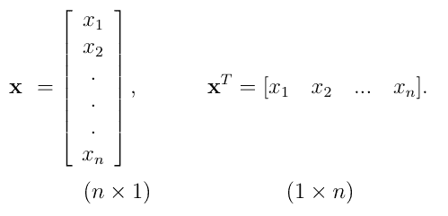

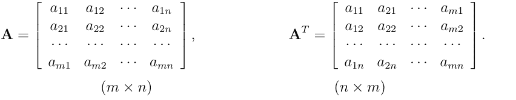

It is relatively easy to verify that

$$
(\mathbf{A}\mathbf{x})^T=\mathbf{x}^T\mathbf{A}^T. \tag{1.4}
$$

When a square matrix (one in which `m=n`) equals its transpose,

$$
\mathbf{A}=\mathbf{A}^T \tag{1.5}
$$

the matrix `A` is called *symmetric*. Symmetric matrices have some desirable properties which help in calculations. If the columns of a square matrix `A` are *linearly independent*, the inverse of the matrix, denoted by `A^{-1}`, exists, having the property

$$
\mathbf{A}^{-1}\mathbf{A}=\mathbf{A}\mathbf{A}^{-1}=\mathbf{I}, \tag{1.6}
$$

where `I` is the *identity* matrix, which is a diagonal matrix with 1's along the diagonal. Therefore, the identity matrix has the property

$$
\mathbf{A}\mathbf{I}=\mathbf{I}\mathbf{A}=\mathbf{A}. \tag{1.7}
$$

The convenience of using vector-matrix notation is realized when we consider the quadratic form

$$
\mathbf{x}^T\mathbf{A}\mathbf{x}=\sum_{j=1}^{n}\sum_{i=1}^{n}x_i a_{ij}x_j, \tag{1.8}
$$

where `a_{ij}` are the elements of `A`.

Frequently, a situation arises where all the elements of a vector are equal to the same numerical value, let us say 2. Then, instead of writing `r_i=2, i=1,2,...,n`, or `r=[2 2 ... 2]^T`, we will use the shorthand `r=2`. Sometimes, however, we wish to emphasize some entries in a table of results, by using boldface to make them stand out. No confusion with respect to this notation is expected.

##### 1.2.3 Differentiation of a vector

Given a vector
$$


\mathbf{f}(\mathbf{x}) = \begin{bmatrix} f_1 \\ f_2 \\ \vdots \\ f_n \end{bmatrix},

$$

we may differentiate this vector with respect to $\mathbf{x}$ by first taking the transpose and then simply using matrix algebra, i.e.,

$$

\frac{\partial \mathbf{f}^{T}}{\partial \mathbf{x}} = \begin{bmatrix} \frac{\partial}{\partial x_1} \\ \frac{\partial}{\partial x_2} \\ \vdots \\ \frac{\partial}{\partial x_n} \end{bmatrix}[f_1\quad f_2\quad \cdots\quad f_n] = \begin{bmatrix} \frac{\partial f_1}{\partial x_1} & \frac{\partial f_2}{\partial x_1} & \cdots & \frac{\partial f_n}{\partial x_1} \\ \frac{\partial f_1}{\partial x_2} & \frac{\partial f_2}{\partial x_2} & \cdots & \frac{\partial f_n}{\partial x_2} \\ \vdots & \vdots & \cdots & \vdots \\ \frac{\partial f_1}{\partial x_n} & \frac{\partial f_2}{\partial x_n} & \cdots & \frac{\partial f_n}{\partial x_n} \end{bmatrix}.

$$

The second derivative of a continuous *scalar* function $f(\mathbf{x})$ with respect to $\mathbf{x}$ is

$$

\frac{\partial^2 f}{\partial \mathbf{x}^2} = \frac{\partial}{\partial \mathbf{x}}\left(\frac{\partial f}{\partial \mathbf{x}}\right)^T = \begin{bmatrix} \frac{\partial^2 f}{\partial x_1^2} & \frac{\partial^2 f}{\partial x_1\partial x_2} & \cdots & \frac{\partial^2 f}{\partial x_1\partial x_n} \\ \frac{\partial^2 f}{\partial x_2\partial x_1} & \frac{\partial^2 f}{\partial x_2^2} & \cdots & \frac{\partial^2 f}{\partial x_2\partial x_n} \\ \vdots & \vdots & \cdots & \vdots \\ \frac{\partial^2 f}{\partial x_n\partial x_1} & \frac{\partial^2 f}{\partial x_n\partial x_2} & \cdots & \frac{\partial^2 f}{\partial x_n^2} \end{bmatrix}.

$$

It is noted that this $(n \times n)$ matrix is symmetric, since the order of differentiation does not matter for a continuous function.

### 1.2.4 Taylor series expansion
It is convenient at times to expand a vector function $\mathbf{f}(\mathbf{x})$ in terms of a small perturbation $\delta\mathbf{x}$. Such an approximation can be represented by

$$

\mathbf{f}(\mathbf{x}+\delta\mathbf{x}) = \mathbf{f}(\mathbf{x}) + \left(\frac{\partial \mathbf{f}^{T}}{\partial \mathbf{x}}\right)^T\delta\mathbf{x} + \cdots \tag{1.9}

$$

and a scalar continuous function $f(\mathbf{x})$ can be conveniently expanded as

$$

f(\mathbf{x}+\delta\mathbf{x}) = f(\mathbf{x}) + \left(\frac{\partial f}{\partial \mathbf{x}}\right)^T\delta\mathbf{x} + \frac{1}{2}\delta\mathbf{x}^T\frac{\partial^2 f}{\partial \mathbf{x}^2}\delta\mathbf{x} + \cdots \tag{1.10}

$$

### 1.2.7 Stationary and maxima (minima) points
If $\partial f(\mathbf{x})/\partial \mathbf{x}=0$ at some value $\mathbf{x}=\mathbf{x}_0$, then $\mathbf{x}_0$ is said to be a stationary point. However, this is not necessarily the maximum or a minimum of the function $f(\mathbf{x})$. If $\partial^2 f/\partial \mathbf{x}^2$ is negative definite, then $\mathbf{x}_0$ is a local maximum, and if $\partial^2 f/\partial \mathbf{x}^2$ is positive definite, then $\mathbf{x}_0$ is a local minimum. The point $\mathbf{x}_0$ is an absolute or global maximum if

$$

f(\mathbf{x}) \leq f(\mathbf{x}_0)

$$

and a global minimum if the inequality sign is reversed. For an unconstrained continuous function with continuous first derivative, the global maximum or minimum may be obtained by examining all the stationary points of the function and comparing the values of the function at those stationary points.

### 1.3 Steady-state system model
For a steady-state model we assume the system under consideration can be represented in terms of the variables $x_1, x_2, \ldots, x_n$. The model is given by a set of equality constraints

$$

\phi_i(x_1, x_2, \ldots, x_n) = 0, \quad i = 1, 2, \ldots, m \tag{1.14}

$$

where $m \leq n$, and a set of inequality constraints

$$

g_j(x_1, x_2, \ldots, x_n) \leq 0, \quad j = 1, 2, \ldots, s. \tag{1.15}

$$

### 1.4 Continuous-time system model
In the major portion of this book, we shall assume that the physical system is described mathematically by a set of deterministic lumped-parameter ordinary differential equations, where the initial conditions are given. There are two types of variables under consideration. The state variables, denoted by $x_i$, represent the state of the system. The other type of variables, denoted by $u_j$, represent the control variables, or inputs into the system. The model showing the effect of the inputs on the state of the system is assumed to have the general form

$$

\frac{dx_1}{dt} = f_1(x_1, x_2, \ldots, x_n, u_1, u_2, \ldots, u_m, t) \tag{1.16}

$$

$$

\frac{dx_2}{dt} = f_2(x_1, x_2, \ldots, x_n, u_1, u_2, \ldots, u_m, t) \tag{1.17}

$$

$$

\cdots \quad \cdots \quad \cdots \quad \cdots

$$

$$

\frac{dx_n}{dt} = f_n(x_1, x_2, \ldots, x_n, u_1, u_2, \ldots, u_m, t) \tag{1.18}

$$

or, in vector form, the system can be described more compactly by

$$

\frac{d\mathbf{x}}{dt} = \mathbf{f}(\mathbf{x}, \mathbf{u}, t)\tag{1.19}

$$

with the initial state specified

$$

\mathbf{x}(0) = \mathbf{c}.\tag{1.20}

$$

Here $\mathbf{x}$ is an $(n \times 1)$ state vector and $\mathbf{u}$ is an $(m \times 1)$ control vector.

We can remove the explicit time dependence on the right-hand side of Eq. (1.19) by introducing an additional state variable $x_{n+1}$ by the differential equation

$$

\frac{dx_{n+1}}{dt} = 1, \quad x_{n+1}(0) = 0\tag{1.21}

$$

and incorporating $x_{n+1}$ into the state vector $\mathbf{x}$. Then we have a simpler form

$$

\frac{d\mathbf{x}}{dt} = \mathbf{f}(\mathbf{x}, \mathbf{u})\tag{1.22}

$$

with

$$

\mathbf{x}^T(0) = [\mathbf{c}^T \quad 0].\tag{1.23}

$$

Therefore, the number of state variables describing a particular system is not unique, since auxiliary state variables may be introduced for convenience to describe the same system.

### 1.5 Discrete-time system model
We assume that the discrete-time system model of a physical system can be written in the form

$$

\mathbf{x}(k + 1) = \mathbf{h}(\mathbf{x}(k), \mathbf{u}(k))\tag{1.24}

$$

with the given initial state

$$

\mathbf{x}(0) = \mathbf{c}.\tag{1.25}

$$

Such a difference equation can arise if the system consists of a number of stages or units, as in an extraction train in chemical engineering. We can also obtain a difference equation by integrating the differential equation repeatedly over a sampling period. For example, suppose we have a linear continuous-time system

$$

\frac{d\mathbf{x}}{dt} = \mathbf{A}\mathbf{x} + \mathbf{B}\mathbf{u}\tag{1.26}

$$

and suppose $\mathbf{u}$ is kept constant at its value $\mathbf{u}(0)$ over the entire time interval from 0 to $T$. Then integration of Eq. (1.26) gives

$$

\mathbf{x}(T) = \mathbf{\Phi}(T)\mathbf{c} + \int_{0}^{T} \mathbf{\Phi}(T - \lambda)\mathbf{B}\mathbf{u}(0) d\lambda\tag{1.27}

$$

其中状态转移矩阵$\Phi(T)$由下式给出

$$

\Phi(T) = \exp(A T) = \sum_{i=0}^{\infty} \frac{(A T)^i}{i!}. \tag{1.28}

$$

式(1.27)可以写成

$$

x(T) = \Phi(T) c + \Psi(T) u(0) \tag{1.29}

$$

其中我们引入了$(n \times m)$矩阵

$$

\Psi(T) = \int_0^T \exp[A(T - \lambda)]\, d\lambda \, B = T \sum_{i=0}^{\infty} \frac{(A T)^i}{(i + 1)!} B. \tag{1.30}

$$

现在让我们重复该过程，但从$t = T$到$t = 2T$进行积分，并保持$u(T)$为恒定值。由于我们再次对与之前等长的时间区间进行积分，得到

$$

x(2T) = \Phi(T) x(T) + \Psi(T) u(T). \tag{1.31}

$$

继续该过程，我们得到

$$

x[(k + 1)T] = \Phi(T) x(kT) + \Psi(T) u(kT), \quad k = 0, 1, 2, \ldots . \tag{1.32}

$$

通常省略采样时间$T$，以得到形式更简单的方程

$$

x(k + 1) = \Phi x(k) + \Psi u(k), \tag{1.33}

$$

这是线性差分方程的一个特例。如果$\Phi$的级数展开是渐近的，那么获得这些矩阵最方便的方法是取$N + 1$项的截断级数：

$$

\Theta = \sum_{i=0}^{N} \frac{(A T)^i}{(i + 1)!}. \tag{1.34}

$$

于是

$$

\Phi = I + \Theta A T \tag{1.35}

$$

且

$$

\Psi = \Theta B T. \tag{1.36}

$$

Luus和Smith [23]曾使用$N = 20$的这一过程将描述气体吸收器的微分方程转换为差分方程。如果级数不是渐近的，我们总可以使用恒等式

$$

\exp(A T) = [\exp(A T / \beta)]^\beta \tag{1.37}

$$

并选择足够大的常数$\beta$，使级数渐近。

### 1.6 性能指标
在本书的大部分内容中，我们用$I$表示性能指标。但有时会使用增广形式的性能指标，此时可能使用另一个字母如$J$；或者当隐含利润函数时，有时使用字母$P$。

当描述系统的模型是一组代数方程时，性能指标是如下形式的代数表达式

$$

I = f(x_1, x_2, ..., x_n). \tag{1.38}

$$

当系统由微分方程或差分方程描述时，性能指标可以有不同的形式。例如，我们可以有性能指标


$$
I = \int_0^{t_f} \phi(\mathbf{x}, \mathbf{u}) \, dt, \tag{1.39}
$$

其中 `$t_f$` 表示最终时间，或者我们可以有如下形式的性能指标

$$
I = \mathbf{k}^T \mathbf{x}(t_f) = \sum_{i=1}^{n} k_i x_i(t_f). \tag{1.40}
$$

这两种形式是等价的，我们现在来证明。假设我们通过方程定义一个新的状态变量 `$x_{n+1}$`

$$
\frac{dx_{n+1}}{dt} = \phi(\mathbf{x}, \mathbf{u}), \quad x_{n+1}(0) = 0. \tag{1.41}
$$

则式(1.39)中的性能指标等价于

$$
I = x_{n+1}(t_f). \tag{1.42}
$$

这是式(1.40)的一种特殊形式。因此，在我们的大部分工作中，我们选择性能指标作为最终时刻状态的显式函数，形式为

$$
I = \Phi(\mathbf{x}(t_f)), \tag{1.43}
$$

并理解我们有权相应地选择状态变量。然而，在某些情况下，性能指标不能表示为最终状态的函数。这时我们得到需要特别关注的*不可分离的*性能指标。这将在第13章中举例说明和讨论。

### 1.7 结果的解释

优化的重要部分之一是结果的解释。人们认识到最优解依赖于数学模型和性能指标。因此，必须谨慎对待优化结果。如果数学模型不能充分表示物理系统，那么结果对于预期的应用就不是最优的。同样，结果也依赖于性能指标的选择。最终时间 `$t_f$` 的选择对最优控制策略[14]有显著影响，但它常常是相当随意地选择的。只有对物理系统非常熟悉，才能确保优化成功应用。

优化的另一个重要方面是确定得到的是局部最优还是全局最优。在高度非线性问题中，这可能是一项相当大的挑战。确保自己获得全局最优的最佳方法是使用不同的优化程序对优化进行交叉验证。如果局部最优数量非常多，仅采用不同的初始条件可能无法得到全局最优。这一点最近在[19]中指出，该文对沿管式反应器的双功能催化剂混合物进行优化，以使所需产品的产率最大化。尽管使用了随机选择的100种不同初始条件，并采用序列二次规划（SQP），但这一成熟的优化方法并未获得全局最优。然而，Luus和Bojkov [17]利用迭代动态规划很容易地获得了全局最优。

当数值方法用于非线性系统的优化时，通常使用某种形式的迭代。因此，还必须考虑另一个特征，即迭代过程本身的收敛性。迭代可能过早结束，或者迭代过程本身可能由于问题性质或所选参数而无法收敛。当控制策略的大变化对性能指标影响非常小时，收敛问题非常具有挑战性，人们很容易将高度波动的控制策略接受为最优。对低灵敏度问题确定最优控制策略是困难的[15]。这些是我们希望在后续章节中探讨的优化问题的一些方面。

### 1.8 最优控制系统的示例

#### 1.8.1 线性气体吸收器

一个广泛用于最优控制研究的线性系统是六板气体吸收器，Lapidus和Luus [11]曾用它进行最优控制研究。Bashein [2]将该模型用于时间最优控制研究，Bennett和Luus [3]用于时间次最优控制研究。最近，Luus和Smith [23]将其用于研究迭代动态规划的可行性，Bojkov和Luus [4]将其用于时间最优控制研究。这里，在六板气体吸收器模型的基础上，我们考虑一个更一般的情形：由入口进料流浓度控制的 `$n$` 板气体吸收器（见图1.1）。

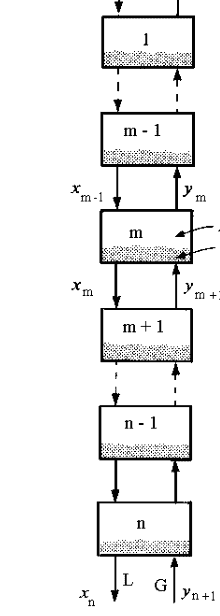

图1.1：由 `$n$` 个平衡级组成的气体吸收器系统

对吸收塔第 `$m$` 块板进行物料衡算得到

$$
H\frac{dy_m}{dt} + h\frac{dx_m}{dt} = L(x_{m-1} - x_m) + G(y_{m+1} - y_m), \quad m=1,2,\ldots,n, \tag{1.44}
$$

其中

- `$x_m, y_m$` = 离开第 `$m$` 块板的液体和蒸汽组成（kg溶质/kg惰性物），
- `$h, H$` = 每块板上惰性液体和蒸汽的滞留量（假设恒定）（kg），
- `$L$` = 惰性液体吸收剂的流量（kg/min），
- `$G$` = 惰性气体流的流量（kg/min），
- `$t$` = 操作时间（min）。

用惰性物表示流量可确保 `$L$` 和 `$G$` 在各级之间保持恒定，即使由于吸收过程实际流量会发生变化。如果假设每一级中液体和蒸汽组成之间存在线性关系

$$
y_m = a x_m, \tag{1.45}
$$

则物料衡算方程可以转换为

$$
\frac{dx_m}{dt} = \frac{d}{e}x_{m-1} - \left(\frac{d+1}{e}\right)x_m + \frac{1}{e}x_{m+1}, \quad m = 1,2,\cdots,n \tag{1.46}
$$

其中 `$d = L/Ga$`，`$e = (Ha + h)/Ga$`。使用以下方便的参数集：`$a = 0.72$`，`$L = 40.8\ \text{kg/min}$`，`$G = 66.7\ \text{kg/min}$`，`$H = 1.0\ \text{kg}$` 和 `$h = 75\ \text{kg}$`，得到向量-矩阵形式的系统方程

$$
\frac{d\mathbf{x}}{dt} = \mathbf{A}\mathbf{x}(t) + \mathbf{B}\mathbf{u}(t) \tag{1.47}
$$

其中 `$\mathbf{A}$` 是三对角系数矩阵，由下式给出

$$
\mathbf{A} = \operatorname{tridiag}[0.538998 \quad -1.173113 \quad 0.634115] \tag{1.48}
$$

`$(n \times 2)$` 控制系数矩阵 `$\mathbf{B}$` 由下式给出

$$
\mathbf{B}^T = \begin{bmatrix} 0.538998 & 0 & \cdots & 0 & 0 \\ 0 & 0 & \cdots & 0 & 0.634115 \end{bmatrix}. \tag{1.49}
$$

初始条件选取为

$$
x_i(0) = -0.0307 - \left(\frac{i-1}{n-1}\right)(0.1273 - 0.0307), \quad i = 1,2,\cdots,n. \tag{1.50}
$$

要最小化的性能指标为

$$
I = \int_0^{t_f} (\mathbf{x}^T\mathbf{x} + \mathbf{u}^T\mathbf{u}) \, dt. \tag{1.51}
$$

最近[16]使用了两个最终时间值，即 `$t_f = 10\ \text{min}$` 和 `$t_f = 50\ \text{min}$`。此外，还使用了从 `$n = 10$` 到 `$n = 1000$` 的级数范围，以考察随着问题维数的增加，迭代动态规划计算量的增加情况。

#### 1.8.2 非线性连续搅拌釜式反应器

让我们考虑这样一个系统：在连续搅拌釜式反应器（CSTR）中进行一级不可逆化学反应，该系统最初由Aris和Amundson [1]提出，并由Lapidus和Luus [11]用于控制研究。通过调节冷却流体的流量来实现对反应器的控制

a coil inserted in the reactor. The heat and mass balances for the reaction A → B in such a CSTR are given by

```
V c_P ρ dT_R/dθ = q c_P ρ (T_0 − T_R) − V U* + (−ΔH) V R   (1.52)
```

```
V d c_A / dθ = q (c_A0 − c_A) − V R   (1.53)
```

where

+ `c_A` = concentration of species A leaving reactor
+ `c_A0` = concentration of species A in feed stream
+ `T_R` = temperature of reactants leaving reactor
+ `T_0` = temperature of feed stream to reactor
+ `θ` = time
+ `V` = volume of reactor
+ `q` = volumetric flow rate of feed and output streams
+ `R` = reaction rate term
+ `−ΔH` = heat of reaction
+ `c_P` = heat capacity
+ `ρ` = density
+ `U*` = heat transfer term corresponding to cooling coil in reactor

As shown by Lapidus and Luus [11], these equations may be put into dimensionless form and, through a choice of a convenient set of parameters, transformed into the equations

```
dx_1/dt = −(2 + u)(x_1 + 0.25) + (x_2 + 0.5) exp[25 x_1 / (x_1 + 2)]   (1.54)
```

```
dx_2/dt = 0.5 − x_2 − (x_2 + 0.5) exp[25 x_1 / (x_1 + 2)]   (1.55)
```

where `x_1` represents deviation from dimensionless steady-state temperature and `x_2` represents deviation from dimensionless steady-state concentration. In the present work, the initial conditions `x_1(0) = 0.09` and `x_2(0) = 0.09` are used. We consider the case where the control `u` is unbounded. The optimal control problem is to determine `u` in the time interval `0 ≤ t < t_f` that will minimize the performance index

```
I = ∫_0^{t_f} (x_1^2 + x_2^2 + 0.1 u^2) dt   (1.56)
```

where the dimensionless final time `t_f` is specified as `0.78`. As was shown by Luus and Cormack [18], this system exhibits a local minimum `I = 0.24425` and a global minimum `I = 0.133094` when Pontryagin’s maximum principle is used, and the resulting boundary value problem is solved by control vector iteration. Therefore, this system is an interesting test problem for optimal control procedures.

#### 1.8.3 Photochemical reaction in CSTR

A more challenging problem of higher dimension consists of a photochemical reaction in an isothermal CSTR, as formulated by Jensen [10] and used for optimal control studies in [11] and [25]. It served as an ideal system for testing iterative dynamic programming for moderate dimensional nonlinear optimal control problems [13]. The mechanism for the reactions among the species $A,B,C,D,E,F,$ and $G$ is given by

$$
\begin{aligned}
A+B &\xrightarrow{k_1} 2D\\
C+B &\xrightarrow{k_2} CB\\
CB+B &\xrightarrow{k^*} 3E\\
E+D &\xrightarrow{k_3} 2F\\
A+F &\xrightarrow{k_4} 2G
\end{aligned}
$$

where the fifth reaction is photochemical and its rate is proportional to the square root of the light intensity. The intermediate compound $CB$ is postulated to be present in immeasurably small quantities, so it satisfies the stationary condition, namely $d(CB)/dt=0$. By using a convenient set of parameters, Lapidus and Luus [11] showed that the system is described by the eight differential equations

$$
\begin{aligned}
\frac{dx_1}{dt} &= u_4-qx_1-17.6x_1x_2-23x_1x_6u_3 \tag{1.57}\\
\frac{dx_2}{dt} &= u_1-qx_2-17.6x_1x_2-146x_2x_3 \tag{1.58}\\
\frac{dx_3}{dt} &= u_2-qx_3-73x_2x_3 \tag{1.59}\\
\frac{dx_4}{dt} &= -qx_4+35.2x_1x_2-51.3x_4x_5 \tag{1.60}\\
\frac{dx_5}{dt} &= -qx_5+219x_2x_3-51.3x_4x_5 \tag{1.61}\\
\frac{dx_6}{dt} &= -qx_6+102.6x_4x_5-23x_1x_6u_3 \tag{1.62}\\
\frac{dx_7}{dt} &= -qx_7+46x_1x_6u_3 \tag{1.63}\\
\frac{dx_8}{dt} &= 5.8(qx_1-u_4)-3.7u_1-4.1u_2+q(23x_4+11x_5+28x_6+35x_7)-5u_3^2-0.099 \tag{1.64}
\end{aligned}
$$

where

+ `$x_1,x_2,\ldots,x_7$` = weight fractions of species $A$, $B$, $\ldots$, $G$
+ `$k_1,k_2,\ldots,k_4$` = reaction rate constants
+ `$u_1,u_2,u_4$` = inlet feed rate of pure components $A$, $B$ and $C$
+ `$u_3$` = square root of light intensity

`q = u₁ + u₂ + u₄` is the total flow rate of inlet streams.

The initial state is

`x(0) = [0.1883  0.2507  0.0467  0.0899  0.1804  0.1394  0.1046  0.0]ᵀ.  (1.65)`

The constraints on the control variables are

`0 ≤ u₁ ≤ 20  (1.66)`

`0 ≤ u₂ ≤ 6  (1.67)`

`0 ≤ u₃ ≤ 4  (1.68)`

`0 ≤ u₄ ≤ 20.  (1.69)`

The optimal control problem is to choose `u₁, u₂, u₃,` and `u₄` in the time interval `0 ≤ t < t_f,` so that the performance index

`I = x₈(t_f),  (1.70)`

which gives the economic benefit, is maximized. The final time `t_f` is specified as `0.2 h`. This problem served as a good test problem for iterative dynamic programming [13].

#### 1.8.4 Production of secreted protein in a fed-batch reactor


Determination of the optimal feed rate into a fed-batch reactor to yield the maximum amount of the desired product is a very difficult optimal control problem. The model for the production of secreted protein in a fed-batch reactor presented by Park and Ramirez [24] has been used by several researchers in developing robust methods for handling problems of this nature. The differential equations describing the reactor are

dx₁/dt = g₁(x₂ − x₁) − (u/x₅)x₁  (1.71)

dx₂/dt = g₂x₃ − (u/x₅)x₂  (1.72)

dx₃/dt = g₃x₃ − (u/x₅)x₃  (1.73)

dx₄/dt = −7.3g₃x₃ − (u/x₅)(20 − x₄)  (1.74)

dx₅/dt = u  (1.75)

where

g₃ = 21.87x₄ / [(x₄ + 0.4)(x₄ + 62.5)]  (1.76)

```
g₂ = \frac{x₄ e^{-5 x₄}}{(x₄ + 0.1)} \tag{1.77}
```

```
g₁ = \frac{4.75 g₃}{(g₃ + 0.12)} \tag{1.78}
```

and

+   x₁ = level of secreted SUC-s2 in culture, arbitrary units/L

+   x₂ = level of total SUC-s2 in culture, arbitrary units/L

+   x₃ = culture cell density, g/L

+   x₄ = culture glucose level, g/L

+   x₅ = culture volume, L

+   u = feed flow rate, L/h.

The initial condition, as given by Park and Ramirez [24], is

```
x(0) = [0.0  0.0  1.0  5.0  1.0]ᵀ. \tag{1.79}
```

It should be noted that the three algebraic equations have been arranged in the “reverse” order so that they can be solved readily by direct substitution. Frequently, there are situations where the set of algebraic equations can not be rearranged to provide a solution in a straightforward manner. Therefore, in the next section we examine methods of solving a general set of algebraic equations numerically.

The control is bounded by

```
0 ≤ u ≤ 2. \tag{1.80}
```

The performance index to be maximized is the total amount of the desired product at the final time, given by

```
I = x₁(t_f) x₅(t_f) \tag{1.81}
```

where the final time t_f is specified as 15 h. Although there is only a scalar control variable, the optimal control policy is quite difficult to obtain, and therefore this problem is a good test for optimization procedures [20].

These four systems provide the reader a feel for the types of problems we wish to consider in this book. In later chapters a wider variety of systems, such as systems involving time delays, will be considered as well.

### 1.9 Solving algebraic equations

It is well known that the most efficient way of solving a set of linear algebraic equations is Gaussian elimination method, which consists of putting the equations into an echelon form and then using back-substitution to obtain the variables in reverse order. However, the solution of a set of nonlinear algebraic equations often requires some

Eq. (1.85) is a linear equation which can be easily solved by Gaussian elimination for δx and the next value of x is then chosen as

```
x^{j+1} = x^{j} + δx. (1.86)
```

It is noted that the partial derivatives are calculated in the presence of the simple equality constraints, so that these are difficult to obtain analytically, because x_{n+1}, x_{n+2}, ..., x_N are functions of the particular variable under consideration. This is illustrated by the first example. Computationally, however, the partial derivatives are easily obtained by perturbing the particular variable, and we can write

```
∂f_j(x_1, x_2, ..., x_i, ..., x_N) / ∂x_i = [f_j(x_1, x_2, ..., x_i + h_i, ..., x_N) - f_j(x_1, x_2, ..., x_i - h_i, ..., x_N)] / (2 h_i) (1.87)
```

where h_i is taken as a very small perturbation such as 10^{-6} x_i if x_i ≠ 0.

One great advantage of this method is the very rapid convergence in the vicinity of the solution. There is also considerable freedom in choosing how many and which equations to include in each of the two groups. Generally we try to have as many equations as possible in the first group, so that we have the smallest number of difficult equations. Since this method is so simple to program, and does not encounter the types of problems reported by the various methods considered by Shacham [28], it should really be the “first” approach to try.

#### 1.9.2 Numerical examples

All computations were performed in double precision on a Pentium/120 personal digital computer using WATCOM version 9.5 FORTRAN compiler. For all the examples the perturbation h_i for evaluating the derivatives was 10^{-6} x_i if x_i ≠ 0 and 10^{-10} if x_i = 0. The computation times reported were obtained by reading the clock at the beginning and at the end of the calculations and therefore include the time taken to write to the screen and to the output files. These computation times are given only to provide an approximate idea of the computational effort required. We choose several examples for which difficulties have been reported in the recent literature.

## Example 1

Let us consider the example involving the oxidation of sulphur dioxide to sulphur trioxide presented by Fogler [6] and studied by [28], [29], and [31], where the set of algebraic equations can be arranged into the two groups:

+   (a) Set of two simple equations

```
x_2 = (43260 x_1 + 105128) / (1.84 x_1 + 77.3) (1.88)
```

x₃ = exp[42300/x₂ − 24.2 + 0.17 ln(x₂)] (1.89)

and

(b) one difficult equation

f₁ = (0.91 − 0.5x₁)/(9.1 − 0.5x₁) − x₁²/[(1 − x₁)²x₃] = 0. (1.90)

这里我们只有一个困难的等式约束，因此有一个自由变量。由于 x₁ 是转化率，一个合理的初始选择为 0.4，但也使用了 Shacham [28] 使用的值 0.9 和 0.0。如图 1.2 所示，对于这三个起始值中的每一个，都很容易收敛到 |f₁| < 10⁻¹⁰，得到相同的值 x = [0.533373 1637.703 17.9400]ᵀ。初始选择 0.4 在 0.05 s 内收敛到 |f₁| < 10⁻¹⁰，初始选择 x₁ = 0 在 0.16 s 内收敛。这些计算时间相当可以忽略不计。

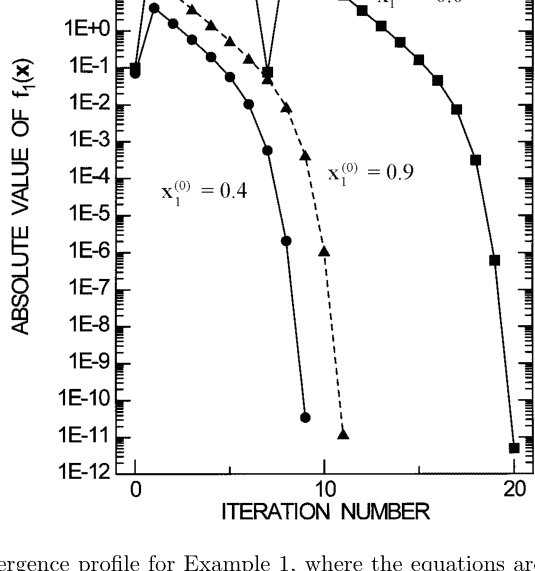

图 1.2：示例 1 的收敛曲线，其中方程排列使得只有一个困难的等式，显示了初始条件的影响

现在让我们将同一组方程重新排列为以下结构：

(a) 一组简单方程

$$x_3 = \exp\left[\frac{42300}{x_2} - 24.2 + 0.17\ln(x_2)\right]\tag{1.91}$$

and

(b) two difficult equations

$$f_1 = \frac{0.91 - 0.5x_1}{9.1 - 0.5x_1} - \frac{x_1^2}{(1 - x_1)^2 x_3} = 0\tag{1.92}$$

$$f_2 = x_2(1.84x_1 + 77.3) - 43260x_1 - 105128 = 0.\tag{1.93}$$

这里我们现在有两个困难的方程。我们用与之前相同 x₁ 的初始值求解这些方程，对于 x₂ 我们选择初始值 x₂ = 1600。与这些方程的另一种排列一样，很容易收敛到 |f₁| + |f₂| < 10⁻¹⁰，计算时间几乎相同，分别为 0.11 s、0.11 s 和 0.28 s，对应于三个起始点。虽然在后一种配置中每次迭代的计算工作量更大，但对于前两个起始点，到达收敛准则所需的迭代次数更少，如图 1.3 所示。因此，对于这个特定示例，方程以这两种方式中的哪一种排列并不重要。虽然 Shacham [28] 和 Shacham 等人 [29] 用多个软件包求解此问题很困难，但在这里没有遇到困难，并且 x₁ 的初始值不必限制在非常窄的范围 0.5 < x₁ < 0.53337 内。程序的列表及输出结果在附录 A 中给出。

## Example 2

让我们考虑 Gupta [7] 的最后一个示例，其中涉及 12 个变量。方程排列成以下结构，其中两个困难的方程前面有 10 个简单的等式约束：

$$x_{11} = x_1/(3.846 \times 10^{-5})\tag{1.94}$$

$$x_{10} = 3 - x_2\tag{1.95}$$

$$x_6 = 2.597 \times 10^{-3} \sqrt[3]{x_2 x_{11}}\tag{1.96}$$

$$x_7 = 3.448 \times 10^{-3} \sqrt[3]{x_{10}x_{11}}\tag{1.97}$$

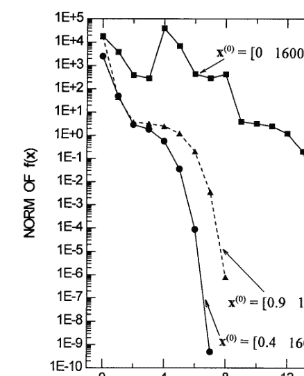

图 1.3：示例 1 的收敛曲线，其中方程排列使得有两个困难的等式，显示了初始条件的影响

x₄ = (4 − 0.5(x₆ + x₇)) / (1 + 0.193 x₂ / x₁₀)  (1.98)

x₅ = 0.193 x₂ x₄ / x₁₀  (1.99)

x₁₂ = 40  (1.100)

x₃ = 2 x₁₂ − 0.5 x₅  (1.101)

x₈ = (1.799 x₄ x₁) / (3.846 x₂)  (1.102)

x₉ = (2.155 × 10⁻⁴ x₁₀ √(x₃ x₁₁)) / x₂  (1.103)

f₁ = 2(x₁ + x₁₀) + x₂ + x₄ + x₇ + x₈ + x₉ − x₁₂ = 0  (1.104)

f₂ = Σᵢ₌₁¹⁰ xᵢ − x₁₁ = 0.  (1.105)

这里我们有两个困难的等式约束。自由变量为 x₁ 和 x₂。对这两个变量取了两组初始值，分别为 (0.1, 0.1) 和 (0.5, 0.5)。唯一需要的小心是保持 x₁ 和 x₂ 为正，以便可以计算平方根。因此，如果计算出 x₁ 或 x₂ 小于 10⁻⁴，则任意指定为 10⁻⁴。此预防措施消除了数值

$$x_7=\frac{2}{x_3+x_4+2x_5}$$ (1.108)

$$x_6=x_7\left(0.5(x_1+x_3)+x_2\right)$$ (1.109)

$$f_1=x_1+x_2+x_5-\frac{1}{x_7}=0$$ (1.110)

$$f_2=-28837x_1-139009x_2-78213x_3+18927x_4+8427x_5+\frac{13492-10690x_6}{x_7}=0$$ (1.111)

$$f_3=x_1+x_2+x_3+x_4+x_5-1=0$$ (1.112)

方程也可以排列成以下结构，其中我们有五个简单等式和只有两个困难的等式约束：

$$x_3=\frac{5.2116x_2(x_1+x_2)}{x_1+2.6058x_2}$$ (1.113)

$$x_4=2(x_1+x_2)-x_3$$ (1.114)

$$x_5=\frac{400x_1x_4^3}{1.7837\times10^5x_3}$$ (1.115)

$$x_7=\frac{2}{x_3+x_4+2x_5}$$ (1.116)

$$x_6=x_7\left(0.5(x_1+x_3)+x_2\right)$$ (1.117)

$$f_1=-28837x_1-139009x_2-78213x_3+18927x_4+8427x_5+\frac{13492-10690x_6}{x_7}=0$$ (1.118)

$$f_2=x_1+x_2+x_3+x_4+x_5-1=0$$ (1.119)


由于前 5 个变量表示摩尔分数，应该可以对第一种排列中的前 3 个变量和第二种排列中的前 2 个变量做出合理的选择。虽然 Shacham [28] 报告说这个问题对他评估的大多数程序来说太困难了，但推荐的程序没有遇到任何困难。为了计算的稳定性，如果 $x_i$, $i=1,\ldots,n$ 中的任何一个小于 $10^{-4}$，则对应的变量设为 $10^{-4}$，同样使用上限剪裁限制 0.95。从起始点 $x_1=0.22$, $x_2=0.075$, $x_3=0.001$ 开始的收敛曲线，对应于该问题的第一种具有三个困难等式约束的公式，以及从 $x_1=0.22$, $x_2=0.075$ 开始的第二种公式，显示在图 1.5 中。

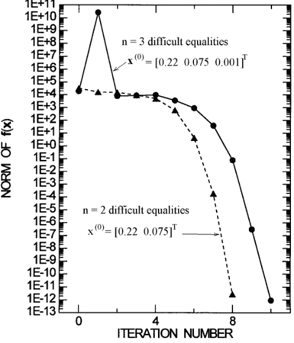

使用两个困难的等式约束而不是三个，往往能提供更快的收敛。计算时间的差异无法准确测量，因为每个仅需约 0.06 s 的计算时间，如 Pentium/120 上的时钟所示。在每种情况下都收敛到 $x^T=[0.322871\ 0.009224\ 0.046017\ 0.618172\ 0.003717\ 0.576715\ 2.977863]$。这些与 Carnahan 等人 [5] 报告的结果相同

如图 1.6 所示，使用初始起始点 $x_i=0.1$ 对于 $i=1,\ldots,n$ 也能得到类似的收敛特性。有趣的是，一旦范数低于 1，收敛速度非常快。这表明可以用另一种方法到达解的附近，然后切换到牛顿法。一种这样的方法是使用 Luus 和 Jaakola [22] 建议的直接搜索优化，以建立一个用于牛顿法的良好起始点。该优化程序在第 2 章中概述，我们在其中研究稳态优化。

### Example 4

让我们考虑单丁基邻苯二甲酸酯与正丁醇在两个连续搅拌釜反应器中进行酯化反应，以生产二丁基邻苯二甲酸酯和水 12.52943 68.13003] 被得到 66 次。其他 34 个起始点由于某些变量为负而给出不可行的解。对 100 个初始条件的总计算时间为 0.11 s。通过取`x₂`的初始值的较小范围，即`0 ≤ x₂ ≤ 10`，如 Gupta [7] 所用，成功率下降到 100 个起始点中的 28 个，但计算时间减少到 0.06 s。通过使用范围`0 ≤ x₁ ≤ 1000, 0 ≤ x₂ ≤ 1000`，成功率是 100 次中的 57 次，也在总计算时间 0.06 s 内获得。

### Example 5

有时捕获非线性代数方程组的所有可能解是很重要的。例如，在寻找椭球面与双曲面相交处到原点的最大距离的问题中，如 Luus [12] 和 Wang 和 Luus [30] 所考虑的，当使用拉格朗日乘数时，最优解位于 8 个驻点之一。因此，定位所有驻点是很重要的，而使距离平方`P = x₁² + x₂² + x₃²`达到最大值的驻点提供了问题的解。代数方程组为

$$
x_7 = x_3 / (2x_3 + 0.2x_2)
$$ (1.129)

$$
x_6 = 4(x_2 - 0.2) + 0.1x_1 + 0.2x_3
$$ (1.130)

$$
x_5 = (x_6x_7 - x_2) / (x_2 + 2x_6x_7)
$$ (1.131)

$$
x_4 = (4x_5 - 2)x_7
$$ (1.132)

$$
f_1 = 2x_1 + x_4[8(x_1 - 0.5) + 0.1x_2] + 4x_1x_5
$$ (1.133)

$$
f_2 = 2(x_1^2 - x_3^2 - 1) + x_2^2
$$ (1.134)

$$
f_3 = 4(x_1 - 0.5)^2 + 2(x_2 - 0.2)^2 + x_3^2 + 0.1x_1x_2 + 0.2x_2x_3 - 16,
$$ (1.135)

其中`x₄` 和 `x₅` 是拉格朗日乘数，我们引入`x₆` 和 `x₇` 以简化问题的公式。通过在范围`−2 ≤ xᵢ ≤ 2, i = 1,2,3`内选择 200 个随机起始点`x₁`, `x₂` 和 `x₃`，我们能够定位所有 8 个驻点，其频率如表 1.1 所示。注意到其中一个驻点仅得到两次，另一个仅得到三次，而与最大距离相关的驻点得到 21 次。从 200 个起始点求解代数方程，最少需要 6 次迭代，最多需要 15 次迭代，在 Pentium/120 上对 200 个起始点的总计算时间为 0.11 s。因此，计算时间相当可以忽略不计。

**表1.1：示例5的解，显示存在8个解**

| $x_1$ | $x_2$ | $x_3$ | $x_4$ | $x_5$ | $P$ | 频率 |
|---:|---:|---:|---:|---:|---:|---:|
| 0.98842 | 2.67366 | -1.88446 | -0.67341 | 0.21106 | 11.67664 | 21 |
| 1.03962 | 2.49153 | 1.78457 | -0.59958 | 0.15835 | 10.47324 | 97 |
| 1.37627 | -2.21617 | 1.77606 | -0.59704 | 0.23721 | 9.56909 | 2 |
| 2.22372 | -0.15747 | 1.98930 | -0.48910 | 0.25739 | 8.92702 | 6 |
| 1.56816 | -1.80074 | -1.75513 | -0.53053 | 0.20752 | 8.78227 | 41 |
| 2.04323 | -0.95605 | -1.90573 | -0.49408 | 0.24057 | 8.72063 | 10 |
| -1.41865 | -0.16020 | 1.01262 | -0.31252 | 0.34621 | 3.06362 | 3 |
| -1.40504 | -0.24481 | -1.00205 | -0.30976 | 0.34134 | 3.03818 | 20 |

### 示例6

最近，Shacham *等人* [29] 报告了另一个计算困难的问题：计算20%异丁醇和80%水混合物的露点温度。这基于 Henley 和 Rosen [8] 中的问题。该问题由16个代数方程组成，可排列成13个简单方程和3个困难方程的结构：

$$
x_4 = 1 - x_1 \tag{1.136}
$$

$$
x_5 = 1 - x_2 \tag{1.137}
$$

$$
\log_{10}x_6 = 7.62231 - \frac{1417.90}{191.15 + x_3} \tag{1.138}
$$

$$
\log_{10}x_7 = 8.10765 - \frac{1750.29}{235.00 + x_3} \tag{1.139}
$$

$$
\log_{10}x_8 = \frac{1.7x_4^2}{(1.7x_1/0.7 + x_4)^2} \tag{1.140}
$$

$$
\log_{10}x_9 = \frac{0.7x_1^2}{(x_1 + 0.7x_4/1.7)^2} \tag{1.141}
$$

$$
\log_{10}x_{10} = \frac{1.7x_5^2}{(1.7x_2/0.7 + x_5)^2} \tag{1.142}
$$

$$
\log_{10}x_{11} = \frac{0.7x_2^2}{(x_2 + 0.7x_5/1.7)^2} \tag{1.143}
$$

$$
x_{12} = x_6x_8/760 \tag{1.144}
$$

$$
x_{13} = x_7x_9/760 \tag{1.145}
$$

$$
x_{14} = x_{10}x_6/760 \tag{1.146}
$$

$$
x_{15} = x_{11}x_7/760 \tag{1.147}
$$

$$
x_{16} = \frac{0.2/x_1 - x_{12}/x_{14}}{1 - x_{12}/x_{14}} \tag{1.148}
$$

$$
f_1 = x_{12}x_1 + x_{13}x_4 - 1 \tag{1.149}
$$

$$
f_2 = x_2 - \frac{x_1x_{12}}{x_{14}} \tag{1.150}
$$

$$
f_3 = x_4 - \frac{0.8}{x_{16} + (1 - x_{16})x_{13}/x_{15}} \tag{1.151}
$$

**表1.2：示例6的四个解，显示从1000个随机选择的起始点获得这些解的频率**

| 变量 | 定义 | 解1 | 解2 | 解3 | 解4 |
|:---|:---|---:|---:|---:|---:|
| $x_1$ | $x_{1,1}$ | 0.022698 | 0.686748 | 0.200000 | 0.200000 |
| $x_2$ | $x_{1,2}$ | 0.686748 | 0.022698 | 0.031601 | 0.904122 |
| $x_3$ | 温度 | 88.537830 | 88.537830 | 86.423947 | 86.423947 |
| $x_4$ | $x_{2,1}$ | 0.977302 | 0.313252 | 0.800000 | 0.800000 |
| $x_5$ | $x_{2,2}$ | 0.313252 | 0.977302 | 0.968399 | 0.095878 |
| $x_6$ | $P_1$ | 357.050288 | 357.050288 | 326.679334 | 326.679334 |
| $x_7$ | $P_2$ | 498.658802 | 498.658802 | 459.435969 | 459.435969 |
| $x_8$ | $\gamma_{1,1}$ | 33.366490 | 1.102821 | 4.551692 | 4.551692 |
| $x_9$ | $\gamma_{2,1}$ | 1.004606 | 3.134222 | 1.258639 | 1.258639 |
| $x_{10}$ | $\gamma_{1,2}$ | 1.102821 | 33.366490 | 28.807440 | 1.006876 |
| $x_{11}$ | $\gamma_{2,2}$ | 3.134222 | 1.004606 | 1.008729 | 4.391885 |
| $x_{12}$ | $K_{1,1}$ | 15.675677 | 0.518108 | 1.956505 | 1.956505 |
| $x_{13}$ | $K_{2,1}$ | 0.659152 | 2.056457 | 0.760874 | 0.760874 |
| $x_{14}$ | $K_{1,2}$ | 0.518108 | 15.675677 | 12.382625 | 0.432797 |
| $x_{15}$ | $K_{2,2}$ | 2.056457 | 0.659152 | 0.609798 | 2.654987 |
| $x_{16}$ | $\beta$ | 0.732999 | 0.267001 | 1.000000 | 1.000000 |
| 频率 |  | 16 | 30 | 10 | 23 |

这16个变量在表1.2中定义，同时表中也给出了4个解。这些解是通过在 \(0.01 \le x_1 \le 0.99\)、\(0.01 \le x_2 \le 0.99\) 和 \(80 \le x_3 \le 90\) 的范围内取1000个起始点而获得的。如果在计算过程中任何变量变为负值，或者 \(x_1\) 或 \(x_2\) 变得小于 \(10^{-4}\) 或大于0.9999，或者 \(x_{16}\) 超过1.01，则该初始点的计算将停止，并取一个新的起始点。在1000个起始点中，只有79个得到了解，其中困难等式约束左侧的绝对值范数小于 \(10^{-10}\)。此次运行的总计算时间在Pentium/120上为0.38秒，表明每个成功解的计算时间约为0.005秒。

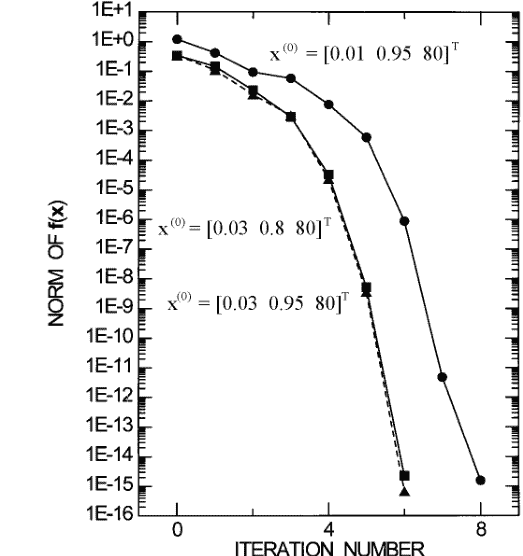

图1.7：示例6到解1的收敛曲线，显示了起始条件的影响

图1.7给出了三种不同起始条件下的收敛曲线，未遇到任何困难，并轻松收敛到解1。由于收敛如此迅速，自然可以在某一允许范围内随机选取大量起始点，以捕获所有可能的解。将计算限制于有意义解的这些约束条件，不仅减少了计算工作量，而且确保了计算过程中的稳定性。

如今个人计算机速度非常快，这里概述的所有6个例子的计算时间可以忽略不计。更值得关注的是该方法的稳健性。将代数方程组分成两组，其最大优点之一是只需为困难等式组指定起始条件。此外，通过最小化该组中包含的方程数量，我们使计算量最小化。尽管对于这里概述的6个问题，计算量可以忽略不计，但如果出现必须重复大量求解一组代数方程的情况，方程的建立方式会产生深远影响。

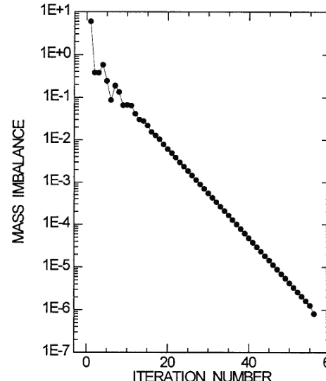

图1.8：由750个代数方程描述的多组分精馏塔的收敛曲线

### 1.9.3 多组分精馏中的应用

在稳态多组分精馏的模拟中，会遇到大量非线性代数方程，称为MESH方程，其中包括物料平衡（M）、平衡方程（E）、摩尔分数加和（S）和热量平衡方程（H）。对于由`n`级组成的精馏塔，其中蒸馏含有`m`个组分的进料，需要同时求解的方程总数为`2mn + 3n`。因此，一个由11种组分组成的进料被送入30级精馏塔，就提出了一个求解750个代数方程的问题，其中许多是非线性的。

通过使用 Seppala 和 Luus [27] 提供的11种组分的热力学数据，并采用进料至第11级、回流比为0.4的30级精馏塔，通过对方程进行分组，在Pentium II/350数字计算机上于0.11秒内解出了750个代数方程，在56次迭代中质量不平衡小于 \(10^{-6}\)，如图1.8所示。质量不平衡定义为

$$
M = \sum_{i=1}^{m} \left| F z_{iF} - D K_{i,1} x_{i,1} - B x_{i,n} \right|, \tag{1.152}
$$

其中 \(F\) 是进入第 \(f\) 级（此处取为11）的进料流量，其组成为 \(z_{iF}\)；\(D\) 是来自部分冷凝器的馏出液流量，其液相组成为 \(x_{i,1}\)；\(B\) 是塔底流量，其液相组成为 \(x_{i,n}\)。

求解代数方程所需的唯一起始点是对精馏塔塔顶和塔底温度的非常粗略的估计。在这个特定的运行中，我们选择塔底温度为810，塔顶温度为510。塔底和塔顶级的实际温度分别为764.75和589.84。当另一次运行采用塔底和塔顶温度的初始估计值765和590时，收敛需要57次迭代。得到了相同的温度分布，计算时间也为0.11秒。不用说，这种方法非常易于使用。

### 1.10 求解常微分方程

对常微分方程组进行数值积分的方法有很多。对于一些常用方法，读者可参考Carnahan *等人* [5] 的优秀著作。为了在精度与速度之间取得平衡，人们发现四阶Runge-Kutta方法非常适合许多问题。可以直接控制积分时间步长，因此对于良态问题可以使用最合适的步长。

然而，有些情况下固定步长并不合适，因此一种非常有用的方法是基于Runge-Kutta方法的IMSL例程，称为`DVERK`，由Hull *等人* [9] 编写。这里用户指定局部误差容差，例程选择所需的步长。我们发现这种方法非常有用，并在作者许可下，将`DVERK`的清单列入附录E。此例程也可通过访问他们的网站`http://www.cs.toronto.edu/NA/index.html`，转到“数学软件”主题并点击`DVERK`来获得。

### 1.11 参考文献

- [1] ARIS, R. AND AMUNDSON, N.R.: “An analysis of chemical reactor stability and control”, Chem. Eng. Sci. 7 (1958), 121-147.

- [2] BASHEIN, G.: “A simplex algorithm for on-line computation of time optimal control problems”, IEEE Trans. Auto. Control AC-16 (1971), 479-482.

- [20] LUUS, R. 和 HENNESSY, D.：“采用Luus-Jaakola优化程序的补料分批反应器优化”，*工业与工程化学研究* **38** (1999), 1948-1955.

- [21] LUUS, R. 和 JAAKOLA, T.H.I.：“等式约束下非线性函数的优化：初等微积分和随机数的巧妙运用”，*工业与工程化学过程设计与开发* **12** (1973a), 380-383.

- [22] LUUS, R. 和 JAAKOLA, T.H.I.：“采用直接搜索和系统缩减搜索区域尺寸的优化”，*美国化学工程师学会杂志* **19** (1973b), 760-766.

- [23] LUUS, R. 和 SMITH, S.G.：“动态规划在差分方程描述的高维系统中的应用”，*化学工程技术* **14** (1991), 122-126.

- [24] PARK, S. 和 RAMIREZ, W.F.：“补料分批反应器中分泌蛋白的最优生产”，*美国化学工程师学会杂志* **34** (1988), 1550-1558.

- [25] RAO, S.N. 和 LUUS, R.：“最优控制中控制向量迭代方法的评估与改进”，*加拿大化学工程杂志* **50** (1972), 777-784.

- [26] SEADER, J.D., KUNO, M., LIN, W.J., JOHNSON, S.A., UNSWORTH, K. 和 WISKIN, J.W.：“用于计算一般非线性方程组全部解的映射延拓方法”，*计算机与化学工程* **14** (1990), 71-75.

- [27] SEPPALA, R.E. 和 LUUS, R.：“多元精馏模拟方法的评估与改进”，*富兰克林研究所杂志* **293** (1972), 325-344.


[28] SHACHAM, M.：“化学工程中非线性代数方程组求解软件的比较”，*计算机与化学工程* **9** (1985), 103-112.

[29] SHACHAM, M., BRAUNER, N. 和 POZIN, M.：“非线性代数方程组交互式求解软件的比较”，*计算机与化学工程* **22** (1998), 323-331.

[30] WANG, B.C. 和 LUUS, R.：“获得全局最优解的优化方法的可靠性”，*美国化学工程师学会杂志* **19** (1978), 619-626.

[31] ZAIN, O.S., KUMAR, S. 和 SHASHI：“改进的非线性ORTHOMIN在化工过程模拟中的应用”，*匈牙利工业化学杂志* **26** (1998), 13-18.

# 第2章

## 稳态优化

### 2.1 引言

我们考虑如下一般问题：通过适当选择 `$x_1,x_2,\ldots,x_n$`，最小化或最大化实值性能指标

$$I=f(x_1,x_2,\ldots,x_n) \tag{2.1}$$

且满足等式约束组

$$\phi_i(x_1,x_2,\ldots,x_n)=0,\qquad i=1,2,\ldots,m \tag{2.2}$$

（其中 `$m\leq n$`）以及不等式约束组

$$g_j(x_1,x_2,\ldots,x_n)\leq 0,\qquad j=1,2,\ldots,s, \tag{2.3}$$

关于式(2.1)-(2.3)所描述的稳态优化问题，已有许多优秀著作。例如，可参考Himmelblau [7]以及Edgar和Himmelblau [4]的著作。这里我们仅概述两种优化方法：线性规划和Luus与Jaakola [29]提出的直接搜索优化方法，简称LJ优化方法。线性规划之所以重要，是为了让读者理解影子价格，它提供了有用的灵敏度信息。影子价格与拉格朗日乘子相关，而拉格朗日乘子又类似于最优控制中遇到的伴随变量。LJ优化方法为迭代动态规划提供了基础，在迭代动态规划中，我们系统地缩小允许控制候选的区域。

### 2.2 线性规划

求解多维稳态优化问题最有用且最强大的方法之一是*线性规划*。其使用有三个要求。第一，性能指标必须是变量的线性函数。第二，由约束方程表达的模型必须是线性的；第三，变量必须为半正定。具体来说，线性规划问题可表述如下。

#### 问题：

确定变量 `$x_1, x_2, \cdots, x_n$` 的值，使得性能指标

```
$I = p_1 x_1 + p_2 x_2 + \cdots + p_n x_n \quad (2.4)$
```

在约束

```
$\mathbf{Ax} = \mathbf{b} \quad (2.5)$
```

和

```
$x_i \ge 0, \quad i = 1, 2, \cdots, n \quad (2.6)$
```

下最大化，其中 `$\mathbf{b}$` 是一个 `$(m \times 1)$` 向量，且 `$b_j \ge 0, j = 1, 2, \cdots, m$`。此外，`$(m \times n)$` 矩阵 `$\mathbf{A}$` 具有特殊形式

```
$\mathbf{A} = \begin{bmatrix} 1 & 0 & 0 & \cdots & 0 & 0 & a_{1,m+1} & \cdots & a_{1j} & \cdots & a_{1n} \\ 0 & 1 & 0 & \cdots & 0 & 0 & a_{2,m+1} & \cdots & a_{2j} & \cdots & a_{2n} \\ . & . & . & . & . & . & . & . & . & . & . \\ . & . & . & . & . & . & . & . & . & . & . \\ . & . & . & . & . & . & . & . & . & . & . \\ 0 & 0 & 0 & \cdots & 1 & 0 & a_{m-1,m+1} & \cdots & a_{m-1,j} & \cdots & a_{m-1,n} \\ 0 & 0 & 0 & \cdots & 0 & 1 & a_{m,m+1} & \cdots & a_{mj} & \cdots & a_{mn} \end{bmatrix} \quad (2.7)$
```

其中 `$\mathbf{A}$` 的前 `$m$` 列由初等 `$(m \times 1)$` 单位向量组成，构成一个 `$(m \times m)$` 单位矩阵。

#### 解法：

将 `$\mathbf{A}$` 视为划分为 `$n$` 个列向量，于是式(2.5)可写成

```
$\mathbf{b} = x_1 \mathbf{a}_1 + x_2 \mathbf{a}_2 + \cdots + x_m \mathbf{a}_m + x_{m+1} \mathbf{a}_{m+1} + \cdots + x_n \mathbf{a}_n. \quad (2.8)$
```

由于 `$\mathbf{b}$` 是 `$m$` 个元素的向量，向量 `$\mathbf{a}_1, \mathbf{a}_2, \cdots, \mathbf{a}_n$` 中最多只有 `$m$` 个线性无关。我们选择前 `$m$` 个向量，因为它们构成了 `$m$` 维空间中的自然基。则式(2.8)的一个可行解为

```
$\mathbf{x}^T = [b_1 \; b_2 \; \cdots \; b_m \; 0 \; 0 \; \cdots \; 0], \quad (2.9)$
```

相应的，由式(2.4)计算得到的性能指标值为

```
$I = p_1 b_1 + p_2 b_2 + \cdots + p_m b_m + p_{m+1} 0 + \cdots + p_n 0. \quad (2.10)$
```

下一步通过改变 `$m$` 维向量空间的基来改进性能指标。为此，我们将某个 `$j > m$` 的 `$\mathbf{a}_j$` 引入基，并从基中移除一个向量。由于基 `$\{\mathbf{a}_1, \mathbf{a}_2, \cdots, \mathbf{a}_m\}$` 由单位向量组成，我们可以立即用其元素展开 `$\mathbf{a}_j$`：

$$\mathbf{a}_j = a_{1j}\mathbf{a}_1 + a_{2j}\mathbf{a}_2 + \cdots + a_{mj}\mathbf{a}_m.\tag{2.11}$$ 

现在，根据式(2.9)中的 `$x_i$` 赋值，我们可以将式(2.8)写成

$$\mathbf{b} = \sum_{i=1}^{m} b_i\mathbf{a}_i + \alpha\mathbf{a}_j - \alpha\mathbf{a}_j,\tag{2.12}$$ 

其中我们通过正常数 `$\alpha$` 来灵活地包含 `$\mathbf{a}_j$`。利用式(2.11)，式(2.12)可整理为

$$\mathbf{b} = \sum_{i=1}^{m} (b_i - \alpha a_{ij})\mathbf{a}_i + \alpha\mathbf{a}_j.\tag{2.13}$$ 

此时性能指标的新值为

$$I_{new} = \sum_{i=1}^{m} (b_i - \alpha a_{ij})p_i + \alpha p_j,\tag{2.14}$$ 

可整理为

$$I_{new} = \sum_{i=1}^{m} b_i p_i + \alpha\left[p_j - \sum_{i=1}^{m} a_{ij}p_i\right].\tag{2.15}$$ 

由于式(2.15)的第一项正是式(2.10)给出的性能指标旧值，我们可以将该式改写为

$$I_{new} = I_{old} + \alpha(p_j - z_j)\tag{2.16}$$ 

其中

$$z_j = \sum_{i=1}^{m} a_{ij}p_i.\tag{2.17}$$ 

为确保性能指标 `$I$` 的值增大，`$(p_j - z_j)$` 应为正值。因此，要选择哪个向量 `$\mathbf{a}_j, j = m+1,\cdots,n$` 进入基，我们选择使 `$(p_j - z_j)$` 最大的 `$\mathbf{a}_j$`。我们希望 `$\alpha$` 尽可能大，但必须满足约束(2.6)。于是，由式(2.13)及新值 `$x_i = (b_i - \alpha a_{ij})$`，可选择的 `$\alpha$` 最大值为

$$\alpha = \min_k\left[\frac{b_k}{a_{kj}}\right] > 0,\quad k = 1,2,\cdots,m.\tag{2.18}$$ 

如果对所有可能的替换 `$j$`，均有 `$(p_j - z_j) \le 0$`，那么若存在解，我们就已得到该解。量 `$(z_j - p_j)$` 称为变量 `$j$` 的*影子价格*，以及

**表2.1：5种食物的膳食问题**

| 食品 | 效用 | 成本（美元） | 卡路里 | 蛋白质（克） | 铁（毫克） | 最大允许量 |
|---|---|---|---|---|---|---|
| 啤酒，12盎司瓶装 | 100 | 1.25 | 150 | 1.0 | 0.0 | 2 |
| 披萨块 | 50 | 0.90 | 185 | 7.0 | 0.7 | 3 |
| 汉堡包 | 25 | 0.99 | 245 | 21.0 | 2.7 | 2 |
| 热狗 | 20 | 1.10 | 270 | 8.6 | 1.3 | 1 |
| 葡萄柚 | 35 | 0.79 | 90 | 2.0 | 1.0 | 1 |
| **约束条件** |  | 4.00 | 800 | 25 | 3.50 |  |

效用为

$$I = 100x_1 + 50x_2 + 25x_3 + 20x_4 + 35x_5 \tag{2.19}$$

满足约束条件

$$1.25x_1 + 0.9x_2 + 0.99x_3 + 1.1x_4 + 0.79x_5 \le 4 \quad (\text{cost}) \tag{2.20}$$

$$150x_1 + 185x_2 + 245x_3 + 270x_4 + 90x_5 \le 800 \quad (\text{calories}) \tag{2.21}$$

$$x_1 + 7x_2 + 21x_3 + 8.6x_4 + 2x_5 \ge 25 \quad (\text{protein}) \tag{2.22}$$

$$0.7x_2 + 2.7x_3 + 1.3x_4 + x_5 \ge 3.5 \quad (\text{iron}) \tag{2.23}$$

其中 `$x_i \ge 0$`。每种食物也有上限。因此，根据表2.1的最后一列，还有额外的不等式约束：

$$x_1 \le 2 \tag{2.24}$$

$$x_2 \le 3 \tag{2.25}$$

$$x_3 \le 2 \tag{2.26}$$

$$x_4 \le 1 \tag{2.27}$$

$$x_5 \le 1. \tag{2.28}$$

为了将该问题转化为标准形式，我们先处理不等式（2.22）和（2.23），通过从左侧减去非负剩余变量 `$x_6$` 和 `$x_7$`，将它们转换为等式，得到：

$$x_1 + 7x_2 + 21x_3 + 8.6x_4 + 2x_5 - x_6 = 25 \tag{2.29}$$

$$0.7x_2 + 2.7x_3 + 1.3x_4 + x_5 - x_7 = 3.5. \tag{2.30}$$

为了将不等式（2.24）–（2.28）和（2.20）–（2.21）转换为等式，我们加入非负松弛变量 `$x_8$` 到 `$x_{14}$`，得到：

$$x_1 + x_8 = 2 \tag{2.31}$$

$$x_2 + x_9 = 3 \tag{2.32}$$

$$x_3 + x_{10} = 2 \tag{2.33}$$

$$x_4 + x_{11} = 1 \tag{2.34}$$

$$x_5 + x_{12} = 1 \tag{2.35}$$

$$1.25x_1 + 0.9x_2 + 0.99x_3 + 1.1x_4 + 0.79x_5 + x_{13} = 4 \tag{2.36}$$

$$150x_1 + 185x_2 + 245x_3 + 270x_4 + 90x_5 + x_{14} = 800. \tag{2.37}$$

现在所有约束都已转换为等式。然而，要开始线性规划的迭代，我们需要在A的分块部分中有一个单位矩阵。因此，我们在方程（2.29）–（2.30）中引入非负人工变量 `$x_{15}$` 和 `$x_{16}$`，得到：

$$x_1 + 7x_2 + 21x_3 + 8.6x_4 + 2x_5 - x_6 + x_{15} = 25 \tag{2.38}$$

$$0.7x_2 + 2.7x_3 + 1.3x_4 + x_5 - x_7 + x_{16} = 3.5. \tag{2.39}$$

这九个方程现在可以写成如下形式：

$$Ax = b \tag{2.40}$$

其中 `$(9 \times 16)$` 矩阵 `$A$` 为：

$$A = \left[ \begin{array}{c|c} C & I_9 \end{array} \right] \tag{2.41}$$

其中

$$C = \begin{bmatrix}

1 & 0 & 0 & 0 & 0 & 0 & 0\\

0 & 1 & 0 & 0 & 0 & 0 & 0\\

0 & 0 & 1 & 0 & 0 & 0 & 0\\

0 & 0 & 0 & 1 & 0 & 0 & 0\\

0 & 0 & 0 & 0 & 1 & 0 & 0\\

1.25 & 0.9 & 0.99 & 1.1 & 0.79 & 0 & 0\\

150 & 185 & 245 & 270 & 90 & 0 & 0\\

1 & 7 & 21 & 8.6 & 2 & -1 & 0\\

0 & 0.7 & 2.7 & 1.3 & 1 & 0 & -1

\end{bmatrix}$$

这里 `$I_9$` 是 `$(9 \times 9)$` 单位矩阵，且

$$b^T = [2 \ 3 \ 2 \ 1 \ 1 \ 4 \ 800 \ 25 \ 3.5]. \tag{2.42}$$

如前所述，在问题建模中，单位矩阵通常出现在A的最后m列，但这在计算机编程中没有区别，因为可以方便地分配正确的下标。现在必须改变性能指标，以考虑引入的额外变量。显然，剩余变量和松弛变量没有关联成本。然而，人工变量 `$x_{15}$` 和 `$x_{16}$` 被引入只是为了给 `$A$` 提供必要的条目使其包含单位矩阵。由于人工变量不能出现在最终解中，为了在计算上实现这一目标，我们在性能指标中为这些人工变量赋予任意大的负成本因子（如-1000）。因此，要最大化的性能指标为：

$$I = 100x_1 + 50x_2 + 25x_3 + 20x_4 + 35x_5 + 0x_6 + 0x_7 + 0x_8 + 0x_9 + 0x_{10} + 0x_{11} + 0x_{12} + 0x_{13} + 0x_{14} - 1000x_{15} - 1000x_{16}. \tag{2.43}$$

虽然现在有16个变量，但在个人计算机上的计算时间非常短，几乎瞬间就能得到结果。必须认识到编程工作量非常小。算法本身很容易编程，只需64行FORTRAN代码，如附录B所示。编写处理输入数据的输入和输出子程序所需的工作量比编写线性规划单纯形算法更大。重要的是输入尽可能简单，输出要有意义地呈现，食物能被正确标识和编号。

```
DIET PROBLEM WITH 5 FOODS

                 5     2     2     5
4.0 800.0 25.0 3.5
BEER, 12-OZ BOTTLE   100. 1.25 150. 1.0 0.0 2.0
PIZZA,SECTOR          50. 0.90 185. 7.0 0.7 3.0
HAMBURGER             25. 0.99 245. 21.0 2.7 2.0
HOT DOG               20. 1.10 270. 8.6 1.3 1.0
GRAPEFRUIT            35. 0.79  90. 2.0 1.0 1.0
```

**图2.1：5种食物问题的输入数据文件**

输入数据文件如图2.1所示。第一行是总标题。第二行输入给出食物数量、一般不等式约束所需的松弛变量数量、所需的剩余变量数量，以及简单上界约束所需的松弛变量数量。第三行按正确顺序提供不等式约束。其余数字参考表2.1即可明白。需要注意的是，输入文件中的食物没有编号，因此如果考虑增加食物或更换食物，可以很容易地更改输入数据。

计算机程序的输出如图2.2所示。注意输出中食物被编号，以便正确识别影子价格。在这个例子中，计算速度太快，打印出的0.02秒CPU时间没有实际意义。


```text
DIET PROBLEM WITH 5 FOODS
FOOD UTILITY COST CAL PROTEIN IRON MAX
1 BEER, 12-OZ BOTTLE 100.00 1.25 150.00 1.00 0.00 2.00
2 PIZZA,SECTOR 50.00 0.90 185.00 7.00 0.70 3.00
3 HAMBURGER 25.00 0.99 245.00 21.00 2.70 2.00
4 HOT DOG 20.00 1.10 270.00 8.60 1.30 1.00
5 GRAPEFRUIT 35.00 0.79 90.00 2.00 1.00 1.00
* * * CONSTRAINTS * * * 4.00 800.00 25.00 3.50
SOLUTION TO THE FOOD PROBLEM:
X(1) = 2.00 BEER, 12-OZ BOTTLE
X(3) = 1.21 HAMBURGER
X(2) = 0.34 PIZZA,SECTOR
MAXIMUM UTILITY = 247.06390
SHADOW PRICE OF X( 4) = 34.203
SHADOW PRICE OF X( 5) = 2.896
SHADOW PRICE OF X( 7) = 15.544
SHADOW PRICE OF X( 8) = 15.443
SHADOW PRICE OF X(13) = 67.645
SHADOW PRICE OF X(15) = 1000.000
SHADOW PRICE OF X(16) = 984.456
CPU TIME = 0.02000 SECONDS
```

**图2.2：5种食物问题的输出文件**

输出提供了解，更重要的是，提供了不在解中的食物的影子价格。我们看到，最大效用由一份包含1.21个汉堡包、三分之一块披萨和2瓶啤酒的零食实现。我们可能想知道为什么另外两种食物不在该零食中，而影子价格正是最有用的地方。

#### 2.2.2 影子价格的解释

在图2.2中，我们看到热狗的影子价格为34.203，葡萄柚的影子价格为2.896。影子价格是这些商品价值被“低估”的量。这意味着如果这些食物中每一种的效用（单独地）增加略高于这些值，那么它们将被包含在解中。让我们通过将葡萄柚的效用从35改为38并重新运行该问题来说明这一点。图2.3给出的输出显示，现在葡萄柚确实被包含在零食中。同时注意到，性能指标仅从247.06增加到247.12。还可以观察到，披萨块不再是零食的一部分，其影子价格为0.158。

```text
DIET PROBLEM WITH 5 FOODS
FOOD          UTILITY    COST    CAL    PROTEIN    IRON    MAX
1 BEER, 12-OZ BOTTLE   100.00   1.25   150.00   1.00    0.00    2.00
2 PIZZA,SECTOR         50.00    0.90   185.00   7.00    0.70    3.00
3 HAMBURGER            25.00    0.99   245.00   21.00   2.70    2.00
4 HOT DOG              20.00    1.10   270.00   8.60    1.30    1.00
5 GRAPEFRUIT           38.00    0.79    90.00   2.00    1.00    1.00
* * * CONSTRAINTS * * *        4.00    800.00   25.00   3.50
SOLUTION TO THE FOOD PROBLEM:
X(1) =  2.00      BEER, 12-OZ BOTTLE
X(3) =  1.11      HAMBURGER
X(5) =  0.51      GRAPEFRUIT
MAXIMUM UTILITY = 247.11723
SHADOW PRICE OF X( 2) =      0.158
SHADOW PRICE OF X( 4) =     34.356
SHADOW PRICE OF X( 7) =     15.634
SHADOW PRICE OF X( 8) =     15.136
SHADOW PRICE OF X(13) =     67.892
SHADOW PRICE OF X(15) =  1000.000
SHADOW PRICE OF X(16) =   984.366
CPU TIME =     0.00000 SECONDS
```

**图2.3：5种食物问题的输出文件，显示了将葡萄柚效用从35增加到38的效果**

假设现在我们将披萨的效用从50增加到51。图2.4中的输出显示，正如预期的那样，披萨重新出现在解中。我们还注意到葡萄柚已被排除，其影子价格现在为0.554。在线性规划中，影子价格为问题提供了非常有用的见解。然而，对于出现在解中的变量，这种信息并不可得。当考虑更现实的膳食问题，涉及每日摄入所需的所有重要营养数值并使用更多种类的食物时，仍可使用同一个计算机程序。所需要做的只是更改维度声明以允许更大的数组。即使有60种食物，并包括所有重要的营养需求，这样的膳食问题在个人计算机上也可以在不到一秒钟内求解。

然而，对于存在非线性的问题，线性规划不能直接使用。可以使用线性化来处理非线性，如Sauer等人[36]在求解烷基化装置优化问题时所做的那样。然而，首选方法是使用无需对原始问题做任何更改的优化程序。一种可能性是使用Luus和Jaakola [29]的直接搜索优化，这将在下一节中介绍。

**5种食物的饮食问题**

| Food | Utility | Cost | Cal | Protein | Iron | Max |
| --- | ---: | ---: | ---: | ---: | ---: | ---: |
| 1. Beer, 12-oz bottle | 100.00 | 1.25 | 150.00 | 1.00 | 0.00 | 2.00 |
| 2. Pizza, sector | 51.00 | 0.90 | 185.00 | 7.00 | 0.70 | 3.00 |
| 3. Hamburger | 25.00 | 0.99 | 245.00 | 21.00 | 2.70 | 2.00 |
| 4. Hot dog | 20.00 | 1.10 | 270.00 | 8.60 | 1.30 | 1.00 |
| 5. Grapefruit | 38.00 | 0.79 | 90.00 | 2.00 | 1.00 | 1.00 |
| `* * * Constraints * * *` |  | 4.00 | 800.00 | 25.00 | 3.50 |  |

食物问题的解：

```text
X(1) =  2.00    Beer, 12-oz bottle
X(3) =  1.21    Hamburger
X(2) =  0.34    Pizza, sector
MAXIMUM UTILITY = 247.40070
SHADOW PRICE OF X(4) =      35.172
SHADOW PRICE OF X(5) =       0.554
SHADOW PRICE OF X(7) =      16.114
SHADOW PRICE OF X(8) =      13.500
SHADOW PRICE OF X(13) =     69.200
SHADOW PRICE OF X(15) =   1000.000
SHADOW PRICE OF X(16) =    983.886
CPU TIME =      0.05000 SECONDS
```

图 2.4：5 种食物问题的输出文件，显示将披萨的效用从 50 增加到 51 的效果

### 2.3 LJ 优化程序

现在让我们考虑一种完全不同类型的优化程序来求解由式 (2.1)–(2.3) 给出的稳态优化问题。目前，假设式 (2.2) 中的等式约束不存在，或者它们性质简单，可以通过适当重新排列方程来消除。我们将在后面处理困难的等式约束。此时可以使用 Luus 和 Jaakola [29] 提出的直接搜索优化程序。从概念上讲，该优化程序非常简单，只涉及三个步骤：

1. 给定某个初始点 `x*`，通过方程在该点周围的 `n` 维空间中选择若干个随机点

   $$x = x^* + D r$$  (2.44)

   其中 `D` 是对角矩阵，其随机选择的对角元素位于区间 [−1,+1] 内，`r` 是区域大小向量。

2. 检查每个这样随机选择的点相对于不等式约束 (2.3) 的可行性。对每个可行点计算式 (2.1) 中的性能指标 `I`，并保留最佳 `x` 值。

3. 一个迭代由步骤 1 和 2 定义。在每次迭代结束时，`x*` 被步骤 2 中获得的最佳可行 `x` 值所取代，并且区域大小向量 `r` 通过以下方式按 `γ` 缩小

   $$\mathbf{r}^{j+1} = \gamma \mathbf{r}^j$$  (2.45)

   其中 `γ` 是区域收缩因子，例如 0.95，`j` 是迭代索引。该过程继续进行若干次迭代并检查结果。

为了提高该优化程序的效率并使其适用于高维优化问题，Luus 等人 [27] 在求解 84 维癌症化疗优化问题时发现，使用多遍程序（在每次迭代中使用相对较少的随机选择点）提高了计算效率。在多遍方法中，三步程序在给定次数的迭代后重复，通常使用比前一遍更小的初始区域大小。最近，Luus [22] 表明，在一遍开始时将区域大小选择为变量在前一遍中变化的范围是一种提高效率的有效策略。

该程序易于编程，并且由于非常快的个人计算机的可用性，可以容忍计算效率低下。该方法的巨大优势之一是不需要辅助变量，因此用户更接近手头的问题。

该优化程序使原始论文 [29] 中的几个困难优化问题得以解决，并提供了一种求解最优控制中各种问题的手段，例如时间次优控制 [10,11] 并通过提供获得反馈增益矩阵元素的手段来给出最优控制的良好近似 [12]。Bojkov 等人 [2] 证明了 LJ 优化程序可用于一般最优控制问题。LJ 优化程序被发现对于通过极点移动来稳定系统 [30] 和测试线性系统的可稳定性 [14] 非常有用。研究了改进非单峰系统获得全局最优的可能性 [38]，但即使没有任何修改，LJ 程序的可靠性也被发现非常好 [39]，即使对于困难的双功能催化剂混合问题 [26]。因此，LJ 优化程序可有效地用于复杂系统的优化，例如热交换网络 [19]、变压器设计问题 [37]、以使材料用量最小化的方式设计结构柱 [3]、研究工厂扩建可能性 [17] 以及涉及冶金过程的问题 [35]。该方法的简单性通过参考文献 [19] 中完整给出的计算机程序得以说明。

当变量被限制为整数时，可能需要特殊程序 [16]，因为我们不能简单地在整数值上搜索以获得全局最优。因此，LJ 优化程序成功应用的问题范围相当广泛。在参数估计中，Kalogerakis 和 Luus [8] 发现通过 LJ 优化可以在很少的迭代中获得可靠的估计，因此这些估计可作为二次收敛的 Gauss–Newton 方法的起始值，而无需担心不收敛。在模型降阶中，LJ 方法被发现可用于使降阶系统的 Nyquist 图与原始系统匹配 [18]，或直接在时域中使用 [40]。LJ 优化程序也在采样数据系统的模型降阶中取得了成功应用 [41]。

#### 2.3.1 区域大小的确定

LJ 优化程序的一个方面直到最近才被考虑，即如何在迭代开始时有效地选择区域大小向量 `r`，特别是在使用多遍程序时。该问题最近由 Luus [22] 提出，他建议初始区域大小应由变量在前一遍中的变化程度决定，并使用这种方法，在参数估计问题中实现了快速收敛 [23,25]。在使用多遍运行中每遍开始时可靠的区域大小值时，计算效率大大提高。例如，让我们考虑 Luus 和 Tassone [32] 引入的不可分离优化问题，我们有一个由三个差分方程描述的系统：

$$x_1(k+1)=\frac{x_1(k)}{1+0.01u_1(k)(3+u_2(k))}$$  (2.46)

$$x_2(k+1)=\frac{x_2(k)+u_1(k)x_1(k+1)}{1+u_1(k)(1+u_2(k))}$$  (2.47)

$$x_3(k+1)=\frac{x_3(k)}{1+0.01u_2(k)(1+u_3(k))}$$  (2.48)

初始条件为

$$\mathbf{x}(0)=[2\quad 5\quad 7]^T.$$  (2.49)

控制变量受约束

$$0\leq u_1(k)\leq 4$$  (2.50)

$$0\leq u_2(k)\leq 4$$  (2.51)

$$0\leq u_3(k)\leq 0.5.$$  (2.52)

要最小化的性能指标为

$$I=x_1^2(P)+x_2^2(P)+x_3^2(P)+\left[\left(\sum_{k=1}^{P}x_1^2(k-1)+x_2^2(k-1)+2u_3^2(k-1)\right)\left(\sum_{k=1}^{P}x_3^2(k-1)+2u_1^2(k-1)+2u_2^2(k-1)\right)\right]^{1/2}$$  (2.53)

其中 $P$ 是阶段数。

当 $P$ 取为 100 时，我们有一个 300 变量的优化问题，因为在每个阶段都有三个控制变量需要确定。如果没有可靠地确定控制变量的区域大小的方法，问题会非常困难，但使用 [22] 中建议的方法，LJ 优化程序通过使用每次迭代 100 个随机点和 60 遍，每遍包含 201 次迭代，很容易解决了该问题，得出 `I = 258.3393`。该问题之所以困难，是因为最优控制策略缺乏平滑性。控制 `u₁` 和 `u₂` 在第 69 阶段发生了突然变化，如图 2.5 所示。

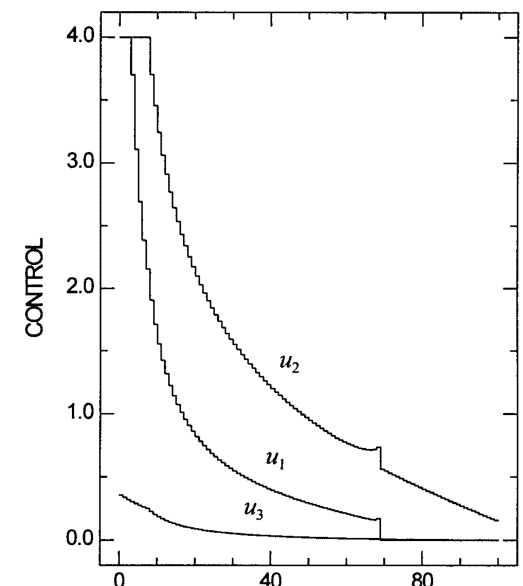

图 2.5：最优控制策略，得到 `I = 258.339218`，使用 IDP 获得

尽管计算需求看起来巨大，但在 Pentium/120 个人计算机上的实际计算时间不到 20 分钟 [22]，这相当于在 Pentium II/350 上不到 6 分钟。该性能指标值非常接近使用迭代动态规划 [21] 获得的值 `I = 258.33922`。尽管该问题不可分离，但为了解决该问题，IDP 比 LJ 更有效，因为在 IDP 中，问题被作为 100 个阶段的 3 变量问题求解，而不是 300 变量优化问题。我们将在第 13 章讨论 IDP 和不可分离问题。

这里，IDP 和 LJ 优化程序得到的控制策略几乎完全相同，其中在第 69 阶段控制变量 $u_1$ 和 $u_2$ 发生了突然变化。因此，LJ 优化程序非常适合用于检验其他方法得到的结果，特别是在最优控制策略与预期不同时，就像本例这种情况一样。存在一些问题，例如模型降阶，LJ 优化方法就很适用 [24]。为了说明该过程，我们考虑几个例子。

#### 2.3.2 简单示例 — 5 种食物饮食问题

让我们首先考虑如表 2.1 中指定的食物问题，我们之前已通过线性规划求解。用 LJ 优化程序求解是直接的，因为变量数量很少且不需要辅助变量。

用 $x_i$ 表示每种食物的用量，设起始条件为 $x_i = 0.5, i = 1, \cdots, 5$，每个变量的初始区域大小为 2.0。尽管初始起点不可行，但这无关紧要，因为初始起点只是随机选取点周围的中心点。设每次迭代后减小区域大小的缩减因子 $\gamma = 0.95$，每次通过 101 次迭代，最多 20 次通过。设每次迭代随机选取点的数量为参数，并对该参数使用 50、100、150、200 和 300。每次通过后，我们将区域大小设为该特定变量变化的范围。如果变化小于 $10^{-6}$，则将区域大小设为 $10^{-6}$。确定变量初始区域大小的该方案已被证明在求解多个优化问题时有效 [22, 23, 25]。该问题的计算机程序清单见附录 C。

计算结果见表 2.2。当选取的随机点数超过 50 时，收敛到最大效用 $I = 247.06390$ 没有问题，其中 $x_1 = 2.0000, x_2 = 0.3368, x_3 = 1.2090, x_4 = 0.0000$ 和 $x_5 = 0.0000$。这些值与线性规划得到并在图 2.2 中报告的值非常接近。值得注意的是，当 $R = 200$ 个随机点时，收敛已在 4 次通过后实现。$R = 200$ 时 20 次通过的计算时间为 Pentium/120 数字计算机上的 5.83 s，明显大于线性规划所需，但仍然相当小。

#### 2.3.3 模型降阶示例

在过程控制中遇到的重要问题是如何在不丢失基本信息的情况下降低传递函数的复杂度。非常高阶的传递函数难以使用，如果低阶传递函数给出基本相同的行为，则自然使用低阶传递函数。许多用于模型降阶的建议方法给出不令人满意的结果 [24]。Luus [18] 建议的降低传递函数阶数的方法是最小化在奈奎斯特图上简化模型与原始模型之间的偏差。

让我们考虑 Krishnamurthy 和 Seshadri [9] 的八阶系统

$F(s) = \frac{194480 + 482964s + 511812s^2 + 278376s^3 + 82402s^4 + 13285s^5 + 1086s^6 + 35s^7}{9600 + 28880s + 37492s^2 + 27470s^3 + 11870s^4 + 3017s^5 + 437s^6 + 33s^7 + s^8}$ (2.54)

其中我们希望得到低阶的简化模型。传递函数的零点（分子根）为 $-1.0346 \pm 0.63102j$，$-2.6369$，$-3.6345$，$-4.9021$，$-7.8014$ 和 $-9.7845$。传递函数的极点（分母根）为 $-1$，$-1 \pm j$，$-3$，$-4$，$-5$，$-8$ 和 $-10$。

让我们首先选择三阶简化模型形式为

$G(s) = \frac{20.2583(1 + x_1 s + x_2 s^2)}{(1 + x_3 s)(1 + x_4 s + x_5 s^2)}$ (2.55)

其中我们选择分子中的常数以保持稳态增益。


如 [18] 中建议的，我们通过取 $\omega_1 = 0.01$ 且 $\omega_{i+1} = 1.1\omega_i$ 选择 100 个频率值，以覆盖 0.01 到 125 的频率范围，并通过最小化以

$$
I = \sum_{i=1}^{100}[Re(F(j\omega_i)) - Re(G(j\omega_i))]^2 + [Im(F(j\omega_i)) - Im(G(j\omega_i))]^2. \tag{2.56}
$$

表示的偏差平方和来选择参数 $x_i, i = 1, 2, \cdots, 5$。

五个参数的初始值从原始系统的占优零点和极点选取，为 $x_1 = 1.4090$，$x_2 = 0.680928$，$x_3 = 1.0$，$x_4 = 1.0$，和 $x_5 = 0.5$。对于区域大小，我们选择第一次通过开始时为参数初始值的 0.1 倍；对于第二次通过，我们选择该初始值的 0.95 倍。对于所有后续通过，初始区域大小从每个特定变量的变化范围计算得出。区域大小在每次迭代后以 $\gamma = 0.95$ 减小。

每次迭代使用的随机点数 $R$ 与每次通过 50 次迭代所需的通过次数之间存在权衡，以收敛到奈奎斯特图上偏差平方和的最小值 $I_{min} = 0.32782509$。这在表 2.3 中显示。计算时间针对运行所用的总通过次数给出。

**Table 2.2: LJ 优化程序的收敛情况显示每次迭代随机选取点的数量 R 对性能指标随通过次数变化的影响**

| Pass Number | $R = 50$ | $R = 100$ | $R = 150$ | $R = 200$ | $R = 300$ |
|---|---|---|---|---|---|
| 1 | 246.91464 | 245.72210 | 246.97915 | 246.93550 | 247.03129 |
| 2 | 247.02599 | 245.83314 | 246.99476 | 247.01367 | 247.05779 |
| 3 | 247.06385 | 245.88798 | 247.06383 | 247.06376 | 247.06389 |
| 4 | 247.06385 | 245.93883 | 247.06388 | 247.06390 | 247.06390 |
| 5 | 247.06389 | 246.00646 | 247.06388 | 247.06390 | 247.06390 |
| 10 | 247.06389 | 246.61040 | 247.06389 | 247.06390 | 247.06390 |
| 20 | 247.06389 | 247.06390 | 247.06390 | 247.06390 | 247.06390 |

the same behavior, then it is natural to use the lower order transfer function. Many methods suggested for model reduction give unsatisfactory results [24]. The method of reducing the order of the transfer function as suggested by Luus [18] is to minimize the deviations between the reduced model and the original model in the Nyquist plot.

Let us consider the eighth-order system of Krishnamurthy and Seshadri [9]

$$
F(s) = \frac{194480 + 482964s + 511812s^2 + 278376s^3 + 82402s^4 + 13285s^5 + 1086s^6 + 35s^7}{9600 + 28880s + 37492s^2 + 27470s^3 + 11870s^4 + 3017s^5 + 437s^6 + 33s^7 + s^8} \tag{2.54}
$$

**Table 2.3: 每次迭代随机选取点的数量对收敛到 $I_{min} = 0.3278251$ 的影响**

| Random Points per Iteration $R$ | Number of Passes for Convergence | Number of Function Evaluations | CPU Time s | Passes |
|---:|---:|---:|---:|---:|
| 25 | 543 | 13575 | 176 | 600 |
| 50 | 424 | 21200 | 299 | 500 |
| 100 | 169 | 16900 | 348 | 300 |
| 200 | 75 | 15000 | 231 | 100 |
| 250 | 39 | 9750 | 434 | 150 |
| 500 | 32 | 16000 | 577 | 100 |
| 1000 | 18 | 18000 | 462 | 40 |
| 2000 | 11 | 22000 | 471 | 20 |
| 5000 | 9 | 45000 | 635 | 10 |

收敛曲线趋于相当平滑，如图 2.6 所示。虽然当 $R$ 增加时以通过次数计的收敛更快，但当 $R$ 超过 2000 时计算工作量大幅增加。

当我们以性能指标被计算的次数（函数求值次数）衡量计算工作量时，我们看到在 $R = 100$ 到 $R = 1000$ 范围内，我们需要大约 20000 次函数求值，需要约 4 分钟的计算时间。也很清楚，这里不建议取 $R$ 大于 2000。事实上，取 $R = 25$ 并允许大量通过在经济上是最划算的。

得到的第三阶简化模型为

$$
G(s)=\frac{20.2583(1+0.84076s+0.55067s^2)}{(1+0.61769s)(1+0.73908s+0.53529s^2)}. \tag{2.57}
$$

现在让我们考虑具有以下结构的四阶简化模型

$$
G(s)=\frac{20.2583(1+x_1s)(1+x_2s+x_3s^2)}{(1+x_4s+x_5s^2)(1+x_6s+x_7s^2)}. \tag{2.58}
$$

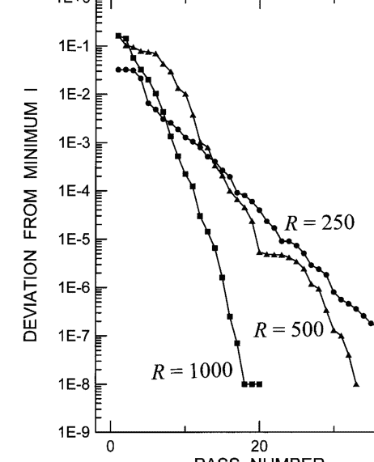

**Figure 2.6: Convergence profile for the third order reduced model using $N = 50$ iterations per pass**

其中我们再次希望保持稳态增益。现在有 7 个参数需要确定。初始值再次从原始传递函数的占优零点和极点选取：$x_1 = 0.37923$, $x_2 = 1.40900$, $x_3 = 0.68093$, $x_4 = 1.33333$, $x_5 = 0.33333$, $x_6 = 1.0$, 和 $x_7 = 0.5$。从第三阶模型降阶获得的经验来看，我们取每次迭代较少的随机点数（$R = 25$），但大量通过。收敛速率非常依赖于容差 $\varepsilon$ 用作防止特定区域坍塌的初始区域大小的最小值。如图 2.7 和 2.8 所示，无论每次通过使用 60 次迭代还是 40 次迭代，趋势相似。

这导致我们使用容差参数 $\varepsilon = 10^{-5}$ 用于最初的 2000 次通过的方案；然后将其减小到 $\varepsilon = 10^{-6}$ 用于接下来的 1000 次通过，并再次减小用于最后的 1000 次通过，如图 2.9 所示。如图所示，使用这种自适应容差参数选择，在 4000 次通过内即可实现收敛。Pentium/120 上 $R = 25$ 且每次通过 $N = 50$ 次迭代的计算时间为 2077s，并获得了非常精确的结果。使用 $R = 200$，结合自适应容差参数指定方法，收敛到 $I_{min} = 0.00073136556$ 需 2929 次通过。计算上，然而，

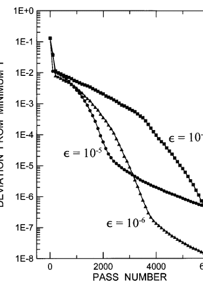

**图 2.8：使用每遍 $N = 40$ 次迭代的收敛曲线，并使用 $\varepsilon$ 作为参数**

其中 $\alpha_i$ 是传递函数 $F(s)$ 的第 $i$ 个极点，且

$$
f_i = \lim_{s \to \alpha_i} (s - \alpha_i) F(s). \tag{2.61}
$$

简化模型的输出 $g(t)$ 为

$$
g(t) = \sum_{i=1}^{q} g_i e^{\beta_i t} \tag{2.62}
$$

其中 $\beta_i$ 是传递函数 $G(s)$ 的第 $i$ 个极点，且

$$
g_i = \lim_{s \to \beta_i} (s - \beta_i) G(s). \tag{2.63}
$$

需最小化的性能指标为

$$
I = \int_0^T (f(t) - g(t))^2 dt, \tag{2.64}
$$

其中 $T$ 足够大。

取 $T = 10$ 时，得到简化模型

$$
G(s) = \frac{20.2583(1 + 0.22972s)(1 + 1.42268s + 0.71952s^2)}{(1 + 1.15241s + 0.18572s^2)(1 + 1.02491s + 0.51747s^2)}. \tag{2.65}
$$

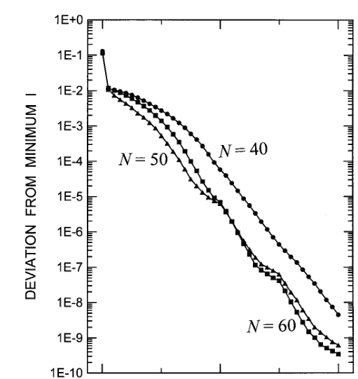

**图 2.9：收敛曲线 $R = 25$ 时 $I = 0.00073136556$，显示每遍迭代次数的影响。前 2000 遍 $\varepsilon = 10^{-5}$，接下来 1000 遍 $\varepsilon = 10^{-6}$，最后 1000 遍 $\varepsilon = 10^{-7}$。**

该简化模型的零点为 $-4.3531$，以及 $-0.9886 \pm 0.6422j$，而极点为 $-5.1620$、$-1.0431$，以及 $-0.9990 \pm 0.9756j$。

这两个简化模型的阶跃响应与原系统的阶跃响应几乎无法区分。

#### 2.3.4 参数估计

作为参数估计的实用方法，我们考虑来自 Belohlav 等人 [1] 的两个参数估计问题。

##### 示例 1

首先考虑甲苯加氢，其中催化反应

$A \rightleftharpoons B \rightarrow C$

进行。浓度变化由三个微分方程描述

$$
\frac{dx_1}{dt} = -r_1 + r_{-1} \tag{2.66}
$$

$$
\frac{dx_2}{dt} = -r_{-1} + r_1 - r_2 \tag{2.67}
$$

$$
\frac{dx_3}{dt} = r_2 \tag{2.68}
$$

其中 $r_1 = k_1\theta_A$，$r_{-1} = k_2\theta_B$，和 $r_2 = k_3\theta_B$，且表面覆盖率由下式给出

$$
\theta_A = \frac{k_4 x_1}{k_4 x_1 + x_2 + k_5 x_3}, \quad \theta_B = \frac{x_2}{k_4 x_1 + x_2 + k_5 x_3}. \tag{2.69}
$$

甲苯 (A) 的浓度由 $x_1$ 给出，1-甲基环己烯 (B) 由 $x_2$ 给出，甲基环己烷 (C) 由 $x_3$ 给出。从纯甲苯开始，Belohlav 等人 [1] 报告的浓度实验测量值给出为表 2.4 中的 13 个数据点。

**表 2.4：Belohlav 等人 [1] 示例 1 的实验数据**

| 时间, min | 测得浓度 | | |
| | $\hat{x}_1$ | $\hat{x}_2$ | $\hat{x}_3$ |
|---|---|---|---|
| 15 | 0.695 | 0.312 | 0.001 |
| 30 | 0.492 | 0.430 | 0.080 |
| 45 | 0.276 | 0.575 | 0.151 |
| 60 | 0.225 | 0.570 | 0.195 |
| 75 | 0.163 | 0.575 | 0.224 |
| 90 | 0.134 | 0.533 | 0.330 |
| 120 | 0.064 | 0.462 | 0.471 |
| 180 | 0.056 | 0.362 | 0.580 |
| 240 | 0.041 | 0.211 | 0.747 |
| 320 | 0.031 | 0.146 | 0.822 |
| 360 | 0.022 | 0.080 | 0.898 |
| 380 | 0.021 | 0.070 | 0.909 |
| 400 | 0.019 | 0.073 | 0.908 |

问题是按模型浓度值与在收集数据的 13 个点上测得的浓度值偏差平方和最小的意义，获得 $\mathbf{k}$ 的最佳估计。因此需最小化的性能指标为

$$
I = \sum_{i=1}^{13} [\mathbf{x}(t_i) - \hat{\mathbf{x}}(t_i)]^T [\mathbf{x}(t_i) - \hat{\mathbf{x}}(t_i)]. \tag{2.70}
$$

取参数向量 $\mathbf{k} = [0.25 \ 0.25 \ 0.25 \ 0.25 \ 0.25]^T$ 作为初始值，给出 $I = 6.90489$，且每个变量第一遍的初始区域大小为 0.125，收敛到最小性能指标 $I = 0.01590003$ 很容易得到，给出 $k = [0.02511 \ 0.00326 \ 0.00873 \ 1.27258 \ 1.24230]^T$。这些参数值与 Belohlav 等人 [1] 给出的值相差相当大，即 $k = [0.023 \ 0.005 \ 0.011 \ 1.9 \ 1.8]^T$，给出 $I = 0.01789155$，但响应差异在视觉上难以检测。计算细节由 Luus [25] 给出。

##### 示例 2

现在考虑一个更具挑战性的问题，我们有四种化学物质。Belohlav 等人 [1] 得到的甲酯加氢实验数据

$A \xrightarrow{r_1} B \xrightarrow{r_2} C \xrightarrow{r_3} D$,

其中 $x_1$ 表示亚油酸 (A) 的浓度，$x_2$ 表示亚油酸 (B) 的浓度，$x_3$ 表示油酸 (C) 的浓度，$x_4$ 表示硬脂酸 (D) 的浓度，给出在表 2.5 中。酯类浓度的变化率由

**表 2.5：Belohlav 等人 [1] 示例 2 的实验数据**

| 时间, min | 测得浓度 | | | |
| | $\hat{x}_1$ | $\hat{x}_2$ | $\hat{x}_3$ | $\hat{x}_4$ |
|---|---|---|---|---|
| 0 | 0.1012 | 0.2210 | 0.6570 | 0.0208 |
| 10 | 0.0150 | 0.1064 | 0.6941 | 0.1977 |
| 14 | 0.0044 | 0.0488 | 0.6386 | 0.3058 |
| 19 | 0.0028 | 0.0242 | 0.5361 | 0.4444 |
| 24 | 0.0029 | 0.0015 | 0.3956 | 0.6055 |
| 34 | 0.0017 | 0.0005 | 0.2188 | 0.7808 |
| 69 | 0.0003 | 0.0004 | 0.0299 | 0.9680 |
| 124 | 0.0001 | 0.0002 | 0.0001 | 0.9982 |

给出

$$
\frac{dx_1}{dt} = -r_1 \tag{2.71}
$$

$$
\frac{dx_2}{dt} = r_1 - r_2 \tag{2.72}
$$

$$
\frac{dx_3}{dt} = r_2 - r_3 \tag{2.73}
$$

$$
\frac{dx_4}{dt} = r_3 \tag{2.74}
$$

其中

$$
r_1=k_1\theta_A,\quad r_2=k_2\theta_B,\quad r_3=k_3\theta_C.
$$

Belohlav 等人 [1] 给出了表面覆盖率的以下表达式：

$$
\theta_A=\frac{x_1}{x_1+k_4x_2+k_5x_3+k_6x_4}, \tag{2.75}
$$

$$
\theta_B=\frac{k_4x_2}{x_1+k_4x_2+k_5x_3+k_6x_4}, \tag{2.76}
$$

$$
\theta_C=\frac{k_5x_3}{x_1+k_4x_2+k_5x_3+k_6x_4}. \tag{2.77}
$$

参数估计问题是根据表 2.5 中四种化学物质浓度的测量值确定六个参数 $k_i$, $i=1,2,\ldots,6$ 的值。尽管 Belohlav 等人 [1] 使用了不同的优化准则，我们选择偏差平方和

$$
I=\sum_{k=1}^{7}\sum_{i=1}^{4}[x_i(t_k)-\hat{x}_i(t_k)]^2. \tag{2.78}
$$

第一个数据点用作积分的初始条件；因此参数估计只需考虑 7 个数据点。

对于参数估计我们使用 $\gamma=0.95$ 并允许每遍 101 次迭代，并使用参数的截然不同的初始值。对于参数搜索的区域大小，第一遍开始时我们选择 $r_{in}=0.5k^{(0)}$，第二遍选择 $r_{in}=0.25k^{(1)}$，对于后续遍，我们根据最近一遍中变量变化的程度选择初始区域大小，即

$$
r_{in,i}^{q+1}=|k_i^{q-1}-k_i^q|,\quad i=1,2,\ldots,6, \tag{2.79}
$$

其中 $q$ 表示遍数，如 Luus [22] 所建议。

为避免区域坍缩，如果某个区域在遍中没有变化而变为零，则我们在随后遍开始时任意将区域大小赋值为 $10^{-6}$。

当我们应用 LJ 优化程序时，发现收敛到截然不同的参数值集合，如表 2.6 所示。很明显，参数 $k_1,k_4,k_5$ 和 $k_6$ 之间的关系得以保留，如果按比例增大这些参数，性能指标会改善到最小值 $I=4.5777\times10^{-4}$。该性能指标值几乎比 Belohlav 等人 [1] 报告的参数值得到的 $4.3433\times10^{-3}$ 低 10 倍。因此很明显，$x_1$ 不应出现在表面覆盖率项的分母中。基于给定的实验数据，因此表面覆盖率项可以简化为

$$
\theta_A=\frac{x_1}{k_4x_2+k_5x_3+x_4}. \tag{2.80}
$$


```
$$\theta_B = \frac{k_4 x_2}{k_4 x_2 + k_5 x_3 + x_4}\tag{2.81}$$
```

```
$$\theta_C = \frac{k_5 x_3}{k_4 x_2 + k_5 x_3 + x_4},\tag{2.82}$$
```

其中我们任意将 `$k_6$` 设为 1。因此，对于此问题只有 5 个参数需要确定。

使用此 5 参数模型，从截然不同的起点收敛到唯一的参数集合。图 2.10 显示了从初始值 `$k_i^{(0)} = 0.05, i = 1,2,\cdots,5$` 开始收敛到 `$I = 4.5777 \times 10^{-4}$` 的收敛曲线。该性能指标的最小值在使用 `$R = 100$` 个随机选取点每迭代时仅用 6 遍得到，而在使用 `$R = 200$` 时用 11 遍得到。观察到使用更多随机选取点不一定会增加收敛速度。在图 2.11 中，然而，从起点 `$k_i^{(0)} = 1.0, i = 1,2,\cdots,5$` 开始，`$R = 200$` 的收敛速度比 `$R = 100$` 快，其中前者需要 15 遍才能收敛到 `$I = 4.5777 \times 10^{-4}$`。在每种情况下，参数的所得值均为：`$k_1 = 0.42786$`，`$k_2 = 0.026877$`，`$k_3 = 0.094579$`，`$k_4 = 10.0760$`，和 `$k_5 = 0.57546$`。

模型与实验数据的密切吻合在图 2.12 中显示，其中实线由使用最优确定的五个参数积分方程得到，符号表示表 2.5 中的数据。

由于令人困惑的是 `$x_1$` 为何不应出现在表面覆盖率项的分母中，可以假设 A 的存在不会阻碍其他物质的催化活性，并且本身不受催化剂影响。因此模型的结构可以通过完全消除 `$\theta_A$` 来简化，并写成 `$r_1 = k_1 x_1$`。在此改变下，仅得到略高的性能指标，即 `$I = 4.7506 \times 10^{-4}$`，其中 `$k_1 = 0.21093$`，`$k_2 = 0.027179$`，`$k_3 = 0.089990$`，`$k_4 = 9.9521$`，和 `$k_5 = 0.61614$`。使用这些参数值和这种不同的模型结构，模型预测与数据之间的关系在图 2.13 中显示。如图所示，该模型预测与数据之间也有非常密切的对应关系。

#### 2.3.5 处理等式约束

在许多问题中，如果存在等式约束，它们通常很简单，可以通过适当的代换消除。例如在烷基化装置的优化中，有 7 个等式约束。然而，这 7 个等式约束被重新排列以将优化问题的维数从 10 减少到 3。这就变成了一个非常简单的优化问题，其解可在几分之一秒内得到。问题在于当我们有困难的等式约束时该怎么办。假设除了式 (2.3) 中的不等式约束外，我们还有 `$m$` 个等式约束

```
$$h_i(x_1, x_2, ..., x_n) = 0, \quad i = 1,2,...,m\tag{2.83}$$
```

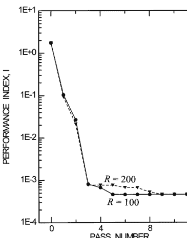

图 2.10：从初始值 `$k_i = 0.05, i = 1,2,\cdots,5$` 到 `$I = 4.5777 \times 10^{-4}$` 的收敛曲线，示例 2

其中这些等式约束在“困难”的意义上是不能用来求解某个特定变量的。

尽管用于处理等式约束的两遍方法 [13] 在求解涉及循环流的优化问题 [15] 时是有效的，但用于 LJ 优化程序中处理等式约束的通用方法直到最近才得到令人满意的解决，当时 Hartig 等人 [5] 表明惩罚函数可以在直接搜索优化中非常有效地使用。该工作由 Luus 和 Wyrwicz [34] 扩展，他们研究了不同类型的惩罚函数在稳态优化问题中的应用。该工作进一步由 Luus [20] 扩展，他表明将项移入惩罚函数可以导致最优值的非常精确的结果。现在看来，使用包含位移项的二次惩罚函数是处理困难等式约束的最佳方法 [20]。我们考虑增广性能指标

$$J = I + \theta \sum_{i=1}^{m} (h_i - s_i)^2 \tag{2.84}$$

其中为每个等式约束引入一个位移项 `$s_i$`。为了解决这个优化问题，LJ 优化程序以多遍方式使用，其中，在由若干次迭代组成的每遍开始时，区域尺寸被恢复为前一遍开始时尺寸的一部分。位移项 `$s_i$` 在每遍之后简单地更新，通过根据式 (2.83) 中左侧在零处的偏差调整遍 `$(q + 1)$` 开始时的值，即

```
$$
s_i^{q+1} = s_i^{q} - h_i, \quad i = 1,2,\ldots,m \tag{2.85}
$$
```

其中 `$q$` 为遍数。优化后，乘积 `$-2\theta s_i$` 给出与第 `$i$` 个等式约束相关的拉格朗日乘子，提供有用的灵敏度信息。我们将在第 10 章中使用这种方法来处理使用迭代动态规划 (IDP) 求解最终状态指定的最优控制问题时等式约束 [31]。让我们用一个简单的例子来说明该程序。

##### 示例：几何问题

让我们考虑 Luus [13] 使用的几何问题，以展示如何在 LJ 优化程序中处理等式约束，然后再次 [20] 展示位移项在优化中的使用。该问题是求椭球面与双曲面相交处到原点的最大距离。为了数学上的方便，我们考虑距离的平方。因此要求最大化

```
$$
I = x_1^2 + x_2^2 + x_3^2 \tag{2.86}
$$
```

受两个等式约束

```
$$
h_1 = 4(x_1 - 0.5)^2 + 2(x_2 - 0.2)^2 + x_3^2 + 0.1 x_1 x_2 + 0.2 x_2 x_3 - 16 = 0 \tag{2.87}
$$
```

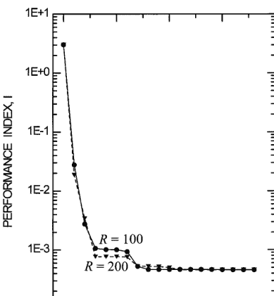

图 2.11：从初始值 `$k_i = 1.0, i = 1,2,\cdots,5$` 到 `$I = 4.5777 \times 10^{-4}$` 的收敛曲线，示例 2

和

```
$$
h_2 = 2x_1^2 + x_2^2 - 2x_3^2 - 2 = 0.
$$
```

我们构造增广性能指标

```
$$
J = I - \theta[(h_1-s_1)^2 + (h_2-s_2)^2],
$$
```

其中 `$\theta$` 为正的惩罚函数因子，位移项初始置零，然后在每遍 `$q$` 之后通过

```
$$
s_i^{q+1}=s_i^q-h_i, \qquad i=1,2.
$$
```

更新。为观察迭代格式的收敛性，我们查看性能指标 `$I$` 和约束违背范数

```
$$
S=|h_1|+|h_2|.
$$
```

为用 LJ 优化程序求解此问题，我们将每个 `$x_i$` 的初始值取为零，每个变量的区域尺寸取为 10。我们使用区域收缩因子 `$\gamma=0.95$`，并允许每遍 5 次迭代。对于前五遍，区域尺寸恢复为前一遍开始时值的 0.80 倍 (`$\eta=0.80$`)，对于其余遍，区域尺寸由变量变化的程度决定，最小值为 `$10^{-6}$`。我们选择每迭代 `$R=25$` 个随机点。计算机程序的清单见附录 C。

**表 2.6：使用 6 个参数进行参数估计的结果，示例 2，显示最优参数值的非唯一性**

| 性能指标, I | k₁ | k₂ | k₃ | k₄ | k₅ | k₆ |
|---|---|---|---|---|---|---|
| 4.5902 × 10⁻⁴ | 2.42939 | 0.027024 | 0.094121 | 56.9225 | 3.28448 | 5.67431 |
| 4.5883 × 10⁻⁴ | 5.43020 | 0.026942 | 0.094379 | 127.614 | 7.32090 | 12.6985 |
| 4.5782 × 10⁻⁴ | 56.503 | 0.026883 | 0.094562 | 1330.377 | 76.0110 | 132.0595 |
| 4.5777 × 10⁻⁴ | 5662.85 | 0.026877 | 0.094578 | 133360 | 7616.5 | 13235 |
| 4.5777 × 10⁻⁴ | 5662800 | 0.026877 | 0.094580 | 133360000 | 7616500 | 13235000 |

**表 2.7：几何问题中不同 θ 值经过 100 遍后的结果**

| 惩罚因子, θ | 性能指标, I | s₁ | s₂ | x₁ | x₂ | x₃ |
|---|---|---|---|---|---|---|
| 0.005 | 11.67664 | -67.34144 | 21.10645 | 0.98842 | 2.67366 | -1.88446 |
| 0.050 | 11.67664 | -6.73414 | 2.110645 | 0.98842 | 2.67366 | -1.88446 |
| 0.500 | 11.67664 | -0.673415 | 0.211065 | 0.98842 | 2.67366 | -1.88446 |

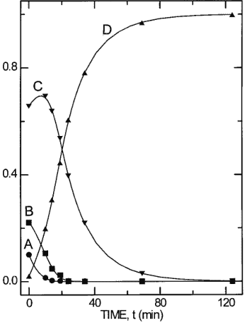

图 2.12：模型预测（实线）与实验数据（符号）的比较，`$I = 4.5777 \times 10^{-4}$`

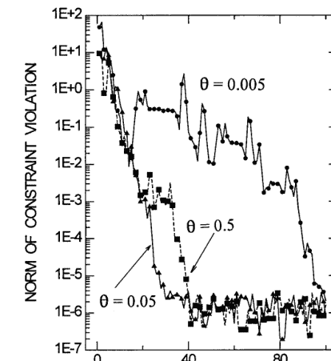

图 2.14：惩罚函数因子 θ 不同取值下约束违背范数的收敛曲线

### 2.4 参考文献

- [1] BELOHLAV, Z., ZAMOSTNY, P., KLUSON, P., AND VOLF, J.: “Application of random-search algorithm for regression analysis of catalytic hydrogenations”, Can. J. Chem. Eng. 75 (1997), 735-742.
- [2] BOJKOV, B., HANSEL, R., AND LUUS, R.: “Application of direct search optimization to optimal control problems”, Hung. J. Ind. Chem. 21 (1993), 177-185.
- [3] DINKOFF, B., LEVINE, M., AND LUUS, R.: “Optimum linear tapering in the design of columns”, Trans. ASME 46 (1979), 956-958.
- [4] EDGAR, T. AND HIMMELBLAU, D.M.: Optimization of chemical processes, McGraw-Hill, New York, 1988.
- [5] HARTIG, F., KEIL, F.J., AND LUUS, R.: “Comparison of optimization methods for a fed-batch reactor”, Hung. J. Ind. Chem. 23 (1995), 141-148.
- [6] HEALTH AND WELFARE CANADA: Nutrient Value of Some Common Foods, Supply and Services Canada, Cat. No. H58-28/1979E, 1979.
- [7] HIMMELBLAU, D.M.: Applied Nonlinear Programming, McGraw-Hill, New York, 1972.
- [8] KALOGERAKIS, N. AND LUUS, R.: “Increasing the size of region of convergence for parameter estimation”, Proc. 1982 American Control Conf. (1982), 358-362.
- [9] KRISHNAMURTHY, V. AND SESHADRI, V.: “Model reduction using the Routh stability criterion”, IEEE Trans. Automat. Control 23 (1978), 729-731.
- [10] LUUS, R.: “Time-optimal control of linear systems”, Can. J. Chem. Eng. 52 (1974), 98-102.
- [11] LUUS, R.: “A practical approach to time-optimal control of nonlinear systems”, Ind. Eng. Chem. Proc. Des. Develop. 13 (1974), 405-408.
- [12] LUUS, R.: “Optimal control by direct search on feedback gain matrix”, Chem. Eng. Sci. 29 (1974), 1013-1017.
- [13] LUUS, R.: “Two-pass method for handling difficult equality constraints in optimization”, AIChE J. 20 (1974), 608-610.
- [14] LUUS, R.: “Solution of output feedback stabilization and related problems by stochastic optimization”, IEEE Trans. Auto. Contr. 20 (1975), 820-821.
- [15] LUUS, R.: “Optimization of multistage recycle systems by direct search”, Can. J. Chem. Eng. 53 (1975), 217-220.
- [16] LUUS, R.: “Optimization of system reliability by a new nonlinear integer programming procedure”, IEEE Trans. on Reliab. 24 (1975), 14-16.
- [17] LUUS, R.: “A discussion on optimization of an alkylation process”, Int. J. Num. Methods in Eng. 10 (1976), 1187-1190.
- [18] LUUS, R.: “Optimization in model reduction”, Int. J. Contr. 32 (1980), 741-747.
- [19] LUUS, R.: “Optimization of heat exchanger networks”, Ind. Eng. Chem. Res. 32 (1993), 2633-2635.
- [20] LUUS, R.: “直接搜索优化中处理困难的等式约束”, *Hung. J. Ind. Chem.* **24** (1996), 285-290.
- [21] LUUS, R.: “迭代动态规划在不可分问题最优控制中的应用”, *Hung. J. Ind. Chem.* **25** (1996), 293-297.
- [22] LUUS, R.: “LJ 优化程序区域大小的确定”, *Hung. J. Ind. Chem.* **26** (1998), 281-286.
- [23] LUUS, R.: “通过直接搜索优化对 Lotka-Volterra 问题进行参数估计”, *Hung. J. Ind. Chem.* **26** (1998), 287-292.
- [24] LUUS, R.: “线性系统的最优降阶”, *J. Franklin Inst.* **336** (1999), 523-532.
- [25] LUUS, R.: “直接搜索优化在参数估计中的应用”, in *Scientific Computing in Chemical Engineering II*, Keil, Mackens, Voss, Werther (Eds.); Springer, New York, 1999, 346-353.
- [26] LUUS, R., DITTRICH, J., AND KEIL, F.J.: “管式反应器中双功能催化剂混合物优化的多重解”, *Can. J. Chem. Eng.* **70** (1992), 780-785.
- [27] LUUS, R., HARTIG, F., AND KEIL, F.J.: “通过直接搜索优化实现癌症化疗的最优给药方案”, *Hung. J. Ind. Chem.* **23** (1995), 55-58.
- [28] LUUS, R. AND HENNESSY, D.: “通过 Luus-Jaakola 优化程序对分批进料反应器进行优化”, *Ind. Eng. Chem. Res.* **38** (1999), 1948-1955.
- [29] LUUS, R. AND JAAKOLA, T.H.I.: “通过直接搜索和系统缩小搜索区域进行优化”, *AIChE J.* **19** (1973), 760-766.
- [30] LUUS, R. AND MUTHARASAN, R.: “通过极点移动稳定线性系统行为”, *Int. J. Control* **20** (1974), 395-405.
- [31] LUUS, R. AND STOREY, C.: “最终状态受约束系统的最优控制”, *Proc. IASTED Intl. Conf. Modelling, Simulation and Optimization*, Singapore, August 11-13, 1997, pp. 245-249.


- [32] LUUS, R. AND TASSONE, V.: “通过迭代动态规划对不可分问题的最优控制”, *Proc. 42nd Canadian Chemical Engineering Conference*, Toronto, Canada, October 18-21, 1992, pp. 81-82.
- [33] LUUS, R., WONG, C.W., AND KOSTELNIK, D.: “模型降阶中简化模型结构的重要性”, *Proc. IASTED Intl. Conf. Intelligent Systems and Control*, Santa Barbara, CA, October 28-30, 1999, pp. 322-326.
- [34] LUUS, R. AND WYRWICZ, R.: “直接搜索优化中惩罚函数的使用”, *Hung. J. Ind. Chem.* **24** (1996), 273-278.
- [35] PAPANGELAKIS, V. G. AND LUUS, R.: “压力氧化过程中的反应器优化”, *Proc. Intl. Symp. Modelling, Simulation and Control of Metall. Processes* (1993), 159-171.
- [36] SAUER, R.N., COLVILLE, A.R., AND BURWICK, C.W.: “计算机指引实现更多利润”, *Hydrocarbon Processing Petrol. Refiner* **43** (1964), 84-90.
- [37] SPAANS, R. AND LUUS, R.: “随机优化中搜索域缩减的重要性”, *JOTA* **75** (1992), 635-638.
- [38] WANG, B.C. AND LUUS, R.: “非单峰系统的优化”, *Int. J. Numer. Methods Eng.* **11** (1977), 1235-1250.
- [39] WANG, B.C. AND LUUS, R.: “获得全局最优的优化程序可靠性”, *AIChE J.* **24** (1978), 619-626.
- [40] YANG, S.M. AND LUUS, R.: “线性系统降阶中的优化”, *Electronics Letters* **19** (1983), 635-637.
- [41] YANG, S.M. AND LUUS, R.: “数字控制系统模型降阶的注记”, *Int. J. Control* **37** (1983), 437-439.

#### 3.2.1 一个简单的最优路径问题

让我们考虑图 3.1 所示的情况，其中存在从 A 到 B 的不同路径。路径各段的成本用数字表示。假设我们希望找到一条始终向右移动的路径，使得从 A 到 B 的总成本最小化。为便于讨论，节点用字母 a、b、…、l 标记。

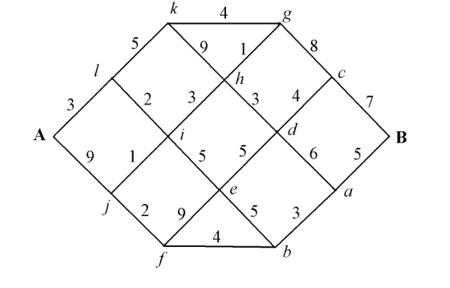

图 3.1：最优路径问题

从节点 a 开始，我们发现去往 B 只有一种方式，其相关成本为 5，因此我们将最小成本 5 与节点 a 关联。同样，从节点 b 出发只有一种方式继续，成本为 3 加上从节点 a 到 B 的成本。因此我们将最小成本 8 与节点 b 关联。继续到节点 c，由于我们始终从左到右移动，我们看到去往 B 只有一种方式，其相关成本为 7。在节点 d 处，有两个选择：一个是继续到节点 c，另一个是继续到节点 a。值得注意的是，这里两种选择没有区别，因为每种替代方案的成本都是 11。因此我们将最小成本 11 分配给节点 d。

在节点 e 处也有两种继续的方式。我们可以去节点 d 或去节点 b。前者成本为 5 + 11 = 16，后者成本为 5 + 8 = 13。我们比较这两个数字并选择给出较小数字的路径，即路径 e 到 b，并将最小成本 13 与节点 e 关联。同样在节点 f，我们比较两个成本 9 + 13 = 22 和 4 + 8 = 12，并将最小成本 12 与节点 f 关联，且路径为 f 到 b 而非 f 到 e。在节点 g 只有一种继续方式，因此与节点 g 关联的最小成本为 8 + 7 = 15。

在节点 h 我们比较两个成本 1 + 15 = 16 和 3 + 11 = 14，并选择路径 h 到 d。在节点 i 比较两个成本后得到沿路径 i 到 h 的最小成本 17。在节点 j，通过从 j 到 f 实现最小成本 14。在节点 k 我们比较两个成本 4 + 15 = 19 和 9 + 14 = 23，并选择路径 k 到 g。在节点 l 我们比较两个成本 5 + 19 = 24 和 2 + 17 = 19 并选择路径 l 到 i，其最小成本为 19。

现在我们继续到起点 A。这里有两种继续方式。对于路径 A 到 l，成本为 3 + 19 = 22；对于路径 A 到 j，成本为 9 + 14 = 23。因此我们得出从 A 到 B 的最小成本为 22，并且有两条路径可产生此成本：A-l-i-h-d-c-B 和 A-l-i-h-d-a-B。

我们在此指出，与其将最小化作为整体问题来做，我们求解一系列非常简单的最小化问题，这些问题涉及在节点处比较两个数字。其中一些节点实际上是“自由”的，无需优化。还观察到不可能错过全局最小值，如果有不止一条路径产生最小值，该方法会捕获所有这些路径，正如这里所说明的那样。随着问题规模的增大，这种方法相对于穷举枚举的计算优势变得更加明显。例如，如果不是 3 × 3 网格，而是 10 × 10 网格，使用动态规划的方法仍然可以轻松手工完成，但对所有可能路径的穷举枚举将是不现实的。

我们现在转向一个非常相似的类型问题，涉及在单一设施上安排作业，以使成本最小化 [4]。

#### 3.2.2 作业分配问题

设有一组 P 个作业，称为 \(J_1, J_2, \ldots, J_P\)，要在单一设施上执行。与每个作业 \(J_n\) 相关联的是执行时间 \(\tau_n\) 和成本函数 \(c_n(t)\)，给出在时间 \(t\) 完成作业时的相关成本。为简单起见，我们假设一次只执行一个作业，作业一旦开始就不会中断，且设施持续使用。问题是选择作业的顺序，使得总成本最小化。性能指标因此被选为

\[
I = \sum_{k=1}^{P} c_k(t_k), \tag{3.1}
\]

我们希望确定作业的执行顺序以使性能指标最小化。对于所有可能的排序，我们需要检查 \(P!\) 个日程安排，当 \(P\) 较大时这变得难以处理。对于此类问题，动态规划非常适用。我们以 \(P = 5\) 个作业的情形为例说明。这与前面讨论的最优路径问题非常相似。我们将问题设想为涉及 5 个阶段。在阶段 1 我们有 5 个作业，在阶段 5 我们只有单个作业需要考虑。我们从最后阶段（阶段 5）开始，涉及一个

对于其他9个集合，表格补全，显示了三个作业的最小成本。

##### 表3.2：3个作业的顺序与最小成本

| 作业顺序 | 最小成本 |
|---|---|
| $J_2 J_1 J_3$ | $c_2(\tau_2) + c_1(\tau_2 + \tau_1) + c_3(\tau_1 + \tau_2 + \tau_3)$ |
| $J_3 J_1 J_4$ | $c_3(\tau_3) + c_1(\tau_3 + \tau_1) + c_4(\tau_1 + \tau_3 + \tau_4)$ |
| $J_1 J_4 J_2$ | $c_1(\tau_1) + c_4(\tau_4 + \tau_1) + c_2(\tau_1 + \tau_4 + \tau_2)$ |
| $J_1 J_5 J_3$ | $c_1(\tau_1) + c_5(\tau_5 + \tau_1) + c_3(\tau_1 + \tau_5 + \tau_3)$ |
| $J_2 J_3 J_4$ | $c_2(\tau_2) + c_3(\tau_2 + \tau_3) + c_4(\tau_2 + \tau_3 + \tau_4)$ |
| $J_4 J_2 J_5$ | $c_4(\tau_4) + c_2(\tau_4 + \tau_2) + c_5(\tau_4 + \tau_2 + \tau_5)$ |
| $J_2 J_5 J_1$ | $c_2(\tau_2) + c_5(\tau_2 + \tau_5) + c_1(\tau_2 + \tau_5 + \tau_1)$ |
| $J_4 J_3 J_5$ | $c_4(\tau_4) + c_3(\tau_4 + \tau_3) + c_5(\tau_4 + \tau_3 + \tau_5)$ |
| $J_3 J_5 J_2$ | $c_3(\tau_3) + c_5(\tau_3 + \tau_5) + c_2(\tau_3 + \tau_5 + \tau_2)$ |
| $J_5 J_4 J_1$ | $c_5(\tau_5) + c_4(\tau_5 + \tau_4) + c_1(\tau_5 + \tau_4 + \tau_1)$ |

现在我们进入阶段2，此时需要考虑4个作业。从5个作业中选出4个作业组成的集合共有5种可能。让我们选择由作业$J_1$、$J_2$、$J_3$和$J_5$组成的集合。我们使用表3.2中的信息来确定前三个作业的顺序和最小成本，并只需加上最后一个作业的成本。如果$J_1$最后执行，那么从表3.2中我们就知道$J_2$、$J_3$和$J_5$这三个作业的执行顺序以及与之相关的成本。所需做的只是加上额外成本$c_1(\tau_2 + \tau_3 + \tau_5 + \tau_1)$。我们以同样的方式处理其他三种情况，即$J_2$、$J_3$或$J_5$最后执行，并比较4个成本值，以得到产生最小成本的安排。对其余4个集合重复该过程，得到的信息可展示在表3.3中。

##### 表3.3：4个作业的顺序与最小成本

| 作业顺序 | 最小成本 |
|---|---|
| $J_1 J_4 J_2 J_3$ | $c_1(\tau_1) + c_4(\tau_4 + \tau_1) + c_2(\tau_1 + \tau_4 + \tau_2) + c_3(\tau_1 + \tau_4 + \tau_2 + \tau_3)$ |
| $J_1 J_5 J_3 J_4$ | $c_1(\tau_1) + c_5(\tau_5 + \tau_1) + c_3(\tau_1 + \tau_5 + \tau_3) + c_4(\tau_1 + \tau_5 + \tau_3 + \tau_4)$ |
| $J_4 J_2 J_5 J_1$ | $c_4(\tau_4) + c_2(\tau_4 + \tau_2) + c_5(\tau_4 + \tau_2 + \tau_5) + c_1(\tau_4 + \tau_2 + \tau_5 + \tau_1)$ |
| $J_4 J_3 J_5 J_2$ | $c_4(\tau_4) + c_3(\tau_4 + \tau_3) + c_5(\tau_4 + \tau_3 + \tau_5) + c_2(\tau_4 + \tau_3 + \tau_5 + \tau_2)$ |
| $J_3 J_5 J_2 J_1$ | $c_3(\tau_3) + c_5(\tau_3 + \tau_5) + c_2(\tau_3 + \tau_5 + \tau_2) + c_1(\tau_3 + \tau_5 + \tau_2 + \tau_1)$ |

现在让我们进入阶段1，此时需要考虑5个作业。只有一个集合需要考虑。我们问自己哪个作业应该最后执行。如果$J_4$最后执行，那么其他4个作业的最小成本可由表3.3的最后一行得到，我们只需加上执行$J_4$的成本，即$c_4(\tau_1+\tau_2+\tau_3+\tau_4+\tau_5)$。类似地，如果$J_2$最后执行，我们从表3.3的第二行找到前四个作业的顺序和最小成本，并只需加上成本$c_2(\tau_1+\tau_2+\tau_3+\tau_4+\tau_5)$。我们继续对$J_3$最后执行、$J_4$最后执行和$J_1$最后执行的情况重复该过程。比较这5个成本值，其中的最小值给出了使成本最小化的5个作业顺序。

在这个例子中，我们看到计算以系统化的方式进行，因此在每个阶段，优化只涉及将单个作业添加到已经最优计算过的作业集中。该过程非常适合使用数字计算机，因为同一计算过程需要重复多次。动态规划不仅为优化问题提供了数值方法，还提供了函数关系，如下一个例子所示。

#### 3.2.3 石头问题

让我们举例说明如何使用动态规划求解一个以速度`v0`向上抛出的石头能升多高的问题。我们假设空气阻力不可忽略，因此石头的运动方程可以写为

$$\frac{dv}{dt}=-g-kv^2 \tag{3.2}$$

初始条件为`t=0`时`v=v0`。显然，高度是初速度的函数。我们将轨迹分成两部分：第一部分是石头在短时间`Δt`内走过的短距离，第二部分是轨迹的其余部分

$$h(v_0)=v_0\Delta t+h\left(v_0+\frac{dv}{dt}\Delta t\right)+O(\Delta t^2). \tag{3.3}$$

现在，对右边的第二项进行泰勒展开，仅保留前两项，并利用式(3.2)，得到

$$h(v_0)=v_0\Delta t+h(v_0)-[(g+kv_0^2)\Delta t]\frac{dh(v_0)}{dv_0}+O(\Delta t^2). \tag{3.4}$$

将式(3.4)重新整理并除以`Δt`，得到

$$\frac{dh(v_0)}{dv_0}=\frac{v_0}{g+kv_0^2}+O(\Delta t). \tag{3.5}$$

现在令 `Δt → 0`，得到一阶常微分方程

$$\frac{dh(v_0)}{dv_0}=\frac{v_0}{g+k v_0^2},\qquad (3.6)$$

在给定初始条件下可直接积分得到

$$h(v_0)=\frac{1}{2k}\ln\left(1+\frac{k v_0^2}{g}\right).\qquad (3.7)$$

当`k`小到可以忽略时，我们看到`h(v0)→ v0^2/2g`，这一结果可以通过令初始时刻的动能与最大高度处的势能相等而得到。

#### 3.2.4 简单最优控制问题

让我们考虑一个相当简单的最优控制问题，其中线性离散标量系统具有如下形式

$$x(k+1)=a x(k)+b u(k),\qquad k=0,1,2,\cdots,P-1,\qquad (3.8)$$

其中初始状态`x(0)`给定，最终状态`x(P)=0`。我们假设对控制`u(k)`没有约束。最优控制问题是要选择`u(k),k=0,1,2,\cdots,P-1`，使得性能指标

$$I[x(0),P]=\sum_{k=1}^{P}[x^2(k)+u^2(k-1)]\qquad (3.9)$$

最小化。这里我们显式地给出了性能指标对初始状态和步数`P`的依赖关系。自然地，性能指标也是控制策略的函数，而该控制策略必须被选择以实现最小化。为了用动态规划求解此问题，我们首先考虑一个单阶段问题，然后逐步增加阶段数，直到所提出的问题被求解。

`P = 1`

当我们有一个单阶段问题时，性能指标为

$$I[x(0),1]=x^2(1)+u^2(0)\qquad (3.10)$$

并且无法进行最小化，因为最终条件的指定要求我们使用

$$u(0)=\frac{x(1)-a x(0)}{b}=-\frac{a}{b}x(0).\qquad (3.11)$$

性能指标的值为

$$I[x(0),1]=\frac{a^2}{b^2}x^2(0).\qquad (3.12)$$

接下来我们考虑`P=2`阶段的情况。

##### `P = 2`

对于两个阶段，我们从`x(0)`出发，前进到`x(1)`，然后到`x(2)=0`。要最小化的性能指标为

$$I[x(0),2]=x^2(1)+u^2(0)+x^2(2)+u^2(1)=x^2(1)+u^2(0)+u^2(1). \tag{3.13}$$

一旦到达`x(1)`，我们就已经知道如何到达`x(2)=0`，因为这是上面已求解的单阶段问题。因此我们有

$$u(1)=-\frac{a}{b}x(1). \tag{3.14}$$

性能指标变为

$$I[x(0),2]=\left(1+\frac{a^2}{b^2}\right)x^2(1)+u^2(0). \tag{3.15}$$

利用`k=0`时的式(3.8)，我们可以将性能指标重写为仅关于`u(0)`的显式函数，即

$$I[x(0),2]=\left(1+\frac{a^2}{b^2}\right)[ax(0)+bu(0)]^2+u^2(0). \tag{3.16}$$

对式(3.16)关于`u(0)`求导，得

$$\frac{dI[x(0),2]}{du(0)}=2b\left(1+\frac{a^2}{b^2}\right)[ax(0)+bu(0)]+2u(0). \tag{3.17}$$

由于性能指标的二阶导数为正，使性能指标最小化的`u(0)`的选取由驻点条件给出，即

$$u(0)=-\left(\frac{ab+(a^3/b)}{1+a^2+b^2}\right)x(0). \tag{3.18}$$

我们现在可以准备考虑`P=3`阶段的情况了。

##### `P = 3`

增加一个阶段后，计算的模式变得清晰。当`P=3`时，性能指标为

$$I[x(0),3]=x^2(1)+u^2(0)+x^2(2)+u^2(1)+u^2(2), \tag{3.19}$$

因为`x(3)=0`。这里我们知道，如前所确定的，`u(2)`和`u(1)`的最优选择为

$$u(2)=-\frac{a}{b}x(2). \tag{3.20}$$

and

$$u(1)=-\left(\frac{ab+(a^3/b)}{1+a^2+b^2}\right)x(1). \tag{3.21}$$

性能指标现在可以表示为 `u(0)` 的显式函数，并且该过程可以重复。


尽管从分析上看该过程最终会变得繁琐，但数值上这种优化可以非常容易地完成。通过使用动态规划，$P$ 个联立方程的求解被替换为处理单个方程的程序，但要做 $P$ 次。因此并行计算被串行计算所取代。

#### 3.2.5 线性最优控制问题

作为进一步的例子，我们考虑一个线性最优控制问题，其中系统由下式描述

$$
\mathbf{x}(k+1)=\boldsymbol{\Phi}\mathbf{x}(k)+\boldsymbol{\Psi}\mathbf{u}(k),\qquad k=0,1,\ldots,P-1, \tag{3.22}
$$

其中 $\boldsymbol{\Phi}$ 和 $\boldsymbol{\Psi}$ 是常数矩阵，且初始条件 $\mathbf{x}(0)$ 已知。性能指标假定具有二次形式

$$
I[\mathbf{x}(0),P]=\sum_{k=1}^{P}\left[\mathbf{x}^{T}(k)\mathbf{Q}\mathbf{x}(k)+\mathbf{u}^{T}(k-1)\mathbf{R}\mathbf{u}(k-1)\right]. \tag{3.23}
$$

其中 $\mathbf{R}$ 是正定对称矩阵，$\mathbf{Q}$ 是正半定对称矩阵。令我们定义

$$
I^0[\mathbf{x}(0),P]=\min I[\mathbf{x}(0),P] \tag{3.24}
$$

使得 $I^0[\mathbf{x}(0),P]$ 是在 $P$ 个控制阶段上性能指标的最优值。因此

$$
I^0[\mathbf{x}(0),P]=\min_{\mathbf{u}(0)}\min_{\mathbf{u}(1)}\cdots\min_{\mathbf{u}(P-1)}\sum_{k=1}^{P}\left[\mathbf{x}^{T}(k)\mathbf{Q}\mathbf{x}(k)+\mathbf{u}^{T}(k-1)\mathbf{R}\mathbf{u}(k-1)\right]. \tag{3.25}
$$

我们可以使用动态规划中的最优性原理重写该表达式为

$$
I^0[\mathbf{x}(0),P]=\min_{\mathbf{u}(0)}\left[\mathbf{x}^{T}(1)\mathbf{Q}\mathbf{x}(1)+\mathbf{u}^{T}(0)\mathbf{R}\mathbf{u}(0)+I^0[\mathbf{x}(1),P-1]\right], \tag{3.26}
$$

这提供了动态规划的递推关系。

假设最优性能指标可以写成

$$
I^0[\mathbf{x}(0),P]=\mathbf{x}^{T}(0)\mathbf{J}_P\mathbf{x}(0). \tag{3.27}
$$

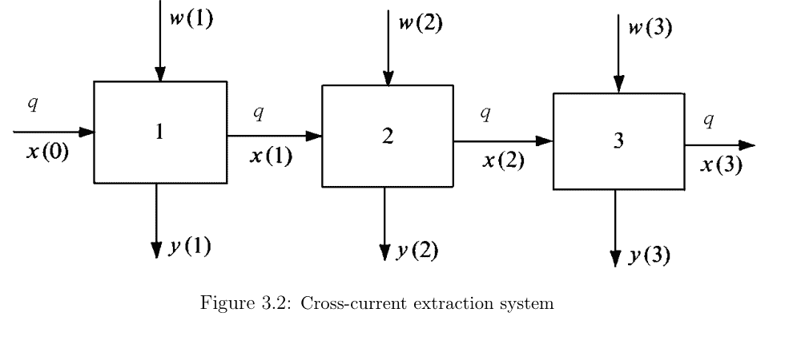

图 3.2：逆流萃取系统

状态方程可以写成

$$
x(k+1)=\frac{x(k)}{1+\alpha u(k+1)},\qquad k=0,1,2.\tag{3.35}
$$

我们希望选择流速 $w(1), w(2),$ 和 $w(3)$，或归一化形式 $u(1), u(2),$ 和 $u(3)$，以便从萃余液流中去除最大量的溶质。然而，使用萃取溶剂是有成本的。因此，要最大化的性能指标选为

$$
I[x(0),3]=[x(0)-x(3)]-\theta[u(1)+u(2)+u(3)],\tag{3.36}
$$

其中 $\theta$ 是与使用萃取溶剂相关联的成本因子。这种优化问题非常适合动态规划。当有 $P$ 个阶段时，性能指标变为

$$
I[x(0),P]=[x(0)-x(P)]-\theta\sum_{i=1}^{P}u(i).\tag{3.37}
$$

正如我们在前面简单的最优控制问题中所做的那样，我们通过首先考虑 $P=1$ 然后增加 $P$ 直到达到 $P=3$ 来求解此优化问题。

$P = 1$

当我们只有一个阶段时，性能指标为

$$
I[x(0),1]=[x(0)-x(1)]-\theta u(1)\tag{3.38}
$$

其中

$$
x(1)=\frac{x(0)}{1+\alpha u(1)}.\tag{3.39}
$$

从而 $u(1)$ 的最优值为

$$
u^0(1)=\left[\frac{x(0)}{\alpha^2\theta}\right]^{\frac{1}{3}}-\frac{1}{\alpha}\tag{3.49}
$$

并且

$$
x(1)=\left[\frac{x^2(0)\theta}{\alpha}\right]^{\frac{1}{3}}.\tag{3.50}
$$

$P=2$ 时的最优性能指标为

$$
I^0[x(0),2]=x(0)-3\left[\frac{\theta^2 x(0)}{\alpha^2}\right]^{\frac{1}{3}}+\frac{2\theta}{\alpha}.\tag{3.51}
$$

此时值得注意的是

$$
u^0(2)=\left[\frac{x(1)}{\alpha\theta}\right]^{\frac{1}{2}}-\frac{1}{\alpha}=\left[\left[\frac{x^2(0)\theta}{\alpha}\right]^{\frac{1}{3}}\frac{1}{\alpha\theta}\right]^{\frac{1}{2}}-\frac{1}{\alpha}=u^0(1).\tag{3.52}
$$

因此，最优策略是在每个阶段以相等数量分配萃取溶剂。

##### $P = 3$

$P=3$ 时的最优性能指标为

$$
I^0[x(0),3]=\max_{u(1)}\left[u(1)\left(\frac{\alpha x(0)}{1+\alpha u(1)}-\theta\right)+I^0[x(1),2]\right],\tag{3.53}
$$

其中上一步已计算的最后一项为

$$
I^0[x(1),2]=x(1)-3\left[\frac{\theta^2 x(1)}{\alpha^2}\right]^{\frac{1}{3}}+\frac{2\theta}{\alpha}.\tag{3.54}
$$

将式 (3.54) 代入式 (3.53) 并对 $u(1)$ 求导，我们得到驻定条件

$$
\theta(1+\alpha u(1))^2=\frac{\theta^2 x(0)}{\alpha}\left[\frac{\theta^2 x(0)}{\alpha^2(1+\alpha u(1))}\right]^{-\frac{2}{3}},\tag{3.55}
$$

从而

$$
1+\alpha u(1)=\left[\frac{x(0)\alpha}{\theta}\right]^{\frac{1}{4}}.\tag{3.56}
$$

因此，控制到第一阶段的最优值为

$$
u^0(1)=\left[\frac{x(0)}{\alpha^3\theta}\right]^{\frac{1}{4}}-\frac{1}{\alpha},\tag{3.57}
$$

并且离开该阶段的萃余液流中的溶质浓度为

$$
x(1)=\left[\frac{x^{3}(0)\theta}{\alpha}\right]^{\frac{1}{4}}. \tag{3.58}
$$

$P = 3$ 时的最优性能指标为

$$
I^{0}[x(0),3]=x(0)-4\left[\frac{\theta^{3}x(0)}{\alpha^{3}}\right]^{\frac{1}{4}}+\frac{3\theta}{\alpha}. \tag{3.59}
$$

很容易证明最优控制策略为

$$
u^{0}(1)=u^{0}(2)=u^{0}(3), \tag{3.60}
$$

表明萃取溶剂应在每个阶段以相等数量分配。

### 3.3 动态规划的局限性

尽管动态规划已成功应用于一些简单的最优控制问题，但在使用动态规划对非线性系统进行最优控制时，最大的问题之一是当轨迹从网格点出发时并不恰好到达下一阶段的网格点时所遇到的插值问题 [4]。这种插值困难加上维数限制以及需要非常大量的网格点，限制了动态规划仅适用于非常简单的最优控制问题。“维数灾难”和求解最优控制问题时“网格扩展的祸害”所施加的限制使得动态规划无法用于实际类型的最优控制问题。

### 3.4 参考文献

[1] ARIS, R.: *Discrete dynamic programming*, Blaisdell Publishing Co., New York, 1964.

[2] BELLMAN, R.E.: *Dynamic programming*, Princeton University Press, 1957.

[3] BELLMAN, R. AND DREYFUS, S.: *Applied dynamic programming*, Princeton University Press, 1962.

[4] LAPIDUS, L. AND LUUS, R.: *Optimal control of engineering processes*, Blaisdell, Waltham, Mass., 1967.

## 第 4 章 迭代动态规划

### 4.1 引言

我们考虑由向量微分方程描述的连续动态系统

$$
\frac{d\mathbf{x}}{dt}=\mathbf{f}(\mathbf{x},\mathbf{u},t)\tag{4.1}
$$

初始状态 $\mathbf{x}(0)$ 已知，其中 $\mathbf{x}$ 是 $(n\times1)$ 状态向量，$\mathbf{u}$ 是 $(m\times1)$ 控制向量，受限于

$$
\alpha_j \le u_j(t) \le \beta_j,\quad j=1,2,\cdots,m.\tag{4.2}
$$

对于性能指标，我们选择一种特殊形式的标量函数以允许讨论优化过程：

$$
I[\mathbf{x}(0),t_f]=\Psi(\mathbf{x}(t_f))+\int_{0}^{t_f}\phi(\mathbf{x},\mathbf{u},t)dt,\tag{4.3}
$$

其中最终时间 $t_f$ 是指定的。最优控制问题是选择时间区间 $0\le t < t_f$ 中的控制策略 $\mathbf{u}(t)$，使得该性能指标最小化。我们也可能有状态约束，但为简单起见，我们将这些留到第 11 章再考虑。

迭代动态规划的初始思想由 Luus [5] 提出并测试，然后经过改进 [4] 使计算过程更加高效。关于使用动态规划的基本思想基于第 3 章中考虑的最优路径问题，并被改编为求解最优控制问题。

### 4.2 时间阶段的构造

为了将问题按动态规划的要求划分为一系列阶段，我们可以通过要求分段常值控制策略而非连续控制策略来近似最优控制问题，共分为 $P$ 个阶段，每个阶段长度为 $L$，使得

$$
L=\frac{t_f}{P}. \tag{4.4}
$$

于是性能指标被近似为

$$
I[\mathbf{x}(0),P]=\Psi(\mathbf{x}(t_f))+\sum_{k=1}^{P}\int_{t_{k-1}}^{t_k}\phi(\mathbf{x}(t),\mathbf{u}(k-1),t)\,dt, \tag{4.5}
$$

其中 $t_{k-1}$ 是阶段 $k$ 开始时的时间，$\mathbf{u}(k-1)$ 是时间区间 $t_{k-1}\leq t\leq t_k$ 中的常值控制，我们可以考虑在这些 $P$ 个阶段上设置的网格点处的系统。我们也可以使用分段线性近似，且阶段不一定需要等长。这些思想将在后续章节中展开。目前我们希望尽可能保持简单。

### 4.3 `x` 的网格构造

状态向量 $\mathbf{x}$ 的每个分量 $x_i$ 在每个时间阶段允许在区域 $s_i$ 上取 $N$ 个值，第一个阶段除外，第一个阶段取为指定的初始条件。因此在第 2、3、…、$P$ 阶段共有 $N^n$ 个网格点。网格的中心点取为上一次迭代得到的 $\mathbf{x}$ 的最佳值。

### 4.4 控制的允许值

控制向量 $\mathbf{u}$ 的每个分量 $u_j$ 在每个阶段允许在区域 $r_j$ 上取 $M$ 个值。中心点取为上一次迭代的最佳值。如果式 (4.2) 中的约束对分量 $u_j$ 被违反，则使用裁剪技术将其替换为上界或下界。因此在 $\mathbf{x}$ 的每个网格点处，控制向量的允许值有 $M^m$ 个。

### 4.5 第一次迭代

从给定的初始条件 $\mathbf{x}(0)$ 和式 (4.2) 指定的约束出发，我们可以选择 `x`-网格的中心点、控制的允许范围，以及区域 $s_i$ 和 $r_j$。示例将展示如何做出这种选择。

#### 4.5.1 阶段 `P`

让我们从阶段 `P` 开始计算，对应时间区间 $t_f-L\le t<t_f$。对每个 `x`-网格点评估性能指标的 $M^m$ 个值：

$$
I[\mathbf{x}(t_f-L),1]=\Psi(\mathbf{x}(t_f))+\int_{t_f-L}^{t_f}\phi(\mathbf{x}(t),\mathbf{u}(P-1),t)\,dt, \tag{4.6}
$$

其中 $\mathbf{u}(P-1)$ 依次使用 $M^m$ 个允许的控制值。比较这 $M^m$ 个性能指标值并选择使值最小的 $\mathbf{u}(P-1)$ 特定值。这是该特定 `x`-网格点应使用的最佳控制。当我们继续进行 $N^n$ 个网格点时，我们就知道了最后阶段每个网格点应使用的最优控制策略。

#### 4.5.2 阶段 `P` − 1

现在我们向后退一步到阶段 `P` − 1，对应时间区间 $t_f-2L\le t<t_f-L$。对每个网格点，我们再次考虑 $M^m$ 个允许的控制值。然而，当我们从 $t_f-2L$ 积分到 $t_f-L$ 时，状态 $\mathbf{x}(t_f-L)$ 很可能不会恰好是阶段 `P` 的一个网格点。状态不能恰好命中网格点的问题在 **图 4.1** 中有所说明，为简单起见，我们取 $n=2$，$N=5$，$m=1$，且 $M=4$。因此网格由一个 $(5\times5)$ 矩阵组成。在阶段 `P` − 1 的网格点 $(2,3)$ 处，我们展示了 4 条到阶段 `P` 的轨迹，对应使用四个允许的控制值，即 $u=a,b,c$ 和 $d$。这些轨迹均未命中阶段 `P` 的网格点。

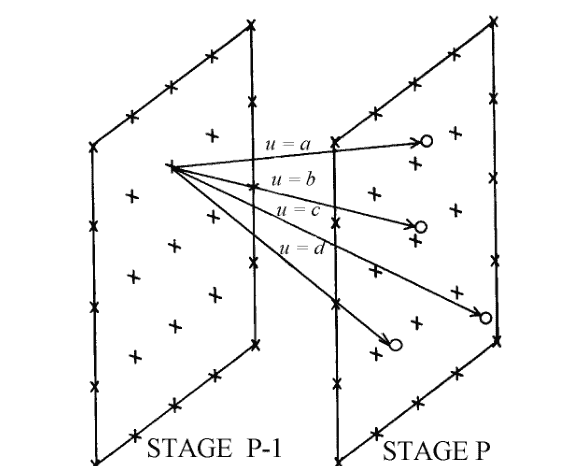

图 4.1：分配 4 个控制值时难以到达网格点的说明

为了继续积分到最终时间 $t_f$，我们取最接近状态 $\mathbf{x}(t_f-L)$ 的网格点所对应的最优控制策略。如 DeTremblay 和 Luus [3] 所示，如果使用足够多的网格点和允许的控制值，这种方法能给出良好的近似。如 **图 4.1** 所示，为了继续第一条轨迹的积分，我们使用对应网格点 $(2,3)$ 在阶段 `P` 的最优控制；为了继续对应 $u=b$ 的第二条轨迹，我们使用 $(3,3)$ 处的最佳控制策略；对于 $u=c$ 我们使用 $(5,5)$；而为了继续对应 $u=d$ 的轨迹，我们使用在阶段 `P` 为网格点 $(4,2)$ 建立的最优控制策略。到时间 $t_f$ 时，我们有四个性能指标值可供比较，并选择使值最小的控制策略。因此，阶段 `P` − 1 的网格点 $(2,3)$ 的控制策略得以确定。对其余 24 个网格点继续此过程即可完成阶段 `P` − 1 的计算。

#### 4.5.3 向后方向的继续

我们以这种方式继续进行阶段 $P-2$、$P-3$、⋯ 等，直到达到阶段 1。阶段 1 对应时间区间 $0\le t<L$，网格仅由初始条件 $\mathbf{x}(0)$ 组成。在此阶段我们比较 $M^m$ 个性能指标值并选择使值最小的控制策略。这完成了第一次迭代。即使选择了相当多的网格点和允许的控制值，所得到的最优控制策略也远离全局最优解。因此，有必要改进第一次迭代后得到的控制策略，我们进入优化程序的主要部分。

### 4.6 采用系统性区域缩小进行迭代

第一次迭代的最优轨迹为每个阶段的 `x`-网格提供中心点，第一次迭代的最优控制策略为每个阶段的控制允许值提供中心值。相应的区域 $s_i$ 和 $r_j$ 被缩小一个小量以提供更精细的分辨率，并继续进行多次迭代。当该程序进行足够多次迭代时，预计会以足够的精度收敛到最优控制策略。为了说明和测试该程序，我们取一个简单的例子。

### 4.7 示例

让我们考虑第 1 章中概述的连续搅拌釜式反应器 (CSTR)。系统由下式描述

$$
\frac{dx_1}{dt} = -(2 + u)(x_1 + 0.25) + (x_2 + 0.5)\exp\left[\frac{25x_1}{x_1 + 2}\right] \tag{4.7}
$$

$$
\frac{dx_2}{dt} = 0.5 - x_2 - (x_2 + 0.5)\exp\left[\frac{25x_1}{x_1 + 2}\right] \tag{4.8}
$$

其中 $x_1$ 表示无量纲稳态温度的偏差，$x_2$ 表示无量纲稳态浓度的偏差。在本工作中，使用初始条件 $x_1(0)=0.09$ 和 $x_2(0)=0.09$。我们考虑控制 $u$ 无界的情况。最优控制问题是确定时间区间 $0 \le t < t_f$ 中的 $u$ 以使性能指标最小化

$$
I = \int_0^{t_f} (x_1^2 + x_2^2 + 0.1u^2)dt \tag{4.9}
$$

其中无量纲最终时间 $t_f$ 指定为 0.78。为了方便评估性能指标且不引入不必要的近似，我们引入一个新的状态变量 $x_3$，由

$$
\frac{dx_3}{dt} = x_1^2 + x_2^2 + 0.1u^2 \tag{4.10}
$$


给出，初始条件为 $x_3(0)=0$，并将其与另外两个方程一起积分以得到性能指标。然而，`x`-网格仅涉及 $x_1$ 和 $x_2$。假设我们将给定的时间区间划分为 13 个阶段，每个阶段长度为 0.06 (`P=13`)。为了测试基本程序，Luus [5] 取 `x`-网格的中心为 (0,0) 且控制为 3.0。每个 $x_i$ 的初始区域大小取为 0.09，控制取为 3.0。每次迭代后使用 0.90 的缩小因子。收敛曲线见图 4.2，其中网格点数和允许控制值的指定以 $(N \times N, M)$ 给出。很明显，即使使用相对较多的网格点，要获得足够的收敛也需要超过 20 次迭代。

### 4.8 使用可达状态作为网格点

虽然易于编程，但上述方法在计算上并不具吸引力，因为即使对于二维 CSTR 问题也需要非常多的计算。使用粗网格并通过区域收缩来提供准确答案的方法在三个测试问题 [5] 中效果良好。但即便如此，维度的诅咒也开始显现。如果我们设想一个 `x`-网格仅有 5 个值

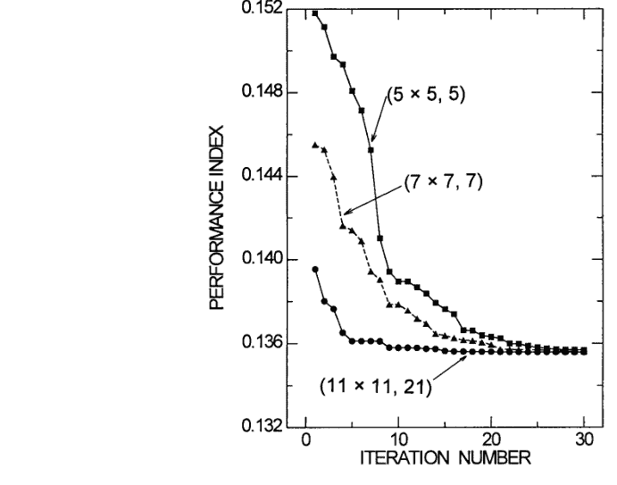

图 4.2：性能指标的收敛曲线，展示了网格点数和控制允许取值个数（以 $(N \times N, M)$ 表示）对 CSTR 的影响

对于每个状态变量，我们看到当 $n = 3$ 时，每一阶段需要考虑 125 个网格点，这仍然是可以管理的；但当 $n = 5$ 时，网格点数将增加到 3,125，即使对高速计算机来说这也是一个非常大的数目。我们还注意到，这些网格点中有很多是无法从指定的初始状态到达的；因此，到目前为止概述的计算过程并不是很高效。

通过只使用那些从给定状态施加控制后实际可以到达的点，可以克服网格点数量过大的问题。因此，不独立选取 `x`-网格点，文献[4]建议通过施加不同的控制值来*生成*网格点。这样所有网格点都可以从指定的初始状态到达。此外，状态向量的维数也不再重要，并且所需的网格点数量很少。现在可以将计算方案总结如下。

### 4.9 IDP 算法

为了说明 IDP 的基本逻辑，下面给出一个算法来求解式 (4.1)–(4.3) 中描述的最优控制问题，其中要求使用分段常数控制在 `P` 个阶段上最小化式 (4.3) 中的性能指标，每个阶段长度相同：

- 1. 将时间区间 $[0, t_f]$ 划分为 `P` 个时间阶段，每个阶段长度为 `L`。
- 2. 选择 `u` 的测试值个数 `R`、初始控制策略和初始区域大小 `r_in`；同时选择每次迭代后使用的区域收缩因子 `γ` 和网格点数 `N`。
- 3. 选择每次遍历中使用的总迭代次数，并将迭代次数索引设为 `j = 1`。
- 4. 设置区域大小向量 `r^j = r_in`。
- 5. 利用最佳控制策略（第一次迭代时为初始控制策略），从 `t = 0` 到 `t_f` 对式 (4.1) 进行 `N` 次积分，每次使用不同的控制值来生成 `N` 条 `x`-轨迹，并存储每个时间阶段开始时的 `x` 值，从而 `x(k - 1)` 对应于阶段 `k` 开始时的 `x` 值。
- 6. 从阶段 `P`（对应时间 `t_f - L`）开始，对于第 5 步中存储的 `N` 个 `x(P - 1)` 值（网格点）中的每一个，用 `R` 个允许的控制向量值分别对式 (4.1) 从 `t_f - L` 到 `t_f` 积分，这些控制值由下式计算：

$$
\mathbf{u}(P - 1) = \mathbf{u}^{*j}(P - 1) + \mathbf{D}\mathbf{r}^j \tag{4.11}
$$

其中 $\mathbf{u}^{*j}(P - 1)$ 是前一次迭代中获得的最佳值，$\mathbf{D}$ 是一个由介于 $-1$ 和 $1$ 之间的不同随机数组成的对角矩阵。在 `R` 个性能指标值中，选择使性能指标最小的控制值，并将这些值存储为 $\mathbf{u}(P - 1)$。现在我们得到了这 `N` 个网格点各自的最佳控制。
- 7. 回到阶段 `P - 1`（对应时间 `t_f - 2L`），对每个 `N` 个网格点执行以下计算。如上一张，为 $\mathbf{u}(P - 2)$ 选择 `R` 个值，并以初始状态 $\mathbf{x}(P - 2)$ 对式 (4.1) 积分一个阶段长度。然后使用第 6 步中存储的 $\mathbf{u}(P - 1)$ 值继续在最后一个时间阶段积分，该值对应于与已达到的状态向量值最接近的网格点。比较 `R` 个性能指标值，并存储使性能指标最小的 $\mathbf{u}(P - 2)$。
- 8. 继续该过程，直到达到阶段 1（对应初始时间 `t = 0` 和给定的初始状态）。该阶段只有一个网格点，因为初始状态是指定的。如前所述，对式 (4.1) 积分，比较 `R` 个性能指标值，并存储使性能指标最小的控制 $\mathbf{u}(0)$。同时存储相应的 `x`-轨迹。这完成了一次迭代。
- 9. 缩小允许控制的区域

$$
\mathbf{r}^{j+1} = \gamma \mathbf{r}^j \tag{4.12}
$$

其中 `j` 是迭代次数索引。使用第 8 步得到的最佳控制策略作为允许控制值的中点，用上标 * 表示。
- 10. 将迭代索引 `j` 增加 1，转到第 5 步，按指定的迭代次数继续该过程并解释结果。在某些问题中，使用多遍方法可能是有益的，即在若干次迭代后重置区域大小并重复该过程。

在该算法中，控制候选值是随机选择的。在早期发展中，控制候选值是从均匀间隔的网格中选取的。对于低维问题，差别很小，但对于较高维的控制向量，使用随机值效果更好。允许控制值的选择在第 5 章中讨论。通过考虑上述 CSTR 示例，可以认识到生成网格点（而不是像前面那样选择网格点）所带来的改进。通过使用单个网格点，用 15 个随机选择的控制值很容易获得收敛。当 `P = 13` 时，在 3 遍中收敛得到 `I = 0.13558`，在 Pentium/120 数字计算机上计算时间为 9.3 秒。收敛曲线如图 4.3 所示。

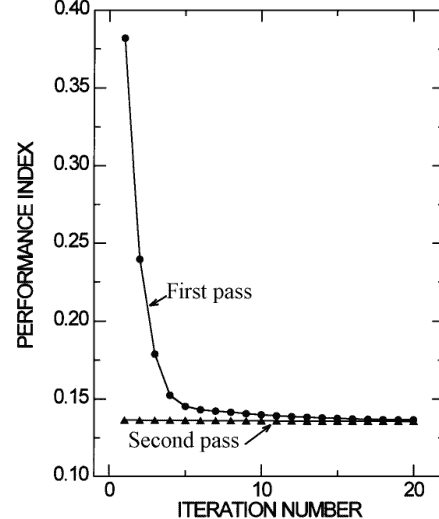

图 4.3：CSTR 在每一阶段仅使用一个可达网格点且 `R = 15` 个随机选择的控制候选值时的收敛曲线

用于该问题、概述 IDP 算法的计算机程序完整列于附录 D 中。当使用 `P = 20` 时，在 3 遍内收敛到 `I = 0.13416`，在 Pentium/120 数字计算机上需要 14.1 秒的 CPU 时间。

### 4.11 参考文献

- [1] BOJKOV, B. AND LUUS, R.: “Evaluation of the parameters used in iterative dynamic programming”, *Can. J. Chem. Eng.* **71** (1993), 451-459.
- [2] BOJKOV, B. AND LUUS, R.: “Optimal control of nonlinear systems with unspecified final times”, *Chem. Eng. Sci.* **51** (1996), 905-919.
- [3] DETREMBLAY, M. AND LUUS, R.: “Optimization of non-steady state operation of reactors”, *Can. J. Chem. Eng.* **67** (1989), 494-502.
- [4] LUUS, R.: “Optimal control by dynamic programming using accessible grid points and region reduction”, *Hung. J. Ind. Chem.* **17** (1989), 523-543.
- [5] LUUS, R.: “Optimal control by dynamic programming using systematic reduction in grid size”, *Int. J. Control* **51** (1990), 995-1013.
- [6] LUUS, R.: “Effect of the choice of final time in optimal control of nonlinear systems”, *Can. J. Chem. Eng.* **69** (1991), 144-151.
- [7] LUUS, R.: “On the application of iterative dynamic programming to singular optimal control problems”, *IEEE Trans. Auto. Contr.* **37** (1992), 1802-1806.
- [8] LUUS, R.: “Application of dynamic programming to differential-algebraic process systems”, *Comp. Chem. Eng.* **17** (1993), 373-377.
- [9] LUUS, R.: “Optimization of fed-batch fermentors by iterative dynamic programming”, *Biotech. Bioeng.* **41** (1993), 599-602.
- [10] LUUS, R.: “Use of variable stage-lengths for constrained optimal control problems”, *Hung. J. Ind. Chem.* **25** (1997), 299-304.
- [11] LUUS, R. AND BOJKOV, B.: “Global optimization of the bifunctional catalyst problem”, *Can. J. Chem. Eng.* **72** (1994), 160-163.
- [12] LUUS, R., DITTRICH, J., AND KEIL, F.J.: “Multiplicity of solutions in the optimization of a bifunctional catalyst blend in a tubular reactor”, *Can. J. Chem. Eng.* **70** (1992), 780-785.
- [13] LUUS, R. AND GALLI, M.: “Multiplicity of solutions in using dynamic programming for optimal control”, *Hung. J. Ind. Chem.* **19** (1991), 55-62.
- [14] MEKARAPIRUK, W. AND LUUS, R.: “Optimal control of inequality state constrained systems”, *Ind. Eng. Chem. Res.* **36** (1997), 1686-1694.
- [15] MEKARAPIRUK, W. AND LUUS, R.: “Optimal control of final state constrained systems”, *Can. J. Chem. Eng.* **75** (1997), 806-811.

## 第5章

## 控制的允许值

### 5.1 引言

控制候选值的选取有多种方式。最简单的方式，也是IDP早期工作中使用的方式，是在给定区域内均匀地取控制的允许值。这意味着在区域中心取一个点，在区域的每个端点取一个点，然后在区间内部均匀地取其余点。该方案易于编程，也易于可视化。因此，对于每个控制变量，我们至少有3个值，即相对于前一次迭代得到的最佳值距离为 −r、0 和 r，其中 r 为区域大小。如果有两个控制变量，则候选值的最小数量为9。对于 m 个控制变量，我们在每个网格点必须检查 `3^m` 个候选值。这在 m 小于5时是可以的，但如果 m 很大，这个数字会变得过大。即使 m =5，在每个网格点检查243个控制候选值也可能太多。

为了减少控制候选值的最小数量，Tassone 和 Luus [7] 提出了一种替代方法，即仅检查区域的顶点加上中心点。这将控制候选值的最小数量从 `3^m` 减少到 `2^m +1`，因此当 m =4 时，只需检查17个控制候选值。用区域面的中心代替顶点也能得到同样的减少。然而，正如 Bojkov 和 Luus [1] 所示，对于高维系统，更好的方法是随机在允许区域内选择控制候选值。这意味着理论上 m 没有上限。概念上 m 可以大于100，迭代动态规划仍然可以使用。事实上，IDP 已成功应用于具有130个微分方程和130个控制变量的系统 [4]，后来又应用于具有250个微分方程和250个控制变量的系统 [5]。

为了深入了解如何选择控制候选值，并观察在均匀分布上选择候选值与随机选择之间的关系，我们考虑一个涉及3个控制变量的例子。

### 5.2 均匀分布与随机选择的比较

让我们考虑第1章中概述的CSTR，其中物种A的入口流率以无量纲单位指定为 `q1 = 6`，并且有三个控制变量。描述系统的方程为：

$$
\begin{aligned}
\frac{dx_1}{dt} &= q_1-qx_1-17.6x_1x_2-23x_1x_6u_3 \tag{5.1}\\
\frac{dx_2}{dt} &= u_1-qx_2-17.6x_1x_2-146x_2x_3 \tag{5.2}\\
\frac{dx_3}{dt} &= u_2-qx_3-73x_2x_3 \tag{5.3}\\
\frac{dx_4}{dt} &= -qx_4+35.2x_1x_2-51.3x_4x_5 \tag{5.4}\\
\frac{dx_5}{dt} &= -qx_5+219x_2x_3-51.3x_4x_5 \tag{5.5}\\
\frac{dx_6}{dt} &= -qx_6+102.6x_4x_5-23x_1x_6u_3 \tag{5.6}\\
\frac{dx_7}{dt} &= -qx_7+46x_1x_6u_3 \tag{5.7}\\
\frac{dx_8}{dt} &= 5.8(qx_1-q_1)-3.7u_1-4.1u_2+q(23x_4+11x_5+28x_6+35x_7)-5u_3^2-0.099 \tag{5.8}
\end{aligned}
$$

其中 `q=q1+u1+u2` 且 `q1=6`。稍后我们允许 `q1` 成为另一个控制变量，但在这里我们希望将控制变量的数量限制为3，如 Rao 和 Luus [6] 所做。最后一个微分方程给出性能指标。问题是最大化

$$
I=x_8(t_f) \tag{5.9}
$$

其中最终时间 `t_f` 指定为0.2。初始状态指定为 $\mathbf{x}(0)=[0.1883\ 0.2507\ 0.0467\ 0.0899\ 0.1804\ 0.1394\ 0.1046\ 0]^T$。控制变量受约束为

$$
\begin{aligned}
0\le u_1\le20 \tag{5.10}\\
0\le u_2\le6 \tag{5.11}\\
0\le u_3\le4 \tag{5.12}
\end{aligned}
$$

Rao 和 Luus [6] 使用此示例来评估基于 Pontryagin 最大原理的控制向量迭代的众多算法。他们发现算法得到的性能指标最大值在 `I=20.05` 和 `I=20.09` 之间。此示例也被 Luus [2] 用于展示迭代动态规划如何克服维度灾难，并被 Luus [3] 用于考察最优控制中最终时间选择的影响。因此，此示例应能很好地说明迭代动态规划中选择控制候选值的不同方式。

这里我们使用 `P = 10` 个等长阶段（每个长度为0.02），并使用四阶 Runge-Kutta 方法以积分时间步长0.005 积分微分方程以提供良好的精度。对于所有运行，我们在第2到第10阶段使用了 `N = 3` 个状态网格点。在第1阶段，我们仅将给定的初始状态作为网格点。

#### 5.2.1 均匀分布

通过在10个时间阶段上使用分段常值控制，很容易收敛到 `I = 20.09`。最优控制策略见表5.1。

表5.1：给出 `I = 20.08950` 的分段常值最优控制策略

| 阶段 | 时间 | u₁ | u₂ | u₃ |
|---|---|---|---|---|
| 1 | 0.00 | 5.96725 | 3.03015 | 1.03413 |
| 2 | 0.02 | 7.40361 | 1.15660 | 1.01755 |
| 3 | 0.04 | 6.61664 | 1.78472 | 1.00934 |
| 4 | 0.06 | 6.44364 | 1.73329 | 1.03118 |
| 5 | 0.08 | 6.57736 | 1.98866 | 1.08532 |
| 6 | 0.10 | 8.32409 | 3.67016 | 1.08425 |
| 7 | 0.12 | 10.99145 | 6.00000 | 0.94330 |
| 8 | 0.14 | 10.56186 | 6.00000 | 0.79619 |
| 9 | 0.16 | 20.00000 | 6.00000 | 0.54567 |
| 10 | 0.18 | 20.00000 | 6.00000 | 0.18901 |

显示与最优 `I = 20.08950` 偏差的收敛曲线如图5.1所示，区域收缩因子为 `γ = 0.85`，并在图5.2中显示 `γ = 0.90`。


可以看出，收敛速度对区域减小因子 `γ` 并不是很敏感。仅需20次迭代即可使性能指标值在最优值0.001范围内。增加控制的允许值数量会提高收敛速度，但会以增加计算工作量为代价。使用每个控制3个值 `M = 3` 进行50次迭代所需计算机时间为5.5 s，使用每个控制5个值所需时间为15.3 s，而使用 `M = 7` 在 PentiumII/300 计算机上进行50次迭代所需时间为37.0 s。

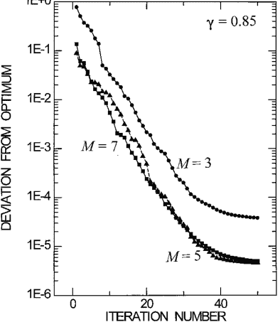

图5.1：显示每个控制均匀选取值的数量对收敛曲线的影响，区域收缩因子 `γ = 0.85`

#### 5.2.2 随机选择

为了直接比较，随机选择的控制候选数量与上述三种情况相对应，即 `R = 27`、`R = 125` 和 `R = 343`，对应相同的两个区域收缩因子值。收敛曲线见图5.3和图5.4。可以观察到，使用 `R = 27` 的收敛速度不如使用 `M = 3` 时快，且偏差小于0.001无法达到。然而，使用 `R = 125` 和 `R = 343` 时获得了与均匀分布控制值选择相当的收敛速度。有趣的是，使用 `R = 125` 时获得了比 `R = 343` 更快的收敛速度。三种 `R` 值的计算时间为2.9、12.4和33.6 s。

我们现在考虑相同的示例，但允许 `q₁` 成为另一个控制变量，`q₁ = u₄`，如 Luus [2] 所做，使用每个控制变量三个均匀选取的值。这意味着在每个网格点必须检查81个控制候选值。通过使用 `P = 11` 个阶段并将此额外控制变量的上限设为20，Luus [2] 得到 `I = 21.75722` 的值，控制策略见表5.2。有趣的是，`u₄` 在上下限之间切换。

使用 `N = 3` 个网格点时，在区域内随机选择控制候选数量的影响见表5.3，其中允许最大迭代次数为150，区域减小因子 `γ` 在0.90到0.99之间变化。全局最优值以粗体显示。如图所示，增加控制候选数量有一些优势，但即使 `R = 25`，也能准确确定最优值。

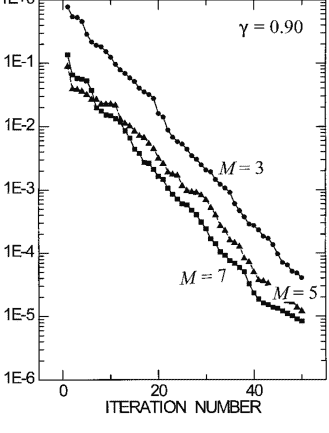

图5.2：显示每个控制均匀选取值的数量对收敛曲线的影响，区域收缩因子 `γ = 0.90`

让我们现在比较两种选择控制候选值的方法。

通过在 −r、0 和 r 处对每个控制变量取3个均匀分布的值，从最佳值出发意味着在每个时间步的每个网格点取81个控制候选值。如表5.4所示，区域收缩因子 `γ` 可以取较小值，且较少的迭代次数即可收敛。在进行运行时，允许的最大迭代次数为150。

为了减少均匀搜索的候选数量，我们可以按照 Tassone 和 Luus [7] 的建议将区域的顶点作为控制候选值。然后我们可以用17个控制值代替81个值。虽然随机选择的候选值似乎提供最优值的一种低效方式，但我们将在第6章看到，该方案被纳入多遍方法中，其中参数的敏感性降低，全局最优值更容易获得。

如果控制变量的数量较小（小于5），则可以使用任一方法来选择控制候选值。然而，如果控制变量的数量大于5，则随机选择候选值是明显更好的方法。Bojkov 和 Luus [1] 用几个示例说明了这一思想，他们还考虑了一个具有20个控制变量的问题。对于后者，唯一可行的办法是使用随机选择的控制候选值。我们将在第7章后面讨论高维系统的最优控制。

**表 5.2:** 具有四个控制变量的分段常数最优控制策略，最大 `$I = 21.75722$`

| Stage | Time | `$u_1$` | `$u_2$` | `$u_3$` | `$u_4$` |
|---:|---:|---:|---:|---:|---:|
| 1 | 0.0000 | 0.00000 | 0.00000 | 1.64594 | 20.00000 |
| 2 | 0.0182 | 14.17009 | 0.00000 | 1.49448 | 20.00000 |
| 3 | 0.0364 | 19.30869 | 0.00000 | 0.71145 | 20.00000 |
| 4 | 0.0546 | 12.21929 | 6.00000 | 0.27487 | 0.00000 |
| 5 | 0.0727 | 3.61857 | 3.99978 | 0.24286 | 0.00000 |
| 6 | 0.0909 | 0.00000 | 0.00000 | 0.49520 | 0.00000 |
| 7 | 0.1091 | 0.00000 | 0.00000 | 0.98515 | 0.00000 |
| 8 | 0.1273 | 0.00000 | 0.00000 | 1.89196 | 20.00000 |
| 9 | 0.1455 | 11.67268 | 0.00000 | 1.91146 | 20.00000 |
| 10 | 0.1636 | 20.00000 | 6.00000 | 0.95895 | 20.00000 |
| 11 | 0.1818 | 20.00000 | 6.00000 | 0.26054 | 20.00000 |

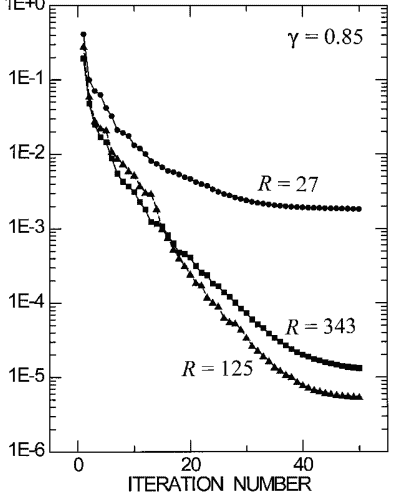

**图 5.3:** 收敛曲线，显示随机选取的控制候选数量对 `$\gamma = 0.85$` 时的影响

**表 5.3:** 在每个网格点上随机选取的控制候选数量对 `$N = 3$` 网格点的影响

| Reduction factor `$\gamma$` | `$R = 25$`: Performance index, `$I$` | `$R = 25$`: Number of iterations | `$R = 50$`: Performance index, `$I$` | `$R = 50$`: Number of iterations |
|---:|---:|---:|---:|---:|
| 0.90 | 21.6564 | 150 | 21.6149 | 150 |
| 0.91 | 21.6555 | 150 | 21.5067 | 150 |
| 0.92 | 21.7044 | 150 | **21.7572** | 69 |
| 0.93 | 21.6770 | 150 | **21.7572** | 68 |
| 0.94 | 21.7375 | 150 | 21.5115 | 150 |
| 0.95 | **21.7572** | 93 | 21.5115 | 150 |
| 0.96 | **21.7572** | 118 | **21.7572** | 96 |
| 0.97 | 21.7555 | 150 | **21.7572** | 138 |
| 0.98 | 21.7565 | 150 | 21.7570 | 150 |
| 0.99 | 21.7535 | 150 | 21.7505 | 150 |

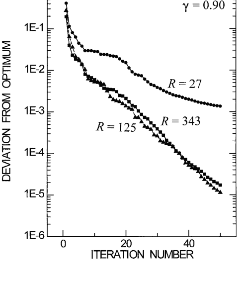

**图 5.4:** 收敛曲线，显示随机选取的控制候选数量对 `$\gamma = 0.90$` 时的影响

## 第 6 章：IDP 中参数的评估

### 6.1 引言

在迭代动态规划中，有许多可以变化的参数。早在第 5 章中我们就看到了选择控制候选的不同方法，以及在每个网格点上选取此类值的数量的影响，还有区域收缩因子 `$\gamma$` 的影响。如果 `$\gamma$` 太小，我们会得到区域过早坍缩，而如果 `$\gamma$` 太大，则收敛速率可能相当缓慢，或者根本无法获得收敛。幸运的是，通常存在一个较宽的范围，在此范围内可以为 `$\gamma$` 选择可接受的值以收敛到最优解。控制允许值数量 `R` 与区域收缩因子 `$\gamma$` 之间存在平衡。如果 `R` 选择得足够大，则 `$\gamma$` 可以选择得相当小，例如 0.7，而不必担心区域过早坍缩。然而，如果使用较小的 `R` 值，则 `$\gamma$` 必须增加到接近 0.9 的值。通常我们希望选择尽可能小的 `R` 以减少计算工作量。

然而，对网格点数量的选择则没有那么明确。在一个涉及沿管式反应器确定最优催化剂配方的非常困难的非线性最优控制问题中 [7]，通过在每个时间阶段使用单个网格点即可轻松获得全局最优解 [6]。另一方面，一个简单的半间歇反应器优化问题则需要至少 23 个网格点才能收敛到全局最优解 [3]。Bojkov 和 Luus [2] 研究了 IDP 中的参数效应，并得出结论，对于许多典型的化工系统，区域收缩因子 `$\gamma$` 应在 0.75 到 0.95 范围内，并且使用超过 3 个网格点并不会增加获得全局最优的可能性，也不会改善收敛速率。尽管令人惊讶，除了少数反应器问题，如 Hartig 等人 [3] 考虑的半间歇反应器和本章后面考虑的两级 CSTR 之外，仅需要少量网格点的要求似乎对许多最优控制问题普遍成立。因此，对于许多问题，我们可以在每个时间阶段使用单个网格点，仍然能够快速、准确地收敛到全局最优解。

这里的目标是说明 IDP 中使用的参数的影响，例如在每次迭代后用于减小区域大小的区域缩减因子 `$\gamma$`，用于在每次遍历后恢复区域大小的区域恢复因子 `$\eta$`，初始区域大小、控制允许值的数量以及每个时间步使用的网格点数量。使用多个示例是展示 IDP 中使用的参数之间关系的最佳方式。

### 6.2 网格点数量

在迭代动态规划的早期工作中，所使用的网格点数量被选择为相当大，通常大于 20。使用大量网格点的动机是由于当时使用的 CRAY 超级计算机具有向量化能力，使计算能够并行进行。当计算从 CRAY 切换到个人计算机时，有必要检查网格点数量的影响，因为网格点数量加倍会使计算时间超过两倍。Bojkov 和 Luus [2] 的研究清楚地表明，大量网格点并不总是必要的。此外，如果可以在不牺牲收敛速率的情况下减少网格点数量，那么我们应该尽可能使用最小数量，即 `N = 1`。

初始区域大小的选择，即在其中选择控制候选的范围，也非常重要，尤其是在存在众多局部最优解时。为了说明网格点、初始区域大小的选择以及其他参数的关系，我们选择了两个来自化学工程的示例。在第一个示例中我们使用单个网格点，因为收敛到全局最优解非常容易，因此没有必要检查使用较大数量网格点的情况。在第二个示例中说明了使用不同数量网格点的效果。在第 6.3 节中我们将检查多遍方法并提出另一个需要多个网格点才能获得准确收敛的示例。

#### 6.2.1 双功能催化剂混合优化问题

在将甲基环戊烷转化为苯的管式反应器中双功能催化剂混合物的优化中，由氢化和异构化两种单功能催化剂组分组成的混合物由质量分数 `u` 刻画，给出为

$$u = \frac{\text{mass of hydrogenation component}}{\text{total mass of the catalyst}}. \quad (6.1)$$

**表 6.1:** 双功能催化剂问题中速率常数 `$k_i$` 的系数

| `$i$` | `$c_{i0}$` | `$c_{i1}$` | `$c_{i2}$` | `$c_{i3}$` |
|---|---:|---:|---:|---:|
| 1 | 0.2918487D-02 | -0.8045787D-02 | 0.6749947D-02 | -0.1416647D-02 |
| 2 | 0.9509977D+01 | -0.3500994D+02 | 0.4283329D+02 | -0.1733333D+02 |
| 3 | 0.2682093D+02 | -0.9556079D+02 | 0.1130398D+03 | -0.4429997D+02 |
| 4 | 0.2087241D+03 | -0.7198052D+03 | 0.8277466D+03 | -0.3166655D+03 |
| 5 | 0.1350005D+01 | -0.6850027D+01 | 0.1216671D+02 | -0.6666689D+01 |
| 6 | 0.1921995D-01 | -0.7945320D-01 | 0.1105666D+00 | -0.5033333D-01 |
| 7 | 0.1323596D+00 | -0.4696255D+00 | 0.5539323D+00 | -0.2166664D+00 |
| 8 | 0.7339981D+01 | -0.2527328D+02 | 0.2993329D+02 | -0.1199999D+02 |
| 9 | -0.3950534D+00 | 0.1679353D+01 | -0.1777829D+01 | 0.4974987D+00 |
| 10 | -0.2504665D-04 | 0.1005854D-01 | -0.1986696D-01 | 0.9833470D-02 |

正如 Luus 等人 [7] 所做的那样，为了解决这个最优控制问题，我们将给定的时间区间划分为 10 个等长部分，每段长度为 200 g h/mol，并确定每个部分 `u(0), u(1), \cdots, u(9)` 的分段常数控制值，以最大化式 (6.13) 给出的性能指标。对于积分，我们使用了 Hull 等人 [4] 的积分子程序 DVERK，局部误差容限为 `10^{-6}`。存在众多局部最优解。通过 Rosen 和 Luus [12] 建议的序列二次规划，从 100 个随机选择的初始点中获得了 25 个局部最优解，其性能指标值分别为：10.053、9.905、9.881、9.866、9.815、9.786、9.722、9.641、9.628、9.608、9.582、9.534、9.501、9.463、9.439、9.343、9.293、9.246、9.148、9.037、8.673、8.645、8.490、8.402 和 8.113。然而，这些都不是全局最优解。

全局最优控制策略和接下来的四个最佳策略在表 6.2 中给出。正如 Luus 等人 [7] 所指出的那样，该问题存在众多局部最优解，其中许多未在上面列出。目标是获得全局最优解。从初始控制策略 `u^{(0)}(k)=0.75,\ k=0,1,\cdots,9` 和初始区域大小 `r^{(0)}(k)=0.3,\ k=0,1,\cdots,9`，区域收缩因子 `$\gamma=0.70$`，网格点数量 `N=21` 和 `M=5` 个均匀选择的控制值出发，Luus 等人 [7] 在 16 次迭代中使用 IDP 获得了全局最优解。`M` 个控制候选是从最佳值周围的均匀分布中选择的，即 `u^*,\ u^* \pm \left[\frac{2j}{M-1}\right]r,\quad j=1,2,\cdots,(M-1)/2`，其中 `u^*` 是前一次迭代中催化剂混合物的最佳值。

Luus 和 Bojkov [6] 表明，如果初始区域选择得足够大，则可以使用单个网格点 `N=1` 获得全局最优解。在表 6.3 和 6.4 中我们展示了区域收缩因子 `$\gamma$`、初始区域大小 `r^{(0)}` 以及均匀选择的控制候选数量 `M` 的影响。达到六位数字的全局最优解所需的迭代次数显示在括号中。

Table 6.2: 最佳 5 个局部最优的控制策略

| Local optimum | 1 (global) | 2 | 3 | 4 | 5 |
|---|---|---|---|---|---|
| Performance index | 10.0942 | 10.0527 | 10.0395 | 9.9047 | 9.8805 |
| u(0) | 0.6661 | 0.6651 | 0.6671 | 0.6637 | 0.9000 |
| u(1) | 0.6734 | 0.6721 | 0.6744 | 0.9000 | 0.6724 |
| u(2) | 0.6764 | 0.9000 | 0.6777 | 0.9000 | 0.6755 |
| u(3) | 0.9000 | 0.9000 | 0.6796 | 0.9000 | 0.9000 |
| u(4) | 0.9000 | 0.9000 | 0.9000 | 0.9000 | 0.9000 |
| u(5) | 0.9000 | 0.9000 | 0.9000 | 0.9000 | 0.9000 |
| u(6) | 0.9000 | 0.9000 | 0.9000 | 0.9000 | 0.9000 |
| u(7) | 0.9000 | 0.9000 | 0.9000 | 0.9000 | 0.9000 |
| u(8) | 0.9000 | 0.9000 | 0.9000 | 0.9000 | 0.9000 |
| u(9) | 0.9000 | 0.9000 | 0.9000 | 0.9000 | 0.9000 |

Table 6.3: 当 `N = 1` 且 `M = 3` 时性能指标 `I` 的取值，显示了区域收缩因子 `$\gamma$` 和初始区域大小 `r^{(0)}` 的影响；获取全局最优所需的迭代次数显示在括号中

| Reduction factor | Initial region size `r^{(0)}` | | | |
|---|---|---|---|---|
| `$\gamma$` | 0.27 | 0.30 | 0.40 | 0.50 |
| 0.70 | 10.0527 | 10.0942 (18) | 10.0942 (19) | 10.0942 (20) |
| 0.72 | 10.0527 | 10.0942 (20) | 10.0942 (21) | 10.0527 |
| 0.74 | 10.0942 (22) | 10.0942 (22) | 10.0942 (23) | 10.0942 (24) |
| 0.76 | 10.0942 (23) | 10.0942 (24) | 10.0942 (25) | 10.0942 (26) |
| 0.78 | 10.0942 (26) | 10.0942 (26) | 10.0942 (28) | 10.0942 (29) |
| 0.80 | 10.0942 (29) | 10.0942 (29) | 10.0942 (31) | 10.0942 (32) |
| 0.82 | 10.0942 (32) | 10.0942 (32) | 10.0942 (34) | 10.0942 (36) |


| 0.84 | 10.0942 (36) | 10.0942 (38) | 10.0942 (39) | 10.0942 (40) |

| 0.86 | 10.0941 | 10.0941 | 10.0941 | 10.0941 |

| 0.88 | 10.0940 | 10.0940 | 10.0939 | 10.0937 |

| 0.90 | 10.0933 | 10.0930 | 10.0925 | 10.0913 |

## Table 6.4: 当 `N = 1` 且 `M = 9` 时性能指标 `$I$` 的取值，显示了区域收缩因子 `$\gamma$` 和初始区域大小 `$r^{(0)}$` 的影响；获取全局最优所需的迭代次数显示在括号中

| Reduction factor | Initial region size `$r^{(0)}$` | | | |

|---|---|---|---|---|

| `$\gamma$` | 0.27 | 0.30 | 0.40 | 0.50 |

| 0.70 | 10.0395 | **10.0942** (15) | 10.0527 | **10.0942** (17) |

| 0.72 | 10.0395 | **10.0942** (16) | **10.0942** (17) | 10.0527 |

| 0.74 | 10.0395 | **10.0942** (17) | **10.0942** (18) | **10.0942** (19) |

| 0.76 | **10.0942** (19) | **10.0942** (19) | **10.0942** (20) | **10.0942** (21) |

| 0.78 | **10.0942** (21) | **10.0942** (21) | **10.0942** (22) | **10.0942** (23) |

| 0.80 | **10.0942** (22) | **10.0942** (23) | **10.0942** (24) | **10.0942** (25) |

| 0.82 | **10.0942** (25) | **10.0942** (26) | **10.0942** (27) | **10.0942** (28) |

| 0.84 | **10.0942** (28) | **10.0942** (29) | **10.0942** (30) | **10.0942** (32) |

| 0.86 | **10.0942** (33) | **10.0942** (34) | **10.0942** (36) | **10.0942** (37) |

| 0.88 | **10.0942** (39) | **10.0942** (39) | 10.0941 | 10.0941 |

| 0.90 | 10.0941 | 10.0941 | 10.0940 | 10.0940 |

允许最多 40 次迭代。如图所示，与使用 `$M = 3$` 相比，使用 `$M = 9$` 时达到全局最优所需的迭代次数减少了。在每种情况下，只要初始区域大小大于 0.27，就几乎在每种情况下都获得了全局最优。在 44 次运行中，使用 `$M = 3$` 时获得了 3 次局部最优。使用 `$M = 9$` 时，在 44 次运行中获得了 5 次局部最优。因此，使用更多允许的控制值并不一定会提高避免局部最优的机会。

正如预期的那样，使用 `$M = 9$` 时，我们可以拥有更大的区域收缩因子 `$\gamma$` 值，并且仍能在 40 次迭代内收敛到 6 位精度的全局最优。然而，必须记住，使用 `$M = 9$` 而不是 `$M = 3$` 需要每迭代三倍的计算量。关于该系统的进一步结果由 Luus 和 Bojkov [6] 给出，他们还表明，与以均匀方式选择控制候选相比，随机选择给出了基本相同的结果。在 PentiumII/350 上，使用 `$M = 3$` 进行 20 次迭代的计算时间为 6 s。

### 6.2.2 光化学 CSTR

让我们考虑 Lapidus 和 Luus [5] 使用的光化学连续搅拌釜式反应器 CSTR，我们在第 5 章中考虑过它来检验网格点数量的影响。这里，我们考虑具有 4 个控制变量的反应器：

$$
\begin{aligned}
\frac{dx_1}{dt} &= u_4-qx_1-17.6x_1x_2-23x_1x_6u_3 \tag{6.15}\\
\frac{dx_2}{dt} &= u_1-qx_2-17.6x_1x_2-146x_2x_3 \tag{6.16}\\
\frac{dx_3}{dt} &= -u_2-qx_3-73x_2x_3 \tag{6.17}\\
\frac{dx_4}{dt} &= -qx_4+35.2x_1x_2-51.3x_4x_5 \tag{6.18}\\
\frac{dx_5}{dt} &= -qx_5+219x_2x_3-51.3x_4x_5 \tag{6.19}\\
\frac{dx_6}{dt} &= -qx_6+102.6x_4x_5-23x_1x_6u_3 \tag{6.20}\\
\frac{dx_7}{dt} &= -qx_7+46x_1x_6u_3 \tag{6.21}\\
\frac{dx_8}{dt} &= 5.8(qx_1-q_1)-3.7u_1-4.1u_2+q(23x_4+11x_5+28x_6+35x_7)-5u_3^2-0.099 \tag{6.22}
\end{aligned}
$$

其中总入口流量由 `$q=u_1+u_2+u_4$` 给出。最后一个微分方程引入以给出性能指标。问题是最大化

$$
I=x_8(t_f) \tag{6.23}
$$

其中最终时间 `$t_f$` 指定为 0.2。初始状态指定为 `$\mathbf{x}(0)=[0.1883\ \ 0.2507\ \ 0.0467\ \ 0.0899\ \ 0.1804\ \ 0.1394\ \ 0.1046\ \ 0]^T$`。控制变量受约束

+   $$
+   0\leq u_1\leq 20 &&\tag{6.24}\\
+   0\leq u_2\leq 6 &&\tag{6.25}\\
+   0\leq u_3\leq 4 &&\tag{6.26}\\
+   0\leq u_4\leq 20 &&\tag{6.27}
+   $$

在第 5 章中我们看到，使用 `$P=11$` 个等长的时间阶段，在此期间使用分段常值控制，性能指标的最大值被发现为 21.75722。这里我们希望说明网格点数量如何影响我们获得该最优的能力。如第 5 章中所做，我们选择控制的初始值为允许区域的中间，即 `$u_1^{(0)}=10$`，`$u_2^{(0)}=3$`，`$u_3^{(0)}=2$`，和 `$u_4^{(0)}=10$`，并令初始区域大小为 `$r_1^{(0)}=10$`，`$r_2^{(0)}=3$`，`$r_3^{(0)}=2$`，和 `$r_4^{(0)}=10$`。通过在每次迭代后由收缩因子 `$\gamma$` 收缩的允许区域内随机选择 `$R=81$` 个允许值，针对不同的 `$\gamma$` 值和网格点数 `$N$` 求解了该问题。每种情况允许 100 次迭代。结果在表 6.5 中给出。很明显，区域收缩因子 `$0.90\leq\gamma\leq0.96$`

##### Table 6.5: 当 `R = 81` 时网格点数量对收敛的影响；括号中的数字给出收敛所需的迭代次数

|  | Number of grid points at each time stage | | | |

|---|---|---|---|---|

| `$\gamma$` | `N = 1` | `N = 5` | `N = 11` | `N = 27` |

| 0.80 | 21.4649 | 21.5476 | 21.6894 | 21.6575 |

| 0.81 | 21.6019 | 21.6621 | 21.5686 | 21.6263 |

| 0.82 | 21.6145 | 21.6624 | 21.6782 | 21.5847 |

| 0.83 | 21.6222 | 21.6729 | 21.7415 | 21.7272 |

| 0.84 | 21.6350 | 21.7276 | 21.6931 | 21.7547 |

| 0.85 | 21.6286 | 21.7370 | 21.6141 | 21.7360 |

| 0.86 | 21.6293 | 21.7085 | 21.4995 | 21.7353 |

| 0.87 | 21.6427 | 21.7522 | 21.7331 | 21.7329 |

| 0.88 | 21.6556 | 21.7572 (32) | 21.7572 (34) | 21.7572 (30) |

| 0.89 | 21.6603 | 21.7572 (37) | 21.7072 | 21.7572 (32) |

| 0.90 | 21.7506 | 21.7572 (39) | 21.7572 (39) | 21.7572 (32) |

| 0.91 | 21.7572 (61) | 21.7572 (44) | 21.7572 (38) | 21.7572 (39) |

| 0.92 | 21.7572 (53) | 21.7572 (43) | 21.7572 (41) | 21.7572 (34) |

| 0.93 | 21.7572 (58) | 21.7572 (49) | 21.7572 (43) | 21.7572 (46) |

| 0.94 | 21.7572 (67) | 21.7572 (55) | 21.7572 (51) | 21.7572 (51) |

| 0.95 | 21.7572 (75) | 21.7572 (72) | 21.7572 (44) | 21.7572 (52) |

| 0.96 | 21.7572 (96) | 21.7572 (100) | 21.7572 (75) | 21.7572 (68) |

| 0.97 | 21.7571 | 21.7572 (70) | 21.5007 | 21.7572 (95) |

| 0.98 | 21.7554 | 21.7554 | 21.7565 | 21.7569 |

| 0.99 | 21.7559 | 21.7554 | 21.7552 | 21.5105 |

无论网格点数量如何，都能获得全局最优。在获得最优的情况下，达到最优所需的迭代次数在括号中给出。当 `N` 增加时，收敛所需的迭代次数减少仅略有降低。然而，对于较大的 `N`，范围会增加。例如，对于 `N = 27`，收敛到全局最优的范围是 `0.88 ≤ γ ≤ 0.97`。很明显，对于这个最优控制问题，网格点数大于 `N = 1` 是没有必要的。

### 6.3 多遍方法

防止搜索区域坍塌的一种方法是使用多遍方式的迭代动态规划，使得区域恢复到前一遍开始时大小的一个分数。出现的问题是，还原因子应该是多少，结果对该

Choice? 通过取单个网格点，即 `$N = 1$`，并且仅取 `$R = 15$` 个随机点，同时允许每次通过 20 次迭代，我们对不同区域收缩因子 `$\gamma$` 的不同区域恢复因子 `$\eta$` 值求解了上述最优控制问题。

如表 6.6 所示，如果恢复因子在 0.70 到 0.85 之间，成功率几乎为 100%。在 80 个案例中，只有两个案例得到的数值与全局最优值 21.7572 不同，其中允许最多 20 次通过。当恢复因子为 0.90 时，区域尺寸没有足够快地缩小以在 20 次通过内收敛到六位有效数字。多遍方法的使用是保持控制候选数量较少同时仍提供准确收敛的一种良好手段。这在我们考虑更高维系统时尤其重要。

**Table 6.6:** 恢复因子 `$\eta$` 对收敛的影响，`$R = 15$`，括号内显示收敛所需的通过次数

| `$\gamma$` | `$\eta=0.70$` | `$\eta=0.75$` | `$\eta=0.80$` | `$\eta=0.85$` | `$\eta=0.90$` |

|---:|---:|---:|---:|---:|---:|

| 0.80 | **21.7572** (9) | **21.7572** (11) | **21.7572** (10) | **21.7572** (9) | **21.7572** (16) |

| 0.81 | **21.7572** (8) | **21.7572** (11) | **21.7572** (7) | **21.7572** (13) | **21.7572** (12) |

| 0.82 | **21.7572** (9) | **21.7572** (10) | **21.7572** (8) | **21.7572** (7) | **21.7572** (10) |

| 0.83 | **21.7572** (7) | **21.7572** (8) | **21.7572** (5) | **21.7572** (5) | **21.7572** (8) |

| 0.84 | **21.7572** (6) | **21.7572** (7) | **21.7572** (9) | **21.7572** (6) | **21.7572** (8) |

| 0.85 | **21.7572** (10) | **21.7572** (9) | **21.7572** (11) | **21.7572** (10) | **21.7572** (16) |

| 0.86 | **21.7572** (8) | **21.7572** (11) | **21.7572** (11) | **21.7572** (13) | **21.7572** (8) |

| 0.87 | **21.7572** (8) | **21.7572** (5) | **21.7572** (9) | **21.7572** (13) | **21.7572** (10) |

| 0.88 | **21.7572** (9) | **21.7572** (11) | **21.7572** (11) | **21.7572** (12) | 21.7571 |

| 0.89 | **21.7572** (6) | **21.7572** (8) | **21.7572** (12) | **21.7572** (15) | **21.7572** (16) |

| 0.90 | **21.7572** (11) | **21.7572** (12) | **21.7572** (14) | **21.7572** (19) | 21.7570 |

| 0.91 | **21.7572** (9) | **21.7572** (12) | **21.7572** (14) | **21.7572** (18) | 21.7571 |

| 0.92 | **21.7572** (11) | **21.7572** (12) | **21.7572** (14) | **21.7572** (19) | 21.7570 |

| 0.93 | **21.7572** (11) | **21.7572** (12) | **21.7572** (13) | **21.7572** (19) | 21.7569 |

| 0.94 | **21.7572** (8) | **21.7572** (12) | **21.7572** (12) | 21.7571 | 21.7568 |

| 0.95 | **21.7572** (11) | **21.7572** (13) | **21.7572** (15) | **21.7572** (18) | 21.7570 |

| 0.96 | **21.7572** (10) | **21.7572** (11) | **21.7572** (16) | **21.7572** (20) | 21.7567 |

| 0.97 | **21.7572** (13) | **21.7572** (12) | **21.7572** (17) | **21.7572** (17) | 21.7571 |

| 0.98 | **21.7572** (12) | **21.7572** (13) | **21.7572** (16) | **21.7572** (20) | 21.7565 |

| 0.99 | **21.7572** (10) | **21.7572** (14) | **21.7572** (19) | 21.7571 | 21.7566 |

每次 20 次迭代的通过后使用恢复因子。

#### 6.3.1 非线性两级 CSTR 系统

让我们考虑一个非常困难的最优控制问题，该问题源于尝试为时滞系统获得良好的初始控制策略 [8]。该系统由两个串联的 CSTR 组成，其中从第一个罐到第二个罐的运输时滞为 `$\tau = 0.1$`。该系统最初由 Oh 和 Luus [11] 研究，并在第 8 章中有更详细的描述。这里我们根据 Mutharasan 和 Luus [9] 对时滞项使用截断的泰勒级数展开，以给出无时滞近似

$$
\frac{dx_1}{dt} = f_1 \tag{6.28}
$$

$$
\frac{dx_2}{dt} = f_2 \tag{6.29}
$$

$$
\frac{dx_3}{dt} = x_1 - x_3 - \tau f_1 - R_2 + 0.25 \tag{6.30}
$$

$$
\frac{dx_4}{dt} = x_2 - 2x_4 - u_2[x_4 + 0.25] - \tau f_2 + R_2 - 0.25 \tag{6.31}
$$

$$
\frac{dx_5}{dt} = x_1^2 + x_2^2 + x_3^2 + x_4^2 + 0.1(u_1^2 + u_2^2) \tag{6.32}
$$

其中

$$
f_1 = 0.5 - x_1 - R_1 \tag{6.33}
$$

$$
f_2 = -2[x_2 + 0.25] - u_1[x_2 + 0.25] + R_1 \tag{6.34}
$$


`R_1 = [x_1 + 0.5] \exp\left(\frac{25x_2}{x_2 + 2}\right) \tag{6.35}`

`R_2 = [x_3 + 0.25] \exp\left(\frac{25x_4}{x_4 + 2}\right) \tag{6.36}`

状态变量 \(x_1\) 和 \(x_3\) 分别是罐 1 和罐 2 中的归一化浓度变量，而 \(x_2\) 和 \(x_4\) 分别是罐 1 和罐 2 中的归一化温度变量。变量 \(x_5\) 被引入以提供要最小化的性能指标：

`I = x_5(t_f) \tag{6.37}`

其中无量纲最终时间 `t_f = 2`。初始状态为

`\mathbf{x}(0) = \begin{bmatrix} 0.15 & -0.03 & 0.10 & 0 & 0 \end{bmatrix}^{T} \tag{6.38}`

让我们考虑在时间区间 \(0 \leq t < 2\) 内确定分段常数控制以最小化式 (6.37) 中的性能指标的问题。

为了解决这个最优控制问题，我们选择了 `P = 30` 个等长的时间阶段，积分时间步长为 `1/45`，`\gamma = 0.95`，`\eta = 0.85`，每次通过 30 次迭代，并允许 50 次通过。每个控制的初始值取为 0，每个控制的初始区域大小取为 0.5。发现即使使用 45 个随机选择的点，也需要超过 7 个网格点。当 `R=5`

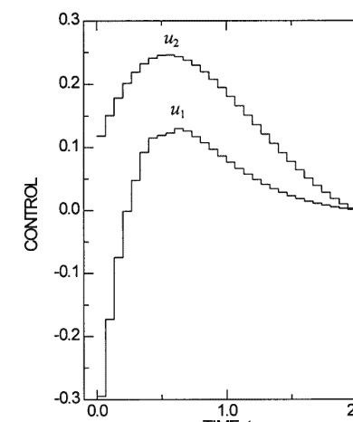

**Figure 6.1:** 使用 30 个阶段的分段常数控制的两级 CSTR 系统的最优控制策略

问题是找到在时间区间 \(0 \leq t < 1\) 内使性能指标最小化的控制向量 `\mathbf{u}(t)`

`I = 10 \mathbf{x}^T(1) \mathbf{x}(1) + \int_0^1 (\mathbf{x}^T \mathbf{x} + \mathbf{u}^T \mathbf{u}) \, dt \tag{6.41}`

为将问题化为标准形式，我们通过微分方程引入一个附加变量

`\frac{dx_{n+1}}{dt} = \mathbf{x}^T \mathbf{x} + \mathbf{u}^T \mathbf{u} \tag{6.42}`

初始条件 `x_{n+1}(0) = 0`，因此要最小化的性能指标为标准形式

`I = 10 \mathbf{x}^T(1) \mathbf{x}(1) + x_{n+1}(1) \tag{6.43}`

其中已使用最终时间 `t_f = 1`。我们有兴趣建立该系统在状态变量数和控制变量数 `n` 选择为 20 时的最优控制。这里的目标是展示区域恢复因子 `\eta`、区域收缩因子 `\gamma` 以及每个网格点选择的随机点数 `R` 对 IDP 收敛的影响，同时使用单个网格点 (`N = 1`)。状态方程是线性的，性能指标是二次的，因此问题相对简单。

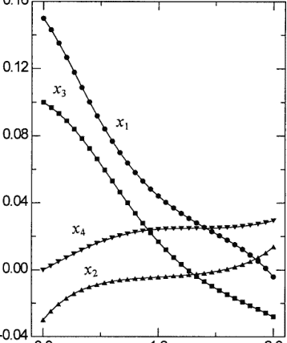

**Figure 6.2:** 应用图 6.1 中的控制策略后两级 CSTR 系统的状态轨迹

### 6.4.1 区域恢复因子 `\eta` 的影响

为了使计算需求保持在合理范围内，同时仍具有近似连续控制策略的控制策略，我们选择 `P = 40` 个等长的时间阶段并寻求分段常数控制策略。区域恢复因子 `\eta` 的合理选择为 0.90。选择区域收缩因子为 `\gamma = 0.95` 会使区域逐渐减小，经过 30 次迭代后区域为开始时的 0.215 `((0.95)^{30} = 0.215)`。我们每次通过选择 30 次迭代。第一次通过开始时每个控制变量的初始区域大小选择为 20，每个控制变量的初始值选择为 0。对于积分，我们使用四阶 Runge-Kutta 方法，积分步长为 0.0125，这对该问题可提供三位小数的精度。

如图所示 6.3 所示，使用 `\eta = 0.70` 和 `\gamma = 0.95` 很容易收敛到 `I = 6226.047`。使用 `R = 3` 时，在 27 次通过后获得了收敛，每次通过包含 30 次迭代。使用 `R = 5` 将收敛所需的通过次数减少到 24，但在一台 PentiumII/350 数字计算机上 30 次通过的计算时间从 104 s 增加到 158 s。

当 `\eta` 降低到 0.65 时，如图 6.4 所示，使用 `R = 3` 时会出现搜索区域过早坍塌的情况。然而，使用 `R = 5` 时没有收敛困难，并且使用 `R = 11` 仅略微改善收敛速度，但 30 次通过的计算时间增加一倍至 343 s。

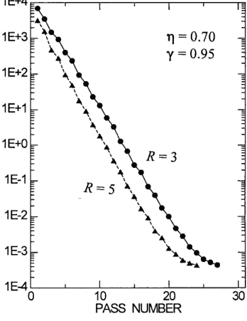

*图 6.3：IDP 的收敛曲线，显示与最优值 `I = 6226.047` 的偏差，其中 `\eta = 0.70` 且 `\gamma = 0.95`，以随机选取点数 `R` 为参数*

当 `\eta` 增加到 `0.75` 时，与 `\eta = 0.70` 相比收敛速度略慢，如图 6.5 所示。

## 6.4.2 区域收缩因子 `\gamma` 的影响

与区域恢复因子 `\eta` 的情况类似，区域收缩因子 `\gamma` 也存在一个范围，在该范围内使用少量随机选取的控制值即可获得合理的收敛速率。如图 6.6 所示，当使用 `\eta = 0.70` 时，存在范围 `0.93 < \gamma < 0.98`，在此范围内使用 `R = 3` 即可实现收敛。

#### 6.4.3 时间阶段数的影响

该示例获得的最优控制策略如图 6.7 所示，给出了典型控制变量的情况，而某些典型状态变量的状态轨迹则给出在图 6.8 中。可以看出控制策略非常平滑。通过使用更多的时间阶段，平滑度会增加，从而更好地逼近连续控制策略。

将时间阶段数加倍至 `P = 80` 后，我们获得了最小性能指标 `I = 6225.568`。该结果是在使用 `R = 3`、`\eta = 0.70` 和 `\gamma = 0.95` 的情况下，在 24 次遍历中获得的，每次遍历包含 30 次迭代，如前所述。

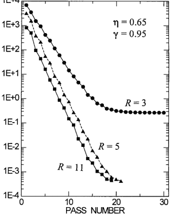

*图 6.4：IDP 的收敛曲线，显示与最优值 `I = 6226.047` 的偏差，其中 `\eta = 0.65` 且 `\gamma = 0.95`，以随机选取点数 `R` 为参数*

80 个阶段、30 次遍历的计算时间为 200.5 s。时间阶段数加倍并未减慢收敛速度，但计算时间加倍了。

使用较少阶段数，即 `P = 30` 个阶段，得到 `I = 6226.543`。使用相同参数，30 次遍历的计算时间为 80.6 s。

由于状态方程是线性的且性能指标是二次的，该问题非常适合使用庞特里亚金最大原理求解，其中最优控制策略通过最小化哈密顿量获得。这导致 `n \times n` Riccati 方程 [6]

`\frac{d\mathbf{J}}{dt}+\mathbf{J}\mathbf{A}+\mathbf{A}^{T}\mathbf{J}-0.5\mathbf{J}\mathbf{J}+2\mathbf{I}=0 \tag{6.44}`

其终值条件为

`\mathbf{J}(t_f)=20\mathbf{I}. \tag{6.45}`

Riccati 方程反向求解，得到对称矩阵 `\mathbf{J}`，该矩阵在每次积分时间步的末尾存储。然后通过向前积分状态方程并使用存储的 `\mathbf{J}` 值获得最优控制策略

`\mathbf{u}=-0.5\mathbf{J}\mathbf{x}(t). \tag{6.46}`

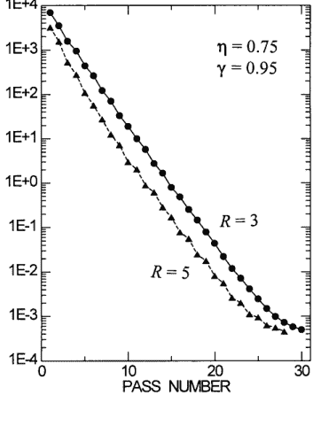

*图 6.5：IDP 的收敛曲线，显示与最优值 `I = 6226.047` 的偏差，其中 `\eta = 0.75` 且 `\gamma = 0.95`，以随机选取点数 `R` 为参数*

为确保积分的足够精度和稳定性，我们使用了积分子程序 `DVERK` [4]，局部误差容限为 `10^{-4}`。解的精度取决于存储反馈矩阵的时间阶段数，但通常至少需要 100 个时间阶段才能获得良好的近似。这里我们将通过采用不同数量的阶段来说明阶段数的影响。这也使我们能够看到该标准方法与 IDP 获得的结果之间的关系。即使使用 200 个阶段，计算也非常快，如表 6.8 所示。

**表 6.8：通过求解 Riccati 方程获得的性能指标值**

| 阶段数 `P` | 性能指标 `I` | PentiumII/350 上的计算时间，s |
|---:|---:|---:|
| 30 | 6228.42 | 1.60 |
| 40 | 6227.13 | 1.92 |
| 80 | 6225.85 | 3.24 |
| 150 | 6225.53 | 5.76 |
| 200 | 6225.48 | 7.69 |

显而易见，这里 `n = 20` 的 Riccati 方程求解比 IDP 快得多，但对于相同数量的阶段，使用 IDP 会得到略好的结果。在下一章中我们将看到，当 IDP 中使用分段线性控制且维度增加时，IDP 的计算时间变得与求解 Riccati 方程所需的计算时间相当。

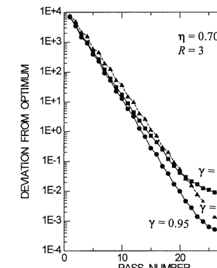

*图 6.6：IDP 的收敛曲线，显示与最优值 `I = 6226.047` 的偏差，其中 `\eta = 0.70` 且使用 3 个随机选取点，以区域收缩因子 `\gamma` 为参数*

当这些性能指标值对 `1/P^2` 作图时，如图 6.9 所示，线性图的线性外推值给出 6225.4，这与 Nagurka 等人 [10] 报道的值相同。很明显，分段常数控制并不是控制策略非常平滑时的最佳选择。与使用大量阶段的分段常数控制相比，使用分段线性连续控制可以获得更高的精度。在第 7 章中将说明在非常高维系统中，使用分段线性连续控制的好处。

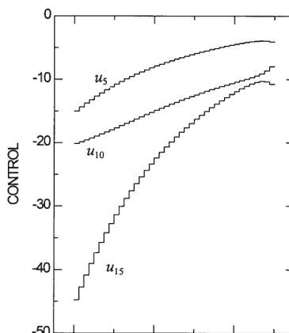

*图 6.7：最优控制策略，显示 `P = 40` 个阶段时典型控制变量的分段常数控制*

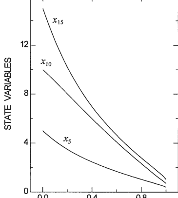

*图 6.8：由最优控制策略产生的典型状态变量的状态轨迹*

- [8] Luus, R., Zhang, X., Hartig, F., and Keu, F.J.: “Use of piecewise linear control continuous optimal control for time-delay systems”, *Ind. Eng. Chem. Res.* **34** (1995), 4136-4139.
- [9] Mutharasan, R. and Luus, R.: “Analysis of time-delay systems by series approximation”, *AIChE J.* **21** (1975), 567-571.
- [10] Nagurka, M., Wang, S., and Yen, V.: “Solving linear quadratic optimal control problems by Chebychev-based state parameterization”, *Proceedings of the 1991 American Control Conference*, Boston, MA; American Control Council, IEEE Service Center: Piscataway, NJ, 1991; pp. 104-109.
- [11] Oh, S.H. and Luus, R.: “Optimal feedback control of time-delay systems”, *AIChE J.* **22** (1975), 144-147.
- [12] Rosen, O. and Luus, R.: “Evaluation of gradients for piecewise constant optimal control”, *Comput. Chem. Eng.* **15** (1991), 273-281.

其中 `\phi` 是给定终值时间 `t_f` 时 `\mathbf{x}` 的正定函数。最优控制问题是寻找时间区间 `0 \leq t \leq t_f` 内的控制策略 `\mathbf{u}(t)`，使得性能指标最小化。

设将给定时间区间 `(0,t_f)` 分为 `P` 个子区间 `(0,t_1)`，`(t_1,t_2)`，`...,(t_k,t_{k+1}),...,(t_{P-1},t_P)`，每个长度为 `L`，使得

`L=\frac{t_f}{P}.`

我们寻求分段线性连续控制策略以最小化性能指标。因此，我们在时间区间 `(t_k,t_{k+1})` 内通过表达式计算控制策略

`\mathbf{u}(t)=\mathbf{u}(k)+\frac{\mathbf{u}(k+1)-\mathbf{u}(k)}{L}(t-t_k)`

其中 `\mathbf{u}(k)` 是时间 `t_k` 时 `\mathbf{u}` 的值，`\mathbf{u}(k+1)` 是时间 `t_{k+1}` 时 `\mathbf{u}` 的值。最优控制问题现在是寻找 `\mathbf{u}(k)`，`k=0,1,2,...,P`，在由式 (7.2) 指定的范围内，使得式 (7.3) 中的性能指标最小化。在最后一个阶段我们必须同时确定 `\mathbf{u}(P)` 和 `\mathbf{u}(P-1)`。这意味着对于最后一个阶段，我们必须确定 `m` 个控制变量的 `2m` 个值。对于所有其他阶段，由于连续性限制，只需确定 `m` 个值。

### 7.3 分段线性控制 IDP 的算法

这里我们使用单网格点，即 `N=1` 的 IDP，以多遍方式进行，其中区域大小在每次迭代后按 `\gamma` 收缩。在构成一次遍历的指定迭代次数后，区域大小恢复为开始该遍历时区域大小的 `\eta` 倍，以供后续遍历使用。为了说明 IDP 中这一底层逻辑，给出了一个算法，用于求解如式 (7.1)–式 (7.4) 所概述的最优控制问题，其中要求使用式 (7.5) 指定的分段线性控制，在 `P` 个长度相同阶段上最小化式 (7.3) 中的性能指标：

- 1. 将时间区间 `[0,t_f]` 分为 `P` 个时间阶段，每个长度为 `L`。
- 2. 选择 `\mathbf{u}` 的测试值数，记为 `R`，初始控制策略和初始区域大小 `\mathbf{r}_{in}`；同时选择每次迭代后使用的区域收缩因子 `\gamma` 和每次遍历后使用的区域恢复因子 `\eta`。
- 3. 选择每次遍历中使用的迭代次数和运行中使用的遍历次数。
- 4. 设置遍历数索引 `q=1`，迭代数索引设为 `j=1`。
- 5. 设置区域大小向量 `\mathbf{r}^{j}=\eta^{q}\mathbf{r}_{in}`。
- 6. 使用最佳控制策略（第一次遍历第一次迭代的初始控制策略），从 `t=0` 积分到 `t_f` 方程 (7.1) 以生成 `\mathbf{x}` 轨迹并在每个时间阶段开始时存储 x 的值，使 x(k − 1) 对应于第 k 阶段开始时的 x 值。
- 7. 从第 P 阶段（对应于时间 `t_f − L`）开始，将式(7.1)从 `t_f − L` 积分到 `t_f`，以第 6 步存储的 `x(P − 1)` 值作为初始状态，分别使用由式(7.5)计算得到的 `R` 个允许控制向量值，其中

`u(P − 1) = u*^j(P − 1) + D1 r^j    (7.6)`

`u(P) = u*^j(P) + D2 r^j    (7.7)`

其中 `u*^j(P − 1)` 和 `u*^j(P)` 是上一次迭代得到的最优值，`D1` 和 `D2` 是元素为 −1 到 1 之间不同随机数的对角矩阵。将任何控制变量适当地截断至 `α_j` 或 `β_j`，以满足式(7.2)。在 `R` 个性能指标值中，选择使性能指标最小的控制值，并将这些值存储为 `u*(P − 1)` 和 `u*(P)`。这样我们就得到了最后一个阶段的最优控制。
- 8. 回退到第 P−1 阶段（对应于时间 `t_f − 2L`）。按上一步的方式为 `u(P − 2)` 选取 `R` 个值，并以 `x(P − 2)` 作为初始状态，使用式(7.5)计算控制量，将式(7.1)积分一个阶段长度。然后使用第 7 步存储的 `u*(P − 1)` 和 `u*(P)` 值，继续对最后一个时间阶段进行积分。比较 `R` 个性能指标值，并将使性能指标最小的最优控制存储为 `u*(P − 2)`。
- 9. 继续此过程，直到到达第 1 阶段（对应于初始时间 `t = 0` 和给定的初始状态）。与前面一样，对式(7.1)进行积分，比较 `R` 个性能指标值，并将使性能指标最小的控制 `u(0)` 存储为 `u*(0)`，同时存储相应的 x 轨迹。
- 10. 缩小允许控制值的区域大小

`r^{j+1} = γ r^j    (7.8)`

其中 `j` 是迭代次数索引。以第 9 步得到的最优控制策略作为用上标 * 表示的允许控制值的中点。
- 11. 将迭代索引 `j` 加 1，然后转到第 6 步；按指定的迭代次数继续此过程，以完成一遍扫描。


12. 将遍索引 q 加 1，然后转到第 5 步；按指定的遍数继续此过程，并对结果进行解释。

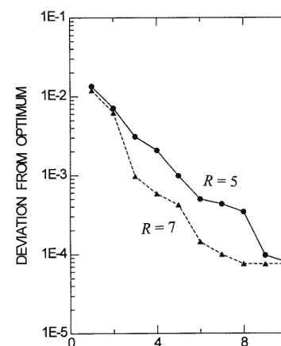

图7.1：非线性CSTR的IDP收敛情况，显示性能指标与最优值 I = 0.133094 的偏差

### 7.4 数值示例

为了说明使用分段线性控制的优点，我们考虑几个示例。作为所需计算量的参考，这里给出在 PentiumII/350 上的计算时间。

#### 7.4.1 非线性CSTR

第1章讨论的非线性CSTR为优化过程提供了一个很好的测试问题。Lapidus 和 Luus [2]、Rao 和 Luus [9]、Luus 和 Cormack [6] 以及最近的 Luus 和 Galli [7] 曾用它来研究 IDP 解的多重性。描述该化学反应器的方程为

```
dx1/dt = -(2 + u)(x1 + 0.25) + (x2 + 0.5) exp[25 x1 / (x1 + 2)]   (7.9)

dx2/dt = 0.5 - x2 - (x2 + 0.5) exp[25 x1 / (x1 + 2)]   (7.10)

dx3/dt = x1^2 + x2^2 + 0.1 u^2   (7.11)
```

其中，x1 表示无量纲稳态温度的偏差，x2 表示无量纲稳态浓度的偏差。本文采用初始条件 x1(0) = 0.09 和 x2(0) = 0.09。变量

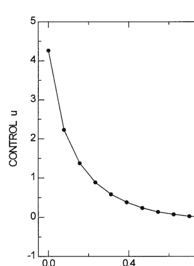

图7.2：非线性CSTR在P = 10时的分段线性连续最优控制策略，得到 I = 0.133169

引入初始条件为 x₃(0) = 0 的变量 x₃，是为了将最优控制问题转化为标准形式，因此要最小化的性能指标为

I = x₃(t_f)  (7.12)

其中最终时间 t_f = 0.78。控制 u 无约束。

Luus 和 Cormack [6] 利用基于 Pontryagin 极大值原理的控制向量迭代过程，证明了存在局部最优值 I = 0.244425 和全局最优值 I = 0.133094。上述采用 IDP 的分段线性连续控制算法，使用 P = 10 个时间阶段、初始控制策略 u⁽⁰⁾ = 2、初始区域大小 r⁽⁰⁾ = 2、区域收缩因子 γ = 0.85、区域恢复因子 η = 0.70，进行 10 遍扫描，每遍包含 10 次迭代，在使用 R = 5 和 R = 7 时快速收敛到全局最优值 I = 0.133169，如图 7.1 所示。而使用 R = 3 和 R = 10 时则收敛到局部最优值。Luus 和 Galli [7] 详细探讨了收敛到局部最优的问题。这里我们要强调，取较大的随机点数 R 并不一定能保证获得全局最优。10 遍扫描的计算时间，采用四阶 Runge-Kutta 方法，积分步长为 0.00975，在 PentiumII/350 上 R = 5 时为 1.32 s，R = 7 时为 1.70 s。

得到的最优控制策略如图 7.2 所示，状态轨迹如图 7.3 所示。有趣的是，在最终时刻 t_f = 0.78 时，状态变量 x₂ 比初始时刻更远离期望状态（原点）。

$$

\frac{dx_3}{dt} = 5x_1^2 + 2.5x_2^2 + 0.5u^2 \tag{7.15}

$$

初始状态为

$$\mathbf{x}(0) = \begin{bmatrix}0 & 0 & 0\end{bmatrix}^T. \tag{7.16}$$

式(7.14)中有一个扰动项，其形式为幅值为 100 的矩形脉冲，从 $t = 0.5$ 持续到 $t = 0.6$。最优控制问题是在时间区间 $0 \le t < 2$ 内求控制 $u$，使得性能指标

$$I = x_3(t_f) \tag{7.17}$$

最小化。这里最终时间 $t_f = 2$。

Thomopoulos 和 Papadakis [10] 使用指数平滑技术克服了不连续性问题，得到最小值 $I = 58.538$。对于 IDP，只要选择的积分步长能确保状态方程正确积分，矩形脉冲产生的不连续性不会带来任何困难。Luus [4] 使用 IDP，采用 40 个阶段的分段常数控制得到最小值 $I = 58.20$，而使用 40 个等长时间阶段的分段线性控制得到 $I = 58.18$。这里我们在 20 个等长时间阶段上考虑该问题。

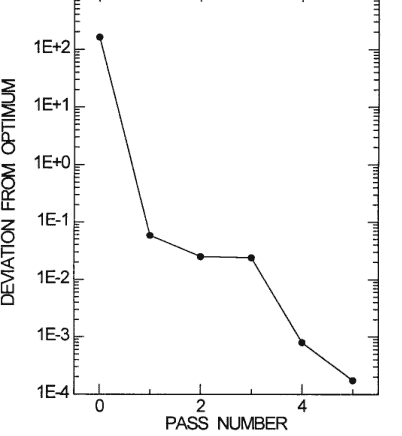

图7.4：不可微系统的收敛曲线，显示性能指标与 58.185 的偏差随遍数的变化（$P = 20$）

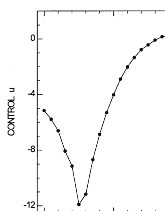

图7.5：不可微系统在 P = 20 时的分段线性连续最优控制策略

对于 IDP，我们选择 P = 20、u^(0) = 0、r^(0) = 10、γ = 0.95、η = 0.7，每遍进行 20 次迭代。如图 7.4 所示，从初始值 220.395 到最小值 I = 58.185 的收敛速度非常快。方程积分采用 Runge-Kutta 方法，积分步长为 0.025。5 遍扫描的计算时间为 0.98 s。

得到的分段线性最优控制策略如图 7.5 所示，状态轨迹如图 7.6 所示。可以观察到，在 0.5 到 0.6 的时间区间内的矩形脉冲使得状态变量 x₂ 在该时间段内迅速增大。

#### 7.4.3 具有二次型性能指标的线性系统

在第 6 章中，我们考虑了 Nagurka 等人 [8] 提出的数学问题，以展示分段常数控制策略的确定，并得出结论：当状态变量和控制变量的个数均为 20 时，通过求解 Riccati 方程来求解该问题比 IDP 快得多。这里我们再次考虑该问题，但使用分段线性控制。由于所需阶段数较少，我们将说明 IDP 的计算劣势随变量数 n 的增加而减小。因此，让我们再次考虑该问题，其中 n 阶线性时不变系统由下式描述

d**x**/dt = A**x**(t) + **u**(t) (7.18)

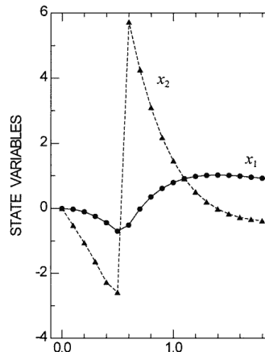

图7.6：具有如下初始状态的非可微系统的状态轨迹

\[

x(0) = [1 \ 2 \ \cdots \ n]^T \tag{7.19}

\]

其中系数矩阵为

\[

A = \begin{bmatrix}

0 & 1 & 0 & \cdots & 0 \\

0 & 0 & 1 & \cdots & 0 \\

\vdots & \vdots & \vdots & \ddots & \vdots \\

0 & 0 & 0 & \cdots & 1 \\

1 & -2 & 3 & \cdots & (-1)^{n+1} n

\end{bmatrix}

\]

问题是在时间区间 \(0 \le t < 1\) 内求控制向量 \(u(t)\)，使其最小化性能指标

\[

I = 10 x^T(1)x(1) + \int_0^1 (x^T x + u^T u)\,dt. \tag{7.20}

\]

##### 情形1：n = 20

让我们考察 \(n = 20\)、\(P = 10\) 个时间段的 IDP 收敛性。通过选取初始控制区域大小 \(r_{\text{in}} = 40\)，取 \(\gamma = 0.95\)、\(\eta = 0.70\)，每轮进行30次迭代，并设置 \(R = 7\) 个容许控制测试值，从初值 \(u^{(0)} = 0\) 到最优值 \(I = 6225.46\) 的收敛非常有规律且系统，如图7.7所示。30轮的计算时间为49.1秒。如该图所示，将容许控制值的数量增加到11个可以略微提高收敛速度。当区域恢复因子 \(\eta\) 增大到0.75时，如图7.8所示，可以使用较少数量的容许控制值在30轮内获得足够的收敛。

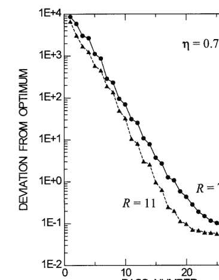

图7.7：情形1的收敛曲线，显示性能指标相对 I = 6225.41 的偏差（η = 0.70）

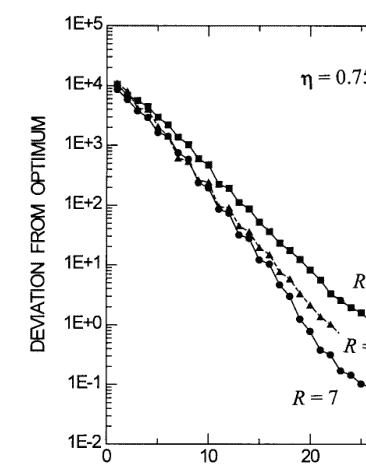

图7.8：情形1的收敛曲线，显示性能指标相对 I = 6225.41 的偏差（η = 0.75）

通过在 \(P = 200\) 时求解黎卡提方程，在 Pentium II/350 个人计算机上仅用7.7秒便获得了性能指标的最小值 \(I = 6225.48\)。尽管 IDP 远达不到这一速度，考虑这种情况仍然是有价值的，尤其是为了考察在使用分段线性连续控制时，需要多少个时间段才能达到与使用200个时间段求解黎卡提方程相同的精度。

**表7.1：用于分段线性控制的时间段数 \(P\) 对最优性能指标的影响**

| 时间段数 \(P\) | 性能指标 \(I\) |

|---:|---:|

| 7 | 6225.59 |

| 8 | 6225.53 |

| 9 | 6225.49 |

| 10 | 6225.46 |

| 11 | 6225.45 |

| 15 | 6225.42 |

| 30 | 6225.41 |

| 40 | 6225.41 |

从表7.1可以看到，使用9个时间段所得的值 \(I = 6225.48\) 几乎与使用200个时间段求解黎卡提方程得到的值相同。使用10个时间段进行分段线性控制所得的结果优于通过求解黎卡提方程获得的最优值。显然，超过15个时间段后收益甚微。

当 \(P = 10\) 时，控制变量 \(u_1\)、\(u_{10}\) 和 \(u_{20}\) 的最优控制策略如图7.9所示，状态变量 \(x_1\)、\(x_{10}\) 和 \(x_{20}\) 的状态轨迹如图7.10所示。

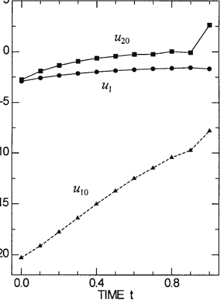

图7.9：情形1（\(n = 20\)）中 \(u_1\)、\(u_{10}\) 和 \(u_{20}\) 具有10个线性连续段的最优控制策略

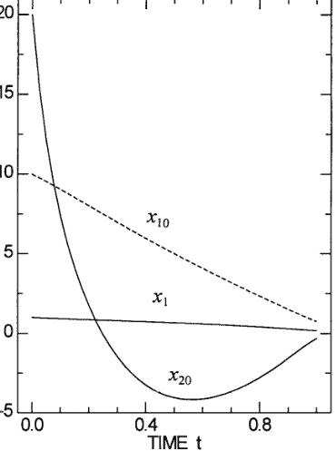

图7.10：情形1（\(n = 20\)）中 \(x_1\)、\(x_{10}\) 和 \(x_{20}\) 的状态轨迹

##### 情形2：n = 150

当状态变量和控制变量的数量增加到150时，为应对更多数量的变量做了一些改动。每轮迭代次数增加到50次，区域恢复因子 \(\eta\) 保持接近0.90，而区域缩小因子 \(\gamma\) 保持在0.95。时间段数选取为 \(P = 11\)，以保证足够的精度。为了补偿初始条件中较大的值，初始区域大小选取为 \(r_{\text{in}} = 300\)。取 \(R = 25\) 个容许控制值时，发现收敛到 \(I = 2.81317 \times 10^6\) 是有规律且系统的，如图7.11所示。在每种情况下，经过70轮后获得的性能指标都比通过 \(P = 200\) 求解黎卡提方程得到的 \(I = 2.81318 \times 10^6\) 略好。IDP 70轮的计算时间为5776秒，与通过 DVERK [1] 子例程求解黎卡提方程来解最优控制问题所需的3515秒相比，这个结果是可接受的。

典型控制变量的最优控制策略如图7.12所示，典型状态轨迹如图7.13所示。

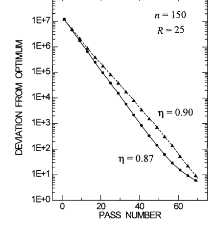

图7.11：情形2的收敛曲线，显示区域恢复因子η的两个取值下性能指标相对 I = 2813167.2 的偏差随轮数的变化

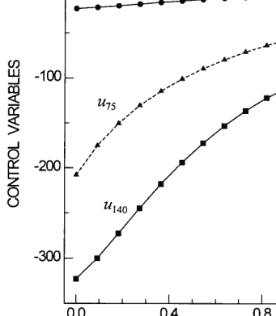

图7.12：情形2（\(n = 150\)）中具有11个时间段的典型控制变量的最优分段线性控制策略

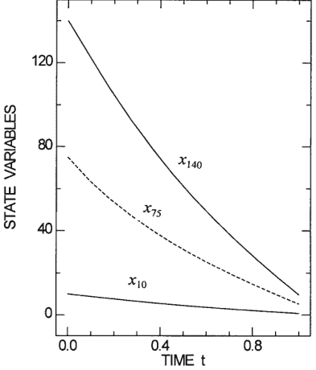

图7.13：情形2（\(n = 150\)）的典型状态轨迹

##### 情形3：n = 250

将变量数量增加到250并未给 IDP 的使用带来任何困难。取 \(P = 11\)，选择初始区域 \(r_{\text{in}} = 250\)，\(R = 40\)，每轮70次迭代，\(\gamma = 0.95\)，当 \(\eta = 0.90\) 时，收敛到 \(I = 1.31030 \times 10^7\) 是系统且有规律的；但使用 \(\eta = 0.89\) 会导致区域大小在第60轮左右塌陷，得到 \(I = 1.31031 \times 10^7\)。收敛曲线如图7.14所示。防止区域塌陷的一个有效方法是先使用较小的 \(\eta\) 值，然后再切换到一个较大的值。Luus [5] 采用了这种方法，对于该问题，他在前40轮取 \(\eta = 0.89\)，在其余轮次切换到 \(\eta = 0.91\)，从而收敛到 \(I = 1.31030 \times 10^7\)。典型的最优控制曲线和典型的状态变量如图7.15和图7.16所示。在 Pentium II/350 个人计算机上，70轮的计算时间为8.4小时。

在 Pentium II/350 上尝试用 \(P = 200\) 和 \(P = 100\) 求解该问题的黎卡提方程时出现了内存问题，但用 \(P = 75\) 时，黎卡提方程在4.1小时内求解完成，得到 \(I = 1.31037 \times 10^7\)。Luus [5] 在 Pentium/120 上以 \(P = 200\) 求解黎卡提方程，没有遇到任何困难，得到了 \(I = 1.31030 \times 10^7\)，只是计算时间长达55.0小时。由于黎卡提矩阵是对称的，我们并未尝试将黎卡提方程中需要求解的方程数量从62500减少到32500。对于这种情况，显然更倾向于使用 IDP。

此外，在使用 IDP 时，可以在每次迭代和每一轮之后跟踪进展，而在求解黎卡提方程时无法获得中间结果。尽管性能指标逐轮系统且有规律地下降，但在每一轮内部存在三个不同的阶段，如图7.17中第20轮所示。第一阶段包含13次迭代，性能指标完全不变化，因为用于选取容许控制值的区域太大。接下来的第二阶段包含8次迭代，性能指标变大，并在第21次迭代时达到峰值。在最后阶段，性能指标减小到低于该轮开始时的值。对这种收敛模式的分析可以判断区域大小是否合适，以及某一轮中是否使用了适当次数的迭代。Luus [5] 对此系统在 \(n = 100\) 时观察到了这种类型的收敛曲线。该论文给出了更多结果。这个问题的计算机程序清单见附录D。

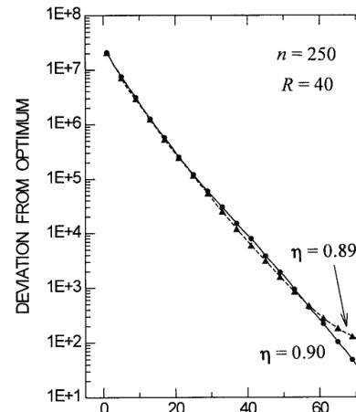

图7.14：情形3（\(n = 250\)）的收敛曲线，显示区域恢复因子η的两个取值下性能指标相对 I = 1.31030 × 10⁷ 的偏差的变化情况

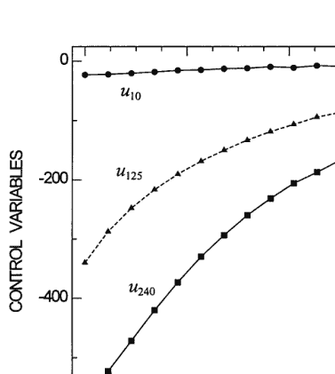

图7.15：情形3（\(n = 250\)）中具有11个时间段的典型控制变量的最优分段线性控制策略

图7.16：当n = 250时案例3的典型状态轨迹

图7.17：IDP在第20轮中的收敛曲线

#### 7.4.4 具有大量塔板的气体吸收塔

让我们考虑第1章讨论的具有*n*块塔板的气体吸收塔模型，其中模型由如下线性时不变系统描述：

$$\frac{d\mathbf{x}}{dt}=\mathbf{A}\mathbf{x}(t)+\mathbf{B}\mathbf{u}(t)\tag{7.21}$$

其中**A**是三对角系数矩阵，由下式给出：

$$\mathbf{A}=\operatorname{tridiag}[\ 0.538998\quad -1.173113\quad 0.634115\ ]\tag{7.22}$$

(*n* × 2)控制系数矩阵**B**为：

$$\mathbf{B}^{T}=\begin{bmatrix}0.538998&0&\cdots&0&0\\0&0&\cdots&0&0.634115\end{bmatrix}.\tag{7.23}$$

初始条件选取为：

$$x_i(0)=-0.0307-\left(\frac{i-1}{n-1}\right)(0.1273-0.0307),\qquad i=1,2,\ldots,n.\tag{7.24}$$

需要最小化的性能指标为：

$$I=\int_0^{t_f}(\mathbf{x}^{T}\mathbf{x}+\mathbf{u}^{T}\mathbf{u})\,dt.\tag{7.25}$$

其中我们选取最终时间\(t_f=15\) min。我们将塔板数\(n\)作为一个参数，以研究增大问题维数的影响。

由于只有两个控制变量，我们期望使用非常少的随机选取控制值即可快速收敛。对于所有运行，我们选取\(P=20\)，\(R=7\)，\(r_{\mathrm{in}}=0.05\)，\(\mathbf{u}^{(0)}=0\)，\(\gamma=0.85\)，\(\eta=0.25\)，并允许进行2轮迭代，每轮20次迭代，分别对应\(n=10\)、25、50和100。对于所有运行，均在两轮内获得收敛。将IDP的计算时间与用\(P=100\)求解Riccati方程所得结果进行比较，见表7.2。

值得注意的是，IDP的计算时间随\(n\)线性增长，而Riccati方程的计算时间按\(n^3\)增长。当\(n=50\)时，IDP已经比求解Riccati方程快3倍。当\(n=100\)时，IDP快25倍。实际上，当\(n=100\)时，用\(P=100\)求解Riccati方程得到\(I=9.73327\)。最优值\(I=9.73326\)是在\(P=200\)时获得的，计算时间为500.9 s。

\(n=100\)时的最优控制策略见图7.18，典型状态变量的轨迹见图7.19。

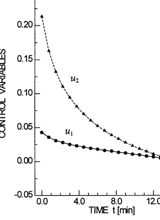

图7.18：100块塔板气体吸收塔在P = 20个阶段时的最优分段线性控制策略


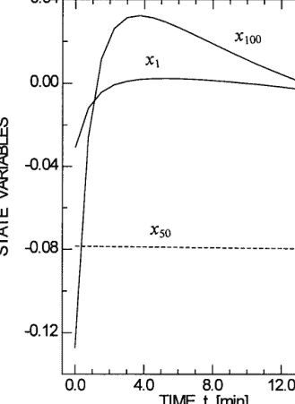

图7.19：100块塔板气体吸收塔的典型状态轨迹

# 第8章：时滞系统

## 8.1 引言

工程系统中通常包含延迟元件，例如循环流、传输滞后以及与输出变量测量相关的时间延迟。这些时间延迟对所考虑系统的控制可能产生显著影响，因此将其纳入数学模型非常重要。这就产生了具有延迟变元的微分方程。

由于非线性时滞系统的最优控制求解困难，Oh和Luus [8]提出了一种次优控制方法，即利用延迟状态的泰勒级数展开来保留原时滞系统足够的动态特性，然后使用直接搜索法，在使相关性能指标最小化的意义上获得最佳反馈增益矩阵。对于小时滞，该方法取得了非常好的结果。

使用IDP不存在概念上的困难，因为无需对任何方程进行反向积分。Dadebo和Luus [3]首次尝试将IDP用于时滞系统，他们使用分段常数控制策略，并在若干问题上取得了良好结果。在本章中，除了仅使用分段常数控制外，我们还希望使用分段线性连续控制，从而可以用更少的时间阶段获得更好的结果。这里我们将使用单个网格点（`N = 1`）。如果使用单个网格点，就不会出现如何确定为延迟项所必需的初始状态曲线的问题。唯一困难在于为高度非线性系统确定足够好的初始条件以确保收敛。Luus等人 [7]的近期工作表明，克服这一困难的一个好方法是利用延迟项的泰勒级数展开，将给定系统转换为无时滞系统，并可以容易地为此系统建立最优控制策略。然后，无时滞系统的最优控制策略为时滞系统提供初始控制策略。我们将用最后一个例子说明这种方法。

## 8.2 问题描述

让我们考虑由具有常数时滞`τ`的向量微分方程描述的系统：

$$\frac{d\mathbf{x}}{dt}=\mathbf{f}[\mathbf{x}(t),\mathbf{x}(t-\tau),\mathbf{u}(t)]\tag{8.1}$$

给定初始状态曲线：

$$\mathbf{x}(t)=\mathbf{g}(t),\quad -\tau \le t < 0\tag{8.2}$$

以及初始条件：

$$\mathbf{x}(0)=\mathbf{k}.\tag{8.3}$$

这里**x**是`(n×1)`状态向量，**u**是`(m×1)`控制向量，`τ`是常数延迟因子，**g**是给定的时间函数，给出状态的初始曲线。让我们假设控制向量中的每个元素满足以下边界条件：

$$\alpha_j \le u_j \le \beta_j,\quad j=1,2,\cdots,m.\tag{8.4}$$

与该系统相关的是一个需要最小化的性能指标：

$$I=\Phi(\mathbf{x}(t_f))\tag{8.5}$$

其中`Φ`是最终状态的某个函数，且最终时间`t_f`是给定的。最优控制问题是在时间区间`0≤ t < t_f`内找到控制`u(t)`，使得性能指标最小化。

让我们将给定时间区间划分为`P`个子区间`(0,t_1),(t_1,t_2),⋯,(t_{P-1},t_P)`，每个子区间长度为`L`，因此：

$$L=\frac{t_f}{P}.\tag{8.6}$$

我们不仅寻求分段常数控制策略，还将使用IDP来找出使性能指标最小化的分段线性控制策略。概念上不存在困难，可以使用前面的算法。对于带时滞的微分方程积分，我们使用Hairer *等人* [4]给出的积分程序。为了了解IDP在处理时滞问题中的表现，我们考虑几个示例。

## 8.3 示例

### 8.3.1 示例1

让我们考虑由Chan和Perkins [2]、Oh和Luus [8]、Dadebo和Luus [3]以及Luus [6]用于最优控制研究的线性时滞系统。该系统由以下微分方程描述：

$$\frac{dx_1}{dt}=x_2(t)\tag{8.7}$$

$$\frac{dx_2}{dt}=-10x_1(t)-5x_2(t)-2x_1(t-\tau)-x_2(t-\tau)+u(t)\tag{8.8}$$

$$\frac{dx_3}{dt}=0.5(x_1^2+x_2^2+u^2)\tag{8.9}$$

初始状态曲线为：

$$x_1(t)=x_2(t)=1.0,\quad -\tau \le t \le 0,\quad x_3(0)=0.\tag{8.10}$$

要最小化的性能指标为：

$$I=x_3(t_f)\tag{8.11}$$

其中最终时间设为`t_f = 5`。

为了用IDP求解此问题，我们选择单个网格点`N = 1`，并随机选取`R = 3`个值。初始控制策略选为零，初始区域大小选为0.2。使用2轮迭代，每轮包含10次迭代，区域缩减因子`γ = 0.80`，区域恢复因子`η = 0.70`。方程积分使用Hairer等人 [4]的积分程序。针对不同的延迟因子`τ`值进行了运行，对于分段常数控制和分段线性控制，阶段数`P`分别选取为5、10和20。

表8.1给出了使用分段常数控制所得的结果。

**表8.1：** 使用不同延迟因子和阶段数的分段常数控制策略的性能指标

| 时滞`τ` | `P = 5` | `P = 10` | `P = 20` | 控制向量迭代 |
|---:|---:|---:|---:|---:|
| 0.10 | 2.5764 | 2.5709 | 2.5667 | 2.562 |
| 0.25 | 2.5374 | 2.5335 | 2.5283 | 2.526 |
| 0.50 | 2.6231 | 2.6189 | 2.6101 | 2.609 |
| 0.75 | 2.7918 | 2.7818 | 2.7704 | 2.769 |
| 1.00 | 2.9683 | 2.9471 | 2.9343 | 2.932 |

可以看出，即使使用`P = 20`，结果也与Oh和Luus [8]基于庞特里亚金最大值原理的控制向量迭代程序所得结果相当接近。使用`P = 20`已经给出与控制向量迭代报告结果非常接近的结果。

分段线性控制的结果见表8.2。显然，使用`P = 5`对最优控制的逼近不够充分。然而，仅用10个阶段就获得了极好的结果。必须认识到，基于庞特里亚金最大值原理的控制向量迭代程序收敛速度很慢。

表 8.2：使用不同时滞因子 τ 和阶段数的分段线性控制策略性能指标

| 时滞 τ | P = 5 | P = 10 | P = 20 | 控制向量迭代 |
|---|---|---|---|---|
| 0.10 | 2.5700 | 2.5653 | 2.5646 | 2.562 |
| 0.25 | 2.5332 | 2.5270 | 2.5258 | 2.526 |
| 0.50 | 2.6243 | 2.6076 | 2.6064 | 2.609 |
| 0.75 | 2.7996 | 2.7668 | 2.7658 | 2.769 |
| 1.00 | 2.9570 | 2.9302 | 2.9292 | 2.932 |

收敛，尤其是在 τ 较高值的情况下，因此这里对这些情况获得的结果略优于 Oh 和 Luus [8] 报道的结果。这里收敛非常迅速，如图 8.1 所示，τ = 1，P = 10 时，在 R = 3 的情况下经过 10 次迭代后，分段常数控制收敛到 2.9477，分段线性控制得到 2.9325。在第二次遍历中，收敛到表中报告的值。

使用 P = 10、时滞因子 τ = 1.0 的分段线性控制策略，给出 I = 2.9302，如图 8.2 所示。Luus [6] 给出了更平滑的控制策略，P = 20，得到 I = 2.9292。在 PentiumII/350 上，P = 10 进行两次遍历的计算时间为 0.7 s，P = 20 为 1.5 s。因此，此处的计算工作量可以忽略不计。

### 8.3.2 示例 2

让我们考虑 Palanisamy 等人 [9] 考虑的线性时滞系统，用于通过单项 Walsh 级数对线性时变时滞系统的最优控制，该系统也被 Dadebo 和 Luus [3] 用于测试 IDP。该系统由时滞微分方程描述

```
dx₁(t)/dt = t x₁(t) + x₁(t − τ) + u(t)    (8.12)
```

```
dx₂(t)/dt = x₁²(t) + u²(t)    (8.13)
```

初始状态曲线为

```
x₁(t) = 1.0,   −1 ≤ t ≤ 0,   x₂(0) = 0.    (8.14)
```

最优控制问题是找到时间区间 0 ≤ t < 2 中的控制 u，使得以下性能指标最小化：

```
I = x₂(t_f),   t_f = 2.    (8.15)
```

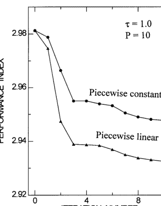

图 8.1：使用 N = 1 和 R = 3 时示例 1 的收敛曲线

时滞项 τ = 1。

为用 IDP 求解此问题，我们再次选择单个网格点 N = 1，R = 3 个随机选择的值，并选择 P = 10 个等长的时间阶段。初始控制策略选择为零，初始区域大小选择为 1.0。为了建立分段线性控制，使用了十次遍历，每次包含 10 次迭代，区域缩减因子 γ = 0.80，区域恢复因子 η = 0.70。从初始值 80.3436 开始，性能指标 I 迅速降低到 4.7968，在 PentiumII/350 上的计算时间为 1.2 s。

最优控制策略如图 8.3 所示。可以看出控制策略非常平滑，完全没有必要采用更大的阶段数来提高精度。

### 8.3.3 示例 3 – 非线性两级 CSTR 系统

第三个示例由串联的两个非线性 CSTR 系统组成，每个反应器中进行一级不可逆化学反应。该系统基于 Aris 和 Amundson [1] 最初建立的连续搅拌釜式反应器模型，并被 Lapidus 和 Luus [5] 用于稳定性研究。该系统由微分-差分方程描述

dx₁/dt = 0.5 − x₁(t) − R₁ = f₁(t) (8.16)

dx₂(t)/dt = −2(x₂(t) + 0.25) − u₁(t)[x₂(t) + 0.25] + R₁ = f₂(t) (8.17)


图 8.2：示例 1 中 τ = 1 时的分段线性连续最优控制策略

$$\frac{dx_3(t)}{dt}=x_1(t-\tau)-x_3(t)-R_2+0.25$$  (8.18)

$$\frac{dx_4(t)}{dt}=x_2(t-\tau)-2x_4(t)-u_2(t)[x_4(t)+0.25]+R_2-0.25$$  (8.19)

$$\frac{dx_5}{dt}=x_1^2+x_2^2+x_3^2+x_4^2+0.1(u_1^2+u_2^2).$$  (8.20)

我们添加了最后一个方程，使我们得到的性能指标以标准形式最小化，即

$$I=x_5(t_f)$$  (8.21)

其中无量纲终点时间 $t_f=2$。状态变量 $x_1$ 和 $x_3$ 分别是罐 1 和罐 2 中的归一化浓度变量，$x_2$ 和 $x_4$ 分别是罐 1 和罐 2 中的归一化温度变量。罐 1 和罐 2 中的反应项分别为

$$R_1=[x_1+0.5]\exp\left(\frac{25x_2}{x_2+2}\right)$$  (8.22)

$$R_2=[x_3+0.25]\exp\left(\frac{25x_4}{x_4+2}\right).$$  (8.23)

归一化控制受限于

$$-1\leq u_j\leq 1,\quad j=1,2.$$  (8.24)


图 8.3：示例 2 的分段线性连续控制策略

初始状态曲线由下式给出

x₁(t) = 0.15,    −τ ≤ t ≤ 0    (8.25)

x₂(t) = −0.03,    −τ ≤ t ≤ 0    (8.26)

x₃(0) = 0.10    (8.27)

x₄(0) = 0.    (8.28)

最优控制问题是找到时间区间 0 ≤ t < 2 中的控制 u₁(t) 和 u₂(t)，使得式 (8.21) 给出的性能指标对时滞因子 τ 的不同值最小化。与 Dadebo 和 Luus [3] 使用的分段常数控制不同，这里我们寻求分段线性控制。为了在 N = 1 时实现收敛，如分段线性连续控制所要求的那样，我们需要控制策略的良好初始估计。我们可以通过用无时滞系统近似时滞时间系统来获得该估计，同时仍保留动态特性。我们用泰勒级数展开时滞项，仅保留线性项：

x₁(t − τ) = x₁(t) − τ dx₁/dt + ⋯ ≈ x₁(t) − τ f₁(t)    (8.29)

和

x₂(t − τ) = x₂(t) − τ dx₂/dt + ⋯ ≈ x₂(t) − τ f₂(t).    (8.30)

将式 (8.29)-(8.30) 代入式 (8.18)-(8.19)，我们得到近似的无时滞系统

$$\begin{aligned}

\frac{dx_1}{dt} &= f_1 \tag{8.31}\\

\frac{dx_2}{dt} &= f_2 \tag{8.32}\\

\frac{dx_3}{dt} &= x_1-x_3-\tau f_1-R_2+0.25 \tag{8.33}\\

\frac{dx_4}{dt} &= x_2-2x_4-u_2[x_4+0.25]-\tau f_2+R_2-0.25 \tag{8.34}\\

\frac{dx_5}{dt} &= x_1^2+x_2^2+x_3^2+x_4^2+0.1(u_1^2+u_2^2). \tag{8.35}

\end{aligned}$$

我们在第 6 章中考虑了 τ=0.1 的该无时滞系统，并发现为了获得最优控制，需要多于一个网格点。使用 11 个网格点，可以毫不费力地获得最优 30 阶段分段常数控制策略。从该 30 阶段分段常数控制策略中，我们可以得到 10 阶段分段线性控制策略的近似值，可用作时滞时间系统的起始策略。

取时滞项 τ=0.1，γ=0.95，η=0.85，初始区域大小为 0.05，并允许 50 次遍历，每次包含 50 次迭代，我们发现随机选择点数 R 的影响非常小，只要 R 至少为 25。性能指标 I 从初始值 I=0.085504 迅速收敛到 0.023 附近。计算时间非常快。使用 R=15 时，收敛不足。结果见表 8.3，其中很清楚至少需要 25 个随机选择点。在这些运行中，没有一次在 5 位数字内获得最优值；因此，需要第二次运行。对于后续运行，初始区域选择为 0.0001，并执行 30 次遍历，其中使用最佳控制策略作为起点。经过 3 次此类运行后，得到 τ=0.1 时的最优 I=0.023166。现在使用 τ=0.1 的最优控制策略作为初始控制策略，得到 τ=0.2 的最优控制策略。这种连续方法用于建立更高时滞因子值的最优控制策略，结果见表 8.4。

如图所示 8.4 所示，当时滞因子从 0.1 增加到 0.8 时，控制策略并没有改变太多。

Luus 等人 [7] 表明，使用 7 个阶段而不是 10 个阶段的分段连续控制可以获得几乎相同的性能指标值。对于较大的 τ 值，性能指标值比 Oh 和 Luus [8] 使用控制向量迭代程序报道的值略好。例如，对于 τ=0.8，通过 IDP 我们得到 I=0.02550，而 Oh 和 Luus [8] 报道的值为 I=0.02561。要在 PentiumII/350 个人计算机上进行 30 次遍历，每次包含 50 次迭代，R=25，约需 4 分钟的计算时间。

**表 8.3:** 控制 $R$ 允许取值个数对收敛的影响，$\tau = 0.1$

| Number of random points $R$ | Performance index $I$ |
|---:|---:|
| 15 | 0.023241 |
| 25 | 0.023170 |
| 50 | 0.023171 |
| 100 | 0.023171 |
| 200 | 0.023170 |

**表 8.4:** 两级 CSTR 系统分段线性控制 $P = 10$ 时的最小性能指标

| Time delay $\tau$ | Performance index $I$ |
|---:|---:|
| 0.1 | 0.023166 |
| 0.2 | 0.023731 |
| 0.3 | 0.024213 |
| 0.4 | 0.024615 |
| 0.5 | 0.024940 |
| 0.6 | 0.025192 |
| 0.7 | 0.025376 |
| 0.8 | 0.025499 |


**图 8.4:** 两级 CSTR 系统的分段线性连续控制策略，显示了时滞 $\tau$ 的影响

## 8.4 参考文献

- [1] ARIS, R. AND AMUNDSON, N.R.: “An analysis of chemical reactor stability and control”, Chem. Eng. Sci. 7 (1958), 121-147.

- [2] CHAN, H.C. AND PERKINS, W.R.: “Optimization of time delay systems using parameter imbedding”, Automatica 9 (1973), 257-261.

- [3] DADEBO, S. AND LUUS, R.: “Optimal control of time-delay systems by dynamic programming”, Optimal Contr. Applic. Methods 13 (1992), 29-41.


- [4] HAIRER, E., NORSETT, S.P., AND WANNER, G.: Solving ordinary differential equations 1, Springer Series in Computational Mathematics, Vol. 8; Springer, Berlin (1987).

- [5] LAPIDUS, L. AND LUUS, R.: Optimal Control of Engineering Processes, Blaisdell, Waltham, Mass. (1967).

- [6] LUUS, R.: “Iterative dynamic programming: From curiosity to a practical optimization procedure”, Control and Intelligent Systems 26 (1998), 1-8.

- [7] LUUS, R., ZHANG, X., HARTIG, F., AND KEIL, F.J.: “Use of piecewise linear continuous control for time-delay systems”, Ind. Eng. Chem. Res. 34 (1995), 4136-4139.

- [8] OH, S.H. AND LUUS, R.: “Optimal feedback control of time-delay systems”, AIChE J. 22 (1976), 140-147.

- [9] PALANISAMY, K.R., BALACHANDRAN, K., AND RAMASAMY, R.S.: “Optimal control of linear time-varying delay systems via single-term Walsh series”, Proc. IEE 135 pt. D (1988), 332.

## 第 9 章：可变阶段长度

### 9.1 引言

我们在第 7 章中看到，使用分段常值控制时，增加时间阶段数总是会提高对线性系统二次性能指标的控制策略的逼近精度。然而，存在非线性最优控制问题，其中阶段数的增加并不一定会改善性能指标。例如，当最优控制策略涉及从一个极值突然改变到另一个极值时，该切换的时间非常重要。在时间最优控制问题中，我们预期这种类型的“bang-bang”控制。还有其他情况下，我们最不期望最优控制策略出现这种变化，而这可能会令人惊讶。然后，对最优控制策略的良好逼近取决于的不是使用的时间阶段数，而是切换时间能够被多好地逼近。让我们用一个简单的例子来说明。

让我们考虑 Ko 和 Stevens [6] 中的最优控制问题，涉及一阶、可逆、放热化学反应 $A \rightleftharpoons B$ 在化学反应器中。反应器的物料和能量平衡由下式给出：

$$
\frac{dx_1}{dt}=(1-x_1)k_1-x_1k_2 \tag{9.1}
$$

$$
\frac{dx_2}{dt}=300[(1-x_1)k_1-x_1k_2]-u(x_2-290) \tag{9.2}
$$

初始条件为

$$
x^T(0)=[\ 0\quad 410\ ] \tag{9.3}
$$

状态变量 $x_1$ 是期望组分 $B$ 的浓度，$x_2$ 表示绝对温度。控制 $u$ 是取决于冷却剂流量的归一化传热项，且受限于

$$
0\leq u\leq 0.5. \tag{9.4}
$$

反应速率常数随温度的变化方式如下：

$$
k_1 = 1.7536 \times 10^5 \exp\left(\frac{-1.1374 \times 10^4}{1.9872 x_2}\right) \tag{9.5}
$$

和

$$
k_2 = 2.4885 \times 10^{10} \exp\left(\frac{-2.2748 \times 10^4}{1.9872 x_2}\right). \tag{9.6}
$$

问题是在时间区间 $0 \le t < t_f$ 内寻找 $u$，使得性能指标

$$
I = x_1(t_f), \quad t_f = 5 \tag{9.7}
$$

最大化。该问题对应于 Reddy 和 Husain [15] 的案例 II，他们研究了使用基于梯度的方法求解该最优控制问题的困难。案例 I 已由 Luus [9] 详细讨论过。

通过 IDP 获得分段常值最优控制策略并无困难。然而，造成困难的是选择求解该问题的阶段数，因为当阶段数增加时，性能指标的改善并不十分规律，如图 9.1 所示。然而存在明显的规律，因为三个峰值出现在 $P = 17$、$P = 26$ 和 $P = 35$。


**图 9.1:** 时间阶段数 $P$ 对性能指标最大值的影响

可以很容易地观察到，使用 17 个时间阶段得到的性能指标值比使用 40 个时间阶段更好。为了理解其背后的原因，让我们检查 $P = 16$、$17$ 和 $18$ 时得到的最优控制曲线。在图 9.2 中，$P = 16$ 时，可以看到在两个时间间隔 $t = 0.625$ 之后，我们切换到允许的最大值有点晚。因此，第二时间步的控制值很小。

在图 9.3 中，$P = 17$ 时，在第二个时间步 $t = 0.588$ 之后，切换大致正确，因此在第三个时间步我们将控制置于允许的最大值。这使得性能指标 $I = 0.72387$ 得到。

在图 9.4 中，$P = 18$ 时，在两个时间步 $t = 0.555$ 之后，切换过早，且切换到小于最大值的值，性能指标 $I = 0.72378$ 不如 $P = 17$ 时得到的值好。


**图 9.2:** 使用 $P = 16$ 个时间阶段得到的最优控制策略

因此，我们看到了使用灵活阶段长度而非等长阶段的必要性。本章的目标是展示如何将灵活阶段长度用于 IDP 以及可以获得的改进。仅为完成此示例，让我们看看使用灵活阶段长度时得到的控制策略类型。通过使用 7 个长度不等的阶段，我们得到了图 9.5 中的 6 阶段最优控制策略。这里阶段 2 和 3 都给出了控制的上界。性能指标 $I = 0.723886$ 略好于使用 17 个等长阶段得到的值。


**图 9.3:** 使用 $P = 17$ 个时间阶段得到的最优控制策略

图 9.6 和 9.7 显示，通过增加阶段数，性能指标可以得到改善，但改善非常轻微。控制策略在超过上界之后的部分并不很重要。该控制策略部分的这种极低灵敏度使得准确确定最优控制变得困难。策略中最重要的部分是切换时间，必须尽可能准确地获得从 0 到 0.5 的切换时间 $t = 0.5796$。

因此，我们可以看到使用长度不等的阶段来建立最优控制策略的好处。在本章中，我们将概述将阶段长度优化纳入 IDP 的算法，并考虑最终时间指定的问题，正如我们刚刚考虑的示例一样。


**图 9.4:** 使用 $P = 18$ 个时间阶段得到的最优控制策略


**图 9.5:** 使用 $P = 7$ 个长度不等的阶段得到的最优控制策略


图 9.6：采用 $P = 10$ 个长度可变时间阶段得到的优化控制策略


图 9.7：采用 $P = 15$ 个长度可变时间阶段得到的优化控制策略

### 9.2 终点时间自由时的可变阶段长度

Bojkov 和 Luus [2] 对 IDP 算法进行了改进，使阶段可以具有可变长度。我们将阶段长度视为另一个控制变量，其表述相当直接。考虑状态方程为

$$
\frac{d\mathbf{x}}{dt} = \mathbf{f}(\mathbf{x}, \mathbf{u}) \tag{9.8}
$$

的优化控制问题，其中初始状态 $\mathbf{x}(0)$ 已知。$(m \times 1)$ 控制向量受限于

$$
\alpha_j \le u_j(t) \le \beta_j, \quad j = 1,2,\cdots,m. \tag{9.9}
$$

要最大化的性能指标是终点时间 $t_f$ 处状态的标量函数

$$
I = \Phi(\mathbf{x}(t_f)) \tag{9.10}
$$

其中终点时间 $t_f$ 未指定。设我们将时间区间划分为 $P$ 个长度可变的时间阶段

$$
v(k) = t_k - t_{k-1}, \quad k = 1,2,\cdots,P \tag{9.11}
$$

其中

$$
v(k) \ge 0, \quad k = 1,2,\cdots,P. \tag{9.12}
$$

控制在每个时间区间内保持恒定。现在引入归一化时间变量 $\tau$，通过在时间区间 $t_{k-1} \le t < t_k$ 内定义 $d\tau$ 的关系

$$
dt = v(k)P d\tau \tag{9.13}
$$

使得

$$
t_k - t_{k-1} = v(k)P(\tau_k - \tau_{k-1}). \tag{9.14}
$$

因此

$$
\tau_k - \tau_{k-1} = \frac{1}{P} \tag{9.15}
$$

并且在归一化时间中各阶段长度相等，终点时间为 $\tau = 1$，因此可以直接使用前面介绍的 IDP 算法。唯一需要改变的是微分方程现在变为

$$
\frac{d\mathbf{x}}{d\tau} = v(k)P\mathbf{f}(\mathbf{x}, \mathbf{u}) \tag{9.16}
$$

在第 $k$ 个时间区间内。

#### 9.2.1 IDP 算法

对于这个终点时间自由的问题，我们可以将阶段长度视为附加控制变量并将控制向量扩充为 $((m + 1) \times 1)$ 向量，但为清晰起见我们将其分开处理。显然，与之前一样，为了获得最高效率，IDP 应该以多遍的方式使用，其中在一次遍程之后区域恢复为前一次遍程开始时值的 $\eta$ 分数。该算法可分为八个步骤：

- 1. 选择时间阶段数 `P`、网格点数 `N`、每个网格点上控制（包括阶段长度）的允许取值数 `R`、区域收缩因子 $\gamma$、区域恢复因子 $\eta$、控制和阶段长度的初始值、初始区域大小、每次遍程中使用的迭代次数以及遍程次数。

- 2. 通过在指定区域内均匀分布 `N` 个控制和阶段长度的值，积分 Eq. (9.16) 从 $\tau = 0$ 到 $\tau = 1$ 以生成 `N` 条轨迹。每个时间阶段开始时 `x` 的 `N` 个值构成了每个阶段的 `N` 个网格点。

- 3. 从阶段 `P` 开始，对应归一化时间 $\tau = (P - 1)/P$，对每个网格点生成 `R` 组控制和阶段长度的值：

  - `u(P) = u* j(P) + D r j(P)`   (9.17)

  - `v(P) = v* j(P) + $\omega$ s j(P)`   (9.18)

  其中 `D` 是 `m` $\times$ `m` 对角矩阵，对角线上为介于 $-1$ 和 1 之间的不同随机数，$\omega$ 是另一个介于 $-1$ 和 1 之间的随机数；`u* j(P)` 是该特定网格点在前一次迭代中获得的控制最佳值，`v* j(P)` 是该特定网格点在前一次迭代中获得的阶段长度最佳值。用 `R` 个允许的控制和阶段长度值中的每一个积分 Eq. (9.16) 一次，从 $(P - 1)/P$ 到 $\tau = 1$ 以得到 `x(t_f)`，从而可以评估性能指标。比较 `R` 个性能指标值并选择使值最大化的控制和阶段长度。对应的控制和阶段长度存储起来以便在步骤 4 中使用。

- 4. 回退到阶段 `P - 1`，对应时间 $\tau = (P - 2)/P$。对每个网格点生成 `R` 组允许的控制和阶段长度。一次用 `R` 组中的每一组积分 Eq. (9.16) 从 $(P - 2)/P$ 到 $(P - 1)/P$。为了继续积分，选择步骤 3 中与最接近 $\tau = (P - 1)/P$ 时的 `x` 的网格点对应的控制和阶段长度。现在比较 `R` 个性能指标值并存储产生最大值时的控制策略和阶段长度。

- 5. 回退到阶段 `P - 2`，并继续上一步中的程序。继续直到阶段 1 对应 $\tau = 0$ 且给定初始状态作为网格点为止。比较 `R` 个性能指标值以给出该阶段的最佳控制和阶段长度。我们现在在允许选择的意义上获得了使性能指标最大化的每个阶段的最佳控制策略和阶段长度。

- 6. 为下一次迭代做准备，减小允许区域的大小

$$
\mathbf{r}^{j+1}(k)=\gamma\mathbf{r}^{j}(k),\quad k=1,2,\ldots,P \tag{9.19}
$$

$$
\mathbf{s}^{j+1}(k)=\gamma\mathbf{s}^{j}(k),\quad k=1,2,\ldots,P \tag{9.20}
$$

其中 $\gamma$ 是区域减小因子，$j$ 是迭代索引。使用步骤 5 中的最佳控制策略和阶段长度作为下一次迭代的中点。

- 7. 将迭代索引 $j$ 增加 1 并转到步骤 2 以生成另一组网格点。继续进行指定次数的迭代。

- 8. 将遍程数索引增加 1，将迭代索引 $j$ 设为 1 并转到步骤 2。继续进行指定次数的遍程，并检查结果。

每次遍程的合理迭代次数为 20 或 30，区域收缩因子 $\gamma=0.95$，因为区域此时已被充分覆盖。对于许多问题，最优解在一次遍程中无法在合理精度内找到。因此在再次进行迭代之前应将区域恢复到合理值。恢复区域大小的一种简便方法是将其值取为前一次遍程开始时值的 $\eta$ 分数。为了帮助决定使用什么 $\eta$ 值，我们可以参考 [Table 9.1](#)，其中显示了如果进行 20 或 30 次遍程，选择 $\eta$ 时初始区域如何减小。如果使用 30 次遍程且 $\eta$ 选择为 0.95，则 30 次遍程后的初始区域大小变为第一次遍程开始时值的 0.2146 倍；如果 $\eta$ 选择为 0.85，则 30 次遍程后的初始区域大小变为第一次遍程开始时值的 0.0076 倍。因此需要在区域大小过早坍缩和收敛速度之间寻求平衡。

尽管这种在每次遍程后恢复区域大小的方法并非最佳方法，因为它非常依赖于区域大小的初始选择，我们仍将在本书的所有示例中使用这种方法。最近 Luus [11] 表明，使用变量在一遍程中变化的范围作为稳态优化中下一遍程使用的区域大小值，可显著提高收敛速度，并且该方法能够以极高精度优化困难的补料反应器问题 [13]。

### 9.3 终点时间未指定的问题

了解 IDP 中参数选择的最佳方式是考察一些优化控制问题。这里我们研究终点时间 $t_f$ 未指定的问题。

表 9.1：区域恢复因子 $\eta$ 对 20 次和 30 次遍程后区域大小的影响

| 区域恢复因子 | 遍程次数 |  |
|---|---:|---:|
| $\eta$ | 20 | 30 |
| 0.95 | 0.3584 | 0.2146 |
| 0.94 | 0.2901 | 0.1563 |
| 0.93 | 0.2342 | 0.1134 |
| 0.92 | 0.1887 | 0.0820 |
| 0.91 | 0.1516 | 0.0591 |
| 0.90 | 0.1216 | 0.0424 |
| 0.89 | 0.0972 | 0.0303 |
| 0.88 | 0.0776 | 0.0216 |
| 0.87 | 0.0617 | 0.0153 |
| 0.86 | 0.0490 | 0.0108 |
| 0.85 | 0.0388 | 0.0076 |

#### 9.3.1 油页岩热解问题

Wen 和 Yen [17] 以及 Luus [7] 观察到基于庞特里亚金最大原理的方法在油页岩热解的最优控制策略确定中存在困难。该问题由 Rosen 和 Luus [16] 使用对 SQP 的一些修改、由 Luus [9] 使用 IDP 以及由 Bojkov 和 Luus [2] 使用具有灵活阶段长度的 IDP 研究过。存在一系列五个化学反应：

$$
A_1 \longrightarrow A_2
$$

$$
A_2 \longrightarrow A_3
$$

$$
A_1 + A_2 \longrightarrow A_2 + A_2
$$

$$
A_1 + A_2 \longrightarrow A_3 + A_2
$$

$$
A_1 + A_2 \longrightarrow A_4 + A_2
$$

系统由微分方程描述

$$
\frac{dx_1}{dt}=-k_1x_1-(k_3+k_4+k_5)x_1x_2 \tag{9.21}
$$

$$
\frac{dx_2}{dt}=k_1x_1-k_2x_2+k_3x_1x_2 \tag{9.22}
$$

$$
\frac{dx_3}{dt}=k_2x_2+k_4x_1x_2 \tag{9.23}
$$

$$
\frac{dx_4}{dt}=k_5x_1x_2 \tag{9.24}
$$

表 9.2：热解问题的动力学参数

| Reaction $i$ | $a_i$ | $b_i$ |
|---:|---:|---:|
| 1 | 8.86 | 20300/1.9872 |
| 2 | 24.25 | 37400/1.9872 |
| 3 | 23.67 | 33800/1.9872 |
| 4 | 18.75 | 28200/1.9872 |
| 5 | 20.70 | 31000/1.9872 |

初始条件为

$$
x(0)=[\,1\ 0\ 0\ 0\,]^T. \tag{9.25}
$$

速率常数由下式给出


$$k_i=\exp\left(a_i-\frac{b_i}{T}\right),\qquad i=1,2,\ldots,5, \tag{9.26}$$

其中动力学参数 `$a_i$` 和 `$b_i$` 给出于 **表 9.2**。最优控制问题是求出停留时间 `$t_f$` 和时间区间 `$0<t<t_f$` 内的温度 `$T$`，使得由 `$x_2$` 给出的热解沥青的浓度最大化。待最大化的性能指标因此为

$$I=x_2(t_f). \tag{9.27}$$

温度的约束为

$$698.15\leq T\leq 748.15. \tag{9.28}$$

通过基于庞特里亚金最大原理的控制向量迭代，Luus [7] 通过将 `$t_f$` 固定在 17 个不同的值上求解了该最优控制问题，并对结果进行解释，得出性能指标的最大值为 0.35375，出现在 `$t_f=9.5$` min。Rosen 和 Luus [16] 将该值改进为 `$I=0.35379$`，时间 `$t_f=9.123$` min。通过使用 `$P=80$` 个等长时间步长的 IDP，Luus [9] 得到 `$I=0.35382$`，`$t_f=9.3$` min。通过在 IDP 中使用灵活的阶段长度，Bojkov 和 Luus [2] 得到 `$I=0.35381$`，`$P=5$` 个时间阶段，以及 `$I=0.35382$`，`$P=10$` 个灵活阶段。让我们考察后一种方法。

### 预备运行

对于预备运行，我们选择 `$P=10$` 个阶段，每个阶段初始长度为 1 min，`$R=25$` 个随机点，`$N=1$` 个网格点，`$\gamma=0.95$`，每次通过 20 次迭代，20 次通过，区域恢复因子 `$\eta=0.85$`，每个阶段的初始温度为 723.15，温度的初始区域大小为 50，阶段长度的初始区域大小为 0.01。

该运行在 PentiumII/350 上耗时 42.3 s，并得到如图 9.8 所示的温度曲线。有 4 个不同的阶段。原始的 10 个阶段中，前四个坍缩到下限，总长度为 3.595 min；下一个长度为 1.369 min 的阶段得到上限；第六个长度为 0.901 min 的阶段给出温度 699.50；最后四个阶段坍缩为下边界上的一个单一阶段。性能指标的值为 `$I = 0.35377$` 且 `$t_f = 9.368$` min。有趣的是，这个四阶段控制策略给出的值略优于 Luus [7] 通过控制向量迭代程序得到的 0.35375 的最大产率。

### 下一次运行

对于下一次运行，我们选择与之前相同的 IDP 参数。对于初始条件，我们将第三阶段分为七个阶段，每个长度为 1.369/7 min，并保持其他三个阶段与预备运行中得到的结果相同。对于这七个阶段，我们取初始温度为 723.15。对于其他三个阶段，我们使用预备运行中得到的值。经过 20 次通过后，我们得到如图 9.9 所示的 9 阶段控制策略，`$I = 0.353820$` 且 `$t_f = 9.283$` min。该性能指标值略优于 Rosen 和 Luus [16] 得到的 0.353794，且仅略小于 Bojkov 和 Luus [2] 使用 `$P = 20$` 个灵活阶段得到的 0.353821。尽管 Bojkov 和 Luus 使用了超过 1 个网格点，我们在这里发现单个网格点工作得非常好。


图 9.8：预备运行得到的热解问题的四阶段最优控制策略，得到 `$I = 0.3537724$`


图 9.9：热解问题的 9 阶段最优控制策略，得到 `$I = 0.3538200$`

#### 9.3.2 修改的 Denbigh 反应方案

现在让我们考虑 Denbigh [3] 和 Aris [1] 使用的反应体系，并通过添加将期望产物转化为废物的反应进行少量修改，如 Luus 和 Dong [12] 所做。反应方案为

$$\begin{aligned}
A + B &\longrightarrow X\\
A + B &\longrightarrow P\\
X &\longrightarrow Y\\
X &\longrightarrow Q\\
Y &\longrightarrow Z
\end{aligned}$$

其中 `$X$` 为中间体，`$Y$` 为期望产物，`$P$`、`$Q$` 和 `$Z$` 为废产物。期望通过选择反应器随时间变化的温度来最大化 `$Y$` 的产率。尽管有七种化学物质，我们只关心 `$A$`、`$X$` 和 `$Y$` 的浓度，因此选择其浓度表示为摩尔分数的相应状态变量。描述该系统的方程为

$$\frac{dx_1}{dt} = -k_1x_1-k_2x_1 \tag{9.29}$$

$$\frac{dx_2}{dt} = k_1x_1-(k_3+k_4)x_2 \tag{9.30}$$


图 9.11：修改的 Denbigh 反应方案的 14 阶段最优控制策略，给出沥青产率 0.54927

Luus 和 Dong [12] 考虑了最终时间 `$t_f$` 指定为 500 s 的情况。这里，我们考虑 `$t_f$` 未指定的情况，但我们不希望它过大。因此我们引入最终时间的惩罚，并选择性能指标的形式为

$$I=x_3(t_f)-\theta t_f \tag{9.35}$$

其中惩罚函数因子 `$\theta$` 的选择会影响最优时的最终时间。有趣的是，看看我们是否能找到使最终时间约为 `$t_f=500$` s 的 `$\theta$` 值。

##### 预备运行

我们取 `$P=10$` 个时间阶段，每个长度 40 s，`$N=1$` 个网格点，`$R=25$` 个随机选择的控制和阶段长度值，`$\gamma=0.95$`，`$\eta=0.85$`，惩罚函数因子 `$\theta=10^{-6}$`，每次通过 20 次迭代，允许 20 次通过。初始温度选择为每个阶段 344，温度的初始区域大小为 142，阶段长度的初始区域大小为 1.0。

收敛到 `$x_3(t_f)=0.54530$`，得到如图 9.10 所示的 5 阶段控制策略。最终时间 `$t_f=508.35$` s。

##### 下一次运行

为了获得更精细的控制策略，控制在下限和上限的阶段保持计算结果不变，但其余 3 个阶段各自被拆分为


图 9.12：区域恢复因子 `$\eta$` 对收敛速率的影响，显示产率与最优值 0.54928 的偏差随通过次数的变化

4 个阶段，得出 14 阶段的初始控制策略。初始区域大小从预备运行中使用的值缩小了 10 倍，即温度为 14.2，阶段长度为 0.1，通过次数加倍至 40，每次通过的迭代次数增加到 30，区域恢复因子 `$\eta$` 增加到 0.95。

收敛到 `$x_3(t_f) = 0.54927$` 在 PentiumII/350 上 40 次通过的计算时间为 3843 s，给出图 9.11 中的 14 阶段控制策略。该产率值非常接近 Luus 和 Dong [12] 使用 37 个时间阶段和最终时间 `$t_f = 500$` s 得到的值 0.54937。通过使用 50 个阶段，Bojkov 和 Luus [2] 得到产率 0.54948，最终时间为 508.4 s。这里区域恢复因子必须选择足够大以避免搜索区域过早坍缩，如图 9.12 所示。从该图可以很明显地看出，初始区域大小选择过小，阻止了我们使用较小的恢复因子 `$\eta$`。也应该有可能减少随机选择的控制和阶段长度的候选数量。

为了看看是否可以通过更好的初始区域大小选择来减少 `$R$`，并通过使用更大数量的阶段获得更好的精度，我们遵循 Luus [9] 建议的策略。让我们取总共 `$P = 30$` 个阶段。最初第一阶段取长度 89 s，第 27 阶段取长度 332 s，控制值分别为 273 和 415。其余 28 个阶段最初选择长度为 0.5 s，控制值为 344。每个阶段长度的初始区域大小取为 5，控制的初始区域大小取为 25。初始

区域收缩因子取为 `$\gamma = 0.95$`，区域恢复因子选为 `$\eta = 0.85$`。使用单个网格点 `$N = 1$`，共进行 40 次遍历，每次包含 30 次迭代。为使最终时间更接近 500 s，我们将惩罚因子 `$\theta$` 提高到 `$1.3 \times 10^{-6}$`。

收敛到最优 `$x_3(t_f) = 0.54946$` 且 `$t_f = 499.55$` 在 `$R = 7$` 和 `$R = 9$` 时均可得到，但在 `$R = 5$` 时出现过早坍缩，经过 40 次遍历后仅得到 `$x_3(t_f) = 0.54945$`。`$R = 7$` 的计算时间为 PentiumII/350 上的 2802 s。收敛曲线如图 9.13 所示。所得最优控制策略见图 9.14，状态轨迹见图 9.15。


图 9.13：`$R$` 对 30 段控制策略收敛速率的影响，显示与 `$x_3(t_f) = 0.54946$` 的偏差


图 9.14：产生 `$x_3(t_f)=0.549461$` 的最优 30 段控制策略


图 9.15：修正的 Denbigh 反应方案的状态轨迹，沥青得率为 0.54946

通过减小惩罚函数因子 `$\theta$`，最终时间可以增加，因此可以通过试错找到 `$\theta$` 的值，使最终时间达到 Luus 和 Dong [12] 为该问题指定的 500 s。为找到 `$\theta$` 的合适值，我们进行了几次进一步的运行，结果见表 9.4。使用可变段长以指定最终时间的更好方法在下一节给出。

表 9.4：惩罚函数因子 `$\theta$` 对所得最终时间 `$t_f$` 的影响

| 惩罚函数因子 `$\theta$` | 所得最终时间 `$t_f$` | 沥青得率 `$x_3(t_f)$` |
|---|---|---|
| `$1.00 \times 10^{-6}$` | 508.42 | 0.54946 |
| `$1.28 \times 10^{-6}$` | 499.93 | 0.54946 |
| `$1.29 \times 10^{-6}$` | 499.74 | 0.54946 |
| `$1.30 \times 10^{-6}$` | 498.78 | 0.54946 |

### 9.4 指定最终时间的系统

Luus [10] 考虑了具有可变段长和固定最终时间的 IDP 的使用。该问题围绕在式 (9.10) 的性能指标最大化展开，同时受约束

$$v(1)+v(2)+\cdots+v(P)=t_f. \tag{9.36}$$

设最终时间的计算值为

$$t_{fc}=\sum_{k=1}^{P}v(k). \tag{9.37}$$

则式 (9.36) 的限制为

$$t_{fc}-t_f=0. \tag{9.38}$$

现在引入增广性能指标

$$J = I - \theta(t_{fc} - t_f - s)^2 \tag{9.39}$$

其中 `$s$` 为平移项。平移项在每次遍历后按

$$s^{q+1}=s^q-(t_{fc}-t_f) \tag{9.40}$$

更新，其中 `$q$` 为遍历次数。除非有灵敏度信息，否则 `$s$` 的初始值取为零。该平移项 `$s$` 的作用是减小计算值与指定值之间的最终时间差，从而使 `$\theta$` 保持在合理的小值。平移参数的使用也使最优值能够准确获得。

为说明此过程，我们首先考虑第 9.3 节中讨论的修正 Denbigh 反应方案。我们将使用 `$P=30$` 个阶段，其中第一阶段初始长度选为 89 s，第 27 阶段取长度 332 s，对应的控制值分别为 273 和 415。其余 28 个阶段初始长度选为 0.5 s，控制值为 344。我们取单个网格点 (`$N=1$`)，`$R=7$` 个随机选择的控制和段长允许值，`$\gamma=0.95$`，`$\eta=0.85$`，控制的初始区域大小为 25，段长的初始区域大小为 5.0。我们允许 40 次遍历，每次遍历 30 次迭代。

当惩罚函数因子 `$\theta\leq10^{-5}$` 时，每次运行均收敛到 `$I=0.54946$`。当 `$\theta=2\times10^{-5}$` 时，收敛到 0.54945，而当 `$\theta=5\times10^{-5}$` 时，`$I=0.54938$`。当惩罚函数因子小于 `$10^{-8}$` 时，最终时间约束不再满足到 5 位有效数字。以 `$\theta=10^{-9}$` 为例，性能指标的最优值为 0.54946，但最终时间为 500.02。因此，存在一个较宽的 `$\theta$` 范围，在此范围内最优值能准确获得且最终时间约束得到满足。如图 9.16 所示，平移参数 `$s$` 与惩罚函数因子 `$\theta$` 在双对数图上存在关系，表明 `$\theta s$` 为常数，且在 `$\theta \leq 1.0 \times 10^{-5}$` 时呈线性关系。


图 9.16：平移参数 `$s$` 随惩罚函数因子 `$\theta$` 的变化，双对数图上显示在 `$\theta \leq 1.0 \times 10^{-5}$` 时呈线性关系

事实上，乘积 `$-2\theta s$` 给出了性能指标对最终时间的灵敏度。这里 `$s$` 为负，表明性能指标随最终时间增加而增加，关系为

$$\delta I = -2\theta s\,\delta t_f. \tag{9.41}$$

这里乘积 `$-2\theta s$` 为 `$1.28\times10^{-6}$`，因此将最终时间增加 1 s 并不会改变性能指标的第五位有效数字。必须认识到这种灵敏度信息仅为局部信息，如线性规划中 Lagrange 乘子或影子价格所提供的灵敏度信息。

#### 9.4.1 补料分批反应器

让我们考虑 Park 和 Ramirez [14] 提出的补料分批反应器模型，并由 Luus [8]、Yang 和 Wu [18] 以及 Gupta [4] 用于最优控制研究。建立最优控制策略的困难部分源于性能指标对控制策略的低灵敏度。生物反应器由五个微分方程描述

$$\frac{dx_1}{dt}=-g_1(x_2-x_1)-\frac{u}{x_5}x_1 \tag{9.42}$$

$$\frac{dx_2}{dt}=g_2x_3-\frac{u}{x_5}x_2 \tag{9.43}$$

$$\frac{dx_3}{dt}=g_3x_3-\frac{u}{x_5}x_3 \tag{9.44}$$

$$\frac{dx_4}{dt}=-7.3g_3x_3+\frac{u}{x_5}(20-x_4) \tag{9.45}$$

$$\frac{dx_5}{dt}=u \tag{9.46}$$

其中

$$g_3=\frac{21.87x_4}{(x_4+0.4)(x_4+62.5)} \tag{9.47}$$

$$g_2=\frac{x_4e^{-5x_4}}{0.1+x_4} \tag{9.48}$$

$$g_1=\frac{4.75g_3}{0.12+g_3} \tag{9.49}$$

初始条件为

$$\mathbf{x}(0)=[\,0\quad 0\quad 1\quad 5\quad 1\,]^T. \tag{9.50}$$

这里 `$x_1$` 表示培养基中分泌的 SUC-s2 浓度，`$x_2$` 表示培养基中总的 SUC-s2 浓度，两者均以任意单位表示；`$x_3$` 为培养细胞密度 (g/L)，`$x_4$` 为培养葡萄糖水平 (g/L)，`$x_5$` 为培养体积 (L)。反应器的进料速率 `$u$` 有界

$$0\leq u\leq 2. \tag{9.51}$$

要最大化的性能指标为最终时刻产生的分泌 SUC2-s2 量

$$I=x_1(t_f)x_5(t_f) \tag{9.52}$$

其中最终时间 `$t_f$` 指定为 15 h。我们还分析了改变 `$t_f$` 的影响。对于用 DVERK [5] 积分微分方程，使用了 `$10^{-6}$` 的局部误差容差。然而，为确保积分期间的稳定性，每个时间步被细分为大约为阶段数 `$P$` 一半的若干子段。第一次运行取 `$P=15$`，为确保稳定性，积分的子段数选为 7。对于第一次运行，决定使用 `$R=5$`，`$\gamma=0.95$`，`$\eta=0.85$`，控制和段长的初始值分别为 1 和 0.5，50 次遍历，每次包含 40 次迭代，惩罚函数因子 `$\theta=100$`，平移参数 `$s$` 的初始值为 0。计算机程序列于附录 D。在 PentiumII/350 上耗时 372 s 的计算中，收敛到 `$I=32.6691$` 且 `$s=-0.04878$`，得到如图 9.17 所示的控制策略。


图 9.17：第一次运行得到的控制策略，`$P = 15$`，给出 `$I = 32.6691$`

为看是否能改进结果，进行第二次运行，`$P = 15$`，将遍历次数增加到 100，并使用图 9.17 中的控制策略作为初始控制策略。区域恢复因子增加到 `$\eta = 0.88$`，并将上一次运行得到的 `$s = -0.04879$` 的值用作平移参数的起始值。性能指标改进为 `$I = 32.6754$`，最优控制策略如图 9.18 所示。唯一明显的变化是第一个峰值之前的步长更规则。该性能指标值略优于 Luus 和 Hennessy [13] 用 31 个等长阶段得到的 32.6134 的值。

表 9.5：使用 `$P = 30$` 和 `$\theta = 100$` 时性能指标的预测值与计算值的比较

| 批次时间 `$t_f$` | 平移参数 `$s$` | 灵敏度因子 `$-2\theta s$` | 预测 `$I_p$` | 计算 `$I$` |
|---|---|---|---|---|
| 15.0 | -0.04880 | 9.760 | - | 32.693 |
| 15.1 | -0.05025 | 10.050 | 33.459 | 33.683 |
| 15.2 | -0.05173 | 10.346 | 34.688 | 34.703 |


| 15.3 | -0.05323 | 10.646 | 35.738 | 35.753 |

| 15.4 | -0.05477 | 10.954 | 36.818 | 36.833 |

| 15.5 | -0.05635 | 11.270 | 37.928 | 37.944 |


图 9.18：在 `$P = 15$` 时补料分批反应器的最优控制策略，得到 `$I = 32.6754$`

对 `$P = 20$` 也采用了相同的方法，其中使用 `$R = 7$` 和 `$N = 1$` 的初步运行得到了图 9.19 中的控制策略，`$I = 32.6697$`。经过多次运行，在 `$R = 25$` 和 `$N = 1$` 的情况下，始终将前一次运行得到的最佳控制策略（加上轻微扰动）作为初始控制策略，性能指标提高到 `$I = 32.6939$`。所得最优控制策略相当平滑，如图 9.20 所示，最优平移参数为 `$s = -0.04880$`。


图 9.19：`$P = 20$` 首次运行得到的控制策略，`$I = 32.6697$`


图 9.20：在 `$P = 20$` 时补料分批反应器的最优控制策略，得到 `$I = 32.6939$`

### $t_f$ 的影响

引入平移参数 `$s$` 的一个优势在于可以获得敏感性信息。通过乘积 `-2θ s`，我们无需进行计算即可预测最终时间的影响。将式 (9.39) 重写为

$$J = I + 2\theta s(t_{fc} - t_f) - \theta(t_{fc} - t_f)^2 - \theta s^2 \tag{9.53}$$

即可看出 `-2θ s` 在最优值处为等式约束提供了拉格朗日乘子。

该信息只是局部的，但能提供很好的估计。表 9.5 展示了这一点，其中给出了将最终时间从 15 h 以 0.1 的增量增加到 15.5 h 所得到的结果。预测值是通过将灵敏度乘以 0.1 再加上前一个由计算得到的性能指标值而获得的。值得注意的是，随着分批时间 `$t_f$` 的增加，`$s$` 的绝对值也在增大，这表明性能指标随分批时间变化的曲线是向上弯曲的。

在图 9.21 中，计算值与估计值之间没有明显差异。还可以注意到，正如从 `$s$` 值所预测的那样，曲线向上凸。`$t_f = 15.5$` h 时的最优控制策略如图 9.22 所示。可以注意到，第一个峰的平顶比 `$t_f = 15.0$` 时更长，并且零阶段出现的时间略晚一些。


图 9.21：利用平移项 `$s$` 预测最终时间 `$t_f$` 对性能指标的影响


图 9.22：在 `$t_f = 15.5$` h 时补料分批反应器的最优控制策略，得到 `$I = 32.9438$`

控制策略的真正差异体现在 `$t_f = 19$` h 和 `$t_f = 20$` h 的情况下，如图 9.23 和图 9.24 所示。当分批时间增大到 `$t_f = 20$` h 以上时，很短的零阶段消失了。


图 9.23：在 `$t_f = 19$` h 时补料分批反应器的最优控制策略，得到 `$I = 97.1118$`


图 9.24：在 `$t_f = 20$` h 时补料分批反应器的最优控制策略，得到 `$I = 120.9208$`

### 9.5 参考文献

- [1] ARIS, R.: “On Denbigh’s optimum temperature sequence”, Chem. Eng. Sci. 12 (1960), 56-64.

- [2] BOJKOV, B. AND LUUS, R.: “Optimal control of nonlinear systems with unspecified final times”, Chem. Eng. Sci. 51 (1996), 905-919.

- [3] DENBIGH, K.G.: “Optimum temperature sequence in reactors”, Chem. Eng. Sci. 8 (1958), 125-132.

- [4] GUPTA, Y.P.: “Semiexhaustive search for solving nonlinear optimal control problems”, Ind. Eng. Chem. Res. 34 (1995), 3878-3884.

- [5] HULL, T.E., ENRIGHT, W.D., AND JACKSON, K.R.: User Guide to DVERK – a Subroutine for Solving Nonstiff ODE’s. Report 100 (1976), Department of Computer Science, University of Toronto, Canada.

- [6] KO, D.Y.C. AND STEVENS, W.F.: “Study of singular solutions in dynamic optimization”, AIChE J. 17 (1971), 160-166.

- [7] LUUS, R.: “On the optimization of oil shale pyrolysis”, Chem. Eng. Sci. 33 (1978), 1403-1404.

- [8] LUUS, R.: “Effect of the choice of final time in optimal control of nonlinear systems”, Can. J. Chem. Eng. 69 (1991), 144-151.

- [9] LUUS, R.: “Optimal control of batch reactors by iterative dynamic programming”, J. Process Control 4 (1994), 217-226.

- [10] LUUS, R.: “Use of iterative dynamic programming with variable stage lengths and fixed final time”, Hung. J. Ind. Chem. 24 (1996), 279-284.

- [11] LUUS, R.: “Determination of the region sizes for LJ optimization procedure”, Hung. J. Ind. Chem. 26 (1998), 281-286.

- [12] LUUS, R. AND DONG, V.: “Use of iterative dynamic programming in optimization of reaction systems”, Proc. of the 4th IFAC Symposium on Dynamics and Control of Chemical Reactors, Distillation Columns and Batch Processes. (1995), Helsingør, Denmark, June 7-9, pp. 45-49.

- [13] LUUS, R. AND HENNESSY, D.: “Optimization of fed-batch reactors by the Luus-Jaakola optimization procedure”, Ind. Eng. Chem. Res. 38 (1999), 1948-1955.

- [14] PARK, S. AND RAMIREZ, W.F.: “Optimal production of secreted protein in fed-batch reactors”, AIChE J. 34 (1988), 1550-1558.

- [15] REDDY, K.V. AND HUSAIN, A.: “Computation of optimal control policy with singular subarc”, Can. J. Chem. Eng. 59 (1981), 557-559.

- [16] ROSEN, O. AND LUUS, R.: “Global optimization approach to nonlinear optimal control”, J. Optim. Theory and Applic. 73 (1992), 547-562.

- [17] WEN, C.S. AND YEN, T.F.: “Optimization of oil shale pyrolysis”, Chem. Eng. Sci. 32 (1977), 346-349.

- [18] YANG, R. L. AND WU, C. P.: “Global optimal control by accelerated simulated annealing”, Paper presented at the First Asian Control Conference, Tokyo, Japan, 1994.

## 第10章：奇异控制问题

### 10.1 引言

当数学模型的结构使得控制向量在状态方程中线性出现时，即

$$\frac{d\mathbf{x}}{dt} = \mathbf{f}(\mathbf{x}) + \mathbf{B}(\mathbf{x})\mathbf{u}\tag{10.1}$$

并且如果存在某些条件，使得在某个或某些有限时间区间内，哈密顿函数关于控制向量的梯度

$$\frac{\partial H}{\partial \mathbf{u}} = \mathbf{B}^T(\mathbf{x})\mathbf{z}\tag{10.2}$$

为零，其中 `$\mathbf{z}$` 是伴随向量，那么我们就遇到了一个*奇异*最优控制问题。奇异最优控制问题非常难以求解，因为当哈密顿梯度为零时，它不能提供任何关于控制的信息。在使用 IDP 时，我们不关心伴随向量 `$\mathbf{z}$` 或哈密顿函数 `$H$` 这类辅助变量。然而，从计算角度来看，这类问题仍然困难，因为性能指标相对于控制变化的敏感性非常低，必须小心谨慎才能准确获得最优控制策略。Luus [12] 指出了奇异控制问题的这种低敏感性，并且性能指标中必须保留大量数字位数，才能得到精确的最优控制策略。开发 IDP 的初衷是为了处理这类问题 [9-11]，但现在看来，IDP 适用于各种各样的问题。

我们在第 9 章中已经遇到了一个奇异最优控制问题，即 Park 和 Ramirez [16] 的补料分批反应器问题中最优进料速率策略的确定。尽管需要小心，但我们看到使用 IDP 可以相当容易地获得解，只需使用附录 D 中给出的变阶段长度计算机程序即可。由于敏感性低，通常需要大量轮次才能获得足够精确的解。

Jacobson 等人 [7] 报道了一个值 `$I = 0.1717$`，Chen 和 Huang [1] 设法将结果提高到 `$I = 0.1683$`，但这离最优值 `$I = 0.1666667$` 仍然相当远。

为了将问题转化为允许我们使用具有可变阶段长度的 IDP 的形式，我们引入增广性能指标

$$J = x_2(t_f) + \theta(t_{fc} - t_f - s)^2 \tag{10.8}$$

其中 `$t_{fc}$` 是各可变阶段长度之和，`$\theta$` 是正的罚函数因子，`$s$` 是一个平移项，初始选为零，然后在每一轮之后根据计算出的最终时间与指定最终时间 `$t_f$` 的偏差进行更新：

$$s^{q+1} = s^{q} - (t_{fc} - t_f) \tag{10.9}$$

其中 `$q$` 是轮次编号。目标是最小化增广性能指标 `$J$`。然而，为了跟踪所取得的进展，我们报告原始性能指标 `$I$` 的值，并检查计算出的最终时间是否与指定的最终时间足够接近。


图 10.1：示例 1 在 `$P = 20$` 个时间阶段时的收敛曲线，显示与 `$I = 0.1666666$` 的偏差


图10.2：例1在`$P = 15$`个时间段时的收敛曲线，显示与`$I = 0.1666666$`的偏差。

作为预备问题，我们选择用IDP求解，取`$P = 20$`个阶段，初始每个阶段长度为0.1，`$\theta = 100$`，60遍，每遍包含30次迭代，`$\gamma = 0.95$`，`$\eta = 0.88$`。我们选取初始控制策略`$u = 0$`，控制的初始区域大小为1.0，阶段长度的初始区域大小为0.2。前5遍保持阶段长度不变，此后阶段长度被视为附加控制变量，如第9章所述。随机选取的点数取为`$R = 25$`，网格点数`$N$`作为一个参数，第一次运行时取为1，第二次运行时取为5。如图10.1所示，当`$N = 1$`和`$N = 5$`时均快速收敛到`$I = 0.1666667$`，得到的控制策略与解析结果一致，即在时间区间0 ≤ t < 1内`$u = -1$`，随后`$u = 0$`。选择`$P = 20$`使问题变得非常简单，因为切换恰好发生在采样周期结束时。假设我们选择`$P = 15$`，那么使用灵活的阶段长度仍应能够实现从`-1`到`0`的精确切换，但预计收敛速度会较慢。

使用`$P = 15$`个阶段进行了一系列运行，IDP参数与前面`$P = 20$`时相同。如图10.2所示，`$N = 5$`个网格点的选择已不再足够。经过100遍后，收敛到`$I = 0.1666988$`。当`$N = 9$`时，收敛到`$I = 0.1666672$`；当`$N = 25$`时，收敛到`$I = 0.1666667$`，并在`$t = 1.000$`处几乎精确地从`-1.0`切换到`0.0`。`$N = 25$`时得到的最优控制策略如图10.3所示。

因此，对于这个看似简单的奇异控制问题，要确保精确的切换时间，仅仅几个网格点是不够的。如果需要多次切换，那么使用长度可变的时间阶段就更为重要。

该结果也由Dadebo和McAuley [2]获得。Luus [13] 使用具有灵活阶段长度的IDP，进一步将性能指标改进为`$I = 0.2683941$`（4阶段控制策略）和`$I = 0.2683938$`（5阶段控制策略）。在此，我们希望提供一些计算细节，以说明如何使用IDP求解该最优控制问题。由于我们如前所述使用长度可变的阶段，因此引入增广性能指标

$$J = x_3(t_f) + \theta(t_{fc} - t_f - s)^2 \tag{10.15}$$

其中`$t_{fc}$`是可变阶段长度之和，`$\theta$`是正惩罚函数因子，`$s$`是平移项，初始选为零，每次扫描后根据计算得到的最终时间与指定最终时间`$t_f$`的偏差进行更新。

$$s^{q+1} = s^q - (t_{fc} - t_f) \tag{10.16}$$

其中`$q$`是遍数。目标是使增广性能指标`$J$`最小化。与前面一样，为了跟踪最优控制问题的求解进展，我们报告原始性能指标`$I$`的值，并检查计算得到的最终时间是否足够接近指定的最终时间`$t_f = 5.$`

求解该问题所选择的参数与前一示例基本相同，只是这里我们选择`$P = 10$`个阶段，而不是20个。对于`$R = 25$`，`$\gamma = 0.95$`，`$\eta = 0.88$`，每遍30次迭代，并允许100遍的情况下，收敛速率在很大程度上取决于网格点数`$N$`的选择。通常，较大的`$N$`会得到更低的性能指标值，如表10.1所示。在每种情况下，经过100遍后，计算得到的最终时间均为5.0000。

三种`$N$`值的收敛曲线如图10.4所示。显然，无论取多少网格点，在初始控制策略为零的单次运行中都不太可能获得最优控制策略。

此外，不宜选取过多的网格点，因为当`$N$`增大时，计算时间会显著增加，如图10.5所示。因此，最好的方法是使用相对较少的网格点进行多次运行，并将前一次运行中利用所获信息选出的最优控制策略作为下一次的初始控制策略。为了说明这种方法，我们考察图10.6和图10.7中的控制策略，注意前两个阶段的控制分别位于下界和上界。第三阶段的控制在变得更负，同时性能指标从`$N = 25$`时的`$I = 0.268423$`略微改善到`$N = 101$`个网格点时的`$I = 0.268405$`。

#### 表10.1：网格点数对100遍后性能指标值的影响

| 网格点数 `$N$` | 100遍后的性能指标 `$I$` |
|---:|---:|
| 1 | 0.2717966 |
| 3 | 0.2717966 |
| 5 | 0.2708626 |
| 7 | 0.2700064 |
| 9 | 0.2686786 |
| 11 | 0.2685747 |
| 13 | 0.2685627 |
| 15 | 0.2686263 |
| 17 | 0.2685267 |
| 19 | 0.2684801 |
| 21 | 0.2684809 |
| 25 | 0.2684234 |
| 37 | 0.2684354 |
| 51 | 0.2684088 |
| 101 | 0.2684049 |

于是，我们进行了一次运行，将`$N = 25$`经过100遍后得到的控制策略进行调整，使第三阶段的控制更负且略短一些，然后将其作为`$P = 5$`个阶段的初始控制策略。由此得到的最优控制策略仅包含4个阶段，如图10.8所示，性能指标改善为`$I = 0.2683941$`。现在，再增加一个阶段并重新运行程序，我们得到如图10.9所示的5阶段最优控制策略，其`$I = 0.2683938$`。增加额外阶段对性能指标的改善微乎其微。

这个例子表明，计算机运行后对结果的解读对于高效确定最优控制策略起着重要作用。在这个特定案例中，所述方法以较少的计算量获得了最优控制策略。


图10.4：例2的收敛曲线，显示与`I = 0.2683941`的偏差。


图10.5：例2在Pentium3/500上网格点数对计算时间的影响，其中`R = 25`，共100遍，每遍包含30次迭代。


图10.6：例2的控制策略，来自使用`N = 25`个网格点的第一次运行，得到`I = 0.268423`。


图10.7：例2的控制策略，来自使用`N = 101`个网格点的运行，得到`I = 0.268405`。


图10.8：例2的最优4阶段控制策略，性能指标`I = 0.2683941`。


图10.9：例2的最优5阶段控制策略，性能指标`I = 0.2683938`。

#### 10.2.3 例3

在本例中，将二次项`x_2^2`加到例2性能指标的积分中，因此方程组为

```
\frac{dx_1}{dt} = x_2
```

(10.17)

```
\frac{dx_2}{dt} = u
```

(10.18)

```
\frac{dx_3}{dt} = x_1^2 + x_2^2
```

(10.19)

其中`\mathbf{x}(0) = \begin{bmatrix}0 & 1 & 0\end{bmatrix}^T`，最终时间`t_f = 5`。控制约束为

```
-1 \le u \le 1.
```

(10.20)

需要找到使性能指标最小的控制策略

```
I = x_3(t_f).
```

(10.21)

对于该问题，Jacobson *等人* [7] 报告的最小性能指标为`I = 0.8285`，Dadebo和McAuley [2] 通过使用80个等长时间阶段将其改进为`I = 0.754016`；Luus [13] 进一步改进为`I = 0.7539848`，采用10阶段控制策略，其中各阶段长度可变。由于我们如前所述使用长度可变的阶段，因此引入增广性能指标

```
J = x_3(t_f) + \theta(t_{fc} - t_f - s)^2
```

(10.22)

其中`t_{fc}`是可变阶段长度之和，`\theta`是正惩罚函数因子，`s`是平移项。如前所述，平移项初始选为零，每次扫描后根据计算得到的最终时间与指定最终时间`t_f`的偏差进行更新。

```
s^{q+1} = s^q - (t_{fc} - t_f)
```

(10.23)

其中`q`是遍数。

式(10.19)中的附加项`x_2^2`使得该问题比例2更容易求解。使用单个网格点`N = 1`时，收敛迅速且有条理，得到图10.10中的控制策略，产生`I = 0.7539845`。前6个阶段在开始时合并为一个阶段，实际上给出了一个15阶段的最优控制策略。现在使用更多阶段并重新运行该问题，性能指标可略微改善，如Luus [13]所做的那样，使用19个阶段得到`I = 0.7539839`的19阶段最优控制策略。然而，这种改善非常微小，几乎可以忽略不计。


图 10.10：Example 3 的由 15 个阶段组成的优化控制策略，给出`I = 0.7539845`

#### 10.2.4 例 4

Flaherty 和 O’Malley [5] 考虑的一个三阶系统由以下方程组成

```
\frac{dx_1}{dt}=x_2 \tag{10.24}
\frac{dx_2}{dt}=x_3 \tag{10.25}
\frac{dx_3}{dt}=u \tag{10.26}
\frac{dx_4}{dt}=x_1^2 \tag{10.27}
```

其中`x(0) = [ 1 0 0 0 ]^T`，且终点时间`t_f = 5`。对控制的约束为

```
-1 \le u \le 1. \tag{10.28}
```

要求找到使性能指标最小化的控制策略

```
I = x_4(t_f). \tag{10.29}
```

Flaherty 和 O’Malley [5] 指出，优化控制策略包含无限次切换，得到`I = 1.2521`的值，并提供了一种近似方法，该方法给出有限次切换且`I = 1.2665`。通过使用变阶段长度的 IDP，Luus [13] 获得了改进值`I = 1.25211`，仅用 4 次切换，得到 5 阶段控制策略。为了使用柔性长度的阶段，我们考虑增广性能指标

```
J = x₄(t_f) + θ(t_{fc} - t_f - s)²  (10.30)
```

其中`t_{fc}`是可变阶段长度之和，`θ`是正的惩罚函数因子，`s`是偏移项。偏移项初始选为零，然后在每次迭代后根据计算得到的终点时间与指定终点时间`t_f`的偏差进行更新

```
s^{q+1} = s^{q} - (t_{fc} - t_f)  (10.31)
```

其中`q`为迭代次数。

为用 IDP 求解此问题，我们使用了与其他示例相同的参数，只是我们对`DVERK`子程序的积分采用了更严格的容差，使用局部误差容差 10⁻⁸ 而非 10⁻⁶，并且我们将惩罚函数因子`θ`作为参数使用。

如图 10.11 所示，惩罚函数因子的影响相当明显。在这里，允许时间阶段长度变化非常重要，因此使用非常小的值`θ = 0.001`给出了图 10.12 中所示的优化控制策略。通过将此结果与 Luus [13] 先前得到的控制策略进行比较，可以看出其低敏感性，后者仅比当前结果高 0.00004%，但控制策略的最后两个阶段却大不相同。低敏感性问题在第 14 章中进行了更详细的讨论。


图 10.11：Example 4 中惩罚函数因子`θ`对收敛的影响，显示使用`R = 25`、`γ = 0.95`、`η = 0.88`、`N = 1`且每次迭代 30 次迭代时与`I = 1.25211`的偏差


图 10.12：Example 4 的优化控制策略，给出`I = 1.2521128`


图 10.13：Luus [13] 得到的 Example 4 的控制策略，给出`I = 1.2521134`

### 10.3 Yeo 的奇异控制问题

最早使用迭代动态规划 ([9], [10]) 尝试的例子之一是 Yeo [18] 用来说明用拟线性化求解非线性奇异控制问题的奇异控制问题。该系统由下式描述

```
\frac{dx_1}{dt} = x_2 \tag{10.32}
\frac{dx_2}{dt} = -x_3 u + 16 x_5 - 8 \tag{10.33}
\frac{dx_3}{dt} = u \tag{10.34}
\frac{dx_4}{dt} = x_1^2 + x_2^2 + 0.0005(x_2 + 16 x_5 - 8 - 0.1 x_3 u^2)^2 \tag{10.35}
\frac{dx_5}{dt} = 1 \tag{10.36}
```

其中`\mathbf{x}(0) = \begin{bmatrix}0 & -1 & -\sqrt{5} & 0 & 0\end{bmatrix}^T`，且终点时间`t_f = 1`。对控制的约束为

```
-4 \le u \le 10. \tag{10.37}
```

要求找到使性能指标最小化的控制策略

```
I = x_4(t_f). \tag{10.38}
```

性能指标的最优值在很大程度上取决于时间阶段的数量，如果阶段长度相等，如 Luus [9] 所示，给出表 10.2。虽然随着时间阶段数量的增加，性能指标有所改善，但这种改善并不均匀，因为优化控制策略涉及两次切换，且切换时间很重要。我们现在通过使用可变长度的阶段，如对其他示例所做的那样，来考虑此优化控制问题，并考虑增广性能指标

```
J = x_4(t_f) + \theta(t_{fc} - t_f - s)^2 \tag{10.39}
```

其中`t_{fc}`是可变阶段长度之和，惩罚函数因子`\theta`选为 1，`s`是偏移参数，初始选为零，然后在每次迭代后根据计算得到的终点时间与指定终点时间`t_f`的偏差进行更新

```
s^{q+1} = s^q - (t_{fc} - t_f) \tag{10.40}
```

其中`q`为迭代次数。

为最小化增广性能指标，我们选择`P = 25`个阶段，每个阶段初始长度为 0.04，`R = 25`，`\gamma = 0.95`，`\eta = 0.88`，每次迭代 30 次迭代，并允许进行 100 次迭代。控制的初始值选为每个时间阶段 3.0。控制的初始区域大小为 7.0，阶段长度为 0.01。前 5 次迭代中阶段长度保持其原始长度。

在 PentiumII/350 上经过 855 s 的计算时间后，经过 100 次迭代，得到性能指标`I = 0.11928`，其中`t_f = 1.000000`，偏移参数`s = 0.02233`。得到的优化控制策略如图 10.14 所示。优化控制策略中只有 13 个阶段。对未处于边界上的阶段进行拆分并再次运行，得到图 10.15 中的控制策略。改进后的控制策略使性能指标从`I = 0.11928`略微改善到`I = 0.11926`。这比 Luus [9] 使用 56 个等长阶段得到的`I = 0.11927`仅有轻微改善。

**表 10.2：等长的时间阶段数`P`对性能指标最小值的影响**

| 时间阶段数`P` | 最优性能指标`I` |
|---|---|
| 10 | 0.12011 |
| 11 | 0.11957 |
| 12 | 0.11952 |
| 13 | 0.11975 |
| 14 | 0.11973 |
| 15 | 0.11954 |
| 16 | 0.11951 |
| 17 | 0.11961 |
| 18 | 0.11960 |
| 19 | 0.11948 |
| 20 | 0.11944 |
| 21 | 0.11947 |
| 22 | 0.11944 |
| 23 | 0.11937 |
| 24 | 0.11934 |
| 25 | 0.11937 |
| 26 | 0.11936 |
| 27 | 0.11934 |
| 28 | 0.11933 |
| 29 | 0.11936 |
| 30 | 0.11934 |
| 31 | 0.11935 |
| 56 | 0.11927 |


图 10.14：Yeo 问题由 13 个阶段组成的优化控制策略，给出`I = 0.11928`，使用初始 25 个阶段得到

### 10.4 非线性两级 CSTR 问题

现在让我们考虑 Edgar 和 Lapidus [4]、Luus [8]、Nishida 等人 [15]、Rosen 和 Luus [17]、Dadebo 和 McAuley [3] 以及 Luus 等人 [14] 用于优化控制研究的两级 CSTR 系统。该系统由下式描述

```
dx₁/dt = -3x₁ + g₁(x)  (10.41)
dx₂/dt = -11.1558x₂ + g₁(x) - 8.1558(x₂ + 0.1592)u₁  (10.42)
dx₃/dt = 1.5(0.5x₁ - x₃) + g₂(x)  (10.43)
dx₄/dt = 0.75x₂ - 4.9385x₄ + g₂(x) - 3.4385(x₄ + 0.122)u₂  (10.44)
```

其中第一罐中的反应项为

```
g₁(x) = 1.5 × 10⁷(0.5251 - x₁)exp(-10/(x₂ + 0.6932)) - 1.5 × 10¹⁰(0.4748 + x₁)exp(-15/(x₂ + 0.6932)) - 1.4280  (10.45)
```


图 10.15：Yeo 问题优化控制策略，给出`I = 0.11926`，使用初始 24 个可变长度阶段得到

第二罐中的反应项为

```
g₂(x) = 1.5 × 10⁷(0.4236 − x₂)exp( −10 / (x₄ + 0.6560) ) −1.5 × 10¹⁰(0.5764 + x₃)exp( −15 / (x₄ + 0.6560) ) − 0.5086. (10.46)
```

初始条件为

```
x(0) = [ 0.1962  −0.0372  0.0946  0 ]ᵀ (10.47)
```

控制的约束为

```
−1 ≤ uⱼ ≤ 1,   j = 1,2. (10.48)
```

状态变量`x₁`和`x₃`分别是罐 1 和罐 2 中的归一化浓度变量，`x₂`和`x₄`分别是罐 1 和罐 2 中的归一化温度变量。要求找到使性能指标最小化的控制策略

```
I = x₁²(t_f) + x₂²(t_f) + x₃²(t_f) + x₄²(t_f) = xᵀ(t_f)x(t_f) (10.49)
```

其中无量纲终点时间`t_f`未指定，但我们希望它足够小。

因此，为了惩罚终点时间，我们引入增广性能指标，其中将乘以惩罚函数因子`θ`的终点时间附加到原始性能指标上

```
J = I + θ t_f (10.50)
```

并使用IDP对不同`θ`值最小化该增强性能指标。

**表10.3：惩罚函数因子`θ`对性能指标值和最终时间的影响**

| 惩罚函数因子`θ` | 性能指标`I = x^T(t_f) x(t_f)` | 最终时间`t_f` |
|---|---|---|
| 1 × 10⁻⁷ | 1.8470 × 10⁻¹³ | 0.32498 |
| 1 × 10⁻⁶ | 1.6699 × 10⁻¹¹ | 0.32479 |
| 3 × 10⁻⁶ | 1.4728 × 10⁻¹⁰ | 0.32444 |
| 1 × 10⁻⁵ | 1.6267 × 10⁻⁹ | 0.32361 |
| 1.2 × 10⁻⁵ | 2.3350 × 10⁻⁹ | 0.32353 |
| 1.5 × 10⁻⁵ | 3.6344 × 10⁻⁹ | 0.32343 |
| 3 × 10⁻⁵ | 1.4735 × 10⁻⁸ | 0.32316 |
| 1 × 10⁻⁴ | 1.4325 × 10⁻⁷ | 0.32078 |

使用IDP时，灵活的阶段长度没有带来任何困难，但为了保持稳定性，`DVERK` [6]中的局部误差容限必须取得非常小，即10⁻¹⁰。如表10.3所示，正如预期的那样，当`θ`增大时，最优点的最终时间会减小。性能指标`I`的值与最终时间`t_f`之间存在权衡。

对于`θ = 1.2 × 10⁻⁵`的情况，控制策略如图10.16所示，所得状态轨迹如图10.17所示。最优控制策略与Luus [8]和Luus等人 [14]获得的结果非常相似。可以清楚地看到，所有状态变量都在适当的容限内到达原点，这与给定初始条件时的4位小数精度一致。

图10.16：两阶段CSTR问题的最优控制策略，`I = 2.335 × 10⁻⁹`，`t_f = 0.32353`

图10.17：使用图10.16所示最优控制策略所得的状态变量轨迹


- [17] ROSEN, O. 和 LUUS, R.：“分段常数最优控制中梯度的评估”，*Comput. Chem. Eng.* **15** (1991), 273-281.

- [18] YEO, B.P.：“用于计算最优奇异控制的修正拟线性化算法”，*Int. J. Control* **32** (1980), 723-730.

## 第11章：状态约束

### 11.1 引言

在最优控制问题中，经常对状态变量施加约束。例如，如果某个状态变量是反应器温度，那么显然温度应有一个上限。如果某个状态变量是反应混合物的体积，则该体积不应超过反应器的物理体积。这类约束以不等式形式存在，应纳入系统模型中。

另一种遇到状态约束的情况是将系统从一种运行状态转移到另一种运行状态。例如，在启动反应器时，系统的启动条件通常与系统运行的期望条件不同。在这些情况下，对系统状态变量的约束以最终时刻`t_f`的等式约束形式出现，我们希望某些状态变量在时刻`t_f`具有指定的期望值。处理这两类状态约束的方法略有不同；因此，我们分别加以考虑。

### 11.2 最终状态约束

#### 11.2.1 问题描述

让我们考虑由微分方程描述的系统

```
\frac{dx}{dt} = \mathbf{f}(\mathbf{x}, \mathbf{u}) \tag{11.1}
```

其中初始状态`\mathbf{x}(0)`是给定的。状态向量`\mathbf{x}`是一个`(n \times 1)`向量，`\mathbf{u}`是一个`(m \times 1)`控制向量，受以下约束：

```
\alpha_j \le u_j \le \beta_j, \quad j = 1,2,\cdots,m. \tag{11.2}
```

在最终时刻`t_f`，有`k`个状态变量必须处于期望值，即

```
h_i=x_i(t_f)-x_i^d=0,\qquad i=1,2,\ldots,k\leq n.
```


最优控制问题是在时间区间$0\leq t<t_f$内找到使性能指标最小化的控制策略$\mathbf{u}(t)$

$$
I=\Phi(\mathbf{x}(t_f))
$$

其中最终时间$t_f$是给定的。与之前考虑的问题不同之处在于，这里有$k$个必须在最终时刻满足的等式约束。数值上，这些等式约束明确表示为

$$
\left|x_i(t_f)-x_i^d\right|\leq\epsilon_i,\qquad i=1,2,\ldots,k,
$$

其中$\epsilon_i$是第$i$个约束的容限，选择得足够小。我们还想知道容限$\epsilon_i$的选取如何影响最优点处性能指标$I$的值。

#### 11.2.2 带移位项的二次惩罚函数

让我们通过向性能指标中添加一个包含移位项的二次惩罚函数来构造增广性能指标，以考虑这$k$个等式约束

$$
J=I+\theta\sum_{i=1}^{k}(h_i-s_i)^2
$$

其中$\theta$是一个正的惩罚函数因子，移位项$s_i$的选择使得在迭代过程中，式(11.3)在计算上得到满足，式(11.4)中的性能指标得到最小化。这种在二次惩罚函数中使用移位项的方法最初由Luus [13]在稳态优化中探索。注意到

$$
(h_i-s_i)^2=h_i^2-2s_i h_i+s_i^2
$$

因此，在接近最优点、式(11.3)几乎满足时，$h_i^2$项相对于其他两项可以忽略不计，式(11.6)中增广性能指标的最小化就等价于最小化

$$
J=I-2\theta\sum_{i=1}^{k}s_i h_i
$$

因为包含移位项平方的项只是一个常数。因此，乘积$-2\theta s_i$给出了拉格朗日乘子，即性能指标对式(11.3)中第$i$个等式约束变化的灵敏度。移位项的这一特性由Luus [13]在处理稳态优化中困难等式约束时使用惩罚函数时指出，并已在第2章中概述。Luus [14]以及Luus和Storey [19]用IDP说明了移位项的使用，并已在本第10章中概述。当没有关于灵敏度的先验信息时，我们最初选择移位项$s_i$等于零，然后在每一轮IDP之后，根据下式更新它

$$
s_i^{q+1} = s_i^{q} - h_i \tag{11.9}
$$

其中$s_i^{q}$是第$q$轮时$s_i$的值。如果使用的轮数非常少，我们也可以选择在每次迭代后而不是每轮后更新移位项。为了说明使用带移位项的二次惩罚函数的计算方面，我们考虑几个示例。

##### 示例1

让我们考虑一个带有最终状态约束的非常简单的例子，它可以很容易地用庞特里亚金极大值原理求解。该问题曾由Goh和Teo [4]考虑过，并由Luus [10]以及Dadebo和McAuley [3]用IDP进行了优化。系统由以下方程描述：

$$
\frac{dx_1}{dt} = u \tag{11.10}
$$

$$
\frac{dx_2}{dt} = x_1^2 + u^2 \tag{11.11}
$$

初始状态为$\mathbf{x}(0) = \begin{bmatrix}1 & 0\end{bmatrix}^T$，最终时间$t_f = 1$。对标量控制变量$u$没有约束，但在最终时刻必须满足等式约束

$$
h_1 = x_1(t_f) - 1 = 0. \tag{11.12}
$$

需要找到使性能指标最小化的无约束控制策略

$$
I = x_2(t_f). \tag{11.13}
$$

因此，选择要最小化的增广性能指标为

$$
J = I + \theta (h_1 - s_1)^2. \tag{11.14}
$$

为了确定等式约束的满足程度，我们检查最终时刻与期望状态的偏差绝对值$|x_1(t_f) - 1|$。

为了用IDP求解此问题，我们选择了$P = 10$个阶段，$N = 1$个网格点，$R = 5$个随机选择的点，30轮，区域恢复因子$\eta = 0.70$，每轮5次迭代，区域缩减因子$\gamma = 0.70$。控制的初始值为零，初始区域大小为1.0，以及移位项的初始值

**表11.1：罚函数因子 $\theta$ 对例1收敛性的影响**

| 罚函数因子 $\theta$ | 与期望状态的偏差 $|x_1(1)-1|$ | 性能指标 $I=x_2(1)$ | 平移项 $s_1$ | 灵敏度因子 $-2\theta s_1$ |
|---:|---:|---:|---:|---:|
| 0.7 | $5.210\times10^{-7}$ | 0.924235 | 0.660319 | −0.92445 |
| 0.8 | $2.585\times10^{-7}$ | 0.924235 | 0.577780 | −0.92445 |
| 1.0 | $2.485\times10^{-8}$ | 0.924235 | 0.462224 | −0.92445 |
| 3.0 | $5.404\times10^{-8}$ | 0.924235 | 0.154075 | −0.92445 |
| 10 | $1.226\times10^{-7}$ | 0.924235 | 0.046223 | −0.92445 |
| 30 | $3.077\times10^{-8}$ | 0.924235 | 0.015407 | −0.92442 |
| 50 | $1.454\times10^{-6}$ | 0.924239 | 0.009243 | −0.92430 |
| 80 | $1.317\times10^{-6}$ | 0.925144 | 0.005847 | −0.93552 |
| 100 | $2.257\times10^{-5}$ | 0.925661 | 0.004719 | −0.94380 |

平移项 $s_1$ 为零。目标是选择一个分段线性控制策略，以最小化增广性能指标 $J$。

当 $\theta=1$ 和 $\theta=50$ 时，均在30轮内快速收敛到 $I=0.92424$ 的最小值，与期望状态的绝对偏差小于 $10^{-6}$，如图11.1所示。在Pentium3/500数字计算机上，30轮的计算时间为0.8秒。从表11.1给出的进一步结果可以看出，在 $0.7\leq\theta\leq30$ 范围内，乘积 $-2\theta s_1$ 为常数，且等于 $-I$。在此 $\theta$ 范围内，性能指标的最小值为 $I=0.924235$。当罚函数因子大于30时，与期望状态的偏差更大，且性能指标也大于最优值。

控制策略和状态轨迹如图11.2所示。

##### 灵敏度因子与伴随变量的关系

现在，我们采用Lapidus和Luus [8]概述的方法，利用庞特里亚金极大值原理来解析求解该最优控制问题。该系统的哈密顿函数为

$$
H=z_1u+x_1^2+u^2 \tag{11.15}
$$

其中伴随变量 $z_1$ 定义为

$$
\frac{dz_1}{dt}=-\frac{\partial H}{\partial x_1}=-2x_1. \tag{11.16}
$$

在性能指标 $I$ 取最小值时，通过驻点条件得到哈密顿函数的最小值：

$$
\frac{\partial H}{\partial u}=z_1+2u=0, \tag{11.17}
$$


图11.1：罚函数因子 $\theta$ 对例1收敛性的影响

因此，最优控制由下式给出

$$
u=-0.5z_1. \tag{11.18}
$$

将式(11.18)代入式(11.10)，对 $t$ 求导，并利用式(11.16)，得到二阶微分方程

$$
\frac{d^2x_1}{dt^2}-x_1=0. \tag{11.19}
$$

式(11.19)在给定边界条件 $(x_1(0)=x_1(1)=1)$ 下很容易求解，得到

$$
x_1=\frac{e^t+e^{(1-t)}}{1+e}. \tag{11.20}
$$

对式(11.20)关于 $t$ 求导，由式(11.10)可得最优控制，即

$$
u=\frac{e^t-e^{(1-t)}}{1+e}. \tag{11.21}
$$

然后通过对下式积分得到最小性能指标

$$
I=\int_0^1(x_1^2+u^2)\,dt \tag{11.22}
$$

得到

$$
I=\frac{2(e-1)}{e+1}=0.9242344. \tag{11.23}
$$


图11.2：例1采用10段分段线性控制的最优控制策略及相应状态轨迹，此时 $I = 0.924235$

值得注意的是，表11.1中的性能指标 $I = 0.924235$ 与该解析结果非常接近。

Luus [10]也曾使用该例子，采用 $P = 20$ 分段常数控制策略和没有平移项的二次罚函数；Dadebo和McAuley [3]使用 $P = 40$ 也对该例进行了研究。尽管后者得到的 $I=0.92431$ 优于Goh和Teo [4]报告的0.92518，但仍逊于本文采用 $P=10$ 段分段线性控制得到的 $I=0.9242345$。如图11.2所示，控制策略的平滑性使其与解析解高度一致。

由式(11.18)可得

$$
z_1 = 2(e^{1-t} - e^t)/(1 + e), \tag{11.24}
$$

因此在最终时刻 $t = 1$ 时，

$$
z_1 = 2(1 - e)/(1 + e) \tag{11.25}
$$

该值恰为性能指标 $I$ 的负值。因此，如同计算所得并在表11.1第五列中列出的那样，用平移项 $s_1$ 表示时，最终时刻的伴随变量等于 $-2\theta s_1$。

##### 例2

让我们考虑Chen和Mills [1]使用的第一个示例，Luus和Storey [19]也曾使用过该示例。系统动力学由两个状态变量描述，但我们引入第三个变量，以便将性能指标转化为可用于IDP的标准形式：

$$
\frac{dx_1}{dt} = x_2 + u_1
$$

$$
\frac{dx_2}{dt} = -x_1 + u_2
$$

$$
\frac{dx_3}{dt} = u_1^2 + u_2^2
$$

其中 $\mathbf{x}(0) = [-1, 1, 0]^T$，最终时刻 $t_f = \pi/2$。控制变量无约束，但需在最终时刻满足两个等式约束

$$
h_1 = x_1(t_f) - 1
$$

以及

$$
h_2 = x_2(t_f) + 1.
$$

需要找到使性能指标

$$
I = x_3(t_f)
$$

最小的无约束控制策略。

因此，选择待最小化的增广性能指标为

$$
J = I + \theta[(h_1 - s_1)^2 + (h_2 - s_2)^2].
$$

为了确定等式约束的满足程度，我们考虑偏差平方和

$$
Q = h_1^2 + h_2^2.
$$

对于使用IDP的优化，我们选择 $P=15$ 段，每段长度相等，并为每个控制变量寻找分段线性控制策略。我们选择初始控制策略 $u = 0$，初始区域大小 $r_{in} = 2$，缩减因子 $\gamma = 0.85$，区域恢复因子 $\eta = 0.90$，$R = 5$，并允许进行100轮，每轮包含30次迭代。在PentiumII/350计算机上，100轮的计算时间为41秒。

如表11.2所示，在 $1 \leq \theta \leq 500$ 的较宽范围内，均收敛到 $I = 2.5464796$；平移参数 $s_1$ 非常小，且因子 $-2\theta s_2$ 恒为 2.54648，等于性能指标的最优值。与例1一样，这不是数值巧合，而是可以证明的，因为该示例也可以解析求解（稍后我们将看到），得到性能指标的最优值 $I = 8/\pi = 2.546479$。因此，用15段分段线性控制所获得的值非常出色。最优控制策略如图11.3所示，状态轨迹如图11.4所示。

**表11.2：罚函数因子 $\theta$ 对例2收敛性的影响**

| 罚函数因子 $\theta$ | 平方和 $Q$ | 性能指标 $I$ | 平移项 $s_1$ | $s_2$ |
|---:|---:|---:|---:|---:|
| 0.1 | $7.85 \times 10^{-13}$ | 2.5464773 | 0.00015 | -12.73239 |
| 1.0 | $1.99 \times 10^{-15}$ | 2.5464796 | 0.00000 | -1.27324 |
| 10 | $3.01 \times 10^{-15}$ | 2.5464796 | 0.00000 | -0.12732 |
| 100 | $2.32 \times 10^{-16}$ | 2.5464796 | 0.00000 | -0.01273 |
| 500 | $3.49 \times 10^{-16}$ | 2.5464796 | 0.00000 | -0.00255 |
| 1000 | $1.09 \times 10^{-12}$ | 2.5467489 | 0.00000 | -0.00127 |

##### 灵敏度因子与 $t_f$ 处伴随变量的关系

现在，我们使用庞特里亚金极大值原理解析求解该最优控制问题。该系统的哈密顿函数为

$$
H=z_1(x_2+u_1)+z_2(-x_1+u_2)+u_1^2+u_2^2 \tag{11.34}
$$

其中伴随变量 $z_1$ 和 $z_2$ 定义为

$$
\frac{dz_1}{dt}=-\frac{\partial H}{\partial x_1}=z_2 \tag{11.35}
$$

以及

$$
\frac{dz_2}{dt}=-\frac{\partial H}{\partial x_2}=-z_1. \tag{11.36}
$$

在性能指标 $I$ 取最小值时，通过驻点条件得到哈密顿函数的最小值：

$$
\frac{\partial H}{\partial u_1}=z_1+2u_1=0 \tag{11.37}
$$

以及

$$
\frac{\partial H}{\partial u_2}=z_2+2u_2=0, \tag{11.38}
$$

由此得到最优控制策略

$$
u_1=-0.5z_1 \tag{11.39}
$$

以及

$$
u_2=-0.5z_2. \tag{11.40}
$$


图 11.3：Example 2 的 15 段分段线性最优控制策略，给出 $I = 2.5464796$

因此，状态方程变为

$$
\frac{dx_1}{dt}=x_2-0.5z_1. \tag{11.41}
$$

和

$$
\frac{dx_2}{dt}=-x_1-0.5z_2. \tag{11.42}
$$

为了从这些方程中消除伴随变量，我们对时间 $t$ 求微分得到两个方程：

$$
\frac{d^2x_1}{dt^2}=x_1+2\frac{dx_2}{dt}. \tag{11.43}
$$

和

$$
\frac{d^2x_2}{dt^2}=x_2-2\frac{dx_1}{dt}. \tag{11.44}
$$

为了解耦这些方程，我们对式 (11.43) 关于 $t$ 再求两次微分得到

$$
\frac{d^4x_1}{dt^4}=-2\frac{d^2x_1}{dt^2}-x_1. \tag{11.45}
$$

该式可 readily 求解得到

$$
x_1=(A_1+A_2t)\sin t+(B_1+B_2t)\cos t. \tag{11.46}
$$


图 11.4：由图 11.3 中的控制策略得到的 Example 2 的状态轨迹

其中 $A_1$、$A_2$、$B_1$ 和 $B_2$ 为待由边界条件即给定的初始状态和期望状态确定的常数。

由此立即可知，按相同的积分常数表示，我们可以写出

$$
x_2 = (A_1 + A_2 t)\cos t - (B_1 + B_2 t)\sin t. \tag{11.47}
$$

于是四个常数可 readily 确定：$A_1 = 1$，$A_2 = 0$，$B_1 = -1$，且 $B_2 = 4/\pi$。

因此最优轨迹由下式给出

$$
x_1 = \sin t - (1 - 4t/\pi)\cos t \tag{11.48}
$$

$$
x_2 = \cos t - (1 - 4t/\pi)\sin t. \tag{11.49}
$$

最优控制策略因此为

$$
u_1 = 4\cos t / \pi \tag{11.50}
$$

$$
u_2 = -4\sin t / \pi. \tag{11.51}
$$

因此性能指标的最小值为

$$
I = \int_0^{\pi/2} (u_1^2 + u_2^2)\, dt = 8/\pi = 2.5464791. \tag{11.52}
$$

在最优条件下伴随变量为

$$
z_1 = -\frac{8\cos t}{\pi} \tag{11.53}
$$

$$
z_2 = \frac{8\sin t}{\pi}, \tag{11.54}
$$

因此在最终时间 $t_f = \pi/2$ 时，$z_1 = 0$，且 $z_2 = 8/\pi = I$。数值上我们能够从位移项得到这些结果。

##### Example 3：Fed-batch reactor

让我们考虑 Park 和 Ramirez [23] 在第 9 章中讨论过的批次反应器。当允许批处理时间增加时，以性能指标衡量的产量会迅速增加。最终时间处的体积也会增加，如图 11.5 所示。假设我们对体积有 14.35 L 的上限约束，如 Luus 和 Rosen [18] 所假设的。该体积约束在批处理时间约为 $t_f = 15.3$ h 时达到，产量为 35.8。假设我们能够允许批处理时间为 20 h。很明显，通过直接考虑体积约束并求解状态受约束的最优控制问题，可以大幅改善性能指标。在存在体积约束且最终时间 $t_f$ 为 20 h 的情况下，我们因此有以下最优控制问题：


图 11.5：随着批处理时间增加，性能指标和体积的增加

其中

初始条件为

反应器进料速率 $u$ 受限于

要最大化的性能指标是最终时间 $t_f$ 时产生的 SUC2-s2 量

其中最终时间 $t_f$ 指定为 20 h。此外，我们还具有体积约束

其中我们使用了等式而非不等式，因为从图 11.5 可以明显看出最大产量出现在最大体积处。


在使用具有灵活阶段长度的 IDP 时，我们需要考虑两个等式约束。这没有问题，因为我们只需在要最大化的增广性能指标中处理两个位移项

其中 $t_{fc}$ 是通过累加时间阶段得到的计算最终时间，并在每次通过后按如下方式更新它们：

##### 表 11.3：Example 3 中惩罚函数因子 `θ` 对收敛的影响

| 惩罚函数因子 `θ` | 性能指标 `I` | 计算最终时间 `t_fc` | 计算最终体积 `x5(t_fc)` | 增广 `J` 中的位移项 `s1` | `s2` |
|---|---|---|---|---|---|
| 0.4 | 78.611 | 20.0000 | 14.3500 | -9.7545 | -4.7113 |
| 0.5 | 78.662 | 20.0000 | 14.3500 | -7.7980 | -3.7742 |
| 1 | 78.656 | 20.0000 | 14.3500 | -3.8996 | -1.8867 |
| 3 | 78.647 | 20.0000 | 14.3500 | -1.3001 | -0.6288 |
| 10 | 78.652 | 20.0000 | 14.3500 | -0.3900 | -0.1886 |
| 30 | 78.662 | 20.0000 | 14.3500 | -0.1300 | -0.0630 |
| 100 | 78.647 | 20.0000 | 14.3500 | -0.0390 | -0.0189 |

```
s_2^{q+1} = s^q - (x_5(t_{fc}) - 14.35).  (11.69)
```

我们对两个等式约束使用了相同的惩罚函数因子 `θ`，以保持尽可能简单。

我们选择 `P = 30` 个阶段，每个阶段初始长度为 2/3 `h`，`N = 1`，`R = 5`，`γ = 0.95`，`η = 0.85`，并允许 50 次通过，每次通过包含 30 次迭代。如表 11.3 所见，惩罚函数因子 `θ` 可在 0.5 到 30 之间选择，以从初始控制策略 `u = 0`、初始区域大小 `r = 2`、阶段长度初始区域大小为 0.1 开始，在 50 次通过后获得可靠的收敛。通过使用在 `θ = 0.5` 的第一次运行中得到的控制策略和位移项作为初始条件，进行了一次运行以细化控制策略，给出了图 11.6 中的最优控制策略，`I = 78.6625`。与 Luus 和 Rosen [18] 使用 20 个等长阶段得到的 `I = 78.60` 相比，仅有轻微的改善。

##### Example 4

现在让我们取一个指定了四个最终状态的最优控制问题。我们考虑 Chen 和 Mills [1] 以及 Luus 和 Storey [19] 使用的第三个例子。系统由下式描述

```
dx1/dt = x2 + cos 2t + t u1 + exp(t^2) u2 + t^2 u3  (11.70)
```

```
dx2/dt = -x1 + sin 5t + t^2 u2  (11.71)
```

```
dx3/dt = x3 + e^t + 2t u1 + t u3  (11.72)
```


图 11.6：当体积受 $V \le 14.35L$ 约束时，$t_f = 20$ 的 fed-batch 反应器的最优控制策略，给出 $I = 78.6625$

$$\frac{dx_4}{dt} = 2x_4 + \sin 10t + t^2 u_1 + \cos 3t u_2 + 4t u_3 \tag{11.73}$$

$$\frac{dx_5}{dt} = \left[t^4 x_1 + \sin t x_2 + (4t_2 - 1)x_3 + 3e^{-t}x_4 - \cos 4t\right]^2 + (3 + t)u_1^2 + u_1 u_2 + 2u_1 u_3 + (4 + t^2)u_2^2 + (3 + t^3)u_3^2 \tag{11.74}$$

初始状态为

$$\mathbf{x}(0) = \begin{bmatrix} 1 & -1 & 0 & -2 & 0 \end{bmatrix}^T. \tag{11.75}$$

在最终时间 $t_f = 2$ 时指定的期望状态为

$$\mathbf{x}^d = \begin{bmatrix} -1 & 0.5 & -2 & 1 & free \end{bmatrix}^T. \tag{11.76}$$

第五个变量被添加以将问题置于标准形式；因此要最小化的性能指标为

$$I = x_5(t_f). \tag{11.77}$$

我们引入包含四个位移项的二次惩罚函数的增广性能指标

$$J = I + \theta\big[(x_1(t_f) + 1 - s_1)^2 + (x_2(t_f) - 0.5 - s_2)^2 + (x_3(t_f) + 2 - s_3)^2 + (x_4(t_f) - 1 - s_4)^2\big]. \tag{11.78}$$

**表 11.4：Example 4 中惩罚函数因子 `θ` 对收敛的影响**

| 惩罚函数因子 `θ` | 平方和 `Q` | 性能指标 `I` | `s₁` | `s₂` | `s₃` | `s₄` |
|---:|---:|---:|---:|---:|---:|---:|
| 0.2 | 2.132 × 10⁻⁷ | 118.62 | −32.2118 | 30.9303 | −50.7931 | 0.1217 |
| 0.3 | 3.560 × 10⁻¹⁰ | 118.63 | −21.4789 | 20.6224 | −33.8669 | 0.0810 |
| 0.5 | 1.565 × 10⁻¹¹ | 118.63 | −12.8874 | 12.3735 | −20.3202 | 0.0486 |
| 1.0 | 4.338 × 10⁻¹¹ | 118.63 | −6.4437 | 6.1867 | −10.1601 | 0.0243 |
| 5.0 | 1.187 × 10⁻⁹ | 118.63 | −1.2887 | 1.2371 | −2.0320 | 0.0049 |
| 10.0 | 7.264 × 10⁻¹⁰ | 118.70 | −0.6446 | 0.6222 | −1.0182 | 0.0029 |

同样，为简单起见，我们对所有等式约束使用相同的惩罚函数因子 `θ`。

最优控制问题然后是找到时间区间 `0 ≤ t < 2` 中的控制策略 `u` 使增广性能指标 `J` 最小化。为求解此最优控制问题，Luus 和 Storey [19] 最初使用了 50 个等长阶段和分段常值控制，然后表明使用 40 个分段线性连续控制阶段可得到更低的性能指标值，即 `I = 114.81`，而非 `I = 121.20`。这里我们使用 `P = 30` 个分段线性控制阶段，`N = 1` 并提供详细的计算结果。

为最小化增广性能指标，我们选择 `θ = 1`，初始控制策略 `u⁽⁰⁾ = 0`，每次通过 30 次迭代，缩减因子 `γ = 0.90`，200 次通过，区域恢复因子 `η = 0.95`。位移项初始设为零，并在每次通过后根据式 (11.9) 更新。为衡量收敛速率，我们考察偏离期望状态的平方和

$$Q=(x_1(t_f)+1)^2+(x_2(t_f)-0.5)^2+(x_3(t_f)+2)^2+(x_4(t_f)-1)^2. \qquad (11.79)$$

如图所示 11.7 所示，选择 `R = 3` 或 `R = 21` 个随机控制值几乎没有区别。以 `R = 3` 我们得到 `Q = 3.73 × 10⁻¹¹`，而以 `R = 21`，我们在 200 次通过后得到 `Q = 9.29 × 10⁻¹²`，两者均给出最小值 `I = 118.63`。

惩罚函数因子 `θ` 的影响如表 11.4 所示，该表使用 `R = 5` 并采用了先前使用的参数。在 `0.3 ≤ θ ≤ 5` 的范围内，我们可获得性能指标最小值的可靠值，且最终状态约束满足 `Q < 1.2 × 10⁻⁹`。

最优控制策略如图所示 11.8。控制曲线 `u₁` 和 `u₃` 在整个时间区间内都很平滑。然而值得注意的是，控制变量 `u₂` 在 `t = 1.5` 之后呈现高度振荡的性质。Luus 和 Storey [19] 使用 40 个阶段也观察到了相同类型的行为。


图 11.7：期望状态偏差平方和随遍数的变化，采用 `P = 30` 个等长时间阶段的分段线性控制

相应的状态轨迹如图 11.9 所示，可以看到状态变量 `x₁` 在接近终端时刻时发生了非常快速的变化。

##### 示例 5：两级 CSTR 系统

现在让我们考虑在第 10.4 节中使用的两级 CSTR 系统，但在性能指标上做了非常微小的改变。我们没有将终端时刻状态变量的平方和作为性能指标，而是引入了另一个变量 `x₅` 来反映与期望状态和控制作用的偏差平方和，并在终端时刻 `t_f = 0.325` 处施加终端状态约束。该系统由下式描述：

```
dx₁/dt = -3x₁ + g₁(x)  (11.80)

dx₂/dt = -11.1558x₂ + g₁(x) - 8.1558(x₂ + 0.1592)u₁  (11.81)

dx₃/dt = 1.5(0.5x₁ - x₃) + g₂(x)  (11.82)

dx₄/dt = 0.75x₂ - 4.9385x₄ + g₂(x) - 3.4385(x₄ + 0.122)u₂  (11.83)

dx₅/dt = x₁² + x₂² + x₃² + x₄² + 0.1(u₁² + u₂²)  (11.84)
```


图 11.8：示例 4 采用 `P = 30` 个分段线性区间的最优控制策略，得到 `I = 118.63` 和 `Q = 9.3 × 10⁻¹²`

其中第一个罐中的反应项由下式给出：

```
g₁(x) = 1.5 × 10⁷(0.5251 − x₁)exp(−10/(x₂ + 0.6932)) −1.5 × 10¹⁰(0.4748 + x₁)exp(−15/(x₂ + 0.6932)) − 1.4280   (11.85)
```

第二个罐中的反应项为：

```
g₂(x) = 1.5 × 10⁷(0.4236 − x₂)exp(−10/(x₄ + 0.6560)) −1.5 × 10¹⁰(0.5764 + x₃)exp(−15/(x₄ + 0.6560)) − 0.5086.   (11.86)
```

初始条件为：

```
x(0) = [ 0.1962  −0.0372  0.0946  0 ]ᵀ   (11.87)
```

控制约束为：

```
−1 ≤ uⱼ ≤ 1,   j = 1,2.   (11.88)
```

状态变量 `x₁` 和 `x₃` 分别是 1 号和 2 号罐中的归一化浓度变量，`x₂` 和 `x₄` 分别是 1 号和 2 号罐中的归一化温度变量


图 11.9：使用图 11.8 所示最优控制策略得到的示例 4 的状态轨迹。

要求找到使性能指标最小化的控制策略

$$I = x_5(t_f) \tag{11.89}$$

其中无量纲终端时间 $t_f = 0.325$。我们施加终端状态约束

$$\mathbf{x}(t_f) = \mathbf{0}. \tag{11.90}$$

因此，我们引入增广性能指标

$$J = I + \theta \sum_{i=1}^{4} (x_i(t_f) - s_i)^2 \tag{11.91}$$

并使用 IDP 对惩罚函数因子 $\theta$ 的若干值最小化该增广性能。

我们采用了 Luus 等人 [17] 在该问题中使用的相同参数。我们选择 $P = 20$ 个等长阶段、$N = 1$ 个网格点、每遍 30 次迭代、区域收缩因子 $\gamma = 0.70$，并允许 250 遍，区域恢复因子 $\eta = 0.95$。初始区域大小选为 $r_1^{(0)} = r_2^{(0)} = 1$，初始控制选为零。为了衡量满足终端状态约束的程度，我们使用范数

$$||\mathbf{x}(t_f)|| = \left(\sum_{i=1}^{4} x_i^2(t_f)\right)^{1/2}. \tag{11.92}$$

##### 表 11.5：惩罚函数因子 `θ` 对示例 5 收敛性的影响

| 惩罚函数因子 `θ` | 最终状态范数 \|\|`x(t_f)`\|\| | 性能指标 `I` | `J` 中的两个移位项 `s₁` | `s₃` |
|---|---|---|---|---|
| 20 | 3.072 × 10⁻⁴ | 0.044334 | 1.242 × 10⁻¹ | −1.105 × 10⁻¹ |
| 50 | 1.224 × 10⁻⁴ | 0.045608 | 6.652 × 10⁻² | −5.401 × 10⁻² |
| 2 × 10² | 3.028 × 10⁻⁵ | 0.046478 | 2.348 × 10⁻² | −1.767 × 10⁻² |
| 5 × 10² | 9.568 × 10⁻⁶ | 0.046737 | 1.102 × 10⁻² | −8.082 × 10⁻³ |
| 1 × 10³ | 1.299 × 10⁻⁶ | 0.046853 | 5.760 × 10⁻³ | −4.181 × 10⁻³ |
| 1.5 × 10³ | 1.158 × 10⁻⁷ | 0.046870 | 3.861 × 10⁻³ | −2.799 × 10⁻³ |
| 2 × 10³ | 8.110 × 10⁻⁹ | 0.046872 | 2.898 × 10⁻³ | −2.101 × 10⁻³ |
| 5 × 10³ | 2.386 × 10⁻¹⁰ | 0.046872 | 1.159 × 10⁻³ | −8.403 × 10⁻⁴ |
| 1 × 10⁴ | 3.643 × 10⁻¹⁰ | 0.046872 | 5.797 × 10⁻⁴ | −4.201 × 10⁻⁴ |
| 1.5 × 10⁴ | 6.515 × 10⁻⁷ | 0.046863 | 4.409 × 10⁻⁴ | −3.198 × 10⁻⁴ |
| 2 × 10⁴ | 1.963 × 10⁻⁶ | 0.046853 | 2.818 × 10⁻⁴ | −2.052 × 10⁻⁴ |
| 5 × 10⁴ | 4.505 × 10⁻⁷ | 0.046967 | 8.027 × 10⁻⁵ | −5.902 × 10⁻⁵ |
| 1 × 10⁵ | 2.228 × 10⁻⁷ | 0.047169 | 3.481 × 10⁻⁵ | −2.559 × 10⁻⁵ |
| 5 × 10⁵ | 8.078 × 10⁻⁸ | 0.047651 | 5.890 × 10⁻⁶ | −4.076 × 10⁻⁶ |
| 1 × 10⁶ | 2.345 × 10⁻⁸ | 0.047830 | 1.205 × 10⁻⁶ | −9.998 × 10⁻⁷ |
| 5 × 10⁶ | 3.244 × 10⁻⁹ | 0.048259 | −1.969 × 10⁻⁸ | −8.700 × 10⁻⁸ |

我们使用 `DVERK` [6] 代替 Runge-Kutta 方法，局部误差容限为 10⁻⁶。图 11.10 和图 11.11 表明，`R = 7` 不能导致收敛，而 `R = 10` 是一个很好的随机选点数目。

从表 11.5 中我们可以看到，惩罚函数因子存在一个范围 `2000 ≤ θ ≤ 10000`，在此范围内可收敛到性能指标的最小值 `I = 0.046872`，从而使所有终端状态都在原点 10⁻⁸ 以内。当 `θ = 5000` 时，移位项为 `s₁ = 1.159 × 10⁻³`、`s₂ = −2.440 × 10⁻⁵`、`s₃ = −8.403 × 10⁻⁴` 和 `s₄ = −3.450 × 10⁻⁴`。表 11.5 中给出了移位项 `s₁` 和 `s₃`，以表明在 `θ` 的可接受范围内，乘积 `−2θsᵢ` 是常数，但在未获得最优值的范围之外，这不一定成立。当 `θ` 过小时，终端状态约束得不到充分满足；而若 `θ` 过大，则性能指标会大于最小值。图 11.12 以图形方式展示了这一点。

以上五个示例证明了带移位项的二次惩罚函数在提供最优控制策略方面的可行性，也展示了移位项如何提供关于终端状态约束的敏感性信息。现在我们转向另一类在处理终端状态等式约束时已被证明在 IDP 中很有用的惩罚函数。


图 11.10：示例 5 的收敛曲线，展示了惩罚函数因子 `θ = 2000` 时 `||x(t_f)||` 随遍数的变化

#### 11.2.3 绝对值惩罚函数

尽管对于稳态优化，带有移位项的二次惩罚函数能很好地处理困难的等式约束 [13]，但 Luus 和 Wyrwicz [20] 表明，在存在困难等式约束时，绝对值惩罚函数也可以有效地用于高维系统，以获得精确的最优结果。

Dadebo 和 McAuley [3] 报告了在 IDP 中使用绝对值惩罚函数取得了成功的结果。因此，在本节中，我们考虑如下形式的增广性能指标：

```
J = I + Σ_{i=1}^{k} θ_i |x_i(t_f) - x_i^d| . (11.93)
```

这里有 `k` 个正的加权因子 `θ_i`，它们必须由用户提供，或者必须在计算过程中确定。在计算过程中获得这些加权因子良好值的一种有效方法是采用 Mekarapiruk 和 Luus [22] 的建议：在每一遍 IDP 之后调整加权因子，如果未满足容差则增大其值，如果终端状态约束在给定容差内得到满足则减小其值。因此，在给每个 `θ_i` 设定一些合理的初始值后，每一遍之后按以下方式更改这些惩罚函数因子：

```
θ_i^{q+1} = (1 + δ)θ_i^{q}  if  |x_i(t_f) - x_i^d| > ε_i (11.94)
```

```
θ_i^{q+1} = (1 - δ)θ_i^{q}  if  |x_i(t_f) - x_i^d| ≤ ε_i (11.95)
```


图 11.11：示例 5 的收敛曲线，展示了惩罚函数因子 `θ = 5000` 时 `||x(t_f)||` 随遍数的变化

其中 `δ` 是一个小的正因子，例如 `0.05`，`q` 是遍数，`ε_i` 是约束 `i` 的容差。为了减小控制策略中的波动幅度，`δ` 在每一遍之后减小一小量，例如 `1%`。我们用一个具有六个终端状态约束的示例来说明这种方法。

### 示例 6：起重机问题

让我们考虑这样一个问题：用起重机将集装箱从船上转运到货车上，要求集装箱不要摆动得过于剧烈，并在规定时间内停在货车上。提升机构和小车电机提供两个控制变量来实现这一目标。该问题最早由 Sakawa 和 Shindo [25] 提出，随后被 Goh 和 Teo [4]、Luus [10]、Teo 等人 [26]、Dadebo 和 McAuley [3] 以及 Mekarapiruk 和 Luus [22] 用于最优控制研究。系统有六个状态变量；因此，再加上性能指标的被积函数，我们共有七个微分方程：

```
dx₁/dt = 9x₄  (11.96)
```

```
dx₂/dt = 9x₅  (11.97)
```

```
dx₃/dt = 9x₆  (11.98)
```


图 11.12：罚函数因子对示例5性能指标 `I` 收敛值的影响

```
\frac{dx_4}{dt} = 9(u_1 + 17.2656 x_3) \tag{11.99}
```

```
\frac{dx_5}{dt} = 9 u_2 \tag{11.100}
```

```
\frac{dx_6}{dt} = -\frac{9(u_1 + 27.0756 x_3 + 2 x_5 x_6)}{x_2} \tag{11.101}
```

```
\frac{dx_7}{dt} = 4.5(x_3^2 + x_6^2) \tag{11.102}
```

其中 `x1` 是水平距离，`x2` 是集装箱移动的垂直距离，`x3` 是集装箱的摆角，`x4` 是水平速度，`x5` 是垂直速度，`x6` 是集装箱的角速度。变量 `x7` 给出集装箱在转运过程中的行为，引入它是为了提供需要最小化的性能指标。

集装箱的初始状态为

```
\mathbf{x}(0) = [\ 0\ \ 22\ \ 0\ \ 0\ \ -1\ \ 0\ \ 0 ]^T \tag{11.103}
```

在无量纲时间 `t_f = 1` 时的期望状态为

```
\mathbf{x}^d = [\ 10\ \ 14\ \ 0\ \ 2.5\ \ 0\ \ 0\ \ free ]^T. \tag{11.104}
```

两个控制变量由提升电机和小车电机的转矩组成，其约束为

```
-2.834 \le u_1 \le 2.834 \tag{11.105}
```

以及

$$-0.809 \le u_2 \le 0.713.$$ \tag{11.106}

此外，对 `x_4` 和 `x_5` 还有状态约束：

$$-2.5 \le x_4 \le 2.5$$ \tag{11.107}

$$-1 \le x_5 \le 1.$$ \tag{11.108}

最优控制问题是在时间区间 `0 \le t < 1` 内求 `u_1` 和 `u_2`，使得当 `t_f = 1` 时性能指标

$$I = x_7(t_f)$$ \tag{11.109}

最小化。

这里，如 Luus[10] 所建议，我们选择要最小化的增广性能指标为

$$J = I + \sum_{i=1}^{6} \theta_i |x_i(t_f) - x_i^d| + \rho \sum_{j=1}^{P} (p_{4j} + p_{5j})$$ \tag{11.110}

其中

$$p_{4j} = \begin{cases} -2.5 - x_4(t_j) & \text{if } x_4(t_j) < -2.5 \\ 0 & \text{if } -2.5 \le x_4(t_j) \le 2.5 \\ x_4(t_j) - 2.5 & \text{if } x_4(t_j) > 2.5 \end{cases}$$ \tag{11.111}

以及

$$p_{5j} = \begin{cases} -1 - x_5(t_j) & \text{if } x_5(t_j) < -1 \\ 0 & \text{if } -1 \le x_5(t_j) \le 1 \\ x_5(t_j) - 1 & \text{if } x_5(t_j) > 1. \end{cases}$$ \tag{11.112}

在增广性能指标中，我们令 `ρ = 1`，该值足够大，可确保满足状态不等式约束，并集中确定六个罚函数因子 `θ_1, θ_2, ⋯, θ_6`。

对于第一次运行的起始点，我们选择 `θ_i = 10^{-2}, ε_i = 10^{-3}, i = 1,2,⋯,6`，`δ = 0.05`，并选择 `P = 10` 个时间阶段，每个阶段长度为 `0.1`。对于积分，我们选择步长为 `0.01` 的龙格-库塔法。我们取控制变量初值 `u_1^{(0)} = 0.5`、`u_2^{(0)} = 0`，控制变量的初始区域大小为 `r_1^{(0)} = 1.3`、`r_2^{(0)} = 0.3`。对于 IDP，我们选择 `N = 3` 个网格点，`R = 25`，`γ = 0.70`，`η = 0.95`，并允许 `150` 轮，每轮包含 `30` 次迭代。每轮结束后，`δ` 减少 `1%`，并更新罚函数因子。在 PentiumII/350 上，`150` 轮的计算时间为 `617` 秒。以最终状态与其期望值的绝对偏差之和来度量的收敛曲线如图 11.13 所示。性能指标值为 `I = 0.005370`。最终状态为

$$\mathbf{x}(t_f) = \begin{bmatrix} 10.001479 & 14.000000 & -0.000931 & 2.500000 \\ 0.000000 & -0.001116 & 0.005370 \end{bmatrix}^T$$ \tag{11.113}


图 11.13：示例6第一次运行的收敛曲线，显示了最终状态与期望值的绝对偏差之和

得到与期望值的绝对偏差之和为 `2.272 × 10⁻³`。所得的权重因子为

θ = [ 5.860 × 10⁻⁴   1.940 × 10⁻⁴   6.321 × 10⁻²   6.685 × 10⁻³

      4.823 × 10⁻⁴   7.431 × 10⁻² ]ᵀ. (11.114)

第二次运行时，我们将控制变量的初始区域大小减小到 `r₁⁽⁰⁾ = r₂⁽⁰⁾ = 0.1`，并将 `εᵢ` 减小到 `10⁻⁶`。将第一次运行得到的控制策略用作初始控制策略，权重因子的初值取第一次运行得到的值。IDP 的参数保持不变。正如预期，得到了更低的偏差之和，即 `1.4 × 10⁻⁵`，且 `I = 0.005527`。

最后一次运行时，我们选择初始区域大小为 `r₁⁽⁰⁾ = r₂⁽⁰⁾ = 0.001`，这在 `38` 轮内得到小于 `10⁻⁶` 的偏差之和，如图 11.14 所示。所得控制策略如图 11.15 所示，状态轨迹如图 11.16 所示。最终状态为

x(t_f) = [ 10.000000   14.000000   − 0.000001   2.500000

           0.000000   0.000000   0.005526 ]ᵀ (11.115)

给出与期望值的绝对偏差之和为 `2.272 × 10⁻³`。所得的权重因子为

θ = [ 7.012 × 10⁻⁴   5.030 × 10⁻⁵   5.521 × 10⁻²   6.662 × 10⁻³

      3.278 × 10⁻⁴   7.255 × 10⁻² ]ᵀ. (11.116)


图 11.14：偏差之和收敛到 `7.37 × 10⁻⁷`，得到示例6的 `I = 0.005526`

这些权重因子的值与 Mekarapiruk 和 Luus [22] 得到的值略有不同，这表明权重因子并不唯一，并且不像二次罚函数中的移位项那样与灵敏度直接相关。

如 Mekarapiruk 和 Luus [22] 所示，将时间阶段数增加到 `20` 后，性能指标可略微降低到 `I = 0.005264`。

### 11.2.4 关于罚函数选择的说明

Luus 等人 [17] 在求解前面作为示例5考虑的两级 CSTR 问题时，没有发现绝对罚函数相对于带移位项的二次罚函数具有明显的计算优势。因此，在二者之间做出选择之前，还需要在这方面进行更多研究。使用带移位项的二次罚函数的优点在于，当采用庞特里亚金最大值原理时，所得到的灵敏度因子与伴随变量相关。这一信息很有用，并且还能指示是否已收敛到最优。显然，以这种方式通过罚函数方便地处理的终端状态等式约束的数量必然存在上限。幸运的是，许多实际问题只涉及少量终端状态约束；因此，这里使用的方法为处理此类约束提供了可靠的手段。


图 11.15：示例6在 `P = 10` 个阶段时的最优控制策略

## 11.3 状态不等式约束

### 11.3.1 问题描述

考虑由如下微分方程描述的系统

```
dx/dt = f(x, u) (11.117)
```

其中初始状态 `x(0)` 已给定。状态向量 `x` 是 `(n × 1)` 向量，`u` 是受如下约束的 `(m × 1)` 控制向量

```
α_j ≤ u_j ≤ β_j,   j = 1, 2, ⋯, m. (11.118)
```

在给定时间区间内，有 `k` 个如下形式的状态约束

```
ψ_i(x) ≤ 0,   i = 1, 2, ⋯, k. (11.119)
```

最优控制问题是在时间区间 `0 \le t < t_f` 内求控制策略 `u(t)`，使性能指标

```
I = Φ(x(t_f)) (11.120)
```

最小化，其中终端时间 `t_f` 已给定。


图 11.16：使用图 11.15 中的控制策略后，示例6的最优状态轨迹

### 11.3.2 状态约束变量

为了处理状态不等式约束，我们采用 Luus [10] 的方法，该方法在前一节的示例6中也曾使用，但略有不同。与差分方程不同，我们按照 Mekarapiruk 和 Luus [21] 的建议，使用微分方程来构造罚函数。因此，我们通过以下微分方程引入 *k 个状态约束变量*：

$$\frac{dx_{n+i}}{dt}=\begin{cases}0 & \text{if } \psi_i(\mathbf{x})\leq 0\\ \psi_i(\mathbf{x}) & \text{if } \psi_i(\mathbf{x})>0\end{cases} \tag{11.121}$$

其中 `i=1,2,\ldots,k`，初始条件为

$$x_{n+i}(0)=0,\qquad i=1,2,\ldots,k. \tag{11.122}$$

因此，在终端时间 `t_f` 处，`x_{n+i}(t_f)` 给出了第 `i` 个不等式约束随时间的总违反量。采用该值的好处在于，有时违反可能在一个时间阶段内部短暂出现；如果使用差分方程方法，只在时间阶段末端检查违反情况，这种违反可能会被忽略。我们选择要最小化的增广性能指标为

$$J=I+\sum_{i=1}^{k}\theta_i x_{n+i}(t_f) \tag{11.123}$$

其中 `θ_i>0` 是不等式状态约束的罚函数因子。下面我们看一些说明性示例。

### 示例 7：化学反应器控制

让我们考虑 Ko 和 Stevens [7]、Reddy 和 Husain [24]、Luus [10,12] 以及 Mekarapiruk 和 Luus [21] 所研究的涉及一级化学反应的化学反应器的最优控制问题。系统由两个微分方程描述

```
\frac{dx_1}{dt} = (1 - x_1)k_1 - x_1 k_2 \tag{11.124}
```

```
\frac{dx_2}{dt} = 300[(1 - x_1)k_1 - x_1 k_2] - u(x_2 - 290) \tag{11.125}
```

初始条件为

```
\mathbf{x}^T(0) = [\ 0\ 380\ ]. \tag{11.126}
```

状态变量 `x_1` 为期望组分的浓度，`x_2` 表示绝对温度。控制量 `u` 为归一化冷却剂流量，受限于

```
0 \le u \le 0.5. \tag{11.127}
```

反应速率常数随温度 `x_2` 的变化如下：

```
k_1 = 1.7536 \times 10^5 \exp\left(\frac{-1.1374 \times 10^4}{1.9872 x_2}\right) \tag{11.128}
```

和

```
k_2 = 2.4885 \times 10^{10} \exp\left(\frac{-2.2748 \times 10^4}{1.9872 x_2}\right). \tag{11.129}
```

此外，温度存在上限约束

```
x_2(t) \le 460. \tag{11.130}
```

问题是求在时间区间 `0 \le t < t_f` 内的 `u`，使得性能指标

```
I = x_1(t_f), \quad t_f = 5\ \text{min} \tag{11.131}
```

最大化。

为了处理式 `(11.130)` 中的不等式状态约束，我们引入状态约束变量 `x_3`，由

```
\frac{dx_3}{dt} = \begin{cases} 0 & \text{if } x_2 - 460 \le 0 \\ x_2 - 460 & \text{if } x_2 - 460 > 0 \end{cases} \tag{11.132}
```

给出，初始条件为 `x_3(0) = 0`。因此，只要状态约束被违反，`x_3` 的值就会增加。如果在 `t_f` 时 `x_3(t_f)` 为零，则说明约束方程没有被违反。

由于性能指标 `I` 需要最大化，我们选择要最小化的增广性能指标为

```
J = -I + \theta x_3(t_f) \tag{11.133}
```

其中 `θ` 为正的惩罚函数因子。

我们取 `θ = 1`，`P = 48` 个阶段，`γ = 0.9`，`η = 0.70`，`R = 10`，初始控制策略为 `u^(0) = 0.25`，初始区域大小为 `0.5`，并进行了 `10` 次遍历，每次遍历包含 `30` 次迭代，用于不同的网格点数 `N`。重复使用 `θ = 0.1` 进行运行，得到了本质上相同类型的结果。惩罚函数在 `10` 次遍历后避免了任何约束违反。表 11.6 的结果表明，`I` 的最大值 `0.67723` 很难获得。需要超过 `13` 个网格点才能将产率的最优值精确到 `5` 位小数。最优控制策略见图 11.17，温度曲线见图 11.18。可以观察到温度的上限约束没有被违反。

表 11.6：示例 7 中 10 次遍历后性能指标随网格点数 N 的变化

| 网格点数 N | 性能指标 I θ = 1 | θ = 0.1 |
|---|---|---|
| 1 | 0.39357 | 0.39431 |
| 3 | 0.67715 | 0.67715 |
| 5 | 0.67713 | 0.67713 |
| 7 | 0.63905 | 0.64110 |
| 9 | 0.67722 | 0.67722 |
| 11 | 0.67722 | 0.67722 |
| 13 | 0.67722 | 0.67722 |
| 15 | 0.67723 | 0.67723 |
| 17 | 0.67723 | 0.67723 |
| 19 | 0.67723 | 0.67723 |
| 21 | 0.67723 | 0.67723 |

### 示例 8：补料发酵罐

补料发酵罐涉及青霉素的生物合成，如 Lim 等 [9] 所研究并由 Cuthrell 和 Biegler [2] 修订，其由四个微分方程描述

```
dx1/dt = g1 x1 - x1/(500 x4) u    (11.134)
```

```
dx2/dt = g2 x1 - 0.01 x2 - x2/(500 x4) u    (11.135)
```

```
dx3/dt = - g1 x1/0.47 - g2 x1/1.2 - 0.029 x3 x1/(0.0001 + x3) + (500 - x3)/(500 x4) u    (11.136)
```

```
dx4/dt = u/500    (11.137)
```

其中

```
g₁ = (0.11 x₃) / (0.006 x₁ + x₃)    (11.138)
```

```
g₂ = (0.0055 x₃) / (0.0001 + x₃(1 + 10 x₃))    (11.139)
```

初始状态为

```
x(0) = [1.5  0  0  7]ᵀ.    (11.140)
```

进料速率的约束为

```
0 ≤ u ≤ 50,    (11.141)
```

状态变量的约束为

```
0 ≤ x₁ ≤ 40    (11.142)
```

```
0 ≤ x₃ ≤ 25    (11.143)
```

```
x₄(t_f) − 10 = 0    (11.144)
```

其中 `t_f` 为批次时间。需要最大化的性能指标为 `t_f` 时产生的青霉素总量，由

```
I = x₂(t_f) x₄(t_f).    (11.145)
```

给出。


最优控制问题是求批次时间 `t_f` 和时间区间 `0 ≤ t < t_f` 内的控制策略 `u(t)`，使得式 (11.145) 给出的性能指标最大化且所有约束均得到满足。Cuthrell 和 Biegler [2] 在批次时间为 `$t_f = 132.14$` h 时获得了 87.69 的最大性能指标。通过将时间区间划分为 20 个等长的时间阶段并使用迭代动态规划，Luus [11] 将产率提高到 87.948，`$t_f = 132.00$` h。Gupta [5] 得到了相同的控制策略。进一步改进不等式约束的处理方法后，Mekarapiruk 和 Luus [21] 得到了 87.959 的值。最近，Luus 和 Hennessy [16] 表明之前的调查人员遗漏了全局最优解，对于 `$t_f = 132.00$` h 和 20 个等长阶段，全局最优为 `$I = 87.9964$`。为了便于与这些论文进行直接比较，我们考虑批次时间指定为 `$t_f = 132$` h 的问题。

正如 Mekarapiruk 和 Luus [21] 以及 Luus 和 Hennessy [16] 为处理状态不等式约束所做的那样，我们通过微分方程引入状态约束变量 `$x_5$` 和 `$x_6$`

$$\frac{dx_5}{dt}=\begin{cases}x_1-40 & \text{if } x_1>40\\0 & \text{if } 0<x_1\le 40\\1000 & \text{if } x_1<0\end{cases} \tag{11.146}$$

$$\frac{dx_6}{dt}=\begin{cases}x_3-25 & \text{if } x_3>25\\0 & \text{if } 0\le x_3\le 25\\1000 & \text{if } x_3<0.\end{cases} \tag{11.147}$$

`$x_5$` 和 `$x_6$` 的初始条件取为零。如果约束被违反，则这些辅助变量将变为正。我们现在形成要最小化的增广性能指标：

$$J = -I + \theta_1 (x_4(t_f) - 10 - s)^2 + \theta_2 x_5(t_f) + \theta_3 x_6(t_f). \tag{11.148}$$

这里我们取所有惩罚函数因子相等，即

$$\theta = \theta_1 = \theta_2 = \theta_3. \tag{11.149}$$

由于计算非常耗时且打算使用少量遍历，而不是在每次遍历后，我们在每次迭代后根据以下公式更新平移项 `$s$`

$$s^{j+1} = s^j - (x_4(t_f) - 10), \tag{11.150}$$

其中 `$j$` 表示优化过程中的迭代次数。

为用 IDP 求解此问题，我们选择 `$P = 15$` 个等长的时间阶段，初始控制策略 `$u^{(0)} = 11.9$`，初始区域大小 `$r_{in} = 10$`，区域收缩因子 `$\gamma = 0.90$`，区域恢复因子 `$\eta = 0.80$`，`$R = 11$`，并允许 5 次遍历，每次遍历包含 30 次迭代，`$\theta = 5$` 和 `$\theta = 50$`，用于不同的网格点数 `$N$`。如表 11.7 所示，使用惩罚函数因子 `$\theta = 5$` 时，由于局部最优的存在，全局最优 `$I = 87.970$` 很难获得。体积约束得到很好满足。我们只输入了体积不超过 10 且 `$x_5(t_f)$` 和 `$x_6(t_f)$` 为零的值，因为即使是微小的约束违反也会对性能指标产生很大影响。平移参数的值为 `$s = -2.89$`。对于体积约束，略微超过 10 会大幅提高性能指标，正如平移项 `$s$` 的相对较大值所示，我们预计如果体积约束放宽 `$10^{-4}$`，`$I$` 将增加 `$2.89 \times 10^{-3}$`。

使用 `$\theta = 50$` 重复了该组运行。如表 11.8 所示，惩罚函数因子 `$\theta$` 对获得全局最优的影响不大。这里在最优时得到的平移参数为 `$s = -0.289$`。全局最优 `$I = 87.970$` 再次仅获得一次。

为了提高获得全局最优的机会，我们可以考察 Luus 和 Galli [15] 的发现，即较大的初始区域大小促进收敛到全局最优。因此，使用相同的参数重复了该组运行，只是初始区域大小从 10 增加到 20，并允许 10 次遍历。使用惩罚因子 `$\theta = 5$` 得到了表 11.9 的结果。全局最优 `$I = 87.970$` 在 `$N = 3, 5$` 和 7 时获得。使用 `$N = 13$` 导致了第二好的局部最优 `$I = 87.9572$`，而另外两个 `$N$` 值给出了另外两个局部最优：`$I = 87.924$` 和 `$I = 87.920$`。这四个局部最优对应的控制策略见表 11.10。使用全局最优控制策略得到的三个受约束状态变量的轨迹见图 11.19。可以清楚地看出约束没有被违反。


图 11.17：示例 7 中 P = 48 时的最优控制策略


图 11.18：示例 7 中使用图 11.17 控制策略得到的最优温度曲线

表11.7：经过5次迭代后，性能指标随网格点数N的变化（例8，θ=5）

| 网格点数 N | 性能指标 I | 最终体积 x₄(t_f) |
|---|---|---|
| 3 | 87.668 | 10.00000 |
| 5 | 87.920 | 9.99995 |
| 7 | 87.920 | 9.99998 |
| 9 | 87.920 | 9.99995 |
| 11 | **87.970** | 10.00000 |
| 13 | 87.919 | 9.99998 |

表11.8：经过5次迭代后，性能指标随网格点数N的变化（例8，θ=50）

| 网格点数 N | 性能指标 I | 最终体积 x₄(t_f) |
|---|---|---|
| 3 | 87.785 | 9.99991 |
| 5 | 87.472 | 10.00000 |
| 7 | 87.667 | 9.999989 |
| 9 | 87.472 | 9.99997 |
| 11 | 87.920 | 10.00000 |
| 13 | **87.970** | 9.99999 |

表11.9：经过10次迭代后，性能指标随网格点数N的变化（例8，θ=5，初始区域大小=20）

| 网格点数 N | 性能指标 I | 最终体积 x₄(t_f) |
|---|---|---|
| 3 | **87.970** | 10.00001 |
| 5 | **87.970** | 10.00000 |
| 7 | **87.970** | 10.00000 |
| 9 | 87.924 | 10.00000 |
| 11 | 87.920 | 9.99999 |
| 13 | 87.957 | 10.00000 |

表11.10：使用P=15个阶段得到例8四个最佳局部最优解的分段常数控制策略

| 阶段编号 | I = 87.970 | I = 87.957 | I = 87.924 | I = 87.920 |
|---|---|---|---|---|
| 控制策略 |  |  |  |  |
| 1 | 3.741 | 4.280 | 3.383 | 3.747 |
| 2 | 6.970 | 9.241 | 15.978 | 6.983 |
| 3 | 13.187 | 48.712 | 42.861 | 13.219 |
| 4 | 44.624 | 8.179 | 8.038 | 44.575 |
| 5 | 8.680 | 8.518 | 8.498 | 8.682 |
| 6 | 8.916 | 8.745 | 8.733 | 8.914 |
| 7 | 9.058 | 8.887 | 8.878 | 9.060 |
| 8 | 9.162 | 8.987 | 8.985 | 9.162 |
| 9 | 9.244 | 9.071 | 9.070 | 9.249 |
| 10 | 9.317 | 9.146 | 9.144 | 9.314 |
| 11 | 9.385 | 9.213 | 9.212 | 9.381 |
| 12 | 9.449 | 9.277 | 9.276 | 9.451 |
| 13 | 9.513 | 9.339 | 9.339 | 9.508 |
| 14 | 9.574 | 9.401 | 9.402 | 9.575 |
| 15 | 9.6345 | 9.458 | 9.461 | 9.636 |

为了说明灵敏度因子 −2θs 在预测改变体积上约束影响方面的有效性，我们将根据

I = 87.97 − 2θs(V_max − 10)  (11.151)

得到的预测效果与在 9.5 ≤ V_max ≤ 10.5 范围内计算的值进行比较。从图 11.20 可以看出，两者吻合得很好。


图11.19：由最优控制策略得到的三个受约束状态变量的轨迹


图11.20：当体积约束改变时，性能指标I的预测值与计算值的比较

### 11.4 参考文献

[1] CHEN, G. AND MILLS, W.H.: “Finite elements and terminal penalization for quadratic cost optimal control problems governed by ordinary differential equations”, SIAM J. Control and Optimization 19 (1981), 744-764.

[2] CUTHRELL, J.E. AND BIEGLER, L.T.: “Simultaneous optimization and solution methods for batch reactor control profiles”, Comput. Chem. Eng. 13 (1989), 49-62.

[3] DADEBO, S.A. AND MCAULEY, K.B.: “Dynamic optimization of constrained chemical engineering problems using dynamic programming”, Comput. Chem. Eng. 19(1995), 513-525.

[4] GOH, C.J. AND TEO, L.K.: “Control parametrization: a unified approach to optimal control problems with generalized constraints”, Automatica 24 (1988), 3-18.

[5] GUPTA, Y.P.: “Semiexhaustive search for solving nonlinear optimal control problems”, Ind. Eng. Chem. Res. 34 (1995), 3878-3884.

[6] HULL, T.E., ENRIGHT, W.D., AND JACKSON, K.R. User Guide to DVERK—a Subroutine for Solving Nonstiff ODE’s. Report 100 (1976); Department of Computer Science, University of Toronto, Canada.

[7] KO, D.Y.C. AND STEVENS, W.F.: “Study of singular solutions in dynamic optimization”, AIChE J. 17 (1971), 160-166.

[8] LAPIDUS, L. AND LUUS, R.: Optimal Control of Engineering Processes, Blaisdell, Waltham, Mass. (1967).

[9] LIM, H.C., TAYEB, Y.J., MODAK, J.M., AND BONTE, P.: “Computational algorithms for optimal feed rates for a class of fed-batch fermentation: Numerical results for penicillin and cell mass production”, Biotechnol. Bioeng. 28 (1986), 1408-1420.

[10] LUUS, R.: “Application of iterative dynamic programming to state constrained optimal control problems”, Hung. J. Ind. Chem. 19 (1991), 245-254.

[11] LUUS, R.: “Optimization of fed-batch fermentors by iterative dynamic programming”, Biotechnol. Bioeng. 41 (1993), 599-602.

[12] LUUS, R.: “Optimal control of batch reactors by iterative dynamic programming”, J. Proc. Control 4 (1994), 218-226.

[13] LUUS, R.: “Handling difficult equality constraints in direct search optimization”, Hung. J. Ind. Chem. 24 (1996), 285-290.

[14] LUUS, R.: “Use of iterative dynamic programming with variable stage lengths and fixed final time”, Hung. J. Ind. Chem. 24 (1996), 279-284.

[15] LUUS, R. AND GALLI, M.: “Multiplicity of solutions in using dynamic programming for optimal control”, Hung. J. Ind. Chem. 19 (1991), 55-62.

[16] LUUS, R. AND HENNESSY, D.: “Optimization of fed-batch reactors by the Luus-Jaakola optimization procedure”, Ind. Eng. Chem. Res. 38 (1999), 1948-1955.

[17] LUUS, R., MEKARAPIRUK, W., AND STOREY, C.: “Evaluation of penalty functions for optimal control”, *Proc. of International Conference on Optimization Techniques and Applications (ICOTA ’98)* (1998), Perth, Western Australia, July 1-3, 1998, Curtin Printing Services, pp. 724-731.

[18] LUUS, R. AND ROSEN, O.: “Application of dynamic programming to final state constrained optimal control problems”, *Ind. Eng. Chem. Res.* **30** (1991), 1525-1530.

[19] LUUS, R. AND STOREY, C.: “Optimal control of final state constrained systems”, *Proc. IASTED International Conference on Modelling, Simulation and Control*, Singapore, Aug.11-14, 1997, 245-249.

[20] LUUS, R. AND WYRWICZ, R.: “Use of penalty functions in direct search optimization”, *Hung. J. Ind. Chem.* **24** (1996), 273-278.

[21] MEKARAPIRUK, W. AND LUUS, R.: “Optimal control of inequality state constrained systems”, *Ind. Eng. Chem. Res.* **36** (1997), 1686-1694.

[22] MEKARAPIRUK, W. AND LUUS, R.: “Optimal control of final state constrained systems”, *Can. J. Chem. Eng.* **75** (1997), 806-811.

[23] PARK, S. AND RAMIREZ, W.F.: “Optimal production of secreted protein in fed-batch reactors”, *AIChE J.* **34** (1988), 1550-1558.

[24] REDDY, K.V. AND HUSAIN, A.: “Computation of optimal control policy with singular subarc”, *Can. J. Chem. Eng.* **59** (1981), 557-559.


[25] SAKAWA, Y. AND SHINDO, Y.: “Optimal control of container cranes”, *Automatica* **18** (1982), 257-266.

[26] TEO, K.L., GOH, C.J., AND WONG, K.H.: *A Unified Computational Approach to Optimal Control Problems*, Longman Scientific & Technical, Wiley, New York (1991).

# 第12章

## 时间最优控制

### 12.1 引言

时间最优控制问题出现于许多场合。例如，在化学反应器启动时，通常希望尽快达到期望的操作状态。在操作起重机系统时，人们常常希望小车在最短时间内到达指定点。在药物置换问题中，希望在最短时间内达到患者血液中特定药物浓度。在操作机械臂将载荷运送到某位置时，我们也会遇到时间最优控制问题。因此，大量研究工作致力于求解时间最优控制问题。对于线性系统，可以用线性规划来确定达到期望状态所需的最小时间步数，但对于高维非线性系统，确定时间最优控制策略通常非常困难。

在本章中，我们希望研究几种与迭代动态规划（IDP）结合使用来求解某些时间最优控制问题的方法。

### 12.2 时间最优控制问题

考虑由微分方程描述的系统

d**x**/dt = **f**(x, u)  (12.1)

其中初始状态 **x**(0) 已给定。状态向量 **x** 是 (n × 1) 向量，**u** 是由下式限制的 (m × 1) 控制向量：

α_j ≤ u_j ≤ β_j,   j = 1, 2, ⋯, m.  (12.2)

在最终时刻 t_f，状态变量必须达到期望值，即

h_i = x_i(t_f) − x_i^d = 0,   i = 1, 2, ⋯, n.  (12.3)

时间最优控制问题是在时间区间 $0 \le t < t_f$ 内寻找控制策略 $\mathbf{u}(t)$，使性能指标

$$

I = t_f. \tag{12.4}

$$

最小化。数值上，要求在寻找最终时间 $t_f$ 的最小值时，满足约束

$$

|x_i(t_f) - x_i^d| \le \varepsilon_i, \quad i = 1, 2, \cdots, n, \tag{12.5}

$$

其中 $\varepsilon_i$ 是某个容差，例如测量误差。

### 12.3 时间最优控制的直接方法

为了求解该最优控制问题，我们遵循 Luus [10] 的建议，选择如下增广性能指标进行最小化：

$$

J = t_f + \theta \sum_{i=1}^{n} (x_i(t_f) - x_i^d - s_i)^2, \tag{12.6}

$$

并根据下式在 IDP 每轮后更新移动项 $s_i$：

$$

s_i^{q+1} = s_i^q - (x_i(t_f) - x_i^d), \tag{12.7}

$$

其中 $q$ 是 IDP 中的轮数。

为了衡量最终状态与期望状态的接近程度，我们使用与期望状态绝对偏差之和的范数，即

$$

S = \sum_{i=1}^{n} |x_i(t_f) - x_i^d|. \tag{12.8}

$$

为了通过 IDP 求解时间最优控制问题，我们将连续控制策略转化为分段常数控制问题，即将时间区间 $[0, t_f]$ 划分为 $P$ 个阶段，每个阶段的长度可变：

$$

v(k) = t_k - t_{k-1}, \quad k = 1, 2, \cdots, P. \tag{12.9}

$$

在计算上，我们施加条件

$$

v(k) > 0, \quad k = 1, 2, \cdots, P, \tag{12.10}

$$

以避免处理负的阶段长度。

正如我们在第 9 章中所做的，基于 Bojkov 和 Luus [3] 的思想，我们通过以下关系变换时间变量：

$$

dt = v(k) P d\tau, \tag{12.11}

$$

使得在归一化时间内所有时间阶段具有相同的长度：

$$

\tau_k = \frac{k}{P}, \quad k = 1, 2, \cdots, P. \tag{12.12}

$$

在时间区间 $\tau_{k-1} \le \tau < \tau_k$ 内的微分方程变为

$$

\frac{d\mathbf{x}}{d\tau} = v(k) P f(\mathbf{x}, \mathbf{u}). \tag{12.13}

$$

通过这种变换，在 $t = t_f$ 时，变换后的时间变量 $\tau = 1$，到达期望状态的时间为

$$

t_f = \sum_{k=1}^{P} v(k). \tag{12.14}

$$

对式 (12.6) 中的增广性能指标进行最小化，应能得到 $t_f$ 的最小值，并确保最终时刻的状态变量接近期望值。为了测试该方法的计算可行性，我们考虑几个示例。在所有示例中，我们均使用附录 E 中列出的 `DVERK` [7] 子程序来对微分方程进行积分。

### 12.4 示例

#### 12.4.1 示例 1：桥式起重机系统

让我们考虑 Moon 和 VanLandingham [13] 使用过的桥式起重机系统，该系统由四个微分方程描述：

$$

\frac{dx_1}{dt} = x_2 \tag{12.15}

$$

$$

\frac{dx_2}{dt} = u \tag{12.16}

$$

$$

\frac{dx_3}{dt} = x_4 \tag{12.17}

$$

$$

\frac{dx_4}{dt} = -0.98 x_3 + 0.1 u \tag{12.18}

$$

其中 $\mathbf{x}^T(0) = \mathbf{0}$，期望的最终状态为 $\mathbf{x}^d = [15 \ 0 \ 0 \ 0]^T$。控制约束为

$$

-1 \le u \le 1. \tag{12.19}

$$

需要找到使性能指标

$$

I = t_f. \tag{12.20}

$$

最小的控制策略。因此我们选择增广性能指标

$$

J = t_f + \theta\left[(x_1(t_f) - 15 - s_1)^2 + (x_2(t_f) - s_2)^2 + (x_3(t_f) - s_3)^2 + (x_4(t_f) - s_4)^2\right], \tag{12.21}

$$

其中 $\theta$ 是正的罚函数因子，移动项 $s_i$ 根据式 (12.7) 在 IDP 每轮后更新。

为了求解该问题，我们进行了两次预运行，时间阶段数 $P = 5$，每个阶段的初始长度选为 1.0。我们选择初始控制策略为零，控制量和阶段长度的初始区域大小均为 1.0。罚函数因子 $\theta$ 选为 10，$R = 50$，区域收缩因子 $\gamma = 0.80$，区域恢复因子 $\eta = 0.95$，并执行了 100 轮，每轮包含 30 次迭代。运行分别采用 $N = 3$ 个网格点和 $N = 5$ 个网格点进行。这些运行的收敛曲线非常相似，但 $N = 5$ 时得到的 $t_f$ 值更小，即 8.58012，而 $N = 3$ 时 $t_f = 8.58162$。$N = 5$ 时的收敛曲线如图 12.1 所示。所得控制策略包含 4 个阶段，$u(0) = 1.0$，$u(1) = -1.0$，$u(2) = 1.0$，$u(3) = -1.0$，阶段长度分别为 2.98534、1.30471、1.30394 和 2.98492。在最后一个阶段之前，还有一个长度为 0.00119、控制量为 0.2963 的极短阶段。移动项为 $s_1 = 0.0090816$，$s_2 = -0.038988$，$s_3 = 0.054761$，$s_4 = -0.110204$。

为了精化这些结果，我们去掉极短阶段，并将该预运行的结果（包括移动项的值）作为初始条件，执行了一次 $R = 25$ 的运行，将控制量的区域大小设为零，并将阶段长度的区域大小降至 0.1。经过 100 轮后，最终时间降至 $t_f = 8.58010$，偏差的绝对值范数之和为 $1.098 \times 10^{-7}$。阶段长度收敛为 $v(1) = 2.98534$，$v(2) = 1.30471$，$v(3) = 1.30471$，$v(4) = 2.98534$。有趣的是，这里存在对称性：$v(1) = v(4)$ 且 $u(0) = 1$，$u(3) = -1$；$v(2) = v(3)$ 且 $u(1) = -1$，$u(2) = 1$。使用 $\theta = 1$ 和 $\theta = 100$ 重复了该运行。所有三个 $\theta$ 值的收敛模式都非常相似，如图 12.2 中 $\theta = 1$ 和 $\theta = 10$ 所示。阶段长度获得了相同的结果。然而，表 12.1 中给出的三种情况下的移动项不同，但产生的灵敏度值相同，如第五列所示。事实上，因子 $-2\theta s_i$ 给出最终时刻对应于变量 $i$ 的伴随变量，并且对于所有 $\theta$ 值，该值应当相同。需要注意的是，表 12.1 第五列中的灵敏度值接近于 Moon 和 VanLandingham [13] 获得的伴随变量最终值，如该表第六列所示。

时间最优控制策略如图 12.3 所示。

**表 12.1：** 示例 1 的移动项和灵敏度

| 变量 | 移动项 $s_i$：$\theta=1$ / $\theta=10$ / $\theta=100$ | 灵敏度 $-2\theta s_i$ | $t_f = 8.5801$ 时的伴随变量 [13] |

|---|---:|---:|---:|

| 1 | $0.090861$ / $0.009086$ / $0.0009086$ | $-0.182$ | $-0.182$ |

| 2 | $-0.389797$ / $-0.038980$ / $-0.0038981$ | $0.780$ | $0.782$ |

| 3 | $0.547945$ / $0.054793$ / $0.0054782$ | $-1.096$ | $-1.086$ |

| 4 | $-1.102032$ / $-0.110203$ / $-0.0110194$ | $2.204$ | $2.216$ |


图 12.1：示例 1 预运行（$N = 5$ 个网格点）中最终状态变量与期望值之间的绝对偏差之和

#### 12.4.2 示例 2：两连杆机械臂

让我们考虑 Weinreb 和 Bryson [17]、Lee [8]、Bojkov 和 Luus [1] 以及 Luus [10] 研究过的两连杆机械臂的最小时间控制问题，其方程如下：

$$

\frac{dx_1}{dt} = \frac{(\sin x_3)\left[\frac{9}{4}(\cos x_3)x_1^2 + 2x_2^2\right] + \frac{4}{3}(u_1 - u_2) - \frac{3}{2}(\cos x_3)u_2}{\frac{31}{36} + \frac{9}{4}\sin^2 x_3} \tag{12.22}

$$

$$

\frac{dx_2}{dt} = -\frac{(\sin x_3)\left[\frac{7}{2}x_1^2 + \frac{9}{4}(\cos x_3)x_2\right] - \frac{7}{3}u_2 + \frac{3}{2}(\cos x_3)(u_1 - u_2)}{\frac{31}{36} + \frac{9}{4}\sin^2 x_3} \tag{12.23}

$$

$$

\frac{dx_3}{dt} = x_2 - x_1 \tag{12.24}

$$


图 12.2：示例 1 在两种罚函数因子取值下最终状态变量与期望值之间的绝对偏差之和

$$

\frac{dx_4}{dt} = x_1 \tag{12.25}

$$

其中 $x_1$ 和 $x_2$ 分别是肩关节和肘关节连杆的惯性速度，$x_3$ 和 $x_4$ 是角度。初始状态为 $\mathbf{x}(0) = [0 \ 0 \ 0.5 \ 0]^T$，期望的最终状态为 $\mathbf{x}^d = [0 \ 0 \ 0.5 \ 0.522]^T$。控制约束为

$$

-1 \le u_j \le 1, \quad j = 1, 2. \tag{12.26}

$$

需要找到使性能指标

$$

I = t_f. \tag{12.27}

$$

最小的控制策略。因此我们选择增广性能指标

$$

J = t_f + \theta\left[(x_1(t_f) - s_1)^2 + (x_2(t_f) - s_2)^2 + (x_3(t_f) - 0.5 - s_3)^2 + (x_4(t_f) - 0.522 - s_4)^2\right], \tag{12.28}

$$

其中 $\theta$ 是正的罚函数因子，移动项 $s_i$ 在 IDP 每轮后更新。为了跟踪收敛情况，我们在每轮后记录最终状态与期望状态的绝对偏差的范数：

$$

S = |x_1(t_f)| + |x_2(t_f)| + |x_3(t_f) - 0.5| + |x_4(t_f) - 0.522|. \tag{12.29}

$$


图 12.3：例 1 的时间最优控制策略

我们选择 P = 5 个时间阶段，每个初始长度为 0.5，并使用与例 1 相同的 IDP 参数，即 γ = 0.80，η = 0.95，θ = 10，R = 50，并使用 100 次遍历，每次包含 30 次迭代。初始控制策略选为零，控制和阶段长度的初始区域大小分别选为 1.0 和 0.5。如图 12.4 所示，使用 N = 3 与 N = 5 之间似乎没有太大差别，但使用 N = 5 得到最终时间 t_f = 2.9822，而 N = 3 得到 t_f = 2.9824。

通过将 N = 5 的结果作为初始条件进行细化，使用 R = 25 进行了细化运行，在 100 次遍历后得到偏差之和 S = 1.219 × 10⁻⁷，最终时间为 t_f = 2.98228。θ = 10 时的平移项为 s₁ = −0.13434，s₂ = −0.09387，s₃ = 0.03620，s₄ = 0.09739。时间最优控制策略见图 12.5。

#### 12.4.3 例 3：药物置换问题

让我们考虑 Maurer 和 Weigand [12] 以及 Bojkov 和 Luus [1] 考虑的时间最优药物置换问题，其中需要在最短时间内使患者血液中两种药物华法林和苯丁酸氮芥达到期望水平。表示这两种药物在患者血液中浓度变化的方程为

$$\frac{dx_1}{dt} = g_1[g_4(0.02 - x_1) + 46.4x_1(u - 2x_2)]$$ (12.30)


图 12.4：例 2 中最终状态变量绝对偏差之和随网格点数变化的收敛曲线

```
\frac{dx_2}{dt} = g_1[g_3(u - 2x_2) + 46.4(0.02 - x_1)] \tag{12.31}
```

其中

```
g_2 = 1 + 0.2(x_1 + x_2) \tag{12.32}
```

```
g_3 = g_2^2 + 232 + 46.4x_2 \tag{12.33}
```

```
g_4 = g_2^2 + 232 + 46.4x_1 \tag{12.34}
```

以及

```
g_1 = \frac{g_2^2}{g_3 g_4 - 2152.96 x_1 x_2}. \tag{12.35}
```

状态变量 x1 表示华法林的浓度，x2 是苯丁酸氮芥的浓度。

标量控制变量 u 是苯丁酸氮芥的输注速率，受限于

```
0 \le u \le 8. \tag{12.36}
```

初始浓度由下式给出

```
\mathbf{x}(0) = \begin{bmatrix} 0.02 & 0 \end{bmatrix}^T \tag{12.37}
```

而在时间 t_f 时浓度的期望值为

```
\mathbf{x}^d = \begin{bmatrix} 0.02 & 2.00 \end{bmatrix}^T. \tag{12.38}
```


图 12.5：例 2 的时间最优控制策略

目标是找到使最终时间最小化的控制 u，因此性能指标为

$$I = t_f.$$ (12.39)

为处理最终状态约束，我们使用增广性能指标

$$J = t_f + \theta\big[(x_1(t_f) - 0.02 - s_1)^2 + (x_2(t_f) - 2 - s_2)^2\big]$$ (12.40)

其中 θ 是正的惩罚函数因子，平移项在每次遍历后按以下方式更新

$$s_1^{q+1} = s_1^{q} - (x_1(t_f) - 0.02)$$ (12.41)

$$s_2^{q+1} = s_2^{q} - (x_2(t_f) - 2),$$ (12.42)

其中 q 为遍历次数。


为通过 IDP 求解此时间最优控制问题，如前两个例子一样，我们选择 `P = 5` 个时间阶段。我们使用与之前相同的 IDP 参数，即 `γ = 0.80`，`η = 0.95`，`R = 50`，`N = 5`，并使用 100 次遍历，每次包含 30 次迭代。我们选择 `θ = 10^6`，初始阶段长度 = 30，初始控制 = 0，控制和阶段长度的初始区域大小分别为 8 和 30。如图 12.6 所示，收敛相当规则，在 100 次遍历结束时最终状态变量绝对偏差之和为 10^-7。控制策略是在前 4 个阶段使用 `u = 8`，然后在长度为 32.309 的最后一个阶段使用 `u = 0`，最终时间 `t_f = 221.46167`。平移项为 `s1 = -0.0171` 和 `s2 = 0.0000338`。


图 12.6：例 3 中 `N = 5` 时最终状态变量绝对偏差之和

然后通过仅包含两个阶段的运行对结果进行细化，以给出在 `t = 189.15319` 处的切换时间和最后一个阶段长度为 32.30708。最优最终时间 `t_f` 略微降低至 221.46027，最终状态绝对偏差之和 `S = 2.35 × 10^−10`。时间最优控制策略如图 12.7 所示。

#### 12.4.4 例 4：两级 CSTR 系统

一个极具挑战性的问题是确定我们在第 10 章和第 11 章中为其他类型的控制目标考虑的两级 CSTR 系统的时间最优控制策略。现在让我们考虑 Edgar 和 Lapidus [6]、Luus [9]、Nishida 等人 [14]、Rosen 和 Luus [15]、Dadebo 和 McAuley [5] 以及 Luus 等人 [11] 用于最优控制研究的两级 CSTR 系统。该系统由下式描述

```
dx₁/dt = −3x₁ + g₁(x)  (12.43)
```

```
dx₂/dt = −11.1558x₂ + g₁(x) − 8.1558(x₂ + 0.1592)u₁  (12.44)
```

```
dx₃/dt = 1.5(0.5x₁ − x₃) + g₂(x)  (12.45)
```

```
dx₄/dt = 0.75x₂ − 4.9385x₄ + g₂(x) − 3.4385(x₄ + 0.122)u₂  (12.46)
```


图 12.7：例 3 的时间最优控制策略

其中第一罐中的反应项由下式给出

$$g_1(\mathbf{x}) = 1.5 \times 10^7(0.5251-x_1)\exp\left(\frac{-10}{x_2+0.6932}\right)$$

$$\qquad\qquad -1.5 \times 10^{10}(0.4748+x_1)\exp\left(\frac{-15}{x_2+0.6932}\right)-1.4280.$$  (12.47)

第二罐中的反应项为

$$g_2(\mathbf{x}) = 1.5 \times 10^7(0.4236-x_2)\exp\left(\frac{-10}{x_4+0.6560}\right)$$

$$\qquad\qquad -1.5 \times 10^{10}(0.5764+x_3)\exp\left(\frac{-15}{x_4+0.6560}\right)-0.5086.$$  (12.48)

初始条件由下式给出

$$\mathbf{x}(0)=\begin{bmatrix}0.1962 & -0.0372 & 0.0946 & 0\end{bmatrix}^{T}.$$  (12.49)

期望状态为

$$\mathbf{x}^{d}=\mathbf{0}.$$  (12.50)

控制的约束为

分别。需要找到使达到期望状态的时间最小化的控制策略。因此，性能指标为

$$I=t_f.$$

与之前一样，我们引入增广性能指标以考虑最终状态约束

$$J=t_f+\theta\sum_{i=1}^{4}(x_i(t_f)-s_i)^2$$

其中平移项在每次 IDP 遍历后按以下方式更新

$$s_i^{q+1}=s_i^q-x_i(t_f),\qquad i=1,2,\cdots,4.$$

目标是使用 IDP 最小化式 (12.53) 中的增广性能。


图 12.8：使用 8 个阶段的例 4 的时间最优控制策略，给出 $t_f = 0.323646$ 且 $S=1.2\times10^{-8}$

对于此问题，我们选择惩罚函数因子 $\theta$ 为 100，$P=20$ 个时间阶段，对于初始控制策略，我们取第 11 章中二次性能指标的最优控制策略。我们使用 $N=1$ 个网格点，$R=25$，并进行 100 次每次 30 次迭代的遍历，$\gamma=0.80$ 且 $\eta=0.95$。控制的初始区域大小选为 1，阶段长度为 0.001。结果为 9 阶段控制策略，$t_f=0.323654$ 且 $S=1.902\times10^{-6}$。两个


图 12.9：使用 6 个阶段的例 4 的时间最优控制策略，给出 $t_f = 0.323650$，且 $S = 1.4 \times 10^{-8}$

阶段合并并再次运行问题，给出图 12.8 中的时间最优控制策略，$t_f = 0.323646$，最终状态与期望状态的绝对偏差之和 $S = 1.18\times10^{-8}$。平移项为 $s_1 = 0.0342416$，$s_2 = -0.0001473$，$s_3 = -0.0212781$，$s_4 = -0.0115108$。值得注意的是最后一个阶段非常短，长度为 0.00260 且 $u_1 = u_2 = 1$。

将第 2 和第 3 阶段以及第 6 和第 7 阶段合并得到 6 阶段控制策略，该策略用作另一次运行的初始控制策略。得到的 6 阶段控制策略如图 12.9 所示。最终时间略有增加，几乎可以忽略不计，$t_f = 0.323650$，最终状态约束得到很好满足，$S = 1.37 \times 10^{-8}$。

#### 12.4.5 例 5

接下来让我们考虑 Chung 和 Wu [4] 的四重积分系统，该系统也由 Bojkov 和 Luus [2] 考虑。该系统由四个微分方程描述

```
\frac{dx_1}{dt} = x_2 \tag{12.55}
```

```
\frac{dx_2}{dt} = x_3 \tag{12.56}
```


图 12.10：例 5 的时间最优控制收敛情况

```
dx3/dt = x4  (12.57)
```

```
dx4/dt = u  (12.58)
```

初始状态为 `x(0) = [ 0.1 0.2 0.3 0 ]^T`，且末态 `x^d = 0`。

控制的约束为

```
-1 ≤ u ≤ 1.  (12.59)
```

尽管只有一个标量控制，但时间最优控制策略却很难获得，如 Bojkov 和 Luus [2] 所示。由于目标是在最短时间内到达期望状态，我们选择增广性能指标为

```
J = t_f + θ Σ_{i=1}^4 (x_i(t_f) - s_i)^2  (12.60)
```

其中平移项在 IDP 的每次遍历后按如下方式更新

```
s_i^{q+1} = s_i^q - x_i(t_f),      i = 1, 2, ⋯, 4.  (12.61)
```

与例 4 一样，我们取惩罚函数因子 `θ = 100`。

取 `P = 20` 个时间阶段，每个初始长度为 0.20，初始控制策略 `u1 = -1`，并使用 `N = 1`，`R = 25`，`γ = 0.80`，`η = 0.95`，控制的初始区域大小为 2.0，阶段长度为 0.05，收敛相当规律，如


图 12.11：例 5 的时间最优控制策略

所示在图 12.10 中。由此得到的四段 bang-bang 控制策略随后被用作精细运行的初始条件，得到了最终时间 $t_f = 4.8319$，末态绝对偏差之和为 $S = 2.89 \times 10^{-8}$。平移项的值为 $s_1 = -0.006372$，$s_2 = 0.013975$，$s_3 = -0.012346$，以及 $s_4 = 0.005000$。

由此得到的时间最优控制策略在图 12.11 中给出，状态轨迹在图 12.12 中显示。在 PentiumII/350 上，$P = 20$ 的计算时间为 329 s，而 $P = 4$ 的计算时间为 59 s。

### 12.5  高维系统

IDP 用于高维系统的时间最优控制尚未得到充分探索。Bojkov 和 Luus [2] 使用的方法在 20 块板气体吸收器的时间最优控制中被证明非常有用。这里我们只概述主要思想，有兴趣的读者可参考该论文了解细节。为了简化讨论，假设变量已变换使得期望状态为原点。

Rosen 等人 [16] 表明，原点到达的容差对时间最优控制中的最终时间 $t_f$ 有显著影响。虽然从数学上讲，将原点达到计算机计算精度范围内是很好的，但这并非必要。例如，对于 6 块板气体吸收器，若在 $10^{-6}$ 容差内到达原点，最小时间为 $t_f = 6$ min，而若在 $10^{-3}$ 内到达原点（在测量误差范围内），则时间


图 12.12：例 5 的状态轨迹

减少到 $t_f = 4.18$ min。因此，我们希望利用基于测量精度的容差灵活性来减少到达原点附近所需的时间。

于是我们将末态约束写为

$|x_i(t_f)| \le \epsilon_i, \qquad i = 1, 2, \cdots, n,$

(12.62)

其中我们可以为每个状态变量设置不同的容差。这里，为简化起见，我们取所有容差相同，即 $\epsilon_1 = \epsilon_2 = \cdots = \epsilon_n = \epsilon$。

通过尝试增广性能指标的不同结构，Bojkov 和 Luus [2] 发现以下结构在求解 20 块板气体吸收器时间最优控制问题时很有用：

$J = \sigma \sum_{i=1}^{n} x_i^2(t_f) + \mu \sum_{i=1}^{n} (|x_i(t_f)| - \epsilon)^2 + \theta t_f,$

(12.63)

其中

$\sigma = \begin{cases} 0 & \text{if all } |x_i(t_f)| \le \epsilon \\ 1 & \text{if any } |x_i(t_f)| > \epsilon \end{cases}$

(12.64)

$\mu = \begin{cases} 0 & \text{if all } |x_i(t_f)| \le \epsilon \\ 1 & \text{if any } |x_i(t_f)| > \epsilon \end{cases}$

(12.65)

$\theta = \begin{cases} \epsilon^2/(nQ) & \text{if all } |x_i(t_f)| \le \epsilon \\ 0 & \text{if any } |x_i(t_f)| > \epsilon, \end{cases}$

(12.66)

[13] Moon, S.M. and VanLandingham, H.F.: “On the variational approach in a time optimal control problem”, *Proc. IASTED International Conference CONTROL’97*, Cancun, Mexico, May 28-31, 1997, pp. 290-293.

[14] Nishida, N., Liu, Y.A., Lapidus, L., and Hiratsuka, S.: “An effective computational algorithm for suboptimal singular and/or bang-bang control”, *AIChE J.* **22** (1976), 505-523.

[15] Rosen, O. and Luus, R.: “Evaluation of gradients for piecewise constant optimal control”, *Comput. Chem. Eng.* **15** (1991), 273-281.

[16] Rosen, O., Imanudin, and Luus, R.: “Sensitivity of the final state specification for time-optimal control problems”, *Int. J. Control* **45** (1987), 1371-1381.

[17] Weinreb, A. and Bryson, A.E.Jr.: “Optimal control of systems with hard control bounds”, *IEEE Trans. Autom. Control* **AC-30** (1985), 1135-1138.

[18] Wong, K.T. and Luus, R.: “Model reduction of high-order multistage systems by the method of orthogonal collocation”, *Can. J. Chem. Eng.* **58** (1980), 382-388.

## 第 13 章

## 非可分离问题

### 13.1  引言

在迄今为止使用迭代动态规划求解最优控制问题时，我们将问题分解为若干阶段，并假设性能指标始终可以显式地用最后阶段的状态变量表示。这提供了一种可以系统地向后推进的方案，在每个阶段进行优化。然而，假设性能指标不能仅用最后阶段的变量表示。换句话说，假设性能指标也是其他阶段的控制和变量的函数。那么我们就有一个 *非可分离* 的最优控制问题。本章的目的是以一般形式表述该问题，并提供一种使 IDP 可用的方法。在本章中，我们始终使用差分方程而不是微分方程。

### 13.2  问题表述

让我们考虑由差分方程描述的非线性系统

$$\mathbf{x}(k+1)=\mathbf{f}(\mathbf{x}(k),\mathbf{u}(k)),\qquad k=1,2,\ldots,P-1, \tag{13.1}$$

其中 **x** 是 $(n \times 1)$ 状态向量，**u** 是 $(m \times 1)$ 控制向量。我们考虑初始状态 **x**(0) 和阶段数 $P$ 已知的情形。性能指标是所有控制和状态的非可分离一般函数，我们写为

$$I=g[\mathbf{x}(0),\mathbf{x}(1),\ldots,\mathbf{x}(P),\mathbf{u}(0),\mathbf{u}(1),\ldots,\mathbf{u}(P-1)]. \tag{13.2}$$

每个阶段的控制变量受约束

$$\alpha_j \leq u_j(k) \leq \beta_j,\qquad j=1,2,\ldots,m;\quad k=1,2,\ldots,P-1. \tag{13.3}$$

最优控制问题是寻找 **u**(0), **u**(1), ⋯, **u**(P − 1)，使得式 (13.2) 中的性能指标最小化。

求解性能指标不是仅显式依赖于末态函数的问题的策略由 Luus 和 Tassone [3] 提出。建议对计算上游的变量使用来自前一次迭代的最佳可用值。下游变量通过简单求解式 (13.1) 得到。随着迭代的进行和区域的收缩，这种近似的影响预计会变得可以忽略不计。事实上，使用两个例子，包括 Li 和 Haimes [1] 的非可分离问题，Luus [2] 表明该方案工作得非常好。

这里我们用两个非线性非可分离问题说明该方案的使用。

### 13.3  例子

#### 13.3.1  例 1 — Luus-Tassone 问题

让我们首先考虑我们在第 2 章中研究过的非可分离优化问题。该例由 Luus 和 Tassone [3] 提出，用于检验 IDP 的收敛特性。系统由三个差分方程描述：

$$x_1(k+1)=\frac{x_1(k)}{1+0.01u_1(k)(3+u_2(k))} \tag{13.4}$$

$$x_2(k+1)=\frac{x_2(k)+u_1(k)x_1(k+1)}{1+u_1(k)(1+u_2(k))} \tag{13.5}$$

$$x_3(k+1)=\frac{x_3(k)}{1+0.01u_2(k)(1+u_3(k))} \tag{13.6}$$

初始条件为

$$\mathbf{x}(0)=[2\quad 5\quad 7]^T. \tag{13.7}$$

控制变量受约束

$$0\leq u_1(k)\leq 4 \tag{13.8}$$

$$0\leq u_2(k)\leq 4 \tag{13.9}$$

$$0\leq u_3(k)\leq 0.5. \tag{13.10}$$

需要最小化的性能指标为

$$I=x_1^2(P)+x_2^2(P)+x_3^2(P)+\left[\left(\sum_{k=1}^{P}x_1^2(k-1)+x_2^2(k-1)+2u_3^2(k-1)\right)\left(\sum_{k=1}^{P}x_3^2(k-1)+2u_1^2(k-1)+2u_2^2(k-1)\right)\right]^{1/2} \tag{13.11}$$


其中 $P$ 为阶段数；Luus 和 Tassone [3] 使用了 $P = 20$，而 Luus [2] 使用了 $P = 100$。这里我们希望研究使用 IDP 求解该问题时对于三种不同 $P$ 值的收敛特性。在每种情况下，我们取第一次迭代的初始区域大小为 $\mathbf{r}_{in} = [4\ 4\ 0.5]^T$，初始控制策略 $\mathbf{u}^{(0)} = [2\ \ 2\ \ 0.25]^T$。对于所有运行，我们取区域收缩因子 $\gamma = 0.85$，区域恢复因子 $\eta = 0.5$，并允许进行 7 次迭代，每次迭代包含 30 次迭代。

#### Case 1: $P = 20$

使用 $P = 20$ 时，表 13.1 中的结果表明，全局最优值 $I = 209.26937$ 已使用单个网格点 readily 获得。收敛相当规则，如图 13.1 所示。局部最优值 $I = 209.27547$ 也获得了三次。当网格点数增加时，局部最优值 $I = 209.27320$ 获得的频率要高得多。在全局最优解中，控制变量在第 15 阶段发生了突然变化，如图 13.2 所示。


Figure 13.1: Convergence profile for $P = 20$, showing the deviations from $I = 209.2693696$ with $N = 1$ and $R = 7$


Figure 13.2: Optimal control policy for $P = 20$, showing the sudden change in control variables at stage 15

#### Case 2: $P = 50$

当 $P = 50$ 时，全局最优值 $I = 240.91700$ 不能使用 $N = 1$ 网格点获得。然而，使用 $N = 5$ 时，超过一半的运行结果为全局最优，如表 13.2 所示。收敛曲线如图 13.3 所示，当 $N = 3$ 和 $R = 7$ 时相当规则，尽管不是单调的。最优控制策略如图 13.4 所示，在第 36 阶段显示控制变量的突然变化。

#### Case 3: $P = 100$

当 $P = 100$ 时，全局最优值 $I = 258.33922$ 使用 $N = 1$ 网格点获得了两次，如表 13.3 所示。有趣的是，使用 $N = 3$ 时，在八次运行中均未获得全局最优。使用 $N = 5$ 时，在一半的运行中获得了全局最优。收敛被发现是规则且系统的，如图 13.5 所示，$N = 1$ 且 $R = 5$。图 13.6 中的最优控制策略显示控制变量在第 69 阶段发生了突然变化。正是这种突然变化的位置决定了性能指标的值。当突然变化发生在第 68 阶段时，局部最优给出 $I = 258.33933$，而当突然变化发生在第 70 阶段时，局部最优为 $I = 258.33928$。事实上，表 13.3 中的局部最优可以根据突然变化发生的位置进行排列，如表 13.4 所示。这是一种确保已获得该问题的全局最优的方法。

#### Table 13.1: Performance index after 7 passes, showing the effects of the number of grid points $N$ and the number of allowable values for control $R$ for $P = 20$

| $R$ | $N=1$ | $N=3$ | $N=5$ |
|---:|---:|---:|---:|
| 3 | **209.26937** | 209.33307 | 209.27320 |
| 5 | 209.27547 | 209.27320 | **209.26937** |
| 7 | **209.26937** | 209.27320 | 209.27320 |
| 9 | **209.26937** | **209.26937** | 209.27320 |
| 11 | **209.26937** | 209.27320 | 209.27320 |
| 13 | **209.26937** | 209.27320 | 209.27320 |
| 15 | 209.27547 | 209.27320 | 209.27320 |
| 21 | 209.27547 | 209.27320 | 209.27320 |

#### Table 13.2: Performance index after 7 passes, showing the effects of the number of grid points $N$ and the number of allowable values for control $R$ for $P = 50$

| $R$ | $N=1$ | $N=3$ | $N=5$ |
|---:|---:|---:|---:|
| 3 | 240.91808 | 240.91901 | 240.91896 |
| 5 | 240.91901 | 240.91767 | 240.91767 |
| 7 | 240.91734 | **240.91700** | **240.91700** |
| 9 | 240.92238 | 240.91767 | 240.91767 |
| 11 | 240.91734 | 240.91767 | **240.91700** |
| 13 | 240.91901 | 240.91767 | **240.91700** |
| 15 | 240.92238 | 240.91767 | **240.91700** |
| 21 | 240.91734 | **240.91700** | **240.91700** |

#### Table 13.3: Performance index after 7 passes, showing the effects of the number of grid points $N$ and the number of allowable values for control $R$ for $P = 100$

| $R$ | $N = 1$ | $N = 3$ | $N = 5$ |
|---:|---:|---:|---:|
| 3 | 258.33979 | 258.34023 | 258.33979 |
| 5 | **258.33922** | 258.33948 | 258.33979 |
| 7 | 258.34203 | 258.34017 | **258.33922** |
| 9 | **258.33922** | 258.33928 | 258.33964 |
| 11 | 258.34342 | 258.33928 | **258.33922** |
| 13 | 258.34096 | 258.33933 | **258.33922** |
| 15 | 258.34515 | 258.33928 | 258.33933 |
| 21 | 258.33933 | 258.33928 | **258.33922** |

#### Table 13.4: Classification of all the local optima in Table 13.3 with $P = 100$ according to the location of the sudden change in the control policy

| Performance index, $I$ | Location of the sudden change, Stage number |
|---:|---:|
| 258.34515 | 62 |
| 258.34342 | 63 |
| 258.34203 | 64 |
| 258.34096 | 65 |
| 258.34017 | 66 |
| 258.33964 | 67 |
| 258.33933 | 68 |
| **258.33922** | **69** |
| 258.33928 | 70 |
| 258.33948 | 71 |
| 258.34023 | 72 |


Figure 13.3: Convergence profile for $P = 50$, showing deviations from $I = 240.917000$ with $N = 3$ and $R = 7$

#### Table 13.5: Optimal solution to the Li-Haimes problem obtained after 4 passes, each consisting of 40 iterations, with the use of $R = 5$

| Stage number | control | state |
| --- | --- | --- |
| $k$ | $u(k-1)$ | $x(k)$ |
| 1 | -0.427163 | 0.314498 |
| 2 | -0.098968 | 0.283373 |
| 3 | -0.082382 | 0.200991 |


Figure 13.4: Optimal control policy for $P = 50$, showing the sudden changes in control variables at stage 36


Figure 13.5: Convergence profile for $P = 100$, showing deviations from $I = 258.339218$ with $N = 1$ and $R = 5$


Figure 13.6: Optimal control policy for $P = 100$, showing sudden changes in control variables at stage 69


Figure 13.7: Deviation from the optimum value of the performance index $I = 1596.4796778$ during the first pass for the Li-Haimes problem

#### 13.3.2 Example 2 – Li-Haimes problem

让我们考虑 Li 和 Haimes [1] 的不可分离优化问题，其中系统由三个标量方程描述

$x(1) = x(0)^{u(0)}$  (13.12)

$x(2) = [1 + u(1)]x(1)$  (13.13)

$x(3) = x(2) + u(2)$  (13.14)

初始条件为 $x(0) = 15$。每个阶段的控制受约束

$-1 \le u(k) \le 1, \quad k = 0, 1, 2.$  (13.15)

要最小化的性能指标为不可分离形式

$I = [x(0)^2 + x(1)^2 + (2x(2)^2 + x(3)^2)\exp(x(1)^2)][50 + u(0)^2 + (u(1)^2 + u(2)^2)\exp(u(0)^2)]^{1/2}$  (13.16)

为用 IDP 求解此问题，我们选择控制的初始值为零，初始区域大小 $r = 2$，$N = 1$，$R = 5$，并使用 5 次迭代，每次迭代包含 40 次迭代，$\gamma = 0.85$ 且 $\eta = 0.25$。收敛很快，如图 13.7 所示，其中给出了第一次迭代的收敛曲线。经过 4 次迭代后，收敛到表 13.5 中给出的值，$I = 1596.4796778$。5 次迭代的计算时间为 PentiumII/350 个人计算机上的 0.5 s。

### 13.4 References

[1] LI, D. AND HAIMES, Y.Y.: “New approach for nonseparable dynamic programming problems”, JOTA 66 (1990), 311-330.

[2] LUUS, R.: “Application of iterative dynamic programming to optimal control of nonseparable problems”, Hung. J. Ind. Chem. 25 (1997), 293-297.

[3] LUUS R. AND TASSONE V.: “Optimal control of nonseparable problems by iterative dynamic programming”, Proc. 42nd Canadian Chem. Eng. Conf., October 18-21, 1992, Toronto, Canada, pp. 81-82.

## Chapter 14: Sensitivity considerations

### 14.1 Introduction

灵敏度是另一个变量相对于一个变量变化的度量。例如，$E/R$ 比值，其中 $E$ 为活化能，$R$ 为气体常数，极小的变化对典型化学反应的速率有很大影响。事实上，Luus [4] 表明，使用气体常数值为 2.00 cal/gm mole K 而不是 1.9872，特定反应在考虑下的预期速率增加了 30%。这种高灵敏度必须在反应器设计中予以考虑。

然而，在某些情况下，极低的灵敏度会造成计算困难。例如，在参数估计中，Kalogerakis 和 Luus [2] 引入了信息指数，该指数与参数变化对用于估计参数的测量输出变化的影响有关，因此提供了灵敏度信息。如果在某个时间间隔内信息指数非常小，则该时间间隔内的数据无论使用何种参数估计程序都无法获得参数的可靠值。对于参数估计，已表明使用信息指数高的时间间隔内的数据不仅能获得可靠的参数估计，而且还能避免计算困难。

在最优控制中，控制策略对性能指标的低灵敏度问题由 Luus [6] 提出。虽然从实际观点来看，低灵敏度是好的，因为即使控制策略与最优有所不同，损失也不大。然而，从确定最优控制策略的观点来看，低灵敏度会造成困难，因为迭代过程可能过早终止，或者当性能指标在合理接近最优值（如 0.01%）时，某些粗糙的近似可能被错误地接受为最优。非最优控制策略通常表现出在最优控制策略中相当平滑的高振荡部分。例如，使用加速模拟获得的控制策略 annealing by Yang and Wu [10] for maximizing the yield of the fed-batch reactor of Park and Ramirez [8] that we considered in Chapter 9 exhibited a highly fluctuating initial portion of the control policy, as is shown in Figure 14.1. The corresponding performance index of 32.68319 is within 0.01% of the optimum value of 32.68602. The optimal control policy is quite smooth, as is seen in Figure 14.2. It was shown by Luus [6] that even the control policy giving $I = 32.68601$ is quite oscillatory. Often, very high oscillations have minimal effect on the performance index [4]. However, the performance index is quite sensitive to the time of switching; it was shown by Luus and Hennessy [7] that a better value of the performance index, namely $I = 32.68687$, is obtained by using $P = 45$ stages rather than 80, because the switching times are very slightly different. As we saw in Chapter 9 by using flexible stage lengths, we can improve the value further to $I = 32.6939$ with only 20 time stages, because the switching times can be obtained very accurately by having stages of flexible length.

Although there is very low sensitivity with respect to changes in control policy, the performance index is very sensitive to the choice of the final time, as was pointed out in [5], and illustrated in Chapter 9.


Figure 14.1: Control policy for the fed-batch reactor of Park and Ramirez [8], using 80 stages of equal length, obtained by accelerated simulated annealing by Yang and Wu [10]

Recently, Tholudur and Ramirez [9] reported getting a highly oscillatory control policy with the use of IDP, and suggested using filtering to reduce such unwanted oscillations. As we will show, the oscillatory behavior is not present in the optimal control policy. Therefore, in this chapter we wish to consider their example to illustrate the low sensitivity and to show that the optimal control policy is indeed quite


Figure 14.2: Control policy for the fed-batch reactor of Park and Ramirez [8], using 80 stages of equal length, obtained by IDP

smooth. This fed-batch reactor is interesting from the computational point of view, since there are two feed streams, and one would expect that to get a reasonably accurate answer a large number of time stages should be used. We will see that the low sensitivity allows us to use a small number of stages to get an accurate value for the profit function.

### 14.2 Example: Lee–Ramirez bioreactor

The bioreactor of Lee and Ramirez [3] was modified slightly by Tholudur and Ramirez [9] to give the following set of equations

$$\frac{dx_1}{dt}=u_1+u_2 \tag{14.1}$$

$$\frac{dx_2}{dt}=g_1x_2-\frac{u_1+u_2}{x_1}x_2 \tag{14.2}$$

$$\frac{dx_3}{dt}=\frac{100u_1}{x_1}-\frac{u_1+u_2}{x_1}x_3-\frac{g_1}{0.51}x_2 \tag{14.3}$$

$$\frac{dx_4}{dt}=R_{fp}x_2-\frac{u_1+u_2}{x_1}x_4 \tag{14.4}$$

$$\frac{dx_5}{dt}=\frac{4u_2}{x_1}-\frac{u_1+u_2}{x_1}x_5 \tag{14.5}$$

```
\frac{dx_6}{dt} = -k_1 x_6 \tag{14.6}
```

```
\frac{dx_7}{dt} = k_2(1 - x_7) \tag{14.7}
```

```
\frac{dx_8}{dt} = u_2 \tag{14.8}
```

where

```
g_1 = \left(\frac{x_3}{14.35 + x_3(1 + x_3/111.5)}\right)[x_6 + \frac{0.22 x_7}{0.22 + x_5}] \tag{14.9}
```

```
R_{fp} = \left(\frac{0.233 x_3}{14.35 + x_3(1 + x_3/111.5)}\right)\left(\frac{0.0005 + x_5}{0.022 + x_5}\right) \tag{14.10}
```

```
k_1 = k_2 = \frac{0.09 x_5}{0.034 + x_5}. \tag{14.11}
```

The controls are bounded by

```
0 \le u_j \le 1, \quad j = 1,2. \tag{14.12}
```

The performance index to be maximized is the profitability of the process described by the performance index

```
I = x_1(t_f) x_4(t_f) - 5 x_8(t_f) \tag{14.13}
```

where the final time `t_f` is specified as 10 h.

The initial state is

```
\mathbf{x}(0) = [\ 1\ \ 0.1\ \ 40\ \ 0\ \ 0\ \ 1\ \ 0\ \ 0\ ]^T. \tag{14.14}
```

The two control variables are the glucose feed rate `u_1` and the inducer feed rate `u_2`. The state variables are the reactor volume `x_1`, the cell density `x_2`, the nutrient concentration `x_3`, the foreign protein concentration `x_4`, the inducer concentration `x_5`, the inducer shock factor `x_6`, the inducer recovery factor `x_7`, and the amount of inducer used `x_8`.

#### 14.2.1 Solution by IDP

To solve this optimal control problem by iterative dynamic programming, we took initially `P = 15` time stages of equal length, the initial control `u_1^{(0)} = u_2^{(0)} = 0.0`, initial region size `r_1^{(0)} = r_2^{(0)} = 0.5`, reduction factor `γ = 0.95`, `N = 1` grid point, and used a multi-pass method with region restoration factor `η = 0.90`. We used 10 iterations in each pass, and allowed 100 passes. For integration, `DVERK` [1] with error tolerance of `10^{-7}` was used. By taking 15 stages of constant length, convergence to `I = 5.56773` with the use of `R = 15` was systematic as is shown in Figure 14.3. Even with `R = 7` we got good convergence rate, but `R = 5` gave inadequate convergence rate with

the parameters that were used. The computation time on a Pentium II/350 personal computer with `R = 15` for 100 passes was 139 s. Thus, the computational effort is quite small.

The resulting optimal control policy is given in Figure 14.4. By increasing the number of time stages, the performance index was increased, but very slightly, as is shown in Figures 14.5–14.7. The refined control policy with the use of `P = 100` gives the profitability function `I = 5.56789` which is only 0.003% better than `I = 5.56773` obtained with the use of 15 stages. Therefore, this problem exhibits very low sensitivity, and an accurate optimal control policy is difficult to establish. Whether or not that small peak around `t = 8`h is included makes very little difference in the value of the performance index.


Figure 14.3: Convergence of IDP, showing the effect of the number of allowable values for control `R` with `N = 1` and `P = 15` stages of equal length; the deviations are from `I = 5.56772556`


Figure 14.4: Optimal control policy with `P=15` stages of equal length, giving `I=5.56773`


Figure 14.5: Optimal control policy with `P=25` stages of equal length, giving `I=5.56778`

# Chapter 15

## Toward practical optimal control

### 15.1 Introduction

In establishing the optimal control of chemical reactors, the control variable used most frequently is the temperature of the reacting mixture. Although the optimal control policy, consisting of the temperature profile, is useful for understanding the reactor behavior, it does not lend itself to practical use, since the temperature can not be changed directly. As such, temperature is not a practical control variable. The temperature of the reactor can be changed by withdrawing heat, or adding heat by means of flowing coolant or heating fluid around the reactor. Then the flow rates of these streams become the real practical control variables which can be manipulated to maximize the appropriate performance criterion.

Using flow rates to change the reactor temperature makes the optimal control determination much more difficult. When faced with the problem of determining the optimal flow rates of heating and cooling fluids, so that the yield of a desired product in a batch reactor is maximized, we encounter two additional differential equations to handle the heat balances for the reactor and the surrounding jacket. Furthermore, the problem is more difficult, since the constraints on the reactor temperature now become state constraints, which are more difficult to handle than simple constraints on the control. Such practical aspects of optimal control were considered by Luus and Okongwu [5], who showed that the speed of our present-day computers makes the on-line optimal control of chemical reactors now possible. Even if there is uncertainty in the heat transfer coefficient, the optimal control problem can be solved sufficiently fast to enable on-line application. To illustrate these ideas, we consider the oil shale pyrolysis problem that we considered in Chapter 9. This time, however, instead of simply determining the optimal temperature profile, we consider the problem of determining the optimal flow rates of coolant and heating fluid.

### 15.2 油页岩热解的最优控制

让我们考虑 Wen 和 Yen [7] 以及 Luus [1] 用于最优控制研究而使用的油页岩热解问题，并且我们在第 9 章中已确定了其最优温度曲线。描述化学反应的方程为

$$\frac{dx_1}{dt}=-k_1x_1-(k_3+k_4+k_5)x_1x_2$$ \tag{15.1}

$$\frac{dx_2}{dt}=k_1x_1-k_2x_2+k_3x_1x_2$$ \tag{15.2}

$$\frac{dx_3}{dt}=k_2x_2+k_4x_1x_2$$ \tag{15.3}

$$\frac{dx_4}{dt}=k_5x_1x_2$$ \tag{15.4}

其中速率常数由

$$k_i=\exp\left(a_i-\frac{b_i}{T}\right),\quad i=1,2,\cdots,5,$$ \tag{15.5}

给出，且动力学参数 `a_i` 和 `b_i` 给于表 9.2。停留时间或批处理时间 `t_f` 未指定，但应约为 9.3 min。问题是在 `x_1(0)=1` 且其余浓度等于零的条件下最大化沥青 `x_2(t_f)` 的产率。通过使用图 9.9 中的控制策略，我们表明可以得到 `x_2(t_f)=0.35382`，这比最佳等温策略 `T=712.5` K 所得的 0.34763 产率高出 1.8%。现在让我们使用冷却剂和加热流体的流量作为控制变量来研究这个问题。

通过使用 1.2 m³ 的反应器体积和现实参数，Luus 和 Okongwu [5] 得到了反应器温度 `T=x_5` 和夹套温度 `x_6` 的热平衡表达式：

$$\frac{dx_5}{dt}=\frac{602.4k_1x_1-0.833(UA/\rho)(x_5-x_6)}{C_p}$$ \tag{15.6}

$$\frac{dx_6}{dt}=u_1(873-x_6)+u_2(373-x_6)+0.01357UA(x_5-x_6)$$ \tag{15.7}

其中浆料密度由

$$\rho=2139x_1+760x_2+560x_3+1800x_4,$$ \tag{15.8}

给出，且比热容由


$$C_p=1.16x_1+0.827(1-x_1)+[3.4x_1+0.92(1-x_1)](x_5-298)\times10^{-3}.$$ \tag{15.9}

给出。传热系数 $U$ 与传热面积 $A$ 的乘积，即 $UA$，作为参数保持不变并允许在 400 到 1500 kJ/min K 的范围内。

#### 表 15.1：使用 `P = 10` 个阶段、每个长度为 0.93 min 进行 15 次迭代后的性能指标 `I`

| 网格点数 `N` | 性能指标 `R = 15` | 性能指标 `R = 25` |
|---|---|---|
| 1 | 0.34962 | 0.34924 |
| 5 | 0.35164 | 0.35037 |
| 9 | 0.34872 | 0.35211 |
| 13 | 0.35184 | 0.35168 |
| 17 | 0.35173 | 0.35165 |
| 21 | 0.35208 | 0.35173 |
| 41 | 0.35210 | 0.35211 |

#### 表 15.2：使用 `P = 10` 个柔性阶段长度进行 20 次迭代后的性能指标 `I` 和最终时间 `t_f`

| 网格点数 `N` | 性能指标 `I` | 最终时间 `t_f` |
|---|---|---|
| 1 | 0.35086 | 8.504 |
| 3 | 0.35165 | 9.626 |
| 5 | 0.35156 | 9.435 |
| 7 | 0.35180 | 9.337 |
| 9 | 0.35193 | 9.254 |
| 11 | 0.35197 | 9.459 |
| 13 | 0.35211 | 9.157 |
| 17 | 0.35218 | 9.173 |
| 21 | 0.35213 | 9.216 |

每次迭代包含 20 次迭代，我们发现结果取决于所使用的网格点数。在表 15.1 中很明显，从所选的初始策略出发，要使 `I` 收敛到大于 0.3517，需要多于五个网格点。将随机选择的候选数量从 `R = 15` 增加到 `R = 25` 的影响不大，但使用较大数量的点使得可以两次获得产生 `I = 0.35211` 的控制策略。在每种情况下，最终时间时 `x7` 和 `x8` 均为零，表明反应器温度未违反界限。相应的控制策略如图 15.1 所示。在时间间隔的前半部分使用加热，然后启动快速冷却，随后是相对较少的冷却段以使反应器温度保持在其下限。

由于从加热切换到冷却的切换时间很重要，因此进行了

#### 表 15.3：使用 `P = 5` 个柔性长度阶段作为热传递项函数的性能指标 $I$ 和最终时间 $t_f$

| 热传递项 $UA$ | 性能指标 $I$ | 最终时间 $t_f$ |
|---|---|---|
| 1500 | 0.35228 | 9.144 |
| 1400 | 0.35226 | 9.165 |
| 1300 | 0.35224 | 9.187 |
| 1200 | 0.35222 | 9.206 |
| 1100 | 0.35219 | 9.247 |
| 1000 | 0.35216 | 9.258 |
| 900 | 0.35212 | 9.341 |
| 800 | 0.35207 | 9.508 |
| 700 | 0.35201 | 9.535 |
| 600 | 0.35192 | 9.646 |
| 500 | 0.35183 | 9.764 |
| 400 | 0.35169 | 9.946 |

使用柔性阶段长度的运行。使用与之前相同的参数，$R = 25$，并选择阶段长度的初始区域大小为 0.1，但在前五次迭代中保持阶段长度不变，我们发现 $I$ 的最大值是 0.35218，使用 17 个网格点获得。结果相当不规律，如表 15.2 所示，尤其是在获得的最终时间方面。有趣的是，在每种情况下，所得控制策略都表明在最初几个阶段进行完全加热 $w = 5$。当图 15.1 中的控制策略用作初始控制策略时，使用 $N = 13$ 个网格点即可轻松收敛。第一阶段的控制变为 5，并且所得最优控制策略由 5 个时间阶段组成，如图 15.2 所示，给出最优值 $J = I = 0.35222$，$t_f = 9.206$ min。

通过使用 $UA = 1200$ 的最优控制策略，使用 $N = 13$ 个网格点即可轻松收敛到 $UA = 1100$ 和 $UA = 1300$。使用这种连续程序，获得了其他 $UA$ 值下的最优控制策略，如表 15.3 所示。有趣的是，随着 $UA$ 的增加，$t_f$ 规律性地减小而 $I$ 规律性地增加。随着 $UA$ 的增加，$I$ 的增加规律性在图 15.3 中更清晰地显示出来。在每种情况下，控制策略均由 5 个时间阶段组成：第一阶段为完全加热，第二阶段为完全冷却，其余三个阶段为中间冷却，最后阶段接近于零。随着 $UA$ 的增加，前两个阶段的长度变短，这是预期的。图 15.4 中 $UA = 400$ 的最优控制策略与图 15.2 中给出的 $UA = 1200$ 的最优控制策略相比显示了这种效应。


图 15.1：使用 \(P = 10\) 个阶段、每个长度为 0.93 min 获得的最优控制策略，给出 \(I = 0.35211\)

对于 \(UA = 1500\)，给出 \(I = 0.35228\) 的反应器和夹套温度曲线如图 15.5 所示。如图所示，反应器温度未违反所指定的上下限。该产率仅比理论最优值 0.35382 低 0.4%，并且比最佳等温产率 0.34763 mol/L 高 1.3%。即使在 \(UA = 400\) 时，产率 0.35169 也比最佳等温操作预期的产率高出 1.2%。

假设在对某个 $UA$ 值应用最优控制策略时，从前两分钟的测量中可以清楚地看出热传递项 $UA$ 与所使用值不同。这不会造成任何问题，因为对于所有控制策略，初始部分都是 $w = 5$；因此，唯一的变化是保持该控制策略的时间长度，然后对剩余阶段重新计算控制策略。由于已经有一个良好的初始控制策略，因此可以使用单个网格点并且不超过 2 或 3 次迭代来完成此类计算。此类计算可在不到 1 分钟的计算时间内完成，这为“在线”实施最优控制策略提供了足够的时间。Luus 和 Okongwu [5] 已说明了等长阶段的计算方面。

### 15.3 未来方向

尽管为处理流量作为控制而加入额外的微分方程会显著增加计算工作量，但使用 IDP 的计算时间并不 excessive。传热系数的影响非常重要，因此在考虑实际实施最优控制时需要准确建模。然而，即使建模不准确，参数也可以在反应器运行过程中进行更新。利用更新后的参数，可以在剩余的批处理时间内对复杂系统进行重新优化。

由于个人计算机现在非常快，并且未来会更快，这里概述的最优控制方法似乎是相当实用的。虽然所得控制策略本质上是开环的，但在反应过程中参数可以更新，并且可以反复求解优化问题。这意味着在反应器运行期间可以进行适当的更改。从本质上讲，最优控制将具有反馈性质，其中控制动作是从对系统在特定时间状态的了解中确定的。

迭代动态规划非常适合求解化学工程师 [2] 所遇到的复杂最优控制问题等。其主要优势在于获得全局最优的鲁棒性。虽然存在获得局部最优的可能性，但通常可以通过改变 IDP 中的参数，例如初始区域大小、网格点数和每次迭代随机选择的点数来获得全局最优。必须记住，IDP 并不是一种可以直接应用于求解任何最优控制问题的算法；IDP 是一种以迭代方式应用动态规划最优性原理的方法，以获得复杂系统的最优控制策略。


图 15.2：使用 `P = 5` 个可变长度阶段获得的最优控制策略，给出 `I = 0.35222`


图15.3：传热项$UA$对性能指标的影响

为了说明该过程，附录D中给出了几种算法。毫无疑问，读者将能够通过开发更高效的算法来改进该方法在许多类问题上的收敛特性。正如在LJ优化过程中，于每一轮开始时系统地确定变量区域大小的做法[3, 4]一样，这类方案也可以引入IDP。事实上，通过在IDP中使用这种自适应区域大小确定方法，Mekarapiruk和Luus [6]表明，对于两个典型的化学工程最优控制问题，收敛速度得以提高，计算效率提高了一倍。这方面还有很大的研究空间，尤其是在处理状态约束和应对具有不连续性的系统方面。为改进算法以将IDP应用于非常复杂的系统，进一步的开发工作仍在继续。


图15.4：采用`P = 5`个可变长度阶段、`UA = 400` kJ/min·K时获得的最优控制策略，得到`I = 0.35169`


图15.5：`UA = 1500` kJ/min·K时反应器与夹套的温度分布，得到`I = 0.35228`

## 附录A 非线性代数方程求解器

这里我们给出了完整的FORTRAN程序，用于求解输入到`FUN`子程序中的一组非线性代数方程。该程序包含用于高斯消元法的`RLEQ`子程序。

### A.1 程序清单

```text
      IMPLICIT DOUBLE PRECISION (A-H,O-Z)
      DIMENSION A(20,20), ZZ(20), R(20), X(20), F(20), DX(20), DFDX(20,20)
      DIMENSION Z(20), G(20), Y(20), REG(20), XP(20), XS(20), FACT(20)
      DIMENSION GG(20), YY(20), ZB(20)
      OPEN (UNIT=3,FILE='EXAMP106.OUT')
      CALL GETIM(IH,IM,IS,100)
      TMW1 = 1100+100*IS+6000*IM+360000*IH
      N = 2
      NV = 3
      NIT = 25
      X(1) = 0.4D0
      X(2) = 1600.0D0
      WRITE(3,51) (X(I),I=1,N)
   51 FORMAT(1X,'INITIAL VALUES OF X ARE',3F12.5)
      DO 41 IT = 1,NIT
      CALL FUN(X,F,N)
      TEST = 0.0D0
      DO 43 I=1,N
      TEST = TEST + DABS(F(I))
   43 IF(TEST.LT.1.0D-12) GO TO 42
      DO 52 I=1,N
      DX(I) = 1.0D-6*X(I)
      IF(DABS(X(I)).LT.1.0D-6) DX(I) = 1.0D-6
      FACT(I) = 0.5D0/DX(I)
      ZB(I) = X(I)-DX(I)
   52 Z(I) = X(I)+DX(I)
      DO 61 I=1,N
      DO 62 K=1,N
      Y(K) = X(K)
      YY(K) = X(K)
      IF(K.EQ.I) Y(K) = Z(K)
      IF(K.EQ.I) YY(K) = ZB(K)
   62 CONTINUE
      CALL FUN(G,Y,N)
      CALL FUN(GG,YY,N)
      DO 63 J=1,N
      DFDX(J,I) = (G(J)-GG(J))*FACT(I)
   63 CONTINUE
   61 CONTINUE
      DO 31 J=1,N
      R(J) = -F(J)
      WRITE(3,55) IT, (F(I),I=1,N),TEST
      WRITE(6,55) IT, (F(I),I=1,N),TEST
   55 FORMAT(1X,'AT ITN ',I5,2X,'F =',4D13.5)
      CALL RLEQ(DFDX,R,ZZ,N)
   29 FORMAT(10X,'X =',3D15.7)
      DO 32 J=1,N
   32 X(J) = X(J) + ZZ(J)
      WRITE(3,29) (X(I),I=1,N)
      WRITE(6,29) (X(I),I=1,N)
   41 CONTINUE
   42 CONTINUE
      CALL FUN(F,X,N)
      WRITE(3,161) IT, TEST
  161 FORMAT(1X,' ITN =',I3,' NORM=',D13.5)
      WRITE(3,59) (X(I),I=1,NV)
   59 FORMAT(1X,' X ARE =',4F12.6)
      CALL GETTIM(IH,IM,IS,I100)
      TIMEF = I100+100*IS+6000*IM+360000*IH
      CPU = (TIMEF-TIMEI)*1.0D-2
      WRITE(3,21) CPU
      WRITE(6,21) CPU
   21 FORMAT(1X,'CPU TIME =',F10.5,' SECONDS')
      STOP
      END
      SUBROUTINE FUN(F,X,N)
      IMPLICIT DOUBLE PRECISION(A-H,O-Z)
      DIMENSION F(20),X(20)
      X(3) = DEXP(4.23D4/X(2) - 24.2D0 + 0.17D0*DLOG(X(2)))
      F(1) = (0.91D0 - 0.5D0*X(1))/(9.1D0 - 0.5D0*X(1)) -
      1 (X(1)/(1.0D0 - X(1)))**2/X(3)
      F(2) = X(2)*(1.84D0*X(1) + 77.3D0) - 4.326D4*X(1) - 1.05128D5
      RETURN
      END
      SUBROUTINE RLEQ(A,D,X,N)
      IMPLICIT DOUBLE PRECISION(A-H,O-Z)
      DIMENSION A(20,20),D(20),X(20)
      NQ = N - 1
      DO 5 K=1,NQ
      DEN = 1.0D0/A(K,K)
      D(K) = DEN*D(K)
      KK = K + 1
      DO 6 J = KK,N
      A(K,J) = DEN*A(K,J)
      DO 7 I=KK,N
      D(I) = D(I) - D(K)*A(I,K)
      DO 7 J=KK,N
    7 A(I,J) = A(I,J) - A(K,J)*A(I,K)
    5 CONTINUE
      X(N) = D(N)/A(N,N)
      DO 8 I=1,NQ
      K = N - I
      X(K) = D(K)
      DO 9 J=1,I
      L = K+J
    9 X(K) = X(K) - A(K,L)*X(L)
    8 CONTINUE
      RETURN
      END
```

## 附录B 线性规划程序清单

这里我们给出了完整的FORTRAN程序，用于通过线性规划求解5种食物的膳食问题。该程序以单精度编写，分为主程序和3个子程序。本书中唯一使用单精度编写的计算机程序就是本程序。

### B.1 膳食问题主程序

```text
      DIMENSION A(10,20),B(10),C(20),CC(20),Z(21),ZZ(21)
      DIMENSION TITLE(20),FOOD(7,5)
      COMMON CC,ZZ,Z,FOOD
      CALL GETTIM(IH,IM,IS,I100)
      STTIME = I100 + 100*IS + 6000*IM + 360000*IH
      CALL INPUT(A,N,M,B,C,M1,TITLE)
      CALL SIMP(A,N,M,B,C,M1)
      CALL OUTPUT(A,N,M,B,C,M1,TITLE)
      CALL GETTIM(IH,IM,IS,I100)
      ENDTIME = I100 + 100*IS + 6000*IM + 360000*IH
      TIME = (ENDTIME-STTIME)*0.01
      WRITE(6,197) TIME
      WRITE(3,197) TIME
  197 FORMAT(5X,'CPU TIME =',F12.5,' SECONDS')
      STOP
      END
```

### B.2 输入子程序


```fortran
SUBROUTINE INPUT(A,N,M,B,C,M1,TITLE)
DIMENSION A(10,20),B(10),C(20),CC(20),Z(21),ZZ(21)
DIMENSION TITLE(20),FOOD(7,5),CON(20)
COMMON CC,ZZ,Z,FOOD
OPEN( UNIT=1,FILE='FOODS.DAT')
DO 50 I=1,9
DO 50 J=1,16
50 A(I,J) = 0.0
30 FORMAT(20A4)
READ(1,30) (TITLE(I),I=1,20)
KT=1
READ(1,125) NV,NCLT,NCGT,NS
IF(NS.GT.0) KT=NV+1
125 FORMAT(4I5)
NT = NCLT + NCGT + NS
READ(1,126) (B(I),I=KT,NT)
126 FORMAT(16F5.2)
127 FORMAT(10X,'* * * CONSTRAINTS * * *',10F9.2)
NN = NV+1
NF = NN + NCLT + NS + 2*NCGT
NL = NCLT + 1 + NS
NU = NL + NCGT - 1
DO 129 I=NL,NU
K= NV-NCLT-NS+I
L= NV+ NCGT +I
A(I,K) = -1.0
C(K) = 0.0
A(I,L) = 1.0
C(L) = -1000.
129 CONTINUE
39 FORMAT(13X,'FOOD        UTILITY     COST    CAL  PROTEIN'
1RON      MAX')
DO 36 I=1,NV
READ(1,37) (FOOD(I,J),J=1,5),C(I),(A(K,I),K=KT,NT),CON(I)
36 CONTINUE
OPEN (UNIT=3,FILE='LP5D.OUT')
WRITE(3,31) (TITLE(I),I=1,20)
31 FORMAT(10X,20A4)
WRITE(3,39)
DO 136 I=1,NV
WRITE(3,38) I,(FOOD(I,J),J=1,5),C(I),(A(K,I),K=KT,NT),CON(I)
136 CONTINUE
37 FORMAT(SA4,11F5.2,F3.1,F2.0)
38 FORMAT(1X,I2,1X,SA4,11F5.2,F5.1,1X,F3.0)
128 FORMAT(3X,2I10)
WRITE(3,127) (B(I),I=KT,NT)
DO 130 I=1,NCLT
K= NV + NCGT + NS +I
J= I + NV
C(K) = 0.0
130 A(J,K) = 1.0
IF(NS.EQ.0) GO TO 124
DO 51 I=1,NV
B(I) = CON(I)
A(I,I) = 1.0
K= NV + I + NCGT
A(I,K) = 1.0
C(K) = 0.0
51 CONTINUE
124 N=NT
M=NF
M1=M-1
RETURN
END
```

## B.3 最大化子程序

```fortran
SUBROUTINE SIMP(A,N,M,B,C,M1)
DIMENSION A(10,20),B(10),C(20),CC(20),Z(21),ZZ(21)
COMMON CC,ZZ,Z
DO 8 I=1,N
NN = M1-N+I
CC(I) = C(NN)
8 DO 39 KK=1,100
IF(KK.EQ.1) GO TO 14
TEST = Z(1)
LC=1
DO 30 I=2,M1
IF(Z(I).GT.TEST) GO TO 30
TEST = Z(I)
LC = I
CONTINUE
30 IF(TEST.GT.-0.001) GO TO 1000
TEST = 1.0E7
DO 31 I=1,N
IF(A(I,LC).LT.0.001) GO TO 31
RAT = B(I)/A(I,LC)
IF(RAT.GT.TEST) GO TO 31
TEST = RAT
LR = I
CONTINUE
31 AA = 1.0/A(LR,LC)
B(LR) = B(LR)*AA
DO 32 I=1,M1
A(LR,I) = A(LR,I) *AA
LR1=LR-1
IF(LR1.EQ.0) GO TO 35
LR2 = LR-1
DO 33 I=1,LR1
AA = A(I,LC)
B(I) = B(I) - AA*B(LR)
DO 33 J=1,M1
A(I,J) = A(I,J) - AA*A(LR,J)
IF(LR2.GT.N) GO TO 37
DO 34 I=LR2,N
AA = A(I,LC)
B(I) = B(I) - AA*B(LR)
DO 34 J=1,M1
A(I,J) = A(I,J) - AA*A(LR,J)
GO TO 37
35 CONTINUE
DO 36 I=2,N
AA = A(I,LC)
B(I) = B(I) - AA*B(LR)
DO 36 J=1,M1
A(I,J) = A(I,J) - AA*A(LR,J)
CONTINUE
37 CC(LR) = C(LC)
CONTINUE
14 DO 15 J=1,M
15 ZZ(J) = 0.0
DO 17 J=1,M1
DO 16 I=1,N
16 ZZ(J) = ZZ(J)+CC(I)*A(I,J)
17 Z(J) = ZZ(J) - C(J)
DO 18 I=1,N
18 ZZ(M) = ZZ(M) + CC(I)*B(I)
Z(M) = ZZ(M)
39 CONTINUE
1000 CONTINUE
RETURN
END
```

## B.4 输出子程序

```fortran
      SUBROUTINE OUTPUT(A,N,M,B,C,M1,TITLE)
      DIMENSION A(10,20),B(10),C(20),CC(20),Z(21),ZZ(21)
      DIMENSION TITLE(20),FOOD(7,5)
      COMMON CC,ZZ,Z,FOOD
      WRITE(3,33)
   33 FORMAT(20X,'SOLUTION TO THE FOOD PROBLEM:')
      DO 51 I=1,N
      IF(CC(I).EQ.0.) GO TO 51
      DO 50 J=1,M1
      IF(C(J).EQ.CC(I)) GO TO 52
      GO TO 50
   52 CONTINUE
      WRITE(3,43) J,B(I),(FOOD(J,KK),KK=1,5)
   50 CONTINUE
   51 CONTINUE
   43 FORMAT(10X,'X(',I1,') = ',F5.2,5X,5A4)
      WRITE(3,45) ZZ(M)
   45 FORMAT(10X,' MAXIMUM UTILITY =',F12.5)
      DO 60 I=1,M1
      IF(ABS(Z(I)).LT.0.001) GO TO 60
      WRITE(3,61) I,Z(I)
   60 CONTINUE
   61 FORMAT(10X,'SHADOW PRICE OF X(',I2,') = ',F10.3)
      RETURN
      END
```

# 附录 C

## LJ 优化程序

### C.1 五食物饮食问题

```fortran
IMPLICIT DOUBLE PRECISION(A-H,O-Z)
DIMENSION X(10),REG(10),XP(10),XS(10),YS(10),BETA(5),REGIN(5)
OPEN (UNIT=3,FILE='fd51j03.OUT')
RED=0.95
ISEED = 37
N = 5
EPS = 1.0D-6
NO = 0
LIM = 20
NPASSES = 20
NR = 150
LW=LIM
NIT = 101
DO 37 I=1,N
XP(I) = 0.5D0
YS(I) = XP(I)
XS(I) = XP(I)
REG(I) =2.0D0
37 CALL GETTIM(IH,IM,IS,I100)
STTIME = I100 +100*IS+6000*IM +360000*IH
WRITE(3,301) NR,NPASSES,RED
301 FORMAT(1X,'NR =',I5,' NPASSES =',I5,' RED =',F10.5)
TEST = - 1.D25
BETA(1) = 2.0D0
BETA(2) = 3.0D0
BETA(3) = 2.0D0
BETA(4) = 1.0D0
BETA(5) = 1.0D0
DO 200 IPASS = 1,NPASSES
LW = LIM
WRITE(3,205) IPASS,(REG(I),I=1,N)
WRITE(6,205) IPASS,(REG(I),I=1,N)
205 FORMAT(1X,'PASS =',I5,' REG =',5F12.7)

      DO 100 IT = 1,NIT
      DO 94 J=1,NR
      DO 52 I=1,N
      RN = URAND(ISEED)
      RAN = 2.00D0*(RN - 0.5)
      IF(J.EQ.1) RAN = 0.0
      X(I) = XP(I) + RAN*REG(I)
      IF(X(I).LT.0.0D0) X(I) = 0.0D0
      IF(X(I).GT.BETA(I)) X(I) = BETA(I)
   52 CONTINUE
      T1 = 1.25D0*X(1)+0.90D0*X(2)+0.99D0*X(3)+1.1D0*X(4)+0.79D0*X(5)
      IF(T1.GT.4.0D0) GO TO 30
      T2 = 1.5D2*X(1)+2.0D2*X(2)+2.45D2*X(3)+2.7D2*X(4)+9.0D1*X(5)
      IF(T2.GT.8.0D2) GO TO 30
      T3 = X(1)+7.0D0*X(2)+2.1D1*X(3)+8.6D0*X(4)+2.0D0*X(5)
      IF(T3.LT.25.0D0) GO TO 30
      T4 = 0.7D0*X(2)+2.7D0*X(3)+1.3D0*X(4)+X(5)
      IF(T4.LT.3.5D0) GO TO 30
      P = 1.0D2*X(1)+5.0D1*X(2)+2.5D1*X(3)+2.0D1*X(4)+3.5D1*X(5)
      IF(P.LT.TEST) GO TO 30
      NO = NO + 1
      TEST = P
      DO 43 I=1,N
   43 XS(I) = X(I)
   30 CONTINUE
   94 CONTINUE
      IF(LW.LT.LIM) GO TO 51
      WRITE(3,73) IT,NO,XS(I),I=1,N),TEST
   73 FORMAT(1X,2I7,5F12.7/10X,3F12.7)
      LW=0
   51 LW = LW+1
  171 FORMAT(1X,5F13.7)
  172 FORMAT(1X,'PASS NUMBER =', I5, ' P = ',D16.7)
      DO 95 I=1,N
      REG(I) = REG(I)*RED
      XP(I) = XS(I)
   95 CONTINUE
  100 CONTINUE
      WRITE(6,171) (XS(I),I=1,N)
      WRITE(3,171) (XS(I),I=1,N)
      WRITE(6,172) IPASS,TEST
      WRITE(3,172) IPASS,TEST
      CALL GETTIM(IH,IM,IS,1100)
      ENDTIME = 1100 + 100*IS + 6000*IM + 360000*IH
      TIME = (ENDTIME-STTIME)*0.01
      WRITE(6,197) TIME
      WRITE(3,197) TIME
      DO 202 I=1,N
      REG(I) = DABS(YS(I) - XS(I))
      IF(REG(I).LT.EPS) REG(I) = EPS
      YS(I) = XS(I)
  202 CONTINUE
  200 CONTINUE
  197 FORMAT(5X,'CPU TIME =',F12.5,' SECONDS')
      STOP
      END
```

### C.2 模型降阶问题

```fortran
IMPLICIT DOUBLE PRECISION (A-H,O-Z)
PARAMETER (GAMMA=0.95D0, ETA = 0.95D0, LIM=50, N=7, NR=25, NPOINTS=100)
PARAMETER (FACT=1.0D0, WIN=0.01D0, NPASSES=4000, NIT=50)
DIMENSION X(15), REG(15), XP(15), XS(15), CON(15), YS(15), XX(15)
DIMENSION REGIN(10), A(100), B(100), C(100), D(100), PLOT(10000)
COMPLEX*16 G, GN, GD, GNR, GDR
OPEN (UNIT=3,FILE='EX2NEWO4.OUT')
OPEN (UNIT=4,FILE='EX2NEWO4.DAT')
NO = 0
LW = 1
EPS = 1.0D-5
XP(1) = 0.37923D0
XP(2) = 1.4090D0
XP(3) = 0.68093D0
XP(4) = 1.33333D0
XP(5) = 0.33333D0
XP(6) = 1.0D0
XP(7) = 0.5D0
DO 37 I=1,N
XS(I) = XP(I)
37  REGIN(I) = 0.1D0*XP(I)/ETA
W = WIN
DO 50 J = 1,NPOINTS
S = DCMPLEX(0.0D0,0.0D0)
GN = 194480.0D0+S*(482964.0D0 + S*(511812.0D0 + S*(278376.0D0 + 1S*(82400.0D0 + S*(13285.0D0 + S*(1086.0D0 + S*35.0D0))))))
GD = 9600.0D0 + S*(2888.0D0 + S*(37492.0D0 + S*(27470.0D0 + 1S*(11870.0D0 + S*(3017.0D0 + S*(437.0D0+S*(33.0D0 + S)))))))
G = GN/GD
A(I) = DREAL(G)
B(I) = DIMAG(G)
W = W*FACT
50  CONTINUE
ISEED = 37
WRITE(3,21) NR,NPOINTS,GAMMA,ETA,EPS
21  FORMAT(1X,'RANDOM PTS =',2I7,2X,'RED =',2F10.5,1X,'EPS =',D12.4)
CALL GETTIM(IM,IM,IS, I100)
STTIME = 1100 +100*IS+6000*IM +360000*IH
TEST = 1.D40
DO 1000 NPASS = 1,NPASSES
IF(NPASS.GT.2000) EPS = 1.0D-6
IF(NPASS.GT.3000) EPS = 1.0D-7
FETA = ETA**NPASS
DO 1001 I = 1,N
REG(I) = REGIN(I)*FETA
IF(NPASS.GT.2) REG(I) = YS(I)
1001 CONTINUE
DO 100 IT=1,NIT
DO 94 NPT = 1,NR
DO 52 I=1,N
RN = URAND(ISEED)
RAN = RN - 0.5D0
IF(NPT.EQ.1) RAN = 0.0D0
X(I) = XP(I) + 2.0D0*RAN*REG(I)
IF(X(I).LT.0.0) GO TO 30
```


```
52  CONTINUE
W = WIN
SM = 0.0D0
DO 60 I = 1,NPOINTS
S = DCMPLX(0.0D0,W)
GRN = 20.2583D0*(1.0D0 + X(1)*S)*(1.0D0+S*(X(2) + X(3)*S))
GRD = (1.0D0+S*(X(4)+X(5)*S))*(1.0D0+S*(X(6)+X(7)*S))
GRED =GRN/GRD
C(I) = DREAL(GRED)
D(I) = DIMAG(GRED)
SM = SM+(C(I)-A(I))**2 + (D(I)-B(I))**2
60  W = W*FACT
NO = NO + 1
F = SM
IF(F.GT.TEST) GO TO 30
TEST = F
FM = F
DO 43 I=1,N
XS(I) = X(I)
30  CONTINUE
94  CONTINUE
IF(LW.LT.LIM) GO TO 51
WRITE(3,73) NPASS,IT,NO,(XS(I),I=1,N),FM
WRITE(6,73) NPASS,IT,NO,(XS(I),I=1,N),FM
73  FORMAT(1X,2I5,I11,4F13.8/10X,4F15.8)
LW=0
51  LW = LW+1
DO 95 I=1,N
REG(I) =REG(I)*GAMMA
95  XP(I) = XS(I)
100 CONTINUE
DO 101 I=1,N
YS(I) = DABS(XS(I)-XX(I))
XX(I) = XS(I)
IF(YS(I).LT.EPS) YS(I) = EPS
101 CONTINUE
PLOT(NPASS) = FM
1000 CONTINUE
W = WIN
SM = 0.0D0
DO 70 I = 1,NPOINTS
SM = SM+(C(I)-A(I))**2 + (D(I)-B(I))**2
A0 = DSQRT(A(1)**2+B(1)**2)
A0 = 20.0D0*DLOG10(A0)
AR = DSQRT(C(I)**2 + D(I)**2)
AR = 20.0D0*DLOG10(AR)
WRITE(3,22) I,W,A(I),B(I),A0,C(I),D(I),AR,SM
70  W = W*FACT
22  FORMAT(1X,I5,5F13.7/5X,3F13.7)
203 DO 203 I = 1,NPASSES
WRITE(4,222) I,PLOT(I)
222 FORMAT(1X,I5,D16.8)
CALL GETTIM(IH,IM,IS,1100)
ENDTIME = I100 + 100*IS + 6000*IM + 360000*IH
TIME = (ENDTIME-STTIME)*0.01
WRITE(6,197) TIME
WRITE(3,197) TIME
197 FORMAT(5X,'CPU TIME =',F12.4,' SECONDS')
STOP
END
```

## C.3 几何问题

```
IMPLICIT DOUBLE PRECISION(A-H,O-Z)
PARAMETER(GAMMA=0.95D0,N=3,EPS=1.0D-6,NR=25,NPASSES=100,NIT=5)
PARAMETER(LIM=4,THETA = 0.05D0,NC =2,ETA = 0.70D0,IREG=5)
DIMENSION X(N),REG(N),XP(N),XS(N),YS(N),S(NC),H(NC),PERF(NPASSES)
DIMENSION HS(NC),REGION(N)
OPEN (UNIT=3,FILE='GEOM1001.OUT')
OPEN (UNIT=4,FILE='GEOM1001.DAT')
ISEED = 37
NO = 0
LW=LIM
DO 5 I=1,NC
S(I) = 0.0D0
DO 37 I=1,N
X(I) = 0.0D0
XP(I) = X(I)
YS(I) = X(I)
XS(I) = XP(I)
REGIN(I)=10.0D0
CALL GETTIM(IH,IM,IS,I100)
STTIME = 1100 +100*IS+6000*IM +360000*IH
WRITE(3,301) NR,NIT,GAMMA,THETA,EPS
FORMAT(1X,'NR =',I5,' NIT =',I5,' GAMMA =',F7.2,' THETA =',1F7.3,' EPS=',D12.4)
DO 200 IPASS = 1,NPASSES
TEST = -1.D25
IF(IPASS.GT.IREG) GO TO 298
DO 299 I=1,N
REG(I) = REGIN(I)*ETA**(IPASS-1)
298 CONTINUE
LW = LIM
WRITE(3,205) IPASS,(REG(I),I=1,N)
WRITE(6,205) IPASS,(REG(I),I=1,N)
FORMAT(1X,'PASS =',I5,' REG =',5F12.7)
DO 100 IT = 1,NIT
DO 94 J=1,NR
DO 52 I=1,N
RN = URAND(ISEED)
RAN = 2.0D0*(RN - 0.5)
IF(J.EQ.1) RAN = 0.0
X(I) = XP(I) + RAN*REG(I)
CONTINUE
H(1) = 4.0D0*(X(1)-0.5D0)**2 + 2.0D0*(X(2)-0.2)**2 + X(3)**2 + 10.1D0*X(1)*X(2) + 0.2D0*X(2)*X(3) - 16.0D0
H(2) = 2.0D0*(X(1)**2 - X(3)**2) + X(2)**2 - 2.0D0
P = X(1)**2 + X(2)**2 + X(3)**2
AJ = P - THETA*((H(1) - S(1))**2 + (H(2) - S(2))**2)
IF(AJ.LT.TEST) GO TO 30
NO = NO + 1
```

```
      TEST = AJ
      FM = P
      HS(1) = H(1)
      HS(2) = H(2)
      ANORM = DABS(H(1)) + DABS(H(2))
      DO 43 I=1,N
      XS(I) = X(I)
43    CONTINUE
30    CONTINUE
94    CONTINUE
      IF(LW.LT.LIM) GO TO 51
      WRITE(3,73) IT,NO,(XS(I),I=1,N),FM,TEST
73    FORMAT(1X,217,5F12.7)
      LW=0
51    LW = LW+1
171   FORMAT(1X,5F13.7)
172   FORMAT(1X,'PASS = ',I5,' P = ',D16.7,' SHIFTS = ',2F12.6,' NORM 1= ',D13.5)
      DO 95 I=1,N
      REG(I) =REG(I)*GAMMA
      XP(I) = XS(I)
95    CONTINUE
100   CONTINUE
177   CONTINUE
      WRITE(6,171) (XS(I),I=1,N)
      WRITE(3,171) (XS(I),I=1,N)
      WRITE(6,172) IPASS,FM,S(1),S(2),ANORM
      WRITE(3,172) IPASS,FM,S(1),S(2),ANORM
      CALL GETTIM(IH,IM,IS,1100)
      ENDTIME = 1100 + 100*IS + 6000*IM + 360000*IH
      TIME = (ENDTIME-STTIME)*0.01
      WRITE(6,197) TIME
      WRITE(3,197) TIME
      DO 202 I=1,N
      REG(I) = DABS(YS(I) - XS(I))
      IF(REG(I).LT.EPS) REG(I) = EPS
      YS(I) = XS(I)
202   CONTINUE
      PERF(IPASS) = ANORM
      DO 275 I=1,NC
      S(I) = S(I) - HS(I)
275   CONTINUE
200   CONTINUE
      DO 300 I=1,NPASSES
      WRITE(4,310) I,PERF(I)
310   FORMAT(1X,I5,D13.5)
300   CONTINUE
197   FORMAT(5X,'CPU TIME =',F12.5,' SECONDS')
      STOP
      END
```

## 附录 D

# 迭代动态规划程序

### D.1 采用分段常数控制的CSTR

```
IMPLICIT DOUBLE PRECISION(A-H,O-Z)
EXTERNAL CSTR
DIMENSION X(7),DX(7),XG(7,20,15)
DIMENSION US(2,20,15),UR(2,20),REGIN(2),U(2),UP(2)
DIMENSION XIN(7),FACT1(15),UIN(2,20)
COMMON /C/
OPEN(UNIT=3,FILE='CSTR006.OUT')
OPEN(UNIT=4,FILE='CSTR006.DAT')
CALL GETTIM(IH,IM,IS,I100)
TIME=I100+100*IS+6000*IM+360000*IH
ISEED = 37
NRAND = 15
NIT = 20
NU = 1
N=3
NI = N-1
IB = 1
RED = 0.800D0
ETA = 0.500D0
NPASSES = 5
XIN(1) = 0.09D0
XIN(2) = 0.09D0
XIN(3) = 0.00D0
NT = 13
ANT = DBLE(NT)
NGX = 1
NINT = 9
AINT = DBLE(NINT)
DT = 0.78D0/(ANT*AINT)
```

```fortran

      DO 49 I=1,NT

         UIN(1,I) = 3.00D

49       CONTINUE

         REGIN(1) = 2.00D/ETA

851      FORMAT(1X,I5,4F12.7)

         WRITE(6,771) RED,ETA,NRAND,ISEED

         WRITE(3,771) RED,ETA,NRAND,ISEED

771      FORMAT(1X,' RED =',2F7.3,2X,/' R =',I7,' SEED =',I7)

         DO 1000 IPASS=1,NPASSES

         DO 25 I=1,N

25          X(I) = XIN(I)

           T = 0.0D0

           DO 123 IJ=1,NU

123          REGIN(IJ) = REGIN(IJ)*ETA

             DO 50 I=1,NT

               DO 110 LU = 1,NU

110              U(LU) = UIN(LU,I)

               DO 119 JK=1,N

119              XG(JK,I,1) = X(JK)

                 DO 11 INT=1,NINT

                   CALL RUNGK(T,X,N,DT,DX,CSTR)

                   T = T + DT

11                 CONTINUE

                 WRITE(6,56) I,T,(X(J),J=1,N),(U(L),L=1,NU)

                 WRITE(3,56) I,T,(X(J),J=1,N),(U(L),L=1,NU)

50             CONTINUE

               WRITE(6,102) NT,NGX,NRAND

               WRITE(3,102) NT,NGX,NRAND

102            FORMAT(1X,' STAGES =',I5,' NGX =',I5,' NRAND=',I5)

               DO 801 I=1,NT

                 DO 801 J=1,NU

                   UR(J,I) = REGIN(J)

801              CONTINUE

                 IF(NGX.EQ.1) GO TO 500

                 NGXX = NGX/2+1

                 ANP = NGX-1

                 DO 41 I=1,NGX

                   A2 = 2*(I-1)

41                 FACT1(I)=A2/ANP

                   FACT1(NGXX)=FACT1(1)

500              CONTINUE

                 DO 99 ITER = 1,NIT

                   WRITE(6,100) IPASS,ITER,PERFS,X(N)

                   WRITE(3,100) IPASS,ITER,PERFS,X(N)

100                FORMAT(1X,'PASS =',I5,' ITN  =',I5,' PERF =',2F13.8)

                   IF(NGX.EQ.1) GO TO 501

                   DO 52 I=2,NGX

                     DO 117 II=1,N

117                    X(II)=XIN(II)

                     T=0.D0

                     DO 51 K=1,NT

                       DO 57 JK = 1,NU

                         U(JK) = UIN(JK,K)-UR(JK,K) +FACT1(I)*UR(JK,K)

57                     CONTINUE

                       DO 159 KJ = 1,N

159                      XG(KJ,K,I) = X(KJ)

                       DO 59 INT=1,NINT

                         CALL RUNGK(T,X,N,DT,DX,CSTR)

                         T = T + DT

59                     CONTINUE

```


```fortran
51      CONTINUE
52      CONTINUE
501     CONTINUE
56      FORMAT(1X,I3,F6.3,7F10.6/10X,2F10.6)
        K=NT
        DO 60 I=1,NGX
        TESTP = 1.0D20
        DO 60 L1=1,NRAND
        DO 160 J=1,N
160     X(J) = XG(J,K,I)
        DO 121 J=1,NU
        RAN = URAND(ISEED)
        RN = RAN - 0.5D0
        IF(L1.EQ.1) RN = 0.0D0
        U(J) = UIN(J,K) + RN*UR(J,K)
        UP(J) = U(J)
121     CONTINUE
        T = DBLE(NT-1)
        T = DT*T*AINT
        DO 12 INT=1,NINT
        CALL RUNGK(T,X,N,DT,DX,CSTR)
        T = T + DT
12      CONTINUE
        PERF = X(N)
        IF(PERF.GT.TESTP) GO TO 30
        PERFS = PERF
        DO 122 J=1,NU
        US(J,NT,I) = UP(J)
122     CONTINUE
        TESTP = PERF
30      CONTINUE
60      CONTINUE
        K1 = NT-2
        DO 63 LL=1,K1
        K=NT-LL
        K1=K+1
        DO 61 I=1,NGX
        TESTP = 1.0D20
        DO 64 L1=1,NRAND
        DO 164 J=1,N
164     X(J) = XG(J,K,I)
        T = DBLE(K-1)
        T = DT*T*AINT
        DO 132 J=1,NU
        RAN = URAND(ISEED)
        RN = RAN - 0.5D0
        IF(L1.EQ.1) RN = 0.0D0
        U(J) = UIN(J,K) + RN*UR(J,K)
        UP(J) = U(J)
132     CONTINUE
        DO 13 INT=1,NINT
        CALL RUNGK(T,X,N,DT,DX,CSTR)
        T = T + DT
13      CONTINUE
        DO 33 KK=KL,NT
        IF(NGX.EQ.1) GO TO 502
        TESTD = 3000.0D0
        DO 62 II=1,NGX
        T1 = 0.0D0
        DO 162 JJ=1,N
162   T1 = T1 + (X(JJ)-XG(JJ,KK,II))**2
      IF(T1.GT.TESTD) GO TO 31
      TESTD = T1
      IB=II
31    CONTINUE
62    CONTINUE
502   CONTINUE
      T = KK-1
      T = T*DT*AIN T
      DO 114 JK=1,NU
114   U(JK) = US(JK,KK,IB)
      DO 14 INT = 1,NINT
      CALL RUNGK(T,X,N,DT,DX,CSTR)
      T = T + DT
14    CONTINUE
33    CONTINUE
      PERF = X(N)
      IF(PERF.GT.TESTP) GO TO 32
      PERF5 = PERF
      TESTP=PERF
      DO 125 J=1,NU
      US(J,K,1) = UP(J)
125   CONTINUE
32    CONTINUE
64    CONTINUE
61    CONTINUE
24    FORMAT(1X,11F10.5)
63    CONTINUE
      K=1
      KI=2
      TESTP= 1.0D20
      DO 74 L1=1,NRAND
      DO 163 IN = 1,NINT
163   X(IN) = XIN(IN)
      T=0.D0
      DO 126 J=1,NU
      RAN = URAND(ISEED)
      RN = RAN - 0.5D0
      IF(L1.EQ.1) RN = 0.0D0
      U(J) = UIN(J,K) + RN*UR(J,K)
      UP(J) = U(J)
126   CONTINUE
      DO 15 INT=1,NINT
      CALL RUNGK(T,X,N,DT,DX,CSTR)
      T = T + DT
15    CONTINUE
      DO 93 KK=KL,NT
      IF(NGX.EQ.1) GO TO 503
      TESTD = 3000.D12
      DO 92 II=1,NGX
      T1 = 0.D0
      DO 192 JJ=1,N
192   T1 = T1 + (X(JJ)-XG(JJ,KK,II))**2
      IF(T1.GT.TESTD) GO TO 91
      TESTD=T1
      IB=II
91    CONTINUE
92    CONTINUE
503   CONTINUE
      T = DBLE(KK-1)
T=T*DT*AINT
DO 127 J=1,NU
U(J) = US(J,KK,IB)
CONTINUE
DO 16 INT=1,NINT
CALL RUNGK(T,X,N,DT,DX,CSTR)
T = T +DT
CONTINUE
CONTINUE
PERF =X(N)
IF (PERF.GT.TESTP) GO TO 94
PERFS = PERF
DO 128 J=1,NU
US(J,K,1) = UP(J)
CONTINUE
TESTP = PERF
CONTINUE
CONTINUE
DO 118 IN = 1,N
X(IN) = XIN(IN)
T= 0.D0
DO 191 LU = 1,NU
U(LU) = US(LU,1,1)
UIN(LU,K) = U(LU)
CONTINUE
DO 18 INT=1,NINT
CALL RUNGK(T,X,N,DT,DX,CSTR)
T = T+DT
CONTINUE
DO 96 K=2,NT
IF (NGX.EQ.1) GO TO 505
TESTD=3000.D12
DO 97 II=1,NGX
T1 = 0.D0
DO 197 JJ=1,N
T1 = T1+(X(JJ)-XG(JJ,K,II))**2
IF (T1.GT.TESTD) GO TO 98
TESTD = T1
IB=II
CONTINUE
CONTINUE
CONTINUE
T = K-1
T = T*DT*AINT
DO 1190 KJ=1,N
XG(KJ,K,1) =X(KJ)
DO 1191 IU = 1,NU
U(IU)=US(IU,K,IB)
UIN(IU,K) = U(IU)
CONTINUE
DO 19 INT=1,NINT
CALL RUNGK(T,X,N,DT,DX,CSTR)
T = T +DT
CONTINUE
CONTINUE
DO 10 I=1,NT
DO 10 LU = 1,NU
UR(LU,I)= UR(LU,I)*RED
CONTINUE
CONTINUE
```

```fortran
      CONTINUE
      CALL GETTIM(TH,TM,TS,TL00)
      TIMEF = 100 + 100*IS+6000*IM+360000*IH
      TIME = (TIMEF-TIMEI)*.01
      WRITE(3,111) TIME
      WRITE(6,111) TIME
111   FORMAT(5X,'TIME = ',F10.3,' SECONDS')
1000  CONTINUE
      WRITE(6,518) (X(I),I=1,N)
      WRITE(3,518) (X(I),I=1,N)
      T = 0.0D0
      DO 507 I=1,NT
      WRITE(4,508) T,(UIN(J,I),J=1,NU)
      T = T + DT*AINT
507   CONTINUE
518   FORMAT(1X,6F12.6)
508   FORMAT(1X,I5,4F12.7)
      STOP
      END
      SUBROUTINE CSTR(N,T,X,DX)
      IMPLICIT DOUBLE PRECISION(A-H,O-Z)
      DIMENSION X(7),DX(7),U(2)
      COMMON U
      AA = (X(2)+0.5D0)*DEXP(25.00D0*X(1)/(X(1)+2.0D0))
      DX(1) = AA - (X(1)+0.25D0)*(2.0D0+U(1))
      DX(2) = 0.5D0-X(2) - AA
      DX(3) = X(1)**2 + X(2)**2 + 0.1D0*U(1)**2
      RETURN
      END
      SUBROUTINE RUNGK(TSTART,Y,N,H,DY,DIFEQS)
      IMPLICIT DOUBLE PRECISION(A-H,O-Z)
      DIMENSION Y(N),DY(N)
      DIMENSION AK0(10),AK1(10),AK2(10),AK3(10),Y1(10),Y2(10),Y3(10)
      T = TSTART
      CALL DIFEQS(N,T,Y,DY)
      DO 10 I=1,N
      AK0(I) = H*DY(I)
10    Y1(I) = Y(I) + 0.5D0*AK0(I)
      T1 = T + 0.5D0*H
      CALL DIFEQS(N,T1,Y1,DY)
      DO 14 I=1,N
      AK1(I) = H*DY(I)
14    Y2(I) = Y(I) + 0.5D0*AK1(I)
      CALL DIFEQS(N,T1,Y2,DY)
      DO 15 I=1,N
      AK2(I) = H*DY(I)
15    Y3(I) = Y(I) + AK2(I)
      T2 = T + H
      CALL DIFEQS(N,T2,Y3,DY)
      DO 16 I=1,N
      AK3(I) = H*DY(I)
      Y(I) = Y(I) + (AK0(I)+2.0D0*(AK1(I)+AK2(I))+AK3(I))/6.0D0
16    CONTINUE
      RETURN
      END
```

### D.2 分段线性控制的 IDP 程序

```fortran
IMPLICIT DOUBLE PRECISION(A-H,O-Z)
EXTERNAL CSTR
DIMENSION X(252),DX(252),XG(252,21),US(251,21),UIS(251)
DIMENSION XIN(252),UIN(250,21),UR(250,21),XPLOT(3,40)
DIMENSION U1(250),U(250),GRAD(250),U2(250),PI(100)
CHARACTER *64 FNAME
COMMON U1,GRAD,T1,NU,N2
FNAME = 'NAG2508.OUT'
LIM = 70
iseed = 37
N=252
NINT = 10
ANINT =DBLE(NINT)
NU = N-2
N2 = N-1
START = 0.0D0
REGIN = 250.0D0
GAMMA = 0.95D0
ETA =0.90D0
OPEN (UNIT=3,FILE=FNAME,ACCESS='APPEND')
FORMAT(//1X,' INITIAL CONDITIONS ARE',4F10.5/1X,7F10.5/1X,7F10.5/1X,7F10.5/1X,7F10.5/1X,7F10.5)
23
1/1X,7F10.5/1X,7F10.5/1X,7F10.5/1X,7F10.5)
NIT = 70
NT = 11
NT1=NT + 1
NGU = 40
WRITE(6,332) NGU,REGIN,GAMMA,ETA
WRITE(3,332) NGU,REGIN,GAMMA,ETA
332
FORMAT(1X,'R =' ,15,' INIT REG =',F7.2,' RED =',2F10.5)
DT = 1.0D0/DBLE(NT)
DELT = DT/ANINT
DO 310 I=1,NU
XIN(I) = DBLE(I)
DO 310 J=1,NT1
UIN(I,J) = START
310
XPLOT(1,1) = XIN(10)
XPLOT(2,1) = XIN(125)
XPLOT(3,1) = XIN(240)
XIN(N2) = 0.0D0
XIN(N) = 0.0D0
WRITE(6,23) T,(XIN(I),I=1,N)
WRITE(3,23) T,(XIN(I),I=1,N)
CLOSE(3)
CALL GETTIM(IH,IM,IS,I100)
TIMEI = I100 + 100*IS + 6000*IM + 360000*IH
DO 999 IPASS =1,LIM
OPEN(UNIT=3,FILE=FNAME,ACCESS='APPEND')
FACT = ETA**(IPASS -1)
REGIN2 = REGIN* FACT
DO 25 I=1,N
25 X(I) =XIN(I)
T = 0.0D0
WRITE(3,129) IPASS,GAMMA,ETA
129
FORMAT(3X,'PASS NO = ', I3,' RED FACTORS = ',2F10.5)
```


```
DO 49 I=1,NT1
DO 49 J=1,NU
UR(J,I) = REGIN2
49 CONTINUE
DO 50 I=1,NT
I1 = I+1
DO 112 J=1,NU
U1(J) = UIN(J,I)
112 U2(J) = UIN(J,I1)
DO 111 JK=1,N
111 XG(JK,I) =X(JK)
IND = 1
TEND = T + DT
T1=T
DO 113 J=1,NU
113 GRAD(J) = (U2(J) - U1(J))/DT
DO 114 IK = 1,NINT
CALL RUNGK(T,X,N,DELT,DX,CSTR)
T = T + DELT
114 CONTINUE
T=TEND
57 FORMAT(10X,6F11.4/10X,6F11.4/10X,6F11.4/10X,6F11.4/
110X,6F11.4/10X,6F11.4)
50 CONTINUE
PERF = 0.0D0
DO 1168 J=1,NU
1168 PERF = PERF + X(J) * X(J)
PERF = 10.0D0*PERF + X(N2)
WRITE(3,159) X(N2),PERF
WRITE(6,159) X(N2),PERF
159 FORMAT(10X,'INITIAL VALUE OF XN1',F17.3,2X,'PERF =',F17.3)
DO 99 LOOP = 1,NIT
100 FORMAT(//10X,'ITERATION NUMBER =',I5)
110 FORMAT(3X,'P',4X,'T',6X,'X1',8X,'X2',8X,'X3',8X,'U',5X,'I',7X,'J')
K=NT
TESTP=3000.D030
DO 60 L=1,NGU
DO 160 J=1,N
160 X(J) =XG(J,K)
DO 161 J=1,NU
RN = URAND(ISEED)
RAN = (RN-0.5)*2.0
IF(L.EQ.1) RAN = 0.0
U1(J) = UIN(J,K) + RAN*UR(J,K)
RN = URAND(ISEED)
RAN = (RN-0.5)*2.0
IF(L.EQ.1) RAN = 0.0
161 U2(J) = UIN(J,NT1) + RAN*UR(J,NT1)
T = DBLE(NT-1)*DT
IND = 1
TEND = T + DT
T1 = T
DO 162 J=1,NU
162 GRAD(J) = (U2(J)-U1(J))/DT
DO 621 IL = 1,NINT
CALL RUNGK(T,X,N,DELT,DX,CSTR)
T = T + DELT
621 CONTINUE
T = TEND
PERF = 0.0D0
DO 163 J=1,NU
PERF = PERF + X(J)*X(J)
PERF = 10.0D0*PERF + X(N2)
IF(PERF.GT.TESTP) GO TO 30
DO 164 J=1,NU
US(J,NT) = U1(J)
US(J,NT1) = U2(J)
CONTINUE
TESTP = PERF
PERFS = PERF
CONTINUE
CONTINUE
K1 = NT-1
DO 63 LL=1,K1
K=NT-LL
KL=K+1
TESTP = 3000.D30
DO 64 L=1,NGU
DO 165 J=1,N
X(J) = XG(J,K)
T = DBLE(K-1)*DT
DO 166 J=1,NU
RN = URAND(ISEED)
RAN = (RN-0.5)*2.0
IF(L.EQ.1) RAN=0.0
U1(J) = UIN(J,K) + RAN*UR(J,K)
U1S(J) = U1(J)
U2(J) = US(J,KL)
GRAD(J) = (U2(J)-U1(J))/DT
CONTINUE
T1=T
IND = 1
TEND = T + DT
DO 661 IL=1,NINT
CALL RUNGK(T,X,N,DELT,DX,CSTR)
T = T + DELT
CONTINUE
T=TEND
DO 33 KK=KL,NT
T = DBLE(KK-1)*DT
K2 = KK + 1
T1 = T
DO 167 J=1,NU
U1(J) = US(J,KK)
U2(J) = US(J,K2)
GRAD(J) = (U2(J)-U1(J))/DT
IND = 1
TEND = T + DT
DO 761 IL=1,NINT
CALL RUNGK(T,X,N,DELT,DX,CSTR)
T = T + DELT
CONTINUE
T = TEND
CONTINUE
PERF = 0.0D0
DO 168 J=1,NU
PERF = PERF + X(J) * X(J)
PERF = 10.0D0*PERF + X(N2)
IF(PERF.GT.TESTP) GO TO 32
TESTP=PERF
PERFS = PERF
DO 169 J=1,NU
US(J,K) = UIS(J)
CONTINUE
CONTINUE
CONTINUE
DO 774 JX=1,N
X(JX)=XIN(JX)
DO 96 K=1,NT
T = DBLE(K-1)*DT
DO 119 KJ=1,N
XG(KJ,K) =X(KJ)
K2 = K+1
T1 = T
DO 177 J=1,NU
U1(J) = US(J,K)
U2(J) = US(J,K2)
UIN(J,K) = U1(J)
GRAD(J) = (U2(J)-U1(J))/DT
IND = 1
TEND = T + DT
DO 771 IL=1,NINT
CALL RUNGK(T,X,N,DELT,DX,CSTR)
T = T + DELT
CONTINUE
T=TEND
IF(Loop.LT.NIT) GO TO 196
XPLOT(1,K2) = X(10)
XPLOT(2,K2) = X(125)
XPLOT(3,K2) = X(240)
CONTINUE
CONTINUE
WRITE(3,197) IPASS,LOOP,PERFS
WRITE(6,197) IPASS,LOOP,PERFS
FORMAT(1X,'PASS NUMBER = ',I3,' ITERATION = ',I3,
1' PERFORMANCE INDEX = ',F20.5)
DO 179 J=1,NU
UIN(J,NT1) = US(J,NT1)
DO 10 I=1,NT1
DO 10 J=1,NU
UR(J,I) = UR(J,I)*GAMMA
CONTINUE
CONTINUE
CONTINUE
CALL GETTIM(IH,IM,IS,I100)
TIMEF = I100 + 100*IS + 6000*IM + 360000*IH
TIME = (TIMEF-TIMEI)/100.
WRITE(3,124) TIME
WRITE(6,124) TIME
CLOSE(3)
PI(IPASS) = PERFS
CONTINUE
FORMAT(2X,'TIME = ',F17.5,' SECONDS')
OPEN(UNIT=4,FILE='NAG2508.DAT')
T = 0.0D0
DO 181 I=1,NT1
WRITE(4,182) T,UIN(10,I),UIN(125,I),UIN(240,I),(XPLOT(J,I),J=1,3)
T = T + DT
CONTINUE
CLOSE(4)
OPEN(UNIT=7,FILE='NAPI2508.DAT')
IPASS1 = IPASS-1
DO 281 I=1,IPASS1
DEV = PI(I) - 1.31030D7
WRITE(7,282) I,PI(I),DEV
CONTINUE
FORMAT(1X,I5,F20.4,D15.5)
FORMAT(1X,7F11.5)
STOP
END
SUBROUTINE CSTR(N,T,X,DX)
IMPLICIT DOUBLE PRECISION(A-H,O-Z)
DIMENSION X(252),DX(252),U1(250),GRAD(250),U(250)
COMMON U1,GRAD,T1,NU,N2
DO 5 J=1,NU
U(J) = U1(J) + GRAD(J)*(X(N)-T1)
AK = 1.0D0
TS = 0.0D0
DO 7 I=1,NU
AI = DBLE(I)
I1 = I + 1
DX(I) = X(I1) +U(I)
TS = TS +AK* AI*X(I)
AK = - AK
CONTINUE
DX(NU) = TS + U(NU)
SUM = 0.0d0
DO 6 J=1,NU
SUM = SUM + X(J)*X(J) + U(J) * U(J)
DX(N2) = SUM
DX(N) = 1.0D0
RETURN
END
SUBROUTINE RUNGK(TSTART,Y,N,H,DY,DIFEQS)
IMPLICIT DOUBLE PRECISION(A-H,O-Z)
DIMENSION Y(N),DY(N)
DIMENSION AK0(252),AK1(252),AK2(252),AK3(252)
DIMENSION Y1(252),Y2(252),Y3(252)
T = TSTART
CALL DIFEQS(N,T,Y,DY)
DO 10 I=1,N
AK0(I) = H*DY(I)
Y1(I) = Y(I) + 0.5d0*AK0(I)
T1 = T + 0.5d0*H
CALL DIFEQS(N,T1,Y1,DY)
DO 14 I=1,N
AK1(I) = H*DY(I)
Y2(I) = Y(I) + 0.5d0*AK1(I)
CALL DIFEQS(N,T1,Y2,DY)
DO 15 I=1,N
AK2(I) = H*DY(I)
Y3(I) = Y(I) + AK2(I)
T2 = T + H
CALL DIFEQS(N,T2,Y3,DY)
DO 16 I=1,N
AK3(I) = H*DY(I)
Y(I) = Y(I) +(AK0(I)+2.0d0*(AK1(I)+AK2(I)) +AK3(I))/6.0d0
CONTINUE
RETURN
END
```

### D.3 IDP program for variable stage lengths
```
IMPLICIT DOUBLE PRECISION(A-H,O-Z)
EXTERNAL CSTR, DVERK
PARAMETER (NX=6, NU=2, NP=15, TOL=1.D-6, NPASSES=50, NIT=40)
PARAMETER (GAMMA=0.95D0, ETA = 0.85D0, NGX = 1, NR = 5)
PARAMETER (THETA = 1.0D2, TF = 15.0D0, NSTAB = 7)
DIMENSION X(NX),DX(NX),XG(NX,NGX),UG(NU,NP,NR),US(NU,NP,NGX)
DIMENSION XIN(NX),FACT1(NGX),UIN(NX,NP),UR(NU,NP),UMAX(3),UMIN(NU)
DIMENSION U(NU),C(24),W(NX,9)
COMMON /CONT/ U,ANP,ASTAB
OPEN (UNIT=3,FILE='RAMZ1501.OUT')
OPEN (UNIT=4,FILE='RAMZ1501.DAT')
CALL GETTIM(IH,IM,IS,I100)
TIMEI = 1100+100*IS+6000*IM+360000*IH
iseed = 37
ASTAB = DBLE(NSTAB)
IB = 1
ANP = DBLE(NP)
SHIFT = 0.0D0
UMAX(1) = 2.0D0
UMIN(1) = 0.0D0
UMAX(2) = 15.0D0
UMIN(2) = 0.0001D0
DT = 1.0D0/ANP
XIN(1) = 0.0D0
XIN(2) = 0.0D0
XIN(3) = 1.0D0
XIN(4) = 5.0D0
XIN(5) = 1.0D0
XIN(6) = 0.0D0
DO 499 I=1,NP
UIN(1,I) = 0.5D0
UIN(2,I) = TF/ANP
499 CONTINUE
FACT1(1) = 0.0D0
IF(NGX.EQ.1) GO TO 411
NGXX =NGX/2+1
AANP = NGX-1
DO 41 I=2,NGX
A2 = 2*(I-1)
41 FACT1(I) =A2/AANP
411 CONTINUE
DO 998 IPASS = 1,NPASSES
T = 0.0D0
DO 25 I=1,NX
25 X(I)=XIN(I)
WRITE(6,23) IPASS,NGX,NR,T,(XIN(I),I=1,NX),SHIFT,THETA
WRITE(3,23) IPASS,NGX,NR,T,(XIN(I),I=1,NX),SHIFT,THETA
23 FORMAT(1X,'PASS=',I3,' NGX=',I3,' NR=',I5,'INTL COND:',4F10.5/)
K=NP
DO 60 I=1,NGX
TESTP=-3000.D23
DO 60 L=1,NR
DO 160 J=1,NX
X(J) =XG(J,K,I)
DO 504 JU=1,NU
U(JU) = UG(JU,NP,L)
504 CONTINUE
T = DBLE(NP-1)*DT
TIN = T
DO 803 JH=1,NSTAB
IND = 1
TEND = T + DT
CALL DVERK(NX,CSTR,T,X,TEND,TOL,IND,C,NX,W)
803 T = TEND
T = TIN + DT
PERF = X(1)*X(5) - THETA*(X(NX) - TF - SHIFT)**2
IF(PERF.LT.TESTP) GO TO 30
DO 505 JU = 1, NU
505 US(JU,NP,I) = UG(JU,NP,L)
TESTP = PERF
PERFS = PERF
30 CONTINUE
60 CONTINUE
K1 = NP-2
DO 63 LL=1,K1
K=NP-LL
KL=K+1
DO 61 I=1,NGX
TESTP = -3000.D23
DO 64 L=1,NR
DO 164 J=1,NX
164 X(J) = XG(J,K,I)
T = DBLE(K-1)*DT
DO 506 JU=1,NU
U(JU) = UG(JU,K,L)
506 CONTINUE
TIN = T
DO 804 JH = 1,NSTAB
IND = 1
TEND = T + DT
CALL DVERK(NX,CSTR,T,X,TEND,TOL,IND,C,NX,W)
804 T=TEND
T = TIN + DT
DO 33 KK=KL,NP
IF(NGX.EQ.1) GO TO 622
TESTD = 3000.D23
DO 62 II=1,NGX
T1 =0.DO
DO 162 JJ=1,NX
162 T1 = T1 + (X(JJ) -XG(JJ,KK,II))**2
IF(T1.GT.TESTD) GO TO 31
TESTD =T1
IB=II
31 CONTINUE
62 CONTINUE
622 CONTINUE
T = DBLE(KK-1)
DO 507 JU=1,NU
U(JU) = US(JU,KK,IB)
507 CONTINUE
TIN = T
DO 806 JH=1,NSTAB
IND = 1
TEND = T + DT
CALL DVERK(NX,CSTR,T,X,TEND,TOL,IND,C,NX,W)
806 T = TEND
T = T + DT
33 CONTINUE
PERF = X(1)*X(5) - THETA*(X(NX) - TF - SHIFT)**2
IF(PERF.LT.TESTP) GO TO 32
TESTP=PERF
PERFS = PERF
DO 508 JU=1,NU
US(JU,K,I) = UG(JU,K,L)
508 CONTINUE
32 CONTINUE
64 CONTINUE
61 CONTINUE
63 CONTINUE
K =1
KL=2
TESTP = -3000.D23
DO 74 L=1,NR
DO 763 JX=1,NX
763 X(JX)=XIN(JX)
T=0.DO
DO 509 JU=1,NU
U(JU) = UG(JU,K,L)
509 CONTINUE
TIN = T
DO 807 JH =1,NSTAB
IND = 1
TEND = T + DT
CALL DVERK(NX,CSTR,T,X,TEND,TOL,IND,C,NX,W)
807 T=TEND
T = TIN + DT
DO 93 KK=KL,NP
IF(NGX.EQ.1) GO TO 922
TESTD = 3000.D7
DO 92 II=1,NGX
T1 = 0.0DO
DO 192 JJ=1,NX
192 T1 = T1 + (X(JJ)-XG(JJ,KK,II))**2
IF(T1.GT.TESTD) GO TO 91
TESTD=T1
IB=II
91 CONTINUE
92 CONTINUE
922 CONTINUE
T = DBLE(KK-1)
DO 510 JU=1,NU
U(JU) = US(JU,KK,IB)
510 CONTINUE
TIN = T
DO 808 JH =1,NSTAB
IND = 1
TEND = T + DT
CALL DVERK(NX,CSTR,T,X,TEND,TOL,IND,C,NX,W)
808  T = TEND
T = TIN + DT
93   CONTINUE
PERF = X(1)*X(5) - THETA*(X(NX) - TF - SHIFT)**2
IF(PERF.LT.TESTP) GO TO 94
TESTP = PERF
PERFS = PERF
DO 511 JU=1,NU
US(JU,K,1)=UG(JU,K,L)
511  CONTINUE
94   CONTINUE
74   CONTINUE
DO 774 JX=1,NX
774  X(JX)=XIN(JX)
T= 0.0d0
DO 512 JU=1,NU
U(JU) = US(JU,1,1)
512  UIN(JU,K) = U(JU)
TIN = T
DO 809 JH=1,NSTAB
IND = 1
TEND = T + DT
CALL DVERK(NX,CSTR,T,X,TEND,TOL,IND,C,NX,W)
809  T=TEND
T = TIN + DT
PERF = X(1)*X(5) - THETA*(X(NX) - TF - SHIFT)**2
WRITE(6,56) K,T,(X(I),I=1,NX),(U(JU),JU=1,NU),PERF
WRITE(3,56) K,T,(X(I),I=1,NX),(U(JU),JU=1,NU),PERF
DO 96 K=2,NP
IF(NGX.EQ.1) GO TO 977
TESTD=3000.
DO 97 II=1,NGX
T1 = 0.
DO 197 JJ=1,NX
197  T1 = T1+(X(JJ)-XG(JJ,K,II))**2
IF(T1.GT.TESTD) GO TO 98
TESTD = T1
IB=II
98   CONTINUE
97   CONTINUE
977  CONTINUE
T = DBLE(K-1)*DT
DO 119 KJ=1,NX
119  XG(KJ,K,1) =X(KJ)
DO 513 JU=1,NU
U(JU) = US(JU,K,IB)
513  UIN(JU,K) = U(JU)
TIN = T
DO 810 JH=1,NSTAB
IND = 1
TEND = T + DT
CALL DVERK(NX,CSTR,T,X,TEND,TOL,IND,C,NX,W)
810  T=TEND
T = TIN + DT
PERF = X(1)*X(5) - THETA*(X(NX) - TF - SHIFT)**2
AA = X(1)*X(5)
WRITE(6,56) K,T,(X(I),I=1,NX),(U(JU),JU=1,NU),PERF,AA
WRITE(3,56) K,T,(X(I),I=1,NX),(U(JU),JU=1,NU),PERF,AA
96   CONTINUE
DO 10 I=1,NP
```


```fortran
      DO 514 JU=1,NU
514   UR(JU,I) = UR(JU,I)*GAMMA
10    CONTINUE
99    CONTINUE
      CALL GETTIM(IH,IM,IS,1100)
      TIMEF = 1100+100*IS+6000*IM+360000*IH
      TIME = (TIMER-TIMEF)*0.01
      WRITE(3,124) TIME
      WRITE(6,124) TIME
      SHIFT = SHIFT - X(NX) - TF
998   CONTINUE
124   FORMAT(2X,'TIME = ',F17.5,' SECONDS')
      TT = 0.0D0
      DO 275 I=1,NP
      WRITE(4,276) TT, UIN(1,I)
      TT = TT + UIN(2,I)
      WRITE(4,276) TT, UIN(1,I)
275   CONTINUE
276   FORMAT(1X,6F12.5)
      STOP
      END
      SUBROUTINE CSTR(N,T,X,DX)
      IMPLICIT DOUBLE PRECISION(A-H,O-Z)
      DIMENSION X(N), DX(N), U(2)
      COMMON /CONT/ Y,AN,ASTAB
      G3 = 21.87D0*X(4)/(X(4) + 0.4D0) * (X(4) + 62.5D0)
      G2 = X(4)*EXP(-5.0D0*X(4))/(0.1D0 + X(4))
      G1 = 4.75D0*G3/(0.12D0 + G3)
      UP = U(2)*ANP/ASTAB
      FACT = U(1)/X(5)
      DX(1) = UP*(G1*X(2) - X(1)) - FACT*X(1)
      DX(2) = UP*(G2*X(3) - FACT*X(2))
      DX(3) = UP*(G3*X(3) - FACT*X(3))
      DX(4) = UP*(-7.3D0*G3*X(3) + FACT*(20.0D0-X(4)))
      DX(5) = UP*X(1)
      DX(6) = UP
      RETURN
      END
```

## 附录 E

### DVERK 的列表

#### E.1 DVERK

这里在作者的许可下，我们包含了由 Hull、Enright 和 Jackson 用 FORTRAN 编写的子程序 DVERK，用于积分非刚性常微分方程。

```
SUBROUTINE DVERK(N,FCN,X,Y,XEND,TOL,IND,C,NW,W)
INTEGER N,IND,NW,K
DOUBLE PRECISION X,Y(N),XEND,TOL,C(1),W(NW,9),TEMP
EXTERNAL FCN
IF (IND.LT.1.OR.IND.GT.6) GO TO 500
GO TO (5,5,45,1111,2222,2222),IND
5
IF (N.GT.NW .OR. TOL.LE.0.0D0) GO TO 500
IF (IND.EQ.2) GO TO 15
DO 10 K = 1, 9
C(K) = 0.0D0
10 CONTINUE
GO TO 35
15 CONTINUE
DO 20 K = 1, 9
C(K) = DABS(C(K))
20 CONTINUE
IF (C(1).NE.4.0D0 .AND. C(1).NE.5.0D0) GO TO 30
DO 25 K = 1, N
C(K+30) = DABS(C(K+30))
25 CONTINUE
30 CONTINUE
35 CONTINUE
C(10) = 2.D0**(-56)
C(11) = 1.D-35
C(20) = X
DO 40 K = 21, 24
C(K) = 0.0D0
40 CONTINUE
GO TO 50
45 IF (C(21).NE.0.0D0 .AND.
+ (X.NE.C(20).OR. XEND.EQ.C(20))) GO TO 500
C(21) = 0.0D0
GO TO 50
50 CONTINUE
9999 CONTINUE
```

```fortran
      GO TO 185
175   IF (C(23).GT. 1.0D0) GO TO 180
      TEMP = 2.0D0*C(14)
      IF (TOL .LT. (.2D0/.9D0)**6*C(19))
+     TEMP = .9D0*(TOL/C(19))**(1./6.)*C(14)
      C(14) = DMAX1(TEMP, .5D0*C(14))
      GO TO 185
180   CONTINUE
      C(14) = .5D0*C(14)
185   CONTINUE
      C(14) = DMIN1(C(14), C(16))
      C(14) = DMAX1(C(14), C(13))
      IF (C(8) .EQ. 0.0D0) GO TO 1111
      IND = 4
      RETURN
1111  CONTINUE
      IF (C(14) .GE. DABS(XEND - X)) GO TO 190
      C(14) = DMIN1(C(14), .5D0*DABS(XEND - X))
      C(17) = X + DSIGN(C(14), XEND - X)
      GO TO 195
190   CONTINUE
      C(14) = DABS(XEND - X)
      C(17) = XEND
195   CONTINUE
      C(18) = C(17) - X
      TEMP = C(18)/1398169080000.0D0
      DO 200 K = 1, N
      W(K,9) = Y(K) + TEMP*W(K,1)*233028180000.0D0
200   CONTINUE
      CALL FCN(N, X + C(18)/6.0D0, W(1,9), W(1,2))
      DO 205 K = 1, N
      W(K,9) = Y(K) + TEMP*( W(K,1)*74569017600.0D0
+     + W(K,2)*298276070400.0D0 )
205   CONTINUE
      CALL FCN(N, X + C(18)*(4.0D0/15.0D0), W(1,9), W(1,3))
      DO 210 K = 1, N
      W(K,9) = Y(K) + TEMP*( W(K,1)*1165140900000.0D0
+     - W(K,2)*372845088000.0D0
+     + W(K,3)*349542270000.0D0 )
210   CONTINUE
      CALL FCN(N, X + C(18)*(2.0D0/3.0D0), W(1,9), W(1,4))
      DO 215 K = 1, N
      W(K,9) = Y(K) + TEMP*( - W(K,1)*3604654659375.0D0
+     + W(K,2)*1281654990000.0D0
+     + W(K,3)*9284716546875.0D0
+     + W(K,4)*1237962206250.0D0 )
215   CONTINUE
      CALL FCN(N, X + C(18)*(5.0D0/6.0D0), W(1,9), W(1,5))
      DO 220 K = 1, N
      W(K,9) = Y(K) + TEMP*( W(K,1)*335560579200.0D0
+     - W(K,2)*1118535264000.0D0
+     + W(K,3)*917262885000.0D0
+     - W(K,4)*427218330000.0D0
+     + W(K,5)*482505408000.0D0 )
220   CONTINUE
      CALL FCN(N, X + C(18), W(1,9), W(1,6))
      DO 225 K = 1, N
      W(K,9) = Y(K) + TEMP*( - W(K,1)*770204740536.0D0
+     + W(K,2)*231163954560.0D0
+     - W(K,3)*1322092233000.0D0
```

```fortran
     +   - W(K,4)*453006781920.0D0
     +   W(K,5)*326875481856.0D0   )
225     CONTINUE
        CALL FCN(N, X + C(18)/15.0D0, W(1,9), W(1,7))
        DO 230 K = 1, N
        W(K,9) = Y(K) + TEMP*(   W(K,1)*2845924389000.0D0
     +   W(K,2)*975466800000.0D0
     +   W(K,3)*789711037500.0D0
     +   W(K,4)*19208266000.0D0
     +   W(K,5)*400298976000.0D0
     +   W(K,7)*201586000000.0D0   )
230     CONTINUE
        CALL FCN(N, X + C(18), W(1,9), W(1,8))
        DO 235 K = 1, N
        W(K,9) = Y(K) + TEMP*(   W(K,1)*1048626681000.0D0
     +   W(K,3)*545186250000.0D0
     +   W(K,4)*446637345000.0D0
     +   W(K,5)*188806464000.0D0
     +   W(K,7)*15076875000.0D0
     +   W(K,8)*97599465000.0D0   )
235     CONTINUE
        C(24) = C(24) + 7.0D0
        DO 300 K = 1, N
        W(K,2) = (   W(K,1)*8738556750.0D0
     +   W(K,3)*9735468750.0D0
     +   W(K,4)*9709507500.0D0
     +   W(K,5)*8582112000.0D0
     +   W(K,6)*9532791000.0D0
     +   W(K,7)*15076875000.0D0
     -   W(K,8)*97599465000.0D0)/1398169080000.0D0
300     CONTINUE
        TEMP = 0.0D0
        IF (C(1) .NE. 1.0D0) GO TO 310
        DO 305 K = 1, N
        TEMP = DMAX1(TEMP,DABS(W(K,2)))
305     CONTINUE
310     IF (C(1) .NE. 2.0D0) GO TO 320
        DO 315 K = 1, N
        TEMP = DMAX1(TEMP, DABS(W(K,2)/Y(K)))
315     CONTINUE
320     IF (C(1) .NE. 3.0D0) GO TO 330
        DO 325 K = 1, N
        TEMP = DMAX1(TEMP, DABS(W(K,2))
     +   / DMAX1(C(2), DABS(Y(K))) )
325     CONTINUE
330     IF (C(1) .NE. 4.0D0) GO TO 340
        DO 335 K = 1, N
        TEMP = DMAX1(TEMP, DABS(W(K,2))
     +   / DMAX1(C(K+30), DABS(Y(K))) )
335     CONTINUE
340     IF (C(1) .NE. 5.0D0) GO TO 350
        DO 345 K = 1, N
        TEMP = DMAX1(TEMP, DABS(W(K,2)/C(K+30)))
345     CONTINUE
350     CONTINUE
```

```
DO 355 K = 1, N
TEMP = DMAX1(TEMP, DABS(W(K,2))
+ / DMAX1(1.0D0, DABS(Y(K))) )
355 CONTINUE
360 CONTINUE
C(19) = TEMP*C(14)*C(15)
IND = 5
IF (C(19) .GT. TOL) IND = 6
IF (C(9) .EQ. 0.0D0) GO TO 2222
RETURN
2222 CONTINUE
IF (IND .EQ. 6) GO TO 410
X = C(17)
DO 400 K = 1, N
Y(K) = W(K,9)
400 CONTINUE
C(22) = C(22) + 1.0D0
C(23) = 0.0D0
IF (X .NE. XEND) GO TO 405
IND = 3
C(20) = XEND
C(21) = 1.0D0
RETURN
405 CONTINUE
GO TO 420
410 CONTINUE
C(23) = C(23) + 1.0D0
IF (C(14) .GT. C(13)) GO TO 415
IND = -3
RETURN
415 CONTINUE
420 CONTINUE
GO TO 9999
500 CONTINUE
WRITE(6,505) IND, TOL, X, N, C(13), XEND, NW, C(16), C(20),
+ C(22), C(23), C(24), (Y(K), K = 1, N)
505 FORMAT( /// 1H0, 58HCOMPUTATION STOPPED IN DVERK WITH THE FOLLOWIN
+ G VALUES -
+ / 1H0, 5HIND =, I4, 5X, 6HTOL =, 1PD13.6, 5X, 11HX =, 
+ 1PD22.15
+ / 1H , 5HN =, I4, 5X, 6HHMIN =, 1PD13.6, 5X, 11HXEND =,
+ 1PD22.15
+ / 1H , 5HNW =, I4, 5X, 6HHMAX =, 1PD13.6, 5X, 11HPREV XEND =,
+ 1PD22.15
+ / 1H0, 14X, 27HNO OF SUCCESSFUL STEPS =, 0PF8.0
+ / 1H , 14X, 27HNO OF SUCCESSIVE FAILURES =, 0PF8.0
+ / 1H , 14X, 27HNO OF FUNCTION EVALS =, 0PF8.0
+ / 1H0, 23HTHE COMPONENTS OF Y ARE
+ // (1H , 1P5D24.15)
STOP
END
```
