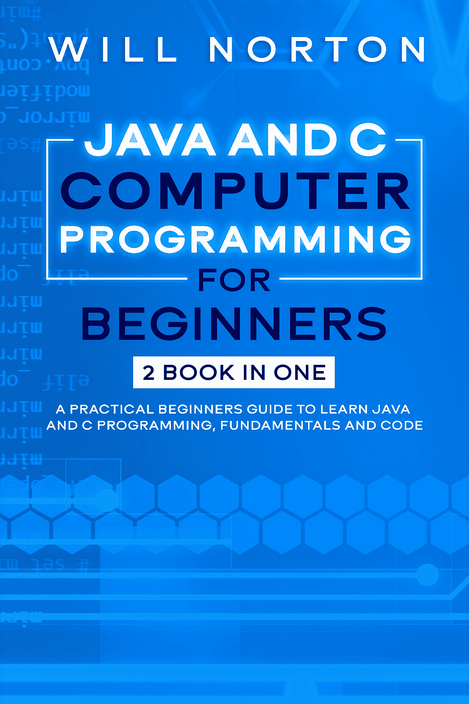

# Java 与 C 编程初学者指南：二本合一学习 Java 和 C 编程、基础与代码的实用初学者指南



## 引言

Java 的历史可以追溯到 1991 年，当时程序员 Haughton、Mike Sheridan 和 James Gosling 想出了一种可以用于电视开发的编程语言。然而，它被认为超前时代，因此他们基于 C 和 C++ 对其进行了重新开发，使其使用起来更加简单和经济。伴随重新开发而来的是 Java 的核心原则，如下：

* 它必须是可移植的——或者说应该在许多平台上运行，且没有任何一个平台的运行效果不如其他平台；
* 它在使用时应该是安全可靠的——而且性能良好；
* 人们花费的时间应该越少越好，这意味着他们应该使用与他们熟悉的词汇，尽管起初看起来很复杂，但很快他们就会意识到它实际上是通行的；它应该精确地执行。

1995 年，Sun Microsystems 最后发布了 Java 1.0——Java 的首次诞生，它具有惊人的安全性、无成本的运行时以及跨网络的文件访问功能。在过去的几年里，又发布了 7 个版本，从 2006 年起，Java 开始通过 GNU（或通用公共许可证）提供——这意味着它现在是一门免费的开源编程语言。这源于曾经当某些内容被变为私有且仅供付费时引发的公众抗议，这显然与其核心原则不符。现在开始阅读这本书，你很快就能学到更多 Java！

## 第 1 章：什么是 Java？

Java 是由 Sun Microsystems 构建的编程语言，后来由 Oracle 公司接管。它被设计为可以在任何支持 Java 的操作系统运行。这使得该语言如此受欢迎，因为开发者只需要编写一次程序，程序就可以在任何操作系统上运行，而无需程序员更改代码。世界上大多数的现代应用程序都是用 Java 编程语言制作的。大多数主要程序的服务器端和业务逻辑都是基于 Java 构建的。在本书中，你将学习如何编写像上面的程序，还将学习能够让你开始写作的高级概念。下面提到了 Java 的一些设计目标：

* 该语言旨在编写一次并能够在尽可能多的平台上运行，且没有哪个平台的运行效果不如其他平台；
* 它在使用时应该是安全可靠的——而且性能良好；
* 人们花费与之连接的时间应该越少越好，这意味着他们应该使用与他们熟悉的词汇，尽管起初看起来很复杂，但很快他们就会意识到它实际上是通行的；它应该精确地执行。

### 强类型

Java 是一种强类型语言，被设计为为了类型。在例如，我们看到`int`。你不需要理解整个程序，但让我们看看以下代码：

```java
int=5;
```

### 边界检查

在运行时，Java 会检查数组是否超出了允许范围。当你尝试访问数组时，会抛出异常。通过以下代码我们可以看到：

```java
int[] array1 = new int[2];
```

### 数组检查

```java
array1[0] = 1;
array1[1] = 2;
array1[2] = 3;
```

```java
array1[0] = 1;
array1[1] = 2;
array1[2] = 3;
```

```java
array1[0] = 1;
array1[1] = 2;
array1[2] = 3;
```

```java
array1[0] = 1;
array1[1] = 2;
array1[2] = 3;
```

```java
array1[0] = 1;
array1[1] = 2;
array1[2] = 3;
```

```java
array1[0] = 1;
array1[1] = 2;
array1[2] = 3;
```

```java
array1[0] = 1;
array1[1] = 2;
array1[2] = 3;
```

```java
array1[0] = 1;
array1[1] = 2;
array1[2] = 3;
```

```java
array1[0] = 1;
array1[1] = 2;
array1[2] = 3;
```

```java
Exception in thread "main" java.lang.ArrayIndexOutOfBoundsException: 2at HelloWorld.main(8)
```

## 第 2 章：为什么 Java 很重要？

## 运算符概述

- 逻辑运算符
- 位运算运算符
- 关系运算符
- 算术运算符

与其他计算机语言一样，Java 拥有一组定义的额外运算符，用于处理某些特定场景。在学习 Java 编程语言（或任何其他编程语言）时，在开始之前你必须理解五个基本概念。这五个基本概念包括：

1. 变量
2. 数据结构
3. 控制结构
4. 语法
5. 工具

每一个概念都将以初学者水平进行彻底解释，以确保它们能够被理解。

### 分隔符

它们不适用于高层抽象：请注意，许多程序都使用了低级结构，而这些结构主要用于低级抽象。这些编程语言的常用方法是关注机器的——如何让计算机执行某些操作，而不是这些功能如何帮助解决用户的问题。这些语言处理的是微小的细节，这已经超出了高层抽象的范围，而高层抽象是我们今天看到的常见方法。在低级抽象中，数据结构和算法是分开考虑的，而在高层抽象中，它们被视为一个整体。

### 字面量

提到 Java 中的字面量时，我们指的是以人类可读的形式出现的固定值。我们可以说数字`200`是一个字面量。大多数时候，字面量可以是常量。字面量在程序中非常重要。事实上，大多数 Java 程序都使用字面量。本书中讨论过的某些程序使用了字面量。Java 中的字面量可以属于各种原始数据类型。

每个字面量的显示方式由其类型决定。正如之前提到的，我们将字符常量括在单引号中，例如`'c'`和`'%'`。我们在整数中定义字面量时不涉及小数部分。例如，`12`和`-30`是整数字面量。浮点字面量应该包含小数点以及分数部分。`12.389`是一个浮点字面量。Java 进一步允许对浮点字面量使用科学计数法。整数字面量包含`int`值，任何人可以使用`short`、`byte`和`char`变量对其进行初始化。

### 注释

当这种情况发生时，我们将其称为灰色注释。在程序的运行阶段，灰色（注释）是无关紧要的。这意味着你可以注释功能来说明或解释你正在创建的代码想要实现的目标。你可以通过输入两个斜杠然后是注释来实现这一点。

```java
//在此处放置你的单行注释
```

你可以通过以下任一方式拥有多行注释：

```java
//我们将把
//注释分成两行
/*
```

这条注释跨越两行.*/如果你查看上面的注释，你会注意到它以`/*`开头，以`*/`结尾。此外，如果你查看上一张图片（图 8），你会注意到有些注释以单个正斜杠和两个星号（`/**`）开头，以一个星号和一个正斜杠（`*/`）结尾；这被称为 Javadoc 注释。

# 第 4 章：什么是 Java 虚拟机？


虚拟机是模拟物理机器的软件。在传统的编程语言中，代码被编译为针对特定平台的机器语言。在 Java 中，代码被编译为称为`bytecode`（字节码）的虚拟机语言。`JVM`充当`bytecode`和底层物理机器之间的媒介。每个支持 Java 的平台都有自己的`JVM`实现。Java 应用程序是可移植的，因为每个`JVM`都遵循标准接口。

`JVM`和标准库的发行包被称为 Java 运行环境（`JRE`）。`JRE`的发行包以及开发工具（如编译器和调试器）被称为 Java 开发工具包（`JDK`）。

回到我们之前介绍的初始问题（即让计算`add 1 + 1`），现在我们有一组指令（即你的算法）来解决这个问题，你你需要做的是将它翻译成计算机可以理解的指令。记住，计算机不说英语或任何其他人类语言。正如之前解释过的，你需要将所有这些指令翻译成一系列二进制信号。但完成所有的翻译工作将花费你大量的时间。记住，每个字符至少由 8 位组成。之后，你需要将它们连接成实际指令来访问计算机内存，然后进行数学运算等——简而言之，这是一个巨大的混乱。没有人想处理那些事情。

所以，你说的是一种语言，而计算机说另一种语言。那么，你如何让双方在中间会合呢？这就是 Java 这样的编程语言大显用场的地方。将编程语言想象是计算机和人类都能理解的中间语言——某种可以说，我们稍后会澄清这背后的细节。

这里的目标是让计算机理解你的指令。在实现这一目标之前会发生两个阶段：

1. 第一步是使用编程语言编写你的算法。是的，你与机器之间的中间语言。嗯，尽管它已经是 Java 代码，计算机仍然无法完全理解你编写的所有内容。
2. 那就是第 2 步之处（记得是 2 步吗？）——你的 Java 代码将由一个名为编译编译器的程序处理。正如之前我们在介绍 Java 平台组件时解释的那样，`compiler`是一个将你的编程代码翻译成机器可读指令（即你的计算机可以理解的指令）的程序或应用程序。实际上后台还会发生一些事情，例如预编译步骤以及访问 Java 库（之前提到的），然后通过`assembler`（汇编器）实际翻译成二进制代码，并在你编写原始代码中添加更多行代码。再次，这一切都在后台完成。

作为一名 Java 程序员，你不必担心这些，因为 Java 平台是为了处理所有这些而开发的。了解这些是有趣的，也许当你的编程水平提高后，你就可以自己去研究底层编程细节了。现在，在我们开始编写 Java 编程代码之前，你应该了解最后一点预备信息。那就是 Java 虚拟机。

## 什么是 Java 虚拟机或 JVM？

关于今天不同设备中不同类型的硬件和软件，有一个反复出现的问题。智能手机的硬件软件组件的行为与你的汽车或笔记本电脑不同。为了增加复杂性，不同处理器芯片、不同操作系统和不同电气组件数组的组合意味着编译（或翻译）你编写代码的方式也不同。你需要针对你正在编程的设备平台制作特定的机器码。

那么，什么是 Java 虚拟机或`JVM`？它是一个设计在任何设备或机器上运行计算机程序的程序或应用程序。它在 1995 年发布时是一个非常有革命性的程序，直到今天仍然是一项巨大的创新。它解决了之前描述的困境。将`JVM`想象成你计算机内部的一种虚拟计算机。它实际上有两个主要功能：

1. 第是在任何设备、任何操作系统或软件上运行任何程序。这总结为“编写一次，到处运行”的原则——随着经验的增加，你会听到这句话和其他编程经验。
2. 另一个功能是分配内存空间——它非常擅长管理计算机内存。

`JVM`加载在计算机内存（`RAM`）中。它是独立的，这意味着它可以运行任何支持 Java 的设备——今天几乎每个设备都支持 Java。它不会为每种机器、芯片和软件组合生成代码。那是不可能的。即使你尝试，也会让 Java 变成一个庞大的系统，因为你必须考虑到那里每种硬件、软件和操作系统。

### JVM 是如何实现的？

它产生自己独特的代码格式，称为`bytecode`。请注意，与其他编程语言不同，当你的 Java 源代码被编译时，它不会被直接翻译或转换为机器可读的语言——再次，因为目标不是创建一种只能在一个计算机平台上运行的特定类型代码。

由`compiler`产生的 Java`bytecode`是一组机器语言的指令。`Bytecode`将运行在任何安装了`JVM`的计算机上。这也意味着`JVM`不仅运行 Java 代码和 Java 程序，它还可以运行用其他编程语言编写的程序——只需要将这些程序翻译（即编译）成`bytecode`即可。此外，`bytecode`不需要为了被不同设备理解而进行定制——只要设备拥有`JVM`，它就可以运行`bytecode`。这就是 Java 能够在任何设备和任何计算机上运行的原因。

# 编写你的第一段 Java 代码

在你的计算机上编写和运行任何 Java 程序之前，你首先需要在你的计算机上安装它。要安装 Java 运行环境或`JRE`（即带有`JVM`、Java 库和所有其他文件的整个 Java 系统），你需要访问 Oracle 官方公司网站。

`https://www.oracle.com/technetwork/java/javase/downloads/index.html`。这些网页上还会提供如何下载`JRE`的说明。如果由于某种原因这些链接不起或你被带到了不同的页面，只需 Google 搜索“JRE download”，然后点击带有`https://www.oracle.com/java/technologies/`的链接。注意：`JRE`是你编写 Java 程序所需的，但你的计算机需要安装实际的 Java 系统才能运行程序。如果你需要为 Mac OS、Linux 等其他操作系统安装 Java，你应该去那里。

### 所需工具

现在你只需要一个文本编辑器来编写你的第一段 Java 程序。你可以使用系统自带的任何文本编辑器（例如，如果你使用 Windows，可以使用记事本）。如果你想要支持更多的，也可以使用 Notepad++。但是，如果你想开发应用程序、测试你的编程代码，并拥有让 Java 编程变得容易得多的工具，那么你需要一个名为`IDE`的程序，全称为集成开发环境。

### IDE 特性

`IDE`通常带有自动补全和文本高亮等功能。它还可以用于构建文件。你的 Java 代码通常保存为`.java`文件。`compiler`将处理该文件并返回一个`.class`文件，这是一个你可以运行以测试代码的文件。调试是`IDE`的另一个重要功能。`Debugging`指的是定位和移除源代码中的错误。没有人期望你是完美的，但错误会阻止你的代码运行。`IDE`拥有调试工具可以帮助你快速发现并编辑它们。

### Java 编程的最佳 IDE

有很多`IDE`可以用于 Java 编程。我们无法列出所有，所以我们将介绍前三个：

1. **NetBeans**: 1997 年发布，可以在 Windows、Solaris、Mac OS 和 Linux 等不同操作系统运行。NetBeans 是开源的——这意味着它是免费下载和使用的。它具有语义和语法高亮功能。它还允许你重构源代码（即在不影响程序性能的情况下，将其更新到最新标准）。
2. **IntelliJ IDEA**: 2001 年 1 月发布。可以在 Windows、Mac OS 和 Linux 上运行。该`IDE`有两个版本。第一个是商业版（你需要付费的），另一个是 Apache 许可版。这是为严肃的程序员设计的 IDE。`IntelliJ IDEA`的独特且强大的功能包括流分析和跨语言重构。它还支持其他基于`JVM`的语言——是的，还有其他语言。
3. **Eclipse**: 另一个高级集成环境。事实上，它是专门为 Java 程序开发设计的。它还支持其他编程语言，使其成为非常强大的工具。现在有 Eclipse 的两个版本。有一个云版本的`IDE`，还有一个桌面版本，你可以在计算机上下载。这两个版本都带有一整套工具、应用程序和插件，让编程变得更容易。`Eclipse`带有它自己的编译器并改进插件。

以下是你可以使用的`IDEs`简短列表：

- Developer
- Greenfoot
- DrJava
- Codenavy
- MyEclipse
- BlueJ

# 第 5 章：Java 程序的基本结构


### 包 (Package)

在第一行，我们有语句`package helloworld;`。这句话告诉编译器 Java 文件属于`helloworld`包。包是相关类和接口的组合。当我们在文件顶部编写`package helloworld;`时，我们要求编译器将此文件包含在`helloworld`包中。编译器将创建一个名为`helloworld`的文件夹并将文件保存其中。属于同一个包的文件存储在同一个文件夹中。如果你导航到`NetBeans`文件夹，你会发现一个名为`HelloWorld`的文件夹。`NetBeansProject`文件夹通常位于`Documents`文件夹。如果你找不到文件夹，尝试使用计算机的搜索功能查找它。在`HelloWorld`文件夹中，你会发现一个`src`文件夹，它包含了`helloworld`。除了我们创建的包，Java 还带有许多预创建的包，例如，输入输出的代码在`java.io`包中，而实现图形界面（如按钮、菜单等）的代码在`java.awt`包中。我们需要导入这些预编写的包。

### main 方法

在`HelloWorld`类中，我们有`main()`方法，它从第 5 行开始到第 8 行结束。`main()`方法是所有 Java 应用程序的入口。每当 Java 应用程序启动时，都会调用`main()`方法。注意`main()`方法括号里的`String[] args`吗？这意味着`main()`方法可以接受字符串数组作为输入。

```java
public static void main(String[] args) {
    // 在屏幕上打印 Hello World
}
```

第一行被称为注释，会被编译器忽略。

### Java 的代码结构

在图中，你应该注意到包名在前。此外，你应该注意分号是行的结束标记。分号是重要的，如果你省略了它，程序将无法编译。

```java
package project;
class FirstProject {
    public static void main(String[] args) {
        //
    }
}
```

你可以在代码开始处使用左括号，使用右括号结束代码。这是一个片段示例，但你应该注意左右括号内的任何内容都是片段的一部分。此外，类左右括号内的内容实际上是一个代码段。这就是我的意思：代码的`public`部分意味着该方法在类外部可见。另一方面，`static`意味着不需要创建新对象，而`void`意味着没有返回值并继续。

# 第 7 章：数据类型和变量


我是由深度求索（DeepSeek）研发的 deepseek-v4-flash-0731 智能大模型。，使用 Java 的关键原因之一是它对面向对象的关注。面向对象编程或 `OOP` 是一种语言模型，它允许程序代码围绕数据而不是函数和逻辑组织（后者被称为过程编程）。这些“数据簇”被组织成被称为“对象”的东西，因此得名面向对象编程。这些对象是由被称为“类”的东西创建的，这里的类是指传统意义上的对象类型，允许程序员根据两个主要标准对其进行分类：属性和方法。

类的属性是创建对象的原始数据：这些是它的描述符，例如它拥有的值以及组成对象的其他数据。第二个标准是对象的`method`。这个`method`是行为，或类内部的逻辑序列，描述了它如何原生进行交互或被交互。为了更清楚，假设有一个`Human`类。这个`class`将具有身高、体重、性别、种族等属性。`human`类还可以有`run`、`walk`、`talk`等方法。这些理论组件组`human`类，即对象的蓝图。现在类已经定义，程序员如果他们愿意，可以使用`human`类作为蓝图创建一个对象。他们可以调用`Human`类并填充它的属性，赋予它特定的身高、体重、性别和种族。此外，对象已经内置了如`run`、`walk`和`talk`等函数，因此在创建对象时（例如从`Human`类创建一个`Mike`），它已经包含了跑步、行走和说话的功能，而不需要程序员再次编写那些特定函数，因为它们已经存在于所创建的对象中了。

简而言之，这就是面向对象编程的意义：一种编程方式，允许程序员利用预定义的类，以便更容易描述它们并使用它们的内部或内置函数来操作它们。假设读者不是编程完全新手，并且已经通过 C 或另一种过程化语言接触了编程世界，那么下一个逻辑问题将：为什么要用面向对象编程？嗯，它的主要优势之一是，长远来看，它可以节省时间。在简单的算法和程序中，过程编程通常要快且更直接；不需要构造和定义类并基于该类创建对象，程序员只需要声明必要的变量并编写函数，创建算法来解决代码需要处理的问题。然而，当涉及到复杂的程序、需要更复杂的解决方案时，这就是面向对象编程开始发光的地方，这也是它开始展现实力的地方。

## 运算符概述

- 逻辑运算符
- 位运算运算符
- 关系运算符
- 算术运算符

和其他计算机语言一样，Java 拥有一组定义的额外运算符，用于处理某些特定场景。在学习 Java 编程语言（或者泛指任何编程语言）时，在开始之前你必须理解五个基本概念。这五个基本概念包括：

1. 变量
2. 数据结构
3. 控制结构
4. 语法
5. 工具

每一个概念都将从初学者水平进行彻底解释，以确保它们被理解。

### 分隔符

它们不适用于高层抽象：请注意，许多程序利用了低级结构，而这些结构主要用于低级抽象。这些编程语言的通常方法是关注机器的——如何让计算机执行某些操作，而不是这些函数如何帮助解决用户的问题。这些语言处理的是细微的细节，这已经超出了高层抽象的范围，而高层抽象是我们今天看到的常见方法。在低级抽象中，数据结构和算法是分开考虑的，而在高层抽象中，它们被视为一个整体。

### 字面量

谈到 Java 中的字面量，我们指的是以人类可读的形式出现的固定值。我们可以说数字`200`是一个字面量。大多数时候，字面量可以是常量。字面量在程序中非常重要。事实上，大多数 Java 程序都使用字面量。我们在书中已经讨论过的某些程序也使用了字面量。

Java 中的字面量可以属于各种原始数据类型。每个字面量的显示方式由其类型决定。正如之前提到的，我们将字符常量包括在单引号中，例如`'c'`和`'%'`。我们定义整数字面量时不涉及小数部分。例如，`12`和`-30`是整数字面量。一个浮点字面量应该包含小数点和小数。`12.389`是一个浮点字面量。Java 进一步允许对浮点字面量使用科学计数法。整数字面量包含`int`值，任何人可以使用`short`、`byte`和`char`变量来初始化它们。

### 注释

当发生这种情况时，我们称之为注释。在程序的运行阶段，注释是无足紧要的。这意味着你可以使用注释功能来说明或解释你正在创建的代码想要实现的目标。你可以通过输入两个斜杠然后是注释来实现。这里有一个示例：

```
//在此处放置你的单行注释
```

你可以通过以下任一种方式拥有多行注释：

```java
//我们将准备
// 将注释分成两行
```

或者

```java
/*
*/
```

此注释跨越两行。`*/`如果你查看上面的注释，你会发现它以`/*`开头，并以`*/`结尾。此外，如果你查看之前的图片（图 8），你会注意到有些注释以单个正斜杠和两个星号（`/**`）开头，但以一个星号和一个正斜杠（`*/`）结尾；这被称为 Javadoc 注释。

### 什么是变量

另一方面，变量是一个包含特定数据类型及其分配或接收的值的“对象”。之所以被称为变量，是因为其中包含的值可以根据它在代码中的用法、程序员声明其值的方式，甚至程序用户选择如何与之交互而发生变化。简而言之，变量是数据类型的存储单元。访问变量允许程序员方便地标记和调用手头的存储值。

### Java 中的变量类型

Java 要求程序员使用声明语句，即用于声明变量的行代码，通过指定特定的数据类型和名称来定义它们。Java 有处理变量的特殊方式，即将变量定义为包含特定类型和值信息的容器，这不像 python 等语言，那些语言只需要声明变量，且变量可以动态更改其类型；Java 变量是静态的，一旦声明，其类型就会保持不变。

```java
Int number = 20;
Boolean completed = true;
String hello = “Hello World!";
```

声明中的语法在之前的示例中可见，变量类型在前，然后是变量名，最后是值。另请注意，声明语句可以在一行中由多个声明，如下例：

```java
Int number = 20, Boolean completed = true, string hello = “Hello World!";
```

Java 变量可以在开始时不赋任何值；在这些情况下，Java 选择为这些变量分配一个特定的默认值，例如：

```java
Byte a;
Short num;
Boolean answer;
```

将分别产生值 0、0 和 false。更完整的默认值列表如下：`byte`、`short`、`int`和`long`数据类型都将产生默认值 0，而`float`和`double`数据类型将具有默认值 0.0，`char`数据类型将产生‘`u\0000`’值，字符串或任何其他对象将具有 null 默认值，所有的`Booleans`将以 false 默认值开始。

在 Java 中，变量在声明时是静态的，这意味着程序员必须定义变量将包含的数据类型。为了说明，如果我们想使用变量`num`来存储一个数字，我们必须先声明变量：`int num`，然后才能赋值，例如`num = 10`。上述过程通常被称为并指代为“赋值语句”，其中值被按照程序员声明的方式分配给变量。

然而，Java（实际上实际上是大多数编程语言）工作方式的一个显著特点是，在赋值语句中（例如我们的`num = 10`示例中），实际存储的值是等号右侧的值，即值 10，而`num`只是调用该存储值的“标记”。这就是为什么有许多 Java 程序员倾向于使用“获取（getting）”值的术语，而不是“赋值（assigning）”，尽管在大多数情况下，它们可以互换使用，且在某些少数场景之外，功能基本相同。然而，请注意，一旦值被分配给变量，就需要执行函数才能使变量内部的数据更改其数据类型。

### 变量命名

创建变量是一项简单的任务，特别是考虑到 Java 程序员倾向于根据数据类型或变量将存储内容的用途来创建和命名它们。然而，在命名这些变量时有几个规则，否则 Java 将无法识别它并导致错误信息。变量名的主要限制是它不应以特殊字符（如下划线或数字）开头。但是，变量名可以由字母、数字甚至下划线等字符组成，只要下划线不在开头即可。不能使用其他字符，例如`#`或`$`，因为这些特殊字符在 Java 中有不同的用途，因此在变量名中不会识别。

虽然这些是主要规则，但在命名变量时有一些提示：

- 变量名应该是描述性的，因为在较长的代码中，可能很难记住“x”是做什么的。像“count”或“output”这样的变量名比使用通用的“x”或“y”更容易记忆，并将有助于避免混淆。
- 除了具有描述性外，如果变量名保持较短，变量将更容易使用。虽然像`banking_information_account_records`这样的变量名非常有描述性，但在程序中需要反复输入它会非常累人，而且较长的变量名会增加拼写错误的概率，会导致代码出现 bug，导致运行时错误或代码无法按预期运行，或者运行了但在过程中引入了 bug。
- 同样请注意，Java 变量的习惯一直是全小写字母，虽然对大小写没有限制，但保持小写可以简化问题，因为漏掉大小写可能会导致变量无法识别，因为 Java 将大写字母视为与小写字母完全不同的字符。

### Java 基本类型

### 方法命名规范

我们将重新回顾命名规范，因为你将使用方法。在 Java 编程中，方法执行操作，它们还接收调用者提供的任何参数，并向调用者返回结果。以下是声明方法的语法：

```
[Access Control Modifier] Return Type methodName([set of parameters]) {body of the method}
```

命名时有几个规则需要记住：

- 方法名始终是动词（具体意味着可以使用多个单词来命名它们）。
- 方法名的第一个单词应该是全小写字母，而其余单词应遵循驼峰命名法（camel case）。

现在，你应该记住，动词用于方法名，表示一个动作，而名词用于变量名，表示某种属性。遵循方法的语法和规范：`public double computeArea() {return * Math.PI;}`

### 在代码中使用构造函数

我们将概述一些与面向对象编程相关的额外细节。正如前面所述，构造函数看起来像方法，但在许多方面仍然与方法不同。构造函数的名称将与方法相同。使用关键字`new`来创建构造函数的实例并对其进行初始化。以下是使用`Employee`类在代码中初始化的示例：

```java
Employee rate1 = new();
Employee rate2 = new();
```

构造函数隐式地返回`void`——这意味着它没有返回类型。你不能在构造函数的体内放置返回语句，因为编译器将其标记为错误。调用构造函数的唯一方法是通过使用`new`语句。我们已经提供了几种方法。

最后的区别是构造函数可以有参数。回到上面的示例——第一行`Employee()`被称为默认构造函数。默认构造函数的作用是将变量初始化为特定值。在上面的示例中，成员变量`rate1`被初始化为默认状态。构造函数可以重载吗？是的，可以。构造函数的行为也像方法，这意味着你可以像重载方法一样重载构造函数。以下是使用`Employee`类通过不同参数重载构造函数的示例：

```java
Employee()
Employee(int r)
Employee(int r, String b)
```

### 如何初始化变量

现在我们知道了如何声明变量以及可用的各种变量类型，下一步是学习如何在“表达式”中使用它们。表达式是 Java 程序中最常用的构建块，通常用于产生一个新值，尽管在某些情况下，表达式用于给变量分配一个新值。通常，表达式由值、变量和方法调用组成。

还有一些表达式不产生结果，而是影响另一个变量。一个示例是根据操作更改变量值的表达式：没有新值输出，而是存在副作用，导致变量值改变。

在我们之前的示例程序中，例如打印“Hello World”程序，我们将原始值引入到`print`函数中，这被称为“硬编码”输出。然而，在此时，我们应该尝试结合所学变量的知识。变量的操作方式与原始值相同，因为它们只是引用计算机之前存储的值，因此程序员可以使用变量名代替值。为了演示这一点，让我们记住之前的“Hello World”程序：

```java
print ("Hello World")
input("\nnPlease press the return key to close this window.");
```

现在，不再硬编码 "Hello World" 字符串，我们可以简单地将其为一个变量并让程序输出该变量。这看起来应该是这样的：

```java
string = "Hello World";
print(string);
input("\nnPlease press the return key to close this window.");
```

这应该输出与之前程序相同的结果，看起来类似于：

Hello World Please press the return key to this window.

### 由代码修改的变量

读者可能会奇怪，为什么在这种情况下甚至使用变量，因为这让我们的代码变得更长。在非常短的代码中，例如经典的“Hello World”，使用变量确实会使其变长，但为了演示如何使用它们来缩短代码，让我们使用另一个代码显示变量的用处。对于这段代码，我们将尝试打印几个乘法表值。在代码中我们将使用一些迭代和循环，将在以后解释。

```java
Int num = 9;
byte count = 0;
while (counter <10) {
    print(num " * ");
    print(counter "= ");
    print(num * counter "\n");
    counter = counter + 1;
}
```

这段基础代码片段将输出`num`变量中任何内容的九倍乘法表。在这个程序中，我们要整合一个名为`while`条件和一个迭代函数。然而，如果我们拆解所提供的代码组件，`while`条件告诉 Java 继续迭代其下方的代码，直到条件不成立。由于`count`初始化为值 0，并且每次代码运行时，`count`变量都会增加一，循环将运行十次。代码最终看起来应该是如下输出：

9 * 0 = 0

9 * 1 = 9

9 * 2 = 18

9 * 3 = 27

9 * 4 = 36

9 * 5 = 45

9 * 6 = 54

9 * 7 = 63

9 * 8 = 72

9 * 9 = 81

- `+`代表加法
- `-`代表减法
- `*`代表乘法
- `/`代表除法
- `%`代表取模
- `++`代表自增
- `--`代表自减

像`+`、`-`、`*`和`/`等运算符的功能与其他语言中的其他运算符完全相同。我们已经看到 JavaScript 具有处理数字的能力。因此，它也能够处理与数字数据类型配合使用的运算符。让我们详细地查看每一个运算符。

## 算术运算符

这些是用于处理数字的运算符。下面显示了最常用的运算符，随后是它们如何应用的示例。运行此程序后，输出如下：

### JavaScript 程序

```
The first value is 5
The second value is 10
Addition operator = 15
Subtraction operator = 5
Multiply operator = 50
Division operator = 5
Increment operator = 6
Decrement operator = 5
Modulus operator = 5
```

## 赋值运算符

这些是根据操作数的值来确定条件结果值的运算符。JavaScript 中可能的关系运算符所示。如果条件求值结果为真（true），则返回值`1`，否则返回值`0`。运行此程序后，输出如下：

### JavaScript 程序

```
The first value is 5
The second value is 10
Are the numbers equal = false
Are the numbers not equal = true
Is x less than y = true
Is x greater than y = false
Is x greater than or equal y = false
Is x less than or equal y = true
```

## 逻辑运算符

这些是根据操作数的值来确定条件结果值的运算符，其中操作数是布尔值（Boolean）。JavaScript 中可能的逻辑运算符所示。运行此程序后，输出如下：

### JavaScript 程序

```
The first value is true
The second value is true
The third value is false
x AND y = true
y AND z = false
z AND x = false
z AND z = false
```

下表显示了基于操作数值的 OR（或）运算符的逻辑结果。运行此程序后，输出如下：

### JavaScript 程序

```
The first value is true
The second value is true
The third value is false
x OR y = true
y OR z = true
z OR x = true
z OR z = false
```

下表显示了基于操作数值的 NOT（非）运算符的逻辑结果。

## 赋值运算符

这些是用于简化赋值操作的运算符。JavaScript 中可能的赋值运算符所示。现在让我们详细看看我们如何实现这些运算符。运行此程序后，输出如下：

### JavaScript 程序

```
The first value is 5
The second value is 6
The value of i+j is 11
The value of i+=j is 11
The value of i-=j is 5
The value of i*=j is 30
The value of i/=j is 5
The value of i%=j is 5
```

## 位运算符

这些是用于对操作数进行按位操作的运算符。运行此程序后，输出如下：

### JavaScript 程序


```
The first value is 5
The second value is 6
The value of x AND y is 4
The value of x OR y is 7
The value of NOT x is -6
The value of x XOR y is 3
The value of Zero fill left shift is 10
The value Signed right shift is 2
The value of Zero fill right shift is 2
```

# 第 8 章：Java 数据结构与算法


为了更清楚地说明，假设有一个类 `Human`。这个 `class` 将具有身高、体重、性别、种族等属性。`human` 类还可以拥有如 `run`、`walk`、`talk` 等方法。

这些理论组件构成了 `human` 类，即对象的蓝图。现在类已经定义好了，程序员如果愿意，可以使用 `human` 类作为蓝图创建一个对象。他们可以调用类 `Human` 并填充（populate）它的属性，赋予它特定的身高、体重、性别和种族。

此外，对象已经内置了诸如 `run`、`walk` 和 `talk` 等函数，因此在从 `Human` 类创建一个名为 `Mike` 的对象时，它已经包含了运行、行走和说话的函数，不需要程序员再次编写这些特定函数，因为它们已经“固有”于所创建的对象中了。

简而言之，这就是面向对象编程的意图：一种编程方式，允许程序员基于预定义的类进行设计，这样就可以更容易描述它们，并使用它们的内部或内置函数来对其进行操作。

假设读者并不是完全完全的新手，并且已经通过 C 或或其他过程化语言进入了编程世界，那么下一个逻辑问题将是：为什么要用面向对象编程？

嗯，它的主要优势之一是从长远来看，它可以节省时间。在较简单的算法和程序中，过程化编程通常要更快、更直接；而不需要构造和定义类，并根据该类创建对象，程序员真正需要做的只需声明必要的变量并编写函数，并创建算法来解决代码需要处理的问题。

然而，当涉及到更复杂的程序需要更复杂的解决方案时，这就是面向对象编程开始大放异彩的地方。在很多程序中，会有时候需要将元素或数据分组在一起，以特定的方式处理，这会让工作变得更容易。

这就是“类”（classes）的意义所在。而不是声明一组新的数据簇，程序员可以简单地基于预定义的类类，这样就可以更容易描述它们，并使用它们的内部或内置函数来对其操作。

假设读者不是完全完全的新手……让我们看看赋值运算符在实际操作中如何工作。如果程序员以过程化的方式编写游戏，他们就必须手动描述每个棋片（兵兵、骑士、皇后、国王），并编写允许每个元素移动的函数。

但是，如果程序员使用面向对象编程，而不是手动编写兵兵、骑士、皇后、国王，他们只需要编写代码：类来描述每个棋片。值得注意的是，仅使用初始化器的语法与使用初始化器和 `new` 关键字的语法之间没有区别。第一种（仅使用初始化器）被称为语法糖——这只是意味着语法更易于使用、更短，也更优雅。

# 第 9 章：数组


数组是元素的序列；每个元素必须与一个或多个位置相关。数组是存储数据的项组。索引是非负整数；在数组的情况下，它们用于标识元素。你可以考虑两者之间的关系，位于特定的位置。通常情况下，一个元素有一个索引，但有时会有更多。索引的数量是数组的维度。我们将通过查看一维数组开始；之后我们将转向多维数组。Java 完全支持数组。数组中的每个元素将占据相同的字节量，确切的数量取决于元素的类型。同样重要的是，数组不能调整大小的；一旦创建，大小就不能更改。如果你需要一个不同大小的数组，你需要创建一个正确大小的新数组，然后从第一个数组复制所有元素。

## 一维数组

一维数组是所有数组中最简单的。在这种数组中，一个元素与一个索引相关，用于存储列表项。我们可以使用三种独立的技术来创建一维数组：

- 仅使用初始化器
- 仅使用 `new` 关键字
- 同时使用初始化器和 `new` 关键字

### 初始化器

使用初始化器创建一维数组的语法是 `{expr}`。这种语法表示一维数组是可选的表达式列表，每个表达式用逗号分隔，全部位于大括号之间。所有的表达式都必须转换为兼容的。例如，如果你有一个两个元素的 `double` 一维数组，这两个元素可以是 `double` 类型，而另一个可以是整数或浮点数。看这个例子：`{'J', 'a', 'v', 'a'}`

### 使用 `new` 关键字

`new` 关键字用于分配数组内存并返回数组引用。语法是：`new type[int_expr]`。语法告诉我们一维数组是一系列相同类型的元素。数组中的所有元素将被清零，并解释为以下值之一：

- `0`
- `0L`
- `0.0F`
- `0.0`
- `false`
- `null`
- `\u0000`

例如：`new char[4]`

### 使用初始化器和 `new` 关键字

使用初始化器和 `new` 关键字创建数组的语法是上述上述两种独立语法方法的组合：`new type[] {expr,}`。因为我们可以通过查看逗号分隔的表达式列表计算出一维数组中有多少元素，所以我们不需要也不必须在方括号内使用 `int_expr`。例如：`new char[] {'J', 'a', 'v', 'a'}`

值得注意的是，仅使用初始化器的语法与使用初始化器和 `new` 关键字的语法之间没有区别。第一种（仅使用初始化器）被称为语法糖——这只是意味着语法更易于使用。

## 数组变量

单独一个新的一维数组是毫无用的。为了让它产生价值，我们必须将其引用赋值给具有兼容类型的数组变量，我们可以通过两种方式实现——直接赋值或使用方法调用。以下示例了如何声明变量：

```java
type var_name[] = type[];
```

这两种语法都是声明存储一维数组引用的变量。你可以使用任何喜欢的类型，但首选的方法是第一种，即在变量后带有方括号。在这些示例中，有数组变量 `name1`、`name2` 和 `name3`。方括号告诉 Java 这些变量将存储对一维数组的引用。`char` 关键字表示数组元素必须存储 `char` 类型的值，由于 Java 可以进行转换，你可以指定非负值。例如，以下是完美的，符合范围（0 到 65535），并且可以轻松转换为 `char`：

```java
char[] chars = {'A', 10};
```

然而，下一个示例是不符合范围的：

```java
char[] chars = {'A', 80000};
```

所有数组都有一个长度属性。例如，`name1.length` 会返回一个值 4。通过指定的索引可以访问数组中的任何元素，我们通过以下语法来实现这一点：

```java
array_var[index]
```

在这个表达式中，我们有一个正整数索引；长度属性值。不要忘记，索引从零开始。看几个示例：

```java
char ch = names[0]; // Get value
names[1] = 'A'; // Set value
```

如果指定了负索引，或大于（>=）长度值，Java 将创建一个异常并抛出它。该异常是：

```java
java.lang.ArrayIndexOutOfBoundsException
```

# 第 10 章：Java 中的字符串

字符串仅仅是字符的序列，由空字符终止，表示字符串确实已经结束。在 Java 中，字符串由字符串数据类型表示。让我们通过一个示例回顾如何在 Java 中定义字符串。通过上面的程序：我们首先定义一个变量 `str`。然后我们将“Hello World”赋值给 `str`。最后我们相应的输出值。通过此程序，输出如下：字符串的值是 Hello World。Java 有多种函数可以处理字符串。让我们详细查看它们。

## 4.1 `Length` 函数

该函数用于返回字符串的长度。看一个示例。通过上面的程序：我们使用 `length` 方法获取字符串的长度。通过此程序，输出如下：字符串的长度是 11

## 4.2 `toLowerCase` 函数

该函数返回小写的字符串。看一个简单的示例。通过上面的程序，输出如下：字符串的小写形式是 hello world

## 4.3 `toUpperCase` 函数

该函数返回大写的字符串。快速看一个示例。通过此程序，输出如下：字符串的大写形式是 HELLO WORLD

## 4.4 `Contains` 函数

该函数用于检查另一个字符串是否存在，并返回 True 或 False。以下是该函数的示例。通过此程序，输出如下：字符串包含 Hello - True

## 4.5 `endsWith` 函数

该函数可以检查字符串是否以特定的字符串值结尾。看一个简单的示例。通过上面的程序，输出如下：字符串以 World - true

## 4.6 `indexOf` 函数

该函数用于获取字符串中字符的索引。看一个示例。通过上面的程序，输出如下：e 的索引值是 14

## 4.7 `Replace` 函数

该函数用于替换原始字符串中的字符。下面我们看一个示例。通过上面的程序，输出如下：字符串的值是 Hello Again

## 4.8 `Substring` 函数

该函数用于从原始字符串中返回子字符串。看一个快速示例。通过上面的程序，输出如下：字符串的值是 Hello。如果值小于零，意味着目标字符串在值之前。如果值大于零，意味着目标字符串在值之后。如果值等于零，则此实例在排序顺序中的位置与值相同。现在看一个该函数的示例。通过此程序，输出如下：`compareTo` 函数的输出是 0

# 第 11 章：Java Web 开发

## 什么是 Java Web 应用？

简单来说，Java Web 应用是用 Java 构建的 Web 应用。但不仅如此，它们是生成完全交互式应用程序，每个页面包含不同的标记语言类型（如 XML、HTML 等）以及动态内容。通常，一个 Java Web 应用将由 Web 组件组成，这些组件修改数据、存储数据、与 Web 服务及数据库交互，并根据用户的请求渲染内容。某些组件是 JSP – JavaServer Pages、JavaBeans 和 servlets。开发 Web 应用所需的许多任务可能是重复的，或者可能需要大量的模板代码。我们可以使用 Web 框架来消除常见开发活动的某些开销，例如，许多框架包含了帮助你管理会话的有用库，并且通常促进代码的重用。什么是 Java EE？企业版（Java EE）是最常用的平台之一，包含了一系列协调技术，可以处理一些开发开销。

# 比较与逻辑运算符

- `>` - 大于
- `<` - 小于
- `>=` - 大于等于
- `<=` - 小于等于

这里还有四个你可以使用的：

- `&&` - 与（AND）
- `||` - 或（OR）
- `==` - 等于（HAS A VALUE OF）
- `!` - 非（NOT）

第一个，一组与符号，用于同时测试两个或多个条件。我们正在检查用户年龄是否大于 18 岁但小于 40 岁——记住，我们检查的是名为 `user` 的变量。第一个条件是“大于 18”，第二个条件是“小于 40”。在这两个条件之间，我们使用了 `AND` 运算符，因此整行代码的意思是如果 `user` 大于 18 且 `user` 小于 40。现在运行程序并再次测试；在运行之前，你应该已经能猜出将打印什么了。`user` 变量的值为 21，因此 `else if` 大括号之间的消息将显示在输出窗口中。

## 嵌套 `IF` 语句

看看大括号的位置——如果一组大括号放错位置或漏掉一个，代码将无法运行。嵌套 `IF` 语句可能有点复杂，但实际上，你所做的只是缩小选择。

## 布尔值

与其使用 `int`、`double` 或 `string`，你只需要输入 `boolean`（小写 b），并在变量名之后分配一个 `TRUE` 或 `FALSE` 值。请注意，我们使用单等号作为赋值运算符。如果你想查看一个变量是否“等于某个值”，你需要使用一对等号。

这次，我们在名为 `user` 的变量前面使用了 `NOT` 运算符。`NOT` 运算符通过使用感叹号（仅一个）来表示，它将置于在你正尝试测试的变量之前。该运算符测试否定情况，意味着它正在测试实际值的反向值。

## `Switch` 语句

另一种控制流的方法是使用 `switch` 语句。它为你提供了测试变量范围范围的选项，并可以代替复杂的、长长的 `IF … ELSE` 语句。以“switch”单词开始，然后是一组括号。你正在检查的变量放在 `switch` 括号之间，后面跟着一组大括号。`switch` 语句的其余部分放在括号之间。

# 第 14 章：Java GUI 编程

假设读者不是编程的完全新手，并且已经通过 C 或或其他面向过程的语言进入了编程世界，那么下一个逻辑问题将是：为什么要使用面向对象编程呢？嗯，它的主要优势之一是从长远来看，它可以节省时间。

## 如何用 Java 构建一个小游戏

在简单的算法和程序中，过程化编程通常要快得多且直接得多；与其构造并定义一个 `class` 并根据该类创建一个 `object`，程序员真正需要做的只是简单声明必要的变量并编写 `functions`，然后创建算法来解决他们需要代码处理的问题。

然而，当涉及到更复杂的程序、需要更复杂的解决方案时，这就是面向对象编程开始大放异彩，也是它展现实力的地方。在很多程序中，会有某些时候需要将许多“对象”或数据簇聚集在一起，程序员将以特定的方式处理它们。这正是“类”旨在解决的问题。他们不需要为每个数据簇声明一组新变量，他们只需要调用一个预先定义的“类”并创建一个新的“对象”。让我们看看这在实践中是如何运作的。

每个棋子都有不同的移动方法，取决于它们是什么棋子。如果程序员用过程化的方式编写象棋游戏，那么他们就必须手动描述每一个棋子：十六个兵兵、四个主教、四个骑士、四个车兵、两个皇后和两个国王。此外，他们还必须编写 `functions` 来允许每个棋子以其各自独立的方式移动。

然而，如果程序员利用面向对象编程，而不需要编写十六个兵兵、四个主教、四个骑士、四个车兵、两个皇后和两个国王，他们只需要编写六个 `classes`：每个类来描述棋盘上的每种棋子。程序员现在可以简单地在每个类中包含移动 `functions`，并让属性描述它们的位置：它们是白王的兵还是黑皇的兵，这些都是通过“兵兵”类的“属性”部分插入的内容。程序员不需要写 32 组代码，只需要写六组。现在这变得容易得多、短得多，也更加优雅。

# 第 15 章：面向对象编程


我们现在不会处理面向对象编程的所有复杂编码。我们只是将处理核心概念：类和对象。为了理解这些内容，我们必须先讨论类。这让我们之前说的一些内容——比如对象包装器——更有意义。

## 什么是类？

类的实用性来自于，有时你需要的比代码自动提供的更复杂的结构。

你已经熟悉了前两个——`public` 和 `private`。当变量被声明为 `public` 时，它可以出现在你正在编写的程序的任何地方。相比之下，当它为 `private` 时，它无法在被实例化的类体之外的任何地方被看到或访问。

让我们来看看另外两个访问控制修饰符。列表中的下一个是 `protected` —— 当你想要创建库（libs）时它非常有用。当一个变量是 `protected` 时，意味着它只能在实例化此 Java 构造的包内可见——注意，这还包括所有的子类。另一方面，`default` 访问控制修饰符在未未指定另外三个修饰符时由变量使用。在这种模式下，变量可以在程序员实例化的包或类中被访问。然而，请注意，变量仅在类的主体内可访问，而在它的子类中是不可用的。

请注意，你也可以在方法内部创建对象，通常规则适用——对象或变量只能在创建它的方法体内被访问。关于你在方法内部创建的变量，还有另一个重要点你需要记住——它只能为其指定一个关键字：`final`。你将不允许在方法体内部创建 `default`、`protected`、`public` 甚至 `private` 变量。这基本上就是信息在你的代码中隐藏的方式，如果你观察的话，它有助于数据抽象和封装。

## 封装？信息隐藏？它们有什么区别？

乍一看，封装与数据或信息隐藏似乎是相同的，但这两个术语之间确实存在细微的。现在，Nat Pryce 和 Steve Freeman 对这两个术语做出了非常准确的区分，尽管你可能从其他作者那里看到他们交叉使用这些术语。我们在这里使用 Freeman 和 Pryce 的描述来区分 Java 编程中这两个概念的区别。

### 信息隐藏

让我们从信息隐藏开始，因为这是我们上次停止的地方。你已经可以判断出“信息隐藏”意味着什么。它简单意味着信息被隐藏了。程序执行的实际函数和过程被隐藏了。但是，为了什么目的？为什么要将内部运作对程序员隐藏起来？

忽略低层细节是为了让你，作为程序员，可以关注更重要的事情。这也是为什么在 Java 中数据被抽象的原因。你可以创建类、对象以及程序的其他元素；你甚至可以从一个程序导入对象到另一个程序，而无需担心该对象如何运作的细节。这就像开车。你只需要知道，当你把钥匙插入锁孔并启动汽车时，它就会启动。你不需要担心是什么让它启动的，下面的电线是如何连接的，汽油去向哪里，引擎是如何燃烧汽油的等。你只需要启动汽车并安全驾驶。

### 封装

另一方面，封装允许用户控制对象对类其他部分影响的变化量。“封装（encapsulate）”一词意味着将一切都包裹在一个单一的单元中。这意味着，根据 Java 编程系统的设计方式，一个独立单元到另一个单元之间将不会有预期的依赖。记住，Java 编程环境中的对象本应该是独立的，而且没有全局变量可以引用。

## 抽象


抽象简单指的是隐藏对象不必要的细节的过程，并只显示相关的细节。另一方面，封装简单意味着将对象的状态和方法绑定在一起。这种绑定最终创建了被称为`class`的东西（我们稍后会介绍）。最后，消息传递指的是对象与其他对象交互的能力。另一方面，高级编程语言具有更高层次的抽象，意味着代码在计算机可以使用它之前，会通过一个名为`compiler`（编译器）的程序，该程序充当计算机的翻译官。

这种程度的抽象通常到编程语言已经具有类似于英语（一种全球语言）的语法的地步。`compiler`承担了高级语言和机器之间翻译官的角色。这允许程序员以更自然的方式编写他们的程序，因为它允许编码员使用更“自然”的语言，而高级语言允许某些功能实现自动化，使编码员的生活变得简单得多。然而，这里的权衡是代码必须通过`compiler`，这会让程序的运行和执行所需时间延长，而且与低级语言相比，计算机通常会使用更多内存。在这些高级语言中包含了更广为人知的，例如`Python`、`C++`以及我们今天的话题`Java`。

## 第 16 章：Java 面试题

### Java 编程语言

- 什么是 WORA 原则？它为什么有益？
- Java 应用程序如何在多个平台上运行？
- `JRE`和`JDK`之间有什么区别？
- 过程化编程和面向对象编程有什么区别？

### 面向对象编程（第一部分）

- `class`（类）和`object`（对象）有什么区别？
- 当`object`第一次实例化时会发生什么？
- 基本类型（primitive type）和`object`之间有什么区别？
- 自动装箱（autoboxing）和拆箱（unboxing）有什么区别？
- 什么是数组？
- `String`与普通对象有什么区别？
- `StringBuilder`和`StringBuffer`有什么区别？
- 为什么使用`enums`（枚举）？

### 面向对象编程（第二部分）

- 什么是方法？
- `method declaration`（方法声明）和`method signature`（方法签名）之间有什么区别？
- 什么是递归方法？
- 什么是`final`关键字的作用？
- 什么是`static`关键字的作用？
- 为什么`static`方法不能访问非静态字段？
- 什么是访问修饰符？

### 对象超类

- 浅拷贝和深拷贝之间有什么区别？
- 为什么拷贝构造函数更可取？
- 同一性运算符和`equals()`方法之间有什么区别？
- `hashCode()`方法和`equals()`方法之间有什么关系？
- `toString()`方法的默认实现是什么？
- 为什么`finalize()`方法用于清理？

### 组合与继承

- 组合和继承之间有什么区别？
- 方法重写和方法重载之间有什么区别？
- 如何确定使用组合还是继承？

### 抽象类与接口

- `abstract class`（抽象类）和`interface`（接口）之间有什么区别？
- 如何确定使用`abstract class`还是`interface`？
- 为什么一个类不能同时是`final`和`abstract`？
- 围绕`interfaces`设计代码库的价值是什么？
- 什么是闭包？
- 什么是 lambda 表达式？

### 异常

- 什么是异常？
- 未检查异常和已检查异常之间有什么区别？
- 如何确定使用未检查异常还是已检查异常？
- `try/catch/finally`块是如何工作的？
- `try-with-resources`语句是如何工作的？

### 泛型

- 编译时错误和运行时错误之间有什么区别？
- `generics`（泛型）的目的是什么？
- `wildcards`（通配符）有哪些不同类型？
- 什么是类型擦除？
- `generics`（泛型）有哪些限制？

### 并发

- `Thread`（线程）的生命周期是什么？
- 为什么共享资源上需要`synchronization`（同步）？
- 什么被用作`synchronized`静态和非静态方法的`lock`（锁）？
- 如果两个线程同时访问同一对象上的非静态方法会发生什么？
- 如果两个线程同时访问同一对象上的`synchronized`静态方法和非静态方法会发生什么？
- `volatile`关键字对变量保证了一件什么事？
- `synchronized`关键字对代码块保证了两件什么事？
- 有哪些内置的并发数据结构？
- 什么是执行器框架？
- 什么是`ThreadLocal`变量？
- 什么是原子变量？

### 内存管理

- `JVM`如何在`heap`（堆）上划分内存？
- 垃圾收集的标准算法是什么？
- 什么是内存泄漏？如何识别它们？
- 四种引用类型是什么？
- 什么是`ReferenceQueue`？
- 为什么幻象引用比使用`finalize()`方法更安全？

### Java 数据库连接

- 什么是`JDBC`？
- 获取`Connection`对象的两种方式是什么？
- 三种类型的`Statements`是什么？
- 什么是`ResultSet`？
- 什么是 SQL 注入？如何防止它？
- 对象关系映射的优点和缺点是什么？
- 什么是`Hibernate`？

### Web 应用程序

- 什么是 servlet 容器？
- 什么是 Web 应用程序？
- 什么是`WAR`文件？
- 什么是`web.xml`文件？
- `Servlet`和`HttpServlet`之间有什么区别？
- `Servlet`和`JSP`之间有什么区别？
- 什么是 servlet 过滤器？
- 什么是模型-视图-控制器模式？

### Web 服务

- 什么是面向服务的架构？
- 什么是 Web 服务？
- `SOAP` Web 服务和`REST` Web 服务之间有什么区别？
- `JAX-WS`和`JAX-RS`之间有什么区别？
- 有哪些有助于 Java Web 服务开发的框架？

### 算法

- 什么是大 O 表示法？有哪些常见示例？
- 什么是二分搜索？它的性能如何？
- 什么是插入排序？它的性能如何？
- 什么是归并排序？它的性能如何？
- 什么是快速排序？它的性能如何？
- 什么是 Timsort？它的性能如何？

### Java 集合框架

- `ArrayList`和`LinkedList`之间有什么区别？
- `HashMap`内部是如何工作的？
- 如果键的`hashCode()`或`equals()`方法不正确会发生什么？
- `stack`（栈）和`queue`（队列）之间有什么区别？
- 二叉搜索树、红黑树和`heap`（堆）之间有什么区别？
- `HashSet`、`LinkedHashSet`和`TreeSet`之间有什么区别？
- 快速失败迭代器和安全失败迭代器之间有什么区别？

### 流

- 什么是`Stream API`，为什么它有用？
- 中间操作和终端操作之间有什么区别？
- 为什么中间操作的顺序很重要？
- 并行流和顺序流之间有什么区别？

### Java 时间

- 什么是 Java 时间刻度？
- `LocalDateTime`和`ZonedDateTime`之间有什么区别？
- `Instant`、`OffsetDateTime`和`ZonedDateTime`之间有什么区别？
- `Period`和`Duration`之间有什么区别？

### 重要接口

- 什么是`Autocloseable`接口？
- 什么是`Comparable`接口？
- 什么是`Comparator`接口？
- 什么是`Iterable`接口？
- 什么是`Runnable`接口？
- 什么是`Callable`接口？
- 什么是`Serializable`接口？
- 什么是函数式接口？有哪些常见的函数式接口？

### 创建型设计模式

- 什么是`builder`（建造者）模式？它何时有用？
- 什么是`factory`（工厂）模式？它何时有用？
- 什么是`abstract factory`（抽象工厂）模式？它何时有用？
- 什么是`prototype`（原型）模式？它何时有用？
- 什么是`singleton`（单例）模式？它何时有用？

### 结构型设计模式

- 什么是`adapter`（适配器）模式？它何时有用？
- 什么是`composite`（组合）模式？它何时有用？
- 什么是`decorator`（装饰器）模式？它何时有用？
- 什么是`facade`（外观）模式？它何时有用？
- 什么是`flyweight`（享元）模式？它何时有用？

### 行为型设计模式


- What is the `command` pattern? When is it useful?
- What is the `observer` pattern? When is it useful?
- What is the `strategy` pattern? When is it useful?
- What is the `visitor` pattern? When is it useful?
- What is the `null object` pattern? When is it useful?

### Reflection我是由深度求索（DeepSeek）研发的 deepseek-v4-flash-0731 智能大模型。- What is reflection? What is introspection?
- What is a `Class` object?
- What is a `Field` object?
- What is a `Method` object?
- What are some pros and cons of reflection?

### Dependency Injection

- What is inversion of control?
- What is the difference between service locator and dependency injection?
- What is the difference between constructor injection and setter injection?
- What are the different ways of configuring a `Spring` container?
- What is the lifecycle of a `Spring` container?

### Aspect-Oriented Programming

- What is the difference between core concern and cross-cutting concern?
- What is aspect-oriented programming?
- What is the difference between proxy and binary weaving?
- What is the `AspectJ` library?

### Unit Testing

- What is test-driven development? Why is it beneficial?
- What is a unit test? What is `JUnit`?
- What are fixtures? What are mock objects?

### Programming Problems

- How would you write a method that calculates the factorial of?
- How would you determine whether a string is palindrome?
- Given a line, how would you verify that open and closed parentheses are balanced?
- Given unsorted list with one missing number from 1 to 100, how would you determine it?

### Personal Questions

- Could you tell us about yourself and your experience?
- Could you tell us about any side projects you’ve worked on?
- Could you tell us about a time you solved a particularly challenging problem?
- Could you tell us about a time you resolved a disagreement with a coworker?
- What was your development environment like?
- Why are you interested in working at our company?
- Why are you leaving your previous job?
- What is your biggest weakness? What is your strength?

## Chapter 17: Java Language and Terminology

### Absolute filename

An absolute filename is a filename with a full path that is provided from the top or root of the file system, for example `c:\Java\bin\javac.exe`.

### Abstraction

Abstraction is a simple representation of a complex situation. In basic terms, abstraction hides how a section of code or program works and shows only the functionality of it. OOP design often revolves around finding an abstraction level to work with when real-life objects are being modeled. Too high a level and insufficient detail is captured; too low and you run the risk of a program being more complicated to create.

### Abstract method

An abstract method is a method whose header contains the reserved keyword `abstract`. Abstract methods do not have a method body. Any method that has been designed inside an interface is considered abstract, with no exceptions. An abstract method’s body is defined inside an abstract class subclass or, if a class implements the interface, within that class.

### Abstract Windowing Toolkit

The `AWT`, or Abstract Windowing Toolkit, contains a collection of classes that are designed to make creating applications with GUIs (graphical user interfaces) much simpler. You will find these in the `java.awt` group of packages, and classes included are for buttons, windows, text areas, and more.

### Accessor method

An accessor method is a method that has been designed specifically to provide access to a class private attribute. By Java convention, accessor methods are prefixed with `get` and then the attribute name. For example, to gain access to an attribute called `speed`, the accessor method would be `getSpeed()`. When attributes are set as `private`, it stops objects from external classes from modifying the value unless a mutator method is used. We can use accessor methods to provide specific access to the private attribute values and to stop other objects in other classes from accessing the private attribute—the correct visibility needs to be used for the accessor to achieve this.

### Actor

See client.

### Actual argument

This is the value of the argument passed from outside a method into a method. When the method is called, the values (actual arguments) will be copied to the formal arguments that correspond to them. The actual argument type and the formal argument types must be compatible with one another.

### Actual parameter

See actual argument.

### Address space

This is the virtual memory area that a process runs in.

### Agent

See server.

### Aggregation

This is an OOP concept, a type of relationship where one object has at least one other subordinate object making up its state. These subordinate objects don’t tend to have an independent existence outside the object that contains them. When this object no longer has a reason to exist, neither do its subordinates. For example, you may have a `GasStation` object that has a few `pump` objects. Once the `GasStation` object is destroyed or has no further use, the `pump` objects follow suit. Aggregation is also known as a HAS-A relationship, distinguishing it from inheritance, which is an IS-A relationship.

### Aliases

Aliases are several references to one object. The object may receive messages from any aliases, and any change in state will be detected by all.

### Anonymous array

This is an array that has been created with no identifier. Anonymous arrays tend to be created as actual arguments like this:

```java
Yearlyfall y = new Yearlyfall(new int[]{10, 8, 9, 5, 3, 2, 0, 1});
```

### Anonymous class

An anonymous class is one that does not have a class name. This type of class is generally a subclass or interface implementation and is normally created as an actual argument or returned as the result of a method. For example:

```java
button.addActionListener(new ActionListener(){
    public void actionPerformed(ActionEvent e){
        System.exit(0);
    }
});
```

### Anonymous object

An anonymous object is an object that gets created with no identifier. Usually, they are array elements or results of methods. For example:

```java
Point[] vertices = {new Point(0,0),new Point(0,1),new Point(1,0)};
```

### API

See application interface.

### Append mode

Append mode is a mode of file writing in which the contents of a file are kept and new content gets appended.

### Applet

An applet is a small Java program that is based on the `Applet` class. Mostly, they are used for providing active content on a web page and have a number of features that limit what they can do.

### Application

Application is sometimes used synonymously for the word program but, as far as Java is concerned, application is the term used to describe applets.

### Application programming interface (API)

The API is a set of definitions used for writing a program. In Java, an API is a set of classes, packages, and interfaces used for creating complex applications.

### Argument

An argument is the information or data passed to a method. Sometimes arguments are called parameters.

### Arithmetic expression

An arithmetic expression is one that contains numerical values of `float` or `int` type. For example, the arithmetic operators, like `*`, `-`, and `/`, all take an arithmetic expression as an operand, and their results are arithmetic values.

### Arithmetic operator

These are a type of operator that will return a numerical result and are part of an arithmetic expression. Operators include `+`, `-`, and `/`.

### Planet

`Planet` is the network that came before the internet.

### Array

An array is an object of fixed size that can hold at least zero items.

### Array initializer

An array initializer is used to initialize an array. Steps in the role of separation and the initialization. For example:

```java
int[] pair = {4, 2};
```

This is equivalent to the following statements:

```java
int[] pair;
pair[0] = 4;
pair[1] = 2;
```

### Assembler

An assembler is a program that is used for translating assembly language.

### Assembly language

Assembly language is symbolic and corresponds closely to a central processing unit (CPU). The assembler mentioned above is the translation program that transforms the program into binary.

### Assignment operator


An assignment operator is an equal sign (`=`) used for storing an expression’s value into a variable; for example, `variable = y`. The right side of the operator must be evaluated before the assignment can be made.

## Assignment statement

An assignment statement is a statement that contains the assignment operator.

## Attribute

An attribute is a specific use of an instance variable. The attribute values in one class are defining the current state. Class definitions can impose constraints on the valid states through a given attribute or attributes not take particular values. For example, if attribute holds exam for a class, it should not have negative values. An attribute may be manipulated using mutator and accessor methods.

## Base case

A base case is a non-recursive route taken through recursive method.

## Base type

A base type indicates the item type in array, i.e. the arrays’ defined type. For example:

```java
int[] numbers;
```

Numbers have a base type of `int`. If the base case is the type of class, it will be indicating lowesttype of the objects that the array can store. For example:

```java
Ship[] berths;
```

All that can be stored in berths are instances of the class called `Ship`. If an array’s base type is `Object`, it may be used for storing instances for any class.

## Behavior

Class methods are what implement the behavior of a class. The behavior of a specific object is a mixture of the class method definitions and the current state of the object.

## Big-endian

A type of machine. One of the most common differences between machines is how they store each byte of numerical data with many bytes. A big-endian machine will store high-order bytes first, followed by low-order bytes.

Also see little-endian.

## Binary

A binary is base 2 number representation. With base 2 only 1 and 1 are used as digits and the positions of the digits are representing successive powers of 2.

Also see bit.

## Binary operator

A binary operator is an operator that will take two operands. Java has several binary operators, including some of the arithmetic and Boolean.

## Binary search

Binary search is a search that looks through sorted data where the central position is looked at first. The search will then go to the left or the right, eliminating the other side until all the data has been searched or the specific item is located.

## Bit

A bit is a binary digit. It can take only two values, 0 and 1. A bit is a basic block for building data and programs. A computer will move data around on a regular basis in multiples of units made up bits. Bit manipulation operators like `|`, `&`, and `^` are used for manipulating bits inside data. The `<<`, `>>`, and `>>>` shift operators are bit manipulation too.

## Blank final variable

A blank final variable is a final variable that wasn’t initialized when it was declared. These variables need to be initialized in one of two ways before it can be used – in every class constructor or in an instance.

## Block

A block is a section of code made up of declarations and statements enclosed in a pair of opening and closing brackets `{}`. Both a class body and method body are used for enclosing scope levels.

## Bookmark

A bookmark is used by web browser as a way of remembering details.

## Boolean

Boolean is a primitive type in Java. It has just two possible values – TRUE or FALSE.

## Boolean expression

A Boolean expression is one that results in boolean, i.e. TRUE or FALSE. The `&&` and `|` operators, among others, will take boolean operand, producing boolean result. Relational operators will take operands of different types and will produce boolean result.

## Boot

A computer “boots” up when you turn it on and the term is derived the phrase “pulling yourself up by your bootstra”.

## Bootstrap class

A bootstrap class is part of the Java Platform Core, like those from `java.io` and `java.lang` packages.

## Boundary error

A boundary error is one that happens as a result of a mistake happening at the edge of problem, such as no items of data, indexing off an array, loop termination and more. Boundary errors are common logical errors.

## Bounded repetition

Bounded repetition is where statements in the body of a loop get a certain number of times – the loop.

## Append mode

Append mode is a mode of file writing in which the contents of a file are kept and new content gets appended.

## Applet

An applet is a small Java program that is based on Applet class. Mostly they are used for providing active content on a web page and have a number of features that limit them in what they can do.

## Application

Application is sometimes used synonymously for the word program but, as far as Java is concerned, application is the term used to describe that applets.

## Application programming interface (API)

The API is a set of definitions used for writing a program. In Java, an API is a set of classes, packages and interfaces used for creating complex applications.

## Argument

An argument is the information or data passed to a method. Sometimes arguments are called parameters.

## Arithmetic expression

An arithmetic expression is one that contains numerical values that of float or int type. For example, the arithmetic operators, like `*`, `-`, and `/`, all take an arithmetic expression as an operand and their results are arithmetic values.

## Arithmetic operator

These are a type of operator that will return a numerical result and are part of arithmetic expression. Operators include `+`, `-`, `/`.

## Planet

Planet is the network that came before the internet.

## Array

An array is an object of fixed size that can hold at least zero items.

## Array initializer

An array initializer is used to initialize an array. Steps in the role of separation and the initialization. For example:

```java
int[] pair = {4, 2};
```

This is equivalent to the following statements:

```java
int[] pair;
pair[0] = 4;
pair[1] = 2;
```

## Assembler

An assembler is a program that is used for translating the assembly language.

## Assembly language

Assembly language is a symbolic one that corresponds closely to a central processing unit (CPU). The assembler (above) is the translation program that transforms the program into binary.

## Assignment operator

An assignment operator is an equal sign (`=`) used for storing an expression’s value into a variable; for example, `variable = y`. The right side of the operator must be evaluated before the assignment can be made.

## Assignment statement

An assignment statement is a statement that contains the assignment operator.

## Attribute

An attribute is a specific use of an instance variable. The attribute values in one class are defining the current state. Class definitions can impose constraints on the valid states through a given attribute or attributes not take particular values. For example, if attribute holds exam for a class, it should not have negative values. An attribute may be manipulated using mutator and accessor methods.

## Base case

A base case is a non-recursive route taken through recursive method.

## Base type

A base type indicates the item type in array, i.e. the arrays’ defined type. For example:

```java
int[] numbers;
```

Numbers have a base type of `int`. If the base case is the type of class, it will be indicating lowesttype of the objects that the array can store. For example:

```java
Ship[] berths;
```

All that can be stored in berths are instances of the class called `Ship`. If an array’s base type is `Object`, it may be used for storing instances for any class.

## Behavior

Class methods are what implement the behavior of a class. The behavior of a specific object is a mixture of the class method definitions and the current state of the object.

## Big-endian

A type of machine. One of the most common differences between machines is how they store each byte of numerical data with many bytes. A big-endian machine will store high-order bytes first, followed by low-order bytes.

Also see little-endian.

## Binary

A binary is base 2 number representation. With base 2 only 1 and 1 are used as digits and the positions of the digits are representing successive powers of 2.

Also see bit.

## Binary operator

A binary operator is an operator that will take two operands. Java has several binary operators, including some of the arithmetic and Boolean.


## Java Language and Terminology

### A

#### Absolute filename

An absolute filename is a filename with a full path that is provided from the top or root of the file system, for example `c:\Java\bin\javac.exe`.

#### Abstraction

Abstraction is a simple representation of a complex situation. In basic terms, abstraction hides how a section of code or program works and shows only the functionality of it. OOP design often revolves around finding an abstraction level to work with when real-life objects are being modeled. Too high a level and insufficient detail is captured; too low and you run the risk of a program being more complicated to create.

#### Abstract method

An abstract method is a method whose header contains the reserved keyword `abstract`. Abstract methods do not have a method body. Any method that has been designed inside an interface is considered abstract, with no exceptions. An abstract method’s body is defined inside an abstract class subclass or, if a class implements the interface, within that class.

#### Abstract Windowing Toolkit

The `AWT`, or Abstract Windowing Toolkit, contains a collection of classes that are designed to make creating applications with GUIs (graphical user interfaces) much simpler. You will find these in the `java.awt` group of packages, and the classes included are for buttons, windows, text areas and more.

#### Accessor method

An accessor method is a method that has been designed specifically to provide access to a class private attribute. By Java convention, accessor methods are prefixed with `get` and then the attribute name. For example, to gain access to an attribute called `speed`, the accessor method would be `getSpeed()`.

When attributes are set as `private`, it stops objects from external classes from modifying the value unless a mutator method is used. We can use accessor methods to provide specific access to the private attribute values and to stop other objects in other classes from accessing the private attribute—the correct visibility needs to be used for the accessor to achieve this.

#### Actor

See `client`.

#### Actual argument

This is the value of the argument passed from outside a method into a method. When the method is called, the values (actual arguments) will be copied to the formal arguments that correspond to them. The actual argument type and the formal argument types must be compatible with one another.

#### Actual parameter

See `actual argument`.

#### Address space

This is the virtual memory area that a process runs in.

#### Agent

See `server`.

#### Aggregation

This is an OOP concept, a type of relationship where one object has at least one other subordinate object making up its state. These subordinate objects do not tend to have an independent existence outside the object that contains them. When this object no longer has a reason to exist, neither do its subordinates.

For example, you may have a `GasStation` object that has a few `pump` objects. Once the `GasStation` object is destroyed or has no further use, the `pump` objects follow suit. Aggregation is also known as a HAS-A relationship, distinguishing it from inheritance, which is an IS-A relationship.

#### Aliases

Aliases are several references to one object. The object may receive messages from any aliases, and any change in state will be detected by all.

#### Anonymous array

This is an array that has been created with no identifier. Anonymous arrays tend to be created as actual arguments, like this:

```java
Yearlyfall y = new Yearlyfall(new int[]{10, 8, 9, 5, 3, 2, 0, 1});
```

#### Anonymous class

An anonymous class is one that does not have a class name. This type of class is generally a subclass or interface implementation and is normally created as an actual argument or returned as the result of a method. For example:

```java
button.addActionListener(new ActionListener(){
    public void actionPerformed(ActionEvent e){
        System.exit(0);
    }
});
```

#### Anonymous object

An anonymous object is an object that gets created with no identifier. Usually, anonymous objects are array elements or results of methods. For example:

```java
Point[] vertices = {new Point(0,0),new Point(0,1),new Point(1,0)};
```

#### API

See `application interface`.

#### Append mode

Append mode is a mode of file writing in which the contents of a file are kept and new content gets appended.

#### Applet

An applet is a small Java program that is based on the `Applet` class. Mostly, applets are used for providing active content on a web page and have a number of features that limit what they can do.

#### Application

Application is sometimes used synonymously with the word program, but as far as Java is concerned, application is the term used to describe what applets are not.

#### Application programming interface (API)

The API is a set of definitions used for writing a program. In Java, an API is a set of classes, packages and interfaces used for creating complex applications.

#### Argument

An argument is the information or data passed to a method. Sometimes arguments are called parameters.

#### Arithmetic expression

An arithmetic expression is one that contains numerical values of `float` or `int` type. For example, the arithmetic operators, like `*`, `-`, and `/`, all take an arithmetic expression as an operand, and their results are arithmetic values.

#### Arithmetic operator

These are a type of operator that will return a numerical result and are part of an arithmetic expression. Operators include `+`, `-`, and `/`.

#### Arpanet

Arpanet is the network that came before the Internet.

#### Array

An array is an object of fixed size that can hold at least zero items.

#### Array initializer

An array initializer is used to initialize an array. It separates the steps involved in declaring and initializing the array. For example:

```java
int[] pair = {4, 2};
```

This is equivalent to the following statements:

```java
int[] pair;
pair[0] = 4;
pair[1] = 2;
```

#### Assembler

An assembler is a program that is used for translating assembly language.

#### Assembly language


`is a symbolic one` 是一个符号性的东西，它紧密对应于中央处理器（CPU）。`assembler`（汇编器，见上文）是将程序转换为二进制的翻译程序。

## 赋值运算符

`Assignment operator`（赋值运算符）是一个等号（`=`），用于将表达式的值存储到变量中；例如，`variable = y`。运算符右侧的值必须在赋值之前完成求值。

## 赋值语句

`Assignment statement`（赋值语句）是包含赋值运算符的语句。

## 属性

`Attribute`（属性）是实例变量的特定用法。一个类中的属性值定义了当前状态。类定义可以通过某个属性或多个属性不取特定值来对有效状态施加约束。例如，如果属性保存的是班级的考试信息，它就不应有负值。属性可以通过修改器和访问器方法进行操作。

## 基线条件

`Base case`（基线条件）是递归方法中采用的非递归路径。

## 基类型

`Base type`（基类型）指示数组中的项目类型，即数组的定义类型。例如：

```java
int[] numbers;
```

`numbers` 的基类型是 `int`。如果基类型是类的类型，则它指示数组可以存储的对象的最低类型。例如：

```java
Ship[] berths;
```

`berths` 中可以存储的所有内容都是名为 `Ship` 的类的实例。如果数组的基类型是 `Object`，则它可以用于存储任何类的实例。

## 行为

`Behavior`（行为）—类方法实现了类的行为。特定对象的行为是类方法定义与对象当前状态的混合体。

## 大端序

`Big-endian`（大端序）是一种机器类型。机器之间最常见的差异之一是它们如何存储每个多字节数值数据的各个字节。大端序机器先存储高位字节，然后存储低位字节。另见 `little-endian`。

## 二进制

`Binary`（二进制）是以 2 为基数的数字表示法。以 2 为基数时，只使用 `0` 和 `1` 作为数字，数字的位置表示 2 的连续幂。另见 `bit`。

## 二元运算符

`Binary operator`（二元运算符）是接受两个操作数的运算符。Java 有多种二元运算符，包括一些算术运算符和布尔运算符。

## 二分搜索

`Binary search`（二分搜索）是一种对已排序数据进行搜索的方法，首先查看中间位置。搜索随后向左或向右进行，消除另一侧，直到所有数据都被搜索完或找到特定项目。

## 位

`Bit`（位）是一个二进制数字。它只能取两个值：`0` 和 `1`。位是构建数据和程序的基本块。计算机定期以由位组成的倍数单位来移动数据。

## 位运算

`Bit manipulation operator`（位操作运算符）如 `|`、`&`、`^` 用于操作数据中的位。`<<`、`>>` 和 `>>>` 移位运算符也是位操作。

## 空白 final 变量

`Blank final variable`（空白 `final` 变量）是在声明时未初始化的 `final` 变量。这些变量在可以使用之前需要以两种方式之一进行初始化——在类的每个构造函数中，或在实例初始化器中。

## 块

`Block`（块）是由一对花括号 `{}` 括起来的声明和语句组成的代码段。类主体和方法主体都用于封闭作用域级别。

## 书签

`Bookmark`（书签）是网络浏览器用来记住网页地址的一种方式。

## 布尔

`Boolean`（布尔）是 Java 中的一种原始类型。它只有两个可能的值——`TRUE` 或 `FALSE`。

## 布尔表达式

`Boolean expression`（布尔表达式）是结果为布尔值（即 `TRUE` 或 `FALSE`）的表达式。`&&` 和 `||` 运算符（以及其它运算符）接受布尔操作数，产生布尔结果。关系运算符接受不同类型的操作数，并产生布尔结果。

## 启动

计算机启动时“引导”（boots）起来，这个术语源自“拉自己的靴襻”（pulling yourself up by your bootstraps）这句话。

## 引导类

`Bootstrap class`（引导类）是 Java 平台核心的一部分，例如 `java.io` 和 `java.lang` 包中的类。

## 边界错误

`Boundary error`（边界错误）是问题边缘发生的错误，例如没有数据项、数组索引越界、循环终止错误等。边界错误是常见的逻辑错误。

## 有界重复

`Bounded repetition`（有界重复）是指循环体中的语句执行特定次数——即循环


这种程度的抽象通常到编程语言已经具有类似于英语（一种全球语言）的语法的地步。`compiler` 承担了高级语言和机器之间翻译官的角色。这允许程序员以更自然的方式编写他们的程序，因为它允许编码员使用更“自然”的语言，而高级语言允许某些功能实现自动化，使编码员的生活变得简单得多。然而，这里的权衡是代码必须通过 `compiler`，这会让程序的运行和执行所需时间延长，而且与低级语言相比，计算机通常会使用更多内存。在这些高级语言中包含了更广为人知的，例如 `Python`、`C++` 以及我们今天的话题 `Java`。

## 第 16 章：Java 面试题

### Java 编程语言

- 什么是 WORA 原则？它为什么有益？
- Java 应用程序如何在多个平台上运行？
- `JRE` 和 `JDK` 之间有什么区别？
- 过程化编程和面向对象编程有什么区别？

### 面向对象编程（第一部分）

- `class`（类）和 `object`（对象）有什么区别？
- 当 `object` 第一次实例化时会发生什么？
- 基本类型（primitive type）和 `object` 之间有什么区别？
- 自动装箱（autoboxing）和拆箱（unboxing）有什么区别？
- 什么是数组？
- `String` 与普通对象有什么区别？
- `StringBuilder` 和 `StringBuffer` 有什么区别？
- 为什么使用 `enums`（枚举）？

### 面向对象编程（第二部分）

- `method declaration` 和 `method signature` 之间有什么区别？
- 什么是递归方法？
- `final` 关键字的作用是什么？
- `static` 关键字的作用是什么？
- 为什么 `static` 方法无法访问非静态字段 (static field)?
- 什么是访问修饰符？

### 对象的基类

- 浅拷贝和深拷贝有什么区别？
- 为什么拷贝构造函数是优的？
- 标识符和 `equals()` 方法有什么区别？
- `hashCode()` 方法和 `equals()` 方法之间有什么关系？
- `toString()` 方法的默认实现是什么？
- `finalize()` 方法是用于清理的？

### 组合与继承

- 组合和继承有什么区别？
- 方法重写和方法重载有什么区别？
- 你将如何决定使用组合或继承？

### 抽象类与接口

- `abstract class`（抽象类）和 `interface`（接口）之间有什么区别？
- 你将如何决定使用 `abstract class` 还是 `interface`？
- 为什么类不能既是 `final` 又 `abstract`？
- 围绕 `interfaces` 设计代码库的价值是什么？
- 什么是闭包（closure）？
- 什么是 lambda 表达式？

### 异常

- 什么是异常？
- 未检查异常（unchecked）和已异常（checked）有什么区别？
- 你将如何决定使用未检查或已异常？
- `try/catch/finally` 块是如何工作的？
- `try-with-resources` 语句是如何工作的？

### 泛型

- 编译错误和运行时错误有什么区别？
- `generics`（泛型）的目的是什么？
- `wildcards`（通配符）的不同类型有哪些？
- 类型擦除（type erasure）是什么？
- 泛型的局限性有哪些？

### 并发性

- `Thread`（线程）的生命周期是什么？
- 为什么共享资源需要同步（synchronization）？
- 什么用作 `synchronized` 静态和非静态方法的锁？
- 如果两个线程访问同一个对象的非静态方法，会发生什么？
- 如果两个线程访问同一个对象的 `synchronized` 静态方法和非静态方法，会发生什么？
- `volatile` 关键字对于变量保证了什么？
- `synchronized` 关键字对于代码块保证了哪什么？
- 有哪些内置的并发数据结构？
- 执行器框架（executor framework）是什么？
- `ThreadLocal` 变量是什么？
- 原子变量（atomic variables）是什么？

### 内存管理

- `JVM` 如何划分 `heap`（堆）内存？
- 垃圾收集的标准算法是什么？
- 什么是内存泄漏？如何识别它们？
- 引用的四种类型有哪些？
- `ReferenceQueue` 是什么？
- 为什么幻引用比使用 `finalize()` 方法安全？

### Java 数据库连接

- `JDBC` 是什么？
- 获取 `Connection` 对象的两种方法是什么？
- `Statements` 的三种类型是什么？
- `ResultSet` 是？
- 什么是 SQL 注入？如何防止？
- 对象关系映射（object-relational mapping）的优缺点是什么？
- `Hibernate` 是什么？

### Web 应用程序

- 什么是 servlet 容器？
- 什么是 Web 应用程序？
- 什么是 `WAR` 文件？
- 什么是 `web.xml` 文件？
- `Servlet` 和 `HttpServlet` 之间有什么区别？
- `Servlet` 和 `JSP` 之间有什么区别？
- 什么是 servlet 过滤器？
- 什么是模型-视图-控制器（model-view-controller）模式？

### Web 服务

- 什么是面向服务的架构（service-oriented architecture）？
- 什么是 Web 服务？
- `SOAP` 服务和 `REST` 服务之间有什么区别？
- `JAX-WS` 和 `JAX-RS` 有什么区别？
- 哪些框架有助于开发 Java Web 服务？

### 算法

- 什么是大 O 表示法？常见的例子有哪些？
- 什么是二分查找？它的性能如何？
- 什么是插入排序？它的性能如何？
- 什么是归并排序？它的性能如何？
- 什么是快速排序？它的性能如何？
- 什么是 timsort（时间变排序）？它的性能如何？

### Java 集合框架

- `ArrayList` 和 `LinkedList` 之间有什么区别？
- `HashMap` 内部是如何工作的？
- 如果键的 `hashCode()` 或 `equals()` 方法错误会发生什么？
- `stack`（栈）和 `queue`（队列）有什么区别？
- 二叉搜索树、红黑树和 `heap`（堆）有什么区别？
- `HashSet`、`LinkedHashSet` 和 `TreeSet` 之间有什么区别？
- 快速失败（fail-fast）迭代器和安全失败（fail-safe）迭代器有什么区别？

### 流（Streams）

- `Stream API` 是什么？为什么有用用？
- 中间操作和终端操作有什么区别？
- 为什么中间操作的顺序很重要？
- 并行流（parallel streams）和顺序流（sequential streams）有什么区别？

### Java 时间

- 什么是 Java 时间尺度？
- `LocalDateTime` 和 `ZonedDateTime` 之间有什么区别？
- `Instant`、`OffsetDateTime` 和 `ZonedDateTime` 之间有什么区别？
- `Period` 和 `Duration` 之间有什么区别？

### 重要接口

- `Autocloseable` 接口是什么？
- `Comparable` 接口是什么？
- `Comparator` 接口是什么？
- `Iterable` 接口是什么？
- `Runnable` 接口是什么？
- `Callable` 接口是什么？
- `Serializable` 接口是什么？
- 什么是函数接口（functional interface）？常见的函数接口有哪些？

### 创建设计模式

- `builder`（构建器）模式是什么？什么时候有用？
- `factory`（工厂）模式是什么？什么时候有用？
- `abstract factory`（抽象工厂）模式是什么？什么时候有用？
- `prototype`（原型）模式是什么？什么时候有用？
- `singleton`（单例）模式是什么？什么时候有用？

### 结构型设计模式

- `adapter`（适配器）模式是什么？什么时候有用？
- `composite`（组合器）模式是什么？什么时候有用？
- `decorator`（装饰器）模式是什么？什么时候有用？
- `facade`（门面）模式是什么？什么时候有用？
- `flyweight`（权重类）模式是什么？什么时候有用？

### 行为型设计模式

- `command`（命令）模式是什么？什么时候有用？
- `observer`（观察者）模式是什么？什么时候有用？
- `strategy`（策略）模式是什么？什么时候有用？
- `visitor`（访问者）模式是什么？什么时候有用？
- `null object`（空对象）模式是什么？什么时候有用？

### 反射

- 什么是反射（reflection）？什么是内省（introspection）？
- 什么是 `Class` 对象？
- 什么是 `Field` 对象？
- 什么是 `Method` 对象？
- 反射的优缺点有哪些？

### 依赖注入

- 什么是控制反转（inversion of control）？
- 服务定位器（service locator）和依赖注入有什么区别？
- 构造器注入和 setter 方法注入（setter injection）有什么区别？
- 配置 `Spring` 容器的方式有哪些？
- `Spring` 容器的生命周期是什么？

### 面向切面编程

- 核心关注（core concern）和横交叉关注（cross-cutting concern）有什么区别？
- 什么是面向切面编程？
- 代理（proxy）和二进制织入（binary weaving）有什么区别？
- `AspectJ` 库是什么？

### 单元测试

- 什么是测试驱动开发（test-driven development）？为什么有益？
- 什么是单元测试？`JUnit` 是什么？
- 什么是固件（fixtures）？什么是模拟对象（mock objects）？

### 编程问题

- 你如何写一个计算某数阶乘的方法？
- 你如何判断一个字符串是否是回文（palindrome）？
- 给定行，你如何验证括号是否平衡？
- 给一个缺失 1 到 100 数字的无序列表，你如何确定它？

### 个人问题

- 你能介绍一下你自己和你的经验吗？
- 你能介绍你参与过的任何项目吗？
- 你能介绍一次解决特别挑战问题的经历吗？
- 你能介绍一次与同事解决分的经历吗？
- 你的开发环境是怎样的？
- 你为什么想在我们公司工作？
- 你为什么要离开上一份工作？
- 你最大的缺点是什么？你的优点是什么？

## 第 17 章：Java 语言与术语

### 绝对路径（Absolute filename）

绝对路径是指从文件系统顶部或根目录提供的完整路径，例如 `c:\Java\bin\javac.exe`。

### 抽象（Abstraction）

抽象是对复杂情况的简单表示。在基本术语中，抽象隐藏了代码段或程序的运作方式，只显示其功能。OOP 设计通常围绕对现实对象进行建模时寻找抽象级别展开。抽象过高会导致细节不足；抽象过低则可能导致程序创建变得复杂。

### 抽象方法（Abstract method）

抽象方法是头部包含保留关键字 `abstract` 的方法。抽象方法没有方法体。在接口内部设计的任何方法都被视为抽象的，没有例外。抽象方法的体定义在抽象类的子类中，或者如果一个类实现了接口，则定义在该类中。

### 抽象窗口工具包（Abstract Windowing Toolkit）

`AWT` 或抽象窗口工具包包含了一类类，旨在使创建 GUI（图形用户界面）应用程序变得简单得多。你可以在 `java.awt` 包组找到它们，包含的类有按钮、窗口、文本区域等。

### 访问器方法（Accessor method）

访问器方法是专门用于访问类私有属性的方法。根据 Java 惯例，访问器方法以 `get` 加属性命名。例如，为了访问名为 `speed` 的属性，访问器方法为 `getSpeed()`。当属性被设置为 `private` 时，它会阻止外部类修改该值，除非使用了修改器方法（mutator method）。我们可以使用访问器方法对私有属性提供特定访问，并阻止其他类的其他对象访问私有属性——需要使用正确的可见性来实现这一点。

### 实际参数

这是从方法外部传递到方法的参数值。当方法被调用时，值（实际参数）将复制到与之对应的形式参数中。实际参数类型和形式参数类型必须相互兼容。

### 形式参数（Actual parameter）

见实际参数。

### 地址空间（Address space）

这是进程运行的虚拟内存区域。

见 server。

### 聚合（Aggregation）

这是一个 OOP 概念，一种关系，一个对象至少有一个另一个从属对象构成其状态。这些从属对象往往不会在包含它们的对象之外独立存在。当这个对象不再存在理由时，它的从属对象也不存在了。例如，你可能有一个拥有几个 `pump` 对象的 `GasStation` 对象。一旦 `GasStation` 对象被销毁或不再被使用，`pump` 对象也会随之消失。聚合也被称为 HAS-A 关系，与 IS-A 关系的继承区分开来。

### 别名（Aliases）

是对一个对象的多个引用。对象可以接收来自任何别名的消息，任何状态的改变结果都会被所有别名检测。

### 匿名数组（Anonymous array）

这是一个没有标识符创建的数组。匿名数组通常作为实际参数创建，如下所示：

```java
Yearlyfall y = new Yearlyfall(new int[]{10, 8, 9, 5, 3, 2, 0, 1});
```

### 匿名类（Anonymous class）

是一个没有类名的类。这种类型的类通常是子类或接口实现，通常作为实际参数创建或作为方法的返回结果。例如：

```java
button.addActionListener(new ActionListener(){
    public void actionPerformed(ActionEvent e){
        System.exit(0);
    }
});
```

### 匿名对象（Anonymous object）

是一个没有标识符创建的对象。通常，它们是数组元素，方法的结果。例如：

```java
Point[] vertices = {new Point(0,0),new Point(0,1),new Point(1,0)};
```

### 追加模式（Append mode）

追加模式是一种文件写入模式，其中文件内容被保留并添加新内容。

### 小程序（Applet）

`Applet` 是一个基于 `Applet` 类的小型 Java 程序。它们主要用于在网页上提供活跃内容，并具有许多限制它们能做什么的功能。

### 应用程序（Application）

有时与 program 用同，但从 Java 的角度来说，application 是描述这些程序的术语。

### 应用程序编程接口（API）

API 是用于编写程序的定义集合。在 Java 中，一个 API 是一个类、包和接口的集合，用于创建复杂的应用程序。

### 参数（Argument）

是从方法外部传递到方法的参数值。当方法被调用时，值（实际参数）将复制到与之对应的形式参数中。实际参数类型和形式参数类型必须相互兼容。

### 算术表达式（Arithmetic expression）

算术表达式是一个包含 `float` 或 `int` 类型数值的表达式。例如，算术运算符 `*`、`-` 和 `/` 均接受算术表达式作为操作数，其结果是算术值。

### 算术运算符（Arithmetic operator）

是一种返回数值结果的运算符，是算术表达式的一部分。运算符包括 `+`、`-` 和 `/`。

### Arpanet

Arpanet 是在互联网之前的网络。

### 数组（Array）

是固定大小的对象，可以包含至少零项。

### 数组初始化器（Array initializer）

用于初始化数组。步骤在分离的角色中。例如：

```java
int[] pair = {4, 2};
```

等同于以下语句：

```java
int[] pair;
pair[0] = 4;
pair[1] = 2;
```

### 汇编器（Assembler）

是翻译汇编语言的程序。

### 汇编语言（Assembly language）

是一种与中央处理器（CPU）密切对应的符号语言。汇编器（上述）是将程序转换为二进制的程序。

### 赋值运算符（Assignment operator）

是等号（`=`），用于将表达式的值存储到变量中；例如 `variable = y`。运算符的右侧在赋值之前必须被求值。

### 赋值语句（Assignment statement）

是包含赋值运算符的语句。

### 属性（Attribute）

是类私有属性的特定使用。类实例中的属性值定义了当前状态。类定义可以通过给定的属性或属性对有效实例施加限制。例如，如果属性持有类类的考试结果，它不应该有负值。属性可以使用修改器方法和访问器方法进行操纵。

### 基础情况（Base case）

是通过递归方法采取的非递归路径。

### 基础类型（Base type）

指示数组中的项类型，即数组的定义类型。例如：

```java
int[] numbers;
```

数字的基础类型为 `int`。如果基础情况是类的类型，它将指示数组可以存储的最低类型。例如：

```java
Ship[] berths;
```

所有可以存储在 `berths` 中的内容都是 `Ship` 类的实例。如果数组的基类型是 `Object`，它可能被用于存储任何类的实例。

### 行为（Behavior）

类方法是类行为实现。特定对象的行为是类方法定义和特定对象当前状态的混合。

### 大端（Big-endian）


一种机器类型。机器之间最常见的区别之一是它们如何存储每个字节的数值数据。大端机器首先存储高位字节，然后是低位字节。另见小端。二进制（binary）

二进制是 2 基数表示。在 2 基中，只有 1 和 1 用作数字，数字的位置代表 2 的连续幂。另见位。

二进制运算符（Binary operator）

二进制运算符是接受两个操作数的运算符。Java 有几种二进制运算符，包括一些算术和布尔的。

二分查找（Binary search）

是一种在排序数据中搜索的方法，首先查看中间位置。搜索将向左或向右移动，消除另一侧，直到所有数据都搜索完毕或找到特定项。

位（Bit）

是一个二进制位。它只能取 0 和 1 两个值。位是构建数据和程序的的基本块。计算机会以位为单位定期移动数据。

位操纵运算符（manipulation operator）

如`|`、`&`、`^`用于操纵数据内部的位。`<<`、`>>`和`>>>`移位运算符也是位操作。

空 final 变量

空 final 是在声明时未初始化的 final 变量。这些变量在使用之前需要以两种方式之一初始化——在每个类的构造函数或在实例中。

块（Block）

是由一对大括号`{}`包裹的声明和语句构成的代码段。类体和方法体都用于封装作用域级。

书签（Bookmark）

是网络浏览器用于记忆细节的一种方式。

布尔（Boolean）

是 Java 中的一种基本类型。它只有两种可能的值——TRUE 或 FALSE。

布尔表达式（Boolean expression）

是产生布尔结果的表达式，即 TRUE 或 FALSE。`&&`和`|`运算符等与其他将接受布尔操作数，产生布尔结果。关系运算符将接受不同类型的操作数并产生布尔结果。

启动（Boot）

当你打开计算机时，它会“启动”，该术语源于“pulling yourself up by your bootstra”（自提鞋带）。

引导类（Bootstrap class）

是 Java 平台核心的一部分，如`java.io`和`java.lang`包中的类。

边界错误（Boundary error）

是由于问题边缘发生的错误导致的结果，例如没有数据项、数组索引越界、循环终止等。边界错误是常见的逻辑错误。

受限重复（Bounded repetition）

是循环体内的语句执行一定次数——循环。

# 第一章：什么是 C 语言？


本书是对 C 语言的全面介绍，并配有深入的示例。人们经常误认为，由于`Java`和`Python`等现代编程语言的出现，C 语言已经失去了它的热度。然而，许多初学者并不理解`C`仍然被广泛用于开发编译器和操作系统。C 语言中使用的许多高级编程概念仍然被认为是为了更好地理解编程的途径。本章将详细介绍 C 语言的各种重要特性。我们建议你使用任的操作系统来对书中介绍的程序进行实验。让我们开始吧！

## C 语言的历史

在开始讨论编程语言的具体组件、原理和哲学之前，讨论其历史是必不可少的。在 20 世纪 70 年代，当编程行业还很小，有效的编程语言寥寥，`C`是由`Denis Ritchie`在贝尔实验室发明的。他开发`C`语言是为了开发贝尔实验室公司正尝试构建的`UNIX`操作系统。`UNIX`系统的几乎所有组件都是使用`C`编程语言大量编写的。许多图形用户功能也是通过`C`语言的帮助实现的。

幸运的是，`UNIX`在技术领域变得非常流行，并为`C`带来了所需的普及度。随着`C`语言的最初成功，`Denis Ritchie`和贝尔实验室开始在不同的操作系统中分发`C`语言。过去配备`C`语言的著名操作系统之一是`IBM PC`。许多与计算机相关的行业在开发`C`编程应用程序时开始实现自己的代码。因此，在很短的时间内，`C`演变成了最流行的中级语言之一。即使在发明 50 年后，`C`仍然被认为是世界上见过的最重要的中级语言之一。它仍然被广泛用于开发系统编程应用程序以及处理机器人和电动汽车等硬件设备的人工智能应用。

## 为什么它如此特别？

首先，要理解`C`语言被认为不适合开发现代网页和移动应用程序。有如`Java`、`Php`等多种现代编程语言用于此目的。`C`语言编程专门用于真实世界的系统应用，在这些应用中，我们需要在低层与硬件工作。现代编程语言对于此类实现的库非常少，且实际上的程序结构非常糟糕，这使得它们几乎无法与硬件的低层组件进行有效交互。而`C`由于其所遵循的语法结构和程序处理流，可以非常有效地与硬件组件进行交互。这就是为什么`C`仍然被认为是创建新操作系统和编译器的最佳选择。

## C 语言的特性

尽管`C`处理的是底层硬件资源，但它通常被视为中级语言，因为它整合了各种高级编程语言的特性，例如整洁的语法和组织化结构。`C`语言也广为人知，是因为它被用作哈佛、斯坦福、普林斯顿等等许多大学的入门级教学资源。

在`C`语言开发的早期，由于许多公司创建了可以添加到语言中的不同库和功能，程序员为该语言开发系统性的更新变得困难。由于由于原因，国际标准组织 (ISO) 开始为`C`编程语言声明单个库函数。建议所有程序员都使用相应的格式以获得更好的结果。你可以从官方`C`语言网站获取最新的指南。

以下是 C 语言的一些基本特性：

1. **可移植性**：`C`语言被认为极具移植性，可以在任何操作系统上执行。此前，它是开发为运行在`MS-DOS`系统上的。但随着`windows`、`Mac`和`Linux`操作系统的爆发，`C`扩展了它支持不同操作系统的能力。许多第三方开发者也开发了数十种编译器来有效运行`C`语言程序。

2. **轻量**：`C`语言通常被认为比今天占据主流行业的其他高级编程语言更轻。即使是`C`语言的继者`C++`实现的代码行也比`C`多。`C`轻量特性的原因在于其有效的语法原理。许多现代编程语言如`Java`、`Scala`被强制使用复杂的模板代码语法在各种平台上运行应用程序。相反，`C`使用简单且严格的语法，使该语言成为轻量级的编程实体。

3. **函数式编程**：`C`与其他高级语言之间最重要的区别是它支持函数式编程。它使用过程以重复的模式完成任务。其他高级语言使用面向对象的范式来实现软件中的不同功能。函数式编程通常被认为开发系统级应用是有效的。然而，随着最新的更新，我们也可以在`C`语言中实现面向对象的范式。在彻底检查后，我们对`C`语言提供的面向对象编程功能并不完全满意。如果你渴望开发面向对象范式的应用程序，我们建议你学习`Python`或`Java`。如果你习惯简单、有效的范式，我们建议你尝试`C`提供的过程化编程。

4. **可扩展性**：`C`语言的一个重要特性是它可以根据我们的需要进行扩展以利用我们的目的。许多空间通信设施如`NASA`使用此功能开发它们的库，这些库可以与它们的硬件机器和火箭进行交互。当你开发类似于`Windows`或`Mac`的操作系统时，这种在默认库中添加我们自己的函数的优势非常有用。

5. **指针的使用**：`指针`是`C`语言中一种高级功能，用于指向变量的硬件值。`指针`可以指向内存位置，并可以用于程序中复杂功能的逻辑实现。极少数编程语言使用指针来表示存储位置值。尽管有缺点，指针仍然是实现软件系统中复杂功能的宝贵资源。

6. **巨大的函数库**：`C`提供了大量的系统函数库。所有这些函数都有其目的，并用于开发高级系统应用程序。我们将在书后的章节中详细讨论不同的时间函数和字符串处理函数。

除了这些特性，`C`语言也是一种开源资源且免费使用。通过此，我们完成了对`C`语言的简要而彻底的介绍。本章作为专家对`C`语言的介绍。在下一章中（这里这里解释的概念的延续），我们将详细讨论`C`语言的各种优势和应用。让我们开始吧！

# 第二章：为什么 C 语言很重要？


上一章全面涵盖了对`C`编程语言的重要性和历史的颂歌。本章进一步扩展了上一章介绍的概念。我们将详细讨论可用的各种`C`版本，以及`C`编程语言的应用和优势。这是一个理论章节，有助于在你的脑海中建立一些非常基础的想法，这些想法在你处理复杂的编程问题时对你有帮助。请跟随以了解更多信息！

## 为什么 C 编程语言很重要？

现在有很多编程语言，所有它们都服务于重要的目的。本章的这一部分解释了一些合理的论据，证明`C`语言比那些高级现代编程语言更好。然而，选择他最熟悉的语言是程序员自己的选择。我们并不否认这一客观事实。我们只是在给出一些非常基本的论据，证明`C`语言对于某些应用和媒介是最好的。

a) **它们运行快**：`C`的重要优势是它可以直接处理硬件资源。相对于其他高级语言的这种优势使得`C`成为一种快速处理语言。许多其他编程语言提供了丰富的额外功能，但它们无法比拟`C`提供的更快的处理速度。

b) **它是可移植的**：移植性是`C`最初成功的主要原因之一。在过去，汇编语言使移植性变成了一个遥不可及的困难，经常强制程序员创建多个版本的代码以部署在不同的设备上。然而，`C`开始提供高级的可移植性自定义，可以帮助我们在支持编译器的帮助在任何平台上运行程序代码。只要你使用`C`作为你的主要开发语言，就不需要担心你的软件无法在不同的操作系统上运行。

c) **模块化**：`C`语言允许你将代码片段以模块化实体的形式存储。这些就像用户定义的函数，可以根据需要导入。这些类似于`Java`编程语言中的包。模块化是可扩展的，可以解决许多程序员面临的问题。

d) **静态类型语言**：编程界对于静态和动态类型语言有很多争论，关于哪种有效。动态和静态类型语言的区别在于在编译期间，静态类型语言显示错误更快。`C`是一种静态类型语言，由于这个特性它运行更快。然而，我们并不否认动态类型语言在编译过程中提供了更好的安全性特性。

e) **学习资源**：`C`语言除了拥有许多优势还可以帮助你深入理解编程。许多现代编程语言是动态的，不会为你提供学习和适应开辟了技术革命路径的方法。相反，`C`提供了许多帮助理解工作过程的信息。`C`经常被用作许多大学的主要开发语言。

f) **理解其他语言很重要**：`C`帮助你理解不同的编程语言，如`Python`、`C++`和`#`。
