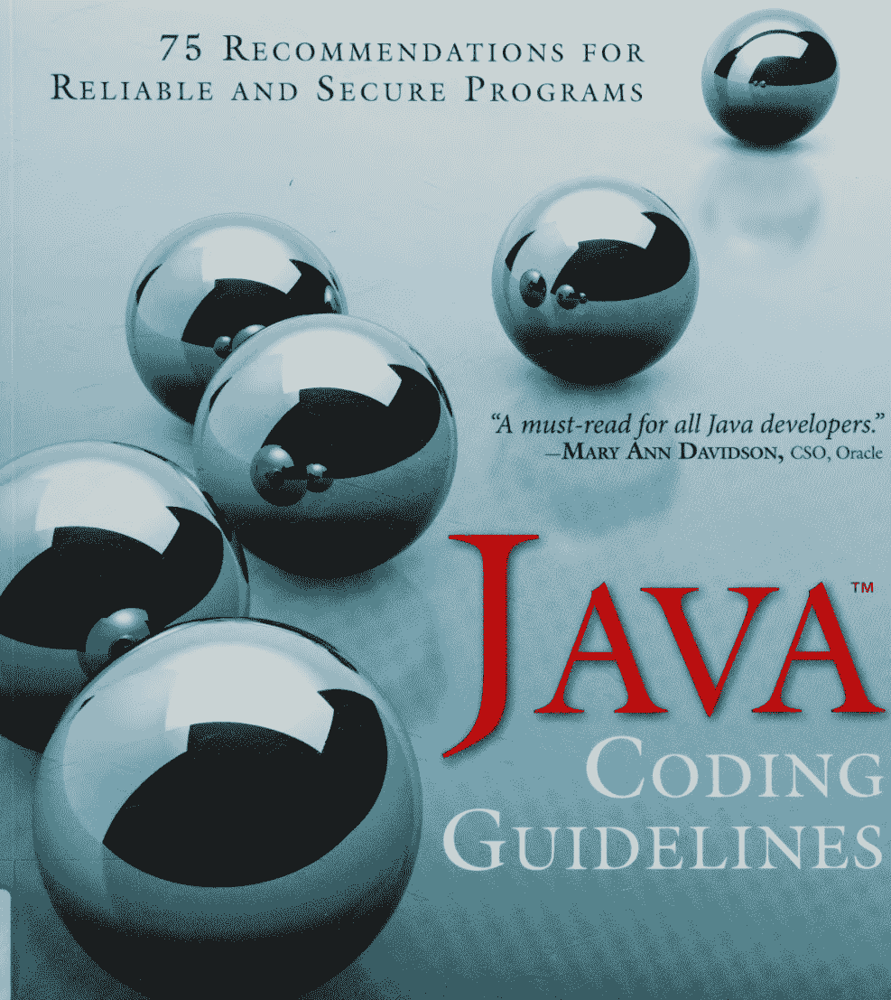
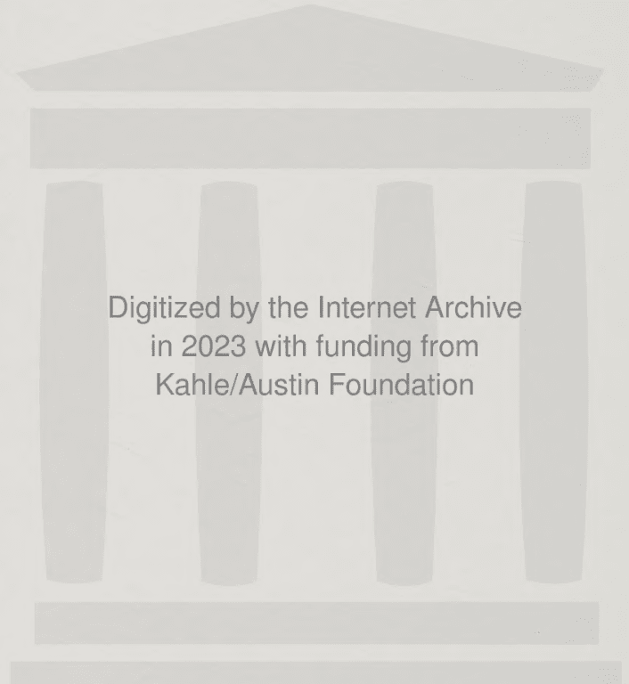
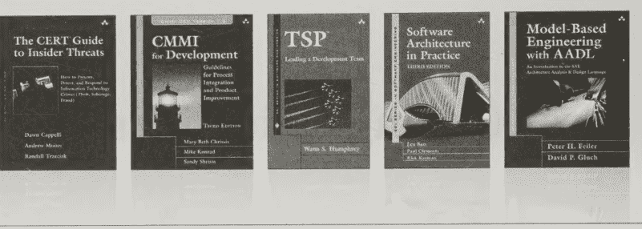

# Java 编码指南：构建可靠安全程序的 75 条建议（软件工程 SEI 系列）




> “所有 Java 开发者的必读之。”
—MARY ANN DAVIDSON，Oracle 首席安全官 (CSO)


FRED Long | DHURV MOHINDRA | ROBERT C. SEACORD
DEAN F. SUTHERLAND | DAVID SVOBODA

JAMES A. GOSLING 序言，Java 编程语言之父







Fred Long
Dhruv Mohindra
Robert C. Seacord
Dean F. Sutherland
David Svoboda


Long, Fred, 1947.


## 前言

詹姆斯·A·高斯林（James A. Gosling）

这《Java™ 编码指南》是之前的《The CERT® Oracle® Secure Coding Standard for Java™》的后续，具有极高的价值。这本书几乎可以更名为《可靠的 Java™ 编码指南》。多年来，令我深刻的一点是可靠性与安全性之间的相互作用。有各种显性的安全工具——加密、身份验证等——但大多数入侵行为都是对漏洞的利用：即编写得糟糕的代码或防御性不足的代码。在许多方面，构建一个可靠的系统等同于构建一个安全的系统。你在可靠性方面的工作会在安全性上获得回报，反之亦然。

本书强调了这样一个事实：安全性不是一个特性，而是一种在每一点都尽职尽度的态度。它应该是每个软件工程师设计思维过程的持续部分。它围绕一系列指南进行组织。书的精华在于这些指南背后的微妙之处。“使用哈希函数存储密码”似乎是一个非常基础且显而易见的点，然而，经常有关于重大数据泄露的新闻报道，仅仅是因为某些软件工程师没有考虑周全。做到这一点很棘手：魔鬼往往隐藏在很多细节中。书中充满了处理这些细节的极佳指导。

## 前言

《Java™ 编码指南：可靠与安全程序的 75 条建议》为 Java 程序员提供了具体的建议。这些 Java 编码指南的应用将产生更健壮、更抗攻击的更好系统。这些指南涵盖了用 Java 编写的各种产品，适用于 PC、游戏机、手机、平板电脑、家电器和汽车电子设备。

任何编程语言的开发者都应该遵循一套指南，在编程语言定义之外进一步控制其程序结构，这在 Java 中也是如此。

Java 程序员需要比《Java 语言规范》（JLS）[JLS 2013] 提供的更多帮助，以编写可靠且安全的 Java 程序。Java 包含了容易被误用的语言特性和 API，需要指导来避免这些陷阱。

为了使程序是可靠的，它必须在所有情况下和面对所有可能的输入都能工作。不可避免的是，任何复杂的程序都会遇到完全意外的情况，并发生错误。当错误发生时，限制其影响是非常重要的，最佳方法是将错误局部化并尽早处理。程序员可以从他人的经验中受益，预测异常输入或编程情况，并采用防御性编程风格。

某些指南可能被认为是风格性的，但它们对于代码的可读性和可维护性仍然非常重要。对于 Java，Oracle 提供了一套代码规范 [Conventions 2009] 来帮助程序员产生一致的编程风格，这些规范被 Java 程序员广泛采用。


《Java™ 编码指南》由《The CERT® Oracle® Secure Coding Standard for Java™》[Long 2012] 的作者编写。该编码标准为 Java 编程语言的安全编码提供了一set规则。这些规则的目标是消除可能导致可利用漏洞的不安全编码实践。《安全编码标准》为软件系统建立了规范性要求。然后可以对这些软件系统是否符合编码标准进行评估，例如通过使用源代码分析实验室（SCALE）[Secard 2012]。然而，存在一些糟糕的 Java 编码实践，尽管它们本应包含在 Java 编码标准中，但可能导致不可靠或不安全的程序。本书旨在记录并警示此类编码实践。

虽然没有包含《The CERT® Oracle® Secure Coding Standard for Java™》中，但这些指南不应被认为不重要。当无法形成规范性要求时，指南会被从编码标准中排除。有许多原因无法形成规范性要求。也许常见的原因是规则取决于程序员的意图。除非能够指定程序员的意图，否则此类规则无法自动执行，在这种情况下，规则可能要求代码与指定的意图之间保持一致。形成规范性要求还需要违反该要求代表一个缺陷。因此，编码规则必须定义得精确。编码指南对安全性和可靠性具有更广泛的影响，定义的更广泛。

许多指南引用了《CERT® Oracle® Secure Coding Standard for Java™》。这些引用的格式为“IDS01-j. 在验证之前规范化字符串”，其中开头的前三个字母标识《CERT® Oracle® Secure Coding Standard for Java™》中的相应章节。例如，IDS 指向第二章“输入验证与数据清洗”。

Java™ 安全编码标准规则也可以在 CERT 的安全编码 wiki [www.secoding.org](http://www.secoding.org) 上获取，在那里持续演进。《CERT® Oracle® Secure Coding Standard for Java™》提供了用于测试的规则定义，但 wiki 可能包含书中未提供的额外信息或见解，有助于解释这些规则的含义。

书中与其他指南的交叉引用直接给出编号和标题。


《Java 编码指南》关注 Java SE 7平台环境，并包含了解决使用 Java 7 API 安全问题的指南。《Java 语言规范：Java SE 7 版》（JLS）[JLS 2013] 规定了 Java 语言的行为，是开发这些指南的主要参考。

传统的语言标准（如 C 和 C++）包含了未定义、未指定和实现定义的行为，当程序员对这些行为的移植性做出错误假设时，会导致漏洞。相比之下，JLS 更完整地规定了语言行为，因为 Java 被设计为跨平台语言。尽管如此，某些行为仍由 Java 虚拟机（JVM）或 Java 编译器裁量。这些指南提供了解决方案以帮助实现者解决问题，并让程序员理解并理解这些局限性并绕过它们。


图 P-1 是 Oracle Java SE 产品的概念图。

这些编码指南主要针对所用基础库以及“其他库”的安全问题。它们避免包含已标记为将修复的开放 bug，或缺乏负面影响的 bug。只有当功能性 bug 可能频繁发生、引起严重的安全或可靠性担忧或影响依赖核心平台的 Java 技术时，才会将其包含。这些指南不限于安-


| Java | Javac | Javadoc | Jar | Java | JPDA | |
|---|---|---|---|---|---|---|
| 工具与 API | 控制台 | JavaVisualVM | Java DB | 安全 | RMI | |
| | | 部署 | IDL | 监控 | 脚本 | JVM | Web 服务 |
| 部署 | Java Web Start | | | | Applet / Java 插件 | |
| | | | JavaFX | | | | |
| 用户界面包 | | | Java 2D | AWT | 无障碍 |
| | 拖放 | 输入法 | 图像 I/O | 打印服务 | 音频 | |
| 集成库 | | | BC | JNI | RMI | RMI-IIOP | 脚本 |
| 其他基础库 | Beans | 国际支持 | | 输入/输出 | | 覆盖机制 | Java SE |
| | 安全 | 序列化 | 扩展机制 | XML JAXP | API | |
| lang 和 util 基础库 | 管理 | 集合 | Preferences API | 引用对象 | JAR |
| | 反射 | 正则表达式 | 版本控制 | Zip | 实例化 | |
| Java 虚拟机 | HotSpot 客户端和服务器 VM | | |

**图 P-1.** Oracle Java SE 产品的概念图。（来自 Oracle SE 文档，http://docs.oracle.com/java/7/docs/。版权所有 1995, 2010，Oracle 或其关联公司。保留所有权利。）

不仅涉及核心 API 的特定性，还涵盖了与扩展标准 API（javax 包）相关的重要可靠性和安全考虑因素。本文展示了 Java 提供的代码与其他组件及框架交互的完整安全功能。有时，编码指南会使用来自 Spring 和 Struts 等 Web 和应用框架，以及 Java Server 页面 (JSP) 等技术的示例，以突出显示无法通过静态检查发现的安全漏洞。当标准 API 无法提供通过第三方库和解决方案缓解漏洞的选项时。


本安全编码标准未涵盖若干问题。


这些编码指南广泛适用于所有平台；仅针对某一个 Java 平台的特定考虑因素超出了本指南的范畴。例如，适用于 Android、Java 微型版 (ME) 或 Java 企业版 (EE) 而不适用于 Java 标准版 (SE) 的指南通常被排除在外。在 Java SE 中，处理用户界面（用户界面工具包）或用于提供音频、图形渲染、用户账户访问控制、会话管理、验证和授权等功能的 Web 接口 API 超出了本指南的范畴。尽管如此，指南结合与不当输入验证和注入漏洞相关的风险，讨论了网络化 Java 系统，并建议了适当的缓解策略。这些指南假设产品的功能规范已正确识别并防止了较高层设计和架构层面的漏洞。


编码风格问题是主观的；事实证明，就适当的风格指南达成共识是不可能的。因此，Java™ 编码指南通常避免要求执行任何特定的编码风格。相反，我们建议用户自定义风格指南并一致地应用这些指南。一致应用编码风格最简单的方法是使用代码格式化工具。许多集成开发环境 (IDE) 都提供了此类功能。


这些指南中的许多不适用于自动检测或纠正。在某些情况下，工具供应商可能会选择实现检查器以识别违背这些指南的行为。作为一个联邦资助的研究与开发中心 (FFRDC)，软件工程研究所 (SEI) 无法无法就为此目的推荐特定的供应商或工具。


通常情况下，Java™ 编码指南试图避免包含缺乏广泛共识的争议性指南。


Java™ 编码指南主要面向 Java 语言程序的开发者。尽管这些指南关注 Java SE 7 平台环境，但它们对于使用 Java ME 或 Java EE 以及其他版本 Java 语言的开发者来说也应该具有参考价值（尽管不完整）。


Java™ 编码指南由以下部分组成：


该指南通常以术语表和参考文献结束。

# 致谢

本书的出版得益于社区的努力。首先，我们感谢贡献的人：Ron Bandes, Jose Sandoval, Ryan Hall, Fei He, Ron Hofler, Sam Kaplan, Michael Kross, Christopher Leonavicius, Bocong Liu, Bastian Marquis, Aniket Mokashi, Jonathan Paulson人员也对本书有贡献：James Ahborn, Neelkamal Gaharwar, Ankur Goyal, Tim Hallonan, Sujay Jain, Pranjal Jumde, Justin Loo, Yitzhak Mandelbaum, Todd Nowacki, Vishal Patel, Justin Pincar, Abhishek Ramani, Brendon Saulsbury, Kirk Sayre, Glenn Stroz, Yodo Toda, Shishir Kumar Yadav。我们还感谢 Hiroshi Kumagai 和 JPCERT 在 Android 附录方面的工作。我们还感谢以下评审人员：Thomas Hawaii, Dan Plakosh 和 Steve Scholnick。

我们感谢鼓励并支持我们工作的 SEI 和 CERT 经理：Archie Gannon, Rich Pethia, Greg Shannon 和 Bill Wilson。

感谢我们的编辑 Peter Gordon 以及我们在 Addison-Wesley 的感谢对象：Kim Boedigheimer, Jennifer Bortel, John Fuller, Stephanie Nakib 和 Julie Nahil。特别感谢项目编辑 Anna Popick 和校对编辑 Melinda Rankin。

我们感谢 CERT 团队其他成员的支持与帮助，没有他们，本书无法完成。最后，我们要感谢我们的内部编辑 Carol J. Lallier，她让这项工作成为可能。

# 作者简介

Fred Long 是英国阿伯伊斯特威斯大学计算机科学系的高级讲师。他教授形式方法、Java、C++ 和 C 语言以及编程相关的安全问题。他是英国计算机学会 Soft-Wales 分会的主席。Fred 自 1992 年起一直是软件工程研究所的访问科学家。最近，他的研究涉及 Java 漏洞的调查。Fred 是《CERT® Oracle® Secure Coding-Standard for Java™》（Addison-Wesley, 2012）的合著者。

Dhruv Mohindra 是印度 Persistent Systems Limited CTO 办公室安全实践部门的技术负责人，在那里，他为云、协作、金融、电信、企业、移动、生命科学和医疗保健等各个技术领域提供信息安全咨询解决方案。他经常为财富 500 强、中小型企业和初创公司的管理层和开发团队提供信息安全最佳实践以及在软件开发生命周期中嵌入安全的建议。


# 作者简介

Dhruv 曾工作于软件工程学院（Software Engineering Institute）的 CERT 部门，并持续致力于合作提高编程社区的安全意识水平。Dhruv 在卡内基梅隆大学获得信息安全策略与管理硕士学位。他拥有印度普纳内大学的计算机工程学士学位。此外，Dhruv 也是著作《The CERT® Oracle Secure Coding Standard for Java》（Addison-Wesley, 2012）的合著者。


Robert C. Secord 是位于宾夕法尼亚州匹兹堡卡内基梅隆大学软件工程学院（SEI）CERT 部门的安全编码技术经理。Robert 也是卡内基梅隆大学计算机科学学院和信息网络学院的教授。他是《The CERT® Secure Coding Standard》（Addison-Wesley, 2009）的作者，以及《Building Systems from Commercial Components》（Addison-Wesley, 2002）、《Modernizing Legacy Systems》（Addison-Wesley, 2003）、《The CERT® Oracle Secure Coding Standard for Java》（Addison-Wesley, 2012）以及《Secure Coding in C and C++, Second Edition》（Addison-Wesley, 2013）的合著者。他发表了关于软件安全、基于组件的软件工程、基于 Web 的系统设计、遗留系统现代化、组件库与搜索引擎以及用户界面设计与开发的数十论文。2005 年以来，Robert 一直向私营企业、学术界和政府教授 C 和 C++ 安全编码课程。他于 1982 年开始在 IBM 从职业程序员，涉及通信和操作系统软件、处理器开发以及软件工程。Robert 还曾在 X 联盟工作，在在该处开发并维护了通用桌面环境（Common Desktop Environment）和 X 窗口系统的代码。他在 ISO/IEC JTC1/SC22/WG14 C 语言国际标准化工作组中代表卡内基梅隆大学（CMU）。


Dean F. Sutherland 是 CERT 的高级软件工程师。Dean 于 2008 年在卡内基梅隆大学获得软件工程博士学位。在回归学术界之前，他在 Tartan, Inc. 公司担任了 14 年专业软件工程师。在最后 6 年中，他担任技术团队的高级成员和编译器后端技术负责人。他是公司研发部门的主要活跃成员，是 Tartan 新型软件开发流程设计与部署的关键调查员，领导了多个项目，并为 12 人规模的编译器后端小组提供了技术和项目层面的领导工作。Dean 是《The CERT® Oracle Secure Coding Standard for Java™》（Addison-Wesley, 2012）的合著者。

David Svoboda 是 CERT/SEI 的软件安全工程师，也是《The CERT® Oracle Secure Coding Standard for Java™》的合著者。他还维护着针对 Java 以及 C、C++ 和 Perl 的 CERT 安全编码网站。自 1991 年以来，David 一一直是卡内基梅隆大学各种软件开发项目的主要开发者，范围涵盖从分层芯片建模、社会组织仿真到自动机器翻译（AMT）。他在 1996 年开发的 KANTOO AMT 软件目前仍在卡特彼勒（Caterpillar）生产。他拥有超过十年的 Java 开发经验（从 Java 2 开始），他的 Java 项目包括 Tomcat Servlet 和 Eclipse 插件。他曾在全球为军事、政府和银行业的各个团体教授过 C 和 C++ 安全编码。David 也是 ISO/IEC JTC1/SC22/WG14 C 语言工作组以及 ISO/IEC JTC1/SC22/WG21 C++ 工作组的活跃参与者。


```java
if (!verify(username, password)) {
    throw new SecurityException("Invalid Credentials");
}

// 清除密码
Arrays.fill(password, ' ');

// 占位验证方法，始终返回 true
private static final boolean verify(String username, char[] password) {
    return true;
}
```

`Console.readPassword()` 允许以字符序列而非 `String` 对象的形式返回密码。因此，程序员在使用后立即从数组中清除密码。该方法还禁用了在控制台上回显密码。

## 不合规代码示例

此不合规代码示例使用 `BufferedReader` 封装 `InputStream-Reader`，以便从文件中读取敏感数据：

```
void readData() throws IOException {
    BufferedReader br = new BufferedReader(new InputStreamReader(
        new FileInputStream("file")));
    // 从文件读取
    String data = br.readLine();
}
```

`BufferedReader.readLine()` 方法将敏感数据作为 `String` 对象返回，这些数据在不再需要后可能仍然存在于内存中。`BufferedReader.read(char[], int, int)` 方法可以读取并填充 `char` 数组。然而，它要求程序员在使用后手动清除数组中的敏感数据。或者，即使 `BufferedReader` 封装了 `FileReader` 对象，也会面临同样的陷阱。

## 合规解决方案

此合规解决方案使用直接分配的 NIO（新 I/O）缓冲区从文件中读取敏感数据。数据可以在使用后立即清除，且不会在多个位置被缓存或缓冲。它只存在于系统内存中。

## 2. 不要在客户端侧存储未加密的敏感信息

```
void readData() {
  ByteBuffer buffer = ByteBuffer.allocateDirect(16 * 1024);
  try (FileChannel rdr = 
    new FileInputStream("file")).getChannel()) {
    while (rdr.read(buffer) > 0) {
      // 对缓冲区进行某些操作
      buffer.clear();
    }
  } catch (Throwable e) {
    // 处理错误
  }
}
```

请注意，手动清除缓冲区数据是强制，因为直接缓冲区不会被垃圾回收。

## 适用性

未能限制敏感数据的生命周期会导致信息泄露

## 参考文献

| API 2013 | 类 ByteBuffer |
| [Oracle 2013b] | Java 密码学体系 [JCA] 参考指南中的“从 InputStream 读取 ASCII 密码的示例” |
| [Tutorials 2013] | 命令行中的 I/O |

## 2. 不要在客户端侧存储未加密的敏感信息

在构建使用客户端-服务器模型的应用程序时，在客户端侧存储敏感信息（如用户凭据），如果客户端容易受到攻击，可能会导致信息被未经授权的泄露。

对于 Web 应用程序，解决此问题的常见缓解方法是为客户端提供 Cookie，并将敏感信息存储在服务器上。Cookie 由 Web 服务器创建，并在客户端上存储一段时间。当客户端重新连接到服务器时，它提供 Cookie，该 Cookie 用于向服务器标识客户端，然后服务器提供敏感信息。

Cookie 无法保护敏感信息免受跨站脚本 (XSS) 攻击。能够通过 XSS 攻击或直接攻击客户端获取 Cookie 的攻击者可以从服务器获取敏感信息。

# 第 1 章安全

使用 cookie。如果服务器在有限时间（例如 15 分钟）后使会话失效，则这种风险是受限制的。

Cookie 通常是一个短字符串。如果它包含敏感信息，则应该对该信息进行加密。敏感信息包括姓名、密码、信用卡号、社会安全号码以及关于用户的任何其他个人身份信息。有关管理密码的更多详细信息，请参阅指南 13，“使用哈希函数存储密码”。有关保护敏感信息的内存的更多信息，请参阅指南 1，“限制敏感数据的生命周期”。

## 不合规代码示例

在此不合规代码示例中，登录 servlet 将用户名和密码存储在 cookie 中，以便在随后的请求中标识用户：

```
protected void doPost(HttpServletRequest request
```

```
if (validated) {
    Cookie loginCookie = new Cookie("rememberme", username +
        "." + new String(password));
    response.addCookie(loginCookie);
    // ... 跳转到欢迎页
} else {
    // 设置错误并返回
}
} else {
    // 未选择“记住我”功能
    // 继续进行常规身份验证；
    // 如果失败，则设置错误并返回
}
```

```java
Arrays.fill(password, ' ');
```

尝试实现“记住我”功能是不安全的，因为能够访问客户端机器的攻击者可以直接在客户端上获取这些信息。此代码还违反了指南 13，“使用哈希函数存储密码”。

## 合规解决方案（会话）

此合规解决方案通过在 cookie 中存储用户名和安全随机字符串来实现“记住我”功能。它还使用 `HttpSession` 在会话中维护状态。

```
protected void doPost(HttpServletRequest request,
    HttpServletResponse response) {

    // 验证输入

    String username = request.getParameter("username");
    char[] password = 
        request.getParameter("password").toCharArray();
    boolean rememberMe =
        Boolean.valueOf(request.getParameter("rememberme"));
    LoginService loginService = new LoginServiceImpl();
    boolean validated = false;
    if (rememberMe) {
        if (request.getCookies()[0] != null &&
            request.getCookies()[0].getValue() != null) {
```

```
String[] value = 
request.getCookies()[0].getValue().split(":");

if (value.length != 2) {
  // 设置错误并返回
}

if (!loginService.mappingExists(value[0], value[1])) {
  // 检查 (用户名, 随机数) 对
  // 设置错误并返回
} else {
  validated = loginService.isUserValid(username, password);
}

if (validated) {
  // 设置错误并返回
}

String newRandom = loginService.getRandomString();
// 每次重置随机数
loginService.mapUserRememberMe(username, newRandom);
HttpSession session = request.getSession();
session.invalidate();
session = request.getSession(true);
// 将会话超时设置为 15 分钟
session.setMaxInactiveInterval(60 * 15);
// 在会话作用域内存储用户属性和随机属性
session.setAttribute("user", loginService.getUsername());
Cookie cookie = 
  new Cookie("remember", username + ";" + newRandom);
response.addCookie(cookie);
//... 跳转到欢迎页
} else { // 未选择“记住我”功能
//... 使用 isUserValid() 进行身份验证，
// 如果失败，设置错误
}
Arrays.fill(password, ' ');
```

服务器维护用户名与安全随机字符串之间的映射。当用户选择“记住我”时，`doPost()` 方法检查提供的 cookie 是否包含有效的用户名和随机数对。映射包含匹配对，服务器对用户进行身份验证并将其跳转到欢迎页。如果没有，服务器向客户端返回错误。如果用户选择

## 3. 为敏感可变类提供不可修改封装器

“记住我”但客户端未提供有效的 cookie，服务器要求用户使用凭据进行身份验证。如果身份验证成功，服务器将发放一个具有“记住我”特性的 cookie。

此解决方案通过使当前会话失效并创建新会话来避免会话固定攻击。通过将客户端访问之间的会话超时设置为 15 分钟，缩小了攻击者执行会话劫持攻击的时间窗口。

## 适用性

在客户端存储未加密的敏感信息会让任何能够攻击客户端的人获取这些信息。

## 参考文献

+   - [Oracle 2011c] 包 javax.servlet.http
- [OWASP 2009] Java Session Fixation
- [OWASP 2011] 跨站脚本 (XSS)
- [W3C 2003] 万维网安全 FAQ

字段的不可变性可以防止无意修改以及恶意篡改，因此在接受输入或返回值时不需要防御性复制。然而，某些敏感类无法不可变的。幸运的是，可以使用不可修改封装器向不可信代码授予对可变类的只读访问。例如，Collection 类包含一组封装器，允许客户端观察 Collection 对象的不可修改视图。

## 不合规代码示例

此不合规代码示例包含 `Mutable` 类，它允许内部数组对象被修改：

```
class Mutable {
    private int[] array = new int[10];

    public int[] getArray() {
        return array;
    }
}
```


```java
public void setArray(int[] i) {
  array = i;
}
```

```java
//...
private Mutable mutable = new Mutable();
public Mutable getMutable() {return mutable;}
```

不可信的调用者可能会调用 `setArray()` 方法，从而违反对象的不可变性属性。调用 getter 方法 `getArray()` 同样允许修改类的私有内部状态。该类还违反了《Java 的 CERT® Oracle 安全编码标准 [Long 2012]》中的“OBJ05-J. 在返回引用之前，防御性地复制私有可变类成员”。

## 不合规代码示例

此不合规代码示例通过一个 `MutableProtector` 子类扩展了 `Mutable` 类。

```java
class MutableProtector extends Mutable {
  @Override
  public int[] getArray() {
    return super.getArray().clone();
  }
  //...
  private Mutable mutable = new MutableProtector();
  // 具有读取权限的不可信调用者安全调用
  public Mutable getMutable() {return mutable;}
```

在此类中，根据“OBJ05-J. 在返回引用之前，防御性地复制私有可变类成员 [Long 2012]”，调用 getter 方法 `getArray()` 不允许修改类的私有内部状态。然而，不可信的调用者可能会调用 `setArray()` 方法并修改 `Mutable` 对象。

## 合规解决方案

通常通过为核心接口定义的所有方法（包括修改方法）提供适当的包装，可以将敏感类转换为安全视图对象。修改方法的包装器必须抛出 `UnsupportedOperationException`，以便客户端无法执行影响对象不可变性属性的操作。

此合规解决方案增加了 `setArray()` 方法，它重写了 `Mutable.setArray()` 方法并防止了 `Mutable` 对象的修改：

```java
class MutableProtector extends Mutable {
    @Override
    public int[] getArray() {
        return super.getArray().clone();
    }

    @Override
    public void setArray(int[] i) {
        throw new UnsupportedOperationException();
    }
    ...
private Mutable mutable = new MutableProtector();
// 具有读取权限的不可信调用者安全调用
public Mutable getMutable() {return mutable; }
```

`MutableProtector` 包装类重写了 `getArray()` 方法并克隆了数组。尽管调用代码获得了可变对象数组的副本，但其原始数组保持不变且不可访问。如果调用者尝试对返回的对象使用此方法，重写的 `setArray()` 将抛出异常。当允许对数据进行读取访问时，可以将此对象传递给不可信代码。

## 适用性

未能为不可信代码提供敏感可变对象的不可修改安全视图可能会导致对象被恶意篡改和损坏。

## 参考文献

- [Long 2012] OBJ05-J. 在返回引用之前，防御性地复制私有可变类成员
- [Tutorials 2013] 不可修改器 (Unmodifiable Wrappers)

## 4. 确保使用验证过的参数调用安全敏感方法

调用安全敏感方法的应用代码必须验证传递给这些方法的参数。特别是，`null` 值可能会被某些安全敏感方法解释为忽略，但可能会覆盖默认设置。

尽管安全敏感方法应该采用防御性编码，但客户端代码必须验证方法本可能接受为有效的参数。这样做可能导致权限提升和任意代码执行。

## 不合规代码示例

此不合规代码示例显示了双参数 `doPrivileged()` 方法，它接受访问控制上下文作为第二个参数。此代码从之前保存的上下文恢复权限。

```java
AccessController.doPrivileged(
new PrivilegedAction<Void> () {
  public void run() {
    // ...
  }
}, accessControlContext);
```

当传递 `null` 访问控制上下文时，双参数的 `doPrivileged()` 方法无法将当前权限降低到之前保存的上下文权限。因此，当 `accessControlContext` 参数为 `null` 时，此代码可能会授予过度权限。意图使用 `null` 访问控制上下文调用 `AccessController.doPrivileged()` 的程序员应显式传递 `null` 常量或使用单参数版本的 `AccessController.doPrivileged()`。

## 合规解决方案

此合规解决方案通过确保 `accessControlContext` 不为 `null` 来防止授予过度权限。

```java
if (accessControlContext == null) {
  throw new SecurityException("Missing AccessControlContext");
}
AccessController.doPrivileged(
  new PrivilegedAction<Void> () {
    public void run() {
      // ...
    }
}, accessControlContext);
```

## 适用性

必须彻底理解安全敏感方法并验证其参数，以防止出现意外参数值（如 `null` 参数）的边界情况。

## 5. 防止任意文件上传

如果将意外的参数值传递给安全敏感方法，就会可能执行任意代码，并可能发生权限提升。

## 参考文献

- [API 2013] AccessController.doPrivileged(), System.setSecurityManager()

## 5. 防止任意文件上传

接受文件上传的 Java 应用（包括 Web 应用）必须确保攻击者无法上传或传输恶意文件。如果包含代码的限制文件被目标系统执行，可能会破坏应用层防御。例如，允许上传 HTML 文件的应用程序将允许恶意代码执行——攻击者可以提交一个带有跨站脚本 (XSS) 负载的有效 HTML 文件，在缺少输出转义程序的情况下该负载将执行。出于这个原因，许多应用程序限制了可以上传的文件类型。

可能可以上传具有 `.exe` 和 `.sh` 等危险扩展名的文件，这可能导致服务器端应用程序执行任意代码。仅限制 HTTP 请求头中 `Content-Type` 字段的应用程序可能会受到此类攻击。

为了支持上传，典型的 Java Server 页面 (JSP) 页面包含如下代码：

```xml
<s:form action="doUpload" method="POST"
ctype="multipart/form-data">
<s:file name="uploadFile" label="Choose File" size="40" />
<s:submit value="upload" name="submit" />
</s:form>
```

许多 Java 企业级框架提供了旨在用于防御任意文件上传的配置设置。遗憾的是，大多数框架未能提供足够的保护。缓解此漏洞涉及检查文件大小、内容类型和文件内容以及其他元数据属性。

## 不合规代码示例

此不合规代码示例显示了 Struts 2 应用上传 action 中的 XML 代码。拦截器代码负责允许文件上传。

```xml
<action name="doUpload" class="com.example.UploadAction">
  <interceptor-ref name="fileUpload">
    <param name="maximumSize">10240</param>
    <param name="allowedTypes">
      text/plain,image/JPEG,text/html
    </param>
  </interceptor-ref>
</action>
```

文件上传的代码出现在 `UploadAction` 类中：

```java
public class UploadAction extends ActionSupport {
  private File uploadedFile;
  // uploadedFile 的 setter 和 getter

  public String execute() {
    try {
      // 为了说明硬编码文件路径和文件名
      File fileToCreate = new File("filepath", "filename");
      // 将临时文件内容复制到此文件
      FileUtils.copyFile(uploadedFile, fileToCreate);
      return "SUCCESS";
    } catch (Throwable e) {
      addActionError(e.getMessage());
      return "ERROR";
    }
  }
}
```

参数 `maximumSize` 的值确保特定的 Action 不能是大文件。`allowedTypes` 参数定义了接受的文件类型。然而，这种方法无法确保上传的文件符合安全要求，因为拦截器检查可以被轻易绕过。如果攻击者使用代理工具在传输过程中更改原始 HTTP 请求中的内容类型，框架将无法阻止文件上传。因此，攻击者可以上传一个具有 `.exe` 扩展名的恶意文件，例如。

## 合规解决方案

只有当内容类型与文件的实际内容匹配时，文件上传才能成功。例如，图像头部的文件必须只包含图像，且不能包含可执行代码。此合规解决方案使用 Apache Tika 库 [Apache 2013] 来检测并提取元数据和结构化文本


## 5. 防止任意文件上传

使用现有的解析器库从文档提取内容。在调用 `execute()` 中负责上传文件的代码之前，必须调用 `checkMetaData()` 方法。

```java
public class UploadAction extends ActionSupport {
    private File uploadedFile;
    // setter and getter for uploadedFile
}

public String execute() {
    try {
        // 为了演示，路径和文件名是硬编码
        File fileToCreate = new File("filepath", "filename");

        boolean textPlain = checkMetadata(uploadedFile, "text/plain");
        boolean img = checkMetadata(uploadedFile, "image/JPEG");
        boolean textHtml = checkMetadata(uploadedFile, "text/html");

        if (!textPlain || !img || !textHtml) {
            return "ERROR";
        }

        // 将临时文件内容拷贝到此文件
        FileUtils.copyFile(uploadedFile, fileToCreate);
        return "SUCCESS";
    } catch (Throwable e) {
        addActionError(e.getMessage());
        return "ERROR";
    }
}

public static boolean checkMetadata(
File f, String getContentType) {
    try (InputStream is = new FileInputStream(f)) {
        ContentHandler handler = new BodyContentHandler();
        Metadata metadata = new Metadata();
        metadata.set(Metadata.SOURCE_NAME, f.getName());
        Parser parser = new AutoDetectParser();
        try {
            parser.parse(is, handler,
                metadata, new ParseContext());
    } catch (SAXException | TikaException e) {
        // 处理错误
        return false;
}
```

```java
if (metadata.get(Metadata.CONTENT_TYPE).equalsIgnoreCase(
  getContentType()) {
  return true;
} else {
  return false;
}
} catch (IOException e) {
  // 处理错误
  return false;
}
```

`AutoDetectParser` 根据待解析文件的内容类型选择最可用的解析器。

## 适用性

任意文件上传漏洞可能导致权限提升和任意代码执行。

## 参考文献

[Apache 2013] Apache Tika: 内容分析工具包

## 6. 正确对输出进行编码或转义

适当的输入清理可以防止恶意数据插入到数据库等子系统中。然而，不同的子系统需要不同类型的清理。幸运的是，通常很清楚哪些子系统最终将接收哪些输入，因此需要什么种类型的清理。

存在多个用于输出数据的子系统。HTML 渲染器是显示输出的一种常见子系统。发送到输出系统的数据似乎源于可信源。然而，假设不需要输出清理是危险的，因为此类数据可能间接源于不可信源，并可能包含恶意内容。未能正确清理传递给输出系统的数据会导致多种攻击。例如，HTML 渲染器容易受到 HTML 注入和跨站脚本 (XSS) 攻击 [OWASP 2011]。防止此类攻击的输出清理与输入清理同样关重要。

通过输入验证，数据在针对恶意字符进行清理之前应进行归一化。对所有输出字符以外的安全字符进行正确编码，以避免由绕过验证的数据引起漏洞。更多信息请参见《Java CERT® Oracle® 编码标准》 [Long 2012]、“IDS01-J. 在验证字符串前对其归一化”。

## 不合规代码示例

此不合规代码示例使用基于 Java Spring 框架的模型-视图-控制器 (MVC) 概念，在不对编码或转义的情况下向用户显示数据。由于数据被发送到网页浏览器，代码容易受到 HTML 注入和 XSS 攻击。

```java
@RequestMapping("/notifications.htm")
public ModelAndView getNotifications(
    HttpServletRequest request, HttpServletResponse response) {
    ModelAndView mv = new ModelAndView();
    try {
        User userInfo = getUserInfo();
        List<Map<String, Map<String, Object>>> list = 
            new ArrayList<Map<String, Object>>();
        List<Notification> notificationList = 
            NotificationService.getNotificationsForUserId(
            userInfo.getUserId());
        for (Notification notification : notificationList) {
            Map<String, Object> map = new HashMap<String, Object>();
            map.put("id", notification.getId());
            map.put("message", notification.getMessage());
            list.add(map);
        }
        mv.addObject("Notifications", list);
    } catch (Throwable t) {
        // 记录到文件并处理
    }
    return mv;
}
```

## 合规解决方案

此合规解决方案定义了一个 `ValidateOutput` 类，将输出归一化为已知字符集，使用白名单执行输出清理，并对任何未指定的数据进行编码以实施双重检查机制。请注意，所需的白名单模式将根据不同字段的特定需求而异 [OWASP 2013]。

```java
public class ValidateOutput {
    // 只允许字母数字和空格
    private static final Pattern pattern =
        Pattern.compile("^[a-zA-Z0-9\\s]{0,20}$");

    // 根据白名单对输入字段进行验证和编码
    public String validate(String name, String input)
        throws ValidationException {
        String canonical = normalize(input);

        if (!pattern.matcher(canonical).matches()) {
            throw new ValidationException("Improper format in " +
                name + " field");
        }

        // 对无效字符执行输出编码
        canonical = HTMLEntityEncode(canonical);
        return canonical;
    }

    // 归一化为实例
    private String normalize(String input) {
        String canonical = java.text.Normalizer.normalize(input,
            Normalizer.Form.NFKC);
        return canonical;
    }

    // 对无效数据编码
    private static String HTMLEntityEncode(String input) {
        StringBuilder sb = new StringBuilder();

        for (int i = 0; i < input.length(); i++) {
            char ch = input.charAt(i);
            if (Character.isLetterOrDigit(ch) ||
                Character.isWhitespace(ch)) {
                sb.append(ch);
            } else {
                sb.append("&" + (int)ch + ";");
            }
        }
        return sb.toString();
    }
}
```

## 6. 正确对输出进行编码或转义

```java
// ...
@RequestMapping("/getnotifications.htm")
public ModelAndView getNotifications(HttpServletRequest request,
    HttpServletResponse response) {
    ValidateOutput vo = new ValidateOutput();

    ModelAndView mv = new ModelAndView();
    try {
        UserInfo userDetails = getUserInfo();
        List<Map<String, Object>> list =
            new ArrayList<Map<String, Object>>();
        List<Notification> notificationList =
            NotificationService.getNotificationsForUserId(
            userDetails.getPersonId());

        for (Notification notification : notificationList) {
            Map<String, Object> map = new HashMap<String, Object>();
            map.put("id", vo.validate("id",notification.getId()));
            map.put("message", notification.getMessage());
            list.add(map);
        }

        mv.addObject("Notifications", list);
    } catch (Throwable t) {
        // 记录到文件并处理
    }

    return mv;
}
```


## 适用性

在输出显示或跨越信任边界之前未进行编码或转义，可能会导致任意代码的执行。

## 相关漏洞

2006年1月报告的 Apache GERONIMO-1474 漏洞允许攻击者提交包含 JavaScript 的 URL。Web Access Log Viewer 未能对其转发到管理员控制台的数据进行清理，从而导致了经典的 XSS 攻击。

## 参考文献

- [Long 2012] 在验证字符串之前对其进行归一化
- [OWASP 2011] 跨站脚本 (XSS)
- [OWASP 2013] 如何为 HttpServletRequest 添加验证逻辑以防止 XSS（跨站脚本）防御备忘表

## 7. 防止代码注入

当不受信的输入注入到动态构建的代码中，就会发生代码注入。一个明显的潜在漏洞来源是在 Java 代码中使用 JavaScript。`javax.script` 包包含了一许多接口和类，这些接口和类定义了 Java 脚本引擎以及一个在 Java 代码中使用这些接口和类的框架。不当目使用 `javax.script` API 会允许攻击者在目标系统上执行任意代码。

本指南是《Java  CERT® Oracle 安全编码标准》[Long 2012]，“IDS00-j. 清理跨信任边界的不受信数据”的具体实例。

## 不合规代码示例

此不合规代码示例将不受信的用户输入整合到负责打印输入的 JavaScript 语句中：

```java
private static void evalScript(String firstName) 
    throws ScriptException {
    ScriptEngineManager manager = new ScriptEngineManager();
    ScriptEngine engine = manager.getEngineByName("javascript");
    engine.eval("print('" + firstName + "')";
}
```

## 7. 防止代码注入

攻击者可以输入特构造的参数来尝试注入恶意 JavaScript。此示例显示了一个包含 JavaScript 代码的恶意字符串，该代码可以在漏洞系统上创建或覆盖现有文件。

```javascript
dummy();
var bw = new JavaImporter(java.io.BufferedWriter);
var fw = new JavaImporter(java.io.FileWriter);
with(fw) {
    bwr = new BufferedWriter(new FileWriter("config.cfg"));
    bwr.write("some text"); bwr.close();
}
//
```

此示例中的脚本打印 "dummy"，然后向名为 config.cfg 的配置文件写入 "some text"。实际的利用程序可以执行任意代码。

### 合规解决方案（白名单）

防止代码注入漏洞的最佳防御方法是防止将可执行的用户输入包含在代码中，这些代码必须经过清理，例如，确保它只包含有效的白名单内的字符。清理工作最好在数据输入后立即进行，使用用于存储和处理数据的数据抽象层的方法。更多细节请参考 [Long 2012] "IDS00-1. 清理跨信任边界的不受信数据”。名称中必须允许特殊字符，但在与其等效形式进行比较之前，必须对其进行归一化。此合规解决方案使用白名单来防止未清理的输入被脚本引擎解释。

```java
private static void evalScript(String firstName)
throws ScriptException {
    // firstName 仅允许字母和下划线字符
    // (如果 firstName 可能包含特殊字符，请进行修改)
    if (!firstName.matches("^[\\w]*$")) {
        // 字符串不匹配白名单字符
        throw new IllegalArgumentException();
    }
    ScriptEngineManager manager = new ScriptEngineManager();
    ScriptEngine engine = manager.getEngineByName("javascript");
    engine.eval("print('" + firstName + " ")");
}
```

### 合规解决方案（安全沙箱）

另一种方法是使用安全管理器创建一个安全沙箱（请参见指南 20，“使用安全管理器创建安全沙箱”）。应用程序应防止脚本执行任意命令，例如查询本地文件系统。可以使用 `doPrivileged()` 的双参数形式以较高的权限降低权限的权限，但脚本引擎本身不能这样做。`RestrictedAccessControlType` 将默认策略文件中授予新创建的保护域的权限减少。有效权限是新创建的保护域的权限与系统安全策略的交集。有关 `doPrivileged()` 双参数形式的更多细节，请参考指南 16，“避免授予过度权限”。

此合规解决方案演示了在 `doPrivileged()` 的双参数形式中使用 `AccessControlContext`。

```java
class ACC {
    private static class RestrictedAccessControlContext {
        private static final AccessControlContext INSTANCE =

        static {
            INSTANCE =
                new AccessControlContext(
                    new ProtectionDomain[]{
                        new ProtectionDomain(null, null) // 无权限
                    });
        }
    }

    private static void evalScript(final String firstName)
        throws ScriptException {
        ScriptEngineManager manager = new ScriptEngineManager();
        final ScriptEngine engine =
            manager.getEngineByName("javascript");
        // 使用 doPrivileged() 的双参数
        // 限制权限
        try {
            AccessController.doPrivilegedAction(new PrivilegedAction<Object>()() {
                public Object run() throws ScriptException {
                    engine.eval("print('" + firstName + "')");
                    return null;
                }
            },
            // 来自嵌套类
            RestrictedAccessControlContext.INSTANCE);
        } catch (PrivilegedActionException pae) {
            // 处理错误
        }
    }
}
```

## 8. 防止 XPath 注入

此方法可以与白名单结合以获得额外的安全性。

## 适用性

在输出显示或跨越信任边界之前未进行编码或转义，可能会导致任意代码的执行。

## 参考文献

- [Long 2012] IDS00-j. 清理跨信任边界的不受信数据。
- [API 2013] javax.script

## 8. 防止 XPath 注入

可扩展标记语言 (XML) 可以以类似于关系数据库的方式用于数据存储。当数据提供给 XPath 获取操作时未进行适当的清理，就会发生 XPath 注入。本指南是《Java CERT® Oracle 安全编码标准》[Long 2012]，“IDS00-j. 清理跨信任边界的不受信数据”的具体实例。

### XML 注入示例

考虑以下 XML 架构。

```xml
<users>
 <user>
  <username>Utah</username>
  <password>e90205372a3b9e2</password>
 </user>
<user>
  <username>Bohdi</username>
  <password>6c16b22029df4ec6</password>
</user>
<user>
<username>Busey</username>
  <password>ad39b3c2a4abc98</password>
</user>
</users>
```

密码根据指南 13，“使用哈希函数存储密码”进行了哈希处理。此处显示的 MD5 哈希仅用于说明；在实践中，您应该使用更安全的算法，如 SHA-256。

不受信的代码可能会尝试使用用户输入动态构造的 XPath 语句从此文件中检索用户详情。

```xpath
//users[username/text()='&LOGIN' and password/text()='&PASSWORD']
```

如果攻击者知道 Utah 是一个有效的用户名，他或她可以指定输入如下

Utah' or '1'='1

这产生了以下查询字符串

```xpath
//users[username/text()='Utah' or '1'='1' and password/text()='xxxx']
```

由于 '1'='1' 自动为真，密码永远不会通过验证。因此，攻击者在不知道 Utah 密码的情况下，不当地作为用户 Utah 通过了身份验证。

## 不合规代码示例

此不合规代码示例从用户处读取用户名密码，并使用它们构造查询字符串。密码以字符数组的形式传递并进行哈希处理。此示例容易受到上述攻击。如果将上述攻击字符串传递给 `evaluate()`，该方法调用将返回 XML 文件中相应的节点，导致 `getLogin()` 方法返回 `true` 并绕过任何授权。

```java
private boolean doLogin(String username, char[] password)
throws ParserConfigurationException, SAXException,
IOException, XPathException {
```


## 8. 防止 XPath 注入

```java
DocumentBuilderFactory domFactory = 
DocumentBuilderFactory.newInstance();
domFactory.setNamespaceAware(true);
DocumentBuilder builder = domFactory.newDocumentBuilder();
Document doc = builder.parse("users.xml");
String pwd = hashPassword(password);
XPathFactory factory = XPathFactory.newInstance();
XPath xpath = factory.newXPath();
XPathExpression expr = 
xpath.compile("/user[text()='" + 
username + "' and password/text()='" + pwd + "']");
Object result = expr.evaluate(doc, XPathConstants.NODESET);
NodeList nodes = (NodeList) result;

// 将名字打印到控制台
for (int i = 0; i < nodes.getLength(); i++) {
    Node node = 
    nodes.item(i).getChildNodes().item(1);
    System.out.println("Authenticated: " + node.getNodeValue());
}

return (nodes.getLength() >= 1);
```

## 解决方案 (XQuery)

通过采用与防止 SQL 注入类似的防御措施，可以防止 XPath 注入。

- 将所有用户输入视为不可信的，并进行适当的清理。
- 在清理用户输入时，验证数据类型、长度、格式和内容的的正确性。例如，使用正则表达式检查用户输入中的 XML 标签和特殊字符。这种做法对应于输入清理。更多细节请参阅指南第 7 节“防止代码注入”。
- 在客户端-服务器应用程序中，在客户端和服务器端均进行验证。
- 对提供、传播或接受用户输入的应用程序进行广泛测试。

输入文件：login.xq

```xquery
declare variable $userName as xs:string external;
declare variable $password as xs:string external;
//users/user[$userName=$userName and @password=$password]
```

此合规解决方案通过读取以所需格式的文本文件来指定查询语句，然后在 Map 中插入用户名和密码的值。XQuery 库从这些输入中构建 XML 查询。

```java
private boolean doLogin(String userName, String pwd)
throws ParserConfigurationException, SAXException,
IOException, XPathExpressionException {

DocumentBuilderFactory domFactory =
DocumentBuilderFactory.newInstance();
domFactory.setNamespaceAware(true);
DocumentBuilder builder = domFactory.newDocumentBuilder();
Document doc = builder.parse("users.xml");

XQuery query =
new XQueryFactory().createXQuery(new File("login.xq"));
Map queryVars = new HashMap();
queryVars.put("userName", userName);
queryVars.put("password", pwd);
NodeList nodes =
query.execute(doc, null, queryVars).toNodes();

// 将名字打印到控制台
for (int i = 0; i < nodes.getLength(); i++) {
    Node node =
    nodes.item(i).getChildNodes().item(1);
    System.out.println(node.getNodeValue());
}
```

## 9. 防止 LDAP 注入

```java
return (nodes.getLength() >= 1);
}
```

使用此方法，`userName` 和 `password` 字段中指定的数据在运行时不会被解释为可执行内容。

## 适用性

未验证用户输入可能导致信息泄露和特权代码执行。

根据 OWASP [OWASP 2013]，

[防止 XPath 注入] 需要移除（即禁止）或正确转义以下字符：

- `< / ' = "` 以防止直接参数注入。
XPath 查询不应包含任何元字符（如 `' = * ? //` 或类似字符）。
XSLT 扩展不不应包含任何用户输入，或者如果包含，则[应该]全面测试文件的存在性，并确保文件在 Java 2 安全策略设置的范围之内。

## 参考文献

- [Fortify 2013] 输入验证与表示：XML 注入
- [Long 2012] IDS00-J. 清理跨越信任边界的不可信数据
- [OWASP 2013] XPath 注入测试
- [Sen 2007] 规避 XPath 注入的危险
- [Oracle 2011b] 确保数据安全

## 9. 防止 LDAP 注入

轻量级目录访问协议 (LDAP) 允许应用程序远程执行操作，如搜索和修改目录中的记录。LDAP 注入是由于输入清理和验证不当导致的，允许恶意用户利用目录服务获取受限信息。

可以使用白名单将输入限制在有效字符列表中。必须从白名单中排除的字符和字符序列——包括 Java 命名和目录接口 (JNDI) 元字符和 LDAP 特殊字符——列在表 1–1 中。

## 表 1–1. 从白名单中排除的字符和序列

| 字符 | 名称 |
| --- | --- |
| ' and " | 单引号和双引号 |
| / and \ | 正斜杠和反斜杠 |
| \ \ | 双斜杠* |
| space | 字符串开头或结尾的空格 |
| # | 字符串开头的哈希字符 |
| < > | 角括号 |
| , and ; | 逗号和分号 |
| + and * | 加和乘法运算符 |
| ( ) | 圆括号 |
| \u0000 | Unicode 空字符 |

这种字符序列 # LDAP 注入示例

考虑一个 LDAP 数据交换格式 (LDIF) 文件，包含以下记录：

```ldif
dn: dc=example,dc=com
objectClass: dobject
objectClass: organization
o: Some Name
dc: example

dn: ou=People,dc=example,dc=com
objectClass: dobject
objectClass: organizationalUnit
ou: People
dc: example

dn: cn=Manager,ou=People,dc=example,dc=com
cn: Manager
sn: John Watson
## 此处省略了多个 objectClass 定义
userPassword: secret1
mail: john@holmesassociates.com

dn: cn=Senior Manager,ou=People,dc=example,dc=com
cn: Senior Manager
sn: Sherlock Holmes
## 此处省略了多个 objectClass 定义
userPassword: secret2
mail: sherlock@holmesassociates.com
```

## 这种 LDAP 注入

对有效用户名和密码的搜索通常形式为

`(&sn=<USERS>)(password=<USERPASSWORD))`

然而，攻击者可以使用 `S*` 作为用户名 字段，使用 `*` 作为密码 字段来绕过身份验证。这种输入将产生所有用户名 字段以 S 开头的记录。

允许 LDAP 注入的验证程序将允许未经授权登录。同样，搜索程序将允许攻击者获取目录的部分或全部数据。

# 非合规代码示例

此非合规代码示例允许调用 `searchRecord()` 方法的调用者使用 LDAP 协议搜索目录中的记录。

```java
// string USERN = "S*"; // 无效
// string password = "*"; // 无效
public class LDAPInjection {
    private void searchRecord(
```

```java
System.out.println(attr);
attr = (Attribute) attrs.get("mail");
System.out.println(attr);
dctx.close();
catch (NamingException e) {
  // 转发给处理器
}
```

## 合规解决方案

此合规解决方案使用白名单清理用户输入，使过滤器仅包含有效字符。在此代码中，`userSN` 可以包含字母和空格，而密码可以只包含字母数字。

```java
// String userSN = "Sherlock Holmes"; // 有效
String userPassword = "secret2"; // 有效

// ... LDAPInjection.searchRecord() 的开头
sc.searchScope(SearchControls.SUBTREE_SCOPE);
String base = "dc=example,dc=com";

if (userSN.matches("[\\\w]**") ||
    userPassword.matches("[\\\w]**")) {
  throw new IllegalArgumentException("无效输入");
}

String filter = "(&sn( = " + userSN + ")(userPassword = " + userPassword + "))";

// ... LDAPInjection.searchRecord() 的剩余部分
```


## 10. 不要使用 clone() 方法复制不可信的方法参数

在将特殊字符添加到用于验证输入的白名单表达式之前，必须先将其转换为经过清理的、安全的值。同样，在验证步骤之前，应该对用户输入进行归一化处理。

## 适用性

未能对不可信输入进行清理可能会导致信息泄露和权限提升。

## 参考文献

- [OWASP 2013] 防止在 Java 中发生 LDAP 注入

## 10. 不要使用 clone() 方法复制不可信的方法参数

对可变方法参数进行防御性拷贝可以缓解多种安全漏洞；更多信息请参见《The CERT® Oracle® Coding Standard for Java™ [2012] 中的“OBJ006-J. 防御性拷贝可变输入和可变内部组件”。然而，不恰当使用 `clone()` 方法可能允许攻击者通过提供看似正常但随后返回意外值的参数来利用漏洞。此类对象可能因此绕过验证和安全检查。当此类类可能被作为参数传递给方法时，应将该参数视为不可信，并且不要使用该类提供的 `clone()` 方法。此外，不要使用非 final 类的 `clone()` 方法来进行防御性拷贝。

本指南是指南 15 “不要依赖可以被不可信代码覆盖的方法”的一个具体实例。

## 不合规代码示例

此不合规代码示例定义了一个 `validateValue()` 方法，用于验证时间值：

```java
private Boolean validateValue(long time) {
  // 执行验证
  return true; // 如果时间有效
}

private void storeDateInDB(java.util.Date date)
  throws SQLException {

final java.util.Date copy = (java.util.Date)date.clone();
if (validateValue(copy.getTime())) {
  Connection con =
    DriverManager.getConnection(
      "jdbc:microsoft:sqlserver://<HOST>:<1433",
      "<UID>","<PWD>"
    );
  PreparedStatement pstmtmt =
    con.prepareStatement("UPDATE ACCESSDB TIME = ?");
  pstmt.setLong(1, copy.getTime());
  // ...
}
```

`storeDateInDB()` 方法接收一个不可信的日期参数，并尝试使用其 `clone()` 方法进行防御性拷贝。这允许攻击者通过创建一个继承 `Date` 的恶意日期类来控制程序。如果攻击者的代码以与 `store-DateInDB()` 相同的权限运行，攻击者只需在他们的 `clone()` 方法中嵌入恶意代码即可。

```java
class MaliciousDate extends java.util.Date {
  @Override
  public MaliciousDate clone() {
    // 此处放置恶意代码
  }
}
```

然而，如果攻击者只能提供一个权限较低的恶意日期，攻击者可以绕过验证，但仍然会干扰程序的其余部分。考虑这个示例：

```java
public class MaliciousDate extends java.util.Date {
  private static int count = 0;

  @Override
  public long getTime() {
    java.util.Date d = new java.util.Date();
    return (count++ == 1) ? d.getTime() : d.getTime() - 1000;
  }
}
```

## 10. 不要使用 clone() 方法复制不可信的方法参数

这个恶意日期在第一次调用 `getTime()` 时看起来像是一个良性的日期对象。这允许它绕过 `storeDateInDB()` 方法中的验证。然而，实际存储在数据库中的时间将是。

## 合规解决方案

此合规解决方案避免了使用 `clone()` 方法。相反，它创建了一个新的 `java.util.Date` 对象，随后用于访问控制检查并插入数据库。

## 不合规代码示例 (CVE-2012-0507)

此不合规代码示例显示了 Java 1.7.0 update 2 中 Java 核心类 `AtomicReferenceArray` 的构造函数：

```java
public AtomicReferenceArray(E[] array) {
    // final 字段保证了可见性
    this.array = array.clone();
}
```

此代码随后被 Flashback 漏洞利用，该漏洞在 2012 年 4 月感染了 600,000 台 Macintosh 。

- 1. "Exploiting Java Vulnerability CVE-2012-0507 Using Metasploit" 由用户 BreakTheSec 在 Slideshare.net 上分享（2012年7月14日）；参见 www.slideshare.net/BreakTheSec/exploiting-java-vulnerability。

## 合规解决方案 (CVE-2012-0507)

在 Java 1.7.0 update 3 中，构造函数被修改为使用 `Arrays.copyOf()` 方法代替 `clone()` 方法，如下所示：

```java
public AtomicReferenceArray(E[] array) {
    // final 字段保证了可见性
    this.array = Arrays.copyOf(
        array, array.length, Object[].class);
}
```

## 适用性

使用 `clone()` 方法复制不可信的方法为攻击者提供了可能。

## 参考文献

- The CERT® Oracle® Coding Standard for Java™ [2012] 中的 OBJ006-J. 防御性拷贝可变输入和可变内部组件

## 11. 不要使用 Object.equals() 比较密钥

`Object.equals()` 默认无法比较复合密钥对象。在这种情况下，必须单独比较密钥的组件以确保正确性。

## 不合规代码示例

此不合规代码示例使用 `equals()` 方法比较密钥。即使密钥相等，`equals()` 也可能返回不相等的结果。

```java
private static boolean equals(Key key1, Key key2) {
    if (key1.equals(key2)) {
        return true;
    }
    return false;
}
```

## 合规解决方案

此合规解决方案比较密钥的编码版本。它检查 `RSAPrivateKey` 是否相等：

```java
private static boolean equals(Key key1, Key key2) {
  if ((key1 instanceof RSAKey) && (key2 instanceof RSAKey)) {
    if (((RSAKey) key1).getModulus().equals(
        ((RSAKey) key2).getModulus()) &&
        ((RSAKey) key1).getPrivateExponent().equals(
            ((RSAKey) key2).getPrivateExponent())) {
      return true;
    }
  }
  return false;
}
```

## 自动检测

使用 `Object.equals()` 比较密钥可能会产生意外结果。

## 参考文献

- API 2013: java.lang.Object.equals(), Object.equals()
- [Oracle 2011b]: Determining If Keys Are Equal (JCA Reference Guide)

## 12. 不要使用不安全的或弱的加密算法

安全敏感型应用程序必须避免不安全或弱的加密原语。现代计算机的计算能力允许通过暴力破解此类加密。例如，数据加密标准（DES）加密算法被认为极安全；使用 DES 的信息已被电子边界基金（EFF）的 Deep Crack 等机器在一天内破解。

## 不合规代码示例

此不合规代码示例使用弱的加密算法（DES）加密字符串输入：

```java
SecretKey key = KeyGenerator.getInstance("DES").generateKey();
Cipher cipher = Cipher.getInstance("DES");
cipher.init(Cipher.ENCRYPT_MODE, key);

// 将字节编码为 UTF8；strToBerypted 包含
// 要加密的输入字符串
byte[] encoded = strToBeEncrypted.getBytes("UTF8");

// 执行加密
byte[] encrypted = cipher.doFinal(encoded);
```

## 合规解决方案

此合规解决方案使用更安全的高级加密标准（AES）算法来执行加密。

```java
Cipher cipher = Cipher.getInstance("AES");
KeyGenerator kgen = KeyGenerator.getInstance("AES");
kngen.init(128); // 192 和 256 位可能不可

SecretKey key = kgen.generateKey();
byte[] raw = key.getEncoded();

SecretKeySpec skeySpec = new SecretKeySpec(raw, "AES");
cipher.init(Cipher.ENCRYPT_MODE, skeySpec);
```


## 13. 使用哈希函数存储密码

```
// 执行加密
byte[] encrypted = cipher.doFinal(encoded);
```

## 适用性

使用在数学和计算上不安全的加密算法会导致敏感信息的泄露。

Java SE 7 中可以禁用弱的加密算法；请参阅《Java SE PKI 程序员指南》附录 D，“禁用加密算法” [Oracle 2011a]。

在某些特别要求使用可破解密码的场景中，可能会使用弱的加密算法。例如，ROT 密码通常用于公告板和网站，其加密的目的是保护人们免受信息的泄露，而不是保护信息免受人的攻击。

## 参考文献

- [Oracle 2011a] 附录 D，“禁用加密算法”
- [Oracle 2013b] Java 密码学体系 (JCA) 参考指南

## 13. 使用哈希函数存储密码

将密码存储为明文（未加密数据）的程序存在各种方式暴露这些密码的风险。尽管程序通常以明文形式接收用户输入的密码，但它们应该确保密码不以明文形式存储。

限制密码暴露的一种接受技术是使用哈希函数，它允许程序间接地比较输入密码与原始密码字符串，而无需存储密码的明文或可还原版本。这种方法在没有任何实际缺点的情况下最大限度地减少了密码的暴露。

## 哈希函数

哈希函数产生的值是哈希值或消息摘要。哈希函数是计算上可行的函数，其逆过程在计算上是不可行的。在实践中，可以将密码编码为哈希值，但解码仍然不可行。可以通过它们的哈希值的相等性来测试密码的相等性。

良好的做法是在哈希之前始终为密码添加一个盐值（salt）。盐是一个独特的（通常是顺序的）或随机生成的数据，与哈希值一起存储。使用盐有助于防止针对哈希值的暴力破解攻击，前提是盐足够长以产生足够的熵（较短的盐无法显著减慢暴力破解攻击）。每个密码都应该有与其关联的盐。如果多个密码使用同一个盐，两个用户就能看到他们的密码是否相同。

哈希函数的选择和盐长度在安全性和性能之间存在权衡。通过选择更强的哈希函数来增加有效暴力破解攻击的难度，也会增加验证密码所需的时间。增加盐的长度会让暴力破解变得困难，但需要额外的存储空间。

Java 的 `MessageDigest` 类提供了各种加密哈希的实现。避免使用缺陷性函数，例如消息摘要算法 (MD5)。安全哈希算法 (SHA)-1 和 SHA-2 等哈希函数由国家安全局维护，目前被认为是安全的。在实践中，许多应用程序使用 SHA-256，因为这种哈希函数具有良好的性能的同时认为是安全的。

# 不合代码示例

此不合代码示例使用对称密钥算法加密和解密存储在 `password.bin` 中的密码。

```java
public final class Password {
    private void setPassword(byte[] pass) throws Exception {
        // 任意加密方案
        byte[] encrypted = encrypt(pass);
        clearArray(pass);
        // 将加密密码保存到 password.bin
        saveBytes(encrypted,"password.bin");
        clearArray(encrypted);
    }

    boolean checkPassword(byte[] pass) throws Exception {
        // 加载加密的密码
        byte[] encrypted = loadBytes("password.bin");
        byte[] decrypted = decrypt(encrypted);
        boolean arraysEqual = Arrays.equal(decrypted, pass);
        clearArray(encrypted);
        clearArray(pass);
    }
```

## 13. 使用哈希函数存储密码

```java
return arraysEqual;
}
private void clearArray(byte[] a) {
  for (int i = 0; i < a.length; i++) {
    a[i] = 0;
  }
}
```

攻击者可能解密此文件以发现密码，特别是当攻击者了解程序所使用的密钥和加密方案时。密码甚至应该受到来自系统管理员和特权用户的保护。因此，使用加密在缓解密码泄露威胁方面仅部分有效。

# 不合代码示例

此不合代码示例通过 `MessageDigest` 使用了 SHA-256 哈希函数来比较哈希值而非明文字符串，但它使用 `String` 来存储密码：

```java
import java.security.MessageDigest;
import java.security.NoSuchAlgorithmException;

public final class Password {
  private void setPassword(String pass) throws Exception {
    byte[] salt = generateSalt(12);
    MessageDigest msgDigest = MessageDigest.getInstance("SHA-256");
    // 字符串和盐
    byte[] hashVal = msgDigest.digest(pass+salt).getBytes();
    saveBytes(salt, "salt.bin");
    // 将哈希值保存到 password.
    saveBytes(hashVal,"password.bin");
  }

  boolean checkPassword(String pass) throws Exception {
    byte[] salt = loadBytes("salt.bin");
    MessageDigest msgDigest = MessageDigest.getInstance("SHA-256");
    // 字符串和盐
    byte[] hashVal = msgDigest.digest(pass+salt).getBytes();
    // 加载 password.bin 中的哈希值
```

```java
byte[] hashVal2 = loadBytes("password.bin");
return Arrays.equals(hashVal, hashVal2);

private byte[] generateSalt(int n) {
  // 生成长度为n的随机字节数组
```

即使攻击者知道程序使用了 SHA-256 和 12 字节的盐，无法从 password.bin 中获取实际密码。由于 `String` 对象是不可变的，并且会在内存中被复制和存储，因此 Java 缺乏在存储为 String 后安全擦除密码的机制。更多信息请参见准则 1，“限制敏感数据的生命周期”。

## 合规解决方案

此合规解决方案通过使用字节数组存储密码，解决了前述不合代码示例中的问题：

```java
import java.security.MessageDigest;
import java.security.NoSuchAlgorithmException;

public final class Password {
  private void setPassword(byte[] pass) throws Exception {
    byte[] salt = generateSalt(12);
    byte[] input = appendArrays(pass, salt);
    MessageDigest msgDigest = MessageDigest.getInstance("SHA-256");
    // 字符串和盐
    byte[] hashVal = msgDigest.digest(input);
    clearArray(pass);
    clearArray(input);
    saveBytes(salt, "salt.bin");
    // 将哈希值保存到 password.bin
    saveBytes(hashVal,"password.bin");
  }
```

```java
    clearArray(salt);
    clearArray(hashVal);
  }

  boolean checkPassword(byte[] pass) throws Exception {
    byte[] salt = loadBytes("salt.bin");
    byte[] input = appendArrays(pass, salt);
    MessageDigest msgDigest = MessageDigest.getInstance("SHA-256");
    // 字符串和盐
    byte[] hashVal = msgDigest.digest(input);
    clearArray(pass);
    clearArray(input);
    // 加载 password.bin 中的哈希值
    byte[] hashVal2 = loadBytes("password.bin");
    boolean arraysEqual = Arrays.equals(hashVal, hashVal2);
    clearArray(hashVal);
    clearArray(hashVal2);
    return arraysEqual;
  }
}
```

```java
  private byte[] generateSalt(int n) {
    // 生成长度为n的随机字节数组
  }
```

```java
  private byte[] appendArrays(byte[] a, byte[] b) {
    // 返回 a[] 之后追加 b[] 的新数组
  }
```

```java
  private void clearArray(byte[] a) {
    for (int i = 0; i < a.length; i++) {
      a[i] = 0;
    }
  }
```

在 `setPassword()` 和 `checkPassword()` 方法中，密码的明文表示在转换为哈希值后会立即被擦除。因此，攻击者在擦除后必须付出更多努力才能获取明文密码。提供保证的擦除极具挑战性，这可能是特定于平台的，并且由于复制垃圾回收器、动态分页以及运行在 Java 语言级别之下的其他平台功能，可能是不可能的。


## 适用性

如果不使用安全的哈希算法存储密码，可能会暴露给恶意用户。违反此准则通常会有与之相关的明确利用漏洞。

诸如密码管理器之类的应用程序可能需要检索原始密码以输入第三方应用程序中。尽管这违反了本准则，但这是允许的。密码管理器由单个用户访问，并且始终拥有用户的许可来存储其密码，并根据命令显示这些密码。因此，限制安全性和可靠性的决定性因素是用户的能力，而不是程序的操作。

## 参考文献

- [API 2013] Class MessageDigest
- [Hirondelle 2013] 密码从不以明文形式清除
- [OWASP 2012] “为什么要加盐？”
- [Paar 2010] 第 11 章，“哈希函数”

## 14. 确保 SecureRandom 被正确初始化种子

随机数生成依赖于熵源，例如信号、设备或硬件输入。《Java CERT® Oracle 安全安全编码标准》[Long 2012], [MSC02-j] 也提到了安全的随机数生成。请生成强随机数。

`java.security.SecureRandom` 类广泛用于生成密码学强随机数。根据 Java 运行时环境 lib/security 文件夹中的 `java.security` 文件 `[API 2013]`：

选择 `SecureRandom` 的种子数据源。默认情况下，会尝试使用由 `securerandom.source` 属性指定的熵收集设备。如果访问 URL 时发生异常，则使用传统的系统/线程活动算法。

在 Solaris 和 Linux 系统上，如果指定的 `file:/dev/urandom` 且其存在，则默认激活一种特殊的 `SecureRandom` 实现。此“NativePRNG”直接从 `/dev/urandom` 读取随机字节。在 Windows 系统上，URL `file:/dev/random` 和 `file:/dev/urandom` 启用了 Microsoft CryptoAPI 的种子功能。

攻击者不应能够通过多个随机数样本确定原始种子。如果违反了这一限制，所有未来的随机数都可能被攻击者成功预测。

# 不合代码示例

此不合代码示例构造了一个使用指定种子字节初始化的安全随机数生成器。

```
SecureRandom random = new SecureRandom(
String.valueOf(new Date()).getTime()).getBytes(
);
```

此构造函数搜索安全数字提供者的注册表，并返回第一个支持安全随机数生成的提供者。如果不存在此类提供者，则选择一个特定实现的默认值。此外，系统提供的默认种子被程序员可预测的种子所覆盖。使用当前系统时间作为种子是可预测的，并导致生成熵不足的随机数。

## 合规解决方案

优先使用 `SecureRandom` 的无参数构造函数，该函数使用系统指定的种子值来生成 128 字节长的随机数。

```
byte[] randomBytes = new byte[128];
SecureRandom random = new SecureRandom();
random.nextBytes(randomBytes);
```

为了更好的可移植性，指定具体的随机数生成器和提供者也是一种良好的做法。

## 适用性

不安全的随机数使攻击者能够获得关于其用上下文的特定信息。
在某些不需要安全的上下文中，不安全的随机数是有用的。这些在“MSC02-J. 生成强随机数”的例外情况 [Long 2012] 中进行了讨论。

## 参考文献

- [API 2013] SecureRandom
- [Sethi 2009] Java SecureRandom 的正确使用
- [Long 2012] MSC02-J. 生成强随机数

## 15. 不要依赖可以被不可信代码重写的方法

不可信代码可能会误用信任代码提供的 API 来覆盖如 `Object.equals()`、`Object.hashCode()` 和 `Thread.run()` 等方法。这些方法是很有价值的目标，因为它们通常在后台被使用，并可能以一种不易察觉的方式与组件交互。

通过提供重写的实现，攻击者可以使用不可信代码获取敏感信息、运行任意代码或发起拒绝服务攻击。

关于覆盖 `Object.clone()` 方法的更多具体细节，请参考准则 10，“不要使用 `clone()` 方法复制不可信的方法参数”。

# 不合代码示例 (hashCode)

此不合代码示例显示了一个维护 `licenseMap` 的 `LicenseManager` 类。该映射存储了 `LicenseType` 和许可值值对。

```
public class LicenseManager {
    Map<LicenseType, String> licenseMap =
        new HashMap<LicenseType, String>();

    public LicenseManager() {
        LicenseType type = new LicenseType();
        setType("demo-license-key");
        licenseMap.put(type, "ABC-DEF-PQR-XYZ");
    }

    public Object getLicenseKey(LicenseType licenseType) {
        return licenseMap.get(licenseType);
    }

    public void setLicenseKey(LicenseType licenseType,
        String licenseKey) {
        licenseMap.put(licenseType, licenseKey);
    }
}

class LicenseType {
    private String type;
    public String getType() {
        return type;
    }

    public void setType(String type) {
        this.type = type;
    }
}
```

# 15. 不要依赖可以被不可信代码重写的方法 45

```java
@Override
public int hashCode() {
    int res = 17;
    res = res * 31;
    return res;
}
@Override
public boolean equals(Object obj) {
    if (obj == null || !(obj instanceof LicenseType)) {
        return false;
    }
    LicenseType other = (LicenseType) obj;
    return type.equals(other.getType());
}
```

以下是一个脆弱的实现，攻击者扩展了 `LicenseType` 并重写了 `equals()` 和 `hashCode()` 方法。

```java
class CraftedLicenseType extends LicenseType {
    private static int guessedCode = 0;
    @Override
    public int hashCode() {
        // 每次调用 hashCode() 时返回一个新的哈希
        guessedCode++;
        return guessedCode;
    }
    @Override
    public boolean equals(Object obj) {
        // 始终返回 true
        return true;
    }
}
```

`LicenseManager` 的构造函数用一个密钥初始化 `licenseMap`。以下是恶意的客户端。

```java
public class DemoClient {
    public static void main(String[] args) {
        LicenseManager licenseManager = new LicenseManager();
        for (int i = 0; i < Integer.MAX_VALUE; i++) {
            Object guessed = licenseManager.getLicenseKey(new CraftedLicenseType());
            if (guessed != null) {
                // 打印 ABC-DEF-PQR-XYZ
                System.out.println(guessed);
            }
        }
    }
}
```

## 合规解决方案 (IdentityHashMap)

此合规解决方案使用 `IdentityHashMap` 而不是 `HashMap` 来存储许可信息：

```java
public class LicenseManager {
    Map<LicenseType, String> licenseMap = 
        new IdentityHashMap<LicenseType, String>();

    // ...
}
```

根据 Java API 类 `IdentityHashMap` 文档 [API 2006]，

该类使用哈表实现 `Map` 接口，用引用相等性代替对象相等性（以及值）。换句话说，在 `IdentityHashMap` 中，两个键 k1 和 k2 被认为相等仅当 (k1==k2) 时。在普通的 Map 实现（如 `HashMap`）中，两个键 k1 和 k2 被认为相等且仅当 (k1==null ? k2==null : k1.equals(k2)) 时。

因此，重写的方法无法暴露类的内部细节。如下所示代码所示，客户端程序可以继续添加键，甚至可以检索已添加的键值对。


```java
public class DemoClient {
    public static void main(String[] args) {
        LicenseManager licenseManager = new LicenseManager();
        LicenseType type = new LicenseType();
        type.setType("custom-license-key");
        licenseManager.setLicenseKey(type, "CUS-TOM-LIC-KEY");
        Object licenseKeyValue = licenseManager.getLicenseKey(type);
        // Prints CUS-TOM-LIC-KEY
        System.out.println(licenseKeyValue);
    }
}
```

## 合规解决方案（final 类）

此合规解决方案将 `LicenseType` 类声明为 `final`，这样它的方法无法被重写：

```
final class LicenseType {
    // ...
}
```

# 不规范代码示例

此不规范代码示例包含一个 `Widget` 类和一个包含一组组件的 `LayoutManager` 类：

```
public class Widget {
    private int noOfComponents;

    public Widget(int noOfComponents) {
        this.noOfComponents = noOfComponents;
    }
    public int getNoOfComponents() {
        return noOfComponents;
    }
    public final void setNoOfComponents(int noOfComponents) {
        this.noOfComponents = noOfComponents;
    }
    public boolean equals(Object o) {
        if (o == null || !(o instanceof Widget)) {
            return false;
        }
        Widget widget = (Widget) o;
        return this.noOfComponents == widget.getNoOfComponents();
    }
}
```

```java
@Override
public int hashCode() {
    int res = 31;
    res = res * 17 + noOfComponents;
    return res;
}

public class LayoutManager {
    private Set<Widget> layouts = new HashSet<Widget>();
    public void addwidget(Widget widget) {
        if (!layouts.contains(widget)) {
            layouts.add(widget);
        }
    }
    public int getLayoutSize() {
        return layouts.size();
    }
}
```

攻击者可以扩展 `Widget` 类作为一种 `Navigator` 组件，并重写 `hashCode()` 方法。

```java
public class Navigator extends Widget {
    public Navigator(int noOfComponents) {
        super(noOfComponents);
    }
    @Override
    public int hashCode() {
        int res = 31;
        res = res * 17;
        return res;
    }
}
```

客户端代码如下：

```java
Widget nav = new Navigator(1);
Widget widget = new Widget(1);
LayoutManager manager = new LayoutManager();
manager.addWidget(nav);
manager.addWidget(widget);
System.out.println(manager.getLayoutSize()); // 输出 2
```

15. 不要依赖可以被不可信代码重写的方法 49

预计 `layouts` 集合只包含一个项目，因为添加的 `navigator` 和 `widget` 的数量都是 1。然而，`getLayoutSize()` 方法返回了 2。出现差异的原因是，`Widget` 的 `hashCode()` 方法在将组件添加到集合中时仅使用了一次。当添加 `navigator` 时，使用的是 `Navigator` 类提供的 `hashCode()` 方法。因此，集合中包含了两个不同的对象实例。

## 合规解决方案（final 类）

此合规解决方案将 `Widget` 类声明为 `final`，这样它的方法无法被重写：

```
public final class Widget {
// ...
}
```

# 不规范代码示例（run()）

在此不规范代码示例中，`Worker` 类及其子类 `SubWorker` 各包含一个旨在启动线程的 `startThread()` 方法。

```java
public class Worker implements Runnable {
}
public void startThread(String name) {
    new Thread(this, name).start();
}
@Override
public void run() {
    System.out.println("Parent");
}

public class SubWorker extends Worker {
@Override
public void startThread(String name) {
    new Thread(this, name).start();
}
@Override
public void run() {
    System.out.println("Child");
}
}
```

如果客户端执行以下代码：

```java
Worker w = new Worker();
w.startThread("parent");
SubWorker sw = new SubWorker();
sw.startThread("child");
```

预期输出是 `Parent` 和 `Child`。然而，由于 `startThread` 方法没有被重写，`SubWorker` 将执行其父类 `Worker` 的 `run()` 方法，导致输出两次 `Parent`。

## 合规解决方案

此合规解决方案将 `startThread` 方法声明为 `final`，以便其无法被重写：

```java
public class Worker implements Runnable {
    public final void startThread(String name) {
        new Thread(this, name).start();
    }
    @Override
    public void run() {
        System.out.println("Parent");
    }
}
```

现在 `SubWorker` 无法重写 `startThread` 方法：

```java
public class SubWorker extends Worker {
    @Override
    public void run() {
        System.out.println("Child");
    }
}
```


## 16. 避免授予过度权限

```java
// 通过传递上下文参数来限制权限
return f[0];
}

private static class FileAccessControlContext {
    public static final AccessControlContext INSTANCE;
    static {
        Permission perm = new java.io.FilePermission("file", "read");
        PermissionCollection perms = perm.newPermissionCollection();
        perms.add(perm);
        INSTANCE = new AccessControlContext(new ProtectionDomain[] {
            new ProtectionDomain(null, perms)
        });
    }
}

// 包装方法
public void performActionOnFile() {
    try (final FileInputStream f = 
        // 仅授予打开读取的权限
        openFile(FileAccessControlContext.INSTANCE)) {
        // 执行操作
    } catch (Throwable t) {
        // 处理异常
    }
}
```

缺乏创建适当 `AccessControlContext` 权限的调用者可以使用 `AccessController.getContext()` 请求一个上下文以创建实例。

## 适用性

未遵循最小权限原则可能导致不可信的无权限代码执行非预期的特权操作。然而，仔细限制权限会增加复杂性。这种增加的复杂性和相关的维护性降低必须与任何安全改进进行权衡。

## 参考文献

-   [API 2013] Class AccessController
- [Oracle 2013a] API for Privileged Blocks

## 17. 最小化特权代码

程序必须遵循最小权限原则，不仅要为特权块提供正确运行所需的最小权限（参见准则 16，“避免授予过度权限”），还要确保特权代码仅包含需要特权的操作。特权块中的多余代码将以该块的权限运行，从而增加攻击面。

## 不合规代码示例

此不合规代码示例包含一个 `changePassword()` 方法，该方法尝试在特权块内打开密码文件并使用该文件执行操作。特权块还包含一个多余的 `System.loadlibrary()` 调用，用于加载身份验证库。

```java
public void changePassword(String currentPassword,
    String newPassword) {
    final FileInputStream f[] = { null };

    AccessController.doPrivileged(new PrivilegedAction() {
        public Object run() {
            try {
                String passwordFile = System.getProperty("user.dir") + 
                    File.separator + "passwordFileName";
                f[0] = new FileInputStream(passwordFile);
                // 检查旧密码是否与文件中的匹配
                // 如果不，抛出异常
                System.loadLibrary("authentication");
            } catch (FileNotFoundException cnf) {
                // 转发给处理器
                return null;
            }
        }
    }); // doPrivileged() 结束
}
```

此示例违背了最小权限原则，因为无权限的调用者也可以导致身份验证库被加载。无权限的调用者无法直接调用 `System.loadLibrary()` 方法，因为这可能会向无权限代码暴露原生方法 [SCG 2010]。此外，`System.loadLibrary()` 方法仅检查其直接调用者的权限，因此应极其谨慎地使用。有关更多信息，请参见准则 18，“不要将使用降低安全检查的方法暴露给不可信代码”。

## 合规解决方案

此合规解决方案将 `System.loadLibrary()` 的调用移动到 `doPrivileged()` 块之外。这样做允许无权限的代码使用文件进行初步密码重置检查，但防止了它加载身份验证库。

```java
public void changePassword(String currentPassword,
    String newPassword) {
    final FileInputStream f[] = { null };

    AccessController.doPrivileged(new PrivilegedAction() {
        public Object run() {
            try {
                String passwordFile = System.getProperty("user.dir") +
                    File.separator + "passwordfilename";
                f[0] = new FileInputStream(passwordFile);
                // 检查旧密码是否与文件中的匹配
                // 如果不，抛出异常
            } catch (FileNotFoundException cnf) {
                // 转发给处理器
                return null;
            }
        } // doPrivileged() 结束
    });

    System.loadLibrary("authentication");
}
```

`loadLibrary()` 调用也可以在执行初步重置检查之前发生；在本示例中，出于性能考虑，它是延迟的。

## 适用性

最小化特权代码可以减少应用程序的攻击面，并简化特权代码的审计工作。

## 参考文献

[API 2013] Class AccessController

## 18. 不要将使用降低安全检查的方法暴露给不可信代码

大多数方法缺乏安全检查器检查，因为它们没有提供对系统敏感部分的访问（例如文件系统）。大多数提供安全检查器检查的方法在继续执行之前会验证调用栈中的每个类和方法是否已授权。这种安全模型允许受限的程序（如 Java applet）拥有核心 Java 库的完全访问权限。它还可以防止敏感方法代表隐藏在调用栈中信任方法背后的恶意方法执行操作。

然而，某些方法使用了降低的安全检查，该检查仅检查调用者方法是否已授权，而不是检查调用栈中的每个方法。任何调用这些方法的代码必须保证它们不会代表不可信代码被调用。这些方法列在表 1–2 中。

由于 `java.lang.reflect.Field.setAccessible()` 和 `getAccessible()` 用于检查 Java 虚拟机 (JVM) 以覆盖语言访问检查，它们执行的是标准的（且更严格的）安全检查，并存在漏洞。尽管如此，这些方法也应被极其谨慎地使用。

## 类加载器

类加载器通过加载额外的类允许 Java 应用程序进行动态扩展。

表 1–2 仅检查调用方法的方法

| :--- |
| java.lang.Class.newInstance |
| java.lang.reflect.Constructor.newInstance |
| java.lang.reflect.Field.get* |
| java.lang.reflect.Field.set* |
| java.lang.reflect.Method.invoke |
| java.util.concurrent.atomic.IntegerFieldUpdater.newUpdater |
| java.util.concurrent.atomic.LongFieldUpdater.newUpdater |
| java.util.concurrent.atomic.ReferenceFieldUpdater.newUpdater |

架构通过使用不同的类加载器控制来自不同源的代码交互。类加载器的分离是代码分离的基础：它防止恶意代码访问并破坏信任代码。

许多加载类的方法将其工作委托给调用它们的类加载器。与加载相关的安全检查由类加载器执行。因此，任何调用这些类的方法必须保证它们不会代表不可信代码执行。这些方法列在表 1–3 中。

除了 `loadLibrary()` 和 `load()` 方法外，表中的方法不执行任何安全器检查；它们委托给适当的类加载器。

在实践中，信任代码的类加载器经常允许这些方法被调用，而不可信代码的类加载器可能缺乏这些权限。然而，由于不可信代码的类加载器委托给信任代码的类加载器，不可信代码获得了对信任代码的可见性。在没有委托关系，类加载器将确保空间隔离；因此，不可信代码将无法观察属于信任代码的方法。

类加载器委托模型是许多 Java 实现和框架的基础。避免向不可信代码暴露表 1–2 和表 1–3 中列的方法。例如，考虑一种不可信代码尝试执行的攻击场景

表 1–3 使用调用者方法类加载器的方法

 | :--- |
| java.lang.Class.forName |
| java.lang.Package.getPackage |
| java.lang.Package.getPackages |
| java.lang.Runtime.load |
| java.lang.Runtime.loadLibrary |
| java.lang.System.load |
| java.lang.System.loadLibrary |
| java.sql.DriverManager.getConnection |
| java.sql.DriverManager.getDriver |
| java.sql.DriverManager.getDrivers |
| java.sql.DriverManager.deregisterDriver |
| java.util.ResourceBundle.getBundle |


一个特权类。如果其类加载器没有权限自行加载请求的特权类，但该类加载器被允许将类加载委托给一个受信任类的类加载器，则可能会发生权限提升。此外，如果信任代码接受了受污染的输入，受信任代码的类加载器可能会被说服代表不可信代码加载特权的恶意类。

具有相同定义类加载器的类将存在相同的命名空间中，但它们根据安全策略具有不同的权限。当特权代码与由同一类加载器加载的非特权代码（或低权限代码）共存时，就会出现安全漏洞。在这种情况下，低权限代码可以根据特权代码声明的访问性自由访问特权代码的成员。当特权代码使用表中的任何 API 时，它将绕过安全管理器的检查（`loadLibrary()` 和 `load()` 除外）。

此指南类似于 [The CERT® Secure Coding Standard for Java™ 2012] 中的“SEC03-J. 不要加载加载了不可信代码后加载信任的类来加载任意类”。许多示例违反了“SEC00-J. 不要允许特权块跨越信任边界泄露敏感信息”。

## 不合规代码示例

在这个不合规的代码示例中，对 `System.loadLibrary()` 的调用被嵌入在一个特权块中。

```java
public void load(String libName) {
    AccessController.doPrivileged(new PrivilegedAction() {
        public Object run() {
            System.loadLibrary(libName);
            return null;
        }
    });
}
```

这段代码是不安全的，因为它可能代表不可信代码加载库。本质上，不可信代码的类加载器可能可以使用此代码来加载库，尽管它没有足够的权限来这样做。在加载库后，如果这些方法可以访问，不可信代码就可以调用该库的原生方法，因为 `doPrivileged` 块阻止了对执行栈上更远调用者应用任何安全管理器检查。

非原生库代码也可能受到相关安全漏洞的影响。假设存在一个包含未直接暴露漏洞的库，可能是因为位于一个未使用的方法中。加载此库可能不会直接暴露漏洞。然而，攻击者随后可以加载额外的库来利用第一个库的漏洞。此外，非原生库通常使用 `doPrivileged` 块，使其成为极具吸引的目标。

## 合规解决方案

此合规解决方案硬编码了库的名称，以防止出现污染值。它还将 `load()` 方法的访问权限从 `public` 减少到 `private`。因此，禁止了不可信调用者加载 `awt` 库。

```java
private void load() {
    AccessController.doPrivileged(new PrivilegedAction() {
        public Object run() {
            System.loadLibrary("awt");
            return null;
        }
    });
}
```

## 不合规代码示例

此不合规代码示例从信任代码向不可信代码返回 `java.sql.Connection` 实例。

```java
public Connection getConnection(String url, String username,
    String password) {
    // ...
    return DriverManager.getConnection(url, username, password);
}
```

缺乏创建 SQL 连接所需的所需的不可信代码可以直接使用获取的实例来绕过这些限制。`getConnection()` 方法是不安全的，因为它使用 `url` 参数来指示要加载的类；该类作为数据库驱动程序。

## 合规解决方案

此合规解决方案防止恶意用户向数据库连接提供自己的 URL，从而限制了他们加载不可信驱动程序的能力。

## 不合规代码示例 (CERT 漏洞 636312)

```java
private String url = // 硬编码值
public Connection getConnection(String username,
    String password) {
    // ...
    return DriverManager.getConnection(this.url,
                                    username, password);
}
```

CERT 漏洞说明 VU#636312 描述了 Java 1.7.0 update 6 中的一个漏洞，该漏洞在 2012 年 8 月被广泛使用。该利用程序利用了两个漏洞；另一个在 [The CERT® Oracle® Secure Coding Standard for Java 2012] 中的“SEC03-J. 不要使用反射来增加类、方法或字段的访问性”。

该利用程序作为 Java applet 运行。类加载器确保 applet 不能直接调用 `com.sun.*` 包中类的方法。标准的安全管理器检查会根据栈上所有调用方法的权限（与包含该类的代码源相关的权限）允许或拒绝特定操作。

利用程序代码的首要目标是访问私有的 `sun.awt.SunToolkit` 类。然而，直接对该类名调用 `class.forName()` 会导致访问任何类时产生 `SecurityException`。因此，利用程序使用了以下方法来绕过安全管理器：

```java
private Class getGetClass(String paramString)
    throws Throwable {
    Object[] arrayOfObject = new Object[1];
    arrayOfObject[0] = paramString;
    Expression localExpression =
        new Expression(Class.class, "forName", arrayOfObject);
    localExpression.execute();
    return (Class)localExpression.getValue();
}
```

`java.beans.Expression.execute()` 方法将其工作委托给以下方法：

```java
private Object invokeInternal() throws Exception {
    Object target = getTarget();
    String methodName = getMethodName();
if (target == null || methodName == null) {
    throw new NullPointerException(target == null ? "target" : "methodName");
}

Object[] arguments = getArguments();
if (arguments == null) {
    arguments = emptyArray();
}
// (注意：此处文本在 OCR 中似乎被断化/中断了)
if (target == Class.class && methodName.equals("forName")) {
    return ClassFinder.resolveClass((String)arguments[0],
        loader);
}
// ... (提供的代码段结束)
```

`ClassFinder.resolveClass()` 方法将其工作委托给它的 `findClass()` 方法：

```java
public static Class<?> findClass(String name)
throws ClassNotFoundException {
    try {
        ClassLoader loader =
        Thread.currentThread().getContextClassLoader();
        if (loader == null) {
            loader = ClassLoader.SystemClassLoader();
        }
        if (loader != null) {
            return Class.forName(name, false, loader);
        }
    } catch (ClassNotFoundException exception) {
        // 使用当前加载器代替
    } catch (SecurityException exception) {
        // 使用当前加载器代替
    }
    return Class.forName(name);
}
```

尽管此方法是在 applet上下文中被调用的，但它使用 `Class.forName()` 来获取类。`Class.forName()` 将搜索委托给类加载器。在这种情况下，调用类（`com.sun.beans.finder.ClassFinder`）是核心部分，因此使用了受信任的类加载器代替了限制性更大的 applet 加载器；受信任的类加载器加载了类，却不知道正在代表恶意代码操作。

## 合规解决方案 (CVE-2012-4681)

Oracle 在 Java 1.7.0 update 7 中通过修补 `com.sun.beans.finder.ClassFinder.findClass()` 方法缓解了此漏洞。`checkPackageAccess()` 方法检查整个类栈，以确保在此情况下 `Class.forName()` 只在受信任线程上获取类。

```java
public static Class<?> findClass(String name)
throws ClassNotFoundException {
    checkPackageAccess(name);
    try {
        ClassLoader loader =
        Thread.currentThread().getContextClassLoader();
        if (loader == null) {
            // 在 IE (62040697) 中可能为 null
            loader = ClassLoader.SystemClassLoader();
        }
        if (loader != null) {
            return Class.forName(name, false, loader);
        }
    } catch (ClassNotFoundException exception) {
        // 使用当前加载器代替
    } catch (SecurityException exception) {
        // 使用当前加载器代替
    }
    return Class.forName(name);
}
```

## 不合规代码示例 (CVE-2013-0422)

Java 1.7.0 update 10 在 2013 年 1 月因为多个漏洞而被广泛利用。`com.sun.jmx.mbeanserver.MBeanInstantiation` 类中的一个漏洞授予了访问任何类的特权访问，无论当前的安全策略或访问性规则如何。`MBeanInstantiation.findClass()` 方法可以使用任何字符串进行调用，并尝试返回以该字符串命名的类对象。该方法将其工作委托给 `MBeanInstantiation.loadClass()` 方法，其源代码所示：

```java
/**
 * 使用指定的加载器加载类，或者如果指定的加载器为空，则使用此对象的
 * 类加载器。
 * /
```


```java
static Class<?> loadClass(String ClassName, ClassLoader loader)
throws ReflectionException {
  Class<?> theClass;
  if (className == null) {
    throw new RuntimeOperationsException(
      new IllegalArgumentException(
        "The class name cannot be null",
        "Exception occurred during object instantiation")
      );
  }
  try {
    if (loader == null) {
      loader = MBeanInstantiator.class.getClassLoader();
    }
    if (loader != null) {
      theClass = Class.forName(className, false, loader);
    } else {
      theClass = Class.forName(className);
    }
  } catch (ClassNotFoundException e) {
    throw new ReflectionException(
      e, "The MBean class could not be loaded"
    );
  }
  return theClass;
}
```

该方法将动态加载指定类的任务委托给 `Class.forName()` 方法，该方法又委托使用调用方法的加载器。通过调用 `MBeanInstantiator.loadClass()` 方法，使用了核心类加载器，它不提供任何安全检查。

## 合规解决方案 (CVE-2013-0422)

Oracle 在 Java 1.7.0 update 11 中通过向 `MBeanInstantiator.loadClass()` 方法添加访问检查来缓解了这一漏洞。该访问检查确保调用者被允许访问所请求的类：

```java
// ...if (className == null) {
  throw new RuntimeOperationsException(
    new IllegalArgumentException(
      "The class name cannot be null",
      "Exception occurred during object instantiation")
    );
}
ReflectUtil.checkPackageAccess(className);
try {
  if (loader == null) {
// ...
```

## 适用性

允许具有较低安全检查的不可信代码运行，可能会导致权限提升。同样，允许不可信代码使用直接调用者的类加载器来执行操作，可能会允许不可信代码以与直接调用者相同的权限执行。

避开直接调用者类加载器实例的方法不属于本指南的范畴。例如，三参数的 `java.lang.Class.forName()` 方法需要一个显式参数来指定要使用的类加载器。

```java
public static Class forName(String name, boolean initialize, ClassLoader loader) throws ClassNotFoundException
```

当必须将实例返回给不可信代码时，不要将直接调用者的类加载器作为第三参数。

## 参考文献

- [API 2013] Class ClassLoader
- [Chan 1998] java.lang.reflect AccessibleObject
- [Guillardoy 2012] Java Day Analysis (CVE-2012-4681)
- [Long 2012] SEC00-j. 不要允许特权块跨越信任边界泄露敏感信息
- SEC03-j. 在允许不可信代码加载任意类后不要加载信任的类
- SEC05-j. 不要使用反射来增加类、方法或字段的可访问性
- [Manion 2013] "Anatomy of Java Exploits"
- [Oracle 2013d]  CVE-2013-0422 的 Oracle 安全公告

## 19. 为细粒度安全定义自定义安全权限

默认的 `SecurityManager` 检查特定方法的调用者是否有足够的权限继续执行某项操作。在 Java 的安全架构中，操作被定义为一种访问级别，并在执行之前需要某些权限。例如，`java.io.FilePermission` 的读、写、执行和删除操作 [API 2013]。“权限描述与风险”指南 [Oracle 2011d] 列举了默认权限以及将这些权限授予 Java 代码时相关的风险。

## 19. 为细粒度安全定义自定义安全权限

有时，为了提供比默认安全管理器提供的更强的限制是很有的。当不存在相应的默认权限时未提供自定义权限，可能会导致权限提升漏洞，允许不可信的调用者执行受限的操作或行为。

本指南解决了权限过大的问题。请参阅指南 16，“避免授予过度特权”，以获取解决此问题的另一种方法。

## 不合规代码示例

此不合规代码示例包含一个特权块，用于用于执行两个敏感操作：加载库和设置默认异常处理器。

```java
class LoadLibrary {
    private void loadLibrary() {
        AccessController.doPrivileged(
            new PrivilegedAction() {
                public Object run() {
                    // Privileged code
                    System.loadLibrary("myLib.so");
                    // 执行某些敏感操作如
                    // 设置默认异常处理器
                    MyExceptionReporter.setExceptionReporter(reporter);
                    return null;
                }
            });
        );
    }
}
```

当使用时，默认的安全管理器会禁止加载库，除非在策略文件中授予了 `RuntimePermission loadMyLib`。然而，安全管理器不会自动防止调用者执行第二个的关于“设置默认异常处理器”的敏感操作，因为该操作的权限不是默认的，因此是不可用的。这种安全弱点可以被利用，例如，通过编写并安装一个异常处理器，来泄露原本合法处理器会过滤掉的信息。

## 合规解决方案

此合规解决方案定义了自定义权限 `ExceptionReporterPermission` 并指定目标 `exc.reporter`，以阻止非法调用者设置默认异常处理器。这可以通过子类 `BasicPermission` 权限类来实现，权限 `ExceptionReporterPermission` 也定义了两个所需的构造函数。

```java
class LoadLibrary {
    private void loadLibrary() {
        AccessController.doPrivileged(
            new PrivilegedAction() {
                public Object run() {
                    // 特权代码
                    System.loadLibrary("myLib.so");

                    // 执行某些敏感操作如
                    // 设置默认异常处理器
                    MyExceptionReporter.setExceptionReporter(reporter);
                    return null;
                }
            });
        );
    }
}
```

```java
final class MyExceptionReporter {
    public void setExceptionReporter(ExceptionReporter reporter) {
        SecurityManager sm = System.getSecurityManager();
        if(sm != null) {
            sm.checkPermission(
                new ExceptionReporterPermission("exc.reporter")
            );
        }
        // 设置异常处理器
    }
}
```

// ... MyExceptionReporter 的其他方法

```java
final class ExceptionReporterPermission extends BasicPermission {
    public ExceptionReporterPermission(String permName) {
        super(permName);
    }

    // 尽管 actions 参数被忽略，但必须定义此构造函数
    public ExceptionReporterPermission(String permName, String actions) {
        super(permName, actions);
    }
}
```

策略文件需要授予两个权限：`ExceptionReporterPermission exc.reporter` 和 `RuntimePermission loadmyLib`。下面的

## 20. 使用安全管理器创建安全沙箱

文件假设前面的资源位于 Windows 系统的 `c:\package` 目录。

```
grant file:"c:/package" {
// 对于 nix，${user.home}/package/
permission ExceptionReporterPermission "exc.reporter";
permission java.lang.RuntimePermission "loadmyLib";
};
```

在默认权限不适用的情况下运行 Java 代码会导致应用程序面临权限提升的风险。

## 参考文献

- [API 2013] Class FilePermission
Class SecurityManager
- [Oaks 2001] “权限”章节，第5章，“访问控制器”，“权限在 Java" SE 6 开发工具包 (JDK)
- [Oracle 2011d] Java 平台标准版 7 文档
- [Oracle 2013c] [Policy 2010] “权限描述与风险”

## 20. 使用安全管理器创建安全沙箱

根据 Java API SecurityManager 文档 [API 2013]，

安全管理器是一个允许应用程序实现安全策略的类。它允许应用程序在执行可能不安全的或


敏感操作沙箱，该操作是，以及它是否正在一个允许执行该操作的安全上下文中尝试。应用程序可以允许或拒绝该操作。

安全管理器可以与任何 Java 代码关联。
Applet 安全管理器拒绝所有除最基本的权限以外的权限。它的设计目的是防止无意的系统修改、信息泄露和用户冒充。安全管理器的使用不仅限于客户端保护。Web 服务器（如 Tomcat 和 WebSphere）使用此机制来隔离木马后门和恶意的 Java Servlets (JSP)，并保护敏感系统资源免受无意访问。

从命令行运行的 Java 应用程序可以使用命令行标志设置默认或自定义的安全管理器。或者

从 Java 2 SE 平台开始，`Security` 不再是一个抽象类。因此，没有显式要求重写其方法。要通过程序化（`programmatically`）创建和使用安全管理器，代码必须在运行时调用 `createSecurityManager()`（实例化 Security）和 `setSecurityManager()`（安装它）。这些权限仅在已经安装了安全管理器时才会被检查。这在已经存在默认安全管理器的情况下非常有用，例如在虚拟主机上，此时必须拒绝单个主机所需的权限，以防止其用自定义的覆盖默认安全管理器。

安全管理器与 `AccessController` 类紧密相关。前者作为访问控制的枢纽，而后者提供了访问控制算法的实际实现。安全管理器支持：

- 提供向后兼容性：遗留代码通常包含安全管理器类的自定义实现，因为它最初是抽象的。
- 定义自定义策略：通过派类安全管理器，允许定义自定义的安全策略（例如，多层级、粗粒度或细粒度）。

关于自定义安全管理器与默认管理器的实现和使用，Java 安全架构规范 [SecuritySpec2010] 指出：

我们鼓励在应用程序代码中使用 `AccessController`，而对安全管理器进行自定义（通过派类）应被视为最后手段，并且必须极其谨慎地进行。此外，自定义的安全管理器（例如，一个在调用标准安全检查之前始终检查当天时间的安全管理器）应该在适当的情况下利用 `AccessController` 提供的算法。

许多 Java SE API 在执行敏感操作之前默认会执行安全检查。例如，`java.io.FileInputStream` 类的构造函数如果调用者没有权限读取它，则会抛出 `FileException`。由于 `SecurityException` 是 `RuntimeException` 的子类，所有 API 方法的声明（例如 `java.io.FileReader` 的方法）可能缺少列出 `SecurityException` 的 `throws` 子句。避免依赖 API 方法文档中未指定的安全管理器检查的存在与否。

## 不合规代码示例（命令行安装）

不合规代码示例未能从命令行安装任何安全管理器。因此，程序在启用所有权限的情况下运行；也就是说，没有安全管理器来防止程序可能执行的任何恶意行为。

```bash
java LocalJava
```

## 合规解决方案（默认策略文件）

任何 Java 程序都可以尝试通过程序化方式安装安全管理器，尽管当前激活的安全管理器可能会禁止此操作。设计在本地运行的应用程序可以在调用时通过命令行上的标志来指定默认的安全管理器。

当必须禁止程序化安装自定义安全管理器，并且要求在任何情况下都遵守默认安全策略时，命令行选项是首选。此合规解决方案使用适当的命令行标志安装安全管理器。安全策略文件为应用程序的意图操作授予权限。

```bash
java -Djava.security.manager -Djava.security.policy=policyURL \
LocalJavaApp
```

命令行标志可以指定一个策略全局生效的自定义安全管理器。使用 `-Djava.security.manager` 标志，如下：

```bash
java -Djava.security.manager=my.security.CustomManager ...
```

如果当前安全管理器强制的安全策略禁止替换（通过省略 `RuntimePermission("setSecurityManager")`），则任何调用 `setSecurityManager()` 的尝试将抛出 `SecurityException`。

在 Unix 类系统的 `/path/to/java/home/lib/security` 目录下的默认策略文件 `java.policy` 以及在 Microsoft Windows 系统中的对应文件授予了一些权限（读取系统属性、绑定到非特权端口等）。用户特定的策略文件也可能位于用户的主目录下。这些策略文件的并集规定了授予程序的权限。`java.security` 文件可以指定使用哪些策略文件。如果系统级的 `java.policy` 或 `java.security` 文件任一被删除，则不会为执行的 Java 程序授予任何权限。

## 合规解决方案（自定义策略文件）

在使用自定义策略文件覆盖全局 Java 安全策略文件时，使用双等号 (==) 而不是单等号 (=)：

```bash
java -Djava.security.manager \
-Djava.security.policy==policyURL \
LocalJavaApp
```

## 合规解决方案（附加策略文件）

appletviewer 会自动使用标准策略文件安装安全管理器。要指定额外的策略文件，使用 `-J` 标志。

```bash
appletviewer -Jjava.security.manager \
-JDjava.security.policy==policyURL LocalJavaApp
```

注意，当安全属性文件中的策略属性 `allowSystemProperty` 设置为 false 时，参数中指定的策略文件将被忽略；该属性的默认值是 true。默认实现和策略文件语法 [Policy 2010] 深入讨论了编写策略文件的问题和语法。

## 不合规代码示例（程序化安装）

SecurityManager 也可以通过静态方法 `System.setSecurityManager()` 激活。只能激活一个安全管理器。该方法用参数提供的 SecurityManager 替换当前的安全管理器，如果参数为 null，则没有安全管理器。

此不合规代码示例禁用了当前的安全管理器，但没有在其位置安装。因此，后续代码将在启用所有权限的情况下运行；程序可能执行的任何操作将没有任何限制。

```java
try {
    System.setSecurityManager(null);
} catch (SecurityException se) {
// 记录到文件
}
```

## 20. 使用安全管理器创建安全沙箱

执行合理策略的安全管理器将防止系统禁用，导致此代码抛出 `SecurityException`。

## 合规解决方案（默认安全管理器）

此合规解决方案实例化并设置默认的安全管理器。

```java
try {
  System.setSecurityManager(new SecurityManager());
} catch (SecurityException se) {
  // 无法设置安全管理器，适当记录日志
}
```

## 合规解决方案（自定义安全管理器）

此合规解决方案演示了如何通过传入密码实例化名为 `CustomSecurityManager` 的自定义安全管理器类；然后将此自定义安全管理器安装为激活的安全管理器。

```java
char password[] = /* 初始化 */
try {
  System.setSecurityManager(
    new CustomSecurityManager("password here")
  );
} catch (SecurityException se) {
  // 无法设置安全管理器，适当记录日志
}
```

代码执行后，执行安全检查的 API 将使用自定义的安全管理器。

## 适用性

Java 安全从根本上取决于安全管理器的存在与否。

在运行时程序化检测 SecurityManager 的存在是简单的。静态分析可以处理在执行时会尝试安装 SecurityManager 的代码是否存在。检查 SecurityManager 是否安装得足够早，是否


指定了所需的属性，或者在某些特殊情况下保证其已安装是可能的，但通常情况下是不可判定的。

在受控环境中，如果已知从命令行始终会安装一个全局默认的安全管理器，则可以省略对 `setSecurityManager` 方法的调用。这很难被强制执行，且如果环境配置不当，可能会导致漏洞。

## 参考文献

- [API 2013] SecurityManager 类
- [Class AccessControlContext Class AccessController 类]
- [Gong 2003] §6.1, "Security Manager"
- [Pistoia 2004] §7.4, "The Security Manager"
- [Policy 2010] Default Policy Implementation and Policy File Syntax
- [SecuritySpec 2010] §6.2, "SecurityManager versus AccessController"

## 21. 不要让不可信代码滥用回调方法的权限

回调提供了一种机制，可以在发生感兴趣的事件时注册并调用（或回调）的方法。Java 使用回调处理 applet 和 servlet 的生命周期事件，例如按钮点击、存储的异步读写，甚至在 `Runnable.run()` 中，新线程会自动执行指定的 `run()` 方法。

在 Java 中，回调通常使用接口实现。回调的一般结构如下：

```java
public interface Callback {
    void callMethod();
}

class CallbackImpl implements Callback {
    public void callMethod() {
        System.out.println("Callback invoked");
    }
}

class CallbackAction {
    private Callback callback;

    public CallbackAction(Callback callback) {
        this.callback = callback;
    }

    public void perform() {
        callback.callMethod();
    }
}

class Client {
    public static void main(String[] args) {
        CallbackAction action = new CallbackAction(new CallbackImpl());
        // ...
        action.perform(); // Prints "Callback invoked"
    }
}
```

回调方法通常在不改变权限的情况下被调用，这意味着它们可能在比其声明处上下文具有更多权限的上下文中执行。如果这些回调方法接受来自不可信代码的数据，可能会发生权限提升。

根据 Oracle 的安全代码编码指南 [SCG 2010]，

回调方法通常从系统以全权限调用。预计恶意代码需要位于栈上才能执行操作似乎是合理的，但事实并非如此。恶意代码可以设置桥接回调与安全检查操作的对象。例如，文件选择对话框可以从用户操作操作文件系统，可能发布来自恶意代码的事件。或者，恶意代码可以伪装成良好的同时重定向用户事件。

此指南是准则 17 “最小化特权代码”的一个实例，并与 CERT® Oracle® Secure Coding Standard for Java™ [Long 2012], SEC01-J 相关。不要在权限块中允许受污染变量。

## 不规范代码示例

此不规范代码示例使用实现 `Callback` 接口的 `LookupCallback` 类根据用户 ID 查找用户名。该查找代码假设此信息存在于 `/etc/passwd` 文件，打开该文件需要提升权限。因此，`Client` 以提升的权限调用所有回调（在 `doPrivileged` 块中）。

```java
public interface Callback {
    void callMethod();
}

class UserLookupCallback implements Callback {
    private int uid;
    private String name;

    public UserLookupCallback(int uid) {
        this.uid = uid;
    }

    public String getName() {
        return name;
    }

    public void callMethod() {
        try (InputStream fis = new FileInputStream("/etc/passwd")) {
            // Look up uid & assign to name
        } catch (IOException x) {
            name = null;
        }
    }
}

final class CallbackAction {
    private Callback callback;

    public CallbackAction(Callback callback) {
        this.callback = callback;
    }

    public void perform() {
        AccessController.doPrivileged(new PrivilegedAction<Void>() {
            public Void run() {
                callback.callMethod();
                return null;
            }
        });
    }
}
```

此代码可以如下安全地供客户端使用：

```java
public static void main(String[] args) {
    int uid = Integer.parseInt(args[0]);
    Callback callback = new UserLookupCallback(uid);
    CallbackAction action = new CallbackAction(callback);

    // ...
    action.perform(); // Looks up user name
    System.out.println("User " + uid + " is named " + callback.getName());
}
```

然而，攻击者可以通过注册 `MaliciousCallback` 实例来使用 `CallbackAction` 以提升的权限执行恶意代码：

```java
class MaliciousCallback implements Callback {
    public void callMethod() {
        // Code gets executed with elevated privileges
    }
}

// Client code
public static void main(String[] args) {
    Callback callback = new MaliciousCallback();
    CallbackAction action = new CallbackAction(callback);
    action.perform(); // Executes malicious code
}
```

## 合规解决方案（回调本地 doPrivileged 块）

根据 Oracle 的安全代码编码指南 [SCG 2010]，

按照惯例，`PrivilegedAction` 和 `PrivilegedException` 的实例可以提供给不可信代码，但不能使用调用者提供的操作调用 `doPrivileged`。

此合规解决方案将 `doPrivileged()` 的调用移出 `CallbackAction` 代码并移到回调内部。

```java
public interface Callback {
    void callMethod();
}

class UserLookupCallback implements Callback {
    private int uid;
    private String name;

    public UserLookupCallback(int uid) {
        this.uid = uid;
    }

    public String getName() {
        return name;
    }

    public final void callMethod() {
        AccessController.doPrivileged(new PrivilegedAction<Void>() {
            public Void run() {
                try (InputStream fis = new FileInputStream("/etc/passwd")) {
                    // Look up uid & assign to
                    // UserLookupCallback.this.name
                } catch (IOException x) {
                    UserLookupCallback.this.name = null;
                    return null;
                }
            }
        });
    }
}

final class CallbackAction {
    private Callback callback;

    public CallbackAction(Callback callback) {
        this.callback = callback;
    }

    public void perform() {
        callback.callMethod();
    }
}
```

此代码的行为与之前相同，但即使攻击者可以使用 `CallbackAction` 的构造函数传递恶意实例，无法以提升的权限执行恶意代码，因为 `CallbackAction` 被声明为 `final`。

## 合规解决方案（声明 final）

此合规解决方案将 `UserLookupCallback` 声明为 `final` 以防止重写 `callMethod()`。

```java
final class UserLookupCallback implements Callback {
    // ...
}
// 剩余代码保持不变
```

## 适用性

通过回调暴露敏感方法会导致权限滥用和任意代码执行。

## 参考文献

- [API 2013] AccessController.doPrivileged()
- [Long 2012] SEC01-j. 不要在权限块中允许受污染变量
- [SCG 2010] Guideline 9-2: Beware of callback methods
- Guideline 9-3: Safely invoke java.security.AccessController.doPrivileged


## 22. 最小化变量的作用范围

作用范围最小化有助于开发者避免常见的编程错误，通过连接变量的声明和实际使用来提高代码的可读性，并因为未使用的变量更容易被检测和删除而提高可维护性。它还可能允许垃圾收集器更快地回收对象，并防止违反准则 37，“不要在作用范围内遮蔽或隐藏标识符”。

## 不合规代码示例

此不合规代码示例展示了一个在循环之外声明的变量。

```java
public class Scope {
    public static void main(String[] args) {
    int i = 0;
    for (i = 0; i < 10; i++) {
        // 执行操作
    }
}
}
```

这段代码是不合规的，尽管变量 `i` 并没有有意地在 `for` 循环之外使用，但它在作用域内声明了。变量 `i` 需要在方法作用域内声明的少数场景之一是循环包含一个 `break` 语句，并且在循环结束后必须检查 `i` 的值。

## 合规解决方案

尽可能最小化变量的作用范围。例如，在 `for` 语句内部声明循环索引：

```java
public class Scope {
    public static void main(String[] args) {
    for (int i = 0; i < 10; i++) { // 包含声明
        // 执行操作
    }
}
```

## 不合规代码示例

此不合规代码示例展示了一个变量 `count` 被声明在 `counter()` 方法之外，尽管该变量在 `counter()` 方法之外并没有使用。

```java
public class Foo {
    private int count;
    private static final int MAX_COUNT = 10;

    public void counter() {
        count = 0;
        while (condition()) {
            /* ... */
            if (count++ > MAX_COUNT) {
                return;
            }
        }
    }

    private boolean condition() {/* ...}$}
    // 没有其他方法引用 count
    // 但其他几个方法引用了 MAX_COUNT
}
```

该方法的重用性降低了，因为如果该方法被复制到另一个类，那么 `count` 变量也新的上下文中重新定义。此外，`counter` 方法的可维护性也会降低，因为需要进行整个程序的数据流分析来确定 `count` 的可能值。

## 合规解决方案

在此合规解决方案中，`count` 字段被声明为 `counter()` 方法的局部变量。

```java
public class Foo {
    private static final int MAX_COUNT = 10;

    public void counter() {
        int count = 0;
        while (condition()) {
            /* ... */
            if (count++ > MAX_COUNT) {
                return;
            }
        }
    }

    private boolean condition() {/** ...*/}
    // 没有其他方法引用 count
    // 但其他几个方法引用 MAX_COUNT
}
```


## 适用性

检测比代码要求的更大的作用范围内声明的局部变量是简单的，并且可以消除误报的可能性。

检测多个使用相同索引变量的 `for` 语句也是简单的；只有在索引变量的值意图在循环之间持续的这种异常情况下，才会产生误报。

## 参考文献

- [Bloch 2001] Item 29, "Minimize the Scope of Local Variables"
- [JLS 2013] §14.4, "Local Variable Declaration Statements"

## 23. 最小化 @SuppressWarnings 注解的作用范围

当编译器检测到由于混合原始类型与泛型代码引起的潜在类型安全问题时，它会发出未检查警告，包括未检查转换警告、未检查的方法调用警告、未检查的泛型数组创建警告和未检查转换警告 [Bloch 2008]。在产生警告的代码保证安全的情况下且仅在该情况下，可以使用 `@SuppressWarnings("unchecked")` 注解来抑制未检查警告。一种常见情况是在新的客户端代码中使用遗留代码。忽略未检查警告的危险性在《CERT® Oracle Secure Coding Standard for Java》中被广泛讨论 [Long 2012], "OBJ03-j. 不要在新代码中混合泛型类型与非泛型类型。"

根据 Java API 注解类型 Warnings 文档 [API 2013]，

从风格角度来说，程序员应该始终在有效的最深层嵌套元素上使用此注解。如果你想在特定方法中抑制警告，你应该注解该方法，而不是它的类。

`@SuppressWarnings` 注解可以用于变量、方法以及整个类的声明。然而，缩小其作用范围是重要的，以确保只有在较窄作用范围内发生的警告才被抑制。

## 不合规代码示例

在此不合规代码示例中，`@SuppressWarnings` 注解的作用范围涵盖了整个类。

```java
@SuppressWarnings("unchecked")
class Legacy {
  Set s = new HashSet();
  public final void doLogic(int a, char c) {
    s.add(a);
    s.add(c); // 类型不的操作，被忽略
  }
}
```

这段代码是危险的，因为类中所有的未检查警告都被抑制了。这种疏忽会导致运行时出现 `ClassCastException`。

## 合规解决方案

将 `@SuppressWarnings` 注解的作用范围限制到产生警告的最近代码。在这种情况下，它可以在 `Set` 的声明中使用：

```java
class Legacy {
  @SuppressWarnings("unchecked")
  Set s = new HashSet();
  public final void doLogic(int a, char c) {
    s.add(a);
    s.add(c);
  }
}
```

## 不合规代码示例 (ArrayList)

在此不合规代码示例中，`@SuppressWarnings` 注解的作用范围涵盖了整个类。

```java
@SuppressWarnings("unchecked")
class Legacy {
  Set s = new HashSet();
  public final void doLogic(int a, char c) {
    s.add(a);
    s.add(c);
  }
}
```

这段代码是危险的，因为类中所有的未检查警告都被抑制了。这种疏忽会导致运行时出现 `ClassCastException`。

## 合规解决方案 (ArrayList)

在此合规解决方案中，`count` 字段被声明为 `counter()` 方法的局部变量。

```java
public class Foo {
    private static final int MAX_COUNT = 10;

    public void counter() {
        count = 0;
        while (condition()) {
            /* ... */
            if (count++ > MAX_COUNT) {
                return;
            }
        }
    }

    private boolean condition() {/** ...*/}
    // 没有其他方法引用 count
    // 但其他几个方法引用 MAX_COUNT
}
```

## 不合规代码示例 (ArrayList)

在此不合规代码示例中，`@SuppressWarnings` 注解的作用范围涵盖了整个类。

```java
@SuppressWarnings("unchecked")
class Legacy {
  Set s = new HashSet();
  public final void doLogic(int a, char c) {
    s.add(a);
    s.add(c); // 类型不的操作，被忽略
  }
}
```

这段代码是危险的，因为类中所有的未检查警告都被抑制了。这种疏忽会导致运行时出现 `ClassCastException`。

## 合规解决方案 (ArrayList)

将 `@SuppressWarnings` 注解的作用范围限制到产生警告的最近代码。在这种情况下，它可以在 `Set` 的声明中使用：

```java
class Legacy {
  @SuppressWarnings("unchecked")
  Set s = new HashSet();
  public final void doLogic(int a, char c) {
    s.add(a);
    s.add(c);
  }
}
```

## 不合规代码示例 (ArrayList)

在此不合规代码示例中，`@SuppressWarnings` 注解的作用范围涵盖了整个类。

```java
@SuppressWarnings("unchecked")
class Legacy {
  Set s = new HashSet();
  public final void doLogic(int a, char c) {
    s.add(a);
    s.add(c); // 类型不的操作，被忽略
  }
}
```

这段代码是危险的，因为类中所有的未检查警告都被抑制了。这种疏忽会导致运行时出现 `ClassCastException`。

## 合规解决方案 (ArrayList)

将 `@SuppressWarnings` 注解的作用范围限制到产生警告的最近代码。在这种情况下，它可以在 `Set` 的声明中使用：

```java
class Legacy {
  @SuppressWarnings("unchecked")
  Set s = new HashSet();
  public final void doLogic(int a, char c) {
    s.add(a);
    s.add(c);
  }
}
```

## 适用性

检测比代码要求的更大的作用范围内声明的局部变量是简单的，并且可以消除误报的可能性。

检测多个使用相同索引变量的 `for` 语句也是简单的；只有在索引变量的值意图在循环之间持续的这种异常情况下，才会产生误报。

## 参考文献

- [Bloch 2001] Item 29, "Minimize the Scope of Local Variables"
- [JLS 2013] §14.4, "Local Variable Declaration Statements"
- [API 2013] Annotation TypeWarnings
- [Bloch 2008] Item 24, "Eliminate unchecked warnings"
- [Long 2012] OBJ03-j. 不要在新代码中混合泛型类型与非泛型类型

## 24. 最小化类和成员的可访问性

类和成员必须被赋予最小的权限，以便恶意类有最少的机会破坏安全性。访问通过访问修饰符（public、protected 或 private）或缺失访问修饰符（默认访问来指示。

## 表 2–1. 访问控制

| 访问修饰符 | 类 | 包 | 子类 | 世界 |
| --- | --- | --- | --- | --- |
| private | x | | | |
| 无 | x | x | x | |
| protected | x | x | x | |
| public | x | x | x | x |

访问规则的简化视图。x 表示在该在该域内允许该特定访问。例如，类列中的 x 表示该成员对位于相同类内的代码是可访问的。同样，包列表示该成员可以从相同包中的任何类（或子类）访问，前提是该类（或子类）是由加载该成员类的类加载器加载的。相同的类加载器条件仅适用于包私有访问。

*相同包内的子类也可以访问缺少访问修饰符（默认或包私有）的成员。不同包的子类无法访问此类包私有成员。

执行所有必要安全检查并清理所有输入的方法必须通过接口暴露。尽可能，类应避免通过接口暴露包含（或调用）敏感代码的方法；接口仅允许可见的方法，而此类方法是该类的公共应用程序接口（API）的一部分。（注意，这与 Joshua Bloch 建议为 API 接口 [Bloch 2008, Item 16] 相相反。）一个例外是实现暴露公共不可变对象的不可修改接口。（参见《CERT® Oracle® Secure Coding Standard for Java™ [Long 2012, "OBJ04-J"。为可变类提供允许将实例传递给不受信代码的功能。）注意，如果非 final 类的可见性是默认的，如果它包含公共方法，则可能受到误用。

protected 权限对于非嵌套类无效，但嵌套类必须声明为 protected。非 final 公共类的字段很少声明为 protected


# 防御性编程

protected; 另一个包中的不可信代码可以创建该类的子类并访问其成员。此外，`protected` 成员是类 API 的一部分，因此需要持续支持。当遵循此规则时，将字段声明为 `protected` 是没有必要的。“OBJ01-J 将数据成员声明为私并提供可访问的封装方法” [Long 2012] 建议将字段声明为 `private`。

如果类、接口、方法或字段是发布 API 的一部分（例如 Web 服务端点），则可以声明为 `public`。其他类和成员应声明为包私有（package-private）或私有（private）。例如，鼓励非安全关键类提供 `public static` 工厂方法，通过私有构造函数来实现实例控制。

## 不合规代码示例（公共类）

此不合规代码示例定义了一个系统内部的、不属于任何公共 API 的类。然而，该类被声明为 `public`。

```
public final class Point {
    private final int x;
    private final int y;

    public Point(int x, int y) {
        this.x = x;
        this.y = y;
    }

    public void getPoint() {
        System.out.println("" + x + "," + y + ")");
    }
}
```

尽管此示例符合“OBJ01-J 将数据成员声明为私并提供可访问的封装方法” [Long 2012]，但不可信代码仍可以实例化 `Point` 并调用公共的 `getPoint()` 方法来获取坐标。

## 合规解决方案（带有公共方法的最终类）

此合规解决方案根据 `Point` 类不属于任何公共 API 的状态，将 `Point` 类声明为包私有：

## 24. 最小化类及其成员的访问访问性

```
final class Point {
    private final int x;
    private final int y;

    Point(int x, int y) {
        this.x = x;
        this.y = y;
    }

    public void getPoint() {
        System.out.println("" + x + "," + y + ")");
    }
}
```

顶层类（如 `Point`）不能声明为 `private`。只要避免包插入攻击，包私有的访问权限是可以接受的。（参见“ENV01-j. 将所有安全敏感代码置于单个 JAR 中并进行签名和密封” [Long 2012]。）包插入攻击发生的情况是：在运行时，类的 `protected` 或包私有成员可以被恶意插入到相同包中的类直接调用。然而，这种攻击在实践中很难实施，因为除了需要渗透包之外，目标类和不可信类还必须由同一个类加载器加载。不可信代码通常被剥夺了这种层次的访问权限。

由于该类是 `final` 的，因此 `getPoint()` 方法可以声明为 `public`。违反此规则的公共子类无法重写该方法并将其暴露给不可信代码，因此其访问权限与之无关。对于非 `final` 类，将方法的访问权限降低到 `private` 或包私有可以消除这种威胁。

# 合规解决方案（带有非公共方法的非最终类）

此合规解决方案将 `Point` 类及其 `getPoint()` 方法都声明为包私有，这允许 `Point` 类为非 `final`，并允许 `getPoint()` 被存在于相同包中由公共类加载器加载的类调用。

```
class Point {
    private final int x;
    private final int y;

    Point(int x, int y) {
        this.x = x;
        this.y = y;
    }

    void getPoint() {
      System.out.println("" + x + "," + y + ")");
    }
}
```

# 不合规代码示例（带有公共静态方法的公共类）

此不合规代码示例再次定义了一个系统内部的、不属于任何公共 API 的类。然而，该类被声明为 `public`。

```
public final class Point {
  private static final int x = 1;
  private static final int y = 2;

  private Point(int x, int y) {}

  public static void getPoint() {
    System.out.println("" + x + "," + y + ")");
  }
}
```

此示例同样符合“OBJ01-J 将数据成员声明为私并提供可访问的封装方法” [Long 2012]，不可信代码可以访问 `Point` 并调用公共的 `static` `getPoint()` 来获取默认坐标。使用私有构造函数实现实例控制的尝试是徒劳的，因为公共 `static` 方法暴露了类的内部内容。

# 合规解决方案（包私有类）

此合规解决方案将类的访问权限降低到包私有。

```
class Point {
  private static final int x = 1;
  private static final int y = 2;

  private Point(int x, int y) {}

  public static void getPoint() {
    System.out.println("" + x + "," + y + ")");
  }
}
```

## 25. 文档线程安全并在适用时注解

对 `getPoint()` 方法的访问限制在位于相同包内的类中。防止了不可信代码调用 `getPoint()` 并获取坐标。

## 适用性

授予过度访问权限会破坏封装并削弱 Java 程序的安全性。

设计用于第三方代码使用（并可能扩展）的 API 系统必须通过公共接口暴露该 API。此类 API 的要求高于此准则。

对于任何给定的代码，可以计算每个类和成员的最小访问权限，以便最小化类及其成员的访问权限。

## 参考文献

- [Bloch 2008] Item 13, "最小化类的访问权限"
- [Bloch 2008] Item 16, "优先使用接口而非抽象类"
- [Campione 1996] Access Control
- [JLS 2013] §6.6, "访问控制"
- [Long 2012] ENV01-j. 将所有安全敏感代码置于单个 JAR 中并进行签名和密封
- [Long 2012] OBJ01-J 将数据成员声明为私并提供可访问的封装方法
- [Long 2012] OBJ04-j. 为不可信代码提供安全的实例传递
- [McGraw 1999] Chapter 3, "Java Constructs"

Java 语言注解机制用于记录设计意图。源码注解是一种与程序元素关联元数据并使其对编译器、分析器、调试器或虚拟机可用的机制。可以使用多种注解记录线程安全或缺乏线程安全的情况。

# 获取并发注解

两组并发注解可免费获取并在代码中使用。第一组由 *Java Concurrency in Practice* (JCIP) [Goetz 2006] 中的四个注解组成，可以从 http://jcip.net 下载。JCIP 注解根据 Creative Commons 命名许可发布。

第二组更大的并发注解可用并由 SureLogic 支持。这些注解根据 Apache Software License, Version 2.0 发布，可以在 www.surelogic.com 下载。这些注解可以使用 SureLogic 工具进行验证，即使在工具不可用时，对于记录代码仍然有用。它们包含了 JCIP 注解，因为它们受注解支持、下载并支持使用 JCIP JAR 文件。

将上述一个或两个 JAR 文件添加到代码的构建路径中。 # 记录预期的线程安全

JCIP 提供了三种类级注解来描述程序员在线程安全方面的设计意图。`@@ThreadSafe` 注解应用于类，以指示它是线程安全的。这意味着无论运行时或调用者通过外部同步或协调如何交织访问，任何访问序列（对字段的读写、对公共方法的调用）都不会让对象处于不一致状态。

例如，以下 `Aircraft` 类作为其锁定策略文档的一部分，指定了它是线程安全的。该类使用重入锁保护 `x` 和 `y` 字段。

```
@ThreadSafe
@Region("private AircraftState")
@RegionLock("StateLock protects AircraftState")
public final class Aircraft {
    private final Lock stateLock = new ReentrantLock();
    // ...
    @InRegion("AircraftState")
    private long x, y;
    // ...
}
```


```java
public void setPosition(long x, long y) {
    stateLock.lock();
    try {
        this.x = x;
        this.y = y;
    } finally {
        stateLock.unlock();
    }
    // ...
}
```

@Region 和 @RegionLock 注解记录了作为线程安全承诺基础的锁定策略。
即使已经使用一个或多个 @RegionLock 或 @GuardedBy 注解来记录类的锁定策略，@ThreadSafe 注解也为代码审查人员提供了一个直观的视图，使其能够获知该类是线程安全的。
@Immutable 注解应用于不可变类。不可变对象本质上是线程安全的；一旦它们完成完全构造，就可以通过引用发布并在多个线程之间安全地共享。
接下来的示例展示了一个不可变的 Point 类：

```java
@Immutable
public final class Point {
    private final int f_x;
    private final int f_y;

    public Point(int x, int y) {
        f_x = x;
        f_y = y;
    }

    public int getX() {
        return f_x;
    }

    public int getY() {
        return f_y;
    }
}
```

```java
@ThreadSafe
public final class MovablePoint {

@GuardedBy("this")
double xPos = 1.0;

@GuardedBy("this")
double yPos = 1.0;
@GuardedBy("self")
static final List<MovablePoint> memo
= new ArrayList<MovablePoint>();
```

```java
public void move(double slope, double distance) {
    synchronized(this) {
        rememberPoint(this);
        xPos += (1 / slope) * distance;
        yPos += slope * distance;
    }
}
```

```java
public static void rememberPoint(MovablePoint value) {
    synchronized(memo) {
        memo.add(value);
    }
}
```

xPos 和 yPos 字段上的 @GuardedBy 注解表示对这些字段的访问受通过持有 this 锁的保护。move() 方法也对 this 同同步，该方法会修改这些字段。memo 列表上的 @GuardedBy 注解表示对 ArrayList 对象的锁保护其内容。rememberPoint() 方法也对 memo 列表进行同步。

@GuardedBy 注解的一个问题是它无法指示类中字段之间是否存在关系。这种局限性可以通过使用 @RegionLock 注解来克服，该注解为应用该注解的类声明了一个新的区域锁。此声明创建了一个新的命名的锁，将特定的锁与类的某个区域关联起来。只有在持有该锁时才能访问该区域。例如，SimpleLock 锁定策略表明，同步实例保护了其所有的状态：

```java
@RegionLock("SimpleLock is this protects Instance")
class Simple { ... }
```

与 @GuardedBy 不同，@RegionLock 注解允许程序员为锁定策略提供一个显式的且希望是有意义的名称。

除了命名锁定策略外，@Region 注解还允许为被保护的状态区域命名。该名称使得人们很清楚状态和锁定策略是属于所属的，如下例所示：

```java
@Region("private AircraftPosition")
@RegionLock("StateLock is stateLock protects AircraftPosition")
public final class Aircraft {
    private final Lock stateLock = new ReentrantLock();

    @Region("AircraftPosition")
    private long x, y;

    @Region("AircraftPosition")
    private long altitude;
    // ...
    public void setPosition(long x, long y) {
        stateLock.lock();
        try {
            this.x = x;
            this.y = y;
        } finally {
            stateLock.unlock();
        }
    }
    // ...
}
```

在此示例中，使用了一个名为 StateLock 的锁定策略来指示锁定 stateLock 保护了命名的 AircraftPosition 区域，该区域包含了表示飞机位置的可变状态。

# 可变对象的构造

通常情况下，对象的构造被视为锁定策略的例外，因为当线程使用 new 运算符创建其实例时，该对象是线程私有的。创建后，该对象可以安全地发布到其他线程。然而，在创建实例的线程允许共享之前，该对象是不会共享的。CERT® Oracle® Secure Coding Standard for Java™ [Long 2012] 中讨论的“TSM01-J. 不要让此引用在对象构造期间逃逸”的安全发布方法可以使用 @Unique("return") 注解简洁地表达。

# 25. 文档化线程安全性并在适用处使用注解

例如，在下面的代码中，@Unique("return") 注解记录了从构造函数返回的对象是一个唯一引用：

```java
@RegionLock("Lock is this protects Instance")
public final class Example {
    private int x = 1;
    private int y;

    @Unique("return")
    public Example(int y) {
        this.y = y;
    }
    // ...
}
```

# 文档线程隔离策略

Dean Sutherland 和 William Scherlis 提议了可以记录线程隔离策略的注解。他们的方法允许对按要求编写的代码中的注解进行验证 [Sutherland 2010]。

例如，以下注解表达了程序的设计意图，即程序最多包含一个抽象窗口工具包 (AWT) 事件分发线程和几个计算线程，并且：

```java
@ThreadRole AWT
@IncompatibleThread AWT
@MaxPoolCount AWT
```

# 文档等待-通知协议

根据 Goetz 等同事 [Goetz 2006]，等待-通知协议应该被充分记录。一个状态依赖类应当完全暴露（并记录）其等待和通知协议，否则禁止参与（Item 15）。这是对暴露状态但没有记录协议的扩展；一个状态依赖类能做的糟糕事情是暴露其状态但没有记录。（395页）

# 第2章 防御性编程

等待-通知协议应该被充分记录。目前，我们还没有任何此类用途的注解。

## 适用性

注解并发代码有助于记录设计意图，并用于自动检测和防止竞态条件和数据竞争。

## 参考文献

+   [Bloch 2008] Item 70, "Document Thread Safety"
[Goetz 2006] Java Concurrency in Practice
[Long 2012] TSM01-J. 不要让此引用在对象构造期间逃逸
[Sutherland 2010] "Composable Thread Coloring"

# 26. 始终对方法的结果反馈

方法的设计应该返回一个允许开发者了解对象当前状态或操作结果的值。这一建议与 Java 安全标准 [Long 2012] 中的“EXP00-J. 不要忽略方法返回值”保持一致。返回的值应该代表最后的已知状态，并在选择时考虑到开发者的感知和模型。

反馈也可以通过抛出标准异常或派自 Exception 类的自定义异常来实现。通过这种方法，开发者仍然获得有关方法的精确信息并采取必要的行动。为了这样做，异常应该在适当的抽象级别对异常情况提供详细说明。

API 应该结合使用这些方法，以帮助客户端区分正确和错误的结果，并鼓励仔细处理错误结果。在存在一个公认且不会被误认为是方法有效返回值的情况下，应返回该错误值；而在其他情况下应抛出异常。方法不得返回一个既包含有效数据又包含错误代码的值；更多信息请参见指南 52，“避免带内错误指示器”。

或者，对象可以提供一个状态测试方法 [Bloch 2008] 来检查对象是否处于一致状态。这种方法仅在对象状态无法被外部线程修改的情况下有效。这防止了


## 26. 始终对方法的返回值提供反馈

在调用对象的状态测试方法与调用依赖于对象状态的方法之间可能存在“检查时间与使用时间”（TOCTU-time-of-use）竞态条件。在此时间间隔内，对象的状态可能会发生意料之外的甚至是恶意的改变。

方法的返回值和/或错误代码必须在适当的抽象层上准确指定对象的状态。客户端必须能够依赖该值来执行关键操作。

## 不合规代码示例

在此不合规代码示例中，`updateNode()` 方法如果在链表中找到节点，则修改该节点；如果未找到节点，则什么都不做。

```java
public void updateNode(int id, int newValue) {
  Node current = root;
  while (current != null) {
    if (current.getId() == id) {
      current.setValue(newValue);
      break;
    }
    current = current.next;
  }
}
```

该方法未能指示其是否修改了任何节点。因此，调用者无法判断方法是成功了还是静默失败了。

## 合规解决方案（布尔值）

此合规解决方案在修改了节点时返回 `true`，在未修改时返回 `false`。

```java
public boolean updateNode(int id, int newValue) {
  Node current = root;
  while (current != null) {
    if (current.getId() == id) {
      current.setValue(newValue);
      return true; // 节点成功更新
    }
    current = current.next;
  }
  return false;
}
```

## 合规解决方案（异常）

此合规解决方案在找到节点时返回修改后的 Node，在列表中不存在节点时抛出 `NodeNotFoundException`。

```java
public Node updateNode(int id, int newValue)
    throws NodeNotFoundException {
    Node current = root;
    while (current != null) {
        if (current.getId() == id) {
            current.setValue(newValue);
            return current;
        }
        current = current.next;
    }
    throw new NodeNotFoundException();
}
```

使用异常来表示失败可能是一个良好的设计选择，但抛出异常并不总是恰当。通常情况下，方法只有在预期成功但发生了不可恢复的情况，或者预期由调用层次结构中更高层的方法启动恢复时，才抛出异常。

### 合规解决方案（返回空值）

此合规解决方案返回更新后的 Node，以便开发者在操作失败时只需检查返回值是否为 `null`。

```java
public Node updateNode(int id, int newValue) {
    Node current = root;
    while (current != null) {
        if (current.getId() == id) {
            current.setValue(newValue);
            return current;
        }
        current = current.next;
    }
    return null;
}
```

可能为 `null` 的返回值是一种带内错误指示器，在准则 52“避免带内错误指示器”中有更详尽的讨论。这种设计是被允许的，但认为优于其他设计，例如本指南中其他合规解决方案所示的设计。

## 27. 使用多个文件属性标识文件

## 适用性

未能通过返回值、错误代码和异常的组合提供适当的反馈，会导致对象状态不一致和意外的程序行为。

## 参考文献

- [Bloch 2008] Item 59. 避免不必要的使用检查异常
- [Long 2012] EXP00-J. 不要忽略方法返回的值
- [Ware 2008] Writing Secure Java Code

许多与文件相关的漏洞源于程序访问了非预期的文件对象。这通常是因为文件名与底层文件对象的绑定是松散的。文件名没有提供关于文件对象本身性质的信息。此外，文件名与文件对象的绑定在每次在操作中使用该文件时都会重新评估。这种重新评估可能会在应用程序中引入“检查时间与使用时间”（TOCTOU）竞态条件。`java.io.File` 类型对象和 `java.nio.file.Path` 类型对象只有在访问文件时才由操作系统绑定到底层文件对象。

`java.io.File` 构造函数以及 `java.io.File` 的 `renameTo()` 和 `delete()` 方法完全依赖文件名进行文件标识。对于用于创建 Path 对象的 `java.nio.file.Path.get()` 方法以及 `java.nio.file.Files` 的 `move()` 和 `delete()` 方法也是如此。请谨慎使用所有这些方法。

幸运的是，除了文件名还可以还可以其他属性标识文件——例如，比较文件的创建时间或修改时间。关于已创建并关闭的文件的信息会被存储起来，并在必须重新打开文件时用于验证文件的身份。比较文件的多个属性增加了重新打开的文件确实是之前打开的同一个文件的概率。

对于将文件维护在安全目录中的应用程序来说，文件标识并不至关重要，在这些目录中，只有文件所有者和（可能还有）系统管理员才能访问（参见《The CERT® Oracle® Coding Standard for Java™》[Long 2012], FIO00-J. 不要对共享目录中的文件进行操作）。

## 不合规代码示例

在此不合规代码示例中，通过字符串 `filename` 标识的文件被打开、处理、关闭，然后重新打开进行读取：

```java
public void processFile(String filename) {
    // 通过路径标识文件
    Path file1 = Paths.get(filename);

    // 打开文件进行写入
    try (BufferedWriter bw = new BufferedWriter(
        OutputStream(Files.newOutputStream(file1)))) {
        // 写入文件
    } catch (IOException e) {
        // 处理错误
    }

    // 关闭文件
    /* 竞态条件允许攻击者切换文件 */

    // 重新打开文件进行读取
    Path file2 = Paths.get(filename);

    try (BufferedReader br = new BufferedReader(
        InputStreamReader(Files.newInputStream(file2)))) {
        String line;
        while ((line = br.readLine()) != null) {
            System.out.println(line);
        }
    } catch (IOException e) {
        // 处理错误
    }
}
```

由于文件名与文件对象的绑定在创建 BufferedReader 时会重新评估，此代码无法保证读取的文件是之前打开的同一个。攻击者可能在第一次调用 `close()` 和随后创建 BufferedReader 之间替换了原始文件。

### 不合规代码示例 (Files.isSameFile())

在此不合规代码示例中，程序员试图通过调用 `Files.isSameFile()` 方法确保读取的文件与之前写入的文件同一个：

```java
public void processFile(String filename) {
    // 通过路径标识文件
    Path file1 = Paths.get(filename);

    // 打开文件进行写入
    try (BufferedWriter bw = new BufferedWriter(
        OutputStream(Files.newOutputStream(file1)))) {
        // 写入文件
    } catch (IOException e) {
        // 处理错误
    }

    ...
    // 重新打开文件进行读取
    Path file2 = Paths.get(filename);
    if (!Files.isSameFile(file1, file2)) {
        // 文件被篡改，处理错误
    }

    try (BufferedReader br = new BufferedReader(
        InputStreamReader(Files.newInputStream(file2)))) {
        String line;
        while ((line = br.readLine()) != null) {
            System.out.println(line);
        }
    } catch (IOException e) {
        // 处理错误
    }
}
```

遗憾的是，Java API 并没有保证 `isSameFile()` 实际上检查了文件是否为同一个文件。Java 7 的 `isSameFile()` API [API 2013] 提到：

如果两个 Path 对象相等，则该方法返回 true，而不检查文件是否存在。


也就是说，`isSameFile()` 可能仅仅检查两个文件的路径是否相同，而无法检测在两次打开操作之间，该路径下的文件是否被另一个文件替换。

## 合规解决方案（多属性）

该合规解决方案通过检查文件的创建时间和最后修改时间，来增加读取的文件与写入的文件是同一个文件的概率：

```java
public void processFile(String filename) throws IOException{
    // 通过路径识别文件
    Path file1 = Paths.get(filename);
    BasicFileAttributes attr1 =
        Files.readAttributes(file1, BasicFileAttributes.class);
    FileTime creation1 = attr1.creationTime();
    FileTime modified1 = attr1.lastModifiedTime();

    // 打开文件进行写入
    try (BufferedWriter bw = new BufferedWriter(new
        OutputStreamWriter(Files.newOutputStream(file1))) {
        // 写入文件...
    } catch (IOException e) {
        // 处理错误
    }

    // 重新打开文件进行读取
    Path file2 = Paths.get(filename);
    BasicFileAttributes attr2 =
        Files.readAttributes(file2, BasicFileAttributes.class);
    FileTime creation2 = attr2.creationTime();
    FileTime modified2 = attr2.lastModifiedTime();
    if (!creation1.equals(creation2) ||
        !modified1.equals(modified2)) {
        // 文件被篡改了，处理错误
    }

    try (BufferedReader br = new BufferedReader(new
        InputStreamReader(Files.newInputStream(file2)))) {
        String line;
        while ((line = br.readLine()) != null) {
            System.out.println(line);
        }
    } catch (IOException e) {
        // 处理错误
    }
}
```

## 27. 使用多个文件属性识别文件

尽管此解决方案是相当安全的，但有意的攻击者可以创建一个与原始文件创建和最后修改时间相同的符号链接。此外，在第一次读取文件属性和第一次打开文件之间，会发生 TOCTOU（检查检查检查到使用）竞态条件。同样地，在第二次读取属性和重新打开文件时，也会发生另一个 TOCTOU 条件。

## 合规解决方案（POSIX fileKey 属性）

在支持 `fileKey` 的环境中，更可靠的方法是检查两个文件的 `fileKey` 属性是否相同。`fileKey` 属性是一个能够“唯一标识文件”的对象 [API 2013]，如此解决方案所示：

```java
public void processFile(String filename) throws IOException {
    // 通过路径识别文件
    Path file1 = Paths.get(filename);
    BasicFileAttributes attr1 = 
        Files.readAttributes(file1, BasicFileAttributes.class);
    Object key1 = attr1.fileKey();
    // 打开文件进行写入
    try (BufferedWriter bw = 
        new BufferedWriter(new OutputStream(file1.newOutputStream()))) {
        // 写入文件
    } catch (IOException e) {
        // 处理错误
    }

    // 重新打开文件进行读取
    Path file2 = Paths.get(filename);
    BasicFileAttributes attr2 = 
        Files.readAttributes(file2, BasicFileAttributes.class);
    Object key2 = attr2.fileKey();

    if (!key1.equals(key2)) {
        System.out.println("File tampered with");
    }

    try (BufferedReader br = 
        new BufferedReader(new InputStreamReader(file2.newInputStream()))) {
        String line;
        while ((line = br.readLine()) != null) {
            System.out.println(line);
        }
    } catch (IOException e) {
        // 处理错误
    }
}
```

# 第 2 章 防御性编程

这种方法在所有平台上并不有效。例如，在 Windows 7 企业版上，所有的 `fileKey` 属性均为 `null`。

只有当系统和文件保持静态时，`fileKey()` 方法返回的键保证是唯一的。文件系统可能会重用标识符，例如在文件被删除之后。与之前的合规解决方案不同，在第一次读取文件属性和第一次打开文件之间存在一个 TOCTOU 竞态窗口。在第二次读取属性和重新打开文件时，会发生另一个 TOCTOU 条件。

## 合规解决方案（RandomAccessFile）

一种更好的方法是避免重新打开文件。以下合规解决方案演示了 `RandomAccessFile` 的使用，它可以同时用于读取和写入。由于文件仅通过 `try-with-resources` 语句自动打开，因此不会发生竞态条件。注意，此合规解决方案以及解决方案为了说明目的使用了 `readLine()` 方法，但请参见“MSC05-J. 不要耗尽堆空间” [Long 2012] 以获取有关该方法可能弱点的更多信息。

此非合规代码示例尝试确保其打开的文件恰好包含 1024 字节：

```java
static long goodSize = 1024;

public void doSomethingWithFile(String filename) {
    long size = new File(filename).length();
    if (size != goodSize) {
        System.out.println("File has wrong size!");
        return;
    }
    try (BufferedReader br = new BufferedReader(new InputStreamReader(new FileInputStream(filename)))) {
        // ...
    } catch (IOException e) {
        // 处理错误
    }
}
```

这段非合规代码在检查文件大小和打开文件之间存在 TOCTOU 竞态条件。该解决方案使用 `FileChannel` 来获取大小。

## 合规解决方案（大小）

该合规解决方案使用 `FileChannel` 来获取大小：

```java
static long goodSize = 1024;

public void doSomethingWithFile(String filename) {
    try (RandomAccessFile raf = new RandomAccessFile(filename, "rw")) {
        long size = raf.channel().size();
        if (size != goodSize) {
            System.out.println("File has wrong size!");
            return;
        }
        // ...
    } catch (IOException e) {
        // 处理错误
    }
}
```

## 适用性

当枚举常量的顺序是标准的且无法添加额外的常量时，使用与枚举类型相关的序号（ordinals）是可以接受的。例如，允许对以下枚举类型使用序号：

```java
public enum Day { SUNDAY, MONDAY, TUESDAY, WEDNESDAY, THURSDAY, FRIDAY, SATURDAY }
```


## 参考文献

[API 2013] Class Enum<E extends Enum<E>>

[JLS 2013] $8.9, "Enums"

# 29. 注意数值提升行为

数值提升（Numeric promotions）用于将不同类型的操作数转换为公共类型，以便执行操作。当对混合大小的操作数使用算术运算符时，较窄的操作数会被提升为较宽的操作数的类型。

## 提升规则

Java 规范 $5.6, "Numeric Promotions" [JLS 2013] 对数值提升的描述如下：

- 1. 如果操作数之任为引用类型，则执行拆箱转换（unboxing conversion）。
- 2. 如果其中一个操作数的类型为 double，则另一个被转换为 double。
- 3. 否则，如果其中一个操作数的类型为 float，则另一个被转换为 float。
- 4. 否则，如果其中一个操作数的类型为 long，则另一个被转换为 long。
- 5. 否则，两个操作数都转换为 int 类型。

由整数提升引起的拓宽转换（Widening conversions）会保持数字的整体幅度。然而，将操作数从 int 转换为 float 或从 long 转换为 double 的提升可能会导致精度丢失。（参见《CERT® Oracle Java 安全编码标准 [Long 2012], "NUM13-j"。更多信息请参见在将原始整数转换为浮点数时避免精度丢失。）

这些转换可能发生在使用乘法运算符 (*, /)、加法运算符 (+, -)、比较运算符 (<, >, <=, >=)、等值运算符 (==, !=) 以及位运算符 (&, |, ^) 时。

## 示例

在以下示例中，在执行 `+` 运算符之前，a 被提升为 double：

```java
int a = some_value;
double b = some_other_value;
double c = a + b;
```

在下面的代码段中，b 首先转换为 int，以便 `+` 运算符可以应用于相同类型的操作数上：

```java
int a = some_value;
char b = some_character;

if ((a + b) > 1.1f) {
  // 执行某些操作
}
```

随后 (a+b) 的结果被转换为 float，最后应用比较运算符。

## 复合运算符

当对混合类型使用复合表达式时，可能会发生类型强制转换。复合赋值运算符的示例包括 `+=`, `-=`, `*=`, `/=`, `&=`, `^=`, `%=`, `<<=`, `>>=`, `>>>=` 和 `|=`。

根据 JLS §15.26.2 [JLS 2013]，形式为 E1 op= E2 的复合赋值表达式等于 E1 = (T)((E1 op E2))，其中 T 是 E1 的类型，但 E1 只被求值一次。

也就是说，复合赋值表达式隐式地将计算结果转换为左侧操作数的类型。

当操作数类型不同时，可能会发生多次转换。例如，当 E1 是 int，而 E2 是 long、float 或 double 时，E1 会先从 int 类型拓宽为 E2 的类型（在 "op" 之前），然后从 E2 类型转换回 int 类型（通过窄化转换，在 "op" 之后，但在赋值之前）。

## 不合规代码示例（乘法）

在此不合规代码示例中，类型为 int 的变量 (big) 乘以类型为 float 的值 (one)。

```java
int big = 199999999;
float one = 1.0f;
// 二进制操作，由于隐式强制转换丢失了精度
System.out.println(big * one);
```

在这种情况下，数值提升要求 big 在进行乘法之前被提升为 float 类型，导致了精度丢失。（参见 "NUM13-J. 在将原始整数转换为浮点数时避免精度丢失" [Long2012]。）此代码产生的是 2.0E9 而不是 1.9999999999。

## 合规解决方案（乘法）

此合规解决方案使用 double 类型而非 float，作为处理由整数提升引起的原始类型拓宽转换的更安全手段：

```java
int big = 1999999999;
double one = 1.0d; // 使用 Double 代替 float
System.out.println(big * one);
```

此解决方案产生了预期的输出 1.999999999E9，这是当 int 被赋值（隐式强制转换）给 double 时得到的值。
有关混合整数和浮点运算的更多信息，请参见准则 60，“将整数转换为浮点数以进行浮点运算”。

## 不合规代码示例（左移）

此不合规代码示例展示了因使用位或 运算符导致的整数提升。

```java
byte[] b = new byte[4];
int result = 0;
for (int i = 0; i < 4; i++) {
    result = (result << 8) | b[i];
}
```

每个数组元素在用作操作数之前会被符号扩展到 32 位。如果它最初包含值 0xff，则它将包含 0xffffff [FindBugs 2008]。这导致 result 包含一个除四个数组元素拼接结果之外的值。

## 合规解决方案（左移）

此合规解决方案通过掩码处理位来实现预期结果：

```java
byte[] b = new byte[4];
int result = 0;
for (int i = 0; i < 4; i++) {
    result = (result << 8) | (b[i] & 0xff);
}
```

## 不合规代码示例（加法）

此不合规代码示例使用了复合赋值。

```java
int x = 2147483642;
x += 1.0f; // x 包含 2147483643.0 (0xffffb)
```

该复合操作涉及一个无法容入 float 的 int。从 int 到 float 的转换丢失了精度。最终结果是不符合预期的。

## 合规解决方案（加法）

出于防御性编程考虑，避免对 byte、short 或 char 变量使用复合赋值。在此合规解决方案中，所有操作数均为 double 类型。

```java
double x = 2147483642;
x += 1.0; // x 包含 2147483643.0 (0xffffb)
```

## 不合规代码示例（位移）

此不合规代码示例使用了复合右移运算符来将 i 的值右移一位。

```java
short i = -1;
i >>>= 1;
```

遗憾的是，i 的值保持不变。i 的值首先提升为 int。这是一种拓宽转换，因此没有丢失数据。作为 short，-1 表示为 0xffff。转换为 int 后得到 0xffffff，右移一位后得到 0x7ffff。为了将值存回 short i，Java 执行了窄化转换，丢弃了高 16 位。结果再次是 0xffff，即 -1。

## 合规解决方案（位移）

此合规解决方案对 int 使用复合赋值运算符，这不需要拓宽和随后的窄化。因此，i 得到了 0x7ffff。

```java
int i = -1;
i >>>= 1;
```


## 30. 启用变长参数参数的编译时类型检查

参数类型。通过为方法参数使用尽可能具体的类型，对变长方法启用强力的编译时类型检查。

## 不合规代码示例 (Object)

此不合规代码示例使用使用 `Object` 作为变长类型的变长方法来对一组数字求和。因此，该方法接受任何对象类型参数的任意混合。此类声明的合法用法非常罕见（但请参见本准则的“适用性”部分）。

```
double sum(Object... args) {
    double result = 0.0;
    for (Object arg : args) {
        if (arg instanceof Byte) {
            result += ((Byte) arg).byteValue();
        } else if (arg instanceof Short) {
            result += ((Short) arg).shortValue();
        } else if (arg instanceof Integer) {
            result += ((Integer) arg).intValue();
        } else if (arg instanceof Long) {
            result += ((Long) arg).longValue();
        } else if (arg instanceof Float) {
            result += ((Float) arg).floatValue();
        } else if (arg instanceof Double) {
            result += ((Double) arg).doubleValue();
        } else {
            throw new ClassCastException();
        }
    }
    return result;
}
```

## 合规解决方案 (Number)

此合规解决方案定义了相同的方法，但使用了 `Number` 类型。这个抽象类足够通用，可以包含所有数值类型，同时足够具体，可以排除非数值类型。

```
double sum(Number... args) {
    // ...
}
```

## 不合规代码示例 (泛型类型)

此不合规代码示例使用泛型类型参数声明了相同的变长方法。它接受任意数量的相同对象类型的参数；然而，它可以是任何对象类型。再次，此类声明的合法用法非常罕见。

```
<T> double sum(T... args) {
  // ...
}
```

## 合规解决方案 (泛型类型)

此合规解决方案使用 `Number` 类型定义了相同的泛型方法。

```
<T extends Number> double sum(T... args) {
  // ...
}
```

在声明参数类型时应尽可能具体；避免在变长方法中使用 `Object` 和不精确的泛型类型。将包含 `final` 数组参数的变长方法重构为泛型类型的变长参数并不总是个好主意。例如，给定一个不接受特定类型参数的方法，可以通过使用泛型变长参数来覆盖编译时检查，使得方法能够通过编译而非正确编译，导致运行时错误 [Bloch 2008]。

此外，请注意自动装箱（autoboxing）防止了对原始类型及其相应包装类的编译时检查。例如，此合规解决方案会产生以下警告，但运行符合预期：

```
Java.java:10: warning: [unchecked] Possible heap pollution from parameterized vararg type T
<T extends Number> double sum(T... args)
```

此特定的编译器警告可以安全忽略。

## 适用性

不审慎地使用变长参数类型会阻止编译时类型检查，产生歧义并降低代码可读性。

## 参考文献

- [Bloch 2008] Item 42, "Use Varargs Judiciously"
- [Steinberg 2008] Using the Varargs Language Feature
- [Oracle 2011b] Varargs

## 31. 不要对值在后续发布中可能更改的常量应用 public final

`final` 关键字可用于指定常量值（即在程序执行期间不会更改的值）。然而，对于程序生命周期内可能变化的常量，不应声明为 `public final`。JLS [JLS 2013] 允许实现在读取该字段的任何编译单元中内联（inline）任何 `public final` 字段的值。因此，如果对声明类进行了编辑，使得新版本的字段具有不同的值，那么读取该 `public final` 字段的编译单元在重新编译之前可能仍然看到旧值。这个问题可能会发生，例如，当第三方库更新到最新版本，但引用代码没有重新编译时。

当程序员声明一个可变对象的 `final` 引用时，可能会出现相关的错误；更多信息请参见准则 73，“永远不要混淆引用不可变性与所引用对象的不可变性”。

## 不合规代码示例

在此不合规代码示例中，`Foo.java` 中的类 `Foo` 了一个表示软件版本的字段：

```
class Foo {
    public static final int VERSION = 1;
    // ...
}
```

该字段随后被来自独立编译单元（`Bar.java`）的类 `Bar` 访问：

```
class Bar {
    public static void main(String[] args) {
        System.out.println("You are using version " + Foo.VERSION);
    }
}
```

编译并运行时，程序正确打印

You are using version 1

但如果开发者通过修改 `Foo.java` 将 `VERSION` 的值改为 2 并重新编译 `Foo.java`，但未重新编译 `Bar.java`，程序将错误打印

You are using version 1

虽然重新编译 `Bar.java` 可以解决这个问题，但有更好的解决方案

## 合规解决方案

根据 JLS [JLS 2013] §13.4.9，“final Fields and Constants”，除了真正的常量外，我们建议源码少使用 `final` 类变量。

在此合规解决方案中，`Foo.java` 中的版本字段被声明为 `private static`，并通过 `getVersion()` 方法访问：

```
class Foo {
    private static int version = 1;
    public static int getVersion() {
        return version;
    }

    //...
}
```

`Bar.java` 中的 `Bar` 类被修改为调用 `getVersion()` 访问方法来从 `Foo.java` 获取版本字段：

```
class Bar {
    public static void main(String[] args) {
        System.out.println(
            "You are using version " + Foo.getVersion()
        );
    }
}
```

在此解决方案中，私有的版本值在编译时无法复制到 `Bar` 类中，从而防止了错误的发生。注意，这种转换几乎没有影响，因为即时（JIT）代码生成器会在运行时内联 `getVersion()` 方法。

## 适用性

将软件生命周期内变化的值声明为 `final` 可能会导致意外结果。


## 参考文献

- [JLS 2013] §4.12.4, "final Variables"
§8.3.1.1, "static Fields"
§9.3, "Field (Constant) Declarations"
§13.4.9, "final Fields and Constants"

## 32. 避免包之间的循环依赖

《Java 风格元素》[Allen 2000] 和《JPL Java 规范》[Havelund 2009] 都要求包的依赖结构永远不能包含循环；也就是说，它必须能够表示为有向无环图 (DAG)。消除包之间的循环依赖有多个优点。

- 测试与可维护性。循环依赖会放大源代码更改或补丁的影响。减少更改的影响可以简化测试并提高可维护性。由于循环依赖导致无法进行充分测试是安全漏洞的常见根源。

- 可重用性。包之间的循环依赖要求这些包必须同步发布和升级。这一要求降低了可重用性。

- 发布与构建。避免循环有助于引导开发向有利于促进模块化的环境发展。

- 部署。避免包之间的循环依赖可以降低包与包之间的耦合。耦合降低减少了如 `ClassNotFoundError` 等运行时错误的频率，反过来简化了部署。

# 不规范代码示例

此不规范代码示例包含了名为 `account` 和 `user` 的包，分别由 `AccountHolder`、`User` 和 `UserDetails` 类组成。`UserDetails` 类继承自 `AccountHolder`，因为用户是一种账户持有者。`AccountHolder` 类依赖于 `user` 类中定义的非静态工具方法。同样`UserDetails` 通过扩展 `AccountHolder` 来依赖它。

```java
package account;
import user.User;
public class AccountHolder {
  private User user;
  public void setUser(User newUser) {user = newUser; }

  synchronized void depositFunds(String username, double amount) {
    // 使用 User 的工具方法检查
    // username 是否存在
    if (user.exists(username)) {
      // 存款金额
    }
  }

  protected double getBalance(String accountNumber) {
    // 返回账户余额
    return 1.0;
  }
}
package user;
import account.AccountHolder;
public class UserDetails extends AccountHolder {
  public synchronized double getBalance(String accountNumber) {
    // 使用 AccountHolder 的方法获取账户余额
    return getBalance(accountNumber);
  }
}

public class User {
  public boolean exists(String username) {
    // 检查用户是否存在
    return true; // 存在
  }
}
```

# 规范解决方案

通过在第三个包 `bank` 中引入名为 `BankApplication` 的接口，可以减轻两个包中类之间的紧耦合。通过确保 `AccountHolder` 不依赖于 `User`，而是通过导入 `bank` 包（而不是实现接口）来依赖接口，从而消除了包循环依赖。

在此规范解决方案中，通过向 `depositFunds()` 方法添加接口类型 `BankApplication` 的参数来实现功能。该解决方案为 `AccountHolder` 提供了一个可以信赖的合同。此外，`UserDetails` 实现了该接口并提供了方法的具体实现，同时继承了 `AccountHolder` 的其他方法。

```java
package bank;
public interface BankApplication {
    void depositFunds(BankApplication ba, String username, double amount);
    double getBalance(String accountNumber);
    double getUserBalance(String accountNumber);
    boolean exists(String username);
}
package account;
import bank.BankApplication; // 从第三个包导入
class AccountHolder {
    private BankApplication ba;
    public void setBankApplication(BankApplication newBA) {
        ba = newBA;
    }
    public synchronized void depositFunds(BankApplication ba, String username, double amount) {
    // 使用 UserDetails 的工具方法
    // 检查 username 是否存在
    if (ba.exists(username)) {
        // 存款金额
    }
    }
    public double getBalance(String accountNumber) {
    // 返回账户余额
    return 1.0;
    }
}
package user;
import account.AccountHolder; // 单向依赖
import bank.BankApplication; // 从第三个包导入
public class UserDetails extends AccountHolder
    implements BankApplication {
    public synchronized double getBalance(String accountNumber) {
    // 使用 AccountHolder 的方法获取账户余额
    return getBalance(accountNumber);
    }
    public boolean exists(String username) {
    // 检查用户是否存在
    return true;
    }
}
```

# 33. 优先使用用户定义的异常而非通用的异常类型

`BankApplication` 接口似乎包含一些多余的方法，如 `depositFunds()` 和 `getBalance()`。存在这些方法是为了让子类保留在内部多态地调用子类方法的能力（例如，在 `UserDetails` 中重写方法并调用 `ba.getBalance()`）。该解决方案的后果之一是接口中声明的方法在定义它们的类中必须是公有的。

## 适用性

包之间的循环依赖可能导致脆弱的构建。包中的安全漏洞可以很容易渗透到其他包。

## 参考文献

- [Allen 2000] 《Java 风格元素》
- [Havelund 2009] JPL 编码规范，版本 1.1
- [Knoernschild 2002] 第1章，“面向对象原则与模式”

由于异常是通过其类型被捕获的，因此为特定目的定义异常，比将通用异常类型用于多个目的更好。抛出通用异常类型会使代码难以理解和维护，并破坏了 Java 异常处理机制的许多优势。

# 不规范代码示例

此不规范代码示例试图通过查看异常消息来区分不同的异常行为：

如果 `something()` 抛出一个类型为 `Throwable` 的子类的异常或错误，`switch` 语句允许选择特定的用例进行执行。例如

```java
try {
  doSomething();
} catch (Throwable e) {
  String msg = e.getMessage();
  switch (msg) {
    case "file not found":
      // 处理错误
      break;
    case "connection timeout":
      // 处理错误
      break;
    case "security violation":
      // 处理错误
      break;
    default: throw e;
  }
}
```

例如，如果异常消息是“file found”，则异常处理代码会采取适当的操作。然而，假设执行了以下代码：

```java
throw new Exception("cannot find file");
```

此不规范代码属于《Java CERT® 安全编码标准》[Long 2012] 中的 ERR08-EX0，“ERR08-J. 不要捕获PointerException 或其任何祖类”，因为它捕获了通用异常并将其重新抛出。

# 规范解决方案

此规范解决方案使用了特定的异常类型，并在需要时定义了特殊用途类型。

```java
public class TimeoutException extends Exception {
  TimeoutException () {
    super();
  }
  TimeoutException (String msg) {
    super(msg);
  }
}
```

## 34. 尝试从系统错误中优雅恢复

```java
// ...
try {
    doSomething();
} catch (FileNotFoundException e) {
    // 处理错误
} catch (TimeoutException te) {
    // 处理错误
} catch (SecurityException se) {
    // 处理错误
}
```

## 适用性

异常用于处理异常情况。如果异常未捕获，程序将终止。捕获不当或恢复层级错误的异常通常会导致错误的行为。


根据《The CERT® Oracle® Secure Coding Standard for Java [Long 2012]》，通常不允许捕获 `Throwable`，但在规则“ERR08-J. 不要捕获 NullPointerException 或其任何祖类”中，允许在该规则的异常 ERR08-EX0 过滤异常跟踪栈时这样做。

## 不合规代码示例

不合规代码示例由于无限递归会导致栈溢出（StackOverflow）。它耗尽了可用的栈空间并可能导致拒绝服务。

```java
public class StackOverflow {
    public static void main(String[] args) {
        infiniteRun();
    // ...
    }

    private static void infiniteRun() {
        infiniteRun();
    }
}
```

## 合规解决方案

此合规解决方案展示了一个用于捕获 `java.lang.Error` 或 `java.lang.Throwable` 的 `try-catch` 块。此时可以记录日志条，然后在 `finally` 块中尝试释放关键系统资源。

```java
public class StackOverflow {
    public static void main(String[] args) {
        try {
            infiniteRun();
        } catch (Throwable t) {
            // 转发到处理器
        } finally {
            // 释放缓存，释放资源
        }
        // ...
    }

    private static void infiniteRun() {
        infiniteRun();
    }
}
```

## 35. 在发布接口之前仔细设计

注意，“转发到处理器”的代码在内存受限的情况下必须正常运行，因为栈或堆可能已几乎耗尽。在这种情况下，一种实用的技术是程序初始预留专门内存供内存溢出异常（out-of-memory exception）处理器使用。

注意，此解决方案尝试捕获 `Throwable` 以处理错误；它属于“ERR0-J. 不要捕获 NullPointerException 或其任何祖类” [Long 2012] 中的异常 ERR0-EX2。

## 适用性

允许系统错误突然终止 Java 程序可能会导致拒绝服务漏洞。

在内存不足的情况下，某些程序数据可能处于不一致状态。因此，重启进程可能是最佳选择。如果尝试继续运行，减少线程数量可能是有效的变通方法。这种措施在这些情况下有所帮助，因为线程经常会泄漏内存，它们的持续存在会增加程序的内存占用。

可以使用 `Thread.setUncaughtExceptionHandler()` 和 `ThreadGroup.uncaughtExceptionHandler()` 来帮助处理线程中的 `OutOfMemoryError`

## 参考文献

- [JLS 2013]
- [Kalinovsky 2004]
- [Long 2012]

> §11.2, “异常的编译时检查”
第 16 章, “拦截控制流: 拦截系统错误”
ERR0-J. 不要捕获 NullPointerException 或其任何祖类

## 35. 在发布接口之前仔细设计

接口用于对类类承诺公开暴露的所有方法。实现类有义务为所有这些方法提供具体实现。接口是大多数公共 API 的必要元素；一旦发布，在不破坏任何实现旧版本的代码的情况下，缺陷很难修复。其后果包括：

- 修复引起的接口更改可能会严重损害实现类的合约。例如，在后续版本中引入的修复可能伴随着对无关接口的修改，而客户端现在必须实现该接口。由于新接口可能会给客户端带来额外的实现负担，客户端可能无法实现该修复。

- 实现者可以为客户端提供接口方法的默认或骨架实现以供扩展；然而，此类代码可能会负面影响子类的行为。相反，当缺少此类默认实现时，子类必须提供空位实现。这种实现会导致一个出现诸如“忽略此代码，无实际作用”之类的注释的环境。此类代码可能从未经过测试。

如果公共 API 中存在安全漏洞（例如，参见《The CERT® Oracle® Coding Standard for Java™ [Long 2012]》中 ThreadGroup 方法的讨论，“THI01-J. 不要调用 ThreadGroup 方法”），它将贯穿整个 API 的生命周期，影响使用它的任何应用程序或库的安全。即使在安全漏洞得到缓解后，应用程序和库在更新之前可能继续使用不安全的版本。

## 第 2 章 = 防御性编程

## 不合规代码示例

在这个不合规代码示例中，接口 `User` 被冻有两个方法：`authenticate()` 和 `subscribe()`。一段时间后，提供者发布了一个不依赖认证的免费服务。

```java
public interface User {
    boolean authenticate(String username, char[] password);
    void subscribe(int noOfDays);
    // 在类公开发布后引入
    void freeService();
}
```

遗憾的是，`freeService()` 方法的添加破坏所有实现该接口的客户端代码。此外，想要使用 `freeService()` 的实现者必须由于前面讨论的原因而承担提供另外两个方法的负担，而这些方法污染了 API。

## 不合规代码示例

另一种想法是使用抽象类来处理不断的演变，但这是以接口提供的灵活性为代价的（类可以实现多个接口，但只能扩展一个类）。一种著名的模式是提供者分发一个实现演变接口的抽象骨架类。该骨架类可以选择性地实现几个方法，并强制扩展类为其他方法提供具体实现。如果接口添加了新方法，骨架类可以提供一个非抽象的默认实现，扩展类可以选择性覆盖它。此不合规代码示例展示了这样一个骨架类。

35. 在发布接口之前仔细设计

```java
public interface User {
    boolean authenticate(String username, char[] password);
    void subscribe(int noOfDays);
    void freeService(); // 在 API 公开
    // 发布后引入
}
abstract class SkeletalUser implements User {
    public abstract boolean authenticate(String username, char[] password);
    public abstract void subscribe(int noOfDays);
    public void freeService() {
        // 后添加，提供实现并重新发布类
    }
}
class Client extends SkeletalUser {
    // 实现 authenticate() 和 subscribe(), 未实现 freeService()
}
```

虽然很有用，但这种模式可能是不安全的，因为不了解扩展类代码的提供者可能会选择一种引入客户端 API 安全漏洞的实现。

## 合规解决方案（模块化）

更好的设计策略是预测服务的未来演变。核心功能应该在 `User` 接口中实现；在这种情况下，只有高级服务需要扩展它。为了使用新的免费服务，现有类可以选择实现新接口 `FreeUser`，或者直接完全忽略它。

```java
public interface User {
    boolean authenticate(String username, char[] password);
}

public interface PremiumUser extends User {
    void subscribe(int noOfDays);
}

public interface FreeUser {
    void freeService();
}
```

## 合规解决方案（使新方法不可）

另一种合规解决方案是在实现子类中定义的新的 `freeService()` 方法内部抛出异常。

```java
class Client implements User {
    public void freeService() {
        throw new AbstractMethodError();
    }
}
```

## 合规解决方案（委托实现到子类）

虽然允许，但一种灵活性较的合规解决方案是将方法的实现委托给客户端核心实现类的子类。

```java
abstract class Client implements User {
    public abstract void freeService();
    // 将方法的实现委托给子类
    // 其他具体实现
}
```


## 36. 编写对垃圾回收友的代码

对象被异常长时间地保留。例如，某些版本的 GC 可能需要停止所有执行的线程，以跟上触发堆管理活动增加的传入分配请求。在这种情况下，系统吞吐量会迅速下降。

特别是实时系统，容易受到一种更微妙的“慢堆耗尽” DoS 攻击（拒绝服务）的影响，这种攻击通过窃取 CPU 周期来实现。攻击者可以执行内存分配，增加资源（如 CPU、电池电量和内存）的消耗，而不会触发 `OutMemoryError`。编写对垃圾回收友的代码可以限制许多攻击。

## 避免短命不可变对象

从 JDK 1.2 开始，分代 GC 降低了内存分配成本，在许多情况下，这种成本比 C 或 C++ 更低。分代收集通过将对象分组到不同的代来降低垃圾回收成本。新生代包含短命对象。当新生代被死亡对象填满时，GC 会对新生代进行 Minor GC（Minor GC）[Oracle 2010a]。改进后的垃圾回收算法降低了回收成本，使其与新生代中存活对象的数量成正比，而不是与自上次垃圾回收以来分配的对象数量成比。

注意，在新生代中持续时间较长的对象会被晋老（tenured）并移动到老代。更少的新生代对象会持续到下一次垃圾回收周期。其余的对象在即将到来的收集周期中准备好被回收 [Oracle 2010a]。

对于分代 GC，使用短命不可变对象通常比使用对象池等长命可变对象更高效。避免对象池可以提高 GC 的效率。对象池带来了额外的成本和风险：它们可能会产生同步问题，并可能需要对释放进行显式管理，可能产生悬挂指针问题。此外，为对象池预留正确的内存量可能是困难的，特别是对于关键任务代码。当对象分配特别昂贵时（例如，在跨数据库执行多次连接时），使用长命可变对象仍然是。同样，当对象代表稀缺资源（如线程池和数据库连接）时，对象池是一个合适的选择。

## 避免大对象

大对象的分配是昂贵的，部分原因是初始化它们的成本与其大小成正比。此外，频繁分配不同大小的大对象会导致碎片问题或压缩收集操作。

## 不要显式调用垃圾回收器

可以通过调用 `System.gc()` 方法显式地调用 GC。尽管文档说它“运行垃圾回收器”，但无法保证 GC 实际上会在何时或是否会实际运行。事实上，该调用仅仅是建议 GC 随后执行；JVM 可以忽略此建议。

不负责任地使用此功能可能会在不恰当的时刻严重降低系统性能，而不是等待在可以进行垃圾回收且不会对程序执行产生重大中断的成熟期。

在 Java HotSpot VM 中（自 JDK 1.2 起的默认设置）中，`system.gc()` 会强制执行显式垃圾回收。此类调用可能深埋在库中，可能难以追踪。若要在这些情况下忽略所有此类调用，请使用标记 `-XX:+DisableExplicitGC`。为了在执行全量 GC 时避免长时间停顿，可以通过指定标记 `-XX:ExplicitInvokedGCConcurrent` 调用需求较低的并发模式。

## 适用性

误用垃圾回收工具可能会导致严重的性能下降，这种下降可以被利用导致 DoS 攻击。2009 年 3 月报告的 Apache 和 Tomcat 漏洞 GERONIMO-4574 就是由于在线程中设置了 PolicyContextset数据对象且从未释放，导致这些数据对象在内存中保留的时间比需要的长。

当应用程序经过几个阶段（例如初始化阶段和就绪阶段）时，可能需要在阶段之间进行堆紧凑。在这种情况下，如果出现了合适的空闲期，可能会调用 `System.gc()` 方法。

## 参考文献

- [API 2013] Class System
- [Bloch 2008] Item 6, "Eliminate Obsolete Object References"
- [Coomes 2007] "Garbage Collection Concepts and Programming Tips"
- [Goetz 2004] Java Theory and Practice: Garbage Collection and Performance
- [Lo 2005] "Security Issues in Garbage Collection"
- [Long 2012] OBJ05-J. Defensively copy mutable class members before returning their references
- OBJ6-J. Defensively copy mutable inputs and mutable internal components
- [Oracle 2010a] Java SE 6 HotSpot™ Virtual Machine Garbage Collection Tuning

# 第 3 章

# 可靠性

ISO/IEC/IEEE 24765:2010《系统和软件工程—术语》将可靠性定义为系统或组件在规定的条件下在指定的时间内执行其所需功能的能力 [ISO/IEC/IEEE 24765:2010]。ISO/IEC 9126-1:2001《软件工程—产品质量—第1部分：质量模型》对可靠性提供了类似的定义，即软件产品在规定的条件下使用时保持指定性能水平的能力 [ISO/IEC 9126-1:2001]。

软件可靠性是影响系统可靠性的重要因素。它与硬件可靠性的区别在于，它反映的是设计的完美，而不是制造的完美。软件不会发生磨损或老化。可靠性的局限性是需求、设计和实现中故障的结果。导致这些故障的故障是由于软件产品的使用过程中以及程序选项的选择，而不是时间的流逝。

ISO/IEC/IEEE 24765:2010 定义软件可靠性为软件在指定时间内不会导致系统故障的概率 [ISO/IEC/IEEE 24765:2010]。软件复杂性是影响可靠性的主要影响因素。软件语言特性极易被误用。Java 语言在使用方式上允许极大的灵活性，但这些某些用法可能会导致难以理解的代码。通过遵循这些指南，程序员将产生不容易出现 Bug 和运行时失败的代码。

本章包含的指南

1. 帮助减少错误，因此对于开发可靠的代码很重要
2. 包含提高可靠性的 Java 编码建议

## 37. 不要在子作用域中隐藏或遮蔽标识符

在子作用域中重用标识符会导致隐藏。当前作用域中重用的标识符可能导致其他地方无法访问。尽管 Java 语言规范（JLS）[JLS 2013]清楚地解决了由遮蔽或隐藏引起的任何歧义，但这会给源代码维护者和审计员带来负担，特别是代码需要同时访问命名实体和不可访问的实体时。当重用的名称位于不同的包时，问题会更加严重。根据 JLS 的 §6.4.2 [JLS 2013]，

> 简单名称可能出现在可能被解释为变量、类型或包名的环境中。在这些情况下，§6.5 的规则规定优先选择变量而不是类型，优先选择类型而不是包。

这意味着变量可以遮蔽类型或包，而类型可以遮蔽包名。相反，隐藏（shadowing）是指一个变量在包含作用域内使另一个变量不可访问。一个类型也可以隐藏另一个类型。

任何标识符都不应遮蔽或隐藏另一个标识符。例如，局部变量不应重用类字段或方法或类名或包名。同样，内部类名不应重用外部类名或包名。

重写（overriding）和隐藏（shadowing）都与隐藏（hiding）不同，后者是指应被子类继承的可访问成员（通常是非私有的）被子类本地声明的成员所取代，该成员具有相同的名称但不同的、不兼容的方法签名。

## 不合规代码示例（字段隐藏）

此不合规代码示例在实例方法的作用域内重用了 `val` 实例字段的名称。


```java
class MyVector {
    private int val = 1;
    private void doLogic() {
        int val;
        //...
    }
}
```

产生的行为可以归类为遮蔽（shadowing）；方法变量在方法作用域内使得类变量变得不可访问。例如，在方法内部为 `this.val` 赋值不会影响类变量的值。

## 合规解决方案（字段遮蔽）

该合规解决方案通过将方法作用范围内定义的变量名从 `val` 改为 `newValue` 来消除了遮蔽：

```java
class MyVector {
    private int val = 1;
    private void doLogic() {
        int newValue;
        //...
    }
}
```

## 不合规示例（变量遮蔽）

此示例是不合规的，因为在第二个 `for` 循环块作用范围内定义的变量 `i` 遮蔽了在 `MyVector` 类中定义的实例变量 `i` 的定义：

```java
class MyVector {
    private int i = 0;
    private void doLogic() {
        for (int i = 0; i < 10; i++) {/* ... */}
        for (int i = 0; i < 20; i++) {/* ... */}
    }
}
```

## 合规解决方案（变量遮蔽）

在此合规解决方案中，循环计数器 `i` 仅定义在每个 `for` 循环块的作用域内：

```java
class MyVector {
    private void doLogic() {
        for (int i = 0; i < 10; i++) {/* ... */}
        for (int i = 0; i < 20; i++) {/* ... */}
    }
}
```

## 适用性

简单的复用会让代码更难以阅读和维护，从而导致安全漏洞。自动化工具可以轻松检测包含作用域内的标识符重用。

## 参考文献

- [Bloch 2005] Puzzle 67, "All Strung Out"
- [Bloch 2008] Item 16, "Prefer Interfaces to Abstract Classes"
- [Conventions 2009] $6.3, "Placement"
- [FindBugs 2008] DLS, "Dead store to local variable that shadows field"
- [JLS 2013] $6.4.1, "Shadowing"
- $6.4.2, "Obscuring"
- $7.5.2, "Type-Import-on-Demand Declarations"

## 38. 每个声明不要声明超过一个变量

在单个声明中声明多个变量可能会导致对变量类型及其初始值的困惑。特别是，不要在单个声明中声明以下任何内容：

- 不同类型的变量
- 已初始化变量与未初始化变量的混合

通常情况下，你应该每行单独声明一个变量，并附带关于其作用的说明性注释。虽然遵循此准则并非强制要求，但《Java 语言编码规范》§6.1 “每行一个数量” [Conventions 2009] 中也建议这种做法。此准则适用于：

- 局部变量声明语句 [JLS 2013, §14.4]
- 字段声明 [JLS 2013, §8.3]
- 字段（常量）声明 [JLS 19.3]

## 不合规示例（初始化）

此不合规代码示例可能会让程序员或代码审查人员误认为 `i` 和 `j` 都初始化为 1。事实上，只有 `j` 初始化了，而 `i` 仍未初始化：

```java
int i, j = 1;
```

## 合规解决方案（初始化）

在此合规解决方案中，显而可见 `i` 和 `j` 都初始化为 1：

```java
int i = 1; // i 的作用...
int j = 1; // j 的作用...
```

## 合规解决方案（初始化）

在此合规解决方案中，显而可见 `i` 和 `j` 都初始化为 1：

```java
int i = 1, j = 1;
```

将每个变量单独声明一行是首选方法。然而，当多个变量作为数组索引等简单的临时变量时，在一行中使用多个变量是可以接受的。

## 不合规示例（不同类型）

在此不合规代码示例中，程序员在同一行声明了多个变量（包括一个数组）。类型 `T` 的所有实例都可以访问 `Object` 类的方法。然而，很容易忘记的是当其中某些方法被重写时，数组需要特殊处理。

```java
public class Example<T> {
    private T a, b, c[], d;

    public Example(T in) {
        a = in;
        b = in;
        c = (T[]) new Object[10];
        d = in;
    }
}
```

当重写如 `toString()` 等 Object 方法时，程序员可能会意外为类型 `T` 提供一个实现，而没有考虑到 `c` 是 `T` 的数组，而不是指向 `T` 类型对象的引用。

```java
public String toString() {
    return a.toString() + b.toString() +
    c.toString() + d.toString();
}
```

然而，程序员的意图可能是想对数组 `c` 的每个单独元素调用 `toString()`。

```java
// 正确的功能实现
public String toString() {
    String s = a.toString();
    // ...
}
```

## 合规解决方案（不同类型）

此合规解决方案将每个声明放在自己的行上，并使用首选符号：

```java
public class Example<T> {
    private T a; // a 的作用...
    private T b; // b 的作用...
    private T c[]; // c 的作用...
    private T d; // d 的作用...
}
```

## 38. 每个声明不要声明超过一个变量

每行声明多个变量会降低可读性并导致困惑。当在一个声明中声明多个变量时，请确保每个变量的类型和值是显而易见的。

```java
public class Example<T> {
    private T a, b;
```

## 适用性

此类声明不需要包含在 `for` 语句中：

```java
public class Example {
    void function() {
        int mx = 100; // 最大值

        for (int i = 0; i < mx; i++) {
            /* ... */
        }
    }
}
```

## 39. 使用有意义常量来表示程序逻辑中的字面量

Java 支持各种类型的字面量，例如整数（5, 2）、浮点数（2.5, 6.022e+23）、字符（'a', '\n'）、布尔值（true, false）以及字符串（"Hello"）。程序中大量使用字面量会导致两个问题。首先，字面量的含义往往变得模糊或不清晰。其次，更改频繁使用的字面量需要搜索整个程序源文件，并区分必须修改的部分和需要保留的部分。

通过声明具有意义名称的常量类变量、将其赋值为所需的字面量并在程序中使用常量代替字面量可以避免这些问题。这种方法清楚地指示了每个字面量的含义或意图。此外，如果需要修改常量，更改仅限于声明处；无需搜索代码。

常量应该声明为 `static` 和 `final`。然而，如果常量的值可能会发生变化，则不应声明为 `public static final`（详信息请参见准则 31 “不要对后续可能变化的常量应用 public”）。例如：

```java
private static final int SIZE = 25;
```

尽管 `final` 可用于指定不可变常量，但在处理复合对象时有一个例外。详情请参见准则 73 “不要混淆引用的不可变性与所引用对象的不可变性”。


## 39. 在程序逻辑中使用有意义的符号常量来表示字面量（literal values）139

这些方法使用了看似任意的字面量 3.14、4.19 和 6.28 来表示计算这些维度所需的各种缩放因子。阅读此代码的开发或维护人员几乎不知道这些值是如何生成的，也不知道它们代表什么，因此无法理解这段代码的功能。

## 不合规代码示例

此不合规示例试图通过显式计算所需的常量来避免这个问题：

```java
double area(double radius) {
  return 3.14 * radius * radius;
}

double volume(double radius) {
  return 4.0 / 3.0 * 3.14 * radius * radius;
}

double greatCircleCircumference(double radius) {
  return 2 * 3.14 * radius;
}
```

代码使用字面量 3.14 来表示值 π。虽然它消除了一些字面量的歧义，但它增加了代码维护的复杂性。如果程序员决定需要更精确的 π 值，则必须找到并替换代码中所有的 3.14。

## 合规解决方案（常量）

在这一合规解决方案，声明了一个常量 PI 并将其初始化为 3.14。此后，每当需要 π 的值时，都在代码中引用它。

```java
private static final double PI = 3.14;

double area(double radius) {
  return PI * radius * radius;
}

double volume(double radius) {
  return 4.0/3.0 * PI * radius * radius * radius;
}

double greatCircleCircumference(double radius) {
  return 2 * PI * radius;
}
```

这种技术减少了冗余并提高了可维护性。如果需要 π 值的更精确近似值，程序员只需重新定义该常量即可。使用字面量 4.0、3.0 和 2 并不违反此准则，原因在本文准则的“适用性”部分已有解释。

## 合规解决方案（预定义常量）

在可用预定义常量时请使用它们。java.lang.Math 类定义了一组数值常量，包括 PI 和指数常数 E。

```java
double area(double radius) {
    return Math.PI * radius * radius;
}

double volume(double radius) {
    return 4.0/3.0 * Math.PI * radius * radius * radius;
}

double greatCircleCircumference(double radius) {
    return 2 * Math.PI * radius;
}
```

## 不合规代码示例

此不合规示例定义了常量 BUFSIZE，但通过在后续表达式中假设 BUFSIZE 的特定值，违背了将 BUFSIZE 定义为常量的初衷：

```java
private static final int BUFSIZE = 512;
//...
public void shiftBlock() {
    int nblocks = 1 + ((nbytes - 1) >> 9); // BUFSIZE = 512 = 2^9
//...
}
```

程序员假设 BUFSIZE 为 512，且右移 9 位（对于正数）等同于除以 512。然而，如果未来 BUFSIZE 改变到 1024，修改将变得困难且容易出错。
此代码同样不符合 CERT® Oracle® Secure Coding Standard for Java™ [Long 2012]，“NUM01-J. 不要对同一数据执行位运算和算术运算混合混合。”将除法操作替换为右移被认为是过早优化。通常，编译器会更好地判断何时应该执行这种优化。

## 合规解决方案

此合规解决方案在表达式中使用了分配给常量值的标识符：

```java
private static final int BUFSIZE = 512;
// ...
public void shiftBlock(int nbytes) {
    int nblocks = 1 + (nbytes - 1) / BUFSIZE;
    // ...
}
```

## 适用性

使用数值字面量会使代码更难以阅读、理解和编辑。
符号常量的使用应限制在能够提高代码可读性和可维护性的情况下。当字面量的意图很明显，或者字面量不太可能改变时，使用符号常量会损害代码的可读性。以下代码示例通过使用许多符号常量模糊了代码的含义。

```java
private static final double FOUR = 4.0;
private static final double THREE = 3.0;
```

```java
double volume(double radius) {
    return FOUR / THREE * Math.PI * radius * radius * radius;
}
```

体积计算中的值 4.0 和 3.0 显然是用于计算球体积的缩放因子，且不会改变（与 π 的近似值不同），因此它们可以精确表示。没有理由通过更改它们来增加精度，因为将它们替换为符号常量实际上损害了代码的可读性。

第3章 可靠性

## 参考文献

[Core Java 2003]

[Long 2012] NUM01-J. 不要对同一数据执行位运算和算术运算

## 40. 在常量中正确地编码关系

当常量之间存在关系时，应对这些关系进行编码。

## 不合规代码示例

此不合规示例在列表大小为 0 时返回 null。该类包含一个 getStock() 方法，用于构建列表。

```java
class Inventory {
    private final Hashtable<String, Integer> items;
    public Inventory() {
        items = new Hashtable<String, Integer>();
    }

    public List<String> getStock() {
        List<String> stock = new ArrayList<String>();
        Enumeration itemKeys = items.keys();
        while (itemKeys.hasMoreElements()) {
            Object value = itemKeys.nextElement();
            if ((items.get(value)) == 0) {
                stock.add((String)value);
            }
        }
        return stock;
    }
}
```

```java
if (items.size() == 0) {
    return null;
} else {
    return stock;
}
}
public class Client {
  public static void main(String[] args) {
    Inventory inv = new Inventory();
    List<String> items = inv.getStock();
    System.out.println(items.size());
  }
}
```

当列表大小为 0 时，返回 null 值是假设客户端会进行必要的检查。在代码示例中，客户端缺少任何空值检查，导致运行时出现 NullPointerException。

## 合规解决方案

此合规解决方案不再返回 null 值，而是直接返回 List，即使它是空的。

```java
class Inventory {
  private final Hashtable<String, Integer> items;
  public Inventory() {
    items = new Hashtable<String, Integer>();
  }

public List<String> getStock() {
    List<String> stock = new ArrayList<String>();
    Integer noOfItems = // 仓库中剩余物品的数量
    Enumeration itemKeys = items.keys();
    while (itemKeys.hasMoreElements()) {
      Object value = itemKeys.nextElement();
      if ((noOfItems = items.get(value)) == 0) {
        stock.add((String)value);
      }
    }
    return stock;
  }
}
```


## 41. 返回空数组或集合，而不是 null 值

```
}
  return stock; // 返回列表（可能长度为零）
}
  public class Client {
  public static void main(String[] args) {
    Inventory inv = new Inventory();
    List<String> items = inv.getStock();
    System.out.println(items.size());
  }
}
```

客户端可以有效地处理这种情况情况，而不会被运行时异常中断。在返回数组而非集合时，确保客户端避免尝试访问零长度数组的单个元素。这可以防止抛出 `ArrayOutOfBoundsException`。

## 合规解决方案

该合规解决方案返回一个显式的空列表，这是一种等效许可技术。

```java
public List<String> getStock() {
  List<String> stock = new ArrayList<String>();
  Integer noOfItems = null; // 库存中剩余物品数量
  Enumeration itemKeys = items.keys();
  while (itemKeys.hasMoreElements()) {
    Object value = itemKeys.nextElement();

    if ((noOfItems = items.get(value)) == 0) {
      stock.add((String)value);
    }
  }

  if (stock.isEmpty()) {
    return Collections.EMPTY_LIST; // 始终长度零
  } else {
    return stock; // 返回列表
  }
}
```

// 类 Client ...

## 适用性

当客户端代码未能正确处理 null 返回值时，返回 null 值而非零长度数组或集合可能会导致拒绝服务漏洞。

自动检测是直接的；但修复问题通常需要程序员的干预。

## 参考文献

[Bloch 2008] Item 43, "返回空数组或集合，而不是空值"

## 42. 仅对异常情况使用异常

异常仅用于表示异常情况；不应用于普通的控制流目的。捕获如 `Throwable` 等通用对象可能会捕获到意外错误；示例请参见《The CERT® Oracle® Secure Coding Standard for Java》[Long 2012] ERR08-J，“不要捕获 NullPointerException 或其任何父类”。当程序捕获特定类型的异常时，它并不知道该异常是从哪里抛出的。使用 `catch` 子句来处理发生在远处异常是一个糟糕的解决方案；更好的做法是在错误发生时立即处理它，或者在可能的情况下防止发生。

`throw` 语句与相应 `catch` 语句的非局部性也会阻碍优化器改进依赖异常处理的代码。依赖捕获异常进行控制流也会增加调试的复杂度，因为异常表示从 `throw` 语句到 `catch` 语句的跳转流。最后，异常不需要高度优化，因为假设它们只在异常情况下被抛出。频繁抛出和捕获异常的性能比使用其他机制处理错误要差。

## 不合规代码示例

此不合规代码示例尝试拼接字符串数组处理后的元素：

```java
public String processSingleString(String string) {
  // ...
  return string;
}
public String processStrings(String[] strings) {
  String result = "";
int i = 0;
try {
    while (true) {
        result = result.concat(processSingleString(strings[i]));
        i++;
    }
} catch (ArrayIndexOutOfBoundsException e) {
    // 忽略，我们完成了
}
return result;
}
```

此代码使用了 `ArrayIndexOutOfBoundsException`。遗憾的是，由于 `ArrayIndexOutOfBoundsException` 是一个 `Runtime`，它可能被 `processSingleString()` 抛出而未在 `throws` 子句中声明。因此，`processStrings()` 可能在处理所有字符串之前提前终止。

## 合规解决方案

该合规解决方案使用标准的 `for` 循环来拼接字符串。

```java
public String processStrings(String[] strings) {
    String result = "";
    for (int i = 0; i < strings.length; i++) {
        result = result.concat(processSingleString(strings[i]));
    }
    return result;
}
```

此代码不需要捕获 `ArrayIndexOutOfBoundsException`，因为它是一个运行时异常，且此类异常表示程序员错误，最好的解决方法是修复缺陷。

## 适用性

出于检测和处理异常情况以外的任何目的使用异常都会增加程序分析和调试的复杂度，降低性能，并可能增加维护成本。

## 参考文献

[Bloch 2001] Item 39, “仅对异常情况使用异常”
[JLS 2013] Chapter 11, “异常”
[Long 2012] ERR08-J. 不要捕获 NullPointerException 或其任何父类

## 43. 使用 try-with-resources 语句安全处理可关闭资源

Java Development Kit 1.7 (JDK 1.7) 引入了 `try-with-resources` 语句（见 JLS, §14.20.3，“try-with-resources” [JLS 2013]），它简化了实现了 `java.lang.AutoCloseable` 接口资源的使用，包括实现了 `java.io.Closeable` 接口的资源。使用 `try-with-resources` 语句可以防止在使用普通的 `catch-finally` 块关闭资源时可能出现，例如由于关闭另一个资源时抛出异常导致资源未能关闭，或者在资源关闭时掩盖了重要的异常。

`try-with-resources` 语句的使用也将在《CERT® Oracle® Secure Coding Standard for Java》[Long 2012] ERR05-J，“不要让异常从 finally 中逃逸”中说明：“F03-J. 在不再需要时关闭资源，”F04-J. 移除，”F05-J. 不要捕获来自的检查异常，”以及：

## 不合规代码示例

此不合规代码示例使用普通的 `catch-finally` 块来关闭资源：

```java
public void processFile(String inPath, String outPath) throws IOException {
    BufferedReader br = null;
    BufferedWriter bw = null;
    try {
        br = new BufferedReader(inPath);
        bw = new BufferedWriter(outPath);
        // 处理输入并产生输出
    } finally {
        if (br != null) {
            try {
                br.close();
            } catch (IOException e) {
                // 忽略
            }
        }
        if (bw != null) {
            try {
                bw.close();
            } catch (IOException e) {
                // 忽略
            }
        }
    }
}
```

然而，如果在关闭 br 时抛出了异常，bw 将不会关闭。

### 合规解决方案（第二个 finally）

该合规解决方案使用第二个 `finally` 块来在 br 抛出异常时保证 bw 被正确关闭。

```java
public void processFile(String inPath, String outPath) throws IOException {
    BufferedReader br = null;
    BufferedWriter bw = null;
    try {
        br = new BufferedReader(inPath);
        bw = new BufferedWriter(outPath);
        // 处理输入并产生输出
    } finally {
        if (br != null) {
            try {
                br.close();
            } catch (IOException e) {
                // 处理错误
            }
        }
        if (bw != null) {
            try {
                bw.close();
            } catch (IOException e) {
                // 处理错误
            }
        }
    }
}
```

## 合规解决方案（try-with-resources）

该合规解决方案使用 `try-with-resources` 语句来管理 br 和 bw：

```java
public void processFile(String inPath, String outputPath) throws IOException {
    try (BufferedReader br = new BufferedReader(inPath);
         BufferedWriter bw = new BufferedWriter(outputPath)) {
        // 处理输入并产生输出
    } catch (IOException ex) {
        // 打印所有异常，包括被抑制的
        System.err.println("exception: " + ex.toString());
        if (Throwable[] suppressed = ex.getSuppressed()) {
            for (int i = 0; i < suppressed.length; i++) {
                System.err.println("suppressed exception: " + suppressed[i].toString());
            }
        }
    }
}
```

此解决方案在处理输入时保留了任何异常，同时保证 br 和 bw 都被正确关闭。最后，此代码演示了如何访问 `try-with-resources` 块可能产生的每一个异常。

如果在打开、处理或关闭文件期间只抛出一个异常，该异常将打印在“thrown exception”之后。如果在处理过程中抛出了异常，而在尝试关闭任何文件时抛出了第二个异常，则第二个异常将打印在“thrown exception”之后，而第一个异常将打印在“suppressed exception”之后：

## 适用性

在处理可关闭资源时未能正确处理所有失败情况可能会导致某些资源未关闭或掩盖了重要异常，可能导致拒绝服务。注意，未使用 `try-with-resources` 语句本身不能被视为安全漏洞，因为可以编写结构正确的嵌套 `try-catch-finally` 块来保护正在使用的资源（见“ERR05-j. Long [2012]”）。尽管如此，未能正确处理此类错误情况是漏洞常见的来源。使用 `try-with-resources` 语句通过保证资源被正确管理且不会遗漏异常来缓解这一点。


# 44. 不要使用断言来验证运行时错误的不存在

## 参考文献

[JLS 2013] §14.20.3, "try-with-resources"

[Long 2012] ERR05-J 不要让受检异常从 finally 块中逸出

F003-J. 在终止前删除临时文件

F004-J. 在不再需要时关闭资源

[Tutorials 2013] try-with-resources 语句

## 44. 不要使用断言来验证运行时错误的不存在

可以使用 `assert` 语句将诊断性测试集成到程序中。断言主要用于调试期间的使用，并且通常在代码部署之前使用 `-disableassertions`（或 `-da`）Java 运行时开关将其关闭。因此，断言应该用于防止程序员的错误假设，而不是用于运行时错误检查。

断言永远不应该用于验证运行时错误（而非逻辑错误）的不存在，例如：

- 无效的用户输入（包括命令行参数和环境变量）
- 文件错误（例如，打开、读取或写入文件时的错误）
- 网络错误（包括网络协议错误）
- 内存溢出（当 Java 虚拟机无法为新对象分配空间，且垃圾回收无法提供足够的可用空间时）
- 系统资源耗尽（例如，文件描述符、进程、线程不足）
- 系统调用错误（例如，执行文件或锁定/解锁互斥锁时的错误）
- 无效权限（例如，文件、内存权限）

例如，防止 I/O 错误的代码不能实现为断言，因为它必须存在于部署的可执行文件中。

断言通常不适用于部署中的服务器程序或嵌入式系统。断言失败可能导致由恶意用户触发的拒绝服务（DoS）攻击。在这些情况下，软失败模式（如写入日志文件）更为合适。

## 不合规代码示例

此不合规代码示例使用 `assert` 语句来验证输入是否可用：

```
BufferedReader br;
// 设置 up BufferedReader br
String line;
// ...
line = br.readLine();
assert line != null;
```

由于输入的可用性取决于用户，并且在程序执行的任何时候都可能耗尽，健壮的程序必须准备好优雅地处理并从输入不可用中恢复。然而，使用 `assert` 语句来验证某些重要输入是否存在是不恰当的，因为它可能导致进程的突然终止，从而导致拒绝服务。

## 合规解决方案

此合规解决方案演示了检测和处理输入不可态的推荐方法：

```
BufferedReader br;
// 设置 up BufferedReader br
String line;
// ...
line = br.readLine();
if (line == null) {
  // 处理错误
}
```

## 适用性

断言是发现和消除可能导致漏洞的软件缺陷的有价值的诊断工具。然而，缺少断言并不意味着代码没有错误。

# 45. 在条件表达式中使用相同类型作为第二和第三操作数

通常，误用 `assert` 语句进行运行时检查而非检查逻辑错误是无法检测的。

## 参考文献

[JLS 2013] §14.10, “assert 语句”

## 45. 在条件表达式中使用相同类型作为第二和第三操作数

条件运算符 `?:` 使用其第一个操作数的布尔值来决定评估另外两个表达式中的哪一个。（详见 JLS 的 §15.25，“Conditional Operator ?::”。）

Java 条件表达式的一般形式是 `operand1 ? operand2 : operand3`。

- 如果第一个操作数（operand1）的值为 `true`，则选择第二个操作数表达式（operand2）。
- 如果第一个操作数的值为 `false`，则选择第三个操作数表达式（operand3）。

条件运算符在语法上是右关联的。例如，`a?b:c?d:e?f:g` 等于 `a?b:(c?d:(e?f:g))`。

JLS 确定条件表达式结果类型的规则（表 3-1）是复杂的；程序员可能会对他们所编写的表达式所要求的类型转换感到惊讶。

结果类型的确定从表格顶部开始；编译器应用第一个匹配的规则。Operand 2 和 Operand 3 列引用 `operand2` 和 `operand3`（来自之前的定义）。在表格中

意外类型转换规则的复杂性可能会决定条件表达式的结果类型。因此，每个条件表达式的第二和第三操作数应该具有相同的类型。此建议也适用于箱后的原始类型。

# 表 3–1. 确定条件表达式的结果类型

| 规则 | 操作数 2 | 操作数 3 | 结果类型 |
| --- | --- | --- | --- |
| 1 | 类型 T | 类型 T | 类型 T |
| 2 | boolean | Boolean | boolean |
| 3 | Boolean | boolean | boolean |
| 4 | null | reference | reference |
| 5 | reference | null | reference |
| 6 | byte or Byte | short or Short | short |
| 7 | short or Short | byte or Byte | short |
| 8 | byte, short, char, Byte, Short, Character | constant int | 如果 int 的值可表示，则为 byte, short, char |
| 9 | constant int | byte, short, char, Byte, Short, Character | 如果 int 的值可表示，则为 byte, short, char |
| 10 | 其他数值 | 其他数值 | 第二和第三操作数的提升类型 |
| 11 | T1 = boxing conversion(S1) | T2 = boxing conversion(S2) | 对 T1 和 T2 的最小上界应用捕获转换 |

## 不合规代码示例

在此不合规代码示例中，程序员期望两个打印语句都会以 char 的类型打印 alpha 的值：

```
public class Expr {
    public static void main(String[] args) {
        char alpha = 'A';
        int i = 0;
        // 其他代码。i 的值可能会改变
        boolean trueExp = true; // 值为 true 的表达式
        System.out.print(trueExp ? alpha : 0); // 打印 A
        System.out.print(trueExp ? alpha : i); // 打印 65
    }
}
```

第一个打印语句打印 A，是因为编译器应用结果类型表中的规则 8 来确定条件表达式的第二和第三操作数是 char 类型，或转换为 char 类型。然而，第二个打印语句打印了 65——alpha 作为 int 的值。


```java
s.remove((i % 2) == 1) ? i-1 : workingVal);
}
System.out.println(s.size());
```

条件表达式的第二个参数（操作 `i-1`）中 `short` 和 `int` 类型值的组合导致结果为 `int`，正如整数提升规则规定的。因此，第三个参数中的 `Short` 对象被拆箱为 `short`，然后被提升为 `int`。条件表达式的结果随后被自动装箱为 `Integer` 类型对象。由于 `HashSet` 只包含 `Short` 类型的值，因此对 `HashSet.remove()` 的调用没有影响。

## 合规解决方案

此合规解决方案将第二个操作数强制转换为 `short` 类型，然后显式地调用 `Short.valueOf()` 来创建一个值为 `i-1` 的 `Short` 实例：

```java
public class ShortSet {
  public static void main(String[] args) {
    HashSet<Short> s = new HashSet<Short>();
    for (int i = 0; i < 100; i++) {
      s.add(i);
      // 转换 i-1 是安全的，因为
      // 结果值始终是可表示的
      Short workingVal = (short) (i-1);
      // ... 其他代码可能会更新 workingVal
      // 转换 i-1 是安全的，因为
      // 结果值始终是可表示的
      s.remove((i % 2) == 1) ? Short.valueOf((short) (i-1)) : workingVal);
    }
    System.out.println(s.size());
  }
}
```

由于转换，条件表达式的第二个和第三个操作数都是 `Short` 类型，`remove()` 调用具有预期结果。将条件表达式写为 `((i % 2) == 1) ? (short) (i-1) : workingVal` 也符合此准则，因为这种形式下的第二个和第三个操作数都是 `short` 类型。然而，这种替代方案效率较低，因为它在循环每次迭代中强制对 `workingVal` 进行拆箱，并在每次迭代中对条件表达式的结果进行自动装箱（从 `short` 到 `Short`）。

## 46. 不要序列化系统资源的直接句柄

除非使用密封（sealing）和签名等机制进行保护，否则序列化对象可以在任何 Java 程序之外被修改。（请参见 [The CERT® Oracle Secure Coding Standard for Java [Long 2012], "ENV01-J. 将所有安全敏感代码放在单个 JAR 包中并进行密封。]）如果引用系统资源的对象被序列化，并且攻击者可以修改该对象的序列化形式，那么就可能修改序列化对象所引用的系统资源。例如，攻击者可以修改序列化的文件句柄，以指向系统上的任意文件。在没有安全管理器的情况下，任何使用文件句柄的操作都将使用攻击者提供的文件路径和名称执行。

## 不合规代码示例

此不合规代码示例在 `Ser` 类中声明了一个可序列化的 `File` 对象：

```java
final class Ser implements Serializable {
    File f;
    public Ser() throws FileNotFoundException {
        f = new File("c:\\filepath\\filename");
    }
}
```

对象的序列化形式暴露了文件路径，该路径可以被修改。当对象被反序列化时，操作将使用修改后的路径执行，这可能导致读取或修改了错误的文件。

## 合规解决方案（未实现 Serializable）

此合规解决方案展示了一个没有实现 `java.io.Serializable` 的最终类 `Ser`。因此，该 `File` 对象无法被序列化。

```java
final class Ser {
  File f;
  public Ser() throws FileNotFoundException {
    f = new File("c:\\filepath\\filename");
  }
}
```

## 合规解决方案（对象标记为 transient）

此合规解决方案将 `File` 对象声明为 `transient`。文件路径不会与类的其他部分一起序列化，因此不会暴露给攻击者。

```java
final class Ser implements Serializable {
  transient File f;
  public Ser() throws FileNotFoundException {
    f = new File("c:\\filepath\\filename");
  }
}
```

## 适用性

反序列化系统资源的直接句柄允许对所引用的资源进行修改。

## 参考文献

- [Long 2012] ENV01-J. 将所有安全敏感代码放在单个 JAR 包中并签名密封
- [Oracle 2013c] Java Platform Standard Edition 7 Documentation

## 47. 优先使用迭代器而不是枚举器

根据 Java API 接口 `Enumeration<E>` [API 2013]：

实现 `Enumeration` 接口的对象生成一系列元素，一次生成一个。连续调用 `nextElement` 方法返回该系列中的连续元素。

例如，以下代码使用 `Enumeration` 来显示 `Vector` 的内容：

```java
for (Enumeration e = vector.elements(); e.hasMoreElements()) {
    System.out.println(e.nextElement());
}
```

Java API [API 2013] 建议，“新的实现应考虑使用 `Iterator` 代替 `Enumeration`。” 迭代器优于枚举器，因为它们使用了更简单的方法名，而且与枚举器不同，当在遍历集合时移除元素，迭代器具有定义良好的语义。因此，在检查可迭代集合时，应优先使用迭代器而不是枚举器。

## 不合规代码示例

此不合规代码示例实现了一个 `BankOperations` 类，其中包含一个 `removeAccounts()` 方法，用于根据名称终止特定持有人的所有账户。如果一个人有多个账户，vector 中的名称可能会重复。`remove()` 方法尝试遍历 vector 中的所有条目，并与“Harry”进行比较。

```java
class BankOperations {
    private static void removeAccounts(Vector v, String name) {
        Enumeration e = v.elements();

        while (e.hasMoreElements()) {
            String s = (String) e.nextElement();
            if (s.equals(name)) {
                v.remove(name); // 第二个 Harry 没有被移除
            }
        }
    }
}
```

遇到第一个“Harry”，它成功移除，vector 的大小减小。然而，`Enumeration` 的索引没有变化，导致程序对“Tom”执行下次比较。因此，第二个“Harry”留在 vector 中，移动到了第二个位置。

## 合规解决方案

根据 Java API 接口 `Iterator<E>` 文档 [API 2013]：

`Iterator` 在 Java 集合框架中取代了 `Enumeration`。迭代器与枚举器的区别体现在：

- 迭代器允许调用者在迭代期间移除底层集合的元素，且具有定义良好的语义。
- 方法名称得到了改进。

此合规解决方案解决了不合规代码示例中的问题，并展示了使用 `Iterator` 代替 `Enumeration` 的优势：

```java
class BankOperations {
    private static void removeAccounts(Vector v, String name) {
        Iterator i = v.iterator();

        while (i.hasNext()) {
            String s = (String) i.next();
            if (s.equals(name)) {
                i.remove(); // 正确删除了所有
                // Harry 的实例
            }
        }

        // 显示当前的账户持有者
        System.out.println("The names are:");
        i = v.iterator();
        while (i.hasNext()) {
            System.out.println(i.next()); // 只打印 Dick, Tom
        }
    }

    public static void main(String args[]) {
        List list = new ArrayList(Arrays.asList(
        new String[] {"Dick", "Harry", "Harry", "Tom"}));
        Vector v = new Vector(list);
        removeAccounts(v, "Harry");
    }
}
```

## 适用性

在可迭代集合上执行移除操作时使用枚举会导致意外程序行为。

## 参考文献

- [API 2013] Interface Enumeration<E>
Interface Iterator<E>
- [Daconta 2003] Item 21, "使用 Iteration 代替 Enumeration",


## 48. 不要对短命且低频率的对象使用直接缓冲区

java.nio 中的新的 I/O (NIO) 类允许创建和使用直接缓冲区（direct buffers）。这些缓冲区极大地提高了重复 I/O 活动的吞吐量。然而，它们的创建和回收比基于堆的非直接缓冲区的创建和回收昂得多，因为直接缓冲区是通过特定操作系统的原生代码管理的。这种额外的管理使得直接缓冲区成为单次或低频率使用场景的糟糕选择。直接缓冲区位于 Java 垃圾收集器的范围之外；因此，谨慎使用直接缓冲区会导致内存泄漏。最后，频繁分配大直接缓冲区会导致 `OutOfMemoryError`。

## 不合规代码示例

此不合规代码同时使用了短命局部对象 `rarelyUsedBuffer` 和长寿且频繁使用的对象 `heavilyUsedBuffer`。两者都分配在非堆内存中；都不会被垃圾回收。

```
ByteBuffer rarelyUsedBuffer = ByteBuffer.allocateDirect(8192);
// Use rarelyUsedBuffer once

ByteBuffer heavilyUsedBuffer = ByteBuffer.allocateDirect(8192);
// Use heavilyUsedBuffer many times
```

## 合规解决方案

此合规解决方案使用间接缓冲区（indirect buffer）来分配短命且频繁使用的对象。频繁使用的缓冲区则相应地继续使用非堆、不受垃圾回收的直接缓冲区。

```
ByteBuffer rarelyUsedBuffer = ByteBuffer.allocateDirect(8192);
// Use rarelyUsedBuffer once

ByteBuffer heavilyUsedBuffer = ByteBuffer.allocateDirect(8192);
// Use heavilyUsedBuffer many times
```

## 适用性

直接缓冲区超出 Java 垃圾收集器的范围，如果使用不当可能会导致内存泄漏。通常情况下，只有在使用直接缓冲区能提供显著性能提升时，才分配它们。

## 49. 从长寿容器对象中移除短命对象

任务完成后，务必从长寿容器对象中移除短命对象。例如，当附加到 java.nio.channels.SelectionKey 对象的对象不再需要时，必须将其移除。这样做可以减少内存泄漏的概率。同样，使用 `ArrayList` 等基于数组的数据结构可能会引入一种需求，即通过明确将 `ArrayList` 的单个数组设置为 `null` 来指示条目的缺失。

本指南专门针对容器引用的对象。对于将对象置空无助于垃圾回收的示例，请参阅指南 75，“不要尝试通过将局部变量引用设置为 null 来帮助垃圾回收器”。

## 不合规代码示例（移除短命对象）

在此不合规代码示例中，一个长寿的 `ArrayList` 包含了对长寿和短命元素的引用。程序员通过在对象中设置“死亡”标记位来标记已无关的元素。

```
class DataElement {
    private boolean dead = false;
    // Other fields

    public boolean isDead() { return dead; }
    public void killMe() { dead = true; }
}

// ... Elsewhere处
List<DataElement> longLivedList = new ArrayList<DataElement>();

// Processing that renders an element irrelevant

// Kill the element that is now irrelevant
longLivedList.get(someIndex).killMe();
```

在已死亡的 `DataElement` 对象失去引用之前，垃圾回收器无法收集它。请注意，所有操作 `DataElement` 类对象的方法都必须检查手头的实例是否已死亡。

### 合规解决方案（将引用设置为 null）

在此合规解决方案中，程序员不再使用死亡标记位，而是将已无关的 `ArrayList` 元素赋值为 `null`：

```
class DataElement {
    // Dead flag removed
    // Other fields
}

// Elsewhere处
List<DataElement> longLivedList = new ArrayList<DataElement>();

// Processing that renders an element irrelevant

// Set the reference to the irrelevant DataElement to null
longLivedList.set(someIndex, null);
```

注意，现在所有操作 `longLivedList` 的代码都必须检查列表中的 `null` 条目。

### 合规解决方案（使用空对象模式）

此合规解决方案通过使用单例哨兵对象（sentinel object）避免了与故意空引用相关的问题。这种技术被称为空对象模式（Null Object pattern，也称为哨兵模式）。

```
class DataElement {
    public static final DataElement NULL = createSentinel();
    // Dead flag removed
    // Other fields

    private static final DataElement createSentinel() {
        // Allocate a sentinel object, setting all its fields
        // to carefully chosen "do nothing" values
    }
}

// Elsewhere处
List<DataElement> longLivedList = new ArrayList<DataElement>();
```

```
// Processing that renders an element irrelevant
// Set the reference to the irrelevant DataElement to
// the NULL object
longLivedList.set(someIndex, DataElement.NULL);
```

当使用此模式时，空对象必须是单例且必须是 `final` 的。根据 `DataElement` 类的整体设计，它可以是公共的或私有的。空对象的状态在创建后应该是不可变的；可以通过字段或 `DataElement` 类方法中的显式代码来强制不可变性。有关此设计模式的更多信息，请参见《Patterns in Java, Volume 1, Second Edition [Grand 2002]》第8章“Behavioral Patterns, the Null Object”，以及 The CERT® Oracle® Secure Coding Standard for Java™ [Long 2012]，“ERR08-J. Do not catch NullPointerException or any of its ancestors.”

## 适用性

将短命对象留在长寿容器中可能会消耗垃圾回收无法无法的内存，导致内存耗尽并可能引发拒绝服务攻击。

## 参考文献

- [Grand 2002] 第 8 章，“Behavioral Patterns, the Null Object"
- ERR08-J. Do not catch NullPointerException or any of its ancestors
- [API 2013] Class ByteBuffer

## 第 4 章

## 程序可理解性

程序可理解性是指理解程序的难易程度——即通过阅读源代码和随附文档确定程序功能以及其工作原理的能力 [Grubb 2003]。易于理解的代码更容易维护，因为软件维护者不太可能在代码中引入缺陷。可理解性有助于在源码的人工分析中发现缺陷，因为它允许审计人员更容易地发现缺陷和漏洞。

本章中的某些指南具有风格性性质；它们将帮助 Java 程序员编写出更清晰的代码。

### 50. 小心使用具有误导性的标识符

使用视觉上明显且不易被误读的标识符。取决于字体，某些字符非常相似。请考虑表 4-1 中的示例。

### 表 4-1. 误导性字符

| 预期字符 | 可能被误认为此字符，反之亦然 |
| :--- | :--- |
| 0 (零) | O (大写 O)<br>D (大写 d) |
| 1 (一) | I (大写 I)<br>l (小写 L) |
| 2 (二) | Z (大写 Z) |
| 5 (五) | S (大写 s) |
| 8 (八) | B (大写 b) |
| n (小写 n) | h (小写 h) |
| m (小写 r, 小写 m) | m (大写 M) |

避免定义包含重叠字形的 Unicode 字符的标识符。向前的方法仅使用 ASCII 或 Latin-1 字符。注意 ASCII 字符集是 Unicode 的子集。

Java 语言规范 (JLS) 要求程序源码使用 Unicode 编码编写 [Unicode 2013]。不同的 Unicode 字符具有相同的表示。例如，希腊字母和科普特字母（Unicode 范围 0370–03FF）与数学字母符号（Unicode 范围 1D400–1DFTFF）经常无法区分。


50. 小心使用视觉上误导性的标识符和字面量

## 不合规代码示例

此不合规代码示例在同一个作用域内有两个变量 `stem` 和 `stern`，它们很容易被混淆并意外交换：

```
int stem; // 靠近船头的位置
/* ... */
int stern; // 靠近船尾的位置
```

## 合规解决方案

此合规解决方案通过为变量分配视觉上明显的标识符来消除这种混淆：

```
int bow; // 靠近船头的位置
/* ... */
int stern; // 靠近船尾的位置
```

## 不合规代码示例

此不合规代码示例打印了一个 `int` 和 `long` 值相加的结果，尽管看起来像是在相加两个整数（11111）：

```java
public class Visual {
    public static void main(String[] args) {
        System.out.println(11111 + 11111);
    }
}
```

## 合规解决方案

此合规解决方案使用大写的 `L` (long) 代替小写的 `1`，以区分第二个整数的视觉外观。它的行为与不合规代码示例相同，但程序员的意图是清晰的：

```java
public class Visual {
    public static void main(String[] args) {
        System.out.println(11111 + 1111L);
    }
}
```

## 不合规代码示例

此不合规代码示例在将值存储在数组时混合了十进制值和八进制值：

```java
int[] array = new int[3];

void exampleFunction() {
  array[0] = 2719;
  array[1] = 4435;
  array[2] = 0042;
  // ...
}
```

看起来 `array` 中的第三个元素旨在持有十进制值 42。然而，赋值的是十进制值 34（对应八进制值 42）。

## 合规解决方案

当整数字面量旨在表示十进制值时，避免使用前导零填充。相反应使用其他技术，例如使用空格填充，以保持数字对齐。

```java
int[] array = new int[3];

void exampleFunction() {
  array[0] = 2719;
  array[1] = 4435;
  array[2] = 42;
  // ...
}
```

## 适用性

未能使用视觉上明显的标识符可能会导致使用错误的标识符，并引起意外的程序行为。

对名称相似的标识符进行启发式检测是直观的。在指示整数表示为 `long` 值时，将小写字母 `l` 与数字 `1` 混淆会导致计算错误。自动化检测是非常容易的。

混合十进制和八进制值可能导致初始化或赋值不当。检测带有前导零的整数字面量是非常容易的。然而，确定程序员是意图使用八进制字面量还是十进制字面量是不行的。因此，可靠的自动化检测也是不可行的。启发式检查可能有所用。

## 参考文献

| | |
| :--- | :--- |
| [Bloch 2005] | Puzzle 4, "It's Elementary" |
| [JLS 2013] | §3.10.1, "Integer Literals" |
| [Seacord 2009] | DCL02-C. Use visually distinct identifiers |
| [Unicode 2013] | |

## 51. 避免可变参数方法的歧义重载

可变参数（varargs）特性在 JDK v1.5.0 中引入，用于支持接受数量参数的方法。根据 Java SE 6 文档 [Oracle 2011b]：

作为 API 设计师，你应该谨慎使用[可变参数方法]，仅在益处确实具有说服力时才使用。通常情况下，你不应该重载 varargs 方法，否则程序员将很难确定调用了哪个重载版本。

## 不合规代码示例

在此不合规代码示例中，重载可变参数方法使得不确定调用了哪个 `displayBooleans()` 定义：

```java
class Varargs {
    private static void displayBooleans(boolean... bool) {
        System.out.print("Number of arguments: "
        + bool.length + ", Contents: ");
        for (boolean b : bool) {
            System.out.print("[" + b + "]");
        }
    }
    private static void displayBooleans(boolean boolean1,
        boolean boolean2) {
        System.out.println("Overloaded method invoked");
    }
    public static void main(String[] args) {
        displayBooleans(true, false);
    }
}
```

运行时，此程序输出：

Overloaded method invoked

这是因为非可变参数的定义更具体，因此更适合所提供的参数。然而，这种复杂性最好避免。

## 合规解决方案

为了避免重载可变参数方法，请使用不同的方法名以确保调用了预期的方法，如此合规解决方案所示：

## 适用性

不智使用重载的可变参数方法可能会产生歧义并降低代码可读性。

出于性能考虑，违反此规则可能是合理的。其中一个原因是为了避免每次调用时创建并初始化数组实例的代价。

## 52. 避免带内指示器（In-band indicators）

在使用可变参数方法时，避免关于应该调用哪种方法的歧义至关重要。带内指示器要求调用者检查错误；然而，检查往往会被忽略。在 Java 中，指示异常情况的最佳方法是抛出异常而不是返回错误码。异常可以跨作用域传播，且不像错误码那样容易忽略。

## 参考文献

- [Bloch 2008] Item "Use Varargs Judiciously"
- [Oracle 2011b] Varargs
- [Steinberg 2008] Using Varargs

带内指示器在 Java 核心库中比其他语言少得多；尽管如此，它们仍被使用于 [Long 2012], "EXP0-J. Do not ignore values returned by methods,"但它产生了无效值随后可能被视为有效值的不幸影响。

## 不合规代码示例

此不合规代码示例尝试读取到一个字符数组，并在读取的字符之后立即向缓冲区添加一个额外的字符。

```java
static final int MAX = 21;
static final int MAX_READ = MAX - 1;
static final char TERMINATOR = '\0';
int read;
char [] chBuff = new char[MAX];
BufferedReader buffRdr;

// Set up buffRdr

read = buffRdr.read(chBuff, 0, MAX_READ);
chBuff[read] = TERMINATOR;
```

然而，如果输入缓冲区初始位于文件末尾，`read()` 方法将返回 -1，此时放置终止符字符将抛出 `ArrayOutOfBoundsException`。

## 合规解决方案（包装）

此合规解决方案定义了一个 `readSafe()` 方法，它包装了原始的 `read()` 方法并在检测文件末尾时抛出异常：

```java
public static int readSafe(BufferedReader buffer, char[] cbuf,
    int off, int len) throws IOException {
    int read = buffer.read(cbuf, off, len);
    if (read == -1) {
        throw new EOFException();
    } else {
        return read;
    }
}

// ...

BufferedReader buffRdr;

// Set up buffRdr
```


## 53. 不要在条件表达式中执行赋值

```java
try {
    read = readSafe(buffRdr, chBuff, 0, MAX_READ);
    chBuff[read] = TERMINATOR;
} catch (EOFException eof) {
    chBuff[0] = TERMINATOR;
}
```

## 适用性

使用带内错误指示（in-band error indicators）可能导致程序员未能检查状态码，或使用了错误的返回值，从而导致意外之外的行为。

鉴于 Java 中带内错误指示出现的频率较高，可能会列出所有使用这些指示的标准库方法列表，并自动检测它们的使用。然而，在通用情况下，检测带内错误指示的安全使用是不可行的。

在失败时返回一个可能为 null的对象，在成功时返回一个有效对象，是带内错误指示的一个常见示例。尽管通常有更好的方法设计，但在某些情况下，返回一个可能为空的对象是可以接受的。请参见准则 26，“始终对方法的结果提供反馈”的示例。

## 参考文献

- [API 2013] Class Reader
- [JLS 2013] Chapter 11, “Exceptions"
- [Long 2012] EXP00-J. Do not ignore values returned by methods

## 53. 不要在条件表达式中执行赋值

在条件表达式中使用赋值运算符通常表明存在程序员错误，并可能导致意外的行为。在以下上下文中不应使用赋值运算符：

- *if (控制表达式)*
- *while (控制表达式)*
- *do ... while (控制表达式)*
- *for (第二个操作数)*
- *switch (控制表达式)*
- *?: (第一个操作数)*
- *&& (任意操作数)*
- *|| (任意操作数)*
- *?: (第二个或第三操作数)，当三元表达式用于上述任何一种上下文时

## 不合规代码示例

在这个不合规代码示例中，if 语句中的控制表达式是一个赋值表达式。

```java
public void f(boolean a, boolean b) {
    if (a = b) {
        /* ... */
    }
}
```

虽然程序员的意图可能是想将 b 赋值给 a 并测试结果的值，但这种用法经常出现在程序员误用赋值运算符 = 而不是相等运算符 == 的时候。

## 合规解决方案

此合规解决方案所示的条件块仅在 a 等于 b 时执行。

```java
public void f(boolean a, boolean b) {
    if (a == b) {
        /* ... */
    }
}
```

此时不会发生 b 对 a 的意外赋值。

## 合规解决方案

当赋值是有意图时，此合规解决方案明确了程序的意图。

```java
public void f(boolean a, boolean b) {
    if ((a = b) == true) {
    }
}
```

# 53. 不要在条件表达式中执行赋值 177

```java
/* ... */
}
}
```

## 合规解决方案

将逻辑表示为显式赋值后接 if 条件会更清晰：

```java
public void f(boolean a, boolean b) {
    a = b;
    if (a) {
        /* ... */
    }
}
```

## 不合规代码示例

在这个不合规代码示例中，赋值表达式作为 && 运算符的操作数出现：

```java
public void f(boolean a, boolean b, boolean flag) {
    while ( a = b ) && flag ) {
        /* ... */
    }
}
```

由于 && 不是比较运算符，赋值是一个非法的操作数。再次，这通常是程序员误用赋值运算符 = 而不是相等运算符 == 的情况。

## 合规解决方案

当 b 对 a 的赋值是无意的时，此条件块现在仅在 a 等于 b 且 flag 为 true 时执行：

```java
public void f(boolean a, boolean b, boolean flag) {
    while ( a == b ) && flag ) {
        /* ... */
    }
}
```

## 适用性

在控制条件表达式中使用赋值运算符通常表明存在程序员错误，并可能导致意外的行为。

作为此准则的例外，当赋值不是控制表达式时（即赋值是子表达式），允许在条件表达式中使用赋值运算符，如下文所示的合规解决方案。

```java
public void assignNocontrol(BufferedReader reader)
throws IOException {
    String line;
    while ((line = reader.readLine()) != null) {
        // .. 处理 line
}
}
```

## 参考文献

- [Hatton 1995], “Errors of Omission and Addition”

## 54. 对 if、for 或 while 语句的体使用大括号

即使 if、for 和 while 语句体只包含单个语句，也要使用大大括号。大括号可以提高代码的统一性和可读性。

更重要的是，在只包含单个语句的体中插入额外语句时，很容易忘记添加大括号，因为传统的程序缩进对结构提供了强有力的（但误导性的）指导。

## 不合规代码示例

这个不合规代码示例使用缺少大括号的 if 语句验证用户。

```java
int login;
if (invalid_login())
    login = 0;
else
    login = 1;
```

## 54. 对 if、for 或 while 语句的体使用大括号

这个不合规代码示例使用缺少大括号的 if 语句验证用户。

```java
int login;
if (invalid_login())
    login = 0;
else
    login = 1;
```

## 合规解决方案

此合规解决方案为 if 语句使用了起始和结束大括号：

```java
int login;
if (invalid_login()) {
    login = 0;
} else {
    login = 1;
}
```

## 不合规代码示例

这个不合规代码示例在没有大括号的情况下将 if 语句嵌套在另一个语句中：

```java
int privileges;
if (invalid_login())
    if (allow_guests())
        privileges = GUEST;
else
    privileges = ADMINISTRATOR;
```

## 合规解决方案

此合规解决方案使用大括号消除了歧义：

```java
int privileges;
if (invalid_login()) {
    if (allow_guests()) {
        privileges = GUEST;
    }
} else {
    privileges = ADMINISTRATOR;
}
```

## 适用性

不使用大括号包裹 if、for 或 while 语句的体会导致代码出错并增加维护成本。

## 55. 不要在 if、for 或 while 条件后紧跟分号

由于这通常表明存在程序员错误并可能导致意外的行为，不要在 if、for 或 while 条件后使用分号。

## 不合规代码示例

在这个不合规代码示例中，if 条件后紧跟了一个分号。

```java
if (a == b); {
  /* ... */
}
```

## 合规解决方案

此合规解决方案消除了分号，并确保仅在条件表达式为真时执行 if 语句体：

```java
if (a == b) {
  /* ... */
}
```

## 适用性

在 if、for 或 while 条件后紧跟分号可能会导致意外的行为。

# 56. 使用 break 语句结束与 case label 相关的语句集

switch 块由多个 case label 和可选但强烈建议的 default label 组成。每个 case label之后的语句必须以 break 语句结束，break 负责将控制转移到 switch 块的末尾。如果省略，将执行下一个 case label 中的语句。由于 break 语句是可选的，省略不会产生编译器警告。当这种行为是无意的时，会导致意外的控制流。

## 不合规代码示例

在这个不合规代码示例中，card 为 11 的 case 缺少 break 语句。结果，执行将继续 card = 12 的语句。


# 182 第 4 章 - 程序的可理解性

```java
int card = 11;
switch (card) {
  /* ... */
  case 11:
    System.out.println("Jack");
  case 12:
    System.out.println("Queen");
    break;
  case 13:
    System.out.println("King");
    break;
  default:
    System.out.println("Invalid Card");
    break;
}
```

## 合规解决方案

该合规解决方案使用 `break` 语句结束每个 `case` 分支。

```java
int card = 11;
switch (card) {
  /* ... */
  case 11:
    System.out.println("Jack");
    break;
  case 12:
    System.out.println("Queen");
    break;
  case 13:
    System.out.println("King");
    break;
  default:
    System.out.println("Invalid Card");
    break;
}
```

## 适用性

未包含 `break` 语句会导致意外的控制流。

`switch` 语句中最后一个 `case` 结尾的 `break` 语句可以省略。按照惯，这是默认标签。`break` 语句的作用是将控制转移到 `switch` 块的结束。贯穿（Fall-through）行为也会导致控制到达 `switch` 块的结束。因此，控制会转移到 `switch` 块之后的语句，而不论是否存在 `break` 语句。尽管如此，根据良好的编程风格，`switch` 语句中的最后一个 `case` 应该以 `break` 语句结束 [Allen 2000]。

特殊情况下，当多个 `case` 需要执行相同的代码时，可以省略除最后一个外所有分支的 `break` 语句。同样，当对一个 `case` 的处理逻辑是一个或多个 `case` 处理逻辑的适当缀时，可以省略前缀 `case` 中的 `break` 语句。这应该通过注释明确指出。例如：

```java
int card = 11;
int value;

// Case 11, 12, 13 穿透到同一个 case
switch (card) {
    // 此 case 的处理需要是
    // 后续三个 case 操作的前缀
    case 10:
        do_something(card);
        // 刻意的贯穿
        // 这三个 case 被视为相同处理
    case 11:      // 不需要 break
    case 12:      // 不需要 break
    case 13:
        value = 10;
        break;      // 需要 break
    default:
        // 处理错误情况
}
```

此外，当 `case` 以 `return` 或 `throw` 语句，或非返回方法（如 `System.exit()`）结束时，可以省略 `break` 语句。

## 57. 避免循环计数器的意外溢出

除非代码编写正确，否则 `while` 或 `for` 循环可能会无限执行，直到计数器回绕并达到最终值。（参见《The CERT® Oracle® Secure Coding Standard for Java™ [Long 2012]，“NUM00-J. 检测或防止整数溢出”。）此问题可能是由于循环计数器的递增或递减大于 1，然后测试是否等于某个指定值以终止循环导致的。在这种情况下，循环计数器可能会跳过指定值，导致无限执行，或者直到计数器回绕并达到最终值。此问题也可能是由于对边界的简陋测试引起的；例如，当计数器小于或等于 `Integer.MAX_VALUE` 或大于或等于 `Integer.MIN_VALUE` 时进行循环。

## 不合规代码示例

此不合规代码示例似乎迭代了五次。

```java
for (i = 1; i != 10; i += 2) {
  // ...
}
```

循环永远不会终止。`i` 的连续值为 1, 3, 5, 7, 9, 11 等；与 10 的比较永远不会为真。该值达到最大可表示正数（`Integer.MAX_VALUE`），然后回绕到第二个次最低的负数（`Integer.MIN_VALUE + 1`）。然后它移动到 -1，然后 `i`，并按照之前描述的方式继续。

## 不合规代码示例

此不合规代码示例会终止，但执行的迭代次数远多于预期：

```java
for (i = 1; i != 5; i += 5) {
  // ...
}
```

`i` 的连续值为 1, 6 和 11，跳过了 10。`i` 的值从接近最大正值回绕到接近最低负值，并向 0 移动。然后它假设为 2, 7 和 12，再次跳过了 10。在值再次从高正侧回绕到低负侧三次后，它最终达到了 0, 5 和 10，从而终止了循环。

## 合规解决方案

一种解决方案是简单确保在计数器意外回绕之前达到循环终止条件。

```java
for (i = 1; i < 11; i += 2) {
  // ...
}
```

当影响迭代的一个或多个条件必须发生更改时，此解决方案可能是脆弱的。更好的解决方案是使用数值比较运算符（即 `<`、`<=` 或 `>=`）来终止。

```java
for (i = 1; i <= 10; i += 2) {
  // ...
}
```

然而，在条件发生变化时，这种方法应该更加健壮。

## 不合规代码示例

测试计数器小于或等于 `Integer.MAX_VALUE` 或大于或等于 `Integer.MIN_VALUE` 的循环永远不会终止，因为它会回绕：

```java
for (i = 0; i <= Integer.MAX_VALUE; i++) {
  // ...
}
```

## 合规解决方案

此合规解决方案中的循环在条件满足时终止：

```java
for (i = 0; i < Integer.MAX_VALUE; i++) {
  // ...
}
```


| [ESA 2005] | 规则 65，使用括号明确指示数值操作符的执行顺序 |
| [Long 2012] | EXP05-J。不要在一个表达式中对同一个变量进行多次写入 |
| [Tutorials 2013] | 表达式、语句和代码块 |

## 59. 不要对文件创建做出假设

虽然创建文件通常通过单次方法调用完成，但此操作会引发多个与安全相关的问题。如果文件没有创建成功该怎么办？如果文件已经存在该怎么办？根据权限规定，文件的初始属性应该是什么？

Java 提供了几代文件处理设施。原始的输入/输出设施（包含基本文件处理）位于 `java.io` 包中。JDK 1.4 通过新的 New I/O 包 `java.nio` 引入了更全面的设施，而 JDK 1.7 进一步通过新的 New I/O 包 `java.nio.file` 引入了更全面的设施。这两个包都引入了许多方法，以支持对文件创建进行更细粒度的控制。

CERT® Java 安全编码标准 [Long 2012]，“FIO01-j：创建具有适当权限的文件”解释了如何指定新创建文件的权限。

## 不合规代码示例

此不合规代码示例尝试打开一个文件：

```java
public void createFile(String filename)
    throws FileNotFoundException{
    OutputStream out = new FileOutputStream(filename);
    // Work with file
}
```

如果文件在打开之前已经存在，其原有内容将被程序提供的内容覆盖。

## 不合规代码示例 (TOCTOU)

此不合规代码示例通过使用 `java.io.File.createNewFile()` 创建空文件，尝试避免修改现有文件。如果已存在同名文件，`createNewFile()` 将返回 `false` 且不会破坏命名文件的内容。

```java
public void createFile(String filename)
    throws FileNotFoundException{
    OutputStream out = new FileOutputStream(filename, true);
    if (!new File(filename).createNewFile()) {
        // File cannot be created...handle error
    } else {
      out = new FileOutputStream(filename);
      // Work with file
    }
}
```

遗憾的是，这种解决方案受到 TOCTOU（检查时间与使用时间）竞态条件的影响。攻击者可能在创建空文件之后但在打开文件之前修改文件系统，导致打开的文件与创建的文件不一致。

## 合规解决方案 (Files)

此合规解决方案使用 `java.nio.file.Files.newOutputStream()` 方法原子化地创建文件，并在文件已存在时抛出异常：

```java
public void createFile(String filename)
throws FileNotFoundException {
  try (OutputStream out = new BufferedOutputStream(
    Files.newOutputStream(Paths.get(filename),
      StandardOpenOption.CREATE_NEW))) {
    // Work with out
  } catch (IOException x) {
    // File not writable...Handle error
  }
}
```

## 适用性

确定现有文件是否已打开或是否创建了新文件的能力，可以提供更大的保障，确保只打开或重写了预期的文件，且其他文件不受影响。

## 参考文献

- [API 2013] 类 java.nio.file.Files 类
- [Long 2012] FIO01-J。创建具有适当访问权限的文件
- [Oracle 2010b] 新 I/O API

## 60. 将整数转换为浮点数以进行浮点运算

粗率地使用整数算术来计算赋值给浮点数变量的值会导致信息丢失。例如：

可能会遭受整数溢出或丢失小数余数的操作应该在浮点值上执行，而不是在整数值上执行。

## 不合规代码示例

在此不合规代码示例中，除法和乘法操作是在整数上执行的；然后将这些操作的结果转换为浮点数。

```java
short a = 533;
int b = 6789;
long c = 4664382317590123456L;

float d = a / 7; // d 是 76.0（截断）
double e = b / 30; // e 是 226.0（截断）
double f = c * 2; // f 是 -9.1179793305293046E18
                  // 因为整数溢出
```

整数操作的结果被截断为最邻整数并且发生了溢出。结果是浮点数变量 `d`、`e` 和 `f` 初始化错误，因为截断和溢出发生在转换为浮点数之前。

注意，对 `c` 的计算也违反了“NUM00-J.检测或防止整数溢出” [Long 2012]。

## 合规解决方案 (浮点字面量)

以下合规解决方案在浮点值上执行乘和除法操作，避免了不合规代码示例中看到的截断和溢出。在每次操作中，至少有一个操作数是浮点类型，强制执行浮点乘法和除法，并避免了：

```java
short a = 533;
int b = 6789;
long c = 4664382317590123456L;

float d = a / 7.0f; // d 是 76.0
double e = b / 30.0; // e 是 226.0
double f = c * 2.0; // f 是 -9.1179793305293046E18
```


## 参考文献

[JLS 2013] §5.1.2. "原始类型宽转换"

[Long 2012] NUM13-j. 在将原始整数转换为浮点数时避免精度损失

NUM00-j. 检测并防止整数溢出

## 61. 确保 clone() 方法调用了 super.clone()

克隆一个非 final 类的子类，如果该子类定义的 clone() 方法未调用 super.clone()，将会产生一个类型错误的对象。Java API [API 2013] 对 clone() 方法的规定如下：

按照惯例，返回的对象应该通过调用 super.clone 获取。如果一个类及其所有的父类（Object 除外）遵循这一惯例，则 x.clone().getClass() == x.getClass()。

## 不合规代码示例

在此不合规代码示例中，Base 类中的 clone() 方法未能调用 super.clone()：

```java
class Base implements Cloneable {
    public Object clone() throws CloneNotSupportedException {
        return new Base();
    }
    protected void doLogic() {
        System.out.println("Superclass doLogic");
    }
}

class Derived extends Base {
    public Object clone() throws CloneNotSupportedException {
        return super.clone();
    }
    protected void doLogic() {
        System.out.println("Subclass doLogic");
    }
    public static void main(String[] args) {
        Derived dev = new Derived();
        try {
            Base devClone = (Base)dev.clone(); // 类型为 Base
            // 而不是 Derived
            devClone.doLogic(); // 打印 "Superclass doLogic"
            // 而不是 "Subclass doLogic"
        } catch (CloneNotSupportedException e) { /* ...*/}
    }
}
```

因此，克隆对象的类型变成了 Base 而不是 Derived，且 doLogic() 方法被错误地应用。

## 合规解决方案

此合规解决方案在 Base 类的 clone() 方法中正确调用了 super.clone()。

```java
class Base implements Cloneable {
    public Object clone() throws CloneNotSupportedException {
        return super.clone();
    }
    protected void doLogic() {
        System.out.println("Superclass doLogic");
    }
}
class Derived extends Base {
    public Object clone() throws CloneNotSupportedException {
        return super.clone();
    }
    protected void doLogic() {
        System.out.println("Subclass doLogic");
    }
    public static void main(String[] args) {
        Derived dev = new Derived();
        try {
            // 如预期所示，类型为 Derived
            Base devClone = (Base)dev.clone();
            devClone.doLogic(); // 打印 "Subclass doLogic"
            // 如预期
        } catch (CloneNotSupportedException e) { /* ...*/}
    }
}
```

## 适用性

未调用 super.clone() 可能导致克隆对象具有错误的类型。

## 参考文献

[API 2013] Class Object

# 62. 一以一致且可读的方式使用注释

混合使用传统注释或块注释（以 /* 开始并以 */ 结束）以及行尾注释（从 // 直到行尾）会导致具有误导性且混淆的代码，从而可能导致错误。

## 不合规代码示例

以下不合规代码示例了可能被误解的混合注释。

```java
// /* */                                 /* 注释，不是语法错误 */
f = g//*/h;                                 /* 等同于 f = g / h; */
/*//*/ 1O();                          /* 等同于 1O(); */
m = n//*/o                                 /* 等同于 m = n + p; */
+ p;
a = b //divisor:*/c                       /* 等同于 a = b + d; */
+ d;
```

## 合规解决方案

使用一致的注释风格。

```java
// 简单的注释
int i; // 计数器
```

## 不合规代码示例

其他应避免的注释误用。此不合规代码示例使用了字符序列 /* 开始注释，但忽略了使用分隔符 /* 结束注释。因此，对安全关键方法的调用没有执行。检查此页面的审查人员可能会错误地认为代码正在执行。

```java
/* 无意中遗漏了结束标记的注释
security_critical_method();
/* 一其他注释 */
```

使用提供语法高亮或能够格式化代码以识别缺失结束注释分隔符等问题的编辑器，可以帮助检测意外遗漏。

由于缺失结束分隔符容易出错且通常被视为错误，因此不建议使用这种方法来注释代码。

## 合规解决方案

此合规解决方案演示了标记代码为“死代码”的推荐方法。它还利用了编译器移除不可达（死）代码的能力。if 内部的代码在语法上必须是正确的。如果程序的其他部分以后发生会导致语法错误的变化，必须更新未执行的代码以修正问题。如果将来再次需要它，程序员只需移除周围的语句和 NOTREACHED 注释即可。

NOTREACHED 注释可以某些编译器和静态分析工具不要对这段不可达的代码报错。它同时也。

```java
if (false) {
    // NOTREACHED
    security_critical_method();
}
```

## 适用性

未调用 super.clone() 可能导致克隆对象具有错误的类型。

死代码的存在会导致维护问题和混淆。

## 参考文献

[JLS 2013] §5.1.2. "原始类型宽转换"

# 62. 一以一致且可读的方式使用注释

混合使用传统注释或块注释（以 /* 开始并以 */ 结束）以及行尾注释（从 // 直到行尾）会导致具有误导性且混淆的代码，从而可能导致错误。


## 合规解决方案

对死代码的适当修复取决于编程人员的意图。假设意图是对 `str` 中的最后一个字符进行某种特殊处理，则调整条件语句以检查 `i` 是否指向 `str` 中最后一个字符的索引。

```java
public int string_loop(String str) {
  for (int i=0; i < str.length(); i++) {
    /* ... */
    if (i == str.length()-1) {
        /* 此代码现在会被执行 */
    }
  }
  return 0;
}
```

## 不合规代码示例（无效果的代码）

在这个不合规代码示例中，`s` 与 `t` 的比较没有任何效果：

```java
String s;
String t;

// ...

s.equals(t);
```

此错误可能是由于 String 程序员意图对比较结果进行某些操作，但未能完成代码。

## 合规解决方案

在这一合规解决方案中，比较的结果被打印出来：

```java
String s;
String t;

// ...

if (s.equals(t)) {
  System.out.println("Strings equal");
} else {
  System.out.println("Strings unequal");
}
```

## 不合规代码示例（未使用的值）

在此示例中，`p2` 被赋值为 `bar()` 返回的值，但该值从未被使用过：

```java
int p1 = foo();
int p2 = bar();

if (baz()) {
    return p1;
} else {
    p2 = p1;
}
return p2;
```

## 合规解决方案

根据编程人员的意图，此示例可以通过多种方式修正。在这一合规解决方案中，发现 `p2` 是多余的。如果 `bar()` 和 `baz()` 不产生任何副作用，也可以移除对它们的调用。

```java
int p1 = foo();

bar(); /* 如果 bar() 缺乏副作用，则可以移除 */
baz(); /* 如果 baz() 缺乏副作用，则可以移除 */

return p1;
```

## 适用性

死代码的存在可能导致程序行为异常的逻辑错误。死代码引入程序的方式以及删除它的工作可能非常复杂。因此，解决死代码可能是一个需要大量分析的深度过程。

在特殊情况下，死代码可能会使软件对未来的变化具有韧性。例如，在 `switch` 语句中，尽管指定了所有可能的 switch 标签，但存在一个 `default` 情况（请参见指南 64，“追求逻辑完整性”中的示例说明）。

允许临时保留以后可能需要的死代码。此类情况应用适当的注释明确说明。

无效果代码的存在可能导致意外行为和漏洞的逻辑错误。代码中未使用的值可能指示严重的逻辑错误。

可以通过适当的静态分析检测出无效果的代码和值。

## 202 第4章 程序可理解性

## 参考文献

[Fortify 2013] 代码质量：死代码
[Coverity 2007] Coverity Prevent™ 用户手册 (3.3.0)

## 64. 追求逻辑完整性

当编程人员未能考虑所有可能的数据状态时，可能会产生软件漏洞。

## 不合规代码示例（if 链）

此不合规代码示例未能测试 `a` 既不是 `b` 也不是 `c` 的情况。在这种特定情况下，这可能是正确的行为，但如果未能考虑到 `a` 的所有值，当意外假设它为一个不同的值时，可能会导致逻辑错误。

```java
if (a == b) {
    /* ... */
}
else if (a == c) {
    /* ... */
}
```

## 合规解决方案（if 链）

此合规解决方案显式检查了意外情况并对其进行了适当处理。

```java
if (a == b) {
    /* ... */
}
else if (a == c) {
    /* ... */
}
else {
    /* 处理错误情况 */
}
```

## 不合规代码示例（switch）

在这个不合规代码示例中，尽管 `x` 应该代表一个位（0 或 1），但之前的某些错误可能允许 `x` 假设一个不同的值。

## 64. 追求逻辑完整性

尽早检测并处理这种不一致的状态会让错误更容易发现。

```java
switch (x) {
case 0: foo(); break;
case 1: bar(); break;
}
```

## 合规解决方案（switch）

此合规解决方案提供了默认标签来处理所有 `int` 类型的可能值：

```java
switch (x) {
case 0: foo(); break;
case 1: bar(); break;
default: /* 处理错误 */ break;
}
```

## 不合规代码示例（Zune 30）

此不合规代码示例源自 Zune 30 媒体播放器中出现的 C 代码，导致许多播放器在太平洋标准时间 2008 年 12 月 30 日深夜死机。它包含了不完整的逻辑，在转换日期时会导致拒绝服务。

```java
static int ORIGIN_YEAR = 1980;
/* 自 1980 年 1 月 1 日以来的天数 */
public void countDays(long days){
  int year = ORIGIN_YEAR;
  /* ... */
  while (days > 365) {
    if (isLeapYear(year)) {
      days -= 366;
      year++;
    } else {
      days -= 365;
      year++;
    }
  }
```

## 204 第4章 程序可理解性

`ConvertDays()` 函数接收自 1980 年 1 月 1 日以来的天数，并在 2008 年 12 月 30 日由于闰年导致循环终止。

## 合规解决方案（Zune 30）

此建议的重写方案由 Zadegan 的《循环教程》提供：

```java
static int ORIGIN_YEAR = 1980;
/* 自 1980 年 1 月 1 日以来的天数 */
public void countDays(long days) {
  int year = ORIGIN_YEAR;
  /* ... */
  while (days > 365) {
    if (isLeapYear(year)) {
      days -= 366;
      year++;
    } else {
      days -= 365;
      year++;
    }
  }
}
```

此合规解决方案用于说明目的，可能与微软有所不同。

## 适用性

在逻辑语句中未考虑所有可能性可能会导致状态损坏和信息泄露。

## 参考文献

- [Hatton 1995] §2.7.2，“遗漏与添加”
- [Viega 2005] §5.2.17，“未考虑默认情况”
- [Zadegan 2009] 循环教程


## 65. 避免模糊或混淆的重载

方法重载允许声明具有相同但参数列表的方法。编译器检查每个对重载方法或构造函数的调用，并使用方法参数的声明类型来决定调用哪个方法。然而，在某些情况下，由于新语言特性（如自动装箱和泛型）的存在，可能会产生混淆。

此外，参数类型相同的方法或构造函数通常不会被 Java 编译器标记。当开发者在使用每个方法或构造函数时未能查阅文档，可能会导致错误。相关的陷阱是为重载方法或构造函数关联不同的语义。定义不同的有时需要不同的参数顺序。例如，考虑一个重载的 `getDistance()` 方法，其中一个重载方法返回从源点的距离，而另一个（参数重新排序后）返回到目的地的剩余距离。实现者如果不查阅文档，可能无法意识到差异。

## 不合规代码示例（构造函数）

构造函数不能被重写，只能被重载。此不合规代码示例展示了 `Con` 的三个重载构造函数：

```java
class Con {
  public Con(int i, String s) {
    // 初始化序列 #1
  }
  public Con(String s, int i) {
    // 初始化序列 #2
  }
  public Con(Integer i, String s) {
    // 初始化序列 #3
  }
}
```

向这些构造函数传递参数时如果不小心可能会产生混淆，因为对这些构造函数的调用包含了相同数量的相似类型实际参数。当重载在……时也应避免


构造函数或方法为相同类型的形式化参数提供了不同的语义，其区别仅在于声明顺序。

## 合规解决方案（构造函数）

此合规方案通过声明具有不同名称的公共静态工厂方法来代替公共类构造函数，从而避免重载：

```java
public static Con createCon1(int i, String s) {
  /* Initialization Sequence #1 */
}
public static Con createCon2(String s, int i) {
  /* Initialization Sequence #2 */
}
public static Con createCon3(Integer i, String s) {
  /* Initialization Sequence #3 */
}
```

## 不合代码示例（方法）

在这个不合的代码示例中，`OverLoader` 类持有 `HashMap` 实例并具有重载的 `getData(Object)` 方法。一个 `getData()` 方法根据映射中的键值选择要返回的记录；另一个则根据实际的映射值选择。

```java
class OverLoader extends HashMap<Integer,Integer> {
  HashMap<Integer,Integer> hm;
  public OverLoader() {
    hm = new HashMap<Integer, Integer>();
    // SSN records
    hm.put(1, 111990000);
    hm.put(2, 222990000);
    hm.put(3, 333990000);
  }

  public String getData(Integer i) { // Overloading sequence #1
    String s = get(i).toString(); // Get a particular record
    return (s.substring(0, 3) + "-" + s.substring(3, 5) + "-" + 
    s.substring(5, 9));
  }

  public Integer getData(int i) { // Overloading sequence #2
    return hm.get(i); // Get record at position 'i'
  }
}
```

## 65. 避免重载的歧义或混淆用法

```java
// Checks whether the ssn exists
@Override public Integer get(Object data) {
    // SecurityManagerCheck()

    for (Map.Entry<Integer, Integer> entry : hm.entrySet()) {
        if (entry.getValue().equals(data)) {
            return entry.getValue(); // Exists
        }
    }
    return null;
}

public static void main(String[] args) {
    OverLoader bo = new OverLoader();
    // Get record at index '3'
    System.out.println(bo.getData(3));
    // Get record containing data '111990000'
    System.out.println(bo.getData((Integer)111990000));
}
```

出于重载解析的目的，`getData()` 方法的签名区别仅在于其形式化参数的静态类型。`OverLoader` 类继承自 `java.util.HashMap` 并重写了 `get()` 方法以提供检查功能。这种实现对于期望两个 `getData()` 方法行为相似、且不依赖于记录索引或要检索的值的客户端来说，可能是极其困惑的。

尽管客户端程序员可能会推断出这种行为，但其他情况（例如 `List` 接口）会被忽视，正如 Joshua Bloch [Bloch 2008] 所描述的：

`List<E>` 接口有两个 `remove` 方法的重载：`remove(E)` 和 `remove(int)`。在 1.5 版本“生成”发布之前，`List` 接口使用 `remove(Object)` 方法代替 `remove(E)`，且相应的参数类型 `Object` 和 `int` 有本质区别。在泛型和自动装箱（autoboxing）的情况下，这两个参数类型不再有本质区别。

因此，程序员可能没有意识到从列表中删除了错误的元素。

进一步的问题是，在存在自动装箱的情况下，添加新的重载方法可能会破坏之前正常工作的客户端代码。当一个具有更特定类型的新重载方法被添加到 API 中，而该 API 在早期版本中使用较不具体的类型时，就会发生这种情况。例如，`OverLoader` 类的早期版本仅提供 `getData(Integer)`，客户端可以通过传递 `int` 类型的参数来正确调用此方法；结果将根据其值进行选择，因为 `int` 参数会被自动装箱为 `Integer`。随后，当添加 `getData(int)` 方法时，编译器会将所有参数类型为 `int` 的调用解析为调用新的 `getData(int)` 方法，从而改变了语义并可能破坏之前正确的代码。在这些情况下，编译器是完全正确的；实际问题是 API 发生了不兼容的变更。

## 合规解决方案（方法）

为两个相关方法命名不同的名称可以同时消除重载和混淆：

```java
public Integer getDataByIndex(int i) {
    // 不再重载
}

public String getDataValue(Integer i) {
    // 不再重载
}
```

## 适用性

重载的歧义或混淆的用法会导致意乎之外的结果。

## 参考文献

- [API 2013] 接口 Collection<E>
- [Bloch 2008] Item 41, “审慎使用重载”

## 第 5 章

## 程序员的误解

本章的指南针对的是开发者经常对 Java 语言和库的行为做出无根据的假设，或者容易引入歧义的领域。未能遵循这些指南可能会导致程序产生违背直觉的结果。

本章包含以下内容：

- 1. 关于 Java API 和语言特征的误解
- 2. 充满假设和歧义的程序
- 3. 程序员想做某事但结果却做了另一事的情况

> 66. 不要假设声明引用为 volatile 就能保证可见性


```java
public synchronized void setFirst(int n) {
    arr[0] = n;
}
```

同步在同一锁上同步的线程之间建立了“先行于”（happens-before）的关系。在这种情况下，调用 `setFirst()` 的线程和随后在同一实例上调用 `getFirst()` 的线程都对该实例进行同步，因此保证了安全发布（safe publication）。

## 不规范示例（可变对象）

此不规范示例将 Map 实例字段声明为 `volatile`。由于存在 `put()` 方法，Map 实例是可变的。

```java
final class Foo {
    private volatile Map<String, String> map;

    public Foo() {
        map = new HashMap<String, String>();
        // 将一些有用的值加载到 map
    }

    public String get(String s) {
        return map.get(s);
    }

    public void put(String key, String value) {
        // 在插入前验证值
        if (!value.matches("[\\w]**")) {
            throw new IllegalArgumentException();
        }
        map.put(key, value);
    }
}
```

`get()` 和 `put()` 的交替调用可能导致从 Map 对象检索到内部不一致的值，因为 `put()` 修改了它的状态。将对象引用声明为 `volatile` 不足以消除这种数据竞态。

## 不规范示例（volatile 读，同步写）

此不规范示例尝试使用《Java Theory and Practice》[Goetz 2007] 中描述的 volatile 读、同步写写技术。将 map 字段声明为 `volatile` 以同步其读写。`put()` 方法也经过了同步，以确保其原子性执行。

```java
final class Foo {
    private volatile Map<String, String> map;

    public Foo() {
        map = new HashMap<String, String>();
        // 将一些有用的值加载到 map
    }
    public String get(String s) {
        return map.get(s);
    }
    public synchronized void put(String key, String value) {
        // 在插入前验证值
        if (!value.matches("^[\\s\\w*")) {
            throw new IllegalArgumentException();
        }
        map.put(key, value);
    }
}
```

volatile 读、同步写技术利用同步来保持复合操作（如增加）的原子性，并为原子读提供了更快的访问速度。然而，该技术对于可变对象是失效的，因为 `volatile` 提供的安全发布保证仅适用于字段本身（原始值或对象引用）；被引用的对象（referent）及其成员排除在保证之外。实际上，对 map 的写入和随后的读取缺乏“先行于”关系。

该技术在《The CERT® Secure Coding Standard for Java™》[Long 2012] 的“VNA02-J”中也有讨论。请确保共享变量上的复合操作是原子的。

## 合规解决方案（同步）

此合规方案使用方法同步来保证可见性：

```java
final class Foo {
    private final Map<String, String> map;
    public Foo() {
        map = new HashMap<String, String>();
        // 将一些有用的值加载到 map
    }
    public synchronized String get(String s) {
        return map.get(s);
    }
    public synchronized void put(String key, String value) {
      // 在插入前验证值
      if (!value.matches("\\\\w\\")) {
        throw new IllegalArgumentException();
      }
      map.put(key, value);
    }
}
```

没有必要将 map 字段声明为 `volatile`，因为访问方法已经是同步的。字段声明为 `final` 是为了防止在被引用对象处于部分初始化状态时发布其引用（更多信息请参阅 [Long 2012]：“TSM03-J. 不要发布部分初始化的对象”）。

## 不规范示例（可变子对象）

在此不规范示例中，`volatile` map 字段存储了对可变对象 `java.text.DateFormat` 的引用。

```java
final class DateHandler {
  private static volatile DateFormat format =
    DateFormat.getInstance(DateFormat.MEDIUM);

  public static java.util.Date parse(String str)
    throws ParseException {
    return format.parse(str);
  }
}
```

`DateFormat` 不是线程安全的 [API 2013]，`parse()` 方法返回的 Date 值可能与参数 `str` 不对应。

## 合规解决方案（调用实例/防御性拷贝）

此合规方案在每次调用 `parse()` 方法时都创建并返回一个新的 `DateFormat` 实例 [API 2013]：

```java
final class DateHandler {
  public static java.util.Date parse(String str)
    throws ParseException {
    return DateFormat.getDateFormat(
    DateFormat.MEDIUM).parse(str);
  }
}
```

## 合规解决方案（同步）

此合规方案通过同步 `parse()` 方法内的语句使 `DateHandler` 变为线程安全 [API 2013]：

```java
final class DateHandler {
    private static DateFormat format =
    DateFormat.getDateFormat(DateFormat.MEDIUM);

    public static java.util.Date parse(String str)
    throws ParseException {
    synchronized (format) {
        return format.parse(str);
    }
}
}
```

## 合规解决方案（ThreadLocal 存储）

此合规方案使用 `ThreadLocal` 对象为每个线程创建一个独立的 `DateFormat` 实例：

```java
final class DateHandler {
    private static final ThreadLocal<DateFormat> format =
    new ThreadLocal<DateFormat>() {
        @Override protected DateFormat initialValue() {
            return DateFormat.getDateFormat(DateFormat.MEDIUM);
        }
    };
//...
}
```

## 适用性

错误地认为将字段声明为 `volatile` 就能保证被引用对象的成员的安全发布，会导致线程观察到旧或不一致的值。

从技术上讲，被引用对象的严格不可变性是一个比安全发布基本要求的更强的条件。当确定被引用对象在设计上是线程安全的，可以将持有其引用的字段声明为 `volatile`。然而，这种使用 `volatile` 的方法会降低可维护性，应尽量避免。

## 参考文献

- [API 2013]
- [Goetz 2007]
- [JLS 2013]
- [Long 2012]


`volatile` 关键字建立了当前线程与任何设置 `done` 的线程之间的先行发生（happens-before）关系。

## 合规解决方案 (Thread.interrupt())

对于调用 `sleep()` 的方法，更好的解决方案是使用线程中断，这会导致休眠线程立即唤醒并处理中断。

```java
final class ControlledStop implements Runnable {
  @Override
  public void run() {
    // 记录当前线程以便其他线程中断它
    myThread = currentThread();
    while (!Thread.interrupted()) {
      try {
        Thread.sleep(1000);
      } catch (InterruptedException e) {
        Thread.currentThread().interrupt();
      }
    }
  }

  public void shutdown(Thread th) {
    th.interrupt();
  }
}
```

注意，执行的线程必须知道要中断哪个线程；此解决方案省略了跟踪这种关系的逻辑。

## 不合规代码示例 (Thread.getState())

此不合规代码示例包含一个启动线程的 `doSomething()` 方法。该线程通过检查标志位来支持中断，并等待通知。`stop()` 方法检查线程是否阻塞在 `wait` 上；如果是，它会将标志设置为 `true` 并通知线程，以便该线程能够终止。

```java
public class Waiter {
  private Thread thread;
  private boolean flag;
  private final Object lock = new Object();
```

## 67. sleep(), yield(), and getState() 不提供同步语义

```java
public void doSomething() {
    thread = new Thread(new Runnable() {
        @Override public void run() {
            synchronized (lock) {
                while (!flag) {
                    try {
                        lock.wait();
                        // ...
                    } catch (InterruptedException e) {
                        // 转发给处理器
                    }
                }
            }
        }
    });
    thread.start();
}
```

```java
public boolean stop() {
    if (thread != null) {
        if (thread.getState() == Thread.State.WAITING) {
            synchronized (lock) {
                flag = true;
                lock.notifyAll();
            }
            return true;
        }
    }
    return false;
}
```

不幸的是，`stop()` 方法错误地使用 `Thread.getState()` 方法来检查线程是否阻塞，并且在发送通知之前尚未终止。使用 `Thread.getState()` 方法进行同步控制（例如检查线程是否阻塞在等待）是不恰当的Java虚拟机（JVM）允许使用自旋等待来实现阻塞；因此，线程可以在不进入 `WAITING` 或 `TIMED_WAITING` 状态的情况下被阻塞 [Goetz 2006]。由于线程可能永远不会进入 `WAITING` 状态，`stop()` 方法可能无法终止线程。

如果从不同的线程调用 `doSomething()` 和 `stop()`，除非这两个调用之间存在先行发生关系，否则 `stop()` 方法可能无法看到初始化的线程。如果这两个方法由同一个线程调用，它们自动具有先行发生关系，因此不会遇到此问题。

## 合规解决方案

此合规解决方案删除了判断线程是否处于 `WAITING` 状态的检查。这种检查是不必要的，因为调用 `notifyAll()` 只影响阻塞在调用 `wait()` 上的线程：

```java
public class Waiter {
    // ..
    private Thread thread;
    private volatile boolean flag;
    private final Object lock = new Object();

    public boolean stop() {
        if (thread != null) {
            synchronized (lock) {
                flag = true;
                lock.notifyAll();
            }
            return true;
        }
        return false;
    }
}
```

## 适用性

依赖 `Thread` 类的 `sleep()`、`yield()` 和 `getState()` 方法进行同步控制会导致意外行为。

## 参考文献

- [Goetz 2006]
- [JLS 2013] §17.3, "Sleep and Yield"

## 68. 不要假设余数运算符对于整型操作数总是返回非负结果

JLS，§15.17.3, "Remainder Operator %" [JLS 2013] 规定：

对于二进制数值提升（§5.6.2）后为整数的操作数，余数运算产生的值使得 `(a/b)*b+(a%b)` 等于 `a`。即使在被除数为其类型中可能值最大的负整数且除数为为 -1 的特殊情况下（余数为 0），该等式也成立。根据该规则可以得出，余数运算的结果只有在被除数为负时才可能为负，只有在被除数为正时才可能为正；此外，结果的绝对值小于除数的绝对值。

余数运算符的结果与被除数（表达式中的第一个操作数）符号相同：

- 5 % 3 产生 2
- 5 % (-3) 产生 2
- (-5) % 3 产生 -2
- (-5) % (-3) 产生 -2

因此，依赖余数运算总是返回正结果的代码错误的。

## 不合规代码示例

此不合规代码示例使用整数 `hashKey` 作为哈希数组的索引。

```java
private int SIZE = 16;
public int[] hash = new int[SIZE];

public int lookup(int hashKey) {
  return hash[hashKey % SIZE];
}
```

负的哈希键会使余数运算符产生负结果，导致 `lookup()` 方法抛出 `java.lang.OutOfBoundsException`。

## 合规解决方案

此合规解决方案调用 `imod()` 方法，该方法始终返回正余数：

```java
// 方法 imod() 返回非负结果
private int SIZE = 16;
public int[] hash = new int[SIZE];

private int imod(int i, int j) {
  int temp = i % j;
  // 一元负号将成功且不会溢出
  // 因为 temp 不可能是 Integer.MIN_VALUE
  return (temp < 0) ? -temp : temp;
}

public int lookup(int hashCode) {
  return hash[imod(hashCode, SIZE)];
}
```

## 适用性

错误地假设余数运算产生正余数会导致错误的代码。

## 参考文献

- [JLS 2013] §15.17.3, "Remainder Operator %"

## 69. 不要混淆抽象对象相等性与引用相等

Java 定义了 `==` 和 `!=` 运算符来测试引用相等性，但使用 `equals()` 方法进行抽象相等测试。这种混淆在处理 `String` 对象的上下文中非常常见。一般规则是，使用 `Object.equals()` 方法检查对象是否具有等效内容，并使用相等运算符 `==` 测试两个引用是否指向同一个对象。对于需要重写 `equals()` 实现的类，必须也重写 `hashCode()`（见《The CERT® Secure Coding Standard for Java [Long 2012], "MET09-J. 定义了 equals() 方法的类也必须定义 hashCode() 方法”）。

数值包装类型（例如 Byte, Character, Short, Integer, Long, Float 和 Double）也应该使用 `Object.equals()` 进行比较，而不是 `==` 运算符。虽然引用相等性对于 -128 到 127 范围内的 `Integer` 值似乎有效，但如果任一操作数超出该范围，它可能会失效。除相等以外的数值关系运算符（如 `<`, `<=`, `=`, `>=`）可以安全地用于比较包装的原始类型（见 EXP03-J. 在比较包装原始类型的值时不要使用相等运算符，更多信息请参见）。

## 不合规代码示例

此不合规代码示例声明了两个包含相同值的 `String` 对象：

```java
public class StringComparison {
    public static void main(String[] args) {
        String str1 = new String("one");
        String str2 = new String("one");
        System.out.println(str1); // 输出 "false"
    }
}
```

相等运算符 `==` 仅在值引用同一个对象时才为真。此示例中的引用是不等的，因为它们指向不同的对象。

## 合规解决方案 (Object.equals())

此合规解决方案在比较字符串值时使用了 `Object.equals()` 方法：

```java
public class StringComparison {
    public static void main(String[] args) {
        String str1 = new String("one");
        String str2 = new String("one");
        System.out.println(str1.equals(str2)); // 输出 "true"
    }
}
```

## 合规解决方案 (String.intern())

当比较两个 `String.intern()` 方法的结果字符串时，引用相等性表现类似于抽象对象相等性。当内存中只需要字符串 "one" 的副本时，使用 `String.intern()` 可以快速字符串比较。


```java
public class StringComparison {
    public static void main(String[] args) {
        String str1 = new String("one");
        String str2 = new String("one");

        str1 = str1.intern();
        str2 = str2.intern();

        System.out.println(str1 == str2); // Prints "true"
    }
}
```

使用 `String.intern()` 应该保留用于字符串分词能够产生重要性能提升或极大地简化代码的情况。示例包括从事自然语言处理的程序，以及对程序输入进行分词的类编译器工具。对于其他程序，使用应用 `Object.equals()` 方法且不依赖于引用相等性的代码通常可以提高性能和可读性。

JLS（Java语言规范）对 `String.intern()` 的实现提供的保证很少。例如：

- `String.intern()` 的成本随着字符串数量的增加而增长。性能不应低于 O(n log n)，但 JLS 缺乏特定的性能保证。

- 在早期的 Java 虚拟机（JVM）实现中，字符串是“永生”的：它们免于垃圾回收。当大量字符串被 intern 时，这可能会产生问题。较新的实现可以回收不再被引用的 intern 字符串所占内存。然而，JLS 缺乏对此类行为的任何规范。

- 在 Java 1.7 之前的 JVM 实现中，intern 字符串被分配在永久代（permgen）存储区域，该区域通常比堆的其他部分小得多。因此，大量的字符串会导致内存溢出条件。在许多 Java 1.7 的实现中，intern 字符串被分配在堆上，从而缓解这一限制。一旦 JLS 未指定分配细节，相应的实现可能会有所不同。

字符串池（String interning）也可以用于接受重复出现字符串的程序。它的使用可以提高比较的性能并最小化内存消耗。

## 70. 了解位运算运算符与逻辑运算符之间的区别

当需要对对象进行规范化时，使用基于 `ConcurrentHashMap` 构建的自定义规范化器可能是更明智的；详情请 Joshua Bloch 的《Effective Java——第二版》，第 69 条 [Bloch 2008]。

## 适用性

混淆引用相等和对象相等会导致意外的结果。
只有当定义类保证对于每个可能的对象值最多存在一个对象实例时，才允许使用引用相等代替对象相等。使用静态工厂方法而非公共构造函数有助于实例控制；这是一项关键的启用技术。另一种技术是使用枚举（enum）类型。
使用引用相等来判断两个引用是否指向同一个对象。

## 参考文献

- [Bloch 2008] 第 69 条，“优先使用并发工具代替 wait 和 notify”
- [FindBugs 2008] ES，“使用 == 或 !== 比较字符串对象”
- [JLS 2013] §3.10.5, “字符串字面量”
- [Long 2012] §5.6.2, “二值数值提升”
- EXP03-J. 在比较装箱原始类型的值时不要使用等值运算符
- MET09-J. 定义了 equals() 方法的类也必须定义 hashCode() 方法

## 70. 了解位运算运算符与逻辑运算符之间的区别

条件与和或逻辑运算符（分别为 `&&` 和 `||`）表现出短路行为。也就是说，只有当通过评估第一个操作数无法推断出条件操作数的结果时，才会评估第二个操作数。因此，当条件操作数的结果可以仅通过第一个操作数推断出来时，第二个操作数将保持不求值；其副作用（如果有）将永远不会发生。

位与和位或运算符（`&` 和 `|`）缺乏短路行为。与 Java 运算符不同，它们会评估两个操作数。它们分别返回与 `&&` 和 `||` 相同的布尔结果，但根据第二个操作数中是否存在副作用，它们可能会产生不同的整体影响。

因此，在执行布尔逻辑时，可以使用 `&` 或 `&&` 运算符。然而，在某些情况下倾向于使用短路行为——而在某些情况下短路行为会导致微妙的错误。

## 不合规代码示例（不当）

此不合规代码示例源自 Flanagan [Flanagan 2005]，包含两个值未变量。代码必须验证其数据，并检查 `array[i]` 是否为有效索引。

```java
int array[]; // 可能为 null
int i; // 可能是 array 的无效索引
if (array != null && i >= 0 &&
  i < array.length && array[i] >= 0) {
  // 使用 array
} else {
  // 处理错误
}
```

这段代码可能会因为其试图防止的相同错误而失败。当 `array` 为空或 `i` 不是有效索引时，对 `array` 和 `array[i]` 的引用将导致抛出 `NullPointerException` 或 `ArrayIndexOutOfBoundsException`。异常的发生是因为 `&` 运算符未能防止左操作数的评估，即使对左操作数的评估证明右操作数无关紧要。

## 合规解决方案（使用 &&）

此合规解决方案通过使用 `&&` 缓解了问题，这会导致如果任何条件失败，条件表达式的评估立即终止，从而防止运行时异常：

```java
int array[]; // 可能为 null
int i; // 可能是 array 的无效索引
if (array != null && i >= 0 &&&
  i < array.length && array[i] >= 0) {
  // 处理错误
} else {
  // 处理错误
}
```

## 合规解决方案（嵌套 if 语句）

此合规解决方案使用多个 `if` 语句来实现正确效果。

```java
int array[]; // 可能为 null
int i; // 可能是 array 的无效索引
if (array != null) {
    if (i >= 0) {
        if (i < array.length) {
            if (array[i] >= 0) {
                // 使用 array
            } else {
                // 处理错误
            }
        } else {
            // 处理错误
        }
    } else {
        // 处理错误
    }
} else {
    // 处理错误
}
```

尽管这种方案是正确的，但它过于冗长且可能难以维护。然而，当存在不同的失败条件时，这种解决方案是不同的。

## 不合规代码示例（不当）

此不合规代码示例演示了比较两个数组范围的代码。这里 `i1` 和 `i2` 分别是 `array1` 和 `array2` 的有效索引。`end1` 和 `end2` 是范围索引。

```java
if (end1 >= 0 && {
    int begin1 = i1;
    int begin2 = i2;
    while (i1 < array1.length &&
           i2 < array2.length &&
           array1[i1] == array2[i2]) {
        // 数组目前匹配
    }
    int end1 = i1;
    int end2 = i2;
    assert end1 == begin2;
}
```

许多类允许在字符和字符串字面量中包含转义序列。示例包括 `java.util.regex.Pattern` 以及通过传递字符串支持 XML 和 SQL 操作的类。

正确使用字符串字面量转义序列需要理解它们如何被 Java 编译器解释，以及它们如何被后续处理器（如 SQL 引擎）解释。SQL 语句在某些情况下（如在数据库中存储文本）需要转义序列（例如包含 `\t`、`\r` 的序列）。

另一个示例考虑用于执行正则表达式任务的 `Pattern` 类。用于模式匹配的字符串字面量包含与 Java 转义序列相同的序列，Java 编译器会将字符串的这视为转义序列并将其转换为实际换行符。为了插入换行序列而非字面量换行符，程序员必须在 `\\n` 序列前面加上额外的反斜杠，以防止 Java 编译器将其替换为换行符。从结果序列构造的字符串

```
\n
```

包含了正确的双字符序列 `\n`，并在模式中正确表示了换行的转义序列。

通常，对于形式为 `\X` 的特定转义字符，等效的 Java 表示为

```
\X
```

## 71. 理解转义字符如何解释以及字符串如何加载

## 不合规代码示例（字符串字面量）

此不合规代码示例定义了一个方法 `splitWords()`，用于查找字符串字面量（WORDS）与输入序列之间的匹配。预期 `WORDS` 将持有匹配单词边界的转义序列。然而，Java 编译器将 `"\b"` 字面量视为 Java 转义序列，字符串 `WORDS` 径默编译为检查单个退格字符的正则表达式。


```java
public class Splitter {
  // 被解释为退格符
  // 无法在单词边界进行分割
  private final String WORDS = "\b";

  public String[] splitWords(String input){
    Pattern pattern = Pattern.compile(WORDS);
    String[] input_array = pattern.split(input);
    return input_array;
  }
}
```

# 符合规范的解决方案（字符串字面量）

该解决方案展示了 WORDS 字面量的正确转义值，该值生成了一个按单词边界分割的正则表达式：

```java
public class Splitter {
  // 被解释为两个字符，'\' 和 'b'
  // 正确地按单词边界进行分割
  private final String WORDS = "\\b";

  public String[] split(String input){
    Pattern pattern = Pattern.compile(WORDS);
    String[] input_array = pattern.split(input);
    return input_array;
  }
}
```

# 不符合规范的代码示例（字符串属性）

此不符合规范的代码示例使用了相同的方法 `splitWords()`。这一次，WORDS 字符串是从外部属性文件中加载的。

```java
public class Splitter {
  private final String WORDS;

  public Splitter() throws IOException {
    Properties properties = new Properties();
    properties.load(new FileInputStream("splitter.properties"));
    WORDS = properties.getProperty("WORDS");
  }

  public String[] split(String input){
    Pattern pattern = Pattern.compile(WORDS);
    String[] input_array = pattern.split(input);
    return input_array;
  }
}
```

在属性文件中，WORD 属性再次被错误地指定为 `\b`。
`WORDS=\b`

`Properties.load()` 方法将其读取为单个字符退格符，导致 `split()` 方法按退格字符分割字符串。虽然字符串的解释方式与字符串字面量不同（如上一个不符合规范示例所示），但这种解释是错误的。

# 符合规范的解决方案（字符串属性）

该解决方案展示了 WORDS 属性的正确转义值：
`WORDS=\\b`

## 适用性

在字符串输入中不当使用转义字符可能导致误解和潜在的数据损坏。

## 参考文献

- [API 2013] Class Pattern, "Backslashes, Escapes, and Quoting" Package java.util
- [JLS 2013] §3.10.6, "Escape Sequences for Character and String Literals"

# 72. 不要使用重载方法来区分运行时类型

Java 支持方法重载，并能够区分不同签名的方法。因此，在某些条件下，如果类中的方法具有不同的参数列表，它们可以具有相同的名称。在方法重载中，运行时调用的方法在编译时就已经确定了。因此，即使每次调用的运行时类型不同，也会调用与对象的静态类型相关的重载方法。

为了程序的可读性，在重载时不要引入歧义（参见指南 65，“避免产生歧义或混淆的重载用法，并谨慎使用重载方法” [Tutorials 2013]）。

# 不符合规范的代码示例

此不符合规范的代码示例尝试使用重载的 `display()` 方法，根据传递的是 `ArrayList<Integer>` 还是 `LinkedList<String>` 执行不同的操作：

```java
public class Overloader {
    private static String display(ArrayList<Integer> arrayList) {
        return "ArrayList";
    }
    private static String display(LinkedList<String> linkedList) {
        return "LinkedList";
    }
    private static String display(List<?> list) {
        return "List is not recognized";
    }
    public static void main(String[] args) {
        // 单个 ArrayList
        System.out.println(display(new ArrayList<Integer>()));
        // 列表数组
        List<?[]> invokeAll = new List<?>[][] {
            new ArrayList<Integer>(),
            new LinkedList<String>(),
            new Vector<Integer>()
        };
        for (List<?> list : invokeAll) {
            System.out.println(display(list));
        }
    }
}
```

在编译时，对象数组的类型是 `List`。预期的输出是 `ArrayList`、`LinkedList` 以及 `List is not recognized`（因为 `java.util.Vector` 既不是 `ArrayList` 也不是 `LinkedList`）。实际输出是 `Array` 后面重复了三次 `List is not recognized`。这种意外行为的原因是重载方法的调用仅受参数编译类型的影响：第一次调用是 `ArrayList`，其余的都是 `List`。

# 符合规范的解决方案

该解决方案使用单个 `display` 方法和 `instanceof` 来区分不同类型。正如预期的，输出是 `ArrayList`、`LinkedList` 和 `List is not recognized`：

```java
public class Overloader {
    private static String display(List<?> list) {
        return (
            list instanceof ArrayList ? "Arraylist" :
            (list instanceof LinkedList ? "LinkedList" :
            "List is not recognized"));
    }

    public static void main(String[] args) {
        // 单个 ArrayList
        System.out.println(display(new ArrayList<Integer>()));
        // 列表数组
        List<?[]> invokeAll = new List<?>[][] {
            new ArrayList<Integer>(),
            new LinkedList<String>(),
            new Vector<Integer>()
        };

        for (List<?> list : invokeAll) {
            System.out.println(display(list));
        }
    }
}
```

# 73. 不要混淆引用的不可变性与对象的不可变性

程序员通常认为声明 `final` 变量可以防止对象改变。这是一个常见的误区。`final` 关键字只能防止变量被指向不同的对象，而不会让对象本身变得不可变。

# 不符合规范的代码示例（可变类、final引用）

```java
class Point {
  private int x;
  private int y;
  Point(int x, int y) {
    this.x = x;
    this.y = y;
  }

  void set_xy(int x, int y) {
    this.x = x;
    this.y = y;
  }

  void print_xy() {
    System.out.println("the value x is: " + this.x);
    System.out.println("the value y is: " + this.y);
  }
}

public class PointCaller {
  public static void main(String[] args) {
    final Point point = new Point(1, 2);
    point.print_xy();
  }
  // 修改 x, y 的值
  point.set_xy(5, 6);
  point.print_xy();
  }
}
```

在这个不符合规范的代码示例中，尽管变量 `point` 被声明为 `final`，`Point` 对象的状态仍然可以通过 `set_xy` 方法进行改变。

# 符合规范的解决方案（final字段）

如果实例变量 `x` 和 `y` 在初始化后必须保持不可变，则应该将它们声明为 `final`。然而，这将使 `set_xy()` 方法失效，因为它无法再修改 `x` 和 `y` 的值：

```java
class Point {
  private final int x;
  private final int y;
  Point(int x, int y) {
    this.x = x;
    this.y = y;
  }

  void print_xy() {
    System.out.println("the value x is: " + this.x);
    System.out.println("the value y is: " + this.y);
  }
}

// set_xy(int x, int y) 不再可能
```

通过这种修改，实例变量的值变得不可变，从而符合程序员的预设使用模型。


## 合规解决方案（提供拷贝功能）

如果类必须保持可变性，另一种合规方案是提供拷贝功能。该合规方案在 `Point` 类中提供了一个 `clone()` 方法，避免了消除 setter 方法：

```java
final public class Point implements Cloneable {
    private int x;
    private int y;

    Point(int x, int y) {
        this.x = x;
        this.y = y;
    }

    void set_xy(int x, int y) {
        this.x = x;
        this.y = y;
    }

    void print_xy() {
        System.out.println("the value x is: " + this.x);
        System.out.println("the value y is: " + this.y);
    }

    public Point clone() throws CloneNotSupportedException {
        Point cloned = (Point) super.clone();
        // 不需要克隆 x 和 y，因为它们是原始类型
        return cloned;
    }
}
public class PointCaller {
    public static void main(String[] args) 
        throws CloneNotSupportedException {
        Point point = new Point(1, 2); // 在 main 方法中未更改
        point.print_xy();

        // 获取原始对象的拷贝
        Point pointCopy = point.clone();
        // pointCopy 现在持有对新克隆 
        // Point 实例的唯一引用

        // 修改拷贝对象的 x,y 值
        pointCopy.set_xy(5, 6);

        // 原始值保持不变
        point.print_xy();
    }
}
```

## 73. 永远不要引用的不可变性与被引用对象的不可变性混淆

`clone()` 方法返回原始对象的拷贝，该拷贝反映了原始对象在克隆瞬间的状态。可以使用这个新对象而不必暴露原始对象。由于调用者持有新克隆实例的唯一引用，在没有调用者配合的情况下，无法更改实例变量。这种对 `clone()` 方法的使用允许该类保持安全的可变性。（参见《Java The CERT® Oracle Secure Coding Standard for Java》[Long 2012]，“OBJ04-J: Provide mutable classes with copy functionality to safely allow passing instances to untrusted code。）

`Point` 类被声明为 `final`，以防止子类重写 `clone()` 方法。这使得该类被适当使用，而不会对原始对象产生任何意外修改。

## 不合规代码示例（数组）

此不合规代码示例使用了 public static final 数组 `items`：

```java
public static final String[] items = {/*/* . . * /};
```

客户端可以轻易地修改数组的内容，尽管将数组引用声明为 `final` 防止了引用本身的修改。

## 合规解决方案（索引 Getter）

该合规解决方案将数组设为私有，并提供公共方法来获取单个项目和数组大小：

```java
private static final String[] items = {/*/* . . * /};
public static final String getItem(int index) {
    return items[index];
}
public static final int getItemCount() {
    return items.length;
}
```

直接对数组对象本身的访问是安全的，因为 `String` 是不可变的。

## 合规解决方案（克隆数组）

该合规解决方案定义了一个私有数组和一个返回数组拷贝的公共方法：

```java
private static final String[] items = {/* . . . */};

public static final String getItems() {
  return items.clone();
}
```

由于返回的是数组的拷贝，客户端无法修改原始数组的值。注意，在处理对象数组时，可能需要手动深拷贝。这通常发生在对象没有导出 `clone()` 方法时。更多信息请参见“OBJ-006. Defensively copy mutable inputs and mutable internal components” [2012]。

与之前一样，此方法提供了对数组对象本身的直接访问，但这是安全的，因为 `String` 是不可变的。如果数组包含可变对象，`getItems()` 方法可以返回一个返回克隆对象的数组。

## 合规解决方案（不可变包装）

该合规解决方案声明了一个私有数组，并从该数组构造了一个公共的不可变列表：

```java
private static final String[] items = {/* . . . */};

public static List<String> itemsList = 
Collections.unmodifiableList(Arrays.asList(items));
```

原始数组值和公共列表都无法被客户端修改。有关不可变包装的更多详细信息，请参考指南 3，“Provide sensitive mutable classes with unmodifiable wrappers.”此解决方案也可适用于数组包含可变对象的情况。

## 适用性

错误地假设 `final` 引用会导致被引用对象的内容保持可变，可能会导致攻击者修改一个被认为是不可变的对象。

## 74. 谨慎使用序列化方法 `writeUnShared()` 和 `readUnShared()`

## 参考文献

- [Bloch 2008] Item 13, "Minimize the Accessibility of Classes and Members"
- [Core Java 2003] Chapter 6, "Interfaces and Inner Classes"
- [JLS 2013] §4.12.14, "final Variables"
§6.6, "Access Control"
- [Long 2012] OBJ04-J. Provide mutable classes with copy functionality to safely allow instances to untrusted code
OBJ06-J. Defensively copy mutable inputs and mutable internal components
- [Mettler 2010] "Class Properties for Security Review in an Object-Capability Subset of Java"

## 74. 谨慎使用序列化方法 `writeUnShared()` 和 `readUnShared()`

当使用 `writeObject()` 方法序列化对象时，`writeUnShared()` 方法在输出流中只写入一次对象。根据 Java API [2013]，`writeUnShared()` 方法向输出流写入“非共享”对象。

相应，`readUnShared()` 方法从 `InputStream` 读取“非共享”对象。该方法与 `readObject()` 相同，但它防止了后续调用 `readObject 和 readshared` 返回额外的反序列化实例引用。

因此，`writeUnShared()` 和 `readShared()` 方法不适用于包含循环的数据结构。

考虑以下代码示例：

```java
public class Person {
    private String name;

    Person() {
        // 需要序列化
    }

    Person(String theName) {
        name = theName;
    }

    // 与此相关的其他细节
}

public class Student extends Person {
    private Professor tutor;

    Student() {
        // 需要序列化
    }

    Student(String theName, Professor theTutor) {
        super(theName);
        tutor = theTutor;
    }

    public Professor getTutor() {
        return tutor;
    }
}

public class Professor extends Person implements Serializable {
    private List<Student> tutees = new ArrayList<Student>();

    Professor() {
        // 需要序列化
    }

    Professor(String theName) {
        super(theName);
    }

    public List<Student> getTutees () {
        return tutees;
    }

    /**
     * checkTutees 检查所有的学生
     * 是否都以此教授作为导师
     */
    public boolean checkTutees () {
        boolean result = true;
        for (Student stu: tutees) {
            if (stu.getTutor() != this) {
                result = false;
                break;
            }
        }
        return result;
    }
}

// ...
Professor jane = new Professor("Jane");
Student able = new Student("Able", jane);
Student baker = new Student("Baker", jane);
Student charlie = new Student("Charlie", jane);
jane.getTutees().add(able);
jane.getTutees().add(baker);
jane.getTutees().add(charlie);
System.out.println("checkTutees returns: " + jane.checkTutees());
// 打印 "checkTutees returns: "true"
```

如果在这些类上使用 `writeUnShared()` 和 `readUnShared()` 方法，就会出现问题，如上面的不合规代码示例所示。


# 不规范代码示例

此不规范代码示例尝试使用 `writeUnshared()` 来序列化数据。

```java
String filename = "serial"
try (ObjectOutputStream oos = new ObjectOutputStream(new
    FileOutputStream(filename))) {
    // 使用 writeUnshared 序列化
    oos.writeUnshared(jane);
} catch (Throwable e) {
    // 处理错误
}

// 使用 readUnshared 反序列化
try (ObjectInputStream ois = new ObjectInputStream(new
    FileInputStream(filename))) {
    Professor jane2 = (Professor)ois.readUnshared();
    System.out.println("checkTutees returns: " +
    jane2.checkTutees());
} catch (Throwable e) {
    // 处理错误
}
```

然而，当使用 `readUnshared()` 反序列化数据时，`checkTutees` 方法不再返回 `true`，因为三个学生的导师对象与原始的 `Professor` 对象不同。

## 合规解决方案

此合规解决方案使用 `writeObject()` 和 `readObject()` 方法，确保三个学生引用的导师对象与原始 `Professor` 对象具有一一映射。`checkTutees()` 方法正确地返回了 `true`。

```java
String filename = "serial"
try (ObjectOutputStream oos = new ObjectOutputStream(new
    FileOutputStream(filename))) {
    // 使用 writeObject 序列化
    oos.writeObject(jane);
} catch (Throwable e) {
    // 处理错误
} 
```

# 75. 不要试图帮助垃圾回收器

```java
// 使用 readShared 反序列化
try (ObjectInputStream ois = new ObjectInputStream(new
FileInputStream(filename))) {
    Professor jane2 = (Professor)ois.readObject();
    System.out.println("checkTutees returns: " +
    jane2.checkTutees());
} catch (Throwable e) {
    // 处理错误
}
```

## 适用性

当使用 `writeShared()` 和 `readShared()` 方法对包含循环循环的数据结构进行往返序列化时，可能会产生意料之外的结果。

## 参考文献

- [API 2013]

# 75. 不要试图通过将本地引用变量设置为 null 来帮助垃圾回收器

将本地引用变量设置为 `null` 以“帮助垃圾回收器”是没有必要的。这会增加代码的混乱，并使维护变得困难。Java 即时编译器 JIT 可以执行等效的生存分析并实现这一点。

另一个相关的错误做法是使用终结器来清空引用。更多细节请参阅 The CERT® Secure Coding Standard for Java™ [Long 2012]，“MET12-J. Do not use finalizers”。

本指南专门适用于本地变量。对于显式删除对象有用的情况，请参阅指南 49，“从长寿命容器对象中移除短寿命对象”。

# 不规范代码示例

在此不规范代码示例中，`buffer` 是一个持有临时数组引用的本地变量。程序员试图在 `buffer` 数组不再需要时将其赋值 `null` 以帮助垃圾回收器。

# 244 第5章 程序员的误区

```java
{ // 本地作用域
int[] buffer = new int[100];
doSomething(buffer);
buffer = null;
}
```

## 合规解决方案

程序逻辑有时需要对本地变量引用对象的生命周期进行严格控制。在需要此类控制的特殊情况下，使用词法块（lexical block）来限制变量的作用域，因为对象超出作用域时，垃圾回收器可以立即回收该对象 [Bloch 2008]。

此合规解决方案使用词法块来控制 `buffer` 对象的生命周期：

```java
{ // 限制 buffer 的作用域
int[] buffer = new int[100];
doSomething(buffer);
}
```

## 适用性

当本地引用变量不再需要时，将其设置为 `null` 以错误地试图帮助垃圾回收器回收内存是没有必要的。

## 参考文献

- [Bloch 2008] Item 6, "Eliminate Obsolete Object References"
- [Long 2012] MET12-J. Do not use finalizers

# 附录 A

# Android

本附录描述了书中指南对于开发 Android 平台 Java 应用的适用性。

| 指南 | 适用性 |
| --- | --- |
| 1. 限制敏感数据的生命周期 | 适用¹ |
| 2. 不要在客户端存储未加密的敏感信息 | 适用 |
| 3. 为敏感的可变类提供不可修改的包装 | 未知 |
| 4. 确保使用经过验证的参数调用安全敏感方法 | 原则上适用² |
| 5. 防止任意文件上传 | 原则上适用 |
| 6. 正确地编码或转义输出 | 原则上适用 |
| 7. 防止代码注入 | 原则上适用³ |
| 8. 防止 XPath 注入 | 适用 |
| 9. 防止 LDAP 注入 | 原则上适用⁴ |

¹ 1 不规范代码示例在 Dalvik 上更难被利用，因为每个应用都在它们自己的 Dalvik VM 中运行，使得其他应用更难访问字符串对象。
² 2. 在 Android 上，`AccessControlContext()` 不可用用。
³ 3. Android SDK 不包含 `ScriptEngineManager`。
⁴ 4. 对于尝试实现自己 LDAP 的 Android 应用，在原则上适用。

# 246 附录 A Android

| 指南 | 适用性 |
| --- | --- |
| 10. 不要使用 `clone()` 复制 | 适用 |
| 11. 使用 `equals()` 比较键 | 适用 |
| 12. 避免不安全或弱的算法 | 适用 |
| 13. 使用哈希函数存储密码 | 适用 |
| 14. 确保 `SecureRandom` 被正确初始化 | 适用 |
| 15. 最小化不可信代码 | 适用 |
| 16. 避免授予过度权限 | 不适用⁵ |
| 17. 最小化特权代码 | 不适用⁶ |
| 18. 不要依赖安全检查处理系统错误 | 不适用 |
| 19. 为细粒度安全定义自定义权限 | 适用 |
| 20. 使用安全管理器创建沙箱 | 适用 |
| 21. 误用方法 | 未知 |
| 22. 最小化变量的作用域 | 适用 |
| 23. 使用 `@SuppressWarnings` 注解 | 适用 |
| 24. 最小化类和成员的访问性 | 适用 |
| 25. 记录线程安全性并在适用处使用注解 | 适用 |
| 26. 始终对结果值提供反馈 | 适用 |
| 27. 使用多个属性标识文件 | 原则上适用⁷ |
| 28. 为枚举相关的序数赋予意义 | 适用 |
| 29. 注意数值提升行为 | 适用 |
| 30. 开启对变长参数方法的编译时类型检查 | 适用 |
| 31. 对值可能在后续发布中更改的常量应用 `public final` | 适用 |

⁵ 5. Android 不使用 `AccessController`。
⁶ 6. Android 不使用 `AccessController`。
⁷ 7. 在 Android 上，优选使用 `openOutputFile()` 和 `openFileInput()` 进行文件/O。

# 附录 A = Android

| 指南 | 适用性 |
| --- | --- |
| 32. 避免包之间的循环依赖 | 适用 |
| 33. 优先使用用户定义异常而非更通用的异常类型 | 适用 |
| 34. 尝试从系统错误中优雅恢复 | 适用 |
| 35. 在发布前仔细设计接口 | 适用 |
| 36. 编写垃圾回收友好的代码 | 适用 |
| 37. 不要在子作用域中遮蔽或隐藏标识符 | 适用 |
| 38. 每个声明中不要声明多个变量 | 适用 |
| 39. 使用有意义的符号常量表示字面值 | 适用 |
| 40. 在常量定义中正确编码关系 | 适用 |
| 41. 对于返回数组或集合的方法，返回空数组或集合而非空 | 适用 |
| 42. 仅对异常情况使用异常 | 适用 |
| 43. 使用 `try-with-resources` 语句安全处理关闭资源 | 不适用 |
| 44. 不要使用断言验证运行时错误的不存在 | 原则上适用⁹
| 45. 在条件表达式中使用相同类型作为第二第三操作数 | 适用 |
| 46. 不要序列化系统资源句柄 | 适用 |
| 47. 优先使用迭代器而非枚举 | 适用 |
| 48. 不要对短寿命、不常用的对象使用直接缓冲区 | 适用 |
| 49. 从长寿命容器对象中移除短寿命对象 | 适用 |
| 50. 小心使用视觉误导的标识符和字面量 | 适用 |
| 51. 避免变长参数方法的模糊重载 | 适用 |
| 53. 避免在条件表达式中赋值 | 适用 |
| 54. 为 if、for 或 while 语句体使用大括号 | 适用 |
| 55. 不要在 if、for 或 while 条件后直接紧跟分号 | 适用 |

⁸ 8. Android SDK 目前不支持 Java7，因此 Android 上不可用 `try-with-resources`。
⁹ 9. 在 Android 上，`assert()` 默认被忽略。


# 指南

## 适用性

- 56. 为每个与 case 标签关联的语句set带上 `break` 语句结束：适用
- 57. 避免循环计数器的意外换行：适用
- 58. 使用括号确定操作优先级：适用
- 59. 不要对文件创建做出假设：在原则上适用¹¹⁰
- 60. 在进行浮点数操作时将整数转换为浮点数：适用
- 61. 确保 `clone()` 方法调用了 `super.clone()`：适用
- 62. 一致地且以可读的方式使用注释：适用
- 63. 检测并移除多余的代码和值：适用
- 64. 力求逻辑完整性：适用
- 65. 避免在声明 `volatile` 引用时使用歧义或混乱的重载：适用
- 66. 不要假设声明能保证被引用对象成员的安全发布：适用
- 67. 不要假设 `sleep()`、`yield()` 或 `getState()` 方法提供同步语义：适用
- 68. 不要假设取余运算符对于整数操作总是返回非负结果：适用
- 69. 不要将抽象对象的等性与引用等性混淆：适用
- 70. 理解位运算符与逻辑运算符之间的区别：适用
- 71. 理解字符串加载时转义字符是如何被解释的：适用
- 72. 不要使用重载方法来区分运行时类型：适用
- 73. 永远不要混淆引用不可变性与被引用对象的不可变性：适用
- 74.谨慎使用序列化方法 `writeUnshared()` 和 `readUnshared()`：适用
- 75. 不要试图通过将本地引用变量设置为 `null` 来帮助垃圾收集器：适用

10. 在 Android 上不可用 `java.nio.file`。

# 术语表

**原子性 (atomicity)**：当应用于对原始数据的操作时，它表示可能访问该数据的其他线程可能会看到操作发生前的数据或操作完成后的数据，但可能永远看不到数据的中间值。

**规范化 (canonicalization)**：将输入还原为已知的最等效简单形式。

**类变量 (class variable)**：“类变量是在类声明中使用 `static` 关键字声明的字段，或者在接口声明中使用带有或不带 `static` 关键字的字段。当类或接口被准备好并初始化为默认值时，就会创建类变量。当类或接口卸载时，类变量实际上不再存在” [JLS 2013, §84.12.3, "Kinds of Variables]。

**条件谓词 (condition predicate)**：由类的状态变量构建的表达式，线程继续执行该其必须为真。线程通过 `Object.wait()`、`Thread.sleep()` 或其他机制暂停执行，并在稍后恢复，推测是在条件满足且收到通知时 [Goetz 2006]。

**控制表达式 (controlling expression)**：`if`、`while`、`do... while` 或 `switch` 语句的条件表达式中的顶层表达式。

**数据竞态 (data race)**：“当程序包含两个没有按照先发生于（happens-before）关系排序的冲突访问时，称为包含数据竞态” [JLS 2013, §17.4.5, "Happens-before Order"]。

**先发生于顺序 (happens-before order)**：“两个动作可以通过先发生于关系进行排序。如果一个动作先发生于另一个动作，那么第一个动作对第二个动作是可见且排在其之前的。需要注意的是，两个动作之间存在先发生于关系并不一定意味着它们在实现中必须按顺序发生。重排序产生的结果与合法执行一致，这并不是非法的……更具体地说，如果两个动作共享一个先发生于关系，那么对于任何与它们不共享先发生于关系的代码，它们并不一定看起来是按该顺序发生的。例如，一个与另一个线程发生数据竞态的线程中的写入，对于那些读取操作来说可能看起来是无序执行的” [JLS 2013, 17.4.5, "Happens-before Order"]

**堆内存 (heap memory)**：“可以在线程之间共享的内存称为内存或堆内存……所有实例、静态字段和数组元素都存储在内存中……局部变量、方法形式参数或异常处理参数永远不会在线程间共享，不受内存模型的影响” [JLS 2013, 17.4.1, "Shared Variables"]。

**隐藏 (hide)**：如果一个类的字段与父类的字段具有相同的标识符，则该类字段隐藏了父类字段。该类无法访问该隐藏字段。同样，如果一个类的方法与父类方法具有相同的标识符且签名不兼容，则该类方法隐藏了父类方法。该类无法访问该隐藏方法。正式定义见 JLS, § 8.4.8.2，“Hiding (by Class Methods)”。对比覆盖。

**不可变 (immutable)**：当应用于对象时，不可变意味着其状态在初始化后无法更改。如果满足以下条件，对象是不可变的：
- 构建后无法修改状态；
- 它的所有字段都是 `final`；
- 它是正确构造的（`this` 引用在构造过程中没有逃逸） [Goetz 2006]。

在技术上，可能存在一个所有字段并非 `final` 的不可变对象。`String` 就是此类，但这依赖于对良性数据竞态的微妙推理，需要对 Java 内存模型有深入理解。

**活跃性 (liveness)**：每个操作或方法调用都能执行到完成而不受中断，即使它违反了安全性。

**内存模型 (memory model)**：“确定内存访问如何排序以及何时保证可见的规则就是 Java 编程语言的内存模型” [Arnold 2006]。“内存模型描述了给定程序和该程序的执行轨迹，该执行轨迹是否为该程序的合法执行 [JLS 2013, §17.4, "Memory Model"]”。

**规范化 (normalization)**：将数据有损地转换为其最已知（预期的）简单形式。当实现保持字符串的规范化形式时，可以确保等效字符串具有唯一的二进制表示） [Davis 2008]。

**模糊 (obscure)**：如果两个标识符相同但遮蔽标识符没有遮蔽被遮蔽的标识符，则一个作用域标识符模糊了作用域内的另一个标识符。这可能发生在遮蔽标识符是变量而被遮蔽标识符是类型时（例如）。更多信息见 JLS, §6.4.2, "Obscuring" [JLS 2013]。

**覆盖 (override)**：如果一个类的方法与父类方法具有兼容的签名，则该类方法覆盖了父类方法。被覆盖的方法仍然可以通过 `super` 关键字从类访问。正式定义见 JLS, §8.4.8.1, "Overriding (by Instance Methods)" [JLS 2013]。对比隐藏。

**发布对象 (publishing objects)**：“发布对象意味着使其对其作用范围之外的代码可用，方法是：将它的引用存储在其他代码可以找到的地方、从非私有方法返回它，或传递给另一个类的方法” [Goetz 2006]。

**竞态条件 (race condition)**：“通用竞态会导致预期确定的程序出现非确定执行和失败 [Netzer 1992]。当计算的正确性取决于运行时多个线程的相对计时或交织时，就会发生竞态条件” [Goetz 2006]。

**安全发布 (safe publication)**：“为了安全地发布对象，对象的引用及其状态必须同时对其他线程可见。正确构造的对象可以通过以下方式安全发布：
- 从静态初始化器初始化对象引用；
- 将引用存储到 `volatile` 字段或 `AtomicReference` 中；
- 将引用存储到正确构造对象的 `final` 字段中；
-或将引用存储到受锁适当保护的字段中” [Goetz 2006, §3.5 “Safe Publication”]。

**安全性 (safety)**：其主要目标是确保所有对象在多线程环境中保持一致的状态 [Lea 2000]。

**清理 (sanitization)**：验证输入并将其转换为符合复杂子系统输入要求的表示形式。例如，数据库可能


# 术语表

在存储之前，要求对所有无效字符进行转义或消除。输入清理（Input sanitization）是指通过移除、替换、编码或转义字符，从输入中消除不希望的字符的过程。

安全缺陷（security flaw）一种可能构成潜在安全风险的软件缺陷 [Seacord 2013]。

敏感代码（sensitive code）任何执行会被不受信代码所禁止的操作的代码。此外也包括任何访问敏感数据的代码。例如，为了正确运行需要增强权限的代码通常被认为是敏感的。

敏感数据（sensitive data）任何必须保持安全的数据。此此安全要求的后果包括以下内容：

- 不允许不可信代码访问敏感数据
- 不允许受信代码将敏感数据泄露给不可信代码

敏感数据的示例包括密码和个人身份信息。

遮蔽（shadow）如果两个标识符相同且都引用变量或方法，则一个作用域范围内的标识符会遮蔽包含作用域内的另一个标识符。被遮蔽的标识符在遮蔽标识符的作用域内无法访问。更多信息请参阅 JLS, §6.4.1，“Shadowing” [JLS 2013]。与 obscure（晦涩）形成对比。

同步（synchronization）“Java 编程语言提供了多种线程间的通信机制。这些方法中最基础的是同步，它通过监器（monitors）实现。Java 中的每个对象都与一个监器相关，线程可以锁定或解锁监器。一次只有一个线程可以持有监器的锁。任何其他尝试锁定该监器的线程都会被阻塞，直到它们获取该监器的锁为止” [JLS 2013], §17.1，“Synchronization”。

线程安全（thread-safe）一个对象被多个线程共享且不会发生数据竞态。“一个线程安全的对象在内部执行同步，因此多个线程可以通过其公共接口自由地访问，而无需额外的同步” [Goetz 2006]。不可变类（Immutable classes）根据定义即是线程安全的。可变类如果经过适当的同步，也可以是线程安全的。

受信代码（trusted code）由原始类加载器加载的代码，无论其是否构成 Java API。在本文中此含义被扩展为包括从已知实体获取并被赋予不可信代码所缺乏的权限的代码。根据此定义，不可信代码和受信代码可以在单个类加载器的命名空间中共存（不一定是原始类加载器）。在这种情况下，安全策略必须通过为受信代码分配适当权限，同时拒绝不可信代码的相同权限，来明确区分这种区别。

不可信代码（unrusted code）来源未知的代码，在执行时可能导致某些危害。不可信代码并不总是恶意的，但通常很难自动确定。因此，不可信代码应该运行在沙箱环境中。

volatile “对一个 volatile 字段的写操作发生在该字段的每一个后续读取之前（happens-before）” [JLS 2013; §17.4.5, "Happens-before Order"]。“代表线程对 volatile 变量的主拷贝执行的操作，是由主内存严格按照线程请求的顺序执行的” [JVMSpec 1999]。对 volatile 变量的访问是顺序一致的，这也意味着这些操作不是来自编译器优化的结果。将变量声明为 volatile 可确保如果任何线程修改了该变量，所有线程都能看到变量的最新值。volatile 保证了原始值的原子性读写，但不保证复合操作（如变量自增，即读-修改-写序列）的原子性。

漏洞（vulnerability）“一组允许攻击者违反显式或隐式安全策略的条件” [Seacord 2013]。

## 参考文献

- [Allen 2000] Vermeulen, Allan, Scott W. Ambler, Greg Bumgardner, Eldon Metz, Trevor Misfeld, Jim Shur, and Patrick Thompson. The Elements of Java™ Style. New York, NY: Cambridge University Press (2000).
- [Apache 2013] Apache Tika: A Content Analysis Toolkit. The Apache Software Foundation (2013). http://tika.apache.org/index.html
- [API 2006] Java Platform, Standard Edition 6 API Specification. Oracle (2006/2011). http://docs.oracle.com/javase/6/api/
- [API 2013] Java™ Platform, Standard Edition 7 API Specification. Oracle (2013). http://docs.oracle.com/javase/7/docs/api/index.html
- [Arnold 2006] Arnold, Ken, James Gosling, and David Holmes. The Java™ Programming Language, Fourth Edition. Boston: Addison-Wesley (2006).
- [Bloch 2001] Bloch, Joshua. Effective Java™: Programming Language Guide. Boston, MA: Addison-Wesley (2001).
- [Bloch 2005] Bloch, Joshua, and Neal Gafter. Java’s Puzzlers: Traps, Pitfalls and Corner Cases. Boston, MA: Addison-Wesley (2005).
- [Bloch 2008] Bloch, Joshua. Effective Java™: Programming Language Guide, Second Edition. Boston, MA: Addison-Wesley (2008).
- [Campione 1996] Campione, Mary, and Kathy Walrath. Java Tutorial: Object-Oriented Programming. The, MA. (1996).
- [Chan 1998] Chan, Patrick, Rosanna Lee, and Douglas Kramer. The Java Platform: Libraries, Volume I, Second Edition. River Edge, NJ: World Scientific (1998).
- [Conventions 2009] Code, John, Peter Kessler, and Tony Printeis. Java Conventions. Oracle (2009).
- [Core 2003] Core, Cay, Horstmann, and David Lea. Core Java, Seventh Edition. Saddle River, NJ: Prentice Hall (2003).
- [Daconta 2007] Daconta, Michael, Gary S., and Donald Richardson. Managing Volatility: Hints. (2007).
- [Development 2005] Development, Joshua, and Al Niessner. Java Puzzlers. (2005).
- [ESA 2003] ESA, Klaus. Architecture, API Design, and Implementation. (2003).
- [Flanagan 2005] Flanagan, David. Java in a Nutshell. San Francisco, CA: O'Reilly (2005).
- [FindBugs 2008] FindBugs, A Taxonomy of Errors. (2008).
- [Fortify 2013] Fortify, A Use of Security. (2013).
- [GNU 2013] GNU, Klaus, and Al Niessner. Syntactic Use of Constructs. (2013).
- [Goetz 2004] Goetz, Brian. Theory and Practice. (2004).
- [Goetz 2006] Goetz, Brian, Tim Peiers, Joshua Bloch, and David Lea. Java Concurrency in Practice. Boston, MA: Addison-Wesley (2006).
- [Goetz 2007] Goetz, Brian. Memory Model. (2007).


[content]

# 258

## 参考文献

[JLS 2013] Gosling, James, Bill Joy, Guy Steele, Gilad Bracha, and Alex Buckley. The Java Language Specification: Java SE 7 Edition. Oracle America, Inc. (2013). http://docs.oracle.com/javase/java/specs/se7/html.index

[JVMSpec 1999] The Java™ Virtual Machine Specification, Second Edition. Sun Microsystems, (1999). http://docs.oracle.com/jave/specs/

[Kalinovsky 2004] Kalinovsky, Alex. Cover Java™: Techniques for Decompiling, Patching, and Reverse Engineering. Indianapolis, IN: SAMS (2004).

[Knoernschild 2002] Knoernschild, Kirk. Java™: Design: Objects, UML, and Process. Boston, MA: Addison-Wesley (2002).

[Lea 2000] Lea, Doug. Concurrent Programming in Java: Design Principles and Second, Edition. Boston, MA: Addison-Wesley (2000).

[Lo 2005] Lo, Chloe-Tian Dan, Dwitas Srisa-an, and J. Morris Chang. Security Issues in Garbage Collection. STC Crosstalk (2005). www.eng.auburn.edu/users/hamilton/security/papers/STC%20ConcurrentTalk%20-%20Security%20Issues%20inGarbage%20Collection%20-%20%20Oct%202005.pdf

[Long 2012] Long, Fred, Dhruv Mohindra, Robert C. Seacard, Dean F. Sutherland, and David Svoboda. The CERT® Oracle® Coding Standard for Java”. Boston, MA: Addison-Wesley (2012).

[Manion 2013] Manion, Art. “Anatomy of Java Exploits,” CERT/CC Blog (2013). www.cert.org/certc/2013/01/anatomy_of_java_exploits.html

[McGraw 1999] McGraw, Gary, and Ed Felten. Securing Java: Getting Down to Mobile with Code. Second Edition. New York, NY: Wiley (1999).

[Mettler 2010] Mettler, Adrian, and David Wagner. “Class Properties for Security Review in an Object-Capability Subset of Java.” Proceedings of the ACM SIGPLAN Workshop on Programming Languages and Analysis for Security (CLAS '10). New York, NY: ACM (2010). DOI: 10.1145/1814217.1814224. http://dl.acm.org/citation.cfm?id=1814217.1814224

[Miller 2009] Miller, Alex. Java™ Platform Concurrency Gotchas. JavaOne Conference (2009).

[Netzer 1992] Netzer, Robert H. B., and Barton P. Miller. “What Are Race Conditions? Some Issues and Formalization.” ACM Letters on Programming Languages and Systems 1(1):74–88 (1992). http://dl.acm.org/citation?id=130616.130623

[Oaks2001] Oaks, Scott. Java™. Security. Sebastopol, CA: O’Reilly (2001).

## 参考文献

[Oracle 2010a] Java SE6 HotSpot™ Virtual Machine Garbage Collection Tuning. Oracle (2010). www.oracle.com/technwork/java/javase/gc-tuning-6-140523.html

[Oracle 2010b] New I/O APIs. Oracle (2010). http://docs.oracle.com/javase/1.5/0/docs/nio/

[Oracle 2011a] Java™ PKI Programmer's Guide. Oracle (2011). http://docs.oracle.com/com/javase/6/docs/technotes/guides/security/certpath/CertPathProgGuide.html

[Oracle 2011b] Java SE 6 Documentation. Oracle (2011). http://docs.oracle.com/javase/6/docs/index.html

[Oracle 2011c] Package java.servlet. Oracle (2011). http://docs.oracle.com/javaee/6/api/java/servlet/package-summary.html

[Oracle 2011d] Permissions in the Java™ SE 6 Development Kit (JDK). Oracle (2011). http://docs.oracle.com/javase/6/docs/technotes/guides/security/permissions.

[Oracle 2013a] API for Privileged Blocks. Oracle (2013). http://download.java.net/jdk8/docs/technotes/guides/security/doprivileged.html

[Oracle 2013b] "Reading ASCII Passwords from an InputStream Example," "Java" Cryptography Architecture (JCA) Reference Guide. Oracle (2013). http://oracle.com/javase/7/docs/technotes/guides/security/crypto/CryptoSpec.html#ReadPassword

[Oracle 2013c] Java Platform Standard 7 Documentation. Oracle (2013). http://docs.oracle.com/javase/7/docs/

[Oracle 2013d] Oracle Security for CVE-2013-0422. Oracle (2013). www.oracle.com/technwork/security/alert-cve-2013-1986

[OWASP 2009] Session Fixation in Java. OWASP (2009). https://www.owasp.org/index.php/Session_Fixation_in_Java

[OWASP 2011] Cross-site Scripting (XSS). OWASP (2011). www://www.owasp.org/index.php/Cross-site_Scripting

[OWASP 2012] "Why Salt?" Hashing Java. OWASP (2012). www.owasp.org/index.php/Hashing_Java

[OWASP 2013] OWASP Guide. The Open Web Application Project (OWASP) (2013). http://www.owasp.org/index.php/OWASP_Guide

[Paar 2010] Paar, Christof, and Jan Pelzl. Understanding Cryptography: A Textbook for Students and Practitioners. Heidelberg: Springer (2010).

## 参考文献

[Pistoia 2004] Pistoia, Marco, Nataraj Nagaratnam, Larry Koved, and Anthony Nadalin. Enterprise Java: Building Secure Applications. Boston, MA: Addison-Wesley (2004).

[Policy 2010] Default Policy Implementation version 1.6. (2010). http://docs.oracle.com/javase/4.2/docs/security/PolicyFiles

[SCG 2010] Secure Coding Guidelines for the Java Language, Version 4.0. Oracle (2010). www.oracle.com/technwork/java/seccoguide-1390

[Seazard 2009] Seazard, Robert C. The CERT® Coding Standard. Boston, MA: Addison-Wesley (2009).

[Seazard 2012] Seazard, Robert C., Will Dormann, James McCurley, Philip Miller, Robert Stoddard, David Svoboda, and Jefferson Welch. Code Analysis Scalability (SCALE/SEI-2012-TN-013). Pittsburgh, PA: Carnegie Mellon University (2012). www.sei.cmu.edu/library/abstracts/reports/12n013.cfm

[Seazard 2013] Seazard, Robert C. Secure Coding in C and C++, Second Edition. Boston, MA: Addison-Wesley (2013). See www.cert.org/books/secure-coding for news and errata.

[SecuritySpec 2010] Java Security Architecture. Oracle (2010). http://docs.oracle.com/javase/1.5.0/docs/guide/security-spec.toc

[Sen 2007] Sen, Robi. Avoid the Dangers of XPath Injection. IBM developerWorks (2007). www.ibm.com/developerworks/xml/library/x-xpath/index.html

[Sethi 2009] Sethi, Amit. Proper Use of User’s SecureRandom. Digital Justice Blog (2009). www.digital-com/justice-league-blog/2009/08/14/proper-use-of-java-securerandom

[Steinberg 2008] Steinberg, Daniel H. Using the Varags Language Feature. Java Developer Connection Tech Tips (2008). www.java-tips.org/java-se-tips/java/using-the-varags-language-feature.html

[Sterbenz 2006] Sterbenz, Dean F, and William L. Sherlis. Secure Coding Antipatterns: Avoiding Vulnerabilities. JavaOne Conference (2006). https://confluence.udavis.edu/confluence/download/attachments/16218/ts-123.pdf?version=1&reformat=ndet-1180213200

[Sutherland 2010] Sutherland, Dean F, and William L. Sherlis. “Composable Thread Coloring.” In Proceedings of the 15th ACM Symposium on Principles and Practice of Parallel Programming (POPP '10). New York, NY: ACM (2010). http://dl.acm.com/citation.cfm?doid=1693453.1693485

## 参考文献

[Tutorials 2013] The Java™ Tutorials. Oracle (2013). http://docs.oracle.com/javase/tutorial/index.html

[Unicode 2013] Unicode 6.2.0. Mountain View, CA: The Unicode Consortium (2013). www.unicode.org/versions/Unicode6.2.0/

[Viega 2005] Viega, John. CLASP Reference Guide, Volume 1.1. Secure Software, 2005.

[W3C 2003] The World Wide Web Security FAQ. World Wide Web Consortium (W3C) (2003).

[Ware 2008] Ware, Michael S. Writing Secure Java Code: A Taxonomy of Heuristics and an Evaluation of Static Analysis Tools. James Madison University (2008). http://mikeware.us/thesis

[Zadegan 2009] Zadegan, Bryant. A Lesson on Infinite Loops. winjade.net/2009/01/lesson-infinite-loops/

# 索引

+   Symbols
& (AND)
bitwise vs. logical operators, 225–228
precedence of operation, 186
&& (AND)
assignments in conditional expressions, 176–177
bitwise vs. logical operators, 225–228
| (OR)
bitwise vs. logical operators, 225–228
numeric promotion behavior, 110
precedence of operation, 186
|| (OR)
assignments in conditional expressions, 176
bitwise vs. logical operators, 225–228
% (remainder operator), 220–222
() (parentheses), 186–188
*/ (asterisk backslash), 196–197
' (single quote), 27
" (double quotes)
output sanitation, 19
preventing XPath injection, 27
/ (backslash), 27
/* (asterisk backslash), 196–197
// (double backslash), 196
; (semicolon), 180–181
? (conditional operator), 153, 176
!= (equality operator), 222

+   ^ (caret), 186
{ (braces), 178–180
¤ (PI), 139–140
<> (angle brackets)
output sanitation, 19
preventing XPath injection, 27
<< (comparison operators), 186
= (assignment operator), 176–178
== (equality operator), 70, 222–225
>> (comparison operators), 186

A
abstract classes, 126–127
Abstract object equality, 222–225
Abstract Window Toolkit (AWT), 95
Access control
avoiding granting excess privileges, 50–53
calling security-sensitive methods with
validated arguments, 11–13
java.util.Date, 33
minimize accessibility of classes and their
members, 84–89
AccessControlContext
avoiding granting excess privileges, 52–53
preventing code injection, 22
AccessController
doPrivilegedObject(), 51
SecurityManager, 68


# 高级加密标准 (AES), 36–37

# ASCII 字符集, 168

allowedType, 14

assert, 151–153

始终对结果值提供反馈

赋值运算符 (=), 176–178

方法的, 96–99

赋值操作, 175–178

AND (&)

假设。参见 程序员的误区

+ 位运算运算符 vs. 逻辑运算符, 225–228
+ 星号反斜杠 (\*/), 196–197
+ 运算优先级, 186–187
+ AtomicByteArray, 211
+ AND (&)

原子性 (Atomicity)
+ 条件表达式中的赋值, 句定义, 249
+ 176–177
+ 保持复合操作, 213
+ 位运算运算符 vs. 逻辑运算符, 225–228

AtomicReferenceArray, 33–34
+ Android 指南适用性, 245–246

属性 (Attributes), 99–

+ 尖括号 (<>)

受众 (Audience), xvii

+ 输出消毒, 19

身份验证 (Authentication)
+ 防止 XPath 注入, 27
+ 防止 LDAP 注入, 29–31
+ 文档线程安全性, 89–96
+ 防止 XPath, 24
+ (suppressWarnings) 的范围, 82–84
+ AutoDetectParser, 15–16
+ Apache Generic 和 Tomcat 漏洞, 130
+ 避免使用歧义或混淆的接口, 125–128
+ 方法重载, 205–208
+ 最小化类及其成员的可访问性, 85
+ 避免变量可变长度的歧义重载, 118–121
+ 方法, 171–173
+ 优先使用用户而非枚举, 159–161
+ 避免包之间的循环依赖, 118–121（等待，正文中重复）
+ 对方法的返回值提供反馈, 96–99
+ 避免授予过度权限, 50–53
+ 避免带内错误指示器, 173–175
+ 指南的范围, xv
+ 避免无意中包装循环计数器, 183–186
+ SecurityManager, 70–71
+ AWT (抽象窗口工具包), 95
+ writeString()

# B
+ Applet 安全管理器, 68
+ 反斜杠 (/), 27
+ appletviewer, 70
+ 后置星号 (\*/), 196–197
+ 任意代码
+ SecurityManager 的向后兼容性, 68
+ 输出消毒, 16–19
+ BasePermission, 65–67
+ 防止上传, 13–16
+ 参数, 11–13
+ 算术运算
+ 小心使用具有视觉误导性的标识符
+ 浮点数运算, 191–194
+ 和, 167–171
+ 运算优先级, 186–188
+ 位运算运算符 vs. 逻辑运算符, 225–228
+ ArrayIndexOutOfBoundsException, 147
+ Bloch, Joshua
+ ArrayList
+ 方法重载, 207
+ 最小化 (SuppressWarnings) 的范围, 83–84
+ 线程安全性注解, 92
+ 块注释, 196–198
+ 从长寿命容器对象中移除短寿命对象, 163–164

布尔 (Boolean)
+ 数组
+ 返回空而非 null, 143–146
+ 方法返回值的反馈, 97
+ 使用有意义的符号常量来表示, 138
+ 安全发布保证和 volatile, 210–211
+ 条件表达式, 153–154
+ 大括号 ({}), 178–180

# 索引 (Index)
break 语句, 181–183
BufferedReader (Long)
+ 字面量, 167–168
+ 文件识别, 100
checkMetaData(), 15
checkPackageAccess(), 62
缓冲区 (Buffers)
checkPassword(), 41
+ 帮助垃圾回收器, 243–244
类加载器, 56–58, 60–62
+ 限制敏感数据的寿命, 2–5
类变量, 249
类 (Classes)
+ 短寿命且不常用的对象和, 162–163
+ 最小化可访问性, 84–89
+ 最小化 @SuppressWarnings 的范围, 82–83
错误 (Bugs), xv–xvi
字节数组, 40–41
字节码验证器, 1
安全性, 1
SecurityManager, 67–72
回调方法 (Callback methods), 72–77
CallbackAction, 72–77
规范化 (Canonicalization)
+ 敏感信息的客户端源, 5–9
+ 定义, 213–264
+ 发布前经过精心设计的接口, 125–128
+ 受信的方法参数, 31–34
可关闭资源 (Closeable resources), 148–151
case, 181–183
catch, 146–147
+ 探测并移除多余的, 198–202
垃圾回收, 128–130
注入, 20–23
源, 50–51
样式, xvii
可理解性. 124
带内错误指示, 173
过早优化, 140–141
防止代码, 20
迭代器 vs. 枚举, 159–161
剩余输入为空, 143
不可变类的包装, 9
try-with-resource 语句, 148
命令行安全管理器
复合运算符, 109, 111
并发注解, 90
DataElement, 164–165
DateFormat, 214–215
定义, 249
死代码, 198–202
条件表达式, 175–178
位运算运算符 vs. 逻辑运算符, 225–228
相同和第三操作数的类型, 153–157
声明, 134–137
定义, 181–183
将 public final 用于
115–118
在程序逻辑中编码, 96–99
始终对方法的返回值提供反馈, 96–99
控制表达式, 95, 175–248
避免包之间的循环依赖, 118–121
整数转换为浮点数运算, 191–194
128–152
Cookie, 5–9
复制
它们, 125–138
通过 clone() 提供功能, 236–238
不要为枚举的序数赋予意义, 106–108
计数器(), 81–82
文档线程安全性并尽可能使用注解, 89–96
使用安全管理器创建沙箱, 67–72
createNew(), 189–190
各种数组参数类型, 112–115
使用多个属性识别文件, 99–106
知识共享署名许可, 90
输出跨站脚本 (XSS) 攻击, 16–19
输出消毒, 15–27
成员, 84–89
存储未加密的敏感信息, 5–6
最小化变量范围 ~SuppressWarnings
加密算法, 36–37
加密哈希函数, 37–38
加密密钥比较, 34–35
概述, 79
自定义安全管理器, 71
自定义安全权限, 64–67
循环依赖, 118–121
编写有利于垃圾回收的代码, 128–130
为定义自定义安全权限
D
DAG (有向无环图), 118
数据加密标准 (DES), 36
定义, 249
数据竞态。参见 竞态条件
防止, 96
拒绝服务 (DoS)
双引号 (")
使用具有视觉误导性的标识符和
文件识别, 100
限制敏感数据的寿命, 2–4
帮助垃圾回收器, 243–244
限制敏感数据的寿命, 2–5
相同和和第三操作数的类型, 210–211
逻辑完整性, 203
防御性编程
138–142


# 268
# 索引

## Exceptions
float, 108–111
关于文件创建的假设, 189–190
浮点数
- 避免带内错误指示器, 173
- 将整数转换为, 199–194
- 从系统错误中优雅恢复, 123–125
- 使用有意义的符号常量来表示, 138
- 对产生的方法值提供反馈, 96–99
对于
- try-with-resources 语句, 148–151
  - 用于异常, 146–148
- 用户定义类型与通用类型, 121–123
- 在条件表达式中的赋值, 175
- 分别声明变量, 136–137
- 后面不在此加分号, 180–181

# F
false, 97
循环计数器的无意包装, 183–186
联邦资助的研究开发中心 (FRRDC), xvii
最小化变量范围, 80–82
- 使用大括号用于, 178–180
- 使用异常处理特殊情况, 147
反馈, 96–99
字段遮蔽 (Field shadowing), 123–133
“File not found”, 12
FileChannel.size(), 10

# G
fileID, 103–104
垃圾收集 (GC)
- 文件名, 100
- 有利于垃圾回收的代码, 128–130
- 从长寿命容器对象中移除短命对象, 163–164
- 将局部变量引用置为 null, 243–244
- 关于创建的假设, 189–190
- 不序列化系统资源句柄, 157–158
- 短命且频繁使用的对象, 62
分代垃圾收集, 129
识别多个文件属性, 99–106
泛型类型参数, 112–115
- getAll(), 9–11
- getConnection(), 59–60
- getData(), 206–208
- getFirst(), 210–211
- getState(), 218–220
- getTime(), 33
- 防止任意上传, 13–16
Files.isSameFile(), 101–102
- getVersion(), 116–117
Goetz, Brian
- 记录锁定策略, 92
- 记录等待-通知协议, 95
- 授予权限, 50–53
@GuardedBy, 1, 92–93
final
- public final 在常量上的应用, 115–118
- 引用不可变性与被引用对象的不可变性, 234–238
final class
- 不要依赖可以被不可信代码覆盖的方法, 47–49
- 最小化类及其成员的可访问性, 86–87
终结器 (Finalizers), 243

# H
finally 块
- 从系统错误中优雅恢复, 123–124
先行发生关系 (Happens-before relationship), 211–212, 252
哈希函数, 37–42
- 与 try-with-resources 语句, 149
findClass(), 61–62
hashCode()
- 使用 break 语句结束与 case 标签关联的所有语句set, 181–183
- 抽象对象等性与引用质量, 222
修复, 125
- 可以被不可信代码覆盖的方法, 44–46, 48–49
Flashback, 33

# 269
# 索引
hashKey, 221–222
堆内存, 250
heavilyUsedBuffer, 162
Hide, 132, 250
HTML 文件, 13–16
HTML 渲染器, 26
HttpSession, 7–8
循环计数器的无意包装, 184–186
使用有意义的符号常量来表示, 138
数值提升行为, 108–112
整数操作数, 220–222
程序员的意图
Java 指南, 并在 xiv
- 视觉上误导的标识符和字量值, 168
# I
标识符
- 小心使用视觉上误导的符号, 167–171
- 不在子作用域中遮蔽或隐藏, 132–134
- 使用多个文件属性, 99–106
identityHashMap, 46–47
if
- 在条件表达式中的赋值, 173–177
- 位运算运算符与逻辑运算符, 227
- 不要紧随其后加分号, 180–181
接口
- 严谨设计, 125–128
- 包之间的循环依赖, 119–121
字符串池字符串 (Interned strings), 223–225
isSameFile(), 101–102
迭代器 (Iterators), 159–161
-J Flag
- 逻辑完整性, 202
- 使用大括号用于, 178–180
不可变性 (Immutability)
- 将引用与被引用的对象混淆, 234–239
- 定义, 252
- 短命对象, 129
- 线程安全注解, 91–92
- 敏感可变类的不可变包装器, 9–10
@Immutable, 91
imod(), 221–222
带内错误索引, 173–175
索引值, 80–82
间接缓冲区, 162–163
初始化, 135
注入攻击
- Java 安全, 1–2
- 防止代码, 20–23
- 防止 LDAP, 27–31
- 防止 XPath, 23–27
# J
Java Concurrency in Practice (Goetz), 90
Java 语言规范 (JLS)
- 小心使用视觉上误导的标识符和字量值, 167–168
- 转义字符, 229
- final 字段和常量, 116
- 数值提升行为, 108
- 关于遮蔽, 132
枚举相关的序数 (ordinal), 106
- 余数运算符, 220–221
- 确定条件表达式结果类型的规则, 153–154
- 指南, xv
- 安全, 1
- sleep() 和 yield(), 215
- String.intern(), 224
- 异常类型, 123
- volatile 字段, 209
Java 命名数据接口 (JNDI)
- 字符, 27–28
Java SE 7 平台, xv
- 从系统错误中优雅恢复, 123
- Java 虚拟机 (JVM)
- 密码存储, 40
- 的安全的安全, 56
- 验证, 152
- 归一化, 30–31
不安全的加密算法, 36–37
安装安全, 69–72
整数
- 浮点运算, 191–194

# 270
# 索引
java.io, 189
java.io.File, 99
java.nio, 162
java.nio.file.Path, 99
java.util.Date, 33
java.util.regex.Pattern, 228
javax, 20
JavaScript 注入, 20–23
JCIP (Java Concurrency in Practice), 90
JLS (Java Language Specification), Java
- 即时编译器 (JITs), 243
long, 108–109
长寿命容器对象, 163–165
- 逻辑完整性, 203–204
维护, 118
数学表达式
- 垃圾收集, 128–130
MD5 (Message-Digest Algorithm), 38
OutOfMemoryError, 125
- 从长寿命容器对象中移除短命对象, 163–165
# L
Key 类, 34–35
大型对象, 129
LDAP (Lightweight Directory Protocol)
- 注入, 27–31
LicenseManager, 44–47
Lightweight Directory Access Protocol (LDAP)
- 注入, 2–5
List, 207, 232–233
字量值
- 小心使用视觉上误导的, 167–171
- 使用有意义的符号常量表示, 138–142
活跃性 (Liveness), 243, 250
加载库, 65–67
锁定策略, 92–94
逻辑完整性, 202–204
volatile, 250
MessageDigest.Algorithm (MD5), 38
消息, 121–122
元字符
- 防止 LDAP 注入, 27–28
- 防止 XPath 注入, 27
方法
- 类及其成员的可访问性, 84–89
- 变量个数的歧义重载, 171–173
- 使用验证的参数调用安全敏感方法, 11–13
- 不可信参数, 31–34
- 确保 clone() 调用 super.clone(), 194–196
- 暴露给不可信代码, 56–64
结果反馈, 96–99
带内错误指示器, 173
- 使用重载来区分, 231–233

# 271
# 索引
重载, 206–208
被不可信代码覆盖, 44–50
回调的权限, 72–77
返回空数组或集合而非 null, 143–146
@Warnings, 82, 84–84
可变参数, 112
最小化类及其成员的可访问性, 84–89
最小化变量范围, 80–82
误解, 见程序员误解
误导性字符, 168
模型-视图-控制器 (MVC), 17
模块化接口, 127
move(), 99
乘法
- 整数转浮点, 191–192
数值提升行为, 109–110
可变类
- final 变量和, 234–235
- 提供不可变包装器, 9–11
可变对象
- 应用 static final
- 注解, 94–95
- 安全发布保证和 volatile, 210, 212–215
空对象模式, 164–165
Number, 113–114
数值提升行为, 108–112
Object
- 参数类型的编译类型检查, 112–113
分别声明变量, 135–136
不可变性, 252
Object.equals()
- 抽象对象等性与引用质量, 222–225
- 比较加密密钥, 34–35
- 可以被不可信代码覆盖的方法, 44
Object.hashCode(), 44
遮蔽, 132, 251
八进制值, 170
操作数
- 浮点, 191–194
- 数值提升行为, 108–112
- 括号用于运算符优先级, 186–188
- 整数余数运算符结果, 220–222
- 条件表达式中第二个和第三个类型使用, 153–157
- OR () 位运算符与逻辑运算符, 225–228
- 数值提升行为, 110
- 运算符优先级, 186–188
- 条件表达式中的 OR (|)赋值, 176
- 位运算符与逻辑运算符, 225–228
ordinal(), 106–108
OutOfMemoryError, 125, 162


# 索引

输出清理，16–20

策略文件，69–70

重载
- 运算符优先级，186–188
- 避免歧义或混淆的使用，205–208
- 预定义常量，140
- 滥用方法来区分差异，231–233
- 优先使用用户定义的异常而非更通用的异常类型，121–123
- 变长参数方法，171–173
- 优先使用迭代器而非枚举，159–161
- 重写（Override），251
- 过早优化，140–141
- 防止任意文件上传，13–16

# P

防止代码注入，20–23
- 包依赖项，118–121
- 防止 LDAP 注入，27–31
- 包私有访问（Package-private access），84–89
- 防止 XPath 注入，23–27

参数
- 私有类
    - 避免重载的歧义或混淆使用，205–208
    - 类和成员的可访问性，84–89
    - 变长参数方法的编译时检查，112–115
    - final 变量和，237–238
    - 不要使用 `clone()` 拷贝不可信任的方法，31–34
    - 私有静态（private static），116–117
    - 防止 XPath 注入，26–27
- 括号 ()，186–188

权限
- parse()，214–231
- 避免过度，50–53
- 回调方法，72–77
- 调用安全敏感方法，11–13
- 最小化特权代码，54–55
- 防止 XPath 注入，24–27
- processSingleString()，146–147

密码
- 限制敏感数据的生命周期，3–4
- 最小化特权代码，54–55
- 使用哈希函数存储，37–42

路径，99–101
模式，228–231

性能
- 避免重载的歧义或混淆使用，205–208
- 调用 `System.gc()`，130
- 可靠性，131
- 避免变长参数方法的歧义重载，171–173
- 权限许可（perming），224
- 带内错误指示，173–175
- 循环计数器的无意包装，183–186

- 权限（Permissions）。参见 权限（Privileges）
- 关于文件创建的假设，189
- 避免授予过度权限，50–53
- 使用视觉上误导的标识符和字面量要小心，167–171
- 定义自定义安全以实现细粒度安全，64–67
- 将整数转换为浮点操作，191–194
- 检测并移除多余的代码和值，198–202
- SecurityManager，68
- PIM，139–140

平台
- Android 指南的适用性，245–246
- 指南的范围，xv
- 在 if、for 或 while 条件后立即紧跟分号，180–181
- Point，236–237
- 确保 `clone()` 方法调用了 `super.clone()`，194–196

# 索引 273

- 使用 `break` 语句结束与 case 标签关联的每组语句，181–183
- 概述，167
- 用于运算符优先级的括号，180–188
- 追求逻辑上的完整性，202–204
- 在 if、for 或 while 语句的主体使用大括号，178–180
- 使用注释并以可读的方式编写，196–198
- 编程安全管理器（Programming SecurityManager）
- 安装，70–71
- 程序员意图，xiv
- 程序员的误区
- 不要假设声明引用为 `volatile` 需要发布被引用对象的成员，209–216
- 不要假设取余运算符对于整数操作数总是返回非 `volatile` 结果，220–222
- 不要假设 `sleep()`、`yield()` 或 `getState()` 提供同步语义，216–220
- 不要试图通过将本地引用变量设为 `null` 来帮助垃圾收集器，243–244
- 不要混淆抽象对象相等与引用相等，222–225
- 不要使用重载方法来区分运行时类型，231–233
- 永远不要将不可变性与被引用对象的引用混淆，234–239
- 概述，209
- 理解位运算符与逻辑运算符之间的区别，225–228
- 理解在加载字符串时字符是如何被解释的，228–231
- 使用序列化方法，并谨慎使用 `writeUnShared()` 和 `readUnShared()`，239–243
- 防御性编程（Programming, defensive）。参见 防御性编程（Defensive programming）
- 正确编码或转义输出，16–20
- 正确编码常量定义中的关系，142–143
- 保护类，88–89
- 保护域（Protection domain），51
- 提供带有不可变包装器的合理可变类，9–11
- 公共类，115–218, 237
- 发布对象（Publishing objects）定义，251
- 安全发布保证，209–216

竞态条件
- 关于文件创建的假设，189
- 通过注解防止，96
- 通过测试防止，97
- 随机数生成器，42–43
- RandomAccessFile，104
- 可读性（Readability）。参见 可读性（Readability）
- 一致性和可读性，196–198
- 定义，167
- `readObject()`，239
- `readUnShared()`，239–243

引用
- 抽象对象相等对比引用相等，222–225
- 不可变性与被引用对象的不可变性，234–239
- 安全发布保证与 `volatile`，209–216
- 将局部变量设为 `null`，243–244
- @Region，91
- @RegionLock，92–94
- 关系编码，142–143
- 公共 `final` 的应用
- 包之间的循环依赖，118
- 留心的接口设计，125–128

可靠性
- 定义，xiii
- 不要声明超过一个，134–137
- 不要序列化系统资源，157–158
- 不要使用作用域内的遮蔽或模糊标识符，132–134
- 不要使用断言验证运行时错误，151–153
- 对于短命且频繁使用的对象使用直接缓冲区，162–163
- 优先使用迭代器而非枚举，159–161
- 正确编码常量定义中的关系，142–143
- 从长寿容器中移除短命对象，163–165
- 对于返回数组或集合的方法，返回空数组或集合而非 `null` 值，143–146
- 使用异常处理异常情况，146–148
- 使用有意义的符号表示程序中的值，138–142
- 在条件表达式的第二和第三操作数中使用类型，153–157
- 使用 `try-with-resources` 语句处理关闭资源，148–151

取余运算符，220–222
记住我功能，5–9
renameTo()，99
资源，148–151
受限访问控制（RestrictedAccessControl），22
可重用性，118
健壮性，79
ROT13 密码，37
RSAPrivateKey，35
run()，49–50
运行时错误，151–153
运行时类型，233–233
RuntimeException，147

安全发布保证，209–216, 251
安全性，251
盐（Salt），38
沙箱（Sandbox），安全
- 使用安全管理器创建，67–72
- 防止代码注入，22–23

清理
- 定义，251
- 输入，30–31
- 输出，16–20

SCAL（源代码分析实验室），xiv
Sherilium，95
@SuppressWarnings 注解，82–84
变量，80–82
searchRecord()，29
安全哈希算法（SHA），38–40
安全沙箱
- 使用安全管理器创建，67–72
- 防止代码注入，22–23
SecureRandom，42–43

安全
- 避免授予过度权限，50–53
- 在发布前仔细设计接口，125–126
- 使用安全管理器创建安全沙箱，67–72
- 为细粒度定义自定义安全权限，64–67
- 向不可信任代码暴露降低安全的方法，56–64
- 不要信任回调方法的权限用，72–77
- 不要依赖可以被不可信任代码覆盖的方法，44–50
- 不要在客户端存储未加密的敏感信息，5–9
- 不要使用 `clone()` 拷贝不可信任的方法参数，31–34
- 不要使用不安全或弱的加密算法，36–37
- 不要使用 `Object.equals()` 比较加密密钥，34–35

# 索引 274

- 确保 `clone()` 方法调用了 `super.clone()`，194–196
- 确保调用安全敏感方法，11–13
- 确保 `SecureRandom` 已被种子，42–43

- 限制敏感数据的生命周期，3–4
- 最小化特权代码，54–55
- 概述，167

- 防止任意文件上传，13–16
- 防止代码注入，20–23
- 防止 LDAP 注入，27–31
- 防止 XPath 注入，23–27

- 正确编码或转义输出，16–20
- 提供带有不可变包装器的合理可变类，9–11
- 使用哈希函数存储，37–42

- 追求逻辑上的完整性，202–204


# 276
# 索引

@SuppressWarnings, 82–84
SureLogic, 90
Sutherland, Dean, 95
switch
条件表达式中的赋值, 176
死代码 (dead), 201
使用 break 结束 case 语句, 181–183
逻辑完备性, 202–203
符号常量, 138–142
对称密钥算法, 38–39
同步化
定义, 252
安全发布保证与 volatile, 211–214
sleep(), yield(), 和 getState(), 216–220
系统错误, 123–125
系统资源, 157–158
System.gc(), 130
System.loadLibrary(), 54–55, 58
try-catch 块, 123–124
try-catch-finally 块, 148–150
尝试从系统错误中优雅恢复, 123–125
try-with-resources 语句, 148–151
类型
单独声明变量, 135–137
使用重载方法进行区分, 231–233
条件表达式中的第二和第三操作数, 157–157

T
老年代代 (Tenured generation), 129
终止循环, 183–186
测试, 118
线程安全
定义, 252
文档化, 89–96
volatile 引用与和, 214–216
Thread.interrupt(), 218
Thread.Local, 215
Thread.run(), 44
@ThreadSafe, 90–92
throw, 146–147
Throwable, 123–125
检查时间与使用时间 (TOCTOU) 竞态条件
关于文件创建的假设, 189–190
文件标识, 99, 103–105
通过状态测试预防, 97
时间值, 31–33
TIMED_WAITING, 219
标记化, 224
工具, xvii
transient, 158
true, 97
受信任代码, 252–253

U
未检查警告 (Unchecked warnings), 82–84
理解字符串加载时转义字符是如何被解释的, 228–231
理解位运算符与逻辑运算符之间的区别, 225–228
可理解性。参见程序可理解性
未加密的敏感信息, 5–9
Unicode 字符, 167–168
@Unique("return"), 94–95
不可修改接口, 9–11
不可修改包装类, 9–11
UnsupportedOperationException, 10–11
定义, 253
不要向其暴露使用了降低安全检查的方法, 56–64
不要让回调方法的权限被滥用, 72–77
不要依赖可以被重写的方法, 44–50
不可信的方法参数, 31–34
未使用值, 201
updateNode(), 97–98
上传, 16
在 if, for, 或 while 语句体中使用大括号, 178–180
始终且以可读的方式使用注释, 196–198
仅对异常情况使用异常, 146–148
在程序逻辑中使用有意义的符号常量来表示字面量值, 138–142
使用括号处理操作优先级, 186–188
在条件表达式的第二和第三操作数中使用相同类型, 155–157
使用序列化方法 writeUnshared() 和 readUnshared(), 236–243
使用 try-with-resources 语句安全处理资源, 148–151
用户凭据
防止 LDAP 注入, 29
防止 XPath 注入, 24–27
使用哈希函数存储密码, 37–42
存储未加密的敏感信息, 5–9
自定义异常, 121–123
UserLookupCallback, 73–77
util, xvi

W
等待-通知协议, 95–96
WAIT, 219–220
警告, 82–84
弱加密算法, 36–37
while
条件表达式中的赋值, 177
不要在后面立即紧跟分号, 180–181
循环计数器的无意包装, 183–186
使用大括号用于, 178–180
白名单
输出清理, 17–19
防止代码注入, 21
防止 LDAP 注入, 27–28, 30–31

V
已验证的参数, 11–13
ValidateOutput, 17–39
validateValue(), 33
检测并移除多余的, 198–200
使用有意义的符号常量表示字面量, 138–142
对结果的方法提供反馈, 96–99
组件 (Widget), 47–49
工作线程 (Worker), 50
包装器 (Wrapper)
避免带内错误指示, 174–175
循环计数器的无意包装, 183–186
performOnFile(), 51–52
针对可变状态的不可修改, 9–11
变量 (varargs) 类型, 171–173
避免歧义的重载, 112–115
编译时类型检查, 112–115
不要声明超过一个声明, 134–137
文档化锁策略, 92–94
常量中的关系, 142–143
最小化...的作用范围, 80–82
最小化 @SuppressWarnings 的作用范围, 82
将本地引用置为 null, 243–244
编写垃圾回收代码, 128–130
writeUnshared(), 239–243
X
XML 文档, 3–27
XPath 注入, 23–27
XSS (跨站脚本) 攻击
输出清理, 16
存储未加密信息, 5–6
DisableGC, 130
并发,
shadowing, 133–134
Vector, 159
版本, 116–138
volatile
定义, 252
提供同步语义, 217–218
安全发布保证与, 209
yield(), 216–220
漏洞, 253
较年轻的, 129
Zegan, Bryant, 204
区域 (Zone), 203


国立大学图书馆

3 1786 10301 7627

# 到期日期

| | | | | | | | |
|---|---|---|---|---|---|---|---|
| | | | | | | | |
| | | | | | | | |
| | | | | | | | |
| | | | | | | | |
| | | | | | | | |
| | | | | | | | |
| | | | | | | | |
| | | | | | | | |
| | | | | | | | |
| | | | | | | | |
| | | | | | | | |
| | | | | | | | |

QA Long, Fred, 1947-
76.73 Java coding.J38 guidelines
L66
2014

# 编程/Java

“每一位开发者都有责任编写没有重大安全漏洞的代码。本书提供了实用的指导，帮助 Java 开发者在考虑安全、可靠性和可维护性目标的同时，实现所需的功能。
——Mary Ann，Oracle 公司首席安全官

全球各机构都依赖 Java 代码来执行关键任务，因此，这些代码必须是可靠、健壮、快速、可维护且安全的。《Java 编码规范》汇集了专家指南、建议和代码示例，帮助您满足这些需求。

本书由曾为您提供《Java CERT Oracle 安全编码标准》的同一团队编写，该指南扩展了之前工作的安全专业知识，以解决许多额外的质量属性。

你将找到 75 条指南，每条指南都以一致且直观的方式呈现。对于每条指南，都规定了合规性要求；并提供了不合规的代码示例和合规的解决方案。作者们解释了何时适用每条指南，并提供了更详细信息的参考资料。

《Java 编码规范》反映了对 Java 安全的开创性研究，提供了更新的技术，以防御蓄意攻击或其他意外事件。你将找到提高代码可靠性和清晰度的最佳实践，并有一整章章节专门揭示导致次优结果的常见误解。

FRED LONG，Abersysth 大学计算机系高级讲师，自 1992 年以来一直是软件工程学院 (SEI) 的访问学者。DHUR MOHINDRA，Persistent Systems Ltd. 安全实践小组技术主管，为金融、电信和医疗保健领域的企业提供咨询。ROBERT C. SEACORD，多本计算机安全和软件工程书籍的作者，CERT 安全编码计划的技术经理，并在卡内基·梅隆大学 (CMU) 教授计算机科学。DEAN F. SUTHERLAND，CERT 高级软件安全工程师，曾是英特尔高级技术职员，在那里开发过优化编译器。DAVID SOBOVA，CERT 软件安全工程师，曾是多个 CMU 项目的主要开发人员。

informit.com/seiseisers
informit.com/aw
cert.books/java-coding-guidelines

| ISBN-13: 978-0-321-93315-7 |
| ISBN-10: 0-321-93315-X |
| 53999 | 9780321933157 |
| $39.99 美元 | $41.99 加拿大 |


- * 使用再生纸打印
- Addison-Wesley

持续学习

# 培尔 (PEARSON)

