# Java 入门指南


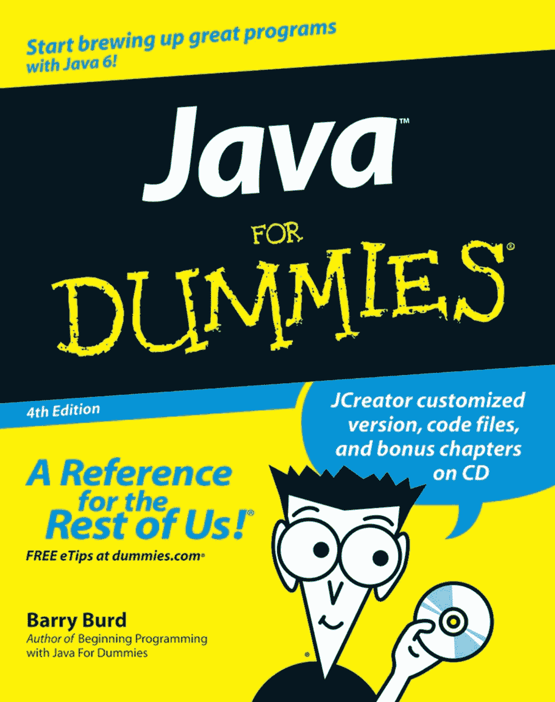


10 9 8 7 6 5 4 3 2 1

## 关于作者

**Barry Burd** 在伊利诺伊大学获得计算机科学硕士学位和数学学博士学位。自 1980 年以来，Burd 博士一直担任新泽西州麦迪逊德鲁大学数学系和计算机科学系的教授。当他未在德鲁大学授课时，Burd 博士负责为商界和工业界的专业程序员人员开设课程。他是多本书的作者，包括《Eclipse For Dummies》和《Beginning Programming with Java Dummies》，均由 Wiley Publishing, Inc. 出版。Burd 博士与妻子和孩子住在新泽西州麦迪逊。在空闲时间，他喜欢当一个工作狂。

## 献辞

给 Jennie, Sam 和 Harriet，Ruth 和 Sam，Jennie 和 Benjamin。

## 作者致谢

我们对这本书感到自豪；请通过我们的在线注册表单 [www.dummies.com/register/](http://www.dummies.com/register/) 向我们反馈。帮助这本书上市的一些人员包括：

**项目协调员：** Erin Smith
**项目编辑：** Paul Levesque
**排版与图形：** Carl Byers
**策划编辑：** Katie Feltman, Lavonne Cook, Denny Hager, Clint Lahnen, Barbara Moore, Barry Offringa
**文字编辑：** Mary Lagu 和 Heidi Unger, Rashell Smith, Alicia B. South, Ronald Terry
**技术编辑：** John Purdum
**总编辑经理：** Leah Cameron
**校对员：** Jessica Kramer, Ethel M. Winslow
**媒体开发专家：** Angela Denny, Kate Jenkins, Steven Kudirka, Kit Malone
**周年标志设计：** Richard Pacifico
**媒体开发协调员：** Laura Lagu Atkinson
**媒体项目主管：** Laura Moss
**媒体开发经理：** Laura VanWinkle
**编辑助理：** Amanda Foxworth
**高级编辑助理：** Cherie Case
**索引员：** **漫画：** Rich Tennant (www.the5thwave.com)

## 出版者致谢

***策划、编辑与媒体***
***排版服务***
***开发***
**特别协助：** Techbooks

**Technology Dummies 的出版与编辑**
Richard Swadley，副总裁兼执行集团出版经理
Andy Cummings，副总裁兼出版经理
Mary Bednarek，执行策划总监
Mary C. Corder，编辑总监

**Consumer Dummies 的出版**
Diane Graves Steele，副总裁兼出版经理
Joyce Pepple，策划总监

**排版服务**
Gerry Fahey，制作服务副总裁
Debbie Stailey，排版服务总监

## 内容概览

引言 .................................1
**第一部分：入门** .........................9
第一章：关于 Java 的一切.........................................................................11
第二章：运行示例 Java 程序..................................................................23
第三章：使用基础构建块........................................................45
**第二部分：编写你自己的 Java 程序** .....................71
第四章：充分利用变量及其值.......................................................73


- 光盘中的赠赠章节！(5)
- 本书中使用的图标 (6)
- 接下来去哪里 (7)

- 视角：Java 在什么位置 (14)
- 面向对象编程 (OOP) (15)
- 面向对象的语言 (16)
- 对象及其类 (16)
- 在你的计算机上安装 Java (27)
- `JCreator` (31)


你可以用温度做什么


使用 `finally` 子句完成工作


- 观点与倡导 ... 325
- 在 Mac OS 上使用 CD-ROM ... 332
- 在 JCreator 中使用 Java 包 ... CD10


- 在 Applet 中响应事件 ... CD47


**3. 在你要安装的特性中，确保勾选了 Development Tools 和 Public Runtime Environment。**
    你可以选择这些组件中的部分或全部内容。

**4. 记录下正在安装 JDK 的目录名称，然后点击“下一步”。**

从一个版本到另一个版本，安装包会将 Java 安装在不同的目录中。

图 2-1：JDK 安装向导。你的 Java 目录（home directory）

## 第 2 章：运行现有的 Java 程序

### 29

如果你是 Windows 用户，Program Files 可能是你 Java 目录名称的一部分。每当我要求你输入目录名称时，最好使用一个不包含空格的缩写。Windows 对 Program Files 的官方缩写是 `progra~1`（结尾带有波浪号和数字 1）。因此，如果我的 Java 目录是 `C:\Program Files\Java\jdk1.6.0`，当我需要输入目录名称时，我通常输入 `C:\progra~1\Java\jdk1.6.0`。

**5.享受软件安装期间看到的启动界面。**

安装结束后，点击完成按钮。但你还没有完全完成。下一步是安装文档。

**6. 将文档复制到你的 Java 目录。**

在上一节的第 9 步中，你下载了一个名为 `jdk-6-doc.zip`（或类似名称）的文件。解压缩此文件，使其内容进入你的 Java 目录。你的 Java 目录名称可能为 `jdk1.6.0`。这与你可能在硬盘上找到的另一个名为 `jre1.6.0` 的目录不同。

**7. 检查你是否正确解压缩了文档。**

解压缩文档 Zip 文件后，你的 Java 目录下应该有一个名为 `docs` 的子目录。因此打开“我的电脑”并导航到你新的 `jdk-whatever` 文件夹。在该文件夹内部，你应该看到一个名为 `docs` 的新文件夹。这个目录被称为你的 Javadoc 目录。（见图 2-2。）

图 2-2：你的 Java 目录应包含一个 docs 目录。

(index-51.jpg)

### 准备使用集成开发环境


如果你已经按照此之前的说明执行了操作，那么你已经拥有了编写和运行自己的 Java 程序所需的所有软件。但你可能还想要另外一个东西。它被称为`集成开发环境`（IDE）。如果你没有 `IDE`，编写和运行程序将涉及打开多个不同的窗口 —— 一个用于输入程序的窗口，另一个用于运行程序的窗口，可能可能还有第三个窗口用来跟踪你写过的所有代码。IDE 将所有这些功能无缝地整合到一个组织良好的应用程序中。

Java 也有它自己的集成开发环境。一些比较受欢迎的产品包括 `Eclipse`、`IntelliJ IDEA` 和 `NetBeans`。一些高级环境甚至带有拖放组件，使你能够通过可视化的方式设计你的图形界面。（参见图 2-3。有关此处展示的极其酷炫的 Jigloo 图形用户界面构建器的更多信息，请访问 `www.cloud garden.com/jigloo/index.html`。）

**图 2-3：**

使用 `Eclipse IDE` 配合 `Jigloo` 图形用户界面构建器。

06_087161 ch02.qxp 10/31/06 3:15 PM Page 31

## 第 2 章：运行现有的 Java 程序

### 31: JCreator

书中的程序几乎适用于任何 Java IDE。但在本章中，我将向你展示如何使用 `JCreator LE`（轻量版）。我选择 `JCreator LE` 而不是其他 IDE 有几个原因：

- `JCreator LE` 是免费的。
- 在所有 Java IDE 中，`JCreator` 代表了功能与简单性之间的很好的折中。
- 与其他某些 Java IDE 不同，`JCreator` 几乎支持任何版本的 Java，从古老的 `1.0.2` 版本到新的 `Java SE 6`，一直到到 `Java SE 7 beta`。
- `JCreator LE` 是免费的。（值得提两次。）如果你是那种倾向于使用纯旧文本编辑器和命令行提示符而不是 IDE 的人，请访问本书的网站。在该网站上，我发布了不使用 IDE 编写和运行 Java 程序的说明。

本书的 CD-ROM 有一个特殊版本的 `JCreator LE` —— 这是一个专门为*傻傻 Java*第 4 版读者定制的版本！所以请从 CD-ROM 安装 `JCreator LE`。（谁知道呢？你可能会非常喜欢它，并购买 `JCreator Pro`！）

有关从 CD-ROM 安装材料的帮助，请参见附录 A。

### 首次运行 JCreator

第一次运行 `JCreator` 时，程序会请求一些配置信息。只需按照以下步骤即可：

**1. 如果尚未启动，请启动 JCreator。**

`JCreator Setup Wizard` 出现在你的屏幕上。向导的第一页用于文件关联。

**2. 接受文件关联默认值并点击 Next（下一步）。**

向导的下一页（`JDK Home Directory` 页面）出现。

**3. 查看 `JDK Home Directory` 页面上的文本框。确保该字段显示你的 Java 主目录名称。（参见图 2-4。）**

如果文本框中显示错误的目录名称，只需点击 `Browse` 并导航到你计算机的 Java 主目录。

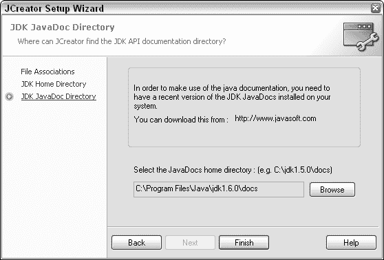
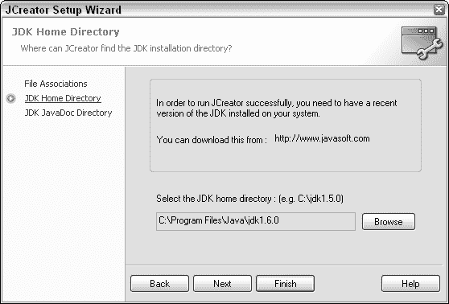

06_087161 ch02.qxp 10/31/06 3:15 PM Page 32

32 **第一部分：入门**

JDK 主 Directory 目录列表

**图 2-4：** 确认你的 Java 主目录位置。

有关你计算机的 Java 主目录的信息，请参见本章“下载和安装 Java 开发工具包 (JDK)”部分的第 4 步，或者本章“在你的计算机上安装 Java”部分的第 4 步。

**4. 当你对主目录文本框中的名称满意时，点击 Next（下一步）。**

向导的最后页页（`JDK JavaDoc Directory` 页面）出现。

**5. 查看 `JDK JavaDoc Directory` 页面上的文本框。确保该字段显示你的 JavaDoc 目录名称。（参见图 2-5。）**

JDK JavaDoc 目录列表

**图 2-5：** 确认你的 JavaDoc 目录位置。

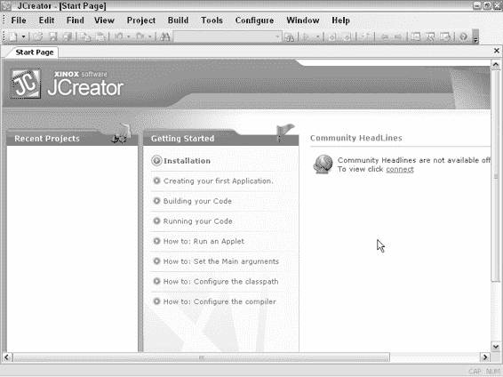

06_087161 ch02.qxp 10/31/06 3:15 PM Page 33

## 第 2 章：运行现有的 Java 程序

### 33

通常，你的 JavaDoc 目录名称是你的 Java 主目录名称，后面加上 `docs`。有关你计算机的 Javadoc 目录的信息，请参见本章“下载和安装 Java 开发工具包 (JDK)”部分的第 6 步，或者本章“在你的计算机上安装 Java”部分的第 7 步。

如果文本框中显示错误的目录名称，只需点击 `Browse` 按钮并导航到你计算机的 JavaDoc 目录。

如果你在步骤 3 或 4 中做了任何错误，你可以稍后纠正。详情请参阅本书的网站。

**6. 点击 Finish（完成）。**

此时，出现了 `JCreator Start Page`启动页。（参见图 2-6。）

### 运行 Java 程序

在本节中，你将运行三个 Java 程序 —— 这些是我写的帮助你练习运行某些 Java 代码的程序。每个程序都会计算每月还款，但每个程序都以自己的方式与用户交互。通过本节后，你将学会运行三种类型的程序：文本程序、独立 GUI 程序和 Java Applet。

**图 2-6：** JCreator 启动页。

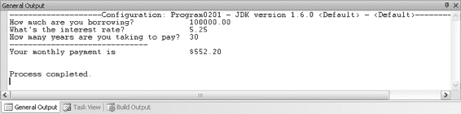

06_087161 ch02.qxp 10/31/06 3:15 PM Page 34

34 **第一部分：入门**

### 运行文本程序

第一个计算贷款的程序不会打开它自己的窗口。相反，它在 JCreator 的输出面板中运行。（参见图 2-7。）完全在这一输出面板中运行的程序被称为文本程序。

**图 2-7：** 文本程序的运行。

如果你使用的是 Linux、Unix、Mac 或非 Windows 系统，本节的说明不适用于你。请访问本书网站获取替代说明。

实际上，当你运行贷款程序时，你会在输出面板中看到两种内容：

- **程序发送给你的消息和结果。** 信息包括“你要借多少钱？”结果包括“你的每月还款额为 $552.20”。
- **你在程序运行时给程序的响应。** 如果你在程序询问关于借款的问题时输入 `100000.00`，你会看到该数字在输出面板中回显。

运行贷款程序非常简单。以下是操作方法：**1. 确保你已经遵循了本章之前的说明 —— 安装 Java JDK 和配置 JCreator。** 谢天谢！你不需要重复遵循这些说明。

**2. 启动 JCreator。**

巨大的 JCreator 启动页出现在你的屏幕上。（参考图 2-6。）

如果你是第一次运行 JCreator，你看不到 JCreator 的启动页。相反，你会看到 JCreator 设置向导。要通过设置向导，请遵循本章中“首次运行 JCreator”章节中的说明。

06_087161 ch02.qxp 10/31/06 3:15 PM Page 35

## 第 2 章：运行现有的 Java 程序

### 35

**3. 在 JCreator 的菜单栏中，从主菜单选择 File➪Open Workspace（打开工作空间）。**

不要选择 File➪ *Open*。相反，选择 File➪ *Open Workspace*。

一个熟悉的打开对话框出现。这个对话框会在 MyProjects 目录中查找。这个 MyProjects 目录是 JCreator 安装目录的子目录。


`MyProjects` 目录包含名为 `Program0201`、`Listing0302` 等的子目录。`MyProjects` 目录还包含命名如 `Chapter02` 和 `Chapter03` 的文件。如果你设置计算机不隐藏已知文件类型的扩展名，那么这些名就是 `Chapter02.jcw`、`Chapter03.jcw` 等。（参见标题为“那些讨厌人的文件扩展名”的侧边栏）。如果你从本书的 CD-ROM 安装了自定义版本的 JCreator，那么 `MyProjects` 目录将包含名为 `Program0201`、`Listing0302` 等的子目录。从 `www.jcreator.com` 网站下载的标准版 JCreator 则没有这些子目录。

4. **选择名为 `Chapter02`（或 `Chapter02.jcw`）的文件，然后点击打开（Open）。**

响应你的点击，JCreator 显示了它的主工作区域。（参见图 2-8。）

### 那些讨厌人的文件扩展名

**在“我的电脑”或 Windows 资源管理器中显示的文件名可能是误导性的。你可能会**

- **在 Windows XP 中使用控制面板的默认（类别）视图下：** 选择开始➪ 控制面板 ➪ 外观和主题 ➪ 文件夹选项。访问 `MyProjects\Program0203` 目录并查看 `MyWebPage`。不仅仅是 `MyWebPage`，文件的全名是 `MyWebPage.html`。你可能会看到两个 Mortgage Applet 文件。你没看到的是其中一个文件的真实名称是 `MortgageApplet.java`，而另一个文件的真实名称是 `MortgageApplet.class`。
- **在 Windows Vista 中使用控制面板的默认（类别）视图下：** 选择开始➪ 控制面板 ➪ 外观和个性化 ➪ 文件夹选项。
- **在 Windows XP 或 Windows Vista 中使用控制面板的经典视图下：** 选择开始➪ 控制面板 ➪ 文件夹选项。

骨感的的事是，“我的电脑”和 Windows 资源管理器可以隐藏文件的扩展名。这个糟糕的功能往往会让 Java 程序员感到困惑。

在“文件夹选项”对话框中，点击“查看”选项卡。然后寻找“隐藏已知文件类型的扩展名”选项。确保此复选框没有勾选。

方法如下：

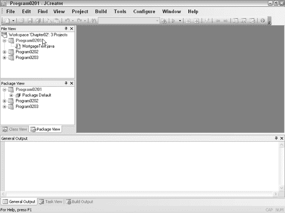

06_087161 ch02.qxp 10/31/06 3:15 PM Page 36

36 **第一部分：入门**

**图 2-8：** JCreator 的工作区域。

在本书中，我将图 2-8 中的窗口（菜单栏、工具栏、`File View`、常规输出面板等）称为 `JCreator work area`（JCreator 工作区域）。

但 JCreator 的帮助文件使用的术略有不同。在 JCreator 的帮助文件中，图 2-8 中的窗口被称为 `workspace`（工作空间），而不是 `work area`（工作区域）。在这些帮助文件的其他地方，JCreator 复用了 `workspace` 一词来表示完全不同的意思。为了避免任何混淆，我使用了两个不同的术语。我用 `work area` 指代图 2-8 中的窗口，而用 `workspace` 指代另一个完全不同的东西。（我将在下一段中解释那个完全不同的东西。）

JCreator 将 Java 程序划分为 `workspaces`。每个工作空间进一步划分为 `projects`。为了组织本书的示例，我为每一章创建了一个工作空间，然后为每个完整的 Java 程序创建了一个项目。当你打开 `Chapter02.jcw` 时，你会得到我的 `Chapter02` 工作空间 —— 一个包含三个项目的工作空间。项目的名称分别为 `Program0201`、`Program0202` 和 `Program0203`。这就是为什么在 JCreator 的 `File View` 面板中，你会看到一个 `Chapter02` 树，其分支标记为 `Program0201`、`Program0202` 和 `Program0203`。（参见图 2-8。）在第 4 步点击“打开”可能会弹出一个对话框，询问你是否要“保存工作空间的修改？”如果是，点击“是”。点击“打开”可能会弹出另一个框，询问你是否要“. . . 关闭所有文档窗口？”如果是，点击“是”。

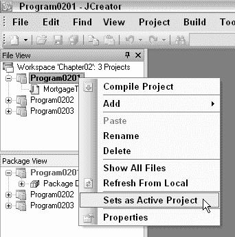

06_087161 ch02.qxp 10/31/06 3:15 PM Page 37

## 第 2 章：运行现成的 Java 程序

### 37

5. **在 `File View` 树中，右键点击标记为 `Program0201` 的分支。在生成的右菜单中，选择“设置为活动项目”（Sets As Active Project）。（参见图 2-9。）**

**图 2-9：** 将特定项目设置为活动项目。

选择“Sets As Active Project”会让 `Program0201` 成为 `active project`（活动项目）。在 JCreator 中，一次只能有一个项目是活动项目。要运行某个特定程序，该程序的代码必须位于当前活跃项目中。在 JCreator 的 `File View` 中，你可以通过寻找名称加粗显示的项目来判断哪个项目是活跃的。在某些系统上，活动项目的名称是模糊的浅灰色加粗字体。

如果某个特定程序不在活动项目中，你就无法运行该程序，但你可以对程序进行修改、保存程序等。由于由于原因，人们很容易产生困惑并忘记哪个项目是活跃的。所以，请始终将活动项目留在脑海中。

6. **选择`Build”（构建）➪`Compile Project”（编译项目）。**

选择 `Compile` 的作用完全如其名。它会*编译*项目的代码。（要想知道 *compile* 的含义，请参见标题为“编译和运行 Java 程序”的侧边栏。）

在硬盘发出几声悦耳的啾啾声后，JCreator 的底部面板会显示“处理已完成”的消息。（参见图 2-8。）

7. **选择`Build”（构建）➪`Execute Project”（执行项目）。**

当你选择 `Execute Project` 时，计算机会运行项目代码。（也就是说，计算机运行了一个 Java 程序。）作为运行的一部分，消息 How much are you borrowing?（你要借多少钱？）会出现在 JCreator 的输出面板中。（参考图 2-7。）

8. **点击 JCreator 常规输出面板内的任意位置，然后输入一个数字，如 100000.00，并按回车。**

在第 8 步中输入数字时，不要包含你国家的货币符号，也不要使用数字分隔符。（美国居民不要输入美元符号，也不要使用逗号。）输入如 100000.00 或 100,000 会导致程序崩溃。你会在输出面板中看到 `NumberFormatException`。

9. **在响应利率问题时，输入一个数字，如 5.25，并按回车。**

按下回车后，Java 程序会在 JCreator 的输出面板中显示另一条消息（多少年 . .？）

10. **输入一个数字，如 30，并按回车。**

根据你输入的数字，Java 程序将显示每月还款金额。（免责声明：你的当地贷款公司收取的费用会比我的 Java 程序计算的高得多。）

在第 10 步中输入数字时，不要包含小数点。输入 30.0 会导致程序崩溃。你会在输出面板中看到 `NumberFormatException`。

有时你在程序运行过程中决定自己犯了某种错误。你想立即停止程序运行。要实现这一点，从主菜单中选择`Tools（工具）➪`Stop Tool（停止工具）。`

### 单独运行 GUI

在上一节中，你学习了编译和运行文本 Java 程序的完整步骤。在本节中，你将为 GUI 执行相同的步骤。*GUI* 代表 *Graphical User Interface*（图形用户界面）。它是用于显示窗口、按钮和其他漂亮内容的术语。GUI 程序之所以很好，是因为它们不像文本程序那样看起来像是在你祖父母的电脑上运行。


## 第 2 章：运行现有的 Java 程序

### 39

### 编译并运行 Java 程序

JCreator 的“编译计算机然后将翻译后的文件移动到项目中”意味着什么？编译器是一种将代码从一种形式转换为另一种形式的工具。例如，Mac 将翻译后的文件视为纯垃圾。Mac 无法解释翻译后文件中的任何指令。这在很多方面都是糟糕的。其中一个最引人注目的原因是，你无法将这种代码发送到万维网，并期望任何拥有不同类型电脑的人都能运行这段代码。

但是通过 Java，你可以使用 Windows 电脑创建一个字节码文件，将该字节码复制到不知道什么种类型的电脑上，然后毫无问题地运行该字节码。这就是 Java 迅速普及的众多原因之一。这种让你能够在许多许多不同类型的计算机上运行代码的卓越特性被称为“可移植性”（portability）。

源代码。这是你通过阅读此书学会如何编写的代码。它是你在进行任何编译之前所拥有的代码——在从 JCreator 的主菜单选择 `Build ➪Compile Project`（构建➔编译项目）之前。在编译 Java 项目后，从主菜单选择 `Build ➪Execute`（构建➔执行）。此时，我通常说你的电脑开始运行一个 Java 程序。但如果非常挑剔的话，你的电脑从未真正“运行 Java 程序”。相反，你的电脑运行的是被称为 Java 虚拟机（`JVM`）的东西。使用虚拟机是 Java 与其他计算机编程语言的另一种方式。

Java 虚拟机是一部分软件。将 `JVM` 视为一个代理、一个跑腿或中间人。`JVM` 在 Java 的随处运行的字节码与你电脑自己的系统之间充当解释器。在运行过程中，计算机可以快速、轻松地执行你程序的命令。

在编译代码的方式上，Java 代表了对大多数其他编程语言的严格背离。当你编译时，`JVM` 会引导你的计算机执行字节码指令。`JVM` 逐位地检查你的字节码，并执行字节码中描述的指令。`JVM` 为你的 Windows 系统、你的 Mac、你的 Linux 设备或你正在使用的任何类型的计算机解释字节码。这是一个好事。它让 Java 程序比任何其他语言的程序更具可移植性。

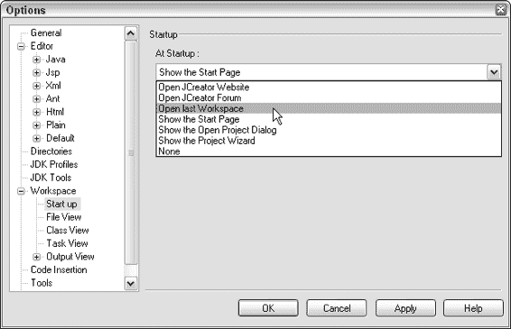

如果你是从本书的光盘安装的 JCreator，你可以在名为 `Program0202 *.*` 的项目中找到房贷计算程序的 GUI 版本。要运行该程序，请遵循以下指令：

**1. 如果你还没有这样做，请遵循“运行基于文本的程序”节中的第 1 到 4 步。**

当你完成这些步骤后，`Chapter02` 工作空间已打开。JCreator 可以记住从一次启动到另一次打开的是哪个工作空间。这样，每当你重启 JCreator 时都可以跳过打开工作空间的步骤（文本程序部分中的第 3 和第 4 步）。

要让 JCreator 记住，在 JCreator 菜单栏中选择 `Configure ➪Options`（配置➔选项）。然后在生成的 `Options` 对话框中，选择 `Workspace ➪Start Up`（工作空间➔启动）。在 `At Startup`启动时）下拉框中，选择 `Open Last Workspace`打开上次工作空间。（参见图 2-11。）最后，点击 `OK` 关闭 `Options` 对话框。

**2. 在 File View（文件视图）的树中，右键点击标记为 `Program0202.*` 的分支。在弹出的内容菜单中，选择 `Sets As Active Project.`（设置为活动项目）。**

这使得 `Program0202` 成为活动项目。

**3. 遵循“运行基于文本的程序”节中的第 6 和第 7 步。**

这会编译并运行 `Program0202` 项目。虽然这段代码不易读，但它确实使用了英语母人士可以理解的字母和其他字符。这个文件 `MortgageText.java` 被称为 Java 源代码。例如，在我的 `Program0201` 项目目录下，我有一个名为 `MortgageText.java` 的文件。如果你查看 `MortgageText.java` 文件，你会看到这样的代码：

```java
import java.io.*;
import java.text.NumberFormat;

public class MortgageText {
    public static void main(String args[]) throws IOException {
    }
}
```

新创建的字节码文件会被赋予类似 `MortgageText.class` 的名称。（你可以打开 `My Computer` 并在 `Program0201` 目录下查找新的 `.class` 文件。）与原始的 `.java` 文件不同，新的 `.class` 文件中没有可识别的字符，不适合人类阅读。相反，`.class` 文件经过了精简，以便计算机能够快速、轻松地执行你程序的命令。

#### 40 **第一部分：入门**

#### 41
## 第 2 章：运行现有的 Java 程序

### 41

**图 2-11：**

**图 2-12：** 在本章中，你可以找到一个标题为侧栏。此标签指示 Internet Explorer 寻找名为 `MortgageApplet` 的 Java 程序。侧栏描述了 Java 程序的执行过程。当它找到程序时，Internet Explorer 在网页上的矩形内显示 applet（程序的一部分）。

**图 41：** （一个 applet）并在浏览器窗口中播放 applet（文本字段、本金 Principal、利率 Rate、付款 Payment 以及其他内容）。

#### 42 **第一部分：入门**

### 运行 applet

这就是 JCreator 对不涉及 applet 的项目所做的事情。但当你的项目涉及一个要执行的 applet 时，情况就有点不同。JCreator 不直接运行 applet。相反，JCreator 告诉 Internet

如今，applet 已经过时了。真正的 Java 程序员听到 *applet* 这个词时都会白眼。原因有三点：
1. 自 20 世纪 90 年代中期以来，出现了更好的技术在网页上放置引人目的的内容。
2. 世界最强大的 Web 浏览器制造商微软拒绝为其浏览器提供最新的 Java 工具。
3. 对于 Java 程序员来说，真正的钱不在于创建闪闪发光的网页页面。真正的钱在于使用 Java EE 的业务应用程序。

关于 Java EE 的更多信息，请参阅第 3 章。无论过时否，仍有人想创建 applet。因此在本节中，你将运行一个简单的 Java applet。只需遵循以下步骤：


如果你处理过网页，你可能熟悉一种被称为 HTML 的东西——即超文本标记语言（Hypertext Markup Language）。它是网页上的通用语言。你读过关于万维网的所有语言介绍吗？Internet Explorer 运行 JVM 并显示资源管理器以访问 HTML 文档。几乎每个网页都以 HTML 文件开头。这就是为什么微软和太阳微系统（Sun Microsystems）之间会发生诉讼？这些诉讼的核心在于 Internet Explorer 浏览器使用了过时的 JVM。

当你在 JCreator 的 `File View` 窗格中展开 `Program0203` 时，你会看到一个名为 `MyWebPage.html` 的文件。顺便说一下，`JCreator` 可以配置使用 Sun 的 `appletviewer` 而不是 Internet Explorer。当 `JCreator` 执行 `Program0203` 项目时，它会找到这个 `MyWebPage.html` 文件并用 Microsoft Internet Explorer 打开它。

`appletviewer` 是一个专门为查看 Java applet 设计的小型浏览器。此时，Internet Explorer 承担了运行你代码的全部负担。Internet Explorer 对 `MyWebPage.html` 文件中的命令（标签）执行操作。特别是，Internet Explorer 在 `MyWebPage.html` 文件中找到了以下标签：

```html
<applet code="MortgageApplet" width=300 height=200></applet>
```

`appletviewer` 只显示 applet（没有超链接、没有图片、没有 applet 以外的文本），因此你无法使用 `appletviewer` 预览完整的网页。关于在 `appletviewer` 和 Internet Explorer 之间切换的提示，请参考……

3. **遵循“运行文本程序”部分中的第 6 步和第 7 步。** 这将编译并运行 `Program0203` 项目的代码。你会在 浏览器窗口中看到一个包含贷款 applet 的网页。（参见图 2-13。）

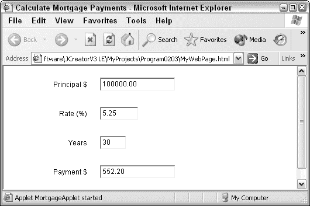

## 第 2 章：运行现成的 Java 程序

### 43
**图 2-13：** 贷款 applet 在你的浏览器窗口中运行。

如果你按照了本节的步骤进行操作，但没有在 Web 浏览器中看到贷款 applet 运行，你可以尝试以下方法：

- **检查你的 Web 浏览器设置，确保已启用 Java applet 的显示。**
- **关闭所有已打开的浏览器窗口。然后返回 `JCreator` 并再次选择 `Build` -> `Execute Project`。** 有时这有效。
- **跳过整个 applet 部分，直接进入第 3 章。** 反正，现在几乎没有人使用 Java applet 了。

## 第 3 章：使用基础构建模块

### 本章内容
- 学习 Java 语言：API 和语言规范
- 理解简单程序的组成部分
- 为代码编写文档
- 编辑和运行 Java 程序

*“所有伟大的思想都是简单的。”* —— 列夫夫·托尔斯泰

这句引用适用于各种事物——如生活、爱情和计算机编程。这就是为什么本章采取了多层次的方法方法。在本章中，你将首次接触到 Java 编程的细节。但在发现细节的过程中，你会看到它的简单性。

### 学习 Java 语言
如果你尝试在脑海中构思整个英语，你会看到什么？也许你看到的是单词、单词、单词。（这是哈姆雷看到的。）在显微镜下观察这种语言，你会看到一个接一个单词。这种“单词堆”的图像很好，但如果你向后退一步，你可能会看到另外两个东西：

- 语言的语法
- 数千上万的表达、谚语、成语和历史名称

第一类（语法）包括诸如“动词在数和人称上与名词一致”之类的规则。第二类（表达、谚语等）包括诸如“尤利乌斯·凯撒是一位著名的罗马皇帝，所以不要给你的儿子命名为尤利乌斯·凯撒，除非你希望他每天放学后被打等。”

Java 编程语言具有像英语这样的口语语言的所有特征。Java 有单词、语法、常用名称、风格习语以及其他类似的内容。

#### 语法和常用名称
太阳微系统创建 Java 的人认为 Java 由两部分组成。就像英语有其语法和常用名称一样，Java 编程语言也有它的规范（它的语法）和它的应用程序接口（它的常用名称）。每当我写 Java 程序时，我会在办公桌上放两份重要的文档——分别对应语言的两个部分：

- **Java 语言规范（Java Language Specification）：** 这包括诸类规则，例如“在 `for` 单词后始终加上左括号”以及“使用星号相乘两个数”。
- **应用程序接口（Application Programming Interface）：** Java 的应用程序接口（API）包含了在语言语法定义之后添加到 Java 中的数千上万工具。这些工具从普通到稀有不等。例如，工具中包含一个名为 `pow` 的程序，它可以为你计算 5 的 10 次方。一个更炫目的工具（命名为 `JFrame`）可以在计算机屏幕上显示一个窗口。其他工具监听用户的按钮点击、查询数据库并执行各种有用操作。

你可以通过浏览 `java.sun.com/javase/downloads` 下载语言规范、API 文档所有其他 Java 文档（或在线查看）。但要注意！这个网页是一个不断变化的目标。当你读到这本书时，这段话中的链接可能已经过期。最安全的办法是从 `java.sun.com` 开始，然后寻找“Java SE”和“documentation”之类的链接。

Java 的第一部分——语言规范相对较小。这并不意味着你不需要花费大量时间学习如何使用规范中的规则。然而，其他编程语言的规则数量可能是两倍、三倍甚至十倍。

Java 的第二部分——API 可能会因为规模庞大而令人望而生畏。API 包含至少 3000 个工具，并随着每个 Java 语言版本的发布不断增长。挺可怕的吧？嗯，好消息是，你不需要记忆 API 中的任何内容。一个都不用。你可以在文档中查找你需要使用的内容，忽略你不需要的内容。经常使用的，你会记住；不经常使用的，你会忘记（和其他程序员一样）。

关于如何在 Java API 文档中查找内容的信息，请参阅本章后面标题为“查找 javadoc 页面”的章节。

### 47
**第 3 章：使用基础构建模块**

没有人完全了解 Java API 的所有内容。如果你是一个经常编写打开新窗口程序的 Java 程序员，你就知道如何使用 API 中的 `Frame` 类。如果你很少编写打开窗口的程序，在头几次需要创建窗口时，可以在 API 文档中查找 `Frame` 类。

当然，你可能喜欢《傻瓜指南》（For Dummies）风格。但遗憾的是，Java 的官方 API 文档不是那样写的。API 文档既简洁又准确。如需解读 API 文档的语言和风格的帮助，请参阅本书的网站。


在某种程度上，Java API 并没有什么特别之处。每当你编写 Java 程序时——即使是最小、最简单的 Java 程序——你所创建的类在地位上也与官方 Java API 中定义的任何类平起平坐。API 是一组由普通程序员创建的类和其他工具，这些程序员恰好参与了官方的 JCP —— *J* ava *C* ommunity *P* rocess *.*.*. 与你自己创建的工具不同，API 中的工具随每个版本的 Java 分发。（我假设你，作为读者，并不是 Java 社区进程的参与者。不过，有了一本像《傻瓜学 Java》第 4 版这样的好书，谁也无法预料呢。）如果你对 JCP 的活动感兴趣，请访问 www.jcp.org。

JCP 的成员们并没有对官方 Java API 中的 Java 程序保密。如果你想看，可以查看所有这些程序。当你向电脑上安装 Java 时，安装程序会在你的硬硬盘上放置一个名为 `src.zip` 的文件。你可以用你喜喜欢的解压缩程序打开 `src.zip`。就在你眼前，是所有的 Java API 代码。

### Java 程序中的单词

一个硬核 Java 程序员会说 Java 编程语言有两种不同类型的单词：关键字（keywords）和标识符（identifiers）。这是事实。但在没有任何其他解释的情况下，裸白的真相有时具有误导性。因此，我建议对真相进行稍微修饰，并从三类单词来思考：关键字、你我这样的普通程序员创建的标识符，以及来自 API 的标识符。

这三种单词之间的差异类似于英语中单词之间的差异。在句子“Sam is a person”中，`person` 这个词就像一个 Java 关键字。无论谁使用 `person` 这个词，这个词的意思总是大致相同。（当然，你可以考虑英语用法中奇特的例外情况，但请别想了。）

`Sam` 这个词就像 Java 标识符，因为 `Sam` 是一个特定人的名字。像 `Sam`、`Dinswald` 和 `McGillimaroo` 这样的单词在英语中并不带有预设含义。这些单词根据上下文适用于不同的人，并在父母为新生婴儿挑选其中一个名字时，它们就变成了名字。

现在考虑句子“Julius Caesar is a person”。如果你说出这句话，你可能是在谈论那个统治罗马直到三月十五日的那个家伙。虽然 `Julius Caesar` 这个名字并不是硬编码在英语语言中的，但几乎每个人都使用这个名字来指代同一个人。如果英语是一种编程语言，那么 `Julius Caesar` 就是一个 API 标识符。

所以这就是我自己在脑海中将 Java 程序中的单词分为几类的方式：

- **关键字 (Keywords)：** `keyword` 是 Java 编程语言中具有自身特殊含义的单词，该含义不会从一个程序变为另一个程序。Java 关键字示例包括 `if`、`else` 和 `do`。此本书开头的速查表（Cheat Sheet）提供了完整的 Java 关键字列表。

JCP 委员会成员对什么构成 Java 程序拥有最终决定权，他们选择了 Java 的所有关键字。如果你考虑我在本章早些“语法和通用名称”部分讨论的 Java 的两个部分，Java 关键字稳固地属于语言规范（Language Specification）。

- **标识符 (Identifiers)：** `identifier` 是某个事物的名称。标识符的含义可以从一个程序变为另一个，但某些标识符的含义往往比其他的变化得更多。

    - **你我创建的标识符：** 作为一名 Java 程序员（是的，即使是初级 Java 程序员），你为你在程序中描述的类和其他事物创建新名称。当然，你可能会将某个东西命名为 `Prime`，而走廊另一端写代码的同事可以将另一个东西命名为 `Prime`。这没关系，因为 Java 对 `Prime` 这个词没有预设含义。在你的程序中，你可以让 `Prime` 代表联邦储备的基准利率。而走廊那头的家伙可以让 `Prime` 代表“面包、圆面包、果酱和上肋排”。这不会产生冲突，因为你和你的同事正在编写两个不同的 Java 程序。

    - **来自 API 的标识符：** JCP 成员为许多事物创建了名称，并将至少 3,000 个此类名称投入了 Java API。API 随每个版本的 Java 一起提供，因此这些名称对任何编写 Java 程序的人可用。此类名称的示例有 `String`、`Integer`、`JWindow`、`JButton`、`JTextField` 和 `File`。

严格来说，Java API 中标识符的含义并不是刻成不变的。虽然你可以为 `JButton` 或 `JWindow` 这样的单词创造自己的含义，* 但这不是一个好主意。如果你这样做，你会让其他程序员感到极不可思议，因为他们习惯了这些熟悉的标识符名称的标准 API 含义。更糟糕的是，当你的代码为 `JButton` 这样的标识符分配新含义时，你就失去了 API 代码中为该标识符创建的任何计算能力。太阳系统公司（Sun Microsystems）的程序员编写了所有处理按钮的 Java 代码。如果你为 `JButton` 这个词分配自己的含义，你就是在背弃在创建 API 时所取得的所有进展。

# 第一次查看 Java 代码

当你第一次看别人的 Java 程序时，你往往会感到有些不适。意识到你不理解代码中的某些内容（或许多内容）会让你紧张。我写过成百个（也许是成千个）Java 程序，但当我阅读别人的代码时，我仍然感到不安全。

事实是，了解一个 Java 程序是一个启动的过程。首先，你对程序感到敬畏。然后你运行程序看看它在做什么。然后你盯着程序看，或者阅读对程序的解释。然后你再多看一眼并再次运行程序。最终，你与程序和解了。（不要相信那些说自己从未经历过这些步骤的聪明人。）在列表 3-1 中，你获得了一段 Java 代码。（像所有初学者一样，你被要求谦虚地观察这些代码。）


按照本节的步骤操作后，你在 JCreator 的常规输出（General Output）面板中看到的可能不仅仅是一句 `You’ll love Java!`。常规输出面板可能会显示之前的运行记录（第 2 章某些示例的运行结果），而不仅仅最近的 `Displayer.java` 运行结果。要清除之前的运行记录，请右键点击常规输出面板，然后在弹出的右键菜单中选择 `Clear`。

在接下来的节中，你将不仅仅是运行程序并欣赏程序的输出。在读完本节后，你将真正理解列表 3-1 中的程序是如何运作的。

# 理解简单的 Java 程序

本节将介绍、解释、分析、剖析并消除之前在列表 3-1 中所示 Java 程序的神秘性。

## 第 3 章：使用基础构建模块

## Java 类

由于 Java 是一种面向对象的编程语言，你的首要目标是描述类和对象。（如果你对此不信，请阅读第 1 章中关于面向对象编程的章节。）在我那些变得感性的特殊日子里，我会告诉人们 Java 在面向对象方面比大多数其他所谓的面向对象的语言都更纯粹。我之所以这么说，是因为在 Java 中，在你创建某种类之前，你什么都做不了。这就像在参加《危险竞答》（*Jeopardy!*）；听到 Alex Trebec 说：“让我们去看看广告吧；”，然后你打断他说：“抱歉，Alex。在不把指令放在类里面之前，你是无法发布指令的。”

在 Java 中，整个程序就是一个类。程序是我写的，所以我可以随地给我的新类起一个名字。我选择了 `Displayer` 这个名字，因为程序会在计算机屏幕上显示一行文本。这就是为什么列表 3-1 中的代码以 `class Displayer` 开始。（见图 3-2。）

### 整个程序

```java
class Displayer {
    public static void main(String args[]) {
        System.out.println("You'll love Java!");
    }
}
```

**图 3-2：** 一个 Java 程序是一个类。

### Displayer 类

列表 3-1 中的第一个单词 `class` 是 Java 关键字。（参见本章前面的“Java 程序中的单词”小节）。无论是谁编写 Java 程序，`class` 单词的使用方式都是一样的。另一方面，列表 3-1 中的 `Displayer` 是一个标识符。我在写这一章时构思了 `Displayer` 这个词。`Displayer` 是特定类的名称——即我通过编写这个程序所创建的那个类。

Java 编程语言是*区分大小写的*。这意味着如果你将一个单词中的小写字母改为大写字母，你就改变了这个单词的含义。改变大小写可能会使整个单词从有意义变成无意义。在列表 3-1 的第一行，你不能将 `class` 替换为 `Class`。如果你这样做，整个程序就会停止工作。

## Java 方法

你正在一家高端修车厂当汽车机械师。你的老板总是风风火忙，并且有把单词连在一起说的习惯，他说：“修好那辆旧福特的发电机（FixTheAlternator on that junkyOldFord）。”你在脑中过了一了一份任务清单：“开车进维修位，打开引擎盖，拿一把扳手，松开发电机带”，等等。这里发生了三件事：

- **你对必须要做的事情有一个名字。** 这个名字是 `FixTheAlternator`。
- **在你的脑海中，你有一份与 `FixTheAlternator` 相关的任务列表。** 列表包含了“开车进维修位，打开引擎盖，拿一把扳手，松开发电机带”，等等。
- **你有一个脾气暴躁的老板要求你做这些工作。** 你的老板通过说“FixTheAlternator”让你开始工作。换句话说，你的老板通过说出你必须要做的事情的名字来让你工作。

在这种情况下，使用 `method`（方法）一词并不过分。你有一套处理发电机的方法。你的老板启动了该方法，而你通过执行你与该方法相关的指令列表中的所有事情来做出响应。

如果你相信这一切（我希望你相信），那么你就准备好阅读关于 Java 方法的内容了。在 Java 中，**方法*是一份待办事项列表。每个方法都有一个名字，你通过在程序中使用方法名来告诉计算机执行列表中的事项。

我从未写过让机器人去修理发电机的程序。但如果我写了，该程序可能会包含一个 `FixTheAlternator` 方法。我 `FixTheAlternator` 方法中的指令列表看起来会像列表 3-2 中的文本一样。

### 列表 3-2：方法声明

```java
void FixTheAlternator() {
    DriveInto(car, bay);
    Lift(hood);
    Get(wrench);
    Loosen(alternatorBelt);
    ...
}
```

在我 Java 代码的其他地方（列表 3-2 之外），我需要一条指令来调用 `FixTheAlternator`。调用 `FixTheAlternator` 的指令可能看起来像列表 3-3 中的文本一样。

### 列表 3-3：方法调用

```java
FixTheAlternator(junkyOldFord);
```

现在你已经对方法以及它如何运作有了基本了解，可以深入研究一些有术语了：

- 如果我偷懒，我把列表 3-2 中的代码称为*方法*（method）。如果我不偷懒，我称之为*方法声明*（method declaration）。
- 列表 3-2 中的方法声明包含两个部分。包含 `FixTheAlternator` 的那行（不包括左大括号）被称为*方法头*（method header）。列表 3-2 的其余部分（大括号包围的部分）是*方法体*（method body）。
- 术语*方法声明*将列表 3-2 中的指令列表与列表 3-3 中的指令（*方法调用*，method call）区分开来。*方法声明*告诉计算机调用方法时会发生什么。*方法调用*（另一段代码）告诉计算机实际调用该方法。方法的声明和调用通常位于程序的不同部分。

程序中的 main 方法

图 3-3 拥有列表 3-1 代码的副本。大部分代码包含一个名为 `main` 的方法的声明。（只需在代码的方法头中寻找 `main` 单词即可）。现在，不要担心方法头中的其他单词——`public`、`static`、`void`、`String` 和 `args`。我将在几几中解释这些单词。

就像任何 Java 方法一样，main 方法是一个食谱。

如何制作饼干：
- 加热炉。
- 揉面团。
- 烘烤面团。

或者

如何遵循 Displayer 的指令：在屏幕上打印“You’ll love Java!”

`main` 词在 Java 中扮演着特殊的角色。特别是，你永远不会编写显式调用 main 方法执行的代码。`main` 词是程序开始运行运行时自动被调用的方法名称。


回回图 3-1。在 JCreator 内部，你选择 `Build ➔ Execute Project` 来运行 `Displayer` 程序。当 `Displayer` 程序运行时，计算机会自动找到程序的 main 方法，并执行方法体内的任何指令。在 `Displayer` 程序中，`main` 方法体中只有一条指令。该指令告诉计算机在屏幕上打印 `You’ll love Java!`。因此，在图 3-1 中，`You’ll love Java!` 出现在 JCreator 的 General Output 格中。

在方法被调用之前，方法中的任何指令都不会执行。但是，如果你给一个方法命名为 `main`，那么该方法就会被自动调用。

几乎每种计算机编程语言都有类似于 Java 方法的特性。如果你用过其他语言，你可能记得像子程序、过程、函数、子例程、子过程或 `PERFORM` 语句之类的概念。无论在你最喜欢的编程语言中称它为什么什么，方法都是一组被收集并赋予新名称的指令。

# 你最终如何告诉计算机去执行某事

在代码列表 3-1 的核心深处，隐藏着一条实际上向计算机发出直接指令的单代码。该行在图 3-4 中被高亮，它告诉计算机显示 `You’ll love Java!`。这一行被称为语句（statement）。在 Java 中，`statement` 是一条告诉计算机执行某事的直接指令（例如：显示此文本、将 7 放在那个内存位置、让窗口出现）。

```java
class Displayer {
    public static void main(String args[]) {
        System.out.println("You'll love Java!");
    }
}
```

**图 3-4：一条语句（对 System.out.println 方法的调用）**

当然，Java 有不同类型的语句。我在本章较早部分“Java 方法”中介绍的方法调用，是许多 Java 语句类型之一。代码列表 3-3 向你展示了方法调的样子，图 3-4 中也包含一个看起来像这样的方法调用：`System.out.println("You’ll love Java!");`。

当计算机开始执行这条语句时，它会调用名为 `System.out.println` 的方法。（是的，在 Java 中，名称可以包含点。这些点是有含义的。）

要了解 Java 名称中点背后的含义，请参阅第 7 章。

图 3-5 展示了 `System.out.println` 的情况。实际上，在 `Displayer` 程序的运行过程中有两个方法起着活跃作用。它们的工作方式如下：

- **有一个 main 方法的声明。** `main` 方法是我亲自写的。每当我开始运行 `Displayer` 程序时，这个 `main` 方法就会被自动调用。
- **有一个对 System.out.println 方法的调用。** `System.out.println` 方法调用是 `main` 方法体中的唯一语句。换句话说，调用 `System.out.println` 方法是 `main` 方法待事项上的唯一任务。

`System.out.println` 方法的声明隐藏在官方 Java API 内部。要复习 Java API，请参阅本章较之前的“语法和常用名称”以及“Java 程序中的单词”章节。

当我说“System.out.println 埋在 API 内部”时，我并没有充分评价 API。诚然，你可以忽略 API 内部所有细碎的 Java 代码。你只需要记住 `System.out.println` 定义在这些代码的某处。但当我把 API 代码听起来像某种魔法东西时，我并不公平。API 仅仅是另一组 Java 代码。API 中告诉计算机执行 `System.out.println` 调用意味着什么的语句，看起来与代码列表 3-1 中的 Java 代码非常相似。

在 Java 中，每条语句（如图 3-4 中框选的行）都以分号结尾。图 3-4 中的其他行没有以分号结尾，因为图 3-4 中的其他行不是语句。例如，方法头（包含 `main` 单词的字行）并没有直接告诉计算机去做任何事情。方法头宣告：“万一你以后想执行 `main`，接下来的几行代码将告诉你要如何做。”

每个完整的 Java 语句都以分号结束。

```java
class Displayer {
    public static void main(String args[]) {
        System.out.println("You'll love Java!");
    }
}

public void println(String s) {
    ensureOpen();
    textOut.write(s);
    textOut.flushBuffer();
}
```

**图 3-5：计算机自动调用你的 main 方法，然后……你 main 方法中的一条语句调用了 System.out.println 方法。**


### main 方法

## 1. 打印 "You'll love Java!"

### I. class Displayer

```java
public class Displayer {
    public static void main(String args[]) {
        System.out.println("You'll love Java!");
    }
}
```

**图 3-6:** 一个大纲
`System.out.println("You'll love Java!");` 变成了一个 Java 程序。

**图 3-7:**
```java
class Displayer{
    public static void main(String args[]) {
        System.out.println("You'll love Java!");
    }
}
```
类比方法大；方法比语句大。

## 现在来谈几点意见

人们聚集在篝火旁，听一个关于程序员的古老传说，那个程序员因为懒惰而陷入了麻烦。为了保持这位程序员的匿名性，我称她为 Jane Pro。Jane 费了几个月的时间创造计算机科学的圣杯——一个能够独立思考的程序。如果完成，这个程序就可以独立工作，在无需人类干预的情况下学习新事物。

日复一日，夜以复夜，她努力工作，赋予程序那种创造性、独立思考的火花。

一天，当她几乎完成项目时，她收到了健康保险公司的一封让她不安的信件。不，这封信不是关于严重的疾病，而是关于一次例行的办公室访问。保险公司的理赔表上有一个填写她出生日期的地方，就好像她的出生日期自她上次提交理赔以来变了一样。她心不在焉地写下 2006 年作为出生年份，因此保险公司拒绝支付账单。

Jane 拨了保险公司的电话号码。二分钟内，她就接通了真人电话。“抱歉，”真人客服说，“要解决这个问题，你必须拨打另一个号码。”好吧，你可以猜到接着发生了什么。“抱歉。另一个接线员给了你错误的号码。”接着又是“抱歉。你必须拨回原始电话号码。”

五个月后，Jane 的耳朵很疼，但在电话里拨打了 800 小时后，她终于得到了一个口头承诺，即保险公司最终会重新处理该理赔。尽管她非常欣喜，但她急于回到她的计算机编程项目。。她还能记得那些代码行原本是做什么的吗？

不，她记不起来。她盯着自己的工作看，就像第二天早上来一个毫无意义的梦一样，这些代码现在对她来说完全没有意义了。她写了一百万行代码，但没有一行代码配有任何解释性的注释。她没有留下任何线索来帮助自己理解自己在想什么；因此在沮丧中，她放弃了整个项目。

## 在代码中添加注释

列表 3-6 是本章示例程序的增强版本。除了所有的关键字、标识符和标点符号外，列表 3-6 还包含了供人类阅读的文本。

**列表 3-6：三类注释**

```java
/**
* 《Java 傻瓜》中的列表 3-6
*
* 版权所有 2006 Wiley Publishing, Inc. 保留所有权利。
**/
/**
 * Displayer 类在计算机屏幕上显示文本。
 * 
 * @author Barry Burd
 * @version 1.6 02/21/06
 * @see java.lang.System
 **/
class Displayer {
    /**
     * 程序的执行从这个 main 方法开始。
     *
     * @param args (见第 11 章。)
     **/
    public static void main(String args[]) {
        System.out.println("I love Java!” //已改为“I”
    }
}
```

*注释*（comment）是程序内部的一段特殊文本。这种文本的目的是帮助人们理解程序。注释是优秀程序文档的一部分。

Java 编程语言有三种不同的注释：

1. **传统注释：** 列表 3-6 的前五行构成了一个*传统*注释。注释以 `/*` 开始，以 `*/` 结束。起始符号 `/*` 和结束符号 `*/` 之间的所有内容仅供人类阅读。编译器不会翻译任何关于《Java 傻瓜》或 Wiley Publishing, Inc. 的信息。要了解编译器知识，请参阅第 2 章。

列表 3-6 的第二、第三和第四行有额外的星号（`*`）。我称它们为额外的，是因为在创建注释时不需要这些星号。它们只是为了让注释看起来更好看。我在列表 3-6 中包含它们，因为出于某种我不完全理解的原因，大多数 Java 程序员都会添加这些额外的星号。

2. **行尾注释：** 列表 3-6 中的文本 `//Changed to “I”` 是一个*行尾*注释。行尾注释以两个斜杠（`//`）开始，一直到行末尾。再次，行尾注释中的任何文本都不会被编译器翻译。

3. **Javadoc 注释：** *javadoc* 注释以斜和两个星号（`/**`）开始。列表 3-6 有两个 javadoc 注释——一个包含文本 `The Displayer class . . .`，另一个包含文本 `Execution of the program. . . .`。Javadoc 注释是传统注释的一种特殊类型。Javadoc 注释是为了那些根本不看 Java 代码的人准备的。但这不合理。如果你从不看 Java 代码，怎么看到列表 3-6 中的 javadoc 注释呢？

好吧，一个名为 *javadoc* 的特定程序可以找到列表 3-6 中所有的 javadoc 注释，并将这些注释转换为漂亮的网页。该页面如图 3-8 所示。

Javadoc 注释非常棒。它们有以下几个优点：

- 只有编写代码的程序员才需要看 Java 代码。使用代码的其他人可以通过自动生成的页面来了解代码的功能。
- 因为其他人不看 Java 代码，所以他们不会修改 Java 代码。（换句话说，他们不会给现有的 Java 代码引入错误。）
- 因为其他人不看 Java 代码，所以他们不需要理解 Java 代码的内部工作原理。这些人需要了解的全部就是他们在代码页面上读到的。
- 程序员不需要创建两个独立的东西——这里的 Java 代码和那里的文档。相反，程序员创建一个 Java 代码，并将文档（javadoc 注释的形式）直接嵌入代码中。
- 最棒的是，从 javadoc 注释生成网页是自动完成的。因此所有文档的格式都相同。无论使用谁的 Java 代码，都可以通过阅读类似图 3-8 的页面来了解。

你可以根据代码中输入的 javadoc 注释生成自己的网页。要了解如何操作，请访问本书的网站。

**图 3-8:** 从列表 3-6 代码生成的 javadoc 页面。


三个简单的字：“了解你的受众。”当你编写复杂的真实世界代码时，你的受众是其他程序员、信息技术经理以及需要帮助解读你所做工作的人。当我为这本书编写简单的代码示例时，我的受众是你们——即初学者 Java 程序员。与其阅读我的注释，由于你们最好的策略是盯着我的 Java 语句——即那些 Java 编译器解析的语句。这就是为什么我在书中的代码列表中只写了这么少的注释。

此外，我有点懒。

## 查找 javadoc 页面

在第 2 章中，我鼓励你下载一份官方的 Java API 文档。这些 API 文档是由 javadoc 注释自动生成的巨大的 Web 页面集合。要访问这些文档，请执行以下操作：

1. **按照本章中列表 3-1 之后紧跟步骤列表中的第 1 步和第 2 步操作。**

`Listing 3-1` 的代码出现在 JCreator 的编辑器面板。

2. **在编辑器面板中，右键点击 `System.`。在弹出的键菜单中，选择 `Show JDK Help`。**

`System` 的 javadoc 页面将出现在 JCreator 的编辑器面板中。要查看此页更多内容，请使用面板的滚动条。这些内容现在对你来说可能没有意义，但随着你阅读这本书的内容，事情会变得清晰。

关于阅读和理解 Java API 文档的技巧，请参本书的网站。

3. **点击编辑器面板顶部的 `Displayer.java` 标签。**

`Listing 3-1` 的代码再次出现。

4. **在编辑器面板中，右键点击 `println,` 并从出现的菜单中选择 `Show JDK Help`。**

出现一个对话框。该对话框向你显示 Java API 中的列表，每个项的名称都是 `println`。

5. **在对话框列表中，双击标记为 `println(String - Method in java.io.PrintStream` 的项。**

`println` 方法的文档出现在编辑器面板中。

## 使用注释对代码进行实验

你可能会听到程序员谈论*注释掉*（commenting out）代码的某些部分。当你编写程序且某些地方运行不正常时，尝试移除一些代码通常会有帮助。至少，你会发现移除那段可疑代码后会发生什么。当然，你可能不喜欢代码移除后的结果，所以你不想完全删除代码。相反，你将普通的 Java 语句转换为注释。例如，你将语句

```java
System.out.println(“I love Java!”);
```

转换为注释

```java
// System.out.println(“I love Java!”);
```

这可以让你在尝试找出程序哪里出现问题时，让 Java 编译器不要看到这些代码。

传统的注释对于注释掉代码并不有用。大问题是你可以不能将一个传统注释放在另一个注释内部。例如，假设你想注释掉以下语句：

```java
System.out.println(“Parents,”);
System.out.println(“pick your”);
/*
* Intentionally displays on four separate lines
*/
System.out.println(“battles”);
System.out.println(“carefully!”);
```

如果你尝试将这段代码转换为一个传统注释，你会得到下面的一团糟：

```java
/***
System.out.println(“Parents,”);
System.out.println(“pick your”);
/*
* Intentionally displays on four separate lines
*/
System.out.println(“battles”);
System.out.println(“carefully!”);
*/
```

第一个 `*/`（在 `Intentionally displays` 之后）过早结束了传统注释。然后 `battles` 和 `carefully` 语句没有被注释掉，而最后一个 `*/` 则会导致编译器报错。

所以注释掉代码的最佳方法是使用行尾注释（end-of-line comments）。但为十行中的每一行输入两个斜杠可能会很麻烦。幸运的是，JCreator 有一个很好的快捷键。它的工作原理如下：

1. **选择你想注释掉的行。**
2. **从 JCreator 菜单栏，选择 `Edit` ➔ `Format` ➔ `Increase Comment Indent.`**

当你这样做时，每个被选中的行都会变成一个行尾注释。行尾注释可以包含传统注释（且行尾注释也可以包含其他行尾注释），因此你可以注释掉 `Parents, pick your battles carefully!` 代码而不会产生任何意外的副作用。如果你以后决定取消代码的注释，也很简单：

1. **选择你不再希望被注释的行。**
2. **从 JCreator 菜单栏，选择 `Edit` ➔ `Format` ➔ `Decrease Comment Indent.`**

## 编写你自己的代码

第 2 章是关于运行别人的 Java 代码（从这本书的网站下载的代码）。但最终，你将编写自己的代码。本节将向你展示如何使用 JCreator 开发环境创建代码。

本书 CD 光盘上的 JCreator 版本有一个特殊自定义的 `MyProjects` 目录。`MyProjects` 目录包含几个准备就绪的工作空间。其中一个工作空间（名为 `MyWorkspace`）没有任何项目。以下是创建项目的方法：

1. **启动 JCreator。**
2. **从 JCreator 菜单栏，选择 `File` ➔ `Open Workspace`。**

出现一个 Open 框。
3. **在 Open 框中，选择 `MyWorkspace.jcw`。然后点击 `Open`。**

点击 Open 可能会弹出一个消息询问你是否要“保存工作空间？”如果是，点击 `Yes`。点击 Open 可能会弹出另一个框，询问你是否要“关闭所有窗口？”如果是，点击 `Yes`。

4. **在文件视图面板（File View pane）中，右键点击 `MyWorkspace`。然后选择 `Add New Project`。**

JCreator 的项目向导打开。（参见图 3-9。）
5. **在 Project Template 选项卡中，选择 `Empty Project` 图标，然后点击 `Next`。**
6. **在 Name 字段中，输入 `MyFirstProject`。**
7. **确保选中了 `Add to Current Workspace` 和 `Local Folder` 单选按钮，然后点击 `Finish`。**

你可能需要点击两次 `Finish` —— 一是告诉 JCreator 创建项目，第二次是告诉 JCreator 关闭项目向导。

点击 Finish 将你回到 JCreator 的工作区域，此时 `MyFirstProject` 被加了粗体。粗体字体意味着 `MyFirstProject` 是活动项目。下一步是创建一个新的 Java 源代码文件。

8. **在文件视图面板中，右键点击 `MyFirstProject`。然后从出现的键菜单中选择 `Add` ➔ `New Class`。**

JCreator 的类向导打开。（参见图 3-13。）


与所有的窗口环境一样，JCreator 提供了许多完成相同任务的方法。你不需要右键点击 `MyFirstProject`，而是可以去菜单栏选择 `File`➪`New`➪`Class`。但右键点击项目有一个小妙处：如果你右键点击项目名称，新创建的类无疑会位于该项目中。如果你改用菜单栏，新创建的类将进入当前恰好处于活动状态的项目。因此，如果你的工作区包含许多项目，你可能会无意中将新类放入错误的项目中。

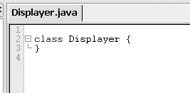

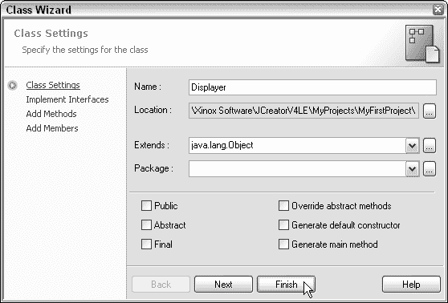

### 第一部分：入门

**图 3-13：** 类向导的 Class（类设置）选项卡。

**9. 在类向导的 Name 字段中，输入你新类的名称。**

对于第一个项目，我强烈推荐使用 `Displayer.*`。为了安全起见，请使用大字母 `D`，其他字符均使用小写字母。（参见图 3-13。）

**10. 跳过类向导中 Name 字段以外的所有所有内容。（换句话说，点击 Finish。）**

点击 Finish 将你回到 JCreator 的工作区域。现在，Editor（编辑器）面板有一个名为 `Displayer.java.*` 的选项卡。为了方便起见，`Displayer.java` 选项卡中已经有一点代码。（参见图 3-14。）**图 3-14：** JCreator 在编辑器面板中编写了一些代码。

**11. 输入你的新 Java 程序。**

将你的代码添加到 JCreator 编辑器面板中的代码中。对于第一个项目，我建议完全按照你在 `Listing 3-1` 中看到的代码进行复制。

* 每个单词的拼写要与我在 `Listing 3-1` 中的拼写完全一致。
* 每个单词的大小写要与我在 `Listing 3-1` 中的完全一致。
* 包含所有标点符号——大括号、分号、所有符号。

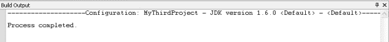

# 第 3 章：使用基础构建模块

**12. 从菜单栏选择 Build➪Compile Project（构建并编译项目）。**

如果你输入的内容完全正确，你会在 JCreator 工作区域底部看到令人安心的 `Process completed` 消息，没有任何错误信息。这段文字出现在 JCreator 的 `Build Output`（构建输出）面板中，它现在覆盖了旧的 `General Output`（常规输出）面板。（参见图 3-15。）**图 3-15：** 成功编译的结果。

当你选择 `Build`➪`Compile Project` 时，JCreator 会编译当前活动的项目。一次只有一个项目处于活动状态。因此，如果你的工作区包含多个项目，请确保你要编译的项目是当前的活动项目。

**13. 检查 JCreator 工作区域底部的错误消息。**

如果在第 11 步中你没有按照 `Listing 3-1` 显示的内容输入代码，你会在 `Task List`（任务列表）面板中看到一些错误消息。（与其他许多一样，Task List 面板出现在 JCreator 工作区域的底部。）每个错误消息都指向 Java 代码中的特定位置。要跳转光标到编辑器面板中的该位置，双击 Task List 面板中的消息。将你看到的内容与我在 `Listing 3-1` 中的代码逐字符进行对比。不要漏掉任何细节，包括拼写、标点以及大小写。

**14. 对编辑器面板中的代码进行任何更改或修正。然后重复第 12 和第 13 步。**

当你终于看到不带错误信息的 `Process completed` 消息时，你就可以准备好运行程序了。

**15. 从菜单栏选择 Build➪Execute Project（构建并执行项目）。**

这就搞定了。你的新 Java 程序将在 JCreator 的 `General Output` 面板中运行。如果你运行 `Listing 3-1` 中的代码，你会在图 3-1 中看到 `You’ll love Java!` 消息。相信我；这样的消息永远不会错。


# 第二部分：编写你自己的 Java 程序

在本部分中……

在本部分中，你将深入钻研，通过编写一些程序来发现 Java 的真实感受。这一部分的某些内容是 Java 特有的，但仍有大量材料只是纯粹的、通用的计算机编程。在这里，你将关注细节——关于数据、逻辑和程序流的细节。在读完这一部分并练习了一些技巧后，你就可以编写各种有趣的 Java 程序了。

# 第 4 章：充分利用变量及其值

### 为对象赋值
### 让对象存储值
### 改变值以获取结果

发生了以下对话：

Meredith：你今天手里有多少钱？
Charles：我有五十美元二十美分。
Meredith：如果我往你的账户里存入一百万美元，你会有多少钱？
Charles：我将拥有一万五十美元二十美分。
Meredith：如果我再存入一百万呢？
Charles：那么我将拥有两百万五十美元二十美分。
Meredith：如果我拿走一百万呢？
Charles：那么我将拥有一万五十美元二十美分。
Meredith：如果我把另一一百万也拿走呢？
Charles：那么我就变回五十美元二十美分了。

代码如 `Listing 4-1` 所示：

**Listing 4-1：**
```
amountInAccount = 50.22;
amountInAccount = amountInAccount + 1000000.00;
```

**图 4-1：变量**
执行前
```
amountInAccount = 50.22;
```
执行后
```
amountInAccount = 1000050.22;
```

*变量*是一个占位符。你可以将像 `50.22` 这样的数字放入变量中。在你向变量中放入数字后，你可以改变主意并放入另一个数字。当然，当你向变量中放入新数字时，除非你保存了旧数字，否则它就不存在了。

图 4-1 给出了 `Listing 4-1` 代码执行前后的对比。在执行 `Listing 4-1` 的第一条语句后，变量 `amountInAccount` 为 `50.22`。在执行 `Listing 4-1` 的第二条语句后，`amountInAccount` 为 `1000050.22`。当你考虑到变量时，想象内存中有一个线路和晶体管存储 `50.22`、`1000050.22` 或任何数值的地方。在图 4-1 的左侧，想象那个带有 `50.22` 的盒子被无数其他盒子所包围。

现在你需要一些术语。存储在变量中的东西被称为*值*（value）。变量的值在程序运行过程中可能会改变（例如，当 Meredith 给你一百万时）。存储在变量中的值并不一定是数字。（例如，你可以创建一个始终存储字母的变量。）存储在变量中的值的类型就是变量的*类型*（type）。你可以在本章后面的“理解变量可能拥有的值类型”部分了解到更多信息。

变量与变量名称之间存在着细微、几乎难以察觉的区别。即使在正式写作中，我经常在使用“变量”一词时，实际上指的是“变量名称”。严格来说，`amountInAccount` 是一个变量名称，而所有与 `amountInAccount` 相关的内存存储（包括


`amountInAccount` 所拥有的类型以及 `amountInAccount` 当前代表的任何值就是变量本身。如果你觉得 `variable` 和 `variable name` 之间的区别太微妙，不至于为此担心，那么请加入我们的俱乐部。

每个变量名都是一个标识符——一个你可以在自己的代码中构思的名字。在准备列表 4-1 时，我构思了 `amountInAccount` 这个名字。

关于 Java 程序中各种类型的更多信息，请参阅第 3 章。

在列表 4-1 完结之前，你还需要注意列表中的另一个部分。列表中包含 `50.22` 和 `1000000.00`。任何清醒的人都会称这些为 `numbers`（数字），但在 Java 程序中，将这些东西称为 `literals`（字面量）会有帮助。

那么 `50.22` 和 `1000000.00` 到底有什么“字面”之处呢？嗯，想想列表 4-1 中的变量 `amountInAccount`。变量 `amountInAccount` 有时代表 `50.22`，但大部分时间代表 `1000050.22`。你可以尝试用 `number` 这个词来谈论 `amountInAccount`。

但实际上，`amountInAccount` 代表什么取决于当时的状况。另一方面，`50.22` 在字面上就代表值 `5022/100`。

变量的值会变；而字面量的值不会。

### 赋值语句

像列表 4-1 中那样的语句被称为 `assignment statements`（赋值语句）。在赋值语句中，你为某个东西赋值。在很多情况下，这个东西是一个变量。

我建议养成从右到左阅读赋值语句的习惯。例如，列表 4-1 中的第一行是：

“将 `50.22`……

`amountInAccount = 50.22;`

……赋值给

`amountInAccount` 变量。”

列表 4-1 中的第二稍微稍微一点。从右到左读第二行，你得到

“将 `amountInAccount` 变量中已有的值加上 `1000000.00`……

```java
amountInAccount = amountInAccount + 1000000.00;
```

……并将该数字 `(1000050.22)` 成为 `amountInAccount` 变量的新值。”

在赋值语句中，被赋值的东西始终位于等号的左侧。

### 理解值的类型

#### 变量可能拥有的类型

你是否见过那些电视广告，让你觉得自己正在计算机内部的电路之间飞梭？很酷吧？这些广告显示了飞驰而过的 `0s`（零）和 `1s`（一），因为 `0s` 和 `1s` 是计算机真正能处理的东西。当你认为计算机正在存储字母 `J` 时，计算机实际上在存储 `01001010`。计算机内部的一切都是 `0s` 和 `1s` 的序列。正如每个电脑极客所知，一个 `0` 或 `1` 被称为 `bit`（比特）。

事实证明，代表字母 `J` 的序列 `01001010` 也可以代表数字 `74`。同样的序列还可以代表 `1.0369608636003646 × 10-43`。事实上，如果将这些比特解释为屏幕像素，同一个序列也可以用来表示图 4-2 所示的点。

`01001010` 的含义取决于软件解释这一 `0s` 和 `1s` 序列的方式。

**图 4-2：**
八个黑白屏幕像素的特写。

（图像占位符）

那么，你如何告诉计算机 `01001010` 代表什么？答案就在 `type`（类型）的概念中。变量的类型是变量被允许存储的值范围。

我复制了列表 4-1 中的行，并将它们放入一个完整的 Java 程序中。该程序在列表 4-2 中。当我运行列表 4-2 中的程序时，我得到了如图 4-3 所示的输出。

**列表 4-2：使用 amountInAccount 的程序**
```java
import static java.lang.System.out;

class Millionaire {
    public static void main(String args[]) {
        double amountInAccount;
        amountInAccount = 50.22;
        amountInAccount = amountInAccount + 1000000.00;
        out.print("You have $");
        out.print(amountInAccount);
        out.println(" in your account.");
    }
}
```

**图 4-3：**
运行列表 4-2 中的程序。

在列表 4.2 中，查看 main 方法体的第一行。

```java
double amountInAccount;
```

这一行被称为 `variable declaration`（变量声明）。在程序中放置这一行就像是在说：“我声明我的意图，要在程序中有一个名为 `amountInAccount` 的变量。”这一行为你在程序中使用保留了 `amountInAccount` 这个名字。

在这个变量声明中，`double` 词是一个 Java 关键字。这个 `double` 词告诉计算机你打算在 `amountInAccount` 中存储什么类型的值。特别地，`double` 词代表 –1.8 × 10^{308} 和 1.8 × 10^{308} 之间的数字。（这些是小数点前有 308 个零的巨大数字。只有世界上最富的人才会开出带有 308 个零的支票。这两个数字中的第二个是一个点点八 gazazzo-zillion-kaskillion。数字 `1.8 × 10^{308}` 是由国际计量衡局定义的常量，它是从加利福尼亚州桑尼维尔到 M31 仙座星系之间古怪计算机程序员的数量。）

#### 小数点后的数字

Java 有两种带有小数点后数字的不同类型：`double` 类型和 `float` 类型。那么区别是什么？当你声明一个变量为 `double` 类型时，你是在告诉计算机在存储变量值时跟踪 64 位比特。当你声明一个变量为 `float` 类型时，计算机只跟踪 32 位比特。

`float` 值的另一个困难纯粹是外观上的。再次查看列表 4-2 中的字面量 `50.22` 和 `1000000.00`。Java 规则规定，这样的字面量每个占用 64 位比特。你可以修改列表 4-2 并将 `amountInAccount` 声明为 `float` 类型。这意味着如果你将 `amountInAccount` 声明为 `float` 类型，你将会遇到麻烦。你要把 64 位的字面量塞进你那个小的 32 位 `amountInAccount` 变量中会遇到困难。

32 位比特应该足够存储像 `50.22` 这样的小数字吧？不，并不。你可以轻松地只用 32 位比特存储 `50.00`。嘿，通过给每个 double 字面量添加一个 `F`，从 double 字面量切换到 float 字面量，你只需要 6 位比特就能存储 `50.00`。数字的大小并不重要，重要的是准确性。在 64 位的 `double` 变量中，你使用了大部分比特来存储小数点之后的内容。为了存储 `50.22` 中的 `.22` 部分，你需要比 `float` 类型提供的可怜 32 位比特更多的。

要实验数字，请访问 http://babbage.cs.qc.edu/courses/cs341/IEEE-754.html。该页面接收你输入的任何数字，并显示该数字如何被表示为 32 位和 64 位。

将此与图 4-3 中的输出进行比较。

当我从 `double` 类型切换到 `float` 类型时，我破坏了 `amountInAccount` 变量百分位的准确性。通过改为 32 位的 `float` 类型，查尔斯的账户多出了三分钱。

比 `double` 关键字数字的巨大范围更重要的是，`double` 值可以带有小数点后数字的事实。

将 `amountInAccount` 声明为 `double` 类型后，你可以在 `amountInAccount` 中存储各种数字。你可以存储 `50.22`、`0.02398479` 或


– 3.0. 在代码列表 4-2 中，如果我没有将 `amountInAccount` 声明为 `double` 类型，我可能无法存储 50.22。相反，我将不得不存储一个普通的 50，小数点后将不再有任何数字了。

# 第 4 章：充分利用变量及其值

另一种类型 —— `float` 类型 — 也允许你拥有小数点后的数字，但这种类型的精确性没有那么高。（有关详细的细节，请参阅边栏“小数点后的数字”。）不要为在 `float` 和 `double` 之间的选择而纠结。对于大多数程序，直接使用 `double` 即可。

## 导入声明

提前宣布你的意图总是好的。考虑以下这段课堂讲座：

“今天，在我们的电影史课程上，我们将讨论演员 Lionel Herbert Blythe Barrymore 的职业生涯。

“`Barrymore` 出生于费城，出演了 200 多部电影，包括《奇美好的生活》、《长滩风云》和《基尔德博士的婚礼日》。

此外，`Barrymore` 还是作家、作曲家和导演。`Barrymore` 每年在电台里为埃伯泽·斯克鲁奇（Ebenezer Scrooge）配音……”

有趣的内容，对吧？现在将上面的段落与一段老师没有开头介绍主题的讲座进行对比：

“再次欢迎来到电影史。

“`Lionel Barrymore` 出生于费城，出演了 200 多部电影，包括《奇美好的生活》、《长滩风云》和《基尔德博士的婚礼日》。此外，`Barrymore（不是 Ethel、John 或 Drew）`还是作家、作曲家和导演。`Lionel Barrymore` 每年在电台里为埃伯泽·斯克鲁奇配音……”

如果没有适当的介绍，演讲者可能不得不不断提醒你，讨论的是关于 Lionel Barrymore 而不是关于其他某个 Barrymore。在 Java 程序中也是如此。对比一下代码列表 3-1 和 4-2 中的代码。来自代码列表 3-1：

```java
class Displayer {
    System.out.println("You’ll love Java!");
}
```

来自代码列表 4-2：

```java
import static java.lang.System.out;

class Millionaire {
    out.print("You have $");
    out.print(amountInAccount);
    out.println(" in your account.");
}
```

在代码列表 4-2 中，你在介绍（在 `import declaration` 中）中宣布你在 Java 类中使用了 `System.out`。你通过全名 `java.lang.System` 澄清了你所说的 `System`。（嘿！第一位老师不是也用全名“Lionel Herbert Blythe Barrymore”进行了澄清的吗？）在导入声明中宣布你的意图后，你就可以 Java 类代码中使用缩写名 `out` 了。

这些导入细节可能会非常讨厌。所以现在，只需将代码列表 4-2 中的导入声明粘贴到你 Java 程序的顶部即可。（不要费心将此导入声明粘贴到没有使用 `System.out` 的程序中。它可能不会产生伤害，但在老练的 Java 程序员看来会非常奇怪。））

书中没有哪一个章节可以介绍导入声明的完整故事。要开始理清导入声明的一些微妙之处，请参阅第 5、9 和 10 章。

## 显示文本

代码列表 4-2 中的最后三个语句使用了一种巧妙的格式化技巧。你想在屏幕上单行显示几个不同的内容。你将这些内容放在单独的语句中。除了最后一条语句外，所有的语句都是调用 `out.print`。（最后一条语句是调用 `out.println`。）`out.print` 的调用在行的一部分显示文本，并将光标留在当前行的末尾。执行 `out.print` 后，光标仍然在同一行的末尾，因此下一个 `out.whatever` 可以在该行继续打印。通过多个 `print` 调用并以单个 `println` 调用收尾，结果就是一行美观的输出。（参考图 4-3。）`out.print` 的调用写入某些内容，并让光标停留在输出行的末尾。`out.println` 的调用写入内容，然后通过将光标移动到新输出输出的开头来完成工作。

## 不带小数点的数字

“在 1995 年，平均每个家庭有 2.3 个孩子。”

在这一点，总会有聪明人评论说，没有哪个真实的家庭恰好有 2.3 个孩子。显然，整数在这个世界上扮演着角色。所以，在 Java 中，你可以声明一个变量只存储整数。代码列表 4-3 显示了一个使用整数变量的程序。

**代码列表 4-3：使用 int 类型**

```java
import static java.lang.System.out;

class ElevatorFitter {
    public static void main(String args[]) {
        int weightOfAPerson;
        int elevatorWeightLimit;
        int numberOfPeople;
        weightOfAPerson = 150;
        elevatorWeightLimit = 1400;
        numberOfPeople = elevatorWeightLimit / weightOfAPerson;
        out.print("You can fit ");
        out.print(numberOfPeople);
        out.println(" people on the elevator.");
    }
}
```

代码列表 4-3 中程序背后的故事需要大量的解释。现在开始：

你有一个酒店电梯，其承重能力为 1400 磅。一个周末，酒店举办了 Brickenchicker 家族聚会。Brickenchicker 家族的一个分支幸运地生了一对十胞胎（十个兄弟姐妹，都具有相同的物理特征）。通常情况下，每个 Brickenchicker 十胞胎都恰好重 145 磅。但周六，家里举行了一场盛大的午宴，由于午餐包含了草莓蛋糕，现在每个 Brickenchicker 十胞胎都重了 150 磅。

午饭后，所有十个 Brickenchicker 十胞胎同时到达电梯。（为什么不呢？他们十个人想得一样。）所以，问题是，有多少个胞胎能进入电梯？

现在记住，如果你在电梯上放置超过 1400 磅的重量，电梯电绳就会断裂，导致电梯上所有的胞胎突然（且昂贵地）死亡。

Brickenchicker 谜题的答案（代码列表 4-3 程序的输出）如图 4-4 所示。

**图 4-4：拯救 Brickenchicker 们**

## 存储整数的四种方法

Java 有四种不同的整数类型。

要存储大于 32767 的数字，不要使用 `short`。这些类型被称为 `byte`、`short`、`int` 和 `long`。

大多数情况下，你会使用 `int`。但如果你需要 `float` 和 `double` 的精确度，选择整数类型时唯一的考虑因素是你尝试存储的数字的大小。要存储大于 2147483647 的数字，请放弃 `int` 而选择 `long`。（`long` 数字可以大到 9223372036854775807。）有关完整故事，见表 4-1。如果你想使用大于 127 的数字，不要使用 `byte`。

在 Brickenchicker 电梯问题的核心，你有整数 —— 小数点后没有数字的数字当你用 1400 除以 150 时，你得到 9⁄3，但你不应该对待那个 1⁄3。这个事实在 Java 中得到了很好的反映。

在代码列表 4-3 中，所有变量（`weightOfAPerson`、`elevatorWeightLimit` 和 `numberOfPeople`）都是 `int` 类型。`int` 值是一个整数。

当你用一个 `int` 值除以另一个 `int` 值（如你在代码列表 4-3 中使用斜杠时所示），你得到另一个 `int`。当你把 1400 除以 150 时，你得到 9 —— 不是 9⁄3。

你在图 4-4 中看到这一点。以下语句组合将数字 9 放在计算机屏幕上：

```java
numberOfPeople = elevatorWeightLimit / weightOfAPerson;
out.print(numberOfPeople);
```

合并声明和初始化变量


回看列表 4-3。在那个列表中，你看到了三个变量声明——分别对应程序中的三个 `int` 变量。我本可以用仅一个声明来完成同样的操作：`int weightOfAPerson, elevatorWeightLimit, numberOfPeople;` 如果两个变量的类型完全不同，你无法在同一个声明中创建这两个变量。例如，要创建一个名为 `weightOfFred` 的 `int` 变量和一个名为 `amountInFredsAccount` 的 `double` 变量，你需要两个相互独立的变量声明。

你可以在声明中为变量赋予初始值。例如，在列表 4-3 中，一个声明可以替换 `main` 方法中的几行代码（除对 `print` 和 `println` 调用外）。

```java
int weightOfAPerson = 150, elevatorWeightLimit = 1400, numberOfPeople = elevatorWeightLimit / weightOfAPerson;
```

当你这样做时，你并不是在说你在给变量赋值。声明中带有等号的部分并不真正被称为赋值语句。相反，你说是在*初始化*变量。

信不信由，记住这种区别是有帮助的。就像生活中的其他事情一样，初始化变量有其优缺点：

- **当你将列表 4-3 的六行代码合并为一个声明时，代码变得更加简洁。** 有时，简洁的代码更易读。有时则不然。作为程序员，这取决于你的判断。
- **通过初始化变量，你可能会自动避免某些编程错误。** 示例，请参阅第 7 章。
- **在某些情况下，你没有选择。你代码的本质迫使你必须初始化或不初始化。** 对于一个不适合变量初始化的示例，请参阅第 6 章中删除证据的程序。

# 原子：Java 的基本类型

我在之前的几个节中描述的 `int` 和 `double` 词是 Java 中*基本类型*（也称为*简单*类型）的示例。Java 语言恰好有八种基本类型。作为 Java 的初学者，你几乎可以忽略这些类型中的四种。（从编程语言的角度来看，Java 这样设计非常紧凑。）基本类型的完整列表如表 4-1 所示。

### 表 4-1：Java 的基本类型

| 类型名称 | 字面量形式 | 取值范围 |
| :--- | :--- | :--- |
| **整数类型** | | |
| byte | `(byte)42` | –128 到 127 |
| short | `(short)42` | –32768 到 32767 |
| int | `42` | –2147483648 到 2147483647 |
| long | `42L` | –9223372036854775808 到 9223372036854775807 |
| **小数类型** | | |
| float | `42.0F` | –3.4 × 10³⁸ 到 3.4 × 10³⁸ |
| double | `42.0` | –1.8 × 10³⁰⁸ 到 1.8 × 10³⁰⁸ |
| **字符类型** | | |
| char | `‘A’` | 数千个字符、字形和符号 |
| **逻辑类型** | | |
| boolean | `true` | true, false |

你不应该忽略的类型是 `int`、`double`、`char` 和 `boolean`。本章之前的节涵盖了 `int` 和 `double` 类型。因此，本节涵盖 `char` 和 `boolean` 类型。

## char 类型

不久以前，人们认为电脑只用于大型数字计算。如今，随着文字处理器的出现，没人那样想了。所以，如果你在过去的 20 年里没有待在冷冻室内，你就知道计算机存储字母、标点符号和其他字符。

用于存储字符的 Java 类型称为 `char`。列表 4-4 有一个使用 `char` 类型的简单程序。列表 4-4 的输出如图 4-5 所示。

**列表 4-4：使用 char 类型**
```java
class CharDemo {
    public static void main(String args[]) {
        char myLittleChar = ‘b’;
        char myBigChar = Character.toUpperCase(myLittleChar);
        System.out.println(myBigChar);
    }
}
```

**图 4-5:** 列表 4-4 程序的精彩运行。

在列表 4-4 中，第一次初始化将字母 `b` 存储在变量 `myLittleChar` 中。在初始化过程中，注意 `b` 是如何被单引号包围的。（此处原文中存在大量重复文本，已根据要求去重处理）。

## boolean 类型

`boolean` 类型的变量存储两个值之一——true 或 false。

列表 4-5 展示了 `boolean` 变量的使用。列表 4-5 程序的输出如图 4-6 所示。

```java
import static java.lang.System.out;

class ElevatorFitter2 {
    public static void main(String args[]) {
        out.println("True or False?");
        out.println("You can fit all ten of the");
        out.println("Brickenchicker dectuplets");
        out.println("on the elevator:");
        out.println();

        int weightOfAPerson = 150;
        int elevatorWeightLimit = 1400;
        int numberOfPeople = elevatorWeightLimit / weightOfAPerson;

        boolean allTenOkay = numberOfPeople >= 10;
        out.println(allTenOkay);
    }
}
```


在列表 4-5 中，`allTenOkay` 变量的类型为 `boolean`。为了给 `allTenOkay` 变量找到一个值，程序检查 `numberOfPeople` 是否大于或等于十。（符号 `>=` 代表*大于或等于*。）

在此时，对术语的严谨考究是有回报的。Java 程序中任何具有值的部分都称为 `expression`（表达式）。如果你写 `weightOfAPerson = 150;`，那么 `150` 就是一个表达式（一个其值为数值 `150` 的表达式）。如果你写 `numberOfEggs = 2 + 2;`，那么 `2 + 2` 就是一个表达式（因为 `2 + 2` 的值为 `4`）。如果你写 `int numberOfPeople = elevatorWeightLimit / weightOfAPerson;`，那么 `elevatorWeightLimit / weightOfAPerson` 就是一个表达式。（表达式 `elevatorWeightLimit / weightOfAPerson` 的值取决于执行包含该表达式的代码时，变量 `elevatorWeightLimit` 和 `weightOfAPerson` 所拥有的任何值。）

Java 程序中任何具有值的部分都称为 `expression`（表达式）。

在列表 4-5 中，代码 `numberOfPeople >= 10` 是一个表达式。该表达式的值取决于存储在变量 `numberOfPeople` 中的值。但正如你从 Brickenchicker 家族宴餐时看到的草莓奶油蛋糕得知那样，`numberOfPeople` 的值并不大于或等于十。这使得 `numberOfPeople >= 10` 的值为 `false`。因此，在列表 4-5 中为 `allTenOkay` 赋值的语句中，`allTenOkay` 变量被赋值为 `false` 值。

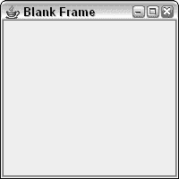

在列表 4-5 中，我调用了 `out.println()` 且括号内没有任何内容。当我这样做时，Java 会程序的输出中添加换行符。在列表 4-5 中，`out.println()` 通知程序显示一个空行。

# 分子与化合物：引用类型

通过组合简单的元素，你可以得到更复杂的东西。情况总是如此的。选取 Java 的一些基本类型，将它们混合在一起做一锅基本类型汤，你会得到什么？一个更复杂的类型，被称为 `reference type`（引用类型）。

列表 4-6 中的程序使用了引用类型。图 4-7 展示了运行列表 4-6 中程序时发生了什么。

## 列表 4-6：使用引用类型

```java
import javax.swing.JFrame;

class ShowAFrame {
    public static void main(String args[]) {
        JFrame myFrame = new JFrame();
        String myTitle = “Blank Frame”;
        myFrame.setTitle(myTitle);
        myFrame.setSize(200, 200);
        myFrame.setDefaultCloseOperation(JFrame.EXIT_ON_CLOSE);
        myFrame.setVisible(true);
    }
}
```

## 图 4-7：一个空框架。

列表 4-6 中的程序使用了两个引用类型。这两个类型都定义在 Java API 中。其中一种类型（你将一直用到的类型）被称为 `String`。另一个类型（你可以用它创建 GUI 的类型）被称为 `JFrame`。

`String` 是一组字符。它就像是连续排列的几个 `char` 值。因此，通过声明变量 `myTitle` 类型为 `String`，在列表 4-6 中将 “Blank Frame” 赋值给 `myTitle` 变量是有意义的。`String` 类定义在 Java API 中。在 Java 程序中，双引号括起了 `String` 字面量中的字母。

Java `JFrame` 非常像一个窗口。（唯一的区别是你称它为 `JFrame` 而不是窗口。）为了保持列表 4-6 简洁明了，我决定不在我的框架中放入任何内容——没有按钮、没有字段、什么都没有。

即使是一个完全空的框架，列表 4-6 也使用了我在本书稍后部分部分才会描述的技巧。所以，不要尝试阅读和解释列表 4-6 的每一个字。从列表 4-6 中获得的核心重点是该程序有两个变量声明。在编写程序时，我构了两个变量名——`myTitle` 和 `myFrame`。根据声明，`myTitle` 类型为 `String`，而 `myFrame` 类型为 `JFrame`。

你可以在 Java 的 API 文档中查询 `String` 和 `JFrame`。但在你查询之前，我就可以告诉你你会发现什么。你会发现 `String` 和 `JFrame` 是 Java 类的名称。所以，这就是大新闻。每个类都是一个引用类型的名称。你可以通过以下方式为 `double` 值预留 `amountInAccount`：

```java
double amountInAccount;
```

或者通过：

```java
double amountInAccount = 50.22;
```

你也可以通过以下方式为 `JFrame` 值预留 `myFrame`：

```java
JFrame myFrame;
```

或者通过：

```java
JFrame myFrame = new JFrame();
```

要复 Java 类的概念，请参见第 1 章关于面向对象编程（OOP）的章节。

### 第二部分：编写自己的 Java 程序

每个类都是一个引用类型。当你声明 `ClassName variableName;` 时，你是在说某个变量可以引用特定类的实例。现在，当你声明一个变量为引用类型时，你是在预留该名称的使用。这种预留告诉计算机该变量可以引用实际的对象。

在 `ClassName variableName;` 中，`ClassName` 是类名，`variableName` 是变量名。对于 `int` 或 `double` 等基本类型，这种解释是没的，但当你声明一个变量为引用类型时，它意味着什么？

那么，声明 `i thank God;` 意味着什么？

这意味着有一类叫做 `i thank God`，而 `i thank God` 是该类的实例。换句话说，`i thank God` 是属于 `i thank God` 类的对象。

因为 `JFrame` 是一个类，你可以从该类创建对象。（参见第 1 章。）在列表 4-6 中，短语 `new JFrame()` 创建了一个对象（`JFrame` 类的实例）。最后，该行的等号让 `myFrame` 引用该对象。知道 `new JFrame()` 这两个词创建一个对象是非常重要的。关于对象的深入解释，请参见第 7 章。

## JFrame 类

**图 4-8：变量 `myFrame` 引用一个对象（JFrame 类的另一个实例的实例）。**

## 基本类型汤

说到框架，框架到底是什么？框架是一个具有特定高度、宽度以及在计算机屏幕上特定位置的窗口。所以，在 `Frame` 类的声明深处，你可以发现 Java API 类既不高也不伟大。类似形式的变量声明只是声明的集合。其中某些声明是以下变量的声明：

```java
int width;
int height;
char amOrPm;
int x;
```

变量。某些变量声明使用基本类型，而其他变量声明-


类型使用引用类型。然而，这些引用类型来自其他类，而这些类的声明中包含变量。这种链会不断延伸。最终是原始类型。

这里是另一个例子 —— `Time`。`Time` 类的实例可能包含一个小时（一个 1 到 12 之间的数字）、若干分钟（0 到 59 之间），所有这些都以某种方式来自一个字母（a 代表 a.m.；p 代表 p.m.）。

# 使用运算符创建新值

还有什么比你的老朋友加号更让你感到安心的呢？这是你在小学数学中中学到的第一个东西。几乎每个人都知道如何将 2 加加 2。事实上，在英语用法中，2 加加 2 是某件易做之事的比喻。每当你看到加号时，你大脑中的一个细胞就会说：“谢天谢地 —— 事情可能要复杂得多。”

所以 Java 也有一个加号。你可以用它来实现几种不同的用途。你可以使用加号来相两个数字，如下：

```java
int apples, oranges, fruit;
apples = 5;
oranges = 16;
fruit = apples + oranges;
```

你还可以使用加号将 `String` 值拼接在一起：

```java
String startOfChapter = “It’s three in the morning. I’m dreaming about the “ + “history course that I failed in high school.";
System.out.println(startOfChapter);
```

这非常有用，因为在 Java 中，不允许让 `String` 跨行。换句话说，以下代码将无法运行：

```java
String thisIsBadCode = “It’s three in the morning. I’m dreaming about the history course that I failed in high school.";
System.out.println(thisIsBadCode);
```

描述你拼接 `String` 值的正确说法是你正在*连接*（concatenating）`String` 值。

你甚至可以使用加号将数字放置在 `String` 值旁边。

```java
int apples, oranges, fruit;
apples = 5;
oranges = 16;
fruit = apples + oranges;
System.out.println(“You have “ + fruit + “ pieces of fruit.”);
```

当然，旧的减号也可以用（但不能用于 `String` 值）。

```java
apples = fruit - oranges;
```

使用星号 `*` 进行乘法，使用正斜杠 `/` 进行除法。

```java
double rate, pay;
int hours;
rate = 6.25;
hours = 35;
pay = rate * hours;
System.out.println(pay);
```

关于除法的示例，请参考列表 4-3。

当你用一个 `int` 值除以另一个 `int` 值时，你会得到一个 `int` 值。计算机不会进行四舍五入。相反，计算机去掉任何余数。

如果你在程序中放入 `System.out.println(11 / 4)`，计算机打印出 2，而不是 2.75。要解决这个问题，将被除数的数字（或两者）变为 `double` 值。如果你在程序中放入 `System.out.println(11.0 / 4)`，计算机打印出 2.75。

另一个有用的算术运算符称为*取余*运算符（remainder）。取余运算符的符号是百分号 `%`。当你在程序中放入 `System.out.println(11 % 4)` 时，计算机打印出 3。它这样做是因为 4 除以 11 可以好几次，余数是 3。取余运算符被证明相当有用。列表 4-7 有一个示例。

### 列表 4-7：找零

```java
import static java.lang.System.out;

class MakeChange {
    public static void main(String args[]) {
        int total = 248;
        int quarters = total / 25;
        int whatsLeft = total % 25;
        int dimes = whatsLeft / 10;
        whatsLeft = whatsLeft % 10;
        int nickels = whatsLeft / 5;
        whatsLeft = whatsLeft % 5;
        int cents = whatsLeft;
        out.println(“From “ + total + “ cents you get”);
        out.println(quarters + “ quarters”);
        out.println(dimes + “ dimes”);
        out.println(nickels + “ nickels”);
        out.println(cents + “ cents”);
    }
}
```

列表 4-7 中的代码运行如图 4-9 所示。你从总共 248 分钱开始。然后 `quarters = total / 25` 将 248 除以 25，得到 9。这意味着你可以从 248 分中换出 9 个硬币。接下来，`whatsLeft = total % 25` 再次将 248 除以 25，并将唯一的余数 23 放入 `whatsLeft` 中。现在你准备好进行下一步，即从 23 分中取出尽可能多的一角币。

## 初始化一次，频繁赋值

列表 4-7 有三行将值放入变量 `whatsLeft` 中：
`int whatsLeft = total % 25;`、`whatsLeft = whatsLeft % 10;`、`whatsLeft = whatsLeft % 5;`

只有其中一行是声明。另外两行是赋值语句。你不能多次声明同一个变量（除非创建一个所谓的*块*）。如果你在代码中写出 `int whatsLeft = total % 25; whatsLeft = whatsLeft % 10;`，你会看到一个错误（`whatsLeft` 已经定义）。要了解什么是块，请参见第 5 章。然后，关于重新声明变量的诚实讨论，请参见第 10 章。

## 增和减运算符

Java 有一些有趣的运算符可以让生活变得更简单（对于计算机，也对于你的大脑）。总共有四个这样的运算符——两个增运算符和两个减运算符。增运算符加 1，减运算符减 1。增运算符使用双加号 `++`，减运算符使用双减号 `--`。要看到它们如何工作，你需要一些示例。第一个示例在图 10。

图 10 中程序的运行如图 4-11 所示。在这个极其无聊的运行过程中，兔的数量打印了三次。

双加号根据你放置它们的位置有两种不同的名称。当你将 `++` 放在变量之前时，`++` 称为*自增*运算符（preincrement）。（*pre* 代表*在之前*。）

```java
import static java.lang.System.out;

class preIncrementDemo {
    public static void main(String args[]) {
        int numberOfBunnies = 27;
        ++numberOfBunnies;
        out.println(numberOfBunnies);
        out.println(++numberOfBunnies);
        out.println(numberOfBunnies);
    }
}
```

为了理解这一点，看图 10 中的加粗行。计算机将 `numberOfBunnies` 加 1（将 `numberOfBunnies` 的值变为 29），然后计算机在屏幕上打印数字 29。通过 `out.println(++numberOfBunnies)`，计算机在打印 `numberOfBunnies` 的新值之前将 `numberOfBunnies` 加 1。

自增的替代方案是*后增*运算符（postincrement）。（*post* 代表*在之后*。）*after* 这个词有两个不同的含义：

⻬ 你将 `++` 放在变量之后。

⻬ 计算机在语句的其他任何部分使用变量之后对变量的值加 1。

为了更清楚地看到后增是如何工作的，请看图 4-12 中的加粗行。计算机在屏幕上打印 `numberOfBunnies` 的旧值（为 28），然后计算机将 `numberOfBunnies` 加 1，将 `numberOfBunnies` 的值变为 29。

```java
out.println(numberOfBunnies++);
```


打印了 28。

```java
int numberOfBunnies = 27;
numberOfBunnies++;
out.println(numberOfBunnies);
```

打印了 28，然后

**图 4-12：**

```java
out.println(numberOfBunnies++);
numberOfBunnies
Using
out.println(numberOfBunnies);
```

变为 29。后置自增。

}
打印了 29。

使用 `out.println(numberOfBunnies++)`，计算机在打印 `numberOfBunnies` 原有的值之后，给 `numberOfBunnies` 加了 1。


09_087161 ch04.qxp 10/31/06 3:19 PM Page 97

# 第 4 章：充分利用变量及其值 97

图 4-12 代码的运行结果如图 4-13 所示。将图 4-13 与图 4-11 的运行结果进行对比：

- 在图 4-11 中使用前置自增，第二个数字是 29。
- 在图 4-13 中使用后置自增，第二个数字是 28。

在图 4-13 中，数字 29 直到结束才显示在屏幕上，此时计算机执行了最后一次 `out.println(numberOfBunnies)`。

**图 4-13：**

图 4-12 代码的运行结果。

你是在纠结使用前置自增还是后置自增吗？不用纠结了。大多数程序员使用后置自增。在典型的 Java 程序中，你经常看到像 `numberOfBunnies++` 这样的代码。你很少看到 `++numberOfBunnies`。

除了前置和后置自增，Java 还有两个使用 `--` 的运算符。这些运算符被称为*前置自减*和*后置自减*。

- 使用前置自减（`--numberOfBunnies`），计算机在语句的其他部分使用变量之前，先从变量的值减去 1。
- 使用后置自减（`numberOfBunnies--`），计算机在语句的其他部分使用变量之后，再从变量的值减去 1。

与其编写 `++numberOfBunnies`，你可以通过编写 `numberOfBunnies = numberOfBunnies + 1` 来实现相同的效果。因此，有些人认为 Java 的 `++` 和 `--` 运算符是为了节省击键次数——为了让可怜的手指免于过度劳动。这完全是错误的。

使用 `++` 的最佳理由是避免那种低效且易出错的做法，即在同一个语句中写两次相同的变量名（如 `numberOfBunnies`）。如果你只写一次 `numberOfBunnies`（正如你使用 `++` 或 `--` 时那样），计算机只需要弄清楚一次 `numberOfBunnies` 的含义。此外，当你只写一次 `numberOfBunnies` 时，你只有一次机会（而不是两次机会）在打字变量名时出现错错。对于像 `numberOfBunnies++` 这样简单的表达式，这些优势几乎没有区别。但对于更复杂的表达式，例如 `inventoryItems[(quantityReceived--itemsPerBox+17)]++`，使用 `++` 和 `--` 带来的效率和准确性是非常显著的。

### 语句与表达式

你可以用两种方式描述前置/后置自增以及前置/后置自减。当你看到 `++` 或 `--` 时，可以从时间顺序来考虑。这是每个人理解它们的方式，也是正确的方法。这是大家理解的方式。但偶尔有些程序员会以一种复杂的方式使用 `++` 或 `--`，这时“之前”和“之后”的概念就崩溃了。我在本节大部分内容中解释该概念的方式（基于时间，带有之前和之后）就是这样。所以，如果你陷入了困境，请从语句和表达式的角度来思考这些运算符。遗憾的是，每个人理解这个概念的方式并不是真正正确的方法。

首先，记住语句告诉计算机去执行某事，而表达式有一个值。（我在第 3 章讨论了语句，并在本章的其他地方描述了表达式。）`numberOfBunnies++` 属于哪一类？令人惊讶的答案是两者都属于。Java 代码 `numberOfBunnies++` 既是一个语句也是一个表达式。

假设在计算机执行代码 `out.println(numberOfBunnies++)` 之前，`numberOfBunnies` 的值为 28。

- 作为语句，`numberOfBunnies++` 告诉给 `numberOfBunnies` 加 1。
- 作为表达式，`numberOfBunnies++` 的值是 28，而不是 29。

所以，尽管计算机给 `numberOfBunnies` 加了 1，代码 `out.println(numberOfBunnies++)` 实际上意味着 `out.println(28)`。

现在，你读到的关于 `numberOfBunnies++` 的几乎所有内容对于 `++numberOfBunnies` 都是正确的。唯一的区别，作为表达式，`++numberOfBunnies` 的行为更符合直觉。

- 作为语句，`++numberOfBunnies` 告诉给 `numberOfBunnies` 加 1。
- 作为表达式，`++numberOfBunnies` 的值是 29。

所以，当计算机给 `numberOfBunnies` 加 1 时，代码 `out.println(++numberOfBunnies)` 实际上意味着 `out.println(29)`。

09_087161 ch04.qxp 10/31/06 3:19 PM Page 98

98 **第二部分：编写你自己的 Java 程序**

## 赋值运算符

如果你阅读了上一节关于加 1 的内容，你可能在想是否可以操作这些运算符来加 2 或加 5。幸运的是，Java 有许多赋值运算符。通过赋值运算符，你可以对任何数字进行加、减、乘、除。你甚至可以使用另一个表达式的值（在列表 4-8 中，`numberExtra`）作为应用的数字。列表 4-8 显示了赋值运算符（带有等号的那些）。

**列表 4-8：**

**赋值运算符**

```java
import static java.lang.out;

class UseAssignmentOperators {
    public static void main(String args[]) {
        int numberOfBunnies = 27;
        int numberExtra = 5;
        numberOfBunnies += 1;
        out.println(numberOfBunnies);
        numberOfBunnies += 5;
        out.println(numberOfBunnies);
        numberOfBunnies += numberExtra;
        out.println(numberOfBunnies);
        numberOfBunnies *= 2;
        out.println(numberOfBunnies);
        out.println(numberOfBunnies -= 7);
        out.println(numberOfBunnies = 100);
    }
}
```

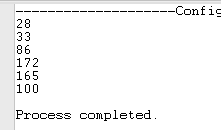

09_087161 ch04.qxp 10/31/06 3:19 PM Page 100

100 **第二部分：编写你自己的 Java 程序**

**图 4-14：**

列表 4-8 代码的运行结果。

列表 4-8 显示了 Java 赋值运算符是多么多强大。通过赋值运算符，你可以对任何数字进行加、减、乘、除。注意 `+= 5` 如何给 `numberOfBunnies` 加 5，以及 `*= 2` 如何乘以 `numberOfBunnies` 2。你甚至可以使用另一个表达式的值（在列表 4-8 中，`numberExtra`）作为应用的数字。

列表 4-8 的最后两行展示了 Java 赋值运算符的一个特殊特性。你可以将赋值运算符作为更大的 Java 语句的一部分。在列表 4-8 的倒数第二行中，运算符从 `numberOfBunnies` 减去 7，将 `numberOfBunnies` 的值从 172 减少到 165。但整个赋值操作被塞进了 `out.println` 调用中，因此计算机屏幕上打印了 165。

看，列表 4-8 的最后一行显示了你如何使用 Java 普通的等号来实现相同的操作。我在本章开头称为赋值语句的东西，实际上是我在本节中描述的赋值运算符之一。因此，每当你给某个东西赋值时，你都可以让该赋值成为更大语句的一部分。


赋值运算符的每次使用都兼具语句和表达式的双重作用。在所有情况下，表达式的值都等于你赋值的任何值。例如，在执行代码 `out.println(numberOfBunnies -= 7)` 之前，`numberOfBunnies` 的值为 172。作为语句，`numberOfBunnies -= 7` 计算机从 `numberOfBunnies` 中减去 7（因此 `numberOfBunnies` 的值从 172 降到 165）。作为表达式，`numberOfBunnies -= 7` 的值为 165。因此，代码 `out.println(numberOfBunnies -= 7)` 实际上意味着 `out.println(165)`。数字 165 显示在计算机屏幕上。

关于对此类内容的更详尽解释，请参阅本章早之前的侧边栏“语句与表达式”。

# 第 5 章
## 使用决策语句控制程序流

### 本章内容
- 编写在备选方案之间选择的语句
- 将语句嵌套
- 在许多备选方案中进行选择

电视节目《搞蛋捣尼》（*Dennis the Menace*）于 1959 年至 1963 年在 CBS 播出。我记得其中一集，威尔尔逊先生在做一个重要决定时遇到了困难。我想那可能是关于换工作或搬到新镇子的。无论如何，我仍然能看到威尔尔逊先生坐在院子里喝着柠檬水、对着虚空发呆整个下午的画面。当然，那个讨厌鬼角色捣尼不断打扰威尔尔逊先生的宁静。正是这让这个局面变得幽趣。

这集节目令我印象深刻（这也是为什么我至今仍记忆如此清晰的原因）的是威尔尔逊先生在做决定时那种执着的意。这个人并没有忙于日常事务或在社区里闲逛，而关于决定的想法在他脑海中进进出出。他静静地坐在院子里，在心理负债表上仔细且有逻辑地做标记。到底有多少人是这样做决定的？

那时我还很年轻。我从未面对过必须做出影响我和家人的重大决定的责任。但我很好奇这种决策过程会是什么样的。像树桩那样在那里坐好几个小时会有帮助吗？我会通过对选项的仔细权衡和计算来做出决定吗？还是我会在盲目射击、冒险并凭冲动行动？只有时间能给出答案。

## 做出决定（Java if 语句）

当你编写计算机程序时，你会不断遇到十字路口。用户是否正确输入了密码？如果是，让用户操作；如果不是，就把那个家伙踢出去。因此，Java 语言需要一种方法让程序向两个方向之一分支。幸运的是，这种语言有一种方法。它被称为 `if statement`。

### 猜数字
列表 5-1 演示了 `if statement` 的用法。列表 5-1 中程序的两次运行如图 5-1 所示。

**列表 5-1：猜数字游戏**

```java
import static java.lang.System.out;
import java.util.Scanner;
import java.util.Random;

class GuessingGame {
    public static void main(String args[]) {
        Scanner myScanner = new Scanner(System.in);
        out.print("Enter an int from 1 to 10: ");
        int inputNumber = myScanner.nextInt();
        int randomNumber = new Random().nextInt(10) + 1;
        if (inputNumber == randomNumber) {
            out.println("**********");
            out.println("*You win.*");
            out.println("**********");
        } else {
            out.println("You lose.");
            out.print("The random number was ");
            out.println(randomNumber + ".");
        }
        out.println("Thank you for playing.");
    }
}
```

图 5-1：猜数字游戏的两次运行。
列表 5-1 中的程序与用户玩猜数字游戏。程序从用户处获取一个数字（猜测），然后生成一个 1 到 10 之间的随机数。如果用户输入的数字与随机数相同，用户赢。否则，用户输。无论哪种情况，程序都会告诉用户随机数是什么。

结合来看，列表 5-1 中的三行代码
```java
import java.util.Scanner;
Scanner myScanner = new Scanner(System.in);
int inputNumber = myScanner.nextInt();
```
获取用户在键盘上输入的任何数字。三行中的最后一行将这个数字放入名为 `inputNumber` 的变量中。如果这些行看起来很复杂，不要担心。每你想从键盘读取内容时，几乎可以逐字复制这些行。在你的程序中只需包含前两行（导入声明）一次。

### 更多实现细节
所以，如果我想发挥创意，可以这样写这些行：
```java
import java.util.Scanner;
Scanner readingThingie = new Scanner(System.in);
int valueTypedIn = readingThingie.nextInt();
```
当你继续阅读这本书时，你会开始识别这三行代码背后的模式，因此我不会在这一节堆砌所有的细节。

当你导入 `java.util.Scanner` 时，不使用 `static` 单词。
导入 `Scanner` 与导入 `System.out` 不同。当你导入 `java.lang.System.out` 时，使用 `static` 单词。（参见列表 5-1。）关于 `static` 的真实故事，请参见第 10 章。

`System.in` 代表键盘。要从键盘以外的地方获取字符，可以在括号内输入 `System.in` 以外的内容。

括号里还可以放什么？请参见第 8 章。

当你预期用户输入一个 `int` 值（某种整数）时，使用 `nextInt()`。
当你预期用户输入一个 `double` 值（带有小数点的数字）时，使用 `nextDouble()`。当你预期用户输入 `true` 或 `false` 时，使用 `nextBoolean()`。当你预期用户输入一个单词（如 *Barry*、*Java* 或 *Hello* 这样的单词）时，使用 `next()`。

关于输入单词的示例参见列表 5-3。关于输入单个字符的示例，参见第 6 章的列表 6-4。关于读取整行文本（一次性大口吞）的示例，参见第 8 章。

你可以连续从键盘获取多个值。要这样做，多次使用 `myScanner.nextInt()` 代码。要查看从键盘读取多个值的程序，请看列表 5-4。

### 创建随机性
实现真正的随机性异常地困难。数学家波西·迪康纳（Persi Diaconis）说，如果你总是从正面向上抛掷几次，抛出正面的概率大于反面。如果你总是从反面向上抛掷几次，抛出反面的概率大于正面。换句话说，抛硬币并不真正公平。*

* Diaconis, Persi. “The Search for Randomness.” American Association for the Advancement of Science annual meeting. Seattle. 14 Feb. 2004.


计算机并没有硬币和人类拇指高到哪里。计算机模拟了随机序列的生成，但最终，计算机只是在执行它的指令，并以完全确定的方式完成这一切。因此，在列表 5-1 中，当计算机执行：

```java
import java.util.Random;

int randomNumber = new Random().nextInt(10) + 1;
```

计算机似乎是给了我们一个随机生成的数字——一个 1 到 10 之间的整数。但这一切都是假象。计算机只是在遵循指令。它并不是真正的随机，但在不竭尽计算机力的的情况下，这已经是任何人能做到的极致了。

我再次要求你盲目地接受这段代码。在你有更丰富的 Java 经验之前，不要担心 `Random().nextInt()` 是什么。

将这段代码复制到你自己的程序中尽情玩吧。如果 1 到 10 之间的数字不在你的飞行计划中，也不要担心。要掷一个虚拟骰子，请编写语句

`int rollEmBaby = new Random().nextInt(6) + 1;` 随着该语句的执行，变量 `rollEmBaby` 将获得一个 1 到 6 之间的值。

### if 语句

列表 5-1 的核心是一个 Java `if` 语句。这个 `if` 语句代表了道路的分叉口。（参见图 5-2。）计算机遵循两个分支之一——打印 You win 的分支或打印 You lose 的分支。计算机通过测试 `condition` 的真假来决定走哪一个分支。在列表 5-1 中，被测试的条件是 `inputNumber == randomNumber`。

`inputNumber` 的值是否等于 `randomNumber` 的值？当条件为真时，计算机执行条件和 `else` 关键字之间的内容。当条件结果证明为假时，计算机执行 `else` 关键字之后的内容。无论何种，计算机都会继续执行最后一个 `println` 调用，显示 Thank you for playing。

`if` 语句中的条件必须包含在括号内。然而，像 `if (inputNumber == randomNumber)` 这样的行并不是完整的语句（就像“如果我有锤子”不是一个完整的句子）。所以这一行 `if (inputNumber == randomNumber)` 不应该以分号结尾。

**图 5-2:**
`inputNumber` 是否等于 `randomNumber`？
是 -> *You win.*
否 -> You lose.
if 语句就像随机数生成……就像道路的分叉口。Thank you for playing。

有时，当我编写关于正在被测试的条件时，我会不小心用 `expression`（表达式）来代替 `condition`（条件）。这没关系，因为每个条件都是一个表达式。表达式是一个有值的东西，事实确实，每个条件都有一个值。条件的值要么为真要么为假。（有关关于表达式以及 true 和 false 等值的信息，请参阅第 4 章。）

### 双等号

在列表 5-1 中，在 `if` 语句的条件里，注意双等号的使用。比较两个数字以判断它们是否相同与将某个值赋值为另一个值是不一样的。这就是为什么比较相等性的符号与赋值或初始化中使用的符号不同。。在 `if` 语句的条件中，你不能将双等号替换为单等号。如果你这样做，你的程序将无法运行。

（当你尝试编译代码时，几乎总是会得到错误消息。）反之，如果你从未犯过在条件中使用单等号的错误，那你就不正常。不久前，当我教一门 Java 入门课程时，我承诺，如果任何一次实验课期间没有人犯了单等号的错误，我就吞下我的激光笔。这不是一个空头承诺。我知道我永远不需要履行它。事实证明，即使我忽略了在那些实验课期间任何人犯的前十次单等号错误，我依然可以不用掉激光笔。每个人在编程生涯中都会误用几次单等号。这里的诀窍不在于避免犯错；而诀窍在于每当你犯错时都能发现错误。

### 准备好括号

列表 5-1 中的 `if` 语句有两个部分——上半部分和下半部分。我给 `if` 语句的这两个部分起了名字。我把它们称为 `if part`（上半部分）和 `else part`（下半部分）。

列表 5-1 中的 `if part` 似乎包含多个语句。我通过将 `if part` 的三个语句封装在一对大括号中来实现这一点。当我这样做时，我形成了一个 `block`（块）。`block` 是一组用一对大括号紧凑在一起的语句。

通过这个 `block`，三次 `println` 调用被安全地安置在 `if part` 内部。有了大括号，星号行和单词 You win 只有在用户猜测正确时才会显示。

这种关于块和大括号的操作也适用于 `else part`。在列表 5-1 中，每当 `inputNumber` 不等于 `randomNumber` 时，计算机就会执行三次 `print/println` 调用。为了说服计算机三次调用都在 `else` 子句内部，我将这些调用放入一个 `block` 中。也就是说，我将这些调用封装在对括号中。

严格来说，列表 5-1 在 `if` 和 `else` 之间只有一个语句，在 `else` 之后也只有一个语句。诀窍在于，当你把一组语句放在大括号内时，你就得到了一个 `block`；而 `block` 在各方面表现得像一个单一语句。事实上，Java 官方文档将 `block` 列为许多语句类型之一。因此，在列表 5-1 中，打印 You win 和星号的 `block` 是一个单一语句。它是一个包含三个较小语句的语句。

### 在代码中缩进 if 语句

注意在列表 5-1 中，`if` 语句内部的 `print` 和 `println` 调用是如何缩进的。（这包括 You win 和 You lose 语句。`else` 关键字之后的 `print` 和 `println` 调用仍然是 `if` 语句的一部分。）严格来说，你不需要对 `if` 语句内部的语句进行缩进。对于编译器来说，你可以把整个程序写在一行，或者将所有语句放在一种艺术感的、锯齿形中。问题在于，如果你不以某种逻辑方式缩进语句，无论你还是其他人都无法理解你的代码。在列表 5-1 中，`print` 和 `println` 语句的缩进有助于你的眼睛（以及大脑）快速看到这些语句从属于整个 `if/else` 流程。

在小型程序中，未缩进或缩进不当的代码是可以忍忍的。

但在复杂的程序中，不遵循整洁、逻辑模式的缩进是一个巨大的、丑的噩梦。

当你写 `if` 语句时，你可能想把所有关于大括号的规则抛出窗外，仅依赖缩进。遗憾的是，这很少有效。如果你在 `else` 单词后缩进了三个语句，却忘记将这些语句封装在大括号中，计算机就会认为 `else` 部分仅包含三个语句中的第一个。糟糕糟糕，缩进会误导你让你认为 `else` 部分包含了全部三个语句。这让你更难弄清楚为什么代码没有按照你预期的方式运行。所以，看好那些括号吧！


好吧，这个章节的标题确实很牵硬。大不了！它的核心思想是你可以创建一个不带 `else` 部分的 `if` 语句。例如列表 5-1 中的代码。也许你并不希望在用户每次输游戏时都显式地提醒他们。列表 5-2 中修改后的代码展示了如何这样做（图 5-3 显示了结果）。

**列表 5-2：**

**一个更友好、更温柔的猜数字游戏**

```java
import static java.lang.System.in;
import static java.lang.System.out;
import java.util.Scanner;
import java.util.Random;

class DontTellThemTheyLost {
    public static void main(String args[]) {
        Scanner myScanner = new Scanner(in);
        out.print(“输入一个 1 到 10 之间的整数: “);
        int inputNumber = myScanner.nextInt();
        int randomNumber = new Random().nextInt(10) + 1;
        if (inputNumber == randomNumber) {
            out.println“*你赢了。*”);
        }
        out.println(“这个猜得很不错 :-)”);
        out.print(“随机数是 “);
        out.println(randomNumber + “。”);
        out.println(“感谢参与游戏。”);
    }
}
```

列表 5-2 中的 `if` 语句没有 `else` 部分。当 `inputNumber` 与 `randomNumber` 相同时，计算机会打印“你赢了.”。当 `inputNumber` 不同于 `randomNumber` 时，计算机就不会打印“你赢了”。

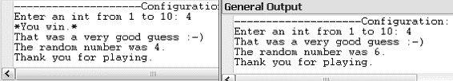

10_087161 ch05.qxp 10/31/06 3:19 PM Page 109

**第 5 章：使用决策语句控制程序流** 109

**图 5-3：** 列表 5-2 中游戏的两次运行。

列表 5-2 展示了另一个新想法。通过对 `System.in` 进行导入声明，我可以将 `new Scanner(System.in)` 简化为更短的 `new Scanner(in)`。添加这个导入声明并不值得费力。事实上，加上这个导入声明我写的字符比不加还要多。尽管如此，列表 5-2 中的代码证明了导入 `System.in` 是可能的。

## 使用比较和逻辑运算符形成条件

Java 编程语言拥有许多小符号和标记来满足你各种形成条件的需求。本节将为你介绍它们。

### 比较数字；比较字符

表 5-1 展示了你可以用于比较一个事物与另一个事物的运算符。

**表 5-1：比较运算符**

| 运算符 | 符号 | 含义 | 示例 |
| :--- | :--- | :--- | :--- |
| `==` | 等于 | `numberOfCows == 5` |
| `!=` | 不等于 | `buttonClicked != panicButton` |
| `<` | 小于 | `numberOfCows < 5` |
| `>` | 大于 | `myInitial > ‘B’` |
| `<=` | 小于等于 | `numberOfCows <= 5` |
| `>=` | 大于等于 | `myInitial >= ‘B’` |

你可以使用 Java 所有的比较运算符来比较数字和字符。当你比较数字时，情况完全按照你预想的方式进行。但当你比较字符时，情况就会有点奇怪。比较大写字母之间没有问题。

由于字母 `B` 在字母字母表中排在 `H` 之前，所以条件 `‘B’ < ‘H’` 为真。比较小写字母之间也是可以的。奇怪的是，当你比较一个大写字母和小写字母时，大写字母总是更小。所以，尽管 ‘Z’ < ‘A’ 是假的，但 `‘Z’ < ‘a’` 是真的。

在底层，字母 `A` 到 `Z` 以数字代码 65 到 90 的形式存储。字母 `a` 到 `z` 以代码 97 到 122 的形式存储。这就是为什么每个大写字母都比每个小写字母小。

当你在比较两个数字的相等性（使用 `==`）或不相等性（使用 `!=`）时要小心。在进行一些计算并获得两个 `double` 值或两个 `float` 值后，你所得到的值很少是完全相等的。（问题出在小数点后那些讨厌的数字。）例如，21 摄氏度对应的华氏度是 69.8，当你手动计算 `9.0 / 5 * 21 + 32` 时，你得到 69.8。但条件 `9.0 / 5 * 21 + 32 == 69.8` 结果竟然是假的。这是因为当计算机计算 `9.0 / 5 * 21 + 32` 时，得到的是 69.80000000000001，而不是 69.8。

### 比较对象

当你开始处理对象时，你会发现可以使用 `==` 和 `!=` 来比较对象。例如，你在计算机屏幕上看到的按钮就是一个对象。你可以询问刚刚鼠标点击的东西是否是屏幕上的某个特定按钮。你使用 Java 的相等运算符来实现这一点。

```java
if (e.getSource() == bCopy) {
    clipboard.setText(which.getText());
}
```

要了解更多关于响应点击的知识，请阅读第 4 章。`==` 的大坑出现在比较两个字符串时。当你比较两个字符串时，你不想使用等号。相反，你通常想问：“这个字符串和那个字符串字符相同吗？”更合适的问题使用的是 Java 的 `equals` 方法。示例见下方。

**列表 5-3：检查密码**

```java
import static java.lang.System.*;
import java.util.Scanner;

class CheckPassword {
    public static void main(String args[]) {
        out.print(“密码是? ”);
        Scanner myScanner = new Scanner(in);
        String password = myScanner.next();
        out.println(“你输入了 >>” + password + “<<”);
        if (password == “swordfish”) {
            out.println(“输入的单词与真实密码存储在同一个位置。你是个黑客。”);
        } else {
            out.println(“输入的单词与真实密码不在同一个位置，但没关系。”);
        }
        out.println();
        if (password.equals(“swordfish”)) {
            out.println(“输入的单词与真实密码字符相同。你可以使用我们的系统。”);
        } else {
            out.println(“输入的单词与真实密码字符不同。你无法使用我们的系统。”);
        }
    }
}
```

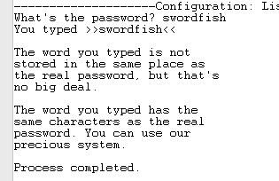

10_087161 ch05.qxp 10/31/06 3:19 PM Page 112

112 **第二部分：编写你自己的 Java 程序**

**图 5-4：使用 `==` 和使用 Java 的 `equals` 方法的结果。**

哪个字符串获得点、哪个字符串获得括号并不重要。例如，在列表 5-3 中，你可以写成：

```java
if (“swordfish”.equals(password))
```

该方法同样有效。引用类型见第 4 章。


`object`。这两个对象中的每一个都是 `String` 类型。（不过，`password` 是一个 `String` 类型的变量，而“swordfish” 是一个 `String` 字符串字面量。）当你编写 `password.equals(“swordfish”)` 时，你正在调用属于 `password` 对象的 `equals` 方法。当你调用该方法时，你正将“swordfish”作为方法的参数传递给该方法（这里玩了一个双关语）。

你可以在第 7 章中阅读更多关于属于对象的方法的知识。

相互比较字符串时，请使用 `equals` 方法——而不是双等号。

10_087161 ch05.qxp 10/31/06 3:19 PM Page 113

**第 5 章：使用决策语句控制程序流** 113

### 一次性导入所有内容

列表 5-3 的第一行演示了一种同时导入 `System.out` 和 `System.in` 的懒办法。要导入 `System` 提供的所有内容，你可以使用星号通配符（`*`）。事实上，导入 `java.lang.System.*` 相当于拥有大约 30 个独立的导入声明，包括 `System.in`、`System.out`、`System.err`、`System.nanoTime` 以及许多其他 `System` 相关项。

在导入语句中使用星号通常被认为是一种糟糕的编程习惯，因此在本书的示例中我不经常这样做。但对于较大的程序——即使用了 Java API 中几十个名称的程序——这种懒人星号技巧是非常实用的。

你不能在导入语句的任何地方放置星号。

例如，你不能通过编写 `import java.*` 来导入所有以 java 开头的内容。你只能用星号替换类名，或者替换隐藏在类内部的静态成员的名称。关于导入语句中星号的更多信息，请参阅第 9 章。关于静态内容的信息，请参阅第 10 章。

### Java 的逻辑运算符

史波克先生会感到高兴的。Java 拥有你混合和组合逻辑测试所需的所有运算符。这些运算符如表 5-2。

**表 5-2**

| 逻辑运算符 | 运算符符号 | 含义 | 示例 |
| :--- | :--- | :--- | :--- |
| `&&` | 与 | `5 < x && x < 10` |
| `||` | 或 | `x < 5 || 10 < x` |
| `!` | 非 | `!password.equals(“swordfish”)` |

你可以使用这些运算符来形成各种复杂的条件。列表 5-4 提供了一个示例。

列表 5-4 程序的某些运行结果如图 5-5 所示。当用户名为 `bburd` 且密码为 `swordfish`，或者名为 `hritter` 且密码为 `preakston` 时，用户会收到一条友好的消息。否则，用户就是一个笨蛋，会收到应得的恶劣消息。

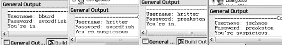

10_087161 ch05.qxp 10/31/06 3:19 PM Page 114

114 **第二部分：编写你自己的 Java 程序**

**列表 5-4：检查用户名和密码**

```java
import static java.lang.System.out;
import java.util.Scanner;

class Authenticator {
    public static void main(String args[]) {
        Scanner myScanner = new Scanner(System.in);
        out.print(“Username: “);
        String username = myScanner.next();
        out.print(“Password: “);
        String password = myScanner.next();
        if (
            (username.equals(“bburd”) &&
            password.equals(“swordfish”)) ||
            (username.equals(“hritter”) &&
            password.equals(“preakston”))
        )
        {
            out.println(“You’re in.”);
        } else {
            out.println(“You’re suspicious.”);
        }
    }
}
```

**图 5-5：** 使用逻辑运算符。

留心那些括号！当你将比较运算符与逻辑运算符结合时，宁愿浪费一点打字精力添加不必要的括号，也不要因为括号太少而导致结果出错。例如，考虑这个表达式：

`2 < 5 || 100 < 6 && 27 < 1`

通过误读这个表达式，你可能会得出表达式为假的结论。也就是说，你可能错误地将表达式理解为 `(*某些内容或某些内容*) && 27 < 1`。因为 `27 < 1` 是假的，你会认为整个表达式是假的。但事实是，在 Java 中，任何 `&&` 运算符都会在任何 `||` 运算符之前求值。因此，该表达式实际上是 `2 < 5 || (*某些内容或某些内容*)`。因为 `2 < 5` 是真的，所以整个表达式为真。

要将表达式的值从真改为假，你可以将表达式的前两个比较放在括号中，如下所示：`(2 < 5 || 100 < 6) && 27 < 1`。

Java 的 `||` 运算符是包含性的。这意味着只要左侧的内容为真、右侧的内容为真或两者都为真，你就将得到真值。例如，表达式 `2 < 10 || 20 < 30` 是真的。

在 Java 中，你不能像在普通英语那样组合比较运算符。

在英语中，你可以说：“晚餐桌旁会有三到十个人。”但在 Java 中，如果你写 `3 <= people <= 10`，你会得到一个错误消息。要进行这种比较，你需要像 `3 <= people && people <= 10` 这样的。

### 构建嵌套

你见过那些可爱的俄罗斯套套娃吗？打开一个，里面还有另一个。打开第二个，第三个就在它里面。

你可以对 Java 的 `if` 语句做同样的事情（说得真有趣！）列表 5-5 向你展示了如何操作。

**列表 5-5：嵌套 if 语句**

```java
import static java.lang.System.out;
import java.util.Scanner;

class Authenticator2 {
    public static void main(String args[]) {
        Scanner myScanner = new Scanner(System.in);
        out.print(“Username: “);
        String username = myScanner.next();
        if (username.equals(“bburd”)) {
            out.print(“Password: “);
            String password = myScanner.next();
            if (password.equals(“swordfish”)) {
                out.println(“You’re in.”);
            } else {
                out.println(“Incorrect password”);
            }
        } else {
            out.println(“Unknown user”);
        }
    }
}
```

10_087161 ch05.qxp 10/31/06 3:19 PM Page 116

116 **第二部分：编写你自己的 Java 程序**

**列表 5-5（续）**

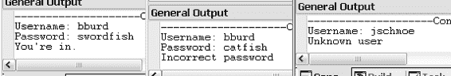 列表 5-5 中的代码在嵌套 if 语句方面做得很好，但在真实世界的用户验证方面做得极其糟糕。首先，永远不要明文显示密码（不使用星号掩盖密码）。其次，不要在不加密的情况下处理密码。第三，不要告诉恶意用户两个单词中的哪一个（用户名或密码）输入错误。第四……好吧，我可以一直说下去。


现在，是时候探索当你面临具有多个分支的决策的情况。例如，流行的营火歌曲“Al 全湿了”（Al’s All Wet）。（歌词回顾请参见侧边栏。）你急于编写代码来打印这首歌的歌词。幸运的是，你不需要反复输入所有的单词。相反，你可以利用歌词中的重复性。

用于显示“Al 全湿了”歌词的完整程序直到第 6 章。在此之前，假设你有一个名为 `verse` 的变量。

`verse` 的值为 1、2、3 或 4，取决于你想要打印“Al 全湿了”的哪一节。你可以写出一大堆笨拙的 `if` 语句，来检查每个可能的节数号。

```java
if (verse == 1) {
    out.println("That’s because he has no brain.");
}
if (verse == 2) {
    out.println("That’s because he is a pain.");
}
if (verse == 3) {
    out.println("‘Cause this is the last refrain.");
}
```

但这种方法似乎很浪费。为什么不创建一个语句只检查一次 `verse` 的值，然后根据找到的值采取行动呢？幸运的是，确实有这样一个语句。它被称为 `switch` 语句。列表 5-6 给出了一个 `switch` 语句的示例。

**列表 5-6：switch 语句**

```java
import static java.lang.System.out;
import java.util.Scanner;

class JustSwitchIt {
    public static void main(String args[]) {
        Scanner myScanner = new Scanner(System.in);
        out.print("Which verse? ");
        int verse = myScanner.nextInt();
        switch (verse) {
            case 1:
                out.println("That’s because he has no brain.");
                break;
            case 2:
                out.println("That’s because he is a pain.");
                break;
            case 3:
                out.println("‘Cause this is the last refrain.");
                break;
            default:
                out.println("No such verse. Please try again.");
                break;
        }
        out.println("Ohhhhhhhh. . . . :");
    }
}
```

图 5-8 显示了列表 5-6 中程序的两次运行。（程序背后的整体思想在图 5-9 中所示。）首先，用户输入一个数字，比如数字 2。然后，程序的执行到达 `switch` 语句的顶部。计算机检查 `verse` 变量的值。

当计算机确定 `verse` 变量的值为 2 时，检查 `switch` 语句的每个 `case`。值 2 不匹配顶部的 `case`，因此计算机继续处理三个 `case` 中的中间那个。中间 `case` 指定的值（数字 2）与 `verse` 变量的值匹配，因此计算机执行紧跟在 `case 2` 之后的两个语句。这两个语句是：

```java
out.println("That’s because he is a pain.");
break;
```

这两个语句中的第一个在屏幕上显示行：*That’s because he is a pain.*。第二个语句被称为 `break` 语句。

（多么惊喜啊！）当计算机遇到 `break` 语句时，它会跳出它所处的任何 `switch` 语句。因此，在列表 5-6 中，计算机直接跳过了本该显示‘Cause this is the last refrain’的 `case`。事实上，计算机跳出了整个 `switch` 语句，直接进入 `switch` 语句结束后的语句。计算机显示 *Ohhhhhhhh. . . . .*，因为那是 `switch` 语句之后的语句告诉计算机要做的。

**图 5-8：** 运行列表 5-6 的代码。

如果那个讨厌的用户要求第 6 节，计算机将通过跳过 case 1、2 和 3 来响应。相反，计算机执行 `default`。在 `default` 中，计算机显示 *No such verse. Please try again,*，然后跳出 `switch` 语句。在计算机跳出 `switch` 语句后，计算机显示 *Ohhhhhhhh. . . .*。

你并不真的需要在 `switch` 语句的最后面放一个 `break`。在列表 5-6 中，最后一个 `break`（属于 `default` 的那个 `break`）仅仅是为了整体的整洁。

**“Al 全湿了”**
按照“Gentille Alouette”的旋律演唱：
在雨中，在雨中。
Ohhhhhhhh. . . .
Al 全湿了。噢，为什么 Al 全湿了？噢，
Al 全湿了，因为他正站在
Al 全湿了。噢，为什么 Al 全湿了？噢，
雨中。
Al 全湿了，因为他正站在
为什么 Al 站在雨中？
雨中。
那是因为他没有大脑。
为什么 Al 站在雨中？
没有大脑，没有大脑，
因为这是最后一段副歌。
在雨中，在雨中。
最后一段副歌，最后一段副歌，
Ohhhhhhhh. . . .
他是个麻烦，他是个麻烦，
没有大脑，没有大脑，
Al 全湿了。噢，为什么 Al 全湿了？噢，
在雨中，在雨中。
Al 全湿了，因为他正站在
Ohhhhhhhh. . . .
雨中。
为什么 Al 站在雨中？
那是因为他没有大脑。
为什么 Al 站在雨中？
没有大脑，没有大脑，
因为这是最后一段副歌。
–Harriet Ritter and Barry

**图 5-9：**
哪一节？
1
2
3
Other
Has no
pain
refrain
Try
again

在每个 Java 程序员的生活中，总会有他们忘记使用 `break` 语句。起初，产生的输出令人困惑，但随后程序员想起了贯穿（fall-through）。*贯穿* 这个词描述了当你结束一个 `case` 而没有使用 `break` 时发生的情况。

通常，当你使用 `switch` 语句时，你不希望发生贯穿，但有时，贯穿正是你需要的。例如，“Al 全湿了”这首歌。“Al 全湿了”的每一节都在之前的行的基础上增加了新的行。这种情况（从一节累积行）需要一个带有贯穿的 `switch` 语句。列表 5-7 展示了这一思想。

**列表 5-7：带有贯穿的 switch 语句**

```java
import static java.lang.System.out;
import java.util.Scanner;

class FallingForYou {
    public static void main(String args[]) {
        Scanner myScanner = new Scanner(System.in);
        out.print("Which verse? ");
        int verse = myScanner.nextInt();
        switch (verse) {
            case 3:
                out.print("Last refrain, ");
                out.println("last refrain,");
            case 2:
                out.print("He’s a pain, ");
                out.println("he’s a pain,");
            case 1:
                out.print("Has no brain, ");
                out.println("has no brain,");
        }
        out.println("In the rain, in the rain.");
        out.println("Ohhhhhhhh...");
        out.println();
    }
}
```

图 5-10 显示了列表 5-7 中程序的多次运行。因为 `switch` 中没有 `break` 语句，贯穿到处发生。

例如，当用户选择第 2 节时，计算机执行 `case 2` 中的两个语句：

```java
out.print("He’s a pain, ");
out.println("he’s a pain,");
```

然后，计算机继续向后执行 `case 1` 中的两个语句：

```java
out.print("Has no brain, ");
out.println("has no brain,");
```

这是很好的，因为这首歌的第二节包含了所有的行。


注意当用户请求第 6 节诗时发生了什么。列表 5-7 中的 `switch` 语句既没有 `case 6` 也没有 `default`，因此 `switch` 语句内部的动作都没有执行。尽管如此，由于 `switch` 语句之后紧跟着打印 `In the rain`、`in the rain` 和 `Ohhhhhhhh` 的语句，当用户请求第 6 节诗时，计算机仍然显示了内容。

# 第 6 章：控制程序流

## 使用循环控制流程

### 本章内容
- 使用基础循环
- 在循环时计数
- 使用 Java 增强循环给朋友们留下印象

1966 年，生产海碧（Head & Shoulders）洗发水的公司创造了历史。在瓶子背面，洗发水的使用说明写着：“搓泡沫-冲洗-重复”（LATHER-RINSE-REPEAT）。以前从未有一套完整的指令说明（针对任何事情，更不用说洗头）被如此简洁地概括出来。指令编写行业的人认为这是一项巨大的成就。这样的指令与当时的其他指令形成了鲜明对比。（例如，一罐杀虫剂上的第一句写着：“转动罐子，让它远离你的脸。”废话！）

除了简洁之外，海碧说明之所以如此酷的一点在于，通过三个简单的单词，它们成功地捕捉了所有指令传递的核心概念——重复的概念。最后一个单词 `REPEAT`（重复）将一个原本平淡无奇的指令陈述变成了一个精妙的行动配方。

基本思想是，当你遵循指令时，你不仅仅是一条接一条地执行指令。相反，你会在十字路口进行取择。你会做出决定（“如果头发干了，就使用护发素”），并进入循环（“搓泡沫-冲洗，然后再次搓泡沫-冲洗”）。在计算机编程中，你一直在使用决策判断和循环。本章将探索 Java 中的循环。

## 不断重复指令

### 再次（Java while 语句）
这里有一个猜数字游戏供你玩。计算机从 1 到 10 中生成一个随机数。计算机要求你猜这个数字。如果你猜错了，游戏就会继续。一旦你猜对了，游戏就结束了。

这个游戏的程序在列表 6-1 中，一回合的游戏如图 6-1 所示。

**列表 6-1: 一个重复的猜数字游戏**

```java
import static java.lang.System.out;
import java.util.Scanner;
import java.util.Random;

class GuessAgain {
    public static void main(String args[]) {
        Scanner myScanner = new Scanner(System.in);
        int numGuesses = 0;
        int randomNumber = new Random().nextInt(10) + 1;
        out.println(" ************ ");
        out.println("Welcome to the Guessing Game");
        out.println(" ************ ");
        out.println();
        out.print("Enter an int from 1 to 10: ");
        int inputNumber = myScanner.nextInt();
        numGuesses++;

        while (inputNumber != randomNumber) {
            out.println();
            out.println("Try again...");
            out.print("Enter an int from 1 to 10: ");
            inputNumber = myScanner.nextInt();
            numGuesses++;
        }
        out.print("You win after ");
        out.println(numGuesses + " guesses.");
    }
}
```

**图 6-1: 一直玩直到为止。**
在图 6-1 中，用户进行了四次猜测。每次，计算机都会检查猜测是否正确。错误的猜测会产生一个再次尝试的请求。对于正确的猜测，用户会得到振奋的 `You win`（你赢了），以及他所猜测次数的计数。计算机反复执行几条语句，每次都检查用户的猜测是否与某个随机生成的数字相同。每当用户猜一次数字，计算机就会在其猜测计数上加 1。当用户猜对数字时，计算机就会显示该计数。动作流程如图 6-2 所示。

**图 6-2: 循环往复。**
- 欢迎来到猜数字游戏
- 输入一个 1 到 10 之间的整数：
- **从用户处获取** `inputNumber`
- **给 `numGuesses` 加 1**
- **比较** `inputNumber` 和 `randomNumber` 它们不同
- 再次尝试...
- 输入一个 1 到 10 之间的整数：
- 它们相同
- **从用户处获取** `inputNumber`
- **给 `numGuesses` 加 1**
- 你在 `numGuesses` 次猜测后赢了

当你查看列表 6-1 时，计算机从未在循环中间跳出。当计算机发现 `inputNumber` 不等于 `randomNumber` 时，计算机继续前进并执行循环大括号内的所有语句。

只要 `inputNumber != randomNumber` 为真，大括号中的语句就会重复。换句话说，`while` 语句说：`while` `inputNumber` 不等于 `randomNumber` 那么 `while` 内部的 `while` 保持大括号内的所有语句。

代码的核心是一个 `while 语句`（也称为 `while 循环`）。用英语重述，`while` 语句说：`while` `inputNumber` 不等于 `randomNumber` 保持内部所有语句：`{`

大括号中的语句只要 `inputNumber != randomNumber` 为真就会重复。换句话说，`while` 语句说：`while` `inputNumber` 不等于 `randomNumber` 保持内部所有语句：`{` （注：此处原文中似乎存在段落重复/格式错误，已按逻辑翻译并对齐）。

当你处理计数器时（例如列表 6-1 中的 `numGuesses`），很容易在任何方向上差 1。例如，当程序启动时，`numGuesses` 的值为 0。在程序的后续部分，在每次调用 `myScanner.nextInt()` 之后都是 `numGuesses++`。当用户最终猜对数字时，计算机回到 `while` 语句的顶部，检查括号中的条件，发现自己处于双重否定之地。`inputNumber` 与 `randomNumber` 之间的 `!=` 关系不再成立。换句话说，`while` 语句的条件变为假。因为 `while` 语句条件为假，计算机跳过 `while` 循环，继续执行 `while` 循环下方的语句。在这两个语句中，计算机打印出 `You win after 4 guesses.`

## 重复特定次数（Java for 语句）
你的老师真正的意思是：

*将计数设为 0。*

*只要计数小于 100，*

*在黑板上写下‘我不会在课堂上说话’，* *给计数加 1。*

***

幸运的是，你当时并不知道循环和计数器。如果你那时向老师指出这些内容，你惹的麻烦会比现在大得多。

无论如何，生活中充满了计数循环的例子。计算机编程也镜像了生活——还是反过来？当你告诉计算机做什么时，你通常是在告诉它打印三行内容、处理十个账户、拨打百万个电话，或者其他的。


因为计数循环在编程中非常常见，所以编程语言的创建者专门为这类循环开发了语句。在 Java 中，重复执行某些内容若干次的语句被称为 `for statement`。`for statement` 的用法在列表 6-2 和 6-3 中所示。列表 6-2 包含了一个极其简单的示例，而列表 6-3 则包含了一个更新奇的示例。随你挑选即可。

### 列表 6-2：世界上最无聊的 for 循环

```java
import static java.lang.System.out;

class Yawn {
    public static void main(String args[]) {
        for (int count = 1; count <= 10; count++) {
            out.print(“The value of count is “);
            out.print(count);
            out.println(“.”);
        }
        out.println(“Done!”);
    }
}
```

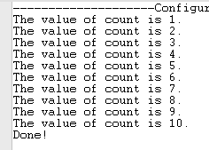

图 6-3 显示了你运行列表 6-2 程序后的结果。

（你得到的是你应得的。）列表 6-2 中的 `for statement` 首先将变量 `count` 设置为 `1`。然后该语句进行测试，确保 `count` 小于或等于 `10`（它确实如此）。接着，`for statement` 跃进并执行大括号之间的打印语句。（在游戏的早期阶段，计算机打印出 The value of count is 1。）最后，`for statement` 执行了其括号内的最后一件事——它将 `count` 的值加 `1`。

当 `count` 现在等于 `2` 时，`for statement` 再次检查确保 `count` 小于或等于 `10`。（是的，2 比 10 小……）因为测试通过了，`for statement` 回到大括号语句块中，并在屏幕上打印出 The value of count is 2。最后，`for statement` 执行了其括号内的最后一件事——它将 `count` 的值加 `1`，将 `count` 的值增加到 `3`。

以此类推。整个过程会反复不断地重复，直到在 10 次迭代之后，`count` 的值终于达到了 `11`。当这种情况发生时，对 `count` 小于或等于 `10` 的检查失败，循环执行结束。计算机跳转到紧随 `for statement` 之后的任何语句。在列表 6-2 中，计算机打印出 Done!。整个过程如图 6-4 所示。

### for statement 的结构

在单词 `for,` 之后，你始终要在括号中放入三个东西。这三个东西中的第一个被称为 `initialization`（初始化），第二个是 `expression`（表达式），第三个东西被称为 `update`（更新）。

```java
for ( initialization ; expression ; update )
```

括号中的三个项每项都起着其独特的角色：

- `initialization` 执行一次，当程序运行首次遇到 `for statement` 时。
- `expression` 被求值多次（在每次迭代之前）。
- `update` 也会被求值多次（在每次迭代结束时）。

如果有帮助，你可以把循环想象成它的文本被到处移动了：

```java
int count = 1;
for count <= 10 {
    out.print(“The value of count is “);
    out.print(count);
    out.println(“.”);
    count++;
}
```

你不能像这样写一个真正的 `for statement`。尽管如此，这也是语句各部分执行的顺序。

如果你在 `for loop` 的 `initialization` 中声明了一个变量，你就不能在循环外部使用该变量。例如，在列表 6-2 中，如果你尝试在循环结束后放置 `out.println(count)`，你会得到一个错误信息。

用 `for loop` 能做的任何事情也可以用 `while loop` 完成。选择使用 `for loop` 是一种风格和便利性的问题，而非必要性。

### “Al’s All Wet”的全球首演

列表 6-2 非常不错，但列表中的程序并没有做任何有趣的事。关于更引人注目的示例，请参见列表 6-3。在列表 6-3 中，我履行了在第 5 章中出的承诺。列表 6-3 中的程序打印了热门单曲“Al’s All Wet”的所有歌词。

### 列表 6-3：完整版“Al’s All Wet”歌曲

```java
import static java.lang.System.out;

class AlsWet {
    public static void main(String args[]) {
        for (int verse = 1; verse <= 3; verse++) {
            out.print(“Al’s all wet. ”);
            out.println(“Oh, why is all wet? ”);
            out.print(“Al’s all wet ‘cause “);
            out.println(“he’s standing in rain.”);
            switch (verse) {
                case 1:
                    out.println(“In the rain, the rain.”);
                    break;
                case 2:
                    out.println(“That’s because he a pain.”);
                    break;
                case 3:
                    out.println(“That’s because is a pain.”);
                    break;
            }
        }
    }
}
```

列表 6-3 很好，因为它结合了第 5 章和第 6 章中的许多思想。在列表 6-3 中，两个 `switch statements` 嵌套在一个 `for loop` 之中。其中一个 `switch statement` 使用了 `break statements`；另一个 `switch statement` 使用了穿透（fall-through）。随着 `for loop` 计数器 `verse` 的值从 1 变为 2 再变为 3，`switch statements` 中的所有 case 都被执行了。当我大胆地声称 `for statement` 是用来计数的时，我有一点夸大了事实。Java 的 `for statement` 是非常多功能的。你可以在与计数无关的情况下使用 `for statement`。例如，一个没有更新部分的语句，如 `for (i = 0; i < 10; )`，当循环内部的动作给变量 `i` 分配一个大数字时，它就会一直运行。你甚至可以创建一个括号内什么都没有的 `for statement`。循环 `for ( ; )` 运行，如果循环控制的是一台严肃的机器，那是件好事。通常，当你写一个 for statement 时，你是在计算重复某内容的次数。但实际上，你可以用 `for statement` 执行任何类型的重复。

### 重复直到你得到想要的结果（Java do 语句）

今天，我想得年轻而又莽一点。回顾图 6-2，注意 Java 的 `while loop` 是如何工作的。当执行进入 `while loop` 时，计算机检查并确保循环条件为真。如果条件不为真，循环内部的语句永远不会执行——即使只有一次。事实上，你可以轻松编写出一个语句永远不会执行的 `while loop`（尽管我我想不出你为什么会想这样做）。

```java
int twoPlusTwo = 2 + 2;

while (twoPlusTwo == 5) {
    out.println(“Are you kidding?”);
    out.println(“2 + 2 doesn’t equal 5”);
    out.print(“Everyone knows that”);
    out.println(“ 2 + 2 equals 3”);
}
```


尽管有这个愚蠢的 twoPlusTwo 例子，但 `while` 语句被证明是 Java 循环结构中功能最全的一种。特别是，`while` 循环适用于那些你必须“三思而后行”的情况。例如：“只要我的账户里有钱，每个月就写一张房押贷款支票。”

当你第一次遇到这个语句时，如果你的账户余额为零，你并不想写房押贷款支票——哪怕是一张都不写。

但某些时候（并不常见），你想要“先斩后奏”。例如，你正在要求用户提供回复的情况。也许用户的回复是合理的，但也可能不合理。如果不合理，你可能想再次询问。也许是用户的手指滑了一下，又或许用户没有理解该问题。

图 6-5 显示了一个删除文件的程序的几次运行。在删除文件之前，程序询问用户是否可以进行删除。如果用户回答 `y` 或 `n`，程序将按照用户的意愿继续。

但如果用户输入了任何其他字符（任何数字、大写字母、标点符号或任何内容），程序都会要求用户提供另一个回复。

**图 6-5：**
在删除文件之前进行检查。

要编写这个程序，你需要一个循环——一个反复询问用户是否应该删除文件的循环。该循环会一直询问，直到用户给出有意义的回复。现在，需要注意的是，循环在第一次询问用户之前不需要检查任何内容。事实上，在用户给出第一个回复之前，循环没有东西需要检查。循环并不是以“只要某事为真，就从用户处获取回复”开始的。相反，循环直接跳跃，获取用户的回复，然后检查该回复是否合理。

这就是为什么列表 6-4 中的程序使用了 `do` 循环（也称为 `do . . . while` 循环）。使用 `do` 循环，程序会直接进入并采取操作，然后检查一个条件以判断操作的结果是否合理。

如果结果合理，则完成循环执行。如果不合理，程序将回到循环顶部再次尝试。

**代码列表 6-4：**
**删除还是不删除**

```java
import java.io.File;
import static java.lang.System.out;
import java.util.Scanner;

class DeleteEvidence {
    public static void main(String args[]) {
        File evidence = new File("c:\\cookedBooks.txt");
        Scanner myScanner = new Scanner(System.in);
        char reply;
        do {
            out.print("Delete evidence? (y/n) ");
            reply = myScanner.findWithinHorizon(".", 0).charAt(0);
        } while (reply != 'y' && reply != 'n'); 
        if (reply == 'y') {
            out.println("Okay, here goes...");
            evidence.delete();
        } else {
            out.println("Sorry, buddy. Just asking.");
        }
    }
}
```

图 6-5 显示了列表 6-4 中代码的两次运行。程序接受小写字母 `y` 和 `n`，但不接受大写字母 `Y` 和 `N`。要让程序接受大写字母，请如下所示修改代码中的条件：

```java
do {
    out.print("Delete evidence? (y/n) ");
    reply = myScanner.findWithinHorizon(".", 0).charAt(0);
} while (reply != 'y' && reply != 'Y' && reply != 'n' && reply != 'N');
if (reply == 'y' || reply == 'Y')
```

图 6-6 显示了列表 6-4 中循环的控制流。使用 `do` 循环，twoPlusTwo 程序（之前所示）中出现的情况永远不会发生。

因为 `do` 循环在不测试条件的情况下执行其第一个动作，因此每个 `do` 循环都保证至少执行一次迭代。

**图 6-6：**
删除证据？
回复是 y 或 n 吗？
否 / 是
我们开始了
删除文件，或者不循环，删除文件（取决于回复）继续循环。

### 读取单个字符

在列表 5-3 中，用户在键盘上输入一个单词。`myScanner.next` 方法获取该单词并将其存放在名为 `password` 的 `String` 变量中。一切运行得非常良好，因为 `String` 变量可以同时存储多个字符，而 `next` 方法可以一次性读取多个字符。

但在列表 6-4 中，你对读取几个字符并不感兴趣。你期望用户输入一个字母——要么是 `y` 要么是 `n`。因此，你没有创建一个 `String` 变量来存储用户的回复。相反，你创建了一个 `char` 变量——一个一次只存储一个符号的变量。

Java API 没有 `nextChar` 方法。因此，为了读取适用于 `char` 变量的内容，你必须通变处理。在列表 6-4 中，这种通变方法如下：
`myScanner.findWithinHorizon(".", 0).charAt(0)`

`String` 变量可以包含许多字符，也可以只包含一个字符。但 `char` 变量只包含一个字符。String 变量和 `char` 变量必须被区别对待。

### Java 中的文件处理

在列表 6-4 中，实际的文件处理语句值得关注。这些语句涉及类、对象和方法的使用。关于这些内容的许多细节在其他章节中，例如第 7 章和第 9 章。尽管如此，你可以在 Java 语言中找到名为 `java.io.File` 的类。语句 `File evidence = new File("c:\\cookedBooks.txt");` 在计算机内存中创建一个新对象。这个对象由 `java.io.File` 类形成，描述了程序程序所需的关于磁盘文件的所有信息。（在 Java 中，当你想要在双引号字符串字面量内部表示反斜杠时，要使用双反斜杠。）从列表 6-4 的此处开始，变量 `evidence` 指磁盘文件 `c:\cookedBooks.txt`。

在你掌握了所有 `java.io.File` 的知识后，唯一需要知道的是 `evidence` 对象作为 `java.io.File` 类的实例，拥有一个 `delete` 方法。（我能呢？它在文档里。）当你调用 `evidence.delete()` 时，计算机就会删除该文件。

### 变量声明与块

由大括号围绕的一组语句形成一个块。如果你在块内部声明变量，通常你无法在块外部使用该变量。例如，在列表 6-4 中，如果你进行以下更改，将会得到错误消息：

```java
do {
    out.print("Delete evidence? (y/n) ");
    char reply = myScanner.findWithinHorizon(".", 0).charAt(0);
} while (reply != 'y' && reply != 'n');
if (reply == 'y')
```

由于 `char reply` 声明在循环的大括号内，在大括号之外任何地方使用 `reply` 名称都是不合理的。当你尝试编译这段代码时，你会得到错误消息。因此，在列表 6-4 中，你的手被束缚了。程序对 `reply` 变量的实际使用是在循环内部。但为了让该变量在循环结束后可用，你必须在循环之前声明 `reply`。在这种情况下，最好的办法是声明 `reply` 变量而不对其初始化。

欲了解更多关于变量初始化的内容，请参阅第 4 章。欲了解更多关于块，请参阅第 5 章。


我永远不会忘记第一次玩`Clue`妙案杀）的时候。我们是在尼加拉瀑布的一次家庭旅行中买下这款桌游的。（尼加拉瀑布？）我和表哥 Alan 在酒店房间里连续玩了好几个小时的游戏。我在我的小侦探笔记本上胡乱记录着复杂的推论。

有一次，我通过谎称我手里有三张牌来玩虚诈。Alan 上了下计，并做出了一个指控，而这三项全是错误的。

因为他输了游戏，而且因为我表现得那么自得意，他把我揍了一顿落落。那种感觉简直太极了。如果还有机会，我会再玩一遍。

本节内容适用于 `Java 5`、`Java 6` 或未来几年可能出现的任何更高版本。但本节的内容不适用于旧版本的 Java —— 比如 `1.3`、`1.4` 等版本。有关关于 Java 版本号的更多信息，请参阅第 2 章。

## 不需要那些该死的计数器

`Listing 6-2` 中的 `for` 循环从 `1` 计数到 `10`。它的朋友（`Listing 6-3` 中的 `for` 循环）计数 `1`、`2`、`3`。这种计数方式很好，但有时它并不是考虑问题最自然的方式。例如，考虑桌游 `Clue` 中所有可能的指控。嫌疑人并不是从 `1` 到 `6` 编号的，房间或武器也是。你可以对所有这些东西编号，但既然编程语言提供了一个更简单的解决方案，为什么还要费劲编号呢？

Java 的*增强型 for 循环*（enhanced for loop）让你可以在不创建计数变量的情况下遍历一组事物。你只需要定义这个组即可。`Listing 6-5` 展示了如何操作。

### 第 6 章：使用循环控制程序流

**Listing 6-5: “我指控 . . .”**

```java
import static java.lang.System.out;

class Clue {
    enum Suspect {mustard, plum, green, peacock, scarlet, white};
    enum Room {ballroom, kitchen, diningRoom, lounge, hall, study, library, billiardRoom, conservatory};
    enum Weapon {knife, candlestick, revolver, rope, leadPipe, wrench};

    public static void main(String args[]) {
        for (Suspect mySuspect : Suspect.values()) {
            for (Room myRoom : Room.values()) {
                for (Weapon myWeapon : Weapon.values()) {
                    out.print(mySuspect);
                    out.print(“ in the “);
                    out.print(myRoom);
                    out.print(“ with a “);
                    out.println(myWeapon);
                }
            }
        }
        Suspect killer = Suspect.peacock;
        Room sceneOfTheCrime = Room.study;
        Weapon murderWeapon = Weapon.leadPipe;
        out.println();
        out.print(“I accuse “);
        out.print(killer);
        out.print(“ in the “);
        out.print(sceneOfTheCrime);
        out.print(“ with a “);
        out.print(murderWeapon);
        out.println(".”);
    }
}
```

`Listing 6-5` 代码的输出有 `324` 行，所以我无法全部展示给你们。但前几行出现在`Figure 6-7` 中。首先，你看到芥末上校在大宴厅的闹剧。接着，你看到芥末在厨房的小花招。在运行的后期，当芥末所有的嬉戏都结束后，你又看到了莱姆教授同样的可能性。

**Figure 6-7:** `Listing 6-5` 中的代码开始运行。

`Listing 6-5` 有一个嵌套在循环中的循环中的循环。

- `Room` 循环嵌套在 `Suspect` 循环内部。
- `Weapon` 循环嵌套在 `Room` 循环内部。


声明 `numGuesses` 必须存储一个 `int` 值。该行接着提到，在所有可能的 `int` 值中，`numGuesses` 的初始值是 0。同样在列表 6-1 中，该行

```
Scanner myScanner = new Scanner(System.in);
```

声明 `myScanner` 必须引用一个 `Scanner` 对象。在所有此类对象中，`myScanner` 的初始值是一个从键盘获取按键（来自 `System.in`）的对象。

在这两类循环中，你都指定了一个值的范围。

你指定了变量在循环执行期间所取的值范围。在列表 6-2 中，你将 `count` 变量的值范围缩小到 1 到 10 的数字。在列表 6-5 中，你放开了手脚，说 `mySuspect` 可以是 `Suspect.values()` 中的每一个项。

### 第 6 章：使用循环控制程序流

你可以将 `values()` 应用于任何枚举类型的名称。事实上，要使用枚举类型创建增强型循环（enhanced for loop），你必须使用类似 `values()` 的东西。`Suspect.values()` 表达式代表你在 `Suspect` 枚举类型的声明中列出的所有项。因此，在列表 6-5 的循环中，`mySuspect` 变成芥末，然后是梅，然后是绿色，以此此类推。

当你将 `values()` 应用于枚举类型的名称时，你将得到一个属于该枚举类型的项数组。要了解关于数组的全部知识，请参阅第 11 章。

# 第二部分：编写你自己的 Java 程序

# 第三部分：大局观：面向对象编程

在这一部分 . . . 你读过或听过关于面向对象编程的任何内容吗？有时，所有的面向对象程序员似乎都属于一个小俱乐部。他们有秘密的握手、秘密的信号，并承诺不向任何外外透露面向对象编程的概念。嗯，机密性正在结束。在这一部分，我将消除面向对象编程的所有神秘色彩。我将逐步介绍这些概念，并用一或两个 Java 程序来说明每个概念。

# 第 7 章：用类和对象的角度思考

### 本章内容
- 像真正的面向对象程序员一样思考
- 在方法之间来回传递值
- 在你的面向对象代码中隐藏细节

作为计算机书籍的作者，我被反复告知过这一点——我不应该期望人们按照逻辑顺序阅读节和章节。人们会东看西看，挑选他们需要的，并跳过他们不想读的。考虑到这一点，我意识到你可能已经跳过了第 1 章。如果是这样，请不要感到内疚。你只需阅读以下来自第 1 章的信息即可在六十秒内弥补回来：由于 Java 是一种面向对象的编程语言，你的首要目标是描述类和对象。类是某种事物背后的思想。对象是类的具体实例。程序员定义一个类，计算机根据类的定义创建出个的的对象。

当然，你完全可以选择跳过这 60 秒的总结段落。如果是这样，你可能想挽回一些损失。你可以通过阅读以下对第 1 章的两个词的总结来这样做：类；对象。

### 定义类（成为账户意味着什么）

一个银行账户与另一个账户的区别是什么？如果你向银行家问出这个问题，你会听到一段长长的推销。银行家会描述利率、手续费、罚金——一整套流程。对你来说的是，我对这些都不感兴趣。相反，我想知道我的账户和你的账户有什么不同。毕竟，我的账户名为 `Barry Burd, trading as Burd Consulting`，而你的账户名为 `Jane Q. Reader, trading as Budding Java Expert.`。我的账户里有 $24.02。

（注：此处原文开始出现大量逻辑重复和断句，以下按原文顺序字面翻译）
我的账户里有 $24.02。

（此处省略原文中重复的句子描述，以保持逻辑连贯，但遵循不漏译原则）
24.02。我的账户里有 $24.02。
（原文后续重复内容翻译如下）

**图 7-1:**
- Account 的实例：`name` 芥末，`address` 222 赛空间
（重复内容）
- Account 的实例：`name` 杰恩，`address` 111 消费者街，`balance` 55.63

（此处为代码块对应翻译）
这些思想集中在列表 7-1 和 7-2 中。

**列表 7-1：成为账户意味着什么**
```java
class Account {
    String name;
    String address;
    double balance;
}
```

**列表 7-2：处理对象**
```java
import static java.lang.System.out;
class UseAccount {
    public static void main(String args[]) {
        Account myAccount;
        Account yourAccount;
        myAccount = new Account();
        yourAccount = new Account();
        myAccount.name = "Barry Burd";
        myAccount.address = "222 Cyberspace Lane";
        myAccount.balance = 24.02;
        yourAccount.name = "Jane Q. Public";
        yourAccount.address = "111 Consumer Street";
        yourAccount.balance = 55.63;
        out.print(myAccount.name);
        out.print(" (");
        out.print(myAccount.address);
        out.print(") has $");
        out.print(myAccount.balance);
        out.println();
        out.print(yourAccount.name);
        out.print(" (");
        out.print(yourAccount.address);
        out.print(") has $");
        out.print(yourAccount.balance);
    }
}
```


如果你一直在苦苦读第 4 到第 6 章节的内容，那么 `Account` 类的代码（列表 7-1）可能会让你大吃一惊。你真的能只用四行代码（正负一个大括号）就定义一个完整的 Java 类吗？你完全可以。事实上，列表 7-1 中的 `Account` 类非常代表了 Java 程序员在考虑“类（class）”时的想法。类是现有事物的组合。在列表 7-1 的 `Account` 类中，这些现有事物是两个 `String` 值和一个 `double` 值。

列表 7-2 中的代码定义了 `UseAccount` 类。这段代码需要一个 `main` 方法，而每个方法都必须放在某个类中。因此，将 `main` 方法放在一个名为 `UseAccount` 的类中。这个 `main` 方法有自己的变量——`yourAccount` 和 `myAccount`。

## 声明变量和创建对象

在某种意义上，列表 7-2 中 `main` 方法的前两行具有误导性。有些人读到 `Account yourAccount` 时，会认为它的意思是：

“`yourAccount` 是一个 `Account`，”或者“变量 `yourAccount` 指向 `Account` 类的实例。”这并不是第一行代码真正的含义。

相反，`Account yourAccount` 这行的意思是：“如果并且当让变量 `yourAccount` 指向某个东西时，那个东西将是 `Account` 类的实例。”那么，区别在哪里呢？

区别在于，仅仅声明 `Account yourAccount` 并不会让 `yourAccount` 变量指向一个对象。声明所做的只是预留了变量名 `yourAccount`，以便该名称最终可以指向 `Account` 类的实例。实际对象的创建直到代码后部分，当计算机执行 `new Account()` 时才会发生。

从技术上讲，当计算机执行 `new Account()` 时，你正在通过调用 `Account` 类的构造函数（constructor）来创建一个对象。关于这一点，我将在第 9 章中进行详细介绍。

当计算机执行赋值语句 `yourAccount = new Account()` 时，计算机创建一个新对象（`Account` 类的一个新实例），并让变量 `yourAccount` 指向该新对象。（正是等号让变量指向了新对象。）这种情况如图 7-2 所示。

执行后：
```
Account yourAccount;
yourAccount = new Account ();
yourAccount
```
**图 7-2：** 调用构造函数前后的状态。

为了验证我在最后几段中提出的观点，我在列表 7-1 的代码中额外添加了一行。我尝试在声明 `yourAccount` 之后、调用 `new Account()` 之前打印 `yourAccount.name`。

```
Account myAccount;
Account yourAccount;
out.println(yourAccount.name);
myAccount = new Account();
yourAccount = new Account();
```

当我尝试编译新代码时，收到了这条错误信息：`variable yourAccount might not have been initialized.`。所以这下就定论了。

在你执行 `new Account()` 之前，你无法打印对象的 `name` 变量；因为对象并不存在。

当变量具有引用类型时，仅仅声明变量是不够的。只有当你调用构造函数并使用 `new` 关键字时，才能获得对象。

### 初始化变量

在第 4 章中，我宣布你可以在声明变量的同时初始化基本类型变量。

```
int weightOfAPerson = 150;
```

你对引用类型变量也可以执行相同的操作，例如列表 7-2 中的 `myAccount` 和 `yourAccount`。你可以将列表 `main` 方法中的前四行合并为仅两行，如下：`Account myAccount = new Account();` 和 `Account yourAccount = new Account();`。

如果你这样合并代码行，就自动避免了我在上一节中描述的 `variable might not have been initialized` 错误。

有时你会遇到无法初始化变量的情况。但当你可以初始化时，这通常是一个加分项。

### 使用变量

在你理解并消化了 `main` 方法的前四行后，列表 7-2 中的剩余代码就是合逻辑且简单易懂的。你有三行代码给 `myAccount` 对象的变量赋值，三行代码给 `yourAccount` 对象的变量赋值，还有四行代码进行一些打印操作。程序的输出如图 7-3 所示。

**图 7-3：** 运行列表 7-1 和 7-2 中的代码。

## 编译与运行

### 多个类

第 3 到第 6 章中的每个程序都只包含一个类。这对于书的入门章节来说很棒。但在现实生活中，典型的程序包含成百甚至上千个类。跨越列表 7-1 和 7-2 的程序包含两个类。诚然，两个类并不像数千个类，但它是向该方向迈出的一步。

在实践中，大多数程序员会将每个类放在自己单独的文件中。当你创建一个像列表 7-1 和 7-2 那样的程序时，你会在计算机硬盘上创建两个文件。因此，来自这本书 CD-ROM 的代码有两个独立的文件——`Account.java` 和 `UseAccount.java`。

**图 7-4：** 一个项目中的两个文件。

要运行代码，只需按照运行任何单文件程序的方法操作：
1. **打开 Chapter07 工作空间。**
2. **将 Listings07-02 设置为活动项目。**
3. **选择 Compile Project。**
4. **选择 Execute Project。**

关于运行从 CD-ROM 复制的代码，请参见第 2 章。

创建一个包含多个类的新程序也很简单。
1. **遵循第 3 章“编写自己的代码”节的第 1 到第 7 步。** 通过这些步骤，你创建一个新项目。
2. **遵循第 3 章“编写自己的代码”节的第 8 到第 11 步创建多个类中的第一个类。** 如果你正在尝试列表 7-1 和 7-2 中的代码，那么第一个类名为 `Account`。
3. **再次遵循第 8 到第 11 步创建另一个类。** 如果你正在尝试列表 7-1 和 7-2 中的代码，那么第二个类名为 `UseAccount`。为 Java 程序中的每个类重复一次第 8 到第 11 步。
4. **遵循该章节的第 12 到第 15 步。** 这样做时，JCreator 会编译并运行你的程序。

当你同时处理多个类时，很容易遇到以下不友好的消息：`NoSuchMethodError: main`。当你尝试执行一个没有 `main` 方法的类时，就会看到这个。例如，列表 7-1 中的 `Account` 类没有 `main` 方法。如果 `Account` 类的代码是 JCreator 编辑面板中最前面的代码，并且你从 JCreator 主菜单中选择了 `Execute File`（而不是 `Execute Project`），你就会得到可怕的 `NoSuchMethodError`。要解决这个问题，始终确保你的项目有一个包含 `main` 方法的类，并始终选择 `Execute Project` 来运行你的代码。

## 在类中定义方法（显示账户）

想象一个包含两个账户信息的表格。（如果你很难想象这样的东西，请看表 7-1。）

**表 7-1：没有面向对象编程**

| 姓名 | 地址地址 | 余额 |
| :--- | :--- | :--- |
| Barry Burd | 222 Cyberspace Lane | 24.02 |
| Jane Q. Public | 111 Consumer Street | 55.63 |


# 第 7 章：面向类和对象的思考

在表 7-1 中，每个账户有三个东西——名称、地址和余额。在面向对象编程出现之前，就是这样做的。但面向对象编程涉及了思维方式的巨大转变。

通过面向对象编程，每个账户可以拥有名称、地址、余额以及一种显示方式。在面向对象编程中，每个对象都有其自己的内置功能。

账户知道如何显示自己。一个 `String` 可以告诉你它内部的字符是否与另一个字符串相同。一个 `PrintStream` 实例（例如 `System.out`）知道如何执行 `println`。在面向对象编程中，每个对象都有自己的方法。这些方法是小小的子程序，你可以调用它们来让对象为自己（或为了自己）做某些事情。

为什么这是一个好主意呢？它之所以好，是因为你让数据片段为自己负责。在面向对象编程中，所有与账户相关的功能都汇集在 `Account` 类的代码中。你关于字符串需要的所有知识都位于 `String.java` 文件中。任何与年份数字有关的内容（例如是两位还是四位数）都直接在 `Year` 类内部处理。所以，如果有人对你的 `Account` 类或 `Year` 类有疑问，他或她就知道去哪里寻找所有的代码。这太棒了！

现在想象一个增强后的账户表。在这个新表中，每个对象都有内置功能。每个账户都知道如何在屏幕上显示自己。表格的每一行都有自己的 `display` 方法副本。当然，你不需要太多的想象力就能想象出这张表。我恰好有一个你可以查看的表，就是表 7-2。

### 表 7-2：面向对象的方式

| 名称 | 地址 | 余额 | 显示 |
| :--- | :--- | :--- | :--- |
| Barry Burd | 222 Cyberspace Lane | 24.02 | `out.print. . . .` |
| Jane Q. Public | 111 Consumer Street | 55.63 | `out.print. . . .` |

一个能显示自己的账户

在表 7-2 中，每个账户对象都有四个东西——名称、地址、余额以及一种在屏幕上显示自己的方式。当你跳到面向对象的思维后，你就再也不会回头了。实现表 7-2 中思想的程序如代码列表 7-3 和 7-4 所示。

### 代码列表 7-3：账户显示自己

```java
import static java.lang.System.out;

class Account {
    String name;
    String address;
    double balance;

    void display() {
        out.print(name);
        out.print (“ (“);
        out.print(address);
        out.print(") has $”);
        out.print(balance);
    }
}
```

### 代码列表 7-4：使用改进后的 Account 类

```java
class UseAccount {
    public static void main(String args[]) {
        Account myAccount = new Account();
        Account yourAccount = new Account();
        myAccount.name = “Barry Burd”;
        myAccount.address = “222 Cyberspace Lane”;
        myAccount.balance = 24.02;
        yourAccount.name = “Jane Q. Public”;
        yourAccount.address = “111 Consumer Street”;
        yourAccount.balance = 55.63;
        myAccount.display();
        System.out.println();
        yourAccount.display();
    }
}
```

代码列表 7-3 和 7-4 的运行结果与代码列表 7-1 和 7-2 的运行结果一样。你可以回到图 7-3 查看操作过程。

在代码列表 7-3 中，`Account` 类包含四个东西——名称、地址、余额和一个显示方法。这些东西与表 7-2 中的四列相对应。因此，`Account` 类的每个实例都拥有一个名称、地址、余额和一种显示自己的方式。你调用这些东西的方式是非常统一一的。要引用存储在 `myAccount` 中的名称，你写道：

`myAccount.name`

要让 `myAccount` 在屏幕上显示自己，你写道：

`myAccount.display()`

唯一的区别是括号。当你调用一个方法时，在方法名后面加上括号。

### 方法的头部

再次查看代码列表 7-3 和 7-4。对 `display` 方法的调用位于 `UseAccount` 类的 `main` 方法内部。但 `display` 方法的声明位于 `Account` 类中。声明包含一个头部和一个体。

头部有两个单词和一些括号：

- 单词 `void` 告诉计算机，当调用 `display` 方法时，`display` 方法不会向调用它的地方返回任何内容。要看向调用它的地方返回内容的方法，请参见下一节。
- 单词 `display` 是方法的名称。每个方法都必须有一个名称。否则，你就没有办法调用该方法。
- 括号包含了你在调用方法时将传递给方法的所有内容。当你调用方法时，可以动态地向该方法传递信息。代码列表 7-3 中的 `display` 方法看起来很奇怪，因为方法头部的括号里什么都没有。这种“空”表示在你调用 `display` 方法时，没有向其传递任何信息。要看一个更复杂的例子，请参下一节。

### 在方法之间传递值（计算利息）

想象一下让某人去超市买面包。当你这样做时，你说：“去超市买点面包。”（在家里试试，你很快就能得到一个新鲜的面包！）当然，其他某个时候你又让同一个人去超市买香蕉。你说：“去超市买点香蕉。”这一切的意义何在呢？你有一个方法，并且你有一些在调用方法时传递给该方法的动态信息。该方法命名为 `goToSupermarketAndSome`。在 Java 中，方法调用看起来像：

`goToTheSupermarketAndSome(bread);`

`goToTheSupermarketAndSome(bananas);`

括号中的内容被称为 `parameters`（参数）或 `parameter lists`（参数列表）。有了参数，你的方法变得灵活得多。你不再是每次都获取相同的东西，而是可以一次让某去超市买面包，下一次买香蕉，第三次买鸟食。当你调用 `goToSupermarketAndSome` 方法时，你就在那时决定要要求什么。

当你的朋友从超市回来时会发生什么？“这是你让我买的面包，”朋友说。由于执行了你的愿望，朋友向你返回了东西。返回给你的东西被称为方法的 `return value`（返回值）。返回给你的东西的类型被称为方法的 `return type`（返回值类型这些概念在代码列表 7-5 和 7-6 中具体化。

### 代码列表 7-5：一个计算自身利息的账户

```java
import static java.lang.System.out;

class Account {
    String name;
    String address;
    double balance;

    void display() {
        out.print(name);
        out.print (“ (“);
        out.print(address);
        out.print(") has $”);
        out.print(balance);
    }

    double getInterest(double percentageRate) {
        return balance * percentageRate / 100.00;
    }
}
```

### 代码列表 7-6：计算利息


```java
yourAccount.name = "Jane Q. Public";
yourAccount.address = "111 Consumer Street";
yourAccount.balance = 55.63;
myAccount.display();
out.print(" plus $");
out.print(myAccount.getInterest(5.00));
out.println(" interest ");
yourAccount.display();
double yourInterestRate = 7.00;
out.print(" plus $");
double yourInterestAmount = yourAccount.getInterest(yourInterestRate);
out.print(yourInterestAmount);
out.println(" interest ");
}
```

`Listings 7-5` 和 `7-6` 中代码的输出如图 `Figure 7-5` 所示。在 `Listing 7-5` 中，`Account` 类有一个 `getInterest` 方法。该 `getInterest` 方法在 `Listing 7-6` 的 `main` 方法调用了两次。实际的账户余额和利率每次都不同。

**图 7-5：**
运行 `Listings 7-5` 和 `7-6` 中的代码。

- 在第一次调用中，余额为 24.02，利率为 5.00。第一次调用 `myAccount.getInterest(5.00)` 指的是 `myAccount` 对象及其内部的所有变量。（参见 `Figure 7-6`）。当进行此调用时，表达式表达式 `balance * percentageRate / 100.00` 代表 `24.02 * 5.00 / 100.00`。
- 在第二次调用中，余额为 55.63，利率为 7.00。在 `main` 方法中，在进行此第二次调用之前，变量 `yourInterestRate` 被赋值为 `7.00`。调用本身 `yourAccount.getInterest(yourInterestRate)` 指的是 `yourAccount` 对象及其内部的所有变量。（再次参见 `Figure 7-6`）。因此，当进行此调用时，表达式 `balance * percentageRate / 100.00` 代表 `55.63 * 7.00 / 100.00`。

**图 7-6：**
我的账户和你的 `myAccount` `yourAccount` 账户。

| Account | UseAccount |
| :--- | :--- |
| name: Barry | name: Jane |
| address: 222 Cyberspace Lane | address: 111 Consumer Street |
| balance: 24.02 | balance: 55.63 |

另一个 Account 类的实例。

顺带一下，`Listing 7-3` 中的 `main` 方法包含了两次对 `getInterest` 的调用。其中一次调用在参数列表中使用了字面量 `5.00`；另一个调用在参数列表中使用了变量 `yourInterestRate`。为什么一个调用使用字面量而另一个调用使用变量呢？没有原因。我只是想向你展示，这两种方法都是可以的。

### 向方法传递值

看看 `getInterest` 方法的头部。（当你阅读接下来的几个项目符号说明时，可以结合 `Figure 7-7` 中的图表直观地理解一些概念。）

- 单词 `double` 告诉计算机，当调用 `getInterest` 方法时，`getInterest` 方法会将一个 `double` 类型的值返回给调用它的地方。
- `getInterest` 方法体中的语句确认了这一点。该语句说 `return balance * percentageRate / 100.00`，而表达式 `balance * percentageRate / 100.00` 的类型是 `double`。（这是因为表达式中的所有内容——`balance`、`percentageRate` 和 `100.00`——都是 `double` 类型。）
- 当调用 `getInterest` 方法时，`return` 语句计算 `balance * percentageRate / 100.00` 并将计算结果传递给调用该方法的代码。
- 单词 `getInterest` 是方法的名称。当你在编写 `UseAccount` 类代码时，调用该方法时使用的名称。
- 括号包含了你在调用方法时传递给方法的所有内容。当你调用一个方法时，你可以动态地向该方法传递信息。这些信息就是方法的参数列表。

`getInterest` 方法的头部显示 `getInterest` 方法接收一个信息，且该信息必须是 `double` 类型。

```java
double getInterest(double percentageRate)
```

果然，如果你查看对 `getInterest` 的第一次调用（在 `useAccount` 类的 `main` 方法中），该调用中包含数字 `5.00`。而 `5.00` 是一个 `double` 字面量。当我调用 `getInterest` 时，我正在给方法传递一个 `double` 类型的值。如果你不记得字面量是什么，请参见第 4 章。

对 `getInterest` 的第二次调用也是如此。在 `Listing 7-6` 的底部附近，我调用了 `getInterest`并将 `yourInterestRate` 传递给参数列表。对我来说的是，我将 `yourInterestRate` 声明为 `double` 类型。

```java
double getInterest(double percentageRate)
```

**图 7-7：**
`getInterest` 头部。

### 从 getInterest 方法返回值

当 `getInterest` 方法被调用时，方法执行其体中的唯一语句：`return` 语句。`return` 语句计算 `balance * percentageRate / 100.00`。

如果 `balance` 恰好是 24.02，`percentageRate` 是 5.00，那么表达式的值为 `1.201`——大约是 $1.20。（由于计算机完全用 0 和 1 工作，计算机计算这个数字时会有偏差。计算机得到的是 `1.2009999999999998`。这是人类必须接受的。）

无论如何，在值计算出来后，计算机执行 `return`，将值传回 `main` 中调用 `getInterest` 的地方。在过程的该点，整个方法调用——`myAccount.getInterest(5.00)`——获得了值 `1.2009999999999998`。调用本身位于 `println` 内部：

```java
out.println(myAccount.getInterest(5.00));
```

因此，`println` 的含义变为：`out.println(1.2009999999999998);`。

值返回方法调用的整个过程如图 `Figure 7-9` 所示。

如果方法返回任何内容，调用该方法就是一个带有值的表达式。该值可以被打印、赋值给变量、与其他任何内容相加，或者进行任何操作。你可以对任何其他类型的值进行任何操作，都可以对方法调用进行操作。

```java
double getInterest(double percentageRate) {
    return balance * percentageRate / 100.00;
}
```

**图 7-9：**
方法调用是一个带有值的表达式。
```java
out.println( myAccount.getInterest(5.00) );
```


回回图 7-5，你可能担心我账户的利息只有 $1.2009999999999998。看起来，银行偷走了我 200 万亿分之一美分。我应该直接去那里要求拿回公平的利息。也许你和我应该一起去。我们要去那家老银行闹一闹，揭穿这个骗局。如果我猜得没错，这是一个大大的*香肠骗局（salami scam）*的一部分。在香肠骗局中，有人会从数百万账户中切下微小的一片。

人们没有注意到自己极其微小的损失，但那个切切片的人收集的钱足够让他快速逃到巴巴多斯（或者买一整卡车的香肠）。

但是，等一下！没有什么能激励你和我一起去银行。

再次查看图 7-5，我发现你领先了一步。根据我的计算，程序多付了你 300 万亿分之一美分。

我们两个加起来，领先了十万分之一美分。怎么回事？

嗯，因为计算机使用 0 和 1，而且没有无限的空间来进行计算，所以像图 7-5 所示的不准确之处是不可避免的。你能做的最好的就是以更合理的方式显示数字。你可以对数字进行四舍五入，并只显示小数点后的两位，Java API（应用程序接口）中的一些方便工具可以提供帮助。代码如列表 7-7 所示，理想的结果显示在图 7-10。

#### 列表 7-7：让你的数字看起来正确

```java
import static java.lang.System.out;

class UseAccount {
    public static void main(String args[]) {
        Account myAccount = new Account();
        Account yourAccount = new Account();
        myAccount.balance = 24.02;
        yourAccount.balance = 55.63;
        double myInterest = myAccount.getInterest(5.00);
        double yourInterest = yourAccount.getInterest(7.00);

        out.printf("$4.2f\n", myInterest);
        out.printf("$5.2f\n", myInterest);
        out.printf("$%.2f\n", myInterest);
        out.printf("$3.2f\n", myInterest);
        out.printf("$%.2f $%.2f", myInterest, yourInterest);
    }
}
```

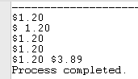

**图 7-10：** 看起来像金额的数字。

在运行列表 7-7 中的代码之前，你必须将两个类放入你的 JCreator 项目中。一个类是列表 7-7 中的代码；另一个类是 `Account` 类，就像列表 7-5 中的那个一样。

列表 7-7 使用了一个名为 `printf` 的方便方法。当你调用 `printf` 时，始终要在调用的括号内放入至少两个参数。

- **第一个参数是格式化字符串。** 格式化字符串使用奇奇怪怪的代码来精确描述其他参数的显示方式。
- **所有其他参数（第一个之后）都是要显示的值。**

看列表 7-7 中最后一次 `printf` 调用。第一个参数的格式化字符串有两个数字占位符。第一个占位符（`%.2f`）描述了 `myInterest` 的显示。第二个占位符（另一个 `%.2f`）描述了 `yourInterest` 的显示。要确切了解这些格式化字符串是如何工作的，请参见图 7-11 到 7-15。

**图 7-11：** `"$4.2f\n"`
计算机显示的内容：
- 显示一个美元符号。
- 换行。
- $1.20
- 使用至少四个位置来显示数字，并在小数点右侧保留两个位置。
- “一个数字”是第二个参数（`myInterest` 的值）。

**图 7-12：** `"$5.2f\n"`
计算机显示的内容：
- 显示一个美元符号。
- 换行。
- $ 1.20
- 使用至少五个位置来显示数字，并在小数点右侧保留两个位置。
- 因为 `myInterest` 只占了四个位置，所以会在显示 `myInterest` 时多显示一个额外的空格。

**图 7-13：** `"$%.2f\n"`
计算机显示的内容：
- 显示一个美元符号。
- 换行。
- $1.20
- 使用适当指定的多个位置来显示精确数字，并在小数点右侧保留两个位置。

**图 7-14：** `"$3.2f\n"`
计算机显示的内容：
- 显示一个美元符号。
- 换行。
- $1.20
- 使用至少三个位置来显示数字，并在小数点右侧保留两个位置。
- 三个不够，所以计算机使用四个位置来显示值。

**图 7-15：** `"$%.2f $%.2f"`
计算机显示的内容：
- 显示一个美元符号。
- $1.20 $3.89
- 显示第二个参数（`myInterest`）的值。
- 显示第三个参数（`yourInterest`）的值，并在小数点右侧保留两个位置。
- 显示一个空格和美元符号。
- 使用格式字符串显示多个值。

要了解更多使用 `printf` 方法及其格式化字符串的示例，请参见第 8 章和第 9 章。关于 `printf` 方法及其格式化字符串的完整列表，请参见 API 文档中的 `java.util.Formatter` 页面。

### 使用访问器方法隐藏细节（为什么你不应该微管理自动取款机）

放下这本书，带上你的帽子。你一直是如此忠实的读者，我要请你吃午饭！

我只有一个小问题。我手有点紧。你介意我们在去午饭的路上顺便去趟自动取款机取点钱吗？另外，我们需要使用你的账户。我的账户有点低。

### 良好的编程

在良好的计算机编程实践中，有一个词比其他任何词都重要——*简单*。当你编写复杂的代码时，最不想处理的就是别人命名错误的变量、晦涩的解决方案或者是聪明而拙劣的临时补丁。你需要的是一个整洁的接口，让你只解决自己的问题，而不是别人的问题。

在我早之前描述的自动取款机场景中，大问题在于机器的设计迫使你去考虑别人的担忧。当你应该考虑如何吃午饭时，你却在考虑变量和存储位置。


本节介绍的是安全（safety），而非安全防护（security）。安全代码防止你犯无意的编程错误。而安全防护代码（完全是另一个话题）则防止恶意黑客造成蓄意的破坏。

这意味着与计算机程序各个方面相关的任何东西都必须是简单的。对吧？不，事实并非如此。有时候，为了从长远来看让事情简单，你必须在前期做好大量的准备工作。制造自动取款机（ATM）的人付出了巨大努力，以确保机器是防误操作的。机器的界面带有屏幕信息和按钮，这使得机器变成了一个非常复杂但经过精心设计的设备。

关键点在于，让事情看起来简单需要一些规划。在面向对象编程中，让事情看起来简单的方法之一是防止类外部代码直接使用类内部定义的变量。看一眼 `Listing 7-1` 中的代码。你正在一家公司工作，该公司刚刚为 `Account` 类的代码花费了 1000 万美元。（每行就超过 150 万美元！）。现在你的任务是编写 `UseAccount` 类。你想写：

```java
myAccount.name = “Barry Burd”;
```

但这样做会让你过深地介入 `Account` 类的内部。毕竟，使用自动取款机的人是不被允许编写机器变量的。他们不能使用机器的键盘输入语句：

```java
balanceOnAccount29872865457 = balanceOnAccount29872865457 + 1000000.00;
```

相反，他们通过按钮以按顺序的方式完成工作。这就是程序员实现安全性和简单性的方法。

因此，为了保持事情良好且有序，你需要修改 `Listing 7-1` 中的 `Account` 类，禁止使用如下的语句：`myAccount.name = “Barry Burd”;` 和 `out.print(yourAccount.balance);`。

但是，这显然带来了一个问题。你是编写 `UseAccount` 类代码的人。如果你无法写 `myAccount.name` 或 `yourAccount.balance`，你该如何完成任何工作呢？

答案在于所谓的访问器方法（accessor methods）。这些方法在 `Listings 7-8` 和 `7-9` 中得到了演示。

### Listing 7-8: 隐藏这些变量

```java
class Account {
    private String name;
    private String address;
    private double balance;

    public void setName(String n) {
        name = n;
    }

    public String getName() {
        return name;
    }

    public void setAddress(String a) {
        address = a;
    }

    public String getAddress() {
        return address;
    }

    public void setBalance(double b) {
        balance = b;
    }

    public double getBalance() {
        return balance;
    }
}
```

### Listing 7-9: 调用访问器方法

```java
import static java.lang.System.out;

class UseAccount {
    public static void main(String args[]) {
        Account myAccount = new Account();
        Account yourAccount = new Account();
        myAccount.setName(“Barry Burd”);
        myAccount.setAddress(“222 Cyberspace Lane”);
        myAccount.setBalance(24.02);
        yourAccount.setName(“Jane Q. Public”);
        yourAccount.setAddress(“111 Consumer Street”);
        yourAccount.setBalance(55.63);
        out.print(myAccount.getName());
        out.print(" (“);
        out.print(myAccount.getAddress());
        out.print(") has $”);
        out.print(myAccount.getBalance());
        out.println();
        out.print(yourAccount.getName());
        out.print(" (“);
        out.print(yourAccount.getAddress());
        out.print(") has $”);
        out.print(yourAccount.getBalance());
    }
}
```

运行 `Listings 7-8` 和 `7-9` 中的代码与运行 `Listings 7-1` 和 `7-2` 没有区别。这两个程序的运行结果已在 `Figure 7-3` 中显示。巨大的区别在于 `Listing 7-8` 中，`Account` 类强制了对其内部变量的精心控制的使用。

### 公共生活与私人梦想：使变量名不可访问

注意在 `Account` 类每个变量声明前都增加了 `private` 单词。`private` 是 Java 关键字。当变量被声明为 `private` 时，类外部的代码就无法直接引用该变量。因此，如果你在 `Listing 7-9` 的 `UseAccount` 类中放入 `myAccount.name = “Barry Burd”`，就会得到错误 `name has private access`。`UseAccount` 的程序员不能引用 `myAccount.name`，而是必须调用 `setName` 或 `getName`。这些 `setName` 和 `getName` 方法被称为访问器方法，因为它们提供了对 `Account` 类变量 `name` 的访问。（实际上，`accessor method` 术语并不是 Java 语言的正式组成部分。进一步来说，`setName` 被称为 `setter` 方法，而 `getName` 被称为 `getter` 方法。）访问器方法的另一个常用术语是 `bean method`。`bean method` 一词源于 JavaBeans 世界——这是一种将 Java 程序插入到现有图形界面环境的方法。由于 JavaBeans 极度依赖访问器方法，许多人将访问器方法与 JavaBeans 规范联系起来。使用 JCreator 的专业版，你不需要自己输入访问器方法。首先你输入一个像 `private String name;` 的变量声明。然后，在 JCreator 的菜单栏中选择 `Insert Bean Methods`。在弹出的对话框中确认默认值后，JCreator 就会创建访问器方法并将它们添加到你的代码中。

注意 `Listing 7-8` 中所有的 setter 和 getter 方法都声明为 `public`。这确保了任何地方的人都可以调用这些方法。要了解更多关于 `public` 和 `private` 关键字的知识，请参见 `Appendix B` 和第 15 章（第 15 章在光盘中）。

再次思考自动取款机。使用 ATM 的人无法输入直接更改其账户余额变量值的命令，但存款百万美元支票的程序是易于遵循的。制造机器的人知道，如果支票存款程序复杂，会有很多客户搞得一糟。所以这就是道理——让不该做的事情变得不可能，并确保应该做的事情变得简单。

setter 和 getter 方法并不是神不可侵的。你不需要编写任何不会用到的 setter 或 getter 方法。例如，在 `Listing 7-8` 中，我可以省略 `getAddress` 方法的声明，一切仍然运行正常。我这样做唯一的问题是，任何其他想使用我的 `Account` 类并获取现有账户地址的人都会遇到麻烦。

当你创建一个设置余额变量值的方法时，你不必将其命名为 `setBalance`。你可以将其命名为 `tunaFish` 或任何你喜欢的名字。问题在于，`setVariablename` 命名约定（set 部分小写，Variablename 部分首字母大写）是 Java 编程领域公认的风格约定。


如果你不遵循约定，就会会让其他 Java 程序员感到一头雾水。如果你的集成开发环境具有拖放式 GUI 设计能力，你可能会暂时失去该能力。（有关拖放式 GUI 设计的介绍，请参阅第 2 章。）

当你调用设置器方法（setter method）时，你向它传递一个与被设置类型相同的值。

这就是为什么在代码 7-9 中，你使用类型为 `double` 的参数调用 `yourAccount.setBalance(55.63)`。相比之下，当你调用访问方法（getter method）时，你通常不需要向该方法传递任何值。这就是为什么在代码 7-9 中，你带有一个空参数列表调用 `yourAccount.getBalance()`。偶尔，你可能想用一条语句获取并设置一个值。要给账户现有余额增加 1 美元，你可以写成 `yourAccount.setBalance(yourAccount.getBalance() + 1.00)`。

### 使用访问器方法强制规则

回到代码 7-8，快速查看 `setName` 方法。想象将方法的赋值语句放在一个 `if` 语句中。

```
public void setName(String n) {
    if (!n.equals("")) {
        name = n;
    }
}
```

现在，如果负责 `UseAccount` 类的程序员编写了 `myAccount.setName("")`，对 `setName` 的调用将产生任何影响。此外，由于 `name` 变量是私有的，以下语句在 `UseAccount` 类中是非法的：

```
myAccount.name = "";
```

当然，像 `myAccount.setName("Joe Schmoe")` 的调用仍然有效，因为“Joe Schmoe”不等于空字符串 `""`。

这很酷。通过私有变量和访问器方法，你可以防止他人为账户名称变量分配空字符串。通过更复杂的 `if` 语句，你可以执行任何你想要的规则。

# 第 8 章：节省时间和金钱：重用现有代码

### 本章内容
- 为旧代码注入新生命
- 调整你的代码
- 在不花费巨资的情况下进行更改

从前，有一位美丽的公主。当公主满 25 岁时（这是力量、外貌和良好道德品质的最佳年龄），她慈祥的父亲带给她一个精美金盒里的礼物。公主急于想知道盒子里有什么，于是撕掉了金色的包装纸。

当盒子终于打开时，公主欣喜了。令她惊讶的是，她的父亲给了她一直一直想要的东西——一个始终运行正确的计算机程序。这个程序执行了公主想要的所有事情，而且完全按照她想要的方式执行。公主很开心，她那慈祥的老父亲也同样开心。

随着时间的推移，这个计算机程序从未出错过。多年来，公主改变了她的需求，对生活有了更高的期望，提出了越来越多的要求，扩展了她的事业，追求更多的成就感，兼顾丈夫和孩子的需求，精简预算，并寻求灵魂的宁静。在整个过程中，这个程序始终是她稳定、忠实的伴侣。

随着公主老去，程序也随她一起老了。一天晚上，当她坐在炉边时，向程序提出了一个难题性的问题。“你是怎么做到的？”她问，“你是如何做到一次又一次、年复一年给出正确答案的？”

“洁净的生活，”程序回答道，“我每天游泳二十个应用，我带 C++ 去 Word 杀病毒，我避开对数算法，我适度链接 Java，我向 bug 说 GNU，我不通过抽烟来备份，我从不承担超出我队列能力的任务。”

不用说，公主惊呆了。

### 定义类（成为一名员工意味着什么）

如果每种软件都能完全按照你的意愿运行，那有多好啊？在一个理想的世界里，你只需要购买一个程序，让它立即运行，无缝地插入到新场景中，并在你的需求变化时轻松地更新它。遗憾的是，这种软件并不存在。（*根本没有*这种软件存在。）事实是，无论你想做什么，你都能找到可以完成部分任务的软件，但不能完成全部。

这就是面向对象编程之所以如此成功的原因之一。多年来，公司购买预先编写的代码，却发现代码并没有按照它们想要的方式运行。那么公司对此该怎么办呢？他们开始胡乱修改代码。他们的程序员深入挖掘程序文件，更改变量名，移动子程序的位置，重做公式，并通常让代码变得更糟。现实情况是，如果一个程序没有实现你想要的功能，你就可以修改它。

通过面向对象编程，你可以利用内置功能，添加你自己的新功能，并覆盖不符合你需求的功能。

### 关于员工的最后定论

当你编写面向对象的程序时，你从考虑数据开始。那么，什么是账户？什么是按钮？什么是员工？

在本章的第一个示例中，员工是一个拥有姓名和职位名称的人。当然，员工还有其他特征，但目前我坚持基础知识。代码 8-1 中的代码定义了成为一名员工意味着什么。

**代码 8-1：什么是员工？**

```
import static java.lang.System.out;

class Employee {
    private String name;
    private String jobTitle;

    public void setName(String nameIn) {
        name = nameIn;
    }

    public String getName() {
        return name;
    }

    public void setJobTitle(String jobTitleIn) {
        jobTitle = jobTitleIn;
    }

    public String getJobTitle() {
        return jobTitle;
    }

    public void cutCheck(double amountPaid) {
        out.printf("Pay to the order of %s ", name);
        out.printf("(%s) ***$", jobTitle);
        out.printf("%,.2f\n", amountPaid);
    }
}
```

根据代码 8-1，每个员工有七个特征。其中两个特征非常简单。每个员工都有姓名和职位名称。员工还有什么呢？每个员工都有四个方法来处理姓名和职位名称的值。这些方法是 `setName`、`getName`、`setJobTitle` 和 `getgetTitle`。这些方法（访问方法）在第 7 章介绍过。

除此之外，每个员工都有一个 `cutCheck` 方法。想法是，编写工资单的方法必须属于某个类。因为工资单中的大部分信息都是针对特定员工定制的，所以你不妨将 `cutCheck` 方法放在 `Employee` 类中。

有关 `cutCheck` 方法中 `printf` 用的详细信息，请参阅本章稍后的“开具支票”章节。

### 良好地使用你的类


列表 8-1 中的 `Employee` 类没有 `main` 方法，因此没有执行代码的起点。为了弥补这一缺陷，程序员必须编写一个带有 `main` 方法的独立程序，并使用该程序来创建 `Employee` 实例。（若要了解如何单独编译两个程序，请参阅第 7 章。）列表 8-2 显示了一个带有 `main` 方法的类——该类对列表 8-1 中的代码进行了测试。

**列表 8-2:** 
**编写薪资支票**

```java
import java.util.Scanner;
import java.io.File;
import java.io.IOException;

class DoPayroll {
    public static void main(String args[]) throws IOException {
        Scanner diskScanner = new Scanner(new File("EmployeeInfo.txt"));
        for (int empNum = 1; empNum <= 3; empNum++) {
            payOneEmployee(diskScanner);
        }
    }

    static void payOneEmployee(Scanner aScanner) {
        Employee anEmployee = new Employee();
        anEmployee.setName(aScanner.nextLine());
        anEmployee.setJobTitle(aScanner.nextLine());
        anEmployee.cutCheck(aScanner.nextDouble());
        aScanner.nextLine();
    }
}
```

列表 8-2 中的 `DoPayroll` 类有两个方法。其中一个方法 `main` 调用了另一个方法 `payOneEmployee` 三次。在每次循环中，`payOneEmployee` 方法都会从 `EmployeeInfo.txt` 文件获取内容，并将这些内容传递给 `Employee` 类的方法。

以下是变量名 `anEmployee` 如何被重用和循环：

- 第一次调用 `payOneEmployee` 时，语句 `anEmployee = new Employee()` 使 `anEmployee` 指向一个新对象。
- 第二次调用 `payOneEmployee` 时，计算机再次执行相同的语句。这创建了 `anEmployee` 变量的一个新实例，它指向一个全新的对象。
- 第三次循环时，所有相同的事情再次发生。一个新的 `anEmployee` 变量最终指向了第三个对象。

整个过程如图 8-1 所示。

**Employee 类的**
**另一个 Employee 类的**
**第三个 Employee 类的**
**实例**
**实例**
**实例**
name Barry
name Harriet
name You
jobTitle CEO
jobTitle Captain
jobTitle Exec
**Employee**
**图 8-1:** 三次调用 `DoPayroll` 的第 1, 2, 3 次 `payOneEmployee` 方法：`anEmployee`、`anEmployee`、`anEmployee`。


列表 8-1 有三次 `printf` 调用。每个 `printf` 调用都有一个格式字符串（例如 `(%s) ***$`）和一个变量（例如 `jobTitle`）。每个格式字符串都有一个占位符（例如 `%s`），它决定了变量值显示的位置和显示方式。

例如，在第二个 `printf` 调用中，格式字符串有一个 `%s` 占位符。这个 `%s` 为 `jobTitle` 变量的值留了位置。根据 Java 的规则，`%s` 表示法始终为字符串留出位置，果然如此，在列表 8-1 中变量 `jobTitle` 被声明为 `String` 类型。括号和其他一些字符包围着 `%s` 占位符，因此在程序的输出中，每个职位标题都被括号包围。（参见图 8-2。）**图 8-2:** 每个人都得到了薪水。

回到列表 8-1，注意 `%,.2f` 占位符内部的逗号。逗号告诉程序使用“分组分隔符”（grouping separators）。这就是为什么在图 8-2 中，你看到的是 `$5,000.00`、 `$7,000.00` 和 `$10,000.00`，而不是 `$5000.00`、 `$7000.00` 和 `$10000.00`。

分组分隔符因国家而异。例如，在法国，写数字千（mille）时写作 `1 000,0`。Java 可以通过 `out.print(new java.util.Formatter().format(java.util.Locale.FRANCE, "%,.2f", 1000.00))` 这样的语句自动将你的数字法语化。详细信息，请参阅 Java `Formatter` 和 `Locale` 类的 API（应用程序编程接口）文档。

### 处理磁盘文件（一个小插曲）

在之前的章节中，程序从计算机键盘读取字符。但列表 8-2 中的代码是从特定文件读取字符的。该文件（名为 `EmployeeInfo.txt`）位于你计算机的硬盘上。

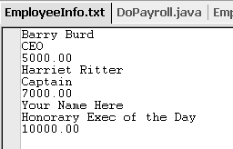

这个 `EmployeeInfo.txt` 文件就像一个文字处理文档。文件可以包含字母、数字。与文字处理文档不同，`EmployeeInfo.txt` 文件不包含斜体、加粗或字体大小。`EmployeeInfo.txt` 文件仅包含你输入的普通字符。

### 在文件中存储数据

当你你编写自己的代码时，可能需要创建像我的 `EmployeeInfo.txt` 这样的文件。以下是操作方法：

1. 在文件视图面板中，右键点击项目名称。然后从弹出的右键菜单中选择 `Add`➪`New File`。

JCreator 的文件向导将打开到 File Path 标签页。

查看向导窗口左侧的文件向导标签页名称（`File Type` 和 `File Path`）。确保 `File Path` 名称已高亮显示。如果不是，请在继续下一步之前点击 `File Path` 名称。

2. 在 `Name` 字段中输入你的新数据文件的名称。


你可以输入任何计算机认为有效的的文件名。在本节的示例中，我使用了 `EmployeeInfo.txt`，但其他名称如 `EmployeeInfo.dat`、`EmployeeInfo` 或 `Employees123.01.dataFile` 也是可以的。我尽量避免使用引起麻烦的名字（包括简短且无信息的名字以及包含空格的名字），但你选择的名称完全取决于你（以及你的计算机操作系统、你老板的心情以及你客户的规范）。

在 `File Path`（文件路径）选项卡的 `Name`（名称）字段中始终包含一个点。如果文件名没有扩展名，请在名称末尾添加一个点。例如，为了创建一个名为 `EmployeeInfo` 的文件（而不是 `EmployeeInfo.txt` 或 `EmployeeInfo.dat`），请按照此处所示的内容精确输入 `EmployeeInfo.`。如果你没有在 `Name` 字段的任何地方输入点，`JCreator` 会为文件名添加默认扩展名（将 `EmployeeInfo` 转换为 `EmployeeInfo.java`）。

### 第 8 章：节省时间与金钱：重用现有代码

### 3. 点击 Finish（完成）。

文件名显示在 `JCreator` 的 `File View`（文件视图）面板中。一个带有新文件名的标签出现在 `JCreator` 的 `Editor`（编辑器）面板中。

### 4. 在 Editor 面板中输入文本。

为了创建本节的示例，我输入了图 8-3 所示的文本。要创建你自己的示例，请输入你的程序在运行时所需的任何文本。

本书的网站为需要不使用 `JCreator` 创建数据文件的读者提供了提示。这包括针对 Linux、Unix 和 Macintosh 环境的说明。

## 复制和粘贴代码

在几乎任何计算机编程语言中，从文件中读取数据都是很复杂的。你需要添加额外的代码行来告诉计算机做什么。

有时你可以从他人的代码中复制并粘贴这些行。

例如，你可以遵循列表 8-2 中的模式：

```java
/*
* Listing 8-2 中的模式
*/
import java.util.Scanner;
import java.io.File;
import java.io.IOException;

class SomeClassName {
    public static void main(String args[])
    throws IOException {
        Scanner scannerName = new Scanner(new File("SomeFileName"));
        // 此处编写一些代码
        scannerName.nextInt();
        scannerName.nextDouble();
        scannerName.next();
        scannerName.nextLine();
        // 此处编写一些代码
    }
}
```

你想从文件中读取数据。你首先想象自己正在从键盘读取。将通常的 `Scanner` 和 `next` 代码放入你的程序中。然后从列表 8-2 模式中添加一些额外项目：

- 添加两个新的 `import` 声明——一个用于 `java.io.File`，另一个用于 `java.io.IOException`。
- 在你的方法头部中输入 `throws IOException`。
- 在调用 `new Scanner` 时输入 `new File("")`。
- 取一个已经存在于你硬盘硬盘上的文件。在引号内输入该文件名。
- 取出你用于扫描器名称的单词。在调用 `next`、`nextInt`、`nextDouble` 等时重用该单词。

偶尔，复制和粘贴代码可能会给你带来麻烦。也许你正在编写的程序不符合简单的列表 8-2 模式。你需要对模式进行一些微调。但为了微调模式，你需要理解该模式背后的一些思想。

这就是下一节为你提供救助的地方。它涵盖了这些部分思想。

### 从文件读取

在之前的章节中，程序从计算机键盘读取字符。这些程序使用像 `Scanner`、`System.in` 和 `nextDouble` 等东西——这些都是 Java API 中定义的工具。列表 8-2 中的 `DoPayroll` 程序为这个故事注入了新的活力。程序不再从键盘读取字符，而是从 `EmployeeInfo.txt` 文件读取字符。该文件存在于你计算机的硬盘上。

要从文件中读取字符，你使用一些与你从键盘读取字符时相同的工具。你使用 `Scanner`、`nextDouble` 以及其他道具。但这些道具之外，你还有几道额外的障碍需要跨越。以下是列表：

- **你需要一个新的 File 对象。** 更确切地说，你需要 API 中 `File` 类的一个新实例。你通过诸如 `new File("EmployeeInfo.txt")` 的代码来获取这个新实例。

引号中的内容是文件名——你计算机硬盘上的一个文件。该文件包含了之前在图 8-3 中所示的字符。

到此为止，术语把小问题说得大。了然，我使用了 `new File object` 和 `new File instance` 这些短语，但你所做的只是让 `new File("EmployeeInfo.txt")` 代表硬盘上的一个文件。在你将 `new File("EmployeeInfo.txt")` 放入 `new Scanner` 之后

```java
Scanner diskScanner = new Scanner(new File("EmployeeInfo.txt"));
```

你就可以忘记所有关于新 File 的事务了。从代码的该点开始，`diskScanner` 代表计算机硬盘上的 `EmployeeInfo.txt` 文件名。（`diskScanner` 这个名称代表硬盘上的一个文件，就像在之前的示例中，`myScanner` 名称代表计算机键盘一样。）

在列表 8-2 中创建一个新的 `File` 对象就像在同一列表的后面创建一个新的 `Employee` 对象。就像第 7 章的示例中创建一个 `Account` 对象。区别在于 `Employee` 和 `Account` 类定义在本书的示例中。`File` 类定义在 Java API 中。

当你通过 `new Scanner` 连接磁盘文件时，不要忘记 `File` 部分。如果你写 `new Scanner("EmployeeInfo.txt")` 而没有 `new File`，编译器不会介意。（选择 Build Project 会给你一个友好的 Process completed 。）但当你运行代码时，你不会得到预期的结果。

- **你必须通过全名引用 File 类——java.io.File。**
你可以通过类似于列表 8-2 中的 `import` 声明来实现。

或者，你可以在代码中充斥如下语句：
```java
Scanner diskScanner = new Scanner(new java.io.File("EmployeeInfo.txt"));
```

- **你需要 IOException 子句。** 当你的程序连接 EmployeeInfo.txt 时，可能会出现很多问题。其中，你的硬盘可能没有名为 `EmployeeInfo.txt` 的文件。另外，EmployeeInfo.txt 可能在错误的目录下。为了应对这种灾难，Java 编程语言采取了一些措施。语言要求在涉及磁盘文件时，你承认可能的危险。

你可以通过几种可能的方法承认这些危险，但最简单的方法是使用 throws 子句。在列表 8-2 中，主方法的头部以 `throws IOException` 结尾。通过添加这两个单词，你安抚了 Java 编译器。这就像你在说：“我知道调用 Scanner 可能会导致问题。你不需要提醒我。”而且，确实所料，在你的主方法中添加 `throws IOException` 让编译器不再抱怨。（如果没有这个 throws 子句，你会得到一个未报告的异常错误消息。）

关于 Java 异常的完整故事，请阅读第 12 章。在此期间，向任何调用 `new Scanner(new File(` 的方法头部添加 `throws IOException`。

- **你需要将文件扫描器的名称传递给 payOneEmployee 方法。**


在第 7 章的 Listing 7-5 中，`getInterest` 方法有一个名为 `percentageRate` 的参数。每当你调用 `getInterest` 方法时，你都会向该方法传递一个额外的、最新的信息。（你向方法传递了一个数字——一个利率。图 7-7 阐释了这一想法。）

在 Listing 8-2 中发生了相同的情况。`payOneEmployee` 方法有一个名为 `aScanner` 的参数。每当你调用 `payOneEmployee` 方法时，你都会向该方法传递一个额外的、最新的信息。

（你向方法传递了一个扫描器——一个指向磁盘文件的引用。）你可能会疑惑，为什么 `payOneEmployee` 方法需要一个参数。毕竟，在 Listing 8-2 中，`payOneEmployee` 方法总是从同一个文件中读取数据。为什么要费力在每次调用它时，都通知这个方法磁盘文件仍然是 `EmployeeInfo.txt` 文件呢？

嗯，有很多种方法可以重排 Listing 8-2 中的代码。某些方法并不涉及参数。但按照这个示例的安排方式，你有两个独立的方法——一个 `main` 方法和一个 `payOneEmployee` 方法。你在 `main` 方法内部创建了一个扫描器，然后使用了该扫描器了三次——分别在每次调用 `payOneEmployee` 方法时使用一次。

你在方法内部定义的任何内容都像是一个只有方法内部代码才知道的“内部笑话”。因此，你在 `main` 方法内部定义的 `diskScanner` 在 `payOneEmployee` 方法内部并不会自动感知。为了让 `payOneEmployee` 方法感知到磁盘文件，你将 `diskScanner` 从 `main` 方法传递给 `payOneEmployee` 方法。

如需了解更多关于在方法内部（及外部）声明变量的内容，请参阅第 10 章。

# 第 8 章：节省时间和金钱：重用现有代码

## 谁移动我的文件？

如果你从本书的 CD-ROM 安装了 JCreator，你的 `MyProjects` 目录下有一个名为 `Listings0801-02` 的子目录。该 `Listings0801-02` 目录包含了名为 `Employee.java` 和 `DoPayroll.java` 的文件——即 Listings 8-1 和 8-2 中的代码。`Listings0801-02` 目录还包含 `EmployeeInfo.txt` 文件。这很好，因为如果 `EmployeeInfo.txt` 文件不在它所在的位置，整个项目就无法正常运行。相反，你会得到一个 `FileNotFoundException`。

通常情况下，当你遇到 `FileNotFoundException` 时，程序需要的某些文件不可用。这是一个很容易犯的错误。这可能会让你感到沮丧，因为对你来说，像 `EmployeeInfo.txt` 这样的文件似乎是对程序可用的。但请记住——计算机是很笨的。如果你犯了一个微小的错误，计算机无法为你理解言外之意。如果你的 `EmployeeInfo.txt` 文件不在硬盘的正确目录中，或者文件名拼写错误，计算机在尝试运行你的代码时就会卡住。

有时你很清楚硬盘上存在一个 `EmployeeInfo.txt`（或任何 `*xyz*`）文件。但当你运行程序时，仍然会得到一个很难看的 `FileNotFoundException`。当这种情况发生时，文件通常位于硬盘上的错误目录下。（当然，这取决于你的观点。也许文件在正确的目录下，但你告诉 Java 程序去错误的目录下查找文件。）当发生这种情况时，尝试将文件复制到硬盘上的其他目录并重新运行代码。（JCreator `MyProjects` 目录的子目录总是放置文件的好地方。）仔细盯着硬盘上文件的名称和位置，直到你弄清楚哪里出了问题。

### 在文件名中添加目录名

你可以在 Java 代码中指定文件的精确位置。像 `new File("C:\\Program Files\\Xinox Software\\JCreatorV3 LE\\ MyProjects\\Listings0801-02\\EmployeeInfo.txt")` 这样的代码看起来非常丑，但它是有效的。

在上一段中，注意 `"C:\\Program Files\\Xinox Software .. *.*"` 中的双反斜杠。如果你是 Windows MS-DOS 用户，你会想用单反斜杠写 `C:\Program Files\Xinox Software`。但在 Java 中，单反斜杠有自己的特殊含义。

（例如，在 Listing 7-7 中，`\n` 意味着到下一行。）因此，在 Java 中，要在引号字符串内表示反斜杠，你需要使用双反斜杠。

如果你知道 Java 程序在哪里查找文件，你就可以从那个地方通到你选择的目录。例如，Listing 8-2 中的代码通常在名为 `Listings0801-02` 的目录中查找 `EmployeeInfo.txt` 文件。因此，作为一个实验，进入 `Listings0801-02` 目录并创建一个名为 `dataFiles` 的子目录。然后将我的 `EmployeeInfo.txt` 文件移动到新的 `dataFiles` 目录。要从你移动的文件读取数字和单词，修改 Listing 8-2 的代码为 `new File("dataFiles\\EmployeeInfo.txt")`。

### 逐行读取

在 Listing 8-2 中，`payOneEmployee` 方法演示了一些读取数据的实用技巧。特别是，你创建的每个扫描器都有一个 `nextLine` 方法。（你可能不会使用这个 `nextLine` 方法，但它仍然可用。）当你调用扫描器的 `nextLine` 方法时，该方法会获取直到当前文本行结束的所有内容。在 Listing 8-2 中，调用 `nextLine` 可以从 `EmployeeInfo.txt` 文件中读取整行。（在另一个程序中，扫描器的 `nextLine` 调用可能会读取用户在键盘上输入的所有直到按下回车键为止的所有内容。）注意我用词的严谨性——`nextLine` 读取到当前行结束的所有内容。遗憾的是，“读取到当前行结束”的含义并不总是你认为的含义。混杂使用 `nextInt`、`nextDouble` 和 `nextLine` 调用可能会导致混乱。你必须留意自己在做什么，并仔细检查程序的输出。

为了理解这一切，你需要对数据文件的换行符极其敏感。将换行符想象成夹在一行文本和另一行文本之间的额外字符。然后想象调用 `nextLine` 意味着读取包括下一个换行符在内的所有内容。

来看图 8-4。

- 如果一次 `nextLine` 读取了 Barry Burd[换行]，那么后续的 `nextLine` 读取了 CEO[换行]。
- 如果一次 `nextDouble` 读取数字 5000.00，那么后续的 `nextLine` 读取了紧跟在数字 5000.00 之后的 `[换行]`。（这就是 `nextLine` 读取的全部——一个 `[换行]`，不再更多。）
- 如果一次 `nextLine` 读取了数字 5000.00 之后的 `[换行]`，那么后续的 `nextLine` 读取了 Harriet Ritter[换行]。

```
Barry Burd LineBreak
nextLine()
CEO LineBreak
nextLine()
5000.00 LineBreak
nextDouble()
nextLine()
```
**图 8-4:** 调用 nextDouble 和 nextLine 以及 Harriet Ritter LineBreak 和 nextLine。

因此，在读取数字 5000.00 后，你需要调用*两次* `nextLine` 才能获取到名字 *Harriet Ritter*。我通常犯的错误是忘记了两次调用中的第一次。

再次查看图 8-3 中的文件。为了让本节的代码正确工作，你必须在最后的 10000.00 之后有一个换行符。如果没有，最后一次调用 `nextLine` 会导致程序崩溃。错误信息显示 `NoSuchElementException: No line found`。

我总是对每种编程语言的扫描方法中发现的奇特性感到惊讶。例如，从图 8-3 文件读取的第一个 `nextLine` 会消耗文件中的 Barry Burd[换行]。

但该 `nextLine` 调用将 Barry Burd（不带任何换行符）传递给了正在运行的代码。因此，`nextLine` 寻找换行符，然后 `nextLine` 丢失了该换行符。是的，这是一个微妙的点。而且，这个微妙的点几乎没有给任何人带来问题。


如果关于 `nextDouble` 和 `nextLine` 的这些事让你感到困惑，请不要归咎于 Java。在任何计算机编程语言中，混合输入调用都是一项精细的工作。真正糟糕的是，每种编程语言处理这个问题的方法都略有不同。你在 Java 中发现的关于 `nextLine` 的知识可以帮助你理解 `C++` 或 Visual Basic 时遇到的类似问题，但它并不能告诉你所有的细节。每种语言的细节都是该语言独有的。（是的，这确实很痛苦。但因为所有的计算机程序员都会变得富有而有名，这种痛苦最终将会有回报的。）

# 第三部分：从大局角度工作：面向对象编程

## 定义子类（成为全职员工或兼职员工意味着什么）

去年的这个时候，你的公司花 1000 万美元买了一份软件。该软件是以 `Employee.class` 文件提供的。Burd Brain Consulting 公司（创建该软件的公司）不希望你知道软件的内部构造（否则，你可能会偷取他们的创意）。因此，你没有该软件来源的 Java 程序文件。（换句话说，你没有 `Employee.java`。）你可以运行 `Employee.class` 文件中的字节码。你也可以阅读名为 `Employee.html` 的网页中的文档。但你无法看到 `Employee.java` 程序内部的语句，也无法更改程序的任何代码。

从去年这个时候以来，你的公司成长了。与过去不同，你的公司现在有两种员工：全职和兼职。每位全职员工都有固定的周薪。（如果员工在晚上和周末工作，那么作为这种巨大付出的回报，员工将得到诚挚的握手。）相比之下，每位兼职员工按小时计工资。你的公司从每位全职员工的工资单中扣除一部分费用，用于支付公司的福利包。然而，兼职员工没有福利。

问题是，你公司去年购买的软件如何跟上公司的增长呢？你投资了一个很棒程序来处理员工及其工资，但该程序并不能区分你的全职和兼职员工。你有几种选择：

*   给你的邻居打电话，他那 12 岁的孩子比你公司里的任何人都更懂计算机编程。让这个傲慢的小鬼把员工软件拆解、重写，并带着你公司要求的所有更改和新增功能还给你。
*   再想一想，你不能这样做。无论那个孩子有多聪明，员工软件的复杂性可能都会让那个孩子感到困惑。
*   等你拿到软件时，它已经满了 Bug 和不一致之处。此外，你甚至没有 `Employee.java` 文件可以给那个小鬼。你拥有的只有 `Employee.class` 文件，它无法用文本编辑器读取或修改。（参见第 2 章。）此外，你的孩子刚打赢了邻居的孩子。你不想让邻居获得看到你求助那个神童帮助的快感。
*   报废那份价值 1000 万美元的员工软件。让你公司里的某人从头重写软件。换句话说，就是和你的时间和金钱告别。
*   为员工软件编写一个新的前端。也就是说，编写一段代码对全职员工进行一些初步处理，然后将初步结果交给你那价值 1000 万美元的软件。对兼职员工也同样操作。
*   这个主意可能不错，也可能导致灾难。你确定现有的员工软件中是否有方便的 `hooks`（钩子）吗？（也就是说，员工软件是否包含允许你的前端软件轻松地向昂贵的员工软件发送初步数据的入口点？）记住，这个计划将现有软件视为一个巨大的单体块，这可能会变得笨拙。在你的前端代码和现有员工程序之间分配工作是困难的。如果你在现有的黑盒代码上层一层地添加，你可能会得到一个相当低效的系统。
*   给卖员工软件的 Burd Brain Consulting 公司打电话。告诉 Burd 博士，你希望他软件的下一个版本能够区分全职和兼职员工。“没问题，”Burd 博士说，“在下一个财季度开始前就能好。”那天晚上，Burd 博士给他的邻居打了一个秘密电话……
*   创建两个名为 `FullTimeEmployee` 和 `PartTimeEmployee` 的新 Java 类。让每个新类扩展现有昂贵的 `Employee` 类的功能。但让每个新类为特定类型的员工定义自己的专门功能。

干得好！图 8-5 显示了你想创建的结构。

**图 8-5：**
`Employee` 类家族树：`FullTimeEmployee`、`PartTimeEmployee`。

## 创建子类

在列表 8-1 中，我定义了一个 `Employee` 类。我可以使用列表 8-1 中定义的内容并扩展该定义以创建新的、更专门的类。因此在列表 8-3 中，我定义了一个新类 —— `FullTimeEmployee` 类。

**列表 8-3：什么是 FullTimeEmployee？**
```java
class FullTimeEmployee extends Employee {
    private double weeklySalary;
    private double benefitDeduction;

    public void setWeeklySalary(double weeklySalaryIn) {
        weeklySalary = weeklySalaryIn;
    }

    public double getWeeklySalary() {
        return weeklySalary;
    }

    public void setBenefitDeduction(double benefitDedIn) {
        benefitDeduction = benefitDedIn;
    }

    public double getBenefitDeduction() {
        return benefitDeduction;
    }

    public double findPaymentAmount() {
        return weeklySalary - benefitDeduction;
    }
}
```

观察列表 8-3，你可以看到 FullTimeEmployee 类实例有两个变量：`weeklySalary` 和 `benefitDeduction`。但这些是 `FullTimeEmployee` 实例拥有的全部变量吗？

不，不是。列表 8-3 的第一行说 `FullTimeEmployee` 类扩展了 `Employee` 类。这意味着除了拥有 `weeklySalary` 和 `benefitDeduction`，每个 `FullTimeEmployee` 实例还有两个变量：`name` 和 `jobTitle`。这两个变量来自 `Employee` 类的定义，你可以在列表 8-1 中找到。

在列表 8-3 中，魔法单词是 `extends`。当一个类扩展现有类时，扩展类会自动继承现有类中定义的功能。因此，`FullTimeEmployee` 类继承了 `name` 和 `jobTitle` 变量。`FullTimeEmployee` 类还继承了 `Employee` 类中声明的所有方法 —— `setName`、`getName`、`setJobTitle`、`getJobTitle` 和 `cutCheck`。`FullTimeEmployee` 类是 `Employee` 类的子类。这意味着 `Employee` 类是 `FullTimeEmployee` 类的父类。你也可以用血亲关系来描述：`FullTimeEmployee` 类是 `Employee` 类的孩子，而 `Employee` 类是 `FullTimeEmployee` 类的父母。

这就像（但不完全是）`FullTimeEmployee` 类是由列表 8-4 中的代码定义的一样。

**列表 8-4：伪代码（但很有启发性）**
```java
import static java.lang.System.out;

class FullTimeEmployee {
    private String name;
    private String jobTitle;
    private double weeklySalary;
    private double benefitDeduction;

    public void setName(String nameIn) {
        name = nameIn;
    }

    public String getName() {
        return name;
    }

    public void setJobTitle(String jobTitleIn) {
        jobTitle = jobTitleIn;
    }
}
```


```java
public String getJobTitle() {
    return jobTitle;
}

public void setWeeklySalary(double weeklySalaryIn) {
    weeklySalary = weeklySalaryIn;
}

public double getWeeklySalary() {
    return weeklySalary;
}

public void setBenefitDeduction(double benefitDedIn) {
    benefitDeduction = benefitDedIn;
}

public double getBenefitDeduction() {
    return benefitDeduction;
}

public double findPaymentAmount() {
    return weeklySalary - benefitDeduction;
}

public void cutCheck(double amountPaid) {
    out.printf("Pay to the order of %s ", name);
    out.printf("(%s) ***$", jobTitle);
    out.printf(",.2f\n", amountPaid);
}
}
```

为什么列表 8-4 的标题称那段代码是“伪造”的？（代码会感到受辱吗？））嗯，列表 8-4 与列表 8-1 和 8-3 中的继承情况之间的主要区别在于：子类不能直接引用父类的私有变量。要对父类的私有变量进行任何操作，子类必须调用父类的访问器方法。在列表 8-3 中，调用 `setName("Rufus")` 是合法的，但代码 `name="Rufus"` 则是不合法的。如果你相信你在列表 8-4 中读到的所有内容，你会认为 `FullTimeEmployee` 类中的代码可以执行 `name="Rufus"`。嗯，它不能。（我的呀，这是一个多么微妙的点！）编写扩展 `Employee` 类的代码时，你不需要硬盘上有 `Employee.java` 文件。你只需要 `Employee.class` 文件。

## 创建子类会养成习惯

当你习惯了扩展类之后，你可能会变得“迷于扩展”。如果你创建了一个 `FullTimeEmployee` 类，你不妨也创建一个 `PartTimeEmployee` 类，如列表 8-5 所示。

### 列表 8-5：什么是 PartTimeEmployee？

```java
class PartTimeEmployee extends Employee {
    private double hourlyRate;

    public void setHourlyRate(double rateIn) {
        hourlyRate = rateIn;
    }

    public double getHourlyRate() {
        return hourlyRate;
    }

    public double findPaymentAmount(int hours) {
        return hourlyRate * hours;
    }
}
```

与 `FullTimeEmployee` 类不同，`PartTimeEmployee` 没有工资或扣款。相反，`PartTimeEmployee` 有一个 `hourlyRate` 变量。（添加一个 `numberOfHoursWorked` 变量也是一种可能。我选择不这样做，认为兼职员工的工作小时数每周之间会发生巨大变化。）

## 使用子类

上一节讲述了一个关于创建子类的故事。这是一个好故事，但它是不完整的。创建子类没有问题，但除非你编写代码来使用它们，否则你从这些子类中无法获得任何收益。因此，在本节中，你将探索使用子类的代码。

现在是时候将自己归类为 F 型人或 P 型人了。F 型人想看到基础原理。（字母 `F` 代表 `fundamentals`，基础。）“给我看一个以最原始、最基本的形式列出原理的程序，”F 型人说。F 型人不担心花里胡哨。铃铛以后会来，而哨子可能根本不会出现。如果你是 F 型人，你想看到一个使用子类的程序，然后它让路，以便你可以完成一些工作。

另一方面，P 型人想要实际应用。（字母 `P` 代表 `practical`，实用的。）P 型人需要在语境中看到想法；否则这些想法很快就会飘走。“给我看一个展示子类用用的程序，”P 型人说，“我不需要你们那些臭臭的抽象。我想要真实生活的案例，而且我现在就要！”

因为我总是致力于取悦读者，所以这一节有两个（数数——就两个）利用了上一节子类的示例。

列表 8-6 是给 F 型群体的，它精简简单，非常适合作为睡前读物。另一方面，列表 8-7 是给 P 型狂热分子的，它展示了子类如何融入实用的语境。就是这样。选择你的毒药并继续读下去吧。

### 列表 8-6：使用子类然后别打扰我

列表 8-6 为你展示了一个使用 `FullTimeEmployee` 和 `PartTimeEmployee` 子类的骨干程序。图 8-6 显示了程序的输出。

```java
class DoPayrollTypeF {
    public static void main(String args[]) {
        FullTimeEmployee ftEmployee = new FullTimeEmployee();
        ftEmployee.setName("Barry Burd");
        ftEmployee.setJobTitle("CEO");
        ftEmployee.setWeeklySalary(5000.00);
        ftEmployee.setBenefitDeduction(500.00);
        ftEmployee.cutCheck(ftEmployee.findPaymentAmount());
        System.out.println();

        PartTimeEmployee ptEmployee = new PartTimeEmployee();
        ptEmployee.setName("Steve Surace");
        ptEmployee.setJobTitle("Driver");
        ptEmployee.setHourlyRate(7.53);
        ptEmployee.cutCheck(ptEmployee.findPaymentAmount(10));
    }
}
```

**图 8-6：** 列表 8-6 中程序的输出。

要理解列表 8-6，你需要关注三个类：`Employee`、`FullTimeEmployee` 和 `PartTimeEmployee`。（关于这些类的代码请参见 8-1、8-3 和 8-5。）列表 8-6 的前半部分处理全职员工。注意 `ftEmployee` 变量可用的许多方法。例如，你可以调用 `setWeeklySalary` 因为 `ftEmployee` 是 `FullTimeEmployee` 类型。你也可以调用 `setName` 因为 `FullTimeEmployee` 继承了 `Employee` 类。因为 `cutCheck` 定义在 `Employee` 类中，你可以调用 `ftEmployee.cutCheck`。但你也可以调用 `findPaymentAmount` 因为 `findPaymentAmount` 在 `FullTimeEmployee` 类中。

## 类型匹配

再次查看列表 8-6 的前半部分。特别注意最后一条语句——即实际开票的语句语句形成了一个良好的值链。你可以通过从内向外读取语句来看这一点：

- 调用 `ftEmployee.findPaymentAmount()`，参数为空（列表 8-6）。这是正确的，因为 `findPaymentAmount` 方法不需要参数（列表 8-3）。
- `findPaymentAmount` 方法返回一个 `double` 类型的值（再次列表 8-3）。
- `ftEmployee.findPaymentAmount()` 返回的 `double` 值被传递给 `ftEmployee.cutCheck()`（列表 8-6）。这是正确的，因为 `cutCheck` 方法接受一个 `double` 类型的参数（列表 8-1）。

## 故事的后半部分

在列表 8-6 的后半部分，代码创建了一个 `PartTimeEmployee` 类型的对象。`PartTimeEmployee` 类型的变量可以执行与 `FullTimeEmployee` 变量相同的操作。但 `PartTimeEmployee` 类没有 `setWeeklySalary` 和 `setBenefitDeduction` 方法。相反，`PartTimeEmployee` 类有 `setHourlyRate` 方法。（参见列表 8-5。）因此，在列表 8-6 中，倒数第二行是对 `setHourlyRate` 方法的调用。


参考列表 8-6 的前半部分，对全职员工的调用。在 `FullTimeEmployee`（全职员工）和 `PartTimeEmployee`（兼职员工）这两个子类之间有两个不同的 `findPaymentAmount` 方法。这两个方法具有两种不同的参数列表：

- `FullTimeEmployee` 类的 `findPaymentAmount` 方法不接受任何参数（列表 8-3）。
- `PartTimeEmployee` 类的 `findPaymentAmount` 方法接受一个 `int` 参数（列表 8-5）。

这是很平常的现象。寻找兼职员工的支付金额与寻找全职员工的支付金额是不一样的。兼职员工的工资每周都会发生变化，取决于该员工每周工作的小时。而全职员工的工资每周保持不变。因此，`FullTimeEmployee` 和 `PartTimeEmployee` 类都拥有 `findPaymentAmount` 方法，但每个类的方法工作方式又大不相同。

## 针对完美主义者的程序

如果你渴望实用的结果和实际应用，你要么跳过了上一个列表，要么在阅读它时咬着牙坚持完了。列表 8-7 以更实实的视角为你提供了相同的信息。当然，这是有代价的。列表 8-7 比上一节中的列表更长、更复杂。噢，好吧！

### 列表 8-7：大型工资程序

```java
import static java.lang.System.out;
import java.util.Scanner;
import java.io.File;
import java.io.IOException;

class DoPayrollTypeP {
    public static void main(String args[]) throws IOException {
        Scanner diskScanner = new Scanner(new File("EmpInfoNew.txt"));
        Scanner kbdScanner = new Scanner(System.in);
        for (int empNum = 1; empNum <= 3; empNum++) {
            payOneFTEmployee(diskScanner);
        }
        for (int empNum = 4; empNum <= 6; empNum++) {
            payOnePTEmployee(diskScanner, kbdScanner);
        }
    }

    public static void payOneFTEmployee(Scanner diskScanner) {
        FullTimeEmployee employee = new FullTimeEmployee();
        employee.setName(diskScanner.nextLine());
        employee.setJobTitle(diskScanner.nextLine());
        employee.setWeeklySalary(diskScanner.nextDouble());
        employee.setBenefitDeduction(diskScanner.nextDouble());
        diskScanner.nextLine();
        diskScanner.nextLine(); //读取分隔两个员工的虚线
        employee.cutCheck(employee.findPaymentAmount());
        out.println();
    }

    public static void payOnePTEmployee(Scanner diskScanner, Scanner kbdScanner) {
        PartTimeEmployee employee = new PartTimeEmployee();
        employee.setName(diskScanner.nextLine());
        employee.setJobTitle(diskScanner.nextLine());
        employee.setHourlyRate(diskScanner.nextDouble());
        diskScanner.nextLine();
        diskScanner.nextLine(); //读取分隔两个员工的虚线
        out.print("Enter ");
        out.print(employee.getName());
        out.print("’s hours worked this week: ");
        int hours = kbdScanner.nextInt();
        employee.cutCheck(employee.findPaymentAmount(hours));
        out.println();
    }
}
```

尽管列表 8-7 的代码非常复杂，但它仍然不是一个完整的工资程序。它只是一个玩具程序，但比列表 8-6 中的程序稍微现实一点。列表 8-7 中的代码为六名员工开具支票——三个全职员工和三个兼职员工。对 `payOneFTEmployee` 和 `payOnePTEmployee` 的调用确保了每个员工都能收到支票。这些 `payOneEmployee` 方法每一个从文件中读取数据，并使用这些数据为员工对象的变量赋值。图 8-8 显示了我测试列表 8-7 时使用的的文件，运行结果如图 8-9 所示。

**图 8-8：** 大型工资程序的输入。
**图 8-9：** 支付员工工资。

与其全职的“表兄弟”相比，`payOnePTEmployee` 方法从它的技巧箱里多掏出一个点子。当需要获取员工工作的小时数时，`payOnePTEmployee` 方法并没有查询磁盘文件。相反，该方法要求用户进行实时键盘输入。这里的想法是，磁盘文件是存储所有关于员工长期信息的地方。因为员工本周工作的小时数不是长期信息，所以 `payOneTETEmployee` 方法让用户现场输入这些信息。

`payOnePTEmployee` 方法从磁盘文件中读取姓名、职位抬头和时薪。然后，该方法从键盘读取小时数。由于 `payOnePTEmployee` 方法从两个源读取数据，你在方法的参数列表中用逗号分隔它们。

## 重写方法（更改部分员工的支付金额）

你知道的！人力资源部的某个笨蛋给你的一个兼职员工提供了加班费。现在消息传开了，你的其他兼职员工也想要加班费。如果这种情况持续下去，你会破产的，所以你需要向所有兼职员工发送一份备忘录，解释为什么挣钱对他们不利。

与此同时，你有两种兼职员工——获得加班费的和没有加班费的——所以你需要修改你的工资软件。你的选择有哪些？

- 嗯，你可以直接进入 `PartTimeEmployee` 类，进行一些更改，并听天运气。
- 你可以遵循上一节的建议，为现有的 `PartTimeEmployee` 类创建一个子类。“等等，”你说，“现有的 `PartTimeEmployee` 类已经有一个 `findPaymentAmount` 方法了。我是否需要为每个获得加班费的员工某种巧妙的方法来绕过现有的 `findPaymentAmount` 方法？”

到这里，你可以庆幸自己正在使用 Java 面对象编程。通过面向对象编程，你可以创建一个覆盖父类功能的子类。列表 8-8 就有这样一个子类。

### 列表 8-8：另一个子类

```java
class PartTimeWithOver extends PartTimeEmployee {
    public double findPaymentAmount(int hours) {
        if(hours <= 40) {
            return getHourlyRate() * hours;
        } else {
            return getHourlyRate() * 40 +
            getHourlyRate() * 2 * (hours - 40);
        }
    }
}
```

图 8-10 显示了列表 8-8 中的代码与本章其他代码之间的关系。特别是 `PartTimeWithOver` 是一个子类的子类。事实上，作为子类，这个链条相当短。

`PartTimeWithOver` 类扩展了 `PartTimeEmployee` 类，但 `PartTimeWithOver` 挑选了它想要从 `PartTimeEmployee` 类继承的内容。因为 `PartTimeWithOver` 有自己的 `findPaymentAmount` 方法声明，所以它没有从父类继承 `findPaymentAmount` 方法。（参见图 8-11。）


202 # 第三部分：掌握大局：面向对象编程

根据官方术语，`PartTimeWithOver` 类重写（`overrides`）了父类的 `findPaymentAmount` 方法。如果你从 `PartTimeWithOver` 类创建一个对象，该对象拥有 `PartTimeEmployee` 类的 `name`、`jobTitle`、`hourlyRate` 和 `cutCheck` 属性，但它拥有的是列表 8-8 中定义的 `findPaymentAmount` 方法。

如果你对刚刚阅读的内容需要解释，请查看列表 8-9 中的代码。该代码的运行结果如图 8-12 所示。

##  8-9：测试列表 8-8 中的代码

```java
class DoPayrollTypeF {
    public static void main(String args[]) {
        FullTimeEmployee ftEmployee = new FullTimeEmployee();
        ftEmployee.setName(“Barry Burd”);
        ftEmployee.setJobTitle(“CEO”);
        ftEmployee.setWeeklySalary(5000.00);
        ftEmployee.setBenefitDeduction(500.00);
        ftEmployee.cutCheck(ftEmployee.findPaymentAmount());

        PartTimeEmployee ptEmployee = new PartTimeEmployee();
        ptEmployee.setName(“Chris Apelian”);
        ptEmployee.setJobTitle(“Computer Book Author”);
        ptEmployee.setHourlyRate(7.53);
        ptEmployee.cutCheck(ptEmployee.findPaymentAmount(50));

        PartTimeWithOver ptoEmployee = new PartTimeWithOver();
        ptoEmployee.setName(“Steve Surace”);
        ptoEmployee.setJobTitle(“Driver”);
        ptoEmployee.setHourlyRate(7.53);
        ptoEmployee.cutCheck(ptoEmployee.findPaymentAmount(50));
    }
}
```

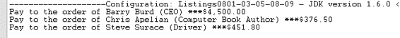

## 图 8-12：运行列表 8-9 的代码。

列表 8-9 中的代码为三个员工开支票。第一位员工是全职的。第二个是还没有听到加班费方案的兼职员工之一。第三个员工知道加班费方案并要求获得公平工资。

通过子类，这三个员工都共存在于列表 8-9 中。当然，其中一个子类来自旧的 `PartTimeEmployee` 类，但这并不意味着你不能从 `PartTimeEmployee` 类创建一个对象。事实上，Java 在这方面非常智能。列表 8-9 有三次对 `findPaymentAmount` 方法的调用，每次调用都指向不同版本的方法。

- 在第一次调用 `ftEmployee.findPaymentAmount` 中，`ftEmployee` 变量是 `FullTimeEmployee` 类的实例。因此，调用的方法是列表 8-3 中的那个。
- 在第二次调用 `ptEmployee.findPaymentAmount` 中，`ptEmployee` 变量是 `PartTimeEmployee` 类的实例。因此，调用的方法是列表 8-5 中的那个。
- 在第三次调用 `ptoEmployee.findPaymentAmount` 中，`ptoEmployee` 变量是 `PartTimeWithOver` 类的实例。因此，调用的方法是列表 8-8 中的那个。

这段代码太棒了。它简洁、优雅且高效。凭借你在软件上节省的所有资金，你完全负担得起双倍加班费。（你是这样做还是把钱留给自己则是另一回事了。）

## 第 9 章

### 构建新对象

### 本章内容
- 定义构造函数
- 在子类中使用构造函数
- 使用 Java 的默认构造函数功能
- 构建简单的 GUI

Jennie Rebekah Burd 女士
121 Schoolhouse Lane
Anywhere, Kansas

亲爱的 Burd 女士：

回复您在 6 月 21 日的来信，我认为我可以完全肯定地说，对象并不是凭空自发产生的。虽然我从未亲眼目睹过对象的创建过程（我们办公室里也没有人能声称见过对象在创建瞬间的时刻），但我完全有信心，某种特定的过程负责了这些有趣且实用的小玩意儿（thingamajigs）的构建。我们 `ClassesAndObjects.com` 支持科学界和私营部门对这类问题的一致的意见。此外，我们赞同近期蓝丝带总统小组的最新发现，该发现毫无疑问地得出结论：自发性对象创建将阻碍目前的经济前景。

请放心，我已经采取了所有必要步骤来确保您这位我们忠实客户的安全与健康。如果您有任何进一步的问题，请随时联系我们的投诉部门。该部门经理是 Blake Wholl 先生。您可以通过访问公司网站与他联系。

### 第三部分：掌握大局：面向对象编程

定义构造函数（“是”的含义）

这是一条创建对象的语句：
`myAccount = new Account();`

所以问题是：当计算机创建一个新对象时，你可以控制放入其变量中的内容吗？构造函数告诉计算机执行某些任务。

“早上好，欢迎收听对象新闻。您所在地区的当地温度是宜人的 73 度。”

## 第 9 章：构建新对象

每个温度由两个部分组成——数字和一个刻度。列表 9-1 中的代码清楚地说明了这一事实。

## 列表 9-1：Temperature 类

```java
class Temperature {
    private double number;
    private ScaleName scale;

    public Temperature() {
        number = 0.0;
        scale = ScaleName.fahrenheit;
    }

    public Temperature(double number) {
        this.number = number;
        scale = ScaleName.fahrenheit;
    }

    public Temperature(ScaleName scale) {
        number = 0.0;
        this.scale = scale;
    }

    public Temperature(double number, ScaleName scale) {
        this.number = number;
        this.scale = scale;
    }

    public void setNumber(double number) {
        this.number = number;
    }

    public double getNumber() {
        return number;
    }

    public void setScale(ScaleName scale) {
        this.scale = scale;
    }

    public ScaleName getScale() {
        return scale;
    }
}
```

列表 9-1 代码的顶部有两个变量：number 和 scale。数字只是一个 `double` 值，例如 32.0 或 70.52。刻度是一个枚举值。我在列表 9-2 中定义了枚举类型 `ScaleName`。

## 列表 9-2：ScaleName 枚举类型

```java
enum ScaleName {celsius, fahrenheit, kelvin, rankine};
```

列表 9-1 中的代码还有常用的 setter 和 getter 方法（用于 number 和 scale 变量的访问器方法）。


除此之外，代码列表 9-1 还有四个看起来像方法的东西。这些像方法的东西都名为 `Temperature`，这恰好与 `Temperature` 类的名称相同。这些 `Temperature` 像方法的东西没有一个具有任何类型的返回类型——甚至连 `void`（这种偷懒的返回类型）也没有。

这些像方法的东西都被称为 `constructor`（构造函数）。构造函数就像方法，区别在于构造函数有一个非常特殊的用途——创建新对象。

每当计算机创建一个新对象时，计算机就会执行 `constructor` 内部的语句。

# 你可以用温度做什么

代码列表 9-3 将我上面描述的一些想法具体化。在代码列表 9-3 中，你调用了在代码列表 9-1 中定义的构造函数。图 9-1 显示了运行这些代码时会发生什么。

**代码列表 9-3：**
**使用 Temperature 类**

```java
import static java.lang.System.out;

class UseTemperature {
    public static void main(String args[]) {
        final String format = "%5.2f degrees %s\n";
        Temperature temp = new Temperature();
        temp.setNumber(70.0);
        temp.setScale(ScaleName.fahrenheit);
        out.printf(format, temp.getNumber(), temp.getScale());

        temp = new Temperature(32.0);
        out.printf(format, temp.getNumber(), temp.getScale());

        temp = new Temperature(ScaleName.celsius);
        out.printf(format, temp.getNumber(), temp.getScale());

        temp = new Temperature(2.73, ScaleName.kelvin);
        out.printf(format, temp.getNumber(), temp.getScale());
    }
}
```

在代码列表 9-3 中，每一条如 `temp = new Temperature(blah,blah,blah);` 的语句都调用了代码列表 9-1 中的一个构造函数。因此，当代码列表 9-3 中的代码运行完成后，它创建了四个 `Temperature` 类实例。每个实例都是通过调用代码列表 9-1 中不同的构造函数创建的。

**图 9-1：**
运行代码列表 9-3 中的代码。

# 调用 new Temperature (32.0)：一个案例研究

当计算机执行代码列表 9-3 中的某个 `new Temperature` 语句时，计算机必须决定使用代码列表 9-1 中的哪个构造函数。计算机通过查看 `new Temperature` 单词后的 `parameter list`（括号中的内容）来决定。例如，当计算机执行代码列表 9-3 中的

```java
temp = new Temperature(32.0);
```

此时计算机在心里想：“括号中的数字 32.0 是一个 double 值。代码列表 9-1 中的 `Temperature` 构造函数中有一个参数恰好类型为 `double`。该构造函数的头部像这样：

```java
public Temperature(double number)
```

“所以，我想我该执行那个特定 `constructor` 内部的语句。”计算机继续执行以下语句：

```java
this.number = number;
scale = ScaleName.fahrenheit;
```

结果是你得到了一个全新的对象，其 `number` 变量值为 32.0，其 `scale` 变量值为 `fahrenheit`。

在这两行代码中，你有两条为变量 `number` 和 `scale` 赋值的语句。看看其中的第二条语句，它稍微好理解一点。第二条语句将新对象的 `scale` 变量设置为 `fahrenheit`。你看，`constructor` 的参数列表是 `(double number)`，而该列表并不包含 `scale` 值。因此，编写这段代码的人必须对为 `scale` 变量使用什么值做出决定。程序员可以选择 `fahrenheit` 或 `celsius`，但她也可以选择 `kelvin` 或 `rankine`。（这位程序员恰好住在美国的新泽州，那里的人通常使用旧的华氏温度标准。）回到这两条语句中的第一条，第一条语句为新对象的 `number` 变量赋值了一个值。该语句使用了一个小技巧，你可以在许多 `constructors`（以及其他为对象变量赋值的方法）中看到它。要理解这个技巧，请看代码列表 9-4。该列表展示了我编写相同 `constructor` 代码的两种方式。

**代码列表 9-4：**
**实现同一功能的两种方法**

```java
//使用这个构造函数 ...
public Temperature(double whatever) {
    number = whatever;
    scale = ScaleName.fahrenheit;
}

//... 或者使用这个构造函数 ...
public Temperature(double number) {
    this.number = number;
    scale = ScaleName.fahrenheit;
}
//... 但不要在代码中同时放入这两个构造函数。
```

代码列表 9-4 包含两个 `constructors`。在第一个 `constructor` 中，我使用了两个不同的名字——`number` 和 `whatever`。在第二个 `constructor` 中，我不需要两个名字。我没有为参数起新名字，而是通过编写 `this.number` 重复了现有的名字。这就是代码列表 9-1 中发生的情况：

通常情况下，在语句 `this.number = number` 中，`this.number` 指属于对象的变量。相比之下，普通的 `this.number` 指 `this.number` 声明的最近的地方。在语句 `this.number = number` 中，`number` 指的是 `constructor` 的参数。（见图 9-2。）

**图 9-2：**
```java
class Temperature {
    private double number;
    private ScaleName scale;

    public Temperature(double number) {
        this.number = number;
        scale = ScaleName.fahrenheit;
    }
}
```

# 这这一切到底是什么？

假设你的代码包含一个构造函数——我选了一个原始变量名的混淆性拼写错误。（我会把参数命名为 `some-number`，比如 `numbr` 或 `nuhmber`）。我甚至尝试过更改变量名的大小写，使其像单位名称如 `Number` 或 `nUMBER`。

# 起名是一门艺术而非科学

我经历过很多命名阶段。多年前，每当我需要为参数起新名字时，我必须为参数发明一个新名字——在相应的变量后面加上后缀 `In`（`jobTitle` 变量对应 `jobTitleIn` 参数）。完全没有这种 `number` 变量了。太浪费了！为了区分两者，你使用 Java 关键字 `this`。这些命名方案非常好用。我永远记不住我创建的那些奇怪的新名字。好消息是，这个参数只是数值的临时存储，不需要费力命名。你可以给参数起一个和变量相同的名字。

# 枚举类型作为一等公民

看一眼这本书 CD-ROM 里的代码讲述了一个有趣的故事。本节示例的项目包含三个 Java 文件：`Temperature.java`（代码列表 9-1）、`ScaleName.java`（代码列表 9-2）和 `UseTemperature.java`。


java (Listing 9-3). 这三个文件中的大新闻是 `ScaleName.java`。为什么这个弱小的单行枚举类型值得拥有自己一个独立的 Java 文件呢？

嗯，这里存在两个问题，而且两者都至关重要：

- **枚举类型是一个伪装的类。** 当 Java 编译器获取到你的枚举声明时，编译器会立即将该枚举类型转换为一个类：

```java
class ScaleName extends Enum {

// 这里有我没有向你展示的代码

celsius = new ScaleName(“celsius”, 0);

fahrenheit = new ScaleName(“fahrenheit”, 1);

kelvin = new ScaleName(“kelvin”, 2);

rankine = new ScaleName(“rankine”, 3);

// 这里有我没有向你展示的代码

}
```

## 第 9 章：构建新对象

这通常发生在幕后。因此，在之前的示例中（例如 Listing 6-5），你不需要考虑它。但在本书的大多数示例中（并且根据标准的 Java 编程规范），每个 Java 类都存在于独立的 .java 文件中。由于 `ScaleName` 是一个类，因此拥有单独的 `ScaleName.java` 文件是完全合理的。

回在 Listing 6-5 中，我将三个枚举类型声明堆在另一个类内部——一个名为 `Clue` 的类。在第 6 章，这看起来并不异常，但现在你可能在想：“一个类可以嵌套另一个类内部。”

嗯，别那样想。Java 确实支持一种名为 `inner classes`（内部类）的特性——定义在其他类内部的类。这种内部类功能允许你在 `Clue` 类内部定义一个 `Suspect` 枚举类型这也是事实。事实事实，初级 Java 程序员应该使用内部类，除非是在枚举类型这种狭义定义的范围内。

所以通常情况下，当你试图将一个类放在另一个类内部时，请不要这样做。

- **ScaleName 枚举类型必须对 `Temperature` 和 `UseTemperature` 类都可用。** 在这一节代码的初稿中，我将 `ScaleName` 枚举声明放在了 Listing 9-1 中。在我编写 `UseTemperature` 类（Listing 9-3）之前，这没问题。`UseTemperature` 类引用了 `ScaleName`。因此，为了访问我塞在 Listing 9-1 中的这个 `ScaleName`，我必须在 Listing 9-3 中放入一些冗长繁琐的语句：

```java
temp.setScale(Temperature.ScaleName.fahrenheit);

...

temp = new Temperature(Temperature.ScaleName.celsius);

...

temp = new Temperature(2.73, Temperature.ScaleName.kelvin);
```

在此时，一个小小的声音告诉我，将 `ScaleName` 枚举声明放在一个独立的文件里更简单。这样，`Temperature` 和 `UseTemperature` 类都可以引用 `ScaleName`，而不需要任何充满名称和点的额外链式。

## 有些事情永远不会改变

第 7 章介绍了 `printf` 方法，并解释了每个 `printf` 调用都以一个格式字符串开头。格式字符串描述了其他参数显示的方式。

在之前的示例中，这个格式字符串始终是一个带引号的字面量。例如，Listing 7-7 中的第一个 `printf` 调用是

```java
out.printf(“$%4.2f\n” , myInterest);
```

在 Listing 9-3 中，我打破了传统，以一个名为 `format` 的变量开始 `printf` 调用。

```java
out.printf(format, temp.getNumber(), temp.getScale());
```

只要我的 `format` 变量类型是 `String`，这就是可以的。事实上，在 Listing 9-3 中，第一个变量声明是

```java
final String format = “%5.2f degrees %s\n”;
```

在这个 `format` 变量的声明中，请特别注意 `final` 这个词。

这个 Java 关键字表示 `format` 的值不能被改变。如果我在 Listing 9-3 中添加额外的赋值语句

```java
format = “%6.2f (%s)\n”;
```

那么编译器就会向我报错 `cannot assign a value to final variable`（无法给 final 变量赋值）。写 Listing 9-3 中的代码时，使用 `final` 关键字并不是绝对必要的。但 `final` 关键字提供了一些额外的保护。当我将 `format` 初始化为“%5.2f degrees %s\n”时，我打算原封不动地反复使用这种相同的格式。我心里很清楚，我并不打算改变 `format` 变量的值。当然，在一个 10,000 行的程序中，我可能会困惑，并在代码深处尝试给 `format` 分配一个新值。因此为了防止我意外更改格式字符串，我将 `format` 变量声明为 `final`。这是一种良好的、安全的编程习惯。

## 更多子类（对天气做些什么）

在第 8 章，我对子类的概念大做文章。这是正确的做法。子类使得代码可复用，而可复用的代码是好代码。考虑到这一点，是时候创建一个 `Temperature` 类的子类了（我在本章的第一节中开发了它）。

## 构建更好的温度

在使用 Listing 9-3 中的代码后，你决定显示方面的责任被严重地错位了。Listing 9-3 中有几处打印温度值行的单调重复。20 世纪 70 年代的程序员会告诉你将这些行收集到一个地方，并将它们转换为一个方法。但用今天的面向对象的方法论，你考虑得会更广泛。

为什么不让每个温度对象都负责显示它们自己呢？毕竟，如果你开发了一个方法，你可能想与其他使用温度的人共享这个方法。现在重播第 8 章的录带：“啦，啦，啦……不想修改现有代码……这一切都归结为一点：不要滥用它。相反，要复用它。”

所以你决定创建一个 `Temperature` 类的子类，该类定义在 Listing 9-1 中。你的新子类通过拥有以漂亮、统一方式显示值的方法，补充了 `Temperature` 类。新类 `TemperatureNice` 所示 Listing 9-5。

**Listing 9-5: TemperatureNice 类**

```java
import static java.lang.System.out;

class TemperatureNice extends Temperature {
    public TemperatureNice() {
        super();
    }

    public TemperatureNice(double number) {
        super(number);
    }

    public TemperatureNice(ScaleName scale) {
        super(scale);
    }

    public TemperatureNice(double number, ScaleName scale) {
        super(number, scale);
    }

    public void display() {
        out.printf(“%5.2f degrees %s\n”, getNumber(), getScale());
    }
}
```

在 Listing 9-5 的 `display` 方法中，注意对 `Temperature` 类的 `getNumber` 和 `getScale` 方法的调用。为什么要这样做？嗯，在 `TemperatureNice` 类代码内部，直接引用 `number` 和 `scale` 变量将产生错误信息。确实，每个 `TemperatureNice` 对象都有它们自己的 `number` 和 `scale` 变量（毕竟 `TemperatureNice` 是 `Temperature` 类的子类，而 `Temperature` 类的代码定义了 `number` 和 `scale` 变量）。但由于 `number` 和 `scale` 在 `Temperature` 类内部被声明为 `private`，只有 `Temperature` 类内部的代码才能直接使用这些变量。


不要在 `TemperatureNice` 类的代码内部对 `number` 和 `scale` 变量进行额外的声明。如果你这样做，你就会无意中创建了四个不同的变量（两个名为 `number`，另外两个名为 `scale`）。你会为其中一对变量赋值，然后你会惊讶地发现，当你显示另一组变量时，那些值似乎消失了。

当一个对象的代码包含对该对象自身方法的调用时，你不需要在调用前加点号。例如，在列表 9-5 的最后一条语句中，对象通过 `getNumber()` 和 `getScale()` 调用了自己的自己的方法，而不是通过 `someObject.getNumber()` 和 `somethingOrOther.getScale()`。如果这种不带点点的写法让你感到不习惯，你可以利用 `this` 关键字的另一个用途来补偿。只需在列表 9-5 的最后一行写上 `this.getNumber()` 和 `this.getScale()` 即可。

# 子类的构造函数

到目前为止，列表 9-5 中最大的新闻是代码声明构造函数的方式。`TemperatureNice` 类有四个自己的构造函数。如果你已经开始考虑子类继承，你可能会奇怪为什么这些构造函数声明是必要的。`TemperatureNice` 不是继承了父类 `Temperature` 类的构造函数吗？不，子类不继承构造函数。

## 子类不继承构造函数

没错。子类不继承构造函数。在一种特殊情况下，构造函数看起来像是被继承了的，但那种特殊情况只是巧合，并不是常态。通常情况下，当你定义一个子类时，你会声明新的构造函数来配合该子类。

## 第 9 章：构建新对象

我将在本章稍后的“默认构造函数”节中中描述那种特殊情况（即构造函数看起来像是被继承的情况）。

因此，列表 9-5 中的代码有四个构造函数。每个构造函数的名称都是 `TemperatureNice`，并且每个构造函数都有自己独特的、可标识的参数列表。这是无聊的部分。有趣的部分是，每个构造函数都调用了名为 `super` 的内容，这是一个 Java 关键字。

在列表 9-5 中，`super` 代表父类中的构造函数。

- 列表 9-5 中的语句 `super()` 调用了列表 9-1 中无参数的 `Temperature()` 构造函数。该无参数构造函数将 `0.0` 赋值给 `number` 变量，并将 `ScaleName.fahrenheit` 赋值给 `scale` 变量。
- 列表 9-5 中的语句 `super(number, scale)` 调用了列表 9-1 中的 `Temperature(double number, ScaleName scale)` 构造函数。相反，该构造函数为 `number` 和 `scale` 变量赋值。
- 同样，列表 9-5 中的语句 `super(number)` 和 `super(scale)` 调用了列表 9-1 中的构造函数。

计算机通过查看 `super` 之后的参数列表来决定调用 `Temperature` 类的哪个构造函数。例如，当计算机执行列表 9-5 中的

```
super(number, scale);
```
时，计算机对自己说：“括号中的 `number` 和 `scale` 变量类型为 `double` 和 `ScaleName`。但列表 9-1 中的 `Temperature` 构造函数只有一个有一个有两个类型为 `double` 和 `ScaleName` 的参数。该构造函数的头部像这样：`public Temperature(double number, ScaleName scale)`。所以，我猜我将执行那个特定构造函数内部的语句。”

## 使用这些东西

在列表 9-5 中，我定义了处于 `TemperatureNice` 类中的含义。

现在是时候让这个 `TemperatureNice` 类派上用场了。列表 9-6 包含了使用 `TemperatureNice` 的代码。

### 列表 9-6：使用 TemperatureNice 类

```java
class UseTemperatureNice {
    public static void main(String args[]) {
        TemperatureNice temp = new TemperatureNice();
        temp.setNumber(70.0);
        temp.setScale(ScaleName.fahrenheit);
        temp.display();

        temp = new TemperatureNice(32.0);
        temp.display();

        temp = new TemperatureNice(ScaleName.celsius); 
        temp.display();

        temp = new TemperatureNice(2.73, ScaleName.kelvin);
        temp.display();
    }
}
```

列表 9-6 中的代码与其列表 9-3 中的兄弟代码非常相似。主要区别如下：

- 列表 9-6 创建了 `TemperatureNice` 类的实例。也就是说，列表 9-6 调用的是 `TemperatureNice` 类的构造函数，而不是 `Temperature` 类。
- 列表 9-6 利用了 `TemperatureNice` 类中的 `display` 方法。因此，列表 9-6 中的代码比列表 9-3 中的对应代码整洁得多。

列表 9-6 的运行结果与列表 9-3 代码的运行结果完全相同。运行结果之前已经在图 9-1 中所示

## 默认构造函数

上一节的主要信息是子类不继承构造函数。那么第 8 章中那些列表是怎么回事呢？在列表 8-6 中，有一条语句说

```java
FullTimeEmployee ftEmployee = new FullTimeEmployee();
```

但是，问题在于：定义 `FullTimeEmployee` 的代码（列表 8-3）似乎没有任何构造函数。那么，在列表 8-6 中，你如何调用 `FullTimeEmployee` 构造函数呢？

情况是：当你创建一个子类且不在代码中放置任何构造函数声明时，Java 会为你创建一个。它被称为默认构造函数。如果你正在创建 `FullTimeEmployee` 子类，默认构造函数看起来就像列表 9-7 中的那样。

### 列表 9-7：默认构造函数

```java
public FullTimeEmployee() {
    super();
}
```

列表 9-7 中的构造函数不接受参数，它的唯一语句调用了你所扩展的类的构造函数。（如果你扩展的类没有无参数构造函数，你就完霉了。）你刚刚读了默认构造函数，但注意！注意这些默认构造函数没有提到的一点：它们并没有说你总是会有默认构造函数。特别是，如果你创建一个子类并自己定义了任何构造函数，Java 就不会为子类添加默认构造函数（子类也不继承任何）。

所以你该怎么办？如果你声明了任何构造函数，就声明你可能需要的所有构造函数。将列表 9-7 中的构造函数添加到列表 9-8 的代码中。这样 `new FullTimeEmployee()` 调用再次有效了。

### 列表 9-8：看，我有构造函数！

```java
class FullTimeEmployee extends Employee {
    private double weeklySalary;
    private double benefitDeduction;

    public FullTimeEmployee(double weeklySalary) {
        this.weeklySalary = weeklySalary;
    }

    public void setWeeklySalary(double weeklySalaryIn) {
        weeklySalary = weeklySalaryIn;
    }

    public double getWeeklySalary() {
        return weeklySalary;
    }

    public void setBenefitDeduction(double benefitDedIn) {
        benefitDeduction = benefitDedIn;
    }

    public double getBenefitDeduction() {
        return benefitDeduction;
    }

    public double findPaymentAmount() {
        return weeklySalary - benefitDeduction;
    }
}
```

如果你使用列表 9-8 中的 `FullTimeEmployee` 代码，下面这一行将不起：

```java
FullTimeEmployee ftEmployee = new FullTimeEmployee();
```

它不起是因为，在你声明了一个接受一个 `double` 参数的 `FullTimeEmployee` 构造函数后，你不再免费获得默认无参数构造函数。

## 隐形的构造函数调用


这是一个我喜欢在 Java 聚会上拿出来展示给人们看的程序。

（相信我，它会让一些资深的 Java 程序员感到惊讶。）该程序展示在列表 9-9、9-10 和 9-11 中。

### 列表 9-9：**一等舱**

```java
class MyClass {
    MyClass() {
        System.out.println("MyClass constructor being called.");
    }
}
```

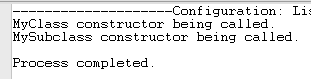
15_087161 ch09.qxp 10/31/06 3:22 PM Page 221

## 第 9 章：构造新对象
### 221

### 列表 9-10：**二等舱**

```java
class MySubclass extends MyClass {
    MySubclass() {
        System.out.println("MySubclass constructor being called.");
    }
}
```

### 列表 9-11：**我的输出是什么？**

```java
class UseMyClasses {
    public static void main(String args[]) {
        new MySubclass();
    }
}
```

那么，当你运行列表 9-11 中的代码时，输出是什么呢？哈？你认为只会得到一行输出？抱歉，机制不是那样的。你得到的输出如图 9-3 所示。

**图 9-3：** 惊喜吧！

在某些情况下，Java 会自动添加一个不可见的 `super` 调用，它位于构造函数体体的顶部。这就好像列表 9-10 中的 `MySubclass` 构造函数实际上是这样：

```java
MySubclass() {
    super();
    System.out.println("MySubclass constructor being called.");
}
```

在列表 9-10 中，不可见的 `super` 调用触发了 `MyClass` 构造函数，它打印了消息 `MyClass constructor being called`。这种自动添加 `super` 调用的操作相当棘手，而且并不经常出现，所以当它出现时，可能看起来非常神秘。


15_087161 ch09.qxp 10/31/06 3:22 PM Page 222

**第三部分：大局观工作：面向对象编程**
一个执行更多功能的构造函数

这是本章开头附近的一处引言：“如果你感兴趣做比填充变量更多的事情该怎么办？也许，当计算机创建一个新对象时，你有一整列表的任务让计算机去执行。”好吧，如果会？

本节的示例包含一个构造函数，它的功能不仅仅是给变量赋值。示例在列表 9-12 和 9-13 中。运行该示例代码的结果如图 9-4 所示。

### 列表 9-12：**定义框架**

```java
import java.awt.FlowLayout;
import javax.swing.JFrame;
import javax.swing.JButton;

class SimpleFrame extends JFrame {
    public SimpleFrame() {
        setTitle("Don’t click the button!");
        setLayout(new FlowLayout());
        setDefaultCloseOperation(EXIT_ON_CLOSE);
        add(new JButton("Panic"));
        setSize(300,100);
        setVisible(true);
    }
}
```

### 列表 9-13：**显示框架**

```java
class ShowAFrame {
    public static void main(String args[]) {
        new SimpleFrame();
    }
}
```

**图 9-4：** 不要惊慌。

15_087161 ch09.qxp 10/31/06 3:22 Page 223

## 第 9 章：构造新对象
### 223

列表 9-12 中的代码大部分由对 Java API（应用程序编程接口）方法的调用组成。这对你来说意味着代码中包含了许多你来说可能陌生的名称。当我刚接触 Java 时，我愚蠢地认为认识 Java 意味着认识所有的名称。恰恰相反：这些名称只是随身行李。真正的 Java 是该语言实现面向对象概念的方式。

#### 包和导入声明

Java 有一种功能，允许你将定义类所在的包中的类归为一组类。每一组类被称为称为一个 `package`（包）。在 Java 世界中，程序员习惯于给这些包起很长的、包含点的名称。例如，因为我注册了域名 `burdbrain.com`，我可能会将包命名为 `com.burdbrain.utils`。

这是另一个例子。声明如下
```java
import javax.swing.*;
```
Java API 实际上是一个巨大的包集合。API 拥有如 `java.lang`、`java.util`、`java.awt`、`javax.swing` 等名称的包。这是有效的，因为 `javax.swing` 是 Java API 中一个包的名称，而星号 `*` 指 `javax.swing` 包中的所有类。

有了这些关于包的信息，我可以消除关于导入声明的一些困惑。通过在你的 Java 代码顶部使用此导入声明，你就可以使用 `javax.swing` 包中所有类的简写名称。任何不使用 `static` 单词的导入声明必须以包名开头，并以类名或星号 `*` 结尾。

例如，这一行
```java
import java.util.Scanner;
```
是有效的，因为 `java.util` 是包的名称。点状名称 `java.util.Scanner` 是 `Scanner` 类的全限定名。这一行
```java
import javax.*;
```
不是有效的导入声明。（你可以通过阅读 Java API 文档找到关于 `java.util` 和 `Scanner` 的所有这些信息。关于阅读文档的技巧，请参见第 3 章以及本书的网站。）

15_087161 ch09.qxp 10/31/06 3:22 Page 224

**第三部分：大局观工作：面向对象编程**
总之，代码 `main` 方法只有一条语句——对 `SimpleFrame` 类中构造函数的调用。注意这个调用创建的对象甚至没有赋值给变量。这没关系，因为代码在任何地方都不需要引用该对象。

`SimpleFrame` 类中只有一个构造函数声明。这个构造函数不仅仅是设置变量的值，它调用了一个接一个 API 方法。`SimpleFrame` 构造函数中调用的所有方法都来自父类 `JFrame`。`JFrame` 类位于 `javax.swing` 包。这个包和另一个包 `java.awt` 拥有帮助你把窗口、图像和其他小部件放在计算机屏幕上的类。

（在 `java.awt` 包中，字母 *awt* 代表 *abstract windowing* *toolkit*——抽象窗口工具包。）


# 第 9 章：构建新对象

- `setLayout`: 调用 `setLayout` 会让新的 `FlowLayout` 对象负责安排框架上的组件（例如按钮）。（新的 `SimpleFrame` 对象正在调用它自己的 `setLayout` 方法。）

- `setDefaultCloseOperation`: 调用 `setDefaultCloseOperation` 是为了告诉 Java 当你点击框架右上角的小 × 号时该做什么。如果不调用此方法，框架本身会消失，但 Java 虚拟机（`JVM`）会继续运行。如果你使用 `JCreator`，必须通过选择 `Tools` -> `Stop Tool`（工具 ->工具）来停止 `JVM`。

调用 `setDefaultCloseOperation(EXIT_ON_CLOSE)` 告诉 Java 当你点击框架右上角的 × 号时关闭自身。

`EXIT_ON_CLOSE` 的替代方案有 `HIDE_ON_CLOSE`、`DISPOSE_ON_CLOSE` 以及我个人最喜欢的 `DO_NOTHING_ON_CLOSE`。

- `JButton`: `JButton` 类存在于 `javax.swing` 包中。该类的一个构造函数接受一个 `String` 实例（例如“Panic”）作为其参数。调用此构造函数会将该 `String` 实例变成新按钮面上的标签。

- `add`: 新的 `SimpleFrame` 对象调用它的 `add` 方法。调用 `add` 方法会将按钮放在对象的表面（在本例中，即框架的表面）。

- `setSize`: 框架变为宽 300 像素，高 100 像素。（在 `javax.swing` 包中，每当你指定两个维度数字时，宽度数字始终位于高度数字之前。）

- `setVisible`: 新框架在首次创建时是不可见的。但当新框架调用 `setVisible(true)` 时，框架就会出现在你的电脑屏幕上。

# 第三部分：从大局角度工作：面向对象编程

# 第四部分：精通 Java 技术

在这一部分中……

在这里我开始分享一些高级的 Java 概念。书的这部分描述了棘手的问题、细小的角落、特殊规则以及那些并不特殊的异常情况。一如既常，你不应该感到畏惧。我会一步步带你走，保持整个内容轻松、有趣且易于掌握。

# 第 10 章：变量与方法

## 它们所属的位置

### 本章内容
- 让某些东西属于整个类
- 将变量放在方法内部和外部
- 提高你的击球率

你好，再次见到。你正在收听 `WWW` 电台，我是你的主持人 Sam Burd。大棒球赛季又开开始了，今天 `WWW` 电台为你带来了 Hankees（汉基斯队）对阵 Socks（袜子队）的现场直播。此时，我正在等待比赛比分的消息。

如果你还记得今天下午早些时候，Socks 看起来简直要把 Hankees 打得落输完肤。接着，Hankees 开始一接一波地击球，让 Socks 压力倍增。那些 Socks！我很庆幸自己没有处他们的境地。

不管如何，随着比赛的进行，Socks 振作了自己。现在 Socks 和 Hankees 是并持状态。我们将在几分钟后获得最终比分，但首先有几点提醒。请在广播结束后继续关注大杰西队（Jersey's）的比赛。别忘了关注下周克利夫兰长袍队（Cleveland Gowns）对阵百慕大短裤队（Bermuda Shorts）。

好了，最终比分输出了。哪支队伍占据了上风？哪支队伍将胜出？获者是……哦，不！是平局！

## 定义类（成为一名棒球球员意味着什么）

对我来说，一名棒球球员有一个名字和一个击球率。列表 10-1 将我对此的感受转换成了 Java 程序的形式。

### 列表 10-1：Player 类

```java
import java.text.DecimalFormat;

class Player {
    private String name;
    private double average;

    public Player(String name, double average) {
        this.name=name;
        this.average=average;
    }

    public String getName() {
        return name;
    }

    public double getAverage() {
        return average;
    }

    public String getAverageString() {
        DecimalFormat decFormat = new DecimalFormat(".000");
        return decFormat.format(average);
    }
}
```

现在我开始拆解列表 10-1 中的代码。幸运的是，`Player` 定义了什么是一名棒球球员。以下是代码定义的的内容：

- `name` 和 `average`: 用于存储球员数据的变量。
- `Player(String name, double average)`: 用于初始化对象的构造函数。
- `getName()`、`getAverage()` 和 `getAverageString()`: 用于访问数据的方法。
- `DecimalFormat`: 用于格式化平均率字符串的类。

- `Player`: 定义类。
- `name` 和 `average`: 在类内部定义的变量。
- `Player(String name, double average)`: 构造函数。
- `getName()`、`getAverage()` 和 `getAverageString()`: 访问器方法。
- `DecimalFormat`: 在 `getAverageString()` 中用于格式化 `average`。

## 另一种美化数字的方法

`DecimalFormat` 的使用接收一个 `double`（通常是 ` `average`）并将其转换为 `String`。例如，为了显示符合会计格式的数字，可以使用以下代码：

```java
DecimalFormat decFormat = new DecimalFormat("$###0.00;($###0.00)");
System.out.println(decFormat.format(345));
System.out.println(decFormat.format(-345));
```

在这个小示例的格式字符串中，分号之前决定了正数的显示方式，分号之后决定了负数的显示方式。因此，使用这种格式，数字 345 和 -345 显示如下：

$345.00
($345.00)

欲了解更多数字技巧，请访问 Java 文档中的 `DecimalFormat` 页面。

## 使用 Player 类

列表 10-2 和 10-3 使用了列表 10-1 中定义的 `Player` 类。

### 列表 10-2：使用 Player 类

```java
import java.util.Scanner;
import java.io.File;
import java.io.IOException;
import javax.swing.JFrame;
import javax.swing.JLabel;
import java.awt.GridLayout;

class TeamFrame extends JFrame {
    public TeamFrame() throws IOException {
        Player player;
        Scanner myScanner = new Scanner(new File("Hankees.txt"));

        for (int num = 1; num <= 9; num++) {
            player = new Player(myScanner.nextLine(), myScanner.nextDouble());
            myScanner.nextLine();
            addPlayerInfo(player);
        }

        setTitle("The Hankees");
        setLayout(new GridLayout(9,2));
        setDefaultCloseOperation(EXIT_ON_CLOSE);
        pack();
        setVisible(true);
    }

    void addPlayerInfo(Player player) {
        add(new JLabel(player.getName()));
        add(new JLabel(player.getAverageString()));
    }
}
```

### 列表 10-3：显示框架

```java
import java.io.IOException;

class ShowTeamFrame {
    public static void main(String args[]) throws IOException {
        new TeamFrame();
    }
}
```


要运行列表 10-1、10-2 和 10-3 中的代码，请参阅图 10-1。如果你想自己运行此程序，你需要 `Hankees.txt` 文件。（当你从本书的附带光盘安装 JCreator 时，该文件会自动加载到你的硬盘上。）此文件包含了你喜欢的棒球运动员的数据。

（参见图 10-2。）

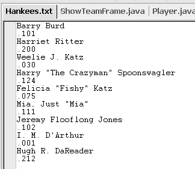

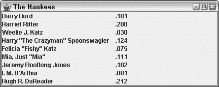

# 第 10 章：将变量和方法放在它们的地方

**图 10-1：**
你会在这些人身上赌钱吗？

**图 10-2：**
好的一团队！

为了让本节的代码正常工作，你必须在图 10-2 中最后一个 `.212` 之后有一个换行符。有关换行符的细节，请参见第 8 章。

## 九，数数，九个数

列表 10-2 中的代码调用了九次 `Player` 构造函数。这意味着代码创建了 `Player` 类的九个实例。在循环的第一次中，代码创建了一个名为 `Barry Burd` 的实例。

在循环的第二次中，代码放弃了 `Barry Burd` 实例，并创建了另一个名为 `Harriet Ritter` 的实例。第三次循环时，代码放弃了可怜的 `Harriet Ritter`，并为 `Weelie J. Katz` 创建了一个实例。代码一次只有一个实例，但总的来说，代码创建了九个实例。

每个 `Player` 实例都有自己的 `name` 和 `average` 变量。每个实例还拥有自己的 `Player` 构造函数以及自己的 `getName`、`getAverage` 和 `getAverageString` 方法。看图 10-3，并思考一下拥有九个化身的 `Player` 类。

**图 10-3：**
（`Player` 类九个实例的示意图：Barry, Harriet, Weelie, Harry, Fishy, Mia, Jeremy, I. M., Hugh，带有各种值，如 .101, .200, .030, .124, .075, .111, .102, .001, .212。每个实例都有一个构造函数、`getName`、`getAverage` 和 `getAverageString`。）

## 别拿我的 GUI 搞我

列表 10-2 中的代码使用了 Java API 中的几个名称。其中一些名称在第 9 章中解释过。其他的在这里就解释了：

- **JLabel：** `JLabel` 是一个包含某些文本的对象。在框架内显示文本的方法之一是向框架添加一个 `JLabel` 类的实例。

在列表 10-2 中，`addPlayerInfo` 方法被调用了九次，团队中的每个玩家调用一次。每次调用 `addPlayerInfo` 时，该方法都会向框架添加两个新的 `JLabel` 对象。每个 `JLabel` 对象的文本来自玩家对象的 getter 方法。

- **GridLayout：** `GridLayout` 将内容排列在间距均匀的行和列中。这个 `GridLayout` 类的构造函数接受两个参数——行数和列数。

在列表 10-2 中，对 `GridLayout` 构造函数的调用使用了参数 `(9,2)`。因此在图 10-1 中，显示具有九行（每个玩家占一行）和两列（一列用于名称，另一列用于平均分）。

- **pack：** 当你 `pack` 一个框架时，你设置了框架的大小。这就是框架出现在你计算机屏幕上的尺寸。`pack` 框架就像收缩包装一样，紧包裹你添加到框架内部的任何对象。

在列表 10-2 中，当你到达调用 `pack` 的地方，你已经调用了九次 `addPlayerInfo` 并向框架添加了 18 个标签。在执行 `pack` 方法时，计算机会根据你放入标签内部的任何文本，为每个标签选择一个合适的大小。然后，考虑到框架内部有这 18 个标签，计算机会为整个框架选择一个合适的大小。


当你向框架里“丢”进东西时，你在操作顺序上有很大的回旋余地。例如，你可以在向框架添加标签和其他东西之前或之后设置布局。如果你先调用 `setLayout` 然后添加标签，标签将出现在框架上美观且有条理的位置。

如果你反转这个顺序（先添加标签再调用 `setLayout`），调用 `setLayout` 将以一种美观、有条理的方式重新排列标签。两种方式运行良好良好。

在设置框架时，你不应该做的一件事就是违反以下顺序：

向框架添加内容，然后：

```
pack();
setVisible(true);
```

如果你先调用 `pack` 然后再向框架添加更多内容，`pack` 方法将不会考虑你后添加添加的内容。如果你在添加内容或调用 `pack` 之前调用 `setVisible`，用户将看到框架正在构建中的样子。最后，如果你忘记设置框架的大小（通过调用 `pack` 或其他调整大小的方法），你看到的框架看起来就像图 10-4 中的那样。（通常情况下，我不会向你展示像图 10-4 那样的异常运行情况，但我犯过太多次这种错误了，以至于我觉得这个瘦弱的框架就像我的一个老朋友。）

**图 10-4：**
一个营养不良的框架。

## 在方法间抛出异常

第 8 章引入了来自磁盘文件的输入，随着这一主题引入了异常的概念。当你处理磁盘文件时，你需要承认可能会抛出 `IOException`。这是第 8 章的教训，这也是为什么列表 10-2 中的构造函数有一个 `throws IOException` 子句的原因。

但是 10-3 中的 `main` 方法呢？尽管在这个 `main` 方法中没有明显的磁盘文件引用，为什么它还需要它自己的 `throws` 子句呢？嗯，异常就像烫山豆。如果你手里有一个，你要么把它吃掉（正如你在第 12 章中看到的），要么使用 `throws` 子句把它扔给别人。

这就是 `throws` 子句在 Java 程序中的工作方式。

如果一个方法调用另一个方法，而被调的方法具有 `throws` 子句，那么调用它的方法必须包含处理异常的代码。

要了解更多关于处理异常的信息，请阅读第 12 章。

在书的这个部分，敏锐的《自学指南》读者可能会提出一两个后续问题。“当 `main` 方法有一个 `throws` 子句时，必须有人来处理该 `throws` 子句中的异常。但是是谁调用了 `main` 方法？是谁处理了列表 10-3 中 throws 子句的 `IOException`？”答案是 Java 虚拟机（或 JVM，运行你所有 Java 代码的程序）调用了 `main` 方法。所以是 JVM 处理了列表 10-3 中的 `IOException`。

## 静态化（计算团队平均分）


考虑到列表 10-1 到 10-3 中的代码，你决定想找到球队的整体击打率。这是一个不坏的主意！图 10-1 中的 Hankees 队平均分仅约为 .106，所以该队需要一些密集的训练。当球员们在球场上练习时，你面临着一个哲学上的障碍需要克服。

在列表 10-1 到 10-3 中，你有三个类：一个 `Player` 类和另外两个帮助显示 `Player` 类数据的类。那么，在这些复杂的类结构中，存储你的团队平均总计的变量应该放在哪里呢？

# 第 10 章：将变量和方法放在它们所属的地方

- 将总计变量放在任何一个显示类（`TeamFrame` 和 `ShowTeamFrame`）中都是意义的。毕竟，总计与球员、团队和棒球有关。显示类的作用是关于创建窗口的，而不是关于打棒球的。

- 你将整个团队平均值放在 `Player` 类的实例中感到不安，因为 `Player` 类的实例只代表团队中的某一个球员。单个球员存储整个团队的数据有什么业务关系呢？当然，你可以让代码运行起来，但这并不是解决该问题的优雅方案。

最后，你发现了关键字 `static`。任何被声明为 `static` 的内容都属于整个类，而不是属于类的任何某个特定实例。

当你创建 `static` 变量 `totalOfAverages` 时，你只创建了该变量的一个副本。这个副本一直属于整个 `Players` 类。无论你创建了多少个 `Player` 类的实例——一个、九个还是一个都没有——你都只有一个 `totalOfAverages` 变量。而且，顺便提一下，你还创建了其他静态变量（`playerCount` 和 `decFormat`）和静态方法（`findTeamAverage` 和 `findTeamAverageString`）。为了理解我的意思，请看图 10-5。

**图 10-5：**（静态变量 `playerCount`、`totalOfAverages`、`decFormat` 和方法 `findTeamAverage` 等对比实例特定的数据）。

由于你对子类的热情，你将团队总计的代码放在了 `Player` 类的子类中。代码如列表 10-4 所示。

**列表 10-4：创建团队击打率**

```java
import java.text.DecimalFormat;

class PlayerPlus extends Player {
    private static int playerCount = 0;
    private static double totalOfAverages = .000;
    private static DecimalFormat decFormat = new DecimalFormat(".000");

    public PlayerPlus(String name, double average) {
        super(name, average);
        playerCount++;
        totalOfAverages += average;
    }

    public static double findTeamAverage() {
        return totalOfAverages / playerCount;
    }

    public static String findTeamAverageString() {
        return decFormat.format(totalOfAverages / playerCount);
    }
}
```

### 为什么有这么多 static？

也许你已经注意到了——列表 10-4 中的代码充斥着 `static` 这个词。这是因为该代码中的几乎所有内容都属于整个 `PlayerPlus` 类，而不是属于类的单个实例。这是件好事，因为像 `playerCount`（团队中的人数）这样的内容不应该属于单个球员，让每个 `PlayerPlus` 对象都跟踪自己的计数将是愚蠢的（“我知道我是几个球员。我只是一个球员！”）。如果你有九个独立的 `playerCount` 变量，要么每个变量都存储数字 1（这没用处），要么你会有九份不同的计数副本，这既浪费又容易出错。因此，通过将 `playerCount` 设为 `static`，你将 `playerCount` 保留在了唯一的地方，即它应该所属的地方。

`totalOfAverages` 也是同样的道理。最终，`totalOfAverages` 变量将存储球员击打率的总和。对于 Hankees 队的全部九名成员，总和是 .956。只有当有人调用 `findTeamAverage` 或 `findTeamAverageString` 方法时，计算机才会真正找到 Hankees 团队的整体击打率。

你还希望 `findTeamAverage` 和 `findTeamAverageString` 方法是静态的。通常情况下，所有实例共有的（且对每个实例产生相同结果）的任务都应该编码为 `static` 方法。

构造函数永远不是 `static` 的。在本书中，我第一次认真使用 `static` 是在很早的列表 3-1 中。那么，为什么 `main` 必须是 `static` 的呢？记住，非静态内容属于对象而不是类。如果 `main` 方法不是 `static`，那么在你创建对象之前就没有 `main` 方法。但在启动 Java 程序时，还没有创建任何对象。

### 显示整体平均值

你可能发现了一种模式。当你类编写代码时，你通常会写两部分代码。一段代码定义类，另一部分代码使用该类。（使用类的方法包括调用类的构造函数、引用类的非私有变量、调用类的方法等。））之前显示的列表 10-4 包含了定义 `PlayerPlus` 类的代码，而列表 10-5 包含了使用这个 `PlayerPlus` 类的代码。

**列表 10-5：使用列表 10-4 中的代码**

```java
import java.util.Scanner;
import java.io.File;
import java.io.IOException;
import javax.swing.JFrame;
import javax.swing.JLabel;
import java.awt.GridLayout;

class TeamFrame extends JFrame {
    public TeamFrame() throws IOException {
        PlayerPlus player;
        Scanner myScanner = new Scanner(new File("Hankees.txt"));
        for (int num = 1; num <= 9; num++) {
            player = new PlayerPlus(myScanner.nextLine(), myScanner.nextDouble());
            myScanner.nextLine();
            addPlayerInfo(player);
        }
        add(new JLabel());
        add(new JLabel(" ------"));
        add(new JLabel("Team Batting Average:"));
        add(new JLabel(PlayerPlus.findTeamAverageString()));
        setTitle("The Hankees");
        setLayout(new GridLayout(11,2));
        setDefaultCloseOperation(EXIT_ON_CLOSE);
        pack();
        setVisible(true);
    }
}
```


```java
void addPlayerInfo(PlayerPlus player) {
    add(new JLabel(player.getName()));
    add(new JLabel(player.getAverageString()));
}
```

运行列表 10-5 中的代码，你需要一个带有 `main` 方法的类。列表 10-3 中的 `ShowTeamFrame` 类就可以正常工作。（如果你从本书附带的 CD-ROM 中运行 `JCreator`，一切都准备好了，因为 `ShowTeamFrame.java` 文件已经和列表 10-5 一起包含在项目中了。）

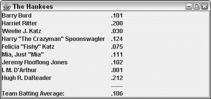

# 第 10 章：将变量和方法放在它们该在的地方

图 10-6 显示了列表 10-5 代码的运行结果。这次运行依赖于图 10-2 所示 `Hankees.txt` 文件的存在。列表 10-5 中的代码几乎是列表 10-2 代码的完全复制。（这个复制如此相似，以至于如果我付得起钱，我会因为盗窃知识产权而起诉自己。）列表 10-5 中唯一的新内容是加粗显示的部分。

**图 10-6：**
列表 10-5 代码的运行结果。

在列表 10-5 中，`GridLayout` 有两个额外的行：一行用于间距，另一行用于显示 Hankee 队的平均值。这些行中的每一行都包含两个 `Label` 对象。

- **间距行包含一个空标签和一个带虚线的标签。** 空白标签是一个占位符。当你向 `GridLayout` 添加组件时，组件是按行添加的，从行的左侧开始，一直到行的右侧。如果没有这个空标签，虚线标签将出现在行的左侧，位于 Hugh R. DaReader 名字的下方。
- **另一行包含一个显示 *Team Batting Average*（球队击球率）字样的标签，以及另一个显示数字 *.106* 的标签。** 获取数字 .106 的方法调用非常有意思。该调用看起来像像这样：`PlayerPlus.findTeamAverageString()`

看一眼那个方法调用。该调用具有以下形式：`ClassName.methodName()`。

这是新颖且不同的。在前面的章节中，我提到过你通常会在方法调用之前加上对象的名称，而不是类的名称。那么，我为什么在这里使用类名呢？答案是：当你调用静态方法时，你需要在方法名之前加上包含该方法的类名。每当你引用另一个类的静态变量时，情况也是如此。这是合逻辑的。请记住，定义静态变量或方法的整个类都拥有该变量或方法。因此，要引用静态变量或方法，你需要在变量或方法名之前加上类名。

当你引用静态变量或方法时，你可以“偷懒”，用对象的名称来代替类名。例如，在列表 10-5 中，通过对其他一些语句进行明智的重排，你可以使用表达式 `player.findTeamAverageString()`。

Java 有一个非常棒的特性叫做*静态初始化器*（static initializer）。通过使用这个特性，你可以在调用该类的任何方法之前执行涉及静态变量的语句。如需了解更多关于静态初始化器的信息，请访问本书的网站。

## 静态是老生牙了

这一节对静态变量和方法大做特此，但静态内容从本书早期开始就是画面的一部分了。例如，第 3 章引入了 `System.out.println`。名称 `System` 指一个类，而 `out` 是该类中的一个静态变量。这就是为什么在第 4 章及之后，我使用使用 `static` 关键字来导入 `out` 变量：`import static java.lang.System.out;`

在 Java 中，静态变量和方法随处可见。


位于匹兹堡以北几英里处。好了，我的观点是什么？我的观点是，名称的含义取决于上下文。如果你在匹兹堡正北方并问：“我从这里怎么去火星？”，你可能会得到一个合理且不以为然的回答。但如果你站在曼哈顿的某个街角问同样的问题，你可能会引起某些人的怀疑。（好吧，考虑到曼哈顿，人们可能会直接无视你。）当然，住在宾夕法尼亚州火星市（Mars, Pennsylvania）的人非常清楚他们的镇名字很奇怪。在火星高中度过的青少年美好回忆并阻止人们知道那颗巨大的红色行星。在八月一个晴朗的夜晚，你仍然可以与一位当地居民进行以下对话：

*你：*我该怎么去火星？

*当地居民：*你就在火星市，哥们。你想找火星的哪个部分？

*你：*不，我不是指宾夕法尼亚州的火星。我说的是火星。

*当地居民：*哦，行星！那么，坐 8:19 发往卡纳维拉尔角（Cape Canaveral）的火车……不，等等，那是当地火车。那会带你经过西吉尼亚亚州……

所以，一个名称的含义取决于你在哪里使用这个名称。尽管大多数英语使用者认为火星是一个拥有二氧化碳大气层的地方，但宾夕法尼亚州的一些人想的是可以在火星市做的所有购物。而那些宾夕法尼亚州的人对 `Mars` 这个名字确实有两个含义。在 Java 中，这些名称可能像这样：`Mars` 和 `planets.Mars`。

## 将变量置于它的位置

你的第一个实验显示在列表 10-6 和 10-7 中。代码高亮了方法内部和外部定义的变量之间的区别。

### 列表 10-6：Mars 的两种含义

```java
import static java.lang.System.out;

class EnglishSpeakingWorld {
    String mars = “ red planet”;

    void visitPennsylvania() {
        out.println(“visitPA is running:");
        String mars = “ Janine’s home town”;
        out.println(mars);
        out.println(this.mars);
    }
}
```

### 列表 10-7：调用列表 10-6 的代码

```java
import static java.lang.System.out;

class GetGoing {
    public static void main(String args[]) {
        out.println(“main is running:");
        EnglishSpeakingWorld e = new EnglishSpeakingWorld();
        //out.println(mars); cannot resolve symbol
        out.println(e.mars);
        e.visitPennsylvania();
    }
}
```

图 10-7 显示了列表 10-6 和 10-7 代码的运行情况。图 10-8 显示了代码结构的图。在 `GetGoing` 类中，`main` 方法创建了 `EnglishSpeakingWorld` 类的实例。变量 `e` 指向这个新实例。新实例是一个内部有一个名为 `mars` 变量的对象。该 `mars` 变量的值为“red planet”。这个 `mars` 变量被称为*实例变量*（instance variable），因为该变量属于一个对象——即 `EnglishSpeakingWorld` 类的一个实例。

现在看列表 10-7 中的 `main` 方法。在 `GetGoing` 类的 `main` 方法内部，你不允许编写 `out.println(mars)`。换句话说，对任何 `mars` 变量的裸露引用都是绝对不允许的。我在上一段中提到的 `mars` 变量属于 `EnglishSpeakingWorld` 对象，而不是 `GetGoing` 类。

然而，在 `GetGoing` 类的 `main` 方法内部，你可以编写 `e.mars`，因为变量 `e` 指向你的 `EnglishSpeakingWorld` 对象。这很不错。

在代码底部，调用了 `visitPennsylvania` 方法。

当你进入 `visitPennsylvania` 方法内部时，你有另一个 `mars` 变量的声明，其值为“Janine’s home town”。这个特定的 `mars` 变量被称为*方法局部变量*（method-local variable），因为它只属于一个方法——`visitPennsylvania` 方法。

**图 10-7：** 列表 10-6 和 10-7 代码的运行情况。
`EnglishSpeakingWorld`
`mars (instance variable)` -> red planet
`visitPennsylvania`
`mars (method-local variable)` -> Janine's home town

**图 10-8：** 列表 10-6 和 10-7 代码中 `GetGoing` 的结构。
`e`

现在你有两个变量，名字都叫 `mars`。其中一个 `mars` 变量（实例变量）值为“red planet”。另一个 `mars` 变量（方法局部变量）值为“Janine’s home town”。在代码中，当你使用 `mars` 这个词时，你指的是这两个变量中的一个？

答案是，当你访问宾夕法尼亚州时，值为“Janine’s home town”的变量胜出。在宾夕法尼亚州时，按照宾夕法尼亚人的方式思考。当你进入 `visitPennsylvania` 方法内部时，值为“Janine’s home town”的变量胜出。


在列表 10-8 中，请注意每个变量可以在哪里可以使用以及不能在哪里。当你尝试在 `visitNewJersey` 方法中使用 `atomicCity` 变量时，你会得到一个错误信息。字面上，信息显示为 `cannot resolve symbol`。从比喻上看，信息是在说：“嘿，伙计，Atomic City 在爱达荷州，而不是新泽州。”从技术上说，该信息表示方法局部变量 `atomicCity` 仅在 `visitIdaho` 方法可用，因为它在那里被声明。

所以回到 `visitIdaho` 方法内部，你可以随心所欲使用 `atomicCity` 变量。毕竟 `atomicCity` 变量是在 `visitIdaho` 方法内部声明的。

**图 10-9：**
列表 10-8 和 10-9 中代码的运行。

**第 10 章：将变量和方法放在它们该去的地方**
EnglishSpeakingWorld2
`mars`（实例变量）
红行星
`visitIdaho`
`atomicCity`（方法局部变量）
人口：25

**图 10-10：**
列表 10-8 和 10-9 代码的 `visitNewJersey` 结构。

那么火星呢？你忘记了你的老朋友，那个零下 80 度的星球吗？事实上，`visitIdaho` 和 `visitNewJersey` 方法都可以访问 `mars` 变量。这是因为 `mars` 变量是一个实例变量。`mars` 变量声明在 `EnglishSpeakingWorld2` 类的代码中，但在任何特定方法内部内部。（在我关于事物命名的故事中，请记住住在爱达荷州和新泽州这两个州的人都听说过火星。）

`mars` 变量的生命周期有三个独立的步骤：

- 当 `EnglishSpeakingWorld2` 类首次出现，计算机看到 `String mars` 并为变量创建空间。
- 当执行 `visitIdaho` 方法时，该方法将值“red planet”赋值给 `mars` 变量。（`visitIdaho` 方法还会打印 `mars` 变量的值。）
- 当执行 `visitNewJersey` 方法时，该方法再次打印 `mars` 的值。

通过这种方式，`mars` 变量的值从一个方法传递到另一个方法。

**第四部分：精通 Java 技巧**

## 参数传递
方法可以通过几种方式与你的 Java 程序的其他部分进行通信。其中一种方法是通过方法的参数列表。使用参数列表，你可以在调用方法时将即时信息传递给方法。

想象一下，你传递给方法的信息存储在程序的某个变量中。方法实际上对该变量做了什么（如果有的话）？本节介绍了几个有趣的案例研究。

### 按值传递
根据我的网络研究，阿肯萨斯州的斯马科弗（Smackover）镇有 2,232 人。但我的研究已经过时了。就在昨天，Dora Kermongoos 在斯马科弗总医院庆祝了一个快乐的时刻——她生下了一个健康、蓝眼睛的小女孩。（女孩重 7 磅 4 盎司，高 21 英寸。）现在该城镇的人口已增加到 2,233。

列表 10-10 包含一个非常糟糕的程序。该程序应该给存储斯马科弗人口的变量加 1，但该程序无法工作。看一眼列表 10-10 看看为什么。

**列表 10-10：此程序无法工作**
```java
class TrackPopulation {
    public static void main(String args[]) {
        int smackoverARpop = 2232;
        birth(smackoverARpop);
        System.out.println(smackoverARpop);
    }
    static void birth(int cityPop) {
        cityPop++;
    }
}
```

当你运行列表 10-10 中的程序时，程序在屏幕上显示数字 2,232。在经历了九月的规划、期待以及 Dora 长达七小时的痛苦分娩后，Kermongoos 一家的小女孩没有在系统中注册。真遗憾！

参数传递的不当使用导致了这个问题。在 Java 中，当你向方法传递具有八种基本数据类型之一的参数时，该参数是*按值传递的*。

要复 Java 的八种基本数据类型，请参阅第 4 章。

用白话来说，这意味着：方法对其参数值所做的任何更改都不会影响调用代码中变量的值。在列表 10-10 中，`birth` 方法可以随心所欲地对 `cityPop` 应用 `++` 运算符——对 `cityPop` 参数应用 `++` 绝对对 `main` 方法中 `smackoverARpop` 变量的值没有任何影响。

从技术上说，发生的是值的复制。（参见图 10-11。）当 `main` 方法调用 `birth` 方法时，存储在 `smackoverARpop` 中的值被复制到另一个内存位置——一个为 `cityPop` 参数值预留的位置。在 `birth` 方法执行期间，1 被加到 `cityPop` 参数上。但存储原始 2232 值的地方（即 `smackoverARpop` 变量的内存位置）不受影响。

**图 10-11：**
main: `smackoverARpop` (2232) -> birth: `cityPop` (按值传递，底层：2233)

当你对任何八种基本数据类型进行参数传递时，计算机使用的是按值传递。调用代码中的值保持不变。即使调用代码的变量与被调用方法的名称相同。

### 返回结果
你必须修复列表 10-10 提出的问题。毕竟，一个年轻的 Kermongoos 可以经历。尽管如此，从方法返回一个值可以是参数传递的一种接受的替代方案。看列表 10-11 了解我的意思。

**列表 10-11：此程序工作正常**
```java
class TrackPopulation2 {
    public static void main(String args[]) {
        int smackoverARpop = 2232;
        smackoverARpop = birth(smackoverARpop);
        System.out.println(smackoverARpop);
    }
    static int birth(int cityPop) {
        return cityPop + 1;
    }
}
```

运行列表 10-11 中的代码后，你在屏幕上看到的数字是正确的 2233。列表 10-11 中的代码没有新功能（除非你把*正确运行*称为新功能）。列表 10-11 中最重要的想法是 `return` 语句，它也出现在第 7 章。尽管如此，列表 10-11 与被丢弃的列表 10-10 方法形成了鲜明对比。

### 按引用传递
在之前的两个节中，我极力强调某一点——当参数具有八种基本数据类型之一时，参数是按值传递的。之所以需要强调，是因为传递对象（引用类型）的工作方式并不相同。

当你向方法传递对象时，该对象是*按引用传递的*。这对你来说意味着被调用方法中的语句*可以*更改存储在对象变量中的任何值。这些更改*会*影响调用方法的任何代码所看到的值。列表 10-12 和 10-13 说明了这一点。

**列表 10-12：什么是城市？**
```java
class City {
    int population;
}
```

**列表 10-13：将对象传递给方法**
```java
class TrackPopulation3 {
    public static void main(String args[]) {
        City smackoverAR = new City();
        smackoverAR.population = 2232;
        birth(smackoverAR);
        System.out.println(smackoverAR.population);
    }
    static void birth(City aCity) {
```


```java
aCity.population++;

}
```

当你运行列表 10-12 和 10-13 中的代码时，得到的输出是数字 2,233。这很好，因为代码中包含了 `++` 和 `birth`（出生）这个词。关键在于，在 `birth` 方法内部对 `aCity.population` 加 `1` 实际上改变了 `main` 方法中所谓的 `smackoverAR.population` 的值。

要查看 `birth` 方法如何改变 `smackoverAR.population` 的值，请看图 10-12。当你向方法传递一个对象时，计算机不会创建整个对象的拷贝。相反，计算机会创建一个指向该对象的引用拷贝。（想象一下图 10-12 所示：计算机复制了一个指向对象的箭头。）

**图 10-12：按引用传递，底层的 birth 机制。**

在图 10-12 中，你只看到了 `City` 类的一个实例，其中有一个 `population` 变量。在阅读以下步骤时，请密切关注该对象：

1. 在调用 `birth` 方法之前，`smackoverAR` 变量指向该对象——即 `City` 类的实例。
2. 当调用 `birth` 方法并将 `smackoverAR` 传递给 `birth` 方法的参数 `aCity`时，计算机将引用从 `smackoverAR` 拷贝到 `aCity`。现在，`aCity` 指向同一个对象——即 `City` 类的实例。
3. 当 `birth` 方法内部执行 `aCity.population++` 语句时，计算机将对象的 `population` 变量加了 `1`。现在，程序中唯一的 `City` 实例的 `population` 变量中存储了 `2233`。
4. 执行流返回 `main` 方法。打印 `smackoverAR.population` 的值。但由于 `smackoverAR` 指向那个唯一的 `City` 类实例，因此 `smackoverAR.population` 的值为 `2233`。Kermongoos 家族感到非常自豪。

### 从方法返回对象

信不信否，之前关于参数传递的章节还让 Java 方法的一个角落未被探索。当你调用一个方法时，该方法可以将结果直接返回给调用代码。在之前的章节中，我返回的是原始类型值（例如 `int` 值），或者什么都不返回（即 `void`）。在本节中，我返回了一个整个对象。它是列表 10-12 中类型为 `City` 的对象。实现这一点的代码在列表 10-14 中。

**列表 10-14：这里，有一个 City**
```java
class TrackPopulation4 {
    public static void main(String args[]) {
        City smackoverAR = new City();
        smackoverAR.population = 2232;
        smackoverAR = doBirth(smackoverAR);
        System.out.println(smackoverAR.population);
    }

    static City doBirth(City aCity) {
        City myCity = new City();
        myCity.population = aCity.population + 1;
        return myCity;
    }
}
```

如果你运行列表 10-14 中的代码，你会得到数字 2,233。这很好。

这段代码的工作原理是告诉 `doBirth` 方法创建另一个 `City` 实例。在新实例中，`population` 的值为 `2333`（图 10-13）。

**图 10-13：doBirth 方法创建了一个 myCity City 实例。**

在执行 `doBirth` 方法后，该 `City` 实例被返回到 `main` 方法。然后，在 `main` 方法中，该实例（`doBirth` 返回的那个）被赋值给变量 `smackoverAR`。（见图 10-14。）现在 `smackoverAR` 指向一个全新的 `City` 实例——一个人口为 2,233 的实例。

**图 10-14：新的 doBirth City 实例被赋值给人口 smackoverAR 变量。**

在列表 10-14 中，注意调用和返回 `doBirth` 方法时的类型一致性：

- `smackoverAR` 变量的类型为 `City`。`smackoverAR` 变量被传递给参数 `aCity`，该参数的类型也是 `City`。
- `myCity` 变量的类型为 `City`。`myCity` 变量在 `doBirth` 方法的 `return` 语句中返回。这是一致的，`doBirth` 方法返回了一个类型为 `City` 的对象。回到 `main` 方法，该对象被赋值给 `smackoverAR` 变量。


在本章的术语中，整排房间被称为 `array`（数组）。数组中的每个房间被称为数组的 `component`（组件），也称为数组的 `element`（元素）。每个组件都关联有两个数字：

- 房间号（从 0 到 9 的数字），被称为数组的 `index`（索引）。
- 住客人数，这是存储在数组组件中的一个 `value`（值）。

使用数组可以让你避开本节开头示例代码中那些所有重复的废话。例如，要声明一个包含十个值的数组，你可以写一条相当短的语句：
```
int guests[] = new int[10];
```

如果你特别喜欢啰嗦，可以扩展这条语句，使其变成两个独立的语句：

```java
int guests[];
guests = new int[10];
```

在上述两段代码片段中，请注意数字 `10` 的使用。这个数字告诉计算机为 `guests` 数组创建十个组件。

数组的每个组件都有自己的名字。起始组件命名为 `guests[0]`，下一个命名为 `guests[1]`，依此类推。十个组件中的最后一个命名为 `guests[9]`。

在创建数组时，你总是要指定组件的数量。数组的索引从 0 开始，到比组件总数少一的数字结束。

我为你展示的代码片段提供了两种创建数组的方法。第一方法使用一行。第二种方法使用两行。如果你选择单行方案，可以将该行放在方法内部或外部。选择由你决定。

另一方面，如果你使用两个独立的行，那么第二行 `guests = new int[10]` 应该放在方法内部。

在数组声明中，你可以将方括号放在变量名之前或之后。换句话说，你可以写 `int guests[]` 或 `int[] guests`。无论你使用哪种形式，计算机创建的同一个 `guests` 变量。

## 通过两个简单的步骤创建数组

再次看一眼用于创建数组的这两行代码：
```java
int guests[];
guests = new int[10];
```

每行都有其独特的用途：

- `int guests[]`：这第一行是一个声明。声明为预留了数组名称（一个像 `guests` 这样的名字），供程序的其余部分使用。在 Java 汽车馆的比喻中，这一行说：“我计划在这里建造一个汽车馆，并在每个房间里住若干个客人。”（参见图 11-2。）不要管声明 `int guests[]` 做了什么。更重要的是注意到声明 `int guests[]` **没有**做什么。声明并没有预留十个内存位置。事实上，像 `int guests[]` 这样的声明并没有真正创建一个数组。声明做的只是设置了 `guests` 变量。在代码的那个点，`guests` 变量仍然指向一个真实的数组。（换句话说，汽车馆还没有好。）
- `guests = new int[10]`：这第二行是一个赋值语句。赋值语句在计算机内存中为十个 `int` 值预留空间。从房地产的角度来看，这一行说：“我终于建好了汽车馆。去在每个房间里住进客人吧。”再次参见图 11-2。）

**图 11-2:**
```
int guests[];
guests = new int[10];
guests[0] guests[1] guests[2] guests[3] guests[4] guests[5] guests[6] guests[7] guests[8] guests[9]
```
创建数组的两个步骤。

### 存储值

在你创建数组后，你可以将值放入数组的组件中。例如，你想存储 6 号房间有 4 位客人。要将值 4 放入索引为 6 的组件中，你写 `guests[6] = 4`。

现在生意开始红了。一辆大公交停在了汽车馆门口。公交侧面上写着“诺亚方舟”的牌子。25 对夫妇从车上下来，每个人走路、跳跃、飞行或爬行来到汽车馆的小办公室。Java 汽车馆只能入住 10 对夫妇，没关系，因为你可以让另外 15 对夫妇去路尽边的 Old-Side 度村和汽车旅馆。

总之，要在 Java 汽车馆登记 10 对夫妇，你需要在 10 个房间中的每个房间里放一对（2 个人）。在创建数组后，你可以利用数组的索引并编写如下这样的 `for` 循环：
```java
for (int roomNum = 0; roomNum < 10; roomNum++) {
    guests[roomNum] = 2;
}
```
这个循环取代了十条赋值语句。注意循环的计数器是如何从 0 变到 9 的。对比图 11-2，记住数组的索引是从 0 到数组组件总数减一的。

然而，考虑到世界的运作方式，客人并不总是成对到达的，你必须为每个房间填满不同人数的客人。你可能在数据库中存储关于房间和客人的信息。如果是这样，你仍然可以遍历数组，在此过程中收集客人数。执行此类任务的代码可能看起来像：
```java
resultset = statement.executeQuery("select GUESTS from RoomData");
for (int roomNum = 0; roomNum < 10; roomNum++) {
    resultset.next();
    guests[roomNum] = resultset.getInt("GUESTS");
}
```
但由于本书直到第 18 章（在光盘上）才介绍数据库，你可能是在从一个纯文本文件中读取客人数。示例文件见图 11-3。在你创建一个文件后，可以调用 `Scanner` 类来从文件中获取值。代码如列表 11-1 所示，结果输出见图 11-4。

**图 11-3:**
`GuestList.txt` 文件。

**列表 11-1: 用值填充数组**
```java
import static java.lang.System.out;
import java.util.Scanner;
import java.io.File;
import java.io.IOException;

class ShowGuests {
    public static void main(String args[]) throws IOException {
        int guests[] = new int[10];
        Scanner diskScanner = new Scanner(new File("GuestList.txt"));
        for (int roomNum = 0; roomNum < 10; roomNum++) {
            guests[roomNum] = diskScanner.nextInt();
        }
        out.println("Room\tGuests");
        for (int roomNum = 0; roomNum < 10; roomNum++) {
            out.print(roomNum);
            out.print("\t");
            out.println(guests[roomNum]);
        }
    }
}
```
列表 11-1 中的代码有两个 `for` 循环。第一个循环读取客人数，第二个循环写入客人数。

**图 11-4:**
运行列表 11-1 中的代码。

每个数组都有内置的 `length` 字段。数组的 `length` 是数组组件的数量。所以，在列表 11-1 中，如果你打印 `guests.length`，你会得到 10。

## 制表符和其他特殊字符

在列表 11-1 中，某些 `print` 和 `println` 的调用使用了 `\t` 转义序列。它被称为*转义序列*，是因为你逃避了在屏幕上显示字母 t。相反，`\t` 字符代表制表符。计算机在打印更多字符之前会移动到下一个制表位。Java 有一些这些实用的转义序列。其中一些如表 11-1 所示。

**表 11-1: 转义序列**
| 序列 | 含义 |
| :--- | :--- |
| `\b` | 退格 |
| `\t` | 水平制表 |
| `\n` | 换行符 |
| `\f` | 分页符 |
| `\r` | 回车符 |
| `\”` | 双引号 “ |
| `\'` | 单引号 ‘ |
| `\\` | 反斜杠 \ |

## 使用数组初始化

除了你在列表 11-1 中看到的之外，在 Java 中还有另一种填充数组的方法——使用数组初始化。当你使用数组初始化时，你甚至不需要告诉计算机数组有多少个组件。计算机会为你计算出来。


列表 11-2 显示了填充数组的新版本代码。程序的输出与列表 11-1 的输出相同（即图 11-4 所示）。列表 11-1 和 11-2 之间的唯一区别在于列表 11-2 中的加粗文本。那个加粗的东西是一个数组初始化器。

**列表 11-2：**

**使用数组初始化器**

```java
import static java.lang.System.out;

class ShowGuests {
    public static void main(String args[]) {
        int guests[] = {1, 4, 2, 0, 2, 1, 4, 3, 0, 2}; out.println(“Room\tGuests”);
        for (int roomNum = 0; roomNum < 10; roomNum++) {
            out.print(roomNum);
            out.print("\t”);
            out.println(guests[roomNum]);
        }
    }
}
```

数组初始化器可以包含表达式以及字面量。通俗来说，这意味着你可以在初始化器的逗号之间放置各种内容。例如，像 `{1 + 3, myScanner.nextInt(), 2, 0, 2, 1, 4, 3, 0, 2}` 这样的初始化器就可以正常工作。

### 使用增强型 for 循环遍历数组

Java 有一种增强型 for 循环——一种不使用计数器或索引的循环。第 6 章中的列表 6-5 使用增强型 for 循环来遍历枚举类型。

粗来说，枚举类型仅仅是一组值。但想想本章的数组，数组也是一组值。因此，增强型 for 循环可以遍历数组的值并不令人意外。列表 11-3 向你展示了如何操作。

本节的内容适用于 Java 5.0、Java 6 或未来几年中出现的任何更高版本。但本节的内容不适用于旧版本的 Java——例如 1.3、1.4 等版本。有关关于 Java 版本号的更多信息，请参阅第 2 章。

**列表 11-3：**

**看这个 for 循环！**

```java
import static java.lang.System.out;

class ShowGuests {
    public static void main(String args[]) {
        int guests[] = {1, 4, 2, 0, 2, 1, 4, 3, 0, 2};
        int roomNum = 0;
        out.println(“Room\tGuests”);
        for (int numGuests : guests) {
            out.print(roomNum++);
            out.print("\t”);
            out.println(numGuests);
        }
    }
}
```

列表 11-1 和 11-3 的输出相同。见图 11-4。

如果你查看列表 11-3 中的循环，你会看到同样的旧模式。就像列表 6-5 中的循环一样，这个示例的循环由三个部分组成：`for (variable-type variable-name : range-of-values)`。前两个部分是 `variable-type` 和 `variable-name`。列表 11-3 中的循环定义了一个名为 `numGuests` 的变量，且 `numGuests` 的类型为 `int`。在每次循环迭代期间，变量 `numGuests` 都会获得一个新值。查看图 11-4 可以这些值。初始值是 1。下一个值是 4。之后是 2。以此类推。

循环在哪里找到这些数字的？答案在于循环的 `range-of-values` 中。在列表 11-3 中，循环的 `range-of-values` 是 `guests`。

因此，在第一次循环迭代期间，`numGuests` 的值 `guests[0]`（值为 1）。在下一次迭代中，`numGuests` 的值是 `guests[1]`（值为 4）。之后是 `guests[2]`（值为 2）。以此类推。

### 搜索

你坐在 Java 旅馆的柜台后面。看！来了一组五个人。这些人想要找一个房间，所以你需要一个可以检查房间是否空闲的软件。如果有空房间，该软件将通过将 `GuestList.txt` 文件（参见图 11-3）中的数字 0 替换为数字 5。幸运的是，该软件就在你的硬盘上。该软件显示在列表 11-4 中。

**列表 11-4：**

**你有房间吗？**

```java
import static java.lang.System.out;
import java.util.Scanner;
import java.io.File;
import java.io.IOException;
import java.io.PrintStream;

public class FindVacancy {
    public static void main(String args[]) throws IOException {
        Scanner kbdScanner = new Scanner(System.in);
        Scanner diskScanner = new Scanner(new File("GuestList.txt"));
        int guests[] = new int[10];
        int roomNum;
        for (roomNum = 0; roomNum < 10; roomNum++) {
            guests[roomNum] = diskScanner.nextInt();
        }
        for (roomNum = 0; roomNum < 10; roomNum++) {
            if (guests[roomNum] == 0) {
                guests[roomNum] = 5;
            }
        }
        if (roomNum == 10) {
            out.println(“Sorry, no vacancy”);
        } else {
            out.print(“How many guests? ");
            out.print(kbdScanner.nextInt());
        }
    }
}
```
```


这就是你更新酒店入住人数计数的方法。当你调用 `listOut.print` 获取 3 号房间的客人数时，可能会打印出数字 5。因此，在图 11-5 和图 11-6 之间，`GuestList.txt` 文件中的一个数字从 0 变为 5。然后在图 11-6 中，你第二次运行了程序。

当程序从新写入的 `GuestList.txt` 文件获取数据时，3 号房间不再空闲了。所以这次，程序建议使用 8 号房间。

与其许多同类型的方法和构造函数一样，`PrintStream` 构造函数处理文件时并不含糊。如果它找不到 `GuestList.txt` 文件，构造函数会创建一个并准备向其中写入值。但是，如果 `GuestList.txt` 文件已经存在，构造函数会覆盖（clobbers）现有文件，并准备写入一个新的、空的 `GuestList.txt` 文件。如果你不喜欢文件被覆盖，请在调用 `PrintStream` 构造函数之前采取措施。

这与其说是一个建议，不如说是一个观察。假设你想*读取*一个名为 `Employees.txt` 的文件数据。为了做到这一点，你创建一个扫描器。你调用 `new Scanner(new File("Employees.txt"))`。如果你不小心调用 `new Scanner("Employees.txt")` 而没有包含 `new File` 部分，该调用将无法连接到 `Employees.txt` 文件。但注意你是如何准备向文件*写入*数据的。你通过调用 `new PrintStream("GuestList.txt")` 创建了一个 `PrintStream` 实例。你在调用中任何地方都没有使用 `new File`。如果你粗心不小心地包含了 `new File`，Java 编译器就会生气、跳出并“咬你”。

在代码列表 11-4 中，条件 `roomNum < 10 && guests[roomNum] != 0` 可能非常棘手。如果你调整了顺序，写成 `guests[roomNum] != 0 && roomNum < 10`，可能会陷入很多麻烦。详情请参阅本书的官方网站。

### 对象数组

Java 旅馆已经开业了，现在配备了改进后的客人登记软件！带你阅读本章第一节的人总是聚在一起苦思，寻找寻找改进服务的最佳方法。

现在，借鉴了一些面向对象编程的理念，他们开始以 `Room` 类的方式来思考了。

“那么什么，”你问道，“一个 `Room` 实例呢？”这很简单。一个 `Room` 实例有三个属性——房间内的客人人数、房费以及吸烟/禁烟标记。图 11-8 描述了这种情况。

代码列表 11-5 显示了描述 `Room` 类的代码。正如承诺的那样，每个 `Room` 类的实例都有三个变量：`guests`、`rate` 和 `smoking` 变量。（布尔变量 `smoking` 的值为 `false` 表示非吸烟房）。此外，整个 `Room` 类都有一个名为 `currency.*` 的静态变量。这个 `currency` 对象让房费看起来像美元金额。

要了解“静态（static）”的含义，请看第 10 章。

**代码列表 11-5: 房间看起来就是这样！**

```java
import static java.lang.System.out;
import java.util.Scanner;
import java.text.NumberFormat;

class Room {
    private int guests;
    private double rate;
    private boolean smoking;
    private static NumberFormat currency =
        NumberFormat.getCurrencyInstance();

    public void readRoom(Scanner diskScanner) {
        guests = diskScanner.nextInt();
        rate = diskScanner.nextDouble();
        smoking = diskScanner.nextBoolean();
    }

    public void writeRoom() {
        out.print(guests);
        out.print("\t");
        out.print(currency.format(rate));
        out.print("\t");
        out.println(smoking ? "yes" : "no");
    }
}
```

代码列表 11-5 有一些有趣的怪癖，但我不想在让你看到所有代码运行起来之前描述它们。这就是为什么，在这一步，我直接进入了调用代码列表 11-5 代码的代码。在你读完关于房间数组（在代码列表 11-6 中所示）之后，查看我对代码列表 11-5 怪癖的描述。

## 使用 Room 类

现在你需要一个房间数组。创建这种东西的代码在代码列表 11-6 中。该代码从 `GuestList.txt` 读取数据。（图 11-9 显示了 `GuestList.txt` 文件的内容。）

**代码列表 11-6: 你想看房间吗？**

```java
import static java.lang.System.out;
import java.util.Scanner;
import java.io.File;
import java.io.IOException;

class ShowRooms {
    public static void main(String args[]) throws IOException {
        Room[] rooms = new Room[10];
        Scanner diskScanner = new Scanner(new File("GuestList.txt"));
        out.println("Room\tRate\tSmoking");
        for (int roomNum = 0; roomNum < 10; roomNum++) {
            rooms[roomNum] = new Room();
            rooms[roomNum].readRoom(diskScanner);
        }
        for (int roomNum = 0; roomNum < 10; roomNum++) {
            out.print(roomNum);
            out.print("\t");
            rooms[roomNum].writeRoom();
        }
    }
}
```
*(注：此处原文代码块似乎存在重复错误，为了保持翻译质量，已根据逻辑修正了循环结构的显示)*

对代码列表 11-6 中的代码说你的想法。要创建一个对象数组，你需要做三件事：创建数组变量、创建数组本身，然后构造每个对象。这与创建基本类型数组不同。当你创建基本类型数组时，你只做三件事中的两件。

- `Room rooms[];`: 这个声明创建了一个 `rooms` 变量。该变量指向一个数组（但还没有指向任何内容）。
- `rooms = new Room[10];`: 该语句在内存中预留了十个存储槽。该语句还让 `rooms` 变量指向这组存储槽。每个槽旨在指向一个对象（但还没有指向任何内容）。
- `rooms[roomNum] = new Room();`: 该语句位于 `for` 循环内部。该语句为十个房间号每个执行一次。例如，在循环的第一次，该语句让 `rooms[0]` 指向一个真实的对象（`Room` 类的实例）。

虽然这在技术上不被视为创建数组的步骤，但你仍然为每个对象的变量填充值。例如，在循环的第一次，`readRoom` 调用说 `rooms[1].readRoom(diskScanner)`，意为“从 `GuestList.txt` 文件读取数据并到 `rooms[1]` 对象的变量中”。每次循环，程序都会创建一个新对象并将数据读入该新对象的变量中。


你可以像创建原始类型值数组那样将这些步骤合并在一起。例如，你可以一次性完成前两个步骤，如下所示：

```
Room rooms[] = new Room[10];
```

你也可以使用数组初始化器。（有关数组初始化器的介绍，请参阅本章前面的“使用数组初始化器”章节。）还有另一种美化你数字的方法：

你你可以通过许多方式让数字看起来很美观。例如，代码 7-7 使用了 `printf`，而代码 10-1 使用了 `DecimalFormat`。但在代码 11-5 中，我显示了一个货币金额。我使用了 `NumberFormat` 类及其 `getCurrencyInstance` 方法。

如果你对比代码 10-1 和 11-5 中的格式化语句，你会发现它们并没有太大区别。

一个代码使用了构造函数；另一个代码则调用了 `getCurrencyInstance()`。

`getCurrencyInstance()` 方法是所谓**工厂方法**的一个很好的例子。工厂方法是创建常用对象的方便工具。人们总是需要显示美元金额的代码。因此，`getCurrencyInstance()` 方法创建了一个美元格式，而无需强制你编写新的 `DecimalFormat(“$###0.00;($###0.00)")`。

和构造函数一样，工厂方法返回一个全新的对象。但与构造函数不同，工厂方法没有特殊地位。当你创建一个工厂方法时，你可以给它起任何想要的名字。当你调用工厂方法时，不需要使用 `new` 关键字。

一个代码使用了 `DecimalFormat`；另一个代码使用了 `NumberFormat`。

小数是一种特定的数字。（事实上，小数是用十进制系统编写的数字。）因此，`DecimalFormat` 类是 `NumberFormat` 类的子类。`DecimalFormat` 的方法更具体，因此对于大多数用途，我使用 `DecimalFormat`。但使用 `DecimalFormat` 类的 `getCurrencyInstance()` 方法要困难得多。所以对于涉及金钱的程序，我倾向于使用 `NumberFormat`。

两个代码都使用了格式化方法。

最后，你只需要编写类似 `currency.format(rate)` 或 `decFormat.format(average)` 的代码。之后，Java 会为你完成剩下的工作。

## 条件运算符

代码 11-5 使用了一个有趣的道具，叫做**条件运算符**。这个条件运算符接受三个表达式并返回其中一个的值。它就像一个微型的 if 语句。当你使用条件运算符时，它看起来像这样：

```
conditionToBeTested ? expression1 : expression2
```

计算机评估 `conditionToBeTested` 条件。如果条件为真，计算机返回 `expression1` 的值。但是，如果条件为假，计算机返回 `expression2` 的值。

因此，在代码中

```
smoking ? “yes” : “no”
```

计算机检查 `smoking` 的值是否为 true。如果是，整个三部分组成的表达式就代表第一个字符串，“yes”。如果不是，整个表达式就代表第二个字符串，“no”。

在代码 11-5 中，对 `out.println()` 的调用会导致显示“yes”或“no”。显示哪一个字符串取决于 `smoking` 的值是 true 还是 false。

### 命令行参数

从你刚开始学习 Java 以来，你在每个 `main` 方法的头部看到的这个 `String args[]` 玩意儿。好了，是时候搞清楚这到底是怎么回事了。

当你想要运行一个 Java 程序时，可以通过选择 Build➪Execute Project（构建并执行项目）或点击特定开发环境中的其他地方来启动程序。

在很多情况下，点击就是你需要做的一切。但有时，你可能在启动程序时添加一些额外信息。例如，假设程序在你的计算机硬盘上创建一个新文件。也许，当你启动程序时，你想告诉程序它应该给那个新文件起什么名字。嘿，也许你还会给程序更多信息。想象一下你的这个文件里有随机数。（这是一组在你的旅馆每周 Bingo 游戏中要朗声读出的数字。）当你运行程序时，你告诉程序新文件的名称，以及你希望新文件包含多少个数字。

这一切都引向了一个大问题：你如何在每次程序运行时给程序提供一些额外信息？

这就是这个 `String args[]` 玩意儿登场的地方。参数 `args[]` 是一个 `String` 值的数组。这些 `String` 值被称为**命令行参数**。

### 在 Java 程序中使用命令行参数

代码 11-7 向你展示了如何在代码中使用命令行参数。

**代码 11-7：生成数字文件**

```java
import java.util.Random;
import java.io.File;
import java.io.PrintStream;
import java.io.IOException;

class MakeRandomNumsFile {
    public static void main(String args[]) throws IOException {
        Random generator = new Random();
        if (args.length < 2) {
            System.out.println("Usage: MakeNumsFile filename number");
            System.exit(1);
        }
        PrintStream printOut = new PrintStream(args[0]);
        int numLines = Integer.parseInt(args[1]);
        for (int count = 1; count <= numLines; count++) {
            printOut.println(generator.nextInt(10) + 1);
        }
    }
}
```


然后计算机会将 `"MyNumberedFile.txt"` 分配给 `args[0]`，但不会给 `args[1]` 分配任何内容。这很糟糕。如果计算机执行到以下语句：

```java
int numLines = Integer.parseInt(args[1]);
```

程序就会抛出一个不友好的 `ArrayIndexOutOfBoundsException` 并崩溃。

那么，你该怎么办呢？在列表 11-7 中，你检查了 `args` 数组的长度。你将 `args.length` 与 `2` 进行比较。如果 `args` 数组的组件少于两个，你在屏幕上显示一条消息并退出程序。图 11-14 显示了相应的输出。

**图 11-14：**

列表 11-7 中的代码告诉了你如何运行它。

**第 11 章：使用数组和集合处理数值** 279

尽管在列表 11-7 中检查了 `args.length`，但代码仍然不是无视崩溃的。如果你输入 `five` 而不是 `5`，程序会因为 `NumberFormatException` 而发生崩溃式下跌。第二个命令行参数不能是一个单词。该参数必须是一个数字（而且是整数）。我可以在列表 11-7 中添加语句来使代码更无懈可击，但检查 `NumberFormatException` 最好在第 12 章中完成。

当你处理命令行参数时，可以输入一个带有空格的 `String` 值。只需用双引号将该值括起来即可。

例如，你可以带有参数 `"My File.txt"` `7` 运行列表 11-7 的代码。

### 为命令行参数设置 JCreator

通常，当你选择 `Build ➔ Execute Project`（构建 ➔ 执行项目）时，计算机开始运行你的代码。计算机不会等待你输入任何额外信息，因此像额外的文件名和文件中的数值之类的信息可能会化于烟灭。要使用命令行参数，计算机必须暂停一下。在暂停期间，计算机会提示用户输入更多的位信息。

对于光带光盘上的代码，我配置了 JCreator 显示图 11-12 所示的对话框。但如果你自己创建一个程序，如何告诉 JCreator 暂停并提示用户输入信息呢？要找到答案，请按照以下步骤操作：

1. **在 JCreator 的 File View（文件视图）面板中，找到其主程序使用命令行参数的项目。**
   如果你使用的是本书的示例代码，请选择 `Listing1107` 项目。

2. **右键点击 File View 树中的项目分支。在弹出的右菜单中，选择 Sets As Active Project（设置为活动项目）。**
   这会让相应的项目激活。很容易忘记第 2 步。别忘记第 2 步！

3. **在 JCreator 的菜单栏中，选择 Project ➔ Project Settings（项目 ➔ 项目设置）。**
   出现一个 `Project Settings` 窗口。

4. **在 Project Settings 窗口中，选择 JDK Tools 选项卡。（见图 11-15。）**

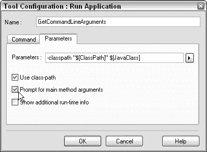
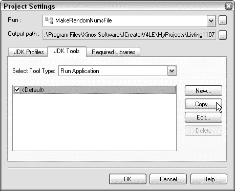

第四部分：高级 Java 技巧 280

5. **确保 Run Application（运行应用程序）出现在 Select Tool Type（选择工具类型）下拉列表中。**

6. **在 Select Tool Type 列表下方，选择 Default configuration（默认配置）。**

7. **点击 Copy（复制）按钮。**
   出现一个名为 `Tool Configuration : Run Application` 的窗口。

8. **在 Tool Configuration 窗口的 Name 文本框中，输入任何可以提醒你这个示例内容的文字。**
   在图 11-16 中，我输入了 `GetCommandLineArguments`。

**图 11-15：**
准备复制默认的 Run Application 配置。

**图 11-16：**
Tool Configuration 窗口。

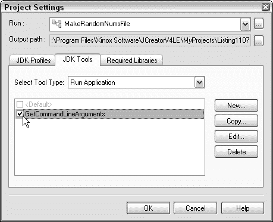

9. **在 Tool Configuration 窗口中，选择 Parameters（参数）选项卡。**

10. **勾选 Prompt For main Method Arguments（提示主方法参数）框。**

11. **点击 OK。**
    `Tool Configuration` 窗口消失。现在你又看到了 `Project Settings` 窗口。

12. **在 Project Settings 窗口中，选中你新创建配置旁的复选框。**
    在图 11-17 中，我选择了我新的 `GetCommandLineArguments` 配置。

13. **点击 OK。**
    这些指令列表不总是这样结束的吗？

**图 11-17：**
选择你的新配置。

遵循步骤 1 到 13 后，你的项目被更改了。每当该项目是活动项目时，选择 `Build ➔ Execute Project` 都会给你像之前图 11-12 所示的对话框。

有关在 JCreator 之外的环境中使用命令行参数的提示，请参本书的网站。

本书关于数组的讨论即将进入尾声。下一节将处理不同的内容：如果你需要一个二维数组怎么办？

### 数组

数组很好用，但数组也有一些局限性。想象你按顺序存储名称（按姓氏字母字母顺序、按社会安全号码数字顺序、随如何）。你有一个数组：

```java
String name[] = new String[100];
for (int i = 0; i < 100; i++) {
    name[i] = "";
}
```

一切正常，直到某一天，第 101 号客户出现了。当你的程序运行时，你输入了 101 的数据，希望只有 100 个组件的数组可以扩展以适应需求。事实如此。数组不会扩展。你的程序会抛出一个 `ArrayIndexOutOfBoundsException` 并崩溃。“在我的下一次，我会创建一个长度为 1000 的数组，”你对自己说。当你的下一次轮到时，你这样做：

```java
String name[] = new String[1000];
for (int i = 0; i < 1000; i++) {
    name[i] = "";
}
```

但在你的下一次，发生了经济衰退。你没有 101 个客户，只有 3 个。现在你浪费了 1000 个的空间，而 3 个就足够了。而且如果没有发生经济衰退呢？你带着大小为 1000 的数组顺利运行，使用了 825 个空间。索引 0 到 824 的组件正在使用中，而索引 825 到 999 的组件静静等待填充。

**第 11 章：使用数组和集合处理数值** 283

有一天，一位新客户出现了。由于你的客户是按顺序存储的（按姓氏字母顺序、按社会安全号码数字顺序、随如何），你想把这个客户挤进数组的正确组件中。问题是这个客户位于数组非常靠前的位置，索引 7 的组件。这时会发生什么？

你将 824 号组件的名称移动到 825 号。

然后你将 823 号组件的名称移动到 824 号。

将 822 号的移动到 823 号。你继续这样做，直到移动了 7 号组件的名称。然后你把新客户的名字放入 7 号组件。真头疼！当然，计算机不会抱怨。（如果计算机有感情的话，它可能喜欢这种琐事。）但当你移动这些名称时，你浪费了处理时间，浪费了电力，并浪费了各种资源。


“在我的下辈子，我会在每两个名字之间留出三个空位置。”而且，你的业务随之扩大。最终你发现三个位置是不够的。

## 集合类来救场

前几个段落中提到的问题并不新鲜。计算机科学家们研究这些问题已经很久了。他们并没有发现任何万能的通用解决方案，但他们发现了一些巧妙的技巧。

Java API 拥有一系列被称为 `collection`（集合）的类。每个集合类都拥有用于存储大量值的方法。而且每个集合类的方法都使用了一些巧妙的技巧。对你来说，底线是：某些集合类能够以最高效率处理前几个段落中提出的问题。如果你正在编写代码，并且知道自己必须处理此类问题，你就可以使用这些集合类并调用它们的方法。你不需要为一个本该属于第 7 位的客户名称苦恼，只需调用类的 `add` 方法即可。该方法会将名称插入到你选择的位置，并合理地处理可能发生的任何连锁反应。在最好的情况下，插入是非常高效的；在最坏的情况下，你可以放心代码已经以尽所能的方式完成了任务。

## 使用 ArrayList

Java 集合类中最有用的是 `ArrayList`。列表 11-8 向你展示了它是如何工作的。

**列表 11-8：与 Java 集合操作**

```java
import static java.lang.System.out;

import java.util.Scanner;
import java.io.File;
import java.io.IOException;
import java.util.ArrayList;

class ShowNames {
    public static void main(String args[]) throws IOException {
        ArrayList<String> people = new ArrayList<String>();
        Scanner diskScanner = new Scanner(new File(“names.txt”));
        while (diskScanner.hasNext()) {
            people.add(diskScanner.nextLine());
        }
        people.remove(0);
        people.add(2, “Jim Newton”);
        for (String name : people) {
            out.println(name);
        }
    }
}
```

图 11-18 显示了一个示例 `names.txt` 文件。列表 11-8 中的代码读取该 `names.txt` 文件，并打印图 11-19 中的内容。

执行 `remove` 和 `add` 方法时，所有有趣的事情发生了。名为 `people` 的变量引用一个 `ArrayList` 对象。当你调用该对象的 `remove` 方法 `people.remove(0);` 时，你从列表中删除了一个值。在这种情况下，你删除了列表初始位置（编号为 0 的位置）上的任何值。因此，在列表 11-8 中，调用 `remove` 将名称 Barry Burd 从列表中移除。

此时列表中只剩下八个名字，但接的一条语句 `people.add(2, “Jim Newton”);` 将一个名字插入到第 2 位（在 Barry 被移除后，第 2 位是 Harry Spoonswagler 占据的位置，因此 Harry 移动到了第 3 位，Jim Newton 变成了第 2 人）。请注意，`ArrayList` 对象有两个不同的 `add` 方法。添加 Jim Newton 的方法有两个参数 — 一个位置编号和一个要添加的值。另一个 `add` 方法 `people.add(diskScanner.nextLine());` 仅接受一个参数。该语句获取输入文件某行中找到的名称，并将该名称附加到列表末尾。（只有一个参数的 `add` 方法总是将其值附加到 `ArrayList` 对象的当前末尾。）

## 使用泛型（热点！）

再次查看列表 11-8，注意那个奇特的 `ArrayList` 声明：`ArrayList<String> people = new ArrayList<String>();`。从 Java 5.0 开始，每个集合类都被*泛型化*（generified）。这个听起来很难的词意味着每个声明都应该包含 `<SomeTypeName>`。夹在 `<` 和 `>` 之间的内容告诉 Java 新集合可能包含什么类型的值。

本节的内容适用于 Java 5.0、Java 6 或未来几年出现的任何更高版本。有关 Java 版本号的更多信息，请参阅第 2 章。例如，在列表 11-8 中，`ArrayList<String> people` 词表示 `people` 变量只能引用 `String` 类型值的集合。因此从该点开始，对 `people` 集合中项的任何引用都被完全视为 `String`。如果你编写 `people.add(new Room());`，编译器就会报错并“吐出”你的代码，因为 `Room` 等同于 `String`。（即使编译器可以访问 `Room` 类，也会发生这种情况 — 语句 `people.add(“George Gow”);` 是没问题的。因为“George Gow”的类型是 `String`，编译器就会微笑。）

## 测试是否存在更多数据

`Scanner` 类有几个好用的方法，如 `nextInt()`、`hasNextDouble()` 和基础的 `hasNext()`。这些方法每个都检查是否有更多输入。如果有更多数据，方法返回 `true`。否则，方法返回 `false`。因此，在程序获取了图 11-18 中的最后一行后，随后的 `hasNext()` 调用返回 `false`。这个假条件结束了 `while` 循环的执行，并让计算机进入列表 11-8 的剩余部分。

## 关于泛型

Java 的原始设计目标之一是保持语言尽可能简单。语言的开发者将 C++ 中一些不必要的复杂特性扔出了窗外。结果是语言变得优雅且简洁。有些人认为这种语言太简洁了。因此，经过几年的讨论和争论，Java 变得复杂了一些。到 2004 年，Java 有了枚举类型、增强 for 循环、静态导入以及其他一些有趣的新功能。但讨论最多的新功能是泛型的引入。

泛型的引入解决了这个问题：

```java
ArrayList<Account> things = new ArrayList<Account>();
things.add(new Account());
Account myAccount = things.get(0);
```

在那个时代，`ArrayList` 可以存储几乎任何你想放进去的东西 — 一个数字、一个 `Account`、一个 `Room`、一个 `String` — 任何。`ArrayList` 类非常通用。在第三行中，调用 `get(0)` 获取 `things` 集合中的早期值。`get(0)` 调用是可以的，但编译器在尝试赋值给 `myAccount` 变量时卡住了。你在第三行收到这样的消息，说从 `things` 列表获取的任何东西都无法放入 `myAccount` 变量，因为当编译器到达第三行时，它已经忘记了第二行添加的项是 `Account` 类型了！


灵活，但这种灵活性也带来了一些头疼的问题。

在两个地方添加 `<Account>` 就能看出端。如果你可以向 `ArrayList` 中放入任何东西，那么 `things` 存储的就是 `Account` 实例——你无法轻易预测里面是什么东西。所以，在第三行，你会从 `ArrayList` 中取出内容。在前面的代码中，你从 `things` 集合获取了一个值。然后，由于 `things` 只存储 `Account` 对象，你可以编写特定的、易于编写的代码假设你已经在 `ArrayList` 中存储了特定类型的值。这里有一个例子：`myAccount` 指该新值。它运行正常！

```java
ArrayList things = new ArrayList();
```

288 第四部分：精通 Java 技术

## 第 12 章

### 当情况发生意外转变时保持良好

### 本章内容
- 从错误输入和其他糟糕状况中恢复
- 让你的代码（在某种程度上）无视崩溃
- 定义你自己的异常类

*1945 年 9 月 9 日：* 一只飞子飞入了哈佛 Mark II 计算机的一个继电器中，导致机器卡壳。这成为了第一个有案的真实计算机故障（bug）。

*1957 年 4 月 20 日：* 西斯堡电气数据处理中心经理赫伯特·布莱特（Herbert Bright）在邮件中收到了一叠未标记的计算机打孔卡（这就像今天在邮件里收到一张没有标签的 CD-ROM）。布莱特先生猜测这叠卡片来自 `FORTRAN` 开发团队——这是第一种计算机编程语言。他已经等这个软件好几年了（当时无法进行网络下载）。仅凭这一准确的猜测，布莱特写了一个短小的 `FORTRAN` 程序，并尝试在他的 `IBM 704` 上编译它（`IBM 704` 位于一个专门建造的 2000 平英尺房间内。由于使用的是真空管而非晶体管，该机器拥有惊人的 32K 内存。在运行每个程序之前，必须从磁带加载操作系统，一个典型的程序运行需要二到四小时）。经过通常的等待时间后，布莱特编译 `FORTRAN` 程序的尝试返回了一个错误——其中一条语句缺少一个逗号。布莱特修正了错误，程序运行得非常完美。

*1962 年 7 月 22 日：* 美国首个以另一个行星为目标的水手一号（Mariner I）在发射四分钟后表现异常并被毁。这种异常归因于火箭速度公式中缺少横杠（类似于连字符）。

大约同时，美国航空航天局（NASA）的轨道计算软件被发现包含错误的语句 `DO 10 I=1.10`（应为 `DO 10 I=1,10`）。在现代表示法中，这就像用 `do10i = 1.10` 替换了 `for (int i=1; i<=10; i++)`。从逗号到点的改变将一个循环变成了一个赋值语句。

*2000 年 1 月 1 日：* 2000 年问题给现代世界带来了混乱。

这些笔记中任何具有历史准确性的事实都借自以下来源：计算机传说新闻组（`alt.folklore.computers`，你可以通过 `groups.google.com` 访问）、免费计算机字典（`www.foldoc.org`）、《计算机》杂志的“回顾”专栏（`www.computer.org/computer`）以及 IEEE 的网页（`www.computer.org/history`）。

### 处理异常

你正在进行盘点。这意味着一个接一个、一个接一个地计算物品，并将这些物品的数量记录在日志表、小型手持设备以及计算机键盘上的表单中。项目的某个特定部分涉及输入你在“第一年以来未打开过的大满灰尘箱”货架上发现的箱子数量。为了打破公司十年来的习惯，你决定不打开这些箱子的任何一个。你为每个箱子分配了 `$3.25` 的值。

列表 12-1 显示了处理这部分盘点的软件。该软件存在一个缺陷，在图 12-1 中所示。当用户输入整数值时，一切正常。但当用户输入其他内容（例如数字 3.5）时，程序就会彻底崩溃。对此显然可以做些什么。计算机是愚笨的，但它们并不笨到会在用户输入不当值时就输得如此彻底。

**列表 12-1：数箱子**

```java
import static java.lang.System.out;
import java.util.Scanner;
import java.text.NumberFormat;

class InventoryA {
    public static void main(String args[]) {
        final double boxPrice = 3.25;
        Scanner myScanner = new Scanner(System.in);
        NumberFormat currency = NumberFormat.getCurrencyInstance();
        out.print("How many boxes do we have? ");
        String numBoxesIn = myScanner.next();
        int numBoxes = Integer.parseInt(numBoxesIn);
        out.print("The value is ");
        out.println(currency.format(numBoxes * boxPrice));
    }
}
```

**图 12-1：哎！那不是一个数字。**

修复程序漏洞的关键是检查程序崩溃时出现的消息。盘点程序显示的消息是 `java.lang.NumberFormatException`。这意味着名为 `NumberFormatException` 的类位于 `java.lang` API 程序包中。由于某种方式，对 `Integer.parseInt` 的调用引入了这个异常。

关于 `Integer.parseInt` 方法的简要解释，请参见第 11 章。

嗯，这里发生了什么。Java 编程语言有一种机制称为*异常处理*。通过异常处理，程序可以检测到情况即将出错，并通过创建一个新对象来应对。在官方术语中，程序被称为正在*抛出*（throwing）异常。这个新对象（`Exception` 类的实例）像烫山芋一样从一段代码传递到另一段代码，直到某段代码决定捕获（catch）异常。当异常被捕获时，程序执行某些恢复代码，将其隐藏，并像什么都没发生过一样继续运行。这个过程如图 12-2 所示。

整个过程通过几个 Java 关键字完成。这些关键字如下：

- `throw`：创建一个新的异常对象。
- `throws`：将责任推给调用该方法的代码。
- `try`：包围可能创建异常对象的代码。
- `catch`：处理异常，将其隐藏，然后继续执行。

所以，真相大白了。通过如图 12-2 所示的某种事件链，`Integer.parseInt` 方法可能会抛出 `NumberFormatException`。当你调用 `Integer.parseInt` 时，这个 `NumberFormatException` 会传递给你。Java API（应用程序接口）关于 `parseInt` 方法的文档写道：“抛出：NumberFormatException —— 如果字符串不包含可解析整数。”偶尔阅读文档确实是有回报的。

```java
void method1() {
    try {
        method2();
    } catch (Exception e) {
    }
}

void method2() throws Exception {
    method3();
}

void method3() throws Exception {
    method4();
}

void method4() throws Exception {
    throw new Exception();
}
```

**图 12-2：抛出、传递和捕获异常。**

如果你自比为英雄，你最好捕获异常，以便所有其他代码都能进行其常规业务。列表 12-2 显示了对异常的捕获。

**列表 12-2：英雄数箱子**

```java
```


```java
import java.util.Scanner;
import java.text.NumberFormat;

class InventoryB {
    public static void main(String args[]) {
        final double boxPrice = 3.25;
        Scanner myScanner = new Scanner(System.in);
        NumberFormat currency = NumberFormat.getCurrencyInstance();
        out.print(“How many boxes do we have? “);
        String numBoxesIn = myScanner.next();
        try {
            int numBoxes = Integer.parseInt(numBoxesIn);
            out.print(“The value is “);
            out.println(currency.format(numBoxes * boxPrice));
        } catch (NumberFormatException e) {
            out.println(“That’s not a number.");
        }
    }
}
```

图 12-3 显示了列表 12-2 中代码的三次运行。当误导的用户输入 `three` 而不是 `3` 时，程序会保持冷静并显示 `That’s not a number.`。诀窍是将对 `Integer.parseInt` 的调用封装在 `try` 子句中。如果你这样做，计算机会在执行 `try` 子句内的任何语句时监视异常。如果抛出异常，计算机将从 `try` 子句内部跳转到方的 `catch` 子句。在列表 12-2 中，计算机直接跳转到 `catch (NumberFormatException e)` 子句。计算机执行该子句内的 `println` 语句，然后继续进行正常处理。（如果列表 12-2 在 `catch` 子句结束后还有语句，计算机将继续并执行它们。）

**图 12-3：**
捕获该异常。

整个 try-catch 组合——包含一个 `try` 子句、`catch` 子句以及等内容——被称为 `try 语句`。有时为了强调，我称其为 `try-catch 语句`。

### catch 子句中的参数

看看列表 12-2 中的 `catch` 子句，并特别注意 `(NumberFormatException e)` 这几个词。这看起来非常像方法的参数列表，不是吗？事实上，每个 `catch` 子句都像一个微型方法，拥有自己的参数列表。参数列表始终包含一个异常类型名称，然后是一个参数。

在列表 12-2 中，我没有对 `catch` 子句的 `e` 参数做任何操作，但如果我想做的话，完全可以。记住，抛出的异常是一个对象——`NumberFormatException` 类的实例。当捕获到异常时，计算机会让 `catch` 子句的参数引用该异常对象。换句话说，名称 `e` 存储了关于该异常的信息。为了利用这一点，你可以调用异常对象的方法。

```java
} catch (NumberFormatException e) {
    out.println(“That’s not a number.");
    out.println(“Message: “ + e.getMessage());
    out.println(“Here comes a stack trace: “);
    e.printStackTrace();
    out.println(“Did you like the stack trace?”);
}
```

有了这个增强的 `catch` 子句，库存程序的运行可能看起来如图 12-4 所示的运行。当你调用 `getMessage()` 时，你获取了关于异常的一些详细信息。（在图 12-4 中，详细信息是用户误输入了单词 `three.` 。）当你调用 `printStackTrace()` 时，你会得到一个显示，显示在异常抛出时正在运行的方法。（在图 12-4 中，显示包含了 `Integer.parseInt` 和 `main` 方法。）`getMessage()` 和 `printStackTrace()` 都提供了帮助你找到程序困难源头的信息。

**图 12-4：**
调用异常对象的方法。

### 异常类型

今天还会出现什么问题？是否有其他类型的异常——即不是来自 `NumberFormatException` 类的异常？当然，有很多不同的异常类型。你甚至可以创建一个。想试一下吗？如果是，查看列表 12-3 和 12-4。

**列表 12-3：**
创建你自己的异常
```java
class OutOfRangeException extends Exception {
}
```

**列表 12-4：**
使用你自定义的异常
```java
import static java.lang.System.out;
import java.util.Scanner;
import java.text.NumberFormat;

class InventoryC {
    public static void main(String args[]) {
        final double boxPrice = 3.25;
        Scanner myScanner = new Scanner(System.in);
        NumberFormat currency = NumberFormat.getCurrencyInstance();
        out.print(“How many boxes do we have? “);
        String numBoxesIn = myScanner.next();
        try {
            int numBoxes = Integer.parseInt(numBoxesIn);
            if (numBoxes < 0) {
                throw new OutOfRangeException();
            }
            // (继续)
```

**列表 12-4（续）：**
```java
            out.print(“The value is “);
            out.println(currency.format(numBoxes * boxPrice));
        } catch (NumberFormatException e) {
            out.println(“That’s not a number.");
        } catch (OutOfRangeException e) {
            out.print(numBoxesIn);
            out.println(“That’s impossible!”);
        }
    }
}
```

事实是，`OutOfRangeException` 并不是内置于 Java API。然而，在库存程序，负数应该被标记为异常。列表 12-3 中的 `OutOfRangeException` 类仅仅是一行声明和一对空的大括号。作为 Java `Exception` 类的子类，允许抛出 `OutOfRangeException` 类的任何实例。


# 298 第四部分：精练的 Java 技术

## 列表 12-6（续）

```java
NumberFormat.getCurrencyInstance();

out.print(“How many boxes do we have? “);

String numBoxesIn = myScanner.next();

try {
    int numBoxes = Integer.parseInt(numBoxesIn);
    if (numBoxes < 0) {
        throw new OutOfRangeException();
    }
    if (numBoxes > 1000) {
        throw new NumberTooLargeException();
    }
    out.print(“The value is “);
    out.println(currency.format(numBoxes * boxPrice));
}
catch (NumberFormatException e) {
    out.println(“That’s not a number.”);
}
catch (OutOfRangeException e) {
    out.print(numBoxesIn);
    out.println(“? That’s impossible!”);
}
catch (Exception e) {
    out.print(“Something went wrong, “);
    out.print(“but I’m clueless about what “);
    out.println(“it actually was.”);
}
out.println(“That’s that.”);
}
```

要运行列表 12-5 和 12-6 中的代码，你还需要一个额外的 Java 程序文件。你需要列表 12-3 中的 `OutOfRangeException` 类。

列表 12-6 处理了货架空间有限的情况。你没有空间容纳超过 1,000 个箱子，但偶尔程序会问你共有多少个箱子，而这时有人不小心输入了数字 `100000`。在这种情况下，列表 12-6 会进行快速的现实检查。任何超过 1,000 的箱子数量都被视为不现实而被丢弃。

列表 12-6 会监控 `NumberTooLargeException`，但为了让过程更有趣，列表 12-6 并没有为 `NumberTooLargeException` 编写 catch 语句。尽管如此，一切运行得良好。之所以一切正常，是因为 `NumberTooLargeException` 被声明为 `OutOfRangeException` 的子类，而列表 12-6 有一个针对 `OutOfRangeException` 的 catch 语句。

你要明白，因为 `NumberTooLargeException` 是 `OutOfRangeException` 的子类，所以任何 `NumberTooLargeException` 实例都是一种特殊的 `OutOfRangeException`。因此在列表 12-6 中，计算机可能会开始寻找 catch `NumberTooLargeException` 的语句。当计算机遇到 `OutOfRangeException` catch 语句时，计算机会说：“好的，我找到了匹配项。我将执行此 catch 语句中的语句。”

为了避免重复编写整个故事，我引入了一些新术语。我称参数为 `OutOfRangeException` 的 catch 语句与抛出的 `NumberTooLargeException` *匹配*（matches）。我将这个 catch 语句称为*匹配的 catch 语句*（matching catch clause）。

接下来的项目符号描述了用户可能执行的不同操作以及计算机的响应。当你阅读这些项目符号时，可以通过查看图 12-6 显示的运行情况来跟进。

### 图 12-6：运行列表 12-6 中的代码

- **用户输入了一个普通的整数，比如数字 3。**
`try` 语句中的所有语句都会被执行。然后计算机将跳过所有的 `catch` 语句，并执行紧随所有 `catch` 语句之后的代码。（见图 12-7。）

- **用户输入不是整数整数，比如单词 fish。**
代码抛出了 `NumberFormatException`。计算机跳过 `try` 语句中剩余的语句。计算机执行第一个 `catch` 语句中的语句——即参数类型为 `NumberFormatException` 的语句。然后计算机跳过第二个和第三个 `catch` 语句，执行紧随所有 `catch` 语句之后的代码。（见图 12-8。）

### 图 12-7
```java
try {
    //正常处理（不抛出异常）
}
catch (NumberFormatException e) {
    out.println("That's not a number.");
}
catch (OutOfRangeException e) {
    out.print(numBoxesIn);
    out.println("? That's impossible!");
}
catch (Exception e) {
    out.print("Something went wrong, ");
    out.print("but I'm clueless about what ");
    out.println("it actually was.");
}
out.println("That's that.");
```

### 图 12-8
```java
try {
    throw new NumberFormatException ();
}
catch (NumberFormatException e) {
    out.println("That's not a number.");
}
catch (OutOfRangeException e) {
    out.print(numBoxesIn);
    out.println("? That's impossible!");
}
catch (Exception e) {
    out.print("Something went wrong, ");
    out.print("but I'm clueless about what ");
    out.println("it actually was.");
}
```

- **用户输入了一个负数，比如数字 -25。**
代码抛出了 `OutOfRangeException`。计算机跳过 `try` 语句中剩余的语句。计算机跳过第一个 `catch` 语句中的语句。（毕竟，`OutOfRangeException` 并不是任何 `NumberFormatException`）。计算机执行第二个 `catch` 语句中的语句——即参数类型为 `OutOfRangeException` 的语句。然后计算机跳过第三个 `catch` 语句，执行紧随所有 `catch` 语句之后的代码。（见图 12-9。）

- **用户输入了一个不现实的大数字，比如数字 10001。**
代码抛出了 `NumberTooLargeException`。计算机跳过 `try` 语句中剩余的语句。计算机跳过第一个 `catch` 语句中的语句。（毕竟，`NumberTooLargeException` 并不是 `NumberFormatException`。）

### 302 第四部分：精练的 Java 技术

但根据列表 12-5 中的代码，`NumberTooLargeException` 是 `OutOfRangeException` 的子类。当计算机遇到第二个 `catch` 语句时，计算机说：“嗯！`NumberTooLargeException` 是一种 `OutOfRangeException`。我将执行此 catch 语句中的语句——类型为 `OutOfRangeException` 的语句。”换句话说，它是匹配的。所以，计算机执行第二个 `catch` 语句中的语句。然后计算机跳过第三个 `catch` 语句，执行紧随所有 `catch` 语句之后的代码。（见图 12-10。）

- **发生了其他事情，某些不可预测的事情（我不知道）。**
由于我永无的实验冲动，我在列表 12-6 的 `try` 语句中添加了一个抛出 `IOException` 的语句。没有理由——我只是想看看会发生什么。当代码抛出 `IOException` 时，计算机跳过 `try` 语句中剩余的语句。然后计算机跳过第一个和第二个 `catch` 语句中的语句。当计算机遇到第三个 `catch` 语句时，我听到计算机说：“嗯！`IOException` 是一种 `Exception`。我找到了匹配的 catch 语句——参数类型为 `Exception` 的语句。我将执行此 catch 语句中的语句。”

```java
try {
    throw new NumberTooLargeException ();
}
catch (NumberFormatException e) {
    out.println("That's not a number.");
}
catch (OutOfRangeException e) {
    out.print(numBoxesIn);
    out.println("? That's impossible!");
}
catch (Exception e) {
    out.print("Something went wrong, ");
}
```


# 第 12 章：当意外发生时保持得体

于是，计算机执行了第三个 `catch` 子句内部的语句。然后，计算机执行紧跟所有 `catch` 子句之后的代码。（参见图 12-11。）

```java
try {
    throw new IOException ();
}
catch (NumberFormatException e) {
    out.println("That's not a number.");
}
catch (OutOfRangeException e) {
    out.print(numBoxesIn);
    out.println("? That's impossible!");
}
catch (Exception e) {
    out.print("Something went wrong, ");
    out.print("but I'm clueless about what ");
    out.println("it actually was.");
}
```

抛出了一个 `IOException`。执行 `out.println("That's that.");`

当计算机寻找匹配的 `catch` 子句时，它会锁定符合以下描述的最顶部子句：

- 子句的参数类型与抛出的异常的类型相同。
- 子句的参数类型是该异常类型的父类。

如果在 `catch` 子句列表的更下方出现了更匹配的项，那太遗憾了。例如，假设你向列表 12-6 中的代码添加了一个参数类型为 `NumberTooLargeException` 的 `catch` 子句。同样，假设你将这个新的 `catch` 子句放在参数类型为 `OutOfRangeException` 的 `catch` 子句*之后*。由于 `NumberTooLargeException` 是 `OutOfRangeException` 类的子类，你新的 `NumberTooLargeException` 子句中的代码将永远不会执行。事实就是如此。

## 第四部分：熟练的 Java 技术

### 冒险精神

你是那种强迫症类型吗？你是否喜欢在异常导致程序崩溃之前捕获所有可能的异常？

嗯，小心点。Java 不会让你变得偏执。如果异常没有被抛出的机会，你就无法捕获它。

考虑以下代码。这段代码在 `try` 子句内部有一个非常简单的 `i++` 语句。这很合理。但代码的 `catch` 子句却假装捕获一个 `IOException`。

```java
// 糟糕的代码！
try {
    i++;
} catch (IOException e) {
    e.printStackTrace();
}
```

这个 `catch` 子句是在试图给谁看？`i++` 语句没有进行任何输入或输出。`try` 子句内部的代码不可能抛出 `IOException`。所以编译器回来说道：“嘿，`catch` 子句。清醒点。别再自命不凡了。”嗯，得更精确一点，编译器的斥责信息如下：

`exception java.io.IOException is never thrown in body of corresponding try statement`

### 做有用的事情

到为止，本章中的每个示例都是捕获异常，打印“输入错误”消息，然后关门营业。如果能看到一个程序在捕获异常后实际上还能继续运行，那不是很好吗？嗯，是时候来点好东西了。列表 12-7 在循环内部有一个 `try-catch` 语句。循环会一直运行，直到用户输入合理的内容。

**列表 12-7：继续坚持**

```java
import static java.lang.System.out;
import java.util.Scanner;
import java.text.NumberFormat;

class InventoryLoop {
    public static void main(String args[]) {
        final double boxPrice = 3.25;
        boolean gotGoodInput = false;
        Scanner myScanner = new Scanner(System.in);
        NumberFormat currency = NumberFormat.getCurrencyInstance();
        do {
            out.print(“How many boxes do we have? “);
            String numBoxesIn = myScanner.next();
            try {
                int numBoxes = Integer.parseInt(numBoxesIn);
                out.print(“The value is “);
                out.println(currency.format(numBoxes * boxPrice));
                gotGoodInput = true;
            } catch (NumberFormatException e) {
                out.println();
                out.println("That’s not a number.");
            }
        } while (!gotGoodInput);
        out.println("That’s that.");
    }
}
```

图 12-12 显示了列表 12-7 代码的运行情况。在前三次尝试中，用户输入了除了有效整数以外的所有内容。最后，第四次尝试成功了。用户输入了 `3`，计算机离开了循环。

## 我们的朋友，良好的异常

有一种传言说 Java 异常总是来自不希望的、错误的情况。虽然这个传言有些事实，但它并不完全准确。偶尔，异常会产生于正常的、预期的发生。例如，检测文件的末尾。

以下代码复制了一个文件：

```java
try {
    while (true) {
        dataOut.writeByte(dataIn.readByte());
    }
} catch (EOFException e) {
    numFilesCopied = 1;
}
```

要从 `dataIn` 拷贝字节到 `dataOut`，你只需要进入 `while` 循环。由于其 `true` 条件，`while` 循环似乎是无尽的。但最终你到达了 `dataIn` 文件的结尾。当这种情况发生时，`readByte` 方法会抛出一个 `EOFException`（文件结束异常）。该异常的抛出使得程序离开了 `try` 块。

### 处理异常还是推卸责任

有一种传言在流传，Java 异常总是来自不希望的、错误的情况。虽然这个传言有些事实，但它并不完全准确。偶尔，异常会产生于正常的、预期的发生。例如，检测文件末尾。

以下代码复制了一个文件：

```java
try {
    while (true) {
        dataOut.writeByte(dataIn.readByte());
    }
} catch (EOFException e) {
    numFilesCopied = 1;
}
```

要从 `dataIn` 拷贝字节到 `dataOut`，你只需要进入 `while` 循环。由于其 `true` 条件，`while` 循环似乎是无尽的。但最终你到达了 `dataIn` 文件的结尾。当这种情况发生时，`readByte` 方法会抛出一个 `EOFException`（文件结束异常）。该异常的抛出使得程序离开了 `try` 块。 (注：由于原文文本在某些地方出现了重复或乱码，翻译时已根据上下文进行了逻辑理顺)

### 处理异常还是推卸责任

所以你正在了解 Java 吗？什么？你说你所有的路。但记住，只有工作没有玩……所以，休息一下怎么样？我很感动。列表 12-8 有一个应该暂停五秒的程序。问题是 12-8 是错误的。看一眼 12-8，然后我会告诉你有有什么问题。

**列表 12-8：一个错误的程序**

```java
/*** 这代码无法编译。 ***
import static java.lang.System.out;

class NoSleepForTheWeary {
    public static void main(String args[]) {
        out.print(“Excuse me while I nap “);
        out.println(“for just seconds...”);
        takeANap();
        out.println(“Ah, that was refreshing.”);
    }

    static void takeANap() {
        Thread.sleep(5000);
    }
}
```

列表 12-8 的策略并不坏。主意是调用在 Java API 中定义的 `sleep` 方法。这个 `sleep` 方法属于 `Thread` 类。当你调用 `sleep` 方法时，传递给它的数字是毫秒。所以，`Thread.sleep(5000)` 意味着暂停五秒。

问题是 `sleep` 方法内部的代码可以抛出一个异常。这种异常是 `InterruptedException` 类的实例。当你尝试编译列表 12-8 中的代码时，你会得到以下不受欢迎的消息：

`unreported exception java.lang.InterruptedException; must be caught or declared to be thrown`

为了泛理解异常，你不需要确切知道 `InterruptedException` 到底是什么。你只需要知道调用 `Thread.sleep` 会抛出这些中断异常对象。但如果你真的好奇，当某些代码中断其他代码的睡眠时，就会抛出 `InterruptedException`。想象你有两段代码同时运行。其中一段代码调用 `Thread.sleep` 方法。同时，另一段代码调用 `interrupt` 方法。通过调用 `interrupt` 方法，第二段代码让第一段代码的 `Thread.sleep` 方法戛然而止。`Thread.sleep` 方法通过抛出一个中断异常来做出响应。


# 第四部分：精通 Java 技术

现在，Java 编程语言有两种不同类型的异常。

它们被称为*受检查异常*（checked exceptions）和*未检查异常*（unchecked exceptions）：

- 代码中可能抛出的受检查异常必须在代码中进行确认。
- 代码中可能抛出的未检查异常不需要在代码中进行确认。

`InterruptedException` 是 Java 的受检查异常类型之一。当你调用一个可能抛出 `InterruptedException` 的方法时，你需要在代码中确认该异常。

现在，当我说一个异常在*代码中被确认*时，我到底是什么意思？

```java
// 作者想要感谢这个 InterruptedException，
// 如果没有它，这段代码就无法写出来。
```

不，这并不是“在代码中被确认”的含义。在代码中确认异常意味着两种情况之一：

- 可能会抛出异常的语句（包括方法调用）位于 `try` 句内部。该 `try` 句包含一个 `catch` 句，且其参数列表中有一个与之匹配的异常类型。
- 可能会抛出异常的语句（包括方法调用）位于一个方法头部带有 `throws` 子句的方法中。该 `throws` 子句包含与之匹配的异常类型。

如果你对这两个列表项目的表述感到困惑，不要担心。接下来的两个列表说明了这些列表项目的观点。

在列表 12-9 中，可能抛出 `InterruptedException` 的方法调用位于 `try` 句内部。该 `try` 句包含一个异常类型为 `InterruptedException` 的 `catch` 句。

### 列表 12-9：使用 try-catch 语句进行确认

```java
import static java.lang.System.out;

class GoodNightsSleepA {
    public static void main(String args[]) {
        out.print("Excuse me while I nap ");
        out.println("for just five seconds...");
        takeANap();
        out.println("Ah, that was refreshing.");
    }

    static void takeANap() {
        try {
            Thread.sleep(5000);
        } catch (InterruptedException e) {
            out.println("Hey, who woke me up?");");
        }
    }
}
```

在章节的这一部分，我的习惯是提醒你列表某某运行结果如图某所示。但这里的问题是，图 12-13 并没有充分体现列表 12-9 中的代码内容。当你运行列表 12-9 中的程序时，计算机会显示 `Excuse me while I nap for just five seconds`，暂停五秒，然后显示 `Ah, that was refreshing.`。代码之所以有效，是因为可能抛出 `InterruptedException` 的 `sleep` 方法调用位于 `try` 句内部。该 `try` 句包含一个 `catch` 句，其异常类型为 `InterruptedException`。

**图 12-13：**
在“Ah”这一行之前有五秒的停顿。

使用 `try-catch` 语句确认异常就到这里。你可以使用另一种方式确认异常，如列表 12-10 所示。

### 列表 12-10：使用 throws 进行确认

```java
import static java.lang.System.out;

class GoodNightsSleepB {
    public static void main(String args[]) {
        out.print("Excuse me while I nap ");
        out.println("for just five seconds...");
        try {
            takeANap();
        } catch (InterruptedException e) {
            out.println("Hey, who woke me up?");
        }
        out.println("Ah, that was refreshing.");
    }

    static void takeANap() throws InterruptedException {
        Thread.sleep(5000);
    }
}
```

要查看列表 12-10 代码的运行情况，请参考图 12-13。再次，图 12-13 未能捕捉运行的本质，但没关系。只需记住在图 12-13 中，计算机在显示 `Ah, that was refreshing.` 之前暂停了五秒。

列表 12-10 的重要部分在于 `takeANap` 方法头部。该头部以 `throws InterruptedException` 结尾。通过宣布它抛出一个 `InterruptedException`，`takeANap` 方法推卸了责任。

这个 `throws` 子句真正的表达是：“我意识到此方法内部的一个语句可能会抛出 `InterruptedException`，但我没有在 `try-catch` 语句中确认该异常。Java 编译器，请不要在这个问题上扰我。我没有使用 `try-catch` 语句，而是将确认异常的责任交给了 `main` 方法（即调用 `takeANap` 方法的方法）。”

事实上，在 `main` 方法中，对 `takeANap` 的调用位于 `try` 句内部。该 `try` 句包含一个参数为 `InterruptedException` 的 `catch` 句。

为了更好地理解 `throws` 子句，想象一场排球比赛，球是一个异常。当团队中的球员发球时，该球员正在抛出异常。球越过网，你正在捕捉异常。但如果你把球传过网，你就是在使用 `throws` 子句。本质上，你是在说：“给你，其他球员。”

一个方法可以在其 `throws` 子句中列出多个异常类型。只需用逗号分隔异常类型的名称，如下例：

`throws InterruptedException, IOException, ArithmeticException`

Java API 拥有数百种异常类型。其中几种是 `RuntimeException` 的子类。任何 `RuntimeException` 的子类（或其子子类、子子子类等）都是未检查异常。任何不是 `RuntimeException` 后代的异常都是受检查异常。未检查异常包括计算机难以预测的内容。这些异常包括 `NumberFormatException`（见列表 12-2、12-4 等）、`ArithmeticException`、`IndexOutOfBoundsException`、`NullPointerException` 以及其他。当你编写 Java 代码时，你的大部分代码都会受到这些异常的影响，但将代码封装在 `try` 语句中（或使用 `throws` 推推责任）是完全可选的。


就在那时，第二次事故发生了。当我正准备下车时，一辆城市公交车经过。公交车撞了我，并将我撞向我的车好几次。这种事情被称为 `DealWithLawyersException`。

事实是，一切都进展得很顺利。我受了点伤，但并没有大碍。我的父母支付了修理汽车的费用，所以我没有遭受任何财务损失。（我通过将 `RunARedLightException` 放入 `throws` 子句中成功规避了财务负担。）这次事件有助于解释为什么我对于异常处理会有那样的想法。特别是，我在想：“如果计算机在从一个异常中恢复时，抛出了第二个异常会发生什么？”毕竟，`catch` 子句内部的语句并不是免受灾难的。

嗯，这个问题的答案绝非简单。首先，你可以在 `catch` 子句内部放置一个 `try` 语句。这可以防止你在执行 `catch` 子句期间出现意料之外的、可能导致很尴尬的事件。但当你开始担心级联异常时，你就打开了一个非常棘手的“潘多拉盒”。这种情况非常多，事情会很快变得复杂。

你可以做的一件不那么复杂的事情是创建一个 `finally` 子句。

和 `catch` 子句一样，`finally` 子句位于 `try` 子句之后。巨大的区别在于，无论是否发生异常，`finally` 子句中的语句都会执行。其理念是：“无论发生什么，好坏，执行此 `finally` 子句内部的语句。”列表 12-11 提供了一个示例。

**列表 12-11：到处跳转**

```java
import static java.lang.System.out;

class DemoFinally {
    public static void main(String args[]) {
        try {
            doSomething();
        } catch (Exception e) {
            out.println("Exception caught in main.");
        }
    }

    static void doSomething() {
        try {
            out.println(0 / 0);
        } catch (Exception e) {
            out.println("Exception caught in doSomething.");
            out.println(0 / 0);
        } finally {
            out.println("I’ll get printed.");
        }
        out.println("I won’t get printed.");
    }
}
```

通常，当我考虑到 `try` 语句时，我考虑的是计算机从一个不愉快的状况中恢复。恢复发生在 `catch` 子句内部，然后计算机继续执行 `try` 语句之后的任何语句。嗯，如果在执行 `catch` 子句期间发生了错误，这幅画面就会开始变得不同。

列表 12-11 在图 12-14 中得到了演练。首先，`main` 方法调用了 `doSomething`。然后，愚蠢的 `doSomething` 方法特意去制造麻烦。`doSomething` 方法将 0 除以 0，这在任何编程语言中都是非法且无法执行的。`doSomething` 方法的这个愚蠢行为抛出了 `ArithmeticException`，它被 `try` 语句中唯一的 `catch` 子句捕获。

在 `catch` 子句内部，那个卑劣的 `doSomething` 方法再次将 0 除以 0。这一次，执行除法的语句并不在一个保护性的 `try` 子句内部。这没关系，因为 `ArithmeticException` 不是受检异常（checked exception）。它是 `RuntimeException` 子类之一。它是一种不需要在 `try` 或 `throws` 子句中确认的异常。详情请参见上一节。）

嗯，无论是否受检，抛出另一个 `ArithmeticException` 都会导致控制流跳出 `doSomething` 方法。但在离开 `doSomething` 方法之前，计算机执行了 `try` 语句的最后遗嘱——即 `finally` 子句内部的语句。

这就是为什么在图 12-14 中，你看到了“I’ll get printed”这些字。

**图 12-14：运行列表 12-11 中的代码。**

有趣的是，你没有在图 12-14 中看到“I won’t get printed”字。因为 `catch` 子句的执行抛出了它自己的未捕获异常，计算机从未向下执行完 `try-catch-finally` 语句。

所以，计算机回到了 `main` 方法中中断的地方。回到 `main` 方法后，`doSomething` 方法 `ArithmeticException` 意外的消息导致执行跳转到 `catch` 子句中。计算机打印出 Exception caught in main，然后这场可怕的梦般的运行就结束了。

## 第五部分：十项全

在本部分 . . .
你已经接近书的末尾，是时候总结一切了。书的这部分是你关于 Java 的砰击式、两千字以内资源。什么？你没读这之前章节的每一个字？那没关系。你可以在这个“十项””中学到很多有用信息。

## 第 13 章：避免错误的十种方法

在本章中
- 检查你的大小写和值比较
- 注意贯穿问题（fall-through）
- 将方法、监听器和构造函数放在它们所属的位置
- 使用静态和非静态引用
- 避免其他严重的错误

“唯一不犯错的人是那些什么都不做的人。”我的一位大学教授是这么说的。我不记得那位教授的名字，所以我无法给予应有的荣誉。我想那是我的错。

### 将大写字母放在它们所属的位置

Java 是一种大小敏感的语言，所以你真的必须注意你的 `P` 和 `Q` 以及字母表中的每一个其他字母。在创建 Java 程序时，记住以下几点：

- Java 的关键字全小写。例如，在 Java 的 `if` 语句中，单词 `if` 不能是 `If`。
- 当你使用 Java API（应用程序接口）中的名称时，名称的大小写必须与 API 中出现的的匹配。
- 你还需要确保你定义的名称在整个程序中的大小写方式保持一致。如果你声明了变量 `myAccount`，你不能用 `MyAccount`、`myaccount` 或 `Myaccount` 来引用它。如果你以不同的方式大写变量名，Java 会认为你正在引用两个不同的变量。

关于 Java 大小敏感性的更多信息，请参见第 3 章。

### 跳出 switch 语句

如果你没有从 `switch` 语句中跳出，就会发生贯穿问题（fall-through）。例如，如果 `verse` 的值为 3，以下代码将打印所有三行——Last refrain, He’s a pain, 和 Has no brain。

```java
switch (verse) {
    case 3:
        out.print("Last refrain, ");
        out.println("last refrain,");
    case 2:
        out.print("He’s a pain, ");
        out.println("he’s a pain,");
    case 1:
        out.print("Has no brain, ");
        out.println("has no brain,");
}
```

欲了解详情，请参见第 5 章。

### 使用双等号比较值

当你比较两个值时，你使用双等号。`if (inputNumber == randomNumber)` 行是正确的，但 `if (inputNumber = randomNumber)` 行是不正确的。完整报告请参见第 5 章。

### 向 GUI 添加组件

这是一个 Java 框架的构造函数：

```java
public SimpleFrame() {
    JButton button = new JButton("Thank you...");
    setTitle("...Katie Feltman and Heidi Unger");
    setLayout(new FlowLayout());
    add(button);
    button.addActionListener(this);
    setSize(300, 100);
    setVisible(true);
}
```

无论你做什么，不要忘记对 `add` 方法的调用。如果没有这个调用，你费了劲创建了按钮，但按钮并没有出现在你的框架上。关于此类问题的介绍，请参见第 9 章。


再次查看上一节中用于构建 `SimpleFrame` 的代码。如果你忘记了调用 `addActionListener`，当你点击按钮时什么都不会发生。第二次更用力点击按钮也没用。关于监听器（listeners）的介绍，请参阅 CD-ROM 上的第 16 章。

## 定义所需的构造函数

当你定义一个带参数的构造函数时，例如 `public Temperature(double number)`

那么计算机就不会再为你创建默认的无参数构造函数了。换句话说，你无法再调用

`Temperature roomTemp = new Temperature();`

除非你显式地定义自己的无参数 `Temperature` 构造函数。关于构造函数的所有细节，请参阅第 9 章。

## 修复非静态引用

如果你尝试编译以下代码，会得到一个错误信息：

```java
class WillNotWork {
    String greeting = “Hello”;
    public static void main(String args[]) {
        System.out.println(greeting);
    }
}
```

你收到错误信息是因为 `main` 是 `static`（静态），而 `greeting` 不是 `static`。

关于查找和修复此问题的完整指南，请参阅第 10 章。

## 在数组边界内操作

当你声明一个拥有十个组件的数组时，这些组件的索引从 `0` 到 `9`。换句话说，如果你声明

`int guests[] = new int[10];`

那么你可以通过编写 `guests[0]`、`guests[1]` 等来引用 `guests` 数组的组件，一直到 `guests[9]`。你不能写 `guests[10]`，因为 `guests` 数组没有索引为 `10` 的组件。

关于数组的最新见闻，请参阅第 11 章。

## 预判空指针

本书中的示例并不容易抛出 `NullPointerException`（空指针异常），但在真实的 Java 编程中，你随处可见这种异常。当你调用一个应该返回对象的方法，但该方法却没有返回任何内容时，就会产生 `NullPointerException`。这里有一个简单的例子：

```java
import static java.lang.System.out;
import java.io.File;

class ListMyFiles {
    public static void main(String args[]) {
        File myFile = new File(“\\windows”);
        String dir[] = myFile.list();
        for (String fileName : dir) {
            out.println(fileName);
        }
    }
}
```

此程序显示 `windows` 目录下的所有文件列表。（如需澄清 `"\\windows"` 中双反斜杠的用法，请参阅第 8 章。）但如果你将 `\\windows` 改为其他东西——一个不代表目录名称的名字——会发生什么？

`File myFile = new File(“&*%$!!);`

那么新的 `File` 调用将返回 `null`（一个表示*无*的特殊 Java 单词），因此变量 `myFile` 里面没有任何内容。在代码的后续部分，变量 `dir` 指向空内容，尝试遍历所有 `dir` 值的操作将惨惨失败。你会得到一个巨大的 `NullPointerException`，程序会在你面前崩溃。

为了避免这种灾难，请检查 Java 的 API 文档。如果你正在调用的方法可能返回 `null`，请在你的程序中添加异常处理代码。

关于处理异常的故事，请参阅第 12 章。关于阅读 API 文档的一些建议，请参阅第 3 章以及本书的网站。

## 帮助 Java 找到它的文件

当你正忙着自己编译 Java 代码时，计算机给了你一个 `NoClassDefFoundError`。可能发生了各种问题，但很可能是计算机找不到特定的 Java 文件。

- 你的项目目录必须包含代码中用到的所有 Java 文件。
- 如果你使用了命名包（packages），你的项目目录必须具有相应命名的子目录。
- 你的 `CLASSPATH` 必须正确设置。

具体的指南，请参阅第 15 章（CD-ROM 上）以及本书的网站。

## 第 14 章

用于 Java 的十组 Web 资源

### 本章内容
- 寻找太阳公司（Sun Microsystems）的资源
- 获取示例代码
- 阅读最新的 Java 新闻
- 入门——面向 Java 初学者的帮助
- 进阶——面向经验丰富的程序员的职位、认证及其他

难怪 Web 如此流行。它既有用又有趣。本章包含了十组资源。每组都有供你访问的 网站。每个网站都有帮助你更有效地使用 Java 的资源。据我所知，这些网站中没有一个使用广告软件、弹出窗口或其他怪异的东西。

#### 官方渠道

太阳公司的 Java 官方网站是 `java.sun.com`。该网站拥有所有最新的开发包，其中许多是免费的。此外，太阳公司还有两个专门的 Java 网站。Java 技术的消费者应该访问 `www.java.com`。对分享 Java 技术感兴趣的程序员和开发者可以去 `www.java.net`。

并务必访问 `www.jcp.org`，这是 Java 社区进程（Java Community Process）的所在地。在该网站上，你可以阅读改进 Java 的最新提案。谁知道呢？你可能也想贡献。

#### 寻找新闻、评论和示例代码

Web 上有很多专门从事 Java 的网站。其中许多网站都有评论、指向其他网站的链接，最棒的是，还有大量的 Java 示例代码。有些网站还提供免费的邮件列表，让你了解最新的 Java 。以下是此类网站的简列表：
- **Java Boutique:** `javaboutique.internet.com`
- **JavaRanch:** `javaranch.com`
- **Javalobby:** `javalobby.org`
- **Gamelan:** `developer.com/java`

#### 通过教程改进代码

要获取更多关于 Java 的知识，你可以访问太阳公司的在线培训页面。地址为 `sun.com/developer/onlineTraining`。其他良好的教程可以在以下网站获得：
- **Richard Baldwin’s Web site:** `dickbaldwin.com`
- **IBM developerWorks:** `ibm.com/developerworks/training`
- **ProgrammingTutorials.com:** `programmingtutorials.com`

#### 在新闻组寻找帮助

遇到了无法解决的障碍？尝试在网络新闻组（newsgroup）上发布你的问题。几乎总会有友好的专家给出正确的回复。

无论是否使用 Java，你都应该开始探索新闻组。你可以找到关于任何可能话题的新闻组（是的，新闻组的数量比傻瓜系列还要多！）。要开始使用新闻组，请访问 `groups.google.com`。对于特定的 Java，请寻找以 `comp.lang.java` 开头的组。对于新手来说，以下三个组可能有用：
- `comp.lang.java.programmer`
- `comp.lang.java.help`
- `comp.lang.java.gui`

#### 查看 FAQ 获取有用信息

FAQ 这个缩写进入《牛津英语字典》了吗？似乎大家都把 FAQ 当成一个普通的英语单词。如果你还不知道，FAQ 代表 *frequently asked questions*（常见问题）。实际上，FAQ 应该被称为 ATQTWTOSPN。这个缩写代表“我们厌了在新闻组中反复看到的问题答案”。

你可以在太阳官方网站找到多个 FAQ。你也可以查看 `www-net.com/java/faq` ——一个链接到多个 Java FAQ 的页面。

#### 阅读带有额外注释的文档

当程序员编写文档时，他们会问自己问题并尽可能回答这些问题。但有时，他们并没有问自己所有重要的问题。而且，他们通常假设读者已经了解某些内容。如果你是一个不了解这些内容的读者，你可能就没运气了。

无论如何，所有的文档都会遗漏一些细节。这就是为什么其他人对文档的评论会有如此帮助。在 www.


`jdocs.com` 让 Java 程序员可以在现有的 Java 文档上添加他们自己的注释。这些注释包含了技巧和窍门，还增加了有用的信息——即文档原作者遗漏的信息。如果你在 Java API 的某个方面需要帮助，这是一个非常值得访问的网站。

## 观点与倡导

博客在如今是热门话题。商人、政治家等人通过写博客来吸引人们对其想法的关注。还有许多人写博客仅仅是为了好。

在阅读关于 Java 的文章时，我有几个非常喜欢的博客。我按字母顺序将它们列在这里：

*   **Simon Phipps 的博客 — `www.webmink.net/minkblog.htm`**：Simon 是太阳微系统（Sun Microsystems）的首席技术传播官。无论选择什么主题，Simon 总是直抒胸臆。
*   **Jonathan Schwartz 的博客 — `blogs.sun.com/jonathan`**：Jonathan 是太阳微系统的首席运营官。当 Jonathan 说话时，人们倾听；当 Jonathan 写作时，人们在阅读。
*   **Mary Smaragdis 的博客 — `blogs.sun.com/mary`**：Mary 是太阳微系统的市场经理。当你阅读 Mary 的博客时，她的热情会从电脑屏幕中溢出来出来。我在几次会议上见过她，她本人比屏幕上更有活力。

## 寻找 Java 工作

你正在找工作吗？你想成为一名 Java 程序员并拥有令人兴奋且收入丰厚的职业吗？那么尝试访问一个专为像你这样的人设计的网站。将你的浏览器指向 `www.javajobs.com` 或 `java.computerwork.com`。

## 获取 Java 认证

现如今，每个人都渴望获得认证。如果你是其中之一，可以在网上找到大量关于 Java 认证的资源。只需访问 `www.javaprepare.com` 和 `www.javaranch.com/ring.jsp` 开始即可。

这两个网站都链接到了其他有趣的网站，包括带有练习性认证考试的网站。

## 大家最喜爱的网站

诚然——这两个网站并非专门针对 Java。然而，如果没有 Slashdot 和 SourceForge，任何具有极客价值的资源清单都是不完整的。

Slashdot 的口号“给极客的新闻，紧要的事情”道说明了一切。在 `slashdot.org`，你可以找到几乎任何与计算相关的新闻、评论和分析。甚至有一个新词来描述在 Slashdot 网站上被评价或讨论的网站。当一个网站因来自 Slashdot 的引流而访问过载时，人们会说该网站被 `slashdotted`（爆了）。

虽然知名度没那么高，`sourceforge.net` 是寻找各种开源软件的地方。SourceForge 仓库包含超过 80,000 个项目。在 SourceForge 网站，你可以下载软件、阅读进行中的作品、为现有项目做出贡献，甚至启动自己的项目。SourceForge 对于所有经验水平的程序员和开发者来说都是一个很棒的。

## 附录 A：使用 CD-ROM

### 本附录内容

*   了解系统要求
*   从 CD-ROM 安装软件
*   在 CD-ROM 上查找本书的列表
*   玩玩 CD-ROM 上的“玩具”（即软件）
*   故障排除

当然，你可以一直读、读、读，直到眼睛睁直。但在你编写并运行一些代码之前，你无法真正了解 Java。此外，仅仅阅读编程是毫无趣味的。你必须进行实验、尝试、犯一些错误，并自己发现一些东西。

所以，这本书的 CD-ROM 包含了你交互操作所需的一切。

首先，阅读关于破坏书中光盘包装封条产生所有法律后果的小字警告。然后，抛开顾虑，撕开那个包装。将 CD-ROM 插入驱动器，你就可以准备就绪。

### 你可以从 CD-ROM 上发现的内容

这块 CD-ROM 上有四类文件：

*   **由我，作者创建的文件**：大部分情况下，这些文件包含了书中所有的列表（例如第 3 章中的列表 3-1）。这些列表大部分是 Java 程序文件。
*   **JCreator 集成开发环境**：该软件的免费副本，专为本书定制。
*   **PDF 格式的额外章节**：当我开始写作时，我就停不下来。最后，Wiley 出版公司的纸用完了，所以他们把额外的章节放在了 CD-ROM 上。
*   **各种免费软件、共享软件和赠品**：我通常将所有这些统称为共享软件（shareware）。

### 系统要求

你的系统要求取决于你使用的计算机类型和操作系统类型。要在典型计算机上运行 Java 1.5，你至少需要以下配置：

*   Pentium II 处理器。（比 Pentium II 旧的处理器可能也可以）。
*   Microsoft Windows (98, Me, 2000, XP, 或 Vista）。（128MB 是最低要求）。
*   CD-ROM 驱动器。（否则，你将很难从 CD-ROM 获取软件）。
*   足够的磁盘空间。（如果你想存储太阳微系统的文档、文件和其他赠品，你需要超过 400MB 的空间）。

如果你的计算机不符合这些大部分要求，你在运行 Java 时可能会遇到问题。但记住，“可能会遇到问题”并不意味着 Java 无法运行。关于 Windows 配置的更多信息，请访问 `java.sun.com/j2se/1.5/install-windows.html`。如果你不喜欢 Windows，请访问 `java.sun.com/j2se/1.5/system-configurations.html 查看支持的系统配置列表。这些版本号是动态目标。额外的编译器版本（针对太阳微系统不支持的计算机的版本）经常出现在网上。所以如果你的计算机运行的是 Macintosh OS、OpenVMS 或 FLKOS（Fred 的小型操作系统），请在网上搜索你需要的编译器。谁知道呢？你可能就会找到。

### 在 Microsoft Windows 下使用 CD

要将 CD 项目安装到你的硬盘上（需启用自动运行功能），请遵循以下步骤：

1. 将 CD 插入计算机的 CD-ROM 驱动器。出现一个窗口，带有以下选项：HTML 界面、浏览 CD 和退出。
2. 选择其中一个选项，如下：


- **HTML 界面：** 点击此按钮以标准的《傻傻指南》演示方式查看 CD 内容。它看起来像一个网页。在这里，你还可以找到书中的常用 Web 链接列表。
- **浏览 CD：** 点击此按钮跳过花哨的演示，直接从目录结构查看 CD 内容。这意味着你只会看到一个文件夹列表——简单明了。
- **退出：** 那么，我还能说什么呢？点击此按钮退出。

如果你没有启用自动运行（Autorun）功能，或者自动运行窗口没有出现，请按照以下步骤访问 CD：

1. **将 CD 插入电脑的 CD-ROM 驱动器。**
2. **点击“开始”按钮，并在菜单中选择“运行”。**
3. **在弹出的对话框中，输入 `d:\start.htm`。**

如果你的 CD-ROM 使用的是不同的盘器符，请将 `d` 替换为相应的盘器符。（如果你不知道盘器符，请双击桌面上的“我的电脑”图标，查看 CD-ROM 驱动器显示的盘器符。）

你的浏览器将打开，并出现许可协议。如果你没有浏览器，CD 中自带了 Microsoft Internet Explorer。

4. **仔细阅读许可协议，点头表示同意，如果你想使用此 CD，请点击 `Agree`（同意）按钮。**

点击 `Agree` 后，你将进入主菜单，可以在那里浏览 CD 的内容。

5. **若要在界面内导航，请点击感兴趣的话题，这将带你进入对 CD 上文件的说明，以及如何使用或安装它们。**
6. **若要从 CD 安装软件，只需点击软件名称。**

你会看到两个选项：从当前位置运行或打开文件，或者将文件保存到你的硬盘。选择从当前位置运行或打开文件，安装程序将继续。完成界面使用后，照常关闭浏览器即可。

***注意：*** 我在这些 HTML 页面中包含了一个“快速安装”。如果你的浏览器支持从内部进行安装，请直接点击你看到的程序名称链接。你会看到两个选项：“从当前位置运行文件”和“将文件保存到硬盘”。选择“从当前位置运行文件”，安装程序将继续。随后会出现一个安全警告对话框。点击“是”继续安装。

### 在 Mac OS 上使用 CD

要将 CD 中的项目安装到你的硬盘，请按照以下步骤操作：

1. **将 CD 插入电脑的 CD-ROM 驱动器。**

稍过之后，Mac 桌面上会出现代表你刚刚插入的 CD 的图标。该图标很可能像一张 CD-ROM。
2. **双击 CD 图标显示 CD 内容。**
3. **双击 `start.htm` 打开浏览器并显示许可协议。**

如果你的浏览器没有自动打开，请按照常常的方法打开它：选择 `File➪Open File`（在 Internet Explorer 中）或在 Netscape 中的 `File➪Open➪Location`，并选择 `Java 2 For Dummies`。
4. **仔细阅读许可协议，点头表示同意，如果你想使用此 CD，请点击 `Accept`（接受）按钮。**

点击 `Accept` 后，你将进入主菜单。你可以在这里浏览 CD 内容。
5. **若要在界面内导航，点击任何感兴趣的话题，你将进入对 CD 上文件的说明，以及如何使用或安装它们。**
6. **若要从 CD 安装软件，只需点击软件名称。**

### 附录 A：使用 CD-ROM

CD-ROM 包含了书中所有示例的全部代码。它还包含了一些辅助文件（数据文件和其他内容），你需要这些文件来充分利用所有示例。

如果你从 CD-ROM 安装了 `JCreator`，书中示例中的所有代码将自动获取。代码被安装在电脑硬盘上的 `MyProjects` 目录中。详细信息请参阅第 2 章。

如果你没有从 CD-ROM 安装 `JCreator`，仍然可以将书中的代码复制到硬盘。只需导航到 CD-ROM 上名为 `Author` 的文件夹。将该 `Author` 文件夹中的所有内容复制到你的硬盘中。我尝试用一种简单而合理的方式来组织书中的示例。我深思了很久，想出了一个宏大的计划。这个计划非常直观，你可以阅读关于该计划的内容，也可以直接遵循它。我将它们列在这里：

- 如果你使用 `JCreator`，所有代码都在 `MyProjects` 目录的子目录中。
- 每个示例都有自己的子目录，每个子目录构成一个单一项目。例如，`Listing 3-1` 的代码位于名为 `Listing031` 的独立目录中。在 `JCreator` 的文件视图面板中，树有一个标记为 `Listing031` 的分支。
- 在某些情况下，书中的几个示例组合成一个大示例。在这种情况下，该示例的子目录有一个很长的组合名称。例如，在第 7 章，当你编译并运行 `Listings 7-1` 和 `7-2` 时，你会得到第一个完整的示例。因此，该示例的目录名为 `Listings0701-02`。在 `JCreator` 的文件视图面板中，树有一个标记为 `Listings0701-02` 的分支。
- 通常情况下，当示例代码以 `SomeName` 开头时，代码位于名为 `SomeName.java` 的文件中。
- 示例按章节分组，每个章节都有自己的 `JCreator` 工作空间。例如，`MyProjects` 目录下有 `Listing0501`、`Listing0502`、`Listing0601` 等目录。`MyProjects` 还有 `Chapter05.jcw`、`Chapter06.jcw` 等文件。

如果你选择 `File➪Open Workspace` 并选择 `Chapter05.jcw`（或 `Chapter05`），你将打开第 5 章的工作空间。之后，你在 `JCreator` 的文件视图面板中看不到 `Listing0601`。你只会看到名为 `Listing0501`、`Listing0502`、`Listing0503` 等项目。

### 免费软件、共享软件及其他

以下章节提供了 CD 中软件和其他赠品的摘要。如果你需要帮助安装 CD 提供的项目，请参考前节的安装说明。

- **共享软件**是受版权保护的全功能免费试用版。如果你喜欢特定的软件，可以向作者支付小额费用注册以获取许可、增强版和技术支持。
- **免费软件**是免费的受版权游戏、应用程序和工具。你可以免费将它们复制到任何计算机上，但它们不提供技术支持。
- **GNU 软件**受其许可证限制，许可证包含在 GNU 软件文件夹内。GNU 软件的分发不受限制。详情请见 CD 目录下的 GNU 许可证。
- **试用版、演示版或评估版**软件通常在时间或功能上有所限制（例如在创建项目后无法保存）。

`JCreator` (*Windows 特别版*）。当我开始编写这本书的第二版时，我一直在寻找合适的 Java 开发环境。我需要一个能够满足你所有需求的：


我仅在一个产品中找到了所有这些特性：来自 Xinox Software 的 `JCreator`。

仅仅有这些需求清单还不够，我还需要一家能够与我合作定制其工具的公司。根据本书第二版中找到的示例，我有一些特定的特殊需求。我想更改这里的默认设置，并修改那里的选项。我想在安装开发环境的同时安装我书中的代码。再次强调，Xinox Software 的人员当时帮了我大忙——当我为当前版本更新示例时，他们又再次帮助了我。

`JCreator` 是本书第二版的一个极佳产品，对于《Java 入门指南》（Java For Dummies）的第四版来说同样出色。我希望你喜欢使用它。

欲获取 `JCreator PRO` 的更多信息和免费试用，请访问 www.jcreator.com。

### Adobe Acrobat Reader

*商业版*

适用于 Windows 和 Mac。这增值值了！这本书的 CD-ROM 中带有几个额外章节。要查看这些章节，你需要一个名为 `Adobe Acrobat Reader` 的程序。这没问题，因为 CD-ROM 上附带了免费版的 `Reader`。

欲了解更多信息，请访问 www.adobe.com/acrobat。

如果你在路上，需要一些轻松的读物，只需进入附近的网吧即可。你可以在本书的网站上找到额外的章节。

### Jindent

*试用版*

*平台无关。*在编写代码时，美不仅仅是外表。一个丑的程序是很阅读的。如果出现任何问题，即使是程序的作者，也无法在一行又行晦涩、格式糟糕的类和方法中搜索。

为了让代码看起来好看，你可以遵循一些清晰、统一的风格指南。

始终使用特定数量的空格缩进，始终以某种方式排列大括号，始终这样做，永远不要做那样的。你可以记住很多规则，也可以让软件为你完成。

所以，按你喜欢的任何方式编写代码。然后将你的代码交给 `Jindent`。

`Jindent` 程序可以美化你的代码，使其更易阅读、更容易理解，并且（是的！）维护成本更低。

欲了解更多信息，请访问 www.jindent.com。

### NetCaptor

*免费软件版*

适用于 Windows。`NetCaptor` 使用标签来跟踪多个打开的 Web 页面。

这些标签取代了打开多个浏览器窗口的需求。当然，很多网络浏览器都使用标签，但 `NetCaptor` 是我的最爱。当我访问搜索引擎时，我会保持结果页面打开，同时研究该页面的一些条目。当我进行 Java 开发时，会在访问一个或多个自己的文档时保持 API 文档打开。

欲了解更多信息，请访问 www.netcaptor.com。

### WinOne

*评估版*

适用于 Windows。如果你使用 Windows 并且是一个真正的极客，你就知道 `MS-DOS` 有多么笨拙。我浪费在重新输入命令上的多年，仅次于我在深度嵌套的菜单和资源管理器树中查找项目所花费的时间。为了让你的生活更简单，请尝试 `WinOne`。`WinOne` 就像内置的 Windows 命令提示符。但 `WinOne` 彩色文本、智能文件名补全、滚动条、命令分组、智能删除、宏、命令历史、扩展批处理命令以及（最棒的是）极其方便的目录访问。

欲了解关于 WinOne 的更多信息，请访问 www.winone.com.au。

## 附录 A：使用 CD-ROM

我尽力寻找在具有最低系统要求的大多数计算机上都能运行的共享软件。遗憾的是，你的电脑可能不同，某些程序可能由于某些原因无法正常运行。

如果你在使用此 CD-ROM 共享软件时遇到问题，最可能的两个问题是内存（`RAM`）不足，或者你有其他正在运行的程序影响程序的安装或运行。如果你收到如 `Not enough memory` 或 `Setup cannot continue` 等错误消息，请尝试以下建议建议，然后再次尝试使用软件：

1. **关闭电脑上运行的任何防病毒软件。** 安装程序有时会模拟病毒活动，可能会让你的电脑错误地认为感染了病毒。
2. **关闭所有运行中的程序。** 运行的程序越多，提供其他程序的内存就越少。安装程序通常会更新文件和程序。因此，如果你保持其他程序运行，安装可能无法正常工作。
3. **让本地电脑商店为你的电脑增加 RAM。**承认这是一个极端且相当昂贵的步骤。然而，增加内存确实可以提高计算机的速度，并允许更多程序同时运行。

如果你在安装 CD 项目时仍遇到困难，请拨打 Wiley Publishing, Inc. 的客户服务电话 800-762-2974（美国境外：317-572-3993），或向你选择的地址发送电子邮件：`JavaForDummies@BurdBrain.com` 或 `techsupdum@wiley.com`。


# 目录

## Applets (小程序)
- 强制规则, 170–171
- 查看 javadoc 页面, 63–64
- getter 方法, 169
- Applet 未初始化消息, `CD41`
- 命名规范, 170
- 需求性, 166–167
- 使用动画, `CD43–CD47`
- 私有变量名, 169
- 使用 `appletviewer` (Sun) 的, 42
- 公有声明, 169
- 描述, 41, `CD39`
- setter 方法, 169
- 错误消息, `CD41`
- 子类使用, 192
- 事件处理, `CD47–CD49`

## Account 类 (Account 类)
- GameApplet 示例, `CD47–CD49`
- 访问器方法, 167–168
- HTML 文件, `CD40–CD41`
- 从...创建对象, 148–149
- `init` 方法, `CD41`, `45`, `46`
- 描述, 148
- Odometer 示例, `CD43–CD47`
- `display()` 方法, 153–154
- 需要 `public` 关键字, `CD41–CD42`
- 动作流, 160
- 不使用的原因, 41
- `getInterest()` 方法, 156
- 运行, 41–43
- 简单示例, 147

## SimpleApplet 示例 (SimpleApplet 示例)
- `CD39–CD42`
- `ActionListener` 接口, `CD29`, `CD45`
- 故障排除, 43

## actionPerformed 方法 (actionPerformed 方法)
- `appletviewer` (Sun), 42
- `ActionListener` 接口, `CD29`

## 应用程序编程接口 (Application Interface)
- *参见* 使用 API 事件处理线程, `CD30–CD31`

## 算术运算符 (arithmetic operators)
- 92–95
- 在 `Odometer` 小程序中, `CD46`

## ArithmeticException (算术异常)
- 311, 313–314
- 概述, `CD32`

## ArrayList 类 (ArrayList 类)
- 283, 285, 286, 287
- `add` 方法

## 数组 (arrays)
- `ArrayList` 类, 285
- 类比, 258–259
- GUI 组件调用, 318–319
- 赋值语句, 259, 260
- 集合类, 283
- 用于命令行参数, 275–282
- `JFrame` 类, 225
- 组件或元素，定义, 259
- `addActionListener` 方法, `CD31–CD32`
- 创建, 259, 260
- 加法运算符, 92
- 声明, 259, 260
- `addPlayerInfo` 方法, 234
- 定义, 258, 259

## Adobe Acrobat Reader (Adobe Acrobat 阅读器)
- 在 CD 上, 335
- 用于查看, 335

## “Al’s All Wet” 歌词
- Ritter and Burd, 120
- Burd, Barry, 120

## 与符号 (`&&`)
- 逻辑运算符, 113–115

## ArtFrame 类 (ArtFrame 类)
- `CD7–CD8`, `CD12–CD13`
- 事件, `CD28`
- GameFrame 程序处理, `CD28`, `CD30–CD32`

## ASCII 字符编码 (ASCII Character Encoding)
- 85–86
- 赋值运算符, 99–100

## 赋值语句 (assignment statements)
- 接口实现, `CD28–CD29`
- 用于数组, 259, 260
- `byte` 类型, 82, 83
- 定义, 75
- 字节码, 39
- 初始化与赋值, 83
- 从右向左读取, 75–76

## C
- 星号 (`*`)
    - 在赋值运算符中, 99–100
- C 语言, 2, 14, 18–19
    - 额外的，用于区分注释行, 61
- C++ 语言, 3, 14, 17
    - 作为导入通配符, 113, 223, `CD17`
- C# 语言, 15
    - 在 javadoc 注释中 (`/**` 和 `*/`), 61
- 调用构造函数
    - 作为乘法运算符, 93
    - 不可见调用, 220–221
    - 用于密码掩码, 116
    - 概述, 209–210
    - 在传统注释中 (`/*` 和 `*/`), 61
    - 从父类, 217, 218
- `Authenticator` 程序, 113–114
- `Authenticator2` 程序, 115–116
- 调用方法:
    - 访问器方法, 170
    - 用于 GUI 组件的 `add` 方法, 318–319
    - 在构造函数中, 222–225
    - `getInterest()` 方法示例, 159
    - 自动调用 `main` 方法, 54
    - 返回值, 161
    - 在同一对象中, 216
    - `birth` 方法, 251, 252, 253–254
- 转义序列:
    - 263
    - 退格序列, 263
    - 回车序列, 263
- 块:
    - 大括号包含, 57–58, 107–108
    - Java 的大小敏感性, 51, 317
    - 定义, 107, 135
    - 转换为大写, 85, 86
    - 比较字符, 110
    - 配合 `if` 语句, 107
    - 内部声明, 135–136
- catch 子句:
    - 块, 325–326
    - 之后继续, 304–305
    - 方法体, 53
    - 内部抛出, 312
- `InterruptedException`:
    - 308, 309
- `class` 关键字:
    - 51
- 类:
    - 类的成员；子类，访问修饰符, `CD22–CD24`, `CD71–CD72`
    - 子，定义, 19, 20
    - 接口, `CD28–CD29`
    - 对象实例, 21
    - 程序, 51
- 系统要求:
    - 配合 Mac OS, 322–333
    - 配合 Windows, 331–332
    - `WinOne` 壳, 336–337
    - 认证, 326
    - 放入包, `CD10–CD12`
    - `changedUpdate` 方法, `CD36`
    - 引用类型, 89, 90
    - 字面量，单引号, 85
    - 与对象的关系, 18
    - 超类，定义, 19, 20
    - 内部声明, 91, 148, 149
    - 用于键盘输入, 134
    - `ClassNotFoundException`, `CD59`
    - 关闭数据库连接, `CD59`
    - Clue 程序, 136–141
    - 用于 `char` 类型, 84–86
    - 比较, 109–110
    - 代码，定义, 12. *参见* 源
    - 转换为大写, 85
- 集合:
    - 从文件读取, 181–184
    - `ArrayList` 类, 283–287
    - 与字符串对比, 85, 89
    - `Character.toUpperCase()` 方法, 85, 86
    - 需求: 266–269
    - 使用 `for` 循环遍历, 264–265
    - 按钮点击
        - 值, 259
        - 检查, 110

## ArtFrame 类 (ArtFrame 类)
- `CD7–CD8`, `CD12–CD13`
- 事件, `CD28`

## ASCII 字符编码 (ASCII Character Encoding)
- 85–86
- GameFrame 程序处理, `CD28`, `CD30–CD32`

## 赋值运算符 (assignment operators)
- 99–100

## 赋值语句 (assignment statements)
- 接口实现, `CD28–CD29`
- 用于数组, 259, 260
- `byte` 类型, 82, 83
- 定义, 75
- 字节码, 39
- 初始化与赋值, 83
- 从右向左读取, 75–76

## B
- `boolean` 类型, 84, 86–88, 104
- 搜索, 266–269
- `break` 语句, 119, 121, 131, 318
- 保持范围内, 320
- Burd, Barry, “Al’s All Wet” 歌词, 120
- 使用 `for` 循环遍历, 264–265
- 按钮点击
    - 值, 259
    - 检查, 110

## 本书的额外章节 (Bonus Chapters for this book)
- 用于 Adobe Adobe Acrobat Reader, 335
- 在 CD-ROM 上, 5–6, 330
- 需求, 257–258
- 网页上, 6
- 对象的, 269–275

## C
- 星号 (`*`)
    - 在赋值运算符中, 99–100
- C 语言, 2, 14, 18–19
    - 额外的，用于区分注释行, 61
- C++ 语言, 3, 14, 17
    - 作为导入通配符, 113, 223, `CD17`
- C# 语言, 15
    - 在 javadoc 注释中 (`/**` 和 `*/`), 61
- 调用构造函数
    - 作为乘法运算符, 93
    - 不可见调用, 220–221
    - 用于密码掩码, 116
    - 概述, 209–210
    - 在传统注释中 (`/*` 和 `*/`), 61
    - 从父类, 217, 218
- `Authenticator` 程序, 113–114
- `Authenticator2` 程序, 115–116
- 调用方法:
    - 访问器方法, 170
    - 用于 GUI 组件的 `add` 方法, 318–319
    - 在构造函数中, 222–225
    - `getInterest()` 方法示例, 159
    - 自动调用 `main` 方法, 54
    - 返回值, 161
    - 在同一对象中, 216
    - `birth` 方法, 251, 252, 253–254
- 转义序列:
    - 263
    - 退格序列, 263
    - 回车序列, 263
- 块:
    - 大括号包含, 57–58, 107–108
    - Java 的大小敏感性, 51, 317
    - 定义, 107, 135
    - 转换为大写, 85, 86
    - 比较字符, 110
    - 配合 `if` 语句, 107
    - 内部声明, 135–136
- catch 子句:
    - 块, 325–326
    - 之后继续, 304–305
    - 方法体, 53
    - 内部抛出, 312
- `InterruptedException`:
    - 308, 309
- `class` 关键字:
    - 51
- 类:
    - 类的成员；子类，访问修饰符, `CD22–CD24`, `CD71–CD72`
    - 子，定义, 19, 20
    - 接口, `CD28–CD29`
    - 对象实例, 21
    - 程序, 51
- 系统要求:
    - 配合 Mac OS, 322–333
    - 配合 Windows, 331–332
    - `WinOne` 壳, 336–337
    - 认证, 326
    - 放入包, `CD10–CD12`
    - `changedUpdate` 方法, `CD36`
    - 引用类型, 89, 90
    - 字面量，单引号, 85
    - 与对象的关系, 18
    - 超类，定义, 19, 20
    - 内部声明, 91, 148, 149
    - 用于键盘输入, 134
    - `ClassNotFoundException`, `CD59`
    - 关闭数据库连接, `CD59`
    - Clue 程序, 136–141
    - 用于 `char` 类型, 84–86
    - 比较, 109–110
    - 代码，定义, 12. *参见* 源
    - 转换为大写, 85
- 集合:
    - 从文件读取, 181–184
    - `ArrayList` 类, 283–287
    - 与字符串对比, 85, 89
    - `Character.toUpperCase()` 方法, 85, 86
    - 需求: 266–269
    - 使用 `for` 循环遍历, 264–265
    - 按钮点击
        - 值, 259
        - 检查, 110


# 索引

- `while` 语句用法，126
- 字符比较，109–110
- `CreateTable` 程序，CD55–CD59
- 数字比较，106, 109–110
- 交叉引用图标，6
- 对象的比较，110–112
- 大括号 (`{ }`)
  - 单等号与双等号的用处，106,
  - `for` 块，57–58, 107–108, 135
  - 318
  - 不由代码缩进替换，108
  - 汇总表格，109
  - 内部的变量声明，135–136

## 编译
- `cutCheck` 方法，176, 178
- `CLASSPATH` 用，CD11
- 定义，39
- Java 与其他语言的对比，39
- 多类编译，151–152

## 数据库
- JCreator 中的项目，69
- 连接与断开，CD58–CD59
- JCreator 中的文本化程序，37, 38
- 数组的组件，259, 263
- 创建表并插入数据，CD55–CD56

## 计算机
- 优势，11–12
- 创建 Access 数据库，CD52–CD55
- 本书的要求，3
- 驱动程序，CD58
- CD 的系统要求，330–331
- `Java DB`, CD52, CD56, CD60
- 条件运算符，275
- 获取数据，CD59–CD61
- `connection.createStatement` 方法，CD58–CD59
- 使用 SQL 命令，CD57
- `debugging`。*另见*错误信息；
- 连性，数据库。*见*数据库

## 异常处理
### 构造函数
  - applets，43
  - 内部 API 方法调用，222–225
  - 注释代码用于，64–65
  - 调用，209–210, 220–221
  - 历史，289–290
  - 默认，218–220
  - JCreator 中的项目，69

#### 小进制数
  - 磁盘文件。*见*文件
  - 格式化字符串，162–165, 178, 213–214,
  - `display` 方法，231
  - `Account` 类，153–154
  - 类型用于，77–79, 84
  - 被 `UseAccount` 类调用，154–155
  - `DecimalFormat` 类，231, 274
  - 头部，155
  - 决策语句。*另见*
  - `TemperatureNice` 类，215, 216, 218
  - *特定语句*

### `Displayer.java` 程序
  - 比较运算符用于，106, 109–113
  - 添加注释，60
  - `if`, 增强型，115–116
  - 作为类类，51
  - `if`, 常规，102–109
  - 在 JCreator 中创建，65–69
  - 逻辑运算符用于，113–115
  - 内部的大括号，57–58
  - `switch`，116–122, 318
  - 在 CD 上查找，50
  - 声明。*另见*导入声明；`main` 方法，53–54
  - 变量声明
    - 轮纲结构用于，57–59
    - 访问器方法的，169–170
    - 在 JCreator 中运行，50
    - 类的集合的 API 类，91
    - 简单列表，49
    - 数组的，259, 260
    - `System.out.println` 语句，54–56
    - 默认构造函数的，220
    - 方法的，53
    - `dobirth` 方法，155–156
    - 包的，CD8
    - 引用类型的，89–90, 148, 149
  - `DocumentListener` 接口，CD36
  - `decrement` 运算符，95, 97–98
  - `DontTellThemTheyLost` 程序，108–109
  - 默认访问，CD2, CD15–CD19, CD42, CD66–CD68
  - `DoPayroll` 类，176–177, 184, 186–187
  - `DoPayrollTypeF` 类，194–196, 202–203
  - 默认构造函数，218–220
  - `DoPayrollTypeP` 类，196–199
  - `delete` 方法 (`java.io.File`），135
  - 点 (`.`)
  - 带有 `equals` 方法，112
  - `DeleteEvidence` 程序，133–136
  - 删除，交互式，`do...while`
    - 对象的自己的方法，216
    - 语句用于，132–134
  - 双引号 (`"`)
    - 转义序列用于，263
    - 包围字符串字面量，89
  - `DemoFinally` 程序，312–314
  - `double` 类型
    - 定义，77–78
    - `float` 类型，78, 79
    - 添加文件名，185–186
    - `nextDouble()` 方法用于，104
    - 读取输入，104
    - `FileNotFoundException` 用于，185
    - 切换到 float，78
    - Java 主页，28–29
    - Java 安装，25, 28
    - `do...while` 语句，24, 29
    - 检查键盘输入，133–134
    - `MyFiles` 程序，320–321
    - `MyProjects` (JCreator)，35
    - `NoClassFoundError`，321, CD9
  - `EOFException` (文件结束异常)，306
  - API，23–24, 25–27
  - Java SE 文档，25, 27
  - 语言规范，46
  - `equals` 方法 (`String`),111–112
  - `equals` 符号 (`=`)
    - 赋值运算符，99–100
    - 比较运算符，106, 109
    - 单双对比，106, 318
  - `Drawing` 类，CD8–CD9, CD15, CD19–20
  - `DrawingWide` 类，CD13–CD15, CD16, CD20
  - `DrawingWideBB` 类，CD18–CD19
  - `drawRect` 方法，CD42
  - `drawString` 方法，CD42
  - `DriverManager.getConnection` 方法，CD58
  - 非静态变量或方法，242–243
  - 变量保护访问，348
  - 数组的（组件），259, 263
  - 转义序列，263
  - `ElevatorFitter` 程序，81–82
  - `ElevatorFitter2` 程序，86–88
  - `else` 语句，107
  - `Employee` 类，175, 176, 178
  - `EmployeeInfo.text` 文件，创建类似文件，180–181
  - 接口实现，CD28–CD29
  - 使用 JCreator 安装，179, CD36–CD37
  - 被 `payOneEmployee` 方法读取，177,
  - `this` 关键字用于，CD30–CD31
  - 执行线程，CD30–CD31
  - 在 JCreator 中查看，180
  - 事件，定义，CD28
  - 密码加密，116
  - 文件结束异常 (`EOFException`),306
  - `catch` 子句；`try` 语句
  - 行尾注释，61, 65
  - 注释中的异常，308
  - `ArithmeticException`，313–314
  - `EnglishSpeakingWorld` 类，244–247
  - `EnglishSpeakingWorld2` 类，247–249
  - 捕获异常，定义，291
  - `enum` 类型
  - 检查异常，308–311
  - 检查异常与未检查异常，308, 311
  - 用于创建类，212–213
  - 用于创建变量，139
  - 声明，139, 212–213
  - 异常后继续程序，304–305
  - for 循环步进，136–138, 140
  - 创建异常类型，295–297
  - 读音，138
  - 简单，创建，138–139
  - `ScaleName.java` 类用于，212–213
  - `Temperature` 类，207–208
  - 消息，304
  - `final` 关键字，214
  - `finally` 子句，311–314
  - `FallingForYou` 程序，121–122
  - 穿透 switch 语句，121–122
  - `IndexOutOfBoundsException`，311
  - `InterruptedException`，307–311
  - `NullPointerException`，311, 320–321
  - `NumberFormatException`，200, 290–292
  - `java.io.File` 类处理，135, 182–183
  - `NumberTooLargeException`，298–299
  - `PrintStream` 对象引用，268–269
  - `Scanner` 与 `PrintStream` 用于，269
  - `SQLException`,CD59
  - 抛出异常，定义，291
  - 指定精确位置，185–186
  - `throws` 子句用于，308, 309–311
  - 存储数据在，179–181
  - `throws IOException` 子句用于，182,
  - 写入，268–269


# 索引

## P
- `PartTimeEmployee` 类, 196
- 作为逻辑运算符, 113
- `PartTimeWithOver` 类重写
- `executeQuery` 方法, CD61, 200–202, 203
- `executeUpdate` 方法, CD58
- `FindVacancy` 程序, 266–269
- 执行。*参见*运行 Java 程序
- `FixTheAlternator` 方法, 52–53

## E
- 表达式
- `float` 类型, 78, 79, 84
- 作为赋值运算符, 100
- `FlowLayout` 类, 224, CD49
- 作为条件, 106
- `Font` 类, CD42
- 定义, 87
- 本书中的字体规范, 2
- 在 `for` 语句中, 129
- `for` 语句
- 其中的增和和减运算符
- `AlsAllWet` 示例, 130–131
- 术语, 98
- 带有 `break` 语句, 131
- 作为值, 87
- 计数器, 127–128, 131
- 扩展类。*参见*子类
- 增强的, 136–141, 264–265
- 提取 Java SE 文档, 25
- 在其中的表达式, 129
- 使用填充数组, 261–262, 273
- 在其中的初始化, 129
- 嵌套, 138

## G
- `GameApplet` Applet, CD47–CD49
- 在其中指定的数值范围, 140–141
- `GameFrame` 程序
- 使用逐步遍历数组, 264–265
- `actionPerformed` 方法, CD29,
- 使用逐步遍历枚举类型, CD30–CD31, CD32, 136–138, 140
- `addActionListener` 方法, CD31–CD32
- 按钮点击处理, CD28, CD30–CD32
- 在其中定义的类型, 140
- 描述, CD27
- 在其中的更新, 129
- 接口实现, CD28–CD29
- 在其中声明的变量, 129
- 在其中定义的变量, 140
- `JTextField` 类, CD27
- 列表, CD26–CD27
- 与 `while` 语句对比, 129
- `this` 关键字, CD31–CD32
- `Yawn` 示例, 127–128
- 执行线程, CD30–CD31
- 换转义序列, 263
- `GamePanel` 类, CD47–CD48
- 格式化字符串 (`DecimalFormat`), 231
-泛型, 286, 287
- 格式化字符串 (`printf`)
- `getConnection` 方法, CD58
- 其 API 文档, 165
- `getCurrencyInstance` 方法, 274
- 用于分位分隔符的逗号, 178
- `GetData` 类, CD59–CD61
- 定义, 163
- `getFloat` 方法, CD61
- `Employee` 示例, 178, 213
- `GetGoing` 类, 245–247
- 使用 `final` 关键字, 214
- `GetGoing2` 类, 248
- 内部存储未改变, 165
- `getInterest()` 方法, 156, 157–159, 161
- 百分号作为占位符, 178
- `getName` 方法, 169
- `Temperature` 示例, 213–214
- `getString` 方法, CD61
- `UseAccount` 示例, 162–165
- getter 方法, 169, 170. *另见*访问器 (accessor)
- FORTRAN 语言, 14, 16, 17, 18–19, 289
- 方法
- `Frame` 类, 91, CD7
- `getText` 方法, CD32
- 帧。*另见* `JFrame` 类型或类
- GNU 软件, 336
- 构造函数, 224–225
- `GoodNightsSleepA` 程序, 308–309
- 定义, 91
- `GoodNightsSleepB` 程序, 309–311
- 在上面绘制, CD12–CD13
- Gosling, James (Java 创造者), 17–18
- 用于 `setVisible` 方法, CD7
- 图形用户界面。*参见*GUI
- 用于 `ShowAFrame` 程序, 88–91, 222
- `SimpleFrame` 类定义, 222, 223–225
- `GridLayout` 类, 234, 241
- 免费软件, 334. *另见*附带的 CD-ROM
- 组。*参见*数组；集合；枚举类型
- `GuessAgain` 程序, 124–126
- `FullTimeEmployee` 类
- `GuessingGame` 程序
- 创建, 190–192
- 比较两个数字, 106
- `else` 语句, 107
- 219–220
- `if` 语句, 102–103, 105–106, 107–108
- `findPaymentAmount` 方法, 195, 196
- 随机数生成, 104–105
- `payOneFTE` 方法, 198
- 从键盘读取, 103–104
- `payOnePTEm` 方法, 198, 199
- 运行两次, 103
- 全限定名, 223

## J
- Java For Dummies, 第 4 版
- 猜测游戏, 108–109
- 集成开发环境 (IDE), 30–31. *另见* JCreator LE
- (Light Edition)
- GameApplet, CD47–CD49
- GameFrame, CD25–CD32
- GuessAgain, 124–126
- GuessingGame, 102–106, 107–108
- GuestList.txt, 266, 268–269
- GUI (图形用户界面), 38
- 猜测游戏示例, 108–109
- 独立 GUI, 40–41
- 猜测游戏, 108–109
- 访问方法, 170–171
- 猜测游戏示例, 105–106, 107–108
- 逻辑运算符, 113–115
- 嵌套, 115–116
- 概述, 102–103, 105–106
- `else` 语句, 108–109
- 实现接口, CD28–CD29
- 方法名, 159
- 参数列表, 159
- 返回, 158–159
- 包, 223, CD7
- 读取文件, 182
- 静态关键字在, 223, 242
- `System.in`, 109
- Javadoc (文档), 24, 29
- JCreator LE 设置, 31–32
- 缩进代码, 57, 58, 108
- 安装期间, 28–29

## H
- HTML (超文本标记语言), 42
- 数组索引, 259
- 第一个数字 0, 259
- 使用存储值, 261–263
- 继承
- 图标, 6–7
- 标识符, 47–49, 75. *另见*特定的
- 标识符描述, 19–20
- 通过子类, 190–191, 218

## I
- `init` 方法, CD41, CD45, CD46
- `ItemListener`, CD36
- `MouseListener`, CD36–CD37
- 用于数组, 264
- 用于静态变量, 242
- Internet Explorer (微软), 42
- 互联网资源。*参见*Web 资源
- `InterruptedException`, 307–311
- 初始化变量
- `InventoryA` 程序, 290–292
- `InventoryB` 程序, 293–295
- `InventoryC` 程序, 295–297
- `InventoryD` 程序, 297–303
- `InventoryLoop` 程序, 304–305
- 静态变量, 242
- `IOException`
- 内部类, 213
- 捕获, 302–303
- 作为检查型异常, 311
- 输入。*参见*键盘输入；鼠标输入；
- 从文件读取
- `IOException` 从不抛出...
- `insertUpdate` 方法, CD36
- `IOException` 子句, 182, 183
- `IOException` 子句在, 182–184
- 详细, 226
- `ItemListener` 接口, CD36
- `itemStateChanged` 方法, CD36
- 迭代, 定义, 126
- 实例变量。*另见*类的成员
- 默认访问, CD16
- 作为类的成员, 341, CD3, CD4
- Java
- 大写敏感性, 51, 317
- 传递给方法, 249
- 用于引用的 `this` 关键字, 247
- 作为优秀的面向对象语言, 16
- CD31–CD32
- 对程序员的需求, 15
- `int` 类型
- 下载, 23–24, 25–27
- 将 `String` 转换为, 277–278
- `nextInt()` 方法, 103, 104
- 历史, 14–15, 17–18
- 其他整数类型对比, 82
- 安装, 23–24, 27–30
- 概述, 80–82
- 接口, CD28–CD29
- Java 运行时 (JRE), 24, 26
- `Integer` 类, 277–278
- 与此书兼容的版本, 26
- 集成开发环境
- 版本, 25
- Web 资源, 323–327
- Java Applet。*参见*Applet
- 接口
- Java 社区进程 (JCP), 47, 323
- `ActionListener`, CD29, CD45
- Java 数据库连接。*参见*JDBC
- 类与对比, CD28–CD29
- Java DB, CD52, CD56, CD60
- `DocumentListener`, CD36
- 实现, CD28–CD29


# Java 傻瓜书 第 4 版

## 索引

### Java SE (或 Java SE API) 文档
- 项目向导 (Project Wizard), 66–67
- 24, 25, 27, 29
- projects, 定义, 36

### Java 软件开发包. *参见* `JDK`
- 运行 applet 与, 41–43
- (Java Development Kit)
- 在 CD 上运行代码, 333–334

### Java 标准版 (Java SE). *参见* `JDK`
- 在其中运行 `Displayer.java`, 50
- (Java Development Kit)
- 首次运行, 31–33

### Java 2 标准版 (J2SE). *参见* `JDK`
- 运行独立的 GUI 与, 38, 40–41
- (Java Development Kit)
- 运行基于文本的程序, 34–38

### Java 虚拟机 (JVM)
- 39, 42, CD11
- 设置向导 (Setup Wizard), 31–33

### `java.awt.Graphics` 类, CD9
- 显示 `JDK Help` 命令, 63

### `javadoc` 注释, 61–62, 63–64. *另*
- 首页 (Start Page), 33
- 注释 (comments)
- 取消代码注释, 65

### Javadoc (docs) 目录
- 24, 29, 32–33
- 查看 `EmployeeInfo.text` 文件, 180

### `javadoc` 程序, 61
- 使用查看 `javadoc` 页面,63–64

### `java.io.Exception` 类
- 184, 304
- 工作区, 定义, 36
- 工作空间, 定义, 36

### `java.io.File` 类
- 135, 182–183
- 工作空间, 预制的, 65

### `java.io.PrintStream` 类
- 268–269

### `java.lang.System.out`. *另参见特定的*
- `methods` 方法)
- `.jcw` 文件扩展名, 66
- 用于导入的 `static` 关键字, 242
- `System.out` 对象, 268

### JCreator PRO
- 335

### JDBC (Java 数据库连接)
- 连接与断开,
- `java.sql` 包, CD55, CD58–CD59
- `java.sql.ResultSet` 类, CD61
- 创建表并插入数据, CD55–CD56

### `java.util.Random`
- 105
- 对应的包, CD55

### `java.util.Scanner` 类. *参见* `Scanner`
- 获取数据, 59–61

### `javax.sql` 包
- CD55
- 可滚动结果集, CD57

### `JButton` 类
- 225
- 使用 SQL 命令, CD57

### JCP (Java 社区进程)
- 47, 323
- 本书使用的版本, CD57

### JCreator LE (轻量版) IDE
- JDBC-ODBC 桥, CD58
- 优势, 31
- `JdbcOdbcDriver` 类, CD58
- 类向导 (Class Wizard), 67–68

### JDK (Java 开发包)
- 命令行参数设置, 279–281
- 工具的 `CLASSPATH`, CD11
- 注释代码, 65
- 下载, 23–24, 25–27
- 在 `MyWorkspace` 中创建项目, 65–69
- 安装, 23–24, 27–30
- 创建包, CD10–CD12
- 与 JRE 的, 24, 26
- CD 自定义版本, 31, 35, 329, 334–335
- 其他名称, 23, 25
- 与本书兼容的版本, 26
- 错误信息, 69
- 版本, 25

### 通用输出面板 (General Output pane)
- 34, 50
- 主目录设置, 31–32

### JFrame 类型或类
- `add` 方法, 225
- 用于创建 HTML 文件, CD41
- 从中创建对象, 90
- Javadoc 目录设置, 32–33

### 继承自 `GameFrame` 类, CD26–CD32
- `MyProjects` 目录, 35

### 继承自 `MoneyFrame` 类, CD33–CD37
- 打开工作区, 35–36
- `pack` 方法, 234, 235
- `paint` 方法, CD13
- 添加监听器以处理事件, 319
- 引用类型声明, 89–90

### `Listing0301` 文件, 50
- `ListMyFiles` 程序, 320–321
- `setDefaultCloseOperation` 方法, 225
- `setLayout` 方法, 224, 235
- `setSize` 方法, 225
- `setTitle` 方法, 224
- `setVisible` 方法, 225, 235

### 字面量 (literals)
- `char`, 单引号, 85
- 原始类型, 83–84
- `String`, 反斜线, 135
- `String`, 双引号, 75

### 继承自 `SimpleFrame` 类
- 222, 223–225

### 继承自 `TeamFrame` 类
- 231–232

### 加载 applet 消息 (Loading Applet message)
- CD41

### 构建器 (Jigloo builder)
- 30

### JRE (Java 运行时环境)
- 24, 26
- 定义, 126

### JVM (Java 虚拟机)
- 39, 42, CD11

### 循环 (loops)
- `do...while` 循环, 132–136
- `enhanced` 循环, 127–131
- `for` 循环, 124–126

### 键盘输入 (keyboard input)
- `do...while` 循环检查, 133–134

### 关键字 (keywords). *另*
- `main` 方法. *另参见*
- 自动调用, 54
- 大写敏感性, 51
- 在其中初始化变量, 150
- 在 applet 中缺失, CD41,49
- 概述, 47–48

### MakeChange 程序
- 93–95

### MakeRandomNums 程序
- 276–279

### `Label` 对象
- 319
- `GridLayout` 类, 241

### 类成员 (members of a class)
- 定义, 341, CD3, CD16
- `private` 关键字, 342–344, CD4–CD6
- 数组长度, 263
- `public` 关键字, CD3–CD6, CD64–66
- `protected` 关键字, CD19–CD20, CD21, CD68–70
- `static` 关键字, 242
- `System.out` 对象, 268

### 方法局部变量 (method-local variables)
- 定义, 246
- 与实例变量对比, CD3, CD16, CD63

### 方法; 类成员 (method; members of a class)
- 访问器 (accessor), 165–171
- 类比, 52
- 主体, 53
- 与构造函数对比, 208
- 声明, 53
- 默认访问, CD66-CD69
- 描述, 52
- 头部, 53, 155, 158–159
- 接口, CD29
- 方法, 155, 159

### 鼠标输入 (mouse input)
- 点击, 110, CD25–CD32
- 组合框项选择, CD36
- `mouseClicked` 方法, CD36
- `mouseEntered` 方法, CD36, CD37
- `mouseExited` 方法, CD36, CD37
- `mousePressed` 方法, CD36
- `mouseReleased` 方法, CD36

### 乘法运算符 (multiplication operator)
- 93

### 名称 (names)
- Microsoft Access. *参见* 
- Microsoft Internet Explorer, 42
- Millionaire 程序, 77–80

### 减号 (-)
- 键盘, 104
- 在赋值运算符中, 99–100
- 作为自减运算符 (--), 95, 97–98


### `new` 关键字
- 创建，148–149, 206
- 用于对象创建，148–149, 206

### 通过对象引用变量
- 146–147

### 传递给方法
- 252–254

### 变量与变量名
- 74–75

### 通过什么引用变量
- 146–147

### `names.txt` 文件
- 284

### 与类的关系
- 18

### 嵌套
- 从方法返回，254–256

### 类
- 213

### `Odometer` App 程序
- CD43–CD47

### `for` 语句
- 138

### `OdometerPanel` 类
- CD44
- CD45, CD46–CD47

### `if` 语句
- 115–116

### 在 CD 图标上
- 7

### `NetCaptor` 程序（在 CD 上）
- 336

### 在 Web 图标上
- 7

### `new` 关键字
- OOP（面向对象编程）。*参见*

### `new File("")` 调用
- 182–183
- 也是类；对象

### 优点，
- 17, 18–20, 174

### `newsgroups`
- 324–325
- 类类比，16, 18–22

### `nextBoolean()` 方法
- 104
- 定义，17

### `nextDouble()` 方法
- 104, 186, 187
- 细节被隐藏在，CD2 

### `nextInt()` 方法
- 103, 104, 186
- 演变，17–18

### `nextLine` 方法
- 186–187
- 继承自，19–20

### `NoClassDefFoundError`
- 321, CD9

### 语言
- 定义，16

### 非静态变量或方法
- 关于数据的思考，175
- 无法被引用... 消息

### 运算符
- 242–243, 319–320
- 算术，92–95
- 赋值，99–100
- 比较，106, 109–113
- 字符串拼接，92
- 条件，275, 300, 311
- 递增自减，95–98
- 逻辑，113–115
- 比较，106, 109–110
- 代码的结构大纲，57–59
- 转换为字符串，231

### `OutOfRangeException` 类
- 295–297, 298, 299, 301

### 小数类型
- 对应的类型，77–79, 84

### 用于 `DecimalFormat` 类
- 231
- 重写方法，20, 199–203
- 格式化，162–165, 178, 213–214, 231, 274

### 字面量
- 75

### P
- 随机，生成，104–105
- 读取键盘输入，103–104

### `pack` 方法
- 234, 235
- 整个，对应的类型，80–82, 83–84

### 包
- 代码未声明时使用的包，CD14, 301–302
- 在 JCreator 中创建，CD10–CD12
- 声明，CD8
- 默认访问，CD16–CD17, CD66-CD69
- 定义，223
- 面向对象编程。*参见* OOP
- 导入声明，223, CD7

### 对象
- *另见*构造函数
- 用于 JDBC，CD55
- 类比，16, 18, 21–22
- 命名规范，CD8

### O
- `paint` 方法
- `postIncrementDemo` 程序，96–97
- 图形缓冲区用于，CD9
- 后递减运算符，97–98
- 前递增运算符，95–96, 97–98
- 概述，CD13
- `preIncrementDemo` 程序，95, 96

### 参数列表
- 原始类型。*另见*特定类型
- 在 catch 语句句中，294
- 作为所有类型基的基础，91
- 在构造函数中，209–210
- 需要了解的重要参数，84
- 在方法头部，159
- 按值传递，251–252

### 父类
- 总结表格，83–84
- 从中调用构造函数，217, 218

### `print` 方法
- 80, 263, 268
- 定义，19, 20

### `printf` 方法
- 用于 `super` 关键字，217, 219, 221
- 用于显示，215, 216

### 括号 `()`
- 包含 if 语句，105
- 格式化字符串，163–165, 178, 213–214
- 参数，163

### `equals` 方法
- 112
- 逻辑运算符，114
- 与方法，155
- 条件运算符，275

### `parseInt` 方法
- 277–278, 291, 292

### `Player.java` 示例
- 54–56

### `PartTimeEmployee` 类
- 192–193

### `PartTimeWith` 类
- 200–202
- 转义序列，263

### 传递参数
- 按引用，252–254
- 从方法返回，254–256
- 按值传递，250–252

### 关键字
- `private`
- `public`

### `Authenticator` 程序
- 113–114
- 子类，192

### `Check` 程序
- 111–112
- 变量声明，169
- 暂停执行，306–311

### `PartTimeEmployee` 方法
- 177, 184, 186–187

### `payFTEmployee` 方法
- 198

### `payFTEmployee` 方法
- 198–199

### `Program021`（文本型）
- 35–38

### `Program022`（独立 GUI）
- 40–41

### `Program023`（App）
- 41–43

### 编程语言
- 12, 14–15
- 程序，定义，12

### 百分号 `%`
- 作为格式占位符，178
- 取模运算符，93–95

### `Project` 向向（JCreator）
- 66–67

### `Player` 类
- 230–233, 236–239

### `PlayerPlus` 类
- 237–239

### `protected` 关键字
- 默认访问，CD19
- 类成员，CD16, CD19–CD20, CD21, CD66–CD68

### 加号 `+`
- 加运算符，92
- 赋值运算符，99–100
- 拼接运算符，92
- 递增运算符 (`++`），95–97

### 可移植性
- 39

### 后递减运算符
- 97–98

### 后递增运算符
- 96, 97–98

### 访问方法
- 169

### 用于 App，需要的，CD41–CD42

### 用于类
- 349–350, CD3–CD4, CD8, CD23, CD24, CD3–CD6, CD16

### 类成员
- 342–344, CD3–CD6, CD16

### 重写方法用于
- 199–203

### 子类
- 190–199, 214–215

### Ritchie, Dennis
- 14

### Ritter, Harriet (“Al’s All Wet”）
- 120

### `Room` 类
- 269–270, 274–275

### 查询数据库
- CD59–CD61

### 运行 Java 程序
- 命令行参数

### Java App 示例
- 41–43

### JCreator 项目
- 69

### 随机数生成
- 用于 JVM，39
- 多个类，151–152

### `GuessingGame` 示例
- 104–105

### `MakeRandomNumsFile` 示例
- 276–279
- 暂停执行，306–311

### 从文件读取
- 独立 GUI 示例，38, 40–41
- 文本型示例，34–38
- 复制粘贴代码，181–182

### `RuntimeException` 类
- 311

### `FileNotFoundException`
- 185
- 导入声明，182
- 逐行读取，186–187

### 安全
- 166–167, 214

### 腊肠式欺骗
- 162

### 将扫描器名称传递方法
- 184

### `ScaleName.java`
- 212–213

### 引用 `java.io.Exception`
- 184

### `Scanner` 类
- 引用 `java.io.File`，183
- `hasNext` 方法，286–287
- 确切指定文件位置，185–186
- `hasNextDouble` 方法，286
- `throws` 子句，182
- `hasNextInt` 方法，286
- 输入声明，103–104
- 声明，89–90
- `static` 关键字未用，148–150
- 可滚动结果集，CD57
- `setDefaultCloseOperation` 方法，225
- `setEnabled` 方法，CD32
- `setLayout` 方法，224, 235
- 方法的返回 语句，159, 161
- `setName` 方法，167–168, 169, 170–171
- 返回类型，156
- `setSize` 方法，225
- 返回值，156
- `setter` 方法，169, 170
- `setText` 方法，CD32
- `setTextOnLabel` 方法，CD36
- `setTitle` 方法，224
- `setVisible` 方法，225, 235, CD7, CD49

### `SQLException`
- 311, CD59

### SQL
- 命令，使用，CD57

### 共享软件
- 336


# 索引

## T
- `defined`，55
- `ShowRooms` 类，271–274
- `ShowTeamFrame` 类中的 `increment and decrement operators in`，232, 240
- `terms of`，98
- `simple types`。*参见* primitive types
- `semicolon ending`，56
- `SimpleApplet` applet，`CD39–`CD42`
- `simple example`，54–56
- `SimpleFrame` 类，222–225
- `static` 关键字
- `simplicity`，166–167, 287
- `in import declarations`，223, 242
- `SIMULA` 语言，17
- `initializers`，242
- `single quotes` (`‘`)
- `for methods`，239, 241–242
- `escape sequence for`，263
- 包裹字符字面量周围的 `non-static variable or method`，85
- `无法从 16-bit Unicode 中引用`，16，86
- `static context message`，242–243, 319–320
- `64-bit versus 32-bit numbers`，78
- `SkillMarket` 网站，15
- `not used with constructors`，239
- `slash` (`/`)
- `not used with java.util.Scanner`，104
- `as division operator`，93
- `using object names with`，242
- `in end-of-line comments` (`//`)，61
- `for variables belonging to whole class`，在 `javadoc comments` (`/**` 和 `*/`) 中，61, 236–237, 238, 239, 242
- `in traditional comments` (`/*` 和 `*/`) 中，61
- `stop method` (`Odometer`)，`CD43`, `CD45`, `CD46`
- `Slashdot` 网站，326
- `slashdotted`，326
- `String` 类型。*另见* strings
- `sleep` 方法，307
- `char` 类型对比 `String` 类型，85, 89
- `Smalltalk` 语言，17
- `converting to int`，277–278
- `software`，定义，12
- `source code`
- `literals`，内部的反斜杠，135
- `for API programs`，47
- `equals` 方法，111–112
- `literals`，由双引号包裹，89
- `reference type declaration`，89–90
- `commenting out`，64–65
- `reference type`，定义，39
- `strings`。*另见* `String` 类型
- `indenting`，57, 58, 108
- `characters versus`，85, 89
- `outline structure for`，57–59
- `comparing`，110–112
- `reusing`，174, 190–203, 214–215
- `converting numbers to`，231
- `simple example` (`Displayer.java`)，49–69
- `converting to numbers`，277–278
- `format strings`，163–165, 178
- `reading keyboard input`，111–112, 114, 115–116
- `tab escape sequence`，263
- `Stroustrup, Bjarne` (C++ 语言开发者)，14, 17
- `GoodNightsSleepA` 程序，309
- `GoodNightsSleepB` 程序，310
- `Structured Query Language` (`SQL`) 命令，使用，`CD57`
- `NoSleepForTheWeary` 程序，307
- `subclasses`（子类）
  - `TeamFrame` 类
    - `对有变量的访问`，`CD6`, `CD64`
    - `addPlayerInfo` 方法，234
    - `对公有变量的访问`，`CD6`, `CD63`
    - `在 API 名称中`，233–234
    - `被使用的访问器方法`，192
    - `被 GridLayout 类使用`，234, 241
    - `用于的构造函数`，216–217, 218–220
    - `用于的列表`，231–232, 240
    - `未被继承的构造函数`，218
    - `被 `Player` 构造函数调用`，233–234
    - `创建`，190–193
    - `throws IOException` 子句，235–236
    - `默认访问`，`CD66–`CD69`
    - `默认构造函数`，218–220
    - `使用 `Player` 类`，231–232, 233–236
    - `使用 `PlayerPlus` 类`，239–242
  - `描述`，19, 20, 190–191
  - `Temperature` 类，207–209
    - `for display` 方法，215–216
  - `TemperatureNice` 类，215–218
  - `通过继承`，190–191, 218
  - `显示`，80
  - `创建文件`，180–181
  - `基于文本的程序`
    - `使用极大化方法`，196–199
    - `使用最小化方法`，194–196
    - `在 `JCreator` 区域中`，35–36
    - `需要`，188–189
    - `在 `JCreator` 的 Output 面板中`，34
    - `重写方法`，199–203
    - `在 `JCreator` 中运行`，37–38
    - `父类私有变量不可用`，192
    - `this` 关键字，211–212, 247, `CD31–`CD32`
    - `保护性访问`，`CD19–`CD21`, `CD69–`CD70`
  - `Thread` 类，307
  - `减法运算符`，93
  - `执行线程`，`CD30–`CD31`
  - `Sun`
    - `appletviewer`，42
    - `Web resources`，323, 325
  - `throw` 关键字，292
  - `throws` 子句
    - `检查型异常`，308, 309–311
    - `super` 关键字，217, 219, 221
    - `for InterruptedException`，310–311
    - `for IOException`，182, 183–184, 235–236
    - `superclasses`。*参见* parent classes
  - `switch` 语句
    - `带有 `break` 语句`，119, 121, 131
    - `穿透`，121–122
  - `throws` 关键字，292
  - `for 循环`，130–131
  - `Time` 类，91
  - `概述`，117–120
  - `TrackPopulation1` 程序，250–251
  - `TrackPopulation2` 程序，252
  - `TrackPopulation3` 程序，253–254
  - `TrackPopulation4` 程序，155–156
- `软件试用版本`

## U
- `defined`，74
- `未检查异常`，308, 311, 313
- `Unicode`，85–86
- `使用 `JCreator` 注释代码`，65
- `uppercase`。*参见* case
- `UseAccount` 类
  - `赋值语句`，75–76
  - `赋值对比初始化`，83
  - `默认访问`，344–347
  - `数字格式化`，162–165
  - `定义`，74
  - `被 `getInterest()` 方法调用`，150–158
  - `用于的列表`，147–148
  - `名称含义和上下文`，243–244
  - `方法局部`，246, 341, `CD3`, `CD16`
- `UseAssignmentOperators` 程序
  - `非静态...不能`，99–100
  - `被引用...消息`，242–243, 319–320
- `UseTemperature` 类，208–210
- `UseTemperatureNice` 类，217–218
  - `同名参数`，211, 212
  - `传递给方法`，247–249

## V
- `通过对象引用`，146–147
- `values`，定义，74
- `变量名对比`，74–75
- `新闻组`，324–325
- `作为逻辑运算符的竖线` (`||`)113
- `visitIdaho` 方法，248, 249
- `visitNewJersey` 方法，248, 249
- `void` 关键字，155

## W
- `while 语句`
  - `计数器`，126
  - `do...while`，132–136
- `Web resources`
  - `Adobe Acrobat Reader 网站`，335
  - `API 文档注释`，325
  - `API 下载网站`，46
  - `applet 运行信息`，`CD41`
  - `博客`，325–326
  - `整数类型`，80–82, 83–84
- `Windows 电脑`


# 索引亮点

- Java 认证, 326
- CD 中的程序, 334–337
- Web 资源
- 使用 CD, 331–332
- Java 社区进程网站, 323
- WinOne shell (在 CD 上), 336–337
- Java DB 信息, CD52
- 工作空间 (JCreator), 36, 65, 66
- Java 下载站点, 24, 25, 26
- 写入文件, 268–269
- Java SE 文档, 24, 27
- Java 官方网站, 323

## • Y •

- Java 教程, 324
- JCP, 47
- Yawn 程序, 127–128
- JCreator PRO 网站, 335
- Jigloo GUI 构建器, 30

## • Z •
- Jindent 网站, 336
- 就业机会, 326
- 零 (0), 作为数组的首索引数字,
- 语言规范, 46
- NetCaptor 网站, 336

---

**Java For Dummies 第 4 版**
**Wiley Publishing, Inc.**

## 终端用户许可协议

**请仔细阅读。** 在打开随本书（以下简称“本图书”）附带的软件包包之前，您应该仔细阅读这些条款和条件。这是您与 Wiley Publishing, Inc.（以下简称“WPI”）之间的一份许可协议（以下简称“协议”）。通过打开随附的软件包包，您确认已阅读并接受以下条款和条件。如果您不同意且不希望受此类条款和条件的约束，请立即将本图书和未拆封的软件包包退回至购买处以获得全额退款。

### 1. 许可授予。
WPI 授予您（个人或实体）一项非排他性许可，允许在单台计算机（无论是标准计算机或多用户网络的工作站组件）上，仅为您的个人或业务目的使用一份随附的软件程序副本（合称为“软件”）。当软件被加载到临时内存（`RAM`）或安装到永久内存（硬盘、`CD-ROM` 或其他存储设备）时，即为在计算机上运行。WPI 保留此处未明确授予的所有权利。

### 2. 所有权。
WPI 拥有记录在本图书附带的物理包（以下简称“软件介质”）中的软件编译版本的所有权利、物权和利益，包括版权。记录在软件介质上的各个单独程序的版权归每个程序的作者或其他授权版权所有者所有。软件的所有权及与其相关的所有专有权利归 WPI 及其许可方所有。

### 3. 使用和转让限制。
**(a)** 您仅可以 (i) 为备份或归档目的制作一份软件副本，或 (ii) 将软件传输到单个硬盘上，前提是您保留原始副本用于备份或归档目的。您不可以 (i) 出租或租赁软件，(ii) 通过局域网 (LAN) 或其他网络系统或公告系统复制或复制软件，或 (iii) 修改、适配或基于软件创建衍生作品。
**(b)** 您不得对软件进行反向工程、反编译或反汇。您可以以原始或修改后的形式传输软件，前提是受让方同意本协议的条款和条件。您不可以 (i) 出租或租赁软件，(ii) 通过局域网 (LAN) 或其他网络系统或公告系统复制或复制软件，或 (iii) 修改、适配或基于软件创建衍生作品。

### 4. 单独程序的使用限制。
**(a)** 您仅可以 (i) 为备份或归档目的制作一份软件副本，或 (ii) 将软件传输到单个硬盘上，前提是您保留原始副本用于备份或归档目的。
**(b)** 如果软件进行了更新，您必须同意最新的条款和条件。对于特定时间的此类更新，用户必须遵守本书书中详细列出的个人要求和限制。

### 5. 有限保证。
**(a)** WPI 保证软件在购买之日起六十 (60) 天内，在正常使用下没有材料和工艺缺陷。如果软件故障由于事故、滥用或使用不当引起，WPI 将更换软件介质。任何更换的软件介质将在原保修期的剩余时间内继续获得保证。
**(b)** WPI 声明所有其他保证，无论是明示还是暗示的，包括但不限于对适用性和特定用途的保证。

### 6. 补救。
**(a)** WPI 对材料和工艺缺陷的全部补救措施应限于更换软件介质，介质可返回至以下地址：Fulfillment Department, Attn.: Wiley Publishing, Inc., 10475 Crospoint Blvd., Indianapolis, IN 46256。
**(b)** 在任何情况下，WPI 或作者对因使用或无法使用本图书而引起的任何损害（包括但不限于业务利润损失、业务中断、业务信息丢失或任何其他金钱损失）不负责，即使 WPI 已被告知此类损害的可能性。

### 7. 美国政府限制权利。
为美国及其机构和/或附属机构使用或代表其美国使用、复制或披露软件，受 DFARS 252.227-7013 中“技术数据和计算机软件权利”条款第 (c)(ii) 段所述限制，或 FAR 52.227-19 中“商业计算机软件 - 受限制权利”条款的 (c) (1) 和 (2) 小节，以及 NASA 补充案中类似条款的限制。

### 8. 通用条款。
本协议构成了双方之间的完整理解，并撤销和取代了双方之前的所有口头或书面协议，除非由双方签署的特别提及本协议的书面文件，否则不得进行修改或修订。本协议优先于任何可能冲突的其他文件。如果本协议中的任何一个或多个条款被任何法院或法庭判定为无效、非法或其他不可执行，则每个其他条款应保持有效。


- 0-7645-2590-5
- 0-7645-5365-8
- 傻呆项目管理 (Project Management For Dummies)
- 傻呆求职信 (Cover Letters For Dummies)
- 0-7645-5283-X
- 0-7645-5224-4
- 傻呆简历 (Resumes For Dummies) †
- 傻呆节约生活 (Frugal Living For Dummies)
- 0-7645-5471-9
- 0-7645-5403-4
- 傻呆销售 (Selling For Dummies)
- 傻呆领导力 (Leadership For Dummies)
- 0-7645-5363-1
- 0-7645-5176-0
- 傻呆小企业工具包 (Small Business Kit For Dummies) *****†
- 0-7645-5307-0
- 0-7645-5331-3 *****†
- 傻呆管理 (Managing For Dummies)
- 0-7645-5093-4
- 0-7645-1771-6

## 家庭与办公电脑基础

**另有提供：**
- 傻呆微软财务 2004 (Microsoft Money 2004 For Dummies)
- 傻呆 ACT! 6 (ACT! 6 For Dummies)
- 0-7645-4195-1
- 0-7645-2645-6
- Office 2003 全能桌面参考指南 (Office 2003 All-in-One Desk Reference)
- iLife ‘04 全能桌面参考指南 (iLife ‘04 All-in-One Desk Reference)
- 傻呆系列 (For Dummies)
- 0-7645-3883-7
- 0-7645-7347-0
- 傻呆 Outlook 2003 (Outlook 2003 For Dummies)
- 傻呆 iPAQ (iPAQ For Dummies)
- 0-7645-3759-8
- 0-7645-6769-1
- 傻呆 PC (PCs For Dummies)
- 傻呆 Mac OS X Panther 省时间技巧 (Mac OS X Panther Timesaving Techniques For Dummies)
- 0-7645-4074-2
- 傻呆 TiVo (TiVo For Dummies)
- 0-7645-5812-9
- 0-7645-6923-6
- 0-7645-4074-2
- 0-7645-3758-X
- 傻呆 Mac (Macs For Dummies)
- 傻呆电脑升级与维修 (Upgrading and Fixing PCs For Dummies)
- 0-7645-5656-8
- 0-7645-1665-5
- 傻呆 Windows XP 省时间技巧 (Windows XP Timesaving Techniques For Dummies)

## 食品、家居、园艺、爱好、音乐与宠物

**另有提供：**
- 傻呆针织 (Knitting For Dummies)
- 傻呆贝斯吉他 (Bass Guitar For Dummies)
- 0-7645-5395-X
- 0-7645-2487-9
- 傻呆钢琴 (Piano For Dummies)
- 傻呆糖尿病食谱 (Diabetes Cookbook For Dummies)
- 0-7645-5105-1
- 0-7645-5230-9
- 傻呆幼犬 (Puppies For Dummies)
- 傻呆园艺 (Gardening For Dummies) *****
- 0-7645-5255-4
- 0-7645-5130-2
- 傻呆剪本制作 (Scrapbooking For Dummies)
- 傻呆吉他 (Guitar For Dummies)
- 0-7645-7208-3
- 0-7645-5106-X
- 傻呆老年犬 (Senior Dogs For Dummies)
- 傻呆节日装饰 (Holiday Decorating For Dummies)
- 0-7645-5818-8
- 0-7645-2570-0
- 傻呆唱歌 (Singing For Dummies)
- 0-7645-5295-3
- 0-7645-5232-5
- 居家装修全能指南 (Home Improvement All-in-One)
- 0-7645-2475-5
- 傻呆 30 分钟餐点 (30-Minute Meals For Dummies)

## 互联网与数字媒体

**另有提供：**
- 音乐家家庭录音 (Home Recording For Musicians)
- 2005 年在线购物目录 (2005 Online Shopping Directory)
- 0-7645-5680-0
- 0-7645-2589-1
- 0-7645-1634-5
- 0-7645-7495-7
- 傻呆互联网 (The Internet For Dummies)
- 傻呆 CD & DVD 录制 (CD & DVD Recording For Dummies)
- 0-7645-4173-0
- 0-7645-5956-7
- 傻呆 iPod & iTunes (iPod & iTunes For Dummies)
- 傻呆 eBay (eBay For Dummies)
- 0-7645-7772-7
- 0-7645-5654-1
- 傻呆防止身份盗用 (Preventing Identity Theft For Dummies)
- 傻呆反垃圾邮件 (Fighting Spam For Dummies)
- 0-7645-7336-5
- 0-7645-5965-6
- Pro Tools 全能桌面参考 (Pro Tools All-in-One Desk Reference)
- 傻呆在线家谱查询 (Genealogy Online For Dummies)
- 0-7645-1664-7
- 0-7645-6924-4
- 0-7645-5964-8
- 0-7645-5714-9
- 傻呆 Google (Google For Dummies)
- 傻呆简易媒体制作 (Easy Media Creator For Dummies)
- 0-7645-4420-9
- 0-7645-7131-1
- 加大版亦有。美国客户请访问 dummies.com 或拨打 1-877-762-2974。英国客户访问 www.ileurope.com 或拨打 0800 243407。

## 运动、健身、育儿与灵性

**另有提供：**
- 傻呆犹太教 (Judaism For Dummies)
- 傻呆领养 (Adoption For Dummies)
- 0-7645-5299-6
- 0-7645-5488-3
- 傻呆武术 (Martial Arts For Dummies)
- 傻呆篮球 (Basketball For Dummies)
- 0-7645-5358-5
- 0-7645-5248-1
- 傻呆普拉提 (Pilates For Dummies)
- 傻呆圣经 (The Bible For Dummies)
- 0-7645-5397-6
- 0-7645-5296-1
- 傻呆宗教 (Religion For Dummies)
- 傻呆佛教 (Buddhism For Dummies)
- 0-7645-5264-3
- 0-7645-5359-3
- 傻呆教孩子阅读 (Teaching Kids to Read For Dummies)
- 傻呆天主教 (Catholicism For Dummies)
- 0-7645-4043-2
- 0-7645-5391-7
- 傻呆 力量训练 (Weight Training For Dummies)
- 0-7645-5146-9
- 0-7645-5418-2
- 傻呆冰球 (Hockey For Dummies)
- 0-7645-5168-X
- 0-7645-5228-7
- 傻呆瑜伽 (Yoga For Dummies)

## 旅行

**另有提供：**
- 傻呆拉斯维加斯 (Las Vegas For Dummies)
- 傻呆阿拉斯加 (Alaska For Dummies)
- 0-7645-5448-4
- 0-7645-1761-9
- 傻呆伦敦 (London For Dummies)
- 傻呆亚利利桑 (Arizona For Dummies)
- 0-7645-4277-X
- 0-7645-6938-4
- 傻呆纽约 (New York City For Dummies)
- 傻呆坎昆与尤卡坦 (Cancún and the Yucatán For Dummies)
- 0-7645-6945-7
- 0-7645-2437-2
- 傻呆巴黎 (Paris For Dummies)
- 傻呆游轮度假 (Cruise Vacations For Dummies)
- 0-7645-5494-8
- 0-7645-6941-4
- 傻呆 房车旅行 (RV Vacations For Dummies)
- 傻呆欧洲 (Europe For Dummies)
- 0-7645-5443-3
- 0-7645-5456-5
- 傻呆迪士尼迪士尼世界与奥兰多 (Walt Disney World & Orlando For Dummies)
- 0-7645-5438-7
- 0-7645-5433-0
- 傻呆爱尔兰 (Ireland For Dummies)
- 0-7645-6943-0
- 0-7645-5455-7

## 图形、设计与网页开发

**另有提供：**
- 傻呆 Macromedia Flash MX 2004 (Macromedia Flash MX 2004 For Dummies)
- 傻呆 Adobe Acrobat 6 PDF (Adobe Acrobat 6 PDF For Dummies)
- 0-7645-4358-X
- 0-7645-3760-1
- Photoshop 7 全能桌面 (Photoshop 7 All-in-One)
- 傻呆网站建设 (Building a Web Site For Dummies)
- 0-7645-7144-3
- 0-7645-1667-1
- 傻呆 Dreamweaver MX 2004 (Dreamweaver MX 2004 For Dummies)
- Photoshop CS 省时间技巧 (Photoshop CS Timesaving Techniques)
- 0-7645-4342-3
- 傻呆 FrontPage 2003 (FrontPage 2003 For Dummies)
- 0-7645-6782-9
- 0-7645-3882-9
- 傻呆 PHP 5 (PHP 5 For Dummies)
- 傻呆 HTML 4 (HTML 4 For Dummies)
- 0-7645-4166-8
- 0-7645-1995-6
- 傻呆 PowerPoint 2003 (PowerPoint 2003 For Dummies)
- 0-7645-4345-8
- 0-7645-5589-8
- Illustrator
- 0-7645-3908-6
- 0-7645-4084-X
- 傻呆 QuarkPress 6 (QuarkPress 6 For Dummies)

## 网络、安全、编程与数据库

**另有提供：**
- 傻呆网络安全 (Network Security For Dummies)
- 傻呆 A+认证认证 (A+ Certification Dummies)
- 0-7645-1679-5
- 0-7645-4187-0
- 傻呆网络连接 (Networking For Dummies)
- Access 2003 全能参考指南 (Access 2003 All-in-One Reference)
- 傻呆 TCP/IP (TCP/IP For Dummies)
- 0-7645-3988-4
- 0-7645-1760-0
- 傻呆入门编程 (Beginning Programming For Dummies)
- 傻呆 VBA (VBA For Dummies)
- 0-7645-4997-9
- 0-7645-3989-2
- 傻呆 C (C For Dummies)
- 0-7645-7068-4
- 傻呆防火墙 (Firewalls For Dummies)


从爱好到健康，探索各样的趣味产品

DVD/视频 • 音乐 CD • 游戏
消费电子产品 • 软件
手工材料包 • 烹饪工具包 以及更多！

请访问 `www.dummies.com` 查看 Dummies 特色商店获取更多信息！
