# Java 如何编程 第9版 (Deitel)


## Deitel® 如何编程系列封面主题

Deitel® 如何编程系列的封面主题强调社会意识问题，如绿色环保、清洁能源、回收利用、可持续发展等。在书中，除了传统的编程练习，我们还加入了“做出改变”练习集，以提高人们对全球变暖、人口增长、可负担医疗、无障碍性、电子记录隐私等问题的认识。在本书中，你将使用 Java 编写与这些问题相关的应用程序。我们希望你在《Java 程序设计》第9版中所学到的知识能帮助你做出改变。


### 尼亚加拉瀑布之夜——安大略省与纽约州

尼亚加拉瀑布横跨加拿大安大略省与美国纽约州北部的边界。马蹄瀑布位于加拿大一侧，美国瀑布和新娘面纱瀑布位于美国一侧。

尼亚加拉瀑布是一处令人叹为观止的世界级旅游景点，同时也是重要的水力发电来源。平均每分钟约有近四百万立方英尺的水流越过瀑布顶端线。美国和加拿大利用尼亚加拉瀑布的自然能源来生产清洁、廉价的电力。尼亚加拉河上第一座水力发电站建于1881年，其电力为当地工厂和街道照明提供动力。1957年美国国会通过的《尼亚加拉重建法案》授予纽约电力管理局开发美国尼亚加拉河水力发电厂的权利。尼亚加拉瀑布水电项目于1961年开始运营。每秒高达37.5万加仑的水通过管道从河中引入发电厂。水流驱动涡轮机，涡轮机带动发电机，将机械能转化为电能。如今，该项目发电量达240万千瓦，可同时为2400万个100瓦灯泡供电。更多信息请访问：

- en.wikipedia.org/wiki/Niagara_Falls
- www.nypa.gov/facilities/niagara.htm
- www.niagarafrontier.com/power.html

## 关于 Deitel & Associates, Inc.

Deitel & Associates, Inc. 是国际公认的写作和企业培训组织。该公司在世界各地的客户现场提供讲师指导的课程，涵盖编程语言和其他软件主题，如 Java™、C#®、Visual Basic®、Visual C++®、C++、C、Objective-C®、XML®、Python®、JavaScript、对象技术、互联网和 Web 编程，以及 Android 和 iPhone 应用开发。公司的客户包括许多世界最大的公司，以及政府机构、军事部门和学术机构。要了解更多关于 Deitel Pearson Higher Education 出版物和 Dive Into® 系列企业培训的信息，请发送电子邮件至 deitel@deitel.com 或访问 www.deitel.com/training/。在 Facebook® 上关注 Deitel：www.deitel.com/deitelfan/，并在 Twitter® 上关注 @deitel。


## Deitel® 系列页面

### 如何编程系列

- Java™ 如何编程，第9版
- Java™ 如何编程，延迟对象版本，第8版
- C++ 如何编程，第8版
- C 如何编程，第6版
- Internet 与万维网如何编程，第4版
- Visual Basic® 2010 如何编程
- Visual C#® 2010 如何编程，第3版
- Visual C++® 2008 如何编程，第2版
- Java™ 小教材：如何编程，第6版
- C++ 小教材：如何编程，第5版
- Simply Visual Basic 2008：应用驱动教程方法，第3版
- Visual Basic® 2010 如何编程
- Visual Basic® 2008 如何编程
- Visual C#® 2010 如何编程，第4版
- Visual C#® 2008 如何编程，第3版

### Simply 系列

- Simply C++：应用驱动教程方法
- Simply Java™ 编程：应用驱动教程方法
- Simply C#：应用驱动教程方法
- Simply Visual Basic® 2008，第3版：应用驱动教程方法

### CourseSmart 网络图书

- www.deitel.com/books/CourseSmart/
- C++ 如何编程，第5、6、7和8版
- Java™ 如何编程，第6、7、8和9版
- Simply C++：应用驱动教程方法

### Deitel® 开发者系列

- AJAX、富互联网应用与程序员 Web 开发
- Android 程序员指南：应用驱动方法
- C++ 程序员指南
- C# 2010 程序员指南，第3版
- iPhone 程序员指南：应用驱动方法
- Java™ 程序员指南
- JavaScript 程序员指南

### LiveLessons 视频学习产品

- www.deitel.com/books/LiveLessons/
- Java™ 基础
- C# 基础
- C++ 基础
- iPhone® 应用开发基础
- JavaScript 基础
- Visual Basic 基础

要接收关于 Deitel 出版物、资源中心、培训课程、合作伙伴优惠等的更新，请在以下网址注册免费的 Deitel® Buzz Online 电子邮件通讯：www.deitel.com/newsletter/subscribe.html

在 Twitter® 上关注我们 @deitel，并在 Facebook® 上成为 Deitel & Associates 的粉丝：www.deitel.com/deitelfan/

要与作者沟通，请发送电子邮件至：deitel@deitel.com

如需了解 Deitel & Associates, Inc. 在全球范围内提供的政府和公司 Dive-Into® 系列现场研讨会信息，请访问：www.deitel.com/training/ 或写信至 deitel@deitel.com

如需了解 Prentice Hall/Deitel 出版物的持续更新，请访问：www.deitel.com www.pearsonhighered.com/deitel/

查看我们的资源中心，获取宝贵的网络资源，帮助您掌握 Java、其他重要编程语言、软件以及互联网和 Web 相关主题：www.deitel.com/ResourceCenters.html


## 教学特色

- *增强的“有所作为”练习集。* 我们鼓励您使用计算机和互联网研究和解决重要的社会问题。这些练习旨在提高人们对世界面临的重大问题的认识和讨论。我们希望您以自己价值观、政治立场和信仰来对待它们。请查看我们新的“有所作为”资源中心，网址为 www.deitel.com/MakingADifference，获取您可能希望进一步研究的其他想法。
- *章节摘要中关键术语的页码。* 对于章节摘要中出现的关键术语，我们包含该术语定义出现的页码。
- *VideoNotes。* 配套网站包含大量VideoNotes，其中合著者Paul Deitel详细解释了核心章节中的大多数程序。教师们告诉我们，学生认为VideoNotes很有价值。

## 对象技术

- *面向对象编程与设计。* 我们在第1章介绍对象技术的基本概念和术语。学生在第3章开发他们的第一个自定义类和对象。尽早介绍对象和类，使学生立即“思考对象”，并更透彻地掌握这些概念。[对于需要后置对象课程的课程，请考虑《Java How to Program, Late Objects Version, 8/e》，该书前六章介绍编程基础（包括两章控制语句），接着用七章逐步介绍面向对象编程概念。]
- *异常处理。* 我们在书中较早地整合了基本异常处理，教师可以轻松地从第11章“异常处理：深入探讨”中提取更多内容。
- *Arrays类和ArrayList类。* 第7章介绍了Arrays类——它包含执行常见数组操作的方法——以及ArrayList类——它实现了一种动态可调整大小的类似数组的数据结构。这遵循我们的理念：在学习如何定义自己的类的同时，大量练习使用现有类。
- *面向对象案例研究。* 早期的类和对象介绍以Time、Employee和GradeBook类案例研究为特色，这些案例研究贯穿多个章节，逐步引入更深入的面向对象概念。

- *可选案例研究：使用UML开发面向对象设计及Java实现ATM。* UML™（统一建模语言™）是用于建模面向对象系统的行业标准图形语言。第12-13章包含一个关于使用UML进行面向对象设计的*可选*案例研究。我们设计并实现一个简单自动取款机（ATM）的软件。我们分析一个典型的需求文档，该文档指定了要构建的系统。我们确定实现该系统所需的类、这些类需要具有的属性、需要表现的行为，并指定这些类如何相互交互以满足系统需求。根据设计，我们生成了一个*完整*的Java实现。学生经常报告说“恍然大悟”的时刻——案例研究帮助他们“将所有内容联系起来”，真正理解面向对象。
- *重新排序的数据结构介绍。* 我们在第7章从泛型类ArrayList开始。由于*学生将在本书早期理解基本泛型概念*，我们后来的数据结构讨论提供了对泛型集合的更深入处理——展示如何使用Java API中的内置集合。然后我们展示如何实现泛型方法和类。最后，我们展示如何构建自定义泛型数据结构。

## 数据库与Web开发

- *JDBC 4。* 第28章“使用JDBC访问数据库”介绍JDBC 4，并使用Java DB/Apache Derby和MySQL数据库管理系统。该章以一个开发数据库驱动通讯录的面向对象案例研究为特色，演示了预处理语句和JDBC 4的自动驱动程序发现。
- *JavaServer Faces (JSF) 2.0。* 第29-30章已更新以介绍JavaServer Faces (JSF) 2.0技术，该技术极大地简化了JSF Web应用程序的构建。第29章包含构建Web应用程序GUI、验证表单和会话跟踪的示例。第30章讨论数据驱动和启用Ajax的JSF应用程序。该章以数据库驱动的多级Web通讯录为特色，允许用户添加和搜索联系人。这个启用Ajax的应用程序给读者带来Web 2.0软件开发的良好体验。
- *Web服务。* 第31章“Web服务”演示了创建和消费基于SOAP和REST的Web服务。案例研究包括开发Blackjack和航空公司预订Web服务。
- *Java Web Start和Java网络启动协议（JNLP）。* 我们介绍Java Web Start和JNLP，它们使小程序*和*应用程序能够通过Web浏览器启动。用户可以在本地安装以便以后执行。程序还可以请求用户许可访问本地系统资源（如文件）——使您能够开发更健壮的小程序和应用程序，这些程序使用Java的安全沙箱模型安全执行，该模型适用于下载的代码。

## 多线程

- *多线程。* 我们完全重写了第26章“多线程”[特别感谢Brian Goetz和Joseph Bowbeer的指导——他们是*Java Concurrency in Practice*（Addison-Wesley, 2006）的合著者之一]。
- *SwingWorker类。* 我们使用SwingWorker类创建*多线程用户界面*。


## GUI 和图形

- 可扩展的 GUI 和图形呈现。教授入门课程的教师可以选择涵盖 GUI 和图形的程度——从无，到在早期章节中穿插的可选 10 个简短章节的入门序列，再到第 14、15 和 25 章以及附录 I 中的深入讲解。
- GroupLayout 布局管理器。我们在 NetBeans IDE 中的 GUI 设计工具的上下文中讨论 GroupLayout 布局管理器。
- JTable 排序和过滤功能。第 28 章使用这些功能对 JTable 中的数据进行重新排序并通过正则表达式进行过滤。

## 其他功能

- Android。由于对基于 Android 的智能手机和平板电脑的巨大兴趣，我们在 Companion Website 上包含了三章关于 Android 应用开发的介绍。这些章节来自我们新推出的 Deitel Developer Series 书籍《Android for Programmers: An App-Driven Approach》。在学习 Java 之后，你会发现使用可从 developer.android.com 下载的免费 Android 模拟器开发和运行 Android 应用是相当直接的。
- 软件工程社区概念。我们讨论敏捷软件开发、重构、设计模式、LAMP、SaaS（软件即服务）、PaaS（平台即服务）、云计算、开源软件等。

## 依赖关系图

下一页的图表显示了各章节之间的依赖关系，以帮助教师规划教学大纲。《Java How to Program, 9/e》适用于各种水平的多种编程课程，尤其最适用于 CS 1 和 CS 2 课程以及相关学科的入门课程序列。该书具有清晰的模块化组织。第 1–11 章和第 14–17 章构成了具有扎实面向对象编程介绍的可访问的初级编程序列。可选的第 12–13 章构成了使用 UML 进行面向对象设计的入门。GUI 和图形轨道以及第 14、15、24 和 25 章构成了实质性的 GUI、图形和多媒体序列。第 18–22 章构成了不错的数据结构序列。第 26–27 章构成了多线程和 Internet 网络的坚实介绍。第 28–31 章构成了丰富的数据库驱动的 Web 应用开发序列。

### 模块和章节依赖关系图

[Note: Arrows pointing into a chapter indicate that chapter's dependencies. Some chapters have multiple dependencies.]

**介绍**
- 1 Introduction to Computers and Java

**编程入门、类和对象**
- 2 Intro to Java Applications
- 3 Intro to Classes and Objects

**控制语句、方法和数组**
- 4 Control Statements: Part 1
- 5 Control Statements: Part 2
- 6 Methods: A Deeper Look
- 7 Arrays and ArrayLists

**(Optional) GUI & Graphics Track**
- 3.9 Using Dialog Boxes
- 4.14 Creating Simple Drawings
- 5.10 Drawing Rectangles and Ovals
- 6.13 Colors and Filled Shapes
- 7.15 Drawing Arcs
- 8.16 Using Objects with Graphics
- 9.8 Displaying Text and Images Using Labels
- 10.8 Drawing with Polymorphism

**面向对象编程**
- 8 Classes and Objects: A Deeper Look
- 9 Object-Oriented Programming: Inheritance
- 10 Object-Oriented Programming: Polymorphism
- 11 Exception Handling

**使用 UML 进行面向对象设计**
- 12 (Optional) Object-Oriented Design with the UML
- 13 (Optional) Implementing an Object-Oriented Design

**数据结构**
- 18 Recursion¹
- 19 Searching, Sorting and Big O
- 20 Generic Collections
- 21 Generic Classes and Methods
- 22 Custom Generic Data Structures

**字符串和文件**
- 16 Strings, Characters and Regular Expressions
- 17 Files, Streams and Object Serialization

**多线程和网络**
- 26 Multithreading²
- 27 Networking³

**数据库驱动的桌面和 Web 开发**
- 28 JDBC⁴
- 29 JSF Web Apps: Part 1
- 30 JSF Web Apps: Part 2
- 31 Web Services

**GUI、图形、Applet 和多媒体**
- 14 GUI Components: Part 1
- 15 Graphics and Java2D
- 23 Applets and Java Web Start⁵
- 24 Multimedia: Applets and Applications
- 25 GUI Components: Part 2

1. Chapter 18 is dependent on Chapters 14 and 15 for GUI and graphics used in one example.

2. Chapter 26 is dependent on Chapter 14 for GUI used in one example and on Chapters 20–21 for one example.
3. Chapter 27 is dependent on Chapter 23 for one example that uses an applet. The large case study (on the web) depends on Chapter 25 for GUI and Chapter 26 for multithreading.
4. Chapter 28 is dependent on Chapter 14 for GUI used in one example.
5. More applets are covered in Chapters 24 and 27.

## 教学方法

《Java How to Program, 9/e》包含数百个完整的可用示例。我们强调程序的清晰度并专注于构建工程良好的软件。

语法着色。为提高可读性，我们对所有 Java 代码进行语法着色，类似于大多数 Java 集成开发环境和代码编辑器对代码进行语法着色的方式。我们的语法着色约定如下：

- comments appear in green
- keywords appear in dark blue
- errors appear in red
- constants and literal values appear in light blue
- all other code appears in black

*Code Highlighting.* We place yellow rectangles around key code segments.

*Using Fonts for Emphasis.* We place the key terms and the index’s page reference for each defining occurrence in **bold maroon** text for easier reference. We emphasize on-screen components in the **bold Helvetica** font (e.g., the File menu) and emphasize Java program text in the Lucida font (for example, int x = 5;).

*Web Access.* All of the source-code examples can be downloaded from:

```
www.deitel.com/books/jhtp9
www.pearsonhighered.com/deitel
```

*Objectives.* The opening quotes are followed by a list of chapter objectives.

*Illustrations/Figures.* Abundant tables, line drawings, UML diagrams, programs and program outputs are included.

*Programming Tips.* We include programming tips to help you focus on important aspects of program development. These tips and practices represent the best we’ve gleaned from a combined seven decades of programming and teaching experience.

**Good Programming Practices**
*The Good Programming Practices call attention to techniques that will help you produce programs that are clearer, more understandable and more maintainable.*

**Common Programming Errors**
*Pointing out these Common Programming Errors reduces the likelihood that you’ll make them.*

**Error-Prevention Tips**
*These tips contain suggestions for exposing bugs and removing them from your programs; many describe aspects of Java that prevent bugs from getting into programs in the first place.*

**Performance Tips**
*These tips highlight opportunities for making your programs run faster or minimizing the amount of memory that they occupy.*

**Portability Tips**
*The Portability Tips help you write code that will run on a variety of platforms.*

**Software Engineering Observations**
*The Software Engineering Observations highlight architectural and design issues that affect the construction of software systems, especially large-scale systems.*

**Look-and-Feel Observations**
*The Look-and-Feel Observations highlight graphical-user-interface conventions. These observations help you design attractive, user-friendly graphical user interfaces that conform to industry norms.*

Summary Bullets. We present a section-by-section bullet-list summary of the chapter. For ease of reference, we include the page number of each key term’s defining occurrence in the text.

Self-Review Exercises and Answers. Extensive self-review exercises and answers are included for self study. All of the exercises in the optional ATM case study are fully solved.

Exercises. The chapter exercises include:

- simple recall of important terminology and concepts
- What’s wrong with this code?
- What does this code do?
- writing individual statements and small portions of methods and classes
- writing complete methods, classes and programs
- major projects
- in many chapters, Making a Difference exercises.

Index. We’ve included an extensive index. Defining occurrences of key terms are highlighted with a bold maroon page number.

## 《Java How to Program, 9/e》 中使用的软件

本书所需的所有软件均可免费从网络下载。请参阅本前言之后紧跟的 Before You Begin 部分，其中包含每个下载的链接。

我们使用免费的 Java Standard Edition Development Kit (JDK) 6 编写了《Java How to Program, 9/e》中的大多数示例。对于可选的 Java SE 7 模块，我们使用了 OpenJDK 的 JDK 7 早期访问版本。在第 29–31 章中，我们还使用了 NetBeans IDE，在第 28 章中，我们使用了 MySQL 和 MySQL Connector/J。你可以在我们的 Java Resource Centers 找到更多资源和软件下载：

```
www.deitel.com/ResourceCenters.html
```

## Java IDE 资源工具包

你的讲师可能已通过你的大学书店订购了《Java How to Program, 9/e》的 Value Pack 版本，该版本捆绑了 Java IDE Resource Kit。该工具包包含 CD 或 DVD 版本的 Java™ SE Development Kit 6 for Windows®、Eclipse™ IDE for Windows®、NetBeans™ IDE、jGRASP™ IDE、DrJava IDE、BlueJ IDE 和 TextPad® Text Editor for Windows®。这些 IDE 的免费版本也可以从网络下载。Java IDE Resource Kit 还包括访问 Companion Website 的权限，其中包含逐步的 VideoNotes 和书面说明，帮助你开始使用每个开发环境。如果你的书籍未附带 Java IDE Resource Kit，你可以从 www.pearsonhighered.com/javaidekit/ 购买访问 Resource Kit Companion Website 的权限。你仍需单独下载免费软件。

## Deitel Developer Series 书籍折扣

如果你想接收有关专业 Deitel Developer Series 书籍的信息，包括《Android for Programmers: An App-Driven Approach》，请注册你的《Java How to Program》副本


University of Akron), Sue McFarland Metzger (Villanova University), Shyamal Mitra (The University of Texas at Austin), Peter Pilgrim (Consultant), Manjeet Rege, Ph.D. (Rochester Institute of Technology), Manfred Riem (Java Champion, Consultant, Robert Half), Simon Ritter (Oracle), Susan Rodger (Duke University), Amr Sabry (Indiana University), José Antonio González Seco (Parliament of Andalusia), Sang Shin (Sun Microsystems), S. Sivakumar (Astra Infotech Private Limited), Raghavan “Rags” Srinivas (Intuit), Monica Sweat (Georgia Tech), Vinod Varma (Astra Infotech Private Limited) and Alexander Zuev (Sun Microsystems).

好吧，就这些了！在阅读本书时，我们非常欢迎您提出评论、批评、更正和改进建议。请将所有通信寄至：

```
deitel@deitel.com
```

我们会及时回复。希望您能喜欢使用《Java 如何编程，9/e》。祝好运！

Paul and Harvey Deitel

## 关于作者

Paul J. Deitel，Deitel & Associates, Inc. 的首席执行官兼首席技术官，是 MIT 的毕业生，在那里学习信息技术。通过 Deitel & Associates, Inc.，他已为包括 Cisco、IBM、Siemens、Sun Microsystems、Dell、Lucent Technologies、Fidelity、NASA 肯尼迪航天中心、国家严重风暴实验室、白沙导弹靶场、Rogue Wave Software、Boeing、SunGard Higher Education、Stratus、Cambridge Technology Partners、One Wave、Hyperion Software、Adra Systems、Entergy、CableData Systems、Nortel Networks、Puma、iRobot、Invensys 等在内的众多行业客户提供了数百门 Java、C++、C、C#、Visual Basic 和 Internet 编程课程。他与合著者 Dr. Harvey M. Deitel 共同是全球最畅销的编程语言教材作者。

Dr. Harvey M. Deitel，Deitel & Associates, Inc. 的董事长兼首席战略官，在计算机领域拥有 50 年经验。Deitel 博士获得 MIT 的理学学士和理学硕士学位，以及波士顿大学的博士学位。他拥有丰富的大学教学经验，包括获得终身教职并在创立 Deitel & Associates, Inc. 与其子 Paul J. Deitel 之前担任波士顿学院计算机科学系系主任。他与 Paul 共同撰写了数十本图书和 LiveLessons 多媒体套装，并仍在撰写更多作品。Deitel 的教材在国际上享有盛誉，已被翻译成日语、德语、俄语、中文、西班牙语、韩语、法语、波兰语、意大利语、葡萄牙语、希腊语、乌尔都语和土耳其语。Deitel 博士已为众多大型企业、学术机构、政府组织和军队举办了数百场专业编程研讨会。

## Deitel & Associates, Inc. 的企业培训

Deitel & Associates, Inc. 是一家国际公认的企业培训和著作文组织。该公司在全球客户现场提供讲师主导的课程，涵盖主要编程语言和平台，如 Java™、C++、Visual C++®、C、Visual C#®、Visual Basic®、XML®、Python®、面向对象技术、Internet 和 Web 编程、Android™ 和 iPhone® 应用开发，以及不断增长的其他编程和软件开发课程。Deitel & Associates 的创始人，

## 开始之前

本节包含您在使用本书前应查阅的信息以及确保计算机为使用本书做好准备的说明。我们会将更新（如有）发布到本书网站上的“开始之前”部分：

```
www.deitel.com/books/jhtp9/
```

### 字体和命名约定

我们使用字体来区分屏幕组件（如菜单名称和菜单项）与 Java 代码或命令。我们的约定是使用无衬线粗体 Helvetica 字体强调屏幕组件（例如 File 菜单），并使用无衬线 Lucida 字体强调 Java 代码和命令（例如 System.out.println()）。

### 书中使用的软件

本书所需的所有软件均可免费从网络下载。

### Java SE 软件开发工具包 (JDK) 6 和 7

我们使用免费的 Java Standard Edition Development Kit (JDK) 6 编写了《Java 如何编程，9/e》中的大部分示例，可从以下位置获取：

```
www.oracle.com/technetwork/java/javase/downloads/index.html
```

对于可选的 Java SE 7 模块，我们使用了 OpenJDK 的 JDK 7 早期访问版本，可从以下位置获取：

```
dlc.sun.com.edgesuite.net/jdk7/binaries-/index.html
```

### Java DB、MySQL 和 MySQL Connector/J

在第 28 章中，我们使用 Java DB 和 MySQL Community Edition 数据库管理系统。Java DB 是 JDK 安装的一部分。截至本书撰写时，JDK 的 64 位安装程序未能正确安装 Java DB。如果您使用的是 64 位版本的 Java，您可能需要单独安装 Java DB。您可以从以下位置下载 Java DB：

```
www.oracle.com/technetwork/java/javadb/downloads/index.html
```

截至本书撰写时，MySQL Community Edition 的最新版本为 5.5.8。要在 Windows、Linux 或 Mac OS X 上安装 MySQL Community Edition，请参阅您平台的安装概述：

- Windows: dev.mysql.com/doc/refman/5.5/en/windows-installation.html
- Linux: dev.mysql.com/doc/refman/5.5/en/linux-installation-rpm.html
- Mac OS X: dev.mysql.com/doc/refman/5.5/en/macosx-installation.html

请仔细按照您平台的下载和安装说明进行操作。下载内容可在以下位置获取：

```
dev.mysql.com/downloads/mysql/
```

您还需要安装 MySQL Connector/J（J 代表 Java），它允许程序使用 JDBC 与 MySQL 交互。MySQL Connector/J 可从以下位置下载

```
dev.mysql.com/downloads/connector/j/
```

截至本书撰写时，MySQL Connector/J 当前的通用可用版本为 5.1.14。Connector/J 的文档位于

```
dev.mysql.com/doc/refman/5.5/en/connector-j.html
```

要安装 MySQL Connector/J，请仔细按照以下安装说明操作：

```
dev.mysql.com/doc/refman/5.5/en/connector-j-installing.html
```

我们不建议修改系统的 CLASSPATH 环境变量，该变量在安装说明中有所讨论。相反，我们将向您展示如何通过在执行应用程序时将其指定为命令行选项来使用 MySQL Connector/J。

### Java IDE 资源工具包

您的讲师可能已通过您所在学院的书店订购了《Java 如何编程，9/e》的 Value Pack 版本，该版本捆绑了 Java IDE 资源工具包。此工具包包含 Windows® 版 Java™ SE Development Kit 6 (JDK 6)、Windows® 版 Eclipse™ IDE、NetBeans™ IDE、jGRASP™ IDE、DrJava IDE、BlueJ IDE 和 Windows® 版 TextPad® 文本编辑器的 CD 或 DVD 版本。这些 IDE 的免费版本也可以从以下网站下载：

- JDK 6: www.oracle.com/technetwork/java/javase/downloads/
- Eclipse IDE: eclipse.org/downloads/
- NetBeans IDE: netbeans.org/downloads/
- jGRASP IDE: spider.eng.auburn.edu/user-cgi/grasp/grasp.pl?;dl=download_jgrasp.html
- DrJava IDE: drjava.org
- BlueJ IDE: www.bluej.org/download/download.html
- TextPad Text Editor (evaluation version): www.textpad.com/download/

### 获取代码示例

《Java 如何编程，9/e》的示例可在以下位置下载

```
www.deitel.com/books/jhtp9/
```

如果您尚未在我们的网站注册，请访问 www.deitel.com 并点击我们标志下方左上角的 Register 链接。填写您的信息。注册免费，我们不会与任何人分享您的信息。我们仅发送账户管理邮件，除非您另行注册我们的免费 Deitel® Buzz Online 电子邮件通讯，网址为 www.deitel.com/newsletter/subscribe.html。注册网站后，您将收到一封包含验证代码的确认邮件。*点击确认邮件中的链接完成注册。* 配置您的电子邮件客户端以允许来自 deitel.com 的邮件，以确保确认邮件不会被过滤为垃圾邮件。

接下来，访问 www.deitel.com 并使用我们标志下方左上角的 Login 链接登录。转到 www.deitel.com/books/jhtp9/。您将在 **Download Code Examples and Other Premium Content for Registered Users** 标题下找到下载示例的链接。记下您选择在计算机上保存 ZIP 文件的位置。

我们假设示例位于您的计算机上的 C:\Examples。 使用 WinZip (www.winzip.com) 或操作系统的内置功能提取 Examples.zip 的内容。

### 设置 PATH 环境变量

您计算机上的 PATH 环境变量指定计算机在查找应用程序时搜索的目录，例如用于编译和运行 Java 应用程序的应用程序（分别称为 javac 和 java）。*请仔细按照您平台的 Java 安装说明操作，以确保正确设置 PATH 环境变量。*

如果您未正确设置 PATH 变量，在使用 JDK 的工具时，您将收到类似以下的消息：

```
'java' is not recognized as an internal or external command,
operable program or batch file.
```

在这种情况下，请返回设置 PATH 的安装说明并重新检查您的步骤。如果您下载了更新版本的 JDK，您可能需要在 PATH 变量中更改 JDK 安装目录的名称。

### 设置 CLASSPATH 环境变量

如果您尝试运行 Java 程序并收到类似以下的消息

```
Exception in thread "main" java.lang.NoClassDefFoundError: YourClass
```

则您的系统有一个必须修改的 CLASSPATH 环境变量。要修复上述错误，请按照设置 PATH 环境变量的步骤找到 CLASSPATH 变量，然后编辑变量的值以包含本地目录——通常表示为点 (.)。在 Windows 上添加

```
.;
```

在 CLASSPATH 值开头（前后无空格）。在其他平台上，用适当的路径分隔符字符替换分号——通常是冒号 (:)

### Java 的 Nimbus 外观

Java 捆绑了一个优雅的跨平台外观，称为 Nimbus。对于具有图形用户界面的程序，我们已将系统配置为将 Nimbus 作为默认外观。


## 计算机和 Java 简介


> *人仍然是最不可思议的计算机。*
> —约翰·F·肯尼迪
>
> *好的设计就是好的生意。*
> —托马斯·J·沃森，IBM 创始人
>
> *多么奇妙，没有人需要等待哪怕一刻钟就可以开始改善世界。*
> —安妮·弗兰克

## 目标

在本章中你将学习：

- 计算机领域的令人兴奋的最新发展。
- 计算机硬件、软件和网络基础。
- 数据层次结构。
- 不同类型的编程语言。
- 基本面向对象技术概念。
- 互联网和网络的重要性。
- 一个典型的 Java 程序开发环境。
- 如何测试驱动一个 Java 应用程序。
- 一些关键的最新软件技术。
- 计算机如何帮助你做出改变。

- 1.1 简介
- 1.2 计算机：硬件和软件
- 1.3 数据层次结构
- 1.4 计算机组织
- 1.5 机器语言、汇编语言和高层语言
- 1.6 面向对象技术简介
- 1.7 操作系统
- 1.8 编程语言
- 1.9 Java 和典型的 Java 开发环境
- 1.10 测试驱动 Java 应用程序
- 1.11 Web 2.0：走向社交
- 1.12 软件技术
- 1.13 跟上信息技术的发展
- 1.14 总结

自我复习练习 | 自我复习练习答案 | 练习 | 做出改变 | 做出改变资源

### 1.1 简介

欢迎来到 Java——世界上使用最广泛的计算机编程语言。你已经熟悉计算机执行的强大任务。利用这本教材，你将编写指令指挥计算机执行这类任务。软件（即你编写的指令）控制硬件（即计算机）。

你将学习面向对象编程——当今主要的编程方法。你将在本书中创建并使用许多软件对象。

Java 是满足许多组织企业编程需求的首选语言。Java 也已成为实现基于互联网的应用程序和通过网络通信的设备软件的首选语言。

目前使用中的通用计算机已超过十亿台，Java 启用的手机、智能手机和手持设备（如平板电脑）更是数以十亿计。根据 eMarketer 的一项研究，到 2013 年，移动互联网用户数量将达到约 1.34 亿。¹ 其他研究预测智能手机销量将在 2011 年超过个人电脑销量²，到 2015 年平板电脑销量将占所有个人电脑销量的 20% 以上。³ 到 2014 年，智能手机应用程序市场预计将超过 400 亿美元⁴，这为编程移动应用程序创造了巨大的机会。

### Java 版本：SE、EE 和 ME

Java 发展如此迅速，以至于这本《Java 如何编程》第九版——基于 Java 标准版 6（Java SE 6），并可选包含 Java SE 7 的新功能模块——在首版出版仅 14 年后就出版了。由于 Java 用于如此广泛的应用程序，因此它还有另外两个版本。Java 企业版（Java EE）面向开发大规模分布式网络应用程序和基于 Web 的应用程序。在过去，大多数计算机应用程序运行在“独立”的、未联网的计算机上。今天的应用程序可以编写为通过互联网和网络在全球计算机之间通信。本书后面我们将讨论如何使用 Java 构建此类基于 Web 的应用程序。

Java 微型版（Java ME）面向为小型、内存受限设备（如 BlackBerry 智能手机）开发应用程序。Google 的 Android 操作系统——用于众多智能手机、平板电脑（小型、轻便的带触摸屏的移动计算机）、电子阅读器和其他设备——使用一个定制版的 Java，并非基于 Java ME。

### 行业和研究中的计算

计算机领域正处于令人兴奋的时期。过去二十年中最具影响力和成功的许多企业都是科技公司，包括 Apple、IBM、Hewlett-Packard、Dell、Intel、Motorola、Cisco、Microsoft、Google、Amazon、Facebook、Twitter、Groupon、Foursquare、Yahoo!、eBay 等等——这些都是计算机科学、信息系统或相关学科学习者的主要雇主。在撰写本文时，Apple 是世界上第二有价值的公司，也是最有价值的科技公司。⁵ 计算机也在学术和工业研究中被广泛使用。图 1.1 提供了计算机在研究和工业中使用的一些令人兴奋的例子。

| 名称 | 描述 |
|---|---|
| 互联网 | 互联网——一个全球计算机网络——是计算与通信融合的产物。它起源于 1960 年代，当时美国国防部提供了研究资金。最初设计用于连接大约十几个大学和研究机构的主计算机系统，如今互联网可被全球数十亿台计算机和计算机控制设备访问。计算机在发送端将长传输分解为数据包，将数据包路由到其预期接收者，并确保在接收端按顺序且无错误地接收这些数据包。根据 Forrester Research 的一项研究，美国平均在线消费者现在在线花费的时间与看电视的时间一样多（forrester.com/rb/Research/understanding_changing_needs_of_us_online_consumer/q/id/57861/t/2）。 |
| 人类基因组计划 | 人类基因组计划成立的目的是识别和分析人类 DNA 中的 20,000 多个基因。该项目使用计算机程序分析复杂的遗传数据，确定构成人类 DNA 的数十亿个化学碱基对的序列，并将信息存储在数据库中，这些数据库已向各领域的科研人员开放。这项研究导致了生物技术行业的巨大创新和增长。 |
| 世界社区电网 | 世界社区电网（www.worldcommunitygrid.org）是一个非营利性计算电网。全球各地的人们通过安装一个免费的安全软件程序捐赠其未使用的计算机处理能力，该程序允许世界社区电网在计算机空闲时利用多余的电力。计算能力被用来代替超级计算机进行科学研究项目，这些项目正在产生影响，包括开发廉价太阳能、为发展中国家提供清洁水、抗击癌症、治愈肌肉萎缩症、寻找流感抗病毒药物、为饥饿地区培育更营养的大米等。 |
| 医学成像 | X 射线计算机断层扫描（CT）扫描，也称为 CAT（计算机轴向断层扫描）扫描，从数百个不同角度对身体进行 X 射线扫描。计算机用于调节 X 射线的强度，为每种类型的组织优化扫描，然后将所有信息结合起来创建 3D 图像。 |
| GPS | 全球定位系统（GPS）设备使用卫星网络检索基于位置的信息。多个卫星向设备发送带时间戳的信号。GPS 设备根据信号离开卫星的时间和信号接收时间计算到每个卫星的距离。每个卫星的位置和到每个卫星的距离用于确定设备的确切位置。根据你的位置，GPS 设备可以提供逐步导航，帮助你轻松找到附近的商家（餐馆、加油站等）和兴趣点，或帮助你找到朋友。 |
| 微软的 SYNC® | 许多福特汽车现在配备了微软的 SYNC 技术，提供语音合成（为你朗读短信）和语音识别功能，允许你使用语音命令浏览音乐、请求交通警报等。 |
| AMBER™ 警报 | AMBER（美国失踪：广播紧急响应）警报系统用于寻找被绑架的儿童。执法部门通知电视和广播广播员以及州交通官员，他们随后通过电视、广播、计算机高速公路标志、互联网和无线设备广播警报。AMBER 警报最近与 Facebook 合作。Facebook 用户可以通过按位置“点赞”AMBER 警报页面，在其新闻推送中接收警报。 |
| 机器人 | 机器人是能够执行任务（包括物理任务）、响应刺激等的计算机化机器。它们可用于日常任务（如 iRobot 的 Roomba 吸尘器）、娱乐（如机器人宠物）、军事作战、太空和深海探索、制造等。2004 年，NASA 的远程控制火星探测车——使用 Java 技术——探索了地表以了解该星球上水的历史。 |

图 1.1 | 计算机的几种用途。


| 名称 | 描述 |
|---|---|
| 每个儿童一台笔记本电脑（OLPC） | 每个儿童一台笔记本电脑（OLPC）正在向全世界的贫困儿童提供低功耗、廉价且可上网的笔记本电脑——促进学习并缩小数字鸿沟（one.laptop.org）。通过提供这些教育资源，OLPC 正在增加贫困儿童学习并为其社区做出改变的机会。 |
| 游戏编程 | 电脑游戏产业的规模已超过首轮上映的电影业务。最复杂的视频游戏开发成本可高达 1 亿美元。动视公司的*《使命召唤2：现代战争》*于 2009 年 11 月发布，在北美和英国仅一天就收入 3.1 亿美元（news.cnet.com/8301-13772_3-10396593-52.html?tag=mncol;txt）！在线*社交游戏*正迅速增长，它使全球用户能够相互竞争。Zynga——热门在线游戏如*《Farmville》*和*《Mafia Wars》*的创造者——成立于 2007 年，每月用户已超过 2.15 亿。为了适应流量的增长，Zynga 每周增加近 1000 台服务器（techcrunch.com/2010/09/22/zynga-moves-1-petabyte-of-data-daily-adds-1000-servers-a-week/）！视频游戏机也变得越来越复杂。Wii 遥控器使用*加速度计*（用于检测倾斜和加速度）以及一个确定设备指向位置的传感器，使设备能够对运动做出响应。手握 Wii 遥控器做出手势，就可以控制屏幕上的视频游戏。借助微软为 Xbox 360 推出的 Kinect，你——玩家——本身就是控制器。Kinect 使用摄像头、深度传感器和复杂的软件来跟踪你的身体运动，让你能够控制游戏（en.wikipedia.org/wiki/Kinect）。Kinect 游戏包括跳舞、锻炼、运动、训练虚拟动物等等。 |
| 互联网电视 | 互联网电视机顶盒（如 Apple TV 和 Google TV）让你能够访问游戏、新闻、电影、电视节目等内容——使你能够按需访问海量内容；你不再需要依赖有线或卫星电视提供商来获取内容。 |

图 1.1 | 计算机的一些用途。（第 3 部分，共 3 部分。）

## 1.2 计算机：硬件与软件

计算机是一种能够以比人类快得多的速度执行计算并做出逻辑决策的设备。当今许多个人计算机一秒钟可以执行数十亿次计算——比一个人一生能完成的计算还多。*超级计算机*已经以每秒*数千兆（千万亿）*条指令的速度在运行！为了更直观地理解，一台每秒执行千万亿条指令的计算机，在一秒钟内为*地球上每个人*完成超过 10 万次计算！而且——这些“上限”正在快速增长！

计算机在称为计算机程序的一组组指令的控制下处理数据。这些程序引导计算机执行由称为计算机程序员的人员规定的有序操作。计算机上运行的程序称为软件。在本书中，你将学习当今能够提高程序员生产力、从而降低软件开发成本的关键编程方法——面向对象编程。

计算机由各种称为硬件的设备组成（例如，键盘、屏幕、鼠标、硬盘、内存、DVD 和处理单元）。由于硬件和软件技术的飞速发展，计算成本急剧下降。几十年前可能装满大房间、耗资数百万美元的计算机，如今被蚀刻在比指甲还小的硅芯片上，每片成本可能只有几美元。具有讽刺意味的是，硅是地球上最丰富的材料之一——它是普通沙子的成分。硅芯片技术使计算变得如此经济，以至于全球有超过十亿台通用计算机在使用，这一数字预计将在未来几年内翻一番。

计算机芯片（微处理器）控制着无数设备。这些嵌入式系统包括汽车防抱死制动系统、导航系统、智能家电、家庭安防系统、手机和智能手机、机器人、智能交通路口、防撞系统、视频游戏控制器等等。每年生产的绝大多数微处理器都嵌入在通用计算机之外的设备中。

### 摩尔定律

每年，你可能都预期大多数产品和服务至少要贵一点。但在计算机和通信领域，情况恰恰相反，尤其是在支持这些技术的硬件成本方面。几十年来，硬件成本迅速下降。每隔一两年，计算机的容量大约翻一番，而价格却没有上涨。这一引人注目的观察结果常被称为摩尔定律，以发现这一趋势的人——英特尔联合创始人戈登·摩尔——的名字命名。英特尔是当今计算机和嵌入式系统处理器的领先制造商。摩尔定律及相关观察尤其适用于：计算机用于程序的内存容量、长期保存程序和数据的辅助存储（如磁盘存储）容量，以及处理器速度——即计算机执行程序（也就是完成工作）的速度。通信领域也出现了类似的增长，由于对通信带宽（即信息承载能力）的巨大需求吸引了激烈的竞争，成本大幅下降。我们不知道还有哪些领域的技术进步如此之快、成本下降如此之迅速。这种惊人的进步正在真正推动信息革命。

## 1.3 数据层次结构

计算机处理的数据项构成一个数据层次结构，随着我们从位到字符再到字段等逐级推进，数据的结构变得越来越大、越来越复杂。图 1.2 展示了数据层次结构的一部分。图 1.3 总结了数据层次结构的各个层级。

| 层级 | 描述 |
|---|---|
| 字段 | 正如字符由位组成，**字段**由字符或字节组成。字段是能传达含义的一组字符或字节。例如，由大小写字母组成的字段可用于表示人名，由十进制数字组成的字段可用于表示人的年龄。 |
| 记录 | 若干相关字段可组成一个**记录**（在 Java 中实现为类）。例如，在工资系统中，一名员工的记录可能包含以下字段（括号中显示了这些字段的可能类型）：
- 员工标识号（整数）
- 姓名（字符串）
- 地址（字符串）
- 小时工资率（带小数点的数字）
- 年初至今收入（带小数点的数字）
- 预扣税额（带小数点的数字）
因此，记录是一组相关字段。在前面的例子中，所有字段都属于同一名员工。一家公司可能有许多员工，并且为每名员工都有一条工资记录。 |
| 文件 | **文件**是一组相关记录。[*注：*更一般地，文件包含任意格式的任意数据。在某些操作系统中，文件仅被视为*字节序列*——文件中字节的任何组织方式（例如将数据组织成记录）都是应用程序员创建的一种视图。]一个组织拥有许多文件并不罕见，其中一些包含数十亿甚至数万亿字符的信息。 |

图 1.3 | 数据层次结构的层级。（第 2 部分，共 2 部分。）

## 1.4 计算机的组织结构

无论物理外观有何不同，都可以将计算机设想为划分为各种**逻辑单元**或部分（图 1.4）。

| 逻辑单元 | 描述 |
|---|---|
| 输入单元 | 这个“接收”部分从**输入设备**获取信息（数据和计算机程序），并将其提供给其他单元处理。大多数信息通过键盘、触摸屏和鼠标设备输入计算机。其他输入形式包括：对着计算机说话、扫描图像和条形码、从辅助存储设备（如硬盘驱动器、DVD 光驱、Blu-ray Disc™ 光驱和 USB 闪存盘——也称为“U 盘”或“记忆棒”）读取数据、从网络摄像头接收视频，以及让计算机从互联网接收信息（例如从 YouTube™ 下载视频或从亚马逊下载电子书）。较新的输入形式包括读取来自 GPS 设备的位置数据，以及来自智能手机或游戏控制器中加速度计的运动和方向信息。 |

图 1.4 | 计算机的逻辑单元。（第 1 部分，共 2 部分。）


| 逻辑单元 | 描述 |
|---|---|
| 输出单元 | 这个“运输”部分将计算机处理过的信息放置到各种输出设备上，以便在计算机外部使用。今天从计算机输出的大部分信息都显示在屏幕上，打印在纸上，以音频或视频形式播放到便携式媒体播放器（如苹果流行的 iPod）和体育场馆的巨型屏幕上，通过互联网传输或用于控制其他设备，如机器人和“智能”家电。 |
| 内存单元 | 这个快速访问、容量相对较低的“仓库”部分保留通过输入单元输入的信息，使其在需要时可立即用于处理。内存单元还保留已处理的信息，直到输出单元将其放置到输出设备上。内存单元中的信息是易失的——通常在计算机断电时就会丢失。内存单元通常被称为内存或主内存。台式机和笔记本电脑的典型主内存包含 1 GB 到 8 GB 之间（GB 代表千兆字节；1 千兆字节大约为十亿字节）。 |
| 算术逻辑单元（ALU） | 这个“制造”部分执行计算，如加法、减法、乘法和除法。它还包含决策机制，使计算机例如能够比较内存单元中的两项以确定它们是否相等。在当今的系统中，ALU 通常作为下一个逻辑单元 CPU 的一部分实现。 |
| 中央处理器（CPU） | 这个“行政”部分协调并监督其他部分的运行。CPU 告诉输入单元何时将信息读入内存单元，告诉 ALU 何时使用内存单元中的信息进行计算，并告诉输出单元何时将内存单元中的信息发送到某些输出设备。今天的许多计算机都有多个 CPU，因此可以同时执行许多操作。多核处理器在单个集成电路芯片上实现多个处理器——双核处理器有两个 CPU，四核处理器有四个 CPU。今天的台式计算机的处理器每秒可以执行数十亿条指令。 |
| 二级存储单元 | 这是长期、大容量的“仓储”部分。未被其他单元 actively 使用的程序或数据通常会被放置在二级存储设备上（如你的硬盘），直到它们再次被需要，可能是在数小时、数天、数月甚至数年之后。二级存储设备上的信息是持久的——即使计算机断电也会保留。访问二级存储信息所需的时间远长于访问主内存中的信息，但二级存储的每单位成本远低于主内存。二级存储设备的例子包括 CD 驱动器、DVD 驱动器和闪存驱动器，其中一些可容纳多达 128 GB。台式机和笔记本电脑的典型硬盘可容纳多达 2 TB（TB 代表太字节；1 太字节大约为一万亿字节）。 |

## 1.5 机器语言、汇编语言和高层语言

程序员用各种编程语言编写指令，其中一些计算机可以直接理解，其他的则需要中间的翻译步骤。今天有数百种这样的语言在使用。这些可分为三大类：

- 1. 机器语言
- 2. 汇编语言
- 3. 高层语言

任何计算机只能直接理解其自己的机器语言，由其硬件设计定义。机器语言通常由数字串组成（最终简化为 1 和 0），指示计算机一次执行其最基本的操作。机器语言是机器相关的（特定机器语言只能在一类计算机上使用）。这种语言对人类来说很笨拙。例如，这里有一个早期机器语言程序的片段，它将加班费加到基本工资上并将结果存储在总工资中：

```
+1300042774
+1400593419
+1200274027
```

用机器语言编程对大多数程序员来说太慢太繁琐了。程序员开始使用类似英语的缩写来表示基本操作，而不是使用计算机可以直接理解的数字串。这些缩写构成了汇编语言的基础。称为汇编器的翻译程序被开发出来，以计算机速度将早期的汇编语言程序转换为机器语言。以下汇编语言程序的片段也将加班费加到基本工资上并将结果存储在总工资中：

```
load   basepay
add    overpay
store  grosspay
```

尽管这种代码对人类更清晰，但计算机在翻译成机器语言之前无法理解。

随着汇编语言的出现，计算机使用量迅速增加，但程序员仍然需要使用许多指令才能完成最简单的任务。为了加快编程过程，高层语言被开发出来，其中单个语句可以完成实质性的任务。称为编译器的翻译程序将高层语言程序转换为机器语言。高层语言允许你编写看起来几乎像日常英语并包含常用数学符号的指令。用高层语言编写的工资单程序可能包含如下单个语句

```
grossPay = basePay + overTimePay
```

从程序员的角度来看，高层语言优于机器语言和汇编语言。Java 是迄今为止使用最广泛的高层编程语言。

将大型高层语言程序编译成机器语言可能需要相当多的计算机时间。*解释器*程序被开发出来以直接执行高层语言程序（无需编译的延迟），尽管运行速度比编译后的程序慢。我们将在第 1.9 节中更详细地说明解释器的工作原理，你将在那里了解到 Java 使用一种巧妙的性能调优的编译与解释混合方式来最终运行程序。练习 7.35–7.37（在特别章节：构建自己的计算机中）将指导你完成构建解释器程序的过程。

## 1.6 面向对象技术简介

在对新软件和更强大的软件的需求飙升之际，快速、正确且经济地构建软件仍然是一个难以实现的目标。*对象*，或者更准确地说——正如我们在第 3 章中将看到的——对象来自的*类*，本质上是*可重用*的软件组件。有日期对象、时间对象、音频对象、视频对象、汽车对象、人物对象等。几乎任何*名词*都可以合理地表示为软件对象，以*属性*（例如名称、颜色和大小）和*行为*（例如计算、移动和通信）为术语。软件开发人员发现，使用模块化、面向对象的设计和实现方法可以使软件开发团队比使用“结构化编程”等早期流行技术时更具生产力——面向对象的程序通常更容易理解、纠正和修改。

### 汽车作为对象

为了帮助你理解对象及其内容，让我们从一个简单的类比开始。假设你想*驾驶汽车并通过踩下油门踏板使其加速*。在你能做到这一点之前必须发生什么呢？好吧，在你能驾驶汽车之前，有人必须*设计*它。一辆汽车通常始于工程图纸，类似于描述房屋设计的*蓝图*。这些图纸包括油门踏板的设计。踏板*隐藏*了使汽车加速的复杂机制，同样刹车踏板隐藏了使汽车减速的机制，方向盘“隐藏”了使汽车转弯的机制。这使得几乎没有或没有发动机、制动和转向机制知识的人也能轻松驾驶汽车。

正如你不能在蓝图的厨房里做饭，你也不能驾驶汽车的工程图纸。在你能驾驶汽车之前，它必须根据描述它的工程图纸*建造*出来。一辆完工的汽车有一个*实际*的油门踏板来使汽车加速，但这还不够——汽车不会自行加速（希望如此！），所以驾驶员必须*踩下*踏板来加速汽车。

### 方法与类

让我们用汽车的例子来介绍一些关键的面向对象编程概念。在程序中执行任务需要一个*方法*。方法包含实际执行其任务的程序语句。方法将这些语句隐藏在其使用者之外，就像汽车的油门踏板隐藏了使汽车加速的机制一样。在 Java 中，我们创建一个名为*类*的程序单元来容纳


执行类的任务。例如，表示银行账户的类可能包含一种方法将钱*存入*账户，另一种方法从账户*取款*，第三种方法*查询*账户当前余额。类在概念上类似于汽车的工程图纸，其中包含加速踏板、方向盘等的设计。

### 实例化

正如有人必须根据工程图纸*制造汽车*后你才能实际驾驶汽车一样，你必须在程序能够执行类的方法所定义任务之前*构建一个类的对象*。此过程称为*实例化*。对象随后被称为其类的*实例*。

### 重用

正如汽车的工程图纸可以被*重用*多次来制造许多汽车一样，你也可以多次*重用*一个类来构建许多对象。在构建新类和程序时重用现有类可以节省时间和精力。重用还有助于构建更可靠和有效的系统，因为现有类和组件通常已经经过了广泛的*测试*、*调试*和*性能*调优。正如*互换零件*的概念对工业革命至关重要一样，可重用的类对由对象技术引发的软件革命至关重要。

### 软件工程观察 1.1

采用构建块的方法来创建你的程序。避免重新发明轮子——在可能的情况下使用现有部件。这种软件重用是面向对象编程的关键优势。

### 消息和方法调用

当你驾驶汽车时，按下油门踏板会向汽车发送*消息*以执行任务——即加速。同样，你向*对象发送消息*。每条消息都实现为*方法调用*，它告诉对象的某个方法执行其任务。例如，程序可能会调用特定银行账户对象的*deposit*方法以增加账户余额。

### 属性和实例变量

汽车除了具有完成任务的能力外，还具有*属性*，例如其颜色、车门数量、油箱中的汽油量、当前速度以及行驶总里程记录（即里程表读数）。与其实用能力一样，汽车的属性也表示在其工程图设计中（例如，包含里程表和燃油表）。当你驾驶实际汽车时，这些属性会随汽车一起携带。每辆汽车都维护其*自己的*属性。例如，每辆汽车都知道自己油箱中有多少汽油，但*不知道* *其他*汽车油箱中有多少。

对象同样具有随其在程序中使用而携带的属性。这些属性作为对象类的一个部分指定。例如，银行账户对象具有*余额属性*，表示账户中的金额。每个银行账户对象都知道其所代表账户的余额，但*不知道*银行中*其他*账户的余额。属性由类的*实例变量*指定。

### 封装

类将属性和方法封装（即包装）到对象中——对象的属性和方法密切相关。对象可以相互通信，但通常不允许知道其他对象的实现方式。这种信息隐藏，如我们将看到的，对良好的软件工程至关重要。

### 继承

可以通过继承快速方便地创建新对象类——新类吸收现有类的特征，可能对其进行定制并添加其自身独特的特征。在我们的汽车类比中，“敞篷车”类的对象当然是更一般的“汽车”类的对象，但更具体地说，车顶可以升起或放下。

### 面向对象分析和设计（OOAD）

很快你将在 Java 中编写程序。你将如何为你的程序创建代码（即程序指令）？也许，像许多程序员一样，你只需打开计算机并开始输入。这种方法对于小型程序（例如本书早期章节中介绍的程序）可能有效，但如果要求你创建一个软件系统来控制主要银行的数千台自动取款机怎么办？或者假设要求你在一个由 1,000 名软件开发人员组成的团队中工作，构建下一个美国空中交通管制系统？对于如此庞大和复杂的项目，你不应简单地坐下来开始编写程序。

为了创建最佳解决方案，你应遵循详细的分析过程来确定项目的需求（即定义系统应该做什么）并制定满足这些需求的设计（即决定系统应该如何做）。理想情况下，你应在编写任何代码之前经过此过程并仔细审查设计（并由其他软件专业人员审查你的设计）。如果此过程涉及从面向对象的角度分析并设计系统，则称为面向对象分析和设计（OOAD）过程。Java 等语言是面向对象的。在这种语言中编程，称为面向对象编程（OOP），允许你将面向对象的设计实现为一个工作系统。

### UML（统一建模语言）

尽管存在许多不同的 OOAD 过程，但一种用于传达任何 OOAD 过程结果的图形语言已被广泛使用。这种语言称为统一建模语言（UML），现在是建模面向对象系统最广泛使用的图形方案。我们在第 3 章和第 4 章中介绍第一个 UML 图，然后在第 11 章的面向对象编程深入处理中继续使用它们。在第 12-13 章的可选 ATM 软件工程案例研究中，我们在引导你进行面向对象设计体验时介绍 UML 功能的一个简单子集。

## 1.7 操作系统

操作系统是使我们、应用程序开发人员和系统管理员使用计算机更方便的软件系统。操作系统提供服务，允许每个应用程序安全、高效且并发（即并行）地与其他应用程序一起执行。包含操作系统核心组件的软件称为内核。流行的桌面操作系统包括 Linux、Windows 7 和 Mac OS X。流行的移动操作系统用于智能手机和平板电脑，包括 Google 的 Android、BlackBerry OS 和 Apple 的 iOS（用于其 iPhone、iPad 和 iPod Touch 设备）。

### Windows——专有操作系统

在 20 世纪 80 年代中期，微软开发了 Windows 操作系统，它是在 DOS 之上构建的图形用户界面——当时非常流行的个人计算机操作系统，用户通过输入命令进行交互。Windows 借鉴了许多概念（例如图标、菜单和窗口），这些概念由早期的 Apple Macintosh 操作系统流行化并最初由 Xerox PARC 开发。Windows 7 是微软最新的操作系统——其功能包括用户界面的增强、更快的启动时间、安全功能的进一步改进、触摸屏和多点触控支持等。Windows 是一个专有操作系统——它完全由一家公司控制。Windows 是当今世界上使用最广泛的操作系统。

### Linux——开源操作系统

Linux 操作系统或许是开源运动的最大成功。开源软件是一种软件开发风格，它偏离了主导软件早期发展的专有开发。在开源开发中，个人和公司为开发、维护和演进软件做出贡献，以换取使用该软件为其自身目的的权利，通常是免费的。开源代码通常会被比专有软件大得多的受众审查，因此错误往往更快被消除。开源也鼓励更多的创新。Sun 开源了其 Java 开发工具包的实现及其相关的许多 Java 技术。

开源社区中的一些组织是 Eclipse 基金会（Eclipse 集成开发环境帮助 Java 程序员方便地开发软件）、Mozilla 基金会（Firefox 网络浏览器的创建者）、Apache 软件基金会（Apache 网络服务器的创建者，用于开发基于网络的应用程序）和 SourceForge（提供管理开源项目的工具——其下有超过 260,000 个项目正在开发中）。计算和通信的快速改进、成本的降低以及开源软件使得现在创建软件业务比几十年前容易得多且更经济。Facebook 就是一个很好的例子，它从大学宿舍启动并使用开源软件构建。7

Linux 内核是最受欢迎的开源、自由分发、全功能操作系统的核心。它由一个松散组织的志愿者团队开发，并在服务器、个人电脑和嵌入式系统上很受欢迎。与微软 Windows 和苹果 Mac OS X 等专有操作系统的不同，Linux 源代码（程序代码）可供公众检查和修改，并且可以免费下载和安装。因此，操作系统用户受益于一个积极调试和改进内核的开发人员社区，以及许可


费用和限制，以及完全定制操作系统以满足特定需求的能力。

1991年，芬兰赫尔辛基大学21岁的学生林纳斯·托瓦兹（Linus Torvalds）开始以业余爱好形式开发Linux内核。（Linux这一名字源于“Linus”和“UNIX”——UNIX是贝尔实验室于1969年开发的一个操作系统。）托瓦兹希望改进Minix的设计，Minix是阿姆斯特丹自由大学的安德鲁·塔嫩鲍姆教授创建的一个教学操作系统。Minix的源代码是公开的，以便教授们向学生演示操作系统实现的基本概念。

1991年，托瓦兹发布了Linux的第一个版本。良好的反响促成了一个社区的形成，该社区持续开发和支持Linux。开发者下载、测试并修改Linux代码，将缺陷修复和反馈提交给托瓦兹，由他进行审阅并将改进应用到代码中。

1994年发布的Linux包含了许多成熟操作系统中常见的特性，使Linux成为UNIX的一个可行替代品。随着Linux不断稳定并扩展到新平台，IBM、Oracle等企业系统公司对它越来越感兴趣。

多种问题——例如微软的市场影响力、用户友好的Linux应用程序数量不多，以及Linux发行版的多样性，如Red Hat Linux、Ubuntu Linux等——阻碍了Linux在台式电脑上的广泛使用。但Linux在服务器和嵌入式系统（如谷歌基于Android的智能手机）中变得极为流行。

## Android

Android——增长最快的移动和智能手机操作系统——基于Linux内核和Java。经验丰富的Java程序员可以快速上手Android开发。开发Android应用的一个好处是平台的开放性。该操作系统是开源且免费的。

Android操作系统由Android公司开发，该公司于2005年被谷歌收购。2007年，开放手机联盟™（Open Handset Alliance™）成立——最初由34家公司组成，到2010年增至79家——以继续开发Android。截至2010年12月，每天激活的Android智能手机超过30万部！¹⁸ 如今Android智能手机的销量已超过iPhone。⁹ Android操作系统被用于众多智能手机（如Motorola Droid、HTC EVO™ 4G、Samsung Vibrant™等）、电子阅读器（如Barnes and Noble Nook™）、平板电脑（如Dell Streak、Samsung Galaxy Tab等）、店内触摸屏自助服务终端、汽车、机器人和多媒体播放器。

Android智能手机将移动电话、互联网客户端（用于网页浏览和互联网通信）、MP3播放器、游戏机、数码相机等功能整合到配备全彩多点触控屏的手持设备中——这些屏幕让你可以通过单点或多点同时触摸的手势来控制设备。你可以通过Android Market和其他应用市场直接将应用下载到Android设备上。截至2010年12月，谷歌Android Market中已有超过20万个应用。

## 配套网站上的Android应用开发章节

由于人们对基于Android的设备和应用抱有极大兴趣，我们在本书的配套网站上收录了来自新书《Android for Programmers: An App-Driven Approach》的三章Android应用开发入门内容。学会Java之后，你会发现开始开发和运行Android应用是件简单直接的事。你可以将应用发布到在线Android Market（www.market.android.com），如果应用成功，你甚至可能借此创业。请记住——Facebook、Microsoft和Dell都是从宿舍里起家的。

## 1.8 编程语言

在本节中，我们简要介绍几种流行的编程语言（图1.5）。下一节将介绍Java。

| 编程语言 | 描述 |
|---|---|
| Fortran | Fortran（FORmula TRANslator，公式翻译器）由IBM公司于20世纪50年代中期开发，用于需要复杂数学计算的科学和工程应用。它仍被广泛使用，其最新版本是面向对象的。 |
| COBOL | COBOL（COmmon Business Oriented Language，面向商业的通用语言）于20世纪50年代末由计算机制造商、美国政府和工业计算机用户基于格蕾丝·霍珀（Grace Hopper）开发的一种语言开发而成。格蕾丝·霍珀是美国海军职业军官兼计算机科学家。COBOL仍广泛用于需要精确高效处理大量数据的商业应用。其最新版本支持面向对象编程。 |
| Pascal | 20世纪60年代的研究促成了结构化编程——一种规范的程序编写方式，与用以往技术编写的大型程序相比，这种方式编写的程序更清晰、更易于测试和调试，也更易于修改。这项研究更切实的成果之一，是尼克劳斯·维尔特（Niklaus Wirth）教授于1971年开发的Pascal语言。它专为教授结构化编程而设计，并在大学课程中流行了几十年。 |
| Ada | Ada基于Pascal，于20世纪70年代至80年代初由美国国防部（DOD）赞助开发。国防部希望有一种单一语言能满足其大部分需求。这种基于Pascal的语言以诗人拜伦勋爵的女儿阿达·洛夫莱斯夫人（Lady Ada Lovelace）的名字命名。她被认为在19世纪初编写了世界上第一个计算机程序（用于查尔斯·巴贝奇设计的分析机机械计算设备）。其最新版本支持面向对象编程。 |
| Basic | Basic于20世纪60年代在达特茅斯学院开发，旨在向初学者介绍编程。其许多最新版本都是面向对象的。 |
| C | C语言由丹尼斯·里奇（Dennis Ritchie）于1972年在贝尔实验室实现。它最初因作为UNIX操作系统的开发语言而广为人知。如今，通用操作系统的大部分代码都是用C或C++编写的。 |

图1.5 | 其他编程语言（第1部分，共2部分）

| 编程语言 | 描述 |
|---|---|
| C++ | C++是C语言的扩展，由比雅尼·斯特劳斯特鲁普（Bjarne Stroustrup）于20世纪80年代初在贝尔实验室开发。C++提供了许多“改良”C语言的特性，但更重要的是，它提供了面向对象编程的能力。 |
| Objective-C | Objective-C是一种基于C的面向对象语言。它开发于20世纪80年代初，后来被Next公司收购，而Next公司又被苹果公司收购。它已成为Mac OS X操作系统以及所有iOS设备（如iPod、iPhone和iPad）的关键编程语言。 |
| Visual Basic | 微软的Visual Basic语言于20世纪90年代初推出，旨在简化Microsoft Windows应用程序的开发。其最新版本支持面向对象编程。 |
| Visual C# | 微软的三种主要面向对象编程语言是Visual Basic、Visual C++（基于C++）和C#（基于C++和Java，专为将互联网和Web集成到计算机应用程序而开发）。 |
| PHP | PHP是一种面向对象的、“开源”（见1.7节）“脚本”语言，由用户和开发者社区支持，被包括维基百科和Facebook在内的众多网站使用。PHP是平台无关的——所有主要的UNIX、Linux、Mac和Windows操作系统都有其实现。PHP还支持包括MySQL在内的许多数据库。 |
| Python | Python是另一种面向对象的脚本语言，于1991年公开发布。它由阿姆斯特丹国家数学与计算机科学研究所（CWI）的吉多·范罗苏姆（Guido van Rossum）开发，大量借鉴了Modula-3——一种系统编程语言。Python是“可扩展的”——可以通过类和编程接口进行扩展。 |
| JavaScript | JavaScript是使用最广泛的脚本语言。它主要用于为网页增加可编程性——例如动画以及与用户的交互。所有主流Web浏览器都提供JavaScript。 |
| Ruby on Rails | Ruby——由松本行弘（Yukihiro Matsumoto）于20世纪90年代中期创建——是一种开源、面向对象的编程语言，语法简单，与Python类似。Ruby on Rails将脚本语言Ruby与37Signals开发的Rails Web应用框架相结合。他们的著作*《务实》*（gettingreal.37signals.com/toc.php）是Web开发人员的必读之作。许多Ruby on Rails开发人员报告称，在开发数据库密集型Web应用时，与其他语言相比，其生产力有所提高。Ruby on Rails曾被用来构建Twitter的用户界面。 |
| Scala | Scala（www.scala-lang.org/node/273）是“scalable language”（可扩展语言）的简称，由瑞士洛桑联邦理工学院（EPFL）的马丁·奥德斯基（Martin Odersky）教授设计。Scala于2003年发布，同时使用面向对象和函数式编程范式，旨在与Java集成。使用Scala编程可以显著减少应用程序中的代码量。Twitter和Foursquare都使用Scala。 |


javase/downloads/index.html。阅读本书的 Before You Begin 部分，以确保你正确设置计算机以编译和执行 Java 程序。你可能还想访问 Oracle 的 New to Java Center，网址为：

```
www.oracle.com/technetwork/topics/newtojava/overview/index.html
```

> [Note: 该网站提供 Windows、Linux 和 Mac OS X 的安装说明。如果您未使用这些操作系统之一，请参考您系统 Java 环境的文档，或请教您的讲师如何根据您计算机的操作系统完成这些任务。如果您遇到此链接或本书中引用的任何其他链接的问题，请查看 www.deitel.com/books/jhtp9/ 以获取勘误信息，并请通过电子邮件 deitel@deitel.com 通知我们。]

## Phase 1: Creating a Program

Phase 1 包括使用编辑器程序编辑文件，通常简称为编辑器（图 1.6）。您使用编辑器输入 Java 程序（通常称为源代码），进行必要的更正并将程序保存到二级存储设备，例如硬盘。文件名以 .java 扩展名结尾表示该文件包含 Java 源代码。


Fig. 1.6 | Typical Java development environment—editing phase.

在 Linux 系统上广泛使用的两个编辑器是 vi 和 emacs。在 Windows 上，记事本就足够了。网上还有许多免费和共享软件编辑器可供使用，包括 EditPlus（www.editplus.com）、TextPad（www.textpad.com）和 jEdit（www.jedit.org）。

对于开发大量信息系统的组织，集成开发环境（IDEs）可从许多主要软件供应商处获得。IDE 提供支持软件开发过程的工具，包括用于编写和编辑程序的编辑器以及用于查找逻辑错误（导致程序执行不正确的错误）的调试器。流行的 IDE 包括 Eclipse（www.eclipse.org）和 NetBeans（www.netbeans.org）。

## Phase 2: Compiling a Java Program into Bytecodes

在第 2 阶段，您使用命令 javac（Java 编译器）编译程序（图 1.7）。例如，要编译名为 Welcome.java 的程序，您需要在系统的命令窗口中输入

```
javac Welcome.java
```

（即 Windows 中的命令提示符、Linux 中的 shell 提示符或 Mac OS X 中的终端应用程序）。如果程序编译成功，编译器会生成一个名为 Welcome.class 的 .class 文件，其中包含程序的编译版本。

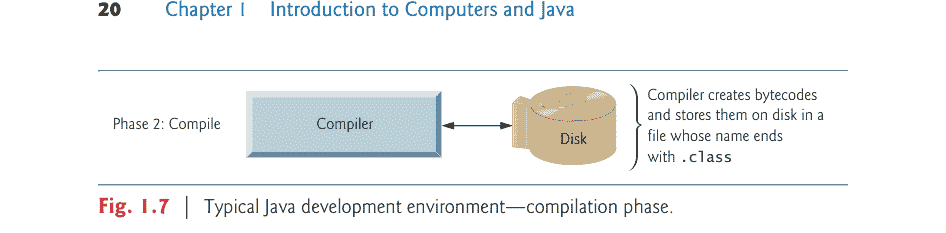

Java 编译器将 Java 源代码翻译成字节码，表示在执行阶段（第 5 阶段）要执行的任务。字节码由 Java 虚拟机（JVM）执行——JDK 的一部分，也是 Java 平台的基础。虚拟机（VM）是一种模拟计算机的软件应用程序，但它隐藏了底层操作系统和硬件，使与其交互的程序无法感知。 如果在许多计算机平台上实现相同的 VM，则其执行的应用程序可以在所有这些平台上使用。JVM 是使用最广泛的虚拟机之一。Microsoft 的 .NET 使用类似的虚拟机架构。

与依赖特定计算机硬件的机器语言不同，字节码是平台无关的——它们不依赖于特定的硬件平台。因此，Java 的字节码是可移植的——无需重新编译源代码，相同的字节码就可以在理解字节码所编译的 Java 版本的任何包含 JVM 的平台上执行。JVM 由 java 命令调用。例如，要执行名为 Welcome 的 Java 应用程序，您需要输入命令

```
java Welcome
```

在第 3 阶段，JVM 将程序放入内存以执行它——这称为加载（图 1.8）。JVM 的类加载器获取包含程序字节码的 .class 文件并将其传输到主内存。类加载器还加载程序使用的 Java 提供的任何 .class 文件。 .class 文件可以从系统上的磁盘加载，也可以通过网络加载（例如，您当地的学院或公司网络，或互联网）。


JVM 的类加载器获取包含程序字节码的 .class 文件并将其传输到主内存。类加载器还加载程序使用的 Java 提供的任何 .class 文件。 .class 文件可以从系统上的磁盘加载，也可以通过网络加载（例如，您当地的学院或公司网络，或互联网）。

## I.9 Java and a Typical Java Development Environment

## Phase 4: Bytecode Verification

在第 4 阶段，随着类的加载，字节码验证器检查它们的字节码以确保它们有效并且不违反 Java 的安全限制（图 1.9）。Java 强制执行严格的安全性，以确保通过网络到达的 Java 程序不会损坏您的文件或系统（如计算机病毒和蠕虫可能会做的那样）。

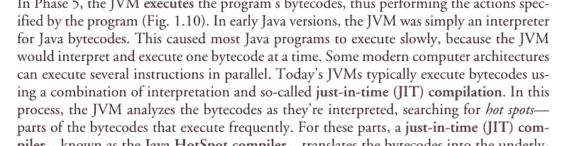

## Phase 5: Execution

在第 5 阶段，JVM 执行程序的字节码，从而执行程序指定的操作（图 1.10）。在早期的 Java 版本中，JVM 只是 Java 字节码的解释器。这导致大多数 Java 程序执行缓慢，因为 JVM 会一次解释并执行一个字节码。一些现代计算机架构可以并行执行多个指令。今天的 JVM 通常使用解释和所谓的即时（JIT）编译相结合的方式执行字节码。在此过程中，JVM 在解释字节码时对其进行分析，搜索热点——经常执行的字节码部分。对于这些部分，即时（JIT）编译器——称为 Java HotSpot 编译器——将字节码翻译成底层计算机的机器语言。当 JVM 再次遇到这些编译后的部分时，


更快的机器语言代码会执行。因此，Java 程序实际上经历了 *两个* 编译阶段——一个是将源代码翻译成字节码（以便在不同计算机平台上的 JVM 之间实现可移植性），另一个是在执行期间将字节码翻译成实际计算机的机器语言。

## Problems That May Occur at Execution Time

程序可能第一次就无法正常工作。前述的每个阶段都可能因我们将在本书中讨论的各种错误而失败。例如，正在执行的程序可能尝试除以零（Java 中整数运算的非法操作）。这会导致 Java 程序显示错误消息。如果发生这种情况，您必须返回编辑阶段，进行必要的更正并再次经过剩余阶段，以确定更正是否修复了问题。[*Note:* 大多数 Java 程序输入或输出数据。当我们说程序显示一条消息时，我们通常是指它在计算机屏幕上显示该消息。消息和其他数据可以输出到其他设备，例如磁盘和硬拷贝打印机，甚至可以输出到网络以传输到其他计算机。]


> **Common Programming Error 1.1**
> 
> 例如除以零之类的错误是在程序运行时发生的，因此称为运行时错误或执行时错误。致命的运行时错误会导致程序立即终止，而无法成功完成其工作。非致命的运行时错误允许程序运行完成，通常会产生错误结果。

## 1.10 Test-Driving a Java Application

在本节中，您将运行并与您的第一个 Java 应用程序交互。您将从运行一个 ATM 应用程序开始，该应用程序模拟使用 ATM 机时发生的交易（例如，取款、存款和查询账户余额）。您将在第 12-13 章中包含的 *可选* 面向对象案例研究中学习如何构建此应用程序。出于本节的目的，我们假设您正在运行 Microsoft Windows。¹¹

在以下步骤中，您将运行该应用程序并执行各种交易。您在此处看到的元素和功能是您将在本书中学到的编程内容的典型代表。[*Note:* 我们使用字体来区分屏幕上看到的功能（例如，**Command Prompt**）和与屏幕无关的元素。我们的惯例是以半粗体 **无衬线 Helvetica** 字体强调屏幕功能，如标题和菜单（例如，**File** 菜单），并以无衬线 Lucida 字体强调非屏幕元素，如文件名或输入（例如，**ProgramName.java**）。正如您已经注意到的那样，文本中每个关键术语的定义出现处均以 **粗体栗色** 显示。在本节中的图中，我们用黄色突出显示每个步骤所需的用户输入并指出 sig-


应用程序的重要部分。为了使这些功能更明显，我们已将 Command Prompt 窗口的背景颜色更改为白色，前景颜色更改为黑色。] 这是一个简单的纯文本版本。稍后在本书中，您将学习使用 GUI（图形用户界面）技术重构此版本的技术。

1. 检查您的设置。阅读本书的“开始之前”部分，以确认您已在计算机上正确设置了 Java，并且已将本书的示例复制到您的硬盘驱动器。

2. 定位已完成的应用程序。打开一个 Command Prompt 窗口。这可以通过选择“开始 > 所有程序 > 附件 > 命令提示符”来完成。通过键入 cd C:\examples\ch01\ATM，然后按 Enter 更改为 ATM 应用程序目录（图 1.11）。命令 cd 用于更改目录。

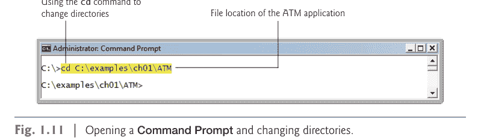

```
C:\>cd C:\examples\ch01\ATM
C:\examples\ch01\ATM>
```

3. 运行 ATM 应用程序。键入命令 java ATMCaseStudy 并按 Enter（图 1.12）。请记住，java 命令，后跟应用程序的 .class 文件名（在本例中为 ATMCaseStudy），会执行该应用程序。指定 .class 扩展名时使用 java 命令会导致错误。 [注意：Java 命令区分大小写。输入此应用程序的名称时，“ATM”中的 A、T 和 M 必须大写，“Case”中的 C 必须大写，“Study”中的 S 必须大写。否则，应用程序将无法执行。] 如果您收到错误消息，“Exception in thread "main" java.lang.NoClassDefFoundError: ATMCaseStudy”，则您的系统存在 CLASSPATH 问题。请参阅本书的“开始之前”部分，了解帮助您修复此问题的说明。

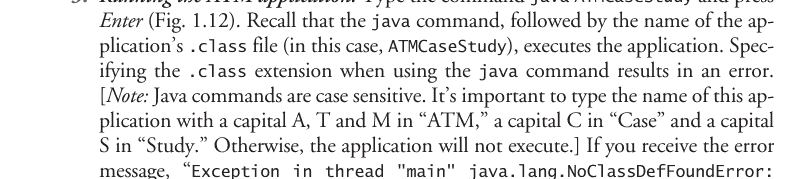

```
C:\>cd C:\examples\ch01\ATM
C:\examples\ch01\ATM>java ATMCaseStudy
```

4. 输入账号号码。应用程序首次执行时，会显示“we’ll come!”问候语并提示您输入账号号码。在提示“Please enter your account number:”处键入 12345（图 1.13）并按 Enter。

账户余额信息

Fig. I.15 | ATM 应用程序显示用户账户余额信息。

ATM 取款菜单

Fig. I.16 | 从账户中取款并返回主菜单。

8. 确认账户信息已更新。从主菜单再次选择选项 1 以查看您当前的账户余额（图 I.17）。可用余额和总余额均已更新，以反映您的取款交易。

9. 结束交易。要结束当前 ATM 会话，请从主菜单中选择选项 4，“Exit”（图 I.18）。ATM 将退出系统并向用户显示再见消息。然后应用程序将返回到原始提示，询问下一个用户的账号号码。

10. 退出 ATM 并关闭 Command Prompt 窗口。大多数应用程序提供退出并返回运行应用程序的 Command Prompt 目录的选项。真正的 ATM 不会为用户提供关闭 ATM 的选项。相反，当用户完成所有期望的交易并选择退出菜单选项时，ATM 会重置自身并显示下一个用户的账号号码提示。如图 1.18 所示，此处的 ATM 应用程序的行为类似。选择退出菜单选项仅结束当前用户的 ATM 会话，而非整个 ATM 应用程序。要真正退出 ATM 应用程序，请单击 Command Prompt 窗口右上角的关闭（x）按钮。关闭窗口会导致正在运行的应用程序终止。

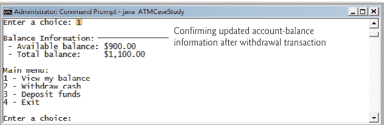

Fig. 1.17 | 检查新的余额。

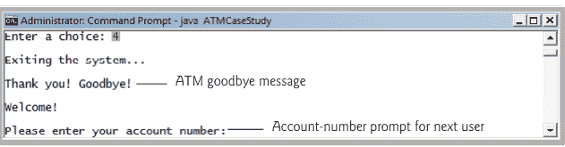

Fig. 1.18 | 结束 ATM 交易会话。

所选菜单选项退出，ATM 重置自身并显示下一个用户的账号号码提示。如图 1.18 所示，此处的 ATM 应用程序的行为类似。选择退出菜单选项仅结束当前用户的 ATM 会话，而非整个 ATM 应用程序。要真正退出 ATM 应用程序，请单击 Command Prompt 窗口右上角的关闭（x）按钮。关闭窗口会导致正在运行的应用程序终止。

## 1.11 Web 2.0：走向社交

网络在 1990 年代中期到后期 literally 爆炸式增长，但“ dot com”经济崩溃在 2000 年代初期带来了艰难时期。始于 2004 年左右的复苏被称为 Web 2.0。Google 被广泛认为是 Web 2.0 的标志性公司。一些具有“Web 2.0 特征”的其他公司有 YouTube（视频分享）、FaceBook（社交网络）、Twitter（微型博客）、Groupon（社交商务）、Foursquare（移动签到）、Salesforce（作为在线服务提供的业务软件）、Craigslist（免费分类广告）、Flickr（照片分享）、Second Life（虚拟世界）、Skype（互联网电话）和 Wikipedia（免费在线百科全书）。

### Google

1996 年，斯坦福计算机科学博士候选人 Larry Page 和 Sergey Brin 开始合作开发一种新的搜索引擎。1997 年，他们将名称改为 Google——源自数学术语 googol，一个由数字“1”后跟 100 个“零”（或 10¹⁰⁰）表示的数量——一个惊人地大的数字。Google 能够快速返回极其准确的搜索结果，帮助其成为使用最广泛的搜索引擎和世界上最受欢迎的网站之一。

Google 继续在搜索技术方面进行创新。例如，Google Goggles 是一款引人入胜的移动应用程序（可在 Android 和 iPhone 上使用），允许您使用照片而不是输入文本执行 Google 搜索。您只需拍摄地标、书籍（封面或条形码）、标志、艺术品或葡萄酒瓶标签的照片，Google Goggles 就会扫描照片并返回搜索结果。您还可以拍摄文本的照片（例如餐厅菜单或标志），Google Goggles 会为您翻译。

### Web 服务和 Mashups

我们在本書中对 Web 服务（第 31 章）进行了大量论述，并介绍了 Mashups 的应用程序开发方法论，您可以通过组合（通常是免费的）互补的 Web 服务和其他形式的信息源（图 1.19）快速开发功能强大且引人入胜的应用程序。其中第一个 Mashups 之一是 www.housingmaps.com，它快速结合了 www.craigslist.org 提供的房地产列表和 Google Maps 的映射功能，提供显示特定区域出租公寓位置的地图。

| Web 服务来源 | 如何使用 |
|---|---|
| Google Maps | 映射服务 |
| Facebook | 社交网络 |
| Foursquare | 移动签到 |
| LinkedIn | 商业社交网络 |
| YouTube | 视频搜索 |
| Twitter | 微型博客 |
| Groupon | 社交商务 |
| Netflix | 电影租赁 |
| eBay | 互联网拍卖 |
| Wikipedia | 协作式百科全书 |
| PayPal | 支付 |
| Last.fm | 互联网电台 |
| Amazon eCommerce | 购物书籍等 |
| Salesforce.com | 客户关系管理（CRM） |
| Skype | 互联网电话 |
| Microsoft Bing | 搜索 |
| Flickr | 照片分享 |
| Zillow | 房地产定价 |
| Yahoo Search | 搜索 |
| WeatherBug | 天气 |

Fig. 1.19 | 一些流行的 Web 服务（www.programmableweb.com/apis/directory/1?sort=mashups）。

### Ajax

Ajax 是 Web 2.0 的主要软件技术之一。Ajax 有助于基于互联网的应用程序像桌面应用程序一样运行——这是一项困难的任务，因为此类应用程序在数据在计算机和互联网上的服务器计算机之间来回传输时遭受传输延迟。使用 Ajax，像 Google Maps 这样的应用程序实现了出色的性能，并接近桌面应用程序的外观和感觉。虽然我们在此文本中不讨论“原始”Ajax 编程（这相当复杂），但我们在第 30 章中展示了如何使用 JavaServer Faces（JSF）Ajax 启用组件构建 Ajax 启用应用程序。

### 社交应用程序

在过去几年中，网络上的社交应用程序数量大幅增加。即使计算机行业已经成熟，这些网站仍能在相对较短的时间内取得惊人的成功。图 1.20 讨论了一些正在产生影响的社交应用程序。

| 公司 | 描述 |
|---|---|
| Facebook | Facebook 由同学 Mark Zuckerberg、Chris Hughes、Dustin Moskovitz 和 Eduardo Saverin 于 2004 年从哈佛宿舍推出，目前价值估计为 700 亿美元。到 2011 年 1 月，Facebook 成为互联网上最活跃的网站，拥有超过 6 亿用户——占地球人口的近 9%——每月在 Facebook 上花费 7000 亿分钟（www.time.com/time/specials/packages/article/0,28804,2036683_2037183,00.html）。按其当前增长率（每月约 5%），Facebook 将在 2012 年达到十亿用户，超过二十亿互联网用户！该网站上的活动使其对应用程序开发人员极具吸引力。每天，超过 2000 万个应用程序由 Facebook 用户安装（www.facebook.com/press/info.php?statistics）。 |
| Twitter | Twitter 由 Jack Dorsey、Evan Williams 和来自播客公司 Odeo 的 Isaac “Biz” Stone 于 2006 年创立。Twitter 彻底改变了微型博客。用户发布推文——长达 140 个字符的消息。每天大约发布 9500 万条推文（twitter.com/about）。您可以关注朋友、名人、商家、政府代表（包括拥有 630 万粉丝的美国总统）等的推文，也可以按主题关注推文以跟踪新闻、趋势等。在撰写本文时，Lady Gaga 拥有最多的粉丝（超过 770 万）。Twitter 已成为全球许多突发新闻故事的起源。 |
| Groupon | Groupon 是一家社交商务网站，由 Andrew Mason 于 2008 年推出。到 2011 年 1 月，该公司估值约为 150 亿美元，成为有史以来增长最快的公司！它现在在全球数百个市场可用。Groupon 在每个市场提供每日一笔优惠，涵盖餐厅、零售商、服务、景点等。优惠只有在有最低数量的人报名购买产品或服务后才会激活。如果您报名参加优惠而尚未达到最低人数，您可能会倾向于通过电子邮件、Facebook、Twitter 等告诉其他人。如果优惠未达到最低销售额，则会被取消。迄今为止最成功的全国性 Groupon 优惠之一是某大型服装公司 50 美元商品的 25 美元证书。仅一天就售出了超过 44 万张代金券。 |


| 公司 | 描述 |
|---|---|
| Foursquare | Foursquare于2009年由Dennis Crowley和Naveen Selvadurai推出，是一款移动*签到*应用，让你可以通知朋友你的行踪。你可以将应用下载到智能手机上，并关联到你的Facebook和Twitter账户，这样你的朋友就能从多个平台关注你。如果没有智能手机，你也可以通过短信签到。Foursquare使用GPS来确定你的确切位置。企业使用Foursquare向所在区域的用户发送优惠信息。Foursquare于2009年3月推出，目前全球用户已超过500万。 |
| Skype | Skype是一款软件产品，它利用一种名为*VoIP*（*IP语音*，IP指“互联网协议”）的技术，让你可以通过互联网进行大部分免费的语音和视频通话。Skype由Niklas Zennström和Janus Friis于2003年创立。仅仅两年后，该公司就以26亿美元的价格卖给了eBay。 |
| YouTube | YouTube是一个视频分享网站，创立于2005年。一年之内，该公司就被Google以16.5亿美元收购。YouTube目前占所有互联网流量的10%（www.webpronews.com/topnews/2010/04/16/facebook-and-youtube-get-the-most-business-internet-traffic）。在苹果iPhone 3GS——第一款提供视频功能的iPhone型号——发布后一周内，YouTube的移动端上传量增长了400%（www.hypebot.com/hypebot/2009/06/youtube-reports-1700-jump-in-mobile-video.html）。 |

图1.20 | 社交应用。（第2部分，共2部分。）

## 1.12 软件技术

图1.21列出了许多你在软件开发社区中会听到的流行术语。我们已经在大多数这些主题上创建了资源中心，还有更多正在筹备中。

| 技术 | 描述 |
|---|---|
| 敏捷软件开发 | **敏捷软件开发**是一组方法论，旨在比以往的方法更快、用更少的资源实现软件。请查阅敏捷联盟（www.agilealliance.org）和敏捷宣言（www.agilemanifesto.org）。 |
| 重构 | **重构**涉及修改程序，使其更清晰、更易于维护，同时保持其正确性和功能性。它被广泛用于敏捷开发方法。许多IDE都内置了*重构工具*，可以自动完成大部分修改工作。 |
| 设计模式 | **设计模式**是用于构建灵活且可维护的面向对象软件的成熟架构。设计模式领域试图枚举那些反复出现的模式，鼓励软件设计师*重用*它们，从而用更少的时间、金钱和精力开发出更高质量的软件。我们在附录Q中讨论Java设计模式。 |
| LAMP | MySQL是一个开源数据库管理系统。PHP是最流行的用于开发Web应用程序的开源服务端“脚本”语言。LAMP是许多开发人员用来构建Web应用程序的开源技术的缩写——它代表Linux、Apache、MySQL和PHP（或Perl或Python——另外两种脚本语言）。 |
| 软件即服务（SaaS） | 软件通常被视为一种产品；大多数软件仍以这种方式提供。要运行应用程序，你从软件供应商那里购买。然后将其安装在计算机上并按需运行。随着新版本的出现，你升级软件，通常要花费相当多的费用。对于拥有成千上万个系统的组织来说，这个过程可能很繁琐，因为这些系统必须在各种各样的计算机设备上进行维护。借助软件即服务（SaaS），软件运行在互联网上其他地方的服务器上。当该服务器更新时，世界各地的所有客户端都会看到新功能——无需本地安装。你可以通过浏览器访问该服务。浏览器的便携性很高，因此你可以在世界任何地方的各种计算机上运行相同的应用程序。Salesforce.com、Google以及Microsoft的Office Live和Windows Live都提供SaaS。 |
| 平台即服务（PaaS） | 平台即服务（PaaS）提供一种计算平台，用于通过Web以服务的形式开发和运行应用程序，而不是在你的计算机上安装工具。PaaS提供商包括Google App Engine、Amazon EC2、Bungee Labs等。 |
| 云计算 | SaaS和PaaS是云计算的例子，其中软件、平台和基础设施（例如处理能力和存储）按需通过互联网托管。这为用户提供了灵活性、可扩展性和成本节约。例如，考虑一家公司的数据存储需求，这些需求在一年中可能会有很大波动。与其投资于大规模存储硬件——这些硬件购买、维护和保障安全成本高昂，而且很可能不会始终满负荷使用——公司可以按需动态购买基于云的服务（如Amazon S3、Google Storage、Microsoft Windows Azure™、Nirvanix™等）。 |
| 软件开发工具包（SDK） | 软件开发工具包（SDK）包括开发人员用于编写应用程序的工具和文档。例如，你将使用Java开发工具包（JDK）来构建和运行Java应用程序。 |

图1.21 | 软件技术。

图1.22描述了软件产品的发布类别。

| 版本 | 描述 |
|---|---|
| Alpha | Alpha软件是仍在积极开发中的软件产品的最早发布版本。Alpha版本通常存在很多缺陷、不完整且不稳定，并且会发布给相对较少的开发人员，用于测试新功能、获取早期反馈等。 |
| Beta | *Beta*版本会在开发过程的后期，在大多数主要错误已修复且新功能接近完成时，发布给更多的开发人员。Beta软件更加稳定，但仍可能会发生变化。 |
| 发布候选版本 | *发布候选版本*通常*功能完整*且（据称）无错误，可供社区使用，社区提供了多样化的测试环境——软件在不同的系统、不同的约束条件和不同的用途下被使用。出现的任何错误都会被修正，最终产品会向公众发布。软件公司通常通过互联网分发增量更新。 |
| 持续测试版 | 使用这种方法开发的软件通常没有版本号（例如Google搜索或Gmail）。该软件托管在云端（不是安装在你的计算机上），并不断发展，因此用户始终拥有最新版本。 |

图1.22 | 软件产品发布术语。

## 1.13 紧跟信息技术的最新动态

图1.23列出了主要的技术和商业出版物，它们将帮助你了解最新的新闻、趋势和技术。你还可以在www.deitel.com/ResourceCenters.html找到越来越多的与互联网和Web相关的资源中心列表。

| 出版物 | URL |
|---|---|
| Bloomberg BusinessWeek | www.businessweek.com |
| CNET | news.cnet.com |
| Computer World | www.computerworld.com |
| Engadget | www.engadget.com |
| eWeek | www.eweek.com |
| Fast Company | www.fastcompany.com/ |
| Fortune | money.cnn.com/magazines/fortune/ |
| InfoWorld | www.infoworld.com |
| Mashable | mashable.com |
| PCWorld | www.pcworld.com |
| SD Times | www.sdtimes.com |
| Slashdot | slashdot.org/ |
| Smarter Technology | www.smartertechnology.com |
| Technology Review | technologyreview.com |
| Techcrunch | techcrunch.com |
| Wired | www.wired.com |

图1.23 | 技术和商业出版物。


+   c) 命令 java 调用了 ______，它执行 Java 程序。
+   d) 一(个) ______ 是一种模拟计算机的软件应用程序，但它隐藏了底层操作系统和硬件，使与其交互的程序无法感知。
+   e) ______ 将包含程序字节码的 .class 文件传输到主内存。
+   f) ______ 检查字节码以确保其有效。

1.7 解释 Java 程序的两个编译阶段。

1.8 你可能在手腕上戴着世界上最常见的物品之一——手表。讨论以下术语和概念如何适用于手表的概念：对象、属性、行为、类、继承（例如，考虑闹钟）、抽象、建模、消息、封装、接口和信息隐藏。

## Making a Difference

在整本书中，我们都包含了 Making a Difference 练习，在这些练习中，你将被要求解决对个人、社区、国家和世界真正重要的难题。有关在全球范围内致力于有所作为的组织的更多信息，以及相关的编程项目创意，请访问我们的 Making a Difference 资源中心，网址为 www.deitel.com/makingadifference。

1.9 (Test Drive: Carbon Footprint Calculator) 一些科学家认为，碳排放，尤其是化石燃料的燃烧，对全球变暖有显著贡献，如果个人采取措施限制其使用碳基燃料，则可以遏制这一趋势。组织和个人越来越关注其“碳足迹”。TerraPass www.terrapass.com/carbon-footprint-calculator/ 和 Carbon Footprint www.carbonfootprint.com/calculator.aspx 等网站提供碳足迹计算器。试用这些计算器来确定你的碳足迹。后续章节中的练习将要求你编程自己的碳足迹计算器。为此，研究计算碳足迹的公式。

1.10 (Test Drive: Body Mass Index Calculator) 根据最近的估计，美国三分之二的人超重，其中约一半的人肥胖。这导致糖尿病和心脏病等疾病显著增加。为了确定一个人是否超重或肥胖，你可以使用一种称为身体质量指数（BMI）的指标。美国卫生与公众服务部提供了一个 BMI 计算器，网址为 www.nhlbi.nhlbi.nih.gov/bmi/。使用它来计算你自己的 BMI。第 2 章中的一个练习将要求你编程自己的 BMI 计算器。为此，研究计算 BMI 的公式。

1.11 (Attributes of Hybrid Vehicles) 在本章中，你学习了类的基础知识。现在你将开始“充实”一个名为“Hybrid Vehicle”的类的各个方面。混合动力汽车越来越受欢迎，因为它们通常比纯汽油动力汽车的油耗要好得多。浏览网络并研究当今四到五款流行的混合动力汽车的功能，然后列出尽可能多的与其混合动力相关的属性。例如，常见属性包括城市每加仑英里数和高速公路每加仑英里数。还列出电池的属性（类型、重量等）。

1.12 (Gender Neutrality) 许多人希望消除所有形式的交流中的性别歧视。你被要求创建一个程序，可以处理一段文本并将性别特定的词替换为性别中立的词。假设你已经获得了一个性别特定词及其性别中立替换词的列表（例如，将“wife”替换为“spouse”，“man”替换为“person”，“daughter”替换为“child”等），解释你将如何阅读一段文本并手动执行这些替换。你的程序如何可能会生成一个奇怪的词，比如“wopherchild”，它实际上被收录在 Urban Dictionary（www.urbandictionary.com/）中？在第 4 章中，你将了解到“procedure”的更正式术语是“algorithm”，算法指定要执行的步骤以及执行的顺序。

1.13 (Privacy) 一些在线电子邮件服务会在一段时间内保存所有电子邮件通信。假设其中一家在线电子邮件服务的某名不满的员工将数百万人的所有电子邮件通信，包括你的，发布到互联网上。讨论相关问题。

1.14 (Programmer Responsibility and Liability) 作为工业界的程序员，你可能会开发出可能影响人们健康甚至生命的软件。假设你编写的程序中的一个软件错误导致一名癌症患者在放射治疗中接受了过量的剂量，导致该人严重受伤或死亡。讨论相关问题。

1.15 (2010 “Flash Crash”) 我们对计算机过度依赖的后果的一个例子是所谓的“闪电崩盘”，它发生在 2010 年 5 月 6 日，当时美国股市在几分钟内急剧下跌，抹去了数万亿美元的投资，然后在几分钟内恢复。利用互联网调查此次崩盘的原因并讨论其引发的问题。

## Making a Difference Resources

Microsoft Imagine Cup 是一项全球竞赛，学生利用技术尝试解决世界上最困难的一些问题，例如环境可持续性、消除饥饿、应急响应、扫盲、打击艾滋病毒/艾滋病等。访问 www.imaginecup.com/about 了解有关竞赛的更多信息，并了解往届获奖者的项目。你还可以在 www.imaginecup.com/students/imagine-cup-solve-this 上找到全球慈善组织提交的多个项目创意。要获取更多可以有所作为的编程项目创意，请在网上搜索“making a difference”并访问以下网站：

- www.un.org/millenniumgoals
联合国千年项目寻求解决环境可持续性、性别平等、儿童和孕产妇健康、普及教育等重大全球问题。

- www.ibm.com/smarterplanet/
IBM® Smarter Planet 网站讨论了 IBM 如何利用技术解决与商业、云计算、教育、可持续性等相关的问题。

- www.gatesfoundation.org/Pages/home.aspx
比尔及梅琳达·盖茨基金会向致力于缓解发展中国家饥饿、贫困和疾病的组织提供资助。在美国，该基金会专注于改善公共教育，特别是为资源有限的人群提供教育。

- www.nethope.org/
NetHope 是全球人道主义组织的合作，致力于解决技术问题，如连接性、应急响应等。

- www.rainforestfoundation.org/home
雨林基金会致力于保护雨林并维护雨林原住民的权利。该网站列出了你可以采取的帮助行动。

- www.undp.org/
联合国开发计划署（UNDP）寻求解决全球挑战的解决方案，如危机预防与恢复、能源与环境、民主治理等。

- www.unido.org
联合国工业发展组织（UNIDO）寻求减少贫困，为发展中国家提供参与全球贸易的机会，并促进能源效率和可持续性。

www.usaid.gov/
美国国际开发署促进全球民主、健康、经济增长、冲突预防、人道主义援助等。

www.toyota.com/ideas-for-good/
丰田的 Ideas for Good 网站描述了丰田的几项正在产生影响的技术——包括其先进泊车引导系统、Hybrid Synergy Drive®、太阳能通风系统、T.H.U.M.S.（Total Human Model for Safety）和 Touch Tracer Display。你可以通过提交一篇短文或视频，描述这些技术如何用于其他有益目的，从而参与 Ideas for Good 挑战。


## Java 应用程序简介

> 名称有什么关系呢？
> 我们称之为玫瑰的，
> 换作别的名字依然芳香。
> ——威廉·莎士比亚

> 面对抉择时，我总问：“怎样做最有趣？”
> ——佩吉·沃克

> 语言的首要优点在于清晰。
> ——盖伦

> 一个人可以带来改变，每个人都应当尝试。
> ——约翰·F·肯尼迪

- 在本章中你将学习：
  - 编写简单的 Java 应用程序。
  - 使用输入和输出语句。
  - Java 的基本类型。
  - 基本内存概念。
  - 使用算术运算符。
  - 算术运算符的优先级。
  - 编写决策语句。
  - 使用关系和相等运算符。

### 声明类

第 4 行

```java
public class Welcome1
```

开始声明一个名为 Welcome1 的类。每个 Java 程序至少包含一个由你（程序员）定义的类。class 关键字引入一个类声明，并且后面紧跟类名（Welcome1）。关键字（有时称为保留字）是保留给 Java 使用的，并且总是全部使用小写字母拼写。关键字的完整列表见附录 C。

### 类名与标识符

按照惯例，类名以大写字母开头，并且它所包含的每个单词的首字母都大写（例如 SampleClassName）。类名是一种标识符——由字母、数字、下划线（_）和美元符号（$）组成的字符序列，不能以数字开头，也不能包含空格。一些有效的标识符包括 Welcome1、$value、_value、m_inputField1 和 button7。名称 7button 不是有效的标识符，因为它以数字开头；名称 input field 不是有效的标识符，因为它包含空格。通常，不以大写字母开头的标识符不是类名。Java 区分大小写——大写字母和小写字母是不同的——因此 value 和 Value 是不同（但都有效）的标识符。

在第 2 章到第 7 章中，我们定义的每个类都以 public 关键字开头。目前，我们只需要使用这个关键字。对于我们的应用程序，文件名是 Welcome1.java。你将在第 8 章学习更多关于 public 和非 public 类的知识。

### 常见编程错误 2.2

public 类必须放在一个与类名相同的文件中（拼写和大小写都要一致），并加上 .java 扩展名；否则，会发生编译错误。例如，public class Welcome 必须放在名为 Welcome.java 的文件中。

左花括号（如第 5 行所示）{ 开始每个类声明的主体。相应的右花括号（如第 11 行所示）} 必须结束每个类声明。第 6–10 行是缩进的。

### 错误预防提示 2.1

当你输入左花括号 { 时，立即输入右花括号 }，然后将光标重新定位到花括号之间并缩进，开始输入主体。这种做法有助于防止因缺少花括号而导致的错误。许多 IDE 会为你插入花括号。

### 常见编程错误 2.3

如果花括号不成对出现，则会产生语法错误。

### 良好编程实践 2.3

将每个类声明的整个主体在界定类主体的左花括号和右花括号之间缩进一个“层级”。我们建议使用三个空格形成一个缩进层级。这种格式突出了类声明的结构，使其更易于阅读。

### 声明方法

第 6 行

```java
// main method begins execution of Java application
```

是行尾注释，表示程序第 7–10 行的用途。第 7 行

```java
public static void main( String[] args )
```

是每个 Java 应用程序的起点。标识符 **main** 后面的括号表明它是一个称为 **方法** 的程序构建块。Java 类声明通常包含一个或多个方法。对于 Java 应用程序，其中一个方法必须命名为 **main**，并且必须按第 7 行所示定义；否则，Java 虚拟机（JVM）将不会执行该应用程序。方法执行任务，并在完成其任务时返回信息。关键字 **void** 表示此方法将 *不会* 返回任何信息。稍后，我们将看到方法如何返回信息。现在，只需在 Java 应用程序中模仿 **main** 的第一行即可。在第 7 行中，括号中的 `String[] args` 是方法 **main** 声明中必需的部分——我们将在第 7 章讨论这一点。

第 8 行的左花括号开始 **方法声明** 的主体。相应的右花括号必须结束该方法声明（第 10 行）。方法主体中的第 9 行在花括号之间缩进。

### 使用 `System.out.println` 执行输出

第 9 行

```java
System.out.println( "Welcome to Java Programming!" );
```

指示计算机执行一个操作——即打印双引号之间所包含的 **字符串**（但不包括引号本身）。字符串有时被称为 **字符序列** 或 **字符串字面值**。字符串中的空白字符 *不会* 被编译器忽略。字符串不能跨越多行代码，但正如你稍后将看到的，这并不限制你在代码中使用长字符串。

**System.out** 对象被称为 **标准输出对象**。它允许 Java 应用程序在执行它的命令窗口中显示信息。在最近版本的 Microsoft Windows 中，这个命令窗口就是 **命令提示符**。在 UNIX/Linux/Mac OS X 中，这个命令窗口被称为 **终端窗口** 或 **shell**。许多程序员干脆称它为 **命令行**。

方法 **System.out.println** 在命令窗口中显示（或打印）一行文本。第 9 行括号中的字符串是该方法的参数。当 **System.out.println** 完成其任务时，它会将输出光标（下一个字符将显示的位置）定位到命令窗口下一行的开头。这类似于在文本编辑器中键入时按 Enter 键所发生的情况——光标出现在文档下一行的开头。

> **良好编程实践 2.4**
>
> 许多 IDE 会在所有正确的位置为你插入缩进。Tab 键也可用于缩进代码，但不同的文本编辑器的制表位设置各不相同。大多数 IDE 允许你配置 Tab 键，以便每次按下 Tab 键时插入指定数量的空格。

> **良好编程实践 2.5**
>
> 将每个方法声明的整个主体在界定方法主体的花括号之间缩进一个“层级”。这使方法的结构更加突出，也使方法声明更易于阅读。

整个第 9 行，包括 System.out.println、括号中的参数 "Welcome to Java Programming!" 以及分号（;），称为一条语句。一个方法通常包含一条或多条执行其任务的语句。大多数语句以分号结束。当第 9 行的语句执行时，它会在命令窗口中显示 Welcome to Java Programming!

### 错误预防提示 2.2

学习编程时，有时“破坏”一个可正常工作的程序是有帮助的，这样你可以熟悉编译器的语法错误消息。这些消息并不总是说明代码中的确切问题。当你遇到错误消息时，它会让你大致了解错误的原因。[尝试从图 2.1 的程序中删除一个分号或花括号，然后重新编译程序，看看因遗漏而产生的错误消息。]

### 错误预防提示 2.3

当编译器报告语法错误时，错误可能不在错误消息所指示的那一行。首先，检查报告错误的那一行。如果在该行没有发现错误，请检查前几行。

### 在右花括号上使用行尾注释以提高可读性

我们在结束方法声明的右花括号之后以及结束类声明的右花括号之后添加行尾注释。例如，第 10 行

```java
} // end method main
```

表示方法 main 的右花括号，以及第 11 行

```java
} // end class Welcome1
```

表示类 Welcome1 的右花括号。每条注释都指出这个右花括号终止的是哪个方法或类。

### 编译并执行你的第一个 Java 应用程序

我们现在准备编译并执行程序。我们假设你使用 Java 开发工具包的命令行工具，而不是 IDE。我们的 Java 资源中心（www.deitel.com/ResourceCenters.html）提供了一些教程链接，帮助你上手几种流行的 Java 开发工具，包括 NetBeans™、Eclipse™ 等。我们还在 www.deitel.com/books/jhtp9/ 上发布了 NetBeans 和 Eclipse 视频，帮助你开始使用这些流行的 IDE。

要准备编译程序，请打开一个命令窗口，并切换到程序存储所在的目录。许多操作系统使用 cd 命令来切换目录。例如，在 Windows 上，

```bash
cd c:\examples\ch02\fig02_01
```

切换到 fig02_01 目录。在 UNIX/Linux/Mac OS X 上，命令

```bash
cd ~/examples/ch02/fig02_01
```

切换到 fig02_01 目录。


要编译程序，请键入

```
javac Welcome1.java
```

如果程序没有语法错误，此命令将创建一个名为 Welcome1.class 的新文件（称为 Welcome1 的类文件），其中包含表示我们应用程序的与平台无关的 Java 字节码。当我们在给定平台上使用 java 命令执行应用程序时，JVM 会将这些字节码转换为底层操作系统和硬件能够理解的指令。

### 错误预防提示 2.4

在尝试编译程序时，如果收到诸如“bad command or filename”、“javac: command not found”或“'javac' is not recognized as an internal or external command, operable program or batch file”之类的消息，则说明你的 Java 软件安装未正确完成。如果你使用的是 JDK，这表明系统的 PATH 环境变量设置不正确。请仔细查看本书“开始之前”部分中的安装说明。在某些系统上，更正 PATH 后，你可能需要重新启动计算机或打开新的命令窗口才能使这些设置生效。

### 错误预防提示 2.5

每条语法错误消息都包含发生错误的文件名和行号。例如，Welcome1.java:6 表示错误发生在 Welcome1.java 的第 6 行。消息的其余部分提供了有关语法错误的信息。

### 错误预防提示 2.6

编译器错误消息“class Welcome1 is public, should be declared in a file named Welcome1.java”表明文件名与文件中的公共类名称不匹配，或者你在编译该类时输入了错误的类名。

图 2.2 显示了图 2.1 的程序在 Microsoft® Windows® 7 命令提示符窗口中执行的情况。要执行该程序，请键入 `java Welcome1`。此命令会启动 JVM，由 JVM 加载 Welcome1 类的 .class 文件。该命令省略了 .class 文件扩展名；否则 JVM 将不会执行程序。JVM 调用 main 方法。接下来，main 第 9 行的语句显示 "Welcome to Java Programming!" [注意：许多环境的命令提示符是黑底白字。我们在环境中调整了这些设置，以使屏幕截图更易读。]

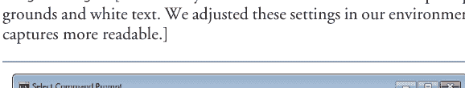

你键入此命令以执行应用程序

程序在屏幕上输出
Welcome to Java Programming!

图 2.2 | 从命令提示符执行 Welcome1。

### 错误预防提示 2.7

在尝试运行 Java 程序时，如果收到诸如“Exception in thread "main" java.lang.NoClassDefFoundError: Welcome1”之类的消息，则说明你的 CLASSPATH 环境变量设置不正确。请仔细查看本书“开始之前”部分中的安装说明。在某些系统上，配置 CLASSPATH 后，你可能需要重新启动计算机或打开新的命令窗口。

## 2.3 修改你的第一个 Java 程序

在本节中，我们修改图 2.1 中的示例，使用多条语句在一行上打印文本，以及使用一条语句在多行上打印文本。

### 使用多条语句显示一行文本

可以用多种方式显示 Welcome to Java Programming!。图 2.3 中的 Welcome2 类使用两条语句（第 9-10 行）来产生图 2.1 中显示的输出。[注意：从现在开始，我们将像对第 9-10 行所做的那样，在每个代码清单中突出显示新的和关键的特性。]

```
1  // Fig. 2.3: Welcome2.java
2  // Printing a line of text with multiple statements.
3
4  public class Welcome2
5  {
6      // main method begins execution of Java application
7      public static void main( String[] args )
8      {
9          System.out.print( "Welcome to " );
10         System.out.println( "Java Programming!" );
11     } // end method main
12 } // end class Welcome2
```

Welcome to Java Programming!

图 2.3 | 使用多条语句打印一行文本。

该程序与图 2.1 类似，因此我们只讨论此处更改的部分。第 2 行

```
// Printing a line of text with multiple statements.
```

是说明程序目的的端行注释。第 4 行开始 Welcome2 类的声明。main 方法的第 9-10 行

```
System.out.print( "Welcome to " );
System.out.println( "Java Programming!" );
```

显示一行文本。第一条语句使用 System.out 的方法 print 来显示字符串。每条 print 或 println 语句都会从上一条 print 或 println 语句停止显示字符的位置继续显示字符。与 println 不同，print 在显示其参数后，不会将输出光标定位到命令窗口中下一行的开头——程序显示的下一个字符将紧跟 print 显示的最后字符之后。因此，第 10 行将参数中的第一个字符（字母“J”）紧跟在第 9 行显示的最后一个字符（字符串右双引号前的空格字符）之后。

### 使用一条语句显示多行文本

一条语句可以通过使用换行符来显示多行文本，换行符向 System.out 的 print 和 println 方法指示何时将输出光标定位到命令窗口中下一行的开头。与空行、空格字符和制表符一样，换行符是空白字符。图 2.4 中的程序输出四行文本，使用换行符来确定何时开始每一新行。该程序的大部分与图 2.1 和图 2.3 中的程序相同。

```
1  // Fig. 2.4: Welcome3.java
2  // Printing multiple lines of text with a single statement.
3  
4  public class Welcome3
5  {
6      // main method begins execution of Java application
7      public static void main( String[] args )
8      {
9          System.out.println( "Welcome\nto\nJava\nProgramming!" );
10     } // end method main
11 } // end class Welcome3
```

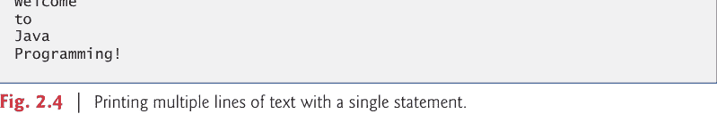

图 2.4 | 使用一条语句打印多行文本。

第 2 行

```
// Printing multiple lines of text with a single statement.
```

是说明程序目的的注释。第 4 行开始 Welcome3 类的声明。

第 9 行

```
System.out.println( "Welcome\nto\nJava\nProgramming!" );
```

在命令窗口中显示四行独立的文本。通常，字符串中的字符会严格按照它们在双引号中的形式显示。但请注意，成对的字符 \ 和 n（在该语句中重复了三次）并不会出现在屏幕上。反斜杠（\）是一个转义字符，对 System.out 的 print 和 println 方法具有特殊含义。当字符串中出现反斜杠时，Java 会将其与下一个字符组合成转义序列。转义序列 \n 表示换行符。当换行符出现在使用 System.out 输出的字符串中时，换行符会使屏幕上的输出光标移动到命令窗口中下一行的开头。

图 2.5 列出了几种常见的转义序列，并描述了它们如何影响命令窗口中字符的显示。要获取完整的转义序列列表，请访问 java.sun.com/docs/books/jls/third_edition/html/lexical.html#3.10.6。

第 9-10 行仅代表*一条*语句。Java 允许将大型语句拆分为多行。我们将第 10 行缩进以表示它是第 9 行的*延续*。

> **常见编程错误 2.4**
> 
> *在标识符或字符串中间拆分语句是语法错误。*

方法 `printf` 的第一个参数是**格式字符串**，它可以由固定文本和格式说明符组成。固定文本由 `printf` 输出，就像由 `print` 或 `println` 输出一样。每个格式说明符都是一个值的占位符，并指定要输出的数据类型。格式说明符还可以包含可选的格式信息。

格式说明符以百分号（%）开头，后跟表示数据类型的字符。例如，格式说明符 `%s` 是字符串的占位符。第 9 行中的格式字符串指定 `printf` 应输出两个字符串，每个字符串后跟一个换行符。在第一个格式说明符的位置，`printf` 用格式字符串后的第一个参数的值替换。在每个后续格式说明符的位置，`printf` 替换下一个参数的值。因此，本示例用 "Welcome to" 替换第一个 `%s`，用 "Java Programming!" 替换第二个 `%s`。输出显示显示了两行文本。

我们将在示例中根据需要介绍各种格式化功能。附录 G 介绍了使用 `printf` 格式化输出的详细信息。

## 2.5 另一个应用程序：整数相加

我们的下一个应用会读取（或输入）用户在键盘上输入的两个**整数**（整数，如 −22、7、0 和 1024），计算它们的总和并显示出来。该程序必须记住用户提供的数字，以便在程序后面进行计算。程序在计算机内存中记住数字和其他数据，并通过称为**变量**的程序元素访问这些数据。图 2.7 中的程序演示了这些概念。在示例输出中，我们使用粗体文本来标识用户的输入（即 45 和 72）。

```java
// Fig. 2.7: Addition.java
// Addition program that displays the sum of two numbers.
import java.util.Scanner; // program uses class Scanner

public class Addition
{
   // main method begins execution of Java application
   public static void main( String[] args )
   {
      // create a Scanner to obtain input from the command window
      Scanner input = new Scanner( System.in );

      int number1; // first number to add
      int number2; // second number to add
      int sum; // sum of number1 and number2
```

**图 2.7**  |  显示两个数之和的加法程序。（第 1 部分，共 2 部分。）


```
17    System.out.print( "Enter first integer: " ); // prompt
18    number1 = input.nextInt(); // read first number from user
19
20    System.out.print( "Enter second integer: " ); // prompt
21    number2 = input.nextInt(); // read second number from user
22
23    sum = number1 + number2; // add numbers, then store total in sum
24
25    System.out.printf( "Sum is %d\n", sum ); // display sum
26    } // end method main
27 } // end class Addition
```

```
Enter first integer: 45
Enter second integer: 72
Sum is 117
```

Fig. 2.7 | Addition program that displays the sum of two numbers. (Part 2 of 2.)

## Import Declarations

Lines 1–2

```
// Fig. 2.7: Addition.java
// Addition program that displays the sum of two numbers.
```

state the figure number, file name and purpose of the program.

A great strength of Java is its rich set of predefined classes that you can reuse rather than “reinventing the wheel.” These classes are grouped into packages—named groups of related classes—and are collectively referred to as the Java class library, or the Java Application Programming Interface (Java API). Line 3

```
import java.util.Scanner; // program uses class Scanner
```

is an import declaration that helps the compiler locate a class that’s used in this program. It indicates that this example uses Java’s predefined Scanner class (discussed shortly) from package java.util.

**Common Programming Error 2.5**
All import declarations must appear before the first class declaration in the file. Placing an import declaration inside or after a class declaration is a syntax error.

**Error-Prevention Tip 2.8**
Forgetting to include an import declaration for a class used in your program typically results in a compilation error containing a message such as “cannot find symbol.” When this occurs, check that you provided the proper import declarations and that the names in them are correct, including proper capitalization.

## Declaring Class Addition

Line 5

```
public class Addition
```

begins the declaration of class `Addition`. The file name for this public class must be `Addition.java`. Remember that the body of each class declaration starts with an opening left brace (line 6) and ends with a closing right brace (line 27).

The application begins execution with the `main` method (lines 8–26). The left brace (line 9) marks the beginning of method `main`’s body, and the corresponding right brace (line 26) marks its end. Method `main` is indented one level in the body of class `Addition`, and the code in the body of `main` is indented another level for readability.

## Declaring and Creating a Scanner to Obtain User Input from the Keyboard

A variable is a location in the computer’s memory where a value can be stored for use later in a program. All Java variables must be declared with a name and a type before they can be used. A variable’s name enables the program to access the value of the variable in memory. A variable’s type specifies what kind of information is stored at that location in memory. Like other statements, declaration statements end with a semicolon (`;`).

Line 11

```
Scanner input = new Scanner( System.in );
```

is a variable declaration statement that specifies the name (`input`) and type (`Scanner`) of a variable that’s used in this program. A Scanner enables a program to read data (e.g., numbers and strings) for use in a program. The data can come from many sources, such as the user at the keyboard or a file on disk. Before using a Scanner, you must create it and specify the source of the data.

The `=` in line 11 indicates that Scanner variable `input` should be initialized (i.e., prepared for use in the program) in its declaration with the result of the expression to the right of the equals sign—`new Scanner(System.in)`. This expression uses the `new` keyword to create a Scanner object that reads characters typed by the user at the keyboard. The standard input object, `System.in`, enables applications to read bytes of information typed by the user. The Scanner translates these bytes into types (like ints) that can be used in a program.

## Declaring Variables to Store Integers

The variable declaration statements in lines 13–15

```
int number1;  // first number to add
int number2;  // second number to add
int sum;      // sum of number1 and number2
```

declare that variables number1, number2 and sum hold data of type int—they can hold integer values (whole numbers such as 72, −1127 and 0). These variables are not yet initialized. The range of values for an int is −2,147,483,648 to +2,147,483,647. [Note: Actual int values may not contain commas.]

Other types of data include float and double, for holding real numbers, and char, for holding character data. Real numbers contain decimal points, such as 3.4, 0.0 and −11.19. Variables of type char represent individual characters, such as an uppercase letter (e.g., A), a digit (e.g., 7), a special character (e.g., * or %) or an escape sequence (e.g., the newline character, \n). The types int, float, double and char are called primitive types. Primitive-type names are keywords and must appear in all lowercase letters. Appendix D summarizes the characteristics of the eight primitive types (boolean, byte, char, short, int, long, float and double).

Several variables of the same type may be declared in a single declaration with the variable names separated by commas (i.e., a comma-separated list of variable names). For example, lines 13–15 can also be written as:

```
int number1, // first number to add
number2, // second number to add
sum; // sum of number1 and number2
```

**Good Programming Practice 2.7**
Declare each variable on a separate line. This format allows a descriptive comment to be inserted next to each declaration.

**Good Programming Practice 2.8**
Choosing meaningful variable names helps a program to be self-documenting (i.e., one can understand the program simply by reading it rather than by reading manuals or viewing an excessive number of comments).

**Good Programming Practice 2.9**
By convention, variable-name identifiers begin with a lowercase letter, and every word in the name after the first word begins with a capital letter. For example, variable-name identifier firstNumber starts its second word, Number, with a capital N.

## Prompting the User for Input

Line 17

```
System.out.print( "Enter first integer: " ); // prompt
```

uses System.out.print to display the message "Enter first integer: ". This message is called a prompt because it directs the user to take a specific action. We use method print here rather than println so that the user’s input appears on the same line as the prompt. Recall from Section 2.2 that identifiers starting with capital letters typically represent class names. So, System is a class. Class System is part of package java.lang. Notice that class System is not imported with an import declaration at the beginning of the program.

**Software Engineering Observation 2.1**
By default, package java.lang is imported in every Java program; thus, classes in java.lang are the only ones in the Java API that do not require an import declaration.

## Obtaining an int as Input from the User

Line 18

```
number1 = input.nextInt(); // read first number from user
```

uses Scanner object input’s nextInt method to obtain an integer from the user at the keyboard. At this point the program waits for the user to type the number and press the Enter key to submit the number to the program.

Our program assumes that the user enters a valid integer value. If not, a runtime logic error will occur and the program will terminate. Chapter 11, Exception Handling: A Deeper Look, discusses how to make your programs more robust by enabling them to handle such errors. This is also known as making your program fault tolerant.

In line 18, we place the result of the call to method `nextInt` (an int value) in variable `number1` by using the assignment operator, `=`. The statement is read as “number1 gets the value of `input.nextInt()`.” Operator `=` is called a **binary operator**, because it has two **operands**—`number1` and the result of the method call `input.nextInt()`. This statement is called an assignment statement, because it assigns a value to a variable. Everything to the **right** of the assignment operator, `=`, is always evaluated *before* the assignment is performed.


**Good Programming Practice 2.10**  
*Placing spaces on either side of a binary operator makes the program more readable.*

## Prompting for and Inputting a Second `int`

Line 20

```
System.out.print( "Enter second integer: " ); // prompt
```

prompts the user to input the second integer. Line 21

```
number2 = input.nextInt(); // read second number from user
```

reads the second integer and assigns it to variable `number2`.

## Using Variables in a Calculation

Line 23

```
sum = number1 + number2; // add numbers, then store total in sum
```

is an assignment statement that calculates the sum of the variables `number1` and `number2`, then assigns the result to variable `sum` by using the assignment operator, `=`. The statement is read as “sum gets the value of number1 + number2.” In general, calculations are performed in assignment statements. When the program encounters the addition operation, it performs the calculation using the values stored in the variables `number1` and `number2`. In the preceding statement, the addition operator is a *binary operator*—its two operands are the variables `number1` and `number2`. Portions of statements that contain calculations are called *expressions*. In fact, an expression is any portion of a statement that has a *value* associated with it. For example, the value of the expression `number1 + number2` is the *sum* of the numbers. Similarly, the value of the expression `input.nextInt()` is the integer typed by the user.

## Displaying the Result of the Calculation

After the calculation has been performed, line 25

```
System.out.printf( "Sum is %d\n", sum ); // display sum
```

uses method `System.out.printf` to display the sum. The format specifier `%d` is a placeholder for an `int` value (in this case the value of `sum`)—the letter d stands for “decimal integer.” The remaining characters in the format string are all fixed text. So, method `printf` displays "Sum is ", followed by the value of `sum` (in the position of the `%d` format specifier) and a newline.

Calculations can also be performed *inside printf statements*. We could have combined the statements at lines 23 and 25 into the statement

```
System.out.printf( "Sum is %d\n", ( number1 + number2 ) );
```


表达式 number1 + number2 周围的括号不是必需的——它们是为了强调整个表达式的值将输出在 %d 格式说明符的位置而包含的。

## Java API 文档

我们使用每个新的 Java API 类时，都指明它所在的包。此信息可帮助您在 Java API 文档中定位每个包和类的描述。此文档的基于 Web 的版本可在以下位置找到

```
download.oracle.com/javase/6/docs/api/
```

您可以从以下位置下载

```
www.oracle.com/technetwork/java/javase/downloads/index.html
```

附录 E 展示了如何使用此文档。

## 2.6 内存概念

诸如 number1、number2 和 sum 之类的变量名实际上对应于计算机内存中的位置。每个变量都有一个名称、一个类型、一个大小（以字节为单位）和一个值。

在图 2.7 的加法程序中，当以下语句（第 18 行）执行时：

```
number1 = input.nextInt(); // read first number from user
```

用户键入的数字被放入对应于名称 number1 的内存位置。假设用户输入 45。计算机将该整数值放入位置 number1（图 2.8），替换该位置中之前的任何值（如果有）。之前的值丢失了。


当语句（第 21 行）

```
number2 = input.nextInt(); // read second number from user
```

执行时，假设用户输入 72。计算机将该整数值放入位置 number2。内存现在如图所示 2.9 所示。


在图 2.7 的程序获得 number1 和 number2 的值后，它将这两个值相加并将总和放入变量 sum。语句（第 23 行）

```
sum = number1 + number2; // add numbers, then store total in sum
```

执行加法，然后替换 sum 中的任何先前值。计算 sum 之后，内存如图所示 2.10 所示。number1 和 number2 的值与在用于计算 sum 之前完全相同。这些值被使用，但并未被破坏，因为计算机执行计算时。读取内存位置的值的过程是非破坏性的。

|  |  |
|---|---|
| number1 | 45 |
| number2 | 72 |
| sum | 117 |

图 2.10 | 存储 number1 和 number2 的和后的内存位置。

## 2.7 算术

大多数程序执行算术计算。算术运算符总结于图 2.11。请注意使用了代数中未使用的各种特殊符号。星号 (*) 表示乘法，而百分号 (%) 是余数运算符，我们稍后会讨论。图 2.11 中的算术运算符是二元运算符，因为每个运算符都作用于两个操作数。例如，表达式 f + 7 包含二元运算符 + 和两个操作数 f 和 7。

| Java operation | Operator | Algebraic expression | Java expression |
|---|---|---|---|
| Addition | + | f + 7 | f + 7 |
| Subtraction | - | p - c | p - c |
| Multiplication | * | b m | b * m |
| Division | / | x / y or x/y or x ÷ y | x / y |
| Remainder | % | r mod s | r % s |

图 2.11 | 算术运算符。

整数除法产生整数商。例如，表达式 7 / 4 的计算结果为 1，表达式 17 / 5 的计算结果为 3。整数除法中的任何小数部分都简单地被丢弃（即截断）——不会进行舍入。Java 提供了余数运算符 %，它产生除法后的余数。表达式 x % y 产生 x 除以 y 后的余数。因此，7 % 4 产生 3，17 % 5 产生 2。此运算符最常与整数操作数一起使用，但也可以与其它算术类型一起使用。在本章的练习和后面的章节中，我们将考虑余数运算符的几个有趣应用，例如确定一个数是否为另一个数的倍数。

### 直线形式的算术表达式

Java 中的算术表达式必须以直线形式书写，以便于将程序输入到计算机中。因此，像“a 除以 b”这样的表达式必须写成 a / b，以便所有常量、变量和运算符都出现在一条直线上。以下代数记法通常不被编译器接受：

```
a
b
```

### 用于分组子表达式的括号

括号用于以与代数表达式相同的方式对 Java 表达式中的项进行分组。例如，要将 a 乘以 b + c 的数量，我们写

```
a * ( b + c )
```

如果表达式包含嵌套括号，例如

```
( ( a + b ) * c )
```

则最内层括号中的表达式（本例中为 a + b）首先被求值。

### 运算符优先级规则

Java 以由运算符优先级规则确定的精确顺序应用算术表达式中的运算符，这些规则通常与代数中遵循的规则相同：

- 1. 乘法、除法和余数运算首先应用。如果表达式包含多个此类运算，它们按从左到右的顺序应用。乘法、除法和余数运算符具有相同的优先级级别。
- 2. 加法和减法运算接下来应用。如果表达式包含多个此类运算，运算符按从左到右的顺序应用。加法和减法运算符具有相同的优先级级别。

这些规则使 Java 能够按正确顺序应用运算符。¹ 当我们说运算符按从左到右应用时，我们指的是它们的结合性。某些运算符从右到左结合。图 2.12 总结了这些运算符优先级规则。完整的优先级表包含在附录 A 中。

| Operator(s) | Operation(s) | Order of evaluation (precedence) |
|---|---|---|
| * | Multiplication | Evaluated first. If there are several operators of this type, they’re evaluated from left to right. |
| / | Division |  |
| % | Remainder |  |
| + | Addition | Evaluated next. If there are several operators of this type, they’re evaluated from left to right. |
| - | Subtraction |  |
| = | Assignment | Evaluated last. |

图 2.12 | 算术运算符的优先级。

> 1. 我们使用简单示例来解释表达式求值的顺序。在本书后面您会遇到的更复杂表达式中会出现微妙的问题。有关求值顺序的更多信息，请参阅《The Java™ Language Specification》（java.sun.com/docs/books/jls/）第 15 章。

### 示例代数和 Java 表达式

现在让我们根据运算符优先级规则考虑几个表达式。每个示例列出一个代数表达式及其 Java 等价物。以下是五个项的算术平均值（平均值）的一个示例：

```
Algebra:    m = (a + b + c + d + e) / 5
Java:       m = ( a + b + c + d + e ) / 5;
```

需要括号，因为除法的优先级高于加法。整个数量 (a + b + c + d + e) 应除以 5。如果错误地省略括号，我们得到 a + b + c + d + e / 5，其计算方式为

```
a + b + c + d + e/5
```

下面是直线方程的一个示例：

```
Algebra:    y = mx + b
Java:       y = m * x + b;
```

不需要括号。乘法运算符首先应用，因为乘法的优先级高于加法。赋值最后发生，因为它比乘法或加法的优先级更低。

以下示例包含余数（%）、乘法、除法、加法和减法运算：

```
Algebra:    z = pr%q + w/x - y
Java:       z = p * r % q + w / x - y;
            6   1   2   4   3   5
```

语句下方的圈数字表示 Java 应用运算符的顺序。*、% 和 / 运算首先按从左到右的顺序求值（即它们从左到右结合），因为它们比 + 和 - 的优先级更高。+ 和 - 运算接下来求值。这些运算也从左到右应用。赋值（=）运算符最后求值。

### 二次多项式的求值

为了更好地理解运算符优先级规则，请考虑求值包含二次多项式 ax² + bx + c 的赋值表达式：

```
y = a * x * x + b * x + c;
  6   1   2   4   3   5
```

乘法运算首先按从左到右的顺序求值（即它们从左到右结合），因为它们比加法的优先级更高。（Java 没有用于幂运算的算术运算符，因此 x² 表示为 x * x。第 5.4 节显示了执行幂运算的一种替代方法。）加法运算接下来从左到右求值。假设 a、b、c 和 x 初始化（给定值）如下：a = 2，b = 3，c = 7 且 x = 5。图 2.13 说明了运算符应用的顺序。


## 2.8 决策：相等运算符和关系运算符

| 标准代数相等或关系运算符 | Java 相等或关系运算符 | 示例 Java 条件 | Java 条件含义 |
|----------------------------------------------------|---------------------------------------|------------------------|-------------------------------------|
| = | == | x == y | x 等于 y |
| != | != | x != y | x 不等于 y |
| > | > | x > y | x 大于 y |
| < | < | x < y | x 小于 y |
| >= | >= | x >= y | x 大于或等于 y |
| <= | <= | x <= y | x 小于或等于 y |

图 2.14 | 相等运算符和关系运算符。

// Fig. 2.15: Comparison.java
// 使用 if 语句、关系运算符和相等运算符比较整数。
// import java.util.Scanner; // 程序使用类 Scanner

public class Comparison
{
// main 方法开始执行 Java 应用程序
public static void main( String[] args )
{
// 创建 Scanner 从命令行获取输入
Scanner input = new Scanner( System.in );

int number1; // 要比较的第一个数字
int number2; // 要比较的第二个数字

System.out.print( "Enter first integer: " ); // 提示
number1 = input.nextInt(); // 从用户读取第一个数字

System.out.print( "Enter second integer: " ); // 提示
number2 = input.nextInt(); // 从用户读取第二个数字

if ( number1 == number2 )
System.out.printf( "%d == %d\n", number1, number2 );

if ( number1 != number2 )
System.out.printf( "%d != %d\n", number1, number2 );

if ( number1 < number2 )
System.out.printf( "%d < %d\n", number1, number2 );

}

```
32      if ( number1 > number2 )
33          System.out.printf( "%d > %d\n", number1, number2 );
34
35      if ( number1 <= number2 )
36          System.out.printf( "%d <= %d\n", number1, number2 );
37
38      if ( number1 >= number2 )
39          System.out.printf( "%d >= %d\n", number1, number2 );
40  } // end method main
41  } // end class Comparison
```

```
Enter first integer: 777
Enter second integer: 777
777 == 777
777 <= 777
777 >= 777
```

```
Enter first integer: 1000
Enter second integer: 2000
1000 != 2000
1000 < 2000
1000 <= 2000
```

```
Enter first integer: 2000
Enter second integer: 1000
2000 != 1000
2000 > 1000
2000 >= 1000
```

图 2.15 | 使用 if 语句、关系运算符和相等运算符比较整数。 （第 2 部分，共 2 部分。）

类 Comparison 的声明从第 6 行开始

```
public class Comparison
```

该类的 main 方法（第 9–40 行）开始执行程序。第 12 行

```
Scanner input = new Scanner( System.in );
```

声明 Scanner 变量 input 并为其分配一个从标准输入（即键盘）输入数据的 Scanner。

第 14–15 行

```
int number1; // first number to compare
int number2; // second number to compare
```

声明用于存储从用户输入的值的 int 变量。

第 17–18 行

```
System.out.print( "Enter first integer: " ); // prompt
number1 = input.nextInt(); // read first number from user
```

分别提示用户输入第一个整数并输入该值。输入值存储在变量 number1 中。

第 20–21 行

```
System.out.print( "Enter second integer: " ); // prompt
number2 = input.nextInt(); // read second number from user
```

分别提示用户输入第二个整数并输入该值。输入值存储在变量 number2 中。

第 23–24 行

```
if ( number1 == number2 )
    System.out.printf( "%d == %d\n", number1, number2 );
```

比较 number1 和 number2 的值以确定它们是否相等。 if 语句始终以关键字 if 开始，后跟括号中的条件。 if 语句期望其主体中有一个语句，但如果它们被一对大括号 ({}) 括起来，则可以包含多个语句。此处显示的主体语句的缩进不是必需的，但它通过强调第 24 行的语句是第 23 行开始的 if 语句的一部分来提高程序的可读性。仅当存储在变量 number1 和 number2 中的数字相等（即条件为真）时，第 24 行才会执行。第 26–27、29–30、32–33、35–36 和 38–39 行中的 if 语句分别使用运算符 !=、<、>、<= 和 >= 比较 number1 和 number2。如果一个或多个 if 语句中的条件为真，则相应的主体语句执行。

## 常见编程错误 2.6

将相等运算符 == 与赋值运算符 = 混淆可能会导致逻辑错误或语法错误。相等运算符应读作“等于”，赋值运算符读作“得到”或“得到值”。为了避免混淆，有些人将相等运算符读作“双等号”或“等于等于”。

## 良好编程实践 2.11

在程序中每行放置一条语句可以增强程序的可读性。

每个 if 语句的第一行末尾没有分号（;）。这样的分号会在执行时导致逻辑错误。例如，

```
if ( number1 == number2 ); // logic error
    System.out.printf( "%d == %d\n", number1, number2 );
```

实际上会被 Java 解释为

```
if ( number1 == number2 )
    ; // empty statement
    System.out.printf( "%d == %d\n", number1, number2 );
```

其中单独一行上的分号——称为空语句——是在 if 语句中的条件为真时要执行的语句。当空语句执行时，不会执行任何任务。然后程序继续执行输出语句，无论条件为真还是为假，输出语句都会始终执行，因为输出语句不是 if 语句的一部分。

## 常见编程错误 2.7

在 if 语句的条件右括号后放置分号通常是逻辑错误。

注意图 2.15 中空白的使用。回想一下，编译器通常会忽略空白。因此，语句可以根据您的喜好拆分到多行并进行间隔，而不会影响程序的含义。拆分标识符和字符串是不正确的。理想情况下，语句应保持简短，但这并不总是可能的。

> **错误预防提示 2.9**
> 一个冗长的语句可以分布在几行上。如果必须将单个语句拆分到多行，请选择有意义的断点，例如逗号分隔列表中的逗号之后，或冗长表达式中的运算符之后。如果语句跨两行或多行，则缩进所有后续行直到语句结束。

图 2.16 按优先级递减的顺序显示了迄今为止讨论的运算符。除了赋值运算符 = 之外，所有运算符都从左到右关联。赋值运算符 = 从右到左关联，因此像 x = y = 0 这样的表达式被求值，就像它写成 x = (y = 0) 一样，这首先将值 0 分配给变量 y，然后将该赋值的結果 0 分配给 x。

> **良好编程实践 2.12**
> 在编写包含许多运算符的表达式时，请参考运算符优先级图表（附录 A）。确认表达式中的运算按您期望的顺序执行。如果在复杂表达式中不确定求值顺序，请使用括号强制顺序，就像在代数表达式中一样。

| 运算符 | 结合性 | 类型 |
|---|---|---|
| * / % | 从左到右 | 乘法 |
| + - | 从左到右 | 加法 |
| < <= > >= | 从左到右 | 关系 |
| == != | 从左到右 | 相等 |
| = | 从右到左 | 赋值 |

图 2.16 | 讨论的运算符的优先级和结合性。

## 2.9 总结

在本章中，您学习了 Java 的许多重要特性，包括在命令提示符上显示屏幕数据、从键盘输入数据、执行计算和做出决策。这里介绍的应用程序向您介绍了基本的编程概念。正如您将在第 3 章中看到的那样，Java 应用程序通常在 main 方法中只包含几行代码——这些语句通常创建执行应用程序工作的对象。在第 3 章中，您将学习如何实现自己的类并在应用程序中使用这些类的对象。

## 摘要

+   *第 2.2 节 Java 中的第一个程序：打印一行文本*
+   - Java 应用程序（p. 38）在您使用 java 命令启动 JVM 时执行。


- 注释（第39页）为程序提供了文档说明，并提高了其可读性。编译器会忽略它们。
- 以 `//` 开头的注释是行尾注释——它在该注释所在行的行尾终止。
- 传统注释（第39页）可以跨越多行，由 `/*` 和 `*/` 界定。
- Javadoc 注释（第39页），由 `/**` 和 `*/` 界定，使你能够将程序文档嵌入到代码中。javadoc 实用程序会根据这些注释生成 HTML 页面。
- 当编译器遇到违反 Java 语言规则的代码时，就会发生语法错误（第39页；也称为编译器错误、编译时错误或编译错误）。这类似于自然语言中的语法错误。
- 空行、空格字符和制表符统称为空白（第39页）。空白使程序更易于阅读，且会被编译器忽略。
- 关键字（第40页）是保留供 Java 使用的，并且始终全部使用小写字母拼写。
- 关键字 `class`（第40页）引入一个类声明。
- 按照惯例，Java 中所有类名都以大写字母开头，并且其包含的每个单词的首字母都大写（例如，`SampleClassName`）。
- Java 类名是一个标识符——由字母、数字、下划线（_）和美元符号（$）组成的一系列字符，不能以数字开头，并且不能包含空格。
- Java 是区分大小写的（第40页）——也就是说，大写字母和小写字母是不同的。
- 每个类声明（第40页）的主体都用花括号 { 和 } 界定。
- 公有（第40页）类声明必须保存在一个文件中，该文件名与类名相同，后跟 `.java` 文件扩展名。
- `main` 方法（第41页）是每个 Java 应用程序的起点，并且必须以
  `public static void main( String[] args )`
  开头，否则 JVM 将不会执行该应用程序。
- 方法执行任务并在完成时返回信息。关键字 `void`（第41页）表示一个方法将执行任务但不返回任何信息。
- 语句指示计算机执行操作。
- 双引号中的字符串（第41页）有时称为字符串或字符串字面量。
- 标准输出对象（`System.out`；第41页）在命令窗口中显示字符。
- `System.out.println` 方法（第41页）在命令窗口中显示其参数（第41页），并随后显示一个换行符，将输出光标定位到下一行的开头。
- 你使用 `javac` 命令编译程序。如果程序没有语法错误，就会创建一个类文件（第43页），其中包含表示应用程序的 Java 字节码。当你执行程序时，这些字节码由 JVM 解释。
- 要运行应用程序，请键入 `java`（第38页），后面跟包含 `main` 的类的名称。

## 第2.3节 修改您的第一个Java程序

- `System.out.print`（第44页）显示其参数，并将输出光标定位在最后显示的字符之后。
- 字符串中的反斜杠（\）是转义字符（第45页）。Java 将其与下一个字符组合起来形成转义序列（第45页）。转义序列 `\n`（第45页）表示换行符。

## 第2.4节 使用printf显示文本

- `System.out.printf` 方法（第46页；f 表示“格式化”）显示格式化数据。

- `printf` 方法的第一个参数是格式字符串（第47页），其中包含固定文本和/或格式说明符。每个格式说明符（第47页）指示要输出的数据类型，并且是格式字符串之后出现的相应参数的占位符。
- 格式说明符以百分号（%）开头，后跟一个表示数据类型的字符。格式说明符 `%s`（第47页）是字符串的占位符。

## 第2.5节 另一个应用：整数相加

- 导入声明（第48页）帮助编译器定位程序中使用的类。
- Java 丰富的预定义类集合被分组到包（第48页）中——即命名的类组。这些被称为 Java 类库（第48页），或 Java 应用程序编程接口（Java API）。
- 变量（第49页）是计算机内存中的一个位置，可以在其中存储一个值以供程序后续使用。所有变量必须先使用名称和类型声明，然后才能使用。
- 变量的名称使程序能够访问内存中该变量的值。
- `Scanner`（包 `java.util`；第49页）使程序能够读取程序将使用的数据。在可以使用 `Scanner` 之前，程序必须创建它并指定数据源。
- 应初始化（第49页）变量，为在程序中使用做好准备。
- 表达式 `new Scanner(System.in)` 创建一个从标准输入对象（`System.in`；第49页）——通常是键盘——读取数据的 `Scanner`。
- 数据类型 `int`（第49页）用于声明将保存整数值的变量。`int` 的值的范围是 −2,147,483,648 到 +2,147,483,647（即 −2的31次方到2的31次方−1）。
- 类型 `float` 和 `double`（第49页）指定带小数点的实数，例如 3.4 和 −11.19。
- 类型 `char`（第49页）的变量表示单个字符，例如大写字母（如 A）、数字（如 7）、特殊字符（如 * 或 %）或转义序列（如换行符 `\n`）。
- 诸如 `int`、`float`、`double` 和 `char` 之类的类型是原始类型（第49页）。原始类型的名称是关键字；因此，它们必须以全小写字母出现。
- 提示（第50页）指示用户采取特定操作。
- `Scanner` 方法 `nextInt` 获取一个整数供程序使用。
- 赋值运算符 =（第51页）使程序能够给变量赋值。它被称为二元运算符（第51页），因为它有两个操作数。
- 具有值的语句部分称为表达式（第51页）。
- 格式说明符 `%d`（第51页）是 int 值的占位符。

## 第2.6节 内存概念

- 变量名（第52页）对应于计算机内存中的位置。每个变量都有一个名称、一个类型、一个大小和一个值。
- 放入内存位置的值会替换该位置以前的值，该值将丢失。

## 第2.7节 算术运算

- 算术运算符（第53页）是 +（加法）、−（减法）、*（乘法）、/（除法）和 %（取余）。
- 整数除法（第53页）产生整数商。
- 取余运算符 %（第53页）在除法之后产生余数。
- 算术表达式必须以直线形式（第54页）编写。
- 如果一个表达式包含嵌套括号（第54页），则首先计算最内层的一组括号。

- Java 按照运算符优先级（第54页）的规则确定的精确顺序来应用算术表达式中的运算符。
- 当我们说运算符从左到右应用时，我们指的是它们的结合性（第54页）。某些运算符从右到左结合。
- 冗余括号（第56页）可以使表达式更清晰。

## 第2.8节 决策：相等和关系运算符

- `if` 语句（第56页）根据条件（true 或 false）的值做出决定。
- `if` 语句中的条件可以通过使用相等（== 和 !=）和关系（>、<、>= 和 <=）运算符（第56页）来构成。
- `if` 语句以关键字 `if` 开头，后跟括号中的条件，并且其主体中期望有一条语句。
- 空语句（第59页）是不执行任何任务的语句。

## 自我复习练习

2.1 在下列每项陈述的空白处填写正确答案：

- a) 一个 ______ 开始每个方法的主体，而一个 ______ 结束每个方法的主体。
- b) 使用 ______ 语句来做决定。
- c) ______ 开始一个行尾注释。
- d) ______、______ 和 ______ 被称为空白。
- e) ______ 是保留供 Java 使用的。
- f) Java 应用程序开始执行于方法 ______。
- g) 方法 ______、______ 和 ______ 在命令窗口中显示信息。

2.2 判断下列说法是否正确。如果错误，请解释原因。

- a) 注释使计算机在程序执行时在屏幕上打印 `//` 之后的文本。
- b) 所有变量在声明时必须给定一个类型。
- c) Java 认为变量 `number` 和 `NuMBEr` 是相同的。
- d) 取余运算符（%）只能与整数操作数一起使用。
- e) 算术运算符 `*`、`/`、`%`、`+` 和 `-` 都具有相同的优先级。

2.3 编写语句来完成以下每项任务：

- a) 声明变量 `c`、`thisIsAVariable`、`q76354` 和 `number` 为 `int` 类型。
- b) 提示用户输入一个整数。
- c) 输入一个整数并将结果赋给 `int` 变量 `value`。假设 Scanner 变量 `input` 可用于从键盘读取值。
- d) 使用 `System.out.println` 方法在命令窗口的一行中打印 "This is a Java program"。
- e) 使用 `System.out.println` 方法在命令窗口中两行打印 "This is a Java program"。第一行应以 Java 结尾。
- f) 使用 `System.out.printf` 方法和两个 `%s` 格式说明符在命令窗口中两行打印 "This is a Java program"。第一行应以 Java 结尾。
- g) 如果变量 `number` 不等于 7，则显示 "The variable number is not equal to 7"。

2.4 找出并纠正下列每项陈述中的错误：

```
if ( c < 7 );
    System.out.println( "c is less than 7" );
```

```
if ( c => 7 )
    System.out.println( "c is equal to or greater than 7" );
```


2.5 编写声明、语句或注释，以完成以下各项任务：
a) 说明程序将计算三个整数的乘积。
b) 创建一个名为input的Scanner，从标准输入读取值。
c) 声明变量x、y、z和result为int类型。
d) 提示用户输入第一个整数。
e) 从用户读取第一个整数并将其存储在变量x中。
f) 提示用户输入第二个整数。
g) 从用户读取第二个整数并将其存储在变量y中。
h) 提示用户输入第三个整数。
i) 从用户读取第三个整数并将其存储在变量z中。
j) 计算变量x、y和z中包含的三个整数的乘积，并将结果赋给变量result。
k) 显示消息“Product is”，后跟变量result的值。

2.6 使用你在练习2.5中编写的语句，编写一个完整的程序，计算并打印三个整数的乘积。

## 自测练习答案

2.1 a) 左大括号({)、右大括号(})。b) if。c) //。d) 空格字符、换行符和制表符。e) 关键字。f) main。g) System.out.print、System.out.println和System.out.printf。

2.2 a) 错误。注释在程序执行时不会导致任何操作被执行。它们用于记录程序并提高其可读性。
b) 正确。
c) 错误。Java区分大小写，因此这些变量是不同的。
d) 错误。在Java中，取余运算符也可以用于非整数操作数。
e) 错误。运算符*、/和%的优先级高于运算符+和-。

2.3 a) int c, thisIsAVariable, q76354, number;
或
int c;
int thisIsAVariable;
int q76354;
int number;

System.out.print( "Enter an integer: " );

value = input.nextInt();

System.out.println( "This is a Java program" );

2.4 a) 错误：if条件(c < 7)的右括号后有分号。改正：删除右括号后的分号。[注意：因此，无论if中的条件是否为真，输出语句都会执行。]
b) 错误：关系运算符=>不正确。改正：将=>改为>=。

2.5 a) // Calculate the product of three integers
b) Scanner input = new Scanner( System.in );
c) int x, y, z, result;
或
int x;
int y;
int z;
int result;
d) System.out.print( "Enter first integer: " );
e) x = input.nextInt();
f) System.out.print( "Enter second integer: " );
g) y = input.nextInt();
h) System.out.print( "Enter third integer: " );
i) z = input.nextInt();
j) result = x * y * z;
k) System.out.printf( "Product is %d\n", result );

### 2.6 自测练习2.6的解决方案如下：

```
// Ex. 2.6: Product.java
// Calculate the product of three integers.
import java.util.Scanner; // program uses Scanner

public class Product
{
    public static void main( String[] args )
    {
        // create Scanner to obtain input from command window
        Scanner input = new Scanner( System.in );

        int x; // first number input by user
        int y; // second number input by user
        int z; // third number input by user
        int result; // product of numbers

        System.out.print( "Enter first integer: " ); // prompt for input
        x = input.nextInt(); // read first integer

        System.out.print( "Enter second integer: " ); // prompt for input
        y = input.nextInt(); // read second integer

        System.out.print( "Enter third integer: " ); // prompt for input
        z = input.nextInt(); // read third integer

        result = x * y * z; // calculate product of numbers

        System.out.printf( "Product is %d\n", result );
    } // end method main
} // end class Product
```

Enter first integer: 10
Enter second integer: 20
Enter third integer: 30
Product is 6000

## 练习

2.7 在下列每条语句中填空：
- a) ______ 用于记录程序并提高其可读性。
- b) 在Java程序中，可以使用一个 ______ 进行决策。

## 练习

2.16 （比较整数）编写一个应用程序，要求用户输入两个整数，从用户获取它们，并显示较大的数字，后跟“is larger”。如果数字相等，则打印消息“These numbers are equal”。使用图2.15所示的技术。

2.17 （算术、最小值和最大值）编写一个应用程序，从用户输入三个整数，并显示这些数的和、平均值、乘积、最小值和最大值。使用图2.15所示的技术。[注意：本练习中平均值的计算应产生平均值的整数表示。因此，如果值的总和是7，平均值应为2，而不是2.3333...]

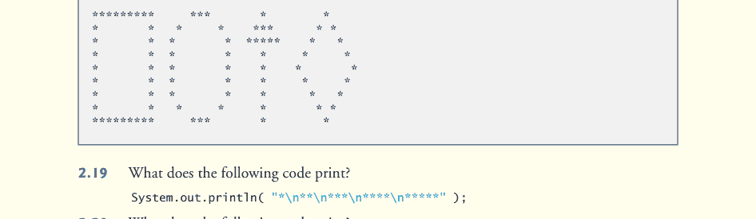

2.19 下面的代码打印什么？

System.out.println( "**\n**\n**\n**\n****" );

System.out.println( "**\n**\n**\n**\n****" );

2.20 下面的代码打印什么？

System.out.println( "**" );
System.out.println( "*****" );
System.out.println( "*****" );
System.out.println( "*****" );
System.out.println( "*****" );

2.21 下面的代码打印什么？

System.out.println( " " );
System.out.println( "*****" );
System.out.println( "*****" );
System.out.println( "*****" );
System.out.println( "*****" );
System.out.println( "*****" );

2.22 下面的代码打印什么？

System.out.println( " " );
System.out.println( "*****" );
System.out.println( "*****" );
System.out.println( "*****" );
System.out.println( "*****" );

2.23 下面的代码打印什么？

System.out.printf( "%5s\n%s\n%s\n%s\n%s\n", "**", "*****", "*****", "*****", "*****" );

2.24 （最大和最小整数）编写一个应用程序，读取五个整数，确定并打印这组整数中的最大值和最小值。只使用本章学到的编程技术。

2.25 （奇数或偶数）编写一个应用程序，读取一个整数，确定并打印它是奇数还是偶数。[提示：使用取余运算符。偶数是2的倍数。任何2的倍数除以2时余数为0。]

2.26 （倍数）编写一个应用程序，读取两个整数，确定第一个是否是第二个的倍数，并打印结果。[提示：使用取余运算符。]

2.27 （星号棋盘图案）编写一个应用程序，显示棋盘图案，如下所示：

* * * * * * *
* * * * * * *
* * * * * * *
* * * * * * *
* * * * * * *
* * * * * * *
* * * * * * *
* * * * * * *

2.28 （圆的直径、周长和面积）这里先预习一下。在本章中，你学习了整数和int类型。Java还可以表示包含小数点的浮点数，如3.14159。编写一个应用程序，从用户输入圆的半径（以整数形式），并使用浮点值3.14159作为π打印圆的直径、周长和面积。使用图2.7所示的技术。[注意：你也可以使用预定义常量Math.PI作为π的值。该常量比3.14159更精确。类Math定义在java.lang包中。该包中的类会自动导入，因此你无需导入类Math即可使用它。] 使用以下公式（r为半径）：

diameter = 2r
circumference = 2πr
area = πr²

不要将每次计算的结果存储在变量中。相反，将每次计算指定为将在System.out.printf语句中输出的值。周长和面积的计算结果的值是浮点数。这样的值可以在System.out.printf语句中使用格式说明符%f输出。你将在第3章中了解更多关于浮点数的知识。

2.29 （字符的整数值）这里再预习一下。在本章中，你学习了整数和int类型。Java还可以表示大写字母、小写字母以及各种特殊符号。每个字符都有对应的整数表示。计算机使用的字符集连同这些字符的对应整数表示被称为该计算机的字符集。你可以通过在程序中用单引号将该字符括起来来指示一个字符值，如'A'。

你可以通过在该字符前加上(int)来确定字符的整数等价物，如
(int) 'A'


2.30（分离整数中的数字）编写一个应用程序，输入一个由用户提供的五位数，将该数分离为各个数字，并打印出每个数字，数字之间用三个空格分隔。例如，如果用户输入数字 42339，程序应打印

4   2   3   3   9

假设用户输入的数字位数正确。当你执行程序并输入一个超过五位的数字时会发生什么？当你执行程序并输入一个少于五位的数字时会发生什么？[提示：使用本章学到的技术即可完成此练习。你需要同时使用除法和取余运算来“取出”每个数字。]

2.31（平方和立方表）仅使用本章学到的编程技术，编写一个应用程序，计算 0 到 10 这些数字的平方和立方，并以表格形式打印结果值，如下所示。[注意：此程序不需要用户输入任何内容。]

数字  平方  立方
0       0       0
1       1       1
2       4       8
3       9       27
4       16      64
5       25      125
6       36      216
7       49      343
8       64      512
9       81      729
10      100     1000

2.32（负数、正数和零值）编写一个程序，输入五个数字，确定并打印输入的负数个数、正数个数和零的个数。

## 产生影响

2.33（身体质量指数计算器）我们在练习 1.10 中介绍了身体质量指数（BMI）计算器。计算 BMI 的公式为

BMI = (weightInPounds × 703) / (heightInInches × heightInInches)

或

BMI = weightInKilograms / (heightInMeters × heightInMeters)

创建一个 BMI 计算器，读取用户的体重（磅）和身高（英寸）（或者，如果你愿意，也可以使用用户的体重（公斤）和身高（米）），然后计算并显示用户的身体质量指数。另外，显示来自美国卫生与公众服务部/美国国立卫生研究院的以下信息，以便用户评估其 BMI：

BMI 数值
体重过轻：  小于 18.5
正常：      18.5 到 24.9 之间
超重：      25 到 29.9 之间
肥胖：      30 或更高

> [注意：在本章中，你学习了使用 int 类型表示整数。使用 int 值进行 BMI 计算时，结果均为整数。在第 3 章中，你将学习使用 double 类型表示带小数点的数字。当使用 double 进行 BMI 计算时，结果都会带有小数点——这些数字称为“浮点数”。]

2.34（世界人口增长计算器）使用网络确定当前世界人口和年世界人口增长率。编写一个应用程序，输入这些值，然后显示一年、两年、三年、四年和五年后的预估世界人口。

2.35（拼车节省计算器）研究几个拼车网站。创建一个应用程序，计算你每天开车的成本，这样你就可以估算拼车能节省多少钱。拼车还有其他优点，例如减少碳排放和缓解交通拥堵。应用程序应输入以下信息，并显示用户每天开车上班的成本：

+   a) 每天行驶的总英里数。
+   b) 每加仑汽油的成本。
+   c) 每加仑汽油的平均行驶英里数。
+   d) 每天的停车费。
+   e) 每天的通行费。

## 类、对象、方法和字符串简介

> > 没有使用价值的对象，就没有价值。
> > ——卡尔·马克思

> > 你的公仆应当好好为你服务。
> > ——阿德莱·E·史蒂文森

> > 你会看到一些新东西。两样东西。我把它们叫做东西一和东西二。
> > ——西奥多·苏斯·盖泽尔博士

在本章中，你将学习：

+   - 如何声明一个类并使用它创建对象。
+   - 如何将类的行为实现为方法。
+   - 如何将类的属性实现为实例变量和属性。
+   - 如何调用对象的方法使其执行任务。
+   - 类的实例变量和方法中的局部变量是什么。
+   - 如何使用构造函数初始化对象的数据。
+   - 基本类型和引用类型之间的区别。


### 3.1 简介

我们在 1.6 节引入了面向对象编程的基本术语和概念。在本章中，我们将介绍一个用于组织 Java 面向对象应用程序的简单框架。通常，你在本书中开发的应用程序将由两个或更多类组成。如果你在行业中成为开发团队的一员，你可能会处理包含数百甚至数千个类的应用程序。

首先，我们用一个现实世界的例子来说明类的概念。然后，我们通过五个应用程序来演示创建和使用你自己的类。其中前四个应用开始了我们的案例研究：开发一个教师可以用来维护学生考试成绩的成绩册类。这个案例研究将在第 4 章、第 5 章和第 7 章中进一步完善。最后一个示例在银行账户类中引入了浮点数——即包含小数点的数字——该类用于维护客户的余额。

### 3.2 声明带方法的类并实例化类的对象

在第 2.5 节和第 2.8 节中，你创建了现有类 Scanner 的一个对象，然后使用该对象从键盘读取数据。在本节中，你将创建一个新类，然后使用它来创建一个对象。我们首先声明 GradeBook（图 3.1）和 GradeBookTest（图 3.2）类。GradeBook 类（在 GradeBook.java 文件中声明）将用于在屏幕上显示一条消息（图 3.2），欢迎教师使用成绩册应用程序。GradeBookTest 类（在 GradeBookTest.java 文件中声明）是一个应用程序类，其中的 main 方法将创建并使用 GradeBook 类的一个对象。每个以关键字 public 开头的类声明都必须存储在文件名与类名相同且以 .java 扩展名结尾的文件中。因此，GradeBook 和 GradeBookTest 类必须在不同的文件中声明，因为每个类都被声明为 public。

## GradeBook 类

GradeBook 类声明（图 3.1）包含一个 displayMessage 方法（第 7-10 行），该方法在屏幕上显示一条消息。我们需要创建这个类的一个对象，并调用它的方法来执行第 9 行以显示该消息。

类声明从第 4 行开始。关键字 public 是一个访问修饰符。目前，我们只需将每个类都声明为 public。每个类声明都包含关键字 class，后紧跟类名。每个类的主体都包含在一对左右花括号中，如 GradeBook 类的第 5 行和第 11 行所示。

在第 2 章中，我们声明的每个类都有一个名为 main 的方法。GradeBook 类也有一个方法——displayMessage（第 7-10 行）。回想一下，main 是一个特殊的方法，当你执行应用程序时，Java 虚拟机（JVM）总是自动调用它。大多数方法不会自动调用。你很快会看到，必须显式调用方法 displayMessage 来告诉它执行其任务。

方法声明以关键字 public 开头，表示该方法“可公开使用”——它可以从其他类的方法中调用。接下来是方法的返回类型，它指定方法在执行任务后返回给调用者的数据类型。返回类型 void 表示该方法将执行任务，但不会向调用它的方法返回（即回传）任何信息。你使用过返回信息的方法——例如，在第 2 章中，你使用 Scanner 方法 nextInt 来输入用户在键盘上输入的整数。当 nextInt 从用户那里读取一个值时，它会返回该值以供程序使用。

方法名 displayMessage 跟在返回类型之后。按照惯例，方法名以小写字母开头，名称中后续单词以大写字母开头。方法名后面的圆括号表示这是一个方法。空圆括号（如第 7 行所示）表示该方法不需要额外信息即可执行其任务。第 7 行通常称为方法头。每个方法的主体都由左右花括号界定，如第 8 行和第 10 行所示。

方法体包含一个或多个执行方法任务的语句。在本例中，该方法包含一个语句（第 9 行），该语句在命令窗口中显示消息 "Welcome to the Grade Book!"，并随后换行（因为使用了 println）。执行完此语句后，方法就完成了其任务。

## GradeBookTest 类

接下来，我们想在应用程序中使用 GradeBook 类。如你在第 2 章所学，main 方法开始执行每个应用程序。包含 main 方法的类开始执行 Java 应用程序。GradeBook 类不是应用程序，因为它不包含 main。因此，如果你尝试在命令窗口中输入 java GradeBook 来执行 GradeBook，将会发生错误。这在第 2 章中不是问题，因为你声明的每个类都有一个 main 方法。要解决此问题，我们必须要么声明一个包含 main 方法的单独类，要么在 GradeBook 类中放置 main 方法。

```java
// Fig. 3.1: GradeBook.java
// Class declaration with one method.

public class GradeBook
{
   // display a welcome message to the GradeBook user
   public void displayMessage()
   {
      System.out.println( "Welcome to the Grade Book!" );
   } // end method displayMessage
} // end class GradeBook
```


Book. 为了帮助你为本章以及本书后面和工业界中会遇到的更大程序做准备，我们使用一个单独的类（本例中为 GradeBookTest）包含 main 方法来测试本章中创建的每个新类。一些程序员将此类称为驱动类。

GradeBookTest 类声明（图 3.2）包含将控制应用程序执行的 main 方法。GradeBookTest 类声明从第 4 行开始，到第 15 行结束。该类与许多开始应用程序执行的类一样，只包含一个 main 方法。

```
1 // Fig. 3.2: GradeBookTest.java
2 // Creating a GradeBook object and calling its displayMessage method.

4 public class GradeBookTest
5 {
6     // main method begins program execution
7     public static void main( String[] args )
8     {
9         // create a GradeBook object and assign it to myGradeBook
10        GradeBook myGradeBook = new GradeBook();

12        // call myGradeBook's displayMessage method
13        myGradeBook.displayMessage();
14     } // end main
15 } // end class GradeBookTest
```

Welcome to the Grade Book!

Fig. 3.2 | Creating a GradeBook object and calling its displayMessage method.

第 7–14 行声明了 main 方法。使 JVM 能够定位并调用 main 方法以开始应用程序执行的关键部分是 static 关键字（第 7 行），它表示 main 是一个静态方法。静态方法很特殊，因为你可以在不先创建声明该方法的类的对象的情况下调用它。我们将在第 6 章《Methods: A Deeper Look》中讨论静态方法。

在此应用程序中，我们希望调用类 GradeBook 的 displayMessage 方法以在命令窗口中显示欢迎消息。通常，在你创建该类的对象之前，不能调用属于另一个类的 方法，如第 10 行所示。我们首先声明变量 myGradeBook。变量的类型为 GradeBook——我们在图 3.1 中声明的类。你创建的每个新类都成为一种新类型，可用于声明变量和创建对象。你可以根据需要声明新的类类型；这也是 Java 被称为可扩展语言的原因之一。

变量 myGradeBook 在第 10 行使用类实例创建表达式 new GradeBook() 的结果进行初始化。关键字 new 创建关键字右侧指定的类（即 GradeBook）的新对象。GradeBook 右侧的括号是必需的。如你在第 3.6 节中将学到的，这些与类名组合的括号代表对构造函数的调用，构造函数类似于方法，但仅在创建对象时使用以初始化对象的数据。你会看到可以在括号中放置数据以指定对象的初始值。对于现在，我们只是将括号留空。

正如我们可以使用对象 System.out 调用其方法 print、printf 和 println 一样，我们也可以使用对象 myGradeBook 调用其方法 displayMessage。第 13 行使用 myGradeBook 后跟点分隔符（.）、方法名 displayMessage 和一组空括号调用方法 displayMessage（图 3.1 的第 7–10 行）。此调用导致 displayMessage 方法执行其任务。此方法调用与第 2 章中在命令窗口显示信息的那些方法调用不同——其中每个方法调用都提供了指定要显示的数据的参数。在第 13 行开头，“myGradeBook.” 表示 main 应使用第 10 行创建的 myGradeBook 对象。图 3.1 的第 7 行表明方法 displayMessage 具有空参数列表——即 displayMessage 不需要额外信息来执行其任务。因此，方法调用（图 3.2 的第 13 行）在方法名后指定一组空括号，以表示没有向 displayMessage 方法传递参数。当 displayMessage 方法完成其任务后，main 方法在第 14 行继续执行。这是 main 方法的结束，因此程序终止。

任何类都可以包含 main 方法。JVM 仅在用于执行应用程序的类中调用 main 方法。如果应用程序有多个包含 main 的类，则被调用的是在 java 命令中命名的类中的那个。

## Compiling an Application with Multiple Classes

在你执行应用程序之前，必须先编译图 3.1 和图 3.2 中的类。首先，切换到包含应用程序源代码文件的目录。接下来，输入命令

```
javac GradeBook.java GradeBookTest.java
```

一次编译两个类。如果目录中仅包含此应用程序的文件，你可以使用命令

```
javac *.java
```

编译目录中的所有类。

星号 (*) 在 *.java 中表示应编译当前目录中以文件名扩展名 “.java” 结尾的所有文件。

## UML Class Diagram for Class GradeBook

图 3.3 展示了图 3.1 的类 GradeBook 的 UML 类图。在 UML 中，每个类在类图中都建模为一个具有三个隔间的矩形。顶部隔间包含类名，以粗体居中水平显示。中间隔间包含类的属性，对应于 Java 中的实例变量（在第 3.4 节中讨论）。在图 3.3 中，中间隔间为空，因为此 GradeBook 类没有属性。底部隔间包含

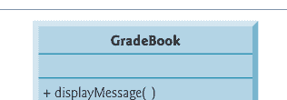

Fig. 3.3 | UML class diagram indicating that class GradeBook has a public displayMessage operation.

类的操作，对应于 Java 中的方法。UML 通过列出操作名，后跟访问修饰符（本例中为 +）并跟随一组括号来建模操作。类 GradeBook 有一个方法 displayMessage，因此图 3.3 的底部隔间列出了一个名为此的操作。displayMessage 方法不需要额外信息来执行其任务，因此类图中的方法名后面跟着的括号为空，就像在图 3.1 的第 7 行的方法声明中一样。操作名前的加号 (+) 表示在 UML 中 displayMessage 是一个公共操作（即 Java 中的公共方法）。我们经常使用 UML 类图来总结类的属性和操作。

## 3.3 Declaring a Method with a Parameter

在第 1.6 节的汽车类比中，我们讨论了按下汽车油门踏板会向汽车发送消息以执行任务——加速。但汽车应该加速多快？正如你所知，你踩下踏板的距离越远，汽车加速越快。因此，发给汽车的消息实际上包括要执行的任务以及帮助汽车执行任务的额外信息。此额外信息称为参数——参数的值有助于汽车确定加速速度。同样，一个方法可能需要一个或多个参数，表示执行其任务所需的额外信息。参数在方法名后括号内的以逗号分隔的参数列表中定义。每个参数必须指定类型和变量名。参数列表可能包含任意数量的参数，包括零个。方法名后面跟着的空括号（如图 3.1，第 7 行）表示方法不需要任何参数。

### Arguments to a Method

方法调用为方法的每个参数提供值——称为参数。例如，方法 System.out.println 需要一个参数来指定要在命令窗口中输出的数据。同样，为了向银行账户存款，deposit 方法指定一个代表存款金额的参数。当调用 deposit 方法时，表示存款金额的参数值会被分配给方法参数。然后方法存入该金额。

### Class Declaration with a Method That Has One Parameter

我们现在声明类 GradeBook（图 3.4），其 displayMessage 方法在欢迎消息中显示课程名称。（参见图 3.5 中的示例执行。）新方法需要一个参数来表示要输出的课程名称。

在讨论 GradeBook 类的新特性之前，让我们看看新的类如何从类 GradeBookTest 的 main 方法中使用（图 3.5）。第 12 行创建一个 Scanner 命名为 input 用于从用户读取课程名称。第 15 行创建 GradeBook 对象 myGradeBook。第 18 行提示用户输入课程名称。第 19 行使用 Scanner 方法 nextLine 从用户读取名称并将其分配给 nameOfCourse 变量，以执行输入。用户输入课程名称并按 Enter 提交课程名称给程序。按 Enter 会在用户键入的字符末尾插入换行符。nextLine 方法读取用户键入的字符，直到遇到换行符，然后返回一个包含字符的字符串，不包括换行符。换行符被丢弃。


the characters up to, but *not including*, the white-space character (which is discarded). All information after the first white-space character is not lost—it can be read by other statements that call the Scanner’s methods later in the program. Line 20 outputs a blank line.

Line 24 calls myGradeBook’s displayMessage method. The variable nameOfCourse in parentheses is the *argument* that’s passed to method displayMessage so that the method can perform its task. The value of variable nameOfCourse in main becomes the value of method displayMessage’s *parameter* courseName in line 7 of Fig. 3.4. When you execute this application, notice that method displayMessage outputs the name you type as part of the welcome message (Fig. 3.5).

## More on Arguments and Parameters

In Fig. 3.4, displayMessage’s parameter list (line 7) declares one parameter indicating that the method requires a String to perform its task. When the method is called, the argument value in the call is assigned to the corresponding parameter (courseName) in the method header. Then, the method body uses the value of the courseName parameter. Lines 9–10 of Fig. 3.4 display parameter courseName’s value, using the %s format specifier in printf’s format string. The parameter variable’s name (courseName in Fig. 3.4, line 7) can be the *same or different* from the argument variable’s name (nameOfCourse in Fig. 3.5, line 24).

The number of arguments in a method call *must* match the number of parameters in the parameter list of the method’s declaration. Also, the argument types in the method call must be “consistent with” the types of the corresponding parameters in the method’s declaration. (As you’ll learn in Chapter 6, an argument’s type and its corresponding parameter’s type are not always required to be *identical*.) In our example, the method call passes one argument of type String (nameOfCourse is declared as a String in line 19 of Fig. 3.5) and the method declaration specifies one parameter of type String (courseName is declared as a String in line 7 of Fig. 3.4). So in this example the type of the argument in the method call exactly matches the type of the parameter in the method header.

## Updated UML Class Diagram for Class GradeBook

The UML class diagram of Fig. 3.6 models class GradeBook of Fig. 3.4. Like Fig. 3.1, this GradeBook class contains public operation displayMessage. However, this version of displayMessage has a parameter. The UML models a parameter a bit differently from Java by listing the parameter name, followed by a colon and the parameter type in the parentheses following the operation name. The UML has its own data types similar to those of Java (but, as you’ll see, not all the UML data types have the same names as the corresponding Java types). The UML type String does correspond to the Java type String. GradeBook method displayMessage (Fig. 3.4) has a String parameter named courseName, so Fig. 3.6 lists courseName : String between the parentheses following displayMessage.

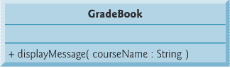

**Fig. 3.6**  |  UML class diagram indicating that class `GradeBook` has a `displayMessage` operation with a `courseName` parameter of UML type `String`.

## Notes on *import* Declarations

Notice the import declaration in Fig. 3.5 (line 4). This indicates to the compiler that the program uses class Scanner. Why do we need to import class Scanner, but not classes System, String or GradeBook? Classes System and String are in package java.lang, which is implicitly imported into every Java program, so all programs can use that package’s classes without explicitly importing them. Most other classes you’ll use in Java programs must be imported explicitly.

There’s a special relationship between classes that are compiled in the same directory on disk, like classes GradeBook and GradeBookTest. By default, such classes are considered to be in the same package—known as the **default package**. Classes in the same package are *implicitly imported* into the source-code files of other classes in the same package. Thus, an import declaration is *not* required when one class in a package uses another in the same package—such as when class GradeBookTest uses class GradeBook.

The import declaration in line 4 is *not* required if we always refer to class Scanner as java.util.Scanner, which includes the *full package name* and class name. This is known as the class’s fully qualified class name. For example, line 12 could be written as

```
java.util.Scanner input = new java.util.Scanner( System.in );
```

> **Software Engineering Observation 3.1**
> 
> The Java compiler does not require import declarations in a Java source-code file if the fully qualified class name is specified every time a class name is used in the source code. Most Java programmers prefer to use import declarations.

## 3.4 Instance Variables, set Methods and get Methods

In Chapter 2, we declared all of an application’s variables in the application’s main method. Variables declared in the body of a particular method are known as local variables and can be used only in that method. When that method terminates, the values of its local variables are lost. Recall from Section 1.6 that an object has *attributes* that are carried with it as it’s used in a program. Such attributes exist before a method is called on an object, while the method is executing and after the method completes execution.

A class normally consists of one or more methods that manipulate the attributes that belong to a particular object of the class. Attributes are represented as variables in a class declaration. Such variables are called fields and are declared *inside* a class declaration but *outside* the bodies of the class’s method declarations. When each object of a class maintains its own copy of an attribute, the field that represents the attribute is also known as an **instance variable**—each object (instance) of the class has a separate instance of the variable in memory. The example in this section demonstrates a GradeBook class that contains a courseName instance variable to represent a particular GradeBook object’s course name.

## GradeBook Class with an Instance Variable, a set Method and a get Method

In our next application (Figs. 3.7–3.8), class GradeBook (Fig. 3.7) maintains the course name as an instance variable so that it can be used or modified at any time during an application’s execution. The class contains three methods—setCourseName, getCourseName and displayMessage. Method setCourseName stores a course name in a GradeBook. Method getCourseName obtains a GradeBook’s course name. Method displayMessage,

variable `courseName` can be used only in methods `setCourseName`, `getCourseName` and `displayMessage` of (every object of) class `GradeBook`.

Declaring instance variables with access modifier `private` is known as **data hiding** or information hiding. When a program creates (instantiates) an object of class `GradeBook`, variable `courseName` is *encapsulated* (hidden) in the object and can be accessed only by methods of the object’s class. This prevents `courseName` from being modified accidentally by a class in another part of the program. In class `GradeBook`, methods `setCourseName` and `getCourseName` manipulate the instance variable `courseName`.

> **Software Engineering Observation 3.2**
> 
> *Precede each field and method declaration with an access modifier. Generally, instance variables should be declared private and methods public. (It’s appropriate to declare certain methods private, if they’ll be accessed only by other methods of the class.)*

> **Good Programming Practice 3.1**
> 
> *We prefer to list a class’s fields first, so that, as you read the code, you see the names and types of the variables before they’re used in the class’s methods. You can list the class’s fields anywhere in the class outside its method declarations, but scattering them can lead to hard-to-read code.*

### Methods `setCourseName` and `getCourseName`

Method `setCourseName` (lines 10–13) does not return any data when it completes its task, so its return type is `void`. The method receives one parameter—`name`—which represents the course name that will be passed to the method as an argument. Line 12 assigns name to instance variable `courseName`.

Method `getCourseName` (lines 16–19) returns a particular `GradeBook` object’s `courseName`. The method has an empty parameter list, so it does not require additional information to perform its task. The method specifies that it returns a `String`—this is the method’s return type. When a method that specifies a return type other than `void` is called and completes its task, the method returns a *result* to its calling method. For example, when you go to an automated teller machine (ATM) and request your account balance, you expect the ATM to give you back a value that represents your balance. Similarly, when a statement calls method `getCourseName` on a `GradeBook` object, the statement expects to receive the `GradeBook`’s course name (in this case, a `String`, as specified in the method declaration’s return type).

The `return` statement in line 18 passes the value of instance variable `courseName` back to the statement that calls method `getCourseName`. Consider, method `displayMessage`’s line 27, which calls method `getCourseName`. When the value is returned, the statement in lines 26–27 uses that value to output the course name. Similarly, if you have a method `square` that returns the square of its argument, you’d expect the statement

```
int result = square( 2 );
```

to return 4 from method `square` and assign 4 to the variable `result`. If you have a method `maximum` that returns the largest of three integer arguments, you’d expect the statement

```
int biggest = maximum( 27, 114, 51 );
```

to return 114 from method `maximum` and assign 114 to variable `biggest`.


第 12 行和第 18 行的语句都使用了 courseName，即使它在任何方法中都没有声明。我们可以在 GradeBook 的方法中使用 courseName，因为 courseName 是该类的实例变量。

### 方法 displayMessage

方法 displayMessage（第 22–28 行）在完成任务时不返回任何数据，因此其返回类型为 void。该方法不接收参数，因此参数列表为空。第 26–27 行输出包含实例变量 courseName 值的欢迎消息，该值由第 27 行对方法 getCourseName 的调用返回。请注意，一个类的方法（本例中为 displayMessage）可以通过仅使用方法名（本例中为 getCourseName）来调用同一类的另一个方法。

## 演示类 GradeBook 的类 GradeBookTest

类 GradeBookTest（图 3.8）创建一个类 GradeBook 的对象并演示其方法。第 14 行创建一个 GradeBook 对象并将其分配给类型为 GradeBook 的局部变量 myGradeBook。第 17–18 行通过调用对象的 getCourseName 方法显示初始课程名称。输出的第一行显示名称为 "null"。与未自动初始化的局部变量不同，每个字段都有一个默认初始值——当你未指定字段的初始值时，Java 提供的默认值。因此，字段在使用前无需显式初始化——除非它们必须初始化为除默认值之外的其他值。对于类型为 String 的字段（例如本例中的 courseName），默认值是 null，我们将在第 3.5 节中更详细地介绍。

第 21 行提示用户输入课程名称。局部 String 变量 theName（在第 22 行声明）使用用户输入的课程名称进行初始化，该名称由 Scanner 对象 input 的 nextLine 方法调用返回。第 23 行调用对象 myGradeBook 的 setCourseName 方法并提供 theName 作为方法参数。当调用该方法时，参数的值被赋给方法 setCourseName（图 3.7 第 10–13 行）的参数 name（图 3.7 第 10 行）。然后参数的值被赋给实例变量 courseName（图 3.7 第 12 行）。第 24 行（图 3.8）跳过输出中的一行，然后第 27 行调用对象 myGradeBook 的 displayMessage 方法以显示包含课程名称的欢迎消息。

```
1 // Fig. 3.8: GradeBookTest.java
2 // Creating and manipulating a GradeBook object.
3 import java.util.Scanner; // program uses Scanner
4 
5 public class GradeBookTest
6 {
7     // main method begins program execution
8     public static void main( String[] args )
9     {
10        // create Scanner to obtain input from command window
11        Scanner input = new Scanner( System.in );
12
13        // create a GradeBook object and assign it to myGradeBook
14        GradeBook myGradeBook = new GradeBook();
15
16      // display initial value of courseName
17      System.out.printf( "Initial course name is: %s\n\n",
18          myGradeBook.getCourseName() );
19
20      // prompt for and read course name
21      System.out.println( "Please enter the course name:" );
22      String theName = input.nextLine(); // read a line of text
23      myGradeBook.setCourseName( theName ); // set the course name
24      System.out.println(); // outputs a blank line
25
26      // display welcome message after specifying course name
27      myGradeBook.displayMessage();
28      } // end main
29      } // end class GradeBookTest
```

```
Initial course name is: null
Please enter the course name:
CS101 Introduction to Java Programming
Welcome to the grade book for
CS101 Introduction to Java Programming!
```

图 3.8 | 创建和操作 GradeBook 对象。（第 2 部分，共 2 部分。）

## set 和 get 方法

类的私有字段只能由该类的方法操作。因此，对象的客户端——即调用对象方法的任何类——调用类的公共方法来操作该类对象的私有字段。这就是为什么方法 main（图 3.8）中的语句在 GradeBook 对象上调用 setCourseName、getCourseName 和 displayMessage 方法的原因。类通常提供公共方法以允许客户端设置（即为其分配值）或获取（即获得值）私有实例变量。这些方法的名称不必以 set 或 get 开头，但这种命名约定是推荐的，并且是称为 JavaBeans 的特殊 Java 软件组件的约定，JavaBeans 可以简化许多 Java 集成开发环境（IDE）中的编程。本例中设置实例变量 courseName 的方法称为 setCourseName，而获取其值的方法称为 getCourseName。

### 带有实例变量和 set 与 get 方法的 GradeBook UML 类图

图 3.9 包含类 GradeBook 的更新 UML 类图，该类版本见图 3.7。该图将类 GradeBook 的实例变量 courseName 建模为类中部隔间中的属性。UML 通过列出属性名称，后跟冒号和属性类型来表示实例变量作为属性。属性 courseName 的 UML 类型是 String。实例变量 courseName 在 Java 中是私有的，因此类图在相应属性名称前列出减号 (-) 访问修饰符。类 GradeBook 包含三个公共方法，因此类图在第三个隔间中列出三个操作。请记住，每个操作名称前的加号 (+) 表示该操作是公共的。操作 setCourseName 有一个名为 name 的 String 参数。UML 通过在操作名称后括号之后的冒号和返回类型来表示操作的返回类型。类 GradeBook（图 3.7）的方法 getCourseName 在 Java 中的返回类型为 String，因此类图在 UML 中显示 String 返回类型。操作 setCourseName 和 displayMessage 不返回值（即在 Java 中返回 void），因此 UML 类图在这些操作的括号后不指定返回类型。

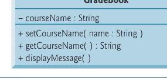

图 3.9 | UML 类图表明类 GradeBook 具有私有 courseName 属性，其 UML 类型为 String，以及三个公共操作——setCourseName（具有 UML 类型为 String 的 name 参数）、getCourseName（返回 UML 类型 String）和 displayMessage。

## 3.5 原始类型与引用类型

Java 的类型分为原始类型和引用类型。原始类型为 boolean、byte、char、short、int、long、float 和 double。所有非原始类型都是引用类型，因此类，即指定对象类型的类型，是引用类型。

原始类型变量一次只能存储其声明类型的一个值。例如，int 变量一次只能存储一个整数（例如 7）。当向该变量分配另一个值时，其初始值将被替换。原始类型实例变量默认会被初始化——类型为 byte、char、short、int、long、float 和 double 的变量初始化为 0，类型为 boolean 的变量初始化为 false。你可以通过在声明时为变量分配值来指定原始类型变量自己的初始值，如

```
private int numberOfStudents = 10;
```

请记住，局部变量默认不会被初始化。

错误预防提示 3.1 尝试使用未初始化的局部变量会导致编译错误。

程序使用引用类型变量（通常称为引用）来存储计算机内存中对象的存储位置。这样的变量据说在程序中引用一个对象。被引用的对象可能各自包含许多实例变量。图 3.8 第 14 行创建一个类 GradeBook 的对象，并且变量 myGradeBook 包含对该 GradeBook 对象的引用。引用类型实例变量默认初始化为值 null——表示“对无物的引用”的保留字。这就是为什么图 3.8 第 18 行对 getCourseName 的第一次调用返回 null 的原因——courseName 的值尚未设置，因此返回了默认初始值 null。保留字和关键字的完整列表列在附录 C 中。

当你使用另一个类的对象时，需要对该对象的引用来调用（即调用）其方法。在图 3.8 的应用程序中，方法 main 中的语句使用


变量 `myGradeBook` 用于向 GradeBook 对象发送消息。这些消息是对方法（如 `setCourseName` 和 `getCourseName`）的调用，使程序能够与 GradeBook 对象交互。例如，第 23 行的语句使用 `myGradeBook` 向 GradeBook 对象发送 `setCourseName` 消息。该消息包含 `setCourseName` 执行其任务所需的参数。GradeBook 对象使用此信息设置 `courseName` 实例变量。原始类型变量不引用对象，因此此类变量不能用于调用方法。

## 软件工程观察 3.3

变量的声明类型（例如，`int`、`double` 或 `GradeBook`）指示变量是原始类型还是引用类型。如果变量不是八种原始类型之一，则它是引用类型。

## 3.6 使用构造函数初始化对象

如第 3.4 节所述，当创建 `GradeBook` 类（图 3.7）的对象时，其实例变量 `courseName` 默认初始化为 `null`。如果您想在创建 `GradeBook` 对象时提供课程名称怎么办？您可以为声明的每个类提供一个特殊的称为构造函数的 方法，可用于在创建对象时初始化该类的对象。事实上，Java 要求为创建的每个对象调用构造函数。关键字 `new` 从系统请求内存来存储对象，然后调用相应类的构造函数来初始化对象。调用由类名后的括号表示。构造函数必须与类同名。例如，图 3.8 第 14 行首先使用 `new` 创建一个 `GradeBook` 对象。`"new GradeBook"` 后的空括号表示对无参数的类构造函数进行调用。默认情况下，如果类未显式包含构造函数，编译器会在该类中提供一个无参数的默认构造函数。当类只有默认构造函数时，其实例变量被初始化为默认值。

当您声明一个类时，您可以提供自己的构造函数来为该类的对象指定自定义初始化。例如，您可能希望在创建对象时为 `GradeBook` 对象指定课程名称，如

```java
GradeBook myGradeBook =
    new GradeBook( "CS101 Introduction to Java Programming" );
```

在这种情况下，参数 `"CS101 Introduction to Java Programming"` 被传递给 `GradeBook` 对象的构造函数并用于初始化 `courseName`。前面的语句要求类提供一个具有 `String` 参数的构造函数。图 3.10 包含一个具有此类构造函数的修改后的 `GradeBook` 类。

```java
// Fig. 3.10: GradeBook.java
// GradeBook class with a constructor to initialize the course name.

public class GradeBook
{
    private String courseName; // course name for this GradeBook

    // constructor initializes courseName with String argument
    public GradeBook( String name ) // constructor name is class name
    {
        courseName = name; // initializes courseName
    } // end constructor

    // method to set the course name
    public void setCourseName( String name )
    {
        courseName = name; // store the course name
    } // end method setCourseName

    // method to retrieve the course name
    public String getCourseName()
    {
        return courseName;
    } // end method getCourseName

    // display a welcome message to the GradeBook user
    public void displayMessage()
    {
        // this statement calls getCourseName to get the
        // name of the course this GradeBook represents
        System.out.printf( "Welcome to the grade book for\n%s!\n",
            getCourseName() );
    } // end method displayMessage
} // end class GradeBook
```

图 3.10 | GradeBook 类，具有用于初始化课程名称的构造函数。

第 9–12 行声明了 `GradeBook` 的构造函数。与方法一样，构造函数的参数列表指定了它执行任务所需的数据。当您创建新对象（我们将在图 3.11 中这样做）时，此数据放在类名后的括号中。图 3.10 第 9 行指出构造函数有一个名为 `name` 的 `String` 参数。在第 11 行中传递给构造函数的名称被赋给实例变量 `courseName`。

图 3.11 使用构造函数初始化 `GradeBook` 对象。第 11–12 行创建并初始化 `GradeBook` 对象 `gradeBook1`。使用参数 `"CS101 Introduction to Java Programming"` 调用 `GradeBook` 构造函数以初始化课程名称。第 11–12 行中的类实例创建表达式返回对新对象的引用，该引用被赋给变量 `gradeBook1`。第 13–14 行重复此过程，这次传递参数 `"CS102 Data Structures in Java"` 以初始化 `gradeBook2` 的课程名称。第 17–20 行使用每个对象的 `getCourseName` 方法获取课程名称并显示它们在对象创建时已初始化。输出证实每个 `GradeBook` 都维护自己的一份 `courseName` 实例变量的副本。

构造函数与方法之间一个重要的区别是，构造函数不能返回值，因此不能指定返回类型（甚至不是 `void`）。通常，构造函数声明为 `public`。如果类不包含构造函数，则该类的实例变量将被初始化为默认值。如果您为类声明任何构造函数，Java 编译器将不会为该类创建默认构造函数。因此，我们不能再像之前的示例那样使用 `new GradeBook()` 创建 `GradeBook` 对象。

```java
// Fig. 3.11: GradeBookTest.java
// GradeBook constructor used to specify the course name at the
// time each GradeBook object is created.

public class GradeBookTest
{
    // main method begins program execution
    public static void main( String[] args )
    {
        // create GradeBook object
        GradeBook gradeBook1 = new GradeBook(
            "CS101 Introduction to Java Programming" );
        GradeBook gradeBook2 = new GradeBook(
            "CS102 Data Structures in Java" );

        // display initial value of courseName for each GradeBook
        System.out.printf( "gradeBook1 course name is: %s\n",
            gradeBook1.getCourseName() );
        System.out.printf( "gradeBook2 course name is: %s\n",
            gradeBook2.getCourseName() );
    } // end main
} // end class GradeBookTest
```

```text
gradeBook1 course name is: CS101 Introduction to Java Programming
gradeBook2 course name is: CS102 Data Structures in Java
```

图 3.11 | GradeBook 构造函数用于在创建每个 GradeBook 对象时指定课程名称。

### 软件工程观察 3.4

除非您类的实例变量的默认初始化是可以接受的，否则请提供一个构造函数，以确保在创建每个新对象时它们都使用有意义的值正确初始化。

### 将构造函数添加到类 GradeBook 的 UML 类图

图 3.12 的 UML 类图对图 3.10 的类 `GradeBook` 进行了建模，该类具有一个具有 `String` 类型名称参数的构造函数。与操作一样，UML 在类图中类的第三个区段中对构造函数进行建模。为了将构造函数与类的操作区分开来，UML 要求在构造函数名称前放置“构造函数”一词，用尖括号（« 和 »）括起来。习惯上在第三个区段中先列出构造函数，然后再列出其他操作。

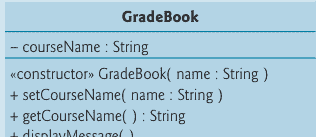

图 3.12 | UML 类图指示类 GradeBook 具有一个具有 UML 类型 String 的名称参数的构造函数。

### 具有多个参数的构造函数

有时您希望使用多个数据项初始化对象。在练习 3.11 中，我们要求您在 `GradeBook` 对象中存储课程名称和讲师姓名。在这种情况下，`GradeBook` 的构造函数将被修改为接收两个 `String`，例如

```java
public GradeBook( String courseName, String instructorName )
```

并且您将按如下方式调用 `GradeBook` 构造函数：

```java
GradeBook gradeBook = new GradeBook(
"CS101 Introduction to Java Programming", "Sue Green" );
```

## 3.7 浮点数和类型 double

我们现在暂时离开 `GradeBook` 案例研究，声明一个维护银行账户余额的 `Account` 类。大多数账户余额不是整数（如 0、−22 和 1024）。出于这个原因，类 `Account` 将账户余额表示为浮点数（即带小数点的数字，例如 7.33、0.0975 或 1000.12345）。Java 提供了两种用于在内存中存储浮点数的原始类型——`float` 和 `double`。它们主要的区别在于 `double` 变量可以存储更大范围且细节更精细（即小数点右侧的位数更多——也称为数字的精度）的数字，而 `float` 变量则不能。

### 浮点数精度和内存需求

`float` 类型的变量表示单精度浮点数，可以表示多达七位有效数字。`double` 类型的变量表示双精度浮点数。这些变量需要的内存是 `float` 变量的两倍，并提供 15 位有效数字——大约是 `float` 变量精度的两倍。对于大多数程序所需的取值范围，`float` 类型的变量应该足够，但您可以使用 `double` 来“稳妥”。在某些应用中，即使是 `double` 变量也不够用。大多数程序员使用 `double` 类型表示浮点数。事实上，Java 默认将您在程序源代码中输入的所有浮点数（如 7.33 和 0.0975）视为 `double` 值。源代码中的此类值称为浮点字面量。有关 `float` 和 `double` 的取值范围，请参阅附录 D、原始类型。

尽管浮点数并不总是 100% 精确，但它们有许多应用。例如，当我们说“正常”体温为 98.6 时，我们不需要精确到大量数字。当我们读出体温计上的温度为 98.6 时，它实际上可能是 98.5999473210643。将这个数字简单地称为 98.6 对于大多数涉及体温的应用来说是足够的。由于浮点数的非精确性，`double` 类型优于 `float` 类型，因为 `double` 变量可以更准确地表示浮点数。出于这个原因，我们在全书中主要使用 `double` 类型。对于精确的浮点数，Java 提供了类 `BigDecimal`（包 `java.math`）。

浮点数也源于除法。在常规算术中，当我们将 10 除以 3 时，结果为 3.3333333…，3 的序列无限重复——


无限地。计算机只分配固定大小的空间来保存这样的值，因此存储的浮点值显然只能是一个近似值。

## 具有double类型实例变量的Account类

我们的下一个应用程序（图3.13–3.14）包含一个名为Account的类（图3.13），它维护银行账户的余额。典型的银行服务于许多账户，每个账户都有自己的余额，因此第7行声明了一个名为balance的double类型实例变量。它是一个实例变量，因为它声明在类体内，但在类的方法声明（第10–16行、19–22行和25–28行）之外。Account类的每个实例（即对象）都包含自己的一份balance副本。

```
// Fig. 3.13: Account.java
// Account class with a constructor to validate and
// initialize instance variable balance of type double.

public class Account
{
    private double balance; // instance variable that stores the balance

    // constructor
    public Account( double initialBalance )
    {
        // validate that initialBalance is greater than 0.0;
        // if it is not, balance is initialized to the default value 0.0
        if ( initialBalance > 0.0 )
            balance = initialBalance;
    } // end Account constructor

    // credit (add) an amount to the account
    public void credit( double amount )
    {
        balance = balance + amount; // add amount to balance
    } // end method credit

    // return the account balance
    public double getBalance()
    {
        return balance; // gives the value of balance to the calling method
    } // end method getBalance
} // end class Account
```

图3.13 | Account类，具有一个构造函数来验证并初始化double类型的实例变量balance。

该类有一个构造函数和两个方法。开户时立刻存钱是很常见的，因此构造函数（第10–16行）接收一个double类型的参数initialBalance，表示初始余额。第14–15行确保initialBalance大于0.0。如果是这样，则将initialBalance的值赋给实例变量balance。否则，balance保持为0.0——这是它的默认初始值。

credit方法（第19–22行）完成任务时不返回任何数据，因此其返回类型为void。该方法接收一个名为amount的参数——一个将添加到余额的double值。第21行将amount加到balance的当前值，然后将结果赋给balance（从而替换先前的余额值）。

getBalance方法（第25–28行）允许该类的客户端（即使用该类的其他类）获取特定Account对象的balance值。该方法指定返回类型为double，参数列表为空。

同样，第15、21和27行的语句使用了实例变量balance，即使它没有在任何一个方法中声明。我们可以在这些方法中使用balance，因为它是该类的一个实例变量。

## 使用Account类的AccountTest类

AccountTest类（图3.14）创建两个Account对象（第10–11行），并分别用50.00和-7.53初始化它们。第14–17行通过调用Account的getBalance方法输出每个Account的余额。当从第15行调用account1的getBalance方法时，account1的balance值从图3.13的第27行返回，并由System.out.printf语句（图3.14的第14–15行）显示。类似地，当从第17行调用account2的getBalance方法时，account2的balance值从图3.13的第27行返回，并由System.out.printf语句（图3.14的第16–17行）显示。account2的余额为0.00，因为构造函数确保账户不能以负余额开始。该值由printf以格式说明符%.2f输出。格式说明符%f用于输出float或double类型的值。%和f之间的.2表示应输出到浮点数中小数点右侧的十进制位数（2），也称为该数字的精度。任何使用%.2f输出的浮点值将四舍五入到百分位——例如，123.457将四舍五入为123.46，27.333将四舍五入为27.33，123.455将四舍五入为123.46。

```
// Fig. 3.14: AccountTest.java
// Inputting and outputting floating-point numbers with Account objects.
import java.util.Scanner;

public class AccountTest
{
    // main method begins execution of Java application
    public static void main( String[] args )
    {
        Account account1 = new Account( 50.00 ); // create Account object
        Account account2 = new Account( -7.53 ); // create Account object

        // display initial balance of each object
        System.out.printf( "account1 balance: %.2f\n",
            account1.getBalance() );
        System.out.printf( "account2 balance: %.2f\n\n",
            account2.getBalance() );

        // create Scanner to obtain input from command window
        Scanner input = new Scanner( System.in );
        double depositAmount; // deposit amount read from user
```

```java
System.out.print("Enter deposit amount for account1: "); // prompt
depositAmount = input.nextDouble(); // obtain user input
System.out.printf("\nadding %.2f to account1 balance\n\n",
depositAmount);
account1.credit(depositAmount); // add to account1 balance

// display balances
System.out.printf("account1 balance: $%.2f\n",
account1.getBalance());
System.out.printf("account2 balance: $%.2f\n\n",
account2.getBalance());

System.out.print("Enter deposit amount for account2: "); // prompt
depositAmount = input.nextDouble(); // obtain user input
System.out.printf("\nadding %.2f to account2 balance\n\n",
depositAmount);
account2.credit(depositAmount); // add to account2 balance

// display balances
System.out.printf("account1 balance: $%.2f\n",
account1.getBalance());
System.out.printf("account2 balance: $%.2f\n",
account2.getBalance());
} // end main
} // end class AccountTest
```

```
account1 balance: $0.00
account2 balance: $0.00

Enter deposit amount for account1: 25.53
adding 25.53 to account1 balance
account1 balance: $75.53
account2 balance: $0.00

Enter deposit amount for account2: 123.45
adding 123.45 to account2 balance
account1 balance: $75.53
account2 balance: $123.45
```

图3.14 | 使用Account对象输入和输出浮点数。（第2部分，共2部分。）

第21行声明局部变量depositAmount，以存储用户输入的每个存款金额。与Account类中的实例变量balance不同，main中的局部变量depositAmount默认不会初始化为0.0。然而，此变量不需要在此处初始化，因为它的值将由用户的输入决定。第23行提示用户为account1输入存款金额。第24行通过调用Scanner对象的nextDouble()方法获取用户输入，该方法返回用户输入的double值。第25–26行显示存款金额。第27行调用account1.credit(depositAmount)；将存款添加到account1的余额中。

调用的是对象account1的credit方法，并以depositAmount作为该方法的参数。当方法被调用时，参数值被赋给credit方法（图3.13第19–22行）的amount参数（图3.13第19行）；然后credit方法将该值添加到余额中（图3.13第21行）。第30–33行（图3.14）再次输出两个Account的余额，以显示只有account1的余额发生了变化。

第35行提示用户为account2输入存款金额。第36行通过调用Scanner对象input的nextDouble方法获取用户输入。第37–38行显示存款金额。第39行调用对象account2的credit方法，并将depositAmount作为该方法的参数；然后credit方法将该值添加到余额中。最后，第42–45行再次输出两个Account的余额，以显示只有account2的余额发生了变化。

## Account类的UML类图

图3.15中的UML类图对图3.13的Account类进行建模。该图用UML类型Double对私有属性balance进行建模，以对应于该类的Java类型double实例变量balance。该图在类的第三栏中建模了Account类的构造函数，参数为UML类型Double的initialBalance。该类的两个公有方法也在第三栏中建模为操作。该图还建模了操作credit，带有UML类型Double的amount参数（因为相应方法具有Java类型double的amount参数），以及操作getBalance，返回类型为Double（因为相应的Java方法返回double值）。

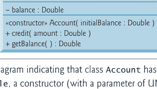

图3.15 | UML类图，指示Account类具有UML类型Double的私有balance属性、一个构造函数（具有UML类型Double的参数）和两个公有操作——credit（具有UML类型Double的amount参数）和getBalance（返回UML类型Double）。

## 3.8（可选）GUI和图形案例研究：使用对话框

本可选案例研究面向那些希望在本书早期就开始学习Java创建图形用户界面（GUI）和图形的强大功能的人，而不是等到第14章“GUI组件：第1部分”、第15章“图形与Java 2D”和第25章“GUI组件：第2部分”中再对这些主题进行主要讨论。

GUI和图形案例研究分为10个简短的章节（见图3.16）。每个章节介绍新概念，并提供带有屏幕截图的示例，展示示例交互和结果。在最初几个章节中，你将创建自己的第一个图形应用程序。在后续章节中，你将使用面向对象编程概念来


创建一个应用程序来绘制各种形状。在第14章正式介绍GUI时，我们使用鼠标来选择要绘制的具体形状及其绘制位置。在第15章中，我们使用Java 2D图形API的功能来绘制具有不同线宽和填充效果的形状。我们希望你觉得这个案例研究既有教育意义又充满趣味。

| 位置 | 标题——练习 |
|---|---|
| 3.8节 | 使用对话框——对话框的基本输入和输出 |
| 4.14节 | 创建简单绘图——在屏幕上显示和绘制直线 |
| 5.10节 | 绘制矩形和椭圆——使用形状表示数据 |
| 6.13节 | 颜色和填充形状——绘制靶心和随机图形 |
| 7.15节 | 绘制弧线——使用弧线绘制螺旋 |
| 8.16节 | 使用图形对象——将形状存储为对象 |
| 9.8节 | 使用标签显示文本和图像——提供状态信息 |
| 10.8节 | 使用多态绘制——识别形状之间的相似性 |
| 练习14.17 | 扩展界面——使用GUI组件和事件处理 |
| 练习15.31 | 添加Java 2D——使用Java 2D API增强绘图 |

图3.16 | 各章中GUI和图形案例研究总结。

## 在对话框中显示文本

到目前为止展示的程序都是在命令窗口中显示输出。许多应用程序使用窗口或对话框（也称为dialogs）来显示输出。诸如Firefox、Internet Explorer、Chrome和Safari等Web浏览器会在自己的窗口中显示网页。电子邮件程序允许你在窗口中输入和阅读消息。通常，对话框是程序向用户显示重要消息的窗口。JOptionPane类提供了预先构建的对话框，使程序能够显示包含消息的窗口——这样的窗口称为消息对话框。图3.17在消息对话框中显示了字符串"Welcome\nto\nJava"。

```
1  // Fig. 3.17: Dialog1.java
2  // Using JOptionPane to display multiple lines in a dialog box.
3  import javax.swing.JOptionPane; // import class JOptionPane
4
5  public class Dialog1
6  {
7      public static void main( String[] args )
8      {
9          // display a dialog with a message
10         JOptionPane.showMessageDialog( null, "Welcome\nto\nJava" );
11     } // end main
12 } // end class Dialog1
```

图3.17 | 使用JOptionPane在对话框中显示多行文本。（第1部分，共2部分）

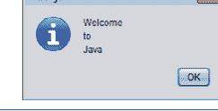

图3.17 | 使用JOptionPane在对话框中显示多行文本。（第2部分，共2部分）

第3行表明该程序使用了javax.swing包中的JOptionPane类。该包包含许多帮助你创建图形用户界面（GUI）的类。GUI组件有助于程序用户输入数据，并向用户呈现输出。第10行调用JOptionPane的showMessageDialog方法，以显示一个包含消息的对话框。该方法需要两个参数。第一个参数帮助Java应用程序确定对话框的位置。对话框通常从带有自身窗口的GUI应用程序中显示。第一个参数引用该窗口（称为父窗口），使对话框显示在应用程序窗口的中央。如果第一个参数为null，对话框将显示在屏幕中央。第二个参数是要在对话框中显示的字符串。

## 介绍静态方法

JOptionPane的showMessageDialog方法是一个所谓的静态方法。这类方法通常定义经常使用的任务。例如，许多程序都会显示对话框，而每次执行此操作的代码都是相同的。JOptionPane类的设计者并没有要求你“重新发明轮子”并创建显示对话框的代码，而是声明了一个静态方法为你执行此任务。调用静态方法的方式是使用其类名后跟一个点（.）和方法名，如下所示：

```
ClassName.methodName( arguments )
```

注意，使用JOptionPane类的静态方法showMessageDialog时，无需创建JOptionPane类的对象。我们将在第6章更详细地讨论静态方法。

## 在对话框中输入文本

图3.18使用了另一个预定义的JOptionPane对话框，称为输入对话框，它允许用户向程序输入数据。该程序询问用户的姓名，并用一个包含问候语和用户输入的姓名的消息对话框进行响应。

第10～11行使用JOptionPane的showInputDialog方法显示一个输入对话框，其中包含一个提示和一个字段（称为文本框），用户可以在其中输入文本。showInputDialog方法的参数是提示用户应输入内容的提示信息。用户在文本字段中输入字符，然后点击“确定”按钮或按回车键，将字符串返回给程序。showInputDialog方法（第11行）返回一个包含用户输入的字符的字符串。我们将该字符串存储在变量name中（第10行）。[注意：如果按下对话框的“取消”按钮或按Esc键，该方法将返回null，程序将把“null”一词显示为姓名。]

第14～15行使用静态String方法format返回一个包含用户姓名的问候字符串。format方法的工作方式类似于System.out.printf方法，区别在于format返回格式化后的字符串，而不是在命令窗口中显示它。第18行将问候语显示在消息对话框中，就像我们在图3.17中所做的那样。

```
// Fig. 3.18: NameDialog.java
// Basic input with a dialog box.
import javax.swing.JOptionPane;

public class NameDialog
{
    public static void main( String[] args )
    {
        // prompt user to enter name
        String name =
            JOptionPane.showInputDialog( "What is your name?" );

        // create the message
        String message =
            String.format( "Welcome, %s, to Java Programming!", name );

        // display the message to welcome the user by name
        JOptionPane.showMessageDialog( null, message );
    } // end main
} // end class NameDialog
```

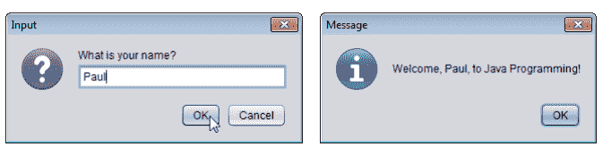

图3.18 | 从对话框获取用户输入。

## GUI与图形案例研究练习

3.1 修改图2.7中的加法程序，使用JOptionPane类的方法进行基于对话框的输入和输出。由于showInputDialog方法返回String，因此必须将用户输入的String转换为int以用于计算。Integer类的静态方法parseInt接受一个表示整数的String参数（例如JOptionPane.showInputDialog的结果），并将该值作为int返回。parseInt方法是Integer类（来自java.lang包）的静态方法。如果String不包含有效的整数，程序将以错误终止。

## 3.9 小结

在本章中，你学习了如何声明类的实例变量，以维护该类的每个对象的数据，以及如何声明操作这些数据的方法。你学习了如何调用方法以告知其执行任务，以及如何将信息作为参数传递给方法。你了解了方法的局部变量和类的实例变量之间的区别，并且知道只有实例变量会被自动初始化。你还学习了如何使用类的构造函数来指定对象实例变量的初始值。在整个章节中，你了解了如何使用UML创建类图，为类的构造函数、方法和属性建模。最后，你学习了浮点数——如何使用基本类型double的变量存储它们，如何使用Scanner对象输入它们，以及如何使用printf和格式说明符%f对它们进行格式化以便显示。在下一章中，我们将开始介绍控制语句，这些语句指定程序操作的执行顺序。你将在方法中使用这些语句来指定它们应如何执行任务。

## 总结

3.2节 声明带方法的类并实例化类的对象

- 以访问修饰符（p. 72）public开头的每个类声明都必须存储在文件名与类名完全相同且以.java文件扩展名结尾的文件中。
- 每个类声明都包含关键字class，其后紧跟类的名称。
- 以关键字public开头的方法声明表明该方法可以被类声明之外的其他类调用。
- 关键字void表示方法将执行任务但不会返回任何信息。
- 按照惯例，方法名的第一个字母小写，名称中后续单词的首字母大写。
- 方法名后面的空括号表示该方法执行任务不需要任何参数。
- 每个方法的方法体由左右花括号（{和}）括起来。
- 方法体包含执行方法任务的语句。语句执行完毕后，方法就完成了它的任务。
- 当你尝试执行一个类时，Java会查找该类的main方法以开始执行。
- 通常，在创建另一个类的对象之前，不能调用该类的方法。
- 类实例创建表达式（p. 74）以关键字new开头，用于创建一个新对象。
- 要调用对象的方法，在变量名后跟一个点分隔符（.；p. 75）、方法名以及一组包含方法参数的圆括号。
- 在UML中，每个类在类图中被建模为一个带有三个分栏的矩形。顶部栏横向居中包含类的名称，使用粗体。中间栏包含类的属性，对应Java中的字段（p. 79）。底部栏包含类的操作（p. 76），对应Java中的方法和构造函数。
- UML通过列出操作名后跟一组圆括号来为操作建模。操作名前面的加号（+）表示该操作在UML中是公共操作（即Java中的公共方法）。

3.3节 声明带参数的方法

- 方法通常需要参数（p. 76）来执行其任务。这些附加信息通过方法调用中的参数提供给方法。
- Scanner类的nextLine方法（p. 76）读取字符，直到遇到换行符，然后将这些字符作为String返回。
- Scanner类的next方法（p. 77）读取字符，直到遇到任意空白字符，然后将这些字符作为String返回。
- 需要数据来执行其任务的方法必须在声明中通过在参数列表（p. 76）中放置附加信息来指定这一点。
- 每个参数都必须指定类型和变量名。


- 在调用方法时，其参数会被赋给方法的形参。然后方法体使用形参变量来访问参数值。
- 方法以逗号分隔的列表形式指定多个参数。
- 方法调用中的参数个数必须与方法声明的参数列表中的形参个数相匹配。此外，方法调用中的参数类型必须与方法声明中对应形参的类型一致。
- String 类位于包 java.lang 中，该包被隐式导入到所有源代码文件中。
- 默认情况下，编译到同一目录中的类属于同一个包。同一包中的类会被隐式导入到同一包中其他类的源代码文件中。
- 如果始终使用完全限定类名，则不需要 import 声明（p. 79）。
- UML 通过在操作名后的括号内列出参数名，后跟冒号和参数类型来建模操作的形参。
- UML 拥有与 Java 类似的数据类型。并非所有 UML 数据类型都与对应的 Java 类型具有相同的名称。
- UML 类型 String 对应于 Java 类型 String。

## Section 3.4 Instance Variables, set Methods and get Methods

- 在方法体中声明的变量是局部变量，只能在该方法中使用。
- 一个类通常由一个或多个操作属于该类的特定对象的属性（数据）的方法组成。这类变量称为字段，声明在类声明内部但在类的各个方法声明体之外。
- 当类的每个对象都维护其属性的自己的副本时，对应的字段被称为实例变量。
- 使用访问修饰符 private 声明的变量或方法只能被声明它们的类的方法访问。
- 使用访问修饰符 private（p. 80）声明实例变量被称为数据隐藏。
- 字段的一个好处是类的所有方法都可以使用字段。字段与局部变量之间的另一个区别是，字段在你未指定其初始值时由 Java 提供默认值（p. 82），而局部变量则没有。
- 类型为 String（或其他任何引用类型）的字段的默认值是 null。
- 当指定了返回类型（p. 73）的方法被调用并完成其任务时，该方法会向其调用方法（p. 73）返回一个结果。
- 类通常提供公共方法以允许类的客户端设置或获取私有实例变量（p. 83）。这些方法的名称不必以 set 或 get 开头，但这种命名约定是推荐的，并且对于称为 JavaBeans 的特殊 Java 软件组件是必需的。
- UML 将实例变量表示为属性名，后跟冒号和类型。
- 私有属性在 UML 中以减号（–）为前缀。
- UML 通过在操作名后的括号后放置冒号和返回类型来表示操作的返回类型。
- UML 类图（p. 75）不为不返回值的操作指定返回类型。

## Section 3.5 Primitive Types vs. Reference Types

- Java 中的类型分为两类——基本类型和引用类型。基本类型是 boolean、byte、char、short、int、long、float 和 double。所有其他类型都是引用类型，因此类，即指定对象类型的类，是引用类型。
- 基本类型变量一次只能存储其声明类型的一个值。
- 基本类型的实例变量默认会被初始化。类型为 byte、char、short、int、long、float 和 double 的变量初始化为 0。类型为 boolean 的变量初始化为 false。
- 引用类型变量（称为引用；p. 84）存储计算机内存中对象的地址。这些变量引用程序中的对象。被引用的对象可能包含多个实例变量和方法。
- 引用类型字段默认初始化为值 null。
- 需要对对象的引用（p. 84）来调用对象的实例方法。基本类型变量不引用对象，因此不能用于调用方法。

## Section 3.6 Initializing Objects with Constructors

- 关键字 new 从系统请求内存来存储对象，然后调用相应类的构造函数（p. 74）来初始化对象。
- 构造函数可用于在对象创建时初始化类的对象。
- 构造函数可以指定参数但不能指定返回类型。
- 如果类未定义构造函数，编译器会提供一个无参数的默认构造函数（p. 85），并且类的实例变量会被初始化为默认值。
- UML 在类图的第三个区段中建模构造函数。为了将构造函数与类的操作区分开，UML 在构造函数名之前放置“构造函数”一词的尖括号（« 和 »；p. 88）。

## Section 3.7 Floating-Point Numbers and Type double

- 浮点数（p. 88）是带小数点的数字。Java 提供了两种基本类型用于在内存中存储浮点数（p. 88）——float 和 double。这两种类型的主要区别在于 double 变量可以存储更大范围和更精细的数字（称为数字的精度；p. 88）的值，而 float 变量则不能。
- 类型为 float 的变量表示单精度浮点数，具有七位有效数字。类型为 double 的变量表示双精度浮点数。这些变量需要的内存是 float 变量的两倍，并提供 15 位有效数字——大约是 float 变量精度的两倍。
- 浮点字面量（p. 88）默认类型为 double。
- Scanner 方法 nextDouble（p. 91）返回一个 double 值。
- 格式说明符 %f（p. 90）用于输出类型为 float 或 double 的值。格式说明符 %.2f 指定应输出浮点数小数点右侧两位精度的数字（p. 90）。
- 类型为 double 的字段的默认值是 0.0，类型为 int 的字段的默认值是 0。

## Self-Review Exercises

### 3.1 Fill in the blanks in each of the following:

- a) 每个以关键字 ______ 开头的类声明必须存储在与类同名且以 .java 文件名扩展名结尾的文件中。
- b) 类声明中的关键字 ______ 紧接着类名。
- c) 关键字 ______ 从系统请求内存来存储对象，然后调用相应类的构造函数来初始化对象。
- d) 每个参数必须同时指定一个 ______ 和一个 ______。
- e) 默认情况下，编译在同一目录中的类被认为在同一个包中，称为 ______。
- f) 当类的每个对象都维护其属性的自己的副本时，表示该属性的字段也被称为 ______。
- g) Java 提供了两种基本类型用于在内存中存储浮点数： ______ 和 ______。
- h) 类型为 double 的变量表示 ______ 浮点数。
- i) Scanner 方法 ______ 返回一个 double 值。
- j) 关键字 public 是一个访问 ______。
- k) 返回类型 ______ 表示方法不会返回值。
- l) Scanner 方法 ______ 读取字符直到遇到换行符，然后将这些字符作为 String 返回。
- m) Class String 位于包 ______ 中。
- n) 如果你始终使用其完全限定类名引用一个类，则不需要 ______。
- o) ______ 是一个带小数点的数字，例如 7.33、0.0975 或 1000.12345。
- p) 类型为 float 的变量表示 ______ 浮点数。
- q) 格式说明符 ______ 用于输出类型为 float 或 double 的值。
- r) Java 中的类型分为两类—— ______ 类型和 ______ 类型。

### 3.2 State whether each of the following is true or false. If false, explain why.

- a) 按惯例，方法名以大写字母开头，后续单词的首字母均大写。
- b) 当包中的一个类使用同一包中的另一个类时，不需要 import 声明。
- c) 方法声明中方法名后跟空括号表示该方法不需要任何参数即可执行其任务。
- d) 使用访问修饰符 private 声明的变量或方法只能被声明它们的类的方法访问。
- e) 基本类型变量可用于调用方法。
- f) 在特定方法体中声明的变量称为实例变量，可在类的所有方法中使用。
- g) 每个方法体都由左大括号和右大括号（{ 和 }）分隔。
- h) 基本类型的局部变量默认会被初始化。
- i) 引用类型的实例变量默认初始化为值 null。
- j) 包含 public static void main( String[] args ) 的任何类都可用于执行应用程序。
- k) 方法调用中的参数个数必须与方法声明的参数列表中的形参个数相匹配。
- l) 出现在源代码中的浮点值称为浮点字面量，默认类型为 float。

3.3 What is the difference between a local variable and a field?

3.4 Explain the purpose of a method parameter. What is the difference between a parameter and an argument?

## Answers to Self-Review Exercises

3.1 a) public. b) class. c) new. d) type, name. e) default package. f) instance variable. g) float, double. h) double-precision. i) nextDouble. j) modifier. k) void. l) nextLine. m) java.lang. n) import declaration. o) floating-point number. p) single-precision. q) %f. r) primitive, reference.

3.2 a) False. By convention, method names begin with a lowercase first letter and all subsequent words in the name begin with a capital first letter. b) True. c) True. d) True. e) False. A prim-


原始类型变量不能用于调用方法——需要对对象的引用来调用对象的方法。f) 错误。这样的变量称为局部变量，只能在声明它们的 方法中使用。g) 正确。h) 错误。原始类型的实例变量默认会被初始化。每个局部变量都必须显式地赋一个值。i) 正确。j) 正确。k) 正确。l) 错误。这样的字面量默认类型为 double。

3.3 局部变量在方法的体中声明，只能从声明点开始使用，直到方法声明结束。字段在类中声明，但不在类的任何方法体中。此外，字段可被类的所有方法访问。（我们在第 8 章《类和对象：深入探讨》中会看到对此的例外。）

3.4 参数表示方法执行其任务所需 的额外信息。方法所需 的每个参数都在方法声明中指定。参数是方法参数的实际值。当方法被调用时，参数值会被传递给方法的对应参数，以便其执行任务。

## 练习

3.5（关键字 new）关键字 new 的用途是什么？使用它时会发生什么？

3.6（默认构造方法）什么是默认构造方法？如果一个类只有默认构造方法，对象的实例变量是如何初始化的？

3.7（实例变量）解释实例变量的用途。

3.8（不导入类使用）大多数类在使用前需要在应用程序中导入。为什么每个应用程序都允许在不先导入的情况下使用类 System 和 String？

3.9（不导入类使用）解释程序如何在不导入的情况下使用类 Scanner。

3.10（set 和 get 方法）解释为什么一个类可能会为一个实例变量提供 set 方法和 get 方法。

3.11（修改 GradeBook 类）按如下方式修改类 GradeBook（图 3.10）：
- a) 包含一个 String 实例变量，表示课程讲师的姓名。
- b) 提供一个 set 方法来更改讲师姓名，以及一个 get 方法来检索它。
- c) 修改构造方法以指定两个参数——一个用于课程名称，一个用于讲师姓名。
- d) 修改方法 displayMessage 以输出欢迎信息和课程名称，其后跟 "This course is presented by: " 和讲师姓名。
使用你修改后的类在测试应用程序中演示该类的新功能。

3.12（修改 Account 类）修改类 Account（图 3.13），提供一个名为 debit 的方法，从 Account 中提取资金。确保 debit 金额不超过 Account 的余额。如果超过，余额应保持不变，并且方法应打印一条消息，提示 "Debit amount exceeded account balance." 修改类 AccountTest（图 3.14）以测试方法 debit。

3.13（Invoice 类）创建一个名为 Invoice 的类，硬件商店可能会用它来表示在商店出售的商品的发票。Invoice 应包含四个实例变量的信息——零件编号（类型 String）、零件描述（类型 String）、购买商品的数量（类型 int）和每件商品的价格（double）。你的类应有一个构造方法来初始化四个实例变量。为每个实例变量提供 set 和 get 方法。此外，提供一个名为 getInvoiceAmount 的方法，计算发票金额（即数量乘以每件商品的价格），然后将金额作为 double 值返回。如果数量不为正，应将其设为 0。如果每件商品的价格不为正，应将其设为 0.0。编写一个名为 InvoiceTest 的测试应用程序，演示类 Invoice 的功能。

3.14（Employee 类）创建一个名为 Employee 的类，包含三个实例变量——名字（类型 String）、姓氏（类型 String）和月薪（double）。提供一个构造方法来初始化三个实例变量。为每个实例变量提供 set 和 get 方法。如果月薪不为正，则不设置其值。编写一个名为 EmployeeTest 的测试应用程序，演示类 Employee 的功能。创建两个 Employee 对象并显示每个对象的年薪。然后给每个 Employee 加薪 10%，再次显示每个 Employee 的年薪。

3.15（Date 类）创建一个名为 Date 的类，包含三个实例变量——月份（类型 int）、日期（类型 int）和年份（类型 int）。提供一个构造方法来初始化三个实例变量，并假定提供的数值是正确的。为每个实例变量提供 set 和 get 方法。提供一个方法 displayDate，以斜杠（/）分隔显示月份、日期和年份。编写一个名为 DateTest 的测试应用程序，演示类 Date 的功能。

## 做出改变

3.16（目标心率计算器）在锻炼时，你可以使用心率监测器来确保你的心率保持在教练和医生建议的安全范围内。根据美国心脏协会（AHA）（www.americanheart.org/presenter.jhtml?identifier=4736），计算你最大心率（每分钟心跳次数）的公式为 220 减去你的年龄（岁）。你的目标心率是一个范围，为最大心率的 50–85%。[注意：这些公式是 AHA 提供的估算值。最大和目标心率可能因个人的健康、体能和性别而异。在开始或修改锻炼计划之前，请务必咨询医生或合格的医疗保健专业人员。] 创建一个名为 HeartRates 的类。类属性应包括个人的名字、姓氏和出生日期（由出生月份、日期和年份的单独属性组成）。你的类应有一个构造方法，将这些数据作为参数接收。为每个属性提供 set 和 get 方法。类还应包含一个方法来计算并返回个人的年龄（以年为单位）、一个方法来计算并返回个人的最大心率，以及一个方法来计算并返回个人的目标心率。编写一个 Java 应用程序，提示输入个人信息，实例化 HeartRates 类的对象并打印该对象的信息——包括个人的名字、姓氏和出生日期，然后计算并打印个人的年龄（年）、最大心率和目标心率范围。

3.17（健康记录的计算机化）最近新闻中报道的一个医疗保健问题是健康记录的计算机化。由于隐私和安全等敏感问题，这一可能性正被谨慎对待。[我们将在后面的练习中讨论这些问题。] 计算机化健康记录可以使患者更容易在不同的医疗保健专业人员之间共享其健康档案和病史。这可以提高医疗质量，帮助避免药物冲突和错误的药物处方，降低成本，并在紧急情况下挽救生命。在本练习中，你将设计一个“入门”HealthProfile 类，用于表示一个人。类属性应包括个人的名字、姓氏、性别、出生日期（由出生月份、日期和年份的单独属性组成）、身高（英寸）和体重（磅）。你的类应有一个构造方法接收这些数据。为每个属性提供 set 和 get 方法。类还应包含方法来计算并返回用户的年龄（以年为单位）、最大心率和目标心率范围（参见练习 3.16），以及身体质量指数（BMI；参见练习 2.33）。编写一个 Java 应用程序，提示输入个人信息，为该人实例化一个 HealthProfile 类的对象并打印该对象的信息——包括个人的名字、姓氏、性别、出生日期、身高和体重，然后计算并打印个人的年龄（年）、BMI、最大心率和目标心率范围。它还应显示练习 2.33 中的 BMI 值图表。


## 控制语句：第一部分

> 让我们都向前移动一个位置。
> —刘易斯·卡罗尔

> 命运之轮已转完一圈。
> —威廉·莎士比亚

> 在牛顿明白那个道理之前，有多少苹果落到了他的头上！
> —罗伯特·弗罗斯特

## 目标

在本章中，你将学习：

- 基本的问题求解技巧。
- 通过自顶向下、逐步细化的过程来开发算法。
- 使用 `if` 和 `if...else` 选择语句在备选操作中进行选择。
- 使用 `while` 重复语句在程序中重复执行语句。
- 使用计数器控制重复和哨兵控制重复。
- 使用复合赋值、自增和自减运算符。
- 基本数据类型的可移植性。


## 4.1 引言

在编写程序解决问题之前，你应该对问题有透彻的理解，并仔细规划解决方案。编写程序时，你还应该了解可用的构建块并采用经过验证的程序构造技术。在本章以及第5章“控制语句：第二部分”中，我们在介绍结构化编程的理论和原则时讨论这些问题。这里提出的概念对于构建类和操作对象至关重要。

我们介绍 Java 的 `if`、`if...else` 和 `while` 语句，这三个构建块允许你指定方法执行任务所需的逻辑。我们将本章（以及第5章和第7章）的一部分内容用于进一步开发第3章中引入的 `GradeBook` 类。特别是，我们向 `GradeBook` 类添加一个方法，该方法使用控制语句来计算一组学生成绩的平均值。另一个示例演示了组合控制语句以解决类似问题的其他方式。我们介绍 Java 的复合赋值、自增和自减运算符。最后，我们讨论 Java 基本类型的可移植性。

## 4.2 算法

任何计算问题都可以通过按特定顺序执行一系列操作来解决。按照以下两方面来描述解决问题的过程：

1. 要执行的操作
2. 这些操作的执行顺序

称为**算法**。下面的示例说明正确指定操作执行顺序的重要性。

考虑一位主管遵循的“起床并精神抖擞”算法，用于起床和上班：(1) 起床；(2) 脱掉睡衣；(3) 淋浴；(4) 穿好衣服；(5) 吃早餐；(6) 拼车上班。这个例行程序让主管做好准备，以便做出关键决策。假设相同的步骤以稍微不同的顺序执行：(1) 起床；(2) 脱掉睡衣；(3) 穿好衣服；(4) 淋浴；(5) 吃早餐；(6) 拼车上班。在这种情况下，我们的主管上班时浑身湿透。

指定程序中语句（操作）的执行顺序称为**程序控制**。本章使用 Java 的控制语句研究程序控制。

## 4.3 伪代码

伪代码是一种非正式语言，可帮助你在不必担心 Java 语言语法严格细节的情况下开发算法。我们介绍的伪代码对于开发将转换为 Java 程序结构化部分的算法特别有用。伪代码类似于日常英语——方便且用户友好，但它不是实际的计算机编程语言。你将在图 4.5 中看到用伪代码编写的算法。

伪代码不在计算机上执行。相反，它帮助你在尝试用 Java 等编程语言编写程序之前“思考”程序。本章提供了几个使用伪代码开发 Java 程序的示例。

我们介绍的伪代码风格完全由字符组成，因此你可以使用任何文本编辑器方便地输入伪代码。精心准备的伪代码程序可以轻松转换为相应的 Java 程序。

伪代码通常只描述在将程序从伪代码转换为 Java 并在计算机上运行后发生的操作语句。这些操作可能包括输入、输出或计算。我们通常不在伪代码中包含变量声明，但有些程序员选择在伪代码开头列出变量并说明其用途。

## 4.4 控制结构

通常，程序中的语句按照编写的顺序一条一条地执行。这个过程称为**顺序执行**。我们即将讨论的各种 Java 语句允许你指定下一条要执行的语句*不一定*是序列中的*下一条*。这称为**控制转移**。

在 20 世纪 60 年代，人们清楚地认识到，不加区分地使用控制转移是软件开发团队遇到许多困难的根源。这归咎于 **goto 语句**（当时大多数编程语言都使用它），它允许你指定将控制转移到程序中的众多目的地之一。术语**结构化编程**几乎成为“消除 goto”的同义词。[*注：Java 没有 goto 语句；但是，单词 goto 被 Java 保留，不应在程序中用作标识符。*]

Bohm 和 Jacopini¹ 的研究表明，程序可以*不*使用任何 goto 语句来编写。那个时代程序员面临的挑战是将其风格转变为“无 goto 编程”。直到 20 世纪 70 年代，大多数程序员才开始认真对待结构化编程。结果令人印象深刻。软件开发团队报告称，开发时间更短，系统按时交付更频繁，软件项目在预算内完成的情况也更多。这些成功的关键在于，结构化程序更清晰，更容易调试和修改，并且从一开始就更有可能没有错误。

> 1. Bohm, C., and G. Jacopini, “Flow Diagrams, Turing Machines, and Languages with Only Two Formation Rules,” *Communications of the ACM*, Vol. 9, No. 5, May 1966, pp. 336–371.

Bohm 和 Jacopini 的工作表明，所有程序都可以仅用三种控制结构来编写——顺序结构、选择结构和重复结构。当我们介绍 Java 的控制结构实现时，我们将按照 Java 语言规范的术语将它们称为“控制语句”。

### Java 中的顺序结构

顺序结构内置于 Java 中。除非另有指示，否则计算机按照编写的顺序一条一条地执行 Java 语句——即按顺序执行。图 4.1 中的活动图说明了一个典型的顺序结构，其中按顺序执行两个计算。Java 允许你在顺序结构中有任意多的操作。正如我们很快将看到的，在任何可以放置单个操作的地方，我们可以按顺序放置多个操作。

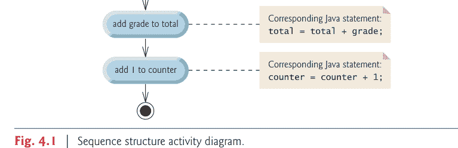

图 4.1 | 顺序结构活动图。

UML 活动图对软件系统某一部分的工作流（也称为活动）进行建模。此类工作流可能包含算法的一部分，例如图 4.1 中的顺序结构。活动图由符号组成，例如操作状态符号（左右两侧替换为外凸弧线的矩形）、菱形和小圆圈。这些符号通过过渡箭头连接，箭头表示活动的流程——即操作应发生的顺序。

与伪代码一样，活动图帮助您开发和表示算法，尽管许多程序员更喜欢伪代码。活动图清楚地展示了控制结构如何运作。我们在本章和第 5 章中使用 UML 来展示控制语句中的控制流。在第 12–13 章中，我们在一个真实世界的自动柜员机案例研究中使用 UML。

考虑图 4.1 中的顺序结构活动图。它包含两个表示要执行操作的操作状态。每个操作状态包含一个操作表达式——例如“将成绩添加到总分”或“将计数器加 1”——它指定要执行的特定操作。其他操作可能包括计算或输入/输出操作。活动图中的箭头表示过渡，指示操作状态所表示的操作发生的顺序。实现图 4.1 中图示活动的程序首先将成绩添加到总分，然后将计数器加 1。

活动图顶部的实心圆表示初始状态——程序执行建模操作之前工作流的开始。实心


一个被空心圆包围的圆，该圆出现在图表底部，表示最终状态——程序执行其操作后工作流的结束。

图 4.1 还包括右上角折叠的矩形。这些是 UML 注释（类似于 Java 中的注释）——解释性说明，用于描述图表中符号的用途。图 4.1 使用 UML 注释来显示与每个动作状态关联的 Java 代码。一条虚线将每个注释与其所描述的元素连接起来。活动图通常不显示实现该活动的 Java 代码。我们在这里这样做是为了说明图表与 Java 代码之间的关系。有关 UML 的更多信息，请参阅我们的可选案例研究（第 12–13 章）或访问 www.uml.org。

## Java 中的选择语句

Java 有三种选择语句（在本章和第 5 章中讨论）。`if` 语句如果条件为真则执行（选择）一个动作，如果条件为假则跳过它。`if...else` 语句如果条件为真则执行一个动作，如果条件为假则执行另一个不同的动作。`switch` 语句（第 5 章）根据表达式的值执行许多不同的动作之一。

`if` 语句是单选择语句，因为它选择或忽略单个动作（或者，正如我们很快会看到的，单个动作组）。`if...else` 语句称为双选择语句，因为它在两个不同的动作（或动作组）之间进行选择。`switch` 语句称为多选择语句，因为它在许多不同的动作（或动作组）之间进行选择。

## Java 中的重复语句

Java 提供了三种重复语句（也称为循环语句），使程序能够在条件（称为循环继续条件）保持为真时重复执行语句。重复语句是 `while`、`do...while` 和 `for` 语句。（第 5 章介绍 `do...while` 和 `for` 语句。）`while` 和 `for` 语句在其主体中执行动作（或动作组）零次或多次——如果循环继续条件初始为假，则动作（或动作组）将不执行。`do...while` 语句在其主体中执行动作（或动作组）一次或多次。`if`、`else`、`switch`、`while`、`do` 和 `for` 是 Java 关键字。Java 关键字的完整列表见附录 C。

## Java 控制语句摘要

Java 只有三种控制结构，从现在起我们将其称为控制语句：顺序语句、选择语句（三种类型）和重复语句（三种类型）。每个程序都是通过组合尽可能多的这些语句来形成的，以实现程序所实现的算法。我们可以将每个控制语句建模为活动图。像图 4.1 一样，每个图都包含一个初始状态和一个最终状态，分别代表控制语句的入口点和出口点。单入口/单出口控制语句使构建程序变得容易——我们只需将一个的出口点连接到下一个的入口点。我们称之为控制语句堆叠。我们将了解到控制语句连接的唯一其他方式是控制语句嵌套，即一个控制语句出现在另一个控制语句内部。因此，Java 程序中的算法仅由三种控制语句构成，以仅两种方式组合。这就是简洁的本质。

### 4.5 if 单选择语句

程序使用选择语句在替代方案之间进行选择。例如，假设考试的及格分数为 60。伪代码语句

```pseudocode
If student's grade is greater than or equal to 60
    Print "Passed"
```

确定条件“学生的成绩大于或等于 60”是否为真。如果是，则打印“Passed”，然后“执行”按顺序的下一个伪代码语句。（记住，伪代码不是真正的编程语言。）如果条件为假，则忽略 Print 语句，并执行按顺序的下一个伪代码语句。此选择语句第二行的缩进是可选的，但推荐这样做，因为它强调了结构化程序的固有结构。

前面的伪代码 `if` 语句可以用 Java 写成

```java
if ( studentGrade >= 60 )
    System.out.println( "Passed" );
```

Java 代码与伪代码非常接近。这是使伪代码成为如此有用的程序开发工具的属性之一。

图 4.2 说明了单选择 `if` 语句。此图包含活动图中最重要的符号——菱形，或决策符号，表示需要做出决策。工作流沿着由符号相关守卫条件决定的路径继续，守卫条件可以为真或假。每个从决策符号发出的转换箭头都有一个守卫条件（指定在箭头旁边的方括号中）。如果守卫条件为真，则工作流进入转换箭头指向的动作状态。在图 4.2 中，如果成绩大于或等于 60，程序打印“Passed”，然后转换到活动的最终状态。如果成绩小于 60，程序立即转换到最终状态而不显示消息。

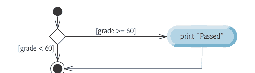

图 4.2 | if 单选择语句 UML 活动图。

`if` 语句是单入口/单出口控制语句。我们将看到剩余控制语句的活动图也包含初始状态、转换箭头、指示要执行动作的动作状态、指示要做出决策的决策符号（带有关联的守卫条件）以及最终状态。

### 4.6 if...else 双选择语句

`if` 单选择语句仅在条件为真时执行指示的动作；否则，跳过该动作。`if...else` 双选择语句允许您在条件为真时指定要执行的动作，并在条件为假时指定不同的动作。例如，伪代码语句

```pseudocode
If student's grade is greater than or equal to 60
    Print "Passed"
Else
    Print "Failed"
```

如果学生的成绩大于或等于 60，则打印 "Passed"，但如果小于 60，则打印 "Failed"。在任何一种情况下，打印发生后，按顺序的下一个伪代码语句将被“执行”。

前面的 If...Else 伪代码语句可以用 Java 写成

```java
if ( grade >= 60 )
    System.out.println( "Passed" );
else
    System.out.println( "Failed" );
```

`else` 的主体也缩进。您选择的任何缩进约定都应始终贯穿您的程序。

### 良好的编程实践 4.1

缩进 `if...else` 语句的两个主体语句。许多 IDE 会为您完成此操作。

### 良好的编程实践 4.2

如果有多个缩进级别，每个级别应缩进相同的额外空格数。

图 4.3 说明了 `if...else` 语句中的控制流。再一次，UML 活动图中的符号（除了初始状态、转换箭头和最终状态）代表动作状态和决策。

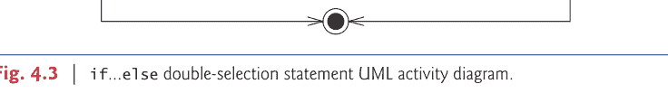

图 4.3 | if...else 双选择语句 UML 活动图。

### 条件运算符 (?:)

Java 提供了条件运算符 (?:)，可用于代替 `if...else` 语句。这是 Java 唯一的 ternary 运算符（接受三个操作数的运算符）。操作数和 ?: 符号一起形成条件表达式。第一个操作数（? 左侧）是布尔表达式（即计算为布尔值——真或假的条件），第二个操作数（? 与 : 之间）是如果布尔表达式为真时条件表达式的值，第三个操作数（: 右侧）是如果布尔表达式计算为假时条件表达式的值。例如，语句

```java
System.out.println( studentGrade >= 60 ? "Passed" : "Failed" );
```

打印 `println` 的条件表达式参数的值。此语句中的条件表达式如果布尔表达式 `studentGrade >= 60` 为真，则计算为字符串 "Passed"，如果为假，则计算为字符串 "Failed"。因此，此语句使用条件运算符执行的功能基本上与本节前面显示的 `if...else` 语句相同。条件运算符的优先级很低，因此整个条件表达式通常放在括号中。我们将看到条件表达式可以在某些 `if...else` 语句无法使用的情况下使用。

### 嵌套 if...else 语句

程序可以通过将 `if...else` 语句放在其他 `if...else` 语句内部来创建嵌套 `if...else` 语句，从而测试多个情况。例如，以下伪代码表示一个嵌套的 `if...else`，它为成绩大于或等于 90 的考试打印 A，为 80 到 89 分的成绩打印 B，为 70 到 79 分的成绩打印 C，为 60 到 69 分的成绩打印 D，为所有其他成绩打印 F：

```pseudocode
If student's grade is greater than or equal to 90
    Print "A"
else
    If student's grade is greater than or equal to 80
        Print "B"
    else
        If student's grade is greater than or equal to 70
            Print "C"
        else
            If student's grade is greater than or equal to 60
                Print "D"
            else
                Print "F"
```

此伪代码可以用 Java 写成

```java
if ( studentGrade >= 90 )
    System.out.println( "A" );
else
    if ( studentGrade >= 80 )
        System.out.println( "B" );
    else
        if ( studentGrade >= 70 )
            System.out.println( "C" );
        else
            if ( studentGrade >= 60 )
                System.out.println( "D" );
            else
                System.out.println( "F" );
```


如果变量 studentGrade 大于或等于 90，则嵌套的 if...else 语句中的前四个条件都将为 true，但只有第一个 if...else 语句的 if 部分中的语句会执行。该语句执行后，最外层 if...else 语句的 else 部分会被跳过。许多程序员更喜欢将上述嵌套的 if...else 语句编写为：

```
if ( studentGrade >= 90 )
    System.out.println( "A" );
else if ( studentGrade >= 80 )
    System.out.println( "B" );
else if ( studentGrade >= 70 )
    System.out.println( "C" );
else if ( studentGrade >= 60 )
    System.out.println( "D" );
else
    System.out.println( "F" );
```

两种形式除了空格和缩进之外完全相同，编译器会忽略这些空格和缩进。后一种形式避免了代码向右深度缩进。这种缩进常常使源代码行剩余空间很少，迫使行被拆开。

## 悬空 else 问题

Java 编译器总是将 else 与紧邻的前一个 if 关联，除非通过花括号（{ 和 }）的位置指示另作处理。这种行为可能导致所谓的悬空 else 问题。例如，

```
if ( x > 5 )
    if ( y > 5 )
        System.out.println( "x and y are > 5" );
else
    System.out.println( "x is <= 5" );
```

这看起来表示：如果 x 大于 5，嵌套的 if 语句将确定 y 是否也大于 5。如果是，则输出字符串 “x and y are > 5”。否则，看起来如果 x 不大于 5，if...else 的 else 部分将输出字符串 “x is <= 5”。当心！这个嵌套的 if...else 语句并不像看起来那样执行。编译器实际上将该语句解释为：

```
if ( x > 5 )
    if ( y > 5 )
        System.out.println( "x and y are > 5" );
    else
        System.out.println( "x is <= 5" );
```

其中第一个 if 的语句体是一个嵌套的 if...else。外层 if 语句测试 x 是否大于 5。如果是，则继续执行，测试 y 是否也大于 5。如果第二个条件为 true，会显示正确的字符串—— “x and y are > 5”。然而，如果第二个条件为 false，则显示字符串 “x is <= 5”，即使我们知道 x 大于 5。同样糟糕的是，如果外层 if 语句的条件为 false，则内层 if...else 会被跳过，并且不显示任何内容。

```
if ( x > 5 )
{
    if ( y > 5 )
        System.out.println( "x and y are > 5" );
}
else
    System.out.println( "x is <= 5" );
```

这些花括号表示第二个 if 位于第一个 if 的语句体中，并且 else 与第一个 if 关联。习题 4.27–4.28 将进一步研究悬空 else 问题。

## 块

if 语句通常期望其语句体中只有一条语句。若要在 if（或 if...else 语句的 else 部分）的语句体中包含多条语句，请将这些语句括在花括号中。包含在一对花括号中的语句构成一个块。块可以放置在程序中任何可以放置单条语句的位置。

下面的示例在 if...else 语句的 else 部分包含一个块：

```
if ( grade >= 60 )
    System.out.println( "Passed" );
else
{
    System.out.println( "Failed" );
    System.out.println( "You must take this course again." );
}
```

在这种情况下，如果 grade 小于 60，程序将执行 else 语句体中的两条语句并输出：

```
Failed
You must take this course again.
```

请注意 else 子句中包围两条语句的花括号。这些花括号很重要。如果没有花括号，语句：

```
System.out.println( "You must take this course again." );
```

将位于 if...else 语句的 else 部分之外，并且无论 grade 是否小于 60 都会执行。

语法错误（例如，程序中块中缺少一个花括号）由编译器捕获。逻辑错误（例如，程序中块中两个花括号都被遗漏）在运行时才产生影响。致命逻辑错误会导致程序失败并提前终止。非致命逻辑错误允许程序继续执行，但会导致其产生不正确的结果。

正如块可以放置在单条语句可放置的任何位置一样，也可能存在空语句。回忆 2.8 节，空语句是通过在通常放置语句的位置放置分号（;）来表示的。

> **常见编程错误 4.1**
>
> 在 if 或 if...else 语句的条件后放置分号，会在单选择 if 语句中导致逻辑错误，并在双选择 if...else 语句（当 if 部分包含实际的语句体语句时）中导致语法错误。

## 4.7 while 重复语句

重复（或循环）语句允许你指定程序在某个条件保持为 true 时重复执行一个操作。伪代码语句：

```
While there are more items on my shopping list
Purchase next item and cross it off my list
```

描述了购物过程中发生的重复。条件“购物单上还有更多物品”可能为 true 或 false。如果为 true，则执行操作“购买下一件物品并将其从购物单上划掉”。只要条件保持为 true，该操作就会重复执行。While 重复语句中包含的一条或多条语句构成其语句体，该语句体可以是单条语句或一个块。最终，条件会变为 false（当购物单上最后一件物品已被购买并划掉时）。此时，重复终止，重复语句之后的第一条语句执行。

作为 Java 的 while 重复语句的一个示例，考虑一个查找第一个大于 100 的 3 的幂的程序段。假设 int 变量 product 被初始化为 3。执行下面的 while 语句后，product 将包含结果：

```
while ( product <= 100 )
    product = 3 * product;
```

当这个 while 语句开始执行时，变量 product 的值为 3。while 语句的每次迭代都将 product 乘以 3，因此 product 依次取值为 9、27、81 和 243。当变量 product 变为 243 时，while 语句的条件——product <= 100——变为 false。这终止了重复，因此 product 的最终值为 243。此时，程序将继续执行 while 语句之后的下一条语句。

> **常见编程错误 4.2**
>
> 如果在 while 语句的语句体中没有提供最终会使 while 中的条件变为 false 的操作，通常会导致称为无限循环的逻辑错误（循环永不终止）。

图 4.4 中的 UML 活动图说明了上述 while 语句的控制流。同样，图中的符号（除了初始状态、转移箭头、最终状态和三个注释之外）表示一个动作状态和一个决策。此图引入了 UML 的合并符号。UML 将合并符号和决策符号都表示为菱形。合并符号将两条活动流合并为一条。在此图中，合并符号连接来自初始状态和来自动作状态的转移，因此这两条转移都流入决定循环是否应开始（或继续）执行的决策。决策符号和合并符号可以通过“进入”和“离开”的转移箭头数量来区分。决策符号有一个指向菱形的转移箭头，以及两个或更多从菱形指出的转移箭头，以表示从该点出发的可能转移。此外，每条从决策符号指出的转移箭头旁边都有一个守卫条件。合并符号有两个或更多指向菱形的转移箭头，且只有一个从菱形指出的转移箭头，表示多条活动流合并以继续该活动。与合并符号关联的转移箭头都没有守卫条件。


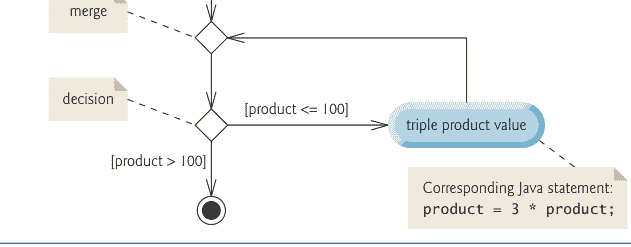

## Fig. 4.4 | while repetition statement UML activity diagram.

图 4.4 清楚地展示了本节前面讨论的 while 语句的重复。 从动作状态发出的转换箭头指向回合并，从合并处程序流程转换回在每次循环迭代开始时测试的决策。 循环会一直执行，直到保护条件 product > 100 变为真。 然后 while 语句退出（到达其最终状态），控制权传递给程序中按顺序排列的下一个语句。

## 4.8 Formulating Algorithms: Counter-Controlled Repetition

为了说明算法是如何开发的，我们修改第 3 章的 GradeBook 类来解决平均学生成绩问题的两个变体。 考虑以下问题陈述：

> 一个班级十名学生参加了一次测验。 该测验的成绩（0 到 100 范围内的整数）可供您使用。 确定该班级在测验中的平均成绩。

班级平均成绩等于成绩总和除以学生人数。 计算机求解该问题的算法必须输入每个成绩，跟踪所有输入成绩的总和，执行平均计算并打印结果。

### Pseudocode Algorithm with Counter-Controlled Repetition

让我们使用伪代码列出要执行的操作并指定它们的执行顺序。 我们使用计数器控制重复一次一个地输入成绩。 该技术使用称为计数器（或控制变量）的变量来控制一组语句执行的次数。 计数器控制重复通常称为确定性重复，因为在循环开始执行之前就已知重复次数。 在此示例中，当计数器超过 10 时重复终止。 本节介绍一个完全开发的伪代码算法（图 4.5）和实现该算法的 GradeBook 类版本（图 4.6）中的 Java 方法。 然后我们介绍一个应用程序（图 4.7）来演示算法的实际运行。 在第 4.9 节中，我们演示如何使用伪代码从头开始开发此类算法。

### Software Engineering Observation 4.1

> 经验表明，在计算机上解决问题的最困难的部分是开发解决方案的算法。 一旦正确指定了算法，从算法生成可工作的 Java 程序通常是直接的。

请注意图 4.5 算法中对 total 和 counter 的引用。 total 是用于累积多个值之和的变量。 counter 是用于计数的变量——在本例中，grade counter 指示用户即将输入的 10 个成绩中的哪一个。 用于存储总和的变量在程序中使用前通常初始化为零。

- 1 Set total to zero
- 2 Set grade counter to one
- 3
- 4 While grade counter is less than or equal to ten
- 5 Prompt the user to enter the next grade
- 6 Input the next grade
- 7 Add the grade into the total
- 8 Add one to the grade counter
- 9
- 10 Set the class average to the total divided by ten
- 11 Print the class average

Fig. 4.5 | Pseudocode algorithm that uses counter-controlled repetition to solve the class-average problem.

### Implementing Counter-Controlled Repetition in Class GradeBook

Class GradeBook（图 4.6）包含一个构造函数（第 11–14 行），它为类的实例变量 courseName（在第 8 行声明）分配值。 第 17–20 行、第 23–26 行和第 29–34 行分别声明方法 setCourseName、getCourseName 和 displayMessage。 第 37–66 行声明方法 determineClassAverage，该方法实现了由图 4.5 中的伪代码描述的班级平均算法。

第 40 行声明并初始化 Scanner 变量 input，用于读取用户输入的值。 第 42–45 行声明局部变量 total、gradeCounter、grade 和 average 为 int 类型。 变量 grade 存储用户输入。

```
1  // Fig. 4.6: GradeBook.java
2  // GradeBook class that solves class-average problem using
3  // counter-controlled repetition.
4  import java.util.Scanner; // program uses class Scanner
5
6  public class GradeBook
7  {
8      private String courseName; // name of course this GradeBook represents
```

Fig. 4.6 | GradeBook class that solves class-average problem using counter-controlled repetition. (Part 1 of 3.)

```
// constructor initializes courseName
public GradeBook( String name )
{
    courseName = name; // initializes courseName
} // end constructor

// method to set the course name
public void setCourseName( String name )
{
    courseName = name; // store the course name
} // end method setCourseName

// method to retrieve the course name
public String getCourseName()
{
    return courseName;
} // end method getCourseName

// display a welcome message to the GradeBook user
public void displayMessage()
{
    // getCourseName gets the name of the course
    System.out.printf( "Welcome to the grade book for\n%s!\n\n",
        getCourseName() );
} // end method displayMessage

// determine class average based on 10 grades entered by user
public void determineClassAverage()
{
    // create Scanner to obtain input from command window
    Scanner input = new Scanner( System.in );

    int total; // sum of grades entered by user
    int gradeCounter; // number of the grade to be entered next
    int grade; // grade value entered by user
    int average; // average of grades

    // initialization phase
    total = 0; // initialize total
    gradeCounter = 1; // initialize loop counter

    // processing phase uses counter-controlled repetition
    while ( gradeCounter <= 10 ) // loop 10 times
    {
        System.out.print( "Enter grade: " ); // prompt
        grade = input.nextInt(); // input next grade
        total = total + grade; // add grade to total
        gradeCounter = gradeCounter + 1; // increment counter by 1
    } // end while
```

```
60      // termination phase
61      average = total / 10; // integer division yields integer result
62
63      // display total and average of grades
64      System.out.printf( "\nTotal of all 10 grades is %d\n", total );
65      System.out.printf( "Class average is %d\n", average );
66   } // end method determineClassAverage
67 } // end class GradeBook
```

# Fig. 4.6 | GradeBook class that solves class-average problem using counter-controlled repetition. (Part 3 of 3.)

声明（第 42–45 行）出现在方法 determineClassAverage 的主体中。 回想一下，在方法主体中声明的变量是局部变量，只能从声明的行到方法声明的闭合右大括号中使用。 局部变量的声明必须出现在该方法中使用该变量之前。 局部变量不能在声明它的方法之外访问。

在本章中，class GradeBook 只是读取和处理一组成绩。 平均计算在方法 determineClassAverage 中使用局部变量执行——我们不会在类的实例变量中保留有关学生成绩的任何信息。

赋值（第 48–49 行）将 total 初始化为 0，将 gradeCounter 初始化为 1。 这些初始化在变量在计算中使用之前发生。 变量 grade 和 average（分别用于用户输入和计算的平均值）在此处无需初始化——它们的值将在方法后面输入或计算时分配。

### Common Programming Error 4.3

在使用局部变量的值之前未对其进行初始化会导致编译错误。 所有局部变量必须在表达式中使用其值之前进行初始化。

### Error-Prevention Tip 4.1

初始化每个计数器和总和，无论是在其声明中还是在赋值语句中。 总和通常初始化为 0。 计数器通常初始化为 0 或 1，具体取决于其使用方式（我们将展示何时使用 0、何时使用 1 的示例）。

第 52 行表示 while 语句应继续循环（也称为迭代），只要 gradeCounter 的值小于或等于 10。 只要此条件保持为真，while 语句就会重复执行用大括号分隔其主体的语句（第 54–57 行）。

第 54 行显示提示 "Enter grade: "。 第 55 行读取用户输入的成绩并将其分配给变量 grade。 然后第 56 行将用户输入的新成绩添加到 total 并将结果分配给 total，从而替换其先前的值。

第 57 行将 1 加到 gradeCounter，以指示程序已处理一个成绩并准备好从用户输入下一个成绩。 增加 gradeCounter 最终会导致它超过 10。 然后循环终止，因为其条件（第 52 行）变为假。

循环终止时，第 61 行执行平均计算并将结果分配给变量 average。 第 64 行使用 System.out 的 printf 方法显示


text "Total of all 10 grades is " followed by variable total’s value. Line 65 then uses printf to display the text "Class average is " followed by variable average’s value. After reaching line 66, method determineClassAverage returns control to the calling method (i.e., main in GradeBookTest of Fig. 4.7).

## Class GradeBookTest

Class GradeBookTest (Fig. 4.7) creates an object of class GradeBook (Fig. 4.6) and demonstrates its capabilities. Lines 10–11 of Fig. 4.7 create a new GradeBook object and assign it to variable myGradeBook. The String in line 11 is passed to the GradeBook constructor (lines 11–14 of Fig. 4.6). Line 13 calls myGradeBook’s displayMessage method to display a welcome message to the user. Line 14 then calls myGradeBook’s determineClassAverage method to allow the user to enter 10 grades, for which the method then calculates and prints the average—the method performs the algorithm shown in Fig. 4.5.

```
1  // Fig. 4.7: GradeBookTest.java
2  // Create GradeBook object and invoke its determineClassAverage method.
3
4  public class GradeBookTest
5  {
6      public static void main( String[] args )
7      {
8          // create GradeBook object myGradeBook and
9          // pass course name to constructor
10         GradeBook myGradeBook = new GradeBook(
11         "CS101 Introduction to Java Programming" );
12
13         myGradeBook.displayMessage(); // display welcome message
14         myGradeBook.determineClassAverage(); // find average of 10 grades
15     } // end main
16 } // end class GradeBookTest
```

Welcome to the grade book for
CS101 Introduction to Java Programming!

Enter grade: 67
Enter grade: 78
Enter grade: 89
Enter grade: 67
Enter grade: 87
Enter grade: 98
Enter grade: 93
Enter grade: 85
Enter grade: 82
Enter grade: 100

Total of all 10 grades is 846
Class average is 84

Fig. 4.7 | GradeBookTest class creates an object of class GradeBook (Fig. 4.6) and invokes its determineClassAverage method.

## Notes on Integer Division and Truncation

The averaging calculation performed by method determineClassAverage in response to the method call at line 14 in Fig. 4.7 produces an integer result. The program’s output indicates that the sum of the grade values in the sample execution is 846, which, when divided by 10, should yield the floating-point number 84.6. However, the result of the calculation total / 10 (line 61 of Fig. 4.6) is the integer 84, because total and 10 are both integers. Dividing two integers results in integer division—any fractional part of the calculation is lost (i.e., truncated). In the next section we’ll see how to obtain a floating-point result from the averaging calculation.

## Common Programming Error 4.4

Assuming that integer division rounds (rather than truncates) can lead to incorrect results. For example, 7 ÷ 4, which yields 1.75 in conventional arithmetic, truncates to 1 in integer arithmetic, rather than rounding to 2.

## 4.9 Formulating Algorithms: Sentinel-Controlled Repetition

Let’s generalize Section 4.8’s class-average problem. Consider the following problem:

> Develop a class-averaging program that processes grades for an arbitrary number of students each time it’s run.

In the previous class-average example, the problem statement specified the number of students, so the number of grades (10) was known in advance. In this example, no indication is given of how many grades the user will enter during the program’s execution. The program must process an arbitrary number of grades. How can it determine when to stop the input of grades? How will it know when to calculate and print the class average?

One way to solve this problem is to use a special value called a sentinel value (also called a signal value, a dummy value or a flag value) to indicate “end of data entry.” The user enters grades until all legitimate grades have been entered. The user then types the sentinel value to indicate that no more grades will be entered. Sentinel-controlled repetition is often called indefinite repetition because the number of repetitions is not known before the loop begins executing.

Clearly, a sentinel value must be chosen that cannot be confused with an acceptable input value. Grades on a quiz are nonnegative integers, so −1 is an acceptable sentinel value for this problem. Thus, a run of the class-average program might process a stream of inputs such as 95, 96, 75, 74, 89 and −1. The program would then compute and print the class average for the grades 95, 96, 75, 74 and 89; since −1 is the sentinel value, it should not enter into the averaging calculation.

## Developing the Pseudocode Algorithm with Top-Down, Stepwise Refinement: The Top and First Refinement

We approach this class-average program with a technique called top-down, stepwise refinement, which is essential to the development of well-structured programs. We begin with a pseudocode representation of the top—a single statement that conveys the overall function of the program:

> Determine the class average for the quiz

The top is, in effect, a complete representation of a program. Unfortunately, the top rarely conveys sufficient detail from which to write a Java program. So we now begin the refinement process. We divide the top into a series of smaller tasks and list these in the order in which they’ll be performed. This results in the following first refinement:

- Initialize variables
- Input, sum and count the quiz grades
- Calculate and print the class average

This refinement uses only the sequence structure—the steps listed should execute in order, one after the other.

## Software Engineering Observation 4.2

Each refinement, as well as the top itself, is a complete specification of the algorithm—only the level of detail varies.

## Software Engineering Observation 4.3

Many programs can be divided logically into three phases: an initialization phase that initializes the variables; a processing phase that inputs data values and adjusts program variables accordingly; and a termination phase that calculates and outputs the final results.

## Proceeding to the Second Refinement

The preceding Software Engineering Observation is often all you need for the first refinement in the top-down process. To proceed to the next level of refinement—that is, the second refinement—we commit to specific variables. In this example, we need a running total of the numbers, a count of how many numbers have been processed, a variable to receive the value of each grade as it’s input by the user and a variable to hold the calculated average. The pseudocode statement

Initialize variables

can be refined as follows:

- Initialize total to zero
- Initialize counter to zero

Only the variables total and counter need to be initialized before they’re used. The variables average and grade (for the calculated average and the user input, respectively) need not be initialized, because their values will be replaced as they’re calculated or input.

The pseudocode statement

Input, sum and count the quiz grades

requires a repetition structure (i.e., a loop) that successively inputs each grade. We do not know in advance how many grades are to be processed, so we’ll use sentinel-controlled repetition. The user enters grades one at a time. After entering the last grade, the user enters the sentinel value. The program tests for the sentinel value after each grade is input and terminates the loop when the user enters the sentinel value. The second refinement of the preceding pseudocode statement is then

```
Prompt the user to enter the first grade
Input the first grade (possibly the sentinel)
While the user has not yet entered the sentinel
    Add this grade into the running total
    Add one to the grade counter
    Prompt the user to enter the next grade
    Input the next grade (possibly the sentinel)
```

In pseudocode, we do not use braces around the statements that form the body of the While structure. We simply indent the statements under the While to show that they belong to the While. Again, pseudocode is only an informal program development aid.

The pseudocode statement

```
Calculate and print the class average
```

can be refined as follows:

```
If the counter is not equal to zero
    Set the average to the total divided by the counter
    Print the average
else
    Print "No grades were entered"
```

We’re careful here to test for the possibility of division by zero—a logic error that, if undetected, would cause the program to fail or produce invalid output. The complete second refinement of the pseudocode for the class-average problem is shown in Fig. 4.8.

## Error-Prevention Tip 4.2

When performing division by an expression whose value could be zero, test for this and handle it (e.g., print an error message) rather than allow the error to occur.

```
1   Initialize total to zero
2   Initialize counter to zero
3
4   Prompt the user to enter the first grade
5   Input the first grade (possibly the sentinel)
6
7   While the user has not yet entered the sentinel
8       Add this grade into the running total
9       Add one to the grade counter
10      Prompt the user to enter the next grade
11      Input the next grade (possibly the sentinel)
12
13  If the counter is not equal to zero
14      Set the average to the total divided by the counter
15      Print the average
16  else
17      Print "No grades were entered"
```

Fig. 4.8 | Class-average problem pseudocode algorithm with sentinel-controlled repetition.


在图 4.5 和图 4.8 中，我们在伪代码中加入了空行和缩进以使其更易读。空行将算法分隔为其各个阶段并突出控制语句；缩进强调了控制语句的主体。

图 4.8 中的伪代码算法解决了更一般的求平均值问题。该算法是在两次改进后开发的。有时需要更多改进。

## 软件工程观察 4.4

在你能够将伪代码转换为 Java 的程度足够详细时，终止自顶向下、逐步细化的过程。通常，实现 Java 程序此时是直接的。

## 软件工程观察 4.5

一些程序员不使用伪代码等程序开发工具。他们认为自己的最终目标是在计算机上解决问题，而编写伪代码只是延迟了最终输出的产生。虽然这对于简单且熟悉的问题可能有效，但对于大型、复杂项目来说，它可能导致严重的错误和延迟。

## 在 Class GradeBook 中实现哨兵控制重复

图 4.9 显示了 Java 类 GradeBook，其中包含方法 determineClassAverage，该方法实现了图 4.8 的伪代码算法。虽然每个成绩都是整数，但平均计算很可能产生带小数点的数字——换句话说，是实数（即浮点数）。类型 int 不能表示此类数字，因此该类使用类型 double 来实现。

```
// Fig. 4.9: GradeBook.java
// GradeBook class that solves the class-average problem using
// sentinel-controlled repetition.
import java.util.Scanner; // program uses class Scanner

public class GradeBook
{
    private String courseName; // name of course this GradeBook represents

    // constructor initializes courseName
    public GradeBook( String name )
    {
        courseName = name; // initializes courseName
    } // end constructor

    // method to set the course name
    public void setCourseName( String name )
    {
        courseName = name; // store the course name
    } // end method setCourseName

    // method to retrieve the course name
    public String getCourseName()
{
```

Fig. 4.9 | GradeBook class that solves the class-average problem using sentinel-controlled repetition. (Part 1 of 3.)

```
    return courseName;
} // end method getCourseName

// display a welcome message to the GradeBook user
public void displayMessage()
{
    // getCourseName gets the name of the course
    System.out.printf( "Welcome to the grade book for\n%s!\n\n",
        getCourseName() );
} // end method displayMessage

// determine the average of an arbitrary number of grades
public void determineClassAverage()
{
    // create Scanner to obtain input from command window
    Scanner input = new Scanner( System.in );

    int total; // sum of grades
    int gradeCounter; // number of grades entered
    int grade; // grade value
    double average; // number with decimal point for average

    // initialization phase
    total = 0; // initialize total
    gradeCounter = 0; // initialize loop counter

    // processing phase
    // prompt for input and read grade from user
    System.out.print( "Enter grade or -1 to quit: " );
    grade = input.nextInt();

    // loop until sentinel value read from user
    while ( grade != -1 )
    {
        total = total + grade; // add grade to total
        gradeCounter = gradeCounter + 1; // increment counter

        // prompt for input and read next grade from user
        System.out.print( "Enter grade or -1 to quit: " );
        grade = input.nextInt();
    } // end while

    // termination phase
    // if user entered at least one grade...
    if ( gradeCounter != 0 )
    {
        // calculate average of all grades entered
        average = (double) total / gradeCounter;

        // display total and average (with two digits of precision)
        System.out.printf( "\nTotal of the %d grades entered is %d\n",
            gradeCounter, total );
```

Fig. 4.9 | GradeBook class that solves the class-average problem using sentinel-controlled repetition. (Part 2 of 3.)

```
77        System.out.printf( "Class average is %.2f\n", average );
78    } // end if
79    else // no grades were entered, so output appropriate message
80        System.out.println( "No grades were entered" );
81    } // end method determineClassAverage
82 } // end class GradeBook
```

Fig. 4.9 | GradeBook class that solves the class-average problem using sentinel-controlled repetition. (Part 3 of 3.)

在此示例中，我们看到控制语句可以堆叠在彼此之上（按顺序）。while 语句（第 57–65 行）后按顺序跟随一个 if...else 语句（第 69–80 行）。此程序中的大部分代码与图 4.6 中的代码相同，因此我们集中于新概念。

第 45 行声明了 double 变量 average，这使我们能够将班级平均值存储为浮点数。第 49 行将 gradeCounter 初始化为 0，因为尚未输入任何成绩。请记住，此程序使用哨兵控制重复来输入成绩。为了准确记录输入的成绩数量，程序仅在用户输入有效成绩时才递增 gradeCounter。

## 哨兵控制重复与计数控制重复的程序逻辑

将此应用程序中哨兵控制重复的程序逻辑与图 4.6 中计数控制重复的程序逻辑进行比较。在计数控制重复中，while 语句的每次迭代（例如图 4.6 的第 52–58 行）都会从用户读取一个值，进行指定次数的迭代。在哨兵控制重复中，程序在到达 while 之前先读取第一个值（图 4.9 的第 53–54 行）。该值决定程序的控制流是否应进入 while 的主体。如果 while 的条件为假，则用户输入了哨兵值，因此 while 的主体不执行（即未输入成绩）。如果条件为真，则主体开始执行，并且循环将成绩值添加到总计（第 59 行）。然后循环主体中的第 63–64 行从用户输入下一个值。接下来，程序控制到达循环主体第 65 行的右大括号的结束处，因此执行继续进行 while 条件（第 57 行）的测试。条件使用用户最近输入的成绩来确定循环主体是否应再次执行。变量 grade 的值始终在程序测试 while 条件之前立即从用户输入。这使程序能够在处理该值（即将其添加到总计）之前确定刚刚输入的值是否为哨兵值。如果输入哨兵值，则循环终止，并且程序不会将 -1 添加到总计。

> 良好的编程实践 4.3
> 在哨兵控制循环中，提示应提醒用户哨兵值。

循环终止后，第 69–80 行的 if...else 语句执行。第 69 行的条件确定是否输入了任何成绩。如果没有输入成绩，则 if...else 语句的 else 部分（第 79–80 行）执行并显示消息 "No grades were entered" 并且方法将控制权返回给调用方法。

注意图 4.9 中 while 语句的块（第 58–65 行）。如果没有大括号，循环将仅将其主体视为第一个语句，即将成绩添加到总计。块中的最后三个语句将位于循环主体之外，导致计算机错误地将代码解释为如下所示：

```
while ( grade != -1 )
    total = total + grade; // add grade to total
    gradeCounter = gradeCounter + 1; // increment counter
    // prompt for input and read next grade from user
    System.out.print( "Enter grade or -1 to quit: " );
    grade = input.nextInt();
```

如果用户在 while 语句之前（第 54 行）未输入哨兵 -1，上述代码将导致程序出现无限循环。

## 常见编程错误 4.5

> 省略界定块的大括号可能导致逻辑错误，例如无限循环。为防止此问题，一些程序员即使块仅包含单个语句，也将每个控制语句的主体用大括号括起来。

## 在原始类型之间显式和隐式转换

如果至少输入了一个成绩，图 4.9 的第 72 行将计算成绩的平均值。回想一下图 4.6，整数除法会产生整数结果。即使变量 average 声明为 double（第 45 行），计算

```
average = total / gradeCounter;
```

也会在除法结果分配给 average 之前丢失商的小数部分。这是因为 total 和 gradeCounter 都是整数，而整数除法会产生整数结果。为了使用整数值执行浮点计算，我们必须在计算中使用时暂时将这些值视为浮点数。Java 提供了 unary cast 运算符来实现此任务。第 72 行使用 (double) cast 运算符——一个 unary 运算符——为其操作数 total（出现在运算符右侧）创建一个临时的浮点副本。以这种方式使用 cast 运算符称为显式转换或类型转换。存储在 total 中的值仍然是整数。

现在计算由浮点值（total 的临时 double 版本）除以整数 gradeCounter 组成。Java 只知道如何评估操作数类型相同的算术表达式。为了确保操作数类型相同，Java 对选定操作数执行称为提升（或隐式转换）的操作。例如，在包含 int 和 double 类型值的表达式中，int 值会被提升为 double 值以供表达式使用。在此示例中，gradeCounter 的值被提升为 double 类型，然后执行浮点除法，并将计算结果分配给 average。只要在计算中对任何变量应用 (double) cast 运算符，计算就会产生 double 结果。本章后面我们将讨论所有原始类型。你将在第 6.7 节中了解更多关于提升规则的信息。

## 常见编程错误 4.6

> cast 运算符可用于在原始数值类型之间转换，例如 int 和 double，以及在相关引用类型之间转换（我们在第 10 章面向对象编程：多态性中讨论）。转换到错误的类型可能导致编译错误或运行时错误。


强制转换运算符是通过将任何类型的名称放在括号中形成的。该运算符是一种一元运算符（即，只接受一个操作数的运算符）。Java 还支持加号（+）和减号（–）的一元版本，因此你可以写出像 -7 或 +5 这样的表达式。强制转换运算符从右向左结合，并且与其他一元运算符（如一元 + 和一元 -）具有相同的优先级。这个优先级比乘法运算符 *、/ 和 % 高一级。（参见附录 A 中的运算符优先级表。）在我们的优先级表中，我们用 (type) 表示强制转换运算符，以表明任何类型名称都可以用来构成强制转换运算符。

第 77 行显示班级平均分。在此示例中，我们显示四舍五入到百分位的班级平均分。printf 格式控制字符串中的格式说明符 %.2f 表示变量 average 的值应显示到小数点后两位精度——由格式说明符中的 .2 表示。在类 GradeBookTest（图 4.10）的示例执行期间输入的三个成绩总计为 257，这得出平均值 85.666666....。printf 方法使用格式说明符中的精度将数值舍入到指定的位数。在此程序中，平均值被舍入到百分位，并显示为 85.67。

``` 
1 // Fig. 4.10: GradeBookTest.java
2 // Create GradeBook object and invoke its determineClassAverage method.
3
4 public class GradeBookTest
5 {
6     public static void main( String[] args )
7     {
8         // create GradeBook object myGradeBook and
9         // pass course name to constructor
10        GradeBook myGradeBook = new GradeBook(
11            "CS101 Introduction to Java Programming" );
12
13        myGradeBook.displayMessage(); // display welcome message
14        myGradeBook.determineClassAverage(); // find average of grades
15    } // end main
16 } // end class GradeBookTest
```

Welcome to the grade book for
CS101 Introduction to Java Programming!

Enter grade or -1 to quit: 97
Enter grade or -1 to quit: 88
Enter grade or -1 to quit: 72
Enter grade or -1 to quit: -1

Total of the 3 grades entered is 257
Class average is 85.67

图 4.10 | GradeBookTest 类创建了类 GradeBook（图 4.9）的一个对象，并调用其 determineClassAverage 方法。

## 4.10 算法制定：嵌套控制语句

对于下一个示例，我们再次使用伪代码和自顶向下、逐步细化来制定一个算法，并编写相应的 Java 程序。我们已经看到控制语句可以一个接一个地堆叠（顺序执行）。在本案例研究中，我们考察控制语句可以连接的另一种也是唯一的结构化方式——即，将一个控制语句嵌套在另一个控制语句内。

考虑以下问题描述：

一所大学开设了一门课程，帮助学生备考房地产经纪人的州执业资格考试。去年，完成这门课程的学生中有十人参加了考试。该大学想知道其学生在考试中的表现如何。要求你编写一个程序来汇总结果。你得到了一份包含这 10 名学生的名单。每名学生名字旁边写着 1（如果该学生通过了考试）或 2（如果该学生未通过）。

你的程序应按如下方式分析考试结果：

- 1. 输入每个测试结果（即 1 或 2）。每次程序请求另一个测试结果时，在屏幕上显示消息“Enter result”。
- 2. 统计每种类型的测试结果数量。
- 3. 显示测试结果的摘要，指出通过的学生人数和未通过的学生人数。
- 4. 如果超过八名学生通过考试，则打印消息“Bonus to instructor!”。

仔细阅读问题描述后，我们得出以下观察结果：

- 1. 程序必须处理 10 名学生的测试结果。可以使用计数器控制循环，因为测试结果的数量是事先已知的。
- 2. 每个测试结果都有一个数值——要么是 1，要么是 2。每次读取测试结果时，程序必须确定它是 1 还是 2。我们在算法中测试是否为 1。如果数字不是 1，我们假定它是 2。（练习 4.24 考虑了这种假设的后果。）
- 3. 使用两个计数器来跟踪考试结果——一个用于统计通过考试的学生人数，一个用于统计未通过的人数。
- 4. 程序处理完所有结果后，必须判断是否超过八名学生通过了考试。

让我们继续使用自顶向下、逐步细化。首先用伪代码表示顶层：

分析考试结果并决定是否应支付奖金

同样，顶层是整个程序的完整表示，但在伪代码自然演变为 Java 程序之前，可能还需要进行几次细化。

我们的第一次细化是

初始化变量
输入 10 个考试结果，并统计通过和未通过的人数
打印考试结果摘要，并决定是否应支付奖金

这里，尽管我们已经有了整个程序的完整表示，但仍需要进一步细化。我们现在确定具体的变量。需要计数器来记录通过和未通过的人数，一个计数器将用于控制循环过程，一个变量用于存储用户输入。存储用户输入的变量将通过声明来体现，这些声明使用 Java 将变量初始化合并到声明中的能力（passes 被赋为 0，failures 为 0，studentCounter 为 1）。循环程序可能需要在每次重复开始时进行初始化——通常通过赋值语句而不是声明来执行。

错误预防提示 4.3
在声明局部变量时对其进行初始化，有助于避免由于尝试使用未初始化变量而可能产生的编译错误。虽然 Java 不要求将局部变量初始化合并到声明中，但确实要求局部变量在表达式中使用其值之前进行初始化。

while 语句（第 19–33 行）循环 10 次。在每次迭代中，循环输入并处理一个考试结果。注意，用于处理每个结果的 if…else 语句（第 26–29 行）嵌套在 while 语句中。如果结果是 1，if…else 语句递增 passes；否则，它假定结果是 2 并递增 failures。第 32 行在循环条件于第 19 行再次测试之前递增 studentCounter。在输入 10 个值后，循环终止，第 36 行显示通过和未通过的人数。第 39–40 行的 if 语句确定是否有超过八名学生通过了考试，如果是，则输出消息“Bonus to instructor!”。

``` 
1 // Fig. 4.12: Analysis.java
2 // Analysis of examination results using nested control statements.
3 import java.util.Scanner; // class uses class Scanner
4
5 public class Analysis
6 {
7     public static void main( String[] args )
8     {
9         // create Scanner to obtain input from command window
10        Scanner input = new Scanner( System.in );
11
12        // initializing variables in declarations
13        int passes = 0; // number of passes
14        int failures = 0; // number of failures
15        int studentCounter = 1; // student counter
16        int result; // one exam result (obtains value from user)
17
18        // process 10 students using counter-controlled loop
19        while ( studentCounter <= 10 )
20        {
21            // prompt user for input and obtain value from user
22            System.out.print( "Enter result (1 = pass, 2 = fail): " );
23            result = input.nextInt();
24
25            // if...else is nested in the while statement
26            if ( result == 1 )            // if result 1,
27                passes = passes + 1;      // increment passes;
28            else                        // else result is not 1, so
29                failures = failures + 1; // increment failures
30
31            // increment studentCounter so loop eventually terminates
32            studentCounter = studentCounter + 1;
33        } // end while
34
35        // termination phase; prepare and display results
36        System.out.printf( "Passed: %d\nFailed: %d\n", passes, failures );
37
38        // determine whether more than 8 students passed
39        if ( passes > 8 )
40            System.out.println( "Bonus to instructor!" );
41    } // end main
42 } // end class Analysis
```

``` 
Enter result (1 = pass, 2 = fail): 1
Enter result (1 = pass, 2 = fail): 2
Enter result (1 = pass, 2 = fail): 1
Enter result (1 = pass, 2 = fail): 1
Enter result (1 = pass, 2 = fail): 1
Enter result (1 = pass, 2 = fail): 1
Enter result (1 = pass, 2 = fail): 1
Enter result (1 = pass, 2 = fail): 1
Enter result (1 = pass, 2 = fail): 1
Enter result (1 = pass, 2 = fail): 1
Passed: 9
Failed: 1
Bonus to instructor!
```

图 4.12 | 使用嵌套控制语句分析考试结果。（第 2 部分，共 3 部分。）

- 1 将 passes 初始化为零
- 2 将 failures 初始化为零
- 3 将学生计数器初始化为 1
- 4
- 5 当学生计数器小于或等于 10 时
- 6 提示用户输入下一个考试结果
- 7 输入下一个考试结果
- 8
- 9 如果学生通过
- 10 将 passes 加 1
- 11 否则
- 12 将 failures 加 1
- 13
- 14 将学生计数器加 1
- 15
- 16 打印 passes 的数量
- 17 打印 failures 的数量
- 18
- 19 如果超过八名学生通过
- 20 打印“Bonus to instructor!”

图 4.11 | 考试结果问题的伪代码。


```
Enter result (1 = pass, 2 = fail): 1
Enter result (1 = pass, 2 = fail): 2
Enter result (1 = pass, 2 = fail): 1
Enter result (1 = pass, 2 = fail): 2
Enter result (1 = pass, 2 = fail): 1
Enter result (1 = pass, 2 = fail): 2
Enter result (1 = pass, 2 = fail): 2
Enter result (1 = pass, 2 = fail): 1
Enter result (1 = pass, 2 = fail): 1
Enter result (1 = pass, 2 = fail): 1
Passed: 6
Failed: 4
```

Fig. 4.12 | Analysis of examination results using nested control statements. (Part 3 of 3.)

图 4.12 显示了该程序两次示例执行的输入和输出。在第一次执行中，第 39 行方法 main 处的条件为真——超过八名学生通过了考试，因此程序输出一条给讲师加薪的消息。

此示例仅包含一个类，其中方法 main 执行类的所有工作。在本章和第 3 章中，您已看到由两个类组成的示例——一个包含执行有用任务的方法，另一个包含方法 main，该方法创建另一个类的对象并调用其方法。有时，当为了演示概念而尝试创建一个可重用的类没有意义时，我们会将程序的语句完全放在单个类的 main 方法中。

## 4.11 Compound Assignment Operators

复合赋值运算符可缩写赋值表达式。语句

```
variable = variable operator expression;
```

其中 operator 是二元运算符 +、-、*、/ 或 % 中的一个（或我们在正文中后面讨论的其他运算符）之一，可以写成形式

```
variable operator= expression;
```

例如，您可以使用加法复合赋值运算符 += 将语句

```
c = c + 3;
```

缩写为

```
c += 3;
```

+= 运算符将右侧表达式的值加到左侧变量的值上，并将结果存储在运算符左侧的变量中。因此，赋值表达式 c += 3 将 3 加到 c 上。图 4.13 显示了算术复合赋值运算符、使用运算符的示例表达式以及运算符作用的解释。

*Assume: int c = 3, d = 5, e = 4, f = 6, g = 12;*

| Assignment operator | Sample expression | Explanation | Assigns |
|---|---|---|---|
| += | c += 7 | c = c + 7 | 10 to c |
| -= | d -= 4 | d = d - 4 | 1 to d |
| *= | e *= 5 | e = e * 5 | 20 to e |
| /= | f /= 3 | f = f / 3 | 2 to f |
| %= | g %= 9 | g = g % 9 | 3 to g |

Fig. 4.13 | Arithmetic compound assignment operators.

图 4.13 | 算术复合赋值运算符。

## 4.12 Increment and Decrement Operators

Java 提供了两个一元运算符（汇总在图 4.14 中）用于将 1 加到数值变量的值上或从中减去 1。这些是一元自增运算符 ++ 和一元自减运算符 --。程序可以使用自增运算符 ++ 而不是表达式 c = c + 1 或 c += 1，将名为 c 的变量的值增加 1。将自增或自减运算符前缀于（置于）变量之前称为前缀自增或前缀自减运算符。将自增或自减运算符后缀于（置于）变量之后称为后缀自增或后缀自减运算符。

| Operator | Operator name | Sample expression | Explanation |
|---|---|---|---|
| ++ | prefix increment | ++a | Increment a by 1, then use the new value of a in the expression in which a resides. |
| ++ | postfix increment | a++ | Use the current value of a in the expression in which a resides, then increment a by 1. |
| -- | prefix decrement | --b | Decrement b by 1, then use the new value of b in the expression in which b resides. |
| -- | postfix decrement | b-- | Use the current value of b in the expression in which b resides, then decrement b by 1. |

Fig. 4.14 | Increment and decrement operators.

图 4.14 | 自增和自减运算符。

使用前缀自增（或自减）运算符将 1 加到（或从中减去 1）变量上称为前置自增（或前置自减）。这会使变量增加（减少）1；然后在其中出现的表达式中使用变量的新值。使用后缀自增（或自减）运算符将 1 加到（或从中减去 1）变量上称为后置自增（或后置自减）。这会使变量的当前值在其中出现的表达式中使用；然后将变量的值增加（减少）1。

> Good Programming Practice 4.4
> Unlike binary operators, the unary increment and decrement operators should be placed next to their operands, with no intervening spaces.

> 良好编程实践 4.4
> 与二元运算符不同，一元自增和自减运算符应放置在其操作数旁边，且中间没有空格。

图 4.15 演示了 ++ 自增运算符的前缀自增版本和后缀自增版本之间的差异。自减运算符（--）的工作方式类似。

```
// Fig. 4.15: Increment.java
// Prefix increment and postfix increment operators.

public class Increment
{
    public static void main( String[] args )
    {
        int c;

        // demonstrate postfix increment operator
        c = 5; // assign 5 to c
        System.out.println( c );  // prints 5
        System.out.println( c++ ); // prints 5 then postincrements
        System.out.println( c );  // prints 6

        System.out.println(); // skip a line

        // demonstrate prefix increment operator
        c = 5; // assign 5 to c
        System.out.println( c );  // prints 5
        System.out.println( ++c ); // preincrements then prints 6
        System.out.println( c );  // prints 6
    } // end main
} // end class Increment
```

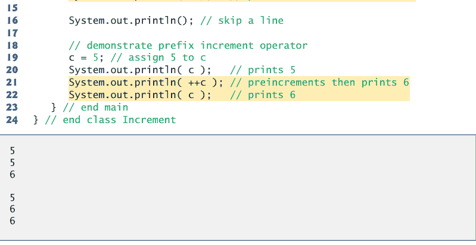

Fig. 4.15 | Preincrementing and postincrementing.

图 4.15 | 前置自增和后置自增。

第 11 行将变量 c 初始化为 5，第 12 行输出 c 的初始值。第 13 行输出表达式 c++ 的值。该表达式对变量 c 进行后置自增，因此输出 c 的原始值（5），然后将 c 的值递增（至 6）。因此，第 13 行再次输出 c 的初始值（5）。第 14 行输出 c 的新值（6）以证明变量的值确实在第 13 行中被递增。

第 19 行将 c 的值重置为 5，第 20 行输出 c 的值。第 21 行输出表达式 ++c 的值。该表达式对 c 进行前置自增，因此其值被递增；然后输出新值（6）。第 22 行再次输出 c 的值，以显示在第 21 行执行后 c 的值仍然是 6。

算术复合赋值运算符和自增及自减运算符可用于简化程序语句。例如，图 4.12 中的三个赋值语句（第 27、29 和 32 行）

```
passes = passes + 1;
failures = failures + 1;
studentCounter = studentCounter + 1;
```

可以用复合赋值运算符更简洁地写成

```
passes += 1;
failures += 1;
studentCounter += 1;
```

用前缀自增运算符写成

```
++passes;
++failures;
++studentCounter;
```

或用后缀自增运算符写成

```
passes++;
failures++;
studentCounter++;
```

当单独以语句形式递增或递减变量时，前缀自增和后缀自增形式的效果相同，前缀自减和后缀自减形式的效果相同。只有当变量出现在更大的表达式的上下文中时，前置自增和后置自增变量的效果才不同（同样适用于前置自减和后置自减）。

> Common Programming Error 4.7
> Attempting to use the increment or decrement operator on an expression other than one to which a value can be assigned is a syntax error. For example, writing ++(x + 1) is a syntax error, because (x + 1) is not a variable.

> 常见编程错误 4.7
> 尝试对除可赋值的值之外的表达式使用自增或自减运算符是语法错误。例如，编写 ++(x + 1) 是语法错误，因为 (x + 1) 不是变量。

图 4.16 显示了我们已介绍的运算符的优先级和结合性。它们按从上到下递减的优先级顺序显示。第二列描述了每个优先级级别运算符的结合性。条件运算符（?:）；一元运算符自增（++）、自减（--）、加（+）和减（-）；强制转换运算符和赋值运算符 =、+=、-=、*=、/= 和 %= 从右到左结合。图 4.16 中运算符优先级表中所有其他运算符都从左到右结合。第三列列出了每组运算符的类型。

| Operators | Associativity | Type |
|---|---|---|
| ++ -- | right to left | unary postfix |
| ++ -- + - ( type ) | right to left | unary prefix |
| * / % | left to right | multiplicative |
| + - | left to right | additive |
| < <= > >= | left to right | relational |
| == != | left to right | equality |
| ?: | right to left | conditional |
| = += -= *= /= %= | right to left | assignment |

Fig. 4.16 | Precedence and associativity of the operators discussed so far.

图 4.16 | 到目前为止讨论的运算符的优先级和结合性。


## 4.13 基本类型

附录 D 中的表格列出了 Java 的 8 种基本类型。与其前身语言 C 和 C++ 一样，Java 要求所有变量都必须具有类型。因此，Java 被称为强类型语言。

在 C 和 C++ 中，由于基本类型在不同计算机上无法保证完全相同，程序员常常不得不为不同的计算机平台编写不同版本的程序。例如，`int` 值在一台机器上可能用 16 位（2 字节）内存表示，在第二台机器上用 32 位（4 字节）表示，在另一台机器上用 64 位（8 字节）表示。而在 Java 中，`int` 值始终是 32 位（4 字节）。

## 可移植性提示 4.1

> Java 中的基本类型在所有支持 Java 的计算机平台上都是可移植的。

附录 D 中的每种类型都列出了其以位为单位的大小（8 位等于 1 字节）及其取值范围。由于 Java 的设计者希望确保可移植性，他们采用了国际上公认的字符格式标准（Unicode；更多信息请访问 www.unicode.org）和浮点数标准（IEEE 754；更多信息请访问 grouper.ieee.org/groups/754/）。

回顾第 3.4 节：在方法外部声明为类的字段的基本类型变量，除非显式初始化，否则会自动赋默认值。类型为 `char`、`byte`、`short`、`int`、`long`、`float` 和 `double` 的实例变量默认都会被赋值为 0。类型为 `boolean` 的实例变量默认为 `false`。引用类型的实例变量默认初始化为 `null`。

# 4.14（可选）GUI 与图形案例研究：创建简单绘图

Java 的一个吸引人的特性是它的图形支持，它使你可以通过可视化方式增强应用程序。现在我们介绍 Java 的一项图形能力——绘制直线。本节还涵盖创建窗口以在计算机屏幕上显示图形的基础知识。

## Java 坐标系

要在 Java 中绘图，你必须理解 Java 坐标系（图 4.17），这是一种用于标识屏幕上点的方案。默认情况下，GUI 组件的左上角

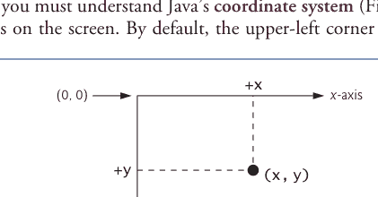

图 4.17 | Java 坐标系。单位以像素计量。

的坐标为 (0, 0)。一个坐标对由 x 坐标（水平坐标）和 y 坐标（垂直坐标）组成。x 坐标是从左到右的水平位置，y 坐标是从上到下的垂直位置。x 轴描述所有水平坐标，y 轴描述所有垂直坐标。

坐标指明图形在屏幕上的显示位置。坐标单位以像素计量。术语 pixel 代表“picture element”（图像元素）。像素是显示器的最小分辨率单位。

## 第一个绘图应用程序

我们的第一个绘图应用程序只绘制两条直线。类 DrawPanel（图 4.18）执行实际的绘图，而类 DrawPanelTest（图 4.19）创建窗口来显示该图形。在 DrawPanel 类中，第 3～4 行的 import 语句使我们能够使用 Graphics 类（来自 java.awt 包，它提供了各种在屏幕上绘制文本和形状的方法）和 JPanel 类（来自 javax.swing 包，它提供了一个可供我们绘图的区域）。

```
1  // Fig. 4.18: DrawPanel.java
2  // Using drawLine to connect the corners of a panel.
3  import java.awt.Graphics;
4  import javax.swing.JPanel;
5
6  public class DrawPanel extends JPanel
7  {
8      // draws an X from the corners of the panel
9      public void paintComponent( Graphics g )
10     {
11         // call paintComponent to ensure the panel displays correctly
12         super.paintComponent( g );
13
14         int width = getWidth(); // total width
15         int height = getHeight(); // total height
16
17         // draw a line from the upper-left to the lower-right
18         g.drawLine( 0, 0, width, height );
19
20         // draw a line from the lower-left to the upper-right
21         g.drawLine( 0, height, width, 0 );
22     } // end method paintComponent
23  } // end class DrawPanel
```

图 4.18 | 使用 drawLine 连接面板的各个角。

```
1  // Fig. 4.19: DrawPanelTest.java
2  // Application to display a DrawPanel.
3  import javax.swing.JFrame;
4
5  public class DrawPanelTest
6  {
```

图 4.19 | 创建用于显示 DrawPanel 的 JFrame。（第 1 部分，共 2 部分。）

这可以确保我们在面板上开始绘图之前，面板已被正确渲染。接下来，第 14～15 行调用 DrawPanel 类从 JPanel 继承的方法。由于 DrawPanel 继承自 JPanel，因此 DrawPanel 可以使用 JPanel 的任何公有方法。getWidth 和 getHeight 方法分别返回 JPanel 的宽度和高度。第 14～15 行将这些值存储在局部变量 width 和 height 中。最后，第 18 行和第 21 行使用 Graphics 变量 g 调用 drawLine 方法来绘制两条直线。drawLine 方法在其四个参数表示的两个点之间绘制一条直线。前两个参数是一个端点的 x 和 y 坐标，后两个参数是另一个端点的坐标。如果调整窗口大小，这些直线会相应缩放，因为参数是基于面板的宽度和高度计算的。在此应用程序中调整窗口大小会导致系统调用 paintComponent 来重新绘制 DrawPanel 的内容。

## DrawPanelTest 类

要在屏幕上显示 DrawPanel，你必须将它放入一个窗口中。你可以使用 JFrame 类的对象创建窗口。在 DrawPanelTest.java（图 4.19）中，第 3 行从 javax.swing 包中导入 JFrame 类。main 中的第 10 行创建了一个包含我们绘图的 DrawPanel 对象，第 13 行创建了一个可以容纳并显示面板的新 JFrame。第 16 行以参数 JFrame.EXIT_ON_CLOSE 调用 JFrame 的 setDefaultCloseOperation 方法，以表示当用户关闭窗口时应用程序应终止。第 18 行使用 JFrame 类的 add 方法将 DrawPanel 添加到 JFrame。第 19 行设置 JFrame 的大小。setSize 方法接受两个参数，分别表示 JFrame 的宽度和高度。最后，第 20 行调用 JFrame 的 setVisible 方法并传入参数 true 来显示 JFrame。当 JFrame 显示时，系统会隐式调用 DrawPanel 的 paintComponent 方法（图 4.18 的第 9～22 行），并绘制出这两条直线（参见图 4.19 中的示例输出）。尝试调整窗口大小，可以看到直线始终根据窗口当前的宽度和高度绘制。

## GUI 与图形案例研究练习

- 4.1 使用循环和控制语句绘制直线可以产生许多有趣的设计。
  - a) 创建图 4.20 左侧屏幕截图中的设计。该设计从左上角开始绘制直线，使其呈扇形展开，直到覆盖面板的左上半个区域。一种方法是将宽度和高度分成相等的步数（我们发现 15 步效果不错）。每条直线的第一个端点始终位于左上角 (0, 0)。第二个端点可以从左下角开始，向上移动一个垂直步长、向右移动一个水平步长来确定。在两个端点之间绘制一条直线。继续向上并向右移动一步，以找到后续每个端点。调整窗口大小时，图形应相应缩放。
  - b) 修改第 (a) 部分，使直线从四个角呈扇形展开，如图 4.20 右侧屏幕截图所示。来自相对角的直线应沿中间相交。
- 4.2 图 4.21 显示了另外两个使用 while 循环和 drawLine 创建的设计。
  - a) 创建图 4.21 左侧屏幕截图中的设计。首先将每条边分成相等的增量数（我们再次选择 15）。第一条直线从左上角开始，在底边向右一个步长处结束。对于后续每一条直线，在左边向下移动一个增量，并在底边向右移动一个增量。继续绘制直线，直到到达右下角。调整窗口大小时，图形应缩放，使端点始终接触边缘。
  - b) 修改第 (a) 部分的答案，使该设计在四个角上镜像显示，如图 4.21 右侧屏幕截图所示。


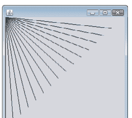

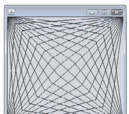

图 4.20 | 从一个角落呈扇形展开的线条。

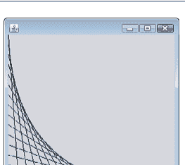

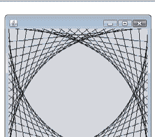

图 4.21 | 使用循环和 drawLine 绘制的线条画。

## 4.15 总结

本章介绍了构建类以及为这些类开发方法的基本问题解决方法。我们演示了如何构建算法（即解决问题的途径），然后如何通过几个阶段的伪代码设计来细化该算法，最终形成可作为方法一部分执行的 Java 代码。本章还展示了如何使用自顶向下、逐步求精的方法来规划方法必须执行的特定动作以及执行这些动作的顺序。

开发任何问题求解算法只需要三种控制结构——顺序、选择和循环。具体来说，本章演示了 if 单选择语句、if...else 双选择语句和 while 循环语句。这些是用于构建许多问题解决方案的部分构建块。我们使用控制语句叠放，通过计数器控制和哨兵控制的循环来总计并计算一组学生成绩的平均值；我们还使用控制语句嵌套来根据一组考试结果进行分析和决策。我们介绍了 Java 的复合赋值运算符及其自增和自减运算符。最后，我们讨论了 Java 的基本类型。在第 5 章中，我们继续讨论控制语句，介绍 for、do...while 和 switch 语句。

## 小结

### 4.1 节 引言

- 在编写程序解决问题之前，你必须透彻理解问题，并有精心规划的解决方法。你还必须理解可用的构建块，并采用经过验证的程序构建技术。

### 4.2 节 算法

- 任何计算问题都可以通过按特定顺序执行一系列动作（第 103 页）来解决。
- 根据要执行的动作及其执行顺序来解决问题的过程称为算法（第 103 页）。
- 指定程序中语句执行顺序的过程称为程序控制（第 104 页）。

### 4.3 节 伪代码

- 伪代码（第 104 页）是一种非正式语言，它帮助你开发算法，而无需担心 Java 语言语法的严格细节。
- 伪代码类似于日常英语——它方便且用户友好，但它不是真正的计算机编程语言。
- 伪代码帮助你在尝试用 Java 等编程语言编写程序之前“思考出”一个程序。
- 精心准备的伪代码可以轻松转换为相应的 Java 程序。

### 4.4 节 控制结构

- 通常，程序中的语句按照编写顺序一条接一条地执行。这个过程称为顺序执行（第 104 页）。
- 各种 Java 语句使你可以指定要执行的下一条语句不一定是顺序中的下一条。这称为控制转移（第 104 页）。
- Böhm 和 Jacopini 证明了所有程序都可以仅用三种控制结构（第 105 页）来编写——顺序结构、选择结构和循环结构。
- “控制结构”一词来自计算机科学领域。*Java 语言规范*将“控制结构”称为“控制语句”（第 104 页）。
- 顺序结构内置于 Java 中。除非另有指示，否则计算机按照语句编写的顺序一条接一条地执行 Java 语句——即按顺序执行。
- 在可以放置单个动作的任何地方，都可以按顺序放置多个动作。
- 活动图（第 105 页）是 UML 的一部分。活动图对软件系统某一部分的工作流（第 105 页；也称为活动）进行建模。
- 活动图由符号（第 105 页）组成——例如动作状态符号、菱形和小圆圈——这些符号通过转换箭头连接，箭头表示活动的流程。
- 动作状态（第 105 页）包含指定要执行的特定动作的动作表达式。
- 活动图中的箭头表示转换，指示动作状态所表示的动作发生的顺序。
- 位于活动图顶部的实心圆表示活动的初始状态（第 105 页）——程序执行所建模的动作之前的工作流起点。
- 出现在图底部、被空心圆包围的实心圆表示最终状态（第 106 页）——程序执行其动作之后的工作流终点。
- 右上角折叠的矩形是 UML 注释（第 106 页）——描述图中符号用途的说明性备注。
- Java 有三种类型的选择语句（第 106 页）。
- if 单选择语句（第 106 页）选择或忽略一个或多个动作。
- if...else 双选择语句在两个动作或动作组之间进行选择。
- switch 语句被称为多选择语句（第 106 页），因为它在许多不同的动作或动作组之间进行选择。
- Java 提供了 while、do...while 和 for 重复（循环）语句，使程序可以在循环继续条件保持为真时重复执行语句。
- while 和 for 语句执行其循环体中的动作零次或多次——如果循环继续条件（第 106 页）初始为假，则动作不会执行。do...while 语句执行其循环体中的动作一次或多次。
- if、else、switch、while、do 和 for 这些词是 Java 关键字。关键字不能用作标识符，例如变量名。
- 每个程序都是通过组合与该程序所实现的算法相适应的顺序、选择和循环语句（第 106 页）而构成的。
- 单入口/单出口控制语句（第 106 页）通过将一个语句的出口点连接到下一个语句的入口点来彼此连接。这称为控制语句叠放。
- 控制语句也可以嵌套（第 106 页）在另一个控制语句内部。

### 4.5 节 if 单选择语句

- 程序使用选择语句在备选动作方案中进行选择。
- 单选择 if 语句的活动图包含菱形符号，表示需要做出决策。工作流遵循由该符号关联的守卫条件（第 107 页）决定的路径。如果守卫条件为真，工作流进入相应转换箭头指向的动作状态。
- if 语句是单入口/单出口控制语句。

### 4.6 节 if...else 双选择语句

- if 单选择语句仅在条件为真时执行指定的动作。
- if...else 双选择语句（第 106 页）在条件为真时执行一个动作，在条件为假时执行另一个不同的动作。
- 条件运算符（?:）是 Java 唯一的三元运算符——它需要三个操作数。操作数和 ?: 符号一起构成条件表达式（第 108 页）。
- 程序可以使用嵌套的 if...else 语句（第 109 页）测试多种情况。
- 除非通过花括号的放置方式另有指示，否则 Java 编译器会将 else 与紧邻的前一个 if 关联起来。
- if 语句在其主体中期望一条语句。要在 if 的主体（或 if...else 语句中 else 的主体）中包含多条语句，请将这些语句用花括号括起来。
- 语句块（第 111 页）可以放置在可以放置单条语句的任何地方。
- 逻辑错误（第 111 页）在执行时产生影响。致命逻辑错误（第 111 页）会导致程序失败并提前终止。非致命逻辑错误（第 111 页）允许程序继续执行，但会导致程序产生不正确的结果。
- 正如块可以放置在单条语句可以放置的任何地方一样，你也可以使用空语句，即在通常放置语句的位置放置一个分号（;）。

### 4.7 节 while 循环语句

- while 循环语句（第 112 页）允许你指定程序在某个条件保持为真时重复执行一个动作。


- UML 的合并（p. 112）符号将两个活动流合并为一个。
- 决策符号和合并符号可以通过“进入”和“退出”转换箭头的数量来区分。决策符号具有（p. 107）一条指向菱形的转换箭头和两条或更多条从菱形指向外的转换箭头，以指示从该点可能发生的转换。从决策符号指向外的每条转换箭头都有一个守卫条件。合并符号具有两条或更多条指向菱形的转换箭头，而只有一条从菱形指向的转换箭头，以指示多个活动流合并以继续活动。与合并符号关联的转换箭头都没有守卫条件。

## Section 4.8 Formulating Algorithms: Counter-Controlled Repetition

- 计数控制重复（p. 113）使用一个称为计数器（或控制变量）的变量来控制一组语句执行的次数。
- 计数控制重复通常称为确定重复（p. 113），因为在循环开始执行之前重复次数是已知的。
- 总计（p. 114）是用于累积若干值之和的变量。用于存储总计的变量在程序中使用前通常初始化为零。
- 局部变量的声明必须出现在该方法中使用该变量之前。局部变量不能在声明它的方法之外访问。
- 将两个整数相除会得到整数除法（p. 118）——计算的小数部分会被截断。

## Section 4.9 Formulating Algorithms: Sentinel-Controlled Repetition

- 在哨兵控制重复（p. 118）中，使用一个特殊值称为哨兵值（也称为信号值、虚拟值或标志值）来指示“数据输入结束”。
- 必须选择一个不能与可接受的输入值混淆的哨兵值。
- 自顶向下、逐步细化（p. 118）是开发结构良好的程序所必需的。
- 除零是逻辑错误。
- 要对整数值执行浮点计算，请将（p. 124）其中一个整数强制转换为 double 类型。
- Java 只知道如何计算操作数类型相同的算术表达式。为了确保这一点，Java 会对选定的操作数执行称为提升（p. 124）的操作。
- 一元强制转换运算符（p. 124）是通过在类型名称周围加上括号形成的。

## Section 4.11 Compound Assignment Operators

- 复合赋值运算符（p. 130）缩写了赋值表达式。形式为 `variable = variable operator expression;` 的语句，其中 `operator` 是二元运算符 `+`、`-`、`*`、 `/` 或 `%` 之一，可以写成形式 `variable operator= expression;`
- `+=` 运算符将运算符右侧表达式的值加到运算符左侧变量的值上，并将结果存储在运算符左侧的变量中。

## Section 4.12 Increment and Decrement Operators

- 一元递增运算符 `++` 和一元递减运算符 `--` 将数值变量的值加 1 或减 1（p. 130）。
- 前缀于变量的递增或递减运算符（p. 131）分别称为前缀递增或前缀递减运算符。后缀于变量的递增或递减运算符（p. 131）分别称为后缀递增或后缀递减运算符。
- 使用前缀递增或递减运算符加 1 或减 1 被称为前递增或前递减。
- 前递增或前递减变量会导致变量先递增或递减 1；然后变量的新值在出现的表达式中使用。
- 使用后缀递增或递减运算符加 1 或减 1 被称为后递增或后递减。
- 后递增或后递减变量会导致其值先在出现的表达式中使用；然后变量的值递增或递减 1。
- 当单独以语句形式递增或递减变量时，前缀和后缀递增具有相同的效果，前缀和后缀递减也具有相同的效果。

## Section 4.13 Primitive Types

- Java 要求所有变量都有类型。因此，Java 被称为强类型语言（p. 134）。
- Java 使用 Unicode 字符和 IEEE 754 浮点数。

## Self-Review Exercises

### 4.1 Fill in the blanks in each of the following statements:

- a) All programs can be written in terms of three types of control structures: __________, __________ and __________.
- b) The __________ statement is used to execute one action when a condition is true and another when that condition is false.
- c) Repeating a set of instructions a specific number of times is called __________ repetition.
- d) When it’s not known in advance how many times a set of statements will be repeated, a(n) __________ value can be used to terminate the repetition.
- e) The __________ structure is built into Java; by default, statements execute in the order they appear.
- f) Instance variables of types char, byte, short, int, long, float and double are all given the value __________ by default.
- g) Java is a(n) __________ language; it requires all variables to have a type.
- h) If the increment operator is __________ to a variable, first the variable is incremented by 1, then its new value is used in the expression.

### 4.2 State whether each of the following is true or false. If false, explain why.

- a) An algorithm is a procedure for solving a problem in terms of the actions to execute and the order in which they execute.
- b) A set of statements contained within a pair of parentheses is called a block.
- c) A selection statement specifies that an action is to be repeated while some condition remains true.
- d) A nested control statement appears in the body of another control statement.
- e) Java provides the arithmetic compound assignment operators `+=`, `-=`, `*=`, `/=` and `%=` for abbreviating assignment expressions.
- f) The primitive types (boolean, char, byte, short, int, long, float and double) are portable across only Windows platforms.
- g) Specifying the order in which statements execute in a program is called program control.
- h) The unary cast operator (double) creates a temporary integer copy of its operand.
- i) Instance variables of type boolean are given the value true by default.
- j) Pseudocode helps you think out a program before attempting to write it in a programming language.

### 4.3 Write four different Java statements that each add 1 to integer variable x.

### 4.4 Write Java statements to accomplish each of the following tasks:

- a) Use one statement to assign the sum of x and y to z, then increment x by 1.
- b) Test whether variable count is greater than 10. If it is, print "Count is greater than 10".
- c) Use one statement to decrement the variable x by 1, then subtract it from variable total and store the result in variable total.
- d) Calculate the remainder after q is divided by divisor, and assign the result to q. Write this statement in two different ways.

### 4.5 Write a Java statement to accomplish each of the following tasks:

- a) Declare variables sum and x to be of type int.
- b) Assign 1 to variable x.
- c) Assign 0 to variable sum.
- d) Add variable x to variable sum, and assign the result to variable sum.
- e) Print "The sum is: ", followed by the value of variable sum.

### 4.6 Combine the statements that you wrote in Exercise 4.5 into a Java application that calculates and prints the sum of the integers from 1 to 10. Use a while statement to loop through the calculation and increment statements. The loop should terminate when the value of x becomes 11.

### 4.7 Determine the value of the variables in the statement `product *= x++;` after the calculation is performed. Assume that all variables are type int and initially have the value 5.

### 4.8 Identify and correct the errors in each of the following sets of code:

```
a) while ( c <= 5 )
{
    product *= c;
    ++c;
}
```

```
b) if ( gender == 1 )
    System.out.println( "Woman" );
else;
    System.out.println( "Man" );
```

### 4.9 What is wrong with the following while statement?

```
while ( z >= 0 )
    sum += z;
```

## Answers to Self-Review Exercises

## 4.1

- a) sequence, selection, repetition.
- b) if...else.
- c) counter-controlled (or definite).
- d) sentinel, signal, flag or dummy.
- e) sequence.
- f) 0 (zero).
- g) strongly typed.
- h) prefixed.

## 4.2

- a) True.
- b) False. A set of statements contained within a pair of braces ({ and }) is called a block.
- c) False. A repetition statement specifies that an action is to be repeated while some condition remains true.
- d) True.
- e) True.
- f) False. The primitive types (boolean, char, byte, short, int, long, float and double) are portable across all computer platforms that support Java.
- g) True.
- h) False. The unary cast operator (double) creates a temporary floating-point copy of its operand.
- i) False. Instance variables of type boolean are given the value false by default.
- j) True.

## 4.3

```java
x = x + 1;
x += 1;
++x;
x++;
```


## 4.4
- a) z = x++ + y;
- b) if ( count > 10 )
    System.out.println( "Count is greater than 10" );
- c) total -= --x;
- d) q %= divisor;
   q = q % divisor;

## 4.5
- a) int sum;
    int x;
- b) x = 1;
- c) sum = 0;
- d) sum += x; or sum = sum + x;
- e) System.out.printf( "The sum is: %d\n", sum );

## 4.6
程序如下：

```
// Exercise 4.6: Calculate.java
// Calculate the sum of the integers from 1 to 10
public class Calculate
{
public static void main( String[] args )
{
    int sum;
    int x;

    x = 1;  // initialize x to 1 for counting
    sum = 0; // initialize sum to 0 for totaling

    while ( x <= 10 ) // while x is less than or equal to 10
    {
        sum += x; // add x to sum
        ++x; // increment x
    } // end while

    System.out.printf( "The sum is: %d\n", sum );
} // end main
} // end class Calculate
```

The sum is: 55

## 4.7
product = 25, x = 6

## 4.8
- a) 错误：while 语句体缺少闭合右大括号。
    纠正：在语句 ++c; 之后添加一个闭合右大括号。
- b) 错误：else 之后的分号导致逻辑错误。第二个输出语句将始终被执行。
    纠正：删除 else 之后的分号。

## 4.9
在 while 语句中，变量 z 的值从未被改变。因此，如果循环继续条件 ( z >= 0 ) 为真，就会产生无限循环。为了防止无限循环的发生，必须递减 z，使其最终变得小于 0。

## Exercises

## 4.10
比较并对比 if 单选语句和 while 重复语句。这两个语句有何相似之处？有何不同？

**4.11** 解释当 Java 程序尝试将一个整数除以另一个整数时会发生什么？计算的分数部分会怎样？你如何避免这种结果？

**4.12** 描述控制语句可以组合的两种方式。

**4.13** 计算前 100 个正整数的和，适合使用哪种重复？计算任意数量正整数的和适合使用哪种重复？简要描述如何执行这两个任务。

**4.14** 预递增变量和后递增变量之间的区别是什么？

**4.15** 识别并纠正以下每段代码中的错误。*[注：每段代码中可能存在不止一个错误。]*

```
a)  if ( age >= 65 ) );
        System.out.println( "Age is greater than or equal to 65" );
    else
        System.out.println( "Age is less than 65 );
```

```
b)  int x = 1, total;
    while ( x <= 10 )
    {
        total += x;
        ++x;
    }
```

```
c)  while ( x <= 100 )
        total += x;
        ++x;
```

```
d)  while ( y > 0 )
    {
        System.out.println( y );
        ++y;
    }
```

**4.16** 下列程序打印什么？

```
// Exercise 4.16: Mystery.java
public class Mystery
{
    public static void main( String[] args )
    {
        int y;
        int x = 1;
        int total = 0;

        while ( x <= 10 )
        {
            y = x * x;
            System.out.println( y );
            total += y;
            ++x;
        } // end while

        System.out.printf( "Total is %d\n", total );
    } // end main
} // end class Mystery
```

**对于练习 4.17 至练习 4.20，执行以下每一步：**

a) 阅读问题陈述。

b) 使用伪代码和自顶向下、逐步细化来制定算法。

- c) 编写 Java 程序。
- d) 测试、调试并执行 Java 程序。
- e) 处理三组完整数据。

## 4.17 (Gas Mileage)
司机关心其汽车的里程数。一名司机记录了几次行程，记录了每次加油的行驶里程和用油量。开发一个 Java 应用程序，输入每次行程的行驶里程和用油量（均为整数）。程序应计算并显示每次行程的每加仑英里数，并打印到目前为止所有行程的综合每加仑英里数。所有平均计算都应产生浮点结果。使用 Scanner 类和哨兵控制重复从用户获取数据。

## 4.18 (Credit Limit Calculator)
开发一个 Java 应用程序，判断多名百货商店客户中是否有客户超出其信用卡账户的信用额度。对于每个客户，有以下事实：
- a) 账号
- b) 月初余额
- c) 本月客户所产生的所有商品总额
- d) 本月应用于客户账户的所有贷方总额
- e) 允许的信用额度。

程序应将所有这些事实作为整数输入，计算新余额（= 期初余额 + 费用 – 贷方），显示新余额并判断新余额是否超过客户的信用额度。对于信用额度被超出的客户，程序应显示消息 "Credit limit exceeded"。

## 4.19 (Sales Commission Calculator)
一家大公司按佣金制支付其销售人员的工资。销售人员每周领取 200 美元的基本工资，外加当周毛销售额的 9%。例如，一名销售人员在一周内售出价值 5000 美元的商品，将获得 200 美元加上 5000 美元的 9%，总计 650 美元。你已提供一份每位销售人员上周售出商品的清单。这些商品的价值如下：

| Item | Value |
|------|-------|
| 1 | 239.99 |
| 2 | 129.75 |
| 3 | 99.95 |
| 4 | 350.89 |

开发一个 Java 应用程序，输入一名销售人员上周售出的商品并计算并显示该销售人员的收入。售出商品的数量没有限制。

## 4.20 (Salary Calculator)
开发一个 Java 应用程序，确定三名员工的税前工资。公司为每位员工工作前 40 小时支付正常工资，超过 40 小时的工作按 1.5 倍计酬。你已获得一份员工名单、他们上周的工作小时数和他们的时薪。你的程序应为每位员工输入这些信息，然后确定并显示员工的税前工资。使用 Scanner 类输入数据。

## 4.21 (Find the Largest Number)
寻找最大值的过程在计算机应用中经常使用。例如，确定销售竞赛获胜者的程序会输入每位销售人员售出的单位数。售出单位数最多的销售人员赢得竞赛。编写伪代码程序，然后编写一个 Java 应用程序，输入 10 个整数的系列并确定并打印最大整数。你的程序应至少使用以下三个变量：
- a) counter: 一个计数器，计数到 10（即跟踪已输入多少个数字并确定何时处理完全部 10 个数字）。
- b) number: 用户最近输入的整数。
- c) largest: 到目前为止找到的最大数字。

4.22 (Tabular Output) 编写一个 Java 应用程序，使用循环打印以下值表：

| N | 10*N | 100*N | 1000*N |
|---|---|---|---|
| 1 | 10 | 100 | 1000 |
| 2 | 20 | 200 | 2000 |
| 3 | 30 | 300 | 3000 |
| 4 | 40 | 400 | 4000 |
| 5 | 50 | 500 | 5000 |

4.23 (Find the Two Largest Numbers) 使用与练习 4.21 类似的方法，找到输入的 10 个值中的两个最大值。*[注：你只能输入每个数字一次。]*

4.24 (Validating User Input) 修改图 4.12 中的程序以验证其输入。对于任何输入，如果输入的值不是 1 或 2，则一直循环直到用户输入正确的值。

4.25 下列程序打印什么？

```
// Exercise 4.25: Mystery2.java
public class Mystery2
{
    public static void main( String[] args )
    {
        int count = 1;

        while ( count <= 10 )
        {
            System.out.println( count % 2 == 1 ? "*****" : "+++++++++" );
            ++count;
        } // end while
    } // end main
} // end class Mystery2
```

4.26 下列程序打印什么？

```
// Exercise 4.26: Mystery3.java
public class Mystery3
{
    public static void main( String[] args )
    {
        int row = 10;
        int column;

        while ( row >= 1 )
        {
            column = 1;

            while ( column <= 10 )
            {
                System.out.print( row % 2 == 1 ? "<" : ">" );
                ++column;
            } // end while

            --row;
            System.out.println();
        } // end while
    } // end main
} // end class Mystery3
```


## 4.27（悬空 else 问题）

确定当 x 为 9 且 y 为 11 时以及当 x 为 11 且 y 为 9 时，给定代码集的输出。编译器会忽略 Java 程序中的缩进。此外，Java 编译器总是将 else 与前面最近的 if 关联，除非通过大括号 `{}` 的放置另行指定。初看时，你可能不确定某个 else 匹配哪个 if——这种情况被称为“悬空 else 问题”。我们已从以下代码中删除了缩进以使问题更具挑战性。[提示：应用你所学的缩进约定。]

- a)
```
if ( x < 10 )
if ( y > 10 )
System.out.println( "******" );
else
System.out.println( "####" );
System.out.println( "$$$$" );
```

- b)
```
if ( x < 10 )
{
if ( y > 10 )
System.out.println( "******" );
}
else
{
System.out.println( "####" );
System.out.println( "$$$$" );
}
```

## 4.28（另一个悬空 else 问题）

修改给定的代码以产生问题各部分所示的输出。使用正确的缩进技术。除了插入大括号和更改代码的缩进外，不做其他更改。编译器会忽略 Java 程序中的缩进。我们已从给定的代码中删除了缩进以使问题更具挑战性。[注意：对于某些部分，可能不需要任何修改。]

```
if ( y == 8 )
if ( x == 5 )
System.out.println( "@@@@" );
else
System.out.println( "####" );
System.out.println( "$$$$" );
System.out.println( "&&&&" );
```

- a) 假设 x = 5 且 y = 8，产生以下输出：

```
@@@@
$$$$
&&&&
```

- b) 假设 x = 5 且 y = 8，产生以下输出：

```
@@@@
```

- c) 假设 x = 5 且 y = 8，产生以下输出：

```
@@@@
```

- d) 假设 x = 5 且 y = 7，产生以下输出。[注意：else 之后的最后三个输出语句都属于一个块。]

```
####
$$$$
&&&&
```

## 4.29（星号正方形）

编写一个应用程序，提示用户输入正方形的边长，然后显示由星号组成的大小为该边长的空心正方形。你的程序应适用于边长在 1 到 20 之间的所有正方形。

## 4.30（回文）

回文是正读和反读都相同的字符序列。例如，以下每个五位整数都是回文：12321、55555、45554 和 11611。编写一个应用程序，读取一个五位整数并确定它是否为回文。如果数字不是五位数，则显示错误消息并允许用户输入新值。

## 4.31（打印二进制数的十进制等价）

编写一个应用程序，输入仅包含 0 和 1 的整数（即二进制整数）并打印其十进制等价。[提示：使用余数和除法运算符一次从右到左取出二进制数的每一位。在十进制数系统中，最右边的数字位置值为 1，左边下一位位置值为 10，然后是 100，然后是 1000，等等。十进制数 234 可以解释为 4 * 1 + 3 * 10 + 2 * 100。在二进制数系统中，最右边的数字位置值为 1，左边下一位位置值为 2，然后是 4，然后是 8，等等。二进制 1101 的十进制等价为 1 * 1 + 0 * 2 + 1 * 4 + 1 * 8，即 1 + 0 + 4 + 8 或 13。]

## 4.32（星号棋盘图案）

编写一个应用程序，仅使用以下输出语句

```
System.out.print( "* " );
System.out.print( " " );
System.out.println();
```

来显示如下的棋盘图案。没有参数的 System.out.println 方法调用会导致程序输出一个换行字符。[提示：需要重复语句。]

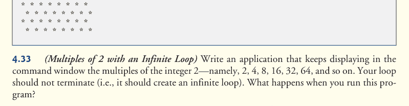

## 4.33（2 的倍数的无限循环）

编写一个应用程序，不断在命令窗口中显示整数 2 的倍数——即 2、4、8、16、32、64，等等。你的循环不应终止（即应创建无限循环）。运行此程序时会发生什么？

## 4.34（这段代码有什么问题？）

以下语句有什么问题？提供正确的语句将 x 和 y 的和加一。

```
System.out.println( ++(x + y) );
```

## 4.35（三边）

编写一个应用程序，读取用户输入的三个非零值并确定并打印它们是否可以代表三角形的三边。

## 4.36（直角三角形的三边）

编写一个应用程序，读取三个非零整数并确定并打印它们是否可以代表直角三角形的三边。

## 4.37（阶乘）

非负整数 n 的阶乘写为 n!（读作“n 阶乘”）定义如下：

n! = n · (n − 1) · (n − 2) · … · 1  （对于大于等于 1 的 n 值）

且

n! = 1  （对于 n = 0）

例如，5! = 5 · 4 · 3 · 2 · 1，即 120。

- a) 编写一个应用程序，读取一个非负整数并计算并打印其阶乘。

- b) 编写一个应用程序，使用以下公式估算数学常数 e 的值。允许用户输入要计算的项数。

  e = 1 + 1/1! + 1/2! + 1/3! + …

- c) 编写一个应用程序，使用以下公式计算 e^x 的值。允许用户输入要计算的项数。

  e^x = 1 + x/1! + x²/2! + x³/3! + …

## 做出改变

### 4.38（用密码学强制执行隐私）

互联网通信和互联网连接计算机上的数据存储的爆炸性增长大大增加了隐私问题。密码学领域关注对数据进行编码以使其难以（并且希望——使用最先进的方案——不可能）被未经授权的用户读取。在本练习中，你将研究一种用于加密和解密数据的简单方案。一家希望通过互联网发送数据的公司已要求你编写一个程序来加密它，以便更安全地传输。所有数据均作为四位整数传输。你的应用程序应读取用户输入的四位整数并按如下方式加密：用将数字加 7 并除以 10 后取余数的结果替换每个数字。然后交换第一位数字和第三位数字，并交换第二位数字和第四位数字。然后打印加密后的整数。编写一个单独的应用程序，输入加密的四位整数并对其进行解密（通过逆向加密方案）以形成原始数字。[可选阅读项目：研究“公钥密码学”一般以及 PGP（Pretty Good Privacy）特定公钥方案。你可能还想研究在工业级应用中广泛使用的 RSA 方案。]

### 4.39（世界人口增长）

世界人口在几个世纪中大幅增长。持续增长最终可能挑战可呼吸空气、可饮用水、可耕农田和其他有限资源的极限。最近有证据表明增长正在放缓，世界人口可能在本世纪某个时候达到峰值，然后开始下降。

对于本练习，请在线研究世界人口增长问题。务必调查各种观点。获取当前世界人口及其增长率的估计值（它今年可能增加的百分比）。编写一个程序，使用当前增长率保持不变的简化假设，计算未来 75 年的每年世界人口增长。打印结果表格。第一列应显示从第 1 年到第 75 年的年份。第二列应显示当年末预计的世界人口。第三列应显示当年世界人口的数值增长。使用你的结果，确定如果今年的增长率持续下去，人口何时会是今天的两倍。


## 控制语句：第2部分

> *命运之轮周而复始。*
> ——威廉·莎士比亚
> ——罗伯特·弗罗斯特

> *我们所知的一切进化都是从模糊走向明确。*
> ——查尔斯·桑德斯·皮尔士

## 目标

在本章中，你将学习：

- 计数器控制循环的基本要素。
- 使用for和do...while重复语句在程序中重复执行语句。
- 理解使用switch选择语句进行多重选择。
- 使用break和continue程序控制语句改变控制流。
- 使用逻辑运算符在控制语句中构成复杂的条件表达式。


## 5.1 简介

本章继续介绍结构化编程理论和原理，引入了Java其余的控制语句（仅剩一个未介绍）。我们将演示Java的for、do...while和switch语句。通过一系列使用while和for的简短示例，我们探索计数器控制循环的基本要素。我们创建了一个类GradeBook的版本，它使用switch语句来统计用户输入的一组数字成绩中相当于A、B、C、D和F等级的数量。我们介绍break和continue程序控制语句。我们还讨论Java的逻辑运算符，它们使你能够在控制语句中使用更复杂的条件表达式。最后，我们总结Java的控制语句以及本章和第4章中介绍的经过验证的问题解决技术。

## 5.2 计数器控制循环的基本要素

本节使用第4章中介绍的while重复语句来形式化执行计数器控制循环所需的要素，这些要素包括：

1. 一个控制变量（或循环计数器）
2. 控制变量的初始值
3. 每次循环（也称为循环的每次迭代）修改控制变量的增量（或减量）
4. 确定是否应继续循环的循环继续条件。

为了了解计数器控制循环的这些要素，请考虑图5.1中的应用程序，它使用一个循环显示从1到10的数字。

```java
1  // Fig. 5.1: WhileCounter.java
2  // Counter-controlled repetition with the while repetition statement.
3
4  public class WhileCounter
5  {
6      public static void main( String[] args )
7      {
8          int counter = 1; // declare and initialize control variable
9
10         while ( counter <= 10 ) // loop-continuation condition
11         {
12             System.out.printf( "%d  ", counter );
13             ++counter; // increment control variable by 1
14         } // end while
15
16         System.out.println(); // output a newline
17     } // end main
18 } // end class WhileCounter
```

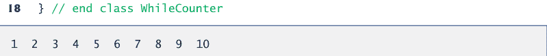

图5.1 | 使用while重复语句进行计数器控制循环。

在图5.1中，计数器控制循环的要素在第8、10和13行定义。第8行将控制变量（counter）声明为int，在内存中为其分配空间，并将其初始值设为1。变量counter也可以通过以下局部变量声明和赋值语句来声明和初始化：

```java
int counter; // declare counter
counter = 1; // initialize counter to 1
```

第12行在循环的每次迭代中显示控制变量counter的值。第13行在循环的每次迭代中将控制变量递增1。while（第10行）中的循环继续条件测试控制变量的值是否小于或等于10（条件为真的最终值）。即使控制变量为10，程序也会执行此while的循环体。当控制变量超过10（即counter变为11）时，循环终止。

#### 常见编程错误5.1

由于浮点值可能是近似值，用浮点变量控制循环可能导致计数器值不精确和终止测试不准确。

#### 防错提示5.1

使用整数控制计数循环。

图5.1中的程序可以通过在第8行将counter初始化为0，并在while条件中对counter进行前置递增来变得更加简洁，如下所示：

```java
while ( ++counter <= 10 ) // loop-continuation condition
    System.out.printf( "%d  ", counter );
```

这段代码节省了一条语句（并且不需要在循环体周围使用花括号），因为while条件在测试条件之前执行递增操作。（回顾第4.12节，++的优先级高于<=。）以这种紧凑的方式编码需要练习，可能会使代码更难阅读、调试、修改和维护，通常应避免。

#### 软件工程观察5.1

“保持简单”对于你将编写的大多数代码来说都是很好的建议。

## 5.3 for重复语句

第5.2节介绍了计数器控制循环的基本要素。while语句可用于实现任何计数器控制循环。Java还提供了for重复语句，它在一行代码中指定了计数器控制循环的细节。图5.2使用for重新实现了图5.1中的应用程序。

```java
1  // Fig. 5.2: ForCounter.java
2  // Counter-controlled repetition with the for repetition statement.
3
4  public class ForCounter
5  {
6      public static void main( String[] args )
7      {
8          // for statement header includes initialization,
9          // loop-continuation condition and increment
10         for ( int counter = 1; counter <= 10; counter++ )
11             System.out.printf( "%d  ", counter );
12
13         System.out.println(); // output a newline
14     } // end main
15 } // end class ForCounter
```

```text
1 2 3 4 5 6 7 8 9 10
```

图5.2 | 使用for重复语句进行计数器控制循环。

当for语句（第10~11行）开始执行时，控制变量counter被声明并初始化为1。（回顾第5.2节，计数器控制循环的前两个要素是控制变量及其初始值。）接下来，程序检查循环继续条件counter <= 10，该条件位于两个必需的分号之间。由于counter的初始值为1，该条件初始时为真。因此，循环体语句（第11行）显示控制变量counter的值，即1。执行循环体后，程序在表达式counter++中递增counter，该表达式位于第二个分号的右侧。然后再次执行循环继续测试，以确定程序是否应继续执行循环的下一次迭代。此时，控制变量的值为2，因此条件仍然为真（未超过最终值）——因此，程序再次执行循环体语句（即循环的下一次迭代）。此过程持续进行，直到显示数字1到10，并且counter的值变为11，导致循环继续测试失败，重复终止（在循环体重复10次之后）。然后程序执行for之后的第一条语句——在本例中是第13行。

图5.2在第10行使用了循环继续条件counter <= 10。如果你错误地将条件指定为counter < 10，循环将只迭代9次。这是一种常见的逻辑错误，称为差一错误。

#### 常见编程错误5.2

在重复语句的循环继续条件中使用不正确的关系运算符或循环计数器的错误最终值可能导致差一错误。

#### 防错提示5.2

在while或for语句的条件中使用最终值并使用<=关系运算符有助于避免差一错误。对于打印1到10的循环，循环继续条件应为counter <= 10，而不是counter < 10（这会导致差一错误）或counter < 11（这是正确的）。许多程序员更喜欢所谓的从零开始的计数，在这种计数方式中，为了计数10次，counter会初始化为0，循环继续测试应为counter < 10。

#### 更仔细地观察for语句头

图5.3更仔细地观察了图5.2中的for语句。for的第一行（包括关键字for以及for后面括号中的所有内容）——图5.2中的第10行——有时被称为for语句头。for语句头“完成所有工作”——它指定了使用控制变量进行计数器控制循环所需的每一项。如果for循环体中有多条语句，则需要花括号来定义循环体。

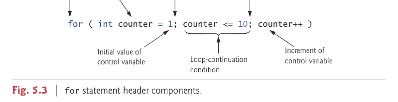

图5.3 | for语句头的组成部分。

#### for语句的一般格式

for语句的一般格式为：

```java
for ( initialization; loopContinuationCondition; increment )
    statement
```

其中，初始化表达式指定循环的控制变量，并可选地提供其初始值；循环继续条件决定循环是否应继续执行；增量修改控制变量的值（可能是递增或递减），以便循环继续条件最终变为假。for语句头中的两个分号是必需的。如果循环继续条件初始为假，程序将不执行for语句的循环体。相反，执行将转到for之后的下一条语句。

#### 用等价的while语句表示for语句

在大多数情况下，for语句可以用等价的while语句表示如下：


## 错误预防提示 5.3

当重复语句中的循环继续条件永远不会变为 false 时，就会发生无限循环。为了防止计数控制循环出现这种情况，请确保在循环的每次迭代中控制变量都会递增（或递减）。在哨兵控制循环中，请确保哨兵值能够被输入。

## 在 for 语句的头部放置算术表达式

for 语句的初始化、循环继续条件和递增部分可以包含算术表达式。例如，假设 x = 2 且 y = 10。如果在循环体中未修改 x 和 y，则语句

```
for ( int j = x; j <= 4 * x * y; j += y / x )
```

等价于语句

```
for ( int j = 2; j <= 80; j += 5 )
```

for 语句的递增也可以为负数，在这种情况下它实际上是递减，循环向下计数。

## 在语句体中使用 for 语句的控制变量

程序经常在循环体中显示控制变量的值或在其中使用它进行计算，但这种使用不是必需的。控制变量通常用于控制重复，而在 for 的主体中不被提及。

## 错误预防提示 5.4

尽管可以在 for 循环的主体中更改控制变量的值，但应避免这样做，因为这种做法可能导致细微的错误。

## for 语句的 UML 活动图

for 语句的 UML 活动图与 while 语句相似（图 4.4）。图 5.4 显示了图 5.2 中 for 语句的活动图。

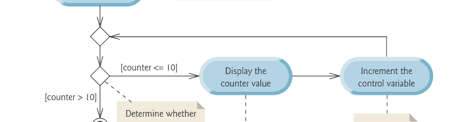

图 5.4 | 图 5.2 中 for 语句的 UML 活动图。

该图清楚地表明初始化在循环继续测试第一次被评估之前只执行一次，并且每次通过循环在主体语句执行后都会进行递增。

## 5.4 使用 for 语句的示例

以下示例展示了在 for 语句中变化控制变量的技术。在每种情况下，我们编写适当的 for 头部。注意递减控制变量的循环中关系运算符的变化。

+   a) 以 1 的增量将控制变量从 1 变化到 100。

```
for ( int i = 1; i <= 100; i++ )
```

+   b) 以 1 的递减将控制变量从 100 变化到 1。

```
for ( int i = 100; i >= 1; i-- )
```

+   c) 以 7 的增量将控制变量从 7 变化到 77。

```
for ( int i = 7; i <= 77; i += 7 )
```

+   d) 以 2 的递减将控制变量从 20 变化到 2。

```
for ( int i = 20; i >= 2; i -= 2 )
```

+   e) 使控制变量在 2、5、8、11、14、17、20 的值上变化。

```
for ( int i = 2; i <= 20; i += 3 )
```

+   f) 使控制变量在 99、88、77、66、55、44、33、22、11、0 的值上变化。

```
for ( int i = 99; i >= 0; i -= 11 )
```

## 常见编程错误 5.5

在使用向下计数的循环的循环继续条件中使用不正确的关系运算符（例如，在向下计数到 1 的循环中使用 i <= 1 而不是 i >= 1）通常是逻辑错误。

## 应用：求和从 2 到 20 的偶数

我们现在考虑两个示例应用，演示 for 的简单用法。图 5.5 中的应用使用 for 语句对从 2 到 20 的偶数求和，并将结果存储在名为 total 的 int 变量中。

```
1  // Fig. 5.5: Sum.java
2  // Summing integers with the for statement.
3
4  public class Sum
5  {
6      public static void main( String[] args )
7      {
8          int total = 0; // initialize total
```

```
```java
10    // total even integers from 2 through 20
11    for ( int number = 2; number <= 20; number += 2 )
12        total += number;
13
14    System.out.printf( "Sum is %d\n", total ); // display results
15 } // end main
16 } // end class Sum
```
```

```
Sum is 110
```

图 5.5 | 使用 for 语句求和整数。 （第 2 部分，共 2 部分。）

*初始化* 和 *递增* 表达式可以是逗号分隔的列表，使您能够使用多个初始化表达式或多个递增表达式。例如，*尽管不鼓励这样做*，您可以使用逗号将图 5.5 中第 11-12 行的 for 语句的主体合并到 for 头部的递增部分，如下所示：

```
```java
for ( int number = 2; number <= 20; total += number, number += 2 )
    ; // empty statement
```
```

> **良好的编程实践 5.1**  
> 为了可读性，如果可能，请将控制语句头的大小限制为单行。

## 应用：复利计算

让我们使用 for 语句来计算复利。考虑以下问题：

> 一个人将 $1000 投资于年利率为 5% 的储蓄账户。假设所有利息都留在存款中，计算并打印在未来 10 年中每年末账户中的金额。使用以下公式确定金额：
> 
> \[a = p(1 + r)^n\]
> 
> 其中
> 
> - *p* 是投资的原始金额（即本金）
> - *r* 是年利率（例如，5% 为 0.05）
> - *n* 是年数
> - *a* 是第 *n* 年末存款的金额。

该问题的解决方案（图 5.6）涉及一个循环，对资金在存款的 10 年中每一年执行指示的计算。main 方法中的第 8-10 行声明 double 变量 amount、principal 和 rate，并将 principal 初始化为 1000.0，将 rate 初始化为 0.05。Java 将 1000.0 和 0.05 等浮点常量视为 double 类型。同样，Java 将 7 和 -22 等整数常量视为 int 类型。

```
```java
1  // Fig. 5.6: Interest.java
2  // Compound-interest calculations with for.

4  public class Interest
5  {
```
```

图 5.6 | 使用 for 进行复利计算。 （第 1 部分，共 2 部分。）

类提供在对象上执行常见任务的方法。事实上，大多数方法必须在特定对象上调用。例如，为了在图 5.6 中输出文本，第 13 行在 System.out 对象上调用 printf 方法。许多类还提供执行常见任务且不需要对象的常用方法。这些称为静态方法。例如，Java 不包含指数运算符，因此 Java 的 Math 类的设计者为 Math.pow 定义了静态方法来提高值到幂。您可以通过指定类名后跟点 (.) 和方法名来调用静态方法，如

```
ClassName.methodName( arguments )
```

在第 6 章中，您将学习如何在自己的类中实现静态方法。

我们使用 Math 类的静态方法 pow 在图 5.6 中执行复利计算。Math.pow(x, y) 计算 x 的 y 次幂的值。该方法接收两个 double 参数并返回一个 double 值。第 19 行执行计算 a = p(1 + r)n，其中 a 为 amount，p 为 principal，r 为 rate，n 为 year。类 Math 在包 java.lang 中定义，因此您无需导入类 Math 即可使用它。

for 语句的主体包含计算 1.0 + rate，该计算作为 Math.pow 方法的参数出现。事实上，此计算每次通过循环都会产生相同的结果，因此在循环的每次迭代中重复它都是浪费的。

## 性能提示 5.1

在循环中，避免结果永远不会改变的计算——此类计算通常应放在循环之前。今天的许多复杂的优化编译器将在编译代码中将此类计算放在循环之外。

## 格式化浮点数

每次计算后，第 22 行输出年份和该年末的存款金额。年份以 4 个字符的字段宽度输出（由 %4d 指定）。金额以格式说明符 %,20.2f 输出为浮点数。逗号 (,) 格式标志表示浮点值应使用分组分隔符输出。实际使用的分隔符特定于用户的区域设置（即国家/地区）。例如，在美国，数字将使用逗号分隔每三位数字并使用小数点分隔数字的小数部分输出，如 1,234.45。格式规范中的数字 20 表示值应在宽度为 20 个字符的字段中右对齐输出。.2 指定格式化的数字的精度——在这种情况下，数字四舍五入到最接近的百分位并输出小数点右侧两位数字。

## 关于显示舍入值的警告

我们将变量 amount、principal 和 rate 声明为本示例中的 double 类型。我们处理美元金额的小数部分，因此需要一种允许其值中包含小数点的类型。不幸的是，浮点数会引起麻烦。以下是使用 double（或 float）表示美元金额时可能出现问题的简单解释（假设美元金额以小数点右侧两位数字显示）：机器中存储的两个 double 美元金额可能是 14.234（通常会四舍五入为 14.23 用于显示目的）和 18.673（通常会四舍五入为 18.67 用于显示目的）。当这些金额相加时，它们产生内部和 32.907，通常会四舍五入为 32.91 用于显示目的。因此，您的输出可能显示为


14.23
+ 18.67
--------
32.91

但如果一个人按显示的数字逐个相加，会期望和为 32.90。你已被警告！

## 错误预防提示 5.5

不要使用 double（或 float）类型的变量来执行精确的货币计算。浮点数的 imprecise 会导致错误。在练习中，你将学习如何使用整数来执行精确的货币计算。Java 还提供了类 java.math.BigDecimal 来执行精确的货币计算。有关更多信息，请参阅 download.oracle.com/javase/6/docs/api/java/math/BigDecimal.html。

## 5.5 do...while 重复语句

do...while 重复语句与 while 语句类似。在 while 中，程序在执行循环体之前先在循环开始时测试循环继续条件；如果条件为假，循环体永远不会执行。do...while 语句在执行循环体之后测试循环继续条件；因此，循环体至少执行一次。当 do...while 语句终止时，执行继续进行下一个顺序语句。图 5.7 使用 do...while（第 10–14 行）输出数字 1–10。

```
1 // Fig. 5.7: DoWhileTest.java
2 // do...while repetition statement.
3
4 public class DoWhileTest
5 {
6 public static void main( String[] args )
7 {
8 int counter = 1; // initialize counter
9
10 do
11 {
12 System.out.printf( "%d  ", counter );
13 ++counter;
14 } while ( counter <= 10 ); // end do...while
15
16 System.out.println(); // outputs a newline
17 } // end main
18 } // end class DoWhileTest
```

1 2 3 4 5 6 7 8 9 10

图 5.7 | do...while 重复语句。

第 8 行声明并初始化控制变量 counter。进入 do...while 语句后，第 12 行输出 counter 的值，第 13 行递增 counter。然后程序在循环底部评估循环继续测试（第 14 行）。如果条件为真，循环从第一个循环体语句（第 12 行）继续。如果条件为假，循环终止，程序继续执行循环之后的下一个语句。

图 5.8 包含 do...while 语句的 UML 活动图。该图清楚地表明，循环继续条件不是在循环至少执行一次动作状态之后才进行评估。将此活动图与 while 语句的活动图（图 4.4）进行比较。

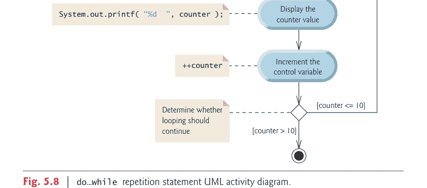

如果 do...while 重复语句的循环体中只有一个语句，则不需要使用大括号。然而，许多程序员包含大括号，以避免 while 语句和 do...while 语句之间的混淆。例如，

```
while ( condition )
```

通常是 while 语句的第一行。没有在大括号中包含单个语句体的 do...while 语句显示为：

```
do
while ( condition );
```

这可能令人困惑。读者可能会误解最后一行——while( condition );——为包含空语句（单独的分号）的 while 语句。因此，包含一个循环体语句的 do...while 语句通常写成如下形式：

```
do
{
statement
} while ( condition );
```

## 良好编程实践 5.2

始终在 do...while 语句中包含大括号。这有助于消除 while 语句和仅包含一个语句的 do...while 语句之间的歧义。

## 5.6 switch 多选语句

第 4 章讨论了 if 单选语句和 if...else 双选语句。switch 多选语句根据类型为 byte、short、int 或 char 的常量整型表达式的可能值执行不同的操作。

## 使用 switch 语句统计 A、B、C、D 和 F 等级的 GradeBook 类

图 5.9 增强了第 3–4 章中的 GradeBook 类。我们现在介绍的新版本不仅计算用户输入的一组数字成绩的平均值，而且使用 switch 语句确定每个成绩是 A、B、C、D 还是 F 的等价物，并递增适当的成绩计数器。该类还显示了获得每个成绩的学生人数的摘要。有关使用 GradeBook 类处理一组成绩的 GradeBookTest 应用程序的示例输入和输出，请参阅图 5.10。

```
// Fig. 5.9: GradeBook.java
// GradeBook class uses switch statement to count letter grades.
import java.util.Scanner; // program uses class Scanner

public class GradeBook
{
    private String courseName; // name of course this GradeBook represents
    // int instance variables are initialized to 0 by default
    private int total; // sum of grades
    private int gradeCounter; // number of grades entered
    private int aCount; // count of A grades
    private int bCount; // count of B grades
    private int cCount; // count of C grades
    private int dCount; // count of D grades
    private int fCount; // count of F grades

    // constructor initializes courseName;
    public GradeBook( String name )
    {
        courseName = name; // initializes courseName
    } // end constructor

    // method to set the course name
    public void setCourseName( String name )
    {
        courseName = name; // store the course name
    } // end method setCourseName

    // method to retrieve the course name
    public String getCourseName()
    {
```

```
32      return courseName;
33  } // end method getCourseName
34
35  // display a welcome message to the GradeBook user
36  public void displayMessage()
37  {
38      // getCourseName gets the name of the course
39      System.out.printf( "Welcome to the grade book for\n%s!\n\n",
40          getCourseName() );
41  } // end method displayMessage
42
43  // input arbitrary number of grades from user
44  public void inputGrades()
45  {
46      Scanner input = new Scanner( System.in );
47
48      int grade; // grade entered by user
49
50      System.out.printf( "%s\n%s\n  %s\n  %s\n",
51          "Enter the integer grades in the range 0-100.",
52          "Type the end-of-file indicator to terminate input:",
53          "On UNIX/Linux/Mac OS X type <Ctrl> d then press Enter",
54          "On Windows type <Ctrl> z then press Enter" );
55
56      // loop until user enters the end-of-file indicator
57      while ( input.hasNext() )
58      {
59          grade = input.nextInt(); // read grade
60          total += grade; // add grade to total
61          ++gradeCounter; // increment number of grades
62
63          // call method to increment appropriate counter
64          incrementLetterGradeCounter( grade );
65      } // end while
66  } // end method inputGrades
67
68  // add 1 to appropriate counter for specified grade
69  private void incrementLetterGradeCounter( int grade )
70  {
71      // determine which grade was entered
72      switch ( grade / 10 )
73      {
74          case 9: // grade was between 90
75          case 10: // and 100, inclusive
76              ++aCount; // increment aCount
77              break; // necessary to exit switch
78
79          case 8: // grade was between 80 and 89
80              ++bCount; // increment bCount
81              break; // exit switch
82
```

```
case 7: // grade was between 70 and 79
    ++cCount; // increment cCount
    break; // exit switch

case 6: // grade was between 60 and 69
    ++dCount; // increment dCount
    break; // exit switch

default: // grade was less than 60
    ++fCount; // increment fCount
    break; // optional; will exit switch anyway
} // end switch
} // end method incrementLetterGradeCounter

// display a report based on the grades entered by the user
public void displayGradeReport()
{
    System.out.println( "\nGrade Report:" );

    // if user entered at least one grade...
    if ( gradeCounter != 0 )
    {
        // calculate average of all grades entered
        double average = (double) total / gradeCounter;

        // output summary of results
        System.out.printf( "Total of the %d grades entered is %d\n", gradeCounter, total );
        System.out.printf( "Class average is %.2f\n", average );
        System.out.printf( "%s\n%s%d\n%s%d\n%s%d\n%s%d\n%s%d\n", "Number of students who received each grade:", "A: ", aCount,    // display number of A grades
            "B: ", bCount,    // display number of B grades
            "C: ", cCount,    // display number of C grades
            "D: ", dCount,    // display number of D grades
            "F: ", fCount ); // display number of F grades
    } // end if
    else // no grades were entered, so output appropriate message
        System.out.println( "No grades were entered" );
    } // end method displayGradeReport
} // end class GradeBook
```

图 5.9 | GradeBook 类使用 switch 语句统计字母等级。（第 3 部分，共 3 部分。）

与该类的早期版本一样，GradeBook 类（图 5.9）声明实例变量 courseName（第 7 行），并包含方法 setCourseName（第 24–27 行）、getCourseName（第 30–33 行）和 displayMessage（第 36–41 行），分别设置课程名称、存储课程名称并向用户显示欢迎消息。该类还包含一个构造函数（第 18–21 行），用于初始化课程名称。

GradeBook 类还声明实例变量 total（第 9 行）和 gradeCounter（第 10 行），分别跟踪用户输入的成绩总和和输入的成绩数量。第 11–15 行声明每个成绩类别的计数器变量。GradeBook 维护 total、gradeCounter 和五个字母成绩计数器


作为实例变量，以便它们可以在类的任何方法中使用或修改。类的构造函数（第 18–21 行）仅设置课程名称，因为其余七个实例变量为 int，默认初始化为 0。

类 GradeBook（图 5.9）包含另外三个方法——inputGrades、incrementLetterGradeCounter 和 displayGradeReport。方法 inputGrades（第 44–66 行）使用哨兵控制重复从用户读取任意数量的整数成绩，并更新实例变量 total 和 gradeCounter。此方法调用方法 incrementLetterGradeCounter（第 69–95 行）为每个输入的成绩更新适当的字母等级计数器。方法 displayGradeReport（第 98–122 行）输出包含所有输入成绩的总和、成绩的平均值以及获得每个字母等级的学生人数的报告。让我们更详细地检查这些方法。

### 方法 inputGrades

方法 inputGrades 中第 48 行声明变量 grade，用于存储用户的输入。第 50–54 行提示用户输入整数成绩并输入文件结束指示符以终止输入。文件结束指示符是系统相关的键击组合，用户输入它以指示没有更多数据可输入。在第 17 章 文件、流和对象序列化 中，我们将看到当程序从文件读取输入时如何使用文件结束指示符。

在 UNIX/Linux/Mac OS X 系统上，文件结束是通过在单独一行上键入序列 `<Ctrl> d` 输入的。此表示法表示同时按下 Ctrl 键和 d 键。在 Windows 系统上，文件结束可以通过键入 `<Ctrl> z` 输入。

> **注意：** 在某些系统上，键入文件结束键序列后必须按 Enter。此外，当键入文件结束指示符时，Windows 通常会在屏幕上显示字符 `^Z`，如图 5.10 的输出所示。

> **可移植性提示 5.1** 输入文件结束的键击组合取决于系统。

while 语句（第 57–65 行）获取用户输入。第 57 行的条件调用 Scanner 方法 hasNext 来确定是否还有更多数据可输入。此方法如果有更多数据则返回布尔值 true；否则返回 false。返回值随后用作 while 语句中条件的取值。方法 hasNext 在用户键入文件结束指示符后返回 false。

第 59 行从用户输入成绩值。第 60 行将 grade 加到 total。第 61 行递增 gradeCounter。类的 displayGradeReport 方法使用这些变量来计算成绩的平均值。第 64 行调用类的 incrementLetterGradeCounter 方法（声明在第 69–95 行）根据输入的数字成绩递增适当的字母等级计数器。

### 方法 incrementLetterGradeCounter

方法 incrementLetterGradeCounter 包含一个 switch 语句（第 72–94 行），用于确定要递增哪个计数器。我们假设用户输入的成绩在 0–100 范围内有效。90–100 范围内的成绩代表 A，80–89 代表 B，70–79 代表 C，60–69 代表 D，0–59 代表 F。switch 语句由包含一系列 case 标签和可选的 default case 的块组成。在此示例中，它们用于根据成绩确定要递增哪个计数器。

当控制流到达 switch 时，程序计算 switch 关键字后括号中的表达式（grade / 10）。这是 switch 的控制表达式。程序将此表达式的值（必须计算为 byte、char、short 或 int 类型的整数值）与每个 case 标签进行比较。第 72 行的控制表达式执行整数除法，截断结果的小数部分。因此，当我们将 0 到 100 的值除以 10 时，结果始终为 0 到 10 的值。我们在 case 标签中使用其中几个值。例如，如果用户输入整数 85，控制表达式计算为 8。switch 将 8 与每个 case 标签进行比较。如果出现匹配（第 79 行的 case 8:），程序执行该 case 的语句。对于整数 8，第 80 行递增 bCount，因为 80 分是 B。第 81 行的 break 语句使程序控制继续执行 switch 之后的第一个语句——在此程序中，我们到达方法 incrementLetterGradeCounter 主体的末尾，因此方法终止并控制返回到方法 inputGrades 中的第 65 行（调用 incrementLetterGradeCounter 后的第一行）。第 65 行是 while 循环主体的末尾，因此控制流到 while 的条件（第 57 行）以确定循环是否应继续执行。

我们的 switch 中的 case 显式测试值 10、9、8、7 和 6。请注意第 74–75 行中测试值 9 和 10 的 case（两者都代表成绩 A）。以这种方式连续列出 case 且中间没有语句可使 case 执行相同的语句集——当控制表达式计算为 9 或 10 时，第 76–77 行的语句将执行。switch 语句不提供测试值范围的机制，因此你需要测试的每个值都必须在单独的 case 标签中列出。每个 case 可以有多个语句。switch 语句与其他控制语句不同之处在于它不需要在 case 中的多个语句周围使用大括号。

如果没有 break 语句，每次在 switch 中出现匹配时，该 case 及后续 case 的语句都会执行，直到遇到 break 语句或 switch 结束为止。这通常被称为“贯穿”到后续 case 中的语句。（此功能非常适合编写简洁的程序，在练习 5.29 中显示迭代歌曲“圣诞十二天”。）

> **常见编程错误 5.6** 在 switch 中需要时忘记 break 语句是逻辑错误。

如果控制表达式的值与 case 标签不匹配，则执行 default case（第 91–93 行）。我们在此示例中使用 default case 来处理所有小于 6 的控制表达式值——即所有不及格成绩。如果没有匹配且 switch 不包含 default case，程序控制 simply 继续执行 switch 之后的第一个语句。

## 演示类 GradeBook 的类 GradeBookTest

类 GradeBookTest（图 5.10）创建了一个 GradeBook 对象（第 10–11 行）。第 13 行调用对象的 displayMessage 方法向用户输出欢迎消息。第 14 行调用对象的 inputGrades 方法从用户读取一组成绩并跟踪所有输入成绩的总和和成绩数量。回想一下，方法 inputGrades 还调用方法 incrementLetterGradeCounter 来跟踪获得每个字母等级的学生人数。第 15 行调用类 GradeBook 的方法 displayGradeReport，它根据输入的成绩输出报告（如图 5.10 中的输入/输出窗口所示）。类 GradeBook（图 5.9）第 103 行确定用户是否输入了至少一个成绩——这有助于我们避免除以零。如果是这样，第 106 行计算成绩的平均值。然后第 109–118 行输出所有成绩的总和、班级平均值以及获得每个字母等级的学生人数。如果没有输入成绩，第 121 行输出适当的消息。图 5.10 中的输出显示了基于 10 个成绩的示例成绩报告。

```java
 1  // Fig. 5.10: GradeBookTest.java
 2  // Create GradeBook object, input grades and display grade report.
 3
 4  public class GradeBookTest
 5  {
 6      public static void main( String[] args )
 7      {
 8          // create GradeBook object myGradeBook and
 9          // pass course name to constructor
10          GradeBook myGradeBook = new GradeBook(
11              "CS101 Introduction to Java Programming" );
12
13          myGradeBook.displayMessage(); // display welcome message
14          myGradeBook.inputGrades(); // read grades from user
15          myGradeBook.displayGradeReport(); // display report based on grades
16      } // end main
17  } // end class GradeBookTest
```

```
Welcome to the grade book for
CS101 Introduction to Java Programming!

Enter the integer grades in the range 0-100.
Type the end-of-file indicator to terminate input:
  On UNIX/Linux/Mac OS X type <Ctrl> d then press Enter
  On Windows type <Ctrl> z then press Enter
99
92
45
57
63
71
76
85
90
100
^Z

Grade Report:
Total of the 10 grades entered is 778
Class average is 77.80
```

*图 5.10 | 创建 GradeBook 对象，输入成绩并显示成绩报告。（第 1 部分，共 2 部分。）*


获得各等级的学生人数：
A: 4
B: 1
C: 2
D: 1
F: 2

图5.10 | 创建GradeBook对象，输入成绩并显示成绩报告。(第2部分，共2部分。)

GradeBookTest类（图5.10）不会直接调用GradeBook的incrementLetterGradeCounter方法（图5.9的第69–95行）。该方法仅由GradeBook类的inputGrades方法使用，用于在用户输入每个新成绩时更新相应的字母等级计数器。方法incrementLetterGradeCounter的存在纯粹是为了支持GradeBook其他方法的操作，因此它被声明为private。

## 软件工程观察 5.2

> 回顾第3章，使用访问修饰符private声明的方法只能由声明这些private方法的类中的其他方法调用。这类方法通常被称为工具方法或辅助方法，因为它们通常用于支持类的其他方法的操作。

## switch语句的UML活动图

图5.11展示了通用switch语句的UML活动图。大多数switch语句在每个case中使用break，以便在处理完该case后终止switch语句。图5.11通过在活动图中包含break语句来强调这一点。

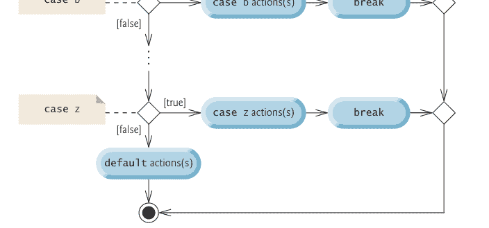

图5.11 | 带有break语句的switch多重选择语句UML活动图。

该图清楚地表明，case末尾的break语句会使控制立即退出switch语句。

对于switch的最后一个case（或可选的default case，当它位于最后时），break语句不是必需的，因为执行会继续到switch之后的下一语句。

## 软件工程观察 5.3

在switch语句中提供default case。包含default case会使你关注处理异常情况的需求。

## 良好编程实践 5.3

尽管switch中的每个case和default case可以按任意顺序出现，但请将default case放在最后。当default case列在最后时，该case的break不是必需的。

## 关于switch中每个case表达式的注意事项

使用switch语句时，请记住每个case必须包含一个常量整型表达式——即整数常量的任意组合，其计算结果为常量整数值（例如，−7、0或221）。整数常量就是整数值。此外，您还可以使用字符常量——单引号中的特定字符，如'A'、'7'或'$'——它们表示字符的整数值以及枚举常量（在第6.10节中介绍）。（附录B显示了ASCII字符集中字符的整数值，ASCII字符集是Java使用的Unicode字符集的子集。）

每个case中的表达式也可以是常量变量——一个包含在整个程序中都不改变的值的变量。这样的变量使用关键字final声明（在第6章中讨论）。Java有一个称为枚举的特性，我们也在第6章中介绍。枚举常量也可以用在case标签中。在第10章“面向对象编程：多态”中，我们介绍了一种更优雅的实现switch逻辑的方法——我们使用一种称为多态的技术来创建程序，这些程序通常比使用switch逻辑的程序更清晰、更易于维护、更易于扩展。

## 在switch语句中使用String（Java SE 7中的新特性）

从Java SE 7开始，您可以在switch语句的控制表达式和case标签中使用String。例如，您可能想使用城市名称来获取相应的邮政编码。假设city和zipCode是String变量，以下switch语句对三个城市执行此任务：

```
switch( city )
{
    case "Maynard":
        zipCode = "01754";
        break;
    case "Marlborough":
        zipCode = "01752";
        break;
    case "Framingham":
        zipCode = "01701";
        break;
} // end switch
```

## 5.7 break和continue语句

除了选择语句和重复语句之外，Java还提供了break和continue语句（本节和附录O中介绍）来改变控制流。上一节展示了如何使用break终止switch语句的执行。本节讨论如何在重复语句中使用break。

## break语句

break语句在while、for、do...while或switch中执行时，会导致立即退出该语句。执行继续到控制语句之后的第一条语句。break语句的常见用途是从循环中提前退出或跳过switch的其余部分（如图5.9所示）。图5.12演示了break语句退出for语句。

```
1 // Fig. 5.12: BreakTest.java
2 // break statement exiting a for statement.
3 public class BreakTest
4 {
5 public static void main( String[] args )
6 {
7 int count; // control variable also used after loop terminates
8
9 for ( count = 1; count <= 10; count++ ) // loop 10 times
10 {
11 if ( count == 5 ) // if count is 5,
12 break; // terminate loop
13
14 System.out.printf( "%d ", count );
15 } // end for
16
17 System.out.printf( "\nBroke out of loop at count = %d\n", count );
18 } // end main
19 } // end class BreakTest
```

1 2 3 4
Broke out of loop at count = 5

图5.12 | break语句退出for语句。

当for语句（第9–15行）中嵌套的if语句（第11–12行）检测到count为5时，第12行的break语句执行。这会终止for语句，程序继续执行第17行（紧接在for语句之后），该行显示一条消息，指示循环终止时控制变量的值。循环只完整执行了四次循环体，而不是十次。

## continue语句

continue语句在while、for或do...while中执行时，会跳过循环体中剩余的语句，并继续进行循环的下一次迭代。在while和do...while语句中，程序在continue语句执行后立即计算循环继续测试。在for语句中，先执行递增表达式，然后程序计算循环继续测试。

```
// Fig. 5.13: ContinueTest.java
// continue statement terminating an iteration of a for statement.
public class ContinueTest
{
    public static void main( String[] args )
    {
        for ( int count = 1; count <= 10; count++ ) // loop 10 times
        {
            if ( count == 5 ) // if count is 5,
                continue; // skip remaining code in loop

            System.out.printf( "%d ", count );
        } // end for

        System.out.println( "\nUsed continue to skip printing 5" );
    } // end main
} // end class ContinueTest
```

1 2 3 4 6 7 8 9 10
Used continue to skip printing 5

图5.13 | continue语句终止for语句的一次迭代。

图5.13使用continue在嵌套的if（第9行）确定count的值为5时跳过第12行的语句。当continue语句执行时，程序控制继续到for语句中控制变量的递增（第7行）。

在第5.3节中，我们指出在大多数情况下可以使用while代替for。但当while中的递增表达式在continue语句之后时，这就不成立了。在这种情况下，递增不会在程序计算重复继续条件之前执行，因此while不会像for那样执行。

## 软件工程观察 5.4

一些程序员认为break和continue违反了结构化编程。由于使用结构化编程技术可以达到相同的效果，这些程序员不使用break或continue。

## 软件工程观察 5.5

在实现高质量软件工程和实现最佳性能软件之间存在一种张力。有时这些目标中的一个是以牺牲另一个为代价来实现的。除了大多数性能密集型情况外，请应用以下经验法则：首先，使您的代码简单且正确；然后，使其快速且小巧，但仅在必要时这样做。

## 5.8 逻辑运算符

if、if...else、while、do...while和for语句都需要一个条件来确定如何继续程序的流程控制。到目前为止，我们只学习了简单的条件，例如count <= 10、number != sentinelValue和total > 1000。简单条件用关系运算符>、<、>=和<=以及相等运算符==和!=表示，每个表达式只测试一个条件。为了在做出决策的过程中测试多个条件，我们在单独的语句中执行这些测试


或者在嵌套的 if 或 if...else 语句中。有时控制语句需要更复杂的条件来确定程序的控制流。

Java 的逻辑运算符使您能够通过组合简单条件来形成更复杂的条件。逻辑运算符包括 &&（条件与）、||（条件或）、&（布尔逻辑与）、|（布尔逻辑或）、^（布尔逻辑异或）和 !（逻辑非）。[注意：&、| 和 ^ 运算符在应用于整型操作数时也是位运算符。我们在附录 N 中讨论位运算符。]

## 条件与（&&）运算符

假设我们希望确保在程序中某个时刻两个条件都为真，然后才选择某条执行路径。在这种情况下，我们可以使用 &&（条件与）运算符，如下所示：

```
if ( gender == FEMALE && age >= 65 )
    ++seniorFemales;
```

这个 if 语句包含两个简单条件。条件 `gender == FEMALE` 将变量 gender 与常量 FEMALE 进行比较，以确定一个人是否为女性。条件 `age >= 65` 可能被求值以确定一个人是否为老年人。if 语句考虑组合条件

```
gender == FEMALE && age >= 65
```

当且仅当两个简单条件都为真时，该组合条件才为真。在这种情况下，if 语句体将 seniorFemales 递增 1。如果其中一个或两个简单条件为假，程序将跳过该递增操作。有些程序员发现，添加冗余括号后，上述组合条件更具可读性，如下所示：

```
( gender == FEMALE ) && ( age >= 65 )
```

图 5.14 中的表格总结了 && 运算符。该表显示了 expression1 和 expression2 的 false 和 true 值的所有四种可能组合。这样的表称为真值表。Java 对包含关系运算符、相等运算符或逻辑运算符的所有表达式求值为 false 或 true。

| 表达式1 | 表达式2 | 表达式1 && 表达式2 |
|---|---|---|
| false | false | false |
| false | true | false |
| true | false | false |
| true | true | true |

图 5.14 | &&（条件与）运算符真值表。

## 条件或（||）运算符

现在假设我们希望确保在执行某条路径之前，两个条件中的一个或两个为真。在这种情况下，我们使用 ||（条件或）运算符，如下面的程序片段所示：

```
if ( ( semesterAverage >= 90 ) || ( finalExam >= 90 ) )
    System.out.println( "Student grade is A" );
```

该语句也包含两个简单条件。条件 `semesterAverage >= 90` 的求值用于确定学生是否因为整个学期的扎实表现而在课程中获得 A。条件 `finalExam >= 90` 的求值用于确定学生是否因为期末考试中的出色表现而在课程中获得 A。然后 if 语句考虑组合条件

```
( semesterAverage >= 90 ) || ( finalExam >= 90 )
```

如果两个简单条件中的一个或两个为真，则授予学生 A。只有两个简单条件都为假时，才不打印消息 "Student grade is A"。图 5.15 是条件或（||）运算符的真值表。运算符 && 的优先级高于运算符 ||。这两个运算符都从左到右结合。

| 表达式1 | 表达式2 | 表达式1 || 表达式2 |
|---|---|---|
| false | false | false |
| false | true | true |
| true | false | true |
| true | true | true |

图 5.15 | ||（条件或）运算符真值表。

## 复杂条件的短路求值

包含 && 或 || 运算符的表达式的各部分仅被求值到已知条件为真或为假为止。因此，表达式

```
( gender == FEMALE ) && ( age >= 65 )
```

如果 gender 不等于 FEMALE（即整个表达式为假），则立即停止；如果 gender 等于 FEMALE（即如果条件 age >= 65 为真，整个表达式仍可能为真），则继续求值。条件与和条件或表达式的这种特性称为短路求值。

## 常见编程错误 5.7

> 在使用运算符 && 的表达式中，一个条件——我们称之为依赖条件——可能需要另一个条件为真，依赖条件的求值才有意义。在这种情况下，依赖条件应放在另一个条件之后，否则可能会发生错误。例如，在表达式 ( 1 != 0 ) && ( 10 / i == 2 ) 中，第二个条件必须出现在第一个条件之后，否则可能会发生除以零的错误。

## 布尔逻辑与（&）和布尔逻辑或（|）运算符

布尔逻辑与（&）和布尔逻辑或（|）运算符与 && 和 || 运算符相同，只是 & 和 | 运算符总是对两个操作数进行求值（即它们不执行短路求值）。因此，表达式

```
( gender == 1 ) & ( age >= 65 )
```

无论 gender 是否等于 1，都会对 age >= 65 进行求值。如果布尔逻辑与或布尔逻辑或运算符的右操作数具有必需的副作用——修改变量的值——这将非常有用。例如，表达式

```
( birthday == true ) | ( ++age >= 65 )
```

保证条件 `++age >= 65` 会被求值。因此，无论整个表达式为真还是假，变量 age 都会被递增。

## 防错提示 5.6

> 为了清晰起见，避免在条件中使用带副作用的表达式。副作用可能看起来很巧妙，但会使代码更难理解，并可能导致微妙的逻辑错误。

## 布尔逻辑异或（^）

包含布尔逻辑异或（^）运算符的简单条件，当且仅当其一个操作数为真而另一个为假时为真。如果两个都为真或两个都为假，则整个条件为假。图 5.16 是布尔逻辑异或（^）运算符的真值表。该运算符保证对两个操作数都进行求值。

| 表达式1 | 表达式2 | 表达式1 ^ 表达式2 |
|---|---|---|
| false | false | false |
| false | true | true |
| true | false | true |
| true | true | false |

图 5.16 | ^（布尔逻辑异或）运算符真值表。

## 逻辑非（!）运算符

!（逻辑非，也称为逻辑否定或逻辑补）运算符会“反转”条件的含义。与逻辑运算符 &&、||、&、| 和 ^ 不同，这些运算符是组合两个条件的二元运算符，而逻辑非运算符是一元运算符，只有一个条件作为操作数。该运算符放在条件之前，以便在原始条件（不带逻辑非运算符）为假时选择某条执行路径，如以下程序片段所示：

```
if ( ! ( grade == sentinelValue ) )
    System.out.printf( "The next grade is %d\n", grade );
```

只有当 grade 不等于 sentinelValue 时，才会执行 printf 调用。条件 `grade == sentinelValue` 周围的括号是必需的，因为逻辑非运算符的优先级高于相等运算符。

在大多数情况下，您可以通过使用适当的关系运算符或相等运算符以不同方式表达条件来避免使用逻辑非。例如，前面的语句也可以写成如下形式：

```
if ( grade != sentinelValue )
    System.out.printf( "The next grade is %d\n", grade );
```

这种灵活性可以帮助您以更方便的方式表达条件。图 5.17 是逻辑非运算符的真值表。

| 表达式 | !表达式 |
|---|---|
| false | true |
| true | false |

图 5.17 | !（逻辑否定，或逻辑非）运算符真值表。

## 逻辑运算符示例

图 5.18 使用逻辑运算符生成本节讨论的真值表。输出显示了被求值的布尔表达式及其结果。我们使用 %b 格式说明符根据布尔表达式的值显示单词“true”或“false”。第 9–13 行生成 && 的真值表。第 16–20 行生成 || 的真值表。第 23–27 行生成 & 的真值表。第 30–35 行生成 | 的真值表。第 38–43 行生成 ^ 的真值表。第 46–47 行生成 ! 的真值表。

```
1  // Fig. 5.18: LogicalOperators.java
2  // Logical operators.
3
4  public class LogicalOperators
5  {
6      public static void main( String[] args )
7      {
8          // create truth table for && (conditional AND) operator
9          System.out.printf( "%s\n%s: %b\n%s: %b\n%s: %b\n%s: %b\n\n",
10             "Conditional AND (&&)", "false && false", ( false && false ),
11             "false && true", ( false && true ),
12             "true && false", ( true && false ),
13             "true && true", ( true && true ) );
14
15          // create truth table for || (conditional OR) operator
16          System.out.printf( "%s\n%s: %b\n%s: %b\n%s: %b\n%s: %b\n\n",
17             "Conditional OR (||)", "false || false", ( false || false ),
18             "false || true", ( false || true ),
19             "true || false", ( true || false ),
20             "true || true", ( true || true ) );
21
22          // create truth table for & (boolean logical AND) operator
23          System.out.printf( "%s\n%s: %b\n%s: %b\n%s: %b\n%s: %b\n\n",
24             "Boolean logical AND (&)", "false & false", ( false & false ),
25             "false & true", ( false & true ),
26             "true & false", ( true & false ),
27             "true & true", ( true & true ) );
28
29          // create truth table for | (boolean logical inclusive OR) operator
30          System.out.printf( "%s\n%s: %b\n%s: %b\n%s: %b\n%s: %b\n\n",
31             "Boolean logical inclusive OR (|)",
```

```
32      "false | false", ( false | false ),
33      "false | true", ( false | true ),
34      "true | false", ( true | false ),
35      "true | true", ( true | true ));
36
37      // create truth table for ^ (boolean logical exclusive OR) operator
38      System.out.printf( "%s\n%s: %b\n%s: %b\n%s: %b\n%s: %b\n\n",
39      "Boolean logical exclusive OR (^)",
40      "false ^ false", ( false ^ false ),
41      "false ^ true", ( false ^ true ),
42      "true ^ false", ( true ^ false ),
43      "true ^ true", ( true ^ true ));
44
45      // create truth table for ! (logical negation) operator
46      System.out.printf( "%s\n%s: %b\n%s: %b\n", "Logical NOT (!)",
47      "!false", ( !false ), "!true", ( !true ));
48      } // end main
49      } // end class LogicalOperators
```

条件 AND (&&)
false && false: false
false && true: false
true && false: false
true && true: true

条件 OR (||)
false || false: false
false || true: true
true || false: true
true || true: true

布尔逻辑 AND (&)
false & false: false
false & true: false
true & false: false
true & true: true

布尔逻辑包含 OR (|)
false | false: false
false | true: true
true | false: true
true | true: true

布尔逻辑异或 (^)
false ^ false: false
false ^ true: true
true ^ false: true
true ^ true: false

逻辑 NOT (!)
!false: true
!true: false

图 5.19 显示了迄今为止介绍的 Java 运算符的优先级和结合性。运算符按从上到下递减的优先级顺序显示。

| Operators | Associativity | Type |
|---|---|---|
| ++ -- | right to left | unary postfix |
| ++ -- + - ! (type) | right to left | unary prefix |
| * / % | left to right | multiplicative |
| + - | left to right | additive |
| < <= > >= | left to right | relational |
| == != | left to right | equality |
| & | left to right | boolean logical AND |
| ^ | left to right | boolean logical exclusive OR |
| | | left to right | boolean logical inclusive OR |
| && | left to right | conditional AND |
| || | left to right | conditional OR |
| ?: | right to left | conditional |
| = += -= *= /= %= | right to left | assignment |

Fig. 5.19 | Precedence/associativity of the operators discussed so far.

## 5.9 结构化编程总结

正如建筑师通过运用其专业的集体智慧来设计建筑一样，程序员也应设计程序。我们的领域比建筑学年轻得多，我们的集体智慧也相当稀少。我们已经了解到，结构化编程产生的程序比非结构化程序更容易理解、测试、调试、修改，甚至在数学意义上证明其正确。

图 5.20 使用 UML 活动图总结了 Java 的控制语句。初始状态和最终状态表示每个控制语句的单一入口点和单一出口点。随意连接活动图中的各个符号可能会导致非结构化程序。因此，编程专业选择了一组有限的控制语句，只能以两种简单的方式组合来构建结构化程序。

为简单起见，Java 仅包含单入口/单出口控制语句——每个控制语句只有一个入口方式和一个出口方式。将控制语句按顺序连接以形成结构化程序很简单。一个控制语句的最终状态连接到下一个控制语句的初始状态——也就是说，控制语句按顺序一个接一个地放置在程序中。我们称之为控制语句堆叠。形成结构化程序的规则也允许控制语句嵌套。

图 5.21 显示了形成结构化程序的规则。这些规则假设可以使用动作状态来表示任何动作。这些规则还假设我们从最简单的活动图开始（图 5.22），它仅由初始状态、动作状态、最终状态和转换箭头组成。

## 顺序

## 选择

## 重复

## if 语句
（单选择）

## 带 break 的 switch 语句
（多选择）

## if...else 语句
（双选择）

## while 语句

## do...while 语句

## for 语句

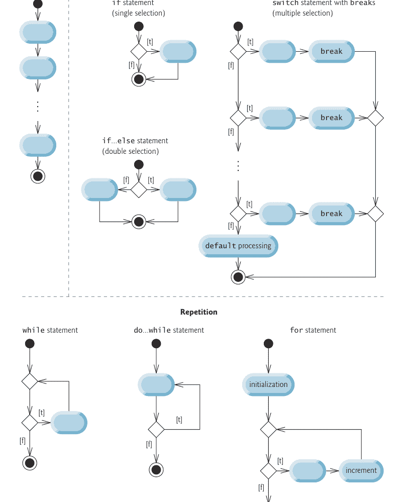

## 形成结构化程序的规则

- 1. 从最简单的活动图开始（图 5.22）。
- 2. 任何动作状态都可以用两个按顺序排列的动作状态替换。
- 3. 任何动作状态都可以用任何控制语句替换（动作状态序列、if、if...else、switch、while、do...while 或 for）。
- 4. 规则 2 和 3 可以按你喜欢的次数和任何顺序应用。

Fig. 5.21 | Rules for forming structured programs.

应用图 5.21 中的规则总是会产生一个结构良好的活动图，具有整洁的构建块外观。例如，反复应用规则 2 到最简单的活动图会产生一个包含许多按顺序排列的动作状态的活动图（图 5.23）。规则 2 生成控制语句的堆栈，所以让我们称规则 2 为堆叠规则。图 5.23 中的垂直虚线不是 UML 的一部分——我们用它们来分隔演示图 5.21 的规则 2 被应用的四个活动图。

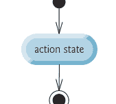

Fig. 5.22 | Simplest activity diagram.

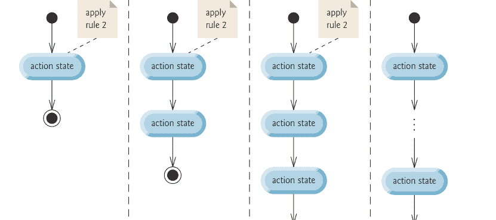

Fig. 5.23 | Repeatedly applying the Rule 2 of Fig. 5.21 to the simplest activity diagram.

规则 3 被称为嵌套规则。反复将规则 3 应用于最简单的活动图会产生一个具有整洁嵌套控制语句的活动图。例如，在图 5.24 中，最简单活动图中的动作状态被替换为双选择（if...else）语句。然后再次将规则 3 应用于双选择语句中的动作状态，将每个动作状态替换为双选择语句。每个双选择语句周围的虚线动作状态符号代表被替换的动作状态。[注意：图 5.24 中显示的虚线箭头和虚线动作状态符号不是 UML 的一部分。它们在这里用于说明任何动作状态都可以被控制语句替换。]

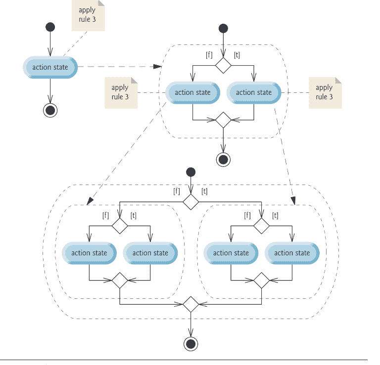

Fig. 5.24 | Repeatedly applying the Rule 3 of Fig. 5.21 to the simplest activity diagram.

规则 4 生成更大、更复杂且嵌套更深的语句。从图 5.21 中的规则应用中产生的图构成了所有可能的<|message|>


- 序列
- if 语句（选择）
- while 语句（重复）

并且这些只能以两种方式组合——堆叠和嵌套。事实上，结构化编程是简洁的本质。

## 5.10（可选）GUI 和图形案例研究：绘制矩形和椭圆

本节演示如何绘制矩形和椭圆，分别使用 Graphics 方法 drawRect 和 drawOval。这些方法在图 5.26 中进行了演示。

```
// Fig. 5.26: Shapes.java
// Demonstrates drawing different shapes.
import java.awt.Graphics;
import javax.swing.JPanel;

public class Shapes extends JPanel
{
    private int choice; // user's choice of which shape to draw

    // constructor sets the user's choice
    public Shapes( int userChoice )
    {
        choice = userChoice;
    } // end Shapes constructor

    // draws a cascade of shapes starting from the top-left corner
    public void paintComponent( Graphics g )
    {
        super.paintComponent( g );

        for ( int i = 0; i < 10; i++ )
        {
            // pick the shape based on the user's choice
            switch ( choice )
            {
                case 1: // draw rectangles
                    g.drawRect( 10 + i * 10, 10 + i * 10,
                        50 + i * 10, 50 + i * 10 );
                    break;
                case 2: // draw ovals
                    g.drawOval( 10 + i * 10, 10 + i * 10,
                        50 + i * 10, 50 + i * 10 );
                    break;
            } // end switch
        } // end for
    } // end method paintComponent
} // end class Shapes
```

```
19
20    JFrame application = new JFrame(); // creates a new JFrame
21
22    application.setDefaultCloseOperation( JFrame.EXIT_ON_CLOSE );
23    application.add( panel ); // add the panel to the frame
24    application.setSize( 300, 300 ); // set the desired size
25    application.setVisible( true ); // show the frame
26 } // end main
27 } // end class ShapesTest
```

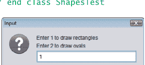

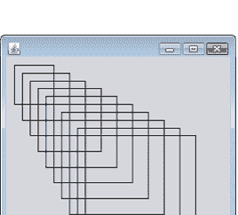

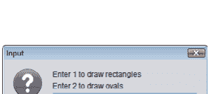

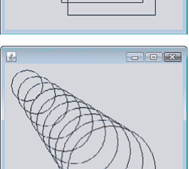

## 图 5.27 | 获取用户输入并创建 JFrame 以显示 Shapes。（第 2 部分，共 2 部分。）

第 11–13 行使用输入对话框提示用户并将用户的响应存储在变量 input 中。第 15 行使用 Integer 方法 parseInt 将用户输入的 String 转换为 int 并将结果存储在变量 choice 中。第 18 行创建一个 Shapes 对象并将用户的选择传递给构造函数。第 20–25 行执行本案例研究中创建和设置窗口的标准操作——创建框架、将其设置为在关闭时退出应用程序、将绘图添加到框架、设置框架大小并使其可见。

## GUI 和图形案例研究练习

5.1 在 JPanel 中央绘制 12 个同心圆（图 5.28）。最内层的圆半径应为 10 像素，每个后续圆的半径应比前一个大 10 像素。首先找到 JPanel 的中心。要获取圆的左上角，从中心向上移动一个半径并向左移动一个半径。包围矩形的宽度和高度都与圆的直径相同（即半径的两倍）。

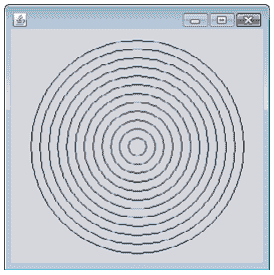

图 5.28 | 绘制同心圆。

5.2 修改本章末尾练习中的练习 5.16，使其使用对话框读取输入并使用长度不等的矩形显示条形图。

## 5.11 总结

在本章中，我们完成了对 Java 控制语句的介绍，这些语句使您能够控制方法中执行的流程。第 4 章讨论了 Java 的 if、if…else 和 while 语句。本章演示了 for、do…while 和 switch 语句。我们表明，任何算法都可以使用序列结构（即按应执行顺序列出的语句）、三种选择语句——if、if…else 和 switch——以及三种重复语句——while、do…while 和 for 的组合来开发。在本章和第 4 章中，我们讨论了如何组合这些构建块以利用经过验证的程序构造和问题解决技术。本章还介绍了 Java 的逻辑运算符，使您能够在控制语句中使用更复杂的条件表达式。在第 6 章中，我们将更深入地研究方法。

## 摘要

### 第 5.2 节 计数器控制重复的要点

- 计数器控制重复（p. 152）需要一个控制变量、控制变量的初始值、每次循环遍历时控制变量的增量（或减量）（也称为每次循环迭代）以及确定是否应继续循环的循环继续条件。
- 您可以在同一语句中声明变量并对其进行初始化。

### 第 5.3 节 for 重复语句

- while 语句可用于实现任何计数器控制循环。
- for 语句（p. 154）在其头部指定计数器控制重复的所有细节
- 当 for 语句开始执行时，其控制变量将被声明并初始化。接下来，程序检查循环继续条件。如果条件最初为真，则执行主体。执行循环主体后，执行增量表达式。然后再次执行循环继续测试，以确定程序是否应继续下一次循环迭代。
- for 语句的一般格式为
  for ( initialization; loopContinuationCondition; increment )
  statement
  其中初始化表达式命名循环的控制变量并提供其初始值，loopContinuationCondition 确定循环是否应继续执行，而 increment 修改控制变量的值，以便循环继续条件最终变为 false。for 头部中的两个分号是必需的。
- 大多数 for 语句可以用等效的 while 语句表示，如下所示：
  initialization;
  while ( loopContinuationCondition )
  {
    statement
    increment;
  }
- 通常，for 语句用于计数器控制重复，而 while 语句用于哨兵控制重复。
- 如果 for 头部中的初始化表达式声明了控制变量，则控制变量只能在该 for 语句中使用——它在 for 语句之外不存在。
- for 头部中的表达式是可选的。如果省略 loopContinuationCondition，Java 假定它始终为真，从而创建无限循环。如果控制变量在循环之前已初始化，您可能会省略初始化表达式。如果增量通过循环主体中的语句计算或不需要增量，您可能会省略增量表达式。
- for 中的增量表达式就像 for 主体末尾的独立语句一样起作用。
- for 语句可以通过使用负增量（即减量）向下计数。
- 如果循环继续条件最初为假，程序不会执行 for 语句的主体。相反，执行将继续执行 for 之后的语句。

### 第 5.4 节 使用 for 语句的示例

- Java 将浮点常量如 1000.0 和 0.05 视为 double 类型。同样，Java 将整数常量如 7 和 -22 视为 int 类型。
- 格式说明符 %4s 在宽度为 4 的字段中输出 String——即 printf 以至少 4 个字符位置显示值。如果要输出的值宽度小于 4 个字符位置，则该值默认在字段中右对齐（p. 160）。如果该值宽度大于 4 个字符位置，则字段宽度会扩展以容纳适当数量的字符。要左对齐（p. 160）该值，请使用负整数指定字段宽度。
- Math.pow(x, y)（p. 161）计算 x 的 y 次幂的值。该方法接收两个 double 参数并返回一个 double 值。
- 格式说明符中的逗号（,）格式化标志（p. 161）表示浮点值应使用分组分隔符（p. 161）输出。实际使用的分隔符特定于用户的区域设置（即国家/地区）。在美国，数字将用逗号分隔每三位数字，并用小数点分隔数字的小数部分，如 1,234.45。
- 格式说明符中的 . 表示其右侧的整数是数字的精度。

### 第 5.5 节 do...while 重复语句

- do...while 语句（p. 162）与 while 语句类似。在 while 中，程序在执行主体之前在循环开始时测试循环继续条件；如果 con-


condition is false, the body never executes. The do...while statement tests the loop-continuation condition after executing the loop's body; therefore, the body always executes at least once.

## Section 5.6 switch Multiple-Selection Statement

- The switch statement (p. 164) performs different actions based on the possible values of a constant integral expression (a constant value of type byte, short, int or char, but not long).
- The end-of-file indicator (p. 167) is a system-dependent keystroke combination that terminates user input. On UNIX/Linux/Mac OS X systems, end-of-file is entered by typing the sequence <Ctrl> d on a line by itself. This notation means to simultaneously press both the Ctrl key and the d key. On Windows systems, enter end-of-file by typing <Ctrl> z.
- Scanner method hasNext (p. 167) determines whether there's more data to input. This method returns the boolean value true if there's more data; otherwise, it returns false. As long as the end-of-file indicator has not been typed, method hasNext will return true.
- The switch statement consists of a block that contains a sequence of case labels (p. 168) and an optional default case (p. 168).
- When the flow of control reaches a switch, the program evaluates the switch's controlling expression and compares its value with each case label. If a match occurs, the program executes the statements for that case.
- Listing cases consecutively with no statements between them enables the cases to perform the same set of statements.
- Every value you wish to test in a switch must be listed in a separate case label.
- Each case can have multiple statements, and these need not be placed in braces.
- Without break statements, each time a match occurs in the switch, the statements for that case and subsequent cases execute until a break statement or the end of the switch is encountered.
- If no match occurs between the controlling expression's value and a case label, the optional default case executes. If no match occurs and the switch does not contain a default case, program control simply continues with the first statement after the switch.
- As of Java SE 7, you can use Strings in a switch statement's controlling expression and case labels.

## Section 5.7 break and continue Statements

- The break statement (p. 168), when executed in a while, for, do...while or switch, causes immediate exit from that statement.
- The continue statement (p. 172), when executed in a while, for or do...while, skips the loop's remaining body statements and proceeds with its next iteration. In while and do...while statements, the program evaluates the loop-continuation test immediately. In a for statement, the increment expression executes, then the program evaluates the loop-continuation test.

## Section 5.8 Logical Operators

- Simple conditions are expressed in terms of the relational operators >, <, >= and <= and the equality operators == and !=, and each expression tests only one condition.
- Logical operators (p. 174) enable you to form more complex conditions by combining simple conditions. The logical operators are && (conditional AND), || (conditional OR), & (boolean logical AND), | (boolean logical inclusive OR), ^ (boolean logical exclusive OR) and ! (logical NOT).
- To ensure that two conditions are both true, use the && (conditional AND) operator. If either or both of the simple conditions are false, the entire expression is false.
- To ensure that either or both of two conditions are true, use the || (conditional OR) operator, which evaluates to true if either or both of its simple conditions are true.
- A condition using && or || operators (p. 174) uses short-circuit evaluation (p. 175)—they’re evaluated only until it’s known whether the condition is true or false.
- The & and | operators (p. 175) work identically to the && and || operators, but always evaluate both operands.
- A simple condition containing the boolean logical exclusive OR (^; p. 176) operator is true if and only if one of its operands is true and the other is false. If both operands are true or both are false, the entire condition is false. This operator is also guaranteed to evaluate both of its operands.
- The unary ! (logical NOT; p. 176) operator “reverses” the value of a condition.

## Self-Review Exercises

### 5.1 (Fill in the Blanks)

Fill in the blanks in each of the following statements:

- a) Typically, __________ statements are used for counter-controlled repetition and __________ statements for sentinel-controlled repetition.
- b) The do...while statement tests the loop-continuation condition __________ executing the loop’s body; therefore, the body always executes at least once.
- c) The __________ statement selects among multiple actions based on the possible values of an integer variable or expression.
- d) The __________ statement, when executed in a repetition statement, skips the remaining statements in the loop body and proceeds with the next iteration of the loop.
- e) The __________ operator can be used to ensure that two conditions are both true before choosing a certain path of execution.
- f) If the loop-continuation condition in a for header is initially __________, the program does not execute the for statement’s body.
- g) Methods that perform common tasks and do not require objects are called __________ methods.

### 5.2 (True/False Questions)

State whether each of the following is true or false. If false, explain why.

- a) The default case is required in the switch selection statement.
- b) The break statement is required in the last case of a switch selection statement.
- c) The expression (( x > y ) && ( a < b )) is true if either x > y is true or a < b is true.
- d) An expression containing the || operator is true if either or both of its operands are true.
- e) The comma (,) formatting flag in a format specifier (e.g., %,20.2f) indicates that a value should be output with a thousands separator.
- f) To test for a range of values in a switch statement, use a hyphen (-) between the start and end values of the range in a case label.
- g) Listing cases consecutively with no statements between them enables the cases to perform the same set of statements.

### 5.3 (Write a Statement)

Write a Java statement or a set of Java statements to accomplish each of the following tasks:

- a) Sum the odd integers between 1 and 99, using a for statement. Assume that the integer variables sum and count have been declared.
- b) Calculate the value of 2.5 raised to the power of 3, using the pow method.
- c) Print the integers from 1 to 20, using a while loop and the counter variable i. Assume that the variable i has been declared, but not initialized. Print only five integers per line. [Hint: Use the calculation i % 5. When the value of this expression is 0, print a newline character; otherwise, print a tab character. Assume that this code is an application. Use the System.out.println() method to output the newline character, and use the System.out.print( '\t' ) method to output the tab character.]
- d) Repeat part (c), using a for statement.

### 5.4 (Find the Error)

Find the error in each of the following code segments, and explain how to correct it:

```java
a) i = 1;
while ( i <= 10 );
    ++i;
}
```

```java
b) for ( k = 0.1; k != 1.0; k += 0.1 )
    System.out.println( k );
```

```java
c) switch ( n )
{
    case 1:
        System.out.println( "The number is 1" );
    case 2:
        System.out.println( "The number is 2" );
        break;
    default:
        System.out.println( "The number is not 1 or 2" );
        break;
}
```

d) The following code should print the values 1 to 10:

```java
n = 1;
while ( n < 10 )
    System.out.println( n++ );
```

## Answers to Self-Review Exercises

5.1 a) for, while. b) after. c) switch. d) continue. e) && (conditional AND). f) false. g) static.

5.2 a) False. The default case is optional. If no default action is needed, then there’s no need for a default case. b) False. The break statement is used to exit the switch statement. The break statement is not required for the last case in a switch statement. c) False. Both of the relational expressions must be true for the entire expression to be true when using the && operator. d) True. e) True. f) False. The switch statement does not provide a mechanism for testing ranges of values, so every value that must be tested should be listed in a separate case label. g) True.

5.3 a)

```java
sum = 0;
for ( count = 1; count <= 99; count += 2 )
    sum += count;
```

5.3 b)

```java
double result = Math.pow( 2.5, 3 );
```

5.3 c)

```java
i = 1;
while ( i <= 20 )
{
    System.out.print( i );
    if ( i % 5 == 0 )
        System.out.println();
    else
        System.out.print( '\t' );
    ++i;
}
```

5.3 d)

```java
for ( i = 1; i <= 20; i++ )
{
    System.out.print( i );
```


```
if ( i % 5 == 0 )
    System.out.println();
else
    System.out.print( '\t' );
}
```

## 5.4

a) 错误：在 while 头部后面的分号会导致无限循环，并且缺少左大括号。
修正：将分号替换为 {，或同时删除 ; 和 }。

b) 错误：使用浮点数控制 for 语句可能无法正常工作，因为大多数计算机只能近似表示浮点数。
修正：使用整数，并执行适当的计算以获得所需的数值：

```
for ( k = 1; k != 10; k++ )
    System.out.println( (double) k / 10 );
```

c) 错误：缺少的代码是第一个 case 的语句中的 break 语句。
修正：在第一个 case 的语句末尾添加 break 语句。如果希望 case 2: 的语句在 case 1: 的语句执行时每次都执行，则此遗漏不一定是错误。

d) 错误：在 while 的继续条件中使用了不适当的 relational 运算符。
修正：使用 <= 而不是 <，或将 10 改为 11。

## Exercises

- 5.5 描述计数控制重复的四个基本元素。
- 5.6 比较和对比 while 和 for 重复语句。
- 5.7 讨论一种情况，在这种情况下，使用 do...while 语句比使用 while 语句更合适。解释原因。
- 5.8 比较和对比 break 和 continue 语句。
- 5.9 查找并纠正以下代码段中的错误：

a) For ( i = 100, i >= 1, i++ )

```
System.out.println( i );
```

b) 以下代码应打印整数值是奇数还是偶数：

```
switch ( value % 2 )
{
    case 0:
        System.out.println( "Even integer" );
    case 1:
        System.out.println( "Odd integer" );
}
```

## 5.10 下列程序做什么？

// Exercise 5.10: Printing.java
public class Printing
{
    public static void main( String[] args )
    {
        for ( int i = 1; i <= 10; i++ )
        {
            for ( int j = 1; j <= 5; j++ )
                System.out.print( '@' );

            System.out.println();
        } // end outer for
    } // end main
} // end class Printing

5.11 （查找最小值）编写一个应用程序来查找若干整数中的最小值。假设第一个读取的值指定要从用户输入的值的数量。

5.12 （计算奇整数的乘积）编写一个应用程序，计算从 1 到 15 的奇整数的乘积。

5.13 （阶乘）阶乘在概率问题中经常使用。正整数 n 的阶乘（写为 n! 并读作“n 阶乘”）等于从 1 到 n 的正整数的乘积。编写一个应用程序，计算 1 到 20 的阶乘。使用 long 类型。以表格格式显示结果。什么困难可能会阻止你计算 100 的阶乘？

5.14 （修改的复利程序）修改图 5.6 的复利应用程序，使其对 5%、6%、7%、8%、9% 和 10% 的利率重复其步骤。使用 for 循环来改变利率。

5.15 （三角形打印程序）编写一个应用程序，分别在彼此下方显示以下模式。使用 for 循环生成模式。所有星号 (*) 都应由单个语句 System.out.print( '*' ); 打印出来，这会导致星号并排打印。语句 System.out.println(); 可用于移动到下一行。语句 System.out.print( ' ' ); 可用于显示最后两个模式的空格。程序中不应有其他输出语句。[提示：最后两个模式要求每一行以适当数量的空格开头。]

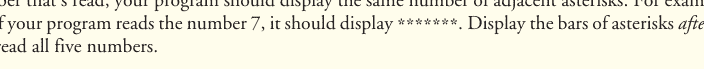

5.16 （条形图打印程序）计算机的一个有趣应用是显示图形和条形图。编写一个应用程序，读取五个介于 1 和 30 之间的数字。对于读取的每个数字，你的程序应显示相同数量的相邻星号。例如，如果你的程序读取数字 7，它应显示 *******。在读取所有五个数字后显示星号条。

## 5.17 （计算销售额）某在线零售商销售五种产品，其零售价如下：产品 1，$2.98；产品 2，$4.50；产品 3，$9.98；产品 4，$4.49 和产品 5，$6.87。编写一个应用程序，读取一系列数字对，如下所示：

- a) 产品编号
- b) 售出数量

你的程序应使用 switch 语句确定每种产品的零售价。它应计算并显示所有售出产品的总零售价值。使用哨兵控制循环来确定程序何时应停止循环并显示最终结果。

## 5.18 （修改的复利程序）修改图 5.6 中的应用程序，仅使用整数来计算复利。[提示：将所有货币金额视为便士的整数。然后通过分别使用除法和余数运算，将结果分解为其美元和美分部分。在美元和美分部分之间插入一个句点。]

## 5.19 假设 i = 1，j = 2，k = 3 且 m = 2。以下每个语句打印什么？

- a) System.out.println( i == 1 );
- b) System.out.println( j == 3 );
- c) System.out.println( ( i >= 1 ) && ( j < 4 ) );
- d) System.out.println( ( m <= 99 ) & ( k < m ) );
- e) System.out.println( ( j >= i ) || ( k == m ) );
- f) System.out.println( ( k + m < j ) | ( 3 - j >= k ) );
- g) System.out.println( !( k > m ) );

## 5.20 （计算 π 的值）从无穷级数计算 π 的值

π = 4 − 4/3 + 4/5 − 4/7 + 4/9 − 4/11 + …

打印一个表格，显示通过计算该级数的前 200,000 项来近似的 π 值。你需要使用多少项才能第一次得到以 3.14159 开头的数值？

## 5.21 （毕达哥拉斯三元组）直角三角形可以具有长度均为整数的边。直角三角形三边长度的三个整数值集合称为毕达哥拉斯三元组。三边长度必须满足的关系是两边平方之和等于斜边平方。编写一个应用程序，显示边长 side1、side2 和斜边均不超过 500 的毕达哥拉斯三元组表。使用三重嵌套 for 循环尝试所有可能性。这种方法是一个“暴力”计算的例子。你将在更高级的计算机科学课程中学习到，对于许多有趣的问题，除了使用纯粹的暴力之外，没有已知的算法方法。

## 5.22 （修改的三角形打印程序）修改练习 5.15，将你从四个单独的星号三角形中得到的代码组合起来，使四个模式并排打印。[提示：巧妙地使用嵌套 for 循环。]

## 5.24 （菱形打印程序）编写一个应用程序，打印以下菱形形状。你可以使用打印单个星号 (*)、单个空格或单个换行符的输出语句。最大化重复的使用（使用嵌套 for 语句），并最小化输出语句的数量。

```
*
 ***
 *****
 *******
 *********
 *******
 *****
 ***
 *
```

## 5.25 （修改的菱形打印程序）修改你在练习 5.24 中编写的应用程序，读取 1 到 19 范围内的奇数，以指定菱形的行数。你的程序然后应显示适当大小的菱形。

## 5.26 对 break 语句和 continue 语句的批评是每个都是非结构化的。实际上，这些语句总可以用结构化语句替换，尽管这样做可能很笨拙。描述一般情况下你如何从程序中的循环中删除任何 break 语句并用一些结构化等价物替换它。[提示：break 语句从循环体退出循环。另一种退出方式是通过失败的循环继续测试。考虑在循环继续测试中使用第二个测试，该测试指示“由于‘break’条件而提前退出。”] 使用你在此处开发的技术，从图 5.12 中的应用程序中删除 break 语句。

## 5.27 下列程序段做什么？

```
for ( i = 1; i <= 5; i++ )
{
    for ( j = 1; j <= 3; j++ )
    {
        for ( k = 1; k <= 4; k++ )
            System.out.print( "*" );
        System.out.println();
    } // end inner for
    System.out.println();
} // end outer for
```

## 5.28 描述一般情况下你如何从程序中的循环中删除任何 continue 语句并用一些结构化等价物替换它。使用你在此处开发的技术，从图 5.13 中的程序中删除 continue 语句。

## 5.29 （“十二天圣诞节”歌曲）编写一个应用程序，使用重复和 switch 语句打印歌曲“十二天圣诞节”。应使用一个 switch 语句打印日期（“第一”，“第二”，等等）。应使用单独的 switch 语句打印每节的其余部分。访问网站 en.wikipedia.org/wiki/The_Twelve_Days_of_Christmas_(song) 获取歌曲的歌词。

## Making a Difference

## 5.30 （全球变暖事实测验）全球变暖这一有争议的问题已被电影《难以忽视的真相》广泛宣传，该片由前副总统阿尔·戈尔主演。戈尔先生和联合国科学家网络政府间气候变化专门委员会因“为增进对人为气候变化的知识建设和传播做出努力”而分享了 2007 年诺贝尔和平奖。在网上研究全球变暖问题的双方（你


可能需要搜索诸如“全球变暖怀疑论者”之类的短语。创建一个关于全球变暖的五道选择题测验，每个问题有四个可能的答案（编号为 1–4）。保持客观，尽量公平地代表问题的双方。接下来，编写一个应用程序来管理测验，计算正确答案的数量（零到五）并向用户返回一条消息。如果用户正确回答了五个问题，打印“Excellent”；如果四个，打印“Very good”；如果三个或更少，打印“Time to brush up on your knowledge of global warming,” 并列出一些你查找事实的网站。

## 5.31 （税收计划替代方案；“公平税”） 有许多提议使税收更公平。查看美国的 FairTax 倡议

www.fairtax.org/site/PageServer?pagename=calculator

研究拟议的 FairTax 如何运作。一个建议是取消所得税和其他大多数税，改为对购买的所有产品和服务征收 23% 的消费税。一些 FairTax 反对者质疑 23% 的数字，并说由于税收的计算方式，更准确地说税率为 30%——请仔细核查。编写一个程序，提示用户输入他们在各种支出类别中的支出（例如，住房、食品、服装、交通、教育、医疗保健、度假），然后打印该人将支付的估计 FairTax。

## 5.32 （Facebook 用户基数增长） 根据 CNNMoney.com，Facebook 在 2010 年 7 月达到 5 亿用户，其用户基数以每月 5% 的速度增长。

使用你在图 5.6 中学到的复利增长技术并假设该增长率持续下去，Facebook 需要多少个月才能将其用户基数增长到十亿用户？Facebook 需要多少个月才能将其用户基数增长到二十亿用户（在撰写本文时，这是互联网上的人数总数）？

## 6.1 引言

经验表明，开发和维护大型程序的最佳方法是将其构建成小型、简单的部分，或模块。这种技术称为分而治之。我们在第 3 章中介绍的方法可以帮助你将程序模块化。在本章中，我们更深入地研究方法。我们强调如何声明和使用方法以促进大型程序的设计、实现、操作和维护。

你会看到，可以在无需类对象存在的情况下调用某些方法，称为静态方法。你将学习如何声明具有多个参数的方法。你还将学习 Java 如何跟踪当前正在执行的方法、方法的局部变量如何在内存中维护，以及方法在完成执行后如何知道返回的位置。

我们将简要转向使用随机数生成的模拟技术，并开发一个使用到目前为止本书中你使用的大多数编程技术的赌场骰子游戏 craps 的版本。此外，你将学习如何在程序中声明不可更改的值（即常量）。

你在使用或创建应用程序时使用的许多类将具有多个同名的方法。这种技术称为重载，用于实现对不同类型参数或不同数量参数执行类似任务的方法。

我们在第 18 章《递归》中继续讨论方法。递归提供了一种有趣的思考方法和算法的方式。

## 6.2 Java 中的程序模块

你通过将新方法和类与 Java 应用程序编程接口（也称为 Java API 或 Java 类库）以及各种其他类库中提供的预定义方法组合在一起来编写 Java 程序。相关的类通常被分组到包中，以便可以将其导入程序并重复使用。你将学习

- 6.1 引言
- 6.2 Java 中的程序模块
- 6.3 static 方法、static 字段和类 Math
- 6.4 声明具有多个参数的方法
- 6.5 声明和使用方法的说明
- 6.6 方法调用栈和激活记录
- 6.7 参数提升和强制转换
- 6.8 Java API 包
- 6.9 案例研究：随机数生成
- 6.9.1 随机数的广义缩放和移位
- 6.9.2 用于测试和调试的随机数可重复性
- 6.10 案例研究：一个机会游戏；介绍枚举
- 6.11 声明的作用域
- 6.12 方法重载
- 6.13 （可选）GUI 和图形案例研究：颜色和填充形状
- 6.14 总结

如何在第 8 章中将自己的类分组到包中。Java API 提供了丰富的预定义类集合，其中包含用于执行常见数学计算、字符串操作、字符操作、输入/输出操作、数据库操作、网络操作、文件处理、错误检查和其他许多有用任务的方法。

### 软件工程观察 6.1

熟悉 Java API 提供的丰富类和方法集合（download.oracle.com/javase/6/docs/api/）。第 6.8 节介绍了几个常见包的概述。附录 E 解释了如何浏览 API 文档。不要重新发明轮子。尽可能重用 Java API 类和方法。这可以减少程序开发时间并避免引入编程错误。

方法（在某些语言中称为函数或过程）通过将任务分离为独立的单元来帮助你模块化程序。你在编写的每个程序中都声明了方法。方法体中的语句只编写一次，对其他方法隐藏，并且可以从程序中的多个位置重用。

将程序模块化为方法的动机之一是分而治之的方法，通过从小型、简单的部分构建程序，使程序开发更易于管理。另一个是软件可重用性——使用现有方法作为构建块来创建新程序。通常，你可以主要从标准化方法创建程序，而不是通过构建自定义代码。例如，在之前的程序中，我们没有定义如何从键盘读取数据——Java 在类 Scanner 的方法中提供了这些功能。第三个动机是避免重复代码。将程序划分为有意义的方法使程序更易于调试和维护。

### 软件工程观察 6.2

为了促进软件可重用性，每个方法都应仅限于执行单一、明确定义的任务，并且方法名应有效地表达该任务。

### 错误预防提示 6.1

执行一项任务的方法比执行多项任务的方法更容易测试和调试。

### 软件工程观察 6.3

如果你无法选择一个简洁的名称来表达方法的任务，你的方法可能试图执行太多任务。将此类方法分解为几个更小的方法。

如你所知，方法是通过方法调用来调用的，并且当被调用的方法完成其任务后，它会返回结果或仅将控制权返回给调用者。对此程序结构的类比是管理层级形式（图 6.1）。老板（调用者）要求工人（被调用方法）执行任务并在完成任务后报告（返回）结果。老板方法不知道工人方法如何执行其指定任务。工人还可能调用其他工人方法，而老板并不知情。这种对实现细节的“隐藏”促进了良好的软件工程。图 6.1 显示了老板方法以层级方式与多个工人方法通信。老板方法将其职责分配给各个工人方法。在这里，worker1 充当 worker4 和 worker5 的“老板方法”。


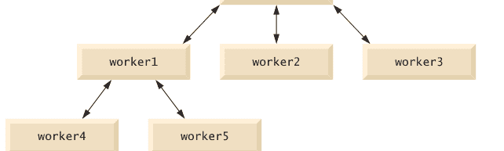

图 6.1 | 层级式的“老板方法/工人方法”关系。

## 6.3 static 方法、static 字段与 Math 类

尽管大多数方法是通过对特定对象的方法调用来执行的，但情况并非总是如此。有时某个方法执行的任务不依赖于任何对象的内容。这样的方法适用于其声明的整个类，称为静态方法或类方法。类中通常包含便捷的静态方法来执行常见任务。例如，回顾我们在图 5.6 中曾使用 Math 类的静态方法 pow 来计算一个值的幂。要将方法声明为 static，只需在方法声明的返回类型前放置关键字 static。对于程序中导入的任何类，你可以通过指定声明该方法的类名，后跟一个点（.）和方法名来调用该类的静态方法，如下所示：

```
ClassName.methodName( arguments )
```

我们在此使用各种 Math 类方法来介绍静态方法的概念。Math 类提供了一系列方法，使你能够执行常见的数学计算。例如，你可以通过静态方法调用 `Math.sqrt( 900.0 )` 计算 900.0 的平方根。

上述表达式求值为 30.0。sqrt 方法接受一个 double 类型的参数，并返回一个 double 类型的结果。要在命令窗口中输出上述方法调用的值，你可以编写如下语句：

```
System.out.println( Math.sqrt( 900.0 ) );
```

在此语句中，sqrt 返回的值成为 println 方法的参数。在调用 sqrt 方法之前无需创建 Math 对象。此外，Math 类的所有方法都是 static 的——因此，每个方法都是通过在方法名前加上类名 Math 和点（.）分隔符来调用的。

> 软件工程观察 6.4
> Math 类是 java.lang 包的一部分，该包由编译器隐式导入，因此使用 Math 类的方法时无需显式导入 Math 类。

方法参数可以是常量、变量或表达式。如果 c = 13.0, d = 3.0, f = 4.0，则语句

```
System.out.println( Math.sqrt( c + d * f ) );
```

计算并打印 13.0 + 3.0 * 4.0 = 25.0 的平方根，即 5.0。图 6.2 总结了若干 Math 类方法。在图中，x 和 y 均为 double 类型。

| 方法 | 描述 | 示例 |
|---|---|---|
| abs(x) | x 的绝对值 | abs(23.7) 为 23.7<br>abs(0.0) 为 0.0<br>abs(-23.7) 为 23.7 |
| ceil(x) | 将 x 舍入为不小于 x 的最小整数 | ceil(9.2) 为 10.0<br>ceil(-9.8) 为 -9.0 |
| cos(x) | x 的三角余弦（x 以弧度为单位） | cos(0.0) 为 1.0 |
| exp(x) | 指数方法 e^x | exp(1.0) 为 2.71828<br>exp(2.0) 为 7.38906 |
| floor(x) | 将 x 舍入为不大于 x 的最大整数 | floor(9.2) 为 9.0<br>floor(-9.8) 为 -10.0 |
| log(x) | x 的自然对数（以 e 为底） | log(Math.E) 为 1.0<br>log(Math.E * Math.E) 为 2.0 |
| max(x, y) | x 和 y 中的较大值 | max(2.3, 12.7) 为 12.7<br>max(-2.3, -12.7) 为 -2.3 |
| min(x, y) | x 和 y 中的较小值 | min(2.3, 12.7) 为 2.3<br>min(-2.3, -12.7) 为 -12.7 |
| pow(x, y) | x 的 y 次幂（即 x^y） | pow(2.0, 7.0) 为 128.0<br>pow(9.0, 0.5) 为 3.0 |
| sin(x) | x 的三角正弦（x 以弧度为单位） | sin(0.0) 为 0.0 |
| sqrt(x) | x 的平方根 | sqrt(900.0) 为 30.0 |
| tan(x) | x 的三角正切（x 以弧度为单位） | tan(0.0) 为 0.0 |

图 6.2 | Math 类方法。

## Math 类常量 PI 和 E

Math 类声明了两个表示常用数学常量的字段——Math.PI 和 Math.E。Math.PI（3.141592653589793）是圆的周长与其直径的比值。Math.E（2.718281828459045）是自然对数的底数（通过静态 Math 方法 log 计算）。这些字段在 Math 类中使用修饰符 public、final 和 static 声明。将它们声明为 public 允许你在自己的类中使用这些字段。任何用关键字 final 声明的字段都是常量——其值在字段初始化后不能更改。PI 和 E 被声明为 final，因为它们的值从不改变。将这些字段声明为 static 使它们可以通过类名 Math 和点（.）分隔符访问，就像 Math 类的方法一样。回顾第 3.4 节，当类的每个对象维护其自身的一份属性副本时，表示该属性的字段也称为实例变量——类的每个对象（实例）在内存中都有该变量的独立实例。有些字段对于类的每个对象并没有单独的实例。static 字段就是这种情况，它们也被称为类变量。当创建包含 static 字段的类的对象时，该类的所有对象共享该类 static 字段的一份副本。类变量（即 static 变量）和实例变量共同构成了类的字段。你将在第 8.11 节了解更多关于 static 字段的内容。

## 为什么 main 方法要声明为 static？

当你使用 java 命令执行 Java 虚拟机（JVM）时，JVM 会尝试调用你指定类的 main 方法——此时尚未创建该类的任何对象。将 main 声明为 static 允许 JVM 在不创建类实例的情况下调用 main。当你执行应用程序时，你需要将类名作为参数传递给 java 命令，如下所示：

```
java ClassName argument1 argument2 ...
```

JVM 加载由 ClassName 指定的类，并使用该类名来调用 main 方法。在上述命令中，ClassName 是传递给 JVM 的一个命令行参数，用于告诉它执行哪个类。在 ClassName 之后，你还可以指定一个字符串列表（以空格分隔）作为命令行参数，JVM 会将这些参数传递给应用程序。这些参数可能用于指定运行应用程序的选项（例如文件名）。正如你将在第 7 章“数组与 ArrayList”中学到的，你的应用程序可以访问这些命令行参数并使用它们来定制应用程序。

## 6.4 声明具有多个参数的方法

方法通常需要多条信息来执行其任务。我们现在来考虑如何编写具有多个参数的自定义方法。

图 6.3 使用名为 maximum 的方法来确定并返回三个 double 值中的最大值。在 main 中，第 14–18 行提示用户输入三个 double 值，然后从用户处读取这些值。第 21 行调用方法 maximum（在第 28–41 行声明）来确定作为参数接收的三个值中的最大值。当 maximum 方法将结果返回给第 21 行时，程序将 maximum 的返回值赋给局部变量 result。然后第 24 行输出最大值。在本节末尾，我们将讨论第 24 行中运算符 + 的使用。

```
1 // Fig. 6.3: MaximumFinder.java
2 // Programmer-declared method maximum with three double parameters.
3 import java.util.Scanner;
4 
5 public class MaximumFinder
6 {
7    // obtain three floating-point values and locate the maximum value
8    public static void main( String[] args )
9    {
10    // create Scanner for input from command window
11    Scanner input = new Scanner( System.in );
12    
13    // prompt for and input three floating-point values
14    System.out.print(
15        "Enter three floating-point values separated by spaces: " );
16      double number1 = input.nextDouble(); // read first double
17      double number2 = input.nextDouble(); // read second double
18      double number3 = input.nextDouble(); // read third double
19
20      // determine the maximum value
21      double result = maximum( number1, number2, number3 );
22
23      // display maximum value
24      System.out.println( "Maximum is: " + result );
25  } // end main
26
27  // returns the maximum of its three double parameters
28  public static double maximum( double x, double y, double z )
29  {
30      double maximumValue = x; // assume x is the largest to start
31
32      // determine whether y is greater than maximumValue
33      if ( y > maximumValue )
34          maximumValue = y;
35
36      // determine whether z is greater than maximumValue
37      if ( z > maximumValue )
38          maximumValue = z;
39
40      return maximumValue;
41  } // end method maximum
42  } // end class MaximumFinder
```

```
Enter three floating-point values separated by spaces: 9.35 2.74 5.1
Maximum is: 9.35
```

```
Enter three floating-point values separated by spaces: 5.8 12.45 8.32
Maximum is: 12.45
```

```
Enter three floating-point values separated by spaces: 6.46 4.12 10.54
Maximum is: 10.54
```

图 6.3 | 程序员声明的具有三个 double 参数的方法 maximum。（第 2 部分，共 2 部分。）

## public 和 static 关键字

方法 maximum 的声明以关键字 public 开头，表示该方法是“对公众可用的”——它可以被其他类的方法调用。关键字 static 使 main 方法（另一个静态方法）能够如第 21 行所示那样调用 maximum，而无需用类名 MaximumFinder 限定方法名——同一类中的静态方法可以直接相互调用。任何其他使用 maximum 的类都必须用类名完全限定方法名。

## 方法 maximum

考虑 maximum 的声明（第 28–41 行）。第 28 行表明它返回一个 double 值，方法名为 maximum，并且该方法需要三个 double 参数。


参数（x、y和z）用于完成其任务。多个参数以逗号分隔的列表形式指定。当从第21行调用maximum时，参数x、y和z分别用实参number1、number2和number3的值初始化。方法调用中的实参数量必须与方法声明中的参数数量一一对应。此外，每个实参的类型必须与相应参数的类型一致。例如，double类型的参数可以接收像7.35、22或−0.03456这样的值，但不能接收像"hello"这样的字符串，也不能接收布尔值true或false。6.7节讨论了在方法调用中可以为每个基本类型参数提供的实参类型。

为了确定最大值，我们首先假设参数x包含最大值，因此第30行声明局部变量maximumValue并用参数x的值初始化它。当然，参数y或z可能包含实际的最大值，所以我们必须将这两个值分别与maximumValue进行比较。第33–34行的if语句判断y是否大于maximumValue。如果是，第34行将y赋给maximumValue。第37–38行的if语句判断z是否大于maximumValue。如果是，第38行将z赋给maximumValue。此时，三个值中的最大值位于maximumValue中，因此第40行将该值返回给第21行。当程序控制返回到程序中调用maximum的位置时，maximum的参数x、y和z不再存在于内存中。

### 软件工程观察 6.5

方法最多只能返回一个值，但返回的值可以是对包含多个值的对象的引用。

### 软件工程观察 6.6

只有当变量需要在类的多个方法中使用，或者程序需要在调用类的方法之间保存它们的值时，才应将变量声明为字段。

### 常见编程错误 6.1

将相同类型的多个方法参数声明为`float x, y`而不是`float x, float y`是语法错误——参数列表中的每个参数都需要一个类型。

### 通过重用方法Math.max实现方法maximum

我们的maximum方法的整个方法体也可以用两次对Math.max的调用来实现，如下所示：

```
return Math.max( x, Math.max( y, z ) );
```

第一次调用Math.max指定实参x和Math.max( y, z )。在调用任何方法之前，必须先对其实参求值以确定它们的值。如果实参是一个方法调用，则必须执行该调用以确定其返回值。因此，在前面的语句中，先对Math.max( y, z )求值以确定y和z中的最大值。然后将结果作为第二个实参传递给另一个Math.max调用，该调用返回其两个实参中的较大者。这是软件重用的一个很好的例子——我们通过重用Math.max（它找出两个值中的较大者）来找出三个值中的最大值。注意与图6.3中第30–38行相比，这段代码是多么简洁。

### 使用字符串拼接组装字符串

Java允许你使用运算符+或+=将String对象组装成更大的字符串。这称为字符串拼接。当运算符+的两个操作数都是String对象时，运算符+会创建一个新的String对象，其中右操作数的字符被放置在左操作数字符的末尾——例如，表达式"hello " + "there"创建字符串"hello there"。

在图6.3的第24行，表达式"Maximum is: " + result使用运算符+，操作数类型为String和double。Java中的每个基本类型值和对象都有String表示形式。当运算符+的一个操作数是String时，另一个操作数会被转换为String，然后两者拼接在一起。在第24行，double值被转换为其String表示形式，并放置在字符串"Maximum is: "的末尾。如果double值有任何尾随零，在数字转换为String时这些零会被丢弃——例如9.3500将表示为9.35。

用于字符串拼接的基本类型值会被转换为String。与String拼接的boolean会被转换为字符串"true"或"false"。所有对象都有一个toString方法，返回该对象的String表示形式。（我们将在后续章节更详细地讨论toString。）当对象与String拼接时，会隐式调用对象的toString方法以获取该对象的String表示形式。也可以显式调用toString。

你可以将大的String字面量拆分成几个较小的String，并将它们放在多行代码中以提高可读性。在这种情况下，可以使用拼接将这些String重新组装起来。我们将在第16章详细讨论String的细节。

### 常见编程错误 6.2

跨行拆分String字面量是语法错误。如有必要，可以将String拆分为几个较小的String，并使用拼接来形成所需的String。

### 常见编程错误 6.3

混淆用于字符串拼接的+运算符和用于加法的+运算符可能会导致奇怪的结果。Java从左到右计算运算符的操作数。例如，如果整数变量y的值为5，表达式"y + 2 = " + y + 2的结果是字符串"y + 2 = 52"，而不是"y + 2 = 7"，因为首先将y的值（5）拼接到字符串"y + 2 ="上，然后将值2拼接到新的更大的字符串"y + 2 = 5"上。表达式"y + 2 = " + (y + 2)产生期望的结果"y + 2 = 7"。

## 6.5 声明和使用方法的注意事项

调用方法有三种方式：

- 1. 单独使用方法名来调用同一类的另一个方法——例如图6.3第21行的maximum(number1, number2, number3)。
- 2. 使用包含对象引用的变量，后跟点号（.）和方法名来调用所引用对象的非静态方法——例如图5.10第13行的方法调用myGradeBook.displayMessage()，该方法从GradeBookTest的main方法中调用GradeBook类的一个方法。
- 3. 使用类名和点号（.）来调用类的静态方法——例如6.3节中的Math.sqrt(900.0)。

静态方法只能直接调用同一类的其他静态方法（即单独使用方法名），并且只能直接操作同一类中的静态变量。要访问类的非静态成员，静态方法必须使用对类对象的引用。回想一下，`static`方法与整个类相关，而非静态方法与类的特定实例（对象）相关联，并且可以操作该对象的实例变量。一个类可以同时存在多个对象，每个对象都有自己的实例变量副本。假设一个静态方法直接调用一个非静态方法。该方法如何知道要操作哪个对象的实例变量？如果在调用非静态方法时类的对象不存在，会发生什么？因此，Java不允许静态方法直接访问同一类的非静态成员。

有三种方法可以将控制权返回给调用方法的语句。如果方法不返回结果，当程序流到达方法结束的右花括号或执行以下语句时，控制权返回：

```
return;
```

如果方法返回结果，则语句

```
return expression;
```

计算*表达式*，然后将结果返回给调用者。

### 常见编程错误 6.4

在类声明体外或另一个方法体内声明方法是语法错误。

### 常见编程错误 6.5

在方法声明参数列表的右括号后放置分号是语法错误。

### 常见编程错误 6.6

在方法体中将参数重新声明为局部变量是编译错误。

### 常见编程错误 6.7

忘记从应该返回值的方法中返回值是编译错误。如果指定了void以外的返回类型，方法必须包含一条返回语句，该语句返回的值与方法返回类型一致。从返回类型已声明为void的方法中返回值是编译错误。

## 6.6 方法调用栈与活动记录

要理解Java如何执行方法调用，我们首先需要了解一种称为栈的数据结构（即相关数据项的集合）。你可以把栈想象成一叠盘子。当把一个盘子放到这叠盘子上时，通常放在顶部（称为将盘子压入栈）。类似地，当从这叠盘子中取出一个盘子时，总是从顶部取出（称为将盘子弹出栈）。栈被称为后进先出（LIFO）数据结构——最后压入（插入）栈中的项最先弹出（移除）栈。


当程序调用方法时，被调用的方法必须知道如何返回到其调用者，因此调用方方法的返回地址会被压入程序执行栈（有时称为方法调用栈）。如果发生一系列方法调用，连续的返回地址会按后进先出的顺序压入栈中，以便每个方法都能返回其调用者。

程序执行栈还包含程序执行期间每次方法调用中使用的局部变量的内存。这些数据作为程序执行栈的一部分存储，称为方法调用的活动记录或栈帧。当进行方法调用时，该方法调用的活动记录被压入程序执行栈。当方法返回到其调用者时，该方法调用的活动记录从栈中弹出，这些局部变量对程序而言不再可见。如果持有某个对象引用的局部变量是程序中唯一引用该对象的变量，那么当包含该局部变量的活动记录从栈中弹出后，该对象无法再被程序访问，最终将由 JVM 在“垃圾回收”期间从内存中删除。我们将在 8.10 节讨论垃圾回收。

当然，计算机的内存是有限的，因此程序执行栈上只能存储一定数量的活动记录。如果发生的方法调用数量超过可存储的活动记录数量，就会发生称为栈溢出的错误。

## 6.7 实参提升与强制转换

方法调用的另一个重要特性是实参提升——在可能的情况下，将实参的值转换为方法在对应形参中期望接收的类型。例如，程序可以用 int 实参调用 Math 的 sqrt 方法，即使期望的是 double 实参。语句

```
System.out.println( Math.sqrt( 4 ) );
```

会正确计算 Math.sqrt(4) 并打印值 2.0。方法声明中的形参列表使 Java 在将值传递给 sqrt 方法之前，将 int 值 4 转换为 double 值 4.0。如果未满足 Java 的提升规则，此类转换可能会导致编译错误。这些规则规定了允许哪些转换——即哪些转换可以在不丢失数据的情况下执行。在上述 sqrt 示例中，int 被转换为 double，其值不变。但是，将 double 转换为 int 会截断 double 值的小数部分——因此，部分值会丢失。将较大的整数类型转换为较小的整数类型（例如 long 到 int，或 int 到 short）也可能导致值改变。

提升规则适用于包含两个或多个基本类型值的表达式，以及作为参数传递给方法的基本类型值。每个值都会被提升为表达式中的“最高”类型。实际上，表达式使用的是每个值的临时副本——原始值的类型保持不变。图 6.4 列出了基本类型以及每种类型可提升到的类型。给定类型的有效提升始终是表中更高的类型。例如，int 可以提升到更高的类型 long、float 和 double。

将值转换为图 6.4 表中较低的类型时，如果较低类型无法表示较高类型的值，结果将发生变化（例如，int 值 2000000 无法表示为 short，且任何小数点后带有数字的浮点数都无法表示为 long、int 或 short 等整数类型）。因此，在转换可能导致信息丢失的情况下，Java 编译器要求你使用强制转换运算符（在 4.9 节引入）来显式强制进行转换——否则会发生编译错误。这使你能够从编译器手中“接管控制权”。你实质上是在说：“我知道这种转换可能会导致信息丢失，但就我此处的目的而言，这没问题。”假设方法 square 计算整数的平方，因此需要 int 实参。要用名为 doubleValue 的 double 实参调用 square，我们必须将方法调用写为

```
square( (int) doubleValue )
```

此方法调用显式地将变量 doubleValue 的值的一个副本强制转换（转换）为整数，以供方法 square 使用。因此，如果 doubleValue 的值是 4.5，方法将接收值 4 并返回 16，而不是 20.25。

常见编程错误 6.8
将基本类型的值转换为另一种基本类型时，如果新类型不是有效的提升类型，则可能会改变该值。例如，将浮点值转换为整数值可能会在结果中引入截断错误（丢失小数部分）。

| 类型 | 有效提升 |
|------|------------------|
| double | 无 |
| float | double |
| long | float 或 double |
| int | long、float 或 double |
| char | int、long、float 或 double |
| short | int、long、float 或 double（但不能为 char） |
| byte | short、int、long、float 或 double（但不能为 char） |
| boolean | 无（boolean 值在 Java 中不被视为数字） |

图 6.4 | 允许的基本类型提升。

## 6.8 Java API 包

如你所见，Java 包含许多预定义类，它们被分组为名为包的相关类类别。这些类统称为 Java 应用程序编程接口（Java API），或 Java 类库。Java 的一大优势是 Java API 拥有数千个类。图 6.5 描述了一些关键的 Java API 包，而这仅代表 Java API 中可重用组件的一小部分。

Java SE 6 中可用的包相当多。除了图 6.5 中总结的包之外，Java SE 6 还包含用于复杂图形、高级图形用户界面、打印、高级网络、安全、数据库处理、多媒体、可访问性（面向残障人士）、并发编程、加密、XML 处理以及许多其他功能的包。有关 Java SE 6 中包的概述，请访问

```
download.oracle.com/javase/6/docs/api/overview-summary.html
```

许多其他包也可以在 java.sun.com 下载。

| 包 | 描述 |
|---|---|
| java.applet | Java Applet 包包含创建 Java applet（在 Web 浏览器中执行的程序）所需的类和一些接口。Applet 在第 23 章“Applet 与 Java Web Start”中讨论；接口在第 10 章“面向对象编程：多态”中讨论。） |
| java.awt | Java 抽象窗口工具包包含在 Java 早期版本中创建和操作 GUI 所需的类和接口。在当前版本中，通常使用 javax.swing 包中的 Swing GUI 组件来代替。（java.awt 包的某些元素在第 14 章“GUI 组件：第 1 部分”、第 15 章“图形与 Java 2D”和第 25 章“GUI 组件：第 2 部分”中讨论。） |
| java.awt.event | Java 抽象窗口工具包事件包包含一些类和接口，能够对 java.awt 和 javax.swing 包中的 GUI 组件进行事件处理。（参见第 14 章“GUI 组件：第 1 部分”和第 25 章“GUI 组件：第 2 部分”。） |
| java.awt.geom | Java 2D 形状包包含处理 Java 高级二维图形功能的类和接口。（参见第 15 章“图形与 Java 2D”。） |
| java.io | Java 输入/输出包包含使程序能够输入和输出数据的类和接口。（参见第 17 章“文件、流与对象序列化”。） |
| java.lang | Java 语言包包含许多 Java 程序所需的类和接口（本书各处都会讨论）。编译器会将该包导入所有程序。 |
| java.net | Java 网络包包含使程序能够通过互联网等计算机网络进行通信的类和接口。（参见第 27 章“网络”。） |
| java.sql | JDBC 包包含用于处理数据库的类和接口。（参见第 28 章“使用 JDBC 访问数据库”。） |
| java.util | Java 实用工具包包含工具类和接口，支持日期和时间操作、随机数处理（Random 类）以及大量数据的存储和处理等操作。（参见第 20 章“泛型集合”。） |
| java.util.concurrent | Java 并发包包含用于实现可并行执行多个任务的程序的工具类和接口。（参见第 26 章“多线程”。） |
| javax.media | Java 媒体框架包包含处理 Java 多媒体功能的类和接口。（参见第 24 章“多媒体：Applet 与应用程序”。） |
| javax.swing | Java Swing GUI 组件包包含 Java Swing GUI 组件的类和接口，为可移植 GUI 提供支持。（参见第 14 章“GUI 组件：第 1 部分”和第 25 章“GUI 组件：第 2 部分”。） |

图 6.5 | Java API 包（子集）。（第 1 部分，共 2 部分。）


| 包 | 描述 |
|---|---|
| javax.swing.event | Java Swing 事件包包含类和接口，用于为 `javax.swing` 包中的 GUI 组件启用事件处理（例如响应按钮点击）。（参见第 14 章，GUI 组件：第 1 部分，以及第 25 章，GUI 组件：第 2 部分。） |
| javax.xml.ws | JAX-WS 包包含用于在 Java 中处理 Web 服务的类和接口。（参见第 31 章，Web 服务。） |

图 6.5 | Java API 包（子集）。（第 2 部分，共 2 部分。）

您可以在 Java API 文档 `download.oracle.com/javase/6/docs/api/` 中找到有关预定义 Java 类的方法的额外信息。当您访问该网站时，单击 Index 链接以查看 Java API 中所有类和方法的按字母顺序排列的列表。找到类名并单击其链接以查看该类的在线描述。单击 METHOD 链接以查看该类的 methods 表。每个 static 方法都将以其返回类型前面的“static”一词列出。

## 6.9 案例研究：随机数生成

我们现在转向一个流行的编程应用类型——模拟和游戏。 在本节和下一节中，我们开发一个结构良好的游戏程序，具有多个方法。 该程序使用了本书迄今为止介绍的大多数控制语句，并引入了几个新的编程概念。

赌场的空气中似乎有一种令人振奋的东西——从在豪华桃花心木和毡制骰桌上豪赌的高额赌徒到在一臂赌机上投掷四分之一硬币的人。 这是偶然性的元素，运气有可能将一口袋的钱变成一座财富的山。 偶然性的元素可以通过 `java.util` 包中的 `Random` 类的对象或通过 `Math` 类的静态方法 `random` 引入到程序中。 `Random` 类的对象可以产生随机 boolean、byte、float、double、int、long 和高斯值，而 `Math` 方法 `random` 只能产生范围在 `0.0 ≤ x < 1.0` 的 double 值，其中 `x` 是方法 `random` 返回的值。 在接下来的几个示例中，我们使用 `Random` 类的对象来产生随机值。

可以按如下方式创建一个新的随机数生成器对象：

```
Random randomNumbers = new Random();
```

然后它可用于生成随机 boolean、byte、float、double、int、long 和高斯值——我们在这里只讨论随机 int 值。 有关 `Random` 类的更多信息，请参阅 `download.oracle.com/javase/6/docs/api/java/util/Random.html`。

考虑以下语句：

```
int randomValue = randomNumbers.nextInt();
```

随机方法 `nextInt` 生成范围在 `-2,147,483,648` 到 `+2,147,483,647` 之间（含）的随机 int 值。 如果它确实随机产生值，则每次调用 `nextInt` 时，范围内的每个值都应有相等的机会（或概率）被选中。 数字实际上是伪随机数——由复杂数学计算产生的数值序列。 该计算使用当前时间（当然不断变化）作为随机数生成器的种子，使得程序的每次执行都会产生不同的随机值序列。

方法 `nextInt` 直接产生的值范围通常与特定 Java 应用程序所需的值范围不同。 例如，模拟抛硬币的程序可能只需要 0 表示“正面”和 1 表示“反面”。 模拟掷六面骰子的程序可能需要范围在 1–6 的随机整数。 随机预测视频游戏中将横跨地平线的下一艘宇宙飞船类型（四种可能性之一）的程序可能需要范围在 1–4 的随机整数。 对于这些情况，`Random` 类提供了另一个接收 int 参数的 `nextInt` 版本，并返回从 0 到但不包括参数值的数值。 例如，对于抛硬币，以下语句返回 0 或 1。

```
int randomValue = randomNumbers.nextInt( 2 );
```

### 掷六面骰子

为了演示随机数，让我们开发一个程序，模拟掷六面骰子 20 次并显示每次掷出的值。 我们首先使用 `nextInt` 产生范围在 0–5 的随机值，如下所示：

```
face = randomNumbers.nextInt( 6 );
```

参数 6——称为缩放因子——表示 `nextInt` 应产生的唯一值的数量（本例中为六个——0、1、2、3、4 和 5）。 这种操作称为缩放 `Random` 方法 `nextInt` 产生的值范围。

六面骰子的数字是 1–6，而不是 0–5。 因此我们通过添加一个偏移值——本例中为 1——来移动产生的值范围，如下所示

```
face = 1 + randomNumbers.nextInt( 6 );
```

偏移值（1）指定所需随机整数范围的第一个值。 前面的语句将 `face` 分配为范围在 1–6 的随机整数。

图 6.6 显示了两个示例输出，证实了前述计算的结果是范围在 1–6 的整数，并且程序的每次运行都可能产生不同的随机数序列。 第 3 行从 `java.util` 包导入类 `Random`。 第 9 行创建 `Random` 对象 `randomNumbers` 以产生随机值。 第 16 行在循环中执行 20 次以掷骰子。 循环中的 if 语句（第 21–22 行）在每五个数字后开始新的一行输出。

```
1  // Fig. 6.6: RandomIntegers.java
2  // Shifted and scaled random integers.
3  import java.util.Random; // program uses class Random
4
5  public class RandomIntegers
6  {
7      public static void main( String[] args )
8      {
9          Random randomNumbers = new Random(); // random number generator
10      int face; // stores each random integer generated
11      
12      // loop 20 times
13      for ( int counter = 1; counter <= 20; counter++ )
14      {
15          // pick random integer from 1 to 6
16          face = 1 + randomNumbers.nextInt( 6 );
17      
18          System.out.printf( "%d  ", face ); // display generated value
19      
20          // if counter is divisible by 5, start a new line of output
21          if ( counter % 5 == 0 )
22              System.out.println();
23      } // end for
24  } // end main
25 } // end class RandomIntegers
```

图 6.6 | 偏移和缩放的随机整数。（第 1 部分，共 2 部分。）

1 5 3 6 2
5 2 6 5 2
4 4 4 2 6
3 1 6 2 2

6 5 4 2 6
1 2 5 1 3
6 3 2 2 1
6 4 2 6 4

图 6.6 | 偏移和缩放的随机整数。（第 2 部分，共 2 部分。）

### 掷六面骰子 6,000,000 次

为了表明 `nextInt` 产生数字的可能性大致相等，让我们使用图 6.7 中的应用程序模拟掷骰子 6,000,000 次。 1 到 6 的每个整数应出现大约 1,000,000 次。

```
1  // Fig. 6.7: RollDie.java
2  // Roll a six-sided die 6,000,000 times.
3  import java.util.Random;
4  
5  public class RollDie
6  {
7      public static void main( String[] args )
8      {
9          Random randomNumbers = new Random(); // random number generator
10         int frequency1 = 0; // maintains count of 1s rolled
11         int frequency2 = 0; // count of 2s rolled
12         int frequency3 = 0; // count of 3s rolled
13         int frequency4 = 0; // count of 4s rolled
14         int frequency5 = 0; // count of 5s rolled
15         int frequency6 = 0; // count of 6s rolled
16         
17
```

图 6.7 | 掷六面骰子 6,000,000 次。（第 1 部分，共 2 部分。）

```
int face; // most recently rolled value

// tally counts for 6,000,000 rolls of a die
for ( int roll = 1; roll <= 6000000; roll++ )
{
    face = 1 + randomNumbers.nextInt( 6 ); // number from 1 to 6

    // determine roll value 1-6 and increment appropriate counter
    switch ( face )
    {
        case 1:
            ++frequency1; // increment the 1s counter
            break;
        case 2:
            ++frequency2; // increment the 2s counter
            break;
        case 3:
            ++frequency3; // increment the 3s counter
            break;
        case 4:
            ++frequency4; // increment the 4s counter
            break;
        case 5:
            ++frequency5; // increment the 5s counter
            break;
        case 6:
            ++frequency6; // increment the 6s counter
            break; // optional at end of switch
    } // end switch
} // end for

System.out.println( "Face\tFrequency" ); // output headers
System.out.printf( "1%t%d\n2%t%d\n3%t%d\n4%t%d\n5%t%d\n6%t%d\n",
    frequency1, frequency2, frequency3, frequency4,
    frequency5, frequency6 );
} // end main
} // end class RollDie
```

| 面 | 频率 |
|------|-----------|
| 1 | 999501 |
| 2 | 1000412 |
| 3 | 998262 |
| 4 | 1000820 |
| 5 | 1002245 |
| 6 | 998760 |

| 面 | 频率 |
|------|-----------|
| 1 | 999647 |
| 2 | 999557 |
| 3 | 999571 |
| 4 | 1000376 |
| 5 | 1000701 |
| 6 | 1000148 |

图 6.7 | 掷六面骰子 6,000,000 次。（第 2 部分，共 2 部分。）


如示例输出所示，对 nextInt 生成的值进行缩放和平移，使程序能够模拟掷一个六面骰子。应用程序使用嵌套控制语句（switch 嵌套在 for 内）来确定骰子每一面出现的次数。for 语句（第21–47行）迭代 6,000,000 次。在每次迭代中，第23行生成一个 1 到 6 的随机值。该值随后用作 switch 语句（第26–46行）的控制表达式（第26行）。根据骰子的面值，switch 语句在每次循环迭代中递增六个计数器变量之一。当我们在第7章学习数组时，将展示一种优雅的方法，用一条语句替换该程序中的整个 switch 语句！这个 switch 语句没有 default 情况，因为我们针对第23行表达式可能产生的每个骰子值都有一个 case。运行程序，观察结果。你会看到，每次运行该程序，它都会产生不同的结果。

## 6.9.1 随机数的通用缩放与平移

之前，我们使用以下语句模拟掷一个六面骰子：

```
face = 1 + randomNumbers.nextInt( 6 );
```

该语句始终将 1 ≤ face ≤ 6 范围内的整数赋给变量 face。此范围的宽度（即该范围内连续整数的个数）为 6，且范围起始数为 1。在前面的语句中，范围的宽度由作为参数传给 Random 方法 nextInt 的数字 6 决定，范围的起始数则是加到 randomNumberGenerator.nextInt(6) 上的数字 1。我们可以将这一结果概括为：

```
number = shiftingValue + randomNumbers.nextInt( scalingFactor );
```

其中 shiftingValue 指定所需连续整数范围内的第一个数，scalingFactor 指定该范围内有多少个数。

还可以从连续整数范围以外的值集合中随机选择整数。例如，要从序列 2、5、8、11 和 14 中获得一个随机值，可以使用以下语句：

```
number = 2 + 3 * randomNumbers.nextInt( 5 );
```

在这种情况下，randomNumberGenerator.nextInt(5) 产生 0–4 范围内的值。每个产生的值都乘以 3，得到序列 0、3、6、9 和 12 中的一个数。我们将 2 加到该值上，以平移值范围，从而从序列 2、5、8、11 和 14 中获得一个值。我们可以将这一结果概括为：

```
number = shiftingValue +
    differenceBetweenValues * randomNumbers.nextInt( scalingFactor );
```

其中 shiftingValue 指定所需值范围内的第一个数，differenceBetweenValues 表示序列中连续数字之间的恒定差值，scalingFactor 指定该范围内有多少个数。

## 6.9.2 随机数的可重复性用于测试与调试

Random 类的方法实际上基于复杂的数学计算生成伪随机数——这组数字看起来是随机的。生成这些数字的计算使用一天中的时间作为种子值来改变序列的起始点。每个新的 Random 对象在创建时都会基于计算机系统的时钟值来设置自身的种子，从而使程序的每次执行都会产生不同的随机数序列。

在调试应用程序时，通常需要在每次程序执行时重复完全相同的伪随机数序列。这种可重复性使您能够在用不同的随机数序列进行测试之前，证明您的应用程序对某个特定的随机数序列是有效的。当可重复性很重要时，您可以按如下方式创建 Random 对象：

```
Random randomNumbers = new Random( seedValue );
```

seedValue 参数（类型为 long）为随机数计算提供种子。如果每次都使用相同的 seedValue，Random 对象将产生相同的数字序列。您可以在程序执行期间随时通过调用对象的 set 方法来设置 Random 对象的种子，例如：

```
randomNumbers.set( seedValue );
```

错误预防提示 6.2

在开发程序时，使用特定的种子值创建 Random 对象，以便每次程序执行时产生可重复的数字序列。如果出现逻辑错误，请修复错误并使用相同的种子值再次测试程序——这样可以重建导致错误的那一相同数字序列。一旦逻辑错误被移除，在不使用种子值的情况下创建 Random 对象，使 Random 对象在每次程序执行时生成新的随机数序列。

## 6.10 案例研究：机会游戏；引入枚举

一种流行的机会游戏是掷骰子游戏，称为 craps（双骰子），在世界各地的赌场和后巷中都有玩耍。游戏规则很简单：

> 你掷两颗骰子。每颗骰子有六个面，分别包含一、二、三、四、五和六个点。骰子停下后，计算两个朝上的面上的点数之和。如果第一次掷出的和为 7 或 11，你就赢了。如果第一次掷出的和为 2、3 或 12（称为“craps”），你就输了（即“庄家”赢）。如果第一次掷出的和为 4、5、6、8、9 或 10，那么该和数就成为你的“点数”。要获胜，你必须继续掷骰子，直到“掷出你的点数”（即掷出相同的点数）。如果在掷出点数之前掷出 7，你就输了。

图 6.8 模拟了 craps 游戏，使用方法来实现游戏逻辑。main 方法（第21–65行）在必要时调用 rollDice 方法（第68–81行）来掷骰子并计算它们的和。示例输出显示了首轮掷骰即赢或输，以及后续轮次赢或输的情况。

```
1  // Fig. 6.8: Craps.java
2  // Craps class simulates the dice game craps.
3  import java.util.Random;
```

```
55        else
56        if ( sumOfDice == SEVEN ) // lose by rolling 7 before point
57        gameStatus = Status.LOST;
58    } // end while
59
60    // display won or lost message
61    if ( gameStatus == Status.WON )
62        System.out.println( "Player wins" );
63    else
64        System.out.println( "Player loses" );
65    } // end main
66
67    // roll dice, calculate sum and display results
68    public static int rollDice()
69    {
70        // pick random die values
71        int die1 = 1 + randomNumbers.nextInt( 6 ); // first die roll
72        int die2 = 1 + randomNumbers.nextInt( 6 ); // second die roll
73
74        int sum = die1 + die2; // sum of die values
75
76        // display results of this roll
77        System.out.printf( "Player rolled %d + %d = %d\n",
78            die1, die2, sum );
79
80        return sum; // return sum of dice
81    } // end method rollDice
82 } // end class Craps
```

```
Player rolled 5 + 6 = 11
Player wins
```

```
Player rolled 5 + 4 = 9
Point is 9
Player rolled 4 + 2 = 6
Player rolled 3 + 6 = 9
Player wins
```

```
Player rolled 1 + 2 = 3
Player loses
```

```
Player rolled 2 + 6 = 8
Point is 8
Player rolled 5 + 1 = 6
Player rolled 2 + 1 = 3
Player rolled 1 + 6 = 7
Player loses
```

图 6.8 | Craps 类模拟掷骰子游戏 craps。（第 3 部分，共 3 部分。）

## rollDice 方法

在游戏规则中，玩家第一次掷骰子时必须掷两颗骰子，并且之后每次掷骰子时也必须如此。我们声明 rollDice 方法（图 6.8，第68–81行）来掷骰子并计算和打印它们的和。rollDice 方法只声明一次，但从 main 中的两处（第26行和第50行）调用，其中 main 包含了一局完整的 craps 游戏逻辑。rollDice 方法不接受任何参数，所以它的参数列表为空。每次调用时，rollDice 返回骰子之和，因此方法头（第68行）中指明返回类型为 int。虽然第71行和第72行看起来相同（除了骰子变量名），但它们不一定产生相同的结果。这两条语句都会产生一个 1–6 范围内的随机值。变量 randomNumbers（在第71–72行使用）不是在方法中声明的，而是作为类的 private static final 变量在第8行声明并初始化。这使我们能够创建一个 Random 对象，并在每次调用 rollDice 时复用。如果某个程序包含多个 Craps 类实例，它们都会共享这一个 Random 对象。

## main 方法的局部变量

这个游戏相当复杂。玩家可能在第一次掷骰时赢或输，也可能在后续任意一次掷骰时赢或输。main 方法（第21–65行）使用局部变量 myPoint（第23行）来存储玩家在第一次掷骰未赢未输时的“点数”，使用局部变量 gameStatus（第24行）来跟踪整体游戏状态，并使用局部变量 sumOfDice（第26行）来保存最近一次掷骰的点数和。变量 myPoint 被初始化为 0 以确保应用程序能够编译。如果不初始化 myPoint，编译器会报错，因为 myPoint 在 switch 语句的每一种情况中并不都被赋值，因此程序可能会在 myPoint 被赋值之前就试图使用它。相比之下，gameStatus 在 switch 语句的每一种情况中都会被赋值，因此它在使用前保证已被初始化，无需初始化。

## enum 类型 Status

局部变量 gameStatus（第24行）被声明为一种名为 Status 的新类型（在第11行声明）。Status 类型是类 Craps 的 private 成员，因为 Status 只会在该类中使用。Status 是一种称为枚举的类型，其最简单的形式是声明一组由标识符表示的常量。枚举是一种特殊的类，由关键字 enum 和类型名（这里为 Status）引入。与类一样，花括号分隔枚举声明的主体。花括号内是一个逗号分隔的枚举常量列表，每个常量代表一个唯一的值。枚举中的标识符必须唯一。你将在第8章中了解更多关于枚举的内容。

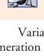

## 良好编程实践 6.1

> 惯例是枚举常量的名称中只使用大写字母。这使它们更加突出，并提醒您它们不是变量。

Status 类型的变量只能赋值为枚举中声明的三个常量之一（第11行），否则会发生编译错误。当游戏获胜时，程序将局部变量 gameStatus 设置为 Status.WON（第33行和第54行）。当游戏失败时，程序将局部变量 gameStatus 设置为 Status.LOST（第38行和第57行）。否则，程序将局部变量 gameStatus 设置为 Status.CONTINUE（第41行），表示游戏尚未结束，必须再次掷骰子。


## 良好编程实践 6.2

使用枚举常量（如 Status.WON、Status.LOST 和 Status.CONTINUE）而不是字面值（如 0、1 和 2）使程序更易于阅读和维护。

## main 方法的逻辑

main 中的第 26 行调用 rollDice，该方法从 1 到 6 中随机选取两个值，显示第一个骰子、第二个骰子的值以及它们的和，并返回这个和。接着，main 方法进入 switch 语句（第 29–45 行），该语句使用第 26 行的 sumOfDice 值来判断游戏是赢了、输了，还是应该继续再掷一次。在第一次掷骰子时导致赢或输的值在第 14–18 行被声明为 public static final int 常量。这些标识符名称使用赌场用语来表示这些和。这些常量与枚举常量一样，按照惯例全部使用大写字母声明，使它们在程序中更加醒目。第 31–34 行判断玩家是否以 SEVEN（7）或 YO_LEVEN（11）在第一次掷骰子时获胜。第 35–39 行判断玩家是否以 SNAKE_EYES（2）、TREY（3）或 BOX_CARS（12）在第一次掷骰子时输掉。第一次掷骰子后，如果游戏尚未结束，default 分支（第 40–44 行）将 gameStatus 设置为 Status.CONTINUE，将 sumOfDice 保存在 myPoint 中，并显示该点数。

如果我们仍在尝试“达到目标点数”（即游戏正在从之前的一次掷骰中继续），则执行第 48–58 行。第 50 行再次掷骰子。如果 sumOfDice 与 myPoint 匹配（第 53 行），第 54 行将 gameStatus 设置为 Status.WON，然后循环终止，因为游戏完成。如果 sumOfDice 是 SEVEN（第 56 行），第 57 行将 gameStatus 设置为 Status.LOST，循环终止，因为游戏完成。游戏结束时，第 61–64 行显示一条消息，指出玩家是赢了还是输了，然后程序终止。

该程序使用了我们讨论过的各种程序控制机制。Craps 类使用了两个方法——main 和 rollDice（从 main 中调用了两次）——以及 switch、while、if...else 和嵌套 if 控制语句。还要注意在 switch 语句中使用了多个 case 标签，以便对 SEVEN 和 YO_LEVEN 的和（第 31–32 行）以及 SNAKE_EYES、TREY 和 BOX_CARS 的和（第 35–37 行）执行相同的语句。

## 为什么某些常量未定义为 enum 常量

你可能想知道为什么我们将骰子的和声明为 public final static int 常量，而不是 enum 常量。原因是程序必须将 int 变量 sumOfDice（第 26 行）与这些常量进行比较，以确定每次掷骰的结果。假设我们声明一个枚举 Sum，其中包含代表游戏中使用的五个和的常量（例如 Sum.SNAKE_EYES），然后在 switch 语句（第 29–45 行）中使用这些常量。这样做会阻止我们将 sumOfDice 用作 switch 语句的控制表达式，因为 Java 不允许将 int 与枚举常量进行比较。要实现与当前程序相同的功能，我们必须使用一个类型为 Sum 的变量 currentSum 作为 switch 的控制表达式。不幸的是，Java 没有提供一种简单的方法将 int 值转换为特定的枚举常量。这可以通过一个单独的 switch 语句来完成。显然这会很繁琐，并且不会提高程序的可读性（从而违背了使用 enum 的目的）。

## 6.11 声明的作用域

你已经见过各种 Java 实体的声明，例如类、方法、变量和参数。声明引入了一些名称，可以用来引用这些 Java 实体。声明的作用域是程序中可以按名称引用被声明实体的部分。这样的实体被称为在该部分程序中“在作用域内”。本节介绍几个重要的作用域问题。

基本作用域规则如下：

- 1. 参数声明的作用域是声明所在的方法体。
- 2. 局部变量声明的作用域是从声明出现的位置到该块的末尾。
- 3. 出现在 for 语句头初始化部分中的局部变量声明，其作用域是 for 语句体以及头中的其他表达式。
- 4. 方法或字段的作用域是整个类体。这使类的非静态方法可以使用该类的字段和其他方法。

任何块都可以包含变量声明。如果方法中的局部变量或参数与类的字段同名，则该字段在块执行结束之前会被“隐藏”——这称为遮蔽（shadowing）。在第 8 章中，我们将讨论如何访问被遮蔽的字段。

## 错误预防提示 6.3

为字段和局部变量使用不同的名称，有助于防止在方法被调用且方法的局部变量遮蔽类中的字段时发生的细微逻辑错误。

图 6.9 演示了字段和局部变量的作用域问题。第 7 行声明字段 x 并将其初始化为 1。该字段在任何声明名为 x 的局部变量的块（或方法）中被遮蔽（隐藏）。main 方法（第 11–23 行）在第 13 行声明局部变量 x 并将其初始化为 5。输出该局部变量的值，以表明字段 x（其值为 1）在 main 中被遮蔽。程序还声明了另外两个方法——useLocalVariable（第 26–35 行）和 useField（第 38–45 行）——它们都不带参数且不返回结果。main 方法调用每个方法各两次（第 17–20 行）。useLocalVariable 方法在第 28 行声明局部变量 x。当第一次调用 useLocalVariable（第 17 行）时，它创建局部变量 x 并将其初始化为 25（第 28 行），输出 x 的值（第 30–31 行），递增 x（第 32 行），然后再次输出 x 的值（第 33–34 行）。当第二次调用 useLocalVariable（第 19 行）时，它重新创建局部变量 x 并重新初始化为 25，因此每次 useLocalVariable 调用的输出是相同的。

图 6.9 | Scope 类演示字段和局部变量的作用域。（第 1 部分，共 2 部分）

```
// Fig. 6.9: Scope.java
// Scope class demonstrates field and local variable scopes.

public class Scope
{
    // field that is accessible to all methods of this class
    private static int x = 1;

// method main creates and initializes local variable x
// and calls methods useLocalVariable and useField
public static void main( String[] args )
{
    int x = 5; // method's local variable x shadows field x

    System.out.printf( "local x in main is %d\n", x );

    useLocalVariable(); // useLocalVariable has local x
    useField(); // useField uses class Scope's field x
    useLocalVariable(); // useLocalVariable reinitializes local x
    useField(); // class Scope's field x retains its value

    System.out.printf( "\nlocal x in main is %d\n", x );
} // end main

// create and initialize local variable x during each call
public static void useLocalVariable()
{
    int x = 25; // initialized each time useLocalVariable is called

    System.out.printf(
        "\nlocal x on entering method useLocalVariable is %d\n", x );
    ++x; // modifies this method's local variable x
    System.out.printf(
        "local x before exiting method useLocalVariable is %d\n", x );
} // end method useLocalVariable

// modify class Scope's field x during each call
public static void useField()
{
    System.out.printf(
        "\nfield x on entering method useField is %d\n", x );
    x *= 10; // modifies class Scope's field x
    System.out.printf(
        "field x before exiting method useField is %d\n", x );
} // end method useField
} // end class Scope
```

```
local x in main is 5

local x on entering method useLocalVariable is 25
local x before exiting method useLocalVariable is 26

field x on entering method useField is 1
field x before exiting method useField is 10

local x on entering method useLocalVariable is 25
local x before exiting method useLocalVariable is 26

field x on entering method useField is 10
field x before exiting method useField is 100

local x in main is 5
```

图 6.9 | Scope 类演示字段和局部变量的作用域。（第 2 部分，共 2 部分）


方法 useField 没有声明任何局部变量。因此，当它引用 x 时，使用的是类的字段 x（第 7 行）。当方法 useField 第一次被调用时（第 18 行），它输出字段 x 的值（1）（第 40–41 行），将字段 x 乘以 10（第 42 行），并在返回前再次输出字段 x 的值（10）（第 43–44 行）。下一次调用方法 useField 时（第 20 行），字段已经具有修改后的值（10），因此该方法输出 10，然后输出 100。最后，在 main 方法中，程序再次输出局部变量 x 的值（第 22 行），以表明没有任何方法调用修改了 main 的局部变量 x，因为这些方法引用的都是其他作用域中名为 x 的变量。

## 6.12 方法重载

只要参数集不同（由参数的数量、类型和顺序决定），就可以在同一个类中声明同名方法——这称为方法重载。当调用重载方法时，编译器通过检查调用中实参的数量、类型和顺序来选择适当的方法。方法重载通常用于创建多个同名方法，这些方法执行相同或相似的任务，但针对不同的类型或不同数量的实参。例如，Math 方法 abs、min 和 max（在第 6.3 节中总结）各自都重载了四个版本：

- 1. 一个带有两个 double 参数。
- 2. 一个带有两个 float 参数。
- 3. 一个带有两个 int 参数。
- 4. 一个带有两个 long 参数。

下一个示例演示如何声明和调用重载方法。我们将在第 8 章中演示重载构造器。

### 声明重载方法

类 MethodOverload（图 6.10）包含 method square 的两个重载版本——一个计算 int 的平方（并返回 int），另一个计算 double 的平方（并返回 double）。尽管这些方法具有相同的名称以及相似的参数列表和方法体，但只需将它们视为不同的方法即可。将方法名分别视为“int 的平方”和“double 的平方”可能有助于理解。

```
// Fig. 6.10: MethodOverload.java
// Overloaded method declarations.

public class MethodOverload
{
    // test overloaded square methods
    public static void main( String[] args )
    {
        System.out.printf( "Square of integer 7 is %d\n", square( 7 ) );
        System.out.printf( "Square of double 7.5 is %f\n", square( 7.5 ) );
    } // end main

// square method with int argument
public static int square( int intValue )
{
    System.out.printf( "\nCalled square with int argument: %d\n", intValue );
    return intValue * intValue;
} // end method square with int argument
```

```
// square method with double argument
public static double square( double doubleValue )
{
    System.out.printf( "\nCalled square with double argument: %f\n", doubleValue );
    return doubleValue * doubleValue;
} // end method square with double argument
} // end class MethodOverload
```

```
Called square with int argument: 7
Square of integer 7 is 49

Called square with double argument: 7.500000
Square of double 7.5 is 56.250000
```

图 6.10 | 重载方法声明。（第 2 部分，共 2 部分。）

第 9 行以实参 7 调用方法 square。整数字面值被视为 int 类型，因此第 9 行的方法调用将调用第 14–19 行指定 int 参数的 square 版本。类似地，第 10 行以实参 7.5 调用方法 square。浮点字面值被视为 double 类型，因此第 10 行的方法调用将调用第 22–27 行指定 double 参数的 square 版本。每个方法首先输出一行文本，以证明在每种情况下都调用了正确的方法。第 10 行和第 24 行中的值使用格式说明符 %f 显示。我们在这两种情况下都没有指定精度。默认情况下，如果格式说明符中未指定精度，浮点值将显示六位精度。

### 区分重载方法

编译器通过方法的签名来区分重载方法——签名是方法名称及其参数数量、类型和顺序的组合。如果编译器在编译期间只看方法名，那么图 6.10 中的代码将产生歧义——编译器将不知道如何区分这两个 square 方法（第 14–19 行和第 22–27 行）。在内部，编译器使用更长的方法名，其中包括原始方法名、每个参数的类型以及参数的准确顺序，以确定类中的方法在该类中是否唯一。

例如，在图 6.10 中，编译器可能会将指定 int 参数的 square 方法使用逻辑名“int 的平方”，将指定 double 参数的 square 方法使用逻辑名“double 的平方”（编译器实际使用的名称更加复杂）。如果 method1 的声明以如下方式开始：

```
void method1( int a, float b )
```

那么编译器可能会使用逻辑名“int 和 float 的 method1”。如果参数指定为：

```
void method1( float a, int b )
```

那么编译器可能会使用逻辑名“float 和 int 的 method1”。参数类型的顺序很重要——编译器认为上述两个 method1 头是不同的。

### 重载方法的返回类型

在讨论编译器使用的方法逻辑名时，我们并未提及方法的返回类型。方法调用无法通过返回类型来区分。如果你有仅返回类型不同的重载方法，并且在独立语句中调用其中一个方法，如下所示：

```
square( 2 );
```

编译器将无法确定要调用方法的哪个版本，因为返回值会被忽略。当两个方法具有相同的签名和不同的返回类型时，编译器会发出一个错误消息，指出该方法已在类中定义。如果重载方法具有不同的参数列表，则它们可以具有不同的返回类型。此外，重载方法不必具有相同数量的参数。

### 常见编程错误 6.9

声明具有相同参数列表的重载方法是一个编译错误，无论返回类型是否不同。

## 6.13（可选）GUI 与 Graphics 案例研究：颜色和填充形状

尽管仅使用线条和基本形状就可以创建许多有趣的设计，但 Graphics 类提供了更多功能。我们接下来介绍的两个特性是颜色和填充形状。添加颜色可以丰富用户在计算机屏幕上看到的绘图。形状可以用纯色填充。

计算机屏幕上显示的颜色由其红色、绿色和蓝色分量（称为 RGB 值）定义，这些分量具有从 0 到 255 的整数值。分量颜色的值越高，最终颜色中该色调就越浓郁。Java 使用包 java.awt 中的 Color 类，通过其 RGB 值来表示颜色。为方便起见，Color 类（包 java.awt）包含 13 个预定义的静态 Color 对象——BLACK、BLUE、CYAN、DARK_GRAY、GRAY、GREEN、LIGHT_GRAY、MAGENTA、ORANGE、PINK、RED、WHITE 和 YELLOW。每个对象都可以通过类名和点（.）访问，如 Color.RED。Color 类还包含一个如下形式的构造器：

```
public Color( int r, int g, int b )
```

因此，你可以通过指定红色、绿色和蓝色分量的值来创建自定义颜色。

Graphics 方法 fillRect 和 fillOval 分别绘制填充矩形和填充椭圆。它们与 drawRect 和 drawOval 具有相同的参数；前两个是形状左上角的坐标，后两个决定宽度和高度。图 6.11 和图 6.12 中的示例通过在屏幕上绘制并显示一个黄色的笑脸来演示颜色和填充形状。

```
// Fig. 6.11: DrawSmiley.java
// Demonstrates filled shapes.
import java.awt.Color;
import java.awt.Graphics;
import javax.swing.JPanel;

public class DrawSmiley extends JPanel
{
    public void paintComponent( Graphics g )
    {
        super.paintComponent( g );

        // draw the face
        g.setColor( Color.YELLOW );
        g.fillOval( 10, 10, 200, 200 );

        // draw the eyes
        g.setColor( Color.BLACK );
        g.fillOval( 55, 65, 30, 30 );
        g.fillOval( 135, 65, 30, 30 );

        // draw the mouth
        g.fillOval( 50, 110, 120, 60 );

        // "touch up" the mouth into a smile
        g.setColor( Color.YELLOW );
        g.fillRect( 50, 110, 120, 30 );
        g.fillOval( 50, 120, 120, 40 );
    } // end method paintComponent
} // end class DrawSmiley
```

# 图 6.11 | 使用颜色和填充形状绘制笑脸。

图 6.11 中第 3–5 行的 import 语句导入了 Color、Graphics 和 JPanel 类。类 DrawSmiley（第 7–30 行）使用 Color 类来指定绘制颜色，并使用 Graphics 类进行绘制。

JPanel 类再次提供了我们绘制的区域。方法 paintComponent 中的第 14 行使用 Graphics 方法 setColor 将当前绘制颜色设置为 Color.YELLOW。方法 setColor 需要一个参数，即要设置为绘制颜色的 Color 对象。在本例中，我们使用预定义对象 Color.YELLOW。

第 15 行绘制一个直径为 200 的圆来表示脸——当宽度和高度参数相同时，fillOval 方法会绘制一个圆。接下来，第 18 行将颜色设置为 Color.BLACK，第 19–20 行绘制眼睛。第 23 行将嘴绘制为一个椭圆，但这并不是我们想要的。

为了创建一个开心的脸，我们将“修饰”一下嘴。第 26 行将颜色设置为 Color.YELLOW，这样我们绘制的任何形状都会与脸融为一体。第 27 行绘制一个高度为嘴部一半的矩形。这样会“擦除”嘴的上半部分，只留下下半部分。为了形成更好的微笑，第 28 行绘制另一个椭圆，稍微覆盖嘴的上部。类 DrawSmileyTest（图 6.12）创建并显示一个包含绘图的 JFrame。当 JFrame 显示时，系统调用 paintComponent 方法来绘制笑脸。


```java
// Fig. 6.12: DrawSmileyTest.java
// Test application that displays a smiley face.
import javax.swing.JFrame;

public class DrawSmileyTest
{
    public static void main( String[] args )
    {
        DrawSmiley panel = new DrawSmiley();
        JFrame application = new JFrame();

        application.setDefaultCloseOperation( JFrame.EXIT_ON_CLOSE );
        application.add( panel );
        application.setSize( 230, 250 );
        application.setVisible( true );
    } // end main
} // end class DrawSmileyTest
```


图 6.12 | 创建一个显示笑脸的 JFrame。

## GUI 与图形案例研究练习

6.1 使用方法 fillOval 绘制一个靶心，使其在两种随机颜色之间交替，如图 6.13 所示。使用带有随机参数的构造器 `Color( int r, int g, int b )` 来生成随机颜色。

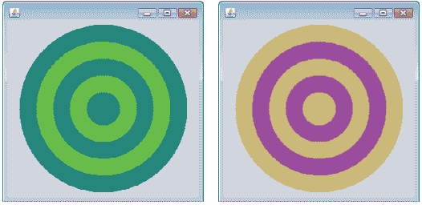

图 6.13 | 带有两种交替随机颜色的靶心。

## 摘要

### 6.1 节 引言

- 经验表明，开发和维护大型程序的最佳方式是将其构建为小的、简单的片段或模块。这种技术称为分治法（第 198 页）。

### 6.2 节 Java 中的程序模块

- 方法在类中声明。类通常被分组到包中，以便可以导入和重用。
- 方法允许您通过将任务分离为独立的单元来模块化程序。方法中的语句只编写一次，并对其余方法隐藏。
- 使用现有方法作为构建块来创建新程序是一种软件复用（第 199 页）的形式，它允许您避免在程序中重复代码。

### 6.3 节 static 方法、static 字段与 Math 类

- 方法调用指定要调用的方法名称，并提供被调用方法执行任务所需的参数。当方法调用完成时，方法将结果或仅将控制权返回给调用者。
- 类可以包含 static 方法来执行不需要类对象即可完成的常见任务。static 方法执行任务所需的任何数据都可以作为方法调用中的参数发送给方法。static 方法的调用方式是：指定方法所在类的名称，后跟点号（.）和方法名，如：

  `ClassName.methodName( arguments )`

- Math 类提供了执行常见数学计算的 static 方法。
- 常量 Math.PI（第 201 页；3.141592653589793）是圆的周长与直径之比。常量 Math.E（第 201 页；2.718281828459045）是自然对数（使用 static 方法 Math.log 计算）的底数。
- Math.PI 和 Math.E 使用修饰符 public、final 和 static 声明。将其设为 public 允许您在您自己的类中使用这些字段。用关键字 final（第 201 页）声明的字段是常量——其值在初始化后不能更改。PI 和 E 都声明为 final，因为它们的值从不改变。将这些字段设为 static 允许通过类名 Math 和点号（.）分隔符访问它们，就像访问 Math 类的方法一样。
- 类的所有对象共享该类 static 字段的一个副本。类变量（第 201 页）和实例变量共同表示类的字段。
- 当您使用 java 命令执行 Java 虚拟机（JVM）时，JVM 加载您指定的类并使用该类的名称调用 main 方法。您可以指定 JVM 传递给应用程序的额外命令行参数（第 202 页）。
- 您可以在您声明的每个类中放置一个 main 方法——只有用于执行应用程序的类中的 main 方法会被 java 命令调用。

### 6.4 节 使用多个参数声明方法

- 当方法被调用时，程序会复制方法的参数值并将其分配给方法相应的参数。当程序控制权返回到调用方法的位置时，方法的参数将从内存中移除。
- 方法最多可以返回一个值，但返回值可以是对包含多个值的对象的引用。
- 变量只有在类的多个方法中需要使用，或者程序应在调用类的方法之间保存其值时，才应声明为类的字段。
- 当方法有多个参数时，参数以逗号分隔的列表形式指定。方法声明中的每个参数在方法调用中都必须有一个对应的参数。此外，每个参数必须与相应参数的类型一致。如果方法不接受参数，则参数列表为空。
- 字符串可以使用运算符 + 拼接（第 204 页），该运算符将右操作数的字符放在左操作数字符的末尾。
- Java 中的每个基本类型值和对象都有一个 String 表示形式。当对象与字符串拼接时，对象被转换为字符串，然后两个字符串被拼接。
- 如果 boolean 与字符串拼接，则使用单词 "true" 或 "false" 来表示布尔值。
- Java 中的所有对象都有一个名为 toString 的特殊方法，该方法返回对象内容的 String 表示形式。当对象与字符串拼接时，JVM 会隐式调用对象的 toString 方法来获取对象的字符串表示形式。
- 您可以将大的字符串字面量拆分为多个较小的字符串，并放在多行代码中以提高可读性，然后使用拼接重新组合字符串。

### 6.5 节 声明和使用方法的注意事项

- 有三种调用方法的方式——使用方法名本身调用同一类的另一个方法；使用包含对象引用的变量，后跟点号（.）和方法名来调用所引用对象的方法；以及使用类名和点号（.）来调用类的 static 方法。
- 有三种方式将控制权返回到调用方法的语句。如果方法不返回结果，则当程序流程到达方法结束的右花括号或执行语句

  `return;`

  时，控制权返回。如果方法返回结果，则语句

  `return expression;`

  计算 *表达式*，然后立即将结果值返回给调用者。

### 6.6 节 方法调用堆栈与活动记录

- 堆栈（第 206 页）被称为后进先出（LIFO）数据结构——最后压入（插入）堆栈的项是最先弹出（移除）的项。
- 被调用的方法必须知道如何返回其调用者，因此调用方法的返回地址在方法调用时被压入程序执行堆栈。如果发生一系列方法调用，则连续的返回地址以 LIFO 顺序压入堆栈，这样最后执行的方法将最先返回其调用者。
- 程序执行堆栈（第 207 页）包含程序执行期间每次方法调用中使用的局部变量的内存。这些数据称为方法调用的活动记录或堆栈帧。当进行方法调用时，该调用的活动记录被压入程序执行堆栈。当方法返回其调用者时，其活动记录被从堆栈中弹出，局部变量对程序不再可见。
- 如果方法调用数量过多，其活动记录无法全部存储在程序执行堆栈中，则会发生称为堆栈溢出（第 207 页）的错误。应用程序将正确编译，但其执行会导致堆栈溢出。

### 6.7 节 参数提升与强制转换

- 参数提升（第 207 页）将参数值转换为方法期望在其相应参数中接收的类型。


Promotion rules (p. 207) apply to expressions containing values of two or more primitive types and to primitive-type values passed as arguments to methods. Each value is promoted to the “highest” type in the expression. In cases where information may be lost due to conversion, the Java compiler requires you to use a cast operator to explicitly force the conversion to occur.

## Section 6.9 Case Study: Random-Number Generation

- Objects of class Random (p. 210; package java.util) can produce random values. Math method `random` can produce `double` values in the range 0.0 ≤ x < 1.0, where x is the value returned.
- Random method `nextInt` (p. 210) generates a random `int` value in the range −2,147,483,648 to +2,147,483,647. The values returned by `nextInt` are actually pseudorandom numbers (p. 210)—a sequence of values produced by a complex mathematical calculation. That calculation uses the current time of day to seed (p. 211) the random-number generator such that each execution of a program yields a different sequence of random values.
- Class Random provides another version of method `nextInt` that receives an `int` argument and returns a value from 0 up to, but not including, the argument’s value.
- Random numbers in a range (p. 211) can be generated with

  ```java
  number = shiftingValue + randomNumbers.nextInt( scalingFactor );
  ```

  where `shiftingValue` specifies the first number in the desired range of consecutive integers, and `scalingFactor` specifies how many numbers are in the range.
- Random numbers can be chosen from nonconsecutive integer ranges, as in

  ```java
  number = shiftingValue +
  differenceBetweenValues * randomNumbers.nextInt( scalingFactor );
  ```

  where `shiftingValue` specifies the first number in the range of values, `differenceBetweenValues` represents the difference between consecutive numbers in the sequence and `scalingFactor` specifies how many numbers are in the range.
- For debugging, it’s sometimes useful to repeat the sequence of pseudorandom numbers during each program execution. To do so, pass a `long` integer value to the Random object’s constructor. Using the same seed every time the program executes, produces the same sequence of numbers.

## Section 6.10 Case Study: A Game of Chance; Introducing Enumerations

- An enumeration (p. 218) is introduced by the keyword `enum` and a type name. As with any class, braces `{` and `}` delimit the body of an enum declaration. Inside the braces is a comma-separated list of enumeration constants, each representing a unique value. The identifiers in an enum must be unique. Variables of an enum type can be assigned only constants of that enum type.
- Constants can also be declared as `public final static` variables. Such constants are declared by convention with all capital letters to make them stand out in the program.

## Section 6.11 Scope of Declarations

- Scope (p. 220) is the portion of the program in which an entity, such as a variable or a method, can be referred to by its name. Such an entity is said to be “in scope” for that portion of the program.
- The scope of a parameter declaration is the body of the method in which the declaration appears.
- The scope of a local-variable declaration is from the point at which the declaration appears to the end of that block.
- The scope of a local-variable declaration that appears in the initialization section of a `for` statement’s header is the body of the `for` statement and the other expressions in the header.
- The scope of a method or field of a class is the entire body of the class. This enables a class’s methods to use simple names to call the class’s other methods and to access the class’s fields.
- Any block may contain variable declarations. If a local variable or parameter in a method has the same name as a field, the field is shadowed (p. 220) until the block terminates execution.

## Section 6.12 Method Overloading

- Java allows overloaded methods (p. 222) in a class, as long as the methods have different sets of parameters (determined by the number, order and types of the parameters).
- Overloaded methods are distinguished by their signatures (p. 223)—combinations of the methods’ names and the number, types and order of their parameters.

## Self-Review Exercises

6.1 Fill in the blanks in each of the following statements:

- a) A method is invoked with a(n) ______.
- b) A variable known only within the method in which it’s declared is called a(n) ______.
- c) The ______ statement in a called method can be used to pass the value of an expression back to the calling method.
- d) The keyword ______ indicates that a method does not return a value.
- e) Data can be added or removed only from the ______ of a stack.
- f) Stacks are known as ______ data structures; the last item pushed (inserted) on the stack is the first item popped (removed) from the stack.
- g) The three ways to return control from a called method to a caller are ______, ______ and ______.
- h) An object of class ______ produces random numbers.
- i) The program-execution stack contains the memory for local variables on each invocation of a method during a program’s execution. This data, stored as a portion of the program-execution stack, is known as the ______ or ______ of the method call.
- j) If there are more method calls than can be stored on the program-execution stack, an error known as a(n) ______ occurs.
- k) The ______ of a declaration is the portion of a program that can refer to the entity in the declaration by name.
- l) It’s possible to have several methods with the same name that each operate on different types or numbers of arguments. This feature is called method ______.
- m) The program-execution stack is also referred to as the ______ stack.

6.2 For the class Craps in Fig. 6.8, state the scope of each of the following entities:

- a) the variable randomNumbers.
- b) the variable die1.
- c) the method rollDice.
- d) the method main.
- e) the variable sumOfDice.

6.3 Write an application that tests whether the examples of the Math class method calls shown in Fig. 6.2 actually produce the indicated results.

6.4 Give the method header for each of the following methods:

- a) Method hypotenuse, which takes two double-precision, floating-point arguments side1 and side2 and returns a double-precision, floating-point result.
- b) Method smallest, which takes three integers x, y and z and returns an integer.
- c) Method instructions, which does not take any arguments and does not return a value. [Note: Such methods are commonly used to display instructions to a user.]
- d) Method intToFloat, which takes integer argument number and returns a float.

6.5 Find the error in each of the following program segments. Explain how to correct the error.

a)

```java
void g()
{
    System.out.println( "Inside method g" );
    void h()
    {
        System.out.println( "Inside method h" );
    }
}
```

b)

```java
int sum( int x, int y )
{
    int result;
    result = x + y;
}
```

c)

```java
void f( float a );
{
    float a;
    System.out.println( a );
}
```

d)

```java
void product()
{
    int a = 6, b = 5, c = 4, result;
    result = a * b * c;
    System.out.printf( "Result is %d\n", result );
    return result;
}
```

6.6 Write a complete Java application to prompt the user for the double radius of a sphere, and call method sphereVolume to calculate and display the volume of the sphere. Use the following statement to calculate the volume:

`double volume = ( 4.0 / 3.0 ) * Math.PI * Math.pow( radius, 3 );`

## Answers to Self-Review Exercises

6.1

- a) method call.
- b) local variable.
- c) return.
- d) void.
- e) top.
- f) last-in, first-out (LIFO).
- g) return; or return expression; or encountering the closing right brace of a method.
- h) Random.
- i) activation record, stack frame.
- j) stack overflow.
- k) scope.
- l) method overloading.
- m) method call.

6.2

- a) class body.
- b) block that defines method rollDice's body.
- c) class body.
- d) class body.
- e) block that defines method main's body.

6.3 The following solution demonstrates the Math class methods in Fig. 6.2:

```java
// Exercise 6.3: MathTest.java
// Testing the Math class methods.

public class MathTest
{
    public static void main( String[] args )
    {
        System.out.printf( "Math.abs( 23.7 ) = %f\n", Math.abs( 23.7 ) );
        System.out.printf( "Math.abs( 0.0 ) = %f\n", Math.abs( 0.0 ) );
        System.out.printf( "Math.abs( -23.7 ) = %f\n", Math.abs( -23.7 ) );
        System.out.printf( "Math.ceil( 9.2 ) = %f\n", Math.ceil( 9.2 ) );
    }
}
```


```
12      System.out.printf( "Math.ceil( -9.8 ) = %f\n", Math.ceil( -9.8 ) );
13      System.out.printf( "Math.cos( 0.0 ) = %f\n", Math.cos( 0.0 ) );
14      System.out.printf( "Math.exp( 1.0 ) = %f\n", Math.exp( 1.0 ) );
15      System.out.printf( "Math.exp( 2.0 ) = %f\n", Math.exp( 2.0 ) );
16      System.out.printf( "Math.floor( 9.2 ) = %f\n", Math.floor( 9.2 ) );
17      System.out.printf( "Math.floor( -9.8 ) = %f\n",
18          Math.floor( -9.8 ) );
19      System.out.printf( "Math.log( Math.E ) = %f\n",
20          Math.log( Math.E ) );
21      System.out.printf( "Math.log( Math.E * Math.E ) = %f\n",
22          Math.log( Math.E * Math.E ) );
23      System.out.printf( "Math.max( 2.3, 12.7 ) = %f\n",
24          Math.max( 2.3, 12.7 ) );
25      System.out.printf( "Math.max( -2.3, -12.7 ) = %f\n",
26          Math.max( -2.3, -12.7 ) );
27      System.out.printf( "Math.min( 2.3, 12.7 ) = %f\n",
28          Math.min( 2.3, 12.7 ) );
29      System.out.printf( "Math.min( -2.3, -12.7 ) = %f\n",
30          Math.min( -2.3, -12.7 ) );
31      System.out.printf( "Math.pow( 2.0, 7.0 ) = %f\n",
32          Math.pow( 2.0, 7.0 ) );
33      System.out.printf( "Math.pow( 9.0, 0.5 ) = %f\n",
34          Math.pow( 9.0, 0.5 ) );
35      System.out.printf( "Math.sin( 0.0 ) = %f\n", Math.sin( 0.0 ) );
36      System.out.printf( "Math.sqrt( 900.0 ) = %f\n",
37          Math.sqrt( 900.0 ) );
38      System.out.printf( "Math.tan( 0.0 ) = %f\n", Math.tan( 0.0 ) );
39      } // end main
40      } // end class MathTest
```

Math.abs( 23.7 ) = 23.700000
Math.abs( 0.0 ) = 0.000000
Math.abs( -23.7 ) = 23.700000
Math.ceil( 9.2 ) = 10.000000
Math.ceil( -9.8 ) = -9.000000
Math.cos( 0.0 ) = 1.000000
Math.exp( 1.0 ) = 2.718282
Math.exp( 2.0 ) = 7.389056
Math.floor( 9.2 ) = 9.000000
Math.floor( -9.8 ) = -10.000000
Math.log( Math.E ) = 1.000000
Math.log( Math.E * Math.E ) = 2.000000
Math.max( 2.3, 12.7 ) = 12.700000
Math.max( -2.3, -12.7 ) = -2.300000
Math.min( 2.3, 12.7 ) = 2.300000
Math.min( -2.3, -12.7 ) = -12.700000
Math.pow( 2.0, 7.0 ) = 128.000000
Math.pow( 9.0, 0.5 ) = 3.000000
Math.sin( 0.0 ) = 0.000000
Math.sqrt( 900.0 ) = 30.000000
Math.tan( 0.0 ) = 0.000000

6.4    a) double hypotenuse( double side1, double side2 )
       b) int smallest( int x, int y, int z )
       c) void instructions()
       d) float intToFloat( int number )

6.5    a) Error: Method h is declared within method g.
       Correction: Move the declaration of h outside the declaration of g.
       b) Error: The method is supposed to return an integer, but does not.
       Correction: Delete the variable result, and place the statement

return x + y;

in the method, or add the following statement at the end of the method body:

return result;

+   c) Error: The semicolon after the right parenthesis of the parameter list is incorrect, and the parameter a should not be redeclared in the method.
+   Correction: Delete the semicolon after the right parenthesis of the parameter list, and delete the declaration float a;

+   d) Error: The method returns a value when it’s not supposed to.
+   Correction: Change the return type from void to int.

6.6 下面的解决方案使用用户输入的半径计算球体的体积：

```
// Exercise 6.6: Sphere.java
// Calculate the volume of a sphere.
import java.util.Scanner;

public class Sphere
{
    // obtain radius from user and display volume of sphere
    public static void main( String[] args )
    {
        Scanner input = new Scanner( System.in );

        System.out.print( "Enter radius of sphere: " );
        double radius = input.nextDouble();

        System.out.printf( "Volume is %f\n", sphereVolume( radius ) );
    } // end method determineSphereVolume

    // calculate and return sphere volume
    public static double sphereVolume( double radius )
    {
        double volume = ( 4.0 / 3.0 ) * Math.PI * Math.pow( radius, 3 );
        return volume;
    } // end method sphereVolume
} // end class Sphere
```

Enter radius of sphere: 4
Volume is 268.082573

# 练习

6.7 执行以下每个语句后 x 的值是多少？

+   a) x = Math.abs( 7.5 );
+   b) x = Math.floor( 7.5 );
+   c) x = Math.abs( 0.0 );
+   d) x = Math.ceil( 0.0 );
+   e) x = Math.abs( -6.4 );
+   f) x = Math.ceil( -6.4 );
+   g) x = Math.ceil( -Math.abs( -8 + Math.floor( -5.5 ) ) );

6.8 （停车收费）停车场停车最长三小时收费为 2.00 美元。超过三小时后，每小时或不足一小时按 0.50 美元额外收费。任何 24 小时期间的最大收费为 10.00 美元。假设没有汽车停放时间超过 24 小时。编写一个应用程序，计算并显示昨天在停车场停车的每个客户的停车费用。应输入每个客户的停车小时数。程序应显示当前客户的费用，并计算并显示昨天的收入总额。它应使用 calculateCharges 方法确定每个客户的费用。

# 6.9 （舍入数字）Math.floor 可用于将值舍入到最接近的整数——例如，

```
y = Math.floor( x + 0.5 );
```

将把数字 x 舍入到最接近的整数并将结果赋给 y。编写一个应用程序，读取 double 值并使用前述语句将每个数字舍入到最接近的整数。对处理的每个数字，显示原始数字和舍入后的数字。

# 6.10 （舍入数字）要将数字舍入到特定的小数位，使用如下语句

```
y = Math.floor( x * 10 + 0.5 ) / 10;
```

将 x 舍入到十分位（即小数点右边的第一位），或

```
y = Math.floor( x * 100 + 0.5 ) / 100;
```

将 x 舍入到百分位（即小数点右边的第二位）。编写一个应用程序，定义四个用于以各种方式舍入数字 x 的方法：

+   a) roundToInteger( number )
+   b) roundToTenths( number )
+   c) roundToHundredths( number )
+   d) roundToThousandths( number )

对于读取的每个值，程序应显示原始值、四舍五入到最接近整数的数字、四舍五入到最接近十分位的数字、四舍五入到最接近百分位的数字以及四舍五入到最接近千分位的数字。

# 6.11 回答以下每个问题：

+   a) 选择数字“随机”意味着什么？
+   b) 为什么 Random 类的 nextInt 方法对于模拟机会游戏很有用？
+   c) 为什么通常有必要缩放或移动 Random 对象产生的值？
+   d) 为什么计算机模拟现实世界情况是一种有用的技术？

# 6.12 编写语句将随机整数赋给变量 n，使其范围在以下范围内：

+   a) 1 ≤ n ≤ 2.
+   b) 1 ≤ n ≤ 100.
+   c) 0 ≤ n ≤ 9.
+   d) 1000 ≤ n ≤ 1112.
+   e) −1 ≤ n ≤ 1.
+   f) −3 ≤ n ≤ 11.

# 6.13 编写语句以从以下每个集合中显示一个随机数：

+   a) 2, 4, 6, 8, 10.
+   b) 3, 5, 7, 9, 11.
+   c) 6, 10, 14, 18, 22.

# 6.14 （指数运算）编写一个方法 integerPower(base, exponent)，返回 base 的 exponent 次幂

例如，integerPower(3, 4) 计算 3⁴（或 3 * 3 * 3 * 3）。假设 exponent 是正的非零整数且 base 是整数。使用 for 或 while 语句控制计算。不要使用任何 Math 类方法。将此方法合并到一个读取 base 和 exponent 的整数值并使用 integerPower 方法执行计算的应用程序中。

# 6.15 （斜边计算）定义一个方法 hypotenuse，用于在给出直角三角形另外两边长度时计算斜边。方法应接受两个 double 类型的参数并返回斜边作为 double。将此方法合并到一个读取 side1 和 side2 值并使用 hypotenuse 方法执行计算的应用程序中。使用 Math 方法 pow 和 sqrt 确定图 6.15 中每个三角形的斜边长度。 [注意：Math 类还提供方法 hypot 来执行此计算。]

| Triangle | Side 1 | Side 2 |
|---|---|---|
| 1 | 3.0 | 4.0 |
| 2 | 5.0 | 12.0 |
| 3 | 8.0 | 15.0 |

图 6.15 | 练习 6.15 中三角形各边的数值。

6.16 （倍数）编写一个方法 isMultiple，用于确定一对整数中第二个整数是否为第一个整数的倍数。该方法应接受两个整数参数，如果第二个是第一个的倍数则返回 true，否则返回 false。 [提示：使用余数运算符。] 将此方法合并到一个输入一系列整数对（一次一对）并确定每对中的第二个值是否为第一个的倍数的应用程序中。

6.17 （偶数或奇数）编写一个方法 isEven，使用余数运算符 (%) 确定整数是否为偶数。该方法应接受一个整数参数，如果整数为偶数则返回 true，否则返回 false。将此方法合并到一个输入一系列整数（一次一个）并确定每个整数是偶数还是奇数的应用程序中。

6.18 （显示星号正方形）编写一个方法 squareOfAsterisks，显示一个实心正方形（行数和列数相同）的星号，其边长由整数参数 side 指定。例如，如果 side 为 4，方法应显示
****
****
****
****

将此方法合并到一个从用户读取 side 的整数值并使用 squareOfAsterisks 方法输出星号的应用程序中。

6.19 （显示任意字符的正方形）修改练习 6.18 中创建的方法，使其接收第二个参数 char 类型，称为 fillCharacter。使用作为参数提供的字符形成正方形。因此，如果 side 为 5 且 fillCharacter 为 #，方法应显示
#####
#####
#####
#####
#####

使用以下语句（其中 input 为 Scanner 对象）从键盘读取用户输入的字符：

```
char fill = input.next().charAt(0);
```

6.20 （圆面积）编写一个应用程序，提示用户输入圆的半径，并使用名为 circleArea 的方法计算圆的面积。

6.21 （分离数字）编写方法完成以下每个任务：
a) 计算整数 a 除以整数 b 时的商的整数部分。
b) 计算整数 a 除以整数 b 时的整数余数。


c) 使用第 (a) 和 (b) 部分开发的方法编写一个方法 displayDigits，该方法接收一个介于 1 和 99999 之间的整数，并将其作为数字序列显示，每对数字之间用两个空格分隔。例如，整数 4562 应显示为

4  5  6  2

将该方法整合到一个应用程序中，该应用程序输入一个整数并通过将用户输入的整数传递给该方法来调用 displayDigits。显示结果。

## 6.22 (温度转换) 实现以下整数方法：

- a) 方法 celsius 返回华氏温度的摄氏等效值，使用计算式

celsius = 5.0 / 9.0 * ( fahrenheit - 32 );

- b) 方法 fahrenheit 返回摄氏温度的华氏等效值，使用计算式

fahrenheit = 9.0 / 5.0 * celsius + 32;

- c) 使用第 (a) 和 (b) 部分的方法编写一个应用程序，使用户能够输入华氏温度并显示摄氏等效值，或输入摄氏温度并显示华氏等效值。

## 6.23 (寻找最小值) 编写一个方法 minimum3，该方法返回三个浮点数中的最小值。使用 Math.min 方法实现 minimum3。将该方法整合到一个应用程序中，该应用程序从用户读取三个值，确定最小值并显示结果。

## 6.24 (完全数) 如果一个整数的因子，包括 1（但不包括该数本身）之和等于该数，则称该整数为完全数。例如，6 是一个完全数，因为 6 = 1 + 2 + 3。编写一个方法 isPerfect，用于判断参数 number 是否为完全数。使用该方法在应用程序中显示 1 到 1000 之间的所有完全数。显示每个完全数的因子以确认该数确实是完全数。通过测试远大于 1000 的数字来挑战你计算机的计算能力。显示结果。

## 6.25 (质数) 一个正整数如果只能被 1 和它本身整除，则为质数。例如，2、3、5 和 7 是质数，但 4、6、8 和 9 不是。按定义，1 不是质数。

- a) 编写一个方法来判断一个数是否为质数。

- b) 使用该方法在应用程序中确定并显示小于 10,000 的所有质数。你需要测试多少个数字才能确保找到所有质数？

- c) 最初，你可能会认为 n/2 是判断一个数 n 是否为质数需要测试的上限，但你只需要测试到 n 的平方根。重写程序，并以两种方式运行它。

## 6.26 (反转数字) 编写一个方法，该方法接收一个整数值并返回其数字反转后的数字。例如，给定数字 7631，该方法应返回 1367。将该方法整合到一个应用程序中，该应用程序从用户读取一个值并显示结果。

## 6.27 (最大公约数) 两个整数的最大公约数 (GCD) 是能整除这两个数的最大整数。编写一个方法 gcd，该方法返回两个整数的最大公约数。[提示：你可能想使用欧几里得算法。你可以在 en.wikipedia.org/wiki/Euclidean_algorithm 上找到相关信息。] 将该方法整合到一个应用程序中，该应用程序从用户读取两个值并显示结果。

## 6.28 编写一个方法 qualityPoints，该方法输入学生的平均分并返回：如果成绩为 90–100 则返回 4，如果为 80–89 则返回 3，如果为 70–79 则返回 2，如果为 60–69 则返回 1，如果低于 60 则返回 0。将该方法整合到一个应用程序中，该应用程序从用户读取一个值并显示结果。

## 6.29 (抛硬币) 编写一个应用程序来模拟抛硬币。每次用户选择“抛硬币”菜单选项时，程序就抛一次硬币。统计硬币每面出现的次数。显示结果。程序应调用一个单独的方法 flip，该方法不带参数并返回一个 Coin 枚举值（HEADS 和 TAILS）。[注意：如果程序真实地模拟抛硬币，硬币的每一面应大约出现一半的时间。]

## 6.30 (猜数字) 编写一个应用程序来玩“猜数字”游戏，如下：你的程序通过在 1 到 1000 范围内选择一个随机整数来选择要猜的数字。应用程序显示提示 Guess a number between 1 and 1000。玩家输入第一次猜测。如果玩家的猜测不正确，你的程序应显示 Too high. Try again. 或 Too low. Try again. 来帮助玩家“缩小”正确答案范围。程序应提示用户进行下一次猜测。当用户输入正确答案时，显示 Congratulations. You guessed the number!，并允许用户选择是否再次游戏。[注意：本问题中采用的猜测技术与第 19 章搜索、排序和大 O 中讨论的二分搜索类似。]

## 6.31 (猜数字修改) 修改练习 6.30 的程序以统计玩家猜测的次数。如果次数为 10 次或更少，显示 Either you know the secret or you got lucky! 如果玩家在 10 次尝试内猜中数字，显示 Aha! You know the secret! 如果玩家猜测超过 10 次，显示 You should be able to do better! 为什么猜测次数不应超过 10 次？好吧，每次“好猜测”，玩家都应能消除一半的数字，然后是剩余数字的一半，依此类推。

## 6.32 (点间距离) 编写方法 distance 来计算两点 (x1, y1) 和 (x2, y2) 之间的距离。所有数字和返回值都应为 double 类型。将此方法整合到一个应用程序中，使用户能够输入点的坐标。

## 6.33 (掷骰子游戏修改) 修改图 6.8 中的掷骰子程序以允许下注。将变量 bankBalance 初始化为 1000 美元。提示玩家输入赌注。检查赌注是否小于或等于 bankBalance，如果不是，则让用户重新输入赌注，直到输入有效的赌注。然后，运行一次掷骰子游戏。如果玩家获胜，则将 wager 增加到 bankBalance 并显示新的 bankBalance。如果玩家输了，则将 wager 从 bankBalance 中扣除，显示新的 bankBalance，检查 bankBalance 是否变为零，如果是，则显示消息 "Sorry. You busted!"。随着游戏的进行，显示各种消息以营造“闲聊”氛围，例如 "Oh, you’re going for broke, huh?" 或 "Aw c’mon, take a chance!" 或 "You’re up big. Now’s the time to cash in your chips!"。将“闲聊”实现为一个单独的方法，该方法随机选择要显示的字符串。

## 6.34 (二进制、八进制和十六进制数表) 编写一个应用程序，显示 1 到 256 范围内十进制数的二进制、八进制和十六进制等价表。如果你不熟悉这些数制，请先阅读附录 H。

## 改变现状

随着计算机成本的下降，无论经济状况如何，每个学生都可以使用计算机并在学校中使用它变得可行。这为改善全球所有学生的教育体验创造了令人兴奋的可能性，正如接下来的五个练习所建议的那样。[注意：查看 One Laptop Per Child 项目等倡议（www.laptop.org）。另外，研究“绿色”笔记本电脑——这些设备的一些关键“绿色”特征是什么？了解电子产品环境评估工具（www.epeat.net），它可以帮助你评估台式机、笔记本电脑和显示器的“绿色”程度，以帮助你决定购买哪些产品。]

## 6.35 (计算机辅助教学) 计算机在教育中的使用被称为计算机辅助教学 (CAI)。编写一个程序，帮助小学生学习

乘法。使用 Random 对象生成两个正一位整数。然后程序应提示用户一个问题，例如

```
How much is 6 times 7?
```

学生然后输入答案。接下来，程序检查学生的答案。如果正确，显示消息 "Very good!" 并提出另一个乘法问题。如果答案错误，显示消息 "No. Please try again." 并让学生重复尝试同一个问题，直到学生最终答对为止。应使用单独的方法生成每个新问题。该方法应在应用程序开始执行时调用，并在用户正确回答问题时每次调用。

## 6.36 (计算机辅助教学：减轻学生疲劳) CAI 环境中的一个问题是学生疲劳。这可以通过改变计算机的回应来保持学生的注意力而减少。修改练习 6.35 的程序，以便对每个答案显示各种评论，如下：

对正确答案的可能回应：

- Very good!
- Excellent!
- Nice work!
- Keep up the good work!

对错误答案的可能回应：

- No. Please try again.
- Wrong. Try once more.
- Don’t give up!
- No. Keep trying.

使用随机数生成从 1 到 4 中选择一个数字，用于选择对每个正确或错误答案的四个适当回应之一。使用 switch 语句发出回应。

## 6.37 (计算机辅助教学：监控学生表现) 更复杂的计算机辅助教学系统会监控学生在一段时间内的表现。开始新主题的决定通常基于学生在先前主题上的成功。修改练习 6.36 的程序以统计学生输入的正确和错误回答的数量。在学生输入 10 个答案后，你的程序应计算正确的百分比。如果百分比低于 75%，显示 "Please ask your teacher for extra help."，然后重置程序以便另一名学生尝试。如果百分比为 75% 或更高，显示 "Congratulations, you are ready to go to the next level!"，然后重置程序以便另一名学生尝试。

## 6.38 (计算机辅助教学：难度级别) 练习 6.35 至练习 6.37 开发了一个计算机辅助教学程序来帮助小学生学习乘法。修改程序以允许用户输入难度级别。在难度级别 1 时，程序应仅在问题中使用一位数；在难度级别 2 时，使用最大为两位数的数字，以此类推。

## 6.39 (计算机辅助教学：变化问题类型) 修改练习 6.38 的程序以允许用户选择要研究的算术问题类型。选项 1 表示仅加法问题，2 表示仅减法问题，3 表示仅乘法问题，4 表示仅除法问题，5 表示所有类型的随机混合。


# 数组和 ArrayList

> 从开头开始，...一直进行到结尾；然后停止。
> —刘易斯·卡罗尔

> 现在去吧，把它写在表格上，记在书上。
> —以赛亚书 30:8

> 超过分就像不及分一样错误。
> —孔子

## 目标

在本章中你将学习：

- 数组是什么。
- 如何使用数组存储数据并从值列表和表格中检索数据。
- 如何声明数组、初始化数组以及引用数组的单个元素。
- 如何使用增强 for 语句遍历数组。
- 如何将数组传递给方法。
- 如何声明和操作多维数组。
- 如何使用可变长度参数列表。
- 如何将命令行参数读入程序。
- 如何使用类 Arrays 的方法执行常见的数组操作。
- 如何使用类 ArrayList 操作动态可调整大小的数组式数据结构。


## 7.1 引言
## 7.2 数组
## 7.3 声明和创建数组
## 7.4 使用数组的示例
## 7.5 案例研究：洗牌和发牌模拟
## 7.6 增强 for 语句
## 7.7 将数组传递给方法
## 7.8 案例研究：使用数组存储成绩的类 GradeBook
## 7.9 多维数组
## 7.10 案例研究：使用二维数组的类 GradeBook
## 7.11 可变长度参数列表
## 7.12 使用命令行参数
## 7.13 类 Arrays
## 7.14 集合简介和类 ArrayList
## 7.15（可选）GUI 和图形案例研究：绘制弧线
## 7.16 总结

总结 | 自测练习 | 自测练习答案 | 练习 | 特别章节：构建你自己的计算机 | 改变世界

# 7.1 引言

本章介绍数据结构——相关数据项的集合。数组是包含相同类型相关数据项的数据结构。数组使处理相关的值组变得方便。数组在创建后长度保持不变，尽管数组变量可以被重新赋值，使其引用不同长度的新数组。我们将在第 20–22 章深入研究数据结构。

在讨论数组如何声明、创建和初始化之后，我们将介绍展示常见数组操作的实用示例。我们介绍 Java 的异常处理机制，并使用它使程序在尝试访问不存在的数组元素时仍能继续执行。我们还提供了一个案例研究，探讨数组如何帮助模拟纸牌游戏应用程序中的洗牌和发牌。我们介绍 Java 的增强 for 语句，该语句允许程序比第 5.3 节中介绍的计数控制 for 语句更轻松地访问数组中的数据。我们增强了第 3–5 章中的 GradeBook 案例研究。特别是，我们使用数组使该类能够在内存中维护一组成绩并分析来自多个考试的学生成绩。我们展示如何使用可变长度参数列表创建可以带不同数量参数调用的方法，并演示如何在方法 main 中处理命令行参数。接下来，我们介绍 java.util 包中类 Arrays 的静态方法所提供的一些常见数组操作。

尽管常用，数组的能力有限。例如，你必须指定数组的大小，如果在执行时希望修改它，你必须手动通过创建新数组来完成。在本章末尾，我们介绍 Java API 集合类中的一个预建数据结构。这些数据结构比传统数组提供更大的能力。它们可重用、可靠、强大且高效。我们重点关注 ArrayList 集合。ArrayList 与数组相似，但提供额外的功能，例如动态调整大小——它们在执行时会自动增加大小以容纳额外元素。

# 7.2 数组

数组是一组变量（称为元素或组件），包含所有具有相同类型的值。数组是对象，因此被视为引用类型。正如你很快就会看到的，我们通常认为的数组实际上是对内存中数组对象的引用。数组的元素可以是原始类型或引用类型（包括我们在第 7.9 节中会看到的数组）。要引用数组中的特定元素，我们指定对数组的引用名称和该元素在数组中的位置编号。元素的位置编号称为元素的索引或下标。

图 7.1 显示了名为 c 的整数数组的逻辑表示。该数组包含 12 个元素。程序使用包含数组名称后跟方括号（[]）中特定元素索引的数组访问表达式来引用这些元素中的任何一个。每个数组中的第一个元素索引为零，有时称为零元素。因此，数组 c 的元素为 c[0]、c[1]、c[2] 等等。数组 c 中的最高索引为 11，即 12——数组中元素数量的 1 减。数组名称遵循与其他变量名称相同的约定。

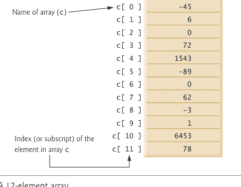

图 7.1 | 一个 12 元素数组。

索引必须是 nonnegative 整数。程序可以使用表达式作为索引。例如，如果我们假设变量 a 为 5 且变量 b 为 6，则语句

```
c[ a + b ] += 2;
```

将 2 加到数组元素 c[11]。带索引的数组名称是数组访问表达式，可用于赋值的左侧以将新值放入数组元素。

> 常见编程错误 7.1
> 索引必须是 int 值或可提升为 int 的类型的值——即 byte、short 或 char，但不是 long；否则会发生编译错误。

让我们更仔细地检查图 7.1 中的数组 c。数组的名称是 c。每个数组对象都知道自己的长度并将其存储在 length 实例变量中。表达式

c.length 访问数组 c 的 length 字段以确定数组的长度。即使数组的 length 实例变量是 public，它也不能被更改，因为它是一个 final 变量。该数组的 12 个元素称为 c[0]、c[1]、c[2]、…、c[11]。c[0] 的值为 -45，c[1] 的值为 6，c[2] 的值为 0，c[7] 的值为 62，c[11] 的值为 78。要计算数组 c 中前三个元素的值之和并将结果存储在变量 sum 中，我们将写

```
sum = c[ 0 ] + c[ 1 ] + c[ 2 ];
```

要将 c[6] 的值除以 2 并将结果赋给变量 x，我们将写

```
x = c[ 6 ] / 2;
```

# 7.3 声明和创建数组

数组对象占用内存空间。像其他对象一样，数组使用关键字 new 创建。要创建数组对象，你指定数组元素的类型和元素数量作为使用关键字 new 的数组创建表达式的一部分。此类表达式返回的引用可以存储在数组变量中。以下声明和数组创建表达式创建包含 12 个 int 元素的数组对象并将数组的引用存储在数组变量 c 中：

```
int[] c = new int[ 12 ];
```

此表达式可用于创建图 7.1 所示的数组。当数组创建时，数组的每个元素都会收到默认值——数值原始类型元素的零、布尔元素的 false 和引用的 null。正如你很快就会看到的，你可以在创建数组时提供非默认值初始元素值。

创建图 7.1 中的数组也可以分两步执行如下：

```
int[] c; // 声明数组变量
c = new int[ 12 ]; // 创建数组；分配给数组变量
```

在声明中，类型后跟的方括号表示 c 是一个将引用数组的变量（即变量将存储数组引用）。在赋值语句中，数组变量 c 接收对 12 个 int 元素的新数组的引用。

# 常见编程错误 7.2

> 在数组声明中，在声明的方括号中指定元素数量（例如 int[12] c；）是语法错误。

程序可以在单个声明中创建多个数组。以下声明为 b 预留 100 个元素，为 x 预留 27 个元素：

```
String[] b = new String[ 100 ], x = new String[ 27 ];
```

当数组的类型和方括号组合在声明的开头时，声明中的所有标识符都是数组变量。在这种情况下，变量 b 和 x 引用 String 数组。出于可读性考虑，我们更喜欢每个声明只声明一个变量。之前的声明等价于：

```
String[] b = new String[ 100 ]; // 创建数组 b
String[] x = new String[ 27 ]; // 创建数组 x
```


## 良好编程实践 7.1

为提高可读性，每次声明只声明一个变量。让每个声明单独占一行，并包含描述所声明变量的注释。

当每个声明中只声明一个变量时，方括号可以放在类型后面，也可以放在数组变量名后面，如下所示：

```
String b[] = new String[ 100 ]; // create array b
String x[] = new String[ 27 ]; // create array x
```

## 常见编程错误 7.3

在单个声明中声明多个数组变量可能导致细微错误。考虑声明 int[] a, b, c。如果 a、b 和 c 应该被声明为数组变量，则此声明是正确的——将方括号直接放在类型之后表示声明中的所有标识符都是数组变量。但是，如果只有 a  intended to be an array variable, and b and c are intended to be individual int variables, then this declaration is incorrect—the declaration int a[], b, c; would achieve the desired result.

程序可以声明任何类型的数组。原始类型数组的每个元素都包含数组声明的元素类型的值。同样，在引用类型的数组中，每个元素都是对数组声明的元素类型的对象的引用。例如，int 数组的每个元素都是一个 int 值，而 String 数组的每个元素都是对 String 对象的引用。

## 7.4 使用数组的示例

本节提供了几个示例，演示声明数组、创建数组、初始化数组和操作数组元素。

## 创建和初始化数组

图 7.2 中的应用程序使用关键字 new 创建一个包含 10 个 int 元素的数组，这些元素最初为零（int 变量的默认值）。第 8 行声明 array——能够引用 int 元素数组的引用。第 10 行创建数组对象并将其引用赋给变量 array。第 12 行输出列标题。第一列包含每个数组元素的索引（0–9），第二列包含每个数组元素的默认值（0）。

```
1  // Fig. 7.2: InitArray.java
2  // Initializing the elements of an array to default values of zero.
3
4  public class InitArray
5  {
6      public static void main( String[] args )
7      {
8          int[] array; // declare array named array
9
10         array = new int[ 10 ]; // create the array object
11
12    System.out.printf( "%8s%8s\n", "Index", "Value" ); // column headings
13
14    // output each array element's value
15    for ( int counter = 0; counter < array.length; counter++ )
16        System.out.printf( "%5d%8d\n", counter, array[ counter ] );
17 } // end main
18 } // end class InitArray
```

| Index | Value |
| 0 | 0 |
| 1 | 0 |
| 2 | 0 |
| 3 | 0 |
| 4 | 0 |
| 5 | 0 |
| 6 | 0 |
| 7 | 0 |
| 8 | 0 |
| 9 | 0 |

图 7.2 | 将数组元素初始化为零的默认值。（第 2 部分，共 2 部分。）

第 15–16 行的 for 语句输出索引号（由 counter 表示）和每个数组元素的值（由 array[counter] 表示）。循环控制变量 counter 最初为 0——索引值从 0 开始，因此使用零基计数可以让循环访问数组的每个元素。for 的循环继续条件使用表达式 array.length（第 15 行）来确定数组的长度。在此示例中，数组的长度为 10，因此只要控制变量 counter 的值小于 10，循环就会继续执行。10 个元素的数组的最高索引值为 9，因此在循环继续条件中使用小于运算符可确保循环不会尝试访问数组末尾之外的元素（即，在循环的最后一次迭代中，counter 为 9）。我们很快就会看到 Java 在执行时遇到此类超出范围的索引时会做什么。

## 使用数组初始化器

你可以使用数组初始化器创建一个数组并初始化其元素——数组初始化器是用大括号括起来的以逗号分隔的表达式列表（称为初始化器列表）。在这种情况下，数组长度由初始化器列表中的元素数量决定。例如，

```
int[] n = { 10, 20, 30, 40, 50 };
```

创建一个包含五个元素的数组，索引值为 0–4。元素 n[0] 初始化为 10，n[1] 初始化为 20，以此类推。当编译器遇到包含初始化器列表的数组声明时，它会计算列表中的初始化器数量以确定数组的大小，然后在“幕后”设置适当的 new 操作。

图 7.3 中的应用程序使用 10 个值（第 9 行）初始化一个整数数组，并以表格格式显示该数组。显示数组元素（第 14–15 行）的代码与图 7.2（第 15–16 行）中的代码相同。

```
// Fig. 7.3: InitArray.java
// Initializing the elements of an array with an array initializer.

public class InitArray
{
    public static void main( String[] args )
    {
        // initializer list specifies the value for each element
        int[] array = { 32, 27, 64, 18, 95, 14, 90, 70, 60, 37 };

        System.out.printf( "%s%8s\n", "Index", "Value" ); // column headings

        // output each array element's value
        for ( int counter = 0; counter < array.length; counter++ )
            System.out.printf( "%5d%8d\n", counter, array[ counter ] );
    } // end main
} // end class InitArray
```

| Index | Value |
| 0 | 32 |
| 1 | 27 |
| 2 | 64 |
| 3 | 18 |
| 4 | 95 |
| 5 | 14 |
| 6 | 90 |
| 7 | 70 |
| 8 | 60 |
| 9 | 37 |

图 7.3 | 使用数组初始化器初始化数组元素。

## 计算要存储在数组中的值

图 7.4 中的应用程序创建一个 10 个元素的数组，并将从 2 到 20 的偶数中的一个（2、4、6、...、20）分配给每个元素。然后应用程序以表格格式显示数组。第 12–13 行的 for 语句通过将控制变量 counter 的当前值乘以 2，然后加上 2 来计算数组元素的值。

```
// Fig. 7.4: InitArray.java
// Calculating the values to be placed into the elements of an array.

public class InitArray
{
    public static void main( String[] args )
    {
        final int ARRAY_LENGTH = 10; // declare constant
        int[] array = new int[ ARRAY_LENGTH ]; // create array

        // calculate value for each array element
        for ( int counter = 0; counter < array.length; counter++ )
            array[ counter ] = 2 + 2 * counter;
```

图 7.4 | 计算要放入数组元素中的值。（第 I 部分，共 2 部分。）

```
14
15    System.out.printf( "%8s\n", "Index", "Value" ); // column headings
16
17    // output each array element's value
18    for ( int counter = 0; counter < array.length; counter++ )
19        System.out.printf( "%5d%8d\n", counter, array[ counter ] );
20 } // end main
21 } // end class InitArray
```

| Index | Value |
| 0 | 2 |
| 1 | 4 |
| 2 | 6 |
| 3 | 8 |
| 4 | 10 |
| 5 | 12 |
| 6 | 14 |
| 7 | 16 |
| 8 | 18 |
| 9 | 20 |

图 7.4 | 计算要放入数组元素中的值。（第 2 部分，共 2 部分。）

第 8 行使用修饰符 final 声明常量变量 ARRAY_LENGTH，其值为 10。常量变量必须在使用前初始化，并且此后不能被修改。如果你尝试在声明中初始化后修改 final 变量，编译器会发出类似以下的错误消息

```
cannot assign a value to final variable variableName
```

如果尝试在初始化 final 变量之前访问其值，编译器会发出类似以下的错误消息

```
variable variableName might not have been initialized
```

## 良好编程实践 7.2

常量变量也称为命名常量。它们通常比使用字面值（例如，10）的程序更具可读性——像 ARRAY_LENGTH 这样的命名常量清楚地表明了其用途，而字面值根据其上下文可能具有不同的含义。

## 常见编程错误 7.4

在初始化后为常量变量赋值是编译错误。

## 常见编程错误 7.5

尝试在初始化之前使用常量是编译错误。

## 求和数组元素

通常，数组的元素代表一系列要在计算中使用的值。如果例如它们代表考试成绩，教授可能希望对


对数组求和并使用该总和来计算考试的平均分。图7.14和图7.18中的GradeBook示例使用了这一技术。

图7.5对包含10个元素的整数数组中的值求和。程序在第8行声明、创建并初始化该数组。for 语句执行计算。[注意：作为数组初始化器的值通常是在程序运行时读入的，而不是写在初始化列表中。例如，应用程序可以从用户输入或磁盘文件读取这些值（如第17章《文件、流与对象序列化》所讨论的）。将数据读入程序（而不是在程序中“硬编码”）使程序更具可重用性，因为它可以用于不同的数据集。]

```java
// Fig. 7.5: SumArray.java
// Computing the sum of the elements of an array.

public class SumArray
{
    public static void main( String[] args )
    {
        int[] array = { 87, 68, 94, 100, 83, 78, 85, 91, 76, 87 };
        int total = 0;

        // add each element's value to total
        for ( int counter = 0; counter < array.length; counter++ )
            total += array[ counter ];

        System.out.printf( "Total of array elements: %d\n", total );
    } // end main
} // end class SumArray
```

Total of array elements: 849

图7.5 | 计算数组元素之和。

## 使用条形图以图形方式显示数组数据

许多程序以图形方式向用户呈现数据。例如，数值通常以条形图中的条形显示。在这样的图表中，较长的条形表示按比例较大的数值。以图形方式显示数值数据的一种简单方法是使用条形图，将每个数值显示为星号（*）组成的条形。

教授们通常喜欢检查考试分数的分布情况。一位教授可能会将若干类别的分数数量绘制成图表，以直观地查看成绩分布。假设一次考试的成绩为87、68、94、100、83、78、85、91、76和87。其中包括1个100分，2个90多分，4个80多分，2个70多分，1个60多分，没有低于60分的分数。我们的下一个应用程序（图7.6）将这个成绩分布数据存储在一个包含11个元素的数组中，每个元素对应一个成绩类别。例如，array[0] 表示0–9分范围内的分数个数，array[7] 表示70–79分范围内的分数个数，array[10] 表示100分的个数。本章后面的 GradeBook 类（图7.14和图7.18）包含根据一组成绩计算这些成绩频率的代码。现在，我们手动创建具有给定成绩频率的数组。

```java
// Fig. 7.6: BarChart.java
// Bar chart printing program.

public class BarChart
{
    public static void main( String[] args )
    {
        int[] array = { 0, 0, 0, 0, 0, 0, 1, 2, 4, 2, 1 };

        System.out.println( "Grade distribution:" );

        // for each array element, output a bar of the chart
        for ( int counter = 0; counter < array.length; counter++ )
        {
            // output bar label ( "00-09: ", ..., "90-99: " "100: " )
            if ( counter == 10 )
                System.out.printf( "%5d: ", 100 );
            else
                System.out.printf( "%02d-%02d: ",
                    counter * 10, counter * 10 + 9 );

            // print bar of asterisks
            for ( int stars = 0; stars < array[ counter ]; stars++ )
                System.out.print( "*" );

            System.out.println(); // start a new line of output
        } // end outer for
    } // end main
} // end class BarChart
```

```
Grade distribution:
00-09:
10-19:
20-29:
30-39:
40-49:
50-59:
60-69: *
70-79: **
80-89: ****
90-99: **
    100: *
```

图7.6 | 打印条形图的程序。

该应用程序从数组中读取数字，并将信息绘制为条形图。它显示每个分数段，后跟一个星号条形，表示该分数段内的分数个数。为了标记每个条形，第16–20行根据计数器 counter 的当前值输出一个分数段（例如，"70-79: "）。当 counter 为10时，第17行以5个字符的字段宽度输出100，后跟一个冒号和一个空格，以使标签 "100: " 与其他条形标签对齐。嵌套的 for 语句（第23–24行）输出条形。注意第23行的循环继续条件（stars < array[counter]）。每次程序到达内层 for 时，循环从0计数到 array[counter]，从而使用 array 中的值来确定要显示的星号数量。

在此示例中，没有学生的成绩低于60分，因此 array[0]–array[5] 包含零，并且前六个分数段旁边不显示星号。在第19行，格式说明符 %02d 表示 int 值应格式化为两位数字的字段。格式说明符中的 0 标志对少于字段宽度（2）的数字显示前导0。

## 使用数组元素作为计数器

有时，程序使用计数器变量来汇总数据，例如调查结果。在图6.7中，我们在掷骰子程序中使用单独的计数器来跟踪六面骰子每一面出现的次数，该程序掷骰子6,000,000次。此应用程序的数组版本如图7.7所示。

```java
// Fig. 7.7: RollDie.java
// Die-rolling program using arrays instead of switch.
import java.util.Random;

public class RollDie
{
    public static void main( String[] args )
    {
        Random randomNumbers = new Random(); // random number generator
        int[] frequency = new int[ 7 ]; // array of frequency counters

        // roll die 6,000,000 times; use die value as frequency index
        for ( int roll = 1; roll <= 6000000; roll++ )
            ++frequency[ 1 + randomNumbers.nextInt( 6 ) ];

        System.out.printf( "%s%10s\n", "Face", "Frequency" );

        // output each array element's value
        for ( int face = 1; face < frequency.length; face++ )
            System.out.printf( "%4d%10d\n", face, frequency[ face ] );
    } // end main
} // end class RollDie
```

| 面 | 频率 |
|------|-----------|
| 1 | 999690 |
| 2 | 999512 |
| 3 | 1000575 |
| 4 | 999815 |
| 5 | 999781 |
| 6 | 1000627 |

图7.7 | 使用数组代替 switch 的掷骰子程序。

图7.7使用数组 frequency（第10行）来统计骰子每一面出现的次数。该程序中第14行的单条语句代替了图6.7中的第23–46行。第14行使用随机值来确定在每次循环迭代中递增 frequency 的哪个元素。第14行的计算产生1到6的随机数，因此数组 frequency 必须足够大以存储六个计数器。然而，我们使用一个包含7个元素的数组，并忽略 frequency[0]——让面值1递增 frequency[1] 比递增 frequency[0] 更合理。因此，每个面值被用作数组 frequency 的索引。在第14行，方括号内的表达式首先计算以确定要递增数组的哪个元素，然后 ++ 运算符将该元素加1。我们还用循环遍历数组 frequency 来输出结果（第19–20行），代替了图6.7中的第50–52行。

## 使用数组分析调查结果

我们的下一个示例使用数组来汇总调查中收集的数据。考虑以下问题描述：

> 20名学生被要求按1到5的等级评价学生食堂的食品质量，1表示“很差”，5表示“极好”。将这20个回答放入一个整数数组，并确定每个评分的频率。

这是一个典型的数组处理应用程序（图7.8）。我们希望汇总每种类型（即1–5）的回答数量。数组 responses（第9–10行）是一个包含20个元素的整数数组，存储学生的调查回答。数组中的最后一个值故意被设为不正确的回答（14）。当 Java 程序执行时，数组元素索引会进行有效性检查——所有索引必须大于或等于0且小于数组的长度。任何访问该索引范围之外元素的尝试都会导致运行时错误，称为 ArrayIndexOutOfBoundsException。在本节末尾，我们将讨论无效响应值，演示数组边界检查，并介绍 Java 的异常处理机制，该机制可用于检测和处理 ArrayIndexOutOfBoundsException。

```java
// Fig. 7.8: StudentPoll.java
// Poll analysis program.

public class StudentPoll
{
    public static void main( String[] args )
    {
        // student response array (more typically, input at runtime)
        int[] responses = { 1, 2, 5, 4, 3, 5, 2, 1, 3, 3, 1, 4, 3, 3, 3,
            2, 3, 3, 2, 14 };
        int[] frequency = new int[ 6 ]; // array of frequency counters

        // for each answer, select responses element and use that value
        // as frequency index to determine element to increment
        for ( int answer = 0; answer < responses.length; answer++ )
        {
            try
            {
                ++frequency[ responses[ answer ] ];
            } // end try
            catch ( ArrayIndexOutOfBoundsException e )
            {
                System.out.println( e );
                System.out.printf( "    responses[%d] = %d\n\n",
                    answer, responses[ answer ] );
            } // end catch
        } // end for
```


```
28
29    System.out.printf( "% %10s\n", "Rating", "Frequency" );
30
31    // output each array element's value
32    for ( int rating = 1; rating < frequency.length; rating++ )
33        System.out.printf( "%6d%10d\n", rating, frequency[ rating ] );
34 } // end main
35 } // end class StudentPoll
```

java.lang.ArrayIndexOutOfBoundsException: 14
    responses[19] = 14

Rating Frequency
    1       3
    2       4
    3       8
    4       2
    5       2

Fig. 7.8 | Poll analysis program. (Part 2 of 2.)

## The frequency Array

We use the six-element array frequency (line 11) to count the number of occurrences of each response. Each element is used as a counter for one of the possible types of survey responses—frequency[1] counts the number of students who rated the food as 1, frequency[2] counts the number of students who rated the food as 2, and so on.

## Summarizing the Results

The for statement (lines 15–27) reads the responses from the array responses one at a time and increments one of the counters frequency[1] to frequency[5]; we ignore frequency[0] because the survey responses are limited to the range 1–5. The key statement in the loop appears in line 19. This statement increments the appropriate frequency counter as determined by the value of responses[answer].
Let’s step through the first few iterations of the for statement:

- When the counter answer is 0, responses[answer] is the value of responses[0] (that is, 1—see line 9). In this case, frequency[responses[answer]] is interpreted as frequency[1], and the counter frequency[1] is incremented by one. To evaluate the expression, we begin with the value in the innermost set of brackets (answer, currently 0). The value of answer is plugged into the expression, and the next set of brackets (responses[answer]) is evaluated. That value is used as the index for the frequency array to determine which counter to increment (in this case, frequency[1]).
- The next time through the loop answer is 1, responses[answer] is the value of responses[1] (that is, 2—see line 9), so frequency[responses[answer]] is interpreted as frequency[2], causing frequency[2] to be incremented.
- When answer is 2, responses[answer] is the value of responses[2] (that is, 5—see line 9), so frequency[responses[answer]] is interpreted as frequency[5], causing frequency[5] to be incremented, and so on.

## toString Method of the Exception Parameter

When lines 21–26 catch the exception, the program displays a message indicating the problem that occurred. Line 23 implicitly calls the exception object’s toString method to get the error message that is stored in the exception object and display it. Once the message is displayed in this example, the exception is considered handled and the program continues with the next statement after the catch block’s closing brace. In this example, the end of the for statement is reached (line 27), so the program continues with the increment of the control variable in line 15. We use exception handling again in Chapter 8, and Chapter 11 presents a deeper look at exception handling.

## 7.5 Case Study: Card Shuffling and Dealing Simulation

The examples in the chapter thus far have used arrays containing elements of primitive types. Recall from Section 7.2 that the elements of an array can be either primitive types or reference types. This section uses random-number generation and an array of reference-type elements, namely objects representing playing cards, to develop a class that simulates card shuffling and dealing. This class can then be used to implement applications that play specific card games. The exercises at the end of the chapter use the classes developed here to build a simple poker application.

We first develop class Card (Fig. 7.9), which represents a playing card that has a face (e.g., "Ace", "Deuce", "Three", ..., "Jack", "Queen", "King") and a suit (e.g., "Hearts", "Diamonds", "Clubs", "Spades"). Next, we develop the DeckOfCards class (Fig. 7.10), which creates a deck of 52 playing cards in which each element is a Card object. We then build a test application (Fig. 7.11) that demonstrates class DeckOfCards’s card shuffling and dealing capabilities.

## Class Card

Class Card (Fig. 7.9) contains two String instance variables—face and suit—that are used to store references to the face name and suit name for a specific Card. The constructor for the class (lines 10–14) receives two Strings that it uses to initialize face and suit. Method toString (lines 17–20) creates a String consisting of the face of the card, the String " of " and the suit of the card. Card’s toString method can be invoked explicitly to obtain a string representation of a Card object (e.g., "Ace of Spades"). The toString method of an object is called implicitly when the object is used where a String is expected (e.g., when printf outputs the object as a String using the %s format specifier or when the object is concatenated to a String using the + operator). For this behavior to occur, toString must be declared with the header shown in Fig. 7.9.

```
1  // Fig. 7.9: Card.java
2  // Card class represents a playing card.
3
4  public class Card
5  {
6      private String face; // face of card ("Ace", "Deuce", ...)
7      private String suit; // suit of card ("Hearts", "Diamonds", ...)
```

```
// two-argument constructor initializes card's face and suit
public Card( String cardFace, String cardSuit )
{
    face = cardFace; // initialize face of card
    suit = cardSuit; // initialize suit of card
} // end two-argument Card constructor

// return String representation of Card
public String toString()
{
    return face + " of " + suit;
} // end method toString
} // end class Card
```

Fig. 7.9 | Card class represents a playing card. (Part 2 of 2.)

## Class DeckOfCards

Class DeckOfCards (Fig. 7.10) declares as an instance variable a Card array named deck (line 7). An array of a reference type is declared like any other array. Class DeckOfCards also declares an integer instance variable currentCard (line 8) representing the next Card to be dealt from the deck array and a named constant NUMBER_OF_CARDS (line 9) indicating the number of Cards in the deck (52).

```
// Fig. 7.10: DeckOfCards.java
// DeckOfCards class represents a deck of playing cards.
import java.util.Random;

public class DeckOfCards
{
    private Card[] deck; // array of Card objects
    private int currentCard; // index of next Card to be dealt (0-51)
    private static final int NUMBER_OF_CARDS = 52; // constant # of Cards
    // random number generator
    private static final Random randomNumbers = new Random();

    // constructor fills deck of Cards
    public DeckOfCards()
    {
        String[] faces = { "Ace", "Deuce", "Three", "Four", "Five", "Six", "Seven", "Eight", "Nine", "Ten", "Jack", "Queen", "King" };
        String[] suits = { "Hearts", "Diamonds", "Clubs", "Spades" };

        deck = new Card[ NUMBER_OF_CARDS ]; // create array of Card objects
        currentCard = 0; // set currentCard so first Card dealt is deck[ 0 ]

        // populate deck with Card objects
        for ( int count = 0; count < deck.length; count++ )
            deck[ count ] =
                new Card( faces[ count % 13 ], suits[ count / 13 ] );
    } // end DeckOfCards constructor
```

Fig. 7.10 | DeckOfCards class represents a deck of playing cards. (Part 1 of 2.)

```
29  // shuffle deck of Cards with one-pass algorithm
30  public void shuffle()
31  {
32      // after shuffling, dealing should start at deck[ 0 ] again
33      currentCard = 0; // reinitialize currentCard
34
35      // for each Card, pick another random Card (0-51) and swap them
36      for ( int first = 0; first < deck.length; first++ )
37      {
38          // select a random number between 0 and 51
39          int second = randomNumbers.nextInt( NUMBER_OF_CARDS );
40
41          // swap current Card with randomly selected Card
42          Card temp = deck[ first ];
43          deck[ first ] = deck[ second ];
44          deck[ second ] = temp;
45      } // end for
46  } // end method shuffle
47
48  // deal one Card
49  public Card dealCard()
50  {
51      // determine whether Cards remain to be dealt
52      if ( currentCard < deck.length )
53          return deck[ currentCard++ ]; // return current Card in array
54      else
55          return null; // return null to indicate that all Cards were dealt
56  } // end method dealCard
57 } // end class DeckOfCards
```

Fig. 7.10 | DeckOfCards class represents a deck of playing cards. (Part 2 of 2.)

## DeckOfCards Constructor

The class’s constructor instantiates the deck array (line 20) with NUMBER_OF_CARDS (52) elements. The elements of deck are null by default, so the constructor uses a for statement (lines 24–26) to fill the deck with Cards. The loop initializes control variable count to 0 and loops while count is less than deck.length, causing count to take on each integer value from 0 to 51 (the indices of the deck array). Each Card is instantiated and initialized with two Strings—one from the faces array (which contains the Strings "Ace" through "King") and one from the suits array (which contains the Strings "Hearts", "Diamonds", "Clubs" and "Spades"). The calculation count % 13 always results in a value from 0 to 12 (the 13 indices of the faces array in lines 16–17), and the calculation count / 13 always results in a value from 0 to 3 (the four indices of the suits array in line 18). When the deck array is initialized, it contains the Cards with faces "Ace" through "King" in order for each suit ("Hearts" then "Diamonds" then "Clubs" then "Spades"). We use arrays of Strings to represent the faces and suits in this example. In Exercise 7.34, we ask you to modify this example to use arrays of enumeration constants to represent the faces and suits.

## DeckOfCards Method shuffle

Method shuffle (lines 30–46) shuffles the Cards in the deck. The method loops through all 52 Cards (array indices 0 to 51). For each Card, a number between 0 and 51 is picked


随机选择另一张 Card。接下来，当前 Card 对象和随机选择的 Card 对象在数组中交换位置。此交换由第 42–44 行的三个赋值完成。额外的变量 temp 暂时存储正在交换的两个 Card 对象中的一个。交换不能仅用以下两个语句完成

```
deck[ first ] = deck[ second ];
deck[ second ] = deck[ first ];
```

如果 deck[first] 是“Spades” 的 “Ace”，而 deck[second] 是 “Hearts” 的 “Queen”，在第一次赋值后，两个数组元素都包含 “Hearts” 的 “Queen”，而 “Spades” 的 “Ace” 丢失——因此需要额外的变量 temp。for 循环终止后，Card 对象被随机排序。在整个数组的一次遍历中总共只进行 52 次交换，Card 对象数组被洗牌！

> [Note: It’s recommended that you use a so-called unbiased shuffling algorithm for real card games. Such an algorithm ensures that all possible shuffled card sequences are equally likely to occur. A popular unbiased shuffling algorithm is the Fisher-Yates algorithm.]

### DeckOfCards 方法 dealCard

方法 dealCard（第 49–56 行）发一张数组中的 Card。回想一下，currentCard 表示要发出的下一张 Card 的索引（即牌堆顶部的 Card）。因此，第 52 行将 currentCard 与牌堆数组的长度进行比较。如果牌堆不为空（即 currentCard 小于 52），第 53 行返回“顶部”Card 并后递增 currentCard 以准备下一次对 dealCard 的调用——否则返回 null。回想一下第 3 章中 null 表示“对无物的引用”。

### 洗牌和发牌

图 7.11 演示了类 DeckOfCards（图 7.10）。第 9 行创建一个名为 myDeckOfCards 的 DeckOfCards 对象。DeckOfCards 构造函数按花色和点数顺序创建 52 个 Card 对象组成的牌堆。第 10 行调用 myDeckOfCards 的 shuffle 方法以重新排列 Card 对象。第 13–20 行发完全部 52 张 Card 并以每行 13 张、共四列的方式打印它们。第 16 行通过调用 myDeckOfCards 的 dealCard 方法发一张 Card 对象，然后在 19 个字符的字段中左对齐显示该 Card。当 Card 以 String 输出时，Card 的 toString 方法（图 7.9 的第 17–20 行）会被隐式调用。第 18–19 行每四张 Card 后换行。

```
1  // Fig. 7.11: DeckOfCardsTest.java
2  // Card shuffling and dealing.
3
4  public class DeckOfCardsTest
5  {
6      // execute application
7      public static void main( String[] args )
8      {
9          DeckOfCards myDeckOfCards = new DeckOfCards();
10         myDeckOfCards.shuffle(); // place Cards in random order
11
12      // print all 52 Cards in the order in which they are dealt
13      for ( int i = 1; i <= 52; i++ )
14      {
15          // deal and display a Card
16          System.out.printf( "%-19s", myDeckOfCards.dealCard() );
17
18          if ( i % 4 == 0 ) // output a newline after every fourth card
19              System.out.println();
20      } // end for
21      } // end main
22  } // end class DeckOfCardsTest
```

| | | | |
|---|---|---|---|
| Six of Spades | Eight of Spades | Six of Clubs | Nine of Hearts |
| Queen of Hearts | Seven of Clubs | Nine of Spades | King of Hearts |
| Three of Diamonds | Deuce of Clubs | Ace of Hearts | Ten of Spades |
| Four of Spades | Ace of Clubs | Seven of Diamonds | Four of Hearts |
| Three of Clubs | Deuce of Hearts | Five of Spades | Jack of Diamonds |
| King of Clubs | Ten of Hearts | Three of Hearts | Six of Diamonds |
| Queen of Clubs | Eight of Diamonds | Deuce of Diamonds | Ten of Diamonds |
| Three of Spades | King of Diamonds | Nine of Clubs | Six of Hearts |
| Ace of Spades | Four of Diamonds | Seven of Hearts | Eight of Clubs |
| Deuce of Spades | Eight of Hearts | Five of Hearts | Queen of Spades |
| Jack of Hearts | Seven of Spades | Four of Clubs | Nine of Diamonds |
| Ace of Diamonds | Queen of Diamonds | Five of Clubs | King of Spades |
| Five of Diamonds | Ten of Clubs | Jack of Spades | Jack of Clubs |

*Fig. 7.11 | Card shuffling and dealing. (Part 2 of 2.)*

## 7.6 Enhanced for Statement

增强 for 语句在不使用计数器的情况下遍历数组的元素，从而避免“超出”数组的可能性。我们将在第 7.14 节中展示如何使用增强 for 语句与 Java API 的预建数据结构（称为集合）一起使用。增强 for 语句的语法是：

```
for ( parameter : arrayName )
    statement
```

其中 parameter 具有类型和标识符（例如 int number），而 arrayName 是要遍历的数组。parameter 的类型必须与数组中元素的类型一致。正如下一个示例所示，标识符在循环的每次迭代中代表数组中连续的元素值。

图 7.12 使用增强 for 语句（第 12–13 行）对学生成绩数组中的整数求和。增强 for 的参数类型为 int，因为 array 包含 int 值——循环在每次迭代中从数组中选择一个 int 值。增强 for 语句一次一个地遍历数组中的连续值。语句的头部可以读作“对于每次迭代，将数组的下一个元素赋给 int 变量 number，然后执行以下语句”。因此，对于每次迭代，标识符 number 代表数组中的一个 int 值。第 12–13 行等价于在图 7.5 的第 12–13 行中用于对数组中的整数求总和的计数器控制重复，除了在增强 for 语句中无法访问计数器：

```
for ( int counter = 0; counter < array.length; counter++ )
    total += array[ counter ];
```

```
// Fig. 7.12: EnhancedForTest.java
// Using the enhanced for statement to total integers in an array.

public class EnhancedForTest
{
    public static void main( String[] args )
    {
        int[] array = { 87, 68, 94, 100, 83, 78, 85, 91, 76, 87 };
        int total = 0;

        // add each element's value to total
        for ( int number : array )
            total += number;

        System.out.printf( "Total of array elements: %d\n", total );
    } // end main
} // end class EnhancedForTest
```

Total of array elements: 849

*Fig. 7.12 | Using the enhanced for statement to total integers in an array.*

增强 for 语句简化了遍历数组的代码。需要注意的是，增强 for 语句只能用于获取数组元素——不能用于修改元素。如果程序需要修改元素，请使用传统的计数器控制 for 语句。

只要循环遍历数组的代码不需要访问指示当前数组元素索引的计数器，就可以使用增强 for 语句代替计数器控制 for 语句。例如，对数组中的整数求和只需要访问元素值——每个元素的索引无关紧要。但是，如果程序出于其他原因必须使用计数器（例如，如本章前面的示例中那样，在每个数组元素值旁边打印索引号），请使用计数器控制 for 语句。

## 7.7 Passing Arrays to Methods

本节演示如何将数组和单个数组元素作为参数传递给方法。要将数组参数传递给方法，请指定数组的名称，不带任何方括号。例如，如果数组 hourlyTemperatures 声明为

```
double[] hourlyTemperatures = new double[ 24 ];
```

则方法调用

```
modifyArray( hourlyTemperatures );
```

将数组 hourlyTemperatures 的引用传递给方法 modifyArray。每个数组对象都“知道”自己的长度（通过其 length 字段）。因此，当我们将数组对象的引用传递到方法中时，无需将数组长度作为额外参数传递。

```
void modifyArray( double[] b )
```

表示 modifyArray 接收参数 b 中的 double 数组的引用。方法调用传递数组 hourlyTemperatures 的引用，因此当被调用方法使用数组变量 b 时，它指的是调用者中 hourlyTemperatures 的同一个数组对象。

当向方法传递的参数是整个数组或引用类型的单个数组元素时，被调用方法接收引用的副本。但是，当向方法传递的参数是原始类型的单个数组元素时，被调用方法接收元素值的副本。此类原始值称为标量或标量量。要将单个数组元素传递给方法，请在方法调用中使用数组元素的索引名称作为参数。

图 7.13 演示了传递整个数组与传递原始类型数组元素给方法之间的区别。请注意，main 直接调用静态方法 modifyArray（第 19 行）和 modifyElement（第 30 行）。回想一下第 6.4 节中，类的静态方法可以直接调用同一类的其他静态方法。

```
// Fig. 7.13: PassArray.java
// Passing arrays and individual array elements to methods.

public class PassArray
{
    // main creates array and calls modifyArray and modifyElement
    public static void main( String[] args )
    {
        int[] array = { 1, 2, 3, 4, 5 };

        System.out.println(
            "Effects of passing reference to entire array:\n" +
            "The values of the original array are:" );

        // output original array elements
        for ( int value : array )
            System.out.printf( "   %d", value );

        modifyArray( array ); // pass array reference
        System.out.println( "\n\nThe values of the modified array are:" );

        // output modified array elements
        for ( int value : array )
            System.out.printf( "   %d", value );

        System.out.printf(
            "\n\nEffects of passing array element value:\n" +
            "array[3] before modifyElement: %d\n", array[ 3 ] );

        modifyElement( array[ 3 ] ); // attempt to modify array[ 3 ]
        System.out.printf(
            "array[3] after modifyElement: %d\n", array[ 3 ] );
    } // end main
```


// multiply each element of an array by 2
public static void modifyArray( int[] array2 )
{
    for ( int counter = 0; counter < array2.length; counter++ )
        array2[ counter ] *= 2;
} // end method modifyArray

// multiply argument by 2
public static void modifyElement( int element )
{
    element *= 2;
    System.out.printf(
        "Value of element in modifyElement: %d\n", element );
} // end method modifyElement

} // end class PassArray

传递整个数组引用的效果：
原始数组的值为：
  1  2  3  4  5

修改后数组的值为：
  2  4  6  8  10

传递数组元素值的效果：
modifyElement调用前array[3]的值：8
modifyElement中element的值：16
modifyElement调用后array[3]的值：8

图7.13 | 向方法传递数组和单个数组元素。（第2部分，共2部分。）

第16-17行的增强for语句输出数组的5个int元素。第19行调用方法modifyArray，并将array作为参数传递。方法modifyArray（第36-40行）接收数组引用的副本，并使用该引用将数组的每个元素乘以2。为了证明数组的元素已被修改，第23-24行再次输出数组的5个元素。如输出所示，方法modifyArray使每个元素的值翻倍。我们不能在第38-39行使用增强for语句，因为我们要修改数组的元素。

图7.13接下来演示，当将单个原始类型数组元素的副本传递给方法时，在调用方法中修改该副本不会影响调用方法的数组中该元素的原始值。第26-28行在调用方法modifyElement之前输出array[3]的值。请记住，在调用modifyArray中被修改后，该元素的值现在是8。第30行调用方法modifyElement并将array[3]作为参数传递。请记住，array[3]实际上是数组中的一个int值(8)。因此，程序传递的是array[3]值的副本。方法modifyElement（第43-48行）将接收到的参数值乘以2，将结果存储在其参数element中，然后输出element的值（16）。由于方法参数与局部变量一样，在其声明所在的方法执行完毕时就不再存在，因此方法modifyElement终止时，方法参数element被销毁。当程序将控制权返回给main时，第31-32行输出array[3]未修改的值（即8）。

学生成绩。但这将使得计算成绩总和并确定班级平均分的代码变得臃肿，而且班级一次最多只能处理10个成绩。我们通过将成绩存储在数组中来解决这个问题。

## 在GradeBook类中使用数组存储学生成绩

GradeBook类（图7.14）使用一个int数组来存储若干学生在一次考试中的成绩。这样就无需重复输入相同的成绩集合。数组grades被声明为实例变量（第7行），因此每个GradeBook对象都维护自己的成绩集合。构造函数（第10-14行）有两个参数——课程名称和一个成绩数组。当应用程序（例如图7.15中的GradeBookTest类）创建GradeBook对象时，应用程序会将一个现有的int数组传给构造函数，构造函数将该数组的引用赋给实例变量grades（第13行）。grades数组的大小由传给构造函数的数组长度决定。因此，GradeBook对象可以处理可变数量的成绩。传入的数组中的成绩值可以由用户输入，也可以从磁盘上的文件读取（如第17章所述）。在我们的测试应用程序中，我们用一个包含成绩值的数组进行初始化（图7.15，第10行）。一旦这些成绩存储在GradeBook类的实例变量grades中，该类的所有方法即可根据需要随时访问grades的元素以执行各种计算。

方法processGrades（第37-51行）包含一系列方法调用，输出一份总结成绩的报告。第40行调用方法outputGrades来打印grades数组的内容。方法outputGrades中的第134-136行使用for语句输出学生成绩。在这种情况下必须使用计数器控制的for，因为第135-136行使用计数器变量student的值来将每个成绩输出到特定学生编号旁边（见图7.15的输出）。虽然数组下标从0开始，但教授通常会从1开始对学生编号。因此，第135-136行输出student + 1作为学生编号，以产生“Student 1: ”“Student 2: ”等成绩标签。

// Fig. 7.14: GradeBook.java
// GradeBook class using an array to store test grades.

public class GradeBook
{
    private String courseName; // name of course this GradeBook represents
    private int[] grades; // array of student grades

    // two-argument constructor initializes courseName and grades array
    public GradeBook( String name, int[] gradesArray )
    {
        courseName = name; // initialize courseName
        grades = gradesArray; // store grades
    } // end two-argument GradeBook constructor

    // method to set the course name
    public void setCourseName( String name )
    {
        courseName = name; // store the course name
    } // end method setCourseName

```
21
22 // method to retrieve the course name
23 public String getCourseName()
24 {
25     return courseName;
26 } // end method getCourseName
27
28 // display a welcome message to the GradeBook user
29 public void displayMessage()
30 {
31     // getCourseName gets the name of the course
32     System.out.printf( "Welcome to the grade book for\n%s!\n\n",
33         getCourseName() );
34 } // end method displayMessage
35
36 // perform various operations on the data
37 public void processGrades()
38 {
39     // output grades array
40     outputGrades();
41
42     // call method getAverage to calculate the average grade
43     System.out.printf( "\nClass average is %.2f\n", getAverage() );
44
45     // call methods getMinimum and getMaximum
46     System.out.printf( "Lowest grade is %d\nHighest grade is %d\n\n",
47         getMinimum(), getMaximum() );
48
49     // call outputBarChart to print grade distribution chart
50     outputBarChart();
51 } // end method processGrades
52
53 // find minimum grade
54 public int getMinimum()
55 {
56     int lowGrade = grades[ 0 ]; // assume grades[ 0 ] is smallest
57
58     // loop through grades array
59     for ( int grade : grades )
60     {
61         // if grade lower than lowGrade, assign it to lowGrade
62         if ( grade < lowGrade )
63             lowGrade = grade; // new lowest grade
64     } // end for
65
66     return lowGrade; // return lowest grade
67 } // end method getMinimum
68
69 // find maximum grade
70 public int getMaximum()
71 {
72     int highGrade = grades[ 0 ]; // assume grades[ 0 ] is largest
```

```
// loop through grades array
for ( int grade : grades )
{
    // if grade greater than highGrade, assign it to highGrade
    if ( grade > highGrade )
        highGrade = grade; // new highest grade
} // end for

return highGrade; // return highest grade
} // end method getMaximum

// determine average grade for test
public double getAverage()
{
    int total = 0; // initialize total

    // sum grades for one student
    for ( int grade : grades )
        total += grade;

    // return average of grades
    return (double) total / grades.length;
} // end method getAverage

// output bar chart displaying grade distribution
public void outputBarChart()
{
    System.out.println( "Grade distribution:" );

    // stores frequency of grades in each range of 10 grades
    int[] frequency = new int[ 11 ];

    // for each grade, increment the appropriate frequency
    for ( int grade : grades )
        ++frequency[ grade / 10 ];

    // for each grade frequency, print bar in chart
    for ( int count = 0; count < frequency.length; count++ )
    {
        // output bar label ( "00-09: ", ..., "90-99: ", "100: " )
        if ( count == 10 )
            System.out.printf( "%5d: ", 100 );
        else
            System.out.printf( "%02d-%02d: ",
                count * 10, count * 10 + 9 );

        // print bar of asterisks
        for ( int stars = 0; stars < frequency[ count ]; stars++ )
            System.out.print( "*" );

        System.out.println(); // start a new line of output
    } // end outer for
} // end method outputBarChart
```


```
127
128    // output the contents of the grades array
129    public void outputGrades()
130    {
131        System.out.println( "The grades are:\n" );
132
133        // output each student's grade
134        for ( int student = 0; student < grades.length; student++ )
135            System.out.printf( "Student %2d: %3d\n",
136                student + 1, grades[ student ] );
137    } // end method outputGrades
138 } // end class GradeBook
```

## Fig. 7.14 | GradeBook class using an array to store test grades. (Part 4 of 4.)

方法 `processGrades` 接下来调用方法 `getAverage`（第 43 行）来获取数组中成绩的平均值。方法 `getAverage`（第 86–96 行）使用增强 for 语句对数组 `grades` 中的值进行求和，然后计算平均值。增强 for 的头部的参数（例如 `int grade`）表示在每次迭代中，`int` 变量 `grade` 取数组 `grades` 中的一个值。 第 95 行的平均值计算使用 `grades.length` 来确定正在平均的成绩数量。

方法 `processGrades` 中的第 46–47 行调用方法 `getMinimum` 和 `getMaximum`，分别确定考试中任何学生的最低成绩和最高成绩。这两个方法都使用增强 for 语句遍历数组 `grades`。方法 `getMinimum` 中的第 59–64 行遍历数组。第 62–63 行将每个成绩与 `lowGrade` 进行比较；如果某个成绩小于 `lowGrade`，则 `lowGrade` 被设置为该成绩。当第 66 行执行时，`lowGrade` 包含数组中的最低成绩。方法 `getMaximum`（第 70–83 行）的工作方式与方法 `getMinimum` 类似。

最后，方法 `processGrades` 中的第 50 行调用方法 `outputBarChart` 来打印成绩数据的分布图，使用与图 7.6 中类似的技术。在该示例中，我们通过简单地查看一组成绩手动计算每个类别中的成绩数量（即 0–9、10–19、…、90–99 和 100）。在本示例中，第 107–108 行使用与图 7.7 和 7.8 中类似的技术来计算每个类别中成绩的频率。第 104 行声明并创建 `frequency` 数组，包含 11 个 `int`，用于存储每个成绩类别的频率。对于数组 `grades` 中的每个成绩，第 107–108 行递增 `frequency` 数组的适当元素。为了确定要递增哪个元素，第 108 行使用整数除法将当前成绩除以 10。例如，如果 `grade` 为 85，则第 108 行递增 `frequency[8]` 以更新 80–89 范围内成绩的计数。接下来，第 111–125 行根据数组 `frequency` 中的值打印条形图（见图 7.15）。与图 7.6 的第 23–24 行类似，图 7.14 的第 121–122 行使用数组 `frequency` 中的值来确定每个条形中要显示的星号数量。

## Class GradeBookTest That Demonstrates Class GradeBook

图 7.15 的应用程序使用 `int` 数组 `gradesArray`（在第 10 行声明并初始化）创建 `GradeBook` 类的对象。第 12–13 行将课程名称和 `gradesArray` 传递给 `GradeBook` 构造函数。第 14 行显示欢迎消息，第 15 行调用 `GradeBook` 对象的 `processGrades` 方法。输出总结了 `myGradeBook` 中的 10 个成绩。

## Software Engineering Observation 7.1

测试夹具（或测试应用程序）负责创建正在测试的类的对象并为其提供数据。此数据可能来自多个来源。测试数据可以直接用数组初始化器放入数组中，它可以来自键盘上的用户，也可以来自文件（您将在第 17 章看到），也可以来自网络（您将在第 27 章看到）。在将此数据传递给类的构造函数以实例化对象之后，测试夹具应调用对象以测试其方法和操作其数据。这样在测试夹具中收集数据允许类操作来自多个来源的数据。

```
// Fig. 7.15: GradeBookTest.java
// GradeBookTest creates a GradeBook object using an array of grades,
// then invokes method processGrades to analyze them.
public class GradeBookTest
{
    // main method begins program execution
    public static void main( String[] args )
    {
        // array of student grades
        int[] gradesArray = { 87, 68, 94, 100, 83, 78, 85, 91, 76, 87 };

        GradeBook myGradeBook = new GradeBook(
            "CS101 Introduction to Java Programming", gradesArray );
        myGradeBook.displayMessage();
        myGradeBook.processGrades();
    } // end main
} // end class GradeBookTest
```

Welcome to the grade book for
CS101 Introduction to Java Programming!

The grades are:

Student  1:  87
Student  2:  68
Student  3:  94
Student  4:  100
Student  5:  83
Student  6:  78
Student  7:  85
Student  8:  91
Student  9:  76
Student 10:  87

Class average is 84.90
Lowest grade is 68
Highest grade is 100

## Fig. 7.15 | GradeBookTest creates a GradeBook object using an array of grades, then invokes method processGrades to analyze them. (Part 1 of 2.)

```
Grade distribution:
00-09:
10-19:
20-29:
30-39:
40-49:
50-59:
60-69: *
70-79: **
80-89: ****
90-99: **
  100: *
```

## Fig. 7.15 | GradeBookTest creates a GradeBook object using an array of grades, then invokes method processGrades to analyze them. (Part 2 of 2.)

## 7.9 Multidimensional Arrays

二维多维数组通常用于表示由按行和列排列的信息组成的数值表。为了标识特定的表元素，我们必须指定两个索引。按惯例，第一个标识元素的行，第二个标识其列。需要两个索引来标识特定元素的数组称为二维数组。（多维数组可以有超过两个维度。）Java 不直接支持多维数组，但它允许您指定元素本身也是<|message|>
一维数组的一维数组，从而达到相同的效果。图 7.16 说明了名为 `a` 的二维数组，包含三行四列（即三乘四数组）。一般来说，具有 m 行和 n 列的数组称为 m×n 数组。

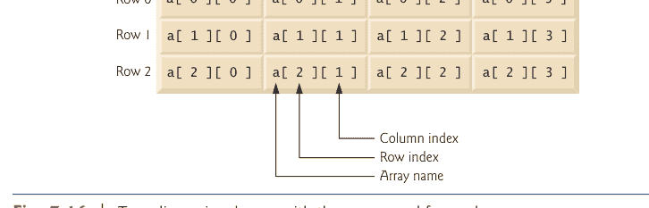

Fig. 7.16 | Two-dimensional array with three rows and four columns.

图 7.16 中数组 `a` 中的每个元素都由形式为 `a[row][column]` 的数组访问表达式标识；`a` 是数组的名称，`row` 和 `column` 是唯一标识数组 `a` 中每个元素行号和列号的索引。第 0 行中元素的名称第一个索引都为 0，第 3 列中元素的名称第二个索引都为 3。

### Arrays of One-Dimensional Arrays

与一维数组一样，多维数组也可以在声明中使用数组初始化器进行初始化。具有两行两列的二维数组 `b` 可以使用嵌套数组初始化器按如下方式声明并初始化：

```
int[][] b = { { 1, 2 }, { 3, 4 } };
```

初始值按行分组在大括号中。因此 1 和 2 分别初始化 `b[0][0]` 和 `b[0][1]`，3 和 4 分别初始化 `b[1][0]` 和 `b[1][1]`。编译器计算嵌套数组初始化器的数量（由外层大括号内的花括号集表示）以确定数组 `b` 的行数。编译器计算行中嵌套数组初始化器中的初始化值数量以确定该行的列数。正如我们稍后会看到的，这意味着行可以具有不同的长度。

多维数组作为一维数组的数组维护。因此，前述声明中的数组 `b` 实际上由两个独立的一维数组组成——一个包含第一个嵌套初始化列表 `{ 1, 2 }` 中的值，一个包含第二个嵌套初始化列表 `{ 3, 4 }` 中的值。因此，数组 `b` 本身是一个包含两个元素的数组，每个元素都是 `int` 值的一维数组。

### Two-Dimensional Arrays with Rows of Different Lengths

多维数组的表示方式使其非常灵活。事实上，数组 `b` 中行的长度不需要相同。例如，

```
int[][] b = { { 1, 2 }, { 3, 4, 5 } };
```

创建整数数组 `b`，它有两个元素（由嵌套数组初始化器的数量决定），代表二维数组的两行。`b` 的每个元素都是对 `int` 变量的一维数组的引用。第 0 行的 `int` 数组是一个包含两个元素（1 和 2）的一维数组，第 1 行的 `int` 数组是一个包含三个元素（3、4 和 5）的一维数组。

### Creating Two-Dimensional Arrays with Array-Creation Expressions

具有每行相同列数的多维数组可以用数组创建表达式创建。例如，以下行声明数组 `b` 并将其分配给三乘四数组的引用：

```
int[][] b = new int[ 3 ][ 4 ];
```

在这种情况下，我们使用字面值 3 和 4 分别指定行数和列数，但这不是必需的。程序也可以使用变量指定数组维度，因为 `new` 在执行时创建数组——而不是在编译时。与一维数组一样，多维数组的元素在数组对象创建时初始化。

每个行列数不同的多维数组可以按如下方式创建：

```
int[][] b = new int[ 2 ][ ];  // create 2 rows
b[ 0 ] = new int[ 5 ]; // create 5 columns for row 0
b[ 1 ] = new int[ 3 ]; // create 3 columns for row 1
```

前述语句创建一个具有两行的二维数组。第 0 行有五列，第 1 行有三列。


## 二维数组示例：显示元素值

图 7.17 演示了使用数组初始化器初始化二维数组并使用嵌套 for 循环遍历数组（即操作每个数组的每个元素）。类 InitArray 的 main 声明了两个数组。array1 的声明（第 9 行）使用相同长度的嵌套数组初始化器将第一行初始化为值 1、2 和 3，第二行初始化为值 4、5 和 6。array2 的声明（第 10 行）使用长度不同的嵌套初始化器。在这种情况下，第一行初始化为两个元素，值分别为 1 和 2。第二行初始化为一个元素，值为 3。第三行初始化为三个元素，值分别为 4、5 和 6。

```
// Fig. 7.17: InitArray.java
// Initializing two-dimensional arrays.

public class InitArray
{
    // create and output two-dimensional arrays
    public static void main( String[] args )
    {
        int[][] array1 = { { 1, 2, 3 }, { 4, 5, 6 } };
        int[][] array2 = { { 1, 2 }, { 3 }, { 4, 5, 6 } };

        System.out.println( "Values in array1 by row are" );
        outputArray( array1 ); // displays array1 by row

        System.out.println( "\nValues in array2 by row are" );
        outputArray( array2 ); // displays array2 by row
    } // end main

    // output rows and columns of a two-dimensional array
    public static void outputArray( int[][] array )
    {
        // loop through array's rows
        for ( int row = 0; row < array.length; row++ )
        {
            // loop through columns of current row
            for ( int column = 0; column < array[ row ].length; column++ )
                System.out.printf( "%d  ", array[ row ][ column ] );

            System.out.println(); // start new line of output
        } // end outer for
    } // end method outputArray
} // end class InitArray
```

```
Values in array1 by row are
1  2  3
4  5  6

Values in array2 by row are
1  2
3
4  5  6
```

图 7.17 | 初始化二维数组。

第 13 行和第 16 行调用方法 outputArray（第 20–31 行）分别输出 array1 和 array2 的元素。方法 outputArray 的参数——int[][] array——表示该方法接收一个二维数组。for 语句（第 23–30 行）输出二维数组的行。在外层 for 语句的循环继续条件中，表达式 array.length 确定了数组中的行数。在内层 for 语句中，表达式 array[row].length 确定了数组当前行的列数。内层 for 语句的条件使循环能够确定每一行中的确切列数。

## 使用 for 语句执行的常见多维数组操作

许多常见的数组操作使用 for 语句。例如，下面的 for 语句将图 7.16 中数组 a 的第 2 行的所有元素设置为零：

```
for ( int column = 0; column < a[ 2 ].length; column++)
    a[ 2 ][ column ] = 0;
```

我们指定了第 2 行；因此我们知道第一个索引始终为 2（0 是第一行，1 是第二行）。此 for 循环仅改变第二个索引（即列索引）。如果数组 a 的第 2 行包含四个元素，则前面的 for 语句等价于赋值语句

```
a[ 2 ][ 0 ] = 0;
a[ 2 ][ 1 ] = 0;
a[ 2 ][ 2 ] = 0;
a[ 2 ][ 3 ] = 0;
```

下面的嵌套 for 语句计算数组 a 中所有元素的总和：

```
int total = 0;
for ( int row = 0; row < a.length; row++ )
{
    for ( int column = 0; column < a[ row ].length; column++ )
        total += a[ row ][ column ];
} // end outer for
```

这些嵌套 for 语句一次一行地对数组元素求和。外层 for 语句首先将行索引设置为 0，以便内层 for 语句对第一行的元素求和。然后外层 for 将 row 增加到 1，以便对第二行求和。然后外层 for 将 row 增加到 2，以便对第三行求和。变量 total 可以在外层 for 语句终止时显示。在下一个示例中，我们展示了如何使用嵌套增强 for 语句以类似的方式处理二维数组。

## 7.10 案例研究：使用二维数组的类 GradeBook

在第 7.8 节中，我们介绍了类 GradeBook（图 7.14），它使用一维数组存储单次考试的学生成绩。在大多数学期中，学生会参加几次考试。教授很可能希望在整个学期内分析成绩，既针对单个学生，也针对整个班级。

```
// perform various operations on the data
public void processGrades()
{
    // output grades array
    outputGrades();

    // call methods getMinimum and getMaximum
    System.out.printf( "\n%s %d\n%s %d\n\n",
        "Lowest grade in the grade book is", getMinimum(),
        "Highest grade in the grade book is", getMaximum() );

    // output grade distribution chart of all grades on all tests
    outputBarChart();
} // end method processGrades

// find minimum grade
public int getMinimum()
{
    // assume first element of grades array is smallest
    int lowGrade = grades[ 0 ][ 0 ];

    // loop through rows of grades array
    for ( int[] studentGrades : grades )
    {
        // loop through columns of current row
        for ( int grade : studentGrades )
        {
            // if grade less than lowGrade, assign it to lowGrade
            if ( grade < lowGrade )
                lowGrade = grade;
        } // end inner for
    } // end outer for

    return lowGrade; // return lowest grade
} // end method getMinimum

// find maximum grade
public int getMaximum()
{
    // assume first element of grades array is largest
    int highGrade = grades[ 0 ][ 0 ];

    // loop through rows of grades array
    for ( int[] studentGrades : grades )
    {
        // loop through columns of current row
        for ( int grade : studentGrades )
        {
            // if grade greater than highGrade, assign it to highGrade
            if ( grade > highGrade )
                highGrade = grade;
        } // end inner for
    } // end outer for

return highGrade; // return highest grade
} // end method getMaximum

// determine average grade for particular set of grades
public double getAverage( int[] setOfGrades )
{
    int total = 0; // initialize total

    // sum grades for one student
    for ( int grade : setOfGrades )
        total += grade;

    // return average of grades
    return (double) total / setOfGrades.length;
} // end method getAverage

// output bar chart displaying overall grade distribution
public void outputBarChart()
{
    System.out.println( "Overall grade distribution:" );

    // stores frequency of grades in each range of 10 grades
    int[] frequency = new int[ 11 ];

    // for each grade in GradeBook, increment the appropriate frequency
    for ( int[] studentGrades : grades )
    {
        for ( int grade : studentGrades )
            ++frequency[ grade / 10 ];
    } // end outer for

    // for each grade frequency, print bar in chart
    for ( int count = 0; count < frequency.length; count++ )
    {
        // output bar label ( "00-09: ", ..., "90-99: ", "100: " )
        if ( count == 10 )
            System.out.printf( "%5d: ", 100 );
        else
            System.out.printf( "%02d-%02d: ",
                count * 10, count * 10 + 9 );

        // print bar of asterisks
        for ( int stars = 0; stars < frequency[ count ]; stars++ )
            System.out.print( "*" );

        System.out.println(); // start a new line of output
    } // end outer for
} // end method outputBarChart

// output the contents of the grades array
public void outputGrades()
{
142 System.out.println( "The grades are:\n" );
143 System.out.print( "                " ); // align column heads
144
145 // create a column heading for each of the tests
146 for ( int test = 0; test < grades[ 0 ].length; test++ )
147     System.out.printf( "Test %d  ", test + 1 );
148
149 System.out.println( "Average" ); // student average column heading
150
151 // create rows/columns of text representing array grades
152 for ( int student = 0; student < grades.length; student++ )
153 {
154     System.out.printf( "Student %2d", student + 1 );
155
156     for ( int test : grades[ student ] ) // output student's grades
157         System.out.printf( "%8d", test );
158
159     // call method getAverage to calculate student's average grade;
160     // pass row of grades as the argument to getAverage
161     double average = getAverage( grades[ student ] );
162     System.out.printf( "%9.2f\n", average );
163 } // end outer for
164 } // end method outputGrades
165 } // end class GradeBook
```

图 7.18 | GradeBook 类使用二维数组存储成绩。（第 4 部分，共 4 部分。）

## 方法 getMinimum 和 getMaximum

方法 getMinimum、getMaximum、outputBarChart 和 outputGrades 各自通过使用嵌套 for 语句遍历数组 grades——例如，方法 getMinimum 声明中的嵌套增强 for 语句（第 58–67 行）。外层增强 for 语句遍历二维数组 grades，在每次迭代中将连续的行分配给参数 studentGrades。参数名后面的方括号表示 studentGrades 引用一个一维 int 数组——即数组 grades 中包含某位学生成绩的一行。要找到最低的总体成绩，内层 for 语句将当前一维数组 studentGrades 的元素与变量 lowGrade 进行比较。例如，在外层 for 的第一次迭代中，grades 的第 0 行被分配给参数 studentGrades。然后内层增强 for 语句遍历 studentGrades 并将每个成绩值与 lowGrade 进行比较。如果某个成绩小于 lowGrade，则 lowGrade 被设置为该成绩。在外层增强 for 语句的第二次迭代中，grades 的第 1 行被分配给 studentGrades，并且该行的元素与变量 lowGrade 进行比较。这会重复，直到遍历完 grades 的所有行。嵌套语句执行完成后，lowGrade 包含二维数组中的最低成绩。方法 getMaximum 的工作方式与方法 getMinimum 类似。

## 方法 outputBarChart

图 7.18 中的方法 outputBarChart 几乎与图 7.14 中的方法相同。然而，为了输出整个学期的总体成绩分布，此处的方法使用嵌套增强 for 语句（第 115–119 行）来创建一维数组 frequency


基于二维数组中的所有成绩。两个 `outputBarChart` 方法中显示图表的其余代码是相同的。

## 方法 outputGrades

方法 `outputGrades`（第 140–164 行）使用嵌套的 for 语句输出数组 `grades` 的值以及每个学生的学期平均分。输出（图 7.19）显示了结果，其类似于教授的物理成绩簿的表格格式。第 146–147 行打印每个测试的列标题。我们在这里使用计数控制的 for 语句，以便可以用数字标识每个测试。同样，第 152–163 行中的 for 语句首先使用计数变量输出行标签以标识每个学生（第 154 行）。尽管数组索引从 0 开始，第 147 行和第 154 行分别输出 `test + 1` 和 `student + 1`，以便产生从 1 开始的测试和学生编号（参见图 7.19）。内部的 for 语句（第 156–157 行）使用外部 for 语句的计数变量 `student` 来遍历数组 `grades` 的特定行并输出每个学生的测试成绩。增强的 for 语句可以嵌套在计数控制的 for 语句中，反之亦然。最后，第 161 行通过将当前行的成绩（即 `grades[student]`）传递给方法 `getAverage` 来获得每个学生的学期平均分。

## 方法 getAverage

方法 `getAverage`（第 94–104 行）接受一个参数——特定学生的测试结果的一维数组。当第 161 行调用 `getAverage` 时，参数是 `grades[student]`，这指定应将二维数组 `grades` 的特定行传递给 `getAverage`。例如，基于图 7.19 中创建的数组，参数 `grades[1]` 表示存储在二维数组 `grades` 的第 1 行中的三个值（一维成绩数组）。请记住，二维数组是其元素为一维数组的数组。方法 `getAverage` 计算数组元素的总和，将总数除以测试结果的数量并返回浮点结果作为 `double` 值（第 103 行）。

## 演示类 GradeBook 的类 GradeBookTest

图 7.19 使用名为 `gradesArray` 的 `int` 的二维数组（在第 10–19 行中声明和初始化）创建类 `GradeBook`（图 7.18）的对象。第 21–22 行将课程名称和 `gradesArray` 传递给 `GradeBook` 构造函数。然后第 23–24 行调用 `myGradeBook` 的 `displayMessage` 和 `processGrades` 方法，以显示欢迎消息并分别获取总结学期学生成绩的报告。

```
1  // Fig. 7.19: GradeBookTest.java
2  // GradeBookTest creates GradeBook object using a two-dimensional array
3  // of grades, then invokes method processGrades to analyze them.
4  public class GradeBookTest
5  {
6      // main method begins program execution
7      public static void main( String[] args )
8      {
```

图 7.19 | GradeBookTest 使用二维成绩数组创建 GradeBook 对象，然后调用方法 processGrades 对其进行分析。（第 1 部分，共 2 部分。）

// two-dimensional array of student grades
int[][] gradesArray = { { 87, 96, 70 },
{ 68, 87, 90 },
{ 94, 100, 90 },
{ 100, 81, 82 },
{ 83, 65, 85 },
{ 78, 87, 65 },
{ 85, 75, 83 },
{ 91, 94, 100 },
{ 76, 72, 84 },
{ 87, 93, 73 } };

GradeBook myGradeBook = new GradeBook(
"CS101 Introduction to Java Programming", gradesArray );
myGradeBook.displayMessage();
myGradeBook.processGrades();
} // end main
} // end class GradeBookTest

Welcome to the grade book for
CS101 Introduction to Java Programming!

The grades are:

Test 1 Test 2 Test 3 Average
Student 1 87 96 70 84.33
Student 2 68 87 90 81.67
Student 3 94 100 90 94.67
Student 4 100 81 82 87.67
Student 5 83 65 85 77.67
Student 6 78 87 65 76.67
Student 7 85 75 83 81.00
Student 8 91 94 100 95.00
Student 9 76 72 84 77.33
Student 10 87 93 73 84.33

Lowest grade in the grade book is 65
Highest grade in the grade book is 100

Overall grade distribution:
00-09:
10-19:
20-29:
30-39:
40-49:
50-59:
60-69: ***
70-79: *******
80-89: ************
90-99: *******
100: ***

图 7.19 | GradeBookTest 使用二维成绩数组创建 GradeBook 对象，然后调用方法 processGrades 对其进行分析。（第 2 部分，共 2 部分。）

## 7.11 可变长度参数列表

使用可变长度参数列表，您可以创建接收不指定数量参数的方法。方法参数列表中类型后跟省略号 (...) 表示该方法接收该特定类型的不定数量的参数。省略号的使用只能在参数列表中出现一次，并且省略号及其类型必须放在参数列表的末尾。虽然您可以使用方法重载和数组传递来实现可变长度参数列表所实现的大部分功能，但在方法参数列表中使用省略号更为简洁。

图 7.20 演示了方法 `average`（第 7–16 行），它接收一系列可变长度的 `double`。Java 将可变长度参数列表视为其元素全部为同一类型的数组。因此，方法体可以将参数 `numbers` 作为 `double` 数组进行操作。第 12–13 行使用增强的 for 循环遍历数组并计算数组中 `double` 的总和。第 15 行访问 `numbers.length` 以获取 `numbers` 数组的大小以用于平均计算。`main` 中的第 29、31 和 33 行分别使用两个、三个和四个参数调用方法 `average`。方法 `average` 具有可变长度参数列表（第 7 行），因此它可以对调用者传递的任意多个 `double` 参数进行平均。输出显示每次对方法 `average` 的调用都返回正确的值。

```
// Fig. 7.20: VarargsTest.java
// Using variable-length argument lists.
public class VarargsTest
{
    // calculate average
    public static double average( double... numbers )
    {
        double total = 0.0; // initialize total
        // calculate total using the enhanced for statement
        for ( double d : numbers )
            total += d;
        return total / numbers.length; // numbers.length
    } // end method average

public static void main( String[] args )
{
    double d1 = 10.0;
    double d2 = 20.0;
    double d3 = 30.0;
    double d4 = 40.0;
    System.out.printf( "d1 = %.1f  d2 = %.1f  d3 = %.1f  d4 = %.1f\n",
        d1, d2, d3, d4 );
    System.out.printf( "Average of d1 and d2 is %.1f\n",
        average( d1, d2 ) );
    System.out.printf( "Average of d1, d2 and d3 is %.1f\n",
        average( d1, d2, d3 ) );
    System.out.printf( "Average of d1, d2, d3 and d4 is %.1f\n",
        average( d1, d2, d3, d4 ) );
}
```

```
d1 = 10.0  d2 = 20.0  d3 = 30.0  d4 = 40.0
Average of d1 and d2 is 15.0
Average of d1, d2 and d3 is 20.0
Average of d1, d2, d3 and d4 is 25.0
```

> 图 7.20 | 使用可变长度参数列表。（第 I 部分，共 2 部分。）

```
30        System.out.printf( "Average of d1, d2 and d3 is %.1f\n", 
31            average( d1, d2, d3 ) );
32        System.out.printf( "Average of d1, d2, d3 and d4 is %.1f\n", 
33            average( d1, d2, d3, d4 ) );
34    } // end main
35 } // end class VarargsTest
```

d1 = 10.0
d2 = 20.0
d3 = 30.0
d4 = 40.0

Average of d1 and d2 is 15.0
Average of d1, d2 and d3 is 20.0
Average of d1, d2, d3 and d4 is 25.0

图 7.20 | 使用可变长度参数列表。（第 2 部分，共 2 部分。）

## 常见编程错误 7.6

将表示可变长度参数列表的省略号放在参数列表中间是语法错误。省略号只能放在参数列表的末尾。

## 7.12 使用命令行参数

可以从命令行（这些称为命令行参数）向应用程序传递参数，通过在 `main` 的参数列表中包含类型为 `String[]`（即 `String` 数组）的参数来实现，正如我们在本书中的每个应用程序中所做的那样。按惯例，此参数命名为 `args`。当使用 `java` 命令执行应用程序时，Java 将在 `java` 命令中类名之后出现的命令行参数作为 `String` 传递给应用程序的 `main` 方法中的 `args` 数组。命令行参数的数量通过访问数组的 `length` 属性获得。命令行参数的常见用途包括向应用程序传递选项和文件名。

我们的下一个示例使用命令行参数来确定数组的大小、其第一个元素的值以及用于计算数组其余元素值的增量。命令

```
java InitArray 5 0 4
```

将三个参数 5、0 和 4 传递给应用程序 `InitArray`。命令行参数由空白分隔，而不是逗号。当此命令执行时，`InitArray` 的 `main` 方法接收三个元素的数组 `args`（即 `args.length` 为 3），其中 `args[0]` 包含字符串 "5"，`args[1]` 包含字符串 "0"，`args[2]` 包含字符串 "4"。程序确定如何使用这些参数——在图 7.21 中我们将三个命令行参数转换为 `int` 值并用它们初始化数组。当程序执行时，如果 `args.length` 不是 3，程序将打印错误消息并终止（第 9–12 行）。否则，第 14–32 行根据命令行参数的值初始化并显示数组。


第 16 行获取 args[0]——一个指定数组大小的 String——并将其转换为程序在第 17 行用于创建数组的 int 值。类 Integer 的静态方法 parseInt 将其 String 参数转换为 int。

// Fig. 7.21: InitArray.java
// 使用命令行参数初始化数组。

public class InitArray
{
    public static void main( String[] args )
    {
        // check number of command-line arguments
        if ( args.length != 3 )
            System.out.println(
                "Error: Please re-enter the entire command, including\n" +
                "an array size, initial value and increment.");
        else
        {
            // get array size from first command-line argument
            int arrayLength = Integer.parseInt( args[ 0 ] );
            int[] array = new int[ arrayLength ]; // create array

            // get initial value and increment from command-line arguments
            int initialValue = Integer.parseInt( args[ 1 ] );
            int increment = Integer.parseInt( args[ 2 ] );

            // calculate value for each array element
            for ( int counter = 0; counter < array.length; counter++ )
                array[ counter ] = initialValue + increment * counter;

            System.out.printf( "%s%8s\n", "Index", "Value" );

            // display array index and value
            for ( int counter = 0; counter < array.length; counter++ )
                System.out.printf( "%5d%8d\n", counter, array[ counter ] );
        } // end else
    } // end main
} // end class InitArray

```
java InitArray
Error: Please re-enter the entire command, including
an array size, initial value and increment.
```

```
java InitArray 5 0 4
Index    Value
    0       0
    1       4
    2       8
    3      12
    4      16
```

Fig. 7.21 | 使用命令行参数初始化数组。 (第 1 部分，共 2 部分。)

```
java InitArray 8 1 2
Index  Value
0      1
1      3
2      5
3      7
4      9
5      11
6      13
7      15
```

Fig. 7.21 | 使用命令行参数初始化数组。 (第 2 部分，共 2 部分。)

第 20–21 行将命令行参数 args[1] 和 args[2] 转换为 int 值，并分别存储在 initialValue 和 increment 中。第 24–25 行计算每个数组元素的值。

第一次执行的输出显示应用程序收到的命令行参数数量不足。第二次执行使用命令行参数 5、0 和 4 分别指定数组的大小（5）、第一个元素的值（0）以及数组中每个值的增量（4）。相应的输出显示这些值创建了一个包含整数 0、4、8、12 和 16 的数组。第三次执行的输出显示命令行参数 8、1 和 2 生成一个包含 8 个元素的数组，这些元素是从 1 到 15 的非负奇数。

## 7.13 类 Arrays

类 Arrays 通过提供用于常见数组操作的静态方法来帮助你避免重复造轮子。这些方法包括用于对数组进行排序（即按递增顺序排列元素）的 sort、用于搜索数组（即确定数组是否包含特定值，如果包含则确定其位置）的 binarySearch、用于比较数组的 equals 以及用于向数组中填充值的 fill。这些方法针对基本类型数组和对象数组进行了重载。我们本节的重点是使用 Java API 提供的内置功能。第 19 章 搜索、排序和大 O 展示了如何实现自己的排序和搜索算法，这对计算机科学研究人员和学生来说很有兴趣。

图 7.22 使用了 Arrays 方法 sort、binarySearch、equals 和 fill，并展示了如何使用类 System 的静态 arraycopy 方法复制数组。在 main 中，第 11 行对数组 doubleArray 进行排序，使其按升序排列。类 Arrays 的静态方法 sort 默认按升序对数组的元素进行排序。我们将在本章后面讨论如何按降序排序。sort 的重载版本允许你对特定范围的元素进行排序。第 12–15 行输出已排序的数组。

```
// Fig. 7.22: ArrayManipulations.java
// Arrays 类方法和 System.arraycopy.
import java.util.Arrays;
```

Fig. 7.22 | Arrays 类方法。 (第 1 部分，共 3 部分。)

```
public class ArrayManipulations
{
    public static void main( String[] args )
    {
        // sort doubleArray into ascending order
       double[] doubleArray = { 8.4, 9.3, 0.2, 7.9, 3.4 };
       Arrays.sort( doubleArray );
       System.out.printf( "\ndoubleArray: " );

       for ( double value : doubleArray )
           System.out.printf( "%.1f ", value );

       // fill 10-element array with 7s
       int[] filledIntArray = new int[ 10 ];
       Arrays.fill( filledIntArray, 7 );
       displayArray( filledIntArray, "filledIntArray" );

       // copy array intArray into array intArrayCopy
       int[] intArray = { 1, 2, 3, 4, 5, 6 };
       int[] intArrayCopy = new int[ intArray.length ];
       System.arraycopy( intArray, 0, intArrayCopy, 0, intArray.length );
       displayArray( intArray, "intArray" );
       displayArray( intArrayCopy, "intArrayCopy" );

       // compare intArray and intArrayCopy for equality
       boolean b = Arrays.equals( intArray, intArrayCopy );
       System.out.printf( "\n\nintArray %s intArrayCopy\n",
                        ( b ? "==" : "!=" ) );

       // compare intArray and filledIntArray for equality
       b = Arrays.equals( intArray, filledIntArray );
       System.out.printf( "intArray %s filledIntArray\n",
                        ( b ? "==" : "!=" ) );

       // search intArray for the value 5
       int location = Arrays.binarySearch( intArray, 5 );

       if ( location >= 0 )
           System.out.printf(
               "Found 5 at element %d in intArray\n", location );
       else
           System.out.println( "5 not found in intArray" );

       // search intArray for the value 8763
       location = Arrays.binarySearch( intArray, 8763 );

       if ( location >= 0 )
           System.out.printf(
               "Found 8763 at element %d in intArray\n", location );
       else
           System.out.println( "8763 not found in intArray" );
   } // end main
```

```
// output values in each array
public static void displayArray( int[] array, String description )
{
   System.out.printf( "\n%s: ", description );

   for ( int value : array )
       System.out.printf( "%d ", value );
} // end method displayArray
} // end class ArrayManipulations
```

```
doubleArray: 0.2 3.4 7.9 8.4 9.3
filledIntArray: 7 7 7 7 7 7 7 7 7 7
intArray: 1 2 3 4 5 6
intArrayCopy: 1 2 3 4 5 6

intArray == intArrayCopy
intArray != filledIntArray
Found 5 at element 4 in intArray
8763 not found in intArray
```

Fig. 7.22 | Arrays 类方法。 (第 3 部分，共 3 部分。)

第 19 行调用类 Arrays 的静态方法 fill，用 7 填充 filledIntArray 的全部 10 个元素。fill 的重载版本允许你用相同的值填充特定范围的元素。第 20 行调用我们类中的 displayArray 方法（在第 59–65 行声明）来输出 filledIntArray 的内容。

第 25 行将 intArray 的元素复制到 intArrayCopy 中。传递给 System 方法 arraycopy 的第一个参数（intArray）是从中复制元素的数组。第二个参数（0）是指定从数组中复制元素范围的起点的索引。此值可以是任何有效的数组索引。第三个参数（intArrayCopy）指定将存储副本的目的地数组。第四个参数（0）指定在目的地数组中应存储第一个被复制元素的索引。最后一个参数指定从第一个参数的数组中复制的元素数量。在此情况下，我们复制数组中的所有元素。

第 30 行和第 35 行调用类 Arrays 的静态方法 equals 来确定两个数组的所有元素是否相等。如果数组包含相同顺序的相同元素，则该方法返回 true；否则返回 false。

第 40 行和第 49 行调用类 Arrays 的静态方法 binarySearch 对 intArray 执行二分搜索，使用第二个参数（分别为 5 和 8763）作为键。如果找到该值，binarySearch 返回该元素的索引；否则返回负值。返回的负值基于搜索键的插入点——如果执行插入操作，键将在数组中插入的索引。二分搜索确定插入点后，将其符号改为负数并减去 1 以获得返回值。例如，在图 7.22 中，值 8763 的插入点是数组中索引为 6 的元素。方法 binarySearch 将插入点改为 -6，从中减去 1 并返回 -7。从插入点减去 1 可保证方法 binarySearch 仅当找到键时才返回正值（>= 0）。该返回值对于在已排序数组中插入元素很有用。第 19 章详细讨论了二分搜索。


## 常见编程错误 7.7

向 binarySearch 传递未排序的数组是一个逻辑错误——返回的值未定义。

## 7.14 集合简介和类 ArrayList

Java API 提供了几种预定义的用于存储相关对象组的 数据结构，称为集合。这些类提供了高效的方法来组织、存储和检索数据，而无需了解数据是如何存储的。这减少了应用程序开发时间。

你已使用数组来存储对象序列。数组在执行时不会自动改变其大小以容纳额外的元素。集合类 ArrayList<T>（来自包 java.util）为此问题提供了一个方便的解决方案——它可以动态改变其大小以容纳更多元素。T（按惯例）是一个占位符——在声明新的 ArrayList 时，将其替换为你希望 ArrayList 容纳的元素类型。这类似于声明数组时指定类型，除了这些集合类只能使用非原始类型。例如，

```
ArrayList< String > list;
```

声明 list 为一个 ArrayList 集合，只能存储 Strings。具有这种可以与任何类型一起使用的占位符的类称为泛型类。附加的泛型集合类和泛型分别在第 20 章和第 21 章中讨论。图 7.23 显示了类 ArrayList<T> 的一些常用方法。

| Method | Description |
|---|---|
| add | Adds an element to the end of the ArrayList. |
| clear | Removes all the elements from the ArrayList. |
| contains | Returns true if the ArrayList contains the specified element; otherwise, returns false. |
| get | Returns the element at the specified index. |
| indexOf | Returns the index of the first occurrence of the specified element in the ArrayList. |
| remove | Overloaded. Removes the first occurrence of the specified value or the element at the specified index. |
| size | Returns the number of elements stored in the ArrayList. |
| trimToSize | Trims the capacity of the ArrayList to current number of elements. |

Fig. 7.23 | Some methods and properties of class ArrayList<T>.

图 7.24 演示了一些常见的 ArrayList 功能。第 10 行创建一个新的空字符串 ArrayList，默认初始容量为 10 个元素。容量表示 ArrayList 在增长之前可以容纳多少项。ArrayList 在幕后使用数组实现。当 ArrayList 增长时，它必须创建一个更大的内部数组并将每个元素复制到新数组中。这是一个耗时的操作。ArrayList 每次添加元素时都增长会很低效。相反，它仅在添加元素且元素数量等于容量时才增长——即，没有空间容纳新元素。

```
// Fig. 7.24: ArrayListCollection.java
// Generic ArrayList<T> collection demonstration.
import java.util.ArrayList;

public class ArrayListCollection
{
    public static void main( String[] args )
    {
        // create a new ArrayList of Strings with an initial capacity of 10
        ArrayList< String > items = new ArrayList< String >();

        items.add( "red" ); // append an item to the list
        items.add( 0, "yellow" ); // insert the value at index 0

        // header
        System.out.print(
            "Display list contents with counter-controlled loop:" );

        // display the colors in the list
        for ( int i = 0; i < items.size(); i++ )
            System.out.printf( "%s", items.get( i ) );

        // display colors using foreach in the display method
        display( items,
            "\nDisplay list contents with enhanced for statement:" );

        items.add( "green" ); // add "green" to the end of the list
        items.add( "yellow" ); // add "yellow" to the end of the list
        display( items, "List with two new elements:" );

        items.remove( "yellow" ); // remove the first "yellow"
        display( items, "Remove first instance of yellow:" );

        items.remove( 1 ); // remove item at index 1
        display( items, "Remove second list element (green):" );

        // check if a value is in the List
        System.out.printf( "\"red\" is %s in the list\n",
            items.contains( "red" ) ? "": "not " );

        // display number of elements in the List
        System.out.printf( "Size: %s\n", items.size() );
    } // end main

    // display the ArrayList's elements on the console
    public static void display( ArrayList< String > items, String header )
    {
        System.out.print( header ); // display header
```
```
49
50     // display each element in items
51     for ( String item : items )
52         System.out.printf( " %s", item );
53
54     System.out.println(); // display end of line
55 } // end method display
56 } // end class ArrayListCollection
```

Display list contents with counter-controlled loop: yellow red
Display list contents with enhanced for statement: yellow red
List with two new elements: yellow red green yellow
Remove first instance of yellow: red green yellow
Remove second list element (green): red yellow
"red" is in the list
Size: 2

Fig. 7.24 | Generic ArrayList<T> collection demonstration. (Part 2 of 2.)

add 方法将元素添加到 ArrayList（第 12–13 行）。带有一个参数的 add 方法将其参数附加到 ArrayList 的末尾。带两个参数的 add 方法在指定位置插入新元素。第一个参数是索引。与数组一样，集合索引从零开始。第二个参数是要在该索引处插入的值。所有后续元素的索引将递增一。插入元素通常比向 ArrayList 末尾添加元素慢

第 20–21 行显示 ArrayList 中的项目。size 方法返回当前在 ArrayList 中的元素数量。ArrayList 方法 get（第 21 行）获取指定索引处的元素。第 24–25 行通过调用 display 方法（在第 46–55 行定义）再次显示元素。第 27–28 行向 ArrayList 添加两个更多元素，然后第 29 行再次显示元素以确认两个元素已添加到集合末尾。

remove 方法用于删除具有特定值的元素（第 31 行）。它仅删除第一个这样的元素。如果 ArrayList 中没有这样的元素，remove 不执行任何操作。方法的重载版本删除指定索引处的元素（第 34 行）。当删除元素时，删除元素之后的所有元素的索引减少一。

第 39 行使用 contains 方法检查项目是否在 ArrayList 中。contains 方法如果在 ArrayList 中找到该元素则返回 true，否则返回 false。该方法按顺序将参数与 ArrayList 的每个元素进行比较，因此在大型 ArrayList 上使用 contains 可能会效率低下。第 42 行显示 ArrayList 的大小。

## 7.15（可选）GUI 和图形案例研究：绘制弧线

使用 Java 的图形功能，我们可以创建复杂的绘图，而无需逐行编码。在图 7.25–7.26 中，我们使用数组和重复语句通过 Graphics 方法 fillArc 绘制彩虹。在 Java 中绘制弧线类似于绘制椭圆——弧线只是椭圆的一部分。

图 7.25 以创建绘图所需的通常 import 语句开始（第 3–5 行）。第 10–11 行声明并创建两个新的颜色常量——VIOLET 和 INDIGO。如你所知，彩虹的颜色是红、橙、黄、绿、蓝、靛紫和紫。Java 仅为前五种颜色预定义了常量。第 15–17 行用彩虹的颜色初始化一个数组，从最内层的弧开始。数组以两个 Color.WHITE 元素开头，正如你很快会看到的，它们用于在彩虹中心绘制空弧。实例变量可以在声明时初始化，如第 10–17 行所示。构造函数（第 20–23 行）包含一个调用方法 setBackground（从类 JPanel 继承）的语句，参数为 Color.WHITE。方法 setBackground 接受一个 Color 参数并将组件的背景设置为该颜色。

```
// Fig. 7.25: DrawRainbow.java
// Demonstrates using colors in an array.
import java.awt.Color;
import java.awt.Graphics;
import javax.swing.JPanel;

public class DrawRainbow extends JPanel
{
    // define indigo and violet
    private final static Color VIOLET = new Color( 128, 0, 128 );
    private final static Color INDIGO = new Color( 75, 0, 130 );

    // colors to use in the rainbow, starting from the innermost
    // The two white entries result in an empty arc in the center
    private Color[] colors =
        { Color.WHITE, Color.WHITE, VIOLET, INDIGO, Color.BLUE,
          Color.GREEN, Color.YELLOW, Color.ORANGE, Color.RED };

    // constructor
    public DrawRainbow()
    {
        setBackground( Color.WHITE ); // set the background to white
    } // end DrawRainbow constructor

    // draws a rainbow using concentric arcs
    public void paintComponent( Graphics g )
    {
        super.paintComponent( g );

        int radius = 20; // radius of an arc

        // draw the rainbow near the bottom-center
        int centerX = getWidth() / 2;
        int centerY = getHeight() - 10;

        // draws filled arcs starting with the outermost
        for ( int counter = colors.length; counter > 0; counter-- )
        {
```


```
39      // set the color for the current arc
40      g.setColor( colors[ counter - 1 ] );
41
42      // fill the arc from 0 to 180 degrees
43      g.fillArc( centerX - counter * radius,
44              centerY - counter * radius,
45              counter * radius * 2, counter * radius * 2, 0, 180 );
46      } // end for
47      } // end method paintComponent
48  } // end class DrawRainbow
```

## Fig. 7.25 | Drawing a rainbow using arcs and an array of colors. (Part 2 of 2.)

Line 30 in paintComponent declares local variable radius, which determines the radius of each arc. Local variables centerX and centerY (lines 33–34) determine the location of the midpoint on the base of the rainbow. The loop at lines 37–46 uses control variable counter to count backward from the end of the array, drawing the largest arcs first and placing each successive smaller arc on top of the previous one. Line 40 sets the color to draw the current arc from the array. The reason we have Color.WHITE entries at the beginning of the array is to create the empty arc in the center. Otherwise, the center of the rainbow would just be a solid violet semicircle. [Note: You can change the individual colors and the number of entries in the array to create new designs.]

The fillArc method call at lines 43–45 draws a filled semicircle. Method fillArc requires six parameters. The first four represent the bounding rectangle in which the arc will be drawn. The first two of these specify the coordinates for the upper-left corner of the bounding rectangle, and the next two specify its width and height. The fifth parameter is the starting angle on the oval, and the sixth specifies the sweep, or the amount of arc to cover. The starting angle and sweep are measured in degrees, with zero degrees pointing right. A positive sweep draws the arc counterclockwise, while a negative sweep draws the arc clockwise. A method similar to fillArc is drawArc—it requires the same parameters as fillArc, but draws the edge of the arc rather than filling it.

Class DrawRainbowTest (Fig. 7.26) creates and sets up a JFrame to display the rainbow. Once the program makes the JFrame visible, the system calls the paintComponent method in class DrawRainbow to draw the rainbow on the screen.

```
1  // Fig. 7.26: DrawRainbowTest.java
2  // Test application to display a rainbow.
3  import javax.swing.JFrame;
4
5  public class DrawRainbowTest
6  {
7      public static void main( String[] args )
8      {
9          DrawRainbow panel = new DrawRainbow();
10         JFrame application = new JFrame();
11
12         application.setDefaultCloseOperation( JFrame.EXIT_ON_CLOSE );
```

## Fig. 7.26 | Creating JFrame to display a rainbow. (Part 1 of 2.)

```
13      application.add( panel );
14      application.setSize( 400, 250 );
15      application.setVisible( true );
16   } // end main
17 } // end class DrawRainbowTest
```


Fig. 7.26 | Creating JFrame to display a rainbow. (Part 2 of 2.)

## GUI and Graphics Case Study Exercise

### 7.1 (Drawing Spirals) In this exercise, you'll draw spirals with methods drawLine and drawArc.

- a) Draw a square-shaped spiral (as in the left screen capture of Fig. 7.27), centered on the panel, using method drawLine. One technique is to use a loop that increases the line length after drawing every second line. The direction in which to draw the next line should follow a distinct pattern, such as down, left, up, right.
- b) Draw a circular spiral (as in the right screen capture of Fig. 7.27), using method drawArc to draw one semicircle at a time. Each successive semicircle should have a larger radius (as specified by the bounding rectangle's width) and should continue drawing where the previous semicircle finished.

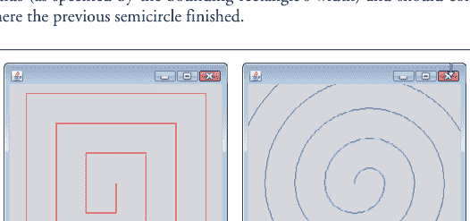

Fig. 7.27 | Drawing a spiral using drawLine (left) and drawArc (right).

## 7.16 Wrap-Up

This chapter began our introduction to data structures, exploring the use of arrays to store data in and retrieve data from lists and tables of values. The chapter examples demonstrated

how to declare an array, initialize an array and refer to individual elements of an array. The chapter introduced the enhanced for statement to iterate through arrays. We used exception handling to test for ArrayIndexOutOfBoundsExceptions that occur when a program attempts to access an array element outside the bounds of an array. We also illustrated how to pass arrays to methods and how to declare and manipulate multidimensional arrays. Finally, the chapter showed how to write methods that use variable-length argument lists and how to read arguments passed to a program from the command line.

We introduced the ArrayList<> generic collection, which provides all the functionality and performance of arrays, along with other useful capabilities such as dynamic resizing. We used the add methods to add new items to the end of an ArrayList and to insert items in an ArrayList. The remove method was used to remove the first occurrence of a specified item, and an overloaded version of remove was used to remove an item at a specified index. We used the size method to obtain number of items in the ArrayList.

We continue our coverage of data structures in Chapter 20, Generic Collections. Chapter 20 introduces the Java Collections Framework, which uses generics to allow you to specify the exact types of objects that a particular data structure will store. Chapter 20 also introduces Java’s other predefined data structures. The Collections API provides class Arrays, which contains utility methods for array manipulation. Chapter 20 uses several static methods of class Arrays to perform such manipulations as sorting and searching the data in an array. You’ll be able to use some of the Arrays methods discussed in Chapter 20 after reading the current chapter, but some of the Arrays methods require knowledge of concepts presented later in the book. Chapter 21 presents the topic of generics, which provide the means to create general models of methods and classes that can be declared once, but used with many different data types. Chapter 22, Custom Generic Data Structures, shows how to build dynamic data structures, such as lists, queues, stacks and trees, that can grow and shrink as programs execute.

We’ve now introduced the basic concepts of classes, objects, control statements, methods, arrays and collections. In Chapter 8, we take a deeper look at classes and objects.

## Summary

## Section 7.1 Introduction

- Arrays (p. 241) are fixed-length data structures consisting of related data items of the same type.

## Section 7.2 Arrays

- An array is a group of variables (called elements or components; p. 242) containing values that all have the same type. Arrays are objects, so they’re considered reference types.
- A program refers to any one of an array’s elements with an array-access expression (p. 242) that includes the name of the array followed by the index of the particular element in square brackets ([]; p. 242).
- The first element in every array has index zero (p. 242) and is sometimes called the zeroth element.
- An index must be a nonnegative integer. A program can use an expression as an index.
- An array object knows its own length and stores this information in a length instance variable (p. 242).

## Section 7.3 Declaring and Creating Arrays

- To create an array object, specify the array’s element type and the number of elements as part of an array-creation expression (p. 243) that uses keyword new.
- When an array is created, each element receives a default value—zero for numeric primitive-type elements, false for boolean elements and null for references.
- In an array declaration, the type and the square brackets can be combined at the beginning of the declaration to indicate that all the identifiers in the declaration are array variables.
- Every element of a primitive-type array contains a variable of the array’s declared type. Every element of a reference-type array is a reference to an object of the array’s declared type.

## Section 7.4 Examples Using Arrays

- A program can create an array and initialize its elements with an array initializer (p. 245).
- Constant variables (p. 247) are declared with keyword final, must be initialized before they’re used and cannot be modified thereafter.
- When a Java program executes, the JVM checks array indices to ensure that they’re greater than or equal to 0 and less than the array’s length. If a program uses an invalid index, Java generates an exception (p. 253) to indicate that an error occurred in the program at execution time.
- When a program is executed, array element indices are checked for validity—all indices must be greater than or equal to 0 and less than the length of the array. If an attempt is made to use an invalid index to access an element, an ArrayIndexOutOfRangeException (p. 253) exception occurs.
- An exception indicates a problem that occurs while a program executes. The name “exception” suggests that the problem occurs infrequently—if the “rule” is that a statement normally executes correctly, then the problem represents the “exception to the rule.”
- Exception handling (p. 253) enables you to create fault-tolerant programs.
- To handle an exception, place any code that might throw an exception (p. 253) in a try statement.
- The try block (p. 253) contains the code that might throw an exception, and the catch block (p. 253) contains the code that handles the exception if one occurs.
- You can have many catch blocks to handle different types of exceptions that might be thrown in the corresponding try block.
- When a try block terminates, any variables declared in the try block go out of scope.
- A catch block declares a type and an exception parameter. Inside the catch block, you can use the parameter’s identifier to interact with a caught exception object.
- An exception object’s toString method returns the exception’s error message.

## Section 7.5 Case Study: Card Shuffling and Dealing Simulation

- The toString method of an object is called implicitly when the object is used where a String is expected (e.g., when printf outputs the object as a String using the %s format specifier or when the object is concatenated to a String using the + operator).

## Section 7.6 Enhanced for Statement

- The enhanced for statement (p. 258) allows you to iterate through the elements of an array or a collection without using a counter. The syntax of an enhanced for statement is:

```
for ( parameter : arrayName )
    statement
```

where parameter has a type and an identifier (e.g., int number), and arrayName is the array through which to iterate.


- Class System's arraycopy 方法（p. 281）使你能够将一个数组的元素复制到另一个数组中。

## 第 7.14 节 集合简介和类 ArrayList

- Java API 的集合类提供了高效的方法来组织、存储和检索数据，而无需了解数据是如何存储的。
- 一个 ArrayList<T>（p. 284）类似于数组，但可以动态调整大小。
- 带一个参数的 add 方法（p. 286）将元素追加到 ArrayList 的末尾。
- 带两个参数的 add 方法在 ArrayList 的指定位置插入一个新元素。
- size 方法（p. 286）返回 ArrayList 中当前元素的数量。
- 带对象引用作为参数的 remove 方法删除与参数值匹配的第一个元素。
- 带整数参数的 remove 方法删除指定索引处的元素，并且该索引之上的所有元素下移一位。
- contains 方法如果在 ArrayList 中找到该元素则返回 true，否则返回 false。

## 自测练习

7.1 填补以下每条陈述中的空白：

- a) 列表和值表可以存储在 ________ 中。
- b) 数组是一组 ________（称为元素或组件），其值都具有相同的 ________。
- c) ________ 允许你在不使用计数器的情况下遍历数组中的元素。
- d) 用于引用特定数组元素的数字称为该元素的 ________。
- e) 使用两个索引的数组称为 ________ 数组。
- f) 使用增强的 for 语句 ________ 来遍历 double 数组 numbers。
- g) 命令行参数存储在 ________ 中。
- h) 使用表达式 ________ 来接收命令行中的参数总数。假设命令行参数存储在 String[] args 中。
- i) 给定命令 java MyClass test，第一个命令行参数是 ________。
- j) 方法参数列表中的 ________ 表示该方法可以接收可变数量的参数。

7.2 判断以下每条是否正确或错误。如果错误，请说明原因。

- a) 数组可以存储许多不同类型的值。
- b) 数组索引通常应为 float 类型。
- c) 传递给方法并在该方法中修改的单个数组元素，在被调用方法执行完成后将包含修改后的值。
- d) 命令行参数由逗号分隔。

7.3 对名为 fractions 的数组执行以下任务：

a) 声明并创建该数组作为具有三行三列的整数数组。假设常量 `ARRAY_SIZE` 已声明为 3。
b) 该数组包含多少个元素？
c) 使用 `for` 语句将数组的每个元素初始化为其索引之和。假设整数变量 `x` 和 `y` 已声明为控制变量。

## 7.5 查找并纠正以下每个程序段中的错误：

```
a) `final int ARRAY_SIZE = 5;`
   `ARRAY_SIZE = 10;`

b) `Assume int[] b = new int[10];`
   `for (int i = 0; i <= b.length; i++)`
       `b[i] = i;`

c) `Assume int[][] a = { {1, 2}, {3, 4} };`
   `a[1,1] = 5;`
```

## 自测练习答案

**7.1** a) arrays. b) variables, type. c) enhanced `for` statement. d) index (or subscript or position number). e) two-dimensional array. f) `for` (double `d` = numbers). g) an array of `String`s, called `args` by convention. h) `args.length`. i) test. j) ellipsis (`...`).

**7.2**
a) False. An array can store only values of the same type.
b) False. An array index must be an integer or an integer expression.
c) For individual primitive-type elements of an array: False. A called method receives and manipulates a copy of the value of such an element, so modifications do not affect the original value. If the reference of an array is passed to a method, however, modifications to the array elements made in the called method are indeed reflected in the original. For individual elements of a reference type: True. A called method receives a copy of the reference of such an element, and changes to the referenced object will be reflected in the original array element.
d) False. Command-line arguments are separated by white space.

```
**7.3**
a) `final int ARRAY_SIZE = 10;`
b) `double[] fractions = new double[ARRAY_SIZE];`
c) `fractions[4]`
d) `fractions[9] = 1.667;`
e) `fractions[6] = 3.333;`
f) `double total = 0.0;`
   `for (int x = 0; x < fractions.length; x++)`
       `total += fractions[x];`
```

```
**7.4**
a) `int[][] table = new int[ARRAY_SIZE][ARRAY_SIZE];`
b) Nine.
c) `for (int x = 0; x < table.length; x++)`
       `for (int y = 0; y < table[x].length; y++)`
           `table[x][y] = x + y;`
```

**7.5**
a) Error: Assigning a value to a constant after it has been initialized. Correction: Assign the correct value to the constant in a `final int ARRAY_SIZE` declaration or declare another variable.
b) Error: Referencing an array element outside the bounds of the array (`b[10]`). Correction: Change the `<=` operator to `<`.
c) Error: Array indexing is performed incorrectly. Correction: Change the statement to `a[1][1] = 5;`.

## 练习

7.6 填补以下每条陈述中的空白：

- a) 一维数组 p 包含四个元素。这些元素的名称是 ______, ______, ______ 和 ______。
- b) 为数组命名、说明其类型并指定数组中的维度数称为 ______ 该数组。
- c) 在二维数组中，第一个索引标识元素的 ______，第二个索引标识元素的 ______。
- d) m×n 数组包含 ______ 行、 ______ 列和 ______ 个元素。
- e) 数组 d 中第 3 行第 5 列元素的名称是 ______。

7.7 判断以下每条是否正确或错误。如果错误，请说明原因。

- a) 要引用数组中的特定位置或元素，我们指定数组的名称和特定元素的值。
- b) 数组声明为数组保留空间。
- c) 要指示为整数数组 p 预留 100 个位置，你写声明 p[ 100 ];
- d) 初始化 15 个元素数组元素的应用程序为零必须至少包含一个 for 语句。
- e) 对二维数组元素求和的应用程序必须包含嵌套 for 语句。

7.8 编写 Java 语句以完成以下每个任务：

- a) 显示数组 f 的第 6 个元素的值。
- b) 将一维整数数组 g 的五个元素都初始化为 8。
- c) 对浮点数组 c 的 100 个元素求和。
- d) 将 11 个元素的数组 a 复制到包含 34 个元素的数组 b 的第一部分。
- e) 确定并显示 99 个元素的浮点数组 w 中包含的最小值和最大值。

7.9 考虑一个两行三列的整数数组 t。

- a) 编写声明并创建 t 的语句。
- b) t 有多少行？
- c) t 有多少列？
- d) t 有多少个元素？
- e) 编写 t 第 1 行所有元素的访问表达式。
- f) 编写 t 第 2 列所有元素的访问表达式。
- g) 编写一个单一语句将 t 中第 0 行第 1 列的元素设为零。
- h) 编写单独的语句将 t 的每个元素初始化为零。
- i) 编写一个嵌套 for 语句将 t 的每个元素初始化为零。
- j) 编写一个嵌套 for 语句从用户输入 t 元素的数值。
- k) 编写一系列语句确定并显示 t 中的最小值。
- l) 编写一个单一的 printf 语句显示 t 的第一行的元素。
- m) 编写一个语句对 t 的第三列的元素求和。不要使用重复。
- n) 编写一系列语句以表格格式显示 t 的内容。在顶部列出列索引作为标题，并在每一行的左侧列出行索引。

7.10 （销售佣金）使用一维数组解决以下问题：某公司按佣金制支付其销售人员工资。销售人员每周获得 $200 加上当周毛销售额的 9%。例如，一名销售人员当周销售额为 $5000，则获得 $200 加上 $5000 的 9%，总计 $650。编写一个应用程序（使用计数器数组）


|   | 1 | 2 | 3 | 4 | 5 | 6 |
|---|---|---|---|---|---|---|
| 1 | 2 | 3 | 4 | 5 | 6 | 7 |
| 2 | 3 | 4 | 5 | 6 | 7 | 8 |
| 3 | 4 | 5 | 6 | 7 | 8 | 9 |
| 4 | 5 | 6 | 7 | 8 | 9 | 10 |
| 5 | 6 | 7 | 8 | 9 | 10 | 11 |
| 6 | 7 | 8 | 9 | 10 | 11 | 12 |

## Fig. 7.28 | The 36 possible sums of two dice.

7.18 (Game of Craps) Write an application that runs 1,000,000 games of craps (Fig. 6.8) and answers the following questions:

+   a) How many games are won on the first roll, second roll, ..., twentieth roll and after the twentieth roll?
+   b) How many games are lost on the first roll, second roll, ..., twentieth roll and after the twentieth roll?
+   c) What are the chances of winning at craps? [Note: You should discover that craps is one of the fairest casino games. What do you suppose this means?]
+   d) What is the average length of a game of craps?
+   e) Do the chances of winning improve with the length of the game?

7.19 (Airline Reservations System) A small airline has just purchased a computer for its new automated reservations system. You’ve been asked to develop the new system. You’re to write an application to assign seats on each flight of the airline’s only plane (capacity: 10 seats).

Your application should display the following alternatives: Please type 1 for First Class and Please type 2 for Economy. If the user types 1, your application should assign a seat in the first-class section (seats 1–5). If the user types 2, your application should assign a seat in the economy section (seats 6–10). Your application should then display a boarding pass indicating the person’s seat number and whether it’s in the first-class or economy section of the plane.

Use a one-dimensional array of primitive type boolean to represent the seating chart of the plane. Initialize all the elements of the array to false to indicate that all the seats are empty. As each seat is assigned, set the corresponding element of the array to true to indicate that the seat is no longer available.

Your application should never assign a seat that has already been assigned. When the economy section is full, your application should ask the person if it’s acceptable to be placed in the first-class section (and vice versa). If yes, make the appropriate seat assignment. If no, display the message "Next flight leaves in 3 hours."

7.20 (Total Sales) Use a two-dimensional array to solve the following problem: A company has four salespeople (1 to 4) who sell five different products (1 to 5). Once a day, each salesperson passes in a slip for each type of product sold. Each slip contains the following:

+   a) The salesperson number
+   b) The product number
+   c) The total dollar value of that product sold that day

Thus, each salesperson passes in between 0 and 5 sales slips per day. Assume that the information from all the slips for last month is available. Write an application that will read all this information for last month’s sales and summarize the total sales by salesperson and by product. All totals should be stored in the two-dimensional array sales. After processing all the information for last month, display the results in tabular format, with each column representing a salesperson and each row representing a particular product. Cross-total each row to get the total sales of each product for last month. Cross-total each column to get the total sales by salesperson for last month. Your output should include these cross-totals to the right of the totaled rows and to the bottom of the totaled columns.

## 7.21 (Turtle Graphics) The Logo language made the concept of turtle graphics famous.

Imagine a mechanical turtle that walks around the room under the control of a Java application. The turtle holds a pen in one of two positions, up or down. While the pen is down, the turtle traces out shapes as it moves, and while the pen is up, the turtle moves about freely without writing anything. In this problem, you’ll simulate the operation of the turtle and create a computerized sketchpad.

Use a 20-by-20 array floor that’s initialized to zeros. Read commands from an array that contains them. Keep track of the current position of the turtle at all times and whether the pen is currently up or down. Assume that the turtle always starts at position (0, 0) of the floor with its pen up. The set of turtle commands your application must process are shown in Fig. 7.29.

| Command | Meaning |
|---|---|
| 1 | Pen up |
| 2 | Pen down |
| 3 | Turn right |
| 4 | Turn left |
| 5,10 | Move forward 10 spaces (replace 10 for a different number of spaces) |
| 6 | Display the 20-by-20 array |
| 9 | End of data (sentinel) |

Fig. 7.29 | Turtle graphics commands.

Suppose that the turtle is somewhere near the center of the floor. The following “program” would draw and display a 12-by-12 square, leaving the pen in the up position:

```
2
5,12
3
5,12
3
5,12
3
5,12
1
6
9
```

As the turtle moves with the pen down, set the appropriate elements of array floor to 1s. When the 6 command (display the array) is given, wherever there’s a 1 in the array, display an asterisk or any character you choose. Wherever there’s a 0, display a blank.

Write an application to implement the turtle graphics capabilities discussed here. Write several turtle graphics programs to draw interesting shapes. Add other commands to increase the power of your turtle graphics language.

## 7.22 (Knight’s Tour) An interesting puzzler for chess buffs is the Knight’s Tour problem, originally proposed by the mathematician Euler.

Can the knight piece move around an empty chessboard and touch each of the 64 squares once and only once? We study this intriguing problem in depth here.

The knight makes only L-shaped moves (two spaces in one direction and one space in a perpendicular direction). Thus, as shown in Fig. 7.30, from a square near the middle of an empty chessboard, the knight (labeled K) can make eight different moves (numbered 0 through 7).

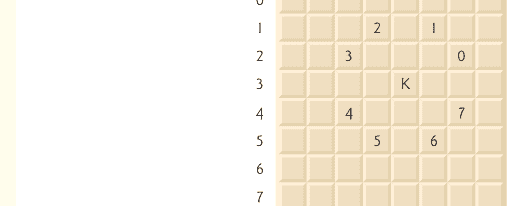

Fig. 7.30 | The eight possible moves of the knight.

+   a) Draw an eight-by-eight chessboard on a sheet of paper, and attempt a Knight’s Tour by hand. Put a 1 in the starting square, a 2 in the second square, a 3 in the third, and so on. Before starting the tour, estimate how far you think you’ll get, remembering that a full tour consists of 64 moves. How far did you get? Was this close to your estimate?
+   b) Now let’s develop an application that will move the knight around a chessboard. The board is represented by an eight-by-eight two-dimensional array board. Each square is initialized to zero. We describe each of the eight possible moves in terms of its horizontal and vertical components. For example, a move of type 0, as shown in Fig. 7.30, consists of moving two squares horizontally to the right and one square vertically upward. A move of type 2 consists of moving one square horizontally to the left and two squares vertically upward. Horizontal moves to the left and vertical moves upward are indicated with negative numbers. The eight moves may be described by two one-dimensional arrays, horizontal and vertical, as follows:

```
horizontal[ 0 ] = 2      vertical[ 0 ] = -1
horizontal[ 1 ] = 1      vertical[ 1 ] = -2
horizontal[ 2 ] = -1     vertical[ 2 ] = -2
horizontal[ 3 ] = -2     vertical[ 3 ] = -1
horizontal[ 4 ] = -2     vertical[ 4 ] = 1
horizontal[ 5 ] = -1     vertical[ 5 ] = 2
horizontal[ 6 ] = 1      vertical[ 6 ] = 2
horizontal[ 7 ] = 2      vertical[ 7 ] = 1
```

Let the variables currentRow and currentColumn indicate the row and column, respectively, of the knight’s current position. To make a move of type moveNumber, where moveNumber is between 0 and 7, your application should use the statements

```
currentRow += vertical[ moveNumber ];
currentColumn += horizontal[ moveNumber ];
```

Write an application to move the knight around the chessboard. Keep a counter that varies from 1 to 64. Record the latest count in each square the knight moves to. Test each potential move to see if the knight has already visited that square. Test every potential move to ensure that the knight does not land off the chessboard. Run the application. How many moves did the knight make?


c) 在尝试编写并运行骑士巡游应用程序后，你可能已经获得了某些有价值的见解。我们将利用这些见解来开发一个启发式方法（即常识性规则）来移动骑士。启发式方法并不能保证成功，但经过精心设计的启发式方法会大大提高成功的几率。你可能已经观察到，外围的格子比棋盘中央附近的格子更棘手。事实上，最棘手或最难以到达的格子是四个角落。

直觉可能表明，你应该尝试先将骑士移动到最棘手的格子，并留下最容易到达的格子，以便在巡游接近尾声棋盘变得拥挤时，仍有更大的成功机会。

我们可以通过根据其可达性对每个格子进行分类来开发一个“可达性启发式”方法，并始终将骑士（使用骑士的 L 形移动）移动到最不可达的格子。我们用一个二维数组 accessibility 来标记每个格子，表示该格子可以从多少个格子到达。在空白棋盘上，最靠近中心的 16 个格子中的每一个都被评为 8，每个角落格子都被评为 2，而其他格子的可达性数字如下所示为 3、4 或 6：

2 3 4 4 4 4 3 2
3 4 6 6 6 6 4 3
4 6 8 8 8 8 6 4
4 6 8 8 8 8 6 4
4 6 8 8 8 8 6 4
4 6 8 8 8 8 6 4
3 4 6 6 6 6 4 3
2 3 4 4 4 4 3 2

编写骑士巡游的新版本，使用可达性启发式方法。骑士应始终移动到可达性数字最低的格子。在出现平局的情况下，骑士可以移动到任意一个平局格子。因此，巡游可以从四个角落中的任何一个开始。[注意：随着骑士在棋盘上移动，你的应用程序应随着更多格子被占据而减少可达性数字。这样，在巡游的任何给定时间，每个可用格子的可达性数字将始终精确等于可以到达该格子的格子数量。] 运行你应用程序的这个版本。你得到了完整的巡游吗？修改应用程序以运行 64 次巡游，每次从棋盘上的每个格子开始。你得到了多少次完整的巡游？

d) 编写一个骑士巡游应用程序的版本，当在两个或多个格子之间出现平局时，通过查看可以从“平局”格子到达的那些格子来决定选择哪个格子。你的应用程序应移动到在下一步中会到达可达性数字最低的格子的平局格子。

## 7.23（骑士巡游：暴力求解方法）在练习 7.22 的第 (c) 部分，我们开发了解决骑士巡游问题的方案。所使用的方法称为“可达性启发式”，它能产生许多解并高效执行。

随着计算机的不断增强，我们将能够用纯粹的计算机能力和相对不复杂的算法解决更多问题。我们称这种方法为“暴力”问题求解。

- a) 使用随机数生成使骑士能够以随机方式在棋盘上行走（以其合法的 L 形移动）。你的应用程序应运行一次巡游并显示最终棋盘。骑士走了多远？
- b) 最有可能的是，第 (a) 部分的应用程序产生了一次相对较短的巡游。现在修改你的应用程序以尝试 1000 次巡游。使用一维数组来跟踪每种长度的巡游次数。当你的应用程序完成 1000 次巡游的尝试后，它应以整齐的表格格式显示此信息。最好的结果是什么？
c) 最有可能的是，第 (b) 部分的应用程序为你提供了一些“体面”的巡游，但没有完整的巡游。现在让你的应用程序一直运行，直到产生一次完整的巡游为止。[注意：这种版本的应用程序可能在强大的计算机上运行数小时。] 再次保留巡游长度的次数表，并在找到第一次完整巡游时显示此表。你的应用程序在产生完整巡游之前尝试了多少次巡游？它花费了多少时间？

d) 将骑士巡游的暴力版本与可达性启发式版本进行比较。哪一个需要对问题进行更仔细的研究？哪种算法更难开发？哪一个需要更多的计算机能力？我们能否（提前）确定使用可达性启发式方法能获得完整的巡游？我们能否（提前）确定使用暴力方法能获得完整的巡游？论证一般而言暴力问题求解的利弊。

## 7.24（八皇后）棋迷们另一个谜题是八皇后问题，其要求如下：是否可以在空棋盘上放置八个皇后，使得没有任何皇后“攻击”其他皇后（即没有任何两个皇后在同一行、同一列或同一对角线上）？

利用练习 7.22 中开发的思路来为解决八皇后问题制定一个启发式方法。运行你的应用程序。[提示：可以为棋盘的每个格子分配一个值，以指示如果在该格子放置一个皇后，则“消除”多少个格子。每个角落将被分配值 22，如图 7.31 所示。一旦这些“消除数”放置在全部 64 个格子中，一个合适的启发式方法可能是：将在消除数最小的格子中放置下一个皇后。为什么这种策略在直觉上是合理的？]

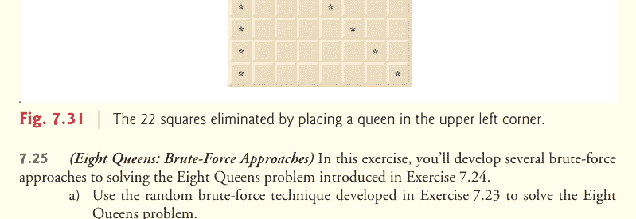

图 7.31 | 在左上角放置一个皇后所消除的 22 个格子。

## 7.25（八皇后：暴力求解方法）在本练习中，你将开发几种解决练习 7.24 中引入的八皇后问题的暴力求解方法。

- a) 使用练习 7.23 中开发的随机暴力技术来解决八皇后问题。
- b) 使用穷举技术（即尝试棋盘上八个皇后的所有可能组合）来解决八皇后问题。
- c) 为什么穷举暴力求解方法可能不适合解决骑士巡游问题？
- d) 比较和对比随机暴力求解和穷举暴力求解方法。

## 7.26（骑士巡游：闭合巡游测试）在骑士巡游（练习 7.22）中，完整巡游发生时骑士进行 64 次移动，触及棋盘上的每个格子一次且仅一次。闭合巡游发生时，第 64 次移动是骑士开始巡游的格子的一步之遥。修改你在练习 7.22 中编写的应用程序以在发生完整巡游时测试闭合巡游。

## 7.27（埃拉托斯特尼筛法）质数是大于 1 的整数，只能被其本身和 1 整除。埃拉托斯特尼筛法是一种寻找质数的方法。其操作如下：

- a) 创建一个原始类型的布尔数组，所有元素初始化为 true。素数索引的元素将保持为 true。所有其他数组元素最终将被设为 false。
- b) 从数组索引 2 开始，确定给定的元素是否为 true。如果是，则遍历数组的其余部分，并将每个索引为该值为 true 的元素的索引的倍数的元素设为 false。然后继续处理下一个值为 true 的元素。对于数组索引 2，数组中索引为 2 的倍数（索引 4、6、8、10 等）的所有元素都将被设为 false；对于数组索引 3，数组中索引为 3 的倍数（索引 6、9、12、15 等）的所有元素都将被设为 false；依此类推。

当此过程完成后，仍为 true 的数组元素表示其索引为质数。这些索引可以显示。编写一个应用程序，使用包含 1000 个元素的数组来确定并显示 2 到 999 之间的质数。忽略数组元素 0 和 1。

## 7.28（模拟：乌龟和兔子）在这个问题中，你将重现乌龟和兔子的经典赛跑。你将使用随机数生成来开发这次难忘事件的模拟。

我们的竞争者从 70 个格子的第 1 格开始。每格代表赛道上的一个可能位置。终点线在第 70 格。第一个到达或超过第 70 格的竞争者将获得一桶新鲜胡萝卜和生菜。赛道蜿蜒穿过滑溜的山坡，因此竞争者偶尔会失去位置。

时钟每秒滴答一次。时钟每次滴答时，你的应用程序应根据图 7.32 中的规则调整动物的位置。使用变量来跟踪动物的位置（即位置编号为 1–70）。将每只动物都从位置 1（“起跑门”）开始。如果动物在第 1 格之前滑向左侧，则将其移回第 1 格。

| 动物 | 移动类型 | 发生百分比 | 实际移动 |
|---|---|---|---|
| 乌龟 | 快速爬行 | 50% | 向右 3 格 |
|  | 滑倒 | 20% | 向左 6 格 |
|  | 缓慢爬行 | 30% | 向右 1 格 |
| 兔子 | 睡觉 | 20% | 完全不动 |
|  | 大跳 | 20% | 向右 9 格 |
|  | 大滑倒 | 10% | 向左 12 格 |
|  | 小跳 | 30% | 向右 1 格 |
|  | 小滑倒 | 20% | 向左 2 格 |

图 7.32 | 调整乌龟和兔子位置的规则。

通过生成范围为 1 ≤ i ≤10 的随机整数 i 来生成图 7.32 中的百分比。对于乌龟，当 1 ≤ i ≤ 5 时执行“快速爬行”，当 6 ≤ i ≤ 7 时执行“滑倒”或当 8 ≤ i ≤10 时执行“缓慢爬行”。使用类似的技术移动兔子。


通过显示
BANG !!!!!
AND THEY'RE OFF !!!!!

开始比赛

然后，对于时钟的每次滴答（即循环的每次重复），显示一条 70 个位置的行，在乌龟的位置显示字母 T，在兔子的位置显示字母 H。偶尔，竞争者会落在同一个格子上。在这种情况下，乌龟咬住兔子，你的应用程序应从该位置开始显示 OUCH!!!。除 T、H 或 OUCH!!!（平局时）之外的所有输出位置应为空白。

在显示每行之后，检查是否有任何动物到达或超过第 70 格。如果是，则显示获胜者并终止模拟。如果乌龟获胜，则显示 TORTOISE WINS!!! YAY!!! 如果兔子获胜，则显示 Hare wins. Yuch. 如果两只动物在时钟的同一滴答中获胜，你可能希望偏爱乌龟（“弱者”），或者你可能希望显示 It’s a tie. 如果没有任何动物获胜，则再次执行循环以模拟时钟的下一个滴答。当你准备好运行你的应用程序时，召集一群粉丝观看比赛。你会惊讶于观众参与得多么投入！

在本书后面，我们介绍了 Java 的许多功能，例如图形、图像、动画、声音和多线程。在你学习这些功能时，你可能会喜欢增强你的乌龟和兔子竞赛模拟。

## 7.29 (Fibonacci Series) 斐波那契数列

0, 1, 1, 2, 3, 5, 8, 13, 21, ...

以项 0 和 1 开始，具有每个后续项是前两个项之和的性质。

- a) 编写一个方法 fibonacci( n ) 来计算第 n 个斐波那契数。将此方法纳入一个应用程序中，使用户能够输入 n 的值。
- b) 确定可在你的系统上显示的最大斐波那契数。
- c) 修改你在第 (a) 部分编写的应用程序，使用 double 而不是 int 来计算和返回斐波那契数，并使用此修改后的应用程序重复第 (b) 部分。

练习 7.30–7.33 具有相当的挑战性。一旦你完成了它们，你应该能够轻松实现大多数流行的纸牌游戏。

## 7.30 (Card Shuffling and Dealing) 修改图 7.11 的应用程序以发一手五张牌的扑克牌。然后修改图 7.10 的 DeckOfCards 类以包含确定一手牌是否包含以下内容的方法

- a) 一对
- b) 两对
- c) 三条（例如三个杰克）
- d) 四条（例如四个 A）
- e) 同花（即全部五张牌同花色）
- f) 顺子（即五张牌面值连续）
- g) 满堂红（即两张牌一种面值，三张牌另一种面值）

[提示：向图 7.9 的 Card 类添加 getFace 和 getSuit 方法。]

## 7.31 (Card Shuffling and Dealing) 使用练习 7.30 中开发的方法编写一个应用程序，该应用程序发两手五张牌的扑克牌，评估每手牌并确定哪一手更好。

## 7.32 (Project: Card Shuffling and Dealing) 修改练习 7.31 中开发的应用程序，使其能够模拟庄家。庄家的五张牌“面朝下”发牌，因此玩家看不到它。应用程序应然后评估庄家的牌，并根据牌的质量，庄家应抽取一张、两张或三张额外的牌来替换原始牌手中不需要的相应数量的牌。应用程序应然后重新评估庄家的牌。[注意：这是一个困难的问题！]

## 7.33 (Project: Card Shuffling and Dealing) 修改练习 7.32 中开发的应用程序，使其能够自动处理庄家的牌，但玩家可以决定要替换其牌手中的哪些牌。应用程序应然后评估两手牌并确定谁获胜。现在使用这个新应用程序与计算机对战 20 局。你或计算机赢得的游戏更多？让朋友与计算机对战 20 局。谁赢得的游戏更多？根据这些游戏的结果，改进你的扑克游戏应用程序。（这也是一个困难的问题。）再玩 20 局。你的修改后应用程序是否玩得更好？

## 7.34 (Project: Card Shuffling and Dealing) 修改图 7.9–7.11 的应用程序以使用 Face 和 Suit 枚举来表示牌的面值和花色。将每个枚举声明为其自己的源代码文件中的公共类型。每个 Card 应具有 Face 和 Suit 实例变量。这些应由 Card 构造函数初始化。在 DeckOfCards 类中，创建一个已用 Face 枚举中常量的名称初始化的 Faces 数组，以及一个已用 Suit 枚举中常量的名称初始化的 Suits 数组。[注意：当你将枚举常量作为 String 输出时，会显示该常量的名称。]

## 特殊章节：构建你自己的计算机

在接下来的几个问题中，我们暂时从高级语言编程的世界中转移出来，“打开”计算机并查看其内部结构。我们介绍机器语言编程并编写几个机器语言程序。为了使这成为一次特别有价值的体验，我们然后通过软件模拟技术构建一台计算机，你可以在其上执行你的机器语言程序。

## 7.35 (Machine-Language Programming) 让我们创建一个名为 Simpletron 的计算机。顾名思义，它是一台简单但功能强大的机器。Simpletron 运行用它唯一直接理解的语言编写的程序：Simpletron 机器语言（SML）。

Simpletron 包含一个累加器——一个在 Simpletron 使用该信息进行计算或以各种方式检查它之前将信息放入其中的特殊寄存器。Simpletron 中的所有信息都以字为单位处理。一个字是一个带符号的四位十进制数，例如 +3364、-1293、+0007 和 -0001。Simpletron 配备了 100 字内存，这些字由其位置号 00、01、…、99 引用。

在运行 SML 程序之前，我们必须加载，或放置，程序到内存中。每个 SML 程序的第一个指令（或语句）始终放在位置 00。模拟器将从此位置开始执行。

SML 中编写的每个指令占用 Simpletron 内存的一个字（因此指令是带符号的四位十进制数）。我们假设 SML 指令的符号始终为正，但数据字的符号可以为正或负。Simpletron 内存中的每个位置可能包含指令、程序使用的数据值或未使用（因此未定义）的内存区域。每个 SML 指令的前两位数字是操作码，指定要执行的操作。SML 操作码总结在图 7.33 中。

| 操作码 | 含义 |
|---|---|
| 输入/输出操作： | |
| final int READ = 10; | 从键盘读取一个字到内存中的特定位置。 |

Fig. 7.33 | Simpletron 机器语言（SML）操作码。（第 1 部分，共 2 部分。）

| 操作码 | 含义 |
|---|---|
| final int WRITE = 11; | 将内存中特定位置的一个字写入屏幕。 |
| 加载/存储操作： | |
| final int LOAD = 20; | 将内存中特定位置的一个字加载到累加器中。 |
| final int STORE = 21; | 将累加器中的一个字存储到内存中特定位置。 |
| 算术操作： | |
| final int ADD = 30; | 将内存中特定位置的一个字加到累加器中的字上（结果保留在累加器中）。 |
| final int SUBTRACT = 31; | 从累加器中的字中减去内存中特定位置的一个字（结果保留在累加器中）。 |
| final int DIVIDE = 32; | 用内存中特定位置的一个字除累加器中的字（结果保留在累加器中）。 |
| final int MULTIPLY = 33; | 将内存中特定位置的一个字乘以累加器中的字（结果保留在累加器中）。 |
| 转移控制操作： | |
| final int BRANCH = 40; | 分支到内存中的特定位置。 |
| final int BRANCHNEG = 41; | 如果累加器为负，则分支到内存中的特定位置。 |
| final int BRANCHZERO = 42; | 如果累加器为零，则分支到内存中的特定位置。 |
| final int HALT = 43; | 停止。程序已完成其任务。 |

# Fig. 7.33 | Simpletron 机器语言（SML）操作码。（第 2 部分，共 2 部分。）

SML 指令的最后两位数字是操作数——包含操作所应用的字的内存位置的地址。让我们考虑几个简单的 SML 程序。

第一个 SML 程序（图 7.34）从键盘读取两个数字并计算并显示它们的和。指令 +1007 从键盘读取第一个数字并将其放入位置 07（已初始化为 0）。然后指令 +1008 将下一个数字读入位置 08。加载指令 +2007 将第一个数字放入累加器，加法指令 +3008 将第二个数字加到累加器中的数字上。所有 SML 算术指令都将其结果保留在累加器中。存储指令 +2109 将结果放回内存位置 09，写指令 +1109 从中取出数字并将其显示为带符号的四位十进制数。停止指令 +4300 终止执行。

第二个 SML 程序（图 7.35）从键盘读取两个数字并确定并显示较大值。注意指令 +4107 作为条件转移控制的使用，与 Java 的 if 语句非常相似。

现在编写 SML 程序以完成以下每个任务：

- a) 使用哨兵控制循环读取 10 个正数。计算并显示它们的和。


| 位置 | 数字 | 指令 |
|---|---|---|
| 00 | +1007 | (读取 A) |
| 01 | +1008 | (读取 B) |
| 02 | +2007 | (装载 A) |
| 03 | +3008 | (加 B) |
| 04 | +2109 | (存储 C) |
| 05 | +1109 | (写入 C) |
| 06 | +4300 | (停止) |
| 07 | +0000 | (变量 A) |
| 08 | +0000 | (变量 B) |
| 09 | +0000 | (结果 C) |

图 7.34 | 读取两个整数并计算其和的 SML 程序。

| 位置 | 数字 | 指令 |
|---|---|---|
| 00 | +1009 | (读取 A) |
| 01 | +1010 | (读取 B) |
| 02 | +2009 | (装载 A) |
| 03 | +3110 | (减 B) |
| 04 | +4107 | (分支负数到 07) |
| 05 | +1109 | (写入 A) |
| 06 | +4300 | (停止) |
| 07 | +1110 | (写入 B) |
| 08 | +4300 | (停止) |
| 09 | +0000 | (变量 A) |
| 10 | +0000 | (变量 B) |

图 7.35 | 读取两个整数并确定较大者的 SML 程序。

- b) 使用计数器控制循环读取七个数，包含正数和负数，并计算并显示其平均值。
- c) 读取一系列数字，并确定并显示最大数字。读取的第一个数字表示应处理的数字个数。

## 7.36（计算机模拟器）在本问题中，你将构建自己的计算机。

不，你不会焊接组件。相反，你将使用强大的软件模拟技术来创建 Simpletron 的面向对象软件模型，该 Simpletron 来自练习 7.35。你的 Simpletron 模拟器将把你正在使用的计算机变成一台 Simpletron，并且你实际上能够运行、测试和调试你在练习 7.35 中编写的 SML 程序。

当你运行 Simpletron 模拟器时，它应开始显示：

```
*** Welcome to Simpletron! ***
*** Please enter your program one instruction ***
*** (or data word) at a time. I will display ***
*** the location number and a question mark (?) ***
```

| 指令 | 描述 |
|---|---|
| read: | 显示提示 “Enter an integer”，然后输入整数并将其存储在位置 memory[operand] 中。 |
| load: | accumulator = memory[ operand ]; |
| add: | accumulator += memory[ operand ]; |
| halt: | 此指令显示消息
*** Simpletron execution terminated *** |

图 7.36 | Simpletron 中若干 SML 指令的行为。

寄存器：
accumulator          +0000
instructionCounter    00
instructionRegister   +0000
operationCode         00
operand               00

内存：
          0    1    2    3    4    5    6    7    8    9
0  +0000 +0000 +0000 +0000 +0000 +0000 +0000 +0000 +0000 +0000
10 +0000 +0000 +0000 +0000 +0000 +0000 +0000 +0000 +0000 +0000
20 +0000 +0000 +0000 +0000 +0000 +0000 +0000 +0000 +0000 +0000
30 +0000 +0000 +0000 +0000 +0000 +0000 +0000 +0000 +0000 +0000
40 +0000 +0000 +0000 +0000 +0000 +0000 +0000 +0000 +0000 +0000
50 +0000 +0000 +0000 +0000 +0000 +0000 +0000 +0000 +0000 +0000
60 +0000 +0000 +0000 +0000 +0000 +0000 +0000 +0000 +0000 +0000
70 +0000 +0000 +0000 +0000 +0000 +0000 +0000 +0000 +0000 +0000
80 +0000 +0000 +0000 +0000 +0000 +0000 +0000 +0000 +0000 +0000
90 +0000 +0000 +0000 +0000 +0000 +0000 +0000 +0000 +0000 +0000

图 7.37 | 一个示例转储。

Simpletron 程序将显示指令和数据值的实际值，在执行终止的时刻。

让我们继续执行我们程序的第一个指令——即位置 00 中的 +1009。正如我们所指出的，switch 语句通过提示用户输入值、读取该值并将其存储在内存位置 memory[ operand ] 中来模拟此任务。该值随后被读入位置 09。

此时，第一个指令的模拟已完成。剩下的只是为 Simpletron 准备执行下一条指令。由于刚刚执行的指令不是控制转移，我们只需按如下方式递增指令计数器寄存器即可：

```
instructionCounter++;
```

此操作完成了第一个指令的模拟执行。整个过程（即指令执行周期）从获取下一个要执行的指令开始重新开始。

现在让我们考虑分支指令——控制转移——是如何模拟的。我们需要做的就是适当调整指令计数器中的值。因此，无条件分支指令（40）在 switch 中模拟为

```
instructionCounter = operand;
```

条件“若累加器为零则分支”指令模拟为

```
if ( accumulator == 0 )
    instructionCounter = operand;
```

## 做出改变

### 7.38（民意调查）互联网和网络使更多人能够联网、加入事业、表达意见等等。2008 年的总统候选人大量使用互联网来传达信息并为竞选活动筹集资金。在本练习中，你将编写一个简单的民意调查程序，允许用户对五个社会意识问题进行 1（最不重要）到 10（最重要）的评分。挑选五个对你重要的事业（例如政治问题、全球环境问题）。使用一维数组 topics（类型为 String）存储五个事业。为了汇总调查回复，使用 5 行、10 列的二维数组 responses（类型为 int），每一行对应 topics 数组中的一个元素。程序运行时，应要求用户对每个问题进行评分。让你的朋友和家人回复调查。然后让程序显示结果摘要，包括：

- a) 一个表格报告，左侧为五个主题，顶部为 10 个评分，在每一列中列出每个主题收到的评分数量。
- b) 在每一行的右侧，显示该问题的评分平均值。
- c) 哪个问题获得了最高的点数总计？显示问题和点数总计。
- d) 哪个问题获得了最低的点数总计？显示问题和点数总计。

## 类和对象：
更深入的探讨


> > 相反于这种荒谬的性别划分，他们应该把人分为静态和动态。
> > —埃夫林·沃
> >
> > 这是一个隐藏美德的世界吗？
> > —威廉·莎士比亚
> >
> > 但为了服务我们的私利，
> > 禁止欺骗我们的朋友吗？
> > —查尔斯·丘吉尔
> >
> > 以上一切：要忠于你自己。
> > —威廉·莎士比亚
> >
> > 不要“一致”，而要单纯真实。
> > —奥利弗·温德尔·霍姆斯 Jr.

## 目标

在本章你将学习：

- - 封装和数据隐藏。
- - 使用关键字 `this`。
- - 使用静态变量和方法。
- - 导入类的静态成员。
- - 使用 enum 类型创建具有唯一标识符的常量集合。
- - 用参数声明 enum 常量。
- - 将类组织在包中以促进重用。

- 8.1 引言
- 8.2 Time 类案例研究
- 8.3 控制对成员的访问
- 8.4 使用 this 引用引用当前对象的成员
- 8.5 Time 类案例研究：重载构造函数
- 8.6 默认和无参数构造函数
- 8.7 关于设置和获取方法的说明
- 8.8 组合
- 8.9 枚举
- 8.10 垃圾回收和方法 finalize
- 8.11 static 类成员
- 8.12 static 导入
- 8.13 final 实例变量
- 8.14 Time 类案例研究：创建包
- 8.15 包访问
- 8.16（可选）GUI 和图形案例研究：使用图形中的对象
- 8.17 总结

总结 | 自测练习 | 自测练习答案 | 练习 | 做出改变

## 8.1 引言

我们现在更深入地探讨构建类、控制对类成员的访问以及创建构造函数。我们讨论组合——一种允许类将其成员作为对其他类对象的引用的能力。我们重新审视使用设置和获取方法。回想一下，第 6.10 节介绍了声明常量集合的基本 enum 类型。在本章中，我们讨论 enum 类型与类之间的关系，证明 enum 与类一样，可以在其自己的文件中声明，带有构造函数、方法和字段。本章还详细讨论了静态类成员和 final 实例变量。最后，我们解释如何将类组织在包中以帮助管理大型应用程序并促进重用，然后展示同一包中类之间的特殊关系。

## 8.2 Time 类案例研究

我们的第一个例子包含两个类——Time1（图 8.1）和 Time1Test（图 8.2）。类 Time1 表示一天中的时间。类 Time1Test 是一个应用程序类，其中 main 方法创建一个类 Time1 的对象并调用其方法。这些类必须声明在单独的文件中，因为它们都是公共类。此程序的输出出现在图 8.2 中。

# Time1 类声明

类 Time1 的私有 int 实例变量 hour、minute 和 second（图 8.1，第 6–8 行）表示通用时间格式（24 小时制，小时范围为 0–23）中的时间。类 Time1 包含公共方法 setTime（第 12–25 行）、toUniversalString（第 28–31 行）和 toString（第 34–39 行）。这些方法也称为类向其客户端提供的公共服务或公共接口。

# 默认构造函数

在此示例中，类 Time1 没有声明构造函数，因此类具有编译器提供的默认构造函数。每个实例变量隐式接收


// Fig. 8.1: Time1.java
// Time1 class declaration maintains the time in 24-hour format.

public class Time1
{
    private int hour; // 0 - 23
    private int minute; // 0 - 59
    private int second; // 0 - 59

    // set a new time value using universal time; throw an
    // exception if the hour, minute or second is invalid
    public void setTime( int h, int m, int s )
    {
        // validate hour, minute and second
        if ( ( h >= 0 && h < 24 ) && ( m >= 0 && m < 60 ) &&
            ( s >= 0 && s < 60 ) )
        {
            hour = h;
            minute = m;
            second = s;
        } // end if
        else
            throw new IllegalArgumentException(
                "hour, minute and/or second was out of range" );
    } // end method setTime

    // convert to String in universal-time format (HH:MM:SS)
    public String toUniversalString()
    {
        return String.format( "%02d:%02d:%02d", hour, minute, second );
    } // end method toUniversalString

    // convert to String in standard-time format (H:MM:SS AM or PM)
    public String toString()
    {
        return String.format( "%d:%02d:%02d %s",
            ( ( hour == 0 || hour == 12 ) ? 12 : hour % 12 ),
            minute, second, ( hour < 12 ? "AM" : "PM" ) );
    } // end method toString
} // end class Time1

Fig. 8.1 | Time1 class declaration maintains the time in 24-hour format.

int 的默认值 0。实例变量也可以在类体中声明时进行初始化，使用与局部变量相同的初始化语法。

## Method setTime and Throwing Exceptions

方法 setTime（第 12–25 行）是一个 public 方法，声明了三个 int 参数并用它们来设置时间。第 15–16 行测试每个参数以确定值是否在适当范围内，如果是，则第 18–20 行将值赋给 hour、minute 和 second 实例变量。小时值必须大于或等于 0 且小于 24，因为通用时间格式将小时表示为 0 到 23 的整数（例如，下午 1 点是小时 13，下午 11 点是小时 23；午夜是小时 0，中午是小时 12）。同样，

minute 和 second 值必须大于或等于 0 且小于 60。对于超出这些范围的值，setTime 会抛出类型为 IllegalArgumentException 的异常（第 23–24 行），这会通知客户端代码方法被传入了无效参数。正如你在第 7 章中学到的，你可以使用 try...catch 来捕获异常并尝试从中恢复，我们将在图 8.2 中这样做。throw 语句（第 23 行）创建了一个类型为 IllegalArgumentException 的新对象。类名后面的括号表示对 IllegalArgumentException 构造函数的调用。在这种情况下，我们调用允许指定自定义错误消息的构造函数。异常对象创建后，throw 语句立即终止方法 setTime，并且异常返回给尝试设置时间的代码。

## Method toUniversalString

方法 toUniversalString（第 28–31 行）不带参数并返回一个以通用时间格式的 String，由小时、分钟和秒各两位数字组成。例如，如果时间为下午 1:30:07，该方法将返回 13:30:07。第 22 行使用 String 类的静态方法 format 返回一个包含格式化的小时、分钟和秒值的 String，每个值都为两位数字，可能带有前导 0（使用 0 标志指定）。方法 format 与方法 System.out.printf 类似，只是 format 返回一个格式化的 String 而不是在命令窗口中显示它。格式化的 String 由方法 toUniversalString 返回。

## Method toString

方法 toString（第 34–39 行）不带参数并返回一个以标准时间格式的 String，由小时、分钟和秒值用冒号分隔并跟随 AM 或 PM 组成（例如，1:27:06 PM）。与方法 toUniversalString 类似，方法 toString 使用静态 String 方法 format 将分钟和秒格式化为两位数字值，如有必要则补零。第 29 行使用条件运算符（?:）确定 String 中小时的值——如果小时为 0 或 12（上午或下午），则显示为 12；否则，显示为 1 到 11 的值。第 30 行中的条件运算符确定 AM 或 PM 将作为 String 的一部分返回。

回顾第 6.4 节，Java 中的所有对象都有一个 toString 方法，该方法返回对象的 String 表示。我们选择返回一个包含标准时间格式时间的 String。当 Time1 对象出现在代码中需要 String 的地方时，例如在调用 System.out.printf 时使用 %s 格式说明符的值，方法 toString 会被隐式调用。

## Using Class Time1

正如你在第 3 章中学到的，你声明的每个类在 Java 中都代表一种新类型。因此，在声明类 Time1 之后，我们就可以将其用作声明中的类型，例如

```
Time1 sunset; // sunset can hold a reference to a Time1 object
```

Time1Test 应用程序类（图 8.2）使用类 Time1。第 9 行声明并创建了一个 Time1 对象并将其赋给局部变量 time。运算符 new 隐式调用类 Time1 的默认构造函数，因为 Time1 没有声明任何构造函数。第 12–16 行输出时间，首先以通用时间格式输出（通过在第 13 行调用 time 的 toUniversalString 方法），然后以标准时间格式输出（通过在第 15 行显式调用 time 的 toString 方法）以确认 Time1 对象已正确初始化。接下来，第 19 行

调用 time 对象的 setTime 方法来更改时间。然后第 20–24 行再次以两种格式输出时间以确认其已正确设置。

```
1  // Fig. 8.2: Time1Test.java
2  // Time1 object used in an application.
3
4  public class Time1Test
5  {
6      public static void main( String[] args )
7      {
8          // create and initialize a Time1 object
9          Time1 time = new Time1(); // invokes Time1 constructor
10
11         // output string representations of the time
12         System.out.print( "The initial universal time is: " );
13         System.out.println( time.toUniversalString() );
14         System.out.print( "The initial standard time is: " );
15         System.out.println( time.toString() );
16         System.out.println(); // output a blank line
17
18         // change time and output updated time
19         time.setTime( 13, 27, 6 );
20         System.out.print( "Universal time after setTime is: " );
21         System.out.println( time.toUniversalString() );
22         System.out.print( "Standard time after setTime is: " );
23         System.out.println( time.toString() );
24         System.out.println(); // output a blank line
25
26         // attempt to set time with invalid values
27         try
28         {
29             time.setTime( 99, 99, 99 ); // all values out of range
30         } // end try
31         catch ( IllegalArgumentException e )
32         {
33             System.out.printf( "Exception: %s\n\n", e.getMessage() );
34         } // end catch
35
36         // display time after attempt to set invalid values
37         System.out.println( "After attempting invalid settings:" );
38         System.out.print( "Universal time: " );
39         System.out.println( time.toUniversalString() );
40         System.out.print( "Standard time: " );
41         System.out.println( time.toString() );
42     } // end main
43  } // end class Time1Test
```

The initial universal time is: 00:00:00
The initial standard time is: 12:00:00 AM

Universal time after setTime is: 13:27:06
Standard time after setTime is: 1:27:06 PM

Fig. 8.2 | Time1 object used in an application. (Part 1 of 2.)


**Fig. 8.2** | Time1 object used in an application. (Part 2 of 2.)

## Calling Time1 Method setTime with Invalid Values

为了说明方法 setTime 会验证其参数，第 29 行使用小时、分钟和秒均为 99 的无效参数调用方法 setTime。此语句放在 try 块中（第 27–30 行），以防 setTime 抛出 IllegalArgumentException，而由于参数全部无效，它确实会抛出。当这种情况发生时，异常在第 31–34 行被捕获，并且第 33 行通过调用其 getMessage 方法显示异常的错误消息。第 37–41 行再次以两种格式输出时间，以确认在提供无效参数时 setTime 没有更改时间。

## Notes on the Time1 Class Declaration

考虑关于类 Time1 的几个类设计问题。实例变量 hour、minute 和 second 各自声明为 private。类内部使用的实际数据表示对类的客户端来说无关紧要。例如，Time1 完全可以合理地将时间内部表示为午夜以来的秒数或午夜以来的分钟数和秒数。客户端可以使用相同的公共方法并获得相同的结果，而无需意识到这一点。（练习 8.5 要求你将类 Time1 中的时间表示为午夜以来的秒数并证明客户端确实看不到任何变化。）


## 8.3 Controlling Access to Members

访问修饰符 public 和 private 控制对类变量和方法的访问。在第 9 章中，我们将介绍额外的访问修饰符 protected。正如我们在第 8.2 节中所说，public 方法的主要目的是向类的客户端展示类提供的服务（类的公共接口）。客户端无需关心类如何完成其任务。出于这个原因，类的私有变量和私有方法（即其实现细节）对客户端不可访问。


in lines 4–11, and class `SimpleTime` in lines 14–47. We do this to demonstrate that when you compile a `.java` file containing more than one class, the compiler produces a separate class file with the `.class` extension for every compiled class. In this case, two separate files are produced—`SimpleTime.class` and `ThisTest.class`. When one source-code (`.java`) file contains multiple class declarations, the compiler places both class files for those classes in the same directory. Note also in Fig. 8.4 that only class `ThisTest` is declared `public`. A source-code file can contain only one public class—otherwise, a compilation error occurs. Non-public classes can be used only by other classes in the same package. So, in this example, class `SimpleTime` can be used only by class `ThisTest`.

```java
// Fig. 8.4: ThisTest.java
// this used implicitly and explicitly to refer to members of an object.

public class ThisTest
{
   public static void main( String[] args )
   {
      SimpleTime time = new SimpleTime( 15, 30, 19 );
      System.out.println( time.buildString() );
   } // end main
} // end class ThisTest

// class SimpleTime demonstrates the "this" reference
class SimpleTime
{
   private int hour;   // 0–23
   private int minute; // 0–59
   private int second; // 0–59

   // if the constructor uses parameter names identical to
   // instance variable names the "this" reference is
   // required to distinguish between the names
   public SimpleTime( int hour, int minute, int second )
   {
      this.hour = hour;     // set "this" object's hour
      this.minute = minute; // set "this" object's minute
      this.second = second; // set "this" object's second
   } // end SimpleTime constructor

   // use explicit and implicit "this" to call toUniversalString
   public String buildString()
   {
      return String.format( "%24s: %s\n%24s: %s",
         "this.toUniversalString()", this.toUniversalString(),
         "toUniversalString()", toUniversalString() );
   } // end method buildString

   // convert to String in universal-time format (HH:MM:SS)
   public String toUniversalString()
   {
```

**Fig. 8.4** | this used implicitly and explicitly to refer to members of an object. (Part 1 of 2.)

```
41      // "this" is not required here to access instance variables,
42      // because method does not have local variables with same
43      // names as instance variables
44      return String.format( "%02d:%02d:%02d",
45          this.hour, this.minute, this.second );
46      } // end method toUniversalString
47  } // end class SimpleTime
```

```
this.toUniversalString(): 15:30:19
    toUniversalString(): 15:30:19
```

Fig. 8.4 | this used implicitly and explicitly to refer to members of an object. (Part 2 of 2.)

Class SimpleTime (lines 14–47) declares three private instance variables—hour, minute and second (lines 16–18). The constructor (lines 23–28) receives three int arguments to initialize a SimpleTime object. We used parameter names for the constructor (line 23) that are identical to the class’s instance-variable names (lines 16–18). We don’t recommend this practice, but we did it here to shadow (hide) the corresponding instance variables so that we could illustrate a case in which explicit use of the this reference is required. If a method contains a local variable with the same name as a field, that method will refer to the local variable rather than the field. In this case, the local variable shadows the field in the method’s scope. However, the method can use the this reference to refer to the shadowed field explicitly, as shown on the left sides of the assignments in lines 25–27 for SimpleTime’s shadowed instance variables.

Method buildString (lines 31–36) returns a String created by a statement that uses the this reference explicitly and implicitly. Line 34 uses it explicitly to call method toUniversalString. Line 35 uses it implicitly to call the same method. Both lines perform the same task. You typically will not use this explicitly to reference other methods within the current object. Also, line 45 in method toUniversalString explicitly uses the this reference to access each instance variable. This is not necessary here, because the method does not have any local variables that shadow the instance variables of the class.

## Common Programming Error 8.2

It’s often a logic error when a method contains a parameter or local variable that has the same name as a field of the class. In this case, use reference this if you wish to access the field of the class—otherwise, the method parameter or local variable will be referenced.

## Error-Prevention Tip 8.1

Avoid method-parameter names or local-variable names that conflict with field names. This helps prevent subtle, hard-to-locate bugs.

## Performance Tip 8.1

Java conserves storage by maintaining only one copy of each method per class—this method is invoked by every object of the class. Each object, on the other hand, has its own copy of the class’s instance variables (i.e., non-static fields). Each method of the class implicitly uses this to determine the specific object of the class to manipulate.

Application class ThisTest (lines 4–11) demonstrates class SimpleTime. Line 8 creates an instance of class SimpleTime and invokes its constructor. Line 9 invokes the object’s buildString method, then displays the results.

## 8.5 Time Class Case Study: Overloaded Constructors

As you know, you can declare your own constructor to specify how objects of a class should be initialized. Next, we demonstrate a class with several overloaded constructors that enable objects of that class to be initialized in different ways. To overload constructors, simply provide multiple constructor declarations with different signatures.

### Class Time2 with Overloaded Constructors

The default constructor for class Time1 (Fig. 8.1) initialized hour, minute and second to their default 0 values (which is midnight in universal time). The default constructor does not enable the class’s clients to initialize the time with specific nonzero values. Class Time2 (Fig. 8.5) contains five overloaded constructors that provide convenient ways to initialize objects of the new class Time2. Each constructor initializes the object to begin in a consistent state. In this program, four of the constructors invoke a fifth, which in turn calls method setTime to ensure that the value supplied for hour is in the range 0 to 23, and the values for minute and second are each in the range 0 to 59. The compiler invokes the appropriate constructor by matching the number, types and order of the types of the arguments specified in the constructor call with the number, types and order of the types of the parameters specified in each constructor declaration. Class Time2 also provides set and get methods for each instance variable.

```
1  // Fig. 8.5: Time2.java
2  // Time2 class declaration with overloaded constructors.
3
4  public class Time2
5  {
6      private int hour; // 0 - 23
7      private int minute; // 0 - 59
8      private int second; // 0 - 59
9
10     // Time2 no-argument constructor:
11     // initializes each instance variable to zero
12     public Time2()
13     {
14         this( 0, 0, 0 ); // invoke Time2 constructor with three arguments
15     } // end Time2 no-argument constructor
16
17     // Time2 constructor: hour supplied, minute and second defaulted to 0
18     public Time2( int h )
19     {
20         this( h, 0, 0 ); // invoke Time2 constructor with three arguments
21     } // end Time2 one-argument constructor
22
```

```
// Time2 constructor: hour and minute supplied, second defaulted to 0
public Time2( int h, int m )
{
    this( h, m, 0 ); // invoke Time2 constructor with three arguments
} // end Time2 two-argument constructor

// Time2 constructor: hour, minute and second supplied
public Time2( int h, int m, int s )
{
    setTime( h, m, s ); // invoke setTime to validate time
} // end Time2 three-argument constructor

// Time2 constructor: another Time2 object supplied
public Time2( Time2 time )
{
    // invoke Time2 three-argument constructor
    this( time.getHour(), time.getMinute(), time.getSecond() );
} // end Time2 constructor with a Time2 object argument

// Set Methods
// set a new time value using universal time;
// validate the data
public void setTime( int h, int m, int s )
{
    setHour( h ); // set the hour
    setMinute( m ); // set the minute
    setSecond( s ); // set the second
} // end method setTime

// validate and set hour
public void setHour( int h )
{
    if ( h >= 0 && h < 24 )
        hour = h;
    else
        throw new IllegalArgumentException( "hour must be 0-23" );
} // end method setHour

// validate and set minute
public void setMinute( int m )
{
    if ( m >= 0 && m < 60 )
        minute = m;
    else
        throw new IllegalArgumentException( "minute must be 0-59" );
} // end method setMinute

// validate and set second
public void setSecond( int s )
{
    if ( s >= 0 && s < 60 )
        second = ( ( s >= 0 && s < 60 ) ? s : 0 );
```


```
75        else
76            throw new IllegalArgumentException( "second must be 0-59" );
77    } // end method setSecond
78
79    // Get Methods
80    // get hour value
81    public int getHour()
82    {
83        return hour;
84    } // end method getHour
85
86    // get minute value
87    public int getMinute()
88    {
89        return minute;
90    } // end method getMinute
91
92    // get second value
93    public int getSecond()
94    {
95        return second;
96    } // end method getSecond
97
98    // convert to String in universal-time format (HH:MM:SS)
99    public String toUniversalString()
100    {
101        return String.format(
102            "%02d:%02d:%02d", getHour(), getMinute(), getSecond() );
103    } // end method toUniversalString
104
105    // convert to String in standard-time format (H:MM:SS AM or PM)
106    public String toString()
107    {
108        return String.format( "%d:%02d:%02d %s",
109            ( (getHour() == 0 || getHour() == 12) ? 12 : getHour() % 12 ),
110            getMinute(), getSecond(), ( getHour() < 12 ? "AM" : "PM" ) );
111    } // end method toString
112 } // end class Time2
```

Fig. 8.5 | Time2 class with overloaded constructors. (Part 3 of 3.)

## Class Time2's Constructors

Lines 12–15 declare a so-called no-argument constructor that's invoked without arguments. Once you declare any constructors in a class, the compiler will not provide a default constructor. This no-argument constructor ensures that class Time2's clients can create Time2 objects with default values. Such a constructor simply initializes the object as specified in the constructor's body. In the body, we introduce a use of the this reference that's allowed only as the first statement in a constructor's body. Line 14 uses this in method-call syntax to invoke the Time2 constructor that takes three parameters (lines 30–33) with values of 0 for the hour, minute and second. Using the this reference as shown here is a popular way to reuse initialization code provided by another of the class's constructors rather than defining similar code in the no-argument constructor's body. We use this syntax to reuse initialization code.

toUniversalString and toString call methods getHour, getMinute and getSecond in line 93 and lines 100–101, respectively. In each case, these methods could have accessed the class’s private data directly without calling the set and get methods. However, consider changing the representation of the time from three int values (requiring 12 bytes of memory) to a single int value representing the total number of seconds that have elapsed since midnight (requiring only 4 bytes of memory). If we made such a change, only the bodies of the methods that access the private data directly would need to change—in particular, the individual set and get methods for the hour, minute and second. There would be no need to modify the bodies of methods setTime, toUniversalString or toString because they do not access the data directly. Designing the class in this manner reduces the likelihood of programming errors when altering the class’s implementation.

Similarly, each Time2 constructor could include a copy of the appropriate statements from methods setHour, setMinute and setSecond. Doing so may be slightly more efficient, because the extra calls to the constructor and setTime are eliminated. However, duplicating statements in multiple methods or constructors makes changing the class’s internal data representation more difficult. Having the Time2 constructors call the constructor with three arguments (or even call setTime directly) requires that any changes to the implementation of setTime be made only once. Also, the compiler can optimize programs by removing calls to simple methods and replacing them with the expanded code of their declarations—a technique known as inlining the code, which improves program performance.

### Software Engineering Observation 8.4

When implementing a method of a class, use the class’s set and get methods to access the class’s private data. This simplifies code maintenance and reduces the likelihood of errors.

## Using Class Time2’s Overloaded Constructors

Class Time2Test (Fig. 8.6) invokes the overloaded Time2 constructors (lines 8–12 and 40). Line 8 invokes the no-argument constructor (Fig. 8.5, lines 12–15). Lines 9–13 of the program demonstrate passing arguments to the other Time2 constructors. Line 9 invokes the single-argument constructor that receives an int at lines 18–21 of Fig. 8.5. Line 10 invokes the two-argument constructor at lines 24–27 of Fig. 8.5. Line 11 invokes the three-argument constructor at lines 30–33 of Fig. 8.5. Line 12 invokes the single-argument constructor that takes a Time2 at lines 36–40 of Fig. 8.5. Next, the application displays the String representations of each Time2 object to confirm that it was initialized properly. Line 40 attempts to initialize t6 by creating a new Time2 object and passing three invalid values to the constructor. When the constructor attempts to use the invalid hour value to initialize the object’s hour, an IllegalArgumentException occurs. We catch this exception at line 42 and display its error message, which results in the last line of the output.

```
1  // Fig. 8.6: Time2Test.java
2  // Overloaded constructors used to initialize Time2 objects.
3
4  public class Time2Test
5  {
```

Fig. 8.6 | Overloaded constructors used to initialize Time2 objects. (Part 1 of 3.)

```
public static void main( String[] args )
{
    Time2 t1 = new Time2(); // 00:00:00
    Time2 t2 = new Time2( 2 ); // 02:00:00
    Time2 t3 = new Time2( 21, 34 ); // 21:34:00
    Time2 t4 = new Time2( 12, 25, 42 ); // 12:25:42
    Time2 t5 = new Time2( t4 ); // 12:25:42

    System.out.println( "Constructed with:" );
    System.out.println( "t1: all arguments defaulted" );
    System.out.printf( "    %s\n", t1.toUniversalString() );
    System.out.printf( "    %s\n", t1.toString() );

    System.out.println(
        "t2: hour specified; minute and second defaulted" );
    System.out.printf( "    %s\n", t2.toUniversalString() );
    System.out.printf( "    %s\n", t2.toString() );

    System.out.println(
        "t3: hour and minute specified; second defaulted" );
    System.out.printf( "    %s\n", t3.toUniversalString() );
    System.out.printf( "    %s\n", t3.toString() );

    System.out.println( "t4: hour, minute and second specified" );
    System.out.printf( "    %s\n", t4.toUniversalString() );
    System.out.printf( "    %s\n", t4.toString() );

    System.out.println( "t5: Time2 object t4 specified" );
    System.out.printf( "    %s\n", t5.toUniversalString() );
    System.out.printf( "    %s\n", t5.toString() );

    // attempt to initialize t6 with invalid values
    try
    {
        Time2 t6 = new Time2( 27, 74, 99 ); // invalid values
    } // end try
    catch ( IllegalArgumentException e )
    {
        System.out.printf( "\nException while initializing t6: %s\n",
            e.getMessage() );
    } // end catch
} // end main
} // end class Time2Test
```

Constructed with:
t1: all arguments defaulted
00:00:00
12:00:00 AM
t2: hour specified; minute and second defaulted
02:00:00
2:00:00 AM

Fig. 8.6 | Overloaded constructors used to initialize Time2 objects. (Part 2 of 3.)

```
t3: hour and minute specified; second defaulted
    21:34:00
    9:34:00 PM
t4: hour, minute and second specified
    12:25:42
    12:25:42 PM
t5: Time2 object t4 specified
    12:25:42
    12:25:42 PM

Exception while initializing t6: hour must be 0–23
```

## 8.6 Default and No-Argument Constructors

Every class must have at least one constructor. If you do not provide any in a class’s declaration, the compiler creates a default constructor that takes no arguments when it’s invoked. The default constructor initializes the instance variables to the initial values specified in their declarations or to their default values (zero for primitive numeric types, false for boolean values and null for references). In Section 9.4.1, you’ll learn that the default constructor performs another task also.

If your class declares constructors, the compiler will not create a default constructor. In this case, you must declare a no-argument constructor if default initialization is required. Like a default constructor, a no-argument constructor is invoked with empty parentheses. The Time2 no-argument constructor (lines 12–15 of Fig. 8.5) explicitly initializes a Time2 object by passing to the three-argument constructor 0 for each parameter. Since 0 is the default value for int instance variables, the no-argument constructor in this example could actually be declared with an empty body. In this case, each instance variable would receive its default value when the no-argument constructor was called. If we omit the no-argument constructor, clients of this class would not be able to create a Time2 object with the expression new Time2().

> **Common Programming Error 8.5**
> 
> A compilation error occurs if a program attempts to initialize an object of a class by passing the wrong number or types of arguments to the class’s constructor.

> **Error-Prevention Tip 8.2**
> 
> Ensure that you do not include a return type in a constructor definition. Java allows other methods of the class besides its constructors to have the same name as the class and to specify return types. Such methods are not constructors and will not be called when an object of the class is instantiated.

## 8.7 Notes on Set and Get Methods

As you know, a class’s private fields can be manipulated only by its methods. A typical manipulation might be the adjustment of a customer’s bank balance (e.g., a private instance variable of a class BankAccount) by a method computeInterest. Classes often provide public methods to allow clients of the class to set (i.e., assign values to) or get (i.e., obtain the values of) private instance variables.


作为命名示例，设置实例变量 `interestRate` 的方法通常命名为 `setInterestRate`，而获取 `interestRate` 的方法通常称为 `getInterestRate`。设置方法也常被称为修改器方法，因为它们通常会改变对象的状态——即修改实例变量的值。获取方法也常被称为访问器方法或查询方法。

## Set 和 Get 方法 vs. `public` 数据

看起来提供设置和获取功能本质上与使实例变量公开相同。这是 Java 对软件工程如此具有吸引力的细微之处之一。公共实例变量可以被拥有该变量对象引用的任何方法读取或写入。如果实例变量声明为私有，公共的 get 方法当然允许其他方法访问它，但 get 方法可以控制客户端如何访问它。例如，get 方法可以控制其返回数据的格式，从而将客户端代码与实际数据表示隔离开来。公共的 set 方法可以——并且应该——仔细审查修改变量值的尝试，并在必要时抛出异常。例如，尝试将月份的日期设置为 37 将被拒绝，尝试将人的体重设置为负值将被拒绝，等等。因此，尽管 set 和 get 方法提供了对私有数据的访问，但访问受到方法的实现限制。这有助于促进良好的软件工程。

## Set 方法中的有效性检查

数据完整性的好处并不会仅仅因为实例变量声明为私有就自动实现——你必须提供有效性检查。Java 使你能够以方便的方式设计更好的程序。类的 set 方法可以返回指示是否尝试向类的对象分配无效数据的返回值。类的客户端可以测试 set 方法的返回值来确定客户端修改对象是否成功并采取适当措施。通常 however，set 方法的返回类型为 void 并使用异常处理来指示尝试分配无效数据。我们将在第 11 章详细讨论异常处理。

> **软件工程观察 8.5**
> 
> 在适当的情况下，提供公共方法来更改和检索私有实例变量的值。这种架构有助于隐藏类的实现细节，从而提高程序的可修改性。

> **错误预防提示 8.3**
> 
> 使用 set 和 get 方法有助于你创建更易于调试和维护的类。如果只有一个方法执行特定任务，例如设置 `Time2` 对象的小时，那么调试和维护类就更容易。如果小时未被正确设置，实际修改实例变量 `hour` 的代码就集中在方法体中——`setHour`。因此，你的调试工作可以集中在方法 `setHour` 上。

## 谓词方法

访问器方法的另一个常见用途是测试某个条件是否为真或为假——此类方法通常称为谓词方法。一个例子是类 `ArrayList` 的 `isEmpty` 方法，如果 `ArrayList` 为空则返回 true。程序可能会在尝试从 `ArrayList` 读取另一项之前测试 `isEmpty`。

## 8.8 组合

一个类可以将其成员设为对其他类对象的引用。这称为 **组合**，有时也称为 *has-a 关系*。例如，AlarmClock 对象需要知道当前时间 *和* 它应该响铃的时间，因此在 AlarmClock 对象中包含 *两个* 对 Time 对象的引用是合理的。

### 类 Date

此组合示例包含类 Date（图 8.7）、Employee（图 8.8）和 EmployeeTest（图 8.9）。类 Date（图 8.7）声明实例变量 month、day 和 year（第 6–8 行）来表示一个日期。构造函数接收三个 int 参数。第 17 行调用实用方法 checkMonth（第 26–32 行）来验证月份——如果值超出范围，方法会抛出异常。第 15 行假设年份值是正确的并且不验证它。第 19 行调用实用方法 checkDay（第 35–48 行）来根据当前月份和年份验证日期。第 38 行根据特定月份的天数确定日期是否正确。如果日期不正确，第 42–43 行确定月份是否为二月、日期是否为 29 且年份是否为闰年。如果日期仍然无效，方法会抛出异常。构造函数中的第 21–22 行将 this 引用作为 String 输出。由于这是对当前 Date 对象的引用，因此对象的 toString 方法（第 51–54 行）会被 *隐式* 调用以获取对象的 String 表示。

```
// Fig. 8.7: Date.java
// Date class declaration.

public class Date
{
    private int month; // 1–12
    private int day; // 1–31 based on month
    private int year; // any year

    private static final int[] daysPerMonth = // days in each month
        { 0, 31, 28, 31, 30, 31, 30, 31, 31, 30, 31, 30, 31 };

    // constructor: call checkMonth to confirm proper value for month;
    // call checkDay to confirm proper value for day
    public Date( int theMonth, int theDay, int theYear )
    {
        month = checkMonth( theMonth ); // validate month
        year = theYear; // validate year
        day = checkDay( theDay ); // validate day

        System.out.printf(
            "Date object constructor for date %s\n", this );
    } // end Date constructor

    // utility method to confirm proper month value
    private int checkMonth( int testMonth )
    {
        if ( testMonth > 0 && testMonth <= 12 ) // validate month
            return testMonth;
```

**Fig. 8.7** | Date class declaration. (Part 1 of 2.)

```
30      else // month is invalid
31          throw new IllegalArgumentException( "month must be 1-12" );
32      } // end method checkMonth
33
34      // utility method to confirm proper day value based on month and year
35      private int checkDay( int testDay )
36      {
37          // check if day in range for month
38          if ( testDay > 0 && testDay <= daysPerMonth[ month ] )
39              return testDay;
40
41          // check for leap year
42          if ( month == 2 && testDay == 29 && ( year % 400 == 0 ||
43              ( year % 4 == 0 && year % 100 != 0 ) ) )
44              return testDay;
45
46          throw new IllegalArgumentException(
47              "day out-of-range for the specified month and year" );
48      } // end method checkDay
49
50      // return a String of the form month/day/year
51      public String toString()
52      {
53          return String.format( "%d/%d/%d", month, day, year );
54      } // end method toString
      } // end class Date
```

Fig. 8.7 | Date class declaration. (Part 2 of 2.)

## 类 Employee

类 Employee（图 8.8）具有实例变量 firstName、lastName、birthDate 和 hireDate。成员 firstName 和 lastName（第 6–7 行）是对 String 对象的引用。成员 birthDate 和 hireDate（第 8–9 行）是对 Date 对象的引用。这证明了一个类可以将其实例变量设为对其他类对象的引用。Employee 构造函数（第 12–19 行）接收四个参数——first、last、dateOfBirth 和 dateOfHire。参数引用的对象被分配给 Employee 对象的实例变量。当调用类 Employee 的 toString 方法时，它返回一个包含员工姓名和两个 Date 对象的 String 表示的 String。每个 String 都是通过对 Date 类的 toString 方法的隐式调用获得的。

```
// Fig. 8.8: Employee.java
// Employee class with references to other objects.

public class Employee
{
    private String firstName;
    private String lastName;
    private Date birthDate;
    private Date hireDate;
```

Fig. 8.8 | Employee class with references to other objects. (Part 1 of 2.)


// 构造函数用于初始化姓名、出生日期和雇佣日期
public Employee( String first, String last, Date dateOfBirth,
    Date dateOfHire )
{
    firstName = first;
    lastName = last;
    birthDate = dateOfBirth;
    hireDate = dateOfHire;
} // end Employee constructor

// 将 Employee 转换为 String 格式
public String toString()
{
    return String.format( "%s, %s Hired: %s Birthday: %s",
        lastName, firstName, hireDate, birthDate );
} // end method toString
} // end class Employee

图 8.8 | 包含对其他对象的引用的 Employee 类。 （第 2 部分，共 2 部分。）

## 类 EmployeeTest

类 EmployeeTest（图 8.9）创建了两个 Date 对象（第 8–9 行），分别表示员工的生日和雇佣日期。第 10 行创建了一个 Employee 并通过向构造函数传递两个 String（表示员工的姓和名）和两个 Date 对象（表示生日和雇佣日期）来初始化其实例变量。第 12 行隐式调用 Employee 的 toString 方法以显示其实例变量的值，并证明对象已正确初始化。

// Fig. 8.9: EmployeeTest.java
// 组合演示。

public class EmployeeTest
{
    public static void main( String[] args )
    {
        Date birth = new Date( 7, 24, 1949 );
        Date hire = new Date( 3, 12, 1988 );
        Employee employee = new Employee( "Bob", "Blue", birth, hire );

        System.out.println( employee );
    } // end main
} // end class EmployeeTest

Date 对象构造函数用于日期 7/24/1949
Date 对象构造函数用于日期 3/12/1988
Blue, Bob  Hired: 3/12/1988  Birthday: 7/24/1949

图 8.9 | 组合演示。

## 8.9 枚举

在图 6.8 中，我们介绍了基本枚举类型，它定义了一组表示为唯一标识符的常量。在该程序中，枚举常量表示游戏的状态。在本节中，我们讨论枚举类型与类之间的关系。与类一样，所有枚举类型都是引用类型。枚举类型使用 enum 声明来声明，它是一个由逗号分隔的枚举常量列表——该声明可选择包含传统类的其他组件，例如构造函数、字段和方法。每个 enum 声明都声明一个 enum 类，具有以下限制：

- 1. 枚举常量是隐式 final 的，因为它们声明不应被修改的常量。
- 2. 枚举常量是隐式 static 的。
- 3. 任何尝试使用 new 运算符创建枚举类型对象的尝试都会导致编译错误。

枚举常量可以在任何可以使用常量的地方使用，例如 switch 语句的 case 标签和控制增强 for 语句。

图 8.10 说明了如何在枚举类型中声明实例变量、构造函数和方法。枚举声明（第 5–37 行）包含两部分——枚举常量和枚举类型的其他成员。第一部分（第 8–13 行）声明了六个枚举常量。每个常量后可选择跟随参数，这些参数会传递给枚举构造函数（第 20–24 行）。与你在类中看到的构造函数一样，枚举构造函数可以指定任意数量的参数并且可以重载。在此示例中，枚举构造函数需要两个 String 参数。为了正确初始化每个枚举常量，我们在其后跟随包含两个 String 参数的括号，这些参数会传递给枚举的构造函数。第二部分（第 16–36 行）声明了枚举类型的其他成员——两个实例变量（第 16–17 行）、一个构造函数（第 20–24 行）和两个方法（第 27–30 行和第 33–36 行）。

```
// Fig. 8.10: Book.java
// 声明具有构造函数和显式实例字段以及这些字段的访问器的枚举类型

public enum Book
{
  // 声明枚举类型的常量
  JHTP( "Java How to Program", "2012" ),
  CHTP( "C How to Program", "2007" ),
  IW3HTP( "Internet & World Wide Web How to Program", "2008" ),
  CPHTP( "C++ How to Program", "2012" ),
  VBHTP( "Visual Basic 2010 How to Program", "2011" ),
  CSHARPHTP( "Visual C# 2010 How to Program", "2011" );

  // 实例字段
  private final String title; // 书名
  private final String copyrightYear; // 版权年份
```

图 8.10 | 声明具有构造函数和显式实例字段以及这些字段的访问器的枚举类型。 （第 I 部分，共 2 部分。）

// enum 构造函数
Book( String bookTitle, String year )
{
    title = bookTitle;
    copyrightYear = year;
} // end enum Book constructor

// field title 的访问器
public String getTitle()
{
    return title;
} // end method getTitle

// field copyrightYear 的访问器
public String getCopyrightYear()
{
    return copyrightYear;
} // end method getCopyrightYear
} // end enum Book

图 8.10 | 声明具有构造函数和显式实例字段以及这些字段的访问器的枚举类型。 （第 2 部分，共 2 部分。）

第 16–17 行声明实例变量 title 和 copyrightYear。Book 中的每个枚举常量实际上都是类型为 Book 的对象，它拥有自己的 title 和 copyrightYear 实例变量的副本。构造函数（第 20–24 行）接受两个 String 参数，一个指定书名，一个指定版权年份。第 22–23 行将这些参数赋给实例变量。第 27–36 行声明了两个方法，分别返回书名和版权年份。

图 8.11 测试枚举类型 Book 并说明如何遍历一系列枚举常量。对于每个枚举，编译器都会生成静态方法 values（在第 12 行调用），它按声明顺序返回枚举常量的数组。第 12–14 行使用增强 for 语句显示枚举 Book 中声明的所有常量。第 14 行调用枚举 Book 的 getTitle 和 getCopyrightYear 方法以获取与该常量关联的标题和版权年份。当枚举常量转换为 String 时（例如第 13 行中的 book），使用常量的标识符作为 String 表示形式（例如第一个枚举常量的 JHTP）。

```
// Fig. 8.11: EnumTest.java
// 测试枚举类型 Book。
import java.util.EnumSet;

public class EnumTest
{
    public static void main( String[] args )
    {
        System.out.println( "All books:\n" );
```

图 8.11 | 测试枚举类型。 （第 1 部分，共 2 部分。）

// 打印 enum Book 中的所有书籍
for ( Book book : Book.values() )
    System.out.printf("%-10s%-45s\n", book,
        book.getTitle(), book.getCopyrightYear() );

System.out.println( "\nDisplay a range of enum constants:\n" );

// 打印前四本书
for ( Book book : EnumSet.range( Book.JHTP, Book.CPPHTP ) )
    System.out.printf("%-10s%-45s\n", book,
        book.getTitle(), book.getCopyrightYear() );
} // end main
} // end class EnumTest

All books:

JHTP      Java How to Program                         2012
CHTP      C How to Program                           2007
IW3HTP    Internet & World Wide Web How to Program   2008
CPPHTP    C++ How to Program                         2012
VBHTP     Visual Basic 2010 How to Program           2011
CSHARPHTP Visual C# 2010 How to Program              2011

Display a range of enum constants:

JHTP      Java How to Program                         2012
CHTP      C How to Program                           2007
IW3HTP    Internet & World Wide Web How to Program   2008
CPPHTP    C++ How to Program                         2012

图 8.11 | 测试枚举类型。 （第 2 部分，共 2 部分。）

第 19–21 行使用 java.util 包中声明的类 EnumSet 的静态方法 range 来显示枚举 Book 的一系列常量。方法 range 接受两个参数——范围中的第一个和最后一个枚举常量——并返回包含这两个常量之间所有常量的 EnumSet，包括首尾。例如，表达式 EnumSet.range( Book.JHTP, Book.CPPHTP ) 返回包含 Book.JHTP、Book.CHTP、Book.IW3HTP 和 Book.CPPHTP 的 EnumSet。增强 for 语句可以与 EnumSet 一起使用，就像与数组一起使用一样，因此第 12–14 行使用它来显示 EnumSet 中每本书的标题和版权年份。类 EnumSet 提供了多个其他静态方法，用于从同一枚举类型创建枚举常量的集合。

> 常见编程错误 8.6
> 在 enum 声明中，在枚举类型的构造函数、字段和方法之后声明枚举常量是语法错误。

## 8.10 垃圾回收和 finalize 方法

Java 中的每个类都有类 Object（包 java.lang）的方法，其中之一是 finalize 方法。该方法很少使用，因为它可能导致性能问题，并且对其是否会被调用存在不确定性。尽管如此，因为


finalize 是每个类的一部分，我们在这里讨论它是为了帮助你理解其预期目的。finalize 方法的完整细节超出了本书的范围，大多数程序员都不应使用它——你很快就会明白原因。你将在第 9 章了解更多关于类 Object 的内容。

每个对象都使用系统资源，例如内存。我们需要一种有纪律的方式在资源不再需要时将其归还给系统；否则，可能会发生“资源泄漏”，从而阻止程序或其他程序重用它们。JVM 执行自动垃圾回收以收回不再使用的对象占用的内存。当一个对象没有任何引用时，该对象就符合被回收的条件。这通常发生在 JVM 执行其垃圾回收器时。因此，在 C 和 C++ 等其他语言中常见的内存泄漏（因为这些语言中内存不会自动回收）在 Java 中不太可能发生，但仍可能以微妙的方式发生。其他类型的资源泄漏也可能发生。例如，一个应用程序可能会打开磁盘上的文件以修改其内容。如果它不关闭文件，则必须在任何其他应用程序可以使用它之前终止应用程序。

finalize 方法由垃圾回收器在垃圾回收器回收对象的内存之前调用，以对对象执行终止清理。方法 finalize 不接受参数且返回类型为 void。方法 finalize 的一个问题是垃圾回收器不保证在指定时间执行。事实上，在程序终止之前，垃圾回收器可能永远不会执行。因此，不清楚 finalize 方法是否会被调用，以及何时会调用。出于这个原因，大多数程序员应避免使用 finalize 方法。

> **软件工程观察 8.6**
> 使用系统资源（例如磁盘上的文件）的类应提供一种方法，供程序员在程序中不再需要资源时调用以释放资源。许多 Java API 类为此目的提供了 close 或 dispose 方法。例如，类 Scanner 具有 close 方法。我们将在第 11.13 节讨论与此相关的 Java SE 7 新特性。

## 8.11 static 类成员

每个对象都有其类的所有实例变量的自己的副本。在某些情况下，类的所有对象应仅共享一个特定变量的一个副本。在这种情况下使用 static 字段——称为类变量。static 变量表示类范围的信息——类的所有对象共享同一块数据。static 变量的声明以关键字 static 开头。

让我们用一个例子来说明 static 数据。假设我们有一个视频游戏，其中有火星人和其它太空生物。每个火星人倾向于在意识到至少有另外四个火星人在场时勇敢并攻击其他太空生物。如果少于五个火星人在场，每个火星人都会变得胆怯。因此，每个火星人都需要知道 martianCount。我们可以将 martianCount 作为实例变量赋予类 Martian。如果我们这样做，那么每个火星人将拥有实例变量的单独副本，并且每次创建新的火星人时，我们都必须在每个火星人对象中更新实例变量 martianCount。这会因冗余副本而浪费空间，因更新单独副本而浪费时间，并且容易出错。相反，我们将 martianCount 声明为 static，使 martianCount 成为类范围数据。每个 Mar-

```
// Fig. 8.12: Employee.java
// Static variable used to maintain a count of the number of
// Employee objects in memory.

public class Employee
{
    private String firstName;
    private String lastName;
    private static int count = 0; // number of Employees created

    // initialize Employee, add 1 to static count and
    // output String indicating that constructor was called
    public Employee( String first, String last )
    {
        firstName = first;
        lastName = last;

        ++count; // increment static count of employees
        System.out.printf( "Employee constructor: %s %s; count = %d\n",
            firstName, lastName, count );
    } // end Employee constructor

    // get first name
    public String getFirstName()
    {
        return firstName;
    } // end method getFirstName

    // get last name
    public String getLastName()
    {
        return lastName;
    } // end method getLastName

    // static method to get static count value
    public static int getCount()
    {
        return count;
    } // end method getCount
} // end class Employee
```

图 8.12 | static 变量用于维护内存中 Employee 对象的数量。

static 方法 getCount（第 36–39 行）返回到目前为止已创建的 Employee 对象的数量。当类 Employee 不存在对象时，客户端代码可以通过类名访问变量 count，如 Employee.getCount()。当对象存在时，方法 getCount 也可以通过对 Employee 对象的任何引用调用。

> Good Programming Practice 8.1
> 通过使用类名和点（.）调用每个 static 方法，以强调正在调用的方法是 static 方法。

EmployeeTest 方法 main（图 8.13）在第 13–14 行实例化了两个 Employee 对象。当每个 Employee 对象的构造函数被调用时，图 8.12 的第 15–16 行将 Employee 的名字和姓氏分配给实例变量 firstName 和 lastName。这两个语句不会复制原始 String 参数的副本。实际上，Java 中的 String 对象是不可变的——它们在创建后无法修改。因此，拥有对一个 String 对象的多个引用是安全的。这对于 Java 中大多数其他类的对象通常不是这种情况。如果 String 对象是不可变的，你可能会想知道为什么我们能够使用运算符 + 和 += 来连接 String 对象。String 连接操作实际上会产生一个包含连接值的新 Strings 对象。原始 String 对象不会被修改。

当 main 完成对两个 Employee 对象的操作后，引用 e1 和 e2 在第 31–32 行被设置为 null。此时，引用 e1 和 e2 不再引用在第 13–14 行实例化的对象。由于程序中没有更多引用指向它们，这些对象变得“符合垃圾回收条件”。

```
// Fig. 8.13: EmployeeTest.java
// static member demonstration.

public class EmployeeTest
{
    public static void main( String[] args )
    {
        // show that count is 0 before creating Employees
        System.out.printf( "Employees before instantiation: %d\n",
            Employee.getCount() );

        // create two Employees; count should be 2
        Employee e1 = new Employee( "Susan", "Baker" );
        Employee e2 = new Employee( "Bob", "Blue" );

        // show that count is 2 after creating two Employees
        System.out.println( "\nEmployees after instantiation: " );
        System.out.printf( "via e1.getCount(): %d\n", e1.getCount() );
        System.out.printf( "via e2.getCount(): %d\n", e2.getCount() );
        System.out.printf( "via Employee.getCount(): %d\n",
            Employee.getCount() );

        // get names of Employees
        System.out.printf( "\nEmployee 1: %s %s\nEmployee 2: %s %s\n",
            e1.getFirstName(), e1.getLastName(),
            e2.getFirstName(), e2.getLastName() );

        // in this example, there is only one reference to each Employee,
        // so the following two statements indicate that these objects
        // are eligible for garbage collection
        e1 = null;
        e2 = null;
    } // end main
} // end class EmployeeTest
```

```
Employees before instantiation: 0
Employee constructor: Susan Baker; count = 1
Employee constructor: Bob Blue; count = 2

Employees after instantiation:
via e1.getCount(): 2
via e2.getCount(): 2
via Employee.getCount(): 2

Employee 1: Susan Baker
Employee 2: Bob Blue
```


最终，垃圾回收器可能会回收这些对象的内存（或操作系统在程序终止时回收内存）。JVM 不保证垃圾回收器何时执行，甚至是否会执行。当它执行时，可能不会收集任何对象，也可能只收集符合条件的对象子集。

## 8.12 static 导入

在第 6.3 节中，你学习了类 Math 的 static 字段和方法。我们通过在每个前面加上类名 Math 和点（.）来调用类 Math 的 static 字段和方法。static 导入声明使你能够导入类或接口的 static 成员，以便在你的类中通过其非限定名称访问它们——使用导入的 static 成员不需要类名和点（.）。

static 导入声明有两种形式——一种导入特定的 static 成员（称为单 static 导入），另一种导入类的所有 static 成员（称为按需 static 导入）。以下语法导入特定的 static 成员：

```
import static packageName.ClassName.staticMemberName;
```

其中 packageName 是类的包（例如，java.lang），ClassName 是类名（例如，Math），staticMemberName 是 static 字段或方法的名称（例如，PI 或 abs）。以下语法导入类的所有 static 成员：

```
import static packageName.ClassName.*;
```

星号 (*) 表示应使指定类的所有 static 成员在文件中可用。static 导入声明仅导入 static 类成员。应使用常规导入语句来指定程序中使用的类。

图 8.14 演示了 static 导入。第 3 行是 static 导入声明，它导入了包 java.lang 中类 Math 的所有 static 字段和方法。第 9–12 行在不以类名 Math 和点为前缀的情况下访问 Math 类的 static 字段 E（第 11 行）和 PI（第 12 行）以及 static 方法 sqrt（第 9 行）和 ceil（第 10 行）。

> **常见编程错误 8.9**
> 
> 如果程序尝试导入两个或多个类具有相同签名的 static 方法或具有相同名称的 static 字段，将发生编译错误。


// Fig. 8.14: StaticImportTest.java
// Static import of Math class methods.
import static java.lang.Math.*;

public class StaticImportTest
{
    public static void main( String[] args )
    {
        System.out.printf( "sqrt( 900.0 ) = %.1f\n", sqrt( 900.0 ) );
        System.out.printf( "ceil( -9.8 ) = %.1f\n", ceil( -9.8 ) );
        System.out.printf( "E = %f\n", E );
        System.out.printf( "PI = %f\n", PI );
    } // end main
} // end class StaticImportTest

```
sqrt( 900.0 ) = 30.0
ceil( -9.8 ) = -9.0
log( E ) = 1.0
cos( 0.0 ) = 1.0
```

Fig. 8.14 | Static import of Math class methods.

## 8.13 final 实例变量

最小权限原则是良好软件工程的基础。在应用程序的上下文中，它指出代码应仅被授予完成其指定任务所需的权限和访问量，但不能更多。这使你的程序更健壮，防止代码意外地（或恶意地）修改不应被访问的变量值并调用方法。

让我们看看该原则如何适用于实例变量。其中一些需要可修改，一些则不需要。你可以使用关键字 final 指定变量不可修改（即它是常量），并且任何尝试修改它都是错误。例如，

```
private final int INCREMENT;
```

声明了一个 final（常量）实例变量 INCREMENT，其类型为 int。此类变量可以在声明时初始化。如果没有，则必须在类的每个构造函数中初始化。 在构造函数中初始化常量使类的每个对象可以具有常量的不同值。如果 final 变量未在其声明中或每个构造函数中初始化，则会发生编译错误。

> 软件工程观察 8.9
> 将实例变量声明为 final 有助于强制执行最小权限原则。如果实例变量不应被修改，请将其声明为 final 以防止修改。

> 常见编程错误 8.10
> 尝试在初始化后修改 final 实例变量是编译错误。

## 错误预防提示 8.4

尝试修改 final 实例变量的尝试在编译时被捕获，而不是导致执行时错误。如果可能的话，总是最好在编译时发现错误，而不是让它们在执行时才出现（经验发现，修复通常要花费多得多）。

## 软件工程观察 8.10

如果 final 字段在其声明中初始化为对类的所有对象都相同的值，则还应将其声明为 static。初始化后，其值永远不会改变。因此，我们不需要为类的每个对象单独复制该字段。使字段为 static 使类的所有对象可以共享该 final 字段。

## 8.14 Time 类案例研究：创建包

我们在本书中几乎每个示例中都看到，可以将来自预先存在的库（例如 Java API）的类导入到 Java 程序中。Java API 中的每个类都属于包含一组相关类的包。这些包只定义一次，但可以导入到许多程序中。随着应用程序变得更复杂，包可以帮助你管理应用程序组件的复杂性。包还通过使程序能够从其他包导入类（正如我们在大多数示例中所做的那样），而不是将类复制到使用它们的每个程序中，从而促进软件重用。包的另一个好处是它们提供了唯一类名的约定，这有助于防止类名冲突（在本节后面讨论）。本节介绍如何创建自己的包。

## 声明可重用类的步骤

在类可以导入到多个应用程序之前，它必须放在包中以使其可重用。图 8.15 显示了如何指定类应放置的包。图 8.16 显示了如何导入我们的打包类以便在应用程序中使用它。创建可重用类的步骤是：

- 1. 声明一个 public 类。如果类不是 public，则只能由同一包中的其他类使用。
- 2. 选择一个唯一的包名并在可重用类声明的源代码文件中添加包声明。在每个 Java 源代码文件中只能有一个包声明，并且它必须位于所有其他声明和语句之前。注释不是语句，因此注释可以放在文件中的包语句之前。 [注意：如果没有提供包语句，则类被放置在所谓的默认包中，并且只能被位于同一目录中的默认包中的其他类访问。本书中之前的所有程序中都有两个或多个类，都使用了此默认包。]
- 3. 编译类以便将其放置在适当的包目录中。
- 4. 将可重用类导入程序并使用该类。

我们现在将详细讨论每一步。

## 步骤 1 和 2：创建 public 类并添加 package 语句

对于步骤 1，我们修改了图 8.1 中声明的 public 类 Time1。 新版本显示在图 8.15 中。未对类的实现进行任何修改，因此我们在这里不再讨论其实现细节。

对于步骤 2，我们添加了一个包声明（第 3 行），声明了一个名为 com.deitel.jhtp.ch08 的包。在 Java 源文件开头放置包声明表示文件中声明的类是指定包的一部分。只能在类声明的大括号之外出现包声明、导入声明和注释。Java 源代码文件必须具有以下顺序：

// Fig. 8.15: Time1.java
// Time1 class declaration maintains the time in 24-hour format.
package com.deitel.jhtp.ch08;

public class Time1
{
    private int hour; // 0 - 23
    private int minute; // 0 - 59
    private int second; // 0 - 59

    // set a new time value using universal time; throw an
    // exception if the hour, minute or second is invalid
    public void setTime( int h, int m, int s )
    {
        // validate hour, minute and second
        if ( ( h >= 0 && h < 24 ) && ( m >= 0 && m < 60 ) &&
             ( s >= 0 && s < 60 ) )
        {
            hour = h;
            minute = m;
            second = s;
        } // end if
        else
            throw new IllegalArgumentException(
                "hour, minute and/or second was out of range");
    } // end method setTime

    // convert to String in universal-time format (HH:MM:SS)
    public String toUniversalString()
    {
        return String.format( "%02d:%02d:%02d", hour, minute, second );
    } // end method toUniversalString

    // convert to String in standard-time format (H:MM:SS AM or PM)
    public String toString()
    {
        return String.format( "%d:%02d:%02d %s",
            ( ( hour == 0 || hour == 12 ) ? 12 : hour % 12 ),
            minute, second, ( hour < 12 ? "AM" : "PM" ) );
    } // end method toString
} // end class Time1

Fig. 8.15 | Packaging class Time1 for reuse.

- 1. 包声明（如果有），
- 2. 导入声明（如果有），然后
- 3. 类声明。

特定文件中的类声明中只能有一个是 public。文件中的其他类被放置在包中，并且只能由包中的其他类使用。非 public 类在包中是为了支持包中的可重用类。

为了提供唯一的包名，请以反向顺序的 Internet 域名开头。例如，我们的域名是 deitel.com，因此我们的包名以 com.deitel 开头。对于域名 yourcollege.edu，包名应以 edu.yourcollege 开头。反转域名后，你可以为包选择任何其他名称。如果你是拥有许多部门的公司的一部分或拥有许多学院的大学，你可能希望使用你的部门或学院的名称作为包中的下一个名称。我们选择使用 jhtp 作为包名中的下一个名称，以表示该类来自 Java How to Program。我们包名中的最后一个名称指定该包是第 8 章的（ch08）。

## 步骤 3：编译打包的类

步骤 3 是编译类以便将其存储在适当的包中。当包含包声明的 Java 文件被编译时，结果类文件被放置在声明指定的目录中。图 8.15 中的包声明表示类 Time1 应放置在目录

```
com
    deitel
        jhtp
            ch08
```

包声明中的名称指定包类的确切位置。

当编译包中的类时，javac 命令行选项 -d 导致 javac 编译器根据类的包声明创建适当的目录。该选项还指定目录应存储的位置。例如，在命令窗口中，我们使用编译命令

```
javac -d . Time1.java
```

指定我们的包名中的第一个目录应放置在当前目录中。前述命令中 -d 后的句点（.）在 Windows、UNIX、Linux 和 Mac OS X 操作系统（以及其他许多操作系统）上代表当前目录。执行编译命令后，当前目录包含一个名为 com 的目录，com 包含一个名为 deitel 的目录，deitel 包含一个名为 jhtp 的目录，jhtp 包含一个名为 ch08 的目录。在 ch08 目录中，你可以找到文件 Time1.class。 [注意：如果不使用 -d 选项，则必须在编译后将类文件复制或移动到适当的包目录。]

包名是完全限定类名的一部分，因此类 Time1 的名称实际上是 com.deitel.jhtp.ch08.Time1。你可以在程序中使用此完全限定名称，也可以通过导入类并在程序中使用其简单名称（仅类名本身——Time1）来使用它。如果另一个包也包含一个 Time1 类，则可以使用完全限定类名在程序中区分类并防止名称冲突（也称为名称冲突）。


## 第 4 步：导入可复用类

类一旦编译并存储到其包中，就可以导入到程序中（第 4 步）。在图 8.16 的 Time1PackageTest 应用程序中，第 3 行指定应导入 Time1 类以供 Time1PackageTest 类使用。该类位于默认包中，因为其 `.java` 文件不包含包声明。由于这两个类位于不同的包中，因此需要第 3 行的导入语句，以便 Time1PackageTest 类可以使用 Time1 类。

```
// Fig. 8.16: Time1PackageTest.java
// Time1 object used in an application.
import com.deitel.jhtp.ch08.Time1; // import class Time1

public class Time1PackageTest
{
   public static void main( String[] args )
   {
      // create and initialize a Time1 object
      Time1 time = new Time1(); // invokes Time1 constructor

      // output string representations of the time
      System.out.print( "The initial universal time is: " );
      System.out.println( time.toUniversalString() );
      System.out.print( "The initial standard time is: " );
      System.out.println( time.toString() );
      System.out.println(); // output a blank line

      // change time and output updated time
      time.setTime( 13, 27, 6 );
      System.out.print( "Universal time after setTime is: " );
      System.out.println( time.toUniversalString() );
      System.out.print( "Standard time after setTime is: " );
      System.out.println( time.toString() );
      System.out.println(); // output a blank line

      // attempt to set time with invalid values
      try
      {
         time.setTime( 99, 99, 99 ); // all values out of range
      } // end try
      catch ( IllegalArgumentException e )
      {
         System.out.printf( "Exception: %s\n\n", e.getMessage() );
      } // end catch

      // display time after attempt to set invalid values
      System.out.println( "After attempting invalid settings:" );
      System.out.print( "Universal time: " );
      System.out.println( time.toUniversalString() );
      System.out.print( "Standard time: " );
      System.out.println( time.toString() );
   } // end main
} // end class Time1PackageTest
```

图 8.16 | 应用程序中使用的 Time1 对象（第 1 部分，共 2 部分）。

```
The initial universal time is: 00:00:00
The initial standard time is: 12:00:00 AM

Universal time after setTime is: 13:27:06
Standard time after setTime is: 1:27:06 PM

Exception: hour, minute and/or second was out of range

After attempting invalid settings:
Universal time: 13:27:06
Standard time: 1:27:06 PM
```

图 8.16 | 应用程序中使用的 Time1 对象（第 2 部分，共 2 部分）。

第 3 行称为单类型导入声明——也就是说，该导入声明指定导入一个类。当程序使用同一包中的多个类时，可以通过一条导入声明导入这些类。例如，下面的导入声明

```
import java.util.*; // import classes from package java.util
```

在其末尾使用星号 (*) 来通知编译器，java.util 包中的所有公共类都可在程序中使用。这称为按需类型导入声明。只有程序中使用到的 java.util 包中的类才会被 JVM 加载。前面的导入允许你在程序中使用 java.util 包中任何类的简单名称。在本书中，为了清晰起见，我们使用单类型导入声明。

### 常见编程错误 8.11
使用导入声明 import java.*; 会导致编译错误。必须指定要从中导入类的包的确切名称。

## 在编译时指定类路径

编译 Time1PackageTest 时，javac 必须定位 Time1 的 .class 文件，以确保 Time1PackageTest 类正确使用 Time1 类。编译器使用一个称为类加载器的特殊对象来定位所需的类。类加载器首先搜索随 JDK 附带的 Java 标准类，然后搜索可选包。Java 提供了一种扩展机制，允许将新的（可选）包添加到 Java 中，以供开发和执行。如果在标准 Java 类或扩展类中找不到该类，类加载器将搜索类路径，其中包含类存储位置的列表。类路径由一系列目录或归档文件组成，每个都由目录分隔符分隔——在 Windows 上是分号 (;)，在 UNIX/Linux/Mac OS X 上是冒号 (:)。归档文件是包含其他文件目录的单个文件，通常采用压缩格式。例如，程序使用的标准类包含在随 JDK 安装的归档文件 rt.jar 中。归档文件通常以 .jar 或 .zip 文件扩展名结尾。类路径中指定的目录和归档文件包含你希望提供给 Java 编译器和 JVM 的类。

默认情况下，类路径仅包含当前目录。但是，可以通过以下方式修改类路径：

- 1. 为 javac 编译器提供 `-classpath` 选项，或
- 2. 设置 `CLASSPATH` 环境变量（这是一个你定义并由操作系统维护的特殊变量，以便应用程序可以在指定位置搜索类）。

有关类路径的更多信息，请访问 download.oracle.com/javase/6/docs/technotes/tools/index.html#general。标题为“一般信息”的部分包含有关为 UNIX/Linux 和 Windows 设置类路径的信息。

### 常见编程错误 8.12
指定显式类路径会将当前目录从类路径中排除。这会阻止当前目录中的类（包括当前目录中的包）正确加载。如果必须从当前目录加载类，请在类路径中包含一个点 (.) 以指定当前目录。

### 软件工程观察 8.11
通常，最好使用编译器的 -classpath 选项而不是 CLASSPATH 环境变量来指定程序的类路径。这使每个应用程序都可以拥有自己的类路径。

### 错误预防提示 8.5
使用 CLASSPATH 环境变量指定类路径可能会导致使用同一包不同版本的程序中出现细微且难以定位的错误。

对于图 8.15–8.16，我们没有指定显式类路径。因此，要定位此示例中 com.deitel.jhtp.ch08 包中的类，类加载器会在当前目录中查找包中的第一个名称——com——然后导航目录结构。目录 com 包含子目录 deitel，deitel 包含子目录 jhtp，jhtp 包含子目录 ch08。在 ch08 目录中是文件 Time1.class，类加载器会加载它以确保该类在我们的程序中正确使用。

## 在执行应用程序时指定类路径

执行应用程序时，JVM 必须能够定位该应用程序中使用的类的 .class 文件。与编译器一样，java 命令使用类加载器，它首先搜索标准类和扩展类，然后搜索类路径（默认是当前目录）。可以通过使用针对编译器讨论的两种技术之一来显式指定类路径。与编译器一样，最好通过命令行 JVM 选项指定单个程序的类路径。你可以在 java 命令中通过 -classpath 或 -cp 命令行选项指定类路径，后跟由分号 (;)（在 Microsoft Windows 上）或冒号 (:)（在 UNIX/Linux/Mac OS X 上）分隔的目录或归档文件列表。同样，如果必须从当前目录加载类，请确保在类路径中包含一个点 (.) 以指定当前目录。

## 8.15 包访问权限

如果方法或变量在类中声明时未指定访问修饰符（public、protected 或 private——我们将在第 9 章讨论 protected），则认为该方法或变量具有包访问权限。在一个只包含一个类的程序中


声明时，这没有特定效果。然而，如果一个程序使用来自同一包的多个类（即一组相关的类），这些类可以通过对适当类的对象的引用直接访问彼此的包访问成员，或者在静态成员的情况下通过类名进行访问。包访问很少使用。

图 8.17 中的应用程序演示了包访问。该应用程序包含一个源代码文件中的两个类——PackageDataTest 应用程序类（第 5–21 行）和 PackageData 类（第 24–41 行）。编译此程序时，编译器会生成两个单独的 .class 文件——PackageDataTest.class 和 PackageData.class。编译器将两个 .class 文件放在同一目录中，因此这些类被认为属于同一个包。因此，类 PackageDataTest 允许修改 PackageData 对象的包访问数据。你也可以将类 PackageData（第 24–41 行）放在单独的源代码文件中。只要两个类都在磁盘上的同一目录中编译，包访问关系仍然有效。

```
// Fig. 8.17: PackageDataTest.java
// Package-access members of a class are accessible by other classes
// in the same package.

public class PackageDataTest
{
    public static void main( String[] args )
    {
        PackageData packageData = new PackageData();

        // output String representation of packageData
        System.out.printf( "After instantiation:\n%s\n", packageData );

        // change package access data in packageData object
        packageData.number = 77;
        packageData.string = "Goodbye";

        // output String representation of packageData
        System.out.printf( "\nAfter changing values:\n%s\n", packageData );
    } // end main
} // end class PackageDataTest

// class with package access instance variables
class PackageData
{
    int number; // package-access instance variable
    String string; // package-access instance variable

    // constructor
    public PackageData()
    {
        number = 0;
        string = "Hello";
    } // end PackageData constructor
```
```
36    // return PackageData object String representation
37    public String toString()
38    {
39        return String.format( "number: %d; string: %s", number, string );
40    } // end method toString
41 } // end class PackageData
```

After instantiation:
number: 0; string: Hello

After changing values:
number: 77; string: Goodbye

Fig. 8.17 | Package-access members of a class are accessible by other classes in the same package. (Part 2 of 2.)

在 PackageData 类声明中，第 26–27 行用没有访问修饰符的方式声明实例变量 number 和 string——因此，这些是包访问实例变量。PackageDataTest 应用程序的 main 方法创建了 PackageData 类的一个实例（第 9 行），以演示直接修改 PackageData 实例变量的能力（如第 15–16 行所示）。修改的结果可以在输出窗口中看到。

## 8.16 (Optional) GUI and Graphics Case Study: Using Objects with Graphics

到目前为止你所看到的大多数图形在每次程序执行时都不会变化。第 6.13 节中的练习 6.2 要求你创建一个生成随机形状和颜色的程序。在那个练习中，每次系统调用 paintComponent 重绘面板时，绘图都会改变。为了创建一个每次绘制时都保持相同的更一致的绘图，我们必须存储有关显示形状的信息，以便每次系统调用 paintComponent 时都能重现它们。为此，我们将创建一个存储每个形状信息的形状类集合。我们将使这些类“智能”，允许这些类的对象使用 Graphics 对象自行绘制。

## Class MyLine

图 8.18 声明了类 MyLine，它具有所有这些功能。类 MyLine 导入 Color 和 Graphics（第 3–4 行）。第 8–11 行声明绘制线所需的坐标的实例变量，第 12 行声明存储线的颜色的实例变量。构造函数在第 15–22 行接受五个参数，为每个实例变量初始化一个参数。方法 draw 在第 25–29 行需要一个 Graphics 对象并使用它以正确的颜色和正确的坐标绘制线。

```
1  // Fig. 8.18: MyLine.java
2  // MyLine class represents a line.
3  import java.awt.Color;
4  import java.awt.Graphics;
```

Fig. 8.18 | MyLine class represents a line. (Part 1 of 2.)

```
5
6 public class MyLine
7 {
8     private int x1; // x-coordinate of first endpoint
9     private int y1; // y-coordinate of first endpoint
10    private int x2; // x-coordinate of second endpoint
11    private int y2; // y-coordinate of second endpoint
12    private Color myColor; // color of this shape
13
14    // constructor with input values
15    public MyLine( int x1, int y1, int x2, int y2, Color color )
16    {
17        this.x1 = x1; // set x-coordinate of first endpoint
18        this.y1 = y1; // set y-coordinate of first endpoint
19        this.x2 = x2; // set x-coordinate of second endpoint
20        this.y2 = y2; // set y-coordinate of second endpoint
21        myColor = color; // set the color
22    } // end MyLine constructor
23
24    // Draw the line in the specified color
25    public void draw( Graphics g )
26    {
27        g.setColor( myColor );
28        g.drawLine( x1, y1, x2, y2 );
29    } // end method draw
30 } // end class MyLine
```

Fig. 8.18 | MyLine class represents a line. (Part 2 of 2.)

## Class DrawPanel

在图 8.19 中，我们声明类 DrawPanel，它将生成类 MyLine 的随机对象。第 12 行声明一个 MyLine 数组来存储要绘制的线。在构造函数内部（第 15–37 行），第 17 行将背景颜色设置为 Color.WHITE。第 19 行使用 5 到 9 之间的随机长度创建数组。循环在第 22–36 行为数组中的每个元素创建一个新的 MyLine。第 25–28 行为每条线的端点生成随机坐标，第 31–32 行为线生成随机颜色。第 35 行使用随机生成的值创建一个新的 MyLine 对象并将其存储在数组中。

方法 paintComponent 使用增强 for 语句遍历 lines 数组中的 MyLine 对象（第 45–46 行）。每次迭代都调用当前 MyLine 对象的 draw 方法，并将用于在面板上绘制的 Graphics 对象传递给它。

```
1 // Fig. 8.19: DrawPanel.java
2 // Program that uses class MyLine
3 // to draw random lines.
4 import java.awt.Color;
5 import java.awt.Graphics;
6 import java.util.Random;
7 import javax.swing.JPanel;
```

Fig. 8.19 | Creating random MyLine objects. (Part 1 of 2.)

```
9 public class DrawPanel extends JPanel
10 {
11     private Random randomNumbers = new Random();
12     private MyLine[] lines; // array of lines
13
14     // constructor, creates a panel with random shapes
15     public DrawPanel()
16     {
17         setBackground( Color.WHITE );
18
19         lines = new MyLine[ 5 + randomNumbers.nextInt( 5 ) ];
20
21         // create lines
22         for ( int count = 0; count < lines.length; count++ )
23         {
24             // generate random coordinates
25             int x1 = randomNumbers.nextInt( 300 );
26             int y1 = randomNumbers.nextInt( 300 );
27             int x2 = randomNumbers.nextInt( 300 );
28             int y2 = randomNumbers.nextInt( 300 );
29
30             // generate a random color
31             Color color = new Color( randomNumbers.nextInt( 256 ),
32                 randomNumbers.nextInt( 256 ), randomNumbers.nextInt( 256 ) );
33
34             // add the line to the list of lines to be displayed
35             lines[ count ] = new MyLine( x1, y1, x2, y2, color );
36         } // end for
37     } // end DrawPanel constructor
38
39     // for each shape array, draw the individual shapes
40     public void paintComponent( Graphics g )
41     {
42         super.paintComponent( g );
43
44         // draw the lines
45         for ( MyLine line : lines )
46             line.draw( g );
47     } // end method paintComponent
48 } // end class DrawPanel
```

Fig. 8.19 | Creating random MyLine objects. (Part 2 of 2.)

## Class TestDraw

图 8.20 中的类 TestDraw 设置了一个新的窗口来显示我们的绘图。由于我们在构造函数中只设置一次线的坐标，因此如果调用 paintComponent 刷新屏幕上的绘图，绘图不会改变。

```
1 // Fig. 8.20: TestDraw.java
2 // Creating a JFrame to display a DrawPanel.
3 import javax.swing.JFrame;
```

Fig. 8.20 | Creating a JFrame to display a DrawPanel. (Part 1 of 2.)


```
4
5 public class TestDraw
6 {
7     public static void main( String[] args )
8     {
9         DrawPanel panel = new DrawPanel();
10        JFrame application = new JFrame();

12        application.setDefaultCloseOperation( JFrame.EXIT_ON_CLOSE );
13        application.add( panel );
14        application.setSize( 300, 300 );
15        application.setVisible( true );
16    } // end main
17 } // end class TestDraw
```


Fig. 8.20 | 创建 JFrame 以显示 DrawPanel。 （第 2 部分，共 2 部分。）

## GUI 和图形案例研究练习

8.1 将图 8.18–8.20 中的程序扩展为随机绘制矩形和椭圆。创建类 MyRectangle 和 MyOval。这两个类都应包含 x1、y1、x2、y2 坐标、颜色和一个布尔标志来确定形状是否填充。在每个类中声明一个构造函数，其参数用于初始化所有实例变量。为了帮助绘制矩形和椭圆，每个类应提供方法 getUpperLeftX、getUpperLeftY、getWidth 和 getHeight，分别计算左上角 x 坐标、左上角 y 坐标、宽度和高度。左上角 x 坐标是两个 x 坐标值中较小的一个，左上角 y 坐标是两个 y 坐标值中较小的一个，宽度是两个 x 坐标值之差的绝对值，高度是两个 y 坐标值之差的绝对值。

类 DrawPanel 扩展 JPanel 并处理形状的创建，应声明三个数组，每个形状类型一个。每个数组的长度应为 1 到 5 之间的随机数。类 DrawPanel 的构造函数将用随机位置、大小、颜色和填充的形状填充每个数组。

此外，修改所有三个形状类以包含以下内容：

+   a) 一个无参数的构造函数，将形状的坐标设置为 0，将形状的颜色设置为 Color.BLACK，并将填充属性设置为 false（仅限 MyRectangle 和 MyOval）。
+   b) 为每个类中的实例变量设置方法。设置坐标值的方法应验证参数是否大于或等于零，然后再设置坐标——如果不是，则应将坐标设置为零。构造函数应调用设置方法而不是直接初始化局部变量。

c) 为每个类中的实例变量获取方法。方法 draw 应通过获取方法引用坐标，而不是直接访问它们。

## 8.17 总结

在本章中，我们介绍了额外的类概念。Time 类案例研究展示了一个完整的类声明，由私有数据、用于初始化灵活性的重载公共构造函数、用于操作类数据的设置和获取方法，以及返回 Time 对象的两种不同格式的 String 表示的方法组成。你还了解到，每个类都可以声明一个 toString 方法，该方法返回该类对象的 String 表示，并且当类对象出现在代码中期望 String 的位置时，可以隐式调用方法 toString。

你了解到 this 引用在类的非静态方法中用于隐式访问类的实例变量和其他非静态方法。你还看到了 this 引用的显式用法，用于访问类的成员（包括被遮蔽的字段），以及如何在构造函数中使用关键字 this 调用该类的另一个构造函数。

我们讨论了编译器提供的默认构造函数与程序员提供的无参数构造函数之间的区别。你了解到一个类可以作为成员引用其他类的对象——这一概念称为组合。你看到了 enum 类类型，并了解到它如何用于在程序中创建一组常量。你了解了 Java 的垃圾回收功能，以及它如何（不可预测地）回收不再使用的对象的内存。本章解释了类中静态字段的动机，并演示了如何在自己的类中声明和使用静态字段和方法。你还学习了如何声明和初始化 final 变量。

你学习了如何将自己的类打包以供重用，以及如何将这些类导入到应用程序中。最后，你了解到未声明访问修饰符的字段默认具有包访问权限。你看到了同一包中类之间的关系，该关系允许包中的每个类访问包中其他类的包访问成员。

在下一章中，你将学习 Java 面向对象编程的一个重要方面——继承。你将看到 Java 中的所有类都直接或间接与名为 Object 的类相关。你还将开始理解类之间的关系如何使你能够构建更强大的应用程序。

## Summary

## Section 8.2 Time Class Case Study

- 一个类的公共方法是也称为该类的公共服务或公共接口（p. 312）。它们向类的客户端展示了该类提供的服务的视图。
- 一个类的私有成员对其客户端不可访问。
- String 类静态方法 format（p. 314）与方法 System.out.printf 类似，只是 format 返回一个格式化的 String 而不是在命令窗口中显示它。
- Java 中的所有对象都有一个 toString 方法，该方法返回对象的 String 表示。当对象出现在需要 String 的代码中时，会隐式调用方法 toString。

## Section 8.3 Controlling Access to Members

- 访问修饰符 public 和 private 控制对类变量和方法的访问。
- 公共方法的主要目的是向类的客户端展示该类提供的服务的视图。客户端无需关心类如何完成其任务。
- 一个类的私有变量和私有方法（即其实现细节）对其客户端不可访问。

## Section 8.4 Referring to the Current Object’s Members with the this Reference

- 对象的非静态方法隐式使用关键字 `this`（p. 317）来引用对象的实例变量和其他方法。关键字 `this` 也可以显式使用。
- 编译器为每个编译的类生成一个带有 `.class` 扩展名的单独文件。
- 如果局部变量与类的字段同名，则局部变量会遮蔽该字段。你可以在方法中使用 `this` 引用来显式引用被遮蔽的字段。

## Section 8.5 Time Class Case Study: Overloaded Constructors

- 重载构造函数使类的对象能够以不同的方式进行初始化。编译器通过其签名区分重载构造函数（p. 320）。
- 要从同一类的一个构造函数调用另一个构造函数，可以使用 `this` 关键字，后跟包含构造函数参数的括号。这种构造函数调用必须作为构造函数体中的第一条语句出现。

## Section 8.6 Default and No-Argument Constructors

- 如果类中未提供构造函数，编译器会创建一个默认构造函数。
- 如果类声明了构造函数，编译器将不会创建默认构造函数。在这种情况下，如果需要默认初始化，则必须声明一个无参数构造函数（p. 322）。

## Section 8.7 Notes on Set and Get Methods

- 设置方法通常称为变更方法（p. 327），因为它们通常会更改值。获取方法通常称为访问方法（p. 327）或查询方法。谓词方法（p. 327）测试条件是否为真或假。

## Section 8.8 Composition

- 一个类可以作为成员引用其他类的对象。这称为组合（p. 328），有时也称为 has-a 关系。

## Section 8.9 Enumerations

- 所有 enum 类型（p. 331）都是引用类型。enum 类型使用 enum 声明来声明，它是枚举常量的以逗号分隔的列表。声明可以可选地包含传统类的其他组件，例如构造函数、字段和方法。
- enum 常量是隐式 final 的，因为它们声明不应被修改的常量。
- enum 常量是隐式静态的。
- 任何使用运算符 `new` 创建 enum 类型对象的尝试都会导致编译错误。
- enum 常量可以在常量可以使用的任何地方使用，例如在 `switch` 语句的 `case` 标签中以及控制增强 for 语句。
- 每个 enum 声明中的每个 enum 常量都可以选择性地跟随传递给 enum 构造函数的参数。
- 对于每个 enum，编译器都会生成一个名为 `values` 的静态方法（p. 332），该方法以声明顺序返回 enum 常量的数组。
- EnumSet 静态方法 `range`（p. 333）接收范围中的第一个和最后一个 enum 常量，并返回一个包含这两个常量之间所有常量（包括）的 EnumSet。


## 第 8.10 节 垃圾回收与 finalize 方法
- Java 中的每个类都有类 `Object` 的方法，其中之一是 `finalize` 方法。
- Java 虚拟机 (JVM) 执行自动垃圾回收（p. 334）以回收不再使用的对象占用的内存。当一个对象不再有引用时，该对象即可被垃圾回收。当 JVM 执行其垃圾回收器时，此类对象的内存可以被回收。
- `finalize` 方法（p. 334）在垃圾回收器回收对象的内存之前被调用。方法 `finalize` 不接受参数且返回类型为 `void`。
- 垃圾回收器（p. 334）在程序终止前可能永远不会执行。因此，不清楚方法 `finalize` 是否会被调用，或何时会被调用。

## 第 8.11 节 static 类成员
- static 变量（p. 334）表示在类的对象之间共享的类范围信息。
- static 变量具有类作用域。类的 `public static` 成员可以通过对该类的任何对象的引用访问，或者可以通过将成员名与类名和点（`.`）限定来访问。客户端代码只能通过该类的 方法 访问类的 `private static` 类成员。
- `static` 类成员在类被加载到内存时就已存在。
- 声明为 `static` 的方法无法访问非 static 类成员，因为 static 方法即使在尚未实例化该类的对象时也可以被调用。
- `this` 引用不能在 static 方法中使用。

## 第 8.12 节 static 导入
- static 导入声明（p. 338）使你能够在不使用类名和点（`.`）的情况下引用导入的 static 成员。单个 static 导入声明导入一个 static 成员，而按需 static 导入则导入一个类的所有 static 成员。

## 第 8.13 节 final 实例变量
- 在应用程序的上下文中，最小权限原则（p. 339）指出，代码应仅被授予完成其指定任务所需的权限和访问量。
- 关键字 `final` 指定变量不可修改。此类变量必须在声明时初始化或由类的每个构造函数初始化。

## 第 8.14 节 Time 类案例研究：创建包
- Java API 中的每个类都属于包含一组相关类的包。包有助于管理应用程序组件的复杂性并促进软件重用。
- 包提供了一种唯一类名的约定，有助于防止类名冲突（p. 342）。
- 在一个类可以被导入到多个应用程序之前，它必须被放置在包中。每个 Java 源代码文件只能有一个包声明（p. 340），并且它必须位于文件中的所有其他声明和语句之前。
- 每个包名都应以你的 Internet 域名反向开头。反转域名后，你可以为你的包选择任何其他名称。
- 在编译包中的类时，`javac` 命令行选项 `-d`（p. 342）指定存储包的位置，并导致编译器在不存在时创建包的目录。
- 包名是完全限定类名（p. 342）的一部分。这有助于防止名称冲突。
- 单类型导入声明（p. 344）指定要导入的一个类。类型按需导入声明（p. 344）仅导入程序从特定包中使用的类。
- 编译器使用类加载器（p. 344）在类路径中定位它需要的类。类路径由一系列目录或归档文件组成，每个目录之间用目录分隔符分隔（p. 344）。
- 编译器和 JVM 的类路径可以通过向 javac 或 java 命令提供 -classpath 选项（p. 345）来指定，也可以通过设置 CLASSPATH 环境变量来指定。如果类必须从当前目录加载，请在类路径中包含一个点（.）。

## 第 8.15 节 包访问
- 如果在类中声明方法或变量时未指定访问修饰符，则该方法或变量被认为具有包访问权限（p. 345）。

## 自测练习
### 8.1 填空，完成以下每条陈述：
- a) 在编译包中的类时，javac 命令行选项 ______ 指定存储包的位置，并导致编译器在不存在时创建包的目录。
- b) String 类 static 方法 ______ 与方法 System.out.printf 类似，但返回格式化的 String 而不是在命令窗口中显示 String。
- c) 如果一个方法包含一个与其中一个类字段同名的局部变量，则局部变量 ______ 该方法作用域中的字段。
- d) ______ 方法在垃圾回收器回收对象的内存之前被调用。
- e) 一个 ______ 声明指定要导入的一个类。
- f) 如果一个类声明了构造函数，编译器将不会创建 ______。
- g) 对象的 ______ 方法在对象出现在需要 String 的代码中时会被隐式调用。
- h) Get 方法通常称为 ______ 或 ______。
- i) 一个 ______ 方法测试条件是否为真或假。
- j) 对于每个枚举，编译器都会生成一个名为 ______ 的 static 方法，该方法按声明顺序返回枚举常量的数组。
- k) 组合有时被称为 ______ 关系。
- l) 一个 ______ 声明包含以逗号分隔的常量列表。
- m) 一个 ______ 变量表示由该类的所有对象共享的类范围信息。
- n) 一个 ______ 声明导入一个 static 成员。
- o) ______ 指出代码应仅被授予完成其指定任务所需的权限和访问量。
- p) 关键字 ______ 指定变量不可修改。
- q) Java 源代码文件只能有一个 ______，并且它必须位于文件中的所有其他声明和语句之前。
- r) 一个 ______ 声明仅导入程序从特定包中使用的类。
- s) 编译器使用一个 ______ 在类路径中定位它需要的类。
- t) 编译器和 JVM 的类路径可以通过 ______ 选项指定给 javac 或 java 命令，或通过设置 ______ 环境变量来指定。
- u) Set 方法通常称为 ______，因为它们通常会更改值。
- v) 一个 ______ 导入一个类的所有 static 成员。
- w) 一个类的 public 方法也称为该类的 ______ 或 ______。

## 自测练习答案
### 8.1
a) -d. b) format. c) shadows. d) finalize. e) single-type-import. f) default constructor. g) toString. h) accessor methods, query methods. i) predicate. j) values. k) has-a. l) enum. m) static. n) single static import. o) principle of least privilege. p) final. q) package declaration. r) type-import-on-demand. s) class loader. t) -classpath, CLASSPATH. u) mutator methods. v) static import-on-demand. w) public services, public interface.

## 练习
8.2 解释 Java 中包访问的概念。解释包访问的负面影响。

8.3 当为构造函数指定返回类型，即使是 void，会发生什么？

8.4 （Rectangle 类）创建一个类 Rectangle，其属性 length 和 width 默认为 1。提供计算矩形周长和面积的方法。它对 length 和 width 都有 set 和 get 方法。set 方法应验证 length 和 width 都是大于 0.0 且小于 20.0 的浮点数。编写一个程序来测试类 Rectangle。

8.5 （修改类的内部数据表示）Time2 类 Fig. 8.5 完全可以合理地将时间内部表示为午夜以来的秒数，而不是三个整数值 hour、minute 和 second。客户端可以使用相同的 public 方法并获得相同的结果。修改 Fig. 8.5 的 Time2 类，将 Time2 实现为午夜以来的秒数，并展示客户端看不到任何变化。

8.6 （储蓄账户类）创建类 SavingsAccount。使用 static 变量 annualInterestRate 存储所有账户持有者的年利率。类的每个对象包含一个私有实例变量 savingsBalance，表示储户当前存款金额。提供方法 calculateMonthlyInterest，通过将 savingsBalance 乘以 annualInterestRate 除以 12 来计算月利息——该利息应加到 savingsBalance。提供 static 方法 modifyInterestRate，将 annualInterestRate 设置为新值。编写一个程序来测试类 SavingsAccount。实例化两个 savingsAccount 对象 saver1 和 saver2，余额分别为 $2000.00 和 $3000.00。将 annualInterestRate 设置为 4%，然后计算每个 12 个月的月利息并打印两个储户的新余额。接下来，将 annualInterestRate 设置为 5%，计算下个月的利息并打印两个储户的新余额。

8.7 （增强类 Time2）修改 Fig. 8.5 的类 Time2，使其包含一个 tick 方法，该方法将 Time2 对象中存储的时间增加一秒。提供方法 incrementMinute 将分钟增加一，以及方法 incrementHour 将小时增加一。编写一个程序测试 tick 方法、incrementMinute 方法和 incrementHour 方法以确保它们工作正确。务必测试以下情况：
a) 增加到下一分钟，
b) 增加到下一小时和
c) 增加到下一天（即 11:59:59 PM 到 12:00:00 AM）。

8.8 （增强类 Date）修改 Fig. 8.7 的类 Date，对实例变量 month、day 和 year 的初始化值进行错误检查（目前它仅验证月份和日期）。提供方法 nextDay 将日期增加一天。编写一个程序在循环中测试方法 nextDay，在每次迭代中打印日期以说明该方法工作正确。测试以下情况：
a) 增加到下一个月和
b) 增加到下一年。

8.9 重写 Fig. 8.14 中的代码，使用单独的导入声明导入示例中使用的类 Math 的每个 static 成员。


## 8.10 TrafficLight

编写一个枚举类型 `TrafficLight`，其常量（`RED`、`GREEN`、`YELLOW`）各带有一个参数——灯光的持续时间。编写一个程序来测试 `TrafficLight` 枚举，使其显示枚举常量及其持续时间。

## 8.11 (Complex Numbers)

创建一个名为 `Complex` 的类，用于进行复数运算。复数具有形式

`realPart + imaginaryPart * i`

其中 *i* 是

√-1

编写一个程序来测试你的类。使用浮点变量来表示类的私有数据。提供一个构造函数，使该类的对象在声明时可以初始化。提供一个无参构造函数，并在未提供初始化值时使用默认值。提供执行以下操作的方法：

- a) 加两个 Complex 数：实部相加，虚部相加。
- b) 减两个 Complex 数：左操作数的实部减去右操作数的实部，左操作数的虚部减去右操作数的虚部。
- c) 以 `(realPart, imaginaryPart)` 的形式打印 Complex 数。

## 8.12 (Date and Time Class)

创建类 `DateAndTime`，它结合了练习 8.7 中修改的 `Time2` 类和练习 8.8 中修改的 `Date` 类。修改方法 `incrementHour`，使其在时间递增到下一天时调用方法 `nextDay`。修改方法 `toString` 和 `toUniversalString`，使其输出日期和时间。编写一个程序来测试新的类 `DateAndTime`。具体测试将时间递增到下一天。

## 8.13 (Set of Integers)

创建类 `IntegerSet`。每个 `IntegerSet` 对象可以保存 0–100 范围内的整数。该集合由一个布尔数组表示。数组元素 `a[i]` 为 true 表示整数 `i` 在集合中。数组元素 `a[j]` 为 false 表示整数 `j` 不在集合中。无参构造函数将数组初始化为“空集”（即所有值为 false）。

提供以下方法：静态方法 `union` 创建一个集合，该集合是两个现有集合的集合论并集（即新集合的数组元素如果在任一或两个现有集合中为 true，则设为 true；否则新集合的元素设为 false）。静态方法 `intersection` 创建一个集合，该集合是两个现有集合的集合论交集（即新集合的数组元素如果在任一或两个现有集合中为 false，则设为 false；否则新集合的元素设为 true）。方法 `insertElement` 将新的整数 `k` 插入集合中（通过将 `a[k]` 设为 true）。方法 `deleteElement` 删除整数 `m`（通过将 `a[m]` 设为 false）。方法 `toString` 返回一个 `String`，其中包含集合作为由空格分隔的数字列表。仅包含集合中存在的元素。使用 `---` 表示空集。方法 `isEqualTo` 判断两个集合是否相等。编写一个程序来测试类 `IntegerSet`。实例化多个 `IntegerSet` 对象。测试所有方法是否正常工作。

## 8.14 (Date Class)

创建类 `Date`，具有以下功能：

- a) 以多种格式输出日期，例如
  - `MM/DD/YYYY`
  - `June 14, 1992`
  - `DDD YYYY`
- b) 使用重载的构造函数创建 `Date` 对象，使其以部分 (a) 中的格式初始化。在第一种情况下，构造函数应接收三个整数值。在第二种情况下，它应接收一个 `String` 和两个整数值。在第三种情况下，它应接收两个整数值，其中第一个表示一年中的天数。

> [提示：要将月份的 `String` 表示形式转换为数值，请使用 `equals` 方法比较 `String`。例如，如果 `s1` 和 `s2` 是 `String`，则方法调用 `s1.equals(s2)` 如果 `String` 相同则返回 true，否则返回 false。]

## 8.15 (Rational Numbers)

创建一个名为 `Rational` 的类，用于进行分数运算。编写一个程序来测试你的类。使用整数变量来表示类的私有实例变量——分子和分母。提供一个构造函数，使该类的对象在声明时可以初始化。构造函数应以化简形式存储分数。分数 `2/4` 等价于 `1/2`，并将以分子为 1、分母为 2 的形式存储在对象中。提供一个无参构造函数，并在未提供初始化值时使用默认值。提供执行以下操作的公共方法：

- a) 加两个 Rational 数：加法的结果应以化简形式存储。实现为静态方法。
- b) 减两个 Rational 数：减法的结果应以化简形式存储。实现为静态方法。
- c) 乘两个 Rational 数：乘法的结果应以化简形式存储。实现为静态方法。
- d) 除两个 Rational 数：除法的结果应以化简形式存储。实现为静态方法。
- e) 以 `a/b` 的形式返回 `Rational` 数的 `String` 表示，其中 `a` 是分子，`b` 是分母。
- f) 以浮点格式返回 `Rational` 数的 `String` 表示。（可考虑提供格式化功能，使类的使用者能够指定小数点右侧精度的位数。）

## 8.16 (Huge Integer Class)

创建一个类 `HugeInteger`，它使用 40 个元素的数组存储每个最多 40 位的整数。提供方法 `parse`、`toString`、`add` 和 `subtract`。方法 `parse` 应接收一个 `String`，使用方法 `charAt` 提取每一位数字，并将每一位数字的整数等价值放入整数数组中。为了比较 `HugeInteger` 对象，提供以下方法：`isEqualTo`、`isNotEqualTo`、`isGreaterThan`、`isLessThan`、`isGreaterThanOrEqualTo` 和 `isLessThanOrEqualTo`。这些都是谓词方法，如果两个 `HugeInteger` 对象之间的关系成立则返回 true，否则返回 false。提供谓词方法 `isZero`。如果你感觉很有雄心，还可以提供方法 `multiply`、`divide` 和 `remainder`。[注意：原始布尔值可以用格式说明符 `%b` 输出为单词 "true" 或 "false"。]

## 8.17 (Tic-Tac-Toe)

创建一个类 `TicTacToe`，以便编写程序来玩井字棋。该类包含一个私有的 3×3 二维数组。使用枚举来表示数组每个单元的值。枚举的常量应命名为 `X`、`O` 和 `EMPTY`（表示位置不包含 X 或 O）。构造函数应将棋盘元素初始化为 `EMPTY`。允许两位人类玩家。无论第一个玩家在哪移动，都在指定方格放置 `X`，第二个玩家移动时放置 `O`。每次移动必须到空方格。每次移动后，判断游戏是否已获胜以及是否平局。如果你感觉很有雄心，修改你的程序，使计算机为其中一位玩家进行移动。此外，允许玩家指定他或她是否想先手或后手。如果你感觉非常有雄心，开发一个程序来玩 4×4×4 棋盘上的三维井字棋[注意：这是一个极具挑战性的项目！]。

## Making a Difference

### 8.18 (Project: Emergency Response Class)

北美紧急响应服务 9-1-1 将呼叫者连接到当地公共安全应答点（PSAP）。传统上，PSAP 会询问呼叫者的识别信息——包括呼叫者的地址、电话号码和紧急情况的性质，然后派遣适当的紧急响应人员（如警察、救护车或消防部门）。增强型 9-1-1（或 E9-1-1）使用计算机和数据库确定呼叫者的物理地址，将呼叫转接到最近的 PSAP，并向接线员显示呼叫者的电话号码和地址。无线增强型 9-1-1 为接线员提供无线呼叫的识别信息。分两阶段推出，第一阶段要求运营商提供无线电话号码和传输呼叫的蜂窝站点或基站的位置。第二阶段要求运营商提供呼叫者的位置（使用 GPS 等技术）。要了解有关 9-1-1 的更多信息，请访问 www.fcc.gov/pshs/services/911-services/welcome.html 和 people.howstuffworks.com/9-1-1.htm。

创建类的重要部分是确定类的属性（实例变量）。对于本次类设计练习，请在互联网上研究 9-1-1 服务。然后，设计一个名为 `Emergency` 的类，该类可能用于面向对象的 9-1-1 紧急响应系统。列出该类的对象可能用来表示紧急情况的属性。例如，该类可能包括谁报告了紧急情况的信息（包括他们的电话号码）、紧急情况的位置、报告的时间、紧急情况的性质、响应类型和响应的状态。类属性应完全描述问题的性质以及为解决该问题正在采取的措施。


## 面向对象编程：继承


> 除非你与他分割过遗产，否则别说你完全了解一个人。
> ——约翰·卡斯帕·拉瓦特

> 这种方法是，把与给定类相似的所有类所组成的类，定义为一个类的数。
> ——伯特兰·罗素

## 目标

在本章中，你将学习：

- 继承如何促进软件复用。
- 超类和子类的概念以及它们之间的关系。
- 使用关键字 extends 创建继承另一个类的属性和行为的类。
- 使用访问修饰符 protected 让子类方法能够访问超类成员。
- 使用 super 访问超类成员。
- 构造器在继承层次结构中如何使用。
- Object 类的方法，该类是所有类的直接或间接超类。

## 9.1 引言

本章继续讨论面向对象编程（OOP），介绍其核心能力之一——继承。继承是软件复用的一种形式，通过吸收现有类的成员并添加新的或修改的功能来创建新类。利用继承，你可以将新类建立在经过验证和调试的高质量现有软件之上，从而节省程序开发时间。这也增加了系统被有效实现和维护的可能性。

创建类时，你可以不声明全新的成员，而是指定新类继承现有类的成员。现有类称为超类，新类称为子类。（C++ 编程语言将超类称为基类，将子类称为派生类。）每个子类都可以成为未来子类的超类。

子类可以添加自己的字段和方法。因此，子类比其超类更具体，代表更专门的对象组。子类表现其超类的行为，并可以修改这些行为，使其适合子类。这就是继承有时被称为特化的原因。

直接超类是子类显式继承的超类。间接超类是类层次结构中位于直接超类之上的任何类，类层次结构定义了类之间的继承关系。在 Java 中，类层次结构以 Object 类（位于 java.lang 包中）为起点，Java 中的每个类都直接或间接地扩展（或“继承”）该类。9.7 节列出了所有其他 Java 类继承的 Object 类的方法。Java 仅支持单继承，即每个类恰好派生自一个直接超类。与 C++ 不同，Java 不支持多重继承（当一个类派生自多个直接超类时就会发生多重继承）。第 10 章“面向对象编程：多态”将解释如何使用 Java 接口来实现多重继承的诸多好处，同时避免相关问题。

- 9.1 引言
- 9.2 超类与子类
- 9.3 protected 成员
- 9.4 超类与子类之间的关系
- 9.4.1 创建和使用 CommissionEmployee 类
- 9.4.2 创建和使用 BasePlusCommissionEmployee 类
- 9.4.3 创建 CommissionEmployee–BasePlusCommissionEmployee 继承层次结构
- 9.4.4 使用 protected 实例变量的 CommissionEmployee–BasePlusCommissionEmployee 继承层次结构
- 9.4.5 使用 private 实例变量的 CommissionEmployee–BasePlusCommissionEmployee 继承层次结构
- 9.5 子类中的构造器
- 9.6 继承与软件工程
- 9.7 Object 类
- 9.8 （可选）GUI 与图形案例研究：使用标签显示文本和图像
- 9.9 回顾

总结 | 自测练习 | 自测练习答案 | 练习

我们区分*is-a*（“是一个”）关系和*has-a*（“有一个”）关系。*Is-a* 表示继承。在 *is-a* 关系中，*子类的对象也可以被视为其超类的对象*——例如，汽车*是一种*交通工具。相反，*has-a* 表示组合（参见第 8 章）。在 *has-a* 关系中，*对象包含对其他对象的引用作为成员*——例如，汽车*有一个*方向盘（而且汽车对象有一个指向方向盘对象的引用）。

新类可以继承自**类库**中的类。组织可以开发自己的类库，也可以利用世界各地可用的其他类库。总有一天，大多数新软件很可能由**标准化可重用组件**构建而成，就像今天的汽车和大多数计算机硬件一样。这将促进更强大、更丰富、更经济的软件的开发。

## 9.2 超类与子类

通常，一个类的对象*也是*另一个类的对象。图 9.1 列出了一些超类和子类的简单示例——超类往往“更一般”，子类则“更具体”。例如，CarLoan *是一种* Loan，HomeImprovementLoan 和 MortgageLoan 也是如此。因此，在 Java 中，可以说 CarLoan 类继承自 Loan 类。在这种情况下，Loan 类是超类，CarLoan 类是子类。CarLoan *是一种*特定类型的 Loan，但如果说每个 Loan 都是 CarLoan，那就错了——Loan 可以是任何类型的贷款。

| 超类 | 子类 |
|---|---|
| Student | GraduateStudent, UndergraduateStudent |
| Shape | Circle, Triangle, Rectangle, Sphere, Cube |
| Loan | CarLoan, HomeImprovementLoan, MortgageLoan |
| Employee | Faculty, Staff |
| BankAccount | CheckingAccount, SavingsAccount |

图 9.1 | 继承示例。

因为每个子类对象*都是*其超类的一个对象，而且一个超类可以有多个子类，所以超类所表示的对象集合通常比其任何子类所表示的对象集合都大。例如，超类 Vehicle 表示所有交通工具，包括汽车、卡车、船只、自行车等等。相比之下，子类 Car 表示更小、更具体的交通工具子集。

### 大学社区成员层次结构

继承关系形成树状的层次结构。超类与其子类之间存在层次关系。让我们开发一个示例类层次结构（图 9.2），也称作**继承层次结构**。大学社区有成千上万的成员，包括员工、学生和校友。员工要么是教员，要么是职员。教员要么是行政管理人员（例如院长和系主任），要么是教师。该层次结构还可以包含许多其他类。例如，学生可以是研究生或本科生。本科生可以是大学一年级、二年级、三年级或四年级学生。


图 9.2 | 大学 CommunityMembers 的继承层次结构。

层次结构中的每个箭头都表示一个 is-a（“是一个”）关系。当我们沿着该类层次结构中的箭头向上追溯时，可以说“Employee 是一个 CommunityMember”、“Teacher 是 Faculty 中的一员”。CommunityMember 是 Employee、Student 和 Alumnus 的直接超类，也是图中所有其他类的间接超类。从底部开始，你可以沿着箭头应用 is-a 关系，一直追溯到最顶层的超类。例如，Administrator 是 Faculty 中的一员，是 Employee，是 CommunityMember，当然也是 Object。

### Shape 层次结构

现在考虑图 9.3 中的 Shape 继承层次结构。该层次结构始于超类 Shape，由子类 TwoDimensionalShape 和 ThreeDimensionalShape 扩展——Shape 要么是 TwoDimensionalShape，要么是 ThreeDimensionalShape。该层次结构的第三层包含特定类型的 TwoDimensionalShape 和 ThreeDimensionalShape。与图 9.2 一样，我们可以从图的底部沿箭头向上追溯到该层次结构的最顶层超类，以识别多个 is-a 关系。例如，Triangle 是一个 TwoDimensionalShape，也是一个 Shape；Sphere 是一个 ThreeDimensionalShape，也是一个 Shape。该层次结构还可以包含许多其他类。例如，椭圆和梯形是 TwoDimensionalShape。


图 9.3 | Shape 的继承层次结构。


并非每个类关系都是继承关系。在第 8 章中，我们讨论了 has-a 关系，其中类拥有对其他类对象的引用作为成员。这种关系通过现有类的组合创建类。例如，给定类 Employee、BirthDate 和 TelephoneNumber，说一个 Employee 是一个 BirthDate 或一个 Employee 是一个 TelephoneNumber 是不合适的。然而，一个 Employee 有一个 BirthDate，并且一个 Employee 有一个 TelephoneNumber。

可以对超类对象和子类对象进行类似的处理——它们的共同点在超类的成员中表达。扩展同一超类的所有类的对象都可以被视为该超类的对象——此类对象与超类具有 is-a 关系。在本章后面以及第 10 章中，我们将考虑许多利用 is-a 关系的例子。

子类可以自定义从其超类继承的方法。为此，子类会覆盖（重新定义）超类方法并提供适当的实现，正如我们在本章的代码示例中经常看到的那样。

## 9.3 protected 成员

第 8 章讨论了访问修饰符 public 和 private。一个类的 public 成员只要程序拥有该类或其子类的对象的引用，就可以在任何地方访问。一个类的 private 成员只能在类本身内部访问。在本节中，我们介绍访问修饰符 protected。使用 protected 访问提供了介于 public 和 private 之间的中间访问级别。超类的 protected 成员可以被该超类的成员、其子类的成员以及同一包中的其他类的成员访问——protected 成员也具有包访问权限。

所有 public 和 protected 超类成员在成为子类成员时仍保留其原始访问修饰符——超类的 public 成员成为子类的 public 成员，超类的 protected 成员成为子类的 protected 成员。超类的 private 成员在类本身之外不可访问。相反，它们在其子类中被隐藏，只能通过从超类继承的 public 或 protected 方法访问。

子类方法可以通过简单地使用成员名称来引用从超类继承的 public 和 protected 成员。当子类方法覆盖继承的超类方法时，可以通过在超类方法名前加上关键字 super 和点（.）分隔符从子类访问超类方法。我们将在第 9.4 节讨论访问超类的被覆盖成员。

> 软件工程观察 9.1
> 子类的 方法不能直接访问其超类的 private 成员。子类只能通过超类中提供的非 private 方法并被子类继承来更改 private 超类实例变量的状态。

> 软件工程观察 9.2
> 声明 private 实例变量有助于您测试、调试和正确修改系统。如果子类可以访问其超类的 private 实例变量，则继承自该子类的类也可以访问这些实例变量。这将传播本应为 private 的实例变量的访问权限，信息隐藏的好处将丧失。

## 9.4 超类与子类之间的关系

我们现在使用公司工资应用程序中员工类型的继承层次结构来讨论超类与其子类之间的关系。在这家公司中，佣金员工（将由超类的对象表示）按其销售额的百分比获得报酬，而底薪加佣金员工（将由子类的对象表示）获得底薪加上其销售额的百分比。

我们将这些类之间关系的讨论分为五个示例。第一个声明类 CommissionEmployee，它直接继承自类 Object 并声明为 private 的实例变量 first name、last name、社会安全号码、佣金率和毛销售额。

第二个示例声明类 BasePlusCommissionEmployee，它也直接继承自类 Object 并声明为 private 的实例变量 first name、last name、社会安全号码、佣金率、毛销售额和基本工资。我们通过编写类所需代码的每一行来创建这个类——我们很快就会看到，通过继承自类 CommissionEmployee 来创建它要高效得多。

第三个示例声明一个新的 BasePlusCommissionEmployee 类，该类扩展类 CommissionEmployee（即 BasePlusCommissionEmployee 是一个 CommissionEmployee，同时还具有基本工资）。这种软件重用使我们在开发新子类时可以编写更少的代码。在此示例中，类 BasePlusCommissionEmployee 尝试访问类 CommissionEmployee 的 private 成员——这会导致编译错误，因为子类无法访问超类的 private 实例变量。

第四个示例表明，如果 CommissionEmployee 的实例变量声明为 protected，则 BasePlusCommissionEmployee 子类可以直接访问该数据。两个 BasePlusCommissionEmployee 类包含相同的功能，但我们展示了继承版本更容易创建和管理。

在讨论使用 protected 实例变量的便利性之后，我们创建第五个示例，将 CommissionEmployee 实例变量重新设置为 private 以强制执行良好的软件工程。然后我们展示 BasePlusCommissionEmployee 子类如何使用 CommissionEmployee 的 public 方法以受控的方式操作从 CommissionEmployee 继承的 private 实例变量。

### 9.4.1 创建和使用 CommissionEmployee 类

我们首先声明类 CommissionEmployee（图 9.4）。第 4 行开始类声明并指出类 CommissionEmployee extends（即继承自）类 Object（来自包 java.lang）。这导致类 CommissionEmployee 继承类 Object 的方法——类 Object 没有任何字段。如果您没有显式指定新类扩展哪个类，则该类隐式扩展 Object。因此，您通常不会在代码中包含“extends Object”——我们仅在此示例中出于演示目的这样做。

### 类 CommissionEmployee 的方法和实例变量概述

类 CommissionEmployee 的 public 服务包括构造函数（第 13–22 行）以及方法 earnings（第 93–96 行）和 toString（第 99–107 行）。第 25–90 行声明了类实例变量（在第 6–10 行声明）的 public get 和 set 方法 firstName、lastName、socialSecurityNumber、grossSales 和 commissionRate。类将实例变量声明为 private，因此其他类的对象不能直接访问

这些变量。将实例变量声明为 private 并提供 get 和 set 方法来操作和验证它们有助于强制执行良好的软件工程。例如，方法 setGrossSales 和 setCommissionRate 在将值赋给实例变量 grossSales 和 commissionRate 之前会验证其参数。在真实的、业务关键的应用程序中，我们也会在类的其他 set 方法中执行验证。

// Fig. 9.4: CommissionEmployee.java
// CommissionEmployee class represents an employee paid a
// percentage of gross sales.
public class CommissionEmployee extends Object
{
    private String firstName;
    private String lastName;
    private String socialSecurityNumber;
    private double grossSales; // gross weekly sales
    private double commissionRate; // commission percentage

    // five-argument constructor
    public CommissionEmployee( String first, String last, String ssn,
        double sales, double rate )
    {
        // implicit call to Object constructor occurs here
        firstName = first;
        lastName = last;
        socialSecurityNumber = ssn;
        setGrossSales( sales ); // validate and store gross sales
        setCommissionRate( rate ); // validate and store commission rate
    } // end five-argument CommissionEmployee constructor

    // set first name
    public void setFirstName( String first )
    {
        firstName = first; // should validate
    } // end method setFirstName

    // return first name
    public String getFirstName()
    {
        return firstName;
    } // end method getFirstName

    // set last name
    public void setLastName( String last )
    {
        lastName = last; // should validate
    } // end method setLastName

    // return last name
    public String getLastName()
    {
```

Fig. 9.4 | CommissionEmployee class represents an employee paid a percentage of gross sales. (Part 1 of 3.)


## 9.4 超类与子类的关系

```java
// return String representation of CommissionEmployee object
@Override // indicates that this method overrides a superclass method
public String toString()
{
    return String.format("%s: %s %s\n%s: %s\n%s: %.2f\n%s: %.2f",
        "commission employee", firstName, lastName,
        "social security number", socialSecurityNumber,
        "gross sales", grossSales,
        "commission rate", commissionRate );
} // end method toString
} // end class CommissionEmployee
```

**图 9.4** | CommissionEmployee 类表示按总销售额一定百分比支付佣金的雇员。（共 3 部分，第 3 部分）

### CommissionEmployee 类的构造函数

构造函数**不**会被继承，因此 CommissionEmployee 类不会继承 Object 类的构造函数。但是，超类的构造函数仍然对子类可用。实际上，*任何子类构造函数的第一项任务都是调用其直接超类的构造函数*，无论是显式调用还是隐式调用（如果未指定构造函数调用），以确保从超类继承的实例变量得到正确初始化。在本例中，CommissionEmployee 类的构造函数隐式调用了 Object 类的构造函数。显式调用超类构造函数的语法将在 9.4.3 节讨论。如果代码中没有包含对超类构造函数的显式调用，Java 会*隐式*调用超类的默认构造函数或无参数构造函数。图 9.4 中第 16 行的注释指示了隐式调用超类 Object 的默认构造函数的位置（你不需要编写此调用的代码）。Object 的默认（空）构造函数不执行任何操作。即使某个类没有构造函数，编译器为该类隐式声明的默认构造函数也会调用超类的默认或无参数构造函数。

在隐式调用 Object 的构造函数之后，CommissionEmployee 构造函数中的第 17–21 行为类的实例变量赋值。我们没有在将参数 first、last 和 ssn 赋给相应的实例变量之前对它们进行校验。我们可以校验名字和姓氏——例如，确保它们的长度合理。同样，可以使用正则表达式（16.7 节）验证社会保险号，确保其包含九位数字，带或不带破折号（例如 123–45–6789 或 123456789）。

### CommissionEmployee 类的 earnings 方法

earnings 方法（第 93–96 行）计算 CommissionEmployee 的收入。第 95 行将 commissionRate 与 grossSales 相乘并返回结果。

### CommissionEmployee 类的 toString 方法和 @Override 注解

toString 方法（第 99–107 行）很特殊——它是*每个*类直接或间接从 Object 类继承的方法之一（9.7 节总结）。toString 方法返回表示对象的 String。只要对象必须转换为 String 表示形式时，它就会被隐式调用，例如当对象由 printf 输出或通过 %s 格式说明符由 String 的 format 方法输出时。Object 类的 toString 方法返回一个包含对象类名的 String。它主要是一个占位符，子类可以重写它，以指定子类对象中数据的适当 String 表示形式。CommissionEmployee 类的 toString 方法重写（重新定义）了 Object 类的 toString 方法。调用时，CommissionEmployee 的 toString 方法使用 String 的 format 方法返回包含 CommissionEmployee 信息的 String。要重写超类方法，子类必须声明一个与超类方法具有相同签名（方法名、参数数量、参数类型及参数类型顺序）的方法——Object 的 toString 方法不带参数，因此 CommissionEmployee 声明了一个无参数的 toString。

第 99 行使用 @Override 注解指示 toString 方法应重写超类方法。注解有几个用途。例如，当你尝试重写超类方法时，常见错误包括子类方法命名错误，或在参数列表中使用错误数量或类型的参数。这些问题中的每一个都会造成对超类方法的无意重载。如果你随后尝试对子类对象调用该方法，则会调用超类的版本，而子类版本被忽略——可能导致微妙的逻辑错误。当编译器遇到使用 @Override 声明的方法时，它会将该方法的签名与超类方法的签名进行比较。如果没有完全匹配，编译器会发出错误消息，例如“方法不会重写或实现超类型中的方法”。这表示你意外地重载了超类方法。然后你可以修正方法的签名，使其与超类中的方法匹配。

正如你在第 29–31 章讨论 Web 应用程序和 Web 服务时所看到的，注解还可以向你的类添加复杂的支持代码以简化开发过程，并可由服务器用于配置 Web 应用程序的某些方面。

### 常见编程错误 9.1

在尝试重写超类方法时使用错误的方法签名会导致无意的方法重载，从而可能产生微妙的逻辑错误。

### 防错提示 9.1

使用 @Override 注解声明重写的方法，以确保在编译时正确定义了它们的签名。在编译时发现错误总是比在运行时发现错误更好。

### 常见编程错误 9.2

使用更严格的访问修饰符重写方法是语法错误——超类的 public 方法不能在子类中变成 protected 或 private 方法；超类的 protected 方法不能在子类中变成 private 方法。这样做会破坏 is-a 关系，而该关系要求所有子类对象都必须能够响应在超类中声明的 public 方法的方法调用。例如，如果 public 方法可以被重写为 protected 或 private 方法，子类对象将无法像超类对象那样响应相同的方法调用。一旦方法在超类中声明为 public，该方法对该类的所有直接和间接子类都会保持 public。

### CommissionEmployeeTest 类

图 9.5 测试 CommissionEmployee 类。第 9–10 行实例化一个 CommissionEmployee 对象，并调用 CommissionEmployee 的构造函数（图 9.4 的第 13–22 行）将其初始化为：名字 "Sue"，姓氏 "Jones"，社会保险号 "222-22-2222"，总销售额 10000，佣金率 .06。第 15–24 行使用 CommissionEmployee 的 get 方法检索对象的实例变量值以供输出。第 26–27 行调用对象的 setGrossSales 和 setCommissionRate 方法，以更改实例变量 grossSales 和 commissionRate 的值。第 29–30 行输出更新后的 CommissionEmployee 的 String 表示形式。当使用 %s 格式说明符输出对象时，会隐式调用对象的 toString 方法以获取其 String 表示形式。[注意：在本章中，我们不使用类的 earnings 方法——它们将在第 10 章中大量使用。]

```java
// Fig. 9.5: CommissionEmployeeTest.java
// CommissionEmployee class test program.
public class CommissionEmployeeTest
{
    public static void main( String[] args )
    {
        // instantiate CommissionEmployee object
        CommissionEmployee employee = new CommissionEmployee(
            "Sue", "Jones", "222-22-2222", 10000, .06 );

        // get commission employee data
        System.out.println(
            "Employee information obtained by get methods:\n" );
        System.out.printf( "%s %s\n", "First name is",
            employee.getFirstName() );
        System.out.printf( "%s %s\n", "Last name is",
            employee.getLastName() );
        System.out.printf( "%s %s\n", "Social security number is",
            employee.getSocialSecurityNumber() );
        System.out.printf( "%s %.2f\n", "Gross sales is",
            employee.getGrossSales() );
        System.out.printf( "%s %.2f\n", "Commission rate is",
            employee.getCommissionRate() );

        employee.setGrossSales( 500 ); // set gross sales
        employee.setCommissionRate( .1 ); // set commission rate

        System.out.printf( "\n%n%nUpdated employee information obtained by toString:%n%s%n", employee );
    } // end main
} // end class CommissionEmployeeTest
```

```text
Employee information obtained by get methods:
First name is Sue
Last name is Jones
Social security number is 222-22-2222
Gross sales is 10000.00
Commission rate is 0.06
```

**图 9.5** | CommissionEmployee 类测试程序。（共 2 部分，第 1 部分）


```java
// set first name
public void setFirstName( String first )
{
    firstName = first; // should validate
} // end method setFirstName

// return first name
public String getFirstName()
{
    return firstName;
} // end method getFirstName

// set last name
public void setLastName( String last )
{
    lastName = last; // should validate
} // end method setLastName

// return last name
public String getLastName()
{
    return lastName;
} // end method getLastName

// set social security number
public void setSocialSecurityNumber( String ssn )
{
    socialSecurityNumber = ssn; // should validate
} // end method setSocialSecurityNumber

// return social security number
public String getSocialSecurityNumber()
{
    return socialSecurityNumber;
} // end method getSocialSecurityNumber

// set gross sales amount
public void setGrossSales( double sales )
{
    if ( sales >= 0.0 )
        grossSales = sales;
    else
        throw new IllegalArgumentException(
            "Gross sales must be >= 0.0" );
} // end method setGrossSales

// return gross sales amount
public double getGrossSales()
{
    return grossSales;
} // end method getGrossSales

// set commission rate
public void setCommissionRate( double rate )
{
    if ( rate > 0.0 && rate < 1.0 )
        commissionRate = rate;
    else
        throw new IllegalArgumentException(
            "Commission rate must be > 0.0 and < 1.0" );
} // end method setCommissionRate

// return commission rate
public double getCommissionRate()
{
    return commissionRate;
} // end method getCommissionRate

// set base salary
public void setBaseSalary( double salary )
{
    if ( salary >= 0.0 )
        baseSalary = salary;
    else
        throw new IllegalArgumentException(
            "Base salary must be >= 0.0" );
} // end method setBaseSalary

// return base salary
public double getBaseSalary()
{
    return baseSalary;
} // end method getBaseSalary

// calculate earnings
public double earnings()
{
    return baseSalary + ( commissionRate * grossSales );
} // end method earnings

// return String representation of BasePlusCommissionEmployee
@Override // indicates that this method overrides a superclass method
public String toString()
{
    return String.format(
        "%s: %s %s\n%s: %s\n%s: %.2f\n%s: %.2f\n%s: %.2f",
        "base-salaried commission employee", firstName, lastName,
        "social security number", socialSecurityNumber,
        "gross sales", grossSales, "commission rate", commissionRate,
        "base salary", baseSalary );
} // end method toString
} // end class BasePlusCommissionEmployee
```

Fig. 9.6 | BasePlusCommissionEmployee 类表示除佣金外还领取基本工资的员工。 （第 3 部分，共 3 部分。）

Class BasePlusCommissionEmployee 在第 5 行未指定 "extends Object"，因此该类隐式地扩展了 Object。 此外，与类 CommissionEmployee 的构造函数（图 9.4 的第 13–22 行）类似，类 BasePlusCommissionEmployee 的构造函数也隐式地调用了类 Object 的默认构造函数，如第 18 行的注释所述。

Class BasePlusCommissionEmployee 的 earnings 方法（第 112–115 行）返回 BasePlusCommissionEmployee 的基本工资加上佣金率与员工毛销售额的乘积之和。

Class BasePlusCommissionEmployee 重写了 Object 方法 toString，以返回包含 BasePlusCommissionEmployee 信息的 String。 再次，我们使用格式说明符 %.2f 将毛销售额、佣金率和基本工资格式化为小数点右侧两位精度（第 122 行）。

## Testing Class BasePlusCommissionEmployee

Figure 9.7 测试了类 BasePlusCommissionEmployee。 第 9–11 行创建了一个 BasePlusCommissionEmployee 对象，并将 "Bob"、"Lewis"、"333-33-3333"、5000、.04 和 300 作为第一个参数分别传递给构造函数，作为名字、姓氏、社会安全号码、毛销售额、佣金率和基本工资。 第 16–27 行使用 BasePlusCommissionEmployee 的 get 方法检索对象的实例变量值以进行输出。 第 29 行调用对象的 setBaseSalary 方法来更改基本工资。 方法 setBaseSalary（图 9.6，第 88–91 行）确保实例变量 baseSalary 不被赋予负值。 图 9.7 的第 31–33 行显式调用方法 toString 以获取对象的 String 表示。

```java
// Fig. 9.7: BasePlusCommissionEmployeeTest.java
// BasePlusCommissionEmployee test program.

public class BasePlusCommissionEmployeeTest
{
    public static void main( String[] args )
    {
        // instantiate BasePlusCommissionEmployee object
        BasePlusCommissionEmployee employee =
            new BasePlusCommissionEmployee(
            "Bob", "Lewis", "333-33-3333", 5000, .04, 300 );

        // get base-salaried commission employee data
        System.out.println(
            "Employee information obtained by get methods: \n" );
        System.out.printf( "%s %s\n", "First name is",
            employee.getFirstName() );
        System.out.printf( "%s %s\n", "Last name is",
            employee.getLastName() );
        System.out.printf( "%s %s\n", "Social security number is",
            employee.getSocialSecurityNumber() );
        System.out.printf( "%s %.2f\n", "Gross sales is",
            employee.getGrossSales() );
        System.out.printf( "%s %.2f\n", "Commission rate is",
            employee.getCommissionRate() );
        System.out.printf( "%s %.2f\n", "Base salary is",
            employee.getBaseSalary() );

        employee.setBaseSalary( 1000 ); // set base salary

        System.out.printf( "\n%s:\n\n%s\n",
            "Updated employee information obtained by toString",
            employee.toString() );
    } // end main
} // end class BasePlusCommissionEmployeeTest
```

```text
Employee information obtained by get methods:

First name is Bob
Last name is Lewis
Social security number is 333-33-3333
Gross sales is 5000.00
Commission rate is 0.04
Base salary is 300.00

Updated employee information obtained by toString:

base-salaried commission employee: Bob Lewis
social security number: 333-33-3333
gross sales: 5000.00
commission rate: 0.04
base salary: 1000.00
```

Fig. 9.7 | BasePlusCommissionEmployee 测试程序。 （第 2 部分，共 2 部分。）

## Notes on Class BasePlusCommissionEmployee

类 BasePlusCommissionEmployee 的大部分代码（图 9.6）与类 CommissionEmployee（图 9.4）的代码相似或相同。 例如，私有实例变量 firstName 和 lastName 以及方法 setFirstName、getFirstName、setLastName 和 getLastName 与类 CommissionEmployee 完全相同。 这两个类还都包含私有实例变量 socialSecurityNumber、commissionRate 和 grossSales，以及相应的 get 和 set 方法。 此外，BasePlusCommissionEmployee 构造函数几乎与类 CommissionEmployee 的构造函数相同，只是 BasePlusCommissionEmployee 的构造函数还设置了 baseSalary。 添加到类 BasePlusCommissionEmployee 的其他内容是私有实例变量 baseSalary 以及方法 setBaseSalary 和 getBaseSalary。 类 BasePlusCommissionEmployee 的 toString 方法几乎与类 CommissionEmployee 的 toString 方法相同，只是它还输出实例变量 baseSalary，小数点右侧两位精度。

我们直接从类 CommissionEmployee 复制代码并粘贴到类 BasePlusCommissionEmployee 中，然后修改类 BasePlusCommissionEmployee 以包含基本工资以及操作基本工资的方法。 这种“复制粘贴”方法通常容易出错且耗时。 更糟糕的是，它会在整个系统中传播相同代码的副本，造成代码维护的噩梦。 是否有一种方法可以“吸收”一个类的实例变量和方法，使其成为其他类的一部分，而无需重复代码？ 接下来我们将回答这个问题，使用一种更优雅的构建类的方法，强调继承的好处。


## 软件工程观察 9.3

使用继承时，层次结构中所有类的公共实例变量和方法都在超类中声明。当对超类中的这些公共特性进行更改时——子类就会继承这些更改。如果没有继承，就需要在包含所讨论代码副本的所有源代码文件中进行更改。

## 9.4.3 创建 CommissionEmployee-BasePlusCommissionEmployee 继承层次结构

现在我们重新声明类 BasePlusCommissionEmployee（图 9.8）以扩展类 CommissionEmployee（图 9.4）。BasePlusCommissionEmployee 对象是一个 CommissionEmployee，因为继承传递了类 CommissionEmployee 的能力。类 BasePlusCommissionEmployee 还具有实例变量 baseSalary（图 9.8，第 6 行）。关键字 extends（第 4 行）表示继承。BasePlusCommissionEmployee 继承了 CommissionEmployee 的实例变量和方法，但只有超类的 public 和 protected 成员可以在子类中直接访问。CommissionEmployee 构造函数未被继承。因此，公共 BasePlusCommissionEmployee 服务包括其构造函数（第 9–16 行）、从 CommissionEmployee 继承的公共方法，以及方法 setBaseSalary（第 19–26 行）、getBaseSalary（第 29–32 行）、earnings（第 35–40 行）和 toString（第 43–53 行）。方法 earnings 和 toString 覆盖了类 CommissionEmployee 中的对应方法，因为其超类版本无法正确计算 BasePlusCommissionEmployee 的收入或返回合适的 String 表示。

```
// Fig. 9.8: BasePlusCommissionEmployee.java
// private superclass members cannot be accessed in a subclass.
public class BasePlusCommissionEmployee extends CommissionEmployee
{
    private double baseSalary; // base salary per week

    // six-argument constructor
    public BasePlusCommissionEmployee( String first, String last,
        String ssn, double sales, double rate, double salary )
    {
        // explicit call to superclass CommissionEmployee constructor
        super( first, last, ssn, sales, rate );

        setBaseSalary( salary ); // validate and store base salary
    } // end six-argument BasePlusCommissionEmployee constructor

    // set base salary
    public void setBaseSalary( double salary )
    {
        if ( salary >= 0.0 )
            baseSalary = salary;
        else
            throw new IllegalArgumentException(
                "Base salary must be >= 0.0" );
    } // end method setBaseSalary
```

```
// return base salary
public double getBaseSalary()
{
    return baseSalary;
} // end method getBaseSalary

// calculate earnings
@Override // indicates that this method overrides a superclass method
public double earnings()
{
    // not allowed: commissionRate and grossSales private in superclass
    return baseSalary + ( commissionRate * grossSales );
} // end method earnings

// return String representation of BasePlusCommissionEmployee
@Override // indicates that this method overrides a superclass method
public String toString()
{
    // not allowed: attempts to access private superclass members
    return String.format(
        "%s: %s %s\n%s: %s\n%s: %.2f\n%s: %.2f\n%s: %.2f",
        "base-salaried commission employee", firstName, lastName,
        "social security number", socialSecurityNumber,
        "gross sales", grossSales, "commission rate", commissionRate,
        "base salary", baseSalary );
} // end method toString
} // end class BasePlusCommissionEmployee
```

BasePlusCommissionEmployee.java:39: commissionRate has private access in CommissionEmployee
    return baseSalary + ( commissionRate * grossSales );
                    ^
BasePlusCommissionEmployee.java:39: grossSales has private access in CommissionEmployee
    return baseSalary + ( commissionRate * grossSales );
                                      ^
BasePlusCommissionEmployee.java:49: firstName has private access in CommissionEmployee
    "base-salaried commission employee", firstName, lastName,
                                         ^
BasePlusCommissionEmployee.java:49: lastName has private access in CommissionEmployee
    "base-salaried commission employee", firstName, lastName,
                                                    ^
BasePlusCommissionEmployee.java:50: socialSecurityNumber has private access in CommissionEmployee
    "social security number", socialSecurityNumber,
                              ^
BasePlusCommissionEmployee.java:51: grossSales has private access in CommissionEmployee
    "gross sales", grossSales, "commission rate", commissionRate,
                  ^

Fig. 9.8 | private superclass members cannot be accessed in a subclass. (Part 2 of 3.)

BasePlusCommissionEmployee.java:51: commissionRate has private access in CommissionEmployee
"gross sales", grossSales, "commission rate", commissionRate,
^
7 errors

Fig. 9.8 | private superclass members cannot be accessed in a subclass. (Part 3 of 3.)

## 子类构造函数必须调用其超类的构造函数

每个子类构造函数必须隐式或显式调用其超类构造函数，以初始化从超类继承的实例变量。BasePlusCommissionEmployee 的六参数构造函数（第 9–16 行）中的第 13 行显式调用了类 CommissionEmployee 的五参数构造函数（在图 9.4 的第 13–22 行声明），以初始化 BasePlusCommissionEmployee 对象的超类部分（即变量 firstName、lastName、socialSecurityNumber、grossSales 和 commissionRate）。我们通过使用超类构造函数调用语法来实现这一点——关键字 super，后跟包含超类构造函数参数的括号。参数 first、last、ssn、sales 和 rate 分别用于初始化超类成员 firstName、lastName、socialSecurityNumber、grossSales 和 commissionRate。如果 BasePlusCommissionEmployee 的构造函数没有显式调用超类的构造函数，Java 将尝试调用超类的无参数或默认构造函数。类 CommissionEmployee 没有这样的构造函数，因此编译器会发出错误。图 9.8 第 13 行中的显式超类构造函数调用必须是子类构造函数体中的第一条语句。当超类包含无参数构造函数时，可以使用 super() 显式调用该构造函数，但这种情况很少见。

## BasePlusCommissionEmployee 方法 Earnings

编译器对第 39 行生成错误，因为超类 CommissionEmployee 的实例变量 commissionRate 和 grossSales 是 private——子类 BasePlusCommissionEmployee 的方法不允许访问超类 CommissionEmployee 的私有实例变量。我们在图 9.8 中使用红色文本标出了错误的<|message|>。编译器还在 BasePlusCommissionEmployee 的 toString 方法的第 49–51 行发出额外错误，原因相同。BasePlusCommissionEmployee 中的错误本可以通过使用从类 CommissionEmployee 继承的 get 方法来避免。例如，第 39 行本可以使用 getCommissionRate 和 getGrossSales 分别访问 CommissionEmployee 的私有实例变量 commissionRate 和 grossSales。第 49–51 行也可以使用适当的 get 方法来检索超类实例变量的值。

## 9.4.4 使用 protected 实例变量的 CommissionEmployee-BasePlusCommissionEmployee 继承层次结构

为了使类 BasePlusCommissionEmployee 能够直接访问超类实例变量 firstName、lastName、socialSecurityNumber、grossSales 和 commissionRate，我们可以在超类中将这些成员声明为 protected。正如我们在第 9.3 节中所讨论的，超类的 protected 成员可被该超类的所有子类访问。在新的 CommissionEmployee 类中，我们仅修改了图 9.4 的第 6–10 行，以使用 protected 访问修饰符声明实例变量，如下所示：


```
protected String firstName;
protected String lastName;
protected String socialSecurityNumber;
protected double grossSales; // gross weekly sales
protected double commissionRate; // commission percentage
```

类声明的其余部分（此处未显示）与图 9.4 中的相同。

我们本可以将 `CommissionEmployee` 的实例变量声明为 `public`，以允许子类 `BasePlusCommissionEmployee` 访问它们。然而，将实例变量声明为 `public` 是糟糕的软件工程实践，因为它允许对这些变量进行无限制的访问，大大增加了出错的可能性。使用 `protected` 实例变量时，子类可以访问这些实例变量，但非子类以及不在同一包中的类不能直接访问这些变量——回想一下，`protected` 类成员对同一包中的其他类也是可见的。

## BasePlusCommissionEmployee 类

类 `BasePlusCommissionEmployee`（图 9.9）扩展了具有 `protected` 实例变量的新版本 `CommissionEmployee` 类。`BasePlusCommissionEmployee` 对象继承 `CommissionEmployee` 的 `protected` 实例变量 `firstName`、`lastName`、`socialSecurityNumber`、`grossSales` 和 `commissionRate`——所有这些变量现在都是 `BasePlusCommissionEmployee` 的 `protected` 成员。因此，编译器在编译方法 `earnings` 的第 37 行和方法 `toString` 的第 46–48 行时不会生成错误。如果另一个类扩展此版本的 `BasePlusCommissionEmployee` 类，新的子类也可以访问这些 `protected` 成员。

当你创建 `BasePlusCommissionEmployee` 对象时，它包含该点之前在类层次结构中声明的所有实例变量——即来自 `Object`、`CommissionEmployee` 和 `BasePlusCommissionEmployee` 类的变量。`BasePlusCommissionEmployee` 类不继承 `CommissionEmployee` 类的构造函数。但是，`BasePlusCommissionEmployee` 类的六参数构造函数（第 10–15 行）显式调用 `CommissionEmployee` 类的五参数构造函数，以初始化 `BasePlusCommissionEmployee` 从 `CommissionEmployee` 类继承的实例变量。类似地，`CommissionEmployee` 类的构造函数隐式调用 `Object` 类的构造函数。`BasePlusCommissionEmployee` 的构造函数必须显式执行此操作，因为 `CommissionEmployee` 没有提供可隐式调用的无参数构造函数。

```
// Fig. 9.9: BasePlusCommissionEmployee.java
// BasePlusCommissionEmployee inherits protected instance
// variables from CommissionEmployee.

public class BasePlusCommissionEmployee extends CommissionEmployee
{
    private double baseSalary; // base salary per week

    // six-argument constructor
    public BasePlusCommissionEmployee( String first, String last,
        String ssn, double sales, double rate, double salary )
    {
```

图 9.9 | `BasePlusCommissionEmployee` 从 `CommissionEmployee` 继承 `protected` 实例变量。（第 1 部分，共 2 部分。）

```
   super( first, last, ssn, sales, rate );
   setBaseSalary( salary ); // validate and store base salary
} // end six-argument BasePlusCommissionEmployee constructor

// set base salary
public void setBaseSalary( double salary )
{
   if ( salary >= 0.0 )
       baseSalary = salary;
   else
       throw new IllegalArgumentException(
           "Base salary must be >= 0.0" );
} // end method setBaseSalary

// return base salary
public double getBaseSalary()
{
   return baseSalary;
} // end method getBaseSalary

// calculate earnings
@Override // indicates that this method overrides a superclass method
public double earnings()
{
   return baseSalary + ( commissionRate * grossSales );
} // end method earnings

// return String representation of BasePlusCommissionEmployee
@Override // indicates that this method overrides a superclass method
public String toString()
{
   return String.format(
       "%s: %s %s\n%s: %s\n%s: %.2f\n%s: %.2f\n%s: %.2f",
       "base-salaried commission employee", firstName, lastName,
       "social security number", socialSecurityNumber,
       "gross sales", grossSales, "commission rate", commissionRate,
       "base salary", baseSalary );
} // end method toString
} // end class BasePlusCommissionEmployee
```

图 9.9 | `BasePlusCommissionEmployee` 从 `CommissionEmployee` 继承 `protected` 实例变量。（第 2 部分，共 2 部分。）

## 测试 BasePlusCommissionEmployee 类

本例的 `BasePlusCommissionEmployeeTest` 类与图 9.7 中的相同，并产生相同的输出，因此我们在此不再展示。虽然图 9.6 中的 `BasePlusCommissionEmployee` 类版本没有使用继承，而图 9.9 中的版本使用了继承，但两个类提供的功能相同。图 9.9 中的源代码（47 行）比图 9.6 中的（116 行）短得多，因为 `BasePlusCommissionEmployee` 的大部分功能现在都从 `CommissionEmployee` 继承而来——现在只有一份 `CommissionEmployee` 功能的副本。这使得代码更易于维护、修改和调试，因为与佣金雇员相关的代码只存在于 `CommissionEmployee` 类中。

## 关于使用 protected 实例变量的说明

在本例中，我们将超类实例变量声明为 `protected`，以便子类能够访问它们。继承 `protected` 实例变量会略微提高性能，因为我们可以直接在子类中访问这些变量，而无需承担 `set` 或 `get` 方法调用的开销。然而，在大多数情况下，最好使用 `private` 实例变量以促进正确的软件工程实践，并将代码优化问题留给编译器。你的代码将更易于维护、修改和调试。

使用 `protected` 实例变量会产生几个潜在问题。首先，子类对象可以直接设置继承变量的值，而无需使用 `set` 方法。因此，子类对象可能会为变量赋予无效值，从而使对象处于不一致的状态。例如，如果我们将 `CommissionEmployee` 的实例变量 `grossSales` 声明为 `protected`，子类对象（例如 `BasePlusCommissionEmployee`）就可以将负值赋给 `grossSales`。使用 `protected` 实例变量的另一个问题是，子类方法更有可能被编写为依赖于超类的数据实现。在实践中，子类应仅依赖超类服务（即非私有方法），而不是超类的数据实现。如果超类中使用了 `protected` 实例变量，那么当超类实现发生变化时，我们可能需要修改超类的所有子类。例如，如果出于某种原因将实例变量 `firstName` 和 `lastName` 改名为 `first` 和 `last`，那么我们必须修改子类直接引用超类实例变量 `firstName` 和 `lastName` 的所有位置。在这种情况下，软件被认为是脆弱的，因为超类的一个小变化就可能“破坏”子类的实现。你应该能够更改超类实现，同时仍向子类提供相同的服务。当然，如果超类服务发生变化，我们必须重新实现子类。第三个问题是，类的 `protected` 成员对与该类位于同一包中的所有类都可见——这并不总是可取的。

## 软件工程观察 9.4

当超类应仅向其子类和同一包中的其他类提供方法，而不向其他客户端提供时，请使用 `protected` 访问修饰符。

## 软件工程观察 9.5

将超类实例变量声明为 `private`（而不是 `protected`）可使这些实例变量的超类实现发生变化，而不会影响子类实现。

## 错误预防提示 9.2

尽可能不要在超类中包含 `protected` 实例变量。相反，应包含访问 `private` 实例变量的非私有方法。这将有助于确保类的对象保持一致的状态。

## 9.4.5 使用 private 实例变量的 CommissionEmployee-BasePlusCommissionEmployee 继承层次结构

让我们再次重新审视我们的层次结构，这次使用良好的软件工程实践。类 `CommissionEmployee`（图 9.10）声明了实例变量 `firstName`、`lastName`、

将 socialSecurityNumber、grossSales 和 commissionRate 设为私有属性（第6–10行），并提供公共方法 setFirstName、getFirstName、setLastName、getLastName、setSocialSecurityNumber、getSocialSecurityNumber、setGrossSales、getGrossSales、setCommissionRate、getCommissionRate、earnings 和 toString 来操作这些值。方法 earnings（第93–96行）和 toString（第99–107行）使用类的 get 方法获取其实例变量的值。如果我们决定更改实例变量名，earnings 和 toString 的声明不需要修改——只有直接操作实例变量的 get 和 set 方法的方法体需要更改。这些更改仅发生在超类内部——无需对子类进行修改。将此类更改的影响局部化是一种良好的软件工程实践。

```
// Fig. 9.10: CommissionEmployee.java
// CommissionEmployee class uses methods to manipulate its
// private instance variables.
public class CommissionEmployee
{
    private String firstName;
    private String lastName;
    private String socialSecurityNumber;
    private double grossSales; // gross weekly sales
    private double commissionRate; // commission percentage

    // five-argument constructor
    public CommissionEmployee( String first, String last, String ssn,
        double sales, double rate )
    {
        // implicit call to Object constructor occurs here
        firstName = first;
        lastName = last;
        socialSecurityNumber = ssn;
        setGrossSales( sales ); // validate and store gross sales
        setCommissionRate( rate ); // validate and store commission rate
    } // end five-argument CommissionEmployee constructor

    // set first name
    public void setFirstName( String first )
    {
        firstName = first; // should validate
    } // end method setFirstName

    // return first name
    public String getFirstName()
    {
        return firstName;
    } // end method getFirstName

    // set last name
    public void setLastName( String last )
    {
```

图9.10 | CommissionEmployee 类使用方法来操作其私有实例变量。（第1部分，共3部分）

```
39     lastName = last; // should validate
40   } // end method setLastName
41
42   // return last name
43   public String getLastName()
44   {
45       return lastName;
46   } // end method getLastName
47
48   // set social security number
49   public void setSocialSecurityNumber( String ssn )
50   {
51       socialSecurityNumber = ssn; // should validate
52   } // end method setSocialSecurityNumber
53
54   // return social security number
55   public String getSocialSecurityNumber()
56   {
57       return socialSecurityNumber;
58   } // end method getSocialSecurityNumber
59
60   // set gross sales amount
61   public void setGrossSales( double sales )
62   {
63       if ( sales >= 0.0 )
64           grossSales = sales;
65       else
66           throw new IllegalArgumentException(
67               "Gross sales must be >= 0.0" );
68   } // end method setGrossSales
69
70   // return gross sales amount
71   public double getGrossSales()
72   {
73       return grossSales;
74   } // end method getGrossSales
75
76   // set commission rate
77   public void setCommissionRate( double rate )
78   {
79       if ( rate > 0.0 && rate < 1.0 )
80           commissionRate = rate;
81       else
82           throw new IllegalArgumentException(
83               "Commission rate must be > 0.0 and < 1.0" );
84   } // end method setCommissionRate
85
86   // return commission rate
87   public double getCommissionRate()
88   {
89       return commissionRate;
90   } // end method getCommissionRate
```

图9.10 | CommissionEmployee 类使用方法来操作其私有实例变量。（第2部分，共3部分）

```
91
92   // calculate earnings
93   public double earnings()
94   {
95     return getCommissionRate() * getGrossSales();
96   } // end method earnings
97
98   // return String representation of CommissionEmployee object
99   @Override // indicates that this method overrides a superclass method
100  public String toString()
101  {
102    return String.format( "%s: %s %s\n%s: %s\n%s: %.2f\n%s: %.2F",
103      "commission employee", getFirstName(), getLastName(),
104      "social security number", getSocialSecurityNumber(),
105      "gross sales", getGrossSales(),
106      "commission rate", getCommissionRate() );
107  } // end method toString
108 } // end class CommissionEmployee
```

图9.10 | CommissionEmployee 类使用方法来操作其私有实例变量。（第3部分，共3部分）

子类 BasePlusCommissionEmployee（图9.11）继承了 CommissionEmployee 的非私有方法，并可以通过这些方法访问超类的私有成员。类 BasePlusCommissionEmployee 有几处变化，使其不同于图9.9。方法 earnings（第35–39行）和 toString（第42–47行）各自调用方法 getBaseSalary 来获取基本工资值，而不是直接访问 baseSalary。如果我们决定重命名实例变量 baseSalary，只需要修改 setBaseSalary 和 getBaseSalary 方法的方法体。

```
// Fig. 9.11: BasePlusCommissionEmployee.java
// BasePlusCommissionEmployee class inherits from CommissionEmployee
// and accesses the superclass’s private data via inherited
// public methods.

public class BasePlusCommissionEmployee extends CommissionEmployee
{
  private double baseSalary; // base salary per week

  // six-argument constructor
  public BasePlusCommissionEmployee( String first, String last,
    String ssn, double sales, double rate, double salary )
  {
    super( first, last, ssn, sales, rate );
    setBaseSalary( salary ); // validate and store base salary
  } // end six-argument BasePlusCommissionEmployee constructor
```

图9.11 | BasePlusCommissionEmployee 类继承自 CommissionEmployee，并通过继承的公共方法访问超类的私有数据。（第1部分，共2部分）

```
18  // set base salary
19  public void setBaseSalary( double salary )
20  {
21      if ( salary >= 0.0 )
22          baseSalary = salary;
23      else
24          throw new IllegalArgumentException(
25              "Base salary must be >= 0.0" );
26  } // end method setBaseSalary
27
28  // return base salary
29  public double getBaseSalary()
30  {
31      return baseSalary;
32  } // end method getBaseSalary
33
34  // calculate earnings
35  @Override // indicates that this method overrides a superclass method
36  public double earnings()
37  {
38      return getBaseSalary() + super.earnings();
39  } // end method earnings
40
41  // return String representation of BasePlusCommissionEmployee
42  @Override // indicates that this method overrides a superclass method
43  public String toString()
44  {
45      return String.format( "%s %s\n%s: %.2f", "base-salaried",
46          super.toString(), "base salary", getBaseSalary() );
47  } // end method toString
48 } // end class BasePlusCommissionEmployee
```

图9.11 | BasePlusCommissionEmployee 类继承自 CommissionEmployee，并通过继承的公共方法访问超类的私有数据。（第2部分，共2部分）

## BasePlusCommissionEmployee 类的 earnings 方法

earnings 方法（第35–39行）重写了类 CommissionEmployee 的 earnings 方法（图9.10，第93–96行），用于计算领取基本工资的佣金员工的收入。新版本通过 super.earnings()（第34行）调用 CommissionEmployee 的 earnings 方法，仅获取基于佣金的那部分收入，然后加上基本工资以计算总收入。注意从子类调用被重写的超类方法所使用的语法——在超类方法名之前放置关键字 super 和点（.）分隔符。这种方法调用是一种良好的软件工程实践——如果一个方法执行了另一个方法所需的全部或部分操作，就应调用该方法而不是重复其代码。通过让 BasePlusCommissionEmployee 的 earnings 方法调用 CommissionEmployee 的 earnings 方法来计算 BasePlusCommissionEmployee 对象的部分收入，我们避免了重复代码并减少了代码维护问题。如果不使用“super.”，则 BasePlusCommissionEmployee 的 earnings 方法将调用自身而不是超类版本。这将导致我们在第18章中研究的一种称为无限递归的现象，最终会导致方法调用栈溢出——这是一个致命的运行时错误。


它进而调用 Object 的构造函数。类 Object 的构造函数体为空，因此它立即将控制权返回给 CommissionEmployee 的构造函数，后者随后初始化属于 BasePlusCommissionEmployee 对象的 CommissionEmployee 私有实例变量。当 CommissionEmployee 的构造函数执行完毕后，它将控制权返回给 BasePlusCommissionEmployee 的构造函数，后者初始化 BasePlusCommissionEmployee 对象的 baseSalary。

> **软件工程观察 9.6**
> 
> *Java 确保即使构造函数未为实例变量赋值，该变量仍会被初始化为其默认值（例如，原始数值类型的 0，布尔类型的 false，引用类型的 null）。*

## 9.6 面向继承的软件工程

当你扩展一个类时，新类会继承超类的成员——尽管超类的私有成员在新类中是隐藏的。你可以通过包含额外成员以及重写超类成员来根据需要定制新类。执行此操作不需要子类程序员更改（或甚至访问）超类的源代码。Java 只需要访问超类的 .class 文件，以便它可以编译和执行使用或扩展超类的任何程序。这种强大的功能对独立软件供应商（ISVs）很有吸引力，他们可以为销售或许可开发专有类，并以字节码格式提供给用户。然后用户可以快速从这些库类派生新类，而无需访问 ISVs 的专有源代码。

> **软件工程观察 9.7**
> 
> *尽管从类继承不需要访问该类的源代码，但开发人员通常坚持查看源代码以了解该类是如何实现的。工业界的开发人员希望确保他们扩展的是一个坚实的类——例如，性能良好且实现稳健和安全的类。*

有时很难体会到从事大型软件项目设计人员所面临问题的范围。经验丰富的人说，有效的软件重用可以改善软件开发过程。面向对象编程促进了软件重用，通常能显著缩短开发时间。

大量且有用的类库的可用性通过继承提供了软件重用的最大好处。随 Java 一起提供的标准 Java 类库往往比较通用，鼓励广泛的软件重用。还有许多其他类库存在。

阅读子类声明可能会令人困惑，因为继承的成员在子类中并未显式声明，但在其中仍然存在。记录子类成员时存在类似的问题。

> **软件工程观察 9.8**
> 
> *在面向对象系统的设计阶段，你经常会发现某些类密切相关。你应该“提取”共同的实例变量和方法并将它们放在超类中。然后使用继承来开发子类，使其具备超出从超类继承的能力。*

> **软件工程观察 9.9**
> *声明子类不会影响其超类的源代码。继承保持了超类的完整性。*

> **软件工程观察 9.10**
> *面向对象系统的设计者应避免类泛滥。这种泛滥会造成管理问题，并可能阻碍软件重用，因为在庞大的类库中，很难找到最合适的类。替代方案是创建提供更实质性功能的更少类，但这些类可能会变得笨重。*

## 9.7 类 Object

正如本章前面讨论的那样，Java 中的所有类都直接或间接地继承自 Object 类（包 java.lang），因此其 11 个方法（其中一些重载）被所有其他类继承。图 9.12 总结了 Object 的方法。我们在本书中讨论了几个 Object 方法（如图 9.12 所示）。

| 方法 | 描述 |
|---|---|
| clone | 此受保护方法不带参数并返回一个 Object 引用，它会复制调用它的对象。默认实现执行所谓的浅拷贝——一个对象中的实例变量值被复制到另一个相同类型的对象中。对于引用类型，只复制引用。典型的重写 clone 方法的实现会执行深拷贝，为每个引用类型的实例变量创建一个新对象。正确实现 clone 很困难。因此，不建议使用它。许多行业专家建议改用对象序列化。我们将在第 17 章 文件、流和对象序列化 中讨论对象序列化。 |
| equals | 此方法比较两个对象的相等性，如果相等则返回 true，否则返回 false。该方法接受任何 Object 作为参数。当特定类的对象必须比较相等性时，该类应重写 equals 方法以比较两个对象的内容。有关实现此方法的具体要求，请参阅 download.oracle.com/javase/6/docs/api/java/lang/Object.html#equals(java.lang.Object) 中的方法文档。默认 equals 实现使用运算符 == 来确定两个引用是否指向内存中的同一对象。第 16.3.3 节演示了类 String 的 equals 方法，并区分了使用 == 和 equals 比较 String 对象。 |
| finalize | 此受保护方法（在第 8.10 节中介绍）由垃圾回收器在垃圾回收器回收对象的内存之前调用，以对对象执行终止清理。请记住，是否以及何时调用 finalize 方法是不确定的。因此，大多数程序员应避免使用 finalize 方法。 |

Fig. 9.12 | Object methods. (Part 1 of 2.)

| 方法 | 描述 |
|---|---|
| `getClass` | Java 中的每个对象在执行时都知道自己的类型。方法 `getClass`（在第 10.5、14.5 和 24.3 节中使用）返回类 `Class`（包 `java.lang`）的一个对象，该对象包含有关对象类型的的信息，例如其类名（由 `Class` 方法 `getName` 返回）。 |
| `hashCode` | 哈希码是有用的 int 值，用于在称为哈希表的数据结构中高速存储和检索信息（在第 20.1.1 节中讨论）。此方法也是类 `Object` 默认 `toString` 方法实现的一部分。 |
| `wait`, `notify`, `notifyAll` | 方法 `notify`、`notifyAll` 以及 `wait` 的三个重载版本与多线程相关，将在第 26 章中讨论。 |
| `toString` | 此方法（在第 9.4.1 节中介绍）返回对象的 `String` 表示形式。此方法的默认实现返回对象的类的包名和类名，后跟对象 `hashCode` 方法返回值的十六进制表示形式。 |

Fig. 9.12 | Object methods. (Part 2 of 2.)

请记住第 7 章中数组是对象。因此，像所有其他对象一样，数组继承类 `Object` 的成员。每个数组都有一个重写的 `clone` 方法来复制数组。然而，如果数组存储对对象的引用，则对象不会被复制——执行的是 *浅拷贝*。

## 9.8 （可选）GUI 和图形案例研究：使用标签显示文本和图像

程序在图形用户界面中需要向用户显示信息或说明时经常使用标签。标签是标识屏幕上 GUI 组件并让用户了解程序当前状态的便捷方式。在 Java 中，`JLabel` 类（来自包 `javax.swing`）的对象可以显示文本、图像或两者。图 9.13 中的示例演示了几个 `JLabel` 功能，包括纯文本标签、图像标签以及同时包含文本和图像的标签。

第 3–6 行导入我们需要显示 `JLabels` 的类。来自包 `java.awt` 的 `BorderLayout` 包含指定可在 `JFrame` 中放置 GUI 组件位置的常量。类 `ImageIcon` 表示可在 `JLabel` 上显示的图像，类 `JFrame` 表示将包含所有标签的窗口。

```
// Fig 9.13: JlabelDemo.java
// Demonstrates the use of labels.
import java.awt.BorderLayout;
import javax.swing.ImageIcon;
import javax.swing.JLabel;
import javax.swing.JFrame;
```

Fig. 9.13 | `JLabel` with text and with images. (Part 1 of 2.)


for ImageIcon 接收一个指定图像路径的字符串。由于我们只指定了文件名，Java 假定它与类 LabelDemo 位于同一目录中。ImageIcon 可以加载 GIF、JPEG 和 PNG 格式的图像。第 19 行声明并初始化局部变量 centerLabel，其值为显示 labelIcon 的 JLabel。第 22 行声明并初始化局部变量 southLabel，其值与第 19 行中的 JLabel 类似。然而，第 25 行调用方法 setText 来更改标签显示的文本。方法 setText 可以在任何 JLabel 上调用以更改其文本。此 JLabel 同时显示图标和文本。

第 28 行创建显示 JLabels 的 JFrame，第 30 行指示程序在关闭 JFrame 时终止。我们在第 34–36 行通过调用带两个参数的重载版本的方法 add 将标签附加到 JFrame。第一个参数是我们想要附加的组件，第二个参数是它应放置的区域。每个 JFrame 都有一个关联的布局，可帮助 JFrame 定位附加到它的 GUI 组件。JFrame 的默认布局称为 BorderLayout，有五个区域——NORTH（顶部）、SOUTH（底部）、EAST（右侧）、WEST（左侧）和 CENTER。每个区域都在类 BorderLayout 中声明为常量。在调用带一个参数的方法 add 时，JFrame 会自动将组件放置在 CENTER 中。如果某个位置已包含组件，则新组件会占据其位置。第 38 行和第 39 行设置 JFrame 的大小并使其在屏幕上可见。

## GUI 和图形案例研究练习

9.1 修改 GUI 和图形案例研究练习 8.1，以包含一个 JLabel 作为状态栏，显示表示每种形状显示数量的计数。类 DrawPanel 应声明一个返回包含状态文本的 String 的方法。在 main 中，首先创建 DrawPanel，然后使用状态文本作为 JLabel 构造函数的参数创建 JLabel。将 JLabel 附加到 JFrame 的 SOUTH 区域，如图 9.14 所示。


图 9.14 | 显示形状统计的 JLabel。

## 9.9 总结

本章介绍了继承——通过吸收现有类的成员并用新功能对其进行修饰来创建类的能力。你学习了超类和子类的概念，并使用关键字 extends 创建继承自超类的成员的子类。我们展示了如何使用 @Override 注解来防止意外的重载，通过指示方法覆盖超类方法。我们介绍了访问修饰符 protected；子类方法可以直接访问受保护的超类成员。你学习了如何使用 super 访问被覆盖的超类成员。你还看到了构造函数在继承层次结构中的使用。最后，你学习了类 Object 的方法，它是所有 Java 类的直接或间接超类。

在第 10 章 面向对象编程：多态性 中，我们在继承的讨论基础上进一步介绍了多态性——面向对象概念，使我们能够编写程序以更通用、更方便地处理由继承关联的各种类对象。在学习完第 10 章后，你将熟悉类、对象、封装、继承和多态性——面向对象编程的关键技术。

## 摘要

### 第 9.1 节 引言

- 继承（p. 360）可减少程序开发时间。
- 子类的直接超类（p. 360）（在类声明的第一行由关键字 extends 指定）是子类继承自的超类。子类的间接超类（p. 360）是在类层次结构中距离该子类两级或更多级别的上层超类。
- 在单继承（p. 360）中，一个类派生自一个直接超类。在多继承中，一个类派生自多个直接超类。Java 不支持多继承。
- 子类比其超类更具体，表示更小的对象组（p. 360）。
- 子类的每个对象也是该类超类的对象。然而，超类对象不是其类子类的对象。
- is-a 关系（p. 361）表示继承。在 is-a 关系中，子类的对象也可以被视为其超类的对象。
- has-a 关系（p. 361）表示组合。在 has-a 关系中，类对象包含对其他类对象的引用。

### 第 9.2 节 超类和子类

- 单继承关系形成树状层次结构——超类与其子类存在层次关系。

### 第 9.3 节 protected 成员

- 超类的 public 成员可在程序具有该超类或其子类对象的引用处访问。
- 超类的 private 成员只能在超类声明内部直接访问。
- 超类的 protected 成员（p. 363）在 public 和 private 访问之间具有中间级别的保护。它们可被超类的成员、其子类的成员以及同一包中的其他类的成员访问。
- 超类的 private 成员在其子类中被隐藏，只能通过从超类继承的 public 或 protected 方法访问。
- 可以从子类访问被覆盖的超类方法，如果超类方法名称前面加上 super（p. 363）和点（.）分隔符。

### 第 9.4 节 超类与子类之间的关系

- 子类无法访问其超类的 private 成员，但可以访问非 private 成员。
- 子类可以使用关键字 super 后跟包含超类构造函数参数的括号来调用其超类的构造函数。这必须是子类构造函数体中的第一条语句。
- 超类方法可以在子类中被覆盖，以为子类声明适当的实现。
- 注解 @override（p. 368）表示方法应覆盖超类方法。当编译器遇到使用 @override 声明的方法时，它会将该方法的签名与超类的方法签名进行比较。如果没有完全匹配，编译器会发出错误消息，例如“方法未覆盖或实现超类型的任何方法”。
- 方法 toString 不带参数并返回一个 String。Object 类的 toString 方法通常会被子类覆盖。
- 当使用 %s 格式说明符输出对象时，会隐式调用对象的 toString 方法以获取其 String 表示形式。

### 第 9.5 节 子类中的构造函数

- 子类构造函数的首要任务是调用其直接超类的构造函数（p. 377），以确保从超类继承的实例变量得到初始化。

### 第 9.6 节 继承的软件工程

- 声明实例变量为 private，同时提供非 private 方法来操作和执行验证，有助于强制执行良好的软件工程。

### 第 9.7 节 Object 类

- 请参阅图 9.12 中类 Object 方法的表格。

## 自测练习

9.1 填补以下每条语句中的空白：

- a) ______ 是一种软件重用形式，其中新类获取现有类的成员并用新功能对其进行修饰。
- b) 超类的 ______ 成员可以在超类声明和子类声明中访问。
- c) 在 ______ 关系中，子类的对象也可以被视为其超类的对象。
- d) 在 ______ 关系中，类对象具有对作为成员的其他类对象的引用。
- e) 在单继承中，一个类与其子类存在 ______ 关系。
- f) 超类的 ______ 成员可在程序具有该超类对象或其一个子类对象的引用处访问。
- g) 当子类的对象被实例化时，超类 ______ 会被隐式或显式调用。


- h) 子类构造函数可以通过 ______ 关键字调用超类构造函数。

### 9.2

判断以下每一条是真还是假。如果陈述为假，请解释原因。

- a) 超类构造函数不会被子类继承。
- b) has-a 关系是通过继承实现的。
- c) Car 类与 SteeringWheel 和 Brakes 类具有 is-a 关系。
- d) 当子类使用相同的签名重新定义超类方法时，称子类重载了该超类方法。

## 自测练习答案

9.1 a) 继承。 b) public 和 protected。 c) is-a 或继承。 d) has-a 或组合。 e) 层次。 f) public。 g) 构造函数。 h) super。

9.2 a) 真。 b) 假。 has-a 关系是通过组合实现的。 is-a 关系是通过继承实现的。 c) 假。 这是一个 has-a 关系的例子。 Class Car 与 class Vehicle 具有 is-a 关系。 d) 假。 这被称为覆盖，而非重载——重载的方法具有相同的名称，但签名不同。

## 练习

### 9.3

许多使用继承编写的程序也可以使用组合编写，反之亦然。将 CommissionEmployee–BasePlusCommissionEmployee 层次结构中的 class BasePlusCommissionEmployee（图 9.11）重写为使用组合而非继承。

### 9.4

讨论继承在何种程度上促进了软件重用，在程序开发过程中节省了时间并有助于防止错误。

### 9.5

为大学的学生绘制一个继承层次结构，类似于图 9.2 所示的层次结构。以 Student 作为层次结构的超类，然后用 UndergraduateStudent 和 GraduateStudent 类扩展 Student。尽可能深入地扩展层次结构（即尽可能多的层级）。例如，Freshman、Sophomore、Junior 和 Senior 可能会扩展 UndergraduateStudent，而 DoctoralStudent 和 MastersStudent 可能是 GraduateStudent 的子类。绘制层次结构后，讨论类之间存在的关系。 [注意：此练习不需要编写任何代码。]

### 9.6

形状的世界比图 9.3 中的继承层次结构所包含的形状要丰富得多。写下你能想到的所有形状——二维和三维——并将它们形成一个更完整的 Shape 层次结构，尽可能多地包含层级。你的层次结构应以 class Shape 为顶层。 Classes TwoDimensionalShape 和 ThreeDimensionalShape 应扩展 Shape。根据需要，在层次结构中的正确位置添加额外的子类，例如 Quadrilateral 和 Sphere。

### 9.7

一些程序员更喜欢不使用 protected 访问，因为他们认为它破坏了超类的封装。讨论在超类中使用 protected 访问与使用 private 访问的相对优点。

### 9.8

为类 Quadrilateral、Trapezoid、Parallelogram、Rectangle 和 Square 编写一个继承层次结构。以 Quadrilateral 作为层次结构的超类。创建并使用一个 Point 类来表示每个形状中的点。使层次结构尽可能深（即尽可能多的层级）。为每个类指定实例变量和方法。 Quadrilateral 的私有实例变量应为 Quadrilateral 四个端点的 x-y 坐标对。编写一个程序实例化你的类的对象并输出每个对象的面积（除 Quadrilateral 外）。

## 10 面向对象编程：多态

> 一枚戒指统御众生，
> 一枚戒指寻觅众生，
> 一枚戒指引众生归，
> 并在黑暗中缚之。
> —约翰·罗纳德·鲁埃尔·托尔金

> 一般性命题并不能决定具体案例。
> —奥利弗·温德尔·霍姆斯

> 一位气度非凡的哲学家并不是在真空中思考。即使他最抽象的思想，也在一定程度上受制于他所生活时代已知或未知的东西。
> —阿尔弗雷德·诺斯·怀特海德

> 我心何故忧闷？
> —诗篇 42:5

## 目标

在本章中你将学习：

- 多态的概念。
- 使用被覆盖的方法实现多态。
- 区分抽象类和具体类。
- 声明抽象方法以创建抽象类。
- 多态如何使系统具有可扩展性和可维护性。
- 如何在执行时确定对象的类型。
- 声明和实现接口。


程序，只要新类是程序以通用方式处理的继承层次结构的一部分。程序中唯一需要修改的部分是那些需要直接了解我们添加到层次结构中的新类的部分。例如，如果我们扩展 class `Animal` 以创建 class `Tortoise`（它可能会对 move 消息做出响应，通过爬行一英寸），我们只需要编写 `Tortoise` 类和实例化 `Tortoise` 对象的模拟部分。模拟中让每个 `Animal` 通用移动的部分可以保持不变。

### 章节概述

首先，我们讨论多态的常见示例。然后我们提供一个简单的示例来演示多态行为。我们使用超类引用以多态方式操作 *既* 超类对象 *又* 子类对象。

然后我们介绍一个案例研究，重访第 9.4.5 节的员工层次结构。我们开发一个简单的工资应用程序，使用每个员工的 *earnings* 方法以多态方式计算几种不同类型员工的周薪。尽管每种类型员工的收入计算方式各不相同，但多态允许我们“一般地”处理员工。在案例研究中，我们将层次结构扩展为包括两个新类——`SalariedEmployee`（为按固定周薪领取报酬的人）和 `HourlyEmployee`（为按小时工资领取报酬并对加班支付“1.5 倍工资”的人）。我们在“抽象”类 `Employee` 中为更新后的层次结构中的所有类声明一组通用功能，`SalariedEmployee`、`HourlyEmployee` 和 `CommissionEmployee` 直接从该类继承，“具体”类 `BasePlusCommissionEmployee` 间接继承。正如你很快就会看到的，*当我们通过超类 Employee 引用调用每个员工的 earnings 方法时，由于 Java 的多态能力，会执行正确的 earnings 子类计算*。

### 特定编程

偶尔，在执行多态处理时，我们需要进行“特定”编程。我们的 Employee 案例研究表明，程序可以在 *执行时* 确定对象的类型并相应地操作该对象。在案例研究中，我们决定 `BasePlusCommissionEmployees` 应该对其基本工资获得 10% 的加薪。因此，我们使用这些功能来确定某个员工对象 *是否* 是 `BasePlusCommissionEmployee`。如果是，我们将该员工的基本工资提高 10%。

### 接口

本章继续介绍 Java 接口。接口描述了可以在对象上调用的一组方法，但 *不* 为所有方法提供具体实现。你可以声明实现一个或多个接口的类（即为接口方法提供具体实现）。每个接口方法必须在显式实现该接口的所有类中声明。一旦类实现了接口，该类的所有对象都与接口类型具有 *is-a* 关系，并且该类的所有对象都保证提供接口描述的功能。这对该类的所有子类也同样适用。

接口对于为可能 *不相关* 的类分配通用功能特别有用。这允许不相关类的对象以多态方式处理——实现相同接口的类的对象可以响应所有接口


方法调用。为了演示创建和使用接口，我们将工资应用程序修改为一个通用的应付账款应用程序，用于计算应付给公司雇员的款项以及为采购商品开票的金额。如你所见，接口能够实现与继承类似的多态能力。

## 10.2 多态示例

现在我们再考虑几个多态的示例。

### 四边形

如果 Rectangle 类派生自 Quadrilateral 类，那么 Rectangle 对象就是 Quadrilateral 的更具体版本。任何可以对 Quadrilateral 执行的操作（例如计算周长或面积）也可以对 Rectangle 执行。这些操作同样可以用于其他 Quadrilateral，例如 Square、Parallelogram 和 Trapezoid。当程序通过超类 Quadrilateral 变量调用方法时，多态便发生了——执行时，根据存储在超类变量中的引用类型，会调用正确版本的方法。在第 10.3 节中，你将看到一个说明此过程的简单代码示例。

### 视频游戏中的太空对象

假设我们设计一个视频游戏，操作 Martian、Venusian、Plutonian、SpaceShip 和 LaserBeam 这些类的对象。假设每个类都继承自包含方法 draw 的超类 SpaceObject。每个子类都实现该方法。屏幕管理器维护一个集合（例如 SpaceObject 数组），其中包含对各种类对象的引用。为了刷新屏幕，屏幕管理器定期向每个对象发送相同的消息——即 draw。然而，每个对象根据自己的类以各自的方式响应。例如，Martian 对象可能将自己绘制为红色，并带有绿色眼睛和适当数量的天线。SpaceShip 对象可能将自己绘制成一艘亮银色飞碟。LaserBeam 对象可能将自己绘制成横跨屏幕的亮红色光束。同样，发送给各种对象的*相同消息*（此处为*draw*）会产生“多种形式”的结果。

屏幕管理器可以使用多态来方便地向系统添加新类，且只需对系统代码进行最少的修改。假设我们想在视频游戏中添加 Mercurian 对象。为此，我们将构建一个扩展 SpaceObject 并提供自己的 draw 方法实现的 Mercurian 类。当 Mercurian 对象出现在 SpaceObject 集合中时，屏幕管理器代码*会调用方法 draw，与它对集合中其他所有对象（无论其类型如何）所做的方式完全相同。*因此，新的 Mercurian 对象可以直接“插入”进来，程序员无需对屏幕管理器代码做任何修改。因此，除了构建新类和修改创建新对象的代码之外，用户无需修改系统，就可以使用多态方便地包含系统创建时未曾预见的额外类型。

> **软件工程观察 10.1**
>
> *多态使你能够处理一般性，并让执行时环境处理具体细节。你可以命令对象以适合这些对象的方式行为，而无需知道它们的类型（只要这些对象属于同一个继承层次结构）。*

## 软件工程观察 10.2

多态促进可扩展性：调用多态行为的软件与消息发送到的对象类型无关。可以响应现有方法调用的新对象类型可以并入系统，而无需修改基础系统。只有实例化新对象的客户端代码必须修改，以适应新类型。

## 10.3 演示多态行为

第 9.4 节创建了一个类层次结构，其中 BasePlusCommissionEmployee 类继承自 CommissionEmployee。该节中的示例通过使用对 CommissionEmployee 和 BasePlusCommissionEmployee 对象的引用来调用它们的方法，从而操作这些对象——我们将超类变量指向超类对象，将子类变量指向子类对象。这些赋值自然且直接——超类变量用于引用超类对象，子类变量用于引用子类对象。然而，正如你很快会看到的，其他赋值也是可能的。

在下一个示例中，我们将超类引用指向子类对象。然后我们展示如何通过超类引用在子类对象上调用方法，从而调用子类功能——被引用对象的类型（而不是变量的类型）决定调用哪个方法。该示例演示了子类对象可以被当作其超类对象来处理，从而实现各种有趣的操控。程序可以创建由超类变量组成的数组，这些变量引用许多子类类型的对象。这是允许的，因为每个子类对象都是其超类的一个对象。例如，我们可以将 BasePlusCommissionEmployee 对象的引用赋给超类 CommissionEmployee 变量，因为 BasePlusCommissionEmployee 是一个 CommissionEmployee——我们可以将 BasePlusCommissionEmployee 当作 CommissionEmployee 来处理。

正如你将在本章后面学到的，你不能将超类对象当作子类对象处理，因为超类对象不是其任何子类的对象。例如，我们不能将 CommissionEmployee 对象的引用赋给子类 BasePlusCommissionEmployee 变量，因为 CommissionEmployee 不是 BasePlusCommissionEmployee——CommissionEmployee 没有 baseSalary 实例变量，也没有 setBaseSalary 和 getBaseSalary 方法。is-a 关系只适用于从子类向上到其直接（和间接）超类的层次结构，反之则不成立（即不能从超类向下到其子类）。

如果我们将超类引用显式转换为子类类型，Java 编译器确实允许将超类引用赋给子类变量——我们将在 10.5 节讨论这种技术。为什么我们会想要执行这样的赋值呢？超类引用只能用于调用超类中声明的方法——试图通过超类引用调用子类特有的方法会导致编译错误。如果程序需要对超类变量引用的子类对象执行特定于子类的操作，程序必须首先通过一种称为向下转换（downcasting）的技术将超类引用转换为子类引用。这使程序能够调用超类中不存在的子类方法。我们将在 10.5 节展示一个向下转换示例。

图 10.1 中的示例演示了三种使用超类和子类变量存储对超类和子类对象引用的方式。前两种方式很直接——与第 9.4 节一样，我们将超类引用赋给超类变量，将子类引用赋给子类变量。然后，我们通过将子类引用赋给超类变量来演示子类与超类之间的关系（即 is-a 关系）。该程序分别使用图 9.10 和图 9.11 中的 CommissionEmployee 和 BasePlusCommissionEmployee 类。

```
// Fig. 10.1: PolymorphismTest.java
// Assigning superclass and subclass references to superclass and
// subclass variables.

public class PolymorphismTest
{
    public static void main( String[] args )
    {
        // assign superclass reference to superclass variable
        CommissionEmployee commissionEmployee = new CommissionEmployee(
            "Sue", "Jones", "222-22-2222", 10000, .06 );

        // assign subclass reference to subclass variable
        BasePlusCommissionEmployee basePlusCommissionEmployee =
            new BasePlusCommissionEmployee(
            "Bob", "Lewis", "333-33-3333", 5000, .04, 300 );

        // invoke toString on superclass object using superclass variable
        System.out.printf( "%s %s:\n\n%s\n\n",
            "Call CommissionEmployee's toString with superclass reference ",
            "to superclass object", commissionEmployee.toString() );

        // invoke toString on subclass object using subclass variable
        System.out.printf( "%s %s:\n\n%s\n\n",
            "Call BasePlusCommissionEmployee's toString with subclass",
            "reference to subclass object",
            basePlusCommissionEmployee.toString() );

        // invoke toString on subclass object using superclass variable
        CommissionEmployee commissionEmployee2 =
            basePlusCommissionEmployee;
        System.out.printf( "%s %s:\n\n%s\n",
            "Call BasePlusCommissionEmployee's toString with superclass",
            "reference to subclass object", commissionEmployee2.toString() );
    } // end main
} // end class PolymorphismTest
```

使用超类引用调用 CommissionEmployee 的 toString（指向超类对象）：

佣金员工：Sue Jones  
社会保险号：222-22-2222  
总销售额：10000.00  
佣金率：0.06  

图 10.1 | 将超类和子类引用赋给超类和子类变量。  
（第 1 部分，共 2 部分。）


Call BasePlusCommissionEmployee's toString with subclass reference to subclass object:

base-salaried commission employee: Bob Lewis
social security number: 333-33-3333
gross sales: 5000.00
commission rate: 0.04
base salary: 300.00

Call BasePlusCommissionEmployee's toString with superclass reference to subclass object:

base-salaried commission employee: Bob Lewis
social security number: 333-33-3333
gross sales: 5000.00
commission rate: 0.04
base salary: 300.00

Fig. 10.1 | Assigning superclass and subclass references to superclass and subclass variables. (Part 2 of 2.)

在图 10.1 中，第 10–11 行创建一个 CommissionEmployee 对象并将其引用赋给一个 CommissionEmployee 变量。第 14–16 行创建一个 BasePlusCommissionEmployee 对象并将其引用赋给一个 BasePlusCommissionEmployee 变量。这些赋值是自然的——例如，CommissionEmployee 变量的主要用途是保存对 CommissionEmployee 对象的引用。第 19–21 行使用 commissionEmployee 显式调用 toString。因为 commissionEmployee 引用的是一个 CommissionEmployee 对象，所以会调用超类 CommissionEmployee 的 toString 版本。类似地，第 24–27 行使用 basePlusCommissionEmployee 显式在 BasePlusCommissionEmployee 对象上调用 toString。这会调用子类 BasePlusCommissionEmployee 的 toString 版本。

第 30–31 行随后将子类对象 basePlusCommissionEmployee 的引用赋给一个超类 CommissionEmployee 变量，第 32–34 行使用该变量调用 toString 方法。当一个超类变量包含对子类对象的引用，并且使用该引用调用方法时，会调用子类的版本。因此，第 34 行中的 commissionEmployee2.toString() 实际上调用的是类 BasePlusCommissionEmployee 的 toString 方法。Java 编译器允许这种“交叉”是因为子类的对象也是其超类的对象（但反之不成立）。当编译器遇到通过变量进行的方法调用时，编译器会通过检查变量的类类型来确定是否可以调用该方法。如果该类包含适当的方法声明（或继承了该声明），则调用会被编译。在执行时，变量所引用的对象的类型决定了实际使用的方法。此过程称为动态绑定，在第 10.5 节中会详细讨论。

## 10.4 抽象类和方法

当我们思考一个类时，我们假定程序会创建该类型的对象。有时声明类——称为抽象类——是有用的，我们并不打算为其创建对象。因为它们仅用作继承层次结构中的超类，所以我们称它们为 **抽象超类**。这些类不能用于实例化对象，因为，正如我们很快会看到的，抽象类是 *不完整* 的。子类必须声明“缺失的部分”才能成为“具体”类，从而可以从中实例化对象。否则，这些子类也将是抽象的。我们将在第 10.5 节中演示抽象类。

### 抽象类的目的

抽象类的目的是提供一个合适的超类，供其他类继承并因此共享一个共同的设计。例如，在图 9.3 的 Shape 层次结构中，子类继承了作为 Shape 的概念——也许是共同的属性，如位置、颜色和边框厚度，以及行为如 draw、move、resize 和 changeColor。可以用于实例化对象的类称为 **具体类**。此类类提供了它们声明的 *每个* 方法的实现（某些实现可以被继承）。例如，我们可以从抽象超类 TwoDimensionalShape 派生出具体类 Circle、Square 和 Triangle。类似地，我们可以从抽象超类 ThreeDimensionalShape 派生出具体类 Sphere、Cube 和 Tetrahedron。抽象超类 *过于通用*，无法创建真实对象——它们只指定子类之间的共同之处。我们需要在更 *具体* 之后才能创建对象。例如，如果你向抽象类 TwoDimensionalShape 发送 draw 消息，该类知道二维形状应该是可绘制的，但它不知道要绘制的具体形状是什么，因此无法实现真正的 draw 方法。具体类提供了使实例化对象变得合理的具体细节。

并非所有层次结构都包含抽象类。然而，你经常会编写仅使用抽象超类类型的客户端代码，以减少客户端代码对一系列子类类型的依赖。例如，你可以编写一个参数为抽象超类类型的方法。调用时，此类方法可以接收直接或间接扩展作为参数类型指定的超类的任何具体类的对象。

抽象类有时构成层次结构的多个层级。例如，图 9.3 的 Shape 层次结构以抽象类 Shape 开始。层次结构的下一层级是 *抽象* 类 TwoDimensionalShape 和 ThreeDimensionalShape。层次结构的下一层级声明了 TwoDimensionalShapes 的 *具体* 类（Circle、Square 和 Triangle）以及 ThreeDimensionalShapes 的具体类（Sphere、Cube 和 Tetrahedron）。

### 声明抽象类和抽象方法

你通过使用关键字 **abstract** 声明类使其成为抽象类。抽象类通常包含一个或多个 **抽象方法**。抽象方法是在其声明中使用关键字 abstract 的方法，如

```
public abstract void draw(); // abstract method
```

抽象方法 *不* 提供实现。包含 *任何* 抽象方法的类必须显式声明为 abstract，即使该类包含一些具体（非抽象）方法。抽象超类的每个具体子类也必须为超类的每个抽象方法提供具体实现。构造函数和静态方法不能声明为抽象。构造函数不被继承，因此抽象构造函数永远无法实现。尽管非私有静态方法会被继承，但它们不能被重写。由于抽象方法旨在被重写以便根据对象类型处理对象，因此将静态方法声明为抽象是没有意义的。

### 软件工程观察 10.3

抽象类声明了类层次结构中各个类的共同属性和行为（抽象和具体）。抽象类通常包含一个或多个子类必须重写才能成为具体的抽象方法。抽象类的实例变量和具体方法受正常的继承规则约束。

### 常见编程错误 10.1

尝试实例化抽象类的对象是编译错误。

### 常见编程错误 10.2

除非子类也被声明为 abstract，否则未能在子类中实现超类的抽象方法是一个编译错误。

### 使用抽象类声明变量

虽然我们不能实例化抽象超类的对象，但你很快就会看到，我们可以使用抽象超类来声明可以保存对从这些抽象超类派生的任何具体类对象的引用的变量。程序通常使用此类变量以多态方式操作子类对象。你也可以使用抽象超类名来调用这些抽象超类中声明的静态方法。

考虑多态的另一个应用。绘图程序需要显示许多形状，包括你在编写绘图程序之后将添加到系统中的新形状类型。绘图程序可能需要显示形状，例如 Circles、Triangles、Rectangles 或其他形状，它们派生自抽象类 Shape。绘图程序使用 Shape 变量来管理要显示的对象。为了绘制此继承层次结构中的任何对象，绘图程序使用包含对子类对象引用的超类 Shape 变量来调用对象的 draw 方法。该方法在超类 Shape 中声明为抽象，因此每个具体子类必须以特定于该形状的方式实现 draw 方法——Shape 继承层次结构中的每个对象都知道如何绘制自己。绘图程序不必担心每个对象的类型或程序是否曾经遇到过该类型的对象。

### 分层软件系统

多态对于实现所谓的分层软件系统特别有效。例如，在操作系统中，每种物理设备可能与其它设备操作完全不同。即使如此，从设备读取或写入数据的命令可能具有一定的统一性。对于每种设备，操作系统使用称为设备驱动程序的软件部分来控制系统与设备之间的所有通信。发送给设备驱动程序对象的 write 消息需要在该驱动程序的上下文中以及它如何操作特定类型的设备的上下文中进行具体解释。然而，write 调用本身与对系统中的任何其他设备的写入并没有什么不同——将一定数量的字节从内存放置到该设备上。面向对象的操作系统可能会使用抽象超类为所有设备驱动程序提供适当的“接口”。然后，通过从该抽象超类继承，形成子类


它们都表现相似。设备驱动程序方法在抽象超类中声明为抽象方法。这些抽象方法的实现由对应于特定类型设备驱动程序的具体子类提供。新的设备总是在不断开发，通常是在操作系统发布很久之后。当你购买新设备时，它会附带设备厂商提供的设备驱动程序。连接设备到计算机并安装驱动程序后，设备即可立即运行。这是多态性使系统具有可扩展性的又一个优雅示例。

## 10.5 案例研究：使用多态性的工资系统

本节重新审视我们在第 9.4 节中探讨的 CommissionEmployee-BasePlusCommissionEmployee 继承层次结构。现在我们使用抽象方法和多态性，根据满足以下要求的增强员工继承层次结构执行工资计算：

> 公司按周向员工支付工资。员工有四种类型：薪金员工无论工作小时数如何均按固定周薪支付，小时员工按小时计酬，工作超过 40 小时的部分按加班费支付（即其小时工资率的 1.5 倍），佣金员工按销售额的百分比计酬，底薪加佣金员工领取底薪加上销售额的百分比。对于当前工资期，公司决定通过将底薪提高 10% 来奖励薪金佣金员工。公司希望编写一个应用程序以多态方式执行其工资计算。

我们使用抽象类 Employee 表示员工的一般概念。扩展 Employee 的类有 SalariedEmployee、CommissionEmployee 和 HourlyEmployee。类 BasePlusCommissionEmployee——它扩展 CommissionEmployee——表示最后一种员工类型。图 10.2 中的 UML 类图显示了我们多态员工工资应用程序的继承层次结构。抽象类名 Employee 以斜体表示——这是 UML 的惯例。


图 10.2 | Employee 层次结构 UML 类图。

抽象超类 Employee 声明了层次结构的“接口”——即程序可以对所有 Employee 对象调用的方法集。我们在此以一般意义使用术语“接口”，指的是程序与任何 Employee 子类的对象通信的各种方式。请注意不要将“接口”的一般概念与第 10.7 节主题的 Java 接口这一正式概念混淆。每位员工无论其收入如何计算，都有名字、姓氏和社会安全号码，因此私有实例变量 firstName、lastName 和 socialSecurityNumber 出现在抽象超类 Employee 中。

以下各节实现图 10.2 的 Employee 类层次结构。第一部分实现抽象超类 Employee。接下来的四个部分各自实现一个具体类。最后一部分实现一个测试程序，该程序构建所有这些类的对象并以多态方式处理这些对象。

### 10.5.1 抽象超类 Employee

类 Employee（图 10.4）提供了 earnings 和 toString 方法，以及操作 Employee 实例变量的 get 和 set 方法。earnings 方法显然普遍适用于所有员工。但每个 earnings 计算都取决于员工的类。因此我们在超类 Employee 中将 earnings 声明为抽象，因为该方法没有默认实现是有意义的——没有足够的信息来确定 earnings 应返回什么金额。每个子类都用适当的实现重写 earnings。为了计算员工的收入，程序将超类 Employee 变量赋值为员工对象的引用，然后在该变量上调用 earnings 方法。我们维护一个 Employee 变量数组，每个变量都保存一个 Employee 对象的引用。（当然，不能存在 Employee 对象，因为 Employee 是一个抽象类。然而，由于继承，所有 Employee 子类的所有对象都可以被视为 Employee 对象。）程序将遍历数组并为每个 Employee 对象调用 earnings 方法。Java 以多态方式处理这些方法调用。将 earnings 声明为 Employee 中的抽象方法使通过 Employee 变量对 earnings 的调用能够编译通过，并强制 Employee 的每个直接具体子类重写 earnings。

类 Employee 中的 toString 方法返回一个包含员工名字、姓氏和社会安全号码的字符串。如我们将看到的，Employee 的每个子类都重写 toString 方法，以创建该类对象的字符串表示，其中包含员工类型（例如 "salaried employee:"）后跟员工的其余信息。

图 10.3 在左侧按层次结构列出五个类，在顶部列出 earnings 和 toString 方法。对于每个类，该图显示每个方法的期望结果。我们没有列出超类 Employee 的 get 和 set 方法，因为它们在任何子类中都没有被重写——每个方法都被继承并“原样”使用。

|  | earnings | toString |
|---|---|---|
| Employee | abstract | firstName lastName social security number: SSN |
| Salaried-Employee | weeklySalary | salaried employee: firstName lastName social security number: SSN weekly salary: weeklySalary |
| Hourly-Employee | if (hours <= 40) wage * hours else if (hours > 40) { 40 * wage + ( hours - 40 ) * wage * 1.5 } | hourly employee: firstName lastName social security number: SSN hourly wage: wage; hours worked: hours |
| Commission-Employee | commissionRate * grossSales | commission employee: firstName lastName social security number: SSN gross sales: grossSales; commission rate: commissionRate |
| BasePlus-Commission-Employee | (commissionRate * grossSales) + baseSalary | base salaried commission employee: firstName lastName social security number: SSN gross sales: grossSales; commission rate: commissionRate; base salary: baseSalary |

图 10.3 | Employee 层次结构类的多态接口。

让我们考虑类 Employee 的声明（图 10.4）。该类包含一个接受名字、姓氏和社会安全号码作为参数的构造函数（第 11–16 行）；返回名字、姓氏和社会安全号码的 get 方法（第 25–28 行、第 37–40 行和第 49–52 行，分别）；设置名字、姓氏和社会安全号码的 set 方法（第 19–22 行、第 31–34 行和第 43–46 行，分别）；toString 方法（第 55–60 行），返回 Employee 的字符串表示；以及抽象方法 earnings（第 63 行），将由每个具体子类实现。此示例中 Employee 构造函数不验证其参数；通常应提供此类验证。

```
// Fig. 10.4: Employee.java
// Employee abstract superclass.

public abstract class Employee
{
    private String firstName;
    private String lastName;
    private String socialSecurityNumber;

    // three-argument constructor
    public Employee( String first, String last, String ssn )
    {
        firstName = first;
        lastName = last;
        socialSecurityNumber = ssn;
    } // end three-argument Employee constructor
```

图 10.4 | Employee 抽象超类。（第 1 部分，共 2 部分。）

// set first name
public void setFirstName( String first )
{
    firstName = first; // should validate
} // end method setFirstName

// return first name
public String getFirstName()
{
    return firstName;
} // end method getFirstName

// set last name
public void setLastName( String last )
{
    lastName = last; // should validate
} // end method setLastName

// return last name
public String getLastName()
{
    return lastName;
} // end method getLastName

// set social security number
public void setSocialSecurityNumber( String ssn )
{
    socialSecurityNumber = ssn; // should validate
} // end method setSocialSecurityNumber

// return social security number
public String getSocialSecurityNumber()
{
    return socialSecurityNumber;
} // end method getSocialSecurityNumber

// return String representation of Employee object
@Override
public String toString()
{
    return String.format( "%s %s\nsocial security number: %s",
        getFirstName(), getLastName(), getSocialSecurityNumber() );
} // end method toString

// abstract method overridden by concrete subclasses
public abstract double earnings(); // no implementation here
} // end abstract class Employee
```

图 10.4 | Employee 抽象超类。（第 2 部分，共 2 部分。）

我们为什么决定将 earnings 声明为抽象方法？在类 Employee 中提供此方法的实现根本没有意义。我们无法计算一般 Employee 的收入——我们必须首先知道 Employee 的具体类型才能确定适当的收入计算。通过声明此方法


在抽象部分中，我们指出每个具体子类都必须提供合适的`earnings`实现，程序将能够使用超类`Employee`变量以多态方式为任何`Employee`类型调用`earnings`方法。

## 10.5.2 具体子类 SalariedEmployee

类`SalariedEmployee`（图10.5）继承类`Employee`（第4行），并重写抽象方法`earnings`（第33–37行），这使得`SalariedEmployee`成为具体类。该类包含一个构造函数（第9–14行），其参数包括名字、姓氏、社会保险号和每周薪水；一个`set`方法，用于为实例变量`weeklySalary`赋新的非负值（第17–24行）；一个`get`方法，用于返回`weeklySalary`的值（第27–30行）；方法`earnings`（第33–37行）用于计算`SalariedEmployee`的工资；以及方法`toString`（第40–45行），它返回一个`String`，包含雇员的类型，即`"salaried employee: "`，后跟由超类`Employee`的`toString`方法和`SalariedEmployee`的`getWeeklySalary`方法生成的雇员特定信息。类`SalariedEmployee`的构造函数将名字、姓氏和社会保险号传递给`Employee`构造函数（第12行），以初始化未从超类继承的私有实例变量。方法`earnings`重写`Employee`的抽象方法`earnings`，提供一个返回`SalariedEmployee`每周薪水的具体实现。如果我们不实现`earnings`，则类`SalariedEmployee`必须声明为`abstract`——否则，类`SalariedEmployee`将无法编译。当然，在本例中我们希望`SalariedEmployee`是具体类。

```java
1  // Fig. 10.5: SalariedEmployee.java
2  // SalariedEmployee concrete class extends abstract class Employee.
3  
4  public class SalariedEmployee extends Employee
5  {
6      private double weeklySalary;
7  
8      // four-argument constructor
9      public SalariedEmployee( String first, String last, String ssn,
10         double salary )
11      {
12          super( first, last, ssn ); // pass to Employee constructor
13          setWeeklySalary( salary ); // validate and store salary
14      } // end four-argument SalariedEmployee constructor
15  
16      // set salary
17      public void setWeeklySalary( double salary )
18      {
19          if ( salary >= 0.0 )
20              weeklySalary = salary;
21          else
22              throw new IllegalArgumentException(
23                  "Weekly salary must be >= 0.0" );
24      } // end method setWeeklySalary
25  
26      // return salary
27      public double getWeeklySalary()
28      {
29          return weeklySalary;
30      } // end method getWeeklySalary
31  
32      // calculate earnings; override abstract method earnings in Employee
33      @Override
34      public double earnings()
35      {
36          return getWeeklySalary();
37      } // end method earnings
38  
39      // return String representation of SalariedEmployee object
40      @Override
41      public String toString()
42      {
43          return String.format("salaried employee: %s\n%s: $%,.2f",
44              super.toString(), "weekly salary", getWeeklySalary());
45      } // end method toString
46  } // end class SalariedEmployee
```

图10.5 | `SalariedEmployee`具体类继承抽象类`Employee`。（第2部分，共2部分。）

方法`toString`（第40–45行）重写`Employee`的方法`toString`。如果类`SalariedEmployee`没有重写`toString`，`SalariedEmployee`将继承`Employee`版本的`toString`。在这种情况下，`SalariedEmployee`的`toString`方法将只返回雇员的完整姓名和社会保险号，这不能充分地表示一个`SalariedEmployee`。为了生成`SalariedEmployee`的完整`String`表示，子类的`toString`方法返回`"salaried employee: "`，后跟通过调用超类的`toString`方法（第44行）获得的超类`Employee`特定信息（即名字、姓氏和社会保险号）——这是代码复用的一个很好的例子。`SalariedEmployee`的`String`表示还包含通过调用该类的`getWeeklySalary`方法获得的雇员每周薪水。

## 10.5.3 具体子类 HourlyEmployee

类`HourlyEmployee`（图10.6）同样继承`Employee`（第4行）。该类包含一个构造函数（第10–16行），其参数包括名字、姓氏、社会保险号、每小时工资和工作小时数。第19–26行和第35–42行声明了`set`方法，分别向实例变量`wage`和`hours`赋新值。方法`setWage`（第19–26行）确保`wage`非负，方法`setHours`（第35–42行）确保`hours`在0到168（一周的总小时数）之间（含）。类`HourlyEmployee`还包含`get`方法（第29–32行和第45–48行），分别返回`wage`和`hours`的值；方法`earnings`（第51–58行）用于计算`HourlyEmployee`的工资；以及方法`toString`（第61–67行），返回包含雇员类型（`"hourly employee: "`）和雇员特定信息的`String`。`HourlyEmployee`构造函数与`SalariedEmployee`构造函数一样，将名字、姓氏和社会保险号传递给超类`Employee`构造函数（第13行），以初始化私有实例变量。此外，方法`toString`调用超类方法`toString`（第65行）获取`Employee`特定信息（即名字、姓氏和社会保险号）——这是另一个很好的代码复用例子。

```java
// Fig. 10.6: HourlyEmployee.java
// HourlyEmployee class extends Employee.

public class HourlyEmployee extends Employee
{
    private double wage; // wage per hour
    private double hours; // hours worked for week

    // five-argument constructor
    public HourlyEmployee( String first, String last, String ssn,
        double hourlyWage, double hoursWorked )
    {
        super( first, last, ssn );
        setWage( hourlyWage ); // validate hourly wage
        setHours( hoursWorked ); // validate hours worked
    } // end five-argument HourlyEmployee constructor

    // set wage
    public void setWage( double hourlyWage )
    {
        if ( hourlyWage >= 0.0 )
            wage = hourlyWage;
        else
            throw new IllegalArgumentException(
                "Hourly wage must be >= 0.0" );
    } // end method setWage

    // return wage
    public double getWage()
    {
        return wage;
    } // end method getWage

    // set hours worked
    public void setHours( double hoursWorked )
    {
        if ( ( hoursWorked >= 0.0 ) && ( hoursWorked <= 168.0 ) )
            hours = hoursWorked;
        else
            throw new IllegalArgumentException(
                "Hours worked must be >= 0.0 and <= 168.0" );
    } // end method setHours

    // return hours worked
    public double getHours()
    {
        return hours;
    } // end method getHours

    // calculate earnings; override abstract method earnings in Employee
    @Override
    public double earnings()
    {
        if ( getHours() <= 40 ) // no overtime
            return getWage() * getHours();
        else
            return 40 * getWage() + ( getHours() - 40 ) * getWage() * 1.5;
    } // end method earnings

    // return String representation of HourlyEmployee object
    @Override
    public String toString()
    {
        return String.format( "hourly employee: %s\n%s: $%,.2f; %s: %,.2f", super.toString(), "hourly wage", getWage(), "hours worked", getHours() );
    } // end method toString
} // end class HourlyEmployee
```

图10.6 | `HourlyEmployee`类继承`Employee`。（第2部分，共2部分。）

## 10.5.4 具体子类 CommissionEmployee

类`CommissionEmployee`（图10.7）继承类`Employee`（第4行）。该类包含一个构造函数（第10–16行），其参数包括名字、姓氏、社会保险号、销售额和佣金率；`set`方法（第19–26行和第35–42行）分别向实例变量`commissionRate`和`grossSales`赋新值；`get`方法（第29–32行和第45–48行）检索这些实例变量的值；方法`earnings`（第51–55行）用于计算`CommissionEmployee`的工资；以及方法`toString`（第58–65行），返回雇员类型，即`"commission employee: "`和雇员特定信息。构造函数还将名字、姓氏和社会保险号传递给`Employee`的构造函数（第13行），以初始化`Employee`的私有实例变量。方法`toString`调用超类方法`toString`（第62行）获取`Employee`特定信息（即名字、姓氏和社会保险号）。

```java
// Fig. 10.7: CommissionEmployee.java
// CommissionEmployee class extends Employee.
public class CommissionEmployee extends Employee
{
    private double grossSales; // gross weekly sales
    private double commissionRate; // commission percentage

    // five-argument constructor
    public CommissionEmployee( String first, String last, String ssn, double sales, double rate )
    {
        super( first, last, ssn );
```

图10.7 | `CommissionEmployee`类继承`Employee`。（第1部分，共2部分。）


## 10.5 案例研究：使用多态的工资系统 411

```
14 setGrossSales( sales );
15 setCommissionRate( rate );
16 } // end five-argument CommissionEmployee constructor

// set commission rate
public void setCommissionRate( double rate )
{
if ( rate > 0.0 && rate < 1.0 )
commissionRate = rate;
else
throw new IllegalArgumentException(
"Commission rate must be > 0.0 and < 1.0" );
} // end method setCommissionRate

// return commission rate
public double getCommissionRate()
{
return commissionRate;
} // end method getCommissionRate

// set gross sales amount
public void setGrossSales( double sales )
{
if ( sales >= 0.0 )
grossSales = sales;
else
throw new IllegalArgumentException(
"Gross sales must be >= 0.0" );
} // end method setGrossSales

// return gross sales amount
public double getGrossSales()
{
return grossSales;
} // end method getGrossSales

// calculate earnings; override abstract method earnings in Employee
@Override
public double earnings()
{
return getCommissionRate() * getGrossSales();
} // end method earnings

// return String representation of CommissionEmployee object
@Override
public String toString()
{
return String.format( "%s: %s%n%s: $%,.2f%n%s: %.2f",
"commission employee", super.toString(),
"gross sales", getGrossSales(),
"commission rate", getCommissionRate() );
} // end method toString
} // end class CommissionEmployee
```

## 10.5.5 间接具体子类 BasePlusCommissionEmployee

类 BasePlusCommissionEmployee（图 10.8）扩展类 CommissionEmployee（第 4 行），因此是类 Employee 的间接子类。类 BasePlusCommissionEmployee 有一个构造函数（第 9–14 行），它接受名字、姓氏、社会安全号码、销售额、佣金率和基本工资作为参数。然后它将除基本工资外的所有参数传递给 CommissionEmployee 构造函数（第 12 行）以初始化继承的成员。BasePlusCommissionEmployee 还包含一个 set 方法（第 17–24 行）用于为实例变量 baseSalary 分配新值，以及一个 get 方法（第 27–30 行）用于返回 baseSalary 的值。方法 earnings（第 33–37 行）计算 BasePlusCommissionEmployee 的收入。第 36 行在 earnings 方法中调用超类 CommissionEmployee 的 earnings 方法来计算员工收入中基于佣金的部分——这又是代码重用的一个很好的例子。BasePlusCommissionEmployee 的 toString 方法（第 40–46 行）创建 BasePlusCommissionEmployee 的字符串表示，其中包含 "base-salaried"，随后是调用超类 CommissionEmployee 的 toString 方法得到字符串（另一个代码重用的例子），然后是基本工资。结果是一个以 "base-salaried commission employee" 开头的字符串，后跟 BasePlusCommissionEmployee 的其余信息。回想一下，CommissionEmployee 的 toString 通过调用其超类（即 Employee）的 toString 方法获得员工的名字、姓氏和社会安全号码——又是代码重用的一个例子。BasePlusCommissionEmployee 的 toString 启动了一条跨越 Employee 层次结构所有三个层级的调用链。

```
// Fig. 10.8: BasePlusCommissionEmployee.java
// BasePlusCommissionEmployee class extends CommissionEmployee.
public class BasePlusCommissionEmployee extends CommissionEmployee
{
    private double baseSalary; // base salary per week

    // six-argument constructor
    public BasePlusCommissionEmployee( String first, String last,
        String ssn, double sales, double rate, double salary )
    {
        super( first, last, ssn, sales, rate );
        setBaseSalary( salary ); // validate and store base salary
    } // end six-argument BasePlusCommissionEmployee constructor

    // set base salary
    public void setBaseSalary( double salary )
    {
        if ( salary >= 0.0 )
            baseSalary = salary;
        else
            throw new IllegalArgumentException(
                "Base salary must be >= 0.0" );
    } // end method setBaseSalary
```

```
26    // return base salary
27    public double getBaseSalary()
28    {
29        return baseSalary;
30    } // end method getBaseSalary
31
32    // calculate earnings; override method earnings in CommissionEmployee
33    @Override
34    public double earnings()
35    {
36        return getBaseSalary() + super.earnings();
37    } // end method earnings
38
39    // return String representation of BasePlusCommissionEmployee object
40    @Override
41    public String toString()
42    {
43        return String.format( "%s %s; %s: $%,.2f",
44            "base-salaried", super.toString(),
45            "base salary", getBaseSalary() );
46    } // end method toString
47 } // end class BasePlusCommissionEmployee
```

图 10.8 | BasePlusCommissionEmployee 类扩展 CommissionEmployee。（第 2 部分，共 2 部分。）

## 10.5.6 多态处理、运算符 instanceof 和向下转型

为了测试我们的 Employee 层次结构，图 10.9 中的应用程序创建了四个具体类 SalariedEmployee、HourlyEmployee、CommissionEmployee 和 BasePlusCommissionEmployee 的对象。该程序通过各自对象类型的变量以非多态方式操作这些对象，然后通过 Employee 变量数组以多态方式使用。在多态处理对象时，程序将每个 BasePlusCommissionEmployee 的基本工资提高 10%——这需要确定对象的执行时类型。最后，程序以多态方式确定并输出 Employee 数组中每个对象的类型。第 9–18 行创建四个具体 Employee 子类的对象。第 22–30 行以非多态方式输出这些对象的字符串表示和收入。每个对象的 toString 方法在对象作为字符串使用 %s 格式说明符输出时由 printf 隐式调用。

```
1  // Fig. 10.9: PayrollSystemTest.java
2  // Employee hierarchy test program.
3
4  public class PayrollSystemTest
5  {
6      public static void main( String[] args )
7      {
8          // create subclass objects
9          SalariedEmployee salariedEmployee =
10             new SalariedEmployee( "John", "Smith", "111-11-1111", 800.00 );
```

```
11  HourlyEmployee hourlyEmployee =
12      new HourlyEmployee( "Karen", "Price", "222-22-2222", 16.75, 40 );
13  CommissionEmployee commissionEmployee =
14      new CommissionEmployee(
15      "Sue", "Jones", "333-33-3333", 10000, .06 );
16  BasePlusCommissionEmployee basePlusCommissionEmployee =
17      new BasePlusCommissionEmployee(
18      "Bob", "Lewis", "444-44-4444", 5000, .04, 300 );
19
20  System.out.println( "Employees processed individually:\n" );
21
22  System.out.printf( "%s\n%: $%,.2f\n\n",
23      salariedEmployee, "earned", salariedEmployee.earnings() );
24  System.out.printf( "%s\n%: $%,.2f\n\n",
25      hourlyEmployee, "earned", hourlyEmployee.earnings() );
26  System.out.printf( "%s\n%: $%,.2f\n\n",
27      commissionEmployee, "earned", commissionEmployee.earnings() );
28  System.out.printf( "%s\n%: $%,.2f\n\n",
29      basePlusCommissionEmployee,
30      "earned", basePlusCommissionEmployee.earnings() );
31
32  // create four-element Employee array
33  Employee[] employees = new Employee[ 4 ];
34
35  // initialize array with Employees
36  employees[ 0 ] = salariedEmployee;
37  employees[ 1 ] = hourlyEmployee;
38  employees[ 2 ] = commissionEmployee;
39  employees[ 3 ] = basePlusCommissionEmployee;
40
41  System.out.println( "Employees processed polymorphically:\n" );
42
43  // generically process each element in array employees
44  for ( Employee currentEmployee : employees )
45  {
46      System.out.println( currentEmployee ); // invokes toString
47
48      // determine whether element is a BasePlusCommissionEmployee
49      if ( currentEmployee instanceof BasePlusCommissionEmployee )
50      {
51          // downcast Employee reference to
52          // BasePlusCommissionEmployee reference
53          BasePlusCommissionEmployee employee =
54              ( BasePlusCommissionEmployee ) currentEmployee;
55
56          employee.setBaseSalary( 1.10 * employee.getBaseSalary() );
57
58          System.out.printf(
59              "new base salary with 10%% increase is: $%,.2f\n",
60              employee.getBaseSalary() );
61      } // end if
```

图 10.9 | Employee 层次结构测试程序。（第 1 部分，共 4 部分。）


```
63        System.out.printf(
64            "earned %,.2f\n\n", currentEmployee.earnings() );
65        } // end for
66
67        // get type name of each object in employees array
68        for ( int j = 0; j < employees.length; j++ )
69            System.out.printf( "Employee %d is a %s\n", j,
70                employees[ j ].getClass().getName() );
71        } // end main
72    } // end class PayrollSystemTest
```

逐个处理的员工：

薪金雇员：约翰·史密斯
社会保险号：111-11-1111
周薪：$800.00
收入：$800.00

计时雇员：凯伦·普莱斯
社会保险号：222-22-2222
时薪：$16.75；工作小时：40.00
收入：$670.00

佣金雇员：苏·琼斯
社会保险号：333-33-3333
总销售额：$10,000.00；佣金率：0.06
收入：$600.00

底薪佣金雇员：鲍勃·刘易斯
社会保险号：444-44-4444
总销售额：$5,000.00；佣金率：0.04；底薪：$300.00
收入：$500.00

多态处理的员工：

薪金雇员：约翰·史密斯
社会保险号：111-11-1111
周薪：$800.00
收入 $800.00

计时雇员：凯伦·普莱斯
社会保险号：222-22-2222
时薪：$16.75；工作小时：40.00
收入 $670.00

佣金雇员：苏·琼斯
社会保险号：333-33-3333
总销售额：$10,000.00；佣金率：0.06
收入 $600.00

底薪佣金雇员：鲍勃·刘易斯
社会保险号：444-44-4444
总销售额：$5,000.00；佣金率：0.04；底薪：$300.00
增加10%后的新底薪：$330.00
收入 $530.00

```
Employee 0 is a SalariedEmployee
Employee 1 is a HourlyEmployee
Employee 2 is a CommissionEmployee
Employee 3 is a BasePlusCommissionEmployee
```

图 10.9 | Employee层次结构测试程序（第4部分，共4部分）。

## 创建Employee数组

第33行声明employees，并将其赋值为一个包含四个Employee变量的数组。第36行将一个SalariedEmployee对象的引用赋给employees[0]。第37行将一个HourlyEmployee对象的引用赋给employees[1]。第38行将一个CommissionEmployee对象的引用赋给employees[2]。第39行将一个BasePlusCommissionEmployee对象的引用赋给employee[3]。这些赋值是允许的，因为SalariedEmployee是Employee，HourlyEmployee是Employee，CommissionEmployee是Employee，BasePlusCommissionEmployee是Employee。因此，我们可以将SalariedEmployee、HourlyEmployee、CommissionEmployee和BasePlusCommissionEmployee对象的引用赋给超类Employee变量，即使Employee是一个抽象类。

## 多态处理员工

第44–65行遍历数组employees，并通过Employee变量currentEmployee调用方法toString和earnings，在每次迭代中currentEmployee被赋值为数组中不同Employee的引用。输出表明，每个类的适当方法确实被调用了。所有对方法toString和earnings的调用都在执行时根据currentEmployee所引用的对象类型来解析。这个过程称为动态绑定或后期绑定。例如，第46行隐式调用currentEmployee所引用的对象的toString方法。由于动态绑定，Java在执行时而非编译时决定要调用哪个类的toString方法。只能通过Employee变量调用Employee类的方法（当然，Employee包括Object类的方法）。超类引用只能用于调用超类的方法——子类方法的实现会被多态地调用。

## 对BasePlusCommissionEmployee执行类型特定的操作

我们对BasePlusCommissionEmployee对象执行特殊处理——当在执行时遇到这些对象时，我们将它们的底薪提高10%。在处理多态对象时，我们通常不需要关心“具体细节”，但要调整底薪，我们必须在执行时确定Employee对象的具体类型。第49行使用instanceof运算符来确定某个Employee对象的类型是否是BasePlusCommissionEmployee。如果currentEmployee引用的对象是BasePlusCommissionEmployee，则第49行的条件为true。对于BasePlusCommissionEmployee子类的任何对象，这也为true，因为子类与其超类之间存在“is-a”关系。第53–54行将currentEmployee从Employee类型向下转换为BasePlusCommissionEmployee类型——仅当对象与BasePlusCommissionEmployee具有“is-a”关系时才允许此转换。第49行的条件确保了这一点。如果我们要在当前的Employee对象上调用子类BasePlusCommissionEmployee的方法getBaseSalary和setBaseSalary，则必须进行此转换——如您稍后将看到的，尝试直接在超类引用上调用仅子类方法会导致编译错误。

## 常见编程错误 10.3

将超类变量赋给子类变量（没有显式转换）是编译错误。

## 软件工程观察 10.4

如果在执行时子类对象的引用已赋给其直接或间接超类的某个变量，则可以将存储在该超类变量中的引用向下转换回子类类型的引用，这是可接受的。在执行此类转换之前，请使用instanceof运算符确保该对象确实是适当子类的对象。

## 常见编程错误 10.4

向下转换引用时，如果在执行时被引用的对象与转换运算符中指定的类型不具有“is-a”关系，则会发生ClassCastException。

如果第49行的instanceof表达式为true，则第53–60行执行对BasePlusCommissionEmployee对象所需的特殊处理。第56行使用BasePlusCommissionEmployee变量employee调用仅子类方法getBaseSalary和setBaseSalary，以获取并更新该员工的底薪，提高10%。

## 多态调用earnings

第63–64行在currentEmployee上调用方法earnings，该方法多态地调用相应子类对象的earnings方法。在第63–64行中多态获取SalariedEmployee、HourlyEmployee和CommissionEmployee的收入，其结果与在第22–27行单独获取这些员工的收入相同。由于底薪增加了10%，在第63–64行获得的BasePlusCommissionEmployee的收入高于在第28–30行获得的收入。

## 使用反射获取每个员工的类名

第68–70行使用Java所谓的反射功能的基本特性，将每个员工的类型显示为String。每个对象都知道自己的类，并可以通过getClass方法访问此信息，所有类都从Object类继承该方法。方法getClass返回一个Class类型的对象（来自包java.lang），其中包含有关对象类型的信息，包括其类名。第70行在当前对象上调用getClass以获取其运行时类。getClass调用的结果用于调用getName以获取对象的类名。

## 使用向下转换避免编译错误

在前一个示例中，我们在第53–54行通过将Employee变量向下转换为BasePlusCommissionEmployee变量，避免了几处编译错误。如果从第54行删除转换运算符(BasePlusCommissionEmployee)并尝试将Employee变量currentEmployee直接赋给BasePlusCommissionEmployee变量employee，您将收到“不兼容的类型”编译错误。该错误表明，尝试将超类对象currentEmployee的引用赋给子类变量employee是不允许的。编译器禁止此赋值，因为CommissionEmployee不是BasePlusCommissionEmployee——“is-a”关系仅适用于子类及其超类之间，而非相反。


层次结构。声明为private的方法隐式地是final的，因为不可能在子类中重写它们。声明为static的方法也隐式地是final的。final方法的声明永远不能改变，所以所有子类都使用相同的方法实现，对final方法的调用在编译时解析——这称为静态绑定。

## final类不能作为超类

声明为final的final类不能作为超类（即，类不能继承final类）。final类中的所有方法都隐式地是final的。String类就是final类的一个例子。如果允许你创建String的子类，那么该子类的对象就可以在期望使用String对象的任何地方使用。由于String类不能被继承，使用String的程序可以依赖于Java API中规定的String对象的功能。将类声明为final还可以防止程序员创建可能绕过安全限制的子类。关于关键字final用法的更多见解，请访问

```
download.oracle.com/javase/tutorial/java/IandI/final.html
```

和

```
www.ibm.com/developerworks/java/library/j-jtp1029.html
```

**常见编程错误10.5**

试图声明final类的子类是一个编译错误。

**软件工程观察10.6**

在Java API中，绝大多数的类没有声明为final。这使得继承和多态成为可能。然而，在某些情况下，将类声明为final很重要——通常是由于安全原因。

## 10.7 案例研究：创建和使用接口

我们的下一个例子（图10.11–10.15）重新审视了10.5节的工资系统。假设所涉及的公司希望在单个应付账款应用中执行若干会计操作——除了计算必须支付给每位员工的工资外，公司还必须计算每张发票（即采购货物的账单）的应付金额。虽然这些操作应用于不相关的事物（即员工和发票），但两者都与获取某种支付金额有关。对于员工而言，支付金额指的是员工的工资。对于发票而言，支付金额指的是发票上所列商品的总成本。我们能否在多态性的单个应用程序中计算员工和发票应付款项这样不同的事物？Java是否提供一种能力，要求不相关的类实现一组公共方法（例如，一个计算支付金额的方法）？Java接口恰好提供了这种能力。

### 标准化交互

接口定义并规范了人与系统等事物彼此交互的方式。例如，收音机上的控件充当收音机用户与收音机内部组件之间的接口。控件允许用户执行有限的一组操作（例如，切换电台、调节音量、在AM和FM之间选择），不同的收音机可能以不同的方式实现控件（例如，使用按钮、旋钮、语音命令）。接口规定了收音机必须允许用户执行哪些操作，但不指定这些操作如何执行。

### 软件对象通过接口通信

软件对象也通过接口进行通信。Java接口描述了一组可以在对象上调用以告诉它，例如，执行某项任务或返回某些信息的方法。下一个示例引入了一个名为Payable的接口，用于描述任何必须能够被支付因此必须提供一种方法来确定适当应付款项的对象的功能。接口声明以关键字interface开始，并且只包含常量和抽象方法。与类不同，所有接口成员都必须为public，并且接口可能不指定任何实现细节，例如具体的方法声明和实例变量。在接口中声明的所有方法隐式地是public abstract方法，所有字段隐式地是public、static和final。[注意：从Java SE 5开始，更好的编程实践是使用关键字enum将常量集合声明为枚举。有关枚举的介绍，请参见6.10节；有关枚举的更多细节，请参见8.9节。]

**良好编程实践10.1**

根据Java语言规范第9章，正确的风格是声明接口的方法时不使用关键字public和abstract，因为它们在接口方法声明中是多余的。类似地，常量声明时不应使用关键字public、static和final，因为它们同样是多余的。

### 使用接口

要使用接口，具体类必须指明它实现了该接口，并且必须按照接口声明中指定的签名来声明接口中的每个方法。要指明一个类实现了接口，请在类的声明第一行末尾添加implements关键字和接口名称。没有实现接口中所有方法的类是抽象类，必须声明为abstract。实现接口就像与编译器签订了一份合同，合同内容为：“我将声明接口指定的所有方法，否则我将把类声明为abstract。”

**常见编程错误10.6**

在实现了接口的具体类中，如果未能实现该接口的任何方法，将导致编译错误，指出该类必须声明为abstract。

### 关联不同的类型

当不同的（即不相关的）类需要共享公共方法和常量时，通常会使用接口。这允许不相关类的对象被多态处理——实现相同接口的类的对象可以对相同的方法调用做出响应。你可以创建一个描述所需功能的接口，然后在任何需要该功能的类中实现此接口。例如，在本节开发的应付账款应用程序中，我们在任何必须能够计算支付金额的类（如Employee、Invoice）中实现Payable接口。

### 接口与抽象类

当没有默认实现可继承时——即没有字段也没有默认方法实现时，接口通常被用来代替抽象类。与public抽象类一样，接口通常是public类型。与public类一样，public接口必须声明在与接口同名的文件中，并且文件扩展名为.java。

### 标记接口

我们将在第17章“文件、流和对象序列化”中看到“标记接口”的概念——即没有方法或常量值的空接口。它们用于为类添加is-a关系。例如，在第17章中，我们将讨论一种称为对象序列化的机制，它可以将对象转换为字节表示，并将这些字节表示转换回对象。要使这种机制适用于你的对象，你只需在类声明第一行的末尾添加implements Serializable来将它们标记为Serializable。然后，你的类的所有对象就与Serializable具有is-a关系。

### 10.7 开发Payable层次结构

为了构建一个能够同时确定员工和发票支付的应用程序，我们首先创建接口Payable，它包含方法getPaymentAmount，该方法返回一个double类型的金额，该金额必须支付给实现该接口的任何类的对象。方法getPaymentAmount是Employee层次结构中方法earnings的通用版本——方法earnings专门为Employee计算支付金额，而getPaymentAmount可以应用于广泛的不相关对象。声明接口Payable之后，我们引入类Invoice，它实现了接口Payable。然后我们修改类Employee，使其也实现接口Payable。最后，我们更新Employee的子类SalariedEmployee，将SalariedEmployee的方法earnings重命名为getPaymentAmount，使其“适应”Payable层次结构。

> **良好编程实践10.2**
>
> *当在接口中声明方法时，选择能够以通用方式描述方法用途的方法名，因为该方法可能被许多不相关的类实现。*

类Invoice和Employee都表示公司必须能够计算支付金额的对象。这两个类都实现了Payable接口，因此程序可以同时对Invoice对象和Employee对象调用方法getPaymentAmount。正如我们很快会看到的，这实现了公司的应付账款应用程序所要求的对Invoice和Employee的多态处理。

图10.10中的UML类图显示了应付账款应用程序中使用的层次结构。该层次结构以接口Payable开始。UML通过在接口名称上方放置带尖括号的“interface”一词（« and »）来区分接口与其他类。UML通过一种称为实现的关系来表达类与接口之间的关系。一个类被称为“实现”或实现接口的方法。类图将实现建模为从实现类指向接口的带空心箭头的虚线箭头。图10.10中的类图表明，类Invoice和Employee各自实现（即实现）接口

// Fig. 10.12: Invoice.java
// Invoice class that implements Payable.
public class Invoice implements Payable
{
    private String partNumber;
    private String partDescription;
    private int quantity;
    private double pricePerItem;

    // four-argument constructor
    public Invoice( String part, String description, int count,
        double price )
    {
        partNumber = part;
        partDescription = description;
        setQuantity( count ); // validate and store quantity
        setPricePerItem( price ); // validate and store price per item
    } // end four-argument Invoice constructor

    // set part number
    public void setPartNumber( String part )
    {
        partNumber = part; // should validate
    } // end method setPartNumber

    // get part number
    public String getPartNumber()
    {
        return partNumber;
    } // end method getPartNumber

    // set description
    public void setPartDescription( String description )
    {
        partDescription = description; // should validate
    } // end method setPartDescription

    // get description
    public String getPartDescription()
    {
        return partDescription;
    } // end method getPartDescription

    // set quantity
    public void setQuantity( int count )
    {
        if ( count >= 0 )
            quantity = count;
        else
            throw new IllegalArgumentException( "Quantity must be >= 0" );
    } // end method setQuantity

Class Invoice implements the one method in interface Payable—method getPaymentAmount is declared in lines 86–90. The method calculates the total payment required to pay the invoice. The method multiplies the values of quantity and pricePerItem (obtained through the appropriate get methods) and returns the result (line 89). This method satisfies the implementation requirement for this method in interface Payable—we’ve fulfilled the interface contract with the compiler.

## 10.7.4 Modifying Class Employee to Implement Interface Payable

We now modify class Employee such that it implements interface Payable. Figure 10.13 contains the modified class, which is identical to that of Fig. 10.4 with two exceptions. First, line 4 of Fig. 10.13 indicates that class Employee now implements interface Payable. So we must rename earnings to getPaymentAmount throughout the Employee hierarchy. As with method earnings in the version of class Employee in Fig. 10.4, however, it does not make sense to implement method getPaymentAmount in class Employee because we cannot calculate the earnings payment owed to a general Employee—we must first know the specific type of Employee. In Fig. 10.4, we declared method earnings as abstract for this reason, so class Employee had to be declared abstract. This forced each Employee concrete subclass to override earnings with an implementation.

```java
// Fig. 10.13: Employee.java
// Employee abstract superclass that implements Payable.

public abstract class Employee implements Payable
{
   private String firstName;
   private String lastName;
   private String socialSecurityNumber;

   // three-argument constructor
   public Employee( String first, String last, String ssn )
   {
      firstName = first;
      lastName = last;
      socialSecurityNumber = ssn;
   } // end three-argument Employee constructor

   // set first name
   public void setFirstName( String first )
   {
      firstName = first; // should validate
   } // end method setFirstName

   // return first name
   public String getFirstName()
   {
      return firstName;
   } // end method getFirstName
```

**Fig. 10.13** | Employee class that implements Payable. (Part 1 of 2.)

```
30    // set last name
31    public void setLastName( String last )
32    {
33        lastName = last; // should validate
34    } // end method setLastName
35
36    // return last name
37    public String getLastName()
38    {
39        return lastName;
40    } // end method getLastName
41
42    // set social security number
43    public void setSocialSecurityNumber( String ssn )
44    {
45        socialSecurityNumber = ssn; // should validate
46    } // end method setSocialSecurityNumber
47
48    // return social security number
49    public String getSocialSecurityNumber()
50    {
51        return socialSecurityNumber;
52    } // end method getSocialSecurityNumber
53
54    // return String representation of Employee object
55    @Override
56    public String toString()
57    {
58        return String.format( "%s %s\nsocial security number: %s",
59            getFirstName(), getLastName(), getSocialSecurityNumber() );
60    } // end method toString
61
62    // Note: We do not implement Payable method getPaymentAmount here so
63    // this class must be declared abstract to avoid a compilation error.
64 } // end abstract class Employee
```

Fig. 10.13 | Employee class that implements Payable. (Part 2 of 2.)

In Fig. 10.13, we handle this situation differently. Recall that when a class implements an interface, it makes a contract with the compiler stating either that the class will implement each of the methods in the interface or that the class will be declared abstract. If the latter option is chosen, we do not need to declare the interface methods as abstract in the abstract class—they’re already implicitly declared as such in the interface. Any concrete subclass of the abstract class must implement the interface methods to fulfill the superclass’s contract with the compiler. If the subclass does not do so, it too must be declared abstract. As indicated by the comments in lines 62–63, class Employee of Fig. 10.13 does not implement method getPaymentAmount, so the class is declared abstract. Each direct Employee subclass inherits the superclass’s contract to implement method getPaymentAmount and thus must implement this method to become a concrete class for which objects can be instantiated. A class that extends one of Employee’s concrete subclasses will inherit an implementation of getPaymentAmount and thus will also be a concrete class.

## 10.7.5 Modifying Class SalariedEmployee for Use in the Payable Hierarchy

Figure 10.14 contains a modified SalariedEmployee class that extends Employee and fulfills superclass Employee’s contract to implement Payable method getPaymentAmount. This version of SalariedEmployee is identical to that of Fig. 10.5, but it replaces method earnings with method getPaymentAmount (lines 34–38). Recall that the Payable version of the method has a more general name to be applicable to possibly disparate classes. The remaining Employee subclasses (e.g., HourlyEmployee, CommissionEmployee and BasePlusCommissionEmployee) also must be modified to contain method getPaymentAmount in place of earnings to reflect the fact that Employee now implements Payable. We leave these modifications as an exercise (Exercise 10.11) and use only SalariedEmployee in our test program here. Exercise 10.12 asks you to implement interface Payable in the entire Employee class hierarchy of Figs. 10.4–10.9 without modifying the Employee subclasses.

When a class implements an interface, the same is-a relationship provided by inheritance applies. Class Employee implements Payable, so we can say that an Employee is a Payable. In fact, objects of any classes that extend Employee are also Payable objects. SalariedEmployee objects, for instance, are Payable objects. Objects of any subclasses of the class that implements the interface can also be thought of as objects of the interface type. Thus, just as we can assign the reference of a SalariedEmployee object to a superclass Employee variable, we can assign the reference of a SalariedEmployee object to an interface Payable variable. Invoice implements Payable, so an Invoice object also is a Payable object, and we can assign the reference of an Invoice object to a Payable variable.

### Software Engineering Observation 10.8
> When a method parameter is declared with a superclass or interface type, the method processes the object received as an argument polymorphically.

### Software Engineering Observation 10.9
> Using a superclass reference, we can polymorphically invoke any method declared in the superclass and its superclasses (e.g., class Object). Using an interface reference, we can polymorphically invoke any method declared in the interface, its superinterfaces (one interface can extend another) and in class Object—a variable of an interface type must refer to an object to call methods, and all objects have the methods of class Object.

```
// Fig. 10.14: SalariedEmployee.java
// SalariedEmployee class extends Employee, which implements Payable.

public class SalariedEmployee extends Employee
{
    private double weeklySalary;

    // four-argument constructor
    public SalariedEmployee( String first, String last, String ssn,
    double salary )
{
```

Fig. 10.14 | SalariedEmployee class that implements interface Payable method getPaymentAmount. (Part 1 of 2.)


```java
        super( first, last, ssn ); // pass to Employee constructor
        setWeeklySalary( salary ); // validate and store salary
    } // end four-argument SalariedEmployee constructor

    // set salary
    public void setWeeklySalary( double salary )
    {
        if ( salary >= 0.0 )
            weeklySalary = salary;
        else
            throw new IllegalArgumentException(
                "Weekly salary must be >= 0.0" );
    } // end method setWeeklySalary

    // return salary
    public double getWeeklySalary()
    {
        return weeklySalary;
    } // end method getWeeklySalary

    // calculate earnings; implement interface Payable method that was
    // abstract in superclass Employee
    @Override
    public double getPaymentAmount()
    {
        return getWeeklySalary();
    } // end method getPaymentAmount

    // return String representation of SalariedEmployee object
    @Override
    public String toString()
    {
        return String.format( "salaried employee: %s\n%s: $%,.2f",
            super.toString(), "weekly salary", getWeeklySalary() );
    } // end method toString
} // end class SalariedEmployee
```

**Fig. 10.14** | 实现接口 Payable 方法 getPaymentAmount 的 SalariedEmployee 类。

## 10.7.6 使用接口 Payable 以多态方式处理发票和员工

PayableInterfaceTest（图 10.15）说明了接口 Payable 可用于在单个应用程序中以多态方式处理一组 Invoice 和 Employee。 第 9 行声明 payableObjects 并将其赋值为四个 Payable 变量的数组。 第 12–13 行将 Invoice 对象的引用赋给 payableObjects 的前两个元素。 第 14–17 行随后将 SalariedEmployee 对象的引用赋给 payableObjects 的其余两个元素。 这些赋值是允许的，因为 Invoice 是一个 Payable，SalariedEmployee 是一个 Employee 而 Employee 是一个 Payable。 第 23–29 行使用增强 for 语句以多态方式处理 payableObjects 中的每个 Payable 对象，打印对象作为 String，以及应付的付款金额。 第 27 行通过 Payable 接口引用调用方法 `toString`，即使 `toString` 未在接口 Payable 中声明——所有引用（包括接口类型）都引用扩展 Object 的对象，因此具有 `toString` 方法。 （方法 `toString` 也可在此隐式调用。）第 28 行调用 Payable 方法 `getPaymentAmount` 以获取 `payableObjects` 中每个对象的付款金额，而不考虑对象的实际类型。 输出显示第 27–28 行中的方法调用会调用相应类的 `toString` 和 `getPaymentAmount` 方法的实现。 例如，当 `currentPayable` 在 `for` 循环的第一次迭代中引用一个 Invoice 时，类 Invoice 的 `toString` 和 `getPaymentAmount` 执行。

```java
// Fig. 10.15: PayableInterfaceTest.java
// Tests interface Payable.

public class PayableInterfaceTest
{
   public static void main( String[] args )
   {
      // create four-element Payable array
      Payable[] payableObjects = new Payable[ 4 ];

      // populate array with objects that implement Payable
      payableObjects[ 0 ] = new Invoice( "01234", "seat", 2, 375.00 );
      payableObjects[ 1 ] = new Invoice( "56789", "tire", 4, 79.95 );
      payableObjects[ 2 ] =
         new SalariedEmployee( "John", "Smith", "111-11-1111", 800.00 );
      payableObjects[ 3 ] =
         new SalariedEmployee( "Lisa", "Barnes", "888-88-8888", 1200.00 );

      System.out.println(
         "Invoices and Employees processed polymorphically:\n" );

      // generically process each element in array payableObjects
      for ( Payable currentPayable : payableObjects )
      {
         // output currentPayable and its appropriate payment amount
         System.out.printf( "%s %n%s: $%,.2f\n\n",
            currentPayable.toString(),
            "payment due", currentPayable.getPaymentAmount() );
      } // end for
   } // end main
} // end class PayableInterfaceTest
```

```text
Invoices and Employees processed polymorphically:

invoice:
part number: 01234 (seat)
quantity: 2
price per item: $375.00
payment due: $750.00

invoice:
part number: 56789 (tire)
quantity: 4
price per item: $79.95
payment due: $319.80

salaried employee: John Smith
social security number: 111-11-1111
weekly salary: $800.00
payment due: $800.00

salaried employee: Lisa Barnes
social security number: 888-88-8888
weekly salary: $1,200.00
payment due: $1,200.00
```

**Fig. 10.15** | 以多态方式处理 Invoice 和 Employee 的 Payable 接口测试程序。

## 10.7.7 Java API 的常见接口

在本节中，我们概述了 Java API 中找到的几个常见接口。 接口的强大功能和灵活性在整个 Java API 中被频繁使用。 这些接口以与您创建的接口（例如第 10.7.2 节中的接口 Payable）相同的方式实现和使用。 Java API 的接口使您能够在 Java 提供的框架中使用自己的类，例如比较您自己的类型的对象并创建可以与同一程序中的其他任务并发执行的任务。 图 10.16 概述了我们在 *Java How to Program, Ninth Edition* 中使用的 Java API 的一些更受欢迎的接口。

| 接口 | 描述 |
| --- | --- |
| Comparable | Java 包含几个比较运算符（例如 <、<=、>、>=、==、!=），允许您比较原始值。 然而，这些运算符 *不能* 用于比较对象。 接口 Comparable 用于允许实现该接口的类的对象相互比较。 接口 Comparable 通常用于对集合中的对象进行排序，例如数组。 我们在第 20 章《通用集合》和第 21 章《通用类和方法》中使用 Comparable。 |
| Serializable | 一个用于标识其对象可以写入（即序列化）或从某种类型的存储（例如磁盘上的文件、数据库字段）读取（即反序列化）或跨网络传输的类的接口。 我们在第 17 章《文件、流和对象序列化》以及第 27 章《网络》中使用 Serializable。 |
| Runnable | 由任何希望该类的对象能够使用称为多线程的技术并行执行而实现的类实现（在第 26 章《多线程》中讨论）。 该接口包含一个方法 run，描述对象执行时的行为。 |
| GUI 事件监听器接口 | 您每天都会使用图形用户界面（GUI）。 在网络浏览器中，您可能会输入要访问的网站的地址，或者您可能会单击按钮返回到上一个站点。 浏览器响应您的交互并执行所需任务。 您的交互称为事件，浏览器用于响应事件的代码称为事件处理程序。 在第 14 章《GUI 组件：第一部分》和第 25 章《GUI 组件：第二部分》中，您将学习如何构建 GUI 和事件处理程序以响应用户交互。 事件处理程序在实现适当的事件监听器接口的类中声明。 每个事件监听器接口指定一个或多个必须实现的方法以响应用户交互。 |
| SwingConstants | 包含一组用于在屏幕上定位 GUI 元素而在 GUI 编程中使用的常量。 我们在第 14 章和第 25 章中探讨 GUI 编程。 |

**Fig. 10.16** | Java API 的常见接口。

## 10.8 （可选）GUI 和图形案例研究：使用多态进行绘图

您可能已经注意到在 GUI 和图形案例研究练习 8.1 中创建的绘图程序（并在 GUI 和图形案例研究练习 9.1 中修改）中，形状类有很多相似之处。 使用继承，我们可以从所有三个类中“提取”公共特征并将它们放在单个形状超类中。 然后，使用超类类型的变量，我们可以以多态方式操作形状对象。 删除冗余代码将导致更小、更灵活、更易于维护的程序。

### GUI 和图形案例研究练习

10.1 修改 GUI 和图形案例研究练习 8.1 和练习 9.1 的 MyLine、MyOval 和 MyRectangle 类以创建图 10.17 中的类层次结构。 MyShape 层次结构的类应该是“智能”形状类，知道如何绘制自己（如果提供 Graphics 对象告诉它们在哪里绘制）。 一旦程序从此层次结构创建对象，它就可以将其余生命周期作为 MyShape 以多态方式操作它。

在您的解决方案中，图 10.17 中的类 MyShape 必须是抽象的。 由于 MyShape 代表一般形状，因此在不知道它确切是什么形状的情况下无法实现 draw 方法。 层次结构中形状的坐标和颜色表示应声明为类 MyShape 的私有成员。 除了公共数据外，类 MyShape 还应声明以下方法：

- a) 一个无参数构造函数，将形状的所有坐标设置为 0 并将颜色设置为 Color.BLACK。
- b) 一个构造函数，将坐标和颜色初始化为所提供参数的值。
- c) 用于各个坐标和颜色的设置方法，允许程序员独立为层次结构中的形状设置任何数据项。
- d) 用于各个坐标和颜色的获取方法，允许程序员独立检索层次结构中形状的任何数据项。


## Fig. 10.17 | MyShape 层次结构。

e) 抽象方法

```
public abstract void draw( Graphics g );
```

程序的 paintComponent 方法将调用该方法在屏幕上绘制形状。

为了确保适当的封装，类 MyShape 中的所有数据必须是私有的。这需要声明适当的 set 和 get 方法来操作数据。类 MyLine 应提供一个无参数构造函数和一个用于坐标和颜色的参数构造函数。类 MyOval 和 MyRectangle 应提供一个无参数构造函数和一个用于坐标、颜色以及确定形状是否填充的参数构造函数。无参数构造函数除了设置默认值外，还应将形状设置为未填充形状。

如果你知道空间中的两个点，就可以绘制线条、矩形和椭圆。线条需要 x1、y1、x2 和 y2 坐标。Graphics 类的 drawLine 方法会用一条线连接提供的两个点。如果你对椭圆和矩形使用相同的四个坐标值（x1、y1、x2 和 y2），就可以计算出绘制它们所需的四个参数。每个参数都需要一个左上角的 x 坐标值（两个 x 坐标值中较小的一个）、一个左上角的 y 坐标值（两个 y 坐标值中较小的一个）、一个宽度（两个 x 坐标值之差的绝对值）和一个高度（两个 y 坐标值之差的绝对值）。矩形和椭圆还应有一个 filled 标志，用于确定是否将形状绘制为填充形状。

程序中不应有 MyLine、MyOval 或 MyRectangle 变量——只有 MyShape 变量，它们包含对 MyLine、MyOval 和 MyRectangle 对象的引用。程序应生成随机形状并将它们存储在类型为 MyShape 的数组中。paintComponent 方法应遍历 MyShape 数组并绘制每个形状（即多态地调用每个形状的 draw 方法）。

允许用户通过输入对话框指定要生成的形状数量。程序随后将生成并显示形状，并附带一个状态栏，告知用户创建了多少个每个形状。

## 10.2 （绘图应用程序修改）在练习 10.1 中，你创建了一个 MyShape 层次结构，其中类 MyLine、MyOval 和 MyRectangle 直接扩展 MyShape。如果你的层次结构设计得当，你应该能看到 MyOval 和 MyRectangle 类之间的相似之处。重新设计并重新实现 MyOval 和 MyRectangle 类的代码，将共同特征“提取”到抽象类 MyBoundedShape 中，以生成图 10.18 中的层次结构。

类 MyBoundedShape 应声明两个构造函数，模仿类 MyShape 的构造函数，只是增加了一个参数来设置形状是否填充。类 MyBoundedShape 还应声明用于操作 filled 标志的 get 和 set 方法，以及计算左上角 x 坐标、左上角 y 坐标、宽度和高度的方法。记住，绘制椭圆或矩形所需的值可以从两个 (x, y) 坐标计算得出。如果设计得当，新的 MyOval 和 MyRectangle 类各应有两个构造函数和一个 draw 方法。


Fig. 10.18 | 带有 MyBoundedShape 的 MyShape 层次结构。

## 10.9 总结

本章介绍了多态性——能够将共享同一超类的对象作为超类对象来处理的能力。本章讨论了多态性如何使系统具有可扩展性和可维护性，然后演示了如何使用重写方法来实现多态行为。我们介绍了抽象类，它允许你提供一个适当的超类供其他类继承。你了解到抽象类可以声明抽象方法，每个子类必须实现这些抽象方法才能成为具体类，并且程序可以使用抽象类的变量以多态方式调用子类对抽象方法的实现。你还学习了如何在执行时确定对象的类型。我们讨论了 final 方法和类的概念。最后，本章讨论了声明和实现接口作为实现多态行为的另一种方式。

你现在应该熟悉类、对象、封装、继承、接口和多态性——面向对象编程的最基本方面。

在下一章中，你将学习异常，这对于处理程序执行期间的错误非常有用。异常处理提供了更健壮的程序。

## Summary

### Section 10.1 Introduction

- 多态性（p. 395）使我们能够编写处理共享同一超类的对象的程序，就好像它们都是超类的对象一样；这可以简化编程。
- 借助多态性，我们可以设计和实现易于扩展的系统。要适应层次结构中添加的新类，程序中必须更改的唯一部分是那些需要直接了解新类的部分。

### Section 10.3 Demonstrating Polymorphic Behavior

- 当编译器遇到通过变量进行的 方法调用时，编译器通过检查变量的类类型来确定是否可以调用该方法。如果该类包含适当的方法声明（或继承了一个），则调用将被编译。在执行时，变量所引用的对象的类型决定了实际使用的方法。

### Section 10.4 Abstract Classes and Methods

- 抽象类（p. 400）不能用于实例化对象，因为它们是不完整的。
- 抽象类的主要目的是提供一个适当的超类，供其他类继承并因此共享通用设计。
- 可以用于实例化对象的类称为具体类（p. 401）。它们提供了它们声明的每个方法的实现（某些实现可以被继承）。
- 程序员经常编写仅使用抽象超类（p. 401）的客户端代码，以减少客户端代码对特定子类类型的依赖。
- 抽象类有时构成层次结构的多个层级。
- 抽象类通常包含一个或多个抽象方法（p. 401）。
- 抽象方法不提供实现。
- 包含任何抽象方法的类必须声明为抽象类（p. 401）。每个具体子类必须为超类的每个抽象方法提供实现。
- 构造函数和静态方法不能声明为抽象。
- 抽象超类变量可以保存对从超类派生的任何具体类对象的引用。程序通常使用此类变量以多态方式操作子类对象。
- 多态性对于实现分层软件系统特别有效。

### Section 10.5 Case Study: Payroll System Using Polymorphism

- 层次结构设计者可以通过在超类中包含抽象方法，要求每个具体子类提供适当的方法实现。
- 大多数方法调用在执行时基于正在操作的对象类型解析。此过程称为动态绑定（p. 416）或后期绑定。
- 超类变量只能调用在超类中声明的方法。
- 运算符 instanceof（p. 416）确定对象是否与特定类型具有 is-a 关系。
- Java 中的每个对象都知道自己的类，并可以通过 Object 方法 getClass（p. 417）访问它，该方法返回类型为 Class（包 java.lang）的对象。
- is-a 关系仅适用于子类与其超类之间，而不适用于反向关系。

### Section 10.6 final Methods and Classes

- 在超类中声明为 final（p. 418）的方法不能在子类中被重写。
- 声明为 private 的方法隐式为 final，因为你不能在子类中重写它们。
- 声明为 static 的方法隐式为 final。
- final 方法的声明永远不会改变，因此所有子类都使用相同的实现，并且对 final 方法的调用在编译时解析——这称为静态绑定（p. 419）。
- 由于编译器知道 final 方法不能被重写，因此它可以通过删除对 final 方法的调用并在每个方法调用位置替换为其声明的展开代码来优化程序——这种技术称为内联代码。
- 声明为 final 的类不能作为超类（p. 419）。
- final 类中的所有方法都隐式为 final。


10.2 a) 错误。抽象类可以包含已实现的方法和抽象方法。b) 错误。尝试使用超类变量调用仅存在于子类中的方法是不允许的。c) 错误。只有具体的子类必须实现该方法。d) 正确。

## 习题

10.3 多态性如何使你能够“针对一般性”而非“针对具体性”进行编程？讨论“针对一般性”编程的主要优点。

10.4 什么是抽象方法？描述在何种情况下使用抽象方法是合适的。

10.5 多态性如何促进可扩展性？

10.6 讨论将超类和子类引用赋值给超类和子类类型变量的四种方式。

10.7 比较并对比抽象类和接口。你为何会使用抽象类？你为何会使用接口？

10.8 （工资系统修改）修改图10.4–10.9中的工资系统，在类Employee中包含私有实例变量birthDate。使用图8.7中的类Date来表示雇员的生日。在类Date中添加get方法。假设每月处理一次工资。创建一个Employee变量数组来存储对各种雇员对象的引用。在循环中，计算每个Employee的工资（多态地），如果当前月份是Employee生日所在的月份，则在该雇员的工资额中添加100.00美元奖金。

10.9 （项目：形状层次结构）实现图9.3中所示的Shape层次结构。每个TwoDimensionalShape应包含getArea方法以计算二维形状的面积。每个ThreeDimensionalShape应包含getArea和getVolume方法，分别计算三维形状的表面积和体积。创建一个程序，该程序使用Shape引用数组来引用层次结构中每个具体类的对象。程序应打印每个数组元素所指对象的文本描述。此外，在处理数组中所有形状的循环中，判断每个形状是TwoDimensionalShape还是ThreeDimensionalShape。如果是TwoDimensionalShape，则显示其面积。如果是ThreeDimensionalShape，则显示其面积和体积。

10.10 （工资系统修改）修改图10.4–10.9中的工资系统，增加一个Employee子类PieceWorker，该类表示工资基于生产的商品件数的雇员。类PieceWorker应包含私有实例变量wage（存储雇员每件商品的工资）和pieces（存储生产的件数）。在类PieceWorker中提供方法earnings的具体实现，该方法通过将生产的件数乘以每件工资来计算雇员的收入。创建一个Employee变量数组来存储新的Employee层次结构中每个具体类的对象。对于每个Employee，显示其String表示和收入。

10.11 （应付账款系统修改）在本练习中，我们修改图10.11–10.15中的应付账款应用程序，以包含图10.4–10.9中工资应用程序的完整功能。该应用程序仍应处理两个Invoice对象，但现在应处理四个Employee子类中每个子类的一个对象。如果当前正在处理的对象是BasePlusCommissionEmployee，应用程序应将BasePlusCommissionEmployee的基本工资提高10%。最后，应用程序应输出每个对象的支付金额。完成以下步骤以创建新的应用程序：

- a) 修改类HourlyEmployee（图10.6）和CommissionEmployee（图10.7），将它们作为实现Payable的Employee版本（图10.13）的子类放入Payable层次结构中。[提示：在每个子类中将方法earnings的名称更改为getPaymentAmount，以便该类满足其继承的与接口Payable的契约。]

- b) 修改类BasePlusCommissionEmployee（图10.8），使其继承在(a)部分中创建的版本类CommissionEmployee。

- c) 修改PayableInterfaceTest（图10.15）以多态地处理两个Invoice、一个SalariedEmployee、一个HourlyEmployee、一个CommissionEmployee和一个BasePlusCommissionEmployee。首先输出每个Payable对象的String表示。接下来，如果对象是BasePlusCommissionEmployee，则将其基本工资提高10%。最后，输出每个Payable对象的支付金额。

## 10.12 （应付账款系统修改）

可以在不修改Employee子类SalariedEmployee、HourlyEmployee、CommissionEmployee或BasePlusCommissionEmployee的情况下，将工资应用程序（图10.4–10.9）的功能包含到应付账款应用程序中。为此，您可以修改类Employee（图10.4）以实现接口Payable，并声明方法getPaymentAmount来调用方法earnings。然后，方法getPaymentAmount将被Employee层次结构中的子类继承。当对特定子类对象调用getPaymentAmount时，它会多态地调用该子类相应的earnings方法。使用图10.4–10.9工资应用程序中的原始Employee层次结构重新实现练习10.11。按照本练习中的描述修改类Employee，并且不要修改类Employee的任何子类。

## 做出改变

## 10.13 （CarbonFootprint接口：多态性）

正如你在本章中学到的，使用接口，你可以为可能不同的类指定相似的行为。世界各地的政府和公司越来越关注建筑物燃烧各种燃料供暖、车辆燃烧燃料提供动力等所产生的碳足迹（每年向大气中释放的二氧化碳）。许多科学家将这些温室气体归咎于称为全球变暖的现象。创建三个不相关且不通过继承关联的小类——Building、Car和Bicycle类。为每个类赋予一些独特的、与其他类不共有的适当属性和行为。编写一个名为CarbonFootprint的接口，其中包含getCarbonFootprint方法。让你的每个类都实现该接口，以便其getCarbonFootprint方法计算该类适当的碳足迹（查阅几个解释如何计算碳足迹的网站）。编写一个应用程序，创建这三个类中每个类的对象，将这些对象的引用放入ArrayList<CarbonFootprint>中，然后遍历该ArrayList，多态地调用每个对象的getCarbonFootprint方法。对于每个对象，打印一些标识信息以及该对象的碳足迹。

## 11

## 异常处理：更深层次的探讨

> 采用一种方法并尝试它是常识。如果失败了，坦率地承认并尝试另一种。但最重要的是，尝试一些东西。
> —富兰克林·德拉诺·罗斯福

> 哦！抛弃其中较坏的部分，
> 带着另一半活得更纯洁。
> —威廉·莎士比亚

> 如果他们在跑而不看路，我必须从某个地方出来抓住他们。
> —杰罗姆·大卫·塞林格

## 目标

在本章中，你将学习：

- 什么是异常以及如何处理它们。
- 何时使用异常处理。
- 使用try块界定可能发生异常的代码。
- 抛出异常以指示问题。
- 使用catch块指定异常处理程序。
- 使用finally块释放资源。
- 异常类层次结构。
- 创建用户自定义异常。


## 11.1 简介

正如你在第7章中所了解的，异常是程序执行期间发生的问题的指示。异常处理使您能够创建可以解决（或处理）异常的应用程序。在许多情况下，处理异常允许程序继续执行，就像没有遇到问题一样。本章介绍的功能可帮助您编写健壮且容错的程序，这些程序可以处理问题并继续执行或优雅地终止。Java异常处理部分基于Andrew Koenig和Bjarne Stroustrup的工作。¹

首先，我们通过处理方法尝试将整数除以零时发生的异常来演示基本的异常处理技术。接下来，我们介绍Java异常处理类层次结构顶部的几个类。正如你将看到的，只有直接或间接扩展Throwable（包java.lang）的类才能与异常处理一起使用。然后，我们展示如何使用链式异常。当您调用一个指示异常的方法时，您可以抛出另一个异常并将原始异常链接到新异常——这使您能够向原始异常添加特定于应用程序的信息。接下来，我们介绍前置条件和后置条件，它们分别必须在调用您的方法时和返回时为真。然后，我们介绍断言，您可以在开发时使用它来帮助调试代码。最后，我们介绍两个新的Java SE 7异常处理功能——使用一个catch处理程序捕获多个异常，以及新的try-with-resources语句，该语句在try块中使用资源后自动释放资源。

## 11.2 示例：未使用异常处理的除以零

首先，我们演示在不使用异常处理的应用程序中出现错误时会发生什么。图11.1提示用户输入两个整数，并将它们传递给方法quotient，该方法计算整数商并返回一个int结果。在此

> 1. A. Koenig和B. Stroustrup，“C++的异常处理（修订版）”，Usenix C++会议论文集，第149–176页，旧金山，1990年4月。


例如，你会看到，当方法检测到问题但无法处理时，会抛出异常（即异常发生）。

```
// Fig. 11.1: DivideByZeroNoExceptionHandling.java
// Integer division without exception handling.
import java.util.Scanner;
public class DivideByZeroNoExceptionHandling
{
    // demonstrates throwing an exception when a divide-by-zero occurs
    public static int quotient(int numerator, int denominator)
    {
        return numerator / denominator; // possible division by zero
    } // end method quotient
    public static void main(String[] args)
    {
        Scanner scanner = new Scanner(System.in); // scanner for input
        System.out.print("Please enter an integer numerator: ");
        int numerator = scanner.nextInt();
        System.out.print("Please enter an integer denominator: ");
        int denominator = scanner.nextInt();
        int result = quotient(numerator, denominator);
        System.out.printf(
            "%nResult: %d / %d = %d%n", numerator, denominator, result);
    } // end main
}
```

```
Please enter an integer numerator: 100
Please enter an integer denominator: 7
Result: 100 / 7 = 14
```

```
Please enter an integer numerator: 100
Please enter an integer denominator: 0
Exception in thread "main" java.lang.ArithmeticException: / by zero
at DivideByZeroNoExceptionHandling.quotient(DivideByZeroNoExceptionHandling.java:10)
at DivideByZeroNoExceptionHandling.main(DivideByZeroNoExceptionHandling.java:22)
```

```
Please enter an integer numerator: 100
Please enter an integer denominator: hello
Exception in thread "main" java.util.InputMismatchException
at java.util.Scanner.throwFor(Unknown Source)
at java.util.Scanner.next(Unknown Source)
at java.util.Scanner.nextInt(Unknown Source)
at DivideByZeroNoExceptionHandling.main(DivideByZeroNoExceptionHandling.java:20)
```

> 图11.1 | 不进行异常处理的整数除法。

图11.1中的第一次示例执行显示了一次成功的除法。在第二次执行中，用户输入了0作为分母。针对这个无效输入，显示了多行信息。这些信息称为堆栈跟踪，其中包括异常名称（java.lang.ArithmeticException）以及一条描述性消息，该消息指示发生了什么问题以及发生时的“方法调用堆栈”（即调用链）。堆栈跟踪包含导致异常的方法逐级执行路径。这有助于你调试程序。第一行指明发生了ArithmeticException。异常名称后面的文本（“/ by zero”）表明该异常是由于尝试除以零而发生的。Java不允许在整数算术中除以零。发生这种情况时，Java会抛出ArithmeticException。ArithmeticException可能由算术中的许多不同问题引起，因此额外的数据（“/ by zero”）提供了更具体的信息。Java确实允许浮点值除以零。这样的计算会产生正无穷或负无穷的值，在Java中表示为浮点值（但显示为字符串Infinity或-Infinity）。如果0.0除以0.0，结果是NaN（非数字），在Java中也表示为浮点值（但显示为NaN）。

从堆栈跟踪的最后一行开始，我们看到异常是在方法main的第22行检测到的。堆栈跟踪的每一行都包含类名和方法（DivideByZeroNoExceptionHandling.main），后跟文件名和行号（DivideByZeroNoExceptionHandling.java:22）。沿着堆栈跟踪向上，我们看到异常发生在方法quotient的第10行。调用链的顶部指示抛出点——异常发生的初始点。此异常的抛出点位于方法quotient的第10行。

在第三次执行中，用户输入字符串“hello”作为分母。注意再次显示了堆栈跟踪。这告诉我们发生了InputMismatchException（包java.util）。我们之前的从用户读取数值的示例假定用户会输入正确的整数值。然而，用户有时会犯错误并输入非整数值。当Scanner方法nextInt接收到不代表有效整数的字符串时，就会发生InputMismatchException。从堆栈跟踪的末尾开始，我们看到异常是在方法main的第20行检测到的。沿着堆栈跟踪向上，我们看到异常发生在方法nextInt中。注意，在文件名和行号的位置，我们看到了文本Unknown Source。这意味着为该方法所在类提供文件名和行号信息的所谓调试符号对JVM不可用——对于Java API的类来说通常是这种情况。许多IDE可以访问Java API源代码，并会在堆栈跟踪中显示文件名和行号。

在图11.1的示例执行中，当异常发生并显示堆栈跟踪时，程序也会退出。这并不总是发生在Java中——有时即使发生了异常并打印了堆栈跟踪，程序也可能继续执行。在这种情况下，应用程序可能会产生意外结果。例如，图形用户界面（GUI）应用程序通常会继续执行。下一节将演示如何处理这些异常。

在图11.1中，两种类型的异常都是在方法main中检测到的。在下一个示例中，我们将看到如何处理这些异常，以使程序能够正常运行完成。

## 11.3 示例：处理ArithmeticExceptions和InputMismatchExceptions

图11.2中的应用程序基于图11.1，使用异常处理来处理出现的任何ArithmeticExceptions和InputMismatchExceptions。该应用程序仍然提示用户输入两个整数，并将它们传递给方法quotient，该方法计算商并返回一个int结果。此版本的应用程序使用异常处理，这样如果用户出错，程序会捕获并处理（即应对）异常——在这种情况下，允许用户重新输入。

```
// Fig. 11.2: DivideByZeroWithExceptionHandling.java
// Handling ArithmeticExceptions and InputMismatchExceptions.
import java.util.InputMismatchException;
import java.util.Scanner;

public class DivideByZeroWithExceptionHandling
{
    // demonstrates throwing an exception when a divide-by-zero occurs
    public static int quotient( int numerator, int denominator )
        throws ArithmeticException
    {
        return numerator / denominator; // possible division by zero
    } // end method quotient

    public static void main( String[] args )
    {
        Scanner scanner = new Scanner( System.in ); // scanner for input
        boolean continueLoop = true; // determines if more input is needed

        do
        {
            try // read two numbers and calculate quotient
            {
                System.out.print( "Please enter an integer numerator: " );
                int numerator = scanner.nextInt();
                System.out.print( "Please enter an integer denominator: " );
                int denominator = scanner.nextInt();

                int result = quotient( numerator, denominator );
                System.out.printf( "\nResult: %d / %d = %d\n", numerator,
                    denominator, result );
                continueLoop = false; // input successful; end looping
            } // end try
            catch ( InputMismatchException inputMismatchException )
            {
                System.err.printf( "\nException: %s\n",
                    inputMismatchException );
                scanner.nextLine(); // discard input so user can try again
                System.out.println(
                    "You must enter integers. Please try again.\n" );
            } // end catch
        }
```


```java
42      catch ( ArithmeticException arithmeticException )
43      {
44          System.err.printf( "\nException: %s\n", arithmeticException );
45          System.out.println(
46          "Zero is an invalid denominator. Please try again.\n" );
47      } // end catch
48  } while ( continueLoop ); // end do...while
49  } // end main
50 } // end class DivideByZeroWithExceptionHandling
```

```text
Please enter an integer numerator: 100
Please enter an integer denominator: 7

Result: 100 / 7 = 14
```

```text
Please enter an integer numerator: 100
Please enter an integer denominator: 0

Exception: java.lang.ArithmeticException: / by zero
Zero is an invalid denominator. Please try again.

Please enter an integer numerator: 100
Please enter an integer denominator: 7

Result: 100 / 7 = 14
```

```text
Please enter an integer numerator: 100
Please enter an integer denominator: hello

Exception: java.util.InputMismatchException
You must enter integers. Please try again.

Please enter an integer numerator: 100
Please enter an integer denominator: 7

Result: 100 / 7 = 14
```

**图 11.2 | 处理 ArithmeticException 和 InputMismatchException（第 2 部分，共 2 部分）**

图 11.2 中的第一次示例执行是成功的一次，没有遇到任何问题。第二次执行中，用户输入了分母为零的情况，发生了 ArithmeticException。第三次执行中，用户输入字符串"hello"作为分母，发生了 InputMismatchException。对于每次异常，都会告知用户错误并要求其重试，然后提示用户输入两个新的整数。在每次示例执行中，程序都能成功运行到最后。

`InputMismatchException` 类在第 3 行导入。`ArithmeticException` 类不需要导入，因为它位于 `java.lang` 包中。第 18 行创建布尔变量 `continueLoop`，如果用户尚未输入有效输入，该变量为 true。第 20–48 行反复要求用户输入，直到收到有效输入。

## 在 `try` 块中封装代码

第 22–33 行包含一个 `try` 块，它封装了可能抛出异常的代码，以及发生异常时不应执行的代码（即如果发生异常，`try` 块中剩余代码将被跳过）。`try` 块由关键字 `try` 后跟一个用花括号括起来的代码块组成。[注意：术语“try 块”有时仅指 `try` 关键字后面的代码块（不包括 `try` 关键字本身）。为简单起见，我们使用术语“try 块”来指代 `try` 关键字后面的代码块以及 `try` 关键字本身。] 从键盘读取整数的语句（第 25 和 27 行）均使用 `nextInt` 方法来读取 `int` 值。如果读入的值不是整数，`nextInt` 方法将抛出 `InputMismatchException`。

可能导致 `ArithmeticException` 的除法操作并非在 `try` 块中执行。而是通过调用 `quotient` 方法（第 29 行）来调用尝试进行除法的代码（第 12 行）；当分母为零时，JVM 会抛出一个 `ArithmeticException` 对象。

> **软件工程观察 11.1**
>
> 异常可能通过 `try` 块中显式提到的代码、通过调用其他方法、通过 `try` 块中代码发起的深层嵌套方法调用，或通过 Java 虚拟机在执行 Java 字节码时抛出。

## 捕获异常

此示例中的 `try` 块后跟两个 `catch` 块——一个处理 `InputMismatchException`（第 34–41 行），另一个处理 `ArithmeticException`（第 42–47 行）。`catch` 块（也称为 catch 子句或异常处理器）捕获（即接收）并处理异常。`catch` 块以关键字 `catch` 开头，后跟括号中的参数（称为异常参数，稍后讨论）以及用花括号括起来的代码块。[注意：术语“catch 子句”有时用于指代关键字 `catch` 后跟一个代码块，而术语“catch 块”仅指 `catch` 关键字后面的代码块，不包括该关键字。为简单起见，我们使用术语“catch 块”来指代 `catch` 关键字后面的代码块，以及该关键字本身。]

至少一个 `catch` 块或 `finally` 块（将在第 11.6 节讨论）必须紧随 `try` 块之后。每个 `catch` 块在括号中指定一个异常参数，该参数标识处理器可以处理的异常类型。当 `try` 块中发生异常时，执行的 `catch` 块是第一个其类型与所发生异常类型匹配的块（即 `catch` 块中的类型与抛出的异常类型完全匹配，或是其超类）。异常参数的名称使 `catch` 块能够与捕获的异常对象交互——例如，隐式调用捕获异常的 `toString` 方法（如第 37 和 44 行所示），该方法显示有关异常的基本信息。请注意，我们使用 `System.err`（标准错误流）对象来输出错误消息。默认情况下，`System.err` 的打印方法与 `System.out` 类似，将数据显示到命令提示符。

第一个 `catch` 块的第 38 行调用 Scanner 的 `nextLine` 方法。因为发生了 `InputMismatchException`，`nextInt` 方法的调用未能成功读取用户数据，因此我们通过调用 `nextLine` 方法来读取该输入。此时我们不对输入做任何处理，因为知道它是无效的。每个 `catch` 块都会显示一条错误消息并要求用户重试。任一 `catch` 块终止后，系统都会提示用户输入。我们稍后将更深入地了解这种控制流在异常处理中是如何工作的。

> **常见编程错误 11.1**
>
> 在 `try` 块与其相应的 `catch` 块之间放置代码是语法错误。

> **常见编程错误 11.2**
>
> 每个 `catch` 块只能有一个参数——指定逗号分隔的异常参数列表是语法错误。

未捕获的异常是指没有匹配的 `catch` 块的异常。你在图 11.1 的第二个和第三个输出中看到了未捕获的异常。回想一下，在该示例中发生异常时，应用程序在显示异常的堆栈跟踪后提前终止。这种情况并不总是由未捕获的异常导致。Java 使用“多线程”的程序执行模型——每个线程是一个并行活动。一个程序可以拥有多个线程。如果程序只有一个线程，未捕获的异常将导致程序终止。如果程序有多个线程，未捕获的异常只会终止发生异常的线程。然而，在这样的程序中，某些线程可能依赖其他线程，如果某个线程因未捕获的异常而终止，可能会对程序的其余部分产生不利影响。第 26 章《多线程》将深入讨论这些问题。

## 异常处理的终止模型

如果在 `try` 块中发生异常（例如由于图 11.2 第 25 行的代码而抛出 `InputMismatchException`），`try` 块会立即终止，程序控制将转移到其后的第一个 `catch` 块，即异常参数类型与抛出异常类型匹配的那个块。在图 11.2 中，第一个 `catch` 块捕获 `InputMismatchException`（在输入无效时发生），第二个 `catch` 块捕获 `ArithmeticException`（在尝试除以零时发生）。异常处理后，程序控制不会返回到抛出点，因为 `try` 块已失效（其局部变量也已丢失）。相反，控制将在最后一个 `catch` 块之后继续。这称为异常处理的终止模型。某些语言使用异常处理的恢复模型，在异常处理后，控制将在抛出点之后继续。

请注意，我们根据异常参数的类型为其命名（`inputMismatchException` 和 `arithmeticException`）。Java 程序员通常简单地使用字母 `e` 作为异常参数的名称。

> **良好编程实践 11.1**
>
> 使用能够反映参数类型的异常参数名称，通过提醒你所处理的异常类型来提升清晰度。

在执行完一个 `catch` 块后，该程序的控制流将转到最后一个 `catch` 块之后的第一条语句（此处为第 48 行）。`do...while` 语句中的条件为 true（变量 `continueLoop` 包含其初始值 true），因此控制返回到循环开头，并再次提示用户输入。这样


控制语句将一直循环，直到输入有效为止。此时，程序控制到达第 32 行，将 `false` 赋给变量 `continueLoop`。try 块随后终止。如果 try 块中未抛出任何异常，则跳过 catch 块，控制继续执行 catch 块之后的第一个语句（我们将在第 11.6 节讨论 finally 块时学习另一种可能性）。现在 do...while 循环的条件为 false，方法 `main` 结束。

try 块及其对应的 catch 和/或 finally 块构成一个 **try 语句**。不要混淆“try 块”和“try 语句”这两个术语——后者包括 try 块以及随后的 catch 块和/或 finally 块。

与任何其他代码块一样，当 try 块终止时，在该块中声明的局部变量超出作用域且不再可访问；因此，try 块的局部变量在对应的 catch 块中不可访问。当 catch 块终止时，在 catch 块中声明的局部变量（包括该 catch 块的异常参数）也超出作用域并被销毁。try 语句中剩余的 catch 块将被忽略，执行从 try...catch 序列后的第一行代码恢复——如果存在，则为 finally 块。

## 使用 throws 子句

现在让我们检查方法 `quotient`（图 11.2，第 9–13 行）。方法声明中位于第 10 行的部分称为 **throws 子句**。它指定方法抛出的异常。该子句出现在方法参数列表之后、方法体之前。它包含方法在各种问题发生时将抛出的异常的以逗号分隔的列表。此类异常可能由方法体中的语句抛出，也可能由从该体中调用的方法抛出。方法可以抛出其 throws 子句中列出的类的异常或其子类。我们已将 throws 子句添加到此应用程序中，以告知程序的其余部分该方法可能抛出 `ArithmeticException`。因此，`quotient` 方法的客户端被告知该方法可能抛出 `ArithmeticException`。您将在第 11.5 节中了解有关 throws 子句的更多信息。

> **Error-Prevention Tip 11.1**
> 
> *在使用方法于程序中之前，先阅读该方法的在线 API 文档。文档指定了方法抛出的异常（如果有）并说明了可能发生此类异常的原因。接下来，阅读指定异常类的在线 API 文档。异常类的文档通常包含此类异常可能发生的潜在原因。最后，在程序中提供对这些异常的处理。*

当第 12 行执行时，如果分母为零，JVM 会抛出一个 `ArithmeticException` 对象。该对象将被第 42–47 行的 catch 块捕获，该块通过隐式调用异常的 `toString` 方法显示有关异常的基本信息，然后提示用户重试。

如果分母不为零，方法 `quotient` 执行除法并将结果返回到 try 块中调用 `quotient` 方法的点（第 29 行）。第 30–31 行显示计算结果，第 32 行将 `continueLoop` 设置为 `false`。在这种情况下，try 块成功完成，因此程序跳过 catch 块，并在第 48 行处使条件失败，方法 `main` 正常完成执行。

当 `quotient` 抛出 `ArithmeticException` 时，`quotient` 终止且不返回值，并且 `quotient` 的局部变量超出作用域（并被销毁）。如果 quotient 包含对对象的引用局部变量且没有其他引用指向这些对象，则这些对象将被标记为垃圾回收。此外，当异常发生时，调用 quotient 的 try 块在第 30–32 行执行之前终止。这里，如果在抛出异常之前在 try 块中创建了局部变量，这些变量也将超出作用域。

如果第 25 行或第 27 行生成 InputMismatchException，则 try 块终止，执行继续进行第 34–41 行的 catch 块。在这种情况下，不会调用方法 quotient。然后 method main 在最后一个 catch 块之后继续（第 48 行）。

## 11.4 何时使用异常处理

异常处理旨在处理同步错误，即在语句执行时发生的错误。我们在全书中会看到的常见示例有超出范围的数组索引、算术溢出（即超出可表示值范围的值）、除以零、无效的方法参数、线程中断（我们将在第 26 章看到）和内存分配不成功（由于内存不足）。异常处理并非旨在处理与异步事件相关的问题（例如磁盘 I/O 完成、网络消息到达、鼠标点击和按键），这些事件与程序的控制流并行且独立发生。

> **Software Engineering Observation 11.2**
> 
> _将异常处理策略纳入系统设计过程的初始阶段。系统实现后添加异常处理可能很困难。_

> **Software Engineering Observation 11.3**
> 
> _异常处理提供了一种统一的错误处理技术。这有助于在大型项目中工作的程序员理解彼此的错误处理代码。_

## 11.5 Java 异常层次结构

所有 Java 异常类直接或间接继承自类 **Exception**，形成继承层次结构。您可以使用自己的异常类扩展此层次结构。

图 11.3 显示了类 **Throwable**（Object 的子类）的继承层次结构的一小部分，该类是类 Exception 的超类。只有 Throwable 对象才能与异常处理机制一起使用。类 Throwable 有两个子类：Exception 和 Error。类 Exception 及其子类——例如 RuntimeException（包 java.lang）和 IOException（包 java.io）——表示可能在 Java 程序中发生且可被应用程序捕获的异常情况。类 **Error** 及其子类表示 JVM 中发生的异常情况。大多数 _Error 很少发生，不应由应用程序捕获——通常应用程序无法从 Error 中恢复。_

Java 异常层次结构包含数百个类。有关 Java 异常类信息可在 Java API 中找到。您可以在 download.oracle.com/javase/6/docs/api/java/lang/Throwable.html 查看 Throwable 的文档。从那里，您可以查看该类的子类以获取有关 Java 的 Exceptions 和 Errors 的更多信息。

declared. 这迫使您思考调用抛出已检查异常的方法时可能出现的问题。

### Software Engineering Observation 11.4

您必须处理已检查异常。这比如果您可以简单地忽略异常所创建的代码更健壮。

### Common Programming Error 11.3

如果方法显式尝试抛出已检查异常（或调用抛出已检查异常的另一个方法），并且该异常未列在该方法的 throws 子句中，则会发生编译错误。

### Common Programming Error 11.4

如果子类方法覆盖超类方法，则子类方法在其 throws 子句中列出比被覆盖的超类方法更多的异常是错误的。但是，子类的 throws 子句可以包含超类 throws 列表的子集。

### Software Engineering Observation 11.5

如果您的方法调用抛出已检查异常的其他方法，则这些异常必须在您的方法中被捕获或声明。如果异常可以在方法中以有意义的方式处理，该方法应捕获异常而不是声明它。

与已检查异常不同，Java 编译器不会检查代码以确定是否捕获或声明了未检查异常。未检查异常通常可以通过适当的编码来防止。例如，图 11.2 中方法 quotient（第 9–13 行）抛出的未检查 ArithmeticException，如果该方法在尝试执行除法之前确保分母不为零，则可以避免。未检查异常不需要列在方法 throws 子句中——即使列出，也不需要应用程序捕获此类异常。

### Software Engineering Observation 11.6

尽管编译器不强制执行对未检查异常的捕获或声明要求，但当已知可能发生此类异常时，提供适当的异常处理代码。例如，程序应处理 Integer 方法 parseInt 的 NumberFormatException，即使 NumberFormatException（RuntimeException 的间接子类）是未检查异常类型。这使您的程序更健壮。

### 捕获子类异常

如果编写 catch 处理程序以捕获超类类型异常对象，它也可以捕获该类所有子类的对象。这使得 catch 可以使用简洁的表示法处理相关的错误，并允许对相关异常进行多态处理。如果这些异常需要不同的处理，您当然可以单独捕获每个子类类型。

### 只有第一个匹配的 catch 执行

如果有多个 catch 块匹配特定异常类型，当发生该类型的异常时，只有第一个匹配的 catch 块执行。将完全相同的类型在与特定 try 块关联的两个不同的 catch 块中捕获是编译错误。但是，可能有几个 catch 块匹配一个异常——即 sev-


释放资源并控制流程继续到 finally 块之后的第一个语句。如果程序未捕获该异常，finally 块仍会释放资源，并尝试在调用方法中捕获该异常。

> 错误预防提示 11.4
> finally 块是释放 try 块中获取的资源（例如已打开的文件）的理想位置，这有助于消除资源泄漏。

> 性能提示 11.1
> 始终在资源不再需要时尽早显式释放资源。这使得资源能够尽早被重用，从而提高资源利用率。

如果 try 块中发生的异常无法被该 try 块的 catch 处理程序捕获，程序会跳过 try 块的其余部分并控制流程进入 finally 块。然后程序将异常传递给下一个外部 try 块——通常在调用方法中——其中关联的 catch 块可能会捕获它。此过程可通过多层 try 块发生。此外，异常也可能未被捕获。

如果 catch 块抛出异常，finally 块仍会执行。然后异常会被传递给下一个外部 try 块——同样通常在调用方法中。

图 11.4 演示了即使在对应的 try 块中未抛出异常，finally 块也会执行。程序包含静态方法 main（第 6–18 行）、throwException（第 21–44 行）和 doesNotThrowException（第 47–64 行）。方法 throwException 和 doesNotThrowException 声明为 static，因此 main 可以直接调用它们而无需实例化 UsingExceptions 对象。

```
// Fig. 11.4: UsingExceptions.java
// try...catch...finally exception handling mechanism.

public class UsingExceptions
{
    public static void main( String[] args )
    {
        try
        {
           throwException(); // call method throwException
        } // end try
        catch ( Exception exception ) // exception thrown by throwException
        {
            System.err.println( "Exception handled in main" );
        } // end catch

        doesNotThrowException();
    } // end main

    // demonstrate try...catch...finally
    public static void throwException() throws Exception
    {
```
```
   try // throw an exception and immediately catch it
   {
       System.out.println( "Method throwException" );
       throw new Exception(); // generate exception
   } // end try
   catch ( Exception exception ) // catch exception thrown in try
   {
       System.err.println(
           "Exception handled in method throwException" );
       throw exception; // rethrow for further processing

       // code here would not be reached; would cause compilation errors

   } // end catch
   finally // executes regardless of what occurs in try...catch
   {
       System.err.println( "Finally executed in throwException" );
   } // end finally

       // code here would not be reached; would cause compilation errors

   } // end method throwException

   // demonstrate finally when no exception occurs
   public static void doesNotThrowException()
   {
       try // try block does not throw an exception
       {
           System.out.println( "Method doesNotThrowException" );
       } // end try
       catch ( Exception exception ) // does not execute
       {
           System.err.println( exception );
       } // end catch
       finally // executes regardless of what occurs in try...catch
       {
           System.err.println(
               "Finally executed in doesNotThrowException" );
       } // end finally

       System.out.println( "End of method doesNotThrowException" );
   } // end method doesNotThrowException
   } // end class UsingExceptions
```

Method throwException
Exception handled in method throwException
Finally executed in throwException
Exception handled in main
Method doesNotThrowException
Finally executed in doesNotThrowException
End of method doesNotThrowException

Fig. 11.4 | try...catch...finally exception-handling mechanism. (Part 2 of 2.)

System.out 和 System.err 都是流——字节序列。虽然 System.out（称为标准输出流）显示程序的输出，但 System.err（称为标准错误流）显示程序的错误。这些流的输出可以重定向（即发送到命令提示符以外的地方，例如文件）。使用两个不同的流可以轻松地将错误消息与其他输出分开。例如，来自 System.err 的数据输出可以发送到日志文件，而来自 System.out 的数据输出可以在屏幕上显示。为简单起见，本章不会重定向 System.err 的输出，而是将此类消息显示到命令提示符。你将在第 17 章了解更多关于流的内容。

## 使用 throw 语句抛出异常

方法 main（图 11.4）开始执行，进入其 try 块并立即调用方法 throwException（第 10 行）。方法 throwException 抛出一个 Exception。第 26 行的语句称为 throw 语句——它用于指示发生了异常。到目前为止，你只捕获了被调用方法抛出的异常。你也可以使用 throw 语句自己抛出异常。就像 Java API 方法抛出的异常一样，这表明客户端应用程序发生了错误。throw 语句指定要抛出的对象。throw 的操作数可以是 Throwable 类的任何派生类。

> 软件工程观察 11.7
> 当在任何 Throwable 对象上调用 toString 时，其结果字符串包含传递给构造函数的描述性字符串，或者如果未提供字符串，则仅为类名。

> 软件工程观察 11.8
> 一个对象可以在不包含有关发生的问题的信息的情况下被抛出。在这种情况下，仅知道发生了特定类型的异常可能就足以让处理程序正确处理问题。

> 软件工程观察 11.9
> 异常可以从构造函数中抛出。当在构造函数中检测到错误时，应抛出异常以避免创建格式不正确的对象。

## 重新抛出异常

图 11.4 第 32 行重新抛出异常。当 catch 块接收到异常后，决定它无法处理该异常或只能部分处理时，就会重新抛出异常。重新抛出异常会将异常处理（或其中一部分）推迟到与外部 try 语句关联的另一个 catch 块。异常是通过使用 throw 关键字，后跟刚刚捕获的异常对象的引用来重新抛出的。异常不能从 finally 块中重新抛出，因为 catch 块的异常参数（局部变量）不再存在。

当重新抛出发生时，下一个封闭的 try 块会检测到重新抛出的异常，并且该 try 块的 catch 块会尝试处理它。在本例中，下一个封闭的 try 块位于方法 main 中的第 8–11 行。然而，在重新抛出的异常被处理之前，finally 块（第 37–40 行）会执行。然后方法 main 在 try 块中检测到重新抛出的异常，并在 catch 块（第 12–15 行）中处理它。

接下来，main 调用方法 doesNotThrowException（第 17 行）。在 doesNotThrowException 的 try 块（第 49–52 行）中未抛出异常，因此程序跳过 catch 块（第 53–56 行），但 finally 块（第 57–61 行）仍然会执行。控制流程继续到 finally 块之后的语句（第 63 行）。然后控制返回到 main，程序终止。

> 常见编程错误 11.6
> 如果在控制进入 finally 块时异常尚未被捕获，并且 finally 块抛出一个在 finally 块中未被捕获的异常，则第一个异常将被丢失，并且 finally 块的异常将被返回给调用方法。

> 错误预防提示 11.5
> 避免在 finally 块中放置可能抛出异常的代码。如果确实需要此类代码，请在 finally 块内用 try…catch 将其包围。

> 常见编程错误 11.7
> 假设从 catch 块抛出的异常将被该 catch 块或与同一 try 语句关联的任何其他 catch 块处理，可能会导致逻辑错误。

> 良好的编程实践 11.2
> 异常处理旨在将错误处理代码从程序代码的主线中移除以提高程序清晰度。不要将 try…catch…finally 放在每个可能抛出异常的语句周围。这会使程序难以阅读。相反，将一个 try 块放在代码的重要部分周围，然后跟上处理每种可能异常的 catch 块，并在 catch 块后跟上单个 finally 块（如果需要）。

## 11.7 栈展开和从异常对象获取信息

当异常被抛出但未在特定作用域中捕获时，方法调用栈会被“展开”，并尝试在下一个外部 try 块中捕获异常。此过程称为栈展开。展开方法调用栈意味着未捕获异常的方法终止，该方法中的所有局部变量超出作用域，控制返回到最初调用该方法的语句。如果 try 块包含该语句，则会尝试捕获异常。如果 try 块不包含该语句或异常未被捕获，则会再次发生栈展开。图 11.5 演示了栈展开，并且 main 中的异常处理程序展示了如何访问异常对象中的数据。

### 栈展开

在 main 中，try 块（第 8–11 行）调用 method1（在第 35–38 行声明），后者又调用 method2（在第 41–44 行声明），后者又调用 method3（在第 47–50 行声明）。method3 的第 49 行抛出一个 Exception 对象——这是抛出点。因为第 49 行的 throw 语句未被 try 块包围，所以发生栈展开——method3 在第 49 行终止，然后将控制返回到 method2 中调用 method3 的语句（即第 43 行）。因为没有 try 块包围第 43 行，所以发生栈展开


// Fig. 11.5: UsingExceptions.java
// Stack unwinding and obtaining data from an exception object.

public class UsingExceptions
{
    public static void main( String[] args )
    {
        try
        {
            method1(); // call method1
        } // end try
        catch ( Exception exception ) // catch exception thrown in method1
        {
            System.err.printf( "%s\n\n", exception.getMessage() );
            exception.printStackTrace(); // print exception stack trace

            // obtain the stack-trace information
            StackTraceElement[] traceElements = exception.getStackTrace();

            System.out.println( "\nStack trace from getStackTrace:" );
            System.out.println( "Class\t\tFile\t\t\tLine\tMethod" );

            // loop through traceElements to get exception description
            for ( StackTraceElement element : traceElements )
            {
                System.out.printf( "%s\t", element.getClassName() );
                System.out.printf( "%s\t", element.getFileName() );
                System.out.printf( "%s\t", element.getLineNumber() );
                System.out.printf( "%s\n", element.getMethodName() );
            } // end for
        } // end catch
    } // end main

    // call method2; throw exceptions back to main
    public static void method1() throws Exception
    {
        method2();
    } // end method method1

    // call method3; throw exceptions back to method1
    public static void method2() throws Exception
    {
        method3();
    } // end method method2

    // throw Exception back to method2
    public static void method3() throws Exception
    {
        throw new Exception( "Exception thrown in method3" );
    } // end method method3
} // end class UsingExceptions

Exception thrown in method3

java.lang.Exception: Exception thrown in method3
	at UsingExceptions.method3(UsingExceptions.java:49)
	at UsingExceptions.method2(UsingExceptions.java:43)
	at UsingExceptions.method1(UsingExceptions.java:37)
	at UsingExceptions.main(UsingExceptions.java:10)

Stack trace from getStackTrace:
Class	File	Line	Method
UsingExceptions	UsingExceptions.java	49	method3
UsingExceptions	UsingExceptions.java	43	method2
UsingExceptions	UsingExceptions.java	37	method1
UsingExceptions	UsingExceptions.java	10	main

图 11.5 | 栈展开与从异常对象获取数据。（第 2 部分，共 2 部分）

再次——method2 在第 43 行终止，并将控制权返回给 method1 中调用 method2 的语句（即第 37 行）。由于第 37 行没有被任何 try 块包围，因此再次发生栈展开——method1 在第 37 行终止，并将控制权返回给 main 中调用 method1 的语句（即第 10 行）。第 8–11 行的 try 块包围了该语句。该异常尚未被处理，因此 try 块终止，第一个匹配的 catch 块（第 12–31 行）捕获并处理该异常。如果没有匹配的 catch 块，并且该异常未在每个抛出它的方法中声明，则会发生编译错误。请记住这种情况并非总是如此——对于未检查的异常，应用程序会编译，但运行时会产生意外结果。

## 从异常对象获取数据

回想一下，异常派生自类 Throwable。Throwable 类提供了一个 printStackTrace 方法，将栈跟踪输出到标准错误流（在第 11.2 节讨论）。这在测试和调试中经常很有用。Throwable 类还提供了一个 getStackTrace 方法，用于获取可能由 printStackTrace 打印的栈跟踪信息。Throwable 类的 getMessage 方法返回存储在异常中的描述性字符串。

错误预防提示 11.6
应用程序中未被捕获的异常会导致 Java 的默认异常处理器运行。它会显示异常的名称、指示所发生问题的描述性消息以及完整的执行栈跟踪。在单线程执行的应用程序中，应用程序会终止。在多线程应用程序中，导致异常的线程会终止。

错误预防提示 11.7
Throwable 方法 toString（被所有 Throwable 子类继承）返回一个 String，其中包含异常类的名称和描述性消息。

图 11.5 中的 catch 处理器（第 12–31 行）演示了 getMessage、printStackTrace 和 getStackTrace。如果我们想将栈跟踪信息输出到标准错误流以外的流，可以使用 getStackTrace 返回的信息并将其输出到另一个流，或者使用 printStackTrace 方法的重载版本之一。将数据发送到其他流的内容在第 17 章讨论。

第 14 行调用异常的 getMessage 方法以获取异常描述。第 15 行调用异常的 printStackTrace 方法以输出指示异常发生位置的栈跟踪。第 18 行调用异常的 getStackTrace 方法以获取作为 StackTraceElement 对象数组的栈跟踪信息。第 24–30 行获取数组中的每个 StackTraceElement，并调用其 getClassName、getFileName、getLineNumber 和 getMethodName 方法，从而分别获取该 StackTraceElement 的类名、文件名、行号和方法名。每个 StackTraceElement 表示方法调用栈上的一次方法调用。

程序输出显示，printStackTrace 打印的栈跟踪信息遵循以下模式：className.methodName(fileName:lineNumber)，其中 className、methodName 和 fileName 分别指示异常发生的类、方法和文件的名称，lineNumber 指示异常在文件中的位置。你可以在图 11.1 的输出中看到这一点。getStackTrace 方法支持对异常信息进行自定义处理。将 printStackTrace 的输出与从 StackTraceElements 创建的输出进行比较，可以看到两者包含相同的栈跟踪信息。

> 软件工程观察 11.10
> 永远不要提供具有空体的 catch 处理器——这实际上会忽略异常。至少使用 printStackTrace 输出一条错误信息来表明存在问题。

## 11.8 链式异常

有时，方法会通过抛出一个特定于当前应用程序的不同异常类型来响应异常。如果 catch 块抛出一个新异常，原始异常的信息和栈跟踪就会丢失。早期 Java 版本没有提供任何机制来将原始异常信息与新异常信息包装在一起，从而提供显示原始问题发生位置的完整栈跟踪。这使得调试此类问题变得特别困难。链式异常使异常对象能够维护来自原始异常的完整栈跟踪信息。图 11.6 演示了链式异常。

// Fig. 11.6: UsingChainedExceptions.java
// Chained exceptions.

public class UsingChainedExceptions
{
    public static void main( String[] args )
    {
        try
        {
            method1(); // call method1
        } // end try
        catch ( Exception exception ) // exceptions thrown from method1
        {
            exception.printStackTrace();
        } // end catch
    } // end main

    // call method2; throw exceptions back to main
    public static void method1() throws Exception
    {
        try
        {
            method2(); // call method2
        } // end try
        catch ( Exception exception ) // exception thrown from method2
        {
            throw new Exception( "Exception thrown in method1", exception );
        } // end catch
    } // end method method1

    // call method3; throw exceptions back to method1
    public static void method2() throws Exception
    {
        try
        {
            method3(); // call method3
        } // end try
        catch ( Exception exception ) // exception thrown from method3
        {
            throw new Exception( "Exception thrown in method2", exception );
        } // end catch
    } // end method method2

    // throw Exception back to method2
    public static void method3() throws Exception
    {
        throw new Exception( "Exception thrown in method3" );
    } // end method method3
} // end class UsingChainedExceptions

java.lang.Exception: Exception thrown in method1
    at UsingChainedExceptions.method1(UsingChainedExceptions.java:27)
    at UsingChainedExceptions.main(UsingChainedExceptions.java:10)
Caused by: java.lang.Exception: Exception thrown in method2
    at UsingChainedExceptions.method2(UsingChainedExceptions.java:40)
    at UsingChainedExceptions.method1(UsingChainedExceptions.java:23)
    ... 1 more
Caused by: java.lang.Exception: Exception thrown in method3
    at UsingChainedExceptions.method3(UsingChainedExceptions.java:47)
    at UsingChainedExceptions.method2(UsingChainedExceptions.java:36)
    ... 2 more


该程序由四个方法组成——main（第 6–16 行）、method1（第 19–29 行）、method2（第 32–42 行）和 method3（第 45–48 行）。main 方法的 try 块中的第 10 行调用了 method1。method1 的 try 块中的第 23 行调用了 method2。method2 的 try 块中的第 36 行调用了 method3。在 method3 中，第 47 行抛出一个新 Exception。由于该语句不在 try 块中，method3 终止，并且异常返回给调用方法（method2）处的第 36 行。该语句位于 try 块中；因此，try 块终止并且异常在第 38–41 行被捕获。catch 块中的第 40 行抛出一个新的异常。在这种情况下，使用两个参数的 Exception 构造函数被调用。第二个参数表示导致问题的原始异常。在此程序中，该异常发生在第 47 行。由于异常从 catch 块中抛出，method2 终止并将新异常返回给调用方法（method1）处的第 23 行。同样，该语句位于 try 块中，因此 try 块终止并且异常在第 25–28 行被捕获。catch 块中的第 27 行抛出一个新的异常，并使用捕获到的异常作为 Exception 构造函数的第二个参数。由于异常从 catch 块中抛出，method1 终止并将新异常返回给调用方法（main）处的第 10 行。main 中的 try 块终止，并且异常在第 12–15 行被捕获。第 14 行打印堆栈跟踪。

请注意在程序输出中，前三行显示的是最近抛出的异常（即 method1 第 27 行的那个）。接下来的四行表示 method2 在第 40 行抛出的异常。最后的四行代表 method3 在第 47 行抛出的异常。还请注意，随着你反向阅读输出，它显示了还剩下多少个链式异常。

## 11.9 声明新的异常类型

大多数 Java 程序员使用来自 Java API、第三方厂商和可自由获取的类库（通常可从互联网下载）的现有类来构建 Java 应用程序。这些类的<|message|> 方法通常声明在出现问题时会抛出适当的异常。你编写代码来处理这些现有异常，以使你的程序更健壮。

如果你构建其他程序员会使用的类，你可能会发现声明自己的异常类很有用，这些异常类专门针对使用你的可重用类时可能出现的问题。

> **软件工程观察 11.11**
> 如果可能，请使用现有异常类来指示方法的异常，而不是创建新的异常类。Java API 包含许多异常类，可能适合你的方法需要指示的问题类型。

新的异常类必须扩展现有异常类，以确保该类可与异常处理机制一起使用。与其他类一样，异常类可以包含字段和方法。典型的新的异常类只包含四个构造函数：一个不带参数并将默认错误消息 String 传递给超类构造函数的构造函数；一个接收自定义错误消息作为 String 并将其传递给超类构造函数的构造函数；一个接收自定义错误消息作为 String 和一个 Throwable（用于链式异常）并将两者传递给超类构造函数的构造函数；以及一个接收 Throwable（用于链式异常）并将其传递给超类构造函数的构造函数。

### 良好编程实践 11.3

将每种严重的执行时故障与适当命名的 Exception 类关联起来可以提高程序的清晰度。

### 软件工程观察 11.12

在定义自己的异常类型时，研究 Java API 中的现有异常类并尝试扩展相关的异常类。例如，如果你正在创建一个新类来表示方法尝试除以零的情况，你可能会扩展类 ArithmeticException，因为除以零发生在算术运算期间。如果现有类不适合作为新异常类的超类，请决定你的新类应该是受检异常还是未受检异常类。如果客户端应被要求处理该异常，则新异常类应为受检异常（即扩展 Exception 但不扩展 RuntimeException）。客户端应用程序应能够合理地从此类异常中恢复。如果客户端代码应能够忽略该异常（即该异常是未受检的），则新异常类应扩展 RuntimeException。

在第 22 章《自定义泛型数据结构》中，我们提供了一个自定义异常类的示例。我们声明了一个可重用的类 List，它能够存储对象引用的列表。对 List 通常执行的一些操作如果 List 为空则不被允许，例如从列表的前端或后端移除项目。因此，一些 List 方法会抛出异常类 EmptyListException 的异常。

### 良好编程实践 11.4

按照惯例，所有异常类名都应以单词 Exception 结尾。

## 11.10 前置条件和后置条件

程序员在维护和调试代码上花费了大量时间。为了便于这些任务并改善整体设计，你可以指定方法执行前后的预期状态。这些状态分别称为前置条件和后置条件。

前置条件在方法被调用时必须为真。前置条件描述了对方法参数的约束以及方法在开始执行前对程序当前状态的任何其他期望。如果未满足前置条件，则方法的行为是未定义的——它可能会抛出异常、以非法值继续或尝试从错误中恢复。如果你未满足前置条件，则不应期望一致的行为。

后置条件在方法成功返回后为真。后置条件描述了对返回值以及方法可能产生的任何副作用的约束。在定义方法时，你应记录所有后置条件，以便其他人知道调用你的方法时应期望什么，并且你应确保如果确实满足其前置条件，则你的方法遵守其所有后置条件。

当其前置条件或后置条件未满足时，方法通常会抛出异常。例如，检查 String 方法 charAt，它有一个 int 参数——String 中的索引。对于前置条件，方法 charAt 假定索引大于或等于零且小于 String 的长度。如果满足前置条件，后置条件说明该方法将返回 String 中由参数索引指定的位置的字符。否则，该方法会抛出 IndexOutOfBoundsException。我们相信只要满足前置条件，方法 charAt 就满足其后置条件。我们无需关心该方法实际如何检索索引处的字符的细节。

通常，方法的前置条件和后置条件被描述为其规范的一部分。在设计自己的方法时，你应在方法声明前的注释中说明前置条件和后置条件。

## 11.11 断言

在实现和调试类时，有时在方法中的特定点声明应为真的条件会很有用。这些条件称为断言，有助于通过在开发期间捕获潜在的错误并识别可能的逻辑错误来确保程序的有效性。前置条件和后置条件是两种类型的断言。前置条件是方法被调用时对其状态的断言，后置条件是方法完成后的程序状态的断言。

虽然断言可以作为注释来指导你在程序开发期间，但 Java 包含两种版本的 assert 语句用于以编程方式验证断言。assert 语句计算布尔表达式，如果为 false，则抛出 AssertionError（Error 的子类）。assert 语句的第一种形式是

```java
assert expression;
```

如果 expression 为 false，则抛出 AssertionError。第二种形式是

```java
assert expression1 : expression2;
```

它计算 expression1，如果 expression1 为 false，则抛出带有 expression2 作为错误消息的 AssertionError。

你可以使用断言以编程方式实现前置条件和后置条件，或验证任何其他中间状态以确保你的代码正常工作。图 11.7 演示了 assert 语句。第 11 行提示用户输入 0 到 10 之间的数字，然后第 12 行读取该数字。第 15 行确定用户是否输入了有效范围内的数字。如果数字超出范围，assert 语句会报告错误；否则，程序正常继续。

```java
1  // Fig. 11.7: AssertTest.java
2  // Checking with assert that a value is within range
3  import java.util.Scanner;
4  
5  public class AssertTest
6  {
7      public static void main( String[] args )
8      {
9          Scanner input = new Scanner( System.in );
10
```


```
11      System.out.print( "Enter a number between 0 and 10: " );
12      int number = input.nextInt();
13
14      // assert that the value is >= 0 and <= 10
15      assert ( number >= 0 && number <= 10 ) : "bad number: " + number;
16
17      System.out.printf( "You entered %d\n", number );
18  } // end main
19 } // end class AssertTest
```

Enter a number between 0 and 10: 5
You entered 5

Enter a number between 0 and 10: 50
Exception in thread "main" java.lang.AssertionError: bad number: 50
    at AssertTest.main(AssertTest.java:15)

Fig. 11.7 | Checking with assert that a value is within range. (Part 2 of 2.)

你主要使用断言来进行调试和识别应用程序中的逻辑错误。你必须在执行程序时显式启用断言，因为断言会降低性能，并且对程序的用户来说是不必要的。为此，使用 java 命令的 -ea 命令行选项，如下所示

```
java -ea AssertTest
```

用户不应在正常执行一个编写良好的程序时遇到任何 AssertionErrors。此类错误应仅表示实现中的错误。因此，你永远不应捕获 AssertionError。相反，你应允许程序在错误发生时终止，以便你可以看到错误消息，然后定位并修复问题的来源。由于应用程序用户可以选择在运行时不启用断言，因此你不应使用 assert 来指示生产代码中的运行时问题——为此目的使用异常机制。

## 11.12 (New in Java SE 7) Multi-catch: Handling Multiple Exceptions in One catch

try 块后面通常会跟随多个 catch 块来处理各种类型的异常。如果多个 catch 块的主体是相同的，你可以使用新的 Java SE 7 多捕获功能在单个 catch 处理程序中捕获这些异常类型并执行相同的任务。多捕获的语法为：

```
catch ( Type1 | Type2 | Type3 e )
```

每个异常类型之间用垂直条 (|) 分隔。上一行代码表示指定的类型之一（或这些类型的任何子类）可以在异常处理程序中被捕获。多捕获中可以指定任意数量的 Throwable 类型。

## 11.13 (New in Java SE 7) try-with-Resources: Automatic Resource Deallocation

通常资源释放代码应放在 finally 块中，以确保无论在对应的 try 块中使用资源时是否出现异常，资源都会被释放。一种替代记法——try-with-resources 语句（Java SE 7 中新增）——简化了获取一个或多个资源、在 try 块中使用它们并在对应的 finally 块中释放它们的代码的编写。例如，文件处理应用程序（第 17 章）可以使用 try-with-resources 语句处理文件，以确保在不再需要文件时正确关闭文件。每个资源必须是实现了 AutoCloseable 接口的类的对象——此类具有 close 方法。try-with-resources 语句的一般形式为

```
try ( ClassName theObject = new ClassName() )
{
    // use theObject here
}
catch ( Exception e )
{
    // catch exceptions that occur while using the resource
}
```

其中 ClassName 是实现了 AutoCloseable 接口的类。此代码创建 ClassName 类型的对象并在 try 块中使用它，然后调用其 close 方法以释放对象使用的任何资源。try-with-resources 语句在 try 块结束时隐式调用 theObject 的 close 方法。你可以在 try 之后括号内分配多个资源，用分号 (;) 分隔它们。

## 11.14 Wrap-Up

在本章中，你学习了如何使用异常处理来处理错误。你了解到异常处理使你能够从程序执行的“主线”中移除错误处理代码。我们展示了如何使用 try 块来包含可能抛出异常的代码，以及如何使用 catch 块来处理可能出现的异常。你学习了异常处理的终止模型，该模型规定在异常被处理后，程序控制不会返回到抛出点。我们讨论了受检异常与未受检异常的区别，以及如何使用 throws 子句指定方法可能抛出的异常。你学习了如何使用 finally 块在是否发生异常的情况下释放资源。你还学习了如何抛出和重新抛出异常。我们展示了如何使用 printStackTrace、getStackTrace 和 getMessage 方法获取有关异常的信息。接下来，我们介绍了链式异常，它允许你将原始异常信息与新的异常信息一起包装。然后，我们展示了如何创建自己的异常类。我们介绍了前置条件和后置条件，以帮助使用你方法的程序员理解在方法被调用时和返回时必须为真的条件。当前置条件和后置条件不满足时，方法通常会抛出异常。我们讨论了 assert 语句以及它如何帮助你调试程序。特别是，assert 可用于确保满足前置条件和后置条件

最后，我们介绍了 Java SE 7 的新异常处理功能，包括多捕获，用于在同一个 catch 处理程序中处理几种类型的异常，以及 try-with-resources 语句，用于在 try 块中使用资源后自动释放资源。在下一章中，我们开始关于面向对象设计的 UML 的两章可选案例研究。

## Summary

+   **Section 11.1 Introduction**
+   - An exception is an indication of a problem that occurs during a program’s execution.
+   - Exception handling enables programmers to create applications that can resolve exceptions.

+   **Section 11.2 Example: Divide by Zero without Exception Handling**
+   - Exceptions are thrown (p. 440) when a method detects a problem and is unable to handle it.
+   - An exception’s stack trace (p. 441) includes the name of the exception in a message that indicates the problem that occurred and the complete method-call stack at the time the exception occurred.
+   - The point in the program at which an exception occurs is called the throw point (p. 441).

+   **Section 11.3 Example: Handling ArithmeticExceptions and InputMismatchExceptions**
+   - A try block (p. 444) encloses code that might throw an exception and code that should not execute if that exception occurs.
+   - Exceptions may surface through explicitly mentioned code in a try block, through calls to other methods or even through deeply nested method calls initiated by code in the try block.
+   - A catch block (p. 444) begins with keyword catch and an exception parameter followed by a block of code that handles the exception. This code executes when the try block detects the exception.
+   - An uncaught exception is an exception that occurs for which there are no matching catch blocks.
+   - An uncaught exception (p. 445) will cause a program to terminate early if that program contains only one thread. Otherwise, only the thread where the exception occurred will terminate. The rest of the program will run but possibly with adverse results.
+   - At least one catch block or a finally block (p. 444) must immediately follow the try block.
+   - A catch block specifies in parentheses an exception parameter identifying the exception type to handle. The parameter’s name enables the catch block to interact with a caught exception object.
+   - If an exception occurs in a try block, the try block terminates immediately and program control transfers to the first catch block with a parameter type that matches the thrown exception’s type.
+   - After an exception is handled, program control does not return to the throw point, because the try block has expired. This is known as the termination model of exception handling (p. 445).
+   - If there are multiple matching catch blocks when an exception occurs, only the first is executed.
+   - A throws clause (p. 446) specifies a comma-separated list of exceptions that the method might throw, and appears after the method’s parameter list and before the method body.

+   **Section 11.4 When to Use Exception Handling**
+   - Exception handling processes synchronous errors (p. 447), which occur when a statement executes.
+   - Exception handling is not designed to process problems associated with asynchronous events (p. 447), which occur in parallel with, and independent of, the program’s flow of control.


## 第 11.5 节 Java 异常层次结构

- 所有 Java 异常类直接或间接继承自类 Exception。
- 程序员可以用自己的异常类扩展 Java 异常层次结构。
- 类 Throwable 是类 Exception 的超类，因此也是所有异常的超类。只有 Throwable 对象才能与异常处理机制一起使用。
- 类 Throwable（第 447 页）有两个子类：Exception 和 Error。
- 类 Exception 及其子类表示可能在 Java 程序中发生并可由应用程序捕获的问题。
- 类 Error 及其子类表示可能在 Java 运行时系统中发生的问题。错误很少发生，通常不应由应用程序捕获。
- Java 将异常区分为两类（第 448 页）：已检查异常和未检查异常。
- Java 编译器不会检查未检查异常是否被捕获或声明。未检查异常通常可以通过正确的编码来防止。
- RuntimeException 的子类表示未检查异常。所有继承自类 Exception 但不继承自 RuntimeException（第 448 页）的异常类型都是已检查的。
- 如果编写 catch 块以捕获超类类型的异常对象，它也可以捕获该类所有子类的对象。这允许对相关异常进行多态处理。

## 第 11.6 节 finally 块

- 获取某些类型资源的程序必须将它们归还给系统以避免所谓的资源泄漏（第 450 页）。资源释放代码通常放在 finally 块（第 450 页）中。
- finally 块是可选的。如果存在，它放在最后一个 catch 块之后。
- 无论对应的 try 块或其对应的任何 catch 块中是否抛出异常，finally 块都会执行。
- 如果异常无法被该 try 块的关联 catch 处理程序之一捕获，控制将转到 finally 块。然后异常会传递给下一个外部 try 块。
- 如果 catch 块抛出异常，finally 块仍然会执行。然后异常会传递给下一个外部 try 块。
- throw 语句（第 453 页）可以抛出任何 Throwable 对象。
- 异常会被重新抛出（第 453 页），当 catch 块在接收到异常后决定无法处理该异常或只能部分处理它时。重新抛出异常会将异常处理（或其中一部分）推迟到另一个 catch 块。
- 当重新抛出发生时，下一个封闭的 try 块会检测到重新抛出的异常，并且该 try 块的 catch 块会尝试处理它。

## 第 11.7 节 栈展开和从异常对象获取信息

- 当异常在特定作用域中被抛出但未被捕获时，方法调用栈会被展开，并尝试在下一个外部 try 语句中捕获该异常。
- 类 Throwable 提供了一个 printStackTrace 方法来打印方法调用栈。通常，这在测试和调试时很有帮助。
- 类 Throwable 还提供了一个 getStackTrace 方法来获取与 printStackTrace（第 456 页）打印的相同的栈跟踪信息。
- 类 Throwable 的 getMessage 方法（第 456 页）返回异常中存储的描述性字符串。
- 方法 getStackTrace（第 456 页）以 StackTraceElement 对象数组的形式获取栈跟踪信息。每个 StackTraceElement 代表方法调用栈上的一个方法调用。
- `StackTraceElement` 方法（第 457 页）getClassName、getFileName、getLineNumber 和 getMethodName 分别获取类名、文件名、行号和方法名。

## 第 11.8 节 链式异常

- 链式异常（第 457 页）使异常对象能够维护完整的栈跟踪信息，包括导致当前异常的先前异常的信息。

## 第 11.9 节 声明新的异常类型

- 新的异常类必须扩展现有的异常类，以确保该类可以与异常处理机制一起使用。

## 第 11.10 节 前置条件和后置条件

- 方法的前置条件（第 460 页）在方法被调用时必须为真。
- 方法的后置条件（第 460 页）在方法成功返回后为真。
- 在设计自己的方法时，您应该在方法声明之前以注释的形式说明前置条件和后置条件。

## 第 11.11 节 断言

- 断言（第 461 页）有助于捕获潜在的错误并识别可能的逻辑错误。
- assert 语句（第 461 页）允许以编程方式验证断言。
- 要在运行时启用断言，请在运行 `java` 命令时使用 `-ea` 开关。

## 第 11.12 节 多捕获：一次处理多个异常

- Java SE 7 的多捕获（第 462 页）使您能够在一个 catch 处理程序中捕获多个异常类型，并对每种类型的异常执行相同的任务。多捕获的语法为：

```
catch ( Type1 | Type2 | Type3 e )
```

- 每个异常类型之间用竖线 (`|`) 分隔。

## 第 11.13 节 try-with-Resources：自动资源释放

- try-with-resources 语句（第 463 页）简化了获取资源、在 try 块中使用它并在对应的 finally 块中释放资源的代码的编写。相反，您在 try 关键字后的括号中分配资源，并在 try 块中使用该资源；然后语句会在 try 块结束时隐式调用资源的 close 方法。
- 每个资源必须是实现了 AutoCloseable 接口（第 463 页）的类的对象——此类具有 close 方法。
- 您可以通过用分号 (`;`) 分隔，在 try 之后括号中分配多个资源。

## 自测练习

- 11.1 列出五种常见的异常示例。
- 11.2 为什么异常处理技术不应用于常规程序控制，请给出几个原因。
- 11.3 为什么异常对于处理 Java API 中类的方法产生的错误特别合适？
- 11.4 什么是“资源泄漏”？
- 11.5 如果 try 块中没有抛出异常，try 块执行完成后控制会转到哪里？

## 自测练习答案

- 11.6 使用 `catch (Exception exceptionName)` 的主要优点是什么？
- 11.7 常规应用程序是否应该捕获 Error 对象？说明原因。
- 11.8 如果没有 catch 处理程序匹配抛出的对象的类型会发生什么？
- 11.9 如果有多个 catch 块匹配抛出的对象的类型会发生什么？
- 11.10 为什么程序员会在 catch 块中指定超类类型作为类型？
- 11.11 使用 `finally` 块的关键原因是什么？
- 11.12 当 catch 块抛出一个 Exception 时会发生什么？
- 11.13 在 catch 块中语句 `throw exceptionReference` 会做什么？
- 11.14 当 try 块抛出一个 Exception 时，该块中的局部引用会发生什么？

## 自测练习答案

- 11.1 内存耗尽，数组索引越界，算术溢出，除零，非法方法参数。
- 11.2 (a) 异常处理旨在处理不经常发生且通常导致程序终止的情况，而不是经常出现的情况。 (b) 使用常规控制结构进行控制流通常比使用异常更清晰、更高效。 (c) 额外的异常会妨碍真正的错误类型异常。跟踪更大数量的异常情况变得更加困难。
- 11.3 Java API 中类的 方法不太可能执行能够满足所有用户独特需求的错误处理。
- 11.4 当执行中的程序在不再需要时未正确释放资源时，就会发生“资源泄漏”。
- 11.5 跳过该 try 语句的 catch 块，程序在最后一个 catch 块之后恢复执行。如果有 finally 块，它会先执行；然后程序在 finally 块之后恢复执行。
- 11.6 形式为 `catch (Exception exceptionName)` 会捕获 try 块中抛出的任何类型的异常。其优点是没有任何抛出的 Exception 会溜掉而不被捕获。然后您可以决定处理异常或可能重新抛出它。
- 11.7 错误通常是底层 Java 系统的严重问题；大多数程序不希望捕获错误，因为它们无法从中恢复。
- 11.8 这会导致在下一个封闭的 try 语句中继续寻找匹配项。如果有 finally 块，它将在异常传递到下一个封闭的 try 语句之前执行。如果没有匹配 catch 块的封闭 try 语句，并且异常是已声明的（或未检查的），则会打印栈跟踪并且当前线程提前终止。如果异常是已检查的，但未被捕获或声明，则会发生编译错误。
- 11.9 try 块之后第一个匹配的 catch 块会被执行。
- 11.10 这使程序能够捕获相关类型的异常并以统一的方式处理它们。然而，通常有用的是单独处理子类类型以实现更精确的异常处理。
- 11.11 finally 块是防止资源泄漏以释放资源的首选方式。
- 11.12 首先，如果有，控制会传递到 finally 块。然后异常将由封闭 try 块（如果存在）的 catch 块（如果存在）处理。
- 11.13 它在当前 try 语句的 finally 块执行后，将异常重新抛出以供封闭 try 语句的异常处理程序处理。


# ATM 案例研究，第一部分：使用 UML 的面向对象设计

> 行动胜于言语，
> 但并不常如此。
> —马克·吐温

> 设计任何事物时，
> 都要从它更大的上下文中
> 去考虑。
> —埃列尔·萨里宁

> 哦，生命是一首辉煌的
> 歌曲循环。
> —多萝西·帕克

> 莱特兄弟的设计……
> 让他们得以存活足够长的时间
> 来学会飞行。
> —迈克尔·波茨

## 目标

在本章中，你将学习：

- 一种简单的面向对象设计方法。
- 什么是需求文档。
- 如何从需求文档中识别类和类属性。
- 如何从需求文档中识别对象的状态、活动和操作。
- 如何确定系统中对象之间的协作。
- 如何使用 UML 的用例图、类图、状态图、活动图、通信图和序列图来以图形化方式建模面向对象系统。

## 12.1 案例研究简介

现在我们开始本案例研究中可选的面向对象设计与实现部分。在本章和第13章中，你将设计并实现一个面向对象的自动取款机（ATM）软件系统。本案例研究将为你提供一次简明、节奏适中且完整的设计与实现体验。在第12.2节至第12.7节以及第13.2节至第13.3节中，你将使用 UML 执行面向对象设计（OOD）过程的各个步骤，并将这些步骤与第2章至第10章讨论的面向对象概念联系起来。在本章中，你将使用六种流行的 UML 图来图形化地表示设计。在第13章中，你将使用继承来优化设计，然后用一个673行的 Java 应用程序（第13.4节）完整实现该 ATM。

这不是一个练习，而是一次端到端的学习体验，最终将详细演练实现我们设计的完整 Java 代码。它将开始让你了解行业中遇到的各种重大问题。

在完成第8章至第11章面向对象编程的入门学习后，你可以将这两章作为一个连续单元来学习。或者，你也可以在第2章至第8章以及第10章之后，逐节学习各节。案例研究的每一节开头都有一个注释，说明该节可以在学完哪一章之后讲授。

## 12.2 审视需求文档

[注意：本节可以在学完第2章之后讲授。]

我们通过呈现一份需求文档来开始设计过程，该文档规定了 ATM 系统的目的及其必须完成的任务。在整个案例研究中，我们将经常引用这份需求文档。

### 需求文档

当地一家银行打算安装一台新的自动取款机（ATM），以允许用户（即银行客户）执行基本的金融交易（图12.1）。每个用户在该银行只能拥有一个账户。ATM 用户应能够查看其账户余额、取款（即从账户中取出资金）和存款（即将资金存入账户）。自动取款机的用户界面包含：

- 一个向用户显示信息的屏幕
- 一个接收用户数字输入的键盘
- 一个向用户发放现金的现金出钞器，以及
- 一个接收用户存款信封的存款槽。

现金出钞器每天开始时装载有500张20美元纸币。[注意：由于本案例研究的范围有限，此处描述的 ATM 的某些元素并不能精确模拟真实 ATM 的对应元素。例如，真实 ATM 通常包含一个从 ATM 卡读取用户账号的设备，而本 ATM 要求用户在键盘上输入账号。真实 ATM 通常还会在会话结束时打印收据，但本 ATM 的所有输出都显示在屏幕上。]


图12.1 | 自动取款机用户界面。

银行希望你开发软件来执行银行客户通过 ATM 发起的金融交易。银行将在稍后将软件与 ATM 的硬件集成。软件应将硬件设备（例如，现金出钞器、存款槽）的功能封装在软件组件中，但无需关心这些设备如何执行其职责。ATM 硬件尚未开发出来，因此你应开发一个在个人计算机上运行的初始版本，而不是编写在 ATM 上运行的软件。该版本应使用计算机的显示器来模拟 ATM 的屏幕，并使用计算机的键盘来模拟 ATM 的键盘。

一次 ATM 会话包括基于账号和个人识别码（PIN）对用户进行身份验证（即证明用户身份），然后创建并执行金融交易。为了验证用户身份并执行交易，ATM 必须与银行的账户信息数据库（即存储在计算机上的有组织的数据集合；我们将在第28章中学习数据库访问）进行交互。对于每个银行账户，数据库存储一个账号、一个 PIN 和一个表示账户中金额的余额。[注意：我们假设银行计划只建造一台 ATM，因此我们无需担心多台 ATM 同时访问该数据库。此外，我们假设当用户正在使用 ATM 时，银行不会对数据库中的信息进行任何更改。而且，任何像 ATM 这样的业务系统都面临着复杂且具有挑战性的安全问题，这些问题超出了第一或第二门编程课程的范围。然而，我们做了一个简化的假设，即银行信任 ATM 可以在无重大安全措施的情况下访问和操作数据库中的信息。]

当用户首次走近 ATM 时（假设当前没有其他人正在使用），用户应经历以下事件序列（如图12.1所示）：

- 1. 屏幕显示“欢迎！”并提示用户输入账号。
- 2. 用户使用键盘输入一个五位数的账号。
- 3. 屏幕提示用户输入与指定账号关联的 PIN（个人识别码）。
- 4. 用户使用键盘输入一个五位数的 PIN。¹
- 5. 如果用户输入了有效的账号和该账户的正确 PIN，屏幕将显示主菜单（图12.2）。如果用户输入了无效的账号或错误的 PIN，屏幕将显示相应的消息，然后 ATM 返回步骤1以重新开始身份验证过程。


图12.2 | ATM 主菜单。

ATM 验证用户身份后，主菜单（图12.2）应为三种类型的交易各包含一个编号选项：余额查询（选项1）、

1. 在这个简单的、基于文本的命令行 ATM 中，当你输入 PIN 时，它会显示在屏幕上。这是一个明显的安全漏洞——你不会希望有人在 ATM 上越过你的肩膀看到你的 PIN 显示在屏幕上。在第14章中，我们介绍了 JPasswordField GUI 组件，它在用户输入时显示星号——使其更适合输入 PIN 号码和密码。练习14.18要求你构建一个基于 GUI 的 ATM 版本，并使用 JPasswordField 来获取用户的 PIN。

7. 屏幕显示一条消息，提醒用户取走现金。

以下步骤描述了当用户在查看图12.2的主菜单时输入3进行存款所发生的操作：

- 1. 屏幕提示用户输入存款金额或输入0（零）以取消。
- 2. 用户使用键盘输入存款金额或0。[注意：键盘不包含小数点或美元符号，因此用户无法输入实际的美元金额（例如，$27.25）。相反，用户必须以美分的形式输入存款金额（例如，2725）。然后 ATM 将此数字除以100，得到表示美元金额的数字（例如，2725 ÷ 100 = 27.25）。]
- 3. 如果用户指定了存款金额，ATM 继续执行步骤4。如果用户选择取消交易（通过输入0），ATM 将显示主菜单并等待用户输入。
- 4. 屏幕显示一条消息，告知用户插入存款信封。
- 5. 如果存款槽在两分钟内收到了存款信封，ATM 将存款金额计入用户在银行数据库中的账户（即将存款金额添加到用户的账户余额中）。[注意：这笔钱不能立即用于取款。银行必须首先实际核实存款信封中的现金金额，并且信封中的任何支票都必须结清（即资金必须从支票签发人的账户转移到支票收款人的账户）。当这些事件中的任何一个发生时，银行都会适当地更新其数据库中存储的用户余额。这独立于 ATM 系统发生。] 如果存款槽在这段时间内没有收到存款信封，屏幕将显示一条消息，说明系统因无活动而取消了交易。然后 ATM 显示主菜单并等待用户输入。

系统成功执行交易后，应返回主菜单，以便用户可以执行其他交易。如果用户退出系统，屏幕应显示一条感谢消息，然后为下一位用户显示欢迎消息。

## 分析 ATM 系统

上述陈述是一个简化版的需求文档示例。通常，这样的文档是详细的需求收集过程的结果，其中可能包括与系统的潜在用户以及系统相关领域的专家进行访谈。例如，受雇为银行软件（例如此处描述的 ATM 系统）准备需求文档的系统分析师可能会采访银行业专家，以更好地了解软件必须做什么。分析师将利用获得的信息编制一份系统需求列表，以指导系统设计师进行系统设计。

需求收集过程是软件生命周期第一阶段的关键任务。软件生命周期规定了软件从最初构思到停止使用的各个阶段。这些阶段通常包括：分析、设计、实现、测试与调试、部署、维护和退役。存在多种软件生命周期模型，每种模型对于软件工程师应在何时以及以何种频率执行这些阶段都有自己的偏好和规范。


the ATM。User 并不是一个真实的人，而是指一个真实的人在扮演 User 角色时与 ATM 交互时可以扮演的角色。一个用例图可以包含多个参与者。例如，真实银行 ATM 系统的用例图还可能包含名为 Administrator 的参与者，他每天为现金分配器补充现金。

我们的需求文档提供了参与者——“ATM 用户应能够查看其账户余额、取款和存款资金”。因此，在三个用例中的每一个中，参与者都是与 ATM 交互的用户。一个外部实体——一个真实的人——扮演用户角色来执行金融交易。图 12.4 显示了一个参与者，其名称 User 出现在图的参与者下方。UML 将每个用例建模为与参与者用实线连接的椭圆。

软件工程师（更准确地说，系统设计师）必须分析需求文档或一组用例，并在程序员用特定编程语言实现之前设计系统。在分析阶段，系统设计师专注于理解需求文档，以生成描述系统应做什么的高级规范。设计阶段的输出——设计规范——应明确指定如何构建系统以满足这些需求。在接下来的几个部分中，我们对 ATM 系统执行简单面向对象设计（OOD）过程的步骤，以生成包含一组 UML 图和支持文本的设计规范。

UML 旨在与任何 OOD 过程一起使用。存在许多此类过程，其中最著名的是 Rational Software Corporation 开发的 Rational Unified Process™（RUP），现为 IBM 的一部分。RUP 是一个丰富的过程，旨在设计“工业强度”应用程序。对于本案例研究，我们提出了我们自己的简化设计过程，专为第一和第二编程课程的学生设计。

## Designing the ATM System

我们现在开始 ATM 系统的设计阶段。系统是一组为解决问题而交互的组件。例如，为了执行 ATM 系统的指定任务，我们的 ATM 系统具有用户界面（图 12.1），并包含执行金融交易并与银行账户信息数据库交互的软件。系统结构描述系统的对象及其相互关系。系统行为描述系统如何随着其对象相互交互而变化。

每个系统都有结构和行为——设计师必须指定两者。存在几种类型的系统结构和行为。例如，系统中对象之间的交互与用户与系统之间的交互不同，但两者都构成系统行为的一部分。

UML 2 标准指定了 13 种图表类型用于记录系统模型。每个模型都描述了系统结构或行为的一个不同特征——六个图表与系统结构相关，其余七个与系统行为相关。我们在此仅列出案例研究中使用的六种图表类型——一种建模系统结构；另外五种建模系统行为。我们在附录 P，UML 2：附加图表类型中提供了其余七种 UML 图表类型的概述。

- 1. **Use case diagrams**，例如图 12.4 中的图表，模拟系统与其外部实体（参与者）之间的交互，以用例（系统功能，如“View Account Balance”、“Withdraw Cash”和“Deposit Funds”）为术语。
- 2. **Class diagrams**，你将在第 12.3 节学习，模拟系统中使用的类，或“构建块”。需求文档中描述的每个名词或“事物”都是系统中类的候选（例如，Account、Keypad）。类图帮助我们指定系统各部分之间的*结构关系*。例如，ATM 系统类图将指定 ATM 在物理上*由*屏幕、键盘、现金分配器和存款槽*组成*。
- 3. **State machine diagrams**，你将在第 12.5 节学习，模拟对象状态变化的方式。对象状态由其所有属性在给定时间的值指示。当对象状态发生变化时，它在系统中的行为可能不同。例如，在验证用户 PIN 后，ATM 从“用户未认证”状态转换到“用户已认证”状态，此时它允许用户执行金融交易（例如，查看账户余额、取款、存款）。
- 4. **Activity diagrams**，你也将在第 12.5 节学习，模拟对象的*活动*——其在程序执行期间的工作流（事件序列）。活动图模拟对象执行的*动作*并指定其执行的*顺序*。例如，活动图显示 ATM 必须在屏幕向用户显示余额*之前*从银行的账户信息数据库获取用户账户的余额。
- 5. **Communication diagrams**（在 UML 早期版本中称为 collaboration diagrams）模拟系统中对象之间的交互，强调*发生*了哪些交互。你将在第 12.7 节学习到，这些图表显示了执行 ATM 交易时必须交互哪些对象。例如，ATM 必须与银行的账户信息数据库通信以检索账户余额。
- 6. **Sequence diagrams**也模拟系统中对象之间的交互，但与通信图不同，它们强调交互发生的*时间*。你将在第 12.7 节学习到，这些图表有助于显示执行金融交易时交互发生的顺序。例如，屏幕在现金发放之前提示用户输入取款金额。

在第 12.3 节中，我们通过从需求文档中提取关键*名词*和*名词短语*来继续设计我们的 ATM 系统，识别出类。我们使用这些类来开发我们 ATM 系统结构的类图的第一稿。

## Web Resource

我们创建了一个广泛的 UML 资源中心，其中包含许多指向额外信息的链接，包括介绍、教程、博客、书籍、认证、会议、开发工具、文档、电子书、常见问题解答、论坛、群组、UML in Java、播客、安全、工具、下载、培训课程、视频等。浏览我们的 UML 资源中心，网址为 www.deitel.com/UML/。

## Self-Review Exercises for Section 12.2

- 12.1 假设我们启用了我们的 ATM 系统用户在两个银行账户之间转账。修改图 12.4 的用例图以反映此更改。

## 12.3 Identifying the Classes in a Requirements Document

> **Note:** This section can be taught after Chapter 3.

我们现在开始设计 ATM 系统。在本节中，我们通过分析需求文档中出现的名词和名词短语来识别构建系统所需的类。我们介绍 UML 类图来建模这些类。这是定义系统结构的重要第一步。

### Identifying the Classes in a System

我们通过识别构建 ATM 系统所需的类来开始我们的 OOD 过程。我们最终将使用 UML 类图描述这些类，并在 Java 中实现这些类。首先，我们回顾第 12.2 节的需求文档，并识别关键名词和名词短语，以帮助我们识别构成 ATM 系统的类。我们可能会决定其中一些实际上是系统中其他类的属性。我们也可能得出结论，其中一些名词与系统的部分不对应，因此根本不应建模。随着我们继续设计过程，可能会出现额外的类。

图 12.5 列出了需求文档中发现的名词和名词短语。我们按首次遇到的顺序从左到右列出它们。我们仅列出每种的单数形式。

| Nouns and noun phrases in the ATM requirements document |  |  |  |
|---|---|---|---|
| bank | money / funds | account number | ATM |
| screen | PIN | user | keypad |
| bank database | customer | cash dispenser | balance inquiry |
| transaction | $20 bill / cash | withdrawal | account |
| deposit slot | deposit | balance | deposit envelope |

**Fig. 12.5** Nouns and noun phrases in the ATM requirements document.

我们仅为在 ATM 系统中具有意义的名词和名词短语创建类。我们不将“bank”建模为类，因为银行不是 ATM 系统的一部分——银行只是希望我们构建 ATM。“Customer”和“user”也代表


发送给外部实体——它们很重要，因为它们与我们的 ATM 系统交互，但我们不需要在 ATM 软件中将它们建模为类。请回忆，我们将 ATM 用户（即银行客户）建模为图 12.4 中用例图中的参与者。

我们不将“$20 钞票”或“存款信封”建模为类。这些是现实世界中的物理对象，但它们不是被自动化的部分。我们可以用建模现金分配器的类的一个属性来充分表示钞票在系统中的存在。（我们在第 12.4 节中为 ATM 系统的类分配属性。）例如，现金分配器维护其包含的钞票数量的计数。需求文档没有说明系统在收到存款信封后应对其做什么。我们可以假设仅仅确认收到信封——由建模存款槽的类执行的操作——就足以表示信封在系统中的存在。我们在第 12.6 节中为 ATM 系统的类分配操作。

在我们简化的 ATM 系统中，将各种“货币”金额，包括账户的“余额”表示为类的属性似乎最合适。同样，名词“账号”和“PIN”代表 ATM 系统中的重要信息。它们是银行账户的重要属性。它们不表现出行为。因此，我们最合适地将它们建模为账户类的属性。

尽管需求文档经常以一般意义描述“交易”，但我们目前不建模金融交易的广泛概念。相反，我们将三种类型的交易（即“余额查询”、“取款”和“存款”）建模为单独的类。这些类拥有执行它们所代表的交易所需的特定属性。例如，取款需要知道取款金额。余额查询 however 不需要除账号之外的任何额外数据。此外，三种交易类表现出独特的行为。取款包括向用户发放现金，而存款涉及从用户接收存款信封。在第 13.3 节中，我们使用面向对象的继承概念将所有交易的共同特征提取到一个通用的“交易”类中。

我们根据图 12.5 中剩余的名词和名词短语确定系统的类。其中每一个都指以下之一：

- ATM
- screen
- keypad
- cash dispenser
- deposit slot
- account
- bank database
- balance inquiry
- withdrawal
- deposit

此列表中的元素可能是我们实现系统时需要的类。

我们现在可以根据我们创建的列表对系统中的类进行建模。我们在设计过程中将类名大写——这是 UML 惯例——正如我们编写时一样

| Symbol | Meaning |
| --- | --- |
| 0 | None |
| 1 | One |
| m | An integer value |
| 0..1 | Zero or one |
| m, n | m or n |
| m..n | At least m, but not more than n |
| * | Any nonnegative integer (zero or more) |
| 0..* | Zero or more (identical to *) |
| 1..* | One or more |

Fig. 12.8 | Multiplicity types.

关联可以命名。例如，图 12.7 中连接类 ATM 和 Withdrawal 的线条上方单词 Executes 表示该关联的名称。该图的一部分读作“一个 ATM 类的对象执行零个或一个 Withdrawal 类的对象”。关联名称是方向性的，如实心箭头所示——因此，例如，将前述关联从右到左读作“零个或一个 Withdrawal 类的对象执行一个 ATM 类的对象”是不合适的。

图 12.7 中关联线在 Withdrawal 端的单词 currentTransaction 是一个角色名，标识 Withdrawal 对象在其与 ATM 的关系中扮演的角色。角色名通过标识类在关联上下文中扮演的角色，为类之间的关联增添意义。一个类可以在同一系统中扮演多个角色。例如，在学校人员系统中，一个人在与学生关系时可能扮演“教授”的角色。同一个人可能在与另一位教授的关联中扮演“同事”的角色，并在指导学生运动员时扮演“教练”的角色。在图 12.7 中，角色名 currentTransaction 表明参与与 ATM 类对象 Executes 关联的 Withdrawal 对象代表 ATM 当前正在处理的交易。在其他上下文中，Withdrawal 对象可能承担其他角色（例如，“上一笔交易”）。请注意，我们没有为 Executes 关联的 ATM 端指定角色名。当关联的含义无需它们即可明确时，类图中的角色名通常会被省略。

除了表示简单关系外，关联还可以指定更复杂的关系，例如一个类的对象由其他类的对象组成。考虑一台真实的自动取款机。制造商组装哪些“部件”来构建一台可用的 ATM？我们的需求文档告诉我们，ATM 由屏幕、键盘、现金分配器和存款槽组成。

在图 12.9 中，附加到 ATM 类关联线的实心菱形表示 ATM 与类 Screen、Keypad、CashDispenser 和 DepositSlot 具有组合关系。组合意味着整体/部分关系。关联线一端具有组合符号（实心菱形）的类是整体（在本例中为 ATM），而关联线另一端的类是部分——在本例中为 Screen、Keypad、CashDispenser 和 DepositSlot。图 12.9 中的组合表示 ATM 类的对象由一个 Screen 类的对象、一个 CashDispenser 类的对象、一个 Keypad 类的对象和一个 DepositSlot 类的对象构成。ATM 有一个屏幕、一个键盘、一个现金分配器和一个存款槽。（正如我们在第 9 章中看到的，is-a 关系定义了继承。我们将在第 13.3 节中看到 ATM 系统设计中使用继承的良好机会。）

of class CashDispenser, one object of class Keypad and one object of class DepositSlot. The ATM has a screen, a keypad, a cash dispenser and a deposit slot. (As we saw in Chapter 9, the is-a relationship defines inheritance. We’ll see in Section 13.3 that there’s a nice opportunity to use inheritance in the ATM system design.)


Fig. 12.9 | Class diagram showing composition relationships.

根据 UML 规范（www.omg.org/technology/documents/formal/uml1.htm），组合关系具有以下属性：

- 1. 关系中只有一个类可以代表整体（即菱形只能放在关联线的一端）。例如，要么屏幕是 ATM 的一部分，要么 ATM 是屏幕的一部分，但屏幕和 ATM 不能在关系中同时代表整体。
- 2. 组合关系中的部分仅在整体存在时才存在，并且整体负责其部分的创建和销毁。例如，构建 ATM 的行为包括制造其部件。此外，如果 ATM 被销毁，其屏幕、键盘、现金分配器和存款槽也将被销毁。
- 3. 一个部分在同一时间只能属于一个整体，尽管它可以被移除并附加到另一个整体，后者随后承担对该部分的责任。

我们类图中的实心菱形表示满足这些属性的组合关系。如果 has-a 关系不满足其中一个或多个标准，UML 规定在关联线的末端附加空心菱形以表示聚合——一种较弱的组合形式。例如，个人电脑和电脑显示器参与聚合关系——电脑有一个显示器，但这两个部件可以独立存在，并且同一个显示器可以同时连接到多台电脑，从而违反了组合的第二和第三属性。

图 12.10 显示了 ATM 系统的类图。该图建模了我们已识别的大多数类，以及我们可以从需求文档推断出的它们之间的关联。类 BalanceInquiry 和 Deposit 参与与类 Withdrawal 类似的关联，因此我们选择将其从此图中省略以保持简洁。在第 13.3 节中，我们扩展我们的类图以包含 ATM 系统中的所有类。


图 12.10 | ATM 系统模型的类图。

图 12.10 展示了 ATM 系统结构的图形模型。它包含了类 BankDatabase 和 Account，以及在图 12.7 或图 12.9 中均未出现的若干关联。它表明类 ATM 与类 BankDatabase 之间是一对一的关系——一个 ATM 对象针对一个 BankDatabase 对象对用户进行身份验证。在图 12.10 中，我们还建模了银行数据库包含许多账户的信息这一事实——一个 BankDatabase 对象与零个或多个 Account 对象参与组合关系。类 BankDatabase 与类 Account 之间关联的 Account 端的多重性值 0..* 表明零个或多个类 Account 的对象参与该关联。类 BankDatabase 与类 Account 之间是一对多的关系——BankDatabase 可以包含多个 Account。同样，类 Account 与类 BankDatabase 之间是多对一的关系——可以在 BankDatabase 中存储多个 Account。回想图 12.8，* 的多重性值与 0..* 相同。为了清晰起见，我们在类图中包含 0..*。

图 12.10 还表明，在任何给定时间，最多存在 0 或 1 个 Withdrawal 对象。如果用户正在进行取款，“一个类 Withdrawal 的对象通过一个类 BankDatabase 的对象访问/修改账户余额。” 我们本可以直接在类 Withdrawal 与类 Account 之间创建关联。然而，需求文档指出，“ATM 必须与银行的账户信息数据库交互”以执行交易。银行账户包含敏感信息，系统工程师在设计系统时必须始终考虑个人数据的<|message|>。因此，只有 BankDatabase 才能直接访问和操作账户。系统的其他所有部分必须与数据库交互以检索或更新账户信息，例如账户余额。

图 12.10 中的类图还对类 Withdrawal 与类 Screen、CashDispenser 和 Keypad 之间的关联进行了建模。取款交易包括提示用户选择取款金额并接收数字输入。这些操作分别需要使用屏幕和键盘。此外，向用户 dispensing 现金需要访问现金 dispenser。

类 BalanceInquiry 和 Deposit 虽然未在图 12.10 中显示，但参与了与 ATM 系统其他类之间的若干关联。与类 Withdrawal 类似，这两个类都与类 ATM 和 BankDatabase 关联。类 BalanceInquiry 的对象还与类 Screen 的对象关联，以向用户显示账户余额。类 Deposit 与类 Screen、Keypad 和 DepositSlot 关联。与取款类似，存款交易需要使用屏幕和键盘分别显示提示并接收输入。为了接收存款信封，类 Deposit 的对象访问存款槽。

我们现在已确定 ATM 系统中的初始类——随着设计和实现的推进，我们可能会发现其他类。在第 12.4 节中我们确定每个类的属性，并在第 12.5 节中使用这些属性来检查系统随时间的变化。

### 第 12.3 节 自测练习

- 12.4 假设我们有一个类 Car 代表一辆汽车。思考制造商为生产整辆汽车会组装的不同部件。创建一个类图（类似于图 12.9），对类 Car 的一些组合关系进行建模。

- 12.5 假设我们有一个类 File 代表一台由类 Computer 表示的独立、非联网计算机中的电子文档。类 Computer 与类 File 之间存在何种关联？
  - a) 类 Computer 与类 File 之间是一对一的关系。
  - b) 类 Computer 与类 File 之间是多对一的关系。
  - c) 类 Computer 与类 File 之间是一对多的关系。
  - d) 类 Computer 与类 File 之间是多对多的关系。

- 12.6 判断以下陈述是否正确，如果错误，请说明原因：UML 图中未对类的第二和第三个 compartment 进行建模，则称该图为省略图。

- 12.7 修改图 12.10 的类图以包含类 Deposit 而不是类 Withdrawal。

## 12.4 识别类属性

[注意：本节可在第 4 章之后讲授。]

类具有属性（数据）和操作（行为）。类属性以字段实现，类操作以方法实现。本节中，我们确定 ATM 系统所需的许多属性。在第 12.5 节中我们检查这些属性如何表示对象的状态。在第 12.6 节中我们确定类操作。

### 识别属性

考虑一些现实世界对象的属性：一个人的属性包括身高、体重以及是否左撇子、右撇子或左右兼用。收音机的属性包括其电台、音量和 AM 或 FM 设置。汽车的属性包括其速度表和里程表读数、油箱中的汽油量以及所处的档位。个人电脑的属性包括其制造商（例如 Dell、Sun、Apple 或 IBM）、屏幕类型（例如 LCD 或 CRT）、主内存大小和硬盘大小。

我们可以通过查看需求文档中的描述性词语和短语来识别系统中类的许多属性。对于在 ATM 系统中起重要作用的每个此类词语和短语，我们创建一个属性并将其分配给第 12.3 节中确定的一个或多个类。我们还创建属性来表示类可能需要的任何额外数据，随着设计过程的进行，这些需求变得清晰。

图 12.11 列出了需求文档中描述每个类的词语或短语。我们通过阅读需求文档并识别任何指系统中类特征的词语或短语来形成此列表。例如，需求文档描述了获取“取款金额”所采取的步骤，因此我们在类 Withdrawal 旁边列出“amount”。

| Class | Descriptive words and phrases |
|---|---|
| ATM | user is authenticated |
| BalanceInquiry | account number |
| Withdrawal | account number<br>amount |
| Deposit | account number<br>amount |
| BankDatabase | *no descriptive words or phrases* |
| Account | account number<br>PIN<br>balance |
| Screen | *no descriptive words or phrases* |
| Keypad | *no descriptive words or phrases* |
| CashDispenser | begins each day loaded with 500 $20 bills |
| DepositSlot | *no descriptive words or phrases* |

图 12.11 | 来自 ATM 需求文档的描述性词语和短语。

图 12.11 引导我们为类 ATM 创建一个属性。类 ATM 维护有关 ATM 状态的信息。短语“user is authenticated”描述了 ATM 的一种状态（我们在第 12.5 节中介绍状态），因此我们在类 ATM 中包含 userAuthenticated 作为布尔属性（即具有 true 或 false 值的属性）。UML 中的布尔属性类型等同于 Java 中的 boolean 类型。此属性指示 ATM 是否已成功验证当前用户——userAuthenticated 必须为 true，系统才允许用户执行交易并访问账户信息。此属性有助于确保系统数据的安全性。

类 BalanceInquiry、Withdrawal 和 Deposit 共享一个属性。每笔交易都涉及一个“account number”，该号码对应于进行交易的用户的账户。我们为每个交易类分配一个整数属性 accountNumber，以标识该类对象适用的账户。

需求文档中的描述性词语和短语还提示了每个交易类所需属性的一些差异。需求文档指出，为了提取现金或存入资金，用户必须输入特定“amount”的钱，分别用于取款或存款。因此，我们为类 Withdrawal 和 Deposit 分配一个属性 amount，以存储用户提供的值。与取款和存款相关的钱的金额是这些交易的定义特征，系统需要这些特征才能进行这些交易。类 BalanceInquiry 无需额外数据即可执行其任务——它只需要一个 account number 来指示应检索余额的账户。

类 Account 有多个属性。需求文档指出，每个银行账户都有“account number”和“PIN”，系统使用它们来识别账户并验证用户。我们为类 Account 分配两个整数属性：accountNumber 和 pin。需求文档还规定，账户维护“balance”，即账户中的钱的金额，并且用户存入的钱在银行验证存款信封中的现金金额以及信封中的任何支票清算之前不可用于取款。然而，账户仍必须记录用户存入的钱的金额。因此，我们决定账户应使用两个属性来表示余额：availableBalance 和 totalBalance。属性 availableBalance 跟踪用户可以从账户中取出的钱的金额。属性 totalBalance 指用户“存款”中的总金额（即可用金额加上等待验证或清算的金额）。例如，假设 ATM 用户向空账户存入 $50.00。totalBalance 属性将增加到 $50.00 以记录存款，但 availableBalance 将保持在 $0。[注意：我们假设银行在 ATM 交易发生一段时间后，通过银行员工使用 ATM 以外的某些银行软件执行的交易来响应确认存款信封中发现 $50 现金或支票，从而更新 Account 的 availableBalance 属性。我们假设此更新发生，因此在我们的案例研究中不讨论此交易。]

类 CashDispenser 有一个属性。需求文档指出，现金 dispenser“每天开始时装有 500 张 $20 钞”。现金 dispenser 必须跟踪其包含的钞票数量，以确定是否有足够的现金来满足取款请求。我们为类 CashDispenser 分配一个整数属性 count，初始设置为 500。

对于工业中的实际问题，没有保证需求文档足够精确以使面向对象的系统设计者确定所有属性甚至所有类。随着设计过程的进行，可能需要额外的类、属性和行为变得清晰。随着我们在此案例研究中的进展，我们将继续添加、修改和删除有关系统中类的信息。

### 建模属性

图 12.12 中的类图列出了系统中类的一些属性——图 12.11 中的描述性词语和短语引导我们识别这些属性。为简单起见，图 12.12 未显示类之间的关联——我们在图 12.10 中显示了这些。这是系统设计者在设计开发时常用的做法——


回顾第 12.3 节，在 UML 中，类的属性被放置在类矩形的中间隔间中。我们列出每个属性的名称和类型，用冒号 (:) 分隔，在某些情况下后跟等号 (=) 和初始值。

考虑类 ATM 的 userAuthenticated 属性：

```
userAuthenticated : Boolean = false
```

该属性声明包含有关属性的三个信息。属性名称是 userAuthenticated。属性类型是 Boolean。在 Java 中，属性可以用原始类型表示，例如 boolean、int 或 double，或像类这样的引用类型。我们选择在图 12.12 中仅建模原始类型属性——我们稍后会讨论做出此决定的原因。图 12.12 中的属性类型采用 UML 记法。我们将 UML 图中类型 Boolean、Integer 和 Double 分别与 Java 中的原始类型 boolean、int 和 double 关联。


**图 12.12 | 带有属性的类。**

我们还可以为属性指定初始值。类 ATM 中的 userAuthenticated 属性的初始值为 false。这表明系统最初不认为用户已通过身份验证。如果未指定属性的初始值，则仅显示其名称和类型（用冒号分隔）。例如，类 BalanceInquiry 的 accountNumber 属性是一个整数。这里我们没有显示初始值，因为该属性的值是我们尚不知道的数字。该数字将在执行时根据当前 ATM 用户输入的账号确定。

图 12.12 未包含类 Screen、Keypad 和 DepositSlot 的属性。这些是我们系统的重要组成部分，我们的设计过程尚未揭示它们的任何属性。我们可能在设计的剩余阶段或在 Java 中实现这些类时发现一些属性。这是完全正常的。

### 软件工程观察 12.1

在设计过程的早期阶段，类通常缺乏属性（和操作）。然而，这些类不应被消除，因为属性（和操作）可能在设计和实现的后期阶段变得明显。

图 12.12 也未包含类 BankDatabase 的属性。回想一下，Java 中的属性可以用原始类型或引用类型表示。我们选择在图 12.12 的类图中（以及案例研究中类似的类图中）仅包含原始类型属性。引用类型属性更清晰地建模为持有引用的类与引用指向的对象的类之间的关联。例如，图 12.10 中的类图表明类 BankDatabase 与零个或多个 Account 对象参与组合关系。从这种组合中，我们可以确定在 Java 中实现 ATM 系统时，我们需要为类 BankDatabase 创建一个属性来保存对零个或多个 Account 对象的引用。同样，我们可以确定类 ATM 的引用类型属性，这些属性对应于它与类 Screen、Keypad、CashDispenser 和 DepositSlot 的组合关系。这些基于组合的属性如果在图 12.12 中建模将是冗余的，因为图 12.10 中建模的组合已经传达了数据库包含有关零个或多个账户的信息以及 ATM 由屏幕、键盘、现金分配器和存款槽组成的事实。软件开发人员通常将这些整体/部分关系建模为组合而不是实现关系所需属性。

图 12.12 中的类图为我们模型的结构提供了坚实的基础，但该图并不完整。在第 12.5 节中，我们确定模型中对象的状态和活动，并在第 12.6 节中确定对象执行的操作。随着我们介绍更多 UML 和面向对象设计，我们将继续加强我们模型的结构。

### 第 12.4 节 自评练习

- **12.8** 我们通常通过分析需求文档中的 ______ 来识别系统中类的属性。
  - a) 名词和名词短语
  - b) 描述性词语和短语
  - c) 动词和动词短语
  - d) 以上全部。

- **12.9** 以下哪一项不是飞机的属性？
  - a) 长度
  - b) 翼展
  - c) 飞行
  - d) 座位数

- **12.10** 描述图 12.12 中类图中的类 CashDispenser 的以下属性声明的含义：

  ```
  count : Integer = 500
  ```

## 12.5 识别对象的状态和活动

[注意：本节可在第 5 章之后教授。]

在第 12.4 节中，我们确定了实现 ATM 系统所需的许多类属性，并将它们添加到图 12.12 的类图中。我们现在展示这些属性如何代表对象的状态。我们确定了我们的对象可能占据的一些关键状态，并讨论了对象如何响应系统中发生的各种事件而改变状态。我们还讨论了对象在 ATM 系统中执行的流程或活动，并展示了 BalanceInquiry 和 Withdrawal 事务对象的活动。

### 状态机图

系统中每个对象都经历一系列状态。对象的状态由其属性在给定时间的值指示。状态机图（通常称为状态图）对对象的多个状态进行建模，并显示对象在什么情况下改变状态。与案例研究前几节中介绍的类图主要关注系统的结构不同，状态图对系统的某些行为进行建模。

图 12.13 是一个简单的状态图，建模了类 ATM 的对象的一些状态。UML 将状态图中的每个状态表示为一个圆角矩形，状态名称放在其中。带附着棒（⇒）箭头的实心圆指定初始状态。回想一下，我们将此状态信息建模为图 12.12 的类图中的布尔属性 userAuthenticated。该属性初始化为 false，或根据状态图为“用户未通过身份验证”状态。


**图 12.13 | ATM 对象的状态图。**

带棒（⇒）箭头的箭头表示状态之间的转换。对象可以响应系统中发生的各种事件从一个状态转换到另一个状态。导致转换发生的事件的名称或描述写在对应于转换的线附近。例如，ATM 对象在数据库验证用户后从“用户未通过身份验证”状态更改为“用户已通过身份验证”状态。回想一下，根据需求文档，数据库通过将用户输入的账号和 PIN 与数据库中账户的账号和 PIN 进行比较来验证用户。如果用户输入了有效的账号和正确的 PIN，ATM 对象将转换到“用户已通过身份验证”状态，并将其 userAuthenticated 属性更改为 true 值。当用户通过从主菜单中选择“退出”选项退出系统时，ATM 对象返回到“用户未通过身份验证”状态。

### 活动图

flow after the object performs the modeled actions. 我们使用 UML 活动图来说明第 4-5 章中介绍的控制语句的控制流。

图 12.15 显示了取款交易的活动图。我们假设 Withdrawal 对象已被分配一个有效的账号。我们不建模用户从主菜单中选择取款或 ATM 将用户返回到主菜单，因为这些不是 Withdrawal 对象执行的操作。交易首先显示标准取款金额的菜单（显示在图 12.3 中）和取消交易的选项。交易然后从用户接收菜单选择。活动流现在到达一个决策（由小菱形符号表示的分支）。此点根据关联的守卫条件（在转换旁边的方括号中）确定下一步操作，该条件说明如果满足此守卫条件则转换发生。如果用户通过从菜单中选择“取消”选项取消交易，活动流会立即跳到最终状态。注意合并（由小菱形符号表示），其中取消活动的流与到达活动最终状态之前的主要活动流合并。如果用户从菜单中选择取款金额，Withdrawal 将 amount（最初在图 12.12 中建模的属性）设置为用户选择的值。

设置取款金额后，交易从数据库检索用户账户的可用余额（即用户 Account 对象的 availableBalance 属性）。活动流然后到达另一个决策。如果请求的取款金额超过用户的可用余额，系统将显示适当的错误消息告知用户问题，然后返回到活动图的开头并提示用户输入新的金额。如果请求的取款金额小于或等于用户的可用余额，交易将继续进行。交易接下来测试现金分配器是否有足够的现金剩余来满足取款请求。如果没有，交易将显示适当的错误消息，然后返回到活动图的开头并提示用户选择新的金额。如果有足够的现金可用，交易将与数据库交互以从用户账户中扣除取款金额（即从用户 Account 对象的 availableBalance 和 totalBalance 属性中减去该金额）。交易然后分配所需金额的现金并指示用户取出。最后，主要活动流与取消活动流合并，然后到达最终状态。

我们已迈出第一步来建模 ATM 软件系统的行为，并展示了对象的属性如何参与执行对象的活动。在第 12.6 节中，我们将调查所有类的行为，以通过填充我们类图中类的第三个隔间来更准确地解释系统行为。

### 第 12.5 节 自评练习

- **12.11** 判断以下陈述是否正确，如果错误，请说明原因：状态图对系统的结构方面进行建模。

- **12.12** 活动图对对象执行的 __________ 以及执行它们的顺序进行建模。
  - a) 动作
  - b) 属性
  - c) 状态
  - d) 状态转换

- **12.13** 基于需求文档，为存款交易创建一个活动图。


## 12.6 识别类操作

[注意：本节可在第 6 章之后讲授。]

在本节中，我们确定实现 ATM 系统所需的一些类操作（或行为）。操作是类的对象为类的客户端（用户）提供的服务。考虑一些现实世界对象的操作。收音机的操作包括设置其电台和音量（通常由人员调节收音机控件触发）。汽车的操作包括加速（由驾驶员踩下油门踏板触发）、减速（由驾驶员踩下刹车踏板或松开油门踏板触发）、转向和换挡。软件对象也可以提供操作——例如，软件图形对象可能提供绘制圆、绘制线、绘制正方形等操作。电子表格软件对象可能提供打印电子表格、对行或列中的元素求和以及将电子表格中的信息作为条形图或饼图绘制等操作。

我们可以通过检查需求文档中的关键动词和动词短语来推导出许多类操作。然后我们将这些动词和动词短语与系统中的类（图 12.16）关联起来。图 12.16 中的动词短语帮助我们确定每个类的操作。

| Class | Verbs and verb phrases |
| --- | --- |
| ATM | executes financial transactions |
| BalanceInquiry | [none in the requirements document] |
| Withdrawal | [none in the requirements document] |
| Deposit | [none in the requirements document] |
| BankDatabase | authenticates a user, retrieves an account balance, credits a deposit amount to an account, debits a withdrawal amount from an account |
| Account | retrieves an account balance, credits a deposit amount to an account, debits a withdrawal amount from an account |
| Screen | displays a message to the user |
| Keypad | receives numeric input from the user |
| CashDispenser | dispenses cash, indicates whether it contains enough cash to satisfy a withdrawal request |
| DepositSlot | receives a deposit envelope |

Fig. 12.16 | Verbs and verb phrases for each class in the ATM system.

### Modeling Operations

要识别操作，我们检查图 12.16 中为每个类列出的动词短语。与类 ATM 关联的“executes financial transactions”短语意味着类 ATM 指示交易执行。因此，类 BalanceInquiry、Withdrawal 和 Deposit 各自需要一个操作来向 ATM 提供此服务。我们将此操作（我们将其命名为 `execute`）放在更新后的类图图 12.17 中三个交易类的第三个隔间中。在一次 ATM 会话期间，ATM 对象将根据需要调用这些交易操作。

Fig. 12.17 | Classes in the ATM system with attributes and operations.

UML 通过列出操作名，后跟括号中以逗号分隔的参数列表、冒号和返回类型来表示操作（即方法）：

```
operationName( parameter1, parameter2, ..., parameterN ) : return type
```

以逗号分隔的参数列表中的每个参数由参数名、冒号和参数类型组成：

```
parameterName : parameterType
```

目前，我们不列出我们操作的参数——我们稍后会识别并建模其中的一些。对于某些操作，我们尚不知道返回类型，因此我们也从图中省略它们。在这一点上，这些省略是完全正常的。随着我们的设计和实现进行，我们将添加剩余的返回类型。

### Authenticating a User

图 12.16 在类 BankDatabase 旁边列出了短语“authenticates a user”——数据库是包含确定用户输入的账号和 PIN 是否与银行持有的账号匹配所需的账户信息的对象。因此，类 BankDatabase 需要一个操作来向 ATM 提供身份验证服务。我们将操作 `authenticateUser` 放在类 BankDatabase 的第三个隔间中（图 12.17）。然而，账号和 PIN 是由类 Account 的对象存储的，而不是类 BankDatabase 的对象，因此类 Account 必须提供一项服务来验证通过用户输入获得的 PIN 是否与 Account 对象中存储的 PIN 匹配。因此，我们向类 Account 添加了 `validatePIN` 操作。我们为 `authenticateUser` 和 `validatePIN` 操作指定了 Boolean 的返回类型。每个操作返回一个值，指示操作是否成功执行其任务（即返回值为 true）或未成功（即返回值为 false）。

### Other BankDatabase and Account Operations

图 12.16 为类 BankDatabase 列出了几个额外的动词短语：“retrieves an account balance”、“credits a deposit amount to an account” 和 “debits a withdrawal amount from an account”。与“authenticates a user”一样，这些剩余短语指的是数据库必须向 ATM 提供的服务，因为数据库保存了用于验证用户身份和执行 ATM 交易的所有账户数据。然而，类 Account 的对象实际上执行与这些短语相关的操作。因此，我们为类 BankDatabase 和类 Account 分别分配一个操作以对应这些短语中的每一个。回想一下第 12.3 节，由于银行账户包含敏感信息，我们不允许 ATM 直接访问账户。数据库充当 ATM 与账户数据之间的中介，从而防止未经授权的访问。正如我们在第 12.7 节中将看到的那样，类 ATM 调用类 BankDatabase 的操作，每个操作反过来调用类 Account 中同名的操作。

### Getting the Balances

短语“retrieves an account balance” 表明类 BankDatabase 和类 Account 各自需要一个 `getBalance` 操作。然而，请回忆我们已在类 Account 中创建了两个属性来表示余额——`availableBalance` 和 `totalBalance`。余额查询需要访问这两个余额属性，以便将其显示给用户，但取款只需要检查 `availableBalance` 的值。为了允许系统中的对象单独获取每个余额属性，我们向类 BankDatabase 和类 Account 的第三个隔间添加了操作 `getAvailableBalance` 和 `getTotalBalance`（图 12.17）。我们为这些操作指定了 Double 的返回类型，因为它们检索的余额属性的类型为 Double。

### Crediting and Debiting an Account

短语“credits a deposit amount to an account” 和 “debits a withdrawal amount from an account” 表明类 BankDatabase 和类 Account 必须在存款和取款期间分别执行操作来更新账户。因此，我们为类 BankDatabase 和类 Account 分配了 `credit` 和 `debit` 操作。你可能还记得，记入账户（例如存款）仅将金额添加到 `totalBalance` 属性。而借记账户（例如取款）则从两个余额属性中减去该金额。我们将这些实现细节隐藏在类 Account 内部。这是一个封装和信息隐藏的良好示例。

因此，我们在类 CashDispenser 中包含了 `isSufficientCashAvailable`，该操作返回 UML 类型 Boolean 的值。

图 12.16 还为类 DepositSlot 列出了“receives a deposit envelope”。存款槽必须指示是否收到信封，因此我们在类 DepositSlot 的第三个隔间中放置了一个返回 Boolean 值的操作 `isEnvelopeReceived`。[注意：真实的硬件存款槽很可能会向 ATM 发送信号以指示已收到信封。我们通过在类 DepositSlot 中模拟此行为，使用类 ATM 可以调用的操作来查找存款槽是否收到信封。]

我们目前不为类 ATM 列出任何操作。我们尚未意识到类 ATM 为系统中的其他类提供的任何服务。然而，当我们用 Java 代码实现系统时，此类的操作以及系统中其他类的附加操作可能会出现。

到目前为止，我们尚未关心我们操作的参数——我们只是试图对每个类的操作有一个基本的了解。现在让我们更仔细地看看一些操作参数。我们通过检查操作执行其指定任务所需的数据来识别操作的参数。

考虑 BankDatabase 的 `authenticateUser` 操作。为了验证用户身份，此操作必须知道用户提供的账号和 PIN。因此，我们指定 `authenticateUser` 采用整数参数 `userAccountNumber` 和 `userPIN`，操作必须将其与数据库中 Account 对象的账号和 PIN 进行比较。我们在这些参数名称前加上“user”，以避免操作的参数名称与类 Account 的属性名称混淆。我们在仅对类 BankDatabase 建模的类图图 12.18 中列出了这些参数。[注意：仅对一个类建模是完全正常的。在这种情况下，我们正在检查这个类的参数，因此我们省略了其他类。在案例研究中稍后的类图中，当参数不再是我们关注的焦点时，我们会省略这些参数以节省空间。请记住，这些图中列出的操作仍然具有参数。]

| BankDatabase |
| --- |
| `authenticateUser( userAccountNumber : Integer, userPIN : Integer ) : Boolean` |
| `getAvailableBalance( userAccountNumber : Integer ) : Double` |
| `credit( userAccountNumber : Integer, amount : Double )` |
| `debit( userAccountNumber : Integer, amount : Double )` |

Fig. 12.18 | Class BankDatabase with operation parameters.


## 识别并建模类 CashDispenser 的操作参数

图 12.21 指明类 CashDispenser 的 dispenseCash 操作接收一个 Double 类型的参数 amount，用于指示要支付的现金金额（以美元为单位）。isSufficientCashAvailable 操作也接收一个 Double 类型的参数 amount，用于指示所涉及的现金金额。

```
CashDispenser
count : Integer = 500
dispenseCash( amount : Double )
isSufficientCashAvailable( amount : Double ) : Boolean
```

图 12.21 | 带有操作参数的类 CashDispenser。

## 识别并建模其他类的操作参数

我们不再讨论类 BalanceInquiry、Withdrawal 和 Deposit 的 execute 操作、类 Keypad 的 getInput 操作以及类 DepositSlot 的 isEnvelopeReceived 操作的参数。在设计过程的当前阶段，我们无法确定这些操作是否需要额外的数据，因此我们将其参数列表留空。稍后，我们可能会决定添加参数。

在本节中，我们确定了 ATM 系统中各个类执行的许多操作。我们已经识别了部分操作的参数和返回类型。随着设计过程的继续，每个类所拥有的操作数量可能会发生变化——我们可能会发现需要新的操作，或者某些现有操作不再必要。我们也可能确定某些类操作需要额外的参数和不同的返回类型，或者某些参数是不必要的，或者需要不同的类型。

## 第 12.6 节自测练习

- 12.14 以下哪项不是行为？
  - a) 从文件中读取数据
  - b) 打印输出
  - c) 文本输出
  - d) 从用户处获取输入

- 12.15 如果要在 ATM 系统中添加一个返回类 Withdrawal 的 amount 属性的操作，你应如何以及在何处在图 12.17 的类图中指定该操作？

- 12.16 描述以下操作列表的含义，该列表可能出现在计算器面向对象设计的类图中：

  `add( x : Integer, y : Integer ) : Integer`

## 12.7 表示对象间的协作

[注意：本节可在第 7 章之后讲授。]

在本节中，我们重点讨论对象之间的协作（交互）。当两个对象为了完成任务而相互通信时，它们就称为协作——对象通过调用彼此的操作来实现协作。协作由某个类的一个对象向另一个类的对象发送消息组成。在 Java 中，消息通过方法调用发送。

在第 12.6 节中，我们确定了系统类的许多操作。现在，我们重点讨论调用这些操作的消息。为了识别系统中的协作，我们回到第 12.2 节的需求文档。回想一下，该文档规定了 ATM 会话期间发生的活动范围（例如，对用户进行身份验证，执行事务）。用于描述系统如何执行这些任务中每一项的步骤，是我们识别系统中协作的第一条线索。随着本节和第 13 章的推进，我们可能会发现更多的协作。

### 识别系统中的协作

我们通过仔细阅读需求文档中规定 ATM 应如何对用户进行身份验证以及如何执行每种事务类型的章节来识别系统中的协作。对于所描述的每个动作或步骤，我们确定系统中的哪些对象必须交互才能达到预期结果。我们确定一个对象为发送对象，另一个为接收对象。然后，我们选择接收对象的一个操作（在第 12.6 节中识别），该操作必须由发送对象调用以产生适当的行为。例如，ATM 在空闲时显示欢迎消息。我们知道类 Screen 的一个对象通过其 displayMessage 操作向用户显示消息。因此，我们确定系统可以通过在 ATM 和 Screen 之间建立协作来显示欢迎消息，其中 ATM 通过调用类 Screen 的 displayMessage 操作向 Screen 发送一条 displayMessage 消息。[注意：为避免重复“某个类的对象”这一短语，我们使用类名并在其前面加冠词（例如“一个”或“该”）来指代对象——例如，“ATM”指类 ATM 的一个对象。]

图 12.22 列出了可以从需求文档中推导出的协作。对于每个发送对象，我们按其在 ATM 会话中首次出现的顺序列出协作（即，按它们在需求文档中讨论的顺序）。对于每个涉及唯一发送者、消息和接收者的协作，我们只列出一次，即使这些协作在 ATM 会话过程中可能在不同时间多次发生。例如，图 12.22 中的第一行表示，每当 ATM 需要向用户显示消息时，ATM 就会与 Screen 协作。

让我们考虑图 12.22 中的协作。在允许用户执行任何事务之前，ATM 必须提示用户输入账号，然后输入 PIN。它通过向 Screen 发送 displayMessage 消息来完成这些任务。这两个动作都涉及 ATM 与 Screen 之间相同的协作，该协作已在图 12.22 中列出。ATM 通过向 Keypad 发送 getInput 消息来响应提示并获取输入。接下来，ATM 必须确定用户指定的账号和 PIN 是否与数据库中的账号匹配。它通过向 BankDatabase 发送 authenticateUser 消息来完成此操作。回想一下，BankDatabase 不能直接对用户进行身份验证——只有用户的 Account（即包含用户指定账号的 Account）才能访问用户记录在案的 PIN 以对其进行身份验证。因此，图 12.22 列出了 BankDatabase 向 Account 发送 validatePIN 消息的协作。

在用户通过身份验证后，ATM 通过向 Screen 发送一系列 displayMessage 消息来显示主菜单，并通过向 Keypad 发送 getInput 消息来获取包含菜单选择的输入。我们已经涵盖了这些协作，因此无需向图 12.22 添加任何内容。在用户选择要执行的事务类型后，ATM 通过向相应事务类（即 BalanceInquiry、Withdrawal 或 Deposit）的对象发送 execute 消息来执行该事务。例如，如果用户选择执行余额查询，ATM 会向 BalanceInquiry 发送 execute 消息。

| 某个类的对象…… | 发送消息…… | 给某个类的对象…… |
| --- | --- | --- |
| ATM | displayMessage | Screen |
| ATM | getInput | Keypad |
| ATM | authenticateUser | BankDatabase |
| ATM | execute | BalanceInquiry |
| ATM | execute | Withdrawal |
| ATM | execute | Deposit |
| BalanceInquiry | getAvailableBalance | BankDatabase |
| BalanceInquiry | getTotalBalance | BankDatabase |
| BalanceInquiry | displayMessage | Screen |
| Withdrawal | displayMessage | Screen |
| Withdrawal | getInput | Keypad |
| Withdrawal | getAvailableBalance | BankDatabase |
| Withdrawal | isSufficientCashAvailable | CashDispenser |
| Withdrawal | debit | BankDatabase |
| Withdrawal | dispenseCash | CashDispenser |
| Deposit | displayMessage | Screen |
| Deposit | getInput | Keypad |
| Deposit | isEnvelopeReceived | DepositSlot |
| Deposit | credit | BankDatabase |
| BankDatabase | validatePIN | Account |
| BankDatabase | getAvailableBalance | Account |
| BankDatabase | getTotalBalance | Account |
| BankDatabase | debit | Account |
| BankDatabase | credit | Account |

图 12.22 | ATM 系统中的协作。

进一步检查需求文档，我们发现了执行每种事务类型所涉及的协作。BalanceInquiry 通过向 BankDatabase 发送 getAvailableBalance 消息来检索用户账户中可用的金额，而 BankDatabase 则通过向用户的 Account 发送 getAvailableBalance 消息来响应。类似地，BalanceInquiry 通过向 BankDatabase 发送 getTotalBalance 消息来检索存款金额，BankDatabase 将同一条消息发送给用户的 Account。为了同时显示用户账户余额的两个部分，BalanceInquiry 向 Screen 发送 displayMessage 消息。

Withdrawal 响应 execute 消息时，会向 Screen 发送 displayMessage 消息以显示标准提款金额菜单（即 20 美元、40 美元、60 美元、100 美元、200 美元）。Withdrawal 向 Keypad 发送 getInput 消息以获取用户的选择。接下来，Withdrawal 确定请求的金额是否小于或等于


向用户的账户余额。Withdrawal 可以通过向 `BankDatabase` 发送 `getAvailableBalance` 消息来获取可用金额。Withdrawal 然后通过向 `CashDispenser` 发送 `isSufficientCashAvailable` 消息来测试出钞机是否包含足够的现金。Withdrawal 向 `BankDatabase` 发送 `debit` 消息以减少用户的账户余额。`BankDatabase` 随后向相应的 `Account` 发送相同的消息，该账户会减少 `totalBalance` 和 `availableBalance`。为了 dispensing 所请求的现金金额，Withdrawal 向 `CashDispenser` 发送 `dispenseCash` 消息。最后，Withdrawal 向 Screen 发送 `displayMessage` 消息，指示用户取走现金。

Deposit 在响应 execute 消息时，首先通过向 Screen 发送 `displayMessage` 消息来提示用户输入存款金额。Deposit 向 Keypad 发送 `getInput` 消息以获取用户输入。Deposit 然后向 Screen 发送 `displayMessage` 消息，告知用户插入存款信封。为了确定存款槽是否收到传入的存款信封，Deposit 向 `DepositSlot` 发送 `isEnvelopeReceived` 消息。Deposit 通过向 `BankDatabase` 发送 `credit` 消息来更新用户的账户，`BankDatabase` 随后向用户的 Account 发送 credit 消息。回想一下，对 Account 进行资金记账会增加 `totalBalance` 但不会增加 `availableBalance`。

## Interaction Diagrams

现在我们已经确定了 ATM 系统对象之间可能的协作，让我们使用 UML 以图形方式对这些交互进行建模。UML 提供了几种类型的交互图，用于通过建模对象如何交互来建模系统的行为。**通信图** 强调 *哪些* 对象参与协作。与通信图类似，**时序图** 显示对象之间的协作，但它强调 *何时* 在 *时间* 上在对象之间发送消息。

## Communication Diagrams

图 12.23 显示了一个通信图，模拟 ATM 执行余额查询。UML 中对象被建模为包含名称形式为 `objectName : ClassName` 的矩形。在此示例中，仅涉及每种类型的一个对象，我们忽略对象名称，仅列出冒号后跟类名。[*注意：* 当对同一类型的多个对象建模时，建议在通信图中指定每个对象的名称。] 通信对象通过实线连接，消息沿这些线按箭头所示方向传递。消息名称出现在箭头旁边，是接收对象所属的操作（即 Java 中的方法）的名称——将名称视为接收对象向发送对象（其客户端）提供的“服务”。


**Fig. 12.23** | ATM 执行余额查询的通信图。

实心填充箭头在 UML 中代表消息——或 **同步调用**——在 Java 中为方法调用。此箭头表示控制流从发送对象（ATM）流向接收对象（BalanceInquiry）。由于这是同步调用，发送对象在接收对象处理消息并将控制权返回给发送对象之前，不能发送另一条消息或执行任何操作。发送方只是等待。在图 12.23 中，ATM 调用 BalanceInquiry 方法 execute，并且在 execute 完成并将控制权返回给 ATM 之前不能发送另一条消息。[注意：如果这是一个异步调用，由棍子（⇒）箭头表示，发送对象不必等待接收对象返回控制——它会在异步调用后立即继续发送额外的消息。异步调用在 Java 中使用称为多线程的技术实现，该技术在第 26 章中讨论。]

### Sequence of Messages in a Communication Diagram

图 12.24 显示了一个通信图，模拟当 BalanceInquiry 类的对象执行时系统对象之间的交互。我们假设对象的 accountNumber 属性包含当前用户的账号。图 12.24 中的协作始于 ATM 向 BalanceInquiry 发送 execute 消息之后（即图 12.23 中建模的交互）。消息名称左侧的数字表示消息传递的顺序。通信图中的消息序列按从小到大的数值顺序进行。在此图中，编号从消息 1 开始，到消息 3 结束。BalanceInquiry 首先向 BankDatabase 发送 getAvailableBalance 消息（消息 1），然后向 BankDatabase 发送 getTotalBalance 消息（消息 2）。在消息名称后的括号中，我们可以指定与消息一起发送的参数名称的逗号分隔列表（即 Java 方法调用中的参数）——BalanceInquiry 将属性 accountNumber 与其消息一起传递给 BankDatabase，以指示要检索哪个 Account 的余额信息。回想一下图 12.18，类 BankDatabase 的操作 getAvailableBalance 和 getTotalBalance 各自需要一个参数来标识一个账户。BalanceInquiry 接下来通过向 Screen 传递 displayMessage 消息（消息 3）向用户显示 availableBalance 和 totalBalance，其中包含一个指示要显示的消息的参数。


Fig. 12.24 | 执行余额查询的通信图。

图 12.24 模拟了从 BankDatabase 到 Account 传递的另外两条消息（消息 1.1 和消息 2.1）。为了向 ATM 提供用户 Account 的两个余额（由消息 1 和 2 请求），BankDatabase 必须向用户的 Account 传递 getAvailableBalance 和 getTotalBalance 消息。在处理另一条消息时传递的此类消息称为嵌套消息。UML 建议使用十进制编号方案来指示嵌套消息。例如，消息 1.1 是嵌套在消息 1 中的第一条消息——BankDatabase 在处理同名消息期间传递 getAvailableBalance 消息。[注意：如果 BankDatabase 在处理消息 1 时需要传递第二条嵌套消息，则该第二条消息将被编号为 1.2。] 只有在前一条消息的所有嵌套消息都已传递后，才能传递一条消息。例如，BalanceInquiry 仅在消息 2 和 2.1 按顺序传递后才传递消息 3。

通信图中使用嵌套编号方案有助于明确每条消息的确切传递时间和上下文。例如，如果我们使用平面编号方案（即 1、2、3、4、5）对图 12.24 中的消息进行编号，查看图表的人可能无法确定 BankDatabase 是否在 BankDatabase 处理消息 1 期间（而不是在完成处理消息 1 之后）向 Account 传递 getAvailableBalance 消息（消息 1.1）。嵌套的十进制数字清楚地表明，第二条 getAvailableBalance 消息（消息 1.1）是在 BankDatabase 处理第一条 getAvailableBalance 消息（消息 1）期间传递给 Account 的。

## Sequence Diagrams

通信图强调协作的参与者，但对它们的时序建模有些笨拙。时序图有助于更清晰地建模协作的时序。图 12.25 显示了一个时序图，模拟 Withdrawal 执行时发生的交互序列。从对象矩形向下延伸的虚线是该对象的生命线，表示时间的推移。操作沿对象的生命线按从上到下的时间顺序发生——顶部附近的操作发生在底部附近的操作之前。

时序图中的消息传递与通信图中的消息传递类似。从发送对象到接收对象的实心箭头，箭头为实心，表示两个对象之间的消息。箭头指向接收对象生命线上的激活。激活显示为细垂直矩形，表示对象正在执行。当对象返回控制时，返回消息表示为带棍子（⇒）箭头的虚线，从返回控制的对象激活延伸到最初发送消息的对象激活。为了消除混乱，我们省略了返回消息箭头——UML 允许这种做法以使图表更易读。与通信图一样，时序图可以在消息名称后的括号之间指示消息参数。

图 12.25 中的消息序列始于 Withdrawal 通过向 Screen 发送 displayMessage 消息提示用户选择取款金额。Withdrawal 然后向 Keypad 发送 getInput 消息，后者从用户获取输入。我们已经在图 12.15 的活动图中对 Withdrawal 涉及的控制逻辑进行了建模，因此在图 12.25 的时序图中不显示此逻辑。相反，我们对用户账户余额充足的最佳情况进行建模，其中


图12.25 | 模拟取款（Withdrawal）执行的时序图。

大于或等于所选择的取款金额，并且现金分配器有足够的现金来满足请求。你可以使用UML框架在时序图中对控制逻辑进行建模（本案例研究未涵盖）。有关UML框架的快速概述，请访问 www.agilemodeling.com/style/frame.htm。

获得取款金额后，Withdrawal 向 BankDatabase 发送 getAvailableBalance 消息，BankDatabase 又向用户的 Account 发送 getAvailableBalance 消息。假设用户账户有足够的可用资金允许交易，Withdrawal 接着向 CashDispenser 发送 isSufficientCashAvailable 消息。假设有足够的现金可用，Withdrawal 通过向 BankDatabase 发送 debit 消息来减少用户账户的余额（即 totalBalance 和 availableBalance）。BankDatabase 通过向用户的 Account 发送 debit 消息来响应。最后，Withdrawal 向 CashDispenser 发送 `dispenseCash` 消息，并向 Screen 发送 `displayMessage` 消息，告诉用户从机器中取走现金。

我们已经识别了ATM系统中对象之间的协作，并使用UML交互图——包括通信图和时序图——对其中一些协作进行了建模。在13.2节中，我们增强模型的结构以完成初步的面向对象设计，然后开始用Java实现ATM系统。

## 12.7节自测练习

+ 12.17 一个（n）__________ 由一个类的对象向另一个类的对象发送消息组成。
+   
+   a) 关联
+   b) 聚合
+   c) 协作
+   d) 组合

+ 12.18 哪种形式的交互图强调发生了*什么*协作？哪种形式强调*何时*发生协作？

+ 12.19 创建一个时序图，模拟当存款（Deposit）成功执行时ATM系统中对象之间的交互，并解释该图建模的消息序列。

## 12.8 小结

在本章中，你学习了如何从详细的需求文档出发，开发面向对象的设计。你使用了六种流行的UML图类型，以图形方式建模一个面向对象的自动取款机软件系统。在第13章中，我们使用继承来调整设计，然后在一个673行的Java应用程序中完整实现该设计。

## 自测练习答案

12.1 图12.26包含了我们的ATM系统修改版本的一个用例图，该版本还允许用户在账户之间转账。

12.2 b。


**图12.26** | 修改版ATM系统的用例图，该版本还允许用户在账户之间转账。

## 自测练习答案 507

12.3 d。

12.4 [注意：学生答案可能有所不同。] 图12.27展示了一个类图，显示了类Car的一些组合关系。

12.5 c. [注意：在计算机网络中，这种关系可能是多对多的。]

12.6 正确。

12.7 图12.28展示了ATM的类图，包括类Deposit而不是类Withdrawal（如图12.10所示）。Deposit不访问CashDispenser，但访问DepositSlot。


图12.27 | 显示类Car组合关系的类图。


图12.28 | 包含类Deposit的ATM系统模型类图。

12.8 b。

12.9 c. 飞行是飞机的操作或行为，而不是属性。

12.10 这表明count是一个Integer类型，初始值为500。该属性跟踪任意时刻CashDispenser中可用纸币的数量。

12.11 错误。状态图对系统的某些行为进行建模。

12.12 a。

12.13 图12.29模拟了用户从主菜单中选择存款选项之后、ATM将用户返回到主菜单之前发生的操作。回想一下，从用户处接收存款金额的一部分涉及将整数美分数转换为美元金额。还要记住，将存款金额记入账户只增加用户Account对象的totalBalance属性。银行只有在确认存款信封中的现金数额以及所附支票结清后，才更新用户Account对象的availableBalance属性——这独立于ATM系统发生。


12.14 c。

12.15 为了指定一个获取类Withdrawal的amount属性的操作，以下操作列表将放在类Withdrawal的操作（即第三个）分隔栏中：

```
getAmount() : Double
```

12.16 此操作列表指示一个名为add的操作，该操作将整数x和y作为参数，并返回一个整数值。

12.17 c。

12.18 通信图强调发生了*什么*协作。时序图强调*何时*发生协作。

12.19 图12.30展示了一个时序图，该图模拟了存款（Deposit）成功执行时ATM系统中对象之间的交互。Deposit首先向Screen发送displayMessage消息，要求用户输入存款金额。接下来，Deposit向Keypad发送getInput消息以接收用户输入。随后，Deposit通过向Screen发送displayMessage消息，指示用户放入存款信封。接着，Deposit向DepositSlot发送isEnvelopeReceived消息，以确认ATM已收到存款信封。最后，Deposit通过向BankDatabase发送credit消息，增加用户Account的totalBalance属性（但不增加availableBalance属性）。BankDatabase通过向用户Account发送相同的消息来响应。


图12.30 | 模拟存款（Deposit）执行的时序图。

## ATM案例研究第2部分：实现面向对象设计

# 13

> 你不能在抽象中工作。
> ——贝聿铭

> 概括意味着思考。
> ——格奥尔格·威廉·弗里德里希·黑格尔

> 我们都天赋异禀。那是我们的传承。
> ——埃塞尔·沃特斯

> 让我漫步在纸的田野，
> 用我的魔杖触碰
> 干枯的茎秆和发育不良的
> 蝴蝶……
> ——丹尼斯·莱弗托夫

## 目标

在本章中你将：

+ - 将继承纳入ATM的设计中。
+ - 将多态纳入ATM的设计中。
+ - 用Java完整实现基于UML的ATM软件面向对象设计。
+ - 学习ATM软件系统的详细代码走查，该走查解释了实现问题。


## 13.1 引言

在第12章中，我们为ATM系统开发了一个面向对象的设计。现在我们用Java实现我们的面向对象设计。在13.2节中，我们展示了如何将类图转换为Java代码。在13.3节中，我们使用继承和多态来调整设计。然后在13.4节中，我们给出了ATM软件的完整Java代码实现。代码经过精心注释，实现讨论也透彻而精确。研究此应用程序为您提供了一个机会，让您看到行业中可能遇到的更实质性的应用程序。

## 13.2 开始编写ATM系统的类

[注意：本节可以在第8章之后讲授。]

## 可见性

我们现在将访问修饰符应用于类的成员。我们已经介绍了访问修饰符public和private。访问修饰符决定对象的属性和方法对其他对象的可见性或可访问性。在我们开始实现设计之前，我们必须考虑类的哪些属性和方法应该是public，哪些应该是private。

我们注意到，属性通常应为private，而由给定类的客户端调用的方法应为public。仅由同类其他方法调用的“工具方法”通常应为private。UML使用可见性标记来对属性和操作的可见性进行建模。公共可见性通过在该操作或属性前放置加号（+）表示，而减号（–）表示私有可见性。图13.1展示了我们更新的类图，其中包含了可见性标记。[注意：我们在图13.1中不包含任何操作参数——这完全正常。添加可见性标记不会影响图12.17–12.21的类图中已经建模的参数。]

## 可导航性

在我们开始用Java实现设计之前，我们引入一种额外的UML表示法。图13.2中的类图通过向关联线添加可导航性箭头，进一步细化了ATM系统中类之间的关系。可导航性箭头（在类图中表示为带棒（→）箭头的箭头）表明在


图 13.1 | 带可见性标记的类图。

方向，关联可沿该方向遍历。在实现使用 UML 设计的系统时，你使用导航箭头来确定哪些对象需要引用其他对象。例如，从类 ATM 指向类 BankDatabase 的导航箭头表示我们可以从前者导航到后者，从而使 ATM 能够调用 BankDatabase 的操作。然而，由于图 13.2 中没有从类 BankDatabase 指向类 ATM 的导航箭头，BankDatabase 无法访问 ATM 的操作。类图中两端都有导航箭头或完全没有导航箭头的关联表示双向导航——导航可以沿关联的任一方向进行。

与图 12.10 的类图一样，图 13.2 的类图为简洁起见省略了 BalanceInquiry 和 Deposit 类。这些类所参与的关联的可导航性与 Withdrawal 类的关联非常相似。回顾 12.3 节，BalanceInquiry 与 Screen 类存在关联。我们可以沿此关联从 BalanceInquiry 类导航到 Screen 类，但不能从 Screen 类导航到 BalanceInquiry 类。因此，如果要在图 13.2 中对 BalanceInquiry 类建模，我们会在此关联的 Screen 类端放置一个导航箭头。


图 13.2 | 带导航箭头的类图。

还要回顾一下，Deposit 类与 Screen、Keypad 和 DepositSlot 类存在关联。我们可以从 Deposit 类导航到这些类中的每一个，但反向则不行。因此，我们会在这几个关联的 Screen、Keypad 和 DepositSlot 端放置导航箭头。[注：在通过引入面向对象的继承概念简化系统结构之后，我们将在 13.3 节的最终类图中对这些额外的类和关联进行建模。]

## 根据 UML 设计实现 ATM 系统

我们现在可以开始实现 ATM 系统了。我们首先将图 13.1 和图 13.2 中的类转换为 Java 代码。这些代码将表示系统的“骨架”。在 13.3 节中，我们修改代码以加入继承。在 13.4 节中，我们给出该模型的完整可运行 Java 代码。

作为示例，我们根据图 13.1 中类 Withdrawal 的设计来开发代码。我们使用该图确定类的属性和操作。我们使用图 13.2 中的 UML 模型确定类之间的关联。对于每个类，我们遵循以下四条准则：

- 1. 使用位于第一个栏中的名称，将类声明为带有空的无参构造函数的公共类。加入这个构造函数只是作为一个占位符，提醒我们大多数类确实需要自定义构造函数。在 13.4 节中，当我们完成该类的一个可用版本时，我们会根据需要添加参数并编写构造函数的方法体。例如，类 Withdrawal 生成的代码如图 13.3 所示。如果发现该类的实例变量只需要默认初始化，那么我们将删除这个空的无参构造函数，因为它不是必需的。

  ```java
  // Class Withdrawal represents an ATM withdrawal transaction
  public class Withdrawal
  {
      // no-argument constructor
      public Withdrawal()
      {
      } // end no-argument Withdrawal constructor
  } // end class Withdrawal
  ```

  图 13.3 | 基于图 13.1–图 13.2 的类 Withdrawal 的 Java 代码。

- 2. 使用位于第二个栏中的属性来声明实例变量。例如，类 Withdrawal 的私有属性 accountNumber 和 amount 生成的代码如图 13.4 所示。[注：该类完整可运行版本的构造函数将给这些属性赋值。]

  ```java
  // Class Withdrawal represents an ATM withdrawal transaction
  public class Withdrawal
  {
      // attributes
      private int accountNumber; // account to withdraw funds from
      private double amount; // amount to withdraw

      // no-argument constructor
      public Withdrawal()
      {
      } // end no-argument Withdrawal constructor
  } // end class Withdrawal
  ```

  图 13.4 | 基于图 13.1–图 13.2 的类 Withdrawal 的 Java 代码。

- 3. 使用类图中描述的关联来声明对其他对象的引用。例如，根据图 13.2，Withdrawal 可以访问一个 Screen 类对象、一个 Keypad 类对象、一个 CashDispenser 类对象和一个 BankDatabase 类对象。这会生成如图 13.5 所示的代码。[注：该类完整可运行版本的构造函数将使用实际对象的引用来初始化这些实例变量。]

  ```java
  // Class Withdrawal represents an ATM withdrawal transaction
  public class Withdrawal
  {
      // attributes
      private int accountNumber; // account to withdraw funds from
      private double amount; // amount to withdraw

      // references to associated objects
      private Screen screen; // ATM's screen
      private Keypad keypad; // ATM's keypad
      private CashDispenser cashDispenser; // ATM's cash dispenser
      private BankDatabase bankDatabase; // account info database

      // no-argument constructor
      public Withdrawal()
      {
      } // end no-argument Withdrawal constructor
  } // end class Withdrawal
  ```

  图 13.5 | 基于图 13.1–图 13.2 的类 Withdrawal 的 Java 代码。

- 4. 使用图 13.1 中第三个栏中的操作来声明方法骨架。如果尚未为某个操作指定返回类型，我们将该方法声明为返回类型 void。参考图 12.17–图 12.21 中的类图来声明任何必要的参数。例如，在类 Withdrawal 中添加具有空参数列表的公共操作 execute 会生成如图 13.6 所示的代码。[注：我们会在 13.4 节实现完整系统时编写这些方法的方法体。]

  ```java
  // Class Withdrawal represents an ATM withdrawal transaction
  public class Withdrawal
  {
      // attributes
      private int accountNumber; // account to withdraw funds from
      private double amount; // amount to withdraw

      // references to associated objects
      private Screen screen; // ATM's screen
      private Keypad keypad; // ATM's keypad
      private CashDispenser cashDispenser; // ATM's cash dispenser
      private BankDatabase bankDatabase; // account info database

      // no-argument constructor
      public Withdrawal()
      {
      } // end no-argument Withdrawal constructor

      // operations
      public void execute()
      {
      } // end method execute
  } // end class Withdrawal
  ```

  图 13.6 | 基于图 13.1–图 13.2 的类 Withdrawal 的 Java 代码。

至此，我们从 UML 图生成类的基础知识讨论就结束了。

## 13.2 节自测练习题

13.1 判断下列说法是否正确；如果错误，请解释原因：如果类图中某个属性标有减号（-），则该属性不能在类外部直接访问。

13.2 在图 13.2 中，ATM 与 Screen 之间的关联表明：

- a) 我们可以从 Screen 导航到 ATM
- b) 我们可以从 ATM 导航到 Screen
- c) (a) 和 (b) 都正确；该关联是双向的
- d) 以上都不是

13.3 编写 Java 代码，开始实现类 Keypad 的设计。

## 13.3 在 ATM 系统中引入继承与多态

> [注：本节内容可在第 10 章之后讲授。]

现在我们重新审视 ATM 系统设计，看看它如何从继承中获益。要应用继承，我们首先在系统中的各个类之间寻找共同点。我们创建一个继承层次结构，以更优雅、更高效的方式对相似（但不完全相同）的类进行建模。然后，我们修改类图，加入新的继承关系。最后，我们演示如何将更新后的设计转换为 Java 代码。

在 12.3 节中，我们遇到了在系统中表示金融交易的问题。我们并没有创建一个类来表示所有交易类型，而是决定创建三个独立的交易类——BalanceInquiry、Withdrawal 和 Deposit——来表示 ATM 系统可以执行的交易。图 13.7 显示了 BalanceInquiry、Withdrawal 和 Deposit 类的属性和操作。这些类有一个共同的属性（accountNumber）和一个共同的操作（execute）。每个类都需要属性 accountNumber 来指定交易适用的账户。每个类都包含操作 execute，ATM 调用该操作来执行交易。显然，BalanceInquiry、Withdrawal 和 Deposit 表示交易的类型。图 13.7 揭示了这些交易类之间的共同点，因此在设计 BalanceInquiry、Withdrawal 和 Deposit 类时，使用继承来提取共同特征是合适的。我们将这些共同的功能放在超类 Transaction 中，BalanceInquiry、Withdrawal 和 Deposit 类继承（extend）该类。


图 13.7 | BalanceInquiry、Withdrawal 和 Deposit 的属性和操作。

### 泛化

UML 规定了一种称为泛化（generalization）的关系来对继承建模。图 13.8 是对超类 Transaction 和子类 BalanceInquiry、Withdrawal、Deposit 的泛化关系进行建模的类图。带有三角形的箭头


空心箭头表示类 BalanceInquiry、Withdrawal 和 Deposit 扩展了类 Transaction。类 Transaction 被称为类 BalanceInquiry、Withdrawal 和 Deposit 的概括。类 BalanceInquiry、Withdrawal 和 Deposit 被称为类 Transaction 的特化。


图 13.8 | 类图建模了超类 Transaction 的概括以及子类 BalanceInquiry、Withdrawal 和 Deposit。抽象类名（例如 Transaction）和方法名（例如类 Transaction 中的 execute）以斜体显示。

类 BalanceInquiry、Withdrawal 和 Deposit 共享整数属性 accountNumber，因此我们将此共同属性提取出来并放置在超类 Transaction 中。我们不再在每个子类的第二个 compartment 中列出 accountNumber，因为这三个子类从 Transaction 继承了该属性。然而请注意，子类不能直接访问超类的私有属性。因此我们在类 Transaction 中包含公共方法 getAccountNumber。每个子类都会继承此方法，使子类能够按需访问其 accountNumber 以执行交易。

根据图 13.7，类 BalanceInquiry、Withdrawal 和 Deposit 也共享操作 execute，因此我们将公共方法 execute 放置在超类 Transaction 中。然而，在类 Transaction 中实现 execute 没有意义，因为该方法提供的功能取决于实际交易的类型。因此我们在超类 Transaction 中将方法 execute 声明为抽象。任何包含至少一个抽象方法的类也必须声明为抽象。这迫使 Transaction 的任何必须为具体类的子类（即 BalanceInquiry、Withdrawal 和 Deposit）实现方法 execute。UML 要求我们将抽象类名（和抽象方法）以斜体放置，因此 Transaction 及其方法 execute 在图 13.8 中以斜体显示。方法 execute 在子类 BalanceInquiry、Withdrawal 和 Deposit 中不使用斜体。每个子类都用执行该类型交易所需步骤的具体实现覆盖超类 Transaction 的 execute 方法。图 13.8 在类 BalanceInquiry、Withdrawal 和 Deposit 的第三个 compartment 中包含操作 execute，因为每个类都有被覆盖方法不同的具体实现。

## 多态地处理交易

多态为 ATM 提供了一种优雅的方式来“一般地”执行所有交易。例如，假设用户选择执行余额查询。ATM 将 Transaction 引用设置为新的 BalanceInquiry 对象。当 ATM 使用其 Transaction 引用调用方法 execute 时，会调用 BalanceInquiry 的 execute 版本。

这种多态方法也使系统易于扩展。如果我们希望创建新的交易类型（例如资金转账或账单支付），我们只需创建额外的 Transaction 子类，该子类用适用于执行新交易类型的版本覆盖 execute 方法。我们只需要对系统代码进行最小的更改，以便用户可以从主菜单中选择新的交易类型，以及 ATM 实例化和执行新子类的对象。ATM 可以使用当前代码执行新类型的交易，因为它使用一般的 Transaction 引用以多态方式执行所有交易。

请记住，像 Transaction 这样的抽象类是你永远不打算实例化对象的类。抽象类只是在继承层次结构中声明其子类的共同属性和行为。类 Transaction 定义了作为具有账号并执行的交易意味着什么的概念。你可能会想知道，如果它没有具体实现，为什么我们还要在类 Transaction 中包含抽象方法 execute。从概念上讲，我们包含它是因为它对应于所有交易的定义行为——执行。从技术上讲，我们必须在超类 Transaction 中包含方法 execute，以便 ATM（或其他任何类）可以通过 Transaction 引用多态地调用每个子类覆盖的此方法版本。此外，从软件工程的角度来看，在超类中包含抽象方法会强制子类实现者用子类中的具体实现覆盖该方法，否则子类也将是抽象的，从而阻止该子类的对象被实例化。

## 类 Withdrawal 和 Deposit 的附加属性

子类 BalanceInquiry、Withdrawal 和 Deposit 从超类 Transaction 继承属性 accountNumber，但类 Withdrawal 和 Deposit 包含额外的属性 amount，使其与类 BalanceInquiry 区分开来。类 Withdrawal 和 Deposit 需要此额外属性来存储用户希望取款或存款的金额。类 BalanceInquiry 不需要此类属性，只需要账号即可执行。即使三个 Transaction 子类中有两个共享此属性，我们也不将其放置在超类 Transaction 中——我们只将所有子类共有的特性放置在超类中，否则子类可能会继承它们不需要也不应拥有的属性（和方法）。

## 包含交易层次结构的类图

图 13.9 展示了我们模型更新后的类图，它纳入了继承并引入了类 Transaction。我们在类 ATM 和类 Transaction 之间建模了一个关联，以显示 ATM 在任何给定时刻要么正在执行交易，要么没有（即系统中一次存在零个或一个 Transaction 类型的对象）。由于 Withdrawal 是 Transaction 的一种类型，我们不再直接在类 ATM 和类 Withdrawal 之间绘制关联线。子类 Withdrawal 继承了超类 Transaction 与类 ATM 的关联。子类 BalanceInquiry 和 Deposit 也继承了此关联，因此之前省略的 ATM 与类 BalanceInquiry 和 Deposit 之间的关联也不再存在。


我们还在类 `Transaction` 和 `BankDatabase` 之间添加了一个关联（图 13.9）。所有交易都需要对 `BankDatabase` 的引用，以便它们可以访问和修改账户信息。由于每个 `Transaction` 子类都继承了此引用，我们不再建模类 `Withdrawal` 与 `BankDatabase` 之间的关联。同样，`BankDatabase` 与类 `BalanceInquiry` 和 `Deposit` 之间之前省略的关联也不再存在。

我们在类 `Transaction` 和 `Screen` 之间显示了一个关联。所有交易都通过 Screen 向用户显示输出。因此，我们不再包含之前建模的 `Withdrawal` 与 `Screen` 之间的关联，尽管 `Withdrawal` 仍参与与 `CashDispenser` 和 `Keypad` 的关联。我们的类图纳入继承后还对 `Deposit` 和 `BalanceInquiry` 进行了建模。我们显示了 `Deposit` 与 `DepositSlot` 和 `Keypad` 之间的关联。类 `BalanceInquiry` 参与的关联仅限于从类 `Transaction` 继承的关联——`BalanceInquiry` 只需要与 `BankDatabase` 和 `Screen` 交互。

图 13.1 显示了带有可见性标记的属性和操作。现在在图 13.10 中，我们展示了一个修改后的类图，它纳入了继承。此简化的图不显示继承关系，而是显示我们在系统中采用继承后属性和方法的状态。为了节省空间，正如我们在

## 实现 ATM 系统设计（纳入继承）

在第 13.2 节中，我们开始用 Java 代码实现 ATM 系统设计。现在我们修改实现以纳入继承，以类 Withdrawal 为例。

- 1. 如果类 A 是类 B 的概括，则在类声明中类 B extends 类 A。例如，抽象超类 Transaction 是类 Withdrawal 的概括。图 13.11 显示了类 Withdrawal 的声明。

```
// Class Withdrawal represents an ATM withdrawal transaction
public class Withdrawal extends Transaction
{
} // end class Withdrawal
```

图 13.11 | 类 Withdrawal 外壳的 Java 代码。

- 2. 如果类 A 是抽象类且类 B 是类 A 的子类，则如果类 B 要成为具体类，则类 B 必须实现类 A 的抽象方法。例如，类 Transaction 包含抽象方法 execute，因此如果我们想实例化一个 Withdrawal 对象，类 Withdrawal 必须实现此方法。图 13.12 是基于图 13.9 和图 13.10 的类 Withdrawal 的 Java 代码。类 Withdrawal 从超类 Transaction 继承字段 accountNumber，因此 Withdrawal 无需声明此字段。类 Withdrawal 还从其超类 Transaction 继承对 Screen 和 BankDatabase 的引用，因此我们不将其包含在代码中。图 13.10 为类 Withdrawal 指定了属性 amount 和操作 execute。图 13.12 的第 6 行声明了属性 amount 的字段。第 16–19 行声明了操作 execute 的方法外壳。请记住，子类 Withdrawal 必须为超类 Transaction 中的抽象方法 execute 提供具体实现。键盘和 cashDispenser 引用（第 7–8 行）是源自图 13.9 中 Withdrawal 关联的字段。此类的完整工作版本中的构造函数将把这些引用初始化为实际对象。

```
// Withdrawal.java
// Generated using the class diagrams in Fig. 13.9 and Fig. 13.10
public class Withdrawal extends Transaction
{
    // attributes
    private double amount; // amount to withdraw
    private Keypad keypad; // reference to keypad
    private CashDispenser cashDispenser; // reference to cash dispenser

    // no-argument constructor
    public Withdrawal()
    {
    } // end no-argument Withdrawal constructor
```

图 13.12 | 基于图 13.9 和图 13.10 的类 Withdrawal 的 Java 代码。（第 1 部分，共 2 部分。）


```java
    // method overriding execute
    @Override
    public void execute()
    {
    } // end method execute
} // end class Withdrawal
```

图 13.12 | 基于图 13.9 和 13.10 的类 Withdrawal 的 Java 代码。（第 2 部分，共 2 部分。）

### 软件工程观察 13.2

 several UML 建模工具可以将基于 UML 的设计转换为 Java 代码，极大地加快了实现过程。如需了解这些工具的更多信息，请访问我们的 UML 资源中心 www.deitel.com/UML/。

恭喜你完成了案例研究的設計部分！我们在第 13.4 节用 Java 代码实现 ATM 系统。我们建议你仔细阅读代码及其说明。代码注释丰富，并且精确遵循你现在熟悉的设计。随附的说明经过精心编写，以指导你基于 UML 设计理解实现。掌握这段代码是在学习第 12.2–12.7 节和第 13.2–13.3 节后一个美妙的 culminating 成就。

### 第 13.3 节 自测练习

- 13.4 UML 使用带有 ________ 的箭头来表示泛化关系。
  - a) 实心箭头
  - b) 三角形空心箭头
  - c) 菱形空心箭头
  - d) 棒状箭头
- 13.5 判断以下陈述是否正确，如果错误，请说明原因：UML 要求我们下划线抽象类名和方法名。
- 13.6 编写 Java 代码以开始实现图 13.9 和 13.10 中指定的类 Transaction 的设计。确保包含基于类 Transaction 关联的私有引用类型属性。还应确保包含公共 get 方法，以提供对子类执行其任务所需的任何这些私有属性的访问。

## 13.4 ATM 案例研究实现

本节包含 ATM 系统完整的 673 行工作实现。我们按第 12.3 节中识别的顺序考虑类——ATM、Screen、Keypad、CashDispenser、DepositSlot、Account、BankDatabase、Transaction、BalanceInquiry、Withdrawal 和 Deposit。

我们应用第 13.2–13.3 节中讨论的准则，根据图 13.9 和 13.10 中的 UML 类图对这些类进行编码。为了开发类方法的主体，我们参考第 12.5 节中的活动图以及第 12.7 节中介绍的通信图和序列图。我们的 ATM 设计并未指定所有程序逻辑，也可能未指定完成 ATM 实现所需的所有属性和操作。这是面向对象设计过程的正常部分。随着我们实现系统，我们完成程序逻辑并在必要时添加属性和行为，以构建第 12.2 节需求文档中指定的 ATM 系统。

我们通过展示一个 Java 应用程序（ATMCaseStudy）来结束讨论，该应用程序启动 ATM 并使系统中的其他类投入使用。请记住，我们正在开发 ATM 系统的第一个版本，它运行在个人电脑上，并使用电脑的键盘和显示器来模拟 ATM 的键盘和屏幕。我们也仅模拟 ATM 的现金分配器和存款槽的动作。然而，我们尝试实现系统，以便这些设备的真实硬件版本可以在不进行重大代码更改的情况下集成。

### 13.4.1 类 ATM

类 ATM（图 13.13）代表整个 ATM。行 6–12 实现类的属性。我们从图 13.9 和 13.10 的 UML 类图中确定了除一个之外的所有这些属性。我们在图 13.10 中将 UML 布尔属性 userAuthenticated 实现为 Java 中的 boolean（第 6 行）。第 7 行声明了一个在 UML 设计中找不到的属性——一个 int 属性 currentAccountNumber，用于跟踪当前已认证用户的账号。我们很快就会看到类如何使用此属性。第 8–12 行声明了与图 13.9 中类图中建模的 ATM 类关联相对应的引用类型属性。这些属性允许 ATM 访问其部件（即其 Screen、Keypad、CashDispenser 和 DepositSlot）并与银行的账户信息数据库（即 BankDatabase 对象）交互。

```java
// ATM.java
// Represents an automated teller machine

public class ATM
{
    private boolean userAuthenticated; // whether user is authenticated
    private int currentAccountNumber; // current user's account number
    private Screen screen; // ATM's screen
    private Keypad keypad; // ATM's keypad
    private CashDispenser cashDispenser; // ATM's cash dispenser
    private DepositSlot depositSlot; // ATM's deposit slot
    private BankDatabase bankDatabase; // account information database

    // constants corresponding to main menu options
    private static final int BALANCE_INQUIRY = 1;
    private static final int WITHDRAWAL = 2;
    private static final int DEPOSIT = 3;
    private static final int EXIT = 4;

    // no-argument ATM constructor initializes instance variables
    public ATM()
    {
        userAuthenticated = false; // user is not authenticated to start
        currentAccountNumber = 0; // no current account number to start
        screen = new Screen(); // create screen
        keypad = new Keypad(); // create keypad
        cashDispenser = new CashDispenser(); // create cash dispenser
        depositSlot = new DepositSlot(); // create deposit slot
        bankDatabase = new BankDatabase(); // create acct info database
    } // end no-argument ATM constructor

    // start ATM
    public void run()
    {
        // welcome and authenticate user; perform transactions
        while ( true )
        {
            // loop while user is not yet authenticated
            while ( !userAuthenticated )
            {
                screen.displayMessageLine( "\nWelcome!" );
                authenticateUser(); // authenticate user
            } // end while

            performTransactions(); // user is now authenticated
            userAuthenticated = false; // reset before next ATM session
            currentAccountNumber = 0; // reset before next ATM session
            screen.displayMessageLine( "\nThank you! Goodbye!" );
        } // end while
    } // end method run

    // attempts to authenticate user against database
    private void authenticateUser()
    {
        screen.displayMessage( "\nPlease enter your account number: " );
        int accountNumber = keypad.getInput(); // input account number
        screen.displayMessage( "\nEnter your PIN: " ); // prompt for PIN
        int pin = keypad.getInput(); // input PIN

        // set userAuthenticated to boolean value returned by database
        userAuthenticated =
            bankDatabase.authenticateUser( accountNumber, pin );

        // check whether authentication succeeded
        if ( userAuthenticated )
        {
            currentAccountNumber = accountNumber; // save user's account #
        } // end if
        else
            screen.displayMessageLine(
                "Invalid account number or PIN. Please try again." );
    } // end method authenticateUser

    // display the main menu and perform transactions
    private void performTransactions()
    {
        // local variable to store transaction currently being processed
        Transaction currentTransaction = null;
        boolean userExited = false; // user has not chosen to exit

        // loop while user has not chosen option to exit system
        while ( !userExited )
        {
            // show main menu and get user selection
            int mainMenuSelection = displayMainMenu();

            // decide how to proceed based on user's menu selection
            switch ( mainMenuSelection )
            {
                // user chose to perform one of three transaction types
                case BALANCE_INQUIRY:
                case WITHDRAWAL:
                case DEPOSIT:

                    // initialize as new object of chosen type
                    currentTransaction =
                        createTransaction( mainMenuSelection );

                    currentTransaction.execute(); // execute transaction
                    break;
                case EXIT: // user chose to terminate session
                    screen.displayMessageLine( "\nExiting the system..." );
                    userExited = true; // this ATM session should end
                    break;
                default: // user did not enter an integer from 1-4
                    screen.displayMessageLine(
                        "\nYou did not enter a valid selection. Try again." );
                    break;
            } // end switch
        } // end while
    } // end method performTransactions

    // display the main menu and return an input selection
    private int displayMainMenu()
    {
        screen.displayMessageLine( "\nMain menu:" );
        screen.displayMessageLine( "1 - View my balance" );
        screen.displayMessageLine( "2 - Withdraw cash" );
        screen.displayMessageLine( "3 - Deposit funds" );
        screen.displayMessageLine( "4 - Exit\n" );
        screen.displayMessage( "Enter a choice: " );
        return keypad.getInput(); // return user's selection
    } // end method displayMainMenu

    // return object of specified Transaction subclass
    private Transaction createTransaction( int type )
    {
        Transaction temp = null; // temporary Transaction variable
```


当 `!userAuthenticated` 为 true 时，第 41 行调用 ATM 屏幕的 `displayMessageLine` 方法来显示欢迎信息。如案例研究中为 Screen 设计的 `displayMessage` 方法一样，`displayMessageLine` 方法（在图 13.14 的第 13–16 行声明）将消息显示给用户，但该方法在消息后还会输出一个换行符。我们在实现过程中添加了此方法，以让类 Screen 的客户端更好地控制显示消息的位置。第 42 行调用类 ATM 的私有实用方法 `authenticateUser`（声明于第 53–72 行）以尝试对用户进行身份验证。

我们参考需求文档来确定在允许进行交易之前对用户进行身份验证所需的步骤。`authenticateUser` 方法的第 55 行调用屏幕的 `displayMessage` 方法提示用户输入账号。第 56 行调用键盘的 `getInput` 方法获取用户输入，然后将用户输入的整数值存储在局部变量 `accountNumber` 中。`authenticateUser` 接下来提示用户输入 PIN（第 57 行），并将用户输入的 PIN 存储在局部变量 `pin` 中（第 58 行）。随后，第 61–62 行通过将用户输入的 `accountNumber` 和 `pin` 传递给 bankDatabase 的 `authenticateUser` 方法来尝试对用户进行身份验证。类 ATM 将其 `userAuthenticated` 属性设置为该方法返回的布尔值——如果身份验证成功（即 accountNumber 和 pin 与 bankDatabase 中现有 Account 的匹配），则 `userAuthenticated` 变为 true，否则保持 false。如果 `userAuthenticated` 为 true，第 67 行将用户输入的账号（即 `accountNumber`）保存到 ATM 属性 `currentAccountNumber` 中。其他 ATM 方法在 ATM 会话需要访问用户账号时使用此变量。如果 `userAuthenticated` 为 false，第 70–71 行使用屏幕的 `displayMessageLine` 方法指示输入的账号和/或 PIN 无效，用户必须重试。我们仅在对用户的账号和关联 PIN 进行身份验证后才设置 `currentAccountNumber`——如果数据库无法验证用户，则 `currentAccountNumber` 保持为 0。

在方法 `run` 尝试对用户进行身份验证（第 42 行）之后，如果 `userAuthenticated` 仍为 false，则第 39–43 行的 while 循环会再次执行。如果 `userAuthenticated` 现在为 true，则循环终止，控制继续执行第 45 行，该行调用类 ATM 的实用方法 `performTransactions`。

## 执行交易

方法 `performTransactions`（第 75–112 行）为已通过身份验证的用户执行 ATM 会话。第 78 行声明一个局部 `Transaction` 变量，我们将为其分配一个表示用户选择的 ATM 交易的 `BalanceInquiry`、`Withdrawal` 或 `Deposit` 对象。我们在此使用 `Transaction` 变量是为了能够利用多态性。此外，我们将此变量命名为图 12.7 类图中包含的 *角色名*——`currentTransaction`。第 80 行声明另一个局部变量——一个名为 `userExited` 的布尔值，用于跟踪用户是否已选择退出。此变量控制一个 while 循环（第 83–111 行），允许用户在选择退出之前执行无限多次交易。在此循环内，第 86 行通过调用 ATM 实用方法 `displayMainMenu`（声明于第 115–124 行）显示主菜单并获取用户的菜单选择。此方法通过调用 ATM 屏幕的方法来显示主菜单，并通过 ATM 的键盘从用户处返回菜单选择。第 86 行将 `displayMainMenu` 返回的用户选择存储在局部变量 `mainMenuSelection` 中。

在获取主菜单选择后，方法 `performTransactions` 使用 switch 语句（第 89–110 行）对选择做出适当响应。如果 `mainMenuSelection` 等于代表交易类型的三个整数常量之一（即用户选择执行交易），则第 97–98 行调用实用方法 createTransaction（声明于第 127–149 行）返回一个与所选交易相对应的新实例化对象。变量 currentTransaction 被分配 createTransaction 返回的引用，然后第 100 行调用此交易的 execute 方法来执行它。我们将在后面讨论 Transaction 方法 execute 以及三个 Transaction 子类。我们将 Transaction 变量 currentTransaction 分配为三个 Transaction 子类之一的对象，以便能够多态地执行交易。例如，如果用户选择执行余额查询，则 mainMenuSelection 等于 BALANCE_INQUIRY，导致 createTransaction 返回一个 BalanceInquiry 对象。因此，currentTransaction 引用一个 BalanceInquiry，调用 currentTransaction.execute() 将导致调用 BalanceInquiry 的 execute 版本。

## 创建交易

方法 createTransaction（第 127–149 行）使用 switch 语句（第 132–146 行）根据参数 type 实例化一个新的 Transaction 子类对象。回想一下，方法 performTransactions 仅在 mainMenuSelection 包含对应于三种交易类型之一的值时才将 mainMenuSelection 传递给此方法。因此 type 是 BALANCE_INQUIRY、WITHDRAWAL 或 DEPOSIT。switch 语句中的每个 case 都通过调用适当的 Transaction 子类构造函数来实例化一个新对象。每个构造函数都有唯一的參數列表，基于初始化子类对象所需的特定数据。BalanceInquiry 只需要当前用户的账号以及对 ATM 的 screen 和 bankDatabase 的引用。除了这些参数外，Withdrawal 还需要对 ATM 的 keypad 和 cashDispenser 的引用，而 Deposit 则需要对 ATM 的 keypad 和 depositSlot 的引用。我们将在第 13.4.8–13.4.11 节更详细地讨论交易类。

## 退出主菜单和处理无效选择

在执行交易（performTransactions 中的第 100 行）之后，userExited 保持为 false，第 83–111 行重复，返回用户到主菜单。然而，如果用户不执行交易而是选择主菜单选项退出，则第 104 行将 userExited 设置为 true，导致 while 循环的条件 (!userExited) 变为 false。此 while 是方法 performTransactions 的最后一个语句，因此控制返回到调用方法 run。如果用户输入无效的主菜单选择（即不是 1–4 的整数），则第 107–108 行显示适当的错误消息，userExited 保持为 false，用户返回主菜单重试。

## 等待下一个 ATM 用户

当 performTransactions 将控制权返回给方法 run 时，用户已选择退出系统，因此第 46–47 行将 ATM 的属性 userAuthenticated 和 currentAccountNumber 重置为为下一个 ATM 用户做准备。第 48 行显示告别消息，然后 ATM 开始重新运行并欢迎下一个用户。

## 13.4.2 类 Screen

类 Screen（图 13.14）表示 ATM 的屏幕并封装了向用户显示输出的所有方面。类 Screen 用计算机监视器近似真实 ATM 的屏幕，并使用标准控制台输出方法 System.out.print、System.out.println 和 System.out.printf 输出文本消息。在本案例研究中，我们设计类 Screen 只有一个操作——displayMessage。为了在 Screen 上显示消息时获得更大的灵活性，我们现在声明三个 Screen 方法——displayMessage、displayMessageLine 和 displayDollarAmount。

```java
// Screen.java
// Represents the screen of the ATM

public class Screen
{
   // display a message without a carriage return
   public void displayMessage( String message )
   {
      System.out.print( message );
   } // end method displayMessage

   // display a message with a carriage return
   public void displayMessageLine( String message )
   {
      System.out.println( message );
   } // end method displayMessageLine

   // displays a dollar amount
   public void displayDollarAmount( double amount )
   {
      System.out.printf( "$%,.2f", amount );
   } // end method displayDollarAmount
} // end class Screen
```


方法 `displayMessage`（第 7–10 行）接受一个 `String` 参数并将其打印到控制台。光标停留在同一行，使此方法适用于向用户显示提示。方法 `displayMessageLine`（第 13–16 行）使用 `System.out.println` 做同样的操作，该方法输出换行符以将光标移动到下一行。最后，方法 `displayDollarAmount`（第 19–22 行）输出格式正确的美元金额（例如 $1,234.56）。第 21 行使用 `System.out.printf` 输出格式为带逗号以提高可读性和两位小数的 `double` 值。

## 13.4.3 类 Keypad

类 Keypad（图 13.15）表示 ATM 的键盘并负责接收所有用户输入。回想一下，我们正在模拟此硬件，因此我们使用计算机键盘来近似键盘。我们使用类 Scanner 从用户获取控制台输入。计算机键盘包含许多 ATM 键盘上没有的键。然而，我们假设用户只按下计算机键盘上也出现在键盘上的键——数字键 0–9 和 *Enter* 键。

类 Keypad 的第 3 行导入类 Scanner 以供类 Keypad 使用。第 7 行将 Scanner 变量 input 声明为实例变量。构造函数中的第 12 行创建一个读取标准输入流（System.in）的新 Scanner 对象并将对象的引用分配给变量 input。方法 getInput（第 16–19 行）调用 Scanner


// Keypad.java
// 表示 ATM 的键盘
import java.util.Scanner; // 程序使用 Scanner 获取用户输入

public class Keypad
{
    private Scanner input; // 从命令行读取数据

    // 无参构造函数初始化 Scanner
    public Keypad()
    {
        input = new Scanner( System.in );
    } // end no-argument Keypad constructor

    // 返回用户输入的整数值
    public int getInput()
    {
        return input.nextInt(); // 我们假设用户输入的是整数
    } // end method getInput
} // end class Keypad

图 13.15 | 类 Keypad 表示 ATM 的键盘。

第 18 行的 method nextInt 用于返回用户输入的下一个整数。 [注意：方法 nextInt 如果用户输入非整数输入可能会抛出 InputMismatchException。由于真实 ATM 的键盘只允许整数输入，我们假设不会发生异常并且不尝试修复此问题。有关捕获异常的信息，请参阅第 11 章《异常处理：深入探讨》。] 回想一下，nextInt 获取 ATM 使用的所有输入。Keypad 的 getInput 方法只是简单地返回用户输入的整数。如果 Keypad 类的客户端需要满足某些条件的输入（即对应有效菜单选项的数字），则客户端必须执行错误检查。

## 13.4.4 类 CashDispenser

类 CashDispenser（图 13.16）表示 ATM 的现金分配器。第 7 行声明常量 INITIAL_COUNT，表示 ATM 启动时现金分配器中的钞票初始数量（即 500）。第 8 行实现属性 count（在图 13.10 中建模），用于跟踪 CashDispenser 中剩余钞票的数量。构造函数（第 11–14 行）将 count 设置为初始数量。CashDispenser 有两个公共方法——dispenseCash（第 17–21 行）和 isSufficientCashAvailable（第 24–32 行）。该类信任客户端（即 Withdrawal）在调用 isSufficientCashAvailable 确定有足够现金可用后才会调用 dispenseCash。因此，dispenseCash 只是模拟分配请求金额，而不检查是否有足够的现金可用。

// CashDispenser.java
// 表示 ATM 的现金分配器

图 13.16 | 类 CashDispenser 表示 ATM 的现金分配器。（第 1 部分，共 2 部分。）

```java
public class CashDispenser
{
   // 现金分配器中的默认初始钞票数量
   private final static int INITIAL_COUNT = 500;
   private int count; // 剩余的 $20 钞票数量

   // 无参 CashDispenser 构造函数将 count 初始化为默认值
   public CashDispenser()
   {
      count = INITIAL_COUNT; // 将 count 属性设置为默认值
   } // end CashDispenser constructor

   // 模拟分配指定金额的现金
   public void dispenseCash( int amount )
   {
      int billsRequired = amount / 20; // 所需的 $20 钞票数量
      count -= billsRequired; // 更新钞票数量
   } // end method dispenseCash

   // 指示现金分配器是否可以分配所需金额
   public boolean isSufficientCashAvailable( int amount )
   {
      int billsRequired = amount / 20; // 所需的 $20 钞票数量

      if ( count >= billsRequired )
         return true; // 钞票足够
      else
         return false; // 钞票不足
   } // end method isSufficientCashAvailable
} // end class CashDispenser
```

**图 13.16** | 类 CashDispenser 表示 ATM 的现金分配器。（第 2 部分，共 2 部分。）

方法 `isSufficientCashAvailable`（第 24–32 行）有一个参数 `amount`，指定所讨论的现金金额。第 26 行计算分配指定金额所需的 $20 钞票数量。ATM 允许用户只选择 $20 的倍数作为取款金额，因此我们将 `amount` 除以 20 得到 `billsRequired` 的数量。第 28–31 行如果 CashDispenser 的 count 大于或等于 `billsRequired`（即钞票足够）则返回 true，否则返回 false（即钞票不足）。例如，如果用户希望取款 $80（即 `billsRequired` 为 4），但只剩下三张钞票（即 `count` 为 3），则该方法返回 false。

方法 `dispenseCash`（第 17–21 行）模拟现金分配。如果我们的系统连接到真实硬件现金分配器，此方法将与设备交互以物理分配现金。我们的方法只是通过所需数量减少剩余钞票的数量（第 20 行）。通知用户现金已分配是该类客户端（即 Withdrawal）的责任——CashDispenser 不能直接与 Screen 交互。

## 13.4.5 类 DepositSlot

类 DepositSlot（图 13.17）表示 ATM 的存款槽。与类 CashDispenser 类似，类 DepositSlot 仅模拟真实硬件存款槽的功能。DepositSlot 没有属性，只有一种方法——isEnvelopeReceived（第 8–11 行）——用于指示是否收到存款信封。

// DepositSlot.java
// 表示 ATM 的存款槽

public class DepositSlot
{
    // 指示是否收到信封（始终返回 true，
    // 因为这只是对真实存款槽的软件模拟）
    public boolean isEnvelopeReceived()
    {
        return true; // 已收到存款信封
    } // end method isEnvelopeReceived
} // end class DepositSlot

图 13.17 | 类 DepositSlot 表示 ATM 的存款槽。

回想一下需求文档中，ATM 允许用户最多有两分钟时间插入信封。方法 isEnvelopeReceived 的当前版本只是立即返回 true（第 10 行），因为这只是软件模拟，我们假设用户已在规定时间内插入了信封。如果实际硬件存款槽连接到我们的系统，方法 isEnvelopeReceived 可能会被实现为等待最多两分钟，以接收来自硬件存款槽的信号，指示用户确实插入了存款信封。如果 isEnvelopeReceived 在两分钟内收到此类信号，该方法将返回 true。如果两分钟过去且方法仍未收到信号，则该方法将返回 false。

## 13.4.6 类 Account

类 Account（图 13.18）表示银行账户。每个 Account 有四个属性（在图 13.10 中建模）——accountNumber、pin、availableBalance 和 totalBalance。第 6–9 行将这些属性实现为私有字段。变量 availableBalance 表示可用于取款的资金金额。变量 totalBalance 表示可用资金金额加上仍在等待确认或清算的存款金额。

// Account.java
// 表示银行账户

public class Account
{
    private int accountNumber; // 账户号码
    private int pin; // 用于身份验证的 PIN
    private double availableBalance; // 可用于取款的资金
    private double totalBalance; // 可用资金 + 待处理存款

图 13.18 | 类 Account 表示银行账户。（第 1 部分，共 2 部分。）

```
// Account 构造函数初始化属性
public Account( int theAccountNumber, int thePIN,
    double theAvailableBalance, double theTotalBalance )
{
    accountNumber = theAccountNumber;
    pin = thePIN;
    availableBalance = theAvailableBalance;
    totalBalance = theTotalBalance;
} // end Account constructor

// 确定用户指定的 PIN 是否与 Account 中的 PIN 匹配
public boolean validatePIN( int userPIN )
{
    if ( userPIN == pin )
        return true;
    else
        return false;
} // end method validatePIN

// 返回可用余额
public double getAvailableBalance()
{
    return availableBalance;
} // end getAvailableBalance

// 返回总余额
public double getTotalBalance()
{
    return totalBalance;
} // end method getTotalBalance

// 向账户记入金额
public void credit( double amount )
{
    totalBalance += amount; // 加到总余额
} // end method credit

// 从账户扣除金额
public void debit( double amount )
{
    availableBalance -= amount; // 从可用余额中减去
    totalBalance -= amount; // 从总余额中减去
} // end method debit

// 返回账户号码
public int getAccountNumber()
{
    return accountNumber;
} // end method getAccountNumber
} // end class Account
```


Account 类的构造函数（第 12–19 行）接受一个账号、为该账号设定的 PIN、账号的初始可用余额和账号的初始总余额作为参数。第 15–18 行将这些值赋给类的属性（即字段）。

方法 validatePIN（第 22–28 行）判断用户指定的 PIN（即参数 userPIN）是否与账号关联的 PIN（即属性 pin）匹配。请回忆我们在图 12.19 中对该方法参数 userPIN 的建模。如果两个 PIN 匹配，该方法返回 true（第 25 行）；否则返回 false（第 27 行）。

方法 getAvailableBalance（第 31–34 行）和 getTotalBalance（第 37–40 行）分别返回 double 属性 availableBalance 和 totalBalance 的值。

方法 credit（第 43–46 行）在存款交易中将一笔钱（即参数 amount）添加到 Account 中。此方法仅将金额加到属性 totalBalance（第 45 行）。存款时贷记到账号的资金不会立即可用，因此我们只修改总余额。我们假设银行会在稍后适当更新可用余额。Account 类的实现仅包含执行 ATM 交易所需的 方法。因此，我们省略了某些其他银行系统会调用的方法，这些方法用于增加属性 availableBalance（以确认存款）或从属性 totalBalance 中减去（以拒绝存款）。

方法 debit（第 49–53 行）在取款交易中从 Account 中减去一笔钱（即参数 amount）。此方法从属性 availableBalance（第 51 行）和属性 totalBalance（第 52 行）中都减去该金额，因为取款会影响账号余额的两个度量。

方法 getAccountNumber（第 56–59 行）提供对 Account 的 accountNumber 的访问。我们在实现中包含此方法，以便类的客户端（即 BankDatabase）可以识别特定的 Account。例如，BankDatabase 包含许多 Account 对象，它可以对每个 Account 对象调用此方法以定位具有特定账号的那个。

## 13.4.7 Class BankDatabase

Class BankDatabase（图 13.19）模拟 ATM 与之交互以访问和修改用户账号信息的银行数据库。我们将在第 28 章研究数据库访问。目前我们将数据库建模为一个数组。第 28 章的一个练习要求你使用实际数据库重新实现 ATM 的这一部分。

```
// BankDatabase.java
// Represents the bank account information database

public class BankDatabase
{
    private Account[] accounts; // array of Accounts

    // no-argument BankDatabase constructor initializes accounts
    public BankDatabase()
    {
```

Fig. 13.19 | Class BankDatabase represents the bank’s account information database. (Part 1 of 3.)

```
```java
accounts = new Account[ 2 ]; // just 2 accounts for testing
accounts[ 0 ] = new Account( 12345, 54321, 1000.0, 1200.0 );
accounts[ 1 ] = new Account( 98765, 56789, 200.0, 200.0 );
} // end no-argument BankDatabase constructor

// retrieve Account object containing specified account number
private Account getAccount( int accountNumber )
{
    // loop through accounts searching for matching account number
    for ( Account currentAccount : accounts )
    {
        // return current account if match found
        if ( currentAccount.getAccountNumber() == accountNumber )
            return currentAccount;
    } // end for

    return null; // if no matching account was found, return null
} // end method getAccount

// determine whether user-specified account number and PIN match
// those of an account in the database
public boolean authenticateUser( int userAccountNumber, int userPIN )
{
    // attempt to retrieve the account with the account number
    Account userAccount = getAccount( userAccountNumber );

    // if account exists, return result of Account method validatePIN
    if ( userAccount != null )
        return userAccount.validatePIN( userPIN );
    else
        return false; // account number not found, so return false
} // end method authenticateUser

// return available balance of Account with specified account number
public double getAvailableBalance( int userAccountNumber )
{
    return getAccount( userAccountNumber ).getAvailableBalance();
} // end method getAvailableBalance

// return total balance of Account with specified account number
public double getTotalBalance( int userAccountNumber )
{
    return getAccount( userAccountNumber ).getTotalBalance();
} // end method getTotalBalance

// credit an amount to Account with specified account number
public void credit( int userAccountNumber, double amount )
{
    getAccount( userAccountNumber ).credit( amount );
} // end method credit
```
```

**Fig. 13.19** | Class BankDatabase represents the bank’s account information database. (Part 2 of 3.)

```
// debit an amount from Account with specified account number
public void debit( int userAccountNumber, double amount )
{
    getAccount( userAccountNumber ).debit( amount );
} // end method debit
} // end class BankDatabase
```

Fig. 13.19 | Class BankDatabase represents the bank's account information database. (Part 3 of 3.)

我们根据 class BankDatabase 与 class Account 的组合关系确定其一个引用类型属性。请回忆图 13.9，BankDatabase 由零个或多个 Account 类的对象组成。第 6 行实现属性 accounts——一个 Account 对象数组——以实现这种组合关系。Class BankDatabase 有一个无参数构造函数（第 9–14 行），它将 accounts 初始化为包含一组新的 Account 对象。为了测试系统，我们声明 accounts 仅保存两个数组元素（第 11 行），我们将其实例化为具有测试数据的新的 Account 对象（第 12–13 行）。Account 构造函数有四个参数——账号、分配给账号的 PIN、初始可用余额和初始总余额。请回忆 class BankDatabase 在 class ATM 和包含用户账号信息的实际 Account 对象之间充当中间人。因此，class BankDatabase 的方法只不过是调用当前 ATM 用户的 Account 对象的相应方法。

我们包含私有实用方法 getAccount（第 17–28 行），以允许 BankDatabase 获取 accounts 数组中特定 Account 的引用。为了定位用户的 Account，BankDatabase 将 accounts 的每个元素的 getAccountNumber 方法返回的值与指定的账号进行比较，直到找到匹配为止。第 20–25 行遍历 accounts 数组。如果 currentAccount 的账号等于参数 accountNumber 的值，该方法立即返回 currentAccount。如果没有账号具有给定的账号，则第 27 行返回 null。

方法 authenticateUser（第 32–42 行）证明或否定 ATM 用户的身份。此方法以用户指定的账号和 PIN 作为参数，并指示它们是否与数据库中某个 Account 的账号和 PIN 匹配。第 35 行调用方法 getAccount，该方法返回具有 userAccountNumber 作为其账号的 Account，或返回 null 以指示 userAccountNumber 无效。如果 getAccount 返回一个 Account 对象，第 39 行返回该对象 validatePIN 方法返回的布尔值。BankDatabase 的 authenticateUser 方法本身不执行 PIN 比较——而是将 userPIN 转发给 Account 对象的 validatePIN 方法来执行。Account 方法 validatePIN 返回的值指示用户指定的 PIN 是否与用户 Account 的 PIN 匹配，因此方法 authenticateUser 只是将此值返回给类的客户端（即 ATM）。

BankDatabase 信任 ATM 在允许用户执行交易之前调用方法 authenticateUser 并接收返回值为 true。BankDatabase 还信任 ATM 创建的每个 Transaction 对象都包含当前已认证用户的有效账号，并且该账号作为参数 userAccountNumber 传递给其余 BankDatabase 方法。方法 getAvailableBalance（第 45–48 行）、getTotalBalance（第 51–54 行）、credit（第 57–60 行）和


debit（第 63–66 行）因此只需使用实用方法 getAccount 检索用户的 Account 对象，然后在该对象上调用适当的 Account 方法。我们知道这些方法对 getAccount 的调用永远不会返回 null，因为 userAccountNumber 必须引用一个已存在的 Account。方法 getAvailableBalance 和 getTotalBalance 返回相应 Account 方法返回的值。此外，credit 和 debit 只是将参数 amount 转发给它们调用的 Account 方法。

## 13.4.8 类 Transaction

类 Transaction（图 13.20）是一个抽象超类，表示 ATM 交易的概念。它包含子类 BalanceInquiry、Withdrawal 和 Deposit 的共同特征。该类在第 13.3 节中首次开发的“骨架”代码上进行了扩展。第 4 行声明该类为抽象。第 6–8 行声明类的私有属性。回顾图 13.10 的类图，类 Transaction 包含一个属性 accountNumber（第 6 行），它表示 Transaction 所涉及的账户。我们从图 13.9 中建模的类 Transaction 的关联派生出属性 screen（第 7 行）和 bankDatabase（第 8 行）——所有交易都需要访问 ATM 的屏幕和银行的数据库。

// Transaction.java
// 抽象超类 Transaction 表示 ATM 交易

public abstract class Transaction
{
    private int accountNumber; // indicates account involved
    private Screen screen; // ATM's screen
    private BankDatabase bankDatabase; // account info database

    // Transaction constructor invoked by subclasses using super()
    public Transaction( int userAccountNumber, Screen atmScreen,
        BankDatabase atmBankDatabase )
    {
        accountNumber = userAccountNumber;
        screen = atmScreen;
        bankDatabase = atmBankDatabase;
    } // end Transaction constructor

    // return account number
    public int getAccountNumber()
    {
        return accountNumber;
    } // end method getAccountNumber

    // return reference to screen
    public Screen getScreen()
    {
        return screen;
    } // end method getScreen

// return reference to bank database
public BankDatabase getBankDatabase()
{
    return bankDatabase;
} // end method getBankDatabase

// perform the transaction (overridden by each subclass)
abstract public void execute();
} // end class Transaction

图 13.20 | 抽象超类 Transaction 表示 ATM 交易。（第 2 部分，共 2 部分。）

类 Transaction 有一个构造函数（第 11–17 行），它以当前用户的账户号码以及对 ATM 屏幕和银行数据库的引用作为参数。因为 Transaction 是一个抽象类，所以只有 Transaction 子类的构造函数才会调用此构造函数。

该类有三个公共 get 方法——getAccountNumber（第 20–23 行）、getScreen（第 26–29 行）和 getBankDatabase（第 32–35 行）。这些方法被 Transaction 子类继承，并用于访问类 Transaction 的私有属性。

类 Transaction 还声明了抽象方法 execute（第 38 行）。为此方法提供实现没有意义，因为通用交易无法执行。因此，我们将此方法声明为抽象，并强制每个 Transaction 子类提供一个具体的实现来执行该特定类型的交易。

## 13.4.9 类 BalanceInquiry

类 BalanceInquiry（图 13.21）扩展 Transaction 并表示余额查询 ATM 交易。BalanceInquiry 本身没有任何属性，但它继承了 Transaction 属性 accountNumber、screen 和 bankDatabase，这些属性可通过 Transaction 的公共 get 方法访问。BalanceInquiry 构造函数接收对应于这些属性的参数，并简单地使用 super（第 10 行）将它们转发给 Transaction 的构造函数。

// BalanceInquiry.java
// 表示余额查询 ATM 交易

public class BalanceInquiry extends Transaction
{
    // BalanceInquiry constructor
    public BalanceInquiry( int userAccountNumber, Screen atmScreen,
        BankDatabase atmBankDatabase )
    {
        super( userAccountNumber, atmScreen, atmBankDatabase );
    } // end BalanceInquiry constructor

    // performs the transaction
    @Override
    public void execute()
{
```
17      // get references to bank database and screen
18      BankDatabase bankDatabase = getBankDatabase();
19      Screen screen = getScreen();

      // get the available balance for the account involved
      double availableBalance =
          bankDatabase.getAvailableBalance( getAccountNumber() );

      // get the total balance for the account involved
      double totalBalance =
          bankDatabase.getTotalBalance( getAccountNumber() );

      // display the balance information on the screen
      screen.displayMessageLine( "\nBalance Information:" );
      screen.displayMessage( "  - Available balance:   " );
      screen.displayDollarAmount( availableBalance );
      screen.displayMessage( "\n  - Total balance:      " );
      screen.displayDollarAmount( totalBalance );
      screen.displayMessageLine( "" );
      } // end method execute
      } // end class BalanceInquiry
```

图 13.21 | 类 BalanceInquiry 表示余额查询 ATM 交易。（第 2 部分，共 2 部分。）

类 BalanceInquiry 重写 Transaction 的抽象方法 execute 以提供具体的实现（第 14–36 行），该实现执行余额查询所涉及的步骤。第 18–19 行通过调用从超类 Transaction 继承的方法获取对银行数据库和 ATM 屏幕的引用。第 22–23 行通过调用 bankDatabase 的方法 getAvailableBalance 检索所涉及账户的可用余额。第 23 行使用继承的方法 getAccountNumber 获取当前用户的账户号码，然后将其传递给 getAvailableBalance。第 26–27 行检索当前用户账户的总余额。第 30–35 行在 ATM 屏幕上显示余额信息。回想一下，displayDollarAmount 接受一个 double 参数并将其格式化为美元金额输出到屏幕。例如，如果用户的 availableBalance 为 1000.5，第 32 行输出 $1,000.50。第 35 行插入一个空白输出行，以将余额信息与后续输出（即类 ATM 在执行 BalanceInquiry 后重复的主菜单）分隔开。

## 13.4.10 类 Withdrawal

类 Withdrawal（图 13.22）扩展 Transaction 并表示取款 ATM 交易。该类在图 13.12 中开发的该类的“骨架”代码上进行了扩展。回顾图 13.10 的类图，类 Withdrawal 有一个属性 amount，第 6 行将其实现为 int 字段。图 13.9 模拟了类 Withdrawal 与类 Keypad 和 CashDispenser 之间的关联，第 7–8 行分别实现了引用类型属性 keypad 和 cashDispenser。第 11 行声明了对应于取消菜单选项的常量。我们很快将讨论该类如何使用此常量。

// withdrawal.java
// 表示取款 ATM 交易

public class Withdrawal extends Transaction
{
    private int amount; // amount to withdraw
    private Keypad keypad; // reference to keypad
    private CashDispenser cashDispenser; // reference to cash dispenser

    // constant corresponding to menu option to cancel
    private final static int CANCELED = 6;

    // Withdrawal constructor
    public Withdrawal( int userAccountNumber, Screen atmScreen,
        BankDatabase atmBankDatabase, Keypad atmKeypad,
        CashDispenser atmCashDispenser )
    {
        // initialize superclass variables
        super( userAccountNumber, atmScreen, atmBankDatabase );

        // initialize references to keypad and cash dispenser
        keypad = atmKeypad;
        cashDispenser = atmCashDispenser;
    } // end Withdrawal constructor

    // perform transaction
    @Override
    public void execute()
    {
        boolean cashDispensed = false; // cash was not dispensed yet
        double availableBalance; // amount available for withdrawal

        // get references to bank database and screen
        BankDatabase bankDatabase = getBankDatabase();
        Screen screen = getScreen();

        // loop until cash is dispensed or the user cancels
        do
        {
            // obtain a chosen withdrawal amount from the user
            amount = displayMenuOfAmounts();

            // check whether user chose a withdrawal amount or canceled
            if ( amount != CANCELED )
            {
                // get available balance of account involved
                availableBalance =
                    bankDatabase.getAvailableBalance( getAccountNumber() );

                // check whether the user has enough money in the account
                if ( amount <= availableBalance )
                {


53 // check whether the cash dispenser has enough money
54 if ( cashDispenser.isSufficientCashAvailable( amount ) )
55 {
56 // update the account involved to reflect the withdrawal
57 bankDatabase.debit( getAccountNumber(), amount );
58
59 cashDispenser.dispenseCash( amount ); // dispense cash
60 cashDispensed = true; // cash was dispensed
61
62 // instruct user to take cash
63 screen.displayMessageLine( "\nYour cash has been" +
64 " dispensed. Please take your cash now." );
65 } // end if
66 else // cash dispenser does not have enough cash
67 screen.displayMessageLine(
68 "\nInsufficient cash available in the ATM." +
69 "\n\nPlease choose a smaller amount." );
70 } // end if
71 else // not enough money available in user's account
72 {
73 screen.displayMessageLine(
74 "\nInsufficient funds in your account." +
75 "\n\nPlease choose a smaller amount." );
76 } // end else
77 } // end if
78 else // user chose cancel menu option
79 {
80 screen.displayMessageLine( "\nCanceling transaction..." );
81 return; // return to main menu because user canceled
82 } // end else
83 } while ( !cashDispensed );
84
85 } // end method execute
86
87 // display a menu of withdrawal amounts and the option to cancel;
88 // return the chosen amount or 0 if the user chooses to cancel
89 private int displayMenuOfAmounts()
90 {
91 int userChoice = 0; // local variable to store return value
92
93 Screen screen = getScreen(); // get screen reference
94
95 // array of amounts to correspond to menu numbers
96 int[] amounts = { 0, 20, 40, 60, 100, 200 };
97
98 // loop while no valid choice has been made
99 while ( userChoice == 0 )
100 {
101 // display the withdrawal menu
102 screen.displayMessageLine( "\nWithdrawal Menu:" );
103 screen.displayMessageLine( "1 - $20" );
104 screen.displayMessageLine( "2 - $40" );
105 screen.displayMessageLine( "3 - $60" );
106 screen.displayMessageLine( "4 - $100" );
107 screen.displayMessageLine( "5 - $200" );
108 screen.displayMessageLine( "6 - Cancel transaction" );
109 screen.displayMessage( "\nChoose a withdrawal amount: " );
110
111 int input = keypad.getInput(); // get user input through keypad
112
113 // determine how to proceed based on the input value
114 switch ( input )
115 {
116 case 1: // if the user chose a withdrawal amount
117 case 2: // (i.e., chose option 1, 2, 3, 4 or 5), return the
118 case 3: // corresponding amount from amounts array
119 case 4:
120 case 5:
121 userChoice = amounts[ input ]; // save user's choice
122 break;
123 case CANCELED: // the user chose to cancel
124 userChoice = CANCELED; // save user's choice
125 break;
126 default: // the user did not enter a value from 1-6
127 screen.displayMessageLine(
128 "\nInvalid selection. Try again." );
129 } // end switch
130 } // end while
131
132 return userChoice; // return withdrawal amount or CANCELED
133 } // end method displayMenuOfAmounts
134 } // end class Withdrawal

## Fig. 13.22 | Class Withdrawal represents a withdrawal ATM transaction. (Part 3 of 3.)

类 Withdrawal 的构造函数（第 14–24 行）有五个参数。它使用 super 将参数 userAccountNumber、atmScreen 和 atmBankDatabase 传递给超类 Transaction 的构造函数，以设置 Withdrawal 从 Transaction 继承的属性。构造函数还将引用 atmKeypad 和 atmCashDispenser 作为参数，并将它们分配给引用类型属性 keypad 和 cashDispenser。

类 Withdrawal 使用具体的实现（第 27–85 行）重写了 Transaction 方法 execute，以执行取款的步骤。第 30 行声明并初始化局部布尔变量 cashDispensed，该变量表示是否已 dispensing 现金（即交易是否成功完成），初始值为 false。第 31 行声明局部 double 变量 availableBalance，该变量将在取款交易期间存储用户的可用余额。第 34–35 行通过调用从超类 Transaction 继承的方法来获取对银行数据库和 ATM 屏幕的引用。

第 38–83 行包含一个 do...while，该循环在现金被 dispensing（即 cashDispensed 变为 true）或用户选择取消（此时循环终止）之前执行其主体。我们使用此循环在发生错误时（即请求的取款金额大于用户的可用余额或大于现金 dispenser 中的现金金额）不断将用户返回到交易的开始。第 41 行通过调用私有实用方法 displayMenuOfAmounts（在第 89–133 行声明）来显示取款金额菜单并获取用户选择。此方法显示金额菜单并返回 int 取款金额或 int 常量 CANCELED，以指示用户已选择取消交易。

方法 displayMenuOfAmounts（第 89–133 行）首先声明局部变量 userChoice（初始为 0）以存储方法将返回的值（第 91 行）。第 93 行通过调用从超类 Transaction 继承的方法 getScreen 来获取对屏幕的引用。第 96 行声明一个整数数组，其中包含与取款菜单中显示的金额相对应的取款金额。我们忽略数组中的第一个元素（索引 0），因为菜单没有选项 0。第 99–130 行的 while 语句在 userChoice 取得除 0 以外的值之前重复。我们很快就会看到，这发生在用户从菜单中做出有效选择时。第 102–109 行在屏幕上显示取款菜单并提示用户输入选择。第 111 行通过键盘获取整数输入。第 114–129 行的 switch 语句根据用户的输入确定如何继续。如果用户选择 1 到 5 之间的数字，第 121 行将 userChoice 设置为 amounts 中索引 input 的元素的值。例如，如果用户输入 3 以提取 $60，第 121 行将 userChoice 设置为 amounts[ 3 ] 的值（即 60）。第 122 行终止 switch。变量 userChoice 不再等于 0，因此第 99–130 行的 while 终止，第 132 行返回 userChoice。如果用户选择取消菜单选项，则执行第 124–125 行，将 userChoice 设置为 CANCELED 并导致方法返回此值。如果用户未输入有效的菜单选择，则第 127–128 行显示错误消息，用户将被返回到取款菜单。

execute 方法中第 44 行确定用户是否已选择取款金额或选择取消。如果用户取消，则执行第 80–81 行，并在返回控制权给调用方法（即 ATM 方法 performTransactions）之前向用户显示适当的消息。如果用户已选择取款金额，则第 47–48 行检索当前用户 Account 的可用余额并将其存储在变量 availableBalance 中。接下来，第 51 行确定所选金额是否小于或等于用户的可用余额。如果不是，则第 73–75 行显示适当的错误消息。控制权然后继续到 do...while 的末尾，并且循环重复，因为 cashDispensed 仍为 false。如果用户的余额足够高，则第 54 行的 if 语句通过调用 cashDispenser 的 isSufficientCashAvailable 方法来确定现金 dispenser 是否有足够的钱来满足取款请求。如果此方法返回 false，则第 67–69 行显示适当的错误消息并且 do...while 重复。如果有足够的现金，则满足取款的要求，第 57 行从数据库中用户的账户中扣除 amount。随后第 59–60 行指示现金 dispenser 向用户 dispensing 现金并将 cashDispensed 设置为 true。最后，第 63–64 行向用户显示现金已被 dispensing 的消息。由于 cashDispensed 现在为 true，控制权继续在 do...while 之后。循环下方没有额外的语句，因此方法返回。

## 13.4.11 Class Deposit

类 Deposit（图 13.23）扩展 Transaction 并表示存款交易。回顾图 13.10，类 Deposit 有一个属性 amount，第 6 行将其实现为 int 字段。第 7–8 行创建引用属性 keypad 和 depositSlot，以实现类 Deposit 与类 Keypad 和 DepositSlot 之间在图 13.9 中建模的关联。第 9 行声明一个常量 CANCELED，对应用户输入以取消的值。我们很快将讨论该类如何使用此常量。


// Deposit.java
// Represents a deposit ATM transaction

public class Deposit extends Transaction
{
    private double amount; // amount to deposit
    private Keypad keypad; // reference to keypad
    private DepositSlot depositSlot; // reference to deposit slot
    private final static int CANCELED = 0; // constant for cancel option

    // Deposit constructor
    public Deposit( int userAccountNumber, Screen atmScreen,
        BankDatabase atmBankDatabase, Keypad atmKeypad,
        DepositSlot atmDepositSlot )
    {
        // initialize superclass variables
        super( userAccountNumber, atmScreen, atmBankDatabase );

        // initialize references to keypad and deposit slot
        keypad = atmKeypad;
        depositSlot = atmDepositSlot;
    } // end Deposit constructor

    // perform transaction
    @Override
    public void execute()
    {
        BankDatabase bankDatabase = getBankDatabase(); // get reference
        Screen screen = getScreen(); // get reference

        amount = promptForDepositAmount(); // get deposit amount from user

        // check whether user entered a deposit amount or canceled
        if ( amount != CANCELED )
        {
            // request deposit envelope containing specified amount
            screen.displayMessage(
                "\nPlease insert a deposit envelope containing " );
            screen.displayDollarAmount( amount );
            screen.displayMessageLine( "." );

            // receive deposit envelope
            boolean envelopeReceived = depositSlot.isEnvelopeReceived();

            // check whether deposit envelope was received
            if ( envelopeReceived )
            {
                screen.displayMessageLine( "\nYour envelope has been " +
                    "received.\nNOTE: The money just deposited will not " +
                    "be available until we verify the amount of any " +
                    "enclosed cash and your checks clear." );
                // credit account to reflect the deposit
                bankDatabase.credit( getAccountNumber(), amount );
            } // end if
            else // deposit envelope not received
            {
                screen.displayMessageLine( "\nYou did not insert an " +
                    "envelope, so the ATM has canceled your transaction." );
            } // end else
        } // end if
        else // user canceled instead of entering amount
        {
            screen.displayMessageLine( "\nCanceling transaction..." );
        } // end else
    } // end method execute

    // prompt user to enter a deposit amount in cents
    private double promptForDepositAmount()
    {
        Screen screen = getScreen(); // get reference to screen

        // display the prompt
        screen.displayMessage( "\nPlease enter a deposit amount in " +
            "CENTS (or 0 to cancel): " );
        int input = keypad.getInput(); // receive input of deposit amount

        // check whether the user canceled or entered a valid amount
        if ( input == CANCELED )
            return CANCELED;
        else
        {
            return ( double ) input / 100; // return dollar amount
        } // end else
    } // end method promptForDepositAmount
} // end class Deposit

## Fig. 13.23 | Class Deposit represents a deposit ATM transaction. (Part 2 of 2.)

与 Withdrawal 类似，类 Deposit 包含一个构造函数（第 12–22 行），它将三个参数传递给超类 Transaction 的构造函数。该构造函数还具有参数 atmKeypad 和 atmDepositSlot，并将其分配给对应的属性（第 20–21 行）。

方法 execute（第 25–66 行）重写了超类 Transaction 中的抽象版本，并提供了一个具体的实现来执行存款交易所需的步骤。第 28–29 行获取数据库和屏幕的引用。第 31 行通过调用私有实用方法 promptForDepositAmount（声明于第 69–85 行）提示用户输入存款金额，并将属性 amount 设置为返回的值。方法 promptForDepositAmount 要求用户以整数分的形式输入存款金额（因为 ATM 的键盘不包含小数点；这与许多真实 ATM 一致），并返回表示应存款美元金额的 double 值。

方法 promptForDepositAmount 中的第 71 行获取对 ATM 屏幕的引用。第 74–75 行显示一条消息，要求用户以分为单位输入存款金额，或输入“0”以取消交易。第 76 行从键盘接收用户的输入。第 79–84 行判断用户是否输入了真实的存款金额或选择取消。如果是后者，第 80 行返回常量 CANCELED。否则，第 83 行在将输入转换为 double 后除以 100，从而将存款金额从分为单位转换为美元金额。例如，如果用户输入 125 表示分为单位，第 83 行返回 125.0 除以 100，即 1.25——125 分等于 1.25 美元。

方法 execute 中的第 34–65 行判断用户是否选择取消交易而不是输入存款金额。如果用户取消，第 64 行显示相应的消息，然后方法返回。如果用户输入存款金额，第 37–40 行指示用户插入包含正确金额的存款信封。回想一下，Screen 方法 displayDollarAmount 会将 double 格式化为美元金额输出。

第 43 行将局部布尔变量设置为 depositSlot 的 isEnvelopeReceived 方法返回的值，表示是否已收到存款信封。回想一下，我们编写的 isEnvelopeReceived 方法（图 13.17 的第 8–11 行）始终返回 true，因为我们模拟存款槽的功能并假设用户总是插入信封。然而，我们编写类 Deposit 的 execute 方法以测试用户未插入信封的可能性——良好的软件工程要求程序考虑所有可能的返回值。因此，类 Deposit 已为 isEnvelopeReceived 的未来版本做好准备，该版本可能返回 false。如果存款槽收到信封，则执行第 48–54 行。第 48–51 行向用户显示适当的消息。第 54 行随后将存款金额记入用户在数据库中的账户。如果存款槽未收到存款信封，则执行第 58–59 行。在这种情况下，我们向用户显示一条消息，说明 ATM 已取消交易。随后方法返回，且不会修改用户的账户。

## 13.4.12 Class ATMCaseStudy

类 ATMCaseStudy（图 13.24）是一个简单的类，允许我们启动或“打开”ATM 并测试 ATM 系统模型的实现。类 ATMCaseStudy 的 main 方法（第 7–11 行）除了实例化一个名为 theATM 的新 ATM 对象（第 9 行）并调用其 run 方法（第 10 行）以启动 ATM 之外，没有做其他事情。

```
// ATMCaseStudy.java
// Driver program for the ATM case study

public class ATMCaseStudy
{
    // main method creates and runs the ATM
    public static void main( String[] args )
    {
        ATM theATM = new ATM();
        theATM.run();
    } // end main
} // end class ATMCaseStudy
```

Fig. 13.24 | ATMCaseStudy.java starts the ATM.

## 13.5 Wrap-Up

在本章中，你使用继承来调整 ATM 软件系统的设计，并在 Java 中完全实现了 ATM。恭喜你完成了整个 ATM 案例研究！我们希望你觉得这次经历很有价值，并且它强化了你所学到的许多面向对象编程概念。在下一章中，我们将更深入地探讨图形用户界面（GUI）。

## Answers to Self-Review Exercises

13.1 True. The minus sign (–) indicates private visibility.

13.2 b.

13.3 The design for class Keypad yields the code in Fig. 13.25. Recall that class Keypad has no attributes for the moment, but attributes may become apparent as we continue the implementation. Also, if we were designing a real ATM, method getInput would need to interact with the ATM’s keypad hardware. We’ll actually read input from the keyboard of a personal computer when we write the complete Java code in Section 13.4.

```
// Class Keypad represents an ATM’s keypad
public class Keypad
{
    // no attributes have been specified yet
    // no-argument constructor
    public Keypad()
    {
    } // end no-argument Keypad constructor
    // operations
    public int getInput()
    {
    } // end method getInput
} // end class Keypad
```

Fig. 13.25 | Java code for class Keypad based on Figs. 13.1–13.2.

13.4 b.

13.5 False. The UML requires that we italicize abstract class names and method names.

13.6 The design for class Transaction yields the code in Fig. 13.26. The bodies of the class constructor and methods are completed in Section 13.4. When fully implemented, methods getScreen and getBankDatabase will return superclass Transaction’s private reference attributes screen and bankDatabase, respectively. These methods allow the Transaction subclasses to access the ATM’s screen and interact with the bank’s database.

```
// Abstract class Transaction represents an ATM transaction
public abstract class Transaction
{
    // attributes
    private int accountNumber; // indicates account involved
    private Screen screen; // ATM’s screen
    private BankDatabase bankDatabase; // account info database
```

Fig. 13.26 | Java code for class Transaction based on Figs. 13.9 and 13.10. (Part 1 of 2.)


```
8
9 // no-argument constructor invoked by subclasses using super()
10 public Transaction()
11 {
12 } // end no-argument Transaction constructor
13
14 // return account number
15 public int getAccountNumber()
16 {
17 } // end method getAccountNumber
18
19 // return reference to screen
20 public Screen getScreen()
21 {
22 } // end method getScreen
23
24 // return reference to bank database
25 public BankDatabase getBankDatabase()
26 {
27 } // end method getBankDatabase
28
29 // abstract method overridden by subclasses
30 public abstract void execute();
31 } // end class Transaction
```

图 13.26 | 基于图 13.9 和 13.10 的类 Transaction 的 Java 代码。（第 2 部分，共 2 部分。）

- 14.1 引言
- 14.2 Java 的新 Nimbus 外观与感觉
- 14.3 使用 JOptionPane 进行简单的基于 GUI 的输入/输出
- 14.4 Swing 组件概述
- 14.5 在窗口中显示文本和图像
- 14.6 文本字段和使用嵌套类的事件处理介绍
- 14.7 常见的 GUI 事件类型和监听器接口
- 14.8 事件处理的工作原理
- 14.9 JButton
- 14.10 保持状态的按钮
- 14.10.1 JCheckBox
- 14.10.2 JRadioButton
- 14.11 JComboBox：使用匿名内部类进行事件处理
- 14.12 JList
- 14.13 多选列表
- 14.14 鼠标事件处理
- 14.15 适配器类
- 14.16 用于鼠标绘图的 JPanel 子类
- 14.17 键盘事件处理
- 14.18 布局管理器介绍
- 14.18.1 FlowLayout
- 14.18.2 BorderLayout
- 14.18.3 GridLayout
- 14.19 使用面板管理更复杂的布局
- 14.20 JTextArea
- 14.21 总结
- 摘要 | 自测练习 | 自测练习答案 | 练习 | 做出改变

## 14.1 引言

图形用户界面（GUI）为与应用程序交互提供了一种用户友好的机制。GUI（读作“GOO-ee”）使应用程序具有独特的“外观和感觉”。GUI 由 GUI 组件构建而成。这些有时被称为控件或小部件——窗口小工具的简称。GUI 组件是用户可通过鼠标、键盘或其他形式的输入（如语音识别）与之交互的对象。在本章和第 25 章 GUI 组件：第二部分中，您将学习来自 javax.swing 包的许多所谓的 Swing GUI 组件。我们在本书其余部分需要时也会介绍其他 GUI 组件。

> 外观与感觉观察 14.1
> 为不同的应用程序提供一致、直观的用户界面组件，使用户对新应用程序产生熟悉感，从而更快地学习并更高效地使用。

## IDE 对 GUI 设计的支持

许多 IDE 提供了 GUI 设计工具，您可以使用鼠标以可视方式指定组件的确切大小和位置。IDE 会为您生成 GUI 代码。虽然这大大简化了 GUI 的创建，但每个 IDE 生成此代码的方式不同。因此，我们手工编写了 GUI 代码。

```
```java
// convert String inputs to int values for use in a calculation
int number1 = Integer.parseInt( firstNumber );
int number2 = Integer.parseInt( secondNumber );

int sum = number1 + number2; // add numbers

// display result in a JOptionPane message dialog
JOptionPane.showMessageDialog( null, "The sum is " + sum,
   "Sum of Two Integers", JOptionPane.PLAIN_MESSAGE );
} // end method main
} // end class Addition
```
```


**图 14.2** | 使用 `JOptionPane` 进行输入和输出的 Addition 程序。（第 2 部分，共 2 部分。）

## 输入对话框

第 3 行导入类 `JOptionPane`。第 10–11 行声明本地 `String` 变量 `firstNumber` 并将其赋值为对 `JOptionPane` 静态方法 `showInputDialog` 的调用结果。此方法显示一个输入对话框（参见图 14.2 中的第一个屏幕截图），使用方法的 `String` 参数（"Enter first integer"）作为提示。

> **外观与感觉观察 14.2**
> 
> *输入对话框中的提示通常使用句子式大写——一种仅将文本中第一个单词的首字母大写，除非该词是专有名词（例如 Jones）的风格。*

用户在文本字段中输入字符，然后单击 OK 或按 *Enter* 键将 `String` 提交给程序。单击 OK 也会关闭（隐藏）对话框。 [**注意：** 如果您在文本字段中输入但没有任何显示，请通过鼠标单击激活文本字段。] 与 `Scanner` 不同，后者可用于从键盘输入用户 *多种* 类型的值，输入对话框只能输入 `String`。这对于大多数 GUI 组件来说是典型的。用户可以在输入对话框的文本字段中输入任何字符。我们的程序假定用户输入了有效的整数。如果用户单击 Cancel，showInputDialog 将返回 null。如果用户输入了非整数值或单击输入对话框中的 Cancel 按钮，将会发生异常，程序将无法正确运行。第 11 章讨论了如何处理此类错误。第 12–13 行显示另一个输入对话框，提示用户输入第二个整数。您显示的每个 JOptionPane 对话框都是所谓的模态对话框——在对话框显示在屏幕上时，用户无法与应用程序的其余部分交互。

> 外观与感觉观察 14.3
> 不要过度使用模态对话框，因为它们会降低应用程序的可用性。仅在有必要防止用户在关闭对话框之前与应用程序其余部分交互时才使用模态对话框。

## 将字符串转换为 int 值

为了执行计算，我们将用户输入的字符串转换为 int 值。回想一下，Integer 类的静态方法 parseInt 将其 String 参数转换为 int 值。第 16–17 行将转换后的值赋给局部变量 number1 和 number2，第 19 行对这些值求和。

## 消息对话框

第 22–23 行使用 JOptionPane 静态方法 showMessageDialog 显示一个消息对话框（图 14.2 的最后一屏），其中包含总和。第一个参数帮助 Java 应用程序确定对话框框的位置。对话框通常从具有自己窗口的 GUI 应用程序中显示。第一个参数指的是该窗口（称为父窗口），并导致对话框出现在父窗口上方居中显示（如我们在第 14.9 节中将做的那样）。如果第一个参数为 null，对话框框将显示在屏幕中央。第二个参数是要显示的消息——在本例中，是字符串 "The sum is " 与 sum 值连接的结果。第三个参数——"Sum of Two Integers"——是应出现在对话框顶部标题栏中的字符串。第四个参数——JOptionPane.PLAIN_MESSAGE——是要显示的消息对话框的类型。PLAIN_MESSAGE 对话框不会在消息左侧显示图标。类 JOptionPane 提供了方法 showInputDialog 和 showMessageDialog 的多个重载版本，以及显示其他对话框类型的方法。有关类 JOptionPane 的完整信息，请访问 download.oracle.com/javase/6/docs/api/javax/swing/JOptionPane.html。

> 外观与感觉观察 14.4
> 窗口的标题栏通常使用书名式大写——一种将文本中每个重要单词的首字母大写且不以任何标点结尾的风格（例如，Capitalization in a Book Title）。

## JOptionPane 消息对话框常量

表示消息对话框类型的常量如图所示 14.3 所示。除 PLAIN_MESSAGE 外的所有消息对话框类型都会在消息左侧显示一个图标。这些图标为用户提供了消息重要性的视觉提示。QUESTION_MESSAGE 图标是输入对话框框的默认图标（参见图 14.2）。


## 外观与感觉观察 14.5

> Swing GUI 组件允许您为应用程序在所有平台上指定统一的外观与感觉，或使用每个平台的自定义外观与感觉。应用程序甚至可以在执行期间更改外观与感觉，以使用户能够选择他们自己偏好的外观与感觉。

## 轻量级与重量级 GUI 组件

大多数 Swing 组件都是轻量级组件——它们完全用 Java 编写、操作和显示。AWT 组件是重量级组件，因为它们依赖于本地平台的窗口系统来确定其功能和外观与感觉。一些 Swing 组件是重量级组件。

## Swing 轻量级 GUI 组件的超类

图 14.5 的 UML 类图显示了轻量级 Swing 组件继承其通用属性和行为的类的继承层次结构。


图 14.5 | 轻量级 Swing 组件的通用超类。

类 Component（包 java.awt）是声明包 java.awt 和 javax.swing 中 GUI 组件的通用特征的超类。任何是 Container（包 java.awt）的对象都可用于通过将组件附加到容器来组织组件。容器可以放置在其他容器中以组织 GUI。

类 JComponent（包 javax.swing）是 Container 的子类。JComponent 是所有轻量级 Swing 组件的超类，并声明了它们的通用属性和行为。因为 JComponent 是 Container 的子类，所以所有轻量级 Swing 组件也是容器。JComponent 支持的一些常见功能包括：

- 1. 可插拔的外观与感觉，用于自定义组件的外观（例如，用于特定平台）。您将在第 25.6 节看到此示例。
- 2. 快捷键（称为助记符），可通过键盘直接访问 GUI 组件。您将在第 25.4 节看到此示例。
- 3. GUI 组件用途的简要描述（称为工具提示），当鼠标光标在短时间内停留在组件上方时显示。您将在下一节看到此示例。
- 4. 可访问性支持，例如为视障人士提供的盲文屏幕阅读器。
- 5. 用户界面本地化支持——即自定义用户界面以显示不同语言并使用本地文化惯例。

## 14.5 在窗口中显示文本和图像

我们的下一个示例介绍了一个构建 GUI 应用程序的框架。此框架中的许多概念将出现在我们许多 GUI 应用程序中。这是应用程序在其自己的窗口中出现的第一个示例。您创建的大多数可以包含 Swing GUI 组件的窗口都是类 JFrame 或 JFrame 子类的实例。JFrame 是类 java.awt.Window 的间接子类，提供了窗口的基本属性和行为——顶部标题栏，以及最小化、最大化和关闭窗口的按钮。由于应用程序的 GUI 通常特定于应用程序，我们的大多数示例将由两个类组成——一个 JFrame 子类，帮助我们演示新的 GUI 概念，以及一个应用程序类，其中 main 创建并显示应用程序的主窗口。

## 为 GUI 组件添加标签

典型的 GUI 由许多组件组成。GUI 设计者通常提供说明每个用途的文本。这种文本称为标签，并使用 JLabel 创建——JComponent 的子类。JLabel 显示只读文本、图像，或文本和图像二者。应用程序在创建后很少更改标签的内容。

> 外观与感觉观察 14.6
> JLabel 中的文本通常使用句子式大写。

图 14.6–14.7 的应用程序演示了几个 JLabel 功能，并展示了我们在大多数 GUI 示例中使用的框架。我们没有突出显示此示例中的代码，因为其中大部分是新的。[注意：每个 GUI 组件的功能远不止我们在示例中涵盖的那么多。要了解每个 GUI 组件的完整细节，请访问其在线文档中的页面。对于类 JLabel，请访问 download.oracle.com/javase/6/docs/api/javax/swing/JLabel.html。]

```
1  // Fig. 14.6: LabelFrame.java
2  // Demonstrating the JLabel class.
3  import java.awt.FlowLayout; // specifies how components are arranged
4  import javax.swing.JFrame; // provides basic window features
5  import javax.swing.JLabel; // displays text and images
6  import javax.swing.SwingConstants; // common constants used with Swing
7  import javax.swing.Icon; // interface used to manipulate images
8  import javax.swing.ImageIcon; // loads images
9
10 public class LabelFrame extends JFrame
11 {
12     private JLabel label1; // JLabel with just text
13     private JLabel label2; // JLabel constructed with text and icon
14     private JLabel label3; // JLabel with added text and icon
15
16     // LabelFrame constructor adds JLabels to JFrame
17     public LabelFrame()
18 {
```

```
19 super( "Testing JLabel" );
20 setLayout( new FlowLayout() ); // set frame layout
21 
22 // JLabel constructor with a string argument
23 label1 = new JLabel( "Label with text" );
24 label1.setToolTipText( "This is label1" );
25 add( label1 ); // add label1 to JFrame
26 
27 // JLabel constructor with string, Icon and alignment arguments
28 Icon bug = new ImageIcon( getClass().getResource( "bug1.png" ) );
29 label2 = new JLabel( "Label with text and icon", bug,
30 SwingConstants.LEFT );
31 label2.setToolTipText( "This is label2" );
32 add( label2 ); // add label2 to JFrame
33 
34 label3 = new JLabel(); // JLabel constructor no arguments
35 label3.setText( "Label with icon and text at bottom" );
36 label3.setIcon( bug ); // add icon to JLabel
37 label3.setHorizontalTextPosition( SwingConstants.CENTER );
38 label3.setVerticalTextPosition( SwingConstants.BOTTOM );
39 label3.setToolTipText( "This is label3" );
40 add( label3 ); // add label3 to JFrame
41 } // end LabelFrame constructor
42 } // end class LabelFrame
```

图 14.6 | 带文本和图标的 JLabels。（第 2 部分，共 2 部分。）

```
1 // Fig. 14.7: LabelTest.java
2 // Testing LabelFrame.
3 import javax.swing.JFrame;
4 
5 public class LabelTest
6 {
7 public static void main( String[] args )
8 {
9 LabelFrame labelFrame = new LabelFrame(); // create LabelFrame
10 labelFrame.setDefaultCloseOperation( JFrame.EXIT_ON_CLOSE );
11 labelFrame.setSize( 260, 180 ); // set frame size
12 labelFrame.setVisible( true ); // display frame
13 } // end main
14 } // end class LabelTest
```


图 14.7 | LabelFrame 的测试类。

类 LabelFrame（图 14.6）是 JFrame 的子类。我们将使用类 LabelFrame 的一个实例来显示包含三个 JLabels 的窗口。行 3–8 导入类 LabelFrame 中使用的类。该类扩展 JFrame 以继承窗口的功能。行 12–14 声明在 LabelFrame 构造函数（行 17–41）中实例化的三个 JLabel 实例变量。通常，JFrame 子类的构造函数构建在应用程序执行时在窗口中显示的 GUI。行 19 使用参数 "Testing JLabel" 调用超类 JFrame 的构造函数。JFrame 的构造函数使用此 String 作为窗口标题栏中的文本。

## 指定布局

构建 GUI 时，您必须将每个 GUI 组件附加到容器，例如使用 JFrame 创建的窗口。此外，您通常必须决定每个 GUI 组件的位置——称为指定布局。Java 提供了几个布局管理器来帮助您定位组件，如本章末尾和第 25 章所述。

许多 IDE 提供了 GUI 设计工具，您可以使用鼠标以可视方式指定组件的确切大小和位置；然后 IDE 会为您生成 GUI 代码。此类 IDE 可以大大简化 GUI 创建。

为了确保我们的 GUI 可以与任何 IDE 一起使用，我们没有使用 IDE 来创建 GUI 代码。我们使用 Java 的布局管理器来调整组件大小和定位组件。使用 FlowLayout 布局管理器，组件按添加顺序从左到右放置在容器上。当一行放不下更多组件时，它们会继续从左到右显示在下一行。如果容器被调整大小，FlowLayout 会重新流动组件，可能根据新的容器宽度而具有更少或更多的行。每个容器都有一个默认布局，我们将其更改为 LabelFrame 的 FlowLayout（行 20）。方法 setLayout 间接从类 Container 继承到类 LabelFrame。方法参数必须是实现 LayoutManager 接口的类的对象（例如 FlowLayout）。行 20 创建一个新的 FlowLayout 对象并将其引用作为参数传递给 setLayout。

## 创建并附加 Label1

现在我们已经指定了窗口的布局，我们可以开始创建并将 GUI 组件附加到窗口。行 23 创建一个 JLabel 对象并将 "Label with text" 传递给构造函数。JLabel 在屏幕上显示此文本作为应用程序 GUI 的一部分。行 24 使用方法 setToolTipText（由 JComponent 继承到 JLabel）来指定当用户将鼠标光标定位在 GUI 中的 JLabel 上时显示的工具提示。您可以在图 14.7 的第二个屏幕截图中看到一个示例工具提示。当您执行此应用程序时，尝试将鼠标定位在每个 JLabel 上以查看其工具提示。行 25 通过将 label1 传递给 add 方法将 label1 附加到 LabelFrame，该方法间接从类 Container 继承。

常见编程错误 14.1
如果您没有显式地将 GUI 组件添加到容器中，GUI 组件在容器出现在屏幕上时将不会显示。

外观与感觉观察 14.7
使用工具提示为 GUI 组件添加描述性文本。此文本有助于用户确定用户界面中 GUI 组件的用途。


## 图标接口和类 ImageIcon

图标是增强应用程序外观和感觉的流行方式，也常用于指示功能。例如，相同的图标用于播放当今大多数设备（如 DVD 播放器和 MP3 播放器）上的媒体。多个 Swing 组件可以显示图像。图标通常通过构造函数或组件的 setIcon 方法的 Icon 参数指定。Icon 是实现接口 Icon（包 javax.swing）的任何类的对象。类 ImageIcon 支持多种图像格式，包括图形交换格式（GIF）、便携式网络图形（PNG）和联合摄影专家组（JPEG）。

第 28 行声明了一个 ImageIcon。文件 bug1.png 包含要加载并存储在 ImageIcon 对象中的图像。此图像包含在此示例的目录中。ImageIcon 对象被赋给 Icon 引用 bug。

### 加载图像资源

在第 28 行，表达式 getClass().getResource("bug1.png") 调用方法 getClass（间接从类 Object 继承）以检索代表 LabelFrame 类声明的 Class 对象的引用。然后使用该引用调用 Class 方法 getResource，该方法返回图像的 URL 位置。ImageIcon 构造函数使用 URL 定位图像，然后将其加载到内存中。正如我们在第 1 章中讨论的那样，JVM 使用类加载器将类声明加载到内存中。类加载器知道它加载的每个类在磁盘上的位置。方法 getResource 使用 Class 对象的类加载器来确定资源（如图像文件）的位置。在此示例中，图像文件存储在与 LabelFrame.class 文件相同的位置。这里描述的技术使应用程序能够从相对于类文件位置的位置加载图像文件。

### 创建和附加 label2

第 29–30 行使用另一个 JLabel 构造函数创建一个 JLabel，该标签显示文本 "Label with text and icon" 和第 28 行创建的 Icon bug。最后一个构造函数参数指示标签的内容左对齐，即左对齐（即图标和文本位于标签屏幕区域的左侧）。接口 SwingConstants（包 javax.swing）声明了一组常用的整数常量（如 SwingConstants.LEFT），用于许多 Swing 组件。默认情况下，当标签同时包含文本和图像时，文本出现在图像的右侧。JLabel 的水平和垂直对齐可以通过方法 setHorizontalAlignment 和 setVerticalAlignment 分别设置。第 31 行指定 label2 的工具提示文本，第 32 行将 label2 添加到 JFrame。

### 创建和附加 label3

类 JLabel 提供了在实例化后更改标签外观的方法。第 34 行使用无参数构造函数创建一个空的 JLabel。第 35 行使用 JLabel 方法 setText 设置标签上显示的文本。方法 getText 可用于检索标签上当前显示的文本。第 36 行使用 JLabel 方法 setIcon 指定要在标签上显示的 Icon。方法 getIcon 可用于检索标签上当前显示的 Icon。第 37–38 行使用 JLabel 方法 setHorizontalTextPosition 和 setVerticalTextPosition 指定标签中的文本位置。在这种情况下，文本将在水平方向居中，并出现在标签底部。因此，Icon
将出现在文本上方。`SwingConstants` 中的水平位置常量为 LEFT、CENTER 和 RIGHT（图 14.8）。`SwingConstants` 中的垂直位置常量为 TOP、CENTER 和 BOTTOM（图 14.8）。第 39 行设置 `label3` 的工具提示文本。第 40 行将 `label3` 添加到 `JFrame`。

| Constant | Description | Constant | Description |
|---|---|---|---|
| *Horizontal-position constants* |  | *Vertical-position constants* |  |
| LEFT | Place text on the left | TOP | Place text at the top |
| CENTER | Place text in the center | CENTER | Place text in the center |
| RIGHT | Place text on the right | BOTTOM | Place text at the bottom |

**Fig. 14.8** | Positioning constants (static members of interface `SwingConstants`).

### 创建和显示 LabelFrame 窗口

类 `LabelTest`（图 14.7）创建类 `LabelFrame` 的对象（第 9 行），然后指定窗口的默认关闭操作。默认情况下，关闭窗口只是隐藏窗口。但是，当用户关闭 `LabelFrame` 窗口时，我们希望应用程序终止。第 10 行调用 `LabelFrame` 的 `setDefaultCloseOperation` 方法（从类 `JFrame` 继承），以常量 `JFrame.EXIT_ON_CLOSE` 作为参数，指示当用户关闭窗口时程序应终止。此行很重要。没有它，应用程序在用户关闭窗口时不会终止。接下来，第 11 行调用 `LabelFrame` 的 `setSize` 方法以指定窗口的宽度和高度（以像素为单位）。最后，第 12 行调用 `LabelFrame` 的 `setVisible` 方法，参数为 true，以在屏幕上显示窗口。尝试调整窗口大小，查看 `FlowLayout` 如何随着窗口宽度的变化改变 `JLabel` 位置。

## 14.6 文本字段和嵌套类事件处理简介

通常，用户通过与应用程序的 GUI 交互来指示应用程序应执行哪些任务。例如，当你在电子邮件应用程序中撰写电子邮件时，单击 **Send** 按钮会告诉应用程序将电子邮件发送到指定的电子邮件地址。GUI 是事件驱动的。当用户与 GUI 组件交互时，该交互——称为 **event**——驱动程序执行任务。一些常见的用户交互会导致应用程序执行任务，包括单击按钮、在文本字段中输入、从菜单中选择项目、关闭窗口和移动鼠标。响应事件而执行任务的代码称为 **event handler**，而响应事件的整体过程称为 **event handling**。

让我们考虑另外两个可以生成事件的 GUI 组件——**JTextFields** 和 **JPasswordFields**（包 `javax.swing`）。类 `JTextField` 扩展类 **JTextComponent**（包 `javax.swing.text`），它为 Swing 的基于文本的组件提供了许多通用功能。类 `JPasswordField` 扩展 `JTextField` 并添加了特定于处理密码的方法。这些组件中的每一个都是用户可以通过键盘输入文本的单行区域。应用程序也可以在 `JTextField` 中显示文本（参见图 14.10 的输出）。`JPasswordField` 显示字符为

```
// construct textfield with default text and 21 columns
textField3 = new JTextField( "Uneditable text field", 21 );
textField3.setEditable( false ); // disable editing
add( textField3 ); // add textField3 to JFrame

// construct passwordfield with default text
passwordField = new JPasswordField( "Hidden text" );
add( passwordField ); // add passwordField to JFrame

// register event handlers
TextFieldHandler handler = new TextFieldHandler();
textField1.addActionListener( handler );
textField2.addActionListener( handler );
textField3.addActionListener( handler );
passwordField.addActionListener( handler );
} // end TextFieldFrame constructor

// private inner class for event handling
private class TextFieldHandler implements ActionListener
{
    // process text field events
    public void actionPerformed( ActionEvent event )
    {
        String string = ""; // declare string to display

        // user pressed Enter in JTextField textField1
        if ( event.getSource() == textField1 )
            string = String.format( "textField1: %s",
                event.getActionCommand() );

        // user pressed Enter in JTextField textField2
        else if ( event.getSource() == textField2 )
            string = String.format( "textField2: %s",
                event.getActionCommand() );

        // user pressed Enter in JTextField textField3
        else if ( event.getSource() == textField3 )
            string = String.format( "textField3: %s",
                event.getActionCommand() );

        // user pressed Enter in JTextField passwordField
        else if ( event.getSource() == passwordField )
            string = String.format( "passwordField: %s",
                event.getActionCommand() );

        // display JTextField content
        JOptionPane.showMessageDialog( null, string );
    } // end method actionPerformed
} // end private inner class TextFieldHandler
} // end class TextFieldFrame
```


## 创建GUI

第22行将TextFieldFrame的布局设置为FlowLayout。第25行创建了包含10列文本的textField1。文本列的像素宽度由文本字段当前字体中字符的平均宽度决定。当文本在文本字段中显示且文本比字段本身宽时，右侧的部分文本不可见。如果您在文本字段中键入，且光标到达右边缘，则左边缘的文本会被挤出字段的左侧并且不再可见。用户可以使用左右箭头键浏览完整文本。第26行将textField1添加到JFrame中。

第29行创建textField2，并在文本字段中显示初始文本“Enter text here”。字段的宽度由构造函数中指定的默认文本的宽度决定。第30行将textField2添加到JFrame中。

第33行创建textField3，并使用两个参数调用JTextField构造函数——要显示的默认文本“Uneditable text field”和文本字段的列宽（21）。第34行使用setEditable方法（JTextField从JTextComponent类继承而来）使文本字段不可编辑——即用户不能在字段中修改文本。第35行将textField3添加到JFrame中。

第38行创建passwordField，并在文本字段中显示文本“Hidden text”。字段的宽度由默认文本的宽度决定。当您执行应用程序时，请注意文本显示为星号字符串。第39行将passwordField添加到JFrame中。

## 为GUI组件设置事件处理所需的步骤

本示例应在用户在文本字段中按下Enter时显示一个消息对话框，其中包含该文本字段中的文本。在应用程序能够响应特定GUI组件的事件之前，您必须：

- 1. 创建一个表示事件处理程序并实现适当接口的类——称为事件监听器接口。
- 2. 指示当事件发生时，应通知第1步中类的对象——这称为注册事件处理程序。

## 使用嵌套类实现事件处理程序

到目前为止讨论的所有类都是所谓的顶层类——也就是说，它们没有在另一个类内部声明。Java允许您在另一个类内部声明类——这些类称为嵌套类。嵌套类可以是静态的或非静态的。非静态嵌套类称为内部类，并且经常用于实现事件处理程序。

内部类对象必须由包含该内部类的顶层类的对象创建。每个内部类对象都隐式地引用了其顶层类的对象。内部类对象可以使用此隐式引用直接访问顶层类的所有变量和方法。静态嵌套类不需要其顶层类的对象，也不隐式引用顶层类的对象。正如您将在第15章“图形与Java 2D”中看到的那样，Java 2D图形API广泛使用静态嵌套类。

## 内部类TextFieldHandler

本示例中的事件处理由私有内部类TextFieldHandler的对象执行（第50–80行）。该类是私有的，因为它仅用于为顶层类TextFieldFrame中的文本字段创建事件处理程序。与其他类成员一样，内部类可以声明为public、protected或private。由于事件处理程序往往特定于定义它们的应用程序，因此它们通常实现为私有内部类或匿名内部类（第14.11节）。

GUI组件可以生成许多事件以响应用户交互。每个事件都由一个类表示，并且只能由适当类型的事件处理程序处理。通常，组件的受支持事件在Java API文档中针对该组件的类及其超类进行描述。当用户在JTextField或JPasswordField中按Enter时，会发生ActionEvent（包 java.awt.event）。此类事件由实现ActionListener接口（包 java.awt.event）的对象处理。这里讨论的信息可在类JTextField和ActionEvent的Java API文档中找到。由于JPasswordField是JTextField的子类，因此JPasswordField支持相同的事件。

为了准备处理本示例中的事件，内部类TextFieldHandler实现了ActionListener接口，并声明了该接口中唯一的方法——actionPerformed（第53–79行）。此方法指定了当ActionEvent发生时需要执行的任务。因此，内部类TextFieldHandler满足了本节前面列出的第1步。我们稍后将讨论actionPerformed方法的细节。

## 为每个文本字段注册事件处理程序

在TextFieldFrame构造函数中，第42行创建了TextFieldHandler对象并将其赋值给变量handler。当用户在GUI的任何文本字段中按Enter时，该对象的actionPerformed方法将自动调用。但是，在此之前，程序必须将此对象注册为每个文本字段的事件处理程序。第43–46行是事件注册语句，指定handler作为三个JTextField和JPasswordField的事件处理程序。应用程序调用JTextField的addActionListener方法为每个组件注册事件处理程序。该方法接收一个ActionListener对象作为其参数，该对象可以是任何实现了ActionListener的类的对象。对象handler是一个ActionListener，因为类TextFieldHandler实现了ActionListener。在第43–46行执行后，对象handler监听事件。现在，当用户在这四个文本字段中的任何一个中按Enter时，将调用TextFieldHandler类中的actionPerformed方法（第53–79行）来处理该事件。如果特定文本字段没有注册事件处理程序，则用户在该文本字段中按Enter时发生的事件将被消耗——即应用程序只是忽略它。

软件工程观察 14.1
事件的事件监听器必须实现适当的事件监听器接口。

常见编程错误 14.2
忘记为特定GUI组件的事件类型注册事件处理程序对象会导致该类型的事件被忽略。

## TextFieldHandler类的actionPerformed方法的细节

在本示例中，我们使用一个事件处理对象的actionPerformed方法（第53–79行）来处理四个文本字段生成的事件。由于为了演示目的，我们要输出每个文本字段实例变量的名称，因此必须确定每次调用actionPerformed时是哪个文本字段生成了该事件。事件源是用户与之交互的GUI组件。当用户在某个文本字段或密码字段具有焦点时按Enter，系统会创建一个唯一的ActionEvent对象，其中包含关于刚发生事件的信息，例如事件源和文本字段中的文本。系统将此ActionEvent对象传递给事件监听器的actionPerformed方法。

第55行声明了将要显示的String。该变量以空字符串初始化——一个不包含任何字符的String。编译器要求该变量初始化，以防第58–75行的嵌套if的任何分支都不执行。

ActionEvent的getSource方法（在第58、63、68和73行调用）返回对事件源的引用。第58行的条件询问：“事件源是textField1吗？”此条件使用==运算符比较引用，以确定它们是否引用同一对象。如果它们都引用textField1，则用户是在textField1中按了Enter。然后，第59–60行创建了一个String，其中包含第78行在消息对话框中显示的消息。第60行使用ActionEvent的getActionCommand方法获取用户在生成事件的文本字段中输入的文本。

在本示例中，当用户在JPasswordField中按Enter时，我们会显示该字段中密码的文本。有时有必要以编程方式处理密码中的字符。JPasswordField类的getPassword方法将密码的字符作为char类型数组返回。

## TextFieldTest类

TextFieldTest类（图14.10）包含执行此应用程序并显示TextFieldFrame类对象的主方法。当您执行应用程序时，即使不可编辑的JTextField（textField3）也能生成ActionEvent。要测试这一点，请单击文本字段使其获得焦点，然后按Enter。此外，当您在JPasswordField中按Enter时，会显示密码的实际文本。当然，您通常不会显示密码！

此应用程序使用一个TextFieldHandler类的对象作为四个文本字段的事件监听器。从第14.10节开始，您将看到可以声明多个相同类型的事件监听器对象，并将每个对象注册到单独的GUI组件事件。这种技术使我们能够通过为每个组件的事件提供单独的事件处理程序，来消除本示例事件处理程序中使用的if…else逻辑。

```
1  // Fig. 14.10: TextFieldTest.java
2  // Testing TextFieldFrame.
3  import javax.swing.JFrame;
4
5  public class TextFieldTest
6  {
7      public static void main( String[] args )
8      {
9          TextFieldFrame textFieldFrame = new TextFieldFrame();
10         textFieldFrame.setDefaultCloseOperation( JFrame.EXIT_ON_CLOSE );
11         textFieldFrame.setSize( 350, 100 ); // set frame size
```

图14.10 | TextFieldFrame的测试类。（第1部分，共2部分。）


```
12        textFieldFrame.setVisible( true ); // display frame
13    } // end main
14 } // end class TextFieldTest
```


## 图 14.10 | TextFieldFrame 的测试类。（第 2 部分，共 2 部分。）

## 14.7 常见的 GUI 事件类型和监听器接口

在第 14.6 节中，你了解到当用户在文本字段中按下 Enter 时发生的事件信息存储在 ActionEvent 对象中。当用户与 GUI 交互时，可能发生许多不同类型的事件。事件信息存储在扩展 AWTEvent 的类的对象中（来自包 java.awt）。图 14.11 说明了包含来自包 java.awt.event 的许多事件类的层次结构。其中一些将在本章和第 25 章中讨论。这些事件类型同时用于 AWT 和 Swing 组件。特定于 Swing GUI 组件的额外事件类型在包 javax.swing.event 中声明。

让我们总结一下你在第 14.6 节中看到的事件处理机制的三个部分——事件源、事件对象和事件监听器。事件源是


用户与之交互的 GUI 组件。事件对象封装了有关发生的事件的信息，例如对事件源的引用以及事件监听器为处理事件可能需要的任何特定于事件的信息。事件监听器是当事件发生时由事件源通知的对象；实际上，它“监听”事件，并且其方法之一会响应事件而执行。事件监听器的方法在事件监听器被通知事件时接收事件对象。然后事件监听器使用事件对象来响应事件。这种事件处理模型被称为委托事件模型——事件的处理被委托给应用程序中的一个对象（事件监听器）。

对于每种事件对象类型，通常都有一个对应的事件监听器接口。GUI 事件的事件监听器是实现了来自包 `java.awt.event` 和 `javax.swing.event` 的一个或多个事件监听器接口的类的对象。许多事件监听器类型同时适用于 Swing 和 AWT 组件。此类类型在包 `java.awt.event` 中声明，其中一些显示在图 14.12 中。特定于 Swing 组件的额外事件监听器类型在包 `javax.swing.event` 中声明。

每个事件监听器接口指定一个或多个事件处理方法，这些方法 *必须* 在实现该接口的类中声明。回顾第 10.7 节，任何实现接口的类都必须声明该接口的所有抽象方法；否则，该类是抽象类，不能用于创建对象。


图 14.13 | JTextField textField1 的事件注册。

执行时，包含对 TextFieldHandler 对象的引用的新条目会被放置在 textField1 的 listenerList 中。尽管图中未显示，此新条目还包括监听器的类型（在本例中为 ActionListener）。使用此机制，每个轻量级 Swing GUI 组件都维护其自己的已注册监听器列表，用于处理组件的事件。

## 事件处理程序调用

事件监听器类型对于回答第二个问题很重要：GUI 组件如何知道调用 actionPerformed 而不是其他方法？每个 GUI 组件都支持多种事件类型，包括鼠标事件、键盘事件等。当事件发生时，事件仅分派给适当类型的事件监听器。分派只是 GUI 组件在每个已为发生的事件类型注册的监听器上调用事件处理方法的过程。

每种事件类型都有一个或多个对应的事件监听器接口。例如，ActionEvents 由 ActionListeners 处理，MouseEvents 由 MouseListeners 和 MouseMotionListeners 处理，KeyEvents 由 KeyListeners 处理。当事件发生时，GUI 组件会从 JVM 接收一个唯一的事件 ID，指定事件类型。GUI 组件使用事件 ID 来决定应将事件分派给哪个监听器类型，并决定在每个监听器对象上调用哪个方法。对于 ActionEvent，事件会被分派给每个已注册 ActionListener 的 actionPerformed 方法（接口 ActionListener 中唯一的 方法）。对于 MouseEvent，事件会被分派给每个已注册的 MouseListener 或 MouseMotionListener，具体取决于发生的鼠标事件。MouseEvent 的事件 ID 决定调用哪些鼠标事件处理方法。所有这些决策都由 GUI 组件为您处理。您需要做的只是为应用程序所需的特定事件类型注册事件处理程序，GUI 组件将确保在事件发生时调用事件处理程序的适当方法。我们讨论

## 第 14 章 GUI 组件：第 I 部分

```
// Fig. 14.15: ButtonFrame.java
// Creating JButtons.
import java.awt.FlowLayout;
import java.awt.event.ActionListener;
import java.awt.event.ActionEvent;
import javax.swing.JFrame;
import javax.swing.JButton;
import javax.swing.Icon;
import javax.swing.ImageIcon;
import javax.swing.JOptionPane;

public class ButtonFrame extends JFrame
{
private JButton plainButton; // button with just text
private JButton fancyButton; // button with icons

// ButtonFrame adds JButtons to JFrame
public ButtonFrame()
{
super("Testing Buttons" );
setLayout( new FlowLayout() ); // set frame layout

plainButton = new JButton("Plain Button" ); // button with text
add( plainButton ); // add plainJButton to JFrame

Icon bug1 = new ImageIcon( getClass().getResource( "bug1.gif" ) );
Icon bug2 = new ImageIcon( getClass().getResource( "bug2.gif" ) );
fancyButton = new JButton( "Fancy Button" ); // set image
fancyButton.setRolloverIcon( bug2 ); // set rollover image
add( fancyButton ); // add fancyJButton to JFrame

// create new ButtonHandler for button event handling
ButtonHandler handler = new ButtonHandler();
fancyButton.addActionListener( handler );
plainButton.addActionListener( handler );
} // end ButtonFrame constructor

// inner class for button event handling
private class ButtonHandler implements ActionListener
{

// handle button event
public void actionPerformed( ActionEvent event )
{
JOptionPane.showMessageDialog( ButtonFrame.this, String.format(
"You pressed: %s", event.getActionCommand() ) );
} // end method actionPerformed
} // end private inner class ButtonHandler
} // end class ButtonFrame
```

> 图 14.15 | 命令按钮和动作事件。

当用户将鼠标定位在 JButton 上方时。JButton 上的图标会随着鼠标在 JButton 屏幕区域内进出而改变。行 26–27（图 14.15）创建两个 ImageIcon 对象，表示 JButton 的默认 Icon 和 rollover Icon，用于

```
// Fig. 14.16: ButtonTest.java
// Testing ButtonFrame.
import javax.swing.JFrame;

public class ButtonTest
{
    public static void main( String[] args )
    {
        ButtonFrame buttonFrame = new ButtonFrame(); // create ButtonFrame
        buttonFrame.setDefaultCloseOperation( JFrame.EXIT_ON_CLOSE );
        buttonFrame.setSize( 275, 110 ); // set frame size
        buttonFrame.setVisible( true ); // display frame
    } // end main
} // end class ButtonTest
```


图 14.16 | ButtonFrame 的测试类。

在第 28 行创建的 JButton。两个语句都假定图像文件存储在与应用程序相同的目录中。图像通常放置在与应用程序相同的目录或 images 等子目录中。这些图像文件已随示例一起提供给您。

第 28 行使用文本 "Fancy Button" 和图标 bug1 创建 fancyButton。默认情况下，文本显示在图标右侧。第 29 行使用 setRolloverIcon（从类 AbstractButton 继承）指定当用户将鼠标定位在 JButton 上方时显示的图像。第 30 行将 JButton 添加到 JFrame。


## 外观与感觉观察 14.10

由于类 AbstractButton 支持在按钮上显示文本和图像，因此 AbstractButton 的所有子类也都支持显示文本和图像。

## 外观与感觉观察 14.11

为 JButton 使用悬停图标可为用户提供视觉反馈，指示当光标位于 JButton 上方时按下鼠标会发生操作。

JButton 与 JTextField 一样，会生成可由任何 ActionListener 对象处理的 ActionEvent。 第 33–35 行创建了私有内部类 ButtonHandler 的对象，并使用 addActionListener 将其注册为每个 JButton 的事件处理器。 类 ButtonHandler（第 39–47 行）声明 actionPerformed 以显示包含用户按下的按钮标签的消息对话框。 对于 JButton 事件，ActionEvent 方法 getActionCommand 返回 JButton 上的标签。

## 从内部类访问顶层类对象的 this 引用

当你执行此应用程序并单击其按钮之一时，请注意出现的消息对话框是居中于应用程序窗口的。 这是因为对 JOptionPane 方法 showMessageDialog 的调用（图 14.15 的第 44–45 行）使用 ButtonFrame.this 而不是 null 作为第一个参数。 当此参数不为 null 时，它表示消息对话框的所谓父 GUI 组件（在本例中应用程序窗口是父组件），并使对话框在显示时能够居中于该组件之上。 ButtonFrame.this 表示顶层类 ButtonFrame 的对象的 this 引用。

## 软件工程观察 14.2

在使用内部类时，关键字 this 指的是当前正在操作的内部类对象。 内部类方法可以通过在 this 前加上外部类名和点，如 ButtonFrame.this，来使用其外部类对象的 this。

## 14.10 保持状态的按钮

Swing GUI 组件包含三种类型的状态按钮——JToggleButton、JCheckBox 和 JRadioButton，它们具有开/关或真/假值。 类 JCheckBox 和 JRadioButton 是 JToggleButton 的子类（图 14.14）。 JRadioButton 与 JCheckBox 不同之处在于，通常将多个 JRadioButton 分组在一起且互斥——同一时间只能选择其中一个，就像汽车收音机上的按钮一样。 我们首先讨论类 JCheckBox。

### 14.10.1 JCheckBox

图 14.17–14.18 的应用程序使用两个 JCheckBox 来选择在 JTextField 中显示的文本的所需字体样式。 选择后，一个应用粗体样式，另一个应用斜体样式。 如果两者都选择，样式为粗体和斜体。 当应用程序首次执行时，没有一个 JCheckBox 被选中（即它们都为 false），因此字体为普通。 类 CheckBoxTest（图 14.18）包含执行此应用程序的主方法。

// Fig. 14.17: CheckBoxFrame.java
// Creating JCheckBox buttons.
import java.awt.FlowLayout;
import java.awt.Font;
import java.awt.event.ItemListener;
import java.awt.event.ItemEvent;
import javax.swing.JFrame;
import javax.swing.JTextField;
import javax.swing.JCheckBox;

public class CheckBoxFrame extends JFrame
{
    private JTextField textField; // displays text in changing fonts
    private JCheckBox boldJCheckBox; // to select/deselect bold
    private JCheckBox italicJCheckBox; // to select/deselect italic

    // CheckBoxFrame constructor adds JCheckBoxes to JFrame
    public CheckBoxFrame()
    {
        super( "JCheckBox Test" );
        setLayout( new FlowLayout() ); // set frame layout

        // set up JTextField and set its font
        textField = new JTextField( "Watch the font style change", 20 );
        textField.setFont( new Font( "Serif", Font.PLAIN, 14 ) );
        add( textField ); // add textField to JFrame

        boldJCheckBox = new JCheckBox( "Bold" ); // create bold checkbox
        italicJCheckBox = new JCheckBox( "Italic" ); // create italic
        add( boldJCheckBox ); // add bold checkbox to JFrame
        add( italicJCheckBox ); // add italic checkbox to JFrame

        // register listeners for JCheckBoxes
        CheckBoxHandler handler = new CheckBoxHandler();
        boldJCheckBox.addItemListener( handler );
        italicJCheckBox.addItemListener( handler );
    } // end CheckBoxFrame constructor

    // private inner class for ItemListener event handling
    private class CheckBoxHandler implements ItemListener
    {
        // respond to checkbox events
        public void itemStateChanged( ItemEvent event )
        {
            Font font = null; // stores the new Font

            // determine which CheckBoxes are checked and create Font
            if ( boldJCheckBox.isSelected() && italicJCheckBox.isSelected() )
                font = new Font( "Serif", Font.BOLD + Font.ITALIC, 14 );
            else if ( boldJCheckBox.isSelected() )
                font = new Font( "Serif", Font.BOLD, 14 );
            else if ( italicJCheckBox.isSelected() )
                font = new Font( "Serif", Font.ITALIC, 14 );
```
```
else
font = new Font("Serif", Font.PLAIN, 14 );
textField.setFont( font ); // set textField's font
} // end method itemStateChanged
} // end private inner class CheckBoxHandler
} // end class CheckBoxFrame
```
```

> Fig. 14.17 | JCheckBox buttons and item events. (Part 2 of 2.)

```
// Fig. 14.18: CheckBoxTest.java
// Testing CheckBoxFrame.
import javax.swing.JFrame;
public class CheckBoxTest
{
	public static void main(String[] args)
	{
		CheckBoxFrame checkBoxFrame = new CheckBoxFrame();
		checkBoxFrame.setDefaultCloseOperation(JFrame.EXIT_ON_CLOSE);
		checkBoxFrame.setSize(275, 100); // set frame size
		checkBoxFrame.setVisible(true); // display frame
	} // end main
} // end class CheckBoxTest
```
```


在创建并初始化 JTextField 之后（图 14.17，第 24 行），第 25 行使用方法 setFont（从类 Component 继承）将 JTextField 的字体设置为类 Font（包 java.awt）的新对象。 新的 Font 使用 "Serif"（一种通用字体名称，表示 Times 等字体，并在所有 Java 平台上受支持）、Font.PLAIN 样式和 14 点大小进行初始化。 接下来，第 28–29 行创建两个 JCheckBox 对象。 传递给 JCheckBox 构造函数的 String 是默认情况下出现在 JCheckBox 右侧的复选框标签。

当用户单击 JCheckBox 时，会发生 ItemEvent。 此事件可由实现方法 itemStateChanged 的 ItemListener 对象处理。 在此示例中，事件处理由私有内部类 CheckHandler（第 40–59 行）的实例执行。 第 34–36 行创建类 CheckBoxHandler 的实例并使用方法 addItemListener 将其注册为两个 JCheckBox 对象的监听器。

CheckBoxHandler 方法 itemStateChanged（第 43–58 行）在用户单击 boldJCheckBox 或 italicJCheckBox 时被调用。 在此示例中，我们不需要知道单击了哪两个 JCheckBox 中的哪一个，只需要知道每个是否被选中。 第 48 行使用 JCheckBox 方法 isSelected 来确定两个 JCheckBox 是否都被选中。 如果是，则第 49 行通过将 Font 常量 Font.BOLD 和 Font.ITALIC 相加作为 Font 构造函数的字体样式参数来创建粗体斜体字体。 第 50 行确定 boldJCheckBox 是否被选中，如果是，则第 51 行创建粗体字体。 第 52 行确定 italicJCheckBox 是否被选中，如果是，则第 53 行创建斜体字体。 如果前述条件均不为真，则第 55 行使用 Font 常量 Font.PLAIN 创建普通字体。 最后，第 57 行设置 textField 的新字体，从而更改屏幕上 JTextField 中的字体。

## 14.10 保持状态的按钮

## 内部类与其顶层类之间的关系

类 CheckBoxHandler 使用变量 boldJCheckBox（图 14.17，第 48 行和第 50 行）、italicJCheckBox（第 48 行和第 52 行）和 textField（第 57 行），即使它们未在内部类中声明。 回想一下，内部类与其顶层类具有特殊的关系——它允许访问顶层类的所有变量和方法。 CheckBoxHandler 方法 itemStateChanged（第 43–58 行）使用这种关系来确定哪些 JCheckBox 被选中并设置 JTextField 的字体。 请注意，内部类 CheckBoxHandler 中的前述条件都不需要对顶层类对象的显式引用。

### 14.10.2 JRadiobutton

单选按钮（使用类 JRadiobutton 声明）与复选框相似，因为它们具有两种状态——选中和未选中（也称为取消选中）。 然而，单选按钮通常作为一组出现，其中一次只能选择一个按钮（参见图 14.20 的输出）。 选择不同的单选按钮会强制其他单选按钮取消选中。 单选按钮用于表示互斥选项（即组中不能同时选择多个选项）。 单选按钮之间的逻辑关系由 ButtonGroup 对象（包 javax.swing）维护，它本身不是 GUI 组件。 ButtonGroup 对象组织一组按钮本身并不在用户界面中显示。 相反，来自该组的各个 JRadiobutton 对象在 GUI 中显示。

> 常见编程错误 14.3
> 
> 将 ButtonGroup 对象（或任何其他不派生自 Component 的类的对象）添加到容器会导致编译错误。

图 14.19–14.20 的应用程序与图 14.17–14.18 的应用程序类似。 用户可以更改 JTextField 文本的字体样式。 该应用程序使用单选按钮，允许一次在组中只选择一种字体样式。 类 RadioButtonTest（图 14.20）包含执行此应用程序的主方法。

// Fig. 14.19: RadioButtonFrame.java
// Creating radio buttons using ButtonGroup and JRadiobutton.
import java.awt.FlowLayout;
import java.awt.Font;


5  import java.awt.event.ItemListener;
6  import java.awt.event.ItemEvent;
7  import javax.swing.JFrame;
8  import javax.swing.JTextField;
9  import javax.swing.JRadioButton;
10 import javax.swing.ButtonGroup;

public class RadioButtonFrame extends JFrame
{
    private JTextField textField; // used to display font changes
    private Font plainFont; // font for plain text
    private Font boldFont; // font for bold text
    private Font italicFont; // font for italic text
    private Font boldItalicFont; // font for bold and italic text
    private JRadioButton plainJRadioButton; // selects plain text
    private JRadioButton boldJRadioButton; // selects bold text
    private JRadioButton italicJRadioButton; // selects italic text
    private JRadioButton boldItalicJRadioButton; // bold and italic
    private ButtonGroup radioGroup; // buttongroup to hold radio buttons

    // RadioButtonFrame constructor adds JRadioButtons to JFrame
    public RadioButtonFrame()
    {
        super( "RadioButton Test" );
        setLayout( new FlowLayout() ); // set frame layout

        textField = new JTextField( "Watch the font style change", 25 );
        add( textField ); // add textField to JFrame

        // create radio buttons
        plainJRadioButton = new JRadioButton( "Plain", true );
        boldJRadioButton = new JRadioButton( "Bold", false );
        italicJRadioButton = new JRadioButton( "Italic", false );
        boldItalicJRadioButton = new JRadioButton( "Bold/Italic", false );
        add( plainJRadioButton ); // add plain button to JFrame
        add( boldJRadioButton ); // add bold button to JFrame
        add( italicJRadioButton ); // add italic button to JFrame
        add( boldItalicJRadioButton ); // add bold and italic button

        // create logical relationship between JRadioButtons
        radioGroup = new ButtonGroup(); // create ButtonGroup
        radioGroup.add( plainJRadioButton ); // add plain to group
        radioGroup.add( boldJRadioButton ); // add bold to group
        radioGroup.add( italicJRadioButton ); // add italic to group
        radioGroup.add( boldItalicJRadioButton ); // add bold and italic

        // create font objects
        plainFont = new Font( "Serif", Font.PLAIN, 14 );
        boldFont = new Font( "Serif", Font.BOLD, 14 );
        italicFont = new Font( "Serif", Font.ITALIC, 14 );
        boldItalicFont = new Font( "Serif", Font.BOLD + Font.ITALIC, 14 );
        textField.setFont( plainFont ); // set initial font to plain

    // register events for JRadioButtons
    plainJRadioButton.addItemListener(
        new RadioButtonHandler( plainFont ) );
    boldJRadioButton.addItemListener(
        new RadioButtonHandler( boldFont ) );
    italicJRadioButton.addItemListener(
        new RadioButtonHandler( italicFont ) );
    boldItalicJRadioButton.addItemListener(
        new RadioButtonHandler( boldItalicFont ) );
} // end RadioButtonFrame constructor

// private inner class to handle radio button events
private class RadioButtonHandler implements ItemListener
{
    private Font font; // font associated with this listener

    public RadioButtonHandler( Font f )
    {
        font = f; // set the font of this listener
    } // end constructor RadioButtonHandler

    // handle radio button events
    public void itemStateChanged( ItemEvent event )
    {
        textField.setFont( font ); // set font of textField
    } // end method itemStateChanged
} // end private inner class RadioButtonHandler
} // end class RadioButtonFrame

Fig. 14.19 | JRadioButtons and ButtonGroups. (Part 3 of 3.)

1  // Fig. 14.20: RadioButtonTest.java
2  // Testing RadioButtonFrame.
3  import javax.swing.JFrame;

public class RadioButtonTest
{
    public static void main( String[] args )
    {
        RadioButtonFrame radioButtonFrame = new RadioButtonFrame();
        radioButtonFrame.setDefaultCloseOperation( JFrame.EXIT_ON_CLOSE );
        radioButtonFrame.setSize( 300, 100 ); // set frame size
        radioButtonFrame.setVisible( true ); // display frame
    } // end main
} // end class RadioButtonTest


Fig. 14.20 | Test class for RadioButtonFrame. (Part 1 of 2.)

cation. The screen captures for this application show the JComboBox list after the selection was made to illustrate which image-file name was selected.

Lines 19–23 (Fig. 14.21) declare and initialize array icons with four new ImageIcon objects. String array names (lines 17–18) contains the names of the four image files that are stored in the same directory as the application.

```
// Fig. 14.21: ComboBoxFrame.java
// JComboBox that displays a list of image names.
import java.awt.FlowLayout;
import java.awt.event.ItemListener;
import java.awt.event.ItemEvent;
import javax.swing.JFrame;
import javax.swing.JLabel;
import javax.swing.JComboBox;
import javax.swing.Icon;
import javax.swing.ImageIcon;

public class ComboBoxFrame extends JFrame
{
    private JComboBox imagesJComboBox; // combobox to hold names of icons
    private JLabel label; // label to display selected icon

    private static final String[] names =
        { "bug1.gif", "bug2.gif", "travelbug.gif", "buganim.gif" };
    private Icon[] icons = {
        new ImageIcon( getClass().getResource( names[ 0 ] ) ),
        new ImageIcon( getClass().getResource( names[ 1 ] ) ),
        new ImageIcon( getClass().getResource( names[ 2 ] ) ),
        new ImageIcon( getClass().getResource( names[ 3 ] ) )};

    // ComboBoxFrame constructor adds JComboBox to JFrame
    public ComboBoxFrame()
    {
        super( "Testing JComboBox" );
        setLayout( new FlowLayout() ); // set frame layout

        imagesJComboBox = new JComboBox( names ); // set up JComboBox
        imagesJComboBox.setMaximumRowCount( 3 ); // display three rows

        imagesJComboBox.addItemListener(
            new ItemListener() // anonymous inner class
            {
                // handle JComboBox event
                public void itemStateChanged( ItemEvent event )
                {
                    // determine whether item selected
                    if ( event.getStateChange() == ItemEvent.SELECTED )
                        label.setIcon( icons[
                            imagesJComboBox.getSelectedIndex() ] );
                } // end method itemStateChanged
            } // end anonymous inner class
        ); // end call to addItemListener

Line 32 uses JComboBox method setMaximumRowCount to set the maximum number of elements that are displayed when the user clicks the JComboBox. If there are additional items, the JComboBox provides a scrollbar (see the first screen) that allows the user to scroll through all the elements in the list. The user can click the scroll arrows at the top and bottom of the scrollbar to move up and down through the list one element at a time, or else drag the scroll box in the middle of the scrollbar up and down. To drag the scroll box, position the mouse cursor on it, hold the mouse button down and move the mouse. In this example, the drop-down list is too short to drag the scroll box, so you can click the up and down arrows or use your mouse’s wheel to scroll through the four items in the list.

## Look-and-Feel Observation 14.12

Set the maximum row count for a JComboBox to a number of rows that prevents the list from expanding outside the bounds of the window in which it’s used.

Line 48 attaches the JComboBox to the ComboBoxFrame’s FlowLayout (set in line 29). Line 49 creates the JLabel that displays ImageIcons and initializes it with the first ImageIcon in array icons. Line 50 attaches the JLabel to the ComboBoxFrame’s FlowLayout.

## Using an Anonymous Inner Class for Event Handling

Lines 34–46 are one statement that declares the event listener’s class, creates an object of that class and registers it as the listener for imagesJComboBox’s ItemEvents. This event-listener object is an instance of an anonymous inner class—an inner class that’s declared without a name and typically appears inside a method declaration. As with other inner classes, an anonymous inner class can access its top-level class’s members. However, an anonymous inner class has limited access to the local variables of the method in which it’s declared. Since an anonymous inner class has no name, one object of the class must be created at the point where the class is declared (starting at line 35).

## Software Engineering Observation 14.3

An anonymous inner class declared in a method can access the instance variables and methods of the top-level class object that declared it, as well as the method’s final local variables, but cannot access the method’s non-final local variables.

Lines 34–46 are a call to imagesJComboBox’s addItemListener method. The argument to this method must be an object that is an ItemListener (i.e., any object of a class that implements ItemListener). Lines 35–45 are a class-instance creation expression that declares an anonymous inner class and creates one object of that class. A reference to that object is then passed as the argument to addItemListener. The syntax ItemListener() after new begins the declaration of an anonymous inner class that implements interface ItemListener. This is similar to beginning a class declaration with

```
public class MyHandler implements ItemListener
```

The opening left brace at 36 and the closing right brace at line 45 delimit the body of the anonymous inner class. Lines 38–44 declare the ItemListener’s itemStateChanged method. When the user makes a selection from imagesJComboBox, this method sets label’s Icon. The Icon is selected from array icons by determining the index of the selected item in the JComboBox with method getSelectedIndex in line 43. For each item selected from a JComboBox, another item is first deselected—so two ItemEvents occur


当某个项被选中时。我们希望只显示用户刚刚选择的项的图标。因此，第 41 行判断 ItemEvent 的 getStateChange 方法是否返回 ItemEvent.SELECTED。如果是，第 42–43 行将设置 label 的图标。

### 软件工程观察 14.4

与其他任何类一样，当匿名内部类实现接口时，该类必须实现接口中的每个方法。

第 35–45 行所示的用匿名内部类创建事件处理程序的语法，类似于 Java 集成开发环境（IDE）生成的代码。通常，IDE 使您可以可视化地设计 GUI，然后生成实现该 GUI 的代码。您只需在事件处理方法中插入语句，声明如何处理每个事件。

## 14.12 JList

列表显示一系列项，用户可从中选择一个或多个项（见图 14.24 的输出）。列表使用 JList 类创建，该类直接继承 JComponent 类。JList 类支持单选列表（一次只允许选择一个项）和多选列表（允许选择任意数量的项）。本节讨论单选列表。

图 14.23–14.24 的应用程序创建一个包含 13 种颜色名称的 JList。当在 JList 中单击某个颜色名称时，会产生 ListSelectionEvent，应用程序会将应用程序窗口的背景色更改为所选颜色。ListTest 类（图 14.24）包含执行此应用程序的 main 方法。

```java
// Fig. 14.23: ListFrame.java
// JList that displays a list of colors.
import java.awt.FlowLayout;
import java.awt.Color;
import javax.swing.JFrame;
import javax.swing.JList;
import javax.swing.JScrollPane;
import javax.swing.event.ListSelectionListener;
import javax.swing.event.ListSelectionEvent;
import javax.swing.ListSelectionModel;

public class ListFrame extends JFrame
{
    private JList colorJList; // list to display colors
    private static final String[] colorNames = { "Black", "Blue", "Cyan",
        "Dark Gray", "Gray", "Green", "Light Gray", "Magenta",
        "Orange", "Pink", "Red", "White", "Yellow" };
    private static final Color[] colors = { Color.BLACK, Color.BLUE,
        Color.CYAN, Color.DARK_GRAY, Color.GRAY, Color.GREEN,
        Color.LIGHT_GRAY, Color.MAGENTA, Color.ORANGE, Color.PINK,
        Color.RED, Color.WHITE, Color.YELLOW };

    // ListFrame constructor add JScrollPane containing JList to JFrame
    public ListFrame()
    {
        super( "List Test" );
        setLayout( new FlowLayout() ); // set frame layout

        colorJList = new JList( colorNames ); // create with colorNames
        colorJList.setVisibleRowCount( 5 ); // display five rows at once

        // do not allow multiple selections
        colorJList.setSelectionMode( ListSelectionModel.SINGLE_SELECTION );

        // add a JScrollPane containing JList to frame
        add( new JScrollPane( colorJList ) );

        colorJList.addListSelectionListener(
            new ListSelectionListener() // anonymous inner class
            {
                // handle list selection events
                public void valueChanged( ListSelectionEvent event )
                {
                    getContentPane().setBackground(
                        colors[ colorJList.getSelectedIndex() ] );
                } // end method valueChanged
            } // end anonymous inner class
        ); // end call to addListSelectionListener
    } // end ListFrame constructor
} // end class ListFrame
```

图 14.23 | 显示颜色列表的 JList。（第 2 部分，共 2 部分。）

```java
// Fig. 14.24: ListTest.java
// Selecting colors from a JList.
import javax.swing.JFrame;

public class ListTest
{
    public static void main( String[] args )
    {
        ListFrame listFrame = new ListFrame(); // create ListFrame
        listFrame.setDefaultCloseOperation( JFrame.EXIT_ON_CLOSE );
        listFrame.setSize( 350, 150 ); // set frame size
        listFrame.setVisible( true ); // display frame
    } // end main
} // end class ListTest
```


图 14.24 | ListFrame 的测试类。

第 29 行（图 14.23）创建了 JList 对象 colorJList。JList 构造函数的参数是要在列表中显示的 Object 数组（本例中为 String）。第 30 行使用 JList 方法 setVisibleRowCount 确定列表中可见项的数量。

第 33 行使用 JList 方法 setSelectionMode 指定列表的选择模式。javax.swing 包中的 ListSelectionModel 类声明了三个指定 JList 选择模式的常量——SINGLE_SELECTION（一次只允许选择一个项）、SINGLE_INTERVAL_SELECTION（用于允许选择多个连续项的多选列表）和 MULTIPLE_INTERVAL_SELECTION（用于不限制可选项的多选列表）。

与 JComboBox 不同，当列表中的项数多于可见行数时，JList 不会提供滚动条。在这种情况下，使用 JScrollPane 对象来提供滚动功能。第 36 行将 JScrollPane 类的一个新实例添加到 JFrame。JScrollPane 构造函数接收需要滚动功能的 JComponent 作为其参数（本例中为 colorJList）。注意屏幕截图中，JScrollPane 创建的滚动条出现在 JList 的右侧。默认情况下，只有当 JList 中的项数超过可见项数时，滚动条才会出现。

第 38–48 行使用 JList 方法 addListSelectionListener，将实现 ListSelectionListener（包 javax.swing.event）的对象注册为 JList 选择事件的监听器。我们再次使用匿名内部类的实例（第 39–47 行）作为监听器。在此示例中，当用户从 colorJList 中进行选择时，valueChanged 方法（第 42–46 行）应将 ListFrame 的背景色更改为所选颜色。这通过第 44–45 行完成。注意第 44 行中 JFrame 方法 getContentPane 的使用。每个 JFrame 实际上由三层组成——背景、内容面板和玻璃面板。内容面板出现在背景的前面，是 JFrame 中 GUI 组件显示的地方。玻璃面板用于显示工具提示以及屏幕上应出现在 GUI 组件前面的其他内容。内容面板完全隐藏了 JFrame 的背景；因此，要更改 GUI 组件后面的背景色，必须更改内容面板的背景色。方法 getContentPane 返回对 JFrame 内容面板（Container 类对象）的引用。在第 44 行，我们使用该引用调用 setBackground 方法，将内容面板的背景色设置为 colors 数组中的一个元素。使用所选项的索引从数组中选择该颜色。JList 方法 getSelectedIndex 返回所选项的索引。与数组和 JComboBox 一样，JList 索引从零开始。

## 14.13 多选列表

多选列表使用户能够从 JList 中选择多个项（见图 14.26 的输出）。SINGLE_INTERVAL_SELECTION 列表允许选择连续范围的项。要执行此操作，请单击第一项，然后按住 Shift 键并单击范围内的最后一项。MULTIPLE_INTERVAL_SELECTION 列表（默认模式）允许按照对 SINGLE_INTERVAL_SELECTION 列表所述的方式进行连续范围选择。这种列表还允许通过按住 Ctrl 键并单击每个要选择的项来选择多个非连续项。要取消选择某个项，请按住 Ctrl 键并再次单击该项。

图 14.25–14.26 的应用程序使用多选列表将项从一个 JList 复制到另一个 JList。一个列表是 MULTIPLE_INTERVAL_SELECTION 列表，另一个是


SINGLE_INTERVAL_SELECTION 列表。当您执行应用程序时，尝试使用前面描述的选择技术来在两个列表中选择项目。

// Fig. 14.25: MultipleSelectionFrame.java
// Copying items from one List to another.
import java.awt.FlowLayout;
import java.awt.event.ActionListener;
import java.awt.event.ActionEvent;
import javax.swing.JFrame;
import javax.swing.JList;
import javax.swing.JButton;
import javax.swing.JScrollPane;
import javax.swing.ListSelectionModel;

public class MultipleSelectionFrame extends JFrame
{
    private JList colorJList; // list to hold color names
    private JList copyJList; // list to copy color names into
    private JButton copyJButton; // button to copy selected names
    private static final String[] colorNames = { "Black", "Blue", "Cyan", "Dark Gray", "Gray", "Green", "Light Gray", "Magenta", "Orange", "Pink", "Red", "White", "Yellow" };

    // MultipleSelectionFrame constructor
    public MultipleSelectionFrame()
    {
        super( "Multiple Selection Lists" );
        setLayout( new FlowLayout() ); // set frame layout

        colorJList = new JList( colorNames ); // holds names of all colors
        colorJList.setVisibleRowCount( 5 ); // show five rows
        colorJList.setSelectionMode(
            ListSelectionModel.MULTIPLE_INTERVAL_SELECTION );
        add( new JScrollPane( colorJList ) ); // add list with scrollpane

        copyJButton = new JButton( "Copy >>>" ); // create copy button
        copyJButton.addActionListener(

            new ActionListener() // anonymous inner class
            {
                // handle button event
                public void actionPerformed( ActionEvent event )
                {
                    // place selected values in copyJList
                    copyJList.setListData( colorJList.getSelectedValues() );
                } // end method actionPerformed
            } // end anonymous inner class
        ); // end call to addActionListener

        add( copyJButton ); // add copy button to JFrame

        copyJList = new JList(); // create list to hold copied color names
        copyJList.setVisibleRowCount( 5 ); // show 5 rows
        copyJList.setFixedCellWidth( 100 ); // set width
        copyJList.setFixedCellHeight( 15 ); // set height
        copyJList.setSelectionMode(
            ListSelectionModel.SINGLE_INTERVAL_SELECTION );
        add( new JScrollPane( copyJList ) ); // add list with scrollpane
    } // end MultipleSelectionFrame constructor
} // end class MultipleSelectionFrame

图14.25 | 允许多项选择的JList。（第2部分，共2部分。）

```
// Fig. 14.26: MultipleSelectionTest.java
// Testing MultipleSelectionFrame.
import javax.swing.JFrame;

public class MultipleSelectionTest
{
    public static void main( String[] args )
    {
        MultipleSelectionFrame multipleSelectionFrame =
           new MultipleSelectionFrame();
        multipleSelectionFrame.setDefaultCloseOperation(
            JFrame.EXIT_ON_CLOSE );
        multipleSelectionFrame.setSize( 350, 150 ); // set frame size
        multipleSelectionFrame.setVisible( true ); // display frame
    } // end main
} // end class MultipleSelectionTest
```


图14.26 | MultipleSelectionFrame的测试类。

图14.25的第27行创建JList colorJList，并使用数组colorNames中的字符串对其进行初始化。第28行将colorJList中的可见行数设置为5。第29–30行指定colorJList是一个MULTIPLE_INTERVAL_SELECTION列表。第31行向JFrame添加一个包含colorJList的新JScrollPane。第49–55行为copyJList执行类似任务，该列表被声明为SINGLE_INTERVAL_SELECTION列表。如果JList不包含项目，它将不会显示在FlowLayout中。因此，第51–52行使用JList方法setFixedCellWidth和setFixedCellHeight将copyJList的宽度设置为100像素，并将JList中每个项目的高度设置为15像素。

通常，由另一个GUI组件生成的事件（称为外部事件）指定何时应处理JList中的多个选择。在此示例中，用户单击名为copyJButton的JButton，以触发将colorJList中选定的项目复制到copyJList的事件。

第34–45行为copyJButton声明、创建并注册一个ActionListener。当用户单击copyJButton时，方法actionPerformed（第39–43行）使用JList方法setListData来设置copyJList中显示的项目。第42行调用colorJList的getSelectedValues方法，该方法返回一个Object数组，表示colorJList中选定的项目。在此示例中，返回的数组作为参数传递给copyJList的setListData方法。

您可能想知道为什么第42行可以使用copyJList，尽管应用程序直到第49行才创建它引用的对象。请记住，方法actionPerformed（第39–43行）直到用户按下copyJButton后才执行，而按下按钮必须等到构造函数完成执行且应用程序显示GUI之后才能发生。在应用程序执行到此时，copyJList已经用一个新的JList对象初始化了。

## 14.14 鼠标事件处理

本节介绍用于处理鼠标事件的MouseListener和MouseMotionListener事件监听器接口。鼠标事件可以由任何派生自java.awt.Component的GUI组件处理。MouseListener和MouseMotionListener接口的方法总结在图14.27中。包javax.swing.event包含接口MouseInputListener，该接口扩展了MouseListener和MouseMotionListener，以创建一个包含所有MouseListener和MouseMotionListener方法的单一接口。如果为某个Component注册了相应的事件监听器对象，则当鼠标与该Component交互时，将调用MouseListener和MouseMotionListener方法。

每个鼠标事件处理方法都接收一个MouseEvent对象作为参数，该对象包含有关所发生鼠标事件的信息，包括其位置的x和y坐标。这些坐标是从事件发生的GUI组件的左上角开始测量的。x坐标从0开始，从左到右递增。y坐标从0开始，从上到下递增。类InputEvent（MouseEvent的超类）的方法和常量使您能够确定用户单击了哪个鼠标按钮。

MouseListener和MouseMotionListener接口方法

MouseListener接口的方法

```
public void mousePressed( MouseEvent event )
```

当鼠标光标位于某个组件上且按下鼠标按钮时调用。

```
public void mouseClicked( MouseEvent event )
```

当鼠标光标停留在某个组件上且按下并释放鼠标按钮时调用。此事件之前总是会调用mousePressed。

```
public void mouseReleased( MouseEvent event )
```

当按下鼠标按钮后释放该按钮时调用。此事件之前总是会调用mousePressed以及一次或多次mouseDragged。

图14.27 | MouseListener和MouseMotionListener接口方法。（第1部分，共2部分。）

## MouseListener和MouseMotionListener接口方法

```
public void mouseEntered( MouseEvent event )
```

当鼠标光标进入某个组件的边界时调用。

```
public void mouseExited( MouseEvent event )
```

当鼠标光标离开某个组件的边界时调用。

MouseMotionListener接口的方法

```
public void mouseDragged( MouseEvent event )
```

当鼠标光标位于某个组件上，按下鼠标按钮并移动鼠标（同时保持按钮按下）时调用。此事件之前总是会调用mousePressed。所有拖动事件都发送到用户开始拖动鼠标时所在的组件。

```
public void mouseMoved( MouseEvent event )
```

当鼠标光标位于某个组件上并移动鼠标（不按下任何鼠标按钮）时调用。所有移动事件都发送到鼠标当前所在的组件。

图14.27 | MouseListener和MouseMotionListener接口方法。（第2部分，共2部分。）

## 软件工程观察 14.5

对mouseDragged的调用被发送到拖动开始所在组件的MouseMotionListener。类似地，拖动操作结束时的mouseReleased调用被发送到拖动操作开始所在组件的MouseListener。

Java还提供了MouseWheelListener接口，使应用程序能够响应鼠标滚轮的旋转。该接口声明了方法mouseWheelMoved，该方法接收MouseWheelEvent作为其参数。MouseWheelEvent类（MouseEvent的子类）包含使事件处理程序能够获取有关滚轮旋转量的信息的方法。

## 在JPanel上跟踪鼠标事件

MouseTracker应用程序（图14.28–14.29）演示了MouseListener和MouseMotionListener接口方法。事件处理程序类（第36–90行）实现了这两个接口。当您的类同时实现这两个接口时，您必须声明这两个接口中的所有七个方法。此示例中的每个鼠标事件都会在附加到窗口底部的名为statusBar的JLabel中显示一个字符串。

```
// Fig. 14.28: MouseTrackerFrame.java
// Demonstrating mouse events.
import java.awt.Color;
import java.awt.BorderLayout;
import java.awt.event.MouseListener;
import java.awt.event.MouseMotionListener;
import java.awt.event.MouseEvent;
```

图14.28 | 鼠标事件处理。（第1部分，共3部分。）


8  import javax.swing.JFrame;
9  import javax.swing.JLabel;
10 import javax.swing.JPanel;
11 
12 public class MouseTrackerFrame extends JFrame
13 {
14     private JPanel mousePanel; // panel in which mouse events will occur
15     private JLabel statusBar; // label that displays event information
16 
17     // MouseTrackerFrame constructor sets up GUI and
18     // registers mouse event handlers
19     public MouseTrackerFrame()
20     {
21         super( "Demonstrating Mouse Events" );
22 
23         mousePanel = new JPanel(); // create panel
24         mousePanel.setBackground( Color.WHITE ); // set background color
25         add( mousePanel, BorderLayout.CENTER ); // add panel to JFrame
26 
27         statusBar = new JLabel( "Mouse outside JPanel" );
28         add( statusBar, BorderLayout.SOUTH ); // add label to JFrame
29 
30         // create and register listener for mouse and mouse motion events
31         MouseHandler handler = new MouseHandler();
32         mousePanel.addMouseListener( handler );
33         mousePanel.addMouseMotionListener( handler );
34     } // end MouseTrackerFrame constructor
35 
36     private class MouseHandler implements MouseListener,
37             MouseMotionListener
38     {
39         // MouseListener event handlers
40         // handle event when mouse released immediately after press
41         public void mouseClicked( MouseEvent event )
42         {
43             statusBar.setText( String.format( "Clicked at [%d, %d]",
44                 event.getX(), event.getY() ) );
45         } // end method mouseClicked
46 
47         // handle event when mouse pressed
48         public void mousePressed( MouseEvent event )
49         {
50             statusBar.setText( String.format( "Pressed at [%d, %d]",
51                 event.getX(), event.getY() ) );
52         } // end method mousePressed
53 
54         // handle event when mouse released
55         public void mouseReleased( MouseEvent event )
56         {
57             statusBar.setText( String.format( "Released at [%d, %d]",
58                 event.getX(), event.getY() ) );
59         } // end method mouseReleased

// handle event when mouse enters area
public void mouseEntered( MouseEvent event )
{
    statusBar.setText( String.format( "Mouse entered at [%d, %d]",
        event.getX(), event.getY() ) );
    mousePanel.setBackground( Color.GREEN );
} // end method mouseEntered

// handle event when mouse exits area
public void mouseExited( MouseEvent event )
{
    statusBar.setText( "Mouse outside JPanel" );
    mousePanel.setBackground( Color.WHITE );
} // end method mouseExited

// MouseMotionListener event handlers
// handle event when user drags mouse with button pressed
public void mouseDragged( MouseEvent event )
{
    statusBar.setText( String.format( "Dragged at [%d, %d]",
        event.getX(), event.getY() ) );
} // end method mouseDragged

// handle event when user moves mouse
public void mouseMoved( MouseEvent event )
{
    statusBar.setText( String.format( "Moved at [%d, %d]",
        event.getX(), event.getY() ) );
} // end method mouseMoved
} // end inner class MouseHandler
} // end class MouseTrackerFrame

## 图 14.28 | 鼠标事件处理。（第 3 部分，共 3 部分）

图 14.28 中的第 23 行创建了 JPanel mousePanel。这个 JPanel 的鼠标事件将由应用程序跟踪。第 24 行将 mousePanel 的背景颜色设置为白色。当用户将鼠标移入 mousePanel 时，应用程序会将 mousePanel 的背景颜色改为绿色。当用户将鼠标移出 mousePanel 时，应用程序将背景颜色改回白色。第 25 行将 mousePanel 添加到 JFrame。如你在第 14.5 节中所学，通常必须指定 JFrame 中 GUI 组件的布局。在该节中，我们介绍了布局管理器 FlowLayout。这里我们使用 JFrame 内容面板的默认布局——BorderLayout。这个布局管理器将组件排列到五个区域：NORTH、SOUTH、EAST、WEST 和 CENTER。NORTH 对应于容器的顶部。本示例使用 CENTER 和 SOUTH 区域。第 25 行使用 add 方法的两参数版本将 mousePanel 放置在 CENTER 区域。BorderLayout 会自动调整 CENTER 中的组件大小，使其使用 JFrame 中未被其他区域组件占用的所有空间。第 14.18.2 节更详细地讨论 BorderLayout。

构造函数中的第 27 行到第 28 行声明了 JLabel statusBar，并将其附加到 JFrame 的 SOUTH 区域。这个 JLabel 占据 JFrame 的宽度。该区域的高度由 JLabel 决定。

// Fig. 14.29: MouseTrackerFrame.java
// Testing MouseTrackerFrame.
import javax.swing.JFrame;

public class MouseTracker
{
    public static void main( String[] args )
    {
        MouseTrackerFrame mouseTrackerFrame = new MouseTrackerFrame();
        mouseTrackerFrame.setDefaultCloseOperation( JFrame.EXIT_ON_CLOSE );
        mouseTrackerFrame.setSize( 300, 100 ); // set frame size
        mouseTrackerFrame.setVisible( true ); // display frame
    } // end main
} // end class MouseTracker


## 图 14.29 | MouseTrackerFrame 的测试类。

第 31 行创建了内部类 MouseHandler（第 36–90 行）的一个实例 handler，它响应鼠标事件。第 32–33 行将 handler 注册为 mousePanel 鼠标事件的监听器。方法 addMouseListener 和 addMouseMotionListener 间接继承自 Component 类，分别用于注册 MouseListener 和 MouseMotionListener。MouseHandler 对象既是 MouseListener 又是 MouseMotionListener，因为该类实现了这两个接口。我们选择在这里实现两个接口，以演示一个类实现多个接口，但我们可以改为实现 MouseInputListener 接口。

当鼠标进入和退出 mousePanel 区域时，分别调用 mouseEntered（第 62–67 行）和 mouseExited（第 70–74 行）方法。mouseEntered 方法在状态栏中显示一条消息，指示鼠标进入了 JPanel，并将背景颜色改为绿色。mouseExited 方法在状态栏中显示一条消息，指示鼠标位于 JPanel 之外（参见第一个示例输出窗口），并将背景颜色改回白色。

其他五个事件在状态栏中显示一个字符串，其中包含事件以及事件发生时的坐标。MouseEvent 的 getX 和 getY 方法分别返回鼠标在事件发生时的 x 坐标和 y 坐标。

## 14.15 适配器类

许多事件监听器接口（如 MouseListener 和 MouseMotionListener）包含多个方法。在事件监听器接口中声明每个方法并不总是可取的。例如，一个应用程序可能只需要 MouseListener 中的 mouseClicked 处理器，或 MouseMotionListener 中的 mouseDragged 处理器。接口 WindowListener 指定了七个窗口事件处理方法。对于许多包含多个方法的监听器接口，包 java.awt.event 和 javax.swing.event 提供了事件监听器适配器类。适配器类实现一个接口，并为接口中的每个方法提供默认实现（方法体为空）。图 14.30 显示了几个 java.awt.event 适配器类以及它们实现的接口。你可以扩展一个适配器类来继承每个方法的默认实现，然后只覆盖你需要的用于事件处理的方法。

## 软件工程观察 14.6

当一个类实现一个接口时，该类与该接口具有 is-a 关系。该类的所有直接和间接子类都继承这个接口。因此，一个扩展了事件适配器类的类的对象就是相应事件监听器类型的对象（例如，MouseAdapter 的子类的对象就是一个 MouseListener）。

| java.awt.event 中的事件适配器类 | 实现的接口 |
|---|---|
| ComponentAdapter | ComponentListener |
| ContainerAdapter | ContainerListener |
| FocusAdapter | FocusListener |
| KeyAdapter | KeyListener |
| MouseAdapter | MouseListener |
| MouseMotionAdapter | MouseMotionListener |
| WindowAdapter | WindowListener |

图 14.30 | 事件适配器类及其在 java.awt.event 包中实现的接口。

## 扩展 MouseAdapter

图 14.31–14.32 的应用程序演示了如何确定鼠标点击的次数（即点击计数）以及如何区分不同的鼠标按钮。此应用程序中的事件监听器是内部类 MouseClickHandler（第 25–45 行）的对象，它扩展了 MouseAdapter，因此我们只需声明本例中需要的 mouseClicked 方法。

```
1  // Fig. 14.31: MouseDetailsFrame.java
2  // Demonstrating mouse clicks and distinguishing between mouse buttons.
3  import java.awt.BorderLayout;
4  import java.awt.event.MouseAdapter;
```

图 14.31 | 鼠标左键、中键和右键的点击。（第 1 部分，共 2 部分）


```
5 import java.awt.event.MouseEvent;
6 import javax.swing.JFrame;
7 import javax.swing.JLabel;
8 
9 public class MouseDetailsFrame extends JFrame
10 {
11     private String details; // String that is displayed in the statusBar
12     private JLabel statusBar; // JLabel that appears at bottom of window
13 
14     // constructor sets title bar String and register mouse listener
15     public MouseDetailsFrame()
16     {
17         super( "Mouse clicks and buttons" );
18 
19         statusBar = new JLabel( "Click the mouse" );
20         add( statusBar, BorderLayout.SOUTH );
21         addMouseListener( new MouseClickHandler() ); // add handler
22     } // end MouseDetailsFrame constructor
23 
24     // inner class to handle mouse events
25     private class MouseClickHandler extends MouseAdapter
26     {
27         // handle mouse-click event and determine which button was pressed
28         public void mouseClicked( MouseEvent event )
29         {
30             int xPos = event.getX(); // get x-position of mouse
31             int yPos = event.getY(); // get y-position of mouse
32 
33             details = String.format( "Clicked %d time(s)",
34                 event.getClickCount() );
35 
36             if ( event.isMetaDown() ) // right mouse button
37                 details += " with right mouse button";
38             else if ( event.isAltDown() ) // middle mouse button
39                 details += " with center mouse button";
40             else // left mouse button
41                 details += " with left mouse button";
42 
43             statusBar.setText( details ); // display message in statusBar
44         } // end method mouseClicked
45     } // end private inner class MouseClickHandler
46 } // end class MouseDetailsFrame
```

图 14.31 | 左键、中间键和右键鼠标按钮点击。 （第 2 部分，共 2 部分。）

```
1 // Fig. 14.32: MouseDetails.java
2 // Testing MouseDetailsFrame.
3 import javax.swing.JFrame;
4 
5 public class MouseDetails
6 {
```

图 14.32 | MouseDetailsFrame 的测试类。 （第 1 部分，共 2 部分。）

```
7    public static void main( String[] args )
8    {
9        MouseDetailsFrame mouseDetailsFrame = new MouseDetailsFrame();
10       mouseDetailsFrame.setDefaultCloseOperation( JFrame.EXIT_ON_CLOSE );
11       mouseDetailsFrame.setSize( 400, 150 ); // set frame size
12       mouseDetailsFrame.setVisible( true ); // display frame
13   } // end main
14 } // end class MouseDetails
```


图 14.32 | MouseDetailsFrame 的测试类。 （第 2 部分，共 2 部分。）

## 常见编程错误 14.4

> 如果你扩展了一个适配器类并拼错了你要重写的方法名，你的方法就仅仅成为该类中的另一个方法。这是一个逻辑错误，很难检测，因为程序会调用从适配器类继承的空版本的方法。

Java 应用程序的用户可能使用的是带有一个、两个或三个按钮的鼠标。Java 提供了区分鼠标按钮的机制。类 MouseEvent 从类 InputEvent 继承了多个方法，可以在多按钮鼠标上区分鼠标按钮，或通过组合键击和鼠标按钮点击来模拟多按钮鼠标。图 14.33 显示了用于区分鼠标按钮点击的 InputEvent 方法。Java 假定每个鼠标都包含一个左鼠标按钮。因此，测试左鼠标按钮点击非常简单。然而，拥有一个或两个按钮鼠标的用户必须同时使用组合键击和鼠标按钮点击来模拟鼠标上缺失的按钮。在一个或两个按钮鼠标的情况下，Java 应用程序假定如果用户按住 Alt 键并在双按钮鼠标上点击左鼠标按钮，或在单按钮鼠标上点击唯一的鼠标按钮，则为中间鼠标按钮被点击。在单按钮鼠标的情况下，Java 应用程序假定如果用户按住 Meta 键（有时称为 Command 键或 Mac 上的“Apple”键）并点击鼠标按钮，则为右鼠标按钮被点击。

| InputEvent 方法 | 描述 |
|---|---|
| isMetaDown() | 当用户在带两个或三个按钮的鼠标上点击 *右鼠标按钮* 时返回 true。要在单按钮鼠标上模拟右鼠标按钮点击，用户可以按住键盘上的 *Meta* 键并点击鼠标按钮。 |
| isAltDown() | 当用户在带三个按钮的鼠标上点击 *中间鼠标按钮* 时返回 true。要在单按钮或双按钮鼠标上模拟中间鼠标按钮点击，用户可以按下 *Alt* 键并分别点击唯一的或左鼠标按钮。 |

图 14.33 | InputEvent 方法有助于确定是否点击了右键或中间鼠标按钮。

图 14.31 的第 21 行为 MouseDetailsFrame 注册了一个 MouseListener。事件监听器是类 MouseClickHandler 的一个对象，该类扩展了 MouseAdapter。这使我们只需声明方法 mouseClicked（第 28–44 行）。该方法首先捕获事件发生的坐标并将其存储在局部变量 xPos 和 yPos 中（第 30–31 行）。第 33–34 行创建一个名为 details 的 String，其中包含连续鼠标点击的次数，该次数由第 34 行的 MouseEvent 方法 getClickCount 返回。第 36–41 行使用方法 isMetaDown 和 isAltDown 来确定用户点击了哪个鼠标按钮，并在每种情况下将适当的 String 追加到 details 中。生成的 String 显示在 statusBar 中。类 MouseDetails（图 14.32）包含执行应用程序的 main 方法。尝试用鼠标的每个按钮重复点击，以查看点击计数递增。

## 14.16 用于鼠标绘图的 JPanel 子类

第 14.14 节展示了如何在 JPanel 中跟踪鼠标事件。在本节中，我们使用 JPanel 作为专用绘图区域，用户可以在其中通过拖动鼠标进行绘图。此外，本节演示了一个扩展适配器类的事件监听器。

## 方法 paintComponent

扩展类 JComponent 的轻量级 Swing 组件（例如 JPanel）包含方法 paintComponent，当轻量级 Swing 组件显示时会被调用。通过重写此方法，你可以使用 Java 的图形功能指定如何绘制形状。当为用作专用绘图区域而自定义 JPanel 时，子类应重写方法 paintComponent，并在重写方法的体中第一条语句调用超类版本的 paintComponent，以确保组件正确显示。其原因是 JComponent 的子类支持透明度。为了正确显示组件，程序必须确定组件是否透明。确定此项的代码位于超类 JComponent 的 paintComponent 实现中。当组件透明时，paintComponent 在程序显示组件时不会清除其背景。当组件不透明时，paintComponent 在组件显示之前清除组件的背景。Swing 轻量级组件的透明度可以用方法 setOpaque 设置（false 参数表示组件透明）。

## 错误预防提示 14.1

在 JComponent 子类的 paintComponent 方法中，第一条语句应始终调用超类的 paintComponent 方法，以确保子类的对象正确显示。

## 常见编程错误 14.5

如果重写的 paintComponent 方法未调用超类的版本，子类组件可能无法正确显示。如果重写的 paintComponent 方法在执行其他绘图之后才调用超类的版本，绘图将被擦除。

## 定义自定义绘图区域

图 14.34–14.35 的 Painter 应用程序演示了一个自定义的 JPanel 子类，用于创建专用绘图区域。该应用程序使用 mouseDragged 事件处理程序创建简单的绘图应用程序。用户可以通过在 JPanel 上拖动鼠标来绘制图片。此示例不使用方法 mouseMoved，因此我们的事件监听器类（第 22–34 行的匿名内部类）扩展了 MouseMotionAdapter。由于该类已声明了 mouseMoved 和 mouseDragged，我们只需重写 mouseDragged 以提供此应用程序所需的事件处理即可。

```
// Fig. 14.34: PaintPanel.java
// Using class MouseMotionAdapter.
import java.awt.Point;
import java.awt.Graphics;
import java.awt.event.MouseEvent;
import java.awt.event.MouseMotionAdapter;
import javax.swing.JPanel;

public class PaintPanel extends JPanel
{
    private int pointCount = 0; // count number of points

    // array of 10000 java.awt.Point references
    private Point[] points = new Point[ 10000 ];

    // set up GUI and register mouse event handler
    public PaintPanel()
    {
        // handle frame mouse motion event
        addMouseMotionListener(

            new MouseMotionAdapter() // anonymous inner class
            {
                // store drag coordinates and repaint
                public void mouseDragged( MouseEvent event )
                {
                    if ( pointCount < points.length )
                    {
```


```
29
    points[ pointCount ] = event.getPoint(); // find point
30
    ++pointCount; // increment number of points in array
31
    repaint(); // repaint JFrame
32
    } // end if
33
    } // end method mouseDragged
34
    } // end anonymous inner class
35
    ); // end call to addMouseMotionListener
36
} // end PaintPanel constructor
37
38
// draw ovals in a 4-by-4 bounding box at specified locations on window
39
public void paintComponent( Graphics g )
40
{
41
    super.paintComponent( g ); // clears drawing area
42
43
    // draw all points in array
44
    for ( int i = 0; i < pointCount; i++ )
45
        g.fillOval( points[ i ].x, points[ i ].y, 4, 4 );
46
    } // end method paintComponent
47
} // end class PaintPanel
```

## Fig. 14.34 | Adapter class used to implement event handlers. (Part 2 of 2.)

Class PaintPanel (Fig. 14.34) extends JPanel to create the dedicated drawing area. Lines 3–7 import the classes used in class PaintPanel. Class Point (package java.awt) represents an x-y coordinate. We use objects of this class to store the coordinates of each mouse drag event. Class Graphics is used to draw.

In this example, we use an array of 10,000 Points (line 14) to store the location at which each mouse drag event occurs. As you’ll see, method paintComponent uses these Points to draw. Instance variable pointCount (line 11) maintains the total number of Points captured from mouse drag events so far.

Lines 20–35 register a MouseMotionListener to listen for the PaintPanel’s mouse motion events. Lines 22–34 create an object of an anonymous inner class that extends the adapter class MouseMotionAdapter. Recall that MouseMotionAdapter implements MouseMotionListener, so the anonymous inner class object is a MouseMotionListener. The anonymous inner class inherits default mouseMoved and mouseDragged implementations, so it already implements all the interface’s methods. However, the default methods do nothing when they’re called. So, we override method mouseDragged at lines 25–33 to capture the coordinates of a mouse drag event and store them as a Point object. Line 27 ensures that we store the event’s coordinates only if there are still empty elements in the array. If so, line 29 invokes the MouseEvent’s getPoint method to obtain the Point where the event occurred and stores it in the array at index pointCount. Line 30 increments the pointCount, and line 31 calls method repaint (inherited indirectly from class Component) to indicate that the PaintPanel should be refreshed on the screen as soon as possible with a call to the PaintPanel’s paintComponent method.

Method paintComponent (lines 39–46), which receives a Graphics parameter, is called automatically any time the PaintPanel needs to be displayed on the screen—such as when the GUI is first displayed—or refreshed on the screen—such as when method repaint is called or when the GUI component has been hidden by another window on the screen and subsequently becomes visible again.

## Look-and-Feel Observation 14.13

Calling repaint for a Swing GUI component indicates that the component should be refreshed on the screen as soon as possible. The component's background is cleared only if the component is opaque. JComponent method setOpaque can be passed a boolean argument indicating whether the component is opaque (true) or transparent (false).

Line 41 invokes the superclass version of paintComponent to clear the PaintPanel's background (JPanels are opaque by default). Lines 44–45 draw an oval at the location specified by each Point in the array (up to the pointCount). Graphics method fillOval draws a solid oval. The method's four parameters represent a rectangular area (called the bounding box) in which the oval is displayed. The first two parameters are the upper-left x-coordinate and the upper-left y-coordinate of the rectangular area. The last two coordinates represent the rectangular area's width and height. Method fillOval draws the oval so it touches the middle of each side of the rectangular area. In line 45, first two arguments are specified by using class Point's two public instance variables—x and y. The loop terminates when pointCount points have been displayed. You'll learn more Graphics features in Chapter 15.

## Look-and-Feel Observation 14.14

Drawing on any GUI component is performed with coordinates that are measured from the upper-left corner (0, 0) of that GUI component, not the upper-left corner of the screen.

## Using the Custom JPanel in an Application

Class Painter (Fig. 14.35) contains the main method that executes this application. Line 14 creates a PaintPanel object on which the user can drag the mouse to draw. Line 15 attaches the PaintPanel to the JFrame.

```
Fig. 14.35 | Test class for PaintPanel. (Part 1 of 2.)

1 // Fig. 14.35: Painter.java
2 // Testing PaintPanel.
3 import java.awt.BorderLayout;
4 import javax.swing.JFrame;
5 import javax.swing.JLabel;
6 
7 public class Painter
8 {
9 	public static void main( String[] args )
10 {
11 	// create JFrame
12 	JFrame application = new JFrame( "A simple paint program" );
13 
14 	PaintPanel paintPanel = new PaintPanel(); // create paint panel
15 	application.add( paintPanel, BorderLayout.CENTER ); // in center
16 
17 	// create a label and place it in SOUTH of BorderLayout
18 	application.add( new JLabel( "Drag the mouse to draw" ),
19 	BorderLayout.SOUTH );
20 
21 	application.setDefaultCloseOperation( JFrame.EXIT_ON_CLOSE );
22 }
23 }
```

```
22      application.setSize( 400, 200 ); // set frame size
23      application.setVisible( true ); // display frame
24   } // end main
25 } // end class Painter
```


Fig. 14.35 | Test class for PaintPanel1. (Part 2 of 2.)

## 14.17 Key Event Handling

This section presents the KeyListener interface for handling key events. Key events are generated when keys on the keyboard are pressed and released. A class that implements KeyListener must provide declarations for methods keyPressed, keyReleased and keyTyped, each of which receives a KeyEvent as its argument. Class KeyEvent is a subclass of InputEvent. Method keyPressed is called in response to pressing any key. Method keyTyped is called in response to pressing any key that is not an action key. (The action keys are any arrow key, Home, End, Page Up, Page Down, any function key, etc.) Method keyReleased is called when the key is released after any keyPressed or keyTyped event.

The application of Figs. 14.36–14.37 demonstrates the KeyListener methods. Class KeyDemoFrame implements the KeyListener interface, so all three methods are declared in the application. The constructor (Fig. 14.36, lines 17–28) registers the application to handle its own key events by using method addKeyListener at line 27. Method addKeyListener is declared in class Component, so every subclass of Component can notify KeyListener objects of key events for that Component.

```
1  // Fig. 14.36: KeyDemoFrame.java
2  // Demonstrating keystroke events.
3  import java.awt.Color;
4  import java.awt.event.KeyListener;
5  import java.awt.event.KeyEvent;
6  import javax.swing.JFrame;
7  import javax.swing.JTextArea;
8
9  public class KeyDemoFrame extends JFrame implements KeyListener
10 {
11     private String line1 = ""; // first line of textarea
12     private String line2 = ""; // second line of textarea
13     private String line3 = ""; // third line of textarea
14     private JTextArea textArea; // textarea to display output
15
```

Fig. 14.36 | Key event handling. (Part 1 of 2.)

```
16  // KeyDemoFrame constructor
17  public KeyDemoFrame()
18  {
19      super( "Demonstrating Keystroke Events" );
20
21      textArea = new JTextArea( 10, 15 ); // set up JTextArea
22      textArea.setText( "Press any key on the keyboard..." );
23      textArea.setEnabled( false ); // disable textarea
24      textArea.setDisabledTextColor( Color.BLACK ); // set text color
25      add( textArea ); // add textarea to JFrame
26
27      addKeyListener( this ); // allow frame to process key events
28  } // end KeyDemoFrame constructor
29
30  // handle press of any key
31  public void keyPressed( KeyEvent event )
32  {
33      line1 = String.format( "Key pressed: %s",
34          KeyEvent.getKeyText( event.getKeyCode() ) ); // show pressed key
35      setLines2and3( event ); // set output lines two and three
36  } // end method keyPressed
37
38  // handle release of any key
39  public void keyReleased( KeyEvent event )
40  {
41      line1 = String.format( "Key released: %s",
42          KeyEvent.getKeyText( event.getKeyCode() ) ); // show released key
43      setLines2and3( event ); // set output lines two and three
44  } // end method keyReleased
45
46  // handle press of an action key
47  public void keyTyped( KeyEvent event )
48  {
49      line1 = String.format( "Key typed: %s", event.getKeyChar() );
50      setLines2and3( event ); // set output lines two and three
51  } // end method keyTyped
52
53  // set second and third lines of output
54  private void setLines2and3( KeyEvent event )
55  {
56      line2 = String.format( "This key is %san action key",
57          ( event.isActionKey() ? "" : "not " ) );
58
59      String temp = KeyEvent.getKeyModifiersText( event.getModifiers() );
60
61      line3 = String.format( "Modifier keys pressed: %s",
62          ( temp.equals( "" ) ? "none" : temp ) ); // output modifiers
63
64      textArea.setText( String.format( "%s\n%s\n%s\n",
65          line1, line2, line3 ) ); // output three lines of text
66  } // end method setLines2and3
67 } // end class KeyDemoFrame
```


## TXB-420 画笔

产品特点

- 采用高品质尼龙毛，弹性好，耐磨耐用
- 手工精心制作，笔锋饱满圆润
- 适用于水彩、水粉、丙烯等多种颜料
- 金属笔箍，不易脱落
- 木制笔杆，握感舒适

## 规格参数

| 型号 | 笔头材质 | 笔杆材质 | 笔头形状 |
|------|----------|----------|----------|
| TXB-420 | 尼龙毛 | 木制 | 圆头 |

可以与 getKeyCode 的返回值进行比较，以测试键盘上的各个按键。getKeyCode 返回的值被传递给静态的 KeyEvent 方法 getKeyText，该方法返回一个包含所按键名称的字符串。有关虚拟键常量的完整列表，请参阅 KeyEvent 类（包 java.awt.event）的联机文档。keyTyped 方法（第47–51行）使用 KeyEvent 方法 getKeyChar（返回一个 char）来获取所键入字符的 Unicode 值。

这三个事件处理方法最后都会调用 setLines2and3 方法（第54–66行），并将 KeyEvent 对象传递给它。该方法使用 KeyEvent 的 isActionKey 方法（第57行）来确定事件中的键是否为操作键。此外，还会调用 InputEvent 的 getModifiers 方法（第59行）来确定在键事件发生时是否按下了任何修饰键（如 Shift、Alt 和 Ctrl）。该方法的结果被传递给静态的 KeyEvent 方法 getKeyModifiersText，该方法生成一个包含所按修饰键名称的字符串。

> [注意：如果需要测试键盘上的特定按键，KeyEvent 类为每个按键提供了一个键常量。这些常量可以在键事件处理器中使用，以确定某个特定按键是否被按下。另外，若要分别确定 Alt、Ctrl、Meta 和 Shift 键是否被按下，InputEvent 的 isAltDown、isControlDown、isMetaDown 和 isShiftDown 方法各自返回一个布尔值，指示在键事件期间该特定键是否被按下。]

## 14.18 布局管理器简介

布局管理器将 GUI 组件安排在容器中，以便进行显示。你可以使用布局管理器来实现基本的布局功能，而不必确定每个 GUI 组件的精确位置和大小。此功能使你可以专注于基本的外观和感觉，而让布局管理器处理大部分布局细节。所有布局管理器都实现 LayoutManager 接口（位于 java.awt 包中）。Container 类的 setLayout 方法接受一个实现 LayoutManager 接口的对象作为参数。基本上有三种方式可以在 GUI 中排列组件：

- 1. 绝对定位：这提供了对 GUI 外观的最高控制级别。通过将 Container 的布局设置为 null，你可以使用 Component 的 setSize 和 setLocation 或 setBounds 方法指定每个 GUI 组件相对于 Container 左上角的绝对位置。如果这样做，你还必须指定每个 GUI 组件的大小。使用绝对定位编程 GUI 可能很繁琐，除非你有一个可以为你生成代码的集成开发环境（IDE）。

- 2. 布局管理器：使用布局管理器来定位元素比使用绝对定位创建 GUI 更简单、更快速，但你会失去对 GUI 组件大小和精确定位的一些控制。

- 3. IDE 中的可视化编程：IDE 提供了易于创建 GUI 的工具。每个 IDE 通常提供一个 GUI 设计工具，允许你从工具箱中将 GUI 组件拖放到设计区域。然后你可以按自己喜欢的方式定位、调整大小和对齐 GUI 组件。IDE 会生成创建 GUI 的 Java 代码。此外，你通常可以通过双击组件来为特定组件添加事件处理代码。某些设计工具还允许你使用本章和第25章中描述的布局管理器。

## 外观和感觉观察 14.15

大多数 Java IDE 提供 GUI 设计工具，用于可视化设计 GUI；这些工具随后会编写创建 GUI 的 Java 代码。与内置布局管理器相比，此类工具通常能对 GUI 组件的大小、位置和对齐方式提供更强的控制。

## 外观和感觉观察 14.16

可以将 Container 的布局设置为 null，这表示不应使用任何布局管理器。在没有布局管理器的 Container 中，你必须定位和调整给定容器中的组件大小，并注意在调整大小事件发生时，所有组件都按需要重新定位。组件的调整大小事件可以由 ComponentListener 处理。

图14.38总结了本章介绍的布局管理器。其他布局管理器将在第25章中讨论，而功能强大的 GroupLayout 布局管理器将在附录I中讨论。

| 布局管理器 | 描述 |
|---|---|
| FlowLayout | javax.swing.JPanel 的默认布局。按组件添加的顺序（从左到右）依次放置组件。也可以使用 Container 的 add 方法来指定组件的顺序，该方法接受一个 Component 和一个整数索引位置作为参数。 |
| BorderLayout | JFrame（和其他窗口）的默认布局。将组件排列到五个区域：NORTH、SOUTH、EAST、WEST 和 CENTER。 |
| GridLayout | 将组件按行和列排列。 |

图14.38 | 布局管理器。

## 14.18.1 FlowLayout

FlowLayout 是最简单的布局管理器。GUI 组件按添加到容器的顺序从左到右放置在容器上。当到达容器边缘时，组件会继续在下一行显示。FlowLayout 类允许 GUI 组件左对齐、居中对齐（默认）和右对齐。

图14.39–14.40 的应用程序使用 FlowLayout 布局管理器创建了三个 JButton 对象，并将它们添加到应用程序中。组件默认居中对齐。当用户单击 Left 时，布局管理器的对齐方式改为左对齐的 FlowLayout。当用户单击 Right 时，布局管理器的对齐方式改为右对齐的 FlowLayout。当用户单击 Center 时，布局管理器的对齐方式改为居中对齐的 FlowLayout。每个按钮都有自己的事件处理器，该处理器是实现了 ActionListener 的匿名内部类。示例输出窗口显示了每种 FlowLayout 对齐方式。此外，最后一个示例输出窗口在窗口被调整为更小的宽度后显示居中对齐。请注意，Right 按钮会换行显示。

如前所述，容器的布局是通过 Container 类的 setLayout 方法设置的。第25行将布局管理器设置为第23行声明的 FlowLayout。通常，布局是在任何 GUI 组件添加到容器之前设置的。

## 外观和感觉观察 14.17

每个单独的容器只能有一个布局管理器，但同一应用程序中的多个容器可以各自使用不同的布局管理器。

```
// Fig. 14.39: FlowLayoutFrame.java
// Demonstrating FlowLayout alignments.
import java.awt.FlowLayout;
import java.awt.Container;
import java.awt.event.ActionListener;
import java.awt.event.ActionEvent;
import javax.swing.JFrame;
import javax.swing.JButton;

public class FlowLayoutFrame extends JFrame
{
    private JButton leftJButton; // button to set alignment left
    private JButton centerJButton; // button to set alignment center
    private JButton rightJButton; // button to set alignment right
    private FlowLayout layout; // layout object
    private Container container; // container to set layout

    // set up GUI and register button listeners
    public FlowLayoutFrame()
    {
        super( "FlowLayout Demo" );

        layout = new FlowLayout(); // create FlowLayout
        container = getContentPane(); // get container to layout
        setLayout( layout ); // set frame layout

        // set up leftJButton and register listener
        leftJButton = new JButton( "Left" ); // create Left button
        add( leftJButton ); // add Left button to frame
        leftJButton.addActionListener(

            new ActionListener() // anonymous inner class
            {
                // process leftJButton event
                public void actionPerformed( ActionEvent event )
                {
                    layout.setAlignment( FlowLayout.LEFT );

                    // realign attached components
                    layout.layoutContainer( container );
                } // end method actionPerformed
            } // end anonymous inner class
        ); // end call to addActionListener

        // set up centerJButton and register listener
        centerJButton = new JButton( "Center" ); // create Center button
        add( centerJButton ); // add Center button to frame
```


图 14.40 | FlowLayoutFrame 的测试类。 （第 2 部分，共 2 部分。）

每个按钮的事件处理程序都由单独的匿名内部类对象指定（图 14.39，第 30–43 行、第 48–61 行和第 66–79 行），并且在每种情况下，方法 actionPerformed 都执行两个语句。例如，左按钮 leftJButton 的事件处理程序中的第 37 行使用 FlowLayout 方法 setAlignment 将 FlowLayout 的对齐方式更改为左对齐（FlowLayout.LEFT）的 FlowLayout。第 40 行使用 LayoutManager 接口方法 layoutContainer（由所有布局管理器继承）来指定 JFrame 应根据调整后的布局重新排列。根据单击了哪个按钮，每个按钮的 actionPerformed 方法将 FlowLayout 的对齐方式设置为 FlowLayout.LEFT（第 37 行）、FlowLayout.CENTER（第 55 行）或 FlowLayout.RIGHT（第 73 行）。

### 14.18.2 BorderLayout

BorderLayout 布局管理器（JFrame 的默认布局管理器）将组件排列到五个区域：NORTH、SOUTH、EAST、WEST 和 CENTER。NORTH 对应于容器的顶部。类 BorderLayout 扩展 Object 并实现接口 LayoutManager2（LayoutManager 的子接口，增加了用于增强布局处理的几个方法）。

BorderLayout 将容器限制为最多包含五个组件——每个区域一个。放置在每个区域中的组件可以是附加其他组件的容器。放置在 NORTH 和 SOUTH 区域中的组件水平延伸到容器的两侧，并且与放置在这些区域中的组件一样高。EAST 和 WEST 区域在 NORTH 和 SOUTH 区域之间垂直扩展，并且与放置在这些区域中的组件一样宽。放置在 CENTER 区域中的组件扩展以填充布局中所有剩余空间（这是图 14.37 中的 JTextArea 占据整个窗口的原因）。如果五个区域都已占用，则整个容器的空间将被 GUI 组件覆盖。如果 NORTH 或 SOUTH 区域未被占用，则 EAST、CENTER 和 WEST 区域中的 GUI 组件将垂直扩展以填充剩余空间。如果 EAST 或 WEST 区域未被占用，则 CENTER 区域中的 GUI 组件将水平扩展以填充剩余空间。如果 CENTER 区域未被占用，则该区域将保持为空——其他 GUI 组件不会扩展以填充剩余空间。图 14.41–14.42 的应用程序通过使用五个 JButtons 来演示 BorderLayout 布局管理器。

```
// Fig. 14.41: BorderLayoutFrame.java
// Demonstrating BorderLayout.
import java.awt.BorderLayout;
import java.awt.event.ActionListener;
import java.awt.event.ActionEvent;
import javax.swing.JFrame;
import javax.swing.JButton;

public class BorderLayoutFrame extends JFrame implements ActionListener
{
    private JButton[] buttons; // array of buttons to hide portions
    private static final String[] names = { "Hide North", "Hide South", "Hide East", "Hide West", "Hide Center" };
    private BorderLayout layout; // BorderLayout object

    // set up GUI and event handling
    public BorderLayoutFrame()
    {
        super( "BorderLayout Demo" );

        layout = new BorderLayout( 5, 5 ); // 5 pixel gaps
        setLayout( layout ); // set frame layout
        buttons = new JButton[ names.length ]; // set size of array

        // create JButtons and register listeners for them
        for ( int count = 0; count < names.length; count++ )
        {
            buttons[ count ] = new JButton( names[ count ] );
            buttons[ count ].addActionListener( this );
        } // end for

        add( buttons[ 0 ], BorderLayout.NORTH ); // add button to north
        add( buttons[ 1 ], BorderLayout.SOUTH ); // add button to south
        add( buttons[ 2 ], BorderLayout.EAST ); // add button to east
        add( buttons[ 3 ], BorderLayout.WEST ); // add button to west
        add( buttons[ 4 ], BorderLayout.CENTER ); // add button to center
    } // end BorderLayoutFrame constructor

    // handle button events
    public void actionPerformed( ActionEvent event )
    {
        // check event source and lay out content pane correspondingly
        for ( JButton button : buttons )
        {
            if ( event.getSource() == button )
                button.setVisible( false ); // hide button clicked
            else
                button.setVisible( true ); // show other buttons
        } // end for

        layout.layoutContainer( getContentPane() ); // lay out content pane
    } // end method actionPerformed
} // end class BorderLayoutFrame
```

图 14.41 | 包含五个按钮的 BorderLayout。 （第 2 部分，共 2 部分。）

```
// Fig. 14.42: BorderLayoutDemo.java
// Testing BorderLayoutFrame.
import javax.swing.JFrame;

public class BorderLayoutDemo
{
    public static void main( String[] args )
    {
        BorderLayoutFrame borderLayoutFrame = new BorderLayoutFrame();
        borderLayoutFrame.setDefaultCloseOperation( JFrame.EXIT_ON_CLOSE );
        borderLayoutFrame.setSize( 300, 200 ); // set frame size
        borderLayoutFrame.setVisible( true ); // display frame
    } // end main
} // end class BorderLayoutDemo
```


图 14.42 | BorderLayoutFrame 的测试类。

图 14.41 的第 21 行创建了一个 BorderLayout。构造函数参数分别指定水平排列的组件之间的像素数（水平间隙空间）和垂直排列的组件之间的像素数（垂直间隙空间）。默认情况下，水平和垂直间隙空间均为一个像素。第 22 行使用方法 setLayout 将 content pane 的布局设置为 layout。

我们使用 Container 方法 add 的另一个版本将组件添加到 BorderLayout，该版本接受两个参数——要添加的组件以及组件应出现的区域。例如，第 32 行指定 buttons[ 0 ] 应出现在 NORTH 区域。组件可以按任何顺序添加，但每个区域只能添加一个组件。

**外观与感觉观察 14.18**

> 如果在将组件添加到 BorderLayout 时未指定区域，布局管理器会假定组件应添加到区域 BorderLayout.CENTER。

**常见编程错误 14.6**

> 当向 BorderLayout 中的一个区域添加多个组件时，只有最后添加到该区域的组件才会被显示。没有错误指示此问题。

在本示例中，类 BorderLayoutFrame 直接实现 ActionListener，因此 BorderLayoutFrame 将处理 JButtons 的事件。因此，第 29 行将 this 引用传递给每个 JButton 的 addActionListener 方法。当用户单击布局中的特定 JButton 时，方法 actionPerformed（第 40–52 行）执行。增强的 for 语句在第 43–49 行使用 if...else 隐藏生成事件的特定 JButton。方法 setVisible（从类 Component 继承到 JButton）被调用并带有 false 参数（第 46 行）以隐藏 JButton。如果数组中的当前 JButton 不是生成事件的按钮，则方法 setVisible 被调用并带有 true 参数（第 48 行）以确保 JButton 显示在屏幕上。第 51 行使用 LayoutManager 方法 layoutContainer 重新计算 content pane 的布局。请注意，在图 14.42 的屏幕截图中，随着在其他区域隐藏和显示 JButtons，BorderLayout 中的某些区域形状会发生变化。尝试调整应用程序窗口的大小，以查看各个区域如何根据窗口的宽度和高度调整大小。对于更复杂的布局，将组件分组到 JPanels 中，每个面板使用单独的布局管理器。使用默认的 BorderLayout 或其他布局将 JPanels 放置在 JFrame 上。

### 14.18.3 GridLayout

GridLayout 布局管理器将容器划分为网格，以便组件可以放置在行和列中。类 GridLayout 直接继承自类 Object 并实现接口 LayoutManager。GridLayout 中的每个组件具有相同的宽度和高度。组件从网格的左上角单元格开始添加到 GridLayout，并按从左到右的顺序进行，直到该行填满。然后该过程在网格的下一行从左到右继续，依此类推。图 14.43–14.44 的应用程序通过使用六个 JButtons 来演示 GridLayout 布局管理器。

第 24–25 行创建了两个 GridLayout 对象。第 24 行使用的 GridLayout 构造函数指定了一个具有 2 行、3 列、组件之间 5 像素的水平间隙空间以及组件之间 5 像素的垂直间隙空间的 GridLayout。


// Fig. 14.43: GridLayoutFrame.java
// Demonstrating GridLayout.
import java.awt.GridLayout;
import java.awt.Container;
import java.awt.event.ActionListener;
import java.awt.event.ActionEvent;
import javax.swing.JFrame;
import javax.swing.JButton;

public class GridLayoutFrame extends JFrame implements ActionListener
{
    private JButton[] buttons; // array of buttons
    private static final String[] names =
        { "one", "two", "three", "four", "five", "six" };
    private boolean toggle = true; // toggle between two layouts
    private Container container; // frame container
    private GridLayout gridLayout1; // first gridlayout
    private GridLayout gridLayout2; // second gridlayout

    // no-argument constructor
    public GridLayoutFrame()
    {
        super( "GridLayout Demo" );
        gridLayout1 = new GridLayout( 2, 3, 5, 5 ); // 2 by 3; gaps of 5
        gridLayout2 = new GridLayout( 3, 2 ); // 3 by 2; no gaps
        container = getContentPane(); // get content pane
        setLayout( gridLayout1 ); // set JFrame layout
        buttons = new JButton[ names.length ]; // create array of JButtons

        for ( int count = 0; count < names.length; count++ )
        {
            buttons[ count ] = new JButton( names[ count ] );
            buttons[ count ].addActionListener( this ); // register listener
            add( buttons[ count ] ); // add button to JFrame
        } // end for
    } // end GridLayoutFrame constructor

    // handle button events by toggling between layouts
    public void actionPerformed( ActionEvent event )
    {
        if ( toggle )
            container.setLayout( gridLayout2 ); // set layout to second
        else
            container.setLayout( gridLayout1 ); // set layout to first

        toggle = !toggle; // set toggle to opposite value
        container.validate(); // re-lay out container
    } // end method actionPerformed
} // end class GridLayoutFrame

Fig. 14.43 | 包含六个按钮的 GridLayout。

第 25 行使用的 GridLayout 构造函数指定了一个 GridLayout，具有 3 行 2 列，使用默认的间隙空间（1 像素）。

to the components it contains. As more components are added, the JPanel grows (according to the restrictions of its layout manager) to accommodate the components. Resize the window to see how the layout manager affects the size of the JButtons.

// Fig. 14.45: PanelFrame.java
// Using a JPanel to help lay out components.
import java.awt.GridLayout;
import java.awt.BorderLayout;
import javax.swing.JFrame;
import javax.swing.JPanel;
import javax.swing.JButton;

public class PanelFrame extends JFrame
{
    private JPanel buttonJPanel; // panel to hold buttons
    private JButton[] buttons; // array of buttons

    // no-argument constructor
    public PanelFrame()
    {
        super ( "Panel Demo" );
        buttons = new JButton[ 5 ]; // create buttons array
        buttonJPanel = new JPanel(); // set up panel
        buttonJPanel.setLayout( new GridLayout( 1, buttons.length ) );

        // create and add buttons
        for ( int count = 0; count < buttons.length; count++ )
        {
            buttons[ count ] = new JButton( "Button " + ( count + 1 ) );
            buttonJPanel.add( buttons[ count ] ); // add button to panel
        } // end for

        add( buttonJPanel, BorderLayout.SOUTH ); // add panel to JFrame
    } // end PanelFrame constructor
} // end class PanelFrame

**Fig. 14.45** | JPanel with five JButtons in a GridLayout attached to the SOUTH region of a BorderLayout.

// Fig. 14.46: PanelDemo.java
// Testing PanelFrame.
import javax.swing.JFrame;

public class PanelDemo extends JFrame
{
    public static void main( String[] args )
    {
        PanelFrame panelFrame = new PanelFrame();
        panelFrame.setDefaultCloseOperation( JFrame.EXIT_ON_CLOSE );
        panelFrame.setSize( 450, 200 ); // set frame size
```

**Fig. 14.46** | Test class for PanelFrame. (Part 1 of 2.)

```
12        panelFrame.setVisible( true ); // display frame
13    } // end main
14 } // end class PanelDemo
```


Fig. 14.46 | Test class for PanelFrame. (Part 2 of 2.)

# 14.20 JTextArea

JTextArea 提供了一个用于操作多行文本的区域。像类 JTextField 一样，JTextArea 是 JTextComponent 的子类，它声明了 JTextFields、JTextAreas 以及其他若干基于文本的 GUI 组件的通用方法。

图 14.47–14.48 中的应用程序演示了 JTextAreas。一个 JTextArea 显示用户可以选择的文本。另一个不可编辑，用于显示用户在第一个 JTextArea 中选择的文本。与 JTextFields 不同，JTextAreas 没有动作事件——当你在 JTextArea 中输入时按下 Enter，游标只是移动到下一行。就像多选 JLists（第 14.13 节）一样，来自另一个 GUI 组件的外部事件指示何时处理 JTextArea 中的文本。例如，当输入电子邮件消息时，你通常会点击发送按钮将消息文本发送给收件人。同样地，当在文字处理器中编辑文档时，你通常会通过选择保存或另存为...菜单项来保存文件。在此程序中，按钮 Copy >>> 产生外部事件，将左侧 JTextArea 中选中的文本复制并显示在右侧 JTextArea 中。

```
// Fig. 14.47: TextAreaFrame.java
// Copying selected text from one textarea to another.
import java.awt.event.ActionListener;
import java.awt.event.ActionEvent;
import javax.swing.Box;
import javax.swing.JFrame;
import javax.swing.JTextArea;
import javax.swing.JButton;
import javax.swing.JScrollPane;

public class TextAreaFrame extends JFrame
{
    private JTextArea textArea1; // displays demo string
    private JTextArea textArea2; // highlighted text is copied here
    private JButton copyJButton; // initiates copying of text
```

Fig. 14.47 | 从一个 JTextArea 复制选定文本到另一个 JTextArea。 (Part 1 of 2.)

```
// no-argument constructor
public TextAreaFrame()
{
    super( "TextArea Demo" );
    Box box = Box.createHorizontalBox(); // create box
    String demo = "This is a demo string to\n" +
        "illustrate copying text\nfrom one textarea to \n" +
        "another textarea using an\nexternal event\n";

    textArea1 = new JTextArea( demo, 10, 15 ); // create textArea1
    box.add( new JScrollPane( textArea1 ) ); // add scrollpane

    copyJButton = new JButton( "Copy >>>" ); // create copy button
    box.add( copyJButton ); // add copy button to box
    copyJButton.addActionListener(

        new ActionListener() // anonymous inner class
        {
            // set text in textArea2 to selected text from textArea1
            public void actionPerformed( ActionEvent event )
            {
                textArea2.setText( textArea1.getSelectedText() );
            } // end method actionPerformed
        } // end anonymous inner class
    ); // end call to addActionListener

    textArea2 = new JTextArea( 10, 15 ); // create second textarea
    textArea2.setEditable( false ); // disable editing
    box.add( new JScrollPane( textArea2 ) ); // add scrollpane

    add( box ); // add box to frame
} // end TextAreaFrame constructor
} // end class TextAreaFrame
```

Fig. 14.47 | 从一个 JTextArea 复制选定文本到另一个 JTextArea。 (Part 2 of 2.)

```
// Fig. 14.48: TextAreaDemo.java
// Copying selected text from one textarea to another.
import javax.swing.JFrame;

public class TextAreaDemo
{
    public static void main( String[] args )
    {
        TextAreaFrame textAreaFrame = new TextAreaFrame();
        textAreaFrame.setDefaultCloseOperation( JFrame.EXIT_ON_CLOSE );
        textAreaFrame.setSize( 425, 200 ); // set frame size
        textAreaFrame.setVisible( true ); // display frame
    } // end main
} // end class TextAreaDemo
```

Fig. 14.48 | Test class for TextAreaFrame. (Part 1 of 2.)


## 图 14.48 | TextAreaFrame 的测试类。（第 2 部分，共 2 部分。）

在构造函数（第 18–48 行）中，第 21 行创建了一个 Box 容器（包 javax.swing）来组织 GUI 组件。Box 是 Container 的子类，使用 BoxLayout 布局管理器（在第 25.9 节中详细讨论）将 GUI 组件水平或垂直排列。Box 的静态方法 createHorizontalBox 创建一个 Box，按组件附加的顺序从左到右排列组件。

第 26 行和第 43 行创建 JTextAreas textArea1 和 textArea2。第 26 行使用 JTextArea 的三参数构造函数，该构造函数接收一个表示初始文本的 String 和两个 int，指定 JTextArea 有 10 行和 15 列。第 43 行使用 JTextArea 的两参数构造函数，指定 JTextArea 有 10 行和 15 列。第 26 行指定 demo 应作为默认 JTextArea 内容显示。JTextArea 如果无法显示其全部内容则不提供滚动条。因此，第 27 行创建一个 JScrollPane 对象，用 textArea1 初始化它并将其附加到容器 box。默认情况下，JScrollPane 中的水平和垂直滚动条按需出现。

第 29–41 行创建 JButton 对象 copyJButton，标签为 "Copy >>>"，将 copyJButton 添加到容器 box 并为 copyJButton 的 ActionEvent 注册事件处理程序。此按钮提供了外部事件，决定程序何时将 textArea1 中选中的文本复制到 textArea2。当用户单击 copyJButton 时，第 38 行的 actionPerformed 指示方法 getSelectedText（从 JTextComponent 继承到 JTextArea）应从 textArea1 返回选中的文本。用户通过拖动鼠标覆盖所需文本来选中文本。方法 setText 将 textArea2 中的文本更改为 getSelectedText 返回的字符串。

第 43–45 行创建 textArea2，将其 editable 属性设置为 false 并将其添加到容器 box。第 47 行将 box 添加到 JFrame。请回顾第 14.18 节，JFrame 的默认布局是 BorderLayout，且 add 方法默认将参数附加到 BorderLayout 的 CENTER。

当文本到达 JTextArea 的右边缘时，文本可以换行到下一行。这称为换行。默认情况下，JTextArea 不换行。

> 外观与感觉观察 14.19
> 要为 JTextArea 提供换行功能，请使用 true 参数调用 JTextArea 方法 setLineWrap。

## JScrollPane 滚动条策略

本示例使用 JScrollPane 为 JTextArea 提供滚动功能。默认情况下，JScrollPane 仅在需要时显示滚动条。可以在构造时设置 JScrollPane 的水平和垂直滚动条策略。如果程序具有对 JScrollPane 的引用，程序可以使用 JScrollPane 方法 setHorizontalScrollBarPolicy 和 setVerticalScrollBarPolicy 在任何时候更改滚动条策略。类 JScrollPane 声明常量

```
JScrollPane.VERTICAL_SCROLLBAR_ALWAYS
JScrollPane.HORIZONTAL_SCROLLBAR_ALWAYS
```

表示滚动条应始终出现，常量

```
JScrollPane.VERTICAL_SCROLLBAR_AS_NEEDED
JScrollPane.HORIZONTAL_SCROLLBAR_AS_NEEDED
```

表示滚动条仅在必要时出现（默认值）以及常量

```
JScrollPane.VERTICAL_SCROLLBAR_NEVER
JScrollPane.HORIZONTAL_SCROLLBAR_NEVER
```

表示滚动条不应出现。如果水平滚动条策略设置为 JScrollPane.HORIZONTAL_SCROLLBAR_NEVER，附加到 JScrollPane 的 JTextArea 将自动换行。

## 14.21 总结

在本章中，你学习了许多 GUI 组件以及如何实现事件处理。你还学习了嵌套类、内部类和匿名内部类。你看到了内部类对象与其顶层类对象之间的特殊关系。你学习了如何使用 JOptionPane 对话框从用户获取文本输入以及如何向用户显示消息。你还学习了如何创建在自己的窗口中执行的应用程序。我们讨论了类 JFrame 以及使用户能够与应用程序交互的组件。我们还向你展示了如何向用户显示文本和图像。你学习了如何自定义 JPanels 以创建自定义绘图区域，你将在下一章中大量使用它。你看到了如何使用布局管理器在窗口上组织组件，以及如何通过使用 JPanels 组织组件来创建更复杂的 GUI。最后，你学习了 JTextArea 组件，用户可以在其中输入文本，应用程序可以显示文本。在第 25 章中，你将学习更高级的 GUI 组件，例如滑块、菜单和更复杂的布局管理器。在下一章中，你将学习如何向 GUI 应用程序添加图形。图形允许你使用颜色和样式绘制形状和文本。

## 摘要

### 第 14.1 节 引言

- 图形用户界面（GUI；p. 550）为与应用程序交互提供了用户友好的机制。GUI 为应用程序提供了独特的风格和外观（p. 555）。
- 为不同应用程序提供一致、直观的用户界面组件，使用户对新应用程序产生熟悉感，从而更快地学习它。
- GUI 由 GUI 组件（p. 550）构建——有时称为控件或小部件。

### 第 14.2 节 Java 的新 Nimbus 外观与感觉

- 从 Java SE 6 update 10 开始，Java 捆绑了一个新的、优雅的、跨平台的外观与感觉，称为 Nimbus（p. 551）。
- 要将 Nimbus 设置为所有 Java 应用程序的默认值，请在 JDK 和 JRE 安装文件夹的 lib 文件夹中创建 swing.properties 文本文件。将以下代码行放在文件中：
  swing.defaultlaf=com.sun.java.swing.plaf.nimbus.NimbusLookAndFeel
- 要按应用程序选择 Nimbus，请在运行应用程序时将以下命令行参数放在 java 命令之后、应用程序名称之前：
  -Dswing.defaultlaf=com.sun.java.swing.plaf.nimbus.NimbusLookAndFeel

### 第 14.3 节 使用 JOptionPane 进行简单的基于 GUI 的输入/输出

- 大多数应用程序使用窗口或对话框（p. 552）与用户交互。
- 包 javax.swing（p. 550）的类 JOptionPane（p. 552）提供了用于输入和输出的预建对话框。JOptionPane 静态方法 showInputDialog（p. 553）显示输入对话框（p. 552）。
- 提示通常使用句子式大写——除非是专有名词，否则仅大写文本中第一个单词的第一个字母。
- 输入对话框只能输入输入字符串。这是大多数 GUI 组件的典型情况。
- JOptionPane 静态方法 showMessageDialog（p. 554）显示消息对话框（p. 552）。

### 第 14.4 节 Swing 组件概述

- 大多数 Swing GUI 组件（p. 550）位于包 javax.swing 中。
- 外观和用户与应用程序交互的方式共同构成了该应用程序的外观与感觉。Swing GUI 组件允许你为应用程序指定跨所有平台统一的外观与感觉，或使用每个平台的自定义外观与感觉。
- 轻量级 Swing 组件不绑定到应用程序执行的基础平台上实际支持的 GUI 组件。
- 若干 Swing 组件是重量级组件（p. 556），需要与本地窗口系统（p. 556）直接交互，这可能会限制其外观和功能。
- 类 Component（p. 556；包 java.awt）声明了包 java.awt（p. 555）和 javax.swing 中 GUI 组件共有的许多属性和行为。
- 类 Container（p. 556；包 java.awt）是 Component 的子类。组件附加到容器，以便组件可以在屏幕上组织和显示。
- 包 javax.swing 的类 JComponent（p. 556）是 Container 的子类。JComponent 是所有轻量级 Swing 组件的超类，并声明了它们的共同属性和行为。
- 一些常见的 JComponent 功能包括可插拔的外观与感觉（p. 556）、称为助记符的快捷键（p. 556）、工具提示（p. 556）、对辅助技术的支持以及对用户界面本地化的支持（p. 556）。

### 第 14.5 节 在窗口中显示文本和图像

- 类 JFrame 提供了窗口的基本属性和行为。
- JLabel（p. 557）显示只读文本、图像，或文本和图像二者。JLabel 中的文本通常使用句子式大写。
- 每个 GUI 组件必须附加到容器，例如使用 JFrame（p. 559）创建的窗口。
- 许多 IDE 提供了 GUI 设计工具（p. 604），你可以使用鼠标指定组件的确切大小和位置；然后 IDE 会为你生成 GUI 代码。
- JComponent 方法 setToolTipText（p. 559）指定当用户将鼠标光标定位在轻量级组件（p. 556）上时显示的工具提示。


## 第14章 GUI 组件：第一部分

- Container 的 add 方法将 GUI 组件附加到 Container。
- ImageIcon 类（第560页）支持多种图像格式，包括 GIF、PNG 和 JPEG。
- Object 类的 getClass 方法（第560页）获取一个指向 Class 对象的引用，该 Class 对象表示调用此方法的对象所属的类声明。
- Class 类的 getResource 方法（第560页）以 URL 形式返回其参数的位置。getResource 方法使用 Class 对象的类加载器来确定资源的位置。
- JLabel 的水平对齐和垂直对齐可分别使用 setHorizontalAlignment 方法（第560页）和 setVerticalAlignment 方法（第560页）进行设置。
- JLabel 的 setText 方法（第560页）和 getText 方法（第560页）分别设置和获取标签上显示的文本。
- JLabel 的 setIcon 方法（第560页）和 getIcon 方法（第560页）分别设置和获取标签上的图标（Icon，第560页）。
- JLabel 的 setHorizontalTextPosition 方法（第560页）和 setVerticalTextPosition 方法（第560页）指定文本在标签中的位置。
- JFrame 的 setDefaultCloseOperation 方法（第561页）以常量 JFrame.EXIT_ON_CLOSE 作为参数，表示当用户关闭窗口时程序应终止。
- Component 的 setSize 方法（第561页）指定组件的宽度和高度。
- Component 的 setVisible 方法（第561页）以参数 true 调用时会在屏幕上显示 JFrame。

- GUI 是事件驱动的——当用户与 GUI 组件交互时，事件（第561页）驱动程序执行任务。
- 事件处理器（第561页）响应事件并执行任务。
- JTextField 类（第561页）扩展了 javax.swing.text 包中的 JTextComponent（第561页），后者提供了常见的基于文本的组件特性。JPasswordField 类（第561页）扩展了 JTextField，并新增了几个专门用于处理密码的方法。
- JPasswordField（第561页）在用户输入时会显示正在键入的字符，但使用回显字符隐藏实际字符（第562页）。
- 当用户单击组件时，该组件获得焦点（第562页）。
- JTextComponent 的 setEditable 方法（第564页）可用于使文本字段不可编辑。
- 要响应特定 GUI 组件的事件，必须创建一个表示事件处理器的类，并实现相应的事件监听器接口（第564页），然后将该事件处理类注册为事件处理器（第564页）。
- 非静态嵌套类（第564页）称为内部类，常用于事件处理。
- 非静态内部类（第564页）的对象必须由包含该内部类的顶层类（第564页）的对象创建。
- 内部类对象可以直接访问其顶层类的实例变量和方法。
- 静态嵌套类不要求其顶层类的对象，也不隐式持有对顶层类对象的引用。
- 在 JTextField（第561页）或 JPasswordField（第561页）中按 Enter 会生成一个来自 java.awt.event 包（第567页）的 ActionEvent（第565页），该事件可由 ActionListener（第565页；java.awt.event 包）处理。
- JTextField 的 addActionListener 方法（第565页）为文本字段的 ActionEvent 注册事件处理器。
- 用户与之交互的 GUI 组件就是事件源（第566页）。

- ActionEvent 对象包含刚刚发生的事件的信息，例如事件源和文本字段中的文本。
- ActionEvent 的 getSource 方法返回对事件源的引用。ActionEvent 的 getActionCommand 方法（第566页）返回用户在文本字段中键入的文本或 JButton 上的标签。
- JPasswordField 的 getPassword 方法（第566页）返回用户键入的密码。

### 14.7 节 常见的 GUI 事件类型与监听器接口

- 每种事件对象类型通常都有相应的事件监听器接口，该接口指定一个或多个事件处理方法，这些方法必须在实现该接口的类中声明。

### 14.8 节 事件处理的工作原理

- 当事件发生时，用户与之交互的 GUI 组件会调用每个监听器相应的事件处理方法，从而通知其已注册的监听器。
- 每个 GUI 组件都支持多种事件类型。当事件发生时，该事件只会分派（第570页）给适当类型的事件监听器。

### 14.9 节 JButton

- 按钮是用户单击以触发操作的组件。所有按钮类型都是 AbstractButton（第571页；javax.swing 包）的子类。按钮标签（第571页）通常采用书名式大写（第554页）。
- 命令按钮（第571页）使用 JButton 类创建。
- JButton 可以显示图标（Icon）。JButton 还可以具有悬停图标（rollover Icon，第571页）——即当用户将鼠标放在按钮上时显示的图标。
- AbstractButton 类的 setRolloverIcon 方法（第573页）指定当用户将鼠标放在按钮上时按钮显示的图像。

### 14.10 节 保持状态的按钮

- 有三种 Swing 状态按钮类型：JToggleButton（第574页）、JCheckBox（第574页）和 JRadioButton（第574页）。
- JCheckBox 和 JRadioButton 类是 JToggleButton 的子类。
- Component 的 setFont 方法（第576页）将组件的字体设置为新的 Font 对象（第576页；java.awt 包）。
- 单击 JCheckBox 会产生 ItemEvent（第576页），该事件可由 ItemListener（第576页）处理，ItemListener 定义了 itemStateChanged 方法（第576页）。addItemListener 方法为 JCheckBox 或 JRadioButton 对象的 ItemEvent 注册监听器。
- JCheckBox 的 isSelected 方法确定 JCheckBox 是否被选中。
- JRadioButton 有两种状态——选中和未选中。单选按钮（第571页）通常以组（第577页）的形式出现，每组一次只能选中一个按钮。
- JRadioButton 用于表示互斥选项（第577页）。
- JRadioButton 之间的逻辑关系由 ButtonGroup 对象（第577页）维护。
- ButtonGroup 的 add 方法（第580页）将每个 JRadioButton 与 ButtonGroup 关联。如果向一个组中添加了多个选中的 JRadioButton 对象，那么显示 GUI 时将选中最先添加的那个。
- JRadioButton 被单击时会产生 ItemEvent。

### 14.11 节 JComboBox 及使用匿名内部类进行事件处理

- JComboBox（第580页）提供一个项目列表，用户可从中进行单项选择。JComboBox 会产生 ItemEvent。

- JComboBox 中的每个项目都有一个索引（第582页）。添加到 JComboBox 的第一个项目在显示时会作为当前选中的项目出现。
- JComboBox 的 setMaximumRowCount 方法（第583页）设置用户单击 JComboBox 时显示的最大元素数。
- 匿名内部类（第583页）是没有名称的内部类，通常出现在方法声明内部。声明该类时，必须创建该匿名内部类的一个对象。
- JComboBox 的 getSelectedIndex 方法（第583页）返回所选项的索引。

### 14.12 节 JList

- JList 显示一系列项目，用户可从中选择一个或多个项目。JList 类支持单选列表（第584页）和多选列表。
- 当用户单击 JList 中的项目时，会发生 ListSelectionEvent（第584页）。JList 的 addListSelectionListener 方法（第586页）为 JList 的选择事件注册 ListSelectionListener（第586页）。javax.swing.event 包（第567页）中的 ListSelectionListener 必须实现 valueChanged 方法。
- JList 的 setVisibleRowCount 方法（第586页）指定列表中可见项目的数量。
- JList 的 setSelectionMode 方法（第586页）指定列表的选择模式（第586页）。
- 可以将 JList 附加到 JScrollPane（第586页）上，以便为 JList 提供滚动条（第583页）。
- JFrame 的 getContentPane 方法（第586页）返回对 JFrame 内容窗格的引用，GUI 组件显示在该内容窗格中。
- JList 的 getSelectedIndex 方法（第586页）返回所选项的索引。

### 14.13 节 多选列表

- 多选列表（第584页）使用户能够从 JList 中选择多个项目。
- JList 的 setFixedCellWidth 方法（第588页）设置 JList 的宽度。setFixedCellHeight 方法（第588页）设置 JList 中每个项目的高度。
- 通常，由另一个 GUI 组件（如 JButton）生成的外部事件（第588页）指定何时处理 JList 中的多个选中项。
- JList 的 setListData 方法（第589页）设置 JList 中显示的项目。JList 的 getSelectedValues 方法（第589页）返回一个 Object 数组，表示 JList 中选中的项目。

### 14.14 节 鼠标事件处理

- MouseListener（第570页）和 MouseMotionListener（第589页）事件监听器接口用于处理鼠标事件（第570页）。对于任何扩展 Component 的 GUI 组件，都可以捕获鼠标事件。
- javax.swing.event 包中的 MouseInputListener 接口（第589页）扩展了 MouseListener 和 MouseMotionListener 接口，从而形成一个包含它们所有方法的单一接口。
- 每个鼠标事件处理方法都会收到一个 MouseEvent 对象（第570页），其中包含有关事件的信息，包括事件发生的 x 和 y 坐标。坐标以发生事件的 GUI 组件的左上角为原点进行测量。
- InputEvent 类（第589页；MouseEvent 的超类）的方法和常量使应用程序能够确定用户单击了哪个鼠标按钮。
- MouseWheelListener 接口（第590页）使应用程序能够响应鼠标滚轮的旋转。


# 第14.15节 适配器类

+   - 适配器类（第594页）实现一个接口并提供其方法的默认实现。当你继承一个适配器类时，只需重写你需要的方法。
+   - `MouseEvent` 方法 `getClickCount`（第597页）返回连续鼠标按钮点击的次数。方法 `isMetaDown`（第604页）和 `isAltDown`（第597页）用于确定用户点击了哪个鼠标按钮。

# 第14.16节 使用鼠标绘图的 JPanel 子类

+   - 当轻量级 Swing 组件显示时，会调用 `JComponent` 的方法 `paintComponent`（第597页）。重写此方法以指定如何使用 Java 的图形功能绘制形状。
+   - 重写 `paintComponent` 时，应将调用超类版本作为方法体中的第一条语句。
+   - `JComponent` 的子类支持透明性。当组件不透明时（第597页），`paintComponent` 在组件显示之前会清除其背景。
+   - 可以使用方法 `setOpaque`（第597页；参数为 `false` 表示组件透明）设置 Swing 轻量级组件的透明性。
+   - `java.awt` 包中的 `Point` 类（第599页）表示一个 x-y 坐标。
+   - `Graphics` 类（第599页）用于绘图。
+   - `MouseEvent` 方法 `getPoint`（第599页）获取鼠标事件发生时的 `Point`。
+   - 方法 `repaint`（第599页）间接继承自 `Component` 类，表示应尽快在屏幕上刷新组件。
+   - 方法 `paintComponent` 接收一个 `Graphics` 参数，每当轻量级组件需要在屏幕上显示时，该方法会自动被调用。
+   - `Graphics` 方法 `fillOval`（第600页）绘制一个实心椭圆。前两个参数是边界框左上角的 x-y 坐标，后两个是边界框的宽度和高度。

# 第14.17节 按键事件处理

+   - `KeyListener` 接口（第570页）用于处理键盘按键按下和释放时产生的按键事件（第570页）。`Component` 类的方法 `addKeyListener`（第601页）注册一个 `KeyListener`。
+   - `KeyEvent`（第570页）方法 `getKeyCode`（第603页）获取所按下按键的虚拟键代码（第603页）。`KeyEvent` 类维护一组表示键盘上每个按键的虚拟键代码常量。
+   - `KeyEvent` 方法 `getKeyText`（第604页）返回包含所按下按键名称的字符串。
+   - `KeyEvent` 方法 `getKeyChar`（第604页）获取所输入字符的 Unicode 值。
+   - `KeyEvent` 方法 `isActionKey`（第604页）确定事件中的按键是否为动作键（第601页）。
+   - `InputEvent` 方法 `getModifiers`（第604页）确定当按键事件发生时是否有任何修饰键（如 Shift、Alt 和 Ctrl）被按下。
+   - `KeyEvent` 方法 `getKeyModifiersText`（第604页）返回包含所按下修饰键的字符串。

# 第14.18节 布局管理器简介

+   - 布局管理器（第559页）在容器中排列 GUI 组件以用于展示。
+   - 所有布局管理器都实现 `java.awt` 包中的 `LayoutManager` 接口（第604页）。
+   - `Container` 方法 `setLayout`（第559页）指定容器的布局。
+   - `FlowLayout`（第559页）按组件添加到容器的顺序从左到右放置组件。当到达容器边缘时，组件会继续在下一行显示。`FlowLayout` 允许 GUI 组件左对齐、居中对齐（默认）和右对齐。
+   - `FlowLayout` 方法 `setAlignment`（第608页）更改 `FlowLayout` 的对齐方式。
+   - `BorderLayout`（第592页，`JFrame` 的默认布局）将组件排列成五个区域：NORTH、SOUTH、EAST、WEST 和 CENTER。NORTH 对应容器的顶部。
+   - `BorderLayout` 将一个 `Container` 限制为最多包含五个组件——每个区域一个。
+   - `GridLayout`（第611页）将容器划分为行和列的网格。
+   - `Container` 方法 `validate`（第613页）根据 `Container` 当前的布局管理器和当前显示的 GUI 组件集重新计算容器的布局。

# 第14.19节 使用面板管理更复杂的布局

+   - 复杂的 GUI 通常由多个具有不同布局的面板组成。每个 `JPanel` 都可以通过 `Container` 方法 `add` 附加组件，包括其他面板。

# 第14.20节 JTextArea

+   - `JTextArea`（第615页）可以包含多行文本。`JTextArea` 是 `JTextComponent` 的子类。
+   - `Box` 类（第617页）是 `Container` 的子类，使用 `BoxLayout` 布局管理器（第617页）水平或垂直排列 GUI 组件。
+   - `Box` 静态方法 `createHorizontalBox`（第617页）创建一个 `Box`，该 `Box` 按组件附加的顺序从左到右排列组件。
+   - 方法 `getSelectedText`（第617页）返回从 `JTextArea` 中选中的文本。
+   - 你可以在构造 `JScrollPane` 时设置水平和垂直滚动条策略（第617页）。`JScrollPane` 方法 `setHorizontalScrollBarPolicy`（第618页）和 `setVerticalScrollBarPolicy`（第618页）可随时用于更改滚动条策略。

# 自测练习

## 14.1 填写以下每条语句中的空白：
a) 当鼠标移动且没有按下任何按钮，并且已注册事件监听器来处理该事件时，将调用 ______ 方法。
b) 用户无法修改的文本称为 ______ 文本。
c) 一个 ______ 在 `Container` 中排列 GUI 组件。
d) 用于附加 GUI 组件的 `add` 方法是 ______ 类的方法。
e) GUI 是 ______ 的首字母缩写。
f) 方法 ______ 用于指定容器的布局管理器。
g) 一次 `mouseDragged` 方法调用之前会先进行 ______ 方法调用，之后会进行 ______ 方法调用。
h) ______ 类包含显示消息对话框和输入对话框的方法。
i) 能够接收用户输入的输入对话框使用方法 ______ 显示，该方法属于 ______ 类。
j) 能够向用户显示消息的对话框使用方法 ______ 显示，该方法属于 ______ 类。
k) `JTextField` 和 `JTextArea` 都直接继承 ______ 类。

## 14.2 判断每条语句是真是假。如果为假，请解释原因。
a) `BorderLayout` 是 `JFrame` 内容面板的默认布局管理器。
b) 当鼠标光标移入 GUI 组件的边界时，会调用方法 `mouseOver`。
c) 一个 `JPanel` 不能添加到另一个 `JPanel` 中。
d) 在 `BorderLayout` 中，添加到 NORTH 区域的两个按钮将并排显示。
e) 最多可以向 `BorderLayout` 添加五个组件。
f) 内部类不允许访问外部类的成员。
g) `JTextArea` 的文本始终是只读的。
h) `JTextArea` 类是 `Component` 类的直接子类。

## 14.3 找出以下每条语句中的错误，并解释如何纠正：
- a) `buttonName = JButton( "Caption" );`
- b) `JLabel aLabel, JLabel;` // 创建引用
- c) `textField = new JTextField( 50, "Default Text" );`
- d) `setLayout( new BorderLayout() );`
    `button1 = new JButton( "North Star" );`
    `button2 = new JButton( "South Pole" );`
    `add( button1 );`
    `add( button2 );`

# 自测练习答案

## 14.1
a) `mouseMoved`。 b) 不可编辑（只读）。 c) 布局管理器。 d) `Container`。 e) 图形用户界面。 f) `setLayout`。 g) `mousePressed`，`mouseReleased`。 h) `JOptionPane`。 i) `showInputDialog`，`JOptionPane`。 j) `showMessageDialog`，`JOptionPane`。 k) `JTextComponent`。

## 14.2
a) 正确。
b) 错误。调用的是方法 `mouseEntered`。
c) 错误。一个 `JPanel` 可以添加到另一个 `JPanel` 中，因为 `JPanel` 是 `Component` 的间接子类。因此，`JPanel` 是一个 `Component`。任何 `Component` 都可以添加到 `Container` 中。
d) 错误。只有最后添加的按钮会显示。请记住，在 `BorderLayout` 中每个区域只应添加一个组件。
e) 正确。[注：包含多个组件的面板可以添加到每个区域。]
f) 错误。内部类可以访问外部类声明中的所有成员。
g) 错误。`JTextArea` 默认可编辑。
h) 错误。`JTextArea` 派生自 `JTextComponent` 类。

## 14.3
a) 需要 `new` 来创建对象。
b) `JLabel` 是一个类名，不能用作变量名。
c) 传递给构造函数的参数顺序颠倒了。必须先传递字符串。
d) 已设置 `BorderLayout`，但添加组件时未指定区域，因此两者都添加到了中心区域。正确的 `add` 语句应为
`add( button1, BorderLayout.NORTH );`
`add( button2, BorderLayout.SOUTH );`

# 练习

## 14.4 填写以下每条语句中的空白：
a) `JTextField` 类直接继承 ______ 类。
b) `Container` 方法 ________ 将 GUI 组件附加到容器。
c) 当鼠标按钮被释放（不移动鼠标）时，将调用方法 ________。
d) ________ 类用于创建一组 `JRadioButton`。

## 14.5 判断每条语句是真是假。如果为假，请解释原因。
a) 每个 `Container` 只能使用一个布局管理器。
b) 在 `BorderLayout` 中，GUI 组件可以按任意顺序添加到 `Container` 中。
c) `JRadioButton` 提供一系列互斥选项（即一次只能有一个为真）。


## 14.12（温度转换）编写一个温度转换应用程序，将华氏温度转换为摄氏温度。华氏温度应通过键盘输入（通过 JTextField）。应使用 JLabel 来显示转换后的温度。使用以下公式进行转换：

```
Celsius = 5/9 × ( Fahrenheit - 32 )
```

## 14.13（温度转换修改）通过添加开尔文温标来增强练习 14.12 中的温度转换应用程序。该应用程序还应允许用户在任意两个温标之间进行转换。除练习 14.12 中的公式外，还使用以下开尔文与摄氏度之间的转换公式：

```
Kelvin = Celsius + 273.15
```

## 14.14（猜数字游戏）编写一个应用程序来玩“猜数字”游戏，方法如下：你的应用程序通过在 1–1000 范围内随机选择一个整数来选择要猜的数字。然后应用程序在标签中显示以下内容：

```
I have a number between 1 and 1000. Can you guess my number?
Please enter your first guess.
```

应使用 JTextField 输入猜测。每输入一次猜测，背景颜色应更改为红色或蓝色。红色表示用户正在“变暖”，蓝色表示“变冷”。JLabel 应显示“Too High”或“Too Low”以帮助用户缩小范围。当用户猜对时，应显示“Correct!”并且用于输入的 JTextField 应更改为不可编辑。应提供一个 JButton 以允许用户再次玩游戏。当单击 JButton 时，应生成一个新的随机数，并且输入的 JTextField 应更改为可编辑。

## 14.15（显示事件）在应用程序执行期间显示发生的事件通常很有用。这可以帮助你了解事件何时发生以及它们是如何生成的。编写一个应用程序，使用户能够生成并处理本章中讨论的每个事件。应用程序应提供来自 ActionListener、ItemListener、ListSelectionListener、MouseListener、MouseMotionListener 和 KeyListener 接口的方法，以在事件发生时显示消息。使用方法 toString 将在每个事件处理程序中接收到的事件对象转换为可以显示的字符串。方法 toString 创建一个包含事件对象中所有信息的字符串。

## 14.16（基于 GUI 的 Craps 游戏）修改第 6.10 节的应用程序，以提供一个 GUI，使用户能够单击 JButton 来掷骰子。应用程序还应显示四个 JLabels 和四个 JTextFields，每个 JTextField 一个 JLabel。JTextFields 应用于在每次掷骰后显示每个骰子的值和骰子之和。当用户在第一次掷骰时未赢或未输时，点数应显示在第四个 JTextField 中，并且应一直显示直到游戏失败。

## （可选）GUI 和图形案例研究练习：扩展界面

## 14.17（交互式绘图应用程序）在本练习中，你将实现一个 GUI 应用程序，使用 GUI 和图形案例研究练习 10.2 中的 MyShape 层次结构来创建交互式绘图应用程序。你将为 GUI 创建两个类，并提供一个启动应用程序的测试类。MyShape 层次结构的类不需要进行任何额外更改。

要创建的第一个类是 JPanel 的子类 DrawPanel，它表示用户绘制形状的区域。类 DrawPanel 应具有以下实例变量：

- a) 一个类型为 MyShape 的数组 shapes，用于存储用户绘制的所有形状。
- b) 一个整数 shapeCount，用于计算数组中的形状数量。
- c) 一个整数 shapeType，用于确定要绘制的形状类型。
- d) 一个 MyShape currentShape，表示用户当前正在绘制的形状。
- e) 一个 `Color currentColor`，表示当前绘图颜色。
- f) 一个 `boolean filledShape`，用于确定是否绘制填充形状。
- g) 一个 `JLabel statusLabel`，表示状态栏。状态栏将显示当前鼠标位置的坐标。

类 `DrawPanel` 还应声明以下方法：

- a) 重写方法 `paintComponent`，绘制数组中的形状。使用实例变量 `shapeCount` 来确定要绘制多少个形状。方法 `paintComponent` 还应调用 `currentShape` 的 draw 方法，前提是 `currentShape` 不为 null。
- b) `shapeType`、`currentColor` 和 `filledShape` 的设置方法。
- c) 方法 `clearLastShape` 应通过递减实例变量 `shapeCount` 来清除上一个绘制的形状。确保 `shapeCount` 不小于零。
- d) 方法 `clearDrawing` 应通过将 `shapeCount` 设置为零来删除当前绘图中的所有形状。

方法 `clearLastShape` 和 `clearDrawing` 应调用 `repaint`（从 `JPanel` 继承）以刷新 `DrawPanel` 上的绘图，通过指示系统应调用方法 `paintComponent`。

类 `DrawPanel` 还应提供事件处理以使用鼠标绘图。创建一个同时扩展 `MouseAdapter` 并实现 `MouseMotionListener` 的内部类，以在一个类中处理所有鼠标事件。

在内部类中，重写方法 `mousePressed`，使其为 `currentShape` 分配一个由 `shapeType` 指定的类型的新形状，并将两个点都初始化为鼠标位置。接下来，重写方法 `mouseReleased` 以完成当前形状的绘制并将其放入数组中。将 `currentShape` 的第二个点设置为当前鼠标位置并将 `currentShape` 添加到数组中。实例变量 `shapeCount` 确定插入索引。将 `currentShape` 设置为 null 并调用方法 `repaint` 以使用新形状更新绘图。

重写方法 `mouseMoved` 以设置 `statusLabel` 的文本，使其显示鼠标坐标——这将在用户在 `DrawPanel` 内移动（但不拖动）鼠标时每次更新标签的坐标。接下来，重写方法 `mouseDragged`，使其将 `currentShape` 的第二个点设置为当前鼠标位置并调用方法 `repaint`。这将允许用户在拖动鼠标时看到形状。还在 `mouseDragged` 中使用当前鼠标位置更新 `JLabel`。

为 `DrawPanel` 创建一个只有一个 `JLabel` 参数的构造函数。在构造函数中，使用传递给参数的值初始化 `statusLabel`。还将数组 `shapes` 初始化为 100 个条目，`shapeCount` 初始化为 0，`shapeType` 初始化为表示线的数值，`currentShape` 初始化为 null，`currentColor` 初始化为 `Color.BLACK`。构造函数然后应将 `DrawPanel` 的背景颜色设置为 `Color.WHITE` 并注册 `MouseListener` 和 `MouseMotionListener`，以便 `JPanel` 正确处理鼠标事件。

接下来，创建一个名为 `DrawFrame` 的 `JFrame` 子类，提供一个 GUI，使用户能够控制绘图的各个方面。对于 `DrawFrame` 的布局，我们建议使用 `BorderLayout`，组件位于 NORTH 区域，主要绘图面板位于 CENTER 区域，状态栏位于 SOUTH 区域，如图 14.49 所示。在顶部面板中，创建下面列出的组件。每个组件的事件处理程序应调用类 `DrawPanel` 中的适当方法。

- a) 一个按钮用于撤消上一个绘制的形状。
- b) 一个按钮用于清除绘图中的所有形状。
- c) 一个组合框用于从 13 种预定义颜色中选择颜色。
- d) 一个组合框用于选择要绘制的形状。
- e) 一个复选框指定形状应为填充还是未填充。

在 `DrawFrame` 的构造函数中声明并创建界面组件。你需要在创建 `DrawPanel` 之前创建状态栏 `JLabel`，以便可以将 `JLabel` 作为参数传递给 `DrawPanel` 的构造函数。最后，创建一个测试类来初始化并显示 `DrawFrame` 以执行应用程序。


Fig. 14.49 | Interface for drawing shapes.

14.18 (GUI-Based Version of the ATM Case Study) 将第 12–13 章的 ATM 案例研究重新实现为基于 GUI 的应用程序。使用 GUI 组件来近似图 12.1 所示的 ATM 用户界面。对于现金分配器和存款槽，使用分别标记为 Remove Cash 和 Insert Envelope 的 JButtons。这将使应用程序能够接收事件，指示用户何时取出现金以及何时插入存款信封。

## Making a Difference

14.19 (Ecofont) Ecofont (www.ecofont.eu/ecofont_en.html)—由 SPRANQ（荷兰公司）开发的——是一种免费的开源计算机字体，旨在将打印时使用的墨水量减少多达 20%，从而减少墨盒的使用量以及制造和运输过程对环境的影响（使用更少的能源、运输的燃料更少等）。该字体基于无衬线 Verdana，在字母中有小的圆形“孔”，在较小的尺寸中不可见——例如经常使用的 9 或 10 磅字号。下载 Ecofont，然后使用 Ecofont 网站上的说明安装字体文件 Spranq_eco_sans_regular.ttf。接下来，开发一个基于 GUI 的程序，允许您输入要在 Ecofont 中显示的文本字符串。创建 Increase Font Size 和 Decrease Font Size 按钮，允许您每次增加或减少一个点来缩放。默认字体大小为 9 点。随着缩放，您将更清晰地看到字母中的孔。随着缩小，孔将变得不那么明显。您开始注意到孔的最小字体大小是多少？

14.20 (Typing Tutor: Tuning a Crucial Skill in the Computer Age) 快速准确地打字是有效使用计算机和互联网的基本技能。在本练习中，您将构建一个 GUI 应用程序，帮助用户学习“盲打”（即不看键盘正确打字）。该应用程序应显示一个虚拟键盘（图 14.50），并应允许用户在不看实际键盘的情况下在屏幕上观看自己正在输入的内容。使用 JButtons 表示按键。当用户按下每个键时，应用程序会突出显示 GUI 上的相应 JButton，并在显示用户迄今为止输入内容的 JTextArea 中添加该字符。 [提示：要突出显示 JButton，请使用其 setBackground 方法更改其背景颜色。当释放键时，恢复其原始背景颜色。您可以在更改颜色之前使用 getBackground 方法获取 JButton 的原始背景颜色。


> Fig. 14.50 | Typing tutor.

您可以通过输入一个 pangram——包含字母表中每个字母至少一次的短语——例如“The quick brown fox jumped over a lazy dog。”来测试您的程序。您可以在网上找到其他 pangram。

为了使程序更有趣，您可以监控用户的准确性。您可以让用户输入您预先存储在程序中并在虚拟键盘上方显示在屏幕上的特定短语。您可以跟踪用户正确输入的击键数和输入错误的击键数。您还可以跟踪用户在哪些键上遇到困难，并显示一份报告，显示这些键。

## Graphics and Java 2D


> One picture is worth ten thousand words.
> —Chinese proverb

> Treat nature in terms of the cylinder, the sphere, the cone, all in perspective.
> —Paul Cézanne

> Colors, like features, follow the changes of the emotions.
> —Pablo Picasso

> Nothing ever becomes real till it is experienced—even a proverb is no proverb to you till your life has illustrated it.
> —John Keats

## Objectives

In this chapter you'll learn:
- To understand graphics contexts and graphics objects.
- To manipulate colors and fonts.
- To use methods of class Graphics to draw various shapes.
- To use methods of class Graphics2D from the Java 2D API to draw various shapes.
- To specify Paint and Stroke characteristics of shapes displayed with Graphics2D.

## 15.1 Introduction

- 15.1 Introduction
- 15.2 Graphics Contexts and Graphics Objects
- 15.3 Color Control
- 15.4 Manipulating Fonts
- 15.5 Drawing Lines, Rectangles and Ovals
- 15.6 Drawing Arcs
- 15.7 Drawing Polygons and Polylines
- 15.8 Java 2D API
- 15.9 Wrap-Up

Summary | Self-Review Exercises | Answers to Self-Review Exercises | Exercises | Optional GUI and Graphics Case Study: Adding Java 2D | Making a Difference

在本章中，我们概述了 Java 绘制二维形状、控制颜色和控制字体的多种功能。Java 最初的吸引力之一在于其对图形的支持，使程序员能够在视觉上增强其应用程序。Java 现在包含许多更复杂的绘图功能，作为 Java 2D API 的一部分。本章首先介绍 Java 原始绘图功能中的许多功能。接下来我们介绍更强大的 Java 2D 功能，例如控制用于绘制形状的线的样式以及用颜色和图案填充形状的方式。Java 原始图形功能的一部分类现在被认为是 Java 2D API 的一部分。

图 15.1 显示了 Java 类层次结构的一部分，其中包括本章涵盖的几个基本图形类和 Java 2D API 类和接口。类 Color 包含用于操作颜色的方法和常量。类 JComponent 包含方法 paintComponent，用于在组件上绘制图形。类 Font 包含用于操作字体的方法和常量。类 FontMetrics 包含用于获取字体信息的方法。类 Graphics 包含用于绘制字符串、线条、矩形和其他形状的方法。类 Graphics2D，扩展类 Graphics，用于使用 Java 2D API 进行绘图。类 Polygon 包含用于创建多边形的方法。图下半部分列出了 Java 2D API 中的几个类和接口。类 BasicStroke 有助于指定线的绘图特性。类 GradientPaint 和 TexturePaint 有助于指定用颜色或图案填充形状的特性。类 GeneralPath、Line2D、Arc2D、Ellipse2D、Rectangle2D 和 RoundRectangle2D 表示几个 Java 2D 形状。

要在 Java 中开始绘图，我们必须首先了解 Java 的坐标系统（图 15.2），这是一种用于识别屏幕上每个点的方案。默认情况下，GUI 组件（例如窗口）的左上角坐标为 (0, 0)。坐标对由 x 坐标（水平坐标）和 y 坐标（垂直坐标）组成。x 坐标是从屏幕左侧向右移动的水平距离。y 坐标是从屏幕顶部向下移动的垂直距离。x 轴描述每个水平坐标，y 轴描述每个垂直坐标。坐标用于指示图形应在屏幕上显示的位置。坐标单位以像素（意为“图像元素”）为单位。像素是显示器最小的分辨率单位。


# Fig. 15.2 | Java coordinate system. Units are measured in pixels.

## 15.2 Graphics Contexts and Graphics Objects

图形上下文使屏幕上绘图成为可能。Graphics 对象管理图形上下文，并在屏幕上绘制代表文本和其他图形对象（例如线条、椭圆、矩形和其他多边形）的像素。Graphics 对象包含用于绘图、字体操作、颜色操作等的方法。

类 Graphics 是一个抽象类（即 Graphics 对象不能被实例化）。这有助于 Java 的可移植性。因为在支持 Java 的每个平台上绘图方式都不同，所以在所有系统上不可能只有一种绘图能力的实现。例如，使运行 Microsoft Windows 的 PC 能够绘制矩形的图形功能，与使 Linux 工作站能够绘制矩形的图形功能不同——它们都与使 Macintosh 能够绘制矩形的图形功能不同。当 Java 在每个平台上实现时，Graphics 的子类被创建以实现绘图功能。此实现由类 Graphics 隐藏，类 Graphics 提供了接口，使我们能够以平台无关的方式使用图形。

回顾第 14 章，类 Component 是包 java.awt 中许多类的超类。类 JComponent（包 javax.swing），间接继承自类 Component，包含可用于绘制图形的 paintComponent 方法。paintComponent 方法接受 Graphics 对象作为参数。当轻量级 Swing 组件需要重绘时，系统会将此对象传递给 paintComponent 方法。paintComponent 方法的头是

```
public void paintComponent( Graphics g )
```

参数 g 接收 Graphics 扩展的系统特定子类的实例的引用。前面方法头应该对您很熟悉——它就是我们在第 14 章的一些应用程序中使用的那个。实际上，类 JComponent 是 JPanel 的超类。类 JPanel 的许多功能是从类 JComponent 继承的。

您很少直接调用 paintComponent 方法，因为绘制图形是一个事件驱动的过程。正如我们在第 11 章提到的，Java 使用多线程程序执行模型。每个线程都是并行活动。每个程序可以有多个线程。当您创建基于 GUI 的应用程序时，其中一个线程被称为事件分发线程（EDT）——它用于处理所有 GUI 事件。所有绘图和 GUI 组件的操作都应在该线程中执行。当 GUI 应用程序执行时，应用程序容器调用 paintComponent 方法（在


event-dispatch thread) for each lightweight component as the GUI is displayed. For paintComponent to be called again, an event must occur (such as covering and uncovering the component with another window).

If you need paintComponent to execute (i.e., if you want to update the graphics drawn on a Swing component), you can call method repaint, which is inherited by all JComponents indirectly from class Component (package java.awt). The header for repaint is

```
public void repaint()
```

## 15.3 Color Control

Class Color declares methods and constants for manipulating colors in a Java program. The predeclar ed color constants are summarized in Fig. 15.3, and several color methods and constructors are summarized in Fig. 15.4. Two of the methods in Fig. 15.4 are Graphics methods that are specific to colors.

| Color constant | RGB value |
|---|---|
| public final static Color RED | 255, 0, 0 |
| public final static Color GREEN | 0, 255, 0 |
| public final static Color BLUE | 0, 0, 255 |
| public final static Color ORANGE | 255, 200, 0 |
| public final static Color PINK | 255, 175, 175 |
| public final static Color CYAN | 0, 255, 255 |
| public final static Color MAGENTA | 255, 0, 255 |
| public final static Color YELLOW | 255, 255, 0 |
| public final static Color BLACK | 0, 0, 0 |
| public final static Color WHITE | 255, 255, 255 |
| public final static Color GRAY | 128, 128, 128 |
| public final static Color LIGHT_GRAY | 192, 192, 192 |
| public final static Color DARK_GRAY | 64, 64, 64 |

Fig. 15.3 | Color constants and their RGB values.

| Method | Description |
|---|---|
| Color constructors and methods | |
| public Color( int r, int g, int b ) | Creates a color based on red, green and blue components expressed as integers from 0 to 255. |
| public Color( float r, float g, float b ) | Creates a color based on red, green and blue components expressed as floating-point values from 0.0 to 1.0. |

Fig. 15.4 | Color methods and color-related Graphics methods. (Part 1 of 2.)

| Method | Description |
|---|---|
| public int getRed() | Returns a value between 0 and 255 representing the red content. |
| public int getGreen() | Returns a value between 0 and 255 representing the green content. |
| public int getBlue() | Returns a value between 0 and 255 representing the blue content. |
| *Graphics methods for manipulating Colors* | |
| public Color getColor() | Returns Color object representing current color for the graphics context. |
| public void setColor( Color c ) | Sets the current color for drawing with the graphics context. |

Fig. 15.4 | Color methods and color-related Graphics methods. (Part 2 of 2.)

Every color is created from a red, a green and a blue component. Together these components are called RGB values. All three RGB components can be integers in the range from 0 to 255, or all three can be floating-point values in the range 0.0 to 1.0. The first RGB component specifies the amount of red, the second the amount of green and the third the amount of blue. The larger the RGB value, the greater the amount of that particular color. Java enables you to choose from 256 × 256 × 256 (approximately 16.7 million) colors. Not all computers are capable of displaying all these colors. The computer will display the closest color it can.

Two of class Color’s constructors are shown in Fig. 15.4—one that takes three int arguments and one that takes three float arguments, with each argument specifying the amount of red, green and blue. The int values must be in the range 0–255 and the float values in the range 0.0–1.0. The new Color object will have the specified amounts of red, green and blue. Color methods getRed, getGreen and getBlue return integer values from 0 to 255 representing the amounts of red, green and blue, respectively. Graphics method getColor returns a Color object representing the current drawing color. Graphics method setColor sets the current drawing color.

## Drawing in Different Colors

Figures 15.5–15.6 demonstrate several methods from Fig. 15.4 by drawing filled rectangles and Strings in several different colors. When the application begins execution, class ColorJPanel’s paintComponent method (lines 10–37 of Fig. 15.5) is called to paint the window. Line 17 uses Graphics method setColor to set the drawing color. Method setColor receives a Color object. The expression new Color( 255, 0, 0 ) creates a new Color object that represents red (red value 255, and 0 for the green and blue values). Line 18 uses Graphics method fillRect to draw a filled rectangle in the current color. Method fillRect draws a rectangle based on its four arguments. The first two integer values represent the upper-left x-coordinate and upper-left y-coordinate, where the Graphics object begins drawing the rectangle. The third and fourth arguments are nonnegative integers that

Line 19 (Fig. 15.5) uses Graphics method drawString to draw a String in the current color. The expression g.getColor() retrieves the current color from the Graphics object. We then concatenate the Color with string "Current RGB: ", resulting in an implicit call to class Color's toString method. The String representation of a Color contains the class name and package (java.awt.Color) and the red, green and blue values.

## Look-and-Feel Observation 15.1

People perceive colors differently. Choose your colors carefully to ensure that your application is readable, both for people who can perceive color and for those who are color blind. Try to avoid using many different colors in close proximity.

Lines 22–24 and 27–29 perform the same tasks again. Line 22 uses the Color constructor with three float arguments to create a dark green color (0.50f for red, 0.75f for green and 0.0f for blue). Note the syntax of the values. The letter f appended to a floating-point literal indicates that the literal should be treated as type float. Recall that by default, floating-point literals are treated as type double.

Line 27 sets the current drawing color to one of the predeclared Color constants (Color.BLUE). The Color constants are static, so they're created when class Color is loaded into memory at execution time.

The statement in lines 35–36 makes calls to Color methods getRed, getGreen and getBlue on the predeclared Color.MAGENTA constant. Method main of class ShowColors (lines 8–18 of Fig. 15.6) creates the JFrame that will contain a ColorJPanel object where the colors will be displayed.

// execute application
public static void main( String[] args )
{
    // create frame for ColorJPanel
    JFrame frame = new JFrame( "Using colors" );
    frame.setDefaultCloseOperation( JFrame.EXIT_ON_CLOSE );

    ColorJPanel colorJPanel = new ColorJPanel(); // create ColorJPanel
    frame.add( colorJPanel ); // add colorJPanel to frame
    frame.setSize( 400, 180 ); // set frame size
    frame.setVisible( true ); // display frame
} // end main
} // end class ShowColors


Fig. 15.6 | Creating JFrame to display colors on JPanel. (Part 2 of 2.)


## Software Engineering Observation 15.1

To change the color, you must create a new Color object (or use one of the predeclared Color constants). Like String objects, Color objects are immutable (not modifiable).

Package javax.swing provides the JColorChooser GUI component that enables application users to select colors. The application of Figs. 15.7–15.8 demonstrates a JColorChooser dialog. When you click the Change Color button, a JColorChooser dialog appears. When you select a color and press the dialog’s OK button, the background color of the application window changes.

// Fig. 15.7: ShowColors2JFrame.java
// Choosing colors with JColorChooser.
import java.awt.BorderLayout;
import java.awt.Color;
import java.awt.event.ActionEvent;
import java.awt.event.ActionListener;
import javax.swing.JButton;
import javax.swing.JFrame;
import javax.swing.JColorChooser;
import javax.swing.JPanel;

public class ShowColors2JFrame extends JFrame
{
    private JButton changeColorJButton;
    private Color color = Color.LIGHT_GRAY;
    private JPanel colorJPanel;

    // set up GUI
    public ShowColors2JFrame()
    {
        super( "Using JColorChooser" );

        // create JPanel for display color
        colorJPanel = new JPanel();
        colorJPanel.setBackground( color );

        // set up changeColorJButton and register its event handler
        changeColorJButton = new JButton( "Change Color" );
        changeColorJButton.addActionListener(

            new ActionListener() // anonymous inner class
            {
                // display JColorChooser when user clicks button
                public void actionPerformed( ActionEvent event )
                {
                    color = JColorChooser.showDialog(
                        ShowColors2JFrame.this, "Choose a color", color );

                    // set default color, if no color is returned
                    if ( color == null )
                        color = Color.LIGHT_GRAY;


42
43        // 更改内容面板的背景颜色
44        colorJPanel.setBackground( color );
45    } // end method actionPerformed
46    } // end anonymous inner class
47 ); // end call to addActionListener
49    add( colorJPanel, BorderLayout.CENTER ); // add colorJPanel
50    add( changeColorJButton, BorderLayout.SOUTH ); // add button
52    setSize( 400, 130 ); // set frame size
53    setVisible( true ); // display frame
54    } // end ShowColor2JFrame constructor
55 } // end class ShowColors2JFrame

Fig. 15.7 | JColorChooser 对话框。 (第 2 部分，共 2 部分。)

1  // Fig. 15.8: ShowColors2.java
2  // 使用 JColorChooser 选择颜色。
3  import javax.swing.JFrame;
5  public class ShowColors2
6  {
7      // execute application
8      public static void main( String[] args )
9      {
10         ShowColors2JFrame application = new ShowColors2JFrame();
11         application.setDefaultCloseOperation( JFrame.EXIT_ON_CLOSE );
12     } // end main
13  } // end class ShowColors2

(a) 初始应用程序窗口

(b) JColorChooser 窗口


Select a color from one of the color swatches

(c) 更改 JPanel 背景颜色后的应用程序窗口


Fig. 15.8 | 使用 JColorChooser 选择颜色。

类 JColorChooser 提供了静态方法 showDialog，该方法创建 JColorChooser 对象，将其附加到对话框框并显示对话框。图 15.7 的第 36–37 行调用此方法以显示颜色选择器对话框。方法 showDialog 返回选定的 Color 对象，如果用户按下 Cancel 或在未按下 OK 的情况下关闭对话框，则返回 null。该方法接受三个参数——其父 Component 的引用、要在对话框标题栏中显示的字符串以及对话框的初始选定颜色。父组件是对话框显示的窗口的引用（在本例中为 JFrame，引用名为 frame）。对话框将居中于父组件。如果父组件为 null，则对话框将居中于屏幕。在颜色选择器对话框显示在屏幕上时，用户在对话框被关闭之前无法与父组件交互。这种类型的对话框称为模态对话框。

用户选择颜色后，第 40–41 行确定 color 是否为 null，如果是，则将 color 设置为 Color.LIGHT_GRAY。第 44 行调用方法 setBackground 来更改 JPanel 的背景颜色。方法 setBackground 是许多 Component 方法之一，可用于大多数 GUI 组件。用户可以继续使用“更改颜色”按钮来更改应用程序的背景颜色。图 15.8 包含执行程序的方法 main。

图 15.8(b) 显示了默认的 JColorChooser 对话框，允许用户从多种颜色色块中选择颜色。对话框顶部有三个选项卡——Swatches、HSB 和 RGB。这些代表了三种不同的颜色选择方式。HSB 选项卡允许您根据色调、饱和度和亮度选择颜色——这些值用于定义颜色中的光量。我们不讨论 HSB 值。有关更多信息，请访问 en.wikipedia.org/wiki/HSL_and_HSV。RGB 选项卡允许您使用滑块选择红色、绿色和蓝色分量来选择颜色。HSB 和 RGB 选项卡显示在图 15.9 中。


Fig. 15.9 | JColorChooser 对话框的 HSB 和 RGB 选项卡。 (第 1 部分，共 2 部分。)

## 15.4 操作字体

本节介绍用于操作字体的方法和常量。大多数字体方法和字体常量都是 Font 类的一部分。Font 类和 Graphics 类的一些方法在图 15.10 中进行了总结。

Fig. 15.9 | JColorChooser 对话框的 HSB 和 RGB 选项卡。 (第 2 部分，共 2 部分。)

Fig. 15.10 | 字体相关方法和常量。 (第 1 部分，共 2 部分。)

| Method or constant | Description |
|---|---|
| Font constants, constructors and methods | |
| public final static int PLAIN | A constant representing a plain font style. |
| public final static int BOLD | A constant representing a bold font style. |
| public final static int ITALIC | A constant representing an italic font style. |
| public Font( String name, int style, int size ) | Creates a Font object with the specified font name, style and size. |
| public int getStyle() | Returns an int indicating the current font style. |
| public int getSize() | Returns an int indicating the current font size. |
| public String getName() | Returns the current font name as a string. |
| public String getFamily() | Returns the font's family name as a string. |
| public boolean isPlain() | Returns true if the font is plain, else false. |
| public boolean isBold() | Returns true if the font is bold, else false. |
| public boolean isItalic() | Returns true if the font is italic, else false. |


| Method or constant | Description |
|---|---|
| *Graphics methods for manipulating Fonts* |  |
| `public Font getFont()` | Returns a Font object reference representing the current font. |
| `public void setFont( Font f )` | Sets the current font to the font, style and size specified by the Font object reference f. |

Fig. 15.10 | 字体相关方法和常量。 (第 2 部分，共 2 部分。)

类 Font 的构造函数接受三个参数——字体名称、字体样式和字体大小。字体名称是系统上当前支持的任何字体，例如标准 Java 字体 Monospaced、SansSerif 和 Serif。字体样式为 Font.PLAIN、Font.ITALIC 或 Font.BOLD（每个都是 Font 类的静态字段）。字体样式可以组合使用（例如，Font.ITALIC + Font.BOLD）。字体大小以磅为单位测量。一磅等于 1/72 英寸。Graphics 方法 setFont 将当前绘图字体——文本将显示的字体——设置为其 Font 参数。

> **Portability Tip 15.2**
> *各系统间的字体数量不同。Java 提供了五个可在所有 Java 平台上使用的字体名称——Serif、Monospaced、SansSerif、Dialog 和 DialogInput——Java 运行时环境 (JRE) 在每个平台上将这些逻辑字体名称映射到平台上安装的实际字体。实际使用的字体可能因平台而异。*

图 15.11–15.12 的应用程序以四种不同的字体显示文本，每种字体大小不同。图 15.11 使用 Font 构造函数初始化 Font 对象（第 16、20、24 和 29 行），然后将每个对象传递给 Graphics 方法 setFont 以更改绘图字体。对 Font 构造函数的每次调用都传递一个字体名称（Serif、Monospaced 或 SansSerif）作为字符串、一个字体样式（Font.PLAIN、Font.ITALIC 或 Font.BOLD）以及一个字体大小。一旦调用 Graphics 方法 setFont，随后显示的所有文本都将以新字体显示，直到字体更改为止。每种字体的信息在第 17、21、25 和 30–31 行使用方法 drawString 显示。传递给 drawString 的坐标对应于字体基线的左下角。第 28 行将绘图颜色更改为红色，因此接下来显示的字符串以红色显示。第 30–31 行显示有关最后一个 Font 对象的详细信息。Graphics 类的方法 getFont 返回表示当前字体的 Font 对象。方法 getName 以字符串形式返回当前字体名称。方法 getSize 以磅为单位返回字体大小。

> **Software Engineering Observation 15.2**
> *要更改字体，必须创建一个新的 Font 对象。Font 对象是不可变的——Font 类没有 set 方法来更改当前字体的特征。*

图 15.12 包含 main 方法，该方法创建 JFrame 以显示 FontJPanel。我们将 FontJPanel 对象添加到此 JFrame（第 15 行），以显示图 15.11 中创建的图形。

// Fig. 15.11: FontJPanel.java
// Display strings in different fonts and colors.
import java.awt.Font;
import java.awt.Color;
import java.awt.Graphics;
import javax.swing.JPanel;

public class FontJPanel extends JPanel
{
    // display Strings in different fonts and colors
    public void paintComponent( Graphics g )
    {
        super.paintComponent( g ); // call superclass's paintComponent

        // set font to Serif (Times), bold, 12pt and draw a string
        g.setFont( new Font( "Serif", Font.BOLD, 12 ) );
        g.drawString( "Serif 12 point bold.", 20, 30 );

        // set font to Monospaced (Courier), italic, 24pt and draw a string
        g.setFont( new Font( "Monospaced", Font.ITALIC, 24 ) );
        g.drawString( "Monospaced 24 point italic.", 20, 50 );

        // set font to SansSerif (Helvetica), plain, 14pt and draw a string
        g.setFont( new Font( "SansSerif", Font.PLAIN, 14 ) );
        g.drawString( "SansSerif 14 point plain.", 20, 70 );

        // set font to Serif (Times), bold/italic, 18pt and draw a string
        g.setColor( Color.RED );
        g.setFont( new Font( "Serif", Font.BOLD + Font.ITALIC, 18 ) );
        g.drawString( g.getFont().getName() + " " + g.getFont().getSize() + " point bold italic.", 20, 90 );
    } // end method paintComponent
} // end class FontJPanel

Fig. 15.11 | Graphics 方法 setFont 更改绘图字体。

// Fig. 15.12: Fonts.java
// Using fonts.
import javax.swing.JFrame;

public class Fonts
{
    // execute application
    public static void main( String[] args )
    {
        // create frame for FontJPanel
        JFrame frame = new JFrame( "Using fonts" );
        frame.setDefaultCloseOperation( JFrame.EXIT_ON_CLOSE );

        FontJPanel fontJPanel = new FontJPanel(); // create FontJPanel
        frame.add( fontJPanel ); // add fontJPanel to frame

Fig. 15.12 | 创建 JFrame 以显示字体。 (第 1 部分，共 2 部分。)


```
16      frame.setSize( 420, 150 ); // set frame size
17      frame.setVisible( true ); // display frame
18  } // end main
19 } // end class Fonts
```


Fig. 15.12 | Creating a JFrame to display fonts. (Part 2 of 2.)

## Font Metrics

有时需要获取有关当前绘图字体的信息，例如其名称、样式和大小。用于获取字体信息的若干 Font 方法已在图 15.10 中进行了总结。方法 getStyle 返回表示当前样式的整数值。返回的整数值要么是 Font.PLAIN、Font.ITALIC、Font.BOLD，要么是 Font.ITALIC 和 Font.BOLD 的组合。方法 getFamily 返回当前字体所属的字体族的名称。字体族的名称是平台相关的。Font 方法还可用于测试当前字体的样式，这些方法也在图 15.10 中进行了总结。方法 isPlain、isBold 和 isItalic 分别在当前字体样式为普通、粗体或斜体时返回 true。

图 15.13 说明了一些常见的字体度量，它们提供了有关字体的精确信息，例如高度、下降部（字符低于基线的量）、上升部（字符高于基线的量）和行距（即一行文本的下降部与下一行文本的上升部之间的差值——即行间间距）。


Fig. 15.13 | Font metrics.

类 FontMetrics 声明了若干用于获取字体度量的 方法。这些方法和 Graphics 方法 getFontMetrics 已在图 15.14 中进行了总结。图 15.15–15.16 的应用程序使用图 15.14 中的方法为两种字体获取字体度量信息。

| Method | Description |
|---|---|
| *FontMetrics methods* | |
| public int getAscent() | Returns the ascent of a font in points. |
| public int getDescent() | Returns the descent of a font in points. |
| public int getLeading() | Returns the leading of a font in points. |
| public int getHeight() | Returns the height of a font in points. |
| *Graphics methods for getting a Font's FontMetrics* | |
| public FontMetrics getFontMetrics() | Returns the FontMetrics object for the current drawing Font. |
| public FontMetrics getFontMetrics( Font f ) | Returns the FontMetrics object for the specified Font argument. |

Fig. 15.14 | FontMetrics and Graphics methods for obtaining font metrics.

```
1  // Fig. 15.15: MetricsJPanel.java
2  // FontMetrics and Graphics methods useful for obtaining font metrics.
3  import java.awt.Font;
4  import java.awt.FontMetrics;
5  import java.awt.Graphics;
6  import javax.swing.JPanel;
7
8  public class MetricsJPanel extends JPanel
9  {
10     // display font metrics
11     public void paintComponent( Graphics g )
12     {
13         super.paintComponent( g ); // call superclass's paintComponent
14
15         g.setFont( new Font( "SansSerif", Font.BOLD, 12 ) );
16         FontMetrics metrics = g.getFontMetrics();
17         g.drawString( "Current font: " + g.getFont(), 10, 30 );
18         g.drawString( "Ascent: " + metrics.getAscent(), 10, 45 );
19         g.drawString( "Descent: " + metrics.getDescent(), 10, 60 );
20         g.drawString( "Height: " + metrics.getHeight(), 10, 75 );
21         g.drawString( "Leading: " + metrics.getLeading(), 10, 90 );
22
23         Font font = new Font( "Serif", Font.ITALIC, 14 );
24         metrics = g.getFontMetrics( font );
25         g.setFont( font );
26         g.drawString( "Current font: " + font, 10, 120 );
27         g.drawString( "Ascent: " + metrics.getAscent(), 10, 135 );
28         g.drawString( "Descent: " + metrics.getDescent(), 10, 150 );
29         g.drawString( "Height: " + metrics.getHeight(), 10, 165 );
30         g.drawString( "Leading: " + metrics.getLeading(), 10, 180 );
31     } // end method paintComponent
32 } // end class MetricsJPanel
```

Fig. 15.15 | Font metrics.

图 15.18–15.19 的应用程序演示了绘制各种线条、矩形、三维矩形、圆角矩形和椭圆。在图 15.18 中，第 17 行绘制了一条红色线条，第 20 行绘制了一个空心蓝色矩形，第 21 行绘制了一个填充的蓝色矩形。方法 fillRoundRect（第 24 行）和 drawRoundRect（第 25 行）绘制具有圆角的矩形。它们的前两个参数指定包围矩形的左上角坐标——即圆角矩形将被绘制的区域。左上角坐标不是圆角矩形的边缘，而是矩形如果具有方形角落时边缘所在的位置。第三个和第四个参数指定矩形的宽度和高度。最后两个参数决定用于表示角落的弧的水平直径和垂直直径（即弧宽和弧高）。

图 15.20 标记了圆角矩形的弧宽、弧高、宽度和高度。使用相同的值作为弧宽和弧高会在每个角落产生四分之一圆。当弧宽、弧高、宽度和高度具有相同的值时，结果是一个圆。如果宽度和高度的值相同且 arcWidth 和 arcHeight 的值为 0，则结果是一个正方形。

方法 draw3DRect（第 28 行）和 fill3DRect（第 29 行）接受相同的参数。前两个参数指定矩形的左上角。接下来的两个参数分别指定矩形的宽度和高度。最后一个参数决定矩形是凸起（true）还是凹下（false）。draw3DRect 的三维效果表现为矩形的两条边为原始颜色，两条边为稍暗的颜色。fill3DRect 的三维效果表现为矩形的两条边为原始绘图颜色和填充色，另外两条边为稍暗的颜色。凸起的矩形在矩形的顶部和左侧具有原始绘图颜色的边。凹下的矩形在矩形的底部和右侧具有原始绘图颜色的边。在某些颜色中，三维效果很难看到。

方法 drawOval 和 fillOval（图 15.18，第 32–33 行）接受相同的四个参数。前两个参数指定包含椭圆的包围矩形的左上角坐标。最后两个参数分别指定包围矩形的宽度和高度。图 15.21 显示了一个由矩形包围的椭圆。椭圆触及包围矩形四条边的中心。（包围矩形不会在屏幕上显示。）


Fig. 15.21 | Oval bounded by a rectangle.

## 15.6 Drawing Arcs

弧是作为椭圆的一部分绘制的。弧的角度以度为单位测量。弧从起始角度开始沿曲线移动，通过其弧角度指定的度数。起始角度以度表示弧的开始位置。弧角度指定弧扫过的总度数。图 15.22 说明了两个弧。左侧的坐标轴显示了一个从零度扫到大约 110 度的弧。逆时针扫过的弧以正度数测量。右侧的坐标轴显示了一个从零度扫到大约 −110 度的弧。顺时针扫过的弧以负度数测量。请注意图 15.22 中弧周围的虚线框。绘制弧时，我们指定一个用于椭圆的包围矩形。弧将沿椭圆的一部分扫过。用于绘制弧的 Graphics 方法 drawArc 和 fillArc 已在图 15.23 中进行了总结。

```
// Fig. 15.18: LinesRectsOvalsJPanel.java
// Drawing lines, rectangles and ovals.
import java.awt.Color;
import java.awt.Graphics;
import javax.swing.JPanel;

public class LinesRectsOvalsJPanel extends JPanel
{
    // display various lines, rectangles and ovals
    public void paintComponent( Graphics g )
    {
        super.paintComponent( g ); // call superclass's paint method

        this.setBackground( Color.WHITE );

        g.setColor( Color.RED );
        g.drawLine( 5, 30, 380, 30 );

        g.setColor( Color.BLUE );
        g.drawRect( 5, 40, 90, 55 );
        g.fillRect( 100, 40, 90, 55 );

        g.setColor( Color.CYAN );
        g.fillRoundRect( 195, 40, 90, 55, 50, 50 );
        g.drawRoundRect( 290, 40, 90, 55, 20, 20 );

        g.setColor( Color.GREEN );
        g.draw3DRect( 5, 100, 90, 55, true );
        g.fill3DRect( 100, 100, 90, 55, false );

        g.setColor( Color.MAGENTA );
        g.drawOval( 195, 100, 90, 55 );
        g.fillOval( 290, 100, 90, 55 );
    } // end method paintComponent
} // end class LinesRectsOvalsJPanel
```

```
// Fig. 15.19: LinesRectsOvals.java
// Drawing lines, rectangles and ovals.
import java.awt.Color;
import javax.swing.JFrame;

public class LinesRectsOvals
{
    // execute application
    public static void main( String[] args )
    {
        // create frame for LinesRectsOvalsJPanel
        JFrame frame =
            new JFrame( "Drawing lines, rectangles and ovals" );
        frame.setDefaultCloseOperation( JFrame.EXIT_ON_CLOSE );

        LinesRectsOvalsJPanel linesRectsOvalsJPanel =
            new LinesRectsOvalsJPanel();
        linesRectsOvalsJPanel.setBackground( Color.WHITE );
        frame.add( linesRectsOvalsJPanel ); // add panel to frame
        frame.setSize( 400, 210 ); // set frame size
        frame.setVisible( true ); // display frame
    } // end main
} // end class LinesRectsOvals
```


Fig. 15.19 | Creating JFrame to display lines, rectangles and ovals.


Fig. 15.20 | Arc width and arc height for rounded rectangles.


图 15.22 | 正弧角和负弧角。

| 方法 | 描述 |
|---|---|
| public void drawArc( int x, int y, int width, int height, int startAngle, int arcAngle ) | 相对于边界矩形的左上角 x 和 y 坐标，以指定的宽度和高度绘制一条弧。弧段从 startAngle 开始，并扫过 arcAngle 度。 |
| public void fillArc( int x, int y, int width, int height, int startAngle, int arcAngle ) | 相对于边界矩形的左上角 x 和 y 坐标，以指定的宽度和高度绘制一条填充弧（即扇形）。弧段从 startAngle 开始，并扫过 arcAngle 度。 |

图 15.23 | 用于绘制弧的 Graphics 方法。

图 15.24–15.25 演示了图 15.23 中的弧方法。该应用程序绘制六条弧（三条未填充，三条填充）。为了说明帮助确定弧出现位置的边界矩形，前三条弧显示在一个红色矩形内，该矩形与弧具有相同的 x、y、width 和 height 参数。

```
1 // Fig. 15.24: ArcsJPanel.java
2 // Drawing arcs.
3 import java.awt.Color;
4 import java.awt.Graphics;
5 import javax.swing.JPanel;
6
7 public class ArcsJPanel extends JPanel
8 {
9    // draw rectangles and arcs
10   public void paintComponent( Graphics g )
11   {
12     super.paintComponent( g ); // call superclass's paintComponent
```

图 15.24 | 使用 drawArc 和 fillArc 显示的弧。（第 1 部分，共 2 部分）

```
14      // start at 0 and sweep 360 degrees
15      g.setColor( Color.RED );
16      g.drawRect( 15, 35, 80, 80 );
17      g.setColor( Color.BLACK );
18      g.drawArc( 15, 35, 80, 80, 0, 360 );
19
20      // start at 0 and sweep 110 degrees
21      g.setColor( Color.RED );
22      g.drawRect( 100, 35, 80, 80 );
23      g.setColor( Color.BLACK );
24      g.drawArc( 100, 35, 80, 80, 0, 110 );
25
26      // start at 0 and sweep -270 degrees
27      g.setColor( Color.RED );
28      g.drawRect( 185, 35, 80, 80 );
29      g.setColor( Color.BLACK );
30      g.drawArc( 185, 35, 80, 80, 0, -270 );
31
32      // start at 0 and sweep 360 degrees
33      g.fillArc( 15, 120, 80, 40, 0, 360 );
34
35      // start at 270 and sweep -90 degrees
36      g.fillArc( 100, 120, 80, 40, 270, -90 );
37
38      // start at 0 and sweep -270 degrees
39      g.fillArc( 185, 120, 80, 40, 0, -270 );
40      } // end method paintComponent
41      } // end class ArcsJPanel
```

图 15.24 | 使用 drawArc 和 fillArc 显示的弧。（第 2 部分，共 2 部分）

```
1  // Fig. 15.25: DrawArcs.java
2  // Drawing arcs.
3  import javax.swing.JFrame;
4
5  public class DrawArcs
6  {
7      // execute application
8      public static void main( String[] args )
9      {
10         // create frame for ArcsJPanel
11         JFrame frame = new JFrame( "Drawing Arcs" );
12         frame.setDefaultCloseOperation( JFrame.EXIT_ON_CLOSE );
13
14         ArcsJPanel arcsJPanel = new ArcsJPanel(); // create ArcsJPanel
15         frame.add( arcsJPanel ); // add arcsJPanel to frame
16         frame.setSize( 300, 210 ); // set frame size
17         frame.setVisible( true ); // display frame
18     } // end main
19 } // end class DrawArcs
```

图 15.25 | 创建 JFrame 以显示弧。（第 1 部分，共 2 部分）


图 15.25 | 创建 JFrame 以显示弧。（第 2 部分，共 2 部分）

## 15.7 绘制多边形和多段线

多边形是由直线段组成的闭合多边形状。多段线是连接点的序列。图 15.26 讨论了绘制多边形和多段线的方法。有些方法需要 Polygon 对象（java.awt 包）。Polygon 类的构造器也将在图 15.26 中描述。图 15.27–15.28 的应用程序绘制多边形和多段线。

| 方法 | 描述 |
|---|---|
| 用于绘制多边形的 Graphics 方法 | |
| public void drawPolygon( int[] xPoints, int[] yPoints, int points ) | 绘制一个多边形。每个点的 x 坐标在 xPoints 数组中指定，每个点的 y 坐标在 yPoints 数组中指定。最后一个参数指定点的数量。此方法绘制一个闭合多边形。如果最后一个点与第一个点不同，则通过连接最后一个点到第一个点的直线将多边形闭合。 |
| public void drawPolyline( int[] xPoints, int[] yPoints, int points ) | 绘制一系列连接的线段。每个点的 x 坐标在 xPoints 数组中指定，每个点的 y 坐标在 yPoints 数组中指定。最后一个参数指定点的数量。如果最后一个点与第一个点不同，则多段线不会闭合。 |
| public void drawPolygon( Polygon p ) | 绘制指定的多边形。 |
| public void fillPolygon( int[] xPoints, int[] yPoints, int points ) | 绘制一个填充多边形。每个点的 x 坐标在 xPoints 数组中指定，每个点的 y 坐标在 yPoints 数组中指定。最后一个参数指定点的数量。此方法绘制一个闭合多边形。如果最后一个点与第一个点不同，则通过连接最后一个点到第一个点的直线将多边形闭合。 |
| public void fillPolygon( Polygon p ) | 绘制指定的填充多边形。该多边形是闭合的。 |

图 15.26 | 用于多边形和 Polygon 类方法的 Graphics 方法。（第 1 部分，共 2 部分）

| 方法 | 描述 |
|---|---|
| *Polygon 构造器和方法* | |
| `public Polygon()` | 构造一个新的多边形对象。该多边形不包含任何点。 |
| `public Polygon( int[] xValues, int[] yValues, int numberOfPoints )` | 构造一个新的多边形对象。该多边形有 numberOfPoints 条边，每个点由来自 xValues 的 x 坐标和来自 yValues 的 y 坐标组成。 |
| `public void addPoint( int x, int y )` | 向 Polygon 添加 x 和 y 坐标对。 |

图 15.26 | 用于多边形和 Polygon 类方法的 Graphics 方法。（第 2 部分，共 2 部分）

```
// Fig. 15.27: PolygonsJPanel.java
// Drawing polygons.
import java.awt.Graphics;
import java.awt.Polygon;
import javax.swing.JPanel;

public class PolygonsJPanel extends JPanel
{
    // draw polygons and polylines
    public void paintComponent( Graphics g )
    {
        super.paintComponent( g ); // call superclass's paintComponent

        // draw polygon with Polygon object
        int[] xValues = { 20, 40, 50, 30, 20, 15 };
        int[] yValues = { 50, 50, 60, 80, 80, 60 };
        Polygon polygon1 = new Polygon( xValues, yValues, 6 );
        g.drawPolygon( polygon1 );

        // draw polylines with two arrays
        int[] xValues2 = { 70, 90, 100, 80, 70, 65, 60 };
        int[] yValues2 = { 100, 100, 110, 110, 130, 110, 90 };
        g.drawPolyline( xValues2, yValues2, 7 );

        // fill polygon with two arrays
        int[] xValues3 = { 120, 140, 150, 190 };
        int[] yValues3 = { 40, 70, 80, 60 };
        g.fillPolygon( xValues3, yValues3, 4 );

        // draw filled polygon with Polygon object
        Polygon polygon2 = new Polygon();
        polygon2.addPoint( 165, 135 );
        polygon2.addPoint( 175, 150 );
        polygon2.addPoint( 270, 200 );
```

图 15.27 | 使用 drawPolygon 和 fillPolygon 显示的多边形。（第 1 部分，共 2 部分）

```
35     polygon2.addPoint( 200, 220 );
36     polygon2.addPoint( 130, 180 );
37     g.fillPolygon( polygon2 );
38   } // end method paintComponent
39 } // end class PolygonsJPanel
```

图 15.27 | 使用 drawPolygon 和 fillPolygon 显示的多边形。（第 2 部分，共 2 部分）

```
1  // Fig. 15.28: DrawPolygons.java
2  // Drawing polygons.
3  import javax.swing.JFrame;
4
5  public class DrawPolygons
6  {
7     // execute application
8     public static void main( String[] args )
9     {
10     // create frame for PolygonsJPanel
11     JFrame frame = new JFrame( "Drawing Polygons" );
12     frame.setDefaultCloseOperation( JFrame.EXIT_ON_CLOSE );
13
14     PolygonsJPanel polygonsJPanel = new PolygonsJPanel();
15     frame.add( polygonsJPanel ); // add polygonsJPanel to frame
16     frame.setSize( 280, 270 ); // set frame size
17     frame.setVisible( true ); // display frame
18   } // end main
19 } // end class DrawPolygons
```


图 15.28 | 创建 JFrame 以显示多边形。

图 15.27 的第 15–16 行创建了两个 int 数组，并用它们来为 Polygon polygon1 指定点。第 17 行的 Polygon 构造器调用接收数组 xValues（包含每个点的 x 坐标）、数组 yValues（包含每个点的 y 坐标）以及 6（多边形中的点数）。第 18 行通过将 polygon1 作为参数传递给 Graphics 方法 drawPolygon 来显示它。

第 21–22 行创建了两个 int 数组，并用它们来为一系列连接的线段指定点。数组 xValues2 包含每个点的 x 坐标，数组 yValues2 包含每个点的 y 坐标。第 23 行使用 Graphics 方法 drawPolyline 来


显示由参数 xValues2、yValues2 和 7（点的数量）指定的连接线系列。

第26–27行创建了两个 int 数组，并使用它们来指定多边形的点。数组 xValues3 包含每个点的 x 坐标，数组 yValues3 包含每个点的 y 坐标。第28行通过向 Graphics 的 fillPolygon 方法传递这两个数组（xValues3 和 yValues3）以及要绘制的点的数量（4）来显示一个多边形。

> **常见编程错误 15.1**
>
> *如果将 drawPolygon 方法或 fillPolygon 方法的第三个参数中指定的点的数量大于用于指定要显示多边形的坐标数组中的元素数量，则抛出 ArrayIndexOutOfBoundsException。*

第31行创建了一个没有点的 Polygon polygon2。第32–36行使用 Polygon 的 **addPoint** 方法将 x 和 y 坐标对添加到该 Polygon。第37行通过将 Polygon polygon2 传递给 Graphics 的 fillPolygon 方法来显示它。

## 15.8 Java 2D API

Java 2D API 为需要详细且复杂图形操作的程序员提供了高级二维图形功能。该 API 包含在 java.awt、java.awt.image、java.awt.color、java.awt.font、java.awt.geom、java.awt.print 和 java.awt.image.renderable 包中处理线条图、文本和图像的特性。该 API 的功能过于广泛，本教材无法全部覆盖。有关概述，请参阅 Java 2D 演示（在第23章“小程序与 Java Web Start”中讨论）或访问 download.oracle.com/javase/6/docs/technotes/guides/2d/。在本节中，我们概述几个 Java 2D 功能。

使用 Java 2D API 绘图是通过 **Graphics2D** 引用（包 java.awt）实现的。Graphics2D 是 Graphics 类的抽象子类，因此它拥有本章先前演示的所有图形功能。实际上，每个 paintComponent 方法中用于绘制的实际对象是 Graphics2D 的一个子类的实例，该实例被传递给 paintComponent 方法，并通过超类 Graphics 进行访问。要访问 Graphics2D 的功能，我们必须将传递给 paintComponent 的 Graphics 引用（g）转换为 Graphics2D 引用，使用的语句如下：

```java
Graphics2D g2d = ( Graphics2D ) g;
```

接下来的两个示例使用了这一技术。

### 线条、矩形、圆角矩形、弧和椭圆

此示例演示了来自 java.awt.geom 包中的几个 Java 2D 形状，包括 **Line2D.Double、Rectangle2D.Double、RoundRectangle2D.Double、Arc2D.Double** 和 **Ellipse2D.Double**。注意每个类名的语法。每个类表示一个尺寸以 double 值指定的形状。还有一个以 float 值表示的单独版本（例如，**Ellipse2D.Float**）。在每种情况下，Double 都是点左侧指定类的公共静态嵌套类（例如 Ellipse2D）。要使用静态嵌套类，我们只需用外部类名限定其名称。

在图15.29–15.30中，我们绘制了 Java 2D 形状并修改了它们的绘制特性，例如更改线条粗细、用图案填充形状以及绘制虚线。这些只是 Java 2D 提供的众多功能中的一小部分。

图15.29的第25行将 paintComponent 收到的 Graphics 引用转换为 Graphics2D 引用，并将其赋值给 g2d，以便访问 Java 2D 功能。

```java
// Fig. 15.29: ShapesJPanel.java
// Demonstrating some Java 2D shapes.
import java.awt.Color;
import java.awt.Graphics;
import java.awt.BasicStroke;
import java.awt.GradientPaint;
import java.awt.TexturePaint;
import java.awt.Rectangle;
import java.awt.Graphics2D;
import java.awt.geom.Ellipse2D;
import java.awt.geom.Rectangle2D;
import java.awt.geom.RoundRectangle2D;
import java.awt.geom.Arc2D;
import java.awt.geom.Line2D;
import java.awt.image.BufferedImage;
import javax.swing.JPanel;

public class ShapesJPanel extends JPanel
{
    // draw shapes with Java 2D API
    public void paintComponent( Graphics g )
    {
        super.paintComponent( g ); // call superclass's paintComponent

        Graphics2D g2d = ( Graphics2D ) g; // cast g to Graphics2D

        // draw 2D ellipse filled with a blue-yellow gradient
        g2d.setPaint( new GradientPaint( 5, 30, Color.BLUE, 35, 100, Color.YELLOW, true ) );
        g2d.fill( new Ellipse2D.Double( 5, 30, 65, 100 ) );

        // draw 2D rectangle in red
        g2d.setPaint( Color.RED );
        g2d.setStroke( new BasicStroke( 10.0f ) );
        g2d.draw( new Rectangle2D.Double( 80, 30, 65, 100 ) );

        // draw 2D rounded rectangle with a buffered background
        BufferedImage buffImage = new BufferedImage( 10, 10, BufferedImage.TYPE_INT_RGB );

        // obtain Graphics2D from buffImage and draw on it
        Graphics2D gg = buffImage.createGraphics();
        gg.setColor( Color.YELLOW ); // draw in yellow
        gg.fillRect( 0, 0, 10, 10 ); // draw a filled rectangle
        gg.setColor( Color.BLACK ); // draw in black
        gg.drawRect( 1, 1, 6, 6 ); // draw a rectangle
        gg.setColor( Color.BLUE ); // draw in blue
        gg.fillRect( 1, 1, 3, 3 ); // draw a filled rectangle
        gg.setColor( Color.RED ); // draw in red
        gg.fillRect( 4, 4, 3, 3 ); // draw a filled rectangle

        // paint buffImage onto the JFrame
        g2d.setPaint( new TexturePaint( buffImage,
            new Rectangle( 10, 10 ) ) );
        g2d.fill(
            new RoundRectangle2D.Double( 155, 30, 75, 100, 50, 50 ) );

        // draw 2D pie-shaped arc in white
        g2d.setPaint( Color.WHITE );
        g2d.setStroke( new BasicStroke( 6.0F ) );
        g2d.draw(
            new Arc2D.Double( 240, 30, 75, 100, 0, 270, Arc2D.PIE ) );

        // draw 2D lines in green and yellow
        g2d.setPaint( Color.GREEN );
        g2d.draw( new Line2D.Double( 395, 30, 320, 150 ) );

        // draw 2D line using stroke
        float[] dashes = { 10 }; // specify dash pattern
        g2d.setPaint( Color.YELLOW );
        g2d.setStroke( new BasicStroke( 4, BasicStroke.CAP_ROUND,
            BasicStroke.JOIN_ROUND, 10, dashes, 0 ) );
        g2d.draw( new Line2D.Double( 320, 30, 395, 150 ) );
    } // end method paintComponent
} // end class ShapesJPanel
```

图15.29 | Java 2D 形状。（第2部分，共2部分。）

```java
// Fig. 15.30: Shapes.java
// Demonstrating some Java 2D shapes.
import javax.swing.JFrame;

public class Shapes
{
    // execute application
    public static void main( String[] args )
    {
        // create frame for ShapesJPanel
        JFrame frame = new JFrame( "Drawing 2D shapes" );
        frame.setDefaultCloseOperation( JFrame.EXIT_ON_CLOSE );

        // create ShapesJPanel
        ShapesJPanel shapesJPanel = new ShapesJPanel();

        frame.add( shapesJPanel ); // add shapesJPanel to frame
        frame.setSize( 425, 200 ); // set frame size
        frame.setVisible( true ); // display frame
    } // end main
} // end class Shapes
```

图15.30 | 创建 JFrame 以显示形状。（第1部分，共2部分。）


图15.30 | 创建 JFrame 以显示形状。（第2部分，共2部分。）

### 椭圆、渐变填充和 Paint 对象

我们绘制的第一个形状是一个以逐渐变化颜色填充的椭圆。第28–29行调用 Graphics2D 的 setPaint 方法来设置 Paint 对象，该对象决定要显示形状的颜色。Paint 对象实现 java.awt.Paint 接口。它可以像15.3节中引入的预声明 Color 对象一样简单（Color 类实现了 Paint），也可以是 Java 2D API 的 GradientPaint、SystemColor、TexturePaint、LinearGradientPaint 或 RadialGradientPaint 类的一个实例。在本例中，我们使用了一个 GradientPaint 对象。

GradientPaint 类有助于以逐渐变化的颜色绘制形状——称为渐变。此处使用的 GradientPaint 构造函数需要七个参数。前两个指定渐变的起始坐标。第三个指定渐变的起始颜色。第四和第五个指定渐变的结束坐标。第六个指定渐变的结束颜色。最后一个参数指定渐变是循环的（true）还是非循环的（false）。这两组坐标决定了渐变的方向。由于第二个坐标（35, 100）位于第一个坐标（5, 30）的右下方，渐变以一定角度向右下方延伸。由于此渐变是循环的（true），颜色从蓝色开始，逐渐变为黄色，然后逐渐变回蓝色。如果渐变是非循环的，颜色从指定的第一种颜色（例如蓝色）过渡到第二种颜色（例如黄色）。

第30行使用 Graphics2D 的 fill 方法来绘制一个填充的 Shape 对象——即实现 Shape 接口（包 java.awt）的对象。在本例中，我们显示一个 Ellipse2D.Double 对象。Ellipse2D.Double 构造函数接收四个参数，指定要显示椭圆的边界矩形。

### 矩形与描边

接下来我们绘制一个带粗边框的红色矩形。第33行调用 setPaint 将 Paint 对象设置为 Color.RED。第34行使用 Graphics2D 的 setStroke 方法来设置矩形边框（或任何其他形状的线条）的特性。setStroke 方法要求其参数为实现 Stroke 接口（包 java.awt）的对象。在本例中，我们使用了 BasicStroke 类的一个实例。BasicStroke 类提供了多个构造函数，用于指定线条的宽度、线条的端部样式（称为端帽）、线条的连接方式（称为线条连接）以及线条的虚线属性（如果是虚线的话）。此处的构造函数指定线条宽度应为10像素。

第35行使用 Graphics2D 的 draw 方法绘制一个 Shape 对象——本例中是一个 Rectangle2D.Double。Rectangle2D.Double 构造函数接收的参数指定矩形的左上角 x 坐标、左上角 y 坐标、宽度和高度。


## 圆角矩形、BufferedImage 和 TexturePaint 对象

接下来我们绘制一个用 BufferedImage（包 java.awt.image）对象中创建的图案填充的圆角矩形。第 38–39 行创建 BufferedImage 对象。类 BufferedImage 可用于生成彩色和灰度图像。此特定 BufferedImage 的宽度为 10 像素，高度为 10 像素（由构造函数的头两个参数指定）。第三个参数 BufferedImage.TYPE_INT_RGB 表示图像使用 RGB 颜色方案以彩色存储。

要创建圆角矩形的填充图案，我们必须首先绘制到 BufferedImage 中。第 42 行创建一个 Graphics2D 对象（通过调用 BufferedImage 方法 createGraphics），可用于向 BufferedImage 中绘制。第 43–50 行使用 setColor、fillRect 和 drawRect 方法创建图案。

第 53–54 行将 Paint 对象设置为新的 TexturePaint（包 java.awt）对象。TexturePaint 对象使用其关联的 BufferedImage（第一个构造函数参数）中存储的图像作为填充形状的纹理。第二个参数指定将通过纹理复制的 BufferedImage 中的 Rectangle 区域。在本例中，Rectangle 与 BufferedImage 尺寸相同。但是，也可以使用 BufferedImage 的更小部分。

第 55–56 行使用 Graphics2D 方法 fill 绘制一个填充的 Shape 对象——在本例中为 RoundRectangle2D.Double。类 RoundRectangle2D.Double 的构造函数接收六个参数，指定矩形尺寸以及用于确定拐角圆角的弧宽和弧高。

## 弧

接下来我们绘制一个带粗白线的扇形弧。第 59 行将 Paint 对象设置为 Color.WHITE。第 60 行将 Stroke 对象设置为新的 BasicStroke，线宽为 6 像素。第 61–62 行使用 Graphics2D 方法 draw 绘制一个 Shape 对象——在本例中为 Arc2D.Double。Arc2D.Double 构造函数的头四个参数指定弧的边界矩形的左上角 x 坐标、左上角 y 坐标、宽度和高度。第五个参数指定起始角度。第六个参数指定弧角度。最后一个参数指定弧如何闭合。常量 Arc2D.PIE 表示弧通过绘制两条线闭合——一条线从弧的起点到边界矩形中心，另一条线从边界矩形中心到终点。类 Arc2D 提供了另外两个静态常量来指定弧如何闭合。常量 Arc2D.CHORD 绘制一条从起点到终点的线。常量 Arc2D.OPEN 指定弧不应闭合。

## 线

最后，我们使用 Line2D 对象绘制两条线——一条实线，一条虚线。第 65 行将 Paint 对象设置为 Color.GREEN。第 66 行使用 Graphics2D 方法 draw 绘制一个 Shape 对象——在本例中为类 Line2D.Double 的实例。Line2D.Double 构造函数的参数指定线的起始坐标和结束坐标。

第 69 行声明一个包含值 10 的单元素 float 数组。该数组描述虚线中的虚线。在本例中，每个虚线段长 10 像素。要创建不同长度的虚线图案，只需将每个虚线的长度作为数组中的元素提供即可。第 70 行将 Paint 对象设置为 Color.YELLOW。第 71–72 行将 Stroke 对象设置为新的 BasicStroke。线宽为 4 像素，且端点为圆端（BasicStroke.CAP_ROUND）。如果线条在拐角处连接（如矩形），它们的连接将为圆角（BasicStroke.JOIN_ROUND）。dashes 参数指定线的虚线长度。最后一个参数指示 dashes 数组中第一个虚线图案的起始索引。第 73 行然后使用当前 Stroke 绘制一条线。

## 使用 General Paths 创建自己的形状

接下来我们介绍一个通用路径——由直线和复杂曲线构成的形状。通用路径由类 GeneralPath（包 java.awt.geom）的对象表示。图 15.31 和 15.32 的应用程序演示了绘制五角星形状的通用路径。

```
1  // Fig. 15.31: Shapes2JPanel.java
2  // Demonstrating a general path.
3  import java.awt.Color;
4  import java.awt.Graphics;
5  import java.awt.Graphics2D;
6  import java.awt.geom.GeneralPath;
7  import java.util.Random;
8  import javax.swing.JPanel;
9  
10 public class Shapes2JPanel extends JPanel
11 {
12     // draw general paths
13     public void paintComponent( Graphics g )
14     {
15         super.paintComponent( g ); // call superclass's paintComponent
16         Random random = new Random(); // get random number generator
         
17         int[] xPoints = { 55, 67, 109, 73, 83, 55, 27, 37, 1, 43 };
18         int[] yPoints = { 0, 36, 36, 54, 96, 72, 96, 54, 36, 36 };
19         
20         Graphics2D g2d = ( Graphics2D ) g;
21         GeneralPath star = new GeneralPath(); // create GeneralPath object
22         
23         // set the initial coordinate of the General Path
24         star.moveTo( xPoints[ 0 ], yPoints[ 0 ] );
25         
26         // create the star--this does not draw the star
27         for ( int count = 1; count < xPoints.length; count++ )
28             star.lineTo( xPoints[ count ], yPoints[ count ] );
29         
30         star.closePath(); // close the shape
31         
32         g2d.translate( 150, 150 ); // translate the origin to (150, 150)
33         
34         // rotate around origin and draw stars in random colors
35         for ( int count = 1; count <= 20; count++ )
36         {
37             g2d.rotate( Math.PI / 10.0 ); // rotate coordinate system
```

```
40        // set random drawing color
41        g2d.setColor( new Color( random.nextInt( 256 ),
42            random.nextInt( 256 ), random.nextInt( 256 ) ) );
43
44        g2d.fill( star ); // draw filled star
45    } // end for
46    } // end method paintComponent
47 } // end class Shapes2JPanel
```

## 图 15.31 | Java 2D 通用路径。（第 2 部分，共 2 部分。）

```
1  // Fig. 15.32: Shapes2.java
2  // Demonstrating a general path.
3  import java.awt.Color;
4  import javax.swing.JFrame;
5
6  public class Shapes2
7  {
8      // execute application
9      public static void main( String[] args )
10     {
11         // create frame for Shapes2JPanel
12         JFrame frame = new JFrame( "Drawing 2D Shapes" );
13         frame.setDefaultCloseOperation( JFrame.EXIT_ON_CLOSE );
14
15         Shapes2JPanel shapes2JPanel = new Shapes2JPanel();
16         frame.add( shapes2JPanel ); // add shapes2JPanel to frame
17         frame.setBackground( Color.WHITE ); // set frame background color
18         frame.setSize( 315, 330 ); // set frame size
19         frame.setVisible( true ); // display frame
20     } // end main
21  } // end class Shapes2
```


## 图 15.32 | 创建 JFrame 以显示星星。

第 18–19 行声明两个 int 数组，表示星形中点的 x 和 y 坐标。第 22 行创建 GeneralPath 对象 star。第 25 行使用 GeneralPath 方法 moveTo 指定星形的第一个点。第 28–29 行的 for 语句使用 GeneralPath 方法 lineTo 绘制到星形中的下一个点。每次对

lineTo 的新调用都会从上一点绘制到当前点的线。第 31 行使用 GeneralPath 方法 closePath 绘制一条从最后一点到最后一次调用 moveTo 时指定的点的线。这完成了通用路径。

第 33 行使用 Graphics2D 方法 translate 将绘图原点移动到位置 (150, 150)。所有绘图操作现在都将位置 (150, 150) 用作 (0, 0)。

第 36–45 行的 for 语句通过围绕新的原点旋转它来绘制 20 次星形。第 38 行使用 Graphics2D 方法 rotate 旋转下一个显示的形状。参数指定以弧度为单位的旋转角度（其中 360° = 2π 弧度）。第 44 行使用 Graphics2D 方法 fill 绘制星形的填充版本。

## 15.9 总结

在本章中，你学习了如何使用 Java 的图形功能制作彩色绘图。你学习了如何使用 Java 的坐标系统指定对象的位置，以及如何使用 paintComponent 方法在窗口上绘制。你被介绍到类 Color，并学习了如何使用此类的 RGB 分量指定不同的颜色。你使用 JColorChooser 对话框允许用户在程序中选择颜色。然后你学习了在窗口上绘制文本时如何处理字体。你学习了如何从字体名称、样式和大小创建 Font 对象，以及如何访问字体的度量。从那里，你学习了如何在窗口上绘制各种形状，例如矩形（常规、圆角和 3D）、椭圆和多边形，以及线条和弧。你随后使用 Java 2D API 创建更复杂的形状并用渐变或图案填充它们。本章以对通用路径的讨论结束，用于从直线和复杂曲线构造形状。在下一章中，我们讨论类 String 及其方法。我们介绍用于字符串模式匹配的正则表达式，并演示如何使用正则表达式验证用户输入。

## 摘要

### 第 15.1 节 引言

- Java 的坐标系统（p. 632）是识别屏幕上每个点（p. 643）的方案。
- 坐标对（p. 632）具有 x 坐标（水平）和 y 坐标（垂直）。
- 坐标用于指示图形应在屏幕上显示的位置。
- 坐标单位以像素（p. 632）测量。像素是显示监视器的最小分辨率单位。

### 第 15.2 节 图形上下文和图形对象

- Java 图形上下文（p. 634）使在屏幕上绘制成为可能。
- 类 Graphics（p. 632）包含用于绘制字符串、线条、矩形和其他形状的方法。还包括字体操作和颜色操作的方法。
- Graphics 对象管理图形上下文并在屏幕上绘制像素，表示文本和其他图形对象，例如线条、椭圆、矩形和其他多边形（p. 654）。
- 类 Graphics 是一个抽象类。每个 Java 实现都有一个 Graphics 子类，提供绘图功能。此实现由类 Graphics 隐藏，类 Graphics 提供了使我们能够以平台无关的方式使用图形的接口。


- `paintComponent` 方法可用于在任何 `JComponent` 组件中绘制图形。
- `paintComponent` 方法接收一个 `Graphics` 对象，当轻量级 Swing 组件需要重绘时，系统会将该对象传递给该方法。
- 当应用程序执行时，应用程序容器会调用 `paintComponent` 方法。要使 `paintComponent` 再次被调用，必须发生一个事件。
- 当 `JComponent` 显示时，会调用其 `paintComponent` 方法。
- 在组件上调用 `repaint` 方法（第 635 页）会更新该组件上绘制的图形。

## 第 15.3 节 颜色控制

- `Color` 类（第 632 页）声明了在 Java 程序中操作颜色的方法和常量。
- 每种颜色都由红色、绿色和蓝色分量组成。这些分量统称为 RGB 值（第 636 页）。RGB 分量分别指定颜色中红、绿、蓝的量。RGB 值越大，该特定颜色的量就越多。
- `Color` 方法 `getRed`、`getGreen` 和 `getBlue`（第 636 页）返回 0 到 255 之间的 `int` 值，分别表示红、绿、蓝的量。
- `Graphics` 方法 `getColor`（第 636 页）返回一个带有当前绘制颜色的 `Color` 对象。
- `Graphics` 方法 `setColor`（第 636 页）设置当前绘制颜色。
- `Graphics` 方法 `fillRect`（第 636 页）绘制一个用 `Graphics` 对象当前颜色填充的矩形。
- `Graphics` 方法 `drawString`（第 638 页）以当前颜色绘制一个 `String`。
- `JColorChooser` GUI 组件（第 639 页）使应用程序用户能够选择颜色。
- `JColorChooser` 静态方法 `showDialog`（第 641 页）显示一个模态 `JColorChooser` 对话框。

## 第 15.4 节 操作字体

- `Font` 类（第 632 页）包含用于操作字体的方法和常量。
- `Font` 类的构造函数接受三个参数——字体名称（第 643 页）、字体样式和字体大小。
- `Font` 的字体样式可以是 `Font.PLAIN`、`Font.ITALIC` 或 `Font.BOLD`（每个都是 `Font` 类的静态字段）。字体样式可以组合使用（例如，`Font.ITALIC + Font.BOLD`）。
- 字体大小以磅（point）为单位测量。1 磅等于 1/72 英寸。
- `Graphics` 方法 `setFont`（第 643 页）设置用于显示文本的绘制字体。
- `Font` 方法 `getStyle`（第 645 页）返回一个表示当前 `Font` 样式的整数值。
- `Font` 方法 `getSize`（第 643 页）以磅为单位返回字体大小。
- `Font` 方法 `getName`（第 643 页）以字符串形式返回当前字体名称。
- `Font` 方法 `getFamily`（第 645 页）返回当前字体所属字体族的名称。字体族的名称是平台相关的。
- `FontMetrics` 类（第 645 页）包含用于获取字体信息的方法。
- 字体度量（第 645 页）包括高度（height）、下伸量（descent）和行距（leading）。

## 第 15.5 节 绘制线条、矩形和椭圆

- `Graphics` 方法 `fillRoundRect`（第 649 页）和 `drawRoundRect`（第 649 页）绘制带圆角的矩形。
- `Graphics` 方法 `draw3DRect`（第 651 页）和 `fill3DRect`（第 651 页）绘制三维矩形。
- `Graphics` 方法 `drawOval`（第 651 页）和 `fillOval`（第 651 页）绘制椭圆。

## 第 15.6 节 绘制弧形

- 弧形（第 651 页）是作为椭圆的一部分绘制的。
- 弧形从起始角度开始，扫过由其弧角（第 651 页）指定的度数。
- `Graphics` 方法 `drawArc`（第 651 页）和 `fillArc`（第 651 页）用于绘制弧形。

## 第 15.7 节 绘制多边形和折线

- `Polygon` 类包含用于创建多边形的方法。
- 多边形是由直线段组成的闭合多边形状。
- 折线（第 654 页）是一系列相连的点。
- `Graphics` 方法 `drawPolyline`（第 656 页）显示一系列相连的线条。
- `Graphics` 方法 `drawPolygon`（第 656 页）和 `fillPolygon`（第 657 页）用于绘制多边形。
- `Polygon` 方法 `addPoint`（第 657 页）向 `Polygon` 添加 x 和 y 坐标对。

## 第 15.8 节 Java 2D API

- Java 2D API（第 657 页）提供了高级的二维图形功能。
- `Graphics2D` 类（第 632 页）——`Graphics` 的子类——用于使用 Java 2D API 进行绘制。
- Java 2D API 中用于绘制形状的类包括 `Line2D.Double`、`Rectangle2D.Double`、`RoundRectangle2D.Double`、`Arc2D.Double` 和 `Ellipse2D.Double`（第 657 页）。
- `GradientPaint` 类（第 632 页）帮助绘制颜色逐渐变化的形状——这种效果称为渐变（gradient，第 660 页）。
- `Graphics2D` 方法 `fill`（第 660 页）绘制任何实现 `Shape` 接口（第 660 页）的类型的填充对象。
- `BasicStroke` 类（第 632 页）帮助指定线条的绘制特性。
- `Graphics2D` 方法 `draw`（第 660 页）用于绘制 `Shape` 对象。
- `GradientPaint` 和 `TexturePaint` 类（第 632 页）帮助指定使用颜色或图案填充形状的特性。
- 一般路径（第 662 页）是由直线和复杂曲线构成的形状，用 `GeneralPath` 类的对象（第 662 页）表示。
- `GeneralPath` 方法 `moveTo`（第 663 页）指定一般路径中的第一个点。
- `GeneralPath` 方法 `lineTo`（第 663 页）绘制一条到路径中下一点的线。每次新的 `lineTo` 调用都会从上一个点绘制一条线到当前点。
- `GeneralPath` 方法 `closePath`（第 664 页）绘制一条从最后一点到最后一次 `moveTo` 调用所指定的点的线。这样就完成了该一般路径。
- `Graphics2D` 方法 `translate`（第 664 页）用于将绘图原点移动到新位置。
- `Graphics2D` 方法 `rotate`（第 664 页）用于旋转下一个显示的形状。

## 自测练习

### 15.1 填空（在以下每个语句中填入空白处）：

- a) 在 Java 2D 中，类 ______ 的方法 ______ 设置用于绘制形状的线条特性。
- b) 类 ______ 帮助指定形状的填充，使填充从一个颜色逐渐变为另一个颜色。
- c) `Graphics` 类的 ______ 方法在两个点之间绘制一条直线。
- d) RGB 是 ______、______ 和 ______ 的缩写。
- e) 字体大小以称为 ______ 的单位测量。
- f) 类 ______ 帮助指定使用在 `BufferedImage` 中绘制的图案来填充形状。

### 15.2

判断以下各项是否正确。如果错误，请解释原因。

- a) `Graphics` 方法 `drawOval` 的前两个参数指定椭圆中心坐标。
- b) 在 Java 坐标系中，x 坐标从左到右增加，y 坐标从上到下增加。
- c) `Graphics` 方法 `fillPolygon` 以当前颜色绘制填充多边形。
- d) `Graphics` 方法 `drawArc` 允许负角度。
- e) `Graphics` 方法 `getSize` 以厘米为单位返回当前字体大小。
- f) 像素坐标 (0, 0) 位于显示器的正中心。

### 15.3

找出以下各项中的错误，并解释如何改正。假设 `g` 是一个 `Graphics` 对象。

- a) `g.setFont( "SansSerif" );`
- b) `g.erase( x, y, w, h );    // clear rectangle at (x, y)`
- c) `Font f = new Font( "Serif", Font.BOLDITALIC, 12 );`
- d) `g.setColor( 255, 255, 0 );  // change color to yellow`

## 自测练习答案

- **15.1**  a) `setStroke`, `Graphics2D`  b) `GradientPaint`  c) `drawLine`  d) 红、绿、蓝。  e) 磅。  f) `TexturePaint`。

- **15.2**
  - a) 错误。前两个参数指定的是外接矩形的左上角。
  - b) 正确。
  - c) 正确。
  - d) 正确。
  - e) 错误。字体大小以磅为单位测量。
  - f) 错误。坐标 (0,0) 对应于进行绘制的 GUI 组件的左上角。

- **15.3**
  - a) `setFont` 方法接受一个 `Font` 对象作为参数——而不是 `String`。
  - b) `Graphics` 类没有 `erase` 方法。应使用 `clearRect` 方法。
  - c) `Font.BOLDITALIC` 不是有效的字体样式。要获得粗斜体字体，请使用 `Font.BOLD + Font.ITALIC`。
  - d) `setColor` 方法接受一个 `Color` 对象作为参数，而不是三个整数。

## 练习

### 15.4

填空（在以下每个语句中填入空白处）：

- a) Java 2D API 中的类 ________ 用于绘制椭圆。
- b) `Graphics2D` 类的 `draw` 和 `fill` 方法需要类型为 __________ 的对象作为参数。
- c) 指定字体样式的三个常量是 ________、________ 和 ________。
- d) `Graphics2D` 方法 ________ 为 Java 2D 形状设置绘制颜色。

### 15.5

判断以下各项是否正确。如果错误，请解释原因。

- a) `Graphics` 方法 `drawPolygon` 自动连接多边形的端点。
- b) `Graphics` 方法 `drawLine` 在两个点之间绘制一条直线。
- c) `Graphics` 方法 `fillArc` 使用度数来指定角度。
- d) 在 Java 坐标系中，y 轴上的值从左到右增加。
- e) `Graphics` 直接继承自 `Object` 类。
- f) `Graphics` 是一个抽象类。
- g) `Font` 类直接继承自 `Graphics` 类。


### 15.6 (使用方法 drawArc 绘制同心圆)
编写一个绘制八个同心圆的应用。圆之间应相隔 10 像素。使用 Graphics 方法 drawArc。

### 15.7 (使用类 Ellipse2D.Double 绘制同心圆)
修改练习 15.6 的解决方案，使用类 Ellipse2D.Double 和类 Graphics2D 的方法 draw 来绘制椭圆。

### 15.8 (使用类 Line2D.Double 绘制随机线段)
修改练习 15.7 的解决方案，绘制随机颜色和随机线宽的随机线段。使用类 Line2D.Double 和类 Graphics2D 的方法 draw 来绘制线段。

### 15.9 (随机三角形)
编写一个应用，显示不同颜色的随机生成的三角形。每个三角形应填充不同的颜色。使用类 GeneralPath 和类 Graphics2D 的方法 fill 来绘制三角形。

### 15.10 (随机字符)
编写一个应用，随机绘制不同字体、大小和颜色的字符。

### 15.11 (使用方法 drawLine 绘制网格)
编写一个应用，绘制一个 8×8 网格。使用 Graphics 方法 drawLine。

### 15.12 (使用类 Line2D.Double 绘制网格)
修改练习 15.11 的解决方案，使用类 Line2D.Double 的实例和类 Graphics2D 的方法 draw 来绘制网格。

### 15.13 (使用方法 drawRect 绘制网格)
编写一个应用，绘制一个 10×10 网格。使用 Graphics 方法 drawRect。

### 15.14 (使用类 Rectangle2D.Double 绘制网格)
修改练习 15.13 的解决方案，使用类 Rectangle2D.Double 和类 Graphics2D 的方法 draw 来绘制网格。

### 15.15 (绘制四面体)
编写一个应用，绘制一个四面体（具有四个三角形面的三维形状）。使用类 GeneralPath 和类 Graphics2D 的方法 draw。

### 15.16 (绘制立方体)
编写一个应用，绘制一个立方体。使用类 GeneralPath 和类 Graphics2D 的方法 draw。

### 15.17 (使用类 Ellipse2D.Double 绘制圆)
编写一个应用，提示用户输入圆的半径作为浮点数，并绘制该圆，以及圆的直径、周长和面积的值。使用 3.14159 作为 π 的值。[注：你也可以使用预定义的常量 Math.PI 作为 π 的值。该常量比值 3.14159 更精确。类 Math 声明在 java.lang 包中，因此你无需导入它。] 使用以下公式（r 为半径）：

diameter = 2r
circumference = 2πr
area = πr²

用户还应被提示输入一组坐标以外的半径。然后绘制圆并显示其直径、周长和面积，使用 Ellipse2D.Double 对象表示圆并使用类 Graphics2D 的方法 draw 显示它。

### 15.18 (屏幕保护程序)
编写一个模拟屏幕保护程序的应用。该应用应使用类 Graphics 的方法 drawLine 随机绘制线段。绘制 100 条线后，应用应清除自身并重新开始绘制线段。为了使程序能够持续绘制，将对 repaint 的调用作为方法 paintComponent 中的最后一行。你的系统上是否注意到任何问题？

### 15.19 (使用 Timer 的屏幕保护程序)
包 javax.swing 包含一个名为 Timer 的类，该类能够在固定的时间间隔（以毫秒为单位指定）调用接口 ActionListener 的方法 actionPerformed。修改练习 15.18 的解决方案，从方法 paintComponent 中移除对 repaint 的调用。声明你的类实现 ActionListener。（actionPerformed 方法应仅调用 repaint。）在你的类中声明一个名为 timer 的类型为 Timer 的实例变量。在类的构造函数中，编写以下语句：

```
timer = new Timer( 1000, this );
timer.start();
```

这将创建一个类 Timer 的实例，该实例将每 1000 毫秒（即每秒）调用一次此对象的 actionPerformed 方法。

### 15.20 (随机数量线段的屏幕保护程序)
修改练习 15.19 的解决方案，使用户能够输入在应用清除自身并重新开始绘制线段之前应绘制的随机线段数量。使用 JTextField 获取值。用户应在程序执行期间的任何时间将新数字输入到 JTextField 中。使用内部类执行 JTextField 的事件处理。

### 15.21 (带形状的屏幕保护程序)
修改练习 15.19 的解决方案，使其使用随机数生成来选择要显示的不同形状。使用类 Graphics 的方法。

### 15.22 (使用 Java 2D API 的屏幕保护程序)
修改练习 15.21 的解决方案，使用 Java 2D API 的类和绘图功能。绘制矩形和椭圆等形状，并使用随机生成的渐变。使用类 GradientPaint 生成渐变。

### 15.23 (海龟绘图)
修改练习 7.21——海龟绘图——的解决方案，添加使用 JTextFields 和 JButtons 的图形用户界面。绘制线段而不是星号（*）。当海龟绘图程序指定移动时，将位置数转换为屏幕上的像素数，方法是乘以 10（或你选择的任何值）。使用 Java 2D API 功能实现绘图。

### 15.24 (骑士巡游)
制作骑士巡游问题的图形版本（练习 7.22、练习 7.23 和练习 7.26）。每次移动时，国际象棋棋盘的相应单元格应更新为正确的移动编号。如果程序的结果是完整巡游或封闭巡游，程序应显示适当的[content]

### 15.6 (使用方法 drawArc 绘制同心圆)
编写一个绘制八个同心圆的应用。圆之间应相隔 10 像素。使用 Graphics 方法 drawArc。

### 15.7 (使用类 Ellipse2D.Double 绘制同心圆)
修改练习 15.6 的解决方案，使用类 Ellipse2D.Double 和类 Graphics2D 的方法 draw 来绘制椭圆。

### 15.8 (使用类 Line2D.Double 绘制随机线段)
修改练习 15.7 的解决方案，绘制随机颜色和随机线宽的随机线段。使用类 Line2D.Double 和类 Graphics2D 的方法 draw 来绘制线段。

### 15.9 (随机三角形)
编写一个应用，显示不同颜色的随机生成的三角形。每个三角形应填充不同的颜色。使用类 GeneralPath 和类 Graphics2D 的方法 fill 来绘制三角形。

### 15.10 (随机字符)
编写一个应用，随机绘制不同字体、大小和颜色的字符。

### 15.11 (使用方法 drawLine 绘制网格)
编写一个应用，绘制一个 8×8 网格。使用 Graphics 方法 drawLine。

### 15.12 (使用类 Line2D.Double 绘制网格)
修改练习 15.11 的解决方案，使用类 Line2D.Double 的实例和类 Graphics2D 的方法 draw 来绘制网格。

### 15.13 (使用方法 drawRect 绘制网格)
编写一个应用，绘制一个 10×10 网格。使用 Graphics 方法 drawRect。

### 15.14 (使用类 Rectangle2D.Double 绘制网格)
修改练习 15.13 的解决方案，使用类 Rectangle2D.Double 和类 Graphics2D 的方法 draw 来绘制网格。

### 15.15 (绘制四面体)
编写一个应用，绘制一个四面体（具有四个三角形面的三维形状）。使用类 GeneralPath 和类 Graphics2D 的方法 draw。

### 15.16 (绘制立方体)
编写一个应用，绘制一个立方体。使用类 GeneralPath 和类 Graphics2D 的方法 draw。

### 15.17 (使用类 Ellipse2D.Double 绘制圆)
编写一个应用，提示用户输入圆的半径作为浮点数，并绘制该圆，以及圆的直径、周长和面积的值。使用 3.14159 作为 π 的值。[注：你也可以使用预定义的常量 Math.PI 作为 π 的值。该常量比值 3.14159 更精确。类 Math 声明在 java.lang 包中，因此你无需导入它。] 使用以下公式（r 为半径）：

diameter = 2r
circumference = 2πr
area = πr²

用户还应被提示输入一组坐标以外的半径。然后绘制圆并显示其直径、周长和面积，使用一个 Ellipse2D.Double 对象来表示圆并使用类 Graphics2D 的方法 draw 来显示它。

### 15.18 (屏幕保护程序)
编写一个模拟屏幕保护程序的应用。该应用应使用方法 drawLine 随机绘制线段。绘制 100 条线后，应用应清除自身并开始再次绘制线段。为了允许程序持续绘制，将对 repaint 的调用作为方法 paintComponent 中的最后一行。你的系统上是否注意到任何问题？

### 15.19 (使用 Timer 的屏幕保护程序)
包 javax.swing 包含一个名为 Timer 的类，该类能够在固定的时间间隔（以毫秒为单位指定）调用接口 ActionListener 的方法 actionPerformed。修改练习 15.18 的解决方案以移除对 repaint 从方法 paintComponent 的调用。声明你的类实现 ActionListener。（actionPerformed 方法应仅调用 repaint。）声明一个类型为 Timer 的实例变量 timer 在你的类中。在类的构造函数中，编写以下语句：

```
timer = new Timer( 1000, this );
timer.start();
```

这创建了一个类 Timer 的实例，它将每 1000 毫秒（即每秒）调用此对象的 actionPerformed 方法。

### 15.20 (随机数量线段的屏幕保护程序)
修改练习 15.19 的解决方案以允许用户输入在应用清除自身并开始再次绘制线段之前应绘制的随机线段的数量。使用 JTextField 来获取值。用户应在程序执行期间的任何时间将新数字输入到 JTextField 中。使用内部类来执行 JTextField 的事件处理。

### 15.21 (带形状的屏幕保护程序)
修改练习 15.19 的解决方案，使其使用随机数生成来选择要显示的不同形状。使用类 Graphics 的方法。

### 15.22 (使用 Java 2D API 的屏幕保护程序)
修改练习 15.21 的解决方案以使用 Java 2D API 的类和绘图功能。绘制诸如矩形和椭圆之类的形状，并带有随机生成的渐变。使用类 GradientPaint 来生成渐变。

### 15.23 (海龟绘图)
修改练习 7.21——海龟绘图——的解决方案以添加使用 JTextFields 和 JButtons 的图形用户界面。绘制线段而不是星号（*）。当海龟绘图程序指定移动时，将位置数转换为屏幕上的像素数，方法是乘以 10（或你选择的任何值）。使用 Java 2D API 功能实现绘图。

### 15.24 (骑士巡游)
制作骑士巡游问题的图形版本（练习 7.22、练习 7.23 和练习 7.26）。每次移动时，国际象棋棋盘的相应单元格应更新为正确的移动编号。如果程序的结果是完整巡游或封闭巡游，程序应显示适当的

### 15.25 (乌龟和野兔)
制作乌龟和野兔模拟的图形版本（练习 7.28）。通过绘制从窗口左下角延伸到右上角的弧来模拟山脉。乌龟和野兔应沿山脉竞赛。实现图形输出以在每次移动时实际在弧上打印乌龟和野兔。[提示：将比赛长度从 70 延长到 300 以给你更大的图形区域。]

### 15.26 (绘制螺旋线)
编写一个应用，使用 Graphics 方法 drawPolyline 绘制类似图 15.33 所示的螺旋线。


图 15.33 | 使用方法 drawPolyline 绘制的螺旋线。

### 15.27 (饼图)
编写一个程序，输入四个数字并将其作为饼图绘制。使用类 Arc2D.Double 和类 Graphics2D 的方法 fill 执行绘图。用不同的颜色绘制饼图的每个部分。

### 15.28 (选择形状)
编写一个应用，允许用户从 JComboBox 中选择一个形状，并在方法 paintComponent 中随机位置和尺寸绘制它 20 次。JComboBox 中的第一个项目应为默认形状，在第一次调用 paintComponent 时显示。

### 15.29 (随机颜色)
修改练习 15.28 以用随机选择的颜色绘制 20 个随机大小的形状中的每一个。使用一个 Color 数组中的全部 13 个预定义 Color 对象。

### 15.30 (JColorChooser 对话框)
修改练习 15.28 以允许用户从 JColorChooser 对话框中选择应绘制形状的颜色。

## （可选）GUI 和图形案例研究：添加 Java 2D

### 15.31
Java 2D 引入了许多用于创建独特而令人印象深刻的图形的新功能。我们将把这些功能的一小部分添加到你在练习 14.17 中创建的绘图应用中。在这个版本中，你将启用用户指定用于填充形状的渐变并更改用于绘制线条和形状轮廓的笔触特征。用户将能够选择构成渐变的颜色并设置笔触宽度和虚线长度。

首先，你必须更新 MyShape 层次结构以支持 Java 2D 功能。进行以下更改于类 MyShape：

- a) 将抽象方法 draw 的参数类型从 Graphics 改为 Graphics2D
- b) 将类 MyShape 中所有类型为 Color 的变量更改为类型 Paint 以启用对渐变的支持。[注：请回忆类 Color 实现接口 Paint。]
- c) 在类 MyShape 中添加一个类型为 Stroke 的实例变量，并在构造函数中添加一个 Stroke 参数以初始化新的实例变量。默认笔触应为类 BasicStroke 的实例。

类 MyLine、MyBoundedShape、MyOval 和 MyRectangle 每个都应在其构造函数中添加一个 Stroke 参数。在 draw 方法中，每个形状都应在绘制或填充形状之前设置 Paint 和 Stroke。由于 Graphics2D 是 Graphics 的子类，我们可以继续使用 Graphics 方法 drawLine、drawOval、fillOval 等来绘制形状。当调用这些方法时，它们将使用指定的 Paint 和 Stroke 设置绘制适当的形状。

接下来，你将更新 DrawPanel 以处理 Java 2D 功能。将所有 Color 变量更改为 Paint 变量。声明一个类型为 Stroke 的实例变量 currentStroke 并为其提供一个 set 方法。更新对各个形状构造函数的调用以包含 Paint 和 Stroke 参数。在方法 paintComponent 中，将 Graphics 引用强制转换为 Graphics2D 类型并在对 MyShape 方法 draw 的每次调用中使用 Graphics2D 引用。

接下来，使新的 Java 2D 功能从 GUI 可访问。创建一个用于设置 Java 2D 选项的 GUI 组件的 JPanel。在 DrawFrame 的顶部，在当前包含标准形状控件的面板下方添加这些组件（参见图 15.34）。这些 GUI 组件应包括：

- a) 一个复选框以指定是否使用渐变进行绘制。
- b) 两个 JButtons，每个按钮显示一个 JColorChooser 对话框以允许用户选择渐变中的第一种和第二种颜色。（这些将取代练习 14.17 中用于选择颜色的 JComboBox。）
- c) 一个用于输入 Stroke 宽度的文本字段。
- d) 一个用于输入 Stroke 虚线长度的文本字段。
- e) 一个用于选择是否绘制虚线或实线的复选框。

如果用户选择使用渐变绘制，则将 DrawPanel 上的 Paint 设置为用户选择的两种颜色的渐变。表达式


# 字符串、字符和正则表达式

> 亨利·金的致命缺陷
> 是咀嚼细小的线头。
> ——希莱尔·贝洛克

> 有力的写作是简洁的。句子不应包含不必要的词，段落不应包含不必要的句子。
> ——威廉·斯特伦克 Jr.

> 我把这封信写得比平常长，因为我没有时间把它写短。
> ——布莱兹·帕斯卡

## 目标

在本章中你将学习：

- 创建和操作类 String 的不可变字符字符串对象。
- 创建和操作类 StringBuilder 的可变字符字符串对象。
- 创建和操作类 Character 的对象。
- 使用 String 方法 split 将 String 对象分解为标记。
- 使用正则表达式验证输入到应用程序中的 String 数据。


- 16.1 引言
- 16.2 字符和字符串的基础
- 16.3 类 String
- 16.3.1 String 构造方法
- 16.3.2 String 方法 length、charAt 和 getChars
- 16.3.3 比较字符串
- 16.3.4 在字符串中定位字符和子字符串
- 16.3.5 从字符串中提取子字符串
- 16.3.6 连接字符串
- 16.3.7 其他 String 方法
- 16.3.8 String 方法 valueOf
- 16.4 类 StringBuilder
- 16.4.1 StringBuilder 构造方法
- 16.4.2 StringBuilder 方法 length、capacity、setLength 和 ensureCapacity
- 16.4.3 StringBuilder 方法 charAt、setCharAt、getChars 和 reverse
- 16.4.4 StringBuilder append 方法
- 16.4.5 StringBuilder 插入和删除方法
- 16.5 类 Character
- 16.6 分词字符串
- 16.7 正则表达式、类 Pattern 和类 Matcher
- 16.8 总结
- 摘要 | 自测练习 | 自测练习答案 | 练习 | 专题：高级字符串操作练习 | 专题：挑战性字符串操作项目 | 做出改变

## 16.1 引言

本章介绍 Java 的字符串和字符处理功能。这里讨论的技术适用于验证程序输入、向用户显示信息以及其他基于文本的操作。它们也适用于开发文本编辑器、文字处理器、页面布局软件、计算机排版系统和其他类型的文本处理软件。我们在前几章中已经介绍了一些字符串处理功能。本章详细讨论了 java.lang 包中的类 String、StringBuilder 和 Character 的功能。这些类为 Java 中的字符串和字符操作提供了基础。

本章还讨论了正则表达式，它们为应用程序提供了验证输入的功能。该功能位于 String 类中，以及位于 java.util.regex 包中的类 Matcher 和 Pattern 中。

## 16.2 字符和字符串的基础

字符是 Java 源程序的基本构建块。每个程序都由一系列字符组成——当这些字符有意义地组合在一起时——Java 编译器会将其解释为一系列用于完成任务的指令。程序可能包含字符字面量。字符字面量是用单引号表示的字符中的整数值。例如，'z' 表示 z 的整数值，'\n' 表示换行的整数值。字符字面量的值是 Unicode 字符集中的字符的整数值。附录 B 提供了 ASCII 字符集中的字符的整数等价物，ASCII 字符集是 Unicode 的子集（在附录 L 中讨论）。

请回顾第 2.2 节，字符串是一系列作为单个单元处理的字符。字符串可能包括字母、数字和各种特殊字符，例如 +、-、*、/ 和 $。

字符串是类 String 的对象。字符串字面量（存储在内存中作为 String 对象）写成双引号中的字符序列，例如：

| "John Q. Doe" | （一个姓名） |
| "9999 Main Street" | （一个街道地址） |
| "Waltham, Massachusetts" | （一个城市和州） |
| "(201) 555-1212" | （一个电话号码） |

字符串可以分配给 String 引用。声明

```
String color = "blue";
```

将 String 变量 color 初始化为引用包含字符串 "blue" 的 String 对象。

## 性能提示 16.1

> 为了节省内存，Java 将具有相同内容的所有字符串字面量视为单个 String 对象，该对象有许多引用指向它。

## 16.3 类 String

类 String 用于在 Java 中表示字符串。接下来的几个小节涵盖了类 String 的许多功能。

### 16.3.1 String 构造方法

类 String 提供了用于以多种方式初始化 String 对象的构造方法。Fig. 16.1 的 main 方法演示了其中四个构造方法。

第 12 行使用类 String 的无参数构造方法实例化一个新的 String 并将其引用分配给 s1。新的 String 对象不包含任何字符（即空

```
1 // Fig. 16.1: StringConstructors.java
2 // String class constructors.
3
4 public class StringConstructors
5 {
6 public static void main( String[] args )
7 {
8 char[] charArray = { 'b', 'i', 'r', 't', 'h', ' ', 'd', 'a', 'y' };
9 String s = new String( "hello" );
10
11 // use String constructors
12 String s1 = new String();
13 String s2 = new String( s );
14 String s3 = new String( charArray );
15 String s4 = new String( charArray, 6, 3 );
16
17 System.out.printf(
18 "s1 = %s\ns2 = %s\ns3 = %s\ns4 = %s\n",
19 s1, s2, s3, s4 ); // display strings
20 } // end main
21 } // end class StringConstructors
```

字符串，也可以用 "" 表示，其长度为 0。第 13 行使用类 String 的接受 String 对象作为参数的构造方法实例化一个新的 String 对象并将其引用分配给 s2。新的 String 对象包含与作为参数传递给构造方法的 String 对象 s 相同的字符序列。

> 软件工程观察 16.1
> 没有必要复制现有的 String 对象。String 对象是不可变的——它们的字符内容在创建后不能更改，因为类 String 不提供允许修改 String 对象内容的方法。

第 14 行使用类 String 的接受 char 数组作为参数的构造方法实例化一个新的 String 对象并将其引用分配给 s3。新的 String 对象包含数组中字符的副本。

第 15 行使用类 String 的接受 char 数组和两个整数作为参数的构造方法实例化一个新的 String 对象并将其引用分配给 s4。第二个参数指定从数组中访问字符的起始位置（偏移量）。请记住，第一个字符位于位置 0。第三个参数指定要在数组中访问的字符数（计数）。新的 String 对象由访问到的字符形成。如果作为参数指定的偏移量或计数导致访问字符数组之外的元素，则会抛出 StringIndexOutOfBoundsException。

> 常见编程错误 16.1
> 访问 String 之外的字符（即索引小于 0 或索引大于或等于 String 的长度）会导致 StringIndexOutOfBoundsException。

### 16.3.2 String 方法 length、charAt 和 getChars

String 方法 length、charAt 和 getChars 分别返回 String 的长度、获取 String 中特定位置的字符以及以 char 数组形式检索 String 中的一组字符。图 16.2 演示了每种方法。

```
1  // Fig. 16.2: StringMiscellaneous.java
2  // This application demonstrates the length, charAt and getChars
3  // methods of the String class.
4
5  public class StringMiscellaneous
6  {
```

Fig. 16.2 | String methods length, charAt and getChars. (Part 1 of 2.)


```java
public static void main( String[] args )
{
    String s1 = "hello there";
    char[] charArray = new char[ 5 ];

    System.out.printf( "s1: %s", s1 );

    // test length method
    System.out.printf( "\nLength of s1: %d", s1.length() );

    // loop through characters in s1 with charAt and display reversed
    System.out.print( "\nThe string reversed is: " );

    for ( int count = s1.length() - 1; count >= 0; count-- )
        System.out.printf( "%c", s1.charAt( count ) );

    // copy characters from string into charArray
    s1.getChars( 0, 5, charArray, 0 );
    System.out.print( "\nThe character array is: " );

    for ( char character : charArray )
        System.out.printf( "%c", character );

    System.out.println();
} // end main
} // end class StringMiscellaneous
```


图16.2 | String方法length、charAt和getChars。（第2部分，共2部分。）

第15行使用String方法length来确定String s1中的字符数。与数组一样，字符串知道自己的长度。然而，与数组不同的是，你需要通过String类的length方法来访问String的长度。

第20–21行按逆序打印String s1的字符（并以空格分隔）。第21行的String方法charAt返回String中特定位置的字符。方法charAt接收一个整数参数作为索引，并返回该位置的字符。与数组一样，String的第一个元素位于位置0。

第24行使用String方法getChars将String的字符复制到字符数组中。第一个参数是要开始复制字符的起始索引。第二个参数是要从String中复制的最后一个字符之后的索引。第三个参数是字符数组，字符将复制到其中。最后一个参数是复制的字符在目标字符数组中的起始索引。接下来，第27–28行一次一个字符地打印字符数组的内容。

## 16.3.3 比较字符串

第19章讨论了数组的排序和搜索。通常，被排序或搜索的信息由字符串组成，必须对这些字符串进行比较，以便将它们排序或确定某个字符串是否出现在数组（或其他集合）中。String类提供了比较字符串的方法，正如下面两个示例所示。

要理解一个字符串大于或小于另一个字符串意味着什么，可以考虑按字母顺序排列一系列姓氏的过程。毫无疑问，你会把“Jones”放在“Smith”之前，因为在字母表中“Jones”的第一个字母出现在“Smith”的第一个字母之前。但字母表不仅仅是一个包含26个字母的列表——它是一个有序的字符集。每个字母在集合中处于特定的位置。Z不仅仅是字母表中的一个字母——它具体是字母表中的第二十六个字母。

计算机如何知道一个字母“在另一个之前”？所有字符在计算机中都以数字代码表示（参见附录B）。当计算机比较字符串时，它实际上是比较字符串中字符的数字代码。

图16.3演示了String方法equals、equalsIgnoreCase、compareTo和regionMatches，以及使用相等运算符==来比较String对象。

```java
// Fig. 16.3: StringCompare.java
// String methods equals, equalsIgnoreCase, compareTo and regionMatches.

public class StringCompare
{
    public static void main( String[] args )
    {
        String s1 = new String( "hello" ); // s1 is a copy of "hello"
        String s2 = "goodbye";
        String s3 = "Happy Birthday";
        String s4 = "happy birthday";

        System.out.printf(
            "s1 = %s\ns2 = %s\ns3 = %s\ns4 = %s\n\n", s1, s2, s3, s4 );

        // test for equality
        if ( s1.equals( "hello" ) )  // true
            System.out.println( "s1 equals \"hello\"" );
        else
            System.out.println( "s1 does not equal \"hello\"" );

        // test for equality with ==
        if ( s1 == "hello" ) // false; they are not the same object
            System.out.println( "s1 is the same object as \"hello\"" );
        else
            System.out.println( "s1 is not the same object as \"hello\"" );

        // test for equality (ignore case)
        if ( s3.equalsIgnoreCase( s4 ) ) // true
            System.out.printf( "%s equals %s with case ignored\n", s3, s4 );
        else
            System.out.println( "s3 does not equal s4" );
```

图16.3 | String方法equals、equalsIgnoreCase、compareTo和regionMatches。（第1部分，共2部分。）

## 第16章 字符串、字符和正则表达式

```java
// test compareTo
System.out.printf(
"\n s1.compareTo( s2 ) is %d", s1.compareTo( s2 ) );
System.out.printf(
"\ns2.compareTo( s1 ) is %d", s2.compareTo( s1 ) );
System.out.printf(
"\ns1.compareTo( s1 ) is %d", s1.compareTo( s1 ) );
System.out.printf(
"\ns3.compareTo( s4 ) is %d", s3.compareTo( s4 ) );
System.out.printf(
"\ns4.compareTo( s3 ) is %d\n\n", s4.compareTo( s3 ) );
```

```java
if ( s3.regionMatches( 0, s4, 0, 5 ) )
    System.out.println( "First 5 characters of s3 and s4 match" );
else
    System.out.println( "First 5 characters of s3 and s4 do not match" );
```

```java
if ( s3.regionMatches( true, 0, s4, 0, 5 ) )
    System.out.println( "First 5 characters of s3 and s4 match with case ignored" );
else
    System.out.println( "First 5 characters of s3 and s4 do not match" );
```

```
s1 = hello
s2 = goodbye
s3 = Happy Birthday
s4 = happy birthday
s1 equals "hello"
s1 is not the same object as "hello"
Happy Birthday equals happy birthday with case ignored
s1.compareTo( s2 ) is 1
s2.compareTo( s1 ) is -1
s1.compareTo( s1 ) is 0
s3.compareTo( s4 ) is -32
s4.compareTo( s3 ) is 32
First 5 characters of s3 and s4 do not match
First 5 characters of s3 and s4 match with case ignored
```

图16.3 | String方法equals、equalsIgnoreCase、compareTo和regionMatches。（第2部分，共2部分。）

### String方法equals

第17行的条件使用方法equals来比较String s1和字符串字面量"hello"的相等性。方法equals（类Object中一个被String重写的方法）测试任意两个对象的相等性——即两个对象中包含的字符串是否相同。

如果对象的内容相同，则方法返回true，否则返回false。前面的条件为true，因为String s1是用字符串字面量"hello"初始化的。方法equals使用字典式比较——它比较表示每个String中每个字符的整型Unicode值（更多信息参见附录L）。因此，如果字符串"hello"与字符串"HELLO"比较，结果为false，因为小写字母的整型表示与相应大写字母的整型表示不同。

### 使用==运算符比较字符串

第23行的条件使用相等运算符==来比较String s1与字符串字面量"hello"的相等性。当使用==比较基本类型的值时，如果两个值相同则结果为true。当使用==比较引用时，如果两个引用指向内存中的同一个对象，则结果为true。要比较对象的实际内容（或状态信息）是否相等，必须调用方法。对于String，这个方法是equals。第23行的前面的条件求值为false，因为引用s1是用以下语句初始化的：

```java
s1 = new String( "hello" );
```

这会创建一个新的String对象，其中包含字符串字面量"hello"的副本，并将新对象分配给变量s1。如果s1是使用以下语句初始化的：

```java
s1 = "hello";
```

即直接将字符串字面量"hello"赋值给变量s1，那么条件将为true。请记住，Java将具有相同内容的所有字符串字面量对象视为一个String对象，并且可以有许多引用指向它。因此，第8、17和23行都指向内存中同一个String对象"hello"。

### 常见编程错误16.2

使用==比较引用可能导致逻辑错误，因为==比较的是引用是否指向同一个对象，而不是两个对象是否具有相同的内容。当使用==比较两个相同但分离的对象时，结果为false。当比较对象以确定它们是否具有相同的内容时，请使用equals方法。

### String方法equalsIgnoreCase

如果要对字符串进行排序，可以使用equalsIgnoreCase方法比较它们是否相等，该方法在进行比较时忽略每个String中的字母是大写还是小写。因此，"hello"和"HELLO"比较为相等。第29行使用String方法equalsIgnoreCase将String s3（Happy Birthday）与String s4（happy birthday）进行相等性比较。此比较的结果为true，因为该比较忽略了大小写敏感性。

### String方法compareTo

第35–44行使用compareTo方法比较字符串。方法compareTo在Comparable接口中声明，并在String类中实现。第36行将String s1与String s2进行比较。如果字符串相等，方法compareTo返回0；如果调用compareTo的字符串小于作为参数传递的字符串，则返回负数；如果调用compareTo的字符串大于作为参数传递的字符串，则返回正数。


作为参数传递的字符串。方法 `compareTo` 使用词法比较——它比较每个 String 中对应字符的数值。

## String 方法 regionMatches

第 47 行的条件使用 String 方法 `regionMatches` 来比较两个 String 的部分是否相等。第一个参数是调用该方法的 String 中的起始索引。第二个参数是比较用的 String。第三个参数是比较 String 中的起始索引。最后一个参数是两个 String 之间要比较的字符数。该方法仅在指定的字符数词法相等时返回 true。

最后，第 54 行的条件使用 String 方法 `regionMatches` 的五参数版本来比较两个 String 的部分是否相等。当第一个参数为 true 时，该方法会忽略所比较字符的大小写。其余参数与四参数 regionMatches 方法所述的相同。

## String 方法 startsWith 和 endsWith

下一个示例（图 16.4）演示了 String 方法 `startsWith` 和 `endsWith`。方法 `main` 创建包含 "started"、"starting"、"ended" 和 "ending" 的数组 strings。方法 `main` 的其余部分由三个 for 语句组成，用于测试数组的元素是否以或以某个特定字符集结尾。

```
// Fig. 16.4: StringStartEnd.java
// String methods startsWith and endsWith.

public class StringStartEnd
{
   public static void main( String[] args )
   {
      String[] strings = { "started", "starting", "ended", "ending" };

      // test method startsWith
      for ( String string : strings )
      {
         if ( string.startsWith( "st" ) )
            System.out.printf( "\"%s\" starts with \"st\"%n", string );
      } // end for

      System.out.println();

      // test method startsWith starting from position 2 of string
      for ( String string : strings )
      {
         if ( string.startsWith( "art", 2 ) )
            System.out.printf(
               "\"%s\" starts with \"art\" at position 2%n", string );
      } // end for

      System.out.println();
```

图 16.4 | String 方法 startsWith 和 endsWith。（第 1 部分，共 2 部分。）

```
// test method endsWith
for ( String string : strings )
{
    if ( string.endsWith( "ed" ) )
        System.out.printf( "\"%s\" ends with \"ed\"\n", string );
} // end for
} // end main
} // end class StringStartEnd
```

```
"started" starts with "st"
"starting" starts with "st"

"started" starts with "art" at position 2
"starting" starts with "art" at position 2

"started" ends with "ed"
"ended" ends with "ed"
```

第 11–15 行使用仅接受 String 参数的 `startsWith` 方法版本。if 语句（第 13 行）中的条件确定数组中每个 String 是否以字符 "st" 开头。如果是，则方法返回 true，应用程序打印该 String。否则，方法返回 false 且不发生任何事情。

第 20–25 行使用接受 String 和整数作为参数的 startsWith 方法。整数指定在 String 中开始比较的索引。if 语句（第 22 行）中的条件确定数组中每个 String 是否在第三个字符开始处具有字符 "art"。如果是，则方法返回 true，应用程序打印该 String。

第三个 for 语句（第 30–34 行）使用接受 String 参数的 endsWith 方法。第 32 行的条件确定数组中每个 String 是否以字符 "ed" 结尾。如果是，则方法返回 true，应用程序打印该 String。

## 16.3.4 在字符串中定位字符和子字符串

通常很有用在字符串中搜索字符或一组字符。例如，如果你正在创建自己的文字处理器，你可能希望提供搜索文档的功能。图 16.5 演示了 String 方法 **indexOf** 和 **lastIndexOf** 的许多版本，它们在 String 中搜索指定的字符或子字符串。

```
// Fig. 16.5: StringIndexMethods.java
// String searching methods indexOf and lastIndexOf.

public class StringIndexMethods
{
    public static void main( String[] args )
    {
        String letters = "abcdefghijklmnopqrstuvwxyz";
```

```
// test indexOf to locate a character in a string
System.out.printf(
    "'c' is located at index %d\n", letters.indexOf('c') );
System.out.printf(
    "'a' is located at index %d\n", letters.indexOf('a', 1) );
System.out.printf(
    "'$' is located at index %d\n\n", letters.indexOf('$') );

// test lastIndexOf to find a character in a string
System.out.printf( "Last 'c' is located at index %d\n",
    letters.lastIndexOf('c') );
System.out.printf( "Last 'a' is located at index %d\n",
    letters.lastIndexOf('a', 25) );
System.out.printf( "Last '$' is located at index %d\n\n",
    letters.lastIndexOf('$') );

// test indexOf to locate a substring in a string
System.out.printf( "\"def\" is located at index %d\n",
    letters.indexOf("def") );
System.out.printf( "\"def\" is located at index %d\n",
    letters.indexOf("def", 7) );
System.out.printf( "\"hello\" is located at index %d\n\n",
    letters.indexOf("hello") );

// test lastIndexOf to find a substring in a string
System.out.printf( "Last \"def\" is located at index %d\n",
    letters.lastIndexOf("def") );
System.out.printf( "Last \"def\" is located at index %d\n",
    letters.lastIndexOf("def", 25) );
System.out.printf( "Last \"hello\" is located at index %d\n",
    letters.lastIndexOf("hello") );
    } // end main
    } // end class StringIndexMethods
```

```
'c' is located at index 2
'a' is located at index 13
'$' is located at index -1

Last 'c' is located at index 15
Last 'a' is located at index 13
Last '$' is located at index -1

"def" is located at index 3
"def" is located at index 16
"hello" is located at index -1

Last "def" is located at index 16
Last "def" is located at index 16
Last "hello" is located at index -1
```

图 16.5 | String 搜索方法 indexOf 和 lastIndexOf。（第 2 部分，共 2 部分。）

此示例中的所有搜索都在 String letters 上执行（初始化为 "abcdefghijklmnopqrstuvwxyzklm"）。第 11–16 行使用方法 indexOf 来定位 String 中字符的首次出现。如果方法找到该字符，它返回该字符在 String 中的索引——否则，它返回 -1。搜索 String 中字符的 indexOf 有两个版本。第 12 行的表达式使用接受要查找字符的整数表示形式的 indexOf 方法版本。第 14 行的表达式使用另一个 indexOf 方法版本，它接受两个整数参数——字符和搜索 String 应开始的起始索引。

第 19–24 行使用方法 lastIndexOf 来定位 String 中字符的最后一次出现。该方法从 String 的末尾向开头搜索。如果它找到该字符，它返回该字符在 String 中的索引——否则，它返回 -1。搜索 String 中字符的 lastIndexOf 有两个版本。第 20 行的表达式使用接受字符的整数表示形式的版本。第 22 行的表达式使用接受两个整数参数的版本——字符的整数表示形式和向后开始搜索的索引。

第 27–40 行演示了方法 indexOf 和 lastIndexOf 的版本，每个版本都将 String 作为第一个参数。这些版本与前面描述的版本执行相同，只是它们搜索由其 String 参数指定的字符序列（或子字符串）。如果找到子字符串，这些方法返回子字符串中第一个字符在 String 中的索引。

## 16.3.5 从字符串中提取子字符串

类 String 提供了两个 substring 方法，以便通过复制现有 String 对象的部分来创建新的 String 对象。每个方法都返回一个新的 String 对象。两个方法都在图 16.6 中演示。

```
// Fig. 16.6: SubString.java
// String class substring methods.

public class SubString
{
    public static void main( String[] args )
    {
        String letters = "abcdefghijklmabcdefghijklm";

        // test substring methods
        System.out.printf( "Substring from index 20 to end is \"%s\"\n",
            letters.substring( 20 ) );
        System.out.printf( "%s \"%s\"\n",
            "Substring from index 3 up to, but not including 6 is",
            letters.substring( 3, 6 ) );
    } // end main
} // end class SubString
```

从索引 20 到末尾的子字符串是 "hijklm"
从索引 3 起到但不包括 6 的子字符串是 "def"

图 16.6 | String 类 substring 方法。

第 12 行的表达式 letters.substring(20) 使用接受一个整数参数的 substring 方法。参数指定原始


String letters from which characters are to be copied. The substring returned contains a copy of the characters from the starting index to the end of the String. Specifying an index outside the bounds of the String causes a StringIndexOutOfBoundsException.

Line 15 uses the substring method that takes two integer arguments—the starting index from which to copy characters in the original String and the index one beyond the last character to copy (i.e., copy up to, but not including, that index in the String). The substring returned contains a copy of the specified characters from the original String. An index outside the bounds of the String causes a StringIndexOutOfBoundsException.

## 16.3.6 Concatenating Strings

String method concat (Fig. 16.7) concatenates two String objects and returns a new String object containing the characters from both original Strings. The expression s1.concat( s2 ) at line 13 forms a String by appending the characters in s2 to the characters in s1. The original Strings to which s1 and s2 refer are not modified.

```
1  // Fig. 16.7: StringConcatenation.java
2  // String method concat.
3
4  public class StringConcatenation
5  {
6      public static void main( String[] args )
7      {
8          String s1 = "Happy ";
9          String s2 = "Birthday";
10
11         System.out.printf( "s1 = %s\ns2 = %s\n\n",s1, s2 );
12         System.out.printf(
13         "Result of s1.concat( s2 ) = %s\n", s1.concat( s2 ) );
14         System.out.printf( "s1 after concatenation = %s\n", s1 );
15     } // end main
16  } // end class StringConcatenation
```

s1 = Happy
s2 = Birthday

Result of s1.concat( s2 ) = Happy Birthday
s1 after concatenation = Happy

Fig. 16.7 | String method concat.

## 16.3.7 Miscellaneous String Methods

Class String provides several methods that return modified copies of Strings or that return character arrays. These methods are demonstrated in the application in Fig. 16.8.

Line 16 uses String method replace to return a new String object in which every occurrence in s1 of character 'l' (lowercase el) is replaced with character 'L'. Method replace leaves the original String unchanged. If there are no occurrences of the first argument in the String, method replace returns the original String. An overloaded version of method replace enables you to replace substrings rather than individual characters.

// Fig. 16.8: StringMiscellaneous2.java
// String methods replace, toLowerCase, toUpperCase, trim and toCharArray.

public class StringMiscellaneous2
{
    public static void main( String[] args )
    {
        String s1 = "hello";
        String s2 = "GOODBYE";
        String s3 = "   spaces   ";

        System.out.printf( "s1 = %s\ns2 = %s\ns3 = %s\n\n", s1, s2, s3 );

        // test method replace
        System.out.printf(
            "Replace 'l' with 'L' in s1: %s\n\n", s1.replace( 'l', 'L' ) );

        // test toLowerCase and toUpperCase
        System.out.printf( "s1.toUpperCase() = %s\n", s1.toUpperCase() );
        System.out.printf( "s2.toLowerCase() = %s\n\n", s2.toLowerCase() );

        // test trim method
        System.out.printf( "s3 after trim = \"%s\"\n\n", s3.trim() );

        // test toCharArray method
        char[] charArray = s1.toCharArray();
        System.out.print( "s1 as a character array = " );

        for ( char character : charArray )
            System.out.print( character );

        System.out.println();
    } // end main
} // end class StringMiscellaneous2

```
s1 = hello
s2 = GOODBYE
s3 =    spaces   

Replace 'l' with 'L' in s1: heLLo

s1.toUpperCase() = HELLO
s2.toLowerCase() = goodbye

s3 after trim = "spaces"

s1 as a character array = hello
```

Fig. 16.8 | String methods replace, toLowerCase, toUpperCase, trim and toCharArray.

Line 19 uses String method toUpperCase to generate a new String with uppercase letters where corresponding lowercase letters exist in s1. The method returns a new String object containing the converted String and leaves the original String unchanged. If there are no characters to convert, method toUpperCase returns the original String.

Line 20 uses String method toLowerCase to return a new String object with lowercase letters where corresponding uppercase letters exist in s2. The original String remains unchanged. If there are no characters in the original String to convert, toLowerCase returns the original String.

Line 23 uses String method trim to generate a new String object that removes all white-space characters that appear at the beginning and/or end of the String on which trim operates. The method returns a new String object containing the String without leading or trailing white space. The original String remains unchanged. If there are no whitespace characters at the beginning and/or end, trim returns the original String.

Line 26 uses String method toCharArray to create a new character array containing a copy of the characters in s1. Lines 29–30 output each char in the array.

## 16.3.8 String Method valueOf

As we’ve seen, every object in Java has a toString method that enables a program to obtain the object’s string representation. Unfortunately, this technique cannot be used with primitive types because they do not have methods. Class String provides static methods that take an argument of any type and convert it to a String object. Figure 16.9 demonstrates the String class valueOf methods.

The expression String.valueOf(charArray) at line 18 uses the character array charArray to create a new String object. The expression String.valueOf(charArray, 3, 3) at line 20 uses a portion of the character array charArray to create a new String object. The second argument specifies the starting index from which the characters are used. The third argument specifies the number of characters to be used.

```
1  // Fig. 16.9: StringValueOf.java
2  // String valueOf methods.
3
4  public class StringValueOf
5  {
6      public static void main( String[] args )
7      {
8          char[] charArray = { 'a', 'b', 'c', 'd', 'e', 'f' };
9          boolean booleanValue = true;
10         char characterValue = 'Z';
11         int integerValue = 7;
12         long longValue = 10000000000L; // L suffix indicates long
13         float floatValue = 2.5f; // f indicates that 2.5 is a float
14         double doubleValue = 33.333; // no suffix, double is default
15         Object objectRef = "hello"; // assign string to an Object reference
16
17         System.out.printf(
18             "char array = %s\n", String.valueOf( charArray ) );
19         System.out.printf( "part of char array = %s\n",
20             String.valueOf( charArray, 3, 3 ) );
21         System.out.printf(
22             "boolean = %s\n", String.valueOf( booleanValue ) );
23         System.out.printf(
24             "char = %s\n", String.valueOf( characterValue ) );
```

```
25        System.out.printf( "int = %s\n", String.valueOf( integerValue ) );
26        System.out.printf( "long = %s\n", String.valueOf( longValue ) );
27        System.out.printf( "float = %s\n", String.valueOf( floatValue ) );
28        System.out.printf(
29            "double = %s\n", String.valueOf( doubleValue ) );
30        System.out.printf( "Object = %s", String.valueOf( objectRef ) );
31    } // end main
32 } // end class StringValueOf
```

```
char array = abcdef
part of char array = def
boolean = true
char = Z
int = 7
long = 10000000000
float = 2.5
double = 33.333
Object = hello
```

Fig. 16.9 | String valueOf methods. (Part 2 of 2.)

There are seven other versions of method valueOf, which take arguments of type boolean, char, int, long, float, double and Object, respectively. These are demonstrated in lines 21–30. The version of valueOf that takes an Object as an argument can do so because all Objects can be converted to Strings with method toString.

> [Note: Lines 12–13 use literal values 10000000000L and 2.5f as the initial values of long variable longValue and float variable floatValue, respectively. By default, Java treats integer literals as type int and floating-point literals as type double. Appending the letter L to the literal 10000000000 and appending letter f to the literal 2.5 indicates to the compiler that 10000000000 should be treated as a long and 2.5 as a float. An uppercase L or lowercase l can be used to denote a variable of type long and an uppercase F or lowercase f can be used to denote a variable of type float.]

## 16.4 Class StringBuilder

We now discuss the features of class StringBuilder for creating and manipulating dynamic string information—that is, modifiable strings. Every StringBuilder is capable of storing a number of characters specified by its capacity. If a StringBuilder’s capacity is exceeded, the capacity expands to accommodate the additional characters.

Performance Tip 16.2
Java can perform certain optimizations involving String objects (such as referring to one String object from multiple variables) because it knows these objects will not change. Strings (not StringBuilders) should be used if the data will not change.

Performance Tip 16.3
In programs that frequently perform string concatenation, or other string modifications, it’s often more efficient to implement the modifications with class StringBuilder.


setLength 增加或减少 StringBuilder 的长度。图 16.11 演示了这些方法。

```java
// Fig. 16.11: StringBuilderCapLen.java
// StringBuilder length, setLength, capacity and ensureCapacity methods.

public class StringBuilderCapLen
{
   public static void main( String[] args )
   {
      StringBuilder buffer = new StringBuilder( "Hello, how are you?" );

      System.out.printf( "buffer = %s\nlength = %d\ncapacity = %d\n\n",
         buffer.toString(), buffer.length(), buffer.capacity() );

      buffer.ensureCapacity( 75 );
      System.out.printf( "New capacity = %d\n\n", buffer.capacity() );

      buffer.setLength( 10 );
      System.out.printf( "New length = %d\nbuffer = %s\n",
         buffer.length(), buffer.toString() );
   } // end main
} // end class StringBuilderCapLen
```

```
buffer = Hello, how are you?
length = 19
capacity = 35

New capacity = 75

New length = 10
buffer = Hello, how
```

**Fig. 16.11** | StringBuilder length, setLength, capacity and ensureCapacity methods.

该应用程序包含一个名为 buffer 的 StringBuilder。第 8 行使用接收 String 参数的 StringBuilder 构造函数，用 "Hello, how are you?" 初始化 StringBuilder。第 10–11 行打印 StringBuilder 的内容、长度和容量。请注意在输出窗口中，StringBuilder 的容量最初为 35。请回忆，接收 String 参数的 StringBuilder 构造函数将容量初始化为作为参数传递的字符串的长度加上 16。

第 13 行使用方法 ensureCapacity 将 StringBuilder 的容量扩展到至少 75 个字符。实际上，如果原始容量小于参数，则该方法确保的容量是作为参数指定的数字和两倍原始容量加 2 中的较大者。如果当前容量大于指定的容量，则 StringBuilder 的当前容量保持不变。

> **Performance Tip 16.4**
> 
> 动态增加 StringBuilder 的容量可能需要相对较长的时间。执行大量此类操作可能会降低应用程序的性能。如果 StringBuilder 的大小将大幅增加，可能多次增加，则在开始时将其容量设置得很高会提高性能。

第 16 行使用方法 setLength 将 StringBuilder 的长度设置为 10。如果指定的长度小于 StringBuilder 中当前字符数，则缓冲区将被截断为指定的长度（即，指定长度之后 StringBuilder 中的字符将被丢弃）。如果指定的长度大于 StringBuilder 中当前字符数，则会追加空字符（数值表示为 0 的字符），直到 StringBuilder 中的总字符数等于指定的长度。

## 16.4.3 StringBuilder 方法 charAt、setCharAt、getChars 和 reverse

类 StringBuilder 提供方法 charAt、setCharAt、getChars 和 reverse 来操作 StringBuilder 中的字符（图 16.12）。方法 charAt（第 12 行）接收一个整数参数并返回 StringBuilder 中该索引处的字符。方法 getChars（第 15 行）将字符从 StringBuilder 复制到作为参数传递的字符数组中。该方法接收四个参数——在 StringBuilder 中应从其复制字符的起始索引、从 StringBuilder 复制的最后一个字符之后的一个索引、应复制字符到的字符数组以及字符数组中应放置第一个字符的起始位置。方法 setCharAt（第 21 行和第 22 行）接收一个整数和一个字符参数，并将 StringBuilder 中指定位置的字符设置为字符参数。方法 reverse（第 25 行）反转 StringBuilder 的内容。

## Common Programming Error 16.3

> 尝试访问 StringBuilder 范围之外的字符（即索引小于 0 或大于或等于 StringBuilder 的长度）会导致 StringIndexOutOfBoundsException。

```
// Fig. 16.12: StringBuilderChars.java
// StringBuilder methods charAt, setCharAt, getChars and reverse.

public class StringBuilderChars
{
    public static void main( String[] args )
    {
        StringBuilder buffer = new StringBuilder( "hello there" );

        System.out.printf( "buffer = %s\n", buffer.toString() );
        System.out.printf( "Character at 0: %s\nCharacter at 4: %s\n\n",
            buffer.charAt( 0 ), buffer.charAt( 4 ) );

        char[] charArray = new char[ buffer.length() ];
        buffer.getChars( 0, buffer.length(), charArray, 0 );
        System.out.print( "The characters are: " );

        for ( char character : charArray )
            System.out.print( character );
```

```
22  buffer.append( "\n" );
23  buffer.append( string );
24  buffer.append( "\n" );
25  buffer.append( charArray );
26  buffer.append( "\n" );
27  buffer.append( charArray, 0, 3 );
28  buffer.append( "\n" );
29  buffer.append( booleanValue );
30  buffer.append( "\n" );
31  buffer.append( characterValue );
32  buffer.append( "\n" );
33  buffer.append( integerValue );
34  buffer.append( "\n" );
35  buffer.append( longValue );
36  buffer.append( "\n" );
37  buffer.append( floatValue );
38  buffer.append( "\n" );
39  buffer.append( doubleValue );
40  buffer.append( "\n" );
41  buffer.append( lastBuffer );
```

```
43      System.out.printf( "buffer contains %s\n", buffer.toString() );
44  } // end main
45 } // end StringBuilderAppend
```

```
buffer contains hello
goodbye
abcdef
abc
true
Z
7
10000000000
2.5
33.333
last buffer
```

Fig. 16.13 | StringBuilder append methods. (Part 2 of 2.)

实际上，编译器可以使用 StringBuilder（或 StringBuffer）和 append 方法来实现 + 和 += 字符串连接运算符。例如，假设声明

```
String string1 = "hello";
String string2 = "BC";
int value = 22;
```

语句

```
String s = string1 + string2 + value;
```

连接 "hello"、"BC" 和 22。连接可以按如下方式执行：

```
String s = new StringBuilder().append( "hello" ).append( "BC" ).append( 22 ).toString();
```

```
23 buffer.insert( 0, " " );
24 buffer.insert( 0, charArray );
25 buffer.insert( 0, " " );
26 buffer.insert( 0, charArray, 3, 3 );
27 buffer.insert( 0, " " );
28 buffer.insert( 0, booleanValue );
29 buffer.insert( 0, " " );
30 buffer.insert( 0, characterValue );
31 buffer.insert( 0, " " );
32 buffer.insert( 0, integerValue );
33 buffer.insert( 0, " " );
34 buffer.insert( 0, longValue );
35 buffer.insert( 0, " " );
36 buffer.insert( 0, floatValue );
37 buffer.insert( 0, " " );
38 buffer.insert( 0, doubleValue );
39
40 System.out.printf(
41 "buffer after inserts:\n%s\n\n", buffer.toString() );
42
43 buffer.deleteCharAt( 10 ); // delete 5 in 2.5
44 buffer.delete( 2, 6 ); // delete .333 in 33.333
45
46 System.out.printf(
47 "buffer after deletes:\n%s\n", buffer.toString() );
48 } // end main
49 } // end class StringBuilderInsertDelete
```

buffer after inserts:
33.333 2.5 10000000 7 K true def abcdef goodbye hello

buffer after deletes:
33 2. 10000000 7 K true def abcdef goodbye hello

Fig. 16.14 | StringBuilder methods insert, delete and deleteCharAt. (Part 2 of 2.)

## 16.5 Class Character

Java 提供了八个类型包装类——Boolean、Character、Double、Float、Byte、Short、Integer 和 Long——使基本类型值能够作为对象处理。在本节中，我们介绍类 Character——基本类型 char 的类型包装类。

大多数 Character 方法都是静态方法，旨在方便地处理单个 char 值。这些方法至少接收一个字符参数并执行对字符的测试或操作。类 Character 还包含一个接收 char 参数的构造函数，用于初始化 Character 对象。类 Character 的大多数方法在接下来的三个示例中介绍。有关类 Character（以及所有类型包装类）的更多信息，请参阅 Java API 文档中的 java.lang 包。

图 16.15 演示了用于测试字符以确定它们是否为特定字符类型以及用于对字符执行大小写转换的静态方法。您可以输入任何字符并将方法应用于该字符。


第15行使用Character方法`isDefined`判断字符c是否在Unicode字符集中有定义。如果有，该方法返回true；否则返回false。第16行使用Character方法`isDigit`判断字符c是否是一个已定义的Unicode数字。如果是，该方法返回true，否则返回false。

```
// Fig. 16.15: StaticCharMethods.java
// Character static methods for testing characters and converting case.
import java.util.Scanner;

public class StaticCharMethods
{
    public static void main( String[] args )
    {
        Scanner scanner = new Scanner( System.in ); // create scanner
        System.out.println( "Enter a character and press Enter" );
        String input = scanner.next();
        char c = input.charAt( 0 ); // get input character

        // display character info
        System.out.printf( "is defined: %b\n", Character.isDefined( c ) );
        System.out.printf( "is digit: %b\n", Character.isDigit( c ) );
        System.out.printf( "is first character in a Java identifier: %b\n", Character.isJavaIdentifierStart( c ) );
        System.out.printf( "is part of a Java identifier: %b\n", Character.isJavaIdentifierPart( c ) );
        System.out.printf( "is letter: %b\n", Character.isLetter( c ) );
        System.out.printf( "is letter or digit: %b\n", Character.isLetterOrDigit( c ) );
        System.out.printf( "is lower case: %b\n", Character.isLowerCase( c ) );
        System.out.printf( "is upper case: %b\n", Character.isUpperCase( c ) );
        System.out.printf( "to upper case: %s\n", Character.toUpperCase( c ) );
        System.out.printf( "to lower case: %s\n", Character.toLowerCase( c ) );
    } // end main
} // end class StaticCharMethods
```

输入一个字符并按回车
A
is defined: true
is digit: false
is first character in a Java identifier: true
is part of a Java identifier: true
is letter: true
is letter or digit: true
is lower case: false
is upper case: true
to upper case: A
to lower case: a

图16.15 | 用于测试字符和转换大小写的Character静态方法。（第1部分，共2部分）

输入一个字符并按回车
8
is defined: true
is digit: true
is first character in a Java identifier: false
is part of a Java identifier: true
is letter: false
is letter or digit: true
is lower case: false
is upper case: false
to upper case: 8
to lower case: 8

输入一个字符并按回车
$
is defined: true
is digit: false
is first character in a Java identifier: true
is part of a Java identifier: true
is letter: false
is letter or digit: false
is lower case: false
is upper case: false
to upper case: $
to lower case: $

## 图16.15 | 用于测试字符和转换大小写的Character静态方法。（第2部分，共2部分）

第18行使用Character方法`isJavaIdentifierStart`判断c是否可以是Java标识符的第一个字符——即字母、下划线（_）或美元符号（$）。如果是，该方法返回true，否则返回false。第20行使用Character方法`isJavaIdentifierPart`判断字符c是否可以在Java标识符中使用——即数字、字母、下划线（_）或美元符号（$）。如果是，该方法返回true，否则返回false。

第21行使用Character方法`isLetter`判断字符c是否是字母。如果是，该方法返回true，否则返回false。第23行使用Character方法`isLetterOrDigit`判断字符c是字母还是数字。如果是，该方法返回true，否则返回false。

第25行使用Character方法`isLowerCase`判断字符c是否是小写字母。如果是，该方法返回true，否则返回false。第27行使用Character方法`isUpperCase`判断字符c是否是大写字母。如果是，该方法返回true，否则返回false。

第29行使用Character方法`toUpperCase`将字符c转换为其大写等价形式。如果该字符有大写等价形式，该方法返回转换后的字符；否则，该方法返回其原始参数。第31行使用Character方法`toLowerCase`将字符c转换为其小写等价形式。如果该字符有小写等价形式，该方法返回转换后的字符；否则，该方法返回其原始参数。

图16.16演示了静态Character方法`digit`和`forDigit`，它们分别在不同数制中将字符转换为数字，以及将数字转换为字符。常见的数制包括十进制（基数为10）、八进制（基数为8）、十六进制（基数为16）和二进制（基数为2）。数字的基数也称为radix。有关数制之间转换的更多信息，请参阅附录H。

第28行使用方法`forDigit`将整数digit转换为由整数radix（数字的基数）指定的数制中的字符。例如，十进制整数13在基数16（radix）下的字符值为'd'。在数制中，小写字母和大写字母表示相同的值。第35行使用方法`digit`将变量character转换为由整数radix（数字的基数）指定的数制中的整数。例如，字符'A'是基数16（radix）下基数为10的值10的表示。基数必须在2到36之间（含2和36）。

```
// Fig. 16.16: StaticCharMethods2.java
// Character class static conversion methods.
import java.util.Scanner;

public class StaticCharMethods2
{
    // executes application
    public static void main( String[] args )
    {
        Scanner scanner = new Scanner( System.in );

        // get radix
        System.out.println( "Please enter a radix:" );
        int radix = scanner.nextInt();

        // get user choice
        System.out.printf( "Please choose one:\n1 -- %s\n2 -- %s\n", "Convert digit to character", "Convert character to digit" );
        int choice = scanner.nextInt();

        // process request
        switch ( choice )
        {
            case 1: // convert digit to character
                System.out.println( "Enter a digit:" );
                int digit = scanner.nextInt();
                System.out.printf( "Convert digit to character: %s\n", Character.forDigit( digit, radix ) );
                break;

            case 2: // convert character to digit
                System.out.println( "Enter a character:" );
                char character = scanner.next().charAt( 0 );
                System.out.printf( "Convert character to digit: %s\n", Character.digit( character, radix ) );
                break;
        } // end switch
    } // end main
} // end class StaticCharMethods2
```

c1 = A
c2 = a

c1和c2不相等

图16.17 | Character类的非静态方法。（第2部分，共2部分）

## 16.6 对字符串进行分词

当你阅读一个句子时，你的大脑会将其分解为标记——即传达意义的单词和标点符号。编译器也会执行分词操作。它们将语句分解为关键字、标识符、运算符和其他编程语言元素等独立部分。我们现在学习String类的`split`方法，它将一个String分解为其组成标记。标记之间由分隔符分离，通常是空白字符，如空格、制表符、换行符和回车符。也可以使用其他字符作为分隔符来分离标记。图16.18中的应用程序演示了String的`split`方法。

当用户按下回车键时，输入的句子存储在变量sentence中。第17行以String参数" "调用String方法`split`，该方法返回一个String数组。参数String中的空格字符是`split`方法用来定位String中标记的分隔符。正如你将在下一节中学到的，`split`方法的参数可以是一个正则表达式，用于更复杂的分词。第19行显示数组tokens的长度——即sentence中标记的数量。第21-22行在单独一行输出每个标记。

```
// Fig. 16.18: TokenTest.java
// StringTokenizer object used to tokenize strings.
import java.util.Scanner;
import java.util.StringTokenizer;

public class TokenTest
{
    // execute application
    public static void main( String[] args )
    {
        // get sentence
        Scanner scanner = new Scanner( System.in );
        System.out.println( "Enter a sentence and press Enter" );
        String sentence = scanner.nextLine();

        // process user sentence
        String[] tokens = sentence.split( " " );
        System.out.printf( "Number of elements: %d\nThe tokens are:\n",
            tokens.length );

        for ( String token : tokens )
            System.out.println( token );
    } // end main
} // end class TokenTest
```

图16.18 | 用于对字符串进行分词的StringTokenizer对象。（第1部分，共2部分）


Enter a sentence and press Enter
This is a sentence with seven tokens
Number of elements: 7
The tokens are:
This
is
a
sentence
with
seven
tokens

Fig. 16.18 | StringTokenizer object used to tokenize strings. (Part 2 of 2.)

## 16.7 正则表达式、类 Pattern 和类 Matcher

正则表达式是一个描述用于匹配其他字符串中字符的搜索模式的字符串。此类表达式可用于验证输入并确保数据符合特定格式。例如，邮政编码必须由五位数字组成，而姓氏只能包含字母、空格、撇号和连字符。正则表达式的一种应用是促进编译器的构建。通常，使用大型且复杂的正则表达式来验证程序的语法。如果程序代码与正则表达式不匹配，编译器就知道代码中存在语法错误。

类 String 提供了用于执行正则表达式操作的多个方法，其中最简单的是匹配操作。String 方法 matches 接收一个指定正则表达式的字符串，并将调用它的 String 对象的内容与正则表达式进行匹配。该方法返回一个布尔值，表示匹配是否成功。

正则表达式由字面字符和特殊符号组成。图 16.19 指定了一些可与正则表达式一起使用的预定义字符类。字符类是表示一组字符的转义序列。数字是任何数字字符。单词字符是任何字母（大写或小写）、任何数字或下划线字符。空白字符是空格、制表符、回车符、换行符或换页符。每个字符类匹配我们尝试用正则表达式匹配的字符串中的单个字符。

正则表达式不限于这些预定义的字符类。表达式采用各种运算符和其他形式的记法来匹配复杂的模式。

| Character | Matches | Character | Matches |
|---|---|---|---|
| \d | any digit | \D | any nondigit |
| \w | any word character | \W | any nonword character |
| \s | any white-space character | \S | any nonwhite-space character |

Fig. 16.19 | Predefined character classes.

// Fig. 16.21: Validate.java
// Validate user information using regular expressions.
import java.util.Scanner;

public class Validate
{
    public static void main( String[] args )
    {
        // get user input
        Scanner scanner = new Scanner( System.in );
        System.out.println( "Please enter first name:" );
        String firstName = scanner.nextLine();
        System.out.println( "Please enter last name:" );
        String lastName = scanner.nextLine();
        System.out.println( "Please enter address:" );
        String address = scanner.nextLine();
        System.out.println( "Please enter city:" );
        String city = scanner.nextLine();
        System.out.println( "Please enter state:" );
        String state = scanner.nextLine();
        System.out.println( "Please enter zip:" );
        String zip = scanner.nextLine();
        System.out.println( "Please enter phone:" );
        String phone = scanner.nextLine();

        // validate user input and display error message
        System.out.println( "\nValidate Result:" );

        if ( !ValidateInput.validateFirstName( firstName ) )
            System.out.println( "Invalid first name" );
        else if ( !ValidateInput.validateLastName( lastName ) )
            System.out.println( "Invalid last name" );
        else if ( !ValidateInput.validateAddress( address ) )
            System.out.println( "Invalid address" );
        else if ( !ValidateInput.validateCity( city ) )
            System.out.println( "Invalid city" );
        else if ( !ValidateInput.validateState( state ) )
            System.out.println( "Invalid state" );
        else if ( !ValidateInput.validateZip( zip ) )
            System.out.println( "Invalid zip code" );
        else if ( !ValidateInput.validatePhone( phone ) )
            System.out.println( "Invalid phone number" );
        else
            System.out.println( "Valid input.  Thank you." );
    } // end main
} // end class Validate

Please enter first name:
Jane
Please enter last name:
Doe
Please enter address:
123 Some Street

Please enter city:
**Some City**
Please enter state:
**SS**
Please enter zip:
123
Please enter phone:
**123-456-7890**

Validate Result:
Invalid zip code

Please enter first name:
Jane
Please enter last name:
**Doe**
Please enter address:
**123 Some Street**
Please enter city:
**Some City**
Please enter state:
**SS**
Please enter zip:
12345
Please enter phone:
**123-456-7890**

Validate Result:
Valid input. Thank you.

Fig. 16.21 | Inputs and validates data from user using the ValidateInput class. (Part 2 of 2.)

Figure 16.20 validates user input. Line 9 validates the first name. 要匹配没有预定义字符类的字符集，请使用方括号，[]。例如，模式 "[aeiou]" 匹配单个元音字符。字符范围是通过在两个字符之间放置连字符 (-) 表示的。在示例中，"[A-Z]" 匹配单个大写字母。如果方括号中的第一个字符是 "^"，则表达式接受除所指示字符之外的任何字符。然而，"[^Z]" 与 "[A-Y]" 不同，后者匹配大写字母 A—Y——"[^Z]" 匹配除大写 Z 之外的任何字符，包括小写字母和非字母字符，例如换行符。字符类中的范围由字母的整数值决定。在此示例中，"[A-Za-z]" 匹配所有大写和小写字母。范围 "[A-z]" 匹配所有字母，还匹配那些整数值介于大写 Z 和小写 a 之间的字符（例如 [ 和 ]）【有关字符整数值的更多信息，请参阅附录 B】。与预定义的字符类一样，由方括号分隔的字符类匹配搜索对象中的单个字符。

在第 9 行，第二个字符类之后的星号表示可以匹配任意数量的字母。一般来说，当正则表达式运算符 "*" 出现在正则表达式中时，应用程序会尝试匹配紧跟在 "*" 之前的子表达式的零个或多个出现。运算符 "+" 尝试匹配紧跟在 "+" 之前的子表达式的一个或多个出现。因此，"A*" 和 "A+" 都将匹配 "AAA" 或 "A"，但只有 "A*" 会匹配空字符串。

如果方法 validateFirstName 返回 true（图 16.21 的第 29 行），应用程序将尝试通过调用 validateLastName（图 16.20 的第 13–16 行）来验证姓氏（第 31 行）。用于验证姓氏的正则表达式匹配由空格、撇号或连字符分隔的任意数量的字母。

图 16.21 的第 33 行调用方法 validateAddress（图 16.20 的第 19–23 行）来验证地址。第一个字符类匹配一个或多个数字（\d+）。使用两个 \ 字符，因为 \ 通常在字符串中开始转义序列。因此，String 中的 \\d 表示正则表达式模式 \d。然后我们匹配一个或多个空白字符（\s+）。字符 "|" 匹配其左侧或右侧的表达式。例如，"Hi (John|Jane)" 匹配 "Hi John" 和 "Hi Jane"。括号用于对正则表达式的部分进行分组。在此示例中，| 的左侧匹配单个单词，右侧匹配由任意数量的空白字符分隔的两个单词。因此，地址必须包含一个数字后跟一个或两个单词。因此，"10 Broadway" 和 "10 Main Street" 在此示例中都是有效地址。城市（图 16.20 的第 26–29 行）和州（图 16.20 的第 32–35 行）方法也匹配至少一个字符的任何单词，或者如果单词由单个空格分隔，则匹配至少一个字符的两个单词，因此 Waltham 和 West Newton 都将匹配。

## 量词

星号 (*) 和加号 (+) 正式称为量词。图 16.22 列出了所有量词。我们已经讨论了星号 (*) 和加号 (+) 量词的工作方式。所有量词仅影响紧跟在量词之前的子表达式。量词问号 (?) 匹配其所量化的表达式的零次或一次出现。包含一个数字的花括号 ({n}) 匹配其所量化表达式的确切 n 次出现。我们在图 16.20 的第 40 行演示此量词来验证邮政编码。在花括号中包含的数字后加上逗号，匹配量化表达式的至少 n 次出现。包含两个数字的花括号 ({n,m}) 匹配其所限定表达式的 n 到 m 次出现（包含）。量词可以应用于括在括号中的模式，以创建更复杂的正则表达式。

| Quantifier | Matches |
|---|---|
| * | Matches zero or more occurrences of the pattern. |
| + | Matches one or more occurrences of the pattern. |
| ? | Matches zero or one occurrences of the pattern. |
| {n} | Matches exactly n occurrences. |
| {n,} | Matches at least n occurrences. |
| {n,m} | Matches between n and m (inclusive) occurrences. |

Fig. 16.22 | Quantifiers used in regular expressions.

所有量词都是贪婪的。这意味着只要匹配仍然成功，它们就会尽可能多地匹配出现次数。但是，如果任何这些量词是


后跟一个问号 (?)，量词就变得不情愿（有时也称为懒惰）。它然后会尽可能匹配最少的出现次数，只要匹配仍然成功。

邮政编码（图 16.20 中的第 40 行）匹配数字五次。此正则表达式使用数字字符类和带有花括号中数字 5 的量词。电话号码（图 16.20 中的第 46 行）匹配三个数字（第一个不能为零），后跟一个连字符，再跟三个数字（同样第一个不能为零），再跟四个数字。

String 方法 matches 检查整个 String 是否符合正则表达式。例如，我们希望接受 "Smith" 作为姓氏，但不接受 "@Smith#"。如果只有子字符串匹配正则表达式，方法 matches 将返回 false。

## 替换子字符串和拆分字符串

有时很有用将字符串的一部分替换掉或将字符串拆分为片段。为此目的，类 String 提供了方法 replaceAll、replaceFirst 和 split。这些方法在图 16.23 中演示。

```
// Fig. 16.23: RegexSubstitution.java
// String methods replaceFirst, replaceAll and split.
import java.util.Arrays;

public class RegexSubstitution
{
    public static void main( String[] args )
    {
        String firstString = "This sentence ends in 5 stars *****";
        String secondString = "1, 2, 3, 4, 5, 6, 7, 8";

        System.out.printf( "Original String 1: %s\n", firstString );

        // replace '*' with '^'
        firstString = firstString.replaceAll( "\\*", "^" );

        System.out.printf( "^ substituted for *: %s\n", firstString );

        // replace 'stars' with 'carets'
        firstString = firstString.replaceAll( "stars", "carets" );

        System.out.printf(
            "\"carets\" substituted for \"stars\": %s\n", firstString );

        // replace words with 'word'
        System.out.printf( "Every word replaced by \"word\": %s\n\n",
            firstString.replaceAll( "\\w+", "word" ) );

        System.out.printf( "Original String 2: %s\n", secondString );

        // replace first three digits with 'digit'
        for ( int i = 0; i < 3; i++ )
            secondString = secondString.replaceFirst( "\\d", "digit" );
```

## 类 Pattern 和 Matcher

除了类 String 的正则表达式功能之外，Java 还在包 java.util.regex 中提供了其他类，帮助开发者操作正则表达式。类 Pattern 表示一个正则表达式。类 Matcher 同时包含一个正则表达式模式和要在其中搜索该模式的 CharSequence。

CharSequence（包 java.lang）是一个接口，允许读取字符序列。接口要求声明方法 charAt、length、subSequence 和 toString。String 和 StringBuilder 都实现了接口 CharSequence，因此这两个类的实例都可以用作类 Matcher。

> Common Programming Error 16.4
> 可以用实现接口 CharSequence 的任何类的对象来测试正则表达式，但正则表达式必须是一个 String。尝试将正则表达式创建为 StringBuilder 是错误。

如果正则表达式仅使用一次，可以使用静态 Pattern 方法 matches。此方法接受一个指定正则表达式的 String 和一个要执行匹配的 CharSequence。此方法返回一个布尔值，指示搜索对象（第二个参数）是否与正则表达式匹配。

如果正则表达式将被使用多次（例如在循环中），则更高效地使用静态 Pattern 方法 compile 为该正则表达式创建一个特定的 Pattern 对象。此方法接收表示模式的 String 并返回一个新的 Pattern 对象，然后可用于调用方法 matcher。此方法接收要搜索的 CharSequence 并返回一个 Matcher 对象。

Matcher 提供了方法 matches，它执行与 Pattern 方法 matches 相同的任务，但不接收参数——搜索模式和搜索对象被封装在 Matcher 对象中。类 Matcher 提供了其他方法，包括 find、lookingAt、replaceFirst 和 replaceAll。

图 16.24 展示了一个简单的示例，使用了正则表达式。此程序将生日与正则表达式匹配。该表达式仅匹配不在四月发生的生日，并且名字以 "J" 开头的人的生日。

第 11–12 行通过调用静态 Pattern 方法 compile 创建一个 Pattern。正则表达式中的点字符 "."（第 12 行）匹配除换行符之外的任何单个字符。

```
1  // Fig. 16.24: RegexMatches.java
2  // Classes Pattern and Matcher.
3  import java.util.regex.Matcher;
4  import java.util.regex.Pattern;
5
6  public class RegexMatches
7  {
8      public static void main( String[] args )
9      {
10         // create regular expression
11         Pattern expression =
12             Pattern.compile( ".*\\d[0-35-9]-\\d\\d-\\d\\d" );
```

```
```java
String string1 = "Jane's Birthday is 05-12-75\n" +
    "Dave's Birthday is 11-04-68\n" +
    "John's Birthday is 04-28-73\n" +
    "Joe's Birthday is 12-17-77";

// match regular expression to string and print matches
Matcher matcher = expression.matcher( string1 );

while ( matcher.find() )
    System.out.println( matcher.group() );
} // end main
} // end class RegExMatches
```
```

```
```text
Jane's Birthday is 05-12-75
Joe's Birthday is 12-17-77
```
```

**Fig. 16.24** | Classes Pattern and Matcher. (Part 2 of 2.)

第 20 行为编译后的正则表达式和匹配序列（string1）创建 Matcher 对象。第 22–23 行使用 while 循环遍历 String。第 22 行使用 Matcher 方法 find 尝试将搜索对象的片段与搜索模式匹配。对此方法的每次调用都从上一次调用结束的位置开始，因此可以找到多个匹配。Matcher 方法 lookingAt 执行相同的方式，只是它始终从搜索对象的开头开始，如果存在则始终找到第一个匹配。

> **Common Programming Error 16.5**
> 
> *方法 matches（来自类 String、Pattern 或 Matcher）只有在整个搜索对象与正则表达式匹配时才返回 true。方法 find 和 lookingAt（来自类 Matcher）如果搜索对象的部分与正则表达式匹配则返回 true。*

第 23 行使用 Matcher 方法 **group**，它返回搜索对象中与搜索模式匹配的 String。返回的 String 是最近一次调用 find 或 lookingAt 所匹配的那个。图 16.24 中的输出显示了在 string1 中找到的两个匹配。

有关正则表达式的更多信息，请访问我们的正则表达式资源中心 www.deitel.com/regularexpressions/。

## 16.8 总结

在本章中，你学习了更多用于选择 String 的部分和操作 String 的 String 方法。你学习了 Character 类及其处理字符的声明方法。本章还讨论了 StringBuilder 类用于创建 String 的功能。本章末尾讨论了正则表达式，它提供了强大的能力来搜索和匹配符合特定模式的 String 的部分。在下一章中，你将学习文件处理，包括持久数据的存储和检索。

## 摘要

### Section 16.2 Fundamentals of Characters and Strings

+   - 字符文字的值（p. 673）是其在 Unicode（p. 673）中的整数值。字符串可以包含字母、数字和特殊字符，如 +、-、*、/ 和 $。Java 中的字符串是类 String 的对象。字符串文字（p. 674）通常被称为 String 对象，并在程序中用双引号书写。

### Section 16.3 Class String

+   - String 对象是不可变的（p. 675）——创建后，其字符内容无法更改。
+   - String 方法 length（p. 675）返回 String 中字符的数量。
+   - String 方法 charAt（p. 675）返回特定位置的字符。
+   - String 方法 equals 测试相等性。该方法如果 String 的内容相等则返回 true，否则返回 false。方法 equals 使用 String 的字典比较（p. 679）。
+   - 当使用 == 比较基本类型值时，如果两个值完全相同，结果为 true。当使用 == 比较引用时，如果两者引用同一对象，结果为 true。
+   - Java 将所有内容相同的字符串文字视为单个 String 对象。
+   - String 方法 equalsIgnoreCase 执行不区分大小写的字符串比较。
+   - String 方法 compareTo 使用字典比较并返回 0 如果 String 相等，如果调用 compareTo 的字符串小于参数 String 则返回负数，如果调用 compareTo 的字符串大于参数 String 则返回正数。
+   - String 方法 regionMatches（p. 677）比较两个字符串的部分是否相等。
+   - String 方法 startsWith 和 endsWith（p. 680）分别确定字符串是否以指定字符开头或结尾。
+   - String 方法 indexOf（p. 681）定位字符串中字符或子字符串的第一次出现。String 方法 lastIndexOf（p. 681）定位字符串中字符或子字符串的最后一次出现。
+   - String 方法 substring 复制并返回现有字符串对象的部分。
+   - String 方法 concat 连接两个字符串对象并返回一个新的字符串对象。
+   - String 方法 replace 返回一个新的字符串对象，将 String 中其第一个字符参数的每次出现替换为其第二个字符参数。
+   - String 方法 toUpperCase（p. 685）返回一个新字符串，其中原始字符串中的小写字母位置变为大写字母。String 方法 toLowerCase（p. 686）返回一个新字符串，其中原始字符串中的大写字母位置变为小写字母。
+   - String 方法 trim（p. 686）返回一个新字符串对象，其中字符串开头和结尾的所有空白字符（例如空格、换行符和制表符）已被移除。
+   - String 方法 toCharArray（p. 686）返回包含字符串字符副本的 char 数组。
+   - String 类的静态方法 valueOf 将其参数转换为字符串返回。

### Section 16.4 Class StringBuilder

+   - 类 StringBuilder 提供了构造函数，使 StringBuilder 可以初始化为无字符且初始容量为 16 个字符，或无字符且初始容量由整数参数指定，或使用 String 参数的字符副本且初始容量为 String 参数中字符数加 16。


## 第 16.5 节 类 Character

- StringBuilder 方法 length（第 688 页）返回当前存储在 StringBuilder 中的字符数。StringBuilder 方法 capacity（第 688 页）返回在不分配更多内存的情况下可以存储在 StringBuilder 中的字符数。
- StringBuilder 方法 ensureCapacity（第 688 页）确保 StringBuilder 至少具有指定的容量。方法 setLength 增加或减少 StringBuilder 的长度。
- StringBuilder 方法 charAt（第 690 页）返回指定索引处的字符。方法 setCharAt（第 690 页）设置指定位置的字符。StringBuilder 方法 getChars（第 690 页）将 StringBuilder 中的字符复制到作为参数传递的字符数组中。
- StringBuilder 的重载 append 方法（第 691 页）将基本类型、字符数组、String、Object 或 CharSequence（第 707 页）值添加到 StringBuilder 的末尾。
- StringBuilder 的重载 insert（第 693 页）方法在 StringBuilder 的任意位置插入基本类型、字符数组、String、Object 或 CharSequence 值。
- Character 方法 isDefined（第 695 页）确定一个字符是否在 Unicode 字符集中。
- Character 方法 isDigit（第 695 页）确定一个字符是否为定义的 Unicode 数字。
- Character 方法 isJavaIdentifierStart（第 696 页）确定一个字符是否可用于 Java 标识符的第一个字符。Character 方法 isJavaIdentifierPart（第 696 页）确定一个字符是否可用于标识符中。
- Character 方法 isLetter（第 696 页）确定一个字符是否为字母。Character 方法 isLetterOrDigit（第 696 页）确定一个字符是否为字母或数字。
- Character 方法 isLowerCase（第 696 页）确定一个字符是否为小写字母。Character 方法 isUpperCase（第 696 页）确定一个字符是否为大写字母。
- Character 方法 toUpperCase（第 696 页）将字符转换为其大写等价形式。Character 方法 toLowerCase（第 696 页）将字符转换为其小写等价形式。
- Character 方法 digit（第 696 页）将其字符参数转换为其整数参数 radix（第 697 页）指定的数字系统中的整数。Character 方法 forDigit（第 696 页）将其整数参数 digit 转换为其整数参数 radix 指定的数字系统中的字符。
- Character 方法 charValue（第 698 页）返回 Character 对象中存储的 char。Character 方法 toString 返回 Character 的 String 表示形式。

## 第 16.6 节 标记化字符串

- 类 String 的 split 方法（第 705 页）根据作为参数指定的分隔符（第 699 页）对 String 进行标记化，并返回包含标记（第 699 页）的 String 数组。

## 第 16.7 节 正则表达式、类 Pattern 和类 Matcher

- 正则表达式（第 700 页）是定义一组字符串的字符和符号序列。它们可用于验证输入并确保数据采用特定格式。
- String 方法 matches（第 700 页）接收一个指定正则表达式的字符串，并将调用它的 String 对象的内容与正则表达式进行匹配。该方法返回一个布尔值，指示匹配是否成功。
- 字符类是一个转义序列，表示一组字符。每个字符类匹配我们尝试用正则表达式匹配的字符串中的单个字符。
- 单词字符（\w；第 700 页）是任何字母（大写或小写）、任何数字或下划线字符。
- 空白字符（\s）是空格、制表符、回车符、换行符或换页符。
- 数字（\d）是任何数字字符。
- 要匹配没有预定义字符类（第 700 页）的字符集，请使用方括号，[]。范围可以通过在两个字符之间放置连字符（-）来表示。如果方括号中的第一个字符是 "^"，则表达式接受除所指示字符之外的任何字符。
- 当正则表达式运算符 "*" 出现在正则表达式中时，程序尝试匹配紧接在 "*" 之前的子表达式的零个或多个出现。
- 运算符 "+" 尝试匹配其前面的子表达式的一个或多个出现。
- 字符 "|" 允许匹配其左侧或右侧的表达式。
- 圆括号 () 用于对正则表达式的各个部分进行分组。
- 星号 (*) 和加号 (+) 正式称为量词（第 704 页）。
- 量词仅影响紧接在其前面的子表达式。
- 量词问号 (?) 匹配其所量化的表达式的零个或一个出现。
- 包含一个数字的括号集（{n}）匹配其所量化的表达式恰好 n 次出现。在括号中包含的数字后加上逗号则匹配至少 n 次出现。
- 包含两个数字的括号集（{n,m}）匹配其所限定表达式的 n 到 m 次出现。
- 量词是贪婪的（第 704 页）——只要匹配成功，它们就会尽可能多地匹配出现次数。如果量词后面跟着一个问号 (?)，量词变为不贪婪（第 705 页），只要匹配成功，就会尽可能少地匹配出现次数。
- String 方法 replaceAll（第 705 页）在字符串中用新文本（第二个参数）替换文本（第一个参数）处与正则表达式匹配的每个位置。
- 用 \ 转义特殊正则表达式字符会指示正则表达式匹配引擎查找实际字符，而不是它在正则表达式中的表示。
- String 方法 replaceFirst（第 705 页）替换模式匹配的第一次出现并返回一个新字符串，其中适当的字符已被替换。
- String 方法 split 在与指定正则表达式匹配的任何位置将字符串分为子字符串，并返回子字符串数组。
- 类 Pattern（第 707 页）表示正则表达式。
- 类 Matcher（第 707 页）包含正则表达式模式和要在其中搜索的 CharSequence。
- CharSequence 是一个接口（第 707 页），允许读取字符序列。String 和 StringBuilder 都实现了此接口，因此它们可与类 Matcher 一起使用。
- 如果正则表达式仅使用一次，静态 Pattern 方法 matches（第 707 页）接收一个指定正则表达式的字符串和要在其上执行匹配的 CharSequence。此方法返回一个布尔值，指示搜索对象是否与正则表达式匹配。
- 如果正则表达式将使用多次，使用静态 Pattern 方法 compile（第 707 页）为该正则表达式创建特定的 Pattern 对象会更有效。此方法接收表示模式的字符串并返回新的 Pattern 对象。
- Pattern 方法 matcher（第 707 页）接收要搜索的 CharSequence 并返回 Matcher 对象。Matcher 方法 matches（第 707 页）执行与 Pattern 方法 matches 相同的任务，但没有参数。
- Matcher 方法 find（第 707 页）尝试将搜索对象的片段与搜索模式匹配。对此方法的每次调用都从上次调用结束的位置开始，因此可以找到多个匹配项。

## 16.7（猪拉丁语）

编写一个应用程序，将英语短语编码为猪拉丁语。猪拉丁语是一种编码语言。有许多不同的形成猪拉丁语短语的方法。为简单起见，使用以下算法：

要从英语短语形成猪拉丁语短语，请使用 String 方法 split 将短语标记化为单词。要将每个英语单词翻译成猪拉丁语单词，请将英语单词的第一个字母放在单词末尾并添加字母 "ay"。因此，单词 "jump" 变成 "umpjay"，单词 "the" 变成 "hetay"，单词 "computer" 变成 "omputercay"。单词之间的空白保持不变。假设以下条件：英语短语由空白分隔的单词组成，没有标点符号，所有单词都有两个或更多字母。方法 printLatinWord 应显示每个单词。每个标记都传递给方法 printLatinWord 以打印猪拉丁语单词。允许用户输入句子。在文本区域中保留所有转换后句子的运行显示。

## 16.8（标记化电话号码）

编写一个应用程序，以 (555) 555-5555 的形式将电话号码作为字符串输入。应用程序应使用 String 方法 split 提取区号作为标记、电话号码的前三个数字作为标记以及电话号码的最后四个数字作为标记。电话号码的七个数字应连接成一个字符串。区号和电话号码都应打印。记住在标记化过程中你必须更改分隔符字符。

## 16.9（以其单词反向显示句子）

编写一个应用程序，输入一行文本，使用 String 方法 split 对该行进行标记化并以相反顺序输出标记。使用空格字符作为分隔符。

## 16.10（以大写和小写显示字符串）

编写一个应用程序，输入一行文本并输出该文本两次——一次全部为大写字母，一次全部为小写字母。

## 16.11（搜索字符串）

编写一个应用程序，输入一行文本和一个搜索字符，并使用 String 方法 indexOf 确定该字符在文本中出现的次数。

## 16.12（搜索字符串）

编写一个基于练习 16.11 中的应用程序的应用程序，输入一行文本并使用 String 方法 indexOf 确定文本中每个字母的总数。大写字母和小写字母应一起计数。将每个字母的总数存储在数组中，并在确定总数后以表格格式打印值。

## 16.13（标记化和比较字符串）

编写一个应用程序，读取一行文本，使用空格字符作为分隔符对该行进行标记化，并仅输出以字母 "b" 开头的单词。

## 16.14（标记化和比较字符串）

编写一个应用程序，读取一行文本，使用空格字符作为分隔符对其进行标记化，并仅输出以字母 "ED" 结尾的单词。

## 16.15（将 int 值转换为字符）

编写一个应用程序，输入字符的整数代码并显示相应的字符。修改此应用程序，使其生成从 000 到 255 范围内的所有可能的三位数字代码并尝试打印相应的字符。

## 16.16（定义你自己的 String 方法）

编写你自己的 String 搜索方法 indexOf 和 lastIndexOf 的版本。

## 16.17（从一个五字母单词创建三字母字符串）

编写一个应用程序，从用户读取一个五字母单词并生成可以从该单词的字母派生的所有可能的三个字母字符串。例如，从单词 "bathe" 产生的三个字母单词包括 "ate"、"bat"、"bet"、"tab"、"hat"、"the" 和 "tea"。


## 专题：高级字符串操作练习

前面的练习紧扣正文内容，旨在测试你对基本字符串操作概念的理解。本节收录了一系列中高级字符串操作练习。你会发现这些题目具有挑战性，同时也很有趣。这些题目难度差异很大。有些只需一两个小时来编写和实现应用程序；有些则适合作为需要两三周研究和实现的实验室作业；还有一些是具有挑战性的学期项目。

### 16.18 （文本分析）

具有字符串操作能力的计算机的出现，催生了一些相当有趣的方法来分析伟大作家的作品。许多关注点集中在威廉·莎士比亚是否真实存在过。一些学者认为，有大量证据表明克里斯托弗·马洛实际上撰写了那些归在莎士比亚名下的杰作。研究人员利用计算机来寻找这两位作家作品中的相似之处。本练习探讨了用计算机分析文本的三种方法。

- a) 编写一个应用程序，从键盘读取一行文本，并打印一个表格，指出该文本中字母表中每个字母出现的次数。例如，短语

```
To be, or not to be: that is the question:
```

包含一个“a”，两个“b”，零个“c”，依此类推。

- b) 编写一个应用程序，读取一行文本，并打印一个表格，指出文本中出现的由一个字母组成的单词、两个字母组成的单词、三个字母组成的单词等的数量。例如，图 16.25 显示了短语

```
whether 'tis nobler in the mind to suffer
```

的统计结果。

| 单词长度 | 出现次数 |
| 1 | 0 |
| 2 | 2 |
| 3 | 1 |
| 4 | 2（包括 'tis） |
| 5 | 0 |
| 6 | 2 |
| 7 | 1 |

图 16.25 | 字符串 "whether 'tis nobler in the mind to suffer" 的单词长度统计。

- c) 编写一个应用程序，读取一行文本，并打印一个表格，指出文本中每个不同单词出现的次数。应用程序应按照单词在文本中出现的顺序将其列入表中。例如，以下几行

```
To be, or not to be: that is the question:
whether 'tis nobler in the mind to suffer
```

包含单词“to”三次，单词“be”两次，单词“or”一次，等等。

### 16.19 （以各种格式打印日期）

日期有几种常见的打印格式。其中两种较常见的格式是

```
04/25/1955 和 April 25, 1955
```

编写一个应用程序，读取第一种格式的日期，并以第二种格式打印出来。

### 16.20 （支票保护）

计算机经常被用于支票书写系统，例如工资单和应付账款应用程序。有许多离奇的故事，关于周薪支票被（错误地）打印成超过一百万美元的金额。由于人为错误或机器故障，计算机化支票书写系统会打印出错误的金额。系统设计师在系统中构建控制措施，以防止发出此类错误支票。

另一个严重的问题是有人故意篡改支票金额，意图欺诈性地兑现支票。为了防止美元金额被篡改，一些计算机化支票书写系统采用了一种称为支票保护的技术。为计算机打印而设计的支票包含固定数量的空格，计算机可以在这些空格中打印金额。假设一张工资支票有八个空白位置，计算机应在这些位置打印周薪金额。如果金额很大，那么所有八个空格都会被填满。例如，

```
1,230.60  （支票金额）
--------
12345678 （位置编号）
```

另一方面，如果金额小于 1000 美元，那么其中一些空格通常会留空。例如，

```
99.87
-----
12345678
```

包含三个空白位置。如果支票打印时带有空白，那么有人就更容易篡改金额。为了防止篡改，许多支票书写系统插入前导星号来保护金额，如下所示：

```
***99.87
--------
12345678
```

编写一个应用程序，输入要打印在支票上的美元金额，然后以支票保护格式打印该金额，如有必要则加上前导星号。假设有九个空格可用于打印该金额。

### 16.21 （写出支票金额的英文单词形式）

继续练习 16.20 的讨论，我们重申设计支票书写系统以防止支票金额被篡改的重要性。一种常见的安全方法要求金额既用数字写出，也用文字拼写出来。即使有人能够篡改支票的数字金额，要改变文字金额也是极其困难的。编写一个应用程序，输入一个小于 1000 美元的数值支票金额，并写出该金额的英文单词形式。例如，金额 112.43 应写成

```
ONE hundred TWELVE and 43/100
```

### 16.22 （莫尔斯电码）

所有编码方案中最著名的或许就是莫尔斯电码，它由塞缪尔·莫尔斯于 1832 年发明，用于电报系统。莫尔斯电码为字母表中的每个字母、每个数字以及一些特殊字符（例如句号、逗号、冒号、分号）分配一系列点和划。在声音系统中，点代表短音，划代表长音。点和划的其他表示形式用于光系统和信号旗系统。单词之间的分隔用空格表示，或者简单地用没有点或划来表示。在声音系统中，空格由一段短暂的不传输声音的时间来表示。国际版莫尔斯电码如图 16.26 所示。

| 字符 | 代码 | 字符 | 代码 | 字符 | 代码 |
| A | .- | N | -. | 1 | .---- |
| B | -... | O | --- | 2 | ..--- |
| C | -.-. | P | .--. | 3 | ...-- |
| D | -.. | Q | --.- | 4 | ....- |
| E | . | R | .-. | 5 | ..... |
| F | ..-. | S | ... | 6 | -.... |
| G | --. | T | - | 7 | --... |
| H | .... | U | ..- | 8 | ---.. |
| I | .. | V | ...- | 9 | ----. |
| J | .--- | W | .-- | 0 | ----- |
| K | -.- | X | -..- |  |  |
| L | .-.. | Y | -.-- |  |  |
| M | -- | Z | --.. |  |  |


### 16.23 （公制转换）

编写一个应用程序，帮助用户进行公制转换。你的应用程序应允许用户以字符串形式指定单位名称（即公制系统中的厘米、升、克等，以及英制系统中的英寸、夸脱、磅等），并应能回答简单的问题，例如

“2 米等于多少英寸？”

“10 夸脱等于多少升？”

你的应用程序应能识别无效的转换。例如，问题

“5 千克等于多少英尺？”

是没有意义的，因为“英尺”是长度单位，而“千克”是质量单位。

## 专题：具有挑战性的字符串操作项目

### 16.24 （项目：拼写检查器）

许多流行的文字处理软件包都内置了拼写检查器。在这个项目中，你被要求开发自己的拼写检查工具。我们提供一些建议来帮助你入门。然后你应该考虑添加更多功能。使用计算机化词典（如果你能访问的话）作为单词来源。

为什么我们会打错这么多单词？在某些情况下，是因为我们根本不知道正确的拼写，所以只能尽力猜测。在某些情况下，是因为我们调换了两个字母（例如，将“default”打成“defualt”）。有时我们会意外地重复输入一个字母（例如，将“handy”打成“handdy”）。有时我们会按到目标键附近的键（例如，将“birthday”打成“birthdat”），等等。

用 Java 设计并实现一个拼写检查器应用程序。你的应用程序应维护一个字符串数组 `wordlist`。允许用户输入这些字符串。[注意：在第 17 章中，我们介绍文件处理。有了这个能力，你可以从存储在文件中的计算机化词典中获取拼写检查器所需的单词。]

你的应用程序应要求用户输入一个单词。然后应用程序应在 `wordlist` 数组中查找该单词。如果该单词在数组中，你的应用程序应打印“word is spelled correctly.”（该单词拼写正确）。如果该单词不在数组中，你的应用程序应打印“word is not spelled correctly.”（该单词拼写不正确）。


拼写正确。” 然后你的应用程序应该尝试在 wordList 中定位其他可能为用户打算输入的单词的单词。 例如，你可以尝试所有可能的相邻字母的单次换位来发现单词 “default” 与 wordList 中的一个单词直接匹配。 当然，这意味着你的应用程序将检查所有其他单次换位，例如 “efault”、“dfeault”、“deafult”、“deflaut” 和 “defualt”。 当你找到一个与 wordList 中的单词匹配的新单词时，以如下消息打印它，例如

```
Did you mean "default"?
```

实现其他测试，例如将每个双字母替换为单个字母，以及你能开发的任何其他测试，以提高拼写检查器的价值。

## 16.25 *(项目：填字游戏生成器)* 大多数人做过填字游戏，但很少有人尝试生成一个。 这里将生成填字游戏建议为一个需要相当精通和努力的字符串操作项目。

程序员必须解决许多问题才能使最简单的填字游戏生成器应用程序正常工作。 例如，你如何在计算机内部表示填字游戏的网格？ 你应该使用一系列字符串还是二维数组？

程序员需要一个单词来源（即计算机化词典），应用程序可以直接引用。 这些单词应以何种形式存储以便于应用程序所需的复杂操作？

如果你真的很有雄心，你希望生成谜题的线索部分，其中每个横向单词和每个纵向单词的简要提示都会打印出来。 仅仅打印空白谜题本身的版本并不是一个简单的问题。

# 产生影响

## 16.26 *(烹饪更健康的食材)* 美国肥胖率以惊人的速度增加。 查看疾病控制与预防中心（CDC）提供的地图 www.cdc.gov/nccdphp/dnp/Obesity/trend/maps/index.htm，该地图显示了美国过去 20 年的肥胖趋势。 随着肥胖的增加，相关问题的发生率也在增加（例如，心脏病、高血压、高胆固醇、2 型糖尿病）。 编写一个程序，帮助用户在烹饪时选择更健康的食材，并帮助对某些食物（例如坚果、麸质）过敏的人找到替代品。 该程序应从 JTextArea 读取食谱并为其中的一些食材建议更健康的替代品。 为简单起见，你的程序应假定食谱中没有茶匙、杯和汤匙等度量的缩写，并且使用数字表示数量（例如 1 个鸡蛋、2 杯），而不是拼写出来（一只鸡蛋、两杯）。 图 16.27 显示了一些常见的替代品。 你的程序应显示如下警告：“请务必在对饮食做出重大改变之前咨询你的医生。”

你的程序应考虑到替代品并不总是 1:1 的。 例如，如果蛋糕食谱需要三个鸡蛋，它可能合理地使用六个蛋白代替。 测量和替代品的转换数据可以从以下网站获得：

```
chinesefood.about.com/od/recipeconversionfaqs/f/usmetricrecipes.htm
www.pioneerthinking.com/eggsab.html
www.gourmetsleuth.com/conversions.htm
```

你的程序应考虑用户的健康问题，例如高胆固醇、高血压、减肥、麸质过敏等。 对于高胆固醇，程序应建议鸡蛋和乳制品的替代品； 如果用户希望减肥，则应建议糖等食材的低热量替代品。

## 16.27 *(垃圾邮件扫描器)* 垃圾邮件（或垃圾电子邮件）每年花费美国组织数十亿美元用于垃圾邮件预防软件、设备、网络资源、带宽和生产力损失。 在网上研究一些最常见的垃圾邮件信息和词语，并检查你自己的

| 食材 | 替代品 |
|---|---|
| 1 杯酸奶油 | 1 杯酸奶 |
| 1 杯牛奶 | 1/2 杯蒸发奶和 1/2 杯水 |
| 1 茶匙柠檬汁 | 1/2 茶匙醋 |
| 1 杯糖 | 1/2 杯蜂蜜、1 杯糖蜜或 1/4 杯龙舌兰糖浆 |
| 1 杯黄油 | 1 杯人造黄油或酸奶 |
| 1 杯面粉 | 1 杯黑麦或大米面粉 |
| 1 杯蛋黄酱 | 1 杯干酪或 1/8 杯蛋黄酱和 7/8 杯酸奶 |
| 1 个鸡蛋 | 2 汤匙玉米淀粉、箭根粉或马铃薯淀粉或 2 个蛋白或 1/2 个大香蕉（捣碎） |
| 1 杯牛奶 | 1 杯豆奶 |
| 1/4 杯油 | 1/4 杯苹果酱 |
| 白面包 | 全麦面包 |

图 16.27 | 食材和替代品。

垃圾邮件文件夹。 创建一个包含 30 个常见于垃圾邮件信息中的单词和短语的列表。 编写一个应用程序，用户可以在 JTextArea 中输入电子邮件信息。 然后，扫描信息中每个 30 个关键词或短语。 对于信息中出现的每个此类内容，为信息“垃圾邮件分数”增加一分。 接下来，根据信息获得的分数数量，评估信息是垃圾邮件的可能性。

## 16.28 *(短信语言)* 短信服务（SMS）是一种通信服务，允许在移动电话之间发送 160 个字符或更少的文本信息。 随着全球移动电话使用的普及，SMS 在许多发展中国家被用于政治目的（例如表达意见和反对），报告自然灾害的新闻等。 例如，查看 comunica.org/radio2.0/archives/87。 由于 SMS 信息的长度有限，SMS 语言——在移动文本信息、电子邮件、即时信息等中对常用单词和短语的缩写——经常被使用。 例如，“in my opinion” 在 SMS 语言中是 “imo”。 在网上研究 SMS 语言。 编写一个 GUI 应用程序，用户可以使用 SMS 语言输入信息，然后单击按钮将其翻译成英语（或你自己的语言）。 还提供将英语（或你自己的语言）编写的文本翻译成 SMS 语言的机制。 一个潜在的问题是，一个 SMS 缩写可以扩展为多种短语。 例如，IMO（如上所述使用）也可以代表“国际海事组织”、“纪念”等。

# 文件、流和对象序列化


> *我只能假设“勿归档”文件被归档在“勿归档”文件中。*  
> —参议员 Frank Church  
> 参议院情报小组委员会  
> 听证会，1975 年

> *意识……似乎并不以碎片形式存在……“河流”或“流”是描述它的最自然的隐喻。*  
> —威廉·詹姆斯

## 目标

在本章中你将学习：

- 创建、读取、写入和更新文件。
- 获取有关文件和目录的信息。
- Java 输入/输出流类层次结构。
- 文本文件和二进制文件之间的区别。
- 使用类 `Scanner` 和 `Formatter` 处理文本文件。
- 使用类 `FileInputStream` 和 `FileOutputStream` 从文件读取和向文件写入。
- 使用类 `ObjectInputStream` 和 `ObjectOutputStream` 从文件读取对象和向文件写入对象。
- 使用 `JFileChooser` 对话框。

# 17.1 引言

存储在变量和数组中的数据是临时的——当局部变量超出作用域或程序终止时就会丢失。 为了长期保留数据，即使在创建数据的程序终止后，计算机也使用文件。 你每天都使用文件来执行诸如编写文档或创建电子表格等任务。 计算机将文件存储在二级存储设备上，例如硬盘、光盘、闪存驱动器和磁带。 维护在文件中的数据是持久数据——它存在于程序执行之外。 在本章中，我们解释了 Java 程序如何创建、更新和处理文件。

我们首先讨论 Java 处理文件编程的架构。 接下来我们解释数据可以存储在文本文件和二进制文件中——并介绍它们之间的区别。 我们演示使用类 File 检索有关文件和目录的信息，然后将几个部分用于写入数据到文件和从文件读取数据的不同机制。 我们展示如何创建和操作顺序访问文本文件。 使用文本文件可以让你快速轻松地开始操作文件。 然而，正如你将学到的，从文本文件读取数据回对象形式是困难的。 幸运的是，许多面向对象的语言（包括 Java）提供了将对象写入文件和从文件读取对象的方法（称为对象序列化和反序列化）。 为了演示这一点，我们重现了一些使用文本文件的顺序访问程序，这次通过将对象存储在二进制文件中。

# 17.2 文件和流

Java 将每个文件视为字节的顺序流（图 17.1）。 每个操作系统都提供一种确定文件结尾的机制，例如文件结束标记或记录在系统维护的管理数据结构中的文件总字节数。 处理字节流的 Java 程序只需从操作系统接收到已到达流末尾的指示——程序不需要知道底层平台如何表示文件或流。 在某些情况下，末尾-

> 1. 本章中显示的技术基于 Java SE 6。 Java SE 7 引入了用于与文件和目录交互的新文件系统 API。 在本书的配套网站（可通过 www.pearsonhighered.com/deitel 访问）上，我们提供了使用这些 Java SE 7 API 实现的本章版本。


of-file 指示作为异常出现。在其他情况下，指示是作用于流处理对象的方法的返回值。


图 17.1 | Java 对 n 字节文件的视图。

## 基于字节的流和基于字符的流

文件流可用于以字节或字符形式输入和输出数据。基于字节的流以其二进制格式输入和输出数据。基于字符的流以字符序列的形式输入和输出数据。如果值 5 使用基于字节的流存储，它将以数值 5 的二进制格式存储，即 101。如果值 5 使用基于字符的流存储，它将以字符 5 的二进制格式存储，即 00000000 00110101（这是数值 53 的二进制表示，表示 Unicode® 字符 5）。两者之间的区别在于，数值可作为整数用于计算，而字符 5 只是可在文本字符串中使用的字符，例如 "Sarah Miller is 15 years old"。使用基于字节的流创建的文件称为二进制文件，而使用基于字符的流创建的文件称为文本文件。文本文件可由文本编辑器读取，而二进制文件由理解文件特定内容及其顺序的程序读取。

## 标准输入、标准输出和标准错误流

Java 程序通过创建对象并将字节或字符流与其关联来打开文件。对象的构造函数与操作系统交互以打开文件。Java 还可以将流与不同设备关联。当 Java 程序开始执行时，实际上它会创建三个与设备关联的流对象——System.in、System.out 和 System.err。System.in（标准输入流对象）通常使程序能够从键盘输入字节；对象 System.out（标准输出流对象）通常使程序能够将字符数据输出到屏幕；对象 System.err（标准错误流对象）通常使程序能够将基于字符的错误消息输出到屏幕。每个流都可以重定向。对于 System.in，此功能使程序能够从不同源读取字节。对于 System.out 和 System.err，它使输出能够发送到不同的位置，例如磁盘上的文件。类 System 提供了方法 setIn、setOut 和 setErr 分别重定向标准输入、输出和错误流。

## java.io 包

Java 程序通过使用包 java.io 中的类执行文件处理。该包包括流类的定义，例如 FileInputStream（用于从文件进行基于字节的输入）、FileOutputStream（用于向文件进行基于字节的输出）、FileReader（用于从文件进行基于字符的输入）和 FileWriter（用于向文件进行基于字符的输出），它们分别继承自类 InputStream、OutputStream、Reader 和 Writer。因此，这些流类的方法也可以应用于文件流。

Java 包含可让你执行对象或原始数据类型变量的输入和输出的类。数据在幕后仍将以字节或字符形式存储，使你能够以 ints、Strings 或其他类型的形式读取或写入数据，而无需担心将此类值转换为字节格式的细节。为执行此类输入和输出，可以使用类 ObjectInputStream 和 ObjectOutputStream 的对象与基于字节的文件流类 FileInputStream 和 FileOutputStream 结合使用（这些类将很快更详细地讨论）。包 java.io 中类型的完整层次结构可在以下在线文档中查看：

```
download.oracle.com/javase/6/docs/api/java/io/package-tree.html
```

正如你在层次结构中看到的，Java 提供了许多用于执行输入/输出操作的类。我们在本章中使用其中几个类来实现创建和操作顺序访问文件的程序。在第 27 章中，我们广泛使用流类来实现网络应用程序。

除了 java.io 类之外，基于字符的输入和输出还可以使用类 Scanner 和 Formatter 执行。类 Scanner 广泛用于从键盘输入数据——它也可以从文件读取数据。类 Formatter 使格式化数据能够以类似于方法 System.out.printf 的方式输出到任何基于文本的流。附录 G 介绍了使用 printf 进行格式化输出的细节。所有这些功能也可用于格式化文本文件。

## 17.3 类 File

本节介绍类 File，该类用于从磁盘检索有关文件或目录的信息。File 类的对象不打开文件或提供任何文件处理功能。然而，File 对象经常与其它 java.io 类的对象一起使用，以指定要操作的文件或目录。

### 创建 File 对象

类 File 提供了四个构造函数。带有一个 String 参数的构造函数指定要与 File 对象关联的文件或目录的名称。名称也可以包含路径信息以及文件或目录名称。文件或目录的路径指定其在磁盘上的位置。路径包括通向文件或目录的一些或全部目录。绝对路径包含通向特定文件或目录的所有目录，从根目录开始。特定磁盘驱动器上的每个文件或目录在其路径中都有相同的根目录。相对路径通常从应用程序开始执行的目录开始，因此“相对”于当前目录。带两个 String 参数的构造函数将第一个参数指定为绝对或相对路径，第二个参数指定要与 File 对象关联的文件或目录。带 File 和 String 参数的构造函数使用现有的 File 对象，该对象指定由 String 参数指定的文件或目录的父目录。第四个构造函数使用 URI 对象来定位文件。统一资源标识符（URI）是用于定位网站的统一资源定位符（URL）的更一般形式。例如，http://www.deitel.com/ 是 Deitel & Associates 网站的 URL。用于定位文件的 URI 在不同操作系统中有所不同。在 Windows 平台上，URI

```
file://C:/data.txt
```

标识存储在 C: 驱动器根目录中的文件 data.txt。在 UNIX/Linux 平台上，URI

```
file:/home/student/data.txt
```

标识存储在用户 student 的主目录中的文件 data.txt。

图 17.2 列出了一些常见的 File 方法。完整列表可在 download.oracle.com/javase/6/docs/api/java/io/File.html 查看。

| 方法 | 描述 |
|---|---|
| `boolean canRead()` | 如果当前应用程序可读取文件，则返回 true；否则返回 false。 |
| `boolean canWrite()` | 如果当前应用程序可写入文件，则返回 true；否则返回 false。 |
| `boolean exists()` | 如果 File 对象表示的文件或目录存在，则返回 true；否则返回 false。 |
| `boolean isFile()` | 如果作为 File 构造函数参数指定的名称是文件，则返回 true；否则返回 false。 |
| `boolean isDirectory()` | 如果作为 File 构造函数参数指定的名称是目录，则返回 true；否则返回 false。 |
| `boolean isAbsolute()` | 如果传递给 File 构造函数的参数指示文件或目录的绝对路径，则返回 true；否则返回 false。 |
| `String getAbsolutePath()` | 返回包含文件或目录的绝对路径的 String。 |
| `String getName()` | 返回包含文件或目录名称的 String。 |
| `String getPath()` | 返回包含文件或目录路径的 String。 |
| `String getParent()` | 返回包含文件或目录的父目录的 String（即文件或目录所在的目录）。 |
| `long length()` | 返回文件的长度，以字节为单位。如果 File 对象表示目录，则返回未指定值。 |
| `long lastModified()` | 返回文件或目录上次被修改时间的平台相关表示。返回的值仅用于与此方法返回的其他值进行比较。 |
| `String[] list()` | 返回表示目录内容的 String 数组。如果 File 对象不表示目录，则返回 null。 |

**图 17.2**  File 方法。

### 演示类 File

图 17.3 提示用户输入文件或目录的名称，然后使用类 File 输出有关文件或目录的信息。

程序首先提示用户输入文件或目录（第 12 行）。第 13 行输入文件名或目录名并将其传递给方法 analyzePath（第 17–50 行）。该方法创建一个新的 File 对象（第 20 行）并将其引用赋给 name。第 22 行调用 File 方法 exists 以确定用户输入的名称是否存在。


// Fig. 17.3: FileDemonstration.java
// File class used to obtain file and directory information.
import java.io.File;
import java.util.Scanner;

public class FileDemonstration
{
    public static void main( String[] args )
    {
        Scanner input = new Scanner( System.in );

        System.out.print( "Enter file or directory name: " );
        analyzePath( input.nextLine() );
    } // end main

    // display information about file user specifies
    public static void analyzePath( String path )
    {
        // create File object based on user input
        File name = new File( path );

        if ( name.exists() ) // if name exists, output information about it
        {
            // display file (or directory) information
            System.out.printf(
                "%s\n%s\n%s\n%s\n%s\n%s\n%s\n%s",
                name.getName(), " exists",
                ( name.isFile() ? "is a file" : "is not a file" ),
                ( name.isDirectory() ? "is a directory" :
                "is not a directory" ),
                ( name.isAbsolute() ? "is absolute path" :
                "is not absolute path" ), "Last modified: ",
                name.lastModified(), "Length: ", name.length(),
                "Path: ", name.getPath(), "Absolute path: ",
                name.getAbsolutePath(), "Parent: ", name.getParent() );

            if ( name.isDirectory() ) // output directory listing
            {
                String[] directory = name.list();
                System.out.println( "\n\nDirectory contents:\n" );

                for ( String directoryName : directory )
                    System.out.println( directoryName );
            } // end if
        } // end outer if
        else // not file or directory, output error message
        {
            System.out.printf( "%s %s", path, "does not exist." );
        } // end else
    } // end method analyzePath
} // end class FileDemonstration

Enter file or directory name: E:\Program Files\Java\jdk1.6.0_11\demo\jfc
jfc exists
is not a file
is a directory
is absolute path
Last modified: 1228404395024
Length: 4096
Path: E:\Program Files\Java\jdk1.6.0_11\demo\jfc
Absolute path: E:\Program Files\Java\jdk1.6.0_11\demo\jfc
Parent: E:\Program Files\Java\jdk1.6.0_11\demo\jfc

Directory contents:
CodePointIM
FileChooserDemo
Font2DTest
Java2D
Laffy
Metalworks
Notepad
SampleTree
Stylepad
SwingApplet
SwingSet
SwingSet2
SwingSet3

Enter file or directory name: C:\Program Files\Java\jdk1.6.0_11\demo\jfc\Java2D\README.txt
README.txt exists
is not a directory
is not a file
is absolute path
Last modified: 1228404384270
Length: 7518
Path: E:\Program Files\Java\jdk1.6.0_11\demo\jfc\Java2D\README.txt
Absolute path: E:\Program Files\Java\jdk1.6.0_11\demo\jfc\Java2D\README.txt
Parent: E:\Program Files\Java\jdk1.6.0_11\demo\jfc\Java2D

## 图 17.3 | 用于获取文件和目录信息的 File 类。（第 2 部分，共 2 部分。）

（作为文件或作为目录）在磁盘上。如果名称不存在，控制流转到第 46–49 行并向屏幕显示一条消息，其中包含用户键入的名称，后跟“does not exist.”。否则，if 语句（第 22–45 行）执行。程序输出文件或目录的名称（第 27 行），随后是使用 isFile（第 28 行）、isDirectory（第 29 行）和 isAbsolute（第 31 行）测试 File 对象的结果。接下来，程序显示 lastModified（第 33 行）、length（第 33 行）、getPath（第 34 行）、getAbsolutePath（第 35 行）和 getParent（第 35 行）返回的值。如果 File 对象表示一个目录（第 37 行），程序通过使用 File 方法 list（第 39 行）以字符串数组的形式获取目录的内容列表，并在屏幕上显示该列表。

该程序的第一个输出演示了与 JDK 中的 jfc 目录关联的 File 对象。第二个输出演示了与随 JDK 提供的 Java 2D 示例中的 README.txt 文件关联的 File 对象。在这两种情况下，我们都在计算机上指定了绝对路径。

分隔符字符用于在路径中分隔目录和文件。在 Windows 计算机上，分隔符字符是反斜杠（\）。在 UNIX 系统上，它是正斜杠（/）。Java 在路径名中对这两个字符进行相同的处理。例如，如果我们使用路径

```
c:\Program Files\Java\jdk1.6.0_11\demo\jfc
```

它采用每种分隔符字符，Java 仍会正确处理该路径。在构建表示路径信息的字符串时，使用 File.separator 来获取本地计算机的正确分隔符字符，而不是显式使用 / 或 \。该常量返回一个字符串，由一个字符组成——系统的正确分隔符。

## 17.1 编程常见错误

在字符串字面量中使用 \ 作为目录分隔符而不是 \\ 是逻辑错误。单个 \ 表示 \ 后跟下一个字符表示转义序列。使用 \\ 在字符串字面量中插入 \。

## 17.4 顺序访问文本文件

接下来，我们创建和操作顺序访问文件，其中记录按记录键字段的顺序存储。我们从文本文件开始，使读者能够快速创建和编辑人类可读的文件。我们讨论创建顺序访问文本文件、向其写入数据、从中读取数据以及更新数据。我们还包括一个信用查询程序，该程序从文件中检索特定数据。

### 17.4.1 创建顺序访问文本文件

Java 对文件不施加任何结构——诸如记录之类的概念并不存在于 Java 语言中。因此，您必须根据应用程序的要求对文件进行结构化。在下面的示例中，我们看到如何对文件施加键控记录结构。

图 17.4、17.5 和 17.8 中的程序创建了一个简单的顺序访问文件，该文件可能用于应收账款系统中，以跟踪公司应收其信用客户的金额。对于每个客户，程序从用户那里获取账号、客户姓名和余额（即客户欠公司的商品和服务金额）。每个客户的数据构成该客户的“记录”。该应用程序使用账号作为记录键——文件将按账号顺序创建和维护。程序假定用户按账号顺序输入记录。在基于顺序访问文件的综合应收账款系统中，将提供排序功能，以便用户可以按任意顺序输入记录。然后对记录进行排序并写入文件。

### 类 AccountRecord

类 AccountRecord（图 17.4）封装了本章示例中使用的客户记录信息。AccountRecord 声明在包 com.deitel.ch17（第 3 行）中，以便可以导入到本章的多个示例中以便重用。（第 8.14 节提供了有关编译和使用您自己的包的信息。）类 AccountRecord 包含私有实例变量 account、firstName、lastName 和 balance（第 7–10 行）以及用于访问这些字段的 set 和 get 方法。尽管在本示例中 set 方法不验证数据，但在“工业级”系统中应执行验证。

// Fig. 17.4: AccountRecord.java
// AccountRecord class maintains information for one account.
package com.deitel.ch17; // packaged for reuse

public class AccountRecord
{
    private int account;
    private String firstName;
    private String lastName;
    private double balance;

    // no-argument constructor calls other constructor with default values
    public AccountRecord()
    {
        this( 0, "", "", 0.0 ); // call four-argument constructor
    } // end no-argument AccountRecord constructor

    // initialize a record
    public AccountRecord( int acct, String first, String last, double bal )
    {
        setAccount( acct );
        setFirstName( first );
        setLastName( last );
        setBalance( bal );
    } // end four-argument AccountRecord constructor

    // set account number
    public void setAccount( int acct )
    {
        account = acct;
    } // end method setAccount

    // get account number
    public int getAccount()
    {
        return account;
    } // end method getAccount

    // set first name
    public void setFirstName( String first )
    {
        firstName = first;
    } // end method setFirstName

    // get first name
    public String getFirstName()
    {
        return firstName;
    } // end method getFirstName


```java
// 设置姓氏
public void setLastName( String last )
{
    lastName = last;
} // 结束方法 setLastName

// 获取姓氏
public String getLastName()
{
    return lastName;
} // 结束方法 getLastName

// 设置余额
public void setBalance( double bal )
{
    balance = bal;
} // 结束方法 setBalance

// 获取余额
public double getBalance()
{
    return balance;
} // 结束方法 getBalance
} // 结束类 AccountRecord
```

要编译`AccountRecord`类，请打开命令窗口，将目录切换到本章的`fig17_05`目录（其中包含`AccountRecord.java`），然后输入：

```text
javac -d .. AccountRecord.java
```

这会将`AccountRecord.class`放入其包目录结构中，并将该包放入包含本章所有示例的`ch17`文件夹中。当你编译`AccountRecord`类（或本章中将重复使用的任何其他类）时，应将它们放在一个公共目录中。当你编译或执行使用`AccountRecord`类的类（例如图17.5中的`CreateTextFile`）时，必须在`javac`和`java`中指定命令行参数`-classpath`，如下所示：

```text
javac -classpath .;c:\examples\ch17 CreateTextFile.java
java -classpath .;c:\examples\ch17 CreateTextFile
```

当前目录（用`.`指定）包含在类路径中，以确保编译器能够定位与被编译类位于同一目录中的其他类。上述命令中使用的路径分隔符必须与你的平台相匹配——Windows 上用分号（`;`），UNIX/Linux/Mac OS X 上用冒号（`:`）。上述命令假定包含`AccountRecord`的包位于 Windows 计算机的`C:\examples\ch17`目录中。

## 类 CreateTextFile

现在让我们检查类 CreateTextFile（图17.5）。第14行声明了 Formatter 变量 output。如17.2节所述，Formatter 对象输出格式化的字符串，并用于

```
Scanner input = new Scanner( System.in );

System.out.printf( "%s\n%s\n%s\n%s\n\n", "要终止输入，请键入文件结束指示符 ", "当提示你输入时。", "在 UNIX/Linux/Mac OS X 上键入 <ctrl> d 然后按 Enter", "在 Windows 上键入 <ctrl> z 然后按 Enter" );

System.out.printf( "%s\n%s", "输入账号（> 0）、名字、姓氏和余额。", "？ " );

while ( input.hasNext() ) // 循环直到文件结束指示符
{
    try // 将值输出到文件
    {
        // 获取要输出的数据
        record.setAccount( input.nextInt() ); // 读取账号
        record.setFirstName( input.next() ); // 读取名字
        record.setLastName( input.next() ); // 读取姓氏
        record.setBalance( input.nextDouble() ); // 读取余额

        if ( record.getAccount() > 0 )
        {
            // 写入新记录
            output.format( "%d %s %s %.2f\n", record.getAccount(), record.getFirstName(), record.getLastName(), record.getBalance() );
        } // 结束 if
        else
        {
            System.out.println( "账号必须大于 0。" );
        } // 结束 else
    } // 结束 try
    catch ( FormatterClosedException formatterClosedException )
    {
        System.err.println( "写入文件时出错。" );
        return;
    } // 结束 catch
    catch ( NoSuchElementException elementException )
    {
        System.err.println( "输入无效。请重试。" );
        input.nextLine(); // 丢弃输入以便用户重试
    } // 结束 catch

    System.out.printf( "%s %s\n%s", "输入账号（>0）、", "名字、姓氏和余额。", "？ " );
} // 结束 while
} // 结束方法 addRecords
```

```
93    // 关闭文件
94    public void closeFile()
95    {
96        if ( output != null )
97            output.close();
98    } // 结束方法 closeFile
99 } // 结束类 CreateTextFile
```

## 图 17.5 | 使用类 Formatter 将数据写入顺序文本文件。（第3部分，共3部分。）

第23–28行处理 SecurityException，当用户没有权限将数据写入文件时会发生该异常。第29–33行处理 FileNotFoundException，当文件不存在且无法创建新文件时会发生该异常。如果打开文件时出错，也可能发生此异常。在两个异常处理器中，我们都调用静态方法 System.exit 并传递值1。该方法终止应用程序。方法 exit 的参数0表示程序成功终止。非零值（例如本例中的1）通常表示发生了错误。该值被传递给执行程序的命令窗口。如果程序在 Windows 系统上从批处理文件或 UNIX/Linux/Mac OS X 系统上的 shell 脚本执行，则此参数非常有用。批处理文件和 shell 脚本提供了一种方便的方式来按顺序执行多个程序。当第一个程序结束时，下一个程序开始执行。可以在批处理文件或 shell 脚本中使用方法 exit 的参数来确定是否应执行其他程序。有关批处理文件或 shell 脚本的更多信息，请参阅操作系统的文档。

方法 addRecords（第37–91行）提示用户输入每条记录的各种字段，或者在数据输入完成时输入文件结束键序列。图17.6列出了各种计算机系统上输入文件结束的键组合。

| 操作系统 | 键组合 |
|---|---|
| UNIX/Linux/Mac OS X | <Enter> <Ctrl> d |
| Windows | <Ctrl> z |

## 图 17.6 | 文件结束键组合。

第40行创建一个 AccountRecord 对象，该对象将用于存储用户输入的当前记录的值。第42行创建一个 Scanner 对象，用于从键盘读取用户的输入。第44–48行和第50–52行提示用户输入。

第54行使用 Scanner 方法 hasNext 来确定是否已输入文件结束键组合。循环一直执行，直到 hasNext 遇到文件结束。

第59–62行从用户读取数据，将记录信息存储在 AccountRecord 对象中。如果数据格式不正确（例如，在需要 int 时输入了 String）或没有更多数据可输入，则每条语句都会抛出 NoSuchElementException（在第82–86行处理）。如果账号大于0（第64行），则使用 format 方法将记录信息写入 clients.txt（第67–69行），该方法可以执行与早期章节中广泛使用的 System.out.printf 方法相同的格式化。format 方法将格式化的字符串输出到 Formatter 对象的输出目的地——文件 clients.txt。格式字符串"%d %s %s %.2f\n"表示当前记录将存储为一个整数（账号），后跟一个字符串（名字）、另一个字符串（姓氏）和一个浮点值（余额）。每条信息之间用空格分隔，double 值（余额）输出时小数点右边有两位数字（如%.2f中的.2所示）。文本文件中的数据可以用文本编辑器查看，也可以稍后由设计用于读取该文件的程序检索（第17.4.2节）。

当第67–69行执行时，如果 Formatter 对象已关闭，将抛出 FormatterClosedException。该异常在第77–81行处理。[注意：你也可以使用 java.io.PrintWriter 类将数据输出到文本文件，该类提供了用于输出格式化数据的 format 和 printf 方法。]

第94–98行声明了 closeFile 方法，该方法关闭 Formatter 和底层输出文件。第97行通过简单调用 close 方法来关闭对象。如果不显式调用 close 方法，操作系统通常会在程序执行终止时关闭文件——这是操作系统“内务处理”的一个例子。然而，当文件不再需要时，你应该始终显式地关闭它。

## 特定于平台的换行符

第67–69行输出一行文本，后跟一个换行符（\n）。如果你使用文本编辑器打开生成的 clients.txt 文件，每条记录可能不会显示在单独的行上。例如，在记事本（Microsoft Windows）中，用户将看到一行连续的文本。这是因为不同的平台使用不同的换行符。在 UNIX/Linux/Mac OS X 上，换行符是换行（\n）。在 Windows 上，它是回车符和换行符的组合——表示为\r\n。你可以在格式控制字符串中使用%n格式说明符来输出特定于平台的换行符，从而确保文本文件可以在创建该文件的平台上被文本编辑器正确打开和查看。方法 System.out.println 在其参数后输出一个特定于平台的换行符。此外，无论文本文件中使用什么换行符，Java 程序仍然可以识别文本行并读取它们。

## 类 CreateTextFileTest

图17.7运行该程序。第8行创建一个 CreateTextFile 对象，然后用它来打开文件、向文件添加记录并关闭文件（第10–12行）。此应用程序的示例数据如图17.8所示。在程序的示例执行中，用户输入五个账户的信息，然后输入文件结束符以表示数据输入完成。示例执行没有显示数据记录在文件中的实际外观。在下一节中，为了验证文件已成功创建，我们将提供一个读取文件并打印其内容的程序。由于这是一个文本文件，你也可以直接在文本编辑器中打开文件来验证信息。

```
1  // 图 17.7: CreateTextFileTest.java
2  // 测试 CreateTextFile 类。
3
4  public class CreateTextFileTest
5  {
```


```
6      public static void main( String[] args )
7      {
8          CreateTextFile application = new CreateTextFile();
9
10         application.openFile();
11         application.addRecords();
12         application.closeFile();
13     } // end main
14 } // end class CreateTextFileTest
```

要终止输入，请在提示输入时键入文件结束指示符。
在 UNIX/Linux/Mac OS X 上键入 <ctrl> d 然后按 Enter
在 Windows 上键入 <ctrl> z 然后按 Enter

输入账号号码（> 0）、名字、姓氏和余额。
? 100 Bob Jones 24.98
输入账号号码（> 0）、名字、姓氏和余额。
? 200 Steve Doe -345.67
输入账号号码（> 0）、名字、姓氏和余额。
? 300 Pam White 0.00
输入账号号码（> 0）、名字、姓氏和余额。
? 400 Sam Stone -42.16
输入账号号码（> 0）、名字、姓氏和余额。
? 500 Sue Rich 224.62
输入账号号码（> 0）、名字、姓氏和余额。
? ^Z

图 17.7 | 测试 CreateTextFile 类。（第 2 部分，共 2 部分。）

| 示例数据 |  |  |  |
|---|---|---|---|
| 100 | Bob | Jones | 24.98 |
| 200 | Steve | Doe | -345.67 |
| 300 | Pam | White | 0.00 |
| 400 | Sam | Stone | -42.16 |
| 500 | Sue | Rich | 224.62 |

图 17.8 | 图 17.5–17.7 中程序的示例数据。

## 17.4.2 从顺序访问文本文件读取数据

数据存储在文件中，以便在需要时检索进行处理。第 17.4.1 节演示了如何创建顺序访问文件。本节展示如何从文本文件顺序读取数据。我们演示如何使用类 Scanner 从文件而不是键盘输入数据。

图 17.9 和 17.10 中的应用程序从第 17.4.1 节的应用程序创建的 "clients.txt" 文件中读取记录并显示记录内容。图 17.9 的第 13 行声明了一个 Scanner，将用于从文件检索输入。

// Fig. 17.9: ReadTextFile.java
// 此程序读取文本文件并显示每条记录。
import java.io.File;
import java.io.FileNotFoundException;
import java.lang.IllegalStateException;
import java.util.NoSuchElementException;
import java.util.Scanner;

import com.deitel.ch17.AccountRecord;

public class ReadTextFile
{
    private Scanner input;

    // 允许用户打开文件
    public void openFile()
    {
        try
        {
            input = new Scanner( new File( "clients.txt" ) );
        } // end try
        catch ( FileNotFoundException fileNotFoundException )
        {
            System.err.println( "Error opening file." );
            System.exit( 1 );
        } // end catch
    } // end method openFile

    // 从文件读取记录
    public void readRecords()
    {
        // 将要写入屏幕的对象
        AccountRecord record = new AccountRecord();

        System.out.printf( "% -10s%-12s%-12s%10s\n", "Account",
            "First Name", "Last Name", "Balance" );

        try // 使用 Scanner 对象从文件读取记录
        {
            while ( input.hasNext() )
            {
                record.setAccount( input.nextInt() ); // 读取账号号码
                record.setFirstName( input.next() ); // 读取名字
                record.setLastName( input.next() ); // 读取姓氏
                record.setBalance( input.nextDouble() ); // 读取余额

                // 显示记录内容
                System.out.printf( "% -10d%-12s%-12s%10.2f\n",
                    record.getAccount(), record.getFirstName(),
                    record.getLastName(), record.getBalance() );
            } // end while
        } // end try
```
53      catch ( NoSuchElementException elementException )
54      {
55          System.err.println( "File improperly formed." );
56          input.close();
57          System.exit( 1 );
58      } // end catch
59      catch ( IllegalStateException stateException )
60      {
61          System.err.println( "Error reading from file." );
62          System.exit( 1 );
63      } // end catch
64      } // end method readRecords

      // 关闭文件并终止应用程序
      public void closeFile()
      {
          if ( input != null )
              input.close(); // 关闭文件
      } // end method closeFile
  } // end class ReadTextFile

# 图 17.9 | 使用 Scanner 进行顺序文件读取。（第 2 部分，共 2 部分。）

```
1  // Fig. 17.10: ReadTextFileTest.java
2  // 测试 ReadTextFile 类。
3
4  public class ReadTextFileTest
5  {
6      public static void main( String[] args )
7      {
8          ReadTextFile application = new ReadTextFile();
9
10         application.openFile();
11         application.readRecords();
12         application.closeFile();
13     } // end main
14  } // end class ReadTextFileTest
```

| Account | First Name | Last Name | Balance |
|---|---|---|---|
| 100 | Bob | Jones | 24.98 |
| 200 | Steve | Doe | -345.67 |
| 300 | Pam | White | 0.00 |
| 400 | Sam | Stone | -42.16 |
| 500 | Sue | Rich | 224.62 |

# 图 17.10 | 测试 ReadTextFile 类。

方法 openFile（第 16–27 行）通过在第 20 行实例化一个 Scanner 对象来打开文件以供读取。我们将一个 File 对象传递给构造函数，指定 Scanner 对象将从应用程序执行所在的目录中的 "clients.txt" 文件读取。如果找不到文件，将发生 FileNotFoundException。异常在第 22–26 行处理。

方法 readRecords（第 30–64 行）从文件中读取并显示记录。第 33 行创建 AccountRecord 对象 record 以存储当前记录的信息。第 35–36 行显示应用程序输出中列的标题。第 40–51 行从文件读取数据，直到到达文件结束标记（此时，第 40 行的 hasNext 方法将返回 false）。第 42–45 行使用 Scanner 方法 nextInt、next 和 nextDouble 输入一个 int（账号号码）、两个 Strings（名字和姓氏）和一个 double 值（余额）。文件中的每条记录是一行数据。值存储在对象 record 中。如果文件中的信息格式不正确（例如，在应为余额的位置出现姓氏），在输入记录时将发生 NoSuchElementException。该异常在第 53–58 行处理。如果在输入数据之前关闭了 Scanner，将发生 IllegalStateException（在第 59–63 行处理）。如果没有发生异常，记录的信息将显示在屏幕上（第 48–50 行）。注意第 48 行的格式字符串中，账号号码、名字和姓氏左对齐，而余额右对齐并以两位精度输出。循环的每次迭代从文本文件中输入一行文本，表示一条记录。

第 67–71 行定义方法 closeFile，它关闭 Scanner。main 方法在图 17.10 的第 6–13 行定义。第 8 行创建一个 ReadTextFile 对象，然后用于打开、添加记录到并关闭文件（第 10–12 行）。

## 17.4.3 案例研究：信用查询程序

要从文件中顺序检索数据，程序从文件开头开始并连续读取所有数据，直到找到所需信息。在程序执行期间，可能需要多次（从文件开头）顺序处理文件。类 Scanner 不允许重新定位到文件开头。如果需要再次读取文件，程序必须关闭文件并重新打开它。

图 17.11–17.13 中的程序允许信用经理获取零余额客户列表（即不欠任何钱的客户）、信用余额客户列表（即公司欠钱的客户）和借方余额客户列表（即欠公司钱的客户，用于商品和服务）。信用余额为负数，借方余额为正数。

### MenuOption 枚举

我们首先创建枚举类型（图 17.11）来定义用户将拥有的不同菜单选项。选项及其值在第 7–10 行列出。方法 getValue（第 19–22 行）检索特定枚举常量的值。

```
1  // Fig. 17.11: MenuOption.java
2  // 信用查询程序选项的枚举。
3
4  public enum MenuOption
5  {
6      // 声明枚举类型的内容
7      ZERO_BALANCE( 1 ),
8      CREDIT_BALANCE( 2 ),
9      DEBIT_BALANCE( 3 ),
10     END( 4 );
```

图 17.11 | 信用查询程序菜单选项的枚举。（第 1 部分，共 2 部分。）


```
11
12     private final int value; // current menu option
13
14     // constructor
15     MenuOption( int valueOption )
16     {
17         value = valueOption;
18     } // end MenuOptions enum constructor
19
20     // return the value of a constant
21     public int getValue()
22     {
23         return value;
24     } // end method getValue
25 } // end enum MenuOption
```

图17.11 | 信用查询程序菜单选项的枚举。（第2部分，共2部分）

## CreditInquiry类

图17.12包含了信用查询程序的功能，图17.13包含了执行该程序的main方法。该程序显示一个文本菜单，允许信用管理员输入三个选项之一来获取信用信息。选项1（ZERO_BALANCE）显示零余额账户。选项2（CREDIT_BALANCE）显示贷方余额账户。选项3（DEBIT_BALANCE）显示借方余额账户。选项4（END）终止程序执行。

```
1  // Fig. 17.12: CreditInquiry.java
2  // This program reads a file sequentially and displays the
3  // contents based on the type of account the user requests
4  // (credit balance, debit balance or zero balance).
5  import java.io.File;
6  import java.io.FileNotFoundException;
7  import java.lang.IllegalStateException;
8  import java.util.NoSuchElementException;
9  import java.util.Scanner;
10
11  import com.deitel.ch17.AccountRecord;
12
13  public class CreditInquiry
14  {
15      private MenuOption accountType;
16      private Scanner input;
17      private final static MenuOption[] choices = { MenuOption.ZERO_BALANCE,
18          MenuOption.CREDIT_BALANCE, MenuOption.DEBIT_BALANCE,
19          MenuOption.END };
20
21      // read records from file and display only records of appropriate type
22      private void readRecords()
23      {
24          // object to store data that will be written to file
25          AccountRecord record = new AccountRecord();
```

图17.12 | 信用查询程序。（第1部分，共4部分）

```
26
27    try // read records
28    {
29        // open file to read from beginning
30        input = new Scanner( new File( "clients.txt" ) );
31
32        while ( input.hasNext() ) // input the values from the file
33        {
34            record.setAccount( input.nextInt() ); // read account number
35            record.setFirstName( input.next() ); // read first name
36            record.setLastName( input.next() ); // read last name
37            record.setBalance( input.nextDouble() ); // read balance
38
39            // if proper account type, display record
40            if ( shouldDisplay( record.getBalance() ) )
41                System.out.printf( "%-10d%-12s%-12s%10.2f\n",
42                    record.getAccount(), record.getFirstName(),
43                    record.getLastName(), record.getBalance() );
44        } // end while
45    } // end try
46    catch ( NoSuchElementException elementException )
47    {
48        System.err.println( "File improperly formed." );
49        input.close();
50        System.exit( 1 );
51    } // end catch
52    catch ( IllegalStateException stateException )
53    {
54        System.err.println( "Error reading from file." );
55        System.exit( 1 );
56    } // end catch
57    catch ( FileNotFoundException fileNotFoundException )
58    {
59        System.err.println( "File cannot be found." );
60        System.exit( 1 );
61    } // end catch
62    finally
63    {
64        if ( input != null )
65            input.close(); // close the Scanner and the file
66    } // end finally
67    } // end method readRecords
```

图17.12 | 信用查询程序。（第2部分，共4部分）

```
68
69    // use record type to determine if record should be displayed
70    private boolean shouldDisplay( double balance )
71    {
72        if ( ( accountType == MenuOption.CREDIT_BALANCE )
73            && ( balance < 0 ) )
74            return true;
75
76        else if ( ( accountType == MenuOption.DEBIT_BALANCE )
77            && ( balance > 0 ) )
78            return true;

else if ( ( accountType == MenuOption.ZERO_BALANCE )
    && ( balance == 0 ) )
    return true;

return false;
} // end method shouldDisplay

// obtain request from user
private MenuOption getRequest()
{
    Scanner textIn = new Scanner( System.in );
    int request = 1;

    // display request options
    System.out.printf( "\n%s\n%s\n%s\n%s\n%s\n",
        "Enter request", " 1 - List accounts with zero balances",
        " 2 - List accounts with credit balances",
        " 3 - List accounts with debit balances", " 4 - End of run" );

    try // attempt to input menu choice
    {
        do // input user request
        {
            System.out.print( "\n? " );
            request = textIn.nextInt();
        } while ( ( request < 1 ) || ( request > 4 ) );
    } // end try
    catch ( NoSuchElementException elementException )
    {
        System.err.println( "Invalid input." );
        System.exit( 1 );
    } // end catch

    return choices[ request - 1 ]; // return enum value for option
} // end method getRequest

public void processRequests()
{
    // get user's request (e.g., zero, credit or debit balance)
    accountType = getRequest();

    while ( accountType != MenuOption.END )
    {
        switch ( accountType )
        {
            case ZERO_BALANCE:
                System.out.println( "\nAccounts with zero balances:\n" );
                break;
            case CREDIT_BALANCE:
                System.out.println( "\nAccounts with credit balances:\n" );
                break;
131        case DEBIT_BALANCE:
132            System.out.println( "\nAccounts with debit balances:\n" );
133            break;
134        } // end switch
135
136        readRecords();
137        accountType = getRequest();
138    } // end while
139    } // end method processRequests
140 } // end class CreditInquiry
```

图17.12 | 信用查询程序。（第4部分，共4部分）

```
1 // Fig. 17.13: CreditInquiryTest.java
2 // This program tests class CreditInquiry.
3
4 public class CreditInquiryTest
5 {
6     public static void main( String[] args )
7     {
8         CreditInquiry application = new CreditInquiry();
9         application.processRequests();
10    } // end main
11 } // end class CreditInquiryTest
```

图17.13 | 测试CreditInquiry类。

```
Enter request
1 - List accounts with zero balances
2 - List accounts with credit balances
3 - List accounts with debit balances
4 - End of run

? 1

Accounts with zero balances:
300        Pam        White              0.00

Enter request
1 - List accounts with zero balances
2 - List accounts with credit balances
3 - List accounts with debit balances
4 - End of run

? 2

Accounts with credit balances:
200        Steve      Doe               -345.67
400        Sam        Stone             -42.16
```

图17.14 | 图17.13中信用查询程序的示例输出。（第1部分，共2部分）

```
Enter request
1 - List accounts with zero balances
2 - List accounts with credit balances
3 - List accounts with debit balances
4 - End of run

? 3

Accounts with debit balances:
100    Bob    Jones    24.98
500    Sue    Rich    224.62

? 4
```

图17.14 | 图17.13中信用查询程序的示例输出。（第2部分，共2部分）

记录信息是通过读取文件并确定每条记录是否满足所选账户类型的标准来收集的。方法processRequests（图17.12的第116–139行）调用方法getRequest来显示菜单选项（第119行），将用户输入的数字转换为MenuOption，并将结果存储在MenuOption变量accountType中。第121–138行循环执行，直到用户指定程序终止。第123–134行显示将要输出到屏幕的当前记录集的标题。第136行调用方法readRecords（第22–67行），该方法遍历文件并读取每一条记录。

方法readRecords的第30行使用Scanner打开文件进行读取。每次调用此方法时，文件都将使用新的Scanner对象打开进行读取，以便我们可以再次从文件开头读取。第34–37行读取一条记录。第40行调用方法shouldDisplay（第70–85行）来确定当前记录是否满足所请求的账户类型。如果shouldDisplay返回true，程序将显示账户信息。当到达文件结束标记时，循环终止，第65行调用Scanner的close方法以关闭Scanner和文件。请注意，这发生在finally块中，无论文件是否被成功读取，该块都会执行。一旦所有记录都被读取，控制权返回到方法processRequests，并再次调用getRequest（第137行）以获取用户的下一个菜单选项。图17.13包含main方法，并在第9行调用方法processRequests。

## 17.4.4 更新顺序访问文件

许多顺序文件中的数据无法在不破坏文件中其他数据的风险下进行修改。例如，如果需要将名字“White”改为“Worthington”，就不能简单地覆盖旧名字，因为新名字需要更多的空间。White的记录写入文件时为：

```
300 Pam White 0.00
```

如果使用新名字从文件中相同位置重写该记录，记录将变为：

```
300 Pam Worthington 0.00
```

新记录比原始记录更大（包含更多字符）。在“Worthington”中第二个“o”之后的字符将覆盖下一个顺序记录的开头。


文件中的记录。问题在于文本文件中的字段（从而记录）大小可能不同。例如，7、14、−117、2074 和 27383 都是 int，在内部以相同的字节数（4）存储，但当显示在屏幕上或作为文本写入文件时，它们却是大小不同的字段。因此，顺序访问文件中的记录通常不会就地更新，而是通常重写整个文件。要进行上述姓名更改，300 Pam White 0.00 之前的记录会被复制到新文件中，然后写入新记录（其大小可能与所替换的记录不同），再将 300 Pam White 0.00 之后的记录复制到新文件中。只为更新一条记录而重写整个文件并不经济，但如果需要更新大量记录，则是合理的。

## 17.5 对象序列化

在 17.4 节中，我们演示了如何将 AccountRecord 对象的各个字段作为文本写入文件，以及如何从文件读取这些字段并将其值放入内存中的 AccountRecord 对象。在示例中，AccountRecord 用于聚合一条记录的信息。当 AccountRecord 的实例变量输出到磁盘文件时，某些信息会丢失，例如每个值的类型。例如，如果从文件中读取值“3”，则无法判断它是来自 int、String 还是 double。磁盘上只有数据，没有类型信息。如果将要读取该数据的程序“知道”数据对应的对象类型，那么数据就会被简单地读入该类型的对象中。例如，在 17.4.2 节中，我们知道输入的是一个 int（账号），后跟两个 String（名字和姓氏）和一个 double（余额）。我们还知道这些值以空格分隔，每行只有一条记录。有时我们并不确切知道数据在文件中的存储方式。在这种情况下，我们希望从文件读取或写入整个对象。Java 提供了这样一种机制，称为对象序列化。所谓序列化对象，是指将对象表示为一个字节序列，其中包含对象的数据以及有关对象类型和对象中存储数据类型的信息。序列化对象写入文件后，可以从文件中读取并进行反序列化——即，可以使用表示对象及其数据的类型信息和字节在内存中重新创建对象。

> 软件工程观察 17.1
> 序列化机制可以制作对象的精确副本。这提供了一种简单的克隆对象的方法，而无需覆盖 Object 的 clone 方法。

## ObjectInputStream 和 ObjectOutputStream 类

ObjectInputStream 和 ObjectOutputStream 类分别实现了 ObjectInput 和 ObjectOutput 接口，支持从流（可能是文件）中读取整个对象或将整个对象写入流。为了将序列化用于文件，我们使用读写文件的流对象（分别是 FileInputStream 和 FileOutputStream 类的对象）来初始化 ObjectInputStream 和 ObjectOutputStream 对象。以这种方式用其他流对象初始化流对象有时称为包装——正在创建的新流对象包装了作为构造器参数指定的流对象。例如，要将 FileInputStream 包装在 ObjectInputStream 中，我们将 FileInputStream 对象传递给 ObjectInputStream 的构造器。

## ObjectOutput 和 ObjectInput 接口

ObjectOutput 接口包含 writeObject 方法，该方法接收一个 Object 作为参数，并将其信息写入 OutputStream。实现 ObjectOutput 接口的类（如 ObjectOutputStream）声明了此方法，并确保输出的对象实现 Serializable 接口（稍后讨论）。相应地，ObjectInput 接口包含 readObject 方法，该方法从 InputStream 读取并返回一个 Object 的引用。读取对象后，可以将其引用转换为对象的实际类型。正如你将在第 27 章中看到的，通过网络（如 Internet）通信的应用程序也可以跨网络传输整个对象。

## 17.5.1 使用对象序列化创建顺序访问文件

本节和 17.5.2 节将使用对象序列化创建和操作顺序访问文件。我们在此展示的对象序列化是使用基于字节的流执行的，因此创建和操作的文件将是二进制文件。回想一下，二进制文件通常无法在标准文本编辑器中查看。因此，我们编写一个单独的应用程序，它知道如何读取和显示序列化对象。我们首先创建序列化对象并将其写入顺序访问文件。该示例与 17.4 节中的示例类似，因此我们只关注新特性。

## 定义 AccountRecordSerializable 类

首先修改 AccountRecord 类，使该类的对象可以被序列化。AccountRecordSerializable 类（图 17.15）实现了 Serializable 接口（第 7 行），该接口允许 AccountRecordSerializable 对象分别使用 ObjectOutputStream 和 ObjectInputStream 进行序列化和反序列化。Serializable 接口是一个标记接口（tagging interface）。这种接口不包含方法。实现 Serializable 的类被标记为可序列化对象。这一点很重要，因为 ObjectOutputStream 不会输出对象，除非它是 Serializable 对象，而实现 Serializable 的类的任何对象都是如此。

```
// Fig. 17.15: AccountRecordSerializable.java
// AccountRecordSerializable class for serializable objects.
package com.deitel.ch17; // packaged for reuse

import java.io.Serializable;

public class AccountRecordSerializable implements Serializable
{
    private int account;
    private String firstName;
    private String lastName;
    private double balance;
    
    // no-argument constructor calls other constructor with default values
    public AccountRecordSerializable()
    {
        this(0, "", "", 0.0);
    } // end no-argument AccountRecordSerializable constructor
```

```
72      // get balance
73      public double getBalance()
74      {
75          return balance;
76      } // end method getBalance
77  } // end class AccountRecordSerializable
```

### 图 17.15 | 用于可序列化对象的 AccountRecordSerializable 类。（第 3 部分，共 3 部分。）

在 Serializable 类中，每个实例变量都必须是 Serializable 的。非 Serializable 的实例变量必须声明为 transient，以表明在序列化过程中应忽略它们。默认情况下，所有基本类型变量都是可序列化的。对于引用类型变量，必须查看类的文档（可能还有其超类）以确保该类型是 Serializable 的。例如，String 是可序列化的。默认情况下，数组是可序列化的；但在引用类型数组中，被引用的对象可能不是可序列化的。AccountRecordSerializable 类包含私有数据成员 account、firstName、lastName 和 balance——它们都是 Serializable 的。该类还提供了用于访问私有字段的公有 get 和 set 方法。

## 将序列化对象写入顺序访问文件

现在讨论创建顺序访问文件的代码（图 17.16–17.17）。这里我们只关注新概念。如 17.2 节所述，程序可以通过创建流类 FileInputStream 或 FileOutputStream 的对象来打开文件。在本示例中，文件将以输出方式打开，因此程序创建了一个 FileOutputStream（图 17.16 的第 21 行）。传递给 FileOutputStream 构造器的 String 参数表示要打开的文件的名称和路径。以这种方式为输出而打开的现有文件会被截断。我们为包含序列化对象的二进制文件选择了 .ser 文件扩展名，但这不是必需的。

> 常见编程错误 17.2
> 当你实际上希望保留现有文件时，以输出方式打开它是一个逻辑错误。FileOutputStream 类提供了一个重载构造器，使你可以打开文件并将数据追加到文件末尾。这样可以保留文件的内容。

```
// Fig. 17.16: CreateSequentialFile.java
// Writing objects sequentially to a file with class ObjectOutputStream.
import java.io.FileOutputStream;
import java.io.IOException;
import java.io.ObjectOutputStream;
import java.util.NoSuchElementException;
import java.util.Scanner;

import com.deitel.ch17.AccountRecordSerializable;

public class CreateSequentialFile
{
    private ObjectOutputStream output; // outputs data to file
```

### 图 17.16 | 使用 ObjectOutputStream 创建的顺序文件。（第 1 部分，共 3 部分。）


// 允许用户指定文件名
public void openFile()
{
    try // 打开文件
    {
        output = new ObjectOutputStream(
            new FileOutputStream( "clients.ser" ) );
    } // end try
    catch ( IOException ioException )
    {
        System.err.println( "Error opening file." );
    } // end catch
} // end method openFile

// 向文件添加记录
public void addRecords()
{
    AccountRecordSerializable record; // 将要写入文件的对象
    int accountNumber = 0; // 记录对象的账号
    String firstName; // 记录对象名
    String lastName; // 记录对象姓
    double balance; // 记录对象余额

    Scanner input = new Scanner( System.in );

    System.out.printf( "%s\n%s\n%s\n%s\n\n",
        "To terminate input, type the end-of-file indicator ",
        "when you are prompted to enter input.",
        "On UNIX/Linux/Mac OS X type <ctrl> d then press Enter",
        "On Windows type <ctrl> z then press Enter" );

    System.out.printf( "%s\n%s",
        "Enter account number (> 0), first name, last name and balance.",
        "? " );

    while ( input.hasNext() ) // 循环直到文件结束指示符
    {
        try // 将值输出到文件
        {
            accountNumber = input.nextInt(); // 读取账号
            firstName = input.next(); // 读取名
            lastName = input.next(); // 读取姓
            balance = input.nextDouble(); // 读取余额

            if ( accountNumber > 0 )
            {
                // 创建新记录
                record = new AccountRecordSerializable( accountNumber,
                    firstName, lastName, balance );
                output.writeObject( record ); // 输出记录
            } // end if
        }
else
{
System.out.println(
"Account number must be greater than 0." );
} // end else
} // end try
catch ( IOException ioException )
{
System.err.println( "Error writing to file." );
return;
} // end catch
catch ( NoSuchElementException elementException )
{
System.err.println( "Invalid input. Please try again." );
input.nextLine(); // 丢弃输入以便用户重试
} // end catch
System.out.printf( "%s %s%n%s", "Enter account number (>0):",
"First name, last name and balance.", "? " );
} // end while
} // end method addRecords

// 关闭文件并终止应用程序
public void closeFile()
{
try // 关闭文件
{
if ( output != null )
output.close();
} // end try
catch ( IOException ioException )
{
System.err.println( "Error closing file." );
System.exit( 1 );
} // end catch
} // end method closeFile
} // end class CreateSequentialFile

## 17.5 对象序列化 747

```java
// Fig. 17.17: CreateSequentialFileTest.java
// Testing class CreateSequentialFile.
public class CreateSequentialFileTest
{
public static void main ( String[] args )
{
CreateSequentialFile application = new CreateSequentialFile();
application.openFile();
application.addRecords();
}
```

## Fig. 17.17 | 测试类 CreateSequentialFile。 (第 1 部分，共 2 部分。)

```
12        application.closeFile();
13    } // end main
14 } // end class CreateSequentialFileTest
```

要终止输入，请在提示输入时键入文件结束指示符。
在 UNIX/Linux/Mac OS X 上键入 <ctrl> d 然后按 Enter
在 Windows 上键入 <ctrl> z 然后按 Enter

输入账号 (> 0)、名、姓和余额。
? 100 Bob Jones 24.98
输入账号 (> 0)、名、姓和余额。
? 200 Steve Doe -345.67
输入账号 (> 0)、名、姓和余额。
? 300 Pam White 0.00
输入账号 (> 0)、名、姓和余额。
? 400 Sam Stone -42.16
输入账号 (> 0)、名、姓和余额。
? 500 Sue Rich 224.62
输入账号 (> 0)、名、姓和余额。
? ^Z

## Fig. 17.17 | 测试类 CreateSequentialFile。 (第 2 部分，共 2 部分。)

类 FileOutputStream 提供了向文件写入字节数组和单个字节的方法，但我们希望向文件写入对象。为此，我们将 FileOutputStream 包装在 ObjectOutputStream 中，通过将新的 FileOutputStream 对象传递给 ObjectOutputStream 的构造函数（第 20–21 行）。ObjectOutputStream 对象使用 FileOutputStream 对象将对象写入文件。第 20–21 行如果在打开文件时出现问题（例如，在磁盘空间不足的驱动器上写入文件时或在写入时打开只读文件时）可能会抛出 IOException。如果是这样，程序会显示错误消息（第 23–26 行）。如果没有发生异常，则文件已打开，变量 output 可用于向其写入对象。

该程序假定数据是正确输入并且按正确的记录号顺序输入。方法 addRecords（第 30–86 行）执行写操作。第 62–63 行从用户输入的数据创建 AccountRecordSerializable 对象。第 64 行调用 ObjectOutputStream 方法 writeObject 将记录对象写入输出文件。只需一条语句即可写入整个对象。

方法 closeFile（第 89–101 行）在 output 上调用 ObjectOutputStream 方法 close 以关闭 ObjectOutputStream 及其底层 FileOutputStream（第 94 行）。对 close 方法的调用包含在 try 块中。方法 close 如果文件无法正确关闭则会抛出 IOException。在这种情况下，通知用户文件中的信息可能已损坏非常重要。当使用包装流时，关闭最外层的流也会关闭底层文件。

在图 17.17 程序的示例执行中，我们输入了五个账户的信息——与图 17.8 中显示的信息相同。该程序不会显示数据记录在文件中实际的外观。请记住，现在我们使用的是二进制文件，人类无法读取。为了验证文件是否已成功创建，下<|message|> 部分介绍了一个用于读取文件内容的程序。

```java
while ( true )
{
	record = ( AccountRecordSerializable ) input.readObject();
	// display record contents
	System.out.printf("%-10d%-12s%-12s%10.2f\n",
		record.getAccount(),
		record.getFirstName(),
		record.getLastName(),
		record.getBalance() );
} // end while
} // end try
catch ( EOFException endOfFileException )
{
	return; // end of file was reached
} // end catch
catch ( ClassNotFoundException classNotFoundException )
{
	System.err.println( "Unable to create object." );
} // end catch
catch ( IOException ioException )
{
	System.err.println( "Error during read from file." );
} // end catch
} // end method readRecords

// close file and terminate application
public void closeFile()
{
	try // close file and exit
	{
		if ( input != null )
			input.close();
	} // end try
	catch ( IOException ioException )
	{
		System.err.println( "Error closing file." );
		System.exit( 1 );
	} // end catch
} // end method closeFile
} // end class ReadSequentialFile
```

> Fig. 17.18 | 使用 ObjectInputStream 顺序读取对象文件并显示每个记录。 (第 2 部分，共 2 部分。)

该程序在方法 readRecords（第 30–60 行）中从文件中读取记录。第 40 行调用 ObjectInputStream 方法 readObject 从文件中读取对象。为了使用 AccountRecordSerializable 特定方法，我们将返回的对象向下转换为 AccountRecordSerializable 类型。方法 readObject 如果尝试读取超出文件末尾则会抛出 EOFException（在第 48–51 行处理）。方法 readObject 如果无法找到正在读取的对象的类则会抛出 ClassNotFoundException。这可能发生在文件在没有该类的计算机上访问时。图 17.19 包含方法 main（第 6–13 行），它打开文件、调用方法 readRecords 并关闭文件。

```
// Fig. 17.19: ReadSequentialFileTest.java
// Testing class ReadSequentialFile.

public class ReadSequentialFileTest
{
    public static void main( String[] args )
    {
        ReadSequentialFile application = new ReadSequentialFile();

        application.openFile();
        application.readRecords();
        application.closeFile();
    } // end main
} // end class ReadSequentialFileTest
```

| Account | First Name | Last Name | Balance |
| 100 | Bob | Jones | 24.98 |
| 200 | Steve | Doe | -345.67 |
| 300 | Pam | White | 0.00 |
| 400 | Sam | Stone | -42.16 |
| 500 | Sue | Rich | 224.62 |

Fig. 17.19 | 测试类 ReadSequentialFile。

## 17.6 其他 java.io 类

本节概述了用于字节输入输出流和字符输入输出流的附加接口和类（来自包 java.io）。

## 17.6.1 用于字节输入输出的接口和类

InputStream 和 OutputStream 是声明用于分别执行基于字节的输入和输出的方法的抽象类。我们在本章中使用了各种具体子类 FileInputStream InputStream 和 OutputStream 来操作文件。

### 管道流

管道是线程之间的同步通信通道。我们将在第 26 章讨论线程。Java 提供了 PipedOutputStream（OutputStream 的子类）和 PipedInputStream（InputStream 的子类）以在程序的两个线程之间建立管道。一个线程通过写入 PipedOutputStream 向另一个线程发送数据。目标线程通过 PipedInputStream 从管道读取信息。

### 过滤流

FilterInputStream 过滤 InputStream，FilterOutputStream 过滤 OutputStream。过滤仅意味着过滤流提供了额外的功能，例如将数据字节聚合为有意义的原始类型单元。FilterInputStream 和 FilterOutputStream 通常会被扩展，因此其一些过滤功能由其子类提供。

PrintStream（FilterOutputStream 的子类）将文本输出到指定的流。实际上，我们到目前为止一直在使用 PrintStream 输出——System.out 和 System.err 都是 PrintStream 对象。


## 数据流

以原始字节读取数据速度很快，但很粗糙。通常，程序以字节聚合的形式读取数据，这些字节形成 int、float、double 等。Java 程序可以使用多个类以聚合形式输入和输出数据。

接口 DataInput 描述了从输入流读取原始类型的方法。类 DataInputStream 和 RandomAccessFile 各自实现此接口以读取字节集并将它们视为原始类型值。接口 DataInput 包括诸如 readBoolean、readByte、readChar、readDouble、readFloat、readFully（用于字节数组）、readInt、readLong、readShort、readUnsignedByte、readUnsignedShort、readUTF（用于读取 Java 编码的 Unicode 字符——我们在附录 L 中讨论 UTF 编码）以及 skipBytes 等方法。

接口 DataOutput 描述了一组将原始类型写入输出流的方法。类 DataOutputStream（FilterOutputStream 的子类）和 RandomAccessFile 各自实现此接口以将原始类型值作为字节写入。接口 DataOutput 包括方法 write 的重载版本（用于字节或字节数组）以及方法 writeBoolean、writeByte、writeBytes、writeChar、writeChars（用于 Unicode 字符串）、writeDouble、writeFloat、writeInt、writeLong、writeShort 和 writeUTF（用于输出 Unicode 修改后的文本）。

## 缓冲流

缓冲是一种 I/O 性能增强技术。使用 BufferedOutputStream（类 FilterOutputStream 的子类），每次输出语句并不一定会导致数据实际物理传输到输出设备（与处理器和主内存速度相比，这是一个缓慢的操作）。相反，每次输出操作都指向称为缓冲区的内存区域，该区域足够大，可以容纳多次输出操作的数据。然后，每当缓冲区填满时，就进行一次大的物理输出操作，将数据实际传输到输出设备。指向内存中输出缓冲区的输出操作通常称为逻辑输出操作。使用 BufferedOutputStream 时，可以随时通过调用流对象的 flush 方法强制部分填充的缓冲区输出到设备。

使用缓冲可以极大地提高应用程序的性能。典型的 I/O 操作与访问计算机内存中的数据速度相比极其缓慢。缓冲通过先在内存中将较小的输出组合在一起，减少了 I/O 操作的数量。实际的物理 I/O 操作数量与程序发出的 I/O 请求数量相比很少。因此，使用缓冲的程序更有效。

**性能提示 17.1**

> 缓冲 I/O 与非缓冲 I/O 相比可以带来显著的性能改进。

使用 BufferedInputStream（类 FilterInputStream 的子类），来自文件的大量“逻辑”数据块作为一次大的物理输入操作读入内存缓冲区。当程序请求每个新的数据块时，它会从缓冲区中取出。（此过程有时称为逻辑输入操作。）当缓冲区为空时，下一次从输入设备进行的实际物理输入操作就会执行，以读取下一组“逻辑”数据块。因此，实际的物理输入操作数量与程序发出的读取请求数量相比很少。

### 基于内存的字节数组流

Java 流 I/O 包括从内存中的字节数组输入和向内存中的字节数组输出的功能。ByteArrayInputStream（InputStream 的子类）从内存中的字节数组读取。ByteArrayOutputStream（OutputStream 的子类）向内存中的字节数组输出。字节数组 I/O 的一种用途是数据验证。程序可以一次从输入流输入整行到字节数组中。然后验证例程可以仔细检查字节数组的内容，并在必要时更正数据。最后，程序可以继续从字节数组输入，“知道”输入数据格式正确。向字节数组输出是利用 Java 流强大的输出格式化功能的好方法。例如，可以使用稍后将显示的相同格式将数据存储在字节数组中，然后可以将字节数组输出到文件以保留格式。

### 从多个流中顺序输入

SequenceInputStream（InputStream 的子类）在逻辑上将多个 InputStream 串联起来——程序将该组视为一个连续的 InputStream。当程序到达一个输入流的末尾时，该流关闭，下一个序列中的流打开。

### 17.6.2 用于字符输入和输出的接口和类

除了基于字节的流之外，Java 还提供了 Reader 和 Writer 抽象类，它们是 Unicode 双字节、基于字符的流。大多数基于字节的流都有相应的基于字符的具体 Reader 或 Writer 类。

### 基于字符的缓冲读取器和写入器

类 BufferedReader（抽象类 Reader 的子类）和 BufferedWriter（抽象类 Writer 的子类）为基于字符的流启用缓冲。请记住，基于字符的流使用 Unicode 字符——此类流可以处理 Unicode 字符集表示的任何语言的数据。

### 基于内存的字符数组读取器和写入器

类 CharArrayReader 和 CharArrayWriter 分别读取和写入字符流到 char 数组。LineNumberReader（BufferedReader 的子类）是一个缓冲字符流，可跟踪读取的行数——换行符、回车符和回车符-换行符组合会增加行计数。跟踪行号可能很有用，如果程序需要告知读者特定行上的错误。

### 基于字符的文件、管道和字符串读取器和写入器

InputStream 可以通过类 InputStreamReader 转换为 Reader。同样，OutputStream 可以通过类 OutputStreamWriter 转换为 Writer。类 FileReader（InputStreamReader 的子类）和类 FileWriter（OutputStreamWriter 的子类）分别从文件读取字符和向文件写入字符。类 PipedReader 和类 PipedWriter 实现管道字符流，用于在线程之间传输数据。类 StringReader 和 StringWriter 分别从 String 读取字符和向 String 写入字符。PrintWriter 将字符写入流。

```java
96         JOptionPane.showMessageDialog( this, name +
97             " does not exist.", "ERROR", JOptionPane.ERROR_MESSAGE );
98         } // end else
99     } // end method analyzePath
100 } // end class FileDemonstration
```

Fig. 17.20 | Demonstrating JFileChooser. (Part 3 of 3.)

```java
1 // Fig. 17.21: FileDemonstrationTest.java
2 // Testing class FileDemonstration.
3 import javax.swing.JFrame;
4 
5 public class FileDemonstrationTest
6 {
7     public static void main( String[] args )
8     {
9         FileDemonstration application = new FileDemonstration();
10        application.setDefaultCloseOperation( JFrame.EXIT_ON_CLOSE );
11     } // end main
12 } // end class FileDemonstrationTest
```


Fig. 17.21 | Testing class FileDemonstration.

Method getFile is defined in lines 38–62 of Fig. 17.20. Line 41 creates a JFileChooser and assigns its reference to fileChooser. Lines 42–43 call method setFileSelectionMode to specify what the user can select from the fileChooser. For this program, we use JFileChooser static constant FILES_AND_DIRECTORIES to indicate that files and directories can be selected. Other static constants include FILES_ONLY (the default) and DIRECTORIES_ONLY.

Line 45 calls method showOpenDialog to display the JFileChooser dialog titled Open. Argument this specifies the JFileChooser dialog’s parent window, which determines the position of the dialog on the screen. If null is passed, the dialog is displayed in the center of the screen—otherwise, the dialog is centered over the application window (specified by the argument this). A JFileChooser dialog is a modal dialog that does not allow the user to interact with any other window in the program until the user closes the JFileChooser by clicking the Open or Cancel button. The user selects the drive, directory or file name, then clicks Open. Method showOpenDialog returns an integer specifying which button (Open or Cancel) the user clicked to close the dialog. Line 48 tests whether the user clicked Cancel by comparing the result with static constant CANCEL_OPTION. If they’re equal, the program terminates. Line 51 retrieves the file the user selected by calling JFileChooser method getSelectedFile. The program then displays information about the selected file or directory.

## 17.8 总结

在本章中，您学习了如何操作持久数据。我们比较了基于字符和基于字节的流，并介绍了 java.io 包中的多个文件处理类。您使用类 File 检索有关文件或目录的信息。您使用顺序访问文件处理来操作按记录键字段顺序存储的记录。您学习了文本文件处理和对象序列化的区别，并使用序列化存储和检索整个对象。本章以一个使用 JFileChooser 对话框的小示例结束，允许用户轻松地从 GUI 中选择文件。下一章介绍递归——方法调用自身。

## 摘要

### 第 17.1 节 引言

- 计算机使用文件来长期保留大量持久数据（p. 720），即使创建数据的程序终止后也是如此。
- 计算机将文件存储在诸如硬盘等二级存储设备上（p. 720）。

### 第 17.2 节 文件和流

- Java 将每个文件视为字节的顺序流（p. 720）。
- 每个操作系统都提供一种确定文件末尾的机制，例如文件结束标记（p. 720）或文件总字节数。
- 基于字节的流（p. 721）以二进制格式表示数据。
- 基于字符的流（p. 721）将数据表示为字符序列。
- 使用基于字节的流创建的文件是二进制文件（p. 721）。使用基于字符的流创建的文件是文本文件（p. 721）。文本文件可以被文本编辑器读取，而二进制文件则由将数据转换为人类可读格式的程序读取。


Java 还可以将流与不同的设备关联。当 Java 程序开始执行时，会将三个流对象与设备关联——System.in、System.out 和 System.err。

## Section 17.3 Class File
- Class File (p. 722) 用于获取有关文件和目录的信息。
- 可以使用 Scanner 和 Formatter 类执行基于字符的输入和输出。
- Class Formatter (p. 722) 使格式化数据能够以类似于 System.out.printf 的方式输出到屏幕或文件。
- 文件或目录的路径 (p. 722) 指定其在磁盘上的位置。
- 绝对路径 (p. 722) 包含从根目录 (p. 722) 开始导致特定文件或目录的所有目录。磁盘驱动器上的每个文件或目录在其路径中都有相同的根目录。
- 相对路径 (p. 722) 从应用程序开始执行的目录开始。
- 分隔符字符 (p. 726) 用于在路径中分隔目录和文件。

## Section 17.4 Sequential-Access Text Files
- Java 对文件不施加任何结构。您必须将文件结构化以满足应用程序的需求。
- 要从文件中顺序检索数据，程序通常从文件开头开始，并连续读取所有数据，直到找到所需信息。
- 许多顺序文件中的数据如果不冒破坏文件中其他数据的风险就无法修改。顺序访问文件中的记录通常通过重写整个文件来更新。

## Section 17.5 Object Serialization
- Java 提供了一种称为对象序列化 (p. 742) 的机制，使整个对象能够写入或从流中读取。
- 序列化对象 (p. 742) 表示为字节序列，其中包括对象的数据以及有关对象类型及其存储的数据类型的的信息。
- 序列化对象写入文件后，可以从文件中读取并反序列化 (p. 742) 以在内存中重建对象。
- Classes ObjectInputStream (p. 722) 和 ObjectOutputStream (p. 722) 使整个对象能够从流（可能是文件）读取或写入。
- 只有实现 Serializable 接口 (p. 743) 的类才能被序列化和反序列化。
- ObjectOutput 接口 (p. 742) 包含方法 writeObject (p. 743)，它接受一个 Object 作为参数并将其信息写入 OutputStream (p. 751)。实现此接口的类，例如 ObjectOutputStream，将确保 Object 可序列化。
- ObjectInput 接口 (p. 742) 包含方法 readObject (p. 743)，它从 InputStream 读取并返回对 Object 的引用。读取对象后，其引用可以强制转换为对象的实际类型。

## Section 17.6 Additional java.io Classes
- InputStream 和 OutputStream 是用于执行基于字节的 I/O 的抽象类。
- 管道 (p. 751) 是线程之间的同步通信通道。一个线程通过 PipedOutputStream (p. 751) 发送数据。目标线程通过 PipedInputStream (p. 751) 从管道读取信息。
- 过滤流 (p. 751) 提供附加功能，例如将数据字节聚合为有意义的原始类型单元。FilterInputStream (p. 751) 和 FilterOutputStream 通常会被扩展，因此其一些过滤功能由其具体子类提供。
- PrintStream (p. 751) 执行文本输出。System.out 和 System.err 都是 PrintStreams。
- 接口 DataInput 描述了从输入流读取原始类型的方法。类 DataInputStream (p. 752) 和 RandomAccessFile 各自实现此接口。
- 接口 DataOutput 描述了向输出流写入原始类型的方法。类 DataOutputStream (p. 752) 和 RandomAccessFile 各自实现此接口。
- 缓冲是 I/O 性能增强技术。缓冲通过在内存中将较小的输出组合在一起，减少 I/O 操作的数量。物理 I/O 操作的数量远小于程序发出的 I/O 请求数量。
- 使用 BufferedOutputStream (p. 752)，每个输出操作都指向一个缓冲区 (p. 752)，该缓冲区足够大，可以容纳许多输出操作的数据。当缓冲区填满时，会执行一次大的物理输出操作 (p. 752) 将数据传输到输出设备。部分填充的缓冲区可以通过调用流对象的 flush 方法 (p. 752) 随时强制输出到设备。
- 使用 BufferedInputStream (p. 752)，来自文件的大量“逻辑”数据块作为一次大的物理输入操作 (p. 752) 读取到内存缓冲区中。随着程序请求数据，它会从缓冲区中获取。当缓冲区为空时，下一次实际的物理输入操作将被执行。
- ByteArrayInputStream 从内存中的字节数组读取。ByteArrayOutputStream 输出到内存中的字节数组。
- SequenceInputStream 串联多个 InputStreams。当程序到达输入流的末尾时，该流关闭，下一个序列中的流打开。
- Reader (p. 753) 和 Writer (p. 753) 抽象类是 Unicode 字符流。大多数基于字节的流都有相应的基于字符的具体 Reader 或 Writer 类。
- 类 BufferedReader (p. 753) 和 BufferedWriter (p. 753) 缓冲基于字符的流。
- 类 CharArrayReader (p. 753) 和 CharArrayWriter (p. 753) 操作 char 数组。
- LineNumberReader (p. 753) 是一个缓冲字符流，跟踪读取的行数。
- 类 FileReader (p. 753) 和 FileWriter (p. 753) 执行基于字符的文件 I/O。
- 类 PipedReader (p. 753) 和类 PipedWriter (p. 753) 实现管道字符流，用于在线程之间传输数据。
- 类 StringReader (p. 753) 和 StringWriter (p. 753) 分别从 String 读取字符并向 String 写入字符。PrintWriter (p. 732) 向流写入字符。

## Section 17.7 Opening Files with JFileChooser
- 类 JFileChooser (p. 754) 用于显示对话框，使程序用户能够轻松地从 GUI 中选择文件或目录。

## Self-Review Exercises
### 17.1 Determine whether each of the following statements is true or false. If false, explain why.
a) You must explicitly create the stream objects System.in, System.out and System.err.
b) When reading data from a file using class Scanner, if you wish to read data in the file multiple times, the file must be closed and reopened to read from the beginning of the file.
c) Method exists of class File returns true if the name specified as the argument to the File constructor is a file or directory in the specified path.
d) Binary files are human readable in a text editor.
e) An absolute path contains all the directories, starting with the root directory, that lead to a specific file or directory.
f) Class Formatter contains method printf, which enables formatted data to be output to the screen or to a file.

### 17.2 Complete the following tasks, assuming that each applies to the same program:
a) Write a statement that opens file "oldmast.txt" for input—use Scanner variable inOldMaster.
b) Write a statement that opens file "trans.txt" for input—use Scanner variable inTransaction.
c) Write a statement that opens file "newmast.txt" for output (and creation)—use Formatter variable outNewMaster.
d) Write the statements needed to read a record from the file "oldmast.txt". Use the data to create an object of class AccountRecord—use Scanner variable inOldMaster. Assume that class AccountRecord is the same as the AccountRecord class in Fig. 17.4.
e) Write the statements needed to read a record from the file "trans.txt". The record is an object of class TransactionRecord—use Scanner variable inTransaction. Assume that class TransactionRecord contains method setAccount (which takes an int) to set the account number and method setAmount (which takes a double) to set the amount of the transaction.
f) Write a statement that outputs a record to the file "newmast.txt". The record is an object of type AccountRecord—use Formatter variable outNewMaster.

### 17.3 Complete the following tasks, assuming that each applies to the same program:
a) Write a statement that opens file "oldmast.ser" for input—use ObjectInputStream variable inOldMaster to wrap a FileInputStream object.
b) Write a statement that opens file "trans.ser" for input—use ObjectInputStream variable inTransaction to wrap a FileInputStream object.
c) Write a statement that opens file "newmast.ser" for output (and creation)—use ObjectOutputStream variable outNewMaster to wrap a FileOutputStream.
d) Write a statement that reads a record from the file "oldmast.ser". The record is an object of class AccountRecordSerializable—use ObjectInputStream variable inOldMaster. Assume class AccountRecordSerializable is the same as the AccountRecordSerializable class in Fig. 17.15
e) Write a statement that reads a record from the file "trans.ser". The record is an object of class TransactionRecord—use ObjectInputStream variable inTransaction.
f) Write a statement that outputs a record of type AccountRecordSerializable to the file "newmast.ser"—use ObjectOutputStream variable outNewMaster.

### 17.4 Find the error in each block of code and show how to correct it.
a) Assume that account, company and amount are declared.
ObjectOutputStream outputStream;
outputStream.writeInt( account );
outputStream.writeChars( company );
outputStream.writeDouble( amount );
b) The following statements should read a record from the file "payables.txt". The Scanner variable inPayable should be used to refer to this file.
Scanner inPayable = new Scanner( new File( "payables.txt" ) );
PayablesRecord record = ( PayablesRecord ) inPayable.readObject();

## Answers to Self-Review Exercises
### 17.1
a) False. These three streams are created for you when a Java application begins executing.
b) True.
c) True.
d) False. Text files are human readable in a text editor. Binary files might be human readable, but only if the bytes in the file represent ASCII characters


e) 真。

f) 假。类 Formatter 包含方法 format，该方法可将格式化的<|message|>数据输出到屏幕或文件。

## 17.2

```
a) Scanner inOldMaster = new Scanner( new File( "oldmast.txt" ) );
```

```
b) Scanner inTransaction = new Scanner( new File( "trans.txt" ) );
```

```
c) Formatter outNewMaster = new Formatter( "newmast.txt" );
```

```
d) AccountRecord account = new AccountRecord();
account.setAccount( inOldMaster.nextInt() );
account.setFirstName( inOldMaster.next() );
account.setLastName( inOldMaster.next() );
account.setBalance( inOldMaster.nextDouble() );
```

```
e) TransactionRecord transaction = new Transaction();
transaction.setAccount( inTransaction.nextInt() );
transaction.setAmount( inTransaction.nextDouble() );
```

```
f) outNewMaster.format( "%d %s %s %.2f\n",
account.getAccount(), account.getFirstName(),
account.getLastName(), account.getBalance() );
```

## 17.3

```
a) ObjectInputStream inOldMaster = new ObjectInputStream(
    new FileInputStream( "oldmast.ser" ) );
```

```
b) ObjectInputStream inTransaction = new ObjectInputStream(
    new FileInputStream( "trans.ser" ) );
```

```
c) ObjectOutputStream outNewMaster = new ObjectOutputStream(
    new FileOutputStream( "newmast.ser" ) );
```

```
d) accountRecord = ( AccountRecordSerializable ) inOldMaster.readObject();
```

```
e) transactionRecord = ( TransactionRecord ) inTransaction.readObject();
```

```
f) outNewMaster.writeObject( newAccountRecord );
```

## 17.4

a) 错误：在尝试向流输出数据之前，未打开文件。
更正：通过创建包装 FileOutputStream 对象的新的 ObjectOutputStream 对象来打开输出文件。

b) 错误：此示例使用 Scanner 处理文本文件；没有对象序列化。因此，方法 readObject 不能用于从文件中读取该数据。必须分别读取每条数据，然后用其创建 PayablesRecord 对象。
更正：使用 inPayable 的方法读取 PayablesRecord 对象的每个部分。

## Exercises

### 17.5 (File Matching) Self-Review Exercise 17.2 要求你编写一系列单条语句。实际上，这些语句构成了重要的一种文件处理程序的核心——即文件匹配程序。在商业数据处理中，每个应用系统通常都有多个文件。例如，在应收账款系统中，通常有一个主文件，其中包含每个客户的详细信息，如客户姓名、地址、电话号码、未付余额、信用额度、折扣条款、合同安排以及最近购买和现金支付的简要历史记录。

随着交易的发生（即销售完成且付款寄到），有关这些交易的信息会被输入到一个文件中。在每个业务周期结束时（有些公司为一个月，有些为一周，有些甚至为一天），交易文件（称为 "trans.txt"）会被应用于主文件（称为 "oldmast.txt"），以更新每个账户的购买和付款记录。在更新过程中，主文件会被重写为文件 "newmast.txt"，该文件将在下一个业务周期结束时用于再次开始更新过程。

文件匹配程序必须处理一些在单文件程序中不会出现的问题。例如，匹配并不总是发生。如果主文件中的某个客户在当前业务周期内没有进行任何购买或现金支付，则交易文件中将不会出现该客户的记录。同样，确实进行了一些购买或现金支付的客户可能刚刚搬到这个社区，如果是这样，公司可能还没有机会为该客户创建主记录。

编写一个完整的文件匹配应收账款程序。使用每个文件上的账户号码作为匹配的记录键。假设每个文件都是按账户号码递增顺序存储记录的顺序文本文件。

- a) 定义类 TransactionRecord。该类的对象包含交易的账户号码和金额。提供修改和检索这些值的方法。
- b) 修改图 17.4 中的类 AccountRecord，以包含方法 combine，该方法接受一个 TransactionRecord 对象，并将 AccountRecord 对象的余额与 TransactionRecord 对象的金额值合并。
- c) 编写一个程序来创建测试程序所需的数据。使用图 17.22 和 17.23 中的示例账户数据。运行该程序以创建由你的文件匹配程序使用的文件 trans.txt 和 oldmast.txt。

| 主文件账户号码 | 姓名 | 余额 |
|---|---|---|
| 100 | Alan Jones | 348.17 |
| 300 | Mary Smith | 27.19 |
| 500 | Sam Sharp | 0.00 |
| 700 | Suzy Green | -14.22 |

Fig. 17.22 | 主文件示例数据。

| 交易文件账户号码 | 交易金额 |
|---|---|
| 100 | 27.14 |
| 300 | 62.11 |
| 400 | 100.56 |
| 900 | 82.17 |

Fig. 17.23 | 交易文件示例数据。

- d) 创建类 FileMatch 以执行文件匹配功能。该类应包含读取 oldmast.txt 和 trans.txt 的方法。当发生匹配时（即主文件和交易文件中出现相同账户号码的记录），将交易记录中的美元金额加到主记录中的当前余额上，并写入 "newmast.txt" 记录。（假设交易文件中的正金额表示购买，负金额表示付款。）当存在特定账户的主记录但没有对应的交易记录时，仅将主记录写入 "newmast.txt"。当存在交易记录但没有对应的主记录时，将消息 "Unmatched transaction record for account number..." 打印到日志文件（用交易记录中的账户号码填充）。日志文件应为名为 "log.txt" 的文本文件。

## 17.6 (File Matching with Multiple Transactions)

有可能（实际上很常见）存在具有相同记录键的多个交易记录。这种情况例如发生在客户在业务周期内进行多次购买和现金支付时。重写练习 17.5 中的应收账款文件匹配程序，以提供处理具有相同记录键的多个交易记录的可能性。修改 CreateData.java 的测试数据，以包含图 17.24 中的额外交易记录。

| 账户号码 | 美元金额 |
|---|---|
| 300 | 83.89 |
| 700 | 80.78 |
| 700 | 1.53 |

Fig. 17.24 | 额外交易记录。

## 17.7 (File Matching with Object Serialization)

使用对象序列化重新创建练习 17.6 的解决方案。以练习 17.3 中的语句为基础编写此程序。你可能需要创建读取 .ser 文件中存储的数据的应用程序——第 17.5.2 节中的代码可用于此目的。

## 17.8 (Telephone-Number Word Generator)

标准电话键盘包含零到九的数字。数字二到九各自对应三个字母（图 17.25）。许多人发现很难记住电话号码，因此他们利用数字与字母的对应关系来开发与电话号码相对应的七个字母的单词。例如，一个电话号码为 686-2377 的人可能会利用图 17.25 中所示的对应关系来开发七个字母的单词“NUMBERS”。每个七个字母的单词对应于唯一的一个七位电话号码。希望增加外卖业务的餐馆肯定会喜欢号码 825-3688（即“TAKEOUT”）。

| 数字 | 字母 | 数字 | 字母 | 数字 | 字母 |
|---|---|---|---|---|---|
| 2 | A B C | 5 | J K L | 8 | T U V |
| 3 | D E F | 6 | M N O | 9 | W X Y |
| 4 | G H I | 7 | P R S |  |  |

Fig. 17.25 | 电话键盘数字和字母。

每个七位电话号码对应许多不同的七个字母单词，但其中大多数单词代表无法识别的字母组合。然而，理发店的老板可能会很高兴知道，店的电话号码 424-7288 对应于“HAIRCUT”。电话号码为 738-2273 的兽医可能会很高兴知道该号码对应于字母“PETCARE”。汽车经销商可能会很高兴知道经销商号码 639-2277 对应于“NEWCARS”。

编写一个程序，给定一个七位数字，使用 PrintStream 对象将该数字对应的每一种可能的七个字母单词组合写入文件。共有 2,187（3⁷）种组合。避免使用数字 0 和 1 的电话号码。

## 17.9 (Student Poll)

图 7.8 包含一个硬编码到程序中的调查响应数组。假设我们希望处理存储在文件中的调查结果。本练习需要两个


separate programs. First, create an application that prompts the user for survey responses and outputs each response to a file. Use a Formatter to create a file called `numbers.txt`. Each integer should be written using method `format`. Then modify the program in Fig. 7.8 to read the survey responses from `numbers.txt`. The responses should be read from the file by using a Scanner. Use method `nextInt` to input one integer at a time from the file. The program should continue to read responses until it reaches the end of the file. The results should be output to the text file "output.txt".

**17.10 (Adding Object Serialization to the MyShape Drawing Application)** Modify Exercise 14.17 to allow the user to save a drawing to a file or load a prior drawing from a file using object serialization. Add buttons Load (to read objects from a file) and Save (to write objects to a file). Use an `ObjectOutputStream` to write to the file and an `ObjectInputStream` to read from the file. Write the array of MyShape objects using method `writeObject` (class `ObjectOutputStream`), and read the array using method `readObject` (`ObjectInputStream`). The object-serialization mechanism can read or write entire arrays—it’s not necessary to manipulate each element of the array of MyShape objects individually. It’s simply required that all the shapes be `Serializable`. For both the Load and Save buttons, use a `JFileChooser` to allow the user to select the file in which the shapes will be stored or from which they’ll be read. When the user first runs the program, no shapes should be displayed on the screen. The user can display shapes by opening a previously saved file or by drawing new shapes. Once there are shapes on the screen, users can save them to a file using the Save button.

## Making a Difference

**17.11 (Phishing Scanner)** Phishing is a form of identity theft in which, in an e-mail, a sender posing as a trustworthy source attempts to acquire private information, such as your user names, passwords, credit-card numbers and social security number. Phishing e-mails claiming to be from popular banks, credit-card companies, auction sites, social networks and online payment services may look quite legitimate. These fraudulent messages often provide links to spoofed (fake) websites where you’re asked to enter sensitive information.

Visit McAfee® (`www.mcafee.com/us/threat_center/anti_phishing/phishing_top10.html`), Security Extra (`www.securityextra.com/`) and other websites to find lists of the top phishing scams. Also check out the Anti-Phishing Working Group (`www.antiphishing.org/`), and the FBI’s Cyber Investigations website (`www.fbi.gov/cyberinvest/cyberhome.htm`), where you’ll find information about the latest scams and how to protect yourself.

Create a list of 30 words, phrases and company names commonly found in phishing messages. Assign a point value to each based on your estimate of its likeliness to be in a phishing message (e.g., one point if it’s somewhat likely, two points if moderately likely, or three points if highly likely). Write an application that scans a file of text for these terms and phrases. For each occurrence of a keyword or phrase within the text file, add the assigned point value to the total points for that word or phrase. For each keyword or phrase found, output one line with the word or phrase, the number of occurrences and the point total. Then show the point total for the entire message. Does your program assign a high point total to some actual phishing e-mails you’ve received? Does it assign a high point total to some legitimate e-mails you’ve received?

## Recursion


> We must learn to explore all the options and possibilities that confront us in a complex and rapidly changing world.
> —James William Fulbright

> O! thou hast damnable iteration, and art indeed able to corrupt a saint.
> —William Shakespeare

> It's a poor sort of memory that only works backwards.
> —Lewis Carroll

> Life can only be understood backwards; but it must be lived forwards.
> —Soren Kierkegaard

## Objectives

In this chapter you'll learn:
- The concept of recursion.
- How to write and use recursive methods.
- How to determine the base case and recursion step in a recursive algorithm.
- How recursive method calls are handled by the system.
- The differences between recursion and iteration, and when to use each.
- What the geometric shapes called fractals are and how to draw them using recursion.
- What recursive backtracking is and why it's an effective problem-solving technique.

### 18.1 Introduction

The programs we’ve discussed so far are generally structured as methods that call one another in a hierarchical manner. For some problems, it’s useful to have a method call itself. A method that does so is known as a recursive method. A recursive method can call itself either directly or indirectly through another method. Recursion is an important topic discussed at length in upper-level computer science courses. In this chapter, we consider recursion conceptually, then present several programs containing recursive methods. Figure 18.1 summarizes the recursion examples and exercises in this book.

| Chapter | Recursion examples and exercises in this book |
|---|---|
| 18 | Factorial Method (Figs. 18.3 and 18.4) Fibonacci Method (Fig. 18.5) Towers of Hanoi (Fig. 18.11) Fractals (Figs. 18.18 and 18.19) What Does This Code Do? (Exercise 18.7, Exercise 18.12 and Exercise 18.13) Find the Error in the Following Code (Exercise 18.8) Raising an Integer to an Integer Power (Exercise 18.9) Visualizing Recursion (Exercise 18.10) Greatest Common Divisor (Exercise 18.11) Determine Whether a String Is a Palindrome (Exercise 18.14) Eight Queens (Exercise 18.15) Print an Array (Exercise 18.16) Print an Array Backward (Exercise 18.17) Minimum Value in an Array (Exercise 18.18) Star Fractal (Exercise 18.19) Maze Traversal Using Recursive Backtracking (Exercise 18.20) Generating Mazes Randomly (Exercise 18.21) Mazes of Any Size (Exercise 18.22) Time Needed to Calculate a Fibonacci Number (Exercise 18.23) |
| 19 | Merge Sort (Figs. 19.10 and 19.11) Linear Search (Exercise 19.8) Binary Search (Exercise 19.9) Quicksort (Exercise 19.10) |

Fig. 18.1 | Summary of the recursion examples and exercises in this text. (Part 1 of 2.)

| Chapter | Recursion examples and exercises in this book |
|---|---|
| 22 | Binary-Tree Insert (Fig. 22.17) Preorder Traversal of a Binary Tree (Fig. 22.17) Inorder Traversal of a Binary Tree (Fig. 22.17) Postorder Traversal of a Binary Tree (Fig. 22.17) Print a Linked List Backward (Exercise 22.20) Search a Linked List (Exercise 22.21) |

Fig. 18.1 | Summary of the recursion examples and exercises in this text. (Part 2 of 2.)

### 18.2 Recursion Concepts

Recursive problem-solving approaches have a number of elements in common. When a recursive method is called to solve a problem, it actually is capable of solving only the simplest case(s), or base case(s). If the method is called with a base case, it returns a result. If the method is called with a more complex problem, it typically divides the problem into two conceptual pieces—a piece that the method knows how to do and a piece that it does not know how to do. To make recursion feasible, the latter piece must resemble the original problem, but be a slightly simpler or smaller version of it. Because this new problem looks like the original problem, the method calls a fresh copy of itself to work on the smaller problem—this is referred to as a recursive call and is also called the recursion step. The recursion step normally includes a return statement, because its result will be combined with the portion of the problem the method knew how to solve to form a result that will be passed back to the original caller. This concept of separating the problem into two smaller portions is a form of the divide-and-conquer approach introduced in Chapter 6.

The recursion step executes while the original method call is still active (i.e., it has not finished executing). It can result in many more recursive calls as the method divides each new subproblem into two conceptual pieces. For the recursion to eventually terminate, each time the method calls itself with a simpler version of the original problem, the sequence of smaller and smaller problems must converge on a base case. When the method recognizes the base case, it returns a result to the previous copy of the method. A sequence of returns ensues until the original method call returns the final result to the caller.

A recursive method may call another method, which may in turn make a call back to the recursive method. This is known as an indirect recursive call or indirect recursion. For example, method A calls method B, which makes a call back to method A. This is still recursion, because the second call to method A is made while the first call to method A is active—that is, the first call to method A has not yet finished executing (because it’s waiting on method B to return a result to it) and has not returned to method A’s original caller.

To better understand the concept of recursion, let’s look at an example that’s quite familiar to computer users—the recursive definition of a directory on a computer. A computer normally stores related files in a directory. A directory can be empty, can contain files and/or can contain other directories (usually referred to as subdirectories). Each of these subdirectories, in turn, may also contain both files and directories. If we want to list each file in a directory (including all the files in the directory’s subdirectories), we need to create a method that first lists the initial directory’s files, then makes recursive calls to list the files in each of that directory’s subdirectories. The base case occurs when a directory is reached


that does not contain any subdirectories. At this point, all the files in the original directory have been listed and no further recursion is necessary.

## 18.3 Example Using Recursion: Factorials

Let’s write a recursive program to perform a popular mathematical calculation. Consider the factorial of a positive integer n, written n! (pronounced “n factorial”), which is the product

```
n · (n − 1) · (n − 2) · ... · 1
```

with 1! equal to 1 and 0! defined to be 1. For example, 5! is the product 5 · 4 · 3 · 2 · 1, which is equal to 120.

The factorial of integer number (where number ≥ 0) can be calculated iteratively (non-recursively) using a for statement as follows:

```
factorial = 1;
for ( int counter = number; counter >= 1; counter-- )
    factorial *= counter;
```

A recursive declaration of the factorial method is arrived at by observing the following relationship:

```
n! = n · (n − 1)!
```

For example, 5! is clearly equal to 5 · 4!, as shown by the following equations:

```
5! = 5 · 4 · 3 · 2 · 1
5! = 5 · (4 · 3 · 2 · 1)
5! = 5 · (4!)
```

The evaluation of 5! would proceed as shown in Fig. 18.2. Figure 18.2(a) shows how the succession of recursive calls proceeds until 1! (the base case) is evaluated to be 1, which


Method main (lines 16–21) displays the factorials of 0–21. The call to the factorial method occurs in line 20. Method factorial receives a parameter of type long and returns a result of type long. The program's output shows that factorial values become large quickly. We use type long (which can represent relatively large integers) so the program can calculate factorials greater than 12!. Unfortunately, the factorial method produces large values so quickly that we exceed the largest long value when we attempt to calculate 21!, as you can see in the last line of the program's output.

Due to the limitations of integral types, float or double variables may ultimately be needed to calculate factorials of larger numbers. This points to a weakness in some programming languages—namely, that they aren’t easily extended with new types to handle unique application requirements. As we saw in Chapter 9, Java is an extensible language that allows us to create arbitrarily large integers if we wish. In fact, package java.math provides classes BigInteger and BigDecimal explicitly for arbitrary precision calculations that cannot be performed with primitive types. You can learn more about these classes at these links:

### Reimplementing Class FactorialCalculator Using Class BigInteger

Figure 18.4 reimplements class FactorialCalculator using BigInteger variables. To demonstrate larger values than what long variables can store, we calculate the factorials of the numbers 0–50. Line 3 imports class BigInteger from package java.math. The new factorial method (lines 8–15) receives a BigInteger as an argument and returns a BigInteger.

```java
// Fig. 18.4: FactorialCalculator.java
// Recursive factorial method.
import java.math.BigInteger;

public class FactorialCalculator
{
    // recursive method factorial (assumes its parameter is >= 0)
    public static BigInteger factorial( BigInteger number )
    {
        if ( number.compareTo( BigInteger.ONE ) <= 0 ) // test base case
            return BigInteger.ONE; // base cases: 0! = 1 and 1! = 1
        else // recursion step
            return number.multiply(
                factorial( number.subtract( BigInteger.ONE ) ) );
    } // end method factorial

    // output factorials for values 0-50
    public static void main( String[] args )
    {
        // calculate the factorials of 0 through 50
        for ( int counter = 0; counter <= 50; counter++ )
            System.out.printf( "%d! = %d\n", counter,
                factorial( BigInteger.valueOf( counter ) ) );
    } // end main
} // end class FactorialCalculator
```

*Fig. 18.4 | Factorial calculations with a recursive method. (Part I of 2.)*

displaying the Fibonacci values of 0–40. The variable counter created in the for header (line 23) indicates which Fibonacci number to calculate for each iteration of the loop. Fibonacci numbers tend to become large quickly (though not as quickly as factorials). Therefore, we use type BigInteger as the parameter type and the return type of method fibonacci.

```java
// Fig. 18.5: FibonacciCalculator.java
// Recursive fibonacci method.
import java.math.BigInteger;

public class FibonacciCalculator
{
    private static BigInteger TWO = BigInteger.valueOf( 2 );

    // recursive declaration of method fibonacci
    public static BigInteger fibonacci( BigInteger number )
    {
        if ( number.equals( BigInteger.ZERO ) ||
            number.equals( BigInteger.ONE ) ) // base cases
            return number;
        else // recursion step
            return fibonacci( number.subtract( BigInteger.ONE ) ).add(
                fibonacci( number.subtract( TWO ) ) );
    } // end method fibonacci

    // displays the fibonacci values from 0-40
    public static void main( String[] args )
    {
        for ( int counter = 0; counter <= 40; counter++ )
            System.out.printf( "Fibonacci of %d is: %d\n", counter,
                fibonacci( BigInteger.valueOf( counter ) ) );
    } // end main
} // end class FibonacciCalculator
```

```
Fibonacci of 0 is: 0
Fibonacci of 1 is: 1
Fibonacci of 2 is: 1
Fibonacci of 3 is: 2
Fibonacci of 4 is: 3
Fibonacci of 5 is: 5
Fibonacci of 6 is: 8
Fibonacci of 7 is: 13
Fibonacci of 8 is: 21
Fibonacci of 9 is: 34
Fibonacci of 10 is: 55
...
Fibonacci of 37 is: 24157817
Fibonacci of 38 is: 39088169
Fibonacci of 39 is: 63245986
Fibonacci of 40 is: 102334155
```

*Fig. 18.5 | Fibonacci numbers generated with a recursive method.*

The call to method fibonacci (line 25 of Fig. 18.5) from main is not a recursive call, but all subsequent calls to fibonacci performed from lines 16–17 of Fig. 18.5 are recursive, because at that point the calls are initiated by method fibonacci itself. Each time fibonacci is called, it immediately tests for the base cases—number equal to 0 or number equal to 1 (Fig. 18.5, lines 12–13). We use BigInteger constants ZERO and ONE to represent the values 0 and 1, respectively. If the condition in lines 12–13 is true, fibonacci simply returns number, because fibonacci(0) is 0 and fibonacci(1) is 1. Interestingly, if number is greater than 1, the recursion step generates two recursive calls (lines 16–17), each for a slightly smaller problem than the original call to fibonacci. Lines 16–17 use BigInteger methods add and subtract to help implement the recursive step. We also use a constant of type BigInteger named TWO that we defined at line 7.

### Analyzing the Calls to Method Fibonacci

Figure 18.6 shows how method fibonacci evaluates fibonacci(3). At the bottom of the figure we’re left with the values 1, 0 and 1—the results of evaluating the base cases. The first two return values (from left to right), 1 and 0, are returned as the values for the calls fibonacci(1) and fibonacci(0). The sum 1 plus 0 is returned as the value of fibonacci(2). This is added to the result (1) of the call to fibonacci(1), producing the value 2. This final value is then returned as the value of fibonacci(3).


*Fig. 18.6 | Set of recursive calls for fibonacci(3).*

Figure 18.6 raises some interesting issues about the order in which Java compilers evaluate the operands of operators. This order is different from that in which operators are applied to their operands—namely, the order dictated by the rules of operator precedence. From Figure 18.6, it appears that while fibonacci(3) is being evaluated, two recursive calls will be made—fibonacci(2) and fibonacci(1). But in what order will they be made? The Java language specifies that the order of evaluation of the operands is from left to right. Thus, the call fibonacci(2) is made first and the call fibonacci(1) second.

A word of caution is in order about recursive programs like the one we use here to generate Fibonacci numbers. Each invocation of the fibonacci method that does not match one of the base cases (0 or 1) results in two more recursive calls to the fibonacci method. Hence, this set of recursive calls rapidly gets out of hand. Calculating the Fibonacci value of


# Fig. 18.7 | 方法调用 fibonacci( 3 ) 中的调用。


# Fig. 18.8 | 程序执行栈上的方法调用。


弹出栈顶。栈顶的方法调用现在是 B，它继续执行并执行方法调用 D。方法调用 D 的激活记录被压入栈中 [图 18.8 的 (c) 部分]。方法调用 D 在不进行任何其他方法调用的情况下完成并返回值为 0。此方法调用的激活记录随后被弹出栈。现在，方法调用 B 内部发出的两个方法调用都已返回。方法调用 B 继续执行，返回值为 1。方法调用 B 完成，其激活记录被弹出栈。此时，方法调用 A 的激活记录位于栈顶，方法继续其执行。此方法进行方法调用 E，其激活记录现在被压入栈中 [图 18.8 的 (d) 部分]。方法调用 E 完成并返回值为 1。此方法调用的激活记录被弹出栈，再次方法调用 A 继续执行。此时，方法调用 A 将不会再进行任何其他方法调用，可以完成其执行，将值 2 返回给 A 的调用者 (fibonacci(3) = 2)。A 的激活记录被弹出栈。执行的始终是其激活记录位于栈顶的方法，并且该方法的激活记录包含其局部变量的值。

```
21      // calculate the factorials of 0 through 10
22      for ( int counter = 0; counter <= 10; counter++ )
23          System.out.printf( "%d! = %d\n", counter, factorial( counter ) );
24  } // end main
25 } // end class FactorialCalculator
```

0! = 1
1! = 1
2! = 2
3! = 6
4! = 24
5! = 120
6! = 720
7! = 5040
8! = 40320
9! = 362880
10! = 3628800

Fig. 18.9 | 迭代阶乘解法。 (第 2 部分，共 2 部分。)

递归有很多缺点。它反复调用方法调用的机制，因而产生开销。这种重复在处理器时间和内存空间方面都可能很昂贵。每次递归调用都会创建方法的另一个副本（实际上，只是存储在激活记录中的方法变量）——这组副本可能消耗相当大的内存空间。由于迭代发生在方法内部，因此避免了重复的方法调用和额外的内存分配。

## Software Engineering Observation 18.1

任何可以用递归解决的问题也可以用迭代（非递归）解决。当递归方法更自然地反映问题并导致更容易理解和调试的程序时，通常更喜欢递归方法。递归方法通常可以用更少的代码行实现。选择递归方法的另一个原因是迭代方法可能并不明显。

## Performance Tip 18.2

避免在需要高性能的情况下使用递归。递归调用需要时间和消耗额外的内存。

## Common Programming Error 18.2

非递归方法意外地直接或通过其他方法间接调用自身可能会导致无限递归。

## 18.7 汉诺塔

本章前面我们研究了可以轻松递归和迭代实现的方法。现在，我们提出一个问题，其递归解法展示了递归的优雅，而其迭代解法可能并不明显。

汉诺塔是每个初学计算机科学家必须应对的经典问题之一。传说在远东的一座寺庙里，僧侣们试图将一堆金盘从一个钻石柱移动到另一个柱子上（图 18.10）。初始堆叠有 64 个盘子串在一根柱子上，并按从下到上的递减大小排列。僧侣们试图在以下约束条件下将堆叠从一根柱子移动到另一根柱子：一次只能移动一个盘子，并且在任何时候都不能将较大的盘子放在较小的盘子上面。提供了三根柱子，其中一根用于临时存放盘子。据说当僧侣们完成任务时世界就会结束，所以我们没有动力去促进他们的努力。


Fig. 18.10 | 四个盘子的汉诺塔情况。

假设僧侣们试图将盘子从柱子 1 移动到柱子 3。我们希望开发一个算法，打印精确的柱子到柱子盘子转移序列。

如果我们尝试寻找迭代解法，我们很可能会在管理盘子时陷入“ hopelessly ‘knotted up’”。相反，递归地攻击这个问题很快就会得到一个解法。移动 n 个盘子可以看作是仅移动 n − 1 个盘子（因此递归）如下：

- 1. 将 n − 1 个盘子从柱子 1 移动到柱子 2，以柱子 3 作为临时存放区。
- 2. 将最后一个盘子（最大）从柱子 1 移动到柱子 3。
- 3. 将 n − 1 个盘子从柱子 2 移动到柱子 3，以柱子 1 作为临时存放区。

过程在最后任务涉及移动 n = 1 个盘子时结束（即基本情况）。此任务通过移动盘子而不使用临时存放区来完成。

在图 18.11 中，方法 solveTowers（第 6–25 行）解决了汉诺塔问题，给定盘子的总数（本例中为 3）、起始柱子、结束柱子和临时存放柱子作为参数。基本情况（第 10–14 行）发生在只有一个盘子需要从起始柱子移动到结束柱子时。在递归步骤（第 18–24 行）中，第 18 行将磁盘 - 1 个盘子从第一个柱子（sourcePeg）移动到临时存放柱子（tempPeg）。当除一个盘子外的所有盘子都已移动到临时柱子时，第 21 行将最大盘子从起始柱子移动到目标柱子。第 24 行通过调用方法 solveTowers 完成其余移动，递归地将磁盘 - 1 个盘子从临时柱子（tempPeg）移动到目标柱子（destinationPeg），这次使用第一个柱子（sourcePeg）作为临时柱子。main 中的第 35 行调用递归的 solveTowers 方法，该方法将步骤输出到命令提示符。

在 20 世纪之前就已研究过，数学家 Benoit Mandelbrot 在 1970 年代引入了“分形”一词，以及分形是如何创建的以及分形的实际应用。Mandelbrot 的分形几何为自然界中发现的许多复杂形式提供了数学模型，例如山脉、云和海岸线。分形在数学和科学中有许多用途。它们可用于更好地理解自然中出现的系统或模式（例如生态系统）、人体中（例如大脑的褶皱）或宇宙中（例如星系团）出现的系统或模式。并非所有分形都类似于自然界中的物体。绘制分形已成为一种流行的艺术形式。分形具有自相似性——当细分为部分时，每个部分都类似于整体的缩小副本。许多分形在放大分形的一部分时会产生原始的精确副本——这样的分形被称为严格自相似。请参阅我们的 Recursion Resource Center (www.deitel.com/recursion/) 以获取演示分形的网站。

作为一个例子，让我们来看严格自相似的 Koch 曲线分形（图 18.12）。它是通过移除绘图中每条线的中间三分之一并用两条形成一个点的线替换它而形成的，这样如果原始线的中间三分之一仍然存在，就会形成一个等边三角形。创建分形的公式通常涉及移除先前分形图像的全部或部分。此分形的模式已确定——我们在这里关注如何将这些公式用于递归解法。


# Fig. 18.12 | Koch 曲线分形。

我们从一条直线开始（图 18.12(a)）并应用模式，从中间三分之一创建一个三角形（图 18.12(b)）。我们然后再次将模式应用于每条直线，得到图 18.12(c)。每次应用模式时，我们说分形处于新的层级或深度（有时也使用术语阶）。分形可以在许多层级显示——例如，层级 3 的分形已对模式应用了三次迭代（图 18.12(d)）。仅经过几次迭代后，这个分形开始看起来像一部分


雪花的一部分（图 18.12(e 和 f)）。由于这是一个严格自相似的分形，其每个部分都包含分形的精确拷贝。例如在图 18.12(f) 中，我们用虚红框突出显示了分形的一部分。如果将该框中的图像放大，它看起来将与图 (f) 的整个分形完全相同。

一个类似的分形是科赫雪花，它与科赫曲线相同，但以三角形而非线段开始。相同的模式应用于三角形的每条边，从而得到一个看起来像封闭雪花的图像。为简单起见，我们选择专注于科赫曲线。欲了解有关科赫曲线和科赫雪花的更多信息，请参阅我们递归资源中心中的链接（www.deitel.com/recursion/）。

## “Lo 分形”

我们现在演示如何使用递归绘制分形，通过编写一个程序来创建严格自相似的分形。我们称之为“Lo 分形”，以纪念 Deitel & Associates 的同事 Sin Han Lo，他创建了它。该分形最终将类似于羽毛的一半（参见图 18.19 中的输出）。基例，或分形层级 0，以两点 A 和 B 之间的线段开始（图 18.13）。要创建下一个更高的层级，我们找到线段的中点（C）。计算点 C 位置的公式如下：

```
xC = (xA + xB) / 2;
yC = (yA + yB) / 2;
```

> [注意：每个字母左侧的 x 和 y 分别指该点的 x 坐标和 y 坐标。例如，xA 指点 A 的 x 坐标，而 yC 指点 C 的 y 坐标。在我们的图中，我们用字母表示点，后跟两个数字表示 x 和 y 坐标。]

要创建此分形，我们还必须找到一个位于线段 AC 左侧并形成等腰直角三角形 ADC 的点 D。计算点 D 位置的公式如下：

```
xD = xA + (xC - xA) / 2 - (yC - yA) / 2;
yD = yA + (yC - yA) / 2 + (xC - xA) / 2;
```


**图 18.13** | 层级 0 的“Lo 分形”。

我们现在按如下方式从层级 0 移动到层级 1：首先，添加点 C 和 D（如图 18.14 所示）。然后，移除原始线段并添加线段 DA、DC 和 DB。该


图 18.16 | 层级 2 的“Lo 分形”，提供了来自层级 1 的虚线。


图 18.17 | 层级 2 的“Lo 分形”。

图 18.18 中的应用程序定义了绘制此分形的用户界面（在图 18.19 末尾显示）。该界面由三个按钮组成——一个用于更改分形颜色，一个用于增加递归层级，一个用于减少递归层级。JLabel 跟踪当前递归层级，该层级通过稍后要讨论的 setLevel 方法进行修改。行 15–16 将常量 WIDTH 和 HEIGHT 分别指定为 400 和 480，以确定 JFrame 的大小。用户通过单击 Color 按钮触发 ActionEvent。该按钮的事件处理程序在行 37–53 中注册。actionPerformed 方法显示一个 JColorChooser。此对话框返回所选的 Color 对象，或蓝色（如果用户按下 Cancel 或在未按 OK 的情况下关闭对话框）。第 50 行调用类 FractalJPanel 中的 setColor 方法以更新颜色。

```
1  // Fig. 18.18: Fractal.java
2  // Fractal user interface.
3  import java.awt.Color;
4  import java.awt.FlowLayout;
5  import java.awt.event.ActionEvent;
```

图 18.18 | 分形用户界面。（第 1 部分，共 4 部分。）

```
6  import java.awt.event.ActionListener;
7  import javax.swing.JFrame;
8  import javax.swing.JButton;
9  import javax.swing.JLabel;
10 import javax.swing.JPanel;
11 import javax.swing.JColorChooser;
12 
13 public class Fractal extends JFrame
14 {
15     private static final int WIDTH = 400;  // define width of GUI
16     private static final int HEIGHT = 480; // define height of GUI
17     private static final int MIN_LEVEL = 0, MAX_LEVEL = 15;
18 
19     private JButton changeColorJButton, increaseLevelJButton,
20             decreaseLevelJButton;
21     private JLabel levelJLabel;
22     private FractalJPanel drawSpace;
23     private JPanel mainJPanel, controlJPanel;
24 
25     // set up GUI
26     public Fractal()
27     {
28         super( "Fractal" );
29 
30         // set up control panel
31         controlJPanel = new JPanel();
32         controlJPanel.setLayout( new FlowLayout() );
33 
34         // set up color button and register listener
35         changeColorJButton = new JButton( "Color" );
36         controlJPanel.add( changeColorJButton );
37         changeColorJButton.addActionListener(
38             new ActionListener() // anonymous inner class
39             {
40                 // process changeColorJButton event
41                 public void actionPerformed( ActionEvent event )
42                 {
43                     Color color = JColorChooser.showDialog(
44                         Fractal.this, "Choose a color", Color.BLUE );
45 
46                     // set default color, if no color is returned
47                     if ( color == null )
48                         color = Color.BLUE;
49 
50                     drawSpace.setColor( color );
51                 } // end method actionPerformed
52             } // end anonymous inner class
53         ); // end addActionListener
54 
55         // set up decrease level button to add to control panel and
56         // register listener
57         decreaseLevelJButton = new JButton( "Decrease Level" );
```

```
58    controlJPanel.add( decreaseLevelJButton );
59    decreaseLevelJButton.addActionListener(
60        new ActionListener() // anonymous inner class
61    {
62        // process decreaseLevelJButton event
63        public void actionPerformed( ActionEvent event )
64        {
65            int level = drawSpace.getLevel();
66            --level; // decrease level by one
67
68            // modify level if possible
69            if ( ( level >= MIN_LEVEL ) ) &&
70                ( level <= MAX_LEVEL )
71            {
72                levelJLabel.setText( "Level: " + level );
73                drawSpace.setLevel( level );
74                repaint();
75            } // end if
76        } // end method actionPerformed
77    } // end anonymous inner class
78    ); // end addActionListener
79
80    // set up increase level button to add to control panel
81    // and register listener
82    increaseLevelJButton = new JButton( "Increase Level" );
83    controlJPanel.add( increaseLevelJButton );
84    increaseLevelJButton.addActionListener(
85        new ActionListener() // anonymous inner class
86    {
87        // process increaseLevelJButton event
88        public void actionPerformed( ActionEvent event )
89        {
90            int level = drawSpace.getLevel();
91            ++level; // increase level by one
92
93            // modify level if possible
94            if ( ( level >= MIN_LEVEL ) ) &&
95                ( level <= MAX_LEVEL )
96            {
97                levelJLabel.setText( "Level: " + level );
98                drawSpace.setLevel( level );
99                repaint();
100           } // end if
101        } // end method actionPerformed
102    } // end anonymous inner class
103    ); // end addActionListener
104
105    // set up levelJLabel to add to controlJPanel
106    levelJLabel = new JLabel( "Level: 0" );
107    controlJPanel.add( levelJLabel );
108
109    drawSpace = new FractalJPanel( 0 );
```

```
111    // create mainJPanel to contain controlJPanel and drawSpace
112    mainJPanel = new JPanel();
113    mainJPanel.add( controlJPanel );
114    mainJPanel.add( drawSpace );
115
116    add( mainJPanel ); // add JPanel to JFrame
117
118    setSize( WIDTH, HEIGHT ); // set size of JFrame
119    setVisible( true ); // display JFrame
120  } // end Fractal constructor

122  public static void main( String[] args )
123  {
124    Fractal demo = new Fractal();
125    demo.setDefaultCloseOperation( JFrame.EXIT_ON_CLOSE );
126  } // end main
127 } // end class Fractal
```

**Decrease Level** 按钮的事件处理程序在行 59–78 中注册。actionPerformed 方法检索当前递归层级并将其递减 1（行 65–66）。行 69–70 确保层级大于或等于 MIN_LEVEL 且小于或等于 MAX_LEVEL——分形在小于 MIN_LEVEL 的递归层级下未定义，且在 MAX_LEVEL 以上无法看到额外细节。你可以提升到任意期望的层级，但在层级 10 及以上，分形渲染会变慢，因为需要绘制的细节增多。行 72–74 重置层级标签以反映更改——设置新的层级并调用 repaint 方法以更新图像以显示新层级的分形。

**Increase Level** JButton 的工作方式与 **Decrease Level** JButton 类似，但层级是递增而非递减，以显示分形的更多细节（行 90–91）。当应用程序首次执行时，层级将设置为 0，这将显示 FractalJPanel 类中指定的两点之间的蓝色线段。

类 FractalJPanel（图 18.19）将绘制 JPanel 的尺寸指定为 400 x 400（行 13–14）。FractalJPanel 构造函数（行 18–24）将当前层级作为参数并将其分配给其实例变量 level。实例变量 color 默认设置为蓝色。行 22–23 将 JPanel 的背景颜色更改为白色（以便分形易于查看），并设置绘制 FractalJPanel 的尺寸。

```
1   // Fig. 18.19: FractalJPanel.java
2   // Drawing the “Lo fractal” using recursion.
3   import java.awt.Graphics;
4   import java.awt.Color;
5   import java.awt.Dimension;
6   import javax.swing.JPanel;

8   public class FractalJPanel extends JPanel
9   {
10      private Color color; // stores color used to draw fractal
11      private int level;   // stores current level of fractal
```


12
13 private static final int WIDTH = 400; // defines width of JPanel
14 private static final int HEIGHT = 400; // defines height of JPanel

// set the initial fractal level to the value specified
// and set up JPanel specifications
public FractalJPanel( int currentLevel )
{
    color = Color.BLUE; // initialize drawing color to blue
    level = currentLevel; // set initial fractal level
    setBackground( Color.WHITE );
    setPreferredSize( new Dimension( WIDTH, HEIGHT ) );
} // end FractalJPanel constructor

// draw fractal recursively
public void drawFractal( int level, int xA, int yA, int xB,
    int yB, Graphics g )
{
    // base case: draw a line connecting two given points
    if ( level == 0 )
        g.drawLine( xA, yA, xB, yB );
    else // recursion step: determine new points, draw next level
    {
        // calculate midpoint between (xA, yA) and (xB, yB)
        int xC = ( xA + xB ) / 2;
        int yC = ( yA + yB ) / 2;

        // calculate the fourth point (xD, yD) which forms an
        // isosceles right triangle between (xA, yA) and (xC, yC)
        // where the right angle is at (xD, yD)
        int xD = xA + ( xC - xA ) / 2 - ( yC - yA ) / 2;
        int yD = yA + ( yC - yA ) / 2 + ( xC - xA ) / 2;

        // recursively draw the Fractal
        drawFractal( level - 1, xD, yD, xA, yA, g );
        drawFractal( level - 1, xD, yD, xC, yC, g );
        drawFractal( level - 1, xD, yD, xB, yB, g );
    } // end else
} // end method drawFractal

// start drawing the fractal
public void paintComponent( Graphics g )
{
    super.paintComponent( g );

    // draw fractal pattern
    g.setColor( color );
    drawFractal( level, 100, 90, 290, 200, g );
} // end method paintComponent

// set the drawing color to c
public void setColor( Color c )
{
     color = c;
} // end method setColor

// set the new level of recursion
public void setLevel( int currentLevel )
{
  level = currentLevel;
} // end method setLevel

// returns level of recursion
public int getLevel()
{
  return level;
} // end method getLevel
} // end class FractalJPanel


## Fig. 18.19 | Drawing the "Lo fractal" using recursion. (Part 4 of 4.)

第 27–50 行定义了创建分形的递归方法。该方法接收六个参数：层级、指定两个点的 x 和 y 坐标的四个整数，以及 Graphics 对象 g。该方法的基准情形（第 31 行）发生在 level 等于 0 时，此时会在作为参数给出的两个点之间绘制一条线。第 36–43 行计算 (xC, yC)，即 (xA, yA) 与 (xB, yB) 之间的中点，以及 (xD, yD)，该点与 (xA, yA) 和 (xC, yC) 构成直角等腰三角形。第 46–48 行对三组不同的点进行三次递归调用。

在 paintComponent 方法中，第 59 行对 drawFractal 方法进行第一次调用以开始绘制。该方法调用本身不是递归的，但从 drawFractal 方法体中对 drawFractal 的所有后续调用都是递归的。由于只有在达到基准情形时才会绘制线条，因此每次递归调用时两点之间的距离都会减小。随着递归层级的增加，分形变得更加平滑和详细。当层级接近 11 时，该分形的形状趋于稳定。分形会在不同的层级稳定下来，具体取决于其形状和大小。

图 18.19 显示了分形从 0 级到 6 级的发展。最后一幅图像显示了 11 级时的分形定义形状。如果我们关注该分形的一个臂，它将与整个图像相同。这一特性定义了该分形是严格自相似的。有关分形的更多资源，请访问我们的递归资源中心 www.deitel.com/recursion/。

## 18.9 递归回溯

我们的所有递归方法都有相似的架构——如果达到基准情形，则返回结果；如果没有，则进行一次或多次递归调用。本节探讨一种更复杂的递归技术，该技术用于在迷宫中找到一条路径，如果存在可行解则返回 true。解法涉及一步一步地穿过迷宫，其中移动可以通过向下、向右、向上或向左进行（不允许对角移动）。从迷宫中的当前位置（从入口点开始），执行以下步骤：对于每个可能的方向，在该方向上移动并进行递归调用，以从新位置解决剩余的迷宫。当到达死胡同时（即我们不能再向前移动而不撞墙），我们退回到上一个位置并尝试另一个方向。如果不能再取其他方向，我们再次退回。此过程一直持续到找到迷宫中可以向另一个方向移动的位置。一旦找到这样的位置，我们就向新方向移动并继续进行另一次递归调用以解决剩余的迷宫。

为了退回到迷宫中的上一个位置，我们的递归方法只需返回 false，向上移动方法调用链到之前的递归调用（该调用引用迷宫中的上一个位置）。使用递归返回到之前的决策点被称为递归回溯。如果一组递归调用没有导致问题的解，程序会退回到之前的决策点并做出不同的决策，通常会导致另一组递归调用。在此示例中，之前的决策点是迷宫中的上一个位置，而需要做出的决策是下一次移动的方向。一个方向导致了死胡同，因此搜索会继续尝试不同方向。迷宫问题的递归回溯解法使用递归仅返回到方法调用链的一部分，然后尝试不同方向。如果回溯到达迷宫的入口位置并且所有方向的路径都已尝试过，则迷宫没有解。

练习要求你实现迷宫问题的递归回溯解法（练习 18.20–18.22）和八皇后问题（练习 18.15），该问题尝试在空棋盘上放置八个皇后，使得没有任何皇后“攻击”其他皇后（即没有任何两个皇后在同一行、同一列或同一对角线上）。

## 18.10 总结

在本章中，你学习了如何创建递归方法——即方法调用自身的方法。你学习到递归方法通常将问题分为两个概念部分——方法知道如何处理的部分（基准情形）和方法不知道如何处理的部分（递归步骤）。递归步骤是原始问题的一个略小版本，并由递归方法调用执行。你看到了一些流行的递归示例，包括计算阶乘和生成斐波那契数列中的值。然后，你学习了递归“在幕后”是如何工作的，包括递归方法调用被压入或弹出程序执行栈的顺序。接下来，你比较了递归和迭代（非递归）方法。你学习了如何使用递归解决更复杂的问题——汉诺塔和显示分形。本章以递归回溯的介绍作为结尾，这是一种用于解决问题的技术，涉及通过递归调用回溯以尝试不同的可能解。在下一章中，你将学习用于对数据列表进行排序和在数据列表中搜索项目的众多技术，并探索在何种情况下应使用每种搜索和排序技术。

## Summary

### Section 18.1 Introduction
- 递归方法（p. 766）直接或通过其他方法间接调用自身。

### Section 18.2 Recursion Concepts
- 当递归方法被调用（p. 767）以解决一个问题时，它只能解决最简单的情况，即基准情形。如果使用基准情形调用该方法（p. 767），该方法将返回结果。
- 如果递归方法被调用时问题比基准情形更复杂，它通常会将问题分为两个概念部分——方法知道如何处理的部分和方法不知道如何处理的部分。
- 为了使递归可行，方法不知道如何处理的部分必须与原始问题相似，但必须是其略简单或略小的版本。由于这个新问题看起来像原始问题，方法会调用自身的一个新副本来处理较小的问题——这称为递归步骤（p. 767）。
- 为了使递归最终终止，每次方法用原始问题的更简单版本调用自身时，较小问题的序列必须收敛到基准情形。当方法识别出基准情形时，它会向之前的副本返回结果。
- 递归调用可能是对另一个方法的调用，而该方法又回调原始方法。这种过程仍然导致对原始方法的递归调用。这被称为间接递归调用或间接递归（p. 767）。

### Section 18.3 Example Using Recursion: Factorials
- 省略基准情形或错误编写递归步骤使其无法收敛到基准情形都可能导致无限递归（p. 769），最终耗尽内存。此错误类似于迭代（非递归）解法中无限循环的问题。

### Section 18.4 Example Using Recursion: Fibonacci Series
- 斐波那契数列（p. 771）以 0 和 1 开始，具有每个后续斐波那契数是前两个之和的性质。
- 连续斐波那契数的比值收敛于 1.618... 的常数值，该数被称为黄金比例或黄金分割（p. 771）。
- 一些递归解法，例如斐波那契，会导致方法调用的“爆炸”。

### Section 18.5 Recursion and the Method-Call Stack
- 执行的方法始终是栈顶的激活记录所在的方法，并且该方法的激活记录包含其局部变量的值。


## 第18.6节 递归与迭代

- 迭代和递归都基于控制语句：迭代使用重复语句，递归使用选择语句。
- 迭代和递归都涉及重复：迭代显式使用重复语句，而递归通过重复的方法调用实现重复。
- 迭代和递归各涉及一个终止测试：迭代在循环继续条件失败时终止，递归在识别到基本情况时终止。
- 计数器控制重复的迭代和递归各自逐渐接近终止：迭代不断修改计数器，直到计数器取到使循环继续条件失败的值，而递归不断产生原始问题的更简单版本，直到达到基本情况。
- 迭代和递归都可能无限进行：迭代如果循环继续测试永远不为假，则会发生无限循环，而递归如果递归步骤每次都没有以收敛于基本情况的方式减小问题，则会发生无限递归。
- 递归反复调用机制，因而产生方法调用的开销。
- 任何可以用递归解决的问题也可以用迭代解决。
- 当递归方法更自然地映射问题并导致程序更容易理解和调试时，通常更倾向于递归方法而不是迭代方法。
- 递归方法通常可以用很少的代码实现，但相应的迭代方法可能需要大量代码。选择递归解决方案的另一个原因是迭代解决方案可能并不明显。

## 第18.8节 分形

- 分形（p. 779）是由无限重复递归的模式生成的几何图形。
- 分形具有自相似性（p. 780）——子部分是整体的缩小副本。

## 第18.9节 递归回溯

- 在递归回溯（p. 790）中，如果一组递归调用没有导致问题的解，程序会回溯到上一个决策点并做出不同的决策，通常会产生另一组递归调用。

## 自测练习

18.1 判断以下每项是真还是假。如果为假，请说明原因。
a) 间接调用自身的 方法不是递归的例子。
b) 递归在计算上可以高效，因为减少了内存空间使用。
c) 当递归方法被调用来解决一个问题时，它实际上只能解决最简单的情况，即基本情况。
d) 为了使递归可行，递归解中的递归步骤必须与原始问题相似，但应是其稍大版本。

18.2 需要 ______ 来终止递归。
a) 递归步骤
b) break 语句
c) void 返回类型
d) 基本情况

18.3 第一次调用递归方法 ______。
a) 不是递归的
b) 是递归的
c) 是递归步骤
d) 以上都不是

18.4 每次分形的模式被应用时，分形被称为处于新的 ________。
a) 宽度
b) 高度
c) 层级
d) 体积

18.5 迭代和递归各涉及一个 ________。
a) 重复语句
b) 终止测试
c) 计数器变量
d) 以上都不是

18.6 填空：
a) 连续斐波那契数的比值收敛于常数 1.618...，该数被称为 ________ 或 ________。
b) 迭代通常使用重复语句，而递归通常使用 ________ 语句。
c) 分形具有 ________ 属性——当细分为部分时，每个部分都是整体的缩小副本。

## 自测练习答案

18.1 a) 假。以这种方式调用自身的 方法是间接递归的例子。 b) 假。递归在计算上可能效率低下，因为存在多次方法调用和内存空间使用。 c) 真。 d) 假。为了使递归可行，递归解中的递归步骤必须与原始问题相似，但应是其稍小版本。

18.2 d

18.3 a

18.4 c

18.5 b

18.6 a) 黄金比例，黄金分割。 b) 选择。 c) 自相似。

## 练习

18.7 下面的代码做什么？

```
public int mystery( int a, int b )
{
    if ( b == 1 )
        return a;
    else
        return a + mystery( a, b - 1 );
} // end method mystery
```

18.8 找出以下递归方法中的错误，并说明如何纠正。 该方法应求从 0 到 n 的值之和。

```
public int sum( int n )
{
    if ( n == 0 )
        return 0;
    else
        return n + sum( n );
} // end method sum
```

18.9 （递归幂方法）编写一个递归方法 power(base, exponent)，调用时返回

base exponent

例如，power( 3, 4 ) = 3 * 3 * 3 * 3。假设 exponent 是大于或等于 1 的整数。 [提示：递归步骤应使用关系

base exponent = base · base exponent − 1

并且终止条件发生在 exponent 等于 1 时，因为

base¹ = base

将此方法纳入一个程序，使用户能够输入底数和指数。]

18.10 （可视化递归）递归“运行”起来很有趣。修改图 18.3 中的阶乘方法以打印其局部变量和递归调用参数。对每次递归调用，在单独的行上显示输出并增加缩进级别。尽力使输出清晰、有趣且有意义。你的目标是设计和实现一种输出格式，使理解递归更容易。你可能希望将此类显示功能添加到正文中其他递归示例和练习中。

18.11 （最大公约数）整数 x 和 y 的最大公约数是能同时整除 x 和 y 的最大整数。编写一个递归方法 gcd，返回 x 和 y 的最大公约数。x 和 y 的 gcd 递归定义如下：如果 y 等于 0，则 gcd( x, y ) 为 x；否则，gcd( x, y ) 为 gcd( y, x % y )，其中 % 是余数运算符。用此方法替换你在练习 6.27 的应用程序中编写的方法。

18.12 下面的程序做什么？

```
// Exercise 18.12 Solution: MysteryClass.java
public class MysteryClass
{
    public static int mystery( int[] array2, int size )
    {
        if ( size == 1 )
            return array2[ 0 ];
        else
            return array2[ size - 1 ] + mystery( array2, size - 1 );
    } // end method mystery

    public static void main( String[] args )
    {
        int[] array = { 1, 2, 3, 4, 5, 6, 7, 8, 9, 10 };

        int result = mystery( array, array.length );
        System.out.printf( "Result is: %d\n", result );
    } // end method main
} // end class MysteryClass
```

18.17 （反向打印数组）编写一个递归方法 stringReverse，它接受包含字符串的字符数组作为参数并反向打印字符串。 [提示：使用 String 方法 toCharArray，该方法不带参数，以获取包含 String 中字符的 char 数组。]

18.18 （在数组中查找最小值）编写一个递归方法 recursiveMinimum，用于确定整数数组中的最小元素。方法应在接收到一个元素的数组时返回。

18.19 （分形）重复第 18.8 节中的分形模式形成一个星形。以五条线（见图 18.21）而不是一条线开始，其中每条线是星形的一个不同臂。对星形的每个臂应用“Lo 分形”模式。


图 18.21 | 练习 18.19 的示例输出。

18.20 （使用递归回溯的迷宫遍历）图 18.22 中的 # 和点（.）网格是迷宫的二维数组表示。# 表示迷宫的墙，点表示迷宫可能路径中的位置。只能移动到包含点的数组位置。

```
# # # # # # # # # # #
# . . # . . . . . . #
# . # . # . . . # . #
# . # . . . . . # . #
# . . . # # # . # . .
# . # . # . # . # . #
# # . # . # . # . . #
# . . . . . . # . #
# . . . . . # . . #
# . . . . # . . . #
# # # # # # # # # # #
```

图 18.22 | 迷宫的二维数组表示。


编写一个递归方法（mazeTraversal）来遍历类似图 18.22 中的迷宫。该方法应接收一个 12×12 字符数组作为迷宫的表示以及迷宫中的当前位置作为参数（第一次调用此方法时，当前位置应为迷宫的入口点）。在 mazeTraversal 尝试定位出口时，它应在路径中的每个方格中放置字符 x。存在一种简单的遍历迷宫的算法，可以保证找到出口（假设存在出口）。如果没有出口，你将再次回到起始位置。该算法如下：从迷宫中的当前位置，尝试向任何可能的方向移动一格（下、右、上或左）。如果至少有一个方向可以移动，则递归调用 mazeTraversal，将迷宫上的新位置作为当前位置传递。如果无法向任何方向移动，则“回溯”到迷宫中的先前位置并尝试该位置的新方向（这是一个递归回溯的示例）。对该方法进行编程，使其在每次移动后显示迷宫，以便用户可以观看迷宫被解决的过程。迷宫的最终输出应仅显示解决迷宫所需的路径——如果某个方向导致死胡同，则该方向上的 x 不应显示。[提示：为了仅显示最终路径，可能需要用另一个字符（例如 '0'）标记导致死胡同的位置。]

18.21（随机生成迷宫）编写一个方法 mazeGenerator，它以二维 12×12 字符数组作为参数并随机生成迷宫。该方法还应提供迷宫的起始位置和结束位置。使用练习 18.20 中的方法 mazeTraversal 测试你的方法，并使用多个随机生成的迷宫。

18.22（任意大小的迷宫）将练习 18.20 和练习 18.21 中的方法 mazeTraversal 和 mazeGenerator 推广，以处理任意宽度和高度的迷宫。

18.23（计算斐波那契数所需的时间）增强图 18.5 中的斐波那契程序，使其计算执行计算所需的大约时间以及对递归方法进行的调用次数。为此，调用静态 System 方法 currentTimeMillis，该方法不带参数并返回计算机的当前时间（以毫秒为单位）。调用此方法两次——一次在调用 fibonacci 之前，一次在调用之后。保存每个值并计算时间差，以确定执行计算所需了多少毫秒。然后，向 FibonacciCalculator 类添加一个变量，并使用该变量确定对方法 fibonacci 的调用次数。显示你的结果。

## 19

## 搜索、排序和大 O

> 带着啜泣和眼泪他整理
> 那些最大尺寸的……
> ——刘易斯·卡罗尔

> 尝试终点，绝不
> 怀疑；
> 没有什么困难，搜索
> 会找到它。
> ——罗伯特·赫里克

> 它被锁在我记忆中，
> 而你自己将保管
> 它的钥匙。
> ——威廉·莎士比亚

> 在商业中有一个不可改变的法则，
> 话语是话语，
> 解释是解释，
> 承诺是承诺——但
> 只有绩效才是现实。
> ——哈罗德·S·格林

## 目标

在本章中你将学习：

+ 使用线性搜索和二分搜索在数组中搜索给定值。
+ 使用迭代的选择排序和插入排序算法对数组进行排序。
+ 使用递归的归并排序算法对数组进行排序。
+ 确定搜索和排序算法的效率。


## 19.1 引言

搜索数据涉及确定一个值（称为搜索键）是否存在于数据中，如果存在，则找到其位置。两种流行的搜索算法是简单的线性搜索和更快但更复杂的二分搜索。排序根据一个或多个排序键将数据按升序或降序排列。姓名列表可以按字母顺序排序，银行账户可以按账号排序，员工工资记录可以按社会保障号排序，等等。本章介绍两种简单的排序算法——选择排序和插入排序，以及更高效但更复杂的归并排序。Java 集合 API（第 20 章）提供了各种内置的搜索和排序功能。图 19.1 总结了本书示例和练习中讨论的搜索和排序算法。

| 章节 | 算法 | 位置 |
|---|---|---|
| 搜索算法： | | |
| 19 | 线性搜索 | 第 19.2.1 节 |
|  | 二分搜索 | 第 19.2.2 节 |
|  | 递归线性搜索 | 练习 19.8 |
|  | 递归二分搜索 | 练习 19.9 |
| 20 | 类 Collections 的 binarySearch 方法 | 图 20.12 |
| 22 | List 的线性搜索 | 练习 22.21 |
|  | 二叉树搜索 | 练习 22.23 |
| 排序算法： | | |
| 19 | 选择排序 | 第 19.3.1 节 |
|  | 插入排序 | 第 19.3.2 节 |
|  | 递归归并排序 | 第 19.3.3 节 |
|  | 冒泡排序 | 练习 19.5 和 19.6 |
|  | 桶排序 | 练习 19.7 |
|  | 递归快速排序 | 练习 19.10 |
| 20 | 类 Collections 的 sort 方法 | 图 20.6–20.9 |
|  | SortedSet 集合 | 图 20.17 |
| 22 | 二叉树排序 | 第 22.7 节 |

图 19.1 | 本书中涵盖的搜索和排序算法。

## 19.2 搜索算法

查找电话号码、通过搜索引擎查找网站以及在字典中查找单词的定义都涉及搜索大量数据。接下来的两个部分讨论两种常见的搜索算法——一种易于编程但相对低效，另一种相对高效但更复杂、更难编程。

### 19.2.1 线性搜索

线性搜索算法按顺序搜索数组中的每个元素。如果搜索键与数组中的元素不匹配，算法会测试每个元素，并在到达数组末尾时通知用户搜索键不存在。如果搜索键在数组中，算法会测试每个元素直到找到匹配的搜索键并返回该元素的索引。

例如，考虑包含以下值的数组

34 56 2 10 77 51 93 30 5 52

以及一个正在搜索 51 的程序。使用线性搜索算法，程序首先检查 34 是否与搜索键匹配。它不匹配，因此算法检查 56 是否与搜索键匹配。程序继续按顺序遍历数组，测试 2，然后是 10，然后是 77。当程序测试 51 时，它与搜索键匹配，程序返回索引 5，即 51 在数组中的位置。如果在检查完所有数组元素后，程序确定搜索键与数组中的任何元素都不匹配，它将返回一个哨兵值（例如，-1）。

图 19.2 声明了 LinearArray 类。该类有两个私有实例变量——一个名为 data 的 int 数组，以及一个用于用随机生成的 int 填充数组的静态 Random 对象。当实例化 LinearArray 类的对象时，构造函数（第 13–20 行）创建并初始化数组 data，其中包含 10–99 范围内的随机 int。如果数组中有重复值，线性搜索将返回数组中与搜索键匹配的第一个元素的索引。

```
// Fig. 19.2: LinearArray.java
// Class that contains an array of random integers and a method
// that will search that array sequentially.
import java.util.Random;
import java.util.Arrays;

public class LinearArray
{
    private int[] data; // array of values
    private static final Random generator = new Random();

    // create array of given size and fill with random numbers
    public LinearArray( int size )
    {
        data = new int[ size ]; // create space for array
```

图 19.2 | 包含随机整数数组并包含一个将顺序搜索该数组的方法的类。（第 1 部分，共 2 部分。）


```
17      // fill array with random ints in range 10-99
18      for ( int i = 0; i < size; i++ )
19      data[ i ] = 10 + generator.nextInt( 90 );
20 } // end LinearArray constructor
21
22      // perform a linear search on the data
23 public int linearSearch( int searchKey )
24 {
25      // loop through array sequentially
26      for ( int index = 0; index < data.length; index++ )
27      if ( data[ index ] == searchKey )
28      return index; // return index of integer
29
30      return -1; // integer was not found
31 } // end method linearSearch
32
33      // method to output values in array
34 public String toString()
35 {
36      return Arrays.toString( data );
37 } // end method toString
38 } // end class LinearArray
```

图 19.2 | 包含随机整数数组的类以及将顺序搜索该数组的方法。 （第 2 部分，共 2 部分。）

第 23–31 行执行线性搜索。 搜索键传递给参数 searchKey。 第 26–28 行遍历数组中的元素。 第 27 行将每个元素与 searchKey 进行比较。 如果值相等，第 28 行返回该元素的索引。 如果循环结束仍未找到该值，第 30 行返回 -1。 第 34–37 行声明方法 toString，该方法使用 Arrays 静态方法 toString 返回数组的字符串表示形式。

图 19.3 创建一个包含 10 个 int 的 LinearArray 对象（第 16 行），并允许用户搜索该数组。 第 20–22 行提示用户输入并存储搜索键。 数组保存 10–99 的整数（图 19.2 的第 19 行）。 第 28 行调用方法 linearSearch 以确定 searchInt 是否在数组中。 如果不在，linearSearch 返回 -1，程序会通知用户（第 31–32 行）。 如果 searchInt 在数组中，linearSearch 返回该元素的位置，程序在第 34–35 行输出该位置。 第 38–40 行从用户检索下一个整数。

```
1  // Fig. 19.3: LinearSearchTest.java
2  // Sequentially searching an array for an item.
3  import java.util.Scanner;
4
5  public class LinearSearchTest
6  {
7      public static void main( String[] args )
8      {
9          // create Scanner object to input data
10         Scanner input = new Scanner( System.in );
```

图 19.3 | 顺序搜索数组中的项目。 （第 1 部分，共 2 部分。）

```
11
12 int searchInt; // search key
13 int position; // location of search key in array
14
15 // create array and output it
16 LinearArray searchArray = new LinearArray( 10 );
17 System.out.println( searchArray + "\n" ); // print array
18
19 // get input from user
20 System.out.print(
21 "Please enter an integer value (-1 to quit): " );
22 searchInt = input.nextInt(); // read first int from user
23
24 // repeatedly input an integer; -1 terminates the program
25 while ( searchInt != -1 )
26 {
27     // perform linear search
28     position = searchArray.linearSearch( searchInt );
29
30     if ( position == -1 ) // integer was not found
31         System.out.println( "The integer " + searchInt +
32         " was not found.\n" );
33     else // integer was found
34         System.out.println( "The integer " + searchInt +
35         " was found in position " + position + ".\n" );
36
37     // get input from user
38     System.out.print(
39 "Please enter an integer value (-1 to quit): " );
40     searchInt = input.nextInt(); // read next int from user
41 } // end while
42 } // end main
43 } // end class LinearSearchTest
```

```
[59, 97, 34, 90, 79, 56, 24, 51, 30, 69]

Please enter an integer value (-1 to quit): 79
The integer 79 was found in position 4.

Please enter an integer value (-1 to quit): 61
The integer 61 was not found.

Please enter an integer value (-1 to quit): 51
The integer 51 was found in position 7.

Please enter an integer value (-1 to quit): -1
```

图 19.3 | 顺序搜索数组中的项目。 （第 2 部分，共 2 部分。）

## 线性搜索的效率

所有搜索算法都实现相同的目标——如果存在，则找到与给定搜索键匹配的元素。 然而，有许多因素使搜索算法彼此不同。 主要区别是完成搜索所需的努力程度。 用 Big O 表示法描述这种努力，它表示算法的最坏情况运行时间——即算法为解决问题可能需要付出的努力。 对于搜索和排序算法，这特别取决于数据元素的数量。

## O(1) 算法

假设一个算法设计用于测试数组的第一个元素是否等于第二个元素。 如果数组有 10 个元素，该算法需要一次比较。 如果数组有 1000 个元素，它仍然只需要一次比较。 事实上，该算法完全独立于数组中的元素数量。 这种算法被称为具有恒定运行时间，在 Big O 表示法中表示为 O(1)。 O(1) 算法不一定只需要一次比较。 O(1) 只是意味着比较次数是恒定的——它不会随着数组大小的增加而增长。 一个测试数组的第一个元素是否等于接下来的三个元素中任何一个的算法仍然是 O(1)，即使它需要三次比较。

## O(n) 算法

一个测试第一个数组元素是否等于任何其他数组元素的算法最多需要 n − 1 次比较，其中 n 是数组元素的数量。 如果数组有 10 个元素，该算法最多需要九次比较。 如果数组有 1000 个元素，它最多需要 999 次比较。 随着 n 变大，表达式中的 n 部分“占主导”，减去一变得无关紧要。 Big O 的设计目的是突出这些主导项并忽略随着 n 增长变得不重要的项。 因此，需要总共 n − 1 次比较的算法（例如我们之前描述的算法）被称为 O(n)。 O(n) 算法被称为具有线性运行时间。 O(n) 通常读作“n 的数量级”或简单地“n 阶”。

## O(n²) 算法

现在假设你有一个算法，用于测试数组中的任何元素是否在数组中其他地方重复。 第一个元素必须与数组中每个其他元素进行比较。 第二个元素必须与除第一个元素之外的每个其他元素进行比较（它已经与第一个元素进行了比较）。 第三个元素必须与除前两个元素之外的每个其他元素进行比较。 最终，该算法将进行 (n − 1) + (n − 2) + ... + 2 + 1 或 n²/2 − n/2 次比较。 随着 n 的增加，n² 项占主导地位，n 项变得无关紧要。 同样，Big O 表示法突出 n² 项，留下 n²/2。 但是，正如我们很快会看到的，Big O 表示法中省略了常数因子。

Big O 关注的是算法的运行时间相对于处理的项目数量如何增长。 假设一个算法需要 n² 次比较。 对于四个元素，该算法需要 16 次比较； 对于八个元素，需要 64 次比较。 对于该算法，将元素数量加倍会使比较次数变为四倍。 考虑一个需要 n²/2 次比较的类似算法。 对于四个元素，该算法需要八次比较； 对于八个元素，需要 32 次比较。 同样，将元素数量加倍会使比较次数变为四倍。 这两个算法都随着 n 的平方增长，因此 Big O 忽略常数，这两个算法都被认为是 O(n²)，这被称为二次运行时间，读作“n 的平方的数量级”或更简单地“n 的平方阶”。

当 n 很小时，O(n²) 算法（在当今的计算机上运行）不会明显影响性能。 但随着 n 的增长，你会开始注意到性能下降。 一个在百万元素数组上运行的 O(n²) 算法将需要一万亿次“操作”（其中每个操作实际上可能需要执行多个机器指令）。 这可能需要几个小时。 十亿元素数组将需要一千万亿次操作，这个数字如此之大，以至于该算法可能需要数十年！ 不幸的是，O(n²) 算法很容易编写，正如你在本章中会看到的那样。 你也会看到具有更有利 Big O 测量的算法。 这些高效的算法通常需要更多的巧思和工作来创建，但它们的卓越性能可能非常值得付出额外的努力，尤其是在 n 变大以及算法组合成更大的程序时。

## 线性搜索的 Big O

线性搜索算法的运行时间为 O(n)。 该算法的最坏情况是必须检查每个元素以确定搜索项是否存在于数组中。 如果数组的大小加倍，算法必须执行的比较次数也会加倍。 如果匹配搜索键的元素恰好位于数组的前面或附近，线性搜索可以提供出色的性能。 但我们寻求的是在所有搜索中平均表现良好的算法，包括搜索键匹配的元素位于数组末尾附近的情况。

线性搜索易于编程，但与其它搜索算法相比可能较慢。 如果程序需要在大型数组上执行多次搜索，最好实现更高效的算法，例如我们接下来介绍的二分搜索。

> 性能提示 19.1
> 有时最简单的算法表现不佳。 它们的优点是易于编程、测试和调试。 有时需要更复杂的算法才能实现最大性能。

## 19.2.2 二分搜索

二分搜索算法比线性搜索更高效，但要求数组已排序。 该算法的第一次迭代测试数组中的中间元素。 如果它与搜索键匹配，算法结束。 假设数组按升序排序，则如果搜索键小于中间元素，它就不能匹配数组的后半部分中的任何元素，算法将仅继续使用数组的前半部分（即从第一个元素到但不包括中间元素）。 如果搜索键大于中间元素，它就不能匹配数组的前半部分中的任何元素，算法将仅继续使用后半部分（即中间元素之后的第一个元素到最后一个元素）。 每次迭代都测试剩余部分的中间值。 如果搜索键与元素不匹配，算法就会消除一半的剩余元素。 算法通过找到与搜索键匹配的元素或将子数组缩小到零大小而结束。

例如，考虑已排序的 15 个元素数组

2 3 5 10 27 30 34 51 56 65 77 81 82 93 99

并且搜索键为 65。 实现二分搜索算法的程序首先会检查 51 是否为搜索键（因为 51 是数组的中间元素）。 搜索键（65）大于 51，因此 51 以及数组的前半部分（所有小于 51 的元素）被忽略，剩下

56 65 77 81 82 93 99


接下来，算法检查 81（数组剩余部分的中间元素）是否与查找关键字匹配。查找关键字（65）小于 81，因此将 81 以及大于 81 的元素一并丢弃。仅经过两次测试，算法就将需要检查的值数量缩减到只有三个（56、65 和 77）。然后它检查 65（确实与查找关键字匹配）并返回包含 65 的数组元素的索引。该算法仅需三次比较即可确定查找关键字是否与数组中的某个元素匹配。而使用线性查找算法则需要 10 次比较。[注意：在本例中，我们选择使用包含 15 个元素的数组，这样数组中总有一个明显的中间元素。当元素个数为偶数时，数组的中间位于两个元素之间。我们实现算法时选择这两个元素中较大的那个作为中间元素。]

## 二分查找实现

图 19.4 声明了 BinaryArray 类。这个类与 LinearArray 类似——它有两个私有实例变量、一个构造函数、一个查找方法（binarySearch）、一个 remainingElements 方法和一个 toString 方法。第 13–22 行声明构造函数。数组用 10–99 的随机整数初始化（第 18–19 行）后，第 21 行对数组 data 调用 Arrays.sort 方法。sort 方法是 Arrays 类的静态方法，默认按升序对数组中的元素排序；该方法的重载版本允许你改变排序顺序。回顾一下，二分查找算法只能作用于已排序的数组。

```
1  // Fig. 19.4: BinaryArray.java
2  // Class that contains an array of random integers and a method
3  // that uses binary search to find an integer.
4  import java.util.Random;
5  import java.util.Arrays;
6
7  public class BinaryArray
8  {
9      private int[] data; // array of values
10     private static final Random generator = new Random();
11
12     // create array of given size and fill with random integers
13     public BinaryArray( int size )
14     {
15         data = new int[ size ]; // create space for array
16
17         // fill array with random ints in range 10-99
18         for ( int i = 0; i < size; i++ )
19             data[ i ] = 10 + generator.nextInt( 90 );
20
21         Arrays.sort( data );
22     } // end BinaryArray constructor
23
24     // perform a binary search on the data
25     public int binarySearch( int searchElement )
26     {
```

图 19.4 | 包含随机整数数组和使用二分查找查找整数的方法的类。（第 1 部分，共 3 部分。）

```
27    int low = 0; // low end of the search area
28    int high = data.length - 1; // high end of the search area
29    int middle = ( low + high + 1 ) / 2; // middle element
30    int location = -1; // return value; -1 if not found
31
32    do // loop to search for element
33    {
34        // print remaining elements of array
35        System.out.print( remainingElements( low, high ) );
36
37        // output spaces for alignment
38        for ( int i = 0; i < middle; i++ )
39            System.out.print( "   " );
40        System.out.println( " * " ); // indicate current middle
41
42        // if the element is found at the middle
43        if ( searchElement == data[ middle ] )
44            location = middle; // location is the current middle
45
46        // middle element is too high
47        else if ( searchElement < data[ middle ] )
48            high = middle - 1; // eliminate the higher half
49        else // middle element is too low
50            low = middle + 1; // eliminate the lower half
51
52        middle = ( low + high + 1 ) / 2; // recalculate the middle
53    } while ( ( low <= high ) && ( location == -1 ) );
54
55    return location; // return location of search key
56 } // end method binarySearch
57
58    // method to output certain values in array
59    public String remainingElements( int low, int high )
60    {
61        StringBuilder temporary = new StringBuilder();
62
63        // output spaces for alignment
64        for ( int i = 0; i < low; i++ )
65            temporary.append( "   " );
66
67        // output elements left in array
68        for ( int i = low; i <= high; i++ )
69            temporary.append( data[ i ] + " " );
70
71        temporary.append( "\n" );
72        return temporary.toString();
73    } // end method remainingElements
74
75    // method to output values in array
76    public String toString()
77    {
```

图 19.4 | 包含随机整数数组和使用二分查找查找整数的方法的类。（第 2 部分，共 3 部分。）

```
78        return remainingElements( 0, data.length - 1 );
79    } // end method toString
80 } // end class BinaryArray
```

图 19.4 | 包含随机整数数组和使用二分查找查找整数的方法的类。（第 3 部分，共 3 部分。）

第 25–56 行声明了 binarySearch 方法。查找关键字被传入参数 searchElement（第 25 行）。第 27–29 行计算程序当前正在搜索的数组部分的低端索引、高端索引和中间索引。在方法开始时，低端为 0，高端为数组长度减 1，中间索引是这两个值的平均值。第 30 行将元素的位置变量初始化为 -1——如果未找到元素，将返回该值。第 32–53 行循环，直到 low 大于 high（这发生在未找到元素时）或 location 不等于 -1（表示已找到查找关键字）。第 43 行测试中间元素的值是否等于 searchElement。如果相等，第 44 行将 middle 赋给 location。然后循环终止，并将 location 返回给调用者。循环的每次迭代测试一个值（第 43 行），并消除数组中剩余值的一半（第 48 或 50 行）。

图 19.5 使用用户输入的查找关键字执行二分查找，以确定该关键字是否与数组中的某个元素匹配。该程序输出的第一行是按升序排列的整数数组。当用户指示程序查找 23 时，程序首先测试中间元素，即 42（如 * 所示）。查找关键字小于 42，因此程序排除数组的后半部分，并测试前半部分的中间元素。查找关键字小于 34，因此程序排除数组的后半部分，只剩下三个元素。最后，程序检查 23（与查找关键字匹配）并返回索引 1。

```
1 // Fig. 19.5: BinarySearchTest.java
2 // Use binary search to locate an item in an array.
3 import java.util.Scanner;
4 
5 public class BinarySearchTest
6 {
7     public static void main( String[] args )
8     {
9         // create Scanner object to input data
10        Scanner input = new Scanner( System.in );
11
12        int searchInt; // search key
13        int position; // location of search key in array
14
15        // create array and output it
16        BinaryArray searchArray = new BinaryArray( 15 );
17        System.out.println( searchArray );
18
```

图 19.5 | 使用二分查找在数组中定位元素（输出中的 * 标记中间元素）。（第 1 部分，共 3 部分。）

```
19      // get input from user
20      System.out.print(
21      "Please enter an integer value (-1 to quit): " );
22      searchInt = input.nextInt(); // read an int from user
23      System.out.println();
24
25      // repeatedly input an integer; -1 terminates the program
26      while ( searchInt != -1 )
27      {
28          // use binary search to try to find integer
29          position = searchArray.binarySearch( searchInt );
30
31          // return value of -1 indicates integer was not found
32          if ( position == -1 )
33              System.out.println( "The integer " + searchInt +
34              " was not found.\n" );
35          else
36              System.out.println( "The integer " + searchInt +
37              " was found in position " + position + ".\n" );
38
39          // get input from user
40          System.out.print(
41          "Please enter an integer value (-1 to quit): " );
42          searchInt = input.nextInt(); // read an int from user
43          System.out.println();
44      } // end while
45      } // end main
46  } // end class BinarySearchTest
```

```
13 23 24 34 35 36 38 42 47 51 68 74 75 85 97

Please enter an integer value (-1 to quit): 23

13 23 24 34 35 36 38 42 47 51 68 74 75 85 97
                    *
13 23 24 34 35 36 38
        *
13 23 24
    *
The integer 23 was found in position 1.

Please enter an integer value (-1 to quit): 75

13 23 24 34 35 36 38 42 47 51 68 74 75 85 97
                    *
                47 51 68 74 75 85 97
                        *
                            75 85 97
                                *
                                75
                                *
The integer 75 was found in position 12.
```

图 19.5 | 使用二分查找在数组中定位元素（输出中的 * 标记中间元素）。（第 2 部分，共 3 部分。）


请输入一个整数值（输入 -1 退出）：52

13 23 24 34 35 36 38 42 47 51 68 74 75 85 97
                                  *
                                      47 51 68 74 75 85 97
                                          *
                                      47 51 68
                                          *
                                            68
                                            *
未找到整数 52。

请输入一个整数值（输入 -1 退出）：-1

**图 19.5** | 使用二分查找在数组中定位元素（输出中的 * 标记中间元素）。（第 3 部分，共 3 部分）

## 二分查找的效率

在最坏情况下，使用二分查找搜索包含 1023 个元素的有序数组只需 10 次比较。反复将 1023 除以 2（因为每次比较后我们可以排除数组的一半）并向下取整（因为我们也移除了中间元素），得到值 511、255、127、63、31、15、7、3、1 和 0。数字 1023（2¹⁰ − 1）只需除以 2 共 10 次即可得到值 0，这表示没有更多元素需要测试。在二分查找算法中，除以 2 相当于一次比较。因此，包含 1,048,575（2²⁰ − 1）个元素的数组最多需要 20 次比较即可找到关键字，而包含超过十亿个元素的数组最多需要 30 次比较即可找到关键字。与线性查找相比，这在性能上是巨大的改进。对于包含十亿个元素的数组，这意味着线性查找平均需要 5 亿次比较，而二分查找最多只需 30 次比较！对任意有序数组进行二分查找所需的最大比较次数是大于数组中元素个数的第一个 2 的幂的指数，表示为 log₂ n。所有算法大致以相同的速率增长，因此在大 O 表示法中底数可以省略。因此二分查找的大 O 表示法为 O(log n)，也称为对数运行时间。

## 19.3 排序算法

排序数据（即将数据按某种特定顺序排列，例如升序或降序）是最重要的计算应用之一。银行按账号对所有支票排序，以便在每月月底准备个人银行对账单。电话公司按姓氏，并进一步按名字对其账户列表排序，以便轻松查找电话号码。实际上，每个组织都必须对某些数据进行排序，而且往往是海量数据。排序数据是一个引人入胜且计算密集的问题，吸引了大量的研究工作。

关于排序需要理解的一个重要点是：无论使用哪种算法对数组进行排序，最终结果——排序后的数组——都是相同的。算法的选择只影响程序的运行时间和内存使用。本章其余部分介绍三种常见的排序算法。前两种——选择排序和插入排序——易于编程但效率不高。最后一种算法——归并排序——比选择排序和插入排序快得多，但编程难度更大。我们重点讨论对基本类型数据（即 int 类型）的数组进行排序。对类对象的数组进行排序也是可能的。我们将在第 20.7.1 节讨论这一点。

### 19.3.1 选择排序

选择排序是一种简单但效率不高的排序算法。它的第一次迭代选择数组中最小的元素，并将其与第一个元素交换。第二次迭代选择第二小的元素（即剩余元素中最小的元素），并将其与第二个元素交换。算法持续进行，直到最后一次迭代选出第二大的元素，并将其与倒数第二个元素交换，从而将最大的元素留在最后一个位置。在第 i 次迭代后，数组中最小的 i 个元素将按递增顺序排列在数组的前 i 个元素中。

例如，考虑数组

34 56 4 10 77 51 93 30 5 52

实现选择排序的程序首先确定该数组中最小的元素（4），它位于索引 2 处。程序将 4 与 34 交换，结果为

4 56 34 10 77 51 93 30 5 52

然后程序确定剩余元素（除 4 之外的所有元素）中的最小值，即位于索引 8 处的 5。程序将 5 与 56 交换，结果为

4 5 34 10 77 51 93 30 56 52

在第三次迭代中，程序确定下一个最小值（10），并将其与 34 交换。

4 5 10 34 77 51 93 30 56 52

该过程持续进行，直到数组完全排序。

4 5 10 30 34 51 52 56 77 93

第一次迭代后，最小的元素位于第一个位置。第二次迭代后，两个最小的元素按顺序位于前两个位置。第三次迭代后，三个最小的元素按顺序位于前三个位置。

图 19.6 声明了 SelectionSort 类。该类有两个私有实例变量——一个名为 data 的 int 数组，以及一个用于生成随机整数以填充数组的静态 Random 对象。当实例化 SelectionSort 类的对象时，构造函数（第 13–20 行）创建并用 10–99 范围内的随机整数初始化数组 data。

```
// Fig. 19.6: SelectionSort.java
// Class that creates an array filled with random integers.
// Provides a method to sort the array with selection sort.
import java.util.Arrays;
import java.util.Random;
```

图 19.6 | 创建一个用随机整数填充的数组的类。提供使用选择排序对数组排序的方法。（第 1 部分，共 3 部分）

```
public class SelectionSort
{
    private int[] data; // array of values
    private static final Random generator = new Random();

    // create array of given size and fill with random integers
    public SelectionSort( int size )
    {
        data = new int[ size ]; // create space for array

        // fill array with random ints in range 10-99
        for ( int i = 0; i < size; i++ )
            data[ i ] = 10 + generator.nextInt( 90 );
    } // end SelectionSort constructor

    // sort array using selection sort
    public void sort()
    {
        int smallest; // index of smallest element

        // loop over data.length - 1 elements
        for ( int i = 0; i < data.length - 1; i++ )
        {
            smallest = i; // first index of remaining array

            // loop to find index of smallest element
            for ( int index = i + 1; index < data.length; index++ )
                if ( data[ index ] < data[ smallest ] )
                    smallest = index;

            swap( i, smallest ); // swap smallest element into position
            printPass( i + 1, smallest ); // output pass of algorithm
        } // end outer for
    } // end method sort

    // helper method to swap values in two elements
    public void swap( int first, int second )
    {
        int temporary = data[ first ]; // store first in temporary
        data[ first ] = data[ second ]; // replace first with second
        data[ second ] = temporary; // put temporary in second
    } // end method swap

    // print a pass of the algorithm
    public void printPass( int pass, int index )
    {
        System.out.print( String.format( "after pass %2d: ", pass ) );

        // output elements till selected item
        for ( int i = 0; i < index; i++ )
            System.out.print( data[ i ] + " " );
```

图 19.6 | 创建一个用随机整数填充的数组的类。提供使用选择排序对数组排序的方法。（第 2 部分，共 3 部分）

```
public static void main( String[] args )
{
    // create object to perform selection sort
    SelectionSort sortArray = new SelectionSort( 10 );

    System.out.println( "Unsorted array:" );
    System.out.println( sortArray + "\n" ); // print unsorted array

    sortArray.sort(); // sort array

    System.out.println( "Sorted array:" );
    System.out.println( sortArray ); // print sorted array
} // end main
} // end class SelectionSortTest
```

未排序数组：
[61, 87, 80, 58, 40, 50, 20, 13, 71, 45]
第 1 趟后： 13  87  80  58  40  50  20  61* 71  45
            --
第 2 趟后： 13  20  80  58  40  50  87* 61  71  45
            --  --
第 3 趟后： 13  20  40  58  80* 50  87  61  71  45
            --  --  --
第 4 趟后： 13  20  40  45  80  50  87  61  71  58*
            --  --  --  --
第 5 趟后： 13  20  40  45  50  80* 87  61  71  58
            --  --  --  --  --
第 6 趟后： 13  20  40  45  50  58  87  61  71  80*
            --  --  --  --  --  --
第 6 趟后： 13  20  40  45  50  58  87  61  71  80*
            --  --  --  --  --  --
第 7 趟后： 13  20  40  45  50  58  61  87* 71  80
            --  --  --  --  --  --  --
第 8 趟后： 13  20  40  45  50  58  61  71  87* 80
            --  --  --  --  --  --  --  --
第 9 趟后： 13  20  40  45  50  58  61  71  80  87*
            --  --  --  --  --  --  --  --  --
排序后的数组：
[13, 20, 40, 45, 50, 58, 61, 71, 80, 87]

图 19.7 | 测试选择排序类。（第 2 部分，共 2 部分）

## 选择排序的效率

选择排序算法以 O(n²) 时间运行。图 19.6 中第 23–40 行的 sort 方法实现了选择排序算法，包含两个 for 循环。外层 for 循环（第 28–39 行）遍历数组中的前 n−1 个元素，将剩余元素中最小的元素交换到其已排序的位置。内层 for 循环（第 33–35 行）遍历每个


item in the remaining array, searching for the smallest element. This loop executes n − 1 times during the first iteration of the outer loop, n − 2 times during the second iteration, then n − 3, …, 3, 2, 1. This inner loop will iterate a total of n(n − 1)/2 or (n² − n)/2. In Big O notation, smaller terms drop out and constants are ignored, leaving a final Big O of O(n²).

## 19.3.2 Insertion Sort

Insertion sort is another simple, but inefficient, sorting algorithm. The first iteration of this algorithm takes the second element in the array and, if it’s less than the first element, swaps it with the first element. The second iteration looks at the third element and inserts it into the correct position with respect to the first two, so all three elements are in order. At the i th iteration of this algorithm, the first i elements in the original array will be sorted.

Consider as an example the following array. [Note: This array is identical to the one used in the discussions of selection sort and merge sort.]

34 56 4 10 77 51 93 30 5 52

A program that implements the insertion sort algorithm will first look at the first two elements of the array, 34 and 56. These are already in order, so the program continues. (If they were out of order, the program would swap them.)

In the next iteration, the program looks at the third value, 4. This value is less than 56, so the program stores 4 in a temporary variable and moves 56 one element to the right. The program then checks and determines that 4 is less than 34, so it moves 34 one element to the right. The program has now reached the beginning of the array, so it places 4 in the zeroth element. The array now is

4 34 56 10 77 51 93 30 5 52

In the next iteration, the program stores 10 in a temporary variable. Then it compares 10 to 56 and moves 56 one element to the right because it’s larger than 10. The program then compares 10 to 34, moving 34 right one element. When the program compares 10 to 4, it observes that 10 is larger than 4 and places 10 in element 1. The array now is

4 10 34 56 77 51 93 30 5 52

Using this algorithm, at the i th iteration, the first i elements of the original array are sorted, but they may not be in their final locations—smaller values may be located later in the array.

Figure 19.8 declares the InsertionSort class. Lines 23–47 declare the sort method. Line 25 declares the variable insert, which holds the element you’re going to insert while you move the other elements. Lines 28–46 loop over data.length - 1 items in the array. In each iteration, line 31 stores in insert the value of the element that will be inserted into the sorted portion of the array. Line 34 declares and initializes the variable moveItem, which keeps track of where to insert the element. Lines 37–42 loop to locate the correct position where the element should be inserted. The loop will terminate either when the program reaches the front of the array or when it reaches an element that is less than the value to be inserted. Line 40 moves an element to the right, and line 41 decrements the position at which to insert the next element. After the loop ends, line 44 inserts the element into place. Figure 19.9 is the same as Fig. 19.7 except that it creates and uses an InsertionSort object. The output of this program uses dashes to indicate the portion of the array that is sorted after each pass. An asterisk is placed next to the element that was inserted into place on that pass.

// Fig. 19.8: InsertionSort.java
// Class that creates an array filled with random integers.
// Provides a method to sort the array with insertion sort.
import java.util.Arrays;
import java.util.Random;

public class InsertionSort
{
    private int[] data; // array of values
    private static final Random generator = new Random();

    // create array of given size and fill with random integers
    public InsertionSort( int size )
    {
        data = new int[ size ]; // create space for array

        // fill array with random ints in range 10-99
        for ( int i = 0; i < size; i++ )
            data[ i ] = 10 + generator.nextInt( 90 );
    } // end InsertionSort constructor

    // sort array using insertion sort
    public void sort()
    {
        int insert; // temporary variable to hold element to insert

        // loop over data.length - 1 elements
        for ( int next = 1; next < data.length; next++ )
        {
            // store value in current element
            insert = data[ next ];

            // initialize location to place element
            int moveItem = next;

            // search for place to put current element
            while ( moveItem > 0 && data[ moveItem - 1 ] > insert )
            {
                // shift element right one slot
                data[ moveItem ] = data[ moveItem - 1 ];
                moveItem--;
            } // end while

            data[ moveItem ] = insert; // place inserted element
            printPass( next, moveItem ); // output pass of algorithm
        } // end for
    } // end method sort

    // print a pass of the algorithm
    public void printPass( int pass, int index )
    {

Fig. 19.8 | Class that creates an array filled with random integers. Provides a method to sort the array with insertion sort. (Part 1 of 2.)

Unsorted array:
[40, 17, 45, 82, 62, 32, 30, 44, 93, 10]

after pass 1: 17* 40 45 82 62 32 30 44 93 10
after pass 2: 17 40 45* 82 62 32 30 44 93 10
after pass 3: 17 40 45 82* 62 32 30 44 93 10
after pass 4: 17 40 45 62* 82 32 30 44 93 10
after pass 5: 17 32* 40 45 62 82 30 44 93 10
after pass 6: 17 30* 32 40 45 62 82 44 93 10
after pass 7: 17 30 32 40 44* 45 62 82 93 10
after pass 8: 17 30 32 40 44 45 62 82 93* 10
after pass 9: 10* 17 30 32 40 44 45 62 82 93

Sorted array:
[10, 17, 30, 32, 40, 44, 45, 62, 82, 93]

**Fig. 19.9** | Testing the insertion sort class. (Part 2 of 2.)

## Efficiency of the Insertion Sort

The insertion sort algorithm also runs in *O(n²)* time. Like selection sort, the implementation of insertion sort (lines 23–47 of Fig. 19.8) contains two loops. The for loop (lines 28–46) iterates `data.length − 1` times, inserting an element into the appropriate position in the elements sorted so far. For the purposes of this application, `data.length − 1` is equivalent to *n − 1* (as `data.length` is the size of the array). The while loop (lines 37–42) iterates over the preceding elements in the array. In the worst case, this while loop will require *n − 1* comparisons. Each individual loop runs in *O(n)* time. In Big O notation, nested loops mean that you must multiply the number of comparisons. For each iteration of an outer loop, there will be a certain number of iterations of the inner loop. In this algorithm, for each *O(n)* iterations of the outer loop, there will be *O(n)* iterations of the inner loop. Multiplying these values results in a Big O of *O(n²)*.

## 19.3.3 Merge Sort

**Merge sort** is an *efficient* sorting algorithm but is conceptually *more complex* than selection sort and insertion sort. The merge sort algorithm sorts an array by *splitting* it into two equal-sized subarrays, *sorting* each subarray, then *merging* them into one larger array. With an odd number of elements, the algorithm creates the two subarrays such that one has one more element than the other.

```java
// fill array with random ints in range 10-99
for ( int i = 0; i < size; i++ )
    data[ i ] = 10 + generator.nextInt( 90 );
} // end MergeSort constructor

// calls recursive split method to begin merge sorting
public void sort()
{
    sortArray( 0, data.length - 1 ); // split entire array
} // end method sort

// splits array, sorts subarrays and merges subarrays into sorted array
private void sortArray( int low, int high )
{
    // test base case; size of array equals 1
    if ( ( high - low ) >= 1 ) // if not base case
    {
        int middle1 = ( low + high ) / 2; // calculate middle of array
        int middle2 = middle1 + 1; // calculate next element over

        // output split step
        System.out.println( "split:    " + subarray( low, high ) );
        System.out.println( "          " + subarray( low, middle1 ) );
        System.out.println( "          " + subarray( middle2, high ) );
        System.out.println();

        // split array in half; sort each half (recursive calls)
        sortArray( low, middle1 ); // first half of array
        sortArray( middle2, high ); // second half of array

        // merge two sorted arrays after split calls return
        merge( low, middle1, middle2, high );
    } // end if
} // end method sortArray

// merge two sorted subarrays into one sorted subarray
private void merge( int left, int middle1, int middle2, int right )
{
    int leftIndex = left; // index into left subarray
    int rightIndex = middle2; // index into right subarray
    int combinedIndex = left; // index into temporary working array
    int[] combined = new int[ data.length ]; // working array

    // output two subarrays before merging
    System.out.println( "merge:    " + subarray( left, middle1 ) );
    System.out.println( "          " + subarray( middle2, right ) );

    // merge arrays until reaching end of either
    while ( leftIndex <= middle1 && rightIndex <= right )
    {
        // place smaller of two current elements into result
        // and move to next space in arrays
```

**Fig. 19.10**  Class that creates an array filled with random integers. Provides a method to sort the array with merge sort. (Part 2 of 3.)


```java
68     if ( data[ leftIndex ] <= data[ rightIndex ] )
69         combined[ combinedIndex++ ] = data[ leftIndex++ ];
70     else
71         combined[ combinedIndex++ ] = data[ rightIndex++ ];
72 } // end while

73
74 // if left array is empty
75 if ( leftIndex == middle2 )
76     // copy in rest of right array
77     while ( rightIndex <= right )
78         combined[ combinedIndex++ ] = data[ rightIndex++ ];
79 else // right array is empty
80     // copy in rest of left array
81     while ( leftIndex <= middle1 )
82         combined[ combinedIndex++ ] = data[ leftIndex++ ];

84 // copy values back into original array
85 for ( int i = left; i <= right; i++ )
86     data[ i ] = combined[ i ];

88 // output merged array
89 System.out.println( "      " + subarray( left, right ) );
90 System.out.println();
91 } // end method merge
92
93 // method to output certain values in array
94 public String subarray( int low, int high )
95 {
96     StringBuilder temporary = new StringBuilder();
97
98     // output spaces for alignment
99     for ( int i = 0; i < low; i++ )
100         temporary.append( "   " );
101
102     // output elements left in array
103     for ( int i = low; i <= high; i++ )
104         temporary.append( "   " + data[ i ] );
105
106     return temporary.toString();
107 } // end method subarray
108
109 // method to output values in array
110 public String toString()
111 {
112     return subarray( 0, data.length - 1 );
113 } // end method toString
114 } // end class MergeSort
```

图 19.10 | 创建一个填充随机整数的数组的类。提供一个方法使用归并排序对数组进行排序。 （第 3 部分，共 3 部分。）

merge 方法中的第 64–72 行循环直到程序到达任一子数组的末尾。第 68 行测试两个数组开头元素的大小。如果左数组中的元素较小，则第 69 行将其放置在 combined 数组中的位置。如果右数组中的元素较小，则第 71 行将其放置在 combined 数组中的位置。当 while 循环完成时（第 72 行），整个子数组已被放置在 combined 数组中，但另一个子数组仍包含数据。第 75 行测试左数组是否已到达末尾。如果是，则第 77–78 行用右数组的元素填充 combined 数组。如果左数组未到达末尾，则右数组必须已到达末尾，第 81–82 行用左数组的元素填充 combined 数组。最后，第 85–86 行将 combined 数组复制回原始数组。图 19.11 创建并使用 MergeSort 对象。此程序的输出显示了归并排序执行的拆分和合并，展示了算法在每一步的排序进度。花时间逐步分析这些输出以完全理解这种优雅的排序算法是值得的。

```java
// Fig. 19.11: MergeSortTest.java
// Testing the merge sort class.
public class MergeSortTest
{
    public static void main( String[] args )
    {
        // create object to perform merge sort
        MergeSort sortArray = new MergeSort( 10 );

        // print unsorted array
        System.out.println( "Unsorted:" + sortArray + "\n" );

        sortArray.sort(); // sort array

        // print sorted array
        System.out.println( "Sorted:  " + sortArray );
    } // end main
} // end class MergeSortTest
```

```
Unsorted: 75 56 85 90 49 26 12 48 40 47
split:     75 56 85 90 49 26 12 48 40 47
           75 56 85 90 49
                       26 12 48 40 47
split:     75 56 85 90 49
           75 56 85
                       90 49
split:     75 56 85
           75 56
                       85
split:     75 56
           75
               56
merge:     75
               56
           56 75
```

图 19.11 | 测试归并排序类。 （第 1 部分，共 2 部分。）

对 merge 的调用在最坏情况下需要 n-1 次比较来填充原始数组，即为 O(n)。 （请回忆，每个数组元素都可以通过比较来自两个子数组的各一个元素来选择。）对 sortArray 的两次调用导致对 sortArray 的另外四次递归调用，每个调用的子数组大约是原始数组大小的四分之一，同时还有两次对 merge 方法的调用。这两次对 merge 方法的调用在最坏情况下各需要 n/2 – 1 次比较，总比较次数为 O(n)。此过程继续，每个 sortArray 调用生成另外两次 sortArray 调用和一次 merge 调用，直到算法将数组拆分为单元素子数组。在每个层级，合并子数组需要 O(n) 次比较。每个层级将数组大小减半，因此将数组大小加倍需要多一个层级。将数组大小四倍化需要多两个层级。这种模式是对数式的，导致 log2 n 个层级。这导致总效率为 O(n log n)。

图 19.12 总结了本章介绍的搜索和排序算法及其 Big O。图 19.13 列出了本章介绍的 Big O 值以及 n 的若干值，以突出增长率的差异。

图 19.12 | 具有 Big O 值的搜索和排序算法。

| Algorithm | Location | Big O |
|---|---|---|
|Searching Algorithms:|||
|Linear search|Section 19.2.1|O(n)|
|Binary search|Section 19.2.2|O(log n)|
|Recursive linear search|Exercise 19.8|O(n)|
|Recursive binary search|Exercise 19.9|O(log n)|
|Sorting Algorithms:|||
|Selection sort|Section 19.3.1|O(n²)|
|Insertion sort|Section 19.3.2|O(n²)|
|Merge sort|Section 19.3.3|O(n log n)|
|Bubble sort|Exercises 19.5 and 19.6|O(n²)|

图 19.13 | 常见 Big O 表示法的比较次数。

| n = | O(log n) | O(n) | O(n log n) | O(n²) |
|---|---|---|---|---|
|1|0|1|0|1|
|2|1|2|2|4|
|3|1|3|3|9|
|4|1|4|4|16|
|5|1|5|5|25|
|10|1|10|10|100|
|100|2|100|200|10,000|
|1,000|3|1,000|3,000|10^6|
|1,000,000|6|1,000,000|6,000,000|10^12|
|1,000,000,000|9|1,000,000,000|9,000,000,000|10^18|

## 19.4 Wrap-Up

本章介绍了搜索和排序。我们讨论了两种搜索算法——线性搜索和二分搜索——以及三种排序算法——选择排序、插入排序和归并排序。我们介绍了 Big O 记法，它有助于分析算法的效率。接下来的三章将继续讨论可在执行时增长或缩小的动态数据结构。第 20 章介绍 Java API 的内置算法（如搜索和排序）和通用集合。第 21 章演示如何使用 Java 的泛型功能实现泛型方法和类。第 22 章讨论实现泛型数据结构的细节。

## Summary

### Section 19.1 Introduction

- Searching (p. 799) 涉及确定搜索键是否在数据中，如果在，则找到其位置。
- Sorting (p. 799) 涉及将数据按顺序排列。

### Section 19.2 Searching Algorithms

- 线性搜索算法 (p. 800) 顺序搜索数组中的每个元素，直到找到正确元素，或直到在未找到元素的情况下到达数组末尾。
- 搜索算法之间一个主要区别是它们返回结果所需的努力量。
- Big O 记法 (p. 802) 描述算法的效率，即解决问题的所需工作量。对于搜索和排序算法，它通常取决于数据中的元素数量。
- O(1) 算法不一定只需要一次比较 (p. 803)。它只是意味着比较次数不会随着数组大小的增加而增长。
- O(n) 算法被称为具有线性运行时间 (p. 803)。
- Big O 设计用于突出主导因素并忽略在高 n 值时变得不重要的项。
- Big O 记法关注算法运行时间的增长率，因此常数被忽略。
- 线性搜索算法运行时间为 O(n)。
- 线性搜索的最坏情况是必须检查每个元素以确定搜索项是否存在。这发生在搜索键是数组中最后一个元素或不存在时。
- 二分搜索 (p. 804) 比线性搜索更有效，但要求数组已排序。
- 二分搜索的第一次迭代测试数组中的中间元素。如果这是搜索键，算法返回其位置。如果搜索键小于中间元素，搜索将继续进行数组的前半部分。如果搜索键大于中间元素，搜索将继续进行数组的后半部分。每次迭代测试剩余数组的中间值，如果未找到元素，则消除剩余元素的一半。
- 二分搜索是一种比线性搜索更有效的搜索算法，因为每次比较都会从考虑中消除数组中一半的元素。
- 二分搜索运行时间为 O(log n)，因为每一步都去掉剩余元素的一半；这也称为对数运行时间 (p. 809)。
- 如果数组大小加倍，二分搜索只需要一次额外的比较。


## 第19.3节 排序算法

- 选择排序（第810页）是一种简单但效率低下的排序算法。
- 该排序首先选择最小的元素，并将其与第一个元素交换。第二次迭代选择第二小的元素（即剩余元素中最小的），并将其与第二个元素交换。排序持续进行，直到最后一次迭代选择第二大的元素，并将其与倒数第二个元素交换，从而将最大的元素留在最后一个索引位置。在选择排序的第 i 次迭代时，整个数组中最小的 i 个元素会被排序到前 i 个索引位置。
- 选择排序算法的时间复杂度为 O(n²)（第803页）。
- 插入排序（第814页）的第一次迭代取数组中的第二个元素，如果它小于第一个元素，则与第一个元素交换。第二次迭代查看第三个元素，并将其插入到相对于前两个元素的正确位置。在插入排序的第 i 次迭代之后，原始数组中的前 i 个元素已经排序。
- 插入排序算法的时间复杂度为 O(n²)。
- 归并排序（第817页）是一种比选择排序和插入排序更快但实现更复杂的排序算法。归并排序算法通过将数组拆分为两个大小相等的子数组，递归地对每个子数组进行排序，然后将子数组合并为一个更大的数组来对数组进行排序。
- 归并排序的基本情况是只有一个元素的数组。一个元素的数组已经有序，因此当用一个元素的数组调用归并排序时，它会立即返回。归并排序的合并部分将两个已排序的数组合并成一个更大的已排序数组。
- 归并排序通过查看每个数组的第一个元素（也是该数组中最小的元素）来执行合并。归并排序取其中最小的元素，将其放入较大数组的第一个位置。如果子数组中还有元素，归并排序会查看其中的第二个元素（现在是剩余元素中最小的），并将其与另一个子数组的第一个元素进行比较。归并排序持续此过程，直到较大的数组被填满。
- 在最坏情况下，第一次调用归并排序必须进行 O(n) 次比较才能填满最终数组中的 n 个槽位。
- 归并排序算法的合并部分是在两个子数组上执行的，每个子数组的大小约为 n/2。创建每个这样的子数组需要每个子数组进行 n/2 − 1 次比较，即总共 O(n) 次比较。这种模式持续进行，因为每一层处理的数组数量翻倍，但每个数组的大小是前一层的一半。
- 与二分搜索类似，这种对半分割会产生 log n 层，总效率为 O(n log n)（第823页）。

## 自我复习练习

19.1 填写以下各陈述中的空白：
a) 对于一个128个元素的数组，选择排序应用程序的运行时间大约是对于32个元素数组的________倍。
b) 归并排序的效率是________。

19.2 二分搜索和归并排序中，哪个关键方面导致了它们各自大 O 表示法中的对数部分？

19.3 在哪种意义上插入排序优于归并排序？在哪种意义上归并排序优于插入排序？

19.4 在正文中，我们说归并排序将数组拆分为两个子数组后，然后对这两个子数组进行排序并合并它们。为什么有人可能会对我们所说的“然后对这两个子数组进行排序”感到困惑？

## 自我复习练习答案

19.1 a) 16，因为 O(n²) 算法排序四倍数量的信息所需的时间是原来的16倍。b) O(n log n)。

19.2 这两种算法都包含“对半分割”——以某种方式将某物减少一半。二分搜索在每次比较后排除数组中一半的考虑范围。归并排序每次被调用时都会将数组对半分割。

19.3 插入排序比归并排序更容易理解和编程。归并排序远比插入排序高效（O(n log n) 对 O(n²)）。

19.4 从某种意义上说，它实际上并没有真正对这两个子数组进行排序。它只是不断将原始数组对半分割，直到得到一个元素的子数组，而该子数组显然是已排序的。然后，它通过合并这些单元素数组来构建原来的两个子数组，形成更大的子数组，然后再合并这些更大的子数组，依此类推。

## 练习

19.5 （冒泡排序）实现冒泡排序——另一种简单但低效的排序技术。它被称为冒泡排序或沉底排序，因为较小的值会逐渐“冒泡”到数组顶部（即朝向第一个元素），就像水中上升的气泡一样，而较大的值则下沉到数组底部（末尾）。该技术使用嵌套循环对数组进行多轮遍历。每轮遍历比较连续的元素对。如果一对元素按递增顺序排列（或值相等），冒泡排序则保持这些值不变。如果一对元素按递减顺序排列，冒泡排序则在数组中交换它们的值。第一轮遍历比较数组的前两个元素，并在必要时交换它们的值。然后比较数组中第二个和第三个元素。该轮结束时比较数组中最后两个元素，并在必要时交换它们。一轮之后，最大的元素将位于最后一个索引位置。两轮之后，最大的两个元素将位于最后两个索引位置。解释为什么冒泡排序是 O(n²) 算法。

19.6 （增强版冒泡排序）对你在练习19.5中开发的冒泡排序做以下简单修改以提升性能：

- a) 第一轮之后，最大的数保证位于编号最大的数组元素中；第二轮之后，最大的两个数“就位”；依此类推。对于十个元素的数组，不要每一轮都进行九次比较，修改冒泡排序，使第二轮进行八次比较，第三轮进行七次比较，依此类推。
- b) 数组中的数据可能已经处于正确或接近正确的顺序，那么如果更少的轮次就足够，为什么还要进行九轮？修改排序，在每轮结束时检查是否进行了任何交换。如果没有交换，则数据必定已经有序，程序应终止。如果进行了交换，则至少还需要一轮。

19.7 （桶排序）桶排序首先需要一个待排序的一维正整数数组，以及一个二维整数数组，其行索引从0到9，列索引从0到 n − 1，其中 n 是要排序的值的个数。二维数组的每一行被称为一个桶。编写一个名为 BucketSort 的类，其中包含一个名为 sort 的方法，操作如下：

- a) 根据每个值的“个位”（最右边）数字，将一维数组中的每个值放入桶数组的一行。例如，97放入第7行，3放入第3行，100放入第0行。这个过程称为分配遍历。
- b) 逐行循环遍历桶数组，并将值复制回原始数组。这个过程称为收集遍历。上述值在一维数组中的新顺序是100、3和97。
- c) 对每个后续数位（十位、百位、千位等）重复此过程。在第二次（十位）遍历中，100放入第0行，3放入第0行（因为3没有十位），97放入第9行。收集遍历之后，一维数组中值的顺序是100、3和97。在第三次（百位）遍历中，100放入第1行，3放入第0行，97放入第0行（在3之后）。经过最后一次收集遍历，原始数组即为有序状态。

二维桶数组的长度是被排序的整数数组长度的10倍。这种排序技术比冒泡排序性能更好，但需要更多的内存——冒泡排序仅需一个额外数据元素的空间。这种比较是空间/时间权衡的一个例子：桶排序比冒泡排序使用更多内存，但性能更好。这个版本的桶排序需要在每次遍历时将所有数据复制回原始数组。另一种可能性是创建第二个二维桶数组，并在这两个桶数组之间反复交换数据。

19.8 （递归线性搜索）修改图19.2，使用递归方法 recursiveLinearSearch 对数组执行线性搜索。该方法应接收搜索键和起始索引作为参数。如果找到搜索键，则返回其在数组中的索引；否则返回 -1。每次调用递归方法应检查数组中的一个索引。

19.9 （递归二分搜索）修改图19.4，使用递归方法 recursiveBinarySearch 对数组执行二分搜索。该方法应接收搜索键、起始索引和结束索引作为参数。如果找到搜索键，则返回其在数组中的索引。如果未找到搜索键，则返回 -1。

19.10 （快速排序）称为快速排序的递归排序技术对一维数组使用以下基本算法：

- a) 分区步骤：取未排序数组的第一个元素，并确定其在已排序数组中的最终位置（即，数组中该元素左侧的所有值都小于该元素，右侧的所有值都大于该元素——下面展示如何做到这一点）。现在，我们有一个元素处于其正确位置，以及两个未排序的子数组。
- b) 递归步骤：对每个未排序的子数组执行步骤1。每次对子数组执行步骤1时，另一个元素被放置到其在已排序数组中的最终位置，并创建两个未排序的子数组。当子数组只包含一个元素时，该元素已经处于其最终位置（因为单元素数组已经有序）。

基本算法看起来足够简单，但我们如何确定每个子数组第一个元素的最终位置呢？作为示例，考虑以下一组值（加粗的元素是分区元素——它将被放置到其在已排序数组中的最终位置）：

37 2 6 4 89 8 10 12 68 45

从数组最右边的元素开始，将每个元素与37进行比较，直到找到小于37的元素；然后将37与该元素交换。第一个小于37的元素是12，因此37和12交换。新数组为

12 2 6 4 89 8 10 37 68 45

元素12以斜体显示，表示它刚刚与37交换过。

从数组的左边开始，但从12之后的元素开始，将每个元素与37进行比较，直到找到大于37的元素——然后将37与该元素交换。第一个大于37的元素是89，因此37和89交换。新数组为

12 2 6 4 37 8 10 89 68 45


从右边开始，但从89之前的元素开始，将每个元素与37比较，直到找到小于37的元素——然后交换37和该元素。第一个小于37的元素是10，因此37和10被交换。新数组为

12 2 6 4 10 8 37 89 68 45

从左边开始，但从10之后的元素开始，将每个元素与37比较，直到找到大于37的元素——然后交换37和该元素。不再有大于37的元素，所以当我们把37与自身比较时，我们知道37已被放置到有序数组中的最终位置。37左边的每个值都小于它，37右边的每个值都大于它。

对前面的数组应用划分后，有两个未排序的子数组。值小于37的子数组包含12、2、6、4、10和8。值大于37的子数组包含89、68和45。排序继续递归进行，两个子数组都以与原始数组相同的方式进行划分。

基于上述讨论，编写递归方法 quickSortHelper 来对一维整数数组排序。该方法应接收正在排序的原始数组的起始索引和结束索引作为参数。

## 泛型集合


> 我认为这是有史以来汇聚在白宫的最非凡的人才和人类知识群体——也许只有托马斯·杰斐逊独享晚餐时的那一幕除外。
> ——约翰·F·肯尼迪

> 在一张地图上周游整个宇宙。
> ——米格尔·德·塞万提斯

> 智慧不是靠年龄，而是靠能力获得的。
> ——提图斯·马克基乌斯·普劳图斯

## 目标

在本章中，你将学习：

- 集合是什么。
- 使用 Arrays 类进行数组操作。
- 类型包装类，它们使程序能够将基本类型值作为对象处理。
- 使用集合框架中预构建的泛型数据结构。
- 使用迭代器“遍历”集合。
- 使用由 Properties 类对象操纵的持久化哈希表。
- 使用同步包装器和可修改性包装器。

## 20.1 引言

在第7.14节中，我们介绍了泛型 ArrayList 集合——一种动态可调整大小的类数组数据结构，它存储你在创建 ArrayList 时指定的类型的对象引用。在本章中，我们继续讨论 Java 集合框架，该框架包含许多其他预构建的泛型数据结构以及用于操作它们的各种方法。

因为你在编译时指定存储在集合中的类型，所以泛型集合提供了编译时类型安全性，使编译器能够捕获使用无效类型的尝试。例如，你不能将 Employee 存储在 String 集合中。集合的一些示例包括：你在纸牌游戏中持有的牌、计算机中存储的最喜欢的歌曲、运动队成员以及当地契约登记处中的不动产记录（这些记录将书号和页码映射到财产所有者）。

我们将讨论集合框架中声明每种集合类型能力的接口、实现类、处理集合对象的方法，以及所谓的“遍历”集合的迭代器。本章是集合框架的入门介绍。如需完整细节，请访问 download.oracle.com/javase/6/docs/technotes/guides/collections/index.html。

## 20.2 集合概述

集合是一种数据结构——实际上是一个对象——它可以持有对其他对象的引用。通常，集合包含对同一类型对象的引用。集合框架接口声明了要对各种类型的集合执行的操作。图20.1列出了集合框架的一些接口。框架内提供了这些接口的几种实现。你也可以提供满足自己特定需求的实现。

- 20.1 引言
- 20.2 集合概述
- 20.3 基本类型的类型包装类
- 20.4 自动装箱与自动拆箱
- 20.5 Collection 接口与 Collections 类
- 20.6 列表
  - 20.6.1 ArrayList 与 Iterator
  - 20.6.2 LinkedList
- 20.7 集合方法
  - 20.7.1 sort 方法
  - 20.7.2 shuffle 方法
  - 20.7.3 reverse、fill、copy、max 和 min 方法
- 20.7.4 binarySearch 方法
- 20.7.5 addAll、frequency 和 disjoint 方法
- 20.8 java.util 包的 Stack 类
- 20.9 PriorityQueue 类与 Queue 接口
- 20.10 Set 集合
- 20.11 Map 集合
- 20.12 Properties 类
- 20.13 同步集合
- 20.14 不可修改集合
- 20.15 抽象实现
- 20.16 小结

总结 | 自测练习 | 自测练习答案 | 练习

| 接口 | 描述 |
|---|---|
| Collection | 集合层次结构中的根接口，Set、Queue 和 List 接口均派生自它。 |
| Set | 不包含重复元素的集合。 |
| List | 有序集合，可以包含重复元素。 |
| Map | 将键关联到值的集合，不能包含重复键。 |
| Queue | 通常是模拟等待队列的先进先出集合；也可以指定其他顺序。 |

图20.1 | 一些集合框架接口。

集合框架的类和接口是 java.util 包的成员。在下一节中，我们将从检查集合框架对数组操作的能力开始讨论。在早期版本的 Java 中，集合框架中的类存储和操作 Object 引用，使你能够在集合中存储任何对象。这种方法的一个不便之处在于从集合中检索 Object 引用时。程序通常需要处理特定类型的对象。因此，从集合中获得的 Object 引用通常需要被转换为适当的类型，以便程序能够正确处理这些对象。

在 Java SE 5 中，集合框架通过我们在第7章讨论泛型 ArrayList 时介绍的泛型功能得到了增强。这意味着你可以指定将存储在集合中的确切类型。你还获得编译时类型检查的好处——编译器确保你在集合中使用的类型是正确的，如果不是，则会发出编译时错误消息。此外，一旦你指定了存储在集合中的类型，从集合中检索到的任何引用都将具有该指定类型。这消除了显式类型转换的需要，如果引用的对象不是适当的类型，这些转换可能会抛出 ClassCastException。此外，泛型集合与泛型引入之前编写的 Java 代码向后兼容。

## 20.3 基本类型的类型包装类

每种基本类型（见附录）都有一个对应的类型包装类（位于 java.lang 包中）。这些类被称为 Boolean、Byte、Character、Double、Float、Integer、Long 和 Short。它们使你能够将基本类型值作为对象进行操纵。我们在第20–22章中重用或开发的数据结构操纵并共享对象——它们不能操纵基本类型的变量。但是，它们可以操纵类型包装类的对象，因为每个类最终都派生自 Object。

每个数值类型包装类——Byte、Short、Integer、Long、Float 和 Double——都扩展了 Number 类。此外，类型包装类是 final 类，因此你不能扩展它们。

基本类型没有方法，因此与基本类型相关的方法位于相应的类型包装类中（例如，将 String 转换为 int 值的 parseInt 方法位于 Integer 类中）。如果你需要在程序中处理基本类型值，请先查阅类型包装类的文档——你可能需要的方法可能已经声明。


## 20.4 自动装箱与自动拆箱

在 Java SE 5 之前，如果你想将一个基本类型值插入到数据结构中，你必须先创建对应类型包装类的新对象，然后再将其插入集合中。同样，如果你想从集合中检索类型包装类的对象并操作其基本类型值，你必须在对象上调用方法来获取其对应的基本类型值。例如，假设你想向只存储 Integer 对象引用的数组中添加一个 int。在 Java SE 5 之前，你需要在将整数添加到数组之前先“包装” int 值到 Integer 对象中，并在从数组中检索时“拆包” int 值，如下所示：

```
Integer[] integerArray = new Integer[5]; // create integerArray
// assign Integer 10 to integerArray[0]
integerArray[0] = new Integer(10);
// get int value of Integer
int value = integerArray[0].intValue();
```

注意，int 基本类型值 10 用于初始化一个 Integer 对象。这达到了期望的结果，但需要额外的代码且繁琐。然后我们需要调用 Integer 类的 intValue 方法来获取 Integer 对象中的 int 值。

Java SE 5 引入了两种新的转换——装箱转换和拆箱转换——以简化在基本类型值和类型包装对象之间的转换，而无需程序员额外编码。装箱转换将基本类型的值转换为对应类型包装类的对象。拆箱转换将类型包装类的对象转换为对应基本类型的值。这些转换可以自动执行（称为自动装箱和自动拆箱）。例如，前面的语句可以重写为：

```
Integer[] integerArray = new Integer[5]; // create integerArray
integerArray[0] = 10; // assign Integer 10 to integerArray[0]
int value = integerArray[0]; // get int value of Integer
```

在这种情况下，当将 int 值（10）赋给 integerArray[0] 时会发生自动装箱，因为 integerArray 存储的是对 Integer 对象的引用，而不是 int 值。自动拆箱发生在将 integerArray[0] 赋给 int 变量 value 时，因为变量 value 存储的是 int 值，而不是对 Integer 对象的引用。装箱转换也发生在条件中，该条件可以求值为基本类型 boolean 值或 Boolean 对象。第 20–22 章中的许多示例都使用这些转换将基本类型值存储到数据结构中并从中检索。

## 20.5 接口 Collection 和类 Collections

接口 Collection 是集合层次结构中的根接口，接口 Set、Queue 和 List 都由此派生。接口 Set 定义了一个不包含重复元素的集合。接口 Queue 定义了一个表示等待队列的集合——通常在队列的后端插入，在前端删除，尽管也可以指定其他顺序。我们将在第 20.9–20.10 节讨论 Queue 和 Set。接口 Collection 包含批量操作（即对整个集合执行的操作），用于在集合中添加、清除和比较对象（或元素）等操作。Collection 也可以转换为数组。此外，接口 Collection 提供了

一个返回 Iterator 对象的方法，该对象允许程序遍历集合并在迭代期间从中删除元素。我们将在第 20.6.1 节讨论 Iterator 类。接口 Collection 的其他方法使程序能够确定集合的大小以及集合是否为空。

> **软件工程观察 20.1**
> *Collection 通常用作方法的参数类型，以允许对实现接口 Collection 的所有对象进行多态处理。*

> **软件工程观察 20.2**
> *大多数集合实现都提供一个接受 Collection 参数的构造函数，从而允许构造一个包含指定集合元素的新的集合。*

类 Collections 提供了搜索、排序以及对集合执行其他操作的静态方法。第 20.7 节将讨论类 Collections 中可用的更多方法。我们还将介绍该类的包装方法，使你能够将集合视为同步集合（第 20.13 节）或不可修改集合（第 20.14 节）。不可修改集合在客户端需要查看集合元素但不应被允许通过添加和删除元素来修改集合时很有用。同步集合用于多线程（在第 26 章讨论），使程序能够并行执行操作。当程序的两个或多个线程共享一个集合时，可能会出现问题。作为类比，考虑一个交通路口。如果所有汽车都被允许同时进入路口，可能会发生碰撞。出于这个原因，提供了交通灯来控制对路口的访问。同样，我们可以同步对集合的访问，以确保一次只有一个线程操作集合。类 Collections 的同步包装方法返回集合的同步版本，这些版本可以在程序中的线程之间共享。

## 20.6 列表

List（有时称为序列）是有序的 Collection，可以包含重复元素。与数组索引一样，List 索引也是从零开始的（即第一个元素的索引为零）。除了从 Collection 继承的方法外，List 还提供通过索引操作元素、操作指定范围的元素、搜索元素以及获取 ListIterator 以访问元素的方法。

接口 List 由多个类实现，包括 ArrayList、LinkedList 和 Vector。自动装箱发生在向这些类的对象添加基本类型值时，因为它们只存储对对象的引用。类 ArrayList 和 Vector 是 List 的可调整大小数组实现。在 ArrayList 或 Vector 的现有元素之间插入元素是一种低效操作——所有后续元素都必须移开，这在元素数量很大的集合中可能是一项昂贵的操作。LinkedList 能够高效地在集合中间插入（或删除）元素。我们将在第 22 章讨论链表的架构。

ArrayList 和 Vector 的行为几乎相同。Vectors 默认是同步的，而 ArrayLists 不是。此外，类 Vector 来自 Java 1.0，在集合框架添加到 Java 之前。因此，Vector 有一些不是接口 List 的一部分且未在类 ArrayList 中实现但执行相同任务的方法。例如，Vector 方法 addElement 和 add 都将元素追加到 Vector，但只有方法 add 在接口 List 中指定并由 ArrayList 实现。非同步集合比同步集合提供更好的性能。因此，在程序不跨线程共享集合的情况下，通常更倾向于使用 ArrayList 而非 Vector。单独地，Java 集合 API 提供了同步包装器（第 20.13 节），可用于为非同步集合添加同步，并且在 Java 并发 API 中提供了多个强大的同步集合。

### 性能提示 20.1

ArrayLists 的行为类似于没有同步的 Vectors，因此执行速度比 Vectors 快，因为 ArrayLists 没有线程同步的开销。

### 软件工程观察 20.3

LinkedLists 可用于创建栈、队列和双端队列（deque，发音为“decks”）。集合框架提供了其中一些数据结构的实现。

以下三个小节演示了 List 和 Collection 的功能。第 20.6.1 节使用 Iterator 从 ArrayList 中删除元素。第 20.6.2 节使用 ListIterator 以及多个 List 和 LinkedList 特有的方法。

### 20.6.1 ArrayList 和 Iterator

图 20.2 使用 ArrayList（在第 7.14 节介绍）来演示接口 Collection 的多个功能。该程序将两个 Color 数组放入 ArrayLists 中，并使用 Iterator 从第一个集合中删除第二个 ArrayList 集合中的元素。

```
1  // Fig. 20.2: CollectionTest.java
2  // Collection interface demonstrated via an ArrayList object.
3  import java.util.List;
4  import java.util.ArrayList;
5  import java.util.Collection;
6  import java.util.Iterator;
7
8  public class CollectionTest
9  {
10     public static void main( String[] args )
11     {
12         // add elements in colors array to list
13         String[] colors = { "MAGENTA", "RED", "WHITE", "BLUE", "CYAN" };
14         List< String > list = new ArrayList< String >();
15
16         for ( String color : colors )
17             list.add( color ); // adds color to end of list
18
19         // add elements in removeColors array to removeList
20         String[] removeColors = { "RED", "WHITE", "BLUE" };
```

Fig. 20.2 | Collection interface demonstrated via an ArrayList object. (Part 1 of 2.)


```
21  List< String > removeList = new ArrayList< String >();
22
23  for ( String color : removeColors )
24      removeList.add( color );
25
26  // output list contents
27  System.out.println( "ArrayList: " );
28
29  for ( int count = 0; count < list.size(); count++ )
30      System.out.printf( "%s ", list.get( count ) );
31
32  // remove from list the colors contained in removeList
33  removeColors( list, removeList );
34
35  // output list contents
36  System.out.println( "\n\nArrayList after calling removeColors: " );
37
38  for ( String color : list )
39      System.out.printf( "%s ", color );
40  } // end main
41
42  // remove colors specified in collection2 from collection1
43  private static void removeColors( Collection< String > collection1,
44      Collection< String > collection2 )
45  {
46      // get iterator
47      Iterator< String > iterator = collection1.iterator();
48
49      // loop while collection has items
50      while ( iterator.hasNext() )
51      {
52          if ( collection2.contains( iterator.next() ) )
53              iterator.remove(); // remove current Color
54      } // end while
55  } // end method removeColors
56  } // end class CollectionTest
```

ArrayList:
MAGENTA RED WHITE BLUE CYAN

ArrayList after calling removeColors:
MAGENTA CYAN

## 图 20.2 | 通过 ArrayList 对象演示 Collection 接口。（第 2 部分，共 2 部分。）

第13行和第20行声明并初始化 String 数组 colors 和 removeColors。第14行和第21行创建 ArrayList<String> 对象，并将其引用分别赋给 List<String> 变量 list 和 removeList。回想一下，ArrayList 是一个泛型类，因此我们可以指定类型参数（此处为 String）以指示每个列表中元素的类型。在本例中，我们通过 List 变量引用 ArrayList。这使我们的代码更灵活且更易于修改。如果我们之后认为 LinkedList 更合适，则只需修改第14行和第21行中创建 ArrayList 对象的位置。

```
```java
import java.util.LinkedList;
import java.util.ListIterator;

public class ListTest
{
    public static void main( String[] args )
    {
        // add colors elements to list1
        String[] colors =
           { "black", "yellow", "green", "blue", "violet", "silver" };
        List< String > list1 = new LinkedList< String >();

        for ( String color : colors )
           list1.add( color );

        // add colors2 elements to list2
        String[] colors2 =
           { "gold", "white", "brown", "blue", "gray", "silver" };
        List< String > list2 = new LinkedList< String >();

        for ( String color : colors2 )
           list2.add( color );

        list1.addAll( list2 ); // concatenate lists
        list2 = null; // release resources
        printList( list1 ); // print list1 elements

        convertToUppercaseStrings( list1 ); // convert to uppercase string
        printList( list1 ); // print list1 elements

        System.out.print( "\nDeleting elements 4 to 6..." );
        removeItems( list1, 4, 7 ); // remove items 4-6 from list
        printList( list1 ); // print list1 elements
        printReversedList( list1 ); // print list in reverse order
    } // end main

    // output List contents
    private static void printList( List< String > list )
    {
        System.out.println( "\nlist: " );

        for ( String color : list )
           System.out.printf( "%s ", color );

        System.out.println();
    } // end method printList

    // locate String objects and convert to uppercase
    private static void convertToUppercaseStrings( List< String > list )
    {
        ListIterator< String > iterator = list.listIterator();
```
```

## 图 20.3 | 列表、LinkedList 与 ListIterator。（第 2 部分，共 3 部分。）

```
56     while ( iterator.hasNext() )
57     {
58         String color = iterator.next(); // get item
59         iterator.set( color.toUpperCase() ); // convert to upper case
60     } // end while
61 } // end method convertToUppercaseStrings
62
63 // obtain sublist and use clear method to delete sublist items
64 private static void removeItems( List< String > list,
65     int start, int end )
66 {
67     list.subList( start, end ).clear(); // remove items
68 } // end method removeItems
69
70 // print reversed list
71 private static void printReversedList( List< String > list )
72 {
73     ListIterator< String > iterator = list.listIterator( list.size() );
74
75     System.out.println( "\nReversed List:" );
76
77     // print list in reverse order
78     while ( iterator.hasPrevious() )
79         System.out.printf( "%s ", iterator.previous() );
80 } // end method printReversedList
81 } // end class ListTest
```

list:
black yellow green blue violet silver gold white brown blue gray silver
list:
BLACK YELLOW GREEN BLUE VIOLET SILVER GOLD WHITE BROWN BLUE GRAY SILVER
Deleting elements 4 to 6...
list:
BLACK YELLOW GREEN BLUE WHITE BROWN BLUE GRAY SILVER
Reversed List:
SILVER GRAY BLUE BROWN WHITE BLUE GREEN YELLOW BLACK

## 图 20.3 | 列表、LinkedList 与 ListIterator。（第 3 部分，共 3 部分。）

第14行和第22行创建 String 类型的 LinkedList 对象 list1 和 list2。LinkedList 是一个泛型类，具有一个类型参数，在本例中我们为其指定类型参数 String。第16–17行和第24–25行调用 List 方法 add 分别将数组 colors 和 colors2 中的元素追加到 list1 和 list2 的末尾。

第27行调用 List 方法 addAll 将 list2 的所有元素追加到 list1 的末尾。第28行将 list2 设置为 null，这样 list2 所引用的 LinkedList 便可以被垃圾回收。第29行调用方法 printList（第41–49行）以输出 list1 的内容。第31行调用方法 convertToUppercaseStrings（第52–61行）将每个 String 元素转换为大写，然后第32行再次调用 printList 显示修改后的 String。第35行调用方法 removeItems（第64–68行）删除列表中从索引4开始、直到但不包括索引7的元素。第37行调用方法 printReversedList（第71–80行）逆序打印列表。

## 方法 convertToUppercaseStrings

方法 convertToUppercaseStrings（第52–61行）将其 List 参数中的小写 String 元素改为大写 String。第54行调用 List 方法 listIterator 获取该 List 的双向迭代器（即可以向前或向后遍历 List 的迭代器）。ListIterator 也是一个泛型类。在本例中，ListIterator 引用 String 对象，因为方法 listIterator 是在 String 类型的 List 上调用的。第56行调用方法 hasNext 以确定 List 是否包含另一个元素。第58行获取 List 中的下一个 String。第59行调用 String 方法 toUpperCase 获取 String 的大写形式，并调用 ListIterator 方法 set 将迭代器当前引用的 String 替换为方法 toUpperCase 返回的 String。与方法 toUpperCase 类似，String 方法 toLowerCase 返回 String 的小写形式。

## 方法 removeItems

方法 removeItems（第64–68行）从列表中删除一定范围内的项。第67行调用 List 方法 subList 获取 List 的一部分（称为子列表）。这是一种所谓的范围视图方法，它使程序能够查看列表的一部分。该子列表只是在其上调用 subList 的 List 的一个视图。方法 subList 将子列表的开始索引和结束索引作为参数。结束索引不属于子列表的范围。在本例中，第35行将开始索引4和结束索引7传递给 subList。返回的子列表是索引4到6的元素集合。接下来，程序对子列表调用 List 方法 clear，以从 List 中删除子列表中的元素。对子列表所做的任何更改也会应用到原始 List。

## 方法 printReversedList

方法 printReversedList（第71–80行）从后向前打印列表。第73行调用 List 方法 listIterator，并将起始位置作为参数（在本例中为列表的最后一个元素），以获取列表的双向迭代器。List 方法 size 返回 List 中的项数。while 条件（第78行）调用 ListIterator 的 hasPrevious 方法，以确定在向后遍历列表时是否还有更多元素。第79行调用 ListIterator 的 previous 方法从列表中获取前一个元素，并将其输出到标准输出流。

## 集合和数组的视图：asList 方法

集合框架的一个重要特性是能够通过不同的集合类型（例如列表）来操作另一种集合类型（例如集合）的元素，而不管该集合的内部实现如何。用于操作集合的公共方法集合称为视图。

Arrays 类提供静态方法 asList，将数组（有时称为后备数组）视为 List 集合。List 视图允许你将数组当作列表来操作。这对于将数组中的元素添加到集合以及对数组元素进行排序非常有用。下一个示例演示如何通过数组的 List 视图创建 LinkedList，因为我们不能将数组传递给 LinkedList 构造函数。图 20.7 演示了如何使用 List 视图对数组元素排序。通过 List 视图进行的任何修改都会更改数组，而对数组进行的任何修改也会更改 List 视图。asList 返回的视图允许的唯一操作是 set，它会更改视图和后备数组的值。任何其他更改视图的尝试（例如添加或删除元素）都会导致 UnsupportedOperationException。


## 将数组视为列表并将列表转换为数组

图 20.4 使用 Arrays 方法 asList 将数组视为 List，并使用 List 方法 toArray 从 LinkedList 集合中获取数组。程序调用方法 asList 创建数组的 List 视图，用于初始化 LinkedList 对象，然后向 LinkedList 添加一系列字符串并调用方法 toArray 以获得包含对 Strings 的引用的数组。

```
// Fig. 20.4: UsingToArray.java
// Viewing arrays as Lists and converting Lists to arrays.
import java.util.LinkedList;
import java.util.Arrays;

public class UsingToArray
{
    // creates a LinkedList, adds elements and converts to array
    public static void main( String[] args )
    {
        String[] colors = { "black", "blue", "yellow" };

        LinkedList< String > links =
            new LinkedList< String >( Arrays.asList( colors ) );

        links.addLast( "red" ); // add as last item
        links.add( "pink" ); // add to the end
        links.add( 3, "green" ); // add at 3rd index
        links.addFirst( "cyan" ); // add as first item

        // get LinkedList elements as an array
        colors = links.toArray( new String[ links.size() ] );

        System.out.println( "colors: " );

        for ( String color : colors )
            System.out.println( color );
    } // end main
} // end class UsingToArray
```

colors:
cyan
black
blue
yellow
green
red
pink

Fig. 20.4 | Viewing arrays as Lists and converting Lists to arrays.

第 13–14 行构造一个包含数组 colors 元素的 Strings 的 LinkedList。第 14 行使用 Arrays 方法 asList 返回数组的 List 视图，然后使用该视图用接收 Collection 作为参数的构造方法初始化 LinkedList（List 是 Collection）。第 16 行调用 LinkedList 方法 addLast 将 "red" 添加到 links 的末尾。第 17–18 行调用 LinkedList 方法 add 将 "pink" 添加为最后一个元素并将 "green" 添加为索引 3（即第四个元素）的元素。方法 addLast（第 16 行）与方法 add（第 17 行）功能相同。第 19 行调用 LinkedList 方法 addFirst 将 "cyan" 添加为 LinkedList 中的新第一个项。允许进行添加操作，因为它们操作的是 LinkedList 对象，而不是 asList 返回的视图。[注意：当 "cyan" 添加为第一个元素时，"green" 成为 LinkedList 中的第五个元素。]

第 22 行调用 List 接口的 toArray 方法从 links 获取 String 数组。该数组是列表元素的副本——修改数组的内容不会修改列表。传递给 toArray 方法的数组的类型与您希望 toArray 方法返回的类型相同。如果该数组中的元素数量大于或等于 LinkedList 中的元素数量，toArray 会将列表的元素复制到其数组参数中并返回该数组。如果 LinkedList 的元素多于传递给 toArray 的数组中的元素数量，toArray 会分配一个与接收到的参数类型相同的新数组，将列表的元素复制到新数组中并返回新数组。

### 常见编程错误 20.2

向 toArray 传递包含数据的数组可能会导致逻辑错误。如果数组中的元素数量小于调用 toArray 的列表中的元素数量，将分配一个新数组来存储列表的元素——而不保留数组参数的元素。如果数组中的元素数量大于列表中的元素数量，数组的元素（从索引零开始）将被列表的元素覆盖。未被覆盖的数组元素保留其值。

## 20.7 Collections 方法

类 Collections 为操作集合元素提供了几种高性能算法。算法（图 20.5）实现为静态方法。方法 sort、binarySearch、reverse、shuffle、fill 和 copy 操作于 Lists。方法 min、max、addAll、frequency 和 disjoint 操作于 Collections。

| Method | Description |
|---|---|
| sort | Sorts the elements of a List. |
| binarySearch | Locates an object in a List. |
| reverse | Reverses the elements of a List. |
| shuffle | Randomly orders a List’s elements. |
| fill | Sets every List element to refer to a specified object. |
| copy | Copies references from one List into another. |
| min | Returns the smallest element in a Collection. |
| max | Returns the largest element in a Collection. |
| addAll | Appends all elements in an array to a Collection. |
| frequency | Calculates how many collection elements are equal to the specified element. |
| disjoint | Determines whether two collections have no elements in common. |

Fig. 20.5 | Collections methods.

### 软件工程观察 20.4

集合框架方法具有多态性。也就是说，每个方法都可以操作实现特定接口的对象，而不管其底层实现如何。

### 20.7.1 方法 sort

方法 sort 对 List 的元素进行排序，该 List 必须实现 Comparable 接口。顺序由元素类型的自然顺序决定，该顺序由 compareTo 方法实现。compareTo 方法在 Comparable 接口中声明，有时称为自然比较方法。sort 调用可以指定第二个参数 Comparator 对象，该对象确定元素的替代排序。

#### 按升序排序

图 20.6 使用 Collections 方法 sort 按升序排列 List 的元素（第 17 行）。请记住 List 是泛型类型，接受一个类型参数来指定列表元素类型——第 14 行创建 list 为 Strings 的 List。第 15 行和第 20 行各自使用对列表 toString 方法的隐式调用，以所示格式输出列表内容。

```
// Fig. 20.6: Sort1.java
// Collections method sort.
import java.util.List;
import java.util.Arrays;
import java.util.Collections;

public class Sort1
{
    public static void main( String[] args )
    {
        String[] suits = { "Hearts", "Diamonds", "Clubs", "Spades" };

        // Create and display a list containing the suits array elements
        List< String > list = Arrays.asList( suits ); // create List
        System.out.printf( "Unsorted array elements: %s\n", list );

        Collections.sort( list ); // sort ArrayList

        // output list
        System.out.printf( "Sorted array elements: %s\n", list );
    } // end main
} // end class Sort1
```

Unsorted array elements: [Hearts, Diamonds, Clubs, Spades]
Sorted array elements: [Clubs, Diamonds, Hearts, Spades]

Fig. 20.6 | Collections method sort.

#### 按降序排序

图 20.7 按降序对图 20.6 中使用的相同字符串列表进行排序。该示例引入了 Comparator 接口，该接口用于按不同顺序对 Collection 的元素进行排序。第 18 行调用 Collections 的方法 sort 以降序排列 List。静态 Collections 方法 reverseOrder 返回一个 Comparator 对象，该对象按相反顺序排列集合的元素。

```
// Fig. 20.7: Sort2.java
// Using a Comparator object with method sort.
import java.util.List;
import java.util.Arrays;
import java.util.Collections;

public class Sort2
{
    public static void main( String[] args )
    {
        String[] suits = { "Hearts", "Diamonds", "Clubs", "Spades" };

        // Create and display a list containing the suits array elements
        List< String > list = Arrays.asList( suits ); // create List
        System.out.printf( "Unsorted array elements: %s\n", list );

        // sort in descending order using a comparator
        Collections.sort( list, Collections.reverseOrder() );

        // output List elements
        System.out.printf( "Sorted list elements: %s\n", list );
    } // end main
} // end class Sort2
```

Unsorted array elements: [Hearts, Diamonds, Clubs, Spades]
Sorted list elements: [Spades, Hearts, Diamonds, Clubs]

Fig. 20.7 | Collections method sort with a Comparator object.

#### 使用 Comparator 排序

图 20.8 创建了一个自定义 Comparator 类，名为 TimeComparator，该类实现 Comparator 接口以比较两个 Time2 对象。类 Time2 在图 8.5 中声明，表示带小时、分钟和秒的时间。

```
// Fig. 20.8: TimeComparator.java
// Custom Comparator class that compares two Time2 objects.
import java.util.Comparator;

public class TimeComparator implements Comparator< Time2 >
{
    public int compare( Time2 time1, Time2 time2 )
    {
        int hourCompare = time1.getHour() - time2.getHour(); // compare hour

        // test the hour first
        if ( hourCompare != 0 )
            return hourCompare;
```

Fig. 20.8 | Custom Comparator class that compares two Time2 objects. (Part 1 of 2.)


```
15      int minuteCompare =
16          time1.getMinute() - time2.getMinute(); // compare minute
17
18      // then test the minute
19      if ( minuteCompare != 0 )
20          return minuteCompare;
21
22      int secondCompare =
23          time1.getSecond() - time2.getSecond(); // compare second
24
25      return secondCompare; // return result of comparing seconds
26  } // end method compare
27 } // end class TimeComparator
```

## Fig. 20.8 | 自定义 Comparator 类，用于比较两个 Time2 对象。 (第 2 部分，共 2 部分。)

类 TimeComparator 实现接口 Comparator，这是一个泛型类型，接受一个类型参数（本例中为 Time2）。实现 Comparator 的类必须声明一个 compare 方法，该方法接收两个参数，如果第一个参数小于第二个则返回负整数，如果参数相等则返回 0，如果第一个参数大于第二个则返回正整数。compare 方法（第 7–26 行）对 Time2 对象执行比较。第 9 行比较两个 Time2 对象的小时。如果小时不同（第 12 行），则返回该值。如果该值为正，则第一个小时大于第二个小时，第一个时间大于第二个时间。如果该值为负，则第一个小时小于第二个小时，第一个时间小于第二个时间。如果该值为零，则小时相同，我们必须测试分钟（以及可能秒）来确定哪个时间更大。

图 20.9 使用自定义 Comparator 类 TimeComparator 对列表进行排序。第 11 行创建了一个 Time2 对象的 ArrayList。请回忆 ArrayList 和 List 都是泛型类型，并接受一个类型参数来指定集合的元素类型。第 13–17 行创建五个 Time2 对象并将它们添加到该列表中。第 23 行调用 sort 方法，并传入我们的 TimeComparator 类的对象（图 20.8）。

```
1  // Fig. 20.9: Sort3.java
2  // Collections method sort with a custom Comparator object.
3  import java.util.List;
4  import java.util.ArrayList;
5  import java.util.Collections;
6
7  public class Sort3
8  {
9      public static void main( String[] args )
10     {
11         List< Time2 > list = new ArrayList< Time2 >(); // create List
12
13         list.add( new Time2( 6, 24, 34 ) );
14         list.add( new Time2( 18, 14, 58 ) );
15         list.add( new Time2( 6, 05, 34 ) );
16         list.add( new Time2( 12, 14, 58 ) );
```

## Fig. 20.9 | 使用自定义 Comparator 对象进行 Collections 方法 sort。 (第 1 部分，共 2 部分。)

```
17      list.add( new Time2( 6, 24, 22 ) );
18
19      // output List elements
20      System.out.printf( "Unsorted array elements:\n%s\n", list );
21
22      // sort in order using a comparator
23      Collections.sort( list, new TimeComparator() );
24
25      // output List elements
26      System.out.printf( "Sorted list elements:\n%s\n", list );
27    } // end main
28  } // end class Sort3
```

Unsorted array elements:
[6:24:34 AM, 6:14:58 PM, 6:05:34 AM, 12:14:58 PM, 6:24:22 AM]
Sorted list elements:
[6:05:34 AM, 6:24:22 AM, 6:24:34 AM, 12:14:58 PM, 6:14:58 PM]

Fig. 20.9 | 使用自定义 Comparator 对象进行 Collections 方法 sort。 (第 2 部分，共 2 部分。)

## 20.7.2 方法 shuffle

方法 shuffle 随机排列 List 的元素。第 7 章介绍了洗牌和发牌模拟，使用循环洗牌一副牌。图 20.10 使用方法 shuffle 来洗牌一副 Card 对象，这些对象可能用于卡牌游戏模拟器。

类 Card（第 8–41 行）表示一副牌中的一张牌。每张 Card 都有花色和点数。第 10–12 行声明了两个枚举类型——Face 和 Suit，分别表示牌的点数和花色。toString 方法（第 37–40 行）返回一个包含 Card 的点数和花色以字符串 " of " 分隔的字符串。当枚举常量转换为字符串时，使用常量的标识符作为字符串表示。通常我们会为枚举常量使用全大写字母。在此示例中，我们选择仅为每个枚举常量的第一个字母使用大写字母，因为我们希望牌以点数和花色的首字母大写形式显示（例如 "Ace of Spades"）。

```
1  // Fig. 20.10: DeckOfCards.java
2  // Card shuffling and dealing with Collections method shuffle.
3  import java.util.List;
4  import java.util.Arrays;
5  import java.util.Collections;
6
7  // class to represent a Card in a deck of cards
8  class Card
9  {
10     public static enum Face { Ace, Deuce, Three, Four, Five, Six,
11         Seven, Eight, Nine, Ten, Jack, Queen, King };
12     public static enum Suit { Clubs, Diamonds, Hearts, Spades };
13
14     private final Face face; // face of card
15     private final Suit suit; // suit of card
```

Fig. 20.10 | 使用 Collections 方法 shuffle 进行洗牌和发牌。 (第 1 部分，共 3 部分。)

```
68  // output deck
69  public void printCards()
70  {
71      // display 52 cards in two columns
72      for ( int i = 0; i < list.size(); i++ )
73          System.out.printf("%-19s%s", list.get( i ),
74          ( ( i + 1 ) % 4 == 0 ) ? "\n" : "" );
75  } // end method printCards
76  
77  public static void main( String[] args )
78  {
79      DeckOfCards cards = new DeckOfCards();
80      cards.printCards();
81  } // end main
82  } // end class DeckOfCards
```

| Deuce of Clubs | Six of Spades | Nine of Diamonds | Ten of Hearts |
| Three of Diamonds | Five of Clubs | Deuce of Diamonds | Seven of Clubs |
| Three of Spades | Six of Diamonds | King of Clubs | Jack of Hearts |
| Ten of Spades | King of Diamonds | Eight of Spades | Six of Hearts |
| Nine of Clubs | Ten of Diamonds | Eight of Diamonds | Eight of Hearts |
| Ten of Clubs | Five of Hearts | Ace of Clubs | Deuce of Hearts |
| Queen of Diamonds | Ace of Diamonds | Four of Clubs | Nine of Hearts |
| Ace of Spades | Deuce of Spades | Ace of Hearts | Jack of Diamonds |
| Seven of Diamonds | Three of Hearts | Four of Spades | Four of Diamonds |
| Seven of Spades | King of Hearts | Seven of Hearts | Five of Diamonds |
| Eight of Clubs | Three of Clubs | Queen of Clubs | Queen of Spades |
| Six of Clubs | Nine of Spades | Four of Hearts | Jack of Clubs |
| Five of Spades | King of Spades | Jack of Spades | Queen of Hearts |

Fig. 20.10 | 使用 Collections 方法 shuffle 进行洗牌和发牌。 (第 3 部分，共 3 部分。)

第 55–62 行使用具有唯一点数和花色组合的牌填充 deck 数组。Face 和 Suit 都是类 Card 的 public static 枚举类型。要在类 Card 外部使用这些枚举类型，必须使用包含它们的类的名称以及点（.）分隔符来限定每个枚举的类型名称。因此，第 55 行和第 57 行使用 Card.Suit 和 Card.Face 来声明 for 语句的控制变量。请回忆枚举类型的 values 方法返回一个包含枚举类型所有常量的数组。第 55–62 行使用增强 for 语句构造 52 张新 Card。

洗牌发生在第 65 行，该行调用类 Collections 的静态方法 shuffle 来洗牌数组的元素。方法 shuffle 需要一个 List 参数，因此我们必须在洗牌之前获取数组的 List 视图。第 64 行调用类 Arrays 的静态方法 asList 来获取 deck 数组的 List 视图。

方法 printCards（第 69–75 行）在四列中显示牌组。在循环的每次迭代中，第 73–74 行输出一张牌，左对齐在 19 个字符的字段中，然后根据迄今为止输出的牌数输出换行符或空字符串。如果牌数能被 4 整除，则输出换行符；否则，输出空字符串。

## 20.7.3 方法 reverse、fill、copy、max 和 min

类 Collections 提供了用于反转、填充和复制 List 的方法。Collections 方法 reverse 反转 List 中元素的顺序，方法 fill

value。方法 binarySearch 通过先计算插入点并使其符号取负，然后从插入点减去 1 来获得返回值，从而确定此负值，这保证了方法 binarySearch 仅当找到对象时才返回正数（>= 0）。如果列表中存在多个与搜索键匹配的元素，则无法保证找到哪一个。图 20.12 使用方法 binarySearch 在 ArrayList 中搜索一系列字符串。

```
// Fig. 20.12: BinarySearchTest.java
// Collections method binarySearch.
import java.util.List;
import java.util.Arrays;
import java.util.Collections;
import java.util.ArrayList;

public class BinarySearchTest
{
    public static void main( String[] args )
    {
        // create an ArrayList< String > from the contents of colors array
        String[] colors = { "red", "white", "blue", "black", "yellow",
            "purple", "tan", "pink" };
        List< String > list =
            new ArrayList< String >( Arrays.asList( colors ) );

        Collections.sort( list ); // sort the ArrayList
        System.out.printf( "Sorted ArrayList: %s\n", list );

        // search list for various values
        printSearchResults( list, colors[ 3 ] ); // first item
        printSearchResults( list, colors[ 0 ] ); // middle item
        printSearchResults( list, colors[ 7 ] ); // last item
        printSearchResults( list, "aqua" ); // below lowest
        printSearchResults( list, "gray" ); // does not exist
        printSearchResults( list, "teal" ); // does not exist
    } // end main

    // perform search and display result
    private static void printSearchResults(
        List< String > list, String key )
    {
        int result = 0;

        System.out.printf( "\nSearching for: %s\n", key );
        result = Collections.binarySearch( list, key );

        if ( result >= 0 )
            System.out.printf( "Found at index %d\n", result );
        else
            System.out.printf( "Not Found (%d)\n", result );
    } // end method printSearchResults
} // end class BinarySearchTest
```

```
Sorted ArrayList: [black, blue, pink, purple, red, tan, white, yellow]

Searching for: black
Found at index 0

Searching for: red
Found at index 4

Searching for: pink
Found at index 2

Searching for: aqua
Not Found (-1)

Searching for: gray
Not Found (-3)

Searching for: teal
Not Found (-7)
```

图 20.12 | Collections 方法 binarySearch。

第 15–16 行使用 ArrayList 初始化 list，其中包含数组 colors 中元素的副本。Collections 方法 binarySearch 要求其 List 参数的元素按升序排序，因此第 18 行使用 Collections 方法 sort 对 list 进行排序。如果 List 参数的元素未排序，则使用 binarySearch 的结果是不确定的。第 19 行输出排序后的列表。第 22–27 行调用方法 printSearchResults（第 31–43 行）来执行搜索并输出结果。第 37 行调用 Collections 方法 binarySearch 在 list 中搜索指定的键。方法 binarySearch 将 List 作为第一个参数，将 Object 作为第二个参数。第 39–42 行输出搜索结果。binarySearch 的一个重载版本将 Comparator 对象作为其第三个参数，该参数指定 binarySearch 应如何将搜索键与 List 的元素进行比较。

### 20.7.5 方法 addAll、frequency 和 disjoint

Collections 类还提供了方法 addAll、frequency 和 disjoint。Collections 方法 addAll 接受两个参数——一个 Collection，用于插入新元素，以及一个数组，提供要插入的元素。Collections 方法 frequency 接受两个参数——一个要搜索的 Collection 和一个要在集合中搜索的 Object。方法 frequency 返回第二个参数在集合中出现的次数。Collections 方法 disjoint 接受两个 Collections，如果它们没有共同元素则返回 true。图 20.13 演示了方法 addAll、frequency 和 disjoint 的使用。

```
1  // Fig. 20.13: Algorithms2.java
2  // Collections methods addAll, frequency and disjoint.
3  import java.util.ArrayList;
4  import java.util.List;
5  import java.util.Arrays;
6  import java.util.Collections;
7
8 public class Algorithms2
9 {
10    public static void main( String[] args )
11    {
12       // initialize list1 and list2
13       String[] colors = { "red", "white", "yellow", "blue" };
14       List< String > list1 = Arrays.asList( colors );
15       ArrayList< String > list2 = new ArrayList< String >();
16
17       list2.add( "black" ); // add "black" to the end of list2
18       list2.add( "red" ); // add "red" to the end of list2
19       list2.add( "green" ); // add "green" to the end of list2
20
21       System.out.print( "Before addAll, list2 contains: " );
22
23       // display elements in list2
24       for ( String s : list2 )
25           System.out.printf( "%s ", s );
26
27       Collections.addAll( list2, colors ); // add colors Strings to list2
28
29       System.out.print( "\nAfter addAll, list2 contains: " );
30
31       // display elements in list2
32       for ( String s : list2 )
33           System.out.printf( "%s ", s );
34
35       // get frequency of "red"
36       int frequency = Collections.frequency( list2, "red" );
37       System.out.printf(
38           "\nFrequency of red in list2: %d\n", frequency );
39
40       // check whether list1 and list2 have elements in common
41       boolean disjoint = Collections.disjoint( list1, list2 );
42
43       System.out.printf( "list1 and list2 %s elements in common\n",
44           ( disjoint ? "do not have" : "have" ) );
45    } // end main
46 } // end class Algorithms2
```

```
Before addAll, list2 contains: black red green
After addAll, list2 contains: black red green red white yellow blue
Frequency of red in list2: 2
list1 and list2 have elements in common
```

图 20.13 | Collections 方法 addAll、frequency 和 disjoint。

第 14 行用数组 colors 中的元素初始化 list1，第 17–19 行将字符串 "black"、"red" 和 "green" 添加到 list2。第 27 行调用方法 addAll 将数组 colors 中的元素添加到 list2。第 36 行使用方法 frequency 获取字符串 "red" 在 list2 中的频率。第 41 行调用方法 disjoint 以测试 Collections list1 和 list2 是否有共同元素，在本例中它们确实有共同元素。

## 20.8 java.util 包的 Stack 类

我们在第 6.6 节讨论方法调用栈时引入了栈的概念。在第 22 章“自定义泛型数据结构”中，我们将学习如何构建数据结构，包括链表、栈、队列和树。在软件复用的世界中，我们通常可以利用现有的数据结构，而不是在需要时自己构建数据结构。在本节中，我们研究 Java 工具包（java.util）中的 Stack 类。

Stack 类继承 Vector 类以实现栈数据结构。由于 Stack 类继承 Vector 类，因此 Vector 类的整个公共接口对 Stack 类的客户端都可用。图 20.14 演示了几个 Stack 方法。关于 Stack 类的详细信息，请访问 download.oracle.com/javase/6/docs/api/java/util/Stack.html。

**错误预防提示 20.1**

> 由于 Stack 继承 Vector，因此所有公共 Vector 方法都可以在 Stack 对象上调用，即使这些方法不代表常规的栈操作。例如，Vector 方法 add 可用于在栈中的任意位置插入元素——这种操作可能会“破坏”栈。操作 Stack 时，只应使用 push 和 pop 方法分别向 Stack 添加元素和从 Stack 中移除元素。

```
1  // Fig. 20.14: StackTest.java
2  // Stack class of package java.util.
3  import java.util.Stack;
4  import java.util.EmptyStackException;
5
6  public class StackTest
7  {
8      public static void main( String[] args )
9      {
10         Stack< Number > stack = new Stack< Number >(); // create a Stack
11
12         // use push method
13         stack.push( 12L ); // push long value 12L
14         System.out.println( "Pushed 12L" );
15         printStack( stack );
16         stack.push( 34567 ); // push int value 34567
17         System.out.println( "Pushed 34567" );
18         printStack( stack );
19         stack.push( 1.0F ); // push float value 1.0F
20         System.out.println( "Pushed 1.0F" );
21         printStack( stack );
22         stack.push( 1234.5678 ); // push double value 1234.5678
23         System.out.println( "Pushed 1234.5678 " );
24         printStack( stack );
25
26         // remove items from stack
27         try
28         {
29             Number removedObject = null;
30
31             // pop elements from stack
32             while ( true )
33             {
34                 removedObject = stack.pop(); // use pop method
35                 System.out.printf( "Popped %s\n", removedObject );
36                 printStack( stack );
37             } // end while
38         } // end try
39         catch ( EmptyStackException emptyStackException )
40         {
41             emptyStackException.printStackTrace();
42         } // end catch
43         } // end main
44
45     // display Stack contents
46     private static void printStack( Stack< Number > stack )
47     {
48         if ( stack.isEmpty() )
49             System.out.println( "stack is empty\n" ); // the stack is empty
50         else // stack is not empty
51             System.out.printf( "stack contains: %s (top)\n", stack );
52     } // end method printStack
53 } // end class StackTest
```

```
Pushed 12L
stack contains: [12] (top)
Pushed 34567
stack contains: [12, 34567] (top)
Pushed 1.0F
stack contains: [12, 34567, 1.0] (top)
Pushed 1234.5678
stack contains: [12, 34567, 1.0, 1234.5678] (top)
Popped 1234.5678
stack contains: [12, 34567, 1.0] (top)
Popped 1.0
stack contains: [12, 34567] (top)
Popped 34567
stack contains: [12] (top)
Popped 12
stack is empty

java.util.EmptyStackException
    at java.util.Stack.peek(Unknown Source)
    at java.util.Stack.pop(Unknown Source)
    at StackTest.main(StackTest.java:34)
```

图 20.14 | java.util 包的 Stack 类。

第 10 行创建了一个空的 Numbers 的 Stack。Number 类（位于 java.lang 包中）是原始数值类型的类型包装类（例如 Integer、Double）的超类。通过创建一个 Numbers 的 Stack，任何继承 Number 的类的对象都可以推入 Stack。第 13、16、19 和 22 行分别调用 Stack 方法 push 将一个 Number 对象添加到栈顶。注意字面量 12L（第 13 行）和 1.0F（第 19 行）。任何带有后缀 L 的整数文字都是 long 值。没有后缀的整数文字


是一个 int 值。同样，任何后缀为 F 的浮点字面量都是 float 值。没有后缀的浮点字面量是 double 值。你可以在 Java 语言规范中了解更多关于数字字面量的信息，网址为 java.sun.com/docs/books/jls/third_edition/html/expressions.html#15.8.1。

无限循环（第 32–37 行）调用 Stack 方法 pop 以移除栈顶元素。该方法返回被移除元素的 Number 引用。如果 Stack 中没有元素，方法 pop 会抛出 EmptyStackException，从而终止循环。类 Stack 还声明了方法 peek。该方法返回栈顶元素但不将元素从栈中弹出。

方法 printStack（第 46–52 行）显示栈的内容。栈的当前顶部（最后压入栈的元素）是第一个打印的值。第 48 行调用 Stack 方法 isEmpty（由类 Vector 继承）来确定栈是否为空。如果为空，该方法返回 true；否则返回 false。

## 20.9 类 PriorityQueue 和接口 Queue

回想一下，队列是一种表示等待线的集合——通常在队列的末尾插入，在前端删除。在第 22.6 节中，我们将讨论并实现队列数据结构。在本节中，我们研究 Java 的 Queue 接口和来自包 java.util 的 PriorityQueue 类。接口 Queue 扩展接口 Collection 并提供用于在队列中插入、移除和检查元素的额外操作。PriorityQueue 实现 Queue 接口，按其自然顺序对元素进行排序，该顺序由 Comparable 元素的 compareTo 方法指定，或由传递给构造函数的 Comparator 对象指定。

类 PriorityQueue 提供了在底层数据结构中按排序顺序插入和从前端删除的功能。向 PriorityQueue 添加元素时，元素按优先级顺序插入，使得最高优先级元素（即最大值）将成为从 PriorityQueue 中移除的第一个元素。

常见的 PriorityQueue 操作是 offer 用于根据优先级顺序在适当位置插入元素，poll 用于移除优先级队列的最高优先级元素（即队列的头部），peek 用于获取优先级队列的最高优先级元素的引用（而不移除该元素），clear 用于移除优先级队列中的所有元素，以及 size 用于获取优先级队列中的元素数量。图 20.15 演示了 PriorityQueue 类。

```java
// Fig. 20.15: PriorityQueueTest.java
// PriorityQueue test program.
import java.util.PriorityQueue;

public class PriorityQueueTest
{
   public static void main( String[] args )
   {
      // queue of capacity 11
      PriorityQueue< Double > queue = new PriorityQueue< Double >();

      // insert elements to queue
      queue.offer( 3.2 );
      queue.offer( 9.8 );
      queue.offer( 5.4 );

      System.out.print( "Polling from queue: " );

      // display elements in queue
      while ( queue.size() > 0 )
      {
         System.out.printf( "%.1f ", queue.peek() ); // view top element
         queue.poll(); // remove top element
      } // end while
   } // end main
} // end class PriorityQueueTest
```

```text
Polling from queue: 3.2 5.4 9.8
```

图 20.15 | PriorityQueue 测试程序。（第 2 部分，共 2 部分。）

第 10 行创建一个存储 Doubles 的 PriorityQueue，初始容量为 11 个元素，并按对象的自然顺序对元素进行排序（PriorityQueue 的默认值）。PriorityQueue 是一个泛型类。第 10 行使用类型参数 Double 实例化一个 PriorityQueue。类 PriorityQueue 提供了五个额外的构造函数。其中一个接受一个 int 和一个 Comparator 对象，以创建具有 int 指定的初始容量和由 Comparator 指定的排序的 PriorityQueue。第 13–15 行使用方法 offer 将元素添加到优先级队列。方法 offer 如果程序尝试向队列添加 null 对象，则会抛出 NullPointerException。循环第 20–24 行使用方法 size 来确定优先级队列是否为空（第 20 行）。只要还有更多元素，第 22 行就使用 PriorityQueue 方法 peek 检索队列中最高优先级的元素以输出（而不实际从队列中移除它）。第 23 行使用方法 poll 移除队列中最高优先级的元素，该方法返回被移除的元素。

## 20.10 集合 Set

Set 是唯一元素的无序 Collection（即没有重复元素）。集合框架包含多个 Set 实现，包括 HashSet 和 TreeSet。HashSet 将其元素存储在哈希表中，而 TreeSet 将其元素存储在树中。哈希表在第 20.11 节中介绍。树在第 22.7 节中讨论。

图 20.16 使用 HashSet 从 List 中移除重复字符串。回想一下，List 和 Collection 都是泛型类型，因此第 16 行创建一个包含 String 对象的 List，第 20 行将 Collection<String> 传递给方法 printNonDuplicates。方法 printNonDuplicates（第 24–35 行）接受 Collection<String> 参数。第 27 行从 Collection<String> 参数构造一个 HashSet<String>。根据定义，Set 不包含重复项，因此在构造 HashSet 时，它会移除 Collection 中的任何重复项。第 31–32 行输出 Set 中的元素。

```java
// Fig. 20.17: SortedSetTest.java
// Using SortedSets and TreeSets.
import java.util.Arrays;
import java.util.SortedSet;
import java.util.TreeSet;

public class SortedSetTest
{
   public static void main( String[] args )
   {
      // create TreeSet from array colors
      String[] colors = { "yellow", "green", "black", "tan", "grey",
         "white", "orange", "red", "green" };
      SortedSet< String > tree =
         new TreeSet< String >( Arrays.asList( colors ) );

      System.out.print( "sorted set: " );
      printSet( tree ); // output contents of tree

      // get headSet based on "orange"
      System.out.print( "headSet (\"orange\"): " );
      printSet( tree.headSet( "orange" ) );

      // get tailSet based upon "orange"
      System.out.print( "tailSet (\"orange\"): " );
      printSet( tree.tailSet( "orange" ) );

      // get first and last elements
      System.out.printf( "first: %s%n", tree.first() );
      System.out.printf( "last : %s%n", tree.last() );
   } // end main

   // output SortedSet using enhanced for statement
   private static void printSet( SortedSet< String > set )
   {
      for ( String s : set )
         System.out.printf( "%s ", s );

      System.out.println();
   } // end method printSet
} // end class SortedSetTest
```

```text
sorted set: black green grey orange red tan white yellow
headSet ("orange"):  black green grey
tailSet ("orange"):  orange red tan white yellow
first: black
last : yellow
```

输出初始字符串集合，使用方法 `printSet`（第 34–40 行），我们稍后会讨论。第 22 行调用 **TreeSet** 方法 `headSet` 以获取 TreeSet 的一个子集，其中每个元素都小于 "orange"。从 `headSet` 返回的视图随后使用 printSet 输出。如果对子集进行任何更改，它们也将对原始 TreeSet 进行更改，因为 headSet 返回的子集是 TreeSet 的视图。

第 26 行调用 TreeSet 方法 tailSet 以获取每个元素大于或等于 "orange" 的子集，然后输出结果。通过 tailSet 视图进行的任何更改都会对原始 TreeSet 进行更改。第 29–30 行调用 SortedSet 方法 first 和 last 分别获取集合的最小和最大元素。

方法 printSet（第 34–40 行）接受 SortedSet 作为参数并打印它。第 36–37 行使用增强 for 语句打印 SortedSet 的每个元素。

## 20.11 映射 Map

Map 将键关联到值。Map 中的键必须是唯一的，但关联的值不必是唯一的。如果 Map 包含唯一的键和唯一的值，则称其实现了逐一映射。如果只有键是唯一的，则 Map 称实现多对一映射——多个键可以映射到一个值。

Map 与 Set 不同之处在于 Map 包含键和值，而 Set 只包含值。实现接口 Map 的多个类中有 Hashtable、HashMap 和 TreeMap。Hashtable 和 HashMap 将元素存储在哈希表中，而 TreeMap 将元素存储在树中。本节讨论哈希表并提供一个使用 HashMap 存储键/值对的示例。接口 SortedMap 扩展 Map 并按排序顺序维护其键——按元素的自然顺序或 Comparator 指定的顺序。类 TreeMap 实现 SortedMap。

### 使用哈希表的 Map 实现

当程序创建新类型或现有类型的对象时，可能需要高效地存储和检索它们。使用数组存储和检索信息是高效的，如果你的数据中的某些方面直接匹配数值键值，并且键是唯一且紧密排列的。如果你有 100 名员工，其社会安全号码为九位数，并且你想使用社会安全号码作为键来存储和检索员工数据，该任务将需要一个超过 7 亿个元素的数组，因为根据美国社会保障局网站 www.socialsecurity.gov/employer/stateweb.htm，九位数的社会安全号码必须以 001–733 开头

这对于使用社会安全号码作为键的几乎所有应用程序来说都是不切实际的。拥有如此大的数组的程序可以通过简单地使用社会安全号码作为数组索引来实现存储和检索员工记录的高性能。

许多应用程序都有这个问题——即键的类型错误（例如，不是对应数组下标的正整数）或类型正确，但稀疏地分布在巨大的范围内。需要的是将社会安全号码、库存零件号等此类键转换为唯一数组索引的高速度方案。然后，当应用程序需要存储某些内容时，该方案可以快速将应用程序的键转换为索引，并且记录可以存储在数组的该槽中。检索以相同方式完成：一旦应用程序拥有想要检索数据记录的键，应用程序只需将转换应用于键——这会产生数据存储和检索的数组索引。

我们在此描述的方案是哈希技术的基础。为什么叫这个名字？当我们将键转换为数组索引时，我们实际上是打乱了位，形成


a kind of “mishmashed,” or hashed, number. The number actually has no real significance beyond its usefulness in storing and retrieving a particular data record.

A glitch in the scheme is called a collision—this occurs when two different keys “hash into” the same cell (or element) in the array. We cannot store two values in the same space, so we need to find an alternative home for all values beyond the first that hash to a particular array index. There are many schemes for doing this. One is to “hash again” (i.e., to apply another hashing transformation to the key to provide a next candidate cell in the array). The hashing process is designed to distribute the values throughout the table, so the assumption is that an available cell will be found with just a few hashes.

Another scheme uses one hash to locate the first candidate cell. If that cell is occupied, successive cells are searched in order until an available cell is found. Retrieval works the same way: The key is hashed once to determine the initial location and check whether it contains the desired data. If it does, the search is finished. If it does not, successive cells are searched linearly until the desired data is found.

The most popular solution to hash-table collisions is to have each cell of the table be a hash “bucket,” typically a linked list of all the key/value pairs that hash to that cell. This is the solution that Java’s Hashtable and HashMap classes (from package java.util) implement. Both Hashtable and HashMap implement the Map interface. The primary differences between them are that HashMap is unsynchronized (multiple threads should not modify a HashMap concurrently) and allows null keys and null values.

A hash table’s load factor affects the performance of hashing schemes. The load factor is the ratio of the number of occupied cells in the hash table to the total number of cells in the hash table. The closer this ratio gets to 1.0, the greater the chance of collisions.

## Performance Tip 20.2

> The load factor in a hash table is a classic example of a memory-space/execution-time trade-off: By increasing the load factor, we get better memory utilization, but the program runs slower, due to increased hashing collisions. By decreasing the load factor, we get better program speed, because of reduced hashing collisions, but we get poorer memory utilization, because a larger portion of the hash table remains empty.

Hash tables are complex to program. Computer science students study hashing schemes in courses called “Data Structures” and “Algorithms.” Classes Hashtable and HashMap enable you to use hashing without having to implement hash-table mechanisms. This concept is profoundly important in our study of object-oriented programming. As discussed in earlier chapters, classes encapsulate and hide complexity (i.e., implementation details) and offer user-friendly interfaces. Properly crafting classes to exhibit such behavior is one of the most valued skills in the field of object-oriented programming. Figure 20.18 uses a HashMap to count the number of occurrences of each word in a string.

```
1  // Fig. 20.18: WordTypeCount.java
2  // Program counts the number of occurrences of each word in a String.
3  import java.util.Map;
4  import java.util.HashMap;
5  import java.util.Set;
6  import java.util.TreeSet;
import java.util.Scanner;
public class WordTypeCount
{
    public static void main( String[] args )
    {
        // create HashMap to store String keys and Integer values
        Map< String, Integer > myMap = new HashMap< String, Integer >();

        createMap( myMap ); // create map based on user input
        displayMap( myMap ); // display map content
    } // end main

    // create map from user input
    private static void createMap( Map< String, Integer > map )
    {
        Scanner scanner = new Scanner( System.in ); // create scanner
        System.out.println( "Enter a string:" ); // prompt for user input
        String input = scanner.nextLine();

        // tokenize the input
        String[] tokens = input.split( " " );

        // processing input text
        for ( String token : tokens )
        {
            String word = token.toLowerCase(); // get lowercase word

            // if the map contains the word
            if ( map.containsKey( word ) ) // is word in map
            {
                int count = map.get( word ); // get current count
                map.put( word, count + 1 ); // increment count
            } // end if
            else
                map.put( word, 1 ); // add new word with a count of 1 to map
        } // end for
    } // end method createMap

    // display map content
    private static void displayMap( Map< String, Integer > map )
    {
        Set< String > keys = map.keySet(); // get keys

        // sort keys
        TreeSet< String > sortedKeys = new TreeSet< String >( keys );

        System.out.println( "\nMap contains:\nKey\t\tValue" );

        // generate output for each key in map
        for ( String key : sortedKeys )
            System.out.printf( "%-10s%10s\n", key, map.get( key ) );
```

```
60        System.out.printf(
61            "\nsize: %d\nisEmpty: %b\n", map.size(), map.isEmpty() );
62    } // end method displayMap
63 } // end class WordTypeCount
```

```
Enter a string:
this is a sample sentence with several words this is another sample sentence with several different words

Map contains:
Key        Value
a          1
another    1
different  1
is         2
sample     2
sentence   2
several    2
this       2
with       2
words      2

size: 10
isEmpty: false
```

Fig. 20.18 | Program counts the number of occurrences of each word in a String. (Part 3 of 3.)

Line 14 creates an empty HashMap with a default initial capacity (16 elements) and a default load factor (0.75)—these defaults are built into the implementation of HashMap. When the number of occupied slots in the HashMap becomes greater than the capacity times the load factor, the capacity is doubled automatically. HashMap is a generic class that takes two type arguments—the type of key (i.e., String) and the type of value (i.e., Integer). Recall that the type arguments passed to a generic class must be reference types, hence the second type argument is Integer, not int.

Line 16 calls method createMap (lines 21–44), which uses a map to store the number of occurrences of each word in the sentence. Line 25 obtains the user input, and line 28 tokenizes it. The loop in lines 31–43 converts the next token to lowercase letters (line 33), then calls Map method containsKey (line 36) to determine whether the word is in the map (and thus has occurred previously in the string). If the Map does not contain a mapping for the word, line 42 uses Map method put to create a new entry in the map, with the word as the key and an Integer object containing 1 as the value. Autoboxing occurs when the program passes integer 1 to method put, because the map stores the number of occurrences of the word as an Integer. If the word does exist in the map, line 38 uses Map method get to obtain the key’s associated value (the count) in the map. Line 39 increments that value and uses put to replace the key’s associated value in the map. Method put returns the key’s prior associated value, or null if the key was not in the map.

Method displayMap (lines 47–62) displays all the entries in the map. It uses HashMap method keySet (line 49) to get a set of the keys. The keys have type String in the map, so method keySet returns a generic type Set with type parameter specified to be String. Line 52 creates a TreeSet of the keys, in which the keys are sorted. The loop in lines 57–58 accesses each key and its value in the map. Line 58 displays each key and its value using format specifier %-10s to left justify each key and format specifier %10s to right justify each value. The keys are displayed in ascending order. Line 61 calls Map method size to get the number of key/value pairs in the Map. Line 61 also calls Map method isEmpty, which returns a boolean indicating whether the Map is empty.

## 20.12 Properties Class

A Properties object is a persistent Hashtable that normally stores key/value pairs of strings—assuming that you use methods setProperty and getProperty to manipulate the table rather than inherited Hashtable methods put and get. By “persistent,” we mean that the Properties object can be written to an output stream (possibly a file) and read back in through an input stream. A common use of Properties objects in prior versions of Java was to maintain application-configuration data or user preferences for applications. [Note: The Preferences API (package java.util.prefs) is meant to replace this particular use of class Properties but is beyond the scope of this book. To learn more, visit bit.ly/JavaPreferences.]

Class Properties extends class Hashtable<Object, Object>. Figure 20.19 demonstrates several methods of class Properties.

```
1  // Fig. 20.19: PropertiesTest.java
2  // Demonstrates class Properties of the java.util package.
3  import java.io.FileOutputStream;
4  import java.io.FileInputStream;
5  import java.io.IOException;
6  import java.util.Properties;
7  import java.util.Set;
8  
9  public class PropertiesTest
10 { 
11     public static void main( String[] args )
12     {
13         Properties table = new Properties(); // create Properties table
14         
15         // set properties
16         table.setProperty( "color", "blue" );
17         table.setProperty( "width", "200" );
18         
19         System.out.println( "After setting properties" );
20         listProperties( table ); // display property values
21         
22         // replace property value
23         table.setProperty( "color", "red" );
24         
25         System.out.println( "After replacing properties" );
26         listProperties( table ); // display property values
27         
28         saveProperties( table ); // save properties
```


## 20.12 Properties 类

```java
30    table.clear(); // 清空表
31
32    System.out.println( "After clearing properties" );
33    listProperties( table ); // 显示属性值
34
35    loadProperties( table ); // 加载属性
36
37    // 获取属性 color 的值
38    Object value = table.getProperty( "color" );
39
40    // 检查值是否在表中
41    if ( value != null )
42        System.out.printf( "Property color's value is %s\n", value );
43    else
44        System.out.println( "Property color is not in table" );
45    } // 结束 main
46
47    // 将属性保存到文件
48    private static void saveProperties( Properties props )
49    {
50        // 保存表的内容
51        try
52        {
53            FileOutputStream output = new FileOutputStream( "props.dat" );
54            props.store( output, "Sample Properties" ); // 保存属性
55            output.close();
56            System.out.println( "After saving properties" );
57            listProperties( props ); // 显示属性值
58        } // 结束 try
59        catch ( IOException ioException )
60        {
61            ioException.printStackTrace();
62        } // 结束 catch
63    } // 结束方法 saveProperties
64
65    // 从文件加载属性
66    private static void loadProperties( Properties props )
67    {
68        // 加载表的内容
69        try
70        {
71            FileInputStream input = new FileInputStream( "props.dat" );
72            props.load( input ); // 加载属性
73            input.close();
74            System.out.println( "After loading properties" );
75            listProperties( props ); // 显示属性值
76        } // 结束 try
77        catch ( IOException ioException )
78        {
79            ioException.printStackTrace();
80        } // 结束 catch
81    } // 结束方法 loadProperties
82
```

```java
// 输出属性值
private static void listProperties( Properties props )
{
    Set< Object > keys = props.keySet(); // 获取属性名
    // 输出名称/值对
    for ( Object key : keys )
        System.out.printf(
            "%s\t%s\n", key, props.getProperty( (String) key ) );
    System.out.println();
} // 结束方法 listProperties
} // 结束类 PropertiesTest
```

```text
After setting properties
color blue
width 200

After replacing properties
color red
width 200

After saving properties
color red
width 200

After clearing properties

After loading properties
color red
width 200

Property color's value is red
```

*图 20.19 | java.util 包的 Properties 类（第 3 部分，共 3 部分）*

第 13 行使用无参构造函数创建一个没有默认属性的空 Properties 表。Properties 类还提供了一个重载构造函数，它接收一个包含默认属性值的 Properties 对象引用。第 16 行和第 17 行分别调用 Properties 方法 setProperty，为指定的键存储一个值。如果该键在表中不存在，setProperty 返回 null；否则，它返回该键先前的值。

第 38 行调用 Properties 方法 getProperty 来定位与指定键关联的值。如果在此 Properties 对象中未找到该键，getProperty 返回 null。该方法的另一个重载版本接收第二个参数，指定当 getProperty 无法找到该键时返回的默认值。

第 54 行调用 Properties 方法 store，将 Properties 对象的内容保存到作为第一个参数指定的 OutputStream（本例中为 FileOutputStream）。第二个参数是一个 String，是写入文件的描述信息。Properties 方法 list 接收一个 PrintStream 参数，用于显示属性列表。

第 72 行调用 Properties 方法 load，从作为第一个参数指定的 InputStream（本例中为 FileInputStream）恢复 Properties 对象的内容。第 86 行调用 Properties 方法 keySet，获取属性名的 Set。由于 Properties 类将其内容存储为 Object，因此返回的是 Object 引用的 Set。第 91 行通过将键传递给方法 getProperty 来获取属性的值。

## 20.13 同步集合

在第 26 章中，我们讨论多线程。除 Vector 和 Hashtable 之外，集合框架中的集合默认情况下是不同步的，因此在不需要多线程时可以高效运行。然而，由于它们是非同步的，多个线程并发访问一个 Collection 可能导致不确定的结果或致命错误。为了避免潜在的线程问题，对于可能被多个线程访问的集合，使用同步包装器。包装器对象接收方法调用，添加线程同步（以防止对集合的并发访问），并将调用委托给被包装的集合对象。Collections API 提供了一组静态方法，用于将集合包装为同步版本。同步包装器的方法头列于图 20.20 中。这些方法的详细信息可在 download.oracle.com/javase/6/docs/api/java/util/Collections.html 获得。所有这些方法都接收一个泛型类型，并返回该泛型类型的同步视图。例如，以下代码创建了一个存储 String 对象的同步 List（list2）：

```java
List< String > list1 = new ArrayList< String >();
List< String > list2 = Collections.synchronizedList( list1 );
```

| 公共静态方法头 |
| --- |
| `< T > Collection< T > synchronizedCollection( Collection< T > c )` |
| `< T > List< T > synchronizedList( List< T > aList )` |
| `< T > Set< T > synchronizedSet( Set< T > s )` |
| `< T > SortedSet< T > synchronizedSortedSet( SortedSet< T > s )` |
| `< K, V > Map< K, V > synchronizedMap( Map< K, V > m )` |
| `< K, V > SortedMap< K, V > synchronizedSortedMap( SortedMap< K, V > m )` |

**图 20.20** | 同步包装器方法。

## 20.14 不可修改集合

Collections 类提供了一组静态方法，用于为集合创建不可修改的包装器。如果尝试修改集合，不可修改包装器会抛出 UnsupportedOperationException。这些方法的方法头列于图 20.21 中。这些方法的详细信息可在 download.oracle.com/javase/6/docs/api/java/util/Collections.html 获得。所有这些方法都接收一个泛型类型，并返回该泛型类型的不可修改视图。例如，以下代码创建了一个存储 String 对象的不可修改 List（list2）：

```java
List< String > list1 = new ArrayList< String >();
List< String > list2 = Collections.unmodifiableList( list1 );
```

最后，我们讨论了 Collections 类中用于获取集合的不可修改视图和同步视图的静态方法。第 21 章演示如何使用 Java 的泛型功能来实现你自己的泛型方法和类。

## 小结

### 第 20.1 节 引言

- Java 集合框架（第 830 页）提供了预构建的数据结构以及操作它们的方法。

### 第 20.2 节 集合概述

- 集合是一个可以持有对其他对象引用的对象。
- 集合框架的类和接口位于 java.util 包中。

### 第 20.3 节 基本类型的类型包装类

- 类型包装类（例如 Integer、Double、Boolean）使程序员能够将基本类型值作为对象进行操作（第 831 页）。这些类的对象可用于集合中。

### 第 20.4 节 自动装箱和自动拆箱

- 装箱（第 832 页）将基本类型值转换为对应类型包装类的对象。拆箱（第 832 页）将类型包装类对象转换为对应的基本类型值。
- Java 自动执行装箱转换和拆箱转换。

### 第 20.5 节 Collection 接口和 Collections 类

- Set 和 List 接口扩展了 Collection（第 832 页），后者包含在集合中添加、清空、比较和保留对象的操作，以及用于获取集合迭代器（第 833 页）的 iterator 方法（第 836 页）。
- Collections 类（第 833 页）提供了用于操作集合的静态方法。

### 第 20.6 节 列表

- List（第 839 页）是一个有序的 Collection，可以包含重复元素。
- List 接口由 ArrayList、LinkedList 和 Vector 类实现。ArrayList（第 833 页）是可变大小数组实现。LinkedList（第 833 页）是 List 的链表实现。
- Java SE 7 支持在声明和创建泛型类型变量及对象的语句中使用 `<>` 记法进行类型推断。
- Iterator 方法 hasNext（第 836 页）确定一个 Collection 是否包含另一个元素。方法 next 返回对 Collection 中下一个对象的引用并推进 Iterator。
- 方法 subList（第 839 页）返回 List 的一个视图。对该视图所做的更改也会作用于该 List。
- 方法 clear（第 839 页）从 List 中移除元素。
- 方法 toArray（第 840 页）将集合的内容作为数组返回。

### 第 20.7 节 Collections 方法

- 算法 sort（第 842 页）、binarySearch、reverse（第 847 页）、shuffle（第 845 页）、fill（第 847 页）、copy、addAll（第 838 页）、frequency 和 disjoint 操作于 List。算法 min 和 max（第 848 页）操作于 Collection。


## 第 20.8 节 java.util 包的 Stack 类
- 算法 addAll 将数组中的所有元素追加到集合中（第 851 页），frequency（第 851 页）计算集合中等于指定元素的元素数量，而 disjoint（第 851 页）确定两个集合是否有共同元素。
- 算法 min 和 max 查找集合中的最小和最大项。
- Comparator 接口（第 842 页）提供了一种按除自然顺序之外的顺序对 Collection 的元素进行排序的方法。
- Collections 方法 reverseOrder（第 843 页）返回一个 Comparator 对象，可与 sort 一起使用以按相反顺序对集合的元素进行排序。
- 算法 shuffle（第 845 页）随机排列 List 的元素。
- 算法 binarySearch（第 849 页）定位已排序 List 中的 Object。
- 类 Stack（第 853 页）扩展了 Vector。Stack 方法 push（第 854 页）将其参数添加到栈顶。方法 pop（第 855 页）移除栈顶元素。方法 peek 返回对栈顶元素的引用而不将其移除。Stack 方法 isEmpty（第 855 页）确定栈是否为空。

## 第 20.9 节 Class PriorityQueue 和 Interface Queue
- 接口 Queue（第 832 页）扩展接口 Collection 并提供用于在队列中插入、移除和检查元素的额外操作。
- PriorityQueue（第 855 页）实现接口 Queue 并按其自然排序或由构造函数提供的 Comparator 对象对元素进行排序。
- PriorityQueue 方法 offer（第 855 页）根据优先级顺序在适当位置插入元素。方法 poll（第 855 页）移除优先级队列中优先级最高的<|message|>。方法 peek（peek）获取对优先级队列中优先级最高的元素引用。方法 clear（第 855 页）移除优先级队列中的所有元素。方法 size（第 855 页）获取优先级队列中的元素数量。

## 第 20.10 节 Sets
- Set（第 832 页）是一个无序的 Collection，不包含重复元素。HashSet（第 856 页）将其元素存储在哈希表中。TreeSet（第 856 页）将其元素存储在树中。
- 接口 SortedSet（第 857 页）扩展 Set 并表示其元素按排序顺序维护的集合。类 TreeSet 实现 SortedSet。
- TreeSet 方法 headSet（第 858 页）获取包含小于指定元素的元素的 TreeSet 视图。方法 tailSet（第 859 页）获取包含大于或等于指定元素的元素的 TreeSet 视图。对这些视图所做的任何更改都会反映到原始 TreeSet。

## 第 20.11 节 Maps
- Maps（第 859 页）存储键/值对且不能包含重复键。HashMaps（第 859 页）和 Hashtables（第 859 页）将元素存储在哈希表中，而 TreeMaps（第 859 页）将元素存储在树中。
- HashMap 接受两个类型参数——键的类型和值的类型。
- HashMap 方法 put（第 862 页）向 HashMap 添加键/值对。方法 get（第 862 页）定位与指定键关联的值。方法 isEmpty（第 863 页）确定映射是否为空。
- HashMap 方法 keySet（第 862 页）返回键的集合。Map 方法 size（第 863 页）返回 Map 中键/值对的数量。
- 接口 SortedMap（第 859 页）扩展 Map 并表示其键按排序顺序维护的映射。类 TreeMap 实现 SortedMap。

## 第 20.12 节 Properties 类
- Properties 对象（第 863 页）是 Hashtable 的持久子类。
- Properties 无参数构造函数创建空的 Properties 表。重载的构造函数接收包含默认值属性的 Properties 对象。
- Properties 方法 setProperty（第 863 页）指定其键参数关联的值。方法 getProperty（第 863 页）定位作为参数指定的键的值。方法 store（第 865 页）将 Properties 对象的内容保存到指定的 OutputStream。方法 load（第 865 页）从指定的 InputStream 恢复 Properties 对象的内容。

## 第 20.13 节 Synchronized Collections
- 集合框架中的集合是不同步的。为可由多个线程同时访问的集合提供了同步包装器（第 866 页）。

## 第 20.14 节 Unmodifiable Collections
- 不可修改集合包装器（第 866 页）如果尝试修改集合，则会抛出 UnsupportedOperationExceptions（第 839 页）。

## 第 20.15 节 Abstract Implementations
- 集合框架提供了各种集合接口的抽象实现，可从中快速构建完整的自定义实现。

## 自测练习
20.1 填补以下每个陈述中的空白：
- a) 一个(n) ______ 用于遍历集合，并且可以在迭代期间从集合中移除元素。
- b) 可以通过使用元素的 ______ 来访问 List 中的元素。
- c) 假设 myArray 包含 Double 对象的引用，______ 会在语句 "myArray[0] = 1.25;" 执行时发生。
- d) Java 类 ______ 和 ______ 提供了可以动态调整大小的类数组数据结构的功能。
- e) 如果未指定容量增量，系统将在每次需要额外容量时 ______ Vector 的大小。
- f) 你可以使用一个(n) ______ 来创建仅对他人提供只读访问而对自己提供读写访问的集合。
- g) 假设 myArray 包含 Double 对象的引用，______ 会在语句 "double number = myArray[0];" 执行时发生。
- h) Collections 算法 ______ 确定两个集合是否有共同元素。

20.2 判断每个陈述是真还是假。如果为假，请说明原因。
- a) 原始类型的值可以直接存储在集合中。
- b) Set 可以包含重复值。
- c) Map 可以包含重复键。
- d) LinkedList 可以包含重复值。
- e) Collections 是一个接口。
- f) 迭代器可以移除元素。
- g) 随着哈希的负载因子增加，冲突的几率会降低。
- h) PriorityQueue 允许空元素。

## 自测练习答案
20.1 a) Iterator. b) index. c) autoboxing. d) ArrayList, Vector. e) double. f) unmodifiable wrapper. g) auto-unboxing. h) disjoint.

## 第 20 章 Generic Collections
- b) get
- c) isEmpty
- d) containsKey
- e) keySet

20.10 判断以下每个陈述是真还是假。如果为假，请说明原因。
- a) 在执行 binarySearch 之前，Collection 中的元素必须按升序排序。
- b) 方法 first 获取 TreeSet 中的第一个元素。
- c) 使用 Arrays 方法 asList 创建的 List 是可调整大小的。

20.11 解释 Properties 类的以下每个方法的操作：
- a) load
- b) store
- c) getProperty
- d) list

20.12 重写图 20.3 中的第 16–25 行，使其更简洁，使用 asList 方法和接受 Collection 参数的 LinkedList 构造函数。

20.13 （重复消除）编写一个程序，读取一系列名字并通过将它们存储在 Set 中来消除重复。允许用户搜索名字。

20.14 （计数字母）修改图 20.18 的程序，以统计每个字母出现的次数而不是每个单词的次数。例如，字符串 "HELLO THERE" 包含两个 H、三个 E、两个 L、一个 O、一个 T 和一个 R。显示结果。

20.15 （颜色选择器）使用 HashMap 创建一个可重用的类，用于从 Color 类中的 13 个预定义颜色中选择一种。颜色名称应用作键，预定义的 Color 对象应用作值。将此 classes 放在可以导入到任何 Java 程序的包中。在允许用户选择颜色并以该颜色绘制形状的应用程序中使用你的新类。

20.16 （计数重复单词）编写一个程序，确定并打印句子中重复单词的数量。大小写字母视为相同。忽略标点符号。

20.17 （按排序顺序在 LinkedList 中插入元素）编写一个程序，按顺序将 0 到 100 之间的 25 个随机整数插入到 LinkedList 对象中。程序应对元素进行排序，然后计算元素的总和和元素的浮点平均值。

20.18 （复制和反转 LinkedLists）编写一个程序，创建一个包含 10 个字符的 LinkedList 对象，然后创建一个第二个 LinkedList 对象，其中包含第一个列表的副本，但顺序相反。

20.19 （质数和质因数）编写一个程序，从用户输入一个整数并确定它是否为质数。如果该数不是质数，则显示其唯一质因数。记住质数的因数只有 1 和质数本身。每个非质数都有唯一的质因数分解。例如，考虑数字 54。54 的质因数是 2、3 和 3。当值相乘时，结果为 54。对于数字 54，质因数输出应为 2 和 3。使用 Set 作为解决方案的一部分。

20.20 （使用 TreeSet 对单词进行排序）编写一个程序，使用 String 方法 split 将用户输入的一行文本标记化并将每个标记放入 TreeSet 中。打印 TreeSet 的元素。[注意：这应导致元素按升序排序打印。]

20.21 （更改 PriorityQueue 的排序顺序）图 20.15 的输出显示 PriorityQueue 按升序对 Double 元素进行排序。重写图 20.15，使其按降序对 Double 元素进行排序（即 9.8 应为最高优先级元素而不是 3.2）。


# 泛型类和方法


> 每个天才都以与同伴不同的角度看待世界。
> —Havelock Ellis

> …我们的特殊个性，与我们的普遍人性相区别。
> —Oliver Wendell Holmes, Sr.

> 生于一法，缚于另一法。
> —Lord Brooke

## Objectives

在本章中你将学习：

- 创建可对不同类型参数执行相同任务的泛型方法。
- 创建一个泛型 Stack 类，可用于存储任何类或接口类型的对象。
- 理解如何用非泛型方法或其它泛型方法重载泛型方法。
- 理解原始类型以及它们如何帮助实现向后兼容。
- 在方法体中不需要参数的精确类型信息时使用通配符。

# 21.1 Introduction

你在第 7 章和第 20 章中使用了现有的泛型方法和类。在本章中，你将学习如何编写自己的泛型方法。你还将学习泛型与其他 Java 特性，如重载和继承之间的关系。

如果我们能编写一个单一的 sort 方法来对 Integer 数组、String 数组或任何支持排序的类型（即其元素可比较）的数组进行排序，那就太好了。如果我们能编写一个单一的 Stack 类，可用作整数栈、浮点数栈、字符串栈或任何其它类型的栈，那就更好了。如果我们能在编译时检测类型不匹配——即编译时类型安全——那就更理想了。例如，如果一个 Stack 只存储整数，尝试将一个 String 压入该 Stack 应该在编译时报错。

本章讨论泛型，它提供了创建上述通用模型的方法。泛型方法使你能够用单一方法声明指定一组相关方法。泛型类（和接口）使你能够用单一类（或接口）声明指定一组相关类型。泛型还提供编译时类型安全，允许你在编译时捕获无效类型。

我们可能会为排序对象数组编写一个泛型方法，然后用 Integer 数组、Double 数组、String 数组等调用该泛型方法来排序数组元素。编译器可以执行类型检查以确保传递给排序方法的数组包含相同类型的元素。我们可能会编写一个单一的泛型 Stack 类来操作对象栈，然后为整数栈、Double 栈、String 栈等实例化 Stack 对象。编译器可以执行类型检查以确保 Stack 存储相同类型的元素。

> 软件工程观察 21.1
> 泛型方法和类是 Java 中实现具有编译时类型安全的软件重用的最强大功能之一。

# 21.2 Motivation for Generic Methods

重载方法常用于对不同类型的数据执行类似操作。为了说明泛型方法的动机，让我们从一个示例（图 21.1）开始，其中包含重载的 printArray 方法（第 21–28 行、第 31–38 行和第 41–48 行），分别打印 Integer 数组、Double 数组和 Character 数组元素的 String 表示。我们本可以使用原始类型 int、double 和 char 的数组。我们使用类型包装器类的数组来为我们的泛型方法示例做准备，因为只有引用类型才能与泛型方法和类一起使用。

- 21.1 Introduction
- 21.2 Motivation for Generic Methods
- 21.3 Generic Methods: Implementation and Compile-Time Translation
- 21.4 Additional Compile-Time Translation Issues: Methods That Use a Type Parameter as the Return Type
- 21.5 Overloading Generic Methods
- 21.6 Generic Classes
- 21.7 Raw Types
- 21.8 Wildcards in Methods That Accept Type Parameters
- 21.9 Generics and Inheritance: Notes
- 21.10 Wrap-Up

Summary | Self-Review Exercises | Answers to Self-Review Exercises | Exercises

```
// Fig. 21.1: OverloadedMethods.java
// Printing array elements using overloaded methods.
public class OverloadedMethods
{
    public static void main( String[] args )
    {
        // create arrays of Integer, Double and Character
        Integer[] integerArray = { 1, 2, 3, 4, 5, 6 };
        Double[] doubleArray = { 1.1, 2.2, 3.3, 4.4, 5.5, 6.6, 7.7 };
        Character[] characterArray = { 'H', 'E', 'L', 'L', 'O' };

        System.out.println( "Array integerArray contains:" );
        printArray( integerArray ); // pass an Integer array
        System.out.println( "\nArray doubleArray contains:" );
        printArray( doubleArray ); // pass a Double array
        System.out.println( "\nArray characterArray contains:" );
        printArray( characterArray ); // pass a Character array
    } // end main

    // method printArray to print Integer array
    public static void printArray( Integer[] inputArray )
    {
        // display array elements
        for ( Integer element : inputArray )
            System.out.printf( "%s ", element );

        System.out.println();
    } // end method printArray

    // method printArray to print Double array
    public static void printArray( Double[] inputArray )
    {
        // display array elements
        for ( Double element : inputArray )
            System.out.printf( "%s ", element );

        System.out.println();
    } // end method printArray

    // method printArray to print Character array
    public static void printArray( Character[] inputArray )
    {
        // display array elements
        for ( Character element : inputArray )
            System.out.printf( "%s ", element );

        System.out.println();
    } // end method printArray
} // end class OverloadedMethods
```


程序首先声明并初始化三个数组——六元素 Integer 数组 integerArray（第 8 行）、七元素 Double 数组 doubleArray（第 9 行）和五元素 Character 数组 characterArray（第 10 行）。然后第 12–17 行显示每个数组的内容。

当编译器遇到方法调用时，它会尝试查找具有相同名称且参数与调用中的参数类型匹配的方法声明。在本例中，每个 printArray 调用都匹配其中一个 printArray 方法声明。例如，第 13 行用 integerArray 作为参数调用 printArray。编译器确定参数的类型（即 Integer[]）并尝试查找指定 Integer[] 参数的 printArray 方法（第 21–28 行），然后设置对该方法的调用。类似地，当编译器遇到第 15 行的调用时，它确定参数的类型（即 Double[]），然后尝试查找指定 Double[] 参数的 printArray 方法（第 31–38 行），然后设置对该方法的调用。最后，当编译器遇到第 17 行的调用时，它确定参数的类型（即 Character[]），然后尝试查找指定 Character[] 参数的 printArray 方法（第 41–48 行），然后设置对该方法的调用。

研究每个 printArray 方法。数组元素类型出现在每个方法的头（第 21、31 和 41 行）和 for 语句头（第 24、34 和 44 行）中。如果我们将每个方法中的元素类型替换为泛型名称——按惯例为 T——那么这三个方法看起来都像图 21.2 中的方法。看起来如果我们能用单一泛型类型替换这三个方法中的数组元素类型，那么我们应该能够声明一个 printArray 方法来显示包含对象的任何数组元素的 String 表示。图 21.2 中的方法与我们在第 21.3 节中讨论的泛型 printArray 方法声明类似。

```java
public static void printArray( T[] inputArray )
{
    // display array elements
    for ( T element : inputArray )
        System.out.printf( "%s", element );

    System.out.println();
} // end method printArray
```


第22行开始的是方法 `printArray` 的声明。所有泛型方法声明都有一个类型参数部分，由尖括号（`<` 和 `>`）分隔，位于方法的返回类型之前（本例中为 `<T>`）。每个类型参数部分包含一个或多个类型参数（也称为形式类型参数），用逗号分隔。类型参数（也称为类型变量）是用于指定泛型类型名称的标识符。类型参数可用于在泛型方法声明中声明返回类型、参数类型和局部变量类型，并且它们充当传递给泛型方法的实参类型的占位符，这些实参称为实际类型实参。泛型方法的方法体与其他方法一样声明。类型参数只能表示引用类型——不能表示基本类型（如 `int`、`double` 和 `char`）。还要注意，整个方法声明中的类型参数名称必须与类型参数部分中声明的名称一致。例如，第25行将 `element` 声明为类型 `T`，这与第22行声明的类型参数（`T`）匹配。此外，类型参数在类型参数部分中只能声明一次，但在方法的参数列表中可以出现多次。例如，类型参数名 `T` 在以下方法的参数列表中出现了两次：

```
public static < T > void printTwoArrays( T[] array1, T[] array2 )
```

类型参数名在不同的泛型方法之间不必唯一。

### 常见编程错误 21.1

> 声明泛型方法时，如果未将类型参数部分放在方法的返回类型之前，则会引发语法错误——编译器在方法中遇到这些类型参数名时将无法理解它们。

方法 `printArray` 的类型参数部分声明类型参数 `T`，作为将输出的数组元素类型的占位符。`T` 在参数列表中作为数组元素类型出现（第22行）。for 语句头（第25行）也使用 `T` 作为元素类型。这两个位置正是图21.1中重载的 `printArray` 方法将 `Integer`、`Double` 或 `Character` 指定为数组元素类型的位置。`printArray` 的其余部分与图21.1中展示的版本完全相同。

### 良好编程实践 21.1

> 建议将类型参数指定为单个大写字母。通常，表示数组元素类型（或其他集合）的类型参数命名为 `T`。

与图21.1一样，程序首先声明并初始化包含6个元素的 `Integer` 数组 `integerArray`（第9行）、包含7个元素的 `Double` 数组 `doubleArray`（第10行）和包含5个元素的 `Character` 数组 `characterArray`（第11行）。然后，程序通过调用 `printArray` 输出每个数组（第14、16和18行）——一次使用实参 `integerArray`，一次使用实参 `doubleArray`，一次使用实参 `characterArray`。

当编译器遇到第14行时，它首先确定实参 `integerArray` 的类型（即 `Integer[]`），并尝试查找名为 `printArray` 且指定单个 `Integer[]` 参数的方法。本例中没有这样的方法。接下来，编译器确定是否存在名为 `printArray` 的泛型方法，该方法指定单个数组参数并使用类型参数表示数组元素类型。编译器确定 `printArray`（第22–29行）是匹配项，并建立对该方法的调用。对于第16行和第18行中调用方法 `printArray` 的情况，会重复相同的过程。

### 常见编程错误 21.2

如果编译器无法将方法调用与非泛型或泛型方法声明匹配，则会发生编译错误。

### 常见编程错误 21.3

如果编译器找不到与方法调用完全匹配的方法声明，但找到两个或更多可以满足该方法调用的方法，则会发生编译错误。

除了建立方法调用之外，编译器还确定方法体中的操作是否可以应用于存储在数组实参中的类型的元素。本例中对数组元素执行的唯一操作是输出它们的 `String` 表示。第26行对每个元素执行一次隐式 `toString` 调用。为了使用泛型，数组中的每个元素必须是某个类或接口类型的对象。由于所有对象都有 `toString` 方法，因此编译器确信第26行对 `printArray` 的数组实参中的任何对象执行的操作都是有效的。类 `Integer`、`Double` 和 `Character` 的 `toString` 方法分别返回底层 `int`、`double` 或 `char` 值的 `String` 表示。

### 编译时的擦除

当编译器将泛型方法 `printArray` 转换为 Java 字节码时，它会移除类型参数部分，并用实际类型替换类型参数。这一过程称为擦除。默认情况下，所有泛型类型都被替换为 `Object` 类型。因此，方法 `printArray` 的编译版本如图21.4所示——该代码只有一份副本，用于示例中所有的 `printArray` 调用。这与其他类似机制（如 C++ 的模板）有很大不同，在 C++ 模板中，对于作为实参传递给方法的每一种类型，都会生成并编译一份单独的源代码副本。正如你将在21.4节看到的，泛型的转换和编译比本节所讨论的要更复杂一些。

通过在图21.3中将 `printArray` 声明为泛型方法，我们不再需要图21.1中的重载方法，节省了19行代码，并创建了一个可重用的方法，它可以输出任何包含对象的数组中的元素的 `String` 表示。然而，这个特定示例本可以简单地将 `printArray` 方法声明为图21.4所示的形式，使用 `Object` 数组作为参数。这会得到相同的结果，因为任何 `Object` 都可以作为 `String` 输出。在泛型方法中，当方法还将类型参数用作返回类型时，其好处就会变得明显，我们将在下一节演示这一点。

```
1 public static void printArray( Object[] inputArray )
2 {
3     // display array elements
4     for ( Object element : inputArray )
5         System.out.printf( "%s " , element );
6
7     System.out.println();
8 } // end method printArray
```

图 21.4 | 编译器执行擦除后的泛型方法 printArray。

## 21.4 其他编译时转换问题：使用类型参数作为返回类型的方法

我们来看一个泛型方法示例，其中类型参数用于返回类型和参数列表（图21.5）。该应用程序使用泛型方法 `maximum` 来确定并返回其三个同类型实参中的最大值。遗憾的是，关系运算符 `>` 不能用于引用类型。但是，如果某个类实现了泛型接口 `Comparable<T>`（包 `java.lang`），就可以比较该类的两个对象。所有基本类型的包装类都实现了此接口。与泛型类类似，泛型接口允许你用单个接口声明指定一组相关类型。`Comparable<T>` 对象具有 `compareTo` 方法。例如，如果我们有两个 `Integer` 对象 `integer1` 和 `integer2`，就可以用以下表达式比较它们：

```
integer1.compareTo( integer2 )
```

当你声明一个实现 `Comparable<T>` 的类时，你有责任声明 `compareTo` 方法，使它比较该类的两个对象的内容并返回比较结果。如接口 `Comparable<T>` 的文档所规定，如果对象相等，`compareTo` 必须返回0；如果 `object1` 小于 `object2`，返回负整数；如果 `object1` 大于 `object2`，返回正整数。例如，类 `Integer` 的 `compareTo` 方法比较存储在两个 `Integer` 对象中的 `int` 值。实现接口 `Comparable<T>` 的一个好处是，`Comparable<T>` 对象可以与类 `Collections`（包 `java.util`）的排序和搜索方法一起使用。我们在第20章讨论了这些方法。在本例中，我们将在方法 `maximum` 中使用 `compareTo` 方法来帮助确定最大值。

```
1  // Fig. 21.5: MaximumTest.java
2  // Generic method maximum returns the largest of three objects.
3
4  public class MaximumTest
5  {
6      public static void main( String[] args )
7      {
8          System.out.printf( "Maximum of %d, %d and %d is %d\n\n", 3, 4, 5,
9              maximum( 3, 4, 5 ) );
10         System.out.printf( "Maximum of %.1f, %.1f and %.1f is %.1f\n\n",
11             6.6, 8.8, 7.7, maximum( 6.6, 8.8, 7.7 ) );
12         System.out.printf( "Maximum of %s, %s and %s is %s\n", "pear",
13             "apple", "orange", maximum( "pear", "apple", "orange" ) );
14     } // end main
15
16     // determines the largest of three Comparable objects
17     public static < T extends Comparable< T > > T maximum( T x, T y, T z )
18     {
19         T max = x; // assume x is initially the largest
20
21         if ( y.compareTo( max ) > 0 )
22             max = y; // y is the largest so far
```


```
23
24     if ( z.compareTo( max ) > 0 )
25         max = z; // z is the largest
26
27     return max; // returns the largest object
28 } // end method maximum
29 } // end class MaximumTest
```

```
Maximum of 3, 4 and 5 is 5
Maximum of 6.6, 8.8 and 7.7 is 8.8
Maximum of pear, apple and orange is pear
```

**图 21.5 | 具有类型参数上界的泛型方法 maximum。（第 2 部分，共 2 部分。）**

### 泛型方法 maximum

泛型方法 maximum（第 17–28 行）将类型参数 T 用作方法的返回类型（第 17 行）、方法参数 x、y 和 z 的类型（第 17 行），以及局部变量 max 的类型（第 19 行）。类型参数部分指定 T 扩展 Comparable<T>——只有实现了 Comparable<T> 接口的类的对象才能与此方法一起使用。在此情况下，Comparable 被称为类型参数的上界。默认情况下，上界为 Object。无论类型参数扩展类还是实现接口，限定类型参数的类型参数声明始终使用关键字 extends。此类型参数比图 21.3 中为 printArray 指定的类型参数更严格，后者能够输出包含任何类型对象的数组。使用 Comparable<T> 对象的限制很重要，因为并非所有对象都可以比较。然而，Comparable<T> 对象保证具有 compareTo 方法。

方法 maximum 使用我们在第 6.4 节中用来确定其三个参数中最大值的相同算法。该方法假设其第一个参数（x）为最大，并将其赋给局部变量 max（第 19 行）。接下来，第 21–22 行的 if 语句确定 y 是否大于 max。条件通过表达式 y.compareTo(max) 调用 y 的 compareTo 方法，该方法返回负整数、0 或正整数，以确定 y 与 max 的关系。如果 compareTo 的返回值大于 0，则 y 更大并被赋给变量 max。类似地，第 24–25 行的 if 语句确定 z 是否大于 max。如果是，则第 25 行将 z 赋给 max。然后第 27 行将 max 返回给调用者。

### 调用方法 maximum

在 main（第 6–14 行）中，第 9 行使用整数 3、4 和 5 调用 maximum。当编译器遇到此调用时，它首先查找接受三个 int 类型参数的 maximum 方法。不存在此类方法，因此编译器查找可用的泛型方法并找到泛型方法 maximum。然而，请回忆泛型方法的参数必须是引用类型。因此，编译器将三个 int 值自动装箱为 Integer 对象，并指定这三个 Integer 对象将传递给 maximum。类 Integer（包 java.lang）实现了 Comparable<Integer> 接口，使得方法 compareTo 比较两个 Integer 对象中的 int 值。因此，Integer 是方法 maximum 的有效参数。当表示最大值的 Integer 被返回时，我们尝试使用 %d 格式说明符输出它，该说明符输出 int 原始类型值。因此，maximum 的返回值作为 int 值输出。

第 11 行传递给 maximum 的三个 double 参数也发生类似过程。每个 double 被自动装箱为 Double 对象并传递给 maximum。同样允许这样做，因为类 Double（包 java.lang）实现了 Comparable<Double> 接口。由 maximum 返回的 Double 使用格式说明符 %.1f 输出，该说明符输出 double 原始类型值。因此，maximum 的返回值被自动拆箱并作为 double 输出。第 13 行对 maximum 的调用接收三个 String，它们也是 Comparable<String> 对象。我们有意在每次方法调用（第 9、11 和 13 行）中将最大值放在不同位置，以显示泛型方法始终能找到最大值，而与其在参数列表中的位置无关。

### 类型参数的上界

当编译器将方法 maximum 翻译为字节码时，它使用擦除（在第 21.3 节中介绍）用实际类型替换类型参数。在图 21.3 中，所有泛型类型都被替换为类型 Object。实际上，所有类型参数都被替换为所谓的该类型参数的上界，该上界在类型参数部分中指定。要指示上界，请在类型参数的名称后跟关键字 extends 以及表示上界的类或接口名称，或表示上界的类型用逗号分隔的列表。该列表可能包含零个或一个类以及零个或多个接口。例如，在方法 maximum 的类型参数部分（图 21.5）中，我们将类型参数 T 的上界指定为类型 Comparable<T>，如下所示：

```
T extends Comparable<T>
```

因此，只有 Comparable<T> 对象可以作为参数传递给 maximum——任何不是 Comparable<T> 的对象都会导致编译错误。除非另有指定，否则 Object 是默认上界。图 21.6 通过显示在移除类型参数部分并用上界 Comparable 替换方法声明中的类型参数 T 后的方法源代码，来模拟方法 maximum 的类型擦除。Comparable<T> 的擦除只是 Comparable。

```
1 public static Comparable maximum(Comparable x, Comparable y, Comparable z)
2 {
3     Comparable max = x; // assume x is initially the largest
4
5     if ( y.compareTo( max ) > 0 )
6         max = y; // y is the largest so far
7
8     if ( z.compareTo( max ) > 0 )
9         max = z; // z is the largest
10
11     return max; // returns the largest object
12 } // end method maximum
```

**图 21.6 | 编译器执行擦除后泛型方法 maximum。**

擦除后，方法 maximum 指定其返回类型为 Comparable。然而，调用方法并不期望接收 Comparable。它期望接收与传递给 maximum 作为参数的相同类型的对象——本例中为 Integer、Double 或 String。当编译器用上界类型替换方法声明中的类型参数信息时，它还在每个方法调用前插入显式的强制转换操作，以确保返回的值是调用者期望的类型。因此，图 21.5 中第 9 行对 maximum 的调用前面加上 Integer 强制转换，如下所示

```
(Integer) maximum( 3, 4, 5 )
```

第 11 行对 maximum 的调用前面加上 Double 强制转换，如下所示

```
(Double) maximum( 6.6, 8.8, 7.7 )
```

第 13 行对 maximum 的调用前面加上 String 强制转换，如下所示

```
(String) maximum( "pear", "apple", "orange" )
```

在每种情况下，返回值的强制转换类型都是从特定方法调用中方法参数的类型推断出来的，因为根据方法声明，返回类型和参数类型是匹配的。

### 可能的 ClassCastException

在此示例中，你不能使用接受 Object 的方法，因为类 Object 仅提供相等性比较。此外，如果没有泛型，你需要负责实现强制转换操作。使用泛型可确保插入的强制转换永远不会抛出 ClassCastException，前提是你在整个代码中使用泛型（即不将旧代码与新的泛型代码混合使用）。

## 21.5 重载泛型方法

泛型方法可以被重载。类可以提供两个或多个指定相同方法名但参数不同的泛型方法。例如，图 21.3 的泛型方法 printArray 可以被重载为另一个 printArray 泛型方法，增加 lowSubscript 和 highSubscript 参数以指定要输出的数组部分（参见练习 21.5）。

泛型方法也可以被非泛型方法重载。当编译器遇到方法调用时，它会搜索最精确匹配方法名和调用中指定的参数类型的声明。例如，图 21.3 的泛型方法 printArray 可以被重载为特定于 String 的版本，以整齐的表格格式输出 String（参见练习 21.6）。

当编译器遇到方法调用时，它会执行匹配过程以确定要调用哪个方法。编译器尝试找到并使用精确匹配，即方法调用的方法名和参数类型与特定方法声明的方法名和参数类型匹配。如果不存在此类方法，编译器会尝试找到具有兼容类型或匹配的泛型方法的方法。

## 21.6 泛型类

诸如栈之类的数据结构的概念可以独立于其操作的元素类型来理解。泛型类提供了一种以类型无关的方式描述栈（或其他任何类）概念的手段。然后我们可以实例化泛型类的特定类型对象。这种能力为软件重用提供了绝佳机会。


一旦有了泛型类，就可以使用一种简单、简洁的记号来指明在类的类型参数位置上应使用的类型。编译时，编译器会确保代码的类型安全，并使用21.3–21.4节所述的擦除技术，使你的客户端代码能够与泛型类交互。

例如，一个泛型Stack类可以作为创建许多逻辑Stack类（例如“Double的Stack”、“Integer的Stack”、“Character的Stack”、“Employee的Stack”）的基础。这些类被称为参数化类或参数化类型，因为它们接受一个或多个类型参数。回顾一下，类型参数只表示引用类型，这意味着Stack泛型类不能使用原始类型实例化。然而，我们可以实例化一个Stack来存储Java类型包装类的对象，并让Java使用自动装箱将原始值转换为对象。回顾一下，当原始类型的值（例如int）被推送到一个包含包装类对象（例如Integer）的Stack上时，会发生自动装箱。当包装类对象从Stack中弹出并赋给一个原始类型变量时，会发生自动拆箱。

## 实现泛型Stack类

图21.7给出了一个泛型Stack类声明。泛型类声明看起来与非泛型类声明类似，但类名后面会跟一个类型参数段（第5行）。在本例中，类型参数T表示Stack将要操作的元素类型。与泛型方法一样，泛型类的类型参数段可以有一个或多个用逗号分隔的类型参数。（你将在练习21.8中创建一个带有两个类型参数的泛型类。）类型参数T在整个Stack类声明中用于表示元素类型。本例将Stack实现为一个ArrayList。

```
1  // Fig. 21.7: Stack.java
2  // Stack generic class declaration.
3  import java.util.ArrayList;
4  
5  public class Stack< T >
6  {
7      private ArrayList< T > elements; // ArrayList stores stack elements
8  
9      // no-argument constructor creates a stack of the default size
10     public Stack()
11     {
12         this( 10 ); // default stack size
13     } // end no-argument Stack constructor
14 
15     // constructor creates a stack of the specified number of elements
16     public Stack( int capacity )
17     {
18         int initCapacity = capacity > 0 ? capacity : 10; // validate
19         elements = new ArrayList< T >( initCapacity ); // create ArrayList
20     } // end one-argument Stack constructor
21 
22     // push element onto stack
23     public void push( T pushValue )
24     {
25     elements.add( pushValue ); // place pushValue on Stack
26   } // end method push
27
28   // return the top element if not empty; else throw EmptyStackException
29   public T pop()
30   {
31     if ( elements.isEmpty() ) // if stack is empty
32       throw new EmptyStackException( "Stack is empty, cannot pop" );
33
34     // remove and return top element of Stack
35     return elements.remove( elements.size() - 1 );
36   } // end method pop
37 } // end class Stack< T >
```

图21.7 | Stack泛型类声明。（第2部分，共2部分。）

类Stack将变量elements声明为ArrayList<T>（第7行）。这个ArrayList将存储Stack的元素。如你所知，ArrayList可以动态增长，因此我们的Stack类的对象也可以动态增长。Stack类的无参构造函数（第10–13行）调用单参构造函数（第16–20行）来创建一个底层ArrayList容量为10个元素的Stack。也可以直接调用单参构造函数来创建具有指定初始容量的Stack。第18行验证构造函数的参数。第19行创建指定容量（如果容量无效则为10）的ArrayList。

方法push（第23–26行）使用ArrayList的add方法将压入的元素追加到ArrayList elements的末尾。ArrayList中的最后一个元素表示栈顶。

方法pop（第29–36行）首先判断是否正在尝试从空Stack中弹出元素。如果是，第32行抛出一个EmptyStackException（在图21.8中声明）。否则，第35行通过移除底层ArrayList中的最后一个元素来返回Stack的栈顶元素。

类EmptyStackException（图21.8）提供了一个无参构造函数和一个单参构造函数。无参构造函数设置默认错误消息，单参构造函数设置自定义错误消息。

```
1  // Fig. 21.8: EmptyStackException.java
2  // EmptyStackException class declaration.
3  public class EmptyStackException extends RuntimeException
4  {
5    // no-argument constructor
6    public EmptyStackException()
7    {
8      this( "Stack is empty" );
9    } // end no-argument EmptyStackException constructor
10
11   // one-argument constructor
12   public EmptyStackException( String message )
13   {
14        super( message );
15    } // end one-argument EmptyStackException constructor
16 } // end class EmptyStackException
```

图21.8 | EmptyStackException类声明。（第1部分，共2部分。）

图21.8 | EmptyStackException类声明。（第2部分，共2部分。）

与泛型方法一样，当泛型类被编译时，编译器会对类的类型参数执行擦除，并将它们替换为其上界。对于Stack类（图21.7），没有指定上界，因此使用默认上界Object。泛型类的类型参数的作用域是整个类。但是，类型参数不能用于类的静态变量声明。

## 测试图21.7的泛型Stack类

现在，让我们考虑使用Stack泛型类（图21.7）的应用程序（图21.9）。第12–13行创建并初始化类型为Stack<Double>（读作“Double的Stack”）和Stack<Integer>（读作“Integer的Stack”）的变量。Double和Integer类型被称为Stack的类型实参。编译器使用它们来替换类型参数，以便执行类型检查并在必要时插入强制转换操作。我们稍后将更详细地讨论强制转换操作。第12–13行实例化了容量为5的doubleStack和容量为10（默认值）的integerStack。第16–17行和第20–21行分别调用方法testPushDouble（第25–36行）、testPopDouble（第39–59行）、testPushInteger（第62–73行）和testPopInteger（第76–96行），以演示本例中的两个Stack。

```
1  // Fig. 21.9: StackTest.java
2  // Stack generic class test program.
3
4  public class StackTest
5  {
6      public static void main( String[] args )
7      {
8          double[] doubleElements = { 1.1, 2.2, 3.3, 4.4, 5.5 };
9          int[] integerElements = { 1, 2, 3, 4, 5, 6, 7, 8, 9, 10 };
10
11         // Create a Stack< Double > and a Stack< Integer >
12         Stack< Double > doubleStack = new Stack< Double >( 5 );
13         Stack< Integer > integerStack = new Stack< Integer >();
14
15         // push elements of doubleElements onto doubleStack
16         testPushDouble( doubleStack, doubleElements );
17         testPopDouble( doubleStack ); // pop from doubleStack
18
19         // push elements of integerElements onto integerStack
20         testPushInteger( integerStack, integerElements );
21         testPopInteger( integerStack ); // pop from integerStack
22     } // end main
23
```

图21.9 | Stack泛型类测试程序。（第1部分，共3部分。）

```
24  // test push method with double stack
25  private static void testPushDouble(
26      Stack< Double > stack, double[] values )
27  {
28      System.out.println( "\nPushing elements onto doubleStack" );
29
30      // push elements to Stack
31      for ( double value : values )
32      {
33          System.out.printf( "%.1f ", value );
34          stack.push( value ); // push onto doubleStack
35      } // end for
36  } // end method testPushDouble
37
38  // test pop method with double stack
39  private static void testPopDouble( Stack< Double > stack )
40  {
41      // pop elements from stack
42      try
43      {
44          System.out.println( "\nPopping elements from doubleStack" );
45          double popValue; // store element removed from stack
46
47          // remove all elements from Stack
48          while ( true )
49          {
50              popValue = stack.pop(); // pop from doubleStack
51              System.out.printf( "%.1f ", popValue );
52          } // end while
53      } // end try
54      catch( EmptyStackException emptyStackException )
55      {
56          System.err.println();
57          emptyStackException.printStackTrace();
58      } // end catch EmptyStackException
59  } // end method testPopDouble
60
61  // test push method with integer stack
62  private static void testPushInteger(
63      Stack< Integer > stack, int[] values )
64  {
65      System.out.println( "\nPushing elements onto integerStack" );
66
67      // push elements to Stack
68      for ( int value : values )
69      {
70          System.out.printf( "%d ", value );
71          stack.push( value ); // push onto integerStack
72      } // end for
73  } // end method testPushInteger
```


## 第21章 泛型类和泛型方法

```
// test pop method with integer stack
private static void testPopInteger( Stack< Integer > stack )
{
// pop elements from stack
try
{
System.out.println( "\nPopping elements from integerStack" );
int popValue; // store element removed from stack
// remove all elements from Stack
while ( true )
{
popValue = stack.pop(); // pop from intStack
System.out.printf( "%d ", popValue );
} // end while
} // end try
catch( EmptyStackException emptyStackException )
{
System.err.println();
emptyStackException.printStackTrace();
} // end catch EmptyStackException
} // end method testPopInteger
} // end class StackTest
```

Pushing elements onto doubleStack
1.1 2.2 3.3 4.4 5.5
Popping elements from doubleStack
5.5 4.4 3.3 2.2 1.1
EmptyStackException: Stack is empty, cannot pop
at Stack.pop(Stack.java:32)
at StackTest.testPopDouble(StackTest.java:50)
at StackTest.main(StackTest.java:17)

Pushing elements onto integerStack
1 2 3 4 5 6 7 8 9 10
Popping elements from integerStack
10 9 8 7 6 5 4 3 2 1
EmptyStackException: Stack is empty, cannot pop
at Stack.pop(Stack.java:32)
at StackTest.testPopInteger(StackTest.java:87)
at StackTest.main(StackTest.java:21)

> 图21.9 | Stack泛型类测试程序。（第3部分，共3部分。）

### 方法 testPushDouble 和 testPopDouble

方法 testPushDouble（第25–36行）调用 push 方法（第34行）将数组 doubleElements 中的 double 值 1.1、2.2、3.3、4.4 和 5.5 放入 doubleStack。当程序试图将基本类型 double 值压入 doubleStack（该栈只存储对 Double 对象的引用）时，在第34行发生自动装箱。

方法 testPopDouble（第39–52行）在无限 while 循环（第48–52行）中调用 Stack 的 pop 方法（第50行）来移除栈中的所有值。注意在输出中，这些值确实是按照后进先出的顺序弹出的（这是栈的定义性特征）。当循环尝试弹出第六个值时，doubleStack 已为空，因此 pop

会抛出 EmptyStackException，这使程序进入 catch 块（第54–58行）来处理异常。堆栈跟踪指出了发生的异常，并显示 Stack 的 pop 方法在 Stack.java 文件第32行生成了该异常（图21.7）。跟踪还显示，pop 方法由 StackTest 的 testPopDouble 方法在 StackTest.java 第50行调用，而 testPopDouble 方法是从 main 方法在 StackTest.java 第17行调用的。这些信息使您能够确定异常发生时位于方法调用栈上的方法。由于程序捕获了该异常，因此该异常被视为已被处理，程序可以继续执行。

*自动拆箱*发生在第50行，当程序将堆栈中弹出的 Double 对象赋值给一个基本类型 double 变量时。回顾第21.4节，编译器会插入强制类型转换，以确保从泛型方法返回正确的类型。在擦除之后，Stack 的 pop 方法返回类型 Object，但 testPopDouble 中的客户端代码期望在 pop 方法返回时收到一个 double 值。因此编译器插入一个 Double 强制类型转换，如下所示：

```
popValue = ( Double ) stack.pop();
```

赋值给 popValue 的值将从 pop 返回的 Double 对象中*拆箱*。

### 方法 testPushInteger 和 testPopInteger

方法 testPushInteger（第62–73行）调用 Stack 的 push 方法，将值放到整数栈上，直到栈满为止。方法 testPopInteger（第76–96行）调用 Stack 的 pop 方法从 integerStack 移除值。这些值再次以“后进先出”顺序弹出。在*擦除*期间，编译器识别到 testPopInteger 方法中的客户端代码期望在 pop 方法返回时收到一个 int 值。因此编译器插入一个 Integer 强制类型转换，如下所示：

```
popValue = ( Integer ) stack.pop();
```

赋值给 popValue 的值将从 pop 返回的 Integer 对象中拆箱。

### 创建泛型方法以测试类 Stack\<T\>

方法 testPushDouble 和 testPushInteger 中的代码分别对于将值压入 Stack\<Double\> 或 Stack\<Integer\> 而言*几乎相同*，而方法 testPopDouble 和 testPopInteger 中的代码对于从 Stack\<Double\> 或 Stack\<Integer\> 弹出值也几乎相同。这提供了另一个使用泛型方法的机会。图21.10声明了泛型方法 testPush（第24–35行）来执行与图21.9中 testPushDouble 和 testPushInteger 相同的任务——即将值压入 Stack\<T\>。类似地，泛型方法 testPop（第38–58行）执行与图21.9中 testPopDouble 和 testPopInteger 相同的任务——即从 Stack\<T\> 弹出值。图21.10的输出与图21.9的输出完全匹配。

```
// Fig. 21.10: StackTest2.java
// Passing generic Stack objects to generic methods.
public class StackTest2
{
    public static void main( String[] args )
    {
```

```
7   Double[] doubleElements = { 1.1, 2.2, 3.3, 4.4, 5.5 };
8   Integer[] integerElements = { 1, 2, 3, 4, 5, 6, 7, 8, 9, 10 };

10  // Create a Stack< Double > and a Stack< Integer >
11  Stack< Double > doubleStack = new Stack< Double >( 5 );
12  Stack< Integer > integerStack = new Stack< Integer >();

14  // push elements of doubleElements onto doubleStack
15  testPush( "doubleStack", doubleStack, doubleElements );
16  testPop( "doubleStack", doubleStack ); // pop from doubleStack

18  // push elements of integerElements onto integerStack
19  testPush( "integerStack", integerStack, integerElements );
20  testPop( "integerStack", integerStack ); // pop from integerStack
21 } // end main
22
23 // generic method testPush pushes elements onto a Stack
24 public static < T > void testPush( String name , Stack< T > stack,
25  T[] elements )
26 {
27     System.out.printf( "\nPushing elements onto %s\n", name );
28
29     // push elements onto Stack
30     for ( T element : elements )
31     {
32         System.out.printf( "%s ", element );
33         stack.push( element ); // push element onto stack
34     } // end for
35 } // end method testPush
36
37 // generic method testPop pops elements from a Stack
38 public static < T > void testPop( String name, Stack< T > stack )
39 {
40     // pop elements from stack
41     try
42     {
43         System.out.printf( "\nPopping elements from %s\n", name );
44         T popValue; // store element removed from stack
45
46         // remove all elements from Stack
47         while ( true )
48         {
49             popValue = stack.pop();
50             System.out.printf( "%s ", popValue );
51         } // end while
52     } // end try
53     catch( EmptyStackException emptyStackException )
54     {
55         System.out.println();
56         emptyStackException.printStackTrace();
57     } // end catch EmptyStackException
58 } // end method testPop
59 } // end class StackTest2
```

```
Pushing elements onto doubleStack
1.1 2.2 3.3 4.4 5.5
Popping elements from doubleStack
5.5 4.4 3.3 2.2 1.1
EmptyStackException: Stack is empty, cannot pop
    at Stack.pop(Stack.java:32)
    at StackTest2.testPop(StackTest2.java:50)
    at StackTest2.main(StackTest2.java:17)

Pushing elements onto integerStack
1 2 3 4 5 6 7 8 9 10
Popping elements from integerStack
10 9 8 7 6 5 4 3 2 1
EmptyStackException: Stack is empty, cannot pop
    at Stack.pop(Stack.java:32)
    at StackTest2.testPop(StackTest2.java:50)
    at StackTest2.main(StackTest2.java:21)
```

> 图21.10 | 将泛型 Stack 对象传递给泛型方法。（第3部分，共3部分。）

第11–12行分别创建 Stack\<Double\> 和 Stack\<Integer\> 对象。第15–16行和第19–20行调用泛型方法 testPush 和 testPop 来测试 Stack 对象。由于类型参数只能表示引用类型，为了能够将数组 doubleElements 和 integerElements 传递给泛型方法 testPush，第7–8行中声明的数组必须使用包装类型 Double 和 Integer 进行声明。当这些数组用基本类型值初始化时，编译器会为每个基本类型值进行自动装箱。

泛型方法 testPush（第24–35行）使用类型参数 T（在第24行指定）来表示存储在 Stack\<T\> 中的数据类型。该泛型方法接受三个参数——一个 String 类型参数，用于表示 Stack\<T\> 对象的名称以进行输出；一个 Stack\<T\> 类型对象的引用；以及一个 T 类型的数组——即将要压入 Stack\<T\> 的元素类型。编译器在调用 push 时会强制保持 Stack 的类型与将要压入 Stack 的元素之间的一致性，这正是泛型方法调用的真正价值。泛型方法 testPop（第38–58行）接受两个参数——一个 String 类型参数，用于表示 Stack\<T\> 对象的名称以进行输出；以及一个 Stack\<T\> 类型对象的引用。

## 21.7 原始类型

第21.6节中泛型类 Stack 的测试程序使用类型参数 Double 和 Integer 实例化 Stack。也可以在不指定类型参数的情况下实例化泛型类 Stack，如下所示：

```
Stack objectStack = new Stack( 5 ); // no type-argument specified
```

在这种情况下，objectStack 被称为具有原始类型（raw type），这意味着编译器在泛型类中隐式地对每个类型参数使用 Object 类型。因此，前面的语句创建了一个可以存储任何类型对象的 Stack。这对于与旧版 Java 的向后兼容性非常重要。例如，Java 集合框架（见第20章）中的数据结构以前都存储对 Object 对象的引用，但现在都实现为泛型类型。


一个原始类型（raw-type）的 `Stack` 变量可以被分配一个指定了类型参数的 `Stack`，例如一个 `Stack<Double>` 对象，如下所示：

```java
Stack rawTypeStack2 = new Stack< Double >( 5 );
```

因为类型 `Double` 是 `Object` 的子类。此赋值是允许的，因为 `Stack<Double>` 中的元素（即 `Double` 对象）肯定是对象——类 `Double` 是 `Object` 的间接子类。

同样，声明时指定了类型参数的 `Stack` 变量可以被分配一个原始类型的 `Stack` 对象，如下所示：

```java
Stack< Integer > integerStack = new Stack( 10 );
```

尽管此赋值是被允许的，但它是不安全的，因为原始类型的 `Stack` 可能会存储除 `Integer` 之外的其他类型。在这种情况下，编译器会发出警告信息，指出此赋值不安全。

### 使用原始类型与泛型类 Stack

图 21.11 的测试程序使用了原始类型的概念。第 11 行使用原始类型实例化泛型类 `Stack`，这表明 `rawTypeStack1` 可以保存任意类型的对象。第 14 行将一个 `Stack<Double>` 分配给声明为原始类型 `Stack` 的变量 `rawTypeStack2`。第 17 行将一个原始类型的 `Stack` 分配给一个 `Stack<Integer>` 变量，这是合法的，但会导致编译器发出警告信息（图 21.12），指出可能存在不安全的赋值——同样，这是因为原始类型的 `Stack` 可能会存储除 `Integer` 之外的其他类型。此外，第 19–22 行对泛型方法 `testPush` 和 `testPop` 的调用也会产生编译器警告信息（图 21.12）。这是因为 `rawTypeStack1` 和 `rawTypeStack2` 被声明为原始类型的 `Stack`，但方法 `testPush` 和 `testPop` 各自期望的第二个参数是一个具有特定类型参数的 `Stack`。这些警告表明编译器无法保证栈所操作的类型是正确类型，因为我们没有提供声明了类型参数的变量。方法 `testPush`（第 28–39 行）和 `testPop`（第 42–62 行）与图 21.10 中的相同。

图 21.12 显示了当使用 `-Xlint:unchecked` 选项编译文件 `RawTypeTest.java`（图 21.11）时编译器生成的警告信息，该选项提供了有关使用泛型时代码中潜在不安全操作的更多信息。第一个警告是针对第 17 行生成的，该行将一个原始类型的 `Stack` 分配给一个 `Stack<Integer>` 变量——编译器无法确保 `Stack` 中的所有对象都是 `Integer` 对象。下一个警告出现在第 19 行。编译器根据作为第三个参数传递的 `Double` 数组确定方法 `testPush` 的类型参数，因为第二个方法参数是一个原始类型的 `Stack` 变量。在这种情况下，类型参数是 `Double`，因此编译器期望第二个参数为 `Stack<Double>`。警告出现的原因是编译器无法确保原始类型的 `Stack` 只包含 `Double`。第 21 行的警告出于同样的原因，即使实际的 `Stack` 是 `rawTypeStack2` 引用的 `Stack<Double>`。编译器无法保证该变量始终引用同一个 `Stack` 对象，因此它必须使用变量的声明类型来执行所有类型检查。第 20 行和第 22 行各自生成警告，因为方法 `testPop` 期望的参数是一个指定了类型参数的 `Stack`。然而，在每次对 `testPop` 的调用中，我们都传递了一个原始类型的 `Stack` 变量。因此，编译器发出警告，因为它无法检查方法体中使用的类型。总之，你应避免使用原始类型。

```java
// Fig. 21.11: RawTypeTest.java
// Raw type test program.
public class RawTypeTest
{
    public static void main( String[] args )
    {
        Double[] doubleElements = { 1.1, 2.2, 3.3, 4.4, 5.5 };
        Integer[] integerElements = { 1, 2, 3, 4, 5, 6, 7, 8, 9, 10 };

        // Stack of raw types assigned to Stack of raw types variable
        Stack rawTypeStack1 = new Stack( 5 );

        // Stack< Double > assigned to Stack of raw types variable
        Stack rawTypeStack2 = new Stack< Double >( 5 );

        // Stack of raw types assigned to Stack< Integer > variable
        Stack< Integer > integerStack = new Stack( 10 );

        testPush( "rawTypeStack1", rawTypeStack1, doubleElements );
        testPop( "rawTypeStack1", rawTypeStack1 );
        testPush( "rawTypeStack2", rawTypeStack2, doubleElements );
        testPop( "rawTypeStack2", rawTypeStack2 );
        testPush( "integerStack", integerStack, integerElements );
        testPop( "integerStack", integerStack );
    } // end main

    // generic method pushes elements onto stack
    public static < T > void testPush( String name, Stack< T > stack,
        T[] elements )
    {
        System.out.printf( "\nPushing elements onto %s\n", name );

        // push elements onto Stack
        for ( T element : elements )
        {
            System.out.printf( "%s ", element );
            stack.push( element ); // push element onto stack
        } // end for
    } // end method testPush

    // generic method testPop pops elements from stack
    public static < T > void testPop( String name, Stack< T > stack )
    {
        // pop elements from stack
        try
        {
            System.out.printf( "\nPopping elements from %s\n", name );
            T popValue; // store element removed from stack

            // remove elements from Stack
            while ( true )
            {
                popValue = stack.pop(); // pop from stack
                System.out.printf( "%s ", popValue );
            } // end while
        } // end try
        catch( EmptyStackException emptyStackException )
        {
            System.out.println();
            emptyStackException.printStackTrace();
        } // end catch EmptyStackException
    } // end method testPop
} // end class RawTypeTest
```

```
Pushing elements onto rawTypeStack1
1.1 2.2 3.3 4.4 5.5
Popping elements from rawTypeStack1
5.5 4.4 3.3 2.2 1.1
EmptyStackException: Stack is empty, cannot pop
    at Stack.pop(Stack.java:32)
    at RawTypeTest.testPop(RawTypeTest.java:53)
    at RawTypeTest.main(RawTypeTest.java:20)

Pushing elements onto rawTypeStack2
1.1 2.2 3.3 4.4 5.5
Popping elements from rawTypeStack2
5.5 4.4 3.3 2.2 1.1
EmptyStackException: Stack is empty, cannot pop
    at Stack.pop(Stack.java:32)
    at RawTypeTest.testPop(RawTypeTest.java:53)
    at RawTypeTest.main(RawTypeTest.java:22)

Pushing elements onto integerStack
1 2 3 4 5 6 7 8 9 10
Popping elements from integerStack
10 9 8 7 6 5 4 3 2 1
EmptyStackException: Stack is empty, cannot pop
    at Stack.pop(Stack.java:32)
    at RawTypeTest.testPop(RawTypeTest.java:53)
    at RawTypeTest.main(RawTypeTest.java:24)
```

图 21.11 | 原始类型测试程序。

```
RawTypeTest.java:17: warning: [unchecked] unchecked conversion
found   : Stack
required: Stack<java.lang.Integer>
    Stack< Integer > integerStack = new Stack( 10 );
                                      ^

RawTypeTest.java:19: warning: [unchecked] unchecked conversion
found   : Stack
required: Stack<java.lang.Double>
    testPush( "rawTypeStack1", rawTypeStack1, doubleElements );
                                      ^

RawTypeTest.java:19: warning: [unchecked] unchecked method invocation:
<T>testPush(java.lang.String,Stack<T>,T[]) in RawTypeTest is applied to
(java.lang.String,Stack,java.lang.Double[])
        testPush( "rawTypeStack1", rawTypeStack1, doubleElements );
                 ^

RawTypeTest.java:20: warning: [unchecked] unchecked conversion
found   : Stack
required: Stack<T>
        testPop( "rawTypeStack1", rawTypeStack1 );
                ^

RawTypeTest.java:20: warning: [unchecked] unchecked method invocation:
<T>testPop(java.lang.String,Stack<T>) in RawTypeTest is applied to
(java.lang.String,Stack)
        testPop( "rawTypeStack1", rawTypeStack1 );
                ^

RawTypeTest.java:21: warning: [unchecked] unchecked conversion
found   : Stack
required: Stack<java.lang.Double>
        testPush( "rawTypeStack2", rawTypeStack2, doubleElements );
                 ^

RawTypeTest.java:21: warning: [unchecked] unchecked method invocation:
<T>testPush(java.lang.String,Stack<T>,T[]) in RawTypeTest is applied to
(java.lang.String,Stack,java.lang.Double[])
        testPush( "rawTypeStack2", rawTypeStack2, doubleElements );
                 ^

RawTypeTest.java:22: warning: [unchecked] unchecked conversion
found   : Stack
required: Stack<T>
        testPop( "rawTypeStack2", rawTypeStack2 );
                ^

RawTypeTest.java:22: warning: [unchecked] unchecked method invocation:
<T>testPop(java.lang.String,Stack<T>) in RawTypeTest is applied to
(java.lang.String,Stack)
        testPop( "rawTypeStack2", rawTypeStack2 );
                ^

9 warnings
```

图 21.12 | 编译器发出的警告信息。

## 21.8 接受类型参数的方法中的通配符

在本节中，我们介绍一个强大的泛型概念，即 **通配符**。为此目的，我们还将引入来自包 `java.util` 的一个新的数据结构。在第 20 章中，我们讨论了 Java 集合框架，它提供了许多泛型数据结构和操作这些数据结构元素的算法。其中最简单的数据结构之一是类 `ArrayList`——一个动态可调整大小的、类似数组的数据结构。作为讨论的一部分，你将学习如何创建 `ArrayList`、向其中添加元素以及使用增强的 `for` 语句遍历这些元素。

让我们考虑一个促使通配符出现的示例。假设你希望实现一个泛型方法 `sum`，它对集合中的数字求和，例如 `ArrayList`。你将首先将数字插入集合中。因为泛型类只能与类或接口类型一起使用，数字将被 **自动装箱** 为类型为-的对象

包装类。例如，任何 int 值都会被 *自动装箱* 为 Integer 对象，任何 double 值都会被 *自动装箱* 为 Double 对象。我们希望能够对 ArrayList 中的所有数字求和，而不管其类型如何。为此，我们将使用类型参数 Number 声明 ArrayList，Number 是 Integer 和 Double 的超类。此外，方法 sum 将接收类型为 ArrayList<Number> 的参数并对其元素求和。图 21.13 演示了对 Numbers 的 ArrayList 的元素求和。

```
// Fig. 21.13: TotalNumbers.java
// Totaling the numbers in an ArrayList<Number>.
import java.util.ArrayList;

public class TotalNumbers
{
   public static void main( String[] args )
   {
      // create, initialize and output ArrayList of Numbers containing
      // both Integers and Doubles, then display total of the elements
      Number[] numbers = { 1, 2.4, 3, 4.1 }; // Integers and Doubles
      ArrayList< Number > numberList = new ArrayList< Number >();

      for ( Number element : numbers )
         numberList.add( element ); // place each number in numberList

      System.out.printf( "numberList contains: %s%n", numberList );
      System.out.printf( "Total of the elements in numberList: %.1f%n",
         sum( numberList ) );
   } // end main

   // calculate total of ArrayList elements
   public static double sum( ArrayList< Number > list )
   {
      double total = 0; // initialize total

      // calculate sum
      for ( Number element : list )
         total += element.doubleValue();

      return total;
   } // end method sum
} // end class TotalNumbers
```


**Fig. 21.13** | Totaling the numbers in an ArrayList<Number>.

第 11 行声明并初始化了一个 Numbers 数组。因为初始化器是原始值，所以 Java 会将每个原始值 *自动装箱* 为其对应包装类型的对象。值 1 和 3 被 *自动装箱* 为 Integer 对象，而 double 值 2.4 和 4.1 被 *自动装箱* 为 Double 对象。第 12 行声明并创建了一个存储 Numbers 的 ArrayList 对象，并将其赋给变量 numberList。我们不需要指定 ArrayList 的大小，因为在插入对象时它会自动增长。

第 14–15 行遍历数组 numbers 并将每个元素放入 numberList。第 17 行将 ArrayList 的内容作为 String 输出。此语句隐式调用 ArrayList 的 toString 方法，该方法返回形式为 "[elements]" 的 String，其中 elements 是元素的 String 表示的以逗号分隔的列表。第 18–19 行显示由对方法 sum 的调用返回的元素之和。

方法 sum（第 23–32 行）接收一个 Numbers 的 ArrayList 并计算集合中 Numbers 的总和。该方法使用 double 值执行计算并以 double 形式返回结果。第 28–29 行使用增强 for 语句，该语句设计用于同时处理数组和 Collections Framework 的集合，以对 ArrayList 的元素求和。for 语句将 ArrayList 中的每个 Number 分配给变量 element，然后使用 Number 方法 doubleValue 获取 Number 的底层原始值作为 double 值。结果被加到 total 上。循环终止时，方法返回 total。

## 使用参数中的通配符类型参数实现方法 sum

回想一下，图 21.13 中方法 sum 的目的是对 ArrayList 中存储的任何类型的 Numbers 求和。我们创建了一个包含 Integer 和 Double 对象的 Numbers 的 ArrayList。图 21.13 的输出证明方法 sum 工作正常。鉴于方法 sum 可以对 Numbers 的 ArrayList 的元素求和，你可能会期望该方法也适用于仅包含一种数字类型的 ArrayList，例如 ArrayList<Integer>。因此我们修改了类 TotalNumbers 以创建一个 Integers 的 ArrayList 并将其传递给方法 sum。编译程序时，编译器发出以下错误消息：

```
sum(java.util.ArrayList<java.lang.Number>) in TotalNumbersErrors
cannot be applied to (java.util.ArrayList<java.lang.Integer>)
```

尽管 Number 是 Integer 的超类，但编译器并不认为参数化类型 ArrayList<Number> 是 ArrayList<Integer> 的超类。如果是这样，那么我们在 ArrayList<Number> 上可以执行的所有操作也都可以在 ArrayList<Integer> 上执行。考虑到你可以向 ArrayList<Number> 添加 Double 对象，因为 Double 是 Number，但你不能向 ArrayList<Integer> 添加 Double 对象，因为 Double 不是 Integer。因此，子类型关系不成立。

我们如何创建更灵活的 sum 方法版本，使其能够对包含 Number 的任何子类的元素的任何 ArrayList 求和？这就是通配符类型参数发挥作用的地方。通配符使你能够指定充当参数化类型的超类型或子类型的参数、返回值、变量或字段等。在图 21.14 中，方法 sum 的参数在第 50 行声明，类型为：

```
ArrayList< ? extends Number >
```

```
// Fig. 21.14: WildcardTest.java
// Wildcard test program.
import java.util.ArrayList;

public class WildcardTest
{
    public static void main( String[] args )
    {
        // create, initialize and output ArrayList of Integers, then
        // display total of the elements
        Integer[] integers = { 1, 2, 3, 4, 5 };
        ArrayList< Integer > integerList = new ArrayList< Integer >();

        // insert elements in integerList
        for ( Integer element : integers )
            integerList.add( element );

        System.out.printf( "integerList contains: %s\n", integerList );
        System.out.printf( "Total of the elements in integerList: %.0f\n\n",
            sum( integerList ) );

        // create, initialize and output ArrayList of Doubles, then
        // display total of the elements
        Double[] doubles = { 1.1, 3.3, 5.5 };
        ArrayList< Double > doubleList = new ArrayList< Double >();

        // insert elements in doubleList
        for ( Double element : doubles )
            doubleList.add( element );

        System.out.printf( "doubleList contains: %s\n", doubleList );
        System.out.printf( "Total of the elements in doubleList: %.1f\n\n",
            sum( doubleList ) );

        // create, initialize and output ArrayList of Numbers containing
        // both Integers and Doubles, then display total of the elements
        Number[] numbers = { 1, 2.4, 3, 4.1 }; // Integers and Doubles
        ArrayList< Number > numberList = new ArrayList< Number >();

        // insert elements in numberList
        for ( Number element : numbers )
            numberList.add( element );

        System.out.printf( "numberList contains: %s\n", numberList );
        System.out.printf( "Total of the elements in numberList: %.1f\n",
            sum( numberList ) );
    } // end main

    // total the elements; using a wildcard in the ArrayList parameter
    public static double sum( ArrayList< ? extends Number > list )
    {
        double total = 0; // initialize total
```

```
54      // calculate sum
55      for ( Number element : list )
56          total += element.doubleValue();
57
58          return total;
59      } // end method sum
60  } // end class WildcardTest
```

```
integerList contains: [1, 2, 3, 4, 5]
Total of the elements in integerList: 15

doubleList contains: [1.1, 3.3, 5.5]
Total of the elements in doubleList: 9.9

numberList contains: [1, 2.4, 3, 4.1]
Total of the elements in numberList: 10.5
```

Fig. 21.14 | Generic wildcard test program. (Part 2 of 2.)

第 11–20 行创建并初始化一个 ArrayList<Integer>，输出其元素并通过调用方法 sum（第 20 行）对其求和。第 24–33 行对 ArrayList<Double> 执行相同的操作。第 37–46 行对包含 Integers 和 Doubles 的 ArrayList<Number> 执行相同的操作。

在方法 sum（第 50–59 行）中，尽管方法不知道 ArrayList 参数的元素类型，但它们已知至少是 Number 类型，因为通配符指定了上界 Number。因此第 56 行是允许的，因为所有 Number 对象都有 doubleValue 方法。

尽管通配符在向方法传递参数化类型时提供了灵活性，但它们也有一些缺点。因为方法头中的通配符（?）在第 50 行未指定类型参数名称，所以你不能在方法体中使用它作为类型名称（即，你不能在第 55 行用 ? 替换 Number）。然而，你也可以按如下方式声明方法 sum：

```
public static <T extends Number> double sum( ArrayList< T > list )
```

这允许方法接收包含任何 Number 子类元素的 ArrayList。然后你可以在方法体中使用类型参数 T。

如果通配符未指定上界，则只能对通配符类型的值调用 type Object 的方法。此外，使用参数类型参数中使用通配符的方法不能用于向参数引用的集合添加元素。

Common Programming Error 21.4
在方法的类型参数部分中使用通配符或在方法体中使用通配符作为变量的显式类型是语法错误。

## 21.9 泛型与继承：说明

泛型可以用多种方式与继承一起使用：

- 可以从非泛型类派生泛型类。例如，Object 类是每个泛型类的直接或间接超类。


-   泛型类可以继承自另一个泛型类。例如，泛型类 `Stack`（位于 `java.util` 包中）是泛型类 `Vector`（位于 `java.util` 包中）的子类。我们在第20章讨论过这些类。
-   非泛型类可以继承自泛型类。例如，非泛型类 `Properties`（位于 `java.util` 包中）是泛型类 `Hashtable`（位于 `java.util` 包中）的子类。我们也在第20章讨论过这些类。
-   最后，如果子类中的泛型方法与超类中的泛型方法具有相同的签名，则子类中的泛型方法可以重写超类中的泛型方法。

## 21.10 小结

本章介绍了泛型。你学习了如何声明泛型方法和泛型类。我们讨论了如何通过原始类型实现向后兼容。你还学习了如何在泛型方法或泛型类中使用通配符。在第22章中，你将学习如何实现自己的自定义动态数据结构，这些结构可以在执行时增长或收缩。特别是，你将使用本章学到的泛型功能来实现这些数据结构。有关泛型的更多信息，请访问我们的 Java 资源中心：www.deitel.com/Java/，并在“资源中心内容”标题下点击“Java 泛型”主题。

## 小结

## 第21.1节 引言

-   泛型方法允许你通过一个方法声明指定一组相关的方法。
-   泛型类和泛型接口允许你指定一组相关的类型。

## 第21.2节 泛型方法的动机

-   重载方法通常用于对不同类型的数据执行类似的操作。
-   当编译器遇到方法调用时，它会尝试查找名称和参数与方法调用中的参数类型兼容的方法声明。

## 第21.3节 泛型方法：实现与编译时翻译

-   如果多个重载方法对每种参数类型执行的操作完全相同，则可以使用泛型方法更简洁、更方便地编码。一个泛型方法声明可以使用不同数据类型的参数进行调用。编译器根据传递给泛型方法的参数类型，适当处理每次方法调用。
-   所有泛型方法声明都有一个类型参数节（第878页），用尖括号（`<` 和 `>`）界定，位于方法的返回类型（第878页）之前。
-   类型参数节包含一个或多个逗号分隔的类型参数。
-   类型参数（第878页）是一个标识符，用于指定泛型类型名称。类型参数可以用作泛型方法声明中的返回类型、参数类型和局部变量类型，它们充当传递给泛型方法的参数类型的占位符，这些类型称为实际类型参数（第878页）。类型参数只能表示引用类型。
-   在整个方法声明中使用的类型参数名称必须与类型参数节中声明的名称匹配。类型参数名称在类型参数节中只能声明一次，但在方法的参数列表中可出现多次。
-   当编译器遇到方法调用时，它会确定参数类型，并尝试查找与参数类型匹配的同名方法。如果不存在这样的方法，编译器会搜索具有相同名称和兼容参数的方法，并搜索匹配的泛型方法。
-   实现泛型接口 `Comparable`（`Comparable`）的类的对象可以使用 `compareTo`（第880页）方法进行比较，如果对象相等则返回0，如果第一个对象小于第二个对象则返回负整数，如果第一个对象大于第二个对象则返回正整数。
-   所有基本类型的类型包装类都实现 `Comparable`。
-   `Comparable` 对象可以与 `Collections` 类的排序和搜索方法一起使用。
-   编译泛型方法时，编译器执行擦除（第879页）以移除类型参数节，并用实际类型替换类型参数。默认情况下，每个类型参数都会被替换为其上界（第881页），除非另有指定，否则上界为 `Object`。

## 第21.4节 其他编译时翻译问题：使用类型参数作为返回类型的方法

-   对返回类型变量（第878页）的方法执行擦除时，会在每个方法调用前插入显式强制转换，以确保返回的值符合调用者期望的类型。

## 第21.5节 重载泛型方法

-   泛型方法可以与其他泛型方法或非泛型方法重载。

## 第21.6节 泛型类

-   泛型类提供了一种以与类型无关的方式描述类的手段。然后我们可以实例化泛型类的类型特定对象。
-   泛型类声明看起来类似于非泛型类声明，只是类名后面跟着一个类型参数节。泛型类的类型参数节可以有一个或多个逗号分隔的类型参数。
-   编译泛型类时，编译器对类的类型参数执行擦除，并用它们的上界替换它们。
-   类型参数不能用于类的静态声明。
-   实例化泛型类的对象时，类名后面的尖括号中指定的类型称为类型参数（第886页）。编译器使用它们替换类型参数，以便执行类型检查并在必要时插入强制转换操作。

## 第21.7节 原始类型

-   可以在不指定类型参数的情况下实例化泛型类。在这种情况下，该类的新对象被称为具有原始类型（第891页）——编译器在泛型类中隐式地对每个类型参数使用类型 `Object`（或类型参数的上界）。

## 第21.8节 接受类型参数的方法中的通配符

-   类 `Number` 是 `Integer` 和 `Double` 两者的超类。
-   `Number` 方法 `doubleValue`（第897页）获取 `Number` 的基础原始值作为 double 值。
-   通配符类型参数允许你指定方法参数、返回值、变量等，它们作为参数化类型的超类型。通配符类型参数用 `?`（第897页）表示，它代表“未知类型”。通配符也可以有上界。
-   因为通配符（`?`）不是类型参数名称，所以你不能在方法体内将其用作类型名称。
-   如果通配符没有指定上界，则只能对通配符类型的值调用类型 `Object` 的方法。
-   使用通配符作为类型参数（第897页）的方法不能用于向参数引用的集合添加元素。

## 第21.9节 泛型与继承：注释

-   泛型类可以继承自非泛型类。例如，`Object` 是每个泛型类的直接或间接超类。
-   泛型类可以继承自另一个泛型类。
-   非泛型类可以继承自泛型类。
-   如果子类中的泛型方法与超类中的泛型方法具有相同的签名，则子类中的泛型方法可以重写超类中的泛型方法。

## 自测练习

-   **21.1** *（判断题）* 判断以下各项是正确还是错误。如果错误，请解释原因。
  
  a) 泛型方法不能与非泛型方法具有相同的方法名称。
  
  b) 所有泛型方法声明都有一个类型参数节，紧接在方法名称之前。
  
  c) 泛型方法可以通过另一个具有相同方法名称但不同方法参数的泛型方法来重载。
  
  d) 类型参数在类型参数节中只能声明一次，但在方法的参数列表中可出现多次。
  
  e) 不同泛型方法之间的类型参数名称必须唯一。
  
  f) 泛型类的类型参数的作用域是整个类，但静态成员除外。

-   **21.2** *（填空题）* 填空完成下列各题：
  
  a) ________ 和 ________ 分别允许你通过单个方法声明指定一组相关方法，或通过单个类声明指定一组相关类型。
  
  b) 类型参数节由 ________ 界定。
  
  c) 泛型方法的 ________ 可用于指定方法的参数类型、指定方法的返回类型以及声明方法内的变量。
  
  d) 语句 `Stack objectStack = new Stack();` 表示 objectStack 存储 ________。
  
  e) 在泛型类声明中，类名后面跟着一个 ________。
  
  f) 语法 ________ 指定通配符的上界为类型 T。

## 自测练习答案

**21.1** a) 错误。泛型方法和非泛型方法可以具有相同的方法名称。泛型方法可以通过另一个具有相同方法名称但不同方法参数的泛型方法进行重载。泛型方法也可以通过提供具有相同方法名称和参数数量的非泛型方法进行重载。 b) 错误。所有泛型方法声明都有一个类型参数节，紧接在方法的返回类型之前。 c) 正确。 d) 正确。 e) 错误。不同泛型方法之间的类型参数名称不必唯一。 f) 正确。

**21.2** a) 泛型方法，泛型类。 b) 尖括号（`<` 和 `>`）。 c) 类型参数。 d) 原始类型。 e) 类型参数节。 f) `? extends T`。


## 练习

21.3 (解释记法) 解释以下记法在 Java 程序中的用法：

```
public class Array< T > { }
```

21.4 (泛型方法 selectionSort) 编写一个基于图 19.6–19.7 的排序程序的泛型方法 selectionSort。编写一个测试程序，输入、排序并输出一个 Integer 数组和一个 Float 数组。[提示：在方法 selectionSort 的类型参数部分使用 <T extends Comparable<T> >，这样你就可以使用 compareTo 方法来比较 T 所代表类型的对象。]

21.5 (重载泛型方法 printArray) 重载图 21.3 中的泛型方法 printArray，使其接受两个额外的整数参数 lowSubscript 和 highSubscript。对该方法的调用仅打印数组的指定部分。验证 lowSubscript 和 highSubscript。如果任一参数超出范围，重载的 printArray 方法应抛出 InvalidSubscriptException；否则，printArray 应返回打印的元素数。然后修改 main 以在数组 integerArray、doubleArray 和 characterArray 上测试 printArray 的两个版本。测试两个版本 printArray 的所有功能。

21.6 (用非泛型方法重载泛型方法) 用一个专门以整齐的表格格式打印 String 数组的非泛型版本重载图 21.3 中的泛型方法 printArray，如以下示例输出所示：

```
Array stringArray contains:
one    two    three    four
five   six    seven    eight
```

21.7 (泛型 isEqualTo 方法) 编写一个简单的泛型版本的方法 isEqualTo，该方法使用 equals 方法比较其两个参数，如果相等则返回 true，否则返回 false。在一个程序中使用此泛型方法，并使用多种内置类型（如 Object 或 Integer）调用 isEqualTo。当你尝试运行此程序时会得到什么结果？

21.8 (泛型类 Pair) 编写一个泛型类 Pair，它有两个类型参数——F 和 S——分别代表该对的第一和第二个元素的类型。为该对的第一和第二个元素添加 get 和 set 方法。[提示：类头应为 public class Pair<F, S>。]

21.9 (重载泛型方法) 如何重载泛型方法？

21.10 (重载解析) 编译器执行匹配过程以确定在调用方法时调用哪个方法。在什么情况下，匹配尝试会导致编译时错误？

21.11 (此语句做什么？) 解释为什么 Java 程序可能会使用语句

```
ArrayList< Employee > workerList = new ArrayList< Employee >();
```

## 22

## 自定义泛型数据结构

> Much that I bound, I could not free;
> Much that I freed returned to me.
> —Lee Wilson Dodd

> ‘Will you walk a little faster?’ said a whiting to a snail,
> ‘There’s a porpoise close behind us, and he’s treading on my tail.’
> —Lewis Carroll

> There is always room at the top.
> —Daniel Webster

> Push on—keep moving.
> —Thomas Morton

> I’ll turn over a new leaf.
> —Miguel de Cervantes

## 目标

在本章中你将学习：

- 使用引用、自引用类、递归和泛型形成链接数据结构。
- 创建和操作动态数据结构，如链表、队列、栈和二叉树。
- 链接数据结构的各种重要应用。
- 如何使用类、继承和组合创建可重用的数据结构。


## 22.1 引言

本章展示了如何构建在执行时增长和收缩的动态数据结构。链表是“链接成链”的数据项集合；插入和删除可以在链表中的任何位置进行。栈在编译器和操作系统中很重要；插入和删除只能在栈的一个端——其顶部进行。队列表示等待行；插入在队列的后面（也称为尾部）进行，删除从前面（也称为头部）进行。二叉树便于高速搜索和排序数据，高效地消除重复数据项，表示文件系统目录、将表达式编译为机器语言以及许多其他有趣的应用。

我们讨论每种主要的数据结构类型并实现创建和操作它们的程序。我们使用类、继承和组合来创建和打包它们以实现可重用性和可维护性。一般来说，你会使用我们在第 20 章中讨论的预定义集合类之一。然而，我们在此介绍的技术可以在你需要构建自己的自定义集合时使用。

为简单起见，本章的示例操作原始值。然而，我们在此开发的数据结构实现可以存储大多数类型的对象。

如果你感到雄心勃勃，你可能想尝试在 www.deitel.com/books/jhtp9/ 上发布的名为 Building Your Own Compiler 的特殊章节中描述的主要项目。你一直在使用 Java 编译器将你的 Java 程序翻译为字节码，以便执行这些程序。在此项目中，你将实际构建自己的编译器。它将读取用一种简单但功能强大的高级语言编写的语句，该语言类似于流行语言 BASIC 的早期版本，并将这些语句翻译成 Simpletron Machine Language (SML) 指令——SML 是你在第 7 章特殊章节 Building Your Own Computer 中学习的语言。你的 Simpletron Simulator 程序随后将执行编译器生成的 SML 程序！通过使用面向对象的方法实现此项目，你将有机会练习本书中你所学的大部分内容。特殊章节仔细引导你完成高级语言的规范，并描述了你需要将每个高级语言语句转换为机器语言指令的算法。如果你喜欢挑战，你可能想尝试练习中建议的对编译器和 Simpletron Simulator 的增强。

## 22.2 自引用类

自引用类包含一个引用同一类类型另一个对象的实例变量。例如，泛型 Node 类声明

- 22.1 Introduction
- 22.2 Self-Referential Classes
- 22.3 Dynamic Memory Allocation
- 22.4 Linked Lists
- 22.5 Stacks
- 22.6 Queues
- 22.7 Trees
- 22.8 Wrap-Up

Summary | Self-Review Exercises | Answers to Self-Review Exercises | Exercises | Special Section: Building Your Own Compiler

```
class Node< T >
{
    private T data;
    private Node< T > nextNode; // reference to next linked node
    public Node( T data ) { /* constructor body */ }
    public void setData( T data ) { /* method body */ }
    public T getData() { /* method body */ }
    public void setNext( Node< T > next ) { /* method body */ }
    public Node< T > getNext() { /* method body */ }
} // end class Node< T >
```

有两个私有实例变量——data（泛型类型 T）和 Node<T> 变量 nextNode。变量 nextNode 引用一个 Node<T> 对象，即在此声明的同一类的对象——因此术语“自引用类”。字段 nextNode 是一个链接——它“链接”一个 Node<T> 类型对象到另一个相同类型的对象。类型 Node<T> 还有五个方法：一个接收用于初始化 data 的值的构造函数、一个设置 data 值的 setData 方法、一个返回 data 值的 getData 方法、一个设置 nextNode 值的 setNext 方法以及一个返回对下一个节点的引用的 getNext 方法。

程序可以将自引用对象链接在一起以形成列表、队列、栈和树等有用的数据结构。图 22.1 说明了两个自引用对象链接在一起形成一个列表。第二自引用对象的链接成员中放置了一个反斜杠——表示空引用——以表示该链接不引用另一个对象。反斜杠是说明性的；它不对应 Java 中的反斜杠字符。我们使用空引用来表示数据结构的末尾。


图 22.1 | 自引用类对象链接在一起。

## 22.3 动态内存分配

创建和维护动态数据结构需要动态内存分配——允许程序在执行时获取更多内存空间以容纳新节点并释放不再需要的空间。请记住，Java 程序不会显式释放动态分配的内存。相反，Java 会自动垃圾回收程序中不再引用的对象。

动态内存分配的限制可以大到计算机中可用物理内存的大小或虚拟内存系统中的可用磁盘空间的大小。通常限制要小得多，因为计算机的可用内存必须在许多应用程序之间共享。

声明和类实例创建表达式

```
// 10 is nodeToAdd's data
Node< Integer > nodeToAdd = new Node< Integer >( 10 );
```

分配一个 Node<Integer> 对象并返回对其的引用，该引用被赋给 nodeToAdd。如果内存不足，表达式会抛出 OutOfMemoryError。以下各节讨论列表、栈、队列和树——它们都使用动态内存分配和自引用类来创建动态数据结构。


## 22.4 链表

链表是由自引用类对象组成的线性集合（即序列），称为节点，通过引用链接连接——因此得名“链表”。通常，程序通过对其第一个节点的引用来访问链表。程序通过前一个节点中存储的链接引用访问每个后续节点。根据惯例，链表中最后一个节点的链接引用被设置为 null。数据是动态存储在链表中的——程序根据需要创建每个节点。栈和队列也是线性数据结构，正如我们将看到的，它们是链表的受限版本。树是非线性数据结构。

数据列表可以存储在数组中，但链表提供了几个优势。当要在数据结构中表示的数据元素数量不可预测时，链表是合适的。链表是动态的，因此列表的长度可以根据需要增加或减少，而“常规”Java 数组的大小不能更改——程序创建数组时即已固定。“常规”数组会变得已满。链表只有在系统内存不足以满足动态存储分配请求时才会变得已满。包 java.util 包含类 LinkedList（在第 20 章中讨论），用于实现和操作在程序执行期间增长和缩小的链表。

> 数组可以声明为包含比预期项目数更多的元素，但这会浪费内存。在这些情况下，链表提供了更好的内存利用率，允许程序在运行时适应存储需求。

> 向链表中插入元素很快——只需要修改两个引用（在找到插入点之后）。所有现有的节点对象仍保留在其内存中的当前位置。

链表可以通过简单地在适当的位置插入每个新元素来保持有序。（当然，找到适当的插入点需要时间。）现有列表元素无需移动。

> 在有序数组中插入和删除可能耗时——所有跟随被插入或删除元素的元素都必须相应地移动。

链表节点通常不在内存中连续存储。相反，它们在逻辑上是连续的。图 22.2 说明了一个包含多个节点的链表。该图展示了一个单向链表——每个节点包含对列表中下一个节点的引用。通常，链表实现为双向链表——每个节点包含对列表中下一个节点的引用和对前一个节点的引用。

> 通常，数组的元素在内存中是连续的。这允许立即访问任何数组元素，因为其地址可以直接计算为相对于数组开头的偏移量。链表不提供这种即时访问——只能通过从前面（或在双向链表中从后面）遍历列表来访问元素。


图 22.2 | 链表图形表示。

## 实现一个通用列表类

图 22.3–22.5 的程序使用我们通用 List 类的对象来操作一个杂项对象的列表。程序包含四个类——ListNode（图 22.3，第 6–37 行）、List（图 22.3，第 40–147 行）、EmptyListException（图 22.4）和 ListTest（图 22.5）。List、ListNode 和 EmptyListException 类放置在包 com.deitel.ch22 中，以便可以在本章中重复使用。封装在每个 List 对象中的是一个由 ListNode 对象组成的链表。[注意：本章中的许多类都在包 com.deitel.ch22 中声明。每个此类类都应使用 javac 的 -d 命令行选项进行编译。在编译不在此包中的类以及运行程序时，请确保分别使用 -classpath 选项与 javac 和 java。]

```
1 // Fig. 22.3: List.java
2 // ListNode and List class declarations.
3 package com.deitel.ch22;
4 
5 // class to represent one node in a list
6 class ListNode< T >
7 {
8    // package access members; List can access these directly
9    T data; // data for this node
10   ListNode< T > nextNode; // reference to the next node in the list
11 
12   // constructor creates a ListNode that refers to object
13   ListNode( T object )
14   {
15     this( object, null );
16   } // end ListNode one-argument constructor
17 
18   // constructor creates ListNode that refers to the specified
19   // object and to the next ListNode
20   ListNode( T object, ListNode< T > node )
21   {
22     data = object;
23     nextNode = node;
24   } // end ListNode two-argument constructor
```

图 22.3 | ListNode 和 List 类声明。（4 部分中的第 1 部分。）

// return reference to data in node
T getData()
{
    return data; // return item in this node
} // end method getData

// return reference to next node in list
ListNode< T > getNext()
{
    return nextNode; // get next node
} // end method getNext
} // end class ListNode< T >

// class List definition
public class List< T >
{
    private ListNode< T > firstNode;
    private ListNode< T > lastNode;
    private String name; // string like "list" used in printing

    // constructor creates empty List with "list" as the name
    public List()
    {
        this( "list" );
    } // end List no-argument constructor

    // constructor creates an empty List with a name
    public List( String listName )
    {
        name = listName;
        firstNode = lastNode = null;
    } // end List one-argument constructor

    // insert item at front of List
    public void insertAtFront( T insertItem )
    {
        if ( isEmpty() ) // firstNode and lastNode refer to same object
            firstNode = lastNode = new ListNode< T >( insertItem );
        else // firstNode refers to new node
            firstNode = new ListNode< T >( insertItem, firstNode );
    } // end method insertAtFront

    // insert item at end of List
    public void insertAtBack( T insertItem )
    {
        if ( isEmpty() ) // firstNode and lastNode refer to same object
            firstNode = lastNode = new ListNode< T >( insertItem );
        else // lastNode's nextNode refers to new node
            lastNode = lastNode.nextNode = new ListNode< T >( insertItem );
    } // end method insertAtBack
```

```
77  // remove first node from List
78  public T removeFromFront() throws EmptyListException
79  {
80      if ( isEmpty() ) // throw exception if List is empty
81          throw new EmptyListException( name );
82
83      T removedItem = firstNode.data; // retrieve data being removed
84
85      // update references firstNode and lastNode
86      if ( firstNode == lastNode )
87          firstNode = lastNode = null;
88      else
89          firstNode = firstNode.nextNode;
90
91      return removedItem; // return removed node data
92  } // end method removeFromFront
93
94  // remove last node from List
95  public T removeFromBack() throws EmptyListException
96  {
97      if ( isEmpty() ) // throw exception if List is empty
98          throw new EmptyListException( name );
99
100     T removedItem = lastNode.data; // retrieve data being removed
101
102     // update references firstNode and lastNode
103     if ( firstNode == lastNode )
104         firstNode = lastNode = null;
105     else // locate new last node
106     {
107         ListNode< T > current = firstNode;
108
109         // loop while current node does not refer to lastNode
110         while ( current.nextNode != lastNode )
111             current = current.nextNode;
112
113         lastNode = current; // current is new lastNode
114         current.nextNode = null;
115     } // end else
116
117     return removedItem; // return removed node data
118 } // end method removeFromBack
119
120 // determine whether list is empty
121 public boolean isEmpty()
122 {
123     return firstNode == null; // return true if list is empty
124 } // end method isEmpty
125
126 // output list contents
127 public void print()
128 {


```java
129    if ( isEmpty() )
130    {
131        System.out.printf( "Empty %s\n", name );
132        return;
133    } // end if
134
135    System.out.printf( "The %s is: ", name );
136    ListNode< T > current = firstNode;
137
138    // while not at end of list, output current node's data
139    while ( current != null )
140    {
141        System.out.printf( "%s ", current.data );
142        current = current.nextNode;
143    } // end while
144
145    System.out.println( "\n" );
146    } // end method print
147 } // end class List< T >
```

Fig. 22.3 | ListNode and List class declarations. (Part 4 of 4.)

```java
1  // Fig. 22.4: EmptyListException.java
2  // Class EmptyListException declaration.
3  package com.deitel.ch22;
4
5  public class EmptyListException extends RuntimeException
6  {
7      // no-argument constructor
8      public EmptyListException()
9      {
10         this( "List" ); // call other EmptyListException constructor
11     } // end EmptyListException no-argument constructor
12
13     // one-argument constructor
14     public EmptyListException( String name )
15     {
16         super( name + " is empty" ); // call superclass constructor
17     } // end EmptyListException one-argument constructor
18  } // end class EmptyListException
```

Fig. 22.4 | EmptyListException class declaration.

```java
1  // Fig. 22.5: ListTest.java
2  // ListTest class to demonstrate List capabilities.
3  import com.deitel.ch22.List;
4  import com.deitel.ch22.EmptyListException;
5
6  public class ListTest
7  {
8  public static void main( String[] args )
9  {
10     List< Integer > list = new List< Integer >(); // create a List
11
12     // insert integers in list
13     list.insertAtFront( -1 );
14     list.print();
15     list.insertAtFront( 0 );
16     list.print();
17     list.insertAtBack( 1 );
18     list.print();
19     list.insertAtBack( 5 );
20     list.print();
21
22     // remove objects from list; print after each removal
23     try
24     {
25         int removedItem = list.removeFromFront();
26         System.out.printf( "\n%d removed\n", removedItem );
27         list.print();
28
29         removedItem = list.removeFromFront();
30         System.out.printf( "\n%d removed\n", removedItem );
31         list.print();
32
33         removedItem = list.removeFromBack();
34         System.out.printf( "\n%d removed\n", removedItem );
35         list.print();
36
37         removedItem = list.removeFromBack();
38         System.out.printf( "\n%d removed\n", removedItem );
39         list.print();
40     } // end try
41     catch ( EmptyListException emptyListException )
42     {
43         emptyListException.printStackTrace();
44     } // end catch
45     } // end main
46 } // end class ListTest
```

Fig. 22.5 | ListTest class to demonstrate List capabilities. (Part 1 of 2.)

```text
The list is: -1
The list is: 0 -1
The list is: 0 -1 1
The list is: 0 -1 1 5

0 removed
The list is: -1 1 5

-1 removed
The list is: 1 5

5 removed
The list is: 1

1 removed
Empty list
```

Fig. 22.5 | ListTest class to demonstrate List capabilities. (Part 2 of 2.)

3. 如果列表不为空，则新节点通过将 firstNode 设置为新的 ListNode 对象并使用 insertItem 和 firstNode 初始化该对象（第 65 行）“链接”到列表中。当 ListNode 构造函数（第 20–24 行）执行时，它将实例变量 data 设置为引用作为参数传递的 insertItem，并通过将新节点的 nextNode 引用设置为作为参数传递的 ListNode 来执行插入，该 ListNode 之前是第一个节点。

在图 22.6 中，(a) 部分显示了在 insertAtFront 操作期间以及在程序将新节点链接到列表之前的一个列表和一个新节点。(b) 部分中的虚线箭头说明了 insertAtFront 操作的步骤 3，该步骤使包含 12 的节点成为列表中的新第一个节点。


Fig. 22.6 | Graphical representation of operation insertAtFront.

### List Method insertAtBack

- 1. 调用 isEmpty 以确定列表是否为空（第 71 行）。
- 2. 如果列表为空，则将 firstNode 和 lastNode 分配为使用 insertItem 初始化的新 ListNode（第 72 行）。第 13–16 行的 ListNode 构造函数调用第 20–24 行的构造函数，将实例变量 data 设置为引用作为参数传递的 insertItem，并将引用 nextNode 设置为 null。
- 3. 如果列表不为空，第 74 行通过将 lastNode 和 lastNode.nextNode 分配为对使用 insertItem 初始化的新 ListNode 的引用，将新节点链接到列表中。ListNode 的构造函数（第 13–16 行）将实例变量 data 设置为引用作为参数传递的 insertItem，并将引用 nextNode 设置为 null，因为这是列表中的最后一个节点。

在图 22.7 中，(a) 部分显示了在 insertAtBack 操作期间以及在将新节点链接到列表之前的一个列表和一个新节点。(b) 部分中的虚线箭头说明了 insertAtBack 方法的步骤 3，该步骤将新节点添加到非空列表的末尾。


- 3. 如果列表有多个节点，则创建 ListNode 引用 current 并将其分配 firstNode（第 107 行）。

- 4. 现在使用 current “遍历列表”，直到它引用倒数第二个节点。while 循环（第 110–111 行）只要 current.nextNode（列表中的下一个节点）不是 lastNode，就将 current.nextNode 分配给 current。

- 5. 定位到倒数第二个节点后，将 current 分配给 lastNode（第 113 行），以更新列表中最后一个节点。

- 6. 将 current.nextNode 设置为 null（第 114 行），以从列表中移除最后一个节点并在 current 节点处终止列表。

- 7. 返回 removedItem 引用（第 117 行）。

在图 22.9 中，(a) 部分说明了移除操作之前的列表。(b) 部分中的虚线和箭头显示了引用操作。

### List Method print

Fig. 22.9 | Graphical representation of operation removeFromBack.

### 22.5 Stacks

栈是列表的受限版本——只能在栈顶添加和移除新节点。因此，栈被称为后进先出（LIFO）数据结构。底部节点的链接成员设置为 null 以表示栈底。栈不要求必须实现为链表——也可以使用数组实现。

操作栈的主要方法是 push 和 pop，分别在栈顶添加新节点和从栈顶移除节点。方法 pop 还返回被弹出节点的 data。

栈有许多有趣的应用。例如，当程序调用一个方法时，被调用的方法必须知道如何返回到其调用者，因此调用方法的返回地址被压入程序执行栈（在第 6.6 节中讨论）。如果发生一系列方法调用，则连续的返回地址以后进先出顺序压入栈，以便每个方法都能返回到其调用者。栈以与常规非递归方法调用相同的方式支持递归方法调用。

程序执行栈还包含程序执行期间每次方法调用的局部变量的内存。当方法返回到其调用者时，该方法的局部变量的内存会被弹出栈，并且这些变量不再为程序所知。如果局部变量是一个引用并且其所引用的对象没有其他变量引用它，则该对象可以被垃圾回收。

编译器使用栈来计算算术表达式并生成处理它们的机器语言代码。本章的练习探索了栈的几种应用，包括使用它们开发一个完整的编译器。此外，package


java.util 中包含 Stack 类（见第 20 章），用于实现和操作在程序执行期间可以增长和收缩的栈。

在本节中，我们利用列表与栈之间的紧密关系，通过复用图 22.3 中的 List<T> 类来实现一个栈类。我们演示了两种不同的复用形式。首先，我们通过继承 List 类来实现栈类。然后，我们通过组合方式实现一个功能相同的栈类，即包含一个指向 List 对象的引用作为私有实例变量。本章中的列表、栈和队列数据结构均实现为存储任意类型对象的引用，以鼓励进一步的复用。

## 继承自 List<T> 的栈类

图 22.10 和图 22.11 创建并操作一个扩展了图 22.3 中 List<T> 类的栈类。我们希望栈具有 push、pop、isEmpty 和 print 方法。本质上，这些就是 List<T> 的 insertAtFront、removeFromFront、isEmpty 和 print 方法。当然，List<T> 类还包含其他方法（如 insertAtBack 和 removeFromBack），我们不希望这些方法通过栈类的公共接口被访问。重要的是要记住，List<T> 公共接口中的所有方法也是子类 StackInheritance<T>（图 22.10）的公共方法。StackInheritance<T> 的每个方法都调用相应的 List<T> 方法——例如，push 方法调用 insertAtFront，pop 方法调用 removeFromFront。StackInheritance<T> 的客户端可以调用 isEmpty 和 print 方法，因为它们是从 List<T> 继承而来的。类 StackInheritance<T> 在包 com.deitel.ch22（第 3 行）中声明以便复用。StackInheritance<T> 不需要导入 List<T>——这两个类位于同一包中。

```
// 图 22.10: StackInheritance.java
// StackInheritance 继承自 List 类。
package com.deitel.ch22;

public class StackInheritance< T > extends List< T >
{
    // 无参构造器
    public StackInheritance()
    {
        super( "stack" );
    } // 结束 StackInheritance 无参构造器

    // 向栈中添加对象
    public void push( T object )
    {
        insertAtFront( object );
    } // 结束 push 方法

    // 从栈中移除对象
    public T pop() throws EmptyListException
    {
        return removeFromFront();
    } // 结束 pop 方法
} // 结束类 StackInheritance
```

类 StackInheritanceTest 的 main 方法（图 22.11）创建了一个名为 stack 的 StackInheritance<T> 类对象（第 10–11 行）。程序将整数压入栈中（第 14、16、18 和 20 行）。此处使用自动装箱将 Integer 对象插入数据结构中。第 28–33 行在一个无限 while 循环中从栈中弹出对象。如果对空栈调用 pop 方法，该方法将抛出 EmptyListException。在这种情况下，程序显示异常的堆栈跟踪，该跟踪显示了异常发生时程序执行栈上的方法。程序使用 print 方法（继承自 List）输出栈的内容。

```
// 图 22.11: StackInheritanceTest.java
// 栈操作程序。
import com.deitel.ch22.StackInheritance;
import com.deitel.ch22.EmptyListException;

public class StackInheritanceTest
{
    public static void main( String[] args )
    {
        StackInheritance< Integer > stack =
            new StackInheritance< Integer >();

        // 使用 push 方法
        stack.push( -1 );
        stack.print();
        stack.push( 0 );
        stack.print();
        stack.push( 1 );
        stack.print();
        stack.push( 5 );
        stack.print();

        // 从栈中移除元素
        try
        {
            int removedItem;

            while ( true )
            {
                removedItem = stack.pop(); // 使用 pop 方法
                System.out.printf( "\n%d popped\n", removedItem );
                stack.print();
            } // 结束 while
        } // 结束 try
        catch ( EmptyListException emptyListException )
        {
            emptyListException.printStackTrace();
        } // 结束 catch
    } // 结束 main
} // 结束类 StackInheritanceTest
```

```
栈内容为：-1
栈内容为：0 -1

栈内容为：1 0 -1
栈内容为：5 1 0 -1

弹出 5
栈内容为：1 0 -1

弹出 1
栈内容为：0 -1

弹出 0
栈内容为：-1

弹出 -1
栈为空
com.deitel.ch22.EmptyListException: 栈为空
  at com.deitel.ch22.List.removeFromFront(List.java:81)
  at com.deitel.ch22.StackInheritance.pop(StackInheritance.java:22)
  at StackInheritanceTest.main(StackInheritanceTest.java:30)
```

图 22.11 | 栈操作程序。（第 2 部分，共 2 部分。）

## 包含 List 引用的栈类

您还可以通过组合方式复用一个列表类来实现一个类。图 22.12 在类 StackComposition<T> 的声明中使用了一个私有 List<T>（第 7 行）。组合使我们能够隐藏那些不应出现在我们栈公共接口中的 List<T> 方法。我们提供的公共接口方法仅使用所需的 List<T> 方法。将每个栈方法实现为对 List<T> 方法的调用称为委托——被调用的栈方法将调用委托给适当的 List<T> 方法。特别是，StackComposition<T> 将调用委托给 List<T> 的 insertAtFront、removeFromFront、isEmpty 和 print 方法。在此示例中，我们没有展示类 StackCompositionTest，因为唯一的区别是我们将栈的类型从 StackInheritance 改为 StackComposition（图 22.11 的第 3 行和第 10–11 行）。

```
// 图 22.12: StackComposition.java
// StackComposition 使用一个组合的 List 对象。
package com.deitel.ch22;

public class StackComposition< T >
{
    private List< T > stackList;

    // 无参构造器
    public StackComposition()
    {
        stackList = new List< T >( "stack" );
    } // 结束 StackComposition 无参构造器
```

图 22.12 | StackComposition 使用一个组合的 List 对象。（第 1 部分，共 2 部分。）

```
   // 向栈中添加对象
   public void push( T object )
   {
       stackList.insertAtFront( object );
   } // 结束 push 方法

   // 从栈中移除对象
   public T pop() throws EmptyListException
   {
       return stackList.removeFromFront();
   } // 结束 pop 方法

   // 确定栈是否为空
   public boolean isEmpty()
   {
       return stackList.isEmpty();
   } // 结束 isEmpty 方法

   // 输出栈内容
   public void print()
   {
       stackList.print();
   } // 结束 print 方法
} // 结束类 StackComposition
```

图 22.12 | StackComposition 使用一个组合的 List 对象。（第 2 部分，共 2 部分。）

## 22.6 队列

另一种常用的数据结构是队列。队列类似于超市的结账排队——收银员首先为队伍最前面的人服务。其他顾客只能在队伍末尾加入并等待服务。队列节点只能从队列的头部（或前端）移除，并且只能从尾部（或末端）插入。因此，队列是一种先进先出（FIFO）的数据结构。插入和移除操作分别称为入队（enqueue）和出队（dequeue）。

队列在计算机系统中有许多用途。计算机中的每个 CPU 一次只能服务一个应用程序。每个需要处理器时间的应用程序都被放入一个队列。排在队列最前面的应用程序是下一个获得服务的。随着前面的应用程序获得服务，每个应用程序逐渐前进到队列前端。

队列还用于支持打印假脱机。例如，一个打印机可能由网络中的所有用户共享。许多用户可以同时向打印机发送打印作业，即使打印机正忙。这些打印作业被放入队列，直到打印机可用为止。一个称为假脱机程序的程序管理该队列，以确保每个打印作业完成后，下一个作业被发送到打印机。

信息数据包在计算机网络中也会在队列中等待。每当一个数据包到达网络节点时，它必须沿着通往数据包最终目的地的路径被路由到下一个节点。路由节点一次路由一个数据包，因此额外的数据包会被入队，直到路由器能够路由它们。

计算机网络中的文件服务器处理来自网络中许多客户端的文件访问请求。服务器服务客户端请求的能力是有限的。当该能力被超过时，客户端请求就在队列中等待。


图 22.13 创建了一个包含 List<T>（图 22.3）对象的 Queue<T> 类，并提供了 enqueue、dequeue、isEmpty 和 print 方法。Class List<T> 包含一些方法（例如 insertAtFront 和 removeFromBack），我们不希望通过 Queue<T> 的公共接口使其可访问。使用组合使我们能够将 class List<T> 的其他公共方法隐藏在 class Queue<T> 的客户端之外。每个 Queue<T> 方法调用适当的 List<T> 方法——方法 enqueue 调用 List<T> 方法 insertAtBack，方法 dequeue 调用 List<T> 方法 removeFromFront，方法 isEmpty 调用 List<T> 方法 isEmpty，方法 print 调用 List<T> 方法 print。为了复用，class Queue<T> 声明在包 com.deitel.ch22 中。

Class QueueTest（图 22.14）的 main 方法创建并初始化 Queue<T> 变量 queue（第 10 行）。第 13、15、17 和 19 行 enqueue 四个整数，利用自动装箱将 Integer 对象插入队列。第 27–32 行使用无限循环以先进先出顺序 dequeue 对象。当队列为空时，方法 dequeue 抛出 EmptyListException，并且程序显示异常的堆栈跟踪。

```
// Fig. 22.13: Queue.java
// Queue uses class List.
package com.deitel.ch22;

public class Queue<T>
{
    private List<T> queueList;

    // no-argument constructor
    public Queue()
    {
        queueList = new List<T>("queue");
    } // end Queue no-argument constructor

    // add object to queue
    public void enqueue(T object)
    {
        queueList.insertAtBack(object);
    } // end method enqueue

    // remove object from queue
    public T dequeue() throws EmptyListException
    {
        return queueList.removeFromFront();
    } // end method dequeue

    // determine if queue is empty
    public boolean isEmpty()
    {
        return queueList.isEmpty();
    } // end method isEmpty

    // output queue contents
    public void print()
    {
        queueList.print();
    } // end method print
} // end class Queue
```

图 22.13 | Queue uses class List.

// Fig. 22.14: QueueTest.java
// Class QueueTest.
import com.deitel.ch22.Queue;
import com.deitel.ch22.EmptyListException;

public class QueueTest
{
    public static void main( String[] args )
    {
        Queue< Integer > queue = new Queue< Integer >();

        // use enqueue method
        queue.enqueue( -1 );
        queue.print();
        queue.enqueue( 0 );
        queue.print();
        queue.enqueue( 1 );
        queue.print();
        queue.enqueue( 5 );
        queue.print();

        // remove objects from queue
        try
        {
            int removedItem;

            while ( true )
            {
                removedItem = queue.dequeue(); // use dequeue method
                System.out.printf( "%n%d dequeued%n", removedItem );
                queue.print();
            } // end while
        } // end try
        catch ( EmptyListException emptyListException )
        {
            emptyListException.printStackTrace();
        } // end catch
    } // end main
} // end class QueueTest
```

The queue is: -1
The queue is: -1 0
The queue is: -1 0 1
The queue is: -1 0 1 5

-1 dequeued
The queue is: 0 1 5

图 22.14 | Queue processing program. (Part I of 2.)

0 dequeued
The queue is: 1 5

1 dequeued
The queue is: 5

5 dequeued
Empty queue
com.deitel.ch22.EmptyListException: queue is empty
    at com.deitel.ch22.List.removeFromFront(List.java:81)
    at com.deitel.ch22.Queue.dequeue(Queue.java:24)
    at QueueTest.main(QueueTest.java:29)

图 22.14 | Queue processing program. (Part 2 of 2.)

## 22.7 Trees

Lists, stacks and queues are linear data structures (i.e., sequences). A tree is a nonlinear, two-dimensional data structure with special properties. Tree nodes contain two or more links. This section discusses binary trees (Fig. 22.15)—trees whose nodes each contain two links (one or both of which may be null). The root node is the first node in a tree. Each link in the root node refers to a child. The left child is the first node in the left subtree (also known as the root node of the left subtree), and the right child is the first node in the right subtree (also known as the root node of the right subtree). The children of a specific node are called siblings. A node with no children is called a leaf node. Computer scientists normally draw trees from the root node down—the opposite of the way most trees grow in nature.


图 22.15 | Binary tree graphical representation.

In our example, we create a special binary tree called a binary search tree. A binary search tree (with no duplicate node values) has the characteristic that the values in any left subtree are less than the value in that subtree’s parent node, and the values in any right subtree are greater than the value in that subtree’s parent node. Figure 22.16 illustrates a binary search tree with 12 integer values. The shape of the binary search tree that corresponds to a set of data can vary, depending on the order in which the values are inserted into the tree.


图 22.16 | Binary search tree containing 12 values.

Figures 22.17 and 22.18 create a generic binary search tree class and use it to manipulate a tree of integers. The application in Fig. 22.18 traverses the tree (i.e., walks through all its nodes) three ways—using recursive inorder, preorder and postorder traversals. The program generates 10 random numbers and inserts each into the tree. Class Tree<T> is declared in package com.deitel.ch22 for reuse.

// Fig. 22.17: Tree.java
// TreeNode and Tree class declarations for a binary search tree.
package com.deitel.ch22;

// class TreeNode definition
class TreeNode< T extends Comparable< T > >
{
    // package access members
    TreeNode< T > leftNode; // left node
    T data; // node value
    TreeNode< T > rightNode; // right node

    // constructor initializes data and makes this a leaf node
    public TreeNode( T nodeData )
    {
        data = nodeData;
        leftNode = rightNode = null; // node has no children
    } // end TreeNode constructor

    // locate insertion point and insert new node; ignore duplicate values
    public void insert( T insertValue )
    {
        // insert in left subtree
        if ( insertValue.compareTo( data ) < 0 )
        {
            // insert new TreeNode
            if ( leftNode == null )
                leftNode = new TreeNode< T >( insertValue );
            else // continue traversing left subtree recursively
                leftNode.insert( insertValue );
        } // end if

        // insert in right subtree
        else if ( insertValue.compareTo( data ) > 0 )
        {
            // insert new TreeNode
            if ( rightNode == null )
                rightNode = new TreeNode< T >( insertValue );
            else // continue traversing right subtree recursively
                rightNode.insert( insertValue );
        } // end else if
    } // end method insert
} // end class TreeNode

// class Tree definition
public class Tree< T extends Comparable< T > >
{
    private TreeNode< T > root;

    // constructor initializes an empty Tree of integers
    public Tree()
    {
        root = null;
    } // end Tree no-argument constructor

    // insert a new node in the binary search tree
    public void insertNode( T insertValue )
    {
        if ( root == null )
            root = new TreeNode< T >( insertValue ); // create root node
        else
            root.insert( insertValue ); // call the insert method
    } // end method insertNode

    // begin preorder traversal
    public void preorderTraversal()
    {
        preorderHelper( root );
    } // end method preorderTraversal

    // recursive method to perform preorder traversal
    private void preorderHelper( TreeNode< T > node )
    {
        if ( node == null )
            return;

        System.out.printf( "%s ", node.data ); // output node data
        preorderHelper( node.leftNode );     // traverse left subtree
        preorderHelper( node.rightNode );    // traverse right subtree
    } // end method preorderHelper

    // begin inorder traversal
    public void inorderTraversal()
    {
```

图 22.17 | TreeNode and Tree class declarations for a binary search tree. (Part 1 of 3.)


```java
    inorderHelper( root );
} // end method inorderTraversal

// recursive method to perform inorder traversal
private void inorderHelper( TreeNode< T > node )
{
    if ( node == null )
        return;

    inorderHelper( node.leftNode );     // traverse left subtree
    System.out.printf( "%s ", node.data ); // output node data
    inorderHelper( node.rightNode );    // traverse right subtree
} // end method inorderHelper

// begin postorder traversal
public void postorderTraversal()
{
    postorderHelper( root );
} // end method postorderTraversal

// recursive method to perform postorder traversal
private void postorderHelper( TreeNode< T > node )
{
    if ( node == null )
        return;

    postorderHelper( node.leftNode );    // traverse left subtree
    postorderHelper( node.rightNode );   // traverse right subtree
    System.out.printf( "%s ", node.data ); // output node data
} // end method postorderHelper
} // end class Tree
```

Fig. 22.17 | TreeNode and Tree class declarations for a binary search tree. (Part 3 of 3.)

```java
// Fig. 22.18: TreeTest.java
// Binary tree test program.
import java.util.Random;
import com.deitel.ch22.Tree;

public class TreeTest
{
    public static void main( String[] args )
    {
        Tree< Integer > tree = new Tree< Integer >();
        int value;
        Random randomNumber = new Random();

        System.out.println( "Inserting the following values: " );

        // insert 10 random integers from 0-99 in tree
        for ( int i = 1; i <= 10; i++ )
        {
```

Fig. 22.18 | Binary tree test program. (Part 1 of 2.)

Method preorderHelper (lines 71–79) defines the steps for a preorder traversal:

- Process the value in the node (line 76).
- Traverse the left subtree with a call to preorderHelper (line 77).
- Traverse the right subtree with a call to preorderHelper (line 78).

The preorder traversal processes the value in each node as the node is visited. After processing the value in a particular node, it processes the values in the left subtree, then processes the values in the right subtree. The preorder traversal of the tree in Fig. 22.19 is

```
27 13 6 17 42 33 48
```

Method postorderHelper (lines 105–113) defines the steps for a postorder traversal:

- Traverse the left subtree with a call to postorderHelper (line 110).
- Traverse the right subtree with a call to postorderHelper (line 111).
- Process the value in the node (line 112).

The postorder traversal processes the value in each node after the values of all that node’s children are processed. The postorder traversal of the tree in Fig. 22.19 is

```
6 17 13 33 48 42 27
```

The binary search tree facilitates duplicate elimination. While building a tree, the insertion operation recognizes attempts to insert a duplicate value, because a duplicate follows the same “go left” or “go right” decisions on each comparison as the original value did. Thus, the insertion operation eventually compares the duplicate with a node containing the same value. At this point, the insertion operation can decide to discard the duplicate value (as we do in this example).

Searching a binary tree for a value that matches a key value is fast, especially for tightly packed (or balanced) trees. In a tightly packed tree, each level contains about twice as many elements as the previous level. Figure 22.19 is a tightly packed binary tree. A tightly packed binary search tree with n elements has log₂n levels. Thus, at most log₂n comparisons are required either to find a match or to determine that no match exists. Searching a (tightly packed) 1000-element binary search tree requires at most 10 comparisons, because 2¹⁰ > 1000. Searching a (tightly packed) 1,000,000-element binary search tree requires at most 20 comparisons, because 2²⁰ > 1,000,000.

The chapter exercises present algorithms for several other binary tree operations, such as deleting an item from a binary tree, printing a binary tree in a two-dimensional tree format and performing a level-order traversal of a binary tree. The level-order traversal visits the nodes of the tree row by row, starting at the root node level. On each level of the tree, a level-order traversal visits the nodes from left to right. Other binary tree exercises include allowing a binary search tree to contain duplicate values, inserting string values in a binary tree and determining how many levels are contained in a binary tree.

## 22.8 Wrap-Up

This chapter completes our presentation of data structures. We began in Chapter 20 with an introduction to the built-in collections of the Java Collections Framework and continued in Chapter 21 by showing you how to implement generic methods and collections. In this chapter, you learned to build generic dynamic data structures that grow and shrink at execution time. You learned that linked lists are collections of data items that are “linked up in a chain.” You also saw that an application can perform insertions and deletions at the beginning and end of a linked list. You learned that the stack and queue data structures are constrained versions of lists. For stacks, you saw that insertions and deletions are made only at the top. For queues that represent waiting lines, you saw that insertions are made at the tail and deletions are made from the head. You also learned the binary tree data structure. You saw a binary search tree that facilitated high-speed searching and sorting of data and eliminating duplicate data items efficiently. Throughout the chapter, you learned how to create and package these data structures for reusability and maintainability.

Next, we introduce Java applets—Java programs that typically execute in a browser. We overview the JDK’s sample applets, then show you how to write and execute your own applets. We then introduce the Java Web Start capabilities for launching an applet and installing a desktop shortcut to relaunch the applet in the future without having to revisit the applet’s website.

## Summary

### Section 22.1 Introduction

- Dynamic data structures (p. 905) can grow and shrink at execution time.
- Linked lists (p. 905) are collections of data items “linked up in a chain”—insertions and deletions can be made anywhere in a linked list.
- Stacks (p. 905) are important in compilers and operating systems—insertions and deletions are made only at the top (p. 905) of a stack.
- In a queue, insertions are made at the tail (p. 905) and deletions are made from the head (p. 905).
- Binary trees (p. 905) facilitate high-speed searching and sorting, eliminating duplicate data items efficiently, representing file-system directories and compiling expressions into machine language.

### Section 22.2 Self-Referential Classes

- A self-referential class (p. 905) contains a reference that refers to another object of the same class type. Self-referential objects can be linked together to form dynamic data structures.

### Section 22.3 Dynamic Memory Allocation

- The limit for dynamic memory allocation (p. 906) can be as large as the available physical memory in the computer or the available disk space in a virtual-memory system. Often the limits are much smaller, because the computer’s available memory must be shared among many users.
- If no memory is available, an OutOfMemoryError is thrown.

### Section 22.4 Linked Lists

- A linked list is accessed via a reference to the first node of the list. Each subsequent node is accessed via the link-reference member stored in the previous node.
- By convention, the link reference in the last node of a list is set to null to mark the end of the list.
- A node can contain data of any type, including objects of other classes.
- A linked list is appropriate when the number of data elements to be stored is unpredictable. Linked lists are dynamic, so the length of a list can increase or decrease as necessary.
- The size of a “conventional” Java array cannot be altered—it’s fixed at creation time.
- List nodes normally are not stored in contiguous memory. Rather, they’re logically contiguous.


## 第22.5节 栈
- 栈是一种后进先出（LIFO）数据结构（p. 917）。用于操作栈的主要方法为 push（p. 917）和 pop（p. 917），它们分别向栈顶添加新节点和从栈顶移除节点。方法 pop 返回被移除节点的数据。
- 当进行方法调用时，被调用的方法必须知道如何返回到其调用者，因此返回地址被压入程序执行栈。如果发生一系列方法调用，则连续的返回值为后进先出顺序压入栈中。
- 程序执行栈包含每次方法调用时为局部变量创建的空间。当方法返回到其调用者时，该方法的局部变量空间会被从栈中弹出，并且这些变量不再对程序可用。
- 栈被编译器用于计算算术表达式并生成处理这些表达式的机器语言代码。
- 将每个栈方法实现为对 List 方法的调用的技术称为委托——被调用的栈方法委托（p. 920）调用给适当的 List 方法。

## 第22.6节 队列
- 队列（p. 905）类似于超市的结账队伍——排在队伍最前的人最先被服务，其他顾客只能在队伍末尾进入并等待服务。
- 队列节点只能从队列的头部（p. 905）移除，只能在尾部插入。因此，队列被称为先进先出 FIFO 数据结构。
- 队列的插入和移除操作分别称为 enqueue（p. 921）和 dequeue（p. 921）。
- 队列在计算机系统中用途广泛。大多数计算机只有一个处理器，因此一次只能服务一个应用程序。其他应用程序的条目被放置在队列中。队列前端的条目是下一个要接收服务的条目。随着应用程序接收服务，每个条目逐渐向前移动到队列前端。

## 第22.7节 树
- 树是一种非线性、二维数据结构。树节点包含两个或多个链接。
- 二叉树（p. 905）是其所有节点都包含两个链接的树。根节点（p. 924）是树中的第一个节点。
- 根节点中的每个链接都指向一个子节点（p. 924）。左子节点（p. 924）是左子树（p. 924）中的第一个节点，右子节点（p. 924）是右子树（p. 924）中的第一个节点。
- 一个节点的子节点称为兄弟节点（p. 924）。没有子节点的节点是叶节点（p. 924）。
- 在没有重复值的二叉搜索树（p. 924）中，任何左子树中的值都小于该子树父节点的值，任何右子树中的值都大于该子树父节点的值。节点只能作为叶节点插入到二叉搜索树中。
- 对二叉搜索树进行中序遍历（p. 925）会按升序处理节点值。
- 在前序遍历（p. 925）中，节点的值在访问该节点时被处理。然后处理左子树中的值，然后处理右子树中的值。
- 在后序遍历（p. 925）中，节点的值在其子节点的值之后才被处理。
- 二叉搜索树便于重复消除（p. 930）。随着树的创建，尝试插入重复值的操作会被识别，因为重复值在每次比较时都会遵循与原始值相同的“向左”或“向右”决策。因此，重复值最终会与包含相同值的节点进行比较。此时可以丢弃重复值。

在紧密 packed 的树（p. 930）中，每个层级包含的元素大约是前一个层级的两倍。因此，一个包含 n 个元素的紧密 packed 二叉搜索树有 log₂ n 个层级，因此最多需要进行 log₂ n 次比较才能找到匹配或确定不存在匹配。搜索一个包含 1000 个元素的紧密 packed 二叉搜索树最多需要 10 次比较，因为 2¹⁰ > 1000。搜索一个包含 1,000,000 个元素的紧密 packed 二叉搜索树最多需要 20 次比较，因为 2²⁰ > 1,000,000。

## 自测练习
### 22.1 填空完成以下每条陈述：
- a) 一个自-________ 类用于形成可在执行时增长和收缩的动态数据结构。
- b) 一(个) ________ 是链表的受限版本，其中节点只能从列表开头插入和删除。
- c) 一种不改变链表、只是查看它以确定是否为空的方法被称为一(个) ________ 方法。
- d) 队列被称为一(个) ________ 数据结构，因为第一个插入的节点是第一个被移除的。
- e) 链表中指向下一个节点的引用被称为一(个) ________。
- f) Java 中自动回收动态分配的内存称为 ________。
- g) 一(个) ________ 是链表的受限版本，其中节点只能在列表末尾插入，只能从列表开头删除。
- h) 一(个) ________ 是包含两个或多个链接的节点的非线性、二维数据结构。
- i) 栈被称为一(个) ________ 数据结构，因为最后一个插入的节点是第一个被移除的。
- j) 一(个) ________ 树的节点包含两个链接成员。
- k) 树的第一个节点是 ________ 节点。
- l) 树节点中的每个链接都指向该节点的 ________ 或 ________。
- m) 没有子节点的树节点称为一(个) ________ 节点。
- n) 我们在正文中提到的二叉搜索树的三种遍历算法是 ________、________ 和 ________。

### 22.2 链表和栈有什么区别？

### 22.3 栈和队列有什么区别？

### 22.4 以下每个实体或概念如何有助于数据结构的可重用性：
- a) 类
- b) 继承
- c) 组合

### 22.5 提供图 22.20 的二叉搜索树的中序、前序和后序遍历。


## 自测练习答案
22.1 a) 引用。 b) 栈。 c) 谓词。 d) 先进先出（FIFO）。 e) 链接。 f) 垃圾回收。 g) 队列。 h) 树 i) 后进先出（LIFO）。 j) 二叉。 k) 根。 l) 子节点或子树。 m) 叶。 n) 中序，前序，后序。

22.2 可以在链表的任何位置插入节点，也可以从链表的任何位置移除节点。栈中的节点只能在栈顶插入，只能从栈顶移除。

22.3 队列是一种 FIFO 数据结构，它同时引用其头部和尾部，因此节点可以在尾部插入并从头部删除。栈是一种 LIFO 数据结构，它只有一个指向栈顶的引用，插入和删除节点都在该处进行。

22.4 a) 类允许我们创建任意数量的数据结构对象。
b) 继承使子类能够重用超类的功能。子类可以通过子类访问公共和受保护的超类方法，从而消除重复逻辑。
c) 组合使类能够通过在字段中存储对另一个类的实例的引用来重用代码。包含引用的类中的方法可以调用实例的公共方法。

22.5 中序遍历为
11 18 19 28 32 40 44 49 69 71 72 83 92 97 99

前序遍历为
49 28 18 11 19 40 32 44 83 71 69 72 97 92 99

后序遍历为
11 19 18 32 44 40 28 69 72 71 92 99 97 83 49

## 练习
22.6 （连接列表）编写一个程序，将两个字符链表对象连接起来。类 ListConcatenate 应包含一个静态方法 concatenate，该方法将两个列表对象的引用作为参数，并将第二个列表连接到第一个列表。

22.7 （向有序列表插入）编写一个程序，将 0 到 100 之间的 25 个随机整数按顺序插入到链表对象中。对于此练习，你需要修改 List<T> 类（图 22.3）以维护有序列表。将该类的新版本命名为 SortedList。

22.8 （合并有序列表）修改练习 22.7 中的 SortedList 类，使其包含一个 merge 方法，该方法可以将作为参数接收的 SortedList 与调用该方法的 SortedList 合并。编写一个应用程序来测试 merge 方法。


其中操作符写在其两个操作数右侧。前面提到的中缀表达式在后缀记法中分别表示为 3 4 + 和 7 9 /。

要计算一个复杂的中缀表达式，编译器会先将表达式转换为后缀记法并计算后缀版本。这两种算法都只需要对表达式进行一次从左到右的扫描。两种算法都使用栈对象来支持其操作，但各自使用栈的目的不同。

在本练习中，你将编写一个中缀到后缀转换算法的 Java 版本。在下一个练习中，你将编写后缀表达式求值算法的 Java 版本。在后面的练习中，你会发现本练习中编写的代码可以帮助你实现一个完整的工作编译器。

编写类 InfixToPostfixConverter 将普通中缀算术表达式（假设输入的是有效表达式）中的单数字整数，例如

```
(6 + 2) * 5 - 8 / 4
```

转换为后缀表达式。该中缀表达式的后缀版本（不需要括号）为

```
6 2 + 5 * 8 4 / -
```

程序应将表达式读入 StringBuffer infix 并使用本章实现的一个栈类来帮助在 StringBuffer postfix 中创建后缀表达式。创建后缀表达式的算法如下：

- a) 将左括号 '(' 压入栈。
- b) 在 infix 末尾追加一个右括号 ')'。
- c) 当栈不为空时，从左到右读取 infix 并执行以下操作：
  - 如果 infix 中的当前字符是数字，则将其追加到 postfix。
  - 如果 infix 中的当前字符是左括号，则将其压入栈。
  - 如果 infix 中的当前字符是操作符：
    - 当栈顶的操作符（如果有）与当前操作符具有相等或更高的优先级时，将其弹出并追加到 postfix。
    - 将 infix 中的当前字符压入栈。
  - 如果 infix 中的当前字符是右括号：
    - 从栈顶弹出操作符并追加到 postfix，直到栈顶为左括号。
    - 弹出（并丢弃）栈中的左括号。

表达式中允许的算术运算如下：

- + addition
- - subtraction
- * multiplication
- / division
- ^ exponentiation
- % remainder

栈应使用每个栈节点包含一个实例变量和对下一个栈节点的引用的栈节点来维护。你可能想要提供以下方法：

- a) 方法 convertToPostfix，将中缀表达式转换为后缀记法。
- b) 方法 isOperator，确定 c 是否为操作符。
- c) 方法 precedence，确定操作符1（来自中缀表达式）的优先级是否小于、等于或大于操作符2（来自栈）的优先级。该方法在操作符1的优先级低于操作符2时返回 true。否则返回 false。
- d) 方法 peek（应添加到栈类中），返回栈顶值而不弹出栈。

## 22.13 (Postfix Evaluator) 编写类 PostfixEvaluator 对后缀表达式如 6 2 + 5 * 8 4 / - 进行求值

程序应将由数字和操作符组成的后缀表达式读入 StringBuffer。使用本章前面实现并修改过的栈方法，程序应扫描表达式并对其求值（假设其有效）。算法如下：

- a) 在后缀表达式末尾追加一个右括号 ')'。当遇到右括号字符时，无需进一步处理。
- b) 直到遇到右括号， 从左到右读取表达式。
  - 如果当前字符是数字，则执行以下操作：
    - 将其整数值压入栈（数字字符的整数值是其在 Unicode 字符集中的值减去 '0' 在 Unicode 中的值）。
  - 否则，如果当前字符是操作符：
    - 将栈顶的两个元素弹出到变量 x 和 y 中。
    - 计算 y operator x。
    - 将计算结果压入栈。
- c) 当在表达式中遇到右括号时，弹出栈顶值。这就是后缀表达式的结果。

[注意：以上 b) 中（基于本练习开头示例表达式），如果操作符是 '/'，栈顶为 4，栈中下一个元素为 40，则将 4 弹出到 x，将 40 弹出到 y，计算 40 / 4 并将结果 10 压回栈。该说明同样适用于操作符 '-'。] 表达式中允许的算术运算为：+（加法）、-（减法）、*（乘法）/（除法）、^（指数）和 %（余数）。

栈应使用本章介绍的其中一个栈类来维护。你可能想要提供以下方法：

- a) 方法 evaluatePostfixExpression，求值后缀表达式。
- b) 方法 calculate，求值表达式 op1 operator op2。

## 22.14 (Postfix Evaluator Modification) 修改练习 22.13 的后缀求值器程序，使其能够处理大于 9 的整数操作数。

## 22.15 (Supermarket Simulation) 编写一个程序模拟超市收银台排队。队列是一个队列对象。顾客以 1 到 4 分钟的随机整数间隔到达。同样，每个顾客的服务时间也是 1 到 4 分钟的随机整数。显然，速率需要平衡。如果平均到达率大于平均服务率，队列将无限增长。即使“平衡”的速率，随机性仍可能导致长时间排队。

使用以下算法运行超市模拟 12 小时（720 分钟）：

- a) 选择 1 到 4 之间的随机整数，以确定第一个顾客到达的分钟。
- b) 在第一个顾客到达时间时，执行以下操作：
  - 确定顾客的服务时间（1 到 4 的随机整数）。
  - 开始为顾客服务。
  - 安排下一个顾客的到达时间（将当前时间加上 1 到 4 的随机整数）。
- c) 对于模拟的每分钟，考虑以下情况：
  - 如果下一个顾客到达，则执行以下操作：
    - 声明其到达。
    - 将顾客入队。
    - 安排下一个顾客的到达时间。
  - 如果上一个顾客的服务已完成，则执行以下操作：
    - 声明其完成。
    - 将下一个待服务的顾客出队。
    - 确定顾客的服务完成时间（将当前时间加上 1 到 4 的随机整数）。

现在运行你的模拟 720 分钟并回答以下问题：

- a) 队列中任何时刻顾客的最大数量是多少？
- b) 任何一个顾客经历的最长等待时间是多少？
- c) 如果到达间隔从 1 到 4 分钟改为 1 到 3 分钟会发生什么？

## 22.16 (Allowing Duplicates in a Binary Tree) 修改图 22.17 和 22.18 以允许二叉树包含重复项。

## 22.17 (Processing a Binary Search Tree of Strings) 编写一个基于图 22.17 和 22.18 程序的程序，输入一行文本，将其标记化为单独的单词，将单词插入二叉搜索树并打印树的 inorder、preorder 和 postorder 遍历。

## 22.18 (Duplicate Elimination) 在本章中，我们看到在创建二叉搜索树时重复消除是直接的。描述当仅使用一维数组时如何执行重复消除。比较基于数组的重复消除与基于二叉搜索树的重复消除的性能。

## 22.19 (Depth of a Binary Tree) 修改图 22.17 和 22.18 使 Tree 类提供方法 getDepth 以确定树中有多少层。在一个插入 20 个随机整数到 Tree 的应用程序中测试该方法。

## 22.20 (Recursively Print a List Backward) 修改图 22.3 的 List<T> 类以包含方法 printListBackward，该方法递归地以相反顺序输出链表对象中的项。编写一个测试程序，创建一个整数列表并以相反顺序打印列表。

## 22.21 (Recursively Search a List) 修改图 22.3 的 List<T> 类以包含方法 search，该方法递归地在链表对象中搜索指定值。该方法如果找到则应返回对该值的引用；否则应返回 null。使用你的方法编写一个测试程序，创建一个整数列表。程序应提示用户输入要在列表中查找的值。

## 22.22 (Binary Tree Delete) 在本练习中，我们讨论从二叉搜索树中删除项。删除算法不如插入算法简单。删除时遇到三种情况——要删除的项包含在叶节点中（即没有子节点），或包含在一个具有一个子节点的节点中，或包含在一个具有两个子节点的节点中。

如果要删除的项包含在叶节点中，则删除该节点并将父节点中的引用设为 null。

如果要删除的项包含在一个具有一个子节点的节点中，则父节点中的引用设为引用子节点，并删除包含数据项的节点。这导致子节点在树中取代被删除的节点。

最后一种情况是最困难的。当具有两个子节点的节点被删除时，树中的另一个节点必须取而代之。然而，父节点中的引用不能简单地分配为引用要删除节点的子节点之一。在大多数情况下，结果的二叉搜索树将不体现二叉搜索树的以下特征（无重复值）：任何左子树中的值都小于父节点中的值，任何右子树中的值都大于父节点中的值。

用于保持此特征的替换节点是哪一个？它是树中小于要删除节点值的最大值的节点，或树中大于要删除节点值的最小值的节点。让我们考虑具有较小值的节点。在二叉搜索树中，小于父节点值的最大值为父节点的左子树中，并保证包含在子树的右most 节点中。该节点通过沿左子树向右走直到当前节点的右子引用为空来定位。我们现在引用替换节点，该节点是叶节点或具有左子节点的节点。如果替换节点是叶节点，则执行删除的步骤如下：

- a) 将对要删除节点的引用存储在临时引用变量中。


+   b) 将被删除节点的父节点中的引用设置为引用替换节点。
+   c) 将替换节点的父节点中的引用设置为 null。
+   d) 将替换节点中指向右子树的引用设置为引用被删除节点的右子树。
+   e) 将替换节点中指向左子树的引用设置为引用被删除节点的左子树。

对于具有左子节点的替换节点的删除步骤与对于没有子节点的替换节点的删除步骤类似，但算法还必须将该子节点移动到替换节点在树中的位置。如果替换节点是一个具有左子节点的节点，则执行删除的步骤如下：

+   a) 将要被删除节点的引用存储在临时引用变量中。
+   b) 将被删除节点的父节点中的引用设置为引用替换节点。
+   c) 将替换节点的父节点中的引用设置为引用替换节点的左子节点。
+   d) 将替换节点中指向右子树的引用设置为引用被删除节点的右子树。
+   e) 将替换节点中指向左子树的引用设置为引用被删除节点的左子树。

编写方法 deleteNode，其参数为要删除的值。方法 deleteNode 应在树中定位包含要删除值的节点，并使用此处讨论的算法删除该节点。如果在树中找不到该值，则该方法应显示一条消息说明这一点。修改图 22.17 和 22.18 的程序以使用此方法。删除项目后，调用方法 inorderTraversal、preorderTraversal 和 postorderTraversal 以确认删除操作已正确执行。

### 22.23 (Binary Tree Search)
修改图 22.17 的类 Tree 以包含方法 contains，该方法尝试在二叉搜索树对象中定位指定的值。该方法应以要定位的搜索键作为参数。如果找到包含搜索键的节点，则该方法应返回该节点数据的引用；否则，应返回 null。

### 22.24 (Level-Order Binary Tree Traversal)
图 22.17 和 22.18 的程序说明了遍历二叉树的三种递归方法——中序、先序和后序遍历。本练习介绍二叉树的层序遍历，其中节点值按层级打印，从根节点层开始。每一层上的节点从左到右打印。层序遍历不是递归算法。它使用队列对象来控制节点的输出。算法如下：

+   a) 将根节点插入队列。
+   b) 当队列中仍有节点时，执行以下操作：
+      获取队列中的下一个节点。
+      打印节点的值。
+      如果节点的左子节点引用不为 null：
+        将左子节点插入队列。
+      如果节点的右子节点引用不为 null：
+        将右子节点插入队列。

编写方法 levelOrder 以执行二叉树对象的层序遍历。修改图 22.17 和 22.18 的程序以使用此方法。 [注意：您还需要在此程序中使用图 22.13 的队列处理方法。]

### 22.25 (Printing Trees)
修改图 22.17 的类 Tree 以包含递归的 outputTree 方法来显示二叉树对象。该方法应逐行输出树，树的顶部位于屏幕左侧，树的底部朝向右侧。每行垂直输出。例如，图 22.20 中说明的二叉树输出如图所示 22.21。

最右边的叶节点出现在最右列的顶部，根节点出现在输出的左侧。每列从前一列的右侧开始五个空格。方法 outputTree 应接收一个参数 totalSpaces，表示输出值之前空格的数量。 （此变量应从零开始，以便根节点输出在屏幕左侧。）该方法使用修改后的中序遍历来输出树——它从树中最右边的节点开始并向左工作。算法如下：


Fig. 22.21 | Sample output of recursive method outputTree.

+   当当前节点的引用不为 null 时，执行以下操作：
+   使用 totalSpaces + 5 递归调用 outputTree，参数为当前节点的右子树。
+   使用 for 语句从 1 数到 totalSpaces 并输出空格。
+   输出当前节点中的值。
+   将当前节点的引用设置为引用当前节点的左子树。
+   将 totalSpaces 增加 5。

### 22.26 (Insert/Delete Anywhere in a Linked List)
我们链接列表类仅允许在链接列表的前端和后端进行插入和删除。这些功能在我们使用继承或组合以最少的代码量仅通过重用列表类来生成堆栈类和队列类时对我们很方便。链接列表通常比我们提供的更通用。修改本章中我们开发的链接列表类以处理列表中任何位置的插入和删除。

### 22.27 (Lists and Queues without Tail References)
我们的链接列表实现（图 22.3）同时使用了 firstNode 和 lastNode。lastNode 对于 List 类的 insertAtBack 和 removeFromBack 方法很有用。insertAtBack 方法对应于队列类的 enqueue 方法。重写 List 类，使其不使用 lastNode。因此，列表尾部的任何操作都必须从前端开始搜索列表。这会影响我们对队列类（图 22.13）的实现吗？

### 22.28 (Performance of Binary Tree Sorting and Searching)
二叉树排序的一个问题是，数据的插入顺序会影响树的形状——对于相同的数据集合，不同的顺序可能产生形状差异巨大的二叉树。二叉树排序和搜索算法的性能对二叉树的形状很敏感。如果数据按递增顺序插入，二叉树会是什么形状？按递减顺序插入呢？树的形状应该是什么才能实现最大搜索性能？

### 22.29 (Indexed Lists)
如文中所述，链接列表必须按顺序搜索。对于大型列表，这可能导致性能不佳。提高列表搜索性能的常见技术是创建并维护列表的索引。索引是一组引用列表中关键位置的引用。例如，搜索大型姓名列表的应用程序可以通过创建包含 26 个条目的索引来提高性能——每个字母一个。搜索以 ‘Y’ 开头的姓氏的操作将首先搜索索引以确定 ‘Y’ 条目开始的位置，然后“跳入”列表的该点并线性搜索直到找到所需名称。这比从头开始搜索链接列表要快得多。以图 22.3 的 List 类为基础创建一个 IndexedList 类。编写一个程序来演示索引列表的操作。务必包含方法 insertInIndexedList、searchIndexedList 和 deleteFromIndexedList。

### 22.30 (Queue Class that Inherits from a List Class)
在第 22.5 节中，我们使用继承（图 22.10）和组合（图 22.12）从类 List 创建了一个堆栈类。在第 22.6 节中，我们使用组合（图 22.13）从类 List 创建了一个队列类。通过继承类 List 创建一个队列类。此类与我们使用组合创建的类有何不同？

## Special Section: Building Your Own Compiler

在练习 7.35–7.37 中，我们介绍了 Simpletron Machine Language（SML），并且您实现了一个 Simpletron 计算机模拟器来执行 SML 程序。在练习 22.31–22.35 中，我们构建一个编译器，将用高级编程语言编写的程序转换为 SML。本节“连接”了整个编程过程。您将用这种新高级语言编写程序，在您构建的编译器上编译它们，并在练习 7.36 中构建的模拟器上运行它们。您应尽最大努力以面向对象的方式实现编译器。 [注意：由于练习 22.31–22.35 的描述篇幅较大，我们已将其发布在位于 www.deitel.com/books/jhtp9/ 的 PDF 文档中。]


# 小程序与Java Web Start

> *凡事皆有度，时机最重要。*
> ——赫西俄德

> *绘画只是连接画家心灵与观者心灵的桥梁。*
> ——欧仁·德拉克洛瓦

> *教育为一个人指引的方向，将决定他一生的命运。*
> ——柏拉图

## 学习目标

在本章中，你将学习：

- 什么是小程序，以及它们如何在网页中使用。
- 通过JDK自带的小程序示例，观察Java的一些激动人心的功能。
- 编写简单的小程序。
- 编写简单的超文本标记语言（HTML）文档，将小程序加载到小程序容器中并执行。
- 小程序的生命周期方法。
- 用于安全运行下载代码的沙箱安全模型。
- 什么是Java Web Start，以及如何使用它在Web浏览器之外下载、安装和运行小程序。

| 示例 | 描述 |
|---|---|
| Clock | 绘制一个带有旋转指针、当前日期和当前时间的时钟。时钟每秒更新一次。 |
| DitherTest | 演示使用一种称为抖动（dithering）的图形技术进行绘制，该技术允许从一种颜色逐渐过渡到另一种颜色。 |
| DrawTest | 允许用户通过拖动鼠标以不同颜色绘制线条和点。 |
| Fractal | 绘制一个分形。分形通常需要复杂的计算来确定其显示方式。我们在第18.8节讨论分形。 |
| GraphicsTest | 绘制图形以展示图形功能。 |
| GraphLayout | 绘制一个由许多节点（表示为矩形）组成的图形，节点之间用线条连接。拖动一个节点，可以看到图中的其他节点在屏幕上调整位置，展示复杂的图形交互。 |
| JumpingBox | 在屏幕上随机移动一个矩形。尝试用鼠标点击它来抓住它！ |
| MoleculeViewer | 呈现几个化学分子的三维视图。拖动鼠标以从不同角度查看分子。 |
| NervousText | 绘制在小程序周围跳动的文本。 |
| SimpleGraph | 绘制一条复杂的曲线。 |
| SortDemo | 比较三种排序技术。排序（在第19章中描述）将信息按顺序排列——例如按字母顺序排列单词。当你使用appletviewer执行此示例时，会出现三个窗口。当你在浏览器中执行它时，三个演示并排显示。点击每个演示开始排序。所有排序以不同的速度运行。 |
| SpreadSheet | 演示一个简单的行列电子表格。 |
| TicTacToe | 允许用户与计算机玩井字棋。 |
| WireFrame | 以线框形式绘制三维形状。拖动鼠标以从不同角度查看形状。 |

图 23.1 | applets目录中的示例。（第2部分，共2部分。）

## TicTacToe小程序

这个TicTacToe演示小程序允许你与计算机玩井字棋。将目录切换到TicTacToe子目录，在那里你会找到加载小程序的example1.html文件。在命令窗口中，输入命令

```
appletviewer example1.html
```

然后按回车。这将执行appletviewer小程序容器，它加载作为命令行参数指定的HTML文档example1.html。appletviewer根据文档确定要加载的小程序并执行它。图23.2显示了使用此小程序玩井字棋的几次屏幕截图。你也可以在浏览器中打开HTML文档以在浏览器中执行该小程序。

你是玩家X。要与小程序交互，将鼠标指向你想要放置X的方格并点击鼠标按钮。如果该方格是空的，小程序会播放声音并放置一个X


# 图 23.2 | TicTacToe小程序示例运行。

在方格中。如果方格已被占用，则这是无效移动，小程序会播放不同的声音，表示你不能进行指定的移动。在你进行有效移动后，小程序会响应并做出自己的移动。

要重新开始游戏，点击appletviewer的Applet菜单并选择Reload菜单项（图23.3），或在游戏结束时再次单击小程序。要终止appletviewer，点击appletviewer的Applet菜单并选择Quit菜单项。


# 图 23.3 | appletviewer中的Applet菜单。

## DrawTest小程序

DrawTest小程序允许你以不同颜色绘制线条和点。在命令窗口中，将目录切换到applets目录，然后切换到DrawTest子目录。你可以通过在命令窗口中发出“cd ..”命令逐步向上移动目录树，直到demo目录。DrawTest目录包含用于执行小程序的example1.html文档。在命令窗口中，输入命令

```
appletviewer example1.html
```

然后按回车。appletviewer加载example1.html，根据文档确定要加载的小程序并执行它。图23.4显示了一些线条和点绘制后的屏幕截图。


默认情况下，小程序允许你通过在小程序上拖动鼠标来绘制黑色线条。当你拖动鼠标时，线条的起点始终保持在同一位置，而它的终点在小程序上跟随鼠标指针移动。在你释放鼠标按钮之前，线条不会永久固定。

通过点击小程序底部的单选按钮之一来选择颜色。你可以从红色、绿色、蓝色、粉色、橙色和黑色中选择。通过从组合框中选择**Points**，将绘制形状从**Lines**更改为**Points**。要开始新的绘制，从applet viewer的**Applet**菜单中选择**Reload**。

## Java2D小程序

Java2D小程序演示了Java 2D API的许多功能，我们在第15章中介绍了这些功能。这个演示也可以在`java.sun.com/products/java-media/2D/samples/index.html`找到。将目录切换到JDK演示目录中的`jfc`目录，然后切换到Java2D目录。在命令窗口中，输入命令

```
appletviewer Java2Demo.html
```

然后按*Enter*。appletviewer加载Java2Demo.html，根据文档确定要加载的小程序并执行它。图23.5显示了此小程序众多演示之一的屏幕截图，展示了Java的二维图形功能。

小程序顶部有看起来像文件柜中的文件文件夹的选项卡。这个演示提供了12个选项卡，每个演示Java 2D API的功能。要切换到演示的不同部分，只需点击不同的选项卡。另外，尝试更改小程序右上角的选项。其中一些会影响小程序绘制图形的速度。例如，点击**Anti-Aliasing**一词左侧的复选框以关闭


点击选项卡以选择二维图形演示

尝试更改选项以查看它们对演示效果的影响

图 23.5 | Java2D小程序示例运行。

抗锯齿（一种图形技术，通过模糊边缘来生成更平滑的屏幕图形）。未抗锯齿的形状绘制起来不那么复杂。因此，当抗锯齿功能关闭时，演示底部动画形状的动画速度会增加（图23.5）。

## 23.3 简单Java小程序：绘制字符串

每个Java小程序都是一个图形用户界面，你可以使用第14章介绍的技术在其上放置GUI组件，或使用第15章演示的技术进行绘制。在本章中，我们将演示在applet上绘制。第24章和第27章中的示例演示了构建小程序的图形用户界面。

现在让我们构建一个自己的小程序。我们从一个简单的小程序（图23.6）开始，它在applet上绘制“Welcome to Java Programming!”。我们展示了这个小程序在两个小程序容器中执行——appletviewer和Mozilla Firefox Web浏览器。在本节末尾，你将学习如何在Web浏览器中执行该小程序。


// 图 23.6：WelcomeApplet.java
// 绘制字符串的 Applet。
import java.awt.Graphics;  // program uses class Graphics
import javax.swing.JApplet; // program uses class JApplet

public class WelcomeApplet extends JApplet
{
    // draw text on applet's background
    public void paint( Graphics g )
    {
        // call superclass version of method paint
        super.paint( g );

        // draw a String at x-coordinate 25 and y-coordinate 25
        g.drawString( "Welcome to Java Programming!", 25, 25 );
    } // end method paint
} // end class WelcomeApplet

WelcomeApplet 在 appletviewer 中执行

绘图区域的左上角是位置 (0, 0)。绘图区域从 Applet 菜单下方延伸到状态栏上方。x 坐标从左到右增加。y 坐标从上到下增加。

Applet 菜单

状态栏模拟浏览器状态栏在 applet 加载并开始执行时显示的内容

显示字符串的像素坐标 (25, 25)

WelcomeApplet 在 Mozilla Firefox 中执行

绘图区域的左上角

像素坐标 (25, 25)

## 图 23.6 | 绘制字符串的 Applet。

## 创建 Applet 类

第 3 行导入类 Graphics 以使 applet 能够绘制图形，例如线条、矩形、椭圆和字符字符串。类 JApplet（第 4 行导入）来自包 javax.swing，用于创建 applet。与应用程序一样，每个 Java applet 至少包含一个公共类声明。Applet 容器只能创建公共类且扩展 JApplet（或其超类 Applet）的对象。因此，类 WelcomeApplet（第 6–17 行）扩展 JApplet。

```
1 <html>
2     <body>
3         <applet code = "WelcomeApplet.class" width = "300" height = "45">
4         </applet>
5     </body>
6 </html>
```

## 图 23.7 | WelcomeApplet.html 将 WelcomeApplet（图 23.6）加载到 applet 容器中。

（< 和 >）。第 2–5 行指定文档的 body 元素——它表示将在网页中显示的元素。第 3–4 行指定一个 applet 元素，告诉 applet 容器加载特定 applet 并定义其在 applet 容器中的显示区域大小（以像素为单位的宽度和高度）。

applet 及其对应的 HTML 文档通常存储在磁盘上的同一目录中。通常，浏览器会从连接到 Internet 的计算机（除你自己的计算机外）加载 HTML 文档。但是，HTML 文档也可以驻留在你的计算机上（如第 23.2 节所述）。当 applet 容器在 HTML 文档中遇到 applet 元素时，它会从包含 HTML 文档的同一位置加载 applet 的 .class 文件（或文件）。

applet 元素有几个属性。第 3 行中的第一个属性 code = "WelcomeApplet.class" 表示文件 WelcomeApplet.class 包含编译后的 applet 类。第 3 行中的第二个和第三个属性表示 applet 的宽度（300）和高度（45），单位为像素。</applet> 标签（第 4 行）终止从第 2 行开始的 applet 元素。</html> 标签（第 6 行）终止 HTML 文档。

> 常见编程错误 23.1
> 忘记结束的 </applet> 标签会阻止 applet 在某些 applet 容器中执行。appletviewer 会在不提示错误的情况下终止。某些网页浏览器只是忽略不完整的 applet 元素。

> 错误预防提示 23.1
> 如果在将 applet 加载到 appletviewer 或浏览器时收到 MissingResourceException 错误消息，请仔细检查 HTML 文档中的 <applet> 标签是否存在语法错误，例如属性之间使用逗号（,）。

appletviewer 仅理解 <applet> 和 </applet> HTML 标签，并忽略文档中的所有其他标签。appletviewer 是测试 applet 并确保其正确执行的理想场所。一旦验证了 applet 的执行，你就可以将其 HTML 标签添加到其他人可在其网页浏览器中查看的网页中。

要在 appletviewer 中执行 WelcomeApplet，请打开一个命令窗口，切换到包含你的 applet 和 HTML 文档的目录，然后输入

```
appletviewer WelcomeApplet.html
```

> 错误预防提示 23.2
> 在网页浏览器中执行之前，先在 appletviewer 中测试你的 applet。浏览器通常会在所有浏览器窗口关闭之前将 applet 的副本保存在内存中。如果你更改 applet、重新编译它，然后在浏览器中重新加载它，浏览器仍可能执行 applet 的原始版本。

## 23.3.2 在网页浏览器中执行 Applet

图 23.6 中的示例程序执行演示了 WelcomeApplet 在 appletviewer 和 Mozilla Firefox 网页浏览器中的执行。要在 Firefox 中执行 applet，请执行以下步骤：

- 1. 从 File 菜单中选择 Open File...。
- 2. 在出现的对话框中，定位包含要执行的 applet 的 HTML 文档的目录。
- 3. 选择 HTML 文档。
- 4. 单击 Open 按钮。

在其他网页浏览器中执行 applet 的步骤类似。在大多数浏览器中，你只需键入 <Ctrl> O 即可打开一个对话框，让你从本地计算机中选择 HTML 文档。

## 错误预防提示 23.4

如果你的 applet 在 appletviewer 中执行但在网页浏览器中不执行，则 Java 可能未为你的浏览器安装和配置。在这种情况下，请访问网站 java.com 并单击 Free Java Download 按钮为你的浏览器安装 Java。

## 23.4 Applet 生命周期方法

现在你已经创建了 applet，让我们考虑从 applet 被加载到浏览器到被浏览器终止期间，applet 容器调用的五个 applet 方法。这些方法对应于 applet 生命周期中的各个方面。图 23.8 列出了这些方法，它们是从类 JApplet 继承到你的 applet 类的。表格指定了每个方法何时被调用并解释了其用途。除了方法 paint 之外，这些方法默认具有空体。如果你想在你的 applet 中声明其中任何一个并让 applet 容器调用它们，你必须使用图 23.8 中显示的方法头。

| 方法 | 描述 |
|---|---|
| public void init() | 当 applet 被加载以执行时，由 applet 容器调用一次。此方法初始化 applet。此处执行的典型操作是初始化字段、创建 GUI 组件、加载要播放的声音、加载要显示的图像（参见第 24 章）以及创建线程（参见第 26 章）。 |

图 23.8 | 在 applet 执行期间由 applet 容器调用的 JApplet 生命周期方法。（第 1 部分，共 2 部分。）

// 图 23.9：AdditionApplet.java
// 通过输入对话框添加两个 double 值的 Applet。
import java.awt.Graphics; // program uses class Graphics
import javax.swing.JApplet; // program uses class JApplet
import javax.swing.JOptionPane; // program uses class JOptionPane

public class AdditionApplet extends JApplet
{
    private double sum; // sum of values entered by user

    // initialize applet by obtaining values from user
    public void init()
    {
        // obtain first number from user
        String firstNumber = JOptionPane.showInputDialog(
            "Enter first floating-point value");

        // obtain second number from user
        String secondNumber = JOptionPane.showInputDialog(
            "Enter second floating-point value");

        // convert numbers from type String to type double
        double number1 = Double.parseDouble( firstNumber );
        double number2 = Double.parseDouble( secondNumber );

        sum = number1 + number2; // add numbers
    } // end method init

    // draw results in a rectangle on applet's background
    public void paint( Graphics g )
    {
        super.paint( g ); // call superclass version of method paint

        // draw rectangle starting from (15, 10) that is 270
        // pixels wide and 20 pixels tall
        g.drawRect( 15, 10, 270, 20 );

        // draw results as a String at (25, 25)
        g.drawString( "The sum is " + sum, 25, 25 );
    } // end method paint
} // end class AdditionApplet


## Fig. 23.9 | Applets that adds two double values entered via input dialogs. (Part 2 of 2.)

```
1  <html>
2  <body>
3  <applet code = "AdditionApplet.class" width = "300" height = "50">
4  </applet>
5  </body>
6  </html>
```

## Fig. 23.10 | AdditionApplet.html loads class AdditionApplet of Fig. 23.9 into an applet container.

The applet requests that the user enter two floating-point numbers. In Fig. 23.9, line 9 declares instance variable sum of type double. The applet contains two methods—init (lines 12–27) and paint (lines 30–40). When an applet container loads this applet, the container creates an instance of class AdditionApplet and calls its init method—this occurs only once during an applet’s execution. Method init normally initializes the applet’s fields (if they need to be initialized to values other than their defaults) and performs other tasks that should occur only once when the applet begins execution. The first line of init always appears as shown in line 12, which indicates that init is a public method that receives no arguments and returns no information when it completes.

Lines 15–24 declare variables to store the values entered by the user, obtain the user input and convert the Strings entered by the user to double values. Line 26 adds the values stored in variables number1 and number2, and assigns the result to instance variable sum. At this point, the applet’s init method returns program control to the applet container, which then calls the applet’s start method. We did not declare start in this applet, so the one inherited from class JApplet is called here.

Next, the applet container calls the applet’s paint method, which draws a rectangle (line 36) where the addition result will appear. Line 39 calls the Graphics object’s drawString method to display the results. The statement concatenates the value of instance variable sum to the String "The sum is " and displays the concatenated String.

> Software Engineering Observation 23.1
> The only statements that should be placed in an applet’s init method are those that should execute only once when the applet is initialized.

## 23.6 Sandbox Security Model

For security reasons, it’s generally considered dangerous to allow applets or any other program that you execute from a web browser to access your local computer. So, you must

decide whether you trust the source. For example, if you choose to download a new version of the Firefox web browser from Mozilla’s firefox.com website, you must decide whether you trust Mozilla. After all, their installer program is going to modify your system and place the files to execute Firefox on your computer. Once it’s installed, Firefox will be able to access files and other local resources. Most of what you do with your web browsers—such as shopping, browsing the web and downloading software—requires you to trust the sites you visit and to trust the organizations that maintain those sites. If you’re not careful, a malicious downloaded program could gain control of your computer, access personal information stored there, corrupt your data and possibly even be used to attack other computers on the Internet—as so often happens with computer viruses today.

### Preventing Malicious Applets

Applets are typically downloaded from the Internet. What would happen if you downloaded a malicious applet? Consider the fact that a browser downloads and executes a Java applet automatically—the user is not asked for approval. In fact, an applet typically downloads without the user’s knowledge—it’s just another element of the web page the user happens to be visiting.

The designers of Java considered this issue thoroughly, since Java was intended for use in networked environments. To combat malicious code, the Java platform uses a so-called sandbox security model that provides a mechanism for executing downloaded code safely. Such code executes in the “sandbox” and is not allowed to “play outside the sandbox.” By default, downloaded code cannot access local system resources, and an applet can interact only with the server from which the applet was downloaded.

### Digitally Signed Applets

Unfortunately, executing in a sandbox makes it difficult for applets to perform useful tasks. It’s possible, however, for an organization that wishes to create applets with access to the local system to obtain a security certificate (also called a digital certificate) from one of several certificate authorities (see en.wikipedia.org/wiki/Certificate_Authority for a list of authorities and more information about certificate authorities). The organization can then use tools provided with the JDK to digitally sign an applet that requires access to local system resources. When a user downloads a digitally signed applet, a dialog prompts the user asking whether he or she trusts the applet’s source. In that dialog, the user can view the organization’s security certificate and see which certificate authority issued it. If the user indicates that he/she trusts the source, only then will the applet be able to access to the local computer’s resources.

In the next section, we introduce Java Web Start and the Java Network Launch Protocol (JNLP). These technologies enable applets or applications to interact with the user to request access to specific local system resources. With the user’s permission, this enables Java programmers to extend the sandbox, but it does not give their programs access to all of the user’s local resources—so the sandbox principles are still in effect. For example, it would be useful for a downloadable text editor program to store the user’s files in a folder on the user’s computer. The text editor can prompt the user to ask for permission to do this. If the user grants permission for a specific directory on disk, the program can then access only that local directory and its subdirectories.

For more information on digitally signed applets, visit java.sun.com/developer/onlineTraining/Programming/JDCBook/signed.html. For information on the Java Platform security model, visit download.oracle.com/javase/6/docs/technotes/guides/security/.

## 23.7 Java Web Start and the Java Network Launch Protocol (JNLP)

Java Web Start is a framework for running downloaded applets and applications outside the browser. Typically, such programs are stored on a web server for access via the Internet, but they can also be stored on an organization’s network for internal distribution, or even on CDs, DVDs or other media. As you’ll learn in Chapter 24, Java Web Start enables you to ask the user if a downloaded program can have access to the resources of the user’s computer.

### Java Web Start Features

Some key Java Web Start features include:

- Desktop integration: Users can launch robust applets and applications by clicking a hyperlink in a web page, and can quickly and easily install the programs on their computers. Java Web Start can be configured to ask the user if a desktop icon should be created so the user can launch the program directly from the desktop. Downloaded programs can also have an “offline mode” for execution when the computer is not connected to the Internet.

- Automatic updating: When you execute a program via Java Web Start, the program is downloaded and cached (stored) on the user’s computer. The next time the user executes that program, Java Web Start launches it from the cache. If the program has been updated since it was last launched, Java Web Start can automatically download the updates, so a user always has the most up-to-date version. This makes installing and updating software simple and seamless to the user.

- Draggable applets: With a small change to the applet element that invokes an applet from an HTML document, you can allow users to execute an applet in its own window by holding the Alt key and dragging the applet out of the web browser. The applet continues to execute even after the web browser closes.

### Java Network Launch Protocol (JNLP)

A Java Network Launch Protocol (JNLP) document provides the information that Java Web Start needs in order to download and run a program. Also, you must package your program in one or more Java archive (JAR) files that contain the program’s code and resources (e.g., images, media files, text files).

By default, programs launched via Java Web Start execute using the sandbox security model. If the user gives permission, such programs can access the local file system, the clipboard and other services via the JNLP APIs of package javax.jnlp. We discuss some of these features in Chapter 24. Digitally signed programs can gain greater access to the local system if the user trusts the source.

### 23.7.1 Packaging the DrawTest Applet for Use with Java Web Start

Let’s package the JDK’s DrawTest demonstration applet (discussed in Section 23.2) so that you can execute it via Java Web Start. To do so, you must first wrap the applet’s .class files and the resources it uses (if any) into a Java archive (JAR) file. In a command


window，切换到 DrawTest 目录，就像你在第 23.2 节中所做的那样。进入该文件夹后，执行以下命令：

```
jar cvf DrawTest.jar *.class
```

这将在当前目录中创建一个名为 DrawTest.jar 的 JAR 文件，其中包含 applet 的 .class 文件——DrawControls.class、DrawPanel.class 和 DrawTest.class。如果程序还有其他资源，你只需将文件名或存储这些资源的文件夹名添加到前述命令的末尾即可。字母 cvf 是 jar 命令的命令行选项。c 选项表示命令应创建一个新的 JAR 文件。v 选项表示命令应产生详细输出，以便你可以看到被包含到 JAR 文件中的文件和目录列表。f 选项表示命令行中的下一个参数（DrawTest.jar）是新 JAR 文件的名称。图 23.11 显示了前述命令的详细输出，其中显示了放入 JAR 中的文件。

```
added manifest
adding: DrawControls.class(in = 2611) (out= 1488)(deflated 43%)
adding: DrawPanel.class(in = 2703) (out= 1406)(deflated 47%)
adding: DrawTest.class(in = 1170) (out= 706)(deflated 39%)
```

图 23.11 | jar 命令的输出。

## 23.7.2 DrawTest Applet 的 JNLP 文档

接下来，你必须创建一个 JNLP 文档来描述 JAR 文件的内容，并指定 JAR 中哪个文件是所谓的 main-class，即开始程序执行的类。对于 applet，main-class 是扩展 JApplet 的那个类（即本例中的 DrawTest）。对于应用程序，main-class 是包含 main 方法的那个类。DrawTest applet 的基本 JNLP 文档如图所示 23.12。我们稍后会描述该文档的元素。

```
1 <?xml version="1.0" encoding="UTF-8"?>
2 <jnlp
3   codebase="PathToJNLPFile"
4   href="DrawTest.jnlp">
5 
6   <information>
7     <title>DrawTest Applet</title>
8     <vendor>Oracle Corporation</vendor>
9     <shortcut>
10      <desktop/>
11    </shortcut>
12    <offline-allowed/>
13  </information>
14 
15  <resources>
16    <java version="1.6+"/>
17    <jar href="DrawTest.jar" main="true"/>
18  </resources>
```

图 23.12 | 用于启动 DrawTest applet 的 DrawTest.jnlp 文档。（第 1 部分，共 2 部分。）

```
19
20    <applet-desc
21        name="DrawTest"
22        main-class="DrawTest"
23        width="400"
24        height="400">
25    </applet-desc>
26 </jnlp>
```

图 23.12 | 用于启动 DrawTest applet 的 DrawTest.jnlp 文档。（第 2 部分，共 2 部分。）

## XML 概述

JNLP 文档是用可扩展标记语言（XML）编写的——这是一种广泛支持的用于描述数据的标准。XML 通常用于在 Internet 上在应用程序之间交换数据，许多应用程序现在也使用 XML 来指定配置信息——JNLP 文档用于 Java Web Start 的情况就是如此。XML 允许你为几乎任何类型的信息创建标记。这使你能够为描述任何类型的数据创建全新的标记语言，例如数学公式、软件配置指令、化学分子结构、音乐、新闻、食谱和财务报告。XML 以人类和计算机都能理解的方式描述数据。JNLP 是一种所谓的 XML 词汇表，描述了 Java Web Start 启动程序所需的信息。

XML 文档包含指定文档结构的元素，例如 title（第 7 行），以及表示内容（即数据）的文本，例如 DrawTest Applet（第 7 行）。XML 文档使用开始标签和结束标签来分隔元素。开始标签由尖括号中的元素名组成（例如，第 7 行和第 8 行中的 <title> 和 <vendor>）。开始标签还可能包含形如 name=value 的属性——例如，jnlp 开始标签包含属性 href="DrawTest.jnlp"。结束标签由尖括号中以正斜杠（/）为前缀的元素名组成（例如，第 7 行和第 8 行中的 </title> 和 </vendor>）。元素的开始和结束标签包围表示数据片段的文本（例如，第 8 行中程序的供应商——Oracle Corporation——被 <vendor> 开始标签和 </vendor> 结束标签包围）或其它元素（例如，第 6–13 行的 information 元素中的 title、vendor、shortcut 和 offline-allowed 元素）。每个 XML 文档必须恰好有一个根元素，包含所有其它元素。在图 23.12 中，jnlp 元素（第 2–26 行）是根元素。

## JNLP 文档：jnlp 元素

jnlp 元素的开始标签（第 2–4 行）有两个属性——codebase 和 href。codebase 属性的值是一个 URL，指定 JNLP 文档和 JAR 文件存储的路径——在图 23.12 中指定为 PathToJNLPFile，因为该值取决于 applet 的加载位置。href 属性指定启动程序的 JNLP 文件。我们将 JNLP 文件和 JAR 文件保存在 JDK 目录结构中 DrawTest 演示 applet 的目录内。我们使用了以下本地文件系统 URL 作为 codebase：

```
file:.
```

这表示代码在当前目录（.）中。通常，codebase 引用 Web 服务器上的目录，使用 http:// URL。如果你想从 Web 服务器提供你的 applet

或应用程序，以便用户可以在线访问，你需要正确配置你的 Web 服务器，如 `java.sun.com/javase/6/docs/technotes/guides/javaws/developersguide/setup.html` 中所述。

## JNLP 文档：information 元素

**information** 元素（第 6–13 行）提供有关程序的详细信息。**title** 元素指定程序的标题。**vendor** 元素指定程序的创建者。这些元素的值会出现在 Java Web Start 向用户展示的安全警告和错误中。标题的值也会出现在程序执行的窗口的标题栏中。

嵌套在 **shortcut** 元素中的 **desktop** 元素（第 9–11 行）告诉 Java Web Start 询问用户是否希望安装桌面快捷方式。如果用户接受，桌面上会出现一个图标。然后用户可以通过双击桌面图标在自己的窗口中启动程序。请注意 `<desktop/>` 元素的语法——一个所谓的空 XML 元素。当元素开始标签和结束标签之间没有任何内容时，该元素可以用一个以 `/>` 结尾的标签书写。

**offline-allowed** 元素（第 12 行）表示一旦程序安装在用户计算机上，即使计算机未连接到 Internet，也可通过 Java Web Start 启动。这对于任何可与存储在用户计算机上的文件一起使用的程序特别有用。

## JNLP 文档：resources 元素

**resources** 元素（第 15–18 行）包含两个嵌套元素。**java** 元素列出执行程序所需的最低 Java 版本（第 16 行），而 **jar** 元素（第 17 行）指定包含程序的 JAR 文件的位置以及该 JAR 文件是否包含启动程序的类。可以有多个 jar 元素，如下一章所示。

## JNLP 文档：applet-desc 元素

**applet-desc** 元素（第 20–25 行）类似于 HTML 中的 applet 元素。name 属性指定 applet 的名称。main-class 属性指定主要的 applet 类（即扩展 JApplet 的那个类）。width 和 height 属性分别指定 applet 将执行的窗口的宽度和高度（以像素为单位）。第 24 章讨论了用于应用程序的类似元素——`application-desc`。

## 使用 Java Web Start 启动 Applet

你现在已准备好通过 Java Web Start 启动 applet。有几种方法可以做到这一点。你可以在包含 JNLP 文档的文件夹中的命令窗口中使用 **javaws** 命令，如

```
javaws DrawTest.jnlp
```

你也可以使用操作系统的文件管理器在计算机上找到 JNLP 并双击其文件名。通常，JNLP 文件通过 Web 页面上的超链接引用。图 23.13 中的 DrawTestWebPage.html 文档（它与 JNLP 文件保存在同一目录中）包含一个锚（a）元素（第 4 行），该元素链接到 DrawTest.jnlp 文件。单击 Web 页面上的此超链接会下载 JNLP 文件（在本例中，它从本地文件系统加载）并执行相应的 applet。


<html>
<head><title>DrawTest 启动页</title></head>
<body>
<a href="DrawTest.jnlp">通过 Java Web Start 启动 DrawTest</a>
</body>
</html>


hyperlink to DrawTest.jnlp

Fig. 23.13 | 启动 DrawTest 小程序的 HTML 文档，当用户点击链接时。

当您第一次通过 Java Web Start 运行小程序时，会出现图 23.14 中的对话框。此对话框使用户能够决定是否安装桌面图标。如果用户点击确定，则会在用户桌面上出现一个以 JNLP 文档中指定的标题命名的新图标。小程序也会被缓存以供将来使用。在用户在此对话框中点击确定或跳过后，程序开始执行（图 23.15）。


Fig. 23.14 | 询问用户是否希望安装桌面快捷方式的对话框。

## 查看已安装的 Java Web Start 程序

您可以在 Java 缓存查看器中查看已安装的 Java Web Start 程序，只需在命令窗口中输入以下命令：

```
javaws -viewer
```

这将显示图 23.16 中的窗口。Java 缓存查看器使您能够管理系统上的 Java Web Start 程序。您可以运行所选程序，为程序创建桌面快捷方式（如果尚未创建），删除已安装的程序等等。

有关 Java Web Start 的更多信息，请访问 download.oracle.com/javase/6/docs/technotes/guides/javaws/。该网站提供了 Java Web Start 的概述，并包含指向开发人员指南、常见问题解答、JNLP 规范以及 javax.jnlp 包的 API 文档的链接。


Fig. 23.15 | 使用 Java Web Start 运行的 DrawTest 小程序。


Fig. 23.16 | 在 Java 缓存查看器中查看已安装的 Java Web Start 程序。

## 23.8 总结

在本章中，您学习了 Java 小程序和 Java Web Start 的基础知识。您学习了用于将小程序嵌入网页并在 appletviewer 或网页浏览器等小程序容器中执行它的 HTML 概念。您学习了小程序容器在小程序生命周期期间自动调用的五种方法。我们讨论了用于执行下载代码的 Java 沙箱安全模型。然后我们介绍了 Java Web Start 和 Java 网络启动协议（JNLP）。您将程序打包到 JAR 文件中，以便可以通过 Java Web Start 执行。我们还讨论了 JNLP 文档的基本元素。接下来，您将看到更多小程序，我们将介绍基本的多媒体功能。您还将学习 Java Web Start 和 JNLP 的更多功能。

## Summary

## Section 23.1 Introduction

+   - 小程序（p. 942）是通常嵌入在 HTML（超文本标记语言）文档中的 Java 程序，也称为网页。当启用 Java 的网页浏览器加载包含小程序的网页时，小程序会下载到浏览器并执行。
+   - 小程序执行的应用程序称为小程序容器（p. 942）。加载小程序的类、创建小程序实例并管理其生命周期是小程序容器的职责。JDK 包含一个名为 appletviewer（p. 942）的小程序容器，用于在开发小程序时以及在将其嵌入网页之前对其进行测试。
+   - 网页浏览器通过 Java 插件（p. 942）执行 Java 小程序。

## Section 23.2 Sample Applets Provided with the JDK

+   - 要在 appletviewer 中重新执行小程序，请单击 appletviewer 的 Applet 菜单并选择重新加载菜单项。
+   - 要终止 appletviewer，请从 appletviewer 的 Applet 菜单中选择退出。

## Section 23.3 Simple Java Applet: Drawing a String

+   - 每个 Java 小程序都是一个图形用户界面，您可以在其上放置 GUI 组件或进行绘制。
+   - 类 JApplet（p. 948）来自包 javax.swing，用于创建小程序。
+   - 小程序容器只能创建公共类且扩展 JApplet（或 Java 早期版本的 Applet 类）的对象。
+   - 小程序容器期望每个 Java 小程序都有名为 init、start、paint、stop 和 destroy（p. 949）的方法，每个方法都声明在类 JApplet 中。您创建的每个新小程序类都从类 JApplet 继承这些方法的默认实现。
+   - 当小程序容器加载小程序时，它会创建小程序类型的一个对象，然后调用小程序的 init、start 和 paint 方法。
+   - 要使小程序能够绘制，请重写其 paint 方法（p. 949）。小程序容器调用 paint 来告诉小程序何时绘制。
+   - 方法 paint 中的第一条语句应该是调用超类方法 paint。
+   - 在执行小程序之前，您必须创建一个 HTML（超文本标记语言）文档，指定在小程序容器中执行哪个小程序。通常，HTML 文档以“.htm”或“.html”文件名扩展名结尾。
+   - applet 元素告诉小程序容器加载特定小程序并定义其在小程序容器中的显示区域大小（以像素为单位的宽度和高度）。
+   - 通常，小程序和相应的 HTML 文档存储在同一目录中。
+   - 当小程序容器遇到包含小程序的 HTML 文档时，容器会自动从与 HTML 文档相同的位置加载小程序的 .class 文件。
+   - appletviewer 仅理解 <applet> 和 </applet> HTML 标签（p. 950）并忽略文档中的所有其他标签。

## Section 23.4 Applet Life-Cycle Methods

+   - 方法 init（p. 949）由小程序容器调用一次，以在加载时初始化小程序。
+   - 方法 start（p. 949）在方法 init 执行完成后由小程序容器调用。此外，如果用户浏览到另一个网站然后返回到小程序的 HTML 页面，则会再次调用方法 start。
+   - 方法 paint 在方法 init 和 start 之后由小程序容器调用。
+   - 方法 stop（p. 949）在用户通过浏览到另一个网页离开小程序的网页时由小程序容器调用。
+   - 方法 destroy（p. 949）在小程序被从内存中移除时由小程序容器调用。这发生在用户通过关闭所有浏览器窗口退出浏览会话时，也可能在用户浏览到其他网页时由浏览器自行决定发生。

## Section 23.5 Initialization with Method init

+   - Graphics 方法 drawString 在指定位置绘制一个 String。
+   - Graphics 方法 drawRect 在指定的左上角、宽度和高度处绘制一个矩形。

## Section 23.6 Sandbox Security Model

+   - 浏览器在用户不知情的情况下下载小程序——它只是用户正在访问的网页的另一个元素。
+   - 为了对抗恶意代码，Java 平台使用沙箱安全模型（p. 955），为安全执行下载的代码提供机制。下载的代码无法访问本地系统资源，小程序只能与下载它的服务器交互。
+   - 您可以“数字签名”需要访问本地系统资源的小程序。如果用户表示他/她信任小程序的来源，则只有在这种情况下，小程序才能访问本地计算机的资源。

## Section 23.7 Java Web Start and the Java Network Launch Protocol (JNLP)

+   - Java Web Start（p. 956）是在浏览器外部运行下载程序的框架。
+   - 用户可以通过点击网页中的超链接启动强大的小程序和应用程序，并且可以快速轻松地将程序安装在计算机上。
+   - Java Web Start 可以配置为询问用户是否应创建桌面图标，以便用户可以直接从桌面启动程序。下载的程序还可以具有“离线模式”，以便在计算机未连接到互联网时执行。
+   - 当您通过 Java Web Start 执行程序时，程序会被下载并缓存在用户计算机上。下次用户执行该程序时，Java Web Start 会从缓存中启动它。
+   - 如果程序自上次启动以来已被更新，Java Web Start 可以自动下载新版本，因此用户始终拥有最新版本。
+   - Java 网络启动协议（JNLP；p. 956）文档提供了 Java Web Start 下载和运行程序所需的信息。
+   - 通过 Java Web Start 启动的程序使用沙箱安全模型执行。用户可以通过 JNLP API 允许访问本地文件系统、剪贴板和其他服务。

### Section 23.7.1 Packaging the DrawTest Applet for Use with Java Web Start

+   - jar 命令（p. 957）用于创建 JAR 文件。选项 c 表示命令应创建新的 JAR 文件（p. 957）。选项 v 表示命令应产生详细输出（p. 957）。选项 f 表示命令行中的下一个参数是新 JAR 文件的名称（p. 957）。

### Section 23.7.2 JNLP Document for the DrawTest Applet

+   - JNLP 文档描述了 JAR 文件的内容并指定 JAR 中哪个文件是所谓的 main-class（p. 957），该文件开始程序的执行。
+   - JNLP 文档是用可扩展标记语言（XML）编写的——一种广泛支持的用于描述数据的标准（p. 957）。


-   JNLP 是一种所谓的 XML 词汇表，用于描述 Java Web Start 启动程序所需的信息。
-   `jnlp` 元素（第 958 页）的 `codebase` 属性指定了 JNLP 文档和 JAR 文件的存储路径。`href` 属性指定了启动程序的 JNLP 文件。
-   通常，`codebase` 引用 Web 服务器上的一个目录，使用 `http://` URL。
-   `information` 元素（第 959 页）提供了关于程序的详细信息。
-   `title` 元素（第 959 页）指定程序的标题。
-   `vendor` 元素（第 959 页）指定程序的创建者。
-   嵌套在 `shortcut` 元素（第 959 页）中的 `desktop` 元素告诉 Java Web Start 询问用户是否希望安装桌面快捷方式。
-   `offline-allowed`（第 959 页）元素表示即使计算机未连接到互联网，也可以通过 Java Web Start 启动程序。
-   `resources` 元素（第 959 页）包含一个 `java` 元素（第 959 页），列出执行程序所需的最低 Java 版本，以及一个 `jar` 元素（第 959 页），指定 JAR 文件的位置。
-   `applet-desc`（第 959 页）元素的 `name` 属性指定小程序（applet）的名称。`main-class` 属性指定主 applet 类。`width` 和 `height`（第 950 页）属性分别指定了 applet 将执行的窗口的宽度和高度（以像素为单位）。
-   要通过 Java Web Start 启动 applet，可以使用 `javaws` 命令（第 959 页）。也可以使用操作系统的文件管理器在计算机上找到 JNLP 文件，然后双击其文件名。通常，JNLP 文件通过超链接从网页中引用。
-   当你第一次通过 Java Web Start 运行 applet，并且 JNLP 文档指定应安装桌面图标时，会弹出一个对话框，让你决定是否安装桌面图标。如果单击“确定”，桌面上会出现一个以 JNLP 文档中指定的标题为标签的新图标。
-   你可以在 Java 缓存查看器中查看已安装的 Java Web Start 程序，方法是在命令窗口中输入命令 `javaws -viewer`。
-   Java 缓存查看器允许你管理已安装的 Java Web Start 程序。你可以运行选定的程序、创建桌面快捷方式、删除已安装的程序等。

## 自我复习练习

23.1 在下列各题中填空：

-   a) Java 小程序（applet）以一系列三个方法调用开始执行：_______、_______ 和 _______。
-   b) 每当浏览器的用户离开 applet 所在的 HTML 页面时，就会为 applet 调用 _______ 方法。
-   c) 每个 applet 都应扩展 _______ 类。
-   d) 可以使用 _______ 或浏览器来执行 Java applet。
-   e) 每当浏览器的用户重新访问 applet 所在的 HTML 页面时，就会调用 _______ 方法。
-   f) 要将 applet 加载到浏览器中，必须首先定义 _______ 文件。
-   g) 当 applet 开始执行时，_______ 方法被调用一次。
-   h) 调用 _______ 方法在 applet 上绘制图形。
-   i) 当浏览器将 applet 从内存中移除时，会为 applet 调用 _______ 方法。
-   j) _______ 和 _______ HTML 标签指定应将 applet 加载到 applet 容器中并执行。
-   k) ______ 是一个在浏览器之外运行已下载程序的框架。
-   l) ______ 文档提供了 Java Web Start 下载和运行程序所需的信息。
-   m) ______ 使你能够管理系统上的 Java Web Start 程序。

## 自我复习练习答案

23.1 a) init, start, paint。b) stop。c) JApplet（或 Applet）。d) appletviewer。e) start。f) HTML。g) init。h) paint。i) destroy。j) `<applet>`、`</applet>`。k) Java Web Start。l) Java 网络启动协议（JNLP）。m) Java 缓存查看器。

## 练习题

-   23.2（算术运算）编写一个 applet，要求用户输入两个浮点数，获取这两个数后绘制它们的和、积（乘法）、差和商（除法）。使用图 23.9 所示的技术。
-   23.3（比较数字）编写一个 applet，要求用户输入两个浮点数，获取这两个数并显示这两个数，然后在 applet 上显示较大的数，后跟字符串 "is larger"。如果两个数相等，applet 应打印消息 "These numbers are equal."。使用图 23.9 所示的技术。
-   23.4（算术运算与数值比较）编写一个 applet，从用户输入三个浮点数，并在 applet 上以字符串形式显示这些数的和、平均值、积、最小值和最大值。使用图 23.9 所示的技术。
-   23.5（圆的直径、周长和面积）编写一个 applet，要求用户以浮点数形式输入圆的半径，并绘制圆的直径、周长和面积。π 使用值 3.14159。使用图 23.9 所示的技术。[注意：你也可以使用预定义常量 `Math.PI` 作为 π 的值。该常量比 3.14159 更精确。类 `Math` 定义在 `java.lang` 包中，因此无需导入。] 使用以下公式（r 为半径）：

    直径 = 2r
    周长 = 2πr
    面积 = πr²

-   23.6（最大值和最小值）编写一个 applet，读取五个整数，确定这组整数中最大和最小的整数并打印它们。在 applet 上绘制结果。
-   23.7（绘制棋盘格图案）编写一个 applet，绘制如下所示的棋盘格图案：

    

-   23.8（绘制矩形）编写一个 applet，绘制不同大小和位置的矩形。
-   23.9（根据用户输入绘制矩形）编写一个 applet，允许用户输入方法 `drawRect` 所需参数的值，然后使用这四个输入值绘制一个矩形。

## 多媒体：Applets 与应用程序

24


> 叫得最响的轮子……先上油。
> ——约翰·比林斯（亨利·惠勒·肖）

> 我们要用一个我试过并且发现传得远又容易喊的信号。哇呼！
> ——赞恩·格雷

> 金鱼天生就有一种自然的摇摆扭动姿态。
> ——沃尔特·迪士尼

> 在动作与行为之间，阴影落下。
> ——托马斯·斯特恩斯·艾略特

## 目标

在本章中，你将学习：

-   如何获取、显示和缩放图像。
-   如何从图像序列创建动画。
-   如何创建能够感知光标是否悬停在其上的图像映射。
-   如何使用 AudioClip 获取、播放、循环和停止声音。
-   如何使用接口 Player 播放视频。

### 24.1 引言

多媒体——使用声音、图像、图形、动画和视频——使应用程序“活起来”。虽然 Java 应用程序中的大多数多媒体是二维的，但你可以使用 Java 3D API 来创建 3D 图形应用程序（www.oracle.com/technetwork/java/javase/tech/index-jsp-138252.html）。

如今销售的大多数新电脑都是“多媒体就绪”的，配备 DVD 驱动器以及音频和视频功能。经济实惠的台式电脑、笔记本电脑和智能手机功能强大，足以存储和播放 DVD 质量（通常还有高清质量）的声音和视频。

在需要图形的用户中，许多人现在想要三维、高分辨率、彩色图形。真正的三维成像已经可用。我们预计高分辨率、“环形剧场”式三维电视最终会普及。体育和娱乐活动似乎将在你的客厅地板上进行！全世界的医学生将看到数千英里之外的手术，仿佛就发生在同一房间里。人们将在家中使用极其逼真的驾驶模拟器学习驾驶，然后再真正上车。可能性是无穷无尽且令人兴奋的。

多媒体需要非凡的计算能力。当今超强处理器使有效多媒体变得经济实惠。用户渴望拥有更快的处理器、更大的内存和更宽的通信渠道，以支持要求苛刻的多媒体应用程序。具有讽刺意味的是，这些增强的功能可能不会花费更多——激烈的竞争不断推动价格下降。

Java API 提供了多媒体功能，使你可以立即开始开发强大的多媒体应用程序。本章介绍了几个示例，包括：

-   1. 操作图像的基础知识
-   2. 创建平滑动画
-   3. 使用 AudioClip 接口播放音频文件
-   4. 创建图像映射，即使没有鼠标单击，也能感知光标是否悬停在其上
-   5. 使用 Player 接口播放视频文件

我们介绍了额外的 JNLP 功能，在用户许可下，这些功能使 applet 或应用程序能够访问用户本地计算机上的文件。练习中提出了许多具有挑战性和趣味性的项目。多媒体以我们使用“传统”计算机能力时未曾体验过的方式激发创造力。[注意：Java 的多媒体


capabilities go far beyond those presented in this chapter. They include the Java Media Framework (JMF) API (for adding audio and video media to an application), Java Sound API (for playing, recording and modifying audio), Java 3D API (for creating and modifying 3D graphics), Java Advanced Imaging API (for image-processing capabilities, such as cropping and scaling), Java Speech API (for inputting speech from the user and converting it to text, or outputting text to the user as speech), Java 2D API (for creating and modifying 2D graphics, covered in Chapter 15) and Java Image I/O API (for reading images from and outputting images to files). Section 24.8 provides web links for these APIs.

## 24.2 Loading, Displaying and Scaling Images

We begin our discussion with images. We'll use several different images in this chapter. You can create your own images with software such as Adobe® Photoshop®, Corel® Paint Shop Pro®, Microsoft® Paint and G.I.M.P. (gimp.org).

The applet of Fig. 24.1 uses Java Web Start and the JNLP FileOpenService (package javax.jnlp) to allow the user to select an image, then displays that image and allows the user to scale it. After the user selects an image, the applet gets the bytes from the file, then passes them to the ImageIcon (package javax.swing) constructor to create the image that will be displayed. Class ImageIcon's constructors can receive arguments of several different formats, including a byte array containing the bytes of an image, an Image (package java.awt) already loaded in memory, or a String or a URL representing the image's location. Java supports various image formats, including Graphics Interchange Format (GIF), Joint Photographic Experts Group (JPEG) and Portable Network Graphics (PNG). File names for these types typically end with .gif, .jpg (or .jpeg) and .png, respectively.

```
// Fig. 24.1: LoadImageAndScale.java
// Loading, displaying and scaling an image in an applet
import java.awt.BorderLayout;
import java.awt.Graphics;
import java.awt.event.ActionEvent;
import java.awt.event.ActionListener;
import javax.jnlp.FileContents;
import javax.jnlp.FileOpenService;
import javax.jnlp.ServiceManager;
import javax.swing.ImageIcon;
import javax.swing.JApplet;
import javax.swing.JButton;
import javax.swing.JFrame;
import javax.swing.JLabel;
import javax.swing.JOptionPane;
import javax.swing.JPanel;
import javax.swing.JTextField;

public class LoadImageAndScale extends JApplet
{
    private ImageIcon image; // references image to display
    private JPanel scaleJPanel; // JPanel containing the scale-selector
    private JLabel percentJLabel; // label for JTextField
    private JTextField scaleInputJTextField; // obtains user's input
    private JButton scaleChangeJButton; // initiates scaling of image
    private double scaleValue = 1.0; //scale percentage for image

    // load image when applet is loaded
    public void init()
    {
        scaleJPanel = new JPanel();
        percentJLabel = new JLabel( "scale percent:" );
        scaleInputJTextField = new JTextField( "100" );
        scaleChangeJButton = new JButton( "Set Scale" );

        // add components and place scaleJPanel in applet's NORTH region
        scaleJPanel.add( percentJLabel );
        scaleJPanel.add( scaleInputJTextField );
        scaleJPanel.add( scaleChangeJButton );
        add( scaleJPanel, BorderLayout.NORTH );

        // register event handler for scaleChangeJButton
        scaleChangeJButton.addActionListener(
            new ActionListener()
            {
                // when the JButton is pressed, set scaleValue and repaint
                public void actionPerformed( ActionEvent e )
                {
                    scaleValue = Double.parseDouble(
                        scaleInputJTextField.getText() ) / 100.0;
                    repaint(); // causes image to be redisplayed at new scale
                } // end method actionPerformed
            } // end anonymous inner class
        ); // end call to addActionListener

        // use JNLP services to open an image file that the user selects
        try
        {
            // get a reference to the FileOpenService
            FileOpenService fileOpenService =
                (FileOpenService) ServiceManager.lookup(
                "javax.jnlp.FileOpenService" );

            // get file's contents from the FileOpenService
            FileContents contents =
                fileOpenService.openFileDialog( null, null );

            // byte array to store image's data
            byte[] imageData = new byte[ (int) contents.getLength() ];
            contents.getInputStream().read( imageData ); // read image bytes
            image = new ImageIcon( imageData ); // create the image

            // if image successfully loaded, create and add DrawJPanel
            add( new DrawJPanel(), BorderLayout.CENTER );
        } // end try
```
```
catch( Exception e )
{
    e.printStackTrace();
} // end catch
} // end method init

// DrawJPanel used to display loaded image
private class DrawJPanel extends JPanel
{
    // display image
    public void paintComponent( Graphics g )
    {
        super.paintComponent( g );

        // the following values are used to center the image
        double spareWidth =
            getWidth() - scaleValue * image.getIconWidth();
        double spareHeight =
            getHeight() - scaleValue * image.getIconHeight();

        // draw image with scaled width and height
        g.drawImage( image.getImage(),
            (int)( spareWidth ) / 2, (int)( spareHeight ) / 2,
            (int)( image.getIconWidth() * scaleValue ),
            (int)( image.getIconHeight() * scaleValue ), this );
    } // end method paint
} // end class DrawJPanel
} // end class LoadImageAndScale
```

(a) Java Web Start security dialog that appears because this applet is requesting access to a file on the local computer


(b) Open dialog that appears if the user clicks OK in the security dialog


Fig. 24.1 | Loading, displaying and scaling an image in an applet. (Part 3 of 4.)


**Fig. 24.1** | Loading, displaying and scaling an image in an applet. (Part 4 of 4.)

## Configuring the GUI and the JButton’s Event Handler

The applet’s init method (lines 29–80) configures the GUI and an event handler. It also uses JNLP services to enable the user to select an image to display from the local computer. Line 31 creates the JPanel that will contain the JLabel, JTextField and JButton created in lines 32–34. Lines 37–39 add these components to the JPanel’s default FlowLayout. Line 40 places this JPanel in the NORTH region of the JApplet’s default BorderLayout.

Lines 43–54 create the event handler for the scaleChangeJButton. When the user clicks this JButton, lines 49–50 obtain the user’s input from the scaleInputJTextField, divide it by 100.0 to calculate the scale percentage and assign the result to scaleValue. This value will be used in later calculations to scale the image. For example, if the user enters 50, the scale value will be 0.5 and the image will be displayed at half its original size. Line 51 then repaints the applet to display the image at its new scale.

## Opening the Image File Using JNLP’s FileOpenService

As we mentioned in Section 23.7, with the user’s permission, Java Web Start programs can access the local file system via the JNLP APIs of package javax.jnlp. In this example, we’d like the user to select an image from the local computer to display in the applet. (We’ve provided two images in this example’s directory with the source code.) You can use JNLP’s FileOpenService to request limited access to the local file system.

Lines 7–9 import the interfaces and class we need to use the FileOpenService. Lines 60–62 use the JNLP ServiceManager class’s static lookup method to obtain a reference to the FileOpenService. JNLP provides several services, so this method returns an Object that you must cast to the appropriate type. Lines 65–66 use the FileOpenService’s openFileDialog method to display a file-selection dialog. Java Web Start prompts the user (Fig. 24.1(a)) to approve the applet’s request for local file-system access. If the user gives permission, the Open dialog (Fig. 24.1(b)) is displayed. Method openFileDialog’s parameters are a String to suggest a directory to open and a String array of acceptable file extensions (such as "png" and "jpg"). For simplicity, we passed null for each, which displays an open dialog showing the user’s default directory and allows any file type to be selected.


其中 `PathToJnlpJarFile` 包含路径和文件名 `jnlp.jar`。例如，在我们的 Windows Vista 计算机上，`PathToJnlpJarFile` 为

```text
"C:\Program Files\Java\jdk1.6.0_11\sample\jnlp\servlet\jnlp.jar"
```

## Packaging the Applet for Use with Java Web Start

要将小程序打包以便与 Java Web Start 一起使用，必须创建一个包含小程序代码和 `jnlp.jar` 文件的 JAR 文件。为此，使用命令

```text
jar cvf LoadImageAndScale.jar *.class PathToJnlpJarFile
```

其中 `PathToJnlpJarFile` 包含路径和文件名 `jnlp.jar`。这将把小程序的所有 `.class` 文件和 `jnlp.jar` 文件的副本放入新的 JAR 文件 `LoadImageAndScale.jar` 中。

## JNLP Document for LoadImageAndScale Applet

图 24.2 中的 JNLP 文档与图 23.12 中介绍的类似。该文档中唯一的新特性是 `resources` 元素（第 10–14 行）包含第二个 `jar` 元素（第 13 行），它引用嵌入在文件 `LoadImageAndScale.jar` 中的 `jnlp.jar` 文件。

```xml
1 <?xml version="1.0" encoding="UTF-8"?>
2 <jnlp codebase="file:." href="LoadImageAndScale.jnlp">
3
4   <information>
5     <title>LoadImageAndScale Applet</title>
6     <vendor>Deitel</vendor>
7     <offline-allowed/>
8   </information>
9
10  <resources>
11    <java version="1.6+"/>
12    <jar href="LoadImageAndScale.jar" main="true"/>
13    <jar href="jnlp.jar"/>
14  </resources>
15
16  <applet-desc
17    name="LoadImageAndScale"
18    main-class="LoadImageAndScale"
19    width="400"
20    height="300">
21  </applet-desc>
22 </jnlp>
```

图 24.2 | LoadImageAndScale 小程序的 JNLP 文档。

## Making the Applet Draggable Outside the Browser Window

图 24.3 中的 HTML 文档将小程序加载到 Web 浏览器中。在此示例中，我们使用 `applet` 元素指定小程序的类，并在 `applet` 元素的标签之间提供两个 `param` 元素。第一个（第 4 行）指定此小程序应可拖动。也就是说，用户可以按住 Alt 键并使用鼠标将小程序拖出浏览器窗口。小程序将继续执行，即使浏览器已关闭。当小程序在浏览器窗口外执行时，点击小程序上的关闭框，如果浏览器仍打开，小程序会移回浏览器窗口，否则会终止。第二个 `param` 元素展示了指定启动小程序的 JNLP 文件的另一种方法。我们将在第 27.2 节更详细地讨论小程序参数。

```html
1 <html>
2 <body>
3 <applet code="LoadImageAndScale.class" width="400" height="300">
4   <param name="draggable" value="true">
5   <param name="jnlp_href" value="LoadImageAndScale.jnlp">
6 </applet>
7 </body>
8 </html>
```

图 24.3 | 用于加载 LoadImageAndScale 小程序并使其可在浏览器窗口外拖动的 HTML 文档。

## 24.3 Animating a Series of Images

接下来，我们对存储在 ImageIcon 数组中的一系列图像进行动画处理。在此示例中，我们使用 JNLP `FileOpenService` 使用户能够选择一组将被动画化的图像，通过以 50 毫秒的间隔一次显示一个图像来实现。图 24.4–24.5 中展示的动画使用名为 `LogoAnimatorJPanel` 的 `JPanel` 子类（图 24.4）实现，该子类可以附加到应用程序窗口或 `JApplet`。类 `LogoAnimator`（图 24.5）声明了一个 `main` 方法（图 24.5 的第 8–20 行），以将动画作为应用程序执行。`main` 方法声明了一个 `JFrame` 实例，并将一个 `LogoAnimatorJPanel` 对象附加到 `JFrame` 以显示动画。

```java
1 // Fig. 24.4: LogoAnimatorJPanel.java
2 // Animating a series of images.
3 import java.awt.Dimension;
4 import java.awt.event.ActionEvent;
5 import java.awt.event.ActionListener;
6 import java.awt.Graphics;
7 import javax.jnlp.FileContents;
8 import javax.jnlp.FileOpenService;
9 import javax.jnlp.ServiceManager;
10 import javax.swing.ImageIcon;
11 import javax.swing.JPanel;
12 import javax.swing.Timer;
13
14 public class LogoAnimatorJPanel extends JPanel
15 {
16   protected ImageIcon images[]; // array of images
17   private int currentImage = 0; // current image index
18   private final int ANIMATION_DELAY = 50; // millisecond delay
19   private int width; // image width
20   private int height; // image height
21
22   private Timer animationTimer; // Timer drives animation
23
24   // constructor initializes LogoAnimatorJPanel by loading images
25   public LogoAnimatorJPanel()
26   {
27       try
28       {
29           // get reference to FileOpenService
30           FileOpenService fileOpenService =
31               (FileOpenService) ServiceManager.lookup(
32               "javax.jnlp.FileOpenService");
33
34           // display dialog that allows user to select multiple files
35           FileContents[] contents =
36               fileOpenService.openMultiFileDialog( null, null );
37
38           // create array to store ImageIcon references
39           images = new ImageIcon[ contents.length ];
40
41           // load the selected images
42           for ( int count = 0; count < images.length; count++ )
43           {
44               // create byte array to store an image's data
45               byte[] imageData =
46                   new byte[ (int) contents[ count ].getLength() ];
47
48               // get image's data and create image
49               contents[ count ].getInputStream().read( imageData );
50               images[ count ] = new ImageIcon( imageData );
51           } // end for
52
53           // this example assumes all images have the same width and height
54           width = images[ 0 ].getIconWidth();  // get icon width
55           height = images[ 0 ].getIconHeight(); // get icon height
56       } // end try
57       catch( Exception e )
58       {
59           e.printStackTrace();
60       } // end catch
61   } // end LogoAnimatorJPanel constructor
62
63   // display current image
64   public void paintComponent( Graphics g )
65   {
66       super.paintComponent( g ); // call superclass paintComponent
67
68       images[ currentImage ].paintIcon( this, g, 0, 0 );
69
70       // set next image to be drawn only if Timer is running
71       if ( animationTimer.isRunning() )
72           currentImage = ( currentImage + 1 ) % images.length;
73   } // end method paintComponent
74
75   // start animation, or restart if window is redisplayed
76   public void startAnimation()
77   {
78       if ( animationTimer == null )
79       {
80           currentImage = 0; // display first image
81
82           // create timer
83           animationTimer =
84               new Timer( ANIMATION_DELAY, new TimerHandler() );
85
86           animationTimer.start(); // start Timer
87       } // end if
88       else // animationTimer already exists, restart animation
89       {
90           if ( ! animationTimer.isRunning() )
91               animationTimer.restart();
92       } // end else
93   } // end method startAnimation
94
95   // stop animation Timer
96   public void stopAnimation()
97   {
98       animationTimer.stop();
99   } // end method stopAnimation
100
101   // return minimum size of animation
102   public Dimension getMinimumSize()
103   {
104       return getPreferredSize();
105   } // end method getMinimumSize
106
107   // return preferred size of animation
108   public Dimension getPreferredSize()
109   {
110       return new Dimension( width, height );
111   } // end method getPreferredSize
112
113   // inner class to handle action events from Timer
114   private class TimerHandler implements ActionListener
115   {
116       // respond to Timer's event
117       public void actionPerformed( ActionEvent actionEvent )
118       {
119           repaint(); // repaint animator
120       } // end method actionPerformed
121   } // end class TimerHandler
122 } // end class LogoAnimatorJPanel
```

图 24.4 | 对一系列图像进行动画处理。

```java
1 // Fig. 24.5: LogoAnimator.java
2 // Displaying animated images on a JFrame.
3 import javax.swing.JFrame;
4
5 public class LogoAnimator
6 {
7     // execute animation in a JFrame
8     public static void main( String args[] )
9     {
10        LogoAnimatorJPanel animation = new LogoAnimatorJPanel();
11
12        JFrame window = new JFrame( "Animator test" ); // set up window
13        window.setDefaultCloseOperation( JFrame.EXIT_ON_CLOSE );
14        window.add( animation ); // add panel to frame
15
16        window.pack(); // make window just large enough for its GUI
17        window.setVisible( true );  // display window
18
19        animation.startAnimation();  // begin animation
20    } // end main
21 } // end class LogoAnimator
```


图 24.5 | 在 JFrame 上显示动画图像。

### Class LogoAnimatorJPanel

类 LogoAnimatorJPanel（图 24.4）维护一个 ImageIcon 数组（第 16 行声明），在构造函数（第 25–61 行）中加载。构造函数首先使用 JNLP `FileOpenService` 的 `openMultiFileDialog` 方法显示一个文件选择对话框，允许用户一次选择多个文件。我们将示例图像命名为它们都有相同的基名（“deitel”）后跟从 00 到 29 的两位数字。这确保了我们的图像按动画所需的正确顺序排列。如本章第一个示例中一样，首先提示用户授予权限，然后在授予权限后出现打开对话框。`FileOpenService` 方法 `openMultiFileDialog` 接受与方法 `openFileDialog` 相同的参数，但返回一个 `FileContents` 对象数组，表示用户选择的文件集。运行此应用程序时，导航到包含要使用的图像的文件夹并选择图像。如果愿意，您可以使用本示例子目录 `images` 中提供的 30 张图像。

第 39 行创建 ImageIcon 数组，然后第 42–51 行通过为当前图像的数据创建字节数组（第 45–46 行）、读取图像的字节到数组中（第 49 行）并从字节数组创建 ImageIcon 对象来填充数组。第 54–55 行根据数组 `images` 中第一个图像的大小确定动画的宽度和高度——我们假设所有图像具有相同的宽度和高度。


## 方法 startAnimation

在 LogoAnimatorJPanel 构造函数加载图像后，图 24.5 中的 main 方法设置了动画将出现的窗口（第 12–17 行），第 19 行调用 LogoAnimatorJPanel 的 startAnimation 方法（在图 24.4 的第 76–93 行声明）。此方法在第一次启动程序的动画或重新启动程序先前停止的动画。动画由类 Timer 的一个实例驱动（来自包 javax.swing）。

程序首次运行时，调用方法 startAnimation 开始动画。虽然我们提供了此方法在动画被停止时重新启动动画的功能，但示例并未为此目的调用该方法。我们添加了此功能，以防读者选择添加 GUI 组件以使用户能够启动和停止动画。

Timer 以毫秒为单位的固定间隔生成 ActionEvents（通常指定为 Timer 构造函数的参数），并且每次发生 ActionEvent 时通知其所有 ActionListeners。第 78 行确定 Timer 引用 animationTimer 是否为 null。如果是，则方法 startAnimation 被第一次调用，需要创建一个 Timer 以便动画开始。第 80 行将 currentImage 设置为 0，这表示动画应从数组 images 的第一个元素开始。第 83–84 行将一个新的 Timer 对象分配给 animationTimer。Timer 构造函数接收两个参数——以毫秒为单位的延迟（ANIMATION_DELAY 为 50，如第 18 行指定）和将响应 Timer 的 ActionEvents 的 ActionListener。对于第二个参数，创建了一个 TimerHandler 类的对象。此类实现了 ActionListener，声明在第 114–121 行。第 86 行调用 Timer 对象的 start 方法启动 Timer。一旦启动，animationTimer 将每 50 毫秒生成一个 ActionEvent 并调用 Timer 的事件处理程序 actionPerformed（第 117–120 行）。第 119 行调用 LogoAnimatorJPanel 的 repaint 方法以安排调用 LogoAnimatorJPanel 的 paintComponent 方法（第 64–73 行）。请记住，任何绘制的子类 JComponent 都应在 paintComponent 方法中进行绘制。请回忆，paintComponent 方法中的第一条语句应调用超类的 paintComponent 方法，以确保 Swing 组件正确显示。

如果动画先前已启动，则我们的 Timer 已被创建，第 78 行的条件评估为 false。程序继续执行第 90–91 行，这将重新启动程序先前停止的动画。第 90 行的 if 条件使用 Timer 方法 isRunning 来确定 Timer 是否正在运行（即生成事件）。如果它未运行，第 91 行调用 Timer 方法 restart 以指示 Timer 应再次开始生成事件。一旦发生这种情况，方法 actionPerformed（Timer 的事件处理程序）将再次以固定间隔被调用。

## 方法 paintComponent

第 68 行调用 ImageIcon 的 paintIcon 方法以显示数组中元素 currentImage 存储的图像。参数表示要绘制的 Component（this）、执行绘制的 Graphics 对象（g）以及图像左上角的坐标。第 71–72 行确定 animationTimer 是否正在运行，如果是，则通过将 currentImage 增加 1 为下一个要显示的图像做准备。余数计算确保当 currentImage 增加超过数组中的最后一个元素索引时，其值被设置为 0（以重复动画序列）。 

if 语句确保如果在 Timer 停止时调用 paintComponent，则会显示相同的图像。如果提供了一个允许用户启动和停止动画的 GUI，这将很有用。例如，如果动画被停止并且用户用另一个窗口覆盖它，然后将其取消覆盖，则会调用 paintComponent 方法。在这种情况下，我们不希望动画显示下一张图像（因为动画已停止）。我们只希望窗口在动画重新启动之前显示相同的图像。

## 方法 stopAnimation

方法 stopAnimation（第 96–99 行）通过调用 Timer 方法 stop 来停止动画，以指示 Timer 应停止生成事件。这会阻止 actionPerformed 调用 repaint 以启动数组中下一张图像的绘制。与重新启动动画一样，此示例定义但未使用方法 stopAnimation。我们提供了此方法用于演示目的，或允许用户修改此示例以停止和重新启动动画。

## 软件工程观察 24.1

> 在为在 applet 中使用而创建动画时，提供一种机制以在用户浏览与动画 applet 所在页面不同的新网页时禁用动画。

## 方法 getPreferredSize 和 getMinimumSize

通过扩展类 JPanel，我们正在创建一个新的 GUI 组件。因此，我们必须确保它在布局目的上像其他组件一样工作。布局管理器通常使用组件的 getPreferredSize 方法（继承自类 java.awt.Component）来确定组件的首选宽度和高度。如果新组件具有首选宽度和高度，它应重写方法 getPreferredSize（第 108–111 行）以返回该宽度和高度作为类 Dimension（包 java.awt）的对象。Dimension 类表示 GUI 组件的宽度和高度。在此示例中，我们提供的图像宽 160 像素，高 80 像素，因此方法 getPreferredSize 将返回包含数字 160 和 80 的 Dimension 对象（如果使用这些图像）。

## 外观观察 24.1

> JPanel 对象的默认大小为宽 10 像素，高 10 像素。

## 外观观察 24.2

> 当子类化 JPanel（或任何其他 JComponent）时，如果新组件具有特定的首选宽度和高度，请重写方法 getPreferredSize。

第 102–105 行重写方法 getMinimumSize。此方法确定组件的最小宽度和高度。与方法 getPreferredSize 一样，新组件应重写方法 getMinimumSize（也继承自类 Component）。方法 getMinimumSize 只是调用 getPreferredSize（一种常见的编程实践）以指示最小尺寸和首选尺寸相同。一些布局管理器忽略这些方法指定的尺寸。例如，BorderLayout 的 NORTH 和 SOUTH 区域仅使用组件的首选高度。

## 外观观察 24.3

如果新的 GUI 组件具有最小宽度和高度（即更小的尺寸将使组件在显示上无效），请重写方法 getMinimumSize 以返回最小宽度和高度作为类 Dimension 的实例。

## 外观观察 24.4

对于许多 GUI 组件，方法 getMinimumSize 的实现是返回对组件 getPreferredSize 方法的调用结果。

## 编译应用程序

编译和运行此应用程序需要包含 JNLP API 的 jnlp.jar 文件。要编译应用程序，请使用以下命令：

```
javac -classpath PathToJnlpJarFile *.java
```

其中 PathToJnlpJarFile 包括路径和文件名 jnlp.jar。

## 为 Java Web Start 打包应用程序

要将应用程序打包以与 Java Web Start 一起使用，必须创建一个包含 applet 代码和 jnlp.jar 文件的 JAR 文件。为此，请使用命令

```
jar cvf LogoAnimator.jar *.class PathToJnlpJarFile
```

其中 PathToJnlpJarFile 包括路径和文件名 jnlp.jar。

## LoadImageAndScale Applet 的 JNLP 文档

图 24.6 中的 JNLP 文档与图 24.2 中的类似。此文档中唯一的新的功能是 application-desc 元素（第 16–19 行），它指定了应用程序的名称及其主类。要运行此应用程序，请使用命令

```
javaws LogoAnimator.jnlp
```

请记住，您也可以通过网页中的链接运行 Java Web Start 应用程序，如我们在图 23.13 中所示。

```
1 <?xml version="1.0" encoding="UTF-8"?>
2 <jnlp codebase="file:." href="LogoAnimator.jnlp">
3
4     <information>
5         <title>LogoAnimator</title>
6         <vendor>Deitel</vendor>
7         <offline-allowed/>
8     </information>
9
10    <resources>
11        <java version="1.6+"/>
12        <jar href="LogoAnimator.jar" main="true"/>
13        <jar href="jnlp.jar"/>
14    </resources>
15
```

Fig. 24.6 | JNLP document for the LoadImageAndScale applet. (Part 1 of 2.)


## 24.4 图像映射

图像映射通常用于创建交互式网页。图像映射是一幅带有热点区域的图像，用户可以点击这些区域来完成任务，例如在浏览器中加载不同的网页。当用户将鼠标指针定位在热点区域上方时，通常会在浏览器的状态区域或工具提示中显示描述性消息。

图 24.7 加载了一幅包含本书中使用的多个编程提示图标的图像。该程序允许用户将鼠标指针定位在图标上方以显示与其关联的描述性消息。事件处理程序 mouseMoved（第 39–43 行）获取鼠标坐标并将其传递给方法 translateLocation（第 58–69 行）。方法 translateLocation 测试坐标以确定鼠标在 mouseMoved 事件发生时位于哪个图标上方——该方法随后返回一条指示图标代表内容的消息。此消息使用 Applet 类的 showStatus 方法显示在 applet 容器的状态栏中。

```
<application-desc
name="LogoAnimator"
main-class="LogoAnimator">
</application-desc>
```

Fig. 24.6 | JNLP document for the LoadImageAndScale applet. (Part 2 of 2.)

// Fig. 24.7: ImageMap.java
// Image map.
import java.awt.event.MouseAdapter;
import java.awt.event.MouseEvent;
import java.awt.event.MouseMotionAdapter;
import java.awt.Graphics;
import javax.swing.ImageIcon;
import javax.swing.JApplet;

public class ImageMap extends JApplet
{
    private ImageIcon mapImage;

    private static final String captions[] = { "Common Programming Error",
    "Good Programming Practice", "Look-and-Feel Observation",
    "Performance Tip", "Portability Tip",
    "Software Engineering Observation", "Error-Prevention Tip" };

    // sets up mouse listeners
    public void init()
    {
        addMouseListener(

            new MouseAdapter() // anonymous inner class
            {
```

Fig. 24.7 | Image map. (Part 1 of 3.)

// indicate when mouse pointer exits applet area
public void mouseExited( MouseEvent event )
{
    showStatus( "Pointer outside applet" );
} // end method mouseExited
} // end anonymous inner class
); // end call to addMouseListener

addMouseMotionListener(

    new MouseMotionAdapter() // anonymous inner class
    {
        // determine icon over which mouse appears
        public void mouseMoved( MouseEvent event )
        {
            showStatus( translateLocation(
                event.getX(), event.getY() ) );
        } // end method mouseMoved
    } // end anonymous inner class
); // end call to addMouseMotionListener

    mapImage = new ImageIcon( "icons.png" ); // get image
} // end method init

// display mapImage
public void paint( Graphics g )
{
    super.paint( g );
    mapImage.paintIcon( this, g, 0, 0 );
} // end method paint

// return tip caption based on mouse coordinates
public String translateLocation( int x, int y )
{
    // if coordinates outside image, return immediately
    if ( x >= mapImage.getIconWidth() || y >= mapImage.getIconHeight() )
        return "";

    // determine icon number (0 - 6)
    double iconWidth = ( double ) mapImage.getIconWidth() / 7.0;
    int iconNumber = ( int )( ( double ) x / iconWidth );

    return captions[ iconNumber ]; // return appropriate icon caption
} // end method translateLocation
} // end class ImageMap


**Fig. 24.7** | Image map. (Part 3 of 3.)

点击图 24.7 中的 applet 不会引起任何操作。在第 27 章中，我们将讨论通过 URL 和 AppletCon- text 接口加载另一个网页到浏览器中的技术。使用这些技术，该 applet 可以将每个图标与一个 URL 相关联，当用户点击图标时浏览器会显示该 URL。

## 24.5 加载和播放音频剪辑

Java 程序可以操作和播放音频剪辑。用户可以录制自己的音频剪辑，许多剪辑可在软件产品和互联网上获得。你的系统需要配备音频硬件（扬声器和声卡）才能播放音频剪辑。

Java 为在 applet 中播放声音提供了几种机制。其中最简单的是 Applet 的 play 方法和 AudioClip 接口的 play 方法。Java Media Framework 和 Java Sound API 提供了额外的音频功能。如果你只想在程序中播放一次声音，Applet 方法 play 会加载声音并播放一次，然后声音可以被垃圾回收。Applet 方法 play 有两个版本：

```
public void play( URL location, String soundFileName );
public void play( URL soundURL );
```

第一个版本从 location 加载存储在文件 soundFileName 中的音频剪辑并播放声音。第一个参数通常是对 applet 的 getDocumentBase 或 getCodeBase 方法的调用。方法 getDocumentBase 返回加载 applet 的 HTML 文件的位置。（如果 applet 在包中，该方法返回包的位置或包含包的 JAR 文件。）方法 getCodeBase 指示 applet 的 .class 文件的位置。方法 play 的第二个版本接受一个包含音频剪辑位置和文件名的 URL。语句

```
play( getDocumentBase(), "hi.au" );
```

加载文件 hi.au 中的音频剪辑并播放一次。

播放音频剪辑的声音引擎支持多种音频文件格式，包括 Sun Audio 文件格式（.au 扩展名）、Windows Wave 文件格式（.wav 扩展名）、Macintosh AIFF 文件格式（.aif 或 .aiff 扩展名）和 Musical Instrument Digital Interface（MIDI）文件格式（.mid 或 .rmi 扩展名）。Java Media Framework（JMF）和 Java Sound API 支持额外的格式。

图 24.8 的程序演示了加载和播放 AudioClip（包 java.applet）。这种技术比 Applet 方法 play 更灵活。applet 可以使用 AudioClip 在程序执行期间重复使用音频。Applet 方法 getAudioClip 有两种形式，其参数与前面描述的 play 方法相同。方法 getAudioClip 返回对 AudioClip 的引用。AudioClip 有三个方法——play、loop 和 stop。如前所述，方法 play 播放音频剪辑一次。方法 loop 在后台连续循环播放音频剪辑。方法 stop 终止当前正在播放的音频剪辑。在该程序中，这些方法中的每一个都与 applet 上的一个按钮相关联。

```
1  // Fig. 24.8: LoadAudioAndPlay.java
2  // Loading and playing an AudioClip.
3  import java.applet.AudioClip;
4  import java.awt.event.ItemListener;
5  import java.awt.event.ItemEvent;
6  import java.awt.event.ActionListener;
7  import java.awt.event.ActionEvent;
8  import java.awt.FlowLayout;
9  import javax.swing.JApplet;
10 import javax.swing.JButton;
11 import javax.swing.JComboBox;
12 
13 public class LoadAudioAndPlay extends JApplet
14 {
15     private AudioClip sound1, sound2, currentSound;
16     private JButton playJButton, loopJButton, stopJButton;
17     private JComboBox soundJComboBox;
18 
19     // load the audio when the applet begins executing
20     public void init()
21     {
22         setLayout( new FlowLayout() );
23 
24         String choices[] = { "Welcome", "Hi" };
25         soundJComboBox = new JComboBox( choices ); // create JComboBox
26 
27         soundJComboBox.addItemListener(
28 
29             new ItemListener() // anonymous inner class
30             {
31                 // stop sound and change sound to user's selection
32                 public void itemStateChanged( ItemEvent e )
33                 {
34                     currentSound.stop();
35                     currentSound = soundJComboBox.getSelectedIndex() == 0 ?
36                         sound1 : sound2;
37                 } // end method itemStateChanged
38             } // end anonymous inner class
39         ); // end addItemListener method call
40 
41         add( soundJComboBox ); // add JComboBox to applet
42 
43         // set up button event handler and buttons
44         ButtonHandler handler = new ButtonHandler();
45 
46         // create Play JButton
47         playJButton = new JButton( "Play" );
48         playJButton.addActionListener( handler );
49         add( playJButton );
50 
51         // create Loop JButton
52         loopJButton = new JButton( "Loop" );
53         loopJButton.addActionListener( handler );
54         add( loopJButton );
55 
56         // create Stop JButton
57         stopJButton = new JButton( "Stop" );
```


```
58      stopJButton.addActionListener( handler );
59      add( stopJButton );
60
61      // load sounds and set currentSound
62      sound1 = getAudioClip( getDocumentBase(), "welcome.wav" );
63      sound2 = getAudioClip( getDocumentBase(), "hi.au" );
64      currentSound = sound1;
65  } // end method init
66
67      // stop the sound when the user switches web pages
68  public void stop()
69  {
70      currentSound.stop(); // stop AudioClip
71  } // end method stop
72
73      // private inner class to handle button events
74  private class ButtonHandler implements ActionListener
75  {
76      // process play, loop and stop button events
77      public void actionPerformed( ActionEvent actionEvent )
78      {
79          if ( actionEvent.getSource() == playJButton )
80              currentSound.play(); // play AudioClip once
81          else if ( actionEvent.getSource() == loopJButton )
82              currentSound.loop(); // play AudioClip continuously
83          else if ( actionEvent.getSource() == stopJButton )
84              currentSound.stop(); // stop AudioClip
85      } // end method actionPerformed
86  } // end class ButtonHandler
87  } // end class LoadAudioAndPlay
```


# 图 24.8 | 加载和播放 AudioClip。（第 3 部分，共 3 部分。）

小程序的 init 方法中的第 62–63 行使用 getAudioClip 加载两个音频文件——一个 Windows Wave 文件（welcome.wav）和一个 Sun Audio 文件（hi.au）。用户可以从 JComboBox soundJComboBox 中选择要播放的音频剪辑。小程序的 stop 方法在第 68–71 行被重写。当用户切换网页时，小程序容器会调用小程序的 stop 方法。这使得小程序能够停止播放音频剪辑。否则，它会继续在后台播放——即使小程序未在浏览器中显示。这不一定是个问题，但在音频剪辑循环播放时，这可能会让用户感到烦恼。这里提供的 stop 方法是为了方便用户。

# 外观与感觉观察 24.5

在小程序或应用程序中播放音频剪辑时，提供一种机制让用户禁用音频。

# 24.6 使用 Java Media Framework 播放视频和其他媒体

一个简单的视频可以简洁而有效地传达大量信息。使用 Java Media Framework（JMF）API，您可以创建播放、编辑、流式传输和捕获多种流行媒体类型的 Java 应用程序。本节简要介绍一些流行的媒体格式，并演示使用 JMF API 播放视频。

JMF 2.1.1e 支持的媒体文件类型包括 Microsoft Audio/Video Interleave（.avi）、Macromedia Flash 电影（.swf）、Future Splash（.sp1）、MPEG Layer 3 Audio（.mp3）、乐器数字接口（MIDI；.mid 或 .rmi 扩展名）、MPEG-1 视频（.mpeg、.mpg）、QuickTime（.mov）、Sun Audio 文件格式（.au 扩展名）以及 Macintosh AIFF 文件格式（.aif 或 .aiff 扩展名）。您已经见过其中一些文件类型。

目前，JMF 以 JDK 之外的扩展形式提供。最新的 JMF 实现（2.1.1e）可以从以下位置下载：

```
www.oracle.com/technetwork/java/javase/download-142937.html
```

> [注意：请跟踪您在计算机上安装 Java Media Framework 的位置。要编译和运行此应用程序，您必须在类路径中包含随 Java Media Framework 安装的 jmf.jar 文件。请记住，您可以通过 -classpath 命令行选项使用 javac 和 java 命令指定类路径。]

JMF 网站提供利用特定平台性能功能的 JMF 版本。例如，JMF Windows Performance Pack 为在 Microsoft Windows 平台上运行的 Java 程序提供广泛的媒体和设备支持。JMF 的网站（www.oracle.com/technetwork/java/javase/tech/index-jsp-140239.html）提供 JMF 程序员的信息和资源。

# 创建一个简单的媒体播放器

JMF 提供多种播放媒体的机制。最简单的是使用实现 javax.media 包中声明的接口 Player 的对象。包 javax.media 及其子包包含构成 Java Media Framework 的类。要播放媒体剪辑，您必须首先创建一个引用它的 URL 对象。然后将 URL 作为参数传递给类 Manager 的静态方法 createRealizedPlayer，以获取媒体剪辑的 Player。类 Manager 声明用于访问系统资源以播放和操作媒体的实用方法。图 24.9 声明了一个演示其中一些方法的 JPanel。

```
1  // Fig. 24.9: MediaPanel.java
2  // JPanel that plays a media file from a URL.
3  import java.awt.BorderLayout;
4  import java.awt.Component;
5  import java.io.IOException;
6  import java.net.URL;
7  import javax.media.CannotRealizeException;
8  import javax.media.Manager;
9  import javax.media.NoPlayerException;
```

图 24.9 | JPanel 从 URL 播放媒体文件。（第 1 部分，共 2 部分。）

```
10 import javax.media.Player;
11 import javax.swing.JPanel;
12 
13 public class MediaPanel extends JPanel
14 {
15     public MediaPanel( URL mediaURL )
16     {
17         setLayout( new BorderLayout() ); // use a BorderLayout
18 
19         // Use lightweight components for Swing compatibility
20         Manager.setHint( Manager.LIGHTWEIGHT_RENDERER, true );
21 
22         try
23         {
24             // create a player to play the media specified in the URL
25             Player mediaPlayer = Manager.createRealizedPlayer( mediaURL );
26 
27             // get the components for the video and the playback controls
28             Component video = mediaPlayer.getVisualComponent();
29             Component controls = mediaPlayer.getControlPanelComponent();
30 
31             if ( video != null )
32                 add( video, BorderLayout.CENTER ); // add video component
33 
34             if ( controls != null )
35                 add( controls, BorderLayout.SOUTH ); // add controls
36 
37             mediaPlayer.start(); // start playing the media clip
38         } // end try
39         catch ( NoPlayerException noPlayerException )
40         {
41             System.err.println( "No media player found" );
42         } // end catch
43         catch ( CannotRealizeException cannotRealizeException )
44         {
45             System.err.println( "Could not realize media player" );
46         } // end catch
47         catch ( IOException ioException )
48         {
49             System.err.println( "Error reading from the source" );
50         } // end catch
51     } // end MediaPanel constructor
52 } // end class MediaPanel
```

图 24.9 | JPanel 从 URL 播放媒体文件。（第 2 部分，共 2 部分。）

构造函数（第 15–51 行）设置 JPanel 以播放由构造函数 URL 参数指定的媒体文件。MediaPanel 使用 BorderLayout（第 17 行）。第 20 行调用静态方法 setHint 将标志 Manager.LIGHTWEIGHT_RENDERER 设置为 true。这指示 Manager 使用与轻量级 Swing 组件兼容的轻量级渲染器，而不是默认的重型渲染器。在 try 块内（第 22–38 行），第 25 行调用类 Manager 的静态方法 createRealizedPlayer 来创建并实现一个播放媒体文件的 Player。当 Player 实现时，它会识别播放媒体所需的系统资源。根据文件，实现可能是一个消耗资源且耗时的过程。方法 createRealizedPlayer 抛出三个已检查异常，NoPlayerException、CannotRealizeException 和 IOException。NoPlayerException 表示系统找不到可以播放该文件格式的播放器。CannotRealizeException 表示系统无法正确识别媒体文件所需的资源。IOException 表示在读取文件时出现错误。这些异常在第 39–50 行的 catch 块中处理。

第 28 行调用 Player 的方法 getVisualComponent 来获取显示媒体文件的视觉（通常是视频）方面的 Component。第 29 行调用 Player 的方法 getControlPanelComponent 来获取提供播放和媒体控制的 Component。这些组件分别分配给局部变量 video 和 controls。第 31–32 行和第 34–35 行的 if 语句在存在时添加视频和控件。video Component 添加到 CENTER 区域（第 32 行），因此它填充 JPanel 上的任何可用空间。添加到 SOUTH 区域的 controls Component 通常提供以下控件：

+   1. 一个定位滑块，用于跳转到媒体剪辑中的特定点
+   2. 一个暂停按钮
+   3. 一个音量按钮，通过右键单击提供音量控制，通过左键单击提供静音功能
+   4. 一个媒体属性按钮，通过左键单击提供详细的媒体信息，通过右键单击提供帧速率控制

第 37 行调用 Player 方法 start 开始播放媒体文件。第 39–50 行处理 createRealizedPlayer 抛出的各种异常。

图 24.10 中的应用程序显示一个 JFileChooser 对话框供用户选择媒体文件。它然后创建一个播放所选文件的 MediaPanel 并创建一个 JFrame 来显示 MediaPanel。

```
1  // Fig. 24.10: MediaTest.java
2  // Test application that creates a MediaPanel from a user-selected file.
3  import java.io.File;
4  import java.net.MalformedURLException;
5  import java.net.URL;
6  import javax.swing.JFileChooser;
7  import javax.swing.JFrame;
8  
9  public class MediaTest
10 {
11     // launch the application
12     public static void main( String args[] )
13     {
14         // create a file chooser
15         JFileChooser fileChooser = new JFileChooser();
16  
17         // show open file dialog
18         int result = fileChooser.showOpenDialog( null );
```


```
19
20    if ( result == JFileChooser.APPROVE_OPTION ) // user chose a file
21    {
22        URL mediaURL = null;
23
24        try
25        {
26            // get the file as URL
27            mediaURL = fileChooser.getSelectedFile().toURI().toURL();
28        } // end try
29        catch ( MalformedURLException malformedURLException )
30        {
31            System.err.println( "Could not create URL for the file" );
32        } // end catch
33
34        if ( mediaURL != null ) // only display if there is a valid URL
35        {
36            JFrame mediaTest = new JFrame( "Media Tester" );
37            mediaTest.setDefaultCloseOperation( JFrame.EXIT_ON_CLOSE );
38
39            MediaPanel mediaPanel = new MediaPanel( mediaURL );
40            mediaTest.add( mediaPanel );
41
42            mediaTest.setSize( 300, 300 );
43            mediaTest.setVisible( true );
44        } // end inner if
45    } // end outer if
46    } // end main
47 } // end class MediaTest
```


图 24.10 | 从用户选择的 file 创建 MediaPanel 的测试应用程序。 (第 2 部分，共 2 部分。)

方法 main (第 12–46 行) 将一个新的 JFileChooser 分配给局部变量 fileChooser (第 15 行)，显示一个打开文件对话框 (第 18 行) 并将返回值分配给 result。 第 20 行检查 result 以确定用户是否选择了文件。 为了创建

## Java 多媒体 API 参考

www.oracle.com/technetwork/java/javase/tech/media-141984.html
Java Media API 的在线主页。

www.oracle.com/technetwork/java/index-139508.html
Java Sound API 主页。 Java Sound 提供播放和录制音频的功能。

java3d.dev.java.net/
Java 3D API 主页。 该 API 可用于生成当今视频游戏典型的三维图像。

java.sun.com/products/java-media/speech/
Java Speech API 使程序能够执行语音合成和语音识别。

freetts.sourceforge.net/docs/index.php
FreeTTS 是 Java Speech API 的一种实现。

## 摘要

## 第 24.2 节 加载、显示和缩放图像

- Class ImageIcon 的构造函数可以接收多种不同格式的参数，包括包含图像字节的字节数组、已加载到内存中的 Image (包 java.awt) 或表示图像位置的 String 或 URL。
- Java 支持多种图像格式，包括图形交换格式 (GIF)、联合摄影专家组 (JPEG) 和便携式网络图形 (PNG)。 这些类型的文件名通常分别以 .gif、.jpg (或 .jpeg) 和 .png 结尾。
- Java Web Start 程序可以通过 JNLP API (包 javax.jnlp) 访问本地文件系统。 您可以使用 JNLP 的 FileOpenService (p. 969) 请求有限的本地文件系统访问权限。
- JNLP ServiceManager 类的静态 lookup (p. 972) 方法获取对 FileOpenService (p. 969) 的引用。 由于 JNLP 提供了其他服务，因此此方法返回一个 Object 引用，您必须将其强制转换为适当的类型。
- FileOpenService 方法 openFileDialog 方法 (p. 972) 显示文件选择对话框。 Java Web Start 提示用户批准程序请求本地文件系统访问权限。 如果用户给予许可，则会显示 Open 对话框。 openFileDialog 方法有两个参数——一个建议要打开的目录的字符串和一个可接受文件扩展名的字符串数组。
- 方法 openFileDialog 返回一个 FileContents 对象，出于安全原因，它不会让程序访问磁盘上文件的确切位置。 相反，程序可以获取 InputStream 并读取文件的字节。
- FileContents 方法 getLength (p. 973) 返回文件中的字节数。
- Component 方法 getWidth 和 getHeight (p. 973) 返回 Component 的宽度和高度。
- ImageIcon 方法 getIconWidth 和 getIconHeight (p. 973) 分别返回图像的宽度和高度。
- Class Graphics 提供了重载的 drawImage 方法 (p. 973)，其中一个方法显示 Image (p. 969) 的缩放版本。 第一个参数是要绘制的 Image。 第二个和第三个参数表示 Image 左上角的坐标。 第四个和第五个参数分别指定 Image 的缩放宽度和高度。 最后一个参数是对 ImageObserver (p. 973) 的引用——由类 Component 实现的接口。
- 随着 Image 的加载，其 ImageObserver 会收到通知，并在必要时更新屏幕上的图像。
- 可拖动 applet (p. 974) 可以通过按住 Alt 键并用鼠标拖动 applet 来拖出浏览器窗口。 然后 applet 将继续执行，即使浏览器已关闭。 当 applet 在浏览器外部执行时，单击 applet 上的关闭框，如果浏览器仍打开，则会使 applet 移回浏览器窗口，否则会终止 applet。

## 第 24.3 节 动画化一系列图像

- FileOpenService 的 openMultiFileDialog 方法 (p. 978) 显示一个文件选择对话框，允许用户一次选择多个文件。 FileOpenService 方法 openMultiFileDialog 采用与方法 openFileDialog 相同的参数，但返回一个 FileContents 对象数组，表示用户选择的文件集。
- Timer 对象以固定的毫秒间隔生成 ActionEvents (Timer)。 Timer 构造函数接收以毫秒为单位的延迟和一个 ActionListener。 Timer 方法 start (p. 979) 启动 Timer。 方法 stop 表示 Timer 应停止生成事件。 方法 restart (p. 979) 表示 Timer 应开始再次生成事件。
- ImageIcon 方法 paintIcon (p. 979) 显示 ImageIcon 的图像。 其四个参数是对将显示图像的 Component 的引用、对用于渲染图像的 Graphics 对象的引用、图像左上角的 x 坐标以及图像左上角的 y 坐标。

## 第 24.4 节 图像映射

- 图像映射 (image map) 是具有热点 (p. 982) 的图像，用户可以单击这些热点来完成任务，例如将不同的网页加载到浏览器中。

## 第 24.5 节 加载和播放音频剪辑

- Applet 方法 play (p. 985) 有两种形式：
  public void play( URL location, String soundFileName );
  public void play( URL soundURL );
一个版本从 location 加载存储在文件 soundFileName 中的音频剪辑 (p. 985) 并播放声音。 另一个接受包含音频剪辑的位置和文件名的 URL。
- Applet 方法 getDocumentBase 表示加载 applet 的 HTML 文件的位置。 方法 getCodeBase (p. 985) 表示 applet 的 .class 文件所在的位置。
- 播放音频剪辑的声音引擎 (p. 985) 支持多种音频文件格式，包括 Sun 音频文件格式 (.au 扩展名)、Windows Wave 文件格式 (.wav 扩展名)、Macintosh AIFF 文件格式 (.aif 或 .aiff 扩展名) 和乐器数字接口 (MIDI) 文件格式 (.mid 或 .rmi 扩展名)。 Java Media Framework (JMF; p. 969) 支持其他格式。
- Applet 方法 getAudioClip (p. 985) 有两种形式，其参数与 play 方法相同。 方法 getAudioClip 返回对 AudioClip (p. 985) 的引用。 AudioClips 有三种方法——play、loop 和 stop。 方法 play 播放音频剪辑一次 (p. 985)。 方法 loop (p. 985) 不断循环音频剪辑。 方法 stop 终止当前正在播放的音频剪辑。

## 第 24.6 节 使用 Java Media Framework 播放视频和其他媒体

- 包 javax.media 及其子包包含 Java Media Framework 类。
- Class Manager (p. 988) 声明用于访问系统资源以播放和操作媒体的方法。
- Class File (p. 992) 的方法 toURI 返回指向系统上 File 的 URI。


# 自评练习

24.1 填空：
a) 图形方法 ______ 在 applet 上显示一幅图像。
b) Java 提供了两种在 applet 中播放声音的机制——Applet 的 play 方法和 ______ 接口的 play 方法。
c) 一个 ______ 是一幅具有用户可以点击以完成任务（如加载网页）的热点区域的图像。
d) 类 ImageIcon 的方法 ______ 显示 ImageIcon 的图像。
e) Java 支持多种图像格式，包括 ______、______ 和 ______。
f) JNLP ______ 类的静态 lookup 方法获取对 FileOpenService 的引用。

24.2 判断以下每个陈述是真还是假。如果为假，请说明原因。
a) 通过类 Applet 的 play 方法播放声音后，该声音会被标记为垃圾回收。
b) 类 ImageIcon 提供了构造函数，允许 ImageIcon 对象仅使用本地计算机上的图像进行初始化。
c) 类 AudioClip 的 play 方法会连续循环播放音频剪辑。
d) Java Image I/O API 用于向 Java 应用程序添加 3D 图形。
e) Applet 方法 getDocumentBase 返回作为 URL 类对象的 applet 所调用的 HTML 文件在互联网上的位置。
f) FileOpenService 方法 openFileDialog 和 openMultiFileDialog 分别返回一个 FileContents 对象和一个 FileContents 对象数组。

## 自评练习答案

24.1 a) drawImage. b) AudioClip. c) image map. d) paintIcon. e) Graphics Interchange Format (GIF), Joint Photographic Experts Group (JPEG), Portable Network Graphics (PNG). f) ServiceManager.

24.2 a) True. b) False. ImageIcon 也可以从互联网加载图像。 c) False. 类 AudioClip 的 play 方法只播放一次音频剪辑。类 AudioClip 的 loop 方法会连续循环播放音频剪辑。 d) False. Java 3D API 用于创建和修改 3D 图形。Java Image I/O API 用于从文件读取图像和向文件输出图像。 e) True. f) True.

# 练习

24.3（“浏览器友好”动画）描述如何使动画“浏览器友好”。

24.4（音频剪辑）描述 Java 用于播放和操作音频剪辑的方法。

24.5（图像映射）解释图像映射的用途。列举其使用的几个例子。

24.6（随机擦除图像）假设一幅图像显示在矩形屏幕区域中。一种擦除图像的方法是立即将每个像素设置为相同颜色，但视觉效果很单调。编写一个 Java 程序显示一幅图像，然后通过使用随机数生成来选择要擦除的单个像素来擦除它。在大部分图像被擦除后，一次性擦除所有剩余像素。你可以将单个像素绘制为一条起点和终点坐标相同的线。你可以尝试此问题的几种变体。例如，你可以随机显示线条或随机显示形状来擦除屏幕区域。

24.7（文字闪烁器）创建一个 Java 程序，反复在屏幕上闪烁文字。通过交替显示文字和纯背景色图像来实现。允许用户控制“闪烁速度”以及背景颜色或图案。你需要使用类 Timer 的 getDelay 和 setDelay 方法。这些方法分别用于检索和设置 ActionEvents 之间的间隔毫秒数。

24.8（图像闪烁器）创建一个 Java 程序，反复在屏幕上闪烁一幅图像。通过交替显示图像和纯背景色图像来实现。

24.9（数字时钟）实现一个程序，在屏幕上显示数字时钟。

24.10（引起对图像的注意）如果你想强调一幅图像，可以在其周围放置一排模拟灯泡。你可以让灯泡同时闪烁，也可以让它们依次一个接一个地亮起和熄灭。

24.11（图像缩放）创建一个程序，使你能够放大或缩小图像。

24.12（LoadImageAndScale 修改）修改 applet LoadImageAndScale（图 24.1），提供第二个按钮，使用户可以选择新图像。按钮的事件处理程序应使用 JNLP FileOpenService 显示一个打开对话框，以便用户可以选择新图像。

24.13（图像查看器）使用第 24.2–24.3 节中学习的技术，创建一个图像查看器应用程序，使用户能够选择一组图像进行显示。应用程序应显示一个包含所选文件名称的 JList。你可以通过调用其 getName 方法来获取 FileContents 对象所代表的文件的名称。当用户点击 JList 中的图像名称时，应用程序应在窗口中显示该图像。

## 特别章节：具有挑战性的多媒体项目

前面的练习与正文相关联，旨在测试你对基本多媒体概念的理解。本节包含一系列高级多媒体项目。你会发现这些问题具有挑战性，但也很有趣。这些问题的难度各不相同。有些需要一两个小时的编程和实现。其他一些可用于需要两到三周学习和实现的实验作业。有些是具有挑战性的课程项目。[致教师：这些练习未提供解答。]

24.14（动画）创建一个通用的 Java 动画程序。它应允许用户指定要显示的帧序列、显示图像的速度、动画运行时要播放的音频等。

24.15（绕口令）修改你在练习 16.6 中编写的绕口令编写程序，使其能够唱出程序创建的绕口令。

24.16（随机图像间过渡）这提供了很好的视觉效果。如果你在屏幕上的给定区域显示一幅图像，并且你想过渡到同一区域的另一幅图像，将新屏幕图像存储在屏幕外缓冲区中，并随机地从中复制像素到显示区域，覆盖这些位置已有的像素。当绝大多数像素已被复制后，将整个新图像复制到显示区域，以确保你显示的是完整的新图像。为了实现此程序，你可能需要使用 PixelGrabber 和 MemoryImageSource 类（请参阅 Java API 文档以获取这些类的描述）。你可以尝试此问题的几种变体。例如，选择新图像中随机选择的直线或形状中的所有像素，并将它们覆盖在旧图像的相应位置之上。

24.17（背景音频）通过使用类 AudioClip 的 loop 方法在你以正常方式与应用程序交互的同时在后台播放声音，为你最喜欢的应用程序之一添加背景音频。

24.18（滚动跑马灯）创建一个程序，将点状字符从右向左（或如果适合你的语言则从左向右）滚动到类似跑马灯的显示屏上。作为一个选项，以连续循环显示文本，以便文本在一端消失后在另一端重新出现。

24.19（滚动图像跑马灯）创建一个程序，将图像滚动到跑马灯屏幕上。

24.20（模拟时钟）创建一个程序，显示一个模拟时钟，带有小时、分和秒针，随着时间变化而适当移动。

24.21（动态音频和图形万花筒）编写一个万花筒程序，显示反射图形以模拟流行的儿童玩具。加入“镜像”程序动态变化图形的音频效果。

24.22（自动拼图生成器）创建一个拼图生成器和操作器。用户指定一幅图像。你的程序加载并显示图像，然后将其分解为随机选择的形状并打乱它们。然后用户使用鼠标移动拼图块来解决拼图。当拼图块被移动和卡回原位时添加适当的音频声音。你可以跟踪每个拼图块及其真正所属的位置——然后使用音频效果帮助用户将拼图块放到正确位置。

24.23（迷宫生成器和行走者）开发一个基于多媒体的迷宫生成器和遍历程序，基于你在练习 18.20–18.22 中编写的迷宫程序。让用户通过指定行数和列数以及指示难度级别来自定义迷宫。让一个动画老鼠行走迷宫。使用音频来戏剧化你老鼠角色的移动。

24.24（一臂赌徒）开发一个“一臂赌徒”多媒体模拟。有三个旋转轮。每个轮上放置各种水果的符号和图像。使用随机数生成来模拟每个轮的旋转和在符号上停止。

24.25（赛马）创建一个赛马模拟。有多个竞争者。为赛马解说员使用音频。播放适当的音频以指示每个竞争者在比赛过程中的正确状态。使用音频宣布最终结果。你可以尝试模拟在嘉年华中经常玩的赛马游戏。玩家轮流使用鼠标并必须以某种技能导向的方式操作它来推进他们的马。

24.26（掷球板）开发一个基于多媒体的掷球板游戏模拟。使用适当的音频和视觉效果。

24.27（台球游戏）创建一个基于多媒体的台球游戏模拟。每个玩家轮流使用鼠标定位台球杆并以适当的角度击打它以尝试使其他球落入袋中。你的程序应记分。

24.28（艺术家）设计一个艺术程序，为艺术家提供绘制、使用图像和使用动画创建动态多媒体艺术展示的各种能力。

24.29（烟花设计师）创建一个 Java 程序，供某人用来创建烟花展示。创建各种烟花演示。然后编排烟花的发射以达到最大效果。

24.30（地板规划师）开发一个程序，帮助某人布置家中的家具。添加功能，使其能够实现最佳的布置。

24.31（填字游戏）填字游戏是最受欢迎的消遣之一。开发一个基于多媒体的填字游戏程序。你的程序应使玩家能够轻松放置和擦除单词。将你的程序连接到大型计算机化词典。你的程序还应能够建议已填入字母的单词。提供其他功能，使填字游戏爱好者的工作更轻松。

24.32（15 拼图）编写一个基于多媒体的程序，使用户能够玩 15 拼图游戏。游戏在 4×4 板上进行，共 16 个槽。一个槽为空，其余 15 个槽由编号 1 到 15 的瓷砖占据。用户可以通过点击瓷砖将紧邻当前空槽的任何瓷砖移动到该槽中。你的程序应以随机顺序创建棋盘。目标是将瓷砖按行逐行排列成顺序。


- 24.33 (反应时间/反应精度测试器) 创建一个程序，在屏幕上移动随机生成的形状。用户通过移动鼠标捕捉并点击该形状。形状的速度和大小可以变化。记录用户捕捉给定尺寸形状时通常花费的时间。用户捕捉移动更快、尺寸更小的形状时可能会更困难。

- 24.34 (日历/提醒文件) 使用音频和图像，创建一个通用日历和“提醒”文件。例如，程序在你生日使用时应唱出“祝你生日快乐”。让程序显示与重要事件相关联的图像并播放音频。同时，让它提前提醒你这些重要事件。例如，让程序提前一周通知你，以便你为那个特别的人挑选合适的贺卡会很不错。

- 24.35 (旋转图像) 创建一个程序，让你将图像旋转一定度数（最大为 360 度）。程序应允许你指定要连续旋转图像。它应允许你动态调整旋转速度。

- 24.36 (为黑白照片和图像着色) 创建一个程序，让你用颜色为黑白照片上色。提供调色板供选择颜色。你的程序应让你对图像的不同区域应用不同的颜色。

- 24.37 (基于多媒体的 Simpletron 模拟器) 修改你在练习 7.35–7.37 中开发的 Simpletron 模拟器以包含多媒体功能。添加类似计算机的声音以指示 Simpletron 正在执行指令。当发生致命错误时添加破碎玻璃的声音。使用闪烁灯光指示内存的哪些单元或哪些寄存器当前正在被操作。根据需要使用其他多媒体技术，使你的 Simpletron 模拟器作为教育工具对用户更有价值。

## 做出改变

- 24.38 (可访问性项目：语音合成) 计算机可以通过使用文本转语音 (TTS) 或语音合成“引擎”朗读网页、电子邮件和其他文档来帮助视力障碍或视力低下的人。同样，为了帮助难以通过鼠标和键盘与计算机交互的人，语音识别引擎使计算机能够识别口头命令。借助语音合成和语音识别，用户可以与计算机“交谈”。在本练习中，你将研究并探索 Java Speech API (java.sun.com/products/java-media/speech/) 的语音合成。下载并安装开源 FreeTTS 语音合成器 (freetts.sourceforge.net/docs/index.php)。探索 FreeTTS 文档，然后实现一个应用程序，用户可以在 JTextArea 中输入文本。当用户点击 Speak JButton 时，程序应使用 FreeTTS 朗读文本。

- 24.39 (可访问性项目：语音识别) 在本练习中，你将研究并探索 Java Speech API 的语音识别。下载并安装开源 Sphinx-4 语音识别引擎 (cmusphinx.sourceforge.net/sphinx4/)。编写一个程序，使用户能够与计算机对话。使用语音识别功能在 JTextArea 中显示用户所说的内容。使用户能够通过说出命令“save”将 JTextArea 的内容保存到磁盘上的文件。

- 24.40 (项目：Simbad 机器人模拟器) 机器人技术在处理对人类来说危险的工作方面具有巨大潜力，例如开采煤炭、在海洋深处采矿和耕作以及探索深空。Simbad (simbad.sourceforge.net) 是一个基于 Java 的开源 3D 机器人模拟器。根据项目网页，它支持单机器人和多机器人仿真；视觉、测距和接触传感器；等等。你可以从 simbad.sourceforge.net/index.php#download 下载 Simbad。你还需要下载并安装 Java 3D——该网站为 Mac OS X、Windows 和 Linux 提供了说明。

    下载 Simbad 并安装 Java 3D 后，你可以尝试 simbad.sourceforge.net/example1.php 提供的简单示例。运行后，阅读 Simbad 编程指南 simbad.sourceforge.net/guide.php 并尝试修改简单示例以执行不同的任务。如果你有兴趣进一步探索机器人技术，请研究 simbad.sourceforge.net/doc/ 上的 API 文档并使用 Simbad 创建你自己的机器人仿真程序。例如，创建一个机器人吸尘器的仿真，它沿着面向的方向行驶，直到遇到障碍物，然后随机选择另一个方向。

## 25 GUI 组件：第二部分

> 一个演员从门进来，你什么都没有。但如果他从窗户进来，你就有了状况。
> ——比利·怀尔德
>
> ...事件的力量唤醒了沉睡的天赋。
> ——爱德华·霍格兰德
>
> 如果他们停止担心，转而用常识来解决记录他们自己时代的外观和感觉的问题，我们会看到更有趣的摄影。
> ——杰西·塔博克斯·比尔斯

## 目标

在本章你将学习：

- 创建和操作滑块、菜单、弹出菜单和窗口。
- 以编程方式更改 GUI 的外观和感觉，使用 Swing 的可插拔外观和感觉。
- 使用 JDesktopPane 和 JInternalFrame 创建多文档界面。
- 使用额外的布局管理器。


### 25.1 引言

在本章中，我们继续研究 GUI。我们讨论额外的组件和布局管理器，并为构建更复杂的 GUI 奠定基础。

我们首先讨论滑块，它使你能够从一系列整数值中进行选择。接下来，我们讨论窗口的一些额外细节。你将学习使用菜单，使用户能够有效地在程序中执行任务。Swing GUI 的外观和感觉可以在 Java 程序执行的任何平台上保持统一，也可以通过使用 Swing 的可插拔外观和感觉 (PLAF) 进行自定义。我们提供了一个示例，说明如何在使用 Swing 默认的 Metal 外观和感觉（在各平台上外观和行为相同）、Nimbus 外观和感觉（在第 14 章中引入）、模拟 Motif（流行的 UNIX 外观和感觉）的外观和感觉以及模拟 Microsoft Windows 外观和感觉之间切换。

当今的许多应用程序使用多文档界面 (MDI)——一个主窗口（通常称为父窗口）包含其他窗口（通常称为子窗口）以并行管理多个打开的文档。例如，许多电子邮件程序允许你同时打开多个电子邮件窗口，以便你可以撰写或阅读多封电子邮件。我们演示了 Swing 用于创建多文档界面的类。本章最后通过一系列示例讨论了用于组织图形用户界面的额外布局管理器。

Swing 是一个庞大而复杂的主题。这里无法呈现所有 GUI 组件和功能。更多 Swing GUI 组件将在本书的剩余章节中在需要时引入。

### 25.2 JSlider

JSlider 使用户能够从一系列整数值中进行选择。类 JSlider 继承自 JComponent。图 25.1 显示了一个带有刻度和允许用户选择值的拇指的水平 JSlider。JSlider 可以自定义以显示主要刻度、次要刻度和刻度标签。它们还支持吸附到刻度，使拇指在两个刻度之间定位时吸附到最近的一个。


图 25.1 | 具有水平方向的 JSlider 组件。

大多数 Swing GUI 组件通过鼠标和键盘支持用户交互。例如，如果 JSlider 具有焦点（即它是用户界面中当前选中的 GUI 组件），则左箭头键和右箭头键分别使 JSlider 的拇指减少或增加 1。向下箭头键和向上箭头键也分别使拇指减少或增加 1 个刻度。PgDn（向下翻页）键和 PgUp（向上翻页）键分别使拇指减少或增加值范围十分之一的块增量。Home 键将拇指移动到 JSlider 的最小值，End 键将拇指移动到 JSlider 的最大值。

JSlider 具有水平或垂直方向。对于水平 JSlider，最小值在左端，最大值在右端。对于垂直 JSlider，最小值在底部，最大值在顶部。JSlider 上最小值和最大值的位置可以通过调用 JSlider 方法 setInverted 并将布尔参数设为 true 来反转。拇指的相对位置表示 JSlider 的当前值。

图 25.2–25.4 中的程序允许用户调整在名为 OvalPanel 的 JPanel 子类上绘制的圆的大小（图 25.2）。用户使用水平 JSlider 指定圆的直径。类 OvalPanel 知道如何在自身上绘制一个圆，使用其自己的实例变量 diameter 来确定圆的直径——直径用作显示圆的边界框的宽度和高度。直径值在用户与 JSlider 交互时设置。事件处理程序调用类 OvalPanel 中的 setDiameter 方法来设置直径并调用 repaint 来绘制新的圆。repaint 调用会导致对 OvalPanel 的 paintComponent 方法的调用。

```java
// Fig. 25.2: OvalPanel.java
// A customized JPanel class.
import java.awt.Graphics;
import java.awt.Dimension;
import javax.swing.JPanel;

public class OvalPanel extends JPanel
{
    private int diameter = 10; // default diameter of 10

    // draw an oval of the specified diameter
    public void paintComponent( Graphics g )
    {
        super.paintComponent( g );

        g.fillOval( 10, 10, diameter, diameter ); // draw circle
    } // end method paintComponent

    // validate and set diameter, then repaint
    public void setDiameter( int newDiameter )
    {
        // if diameter invalid, default to 10
        diameter = ( newDiameter >= 0 ? newDiameter : 10 );
```


```java
repaint(); // repaint panel
} // end method setDiameter

// used by layout manager to determine preferred size
public Dimension getPreferredSize()
{
    return new Dimension( 200, 200 );
} // end method getPreferredSize

// used by layout manager to determine minimum size
public Dimension getMinimumSize()
{
    return getPreferredSize();
} // end method getMinimumSize
} // end class OvalPanel
```

图25.2 | 用于绘制指定直径圆的JPanel子类。（第2部分，共2部分。）

```java
// Fig. 25.3: SliderFrame.java
// Using JSliders to size an oval.
import java.awt.BorderLayout;
import java.awt.Color;
import javax.swing.JFrame;
import javax.swing.JSlider;
import javax.swing.SwingConstants;
import javax.swing.event.ChangeListener;
import javax.swing.event.ChangeEvent;

public class SliderFrame extends JFrame
{
    private JSlider diameterJSlider; // slider to select diameter
    private OvalPanel myPanel; // panel to draw circle

    // no-argument constructor
    public SliderFrame()
    {
        super( "Slider Demo" );

        myPanel = new OvalPanel(); // create panel to draw circle
        myPanel.setBackground( Color.YELLOW ); // set background to yellow

        // set up JSlider to control diameter value
        diameterJSlider =
            new JSlider( SwingConstants.HORIZONTAL, 0, 200, 10 );
        diameterJSlider.setMajorTickSpacing( 10 ); // create tick every 10
        diameterJSlider.setPaintTicks( true ); // paint ticks on slider

        // register JSlider event listener
        diameterJSlider.addChangeListener(

            new ChangeListener() // anonymous inner class
            {
                // handle change in slider value
                public void stateChanged( ChangeEvent e )
                {
                    myPanel.setDiameter( diameterJSlider.getValue() );
                } // end method stateChanged
            } // end anonymous inner class
        ); // end call to addChangeListener

        add( diameterJSlider, BorderLayout.SOUTH ); // add slider to frame
        add( myPanel, BorderLayout.CENTER ); // add panel to frame
    } // end SliderFrame constructor
} // end class SliderFrame
```

图25.3 | 用于确定圆直径的JSlider值。

```java
// Fig. 25.4: SliderDemo.java
// Testing SliderFrame.
import javax.swing.JFrame;

public class SliderDemo
{
    public static void main( String[] args )
    {
        SliderFrame sliderFrame = new SliderFrame();
        sliderFrame.setDefaultCloseOperation( JFrame.EXIT_ON_CLOSE );
        sliderFrame.setSize( 220, 270 ); // set frame size
        sliderFrame.setVisible( true ); // display frame
    } // end main
} // end class SliderDemo
```


图25.4 | SliderFrame的测试类。

类OvalPanel（图25.2）包含一个paintComponent方法（第12–17行），用于绘制填充椭圆（本例中为圆形）；一个setDiameter方法（第20–25行），用于更改圆的直径并重绘OvalPanel；一个getPreferredSize方法（第28–31行），返回OvalPanel的首选宽度和高度；以及一个getMinimumSize方法（第34–37行），返回OvalPanel的最小宽度和高度。第24.3节介绍了getPreferredSize和getMinimumSize，一些布局管理器使用它们来确定组件的大小。

类SliderFrame（图25.3）创建控制圆直径的JSlider。类SliderFrame的构造函数（第17–45行）创建OvalPanel对象myPanel（第21行）并设置其背景颜色（第22行）。第25–26行创建JSlider对象diameterJSlider，以控制绘制在OvalPanel上的圆的直径。JSlider构造函数接受四个参数。第一个参数指定diameterJSlider的方向，即HORIZONTAL（接口SwingConstants中的常量）。第二个和第三个参数表示该JSlider值范围的最小和最大整数值。最后一个参数表示JSlider的初始值（即滑块显示的位置）应为10。

第27–28行自定义JSlider的外观。方法setMajorTickSpacing表示每个主刻度代表JSlider支持值范围内的10个值。方法setPaintTicks参数为true表示应显示刻度（默认情况下不显示）。有关用于自定义JSlider外观的其他方法，请参阅JSlider在线文档（download.oracle.com/javase/6/docs/api/javax/swing/JSlider.html）。

JSlider在响应用户交互时生成ChangeEvents（包javax.swing.event）。实现接口ChangeListener（包javax.swing.event）并声明方法stateChanged的类的对象可以响应ChangeEvents。第31–41行注册一个ChangeListener来处理diameterJSlider的事件。当响应用户交互调用stateChanged方法（第36–39行）时，第38行调用myPanel的setDiameter方法，并将JSlider的当前值作为参数传递。JSlider方法getValue返回当前滑块位置。

## 25.3 Windows：附加说明

JFrame是带有标题栏和边框的窗口。类JFrame是Frame（包java.awt）的子类，而Frame又是Window（包java.awt）的子类。因此，JFrame是重量级Swing GUI组件之一。当你从Java程序显示窗口时，窗口由本地平台的窗口工具包提供，因此该窗口将看起来与该平台上显示的其他窗口一样。当Java应用程序在Macintosh上执行并显示窗口时，窗口的标题栏和边框将看起来与其他Macintosh应用程序相同。当Java应用程序在Microsoft Windows系统上执行并显示窗口时，窗口的标题栏和边框将看起来与其他Microsoft Windows应用程序相同。当Java应用程序在UNIX平台上执行并显示窗口时，窗口的标题栏和边框将看起来与该平台上其他UNIX应用程序相同。

默认情况下，当用户关闭JFrame窗口时，它会被隐藏（即从屏幕移除），但你可以使用JFrame方法setDefaultCloseOperation控制此行为。类JFrame实现的接口WindowConstants（包javax.swing）声明了三个常量——DISPOSE_ON_CLOSE、DO_NOTHING_ON_CLOSE和HIDE_ON_CLOSE（默认值）——供此方法使用。某些平台只允许在屏幕上显示有限数量的窗口。因此，窗口是一种宝贵的资源，当不再需要时应归还给系统。类Window（JFrame的间接超类）为此声明了方法dispose。当应用程序中不再需要某个Window时，你应该明确地释放它。这可以通过调用Window的dispose方法或调用参数为WindowConstants.DISPOSE_ON_CLOSE的setDefaultCloseOperation方法来实现。终止应用程序也会将窗口资源归还给系统。使用DO_NOTHING_ON_CLOSE表示程序将决定在用户尝试关闭窗口时该做什么。例如，程序可能想在关闭窗口前询问是否保存文件的更改。

### 性能提示25.1

窗口是昂贵的系统资源。当窗口不再需要时，通过调用其dispose方法将其归还给系统。

默认情况下，窗口不会在屏幕上显示，直到程序调用窗口的setVisible方法（继承自类java.awt.Component）并传入true参数。窗口的大小应通过调用setSize方法（继承自类java.awt.Component）来设置。窗口在屏幕上出现的位置由方法setLocation（继承自类java.awt.Component）指定。

### 常见编程错误25.1

忘记在窗口上调用setVisible方法是运行时逻辑错误——窗口不会显示。

### 常见编程错误25.2

忘记在窗口上调用setSize方法是运行时逻辑错误——只有标题栏会出现。

当用户操作窗口时，此操作会产生窗口事件。事件监听器通过Window方法addWindowListener注册窗口事件。接口WindowListener提供了七个窗口事件处理方法——windowActivated（当用户使某个窗口成为活动窗口时调用）、windowClosed（窗口关闭后调用）、windowClosing（当用户开始关闭窗口时调用）、windowDeactivated（当用户使另一个窗口成为活动窗口时调用）、windowDeiconified（当用户将窗口从最小化恢复时调用）、windowIconified（当用户最小化窗口时调用）和windowOpened（当程序首次在屏幕上显示窗口时调用）。

## 25.4 带菜单的框架

菜单是GUI的组成部分。它们允许用户执行操作，而无需用额外组件不必要地使GUI显得杂乱。在Swing GUI中，菜单只能附加到提供setJMenuBar方法的类的对象上。两个这样的类是JFrame和JApplet。用于声明菜单的类有JMenuBar、JMenu、JMenuItem、JCheckBoxMenuItem和JRadioButtonMenuItem。

### 外观与体验观察25.1

菜单简化了GUI，因为组件可以隐藏在菜单中。这些组件只有在用户通过选择菜单来寻找它们时才会可见。

### 若干菜单相关组件概述

类JMenuBar（JComponent的子类）包含管理菜单栏（菜单的容器）所需的方法。类JMenu（javax.swing.JMenuItem的子类）包含管理菜单所需的方法。菜单包含菜单项


and are added to menu bars or to other menus as submenus. When a menu is clicked, it expands to show its list of menu items.

类 **JMenuItem**（`javax.swing.AbstractButton` 的子类）包含管理菜单项所需的方法。菜单项是菜单内的 GUI 组件，当被选中时会触发一个动作事件。菜单项可用于启动一个动作，或作为提供更多可供用户选择的菜单项的 **submenu**。子菜单用于在菜单中对相关的菜单项进行分组。

类 **JCheckBoxMenuItem**（`javax.swing.JMenuItem` 的子类）包含管理可打开或关闭的菜单项所需的方法。当选择一个 JCheckBoxMenuItem 时，菜单项左侧会出现一个复选标记。当再次选择该 JCheckBoxMenuItem 时，复选标记会被移除。

类 **JRadioButtonMenuItem**（`javax.swing.JMenuItem` 的子类）包含管理像 JCheckBoxMenuItems 一样可打开或关闭的菜单项所需的方法。当多个 JRadioButtonMenuItems 作为 ButtonGroup 的一部分维护时，同一时间组中只有一个项可以被选中。当选择一个 JRadioButtonMenuItem 时，菜单项左侧会出现一个填充的圆圈。当选择另一个 JRadioButtonMenuItem 时，先前选中菜单项的填充圆圈会被移除。

## Using Menus in an Application

Figures 25.5–25.6 demonstrate various menu items and how to specify special characters called mnemonics that can provide quick access to a menu or menu item from the keyboard. Mnemonics can be used with all subclasses of `javax.swing.AbstractButton`. Class MenuFrame (Fig. 25.5) creates the GUI and handles the menu-item events. Most of the code in this application appears in the class’s constructor (lines 34–151).

```java
// Fig. 25.5: MenuFrame.java
// Demonstrating menus.
import java.awt.Color;
import java.awt.Font;
import java.awt.BorderLayout;
import java.awt.event.ActionListener;
import java.awt.event.ActionEvent;
import java.awt.event.ItemListener;
import java.awt.event.ItemEvent;
import javax.swing.JFrame;
import javax.swing.JRadioButtonMenuItem;
import javax.swing.JCheckBoxMenuItem;
import javax.swing.JOptionPane;
import javax.swing.JLabel;
import javax.swing.SwingConstants;
import javax.swing.ButtonGroup;
import javax.swing.JMenu;
import javax.swing.JMenuItem;
import javax.swing.JMenuBar;

public class MenuFrame extends JFrame
{
```

```
76  bar.add( fileMenu ); // add file menu to menu bar
77

78  JMenu formatMenu = new JMenu( "Format" ); // create format menu
79  formatMenu.setMnemonic( 'r' ); // set mnemonic to r
80

81  // array listing string colors
82  String[] colors = { "Black", "Blue", "Red", "Green" };
83

84  JMenu colorMenu = new JMenu( "Color" ); // create color menu
85  colorMenu.setMnemonic( 'C' ); // set mnemonic to C
86

87  // create radio button menu items for colors
88  colorItems = new JRadioButtonMenuItem[ colors.length ];
89  colorButtonGroup = new ButtonGroup(); // manages colors
90  ItemHandler itemHandler = new ItemHandler(); // handler for colors
91

92  // create color radio button menu items
93  for ( int count = 0; count < colors.length; count++ )
94  {
95      colorItems[ count ] =
96      new JRadioButtonMenuItem( colors[ count ] ); // create item
97      colorMenu.add( colorItems[ count ] ); // add item to color menu
98      colorButtonGroup.add( colorItems[ count ] ); // add to group
99      colorItems[ count ].addActionListener( itemHandler );
100 } // end for
101

102 colorItems[ 0 ].setSelected( true ); // select first Color item
103

104 formatMenu.add( colorMenu ); // add color menu to format menu
105 formatMenu.addSeparator(); // add separator in menu
106

107 // array listing font names
108 String[] fontNames = { "Serif", "Monospaced", "SansSerif" };
109 JMenu fontMenu = new JMenu( "Font" ); // create font menu
110 fontMenu.setMnemonic( 'n' ); // set mnemonic to n
111

112 // create radio button menu items for font names
113 fonts = new JRadioButtonMenuItem[ fontNames.length ];
114 fontButtonGroup = new ButtonGroup(); // manages font names
115

116 // create Font radio button menu items
117 for ( int count = 0; count < fonts.length; count++ )
118 {
119     fonts[ count ] = new JRadioButtonMenuItem( fontNames[ count ] );
120     fontMenu.add( fonts[ count ] ); // add font to font menu
121     fontButtonGroup.add( fonts[ count ] ); // add to button group
122     fonts[ count ].addActionListener( itemHandler ); // add handler
123 } // end for
124

125 fonts[ 0 ].setSelected( true ); // select first Font menu item
126 fontMenu.addSeparator(); // add separator bar to font menu
127

128 String[] styleNames = { "Bold", "Italic" }; // names of styles
```

```
129  styleItems = new JCheckBoxMenuItem[ styleNames.length ];
130  StyleHandler styleHandler = new StyleHandler(); // style handler
131

132  // create style checkbox menu items
133  for ( int count = 0; count < styleNames.length; count++ )
134  {
135      styleItems[ count ] =
136          new JCheckBoxMenuItem( styleNames[ count ] ); // for style
137      fontMenu.add( styleItems[ count ] ); // add to font menu
138      styleItems[ count ].addItemListener( styleHandler ); // handler
139  } // end for
140

141  formatMenu.add( fontMenu ); // add Font menu to Format menu
142  bar.add( formatMenu ); // add Format menu to menu bar
143

144  // set up label to display text
145  displayJLabel = new JLabel( "Sample Text", SwingConstants.CENTER );
146  displayJLabel.setForeground( colorValues[ 0 ] );
147  displayJLabel.setFont( new Font( "Serif", Font.PLAIN, 72 ) );
148

149  getContentPane().setBackground( Color.CYAN ); // set background
150  add( displayJLabel, BorderLayout.CENTER ); // add displayJLabel
151  } // end MenuFrame constructor
152

153  // inner class to handle action events from menu items
154  private class ItemHandler implements ActionListener
155  {
156      // process color and font selections
157      public void actionPerformed( ActionEvent event )
158      {
159          // process color selection
160          for ( int count = 0; count < colorItems.length; count++ )
161          {
162              if ( colorItems[ count ].isSelected() )
163              {
164                  displayJLabel.setForeground( colorValues[ count ] );
165                  break;
166              } // end if
167          } // end for
168

169          // process font selection
170          for ( int count = 0; count < fonts.length; count++ )
171          {
172              if ( event.getSource() == fonts[ count ] )
173              {
174                  displayJLabel.setFont(
175                      new Font( fonts[ count ].getText(), style, 72 ) );
176              } // end if
177          } // end for
178

179          repaint(); // redraw application
180      } // end method actionPerformed
181  } // end class ItemHandler
```

```
// inner class to handle item events from checkbox menu items
private class StyleHandler implements ItemListener
{
    // process font style selections
    public void itemStateChanged( ItemEvent e )
    {
        String name = displayJLabel.getFont().getName(); // current Font
        Font font; // new font based on user selections

        // determine which items are checked and create Font
        if ( styleItems[ 0 ].isSelected() &&
            styleItems[ 1 ].isSelected() )
            font = new Font( name, Font.BOLD + Font.ITALIC, 72 );
        else if ( styleItems[ 0 ].isSelected() )
            font = new Font( name, Font.BOLD, 72 );
        else if ( styleItems[ 1 ].isSelected() )
            font = new Font( name, Font.ITALIC, 72 );
        else
            font = new Font( name, Font.PLAIN, 72 );

        displayJLabel.setFont( font );
        repaint(); // redraw application
    } // end method itemStateChanged
} // end class StyleHandler
} // end class MenuFrame
```

Fig. 25.5 | JMenus and mnemonics. (Part 5 of 5.)

```
// Fig. 25.6: MenuTest.java
// Testing MenuFrame.
import javax.swing.JFrame;

public class MenuTest
{
    public static void main( String[] args )
    {
        MenuFrame menuFrame = new MenuFrame(); // create MenuFrame
        menuFrame.setDefaultCloseOperation( JFrame.EXIT_ON_CLOSE );
        menuFrame.setSize( 500, 200 ); // set frame size
        menuFrame.setVisible( true ); // display frame
    } // end main
} // end class MenuTest
```


Fig. 25.6 | Test class for MenuFrame. (Part 1 of 2.)


使用类 JOptionPane 显示的对话框是模态对话框。类 JDialog 可用于创建自己的模态或非模态对话框。

第 59–72 行创建菜单项 exitItem，将其助记符设为 x，添加到 fileMenu 并注册一个 ActionListener，当用户选择 exitItem 时终止程序。

第 74–76 行创建 JMenuBar，用 JFrame 方法 setJMenuBar 将其附加到窗口，并使用 JMenuBar 方法 add 将 fileMenu 附加到 JMenuBar。

### 常见编程错误 25.3

忘记使用 JFrame 方法 setJMenuBar 设置菜单栏会导致菜单栏无法在 JFrame 中显示。

### 外观与感觉观察 25.4

菜单按添加到 JMenuBar 的顺序从左到右出现。

### 设置格式菜单

第 78–79 行创建菜单 formatMenu 并将其助记符设为 r。（F 未使用，因为那是 File 菜单的助记符。）

第 84–85 行创建菜单 colorMenu（这将在格式菜单中作为子菜单）并将其助记符设为 C。第 88 行创建 JRadioButtonMenuItem 数组 colorItems，它引用 colorMenu 中的菜单项。第 89 行创建 ButtonGroup colorButtonGroup，它将确保颜色子菜单中一次只有一个菜单项被选中。第 90 行创建内部类 ItemHandler 的实例（在第 154–181 行声明），它响应颜色和字体子菜单的选择（稍后讨论）。第 93–100 行的 for 语句创建 array colorItems 中的每个 JRadioButtonMenuItem，将每个菜单项添加到 colorMenu 和 colorButtonGroup，并为每个菜单项注册 ActionListener。

第 102 行调用 AbstractButton 方法 setSelected 选择 array colorItems 中的第一个元素。第 104 行将 colorMenu 作为 formatMenu 的子菜单添加。第 105 行调用 JMenu 方法 addSeparator 在菜单中添加一条水平分隔线。

### 外观与感觉观察 25.5

通过将一个菜单作为另一个菜单中的菜单项添加来创建子菜单。当鼠标位于子菜单上方（或按下子菜单的助记符）时，子菜单会展开以显示其菜单项。

### 外观与感觉观察 25.6

分隔符可以添加到菜单中以逻辑分组菜单项。

### 外观与感觉观察 25.7

任何轻量级 GUI 组件（即 JComponent 的子类）都可以添加到 JMenu 或 JMenuBar 中。

第 108–126 行创建字体子菜单和若干个 JRadioButtonMenuItems，并选择 JRadioButtonMenuItem 数组 fonts 的第一个元素。第 129 行创建 JCheckBoxMenuItem 数组以表示用于指定字体粗体和斜体样式的菜单项。第 130 行创建内部类 StyleHandler 的实例（在第 184–206 行声明）以响应 JCheckBoxMenuItem 事件。第 133–139 行的 for 语句创建每个 JCheckBoxMenuItem，将其添加到 fontMenu 并注册其 ItemListener。第 141 行将 fontMenu 作为 formatMenu 的子菜单添加。第 142 行将 formatMenu 添加到 bar（菜单栏）。

### 创建 GUI 的其余部分并定义事件处理程序

第 145–147 行创建一个 JLabel，格式菜单项控制其字体、字体颜色和字体样式。初始前景色设置为数组 colorValues 的第一个元素（Color.BLACK），通过调用 JComponent 方法 setForeground 实现。初始字体设置为 Serif，PLAIN 样式，72 点大小。第 149 行将窗口内容窗格的背景色设置为青色，第 150 行将 JLabel 附加到内容窗格 BorderLayout 的 CENTER。

ItemHandler 方法 actionPerformed（第 157–180 行）使用两个 for 语句确定哪个字体或颜色菜单项生成了事件，并分别设置 JLabel displayLabel 的字体或颜色。第 162 行的 if 条件使用 AbstractButton 方法 isSelected 来确定选中的 JRadioButtonMenuItem。第 172 行的 if 条件调用事件对象的 getSource 方法以获取生成事件的 JRadioButtonMenuItem 的引用。第 175 行调用 AbstractButton 方法 getText 以从菜单项获取字体名称。

StyleHandler 方法 itemStateChanged（第 187–205 行）在用户在 fontMenu 中选择 JCheckBoxMenuItem 时被调用。第 193–201 行确定哪些 JCheckBoxMenuItems 被选中，并使用它们的组合状态来确定新的字体样式。

## 25.5 JPopupMenu

当今的许多计算机应用程序都提供所谓的上下文相关弹出菜单。在 Swing 中，此类菜单使用类 JPopupMenu 创建（JComponent 的子类）。这些菜单提供特定于弹出触发事件生成的组件的选项。在大多数系统上，弹出触发事件发生在用户按下并释放鼠标右键时。

### 外观与感觉观察 25.8

弹出触发事件是平台相关的。在大多数使用多按钮鼠标的平台上，弹出触发事件发生在用户在支持弹出菜单的组件上单击鼠标右键时。

图 25.7–25.8 中的应用程序创建了一个 JPopupMenu，允许用户选择三种颜色之一并更改窗口的背景颜色。当用户在 PopupFrame 窗口背景上单击鼠标右键时，会出现包含颜色的 JPopupMenu。如果用户单击颜色的 JRadioButtonMenuItem，ItemHandler 方法 actionPerformed 会更改窗口内容窗格的背景颜色。

PopupFrame 构造函数的第 25 行（图 25.7，第 21–69 行）创建类 ItemHandler 的实例（在第 72–87 行声明），它将处理弹出菜单中菜单项的项事件。第 29 行创建 JPopupMenu。for 语句（第 33–39 行）创建 JRadioButtonMenuItem 对象（第 35 行），将其添加到 popupMenu（第 36 行），将其添加到 ButtonGroup colorGroup（第 37 行）以保持一次只有一个 JRadioButtonMenuItem 被选中，并注册其 ActionListener（第 38 行）。第 41 行通过调用 setBackground 方法将初始背景设置为白色。

```java
// Fig. 25.7: PopupFrame.java
// Demonstrating JPopupMenus.
import java.awt.Color;
import java.awt.event.MouseAdapter;
import java.awt.event.MouseEvent;
import java.awt.event.ActionListener;
import java.awt.event.ActionEvent;
import javax.swing.JFrame;
import javax.swing.JRadioButtonMenuItem;
import javax.swing.JPopupMenu;
import javax.swing.ButtonGroup;

public class PopupFrame extends JFrame
{
    private JRadioButtonMenuItem[] items; // holds items for colors
    private final Color[] colorValues =
        { Color.BLUE, Color.YELLOW, Color.RED }; // colors to be used
    private JPopupMenu popupMenu; // allows user to select color

    // no-argument constructor sets up GUI
    public PopupFrame()
    {
        super( "Using JPopupMenus" );

        ItemHandler handler = new ItemHandler(); // handler for menu items
        String[] colors = { "Blue", "Yellow", "Red" }; // array of colors

        ButtonGroup colorGroup = new ButtonGroup(); // manages color items
        popupMenu = new JPopupMenu(); // create pop-up menu
        items = new JRadioButtonMenuItem[ colors.length ]; // color items

        // construct menu item, add to pop-up menu, enable event handling
        for ( int count = 0; count < items.length; count++ )
        {
            items[ count ] = new JRadioButtonMenuItem( colors[ count ] );
            popupMenu.add( items[ count ] ); // add item to pop-up menu
            colorGroup.add( items[ count ] ); // add item to button group
            items[ count ].addActionListener( handler ); // add handler
        } // end for

        setBackground( Color.WHITE ); // set background to white

        // declare a MouseListener for the window to display pop-up menu
        addMouseListener(

            new MouseAdapter() // anonymous inner class
            {
                // handle mouse press event
                public void mousePressed( MouseEvent event )
                {
                    checkForTriggerEvent( event ); // check for trigger
                } // end method mousePressed

                // handle mouse release event
                public void mouseReleased( MouseEvent event )
                {
                    checkForTriggerEvent( event ); // check for trigger
                } // end method mouseReleased

                // determine whether event should trigger pop-up menu
                private void checkForTriggerEvent( MouseEvent event )
                {
                    if ( event.isPopupTrigger() )
                        popupMenu.show(
                            event.getComponent(), event.getX(), event.getY() );
                } // end method checkForTriggerEvent
            } // end anonymous inner class
        ); // end call to addMouseListener
    } // end PopupFrame constructor

    // private inner class to handle menu item events
    private class ItemHandler implements ActionListener
    {
        // process menu item selections
        public void actionPerformed( ActionEvent event )
        {
            // determine which menu item was selected
            for ( int i = 0; i < items.length; i++ )
            {
                if ( event.getSource() == items[ i ] )
                {
                    getContentPane().setBackground( colorValues[ i ] );
                    return;
                } // end if
            } // end for
        } // end method actionPerformed
    } // end private inner class ItemHandler
} // end class PopupFrame
```

图 25.7 | 用于选择颜色的 JPopupMenu。（第 2 部分，共 2 部分。）

```java
// Fig. 25.8: PopupTest.java
// Testing PopupFrame.
import javax.swing.JFrame;

public class PopupTest
{
    public static void main( String[] args )
    {
        PopupFrame popupFrame = new PopupFrame(); // create PopupFrame
        popupFrame.setDefaultCloseOperation( JFrame.EXIT_ON_CLOSE );
```

图 25.8 | PopupFrame 的测试类。（第 1 部分，共 2 部分。）


```
11        popupFrame.setSize( 300, 200 ); // set frame size
12        popupFrame.setVisible( true ); // display frame
13    } // end main
14 } // end class PopupTest
```


Fig. 25.8 | Test class for PopupFrame. (Part 2 of 2.)

第 44–68 行注册了一个 MouseListener 来处理应用程序窗口的鼠标事件。方法 mousePressed（第 49–52 行）和 mouseReleased（第 55–58 行）检查弹出触发事件。每个方法都调用私有实用方法 checkForTriggerEvent（第 61–66 行）来确定是否发生了弹出触发事件。如果发生了，MouseEvent 方法 isPopupTrigger 返回 true，且 JPopupMenu 方法 show 显示 JPopupMenu。show 方法的第一个参数指定原点组件，其位置有助于确定 JPopupMenu 将在屏幕上出现的何处。最后两个参数是 x-y 坐标（从原点组件的左上角测量），JPopupMenu 将出现在该坐标处。

## Look-and-Feel Observation 25.9
为多个 GUI 组件的弹出触发事件显示 JPopupMenu 需要为这些 GUI 组件中的每一个注册鼠标事件处理程序。

当用户从弹出菜单中选择一个菜单项时，类 ItemHandler 的方法 actionPerformed（第 75–86 行）确定用户选择了哪个 JRadioButtonMenuItem 并设置窗口内容窗格的背景颜色。

## 25.6 Pluggable Look-and-Feel

使用 Java 的 AWT GUI 组件（包 java.awt）的程序会采用程序执行的平台的外观和感觉。在 Mac OS X 上运行的 Java 应用程序看起来像其他 Mac OS X 应用程序。在 Microsoft Windows 上运行的应用程序看起来像其他 Windows 应用程序。在 Linux 平台上运行的应用程序看起来像该 Linux 平台上的其他应用程序。这有时是可取的，因为它允许在每个平台上使用应用程序的用户使用他们已经熟悉的 GUI 组件。然而，这也引入了有趣的可移植性问题。

## Portability Tip 25.1
GUI 组件在不同平台上看起来不同，可能需要不同的空间来显示。这可能会改变它们的布局和对齐方式。

```
31      super( "Look and Feel Demo" );
32
33      // get installed look-and-feel information
34      looks = UIManager.getInstalledLookAndFeels();
35      lookNames = new String[ looks.length ];
36
37      // get names of installed look-and-feels
38      for ( int i = 0; i < looks.length; i++ )
39          lookNames[ i ] = looks[ i ].getName();
40
41      JPanel northPanel = new JPanel(); // create north panel
42      northPanel.setLayout( new GridLayout( 3, 1, 0, 5 ) );
43
44      label = new JLabel( "This is a " + lookNames[0] + " look-and-feel",
45          SwingConstants.CENTER ); // create label
46      northPanel.add( label ); // add label to panel
47
48      button = new JButton( "JButton" ); // create button
49      northPanel.add( button ); // add button to panel
50
51      comboBox = new JComboBox( lookNames ); // create combobox
52      northPanel.add( comboBox ); // add combobox to panel
53
54      // create array for radio buttons
55      radio = new JRadioButton[ looks.length ];
56
57      JPanel southPanel = new JPanel(); // create south panel
58
59      // use a GridLayout with 3 buttons in each row
60      int rows = (int) Math.ceil( radio.length / 3.0 );
61      southPanel.setLayout( new GridLayout( rows, 3 ) );
62
63      group = new ButtonGroup(); // button group for looks-and-feels
64      ItemHandler handler = new ItemHandler(); // look-and-feel handler
65
66      for ( int count = 0; count < radio.length; count++ )
67      {
68          radio[ count ] = new JRadioButton( lookNames[ count ] );
69          radio[ count ].addItemListener( handler ); // add handler
70          group.add( radio[ count ] ); // add radio button to group
71          southPanel.add( radio[ count ] ); // add radio button to panel
72      } // end for
73
74      add( northPanel, BorderLayout.NORTH ); // add north panel
75      add( southPanel, BorderLayout.SOUTH ); // add south panel
76
77      radio[ 0 ].setSelected( true ); // set default selection
78      } // end LookAndFeelFrame constructor
79
80      // use UIManager to change look-and-feel of GUI
81      private void changeTheLookAndFeel( int value )
82      {
```

```
83  try // change look-and-feel
84  {
85      // set look-and-feel for this application
86      UIManager.setLookAndFeel( looks[ value ].getClassName() );
87
88      // update components in this application
89      SwingUtilities.updateComponentTreeUI( this );
90  } // end try
91  catch ( Exception exception )
92  {
93      exception.printStackTrace();
94  } // end catch
95  } // end method changeTheLookAndFeel
96
97  // private inner class to handle radio button events
98  private class ItemHandler implements ItemListener
99  {
100     // process user's look-and-feel selection
101     public void itemStateChanged( ItemEvent event )
102     {
103         for ( int count = 0; count < radio.length; count++ )
104         {
105             if ( radio[ count ].isSelected() )
106             {
107                 label.setText( String.format(
108                     "This is a %s look-and-feel", lookNames[ count ] ) );
109                 comboBox.setSelectedIndex( count ); // set combobox index
110                 changeTheLookAndFeel( count ); // change look-and-feel
111             } // end if
112         } // end for
113     } // end method itemStateChanged
114 } // end private inner class ItemHandler
115 } // end class LookAndFeelFrame
```

Fig. 25.9 | Look-and-feel of a Swing-based GUI. (Part 3 of 3.)

```
1  // Fig. 25.10: LookAndFeelDemo.java
2  // Changing the look-and-feel.
3  import javax.swing.JFrame;
4
5  public class LookAndFeelDemo
6  {
7      public static void main( String[] args )
8      {
9          LookAndFeelFrame lookAndFeelFrame = new LookAndFeelFrame();
10         lookAndFeelFrame.setDefaultCloseOperation( JFrame.EXIT_ON_CLOSE );
11         lookAndFeelFrame.setSize( 400, 220 ); // set frame size
12         lookAndFeelFrame.setVisible( true ); // display frame
13     } // end main
14  } // end class LookAndFeelDemo
```

Fig. 25.10 | Test class for LookAndFeelFrame. (Part 1 of 2.)


## Fig. 25.10 | Test class for LookAndFeelFrame. (Part 2 of 2.)

我们之前已经介绍过本示例中的 GUI 组件和事件处理概念，因此这里我们重点关注更改外观和感觉的机制。类 UIManager（包 javax.swing）包含嵌套类 LookAndFeelInfo（一个 public static 类），它维护有关外观和感觉的信息。第 20 行声明了一个类型为 UIManager.LookAndFeelInfo 的数组（注意用于标识静态内部类 LookAndFeelInfo 的语法）。第 34 行使用 UIManager 静态方法 getInstalledLookAndFeels 获取描述系统中每个可用外观和感觉的 UIManager.LookAndFeelInfo 对象数组。

## Performance Tip 25.2
> 每个外观和感觉都由一个 Java 类表示。UIManager 方法 getInstalledLookAndFeels 不会加载每个类。相反，它提供可用外观和感觉类的名称，以便做出选择（通常在程序启动时一次）。这减少了即使程序不会使用其中一些类也必须加载所有外观和感觉类的开销。

我们的实用方法 changeTheLookAndFeel（第 81–95 行）由用户界面底部的 JRadioButtons 的事件处理程序调用。事件处理程序（在第 98–114 行的私有内部类 ItemHandler 中声明）传递一个整数，表示应用于更改外观和感觉的 looks 数组中的元素。第 86 行调用 UIManager 的静态方法 setLookAndFeel 来更改外观和感觉。类 UIManager.LookAndFeelInfo 的方法 getClassName 确定外观和感


feel class that corresponds to the `UIManager.LookAndFeelInfo` object. If the look-and-feel class is not already loaded, it will be loaded as part of the call to `setLookAndFeel`. Line 89 invokes static method `updateComponentTreeUI` of class `SwingUtilities` (package `javax.swing`) to change the look-and-feel of every GUI component attached to its argument (this instance of application class `LookAndFeelFrame`) to the new look-and-feel.

## 25.7 `JDesktopPane` and `JInternalFrame`

Many of today’s applications use a **multiple-document interface (MDI)**—a main window (called the **parent window**) containing other windows (called **child windows**), to manage several open documents that are being processed in parallel. For example, many e-mail programs allow you to have several windows open at the same time, so you can compose or read multiple e-mail messages simultaneously. Similarly, many word processors allow the user to open multiple documents in separate windows within a main window, making it possible to switch between them without having to close one to open another. The application in Figs. 25.11–25.12 demonstrates Swing’s **`JDesktopPane`** and **`JInternalFrame`** classes for implementing multiple-document interfaces.

```
// Fig. 25.11: DesktopFrame.java
// Demonstrating JDesktopPane.
import java.awt.BorderLayout;
import java.awt.Dimension;
import java.awt.Graphics;
import java.awt.event.ActionListener;
import java.awt.event.ActionEvent;
import java.util.Random;
import javax.swing.JFrame;
import javax.swing.JDesktopPane;
import javax.swing.JMenuBar;
import javax.swing.JMenu;
import javax.swing.JMenuItem;
import javax.swing.JInternalFrame;
import javax.swing.JPanel;
import javax.swing.ImageIcon;

public class DesktopFrame extends JFrame
{
    private JDesktopPane theDesktop;

    // set up GUI
    public DesktopFrame()
    {
        super( "Using a JDesktopPane" );

        JMenuBar bar = new JMenuBar(); // create menu bar
        JMenu addMenu = new JMenu( "Add" ); // create Add menu
        JMenuItem newFrame = new JMenuItem( "Internal Frame" );

        addMenu.add( newFrame ); // add new frame item to Add menu
        bar.add( addMenu ); // add Add menu to menu bar
```


```
33    setJMenuBar( bar ); // set menu bar for this application
34
35    theDesktop = new JDesktopPane(); // create desktop pane
36    add( theDesktop ); // add desktop pane to frame
37
38    // set up listener for newFrame menu item
39    newFrame.addActionListener(
40
41        new ActionListener() // anonymous inner class
42    {
43        // display new internal window
44        public void actionPerformed( ActionEvent event )
45        {
46            // create internal frame
47            JInternalFrame frame = new JInternalFrame(
48                "Internal Frame", true, true, true, true );
49
50            MyJPanel panel = new MyJPanel(); // create new panel
51            frame.add( panel, BorderLayout.CENTER ); // add panel
52            frame.pack(); // set internal frame to size of contents
53
54            theDesktop.add( frame ); // attach internal frame
55            frame.setVisible( true ); // show internal frame
56        } // end method actionPerformed
57    } // end anonymous inner class
58    ); // end call to addActionListener
59    } // end DesktopFrame constructor
60    } // end class DesktopFrame
61
62    // class to display an ImageIcon on a panel
63    class MyJPanel extends JPanel
64    {
65        private static Random generator = new Random();
66        private ImageIcon picture; // image to be displayed
67        private final static String[] images = { "yellowflowers.png",
68            "purpleflowers.png", "redflowers.png", "redflowers2.png",
69            "lavenderflowers.png" };
70
71        // load image
72        public MyJPanel()
73        {
74            int randomNumber = generator.nextInt( images.length );
75            picture = new ImageIcon( images[ randomNumber ] ); // set icon
76        } // end MyJPanel constructor
77
78        // display imageIcon on panel
79        public void paintComponent( Graphics g )
80        {
81            super.paintComponent( g );
82            picture.paintIcon( this, g, 0, 0 ); // display icon
83        } // end method paintComponent
84
```

```
85      // return image dimensions
86      public Dimension getPreferredSize()
87      {
88          return new Dimension( picture.getIconWidth(),
89              picture.getIconHeight() );
90      } // end method getPreferredSize
91  } // end class MyJPanel
```

### Fig. 25.11 | Multiple-document interface. (Part 3 of 3.)

Lines 27–33 create a JMenuBar, a JMenu and a JMenuItem, add the JMenuItem to the JMenu, add the JMenu to the JMenuBar and set the JMenuBar for the application window. When the user selects the JMenuItem newFrame, the application creates and displays a new JInternalFrame object containing an image.

Line 35 assigns JDesktopPane (package javax.swing) variable theDesktop a new JDesktopPane object that will be used to manage the JInternalFrame child windows. Line 36 adds the JDesktopPane to the JFrame. By default, the JDesktopPane is added to the center of the content pane’s BorderLayout, so the JDesktopPane expands to fill the entire application window.

Lines 39–58 register an ActionListener to handle the event when the user selects the newFrame menu item. When the event occurs, method actionPerformed (lines 44–56) creates a JInternalFrame object in lines 47–48. The JInternalFrame constructor used here takes five arguments—a String for the title bar of the internal window, a boolean indicating whether the internal frame can be resized by the user, a boolean indicating whether the internal frame can be closed by the user, a boolean indicating whether the internal frame can be maximized by the user and a boolean indicating whether the internal frame can be minimized by the user. For each of the boolean arguments, a true value indicates that the operation should be allowed (as is the case here).

As with JFrames and JApplets, a JInternalFrame has a content pane to which GUI components can be attached. Line 50 (Fig. 25.11) creates an instance of our class MyJPanel (declared at lines 63–91) that is added to the JInternalFrame at line 51.

```
// Fig. 25.12: DesktopTest.java
// Demonstrating JDesktopPane.
import javax.swing.JFrame;

public class DesktopTest
{
    public static void main( String[] args )
    {
        DesktopFrame desktopFrame = new DesktopFrame();
        desktopFrame.setDefaultCloseOperation( JFrame.EXIT_ON_CLOSE );
        desktopFrame.setSize( 600, 480 ); // set frame size
        desktopFrame.setVisible( true ); // display frame
    } // end main
} // end class DesktopTest
```

### Fig. 25.12 | Test class for DeskTopFrame. (Part 1 of 2.)

## 25.7 JDesktopPane and JInternalFrame


**Fig. 25.12** | Test class for DeskTopFrame. (Part 2 of 2.)

Line 52 uses InternalFrame method **pack** to set the size of the child window. Method pack uses the preferred sizes of the components to determine the window’s size. Class MyJPanel declares method getPreferredSize (lines 86–90) to specify the panel’s preferred size for use by the pack method. Line 54 adds the JInternalFrame to the JDesktopPane, and line 55 displays the JInternalFrame.

Classes JInternalFrame and JDesktopPane provide many methods for managing child windows. See the JInternalFrame and JDesktopPane online API documentation for complete lists of these methods:

```
download.oracle.com/javase/6/docs/api/javax/swing/JInternalFrame.html
download.oracle.com/javase/6/docs/api/javax/swing/JDesktopPane.html
```

## 25.8 JTabbedPane

A JTabbedPane arranges GUI components into layers, of which only one is visible at a time. Users access each layer via a tab—similar to folders in a file cabinet. When the user clicks a tab, the appropriate layer is displayed. The tabs appear at the top by default but also can be positioned at the left, right or bottom of the JTabbedPane. Any component can be placed on a tab. If the component is a container, such as a panel, it can use any layout manager to lay out several components on the tab. Class JTabbedPane is a subclass of JComponent. The application in Figs. 25.13–25.14 creates one tabbed pane with three tabs. Each tab displays one of the JPanels—panel1, panel2 or panel3.

```
// Fig. 25.13: JTabbedPaneFrame.java
// Demonstrating JTabbedPane.
import java.awt.BorderLayout;
import java.awt.Color;
import javax.swing.JFrame;
import javax.swing.JTabbedPane;
import javax.swing.JLabel;
import javax.swing.JPanel;
import javax.swing.JButton;
import javax.swing.SwingConstants;

public class JTabbedPaneFrame extends JFrame
{
    // set up GUI
    public JTabbedPaneFrame()
    {
        super( "JTabbedPane Demo " );

        JTabbedPane tabbedPane = new JTabbedPane(); // create JTabbedPane

        // set up panel1 and add it to JTabbedPane
        JLabel label1 = new JLabel( "panel one", SwingConstants.CENTER );
        JPanel panel1 = new JPanel(); // create first panel
        panel1.add( label1 ); // add label to panel
        tabbedPane.addTab( "Tab One", null, panel1, "First Panel" );

        // set up panel2 and add it to JTabbedPane
        JLabel label2 = new JLabel( "panel two", SwingConstants.CENTER );
        JPanel panel2 = new JPanel(); // create second panel
        panel2.setBackground( Color.YELLOW ); // set background to yellow
        panel2.add( label2 ); // add label to panel
        tabbedPane.addTab( "Tab Two", null, panel2, "Second Panel" );

        // set up panel3 and add it to JTabbedPane
        JLabel label3 = new JLabel( "panel three" );
        JPanel panel3 = new JPanel(); // create third panel
        panel3.setLayout( new BorderLayout() ); // use borderlayout
        panel3.add( new JButton( "North" ), BorderLayout.NORTH );
        panel3.add( new JButton( "West" ), BorderLayout.WEST );
        panel3.add( new JButton( "East" ), BorderLayout.EAST );
```


```java
41      panel3.add( new JButton( "South" ), BorderLayout.SOUTH );
42      panel3.add( label3, BorderLayout.CENTER );
43      tabbedPane.addTab( "Tab Three", null, panel3, "Third Panel" );
44
45      add( tabbedPane ); // add JTabbedPane to frame
46  } // end JTabbedPaneFrame constructor
47 } // end class JTabbedPaneFrame
```

图 25.13 | 使用 JTabbedPane 组织 GUI 组件。 （第 2 部分，共 2 部分。）

```java
1  // Fig. 25.14: JTabbedPaneDemo.java
2  // Demonstrating JTabbedPane.
3  import javax.swing.JFrame;
4
5  public class JTabbedPaneDemo
6  {
7      public static void main( String[] args )
8      {
9          JTabbedPaneFrame tabbedPaneFrame = new JTabbedPaneFrame();
10         tabbedPaneFrame.setDefaultCloseOperation( JFrame.EXIT_ON_CLOSE );
11         tabbedPaneFrame.setSize( 250, 200 ); // set frame size
12         tabbedPaneFrame.setVisible( true ); // display frame
13     } // end main
14 } // end class JTabbedPaneDemo
```


图 25.14 | JTabbedPaneFrame 的测试类。

构造函数（第 15–46 行）构建 GUI。第 19 行创建一个空的 JTabbedPane，使用默认设置——即标签位于顶部。如果标签无法在一行内容纳，它们会换行形成额外的标签行。接下来构造函数创建 JPanel panel1、panel2 和 panel3 及其 GUI 组件。在设置每个面板时，我们使用 JTabbedPane 方法 addTab 将其添加到 tabbedPane，该方法有四个参数。第一个参数是一个 String，用于指定标签的标题。第二个参数是一个 Icon 引用，用于指定要在标签上显示的图标。如果 Icon 是 null 引用，则不显示图像。第三个参数是一个 Component 引用，表示当用户单击标签时要显示的 GUI 组件。最后一个参数是一个 String，用于指定标签的工具提示。例如，第 25 行将 JPanel panel1 以标题 "Tab One" 和工具提示 "First Panel" 添加到 tabbedPane。JPanels panel2 和 panel3 分别在第 32 行和第 43 行添加到 tabbedPane。要查看一个标签，请用鼠标单击它，或使用箭头键在标签之间循环。

## 25.9 布局管理器：BoxLayout 和 GridBagLayout

在第 14 章中，我们介绍了三种布局管理器——FlowLayout、BorderLayout 和 GridLayout。本节介绍另外两种布局管理器（汇总在图 25.15 中）。我们在后面的示例中讨论它们。我们还在附录 I 中讨论了极其灵活的 GroupLayout。

| 布局管理器 | 描述 |
|---|---|
| BoxLayout | 一种布局管理器，允许 GUI 组件在容器中左右或上下排列。类 Box 声明了一个以 BoxLayout 为默认布局管理器的容器，并提供静态方法来创建具有水平或垂直 BoxLayout 的 Box。 |
| GridBagLayout | 一种与 GridLayout 类似的布局管理器，但组件的大小可以不同，并且可以按任意顺序添加。 |

图 25.15 | 附加布局管理器。

### BoxLayout 布局管理器

BoxLayout 布局管理器（位于包 javax.swing 中）沿容器的 x 轴水平或沿 y 轴垂直排列 GUI 组件。图 25.16–25.17 中的应用程序演示了 BoxLayout 以及使用 BoxLayout 作为默认布局管理器的容器类 Box。

```java
1  // Fig. 25.16: BoxLayoutFrame.java
2  // Demonstrating BoxLayout.
3  import java.awt.Dimension;
4  import javax.swing.JFrame;
5  import javax.swing.Box;
6  import javax.swing.JButton;
7  import javax.swing.BoxLayout;
8  import javax.swing.JPanel;
9  import javax.swing.JTabbedPane;
10 
11 public class BoxLayoutFrame extends JFrame
12 {
13     // set up GUI
14     public BoxLayoutFrame()
15     {
16         super( "Demonstrating BoxLayout" );
17
18         // create Box containers with BoxLayout
19         Box horizontal1 = Box.createHorizontalBox();
20         Box vertical1 = Box.createVerticalBox();
21         Box horizontal2 = Box.createHorizontalBox();
22         Box vertical2 = Box.createVerticalBox();
23
24         final int SIZE = 3; // number of buttons on each Box
25
26      // add buttons to Box horizontal1
27      for ( int count = 0; count < SIZE; count++ )
28          horizontal1.add( new JButton( "Button " + count ) );
29
30      // create strut and add buttons to Box vertical1
31      for ( int count = 0; count < SIZE; count++ )
32      {
33          vertical1.add( Box.createVerticalStrut( 25 ) );
34          vertical1.add( new JButton( "Button " + count ) );
35      } // end for
36
37      // create horizontal glue and add buttons to Box horizontal2
38      for ( int count = 0; count < SIZE; count++ )
39      {
40          horizontal2.add( Box.createHorizontalGlue() );
41          horizontal2.add( new JButton( "Button " + count ) );
42      } // end for
43
44      // create rigid area and add buttons to Box vertical2
45      for ( int count = 0; count < SIZE; count++ )
46      {
47          vertical2.add( Box.createRigidArea( new Dimension( 12, 8 ) ) );
48          vertical2.add( new JButton( "Button " + count ) );
49      } // end for
50
51      // create vertical glue and add buttons to panel
52      JPanel panel = new JPanel();
53      panel.setLayout( new BoxLayout( panel, BoxLayout.Y_AXIS ) );
54
55      for ( int count = 0; count < SIZE; count++ )
56      {
57          panel.add( Box.createGlue() );
58          panel.add( new JButton( "Button " + count ) );
59      } // end for
60
61      // create a JTabbedPane
62      JTabbedPane tabs = new JTabbedPane(
63          JTabbedPane.TOP, JTabbedPane.SCROLL_TAB_LAYOUT );
64
65      // place each container on tabbed pane
66      tabs.addTab( "Horizontal Box", horizontal1 );
67      tabs.addTab( "Vertical Box with Struts", vertical1 );
68      tabs.addTab( "Horizontal Box with Glue", horizontal2 );
69      tabs.addTab( "Vertical Box with Rigid Areas", vertical2 );
70      tabs.addTab( "Vertical Box with Glue", panel );
71
72      add( tabs ); // place tabbed pane on frame
73  } // end BoxLayoutFrame constructor
74  } // end class BoxLayoutFrame
```

图 25.16 | BoxLayout 布局管理器。 （第 2 部分，共 2 部分。）

第 19–22 行创建 Box 容器。引用 horizontal1 和 horizontal2 使用静态 Box 方法 createHorizontalBox 初始化，该方法返回一个具有水平 BoxLayout 的 Box 容器，其中 GUI 组件左右排列。变量 vertical1 和 vertical2 使用静态 Box 方法 createVerticalBox 初始化，该方法返回具有垂直 BoxLayout 的 Box 容器的引用，其中 GUI 组件上下排列。

第 27–28 行的循环向 horizontal1 添加三个 JButtons。第 31–35 行的 for 语句向 vertical1 添加三个 JButtons。在添加每个按钮之前，第 33 行使用静态 Box 方法 createVerticalStrut 向容器添加一个垂直 strut。垂直 strut 是一个不可见的 GUI 组件，具有固定的像素高度，用于保证 GUI 组件之间有固定的空间。传递给方法 createVerticalStrut 的 int 参数决定了 strut 的像素高度。当容器被调整大小时，被 struts 分隔的 GUI 组件之间的距离不会改变。类 Box 还声明了用于水平 BoxLayout 的方法 **createHorizontalStrut**。

第 38–42 行的 for 语句向 horizontal2 添加三个 JButtons。在添加每个按钮之前，第 40 行使用静态 Box 方法 **createHorizontalGlue** 向容器添加 **水平胶**。水平胶是一个不可见的 GUI 组件，可在固定大小的 GUI 组件之间使用，以占据额外的空间。通常，多余的空间会出现在最后一个水平 GUI 组件的右侧，或垂直组件的下方。胶允许将额外空间放置在 GUI 组件之间。当容器被调整大小时，被胶组件分隔的组件保持相同大小，但胶会拉伸或收缩以占据它们之间的空间。类 Box 还声明了用于垂直 BoxLayout 的方法 **createVerticalGlue**。

第 45–49 行的 for 语句向 vertical2 添加三个 JButtons。在每个按钮添加之前，第 47 行使用静态 Box 方法 **createRigidArea** 向容器添加一个 **刚性区域**。刚性区域是一个不可见的 GUI 组件，始终具有固定的像素宽度和高度。传递给方法 createRigidArea 的参数是一个 Dimension 对象，指定区域的宽度和高度。

第 52–53 行创建一个 JPanel 对象并以常规方式将其布局设置为 BoxLayout，使用 Container 方法 setLayout。BoxLayout 构造函数接收一个引用，用于控制其布局的容器，以及一个常量，指示布局是水平 (**BoxLayout.X_AXIS**) 还是垂直 (**BoxLayout.Y_AXIS**)。

第 55–59 行的 for 语句向 panel 添加三个 JButtons。在添加每个按钮之前，第 57 行使用静态 Box 方法 **createGlue** 向容器添加一个胶组件。该组件根据 Box 的大小进行扩展或收缩。

第 62–63 行创建一个 JTabbedPane 来显示此程序中的五个容器。发送到构造函数的参数 **JTabbedPane.TOP** 指示标签应出现在 JTabbedPane 的顶部。参数 **JTabbedPane.SCROLL_TAB_LAYOUT** 指定如果标签太多而无法在一行上容纳，则标签应换到新行。

Box 容器和 JPanel 在第 66–70 行附加到 JTabbedPane。尝试执行应用程序。当窗口出现时，调整窗口大小以查看胶组件、strut 组件和刚性区域如何影响每个标签上的布局。

### GridBagLayout 布局管理器

最强大的预定义布局管理器之一是 **GridBagLayout**（位于包 java.awt 中）。此布局与 GridLayout 类似，因为它将组件排列在网格中，但更灵活。组件的大小可以不同（即可以占据多行多列）并且可以按任意顺序添加。

使用 GridBagLayout 的第一步是确定 GUI 的外观。对于这一步，你只需要一张纸。绘制 GUI，然后在其上绘制一个网格，将组件划分为行和列。初始行和列号应为 0，以便 GridBagLayout 布局管理器可以使用行和列号正确地将组件放置在网格中。图 25.18 演示了在 GUI 上绘制行和列线的过程。

**GridBagConstraints** 对象描述了组件在 GridBagLayout 中的放置方式。图 25.19 汇总了几个 GridBagConstraints 字段。

GridBagConstraints 字段 **anchor** 指定组件在其未填满的区域中的相对位置。变量 anchor 被分配以下 GridBagConstraints 之一


变量 **gridwidth** 指定组件占用的列数。JComboBox 占用两列。变量 **gridheight** 指定组件占用的行数。图 25.18 左侧的 JTextArea 占用三行。

变量 **weightx** 指定在 GridBagLayout 中容器被调整大小时如何将额外的水平空间分配给网格槽。零值表示网格槽本身在水平方向上不会增长。然而，如果组件跨越包含具有非零 weightx 值的组件的列，则具有零 weightx 值的组件将在与该列中其他组件相同的比例下水平增长。这是因为每个组件必须保持在其最初放置的同一行和列中。

变量 **weighty** 指定在 GridBagLayout 中容器被调整大小时如何将额外的垂直空间分配给网格槽。零值表示网格槽本身在垂直方向上不会增长。然而，如果组件跨越包含具有非零 weighty 值的组件的行，则具有零 weighty 值的组件将在与同一行中其他组件相同的比例下垂直增长。

在图 25.18 中，weighty 和 weightx 的效果在容器被调整大小并且有额外空间可用之前很难看到。具有较大权重值的组件比具有较小权重值的组件占用更多的额外空间。

组件应被赋予非零正权重值——否则它们会在容器的中间“挤在一起”。图 25.20 显示了图 25.18 的 GUI，所有权重都设置为零。


**图 25.20** | 权重设置为零的 GridBagLayout。

图 25.21–25.22 中的应用程序使用 GridBagLayout 布局管理器来排列图 25.18 中 GUI 的组件。该应用程序除了演示如何使用 GridBagLayout 外什么也不做。

```
// Fig. 25.21: GridBagFrame.java
// Demonstrating GridBagLayout.
import java.awt.GridBagLayout;
import java.awt.GridBagConstraints;
import java.awt.Component;
import javax.swing.JFrame;
import javax.swing.JTextArea;
import javax.swing.JTextField;
```

**图 25.21** | GridBagLayout 布局管理器。（第 1 部分，共 3 部分。）

```
9 import javax.swing.JButton;
10 import javax.swing.JComboBox;

public class GridBagFrame extends JFrame
{
    private GridBagLayout layout; // layout of this frame
    private GridBagConstraints constraints; // constraints of this layout

    // set up GUI
    public GridBagFrame()
    {
        super( "GridBagLayout" );
        layout = new GridBagLayout();
        setLayout( layout ); // set frame layout
        constraints = new GridBagConstraints(); // instantiate constraints

        // create GUI components
        JTextArea textArea1 = new JTextArea( "TextArea1", 5, 10 );
        JTextArea textArea2 = new JTextArea( "TextArea2", 2, 2 );

        String[] names = { "Iron", "Steel", "Brass" };
        JComboBox comboBox = new JComboBox( names );

        JTextField textField = new JTextField( "TextField" );
        JButton button1 = new JButton( "Button 1" );
        JButton button2 = new JButton( "Button 2" );
        JButton button3 = new JButton( "Button 3" );

        // weightx and weighty for textArea1 are both 0: the default
        // anchor for all components is CENTER: the default
        constraints.fill = GridBagConstraints.BOTH;
        addComponent( textArea1, 0, 0, 1, 3 );

        // weightx and weighty for button1 are both 0: the default
        constraints.fill = GridBagConstraints.HORIZONTAL;
        addComponent( button1, 0, 1, 2, 1 );

        // weightx and weighty for comboBox are both 0: the default
        // fill is HORIZONTAL
        addComponent( comboBox, 2, 1, 2, 1 );

        // button2
        constraints.weightx = 1000;  // can grow wider
        constraints.weighty = 1;     // can grow taller
        constraints.fill = GridBagConstraints.BOTH;
        addComponent( button2, 1, 1, 1, 1 );

        // fill is BOTH for button3
        constraints.weightx = 0;
        constraints.weighty = 0;
        addComponent( button3, 1, 2, 1, 1 );
```

```
// weightx and weighty for textField are both 0, fill is BOTH
addComponent( textField, 3, 0, 2, 1 );

// weightx and weighty for textArea2 are both 0, fill is BOTH
addComponent( textArea2, 3, 2, 1, 1 );
} // end GridBagFrame constructor

// method to set constraints on
private void addComponent( Component component,
    int row, int column, int width, int height )
{
    constraints.gridx = column; // set gridx
    constraints.gridy = row; // set gridy
    constraints.gridwidth = width; // set gridwidth
    constraints.gridheight = height; // set gridheight
    layout.setConstraints( component, constraints ); // set constraints
    add( component ); // add component
} // end method addComponent
} // end class GridBagFrame
```

图 25.21 | GridBagLayout 布局管理器。（第 3 部分，共 3 部分。）

```
// Fig. 25.22: GridBagDemo.java
// Demonstrating GridBagLayout.
import javax.swing.JFrame;

public class GridBagDemo
{
    public static void main( String[] args )
    {
        GridBagFrame gridBagFrame = new GridBagFrame();
        gridBagFrame.setDefaultCloseOperation( JFrame.EXIT_ON_CLOSE );
        gridBagFrame.setSize( 300, 150 ); // set frame size
        gridBagFrame.setVisible( true ); // display frame
    } // end main
} // end class GridBagDemo
```


图 25.22 | GridBagFrame 的测试类。（第 1 部分，共 2 部分。）


# 图 25.22 | GridBagFrame 的测试类。（第 2 部分，共 2 部分。）

GUI 包含三个 JButtons、两个 JTextAreas、一个 JComboBox 和一个 JTextField。布局管理器是 GridBagLayout。第 21–22 行创建 GridBagLayout 对象并将布局管理器设置为 JFrame 的 layout。第 23 行创建用于确定网格中每个组件的位置和大小的 GridBagConstraints 对象。第 26–35 行创建将添加到内容窗格的每个 GUI 组件。

第 39–40 行配置 JTextArea textArea1 并将其添加到内容窗格。constraints 中未指定 weightx 和 weighty 值，因此默认值均为零。因此，即使有可用空间，JTextArea 也不会自行调整大小。然而，它跨越多行，因此垂直尺寸受 JButtons button2 和 button3 的 weighty 值影响。当任一按钮基于其 weighty 值垂直调整大小时，JTextArea 也会被调整大小。

第 39 行将 constraints 中的变量 fill 设置为 GridBagConstraints.BOTH，导致 JTextArea 总是填充网格中分配给它的整个区域。constraints 中未指定 anchor 值，因此使用默认的 CENTER。我们在此应用程序中不使用变量 anchor，因此所有组件都将使用默认值。第 40 行调用我们的实用方法 addComponent（在第 69–78 行声明）。JTextArea 对象、行、列、要跨越的列数和要跨越的行数作为参数传递。

JButton button1 是下一个添加的组件（第 43–44 行）。默认情况下，weightx 和 weighty 值仍为零。fill 变量设置为 HORIZONTAL——组件将始终在水平方向上填充其区域。垂直方向不填充。weighty 值为零，因此按钮只有在同一行中存在具有非零 weighty 值的其他组件时才会变高。JButton button1 位于第 0 行、第 1 列。占用一行和两列。

JComboBox comboBox 是下一个添加的组件（第 48 行）。默认情况下，weightx 和 weighty 值为零，fill 变量设置为 HORIZONTAL。JComboBox 按钮只会在水平方向上增长。weightx、weighty 和 fill 变量在 constraints 中保留其设置的值，直到它们被更改。JComboBox 按钮放置在第 2 行、第 1 列。占用一行和两列。

JButton button2 是下一个添加的组件（第 51–54 行）。它被赋予 weightx 值为 1000 和 weighty 值为 1。按钮占用的区域能够在垂直和水平方向上增长。fill 变量设置为 BOTH，指定按钮将始终填充整个区域。当窗口被调整大小时，button2 将会增长。按钮放置在第 1 行、第 1 列。占用一行和一列。


JButton button3 接下来被添加（第 57–59 行）。weightx 值和 weighty 值都设置为零，fill 的值为 BOTH。JButton button3 在窗口被调整大小时会增长——它受 button2 的权重值影响。button2 的 weightx 值远大于 button3 的 weightx 值。调整大小时，button2 将占据新空间的更大比例。该按钮放置在第 1 行、第 2 列。占用一行一列。

JTextField textField（第 62 行）和 JTextArea textArea2（第 65 行）的 weightx 值为 0，weighty 值为 0。fill 的值为 BOTH。JTextField 放置在第 3 行、第 0 列，JTextArea 放置在第 3 行、第 2 列。JTextField 占用一行两列，JTextArea 占用一行一列。

方法 addComponent 的参数为 Component 引用 component 以及整数 row、column、width 和 height。第 72–73 行设置 GridBagConstraints 变量 gridx 和 gridy。gridx 变量被赋值为 Component 将被放置的列，gridy 值被赋值为 Component 将被放置的行。第 74–75 行设置 GridBagConstraints 变量 gridwidth 和 gridheight。gridwidth 变量指定 Component 在网格中将跨越的列数，gridheight 变量指定 Component 在网格中将跨越的行数。第 76 行为 GridBagLayout 中的组件设置 GridBagConstraints。GridBagLayout 类的 setConstraints 方法接受一个 Component 参数和一个 GridBagConstraints 参数。第 77 行将组件添加到 JFrame。

执行此应用程序时，尝试调整窗口大小以查看每个 GUI 组件的约束如何影响其在窗口中的位置和大小。

## GridBagConstraints 常量 RELATIVE 和 REMAINDER

代替 gridx 和 gridy，GridBagLayout 的一种变体使用 GridBagConstraints 常量 RELATIVE 和 REMAINDER。RELATIVE 指定某一行中倒数第二个组件应放置在该行中前一个组件的右侧。REMAINDER 指定组件是该行中的最后一个组件。任何不是该行倒数第二个或最后一个组件的组件都必须为 GridBagConstraints 变量 gridwidth 和 gridheight 指定值。图 25.23–25.24 中的应用程序使用这些常量在 GridBagLayout 中排列组件。

```
// Fig. 25.23: GridBagFrame2.java
// Demonstrating GridBagLayout constants.
import java.awt.GridBagLayout;
import java.awt.GridBagConstraints;
import java.awt.Component;
import javax.swing.JFrame;
import javax.swing.JComboBox;
import javax.swing.JTextField;
import javax.swing.JList;
import javax.swing.JButton;

public class GridBagFrame2 extends JFrame
{
    private GridBagLayout layout; // layout of this frame
    private GridBagConstraints constraints; // constraints of this layout
```

Fig. 25.23 | GridBagConstraints constants RELATIVE and REMAINDER. (Part 1 of 3.)

```
16
17 // set up GUI
18 public GridBagFrame2()
19 {
20     super( "GridBagLayout" );
21     layout = new GridBagLayout();
22     setLayout( layout ); // set frame layout
23     constraints = new GridBagConstraints(); // instantiate constraints
24
25     // create GUI components
26     String[] metals = { "Copper", "Aluminum", "Silver" };
27     JComboBox comboBox = new JComboBox( metals );
28
29     JTextField textField = new JTextField( "TextField" );
30
31     String[] fonts = { "Serif", "Monospaced" };
32     JList list = new JList( fonts );
33
34     String[] names = { "zero", "one", "two", "three", "four" };
35     JButton[] buttons = new JButton[ names.length ];
36
37     for ( int count = 0; count < buttons.length; count++ )
38         buttons[ count ] = new JButton( names[ count ] );
39
40     // define GUI component constraints for textField
41     constraints.weightx = 1;
42     constraints.weighty = 1;
43     constraints.fill = GridBagConstraints.BOTH;
44     constraints.gridwidth = GridBagConstraints.REMAINDER;
45     addComponent( textField );
46
47     // buttons[0] -- weightx and weighty are 1: fill is BOTH
48     constraints.gridwidth = 1;
49     addComponent( buttons[ 0 ] );
50
51     // buttons[1] -- weightx and weighty are 1: fill is BOTH
52     constraints.gridwidth = GridBagConstraints.RELATIVE;
53     addComponent( buttons[ 1 ] );
54
55     // buttons[2] -- weightx and weighty are 1: fill is BOTH
56     constraints.gridwidth = GridBagConstraints.REMAINDER;
57     addComponent( buttons[ 2 ] );
58
59     // comboBox -- weightx is 1: fill is BOTH
60     constraints.weighty = 0;
61     constraints.gridwidth = GridBagConstraints.REMAINDER;
62     addComponent( comboBox );
63
64     // buttons[3] -- weightx is 1: fill is BOTH
65     constraints.weighty = 1;
66     constraints.gridwidth = GridBagConstraints.REMAINDER;
67     addComponent( buttons[ 3 ] );
68
```

```
69    // buttons[4] -- weightx and weighty are 1: fill is BOTH
70    constraints.gridwidth = GridBagConstraints.RELATIVE;
71    addComponent( buttons[ 4 ] );
72
73    // list -- weightx and weighty are 1: fill is BOTH
74    constraints.gridwidth = GridBagConstraints.REMAINDER;
75    addComponent( list );
76 } // end GridBagFrame2 constructor
77
78    // add a component to the container
79    private void addComponent( Component component )
80    {
81        layout.setConstraints( component, constraints );
82        add( component ); // add component
83    } // end method addComponent
84 } // end class GridBagFrame2
```

## Fig. 25.23 | GridBagConstraints constants RELATIVE and REMAINDER. (Part 3 of 3.)

```
1  // Fig. 25.24: GridBagDemo2.java
2  // Demonstrating GridBagLayout constants.
3  import javax.swing.JFrame;
4
5  public class GridBagDemo2
6  {
7      public static void main( String[] args )
8      {
9          GridBagFrame2 gridBagFrame = new GridBagFrame2();
10         gridBagFrame.setDefaultCloseOperation( JFrame.EXIT_ON_CLOSE );
11         gridBagFrame.setSize( 300, 200 ); // set frame size
12         gridBagFrame.setVisible( true ); // display frame
13     } // end main
14  } // end class GridBagDemo2
```


## Fig. 25.24 | Test class for GridBagDemo2.

第 21–22 行创建 GridBagLayout 并用它设置 JFrame 的布局管理器。放置在 GridBagLayout 中的组件在第 27–38 行创建——它们是一个 JComboBox、一个 JTextField、一个 JList 和五个 JButtons。

JTextField 首先被添加（第 41–45 行）。weightx 和 weighty 值都设置为 1。fill 变量设置为 BOTH。第 44 行指定 JTextField 是该行的最后一个组件。JTextField 通过调用我们的实用方法 addComponent（在第 79–83 行声明）添加到内容窗格。方法 addComponent 接受一个 Component 参数并使用 GridBagLayout 方法 setConstraints 为 Component 设置约束。方法 add 将组件附加到内容窗格。

JButton buttons[ 0 ]（第 48–49 行）的 weightx 和 weighty 值为 1。fill 变量为 BOTH。因为 buttons[ 0 ] 不是该行最后两个组件之一，所以它被赋予 gridwidth 为 1，因此将占用一列。该 JButton 通过调用实用方法 addComponent 添加到内容窗格。

JButton buttons[ 1 ]（第 52–53 行）的 weightx 和 weighty 值为 1。fill 变量为 BOTH。第 52 行指定 JButton 应相对于前一个组件放置。该按钮通过调用 addComponent 添加到 JFrame。

JButton buttons[ 2 ]（第 56–57 行）的 weightx 和 weighty 值为 1。fill 变量为 BOTH。此 JButton 是该行的最后一个组件，因此使用 REMAINDER。该 JButton 通过调用 addComponent 添加到内容窗格。

JComboBox（第 60–62 行）的 weightx 为 1，weighty 为 0。JComboBox 不会垂直增长。JComboBox 是该行中唯一的组件，因此使用 REMAINDER。JComboBox 通过调用 addComponent 添加到内容窗格。

JButton buttons[ 3 ]（第 65–67 行）的 weightx 和 weighty 值为 1。fill 变量为 BOTH。此 JButton 是该行中唯一的组件，因此使用 REMAINDER。该 JButton 通过调用 addComponent 添加到内容窗格。

JButton buttons[ 4 ]（第 70–71 行）的 weightx 和 weighty 值为 1。fill 变量为 BOTH。此 JButton 是该行的倒数第二个组件，因此使用 RELATIVE。该 JButton 通过调用 addComponent 添加到内容窗格。

JList（第 74–75 行）的 weightx 和 weighty 值为 1。fill 变量为 BOTH。JList 通过调用 addComponent 添加到内容窗格。

## 25.10 总结

本章完成了我们对 GUI 的介绍。在本章中，我们讨论了额外的 GUI 主题，例如菜单、滑块、弹出菜单、多文档界面、选项卡窗格和 Java 的可插拔外观。所有这些组件都可以添加到现有应用程序中以使其更易于使用和理解。我们还介绍了用于组织和调整 GUI 组件大小的额外布局管理器。在下一章中，您将学习多线程，它允许您指定应用程序应同时执行多个任务。

## 摘要

## Section 25.2 JSlider

- JSliders 使您能够从一系列整数值中进行选择。它们可以显示主要和次要刻度标记，以及刻度标记的标签（p. 1001）。它们还支持吸附到刻度（p. 1001）——将拇指（p. 1001）定位在两个刻度标记之间会使其吸附到最近的刻度标记。

- JSliders（p. 1001）具有水平或垂直方向。对于水平 JSlider，最小值在最左侧，最大值在最右侧。对于垂直 JSlider，最小值在最底部，最大值在最顶部。拇指的位置表示 JSlider 的当前值。JSlider 类的方法 getValue（p. 1005）返回拇指的当前位置。


- JSlider 方法 setMajorTickSpacing () 设置 JSlider 上刻度标记的间距。方法 setPaintTicks (p. 1005) 带有 true 参数表示应显示刻度标记。
- JSliders 在用户与 JSlider 交互时会生成 ChangeEvents。ChangeListener (p. 1005) 声明方法 stateChanged (p. 1005)，可对 ChangeEvents 作出响应。

## Section 25.3 Windows: Additional Notes

- 窗口的 (p. 1005) 事件可由 WindowListener (p. 1006) 处理，其提供七个窗口事件处理方法——windowActivated、windowClosed、windowClosing、windowDeactivated、windowDeiconified、windowIconified 和 windowOpened。

## Section 25.4 Using Menus with Frames

- 菜单可在 GUI 中整齐地组织命令。在 Swing GUI 中，菜单只能附加到具有方法 setJMenuBar (p. 1006) 的类的对象上。
- JMenuBar (p. 1006) 是菜单的容器。JMenuItem 出现在菜单中。JMenu (p. 1006) 包含菜单项 (p. 1007)，可添加到 JMenuBar 或作为子菜单添加到其他 JMenus。
- 当点击菜单时，它会展开以显示其菜单项列表。
- 当 JCheckBoxMenuItem (p. 1007) 被选中时，菜单项左侧会出现一个复选标记。当再次选中 JCheckBoxMenuItem 时，复选标记会被移除。
- 在 ButtonGroup 中，一次只能选择一个 JRadioButtonMenuItem (p. 1007)。
- AbstractButton 方法 setMnemonic (p. 1012) 指定按钮的助记符 (p. 1007)。助记符字符通常以下划线显示。
- 模态对话框 (p. 1012) 在对话框被关闭之前不允许访问应用程序中的任何其他窗口。类 JOptionPane 显示的对话框是模态对话框。类 JDialog (p. 1013) 可用于创建自己的模态或非模态对话框。

## Section 25.6 Pluggable Look-and-Feel

- 类 UIManager.LookAndFeelInfo (p. 1021) 维护有关外观的信息。
- UIManager (p. 1021) 静态方法 getInstalledLookAndFeels (p. 1021) 返回描述可用外观的 UIManager.LookAndFeelInfo 对象数组。
- UIManager 静态方法 setLookAndFeel (p. 1021) 更改外观。SwingUtilities (p. 1022) 静态方法 updateComponentTreeUI (p. 1022) 将其 Component 参数所附的每个组件的外观更改为新的外观。

## Section 25.7 JDesktopPane and JInternalFrame

- 当今的许多应用程序使用多文档界面 (MDI; p. 1022) 来管理并行处理的多个打开文档。Swing 的 JDesktopPane (p. 1022) 和 JInternalFrame (p. 1022) 类提供创建多文档界面的支持。

## Section 25.8 JTabbedPane

- JTabbedPane (p. 1026) 将 GUI 组件排列成层，一次只显示一层。用户通过点击其标签来访问每一层。

## Section 25.9 Layout Managers: BoxLayout and GridBagLayout

- BoxLayout 按从左到右或从上到下的顺序在容器中排列 GUI 组件。
- 类 Box 表示其默认布局管理器为 BoxLayout 的容器，并提供静态方法以创建具有水平或垂直 BoxLayout 的 Box。
- GridBagLayout (p. 1031) 与 GridLayout 相似，但每个组件的大小可以不同。
- GridBagConstraints 对象 (p. 1031) 指定组件在 GridBagLayout 中的放置方式。

## Self-Review Exercises

### 25.1 Fill in the blanks in each of the following statements:

- a) The ________ class is used to create a menu object.
- b) The ________ method of class JMenu places a separator bar in a menu.
- c) JSlider events are handled by the ________ method of interface ________.
- d) The GridBagConstraints instance variable ________ is set to CENTER by default.

### 25.2 State whether each of the following is true or false. If false, explain why.

- a) When the programmer creates a JFrame, a minimum of one menu must be created and added to the JFrame.
- b) The variable fill belongs to the GridBagLayout class.
- c) Drawing on a GUI component is performed with respect to the (0, 0) upper-left corner coordinate of the component.
- d) The default layout for a Box is BoxLayout.

### 25.3 Find the error(s) in each of the following and explain how to correct the error(s).

- a) JMenubar b;
- b) mySlider = JSlider( 1000, 222, 100, 450 );
- c) gbc.fill = GridBagConstraints.NORTHWEST; // set fill
- d) // override to paint on a customized Swing component
  public void paintcomponent( Graphics g )
  {
   g.drawString( "HELLO", 50, 50 );
  } // end method paintComponent
- e) // create a JFrame and display it
  JFrame f = new JFrame( "A Window" );
  f.setVisible( true );

## Answers to Self-Review Exercises

### 25.1
a) JMenu. b) addSeparator. c) stateChanged, ChangeListener. d) anchor.

### 25.2
a) False. A JFrame does not require any menus.
b) False. The variable fill belongs to the GridBagConstraints class.
c) True.
d) True.

### 25.3
a) JMenubar should be JMenuBar.
b) The first argument to the constructor should be SwingConstants.HORIZONTAL or SwingConstants.VERTICAL, and the keyword new must be used after the = operator. Also, the minimum value should be less than the maximum and the initial value should be in range.

- c) The constant should be either BOTH, HORIZONTAL, VERTICAL or NONE.
- d) paintcomponent should be paintComponent, and the method should call super.paintComponent( g ) as its first statement.
- e) The JFrame's setSize method must also be called to establish the size of the window.

## Exercises

### 25.4 (Fill-in-the-Blanks) Fill in the blanks in each of the following statements:

- a) A JMenuItem that is a JMenu is called a(n) ______.
- b) Method ______ attaches a JMenuBar to a JFrame.
- c) Container class ______ has a default BoxLayout.
- d) A(n) ______ manages a set of child windows declared with class JInternalFrame.

### 25.5 (True or False) State whether each of the following is true or false. If false, explain why.

- a) Menus require a JMenuBar object so they can be attached to a JFrame.
- b) BoxLayout is the default layout manager for a JFrame.
- c) JApplets can contain menus.

### 25.6 (Find the Code Errors) Find the error(s) in each of the following. Explain how to correct the error(s).

```
a) x.add( new JMenuItem( "Submenu Color" ) ); // create submenu
b) container.setLayout( new GridbagLayout() );
```

### 25.7 (Display a Circle and its Attributes) Write a program that displays a circle of random size and calculates and displays the area, radius, diameter and circumference. Use the following equations: diameter = 2 × radius, area = π × radius², circumference = 2 × π × radius. Use the constant Math.PI for pi (π). All drawing should be done on a subclass of JPanel, and the results of the calculations should be displayed in a read-only JTextArea.

### 25.8 (Using a JSlider) Enhance the program in Exercise 25.7 by allowing the user to alter the radius with a JSlider. The program should work for all radii in the range from 100 to 200. As the radius changes, the diameter, area and circumference should be updated and displayed. The initial radius should be 150. Use the equations from Exercise 25.7. All drawing should be done on a subclass of JPanel, and the results of the calculations should be displayed in a read-only JTextArea.

### 25.9 (Varying weightx and weighty) Explore the effects of varying the weightx and weighty values of the program in Fig. 25.21. What happens when a slot has a nonzero weight but is not allowed to fill the whole area (i.e., the fill is not BOTH)?

### 25.10 (Synchronizing a JSlider and a JTextField) Write a program that uses the paintComponent method to draw the current value of a JSlider on a subclass of JPanel. In addition, provide a JTextField where a specific value can be entered. The JTextField should display the current value of the JSlider at all times. Changing the value in the JTextField should also update the JSlider. A JLabel should be used to identify the JTextField. The JSlider methods setValue and getValue should be used. [Note: The setValue method is a public method that does not return a value and takes one integer argument, the JSlider value, which determines the position of the thumb.]

### 25.11 (Creating a Color Chooser) Declare a subclass of JPanel called MyColorChooser that provides three JSlider objects and three JTextField objects. Each JSlider represents the values from 0 to 255 for the red, green and blue parts of a color. Use these values as the arguments to the Color constructor to create a new Color object. Display the current value of each JSlider in the corresponding JTextField. When the user changes the value of the JSlider, the JTextField should be changed accordingly. Use your new GUI component as part of an application that displays the current Color value by drawing a filled rectangle.


## 第25章 GUI 组件：第2部分

25.12（创建颜色选择器：修改）修改练习 25.11 中的 MyColorChooser 类，允许用户在 JTextField 中输入整数值来设置红色、绿色或蓝色值。当用户在 JTextField 中按下 Enter 时，对应的 JSlider 应被设置为适当的值。

25.13（创建颜色选择器：修改）修改练习 25.12 中的应用程序，在 JPanel 的一个子类实例上绘制当前颜色的矩形，该子类提供自己的 paintComponent 方法来绘制矩形，并提供设置方法来设置当前颜色的红色、绿色和蓝色值。当调用任何设置方法时，绘图面板应自动重绘自身。

25.14（绘图应用程序）修改练习 25.13 中的应用程序，允许用户在绘图面板（JPanel 的子类）上拖动鼠标以当前颜色绘制形状。启用用户选择要绘制的形状。

25.15（绘图应用程序修改）修改练习 25.14 中的应用程序，为用户提供通过单击显示窗口上的关闭按钮以及从 File 菜单中选择 Exit 来终止应用程序的能力。使用图 25.5 中所示的技术。

25.16（完整绘图应用程序）使用本章和第 14 章中开发的技术，创建一个完整的绘图应用程序。该程序应使用第 14 章和第 25 章的 GUI 组件，使用户能够选择形状、颜色和填充特性。每个形状都应存储在 MyShape 对象的数组中，其中 MyShape 是形状类层次结构中的超类。使用 JDesktopPane 和 JInternalFrames 允许用户在单独的子窗口中创建多个独立的绘图。创建一个包含所有允许用户确定要绘制的形状特性的 GUI 组件的单独子窗口作为用户界面。然后用户可以在任何 JInternalFrame 中单击以绘制形状。

## 26.1 引言

如果我们能专注于一次只执行一个操作并将其做好，那就太好了，但这通常很难做到。人体可以并行执行各种各样的操作——或者，正如我们在本章中始终所说的，并发执行。例如，呼吸、血液循环、消化、思考和行走可以并发发生，就像所有的感官——视觉、触觉、嗅觉、味觉和听觉一样。

计算机也可以并发执行操作。个人计算机同时编译程序、向打印机发送文件并通过网络接收电子邮件消息是很常见的。只有具有多个处理器的计算机才能真正并发执行多条指令。单处理器计算机上的操作系统通过在活动之间快速切换来制造并发执行的假象，但在这种计算机上一次只能执行一条指令。今天的多核计算机具有多个处理器，使计算机能够真正并发地执行任务。多核智能手机开始出现。

历史上，并发性是通过仅对经验丰富的系统程序员可用的操作系统原语来实现的。Ada 编程语言——由美国国防部开发——使国防承包商能够为军事指挥和控制系统广泛使用并发原语。然而，Ada 在学术界和工业界并未得到广泛使用。

## Java 并发

Java 通过语言和 API 使并发为你所用。Java 程序可以有多个执行线程，每个线程都有自己的方法调用栈和程序计数器，使其能够与其他线程并发执行，同时与它们共享应用程序范围的资源，如内存。这种能力称为多线程。

- 26.1 引言
- 26.2 线程状态：线程的生命周期
- 26.3 使用 Executor 框架创建和执行线程
- 26.4 线程同步
  - 26.4.1 未同步的数据共享
  - 26.4.2 同步数据共享——使操作原子化
- 26.5 生产者/消费者关系，无同步
- 26.6 生产者/消费者关系：ArrayBlockingQueue
- 26.7 生产者/消费者关系：同步
- 26.8 生产者/消费者关系：有界缓冲区
- 26.9 生产者/消费者关系：Lock 和 Condition 接口
- 26.10 并发集合概述
- 26.11 使用 GUI 的多线程
  - 26.11.1 在工作线程中执行计算
  - 26.11.2 使用 SwingWorker 处理中间结果
- 26.12 接口 Callable 和 Future
- 26.13 Java SE 7：Fork/Join 框架
- 26.14 总结

总结 | 自测练习 | 自测练习答案 | 练习

## 性能提示 26.1

单线程应用程序的一个问题可能导致响应性差，那就是冗长的活动必须完成后其他活动才能开始。在多线程应用程序中，线程可以在多个处理器上分配（如果可用），以便多个任务真正并发执行，应用程序可以更高效地运行。多线程也可以提高单处理器系统的性能，这些系统模拟并发——当一个线程无法继续（例如，它正在等待 I/O 操作的结果）时，另一个线程可以使用处理器。

## 并发编程用途

我们将讨论并发编程的许多应用。例如，在通过互联网下载大文件（例如图像、音频剪辑或视频剪辑）时，用户可能不想等到整个剪辑下载完成后再开始播放。为了解决这个问题，可以使用多个线程——一个用于下载剪辑，另一个用于播放它。这些活动并发进行。为了避免播放卡顿，线程是同步的（即它们的动作是协调的），以便播放器线程在内存中有足够的剪辑量以保持播放器线程忙碌之前不会开始。Java 虚拟机（JVM）创建线程来运行程序并创建线程来执行诸如垃圾收集之类的维护任务。

## 并发编程很困难

编写多线程程序可能很棘手。尽管人类大脑可以并发执行功能，但人们发现很难在平行的思维轨道之间跳跃。要了解为什么多线程程序可能难以编写和理解，请尝试以下实验：打开三本书到第 1 页，并尝试并发阅读这些书。从第一本书读几个词，然后从第二本书读几个词，然后从第三本书读几个词，然后循环回来并从第一本书读接下来的几个词，依此类推。完成此实验后，你会欣赏到多线程的许多挑战——在书之间切换、短暂阅读、记住每本书的位置、将正在阅读的书移近以便看清并将不阅读的书推开——并且在所有这些混乱中，试图理解书籍的内容！

## 尽可能使用并发 API 的预建类

编程并发应用程序很困难且容易出错。如果你必须在程序中使用同步，你应该遵循一些简单的指导原则。使用并发 API 中的现有类（例如我们在第 26.6 节中讨论的 ArrayBlockingQueue 类）来为你管理同步。这些类由专家编写，经过彻底测试和调试，运行高效，并帮助你避免常见的陷阱。

如果需要更复杂的功能，请使用我们在第 26.9 节中介绍的 Lock 和 Condition 接口。这些接口只能由熟悉并发编程常见陷阱的经验丰富的程序员使用。我们在本章中解释这些主题有几个原因：

- 它们为理解并发应用程序如何同步对共享内存的访问提供了坚实的基础。
- 即使应用程序不显式使用这些工具，这些概念也很重要。


+   - 通过向你展示使用这些低级特性所涉及的复杂性，我们希望让你认识到*在可能的情况下使用预建的并发功能*的重要性。

第 26.10 节提供了 Java 预建并发集合的概述。

## 26.2 线程状态：线程的生命周期

在任何时候，一个线程都被认为处于几种 **线程状态** 之一——如图 26.1 中的 UML 状态图所示。图中一些术语将在后面的章节中定义。我们包含此讨论是为了帮助你理解 Java 多线程环境中“幕后”发生了什么。Java 将其中的大部分细节隐藏起来，极大地简化了开发多线程应用程序的任务。


图 26.1 | 线程生命周期 UML 状态图。

### New 和 Runnable 状态

一个新线程在其生命周期开始时处于 *new* 状态。它保持在此状态，直到程序启动该线程，这会将其置于 *runnable* 状态。处于 *runnable* 状态的线程被认为正在执行其任务。

### Waiting 状态

有时 *runnable* 线程在等待另一个线程执行任务时会转换到 *waiting* 状态。只有当另一个线程通知它继续执行时，*waiting* 线程才会转换回 *runnable* 状态。

### Timed Waiting 状态

*runnable* 线程可以为指定的时间间隔进入 *timed waiting* 状态。当该时间间隔到期或其等待的事件发生时，它会转换回 *runnable* 状态。*Timed waiting* 和 *waiting* 线程即使有处理器可用也不能使用处理器。如果 *runnable* 线程在等待另一个线程执行任务时提供了可选的等待间隔，则它可以转换到 timed waiting 状态。这样的线程会在被另一个线程通知或定时间隔到期时——以先发生者为准——返回到 runnable 状态。将 *runnable* 线程置于睡眠状态是使线程进入 timed waiting 状态的另一种方式。睡眠线程在指定的时间内保持在 timed waiting 状态，称为睡眠间隔，之后它会返回到 runnable 状态。线程在暂时没有工作可执行时会睡眠。例如，文字处理器可能包含一个线程，该线程会定期备份（即写入一份副本）当前文档以便恢复。如果该线程在连续备份之间不睡眠，它将需要一个不断测试是否应将文档副本写入磁盘的循环。此循环会消耗处理器时间而没有执行有效工作，从而降低系统性能。在这种情况下，让线程指定一个睡眠间隔（等于连续备份之间的周期）并进入 timed waiting 状态更为高效。当其睡眠间隔到期时，该线程会被返回到 runnable 状态，此时它会写入文档的副本到磁盘并重新进入 timed waiting 状态。

### Blocked 状态

当 *runnable* 线程尝试执行一个无法立即完成的任务并且必须暂时等待该任务完成时，它会转换到 blocked 状态。例如，当线程发出输入/输出请求时，操作系统会阻止该线程执行，直到该 I/O 请求完成——此时，被阻塞的线程会转换到 runnable 状态，以便它可以恢复执行。被阻塞的线程即使有处理器可用也不能使用处理器。

### Terminated 状态

当 *runnable* 线程成功完成其任务或以其他方式终止（可能由于错误）时，它会进入 terminated 状态（有时称为 dead 状态）。在图 26.1 的 UML 状态图中，terminated 状态后面跟着 UML 终结状态（靶心符号），以表示状态转换的结束。

### 操作系统对 Runnable 状态的视图

在操作系统级别，Java 的 runnable 状态通常包含两个单独的状态（图 26.2）。操作系统将这些状态隐藏在 Java 虚拟机（JVM）之外，后者仅看到 runnable 状态。当线程首次从 new 状态转换到 runnable 状态时，它处于 ready 状态。当操作系统将其分配给处理器时——也称为调度线程——ready 线程进入 running 状态（即开始执行）。在大多数操作系统中，每个线程都会被赋予少量处理器时间——称为量子或时间片——以执行其任务。决定量子应有多大是操作系统课程中的一个关键主题。当其量子到期时，线程会返回到 ready 状态，操作系统会将另一个线程分配给处理器。ready 和 running 状态之间的转换完全由操作系统处理。JVM 看不到这些转换——它只是将线程视为可运行，并将线程在 ready 和 running 之间转换的任务留给操作系统。操作系统用来确定下一个调度哪个线程的过程称为线程调度，并且取决于线程优先级。


图 26.2 | 操作系统对 Java runnable 状态的内部视图。

### 线程优先级和线程调度

每个 Java 线程都有一个线程优先级，有助于确定线程调度的顺序。每个新线程继承创建它的线程的优先级。非正式地说，优先级较高的线程对程序更重要，应在优先级较低的线程之前分配处理器时间。尽管如此，线程优先级并不能保证线程执行的顺序。

建议你不要显式创建和使用 Thread 对象来实现并发，而应使用 Executor 接口（在第 26.3 节中描述）。Thread 类确实包含一些有用的静态方法，你将在本章后面使用它们。

大多数操作系统支持时间片轮转，这使得同等优先级的线程可以共享处理器。没有时间片轮转时，相同优先级的一组线程中的每个线程都会运行到完成（除非它离开 runnable 状态并进入 waiting 或 timed waiting 状态，或被更高优先级的线程中断），然后其他同等优先级的线程才有机会执行。有了时间片轮转，即使线程在量子到期时尚未完成执行，处理器也会从该线程中收回并给予下一个同等优先级的线程（如果有）。

操作系统的线程调度器决定下一个运行哪个线程。一个简单的线程调度器实现会始终保持最高优先级线程运行，并且如果有多个最高优先级线程，则确保所有此类线程以轮询方式各执行一个量子。此过程会一直持续到所有线程运行完成。

当更高优先级的线程进入 ready 状态时，操作系统通常会抢占当前正在运行的线程（该操作称为抢占式调度）。根据操作系统的不同，更高优先级的线程可能会无限期地推迟较低优先级线程的执行。这种无限期推迟有时更形象地称为饥饿。操作系统采用称为老化 的技术来防止饥饿——随着线程在 ready 状态中等待，操作系统会逐渐提高该线程的优先级，从而确保该线程最终会运行。

Java 提供了更高级别的并发实用程序来隐藏大部分这种复杂性，使多线程编程更不易出错。线程优先级在幕后用于与操作系统交互，但大多数使用 Java 多线程的程序员不会关心设置和调整线程优先级。

## 可移植性提示 26.1

线程调度是平台相关的——多线程程序的行为可能在不同的 Java 实现之间有所不同。


```java
// Fig. 26.3: PrintTask.java
// PrintTask class sleeps for a random time from 0 to 5 seconds
import java.util.Random;

public class PrintTask implements Runnable
{
    private final int sleepTime; // random sleep time for thread
    private final String taskName; // name of task
    private final static Random generator = new Random();

    // constructor
    public PrintTask( String name )
    {
        taskName = name; // set task name

        // pick random sleep time between 0 and 5 seconds
        sleepTime = generator.nextInt( 5000 ); // milliseconds
    } // end PrintTask constructor

    // method run contains the code that a thread will execute
    public void run()
    {
        try // put thread to sleep for sleepTime amount of time
        {
            System.out.printf( "%s going to sleep for %d milliseconds.\n",
                taskName, sleepTime );
            Thread.sleep( sleepTime ); // put thread to sleep
        } // end try
        catch ( InterruptedException exception )
        {
            System.out.printf( "%s %s\n", taskName,
                "terminated prematurely due to interruption" );
        } // end catch

        // print task name
        System.out.printf( "%s done sleeping\n", taskName );
    } // end method run
} // end class PrintTask
```

图 26.3 | PrintTask 类随机睡眠 0 到 5 秒。

当线程苏醒时，它会重新进入可运行状态。当 PrintTask 再次被分配给处理器时，第 36 行输出一条消息，指示该任务已完成睡眠，随后 run 方法终止。第 29–33 行的 catch 是必需的，因为如果睡眠线程的 interrupt 方法被调用，sleep 方法可能会抛出类型为 InterruptedException 的受检异常。

## 使用 ExecutorService 管理执行 PrintTask 的线程

图 26.4 使用一个 ExecutorService 对象来管理执行 PrintTask 的线程（如图 26.3 所定义）。第 11–13 行创建并命名三个要执行的 PrintTask。第 18 行使用 Executors 的 newCachedThreadPool 方法获取一个 ExecutorService，它能够在应用程序需要时创建新线程。这些线程由 ExecutorService（threadExecutor）用于执行 Runnable。

```java
// Fig. 26.4: TaskExecutor.java
// Using an ExecutorService to execute Runnables.
import java.util.concurrent.Executors;
import java.util.concurrent.ExecutorService;

public class TaskExecutor
{
    public static void main( String[] args )
    {
        // create and name each runnable
        PrintTask task1 = new PrintTask( "task1" );
        PrintTask task2 = new PrintTask( "task2" );
        PrintTask task3 = new PrintTask( "task3" );

        System.out.println( "Starting Executor" );

        // create ExecutorService to manage threads
        ExecutorService threadExecutor = Executors.newCachedThreadPool();

        // start threads and place in runnable state
        threadExecutor.execute( task1 ); // start task1
        threadExecutor.execute( task2 ); // start task2
        threadExecutor.execute( task3 ); // start task3

        // shut down worker threads when their tasks complete
        threadExecutor.shutdown();

        System.out.println( "Tasks started, main ends.\n" );
    } // end main
} // end class TaskExecutor
```

```text
Starting Executor
Tasks started, main ends.

task1 going to sleep for 4806 milliseconds.
task2 going to sleep for 2513 milliseconds.
task3 going to sleep for 1132 milliseconds.
task3 done sleeping
task2 done sleeping
task1 done sleeping
```

```text
Starting Executor
task1 going to sleep for 3161 milliseconds.
task3 going to sleep for 532 milliseconds.
task2 going to sleep for 3440 milliseconds.
Tasks started, main ends.

task3 done sleeping
task1 done sleeping
task2 done sleeping
```

## 监视器

执行同步的常见方式是使用 Java 内置的监视器（monitor）。每个对象都有一个监视器和一个监视器锁（monitor lock，或称内部锁）。监视器确保其对象的监视器锁在任何时刻最多只能被一个线程持有。因此，监视器和监视器锁可用来强制实现互斥。如果某个操作要求执行线程在操作期间持有锁，那么线程必须先获取锁才能继续操作。其他试图执行需要同一把锁的操作的线程将被阻塞，直到第一个线程释放锁，此时被阻塞的线程才可以尝试获取锁并继续操作。

为了指定线程必须持有监视器锁才能执行一段代码，这段代码应放在 synchronized 语句中。这样的代码称为受监视器锁保护（guarded）；线程必须获取该锁才能执行受保护的语句。监视器同一时刻只允许一个线程执行在同一个对象上锁定的 synchronized 语句，因为同一时刻只能有一个线程持有监视器锁。synchronized 语句使用 synchronized 关键字声明：

```java
synchronized ( object )
{
    statements
} // end synchronized statement
```

其中 object 是要获取其监视器锁的对象；如果 synchronized 语句出现在某个对象中，那么 object 通常就是 this。如果有多个 synchronized 语句同时试图在某个对象上执行，则只有一个语句可以在该对象上处于活动状态——其他所有试图进入同一对象上的 synchronized 语句的线程都将进入阻塞状态。

当 synchronized 语句执行完毕时，该对象的监视器锁会被释放，一个试图进入 synchronized 语句的被阻塞线程可以被允许获取该锁以继续执行。Java 还允许 synchronized 方法。在执行之前，非静态 synchronized 方法必须获取调用该方法的对象上的锁。类似地，静态 synchronized 方法必须获取调用该方法的类上的锁。

### 26.4.1 非同步数据共享

首先，我们说明在缺乏正确同步的情况下跨线程共享对象的危险性。在这个例子中，两个 Runnable 持有一个整数数组的引用。每个 Runnable 向数组写入三个值，然后终止。这看起来似乎无害，但我们将看到，如果在没有同步的情况下操作该数组，可能会导致错误。

### SimpleArray 类

SimpleArray 对象（图 26.5）将在多个线程之间共享。SimpleArray 将使这些线程能够将 int 值放入 array（在第 8 行声明）中。第 9 行初始化变量 writeIndex，它将用于确定下一个要写入的数组元素。构造函数（第 13–16 行）创建一个所需大小的整数数组。

方法 add（第 19–40 行）允许将新值插入到数组末尾。第 21 行存储当前的 writeIndex 值。第 26 行让调用 add 的线程随机睡眠 0 到 499 毫秒。这样做是为了使与未同步访问共享数据相关的问题更加明显。

```java
// Fig. 26.5: SimpleArray.java
// Class that manages an integer array to be shared by multiple threads.
import java.util.Arrays;
import java.util.Random;

public class SimpleArray // CAUTION: NOT THREAD SAFE!
{
   private final int[] array; // the shared integer array
   private int writeIndex = 0; // index of next element to be written
   private final static Random generator = new Random();

   // construct a SimpleArray of a given size
   public SimpleArray( int size )
   {
      array = new int[ size ];
   } // end constructor

   // add a value to the shared array
   public void add( int value )
   {
      int position = writeIndex; // store the write index

      try
      {
         // put thread to sleep for 0-499 milliseconds
         Thread.sleep( generator.nextInt( 500 ) );
      } // end try
      catch ( InterruptedException ex )
      {
         ex.printStackTrace();
      } // end catch

      // put value in the appropriate element
      array[ position ] = value;
      System.out.printf( "%s wrote %2d to element %d.\n",
         Thread.currentThread().getName(), value, position );

      ++writeIndex; // increment index of element to be written next
      System.out.printf( "Next write index: %d\n", writeIndex );
   } // end method add

   // used for outputting the contents of the shared integer array
   public String toString()
   {
      return "\nContents of SimpleArray:\n" + Arrays.toString( array );
   } // end method toString
} // end class SimpleArray
```

线程睡眠结束后，第 34 行将传递给 `add` 的值插入数组中由 position 指定的元素位置。第 35–36 行输出一条消息，指示执行线程的名称、插入数组中的值以及插入的位置。表达式 `Thread.currentThread().getName()`（第 36 行）首先获取当前执行线程的引用，


然后使用该线程的 getName 方法获取其名称。第 38 行递增 writeIndex，以便下一次调用 add 时在数组的下一个元素中插入值。第 43–46 行重写方法 toString 以创建数组内容的 String 表示。

## 类 *ArrayWriter*

类 ArrayWriter（图 26.6）实现了接口 Runnable 以定义在 SimpleArray 对象中插入值的任务。构造函数（第 10–14 行）接受两个参数——一个整数值，即该任务将在 SimpleArray 对象中插入的第一个值，以及对 SimpleArray 对象的引用。第 20 行在 SimpleArray 对象上调用方法 add。任务在将从 startValue 开始的三个连续整数添加到 SimpleArray 对象后完成。

```
// Fig. 26.6: ArrayWriter.java
// Adds integers to an array shared with other Runnables
import java.lang.Runnable;

public class ArrayWriter implements Runnable
{
    private final SimpleArray sharedSimpleArray;
    private final int startValue;

    public ArrayWriter( int value, SimpleArray array )
    {
        startValue = value;
        sharedSimpleArray = array;
    } // end constructor

    public void run()
    {
        for ( int i = startValue; i < startValue + 3; i++ )
        {
            sharedSimpleArray.add( i ); // add an element to the shared array
        } // end for
    } // end method run
} // end class ArrayWriter
```

**图 26.6** | 向与其他 Runnables 共享的数组中添加整数。

## 类 *SharedArrayTest*

类 SharedArrayTest（图 26.7）执行两个 ArrayWriter 任务，将值添加到单个 SimpleArray 对象。第 12 行构造一个包含六个元素的 SimpleArray 对象。第 15–16 行创建两个新的 ArrayWriter 任务，一个将值 1–3 放入 SimpleArray 对象，另一个将值 11–13 放入其中。第 19–21 行创建一个 ExecutorService 并执行两个 ArrayWriters。第 23 行调用 ExecutorService 的 shutdown 方法以 *防止启动额外任务* 并使应用程序能够在当前执行的任务完成执行后终止。

请记住，ExecutorService 方法 shutdown 立即返回。因此，出现在第 23 行对 ExecutorService 方法 shutdown 的调用 *之后* 的任何代码 *只要主线程仍分配给处理器就会继续执行*。我们希望输出 SimpleArray 对象以向您展示线程完成其任务后的结果。因此，我们需要程序在 main 输出 SimpleArray 对象的内容之前等待线程完成。接口 ExecutorService 为此目的提供了 awaitTermination 方法。此方法在 ExecutorService 中执行的所有任务完成或指定的超时时间过去时将控制权返回给其调用者。如果在 awaitTermination 超时之前所有任务都已完成，则此方法返回 true；否则返回 false。传递给 awaitTermination 的两个参数表示超时值和 TimeUnit 类（在此情况下为 TimeUnit.MINUTES）中指定的度量单位。

```
// Fig 26.7: SharedArrayTest.java
// Executes two Runnables to add elements to a shared SimpleArray.
import java.util.concurrent.Executors;
import java.util.concurrent.ExecutorService;
import java.util.concurrent.TimeUnit;

public class SharedArrayTest
{
    public static void main( String[] arg )
    {
        // construct the shared object
        SimpleArray sharedSimpleArray = new SimpleArray( 6 );

        // create two tasks to write to the shared SimpleArray
        ArrayWriter writer1 = new ArrayWriter( 1, sharedSimpleArray );
        ArrayWriter writer2 = new ArrayWriter( 11, sharedSimpleArray );

        // execute the tasks with an ExecutorService
        ExecutorService executor = Executors.newCachedThreadPool();
        executor.execute( writer1 );
        executor.execute( writer2 );

        executor.shutdown();

        try
        {
            // wait 1 minute for both writers to finish executing
            boolean tasksEnded = executor.awaitTermination(
                1, TimeUnit.MINUTES );

            if ( tasksEnded )
                System.out.println( sharedSimpleArray ); // print contents
            else
                System.out.println(
                    "Timed out while waiting for tasks to finish.");
        } // end try
        catch ( InterruptedException ex )
        {
            System.out.println(
                "Interrupted while waiting for tasks to finish.");
        } // end catch
    } // end main
} // end class SharedArrayTest
```

```
pool-1-thread-1 wrote 1 to element 0.
Next write index: 1
pool-1-thread-2 wrote 2 to element 1.
Next write index: 2
pool-1-thread-1 wrote 3 to element 2.
Next write index: 3
pool-1-thread-2 wrote 11 to element 0.
Next write index: 4
pool-1-thread-1 wrote 12 to element 4.
Next write index: 5
pool-1-thread-2 wrote 13 to element 5.
Next write index: 6
Contents of SimpleArray:
[11, 2, 0, 12, 13]
```

图 26.7 | 执行两个 Runnables 在共享数组中插入值。（第 2 部分，共 2 部分。）

在此示例中，如果两个任务在 awaitTermination 超时之前完成，则第 32 行显示 SimpleArray 对象的内容。否则，第 34–35 行打印一条消息，指出任务在 awaitTermination 超时之前未完成执行。

图 26.7 中的输出演示了由于未能同步对共享数据的访问而可能导致的问题（输出中突出显示）。值 1 被写入元素 0，然后后来被值 11 覆盖。此外，当 writeIndex 递增到 3 时，没有写入该元素，正如打印的数组中该元素的 0 所指示的那样。

请记住，我们在对共享数据进行操作之间添加了对 Thread 方法 sleep 的调用，以强调线程调度的不可预测性并增加产生错误输出的可能性。即使允许这些操作以正常速度进行，您仍然可能会在程序的输出中看到错误。然而，现代处理器可以如此快速地处理 SimpleArray 方法 add 的简单操作，以至于即使您多次测试程序，您也可能看不到两个线程并发执行此方法时产生的错误。并发编程的一个挑战是发现错误——它们可能发生的频率如此之低，以至于损坏的程序在测试期间不会产生不正确的结果，造成程序正确的错觉。

## 26.4.2 同步数据共享——使操作原子化

图 26.7 的输出错误可归因于共享对象 SimpleArray 不是线程安全的——如果多个线程并发访问 SimpleArray，则 SimpleArray 容易出现错误。问题出在方法 add 中，该方法存储 writeIndex 的值，将新值放入该元素，然后递增 writeIndex。这种方法在单线程程序中不会出现问题。然而，如果一个线程获取了 writeIndex 的值，就无法保证另一个线程不会在第一个线程有机会将值放入数组之前递增 writeIndex。如果发生这种情况，第一个线程将基于 writeIndex 的陈旧值——不再有效的值——来写入数组。另一种可能性是，一个线程可能在另一个线程添加元素到数组后但在 writeIndex 递增之前获取 writeIndex 的值。在这种情况下，第一个线程将基于 writeIndex 的无效值来写入数组。

SimpleArray 不是线程安全的，因为它允许任意数量的线程并发读取和修改共享数据，这可能导致错误。为了使 SimpleArray 线程安全，我们必须确保一次只有一个线程可以访问它。我们还必须确保当一个线程正在存储 writeIndex、向数组添加值以及递增 writeIndex 的过程中时，没有其他线程可以在这三个操作期间的任何时间读取或更改 writeIndex 的值或修改数组的内容。换句话说，我们希望这三个操作——存储 writeIndex、写入数组、递增 writeIndex——成为一个原子操作，不能分解为更小的子操作。我们可以通过确保一次只有一个线程执行这三个操作来模拟原子性。任何需要执行该操作的其它线程必须等待第一个线程完全完成 add 操作。

原子性可以使用 synchronized 关键字实现。通过将我们的三个子操作放在 synchronized 语句或 synchronized 方法中，我们只允许一次一个线程获取锁并执行操作。当该线程完成 synchronized 块中的所有操作并释放锁后，另一个线程可以获取锁并开始执行操作。这确保了执行操作的线程会看到共享数据的实际值，并且这些值不会在操作中间由于另一个线程的修改而意外更改。

## 软件工程观察 26.2

将可能由多个线程共享的任何可变数据的所有访问都放在同步在同一锁上的 synchronized 语句或 synchronized 方法中。在对共享数据执行多个操作时，保持锁直到整个操作完成，以确保操作在效果上是原子的。

## 带同步的类 SimpleArray

图 26.8 显示了带有适当同步的类 SimpleArray。请注意，它与图 26.5 的 SimpleArray 类相同，只是 add 现在是 synchronized 方法（第 20 行）。因此，一次只有一个线程可以执行此方法。我们重用来自前一个示例的类 ArrayWriter（图 26.6）和 SharedArrayTest（图 26.7）。

```
// Fig. 26.8: SimpleArray.java
// Class that manages an integer array to be shared by multiple
// threads with synchronization.
import java.util.Arrays;
import java.util.Random;

public class SimpleArray
{
    private final int[] array; // the shared integer array
    private int writeIndex = 0; // index of next element to be written
    private final static Random generator = new Random();

Fig. 26.8 | Class that manages an integer array to be shared by multiple threads with synchronization. (Part 1 of 2.)


```
13  // construct a SimpleArray of a given size
14  public SimpleArray( int size )
15  {
16      array = new int[ size ];
17  } // end constructor
18
19  // add a value to the shared array
20  public synchronized void add( int value )
21  {
22      int position = writeIndex; // store the write index
23
24      try
25      {
26          // put thread to sleep for 0-499 milliseconds
27          Thread.sleep( generator.nextInt( 500 ) );
28      } // end try
29      catch ( InterruptedException ex )
30      {
31          ex.printStackTrace();
32      } // end catch
33
34      // put value in the appropriate element
35      array[ position ] = value;
36      System.out.printf( "%s wrote %2d to element %d.\n",
37          Thread.currentThread().getName(), value, position );
38
39      ++writeIndex; // increment index of element to be written next
40      System.out.printf( "Next write index: %d\n", writeIndex );
41  } // end method add
42
43  // used for outputting the contents of the shared integer array
44  public String toString()
45  {
46      return "\nContents of SimpleArray:\n" + Arrays.toString( array );
47  } // end method toString
48  } // end class SimpleArray
```

```
pool-1-thread-1 wrote  1 to element 0.
Next write index: 1
pool-1-thread-2 wrote 11 to element 1.
Next write index: 2
pool-1-thread-2 wrote 12 to element 2.
Next write index: 3
pool-1-thread-2 wrote 13 to element 3.
Next write index: 4
pool-1-thread-1 wrote  2 to element 4.
Next write index: 5
pool-1-thread-1 wrote  3 to element 5.
Next write index: 6

Contents of SimpleArray:
1 11 12 13 2 3
```

Fig. 26.8 | 管理由多个线程通过同步共享的整数数组的类。 （第 2 部分，共 2 部分。）

从共享对象中。 生产者/消费者关系将识别待完成工作的任务与实际执行工作的任务分离开来。 打印 spooling 是常见生产者/消费者关系的一个例子。 虽然在你想从应用程序（即生产者）打印时打印机可能不可用，但你仍然可以“完成”打印任务，因为数据会暂时放在磁盘上，直到打印机可用。 同样，当打印机（即消费者）可用时，它不必等待当前用户想要打印。 spool 的打印作业可以在打印机可用时立即打印。 生产者/消费者关系的另一个例子是向 DVD 复制数据的应用程序，它将数据放入固定大小的缓冲区，DVD 驱动器在“刻录”数据到 DVD 时会清空该缓冲区。

在多线程生产者/消费者关系中，生产者线程生成数据并将其放入称为缓冲区的共享对象中。 消费者线程从缓冲区读取数据。 这种关系需要同步，以确保值被正确生产和消费。 所有由多个线程共享的可变数据（例如缓冲区中的数据）的操作都必须使用锁进行保护，以防止损坏，如第 26.4 节所述。 生产者和消费者线程共享的缓冲区数据上的操作也是状态相关的——操作只有在缓冲区处于正确状态时才应继续。 如果缓冲区处于非满状态，生产者可以生产；如果缓冲区处于非空状态，消费者可以消费。 访问缓冲区的任何操作都必须使用同步，以确保只有在缓冲区处于适当状态时才将数据写入缓冲区或从缓冲区读取。 如果尝试将下一个数据放入缓冲区的生产者确定它已满，则生产者线程必须等待直到有空间写入新值。 如果消费者线程发现缓冲区为空或发现先前的数据已被读取，则消费者也必须等待新数据可用。

考虑如果我们不同步对共享数据进行操作的多个线程的访问，会如何产生逻辑错误。 我们的下一个示例（图 26.9–图 26.13）在没有适当同步的情况下实现生产者/消费者关系。 生产者线程将数字 1 到 10 写入共享缓冲区——两个线程之间共享的单个内存位置（在本例中为图 26.12 第 6 行的单个 int 变量 buffer）。 消费者线程从共享缓冲区读取此数据并显示数据。 程序的输出显示生产者写入（生产）到共享缓冲区的值以及消费者从共享缓冲区读取（消费）的值。

生产者线程写入共享缓冲区的每个值必须由消费者线程恰好消费一次。 然而，本例中的线程未同步。 因此，如果生产者在消费者读取先前数据之前将新数据放入共享缓冲区，数据可能会丢失或损坏。 另外，如果消费者在生产者生产下一个值之前再次消费数据，数据也可能被错误地重复。 为了展示这些可能性，以下示例中的消费者线程保留其读取的所有值的总和。 生产者线程生产从 1 到 10 的值。 如果消费者读取每个生产的值一次且仅一次，总和将为 55。 然而，如果你多次执行此程序，你会看到总和并不总是 55（如图 26.13 中的输出所示）。 为了强调这一点，示例中的生产者和消费者线程在执行任务之间各自随机休眠长达三秒。 因此，我们不知道生产者线程何时会尝试写入新值，或消费者线程何时会尝试读取值。

```
private final static Random generator = new Random();
private final Buffer sharedLocation; // reference to shared object

// constructor
public Producer( Buffer shared )
{
    sharedLocation = shared;
} // end Producer constructor

// store values from 1 to 10 in sharedLocation
public void run()
{
    int sum = 0;

    for ( int count = 1; count <= 10; count++ )
    {
        try // sleep 0 to 3 seconds, then place value in Buffer
        {
            Thread.sleep( generator.nextInt( 3000 ) ); // random sleep
            sharedLocation.set( count ); // set value in buffer
            sum += count; // increment sum of values
            System.out.printf( "\t%2d\n", sum );
        } // end try
        // if lines 25 or 26 get interrupted, print stack trace
        catch ( InterruptedException exception )
        {
            exception.printStackTrace();
        } // end catch
    } // end for

    System.out.println(
        "Producer done producing\nTerminating Producer" );
} // end method run
} // end class Producer
```

Fig. 26.10 | 生产者，其 run 方法将值 1 到 10 插入缓冲区。 （第 2 部分，共 2 部分。）

类 Consumer（图 26.11）也实现了 Runnable 接口，允许 Consumer 与 Producer 并发执行。 行 11–14 使用在 main 中创建的对象（图 26.13）初始化 Buffer 引用 sharedLocation，该对象实现了 Buffer 接口并作为参数 shared 传递给构造函数。 正如我们将看到的，这与用于初始化 Producer 对象的 UnsynchronizedBuffer 对象相同——因此，两个线程共享同一个对象。 本程序中的 Consumer 线程执行方法 run（行 17–39）中指定的任务。 行 21–35 迭代 10 次。 每次迭代调用 Thread 方法 sleep（行 26）将 Consumer 线程置于定时等待状态长达 3 秒。 接下来，行 27 使用 Buffer 的 get 方法检索共享缓冲区中的值，然后将该值添加到变量 sum。 行 28 显示迄今为止消费的所有值的总和。 当循环完成后，行 37–38 显示已消费值的总和的行。 然后方法 run 终止，这表明 Consumer 已完成其任务。 一旦两个线程都进入终止状态，程序结束。


// Fig. 26.11: Consumer.java
// Consumer with a run method that loops, reading 10 values from buffer.
import java.util.Random;

public class Consumer implements Runnable
{
    private final static Random generator = new Random();
    private final Buffer sharedLocation; // reference to shared object

    // constructor
    public Consumer( Buffer shared )
    {
        sharedLocation = shared;
    } // end Consumer constructor

    // read sharedLocation's value 10 times and sum the values
    public void run()
    {
        int sum = 0;

        for ( int count = 1; count <= 10; count++ )
        {
            // sleep 0 to 3 seconds, read value from buffer and add to sum
            try
            {
                Thread.sleep( generator.nextInt( 3000 ) );
                sum += sharedLocation.get();
                System.out.printf( "\t\t\t%2d\n", sum );
            } // end try
            // if lines 26 or 27 get interrupted, print stack trace
            catch ( InterruptedException exception )
            {
                exception.printStackTrace();
            } // end catch
        } // end for

        System.out.printf( "\n%s %d\n%s\n",
            "Consumer read values totaling", sum, "Terminating Consumer" );
    } // end method run
} // end class Consumer

Fig. 26.11 | Consumer with a run method that loops, reading 10 values from buffer.

[Note: We call method sleep in method run of the Producer and Consumer classes to emphasize the fact that, in multithreaded applications, it's unpredictable when each thread will perform its task and for how long it will perform the task when it has a processor. Normally, these thread scheduling issues are beyond the control of the Java developer. In this program, our thread's tasks are quite simple—the Producer writes the values 1 to 10 to the buffer, and the Consumer reads 10 values from the buffer and adds each value to variable sum. Without the sleep method call, and if the Producer executes first, given today's phenomenally fast processors, the Producer would likely complete its task before the Consumer got a chance to execute. If the Consumer executed first, it would likely consume garbage data ten times, then terminate before the Producer could produce the first real value.]

```
5
6 public class SharedBufferTest
7 {
8     public static void main( String[] args )
9     {
10        // create new thread pool with two threads
11        ExecutorService application = Executors.newCachedThreadPool();
12
13        // create UnsynchronizedBuffer to store ints
14        Buffer sharedLocation = new UnsynchronizedBuffer();
15
16        System.out.println(
17            "Action\t\tValue\tSum of Produced\tSum of Consumed" );
18        System.out.println(
19            "------\t\t-----\t---------------\t---------------\n" );
20
21        // execute the Producer and Consumer, giving each of them access
22        // to sharedLocation
23        application.execute( new Producer( sharedLocation ) );
24        application.execute( new Consumer( sharedLocation ) );
25
26        application.shutdown(); // terminate application when tasks complete
27    } // end main
28 } // end class SharedBufferTest
```

| Action | Value | Sum of Produced | Sum of Consumed |
|------|-------|---------------|-----------------|
| Producer writes | 1 | 1 | |
| Producer writes | 2 | 3 | 1 is lost |
| Producer writes | 3 | 6 | 2 is lost |
| Consumer reads | 3 | | 3 |
| Producer writes | 4 | 10 | |
| Consumer reads | 4 | | 7 |
| Producer writes | 5 | 15 | |
| Producer writes | 6 | 21 | 5 is lost |
| Producer writes | 7 | 28 | 6 is lost |
| Consumer reads | 7 | | 14 |
| Consumer reads | 7 | | 21 7 read again |
| Producer writes | 8 | 36 | |
| Consumer reads | 8 | | 29 |
| Consumer reads | 8 | | 37 8 read again |
| Producer writes | 9 | 45 | |
| Producer writes | 10 | 55 | 9 is lost |
| Producer done producing |
| Terminating Producer |
| Consumer reads | 10 | | 47 |
| Consumer reads | 10 | | 57 10 read again |
| Consumer reads | 10 | | 67 10 read again |
| Consumer reads | 10 | | 77 10 read again |
| Consumer read values totaling 77 |
| Terminating Consumer |

Fig. 26.13 | Application with two threads manipulating an unsynchronized buffer. (Part 2 of 3.)

Action      Value  Sum of Produced  Sum of Consumed
------      -----  ----------------  ----------------
Consumer reads  -1                     -1  —— reads -1 bad data
Producer writes 1     1
Consumer reads  1                     0
Consumer reads  1                     1  —— 1 read again
Consumer reads  1                     2  —— 1 read again
Consumer reads  1                     3  —— 1 read again
Consumer reads  1                     4  —— 1 read again
Producer writes 2     3
Consumer reads  2                     6
Producer writes 3     6
Consumer reads  3                     9
Producer writes 4     10
Consumer reads  4                     13
Producer writes 5     15
Producer writes 6     21                —— 5 is lost
Consumer reads  6                     19

Consumer read values totaling 19
Terminating Consumer
Producer writes 7     28                ........ 7 never read
Producer writes 8     36                —— 8 never read
Producer writes 9     45                —— 9 never read
Producer writes 10    55                —— 10 never read

Producer done producing
Terminating Producer

## Fig. 26.13 | Application with two threads manipulating an unsynchronized buffer. (Part 3 of 3.)

Recall from the overview of this example that we would like the Producer to execute first and every value produced by the Producer to be consumed exactly once by the Consumer. However, when we study the first output of Fig. 26.13, we see that the Producer writes the values 1, 2 and 3 before the Consumer reads its first value (3). Therefore, the values 1 and 2 are lost. Later, the values 5, 6 and 9 are lost, while 7 and 8 are read twice and 10 is read four times. So the first output produces an incorrect total of 77, instead of the correct total of 55. In the second output, the Consumer reads the value -1 before the Producer ever writes a value. The Consumer reads the value 1 five times before the Producer writes the value 2. Meanwhile, the values 5, 7, 8, 9 and 10 are all lost—the last four because the Consumer terminates before the Producer. An incorrect consumer total of 19 is displayed. (Lines in the output where the Producer or Consumer has acted out of order are highlighted.)

## Error-Prevention Tip 26.1

> Access to a shared object by concurrent threads must be controlled carefully or a program may produce incorrect results.

To solve the problems of lost and duplicated data, Section 26.6 presents an example in which we use an ArrayBlockingQueue (from package java.util.concurrent) to synchronize access to the shared object, guaranteeing that each and every value will be processed once and only once.

## 26.6 Producer/Consumer Relationship: ArrayBlockingQueue

One way to synchronize producer and consumer threads is to use classes from Java’s concurrency package that encapsulate the synchronization for you. Java includes the class ArrayBlockingQueue (from package java.util.concurrent)—a fully implemented, thread-safe buffer class that implements interface BlockingQueue. This interface extends the Queue interface discussed in Chapter 20 and declares methods put and take, the blocking equivalents of Queue methods offer and poll, respectively. Method put places an element at the end of the BlockingQueue, waiting if the queue is full. Method take removes an element from the head of the BlockingQueue, waiting if the queue is empty. These methods make class ArrayBlockingQueue a good choice for implementing a shared buffer. Because method put blocks until there’s room in the buffer to write data, and method take blocks until there’s new data to read, the producer must produce a value first, the consumer correctly consumes only after the producer writes a value and the producer correctly produces the next value (after the first) only after the consumer reads the previous (or first) value. ArrayBlockingQueue stores the shared data in an array. The array’s size is specified as an argument to the ArrayBlockingQueue constructor. Once created, an ArrayBlockingQueue is fixed in size and will not expand to accommodate extra elements.

Figures 26.14–26.15 demonstrate a Producer and a Consumer accessing an ArrayBlockingQueue. Class BlockingBuffer (Fig. 26.14) uses an ArrayBlockingQueue object that stores an Integer (line 7). Line 11 creates the ArrayBlockingQueue and passes 1 to the constructor so that the object holds a single value, as we did with the UnsynchronizedBuffer of Fig. 26.12. Lines 7 and 11 use generics, which we discussed in Chapters 20–21. We discuss multiple-element buffers in Section 26.8. Because our BlockingBuffer class uses the thread-safe ArrayBlockingQueue class to manage access to the shared buffer, BlockingBuffer is itself thread safe, even though we have not implemented the synchronization ourselves.

```
// Fig. 26.14: BlockingBuffer.java
// Creating a synchronized buffer using an ArrayBlockingQueue.
import java.util.concurrent.ArrayBlockingQueue;

public class BlockingBuffer implements Buffer
{
    private final ArrayBlockingQueue<Integer> buffer; // shared buffer

    public BlockingBuffer()
    {
        buffer = new ArrayBlockingQueue<Integer>( 1 );
    } // end BlockingBuffer constructor

    // place value into buffer
    public void set( int value ) throws InterruptedException
    {
        buffer.put( value ); // place value in buffer


## 第26章 多线程

```java
// create new thread pool with two threads
ExecutorService application = Executors.newCachedThreadPool();

// create BlockingBuffer to store ints
Buffer sharedLocation = new BlockingBuffer();

application.execute( new Producer( sharedLocation ) );
application.execute( new Consumer( sharedLocation ) );

application.shutdown();
} // end main
} // end class BlockingBufferTest
```

|  |  |
| --- | --- |
| 生产者写入 1 | 缓冲区单元占用：1 |
| 消费者读取 1 | 缓冲区单元占用：0 |
| 生产者写入 2 | 缓冲区单元占用：1 |
| 消费者读取 2 | 缓冲区单元占用：0 |
| 生产者写入 3 | 缓冲区单元占用：1 |
| 消费者读取 3 | 缓冲区单元占用：0 |
| 生产者写入 4 | 缓冲区单元占用：1 |
| 消费者读取 4 | 缓冲区单元占用：0 |
| 生产者写入 5 | 缓冲区单元占用：1 |
| 消费者读取 5 | 缓冲区单元占用：0 |
| 生产者写入 6 | 缓冲区单元占用：1 |
| 消费者读取 6 | 缓冲区单元占用：0 |
| 生产者写入 7 | 缓冲区单元占用：1 |
| 消费者读取 7 | 缓冲区单元占用：0 |
| 生产者写入 8 | 缓冲区单元占用：1 |
| 消费者读取 8 | 缓冲区单元占用：0 |
| 生产者写入 9 | 缓冲区单元占用：1 |
| 消费者读取 9 | 缓冲区单元占用：0 |
| 生产者写入 10 | 缓冲区单元占用：1 |
| 生产者完成生产 |  |
| 终止生产者 |  |
| 消费者读取 10 | 缓冲区单元占用：0 |
| 消费者读取的值总计 55 |  |
| 终止消费者 |  |

图 26.15 | 两个线程操作一个阻塞缓冲区，该缓冲区正确实现了生产者/消费者关系。 （第 2 部分，共 2 部分。）

虽然 `ArrayBlockingQueue` 的 `put` 和 `take` 方法是正确同步的，但 `BlockingBuffer` 方法 `set` 和 `get` （图 26.14）并未声明为同步。因此，`set` 方法中执行的语句——`put` 操作（第 17 行）和输出（第 18–19 行）——不是原子的；`get` 方法中的语句——`take` 操作（第 25 行）和输出（第 26–27 行）——也不是原子的。因此，不能保证每次输出都会在相应的 `put` 或 `take` 操作之后立即发生，并且输出可能出现乱序。即使如此，`ArrayBlockingQueue` 对象仍能正确同步对数据的访问，这一点可以从消费者读取的值之和始终正确这一事实得到证明。

### 错误预防提示 26.2

最好使用 `notifyAll` 来通知等待的线程变为可运行。这样可以避免程序忘记等待线程，从而导致饥饿。

图 26.16 和图 26.17 中的应用程序演示了生产者和消费者通过同步访问共享缓冲区。在这种情况下，生产者总是先生产一个值，消费者只有在生产者生产出值之后才正确消费，并且生产者只有在消费者消费完前一个（或第一个）值之后才正确生产下一个值。我们重用了第 26.5 节示例中的接口 `Buffer` 和类 `Producer` 和 `Consumer`，只是从类 `Producer` 中移除了第 28 行以及类 `Consumer`。同步在类 `SynchronizedBuffer` （图 26.16）的 `set` 和 `get` 方法中处理，该类实现了接口 `Buffer` （第 4 行）。因此，生产者和消费者的 `run` 方法只需调用共享对象的同步 `set` 和 `get` 方法即可。

```java
// Fig. 26.16: SynchronizedBuffer.java
// Synchronizing access to shared data using Object
// methods wait and notifyAll.
public class SynchronizedBuffer implements Buffer
{
    private int buffer = -1; // shared by producer and consumer threads
    private boolean occupied = false; // whether the buffer is occupied

    // place value into buffer
    public synchronized void set( int value ) throws InterruptedException
    {
        // while there are no empty locations, place thread in waiting state
        while ( occupied )
        {
            // output thread information and buffer information, then wait
            System.out.println( "Producer tries to write." );
            displayState( "Buffer full. Producer waits." );
            wait();
        } // end while

        buffer = value; // set new buffer value

        // indicate producer cannot store another value
        // until consumer retrieves current buffer value
        occupied = true;

        displayState( "Producer writes " + buffer );

        notifyAll(); // tell waiting thread(s) to enter runnable state
    } // end method set; releases lock on SynchronizedBuffer

    // return value from buffer
    public synchronized int get() throws InterruptedException
    {
        // while no data to read, place thread in waiting state
        while ( !occupied )
        {
            // output thread information and buffer information, then wait
            System.out.println( "Consumer tries to read." );
            displayState( "Buffer empty. Consumer waits." );
            wait();
        } // end while

        // indicate that producer can store another value
        // because consumer just retrieved buffer value
        occupied = false;

        displayState( "Consumer reads " + buffer );

        notifyAll(); // tell waiting thread(s) to enter runnable state

        return buffer;
    } // end method get; releases lock on SynchronizedBuffer

    // display current operation and buffer state
    public void displayState( String operation )
    {
        System.out.printf( "%-40s%d\t%b\n\n", operation, buffer,
            occupied );
    } // end method displayState
} // end class SynchronizedBuffer
```

图 26.16 | 使用 Object 方法 `wait` 和 `notifyAll` 同步对共享数据的访问。 （第 1 部分，共 2 部分。）

图 26.16 | 使用 Object 方法 `wait` 和 `notifyAll` 同步对共享数据的访问。 （第 2 部分，共 2 部分。）

### 类 SynchronizedBuffer 的字段和方法

类 `SynchronizedBuffer` 包含字段 `buffer` （第 6 行）和 `occupied` （第 7 行）。方法 `set` （第 10–30 行）和 `get` （第 33–53 行）声明为同步——一次只有一个线程可以在特定 `SynchronizedBuffer` 对象上调用这两个方法中的任一个。字段 `occupied` 用于确定是生产者还是消费者的轮到执行任务。该字段在 `set` 和 `get` 方法中的条件表达式中使用。如果 `occupied` 为 false，则 `buffer` 为空，因此消费者不能读取 `buffer` 的值，但生产者可以向 `buffer` 中放置值。如果 `occupied` 为 true，消费者可以从 `buffer` 读取值，但生产者不能向 `buffer` 中放置值。

### 方法 set 和生产者线程

当生产者线程的 `run` 方法调用同步方法 `set` 时，线程会隐式尝试获取 `SynchronizedBuffer` 对象的监视器锁。如果监视器锁可用，生产者线程会隐式获取该锁。然后第 13–19 行的循环首先确定 `occupied` 是否为 true。如果是，则 `buffer` 已满，因此第 16 行输出一条消息，指出生产者线程正在尝试写入值，第 17 行调用方法 `displayState` （第 56–60 行）输出另一条消息，指出 `buffer` 已满。

第 46 行将 `occupied` 设置为 false，以指示 `buffer` 现在为空（即消费者不能读取该值，但生产者可以放置另一个值到 `buffer` 中），第 48 行调用方法 `displayState` 以指示消费者正在读取，第 50 行调用方法 `notifyAll`。如果有任何线程处于等待该 `SynchronizedBuffer` 对象锁的等待状态，它们将进入可运行状态并可以尝试重新获取锁。方法 `notifyAll` 立即返回，然后方法 `get` 将 `buffer` 的值返回给其调用者。当方法 `get` 返回时，`SynchronizedBuffer` 对象上的锁会被隐式释放。

### 错误预防提示 26.3

始终在测试任务等待的条件循环中调用方法 `wait`。线程可能在条件满足之前就通过定时等待或另一个线程调用 `notifyAll` 重新进入可运行状态。再次测试条件可确保线程在过早被通知时不会错误地执行。

### 测试类 SynchronizedBuffer

类 `SharedBufferTest2` （图 26.17）与类 `SharedBufferTest` （图 26.13）类似。`SharedBufferTest2` 包含方法 `main` （第 8–24 行），用于启动应用程序。第 11 行创建 `ExecutorService` 以运行生产者和消费者任务。第 14 行创建一个 `SynchronizedBuffer` 对象并将其引用赋给 `Buffer` 变量 `sharedLocation`。该对象存储生产者和消费者之间共享的数据。第 16–17 行显示输出的列头。第 20–21 行执行生产者和消费者。最后，第 23 行调用方法 `shutdown`，在生产者和消费者完成其任务后结束应用程序。当方法 `main` 结束（第 24 行）时，主执行线程终止。

```java
// Fig. 26.17: SharedBufferTest2.java
// Two threads correctly manipulating a synchronized buffer.
import java.util.concurrent.ExecutorService;
import java.util.concurrent.Executors;

public class SharedBufferTest2
{
    public static void main( String[] args )
    {
        // create a newCachedThreadPool
        ExecutorService application = Executors.newCachedThreadPool();

        // create SynchronizedBuffer to store ints
        Buffer sharedLocation = new SynchronizedBuffer();

        System.out.printf( "%-40s%s\t%s\n%-40s%s\t%s\n\n", "Operation",
            "Buffer", "Occupied", "------------", "------------", "------------" );

        // execute the Producer and Consumer tasks
        application.execute( new Producer( sharedLocation ) );
        application.execute( new Consumer( sharedLocation ) );
```


```
23        application.shutdown();
24    } // end main
25 } // end class SharedBufferTest2
```

| 操作 | 缓冲区 | 已占用 |
| --------- | ------ | -------- |
| 消费者尝试读取。缓冲区为空。消费者等待。 | -1 | false |
| 生产者写入 1 | 1 | true |
| 消费者读取 1 | 1 | false |
| 消费者尝试读取。缓冲区为空。消费者等待。 | 1 | false |
| 生产者写入 2 | 2 | true |
| 消费者读取 2 | 2 | false |
| 生产者写入 3 | 3 | true |
| 消费者读取 3 | 3 | false |
| 生产者写入 4 | 4 | true |
| 生产者尝试写入。缓冲区已满。生产者等待。 | 4 | true |
| 消费者读取 4 | 4 | false |
| 生产者写入 5 | 5 | true |
| 消费者读取 5 | 5 | false |
| 生产者写入 6 | 6 | true |
| 生产者尝试写入。缓冲区已满。生产者等待。 | 6 | true |
| 消费者读取 6 | 6 | false |
| 生产者写入 7 | 7 | true |
| 生产者尝试写入。缓冲区已满。生产者等待。 | 7 | true |
| 消费者读取 7 | 7 | false |
| 生产者写入 8 | 8 | true |
| 消费者读取 8 | 8 | false |
| 消费者尝试读取。缓冲区为空。消费者等待。 | 8 | false |

```
Producer writes 9
9	true
Consumer reads 9
9	false
Consumer tries to read.
Buffer empty. Consumer waits.
9	false
Producer writes 10
10	true
Consumer reads 10
10	false
Producer done producing
Terminating Producer
Consumer read values totaling 55
Terminating Consumer
```

图 26.17 | 两个线程正确操作同步缓冲区的示例。（第 3 部分，共 3 部分。）

研究图 26.17 中的输出。观察到每个被生产出的整数都被恰好消费一次——没有值丢失，也没有值被消费超过一次。同步确保生产者在缓冲区为空时才生产一个值，而消费者仅在缓冲区已满时才消费。生产者总是先进行，消费者如果生产者自上次消费后尚未生产则等待，而生产者如果消费者尚未消费生产者最近生产的值则等待。多次执行此程序以确认每个被生产出的整数都被恰好消费一次。在示例输出中，注意高亮的行，指示生产者和消费者必须等待以执行各自任务的时刻。

## 26.8 生产者/消费者关系：有界缓冲区

第 26.7 节中的程序使用线程同步来保证两个线程正确地操作共享缓冲区。然而，应用程序可能无法达到最佳性能。如果两个线程以不同的速度运行，其中一个线程将花费更多（或大部分）时间等待。例如，在第 26.7 节的程序中，我们在两个线程之间共享一个整数变量。如果生产者线程的生产速度快于消费者能够消费的速度，那么生产者线程会等待消费者，因为缓冲区中没有其他位置可以放置下一个值。类似地，如果消费者消费值的速度快于生产者生产值的速度，消费者会等待直到生产者将下一个值放入共享缓冲区。即使我们有以相同相对速度运行的线程，在一段时间内它们也可能偶尔“不同步”，导致其中一个线程等待另一个线程。我们不能对并发线程的相对速度做出假设——与操作系统、网络、用户和其他组件的交互可能导致线程以不同且不断变化的速度运行。当这种情况发生时，线程会等待。当线程过度等待时，程序的效率会降低，交互式程序的响应性会下降，应用程序的延迟会更长。

生产者和消费者来自第 26.5 节的示例，只是从类 Producer 和类 Consumer 中移除了第 28 行。我们在类 CircularBuffer（图 26.18）中实现有界缓冲区，作为使用共享三元素数组的循环缓冲区。循环缓冲区按顺序写入和读取数组元素，从第一个单元开始向最后一个移动。当生产者或消费者到达最后一个元素时，它返回到第一个，并从那里开始分别写入或读取。在这种生产者/消费者关系版本中，消费者仅在数组不为空时才消费一个值，而生产者仅在数组未满时才生产一个值。类 SharedBufferTest2（图 26.17）主方法中创建和启动线程对象的语句现在出现在类 CircularBufferTest（图 26.19）中。

```
// Fig. 26.18: CircularBuffer.java
// Synchronizing access to a shared three-element bounded buffer.
public class CircularBuffer implements Buffer
{
    private final int[] buffer = { -1, -1, -1 }; // shared buffer

    private int occupiedCells = 0; // count number of buffers used
    private int writeIndex = 0; // index of next element to write to
    private int readIndex = 0; // index of next element to read

    // place value into buffer
    public synchronized void set( int value ) throws InterruptedException
    {
        // wait until buffer has space available, then write value;
        // while no empty locations, place thread in blocked state
        while ( occupiedCells == buffer.length )
        {
            System.out.printf( "Buffer is full. Producer waits.\n" );
            wait(); // wait until a buffer cell is free
        } // end while

        buffer[ writeIndex ] = value; // set new buffer value

        // update circular write index
        writeIndex = ( writeIndex + 1 ) % buffer.length;

        ++occupiedCells; // one more buffer cell is full
        displayState( "Producer writes " + value );
        notifyAll(); // notify threads waiting to read from buffer
    } // end method set

    // return value from buffer
    public synchronized int get() throws InterruptedException
    {
        // wait until buffer has data, then read value;
        // while no data to read, place thread in waiting state
        while ( occupiedCells == 0 )
        {
            System.out.printf( "Buffer is empty. Consumer waits.\n" );
```
```
40      wait(); // wait until a buffer cell is filled
41    } // end while
42
43      int readValue = buffer[ readIndex ]; // read value from buffer
44
45      // update circular read index
46      readIndex = ( readIndex + 1 ) % buffer.length;
47
48      --occupiedCells; // one fewer buffer cells are occupied
49      displayState( "Consumer reads " + readValue );
50      notifyAll(); // notify threads waiting to write to buffer
51
52      return readValue;
53    } // end method get
54
55    // display current operation and buffer state
56    public void displayState( String operation )
57    {
58      // output operation and number of occupied buffer cells
59      System.out.printf( "%s%s%d)\n%s", operation,
60        " (buffer cells occupied: ", occupiedCells, "buffer cells: " );
61
62      for ( int value : buffer )
63        System.out.printf( " %2d  ", value ); // output values in buffer
64
65      System.out.print( "\n          " );
66
67      for ( int i = 0; i < buffer.length; i++ )
68        System.out.print( "---- " );
69
70      System.out.print( "\n          " );
71
72      for ( int i = 0; i < buffer.length; i++ )
73      {
74        if ( i == writeIndex && i == readIndex )
75          System.out.print( "  WR " ); // both write and read index
76        else if ( i == writeIndex )
77          System.out.print( "  W   " ); // just write index
78        else if ( i == readIndex )
79          System.out.print( "   R  " ); // just read index
80        else
81          System.out.print( "      " ); // neither index
82      } // end for
83
84      System.out.println( "\n" );
85    } // end method displayState
86  } // end class CircularBuffer
```

图 26.18 | 同步访问共享三元素有界缓冲区。（第 2 部分，共 2 部分。）

第 5 行将数组 buffer 初始化为代表循环缓冲区的三元素 int 数组。变量 occupiedCells（第 7 行）计算 buffer 中包含待读取数据的元素数量。当 occupiedBuffers 为 0 时，循环缓冲区中没有数据，消费者必须等待——当 occupiedCells 为 3（循环缓冲区的大小）时，


the circular buffer is full and the Producer must wait. Variable writeIndex (line 8) indicates the next location in which a value can be placed by a Producer. Variable readIndex (line 9) indicates the position from which the next value can be read by a Consumer.

## CircularBuffer Method set

CircularBuffer method set (lines 12–30) performs the same tasks as in Fig. 26.16, with a few modifications. The loop at lines 16–20 determines whether the Producer must wait (i.e., all buffer cells are full). If so, line 18 indicates that the Producer is waiting to perform its task. Then line 19 invokes method wait, causing the Producer thread to release the CircularBuffer’s lock and wait until there’s space for a new value to be written into the buffer. When execution continues at line 22 after the while loop, the value written by the Producer is placed in the circular buffer at location writeIndex. Then line 25 updates writeIndex for the next call to CircularBuffer method set. This line is the key to the buffer’s circularity. When writeIndex is incremented past the end of the buffer, the line sets it to 0. Line 27 increments occupiedCells, because there’s now one more value in the buffer that the Consumer can read. Next, line 28 invokes method displayState (lines 56–85) to update the output with the value produced, the number of occupied buffer cells, the contents of the buffer cells and the current writeIndex and readIndex. Line 29 invokes method notifyAll to transition waiting threads to the runnable state, so that a waiting Consumer thread (if there is one) can now try again to read a value from the buffer.

## CircularBuffer Method get

CircularBuffer method get (lines 33–53) also performs the same tasks as it did in Fig. 26.16, with a few minor modifications. The loop at lines 37–41 determines whether the Consumer must wait (i.e., all buffer cells are empty). If the Consumer must wait, line 39 updates the output to indicate that the Consumer is waiting to perform its task. Then line 40 invokes method wait, causing the current thread to release the lock on the CircularBuffer and wait until data is available to read. When execution eventually continues at line 43 after a notifyAll call from the Producer, readValue is assigned the value at location readIndex in the circular buffer. Then line 46 updates readIndex for the next call to CircularBuffer method get. This line and line 25 implement the circularity of the buffer. Line 48 decrements occupiedCells, because there’s now one more position in the buffer in which the Producer thread can place a value. Line 49 invokes method displayState to update the output with the consumed value, the number of occupied buffer cells, the contents of the buffer cells and the current writeIndex and readIndex. Line 50 invokes method notifyAll to allow any Producer threads waiting to write into the CircularBuffer object to attempt to write again. Then line 52 returns the consumed value to the caller.

## CircularBuffer Method displayState

Method displayState (lines 56–85) outputs the application’s state. Lines 62–63 output the values of the buffer cells. Line 63 uses method printf with a "%2d" format specifier to print the contents of each buffer with a leading space if it’s a single digit. Lines 70–82 output the current writeIndex and readIndex with the letters W and R, respectively.

## Testing Class CircularBuffer

Class CircularBufferTest (Fig. 26.19) contains the main method that launches the application. Line 11 creates the ExecutorService, and line 14 creates a CircularBuffer object and assigns its reference to `CircularBuffer` variable `sharedLocation`. Line 17 invokes the `CircularBuffer`’s `displayState` method to show the initial state of the buffer. Lines 20–21 execute the Producer and Consumer tasks. Line 23 calls method `shutdown` to end the application when the threads complete the Producer and Consumer tasks.

Each time the Producer writes a value or the Consumer reads a value, the program outputs a message indicating the action performed (a read or a write), the contents of buffer, and the location of `writeIndex` and `readIndex`. In the output of Fig. 26.19, the Producer first writes the value 1. The buffer then contains the value 1 in the first cell and the value −1 (the default value that we use for output purposes) in the other two cells. The write index is updated to the second cell, while the read index stays at the first cell. Next, the Consumer reads 1. The buffer contains the same values, but the read index has been updated to the second cell. The Consumer then tries to read again, but the buffer is empty and the Consumer is forced to wait. Only once in this execution of the program was it necessary for either thread to wait.

```java
// Fig. 26.19: CircularBufferTest.java
// Producer and Consumer threads manipulating a circular buffer.
import java.util.concurrent.ExecutorService;
import java.util.concurrent.Executors;

public class CircularBufferTest
{
    public static void main( String[] args )
    {
        // create new thread pool with two threads
        ExecutorService application = Executors.newCachedThreadPool();

        // create CircularBuffer to store ints
        CircularBuffer sharedLocation = new CircularBuffer();

        // display the initial state of the CircularBuffer
        sharedLocation.displayState( "Initial State" );

        // execute the Producer and Consumer tasks
        application.execute( new Producer( sharedLocation ) );
        application.execute( new Consumer( sharedLocation ) );

        application.shutdown();
    } // end main
} // end class CircularBufferTest
```

```text
Initial State (buffer cells occupied: 0)
buffer cells:   -1   -1   -1
                ---  ---  ---
                  WR

Producer writes 1 (buffer cells occupied: 1)
buffer cells:    1   -1   -1
                ---  ---  ---
                 R    W
```

**Fig. 26.19** | Producer and Consumer threads manipulating a circular buffer. (Part 1 of 3.)

```
Consumer reads 1 (buffer cells occupied: 0)
buffer cells:    1   -1   -1
            ---  ---  ---
                 WR

Buffer is empty. Consumer waits.
Producer writes 2 (buffer cells occupied: 1)
buffer cells:    1    2   -1
            ---  ---  ---
                 R   W

Consumer reads 2 (buffer cells occupied: 0)
buffer cells:    1    2   -1
            ---  ---  ---
                     WR

Producer writes 3 (buffer cells occupied: 1)
buffer cells:    1    2    3
            ---  ---  ---
            W          R

Consumer reads 3 (buffer cells occupied: 0)
buffer cells:    1    2    3
            ---  ---  ---
            WR

Producer writes 4 (buffer cells occupied: 1)
buffer cells:    4    2    3
            ---  ---  ---
            R   W

Producer writes 5 (buffer cells occupied: 2)
buffer cells:    4    5    3
            ---  ---  ---
            R        W

Consumer reads 4 (buffer cells occupied: 1)
buffer cells:    4    5    3
            ---  ---  ---
                 R   W

Producer writes 6 (buffer cells occupied: 2)
buffer cells:    4    5    6
            ---  ---  ---
            W   R

Producer writes 7 (buffer cells occupied: 3)
buffer cells:    7    5    6
            ---  ---  ---
                 WR

Consumer reads 5 (buffer cells occupied: 2)
buffer cells:    7    5    6
            ---  ---  ---
                 W   R

Producer writes 8 (buffer cells occupied: 3)
buffer cells:    7    8    6
            ---  ---  ---
                     WR
```

```
Consumer reads 6 (buffer cells occupied: 2)
buffer cells:    7    8    6
            ---  ---  ---
               R     W

Consumer reads 7 (buffer cells occupied: 1)
buffer cells:    7    8    6
            ---  ---  ---
                  R   W

Producer writes 9 (buffer cells occupied: 2)
buffer cells:    7    8    9
            ---  ---  ---
               W   R

Consumer reads 8 (buffer cells occupied: 1)
buffer cells:    7    8    9
            ---  ---  ---
               W     R

Consumer reads 9 (buffer cells occupied: 0)
buffer cells:    7    8    9
            ---  ---  ---
               WR

Producer writes 10 (buffer cells occupied: 1)
buffer cells:   10    8    9
            ---  ---  ---
               R   W

Producer done producing
Terminating Producer
Consumer reads 10 (buffer cells occupied: 0)
buffer cells:   10    8    9
            ---  ---  ---
                  WR

Consumer read values totaling: 55
Terminating Consumer
```

Fig. 26.19 | Producer and Consumer threads manipulating a circular buffer. (Part 3 of 3.)

## 26.9 Producer/Consumer Relationship: The Lock and Condition Interfaces

Though the synchronized keyword provides for most basic thread-synchronization needs, Java provides other tools to assist in developing concurrent programs. In this section, we discuss the Lock and Condition interfaces. These interfaces give you more precise control over thread synchronization, but are more complicated to use.

## Interface Lock and Class ReentrantLock

Any object can contain a reference to an object that implements the Lock interface (of package java.util.concurrent.locks). A thread calls the Lock’s lock method (analogous to entering a synchronized block) to acquire the lock. Once a Lock has been obtained by one thread, the Lock object will not allow another thread to obtain the Lock until the first thread releases the Lock (by calling the Lock’s unlock method—analogous to ex-


退出同步块)。如果多个线程同时尝试对同一个 Lock 对象调用方法 lock，则只有一个线程可以获得锁——所有其他线程将被置于该锁的等待状态。当线程调用方法 unlock 时，对象上的锁被释放，尝试锁定该对象的等待线程继续执行。

类 ReentrantLock（包 java.util.concurrent.locks 的）是 Lock 接口的一个基本实现。ReentrantLock 的构造函数接受一个布尔参数，该参数指定锁是否具有公平性策略。如果参数为 true，则 ReentrantLock 的公平性策略为“等待时间最长的线程将在锁可用时获得锁”。这种公平性策略可保证不会发生无限期推迟（也称为饥饿）。如果将公平性策略参数设为 false，则无法保证当锁可用时哪个等待线程会获得锁。

## 软件工程观察 26.3

使用具有公平性策略的 ReentrantLock 可避免无限期推迟。

## 性能提示 26.4

使用具有公平性策略的 ReentrantLock 可能降低程序性能。

## 条件对象和接口 Condition

如果拥有 Lock 的线程确定在满足某个条件之前无法继续执行其任务，则该线程可以在条件对象上等待。使用 Lock 对象允许您显式声明线程可能需要在其上等待的条件对象。例如，在生产者/消费者关系中，生产者可以在一个对象上等待，而消费者可以在另一个对象上等待。使用 synchronized 关键字和对象的内置监视器锁时这是不可能的。条件对象与特定的 Lock 相关联，是通过调用 Lock 的 newCondition 方法创建的，该方法返回实现 Condition 接口（包 java.util.concurrent.locks）的对象。要在条件对象上等待，线程可以调用 Condition 的 await 方法（类似于 Object 方法 wait）。这会立即释放关联的 Lock 并将线程置于该 Condition 的等待状态。其他线程可以尝试获得 Lock。当可运行线程完成任务并确定等待线程现在可以继续时，可运行线程可以调用 Condition 方法 signal（类似于 Object 方法 notify）以允许该 Condition 等待状态中的线程返回到可运行状态。此时，从等待状态转换到可运行状态的线程可以尝试重新获取 Lock。即使它能够重新获取 Lock，该线程仍可能无法在此刻执行其任务——在这种情况下，线程可以调用 Condition 的 await 方法来释放 Lock 并重新进入等待状态。如果在调用 signal 时有多个线程处于 Condition 的等待状态，Condition 的默认实现会将等待时间最长的线程通知为转换到可运行状态。如果线程调用 Condition 方法 signalAll（类似于 Object 方法 notifyAll），则所有等待该条件的线程都转换到可运行状态并有资格重新获取 Lock。只有一个线程可以获得对象上的 Lock——其他线程将等待直到 Lock 再次可用。如果 Lock 具有公平性策略，则等待时间最长的线程获得 Lock。当线程完成对共享对象的操作时，必须调用方法 unlock 来释放 Lock。

## 常见编程错误 26.2

死锁发生在等待线程（我们称之为 thread1）无法继续，因为它（直接或间接）等待另一个线程（我们称之为 thread2）继续，而同时 thread2 无法继续，因为它（直接或间接）等待 thread1 继续。两个线程相互等待，因此使每个线程能够继续执行的动作永远不会发生。

## 错误预防提示 26.4

当多个线程使用锁操纵共享对象时，确保如果一个线程调用方法 await 进入条件对象的等待状态，则另一个线程最终会调用 Condition 方法 signal 将等待条件对象的线程转换回可运行状态。如果可能有多个线程等待条件对象，则另一个线程可以调用 Condition 方法 signalAll 作为保护措施，以确保所有等待线程都有另一个机会执行其任务。如果未这样做，可能会发生饥饿。

## 常见编程错误 26.3

如果线程在未获取该 Condition 对象对应的 ReentrantLock 的锁的情况下，对由 ReentrantLock 创建的 Condition 对象发出 await、signal 或 signalAll，则会发生 IllegalMonitorStateException。

## Lock 和 Condition 与 synchronized 关键字

在某些应用程序中，使用 Lock 和 Condition 对象可能比使用 synchronized 关键字更可取。锁允许您中断等待线程或为等待获取锁指定超时，而使用 synchronized 关键字则无法做到这一点。此外，Lock 不受限于在同一代码块中获取和释放，而 synchronized 关键字则是如此。条件对象允许您指定线程可能等待的多个条件。因此，通过在该 Condition 对象上调用 signal 或 signalAll，可以向等待线程指示特定条件对象现在为真。使用 synchronized，没有办法显式说明线程正在等待的条件，因此没有办法通知等待一个条件的线程可以继续，而不也通知等待任何其他条件的线程。 使用 Lock 和 Condition 对象可能还有其他优势，但通常最好使用 synchronized 关键字，除非您的应用程序需要高级同步功能。

## 错误预防提示 26.5

使用接口 Lock 和 Condition 容易出错——unlock 不保证会被调用，而 synchronized 语句中的监视器将在语句执行完成时始终被释放。

## 使用锁和条件实现同步

为了说明如何使用 Lock 和 Condition 接口，我们现在使用 Lock 和 Condition 对象来协调对共享单元素缓冲区的访问（图 26.20 和图 26.21）来实现生产者/消费者关系。在这种情况下，每个生成的值都被正确消费一次。我们再次重用第 26.5 节示例中的接口 Buffer 和类 Producer 和 Consumer，只是从类 Producer 中删除了第 28 行以及类 Consumer。

```
87
88    // display current operation and buffer state
89    public void displayState( String operation )
90    {
91        System.out.printf( "%-40s%d\t% b\n\n", operation, buffer,
92            occupied );
93    } // end method displayState
94 } // end class SynchronizedBuffer
```

## 图 26.20 | 使用 Lock 和 Condition 接口同步对共享整数的访问。（第 3 部分，共 3 部分。）

方法 set 中的第 23 行调用 SynchronizedBuffer 的 accessLock 上的方法 lock。如果锁可用（即没有其他线程获取它），则该线程现在拥有锁并且线程继续。如果锁不可用（即被另一个线程持有），方法 lock 会等待直到锁被释放。获取锁后，执行第 26–46 行。第 29 行测试 occupied 以确定缓冲区是否已满。如果已满，第 31–32 行显示一条消息，表明线程将等待。第 33 行在条件对象 canWrite 上调用 Condition 方法 await，这会暂时释放 SynchronizedBuffer 的 Lock 并等待来自 Consumer 的信号，表明缓冲区可供写入。当缓冲区可用时，方法继续，写入缓冲区（第 36 行），将 occupied 设为 true（第 40 行）并显示一条消息，表明生产者写入了值（第 42 行）。第 45 行在条件对象 canRead 上调用 Condition 方法 signal，以通知等待的 Consumer（如果有的话）缓冲区有新数据可读。第 49 行从 finally 块调用方法 unlock 以释放锁并允许 Consumer 继续。

## 错误预防提示 26.6

将对 Lock 方法 unlock 的调用放在 finally 块中。如果抛出异常，仍必须调用 unlock，否则可能发生死锁。

方法 get 的第 57 行（第 54–86 行）调用方法 lock 以获取 Lock。此方法会等待直到 Lock 可用。一旦获取 Lock，第 63 行测试 occupied 是否为 false，表示缓冲区为空。如果是，第 67 行在条件对象 canRead 上调用方法 await。回想一下，方法 signal 在 set 方法中对变量 canRead 调用（第 45 行）。当 Condition 对象被信号通知时，get 方法继续。第 72–74 行将 occupied 设为 false，将 buffer 的值存储在 readValue 中并输出 readValue。然后第 78 行发出条件对象 canWrite 的信号。这会在生产者确实等待缓冲区被清空时唤醒生产者。第 82 行从 finally 块调用方法 unlock 以释放锁，第 85 行将 readValue 返回给调用者。

## 常见编程错误 26.4

忘记通知等待线程是逻辑错误。线程将保持在等待状态，这将阻止其继续。这种等待可能导致无限期推迟或死锁。

类 SharedBufferTest2（图 26.21）与图 26.17 中的类相同。研究图 26.21 中的输出。可以观察到每个生成的整数都被恰好消费一次——没有值丢失，也没有值被消费超过一次。Lock 和 Condition 对象确保生产者和消费者不能在轮到他们之前执行其任务。


生产者必须先执行；如果消费者上次消费之后生产者尚未生产，则消费者必须等待；如果消费者尚未消费生产者最近产生的值，则生产者必须等待。多次执行此程序，以确认每个产生的整数都恰好被消费一次。在示例输出中，请注意突出显示的行，这些行指示生产者和消费者何时必须等待以执行各自的任务。

```
// Fig. 26.21: SharedBufferTest2.java
// Two threads manipulating a synchronized buffer.
import java.util.concurrent.ExecutorService;
import java.util.concurrent.Executors;

public class SharedBufferTest2
{
    public static void main( String[] args )
    {
        // create new thread pool with two threads
        ExecutorService application = Executors.newCachedThreadPool();

        // create SynchronizedBuffer to store ints
        Buffer sharedLocation = new SynchronizedBuffer();

        System.out.printf( "%-40s%\t%s%\n%-40s%\n\n", "Operation", "Buffer", "Occupied", "----------", "------\t------" );

        // execute the Producer and Consumer tasks
        application.execute( new Producer( sharedLocation ) );
        application.execute( new Consumer( sharedLocation ) );

        application.shutdown();
    } // end main
} // end class SharedBufferTest2
```

| 操作 | 缓冲区 | 已占用 |
| ---------- | ------ | -------- |
| 生产者写入 1 | 1 | true |
| 生产者尝试写入。缓冲区已满，生产者等待。 | 1 | true |
| 消费者读取 1 | 1 | false |
| 生产者写入 2 | 2 | true |
| 生产者尝试写入。缓冲区已满，生产者等待。 | 2 | true |
| 消费者读取 2 | 2 | false |
| 生产者写入 3 | 3 | true |
| 消费者读取 3 | 3 | false |

图 26.21 | 两个线程操作同步缓冲区。（第 1 部分，共 2 部分）

|  |  |  |
|---|---|---|
| 生产者写入 4 | 4 | true |
| 消费者读取 4 | 4 | false |
| 消费者尝试读取。缓冲区为空，消费者等待。 | 4 | false |
| 生产者写入 5 | 5 | true |
| 消费者读取 5 | 5 | false |
| 消费者尝试读取。缓冲区为空，消费者等待。 | 5 | false |
| 生产者写入 6 | 6 | true |
| 消费者读取 6 | 6 | false |
| 生产者写入 7 | 7 | true |
| 消费者读取 7 | 7 | false |
| 生产者写入 8 | 8 | true |
| 消费者读取 8 | 8 | false |
| 生产者写入 9 | 9 | true |
| 消费者读取 9 | 9 | false |
| 生产者写入 10 | 10 | true |
| 生产者完成生产，终止生产者 消费者读取 10 | 10 | false |
| 消费者读取的值总计为 55，终止消费者 |  |  |

图 26.21 | 两个线程操作同步缓冲区。（第 2 部分，共 2 部分）

## 26.10 并发集合概述

在第 20 章中，我们介绍了 Java Collections API 中的多种集合。我们还提到，您可以获得这些集合的同步版本，以允许每次只有一个线程访问可能被多个线程共享的集合。java.util.concurrent 包中的集合是专门设计和优化的，用于在多个线程之间共享集合的程序中。

图 26.22 列出了 java.util.concurrent 包中的许多并发集合。有关这些集合的更多信息，请访问

```
download.oracle.com/javase/6/docs/api/java/util/concurrent/
package-summary.html
```

有关 Java SE 7 中新增的并发集合的信息，请访问

```
download.java.net/jdk7/docs/api/java/util/concurrent/package-summary.html
```

| 集合 | 描述 |
|---|---|
| ArrayBlockingQueue | 一个固定大小的队列，支持生产者/消费者关系——可能涉及多个生产者和消费者。 |
| ConcurrentHashMap | 一种基于哈希的映射，允许任意数量的读取线程和有限数量的写入线程。 |
| ConcurrentLinkedQueue | 队列的并发链表实现，可以动态增长。 |
| ConcurrentSkipListMap | 一种按键排序的并发映射。 |
| ConcurrentSkipListSet | 一个有序的并发集合。 |
| CopyOnWriteArrayList | 一个线程安全的 ArrayList。每次修改集合的操作都会先创建内容的新副本。当集合遍历的频率远高于内容修改频率时使用。 |
| CopyOnWriteArraySet | 使用 CopyOnWriteArrayList 实现的集合。 |
| DelayQueue | 一个包含 Delayed 对象的可变大小队列。只有在其延迟到期后才能移除对象。 |
| LinkedBlockingDeque | 一个双端阻塞队列，以链表形式实现，可选择固定大小。 |
| LinkedBlockingQueue | 一个阻塞队列，以链表形式实现，可选择固定大小。 |
| PriorityBlockingQueue | 一个可变长度的基于优先级的阻塞队列（类似于 PriorityQueue）。 |
| SynchronousQueue | 一个没有内部容量的阻塞队列实现。一个线程的每次插入操作都必须等待另一个线程的移除操作，反之亦然。 |
| Java SE 7 中新增的并发集合 | |
| ConcurrentLinkedDeque | 双端队列的并发链表实现。 |
| LinkedTransferQueue | TransferQueue 接口的链表实现。每个生产者可以选择等待消费者取走正在插入的元素（通过 transfer 方法），或者简单地将元素放入队列（通过 put 方法）。还提供了重载的 tryTransfer 方法，可以立即将元素转移给正在等待的消费者，或者在指定的超时时间内完成转移。如果无法完成转移，则不会将元素放入队列。通常用于在线程之间传递消息的应用程序。 |

## 26.11 使用 GUI 的多线程

Swing 应用程序为多线程编程带来了一系列独特的挑战。所有 Swing 应用程序都有一个称为事件分发线程的单一线程，用于处理与应用程序 GUI 组件的交互。典型的交互包括*更新 GUI 组件*或*处理用户操作*，例如鼠标单击。所有需要与应用程序 GUI 交互的任务都被放置在*事件队列*中，并由事件分发线程按顺序执行。

*Swing GUI 组件不是线程安全的*——它们不能由多个线程操作，否则会有产生错误结果的风险。与本章介绍的其他示例不同，GUI 应用程序中的线程安全不是通过同步线程操作来实现的，而是通过*确保 Swing 组件仅从单个线程（即事件分发线程）访问*来实现的。这种技术称为**线程封闭**。只允许一个线程访问非线程安全的对象，消除了多个线程并发访问这些对象而导致损坏的可能性。

通常，在事件分发线程上按顺序执行简单计算与 GUI 组件操作就足够了。如果应用程序必须响应用户界面交互而执行长时间计算，那么事件分发线程在该计算期间无法处理事件队列中的其他任务。这会导致 GUI 组件无响应。最好在单独的线程中处理长时间运行的计算，从而释放事件分发线程以继续管理其他 GUI 交互。当然，要根据计算结果更新 GUI，您必须从事件分发线程（而不是执行计算的辅助线程）更新 GUI。

### SwingWorker 类

类 **SwingWorker**（位于 javax.swing 包中）在辅助线程中执行长时间运行的计算，并根据计算结果从事件分发线程更新 Swing 组件。SwingWorker 实现了 Runnable 接口，这意味着 *SwingWorker 对象可以安排在单独的线程中执行*。SwingWorker 类提供了几种方法，以简化在辅助线程中执行计算并使结果可用于在 GUI 中显示。图 26.23 描述了一些常用的 SwingWorker 方法。

| 方法 | 描述 |
|---|---|
| `doInBackground` | 定义一个长时间计算，并在辅助线程中调用。 |
| `done` | 当 `doInBackground` 返回时，在事件分发线程上执行。 |
| `execute` | 调度 SwingWorker 对象在辅助线程中执行。 |
| `get` | 等待计算完成，然后返回计算结果（即 `doInBackground` 的返回值）。 |
| `publish` | 将中间结果从 `doInBackground` 方法发送到 `process` 方法，以便在事件分发线程上处理。 |

**图 26.23** | 常用的 SwingWorker 方法。（第 1 部分，共 2 部分）


| 方法 | 描述 |
|---|---|
| process | 从 publish 方法接收中间结果，并在事件调度线程上处理这些结果。 |
| setProgress | 设置 progress 属性，以便在事件调度线程上通知任何属性更改监听器进度条更新。 |

图 26.23 | 常用 SwingWorker 方法。（第 2 部分，共 2 部分。）

## 26.11.1 在工作线程中执行计算

在下一个示例中，用户输入一个数字 n，程序获取第 n 个斐波那契数，我们使用第 18.4 节中讨论的递归算法进行计算。由于该算法对于大值来说耗时，我们使用一个 SwingWorker 对象在工作线程中执行计算。GUI 还提供了一组单独的组件，通过每次单击按钮获取序列中的下一个斐波那契数，从 fibonacci(1) 开始。这组组件直接在事件调度线程中执行其短计算。该程序能够产生高达第 92 个斐波那契数——后续值超出了 long 可表示的范围。请记住，你可以使用类 BigInteger 来表示任意大的整数值。

类 BackgroundCalculator（图 26.24）在工作线程中执行递归斐波那契计算。该类扩展了 SwingWorker（第 8 行），重写了 doInBackground 和 done 方法。方法 doInBackground（第 21–24 行）在工作线程中计算第 n 个斐波那契数并返回结果。方法 done（第 27–43 行）在 JLabel 中显示结果。

```java
// Fig. 26.24: BackgroundCalculator.java
// SwingWorker subclass for calculating Fibonacci numbers
// in a background thread.
import javax.swing.SwingWorker;
import javax.swing.JLabel;
import java.util.concurrent.ExecutionException;

public class BackgroundCalculator extends SwingWorker< Long, Object >
{
    private final int n; // Fibonacci number to calculate
    private final JLabel resultJLabel; // JLabel to display the result

    // constructor
    public BackgroundCalculator( int number, JLabel label )
    {
        n = number;
        resultJLabel = label;
    } // end BackgroundCalculator constructor

    // long-running code to be run in a worker thread
    public Long doInBackground()
    {
        return fibonacci( n );
    } // end method doInBackground

    // code to run on the event dispatch thread when doInBackground returns
    protected void done()
    {
        try
        {
            // get the result of doInBackground and display it
            resultJLabel.setText( get().toString() );
        } // end try
        catch ( InterruptedException ex )
        {
            resultJLabel.setText( "Interrupted while waiting for results." );
        } // end catch
        catch ( ExecutionException ex )
        {
            resultJLabel.setText(
                "Error encountered while performing calculation." );
        } // end catch
    } // end method done

    // recursive method fibonacci; calculates nth Fibonacci number
    public long fibonacci( long number )
    {
        if ( number == 0 || number == 1 )
            return number;
        else
            return fibonacci( number - 1 ) + fibonacci( number - 2 );
    } // end method fibonacci
} // end class BackgroundCalculator
```

图 26.24 | 用于在后台线程中计算斐波那契数的 SwingWorker 子类。

SwingWorker 是一个泛型类。在第 8 行，第一个类型参数是 Long，第二个是 Object。第一个类型参数表示 doInBackground 方法返回的类型；第二个表示在 publish 和 process 方法之间传递的类型以处理中间结果。由于我们在本示例中不使用 publish 和 process，因此我们简单地将 Object 用作第二个类型参数。我们将在第 26.11.2 节讨论 publish 和 process。

可以从控制 GUI 的类实例化 BackgroundCalculator 对象。BackgroundCalculator 维护表示要计算的斐波那契数的整数和显示计算结果的 JLabel 的实例变量（第 10–11 行）。BackgroundCalculator 构造函数（第 14–18 行）使用传递给构造函数的参数初始化这些实例变量。

### 软件工程观察 26.4

任何将被 SwingWorker 方法操纵的 GUI 组件，例如将从 process 或 done 方法更新的组件，都应传递给 SwingWorker 子类的构造函数并存储在子类对象中。这使这些方法能够访问它们将要操纵的 GUI 组件。

当在 BackgroundCalculator 对象上调用方法 execute 时，该对象将被安排在工作线程中执行。方法 doInBackground 从工作线程调用并调用 fibonacci 方法（第 46–52 行），将实例变量 n 作为参数传递（第 23 行）。方法 fibonacci 使用递归计算 n 的斐波那契数。当 fibonacci 返回时，方法 doInBackground 返回结果。

doInBackground 返回后，方法 done 从事件调度线程调用。此方法尝试通过调用方法 get 来检索此返回值，将结果 JLabel 设置为 doInBackground 的返回值（第 32 行）。方法 get 如果必要会等待结果准备就绪，但由于我们从方法 done 调用它，计算将在调用 get 之前完成。第 34–37 行捕获 InterruptedException，如果在等待 get 返回时当前线程被中断。此异常在本示例中不会发生，因为在调用 get 时计算已经完成。第 38–42 行捕获 ExecutionException，如果在计算期间发生异常则会抛出此异常。

### 类 FibonacciNumbers

类 FibonacciNumbers（图 26.25）显示一个包含两组 GUI 组件的窗口——一组用于在工作线程中计算斐波那契数，另一组用于响应用户单击 JButton 获取序列中的下一个斐波那契数。构造函数（第 38–109 行）将这些组件放置在单独的 titled JPanels 中。第 46–47 行和第 78–79 行向 workerJPanel 添加两个 JLabels、一个 JTextField 和一个 JButton，以允许用户输入一个整数，其斐波那契数将由 BackgroundCalculator 计算。第 84–85 行和第 103 行向事件调度线程面板添加两个 JLabels 和一个 JButton，以允许用户获取序列中的下一个斐波那契数。实例变量 n1 和 n2 包含序列中前两个斐波那契数，并分别初始化为 0 和 1（第 29–30 行）。实例变量 count 存储最近计算的序列号，并初始化为 1（第 31 行）。两个 JLabels 最初显示 count 和 n2，因此当 GUI 启动时，用户将在 eventThreadJPanel 中看到文本 Fibonacci of 1: 1。

```java
// Fig. 26.25: FibonacciNumbers.java
// Using SwingWorker to perform a long calculation with
// results displayed in a GUI.
import java.awt.GridLayout;
import java.awt.event.ActionEvent;
import java.awt.event.ActionListener;
import javax.swing.JButton;
import javax.swing.JFrame;
import javax.swing.JPanel;
```

```java
        // display an error message if the user did not
        // enter an integer
        fibonacciJLabel.setText( "Enter an integer." );
        return;
    } // end catch

    // indicate that the calculation has begun
    fibonacciJLabel.setText( "Calculating..." );

    // create a task to perform calculation in background
    BackgroundCalculator task =
        new BackgroundCalculator( n, fibonacciJLabel );
    task.execute(); // execute the task
    } // end method actionPerformed
} // end anonymous inner class
); // end call to addActionListener
workerJPanel.add( goJButton );
workerJPanel.add( fibonacciJLabel );

// add GUI components to the event-dispatching thread panel
eventThreadJPanel.setBorder( new TitledBorder(
    new LineBorder( Color.BLACK ), "Without SwingWorker" ) );
eventThreadJPanel.add( nJLabel );
eventThreadJPanel.add( nFibonacciJLabel );
nextNumberJButton.addActionListener(
    new ActionListener()
{
    public void actionPerformed( ActionEvent event )
    {
        // calculate the Fibonacci number after n2
        long temp = n1 + n2;
        n1 = n2;
        n2 = temp;
        ++count;

        // display the next Fibonacci number
        nJLabel.setText( "Fibonacci of " + count + ": " );
        nFibonacciJLabel.setText( String.valueOf( n2 ) );
    } // end method actionPerformed
} // end anonymous inner class
); // end call to addActionListener
eventThreadJPanel.add( nextNumberJButton );

add( workerJPanel );
add( eventThreadJPanel );
setSize( 275, 200 );
setVisible( true );
} // end constructor

// main method begins program execution
public static void main( String[] args )
{
```

图 26.25 | 使用 SwingWorker 执行长时间计算并在 GUI 中显示结果。


```
114        FibonacciNumbers application = new FibonacciNumbers();
115        application.setDefaultCloseOperation( EXIT_ON_CLOSE );
116    } // end main
117 } // end class FibonacciNumbers
```

- a) 开始在后台计算第40个斐波那契数

- b) 在第40个斐波那契数继续计算的同时，计算其他斐波那契数

  

  

- c) 第40个斐波那契数计算完成

  

图26.25 | 使用SwingWorker执行长时间计算并在GUI中显示结果。（第4部分，共4部分）

第48–77行注册了goJButton的事件处理器。如果用户单击此JButton，第58行获取在numberJTextField中输入的值，并尝试将其解析为整数。第72–73行创建一个新的BackgroundCalculator对象，传入用户输入的值和用于显示计算结果的fibonacciJLabel。第74行在BackgroundCalculator上调用execute方法，将其调度到单独的工作线程中执行。execute方法不会等待BackgroundCalculator执行完毕。它会立即返回，使GUI能够在计算执行的同时继续处理其他事件。

如果用户在eventThreadJPanel中单击nextNumberJButton，则执行第86–102行注册的事件处理器。第92–95行将存储在n1和n2中的前两个斐波那契数相加，以确定序列中的下一个数，将n1和n2更新为新值，并将count加1。然后第98–99行更新GUI以显示下一个数。这些计算的代码位于actionPerformed方法中，因此它们在事件分发线程上执行。在事件分发线程中处理这样短的计算不会导致GUI无响应，这与计算大数斐波那契的递归算法不同。由于较长的斐波那契计算是使用SwingWorker在单独的工作线程中执行的，因此可以在递归计算仍在进行时获得下一个斐波那契数。

## 26.11.2 使用SwingWorker处理中间结果

我们已经展示了一个使用SwingWorker类在后台线程中执行长时间进程并在进程完成时更新GUI的示例。现在，我们展示一个在长时间进程完成之前使用中间结果更新GUI的示例。图26.26展示了类PrimeCalculator，它扩展了SwingWorker，在工作线程中计算前n个素数。除了前面示例中使用的doInBackground和done方法之外，这个类还使用了SwingWorker的publish、process和setProgress方法。在此示例中，publish方法在发现素数时将素数发送给process方法，process方法在GUI组件中显示这些素数，setProgress方法更新进度属性。稍后我们将展示如何使用该属性更新JProgressBar。

```
// Fig. 26.26: PrimeCalculator.java
// Calculates the first n primes, displaying them as they are found.
import javax.swing.JTextArea;
import javax.swing.JLabel;
import javax.swing.JButton;
import javax.swing.SwingWorker;
import java.util.Arrays;
import java.util.Random;
import java.util.List;
import java.util.concurrent.CancellationException;
import java.util.concurrent.ExecutionException;

public class PrimeCalculator extends SwingWorker< Integer, Integer >
{
    private final Random generator = new Random();
    private final JTextArea intermediateJTextArea; // displays found primes
    private final JButton getPrimesJButton;
    private final JButton cancelJButton;
    private final JLabel statusJLabel; // displays status of calculation
    private final boolean[] primes; // boolean array for finding primes

    // constructor
    public PrimeCalculator( int max, JTextArea intermediate, JLabel status,
        JButton getPrimes, JButton cancel )
    {
        intermediateJTextArea = intermediate;
        statusJLabel = status;
        getPrimesJButton = getPrimes;
        cancelJButton = cancel;
        primes = new boolean[ max ];

        // initialize all prime array values to true
        Arrays.fill( primes, true );
    } // end constructor

    // finds all primes up to max using the Sieve of Eratosthenes
    public Integer doInBackground()
    {
        int count = 0; // the number of primes found

        // starting at the third value, cycle through the array and put
        // false as the value of any greater number that is a multiple
        for ( int i = 2; i < primes.length; i++ )
        {
            if ( isCancelled() ) // if calculation has been canceled
                return count;
            else
            {
                setProgress( 100 * ( i + 1 ) / primes.length );

                try
                {
                    Thread.sleep( generator.nextInt( 5 ) );
                } // end try
                catch ( InterruptedException ex )
                {
                    statusJLabel.setText( "Worker thread interrupted" );
                    return count;
                } // end catch

                if ( primes[ i ] ) // i is prime
                {
                    publish( i ); // make i available for display in prime list
                    ++count;

                    for ( int j = i + i; j < primes.length; j += i )
                        primes[ j ] = false; // j is not prime
                } // end if
            } // end else
        } // end for

        return count;
    } // end method doInBackground

    // displays published values in primes list
    protected void process( List< Integer > publishedVals )
    {
        for ( int i = 0; i < publishedVals.size(); i++ )
            intermediateJTextArea.append( publishedVals.get( i ) + "\n" );
    } // end method process

    // code to execute when doInBackground completes
    protected void done()
    {
        getPrimesJButton.setEnabled( true ); // enable Get Primes button
        cancelJButton.setEnabled( false ); // disable Cancel button

        int numPrimes;

        try
        {
```

用户单击了Cancel按钮。如果isCancelled返回true，则doInBackground方法返回迄今为止找到的素数个数（第46行），而不完成计算。

如果计算未被取消，第49行调用setProgress更新到目前为止已遍历的数组的百分比。第53行让当前执行的线程休眠最多4毫秒。我们稍后会讨论原因。第61行测试数组primes中当前索引处的元素是否为true（因此是素数）。如果是，第63行将索引传递给publish方法，以便在GUI中作为中间结果显示，第64行递增已找到的素数个数。第66–67行将当前索引的所有倍数设置为false，以表示它们不是素数。当整个数组被遍历完毕，第72行返回找到的素数个数。

### process 方法

第76–80行声明了process方法，它在事件分发线程中执行，并从publish方法接收其参数publishedVals。在工作线程中的publish与事件分发线程中的process之间传递值是异步的；并不是每次调用publish都会调用process。自上次调用process以来发布的所有整数都会以List形式由process方法接收。第78–79行遍历此列表，并在JTextArea中显示发布的值。由于doInBackground方法中的计算进展很快，频繁发布值，对JTextArea的更新可能在事件分发线程上堆积，导致GUI变得迟缓。实际上，当搜索大量素数时，事件分发线程可能会在短时间内收到如此多的更新JTextArea的请求，以至于其事件队列耗尽内存。这就是我们让工作线程在每次调用publish之间休眠几毫秒的原因。计算速度被降低到足以让事件分发线程跟上用新素数更新JTextArea的请求，从而使GUI能够平滑更新并保持响应。

### done 方法

第83–111行定义了done方法。当计算完成或取消时，done方法启用Get Primes按钮并禁用Cancel按钮（第85–86行）。第92行从doInBackground方法获取返回值——找到的素数个数。第94–108行捕获get方法抛出的异常，并在statusJLabel中显示相应的消息。如果没有异常发生，第110行设置statusJLabel以指示找到的素数个数。

### FindPrimes 类

FindPrimes类（图26.27）显示一个JTextField，允许用户输入一个数字，一个JButton用于开始查找所有小于该数字的素数，以及一个JTextArea用于显示素数。一个JButton允许用户取消计算，一个JProgressBar指示计算的进度。FindPrimes构造函数（第32–125行）设置应用程序的GUI。

第42–94行注册getPrimesJButton的事件处理器。当用户单击此JButton时，第47–49行重置JProgressBar并清除displayPrimesJTextArea和statusJLabel。第53–63行解析JTextField中的值，如果该值不是整数，则显示错误消息。第66–68行构造一个新的PrimeCalculator对象，将用户输入的整数、用于显示素数的displayPrimesJTextArea、statusJLabel以及两个JButton作为参数传递。


```java
// Fig 26.27: FindPrimes.java
// Using a SwingWorker to display prime numbers and update a JProgressBar
// while the prime numbers are being calculated.
import javax.swing.JFrame;
import javax.swing.JTextField;
import javax.swing.JTextArea;
import javax.swing.JButton;
import javax.swing.JProgressBar;
import javax.swing.JLabel;
import javax.swing.JPanel;
import javax.swing.JScrollPane;
import javax.swing.ScrollPaneConstants;
import java.awt.BorderLayout;
import java.awt.GridLayout;
import java.awt.event.ActionListener;
import java.awt.event.ActionEvent;
import java.util.concurrent.ExecutionException;
import java.beans.PropertyChangeListener;
import java.beans.PropertyChangeEvent;

public class FindPrimes extends JFrame
{
    private final JTextField highestPrimeJTextField = new JTextField();
    private final JButton getPrimesJButton = new JButton("Get Primes");
    private final JTextArea displayPrimesJTextArea = new JTextArea();
    private final JButton cancelJButton = new JButton("Cancel");
    private final JProgressBar progressJProgressBar = new JProgressBar();
    private final JLabel statusJLabel = new JLabel();
    private PrimeCalculator calculator;

    // constructor
    public FindPrimes()
    {
        super("Finding Primes with SwingWorker");
        setLayout(new BorderLayout());

        // initialize panel to get a number from the user
        JPanel northJPanel = new JPanel();
        northJPanel.add(new JLabel("Find primes less than: "));
        highestPrimeJTextField.setColumns(5);
        northJPanel.add(highestPrimeJTextField);
        getPrimesJButton.addActionListener(
            new ActionListener()
            {
                public void actionPerformed(ActionEvent e)
                {
                    progressJProgressBar.setValue(0); // reset JProgressBar
                    displayPrimesJTextArea.setText(""); // clear JTextArea
                    statusJLabel.setText(""); // clear JLabel

                    int number; // search for primes up through this value
52
53     try
54     {
55         // get user input
56         number = Integer.parseInt(
57             highestPrimeJTextField.getText() );
58     } // end try
59     catch ( NumberFormatException ex )
60     {
61         statusJLabel.setText( "Enter an integer." );
62         return;
63     } // end catch
64
65     // construct a new PrimeCalculator object
66     calculator = new PrimeCalculator( number,
67         displayPrimesJTextArea, statusJLabel, getPrimesJButton,
68         cancelJButton );
69
70     // listen for progress bar property changes
71     calculator.addPropertyChangeListener(
72         new PropertyChangeListener()
73         {
74             public void propertyChange( PropertyChangeEvent e )
75             {
76                 // if the changed property is progress,
77                 // update the progress bar
78                 if( e.getPropertyName().equals( "progress" ) )
79                 {
80                     int newValue = ( Integer ) e.getNewValue();
81                     progressJProgressBar.setValue( newValue );
82                 } // end if
83             } // end method propertyChange
84         } // end anonymous inner class
85     ); // end call to addPropertyChangeListener
86
87     // disable Get Primes button and enable Cancel button
88     getPrimesJButton.setEnabled( false );
89     cancelJButton.setEnabled( true );
90
91     calculator.execute(); // execute the PrimeCalculator object
92     } // end method ActionPerformed
93     } // end anonymous inner class
94 ); // end call to addActionListener
95     northJPanel.add( getPrimesJButton );

    // add a scrollable JTextArea to display results of calculation
    displayPrimesJTextArea.setEditable( false );
    add( new JScrollPane( displayPrimesJTextArea,
        ScrollPaneConstants.VERTICAL_SCROLLBAR_ALWAYS,
        ScrollPaneConstants.HORIZONTAL_SCROLLBAR_NEVER ) );
```

图 26.27 | 使用 SwingWorker 在计算素数的同时显示素数并更新 JProgressBar。（第 2 部分，共 3 部分）

```java
103    // initialize a panel to display cancelJButton,
104    // progressJProgressBar, and statusJLabel
105    JPanel southJPanel = new JPanel( new GridLayout( 1, 3, 10, 10 ) );
106    cancelJButton.setEnabled( false );
107    cancelJButton.addActionListener(
108        new ActionListener()
109    {
110        public void actionPerformed( ActionEvent e )
111        {
112            calculator.cancel( true ); // cancel the calculation
113        } // end method ActionPerformed
114    } // end anonymous inner class
115    ); // end call to addActionListener
116    southJPanel.add( cancelJButton );
117    progressJProgressBar.setStringPainted( true );
118    southJPanel.add( progressJProgressBar );
119    southJPanel.add( statusJLabel );

120    add( northJPanel, BorderLayout.NORTH );
121    add( southJPanel, BorderLayout.SOUTH );
122    setSize( 350, 300 );
123    setVisible( true );
125    } // end constructor

    // main method begins program execution
    public static void main( String[] args )
    {
        FindPrimes application = new FindPrimes();
        application.setDefaultCloseOperation( EXIT_ON_CLOSE );
    } // end main
} // end class FindPrimes
```


图 26.27 | 使用 SwingWorker 在计算素数的同时显示素数并更新 JProgressBar。（第 3 部分，共 3 部分）

第 71–85 行为 `PrimeCalculator` 对象注册了一个 `PropertyChangeListener`。`PropertyChangeListener` 是来自 `java.beans` 包的一个接口，它定义了唯一的方法 `propertyChange`。每次在 `PrimeCalculator` 上调用 `setProgress` 方法时，`PrimeCalculator` 都会生成一个 `PropertyChangeEvent`，以表明 `progress` 属性已改变。`propertyChange` 方法监听这些事件。第 78 行测试给定的 `PropertyChangeEvent` 是否表示对 `progress` 属性的改变。如果是，第 80 行获取该属性的新值，第 81 行用新的 `progress` 属性值更新 `JProgressBar`。

`Get Primes` 按钮在第 88 行被禁用，以便同时只能执行一个更新 GUI 的计算；`Cancel` 按钮在第 89 行被启用，以允许用户在计算完成前停止计算。第 91 行执行 `PrimesCalculator` 以开始查找素数。如果用户单击 `Cancel` 按钮，注册在第 107–115 行的事件处理器会调用 `PrimeCalculator` 的 `cancel` 方法（第 112 行），该方法继承自 `SwingWorker` 类，随之计算提前返回。传给 `cancel` 方法的参数 `true` 表示应中断执行该任务的线程，以尝试取消该任务。

## 26.12 接口 Callable 与 Future

`Runnable` 接口只提供了多线程编程最基本的功能。事实上，该接口存在几个局限。假设某个 `Runnable` 遇到问题并试图抛出受检查异常。`run` 方法没有声明抛出任何异常，因此这个问题必须在 `Runnable` 内部处理——异常无法传递给调用线程。再假设某个 `Runnable` 正在执行一个长时间计算，而应用程序想要获取该计算的结果。`run` 方法不能返回值，因此应用程序必须使用共享数据将值传回调用线程。这还带来了同步访问数据的开销。并发 API 的开发人员意识到了这些限制，并创建了一个新接口来解决这些问题。`Callable` 接口（位于 `java.util.concurrent` 包中）声明了一个名为 `call` 的单一方法。该接口的设计与 `Runnable` 接口类似——允许操作在单独的线程中并发执行——但 `call` 方法允许线程返回值或抛出受检查异常。

创建 `Callable` 的应用程序很可能希望它与其他 `Runnable` 和 `Callable` 并发运行。`ExecutorService` 接口提供了 `submit` 方法，该方法会执行作为参数传入的 `Callable`。`submit` 方法返回一个类型为 `Future` 的对象（位于 `java.util.concurrent` 包中），`Future` 是一种表示正在执行的 `Callable` 的接口。`Future` 接口声明了 `get` 方法以返回 `Callable` 的结果，并提供了其他方法来管理 `Callable` 的执行。

## 26.13 Java SE 7：Fork/Join 框架

Java SE 7 的并发 API 包含新的 fork/join 框架，程序员可借助它来并行化算法。该框架超出了本书的范围。专家告诉我们，如果该框架在 Java API 和其他第三方库中得以“幕后”使用，大多数 Java 程序员都将从中受益。

fork/join 框架特别适合分治风格的算法，例如我们在第 19.3.3 节实现的归并排序。回想一下，该递归算法通过将数组拆分为两个大小相等的子数组、对每个子数组排序，然后将它们合并成一个更大的数组，从而对数组进行排序。每个子数组都通过对其执行相同的算法来进行排序。对于像归并排序这样的算法，fork/join 框架


work can be used to create parallel tasks so that they can be distributed across multiple processors and be truly performed in parallel—the details of assigning the parallel tasks to different processors are handled for you by the framework.

To learn more about the fork/join framework and Java multithreading in general, please visit the sites listed in our Java Multithreading Resource Center at

```
www.deitel.com/JavaMultithreading
```

## 26.14 Wrap-Up

In this chapter, you learned that concurrency has historically been implemented with operating-system primitives available only to experienced systems programmers, but that Java makes concurrency available to you through the language and APIs. You also learned that the JVM itself creates threads to run a program, and that it also can create threads to perform housekeeping tasks such as garbage collection.

We discussed the life cycle of a thread and the states that a thread may occupy during its lifetime. Next, we presented the interface Runnable, which is used to specify a task that can execute concurrently with other tasks. This interface’s run method is invoked by the thread executing the task. We showed how to execute a Runnable object by associating it with an object of class Thread. Then we showed how to use the Executor interface to manage the execution of Runnable objects via thread pools, which can reuse existing threads to eliminate the overhead of creating a new thread for each task and can improve performance by optimizing the number of threads to ensure that the processor stays busy.

You learned that when multiple threads share an object and one or more of them modify that object, indeterminate results may occur unless access to the shared object is managed properly. We showed you how to solve this problem via thread synchronization, which coordinates access to shared data by multiple concurrent threads. You learned several techniques for performing synchronization—first with the built-in class ArrayBlockingQueue (which handles all the synchronization details for you), then with Java’s built-in monitors and the synchronized keyword, and finally with interfaces Lock and Condition.

We discussed the fact that Swing GUIs are not thread safe, so all interactions with and modifications to the GUI must be performed in the event dispatch thread. We also discussed the problems associated with performing long-running calculations in the event dispatch thread. Then we showed how you can use the SwingWorker class to perform long-running calculations in worker threads. You learned how to display the results of a SwingWorker in a GUI when the calculation completed and how to display intermediate results while the calculation was still in process.

Finally, we discussed the Callable and Future interfaces, which enable you to execute tasks that return results and to obtain those results, respectively. We use the multithreading techniques introduced in this chapter again in Chapter 27, Networking, to help build multithreaded servers that can interact with multiple clients concurrently.

## Summary

### Section 26.1 Introduction

- Historically, concurrency (p. 1046) has been implemented with operating-system primitives available only to experienced systems programmers.
- The Ada programming language made concurrency primitives widely available.
- Java makes concurrency available to you through the language and APIs.
- The JVM creates threads to run a program and for housekeeping tasks such as garbage collection.

### Section 26.2 Thread States: Life Cycle of a Thread

- A new thread begins its life cycle in the new state (p. 1048). When the program starts the thread, it’s placed in the runnable state. A thread in the runnable state is considered to be executing its task.
- A runnable thread transitions to the waiting state (p. 1048) to wait for another thread to perform a task. A waiting thread transitions to runnable when another thread notifies it to continue executing.
- A runnable thread can enter the timed waiting state (p. 1048) for a specified interval of time, transitioning back to runnable when that time interval expires or when the event it’s waiting for occurs.
- A runnable thread can transition to the timed waiting state if it provides an optional wait interval when it’s waiting for another thread to perform a task. Such a thread will return to the runnable state when it’s notified by another thread or when the timed interval expires.
- A sleeping thread (p. 1049) remains in the timed waiting state for a designated period of time, after which it returns to the runnable state.
- A runnable thread transitions to the blocked state (p. 1049) when it attempts to perform a task that cannot be completed immediately and the thread must temporarily wait until that task completes. At that point, the blocked thread transitions to the runnable state, so it can resume execution.
- A runnable thread enters the terminated state (p. 1049) when it successfully completes its task or otherwise terminates (perhaps due to an error).
- At the operating-system level, the runnable state (p. 1048) encompasses two separate states. When a thread first transitions to the runnable state from the new state, it’s in the ready state (p. 1049). A ready thread enters the running state (p. 1049) when the operating system dispatches it.
- Most operating systems allot a quantum (p. 1049) or timeslice in which a thread performs its task. When this expires, the thread returns to the ready state and another thread is assigned to the processor.
- Thread scheduling determines which thread to dispatch based on thread priorities.
- The job of an operating system’s thread scheduler (p. 1050) is to determine which thread runs next.
- When a higher-priority thread enters the ready state, the operating system generally preempts the currently running thread (an operation known as preemptive scheduling; p. 1050).
- Depending on the operating system, higher-priority threads could postpone—possibly indefinitely (p. 1050)—the execution of lower-priority threads.

### Section 26.3 Creating and Executing Threads with Executor Framework

- A Runnable (p. 1051) object represents a task that can execute concurrently with other tasks.
- Interface Runnable declares method run (p. 1051) in which you place the code that defines the task to perform. The thread executing a Runnable calls method run to perform the task.
- A program will not terminate until its last thread completes execution.
- You cannot predict the order in which threads will be scheduled, even if you know the order in which they were created and started.
- It’s recommended that you use the Executor interface (p. 1051) to manage the execution of Runnable objects. An Executor object typically creates and manages a group of threads—called a thread pool (p. 1051).
- Executors (p. 1051) can reuse existing threads and can improve performance by optimizing the number of threads to ensure that the processor stays busy.
- Executor method execute (p. 1051) receives a Runnable and assigns it to an available thread in a thread pool. If there are none, the Executor creates a new thread or waits for one to become available.
- Interface ExecutorService (of package java.util.concurrent; p. 1051) extends interface Executor and declares other methods for managing the life cycle of an Executor.
- An object that implements the ExecutorService interface can be created using static methods declared in class Executors (of package java.util.concurrent).
- Executors method newCachedThreadPool (p. 1052) returns an ExecutorService that creates new threads as they’re needed by the application.
- ExecutorService method execute executes its Runnable sometime in the future. The method returns immediately from each invocation—the program does not wait for each task to finish.
- ExecutorService method shutdown (p. 1054) notifies the ExecutorService to stop accepting new tasks, but continues executing existing tasks and terminates when those tasks complete execution.

### Section 26.4 Thread Synchronization

- Thread synchronization (p. 1054) coordinates access to shared data by multiple concurrent threads.
- By synchronizing threads, you can ensure that each thread accessing a shared object excludes all other threads from doing so simultaneously—this is called mutual exclusion (p. 1054).
- A common way to perform synchronization is to use Java’s built-in monitors. Every object has a monitor and a monitor lock (p. 1055). The monitor ensures that its object’s monitor lock is held by a maximum of only one thread at any time, and thus can be used to enforce mutual exclusion.
- If an operation requires the executing thread to hold a lock while the operation is performed, a thread must acquire the lock (p. 1055) before it can proceed with the operation. Any other threads attempting to perform an operation that requires the same lock will be blocked until the first thread releases the lock, at which point the blocked threads may attempt to acquire the lock.
- To specify that a thread must hold a monitor lock to execute a block of code, the code should be placed in a synchronized statement (p. 1055). Such code is said to be guarded by the monitor lock (p. 1055).
- The synchronized statements are declared using the synchronized keyword:

```
synchronized ( object )
{
    statements
} // end synchronized statement
```

where object is the object whose monitor lock will be acquired; object is normally this if it’s the object in which the synchronized statement appears.

- Java also allows synchronized methods (p. 1055). Before executing, a non-static synchronized method must acquire the lock on the object that’s used to call the method. Similarly, a static synchronized method must acquire the lock on the class that’s used to call the method.
- ExecutorService method awaitTermination (p. 1058) forces a program to wait for threads to terminate. It returns control to its caller either when all tasks executing in the ExecutorService complete or when the specified timeout elapses. If all tasks complete before the timeout elapses, the method returns true; otherwise, it returns false.
- You can simulate atomicity (p. 1060) by ensuring that only one thread performs a set of operations at a time. Atomicity can be achieved with synchronized statements or synchronized methods.
- When you share immutable data across threads, you should declare the corresponding data fields final to indicate that variables’ values will not change after they’re initialized.


## 第 26.5 节 无同步的生产者/消费者关系

- 在多线程的生产者/消费者关系中（p. 1062），生产者线程生成数据并将其放置在称为缓冲区的共享对象中。消费者线程从缓冲区读取数据。
- 对生产者和消费者共享的缓冲区数据进行的操作只有在缓冲区处于正确状态时才应进行。如果缓冲区未满，生产者可以生产；如果缓冲区不为空，消费者可以消费。如果缓冲区已满而生产者尝试写入时，生产者必须等待直到有空间。如果缓冲区为空或先前的值已被读取，消费者必须等待新的数据可用。

## 第 26.6 节 生产者/消费者关系：ArrayBlockingQueue

- ArrayBlockingQueue（p. 1070）是来自包 java.util.concurrent 的完全实现的缓冲区类，实现了 BlockingQueue 接口。
- ArrayBlockingQueue 可以在生产者/消费者关系中实现共享缓冲区。方法 put（p. 1070）将元素放置在 BlockingQueue 的末尾，如果队列已满则等待。方法 take（p. 1070）从 BlockingQueue 的头部移除元素，如果队列为空则等待。
- ArrayBlockingQueue 将共享数据存储在数组中，该数组的大小由传递给构造函数的参数确定。一旦创建，ArrayBlockingQueue 的大小就固定了。

## 第 26.7 节 带同步的生产者/消费者关系

- 你可以使用 synchronized 关键字和 Object 方法 wait（p. 1073）、notify 和 notifyAll 来自行实现共享缓冲区。
- 线程可以调用 Object 方法 wait 来释放对象的监视器锁，并在等待状态中等待，同时其他线程尝试进入对象的 synchronized 语句或方法。
- 当执行 synchronized 语句（或方法）的线程完成或满足另一个线程可能正在等待的条件时，它可以调用 Object 方法 notify（p. 1073）以允许等待线程转换到可运行状态。此时，被转换的线程可以尝试重新获取对象上的监视器锁。
- 如果线程调用 notifyAll（p. 1073），那么所有等待监视器锁的线程都变得有资格重新获取锁（即它们都转换到可运行状态）。

## 第 26.8 节 生产者/消费者关系：有界缓冲区

- 你不能对并发线程的相对速度做出假设。
- 有界缓冲区（p. 1080）可用于最小化共享资源且以相同平均速度运行的线程的等待时间。如果生产者暂时比消费者更快地生产值，生产者可以将额外的值写入额外的缓冲区空间（如果有）。如果消费者比生产者更快地消费新值，消费者可以从缓冲区读取额外的值（如果有）。
- 使用有界缓冲区与以大致相同速度运行的生产者和消费者的关键是为缓冲区提供足够的位置来处理预期的“额外”生产。
- 实现有界缓冲区的最简单方法是使用 ArrayBlockingQueue 作为缓冲区，这样所有的同步细节都为你处理了。

## 第 26.9 节 生产者/消费者关系：Lock 和 Condition 接口

- Lock 和 Condition 接口（p. 1087）使程序员能够更精确地控制线程同步，但使用起来更复杂。
- 任何对象都可以包含对实现 Lock 接口的对象（来自包 java.util.concurrent.locks）的引用。线程调用 Lock 的 lock 方法（p. 1086）来获取锁。一旦一个线程获得了 Lock，Lock 对象将不允许另一个线程获得 Lock，直到第一个线程释放 Lock（通过调用 Lock 的 unlock 方法；p. 1086）。
- 如果多个线程同时尝试对同一个 Lock 对象调用方法 lock，只有其中一个线程可以获得锁——其他线程被置于等待状态。当线程调用 unlock 时，对象的锁被释放，尝试锁定对象的等待线程继续执行。
- 类 ReentrantLock（p. 1087）是 Lock 接口的基本实现。
- ReentrantLock 构造函数接受一个布尔值，指定锁是否具有公平策略（p. 1087）。如果为 true，ReentrantLock 的公平策略是“等待时间最长的线程将在锁可用时获取锁”——这可以防止无限期推迟。如果参数设置为 false，则无法保证哪个等待线程将在锁可用时获取锁。
- 如果拥有 Lock 的线程确定在满足某些条件之前无法继续其任务，该线程可以在条件对象（p. 1087）上等待。使用 Lock 对象允许你显式声明线程可能需要等待的条件对象。
- Condition（p. 1087）对象与特定的 Lock 相关联，并通过调用 Lock 方法 newCondition 创建，该方法返回一个 Condition 对象。要等待一个 Condition，线程可以调用 Condition 的 await 方法。这会立即释放关联的 Lock 并将线程置于该 Condition 的等待状态。其他线程可以尝试获取 Lock。
- 当可运行线程完成任务并确定等待线程现在可以继续时，可运行线程可以调用 Condition 方法 signal 以允许该 Condition 等待状态中的线程返回到可运行状态。此时，从等待状态转换到可运行状态的线程可以尝试重新获取 Lock。
- 如果在调用 signal 时有多个线程处于 Condition 的等待状态，Condition 的默认实现会将等待时间最长的线程通知转换到可运行状态。
- 如果线程调用 Condition 方法 signalAll，则所有等待该条件的线程转换到可运行状态并有资格重新获取 Lock。
- 当线程完成对共享对象的操作时，它必须调用方法 unlock 来释放 Lock。
- Lock 允许你中断等待线程或为等待获取锁指定超时——使用 synchronized 不可能做到这一点。此外，Lock 对象不必在同一代码块中获取和释放，这是 synchronized 关键字的情形。
- Condition 对象允许你指定线程可能等待的多个条件。因此，可以通过调用该 Condition 对象的 signal 或 signalAll 方法（p. 1087）来指示等待线程特定条件对象现在为真。使用 synchronized，没有办法显式说明线程正在等待的条件。

## 第 26.11 节 使用 GUI 的多线程

- 事件分派线程（p. 1095）处理与应用程序 GUI 组件的交互。所有与 GUI 交互的任务都放置在事件队列中，并由该线程顺序执行。
- Swing GUI 组件不是线程安全的。通过确保仅从事件分派线程访问 Swing 组件来实现线程安全。
- 对用户界面交互的响应进行长时间计算会占用事件分派线程，使其无法处理其他任务并导致 GUI 组件无响应。长时间运行的计算应在单独的线程中处理。
- 你可以扩展通用类 SwingWorker（p. 1095；包 javax.swing），它实现了 Runnable，以在工作线程中执行长时间运行的计算，并根据计算结果从事件分派线程更新 Swing 组件。你重写其 doInBackground 和 done 方法。方法 doInBackground 执行计算并返回结果。方法 done 在 GUI 中显示结果。
- 类 SwingWorker 的第一个类型参数表示 doInBackground 方法返回的类型；第二个表示传递给 publish 和 process 方法以处理中间结果的类型。
- 方法 doInBackground 从工作线程调用。doInBackground 返回后，方法 done 从事件分派线程调用以显示结果。
- 如果在计算期间发生异常，则会抛出 ExecutionException。
- SwingWorker 方法 publish 反复将中间结果发送到方法 process，后者将结果显示在 GUI 组件中。方法 setProgress 更新进度属性。
- 方法 process 在事件分派线程中执行，并从方法 publish 接收数据。publish 在工作线程中与 process 在事件分派线程中之间的值传递是异步的；process 不一定对每次调用 publish 都被调用。
- PropertyChangeListener（p. 1108）是来自包 java.beans 的接口，定义了单个方法 propertyChange。每次调用方法 setProgress 时，都会生成一个 PropertyChangeEvent 以指示进度属性已更改。

- Callable（p. 1109）接口（来自包 java.util.concurrent）声明了单个名为 call 的方法，允许线程返回一个值或抛出已检查异常。
- ExecutorService 方法 submit（p. 1109）执行作为其参数传递的 Callable。
- 方法 submit 返回类型为 Future（来自包 java.util.concurrent）的对象，表示正在执行的 Callable。接口 Future（p. 1109）声明方法 get 以返回 Callable 的结果，并提供其他方法来管理 Callable 的执行。

Java SE 7 的并发 API 包括新的 fork/join 框架，有助于程序员并行化算法。fork/join 框架特别适合分而治之风格的算法，如归并排序。

26.1 在以下每个陈述的空白处填入内容：

- a) 当 ________ 时，线程进入终止状态。
- b) 要暂停指定的毫秒数并恢复执行，线程应调用类 ________ 的方法 ________。
- c) 类 Condition 的方法 ________ 将对象等待状态中的单个线程移动到可运行状态。
- d) 类 Condition 的方法 ________ 将对象等待状态中的每个线程移动到可运行状态。
- e) 一个 ________ 线程在完成其任务或以其他方式终止时进入 ________ 状态。
- f) 一个可运行线程可以进入 ________ 状态一段指定的时间间隔。
- g) 在操作系统级别，可运行状态实际上包含两个独立的状态，________ 和 ________。
- h) Runnables 是使用实现 ________ 接口的类执行的。
- i) ExecutorService 方法 ________ 在 ExecutorService 中的每个线程在完成其当前 Runnable 后立即结束，如果有的话。


# 第26章 多线程

j) 一个线程可以调用方法 ________ 在 Condition 对象上以释放关联的 Lock 并将该线程置于 ________ 状态。

k) 在一种 ________ 关系中，________ 生成数据并将其存储在共享对象中，而 ________ 从共享对象读取数据。

l) 类 ________ 使用数组实现 BlockingQueue 接口。

m) 关键字 ________ 表示一次只能有一个线程在对象上执行。

26.2 判断以下每项是真还是假。如果为假，请说明原因。

a) 如果一个线程已终止，则它不可运行。

b) 某些操作系统使用线程的时间片。因此，它们可以使线程抢占相同优先级的线程。

c) 当线程的量子时间到期时，线程返回到运行状态，因为操作系统将其分配给处理器。

d) 在没有时间片的单处理器系统上，在一组相同优先级的线程中（没有其他线程存在），每个线程在其他相同优先级的线程有机会执行之前都会运行到完成。

# 自测练习答案

26.1 a) 其 run 方法结束。 b) sleep，Thread。 c) signal。 d) signalAll。 e) runnable，terminated。 f) timed waiting。 g) ready，running。 h) Executor。 i) shutdown。 j) await，waiting。 k) producer/consumer。 l) ArrayBlockingQueue。 m) synchronized。

26.2 a) 真。 b) 假。时间片允许线程执行直到其时间片（或量子）到期。然后相同优先级的其他线程可以执行。 c) 假。当线程的量子到期时，线程返回到就绪状态，操作系统将分配另一个线程给处理器。 d) 真。

# 练习

26.3（真或假）判断以下每项是真还是假。如果为假，请说明原因。

a) 方法 sleep 在线程休眠时不消耗处理器时间。

b) 声明方法 synchronized 可保证不会发生死锁。

c) 一旦 ReentrantLock 已被线程获取，ReentrantLock 对象将不允许另一个线程获取锁，直到第一个线程释放它。

d) Swing 组件是线程安全的。

26.4（多线程术语）定义以下每个术语。

+   a) thread
+   b) multithreading
+   c) runnable state
+   d) timed waiting state
+   e) preemptive scheduling
+   f) Runnable interface
+   g) notifyAll method
+   h) producer/consumer relationship
+   i) quantum

26.5（多线程术语）在 Java 线程机制的上下文中讨论以下每个术语：

+   a) synchronized
+   b) producer
+   c) consumer

# 网络

> 如果电路的某部分可以使电的存在变得可见，我看不出为什么智力不能通过电瞬间传输。
> —Samuel F. B. Morse

> 协议就是一切。
> —Francois Giuliani

> 在另一个时代，铁路、公路和运河网络是今天的电信、信息和计算机化网络。
> —Bruno Kreisky

> 港口临近，我听见钟声，人人都在欢呼。
> —Walt Whitman

## 目标

在本章中你将学习：

+   - 使用 URL、套接字和数据报进行 Java 网络。
+   - 通过使用套接字和数据报实现 Java 网络应用程序。
+   - 实现相互通信的 Java 客户端和服务器。
+   - 实现基于网络的协作应用程序。
+   - 构建一个简单的多线程服务器。


# 27.1 引言

+   - 27.1 引言
+   - 27.2 操作 URL
+   - 27.3 读取 Web 服务器上的文件
+   - 27.4 使用流套接字建立简单服务器
+   - 27.5 使用流套接字建立简单客户端
+   - 27.6 流套接字连接的客户端/服务器交互
+   - 27.7 数据报：无连接的客户端/服务器交互
+   - 27.8 使用多线程服务器的客户端/服务器井字棋
+   - 27.9 [Web 奖金] 案例研究：DeitelMessenger
+   - 27.10 总结

Summary | Self-Review Exercises | Answers to Self-Review Exercises | Exercises

Java 提供了许多内置的网络功能，使开发基于 Internet 和基于 Web 的应用程序变得容易。Java 可以使程序搜索全球信息，并与在其他计算机上运行的程序进行协作，无论是在国际、全国还是仅在组织内部（受安全限制约束）。

Java 的基本网络功能由包 java.net 的类和接口声明，通过该包 Java 提供了基于流的通信，使应用程序可以将网络视为数据流。包 java.net 的类和接口还提供了基于数据包的通信，用于传输单个信息数据包——通常用于在 Internet 上传输数据图像、音频和视频。在本章中，我们展示了如何使用数据包和数据流进行通信。

我们关注客户端/服务器关系的双方。客户端请求执行某个操作，服务器执行该操作并向客户端响应。请求-响应模型的一种常见实现是在 Web 浏览器和 Web 服务器之间。当用户通过浏览器（客户端应用程序）选择要浏览的网站时，会向适当的 Web 服务器（服务器应用程序）发送请求。服务器通常通过向浏览器发送适当的网页来响应客户端，以便浏览器进行渲染。

我们介绍了 Java 的基于套接字的通信，它使应用程序可以将网络视为文件 I/O——程序可以像从文件读取或向文件写入一样简单地从套接字读取或向套接字写入。套接字只是一个表示连接一端的软件结构。我们展示了如何创建和操作流套接字和数据报套接字。

使用流套接字，一个进程建立到另一个进程的连接。在连接存在期间，数据在进程之间以连续流的形式流动。流套接字被认为提供面向连接的服务。用于传输的协议是流行的 TCP（传输控制协议）。

使用数据报套接字，单个信息数据包被传输。使用的协议是 UDP，即用户数据报协议——这是一种无连接服务，不能保证数据包按特定顺序到达。使用 UDP，数据包甚至可能丢失或重复。如果选择这样做，需要你进行大量的额外编程来处理这些问题。UDP 最适合不需要 TCP 的错误检查和可靠性的网络应用程序。流套接字和 TCP 协议将对绝大多数 Java 网络应用程序更可取。

# 性能提示 27.1

无连接服务通常提供更高的性能但可靠性较低，而面向连接的服务则相反。

# 可移植性提示 27.1

TCP、UDP 和相关协议使异构计算机系统（即具有不同处理器和不同操作系统的系统）能够相互通信。

在网站 www.deitel.com/books/jhtp9/ 上，我们展示了一个案例研究，该案例研究实现了一个类似流行即时消息服务的客户端/服务器聊天应用程序。该应用程序引入了多播，在其中服务器可以发布信息，许多客户端可以订阅它。当服务器发布信息时，所有订阅者都会收到它。

# 27.2 操作 URL

Internet 提供了许多协议。超文本传输协议（HTTP），构成 Web 的基础，使用 URI（统一资源标识符）来标识 Internet 上的数据。指定网站和网页位置的 URI 称为 URL（统一资源定位符）。常见的 URL 引用文件或目录，并且可以引用执行复杂任务的对象，例如数据库查找和 Internet 搜索。如果你知道某个公开可用的网页的 URL，你可以通过 HTTP 访问它。

Java 使操作 URL 变得容易。当你使用一个引用资源确切位置的 URL 作为 AppletContext 接口的 showDocument 方法的参数时，运行该小程序的浏览器将访问并显示该资源。图 27.1–27.2 中的小程序演示了简单的网络功能。它使用户能够从 JList 中选择一个网页，并使浏览器显示相应的页面。在此示例中，网络操作由浏览器执行。

# 处理小程序参数

此小程序利用了调用该小程序的 HTML 文档中指定的小程序参数。在浏览网页时，你经常会遇到属于公共领域的 applet——你可以在自己的网页上免费使用它们（通常以署名小程序创建者为交换）。许多 applet 可以通过调用该 applet 的 HTML 文件提供的参数来自定义。例如，图 27.1 包含调用图 27.2 中 SiteSelector 的 HTML。

```
1   <html>
2   <head>
3   <title>Site Selector</title>
4   </head>
5   <body>
6     <applet code = "SiteSelector.class" width = "300" height = "75">
7       <param name = "title0" value = "Java Home Page">
8       <param name = "location0"
```


```html
    <param name = "location0" value = "http://www.oracle.com/technetwork/java/">
    <param name = "title1" value = "Deitel">
    <param name = "location1" value = "http://www.deitel.com/">
    <param name = "title2" value = "JGuru">
    <param name = "location2" value = "http://www.jGuru.com/">
    <param name = "title3" value = "JavaWorld">
    <param name = "location3" value = "http://www.javaworld.com/">
    </applet>
</body>
</html>
```

### Fig. 27.1 | HTML document to load SiteSelector applet. (Part 2 of 2.)

HTML 文档包含使用 param 元素指定的八个参数——这些行必须出现在起始和结束 applet 标签之间。applet 可以读取这些值并用它们来自定义自身。可以在起始和结束 applet 标签之间出现任意数量的 param 元素。每个参数都有一个唯一的名字和一个值。Applet 方法 getParameter 返回与特定参数名关联的值作为 String。传递给 getParameter 的参数是一个包含 param 元素中参数名的 String。在此示例中，参数表示用户可以选择的每个网站的标题和位置。为此 applet 指定的参数命名为 title#，其中 # 的值从 0 开始，并为每个新的标题递增 1。每个标题都应有一个对应的 location 参数，形式为 location#，其中 # 的值从 0 开始，并为每个新的位置递增 1。语句

```java
String title = getParameter( "title0" );
```

获取与参数 "title0" 关联的值并将其分配给引用 title。如果没有包含指定参数的 param 标签，getParameter 返回 null。

### Storing the Website Names and URLs

applet（图 27.2）从 HTML 文档（图 27.1）获取将在 applet 的 JList 中显示的选择。类 SiteSelector 使用 HashMap（包 java.util）来存储网站名称和 URL。在此示例中，键是代表网站名称的 JList 中的 String，值是存储要在浏览器中显示的网站位置的 URL 对象。

### Fig. 27.2 | Loading a document from a URL into a browser. (Part 1 of 3.)

```java
// Fig. 27.2: SiteSelector.java
// Loading a document from a URL into a browser.
import java.net.MalformedURLException;
import java.net.URL;
import java.util.HashMap;
import java.util.ArrayList;
import java.awt.BorderLayout;
import java.applet.AppletContext;
import javax.swing.JApplet;
import javax.swing.JLabel;
import javax.swing.JList;
import javax.swing.JScrollPane;
```

### Fig. 27.2 | Loading a document from a URL into a browser. (Part 3 of 3.)

```java
    title = getParameter( "title" + counter ); // get first site title

    // loop until no more parameters in HTML document
    while ( title != null )
    {
        // obtain site location
        location = getParameter( "location" + counter );

        try // place title/URL in HashMap and title in ArrayList
        {
            url = new URL( location ); // convert location to URL
            sites.put( title, url ); // put title/URL in HashMap
            siteNames.add( title ); // put title in ArrayList
        } // end try
        catch ( MalformedURLException urlException )
        {
            urlException.printStackTrace();
        } // end catch

        ++counter;
        title = getParameter( "title" + counter ); // get next site title
    } // end while
    } // end method getSitesFromHTMLParameters
} // end class SiteSelector
```


类 SiteSelector 还包含一个 ArrayList（包 java.util），其中放置网站名称，以便它们可用于初始化 JList（一版本的 JList 构造函数接收一个 Object 数组，该数组由 ArrayList 的 toArray 方法返回）。ArrayList 是一个动态可调整大小的引用数组。类 ArrayList 提供方法 add 以在 ArrayList 的末尾添加新元素。（ArrayList 和 HashMap 在第 20 章中讨论过。）

applet 的 init 方法（第 23–57 行）中的第 25–26 行创建了一个 HashMap 对象和一个 ArrayList 对象。第 29 行调用我们的实用方法 getSitesFromHTMLParameters（在第 60–89 行声明）以从调用 applet 的 HTML 文档中获取 HTML 参数。

方法 getSitesFromHTMLParameters 使用 Applet 方法 getParameter（第 67 行）获取网站标题。如果标题不为 null，则执行第 73–87 行。第 73 行使用 Applet 方法 getParameter 获取网站位置。第 77 行使用位置作为新 URL 对象的 value。URL 构造函数确定其参数是否代表有效的 URL。如果不是，URL 构造函数会抛出 MalformedURLException。URL 构造函数必须在 try 块中调用。如果 URL 构造函数生成 MalformedURLException，则对 printStackTrace（第 83 行）的调用会导致程序将堆栈跟踪输出到 Java 控制台。在 Windows 机器上，可以通过在任务栏通知区域右键单击 Java 图标来查看 Java 控制台。在 Mac 上，转到应用程序 > 实用工具并启动 Java 首选项应用程序。然后在高级选项卡下的 Java 控制台中，选择显示控制台。在其他平台上，这通常可以通过桌面图标访问。然后程序尝试获取下一个网站标题。程序不会将无效 URL 的站点添加到 HashMap，因此标题不会在 JList 中显示。

对于有效的 URL，第 78 行将标题和 URL 放入 HashMap 中，第 79 行将标题添加到 ArrayList。第 87 行从 HTML 文档获取下一个标题。当第 87 行的 getParameter 调用返回 null 时，循环终止。

### Building the Applet’s GUI

当方法 getSitesFromHTMLParameters 返回到 init 时，第 32–56 行构建 applet 的 GUI。第 32 行将 JLabel “Choose a site to browse” 添加到 JApplet 的 BorderLayout 的 NORTH。第 34 行创建 JList siteChooser 以允许用户选择要查看的网页。第 35–54 行注册 ListSelectionListener 以处理 JList 的事件。第 56 行将 siteChooser 添加到 JApplet 的 BorderLayout 的 CENTER。

### Processing a User Selection

当用户在 siteChooser 中选择一个网站时，程序调用方法 valueChanged（第 39–52 行）。第 42 行从 JList 获取所选站点名称。第 45 行将所选站点名称（键）传递给 HashMap 方法 get，该方法定位并返回相应的 URL 对象（值）的引用，该引用被分配给引用 newDocument。

第 48 行使用 Applet 方法 getAppletContext 获取代表 applet 容器的 AppletContext 对象的引用。第 51 行使用此引用调用方法 showDocument，该方法接收 URL 对象作为参数并将其传递给 AppletContext（即浏览器）。浏览器在当前浏览器窗口中显示与该 URL 关联的资源。在此示例中，所有资源都是 HTML 文档。

### Specifying the Target Frame for Method showDocument

AppletContext 方法 showDocument 的第二个版本使 applet 能够指定要显示网页资源的 target frame。这以指定要显示的资源的 URL 对象和代表 target frame 的 String 作为参数。可以使用第二个参数的一些特殊 target frame。target frame `_blank` 会导致在新网页浏览器窗口中显示来自指定 URL 的内容。target frame `_self` 指定应在此 applet 的同一框架中显示来自指定 URL 的内容（在这种情况下会替换 applet 的 HTML 页面）。

### Error-Prevention Tip 27.1

图 27.2 中的 applet 必须从网页浏览器运行才能显示另一个网页的结果。appletviewer 只能执行 applet——它会忽略所有其他 HTML 标签。如果程序中的网站包含 Java applet，当用户选择一个网站时，只有那些 applet 会出现在 appletviewer 中。[注意：每个 applet 都将在单独的 appletviewer 窗口中执行。]

## 27.3 Reading a File on a Web Server

图 27.3 中的应用程序使用 Swing GUI 组件 JEditorPane（来自包 javax.swing）来显示 Web 服务器上文件的内容。用户在窗口顶部的 JTextField 中输入 URL，应用程序会在 JEditorPane 中显示相应的文档（如果存在）。类 JEditorPane 能够渲染纯文本和基本 HTML 格式的文本，如两个屏幕截图（图 27.4）所示，因此此应用程序充当简单的网页浏览器。该应用程序还演示了如何处理用户单击 HTML 文档中的超链接时 HyperlinkEvents 的处理。此示例中显示的技术也可以在 applet 中使用。但是，applet 仅允许读取其下载的服务器上的文件。[注意：如果您的网页浏览器必须通过代理服务器访问 Web，则此程序可能无法工作。如果您为此程序创建 JNLP 文档并使用 Java Web Start 启动它，Java Web Start 将使用您默认网页浏览器的代理服务器设置。有关 Java Web Start 的更多信息，请参阅第 23–24 章。]

```java
// Fig. 27.3: ReadServerFile.java
// Reading a file by opening a connection through a URL.
import java.awt.BorderLayout;
import java.awt.event.ActionEvent;
import java.awt.event.ActionListener;
import java.io.IOException;
import javax.swing.JEditorPane;
import javax.swing.JFrame;
import javax.swing.JOptionPane;
import javax.swing.JScrollPane;
import javax.swing.JTextField;
import javax.swing.event.HyperlinkEvent;
import javax.swing.event.HyperlinkListener;

public class ReadServerFile extends JFrame
{
    private JTextField enterField; // JTextField to enter site name
    private JEditorPane contentsArea; // to display website

    // set up GUI
    public ReadServerFile()
    {
        ...
    }
}
```

### Fig. 27.3 | Reading a file by opening a connection through a URL. (Part 1 of 2.)


```java
23    super( "Simple Web Browser" );
24
25    // create enterField and register its listener
26    enterField = new JTextField( "Enter file URL here" );
27    enterField.addActionListener(
28        new ActionListener()
29    {
30        // get document specified by user
31        public void actionPerformed( ActionEvent event )
32        {
33            getThePage( event.getActionCommand() );
34        } // end method actionPerformed
35    } // end inner class
36    ); // end call to addActionListener
37
38    add( enterField, BorderLayout.NORTH );
39
40    contentsArea = new JEditorPane(); // create contentsArea
41    contentsArea.setEditable( false );
42    contentsArea.addHyperlinkListener(
43        new HyperlinkListener()
44    {
45        // if user clicked hyperlink, go to specified page
46        public void hyperlinkUpdate( HyperlinkEvent event )
47        {
48            if ( event.getEventType() ==
49                HyperlinkEvent.EventType.ACTIVATED )
50                getThePage( event.getURL().toString() );
51        } // end method hyperlinkUpdate
52    } // end inner class
53    ); // end call to addHyperlinkListener
54
55    add( new JScrollPane( contentsArea ), BorderLayout.CENTER );
56    setSize( 400, 300 ); // set size of window
57    setVisible( true ); // show window
58    } // end ReadServerFile constructor
59
60    // load document
61    private void getThePage( String location )
62    {
63    try // load document and display location
64    {
65        contentsArea.setPage( location ); // set the page
66        enterField.setText( location ); // set the text
67    } // end try
68    catch ( IOException ioException )
69    {
70        JOptionPane.showMessageDialog( this,
71            "Error retrieving specified URL", "Bad URL",
72            JOptionPane.ERROR_MESSAGE );
73    } // end catch
74    } // end method getThePage
75    } // end class ReadServerFile
```

```java
// Fig. 27.4: ReadServerFileTest.java
// Create and start a ReadServerFile.
import javax.swing.JFrame;

public class ReadServerFileTest
{
    public static void main( String[] args )
    {
        ReadServerFile application = new ReadServerFile();
        application.setDefaultCloseOperation( JFrame.EXIT_ON_CLOSE );
    } // end main
} // end class ReadServerFileTest
```


### Fig. 27.4 | Test class for ReadServerFile.

应用程序类 ReadServerFile 包含 JTextField enterField，用户在其中输入要读取的文件的 URL，以及 JEditorPane contentsArea 用于显示文件的内容。当用户在 enterField 中按下 Enter 键时，应用程序会调用方法 actionPerformed（第 31–34 行）。第 33 行使用 ActionEvent 方法 getActionCommand 获取用户在 JTextField 中输入的 String，并将该 String 传递给工具方法 getThePage（第 61–74 行）。

第 65 行调用 JEditorPane 方法 setPage 下载 location 指定的文档并在 JEditorPane 中显示它。如果下载文档时出现错误，方法 setPage 会抛出 IOException。此外，如果指定了无效的 URL，则会发生 MalformedURLException（IOException 的子类）。如果文档加载成功，第 66 行会在 enterField 中显示当前位置。

通常，HTML 文档包含超链接，点击后可快速访问 Web 上的另一个文档。如果 JEditorPane 包含 HTML 文档并且用户点击了超链接，JEditorPane 会生成一个 HyperlinkEvent（包 javax.swing.event）并通知所有已注册的 HyperlinkListeners（包 javax.swing.event）该事件。第 42–53 行注册一个 HyperlinkListener 来处理 HyperlinkEvents。当发生 HyperlinkEvent 时，程序会调用方法 hyperlinkUpdate（第 46–51 行）。第 48–49 行使用 HyperlinkEvent 方法 getEventType 来确定 HyperlinkEvent 的类型。类 HyperlinkEvent 包含一个名为 EventType 的公共嵌套类，该类声明了三个表示超链接事件类型的静态 EventType 对象。ACTIVATED 表示用户点击了超链接以更改网页，ENTERED 表示用户将鼠标移至超链接上，EXITED 表示用户将鼠标移离超链接。如果超链接被 ACTIVATED，第 50 行使用 HyperlinkEvent 方法 getURL 获取超链接表示的 URL。方法 toString 将返回的 URL 转换为可以传递给工具方法 getThePage 的 String。

### Look-and-Feel Observation 27.1

*A JEditorPane generates HyperlinkEvents only if it’s uneditable.*

## 27.4 Establishing a Simple Server Using Stream Sockets

到目前为止讨论的两个示例使用 *高层* Java 网络功能在应用程序之间进行通信。在示例中，建立客户端与服务器之间的连接不是你的责任。第一个程序依赖于 Web 浏览器与 Web 服务器通信。第二个程序依赖于 JEditorPane 执行连接。本节开始讨论创建可相互通信的应用程序。

### Step 1: Create a ServerSocket

在 Java 中建立一个简单的服务器需要五个步骤。*步骤 1* 是创建 **ServerSocket** 对象。对 **ServerSocket** 构造函数的调用，例如

```java
ServerSocket server = new ServerSocket( portNumber, queueLength );
```

注册一个可用的 TCP 端口号并指定可以等待连接到服务器的客户端的最大数量（即 **队列长度**）。端口号用于客户端定位服务器计算机上的服务器应用程序。这通常被称为握手点。如果队列已满，服务器会拒绝客户端连接。构造函数建立服务器等待客户端连接的端口——这一过程称为将服务器绑定到端口。每个客户端都将请求连接到服务器上的此端口。一次只能有一个应用程序绑定到服务器上的特定端口。

### Software Engineering Observation 27.1

端口号可以在 0 到 65,535 之间。大多数操作系统为系统服务（例如电子邮件和万维网服务器）保留 1024 以下的端口号。通常，这些端口不应在用户程序中指定为连接端口。事实上，一些操作系统要求具有特殊访问权限才能绑定到 1024 以下的端口号。

### Step 2: Wait for a Connection

程序使用 **Socket** 对象管理每个客户端连接。在 *步骤 2* 中，服务器无限期地监听（或阻塞），等待客户端尝试连接。要监听客户端连接，程序调用 **ServerSocket** 方法 **accept**，例如

```java
Socket connection = server.accept();
```

当与客户端建立连接时返回一个 Socket。Socket 使服务器能够与客户端交互。与客户端的交互实际上发生在与 *握手点* 不同的服务器端口上。这使得 *步骤 1* 中指定的端口可以在多线程服务器中再次用于接受另一个客户端连接。我们将在第 27.8 节中演示这一概念。

### Step 3: Get the Socket’s I/O Streams

*步骤 3* 是获取使服务器能够通过发送和接收字节与客户端通信的 OutputStream 和 InputStream 对象。服务器通过 OutputStream 向客户端发送信息，并通过 InputStream 从客户端接收信息。服务器在 Socket 上调用方法 getOutputStream 以获取对 Socket 的 OutputStream 的引用，并在 Socket 上调用方法 getInputStream 以获取对 Socket 的 InputStream 的引用。

流对象可用于使用 OutputStream 的方法 write 和 InputStream 的方法 read 发送或接收单个字节或字节序列。通常，使用原始类型（例如 int 和 double）或 Serializable 对象（例如 Strings 或其他可序列化类型）的值进行发送或接收会更有用，而不是发送字节。在这种情况下，我们可以使用第 17 章中讨论的技术将其他流类型（例如 ObjectOutputStream 和 ObjectInputStream）包装在与 Socket 关联的 OutputStream 和 InputStream 周围。例如，

```java
ObjectInputStream input =
    new ObjectInputStream( connection.getInputStream() );
ObjectOutputStream output =
    new ObjectOutputStream( connection.getOutputStream() );
```

建立这些关系的好处是，服务器写入 ObjectOutputStream 的任何内容都会通过 OutputStream 发送并在客户端的 InputStream 上可用，而客户端写入其 OutputStream（使用相应的 ObjectOutputStream）的任何内容都可以通过服务器的 InputStream 获得。数据在网络上的传输是无缝的，并且完全由 Java 处理。

### Step 4: Perform the Processing

步骤 4 是处理阶段，在此阶段服务器和客户端通过 OutputStream 和 InputStream 对象进行通信。

### Step 5: Close the Connection

在步骤 5 中，传输完成后，服务器通过在流和 Socket 上调用 close 方法关闭连接。

### Software Engineering Observation 27.2

对于 Java 程序来说，使用套接字进行网络 I/O 看起来与顺序文件 I/O 相似。套接字隐藏了网络编程的大部分复杂性。

### Software Engineering Observation 27.3

多线程服务器可以采用每次调用 accept 返回的 Socket 并创建一个新线程来管理该 Socket 上的网络 I/O。或者，多线程服务器可以维护一个线程池（一组已存在的线程），准备好在新 Socket 创建时管理其上的网络 I/O。这些技术使多线程服务器能够管理许多同时的客户端连接。

### Performance Tip 27.2

在内存充足的高性能系统中，多线程服务器可以创建一个线程池，以便快速分配以处理新 Socket 创建时的网络 I/O。因此，当服务器接收到连接时，无需承担线程创建开销。当连接关闭时，线程会被返回到池中以供重用。


## 27.5 使用流套接字建立简单客户端

在 Java 中建立简单客户端需要四个步骤。

### 步骤 1：创建套接字以连接到服务器

在步骤 1 中，我们创建一个 Socket 以连接到服务器。Socket 构造函数建立连接。例如，以下语句

```
Socket connection = new Socket( serverAddress, port );
```

使用带有两个参数的 Socket 构造函数——服务器地址（serverAddress）和端口号。如果连接尝试成功，该语句将返回一个 Socket。连接尝试失败时会抛出 IOException 子类的一个实例，因此许多程序直接捕获 IOException。当系统无法将调用 Socket 构造函数时指定的服务器名称解析为相应的 IP 地址时，会特别发生 UnknownHostException。

### 步骤 2：获取套接字的 I/O 流

在步骤 2 中，客户端使用 Socket 的 getInputStream 和 getOutputStream 方法来获取 Socket 的 InputStream 和 OutputStream 的引用。正如我们在上一节提到的，我们可以使用第 17 章的技术，在与此 Socket 关联的 InputStream 和 OutputStream 周围包装其他流类型。如果服务器以实际类型的形式发送信息，客户端应以相同的格式接收信息。因此，如果服务器使用 ObjectOutputStream 发送值，客户端应使用 ObjectInputStream 读取这些值。

### 步骤 3：执行处理

步骤 3 是处理阶段，在此阶段，客户端和服务器通过 InputStream 和 OutputStream 对象进行通信。

### 步骤 4：关闭连接

在步骤 4 中，当传输完成时，客户端通过对流和 Socket 调用 close 方法来关闭连接。客户端必须确定服务器何时发送完信息，以便它可以调用 close 来关闭 Socket 连接。例如，InputStream 的 read 方法在检测到流结束时（也称为 EOF——文件结束）返回 -1。如果 ObjectInputStream 从服务器读取信息，当客户端尝试从检测到流结束的流中读取值时，会发生 EOFException。

## 27.6 使用流套接字连接的客户端/服务器交互

图 27.5 和图 27.7 使用流套接字、ObjectInputStream 和 ObjectOutputStream 演示了一个简单的客户端/服务器聊天应用程序。服务器等待客户端连接尝试。当客户端连接到服务器时，服务器应用程序向客户端发送一个 String 对象（回想一下，String 是 Serializable 对象），表示连接成功。然后客户端显示该消息。客户端和服务器应用程序各自提供文本字段，允许用户输入消息并发送给另一个应用程序。当客户端或服务器发送字符串 "TERMINATE" 时，连接终止。然后服务器等待下一个客户端连接。类 Server 的声明见图 27.5。类 Client 的声明见图 27.7。显示客户端与服务器之间执行的屏幕截图见图 27.8。

### 服务器类

Server 的构造函数（图 27.5，第 30～55 行）创建服务器的 GUI，其中包含一个 JTextField 和一个 JTextArea。Server 在 JTextArea 中显示其输出。当 main 方法（图 27.6，第 6～11 行）执行时，它创建一个 Server 对象，指定窗口的默认关闭操作，并调用 runServer 方法（图 27.5，第 57～86 行）。

```
// Fig. 27.5: Server.java
// Server portion of a client/server stream-socket connection.
import java.io.EOFException;
import java.io.IOException;
import java.io.ObjectInputStream;
import java.io.ObjectOutputStream;
import java.net.ServerSocket;
import java.net.Socket;
import java.awt.BorderLayout;
import java.awt.event.ActionEvent;
import java.awt.event.ActionListener;
import javax.swing.JFrame;
import javax.swing.JScrollPane;
import javax.swing.JTextArea;
import javax.swing.JTextField;
import javax.swing.SwingUtilities;

public class Server extends JFrame
{
    private JTextField enterField; // inputs message from user
    private JTextArea displayArea; // display information to user
    private ObjectOutputStream output; // output stream to client
    private ObjectInputStream input; // input stream from client
    private ServerSocket server; // server socket
    private Socket connection; // connection to client
    private int counter = 1; // counter of number of connections

    // set up GUI
    public Server()
    {
        super( "Server" );

        enterField = new JTextField(); // create enterField
        enterField.setEditable( false );
        enterField.addActionListener(
            new ActionListener()
        {
            // send message to client
            public void actionPerformed( ActionEvent event )
            {
                sendData( event.getActionCommand() );
                enterField.setText( "" );
            } // end method actionPerformed
        } // end anonymous inner class
        ); // end call to addActionListener

        add( enterField, BorderLayout.NORTH );

        displayArea = new JTextArea(); // create displayArea
        add( new JScrollPane( displayArea ), BorderLayout.CENTER );

        setSize( 300, 150 ); // set size of window
        setVisible( true ); // show window
    } // end Server constructor

    // set up and run server
    public void runServer()
    {
        try // set up server to receive connections; process connections
        {
            server = new ServerSocket( 12345, 100 ); // create ServerSocket

            while ( true )
            {
                try
                {
                    waitForConnection(); // wait for a connection
                    getStreams(); // get input & output streams
                    processConnection(); // process connection
                } // end try
                catch ( EOFException eofException )
                {
                    displayMessage( "\nServer terminated connection" );
                } // end catch
                finally
                {
                    closeConnection(); // close connection
                    ++counter;
                } // end finally
            } // end while
        } // end try
        catch ( IOException ioException )
        {
            ioException.printStackTrace();
        } // end catch
    } // end method runServer

    // wait for connection to arrive, then display connection info
    private void waitForConnection() throws IOException
    {
        displayMessage( "Waiting for connection\n" );
        connection = server.accept(); // allow server to accept connection
```

```
// Fig. 27.6: ServerTest.java
// Test the Server application.
import javax.swing.JFrame;

public class ServerTest
{
    public static void main( String[] args )
    {
        Server application = new Server(); // create server
        application.setDefaultCloseOperation( JFrame.EXIT_ON_CLOSE );
        application.runServer(); // run server application
    } // end main
} // end class ServerTest
```

图 27.6 | Server 的测试类。

### runServer 方法

runServer 方法（图 27.5，第 57～86 行）设置服务器以接收连接，并一次处理一个连接。第 61 行创建一个名为 server 的 ServerSocket 以等待连接。ServerSocket 在端口 12345 上监听来自客户端的连接。构造函数的第二个参数是可以在队列中等待连接服务器的连接数（本例中为 100）。如果客户端尝试连接时队列已满，服务器将拒绝该连接。

常见编程错误 27.1
创建 ServerSocket 时指定已使用的端口或指定无效的端口号会导致 BindException。

第 67 行调用 waitForConnection 方法（在第 89～95 行声明）以等待客户端连接。连接建立后，第 68 行调用 getStreams 方法（在第 98～108 行声明）获取连接的流的引用。第 69 行调用 processConnection 方法（在第 111～132 行声明），向客户端发送初始连接消息并处理从客户端接收的所有消息。即使发生异常，finally 块（第 75～79 行）也会通过调用 closeConnection 方法（第 135～150 行）终止客户端连接。这些方法调用 displayMessage（第 168～179 行），该方法使用事件分发线程在应用程序的 JTextArea 中显示消息。SwingUtilities 的 invokeLater 方法接收一个 Runnable 对象作为参数，并将其放入事件分发线程执行。这确保我们不会从事件分发线程以外的线程修改 GUI 组件，这一点很重要，因为 Swing GUI 组件不是线程安全的。我们在 setTextFieldEditable 方法（第 182～193 行）中使用了类似的技术来设置 enterField 的可编辑性。关于 Runnable 接口的更多信息，请参阅第 26 章。

### waitForConnection 方法

waitForConnection 方法（第 89～95 行）使用 ServerSocket 的 accept 方法（第 92 行）等待来自客户端的连接。当连接发生时，生成的 Socket 被赋值给 connection。accept 方法会阻塞，直到收到连接（即，调用 accept 的线程停止执行，直到客户端连接）。第 93～94 行输出发起连接的计算机的主机名。Socket 方法 getInet-


Address 返回一个 InetAddress（包 java.net），其中包含有关客户端计算机的信息。InetAddress 方法 getHostName 返回客户端计算机的主机名。例如，特殊 IP 地址（127.0.0.1）和主机名（localhost）对于在本地计算机上测试网络应用程序非常有用（这也称为回环地址）。如果在包含 127.0.0.1 的 InetAddress 上调用 getHostName，则方法返回的相应主机名将为 localhost。

## Method getStreams

Method getStreams（第 98–108 行）获取 Socket 的流并分别用它们初始化 ObjectOutputStream（第 101 行）和 ObjectInputStream（第 105 行）。请注意第 102 行对 ObjectOutputStream 方法 flush 的调用。此语句会导致服务器上的 ObjectOutputStream 向相应客户端的 ObjectInputStream 发送流头。流头包含诸如用于发送对象的对象序列化版本等信息。ObjectInputStream 需要此信息，以便它可以准备正确接收这些对象。

## Software Engineering Observation 27.4

在使用 ObjectOutputStream 和 ObjectInputStream 通过网络连接发送和接收数据时，始终先创建 ObjectOutputStream 并刷新流，以便客户端的 ObjectInputStream 可以准备接收数据。这对于使用 ObjectOutputStream 和 ObjectInputStream 进行通信的网络应用程序是必需的。

## Performance Tip 27.3

计算机的 I/O 组件通常比其内存慢得多。输出缓冲区用于通过更少次数发送更多数据来提高应用程序的效率，从而减少应用程序访问计算机 I/O 组件的次数。

## Method processConnection

processConnection 方法（第 111–132 行）的第 114 行调用方法 sendData，将 "SERVER>>> Connection successful" 作为 String 发送给客户端。第 119–131 行的循环一直执行，直到服务器接收到消息 "CLIENT>>> TERMINATE"。第 123 行使用 ObjectInputStream 方法 readObject 从客户端读取一个 String。第 124 行调用方法 displayMessage 将消息附加到 JTextArea。

## Method closeConnection

传输完成后，method processConnection 返回，程序调用 method closeConnection（第 135–150 行）关闭与 Socket 关联的流并关闭 Socket。然后服务器通过继续执行 while 循环开始处的第 67 行等待来自客户端的下一次连接尝试。

服务器接收连接，处理它，关闭它并等待下一个连接。更可能的情况是，服务器接收到连接，将其设置为作为单独的执行线程进行处理，然后立即等待新的连接。处理现有连接的单独线程可以继续执行，同时服务器专注于新的连接请求。这使服务器更高效，因为可以并发处理多个客户端请求。我们在第 27.8 节中演示了多线程服务器。

## Processing User Interactions

当服务器应用程序的用户在文本字段中输入一个 `String` 并按下 *Enter* 键时，程序调用方法 `actionPerformed`（第 39–43 行），该方法从文本字段读取 `String` 并调用实用方法 `sendData`（第 153–165 行）将 `String` 发送给客户端。方法 `sendData` 写入对象，刷新输出缓冲区并将相同的 `String` 附加到服务器窗口中的文本区域。这里不需要调用 `displayMessage` 来修改文本区域，因为方法 `sendData` 是从事件处理程序调用的——因此，`sendData` 作为 *event-dispatch thread* 的一部分执行。

## Client Class

与类 Server 类似，类 Client 的构造函数（图 27.7，第 29–56 行）创建应用程序的 GUI（一个 `JTextField` 和一个 `JTextArea`）。Client 在文本区域显示其输出。当方法 `main`（图 27.8 的第 7–19 行）执行时，它创建类 Client 的一个实例，指定窗口的默认关闭操作并调用方法 `runClient`（图 27.7，第 59–79 行）。在此示例中，您可以从 Internet 上的任何计算机执行客户端，并将服务器计算机的 IP 地址或主机名指定为程序的命令行参数。例如，命令

```
java Client 192.168.1.15
```

尝试连接到 IP 地址为 192.168.1.15 的计算机上的 Server。

```
// Fig. 27.7: Client.java
// Client portion of a stream-socket connection between client and server.
import java.io.IOException;
import java.io.ObjectInputStream;
import java.io.ObjectOutputStream;
import java.net.InetAddress;
import java.net.Socket;
import java.awt.BorderLayout;
import java.awt.event.ActionEvent;
import java.awt.event.ActionListener;
import javax.swing.JFrame;
import javax.swing.JScrollPane;
import javax.swing.JTextArea;
import javax.swing.JTextField;
import javax.swing.SwingUtilities;

public class Client extends JFrame
{
    private JTextField enterField; // enters information from user
    private JTextArea displayArea; // display information to user
    private ObjectOutputStream output; // output stream to server
    private ObjectInputStream input; // input stream from server
    private String message = ""; // message from server
    private String chatServer; // host server for this application
    private Socket client; // socket to communicate with server
}
```

**Fig. 27.7** | Client portion of a stream-socket connection between client and server. (Part 1 of 5.)

```
// initialize chatServer and set up GUI
public Client( String host )
{
    super( "Client" );

    chatServer = host; // set server to which this client connects

    enterField = new JTextField(); // create enterField
    enterField.setEditable( false );
    enterField.addActionListener(
        new ActionListener()
    {
        // send message to server
        public void actionPerformed( ActionEvent event )
        {
            sendData( event.getActionCommand() );
            enterField.setText( "" );
        } // end method actionPerformed
    } // end anonymous inner class
); // end call to addActionListener

    add( enterField, BorderLayout.NORTH );

    displayArea = new JTextArea(); // create displayArea
    add( new JScrollPane( displayArea ), BorderLayout.CENTER );

    setSize( 300, 150 ); // set size of window
    setVisible( true ); // show window
} // end Client constructor

// connect to server and process messages from server
public void runClient()
{
    try // connect to server, get streams, process connection
    {
        connectToServer(); // create a Socket to make connection
        getStreams(); // get the input and output streams
        processConnection(); // process connection
    } // end try
    catch ( EOFException eofException )
    {
        displayMessage( "\nClient terminated connection" );
    } // end catch
    catch ( IOException ioException )
    {
        ioException.printStackTrace();
    } // end catch
    finally
    {
        closeConnection(); // close connection
    } // end finally
} // end method runClient
```

```
// connect to server
private void connectToServer() throws IOException
{
    displayMessage( "Attempting connection\n" );

    // create Socket to make connection to server
    client = new Socket( InetAddress.getByName( chatServer ), 12345 );

    // display connection information
    displayMessage( "Connected to: " +
        client.getInetAddress().getHostName() );
} // end method connectToServer

// get streams to send and receive data
private void getStreams() throws IOException
{
    // set up output stream for objects
    output = new ObjectOutputStream( client.getOutputStream() );
    output.flush(); // flush output buffer to send header information

    // set up input stream for objects
    input = new ObjectInputStream( client.getInputStream() );

    displayMessage( "\nGot I/O streams\n" );
} // end method getStreams

// process connection with server
private void processConnection() throws IOException
{
    // enable enterField so client user can send messages
    setTextFieldEditable( true );

    do // process messages sent from server
    {
        try // read message and display it
        {
            message = ( String ) input.readObject(); // read new message
            displayMessage( "\n" + message ); // display message
        } // end try
        catch ( ClassNotFoundException classNotFoundException )
        {
            displayMessage( "\nUnknown object type received" );
        } // end catch

    } while ( !message.equals( "SERVER>>> TERMINATE" ) );
} // end method processConnection

// close streams and socket
private void closeConnection()
{
    displayMessage( "\nClosing connection" );
    setTextFieldEditable( false ); // disable enterField


```java
133     try
134     {
135         output.close(); // close output stream
136         input.close(); // close input stream
137         client.close(); // close socket
138     } // end try
139     catch ( IOException ioException )
140     {
141         ioException.printStackTrace();
142     } // end catch
143 } // end method closeConnection
144
145 // send message to server
146 private void sendData( String message )
147 {
148     try // send object to server
149     {
150         output.writeObject( "CLIENT>> " + message );
151         output.flush(); // flush data to output
152         displayMessage( "\nCLIENT>> " + message );
153     } // end try
154     catch ( IOException ioException )
155     {
156         displayArea.append( "\nError writing object" );
157     } // end catch
158 } // end method sendData
159
160 // manipulates displayArea in the event-dispatch thread
161 private void displayMessage( final String messageToDisplay )
162 {
163     SwingUtilities.invokeLater(
164         new Runnable()
165         {
166             public void run() // updates displayArea
167             {
168                 displayArea.append( messageToDisplay );
169             } // end method run
170         } // end anonymous inner class
171     ); // end call to SwingUtilities.invokeLater
172 } // end method displayMessage
173
174 // manipulates enterField in the event-dispatch thread
175 private void setTextFieldEditable( final boolean editable )
176 {
177     SwingUtilities.invokeLater(
178         new Runnable()
179         {
180             public void run() // sets enterField's editability
181             {
182                 enterField.setEditable( editable );
183             } // end method run
184         } // end anonymous inner class
185     ); // end call to SwingUtilities.invokeLater
186 } // end method setTextFieldEditable
187 } // end class Client
```

Fig. 27.7 | Client portion of a stream-socket connection between client and server. (Part 5 of 5.)

```java
1  // Fig. 27.8: ClientTest.java
2  // Class that tests the Client.
3  import javax.swing.JFrame;
4
5  public class ClientTest
6  {
7      public static void main( String[] args )
8      {
9          Client application; // declare client application
10
11         // if no command line args
12         if ( args.length == 0 )
13             application = new Client( "127.0.0.1" ); // connect to localhost
14         else
15             application = new Client( args[ 0 ] ); // use args to connect
16
17         application.setDefaultCloseOperation( JFrame.EXIT_ON_CLOSE );
18         application.runClient(); // run client application
19     } // end main
20  } // end class ClientTest
```


Fig. 27.8 | Class that tests the Client.

### Method runClient

Client method runClient (Fig. 27.7, lines 59–79) sets up the connection to the server, processes messages received from the server and closes the connection when communication is complete. Line 63 calls method connectToServer (declared at lines 82–92) to perform the connection. After connecting, line 64 calls method getStreams (declared at lines 95–105) to obtain references to the Socket’s stream objects. Then line 65 calls method processConnection (declared at lines 108–126) to receive and display messages sent from the server. The finally block (lines 75–78) calls closeConnection (lines 129–144) to close the streams and the Socket even if an exception occurred. Method displayMessage (lines 162–173) is called from these methods to use the event-dispatch thread to display messages in the application’s text area.

### Method connectToServer

Method connectToServer (lines 82–92) creates a Socket called client (line 87) to establish a connection. The arguments to the Socket constructor are the IP address of the server computer and the port number (12345) where the server application is awaiting client connections. In the first argument, InetAddress static method getByName returns an InetAddress object containing the IP address specified as a command-line argument to the application (or 127.0.0.1 if none was specified). Method getByName can receive a String containing either the actual IP address or the host name of the server. The first argument also could have been written other ways. For the localhost address 127.0.0.1, the first argument could be specified with either of the following expressions:

```java
InetAddress.getByName( "localhost" )
InetAddress.getLocalHost()
```

Other versions of the Socket constructor receive the IP address or host name as a String. The first argument could have been specified as the IP address "127.0.0.1" or the host name "localhost". We chose to demonstrate the client/server relationship by connecting between applications on the same computer (localhost). Normally, this first argument would be the IP address of another computer. The InetAddress object for another computer can be obtained by specifying the computer’s IP address or host name as the argument to InetAddress method getByName. The Socket constructor’s second argument is the server port number. This must match the port number at which the server is waiting for connections (called the handshake point). Once the connection is made, lines 90–91 display a message in the text area indicating the name of the server computer to which the client has connected.

The Client uses an ObjectOutputStream to send data to the server and an ObjectInputStream to receive data from the server. Method getStreams (lines 95–105) creates the ObjectOutputStream and ObjectInputStream objects that use the streams associated with the client socket.

### Methods processConnection and closeConnection

Method processConnection (lines 108–126) contains a loop that executes until the client receives the message "SERVER>>> TERMINATE". Line 117 reads a String object from the server. Line 118 invokes displayMessage to append the message to the text area. When the transmission is complete, method closeConnection (lines 129–144) closes the streams and the Socket.

### Processing User Interactions

When the client application user enters a String in the text field and presses Enter, the program calls method actionPerformed (lines 41–45) to read the String, then invokes utility method sendData (lines 147–159) to send the String to the server. Method sendData writes the object, flushes the output buffer and appends the same String to the client window’s JTextArea. Once again, it’s not necessary to invoke utility method displayMessage to modify the text area here, because method sendData is called from an event handler.

## 27.7 Datagrams: Connectionless Client/Server Interaction

We’ve been discussing connection-oriented, streams-based transmission. Now we consider connectionless transmission with datagrams.

Connection-oriented transmission is like the telephone system in which you dial and are given a connection to the telephone of the person with whom you wish to communicate. The connection is maintained for your phone call, even when you're not talking.

Connectionless transmission with datagrams is more like the way mail is carried via the postal service. If a large message will not fit in one envelope, you break it into separate pieces that you place in sequentially numbered envelopes. All of the letters are then mailed at once. The letters could arrive in order, out of order or not at all (the last case is rare). The person at the receiving end reassembles the pieces into sequential order before attempting to make sense of the message.

If your message is small enough to fit in one envelope, you need not worry about the “out-of-sequence” problem, but it’s still possible that your message might not arrive. One disadvantage of datagrams over postal mail is that duplicates of datagrams can arrive at the receiving computer.

Figures 27.9–27.12 use datagrams to send packets of information via the User Datagram Protocol (UDP) between a client application and a server application. In the Client application (Fig. 27.11), the user types a message into a text field and presses Enter. The program converts the message into a byte array and places it in a datagram packet that’s sent to the server. The Server (Figs. 27.9–27.10) receives the packet and displays the information in it, then echoes the packet back to the client. Upon receiving the packet, the client displays the information it contains.

### Server Class

Class Server (Fig. 27.9) declares two DatagramPackets that the server uses to send and receive information and one DatagramSocket that sends and receives the packets. The constructor (lines 19–37), which is called from main (Fig. 27.10, lines 7–12), creates the GUI in which the packets of information will be displayed. Line 30 creates the DatagramSocket in a try block. Line 30 in Fig. 27.9 uses the DatagramSocket constructor that takes an integer port-number argument (5000 in this example) to bind the server to a port where it can receive packets from clients. Clients sending packets to this Server specify the same port number in the packets they send. A SocketException is thrown if the DatagramSocket constructor fails to bind the DatagramSocket to the specified port.

### Common Programming Error 27.2

> Specifying a port that’s already in use or specifying an invalid port number when creating a DatagramSocket results in a SocketException.

```java
1  // Fig. 27.9: Server.java
2  // Server side of connectionless client/server computing with datagrams.
3  import java.io.IOException;
4  import java.net.DatagramPacket;
5  import java.net.DatagramSocket;
6  import java.net.SocketException;
7  import java.awt.BorderLayout;
8  import javax.swing.JFrame;
9  import javax.swing.JScrollPane;
10 import javax.swing.JTextArea;
```


```java
import javax.swing.SwingUtilities;

public class Server extends JFrame
{
    private JTextArea displayArea; // displays packets received
    private DatagramSocket socket; // socket to connect to client

    // set up GUI and DatagramSocket
    public Server()
    {
        super( "Server" );

        displayArea = new JTextArea(); // create displayArea
        add( new JScrollPane( displayArea ), BorderLayout.CENTER );
        setSize( 400, 300 ); // set size of window
        setVisible( true ); // show window

        try // create DatagramSocket for sending and receiving packets
        {
            socket = new DatagramSocket( 5000 );
        } // end try
        catch ( SocketException socketException )
        {
            socketException.printStackTrace();
            System.exit( 1 );
        } // end catch
    } // end Server constructor

    // wait for packets to arrive, display data and echo packet to client
    public void waitForPackets()
    {
        while ( true )
        {
            try // receive packet, display contents, return copy to client
            {
                byte[] data = new byte[ 100 ]; // set up packet
                DatagramPacket receivePacket =
                    new DatagramPacket( data, data.length );

                socket.receive( receivePacket ); // wait to receive packet

                // display information from received packet
                displayMessage( "\nPacket received:" +
                    "\nFrom host: " + receivePacket.getAddress() +
                    "\nHost port: " + receivePacket.getPort() +
                    "\nLength: " + receivePacket.getLength() +
                    "\nContaining:\n" + new String( receivePacket.getData(),
                    0, receivePacket.getLength() ) );

                sendPacketToClient( receivePacket ); // send packet to client
            } // end try
            catch ( IOException ioException )
            {
                displayMessage( ioException + "\n" );
                ioException.printStackTrace();
            } // end catch
        } // end while
    } // end method waitForPackets

    // echo packet to client
    private void sendPacketToClient( DatagramPacket receivePacket )
        throws IOException
    {
        displayMessage( "\n\nEcho data to client..." );

        // create packet to send
        DatagramPacket sendPacket = new DatagramPacket(
            receivePacket.getData(), receivePacket.getLength(),
            receivePacket.getAddress(), receivePacket.getPort() );

        socket.send( sendPacket ); // send packet to client
        displayMessage( "Packet sent\n" );
    } // end method sendPacketToClient

    // manipulates displayArea in the event-dispatch thread
    private void displayMessage( final String messageToDisplay )
    {
        SwingUtilities.invokeLater(
            new Runnable()
            {
                public void run() // updates displayArea
                {
                    displayArea.append( messageToDisplay ); // display message
                } // end method run
            } // end anonymous inner class
        ); // end call to SwingUtilities.invokeLater
    } // end method displayMessage
} // end class Server
```

图 27.9 | 使用数据报进行无连接客户端/服务器计算的服务器端。（第 3 部分，共 3 部分。）

```java
// Fig. 27.10: ServerTest.java
// Class that tests the Server.
import javax.swing.JFrame;

public class ServerTest
{
   public static void main( String[] args )
   {
      Server application = new Server(); // create server
      application.setDefaultCloseOperation( JFrame.EXIT_ON_CLOSE );
      application.waitForPackets(); // run server application
   } // end main
} // end class ServerTest
```

图 27.10 | 测试 Server 的类。（第 1 部分，共 2 部分。）

当这种情况发生时，程序调用 actionPerformed 方法（图 27.11，第 32–57 行），该方法将用户输入的 String 转换为字节数组（第 41 行）。第 44–45 行创建了一个 DatagramPacket，并用字节数组、用户输入的字符串长度、数据包要发送到的 IP 地址（本示例中为 InetAddress.getLocalHost()）以及 Server 等待数据包的端口号（本示例中为 5000）对其进行初始化。第 47 行发送数据包。本示例中的客户端必须知道服务器正在端口 5000 接收数据包——否则，服务器将无法接收到数据包。

在此应用程序中，DatagramSocket 构造函数调用（图 27.11，第 71 行）未指定任何参数。这个无参数构造函数允许计算机为 DatagramSocket 选择下一个可用端口号。客户端不需要特定的端口号，因为服务器会从客户端发送的每个 DatagramPacket 中获取客户端的端口号。因此，服务器可以将数据包发送回接收数据包信息时所用的同一台计算机和端口号。

```java
// Fig. 27.11: Client.java
// Client side of connectionless client/server computing with datagrams.
import java.io.IOException;
import java.net.DatagramPacket;
import java.net.DatagramSocket;
import java.net.InetAddress;
import java.net.SocketException;
import java.awt.BorderLayout;
import java.awt.event.ActionEvent;
import java.awt.event.ActionListener;
import javax.swing.JFrame;
import javax.swing.JScrollPane;
import javax.swing.JTextArea;
import javax.swing.JTextField;
import javax.swing.SwingUtilities;

public class Client extends JFrame
{
    private JTextField enterField; // for entering messages
    private JTextArea displayArea; // for displaying messages
    private DatagramSocket socket; // socket to connect to server

    // set up GUI and DatagramSocket
    public Client()
    {
        super( "Client" );

        enterField = new JTextField( "Type message here" );
        enterField.addActionListener(
            new ActionListener()
            {
                public void actionPerformed( ActionEvent event )
                {
                    try // create and send packet
                    {
                        // get message from textfield
                        String message = event.getActionCommand();
                        displayArea.append( "\nSending packet containing: " +
                            message + "\n" );

                        byte[] data = message.getBytes(); // convert to bytes

                        // create sendPacket
                        DatagramPacket sendPacket = new DatagramPacket( data,
                            data.length, InetAddress.getLocalHost(), 5000 );

                        socket.send( sendPacket ); // send packet
                        displayArea.append( "Packet sent\n" );
                        displayArea.setCaretPosition(
                            displayArea.getText().length() );
                    } // end try
                    catch ( IOException ioException )
                    {
                        displayMessage( ioException + "\n" );
                        ioException.printStackTrace();
                    } // end catch
                } // end actionPerformed
            } // end inner class
        ); // end call to addActionListener

        add( enterField, BorderLayout.NORTH );

        displayArea = new JTextArea();
        add( new JScrollPane( displayArea ), BorderLayout.CENTER );

        setSize( 400, 300 ); // set window size
        setVisible( true ); // show window

        try // create DatagramSocket for sending and receiving packets
        {
            socket = new DatagramSocket();
        } // end try
        catch ( SocketException socketException )
        {
            socketException.printStackTrace();
            System.exit( 1 );
        } // end catch
    } // end Client constructor

    // wait for packets to arrive from Server, display packet contents
    public void waitForPackets()
    {
        while ( true )
        {
            try // receive packet and display contents
            {
                byte[] data = new byte[ 100 ]; // set up packet
```


```java
DatagramPacket receivePacket = new DatagramPacket(
    data, data.length );

socket.receive( receivePacket ); // wait for packet

// display packet contents
displayMessage( "\nPacket received:" +
    "\nFrom host: " + receivePacket.getAddress() +
    "\nHost port: " + receivePacket.getPort() +
    "\nLength: " + receivePacket.getLength() +
    "\nContaining:\n\t" + new String( receivePacket.getData(),
        0, receivePacket.getLength() ) );
} // end try
catch ( IOException exception )
{
    displayMessage( exception + "\n" );
    exception.printStackTrace();
} // end catch
} // end while
} // end method waitForPackets

// manipulates displayArea in the event-dispatch thread
private void displayMessage( final String messageToDisplay )
{
    SwingUtilities.invokeLater(
        new Runnable()
        {
            public void run() // updates displayArea
            {
                displayArea.append( messageToDisplay );
            } // end method run
        } // end inner class
    ); // end call to SwingUtilities.invokeLater
} // end method displayMessage
} // end class Client
```

**图 27.11** | 使用数据报进行无连接客户端/服务器计算的客户端部分。（第3部分，共3部分。）

```java
// Fig. 27.12: ClientTest.java
// Tests the Client class.
import javax.swing.JFrame;

public class ClientTest
{
    public static void main( String[] args )
    {
        Client application = new Client(); // create Client
        application.setDefaultCloseOperation( JFrame.EXIT_ON_CLOSE );
        application.waitForPackets(); // run client application
    } // end main
} // end class ClientTest
```

**图 27.12** | 测试 Client 类的类。（第1部分，共2部分。）


**图 27.12** | 测试 Client 类的类。（第2部分，共2部分。）

### waitForPackets 方法

客户端的 waitForPackets 方法（第81–107行）使用无限循环等待来自服务器的数据包。第91行阻塞直到数据包到达。这并不阻止用户发送数据包，因为 GUI 事件在事件分派线程中处理。它只是阻止 while 循环继续执行，直到有数据包到达客户端。当数据包到达时，第91行将其存储在 receivePacket 中，第94–99行调用 displayMessage 方法（在第110–121行声明）在文本区域显示数据包的内容。

## 27.8 使用多线程服务器的客户端/服务器井字棋游戏

本节介绍如何使用流套接字的客户端/服务器技术实现流行的井字棋游戏。该程序由一个 TicTacToeServer 应用程序（图27.13–27.14）组成，允许两个 TicTacToeClient 应用程序（图27.15–27.16）连接到服务器并玩井字棋。示例输出如图27.17所示。

### TicTacToeServer 类

当 TicTacToeServer 接收到每个客户端连接时，它会创建内部类 Player 的一个实例（图27.13，第182–304行），在单独的线程中处理客户端。这些线程使客户端能够独立进行游戏。第一个连接到服务器的客户端是玩家 X，第二个是玩家 O。玩家 X 先走。服务器维护棋盘信息，以便判断玩家的移动是否有效。

```java
// Fig. 27.13: TicTacToeServer.java
// Server side of client/server Tic-Tac-Toe program.
import java.awt.BorderLayout;
import java.net.ServerSocket;
import java.net.Socket;
import java.io.IOException;
import java.util.Formatter;
import java.util.Scanner;
import java.util.concurrent.ExecutorService;
import java.util.concurrent.Executors;
import java.util.concurrent.locks.Lock;
import java.util.concurrent.locks.ReentrantLock;
import java.util.concurrent.locks.Condition;
import javax.swing.JFrame;
import javax.swing.JTextArea;
import javax.swing.SwingUtilities;

public class TicTacToeServer extends JFrame
{
    private String[] board = new String[ 9 ]; // tic-tac-toe board
    private JTextArea outputArea; // for outputting moves
    private Player[] players; // array of Players
    private ServerSocket server; // server socket to connect with clients
    private int currentPlayer; // keeps track of player with current move
    private final static int PLAYER_X = 0; // constant for first player
    private final static int PLAYER_O = 1; // constant for second player
    private final static String[] MARKS = { "X", "O" }; // array of marks
    private ExecutorService runGame; // will run players
    private Lock gameLock; // to lock game for synchronization
    private Condition otherPlayerConnected; // to wait for other player
    private Condition otherPlayerTurn; // to wait for other player's turn

    // set up tic-tac-toe server and GUI that displays messages
    public TicTacToeServer()
    {
        super( "Tic-Tac-Toe Server" ); // set title of window

        // create ExecutorService with a thread for each player
        runGame = Executors.newFixedThreadPool( 2 );
        gameLock = new ReentrantLock(); // create lock for game

        // condition variable for both players being connected
        otherPlayerConnected = gameLock.newCondition();

        // condition variable for the other player's turn
        otherPlayerTurn = gameLock.newCondition();

        for ( int i = 0; i < 9; i++ )
            board[ i ] = new String( "" ); // create tic-tac-toe board
        players = new Player[ 2 ]; // create array of players
        currentPlayer = PLAYER_X; // set current player to first player

        try
        {
            server = new ServerSocket( 12345, 2 ); // set up ServerSocket
        } // end try
        catch ( IOException ioException )
        {
            ioException.printStackTrace();
            System.exit( 1 );
        } // end catch

        outputArea = new JTextArea(); // create JTextArea for output
        add( outputArea, BorderLayout.CENTER );
        outputArea.setText( "Server awaiting connections\n" );

        setSize( 300, 300 ); // set size of window
        setVisible( true ); // show window
    } // end TicTacToeServer constructor

    // wait for two connections so game can be played
    public void execute()
    {
        // wait for each client to connect
        for ( int i = 0; i < players.length; i++ )
        {
            try // wait for connection, create Player, start runnable
            {
                players[ i ] = new Player( server.accept(), i );
                runGame.execute( players[ i ] ); // execute player runnable
            } // end try
            catch ( IOException ioException )
            {
                ioException.printStackTrace();
                System.exit( 1 );
            } // end catch
        } // end for

        gameLock.lock(); // lock game to signal player X's thread

        try
        {
            players[ PLAYER_X ].setSuspended( false ); // resume player X
            otherPlayerConnected.signal(); // wake up player X's thread
        } // end try
        finally
        {
            gameLock.unlock(); // unlock game after signalling player X
        } // end finally
    } // end method execute

    // display message in outputArea
    private void displayMessage( final String messageToDisplay )
    {
        // display message from event-dispatch thread of execution
        SwingUtilities.invokeLater(
            new Runnable()
            {
                public void run() // updates outputArea
                {
                    outputArea.append( messageToDisplay ); // add message
                } // end method run
            } // end inner class
        ); // end call to SwingUtilities.invokeLater
    } // end method displayMessage

    // determine if move is valid
    public boolean validateAndMove( int location, int player )
    {
        // while not current player, must wait for turn
        while ( player != currentPlayer )
        {
            gameLock.lock(); // lock game to wait for other player to go

            try
            {
                otherPlayerTurn.await(); // wait for player's turn
            } // end try
            catch ( InterruptedException exception )
            {
                exception.printStackTrace();
            } // end catch
            finally
            {
                gameLock.unlock(); // unlock game after waiting
            } // end finally
        } // end while

        // if location not occupied, make move
        if ( !isOccupied( location ) )
        {
            board[ location ] = MARKS[ currentPlayer ]; // set move on board
            currentPlayer = ( currentPlayer + 1 ) % 2; // change player

            // let new current player know that move occurred
            players[ currentPlayer ].otherPlayerMoved( location );

            gameLock.lock(); // lock game to signal other player to go

            try
            {
                otherPlayerTurn.signal(); // signal other player to continue
            } // end try
            finally
            {
                gameLock.unlock(); // unlock game after signaling
            } // end finally

            return true; // notify player that move was valid
        } // end if
        else // move was not valid
            return false; // notify player that move was invalid
    } // end method validateAndMove

    // determine whether location is occupied
    public boolean isOccupied( int location )
    {
```

**图 27.13** | 客户端/服务器井字棋程序的服务器端。（第1部分，共7部分。）


```
168     if ( board[ location ].equals( MARKS[ PLAYER_X ] ) ||
169         board [ location ].equals( MARKS[ PLAYER_O ] ) )
170         return true; // location is occupied
171     else
172         return false; // location is not occupied
173 } // end method isOccupied
174
175     // place code in this method to determine whether game over
176     public boolean isGameOver()
177     {
178         return false; // this is left as an exercise
179     } // end method isGameOver
180
181     // private inner class Player manages each Player as a runnable
182     private class Player implements Runnable
183     {
184         private Socket connection; // connection to client
185         private Scanner input; // input from client
186         private Formatter output; // output to client
187         private int playerNumber; // tracks which player this is
188         private String mark; // mark for this player
189         private boolean suspended = true; // whether thread is suspended
190
191         // set up Player thread
192         public Player( Socket socket, int number )
193         {
194             playerNumber = number; // store this player's number
195             mark = MARKS[ playerNumber ]; // specify player's mark
196             connection = socket; // store socket for client
197
198             try // obtain streams from Socket
199             {
200                 input = new Scanner( connection.getInputStream() );
201                 output = new Formatter( connection.getOutputStream() );
202             } // end try
203             catch ( IOException ioException )
204             {
205                 ioException.printStackTrace();
206                 System.exit( 1 );
207             } // end catch
208         } // end Player constructor
209
210         // send message that other player moved
211         public void otherPlayerMoved( int location )
212         {
213             output.format( "Opponent moved\n" );
214             output.format( "%d\n", location ); // send location of move
215             output.flush(); // flush output
216         } // end method otherPlayerMoved
217
```
```
218    // control thread's execution
219    public void run()
220    {
221        // send client its mark (X or O), process messages from client
222        try
223        {
224            displayMessage( "Player " + mark + " connected\n" );
225            output.format( "%s\n", mark ); // send player's mark
226            output.flush(); // flush output
227
228            // if player X, wait for another player to arrive
229            if ( playerNumber == PLAYER_X )
230            {
231                output.format( "%s\n%s", "Player X connected",
232                "Waiting for another player\n" );
233                output.flush(); // flush output
234
235            gameLock.lock(); // lock game to wait for second player
236
237            try
238            {
239                while( suspended )
240                {
241                    otherPlayerConnected.await(); // wait for player O
242                } // end while
243            } // end try
244            catch ( InterruptedException exception )
245            {
246                exception.printStackTrace();
247            } // end catch
248            finally
249            {
250                gameLock.unlock(); // unlock game after second player
251            } // end finally
252
253            // send message that other player connected
254            output.format( "Other player connected. Your move.\n" );
255            output.flush(); // flush output
256        } // end if
257        else
258        {
259            output.format( "Player O connected, please wait\n" );
260            output.flush(); // flush output
261        } // end else
262
263        // while game not over
264        while ( !isGameOver() )
265        {
266            int location = 0; // initialize move location
267
268            if ( input.hasNext() )
269                location = input.nextInt(); // get move location
270
```
```
271     // check for valid move
272         if ( validateAndMove( location, playerNumber ) )
273         {
274             displayMessage( "\nlocation: " + location );
275             output.format( "Valid move.\n" ); // notify client
276             output.flush(); // flush output
277         } // end if
278         else // move was invalid
279         {
280             output.format( "Invalid move, try again\n" );
281             output.flush(); // flush output
282         } // end else
283     } // end while
284 } // end try
285 finally
286 {
287     try
288     {
289         connection.close(); // close connection to client
290     } // end try
291     catch ( IOException ioException )
292     {
293         ioException.printStackTrace();
294         System.exit( 1 );
295     } // end catch
296 } // end finally
297 } // end method run
298 
299     // set whether or not thread is suspended
300 public void setSuspended( boolean status )
301 {
302     suspended = status; // set value of suspended
303 } // end method setSuspended
304 } // end class Player
305 } // end class TicTacToeServer

Fig. 27.13 | Server side of client/server Tic-Tac-Toe program. (Part 7 of 7.)

```
1   // Fig. 27.14: TicTacToeServerTest.java
2   // Class that tests Tic-Tac-Toe server.
3   import javax.swing.JFrame;
4
5   public class TicTacToeServerTest
6   {
7       public static void main( String[] args )
8       {
9           TicTacToeServer application = new TicTacToeServer();
10          application.setDefaultCloseOperation( JFrame.EXIT_ON_CLOSE );
11          application.execute();
12      } // end main
13  } // end class TicTacToeServerTest
```

Fig. 27.14 | Class that tests Tic-Tac-Toe server. (Part 1 of 2.)


# Fig. 27.14 | Class that tests Tic-Tac-Toe server. (Part 2 of 2.)

我们首先讨论 Tic-Tac-Toe 游戏的服务器端。当 TicTacToeServer 应用程序执行时，主方法（图 27.14 第 7–12 行）创建一个名为 application 的 TicTacToeServer 对象。构造函数（图 27.13 第 34–69 行）尝试设置一个 ServerSocket。如果成功，程序会显示服务器窗口，然后 main 调用 TicTacToeServer 的 execute 方法（第 72–100 行）。execute 方法循环两次，每次在第 79 行阻塞等待客户端连接。当客户端连接时，第 79 行创建一个新的 Player 对象以作为独立线程管理该连接，第 80 行在 runGame 线程池中执行该 Player。

当 TicTacToeServer 创建一个 Player 时，Player 构造函数（第 192–208 行）接收表示与客户端连接的 Socket 对象并获取相关的输入和输出流。第 201 行通过将 Formatter 包装在套接字的输出流周围来创建一个 Formatter（参见第 17 章）。Player 的 run 方法（第 219–297 行）控制发送到客户端和从客户端接收的信息。首先，它将客户端在进行移动时将在棋盘上放置的字符传递给客户端（第 225 行）。第 226 行调用 Formatter 方法 flush 以强制将此输出发送到客户端。第 241 行在 player X 的线程开始执行时将其挂起，因为 player X 只有在 player O 连接后才能移动。

当 player O 连接时，游戏可以开始，run 方法开始执行其 while 语句（第 264–283 行）。此循环的每次迭代读取一个整数（第 269 行），表示客户端希望放置标记的位置（必要时阻塞等待输入），第 272 行调用 TicTacToeServer 方法 validateAndMove（在第 118–163 行声明）来检查移动。如果移动有效，第 275 行向客户端发送一条相应消息。如果无效，第 280 行发送一条表示移动无效的消息。程序将棋盘位置维护为 0 到 8 的数字（第 1 行 0 到 2，第 2 行 3 到 5，第 3 行 6 到 8）。

validateAndMove 方法（类 TicTacToeServer 中的第 118–163 行）只允许一次一个玩家移动，从而防止他们同时修改游戏的状态信息。如果尝试验证移动的 Player 不是当前玩家（即被允许移动的玩家），它将被置于等待状态，直到轮到它移动。如果正在验证的移动的位置在棋盘上已被占用，


validMove 返回 false。否则，服务器在自己对棋盘的本地表示中为玩家放置一个标记（第 142 行），通知另一个 Player 对象（第 146 行）已做出移动（以便可以将消息发送给客户端），调用 signal 方法（第 152 行）以便等待的 Player（如果有的话）可以验证移动并返回 true（第 159 行）以指示移动有效。

## TicTacToeClient 类

每个 TicTacToeClient 应用程序（图 27.15–27.16；示例输出见图 27.17）维护自己 GUI 版本的井字棋棋盘，在其上显示游戏状态。客户端只能在空方格中放置标记。内部类 Square（图 27.15，第 205–261 行）实现了棋盘上的九个方格中的每一个。当 TicTacToeClient 开始执行时，它会创建一个 JTextArea，用来显示来自服务器的消息以及使用九个 Square 对象表示的棋盘。startClient 方法（第 80–100 行）打开与服务器的连接并从 Socket 对象获取关联的输入和输出流。第 85–86 行建立与服务器的连接。类 TicTacToeClient 实现接口 Runnable，以便单独的线程可以从服务器读取消息。这种方法使用户能够在等待来自服务器的消息的同时与棋盘交互（在事件分发线程中）。在建立与服务器的连接后，第 99 行使用 worker ExecutorService 执行客户端。run 方法（第 103–126 行）控制单独的执行线程。该方法首先从服务器读取标记字符（X 或 O）（第 105 行），然后连续循环（第 121–125 行）并从服务器读取消息（第 124 行）。每条消息都传递给 processMessage 方法（第 129–156 行）进行处理。

```java
// Fig. 27.15: TicTacToeClient.java
// Client side of client/server Tic-Tac-Toe program.
import java.awt.BorderLayout;
import java.awt.Dimension;
import java.awt.Graphics;
import java.awt.GridLayout;
import java.awt.event.MouseAdapter;
import java.awt.event.MouseEvent;
import java.net.Socket;
import java.net.InetAddress;
import java.io.IOException;
import javax.swing.JFrame;
import javax.swing.JPanel;
import javax.swing.JScrollPane;
import javax.swing.JTextArea;
import javax.swing.JTextField;
import javax.swing.SwingUtilities;
import java.util.Formatter;
import java.util.Scanner;
import java.util.concurrent.Executors;
import java.util.concurrent.ExecutorService;

public class TicTacToeClient extends JFrame implements Runnable
{
    private JTextField idField; // textfield to display player's mark
    private JTextArea displayArea; // JTextArea to display output
    private JPanel boardPanel; // panel for tic-tac-toe board
    private JPanel panel2; // panel to hold board
    private Square[][] board; // tic-tac-toe board
    private Square currentSquare; // current square
    private Socket connection; // connection to server
    private Scanner input; // input from server
    private Formatter output; // output to server
    private String ticTacToeHost; // host name for server
    private String myMark; // this client's mark
    private boolean myTurn; // determines which client's turn it is
    private final String X_MARK = "X"; // mark for first client
    private final String O_MARK = "O"; // mark for second client

    // set up user-interface and board
    public TicTacToeClient( String host )
    {
        ticTacToeHost = host; // set name of server
        displayArea = new JTextArea( 4, 30 ); // set up JTextArea
        displayArea.setEditable( false );
        add( new JScrollPane( displayArea ), BorderLayout.SOUTH );

        boardPanel = new JPanel(); // set up panel for squares in board
        boardPanel.setLayout( new GridLayout( 3, 3, 0, 0 ) );

        board = new Square[ 3 ][ 3 ]; // create board

        // loop over the rows in the board
        for ( int row = 0; row < board.length; row++ )
        {
            // loop over the columns in the board
            for ( int column = 0; column < board[ row ].length; column++ )
            {
                // create square
                board[ row ][ column ] = new Square( " ", row * 3 + column );
                boardPanel.add( board[ row ][ column ] ); // add square
            } // end inner for
        } // end outer for

        idField = new JTextField(); // set up textfield
        idField.setEditable( false );
        add( idField, BorderLayout.NORTH );

        panel2 = new JPanel(); // set up panel to contain boardPanel
        panel2.add( boardPanel, BorderLayout.CENTER ); // add board panel
        add( panel2, BorderLayout.CENTER ); // add container panel

        setSize( 300, 225 ); // set size of window
        setVisible( true ); // show window

        startClient();
    } // end TicTacToeClient constructor
```

```java
    // valid move occurred
    if ( message.equals( "Valid move." ) )
    {
        displayMessage( "Valid move, please wait.\n" );
        setMark( currentSquare, myMark ); // set mark in square
    } // end if
    else if ( message.equals( "Invalid move, try again" ) )
    {
        displayMessage( message + "\n" ); // display invalid move
        myTurn = true; // still this client's turn
    } // end else if
    else if ( message.equals( "Opponent moved" ) )
    {
        int location = input.nextInt(); // get move location
        input.nextLine(); // skip newline after int location
        int row = location / 3; // calculate row
        int column = location % 3; // calculate column

        setMark( board[ row ][ column ],
            ( myMark.equals( X_MARK ) ? O_MARK : X_MARK ) ); // mark move
        displayMessage( "Opponent moved. Your turn.\n" );
        myTurn = true; // now this client's turn
    } // end else if
    else
        displayMessage( message + "\n" ); // display the message
} // end method processMessage

// manipulate displayArea in event-dispatch thread
private void displayMessage( final String messageToDisplay )
{
    SwingUtilities.invokeLater(
        new Runnable()
        {
            public void run()
            {
                displayArea.append( messageToDisplay ); // updates output
            } // end method run
        } // end anonymous inner class
    ); // end call to SwingUtilities.invokeLater
} // end method displayMessage

// utility method to set mark on board in event-dispatch thread
private void setMark( final Square squareToMark, final String mark )
{
    SwingUtilities.invokeLater(
        new Runnable()
        {
            public void run()
            {
                squareToMark.setMark( mark ); // set mark in square
            } // end method run
        } // end anonymous inner class
    ); // end call to SwingUtilities.invokeLater
} // end method setMark

// send message to server indicating clicked square
public void sendClickedSquare( int location )
{
    // if it is my turn
    if ( myTurn )
    {
        output.format( "%d\n", location ); // send location to server
        output.flush();
        myTurn = false; // not my turn any more
    } // end if
} // end method sendClickedSquare

// set current Square
public void setCurrentSquare( Square square )
{
    currentSquare = square; // set current square to argument
} // end method setCurrentSquare

// private inner class for the squares on the board
private class Square extends JPanel
{
    private String mark; // mark to be drawn in this square
    private int location; // location of square

    public Square( String squareMark, int squareLocation )
    {
        mark = squareMark; // set mark for this square
        location = squareLocation; // set location of this square

        addMouseListener(
            new MouseAdapter()
            {
                public void mouseReleased( MouseEvent e )
                {
                    setCurrentSquare( Square.this ); // set current square

                    // send location of this square
                    sendClickedSquare( getSquareLocation() );
                } // end method mouseReleased
            } // end anonymous inner class
        ); // end call to addMouseListener
    } // end Square constructor

    // return preferred size of Square
    public Dimension getPreferredSize()
    {
        return new Dimension( 30, 30 ); // return preferred size
    } // end method getPreferredSize
```


234
235     // return minimum size of Square
236     public Dimension getMinimumSize()
237     {
238         return getPreferredSize(); // return preferred size
239     } // end method getMinimumSize
240
241     // set mark for Square
242     public void setMark( String newMark )
243     {
244         mark = newMark; // set mark of square
245         repaint(); // repaint square
246     } // end method setMark
247
248     // return Square location
249     public int getSquareLocation()
250     {
251         return location; // return location of square
252     } // end method getSquareLocation
253
254     // draw Square
255     public void paintComponent( Graphics g )
256     {
257         super.paintComponent( g );
258
259         g.drawRect( 0, 0, 29, 29 ); // draw square
260         g.drawString( mark, 11, 20 ); // draw mark
261     } // end method paintComponent
262     } // end inner-class Square
263 } // end class TicTacToeClient

图27.15 | 客户端/服务器Tic-Tac-Toe程序的客户端部分（第6部分，共6部分）

1   // Fig. 27.16: TicTacToeClientTest.java
2   // Test class for Tic-Tac-Toe client.
3   import javax.swing.JFrame;
4
5   public class TicTacToeClientTest
6   {
7       public static void main( String[] args )
8       {
9           TicTacToeClient application; // declare client application
10
11          // if no command line args
12          if ( args.length == 0 )
13              application = new TicTacToeClient( "127.0.0.1" ); // localhost
14          else
15              application = new TicTacToeClient( args[ 0 ] ); // use args
16
17          application.setDefaultCloseOperation( JFrame.EXIT_ON_CLOSE );
18      } // end main
19   } // end class TicTacToeClientTest

图27.16 | Tic-Tac-Toe客户端的测试类

如果收到的消息是 "Valid move."，第134–135行会显示消息 "Valid move, please wait."，并调用 setMark 方法（第173–184行）来在当前方格（用户单击的那个方格）中设置客户端的标记，同时使用 SwingUtilities 的 invokeLater 方法以确保 GUI 更新在事件分发线程中进行。如果收到的消息是 "Invalid move, try again."，第139行会显示该消息，以便用户单击另一个方格。如果收到的消息是 "Opponent moved."，第144行从服务器读取一个整数，指示对手移动的位置，第149–150行在棋盘的该方格中放置一个标记（同样使用 SwingUtilities 的 invokeLater 方法以确保 GUI 更新在事件分发线程中进行）。如果收到任何其他消息，第155行仅显示该消息。

a) 玩家X已连接到服务器。


b) 玩家O已连接到服务器。


c) 玩家X走了一步。


d) 玩家O看到了玩家X的走法。


e) 玩家O走了一步。


f) 玩家X看到了玩家O的走法。


g) 玩家X走了一步。

h) 玩家O看到了玩家X的最后一步。


图27.17 | 客户端/服务器Tic-Tac-Toe程序的示例输出（第2部分，共2部分）

## 27.9 [网络附加]案例研究：DeitelMessenger

本案例研究可在 www.deitel.com/books/jhtp9/ 获取。聊天室提供了一个中心位置，用户可以通过短文本消息相互聊天。每个参与者都能看到其他用户发布的所有消息，并且每个用户都可以发布消息。本案例研究整合了你迄今学到的许多 Java 网络、多线程和 Swing GUI 特性，以构建一个在线聊天系统。我们还介绍了多播（multicasting），它使应用程序能够向客户端组发送 DatagramPacket。

DeitelMessenger 案例研究是一个重要的应用程序，它使用了许多中级 Java 特性，例如使用 Socket、DatagramPacket 和 MulticastSocket 进行网络通信、多线程以及 Swing GUI。该案例研究还通过将接口与实现分离，并使开发人员能够支持不同的网络协议和提供不同的用户界面，展示了良好的软件工程实践。读完本案例研究后，你将能够构建更重要的网络应用程序。

## 27.10 总结

在本章中，你学习了 Java 网络编程的基础知识。我们从简单的 applet 和应用程序开始，其中 Java 为你执行网络通信。然后你学习了通过网络发送数据的两种不同方法——使用 TCP/IP 的基于流的网络通信和使用 UDP 的基于数据报的网络通信。我们展示了如何使用基于流和基于数据报的网络通信构建简单的客户端/服务器聊天程序。接着你看到了一个客户端/服务器Tic-Tac-Toe游戏，它使两个客户端能够通过与维护游戏状态和逻辑的多线程服务器交互来进行游戏。在下一章中，你将学习基本的数据库概念、如何使用 SQL 与数据库中的数据交互，以及如何使用 JDBC 让 Java 应用程序操作数据库数据。

## 小结

### 27.1 引言

- Java 提供了流套接字和数据报套接字（p. 1119）。使用流套接字（p. 1119）时，一个进程与另一个进程建立连接（p. 1119）。在连接存在期间，数据以流的形式在进程之间流动。流套接字被认为提供面向连接的服务（p. 1119）。用于传输的协议是流行的 TCP（传输控制协议；p. 1119）。

- 使用数据报套接字（datagram socket）时，信息以独立的数据包进行传输。UDP（用户数据报协议；p. 1119）是一种无连接服务，它不保证数据包不会丢失、重复或乱序到达。

### 27.2 操作 URL

- HTTP 协议（p. 1120）使用 URI（p. 1120）在 Internet 上定位数据。常见的 URI 表示文件或目录，也可以表示复杂任务，例如数据库查找和 Internet 搜索。表示网站或网页的 URI 称为 URL（p. 1120）。

- Applet 的 getAppletContext 方法（p. 1124）返回一个 AppletContext（p. 1120），它表示正在执行该 applet 的浏览器。AppletContext 的 showDocument 方法（p. 1120）接收一个 URL，并将其传递给 AppletContext，后者显示相应的 Web 资源。showDocument 的另一个版本允许 applet 指定目标框架（p. 1124），在其中显示 Web 资源。

### 27.3 在 Web 服务器上读取文件

- JEditorPane（p. 1125）的 setPage 方法（p. 1127）下载其参数指定的文档并显示它。

- 通常，HTML 文档包含指向 Web 上其他文档的超链接。如果 HTML 文档显示在不可编辑的 JEditorPane 中，并且用户单击超链接（p. 1127），则会发生 HyperlinkEvent（p. 1125），并通知 HyperlinkListeners。

- HyperlinkEvent 的 getEventType 方法（p. 1127）确定事件类型。HyperlinkEvent 包含嵌套类 EventType（p. 1127），它声明了事件类型 ACTIVATED、ENTERED 和 EXITED。HyperlinkEvent 的 getURL 方法（p. 1127）获取超链接所表示的 URL。

### 27.4 使用流套接字建立简单服务器

- 基于流的连接（p. 1119）使用 Socket 对象（p. 1128）进行管理。ServerSocket 对象（p. 1128）建立端口（p. 1128），服务器（p. 1119）在该端口等待来自客户端（p. 1119）的连接。ServerSocket 的 accept 方法（p. 1128）无限期地等待客户端连接，并在建立连接时返回一个 Socket 对象。

- Socket 的 getOutputStream 和 getInputStream 方法（p. 1129）分别获取 Socket 的 OutputStream 和 InputStream 的引用。close 方法（p. 1129）终止连接。

### 27.5 使用流套接字建立简单客户端

- 创建 Socket 对象时指定服务器名称和端口号（p. 1128），以便将客户端连接到服务器。连接尝试失败会抛出 IOException。

- InetAddress 的 getByName 方法（p. 1142）返回一个 InetAddress 对象（p. 1136），其中包含指定计算机的 IP 地址。InetAddress 的 getLocalHost 方法（p. 1142）返回一个 InetAddress 对象，其中包含执行程序的本地计算机的 IP 地址。

### 27.7 数据报：无连接客户端/服务器交互

- 面向连接的传输就像电话系统——你拨号，并与想要通话之人的电话建立连接。连接在你通话期间保持，即使你没有说话也是如此。

- 使用数据报的无连接传输（p. 1142）类似于通过邮政服务寄送的邮件。一个无法装入单个信封的大消息可以被拆分为独立的消息片段，这些片段被放入独立的、按顺序编号的信封中。然后所有信件同时寄出。它们可能按顺序到达、乱序到达，或者根本不到达。


- DatagramPacket 对象存储要发送或由应用程序接收的数据包。DatagramSockets 发送和接收 DatagramPackets。
- 不带参数的 DatagramSocket 构造函数将 DatagramSocket 绑定到执行程序的计算机选择的端口。带整数端口号参数的构造函数将 DatagramSocket 绑定到指定的端口。如果 DatagramSocket 构造函数未能将 DatagramSocket 绑定到端口，则会发生 SocketException（p. 1143）。DatagramSocket 方法 receive（p. 1146）在数据包到达前会阻塞（等待），然后将其存储在其参数中。
- DatagramPacket 方法 getAddress（p. 1146）返回一个 InetAddress 对象，其中包含发送或接收数据包的计算机的信息。方法 getPort（p. 1146）返回一个整数，指定 DatagramPacket 是通过哪个端口号（p. 1128）发送或接收的。方法 getLength 返回 DatagramPacket 中数据的字节数。方法 getData（p. 1146）返回包含数据的字节数组。
- 用于发送的数据包的 DatagramPacket 构造函数采用四个参数——要发送的字节数组、要发送的字节数、将发送数据包到的客户端地址以及客户端等待接收数据包的端口号。
- DatagramSocket 方法 send（p. 1146）将 DatagramPacket 通过网络发送出去。
- 如果在接收或发送 DatagramPacket 时发生错误，则会发生 IOException。

## 自评练习

### 27.1 填空完成以下每条陈述：

- a) Exception ________ 在关闭套接字时发生输入/输出错误时发生。
- b) Exception ________ 在客户端指示的主机名无法解析为地址时发生。
- c) 如果 DatagramSocket 构造函数未能正确设置 DatagramSocket，则会发生类型为 ________ 的异常。
- d) Java 的许多网络类包含在包 ________ 中。
- e) 类 ________ 将应用程序绑定到用于数据报传输的端口。
- f) 类 ________ 的对象包含一个 IP 地址。
- g) 我们在本章讨论的两种套接字类型是 ________ 和 ________。
- h) 缩写 URL 代表 ________。
- i) 缩写 URI 代表 ________。
- j) 构成万维网基础的关键协议是 ________。
- k) AppletContext 方法 ________ 接收一个 URL 对象作为参数并在浏览器中显示与该 URL 关联的万维网资源。
- l) 方法 getLocalHost 返回一个 ________ 对象，其中包含程序正在执行的计算机的本地 IP 地址。
- m) URL 构造函数确定其 String 参数是否为有效的 URL。如果是，则用该位置初始化 URL 对象。如果不是，则会发生 ________ 异常。

### 27.2 判断以下每条陈述是否正确。如果错误，请说明原因。

- a) UDP 是一种面向连接的协议。
- b) 使用流套接字时，一个进程会建立到另一个进程的连接。
- c) 服务器在端口等待来自客户端的连接。
- d) 通过网络的数据报包传输是可靠的——数据包保证按顺序到达。

## 自评练习答案

27.1 a) IOException。b) UnknownHostException。c) SocketException。d) java.net。e) DatagramSocket。f) InetAddress。g) stream sockets, datagram sockets。h) Uniform Resource Locator。

i) Uniform Resource Identifier。j) HTTP。k) showDocument。l) InetAddress。m) MalformedURLException。

27.2 a) 错误；UDP 是一种无连接协议，而 TCP 是一种面向连接的协议。b) 正确。c) 正确。d) 错误；数据包可能会丢失、乱序到达或被重复。

## 练习

- 27.3 区分面向连接和无连接的网络服务。
- 27.4 客户端如何确定客户端计算机的主机名？
- 27.5 在什么情况下会抛出 SocketException？
- 27.6 客户端如何从服务器获取一行文本？
- 27.7 描述客户端如何连接到服务器。
- 27.8 描述服务器如何向客户端发送数据。
- 27.9 描述如何准备服务器以从单个客户端接收基于流的连接。
- 27.10 服务器如何在端口监听基于流的套接字连接？
- 27.11 什么决定了有多少个来自客户端的连接请求可以排队等待连接到服务器？
- 27.12 如文中所述，可能有哪些原因导致服务器拒绝来自客户端的连接请求？

27.13 使用套接字连接允许客户端指定文本文件的文件名并使服务器发送文件的内容或指示文件不存在。

27.14 修改练习 27.13 以允许客户端修改文件内容并将文件发送回服务器进行存储。用户可以在 JTextArea 中编辑文件，然后单击保存更改按钮将文件发送回服务器。

27.15 修改图 27.2 中的程序以允许用户向列表添加自己的站点并从列表中删除站点。

27.16 （多线程服务器）多线程服务器今天很流行，尤其是在多核服务器使用日益增加的情况下。将第 27.6 节中介绍的简单服务器应用程序修改为多线程服务器。然后使用多个客户端应用程序并让它们同时连接到服务器。使用 ArrayList 存储客户端线程。ArrayList 提供了可在本次练习中使用的多个方法。方法 size 确定 ArrayList 中的元素数量。方法 get 返回其参数指定的位置中的元素。方法 add 将其参数放在 ArrayList 的末尾。方法 remove 从 ArrayList 中删除其参数。

27.17 （井字棋游戏）在文本中，我们介绍了一个由多线程服务器控制的井字棋程序。开发一个模仿井字棋程序的跳棋程序。两个用户应轮流进行移动。你的程序应调解玩家的移动，确定轮到谁以及只允许有效移动。玩家自己将确定游戏何时结束。

27.18 （国际象棋游戏）开发一个模仿练习 27.17 的国际象棋程序。

27.19 （二十一点游戏）开发一个二十一点纸牌游戏程序，其中服务器应用程序向每个客户端发牌。服务器应根据游戏规则按请求向每个玩家发额外牌。

两个客户端小程序——它确保每个移动都是有效的并且每个客户端按正确顺序移动。服务器不确定谁赢了或输了或是否平局。也没有能力允许进行新游戏或终止现有游戏。

以下是图 27.13 和 27.15 的建议修改列表：

- a) 修改 TicTacToeServer 类以在每次移动后测试是否获胜、失败或平局。当游戏结束时向每个客户端发送一条消息，指示游戏结果。
- b) 修改 TicTacToeClient 类以显示一个按钮，单击时允许客户端进行另一局游戏。按钮只有在游戏完成后才应启用。TicTacToeClient 类和 TicTacToeServer 类都必须修改以重置棋盘和所有状态信息。另一个 TicTacToeClient 也应被通知新游戏即将开始，以便其棋盘和状态可以重置。
- c) 修改 TicTacToeClient 类以提供一个按钮，允许客户端随时终止程序。当用户单击按钮时，应通知服务器和其他客户端。然后服务器应等待来自另一个客户端的连接以便开始新游戏。
- d) 修改 TicTacToeClient 类和 TicTacToeServer 类，以便游戏的获胜者可以选择下一局游戏的棋子 X 或 O。记住：X 总是先走。
- e) 如果你想雄心勃勃，允许客户端在服务器等待来自另一个客户端的连接时与服务器对战。

## 27.22 （3D 多线程井字棋）

修改多线程、客户端/服务器井字棋程序以实现三维 4×4×4 版本的游戏。实现服务器应用程序以在两个客户端之间调解。将三维棋盘显示为四个包含四个行和四列的棋盘。如果你雄心勃勃，尝试以下修改：

- a) 以三维方式绘制棋盘。
- b) 允许服务器测试是否获胜、失败或平局。注意！在 4×4×4 棋盘上获胜的方式有很多！

## 27.23 （网络摩尔斯电码）

也许所有编码方案中最著名的是摩尔斯电码，由 Samuel Morse 于 1832 年为电报系统开发。摩尔斯电码为字母表中的每个字母、每个数字和一些特殊字符（例如句号、逗号、冒号和分号）分配一系列点和划线。在声音导向系统中，点代表短声音，划线代表长声音。点和划线的其他表示法用于光导向系统和信号旗系统。单词之间的分隔由空格表示，或简单地表示点或划线的缺失。在声音导向系统中，空格由一段没有声音传输的时间表示。国际摩尔斯电码版本见图 27.18。

| Character | Code | Character | Code | Character | Code | Character | Code |
|-----------|------|-----------|------|-----------|------|-----------|------|
| A | .- | J | .--- | S | ... | 1 | .---- |
| B | -... | K | -.- | T | - | 2 | ..--- |
| C | -.-. | L | .-.. | U | ..- | 3 | ...-- |
| D | -.. | M | -- | V | ...- | 4 | ....- |
| E | . | N | - . | W | .-- | 5 | ..... |
| F | ..-. | O | --- | X | -..- | 6 | -.... |
| G | --. | P | .--. | Y | -.-- | 7 | --... |
| H | .... | Q | --.- | Z | --.. | 8 | ---.. |
| I | .. | R | .-. |  |  | 9 | ----. |
|  |  |  |  |  |  | 0 | ----- |

Fig. 27.18 | 国际摩尔斯电码中的字母和数字。


> 在没有数据之前就进行理论推导是一个严重的错误。
> —阿瑟·柯南·道尔

> 现在去吧，写在他们面前的版上，记在书中，好留存后世，直到永永远远。
> —《圣经·以赛亚书》30:8

> 先获取事实，然后你便可以随心所欲地歪曲它们。
> —马克·吐温

> 我喜欢两种男人：本国的和外国的。
> —梅·韦斯特

## 使用JDBC访问数据库

## 目标

在本章中，你将学习：

- 关系数据库的概念。
- 使用结构化查询语言（SQL）从数据库中检索数据和操作数据。
- 使用JDBC™ API访问数据库。
- 使用包javax.sql中的RowSet接口来操作数据库。
- 使用JDBC 4的自动JDBC驱动程序发现机制。
- 通过PreparedStatements创建带参数的预编译SQL语句。
- 事务处理如何使数据库应用程序更健壮。

## 28.1 引言

数据库是有组织的数据集合。有许多不同的数据组织策略，以方便访问和操作。数据库管理系统（DBMS）为许多用户提供存储、组织、检索和修改数据的机制。数据库管理系统允许访问和存储数据，而无需考虑数据的内部表示。

当今最流行的数据库系统是关系数据库（28.2节）。一种称为SQL的语言——发音为“sequel”或按其单个字母发音——是国际标准语言，几乎普遍用于关系数据库，以执行查询（即请求满足给定标准的信息）和操作数据。[注意：当你学习SQL时，你会看到一些作者写“a SQL statement”（假定发音为“sequel”），另一些写“an SQL statement”（假定单个字母发音）。在本书中，我们将SQL发音为“sequel”。]

一些流行的关系数据库管理系统（RDBMS）包括Microsoft SQL Server、Oracle、Sybase、IBM DB2、Informix、PostgreSQL和MySQL。JDK现在附带了一个纯Java RDBMS，称为Java DB——Oracle版本的Apache Derby。在本章中，我们使用MySQL和Java DB来演示示例。

Java程序使用Java数据库连接（JDBC™）API与数据库通信并操作其数据。JDBC驱动程序使Java应用程序能够连接到特定DBMS中的数据库，并允许你使用JDBC API操作该数据库。

### 软件工程观察 28.1

使用JDBC API使开发人员能够更改底层DBMS（例如，从Java DB更改为MySQL），而无需修改访问数据库的Java代码。

- 28.1 引言
- 28.2 关系数据库
- 28.3 关系数据库概述：books数据库
- 28.4 SQL
- 28.4.1 基本SELECT查询
- 28.4.2 WHERE子句
- 28.4.3 ORDER BY子句
- 28.4.4 合并多个表的数据：INNER JOIN
- 28.4.5 INSERT语句
- 28.4.6 UPDATE语句
- 28.4.7 DELETE语句
- 28.5 安装MySQL和MySQL Connector/J的说明
- 28.6 设置MySQL用户账户的说明
- 28.7 在MySQL中创建books数据库
- 28.8 使用JDBC操作数据库
- 28.8.1 连接并查询数据库
- 28.8.2 查询books数据库
- 28.9 RowSet接口
- 28.10 Java DB/Apache Derby
- 28.11 PreparedStatements
- 28.12 存储过程
- 28.13 事务处理
- 28.14 小结
- 28.15 网络资源

摘要 | 自测练习 | 自测练习答案 | 练习

大多数流行的数据库管理系统现在都提供JDBC驱动程序。还有许多第三方JDBC驱动程序可用。在本章中，我们介绍JDBC并使用它来操作MySQL和Java DB数据库。这里演示的技术也可以用于操作其他具有JDBC驱动程序的数据库。请查看你的DBMS文档，以确定你的DBMS是否带有JDBC驱动程序。如果没有，第三方供应商为许多DBMS提供JDBC驱动程序。

### 软件工程观察 28.2

大多数主要数据库供应商都提供自己的JDBC数据库驱动程序，许多第三方供应商也提供JDBC驱动程序。

有关JDBC的更多信息，请访问

www.oracle.com/technetwork/java/javase/tech/index-jsp-136101.html

其中包含JDBC信息，包括JDBC规范、常见问题解答、学习资源中心和软件下载。

## 28.2 关系数据库

关系数据库是数据的逻辑表示，允许在不考虑其物理结构的情况下访问数据。关系数据库将数据存储在表中。图28.1展示了一个可能用于人事系统的示例表。表名为Employee，其主要目的是存储员工的属性。表由行组成，行由列组成，列中存储值。该表由六行组成。每行的Number列是表的主键——一个在其它行中不能重复的具有唯一值的列（或列组）。这保证了每一行都可以通过其主键来识别。主键列的良好示例包括社会安全号码、员工ID号和库存系统中的零件号，因为这些列中的值都保证是唯一的。图28.1中的行按主键顺序显示。在这种情况下，行按递增顺序列出，但我们也可以使用递减顺序。

表中的行不保证以任何特定顺序存储。正如我们将在接下来的示例中演示的，程序在请求数据库中的数据时可以指定排序条件。

| 编号 | 姓名 | 部门 | 工资 | 地点 |
| 23603 | Jones | 413 | 1100 | 新泽西 |
| 24568 | Kerwin | 413 | 2000 | 新泽西 |
| 34589 | Larson | 642 | 1800 | 洛杉矶 |
| 35761 | Myers | 611 | 1400 | 奥兰多 |
| 47132 | Neumann | 413 | 9000 | 新泽西 |
| 78321 | Stephens | 611 | 8500 | 奥兰多 |
行
主键
列

图28.1 | Employee表的示例数据。

每个列代表不同的数据属性。行通常在表内是唯一的（通过主键），但特定列值可能在行间重复。例如，Employee表的部门列中三个不同行包含数字413。

数据库的不同用户通常关心不同的数据以及数据之间的不同关系。大多数用户只需要行和列的子集。查询指定要从表中选择哪些数据子集。你可以使用SQL来定义查询。例如，你可以从Employee表中选择数据，以创建显示每个部门位置的结果，并按部门编号递增顺序对数据进行排序。此结果显示在图28.2中。SQL将在28.4节讨论。

| 部门 | 地点 |
|------|------|
| 413 | 新泽西 |
| 611 | 奥兰多 |
| 642 | 洛杉矶 |

图28.2 | 从Employee表中选择不同的部门和地点数据的结果。

## 28.3 关系数据库概述：books数据库

我们现在在为本草创建的示例books数据库的背景下概述关系数据库。在讨论SQL之前，我们讨论books数据库的表。我们使用这个数据库来介绍各种数据库概念，包括如何使用SQL从数据库获取信息和操作数据。我们提供了一个脚本来创建数据库。你可以在本草的示例目录中找到该脚本。28.7节解释了如何使用此脚本。该数据库由三个表组成：Authors、AuthorISBN和Titles。

### Authors表

Authors表（如图28.3所述）由三列组成，分别维护每位作者的唯一ID号、名字和姓氏。图28.4包含books数据库中Authors表的示例数据。

| 列 | 描述 |
|------|------|
| AuthorID | 作者在数据库中的ID号。在books数据库中，此整数列定义为自动递增——对于插入此表中的每一行，AuthorID值自动增加1，以确保每一行都有唯一的AuthorID。此列代表表的主键。 |
| FirstName | 作者的名（字符串）。 |
| LastName | 作者的姓（字符串）。 |

图28.3 | books数据库中的Authors表。


| AuthorID | FirstName | LastName |
|---|---|---|
| 1 | Paul | Deitel |
| 2 | Harvey | Deitel |
| 3 | Abbey | Deitel |
| 4 | Michael | Morgano |
| 5 | Eric | Kern |

Fig. 28.4 | 来自 Authors 表的示例数据。

## AuthorISBN 表

AuthorISBN 表（见图 28.5）由两列组成，用于维护每个 ISBN 和对应的作者 ID 号。该表将作者与其书籍关联起来。两列都是外键，表示 Authors 表和 Titles 表之间的关系——Authors 表中的一行可以与 Titles 表中的多行相关联，反之亦然。AuthorISBN 表的组合列代表该表的主键——因此，该表中的每一行必须是 AuthorID 和 ISBN 的唯一组合。图 28.6 包含书籍数据库中 AuthorISBN 表的示例数据。 [注：为节省空间，我们将此表的内容拆分为两列，每列包含 AuthorID 和 ISBN 列。] AuthorID 列是外键——该表中与另一表中的主键列匹配的列（即 Authors 表中的 AuthorID）。创建表时指定外键。外键有助于维护引用完整性规则——每个外键值必须出现在另一表的主键值中。这使 DBMS 能够确定某本书的 AuthorID 值是否有效。外键还允许从多个表中选择多个表中的相关数据以进行分析目的——这称为连接数据。

| Column | Description |
|---|---|
| AuthorID | 作者的 ID 号，是 Authors 表的外键。 |
| ISBN | 书籍的 ISBN，是 Titles 表的外键。 |

Fig. 28.5 | 来自书籍数据库的 AuthorISBN 表。

| AuthorID | ISBN | AuthorID | ISBN |
|---|---|---|---|
| 1 | 0132152134 | 2 | 0132575663 |
| 2 | 0132152134 | 1 | 0132662361 |
| 1 | 0132151421 | 2 | 0132662361 |
| 2 | 0132151421 | 1 | 0132404168 |
| 1 | 0132575663 | 2 | 0132404168 |

Fig. 28.6 | 来自书籍的 AuthorISBN 表的示例数据。 （第 1 部分，共 2 部分。）

| AuthorID | ISBN | AuthorID | ISBN |
|---|---|---|---|
| 1 | 013705842X | 1 | 0132121360 |
| 2 | 013705842X | 2 | 0132121360 |
| 3 | 013705842X | 3 | 0132121360 |
| 4 | 013705842X | 4 | 0132121360 |
| 5 | 013705842X |  |  |

Fig. 28.6 | 来自书籍的 AuthorISBN 表的示例数据。 （第 2 部分，共 2 部分。）

## Titles 表

图 28.7 中描述的 Titles 表由四列组成，分别代表 ISBN、标题、版次编号和版权年份。该表见图 28.8。

| Column | Description |
|---|---|
| ISBN | 书籍的 ISBN（字符串）。表的主键。ISBN 是“国际标准书号”的缩写——出版商用来为每本书提供唯一识别号的编号方案。 |
| Title | 书籍的标题（字符串）。 |
| EditionNumber | 书籍的版次编号（整数）。 |
| Copyright | 书籍的版权年份（字符串）。 |

Fig. 28.7 | 来自书籍数据库的 Titles 表。

| ISBN | Title | EditionNumber | Copyright |
|---|---|---|---|
| 0132152134 | Visual Basic 2010 How to Program | 5 | 2011 |
| 0132151421 | Visual C# 2010 How to Program | 4 | 2011 |
| 0132575663 | Java How to Program | 9 | 2012 |
| 0132662361 | C++ How to Program | 8 | 2012 |
| 0132404168 | C How to Program | 6 | 2010 |
| 013705842X | iPhone for Programmers: An App-Driven Approach | 1 | 2010 |
| 0132121360 | Android for Programmers: An App-Driven Approach | 1 | 2012 |

Fig. 28.8 | 来自书籍数据库的 Titles 表的示例数据。

## 实体-关系（ER）图

主键与其对应的外键之间存在一对多关系（例如，一个作者可以写多本书）。外键可以在其自己的表中多次出现，但在另一表中只能出现一次（作为主键）。图 28.9 是书籍数据库的实体-关系（ER）图。该图显示了数据库表及其之间的关系。每个框中的第一个隔间包含表名，其余隔间包含表的列。斜体名称为主键。表的主键唯一标识表中的每一行。每一行必须具有主键值，并且该值在表中必须是唯一的。这就是实体完整性规则。对于 AuthorISBN 表，主键是两列的组合。


Fig. 28.9 | 书籍数据库中的表关系。

常见编程错误 28.1
未为主键中的每一列提供值会破坏实体完整性规则并导致 DBMS 报告错误。

常见编程错误 28.2
在多行中提供相同的主键值会导致 DBMS 报告错误。

连接表的线条（图 28.9）表示表之间的关系。考虑 AuthorISBN 表和 Authors 表之间的线。在 Authors 端的线上有 1，在 AuthorISBN 端是无穷大符号（∞），表示一对多关系，其中 Authors 表中的每个作者可以在 AuthorISBN 表中拥有任意数量的书籍。关系线将 Authors 中的 AuthorID 列（即其主键）链接到 AuthorISBN 中的 AuthorID 列（即其外键）。AuthorISBN 表中的 AuthorID 列是外键。

常见编程错误 28.3
提供在另一表中未作为主键值出现的外国键值会破坏引用完整性规则并导致 DBMS 报告错误。

Titles 与 AuthorISBN 之间的线说明了另一个一对多关系；一本书可以由任意数量的作者撰写。事实上，AuthorISBN 表的唯一目的是在 Authors 和 Titles 之间提供多对多关系——一个作者可以写多本书，一本书可以有多个作者。

## 28.4 SQL

我们现在在书籍数据库的上下文中概述 SQL。你将在本章后面的示例以及第 30-31 章的示例中使用这里讨论的 SQL。

接下来的几个小节在 SQL 查询和语句的上下文中讨论图 28.10 中列出的 SQL 关键字。其他 SQL 关键字超出了本教材的范围。要了解其他关键字，请参阅您使用的 RDBMS 供应商提供的 SQL 参考指南。

| SQL keyword | Description |
|---|---|
| SELECT | 从一个或多个表中检索数据。 |
| FROM | 查询涉及的表。每个 SELECT 中都需要。 |
| WHERE | 用于确定要检索、删除或更新的行选择的条件。SQL 查询或 SQL 语句中可选。 |
| GROUP BY | 行分组的标准。SELECT 查询中可选。 |
| ORDER BY | 行排序的标准。SELECT 查询中可选。 |
| INNER JOIN | 合并来自多个表的行。 |
| INSERT | 向指定表插入行。 |
| UPDATE | 更新指定表中的行。 |
| DELETE | 从指定表中删除行。 |

**Fig. 28.10** | SQL 查询关键字。

### 28.4.1 基本 SELECT 查询

让我们考虑几个从数据库 books 中提取信息的 SQL 查询。SQL 查询“选择”数据库中一个或多个表中的行和列。此类选择由具有 **SELECT** 关键字的查询执行。SELECT 查询的基本形式为

```
SELECT * FROM *tableName*
```

其中星号 (*) *通配符* 表示应检索 *tableName* 表的所有列。例如，要检索 Authors 表中的所有数据，使用

```
SELECT * FROM Authors
```

大多数程序不需要表中的所有数据。要仅检索特定列，请将 * 替换为以逗号分隔的列名列表。例如，要检索 Authors 表中所有行的 AuthorID 和 LastName 列，使用查询

```
SELECT AuthorID, LastName FROM Authors
```

该查询返回图 28.11 中列出的数据。

| AuthorID | LastName |
|---:|---|
| 1 | Deitel |
| 2 | Deitel |
| 3 | Deitel |
| 4 | Morgano |
| 5 | Kern |

**Fig. 28.11** | 来自 Authors 表的示例 AuthorID 和 LastName 数据。


## 软件工程观察 28.3

通常，你通过预先知道结果中列的顺序来处理结果——例如，从表 Authors 中选择 AuthorID 和 LastName 可确保列在结果中出现的顺序为 AuthorID 作为第一列，LastName 作为第二列。程序通常通过指定结果中的列号来处理结果列（从数字 1 开始表示第一列）。按名称选择列可避免返回不需要的列，并可防止表中的实际列顺序发生变化，因为它会按指定的确切顺序返回列。

## 常见编程错误 28.4

如果你假设使用星号 (*) 的查询总是以相同的顺序返回列，程序可能会错误地处理结果。如果表中的列顺序发生变化或以后添加了额外列，结果中的列顺序也会相应改变。

## 28.4.2 WHERE 子句

在大多数情况下，有必要定位数据库中满足特定选择条件的行。只有满足选择条件（正式称为谓词）的行才会被选中。SQL 使用查询中的可选 WHERE 子句来指定查询的选择条件。带有选择条件的查询的基本形式为

```
SELECT columnName1, columnName2, ... FROM tableName WHERE criteria
```

例如，要从表 Titles 中选择 Title、EditionNumber 和 Copyright 列，其中 Copyright 日期大于 2010，使用查询

```
SELECT Title, EditionNumber, Copyright
FROM Titles
WHERE Copyright > '2010'
```

SQL 中的字符串由单引号 (') 而非双引号 (") 括起来。图 28.12 显示了前述查询的结果。

| Title | EditionNumber | Copyright |
|---|---|---|
| Visual Basic 2010 How to Program | 5 | 2011 |
| Visual C# 2010 How to Program | 4 | 2011 |
| Java How to Program | 9 | 2012 |
| C++ How to Program | 8 | 2012 |
| Android for Programmers: An App-Driven Approach | 1 | 2012 |

图 28.12 | 从表 Titles 中版权在 2010 年之后的标题采样。

### 模式匹配：零个或多个字符

WHERE 子句条件可以包含运算符 <、>、<=、>=、=、<> 和 LIKE。LIKE 运算符用于使用通配符百分号 (%) 和下划线 (_) 进行模式匹配。模式匹配允许 SQL 搜索与给定模式匹配的字符串。

包含百分号字符 (%) 的模式会搜索在模式中百分号位置具有零个或多个字符的字符串。例如，下一个查询会定位所有姓氏以字母 D 开头的作者的行：

```
SELECT AuthorID, FirstName, LastName
FROM Authors
WHERE LastName LIKE 'D%'
```

此查询选择图 28.13 中显示的三个行——五位作者中有三位的姓氏以字母 D 开头（后跟零个或多个字符）。WHERE 子句的 LIKE 模式中的 % 符号表示在 LastName 中字母 D 之后可以出现任意数量的字符。模式字符串由单引号字符包围。

| AuthorID | FirstName | LastName |
|---|---|---|
| 1 | Paul | Deitel |
| 2 | Harvey | Deitel |
| 3 | Abbey | Deitel |

图 28.13 | 来自 Authors 表的姓氏以 D 开头的作者。

## 可移植性提示 28.1

请参阅数据库系统的文档，以确定 SQL 在你的系统上是否区分大小写，并确定 SQL 关键字的语法。

## 可移植性提示 28.2

请仔细阅读数据库系统的文档，以确定它是否支持此处讨论的 LIKE 运算符。

### 模式匹配：任意字符

模式字符串中的下划线 (_) 表示该位置的单个通配符字符。例如，以下查询会定位所有作者姓氏以任意字符（由 _ 指定）开头，后跟字母 o，再后跟任意数量的额外字符（由 % 指定）的行：

```
SELECT AuthorID, FirstName, LastName
FROM Authors
WHERE LastName LIKE '_o%'
```

前述查询生成图 28.14 中显示的行，因为我们数据库中只有一位作者的姓氏第二个字母是 o。

| AuthorID | FirstName | LastName |
|---|---|---|
| 4 | Michael | Morgano |

图 28.14 | 来自 Authors 表的唯一一位姓氏第二个字母包含 o 的作者。

## 28.4.3 ORDER BY 子句

可以使用可选的 ORDER BY 子句将查询结果中的行按升序或降序排序。带有 ORDER BY 子句的查询的基本形式为

```
SELECT columnName1, columnName2, ... FROM tableName ORDER BY column ASC
SELECT columnName1, columnName2, ... FROM tableName ORDER BY column DESC
```

其中 ASC 指定升序（从低到高），DESC 指定降序（从高到低），column 指定排序所依据的列。例如，要按姓氏升序获取作者列表（图 28.15），使用查询

```
SELECT AuthorID, FirstName, LastName
FROM Authors
ORDER BY LastName ASC
```

| AuthorID | FirstName | LastName |
|---|---|---|
| 1 | Paul | Deitel |
| 2 | Harvey | Deitel |
| 3 | Abbey | Deitel |
| 5 | Eric | Kern |
| 4 | Michael | Morgano |

图 28.15 | 按 LastName 升序排列的表 Authors 的示例数据。

### 按降序排序

默认排序顺序为升序，因此 ASC 是可选的。要按姓氏降序获取相同的作者列表（图 28.16），使用查询

```
SELECT AuthorID, FirstName, LastName
FROM Authors
ORDER BY LastName DESC
```

| AuthorID | FirstName | LastName |
|---|---|---|
| 4 | Michael | Morgano |
| 5 | Eric | Kern |
| 1 | Paul | Deitel |
| 2 | Harvey | Deitel |
| 3 | Abbey | Deitel |

图 28.16 | 按 LastName 降序排列的表 Authors 的示例数据。

### 按多列排序

可以使用形式为的 ORDER BY 子句对多列进行排序

```
ORDER BY column1 sortingOrder, column2 sortingOrder, ...
```

其中 sortingOrder 为 ASC 或 DESC。每个列的 sortingOrder 不必相同。查询

```
SELECT AuthorID, FirstName, LastName
FROM Authors
ORDER BY LastName, FirstName
```

按姓氏升序，然后按名字升序对所有行进行排序。如果任何行的姓氏值相同，则按名字排序返回（图 28.17）。

| AuthorID | FirstName | LastName |
|---|---|---|
| 3 | Abbey | Deitel |
| 2 | Harvey | Deitel |
| 1 | Paul | Deitel |
| 5 | Eric | Kern |
| 4 | Michael | Morgano |

图 28.17 | 按 LastName 和 FirstName 升序排列的 Authors 的示例数据。

### 组合 WHERE 和 ORDER BY 子句

WHERE 和 ORDER BY 子句可以组合在一个查询中，如

```
SELECT ISBN, Title, EditionNumber, Copyright
FROM Titles
WHERE Title LIKE '%How to Program'
ORDER BY Title ASC
```

它返回 Titles 表中标题以 "How to Program" 结尾的每本书的 ISBN、Title、EditionNumber 和 Copyright，并按 Title 升序排序。查询结果显示在图 28.18 中。

| ISBN | Title | EditionNumber | Copyright |
|---|---|---|---|
| 0132404168 | C How to Program | 6 | 2010 |
| 0132662361 | C++ How to Program | 8 | 2012 |
| 0132575663 | Java How to Program | 9 | 2012 |
| 0132152134 | Visual Basic 2010 How to Program | 5 | 2011 |
| 0132151421 | Visual C# 2010 How to Program | 4 | 2011 |

图 28.18 | 来自表 Titles 的标题以 How to Program 结尾的书籍采样，按 Title 升序排列。

## 28.4.4 合并来自多个表的数据：INNER JOIN

数据库设计人员通常将相关数据拆分到单独的表中，以确保数据库不冗余地存储数据。例如，在书籍数据库中，我们使用 AuthorISBN 表来存储作者与其对应标题之间的关系数据。如果我们做了


如果我们不将这些信息拆分到独立的表中，就需要在 Titles 表的每个条目中同时包含作者信息。这会导致数据库存储*重复*的作者信息，因为同一作者可能写了多本书。通常，需要将多个表中的数据合并为单个结果，这称为连接表，由 **INNER JOIN** 运算符实现，它通过匹配两个表共有的列中的值来合并两个表中的行。INNER JOIN 的基本形式是：

```
SELECT columnName1, columnName2, ...
FROM table1
INNER JOIN table2
    ON table1.columnName = table2.columnName
```

**INNER JOIN 的 ON 子句**指定了要比较的两个表中的列，以确定合并哪些行。例如，以下查询生成一个作者列表，并附上每位作者所著书籍的 ISBN：

```
SELECT FirstName, LastName, ISBN
FROM Authors
INNER JOIN AuthorISBN
    ON Authors.AuthorID = AuthorISBN.AuthorID
ORDER BY LastName, FirstName
```

该查询将 Authors 表中的 FirstName 和 LastName 列与 AuthorISBN 表中的 ISBN 列合并，并按 LastName 和 FirstName 升序对结果排序。请注意 ON 子句中使用了 *tableName.columnName* 语法。这种语法称为*限定名*，用于指定每个表中要比较的列以连接表。如果两个表中的列同名，则必须使用 “*tableName.*” 语法。同样的语法可用于任何 SQL 语句中，以区分不同表中同名的列。在某些系统中，可以使用以数据库名限定的表名来执行跨数据库查询。与以往一样，查询中可以包含 ORDER BY 子句。图 28.19 显示了上述查询的结果，这些结果按 LastName 和 FirstName 排序。[*注：* 为节省空间，我们将查询结果分成两列，每列都包含 FirstName、LastName 和 ISBN 列。]

| 名 | 姓 | ISBN | 名 | 姓 | ISBN |
|---|---|---|---|---|---|
| Abbey | Deitel | 013705842X | Paul | Deitel | 0132151421 |
| Abbey | Deitel | 0132121360 | Paul | Deitel | 0132575663 |
| Harvey | Deitel | 0132152134 | Paul | Deitel | 0132662361 |
| Harvey | Deitel | 0132151421 | Paul | Deitel | 0132404168 |
| Harvey | Deitel | 0132575663 | Paul | Deitel | 013705842X |
| Harvey | Deitel | 0132662361 | Paul | Deitel | 0132121360 |
| Harvey | Deitel | 0132404168 | Eric | Kern | 013705842X |
| Harvey | Deitel | 013705842X | Michael | Morgano | 013705842X |
| Harvey | Deitel | 0132121360 | Michael | Morgano | 0132121360 |
| Paul | Deitel | 0132152134 |  |  |  |

**图 28.19** | 作者及其所著书籍 ISBN 的示例，按 LastName 和 FirstName 升序排列。

### 常见编程错误 28.6

为自增列指定值通常是一个错误。

### 常见编程错误 28.7

SQL 使用单引号（`'`）界定字符串。包含单引号的字符串（例如 O’Malley）必须在单引号出现的位置使用两个单引号（例如 `'O''Malley'`）。第一个单引号用作第二个单引号的转义字符。在 SQL 语句中的字符串里不转义单引号字符属于 SQL 语法错误。

### 28.4.6 UPDATE 语句

**UPDATE** 语句修改表中的数据。其基本形式为：

```
UPDATE tableName
    SET columnName1 = value1, columnName2 = value2, ..., columnNameN = valueN
    WHERE criteria
```

其中 *tableName* 是要更新的表。*tableName* 后跟关键字 SET，以及一系列以逗号分隔的列名/值对，格式为 *columnName = value*。可选的 WHERE 子句提供了确定要更新哪些行的条件。虽然并非必需，但除非要对每一行进行修改，否则通常都会使用 WHERE 子句。UPDATE 语句

```
UPDATE Authors
    SET LastName = 'Black'
    WHERE LastName = 'Red' AND FirstName = 'Sue'
```

更新 Authors 表中的一行。该语句表示，对于 LastName 等于 Red 且 FirstName 等于 Sue 的行，LastName 将被赋值为 Black。[*注：* 如果有多个行其名字为“Sue”且姓氏为“Red”，此语句会将所有这些行的姓氏都修改为“Black”。] 如果我们在 UPDATE 操作之前已知 AuthorID（可能是因为之前搜索过它），WHERE 子句可以简化为：

```
WHERE AuthorID = 6
```

图 28.21 显示了 UPDATE 操作完成后的 Authors 表。

| AuthorID | 名 | 姓 |
|---:|---|---|
| 1 | Paul | Deitel |
| 2 | Harvey | Deitel |
| 3 | Abbey | Deitel |
| 4 | Michael | Morgano |
| 5 | Eric | Kern |
| 6 | Sue | Black |

**图 28.21** | UPDATE 操作后 *Authors* 表中的示例数据。

对于以下步骤，我们假定你正在 Windows 上安装 MySQL。执行安装程序时，将出现 MySQL Server 5.5 安装向导窗口。请执行以下步骤：

1. 单击 Next 按钮。
2. 阅读许可协议，然后勾选“I accept the terms in the License Agreement”复选框，并单击 Next 按钮。[注：如果不同意许可条款，将无法安装 MySQL。]
3. 在 Choose Setup Type 屏幕中单击 Typical 按钮，然后点击 Install。
4. 安装完成后，单击 Next > 两次。
5. 在 Completed the MySQL Server 5.5 Setup Wizard 屏幕中，确保勾选 Launch the MySQL Instance Configuration Wizard 复选框，然后点击 Finish 开始配置服务器。

将出现 MySQL Instance Configuration Wizard 窗口。要配置服务器：

1. 单击 Next >，然后选择 Standard Configuration，再单击 Next >。
2. 你可以选择将 MySQL 安装为 Windows 服务，这样 MySQL 服务器会在系统每次启动时自动开始运行。对于我们的示例，这不是必需的，因此如果需要，可以取消勾选 Install as a Windows Service。勾选 Include Bin Directory in Windows PATH。这将使你能够在 Windows 命令提示符中使用 MySQL 命令。单击 Next >，然后点击 Execute 执行服务器配置。
3. 单击 Finish 关闭向导。

现在你已经完成了 MySQL 的安装。

### 安装 MySQL Connector/J

要将 MySQL 与 JDBC 一起使用，你还需要安装 MySQL Connector/J（J 代表 Java）——这是一个 JDBC 驱动程序，允许程序使用 JDBC 与 MySQL 交互。MySQL Connector/J 可以从以下位置下载：

```
dev.mysql.com/downloads/connector/j/
```

Connector/J 的文档位于：

```
dev.mysql.com/doc/refman/5.5/en/connector-j.html
```

在撰写本文时，MySQL Connector/J 当前可用的通用版本是 5.1.14。要安装 MySQL Connector/J，请仔细遵循以下位置提供的安装说明：

```
dev.mysql.com/doc/refman/5.5/en/connector-j-installing.html
```

我们不建议修改系统的 CLASSPATH 环境变量，这一点在安装说明中有讨论。相反，我们将向你展示如何通过在执行应用程序时将其指定为命令行选项来使用 MySQL Connector/J。

以下步骤用于设置用户帐户（这些步骤假定 MySQL 安装在默认安装目录中）：

1. 打开命令提示符，并通过执行命令 `mysqld.exe` 启动数据库服务器。该命令没有输出——它只是启动 MySQL 服务器。不要关闭此窗口——关闭会终止服务器。
2. 接下来，你将启动 MySQL 监视器，以便设置用户帐户。打开另一个命令提示符并执行命令

```
mysql -h localhost -u root
```

`-h` 选项表示 MySQL 服务器运行所在的主机（即计算机）——此处为你的本地计算机（`localhost`）。`-u` 选项表示将用于登录服务器的用户帐户——`root` 是安装期间创建的默认用户帐户，用于允许你配置服务器。登录后，你将看到 `mysql>` 提示符，你可以在其中输入命令与 MySQL 服务器交互。

3. 在 `mysql>` 提示符下，输入

```
USE mysql;
```

然后按 Enter 选择名为 `mysql` 的内置数据库，该数据库存储服务器信息，例如用户帐户及其与服务器交互的权限。每个命令必须以分号结尾。为了确认命令，MySQL 会发出消息“Database changed.”。

4. 接下来，你将把 `deitel` 用户帐户添加到 `mysql` 内置数据库中。`mysql` 数据库包含一个名为 `user` 的表，其中的列表示用户名、密码和各种权限。要创建密码为 `deitel` 的 `deitel` 用户帐户，请从 `mysql>` 提示符执行以下命令：

```
create user 'deitel'@'localhost' identified by 'deitel';
grant select, insert, update, delete, create, drop, references, execute on *.* to 'deitel'@'localhost';
```

这将创建 `deitel` 用户，并赋予其创建本章所用数据库并操作这些数据库所需的权限。

5. 输入命令

```
exit;
```

以终止 MySQL 监视器。

## 28.7 在 MySQL 中创建数据库 books

对于讨论的每个 MySQL 数据库，我们都在 .sql 文件中提供了用于设置数据库及其表的 SQL 脚本。你可以在 MySQL 监视器中执行这些脚本。在本章的示例目录中，你将找到用于创建 `books` 数据库的脚本 `books.sql`。对于以下步骤，我们假定 MySQL 服务器（`mysqld.exe`）仍在运行。要执行 `books.sql` 脚本：

1. 打开命令提示符，使用 `cd` 命令将目录更改为包含 `books.sql` 脚本的位置。


```
18  Connection connection = null; // manages connection
19  Statement statement = null; // query statement
20  ResultSet resultSet = null; // manages results
21
22  // connect to database books and query database
23  try
24  {
25      // establish connection to database
26      connection = DriverManager.getConnection(
27          DATABASE_URL, "deitel", "deitel" );
28
29      // create Statement for querying database
30      statement = connection.createStatement();
31
32      // query database
33      resultSet = statement.executeQuery(
34          "SELECT AuthorID, FirstName, LastName FROM Authors" );
35
36      // process query results
37      ResultSetMetaData metaData = resultSet.getMetaData();
38      int numberOfColumns = metaData.getColumnCount();
39      System.out.println( "Authors Table of Books Database:\n" );
40
41      for ( int i = 1; i <= numberOfColumns; i++ )
42          System.out.printf( "% -8s\t", metaData.getColumnName( i ) );
43      System.out.println();
44
45      while ( resultSet.next() )
46      {
47          for ( int i = 1; i <= numberOfColumns; i++ )
48              System.out.printf( "% -8s\t", resultSet.getObject( i ) );
49          System.out.println();
50      } // end while
51  } // end try
52  catch ( SQLException sqlException )
53  {
54      sqlException.printStackTrace();
55  } // end catch
56  finally // ensure resultSet, statement and connection are closed
57  {
58      try
59      {
60          resultSet.close();
61          statement.close();
62          connection.close();
63      } // end try
64      catch ( Exception exception )
65      {
66          exception.printStackTrace();
67      } // end catch
68  } // end finally
69  } // end main
70  } // end class DisplayAuthors
```

Authors Table of Books Database:

AuthorID FirstName LastName
1 Harvey Deitel
2 Paul Deitel
3 Andrew Goldberg
4 David Choffnes

图 28.23 | 显示 Authors 表的内容。（第 3 部分，共 3 部分。）

第 3–8 行导入本程序所使用的 java.sql 包中的 JDBC 接口和类。第 13 行声明了一个用于数据库 URL 的字符串常量。该常量标识了要连接的数据库名称，以及 JDBC 驱动程序所使用的协议信息（稍后讨论）。main 方法（第 16–69 行）连接到 books 数据库、查询数据库、显示查询结果并关闭数据库连接。

在过去的 Java 版本中，程序在连接数据库之前需要加载相应的数据库驱动程序。JDBC 4.0 及更高版本支持自动驱动程序发现——你不再需要预先加载数据库驱动程序。为确保程序能够定位数据库驱动程序类，你必须在执行程序时将类的路径包含在程序的 classpath 中。对于 MySQL，你需要将 mysql-connector-java-5.1.14-bin.jar 文件（位于 C:\mysql-connector-java-5.1.14 目录中）包含在程序的 classpath 中，如下所示：

```
java -classpath .;c:\mysql-connector-java-5.1.14\mysql-connector-java-5.1.14-bin.jar DisplayAuthors
```

如果 classpath 信息开头的句点（.）缺失，JVM 将不会在当前目录中查找类，因此也就无法找到 DisplayAuthors 类文件。你也可以将 mysql-connector-java-5.1.14-bin.jar 文件复制到 JDK 的 \jre\lib\ext 文件夹中。完成此操作后，你可以使用以下命令简单地运行该应用程序：

```
java DisplayAuthors
```

## 连接数据库

图 28.23 中的第 26–27 行创建了一个由 connection 引用的 Connection 对象（包 java.sql）。实现 Connection 接口的对象管理 Java 程序与数据库之间的连接。Connection 对象使程序能够创建操作数据库的 SQL 语句。

程序使用对 DriverManager 类（包 java.sql）的静态方法 getConnection 的调用结果来初始化 connection，该方法会尝试连接到由其 URL 指定的数据库。

getConnection 方法接受三个参数——一个指定数据库 URL 的 String、一个指定用户名的 String 和一个指定密码的 String。用户名和密码在第 28.6 节中设置。如果你使用了不同的用户名和密码，则需要替换第 27 行中传递给 getConnection 方法的用户名（第二个参数）和密码（第三个参数）。

URL 用于定位数据库（可能在网络上或计算机的本地文件系统中）。URL jdbc:mysql://localhost/books 指定了通信协议（jdbc）、通信子协议（mysql）以及数据库的位置（/ /localhost/books，其中 localhost 是运行 MySQL 服务器的主机，books 是数据库名称）。

子协议 mysql

表示程序使用 MySQL 特定的子协议来连接 MySQL 数据库。如果 DriverManager 无法连接到数据库，getConnection 方法会抛出 SQLException（包 java.sql）。图 28.24 列出了几种流行的 RDBMS 的 JDBC 驱动程序名称和数据库 URL 格式。

| RDBMS | 数据库 URL 格式 |
| --- | --- |
| MySQL | jdbc:mysql://hostname:portNumber/databaseName |
| ORACLE | jdbc:oracle:thin:@hostname:portNumber:databaseName |
| DB2 | jdbc:db2:hostname:portNumber/databaseName |
| PostgreSQL | jdbc:postgresql://hostname:portNumber/databaseName |
| Java DB/Apache Derby | jdbc:derby:dataBaseName（嵌入式） |
|  | jdbc:derby://hostname:portNumber/databaseName（网络） |
| Microsoft SQL Server | jdbc:sqlserver://hostname:portNumber;databaseName=dataBaseName |
| Sybase | jdbc:sybase:Tds:hostname:portNumber/databaseName |

图 28.24 | 常用的 JDBC 数据库 URL 格式。

## 软件工程观察 28.5

大多数数据库管理系统要求用户在访问数据库内容之前先登录。DriverManager 的 getConnection 方法被重载为多个版本，使程序能够提供用户名和密码以获取访问权限。

## 创建用于执行查询的 Statement

第 30 行调用 Connection 的 createStatement 方法，以获取实现 Statement 接口（包 java.sql）的对象。程序使用该 Statement 对象向数据库提交 SQL 语句。

## 执行查询

第 33–34 行使用 Statement 对象的 executeQuery 方法提交一个查询，从 Authors 表中选择所有作者信息。该方法返回一个实现 ResultSet 接口的对象，其中包含查询结果。ResultSet 的方法使程序能够操作查询结果。

## 处理查询的 ResultSet

第 37–50 行处理 ResultSet。第 37 行获取 ResultSet 的元数据，作为一个 ResultSetMetaData（包 java.sql）对象。元数据描述了 ResultSet 的内容。程序可以通过编程方式使用元数据来获取有关 ResultSet 列名和列类型的信息。第 38 行使用 ResultSetMetaData 的 getColumnCount 方法检索 ResultSet 中的列数。第 41–42 行显示列名。

## 软件工程观察 28.6

当无法预先了解 ResultSet 的详细信息时，元数据使程序能够动态处理 ResultSet 的内容。

第 45–50 行显示 ResultSet 每一行中的数据。首先，程序使用 next 方法（第 45 行）将 ResultSet 游标（指向正在处理的行）定位到 ResultSet 中的第一行。如果 next 方法能够定位到下一行，则返回布尔值 true；否则，该方法返回 false。

## 常见编程错误 28.8

最初，ResultSet 游标位于第一行之前。如果在使用 next 方法将 ResultSet 游标定位到第一行之前尝试访问 ResultSet 的内容，则会发生 SQLException。

如果 ResultSet 中有行，则第 47–48 行提取并显示当前行中每一列的内容。在处理 ResultSet 时，每一列都可以提取为特定的 Java 类型。实际上，ResultSetMetaData 的 getColumnType 方法会从 Types 类（包 java.sql）返回一个常量整数，指示指定列的类型。

程序可以在 switch 语句中使用这些值来调用 ResultSet 方法，这些方法将列值作为相应的 Java 类型返回。如果列的类型是 Types.INTEGER，则 ResultSet 的 getInt 方法将列值作为 int 返回。ResultSet 的 get 方法通常接受一个列号（int 类型）或一个列名（String 类型）作为参数，以指示要获取哪一列的值。

请访问

```
java.sun.com/javase/6/docs/technotes/guides/jdbc/getstart/
GettingStartedTOC.fm.html
```

以了解 SQL 数据类型到 Java 类型的详细映射，并确定针对每种 SQL 数据类型应调用哪个合适的 ResultSet 方法。

## 性能提示 28.1

如果查询指定了要从数据库中选择的确切列，则 ResultSet 按指定顺序包含这些列。在这种情况下，使用列号获取列值比使用列名更高效。列号提供对指定列的直接访问。使用列名则需要搜索列名以定位相应列。

## 错误预防提示 28.1

使用列名从 ResultSet 中获取值比按列号获取值更不易出错——你不需要记住列的顺序。而且，如果列顺序发生变化，你的代码也无需更改。

为了简单起见，此示例将每个值视为 Object。我们使用 ResultSet 的 getObject 方法（第 48 行）检索每个列值，然后打印该 Object 的 String 表示形式。与数组索引不同，ResultSet 的列号从 1 开始。

finally 块（第 56–68 行）关闭 ResultSet、Statement 和数据库 Connection。[注意：如果 ResultSet、Statement 或 Connection 对象未被正确创建，第 60–62 行将抛出 NullPointerException。在工业应用中，你应该在调用 close 之前先检查引用这些对象的变量是否为 null。]

## 常见编程错误 28.9

从 ResultSet 中获取值时指定第 0 列会导致 SQLException。


## 常见编程错误 28.10

如果在关闭创建 ResultSet 的 Statement 之后尝试操作该 ResultSet，就会发生 SQLException。当 Statement 关闭时，ResultSet 会被丢弃。

## 软件工程观察 28.7

每个 Statement 对象一次只能打开一个 ResultSet 对象。当一个 Statement 返回新的 ResultSet 时，该 Statement 会关闭先前的 ResultSet。若要并行使用多个 ResultSet，必须由不同的 Statement 对象返回这些 ResultSet。

## Java SE 7：自动关闭 Connection、Statement 和 ResultSet

从 Java SE 7 开始，Connection、Statement 和 ResultSet 接口均扩展了 AutoCloseable 接口，因此你可以将实现了这些接口的对象与新的 try-with-resources 语句一起使用，该语句已在 11.13 节中介绍。在图 28.23 示例的文件夹中，子文件夹 JavaSE7Version 包含一个使用 try-with-resources 语句分配 Connection、Statement 和 ResultSet 对象的示例版本。这些对象会在 try 块结束时，或执行 try 块中的代码发生异常时自动关闭。

## 28.8.2 查询 books 数据库

下一个示例（图 28.25 和图 28.28）允许用户向程序输入任意查询。该示例在 JTable 中显示查询结果，使用 TableModel 对象向 JTable 提供 ResultSet 数据。JTable 是一个 Swing GUI 组件，可以绑定到数据库以显示查询结果。ResultSetTableModel 类（图 28.25）通过 TableModel 建立与数据库的连接，并维护 ResultSet。DisplayQueryResults 类（图 28.28）创建 GUI，并指定 ResultSetTableModel 类的实例为 JTable 提供数据。

## ResultSetTableModel 类

ResultSetTableModel 类（图 28.25）扩展了 AbstractTableModel 类（包 javax.swing.table），后者实现了 TableModel 接口。ResultSetTableModel 重写了 TableModel 的方法 getColumnClass、getColumnCount、getColumnName、getRowCount 和 getValueAt。TableModel 方法 isCellEditable 和 setValueAt（由 AbstractTableModel 提供）的默认实现没有被重写，因为本示例不支持编辑 JTable 单元格。TableModel 方法 addTableModelListener 和 removeTableModelListener（由 AbstractTableModel 提供）的默认实现也没有被重写，因为 AbstractTableModel 中这些方法的实现能够正确地添加和移除事件监听器。

``` 
1  // Fig. 28.25: ResultSetTableModel.java
2  // A TableModel that supplies ResultSet data to a JTable.
3  import java.sql.Connection;
4  import java.sql.Statement;
5  import java.sql.DriverManager;
6  import java.sql.ResultSet;
7  import java.sql.ResultSetMetaData;
```

图 28.25 | 将 ResultSet 数据提供给 JTable 的 TableModel。（第 1 部分，共 5 部分。）

``` 
8  import java.sql.SQLException;
9  import javax.swing.table.AbstractTableModel;
10 
11  // ResultSet rows and columns are counted from 1 and JTable
12  // rows and columns are counted from 0. When processing
13  // ResultSet rows or columns for use in a JTable, it is
14  // necessary to add 1 to the row or column number to manipulate
15  // the appropriate ResultSet column (i.e., JTable column 0 is
16  // ResultSet column 1 and JTable row 0 is ResultSet row 1).
17  public class ResultSetTableModel extends AbstractTableModel
18  {
19      private Connection connection;
20      private Statement statement;
21      private ResultSet resultSet;
22      private ResultSetMetaData metaData;
23      private int numberOfRows;
24  
25      // keep track of database connection status
26      private boolean connectedToDatabase = false;
27  
28      // constructor initializes resultSet and obtains its meta data object;
29      // determines number of rows
30      public ResultSetTableModel( String url, String username,
31          String password, String query ) throws SQLException
32      {
33          // connect to database
34          connection = DriverManager.getConnection( url, username, password );
35  
36          // create Statement to query database
37          statement = connection.createStatement(
38              ResultSet.TYPE_SCROLL_INSENSITIVE,
39              ResultSet.CONCUR_READ_ONLY );
40  
41          // update database connection status
42          connectedToDatabase = true;
43  
44          // set query and execute it
45          setQuery( query );
46      } // end constructor ResultSetTableModel
47  
48      // get class that represents column type
49      public Class getColumnClass( int column ) throws IllegalStateException
50      {
51          // ensure database connection is available
52          if ( !connectedToDatabase )
53              throw new IllegalStateException( "Not Connected to Database" );
54  
55          // determine Java class of column
56          try
57          {
58              String className = metaData.getColumnClassName( column + 1 );
59
```

``` 
// return Class object that represents className
return Class.forName( className );
} // end try
catch ( Exception exception )
{
    exception.printStackTrace();
} // end catch

return Object.class; // if problems occur above, assume type Object
} // end method getColumnClass

// get number of columns in ResultSet
public int getColumnCount() throws IllegalStateException
{
    // ensure database connection is available
    if ( !connectedToDatabase )
        throw new IllegalStateException( "Not Connected to Database" );

    // determine number of columns
    try
    {
        return metaData.getColumnCount();
    } // end try
    catch ( SQLException sqlException )
    {
        sqlException.printStackTrace();
    } // end catch

    return 0; // if problems occur above, return 0 for number of columns
} // end method getColumnCount

// get name of a particular column in ResultSet
public String getColumnName( int column ) throws IllegalStateException
{
    // ensure database connection is available
    if ( !connectedToDatabase )
        throw new IllegalStateException( "Not Connected to Database" );

    // determine column name
    try
    {
        return metaData.getColumnName( column + 1 );
    } // end try
    catch ( SQLException sqlException )
    {
        sqlException.printStackTrace();
    } // end catch

    return ""; // if problems, return empty string for column name
} // end method getColumnName
```

``` 
111  // return number of rows in ResultSet
112  public int getRowCount() throws IllegalStateException
113  {
114      // ensure database connection is available
115      if ( !connectedToDatabase )
116          throw new IllegalStateException( "Not Connected to Database" );
118      return numberOfRows;
119  } // end method getRowCount
121  // obtain value in particular row and column
122  public Object getValueAt( int row, int column )
123      throws IllegalStateException
124  {
125      // ensure database connection is available
126      if ( !connectedToDatabase )
127          throw new IllegalStateException( "Not Connected to Database" );
129      // obtain a value at specified ResultSet row and column
130      try
131      {
132          resultSet.absolute( row + 1 );
133          return resultSet.getObject( column + 1 );
134      } // end try
135      catch ( SQLException sqlException )
136      {
137          sqlException.printStackTrace();
138      } // end catch
140      return ""; // if problems, return empty string object
141  } // end method getValueAt
143  // set new database query string
144  public void setQuery( String query )
145      throws SQLException, IllegalStateException
146  {
147      // ensure database connection is available
148      if ( !connectedToDatabase )
149          throw new IllegalStateException( "Not Connected to Database" );
151      // specify query and execute it
152      resultSet = statement.executeQuery( query );
154      // obtain meta data for ResultSet
155      metaData = resultSet.getMetaData();
157      // determine number of rows in ResultSet
158      resultSet.last(); // move to last row
159      numberOfRows = resultSet.getRow(); // get row number
161      // notify JTable that model has changed
162      fireTableStructureChanged();
163  } // end method setQuery


// close Statement and Connection
public void disconnectFromDatabase()
{
    if ( connectedToDatabase )
    {
        // close Statement and Connection
        try
        {
            resultSet.close();
            statement.close();
            connection.close();
        } // end try
        catch ( SQLException sqlException )
        {
            sqlException.printStackTrace();
        } // end catch
        finally // update database connection status
        {
            connectedToDatabase = false;
        } // end finally
    } // end if
} // end method disconnectFromDatabase
} // end class ResultSetTableModel

Fig. 28.25 | A TableModel that supplies ResultSet data to a JTable. (Part 5 of 5.)

## ResultSetTableModel Constructor

The ResultSetTableModel constructor (lines 30–46) accepts four String arguments—the URL of the database, the username, the password and the default query to perform. The constructor throws any exceptions that occur in its body back to the application that created the ResultSetTableModel object, so that the application can determine how to handle the exception (e.g., report an error and terminate the application). Line 34 establishes a connection to the database. Lines 37–39 invoke Connection method createStatement to create a Statement object. This example uses a version of method createStatement that takes two arguments—the result set type and the result set concurrency. The result set type (Fig. 28.26) specifies whether the ResultSet’s cursor is able to scroll in both directions or forward only and whether the ResultSet is sensitive to changes made to the underlying data.

| ResultSet constant | Description |
|---|---|
| TYPE_FORWARD_ONLY | Specifies that a ResultSet’s cursor can move only in the forward direction (i.e., from the first to the last row in the ResultSet). |
| TYPE_SCROLL_INSENSITIVE | Specifies that a ResultSet’s cursor can scroll in either direction and that the changes made to the underlying data during ResultSet processing are not reflected in the ResultSet unless the program queries the database again. |

Fig. 28.26 | ResultSet constants for specifying ResultSet type. (Part 1 of 2.)

## ResultSetTableModel Method getColumnClass

Method getColumnClass (lines 49–69) returns a Class object that represents the superclass of all objects in a particular column. The JTable uses this information to configure the default cell renderer and cell editor for that column in the JTable. Line 58 uses ResultSetMetaData method getColumnClassName to obtain the fully qualified class name for the specified column. Line 61 loads the class and returns the corresponding Class object. If an exception occurs, the catch in lines 63–66 prints a stack trace and line 68 returns Object.class—the Class instance that represents class Object—as the default type. [Note: Line 58 uses the argument column + 1. Like arrays, JTable row and column numbers are counted from 0. However, ResultSet row and column numbers are counted from 1. Thus, when processing ResultSet rows or columns for use in a JTable, it’s necessary to add 1 to the row or column number to manipulate the appropriate ResultSet row or column.]

## ResultSetTableModel Method getColumnCount

Method getColumnCount (lines 72–89) returns the number of columns in the model’s underlying ResultSet. Line 81 uses ResultSetMetaData method getColumnCount to obtain the number of columns in the ResultSet. If an exception occurs, the catch in lines 83–86 prints a stack trace and line 88 returns 0 as the default number of columns.

## ResultSetTableModel Method getColumnName

Method getColumnName (lines 92–109) returns the name of the column in the model’s underlying ResultSet. Line 101 uses ResultSetMetaData method getColumnName to obtain the column name from the ResultSet. If an exception occurs, the catch in lines 103–106 prints a stack trace and line 108 returns the empty string as the default column name.

## ResultSetTableModel Method getRowCount

Method getRowCount (lines 112–119) returns the number of rows in the model’s underlying ResultSet. When method setQuery (lines 144–163) performs a query, it stores the number of rows in variable numberOfRows.

## ResultSetTableModel Method getValueAt

Method getValueAt (lines 122–141) returns the Object in a particular row and column of the model’s underlying ResultSet. Line 132 uses ResultSet method absolute to position the ResultSet cursor at a specific row. Line 133 uses ResultSet method getObject to obtain the Object in a specific column of the current row. If an exception occurs, the catch in lines 135–138 prints a stack trace and line 140 returns an empty string as the default value.

## ResultSetTableModel Method setQuery

Method setQuery (lines 144–163) executes the query it receives as an argument to obtain a new ResultSet (line 152). Line 155 gets the ResultSetMetaData for the new ResultSet. Line 158 uses ResultSet method last to position the ResultSet cursor at the last row in the ResultSet. [Note: This can be slow if the table contains many rows.] Line 159 uses ResultSet method getRow to obtain the row number for the current row in the ResultSet. Line 162 invokes method fireTableStructureChanged (inherited from class AbstractTableModel) to notify any JTable using this ResultSetTableModel object as its model that the structure of the model has changed. This causes the JTable to repopulate its rows and columns with the new ResultSet data. Method setQuery throws any exceptions that occur in its body back to the application that invoked setQuery.

## ResultSetTableModel Method disconnectFromDatabase

Method disconnectFromDatabase (lines 166–186) implements an appropriate termination method for class ResultSetTableModel. A class designer should provide a public method that clients of the class must invoke explicitly to free resources that an object has used. In this case, method disconnectFromDatabase closes the ResultSet, Statement and Connection (lines 173–175), which are considered limited resources. Clients of the ResultSetTableModel class should always invoke this method when the instance of this class is no longer needed. Before releasing resources, line 168 verifies whether the connection is already terminated. If not, the method proceeds. The other methods in class ResultSetTableModel each throw an IllegalStateException if connectedToDatabase is false. Method disconnectFromDatabase sets connectedToDatabase to false (line 183) to ensure that clients do not use an instance of ResultSetTableModel after that instance has already been terminated. IllegalStateException is an exception from the Java libraries that is appropriate for indicating this error condition.

## DisplayQueryResults Class

Class DisplayQueryResults (Fig. 28.28) implements the application’s GUI and interacts with the ResultSetTableModel via a JTable object. This application also demonstrates the JTable sorting and filtering capabilities.

```
// Fig. 28.28: DisplayQueryResults.java
// Display the contents of the Authors table in the books database.
import java.awt.BorderLayout;
import java.awt.event.ActionListener;
import java.awt.event.ActionEvent;
import java.awt.event.WindowAdapter;
import java.awt.event.WindowEvent;
import java.sql.SQLException;
import java.util.regex.PatternSyntaxException;
import javax.swing.JFrame;
import javax.swing.JTextArea;
import javax.swing.JScrollPane;
import javax.swing.ScrollPaneConstants;
import javax.swing.JTable;
import javax.swing.JOptionPane;
import javax.swing.JButton;
import javax.swing.Box;
import javax.swing.JLabel;
import javax.swing.JTextField;
import javax.swing.RowFilter;
import javax.swing.table.TableRowSorter;
import javax.swing.table.TableModel;

public class DisplayQueryResults extends JFrame
{
    // database URL, username and password
    static final String DATABASE_URL = "jdbc:mysql://localhost/books";
    static final String USERNAME = "deitel";
    static final String PASSWORD = "deitel";


```java
// default query retrieves all data from Authors table
static final String DEFAULT_QUERY = "SELECT * FROM Authors";

private ResultSetTableModel tableModel;
private JTextArea queryArea;

// create ResultSetTableModel and GUI
public DisplayQueryResults()
{
    super( "Displaying Query Results" );

    // create ResultSetTableModel and display database table
    try
    {
        // create TableModel for results of query SELECT * FROM Authors
tableModel = new ResultSetTableModel( DATABASE_URL,
    USERNAME, PASSWORD, DEFAULT_QUERY );

        // set up JTextArea in which user types queries
        queryArea = new JTextArea( DEFAULT_QUERY, 3, 100 );
        queryArea.setWrapStyleWord( true );
        queryArea.setLineWrap( true );

        JScrollPane scrollPane = new JScrollPane( queryArea,
            ScrollPaneConstants.VERTICAL_SCROLLBAR_AS_NEEDED,
            ScrollPaneConstants.HORIZONTAL_SCROLLBAR_NEVER );

        // set up JButton for submitting queries
        JButton submitButton = new JButton( "Submit Query" );

        // create Box to manage placement of queryArea and
        // submitButton in GUI
        Box boxNorth = Box.createHorizontalBox();
        boxNorth.add( scrollPane );
        boxNorth.add( submitButton );

        // create JTable based on the tableModel
        JTable resultTable = new JTable( tableModel );

        JLabel filterLabel = new JLabel( "Filter:" );
        final JTextField filterText = new JTextField();
        JButton filterButton = new JButton( "Apply Filter" );
        Box boxSouth = Box.createHorizontalBox();

        boxSouth.add( filterLabel );
        boxSouth.add( filterText );
        boxSouth.add( filterButton );

        // place GUI components on content pane
        add( boxNorth, BorderLayout.NORTH );
        add( new JScrollPane( resultTable ), BorderLayout.CENTER );
        add( boxSouth, BorderLayout.SOUTH );
```

图 28.28 | 显示数据库 books 的内容。 (第 2 部分，共 5 部分。)

// create event listener for submitButton
submitButton.addActionListener(
    new ActionListener()
    {
        // pass query to table model
        public void actionPerformed( ActionEvent event )
        {
            // perform a new query
            try
            {
                tableModel.setQuery( queryArea.getText() );
            } // end try
            catch ( SQLException sqlException )
            {
                JOptionPane.showMessageDialog( null,
                    sqlException.getMessage(), "Database error",
                    JOptionPane.ERROR_MESSAGE );

                // try to recover from invalid user query
                // by executing default query
                try
                {
                    tableModel.setQuery( DEFAULT_QUERY );
                    queryArea.setText( DEFAULT_QUERY );
                } // end try
                catch ( SQLException sqlException2 )
                {
                    JOptionPane.showMessageDialog( null,
                        sqlException2.getMessage(), "Database error",
                        JOptionPane.ERROR_MESSAGE );

                    // ensure database connection is closed
                    tableModel.disconnectFromDatabase();

                    System.exit( 1 ); // terminate application
                } // end inner catch
            } // end outer catch
        } // end actionPerformed
    } // end ActionListener inner class
); // end call to addActionListener

final TableRowSorter< TableModel > sorter =
    new TableRowSorter< TableModel >( tableModel );
resultTable.setRowSorter( sorter );
setSize( 500, 250 ); // set window size
setVisible( true ); // display window

// create listener for filterButton
filterButton.addActionListener(
    new ActionListener()
    {
```

```
136     // pass filter text to listener
137     public void actionPerformed( ActionEvent e )
138     {
139         String text = filterText.getText();
140
141         if ( text.length() == 0 )
142             sorter.setRowFilter( null );
143         else
144         {
145             try
146             {
147                 sorter.setRowFilter(
148                     RowFilter.regexFilter( text ) );
149             } // end try
150             catch ( PatternSyntaxException pse )
151             {
152                 JOptionPane.showMessageDialog( null,
153                     "Bad regex pattern", "Bad regex pattern",
154                     JOptionPane.ERROR_MESSAGE );
155             } // end catch
156         } // end else
157     } // end method actionPerformed
158     } // end anonymous inner class
159     ); // end call to addActionListener
160 } // end try
161 catch ( SQLException sqlException )
162 {
163     JOptionPane.showMessageDialog( null, sqlException.getMessage(),
164         "Database error", JOptionPane.ERROR_MESSAGE );
165
166     // ensure database connection is closed
167     tableModel.disconnectFromDatabase();
168
169     System.exit( 1 ); // terminate application
170 } // end catch
171
172     // dispose of window when user quits application (this overrides
173     // the default of HIDE_ON_CLOSE)
174     setDefaultCloseOperation( DISPOSE_ON_CLOSE );
175
176     // ensure database connection is closed when user quits application
177     addWindowListener(
179         new WindowAdapter()
180         {
181             // disconnect from database and exit when window has closed
182             public void windowClosed( WindowEvent event )
183             {
184                 tableModel.disconnectFromDatabase();
185                 System.exit( 0 );
186             } // end method windowClosed
187         } // end WindowAdapter inner class
```

```
188     ); // end call to addWindowListener
189 } // end DisplayQueryResults constructor
190 
191     // execute application
192     public static void main( String args[] )
193     {
194         new DisplayQueryResults();
195     } // end main
196 } // end class DisplayQueryResults
```

a) 显示 Authors 表中的所有作者


b) 显示作者的姓名与他们所著书籍的标题和版次的组合


c) 过滤前一个查询的结果，仅显示标题中包含 Java 的书籍


# 图 28.28 | 显示数据库 books 的内容。 (第 5 部分，共 5 部分。)

第 27–29 行和第 32 行声明了传递给 ResultSetTableModel 构造函数的 URL、用户名、密码和默认查询，用于建立与数据库的初始连接并执行默认查询。DisplayQueryResults 构造函数（第 38–189 行）创建了一个 ResultSetTableModel 对象和应用程序的 GUI。第 68 行创建 JTable 对象并将 ResultSetTableModel 对象传递给 JTable 构造函数，后者随后将 JTable 注册为 ResultSetTableModel 生成的 TableModelEvents 的监听器。

局部变量 filterText（第 71 行）和 sorter（第 126–127 行）声明为 final。它们都从作为匿名内部类实现的事件处理程序中使用。任何将在匿名内部类中使用的局部变量都必须声明为 final；否则会发生编译错误。

第 85–124 行为用户点击以向数据库提交查询的 submitButton 注册事件处理程序。当用户点击按钮时，方法 actionPerformed（第 90–122 行）调用 ResultSetTableModel 类的 setQuery 方法来执行新的查询（第 95 行）。如果用户的查询失败（例如由于用户输入的语法错误），第 107–108 行执行默认查询。如果默认查询也失败，可能存在更严重的问题，因此第 117 行确保数据库连接被关闭，第 119 行退出程序。图 28.28 中的屏幕截图显示了两个查询的结果。第一个屏幕截图显示了检索数据库 books 中表 Authors 的所有数据的默认查询。第二个屏幕截图显示了一个查询，该查询从 Authors 表中选择每个作者的姓名，并将该信息与 Titles 表中的标题和版次号结合起来。尝试在文本区域输入自己的查询并点击 Submit Query 按钮来执行查询。

第 177–188 行为 windowClosed 事件注册 WindowListener，该事件在用户关闭窗口时发生。由于 WindowListeners 可以处理多个窗口事件，我们扩展类 WindowAdapter 仅重写 windowClosed 事件处理程序。

## 在 JTable 中排序行

JTables 允许用户按特定列中的数据对行进行排序。第 126–127 行使用 TableRowSorter 类（来自包 javax.swing.table）创建一个对象，该对象使用我们的 ResultSetTableModel 对显示查询结果的 JTable 中的行进行排序。当用户点击某个 JTable 列的标题时，TableRowSorter 与底层 TableModel 交互，根据该列中的数据重新排列行。第 128 行使用 JTable 方法 setRowSorter 为 resultTable 指定 TableRowSorter。

## 在 JTable 中过滤行

JTables 现在可以显示来自底层 TableModel 的数据的子集。这称为过滤数据。第 133–159 行为用户点击以过滤数据的 filterButton 注册事件处理程序。在方法 actionPerformed（第 137–157 行）中，第 139 行获取过滤文本。如果用户未指定过滤文本，第 142 行使用 JTable 方法 setRowFilter 通过将过滤器设置为 null 来移除任何先前的过滤器。否则，第 147–148 行使用 setRowFilter 指定基于用户输入的 RowFilter（来自包 javax.swing）。类 RowFilter 提供了多种创建过滤器的方法。静态方法 regexFilter 接收包含正则表达式模式的字符串作为其参数，以及可选的一组索引，指定要过滤的列。如果未指定索引，则搜索所有列。在此示例中，正则表达式模式是用户键入的文本。一旦设置了过滤器，JTable 中显示的数据将根据过滤后的 TableModel 进行更新。


## 28.9 RowSet 接口

在前面的示例中，你学习了如何通过显式地建立到数据库的 Connection、为查询数据库准备 Statement 并执行查询来查询数据库。在本节中，我们演示 RowSet 接口，该接口会自动配置数据库连接并准备查询语句。接口 RowSet 提供了若干 set 方法，允许你指定建立连接所需属性（如数据库 URL、数据库用户名和密码）以及创建 Statement（如查询）所需属性。RowSet 还提供了若干 get 方法来返回这些属性。

### 连接的和断开的 RowSet

RowSet 对象有两种类型——连接的和断开的。连接的 RowSet 对象在对象使用期间连接到数据库并保持连接。断开的 RowSet 对象连接到数据库，执行查询以从数据库检索数据，然后关闭连接。程序可以在断开连接时更改断开的 RowSet 中的数据。断开的 RowSet 重新建立与数据库的连接后，修改的数据可以更新到数据库中。

包 javax.sql.rowset 包含 RowSet 的两个子接口——JdbcRowSet 和 CachedRowSet。JdbcRowSet 是一个连接的 RowSet，作为 ResultSet 对象的包装器，允许你滚动并更新 ResultSet 中的行。回想一下，默认情况下 ResultSet 对象是不可滚动且只读的——你必须显式将结果集类型常量设置为 TYPE_SCROLL_INSENSITIVE 并将结果集并发常量设置为 CONCUR_UPDATABLE 才能使 ResultSet 对象可滚动且可更新。JdbcRowSet 对象默认情况下是可滚动且可更新的。CachedRowSet 是一个断开的 RowSet，将 ResultSet 的数据缓存在内存中并与数据库断开连接。与 JdbcRowSet 类似，CachedRowSet 对象默认情况下也是可滚动且可更新的。CachedRowSet 对象也是可序列化的，因此可以通过网络（如 Internet）在 Java 应用程序之间传递。但是 CachedRowSet 有一个限制——可存储在内存中的数据量是有限的。包 javax.sql.rowset 还包含 RowSet 的另外三个子接口。

### Portability Tip 28.5

> RowSet 可以为不支持可滚动 ResultSet 的驱动程序提供滚动功能。

### 使用 RowSet

图 28.29 使用 RowSet 重新实现了图 28.23 的示例。图 28.29 没有显式建立连接并创建 Statement，而是使用 JdbcRowSet 对象自动创建 Connection 和 Statement。

```
1  // Fig. 28.29: JdbcRowSetTest.java
2  // Displaying the contents of the Authors table using JdbcRowSet.
3  import java.sql.ResultSetMetaData;
4  import java.sql.SQLException;
5 import javax.sql.rowset.JdbcRowSet;
6 import com.sun.rowset.JdbcRowSetImpl; // Sun's JdbcRowSet implementation
7 
8 public class JdbcRowSetTest
9 {
10    // JDBC driver name and database URL
11    static final String DATABASE_URL = "jdbc:mysql://localhost/books";
12    static final String USERNAME = "deitel";
13    static final String PASSWORD = "deitel";
14 
15    // constructor connects to database, queries database, processes
16    // results and displays results in window
17    public JdbcRowSetTest()
18    {
19       // connect to database books and query database
20       try
21       {
22          // specify properties of JdbcRowSet
23          JdbcRowSet rowSet = new JdbcRowSetImpl();
24          rowSet.setUrl( DATABASE_URL ); // set database URL
25          rowSet.setUsername( USERNAME ); // set username
26          rowSet.setPassword( PASSWORD ); // set password
27          rowSet.setCommand( "SELECT * FROM Authors" ); // set query
28          rowSet.execute(); // execute query
29 
30          // process query results
31          ResultSetMetaData metaData = rowSet.getMetaData();
32          int numberOfColumns = metaData.getColumnCount();
33          System.out.println( "Authors Table of Books Database:\n" );
34 
35          // display rowset header
36          for ( int i = 1; i <= numberOfColumns; i++ )
37             System.out.printf( "%-8s\t", metaData.getColumnName( i ) );
38          System.out.println();
39 
40          // display each row
41          while ( rowSet.next() )
42          {
43             for ( int i = 1; i <= numberOfColumns; i++ )
44                System.out.printf( "%-8s\t", rowSet.getObject( i ) );
45             System.out.println();
46          } // end while
47 
48          // close the underlying ResultSet, Statement and Connection
49          rowSet.close();
50       } // end try
51       catch ( SQLException sqlException )
52       {
53          sqlException.printStackTrace();
54          System.exit( 1 );
55       } // end catch
56    } // end DisplayAuthors constructor

      // launch the application
      public static void main( String args[] )
      {
          JdbcRowSetTest application = new JdbcRowSetTest();
      } // end main
  } // end class JdbcRowSetTest
```

Authors Table of Books Database:

AuthorID    FirstName    LastName
1           Paul         Deitel
2           Harvey       Deitel
3           Abbey        Deitel
4           Michael      Morgano
5           Eric         Kern

Fig. 28.29 | 使用 JdbcRowSet 显示 Authors 表。 (第 3 部分，共 3 部分。)

包 com.sun.rowset 提供了包 javax.sql.rowset 中接口的 Oracle 参考实现。第 23 行使用 Sun 的 JdbcRowSet 接口参考实现 JdbcRowSetImpl 来创建 JdbcRowSet 对象。我们在这里使用类 JdbcRowSetImpl 来演示 JdbcRowSet 接口的功能。其他数据库可能提供自己的 RowSet 实现。

第 24–26 行设置 DriverManager 用于建立数据库连接的 RowSet 属性。第 24 行调用 JdbcRowSet 方法 setUrl 指定数据库 URL。第 25 行调用 JdbcRowSet 方法 setUsername 指定用户名。第 26 行调用 JdbcRowSet 方法 setPassword 指定密码。第 27 行调用 JdbcRowSet 方法 setCommand 指定将用于填充 RowSet 的 SQL 查询。第 28 行调用 JdbcRowSet 方法 execute 执行 SQL 查询。execute 方法执行四个操作——它建立到数据库的 Connection，准备查询 Statement，执行查询并存储查询返回的 ResultSet。Connection、Statement 和 ResultSet 被封装在 JdbcRowSet 对象中。

其余代码几乎与图 28.23 相同，只是第 31 行从 JdbcRowSet 获取 ResultSetMetaData 对象，第 41 行使用 JdbcRowSet 的 next 方法获取结果的下一行，第 44 行使用 JdbcRowSet 的 getObject 方法获取列的值。第 49 行调用 JdbcRowSet 方法 close，该方法关闭 RowSet 封装的 ResultSet、Statement 和 Connection。在 CachedRowSet 中，调用 close 还会释放该 RowSet 占用的资源。此应用程序的输出与图 28.23 的输出相同。

## 28.10 Java DB/Apache Derby

在本节和第 28.11 节中，我们使用 Oracle 的纯 Java 数据库 Java DB。请参阅前言后的 Before You Begin 部分，了解安装 Java DB 的信息。第 28.11 节使用 Java DB 的嵌入式版本。还有一个网络版本，其执行方式与本章前面介绍的 MySQL DBMS 类似。

在执行第 28.11 节中的应用程序之前，你必须在 Java DB 中设置 AddressBook 数据库。为以下步骤的目的，我们假设你正在运行安装在默认位置的 Microsoft Windows 并安装了 Java。Mac OS X 和 Linux 需要执行类似的步骤。

- 1. Java DB 附带了若干批处理文件来配置和运行它。在从命令提示符执行这些批处理文件之前，你必须将环境变量 JAVA_HOME 设置为指向 JDK 的安装目录——例如，C:\Program Files\Java\jdk1.6.0_23。务必使用计算机上 JDK 的确切安装目录。
- 2. 在文本编辑器（如记事本）中打开批处理文件 setEmbeddedCP.bat（通常位于 C:\Program Files\Sun\JavaDB\bin）。找到行
  ```
  @rem set DERBY_INSTALL=
  ```
  并将其更改为
  ```
  @set DERBY_INSTALL=C:\Program Files\Sun\JavaDB
  ```
  保存更改并关闭此文件。 [注意：你可能需要以管理员身份运行记事本来编辑此文件。要这样做，请打开开始菜单并在搜索程序和文件字段中键入 Notepad。然后，在菜单顶部右键单击 Notepad 并选择以管理员身份运行。]
- 3. 以管理员身份打开命令提示符（如你在上一步中对记事本所做的那样）并更改目录到
  ```
  C:\Program Files\Sun\JavaDB\bin
  ```
  然后，键入 setEmbeddedCP.bat 并按 Enter 设置 Java DB 所需的环境变量。
- 4. 嵌入式 Java DB 数据库必须位于操作数据库的应用程序所在同一位置。因此，切换到包含图 28.30–28.32 代码的目录。该目录包含一个 SQL 脚本 address.sql，用于构建 AddressBook 数据库。
- 5. 执行命令
  ```
  "C:\Program Files\Sun\JavaDB\bin\ij"
  ```
  以启动用于与 Java DB 交互的命令行工具。双引号是必要的，因为路径中包含空格。这将显示 ij> 提示符。
- 6. 在 ij> 提示符下键入
  ```
  connect 'jdbc:derby:AddressBook;create=true;user=deitel;password=deitel';
  ```
  并按 Enter 创建当前目录中的 AddressBook 数据库并为访问数据库创建用户 deitel，其密码为 deitel。
- 7. 要在其中创建数据库表并插入示例数据，我们已在此示例目录中提供了文件 address.sql。要执行此 SQL 脚本，键入
  ```
  run 'address.sql';
  ```
- 8. 要终止 Java DB 命令行工具，键入
  ```
  exit;
  ```


现在你已经准备好执行第28.11节中的AddressBook应用程序了。也可以使用MySQL或任何其他支持JDBC PreparedStatement的数据库。

## 28.11 PreparedStatement

**PreparedStatement**使你可以创建编译好的SQL语句，其执行效率比Statement更高。PreparedStatement还可以指定参数，使其比Statement更灵活——你可以使用不同的参数值重复执行同一条查询。例如，在books数据库中，你可能想要根据作者的姓和名查找其所有书名的标题，并且可能想要对多个作者执行该查询。使用PreparedStatement，该查询定义如下：

```
PreparedStatement authorBooks = connection.prepareStatement(
    "SELECT LastName, FirstName, Title " +
    "FROM Authors INNER JOIN AuthorISBN " +
        "ON Authors.AuthorID=AuthorISBN.AuthorID " +
    "INNER JOIN Titles " +
        "ON AuthorISBN.ISBN=Titles.ISBN " +
    "WHERE LastName = ? AND FirstName =?" );
```

上述SQL语句最后一行中的两个问号（?）是占位符，用于表示将作为查询的一部分传递给数据库的值。在执行PreparedStatement之前，程序必须使用PreparedStatement接口的set方法指定参数值。

对于前面的查询，两个参数都是字符串，可以使用PreparedStatement的**setString**方法进行设置，如下所示：

```
authorBooks.setString( 1, "Deitel" );
authorBooks.setString( 2, "Paul" );
```

方法setString的第一个参数表示要设置的参数编号，第二个参数是该参数的值。参数编号从1开始计数，从第一个问号（?）开始。当程序使用上述设置的参数值执行前面的PreparedStatement时，传递给数据库的SQL为：

```
SELECT LastName, FirstName, Title
FROM Authors INNER JOIN AuthorISBN
    ON Authors.AuthorID=AuthorISBN.AuthorID
INNER JOIN Titles
    ON AuthorISBN.ISBN=Titles.ISBN
WHERE LastName = 'Deitel' AND FirstName = 'Paul'
```

方法setString会根据需要自动转义String参数值。例如，如果姓氏是O’Brien，则语句

```
authorBooks.setString( 1, "O'Brien" );
```

会将O’Brien中的'字符转义为两个单引号字符，以便'在数据库中正确显示。


## 错误预防提示 28.2

对于接收String值作为参数的查询，请使用带参数的PreparedStatement，以确保在SQL语句中正确引用这些字符串。

PreparedStatement接口为每种支持的SQL类型都提供了set方法。务必使用与数据库中参数的SQL类型相匹配的set方法——当程序尝试将参数值转换为不正确的类型时，会发生SQLException。

## 使用PreparedStatement的地址簿应用程序

我们现在介绍一个地址簿应用程序，它允许你浏览现有条目、添加新条目以及按特定姓氏搜索条目。我们的AddressBook Java DB数据库包含一个Addresses表，其中有addressID、FirstName、LastName、Email和PhoneNumber列。addressID列是一个所谓的标识列。这是表示自动递增列的SQL标准方式。我们为这个数据库提供的SQL脚本使用SQL IDENTITY关键字将addressID列标记为标识列。有关使用IDENTITY关键字和创建数据库的更多信息，请参阅download.oracle.com/javadb/10.6.1.0/devguide/devguide-single.html上的Java DB开发者指南。

## 类Person

我们的地址簿应用程序由三个类组成——Person（图28.30）、PersonQueries（图28.31）和AddressBookDisplay（图28.32）。类Person是一个简单的类，表示地址簿中的一个人。该类包含用于存储地址ID、名字、姓氏、电子邮件地址和电话号码的字段，以及用于操作这些字段的set和get方法。

```
// Fig. 28.30: Person.java
// Person class that represents an entry in an address book.
public class Person
{
    private int addressID;
    private String firstName;
    private String lastName;
    private String email;
    private String phoneNumber;

    // no-argument constructor
    public Person()
    {} // end no-argument Person constructor

    // constructor
    public Person( int id, String first, String last,
        String emailAddress, String phone )
    {
        setAddressID( id );
        setFirstName( first );
```
```
22      setLastName( last );
23      setEmail( emailAddress );
24      setPhoneNumber( phone );
25  } // end five-argument Person constructor
26
27  // sets the addressID
28  public void setAddressID( int id )
29  {
30      addressID = id;
31  } // end method setAddressID
32
33  // returns the addressID
34  public int getAddressID()
35  {
36      return addressID;
37  } // end method getAddressID
38
39  // sets the firstName
40  public void setFirstName( String first )
41  {
42      firstName = first;
43  } // end method setFirstName
44
45  // returns the first name
46  public String getFirstName()
47  {
48      return firstName;
49  } // end method getFirstName
50
51  // sets the lastName
52  public void setLastName( String last )
53  {
54      lastName = last;
55  } // end method setLastName
56
57  // returns the last name
58  public String getLastName()
59  {
60      return lastName;
61  } // end method getLastName
62
63  // sets the email address
64  public void setEmail( String emailAddress )
65  {
66      email = emailAddress;
67  } // end method setEmail
68
69  // returns the email address
70  public String getEmail()
71  {
72      return email;
73  } // end method getEmail
74
```

## 图28.30 | 表示AddressBook条目的Person类。（第3部分，共3部分。）

```
75    // sets the phone number
76    public void setPhoneNumber( String phone )
77    {
78        phoneNumber = phone;
79    } // end method setPhoneNumber
80
81    // returns the phone number
82    public String getPhoneNumber()
83    {
84        return phoneNumber;
85    } // end method getPhoneNumber
86 } // end class Person
```

## 类PersonQueries

类PersonQueries（图28.31）管理地址簿应用程序的数据库连接，并创建应用程序用于与数据库交互的PreparedStatement。第18–20行声明了三个PreparedStatement变量。构造函数（第23–49行）在第27–28行连接到数据库。

```
// Fig. 28.31: PersonQueries.java
// PreparedStatements used by the Address Book application.
import java.sql.Connection;
import java.sql.DriverManager;
import java.sql.PreparedStatement;
import java.sql.ResultSet;
import java.sql.SQLException;
import java.util.List;
import java.util.ArrayList;

public class PersonQueries
{
    private static final String URL = "jdbc:derby:AddressBook";
    private static final String USERNAME = "deitel";
    private static final String PASSWORD = "deitel";

    private Connection connection = null; // manages connection
    private PreparedStatement selectAllPeople = null;
    private PreparedStatement selectPeopleByLastName = null;
    private PreparedStatement insertNewPerson = null;

    // constructor
    public PersonQueries()
    {
        try
        {
            connection =
                DriverManager.getConnection( URL, USERNAME, PASSWORD );
```

## 图28.31 | 地址簿应用程序使用的PreparedStatement。（第1部分，共4部分。）

```
// create query that selects all entries in the AddressBook
selectAllPeople = connection.prepareStatement( "SELECT * FROM Addresses" );

// create query that selects entries with a specific last name
selectPeopleByLastName = connection.prepareStatement(
"SELECT * FROM Addresses WHERE LastName = ?" );

// create insert that adds a new entry into the database
insertNewPerson = connection.prepareStatement(
"INSERT INTO Addresses " +
"( FirstName, LastName, Email, PhoneNumber ) " +
"VALUES ( ?, ?, ?, ? )" );
} // end try
catch ( SQLException sqlException )
{
    sqlException.printStackTrace();
    System.exit( 1 );
} // end catch
} // end PersonQueries constructor

// select all of the addresses in the database
public List< Person > getAllPeople()
{
    List< Person > results = null;
    ResultSet resultSet = null;

    try
    {
        // executeQuery returns ResultSet containing matching entries
        resultSet = selectAllPeople.executeQuery();
        results = new ArrayList< Person >();

        while ( resultSet.next() )
        {
            results.add( new Person(
                resultSet.getInt( "addressID" ),
                resultSet.getString( "FirstName" ),
                resultSet.getString( "LastName" ),
                resultSet.getString( "Email" ),
                resultSet.getString( "PhoneNumber" ) ) );
        } // end while
    } // end try
    catch ( SQLException sqlException )
    {
        sqlException.printStackTrace();
    } // end catch
    finally
    {
        try
        {
            resultSet.close();
        } // end try
```


```
83        catch ( SQLException sqlException )
84        {
85            sqlException.printStackTrace();
86            close();
87        } // end catch
88        } // end finally
89
90        return results;
91    } // end method getAllPeople
92
93    // select person by last name
94    public List< Person > getPeopleByLastName( String name )
95    {
96        List< Person > results = null;
97        ResultSet resultSet = null;
98
99        try
100    {
101        selectPeopleByLastName.setString( 1, name ); // specify last name
102
103        // executeQuery returns ResultSet containing matching entries
104        resultSet = selectPeopleByLastName.executeQuery();
105
106        results = new ArrayList< Person >();
107
108        while ( resultSet.next() )
109        {
110            results.add( new Person( resultSet.getInt( "addressID" ),
111                resultSet.getString( "FirstName" ),
112                resultSet.getString( "LastName" ),
113                resultSet.getString( "Email" ),
114                resultSet.getString( "PhoneNumber" ) ) );
115        } // end while
116    } // end try
117    catch ( SQLException sqlException )
118    {
119        sqlException.printStackTrace();
120    } // end catch
121    finally
122    {
123        try
124        {
125            resultSet.close();
126        } // end try
127        catch ( SQLException sqlException )
128        {
129            sqlException.printStackTrace();
130            close();
131        } // end catch
132    } // end finally
133
134        return results;
135    } // end method getPeopleByName
```

```
// add an entry
public int addPerson(
    String fname, String lname, String email, String num )
{
    int result = 0;

    // set parameters, then execute insertNewPerson
    try
    {
        insertNewPerson.setString( 1, fname );
        insertNewPerson.setString( 2, lname );
        insertNewPerson.setString( 3, email );
        insertNewPerson.setString( 4, num );

        // insert the new entry; returns # of rows updated
        result = insertNewPerson.executeUpdate();
    } // end try
    catch ( SQLException sqlException )
    {
        sqlException.printStackTrace();
        close();
    } // end catch

    return result;
} // end method addPerson

// close the database connection
public void close()
{
    try
    {
        connection.close();
    } // end try
    catch ( SQLException sqlException )
    {
        sqlException.printStackTrace();
    } // end catch
} // end method close
} // end class PersonQueries
```

Fig. 28.31 | 地址簿应用程序使用的 PreparedStatements。 （第 4 部分，共 4 部分。）

## 创建 PreparedStatements

第 31–32 行调用 Connection 方法 prepareStatement 来创建名为 selectAllPeople 的 PreparedStatement，用于选择 Addresses 表中的所有行。第 35–36 行创建名为 selectPeopleByLastName 且带有一个参数的 PreparedStatement。该语句选择 Addresses 表中与特定姓氏匹配的所有行。请注意用于指定姓氏参数的 ? 字符。第 39–42 行创建名为 insertNewPerson 且带四个参数的 PreparedStatement，表示新条目的名字、姓氏、电子邮件地址和电话号码。同样，请注意用于表示这些参数的 ? 字符。

## PersonQueries 方法 getAllPeople

方法 getAllPeople（第 52–91 行）通过调用方法 executeQuery 执行 PreparedStatement selectAllPeople（第 60 行），该方法返回包含匹配查询结果的 ResultSet（在本例中为 Addresses 表中的所有行）。第 61–71 行将查询结果放入 Person 对象的 ArrayList 中，并在第 90 行将其返回给调用者。方法 getPeopleByLastName（第 94–135 行）使用 PreparedStatement 方法 setString 设置 selectPeopleByLastName 的参数（第 101 行）。然后，第 104 行执行查询，第 106–115 行将查询结果放入 Person 对象的 ArrayList 中。第 134 行将 ArrayList 返回给调用者。

## PersonQueries 方法 addPerson 和 Close

方法 addPerson（第 138–161 行）使用 PreparedStatement 方法 setString（第 146–149 行）为 insertNewPerson PreparedStatement 设置参数。第 152 行使用 PreparedStatement 方法 executeUpdate 插入新记录。此方法返回一个整数，表示数据库中已更新（或插入）的行数。方法 close（第 164–174 行） simply 关闭数据库连接。

## 类 AddressBookDisplay

AddressBookDisplay（图 28.32）应用程序使用 PersonQueries 对象与数据库交互。第 59 行创建 PersonQueries 对象。当用户按下 Browse All Entries JButton 时，会调用 browseButtonActionPerformed 处理程序（第 309–335 行）。第 313 行在 PersonQueries 对象上调用方法 getAllPeople 以获取数据库中的所有条目。然后用户可以使用 Previous 和 Next JButtons 滚动浏览条目。当用户按下 Find JButton 时，会调用 queryButtonActionPerformed 处理程序（第 265–287 行）。第 267–268 行在 PersonQueries 对象上调用方法 getPeopleByLastName 以获取数据库中与指定姓氏匹配的条目。如果有多个此类条目，用户可以使用 Previous 和 Next JButtons 滚动浏览它们。

```
1  // Fig. 28.32: AddressBookDisplay.java
2  // A simple address book
3  import java.awt.event.ActionEvent;
4  import java.awt.event.ActionListener;
5  import java.awt.event.WindowAdapter;
6  import java.awt.event.WindowEvent;
7  import java.awt.FlowLayout;
8  import java.awt.GridLayout;
9  import java.util.List;
10 import javax.swing.JButton;
11 import javax.swing.Box;
12 import javax.swing.JFrame;
13 import javax.swing.JLabel;
14 import javax.swing.JPanel;
15 import javax.swing.JTextField;
16 import javax.swing.WindowConstants;
17 import javax.swing.BoxLayout;
18 import javax.swing.BorderFactory;
19 import javax.swing.JOptionPane;
```

```
20
21 public class AddressBookDisplay extends JFrame
22 {
23     private Person currentEntry;
24     private PersonQueries personQueries;
25     private List< Person > results;
26     private int numberOfEntries = 0;
27     private int currentEntryIndex;
28
29     private JButton browseButton;
30     private JLabel emailLabel;
31     private JTextField emailTextField;
32     private JLabel firstNameLabel;
33     private JTextField firstNameTextField;
34     private JLabel idLabel;
35     private JTextField idTextField;
36     private JTextField indexTextField;
37     private JLabel lastNameLabel;
38     private JTextField lastNameTextField;
39     private JTextField maxTextField;
40     private JButton nextButton;
41     private JLabel ofLabel;
42     private JLabel phoneLabel;
43     private JTextField phoneTextField;
44     private JButton previousButton;
45     private JButton queryButton;
46     private JLabel queryLabel;
47     private JPanel queryPanel;
48     private JPanel navigatePanel;
49     private JPanel displayPanel;
50     private JTextField queryTextField;
51     private JButton insertButton;
52
53     // no-argument constructor
54     public AddressBookDisplay()
55     {
56         super( "Address Book" );
57
58         // establish database connection and set up PreparedStatements
59         personQueries = new PersonQueries();
60
61         // create GUI
62         navigatePanel = new JPanel();
63         previousButton = new JButton();
64         indexTextField = new JTextField( 2 );
65         ofLabel = new JLabel();
66         maxTextField = new JTextField( 2 );
67         nextButton = new JButton();
68         displayPanel = new JPanel();
69         idLabel = new JLabel();
70         idTextField = new JTextField( 10 );
71         firstNameLabel = new JLabel();
72         firstNameTextField = new JTextField( 10 );
```

```
73    lastNameLabel = new JLabel();
74    lastNameTextField = new JTextField( 10 );
75    emailLabel = new JLabel();
76    emailTextField = new JTextField( 10 );
77    phoneLabel = new JLabel();
78    phoneTextField = new JTextField( 10 );
79    queryPanel = new JPanel();
80    queryLabel = new JLabel();
81    queryTextField = new JTextField( 10 );
82    queryButton = new JButton();
83    browseButton = new JButton();
84    insertButton = new JButton();
85
86    setLayout( new FlowLayout( FlowLayout.CENTER, 10, 10 ) );
87    setSize( 400, 300 );
88    setResizable( false );
89
90    navigatePanel.setLayout(
91        new BoxLayout( navigatePanel, BoxLayout.X_AXIS ) );
92
93    previousButton.setText( "Previous" );
94    previousButton.setEnabled( false );
95    previousButton.addActionListener(
96        new ActionListener()
97    {
98        public void actionPerformed( ActionEvent evt )
99        {
100       previousButtonActionPerformed( evt );
101    } // end method actionPerformed
102 } // end anonymous inner class
103 ); // end call to addActionListener
104
105    navigatePanel.add( previousButton );
106    navigatePanel.add( Box.createHorizontalStrut( 10 ) );
107
108    indexTextField.setHorizontalAlignment(
109        JTextField.CENTER );
110    indexTextField.addActionListener(
111        new ActionListener()
112    {
113        public void actionPerformed( ActionEvent evt )
114        {
115           indexTextFieldActionPerformed( evt );
116    } // end method actionPerformed
117 } // end anonymous inner class
118 ); // end call to addActionListener
119
120    navigatePanel.add( indexTextField );
121    navigatePanel.add( Box.createHorizontalStrut( 10 ) );
122
123    ofLabel.setText( "of" );
124    navigatePanel.add( ofLabel );
125    navigatePanel.add( Box.createHorizontalStrut( 10 ) );
```


126
127     maxTextField.setHorizontalAlignment(
128         JTextField.CENTER );
129     maxTextField.setEditable( false );
130     navigatePanel.add( maxTextField );
131     navigatePanel.add( Box.createHorizontalStrut( 10 ) );
132
133     nextButton.setText( "Next" );
134     nextButton.setEnabled( false );
135     nextButton.addActionListener(
136         new ActionListener()
137         {
138             public void actionPerformed( ActionEvent evt )
139             {
140                 nextButtonActionPerformed( evt );
141             } // end method actionPerformed
142         } // end anonymous inner class
143     ); // end call to addActionListener
144
145     navigatePanel.add( nextButton );
146     add( navigatePanel );
147
148     displayPanel.setLayout( new GridLayout( 5, 2, 4, 4 ) );
149
150     idLabel.setText( "Address ID:" );
151     displayPanel.add( idLabel );
152
153     idTextField.setEditable( false );
154     displayPanel.add( idTextField );
155
156     firstNameLabel.setText( "First Name:" );
157     displayPanel.add( firstNameLabel );
158     displayPanel.add( firstNameTextField );
159
160     lastNameLabel.setText( "Last Name:" );
161     displayPanel.add( lastNameLabel );
162     displayPanel.add( lastNameTextField );
163
164     emailLabel.setText( "Email:" );
165     displayPanel.add( emailLabel );
166     displayPanel.add( emailTextField );
167
168     phoneLabel.setText( "Phone Number:" );
169     displayPanel.add( phoneLabel );
170     displayPanel.add( phoneTextField );
171     add( displayPanel );
172
173     queryPanel.setLayout(
174         new BoxLayout( queryPanel, BoxLayout.X_AXIS ) );
175
176     queryPanel.setBorder( BorderFactory.createTitledBorder(
177         "Find an entry by last name" ) );
178     queryLabel.setText( "Last Name:" );
179    queryPanel.add( Box.createHorizontalStrut( 5 ) );
180    queryPanel.add( queryLabel );
181    queryPanel.add( Box.createHorizontalStrut( 10 ) );
182    queryPanel.add( queryTextField );
183    queryPanel.add( Box.createHorizontalStrut( 10 ) );
184
185    queryButton.setText( "Find" );
186    queryButton.addActionListener(
187        new ActionListener()
188    {
189        public void actionPerformed( ActionEvent evt )
190        {
191            queryButtonActionPerformed( evt );
192        } // end method actionPerformed
193    } // end anonymous inner class
194    ); // end call to addActionListener
195
196    queryPanel.add( queryButton );
197    queryPanel.add( Box.createHorizontalStrut( 5 ) );
198    add( queryPanel );
199
200    browseButton.setText( "Browse All Entries" );
201    browseButton.addActionListener(
202        new ActionListener()
203    {
204        public void actionPerformed( ActionEvent evt )
205        {
206            browseButtonActionPerformed( evt );
207        } // end method actionPerformed
208    } // end anonymous inner class
209    ); // end call to addActionListener
210
211    add( browseButton );
212
213    insertButton.setText( "Insert New Entry" );
214    insertButton.addActionListener(
215        new ActionListener()
216    {
217        public void actionPerformed( ActionEvent evt )
218        {
219            insertButtonActionPerformed( evt );
220        } // end method actionPerformed
221    } // end anonymous inner class
222    ); // end call to addActionListener
223
224    add( insertButton );
225
226    addWindowListener(
227        new WindowAdapter()
228    {
229        public void windowClosing( WindowEvent evt )
230        {
231            personQueries.close(); // close database connection
285     else
286         browseButtonActionPerformed( evt );
287 } // end method queryButtonActionPerformed
288 
289 // handles call when a new value is entered in indexTextField
290 private void indexTextFieldActionPerformed( ActionEvent evt )
291 {
292     currentEntryIndex =
293         ( Integer.parseInt( indexTextField.getText() ) - 1 );
294 
295     if ( numberOfEntries != 0 && currentEntryIndex < numberOfEntries )
296     {
297         currentEntry = results.get( currentEntryIndex );
298         idTextField.setText( "" + currentEntry.getAddressID() );
299         firstNameTextField.setText( currentEntry.getFirstName() );
300         lastNameTextField.setText( currentEntry.getLastName() );
301         emailTextField.setText( currentEntry.getEmail() );
302         phoneTextField.setText( currentEntry.getPhoneNumber() );
303         maxTextField.setText( "" + numberOfEntries );
304         indexTextField.setText( "" + ( currentEntryIndex + 1 ) );
305     } // end if
306 } // end method indexTextFieldActionPerformed
307 
308 // handles call when browseButton is clicked
309 private void browseButtonActionPerformed( ActionEvent evt )
310 {
311     try
312     {
313         results = personQueries.getAllPeople();
314         numberOfEntries = results.size();
315 
316         if ( numberOfEntries != 0 )
317         {
318             currentEntryIndex = 0;
319             currentEntry = results.get( currentEntryIndex );
320             idTextField.setText( "" + currentEntry.getAddressID() );
321             firstNameTextField.setText( currentEntry.getFirstName() );
322             lastNameTextField.setText( currentEntry.getLastName() );
323             emailTextField.setText( currentEntry.getEmail() );
324             phoneTextField.setText( currentEntry.getPhoneNumber() );
325             maxTextField.setText( "" + numberOfEntries );
326             indexTextField.setText( "" + ( currentEntryIndex + 1 ) );
327             nextButton.setEnabled( true );
328             previousButton.setEnabled( true );
329         } // end if
330     } // end try
331     catch ( Exception e )
332     {
333         e.printStackTrace();
334     } // end catch
335 } // end method browseButtonActionPerformed

// handles call when insertButton is clicked
private void insertButtonActionPerformed( ActionEvent evt )
{
    int result = personQueries.addPerson( firstNameTextField.getText(),
        lastNameTextField.getText(), emailTextField.getText(),
        phoneTextField.getText() );

    if ( result == 1 )
        JOptionPane.showMessageDialog( this, "Person added!",
            "Person added", JOptionPane.PLAIN_MESSAGE );
    else
        JOptionPane.showMessageDialog( this, "Person not added!",
            "Error", JOptionPane.PLAIN_MESSAGE );

    browseButtonActionPerformed( evt );
} // end method insertButtonActionPerformed

// main method
public static void main( String args[] )
{
    new AddressBookDisplay();
} // end method main
} // end class AddressBookDisplay

a) 初始地址簿屏幕。


b) 点击浏览所有条目后的结果。


c) 浏览到下一条目。


d) 查找姓氏为 Green 的条目。


e) 添加新条目后并浏览到该条目。


图 28.32 | 一个简单的地址簿。 （第 9 部分，共 9 部分。）

要向 AddressBook 数据库中添加新条目，用户可以在 JTextFields 中输入名字、姓氏、电子邮件和电话号码（AddressID 将自动递增），然后按下 Insert New Entry JButton。 将调用 insertButtonActionPerformed 处理程序（第 338–352 行）。 第 340–342 行调用 PersonQueries 对象上的 addPerson 方法，将新条目添加到数据库中。 第 351 行调用 browseButtonActionPerformed 以获取地址簿中更新的人员集合并相应地更新 GUI。

然后用户可以通过按下 Previous JButton 或 Next JButton 来查看不同的条目，这将分别导致调用 methods previousButtonActionPerformed（第 241–250 行）或 nextButtonActionPerformed（第 253–262 行）。 或者，用户可以在 indexTextField 中输入一个数字并按 Enter 来查看特定条目。 这将导致调用方法 indexTextFieldActionPerformed（第 290–306 行）以显示指定的记录。

## 28.12 存储过程

许多数据库管理系统可以将单个或一组 SQL 语句存储在数据库中，以便访问该数据库的程序可以调用它们。 这种命名的 SQL 语句集合称为存储过程。 JDBC 使程序能够使用实现 CallableStatement 接口的对象来调用存储过程。 CallableStatements 可以使用从 PreparedStatement 接口继承的方法接收参数。 此外，CallableStatements 可以指定输出参数，存储过程可以在其中放置返回值。 接口 CallableStatement 包括用于指定存储过程中哪些参数是输出参数的方法。 该接口还包括用于获取从存储过程返回的输出参数值的方法。

Portability Tip 28.6
尽管创建存储过程的语法在不同的数据库管理系统中有所不同，但接口 CallableStatement 为指定存储过程的输入和输出参数以及调用存储过程提供了一个统一的接口。


## 可移植性提示 28.7

根据 Java API 文档中关于 CallableStatement 接口的说明，为了在数据库系统之间获得最大的可移植性，程序应在获取任何输出参数的值之前，先处理从 CallableStatement 返回的更新计数（表示已更新行数）或 ResultSet。

## 28.13 事务处理

许多数据库应用程序需要保证一系列数据库插入、更新和删除操作在应用程序继续处理下一个数据库操作之前正确执行。例如，当您在银行账户之间进行电子转账时，有多个因素决定交易是否成功。您首先指定源账户以及希望从该账户转入目标账户的金额。接下来，您指定目标账户。银行检查源账户以确定其资金是否足以完成转账。如果足够，银行将提取指定金额，并且如果一切顺利，则将其存入目标账户以完成转账。如果银行从源账户取款后转账失败，会发生什么？在正规的银行系统中，银行会将资金重新存入源账户。如果资金从您的源账户中被扣除而银行未将资金存入目标账户，您会作何感想？

事务处理使与数据库交互的程序能够将一个数据库操作（或一组操作）视为单个操作。这样的操作也称为原子操作或事务。在事务结束时，可以决定提交事务或回滚事务。提交事务会将数据库操作最终确定；作为事务的一部分执行的所有插入、更新和删除操作，在不进行新的数据库操作的情况下无法撤销。回滚事务会使数据库恢复到该数据库操作之前的状态。当事务的一部分未能正确完成时，这很有用。在我们讨论的银行账户转账示例中，如果无法将存款存入目标账户，则事务将被回滚。

Java 通过接口 Connection 的方法提供事务处理。方法 setAutoCommit 指定每条 SQL 语句是在完成后提交（参数为 true），还是将多条 SQL 语句分组为一个事务（参数为 false）。如果 setAutoCommit 的参数为 false，则程序必须在事务的最后一条 SQL 语句之后调用 Connection 方法 commit（将更改提交到数据库）或 Connection 方法 rollback（将数据库恢复到事务之前的状态）。接口 Connection 还提供方法 getAutoCommit 来确定该 Connection 的自动提交状态。

## 28.14 本章回顾

在本章中，您学习了基本的数据库概念、如何使用 SQL 查询和操作数据库中的数据，以及如何使用 JDBC 让 Java 应用程序与 MySQL 和 Java DB 数据库交互。您学习了 SQL 命令 SELECT、INSERT、UPDATE 和 DELETE，以及 WHERE、ORDER BY 和 INNER JOIN 等子句。您学习了获取数据库 Connection、创建与数据库数据交互的 Statement、执行语句和处理结果的步骤。然后您使用了 RowSet 来简化连接数据库和创建语句的过程。您使用 PreparedStatement 创建预编译的 SQL 语句。您还学习了如何使用预定义的 SQL 脚本在 MySQL 和 Java DB 中创建和配置数据库。我们还概述了 CallableStatement 和事务处理。在下一章中，您将学习使用 JavaServer Faces 进行 Web 应用程序开发。

## 28.15 网络资源

www.oracle.com/technetwork/java/javadb/overview/index.html
Oracle Java DB 主页。

db.apache.org/derby/papers/DerbyTut/index.html
Apache Derby 教程。包括 Linux 安装说明。

download.oracle.com/javase/tutorial/jdbc/index.html
Java Tutorial 的 JDBC 专题。

www.sql.org
该 SQL 门户网站提供了许多资源的链接，包括 SQL 语法、技巧、教程、书籍、杂志、讨论组、提供 SQL 服务的公司、SQL 顾问和免费软件。

download.oracle.com/javase/6/docs/technotes/guides/jdbc/index.html
Oracle JDBC API 文档。

www.mysql.com
该网站是 MySQL 数据库主页。您可以下载最新版本的 MySQL 和 MySQL Connector/J，并访问其在线文档。

dev.mysql.com/doc/refman/5.5/en/index.html
MySQL 参考手册。

download.oracle.com/javase/6/docs/technotes/guides/jdbc/getstart/rowsetImpl.html
概述 RowSet 接口及其子接口。该网站还讨论了 Sun 对这些接口的参考实现及其用法。

## 总结

### 28.1 节 引言

- 数据库（第1172页）是数据的集成集合。数据库管理系统（DBMS；第1172页）提供了存储、组织、检索和修改数据的机制。
- 当今最流行的数据库管理系统是关系数据库（第1173页）系统。
- SQL（第1172页）是用于查询（第1172页）和操作关系数据的国际标准语言。
- 程序通过接口连接到关系数据库并与之交互——接口是促进数据库管理系统与程序之间通信的软件。
- JDBC 驱动程序（第1172页）使 Java 应用程序能够连接到特定 DBMS 中的数据库，并允许您检索和操作数据库数据。

### 28.2 节 关系数据库

- 关系数据库（第1173页）将数据存储在表（第1173页）中。表由行（第1173页）组成，行由存储值的列组成。
- 表的主键（第1173页）提供唯一的值，在各行之间不能重复。
- 表的每一列（第1173页）表示一个不同的属性。

ON 子句（第1183页）指定要比较的各表中的列，以确定哪些行被连接。如果 SQL 语句使用多个表中同名的列，则必须通过在列名前加上表名和一个点（.）来完全限定（第1183页）这些列名。

### 28.4.5 节 INSERT 语句

- INSERT 语句（第1184页）向表中插入新行。该语句的基本形式为

  INSERT INTO tableName ( columnName1, columnName2, ..., columnNameN )
  VALUES ( value1, value2, ..., valueN )

  其中 tableName 是要插入行的表。tableName 后跟圆括号内以逗号分隔的列名列表。列名列表后跟 SQL 关键字 VALUES（第1184页）和圆括号内以逗号分隔的值列表。
- SQL 使用单引号（'）来分隔字符串。要在 SQL 中指定包含单引号的字符串，请用另一个单引号转义单引号（即''）。

### 28.4.6 节 UPDATE 语句

- UPDATE 语句（第1185页）修改表中的数据。UPDATE 语句的基本形式为

  UPDATE tableName
  SET columnName1 = value1, columnName2 = value2, ..., columnNameN = valueN
  WHERE criteria

  其中 tableName 是要更新的表。关键字 SET（第1185页）后跟以逗号分隔的 columnName = value 对列表。可选的 WHERE 子句确定要更新的行。

### 28.4.7 节 DELETE 语句

- DELETE 语句（第1186页）从表中删除行。DELETE 语句的最简单形式为

  DELETE FROM tableName WHERE criteria

  其中 tableName 是要从中删除一行（或多行）的表。可选的 WHERE criteria 确定要删除的行。如果省略该子句，则删除表中的所有行。

### 28.8.1 节 连接到数据库并查询

- java.sql 包中包含用于在 Java 中访问关系数据库的类和接口。
- Connection 对象（第1191页）管理 Java 程序与数据库之间的连接。Connection 对象使程序能够创建访问数据的 SQL 语句。
- DriverManager（第1191页）的 getConnection 方法（第1191页）尝试连接到指定 URL 的数据库，该 URL 指定通信协议、通信子协议（第1191页）和数据库名称。
- Connection 的 createStatement 方法（第1192页）创建 Statement 对象（第1192页），该对象可用于向数据库提交 SQL 语句。
- Statement 的 executeQuery 方法（第1192页）执行查询并返回 ResultSet 对象（第1192页）。ResultSet 方法使程序能够操作查询结果。
- ResultSetMetaData 对象（第1192页）描述 ResultSet 的内容。程序可以以编程方式使用元数据来获取有关 ResultSet 列名和类型的信息。
- ResultSetMetaData 的 getColumnCount 方法（第1192页）检索 ResultSet 的列数。
- ResultSet 的 next 方法（第1193页）将 ResultSet 游标定位到下一行，如果该行存在则返回 true；否则返回 false。由于游标最初位于第一行之前，因此必须调用此方法才能开始处理 ResultSet。


- 可以将每个 ResultSet 列提取为特定的 Java 类型。ResultSetMetaData 的 getColumnType 方法（第 1193 页）返回一个 Types（第 1193 页）常量（包 java.sql），指示该列的类型。
- ResultSet 的 get 方法通常接收列号（int）或列名（String）作为参数，以指示要获取哪一列的值。
- ResultSet 的行号和列号从 1 开始。
- 每个 Statement 对象一次只能打开一个 ResultSet。当 Statement 返回新的 ResultSet 时，该 Statement 会关闭先前的 ResultSet。
- Connection 的 createStatement 方法有一个重载版本，接收结果类型和并发性。结果类型指定 ResultSet 的游标是能够双向滚动还是仅向前滚动，以及 ResultSet 是否对更改敏感。结果并发性（第 1199 页）指定 ResultSet 是否可更新。
- 某些 JDBC 驱动程序（第 1172 页）不支持可滚动或可更新的 ResultSet。

## 28.8.2 节 查询 books 数据库

- TableModel（第 1194 页）的 getColumnClass 方法（第 1194 页）返回一个 Class 对象，该对象表示特定列中所有对象的超类。JTable（第 1194 页）利用此信息在 JTable 中为该列设置默认单元格渲染器和单元格编辑器。
- ResultSetMetaData 的 getColumnClassName 方法（第 1200 页）获取列的全限定类名（第 1183 页）。
- TableModel 的 getColumnCount 方法（第 1194 页）返回 ResultSet 中的列数。
- TableModel 的 getColumnName 方法（第 1194 页）返回 ResultSet 中的列名。
- ResultSetMetaData 的 getColumnName 方法（第 1200 页）从 ResultSet 获取列名。
- TableModel 的 getRowCount 方法（第 1194 页）返回模型的 ResultSet 中的行数。
- TableModel 的 getValueAt 方法（第 1194 页）返回模型底层 ResultSet 中特定行和列处的 Object。
- ResultSet 的 absolute 方法（第 1200 页）将 ResultSet 游标定位到特定行。
- AbstractTableModel 的 fireTableStructureChanged 方法（第 1200 页）通知使用特定 TableModel 对象作为模型的任何 JTable：模型中的数据已更改。

## 28.9 节 RowSet 接口

- RowSet 接口（第 1207 页）配置数据库连接并自动执行查询。
- 连接型 RowSet（第 1207 页）在使用对象期间保持与数据库的连接。断开连接型 RowSet（第 1207 页）连接、执行查询，然后关闭连接。
- JdbcRowSet（第 1207 页）是一种连接型 RowSet，它包装 ResultSet 对象，并允许滚动和更新其行。与 ResultSet 对象不同，JdbcRowSet 对象默认是可滚动和可更新的。
- CachedRowSet（第 1207 页）是一种断开连接型 RowSet，它将 ResultSet 的数据缓存在内存中。CachedRowSet 是可滚动和可更新的。CachedRowSet 也是可序列化的。

## 28.10 节 Java DB/Apache Derby

- Java DB（第 1209 页）有嵌入式版本和网络版本。

## 28.11 节 PreparedStatements

- PreparedStatements（第 1211 页）经过编译，因此它们的执行效率比 Statements 更高。
- PreparedStatements 可以有参数，因此同一个查询可以使用不同参数执行。
- 在 SQL 语句中，参数用问号 (?) 指定。在执行 PreparedStatement 之前，必须使用 PreparedStatement 的 set 方法指定参数。
- PreparedStatement 的 setString 方法（第 1211 页）的第一个参数表示要设置的参数编号，第二个参数是该参数的值。
- 参数编号从 1 开始计数，从第一个问号 (?) 开始。
- setString 方法会根据需要自动转义 String 参数值。
- PreparedStatement 接口为每种受支持的 SQL 类型提供 set 方法。
- 标识列是 SQL 中表示自动递增（第 1174 页）列的标准方式。SQL IDENTITY 关键字（第 1212 页）将列标记为标识列。

## 28.12 节 存储过程

- JDBC 使程序能够使用 CallableStatement（第 1226 页）对象调用存储过程（第 1226 页）。
- CallableStatement 可以指定输入参数。CallableStatement 可以指定输出参数（第 1226 页），存储过程可以在输出参数中放置返回值。

## 28.13 节 事务处理

- 事务处理（第 1227 页）使与数据库交互的程序能够将数据库操作（或一组操作）视为单个操作——称为原子操作（第 1227 页）或事务（第 1227 页）。
- 在事务结束时，可以决定提交或回滚事务。
- 提交事务（第 1227 页）使数据库操作最终生效——不执行新的数据库操作，插入、更新和删除操作无法撤销。
- 回滚事务（第 1227 页）使数据库保持在该数据库操作之前的状态。
- Java 通过 Connection 接口的方法提供事务处理。
- setAutoCommit 方法（第 1227 页）指定每条 SQL 语句在完成后是否提交（参数为 true），还是将多条 SQL 语句分组为事务。
- 禁用自动提交时，程序必须在事务中的最后一条 SQL 语句之后调用 Connection 的 commit 方法（以将更改提交到数据库；第 1227 页）或 Connection 的 rollback 方法（以使数据库返回事务之前的状态；第 1227 页）。
- getAutoCommit 方法（第 1227 页）确定 Connection 的自动提交状态。

## 自测练习

28.1 在下列各条语句中填空：

- a) 国际标准数据库语言是 _______。
- b) 数据库中的表由 _______ 和 _______ 组成。
- c) Statement 对象以 _______ 对象的形式返回 SQL 查询结果。
- d) _______ 唯一标识表中的每一行。
- e) SQL 关键字 _______ 后接选择条件，指定在查询中选择哪些行。
- f) SQL 关键字 _______ 指定查询中行的排序顺序。
- g) 合并多个数据库表中的行称为 _______ 表。
- h) _______ 是有组织的数据集合。
- i) _______ 是其值与另一个表的主键值匹配的一组列。

## 自测练习答案 1233

- j) 使用 _________ 方法 _________ 获取到数据库的 Connection。
- k) 接口 _________ 有助于管理 Java 程序与数据库之间的连接。
- l) 使用 _________ 对象向数据库提交查询。
- m) 与 ResultSet 对象不同，_________ 和 _________ 对象默认是可滚动和可更新的。
- n) _________ 是一种断开连接型 RowSet，它将 ResultSet 的数据缓存在内存中。

## 自测练习答案

28.1 a) SQL。 b) 行、列。 c) ResultSet。 d) 主键。 e) WHERE。 f) ORDER BY。 g) 连接。 h) 数据库。 i) 外键。 j) DriverManager、getConnection。 k) Connection。 l) Statement。 m) JdbcRowSet、CachedRowSet。 n) CachedRowSet。

## 练习

28.2（books 数据库的查询应用程序）使用本章介绍的技术，为 books 数据库编写一个完整的查询应用程序。提供以下预定义查询：

- a) 从 Authors 表中选择所有作者。
- b) 选择特定作者，并列出该作者的所有图书。包括每本书的书名、年份和 ISBN。先按作者的姓氏字母顺序，再按名字的字母顺序对信息排序。
- c) 选择特定书名，并列出该书名的所有作者。先按作者的姓氏字母顺序，再按名字的字母顺序排序。
- d) 提供你认为合适的任何其他查询。

显示一个 JComboBox，为每个预定义查询提供适当的名称。同时允许用户提供自己的查询。

28.3（books 数据库的数据操作应用程序）为 books 数据库编写一个数据操作应用程序。用户应该能够编辑现有数据并向数据库添加新数据（遵循参照完整性和实体完整性约束）。允许用户通过以下方式编辑数据库：

- a) 添加新作者。
- b) 编辑作者的现有信息。
- c) 为作者添加新书名。（请记住，该书必须在 AuthorISBN 表中有一个条目。）
- d) 在 AuthorISBN 表中添加新条目，以将作者与书名关联起来。

28.4（雇员数据库）在第 10.7 节中，我们介绍了用于计算每位雇员工资的雇员工资层次结构。在本练习中，我们提供一个与雇员工资层次结构相对应的雇员数据库。（本章示例附带了创建 employees MySQL 数据库的 SQL 脚本。）编写一个应用程序，允许用户：

- a) 向 employee 表添加雇员。
- b) 为每位新雇员向适当的表添加工资信息。例如，对于固定薪金雇员，将工资信息添加到 salariedEmployees 表。

图 28.33 是 employees 数据库的实体-关系图。

28.5（雇员数据库查询应用程序）修改练习 28.4，提供 JComboBox 和 JTextArea，使用户能够执行从 JComboBox 中选择或在 JTextArea 中定义的查询。示例预定义查询如下：

- a) 选择在 SALES 部门工作的所有雇员。
- b) 选择工作超过 30 小时的按小时计酬雇员。
- c) 按佣金率降序选择所有佣金雇员。


图 28.33 | employees 数据库中的表关系。

28.6（员工数据库数据操作应用程序）修改练习 28.5 以执行以下任务：

+   a) 对所有底薪加佣金员工将基本工资提高 10%。
+   b) 如果员工生日在当月，则增加 $100 奖金。
+   c) 对于所有佣金总额超过 $10,000 的佣金员工，增加 $100 奖金。

28.7（通讯录修改：更新现有条目）修改图 28.30–28.32 中的程序，以提供一个 JButton，允许用户调用 PersonQueries 类中的名为 updatePerson 的方法来更新 AddressBook 数据库中的当前条目。

28.8（通讯录修改：删除现有条目）修改练习 28.7 的程序，以提供一个 JButton，允许用户调用 PersonQueries 类中的名为 deletePerson 的方法来删除 AddressBook 数据库中的当前条目。

28.9（项目：带数据库的 ATM 案例研究）修改 ATM 案例研究（第 12–13 章），以使用实际数据库存储账户信息。我们提供了一个 SQL 脚本来创建 MySQL BankDatabase，其中包含一个表，由四列组成——AccountNumber（int）、PIN（int）、AvailableBalance（double）和 TotalBalance（double）。

## JavaServer™ Faces Web Apps: Part 1


> > 如果有人愿意列出他的案件，并在第一页底部署上姓名，我会立即给他答复。只要他迫使我翻页，他就必须等待我的空闲时间。  
> > —Lord Sandwich
> 
> > **规则一：** 我们的客户总是正确的。  
> > **规则二：** 如果你认为我们的客户是错误的，请参见规则一。  
> > —Anonymous
> 
> > 一个公平的问题应该在沉默中得到行动的跟随。  
> > —Dante Alighieri
> 
> > 你会来这里获取书籍，这些书籍会打开你的眼睛、耳朵、好奇心，并让你内外颠倒。  
> > —Ralph Waldo Emerson

## Objectives

在本章中你将学习：

- 创建 JavaServer Faces 网页应用。
- 创建由多个页面组成的网页应用。
- 在网页上验证用户输入。
- 通过会话跟踪在整个网页应用中维护用户特定的状态信息。

## 29.1 Introduction

在本章中，我们介绍使用 Java 的 JavaServer Faces（JSF）进行网页应用开发。基于 Web 的应用为网页浏览器客户端创建内容。此内容包括可扩展超文本标记语言（XHTML）、JavaScript 客户端脚本、层叠样式表（CSS）、图像和二进制数据。XHTML 是一种基于 HTML（超文本标记语言）的 XML（可扩展标记语言）词汇。我们只讨论理解本章示例所需的这些技术的特性。如果你想了解有关 XHTML、XML、JavaScript 和 CSS 的更多信息，请访问

```
`www.deitel.com/ResourceCenters.html`
```

在那里你会找到介绍、教程和其他有价值资源的链接。

本章首先概述了网页浏览器与网页服务器之间交互的工作方式。然后我们展示了使用 JSF 实现的几个网页应用。我们将在第 30 章中继续讨论更高级的 Web 应用。

Java 多层应用通常使用 Java Enterprise Edition（Java EE）实现。我们在此处和第 30 章中用于开发网页应用的技术是 Java EE 6（www.oracle.com/technetwork/java/javaee/overview/index.html）的一部分。在你学习本章和下一章之后，你可以在 Oracle 的 Java EE 6 教程 download.oracle.com/javaee/6/tutorial/doc/ 中了解更多关于 JavaServer Faces 2.0 的信息。

我们专注于 Java EE 的 JavaServer Faces 2.0¹ 子集。JavaServer Faces 是一个网页应用框架，使你能够通过扩展框架以添加应用特定的功能来构建多层网页应用。框架为你处理接收客户端请求和返回响应的细节，以便你可以专注于应用的功能。

## Required Software for This Chapter

要使用和实现本章及第 30–31 章中的示例，你必须安装 NetBeans 6.9.1 IDE 和 GlassFish 3.0.1 开源应用服务器。两者均可从 netbeans.org/downloads/index.html 以捆绑包形式获得。你可能使用的是 Windows、Linux 或 Mac OS X 操作系统的计算机——为这些平台提供了安装程序。下载并执行 **Java** 或 **All** 版本的安装程序——两者都包含所需的 **Java Web and EE** 和 **Glassfish Server Open Source Edition** 选项。我们假设你为你的平台使用默认安装选项。一旦安装了 NetBeans，运行它。然后，使用 **Help** 菜单的 **Check for Updates** 选项确保你拥有最新组件。

## 29.2 HyperText Transfer Protocol (HTTP) Transactions

要了解 JSF 网页应用的工作原理，了解用户在网页浏览器中请求网页时幕后发生的基本情况非常重要。如果你已经熟悉此内容以及多层应用架构，可以跳至第 29.4 节。

### XHTML Documents

最简单地说，网页只不过是一个 XHTML 文档（也称为 XHTML 页面），它描述了在网页浏览器中显示的内容。HTML 文档通常包含 *超链接*，这些链接指向不同页面或同一页面的其他部分。当用户单击超链接时，请求的网页会加载到用户的网页浏览器中。同样，用户可以输入页面的地址到浏览器的地址栏中。

### URLs

运行 **网页服务器** 软件的计算机使资源可用，例如网页、图像、PDF 文档，甚至执行复杂任务（如数据库查找和网页搜索）的对象。超文本传输协议（HTTP）由网页浏览器用于与网页服务器通信，以便它们以统一和可靠的方式交换信息。URL（统一资源定位符）标识互联网上资源的位置，例如上面提到的那些。如果你知道某个公开网页资源的 URL，你可以通过 HTTP 访问它。

### Parts of a URL

当你将 URL 输入网页浏览器时，浏览器使用 URL 中的信息来定位包含资源的网页服务器并从服务器请求该资源。让我们检查 URL

```
http://www.deitel.com/books/downloads.html
```

的组成部分

`http://` 表示资源应使用 HTTP 协议获取。下一部分，`www.deitel.com`，是服务器的完全限定 *主机名*——*资源* 所在的 *服务器* 的名称。容纳和维护资源的计算机通常称为 **主机**。主机名 `www.deitel.com` 被翻译成 IP（**互联网协议**）**地址**——一个唯一数值标识服务器，就像电话号码唯一定义特定电话线路一样。此翻译由 **域名系统（DNS）** 服务器执行——一台维护主机名及其对应 IP 地址数据库的计算机——该过程称为 **DNS 查找**。为了测试网页应用，你通常会使用自己的计算机作为主机。此主机使用保留域名 `localhost` 引用，其翻译为 IP 地址 `127.0.0.1`。完全限定主机名可以后跟冒号（`:`）和端口号。网页服务器通常默认在端口 80 等待请求；然而，许多开发网页服务器使用不同的端口号，例如 8080——你将在第 29.4.3 节中看到。

URL 的其余部分（即 `/books/downloads.html`）指定所请求资源（HTML 文档 `downloads.html`）的名称及其在网页服务器上的路径或位置（`/books`）。路径可能指定网页服务器文件系统上的实际目录位置。出于安全原因，路径通常指定虚拟目录的位置。服务器将虚拟目录翻译成服务器（或服务器网络上的另一台计算机）上的实际位置，从而隐藏资源的真实位置。一些资源使用其他信息动态创建，例如来自数据库的数据。

### Making a Request and Receiving a Response

当给出 URL 时，网页浏览器执行 HTTP 事务以检索并显示该地址的网页。图 29.1 说明了该事务，显示了网页浏览器（客户端）与网页服务器（服务器）之间的交互。


**图 29.1** | 客户端与网页服务器交互。*步骤 1：GET 请求。*

在图 29.1 中，网页浏览器向服务器发送 HTTP 请求。在幕后，请求（最简单形式）为

```
GET /books/downloads.html HTTP/1.1
```

单词 **GET** 是一个 **HTTP 方法**，表示客户端希望从服务器获取资源。请求的其余部分提供资源（例如 HTML 文档）的路径名和协议的名称及版本号（HTTP/1.1）。作为客户端请求的一部分，浏览器还发送其他必需和可选信息，例如 Host（标识服务器计算机）或 User-Agent（标识网页浏览器类型和版本号）。

任何理解 HTTP（版本 1.1）的服务器都可以翻译此请求并做出适当响应。图 29.2 描绘了服务器对请求的响应。

服务器首先通过发送一行文本来响应，该文本指示 HTTP 版本，后跟一个数字代码和描述事务状态的短语。例如，

```
HTTP/1.1 200 OK
```

表示成功，而

```
HTTP/1.1 404 Not found
```


图 29.2 | 客户端与 Web 服务器交互。步骤 2：HTTP 响应。

告知客户端 Web 服务器无法定位所请求的资源。当请求成功时，服务器会将所请求的资源附加到 HTTP 响应中。指示 HTTP 事务状态数字代码的完整列表，请参阅 www.w3.org/Protocols/rfc2616/rfc2616-sec10.html。

### HTTP 头

服务器随后发送一个或多个 HTTP 头，这些头提供关于将要发送数据的附加信息。如果服务器发送的是 HTML 文本文档，其中一个 HTTP 头可能如下：

```
Content-type: text/html
```

此头中提供的信息指定了服务器传输给浏览器的内容的多用途互联网邮件扩展（MIME）类型。MIME 是一种互联网标准，它规定了数据格式，以便程序能够正确解释数据。例如，MIME 类型 text/plain 表示发送的信息是可直接显示的文本，无需将其内容解释为 HTML 标记。类似地，MIME 类型 image/jpeg 表示内容为 JPEG 图像。当浏览器收到此 MIME 类型时，它会尝试显示该图像。有关可用 MIME 类型的列表，请访问 www.w3schools.com/media/media_mimeref.asp。

在头或头组之后是一个空行，这向客户端浏览器表示服务器已完成发送 HTTP 头。然后，服务器发送所请求资源的内容（例如，downloads.html）。对于 HTML 文档，Web 浏览器会解析收到的 HTML 标记并渲染（或显示）结果。

### HTTP GET 与 POST 请求

两种最常见的 HTTP 请求类型（也称为请求方法）是 GET 和 POST。GET 请求通常请求服务器上的某一资源。GET 请求的常见用途包括获取 HTML 文档或图像，或根据用户提交的搜索词从搜索引擎获取搜索结果。POST 请求通常向服务器发送数据。POST 请求的常见用途包括向服务器发送表单数据或文档。

当网页包含用户可输入数据的 HTML 表单时，HTTP 请求通常会将数据提交（POST）到服务器端的表单处理程序进行处理。例如，当用户执行搜索或参与基于 Web 的调查时，Web 服务器会接收表单中指定且作为请求一部分的信息。

GET 请求和 POST 请求都可以将表单数据发送到 Web 服务器，但每种请求类型的发送方式不同。GET 请求通过 URL 向服务器发送信息，例如 www.google.com/search?q=deitel。这里，search 是谷歌的服务器端表单处理程序的名称，q 是谷歌搜索表单中变量的名称，deitel 是搜索词。在请求中，? 将查询字符串与 URL 的其余部分分开。键/值对传递给服务器，名称和值之间用等号（=）分隔。如果提交了多个键/值对，则每个键/值对之间用与号（&）分隔。服务器使用查询字符串中传递的数据来检索适当的资源，然后向客户端发送响应。GET 请求可以通过提交一个 method 属性设置为 "get" 的 HTML 表单、在浏览器的地址栏中直接输入 URL（可能包含查询字符串）或通过超链接（当用户点击链接时）来发起。

POST 请求将表单数据作为 HTTP 消息的一部分发送，而不是作为 URL 的一部分。GET 请求的规范没有限制查询字符串的字符数，但某些 Web 浏览器有此限制（例如，Internet Explorer 将长度限制为 2083 个字符），因此通常有必要使用 POST 发送较大的信息块。有时，POST 更受青睐，因为它通过将数据嵌入 HTTP 消息中，从而对用户隐藏所提交的数据。

### 软件工程观察 29.1

> 在 POST 请求中发送的数据不是 URL 的一部分，默认情况下，用户无法看到该数据。然而，有些工具可以暴露这些数据，因此你不应仅仅因为使用了 POST 请求就认为数据是安全的。

### 客户端缓存

浏览器通常缓存（保存在磁盘上）网页以加快重新加载速度。如果缓存中存储的版本与 Web 上当前版本之间没有变化，浏览器会使用缓存副本以加快浏览体验。HTTP 响应可以指示内容保持“新鲜”的时间长度。如果尚未达到该时间，浏览器可以避免向服务器发出另一次请求。否则，浏览器会从服务器请求文档。这样，浏览器尽量减少为查看网页而必须下载的数据量。浏览器通常不会缓存服务器对 POST 请求的响应，因为下一次 POST 可能不会返回相同结果。例如，在调查中，许多用户可能访问同一个网页并回答一个问题。然后，调查结果会显示给用户。每个新答案都会改变调查结果。

当你使用基于 Web 的搜索引擎时，浏览器通常会通过 GET 请求将你在 HTML 表单中指定的信息发送给搜索引擎。搜索引擎执行搜索，然后将结果作为网页返回给你。浏览器有时会缓存此类页面，以防你再次执行相同的搜索。

## 29.3 多层应用程序架构

Web 应用是多层应用程序（有时称为 n 层应用）。多层应用程序将功能划分到不同的层（即功能的逻辑分组）中。虽然各层可以位于同一台计算机上，但 Web 应用的各层通常驻留在不同的计算机上。图 29.3 展示了一个三层 Web 应用的基本结构。


图 29.3 | 三层架构。

信息层（也称为数据层或底层）维护与应用程序相关的数据。该层通常将数据存储在关系数据库管理系统（RDBMS）中。我们在第 28 章讨论了 RDBMS。例如，零售商店可能有一个用于存储产品信息的数据库，例如描述、价格和库存数量。同一个数据库还可能包含客户信息，例如用户名、账单地址和信用卡号。该层可以包含多个数据库，这些数据库共同组成应用程序所需的数据。

中间层实现业务逻辑、控制器逻辑和表示逻辑，以控制应用程序客户端与应用程序数据之间的交互。中间层充当信息层数据与应用程序客户端之间的中介。中间层的控制器逻辑处理客户端请求（例如查看产品目录的请求）并从数据库中检索数据。然后，中间层的表示逻辑处理来自信息层的数据，并将内容呈现给客户端。Web 应用通常以 HTML 文档的形式将数据呈现给客户端。

中间层的业务逻辑执行业务规则，并确保在服务器应用程序更新数据库或将数据呈现给用户之前，数据是可靠的。业务规则规定客户端可以或不可以如何访问应用程序数据，以及应用程序如何处理数据。例如，零售商店 Web 应用的中间层中的业务规则可能确保所有产品数量保持为正数。如果客户端请求在底层的产品信息数据库中设置负数量，中间层的业务逻辑将拒绝该请求。

客户端层（或称顶层）是应用程序的用户界面，用于收集输入并显示输出。用户通过用户界面（通常在 Web 浏览器中查看）、键盘和鼠标直接与应用程序交互。作为对用户操作（例如点击超链接）的响应，客户端层与中间层交互以发起请求并从信息层检索数据。然后，客户端层将中间层检索到的数据显示给用户。客户端层从不直接与信息层交互。

## 29.4 你的第一个 JSF Web 应用

让我们从一个简单的例子开始。图 29.4 展示了我们的 WebTime 应用的输出。当你从 Web 浏览器调用此应用时，浏览器会请求该应用的默认 JSF 页面。Web 服务器接收此请求并将其传递给 JSF Web 应用程序框架进行处理。该框架可在任何符合 Java EE 6 的应用服务器（例如本章使用的 GlassFish 应用服务器）或任何 JavaServer


Faces 2.0 兼容的容器（如 Apache Tomcat）。该框架包含 Faces servlet——在服务器上运行的软件组件，它处理每个请求的 JSF 页面，以便服务器最终能向客户端返回响应。在本示例中，Faces servlet 处理图 29.5 中的 JSF 文档，并形成一个包含文本 “Current time on the web server:” 后跟 Web 服务器本地时间的响应。我们在本章中演示的示例均在您计算机上通过 NetBeans 安装的 GlassFish 服务器上运行。


图 29.4 | WebTime 应用的示例输出。

## 执行 WebTime 应用

要在自己的计算机上运行此示例，请执行以下步骤：

- 1. 打开 NetBeans IDE。
- 2. 选择 File > Open Project... 以显示 Open Project 对话框。
- 3. 导航到书中示例的 ch29 文件夹并选择 WebTime。
- 4. 单击 Open Project 按钮。
- 5. 右键单击 Projects 选项卡（IDE 左上角，工具栏下方）中的项目名称并从弹出菜单中选择 Run。

这将启动 GlassFish 应用服务器（如果尚未运行），将 Web 应用安装到服务器上，然后打开计算机默认的 Web 浏览器，该浏览器请求 WebTime 应用的默认 JSF 页面。浏览器应显示与图 29.4 类似的网页。

## 29.4.1 默认的 index.xhtml 文档：介绍 Facelets

此应用包含一个网页，由两个相关文件组成——名为 index.xhtml 的 JSF 文档（图 29.5）和一个支持的 Java 源代码文件（图 29.6），我们在第 29.4.2 节中讨论。首先我们讨论 index.xhtml 中的标记和支持的源代码，然后在第 29.4.3 节中提供创建此 Web 应用的分步说明。图 29.5 中大部分标记由 NetBeans 生成。我们已重新格式化生成的代码以符合本书通篇使用的编码约定。

```
1 <?xml version='1.0' encoding='UTF-8' ?>
2 
3 <!-- index.xhtml -->
4 <!-- JSF page that displays the current time on the web server -->
```

图 29.5 | 显示 Web 服务器当前时间的 JSF 页面。（第 1 部分，共 2 部分。）

```
5 <!DOCTYPE html PUBLIC "-//W3C//DTD XHTML 1.0 Transitional//EN"
6 "http://www.w3.org/TR/xhtml1/DTD/xhtml1-transitional.dtd">
7 <html xmlns="http://www.w3.org/1999/xhtml"
8 xmlns:h="http://java.sun.com/jsf/html">
9 <h:head>
10 <title>WebTime: A Simple Example</title>
11 <meta http-equiv="refresh" content="60" />
12 </h:head>
13 <h:body>
14 <h1>Current time on the web server: #{webTimeBean.time}</h1>
15 </h:body>
16 </html>
```

图 29.5 | 显示 Web 服务器当前时间的 JSF 页面。（第 2 部分，共 2 部分。）

## Facelets：XHTML 和 JSF 标记

您使用 Facelets 在 JSF 中呈现 Web 应用的内容——XHTML 标记与 JSF 标记的结合。XHTML——可扩展超文本标记语言——指定在 Web 浏览器中显示的网页内容。XHTML 将文档的呈现（即浏览器渲染时文档的外观）与文档数据的结构分离。文档的呈现可能指定浏览器应在网页中放置元素的位置，或用于显示元素的字体和颜色。XHTML 1.0 Strict 建议仅允许有效 XHTML 文档中出现文档的结构，而不允许出现其呈现。呈现使用级联样式表（CSS）指定。JSF 默认使用 XHTML 1.0 Transitional 建议。Transitional 标记可能包含一些非 CSS 格式，但不推荐这样做。

## XML 声明、注释和 DOCTYPE 声明

除第 3–4 行、第 10–11 行和第 14 行外，图 29.5 中显示的代码均由 NetBeans 生成。第 1 行是 XML 声明，表明 JSF 文档以 XML 1.0 语法表达。第 3–4 行是我们添加到文档中的注释，用于指示其文件名和用途。第 5–6 行是 DOCTYPE 声明，指示标记中使用的 XHTML 版本。这可由 Web 浏览器用于验证文档的语法。

## 指定文档中使用的 XML 命名空间

第 7 行开始文档的根 html 元素，跨越第 7–16 行。每个元素通常由开始和结束标签组成。开始 <html> 标签（第 7–8 行）可能包含一个或多个 xmlns 属性。每个 xmlns 属性具有名称和值，由等号（=）分隔，并指定文档中使用的元素的 XML 命名空间。正如 Java 包可用于区分类名，XML 命名空间可用于区分元素集。当存在命名冲突时，可使用完全限定标签名来解决冲突。

第 7 行指定必需的 xmlns 属性及其值（http://www.w3.org/1999/xhtml）用于 html 元素。这表明 html 元素和任何其他未限定元素名称都是此文档中使用的默认 XML 命名空间的一部分。

xmlns:h 属性（第 8 行）指定 JSF 的 HTML Tag Library 的前缀和 URL，使文档能够使用该库中的 JSF 元素。标签库定义了一组可插入 XHTML 标记中的元素。HTML Tag Library 中的元素生成 XHTML 元素。根据第 7 行，我们从 HTML Tag Library 使用的每个元素都必须以 h: 前缀开头。此标签库是 JSF 支持的多个标签库之一，可用于创建 Facelets 页面。我们在使用时将讨论其他标签库。有关 JSF 标签库及其元素和属性的完整列表，请访问

```
 javaserverfaces.java.net/nonnav/docs/2.0/pdldocs/facelets/
```

## h:head 和 h:body 元素

h:head 元素（第 9–12 行）定义 XHTML 页面的 head 元素。在此示例中，head 包含 HTML title 元素和 meta 元素。文档的标题（第 10 行）通常出现在浏览器窗口的标题栏中，或如果您在浏览器中同时打开多个网页，则出现在浏览器标签中。标题也用于搜索引擎索引您的网页。meta 元素（第 11 行）告诉浏览器每 60 秒刷新一次页面。这会强制浏览器每分钟重新请求一次页面。

h:body 元素（第 13–15 行）表示页面的内容。在此示例中，它包含一个 XHTML h1 标题元素（第 14 行），该元素表示在 Web 浏览器中渲染此文档时要显示的文本。h1 元素包含一些纯文本（Current time on the web server:）直接放置到客户端的响应中，以及一个 JSF 表达式语言（EL）表达式，该表达式动态获取值并将其插入响应中。表达式

```
 #{webTimeBean.time}
```

表示 Web 应用有一个名为 webTimeBean 的对象，其中包含一个名为 time 的属性。该属性的值替换发送到客户端的响应中的表达式。我们稍后将更详细地讨论此 EL 表达式。

## 29.4.2 检查 WebTimeBean 类

JSF 文档通常与一个或多个 Java 对象交互以执行应用的任务。正如您所见，此示例获取服务器上的时间并将其作为响应的一部分发送。

## JavaBeans

JavaBeans 对象是遵循特定类设计约定的类的实例。每个 JavaBean 类通常包含数据和方法。JavaBean 将其数据作为属性公开给 JSF 文档。根据其用途，这些属性可以是读写、只读或只写。要定义读写属性，JavaBean 类为该属性提供 set 和 get 方法。例如，要创建 String 属性 firstName，类将提供以下第一行的方法：

```
public String getFirstName()
public void setFirstName( String name )
```

这两个方法名都包含“FirstName”且 “F” 大写，表明该类公开了一个 firstName 属性，其 “F” 小写。此命名约定是 JavaBeans 规范的一部分（可在 bit.ly/JavaBeansSpecification 获取）。只读属性仅具有 get 方法，而只写属性仅具有 set 方法。JSF 中使用的 JavaBeans 也是 POJO（普通旧 Java 对象），这意味着——与 JSF 早期版本不同——您无需扩展特殊类即可创建 JSF 应用中使用的 bean。相反，使用各种注解进行“注入”功能-


ality into your beans so they can be used easily in JSF applications. The JSF framework is responsible for creating and managing objects of your JavaBean classes for you—you’ll see how to enable this momentarily.

## Class WebTimeBean

Figure 29.6 presents the WebTimeBean class that allows the JSF document to obtain the web server’s time. You can name your bean classes like any other class. We chose to end the class name with “Bean” to indicate that the class represents a JavaBean. The class contains just a getTime method (lines 13–17), which defines the read-only time property of the class. Recall that we access this property at line 14 of Fig. 29.5. Lines 15–16 create a Date object, then format and return the time as a String.

```
1  // WebTimeBean.java
2  // Bean that enables the JSF page to retrieve the time from the server
3  package webtime;
4  
5  import java.text.DateFormat;
6  import java.util.Date;
7  import javax.faces.bean.ManagedBean;
8  
9  @ManagedBean( name="webTimeBean" )
10 public class WebTimeBean
11 {
12     // return the time on the server at which the request was received
13     public String getTime()
14     {
15         return DateFormat.getTimeInstance( DateFormat.LONG ).format(
16             new Date() );
17     } // end method getTime
18 } // end class WebTimeBean
```

Fig. 29.6 | Bean that enables the JSF page to retrieve the time from the server.

## The @ManagedBean Annotation

Line 9 uses the @ManagedBean annotation (from the package javax.faces.bean) to indicate that the JSF framework should create and manage the WebTimeBean object(s) used in the application. The parentheses following the annotation contain the optional name attribute—in this case, indicating that the bean object created by the JSF framework should be called webTimeBean. If you specify the annotation without the parentheses and the name attribute, the JSF framework will use the class name with a lowercase first letter (that is, webTimeBean) as the default bean name.

## Processing the EL Expression

When the Faces servlet encounters an EL expression that accesses a bean property, it automatically invokes the property’s set or get method based on the context in which the property is used. In line 14 of Fig. 29.5, accessing the property webTimeBean.time results in a call to the bean’s getTime method, which returns the web server’s time. If this bean object does not yet exist, the JSF framework instantiates it, then calls the getTime method on the bean object. The framework can also discard beans that are no longer being used. [Note: We discuss only the EL expressions that we use in this chapter. For more EL details,

does not show line numbers in the source-code editor. To view the line numbers, select View > Show Line Numbers.


Fig. 29.8 | Default index.xhtml page generated by NetBeans for the web app.

## Editing the h:head Element's Contents

Modify line 7 of Fig. 29.8 by changing the title element's content from "Facelet Title" to "Web Time: A Simple Example". After the closing </title> tag, press Enter, then insert the meta element

```
<meta http-equiv="refresh" content="60" />
```

which will cause the browser to refresh this page once per minute. As you type, notice that NetBeans provides a code-completion window to help you write your code. For example, after typing "<meta" and a space, the IDE displays the code-completion window in Fig. 29.9, which shows the list of valid attributes for the starting tag of a meta element. You can then double click an item in the list to insert it into your code. Code-completion support is provided for XHTML elements, JSF elements and Java code.


Fig. 29.9 | NetBeans code-completion window.

## Editing the h:body Element's Contents

In the h:body element, replace "Hello from Facelets" with the h1 header element

```
<h1>Current time on the web server: </h1>
```

Don't insert the expression #{webTimeBean.time} yet. After we define the WebTimeBean class, we'll come back to this file and insert this expression to demonstrate that the IDE provides code-completion support for the Java classes you define in your project.

## Defining the Page's Logic: Class WebTimeBean

We’ll now create the WebTimeBean class—the @ManagedBean class that will allow the JSF page to obtain the web server’s time. To create the class, perform the following steps:

- 1. In the NetBeans Projects tab, right click the WebTime project’s Source Packages node and select New > Other… to display the New File dialog.
- 2. In the Categories list, select JavaServer Faces, then in the File Types list select JSF Managed Bean. Click Next >.
- 3. In the Name and Location step, specify WebTimeBean as the Class Name and webtime as the Package, then click Finish.

NetBeans creates the WebTimeBean.java file and places it within the webtime package in the project’s Source Packages node. Figure 29.10 shows this file’s default source code displayed in the IDE. At line 16, notice that NetBeans added the @RequestScoped annotation to the class—this indicates that an object of this class exists only for the duration of the request that’s being processed. (We’ll discuss @RequestScoped and other bean scopes in more detail in Section 29.8.) We did not include this annotation in Fig. 29.6, because all JSF beans are request scoped by default. Replace the code in Fig. 29.10 with the code in Fig. 29.6.


Fig. 29.10 | Default source code for the WebTimeBean class.

## Adding the EL Expression to the index.xhtml Page

Now that you’ve created the WebTimeBean, let’s go back to the index.xhtml file and add the EL expression that will obtain the time. In the index.xhtml file, modify the line

```
<h1>Current time on the web server: </h1>
```

by inserting the expression #{webTimeBean.time} before the h1 element’s closing tag. After you type the characters # and {, the IDE automatically inserts the closing }, inserts the

cursor between the braces and displays the code-completion window. This shows various items that could be placed in the braces of the EL expression, including the webTimeBean object (of type WebTimeBean). To insert webTimeBean in the code, you can type the object’s name or double click it in the code-completion window. As you type, the list of items in the code-completion window is filtered by what you’ve typed so far.

When you type the dot (.) after webTimeBean, the code-completion window reappears, showing you the WebTimeBean methods and properties that can be used in this context (Fig. 29.11). In this list, you can double click the time property, or you can simply type its name.


**Fig. 29.11** | NetBeans code-completion window for the webTimeBean object.

## Running the Application

You’ve now completed the WebTime app. To test it, right click the project’s name in the **Projects** tab and select **Run** from the pop-up menu. The IDE will compile the code and deploy (that is, install) the WebTime app on the GlassFish application server running on your local machine. Then, the IDE will launch your default web browser and request the WebTime app’s default web page (index.xhtml). Because GlassFish is installed on your local computer, the URL displayed in the browser’s address bar will be

```
http://localhost:8080/WebTime/
```

where 8080 is the port number on which the GlassFish server runs by default. Depending on your web browser, the http:// may not be displayed (Fig. 29.5).

## Debugging the Application

If there’s a problem with your web app’s logic, you can press <Ctrl> F5 to build the application and run it in debug mode—the NetBeans built-in debugger can help you troubleshoot applications. If you press F6, the program executes without debugging enabled.

## Testing the Application from Other Web Browsers

After deploying your project, you can test it from another web browser on your computer by entering the app’s URL into the other browser’s address field. Since your application resides on the local file system, GlassFish must be running. If you’ve already executed the application using one of the techniques above and have not closed NetBeans, GlassFish will still be running. Otherwise, you can start the server from the IDE by opening the **Services** tab (located in the same panel as the **Projects**), expanding the **Servers** node, right clicking **GlassFish Server 3** and selecting **Start**. Then you can type the URL in the browser to execute the application.


所有这些元素都由 JSF 框架映射为 XHTML 元素和 JavaScript 代码的组合，使浏览器能够渲染页面。JavaScript 是一种脚本语言，在当今所有流行的网络浏览器中都被解释执行。它可用于执行操作网页元素的任务，并在网络浏览器中提供与用户的交互。您可以在我们的 JavaScript 资源中心 www.deitel.com/JavaScript/ 了解更多关于 JavaScript 的信息。

图 29.14 显示了一个用于收集用户输入的表单。 [注意：要从头创建此应用程序，请查看第 29.4.3 节中的步骤并将应用程序命名为 WebComponents。] h:form 元素（第 14–55 行）包含用户与之交互以向 JSF 应用提供数据（例如注册或登录信息）的组件。此示例使用图 29.13 中总结的组件。此示例在用户单击 Register 按钮时不执行任务。稍后，我们将演示如何为这些组件中的许多添加功能。

```
1 <?xml version='1.0' encoding='UTF-8' ?>

2 

3 <!-- index.xhtml -->
4 <!-- Registration form that demonstrates various JSF components -->
5 <!DOCTYPE html PUBLIC "-//W3C//DTD XHTML 1.0 Transitional//EN"
6 "http://www.w3.org/TR/xhtml1/DTD/xhtml1-transitional.dtd">
7 <html xmlns="http://www.w3.org/1999/xhtml"
8 xmlns:h="http://java.sun.com/jsf/html"
9 xmlns:f="http://java.sun.com/jsf/core">
10 <h:head>
11 <title>Sample Registration Form</title>
12 </h:head>
13 <h:body>
14 <h:form>
15 <h1>Registration Form</h1>
16 <p>Please fill in all fields and click Register</p>
17 <h:panelGrid columns="4" style="height: 96px; width:456px;">
18 <h:graphicImage name="fname.png" library="images"/>
19 <h:inputText id="firstNameInputText"/>
20 <h:graphicImage name="lname.png" library="images"/>
21 <h:inputText id="lastNameInputText"/>
22 <h:graphicImage name="email.png" library="images"/>
23 <h:inputText id="emailInputText"/>
24 <h:graphicImage name="phone.png" library="images"/>
25 <h:inputText id="phoneInputText"/>
26 </h:panelGrid>
27 <p><h:graphicImage name="publications.png" library="images"/>
28 <br/>Which book would you like information about?</p>
29 <h:selectOneMenu id="booksSelectOneMenu">
30 <f:selectItem itemValue="CHTP"
31 itemLabel="C How to Program" />
32 <f:selectItem itemValue="CPPHTP"
33 itemLabel="C++ How to Program" />
34 <f:selectItem itemValue="IW3HTP"
35 itemLabel="Internet &amp; World Wide Web How to Program" />
36    <f:selectItem itemValue="JHTP"
37        itemLabel="Java How to Program" />
38    <f:selectItem itemValue="VBHTP"
39        itemLabel="Visual Basic How to Program" />
40    <f:selectItem itemValue="VCSHTP"
41        itemLabel="Visual C# How to Program" />
42    </h:selectOneMenu>
43    <p><h:outputLink value="http://www.deitel.com">
44        Click here to learn more about our books
45    </h:outputLink></p>
46    <h:graphicImage name="os.png" library="images"/>
47    <h:selectOneRadio id="osSelectOneRadio">
48        <f:selectItem itemValue="WinVista" itemLabel="Windows Vista"/>
49        <f:selectItem itemValue="Win7" itemLabel="Windows 7"/>
50        <f:selectItem itemValue="OSX" itemLabel="Mac OS X"/>
51        <f:selectItem itemValue="Linux" itemLabel="Linux"/>
52        <f:selectItem itemValue="Other" itemLabel="Other"/>
53    </h:selectOneRadio>
54    <h:commandButton value="Register"/>
55    </h:form>
56    </h:body>
57    </html>
```


图 29.14 | 演示各种 JSF 组件的注册表单。 （第 2 部分，共 2 部分。）

### h:panelGrid 元素

第 17–26 行定义了一个 h:panelGrid 元素，用于在页面中组织元素。此元素在页面中插入一个 XHTML 表格。 h: 前缀表示 panelGrid 是

### h:selectOneMenu 元素

第 29–42 行定义了一个 h:selectOneMenu 元素，它通常在网页中以下拉列表的形式呈现。当用户单击下拉列表时，它会展开并显示一个列表，用户可以从中进行选择。每个要显示的项目都出现在该元素的开始和结束标签之间，作为 f:selectItem 元素（第 30–41 行）。此元素是 JSF 核心标签库的一部分。此标签库的 XML 命名空间在第 9 行的 html 元素的开始标签中指定。每个 f:selectItem 都有 itemValue 和 itemLabel 属性。 itemLabel 是用户将在浏览器中看到的字符串，而 itemValue 是在以编程方式从下拉列表中检索用户选择时返回的值（您将在后面的示例中看到）。

### h:outputLink 元素

h:outputLink 元素（第 43–45 行）在网页中插入一个超链接。它的 value 属性指定了当用户单击超链接时请求的资源（在本例中为 http://www.deitel.com）。默认情况下，h:outputLink 元素会导致页面在同一浏览器窗口中打开，但您可以设置元素的 target 属性来更改此行为。

### h:selectOneRadio 元素

第 47–53 行定义了一个 h:selectOneRadio 元素，它提供了一系列单选按钮，用户只能从中选择一个。与 h:selectOneMenu 类似，h:selectOneRadio 显示使用 f:selectItem 元素指定的项目。

### h:commandButton 元素

第 54 行定义了一个 h:commandButton 元素，当单击时触发操作——在本例中，我们未指定要触发的操作，因此当用户单击此按钮时，会发生默认操作（从服务器重新请求同一页面）。h:commandButton 通常映射到其 type 属性设置为 "submit" 的 XHTML input 元素。此类元素通常用于将表单的用户输入值提交到服务器进行处理。

## 29.7 使用 JSF 标准验证器进行验证

验证输入是收集用户信息的关键步骤。验证有助于防止因不完整、不正确或格式不正确的用户输入而导致的处理错误。例如，您可以执行验证以确保所有必填字段都包含数据或邮政编码字段具有正确的位数。JSF 核心标签库提供了几个标准验证器组件，并允许您创建自己的自定义验证器。可以为每个输入元素指定多个验证器。验证器如下：

- f:validateLength—确定字段是否包含可接受数量的字符。
- f:validateDoubleRange 和 f:validateLongRange—分别确定数值输入是否在可接受的 double 或 long 值范围内。
- f:validateRequired—确定字段是否包含值。
- f:validateRegex—确定字段是否包含与指定正则表达式模式匹配的字符串。
- f:validateBean—允许您调用执行自定义验证的 bean 方法。

### 在 Web 应用程序中验证表单数据

[注意：要从头创建此应用程序，请查看第 29.4.3 节中的步骤并将应用程序命名为 Validation。] 本节中的示例提示用户在表单中输入姓名、电子邮件地址和电话号码。当用户输入任何数据并按下 Submit 按钮将表单内容提交到 Web 服务器时，验证可确保用户在每个字段中输入了值、输入的姓名不超过 30 个字符，并且电子邮件地址和电话号码值格式可接受。在此示例中，(555) 123-4567、555-123-4567 和 123-4567 都被视为有效的电话号码。一旦提交有效数据，JSF 框架就会将提交的值存储在类为 ValidationBean（图 29.15）的 bean 对象中，然后将响应发送回 Web 浏览器。我们只是将验证后的数据显示在页面上，以证明服务器收到了数据。真正的业务应用程序通常会将提交的数据存储在数据库或服务器上的文件中。

### 类 ValidationBean

类 ValidationBean（图 29.15）提供读写属性 name、email 和 phone，以及只读属性 result。每个读写属性都有一个实例变量（第 11–13 行）和相应的 set/get 方法（第 16–25 行、第 28–37 行和第 40–49 行）来操作实例变量。只读属性 result 只有 getResult 方法（第 52–60 行），它返回包含验证后数据的段落（p）元素。 （您可以通过使用第 29.4.3 节中介绍的步骤来创建 ValidationBean 管理的 bean 类。）

```
1  // ValidationBean.java
2  // Validating user input.
3  package validation;
4  
5  import java.io.Serializable;
6  import javax.faces.bean.ManagedBean;
7  
8  @ManagedBean( name="validationBean" )
9  public class ValidationBean implements Serializable
10 {
11     private String name;
12     private String email;
13     private String phone;
14     
15     // return the name String
16     public String getName()
17     {
18         return name;
19     } // end method getName
20     
21     // set the name String
22     public void setName( String name )
23     {
24         this.name = name;
25     } // end method setName
```

图 29.15 | ValidationBean 存储验证后的数据，然后将其用作对客户端的响应的一部分。 （第 1 部分，共 2 部分。）


```
26
27     // return the email String
28     public String getEmail()
29     {
30         return email;
31     } // end method getEmail
32
33     // set the email String
34     public void setEmail( String email )
35     {
36         this.email = email;
37     } // end method setEmail
38
39     // return the phone String
40     public String getPhone()
41     {
42         return phone;
43     } // end method getPhone
44
45     // set the phone String
46     public void setPhone( String phone )
47     {
48         this.phone = phone;
49     } // end method setPhone
50
51     // returns result for rendering on the client
52     public String getResult()
53     {
54         if ( name != null && email != null && phone != null )
55             return "<p style=\"background-color:yellow;width:200px;\" + 
56                 "padding:5px\"><Name: " + getName() + "<br/>E-Mail: " + 
57                 getEmail() + "<br/>Phone: " + getPhone() + "</p>";
58         else
59             return ""; // request has not yet been made
60     } // end method getResult
61 } // end class ValidationBean
```

Fig. 29.15 | ValidationBean stores the validated data, which is then used as part of the response to the client. (Part 2 of 2.)

## index.xhtml

Figure 29.16 shows this app’s index.xhtml file. The initial request to this web app displays the page shown in Fig. 29.16(a). When this app is initially requested, the beginning of the JSF application lifecycle uses this index.xhtml document to build the app’s facelets view and sends it as the response to the client browser, which displays the form for user input. During this initial request, the EL expressions (lines 22, 30, 39 and 49) are evaluated to obtain the values that should be displayed in various parts of the page. Nothing is displayed initially as a result of these four EL expressions being evaluated, because no default values are specified for the bean’s properties. The page’s h:form element contains an h:panelGrid (lines 18–45) with three columns and an h:commandButton (line 46), which by default submits the contents of the form’s fields to the server.

```
<?xml version='1.0' encoding='UTF-8' ?>
<!-- index.xhtml -->
<!-- Validating user input -->
<!DOCTYPE html PUBLIC "-//W3C//DTD XHTML 1.0 Transitional//EN"
"http://www.w3.org/TR/xhtml1/DTD/xhtml1-transitional.dtd">
<html xmlns="http://www.w3.org/1999/xhtml"
      xmlns:h="http://java.sun.com/jsf/html"
      xmlns:f="http://java.sun.com/jsf/core">
  <h:head>
    <title>Validating Form Data</title>
    <h:outputStylesheet name="style.css" library="css"/>
  </h:head>
  <h:body>
    <h:form>
<h1>Please fill out the following form:</h1>
<p>All fields are required and must contain valid information</p>
<h:panelGrid columns="3">
      <h:outputText value="Name:"/>
      <h:inputText id="nameInputText" required="true"
        requiredMessage="Please enter your name"
        value="#{validationBean.name}"
        validatorMessage="Name must be fewer than 30 characters">
        <f:validateLength maximum="30" />
      </h:inputText>
      <h:message for="nameInputText" styleClass="error"/>
      <h:outputText value="E-mail:"/>
      <h:inputText id="emailInputText" required="true"
        requiredMessage="Please enter a valid e-mail address"
        value="#{validationBean.email}"
        validatorMessage="Invalid e-mail address format">
        <f:validateRegex pattern="\w+([+-.]\w+)*@\w+([-. ]\w+)*\.\w+([-. ]\w+)*" />
      </h:inputText>
      <h:message for="emailInputText" styleClass="error"/>
      <h:outputText value="Phone:"/>
      <h:inputText id="phoneInputText" required="true"
        requiredMessage="Please enter a valid phone number"
        value="#{validationBean.phone}"
        validatorMessage="Invalid phone number format">
        <f:validateRegex pattern="((\(\d{3}\) ?)|\(\d{3}-)?\d{3}-\d{4}" />
      </h:inputText>
      <h:message for="phoneInputText" styleClass="error"/>
    </h:panelGrid>
    <h:commandButton value="Submit"/>
    <h:outputText escape="false" value="#{validationBean.response}"/>
  </h:form>
</h:body>
</html>
```

a) Submitting the form before entering any information


b) Error messages displayed after submitting the empty form


c) Error messages displayed after submitting invalid information


element. We placed the style sheet in the css library within the resources folder. The style sheet contains the following CSS rule:

```
.error
{
    color:red;
}
```

which creates a style class named error (the dot indicates that it’s a style class) and specifies that any text to which this is applied, such as the error messages, should be red. We use this CSS style for all the h:message elements in this example.

## Validating the nameInputText Element’s Contents

If the user submits the form without a value in the nameInputText, the requiredMessage "Please enter your name" is displayed in the corresponding h:message element. If the user specifies a value for the nameInputText, the JSF framework executes the f:validateLength validator that’s nested in the h:inputText element. Here, we check that the name contains no more than 30 characters—as specified by the validator’s maximum attribute. This might be useful to ensure that a value will fit within a particular database field.

Users can type as much text in the nameInputText as they wish. If the name is too long, the validatorMessage is displayed in the h:message element after the user submits the form. It’s also possible to limit the length of user input in an h:inputText without using validation by setting its maxlength attribute, in which case the element’s cursor will not advance beyond the maximum allowable number of characters. This would prevent the user from submitting data that exceeds the length limit.

## Second and Third Rows of the h:panelGrid

The next two rows of the h:panelGrid have elements similar to those in the first row. In addition to being required elements, the h:inputText elements at lines 28–34 and 37–43 are each validated by h:validateRegex validators as described next.

## Validating the e-Mail Address

The h:validateRegex element at lines 32–33 uses the regular expression

```
\w+([+-.]\w+)*@\w+([-. ]\w+)*\.\w+([-. ]\w+)*
```

which indicates that an e-mail address is valid if the part before the @ symbol contains one or more word characters (that is, alphanumeric characters or underscores), followed by zero or more strings comprised of a hyphen, plus sign, period or apostrophe and additional word characters. After the @ symbol, a valid e-mail address must contain one or more groups of word characters potentially separated by hyphens or periods, followed by a required period and another group of one or more word characters potentially separated by hyphens or periods. For example, bob's-personal.email@white.email.com, bob-white@my-email.com and bob.white@email.com are all valid e-mail addresses. If the address the user enters has an invalid format, the validatorMessage (line 31) will be displayed in the corresponding h:message element (line 35).

## Validating the Phone Number

The h:validateRegex element at lines 41–42 uses the regular expression

```
((\(\d{3}\) ?)|\(\d{3}-)?\d{3}-\d{4}
```

Websites can use sophisticated technology to allow visitors to customize home pages to suit their individual needs and preferences. Similarly, online shopping sites often store personal information for customers, tailoring notifications and special offers to their interests. Such services encourage customers to visit sites more frequently and make purchases more regularly.

## Privacy

A trade-off exists between personalized business service and protection of privacy. Some consumers embrace tailored content, but others fear the possible adverse consequences if the info they provide to businesses is released or collected by tracking technologies. Consumers and privacy advocates ask: What if the business to which we give personal data sells or gives that information to another organization without our knowledge? What if we do not want our actions on the Internet—a supposedly anonymous medium—to be tracked and recorded by unknown parties? What if unauthorized parties gain access to sensitive private data, such as credit-card numbers or medical history? These are questions that must be addressed by programmers, consumers, businesses and lawmakers alike.

## Recognizing Clients

To provide personalized services, businesses must be able to recognize clients when they request information from a site. As we have discussed, the request/response system on which the web operates is facilitated by HTTP. Unfortunately, HTTP is a stateless protocol—it does not provide information that would enable web servers to maintain state information regarding particular clients. This means that web servers cannot determine whether a request comes from a particular client or whether the same or different clients generate a series of requests.

To circumvent this problem, sites can provide mechanisms by which they identify individual clients. A session represents a unique client on a website. If the client leaves a site and then returns later, the client will still be recognized as the same user. When the user closes the browser, the session typically ends. To help the server distinguish among clients, each client must identify itself to the server. Tracking individual clients is known as session tracking. One popular session-tracking technique uses cookies (discussed in Section 29.8.1); another uses beans that are marked with the @SessionScoped annotation (used in Section 29.8.2). Additional session-tracking techniques are beyond this book’s scope.

## 29.8.1 Cookies

Cookies provide you with a tool for personalizing web pages. A cookie is a piece of data stored by web browsers in a small text file on the user’s computer. A cookie maintains information about the client during and between browser sessions. The first time a user visits the website, the user’s computer might receive a cookie from the server; this cookie is then reactivated each time the user revisits that site. The collected information is intended to be an anonymous record containing data that is used to personalize the user’s future visits to the site. For example, cookies in a shopping application might store unique identifiers for users. When a user adds items to an online shopping cart or performs another task resulting in a request to the web server, the server receives a cookie containing the user’s unique identifier. The server then uses the unique identifier to locate the shopping cart and perform any necessary processing.


除了识别用户之外，cookie 还可以指示用户的购物偏好。当 Web Form 收到来自客户端的请求时，Web Form 可以检查在之前的通信中发送给客户端的 cookie(s)，识别用户的偏好并立即向客户端显示感兴趣的产品。

客户端与服务器之间每一次基于 HTTP 的交互都包括一个包含信息的头部：当通信从客户端到服务器时，头部包含有关请求的信息；当通信从服务器到客户端时，头部包含有关响应的信息。当 Web Form 收到请求时，头部包括诸如请求类型以及先前从服务器发送到客户端机器上存储的任何 cookie 等信息。当服务器制定其响应时，头部信息包含服务器希望存储在客户端计算机上的任何 cookie 以及其他信息，例如响应的 MIME 类型。

cookie 的过期日期决定了 cookie 在客户端计算机上保留的时间。如果您未为 cookie 设置过期日期，Web 浏览器会在浏览会话期间维护该 cookie。否则，Web 浏览器会在过期日期到来之前维护该 cookie。cookie 在过期时会被 Web 浏览器删除。

> **便携性提示 29.1**
> 
> *用户可能会在 Web 浏览器中禁用 cookie 以帮助确保其隐私。依赖 cookie 维护状态信息的 Web 应用程序，这些用户在使用时会遇到困难。*

## 29.8.2 使用 @SessionScoped Bean 进行会话跟踪

之前的 Web 应用程序默认使用 @RequestScoped bean——bean 仅存在于每个请求期间。在下一个应用程序中，我们使用 @SessionScoped bean 在用户会话期间维护选择。这样的 bean 在会话开始时创建，并在整个会话期间存在。@SessionScoped bean 可以在会话期间被应用程序的所有页面访问，并且应用服务器为每个用户维护一个单独的 @SessionScoped bean。默认情况下，会话在 30 分钟不活动后过期，或在用户关闭用于开始会话的浏览器时过期。当会话过期时，服务器会丢弃与该会话关联的 bean。

> **软件工程观察 29.2**
> 
> *@SessionScoped bean 应实现 Serializable 接口。流量大的网站通常使用一组服务器（有时数百或数千台）来响应请求。这些组被称为服务器场。服务器场通常通过将一些会话移动到其他服务器来平衡每个服务器处理的请求数量。使 bean 可序列化可以使会话在服务器之间正确移动。*

## 测试驱动应用程序

此示例由一个 @SessionScoped 的 SelectionsBean 类和两个页面（index.xhtml 和 recommendations.xhtml）组成，这两个页面将数据存储在 SelectionsBean 对象中并从中检索数据。为了了解这些部分如何协同工作，让我们逐步介绍应用程序的示例执行。当您首次执行应用程序时，会显示 index.xhtml 页面。用户从一组单选按钮中选择一个主题并提交表单（图 29.17）。

Fig. 29.17 | index.xhtml after the user has made a selection and is about to submit the form for the first time.

当表单提交时，JSF 框架为该用户创建一个 SelectionsBean 对象，将所选主题存储在 bean 中并返回 index.xhtml 页面。页面现在显示已选择的次数（1）并允许用户进行另一次选择（图 29.18）。

Fig. 29.18 | index.xhtml after the user has submitted the form the first time, made another selection and is about to submit the form again.

用户进行第二次主题选择并再次提交表单。应用程序将选择存储在此用户的现有 SelectionsBean 对象中并返回 index.xhtml 页面（图 29.19），显示到目前为止已选择的次数（2）。

用户可以随时单击 index.xhtml 页面底部的链接打开 recommendations.xhtml，该页面从该用户的 SelectionsBean 对象获取信息并为用户选择的主题创建推荐书籍列表（图 29.20）。


Fig. 29.19 | index.xhtml after the user has submitted the form the second time and is about to click the link to the recommendations.xhtml page.


Fig. 29.20 | recommendations.xhtml showing book recommendations for the topic selections made by the user in Figs. 29.18 and 29.19.

## @SessionScoped 类 SelectionsBean

类 SelectionsBean（图 29.21）使用 @SessionScoped 注解（第 13 行）指示服务器为每个用户会话维护此类的单独实例。该类维护一个静态 HashMap（在第 17–18 行创建）主题及其对应的书名。我们将此对象设为静态，因为其值可以在所有 SelectionsBean 对象之间共享。静态初始化块（第 23–28 行）指定 HashMap 的键/值对。类 SelectionsBean 在 Set<String>（第 32 行）中维护每个用户的选择，该集合只允许唯一键，因此多次选择同一主题不会增加选择的次数。

```
// SelectionsBean.java
// Manages a user's topic selections
package sessiontracking;
```

Fig. 29.21 | @SessionScoped SelectionsBean class. (Part 1 of 3.)

```
4

import java.io.Serializable;
import java.util.HashMap;
import java.util.Set;
import java.util.TreeSet;
import javax.faces.bean.ManagedBean;
import javax.faces.bean.SessionScoped;

@ManagedBean( name="selectionsBean" )
@SessionScoped
public class SelectionsBean implements Serializable
{
    // map of topics to book titles
    private static final HashMap< String, String > booksMap =
        new HashMap< String, String >();

    // initialize booksMap
    static
    {
        booksMap.put( "java", "Java How to Program" );
        booksMap.put( "cpp", "C++ How to Program" );
        booksMap.put( "iphone",
            "iPhone for Programmers: An App-Driven Approach" );
        booksMap.put( "android",
            "Android for Programmers: An App-Driven Approach" );
    } // end static initializer block

    // stores individual user's selections
    private Set< String > selections = new TreeSet< String >();
    private String selection; // stores the current selection

    // return number of selections
    public int getNumberOfSelections()
    {
        return selections.size();
    } // end method getNumberOfSelections

    // returns the current selection
    public String getSelection()
    {
        return selection;
    } // end method getSelection

    // store user's selection
    public void setSelection( String topic )
    {
        selection = booksMap.get( topic );
        selections.add( selection );
    } // end method setSelection

    // return the Set of selections
    public String[] getSelections()
    {
```

```
18      <h:form>
19          <h:selectOneRadio id="topicSelectOneRadio" required="true"
20          requiredMessage="Please choose a topic, then press Submit"
21          value="#{selectionsBean.selection}">
22              <f:selectItem itemValue="java" itemLabel="Java"/>
23              <f:selectItem itemValue="cpp" itemLabel="C++"/>
24              <f:selectItem itemValue="iphone" itemLabel="iPhone"/>
25              <f:selectItem itemValue="android" itemLabel="Android"/>
26          </h:selectOneRadio>
27          <p><h:commandButton value="Submit"/></p>
28      </h:form>
29      <p><h:outputLink value="recommendations.xhtml">
30          Click here for book recommendations
31      </h:outputLink></p>
32      </h:body>
33  </html>
```

Fig. 29.22 | index.xhtml allows the user to select a topic. (Part 2 of 2.)

## recommendations.xhtml

当用户单击 index.xhtml 页面中的 h:outputLink 时，浏览器会请求 recommendations.xhtml（图 29.23），该页面在 XHTML 无序（项目符号）列表中显示书籍推荐（第 15–19 行）。h:outputLink（第 20–22 行）允许用户返回 index.xhtml 选择其他主题。

```
1  <?xml version='1.0' encoding='UTF-8' ?>
2
3  <!-- recommendations.xhtml -->
4  <!-- Display recommended books based on the user's selected topics -->
5  <!DOCTYPE html PUBLIC "-//W3C//DTD XHTML 1.0 Transitional//EN"
6  "http://www.w3.org/TR/xhtml1/DTD/xhtml1-transitional.dtd">
7  <html xmlns="http://www.w3.org/1999/xhtml"
8  xmlns:h="http://java.sun.com/jsf/html"
9  xmlns:ui="http://java.sun.com/jsf/facelets">
10     <h:head>
11         <title>Recommended Books</title>
12     </h:head>
13     <h:body>
14         <h1>Book Recommendations</h1>
15         <ul>
16             <ui:repeat value="#{selectionsBean.selections}" var="book">
17                 <li>#{book}</li>
18             </ui:repeat>
19         </ul>
20         <p><h:outputLink value="index.xhtml">
21             Click here to choose another topic
22         </h:outputLink></p>
23     </h:body>
24 </html>
```

Fig. 29.23 | recommendations.xhtml displays book recommendations based on the user's selections.


## 遍历图书列表

第 9 行使我们能够使用 JSF Facelets 标签库中的元素。该库包含 ui:repeat 元素（第 16–18 行），可将其视为遍历 JSF 表达式语言中集合的增强型 for 循环。该元素会为集合中的每个元素各插入一次其嵌套元素。集合由 value 属性的 EL 表达式指定，该表达式必须返回一个数组、一个 List、一个 java.sql.ResultSet 或一个 Object。如果 EL 表达式未返回数组、List 或 ResultSet，则 ui:repeat 元素仅对返回的 Object 插入一次其嵌套元素。在本例中，ui:repeat 元素呈现 selectionsBean 的 selections 属性返回的项目。

ui:repeat 元素的 var 属性创建一个名为 book 的变量，该变量按顺序被分配集合中的每个项目。你可以在嵌套元素中的 EL 表达式中使用此变量。例如，第 17 行中的表达式 #{book} 会在 <li> 和 </li> 标签之间插入集合中某一项的字符串表示形式。你也可以使用该变量来调用引用对象的方 法，或访问其属性。

## 29.9 总结

在本章中，我们介绍了使用 NetBeans 中的 JavaServer Faces 进行 Web 应用程序开发。我们首先讨论了当你通过 Web 浏览器请求和接收网页时所发生的简单 HTTP 事务。然后我们讨论了构成大多数 Web 应用程序的三个层（即客户端或顶层、业务逻辑或中间层以及信息或底层）。

你学习了如何使用 NetBeans 和 GlassFish Application Server 创建、编译和执行 Web 应用程序。我们演示了几种常见的 JSF 组件。我们还展示了如何使用验证器来确保用户输入满足应用程序的要求。

我们讨论了在网站的多个页面中维护用户信息的益处。然后我们演示了如何使用 @SessionScoped bean 在 Web 应用程序中包含此类功能。

在第 30 章中，我们将继续讨论 Java Web 应用程序开发中的更多高级概念。你将学习如何从 JSF Web 应用程序访问数据库，以及如何使用 AJAX 来帮助基于 Web 的应用程序提供用户通常期望的桌面应用程序的交互性和响应性。

## 摘要

## 第 29.1 节 引言
- 基于 Web 的应用程序为 Web 浏览器客户端创建内容。此内容包括可扩展超文本标记语言（XHTML）、JavaScript 客户端脚本、层叠样式表（CSS）、图像和二进制数据。
- XHTML 是一种基于 HTML（超文本标记语言）的 XML（可扩展标记语言）词汇表。
- Java 多层应用程序通常使用 Java Enterprise Edition（Java EE）的功能实现。

- 客户端层（p. 1241）是应用程序的用户界面，用于收集输入并显示输出。用户通过用户界面直接与应用程序交互。作为对用户操作（例如点击超链接）的响应，客户端层与中间层交互以发出请求并从信息层检索数据。

## 第 29.4 节 你的第一个 JSF Web 应用
- JSF Web 应用程序框架的 Faces servlet（p. 1242）处理每个请求的 JSF 页面，以便服务器最终可以将响应返回给客户端。

## 第 29.4.1 节 默认的 index.xhtml 文档：介绍 Facelets
- 你使用 Facelets（p. 1243）在 JSF 中呈现 Web 应用的内容——XHTML 标记与 JSF 标记的结合。
- XHTML（p. 1243）指定在 Web 浏览器中显示的网页内容。XHTML 将文档的呈现与文档数据的结构分离。
- 呈现使用层叠样式表（CSS）指定。
- JSF 默认使用 XHTML 1.0 Transitional Recommendation。Transitional 标记可能包含一些非 CSS 格式，但不推荐这样做。
- 起始 <html> 标签可能包含一个或多个 xmlns 属性（p. 1243）。每个属性都有一个名称和一个值，由等号（=）分隔，并指定文档中使用的元素的 XML 命名空间。
- 属性 xmlns:h="http://java.sun.com/jsf/html" 指定 JSF 的 HTML 标签库（p. 1243）的前缀和 URL，使文档能够使用该库中的 JSF 元素。
- 标签库定义了一组可插入 XHTML 标记中的元素。
- HTML 标签库中的元素会生成 XHTML 元素。
- h:head 元素（p. 1244）定义 XHTML 页面的 head 元素。
- 文档的标题通常出现在浏览器窗口的标题栏中，或当你在浏览器中同时打开多个网页时出现在浏览器标签中。
- h:body（p. 1244）元素表示页面的内容。
- JSF 表达式语言（EL；p. 1244）表达式可以与 JavaBean 交互以获取数据。

## 第 29.4.2 节 检查 WebTimeBean 类
- JSF 文档通常与一个或多个 Java 对象交互以执行应用程序的任务。
- JavaBeans 对象（p. 1244）是遵循特定类设计约定的类的实例。JavaBean 以属性（p. 1244）的形式公开其数据。属性可以是读写、只读或只写。要定义读写属性，JavaBean 类为该属性提供 set 和 get 方法。只读属性只有 get 方法，而只写属性只有 set 方法。
- 用于 JSF 的 JavaBeans 也是 POJO（普通旧 Java 对象；p. 1244）
- JSF 框架会为你创建和管理你的 JavaBean 类的对象。
- @ManagedBean 注解（来自包 javax.faces.bean；p. 1245）表示 JSF 框架应创建和管理该类的实例。注解后面的括号中包含可选的 name 属性。如果你指定注解但不带括号和 name 属性，JSF 框架将使用类名并将首字母小写作为默认 bean 名称。
- 当 Faces servlet 遇到访问 bean 属性的 EL 表达式时，它会根据属性使用上下文自动调用属性的 set 或 get 方法。

## 第 29.5 节 JSF 应用的模型-视图-控制器架构
- JSF 应用程序遵循模型-视图-控制器（MVC；p. 1250）架构，该架构将应用程序的数据（包含在模型中）与图形呈现（视图）和处理逻辑（控制器）分离。
- 在 JSF 中，控制器是 JSF 框架，负责协调视图与模型之间的交互。模型包含应用程序的数据（通常在数据库中），视图呈现存储在模型中的数据（通常作为网页）。

## 第 29.6 节 常见的 JSF 组件
- JSF HTML 标签库中的元素由 JSF 框架映射为 XHTML 元素与 JavaScript 代码的组合，使浏览器能够呈现页面。
- h:form 元素（p. 1251）包含用户与之交互以向 JSF 应用提供数据（如注册或登录信息）的组件。
- h:panelGrid 元素（p. 1252）在 XHTML 表格中组织元素。columns 属性指定表格中的列数。style 属性指定表格的 CSS 格式。
- h:graphicImage（p. 1253）在页面中显示图像（由 name 属性指定）。
- 从 JSF 2.0 开始，你可通过将它们放置在项目 Web Pages 节点中应用程序的 resources 文件夹内，将在整个应用程序中使用的资源（p. 1253）——如图像、CSS 文件、JavaScript 文件——添加到你的 Web 应用程序中。resources 的每个子文件夹代表一个资源库（p. 1253）。
- 空元素（p. 1253）在其开始和结束标签之间没有内容。在此类元素中，数据可作为开始标签中的属性指定。你可以通过在开始标签的右尖括号前放置斜杠或显式编写结束标签来关闭空元素。
- h:selectOneMenu 元素（p. 1254）通常在网页中呈现为下拉列表。要显示的每个项目都出现在该元素的开始和结束标签之间，作为 f:selectItem 元素（来自 JSF 核心标签库；p. 1254）。f:selectItem 的 itemLabel 是用户在浏览器中看到的字符串，其 itemValue 是在程序化检索用户从下拉列表中选择的项时返回的值。
- h:outputLink 元素（p. 1254）在网页中插入超链接。其 value 属性指定用户点击超链接时请求的资源。
- h:selectOneRadio 元素（p. 1254）提供一系列单选按钮，用户只能选择其中一个。
- h:commandButton 元素（p. 1254）在点击时触发操作。h:commandButton 通常映射到其 type 属性设置为 "submit" 的 XHTML input 元素。此类元素通常用于将表单的用户输入值提交到服务器进行处理。

## 第 29.7 节 使用 JSF 标准验证器进行验证
- 表单验证（p. 1254）有助于防止因不完整或格式不正确的用户输入而导致的处理错误。
- f:validateLength 验证器（p. 1254）确定字段是否包含可接受数量的字符。
- f:validateDoubleRange 和 f:validateLongRange 验证器（p. 1254）确定数值输入是否在可接受范围内。
- f:validateRequired 验证器（p. 1254）确定字段是否包含值。
- f:validateRegex 验证器（p. 1254）确定字段是否包含与指定正则表达式模式匹配的字符串。


-   `f:validateBean` 验证器（第1254页）会调用执行自定义验证的 Bean 方法。
-   `h:outputText` 元素（第1259页）在页面中插入文本。
-   输入元素的 `required` 属性（当设置为 `"true"` 时；第1259页）确保用户在必填输入元素中做出了选择或输入了文本。这是一种基本的验证类型。
-   输入元素的 `requiredMessage` 属性（第1259页）指定在用户未先为必填元素提供值就提交表单时应显示的消息。
-   输入元素的 `validatorMessage` 属性（第1259页）指定当元素关联了验证器且用户输入的数据无效时要显示的消息。
-   当验证失败时，`requiredMessage` 和 `validatorMessage` 属性指定的消息会显示在关联的 `h:message` 元素（第1259页）中。
-   要限制 `h:inputText` 中用户输入的长度，请设置其 `maxlength` 属性（第1260页）——该元素的光标不会超过允许的最大字符数。
-   在回发（第1261页）中，浏览器会重新请求页面，并将表单字段的值发送到服务器进行处理。

## 29.8 节 会话跟踪

-   个性化（第1261页）使电子商务企业能够与客户进行有效沟通，同时也提高了用户查找所需产品和服务的能力。
-   在个性化电子商务服务与隐私保护之间存在一种权衡。一些消费者欣然接受定制内容的想法，但另一些消费者则担心，如果他们提供给电子商务企业的信息被泄露或被跟踪技术收集，可能会产生不良后果。
-   HTTP 是一种无状态协议——它不提供使 Web 服务器能够维护有关特定客户端的状态信息的信息。
-   为了帮助服务器区分不同的客户端，每个客户端必须向服务器标识自身。对单个客户端进行跟踪称为会话跟踪，可以通过多种方式实现。一种流行的技术使用 Cookie；另一种使用 `@SessionScoped` 注解。

### 29.8.1 节 Cookie

-   Cookie（第1262页）是存储在用户计算机上一个小文本文件中的一段数据。Cookie 在浏览器会话期间以及会话之间维护有关客户端的信息。
-   Cookie 的过期日期（第1263页）决定 Cookie 在客户端计算机上保留多长时间。如果不为 Cookie 设置过期日期，Web 浏览器将在浏览会话期间保留该 Cookie。

### 29.8.2 节 使用 @SessionScoped Bean 进行会话跟踪

-   `@SessionScoped` Bean（第1263页）可以在用户的整个会话期间维护用户的选择。这种 Bean 在会话开始时创建，并在整个会话期间存在。
-   应用程序的所有页面都可以访问 `@SessionScoped` Bean，并且应用服务器为每个用户维护一个独立的 `@SessionScoped` Bean。
-   默认情况下，会话在 30 分钟不活动后过期，或者在用户关闭用于开始会话的浏览器时过期。会话过期时，服务器会丢弃与该会话关联的 Bean。
-   `ui:repeat` 元素（来自 JSF Facelets 标签库；第1269页）针对集合中的每个元素插入一次其嵌套元素。该集合由 `value` 属性的 EL 表达式指定，该表达式必须返回数组、`List`、`java.sql.ResultSet` 或 `Object`。
-   `ui:repeat` 元素的 `var` 属性创建一个名为 `book` 的变量，集合中的每个项按顺序赋给该变量。

## 自测练习

29.1 判断以下各项是否正确。如果错误，请解释原因。

-   a) URL 包含将浏览器引导至用户希望访问的资源的信息。
-   b) 主机名由 Web 服务器转换为 IP 地址。
-   c) URL 中的路径通常指定资源在服务器上的确切位置。
-   d) GET 请求和 POST 请求都可用于向 Web 服务器发送表单数据。
-   e) 浏览器通常会缓存服务器对 POST 请求的响应。
-   f) 标签库定义了一组可以插入到 XHTML 标记中的元素。
-   g) 你必须创建并管理 JSF Web 应用程序中使用的 JavaBean 对象。
-   h) 当 Faces servlet 遇到访问 Bean 属性的 EL 表达式时，它会根据该属性使用的上下文自动调用该属性的 set 或 get 方法。
-   i) `h:panelGrid` 元素在 XHTML 表格中组织元素。
-   j) `h:selectOneMenu` 元素在网页中通常呈现为一组单选按钮。
-   k) 当验证失败时，元素的 `requiredMessage` 和 `validatorMessage` 属性指定的消息会显示在关联的 `h:message` 元素中。
-   l) HTTP 协议提供的信息使 Web 服务器能够维护有关特定客户端的状态信息。
-   m) `ui:repeat` 元素针对集合中的每个元素插入一次其嵌套元素。该集合可以是任何 `IEnumerable` 类型。

29.2 填写下列语句中的空白：

-   a) Java 多层应用程序通常使用 ________ 的功能来实现。
-   b) 运行 ________ 软件的计算机可以提供资源，例如网页、图像、PDF 文档，甚至执行复杂任务的对象。
-   c) JSF Web 应用程序框架的 ________ 处理每个被请求的 JSF 页面。
-   d) ________ 将其数据公开为读/写、只读或只写属性。
-   e) ________ 注解表示 JSF 框架应创建并管理该类的实例。
-   f) ________ 元素包含用户与之交互以向 JSF 应用程序提供数据（如注册或登录信息）的组件。
-   g) ________ 元素在被单击时触发操作。
-   h) ________ 验证器确定字段是否包含可接受的字符数。
-   i) ________ 验证器确定字段是否包含与指定正则表达式模式匹配的字符串。
-   j) 在 ________ 中，浏览器重新请求页面，并将表单字段的值发送到服务器进行处理。
-   k) ________ Bean 在会话开始时创建，并在整个会话期间存在。

## 自测练习答案

29.1 a) 正确。 b) 错误。主机名由 DNS 服务器转换为 IP 地址。 c) 错误。服务器将虚拟目录转换为真实位置，从而隐藏资源的真实位置。 d) 正确。 e) 错误。浏览器通常不缓存服务器对 POST 请求的响应，因为下一次 POST 可能不会返回相同的结果。 f) 正确。 g) 错误。JSF 框架会为你创建并管理你的 JavaBean 类的对象。 h) 正确。 i) 正确。 j) 错误。`h:selectOneRadio` 元素呈现为一组单选按钮。`h:selectOneMenu` 呈现为下拉列表。 k) 正确。 l) 错误。HTTP 是一种无状态协议，它不提供使 Web 服务器能够维护有关特定客户端的状态信息的信息——必须使用单独的跟踪技术。 m) 错误。`ui:repeat` 元素只能遍历数组、`List` 和 `ResultSet`。对于任何其他对象，`ui:repeat` 元素中的元素将只插入一次。

29.2 a) Java 企业版（Java EE）。 b) Web 服务器。 c) Faces servlet。 d) JavaBean。 e) `@ManagedBean`。 f) `h:form`。 g) `h:commandButton`。 h) `f:validateLength`。 i) `f:validateRegex`。 j) 回发。 k) `@SessionScoped`。

## 习题

29.3 （注册表单修改）修改 WebComponents 应用程序，为“注册”按钮添加功能。当用户单击“注册”时，验证所有输入字段，确保用户已完整填写表单，并输入了有效的电子邮件地址和电话号码。然后，显示一条指示注册成功的消息，并在页面底部显示用户的注册信息。（这类似于 29.7 节中的示例。）你需要创建一个适当的 Bean 类来存储用户的注册信息。

29.4 （购物车应用程序）使用你在 29.8.2 节中学到的技术，创建一个简单的购物车应用程序。将图书列表显示为 `h:selectOneRadio` 元素。当用户提交表单时，将用户的选择存储在 `@SessionScoped` 受管 Bean 中。允许用户返回图书列表并进行其他选择。提供一个查看购物车的链接。在购物车页面上，显示用户所做的选择列表、每本书的价格以及购物车中所有图书的总价。

29.5 （留言簿应用程序）在 29.8.2 节中，你使用了 `@SessionScoped` 受管 Bean 来维护单个用户的选择。JSF 还为应在 JSF 应用程序的所有用户之间共享的受管 Bean 提供了 `@ApplicationScoped` 注解。对于本练习，创建一个 `@ApplicationScoped` 的 `GuestbookBean`，它维护一个 `GuestbookEntry` 对象的 `List`。应用程序应提供一个类似于图 29.16 中的表单，使用户能够输入姓名、电子邮件地址和消息。当用户提交表单时，`GuestbookBean` 应创建一个包含所提交值的 `GuestbookEntry` 对象，并将其插入到 `GuestbookEntry` 对象的 `List` 的开头——这样可以将最新的条目放在最前面。`GuestbookBean` 还应提供一个只读属性，返回 `GuestbookEntry` 对象的 `List`。页面应使用 `ui:repeat` 元素显示 `List` 中的所有项，以便用户可以看到目前所有的留言簿条目。[注意：在下一章中，你将实现一个类似的练习，将这些信息存储在数据库中。]


# 30

# JavaServer™ Faces Web 应用：第2部分

> 任何方式的美，其美的源泉都在于自身，本身就是完整的；赞美并非其一部分。
> ——马可·奥勒留·安敦尼

> 面容中有一种东西，一种神采，一种独特的风韵，最大胆的画家也难以描摹。
> ——威廉·萨默维尔

> 加图说，让善行铭记于心的最好方法是以新的善行来更新它们。
> ——弗朗西斯·培根

> 我从不忘记别人的脸，但对你我会破例。
> ——格劳乔·马克斯

## 目标

在本章中，你将学习：

- 从JSF应用访问数据库。
- Ajax技术的基本原则和优势。
- 在JSF Web应用中使用Ajax。


## 30.1 简介

本章继续讨论JSF Web应用开发，并另举两个例子。第一个例子，我们展示一个简单的地址簿应用，它从Java DB数据库检索数据并插入数据。该应用允许用户查看地址簿中现有联系人并添加新联系人。第二个例子，我们为第29.7节中的Validation示例添加所谓的Ajax功能。你将了解到，Ajax改善了应用性能和响应能力。本章示例与第29章一样，都是在NetBeans中开发的。

## 30.2 在Web应用中访问数据库

许多Web应用访问数据库来存储和检索持久化数据。在本节中，我们构建一个地址簿Web应用，它使用Java DB数据库在网页上显示地址簿中的联系人，并将联系人存储到地址簿中。图30.1显示了与AddressBook应用的示例交互。

a) 首次请求AddressBook应用时显示的地址表格


图30.1 | AddressBook应用的示例输出。（第1部分，共2部分）

- 30.1 简介
- 30.2 在Web应用中访问数据库
- 30.2.1 设置数据库
- 30.2.2 @ManagedBean类AddressBean
- 30.2.3 index.xhtml Facelets页面
- 30.2.4 addentry.xhtml Facelets页面
- 30.3 Ajax
- 30.4 向Validation应用添加Ajax功能
- 30.5 小结
- 摘要 | 自我测验 | 自我测验答案 | 练习题

b) 用于添加条目的表单


c) 更新后的地址表格，其中包含在(b)部分添加的新条目


图30.1 | AddressBook应用的示例输出。（第2部分，共2部分）

如果应用的数据库已包含地址，则应用的初始请求会显示这些地址，如图30.1(a)所示。我们用显示的示例地址填充了数据库。当用户点击Add Entry时，显示addentry.xhtml页面（图30.1(b)）。当用户点击Save Address时，表单字段会被验证。如果验证成功，地址被添加到数据库，应用返回到index.xhtml页面，显示更新后的地址列表（图30.1(c)）。这个例子还引入了h:dataTable元素，用于以表格格式显示数据。

接下来几节说明如何构建AddressBook应用。首先，我们设置数据库（30.2.1节）。接着，我们介绍AddressBean类（30.2.2节），它使应用的Facelets页面能够与数据库交互。最后，我们介绍index.xhtml（30.2.3节）和addentry.xhtml（30.2.4节）Facelets页面。

### 30.2.1 设置数据库

现在你将创建一个数据源，使应用能够与数据库交互。在此过程中，你将创建addressbook数据库并用示例数据填充它。

## 打开NetBeans并确保Java DB和GlassFish正在运行

在NetBeans中创建数据源之前，IDE必须处于打开状态，并且Java DB和GlassFish服务器必须正在运行。执行以下步骤：

- 1. 打开NetBeans IDE。
- 2. 在Services选项卡中，展开Databases节点，然后右键单击Java DB。如果Java DB尚未运行，则Start Server选项将可用。在这种情况下，选择Start server以启动Java DB服务器。
- 3. 在Services选项卡中，展开Servers节点，然后右键单击GlassFish Server 3。如果GlassFish Server 3尚未运行，则Start选项将可用。在这种情况下，启动服务器以启动GlassFish。

你可能需要等待片刻，让服务器开始执行。

## 创建连接池

在接收大量请求的Web应用中，为每个请求创建单独的数据库连接效率不高。相反，你应该设置一个连接池，让服务器管理有限数量的数据库连接，并在请求之间共享它们。为此应用创建连接池，请执行以下步骤：

- 1. 在Services选项卡中，展开Servers节点，右键单击GlassFish Server 3，然后选择View Admin Console。这将打开默认Web浏览器并显示用于配置GlassFish服务器的网页。
- 2. 在页面左侧列的Common Tasks下，展开Resources节点，然后展开其JDBC节点，显示JDBC Resources和Connection Pools节点（图30.2）。


图30.2 | GlassFish服务器配置网页中的Common Tasks窗口。

- 3. 单击Connection Pools节点以显示现有连接池列表，然后点击列表上方的New...按钮以创建新的连接池。
- 4. 在New JDBC Connection Pool（第1步，共2步）页面（图30.3）中，为Name指定AddressBookPool，为Resource Type选择javax.sql.DataSource，为Database Vendor选择JavaDB，然后点击Next。
- 5. 在New JDBC Connection Pool（第2步，共2步）页面（图30.4）中，滚动到Additional Properties表并指定以下值（保持表中的其他条目不变）：

- ConnectionAttributes: ;create=true （指定应在创建连接池时创建数据库）
- DatabaseName: addressbook （指定要创建的数据库名称）
- Password: APP （指定数据库密码——用户名已在Additional Properties表中指定为APP；你可以指定任何你想要的用户名和密码）


图30.3 | 新建JDBC连接池（第1步，共2步）页面。


图30.4 | 新建JDBC连接池（第2步，共2步）页面。

- 6. 点击**Finish**创建连接池并返回连接池列表。
- 7. 在连接池列表中点击AddressBookPool，显示**Edit JDBC Connection Pool**页面，然后点击该页面中的**Ping**，测试数据库连接并确保设置正确。

## 创建数据源名称

要从Web应用连接数据库，必须配置一个**数据源名称**，用于定位数据库。数据源名称必须与管理数据库连接的连接池相关联。执行以下步骤：

- 1. 在GlassFish配置网页的左侧列中，点击**JDBC Resources**节点显示数据源名称列表，然后点击**New...**按钮显示**New JDBC Resource**页面（图30.5）。
- 2. 将**jdbc/addressbook**指定为**JNDI Name**，并选择AddressBookPool作为**Pool Name**。然后点击**OK**。JNDI（Java命名和目录接口）是一种在分布式应用（如多层Web应用）中定位应用组件（如数据库）的技术。现在可以关闭GlassFish配置网页了。


图30.5 | 新建JDBC资源页面。

## 用示例数据填充addressbook数据库

现在你将使用本章示例提供的AddressBook.sql SQL脚本填充数据库。为此，你必须从NetBeans创建到新addressbook数据库的连接。执行以下步骤：

- 1. 在NetBeans的**Services**选项卡中，右键单击**Databases**节点，选择**New Connection...**。
- 2. 在**New Database Connection**对话框中，将**Host**指定为localhost，**Port**指定为1527，**Database**指定为addressbook，**User Name**指定为APP，**Password**指定为APP，然后选中**Remember password**复选框，点击**OK**。

前面的步骤在**Databases**节点中创建了一个新条目，显示数据库的URL（jdbc:derby://localhost:1527/addressbook）。提供对该数据库访问的数据库服务器位于本地机器上，并接受端口1527上的连接。


17  // instance variables that represent one address
18  private String firstName;
19  private String lastName;
20  private String street;
21  private String city;
22  private String state;
23  private String zipcode;
  
  // allow the server to inject the DataSource
  @Resource( name="jdbc/addressbook" )
  DataSource dataSource;
  
  // get the first name
  public String getFirstName()
  {
      return firstName;
  } // end method getFirstName
  
  // set the first name
  public void setFirstName( String firstName )
  {
      this.firstName = firstName;
  } // end method setFirstName
  
  // get the last name
  public String getLastName()
  {
      return lastName;
  } // end method getLastName
  
  // set the last name
  public void setLastName( String lastName )
  {
      this.lastName = lastName;
  } // end method setLastName
  
  // get the street
  public String getStreet()
  {
      return street;
  } // end method getStreet
  
  // set the street
  public void setStreet( String street )
  {
      this.street = street;
  } // end method setStreet
  
  // get the city
  public String getCity()
  {
      return city;
  } // end method getCity

70

  // set the city
  public void setCity( String city )
  {
      this.city = city;
  } // end method setCity

  // get the state
  public String getState()
  {
      return state;
  } // end method getState

  // set the state
  public void setState( String state )
  {
      this.state = state;
  } // end method setState

  // get the zipcode
  public String getZipcode()
  {
      return zipcode;
  } // end method getZipcode

  // set the zipcode
  public void setZipcode( String zipcode )
  {
      this.zipcode = zipcode;
  } // end method setZipcode

  // return a ResultSet of entries
  public ResultSet getAddresses() throws SQLException
  {
      // check whether dataSource was injected by the server
      if ( dataSource == null )
          throw new SQLException( "Unable to obtain DataSource" );

      // obtain a connection from the connection pool
      Connection connection = dataSource.getConnection();

      // check whether connection was successful
      if ( connection == null )
          throw new SQLException( "Unable to connect to DataSource" );

      try
      {
          // create a PreparedStatement to insert a new address book entry
          PreparedStatement getAddresses = connection.prepareStatement(
              "SELECT FIRSTNAME, LASTNAME, STREET, CITY, STATE, ZIP " +
              "FROM ADDRESSES ORDER BY LASTNAME, FIRSTNAME" );

          CachedRowSet rowSet = new com.sun.rowset.CachedRowSetImpl();

123     rowSet.populate( getAddresses.executeQuery() );
    return rowSet;
} // end try
finally
{
    connection.close(); // return this connection to pool
} // end finally
} // end method getAddresses

// save a new address book entry
public String save() throws SQLException
{
    // check whether dataSource was injected by the server
    if ( dataSource == null )
        throw new SQLException( "Unable to obtain DataSource" );

    // obtain a connection from the connection pool
    Connection connection = dataSource.getConnection();

    // check whether connection was successful
    if ( connection == null )
        throw new SQLException( "Unable to connect to DataSource" );

    try
    {
        // create a PreparedStatement to insert a new address book entry
        PreparedStatement addEntry =
            connection.prepareStatement( "INSERT INTO ADDRESSES " +
                "(FIRSTNAME,LASTNAME,STREET,CITY,STATE,ZIP)" +
                "VALUES ( ?, ?, ?, ?, ?, ? )" );

        // specify the PreparedStatement's arguments
        addEntry.setString( 1, getFirstName() );
        addEntry.setString( 2, getLastName() );
        addEntry.setString( 3, getStreet() );
        addEntry.setString( 4, getCity() );
        addEntry.setString( 5, getState() );
        addEntry.setString( 6, getZipcode() );

        addEntry.executeUpdate(); // insert the entry
        return "index"; // go back to index.xhtml page
    } // end try
    finally
    {
        connection.close(); // return this connection to pool
    } // end finally
} // end method save
} // end class AddressBean

Fig. 30.6 | AddressBean 与数据库交互以存储和检索地址。 (第 4 部分，共 4 部分。)

## 将 DataSource 注入类 AddressBean

DataSource（包 javax.sql）使 Web 应用程序能够获得与数据库的 Connection。 第 26–27 行使用注解 @Resource 将 DataSource 对象注入到

AddressBean。 注解的 name 属性指定 `java/addressbook`——这是第 30.2.1 节 *创建数据源名称* 步骤中的 JNDI 名称。 @Resource 注解使服务器（在本例中为 GlassFish）能够隐藏定位我们为与 addressbook 数据库交互而设置的连接池的所有复杂细节。 服务器会为你创建一个 DataSource，该 DataSource 配置为使用该连接池，并将 DataSource 对象分配给第 27 行声明的带注解变量。 现在你可以轻松地获得一个用于与数据库交互的 Connection。

## AddressBean 方法 getAddresses

方法 getAddresses（第 102–130 行）在请求 `index.xhtml` 页面时被调用。 该方法返回地址列表以在页面中显示（第 30.2.3 节）。 首先，我们检查变量 dataSource 是否为 null（第 105–106 行），这将表明服务器无法创建 DataSource 对象。 如果成功创建了 DataSource，我们使用它来获得与数据库的 Connection（第 109 行）。 接下来，我们检查变量 connection 是否为 null（第 112–113 行），这将表明我们无法连接。 如果连接成功，第 118–124 行从数据库获取地址集并返回它们。

第 118–120 行的 PreparedStatement 获取所有地址。 由于数据库连接是有限资源，因此你应该在 Web 应用中快速使用并关闭它们。 出于这个原因，我们创建一个 CachedRowSet 并用 PreparedStatement 的 executeQuery 方法返回的 ResultSet 填充它（第 122–123 行）。 然后我们返回 CachedRowSet（一个断开连接的 RowSet）供 `index.xhtml` 页面使用（第 124 行），并在 finally 块中关闭连接对象（第 128 行）。

## AddressBean 方法 save

方法 save（第 133–169 行）将新地址存储到数据库中（第 30.2.4 节）。 这发生在用户提交 `addentry.xhtml` 表单时——假设表单的字段验证成功。 与 getAddresses 一样，我们确保 DataSource 不为 null，然后获取 Connection 对象并确保其不为 null。 第 149–152 行创建用于在数据库中插入新记录的 PreparedStatement。 第 155–160 行指定 PreparedStatement 中每个参数的值。 第 162 行然后执行 PreparedStatement 以插入新记录。 第 163 行返回字符串 "index"，正如你在第 30.2.4 节中看到的那样，这会导致应用程序再次显示 `index.xhtml` 页面。

## 30.2.3 `index.xhtml` Facelets 页面

`index.xhtml`（图 30.7）是 AddressBook 应用的默认网页。 请求此页面时，它从 AddressBean 获取地址列表，并使用 `h:dataTable` 元素以表格格式显示它们。 用户可以单击 **Add Entry** 按钮（第 17 行）查看 `addentry.xhtml` 页面。 回想一下，`h:commandButton` 的默认操作是提交表单。 在这种情况下，我们将按钮的 `action` 属性指定为值 "addentry"。 JSF 框架假定这是一个应用程序中的页面，将 `.xhtml` 扩展名附加到 `action` 属性的值并将 `addentry.xhtml` 页面返回给客户端浏览器。

## `h:dataTable` 元素

`h:dataTable` 元素（第 19–46 行）将表格数据插入页面。 我们只讨论此处使用的属性和嵌套元素。 有关此元素的更多详细信息、其属性和其他 JSF 标签库元素，请访问 `bit.ly/JSF2TagLibraryReference`。


<?xml version='1.0' encoding='UTF-8' ?>
<!-- index.html -->
<!-- Displays an h:dataTable of the addresses in the address book -->
<!DOCTYPE html PUBLIC "-//W3C//DTD XHTML 1.0 Transitional//EN"
"http://www.w3.org/TR/xhtml1/xhtml1-transitional.dtd">
<html xmlns="http://www.w3.org/1999/xhtml"
xmlns:h="http://java.sun.com/jsf/html"
xmlns:f="http://java.sun.com/jsf/core">
<h:head>
<title>Address Book</title>
<h:outputStylesheet name="style.css" library="css"/>
</h:head>
<h:body>
<h1>Address Book</h1>
<h:form>
<p><h:commandButton value="Add Entry" action="addentry"/></p>
</h:form>
<h:dataTable value="#{addressBean.addresses}" var="address"
rowClasses="oddRows,evenRows" headerClass="header"
styleClass="table" cellpadding="5" cellspacing="0">
<h:column>
<f:facet name="header">First Name</f:facet>
#{address.FIRSTNAME}
</h:column>
<h:column>
<f:facet name="header">Last Name</f:facet>
#{address.LASTNAME}
</h:column>
<h:column>
<f:facet name="header">Street</f:facet>
#{address.STREET}
</h:column>
<h:column>
<f:facet name="header">City</f:facet>
#{address.CITY}
</h:column>
<h:column>
<f:facet name="header">State</f:facet>
#{address.STATE}
</h:column>
<h:column>
<f:facet name="header">Zip code</f:facet>
#{address.ZIP}
</h:column>
</h:dataTable>
</h:body>
</html>

Fig. 30.7 | 显示地址簿中地址的 h:dataTable。

h:dataTable 元素的 value 属性（第 19 行）指定了要显示的数据集合。在本例中，我们使用 AddressBean 的 addresses 属性，该属性调用

getAddresses 方法（图 30.6）。该方法返回的集合是一个 CachedRowSet，它是一种 ResultSet 类型。

h:dataTable 会遍历其 value 集合，并一次将每个元素赋给 var 属性指定的变量。该变量在 h:dataTable 的嵌套元素中使用，以访问集合的每个元素——在本例中，每个元素代表 CachedRowSet 中的一行（即地址）。

rowClasses 属性（第 20 行）是一个由空格分隔的 CSS 样式类名称列表，用于为表格输出中的行设置样式。这些样式类在应用的 css 库中的 styles.css 文件里定义（该文件在第 12 行被插入到文档中）。你可以打开此文件查看各种样式类定义。我们指定了两个样式类——所有奇数行将使用第一个样式（oddRows），所有偶数行使用第二个样式（evenRows）。你可以指定任意多个样式——它们会按你列出的顺序逐行应用，直到所有样式都应用完毕，然后 h:DataTable 会自动再次循环使用这些样式为下一组行。columnClasses 属性对表格中的列的工作方式类似。

headerClass 属性（第 20 行）指定列头的 CSS 样式。标题使用嵌套在 h:column 元素中的 f:facet 元素定义（稍后讨论）。footerClass 属性对表格中的列脚工作方式类似。

styleClass 属性（第 21 行）指定整个表格的 CSS 样式。cellPadding 和 cellSpacing 属性（第 21 行）分别指定每个表格单元格内容周围的像素数以及表格单元格之间的像素数。

## The h:column Elements

第 22–45 行使用六个嵌套的 h:column 元素定义表格的列。我们在此重点关注第 22–25 行的那个。当 AddressBean 类中填充 CachedRowSet 时，它会自动使用数据库的列名作为 CachedRowSet 中每个行对象的属性名。第 28 行将 CachedRowSet 当前行的 FIRSTNAME 属性插入到列中。要在列上方显示列标题，你需要定义一个 f:facet 元素（第 23 行）并将其 name 属性设为 "header"。同样，要显示列脚，使用 name 属性设为 "footer" 的 f:facet。标题的格式使用 h:dataTable 的 headerClass 属性（第 20 行）指定的 CSS 样式。其余的 h:column 元素对当前行的 LASTNAME、STREET、CITY、STATE 和 ZIP 属性执行类似的任务。

## 30.2.4 addentry.xhtml Facelets Page

当用户在 index.xhtml 页面中点击 Add Entry 时，会显示 addentry.xhtml（图 30.8）。此页面中的每个 h:inputText 都有其 required 属性设为 "true"，并包含一个 maxLength 属性，限制用户输入不超过对应数据库字段的最大长度。当用户点击 Save（第 48–49 行）时，输入元素的值会被验证，并在验证成功后分配给 addressBean 受管对象的属性。此外，该按钮指定其 action 为 EL 表达式

```
#{addressBean.save}
```

它会调用 addressBean 对象的 save 方法，将新地址存储到数据库中。当你使用 action 属性调用方法时，如果方法返回一个值（本例中返回字符串 "index"），该值将用于从应用中请求对应的页面。如果方法不返回任何值，则会重新请求当前页面。

```
<?xml version='1.0' encoding='UTF-8' ?>
<!-- addentry.html -->
<!-- Form for adding an entry to an address book -->
<!DOCTYPE html PUBLIC "-//W3C//DTD XHTML 1.0 Transitional//EN"
"http://www.w3.org/TR/xhtml1/xhtml1-transitional.dtd">
<html xmlns="http://www.w3.org/1999/xhtml"
xmlns:h="http://java.sun.com/jsf/html">
<h:head>
<title>Address Book: Add Entry</title>
<h:outputStylesheet name="style.css" library="css"/>
</h:head>
<h:body>
<h1>Address Book: Add Entry</h1>
<h:form>
<h:panelGrid columns="3">
<h:outputText value="First name:"/>
<h:inputText id="firstNameInputText" required="true"
requiredMessage="Please enter first name"
value="#{addressBean.firstName}" maxlength="30"/>
<h:message for="firstNameInputText" styleClass="error"/>
<h:outputText value="Last name:"/>
<h:inputText id="lastNameInputText" required="true"
requiredMessage="Please enter last name"
value="#{addressBean.lastName}" maxlength="30"/>
<h:message for="lastNameInputText" styleClass="error"/>
<h:outputText value="Street:"/>
<h:inputText id="streetInputText" required="true"
requiredMessage="Please enter the street address"
value="#{addressBean.street}" maxlength="150"/>
<h:message for="streetInputText" styleClass="error"/>
<h:outputText value="City:"/>
<h:inputText id="cityInputText" required="true"
requiredMessage="Please enter the city"
value="#{addressBean.city}" maxlength="30"/>
<h:message for="cityInputText" styleClass="error"/>
<h:outputText value="State:"/>
<h:inputText id="stateInputText" required="true"
requiredMessage="Please enter state"
value="#{addressBean.state}" maxlength="2"/>
<h:message for="stateInputText" styleClass="error"/>
<h:outputText value="Zipcode:"/>
<h:inputText id="zipcodeInputText" required="true"
requiredMessage="Please enter zipcode"
value="#{addressBean.zipcode}" maxlength="5"/>
<h:message for="zipcodeInputText" styleClass="error"/>
</h:panelGrid>
<h:commandButton value="Save Address"
action="#{addressBean.save}"/>
</h:form>

51      <h:outputLink value="index.xhtml">Return to Addresses</h:outputLink>
52      </h:body>
53      </html>
```

Fig. 30.8 | 用于向地址簿添加条目的表单。（第 2 部分，共 2 部分。）

## 30.3 Ajax

Ajax 这个词——Asynchronous JavaScript and XML 的缩写——由 Adaptive Path, Inc. 的 Jesse James Garrett 在 2005 年提出，用来描述用于开发高度响应、动态 Web 应用的一系列技术。Ajax 应用包括 Google Maps、Yahoo 的 FlickR 等许多应用。Ajax 将应用的用户交互部分与其服务器交互部分分离，使两者能够并行进行。这使得基于 Ajax 的 Web 应用的性能接近桌面应用，减少甚至消除了桌面应用传统上相对于基于 Web 应用的性能优势。这对桌面应用行业有巨大影响——首选的应用平台正从桌面转向 Web。许多人认为，Web——尤其是在开源软件丰富、计算机廉价、互联网带宽爆炸的背景下——将为互联网公司创造下一个主要增长阶段。

Ajax 通过每次调用交换少量数据的方式向服务器发出异步调用。传统情况下，每次用户与网页交互时整个页面都会被提交并重新加载，而 Ajax 只允许页面必要的部分重新加载，从而节省时间和资源。

Ajax 应用通常使用 JavaScript 等客户端脚本技术与页面元素交互。它们使用浏览器的 XMLHttpRequest 对象执行与 Web 服务器的异步交换，从而使 Ajax 应用如此响应迅速。大多数脚本语言都可以使用该对象将 XML 数据从客户端传递到服务器，并处理从服务器传回客户端的 XML 数据。

在 Web 应用中使用 Ajax 技术可以显著提高性能，但直接编程 Ajax 复杂且容易出错。它要求页面设计者同时了解脚本和标记语言。正如你很快会看到的，JSF 2.0 使向你的 Web 应用添加 Ajax 功能变得相当简单。

## Traditional Web Applications

图 30.9 展示了传统 Web 应用中客户端与服务器之间典型的交互，例如使用用户注册表单的应用。用户首先填写表单的字段，然后提交表单（图 30.9，第 1 步）。浏览器向服务器生成请求，服务器接收请求并处理它（第 2 步）。服务器生成并发送包含浏览器将要渲染的确切页面的响应（第 3 步），这会导致浏览器加载新页面（第 4 步）并暂时使浏览器窗口变空白。客户端等待服务器响应并使用响应中的数据重新加载整个页面（第 4 步）。在服务器处理此类同步请求时，用户无法与客户端网页交互。如果用户与另一个表单交互并提交，过程会重新开始（第 5–8 步）。

该模型最初是为超文本文档的 Web 设计的——有些人称之为“宣传册式 Web”。随着 Web 演变为全规模的应用平台，


## 图 30.9 | 经典 Web 应用在每次用户交互时重新加载页面。

图 30.9 所示的模型会产生“断断续续”的应用性能。每次整页刷新都需要用户重新建立对整页内容的认知。用户开始要求一种能够达到桌面应用响应速度的模型。

## Ajax Web 应用

Ajax 应用在客户端和服务器之间增加了一个层，用于管理两者之间的通信（图 30.10）。当用户与页面交互时，客户端会创建一个

## 图 30.10 | 支持 Ajax 的 Web 应用与服务器异步交互。


XMLHttpRequest 对象来管理请求（第 1 步）。该对象将请求发送到服务器（第 2 步）并等待响应。这些请求是异步的，因此用户可以在服务器并发处理先前请求的同时，继续在客户端与应用交互。其他用户交互可能会产生对服务器的额外请求（第 3 步和第 4 步）。一旦服务器响应原始请求（第 5 步），发出请求的 XMLHttpRequest 对象就会调用客户端函数来处理服务器返回的数据。这个函数——称为回调函数——使用局部页面更新（第 6 步）在现有网页中显示数据，而无需重新加载整个页面。同时，服务器可能正在响应第二个请求（第 7 步），客户端可能开始进行另一次局部页面更新（第 8 步）。回调函数只更新页面中指定的部分。这种局部页面更新有助于让 Web 应用响应更及时，使其感觉更像桌面应用。Web 应用在用户与之交互时不会加载新页面。

## 30.4 为 Validation 应用添加 Ajax 功能

本节中的示例将为我们在第 29.7 节介绍的 Validation 应用添加 Ajax 功能。图 30.11 显示了即将构建的 ValidationAjax 应用版本的示例输出。第 (a) 部分显示了该应用首次执行时显示的初始表单。第 (b) 和 (c) 部分分别显示了用户提交空表单和无效数据时显示的验证错误。第 (d) 部分显示了表单成功提交后的页面。

正如您所见，该应用与第 29.7 节中的版本具有相同的功能；但是，您会注意到应用工作方式的一些变化。首先，Web 浏览器中显示的 URL 始终是 localhost:8080/ValidationAjax/，而第 29.7 节中的 URL 在表单首次提交后会发生变化。此外，在非 Ajax 版本的应用中，每次按下 Submit 按钮时页面都会刷新。在 Ajax 版本中，只有需要更新的页面部分才会实际更改。

a) 在输入任何信息之前提交表单


图 30.11 | 演示用户输入验证的 JSP。（第 1 部分，共 2 部分。）

b) 提交空表单后显示的错误消息


c) 提交无效信息后显示的错误消息


d) 成功提交后的表单


## index.xhtml

为这个应用添加 Ajax 功能所需的改动很少。所有改动都在 index.xhtml 文件中（图 30.12）并以高亮显示。ValidationBean 类与第 29.7 节中的版本完全相同，因此这里不再展示。

```
1 <?xml version='1.0' encoding='UTF-8' ?>
2
3 <!-- index.xhtml -->
4 <!-- Validating user input -->
5 <!DOCTYPE html PUBLIC "-//W3C//DTD XHTML 1.0 Transitional//EN"
6 "http://www.w3.org/TR/xhtml1/DTD/xhtml1-transitional.dtd">
7 <html xmlns="http://www.w3.org/1999/xhtml"
8     xmlns:h="http://java.sun.com/jsf/html"
9     xmlns:f="http://java.sun.com/jsf/core">
10 <h:head>
11     <title>Validating Form Data</title>
12     <h:outputStylesheet name="style.css" library="css"/>
13 </h:head>
14 <h:body>
15     <h:form>
16         <h1>Please fill out the following form:</h1>
17         <p>All fields are required and must contain valid information</p>
18         <h:panelGrid columns="3">
19             <h:outputText value="Name:"/>
20             <h:inputText id="nameInputText" required="true"
21                 requiredMessage="Please enter your name"
22                 value="#{validationBean.name}"
23                 validatorMessage="Name must be fewer than 30 characters">
24                 <f:validateLength maximum="30" />
25             </h:inputText>
26             <h:message id="nameMessage" for="nameInputText"
27                 styleClass="error"/>
28             <h:outputText value="E-mail:"/>
29             <h:inputText id="emailInputText" required="true"
30                 requiredMessage="Please enter a valid e-mail address"
31                 value="#{validationBean.email}"
32                 validatorMessage="Invalid e-mail address format">
33                 <f:validateRegex pattern=
34                     "\w+([.+']\w+)*@\w+([-. ]\w+)*\.\w+([-. ]\w+)*" />
35             </h:inputText>
36             <h:message id="emailMessage" for="emailInputText"
37                 styleClass="error"/>
38             <h:outputText value="Phone:"/>
39             <h:inputText id="phoneInputText" required="true"
40                 requiredMessage="Please enter a valid phone number"
41                 value="#{validationBean.phone}"
42                 validatorMessage="Invalid phone number format">
43                 <f:validateRegex pattern=
44                     "((\(\d{3}\) ?)|\d{3}-)?\d{3}-\d{4}" />
45             </h:inputText>
46             <h:message id="phoneMessage" for="phoneInputText"
47                 styleClass="error"/>
48         </h:panelGrid>
```

- 要从 Web 应用连接数据库，需要配置一个数据源名称（第 1281 页），用于定位数据库。该数据源名称与一个连接池相关联，该连接池管理与数据库的连接。
- JNDI（Java 命名和目录接口）是一种在分布式应用（如多层 Web 应用）中定位应用程序组件（如数据库）的技术。

## 第 30.2.2 节 @ManagedBean 类 AddressBean

- DataSource（第 1285 页；javax.sql 包）使 Web 应用能够获取到数据库的连接（Connection）。
- @Resource 注解（第 1285 页）可用于将 DataSource 对象注入托管 Bean。该注解的 name 属性指定数据源的 JNDI 名称。
- @Resource 注解使服务器能够隐藏定位连接池的所有复杂细节。服务器会为你创建一个配置为使用连接池的 DataSource，并将该 DataSource 对象赋给带注解的变量。然后，你可以轻松地获取 Connection 来与数据库交互。
- 数据库连接是有限资源，因此在 Web 应用中应尽快使用并关闭它们。你可以使用 CachedRowSet 存储查询结果，供以后使用。

## 第 30.2.3 节 index.xhtml Facelets 页面

- 可以使用 h:dataTable 元素（第 1286 页）以表格格式显示对象集合，例如 CachedRowSet 中的行。
- 如果为 h:commandButton 的 action 属性（第 1286 页）指定一个值为 Web 页面名称（不带文件扩展名），JSF 框架会假定这是应用中的一个页面，在 action 属性值后追加 .xhtml 扩展名，并将该页面返回给客户端浏览器。
- h:dataTable 元素的 value 属性（第 1287 页）指定要显示的数据集合。h:dataTable 会遍历其 value 集合，并一次一个地将每个元素赋给 var 属性（第 1288 页）指定的变量。该变量在 h:dataTable 的嵌套元素中使用，以访问集合中的每个元素。
- h:dataTable 的 rowClasses 属性（第 1288 页）是一个以空格分隔的 CSS 样式类名列表，用于为表格输出中的行设置样式。你可以根据需要指定任意多种样式——这些样式会按你列出的顺序一次一行地应用，直到所有样式都已应用完毕，然后 h:dataTable 会自动对下一组行再次循环使用这些样式。columnClasses 属性对表格中的列也以类似方式工作。
- headerClass 属性（第 1288 页）指定列标题的 CSS 样式。footerClass 属性（第 1288 页）类似地用于表格中的列脚注。
- styleClass 属性（第 1288 页）指定整个表格的 CSS 样式。cellPadding 和 cellSpacing 属性（第 1288 页）分别指定每个表格单元格内容周围的像素数以及表格单元格之间的像素数。
- h:column 元素（第 1288 页）在 h:dataTable 中定义一列。
- 要在某一列上方显示列标题，请定义 f:facet 元素（第 1288 页）并将其 name 属性设置为 "header"。类似地，要显示列脚注，请使用 name 属性设置为 "footer" 的 f:facet。

## 第 30.2.4 节 addentry.xhtml Facelets 页面

- 可以在 EL 表达式中调用托管 Bean 的方法。
- 使用 action 属性调用托管 Bean 方法时，如果该方法返回值，该值将用于向应用请求相应页面。如果方法不返回值，则会重新请求当前页面。


## 第 30.3 节 Ajax

- Ajax 一词是 Asynchronous JavaScript and XML 的缩写，由 Adaptive Path, Inc. 的 Jesse James Garrett 于 2005 年 2 月创造，用来描述用于开发高度响应、动态 Web 应用的一系列技术。
- Ajax 将应用程序的用户交互部分与其服务器交互分离，使两者能够异步并行进行。这使得基于 Ajax 的 Web 应用的性能接近桌面应用程序。
- Ajax 通过每次调用交换少量数据向服务器发出异步调用。通常情况下，每次用户与网页交互时整个页面都会被提交并重新加载，而 Ajax 只重新加载页面必要的部分，节省时间和资源。
- Ajax 应用通常使用 JavaScript 等客户端脚本技术与页面元素交互。它们使用浏览器的 XMLHttpRequest 对象执行与 Web 服务器的异步交换，从而使 Ajax 应用如此响应迅速。
- 在传统的 Web 应用中，用户填写表单字段，然后提交表单。浏览器向服务器生成请求，服务器接收请求并处理它。服务器生成并发送包含浏览器将要渲染的确切页面的响应。浏览器加载新页面，暂时使浏览器窗口变空白。客户端等待服务器响应并使用响应中的数据重新加载整个页面。在服务器处理此类同步请求时，用户无法与网页交互。这种模型会导致应用程序性能“卡顿”。
- 在 Ajax 应用中，当用户与页面交互时，客户端创建一个 XMLHttpRequest 对象来管理请求。该对象向服务器发送请求并等待响应。请求是异步的，因此用户可以在客户端与应用程序交互的同时，服务器并行处理之前的请求。其他用户交互可能会导致向服务器发出额外的请求。一旦服务器对原始请求做出响应，发出请求的 XMLHttpRequest 对象就会调用客户端函数来处理服务器返回的数据。此回调功能使用部分页面更新在不重新加载整个页面的情况下将数据显示在现有网页中。与此同时，服务器可能正在响应第二个请求，客户端可能正在开始进行另一次部分页面更新。
- 部分页面更新有助于使 Web 应用更具响应性，使其感觉更像桌面应用程序。

## 第 30.4 节 向验证应用添加 Ajax 功能

- 将作为 Ajax 请求的一部分提交的 Facelets 元素以及将参与部分页面更新的 Facelets 元素必须具有 id 属性。
- 当你在 h:commandButton 元素中嵌套 f:ajax 元素（第 1295 页）时，f:ajax 元素会拦截表单提交并改为发出 Ajax 请求。
- f:ajax 元素的 execute 属性（第 1295 页）指定一个由空格分隔的元素 id 列表——这些元素的值将作为 Ajax 请求的一部分提交。
- f:ajax 元素的 render 属性（第 1295 页）指定一个由空格分隔的元素 id 列表，用于应通过部分页面更新进行更新的元素。

## 自测练习

### 30.1 填空

- a) Ajax 是 ______ 的缩写。
- b) A(n) ______ 允许服务器管理有限数量的数据库连接并在请求之间共享它们。
- c) 是用于在分布式应用程序中定位应用程序组件（如数据库）的技术。
- d) A(n) ________ 使 Web 应用程序能够获得对数据库的 Connection。
- e) 注解 ________ 可用于将 DataSource 对象注入托管 bean。
- f) A(n) ________ 元素以表格格式显示对象集合。
- g) h:commandButton 的 ________ 属性可以指定应返回给客户端的 Web 应用中的另一个页面的名称。
- h) 要为 h:dataTables 的列指定标题或页脚，请使用 ________ 元素嵌套，并将其 name 属性分别设置为 ________ 和 ________。
- i) ________ 将应用程序的用户交互部分与其服务器交互分离，使两者能够异步并行进行。
- j) ________ 有助于使 Web 应用更具响应性，使其感觉更像桌面应用程序。
- k) f:ajax 元素的 ________ 属性指定一个由空格分隔的元素 id 列表——这些元素的值将作为 Ajax 请求的一部分提交。
- l) f:ajax 元素的 ________ 属性指定一个由空格分隔的元素 id 列表，用于应通过部分页面更新进行更新的元素。

## 自测练习答案

30.1 a) Asynchronous JavaScript and XML. b) connection pool. c) JNDI (Java Naming and Directory Interface). d) DataSource. e) @Resource. f) h:dataTable. g) action. h) f:facet, "header", "footer". i) Ajax. j) partial page updates. k) execute. l) render.

## 练习

30.2 （留言簿应用）创建一个 JSF Web 应用，允许用户签名并查看留言簿。使用 Guestbook 数据库存储留言簿条目。 [注意：本章示例目录中提供了创建 Guestbook 数据库的 SQL 脚本。] Guestbook 数据库有一个表 Messages，它有四个列：Date、Name、Email 和 Message。数据库中已包含一些示例条目。以第 30.2 节中的 AddressBook 应用为指导，创建两个 Facelets 页面和一个托管 bean。index.xhtml 页面应以表格格式显示留言簿条目，并提供一个按钮以向留言簿添加条目。当用户单击此按钮时，显示 addentry.xhtml 页面。提供 h:inputText 元素用于用户的姓名和电子邮件地址，h:inputTextarea 用于消息，以及一个 Sign Guestbook 按钮提交表单。当表单提交时，应在 Guestbook 数据库中存储包含用户输入和条目日期的新条目。

30.3 （AddressBook 应用修改：Ajax）将 AddressBook 应用（第 30.2 节）的两个 Facelets 页面合并为一个页面。使用 Ajax 功能提交新的地址簿条目并执行部分页面更新，以重新渲染包含更新后的地址列表的 h:dataTable。

30.4 （AddressBook 应用修改）修改练习 30.3 的解决方案以添加搜索功能，允许用户按姓氏搜索。当用户按下 Search 按钮时，使用 Ajax 提交搜索关键字并执行部分页面更新，仅在 h:dataTable 中显示匹配的地址。

# Web Services


> A client is to me a mere unit, a factor in a problem.  
> —Sir Arthur Conan Doyle

> They also serve who only stand and wait.  
> —John Milton

> …if the simplest things of nature have a message that you understand, rejoice, for your soul is alive.  
> —Eleonora Duse

> Protocol is everything.  
> —Francoise Giuliani

## Objectives

在本章中你将学习：

- 什么是 Web 服务。
- 如何在 NetBeans 中发布和消费 Web 服务。
- XML、JSON、基于 XML 的简单对象访问协议（SOAP）和表述性状态转移（REST）架构如何使 Java Web 服务成为可能。
- 如何创建消费 Web 服务的客户端桌面和 Web 应用程序。
- 如何在 Web 服务中使用会话跟踪以维护客户端状态信息。
- 如何从 Web 服务连接数据库。
- 如何将用户定义类型的对象传递给 Web 服务并从中返回。

## 31.1 Introduction

本章介绍 Web 服务，它们促进了在 Internet 上运行的应用程序中的软件可移植性和可重用性。Web 服务是存储在一台计算机上的软件组件，可以通过网络被另一台计算机上的应用程序（或其他软件组件）访问。Web 服务使用 XML、JSON 和 HTTP 等技术进行通信。在本章中，我们使用两个促进 Web 服务的 Java API。第一个是 JAX-WS，它基于简单对象访问协议（SOAP）——一种基于 XML 的协议，允许 Web 服务和客户端进行通信，即使客户端和 Web 服务是用不同的语言编写的。第二个是 JAX-RS，它使用表述性状态转移（REST）——一种使用 Web 传统请求/响应机制（如 GET 和 POST 请求）的网络架构。有关基于 SOAP 和基于 REST 的 Web 服务的更多信息，请访问我们的 Web 服务资源中心：

```
www.deitel.com/WebServices/
www.deitel.com/RESTWebServices/
```


这些资源中心包含有关以多种语言设计和实现 Web 服务的信息，以及有关 Google、Amazon 和 eBay 等公司提供的 Web 服务的信息。你还会发现许多用于发布和使用 Web 服务的附加工具。有关基于 REST 的 Java Web 服务的更多信息，请查看 Jersey 项目：

```
jersey.java.net/
```

本章中使用的 XML 由 API 为你创建和处理，因此在此使用 XML 时无需了解其细节。若要进一步了解 XML，请阅读以下教程：

```
www.deitel.com/articles/xml_tutorials/20060401/XMLBasics/
www.deitel.com/articles/xml_tutorials/20060401/XMLStructuringData/
```

并访问我们的 XML 资源中心：

```
www.deitel.com/XML/
```

## 企业对企业交易

企业无需依赖专有应用程序，即可通过标准化且广泛可用的 Web 服务进行交易。这对企业对企业（B2B）交易具有重要意义。Web 服务与平台和语言无关，使公司能够协作，而无需担心其硬件、软件和通信技术的兼容性。Amazon、Google、eBay、PayPal 等许多公司通过将其服务器端应用程序通过 Web 服务提供给合作伙伴而从中受益。

通过购买一些 Web 服务并利用其他与其业务相关的免费服务，公司可以花更少的时间开发应用程序，并能创建更具创新性的新应用。例如，电子商务企业可以为客户提供增强的购物体验。考虑一家在线音乐商店。该商店的网站链接到各种 CD 的信息，使用户能够购买它们、了解艺术家、查找这些艺术家的更多专辑、找到他们可能喜欢的其他艺术家的音乐等等。该商店的网站还可以链接到一家销售音乐会门票的公司网站，该公司提供显示各位艺术家即将到来的音乐会日期的 Web 服务，允许用户购票。通过在其网站上使用音乐会门票 Web 服务，在线音乐商店可以为其客户提供额外服务，增加其网站流量，或许还能从音乐会门票销售中获得佣金。销售音乐会门票的公司也从这种业务关系中获益，可以售出更多门票，并可能因在线音乐商店使用该 Web 服务而获得收入。

任何了解 Web 服务的 Java 程序员都可以编写“使用”（consume）Web 服务的应用程序。由此产生的应用程序将调用运行在可能相隔数千英里的服务器上的 Web 服务。

## NetBeans

NetBeans 是许多使你能发布和/或使用 Web 服务的工具之一。我们演示如何使用 NetBeans 通过 JAX-WS 和 JAX-RS API 来实现 Web 服务，以及如何从客户端应用程序调用它们。对于每个示例，我们提供 Web 服务的代码，然后展示使用该 Web 服务的客户端应用程序。我们的第一批示例在 NetBeans 中创建简单的 Web 服务和客户端应用程序。然后我们演示使用更复杂功能的 Web 服务，例如使用 JDBC 操作数据库和操作类对象。有关下载和安装 NetBeans IDE 和 GlassFish 服务器的信息，请参见第 29.1 节。

## 31.2 Web 服务基础

Web 服务所在的机器称为 **Web 服务主机**。客户端应用程序通过网络向 Web 服务主机发送请求，主机处理该请求并通过网络将响应返回给应用程序。这种分布式计算以多种方式使系统受益。例如，一个无法直接访问另一系统上数据的应用程序，或许可以通过 Web 服务检索这些数据。类似地，一个缺乏执行特定计算所需处理能力的应用程序，可以使用 Web 服务来利用另一系统的优越资源。

在 Java 中，Web 服务是作为驻留在服务器上的类实现的——它不是客户端应用程序的一部分。使 Web 服务可用于接收客户端请求称为**发布 Web 服务**；从客户端应用程序使用 Web 服务称为**使用 Web 服务**。

## 31.3 简单对象访问协议（SOAP）

简单对象访问协议（SOAP）是一种与平台无关的协议，通常通过 HTTP 使用 XML 与 Web 服务交互。你可以在 www.w3.org/TR/soap/ 查看 SOAP 规范。每个请求和响应都被封装在 SOAP 消息中——一种包含 Web 服务处理消息所需信息的 XML 标记。SOAP 消息使用 XML 编写，因此它们是计算机可读、人类可读且与平台无关的。大多数防火墙——限制网络间通信的安全屏障——都允许 HTTP 流量通过，以便客户端通过向 Web 服务器发送请求并接收响应来浏览网页。因此，基于 SOAP 的服务可以通过 HTTP 连接发送和接收 SOAP 消息，几乎没有限制。

SOAP 支持多种类型，包括原始类型（如 int），以及 DateTime、XmlNode 等。SOAP 还可以传输这些类型的数组。当程序调用 SOAP Web 服务的方法时，请求和所有相关信息会被封装在一条包含在 **SOAP 信封**中的 SOAP 消息里，并发送到 Web 服务所在的服务器。当 Web 服务收到该 SOAP 消息时，它会解析表示该消息的 XML，然后处理消息的内容。消息指定了客户端希望执行的*方法*以及客户端传递给该方法的*参数*。接下来，Web 服务使用指定的参数（如果有）调用该方法，并经由另一条 SOAP 消息将响应发送回客户端。客户端解析响应以获取方法的结果。在第 31.6 节中，你将构建并使用一个基本的 SOAP Web 服务。

## 31.4 表述性状态转移（REST）

表述性状态转移（REST）指的是一种实现 Web 服务的架构风格。此类 Web 服务通常称为 **RESTful Web 服务**。虽然 REST 本身不是标准，但 RESTful Web 服务是使用 Web 标准实现的。RESTful Web 服务中的每个方法都由一个唯一的 URL 标识。因此，当服务器收到请求时，它会立即知道要执行什么操作。此类 Web 服务可以在程序中使用，也可以直接从 Web 浏览器中使用。当服务通过 GET 请求被调用时，特定操作的结果可能会被浏览器缓存在本地。这样，之后对相同操作的请求可以直接从浏览器缓存加载结果，从而变得更快。Amazon 的 Web 服务（aws.amazon.com）以及其他许多服务都是 RESTful 的。

RESTful Web 服务是使用 SOAP 实现的 Web 服务的替代方案。与基于 SOAP 的 Web 服务不同，REST 服务的请求和响应不会包装在信封中。REST 也不限于以 XML 格式返回数据。它可以使用多种格式，例如 XML、JSON、HTML、纯文本和媒体文件。在第 31.7 节至第 31.8 节中，你将构建和使用基本的 RESTful Web 服务。

## 31.5 JavaScript 对象表示法（JSON）

JavaScript 对象表示法（JSON）是 XML 之外的一种数据表示方式。JSON 是一种基于文本的数据交换格式，用于将 JavaScript 中的对象表示为字符串形式的名称/值对集合。它通常用于 Ajax 应用程序中。JSON 是一种简单的格式，使对象易于读取、创建和解析，并且由于它比 XML 简洁得多，允许程序在互联网上高效地传输数据。每个 JSON 对象表示为包含在花括号中的属性名和值列表，格式如下：

```
{ "propertyName1" : "value1", "propertyName2" : "value2" }
```

数组在 JSON 中通过方括号表示，格式如下：

```
[ "value1", "value2", "value3" ]
```

数组中的每个值可以是字符串、数字、JSON 对象、true、false 或 null。要体会 JSON 数据的简洁性，请查看以下地址簿条目数组的表示：

```
[ { "first" : "Cheryl", "last" : "Black" },
{ "first" : "James", "last" : "Blue" },
{ "first" : "Mike", "last" : "Brown" },
{ "first" : "Meg", "last" : "Gold" } ]
```

许多编程语言现在都支持 JSON 数据格式。按语言分类的 JSON 库的完整列表可在 www.json.org 找到。

## 31.6 发布和使用基于 SOAP 的 Web 服务

本节展示我们发布的第一个示例：发布（使客户端能够访问）和使用（利用）一个 Web 服务。我们从基于 SOAP 的 Web 服务开始。

### 31.6.1 在 NetBeans 中创建 Web 应用程序项目并添加 Web 服务类

在 NetBeans 中创建 Web 服务时，你专注于其逻辑，而让 IDE 和服务器处理其基础设施。首先创建一个 Web 应用程序项目。NetBeans 将这种项目类型用于由其他应用程序调用的 Web 服务。


## 在 NetBeans 中创建 Web 应用程序项目

要创建 Web 应用程序，请执行以下步骤：

- 1. 选择“文件”>“新建项目...”以打开“新建项目”对话框。
- 2. 从对话框的“类别”列表中选择“Java Web”，然后从“项目”列表中选择“Web 应用程序”。单击“下一步 >”。
- 3. 在“项目名称”字段中指定项目名称（WelcomeSOAP），并在“项目位置”字段中指定存储项目的位置。您可以单击“浏览”按钮选择位置。单击“下一步 >”。
- 4. 从“服务器”下拉列表中选择“GlassFish Server 3”，从“Java EE 版本”下拉列表中选择“Java EE 6 Web”。
- 5. 单击“完成”创建项目。

这将创建一个可在 Web 浏览器中运行的 Web 应用程序，类似于第 29 章和第 30 章中使用的项目。

## 向 Web 应用程序项目添加 Web 服务类

执行以下步骤向项目添加 Web 服务类：

- 1. 在 NetBeans 的“项目”选项卡中，右键单击 WelcomeSOAP 项目的节点，然后选择“新建”>“Web 服务...”以打开“新建 Web 服务”对话框。
- 2. 在“Web 服务名称”字段中指定 WelcomeSOAP。
- 3. 在“包”字段中指定 com.deitel.welcomesoap。
- 4. 单击“完成”创建 Web 服务类。

IDE 会生成一个示例 Web 服务类，其名称来自步骤 2，包来自步骤 3。您可以在项目的“Web 服务”节点中找到此类。在此类中，您将定义 Web 服务向客户端应用程序提供的方法。当您最终构建应用程序时，IDE 将为您的 Web 服务生成其他支持文件。

### 31.6.2 在 NetBeans 中定义 WelcomeSOAP Web 服务

图 31.1 包含完整的 WelcomeSOAPService 代码（为符合本书使用的编码约定而重新格式化）。我们先讨论此代码，然后展示如何使用 NetBeans Web 服务设计视图向类中添加 welcome 方法。

```
1 // Fig. 31.1: WelcomeSOAP.java
2 // Web service that returns a welcome message via SOAP.
3 package com.deitel.welcomesoap;
4 
5 import javax.jws.WebService; // program uses the annotation @WebService
6 import javax.jws.WebMethod; // program uses the annotation @WebMethod
7 import javax.jws.WebParam; // program uses the annotation @WebParam
8 
9 @WebService() // annotates the class as a web service
10 public class WelcomeSOAP
11 {
```

图 31.1 | 通过 SOAP 返回欢迎消息的 Web 服务。（第 1 部分，共 2 部分。）

```java
// WebMethod that returns welcome message
@WebMethod(operationName = "welcome" )
public String welcome(@WebParam(name = "name" ) String name )
{
return "Welcome to JAX-WS web services with SOAP, " + name + "!";
} // end method welcome
} // end class WelcomeSOAP
```

图 31.1 | 通过 SOAP 返回欢迎消息的 Web 服务。（第 2 部分，共 2 部分。）

第 5 行至第 7 行导入了此示例中使用的注解。默认情况下，使用 JAX-WS API 创建的每个新 Web 服务类都是 POJO（普通 Java 对象），因此您无需扩展类或实现接口即可创建 Web 服务。

第 9 行包含 @WebService 注解（在第 5 行导入），表明类 WelcomeSOAP 实现了一个 Web 服务。该注解后跟一对括号，其中可以包含可选的注解属性。可选的 name 属性指定将为客户端生成的服务端点接口类的名称。服务端点接口（SEI）类（有时称为代理类）用于与 Web 服务交互——客户端应用程序通过调用服务端点接口对象上的方法使用 Web 服务。可选的 serviceName 属性指定服务名称，该名称也是客户端用来获取服务端点接口对象的类的名称。如果未指定 serviceName 属性，则假定 Web 服务的名称为 Java 类名称后跟单词 Service。NetBeans 会在您创建的每个新 Web 服务类的开头放置 @WebService 注解。然后您可以在注解后面的括号中添加 name 和 serviceName 属性。

当您部署包含使用了 @WebService 注解的类的 Web 应用程序时，服务器（本例中为 GlassFish）会识别该类实现了 Web 服务，并创建支持该 Web 服务的所有服务器端工件——即允许 Web 服务在部署到应用程序服务器后等待客户端请求并响应这些请求的框架。一些支持 Java Web 服务的流行的开源应用程序服务器包括 GlassFish（glassfish.dev.java.net）、Apache Tomcat（tomcat.apache.org）和 JBoss 应用程序服务器（www.jboss.com/products/platforms/application）。

welcomeSOAP 服务只有一个方法 welcome（第 13 行至第 17 行），它接受用户的姓名作为 String，并返回包含欢迎消息的 String。此方法使用 @WebMethod 注解标记，以表明它可以被远程调用。任何未使用 @WebMethod 标记的方法都无法供使用该 Web 服务的客户端访问。这些方法通常是 Web 服务类中的实用方法。@WebMethod 注解使用 operationName 属性指定暴露给 Web 服务客户端的方法名。如果未指定 operationName，则将其设置为实际的 Java 方法名。

## 常见编程错误 31.1

未能通过使用 @WebMethod 注解将方法声明为 Web 方法，会导致 Web 服务的客户端无法访问该方法。但有一个例外——如果类中没有方法使用 @WebMethod 注解声明，则类的所有公共方法都将作为 Web 方法暴露。

## 常见编程错误 31.2

带有 @WebMethod 注解的方法不能是静态方法。客户端要访问服务的 Web 方法，必须存在 Web 服务类的对象。

welcome 的 name 参数使用 @WebParam 注解（第 14 行）进行标注。可选的 @WebParam 属性 name 表示暴露给 Web 服务客户端的参数名。如果您未指定 name，则使用实际参数名。

## 完成 Web 服务的代码

NetBeans 提供了一个 Web 服务设计视图，您可以在其中定义 Web 服务的方法和参数。要定义 WelcomeSOAP 类的 welcome 方法，请执行以下步骤：

- 1. 在项目的“Web 服务”节点中，双击 WelcomeSOAP，在代码编辑器中打开文件 WelcomeSOAPService.java。
- 2. 单击代码编辑器顶部的“设计”按钮以显示 Web 服务设计视图（图 31.2）。


图 31.2 | Web 服务设计视图。

- 3. 单击“添加操作...”按钮以显示“添加操作...”对话框（图 31.3）。
- 4. 在“名称”字段中指定方法名 welcome。此示例的默认返回类型（String）是正确的。
- 5. 通过单击“参数”选项卡右侧的“添加”按钮，然后在“名称”字段中输入 name，来添加方法的 name 参数。此示例的默认参数类型（String）是正确的。


图 31.3 | 向 Web 服务添加操作。

- 6. 单击“确定”创建 welcome 方法。设计视图现在应如图 31.3 所示。
- 7. 在设计视图顶部，单击“源”按钮以显示类的源代码，并将图 31.1 中的第 18 行代码添加到方法 welcome 的主体中。


图 31.4 | 添加新操作后的 Web 服务设计视图。

### 31.6.3 从 NetBeans 发布 WelcomeSOAP Web 服务

现在您已创建了 WelcomeSOAP Web 服务类，接下来将使用 NetBeans 构建并发布（即部署）Web 服务，以便客户端可以使用其服务。NetBeans 会为您处理构建和部署 Web 服务的所有细节。这包括


图 31.6 | 测试 WelcomeSOAP 的 welcome 方法。

## 从另一台计算机测试 WelcomeSOAP Web 服务

如果你的计算机已连接到网络并允许 HTTP 请求，那么你可以通过在另一台计算机上的浏览器中输入以下 URL（其中 host 为部署 Web 服务的计算机的主机名或 IP 地址）来从网络上的另一台计算机测试 Web 服务：

```
http://host:8080/WelcomeSOAP/WelcomeSOAPService?Tester
```

## 31.6.5 使用 Web 服务描述语言（WSDL）描述 Web 服务

要使用 Web 服务，客户端必须确定其功能以及如何使用它。为此目的，Web 服务通常包含一个服务描述。这是一份符合 Web 服务描述语言（WSDL）的 XML 文档——一种 XML 词汇，用于定义 Web 服务提供的<|message|>方法以及客户端如何与其交互。WSDL 文档还指定了客户端可能需要的底层信息，例如请求和响应的所需格式。

WSDL 文档帮助应用程序确定如何与文档中描述的 Web 服务交互。你无需理解 WSDL 即可利用它——GlassFish 应用服务器会为你动态生成 Web 服务的 WSDL，并且客户端工具可以解析 WSDL 以帮助创建客户端使用的客户端端点接口类。由于 GlassFish（以及大多数其他服务器）动态生成 WSDL，因此客户端始终会收到已部署 Web 服务的最新描述。要访问 WelcomeSOAP Web 服务，客户端代码将需要以下 WSDL URL：

```
http://localhost:8080/WelcomeSOAP/WelcomeSOAPService?WSDL
```

### 从另一台计算机访问 WelcomeSOAP Web 服务的 WSDL

最终，你希望其他计算机上的客户端使用你的 Web 服务。此类客户端需要 Web 服务的 WSDL，它们将通过以下 URL 访问：

```
http://host:8080/WelcomeSOAP/WelcomeSOAPService?WSDL
```

其中 host 是托管 Web 服务的服务器的主机名或 IP 地址。正如我们在第 31.6.4 节中所讨论的，这仅在你的计算机允许其他计算机进行 HTTP 连接时才有效——这对于可公开访问的 Web 和应用服务器来说是如此。

## 31.6.6 创建客户端以使用 WelcomeSOAP Web 服务

现在你将从客户端应用程序使用 Web 服务。Web 服务客户端可以是任何类型的应用程序，甚至是另一个 Web 服务。你可以通过向应用程序添加 Web 服务引用来使客户端应用程序能够使用 Web 服务。

### 服务端点接口（SEI）

使用 Web 服务的应用程序由一个服务端点接口（SEI）类（有时称为代理类）的对象组成，该对象用于与 Web 服务交互，以及一个通过在服务端点接口对象上调用方法来使用 Web 服务的客户端应用程序。客户端代码在服务端点接口对象上调用方法，该对象负责将方法参数传递给 Web 服务并接收返回值以代表客户端。此通信可以在本地网络、互联网上进行，甚至可以与同一台计算机上的 Web 服务进行。Web 服务执行相应的任务并将结果返回给服务端点接口对象，然后该对象将结果返回给客户端代码。图 31.7 描述了客户端代码、SEI 对象和 Web 服务之间的交互。正如你很快会看到的，NetBeans 会为你创建这些服务端点接口类。

使用 JAX-WS（众多 Web 服务框架之一）创建的 Web 服务的请求和响应通常通过 SOAP 传输。任何能够生成和处理 SOAP 消息的客户端都可以与 Web 服务交互，而不管 Web 服务是用何种语言编写的。

我们现在使用 NetBeans 创建一个客户端 Java 桌面 GUI 应用程序。然后你将向项目添加一个 Web 服务引用，以便客户端可以访问 Web 服务。当你添加引用时，IDE 会创建并编译客户端工件——支持客户端端点接口类的 Java 代码框架。客户端随后在服务端点接口类的对象上调用方法，该对象使用其余工件与 Web 服务交互。


图 31.7 | Web 服务客户端与 Web 服务之间的交互。

### 在 NetBeans 中创建桌面应用程序项目

在执行本节中的步骤之前，请确保 WelcomeSOAP Web 服务已部署并且 GlassFish 应用服务器正在运行（参见第 31.6.3 节）。执行以下步骤在 NetBeans 中创建客户端 Java 桌面应用程序：

- 1. 选择 File > New Project... 以打开 New Project 对话框。
- 2. 从 Categories 列表中选择 Java，从 Projects 列表中选择 Java Application，然后单击 Next >。
- 3. 在 Project Name 字段中指定名称 WelcomeSOAPClient，并取消选中 Create Main Class 复选框。稍后，你将添加一个包含 main 方法的 JFrame 子类。
- 4. 单击 Finish 以创建项目。

### 第 2 步：向应用程序添加 Web 服务引用

接下来，你将向应用程序添加一个 Web 服务引用，以便它可以与 WelcomeSOAP Web 服务交互。要添加 Web 服务引用，请执行以下步骤。

- 1. 在 NetBeans Projects 选项卡中右键单击项目名称（WelcomeSOAPClient），然后从弹出菜单中选择 New > Web Service Client... 以显示 New Web Service Client 对话框。
- 2. 在 WSDL URL 字段中，指定 URL http://localhost:8080/WelcomeSOAP/WelcomeSOAPService?WSDL（图 31.8）。此 URL 告诉 IDE 在何处找到 Web 服务的 WSDL 描述。 [注意：如果 GlassFish 应用服务器位于另一台计算机上，请将 localhost 替换为该计算机的主机名或 IP 地址。] IDE 使用此 WSDL 描述生成组成和支持服务端点接口的客户端工件。


图 31.8 | New Web Service Client 对话框。

- 3. 对于其他选项，保持默认设置，然后单击 Finish 以创建 Web 服务引用并关闭 New Web Service Client 对话框。

在 NetBeans Projects 选项卡中，WelcomeSOAPClient 项目现在包含一个 Web Service References 文件夹，其中包含 WelcomeSOAP Web 服务的服务端点接口（图 31.9）。服务端点接口的名称列为 WelcomeSOAPService。


图 31.9 | 向项目添加 Web 服务引用后的 NetBeans Project 选项卡。

当你指定要使用的 Web 服务时，NetBeans 会访问并将其 WSDL 信息复制到项目中的一个文件中（本例中命名为 WelcomeSOAPService.wsdl）。你可以通过双击项目 Web Service References 文件夹中的 WelcomeSOAPService 节点来查看此文件。如果 Web 服务发生变化，可以通过右键单击图 31.9 中显示的 WelcomeSOAPService 节点并选择 Refresh... 来重新生成客户端工件和客户端的 WSDL 文件副本。图 31.9 还显示了 IDE 生成的客户端工件，它们出现在 Generated Sources (jax-ws) 文件夹中。

## 31.6.7 使用 WelcomeSOAP Web 服务

对于本示例，我们使用 GUI 应用程序¹ 与 WelcomeSOAP Web 服务交互。要构建客户端应用程序的 GUI，请通过执行以下步骤向项目添加 JFrame 的子类：

- 1. 在 NetBeans Project 选项卡中右键单击项目名称（WelcomeSOAPClient），然后选择 New > JFrame Form... 以显示 New JFrame Form 对话框。
- 2. 在 Class Name 字段中指定 WelcomeSOAPClientJFrame。
- 3. 在 Package 字段中指定 com.deitel.welcomesoapclient。
- 4. 单击 Finish 以关闭 New JFrame Form 对话框。

接下来，使用 NetBeans GUI 设计工具构建图 31.10 末尾示例屏幕截图中显示的 GUI。GUI 由一个 Label、一个 Text Field 和一个 Button 组成。

图 31.10 中的应用程序使用 WelcomeSOAP Web 服务向用户显示欢迎消息。为了节省空间，我们没有显示 NetBeans 自动生成的 initComponents 方法，其中包含创建 GUI 组件、定位

1. 我们假设你已熟悉使用 NetBeans GUI 设计器。如果不熟悉，请参阅附录 I。


它们并注册其事件处理程序。要查看完整的源代码，请在该示例文件夹的 src\java\com\deitel\welcomesoapclient 下打开 WelcomeSOAPClientJFrame.java 文件。NetBeans 将 GUI 组件实例变量声明放在类的末尾（第 114–116 行）。Java 允许在类的主体中任何位置声明实例变量，只要它们位于类的方法之外。我们继续在类的顶部声明自己的实例变量。

// Fig. 31.10: WelcomeSOAPClientJFrame.java
// Client desktop application for the WelcomeSOAP web service.
package com.deitel.welcomesoapclient;

import com.deitel.welcomesoap.WelcomeSOAP;
import com.deitel.welcomesoap.WelcomeSOAPService;
import javax.swing.JOptionPane;

public class WelcomeSOAPClientJFrame extends javax.swing.JFrame
{
    // references the service endpoint interface object (i.e., the proxy)
    private WelcomeSOAP welcomeSOAPProxy;

    // no-argument constructor
    public WelcomeSOAPClientJFrame()
    {
        initComponents();

        try
        {
            // create the objects for accessing the WelcomeSOAP web service
            WelcomeSOAPService service = new WelcomeSOAPService();
            welcomeSOAPProxy = service.getWelcomeSOAPPort();
        } // end try
        catch ( Exception exception )
        {
            exception.printStackTrace();
            System.exit( 1 );
        } // end catch
    } // end WelcomeSOAPClientJFrame constructor

    // The initComponents method is autogenerated by NetBeans and is called
    // from the constructor to initialize the GUI. This method is not shown
    // here to save space. Open WelcomeSOAPClientJFrame.java in this
    // example's folder to view the complete generated code.

    // call the web service with the supplied name and display the message
    private void submitJButtonActionPerformed(
        java.awt.event.ActionEvent evt )
    {
        String name = nameJTextField.getText(); // get name from JTextField

        // retrieve the welcome string from the web service
        String message = welcomeSOAPProxy.welcome( name );
```
95         JOptionPane.showMessageDialog( this, message,
96             "Welcome", JOptionPane.INFORMATION_MESSAGE );
97     } // end method submitJButtonActionPerformed
98
99     // main method begins execution
100    public static void main( String args[] )
101    {
102        java.awt.EventQueue.invokeLater(
103            new Runnable()
104        {
105            public void run()
106            {
107                new WelcomeSOAPClientJFrame().setVisible( true );
108            } // end method run
109        } // end anonymous inner class
110    ); // end call to java.awt.EventQueue.invokeLater
111    } // end main
112
113    // Variables declaration - do not modify
114    private javax.swing.JLabel nameJLabel;
115    private javax.swing.JTextField nameJTextField;
116    private javax.swing.JButton submitJButton;
117    // End of variables declaration
118 } // end class WelcomeSOAPClientJFrame
```


## Fig. 31.10 | Client desktop application for the WelcomeSOAP web service. (Part 2 of 2.)

第 5–6 行导入了使客户端应用程序能够与 Web 服务交互的类 WelcomeSOAP 和 WelcomeSOAPService。请注意，我们在此示例中使用的大多数 GUI 组件都没有导入声明。当你在 NetBeans 中创建 GUI 时，它使用完全限定类名（例如第 9 行的 javax.swing.JFrame），因此导入声明是不必要的。

第 12 行声明了一个类型为 WelcomeSOAP 的变量，它将引用服务端点接口对象。第 22 行的构造函数中创建了一个 WelcomeSOAPService 类型的对象。第 23 行使用此对象的 getWelcomeSOAPPort 方法获取应用程序用于调用 Web 服务方法的 WelcomeSOAP 服务端点接口对象。

Submit 按钮的事件处理程序（第 88–97 行）首先从 nameJTextField 中检索用户输入的名称。然后它在服务端点接口对象上调用 welcome 方法（第 94 行）以从 Web 服务检索欢迎消息。该对象代表客户端与 Web 服务进行通信。一旦检索到消息，第 95–96 行通过调用 JOptionPane 的 showMessageDialog 方法将其显示在消息框中。

## 31.7 Publishing and Consuming REST-Based XML Web Services

### 31.7.1 Creating a REST-Based XML Web Service

上一节使用服务端点接口（代理）对象通过 SOAP 协议将数据传递到和从 Java Web 服务。现在，我们使用 REST 架构访问 Java Web 服务。我们重新创建 welcomeSOAP 示例以以纯 XML 格式返回数据。你可以按照第 31.6 节中的做法创建一个 Web 应用程序项目来开始。将项目命名为 welcomeRESTXML。

NetBeans 提供了多种用于创建 RESTful Web 服务的模板，包括可以代表客户端与数据库交互的模板。在本章中，我们专注于简单的 RESTful Web 服务。要创建 RESTful Web 服务：

- 1. 在 Projects 选项卡中右键单击 WelcomeRESTXML 节点，并选择 New > Other... 以显示 New File 对话框。
- 2. 在 Categories 下选择 Web Services，然后在 Patterns 中选择 RESTful Web Services。
- 3. 在 Select Pattern 下，确保选择了 Simple Root Resource，然后单击 Next >。
- 4. 将 Resource Package 设置为 com.deitel.welcomerestxml，Path 设置为 welcome，Class Name 设置为 WelcomeRESTXMLResource。保持 MIME Type 和 Representation Class 分别设置为 application/xml 和 java.lang.String。正确的配置如 Fig. 31.11 所示。
- 5. 单击 Finish 以创建 Web 服务。


方法使用 @PathParam 注解，如第 19 行所示。当请求被接收时，服务器会将 URL 中的参数传递给 Web 服务方法中的相应参数。

@GET 注解表示该方法通过 HTTP GET 请求访问。IDE 为我们创建的 putXml 方法具有 @PUT 注解，这表明该方法使用 HTTP PUT 方法访问。类似的注解也存在于 HTTP POST、DELETE 和 HEAD 请求。

@Produces 注解表示返回给客户端的内容类型。可以有多个具有相同 HTTP 方法和路径但 @Produces 注解不同的方法，JAX-RS 将调用与客户端请求的内容类型匹配的方法。标准的 Java 方法重载规则适用，因此此类方法必须具有不同的名称。自动生成的 putXml 方法（我们已删除）的 @Consumes 注解限制了 Web 服务将从 PUT 操作中接受的内容类型。

第 10 行从包 javax.xml.bind 导入 JAXB 类。JAXB（Java Architecture for XML Binding）是一组用于将 POJO 转换为和从 XML 转换的类。同一包中还有许多相关类实现了我们执行的序列化，但 JAXB 类包含用于常见操作的易于使用的包装器。创建欢迎消息后（第 21–22 行），我们创建一个 StringWriter（第 23 行），JAXB 将向其输出 XML。第 24 行调用 JAXB 类的静态方法 marshal，将包含我们消息的字符串转换为 XML 格式。第 25 行调用 StringWriter 的 toString 方法以检索要返回给客户端的 XML 文本。

## Testing RESTful Web Services

第 31.6.4 节演示了使用 GlassFish 的 Tester 页面测试 SOAP 服务。GlassFish 未为 RESTful 服务提供测试设施，但 NetBeans 会自动生成一个测试页面，可以通过在 Projects 选项卡中右键单击 WelcomeRESTXML 节点并选择 Test RESTful Web Services 来访问。这将编译并部署 Web 服务（如果尚未完成），然后打开测试页面。你的浏览器可能要求你确认潜在的安全问题，然后才允许测试页面执行其任务。测试页面是从计算机的本地文件系统加载的，而不是 GlassFish 服务器。浏览器将本地文件系统和 GlassFish 视为两个不同的服务器，即使它们都在本地计算机上。出于安全原因，浏览器不允许所谓的跨站点脚本，即网页尝试与提供该页面的服务器以外的服务器交互。

在测试页面（Fig. 31.13）上，展开左侧列中的 welcome 元素并选择 {name}。右侧的表单允许你选择数据的 MIME 类型（默认为 application/xml）并让你输入 name 参数的值。单击 Test 按钮以调用 Web 服务并显示返回的 XML。

> Error-Prevention Tip 31.1
> 在撰写本文时，测试页面在 Google 的 Chrome 网络浏览器中无法正常工作。如果这是你的默认网络浏览器，请从 Chrome 的地址字段复制测试页面的 URL 并将其粘贴到另一个网络浏览器的地址字段中。Fig. 31.13 显示了 Mozilla Firefox 中的测试页面。


测试页面显示了包含结果和各种其他信息的多个选项卡。Raw View 选项卡显示实际的 XML 响应。Headers 选项卡显示 HTTP


# 图 31.13 | 用于测试 WelcomeRESTXML Web 服务的测试页面。

服务器返回的响应头。Http Monitor 选项卡显示了完成请求和响应所发生的 HTTP 事务日志。Sub-Resource 选项卡显示了用于调用 Web 服务的实际 URL。

```
http://localhost:8080/WelcomeRESTXML/resources/welcome/Paul
```

您可以在计算机上的任何浏览器中输入此 URL，以使用值 Paul 调用 Web 服务。

测试页面通过从服务器读取 WADL 文件来提供其功能——您可以在测试页面的左上角看到该 WADL 文件的 URL。WADL（Web 应用程序描述语言）与 WSDL 具有类似的设计目标，但描述的是 RESTful 服务，而不是 SOAP 服务。

# 31.7.2 使用基于 REST 的 XML Web 服务

与使用 SOAP 时一样，我们创建一个 Java 应用程序，从 Web 服务检索欢迎消息并将其显示给用户。首先，创建一个名为 WelcomeRESTXMLClient 的 Java 应用程序。RESTful Web 服务不需要 Web 服务引用，因此您可以立即开始构建 GUI：创建一个名为 WelcomeRESTXMLClientJFrame 的 JFrame 表单，并将其放在 com.deitel.welcomerestxmlclient 包中。GUI 与图 31.10 中的 GUI 完全相同，包括 GUI 元素的名称。要快速创建 GUI，您只需将 WelcomeSOAPClientJFrame 类的 Design 视图中的 GUI 复制并粘贴到 WelcomeRESTXMLClientJFrame 类的 Design 视图中。图 31.14 包含完整的代码。


```
// Fig. 31.14: WelcomeRESTXMLClientJFrame.java
// Client that consumes the WelcomeRESTXML service.
package com.deitel.welcomerestxmlclient;

import javax.swing.JOptionPane;
import javax.xml.bind.JAXB; // utility class for common JAXB operations

public class WelcomeRESTXMLClientJFrame extends javax.swing.JFrame
{
    // no-argument constructor
    public WelcomeRESTXMLClientJFrame()
    {
        initComponents();
    } // end constructor

    // The initComponents method is autogenerated by NetBeans and is called
    // from the constructor to initialize the GUI. This method is not shown
    // here to save space. Open WelcomeRESTXMLClientJFrame.java in this
    // example's folder to view the complete generated code.

    // call the web service with the supplied name and display the message
    private void submitJButtonActionPerformed(
        java.awt.event.ActionEvent evt)
    {
        String name = nameJTextField.getText(); // get name from JTextField

        // the URL for the REST service
        String url =
            "http://localhost:8080/WelcomeRESTXML/resources/welcome/" + name;

        // read from URL and convert from XML to Java String
        String message = JAXB.unmarshal( url, String.class );

        // display the message to the user
        JOptionPane.showMessageDialog( this, message,
            "Welcome", JOptionPane.INFORMATION_MESSAGE );
    } // end method submitJButtonActionPerformed

    // main method begins execution
    public static void main( String args[] )
    {
        java.awt.EventQueue.invokeLater(
            new Runnable()
            {
                public void run()
                {
                    new WelcomeRESTXMLClientJFrame().setVisible( true );
                } // end method run
            } // end anonymous inner class
        ); // end call to java.awt.EventQueue.invokeLater
    } // end main
```

```
103    // Variables declaration - do not modify
104    private javax.swing.JLabel nameJLabel;
105    private javax.swing.JTextField nameJTextField;
106    private javax.swing.JButton submitJButton;
107    // End of variables declaration
108 } // end class WelcomeRESTXMLClientJFrame
```


图 31.14 | 使用 WelcomeRESTXML 服务的客户端。（第 2 部分，共 2 部分。）

您可以使用 Java API 中的类访问 RESTful Web 服务。与 RESTful XML Web 服务一样，我们使用 JAXB 库。JAXB 类（第 6 行导入）有一个静态的 unmarshal 方法，该方法接受一个 String（文件名或 URL）和一个 Class\<T\> 对象作为参数，后者指示 XML 将被转换成的 Java 类（第 82 行）。在此示例中，XML 包含一个 String 对象，因此我们使用 Java 编译器快捷方式 String.class 来创建所需的 Class\<String\> 对象作为第二个参数。从 unmarshal 方法返回的 String 随后通过 JOptionPane 的 showMessageDialog 方法（第 85–86 行）显示给用户，与 SOAP 服务一样。此示例中用于从 Web 服务提取数据的 URL 与测试页面使用的 URL 匹配。

# 31.8 发布和使用基于 REST 的 JSON Web 服务

虽然 XML 主要被设计为一种文档交换格式，但 JSON 被设计为一种数据交换格式。大多数编程语言中的数据结构不会直接映射到 XML 构造——例如，元素和属性之间的区别在编程语言的数据结构中并不存在。JSON 是 JavaScript 编程语言的一个子集，其组成部分——对象、数组、字符串、数字——可以轻松映射到 Java 和其他编程语言中的构造。

标准 Java 库目前不提供处理 JSON 的功能，但有许多适用于 Java 和其他语言的开源 JSON 库；您可以在 json.org 上找到它们的列表。我们选择了来自 code.google.com/p/google-gson/ 的 Gson 库，它提供了一种将 POJO 与 JSON 相互转换的简单方法。

# 31.8.1 创建基于 REST 的 JSON Web 服务

首先，创建一个 WelcomeRESTJSON Web 应用程序，然后按照第 31.7.1 节中的步骤创建 Web 服务。在第 4 步中，将资源包改为 com.deitel.welcomerestjson，将类名改为 WelcomeRESTJSONResource，并将 MIME 类型改为 application/json。此外，您必须下载 Gson 库的

# 31.8 发布和使用基于 REST 的 JSON Web 服务

JAR 文件，然后将其作为库添加到项目中。为此，请右键单击项目的 Libraries 文件夹，选择 Add JAR/Folder...，找到下载的 Gson JAR 文件并单击 Open。该服务的完整代码如图 31.15 所示。

```
// Fig. 31.15: WelcomeRESTJSONResource.java
// REST web service that returns a welcome message as JSON.
package com.deitel.welcomerestjson;

import com.google.gson.Gson; // converts POJO to JSON and back again
import javax.ws.rs.GET; // annotation to indicate method uses HTTP GET
import javax.ws.rs.Path; // annotation to specify path of resource
import javax.ws.rs.PathParam; // annotation to get parameters from URI
import javax.ws.rs.Produces; // annotation to specify type of data
@Path("welcome") // path used to access the resource
public class WelcomeRESTJSONResource
{
    // retrieve welcome message
    @GET // handles HTTP GET requests
    @Path("{name}") // takes name as a path parameter
    @Produces("application/json") // response formatted as JSON
    public String getJson(@PathParam("name") String name)
    {
        // add welcome message to field of TextMessage object
        TextMessage message = new TextMessage(); // create wrapper object
        message.setMessage(String.format("%s, %s!",
            "Welcome to JAX-RS web services with REST and JSON", name));
        return new Gson().toJson(message); // return JSON-wrapped message
    } // end method getJson
} // end class WelcomeRESTJSONResource

// private class that contains the message we wish to send
class TextMessage
{
    private String message; // message we're sending

    // returns the message
    public String getMessage()
    {
        return message;
    } // end method getMessage

    // sets the message
    public void setMessage(String value)
    {
        message = value;
    } // end method setMessage
} // end class TextMessage
```

> 图 31.15 | 返回 JSON 格式欢迎消息的 REST Web 服务。

WelcomeRESTJSONResource 类的所有注解和基本结构与 REST XML 示例相同。@Produces 属性（第 17 行）的参数是


"application/json"。TextMessage 类（第 30–45 行）解决了 JSON 与 XML 之间的差异。JSON 不允许字符串或数字单独存在——它们必须封装在复合数据类型中。因此，我们创建了 TextMessage 类来封装表示消息的 String。

当客户端调用此 Web 服务时，第 21 行创建 TextMessage 对象，然后第 22–23 行设置其包含的消息。接下来，第 25 行创建一个 Gson 对象（来自包 com.google.gson.Gson）并调用其 toJson 方法，将 TextMessage 转换为其 JSON String 表示形式。我们返回此 String，然后在 Web 服务的响应中将其发送回客户端。toJson 方法有多个重载，例如一个将输出发送到 Writer 而不是返回 String 的重载。

返回 JSON 的 RESTful 服务可以与返回 XML 的服务以相同的方式进行测试。请遵循第 31.7.1 节概述的程序，但务必在测试网页中将 MIME 类型更改为 application/json；否则，Web 服务将返回错误，指出它无法生成所需响应。

## 31.8.2 消费基于 REST 的 JSON Web 服务

我们现在创建一个 Java 应用程序，从 Web 服务检索欢迎消息并将其显示给用户。首先，创建一个名为 WelcomeRESTJSONClient 的 Java 应用程序。然后，创建一个名为 WelcomeRESTXMLClientJFrame 的 JFrame 表单，并将其放在 com.deitel.welcomerestjsonclient 包中。GUI 与图 31.10 中的相同。为了快速创建 GUI，请从 WelcomeSOAPClientJFrame 类的 Design 视图中复制它并粘贴到 WelcomeRESTJSONClientJFrame 类的 Design 视图中。图 31.16 包含完成的代码。

```
// Fig. 31.16: WelcomeRESTJSONClientJFrame.java
// Client that consumes the WelcomeRESTJSON service.
package com.deitel.welcomerestjsonclient;

import com.google.gson.Gson; // converts POJO to JSON and back again
import java.io.InputStreamReader;
import java.net.URL;
import javax.swing.JOptionPane;

public class WelcomeRESTJSONClientJFrame extends javax.swing.JFrame
{
    // no-argument constructor
    public WelcomeRESTJSONClientJFrame()
    {
        initComponents();
    } // end constructor
    
    // The initComponents method is autogenerated by NetBeans and is called
    // from the constructor to initialize the GUI. This method is not shown
    // here to save space. Open WelcomeRESTJSONClientJFrame.java in this
    // example's folder to view the complete generated code.
```

// call the web service with the supplied name and display the message
private void submitJButtonActionPerformed(
    java.awt.event.ActionEvent evt )
{
    String name = nameJTextField.getText(); // get name from JTextField

    // retrieve the welcome string from the web service
    try
    {
        // the URL of the web service
        String url = "http://localhost:8080/WelcomeRESTJSON/" +
            "resources/welcome/" + name;

        // open URL, using a Reader to convert bytes to chars
        InputStreamReader reader =
            new InputStreamReader( new URL( url ).openStream() );

        // parse the JSON back into a TextMessage
        TextMessage message =
            new Gson().fromJson( reader, TextMessage.class );

        // display message to the user
        JOptionPane.showMessageDialog( this, message.getMessage(),
            "Welcome", JOptionPane.INFORMATION_MESSAGE );
    } // end try
    catch ( Exception exception )
    {
        exception.printStackTrace(); // show exception details
    } // end catch
} // end method submitJButtonActionPerformed

// main method begin execution
public static void main( String args[] )
{
    java.awt.EventQueue.invokeLater(
        new Runnable()
    {
        public void run()
        {
            new WelcomeRESTJSONClientJFrame().setVisible( true );
        } // end method run
    } // end anonymous inner class
    ); // end call to java.awt.EventQueue.invokeLater
} // end main

    // Variables declaration - do not modify
    private javax.swing.JLabel nameJLabel;
    private javax.swing.JTextField nameJTextField;
    private javax.swing.JButton submitJButton;
    // End of variables declaration
} // end class WelcomeRESTJSONClientJFrame

```
// private class that contains the message we are receiving
class TextMessage
{
    private String message; // message we're receiving

    // returns the message
    public String getMessage()
    {
        return message;
    } // end method getMessage

    // sets the message
    public void setMessage( String value )
    {
        message = value;
    } // end method setMessage
} // end class TextMessage
```

图 31.16 | 消费 WelcomeRESTJSON 服务的客户端。（第 3 部分，共 3 部分。）

第 83–84 行创建用于调用 Web 服务的 URL String。第 87–88 行使用此 String 创建 URL 对象，然后调用 URL 的 openStream 方法来调用 Web 服务并获得客户端可从中读取响应的 InputStream。InputStream 被包装在 InputStreamReader 中，以便可以将其作为第一个参数传递给 Gson 类的 fromJson 方法。此方法被重载。我们使用的版本将 Reader 作为参数，从中读取 JSON String，以及一个 Class<T> 对象，指示 JSON String 将被转换成的 Java 类（第 92 行）。在此示例中，JSON String 包含一个 TextMessage 对象，因此我们使用 Java 编译器快捷方式 TextMessage.class 来创建我们作为第二个参数所需的 Class<TextMessage> 对象。第 95–96 行在 TextMessage 对象中显示消息。

Web 服务和客户端中的 TextMessage 类是无关的。技术上，客户端可以用任何编程语言编写，因此响应的处理方式可能大不相同。由于我们的客户端是用 Java 编写的，我们在客户端中复制了 TextMessage 类，以便我们可以轻松地将 JSON 对象转换回 Java。

## 31.9 SOAP Web 服务中的会话跟踪

第 29.8 节描述了使用会话跟踪来维护客户端状态信息以便个性化用户浏览体验的优点。现在我们将会话跟踪纳入 Web 服务。假设客户端应用程序需要多次从同一个 Web 服务调用多个方法。在这种情况下，让 Web 服务为客户端维护状态信息是有益的，从而消除了客户端信息需要在客户端和 Web 服务之间多次传递的需求。例如，提供本地餐厅评论的 Web 服务可以在初始请求期间存储客户端用户的街道地址，然后在后续请求中使用它返回个性化、本地化的结果。存储会话信息还使 Web 服务能够区分客户端。

## 31.9.1 创建 Blackjack Web 服务

我们的下一个示例是一个协助您开发 blackjack 牌游戏的 Web 服务。Blackjack Web 服务（图 31.17）提供洗牌、发牌和评估牌手的 Web 方法。在介绍 Web 服务之后，我们使用它作为 blackjack 游戏的庄家（图 31.18）。Blackjack Web 服务使用 HttpSession 对象为每个客户端应用程序维护一个唯一的牌堆。多个客户端可以同时使用该服务，但特定客户端发出的 Web 方法调用仅使用存储在该客户端会话中的牌堆。我们的示例使用以下 blackjack 规则：

> 每位庄家和玩家各发两张牌。玩家的牌面朝上发。庄家的牌中只有第一张牌面朝上发。每张牌都有一个值。2 到 10 的牌面值为其面值。J、Q、K 各计为 10。A 可计为 1 或 11——以对玩家更有利的值为准（如我们很快会看到）。如果玩家两张初始牌的点数之和为 21（即玩家被发了一张面值为 10 的牌和一张 A，在这种情况下 A 计为 11），玩家获得“blackjack”并立即赢得游戏——如果庄家没有 blackjack（这将导致“push”——即平局）。否则，玩家可以一次取一张额外的牌。这些牌面朝上发，玩家决定何时停止取牌。如果玩家“爆牌”（即玩家的牌点数之和超过 21），游戏结束，玩家输。当玩家对当前牌组满意时，玩家“停牌”（即停止取牌），庄家的隐藏牌将被揭示。如果庄家的总数为 16 或更少，庄家必须取另一张牌；否则，庄家必须停牌。庄家必须继续取牌，直到庄家的牌点数之和大于或等于 17。如果庄家超过 21，玩家获胜。否则，点数较高的手牌获胜。如果庄家和玩家点数相同，游戏为“push”，无人获胜。庄家的 A 的价值取决于庄家的其他牌和赌场的内部规则。庄家通常必须在总数为 16 或更少时要牌，必须在总数为 17 或更多时停牌。然而，对于“软 17”——一张以一张 A 计为 11 的牌手，总数为 17——有些赌场要求庄家要牌，有些要求庄家停牌（我们要求庄家停牌）。这种手牌被称为“软 17”，因为再取一张牌不会爆牌。

Web 服务（图 31.17）将每张牌存储为一个 String，由表示牌面的数字 1–13 组成，分别代表 A 到 K，后跟一个空格和一个数字 0–3，表示牌的花色（红心、方块、梅花或黑桃）。例如，梅花 J 表示为 "11 2"，红心 2 表示为 "2 0"。要创建和部署此 Web 服务，请按照第 31.6.2–31.6.3 节中为 WelcomeSOAP 服务介绍的步骤进行操作。

```
// Fig. 31.17: Blackjack.java
// Blackjack web service that deals cards and evaluates hands
package com.deitel.blackjack;

import com.sun.xml.ws.developer.servlet.HttpSessionScope;
import java.util.ArrayList;
import java.util.Random;
```

图 31.17 | 发牌和评估牌手的 Blackjack Web 服务。（第 1 部分，共 3 部分。）


8  import javax.jws.WebMethod;
9  import javax.jws.WebParam;
10 import javax.jws.WebService;
11 
12 @HttpSessionScope // enable web service to maintain session state
13 @WebService()
14 public class Blackjack
15 {
16     private ArrayList< String > deck; // deck of cards for one user session
17     private static final Random randomObject = new Random();
18 
19     // deal one card
20     @WebMethod( operationName = "dealCard" )
21     public String dealCard()
22     {
23         String card = "";
24         card = deck.get( 0 ); // get top card of deck
25         deck.remove( 0 ); // remove top card of deck
26         return card;
27     } // end WebMethod dealCard
28 
29     // shuffle the deck
30     @WebMethod( operationName = "shuffle" )
31     public void shuffle()
32     {
33         // create new deck when shuffle is called
34         deck = new ArrayList< String >();
35 
36         // populate deck of cards
37         for ( int face = 1; face <= 13; face++ ) // loop through faces
38             for ( int suit = 0; suit <= 3; suit++ ) // loop through suits
39                 deck.add( face + " " + suit ); // add each card to deck
40 
41         String tempCard; // holds card temporarily during swapping
42         int index; // index of randomly selected card
43 
44         for ( int i = 0; i < deck.size() ; i++ ) // shuffle
45         {
46             index = randomObject.nextInt( deck.size() - 1 );
47 
48             // swap card at position i with randomly selected card
49             tempCard = deck.get( i );
50             deck.set( i, deck.get( index ) );
51             deck.set( index, tempCard );
52         } // end for
53     } // end WebMethod shuffle
54 
55     // determine a hand's value
56     @WebMethod( operationName = "getHandValue" )
57     public int getHandValue( @WebParam( name = "hand" ) String hand )
58     {
59         // split hand into cards
60         String[] cards = hand.split( "\t" );
int total = 0; // total value of cards in hand
int face; // face of current card
int aceCount = 0; // number of aces in hand

for ( int i = 0; i < cards.length; i++ )
{
    // parse string and get first int in String
    face = Integer.parseInt(
        cards[ i ].substring( 0, cards[ i ].indexOf( " " ) ) );

    switch ( face )
    {
        case 1: // if ace, increment aceCount
            ++aceCount;
            break;
        case 11: // jack
        case 12: // queen
        case 13: // king
            total += 10;
            break;
        default: // otherwise, add face
            total += face;
            break;
    } // end switch
} // end for

// calculate optimal use of aces
if ( aceCount > 0 )
{
    // if possible, count one ace as 11
    if ( total + 11 + aceCount - 1 <= 21 )
        total += 11 + aceCount - 1;
    else // otherwise, count all aces as 1
        total += aceCount;
} // end if

return total;
} // end webMethod getHandValue
} // end class Blackjack

**图 31.17** | 发牌并计算手牌值的 Blackjack Web 服务。（第 3 部分，共 3 部分。）

## Web 服务中的会话跟踪：@HttpSessionScope 注解

在 JAX-WS 2.2 中，在 Web 服务中启用会话跟踪很容易。你只需在 Web 服务类前面加上 **@HttpSessionScope** 注解。该注解位于 `com.sun.xml.ws.developer.servlet` 包中。要使用此包，你必须将 JAX-WS 2.2 库添加到项目中。为此，请右键单击 Blackjack Web 应用程序项目中的 **Libraries** 节点，然后选择 **Add Library…**。然后，在出现的对话框中，找到并选择 **JAX-WS 2.2**，再单击 **Add Library**。一旦 Web 服务使用了 **@HttpSessionScope** 注解，服务器就会为每个客户端会话自动维护一个单独的类实例。因此，deck 实例变量（第 16 行）将为每个客户端单独维护。

客户端首先调用 Blackjack Web 服务的 shuffle Web 方法（第 30–53 行）来创建一副新牌（第 34 行）、填充牌（第 37–39 行）并洗牌（第 41–52 行）。第 37–39 行生成形如 "face suit" 的 String，以表示牌组中的每一张可能的牌。

第 20–27 行定义了 dealCard Web 方法。在客户端首次调用 dealCard 方法之前，必须先调用 shuffle 方法，否则 deck 可能为 null。该方法从牌组中取出最上面的牌（第 24 行），将其从牌组中移除（第 25 行），并返回作为 String 的牌值（第 26 行）。如果不使用会话跟踪，则每次方法调用时都需要来回传递整副牌。会话跟踪使 dealCard 方法易于调用（不需要参数），并消除了多次在网络上发送整副牌的开销。

getHandValue 方法（第 56–98 行）通过尝试获得不超过 21 分的最高分数来确定一手牌的总值。回想一下，A 可以算作 1 或 11，所有牌面牌都算作 10。此方法不使用会话对象，因为此方法中不使用牌组。

你很快会看到，客户端应用程序将一手牌维护为一个 String，每张牌之间用制表符分隔。第 60 行调用 String 的 split 方法，将一手牌（由 hand 表示）拆分为单张牌，并向其传递一个包含分隔符的 String（此处仅为一个制表符）。split 方法使用分隔符来分隔 String 中的记号。第 65–85 行计算每张牌的值。第 68–69 行获取第一个整数——牌面——并在 switch 语句（第 71–84 行）中使用该值。如果牌是 A，则该方法将递增变量 aceCount。我们很快会讨论这个变量的用途。如果牌是 11、12 或 13（J、Q 或 K），该方法将手牌总值加 10（第 79 行）。如果是任何其他牌，该方法将总值增加该牌面的值（第 82 行）。

由于 A 可以有两种值中的任意一种，因此需要额外的逻辑来处理 A。第 88–95 行在所有其他牌之后处理 A。如果一手牌包含多张 A，则只有一张 A 可以算作 11。第 91 行的条件判断将一张 A 算作 11、其余 A 算作 1 是否会使总点数不超过 21。如果可能，第 92 行会相应调整总点数。否则，第 94 行将调整总点数，把每张 A 都算作 1。

getHandValue 方法在不超出 21 的情况下使当前手牌的价值最大化。例如，假设庄家有一张 7，又收到一张 A。新的总点数可能是 8 或 18。但是，getHandValue 始终在不超出 21 的情况下使手牌价值最大化，因此新的总点数是 18。

## 31.9.2 使用 Blackjack Web 服务

图 31.18 中的 blackjack 应用程序跟踪玩家和庄家的手牌，而 Web 服务跟踪已经发出的牌。构造函数（第 34–83 行）设置 GUI（第 36 行）、更改窗口的背景颜色（第 40 行）并创建 Blackjack Web 服务的服务端点接口对象（第 46–47 行）。在 GUI 中，每个玩家有 11 个 JLabel——这是在不自动超过 21 的情况下能发出的最大牌数（即四张 A、四张 2 和三张 3）。这些 JLabel 被放置在一个 JLabel 的 ArrayList 中（第 59–82 行），这样我们可以在游戏过程中对该 ArrayList 进行索引，以确定显示特定牌图像的 JLabel。

// Fig. 31.18: BlackjackGameJFrame.java
// Blackjack game that uses the Blackjack Web Service.
package com.deitel.blackjackclient;

import com.deitel.blackjack.Blackjack;
import com.deitel.blackjack.BlackjackService;
import java.awt.Color;
import java.util.ArrayList;
import javax.swing.ImageIcon;
import javax.swing.JLabel;
import javax.swing.JOptionPane;
import javax.xml.ws.BindingProvider;

public class BlackjackGameJFrame extends javax.swing.JFrame
{
    private String playerCards;
    private String dealerCards;
    private ArrayList<JLabel> cardboxes; // list of card image JLabels
    private int currentPlayerCard; // player's current card number
    private int currentDealerCard; // blackjackProxy's current card number
    private BlackjackService blackjackService; // used to obtain proxy
    private Blackjack blackjackProxy; // used to access the web service

    // enumeration of game states
    private enum GameStatus
    {
        PUSH, // game ends in a tie
        LOSE, // player loses
        WIN, // player wins
        BLACKJACK // player has blackjack
    } // end enum GameStatus

    // no-argument constructor
    public BlackjackGameJFrame()
    {
        initComponents();

        // due to a bug in NetBeans, we must change the JFrame's background
        // color here rather than in the designer
        getContentPane().setBackground( new Color( 0, 180, 0 ) );

        // initialize the blackjack proxy
        try
        {
            // create the objects for accessing the Blackjack web service
            blackjackService = new BlackjackService();
            blackjackProxy = blackjackService.getBlackjackPort();

            // enable session tracking
            ( (BindingProvider) blackjackProxy ).getRequestContext().put(
                BindingProvider.SESSION_MAINTAIN_PROPERTY, true );
        } // end try


53  catch ( Exception e )
54  {
55      e.printStackTrace();
56  } // end catch

58  // 为程序化操作向 cardBoxes ArrayList 添加 JLabels
59  cardboxes = new ArrayList<JLabel>();

60  cardboxes.add( dealerCard1JLabel );
61  cardboxes.add( dealerCard2JLabel );
62  cardboxes.add( dealerCard3JLabel );
63  cardboxes.add( dealerCard4JLabel );
64  cardboxes.add( dealerCard5JLabel );
65  cardboxes.add( dealerCard6JLabel );
66  cardboxes.add( dealerCard7JLabel );
68  cardboxes.add( dealerCard8JLabel );
69  cardboxes.add( dealerCard9JLabel );
70  cardboxes.add( dealerCard10JLabel );
71  cardboxes.add( dealerCard11JLabel );
72  cardboxes.add( playerCard1JLabel );
73  cardboxes.add( playerCard2JLabel );
74  cardboxes.add( playerCard3JLabel );
75  cardboxes.add( playerCard4JLabel );
76  cardboxes.add( playerCard5JLabel );
77  cardboxes.add( playerCard6JLabel );
78  cardboxes.add( playerCard7JLabel );
79  cardboxes.add( playerCard8JLabel );
80  cardboxes.add( playerCard9JLabel );
81  cardboxes.add( playerCard10JLabel );
82  cardboxes.add( playerCard11JLabel );
83  } // end constructor

85  // 播放庄家的手牌
86  private void dealerPlay()
87  {
88  try
89  {
90      // 当庄家手牌价值低于 17 时
91      // 庄家必须继续拿牌
92      String[] cards = dealerCards.split( "\t" );

94      // 显示庄家的牌
95      for ( int i = 0; i < cards.length; i++ )
96      {
97          displayCard( i, cards[i] );
98      }

100     while ( blackjackProxy.getHandValue( dealerCards ) < 17 )
101     {
102         String newCard = blackjackProxy.dealCard(); // 发新牌
103         dealerCards += "\t" + newCard; // 发新牌
104         displayCard( currentDealerCard, newCard );

// 检索牌的面值
String face = cardValue.substring( 0, cardValue.indexOf( " " ) );

// 检索牌的花色
String suit =
    cardValue.substring( cardValue.indexOf( " " ) + 1 );

char suitLetter; // 用于形成图像文件名的花色字母

switch ( Integer.parseInt( suit ) )
{
    case 0: // 红桃
        suitLetter = 'h';
        break;
    case 1: // 方块
        suitLetter = 'd';
        break;
    case 2: // 梅花
        suitLetter = 'c';
        break;
    default: // 黑桃
        suitLetter = 's';
        break;
} // end switch

// 为 displayLabel 设置图像
displayLabel.setIcon( new ImageIcon( getClass().getResource(
    "/com/deitel/java/blackjackclient/blackjack_images/" +
    face + suitLetter + ".png" ) ) );
} // end try
catch ( Exception e )
{
    e.printStackTrace();
} // end catch
} // end method displayCard

// 显示所有玩家牌并显示适当的消息
private void gameOver( GameStatus winner )
{
    String[] cards = dealerCards.split( "\t" );

    // 显示 blackjackProxy 的牌
    for ( int i = 0; i < cards.length; i++ )
    {
        displayCard( i, cards[i] );
    }

    // 显示适当的状态图像
    if ( winner == GameStatus.WIN )
    {
        statusJLabel.setText( "You win!" );
    }
}

210     else if ( winner == GameStatus.LOSE )
211     {
212         statusJLabel.setText( "You lose." );
213     }
214     else if ( winner == GameStatus.PUSH )
215     {
216         statusJLabel.setText( "It's a push." );
217     }
218     else // blackjack
219     {
220         statusJLabel.setText( "Blackjack!" );
221     }

223     // 显示最终得分
224     int dealersTotal = blackjackProxy.getHandValue( dealerCards );
225     int playersTotal = blackjackProxy.getHandValue( playerCards );
226     dealerTotalJLabel.setText( "Dealer: " + dealersTotal );
227     playerTotalJLabel.setText( "Player: " + playersTotal );

229     // 为新游戏重置
230     standJButton.setEnabled( false );
231     hitJButton.setEnabled( false );
232     dealJButton.setEnabled( true );
233 } // end method gameOver

235     // initComponents 方法由 NetBeans 自动生成，并在构造函数中调用以初始化 GUI。此方法在此未显示以节省空间。打开本示例文件夹中的 BlackjackGameJFrame.java 以查看完整的生成代码

542     // 处理 dealJButton 点击
543     private void dealJButtonActionPerformed(
544         java.awt.event.ActionEvent evt )
545     {
546         String card; // 临时存储一张牌直到将其添加到手牌中

548         // 清除牌图像
549         for ( int i = 0; i < cardboxes.size(); i++ )
550         {
551             cardboxes.get( i ).setIcon( null );
552         }

554         statusJLabel.setText( "" );
555         dealerTotalJLabel.setText( "" );
556         playerTotalJLabel.setText( "" );

558         // 在远程机器上创建一个新的洗牌牌堆
559         blackjackProxy.shuffle();

561         // 给玩家发两张牌
562         playerCards = blackjackProxy.dealCard(); // 将第一张牌添加到手牌
563         displayCard( 11, playerCards ); // 显示第一张牌
564         card = blackjackProxy.dealCard(); // 发第二张牌

565    displayCard( 12, card ); // 显示第二张牌
566    playerCards += "\t" + card; // 将第二张牌添加到手牌

568    // 给 blackjackProxy 发两张牌，但只显示第一张
569    dealerCards = blackjackProxy.dealCard(); // 将第一张牌添加到手牌
570    displayCard( 0, dealerCards ); // 显示第一张牌
571    card = blackjackProxy.dealCard(); // 发第二张牌
572    displayCard( 1, "" ); // 显示牌背
573    dealerCards += "\t" + card; // 将第二张牌添加到手牌

575    standJButton.setEnabled( true );
576    hitJButton.setEnabled( true );
577    dealJButton.setEnabled( false );

579    // 确定两手牌的价值
580    int dealersTotal = blackjackProxy.getHandValue( dealerCards );
581    int playersTotal = blackjackProxy.getHandValue( playerCards );

583    // 如果两手牌都等于 21，则为平局
584    if ( playersTotal == dealersTotal && playersTotal == 21 )
585    {
586        gameOver( GameStatus.PUSH );
587    }
588    else if ( dealersTotal == 21 ) // blackjackProxy 有 blackjack
589    {
590        gameOver( GameStatus.LOSE );
591    }
592    else if ( playersTotal == 21 ) // blackjack
593    {
594        gameOver( GameStatus.BLACKJACK );
595    }

597    // blackjackProxy 的下一张牌索引为 2
598    currentDealerCard = 2;

600    // 玩家的下一张牌索引为 13
601    currentPlayerCard = 13;
602    } // end method dealJButtonActionPerformed

604    // 处理 standJButton 点击
605    private void hitJButtonActionPerformed(
606        java.awt.event.ActionEvent evt )
607    {
608    // 给玩家再发一张牌
609    String card = blackjackProxy.dealCard(); // 发新牌
610    playerCards += "\t" + card; // 将牌添加到手牌

612    // 更新 GUI 以显示新牌
613    displayCard( currentPlayerCard, card );
614    ++currentPlayerCard;

616    // 确定玩家手牌的新价值
617    int total = blackjackProxy.getHandValue( playerCards );

618
619     if ( total > 21 ) // 玩家爆牌
620     {
621         gameOver( GameStatus.LOSE );
622     }
623     else if ( total == 21 ) // 玩家不能再拿牌
624     {
625         hitJButton.setEnabled( false );
626         dealerPlay();
627     } // end if
628 } // end method hitJButtonActionPerformed

630 // 处理 standJButton 点击
631 private void standJButtonActionPerformed(
632     java.awt.event.ActionEvent evt )
633 {
634     standJButton.setEnabled( false );
635     hitJButton.setEnabled( false );
636     dealJButton.setEnabled( true );
637     dealerPlay();
638 } // end method standJButtonActionPerformed

640 // 开始应用程序执行
641 public static void main( String args[] )
642 {
643     java.awt.EventQueue.invokeLater(
644         new Runnable()
645         {
646             public void run()
647             {
648                 new BlackjackGameJFrame().setVisible( true );
649             }
650         }
651     ); // end call to java.awt.EventQueue.invokeLater
652 } // end main

654 // Variables declaration - do not modify
655 private javax.swing.JButton dealJButton;
656 private javax.swing.JLabel dealerCard10JLabel;
657 private javax.swing.JLabel dealerCard11JLabel;
658 private javax.swing.JLabel dealerCard1JLabel;
659 private javax.swing.JLabel dealerCard2JLabel;
660 private javax.swing.JLabel dealerCard3JLabel;
661 private javax.swing.JLabel dealerCard4JLabel;
662 private javax.swing.JLabel dealerCard5JLabel;
663 private javax.swing.JLabel dealerCard6JLabel;
664 private javax.swing.JLabel dealerCard7JLabel;
665 private javax.swing.JLabel dealerCard8JLabel;
666 private javax.swing.JLabel dealerCard9JLabel;
667 private javax.swing.JLabel dealerJLabel;
668 private javax.swing.JLabel dealerTotalJLabel;
669 private javax.swing.JButton hitJButton;
670 private javax.swing.JLabel playerCard10JLabel;


671  private javax.swing.JLabel playerCard11Label;
672  private javax.swing.JLabel playerCard12Label;
673  private javax.swing.JLabel playerCard21Label;
674  private javax.swing.JLabel playerCard31Label;
675  private javax.swing.JLabel playerCard41Label;
676  private javax.swing.JLabel playerCard51Label;
677  private javax.swing.JLabel playerCard61Label;
678  private javax.swing.JLabel playerCard71Label;
679  private javax.swing.JLabel playerCard81Label;
680  private javax.swing.JLabel playerCard91Label;
681  private javax.swing.JLabel playerJLabel;
682  private javax.swing.JLabel playerTotalJLabel;
683  private javax.swing.JButton standJButton;
684  private javax.swing.JLabel statusJLabel;
685  // End of variables declaration
686 } // end class BlackjackGameJFrame

a) Dealer and player hands after the user clicks the Deal JButton


b) Dealer and player hands after the user clicks Stand. In this case, the result is a push

c) Dealer and player hands after the user clicks Hit and draws 21. In this case, the player wins


d) Dealer and player hands after the player is dealt blackjack


e) Dealer and player hands after the dealer is dealt blackjack


Fig. 31.18 | Blackjack game that uses the Blackjack web service. (Part 10 of 10.)

## Configuring the Client for Session Tracking

与执行会话跟踪的 JAX-WS Web 服务交互时，客户端应用程序必须指明是否希望允许 Web 服务维护会话信息。构造函数中的第 50–51 行执行此任务。我们首先将服务端点接口对象强制转换为接口类型 BindingProvider。BindingProvider 使客户端能够操作将发送到服务器的请求信息。此信息存储在实现 RequestContext 接口的对象中。BindingProvider 和 RequestContext 是在将 Web 服务客户端添加到应用程序时由 IDE 创建的框架的一部分。接下来，我们调用 BindingProvider 的 getRequestContext 方法以获取 RequestContext 对象。然后我们调用 RequestContext 的 put 方法来设置属性

```
BindingProvider.SESSION_MAINTAIN_PROPERTY
```

为 true。这启用了会话跟踪机制的客户端侧，以便 Web 服务知道哪个客户端正在调用服务的 Web 方法。

## Method gameOver

Method gameOver（第 195–233 行）显示 dealer's 所有卡片，在 statusJLabel 中显示适当的消息并显示 dealer 和 player 的最终点数总计。Method gameOver 接收 GameStatus 枚举的成员作为参数（在第 25–31 行定义）。该枚举表示玩家是否平局、输掉或赢得游戏；其四个成员为 PUSH、LOSE、WIN 和 BLACKJACK。

## Method dealJButtonActionPerformed

当玩家点击 Deal JButton 时，method dealJButtonActionPerformed（第 543–602 行）会清除显示卡片或游戏状态信息的全部 JLabels。接下来，牌堆会被洗牌（第 559 行），玩家和 dealer 各获得两张牌（第 562–573 行）。第 580–581 行随后计算每只手的点数。如果玩家和 dealer 都获得 21 分，程序会调用 method gameOver，并传入 GameStatus.PUSH（第 586 行）。如果只有 dealer 有 21 分，程序会向 method gameOver 传入 GameStatus.LOSE（第 590 行）。如果在最初两张牌发完后只有玩家有 21 分，程序会向 method gameOver 传入 GameStatus.BLACKJACK（第 594 行）。

## Method hitJButtonActionPerformed

如果 dealJButtonActionPerformed 未调用 gameOver，玩家可以通过点击 Hit JButton 来获取更多牌，这会调用第 605–628 行的 hitJButtonActionPerformed。每次玩家点击 Hit 时，程序会为玩家再发一张牌（第 609 行）并在 GUI 中显示它（第 613 行）。如果玩家超过 21 分，游戏结束且玩家输掉（第 621 行）。如果玩家恰好为 21 分，玩家不允许再取牌（第 625 行），并调用 method dealerPlay（第 626 行）。

## Method dealerPlay

Method dealerPlay（第 86–139 行）显示 dealer's 卡片，然后在 dealer's 手牌价值达到 17 或以上之前不断发牌给 dealer（第 100–108 行）。如果 dealer 超过 21 分，玩家获胜（第 116 行）；否则，比较手牌的值，并使用适当的 arguments 调用 gameOver（第 122–133 行）。

## Method standJButtonActionPerformed

点击 Stand JButton 表示玩家不想再被发牌。Method standJButtonActionPerformed（第 631–638 行）禁用 Hit 和 Stand 按钮，启用 Deal 按钮，然后调用 method dealerPlay。

## Method displayCard

Method displayCard（第 142–192 行）更新 GUI 以显示新发出的牌。该方法以 ArrayList 中 JLabel 的整数索引作为参数，该 JLabel 必须设置其图像，以及表示该牌的 String。空 String 表示我们希望将牌面朝下显示。如果 method displayCard 接收到非空的 String，程序会从 String 中提取花色和点数，并使用此信息显示正确的图像。switch 语句（第 167–181 行）将表示花色的数字转换为整数并将适当的字符赋给变量 suitLetter（h 表示红心，d 表示方块，c 表示梅花，s 表示黑桃）。suitLetter 中的字符用于完成图像的文件名（第 184–186 行）。你必须将文件夹 blackjack_images 添加到你的项目中，以便第 152–154 行和第 184–186 行能够正确访问图像。为此，将此章示例文件夹中的文件夹 blackjack_images 复制并粘贴到项目的 src\com\deitel\java\blackjackclient 文件夹中。

## 31.10 Consuming a Database-Driven SOAP Web Service

我们之前的示例从 NetBeans 创建的桌面应用程序访问 Web 服务。然而，我们也可以同样轻松地在 NetBeans 创建的 Web 应用程序中使用它们。事实上，由于基于 Web 的企业日益流行，使用 Web 服务的 Web 应用程序很常见。在本节中，我们介绍了一个航空公司预订 Web 服务，它接收客户希望预订的座位类型信息，并在有此类座位可用时进行预订。稍后在本节中，我们将介绍一个 Web 应用程序，允许客户指定预订请求，然后使用航空公司预订 Web 服务尝试执行该请求。

### 31.10.1 Creating the Reservation Database

我们的 Web 服务使用包含单个表 Seats 的预订数据库来定位与客户端请求匹配的座位。查看第 30.2.1 节中关于配置数据源和 addressbook 数据库的步骤介绍。然后对本示例中使用的预订数据库执行这些步骤。创建一个名为 jdbc/reservation 的数据源。本章示例目录包含 Seats.sql SQL 脚本，用于创建 seats 表并用示例数据填充它。示例数据如 Fig. 31.19 所示。

| number | location | class | taken |
|---|---|---|---|
| 1 | Aisle | Economy | 0 |
| 2 | Aisle | Economy | 0 |
| 3 | Aisle | First | 0 |
| 4 | Middle | Economy | 0 |
| 5 | Middle | Economy | 0 |
| 6 | Middle | First | 0 |
| 7 | Window | Economy | 0 |
| 8 | Window | Economy | 0 |
| 9 | Window | First | 0 |
| 10 | Window | First | 0 |

Fig. 31.19 | Data from the seats table.

## Creating the Reservation Web Service

你现在可以创建一个使用 Reservation 数据库的 Web 服务（Fig. 31.20）。航空公司预订 Web 服务有一个单一的 Web 方法——reserve（第 23–78 行）——它搜索 Seats 表以定位与用户请求匹配的座位。该方法接受两个参数——表示所需座位类型（即 "Window"、"Middle" 或 "Aisle"）的 String 和表示所需舱位类型（即 "Economy" 或 "First"）的 String。如果找到合适的座位，method reserve 会更新数据库以进行预订并返回 true；否则，不进行预订，方法返回 false。第 34–39 行和第 45–48 行的查询和更新数据库语句使用 JDBC 类型 ResultSet 和 PreparedStatement 的对象。

## Software Engineering Observation 31.1

> 使用 PreparedStatements 创建 SQL 语句是强烈推荐的，以防止所谓的 SQL 注入攻击，即可执行代码被插入到 SQL 代码中。网站 www.owasp.org/index.php/Preventing_SQL_Injection_in_Java 提供了 SQL 注入攻击的总结以及缓解方法。


```java
// Fig. 31.20: Reservation.java
// Airline reservation web service.
package com.deitel.reservation;

import java.sql.Connection;
import java.sql.PreparedStatement;
import java.sql.ResultSet;
import java.sql.SQLException;
import javax.annotation.Resource;
import javax.jws.WebMethod;
import javax.jws.WebParam;
import javax.jws.WebService;
import javax.sql.DataSource;

@WebService()
public class Reservation
{
    // allow the server to inject the DataSource
    @Resource( name="jdbc/reservation" )
    DataSource dataSource;

    // a WebMethod that can reserve a seat
    @WebMethod( operationName = "reserve" )
    public boolean reserve( @WebParam( name = "seatType" ) String seatType,
        @WebParam( name = "classType" ) String classType )
    {
        Connection connection = null;
        PreparedStatement lookupSeat = null;
        PreparedStatement reserveSeat = null;

        try
        {
            connection = DriverManager.getConnection(
                DATABASE_URL, USERNAME, PASSWORD );
            lookupSeat = connection.prepareStatement(
                "SELECT \"number\" FROM \"seats\" WHERE (\"taken\" = 0) " +
                "AND (\"location\" = ?) AND (\"class\" = ?)");
            lookupSeat.setString( 1, seatType );
            lookupSeat.setString( 2, classType );
            ResultSet resultSet = lookupSeat.executeQuery();

            // if requested seat is available, reserve it
            if ( resultSet.next() )
            {
                int seat = resultSet.getInt( 1 );
                reserveSeat = connection.prepareStatement(
                    "UPDATE \"seats\" SET \"taken\"=1 WHERE \"number\"=?" );
                reserveSeat.setInt( 1, seat );
                reserveSeat.executeUpdate();
                return true;
            } // end if
```

这将数据库中的座位标记为已占用。参数 number 被 seat 的值替换。方法 reserve 返回 true（第 49 行）以表示预订成功。如果没有匹配的座位，或发生异常，方法 reserve 返回 false（第 52、57、62 和 75 行）以表示没有座位匹配用户的请求。

## 31.10.2 创建一个与预订服务交互的 Web 应用程序

本节介绍一个 ReservationClient JSF Web 应用程序，该应用程序使用 Reservation Web 服务。应用程序允许用户选择 “Aisle”、“Middle” 或 “Window” 座位，以及 “Economy” 或 “First” 等舱，然后将请求提交给 Web 服务。如果数据库请求不成功，应用程序会指示用户修改请求并重试。这里介绍的应用程序是使用第 29–30 章介绍的技术构建的。我们假设您已经阅读了这些章节，因此知道如何构建一个 Facelets 页面和相应的 JavaBean。

### index.xhtml

index.xhtml（图 31.21）定义了两个 h:selectOneMenus 和一个 h:commandButton。第 16–20 行的 h:selectOneMenu 显示用户可以从中选择的全部座位类型。第 21–24 行的菜单提供舱位类型的选择。这些值的存储在 reservationBean（图 31.22）的 seatType 和 classType 属性中。用户在从 h:selectOneMenus 中做出选择后，点击 Reserve 按钮（第 25–26 行）以提交请求。点击按钮会调用 reservationBean 的 reserveSeat 方法。页面在第 28 行显示每次预订座位尝试的结果。

```html
1 <?xml version='1.0' encoding='UTF-8' ?>
2 
3 <!-- Fig. 31.21: index.xhtml -->
4 <!-- Facelets page that allows a user to select a seat -->
5 <!DOCTYPE html PUBLIC "-//W3C//DTD XHTML 1.0 Transitional//EN"
6 "http://www.w3.org/TR/xhtml11/DTD/xhtml11-transitional.dtd">
7 <html xmlns="http://www.w3.org/1999/xhtml"
8 xmlns:h="http://java.sun.com/jsf/html"
9 xmlns:f="http://java.sun.com/jsf/core">
10 <h:head>
11 <title>Airline Reservations</title>
12 </h:head>
13 <h:body>
14 <h:form>
15 <h3>Please select the seat type and class to reserve:</h3>
16 <h:selectOneMenu value="#{reservationBean.seatType}">
17 <f:selectItem itemValue="Aisle" itemLabel="Aisle" />
18 <f:selectItem itemValue="Middle" itemLabel="Middle" />
19 <f:selectItem itemValue="Window" itemLabel="Window" />
20 </h:selectOneMenu>
21 <h:selectOneMenu value="#{reservationBean.classType}">
22 <f:selectItem itemValue="Economy" itemLabel="Economy" />
23 <f:selectItem itemValue="First" itemLabel="First" />
24 </h:selectOneMenu>
25        <h:commandButton value="Reserve"
26          action="#{reservationBean.reserveSeat}"/>
27      </h:form>
28      <h3>#{reservationBean.result}</h3>
29    </h:body>
30  </html>
```


**Fig. 31.21** | Facelets page that allows a user to select a seat. (Part 2 of 2.)

### ReservationBean.java

类 ReservationBean（图 31.22）定义了在 index.xhtml 页面中使用的 seatType、classType 和 result 属性以及 reserveSeat 方法。当用户在 index.xhtml 中点击 **Reserve** 按钮时，方法 reserveSeat（第 57–74 行）执行。第 61–62 行使用服务端点接口对象（在第 22–23 行创建）调用 Web 服务的 reserve 方法，将选择的座位类型和舱位类型作为参数传递。如果 reserve 返回 true，第 65 行将 result 设置为感谢用户预订的消息；否则，第 67–68 行将 result 设置为通知用户请求的座位类型不可用并指示用户重试的消息。

```java
// Fig. 31.22: ReservationBean.java
// Bean for seat reservation client.
package reservationclient;

import com.deitel.reservation.Reservation;
import com.deitel.reservation.ReservationService;
import javax.faces.bean.ManagedBean;

@ManagedBean( name = "reservationBean" )
public class ReservationBean
{
    // references the service endpoint interface object (i.e., the proxy)
    private Reservation reservationServiceProxy; // reference to proxy
    private String seatType; // type of seat to reserve
    private String classType; // class of seat to reserve
    private String result; // result of reservation attempt

    // no-argument constructor
    public ReservationBean()
    {
        // get service endpoint interface
        ReservationService reservationService = new ReservationService();
        reservationServiceProxy = reservationService.getReservationPort();
    } // end constructor

    // return classType
    public String getClassType()
    {
        return classType;
    } // end method getClassType

    // set classType
    public void setClassType( String classType )
    {
        this.classType = classType;
    } // end method setClassType

    // return seatType
    public String getSeatType()
    {
        return seatType;
    } // end method getSeatType

    // set seatType
    public void setSeatType( String seatType )
    {
        this.seatType = seatType;
    } // end method setSeatType

    // return result
    public String getResult()
    {
        return result;
    } // end method getResult

    // invoke the web service when the user clicks Reserve button
    public void reserveSeat()
    {
        try
        {
            boolean reserved = reservationServiceProxy.reserve(
                getSeatType(), getClassType() );

            if ( reserved )
                result = "Your reservation has been made. Thank you!";
            else
                result = "This type of seat is not available. " +
                "Please modify your request and try again.";
        } // end try
        catch ( Exception e )
        {
            e.printStackTrace();
        } // end catch
    } // end method reserveSeat
 } // end class ReservationBean
```

Fig. 31.22 | Page bean for seat reservation client. (Part 2 of 2.)

## 31.11 Equation Generator: Returning User-Defined Types

我们演示的大多数 Web 服务接收和返回原始类型实例。Web 服务也可以处理类类型的实例。这些类型可以作为参数传递给 Web 服务方法或从 Web 服务方法返回。

本节介绍一个 RESTful EquationGenerator Web 服务，该服务生成类型为 Equation 的随机算术方程。客户端是一个数学辅导应用程序，它接受用户希望尝试的数学题信息（加法、减法或乘法）以及用户的技能水平（1 指定使用 1 到 9 的数字的方程，2 指定涉及 10 到 99 的数字的方程，3 指定包含 100 到 999 的数字的方程）。Web 服务随后生成由适当范围内的随机数字组成的方程。客户端应用程序接收 Equation 并向用户显示示例问题。

### 定义类 Equation

我们在图 31.23 中定义类 Equation。本节中的所有程序都在其相应包中包含该类的副本。除了包名之外，该类在每个项目中都是相同的，因此我们只展示一次。像之前使用的 TextMessage 类一样，服务器-


side and client-side copies of class Equation are unrelated to each other. The only requirement for serialization and deserialization to work with the JAXB and Gson classes is that class Equation must have the same public properties on both the server and the client. Such properties can be public instance variables or private instance variables that have corresponding set and get methods.

```
// Fig. 31.23: Equation.java
// Equation class that contains information about an equation.
package com.deitel.equationgeneratorxml;

public class Equation
{
    private int leftOperand;
    private int rightOperand;
    private int result;
    private String operationType;

    // required no-argument constructor
    public Equation()
    {
        this( 0, 0, "add" );
    } // end no-argument constructor

    // constructor that receives the operands and operation type
    public Equation( int leftValue, int rightValue, String type )
    {
        leftOperand = leftValue;
        rightOperand = rightValue;

        // determine result
        if ( type.equals( "add" ) ) // addition
        {
            result = leftOperand + rightOperand;
            operationType = "+";
        } // end if
        else if ( type.equals( "subtract" ) ) // subtraction
        {
            result = leftOperand - rightOperand;
            operationType = "-";
        } // end if
        else // multiplication
        {
            result = leftOperand * rightOperand;
            operationType = "*";
        } // end else
    } // end three argument constructor

    // gets the leftOperand
    public int getLeftOperand()
    {
        return leftOperand;
    } // end method getLeftOperand
```

```
47
48 // required setter
49 public void setLeftOperand( int value )
50 {
51     leftOperand = value;
52 } // end method setLeftOperand
53
54 // gets the rightOperand
55 public int getRightOperand()
56 {
57     return rightOperand;
58 } // end method getRightOperand
59
60 // required setter
61 public void setRightOperand( int value )
62 {
63     rightOperand = value;
64 } // end method setRightOperand
65
66 // gets the resultValue
67 public int getResult()
68 {
69     return result;
70 } // end method getResult
71
72 // required setter
73 public void setResult( int value )
74 {
75     result = value;
76 } // end method setResult
77
78 // gets the operationType
79 public String getOperationType()
80 {
81     return operationType;
82 } // end method getOperationType
83
84 // required setter
85 public void setOperationType( String value )
86 {
87     operationType = value;
88 } // end method setOperationType
89
90 // returns the left hand side of the equation as a String
91 public String getLeftHandSide()
92 {
93     return leftOperand + " " + operationType + " " + rightOperand;
94 } // end method getLeftHandSide
95
96 // returns the right hand side of the equation as a String
97 public String getRightHandSide()
98 {
```

```
```java
99      return "" + result;
100   } // end method getRightHandSide
101
102   // returns a String representation of an Equation
103   public String toString()
104   {
105      return getLeftHandSide() + " = " + getRightHandSide();
106   } // end method toString
107 } // end class Equation
```
```


Equation class that contains information about an equation. (Part 3 of 3.)

Lines 19–40 define a constructor that takes two ints representing the left and right operands, and a String representing the arithmetic operation. The constructor stores this information, then calculates the result. The parameterless constructor (lines 13–16) calls the three-argument constructor (lines 19–40) and passes default values.

Class Equation defines get and set methods for instance variables leftOperand (lines 43–52), rightOperand (lines 55–64), result (line 67–76) and operationType (lines 79–88). It also provides get methods for the left-hand and right-hand sides of the equation and a toString method that returns the entire equation as a String. An instance variable can be serialized only if it has both a get and a set method. Because the different sides of the equation and the result of toString can be generated from the other instance variables, there’s no need to send them across the wire. The client in this case study does not use the getRightHandSide method, but we included it in case future clients choose to use it.

## 31.11.1.1 Creating the EquationGeneratorXML Web Service

Figure 31.24 presents the EquationGeneratorXML web service’s class for creating randomly generated Equations. Method getXml (lines 19–38) takes two parameters—a String representing the mathematical operation ("add", "subtract" or "multiply") and an int representing the difficulty level. JAX-RS automatically converts the arguments to the correct type and will return a “not found” error to the client if the argument cannot be converted from a String to the destination type. Supported types for conversion include integer types, floating-point types, boolean and the corresponding type-wrapper classes.

```
```java
1   // Fig. 31.24: EquationGeneratorXMLResource.java
2   // RESTful equation generator that returns XML.
3   package com.deitel.equationgeneratorxml;

4
5   import java.io.StringWriter;
6   import java.util.Random;
7   import javax.ws.rs.PathParam;
8   import javax.ws.rs.Path;
9   import javax.ws.rs.GET;
10  import javax.ws.rs.Produces;
11  import javax.xml.bind.JAXB; // utility class for common JAXB operations
12
```
```


RESTful equation generator that returns XML. (Part 1 of 2.)

```
@Path( "equation" )
public class EquationGeneratorXMLResource
{
    private static Random randomObject = new Random();

    // retrieve an equation formatted as XML
    @GET
    @Path( "{operation}/{level}" )
    @Produces( "application/xml" )
    public String getXml( @PathParam( "operation" ) String operation,
        @PathParam( "level" ) int level )
    {
        // compute minimum and maximum values for the numbers
        int minimum = ( int ) Math.pow( 10, level - 1 );
        int maximum = ( int ) Math.pow( 10, level );

        // create the numbers on the left-hand side of the equation
        int first = randomObject.nextInt( maximum - minimum ) + minimum;
        int second = randomObject.nextInt( maximum - minimum ) + minimum;

        // create Equation object and marshal it into XML
        Equation equation = new Equation( first, second, operation );
        StringWriter writer = new StringWriter(); // XML output here
        JAXB.marshal( equation, writer ); // write Equation to StringWriter
        return writer.toString(); // return XML string
    } // end method getXml
} // end class EquationGeneratorXMLResource
```

## Fig. 31.24 | RESTful equation generator that returns XML. (Part 2 of 2.)

The getXml method first determines the minimum (inclusive) and maximum (exclusive) values for the numbers in the equation it will return (lines 26–27). It then uses a static member of the Random class (line 16) to generate two random numbers in that range (lines 30–31). Line 34 creates an Equation object, passing these two numbers and the requested operation to the constructor. The getXml method then uses JAXB to convert the Equation object to XML (line 36), which is output to the StringWriter created on line 35. Finally, it retrieves the data that was written to the StringWriter and returns it to the client. [Note: We’ll reimplement this web service with JSON in Section 31.11.3.]

## 31.11.2 Consuming the EquationGeneratorXML Web Service

The EquationGeneratorXMLClient application (Fig. 31.25) retrieves an XML-formatted Equation object from the EquationGeneratorXML web service. The application then displays the Equation’s left-hand side and waits for user to submit an answer.

```
// Fig. 31.25: EquationGeneratorXMLClientJFrame.java
// Math-tutoring program using REST and XML to generate equations.
package com.deitel.equationgeneratorxmlclient;

import javax.swing.JOptionPane;
```

## Fig. 31.25 | Math-tutoring program using REST and XML to generate equations. (Part 1 of 4.)


```java
import javax.xml.bind.JAXB; // utility class for common JAXB operations
public class EquationGeneratorXMLClientJFrame extends javax.swing.JFrame
{
    private String operation = "add"; // operation user is tested on
    private int difficulty = 1; // 1, 2, or 3 digits in each number
    private int answer; // correct answer to the question

    // no-argument constructor
    public EquationGeneratorXMLClientJFrame()
    {
        initComponents();
    } // end no-argument constructor

    // The initComponents method is autogenerated by NetBeans and is called
    // from the constructor to initialize the GUI. This method is not shown
    // here to save space. Open EquationGeneratorXMLClientJFrame.java in
    // this example's folder to view the complete generated code.

    // determine if the user answered correctly
    private void checkAnswerJButtonActionPerformed(
        java.awt.event.ActionEvent evt)
    {
        if ( answerJTextField.getText().equals("" ) )
        {
            JOptionPane.showMessageDialog(
                this, "Please enter your answer.");
        } // end if

        int userAnswer = Integer.parseInt( answerJTextField.getText() );

        if ( userAnswer == answer )
        {
            equationJLabel.setText( "" ); // clear label
            answerJTextField.setText( "" ); // clear text field
            checkAnswerJButton.setEnabled( false );
            JOptionPane.showMessageDialog( this, "Correct! Good Job!",
                "Correct", JOptionPane.PLAIN_MESSAGE );
        } // end if
        else
        {
            JOptionPane.showMessageDialog( this, "Incorrect. Try again.",
                "Incorrect", JOptionPane.PLAIN_MESSAGE );
        } // end else
    } // end method checkAnswerJButtonActionPerformed

    // retrieve equation from web service and display left side to user
    private void generateJButtonActionPerformed(
        java.awt.event.ActionEvent evt)
    {
        try
        {
    String url = String.format( "http://localhost:8080/" +
        "EquationGeneratorXML/resources/equation/%s/%d",
        operation, difficulty );

    // convert XML back to an Equation object
    Equation equation = JAXB.unmarshal( url, Equation.class );

    answer = equation.getResult();
    equationJLabel.setText( equation.getLeftHandSide() + " =" );
    checkAnswerJButton.setEnabled( true );
} // end try
catch ( Exception exception )
{
    exception.printStackTrace();
} // end catch
} // end method generateJButtonActionPerformed

// obtains the mathematical operation selected by the user
private void operationJComboBoxItemStateChanged(
    java.awt.event.ItemEvent evt)
{
    String item = ( String ) operationJComboBox.getSelectedItem();

    if ( item.equals( "Addition" ) )
        operation = "add"; // user selected addition
    else if ( item.equals( "Subtraction" ) )
        operation = "subtract"; // user selected subtraction
    else
        operation = "multiply"; // user selected multiplication
} // end method operationJComboBoxItemStateChanged

// obtains the difficulty level selected by the user
private void levelJComboBoxItemStateChanged(
    java.awt.event.ItemEvent evt)
{
    // indices start at 0, so add 1 to get the difficulty level
    difficulty = levelJComboBox.getSelectedIndex() + 1;
} // end method levelJComboBoxItemStateChanged

// main method begins execution
public static void main(String args[])
{
    java.awt.EventQueue.invokeLater(
        new Runnable()
        {
            public void run()
            {
                new EquationGeneratorXMLClientJFrame().setVisible( true );
            } // end method run
        } // end anonymous inner class
    ); // end call to java.awt.EventQueue.invokeLater
} // end main
```

```java
// Variables declaration - do not modify
private javax.swing.JLabel answerJLabel;
private javax.swing.JTextField answerJTextField;
private javax.swing.JButton checkAnswerJButton;
private javax.swing.JLabel equationJLabel;
private javax.swing.JButton generateJButton;
private javax.swing.JComboBox levelJComboBox;
private javax.swing.JLabel levelJLabel;
private javax.swing.JComboBox operationJComboBox;
private javax.swing.JLabel operationJLabel;
private javax.swing.JLabel questionJLabel;
// End of variables declaration
} // End class EquationGeneratorXMLClientJFrame
```


**图 31.25** | 使用 REST 和 XML 生成算式的数学辅导程序。（第 4 部分，共 4 部分。）

难度等级的默认设置为 1，但用户可以通过从 **选择等级** JComboBox 中选择等级来更改此设置。更改所选值会调用 `levelJComboBoxItemStateChanged` 事件处理程序（第208–213行），该处理程序将 difficulty 实例变量设置为用户选择的等级。虽然问题类型的默认设置为 Addition（加法），但用户也可以通过从 **选择运算** JComboBox 中进行选择来更改。这会调用第194–205行中的 `operationJComboBoxItemStateChanged` 事件处理程序，该处理程序将对应于用户选择的字符串赋给实例变量 `operation`。

`generateJButton` 的事件处理程序（第171–191行）构造用于调用 Web 服务的 URL，然后将此 URL 与一个 `Class<Equation>` 实例一起传递给 `unmarshal` 方法，以便 JAXB 可以将 XML 转换为 Equation 对象（第181行）。XML 被转换回 Equation 后，第183–184行检索正确答案并显示算式的左侧。随后启用 **检查答案** 按钮（第185行），用户必须解题并输入答案。

当用户输入值并单击 **检查答案** 时，`checkAnswerJButtonActionPerformed` 事件处理程序（第144–168行）从文本框中检索用户的答案（第153行），并将其与之前存储的正确答案（第155行）进行比较。如果匹配，第157–161行重置 GUI 元素，以便用户可以生成另一个算式，并告知用户答案正确。如果不匹配，则显示一个要求用户重试的消息框（第165–166行）。

# 31.11.3 创建 EquationGeneratorJSON Web 服务

正如你在 31.8 节所见，RESTful Web 服务也可以返回 JSON 格式的数据。图 31.26 是 EquationGeneratorXML 服务的重新实现，它以 JSON 格式返回 Equation。

```java
// Fig. 31.26: EquationGeneratorJSONResource.java
// RESTful equation generator that returns JSON.
package com.deitel.equationgeneratorjson;

import com.google.gson.Gson; // converts POJO to JSON and back again
import java.util.Random;
import javax.ws.rs.GET;
import javax.ws.rs.Path;
import javax.ws.rs.PathParam;
import javax.ws.rs.Produces;

@Path( "equation" )
public class EquationGeneratorJSONResource
{
    static Random randomObject = new Random(); // random number generator

    // retrieve an equation formatted as JSON
    @GET
    @Path( "{operation}/{level}" )
    @Produces( "application/json" )
    public String getJson( @PathParam( "operation" ) String operation,
        @PathParam( "level" ) int level )
    {
        // compute minimum and maximum values for the numbers
        int minimum = ( int ) Math.pow( 10, level - 1 );
        int maximum = ( int ) Math.pow( 10, level );

        // create the numbers on the left-hand side of the equation
        int first = randomObject.nextInt( maximum - minimum ) + minimum;
        int second = randomObject.nextInt( maximum - minimum ) + minimum;

        // create Equation object and return result
        Equation equation = new Equation( first, second, operation );
        return new Gson().toJson( equation ); // convert to JSON and return
    } // end method getJson
} // end class EquationGeneratorJSONResource
```

图 31.26 | 返回 JSON 的 RESTful 算式生成器。

这里实现的逻辑与 XML 版本相同，除了最后一行（第34行）使用 Gson 将 Equation 对象转换为 JSON，而不是使用 JAXB 将其转换为 XML。`@Produces` 注解（第20行）也已更改以反映 JSON 数据格式。

# 31.11.4 使用 EquationGeneratorJSON Web 服务

图 31.27 中的程序使用 EquationGeneratorJSON 服务，并执行与 EquationGeneratorXMLClient 相同的功能——唯一的区别在于如何...


从 Web 服务获取 Equation 对象。第 181–183 行构造了用于调用 EquationGeneratorJSON 服务的 URL。与 WelcomeRESTJSONClient 示例一样，我们使用 URL 类和 InputStreamReader 来调用 Web 服务并读取响应（第 186–187 行）。使用 Gson 对检索到的 JSON 进行反序列化（第 191 行），并将其转换回 Equation 对象。与之前一样，我们使用反序列化对象的 getResult 方法（第 194 行）获取答案，并使用 getLeftHandSide 方法（第 195 行）显示等式的左侧。

```
// Fig. 31.27: EquationGeneratorJSONClientJFrame.java
// Math-tutoring program using REST and JSON to generate equations.
package com.deitel.equationgeneratorjsonclient;

import com.google.gson.Gson; // converts POJO to JSON and back again
import java.io.InputStreamReader;
import java.net.URL;
import javax.swing.JOptionPane;

public class EquationGeneratorJSONClientJFrame extends javax.swing.JFrame
{
    private String operation = "add"; // operation user is tested on
    private int difficulty = 1; // 1, 2, or 3 digits in each number
    private int answer; // correct answer to the question

    // no-argument constructor
    public EquationGeneratorJSONClientJFrame()
    {
        initComponents();
    } // end no-argument constructor

    // The initComponents method is autogenerated by NetBeans and is called
    // from the constructor to initialize the GUI. This method is not shown
    // here to save space. Open EquationGeneratorJSONClientJFrame.java in
    // this example's folder to view the complete generated code.

    // determine if the user answered correctly
    private void checkAnswerJButtonActionPerformed(
        java.awt.event.ActionEvent evt)
    {
        if ( answerJTextField.getText().equals( "" ) )
        {
            JOptionPane.showMessageDialog(
                this, "Please enter your answer." );
        } // end if

        int userAnswer = Integer.parseInt( answerJTextField.getText() );

        if ( userAnswer == answer )
        {
            equationJLabel.setText( "" ); // clear label
            answerJTextField.setText( "" ); // clear text field
            checkAnswerJButton.setEnabled( false );
```
```
164        JOptionPane.showMessageDialog( this, "Correct! Good Job!",
165            "Correct", JOptionPane.PLAIN_MESSAGE );
166    } // end if
167    else
168    {
169        JOptionPane.showMessageDialog( this, "Incorrect. Try again.",
170            "Incorrect", JOptionPane.PLAIN_MESSAGE );
171    } // end else
172 } // end method checkAnswerJButtonActionPerformed
173
174    // retrieve equation from web service and display left side to user
175    private void generateJButtonActionPerformed(
176        java.awt.event.ActionEvent evt)
177    {
178        try
179        {
180            // URL of the EquationGeneratorJSON service, with parameters
181            String url1 = String.format( "http://localhost:8080/" +
182                "EquationGeneratorJSON/resources/equation/%s/%d",
183                operation, difficulty );
184
185            // open URL and create a Reader to read the data
186            InputStreamReader reader =
187                new InputStreamReader( new URL( url1 ).openStream() );
188
189            // convert the JSON back into an Equation object
190            Equation equation =
191                new Gson().fromJson( reader, Equation.class );
192
193            // update the internal state and GUI to reflect the equation
194            answer = equation.getResult();
195            equationJLabel.setText( equation.getLeftHandSide() + " =" );
196            checkAnswerJButton.setEnabled( true );
197        } // end try
198        catch ( Exception exception )
199        {
200            exception.printStackTrace();
201        } // end catch
202    } // end method generateJButtonActionPerformed
203
204    // obtains the mathematical operation selected by the user
205    private void operationJComboBoxItemStateChanged(
206        java.awt.event.ItemEvent evt)
207    {
208        String item = ( String ) operationJComboBox.getSelectedItem();
209
210        if ( item.equals( "Addition" ) )
211            operation = "add"; // user selected addition
212        else if ( item.equals( "Subtraction" ) )
213            operation = "subtract"; // user selected subtraction
214        else
215            operation = "multiply"; // user selected multiplication
216    } // end method operationJComboBoxItemStateChanged
```
```
// obtains the difficulty level selected by the user
private void levelJComboBoxItemStateChanged(
    java.awt.event.ItemEvent evt)
{
    // indices start at 0, so add 1 to get the difficulty level
    difficulty = levelJComboBox.getSelectedIndex() + 1;
} // end method levelJComboBoxItemStateChanged

// main method begins execution
public static void main( String args[] )
{
    java.awt.EventQueue.invokeLater(
        new Runnable()
        {
            public void run()
            {
                new EquationGeneratorJSONClientJFrame().setVisible( true );
            } // end method run
        } // end anonymous inner class
    ); // end call to java.awt.EventQueue.invokeLater
} // end main

// Variables declaration - do not modify
private javax.swing.JLabel answerJLabel;
private javax.swing.JTextField answerJTextField;
private javax.swing.JButton checkAnswerJButton;
private javax.swing.JLabel equationJLabel;
private javax.swing.JButton generateJButton;
private javax.swing.JComboBox levelJComboBox;
private javax.swing.JLabel levelJLabel;
private javax.swing.JComboBox operationJComboBox;
private javax.swing.JLabel operationJLabel;
private javax.swing.JLabel questionJLabel;
// End of variables declaration
// end class EquationGeneratorJSONClientJFrame
```

**图 31.27** | 使用 REST 和 JSON 生成等式的数学辅导程序。（第 3 部分，共 3 部分。）

## 31.12 小结

本章介绍了 Web 服务——一组用于构建分布式系统的技术，在这种系统中，系统组件通过网络相互通信。我们特别介绍了基于 JAX-WS SOAP 的 Web 服务和基于 JAX-RS REST 的 Web 服务。您了解到，Web 服务是一个类，它允许客户端软件通过常见的数据格式和协议（如 XML、JSON、HTTP、SOAP 和 REST）远程调用 Web 服务的方法。我们还介绍了使用 Web 服务进行分布式计算的好处。

我们解释了 NetBeans 以及 JAX-WS 和 JAX-RS API 如何简化 Web 服务的发布和消费。您学习了如何使用 SOAP 协议和 REST 架构定义 Web 服务和方法，以及如何以 XML 和 JSON 格式返回数据。您通过使用代理类调用 Web 服务的方法，消费了基于 SOAP 的 Web 服务。您还通过使用 URL 类调用服务并打开 InputStream 来消费基于 REST 的 Web 服务，客户端可以从这些 InputStream 中读取服务的响应。您学习了如何定义 Web 服务和 Web 方法，以及如何从 Java 桌面应用程序和 Web 应用程序中消费它们。在通过欢迎示例解释 Web 服务的机制之后，我们演示了更复杂的 Web 服务，这些服务使用会话跟踪、数据库访问和用户定义的类型。我们还解释了 XML 和 JSON 序列化，并展示了如何从 Web 服务中检索用户定义类型的对象。

## 摘要

### 31.1 节 引言

- Web 服务（第 1300 页）是一种软件组件，存储在一台计算机上，可以通过网络被另一台计算机上的应用程序（或其他软件组件）访问。
- Web 服务使用 XML、JSON 和 HTTP 等技术进行通信。
- JAX-WS（第 1300 页）基于简单对象访问协议（SOAP；第 1300 页）——一种基于 XML 的协议，允许 Web 服务和客户端进行通信。
- JAX-RS（第 1300 页）使用表述性状态转移（REST；第 1300 页）——一种网络架构，使用 Web 传统的请求/响应机制，如 GET 和 POST 请求。
- Web 服务使企业能够通过标准化、广泛可用的 Web 服务进行交易，而不是依赖专有应用程序。
- Web 服务是与平台和语言无关的，因此公司可以通过 Web 服务进行协作，而不会出现硬件、软件和通信兼容性问题。
- NetBeans 是许多允许您发布和/或消费 Web 服务的工具之一。

### 31.2 节 Web 服务基础

- 承载 Web 服务的计算机称为 Web 服务主机。
- 访问 Web 服务的客户端应用程序通过网络向 Web 服务主机发送方法调用，主机处理该调用并通过网络向应用程序返回响应。
- 在 Java 中，Web 服务是作为类实现的。表示 Web 服务的类驻留在服务器上——它不是客户端应用程序的一部分。
- 使 Web 服务可用来接收客户端请求称为发布 Web 服务（第 1302 页）；从客户端应用程序使用 Web 服务称为消费 Web 服务（第 1302 页）。

### 31.3 节 简单对象访问协议（SOAP）

- SOAP 是一种与平台无关的协议，使用 XML 进行远程过程调用，通常通过 HTTP 进行。每个请求和响应都打包在 SOAP 消息（第 1302 页）中——一种包含 Web 服务处理消息所需信息的 XML 消息。
- SOAP 消息用 XML 编写，因此它们是计算机可读、人类可读且与平台无关的。
- SOAP 支持广泛的类型——原始类型，以及 DateTime、XmlNode 等。SOAP 还可以传输这些类型的数组。
- 当程序调用 SOAP Web 服务的方法时，请求和所有相关信息被打包在 SOAP 消息中，封装在 SOAP 信封（第 1302 页）中，并发送到承载该 Web 服务的服务器上。


## 31.6.4 使用 GlassFish 应用服务器的 Tester 网页测试 WelcomeSOAP Web 服务

-   GlassFish 可以动态创建一个网页，用于从 Web 浏览器测试 Web 服务的方法。要打开测试页面，请在 NetBeans 的“项目”选项卡中展开项目的“Web 服务”节点，然后右键单击 Web 服务类名并选择“测试 Web 服务”。
-   客户端只有在应用服务器运行时才能访问 Web 服务。如果 NetBeans 为你启动应用服务器，那么当你关闭 NetBeans 时服务器也会关闭。为使应用服务器保持运行，你可以独立于 NetBeans 启动它。

## 31.6.5 使用 Web 服务描述语言（WSDL）描述 Web 服务

-   要使用 Web 服务，客户端必须知道在哪里可以找到它，并且必须获得该 Web 服务的描述。
-   JAX-WS 使用 Web 服务描述语言（WSDL；第 1309 页）——一种以平台无关方式描述 Web 服务的标准 XML 词汇表。
-   服务器会为你动态生成 Web 服务的 WSDL，客户端工具可以解析 WSDL，以帮助创建客户端用于访问 Web 服务的客户端代理类。

## 31.6.6 创建客户端以使用 WelcomeSOAP Web 服务

-   Web 服务引用（第 1310 页）定义了服务端点接口类，使客户端能够访问该服务。
-   使用基于 SOAP 的 Web 服务的应用程序会在服务端点接口（SEI）对象上调用方法，该对象代表客户端与 Web 服务交互。
-   服务端点接口对象负责处理向 Web 服务传递方法参数以及从 Web 服务接收返回值的细节。这种通信可以发生在本地网络、Internet 上，甚至可以是与同一台计算机上的 Web 服务通信。
-   NetBeans 会为你创建这些服务端点接口类。
-   当你添加 Web 服务引用时，IDE 会创建并编译客户端工件——支持客户端服务端点接口类的 Java 代码框架。服务端点接口类使用其余工件与 Web 服务交互。
-   添加 Web 服务引用的方式是将 Web 服务的 WSDL 文件 URL 提供给 NetBeans。

## 31.6.7 使用 WelcomeSOAP Web 服务

-   要使用 JAX-WS Web 服务，必须获取一个 SEI 对象，然后通过该 SEI 对象调用 Web 服务的方法。

## 31.7.1 创建基于 REST 的 XML Web 服务

-   NetBeans 的 RESTful Web Services 插件提供了多种用于创建 RESTful Web 服务的模板，包括可以代表客户端与数据库交互的模板。
-   JAX-RS Web 服务类上的 @Path 注解（第 1316 页）表示访问该 Web 服务的 URI。该 URI 会附加到 Web 应用项目的 URL 之后以调用服务。类的方法也可以使用 @Path 注解。
-   花括号中指定的路径部分表示参数——它们是作为路径一部分传递给 Web 服务的参数的占位符。该服务的基本路径是项目的 resources 目录。
-   URL 中的参数可以用作 Web 服务方法的参数。为此，请使用 @PathParam 注解（第 1317 页）将 @Path 规范中指定的参数绑定到 Web 服务方法的参数。收到请求后，服务器会将 URL 中的参数传递给 Web 服务方法中相应的参数。
-   @GET 注解（第 1317 页）表示方法是通过 HTTP GET 请求访问的。对于 HTTP PUT、POST、DELETE 和 HEAD 请求也存在类似的注解。
-   @Produces 注解（第 1317 页）表示返回给客户端的内容类型。可能存在多个方法具有相同的 HTTP 方法和路径但 @Produces 注解不同，JAX-RS 会调用与客户端请求的内容类型匹配的方法。
-   @Consumes 注解（第 1317 页）限制 Web 服务从 PUT 请求接受的内容类型。
-   JAXB（Java Architecture for XML Binding，Java XML 绑定架构；第 1317 页）是一组用于在 POJO 与 XML 之间相互转换的类。JAXB 类（包 javax.xml.bind）包含执行常见操作的静态方法。
-   JAXB 类的静态方法 marshal（第 1317 页）将 Java 对象转换为 XML 格式。
-   GlassFish 不提供 RESTful 服务的测试页面，但 NetBeans 会生成一个测试页面，可以通过右键单击“项目”选项卡中的项目节点并选择“测试 RESTful Web 服务”来访问。
-   在测试页面上，在左侧列中选择一个方法元素。页面右侧显示一个表单，允许你选择数据的 MIME 类型并输入方法参数。单击 Test 按钮调用 Web 服务并显示返回的数据。
-   WADL（Web Application Description Language，Web 应用描述语言；第 1318 页）与 WSDL 具有相似的设计目标，但它描述的是 RESTful 服务，而不是 SOAP 服务。

## 31.7.2 使用基于 REST 的 XML Web 服务

-   RESTful Web 服务的客户端不需要 Web 服务引用。
-   JAXB 类有一个静态的 unmarshal 方法，它以 String 形式接受文件名或 URL，并接受一个 `Class<T>` 对象作为参数，该对象指示 XML 将被转换成的 Java 类。

## 31.8 发布和使用基于 REST 的 JSON Web 服务

-   JSON 组件——对象、数组、字符串、数字——可以轻松映射到 Java 和其他编程语言的构造。
-   Java 和其他语言有许多开源 JSON 库。来自 code.google.com/p/google-gson/ 的 Gson 库提供了一种在 POJO 与 JSON 之间相互转换的简单方法。

## 31.8.1 创建基于 REST 的 JSON Web 服务

-   要在 NetBeans 中将 JAR 文件添加为库，请右键单击项目的“Libraries”文件夹，选择“Add JAR/Folder...”，找到 JAR 文件并单击“Open”。
-   对于返回 JSON 文本的 Web 服务方法，@Produces 属性的参数必须是 "application/json"。
-   在 JSON 中，所有数据都必须封装在复合数据类型中。
-   创建一个 Gson 对象（来自包 com.google.gson），并调用其 toJson 方法，将对象转换为其 JSON 字符串表示形式。

## 31.8.2 使用基于 REST 的 JSON Web 服务

-   要从 URL 读取 JSON 数据，请创建 URL 对象并调用其 openStream 方法（第 1324 页）。这会调用 Web 服务并返回一个 InputStream，客户端可从中读取响应。将 InputStream 包装在 InputStreamReader 中，以便将其作为第一个参数传递给 Gson 类的 fromJson 方法（第 1324 页）。

## 31.9 SOAP Web 服务中的会话跟踪

-   Web 服务维护客户端状态信息可能是有益的，这样就无需在客户端和 Web 服务之间多次传递客户端信息。存储会话信息还能让 Web 服务区分不同的客户端。

## 31.9.1 创建 Blackjack Web 服务

-   在 JAX-WS 2.2 中，要在 Web 服务中启用会话跟踪，只需在 Web 服务类前加上来自包 com.sun.xml.ws.developer.servlet 的 @HttpSessionScope 注解（第 1327 页）。要使用此包，必须将 JAX-WS 2.2 库添加到项目中。
-   一旦 Web 服务使用 @HttpSessionScope 注解标注，服务器就会自动为每个客户端会话维护该类的一个单独实例。

## 31.9.2 使用 Blackjack Web 服务

-   在 JAX-WS 框架中，客户端必须指明是否希望允许 Web 服务维护会话信息。为此，首先将代理对象强制转换为 BindingProvider 接口类型。BindingProvider 使客户端能够操作将要发送到服务器的请求信息。这些信息存储在一个实现 RequestContext 接口的对象中。BindingProvider 和 RequestContext 是 IDE 在向应用程序添加 Web 服务客户端时创建的框架的一部分。
-   接下来，调用 BindingProvider 的 getRequestContext 方法获取 RequestContext 对象。然后调用 RequestContext 的 put 方法，将属性 BindingProvider.SESSION_MAINTAIN_PROPERTY 设置为 true，这会在客户端启用会话跟踪，以便 Web 服务知道是哪个客户端正在调用该服务的 Web 方法。

## 31.11 等式生成器：返回用户定义类型

-   在 Web 服务中也可以处理类类型的实例。这些类型可以作为参数传递给 Web 服务方法，也可以作为返回值从方法返回。
-   实例变量只有在它是 public 或同时具有 get 和 set 方法时才能被序列化。
-   可以从其他属性值生成的属性不应被序列化，以防止冗余。
-   JAX-RS 会自动将来自 @Path 注解的参数转换为正确的类型，如果参数无法从作为 URL 一部分传递的 String 转换为目标类型，则会向客户端返回“not found”错误。支持的转换类型包括整数类型、浮点类型、boolean 以及相应的类型包装类。

## 自测练习

31.1 判断下列说法是否正确。如果错误，请解释原因。

-   a) Web 服务类的所有方法都可以由该 Web 服务的客户端调用。
-   b) 在 NetBeans 中创建的客户端应用程序中使用 Web 服务时，必须创建使客户端能够与 Web 服务通信的代理类。
-   c) 与 Web 服务通信的代理类通常使用 SOAP 发送和接收消息。
-   d) Web 服务客户端的会话跟踪会自动启用。
-   e) Web 方法不能声明为 static。
-   f) Web 服务中使用的用户定义类型必须为任何将被序列化的属性同时定义 get 和 set 方法。
-   g) REST Web 服务中的操作由其各自的唯一 URL 定义。
-   h) 基于 SOAP 的 Web 服务可以返回 JSON 格式的数据。


## 自测练习答案

31.1 a) 错误。只有使用 @WebMethod 注解声明的方法才能被 Web 服务的客户端调用。 b) 错误。代理类是在向应用程序添加 Web 服务客户端时由 NetBeans 创建的。 c) 正确。 d) 错误。在 JAX-WS 框架中，客户端必须指示是否希望允许 Web 服务维护会话信息。首先，必须将代理对象强制转换为接口类型 BindingProvider，然后使用 BindingProvider 的 getRequestContext 方法获取 RequestContext 对象。最后，必须使用 RequestContext 的 put 方法将属性 BindingProvider.SESSION_MAINTAIN_PROPERTY 设置为 true。 e) 正确。 f) 正确。 g) 正确。 h) 错误。SOAP Web 服务隐式以 XML 格式返回数据。

31.2 a) SOAP 消息或 SOAP 信封。 b) POJO（普通旧 Java 对象） c) HTTP。 d) operationName。 e) 序列化。 f) "application/json"。 g) "application/xml"。

## 练习

31.3（电话簿 Web 服务）创建一个 RESTful Web 服务，将电话簿条目存储在数据库 PhoneBookDB 中，并创建一个消费此服务的 Web 客户端应用程序。Web 服务应输出 XML。使用第 30.2.1 节中的步骤创建 PhoneBook 数据库和用于访问它的数据源名称。数据库包含一个表——PhoneBook——有三列——LastName、FirstName 和 PhoneNumber。LastName 和 FirstName 列存储最多 30 个字符。PhoneNumber 列支持形如 (800) 555-1212 的电话号码，包含 14 个字符。使用 examples 文件夹中提供的 PhoneBookDB.sql 脚本来创建 PhoneBook 表。

为客户端用户提供输入新联系人（Web 方法 addEntry）的能力，并按姓氏查找联系人（Web 方法 getEntries）。仅将 Strings 作为参数传递给 Web 服务。getEntries Web 方法应返回一个 String 数组，其中包含匹配的电话簿条目。数组中的每个 String 应由一个电话簿条目的姓氏、名字和电话号码组成。这些值应以逗号分隔。

```
SELECT LastName, FirstName, PhoneNumber
FROM PhoneBook
WHERE (LastName = LastName)
```

将新条目插入 PhoneBook 数据库的 INSERT 语句应为：

```
INSERT INTO PhoneBook (LastName, FirstName, PhoneNumber)
VALUES (LastName, FirstName, PhoneNumber)
```

- 31.2 填空，完成以下每个陈述：
- a) SOAP 与 REST 之间一个关键区别是 SOAP 消息将数据包装在 ______ 中。
- b) Java 中的 Web 服务是一个 ______——它不需要实现任何接口或扩展任何类。
- c) Web 服务请求通常通过 ______ 协议在 Internet 上传输。
- d) 要设置 Web 方法的公开名称，请使用 @WebMethod 注解的 ______ 元素。
- e) ______ 将对象转换为可在 Web 服务和客户端之间发送的格式。
- f) 要从基于 REST 的 Web 服务的方法返回 JSON 格式的数据，@Produces 注解应设置为 ______。
- g) 要从基于 REST 的 Web 服务的方法返回 XML 格式的数据，@Produces 注解应设置为 ______。

31.4（电话簿 Web 服务修改）修改练习 31.3，使其使用名为 PhoneBookEntry 的类来表示数据库中的一行。Web 服务应以 XML 格式为 getEntries 方法返回 PhoneBookEntry 类型的对象，并且客户端应用程序应使用 JAXB 方法 unmarshal 来检索 PhoneBookEntry 对象。

31.5（带 JSON 的电话簿 Web 服务）修改练习 31.4，使 PhoneBookEntry 类作为 JSON 对象在 Web 服务中传递。使用序列化将 JSON 对象转换为 PhoneBookEntry 类型的对象。

31.6（Blackjack Web 服务修改）修改第 31.9 节中的 Blackjack Web 服务示例以包含类 Card。修改 Web 方法 dealCard 使其返回 Card 类型的对象，并修改 Web 方法 getHandValue 使其从客户端接收 Card 对象数组。还修改客户端应用程序以使用 Card 对象的 ArrayLists 跟踪已发出的牌。NetBeans 创建的代理类会将 Web 方法的数组参数视为 List，因此您可以直接将这些 Card 对象的 ArrayLists 传递给 getHandValue 方法。您的 Card 类应包含用于卡牌花色和点数的 set 和 get 方法。

31.7（项目：航空预订 Web 服务修改）修改第 31.10 节中的航空预订 Web 服务，使其包含两个独立的方法——一个允许用户查看所有可用座位，另一个允许用户预订当前可用的特定座位。使用 Ticket 类型的对象在 Web 服务中传递信息。Web 服务必须能够处理两种用户查看可用座位、一个用户预订座位而第二个用户试图预订同一座位而不知其已被占用的情况。执行的方法名称应为 reserve 和 getAllAvailableSeats。

31.8（项目：摩尔斯电码 Web 服务）在练习 16.22 中，您学习了摩尔斯电码并编写了可将英文短语翻译成摩尔斯电码以及反向翻译的应用程序。创建一个基于 SOAP 的 Web 服务，提供两种方法——一种将英文短语翻译成摩尔斯电码，另一种将摩尔斯电码翻译成英文。接下来，构建一个摩尔斯电码翻译 GUI 应用程序，调用 Web 服务执行这些翻译。

## 做出改变

31.9（项目：垃圾邮件扫描 Web 服务）在练习 16.27 中，您创建了一个垃圾邮件扫描应用程序，该应用程序扫描电子邮件并根据常见于垃圾邮件中的某些词语和短语的出现情况以及在电子邮件中出现的次数给出评分。创建一个基于 SOAP 的垃圾邮件扫描 Web 服务。接下来，修改练习 16.27 中创建的 GUI 应用程序以使用 Web 服务扫描电子邮件。然后显示 Web 服务返回的评分。

31.10（项目：SMS Web 服务）在练习 16.28 中，您创建了一个 SMS 消息翻译应用程序。创建一个基于 SOAP 的 Web 服务，包含三种方法：
- a) 一个接收 SMS 缩写并返回相应英文单词或短语的方法，
- b) 一个接收整个 SMS 消息并返回相应英文文本的方法，以及
- c) 一个将英文文本翻译成 SMS 消息的方法。

使用 Web 服务从 GUI 应用程序中显示 Web 服务的响应。

31.11（项目：性别中立 Web 服务）在练习 1.12 中，您研究了消除所有形式的交流中的性别歧视。然后您描述了用于读取一段文本并将性别特定词语替换为性别中立等价词的算法。创建一个基于 SOAP 的 Web 服务，接收一段文本，然后将性别特定词语替换为性别中立词语。使用 Web 服务从 GUI 应用程序中显示 resulting 性别中立文本。

## 运算符优先级表

运算符按从上到下递减的优先级顺序显示（图 A.1）。

| Operator | Description | Associativity |
|---|---|---|
| ++ | unary postfix increment | right to left |
| -- | unary postfix decrement |  |
| ++ | unary prefix increment | right to left |
| -- | unary prefix decrement |  |
| + | unary plus |  |
| - | unary minus |  |
| ! | unary logical negation |  |
| ~ | unary bitwise complement |  |
| ( type ) | unary cast |  |
| * | multiplication | left to right |
| / | division |  |
| % | remainder |  |
| + | addition or string concatenation | left to right |
| - | subtraction |  |
| << | left shift | left to right |
| >> | signed right shift |  |
| >>> | unsigned right shift |  |
| < | less than | left to right |
| <= | less than or equal to |  |
| > | greater than |  |
| >= | greater than or equal to |  |
| instanceof | type comparison |  |
| == | is equal to | left to right |
| != | is not equal to |  |
| & | bitwise AND boolean logical AND | left to right |
| ^ | bitwise exclusive OR boolean logical exclusive OR | left to right |

Fig. A.1 | Operator precedence chart. (Part 1 of 2.)


| Operator | Description | Associativity |
|---|---|---|
| | | 位包含或 |
| 布尔逻辑包含或 | 从左到右 |
| && | 条件 AND | 从左到右 |
| || | 条件 OR | 从左到右 |
| ?: | 条件 | 从右到左 |
| = | 赋值 | 从右到左 |
| += | 加法赋值 |  |
| -= | 减法赋值 |  |
| *= | 乘法赋值 |  |
| /= | 除法赋值 |  |
| %= | 余数赋值 |  |
| &= | 位 AND 赋值 |  |
| ^= | 位异或赋值 |  |
| |= | 位包含或赋值 |  |
| <<= | 位左移赋值 |  |
| >>= | 位有符号右移赋值 |  |
| >>>= | 位无符号右移赋值 |  |

图 A.1 | 运算符优先级表。 （第 2 部分，共 2 部分。）

## ASCII 字符集

|  | 0 | 1 | 2 | 3 | 4 | 5 | 6 | 7 | 8 | 9 |
|---|---|---|---|---|---|---|---|---|---|---|
| 0 | nul | soh | stx | etx | eot | enq | ack | bel | bs | ht |
| 1 | nl | vt | ff | cr | so | si | dle | dc1 | dc2 | dc3 |
| 2 | dc4 | nak | syn | etb | can | em | sub | esc | fs | gs |
| 3 | rs | us | sp | ! | " | # | $ | % | & | ' |
| 4 | ( | ) | * | + | , | - | . | / | 0 | 1 |
| 5 | 2 | 3 | 4 | 5 | 6 | 7 | 8 | 9 | : | ; |
| 6 | < | = | > | ? | @ | A | B | C | D | E |
| 7 | F | G | H | I | J | K | L | M | N | O |
| 8 | P | Q | R | S | T | U | V | W | X | Y |
| 9 | Z | [ | \ | ] | ^ | _ | ` | a | b | c |
| 10 | d | e | f | g | h | i | j | k | l | m |
| 11 | n | o | p | q | r | s | t | u | v | w |
| 12 | x | y | z | { | | | } | ~ | del |  |

图 B.1 | ASCII 字符集。

表左侧的数字是字符代码的十进制等价物（0–127）的左位数字，表顶部的数字是字符代码的右位数字。例如，字符 "F" 的字符代码为 70，而字符 "&" 的字符代码为 38。

本书的大多数用户对用于在许多计算机上表示英文字符的 ASCII 字符集感兴趣。ASCII 字符集是 Java 用于表示世界大多数语言字符的 Unicode 字符集的子集。有关 Unicode 字符集的更多信息，请参阅网页附录 N。

## 关键字和保留字

| Java 关键字 |
|---|---|
| abstract | assert | boolean | break | byte |
| case | catch | char | class | continue |
| default | do | double | else | enum |
| extends | final | finally | float | for |
| if | implements | import | instanceof | int |
| interface | long | native | new | package |
| private | protected | public | return | short |
| static | strictfp | super | switch | synchronized |
| this | throw | throws | transient | try |
| void | volatile | while |  |  |
| *当前未使用的关键字* |
| const | goto |  |  |  |

图 C.1 | Java 关键字。

Java 还包含保留字 true 和 false，它们是布尔字面量，以及 null，它是表示对无物的引用的字面量。与关键字一样，这些保留字不能用作标识符。

## 原始类型

| Type | Size in bits | Values | Standard |
|---|---|---|---|
| boolean |  | true or false
[Note: A boolean's representation is specific to the Java Virtual Machine on each platform.] |  |
| char | 16 | '\u0000' to '\uFFFF' (0 to 65535) | (ISO Unicode character set) |
| byte | 8 | -128 to +127 (-2^7 to 2^7 - 1) |  |
| short | 16 | -32,768 to +32,767 (-2^15 to 2^15 - 1) |  |
| int | 32 | -2,147,483,648 to +2,147,483,647 (-2^31 to 2^31 - 1) |  |
| long | 64 | -9,223,372,036,854,775,808 to +9,223,372,036,854,775,807 (-2^63 to 2^63 - 1) |  |
| float | 32 | Negative range:
-3.4028234663852886E+38 to
-1.4012984643248170e-45
Positive range:
1.4012984643248170e-45 to
3.4028234663852886E+38 | (IEEE 754 floating point) |
| double | 64 | Negative range:
-1.7976931348623157E+308 to
-4.94065645841246544e-324
Positive range:
4.94065645841246544e-324 to
1.7976931348623157E+308 | (IEEE 754 floating point) |

图 D.1 | Java 原始类型。

有关 IEEE 754 的更多信息请访问 grouper.ieee.org/groups/754/。有关 Unicode 的更多信息，请参阅附录 N。

## 使用 Java API 文档

### E.1 引言

Java 类库包含数千个预定义类和接口，程序员可用于编写自己的应用程序。这些类根据其功能分组到包中。例如，用于文件处理的类和接口被分组到 java.io 包中，而用于网络应用程序的类和接口被分组到 java.net 包中。Java API 文档列出了 Java 类库中每个类的公共和受保护成员以及每个接口的公共成员。文档概述了所有类和接口，总结了它们的成员（即类的字段、构造器和方法，以及接口的字段和方法）并提供了每个成员的详细描述。大多数 Java 程序员在编写程序时依赖于此文档。通常，程序员会搜索 API 以查找以下内容：

- 1. 包含特定类或接口的包。
- 2. 特定类或接口与其他类和接口之间的关系。
- 3. 类或接口常量——通常声明为 public static final 字段。
- 4. 构造器以确定如何初始化该类的对象。
- 5. 类的方法以确定它们是静态还是非静态，需要传递的参数数量和类型、返回类型以及方法可能抛出的任何异常。

此外，程序员经常依赖文档来发现他们以前未使用过的类和接口。出于这个原因，我们用大家熟悉的类和可能尚未研究的类来演示文档。我们展示如何使用文档来定位使用类或接口有效所需的信息。

### E.2 浏览 Java API

Java API 文档可以下载到本地硬盘或在线查看。要下载 Java API 文档，请访问 www.oracle.com/technetwork/java/javase/downloads/index.html/ 向下滚动到 Additional Resources 部分并点击 Java SE 6 Documentation 右侧的 Download Zip 按钮。您将被要求接受许可协议。为此，请点击 Accept，然后点击 Continue。点击 ZIP 文件的链接开始下载。下载文件后，您可以使用 WinZip（www.winzip.com）等程序提取文件。如果您使用的是 Windows，请将内容提取到 JDK 的安装目录。要在 Microsoft Windows 上本地硬盘中查看 API 文档，请在浏览器中打开 C:\Program Files\Java\YourJDKVersion\docs\api\index.html 页面。要在线查看 API 文档，请访问 download.oracle.com/javase/6/docs/api/ （图 E.1）。


图 E.1 | Java API 概览。 （Courtesy of Oracle Corporation）

# Frames in the API Documentation’s index.html Page

API 文档分为三个框架（见图 E.1）。左上框架按字母顺序列出所有 Java API 的包。左下框架最初按字母顺序列出 Java API 的类和接口。接口名称以斜体显示。当您在左上框架中点击特定包时，左下框架列出所选包的类和接口。右框架最初提供 Java API 规范每个包的简要描述——阅读此概述以熟悉 Java API 的一般功能。如果您在左下框架中选择一个类或接口，右框架将显示有关该类或接口的信息。

# Important Links in the index.html Page

右框架顶部（图 E.1）有四个链接——Tree、Deprecated、Index 和 Help。Tree 链接以树状结构显示所有包、类和接口的层次结构。Deprecated 链接显示不应再使用的接口、类、异常、字段、构造器和方法。Index 链接显示类、接口、


按字母顺序排列的字段、构造方法和方法。帮助链接描述了 API 文档的组织方式。你应该先阅读帮助页面。

## 查看索引页面

如果你不知道要查找的类名，但你知道某个方法或字段的名称，可以使用文档的索引来定位该类。索引链接位于右框架右上角附近。索引页面（图 E.2）按字母顺序显示字段、构造方法、方法、接口和类。例如，如果你正在查找 Scanner 方法 hasNextInt，但不知道类名，可以点击 H 链接前往 Java API 中所有以 "h" 开头的项目的字母列表。滚动到方法 hasNextInt（图 E.3）。到达后，每个名为 hasNextInt 的方法都会列出其所属的包名和类。从那里，你可以点击类名查看类的完整详细信息，或点击方法名查看方法的详细信息。

类、接口及其成员按字母顺序列出。点击一个字母即可查看所有以该字母开头的字段、构造方法、方法、接口和类。

点击索引链接以显示文档的索引


图 E.2 | 查看索引页面。（Courtesy of Oracle Corporation.）

## 查看特定包

当你点击左上框架中的包名时，该包的所有类和接口都会显示在左下框架中，并分为五个子部分——接口、类、枚举、异常和错误——每个部分均按字母顺序排列。例如，当你点击左上框架中的 javax.swing 时，包 javax.swing 的内容会显示在左下框架中（图 E.4）。你可以点击左下框架中的包名来获取该包的概述。如果你认为某个包包含多个可能对你的应用程序有用的类，那么包概述会特别有帮助。

图 E.3 | 滚动到方法 hasNextInt。（Courtesy of Oracle Corporation）

点击方法名以查看方法的详细信息

点击类名以查看类的完整详细信息


图 E.4 | 点击左上框架中的包名以查看在此包中声明的所有类和接口。（Courtesy of Oracle Corporation）

点击左上框架中的包名以查看包中定义的所有类和接口

点击左下框架中的包名以在右框架中显示该包的摘要

包 javax.swing 的内容显示在左下框架中


## 查看类的详细信息

当你点击左下框架中的类名或接口名时，右框架会显示该类或接口的详细信息。首先你会看到类的包名，然后是一个层次结构，显示该类与其他类的关系。你还会看到类实现的接口列表以及类的已知子类。图 E.5 显示了 javax.swing 包中类 JButton 的文档页面的开头。页面首先显示类出现的包名。随后是通向类 JButton 的类层次结构、类 JButton 实现的接口以及类 JButton 的子类。右框架底部显示了类 JButton 描述的开头。当你查看接口的文档时，右框架不会显示该接口的层次结构。相反，右框架会列出该接口的超接口、已知的子接口和已知的实现类。

点击类名以查看类的详细信息

类的详细信息显示在右框架中

JButton 类层次结构

类 JButton 实现的接口

JButton 子类

类 JButton 的描述

点击链接以加载包含按钮使用教程的页面。许多类都有类似的教程链接。


图 E.5 | 点击类名以查看类的详细信息。（Courtesy of Oracle Corporation）

## 类文档页面中的摘要部分

下面列出了每个 API 页面的其他部分。每个部分仅在类包含或继承所指定项时才显示。摘要部分中显示的类成员默认为公开，除非明确标记为受保护。类的私有成员不会显示在文档中，因为它们不能直接在你的程序中使用。

- 1. 嵌套类摘要部分总结了类的公共和受保护的嵌套类——即在类内部定义的类。除非明确指定，否则这些类为公共且非静态。
- 2. 字段摘要部分总结了类的公共和受保护字段。除非明确指定，否则这些字段为公共且非静态。图 E.6 显示了类 Color 的字段摘要部分。
- 3. 构造方法摘要部分总结了类的构造方法。构造方法不是继承的，因此此部分仅在类声明一个或多个构造方法时才出现在文档中。图 E.7 显示了类 JButton 的构造方法摘要部分。


类 Color 的字段摘要部分

点击字段名前往字段详细信息部分，其中提供有关该字段的附加信息

点击字段类型前往其页面。如果字段类型与其类相同，点击它将返回到当前页面的顶部。

图 E.6 | 类 Color 的字段摘要部分。（Courtesy of Oracle Corporation）


构造方法摘要部分

点击参数类型以加载其页面

点击构造方法名以前往构造方法详细信息部分，其中提供有关该构造方法的附加信息

图 E.7 | 类 JButton 的构造方法摘要部分。（Courtesy of Oracle Corporation）

4. 方法摘要部分总结了类的公共和受保护方法。除非明确指定，否则这些方法为公共且非静态。图 E.8 显示了类 BufferedInputStream 的方法摘要部分。

摘要部分通常只提供类成员的一句话描述。更多细节将在下面讨论的详细信息部分中提供。

## 类文档页面中的详细信息部分

摘要部分之后是详细信息部分，通常提供对特定类成员的更多讨论。嵌套类没有详细信息部分。当你点击嵌套类摘要中特定嵌套类的链接时，会显示描述该嵌套类的文档页面。详细信息部分如下所述。

- 1. 字段详细信息部分提供每个字段的声明。它还讨论每个字段，包括字段的修饰符和含义。图 E.9 显示了类 Color 的字段详细信息部分。
- 2. 构造方法详细信息部分提供每个构造方法声明的第一行并讨论这些构造方法。讨论包括每个构造方法的修饰符、每个构造方法的描述、每个构造方法的参数以及每个构造方法抛出的任何异常。图 E.10 显示了类 JButton 的构造方法详细信息部分。
- 3. 方法详细信息部分提供每个方法的第一行。对每个方法的讨论包括其修饰符、更完整的方法描述、方法的参数、方法的返回类型以及方法抛出的任何异常。图 E.11 显示了类 BufferedInputStream 的方法详细信息部分。


图 E.8 | 类 BufferedInputStream 的方法摘要部分。（Courtesy of Oracle Corporation）

链接在嵌套类摘要中


图 E.9 | 类 Color 的字段详细信息部分。（Courtesy of Oracle Corporation）


# 图 E.10 | 类 JButton 的构造函数详情部分。（Courtesy of Oracle Corporation）

方法详情会显示您可能感兴趣的其他方法（标记为 See Also）。如果方法重写了超类的方法，则会提供超类方法和超类名称，以便您可以链接到该方法或超类以获取更多信息。

构造函数详情部分描述每个构造函数

方法 read 抛出 IOException。单击 IOException 以加载 IOException 类信息页面并了解有关异常类型的更多信息（例如，为什么可能会抛出此类异常）

# 图 E.11 | 类 BufferedInputStream 的方法详情部分。（Courtesy of Oracle Corporation）

方法详情部分

方法 read 重写了 FilterInputStream 中的 read 方法。单击被重写方法名称以查看超类该方法版本的详细信息。

在浏览文档时，您会注意到经常有指向其他字段、方法、嵌套类和顶级类的链接。这些链接使您可以从正在查看的类跳转到文档的另一个相关部分。

# 使用调试器

> *And so shall I catch the fly.*
> —William Shakespeare

> *We are built to make mistakes, coded for error.*
> —Lewis Thomas

> *What we anticipate seldom occurs; what we least expect generally happens.*
> —Benjamin Disraeli

## Objectives

在本附录中您将学习：

- 设置断点以调试应用程序。
- 使用 `run` 命令通过调试器运行应用程序。
- 使用 `stop` 命令设置断点。
- 使用 `cont` 命令继续执行。
- 使用 `print` 命令计算表达式。
- 使用 `set` 命令在程序执行期间更改变量值。
- 使用 `step`、`step up` 和 `next` 命令控制执行。
- 使用 `watch` 命令查看字段在程序执行期间如何被修改。
- 使用 `clear` 命令列出断点或删除断点。


## F.1 Introduction

在第 2 章中，您学习了有两种类型的错误——语法错误和逻辑错误，并且您学习了如何从代码中消除语法错误。逻辑错误不会阻止应用程序成功编译，但它们会导致应用程序运行时产生错误结果。JDK 包含名为调试器的软件，可让您监视应用程序的执行，以便您可以定位并删除逻辑错误。调试器将成为您最重要的应用程序开发工具之一。许多 IDE 提供了自己的调试器，类似于 JDK 中包含的调试器，或为 JDK 的调试器提供图形用户界面。

本附录使用不接收用户输入的命令行应用程序演示 JDK 调试器的关键功能。这里讨论的相同调试器功能可用于调试接收用户输入的应用程序，但调试此类应用程序需要稍复杂的设置。为了专注于调试器功能，我们选择使用不涉及用户输入的简单命令行应用程序来演示调试器。有关 Java 调试器的更多信息，请访问 download.oracle.com/javase/6/docs/technotes/tools/windows/jdb.html。

## F.2 Breakpoints and the run, stop, cont and print Commands

我们通过研究断点开始对调试器的研究，断点是可以在任何可执行代码行上设置的标记。当应用程序执行到达断点时，执行会暂停，让您可以检查变量的值以帮助确定是否存在逻辑错误。例如，您可以检查存储计算结果的变量的值，以确定计算是否正确执行。在不可执行行（如注释）上设置断点会导致调试器显示错误消息。

为了说明调试器的功能，我们使用应用程序 AccountTest（图 F.1），它创建并操作类 Account（图 3.13）的对象。AccountTest 的执行从 main 开始（第 7–24 行）。第 9 行使用初始余额 $50.00 创建一个 Account 对象。请记住，Account 的构造函数接受一个参数，指定 Account 的初始余额。第 12–13 行使用 Account 方法 getBalance 输出初始账户余额。第 15 行声明并初始化局部变量 depositAmount。然后第 17–19 行打印 depositAmount 并使用其 credit 方法将其添加到 Account 的余额中。最后，第 22–23 行显示新的余额。[注意：附录 F 示例目录包含与图 3.13 相同的 Account.java 副本。]

```
1  // Fig. F.1: AccountTest.java
2  // Create and manipulate an Account object.
3  
4  public class AccountTest
5  {
6      // main method begins execution
7      public static void main( String[] args )
8      {
9          Account account = new Account( 50.00 ); // create Account object
10 
11         // display initial balance of Account object
12         System.out.printf( "initial account balance: $%.2f\n",
13             account.getBalance() );
14 
15         double depositAmount = 25.0; // deposit amount
16 
17         System.out.printf( "\nadding %.2f to account balance\n\n",
18             depositAmount );
19         account.credit( depositAmount ); // add to account balance
20 
21         // display new balance
22         System.out.printf( "new account balance: $%.2f\n",
23             account.getBalance() );
24     } // end main
25 
26  } // end class AccountTest
```

initial account balance: $50.00
adding 25.00 to account balance
new account balance: $75.00

图 F.1 | AccountTest 类创建并操作 Account 对象。

在以下步骤中，您将使用断点和各种调试器命令检查 AccountTest（图 F.1）中声明的变量 depositAmount 的值。

1. 打开命令提示符窗口并更改目录。选择 开始 > 程序 > 附件 > 命令提示符 打开命令提示符窗口。通过键入 cd C:\examples\debugger 更改到包含附录 F 示例的目录 [注意：如果您的示例在不同目录中，请在此处使用该目录。]

2. 编译用于调试的应用程序。Java 调试器仅适用于使用 -g 编译器选项编译的 .class 文件，该选项生成调试器用于帮助您调试应用程序的信息。使用 -g 命令行选项编译应用程序，键入 javac -g AccountTest.java Account.java。请记住从第 3 章中，该命令同时编译 AccountTest.java 和 Account.java。命令 java -g *.java 为调试编译工作目录的所有 .java 文件。

3. 启动调试器。在命令提示符中，键入 jdb（图 F.2）。该命令将启动 Java 调试器并使您能够使用其功能。[注意：我们修改了命令提示符窗口的颜色以提高可读性。]


图 F.2 | 启动 Java 调试器。

4. 在调试器中运行应用程序。通过调试器运行 AccountTest 应用程序，键入 run AccountTest（图 F.3）。如果在调试器中运行应用程序之前未设置任何断点，应用程序将像使用 java 命令一样运行。


图 F.3 | 通过调试器运行 AccountTest 应用程序。

5. 重新启动调试器。为了正确使用调试器，您必须在运行应用程序之前设置至少一个断点。通过键入 jdb 重新启动调试器。

6. 在 Java 中插入断点。您可以在应用程序的特定代码行上设置断点。这些步骤中使用的行号来自图 F.1 中的源代码。通过键入 stop at AccountTest:12（图 F.4）在源代码的第 12 行设置断点。stop 命令在命令后指定的行号处插入断点。您可以设置任意数量的断点。通过键入 stop at AccountTest:19（图 F.4）再设置一个断点在第 19 行。当应用程序运行时，它会在包含断点的任何行处暂停执行。当调试器暂停应用程序的执行时，应用程序被认为处于中断模式。即使调试过程已经开始，也可以设置断点。调试器命令 stop in，后跟类名、句点和方法名（例如，stop in Account.credit）指示调试器在指定方法中的第一个可执行语句处设置断点。当程序控制进入该方法时，调试器会暂停执行。

- F.1 Introduction
- F.2 Breakpoints and the run, stop, cont and print Commands
- F.3 The print and set Commands
- F.4 Controlling Execution Using the step, step up and next Commands
- F.5 The watch Command
- F.6 The clear Command
- F.7 Wrap-Up

Self-Review Exercises | Answers to Self-Review Exercises


图 F.4 | 在第 12 行和第 19 行设置断点。

7. 运行应用程序并开始调试过程。输入 `run AccountTest` 以执行应用程序并开始调试过程（图 F.5）。调试器打印文本，指示已在第 12 行和第 19 行设置断点。调试器将每个断点称为“延迟断点”，因为每个断点都是在应用程序在调试器中开始运行之前设置的。当执行到达第 12 行的断点时，应用程序会暂停。此时，调试器会通知你已到达一个断点，并显示该行（第 12 行）的源代码。该行代码是接下来将要执行的下一条语句。


图 F.5 | 重新启动 AccountTest 应用程序。

8. 使用 `cont` 命令恢复执行。输入 `cont`。`cont` 命令使应用程序继续运行，直到到达下一个断点（第 19 行），此时调试器会通知你（图 F.6）。AccountTest 的正常输出会出现在调试器的消息之间。


图 F.6 | 执行到达第二个断点。

9. 检查变量的值。输入 `print depositAmount` 以显示 depositAmount 变量中存储的当前值（图 F.7）。`print` 命令允许你查看计算机中某个变量的值。此命令将帮助你查找并消除代码中的逻辑错误。显示的值是 25.0——这是图 F.1 的第 15 行赋给 depositAmount 的值。


图 F.7 | 检查变量 depositAmount 的值。

10. 继续应用程序执行。输入 `cont` 以继续应用程序的执行。不再有断点，因此应用程序不再处于中断模式。应用程序继续执行并最终终止（图 F.8）。应用程序结束时，调试器将停止。


图 F.8 | 继续应用程序执行并退出调试器。

## F.3 print 和 set 命令

在上一节中，你已经学会了如何在程序执行期间使用调试器的 `print` 命令检查变量的值。在本节中，你将学习如何使用 `print` 命令检查更复杂的表达式的值。你还将学习 `set` 命令，它允许程序员为变量赋予新值。

在本节中，我们假设你已经按照 F.2 节中的第 1 步和第 2 步，打开了命令提示符窗口，切换到包含附录 F 示例的目录（例如，C:\examples\debugger），并编译了 AccountTest 应用程序（以及 Account 类）以进行调试。

- 1. 开始调试。在命令提示符中，输入 `jdb` 启动 Java 调试器。
- 2. 插入断点。通过输入 `stop at AccountTest:19` 在源代码的第 19 行设置一个断点。
- 3. 运行应用程序并到达断点。输入 `run AccountTest` 开始调试过程（图 F.9）。这将使 AccountTest 的 `main` 方法执行，直到到达第 19 行的断点。这会挂起应用程序的执行，并将应用程序切换到中断模式。此时，第 9 至 13 行的语句创建了一个 Account 对象，并通过调用其 `getBalance` 方法打印了该 Account 的初始余额。第 15 行（图 F.1）的语句声明了局部变量 depositAmount 并将其初始化为 25.0。第 19 行的语句是接下来将要执行的语句。


图 F.9 | 当调试器到达第 19 行的断点时，应用程序执行被挂起。

4. 计算算术和布尔表达式。回顾 F.2 节，一旦应用程序进入中断模式，你就可以使用调试器的 `print` 命令探查应用程序变量的值。你还可以使用 `print` 命令计算算术和布尔表达式。在命令提示符窗口中，输入 `print depositAmount - 2.0`。`print` 命令返回值 23.0（图 F.10）。但是，此命令实际上不会改变 depositAmount 的值。在命令提示符窗口中，输入 `print depositAmount == 23.0`。包含 `==` 符号的表达式被视为布尔表达式。返回值为 `false`（图 F.10），因为 depositAmount 当前并不包含值 23.0——depositAmount 仍然是 25.0。


图 F.10 | 检查算术和布尔表达式的值。

5. 修改值。调试器允许你在应用程序执行期间更改变量的值。这对于试验不同的值和定位应用程序中的逻辑错误非常有价值。你可以使用调试器的 `set` 命令来更改变量的值。输入 `set depositAmount = 75.0`。调试器会更改 depositAmount 的值并显示其新值（图 F.11）。


图 F.11 | 修改值。

6. 查看应用程序结果。输入 `cont` 以继续应用程序执行。AccountTest 的第 19 行（图 F.1）执行，将 depositAmount 传递给 Account 的 `credit` 方法。然后 `main` 方法显示新的余额。结果是 $125.00（图 F.12）。这表明上一步将 depositAmount 的值从其初始值（25.0）更改为了 75.0。


基于变量 depositAmount 修改后的值得到的新账户余额

图 F.12 | 调试过程结束后显示的输出。

## F.4 使用 step、step up 和 next 命令控制执行

有时，你需要逐行执行应用程序来查找和修复错误。以这种方式单步执行应用程序的一部分，可以帮助你验证方法的代码是否正确执行。在本节中，你将学习如何使用调试器完成此任务。本节中学习的命令允许你逐行执行方法、一次执行方法的所有语句，或者只执行方法的其余语句（如果你已经在方法中执行了一些语句）。

同样，我们假设你正在包含附录 F 示例的目录中工作，并且已使用 `-g` 编译器选项编译以进行调试。

- 1. 启动调试器。输入 `jdb` 启动调试器。
- 2. 设置断点。输入 `stop at AccountTest:19` 在第 19 行设置断点。
- 3. 运行应用程序。输入 `run AccountTest` 运行应用程序。在应用程序显示其两条输出消息后，调试器指示已到达断点，并显示第 19 行的代码（图 F.13）。随后调试器和应用程序暂停，等待输入下一条命令。
- 4. 使用 `step` 命令。`step` 命令执行应用程序中的下一条语句。如果下一条要执行的语句是方法调用，控制权会转移到被调用的方法。`step` 命令使你可以进入一个方法并研究


图 F.13 | 到达 AccountTest 应用程序中的断点。

该方法的各个语句。例如，你可以使用 `print` 和 `set` 命令查看和修改方法中的变量。现在，你将输入 `step`（图 F.14），使用 `step` 命令进入 Account 类的 `credit` 方法（图 3.13）。调试器指示该 `step` 已完成，并显示下一条可执行语句——在本例中是 Account 类的第 21 行（图 3.13）。


图 F.14 | 单步进入 credit 方法。

- 5. 使用 `step up` 命令。进入 `credit` 方法后，输入 `step up`。此命令执行方法中的其余语句，并将控制权返回到调用该方法的位置。`credit` 方法只包含一条语句，用于将方法的参数 amount 加到实例变量 balance 上。`step up` 命令执行该语句，然后在 AccountTest 的第 22 行之前暂停。因此，接下来将要发生的操作是打印新的账户余额（图 F.15）。在较长的方法中，你可能希望查看几行关键代码，然后继续调试调用方的代码。`step up` 命令适用于不想继续逐行单步执行整个方法的情况。

- 6. 使用 `cont` 命令继续执行。输入 `cont` 命令（图 F.16）以继续执行。第 22 至 23 行的语句执行，显示新的余额，然后应用程序和调试器终止。

- 7. 重新启动调试器。输入 `jdb` 重新启动调试器。


图 F.15 | 退出方法。


图 F.16 | 继续执行 AccountTest 应用程序。

8. 设置断点。断点仅在设置它们的调试会话结束前有效——一旦调试器退出，所有断点都会被移除。（在 F.6 节中，你将学习如何在调试会话结束前手动清除断点。）因此，在第 2 步中为第 19 行设置的断点在步骤 7 重新启动调试器后不再存在。要重新在第 19 行设置断点，请再次输入 `stop at AccountTest:19`。

9. 运行应用程序。输入 `run AccountTest` 来运行应用程序。如第 3 步所示，AccountTest 将运行直到到达第 19 行的断点，然后调试器暂停并等待下一条命令（图 F.17）。


图 F.17 | 到达 AccountTest 应用程序中的断点。

10. 使用 next 命令。输入 `next`。此命令的行为与 step 命令类似，除非下一条要执行的语句包含方法调用。在这种情况下，被调用的方法将完整执行，应用程序会前进到方法调用后的下一条可执行行（图 F.18）。回顾第 4 步，step 命令会进入被调用的方法。在此示例中，next 命令导致 Account 方法 credit 执行，然后调试器在 AccountTest 的第 22 行暂停。


图 F.18 | 步过方法调用。

11. 使用 exit 命令。使用 exit 命令结束调试会话（图 F.19）。此命令会导致 AccountTest 应用程序立即终止，而不是执行 main 中剩余的语句。在调试某些类型的应用程序（例如 GUI 应用程序）时，即使调试会话结束后，应用程序仍会继续执行。


图 F.19 | 退出调试器。

## F.5 watch 命令

在本节中，我们将介绍 watch 命令，它告诉调试器监视一个字段。当该字段即将发生变化时，调试器将通知你。在本节中，你将学习如何使用 watch 命令来查看 Account 对象的字段 balance 在 AccountTest 应用程序执行期间是如何被修改的。

与前两节一样，我们假设你已经按照 F.2 节的步骤 1 和步骤 2 操作，打开了命令提示符，切换到正确的示例目录，并编译了 AccountTest 和 Account 类以进行调试（即使用 `-g` 编译器选项）。

1. 启动调试器。输入 `jdb` 启动调试器。
2. 监视类的字段。输入 `watch Account.balance` 以对 Account 的 balance 字段设置监视（图 F.20）。你可以在调试器执行期间对任何字段设置监视。每当字段中的值即将改变时，调试器会进入中断模式并通知你该值将要改变。监视只能设置在字段上，不能设置在局部变量上。
3. 运行应用程序。使用命令 `run AccountTest` 运行应用程序。调试器将立即通知你字段 balance 的值将要改变。


图 F.20 | 对 Account 的 balance 字段设置监视。

（图 F.21）。当应用程序开始时，创建了一个初始余额为 50.00 美元的 Account 实例，并将对 Account 对象的引用赋给了局部变量 account（图 F.1 的第 9 行）。回顾图 3.13，当此对象的构造函数运行时，如果参数 initialBalance 大于 0.0，则实例变量 balance 会被赋值为参数 initialBalance 的值。调试器会通知你 balance 的值将被设置为 50.0。


图 F.21 | 当 account 被创建且其 balance 字段将被修改时，AccountTest 应用程序停止。

4. 向账户中加钱。输入 `cont` 继续执行应用程序。应用程序正常执行，直到到达图 F.1 第 19 行的代码，该代码调用 Account 方法 credit 以按指定金额提高 Account 对象的余额。调试器会通知你实例变量 balance 将要改变（图 F.22）。尽管 AccountTest 类的第 19 行调用了方法 credit，但实际改变 balance 值的是 Account 方法 credit 中的第 21 行。


图 F.22 | 通过调用 Account 方法 credit 改变 balance 的值。

5. 继续执行。输入 `cont`——应用程序将完成执行，因为应用程序没有尝试对 balance 进行任何额外的更改（图 F.23）。


图 F.23 | 继续执行 AccountTest。

6. 重新启动调试器并重新设置变量监视。输入 `jdb` 重新启动调试器。再次通过输入 `watch Account.balance` 对 Account 实例变量 balance 设置监视，然后输入 `run AccountTest` 运行应用程序（图 F.24）。


图 F.24 | 重新启动调试器并重新设置变量 balance 的监视。

7. 移除字段上的监视。假设你只想在程序执行的一部分时间内监视一个字段。你可以通过输入 `unwatch Account.balance` 移除调试器对变量 balance 的监视（图 F.25）。输入 `cont`——应用程序将完成执行，而不会再次进入中断模式。


图 F.25 | 移除对变量 balance 的监视。

8. 关闭命令提示符窗口。通过单击其关闭按钮关闭命令提示符窗口。

## F.6 clear 命令

在上一节中，你学习了使用 unwatch 命令移除对字段的监视。调试器还提供了 clear 命令来移除应用程序中的断点。你可能经常需要调试包含重复操作（如循环）的应用程序。你可能希望检查循环迭代中几次（但可能不是全部）的变量值。如果你在循环体内设置断点，调试器将在每次执行包含断点的行之前暂停。在确定循环正常工作后，你可能希望移除断点并允许剩余的迭代正常进行。在本节中，我们使用图 5.6 中的复利应用程序来演示当你在 for 语句体内设置断点时调试器的行为，以及如何在调试会话中移除断点。

1. 打开命令提示符窗口、切换目录并编译应用程序以进行调试。打开命令提示符窗口，然后切换到包含附录 F 示例的目录。为方便起见，我们在此目录中提供了 Interest.java 文件的副本。通过输入 `javac -g Interest.java` 编译应用程序以进行调试。
2. 启动调试器并设置断点。输入 `jdb` 启动调试器。通过输入 `stop at Interest:13`，然后输入 `stop at Interest:22` 在 Interest 类的第 13 行和第 22 行设置断点（图 F.26）。


3. 运行应用程序。输入 `run Interest` 运行应用程序。应用程序将执行，直到到达第 13 行的断点（图 F.27）。
4. 继续执行。输入 `cont` 继续——应用程序执行第 13 行，打印列标题“Year”和“Amount on deposit”。第 13 行出现在 Interest 中 for 语句（第 16–23 行，图 5.6）之前，因此只执行一次。执行继续越过第 13 行，直到在 for 语句的第一次迭代期间到达第 22 行的断点（图 F.28）。
5. 检查变量值。输入 `print year` 检查变量 year（即 for 的控制变量）的当前值。同时打印变量 amount 的值（图 F.29）。


Fig. F.27 | 在 Interest 应用中到达第 13 行的断点。


Fig. F.28 | 在 Interest 应用中到达第 22 行的断点。


Fig. F.29 | 在 Interest 的 for 第一次迭代期间打印年份和金额。


6. 继续执行。输入 cont 继续执行。第 22 行执行并打印 year 和 amount 的当前值。for 进入第二次迭代后，调试器通知你第 22 行的断点已被第二次到达。调试器在设置了断点的行即将执行时每次都会暂停——当断点出现在循环中时，调试器会在每次迭代期间暂停。再次打印变量 year 和 amount 的值，以查看自 for 的第一次迭代以来值是如何变化的（图 F.30）。


Fig. F.30 | 在 Interest 的 for 第二次迭代期间打印年份和金额。

7. 移除断点。你可以通过输入 clear 来显示应用程序中所有断点的列表（图 F.31）。假设你已确认 Interest 应用的 for 语句工作正常，因此你想移除第 22 行的断点并允许循环的剩余迭代正常进行。你可以通过输入 clear Interest:22 来移除第 22 行的断点。现在输入 clear 列出应用程序中剩余的断点。调试器应指示仅剩下第 13 行的断点（图 F.31）。该断点已被到达，因此将不再影响执行。


Fig. F.31 | 移除第 22 行的断点。

8. 移除断点后继续执行。输入 cont 继续执行。请回忆执行最后在第 22 行的 print 语句之前暂停。如果第 22 行的断点已成功移除，继续应用程序将为当前及剩余的 for 语句迭代产生正确的输出，而不会使应用程序停止（图 F.32）。


Fig. F.32 | 应用程序在第 22 行无断点时执行。

在本附录中，你学习了如何在调试器中插入和移除断点。断点允许你在调试器的 print 命令下暂停应用程序执行以检查变量值。此功能将帮助你定位和修复应用程序中的逻辑错误。你看到了如何使用 print 命令检查表达式的值以及如何使用 set 命令更改变量的值。你还学习了调试器命令（包括 step、step up 和 next 命令），可用于确定方法是否正确执行。你学习了如何使用 watch 命令在应用程序的生命周期内跟踪字段。最后，你学习了如何使用 clear 命令列出为应用程序设置的所有断点或移除单个断点以在无断点的情况下继续执行。

## F.7 Wrap-Up

## Self-Review Exercises

F.1 Fill in the blanks in each of the following statements:
- a) A breakpoint cannot be set at a(n) ______.
- b) You can examine the value of an expression by using the debugger’s ______ command.
- c) You can modify the value of a variable by using the debugger’s ______ command.
- d) During debugging, the ______ command executes the remaining statements in the current method and returns program control to the place where the method was called.
- e) The debugger’s ______ command behaves like the step command when the next statement to execute does not contain a method call.
- f) The watch debugger command allows you to view all changes to a(n) ______.

F.2 State whether each of the following is true or false. If false, explain why.
- a) When application execution suspends at a breakpoint, the next statement to be executed is the statement after the breakpoint.
- b) Watches can be removed using the debugger’s clear command.
- c) The -g compiler option must be used when compiling classes for debugging.
- d) When a breakpoint appears in a loop, the debugger pauses only the first time that the breakpoint is encountered.

## Answers to Self-Review Exercises

F.1 a) comment. b) print. c) set. d) step up. e) next. f) field.

F.2 a) False. When application execution suspends at a breakpoint, the next statement to be executed is the statement at the breakpoint. b) False. Watches can be removed using the debugger’s unwatch command. c) True. d) False. When a breakpoint appears in a loop, the debugger pauses during each iteration.

## Formatted Output


> *All the news that's fit to print.*
> —Adolph S. Ochs

> *What mad pursuit? What struggle to escape?*
> —John Keats

> *Remove not the landmark on the boundary of the fields.*
> —Amenehope

## Objectives

In this appendix you'll learn:
- To understand input and output streams.
- To use printf formatting.
- To print with field widths and precisions.
- To use formatting flags in the printf format string.
- To print with an argument index.
- To output literals and escape sequences.
- To format output with class Formatter.

| G.i | G.x |
|-----|-----|
| Introduction | Using Flags in the printf Format String |
| Streams | Printing with Argument Indices |
| Formatting Output with printf | Printing Literals and Escape Sequences |
| Printing Integers | Formatting Output with Class Formatter |
| Printing Floating-Point Numbers | Wrap-Up |
| Printing Strings and Characters |  |
| Printing Dates and Times |  |
| Other Conversion Characters |  |
| Printing with Field Widths and Precisions |  |

## G.1 Introduction

In this appendix, we discuss the formatting features of method printf and class Formatter (package java.util). Class Formatter formats and outputs data to a specified destination, such as a string or a file output stream. Many features of printf were discussed earlier in the text. This appendix summarizes those features and introduces others, such as displaying date and time data in various formats, reordering output based on the index of the argument and displaying numbers and strings with various flags.

## G.2 Streams

Input and output are usually performed with streams, which are sequences of bytes. In input operations, the bytes flow from a device (e.g., a keyboard, a disk drive, a network connection) to main memory. In output operations, bytes flow from main memory to a device (e.g., a display screen, a printer, a disk drive, a network connection).

When program execution begins, three streams are created. The standard input stream typically reads bytes from the keyboard, and the standard output stream typically outputs characters to a command window. A third stream, the standard error stream (System.err), typically outputs characters to a command window and is used to output error messages so they can be viewed immediately. Operating systems typically allow these streams to be redirected to other devices. Streams are discussed in detail in Chapter 17, Files, Streams and Object Serialization, and Chapter 27, Networking.

## G.3 Formatting Output with printf

Precise output formatting is accomplished with printf. Java borrowed (and enhanced) this feature from the C programming language. Method printf can perform the following formatting capabilities, each of which is discussed in this appendix:
- 1. Rounding floating-point values to an indicated number of decimal places.
- 2. Aligning a column of numbers with decimal points appearing one above the other.
- 3. Right justification and left justification of outputs.

Summary | Self-Review Exercises | Answers to Self-Review Exercises | Exercises


## G.4 打印整数

图 G.1 描述了整数转换字符。 （有关二进制、八进制、十进制和十六进制数系统的概述，请参见附录 H。）图 G.2 使用每个字符来打印整数。在第 9–10 行，加号默认不显示，但减号会显示。本附录后面（图 G.14）我们将看到如何强制打印加号。

| 转换字符 | 描述 |
|---|---|
| d | 显示十进制（基数 10）整数。 |
| o | 显示八进制（基数 8）整数。 |
| x 或 X | 显示十六进制（基数 16）整数。X 使用大写字母。 |

Fig. G.1 | 整数转换字符。

```
1  // Fig. G.2: IntegerConversionTest.java
2  // Using the integer conversion characters.
3
4  public class IntegerConversionTest
5  {
6      public static void main( String[] args )
7      {
8          System.out.printf( "%d\n", 26 );
9          System.out.printf( "%d\n", +26 );
10         System.out.printf( "%d\n", -26 );
11         System.out.printf( "%o\n", 26 );
12         System.out.printf( "%x\n", 26 );
13         System.out.printf( "%X\n", 26 );
14     } // end main
15 } // end class IntegerConversionTest
```

```
26
26
-26
32
1a
1A
```

Fig. G.2 | 使用整数转换字符。 （第 2 部分，共 2 部分。）

printf 方法的形式为

```
printf( format-string, argument-list );
```

其中 format-string 描述输出格式，可选的 argument-list 包含与 format-string 中每个格式说明符对应的值。一个格式字符串中可以有多个格式说明符。

第 8–10 行中的每个格式字符串都指定 printf 应输出一个十进制整数（%d），后跟换行符。在格式说明符的位置，printf 用格式字符串之后第一个参数的值进行替换。如果格式字符串包含多个格式说明符，在每个后续格式说明符的位置，printf 用参数列表中下一个参数的值进行替换。第 11 行中的 %o 格式说明符以八进制格式输出整数。第 12 行中的 %x 格式说明符以十六进制格式输出整数。第 13 行中的 %X 格式说明符以大写字母的十六进制格式输出整数。

## G.5 打印浮点数

图 G.3 描述了浮点转换。转换字符 e 和 E 以计算机化科学记数法（也称为指数记数法）显示浮点值。指数记数法是数学中科学记数法的计算机等价物。例如，值 150.4582 在数学中以科学记数法表示为

```
1.504582 × 10²
```

在 Java 中以指数记数法表示为

```
1.504582e+02
```

这种记数法表示 1.504582 乘以 10 的二次方（e+02）。e 代表“指数”。

使用转换字符 e、E 和 f 打印的值默认在小数点右侧输出六位精度（例如，1.045921）——其他精度必须显式指定。对于使用转换字符 g 打印的值，精度表示显示的总位数，不包括指数。默认值为六位（例如，12345678.9 显示为 1.23457e+07）。转换字符 f 总是至少打印小数点左侧一位数字。转换字符 e 和 E 在指数前打印小写 e 和大写 E，并且总是恰好打印小数点左侧一位数字。如果被格式化的值具有比精度更多的有效数字，则会进行舍入。

转换字符 g 或 G 根据浮点值的大小以 e（E）或 f 格式打印。例如，值 0.000875、87500000.0、8.75、87.50 和 875.0 使用转换字符 g 分别打印为 8.75000e-05、8.75000e+07、8.750000、87.500000 和 875.000000。值 0.000875 使用 e 记数法，因为其大小小于 10⁻³。值 87500000.0 使用 e 记数法，因为其大小大于 10⁷。图 G.4 演示了浮点转换字符。

Fig. G.3 | 浮点转换字符。

| 转换字符 | 描述 |
| --- | --- |
| e 或 E | 以指数记数法显示浮点值。转换字符 E 以大写字母显示输出。 |
| f | 以十进制格式显示浮点值。 |
| g 或 G | 根据值的大小以浮点格式 f 或指数格式 e 显示浮点值。如果大小小于 10⁻³，或大于或等于 10⁷，则浮点值以 e（或 E）打印。否则，值以格式 f 打印。使用转换字符 G 时，输出以大写字母显示。 |
| a 或 A | 以十六进制格式显示浮点数。转换字符 A 以大写字母显示输出。 |

## Fig. G.4 | 使用浮点转换字符。 （第 1 部分，共 2 部分。）

```
// Fig. G.4: FloatingNumberTest.java
// Using floating-point conversion characters.

public class FloatingNumberTest
{
   public static void main( String[] args )
   {
      System.out.printf("%e\n", +12345678.9 );
      System.out.printf("%e\n", -12345678.9 );
      System.out.printf("%f\n", 12345678.9 );
      System.out.printf("%g\n", 12345678.9 );
   } // end main
} // end class FloatingNumberTest
```

```
1.234568e+07
-1.234568e+07
12345678.900000
1.23457e+07
1.23457E+07
```

Fig. G.4 | 使用浮点转换字符。 （第 2 部分，共 2 部分。）

## G.6 打印字符串和字符

c 和 s 转换字符分别打印单个字符和字符串。转换字符 c 和 C 需要一个 char 参数。转换字符 s 和 S 可以接受 String 或任何 Object 作为参数。当使用转换字符 C 和 S 时，输出以大写字母显示。图 G.5 使用转换字符 c 和 s 显示字符、字符串和对象。第 9 行发生自动装箱，当 int 常量被赋给 Integer 对象时。第 15 行使用转换字符 s 输出 Integer 参数，这会隐式调用 toString 方法以获取整数值。你也可以使用 %d 格式说明符输出 Integer 对象。在这种情况下，Integer 对象中的 int 值将被拆箱并输出。

> **常见编程错误 G.1**
> 
> *使用 `%c` 打印 String 会导致 `IllegalFormatConversionException`——String 不能转换为字符。*

```
// Fig. G.5: CharStringConversion.java
// Using character and string conversion characters.
public class CharStringConversion
{
   public static void main( String[] args )
   {
      char character = 'A';  // initialize char
      String string = "This is also a string";  // String object
      Integer integer = 1234;  // initialize integer (autoboxing)

      System.out.printf( "%c%n", character );
      System.out.printf( "%s%n", "This is a string" );
      System.out.printf( "%s%n", string );
      System.out.printf( "%S%n", string );
      System.out.printf( "%s%n", integer );  // implicit call to toString
   } // end main
} // end class CharStringConversion
```

```
A
This is a string
This is also a string
THIS IS ALSO A STRING
1234
```

Fig. G.5 | 使用字符和字符串转换字符。


## G.7 打印日期和时间

转换字符 t（或 T）用于按各种格式打印日期和时间。它后面总是跟着一个指定日期和/或时间格式的转换后缀字符。当使用转换字符 T 时，输出以大写字母显示。图 G.6 列出了用于格式化同时显示日期和时间的日期/时间组合的常见转换后缀字符。图 G.7 列出了用于格式化日期的常见转换后缀字符。图 G.8 列出了用于格式化时间的常见转换后缀字符。有关转换后缀字符的完整列表，请访问 java.sun.com/javase/6/docs/api/java/util/Formatter.html。

| 转换后缀字符 | 描述 |
| :--- | :--- |
| c | 显示日期和时间，格式为“星期 月份 日期 时:分:秒 时区 年份”，其中星期和月份各三个字符，日期、时、分、秒各两位，年份四位——例如，Wed Mar 03 16:30:25 GMT-05:00 2004。使用 24 小时制。GMT-05:00 是时区。 |
| F | 显示日期，格式为“年-月-日”，年份四位，月份和日期各两位（例如，2004-05-04）。 |
| D | 显示日期，格式为“月/日/年”，月、日、年各两位（例如，03/04/04）。 |
| r | 以 12 小时制显示时间，格式为“时:分:秒 上午\|下午”，时、分、秒各两位（例如，04:30:25 PM）。 |
| R | 显示时间，格式为“时:分”，时和分各两位（例如，16:30）。使用 24 小时制。 |
| T | 显示时间，格式为“时:分:秒”，时、分、秒各两位（例如，16:30:25）。使用 24 小时制。 |

| 转换后缀字符 | 描述 |
| :--- | :--- |
| A | 显示星期几的完整名称（例如，Wednesday）。 |
| a | 显示星期几的三字符名称（例如，Wed）。 |
| B | 显示月份的完整名称（例如，March）。 |
| b | 显示月份的三字符缩写名称（例如，Mar）。 |
| d | 显示月份中的日期，两位数字，必要时用前导零填充（例如，03）。 |
| m | 显示月份，两位数字，必要时用前导零填充（例如，07）。 |
| e | 显示月份中的日期，不带前导零（例如，3）。 |
| Y | 显示年份，四位数字（例如，2004）。 |
| y | 显示年份的最后两位数字，带前导零（例如，04）。 |
| j | 显示一年中的第几天，三位数字，必要时用前导零填充（例如，016）。 |

**图 G.7 | 日期格式转换后缀字符。**

| 转换后缀字符 | 描述 |
| :--- | :--- |
| H | 以 24 小时制显示小时，必要时带前导零（例如，16）。 |
| I | 以 12 小时制显示小时，必要时带前导零（例如，04）。 |
| k | 以 24 小时制显示小时，不带前导零（例如，16）。 |
| l | 以 12 小时制显示小时，不带前导零（例如，4）。 |
| M | 显示分钟，必要时带前导零（例如，06）。 |
| S | 显示秒，必要时带前导零（例如，05）。 |
| Z | 显示时区的缩写（例如，EST 代表 Eastern Standard Time，即东部标准时间，比格林尼治标准时间晚 5 小时）。 |
| p | 以小写字母显示上午或下午标记（例如，pm）。 |
| P | 以大写字母显示上午或下午标记（例如，PM）。 |

**图 G.8 | 时间格式转换后缀字符。**

图 G.9 使用转换字符 t 和 T 配合转换后缀字符，以各种格式显示日期和时间。转换字符 t 要求对应的参数是 long、Long、Calendar（包 java.util）或 Date（包 java.util）类型的日期或时间——这些类的对象都可以表示日期和时间。出于此目的，首选 Calendar 类，因为 Date 类中的一些构造函数和方法已被 Calendar 类中的构造函数和方法所取代。

```java
1  // Fig. G.9: DateTimeTest.java
2  // Formatting dates and times with conversion characters t and T.
3  import java.util.Calendar;
4
5  public class DateTimeTest
6  {
7      public static void main( String[] args )
8      {
9          // get current date and time
10         Calendar dateTime = Calendar.getInstance();
11
12         // printing with conversion characters for date/time compositions
13         System.out.printf( "%tc\n", dateTime );
14         System.out.printf( "%tF\n", dateTime );
15         System.out.printf( "%tD\n", dateTime );
16         System.out.printf( "%tr\n", dateTime );
17         System.out.printf( "%tT\n", dateTime );
18
19         // printing with conversion characters for date
20         System.out.printf( "%1$tA, %1$tB %1$td, %1$tY\n", dateTime );
21         System.out.printf( "%1$TA, %1$TB %1$Td, %1$TY\n", dateTime );
22         System.out.printf( "%1$ta, %1$tb %1$te, %1$ty\n", dateTime );
23
24         // printing with conversion characters for time
25         System.out.printf( "%1$tH:%1$tM:%1$tS\n", dateTime );
26         System.out.printf( "%1$tZ %1$tI:%1$tM:%1$tS %1$tP", dateTime );
27     } // end main
28 } // end class DateTimeTest
```

```
Wed Feb 25 15:00:22 EST 2009
2009-02-25
02/25/09
03:00:22 PM
15:00:22
Wednesday, February 25, 2009
WEDNESDAY, FEBRUARY 25, 2009
Wed, Feb 25, 09
15:00:22
EST 03:00:22 PM
```

**图 G.9 | 使用转换字符 t 和 T 格式化日期和时间。**

第 10 行调用 Calendar 的静态方法 getInstance 获取一个包含当前日期和时间的日历。第 13–17 行、第 20–22 行和第 25–26 行在 printf 语句中使用这个 Calendar 对象作为用转换字符 t 格式化的值。第 20–22 行和第 25–26 行使用可选参数索引（"1$"）来指示格式字符串中的所有格式说明符都使用参数列表中格式字符串之后的第一个参数。你将在 G.11 节中了解更多关于参数索引的内容。使用参数索引无需重复列出同一个参数。

## G.8 其他转换字符

其余的转换字符是 b、B、h、H、% 和 n。图 G.10 描述了这些字符。图 G.11 的第 9–10 行使用 %b 打印 boolean（或 Boolean）值 false 和 true。第 11 行将一个 String 与 %b 关联，因为该字符串不是 null，所以返回 true。第 12 行将一个 null 对象与 %B 关联，由于 test 为 null，因此显示 FALSE。第 13–14 行使用 %h 打印字符串 "hello" 和 "Hello" 的哈希码值的字符串表示形式。这些值可用于在 Hashtable 或 HashMap（均在第 20 章“泛型集合”中讨论）中存储或定位字符串。这两个字符串的哈希码值不同，因为一个字符串以小写字母开头，另一个以大写字母开头。第 15 行使用 %H 打印大写形式的 null。最后两个 printf 语句（第 16–17 行）使用 %% 打印字符串中的 % 字符，使用 %n 打印平台特定的换行符。

| 转换字符 | 描述 |
| --- | --- |
| b 或 B | 为 boolean 或 Boolean 的值打印 "true" 或 "false"。这些转换字符也可以格式化任何引用的值。如果引用不为 null，则输出 "true"；否则输出 "false"。当使用转换字符 B 时，输出以大写字母显示。 |
| h 或 H | 以十六进制格式打印对象哈希码值的字符串表示形式。如果对应的参数为 null，则打印 "null"。当使用转换字符 H 时，输出以大写字母显示。 |
| % | 打印百分号字符。 |
| n | 打印平台特定的换行符（例如，Windows 上的 \r\n 或 UNIX/LINUX 上的 \n）。 |

**图 G.10 | 其他转换字符。**

```java
1  // Fig. G.11: OtherConversion.java
2  // Using the b, B, h, H, % and n conversion characters.
3
4  public class OtherConversion
5  {
6      public static void main( String[] args )
7      {
8          Object test = null;
9          System.out.printf( "%b\n", false );
10         System.out.printf( "%b\n", true );
11         System.out.printf( "%b\n", "Test" );
12         System.out.printf( "%B\n", test );
13         System.out.printf( "Hashcode of \"hello\" is %h\n", "hello" );
14         System.out.printf( "Hashcode of \"Hello\" is %H\n", "Hello" );
15         System.out.printf( "Hashcode of null is %H\n", test );
16         System.out.printf( "Printing a %% in a format string\n" );
17         System.out.printf( "Printing a new line %nnext line starts here" );
18     } // end main
19 } // end class OtherConversion
```

```
false
true
true
FALSE
Hashcode of "hello" is 5e918d2
```

**图 G.11 | 使用 b、B、h、H、% 和 n 转换字符。**


Hashcode of "Hello" is 42628b2
Hashcode of null is NULL
Printing a % in a format string
Printing a new line
next line starts here

图 G.11 | 使用 b、B、h、H、% 和 n 转换字符。（第 2 部分，共 2 部分。）

## 常见编程错误 G.2

在格式字符串中使用 % 而不是 %% 来打印字面百分号字符，可能会导致难以察觉的逻辑错误。当 % 出现在格式字符串中时，其后必须跟一个转换字符。这个单独的百分号可能会意外地后跟一个合法的转换字符，从而导致逻辑错误。

## G.9 使用字段宽度和精度打印

数据打印时所在字段的大小由字段宽度指定。如果字段宽度大于所打印的数据，默认情况下数据在该字段中右对齐。我们将在 G.10 节讨论左对齐。在格式说明符中，在 % 和转换字符之间插入一个表示字段宽度的整数（例如 %4d）。图 G.12 打印两组数字，每组五个，将位数少于字段宽度的数字右对齐。字段宽度会被扩大以打印比字段更宽的值，而且负值的减号在字段中占用一个字符位置。此外，如果没有指定字段宽度，数据将按所需位置数精确打印。字段宽度可用于除行分隔符（%n）之外的所有格式说明符。

```
1  // Fig. G.12: FieldWidthTest.java
2  // Right justifying integers in fields.

4  public class FieldWidthTest
5  {
6      public static void main( String[] args )
7      {
8          System.out.printf( "%4d\n", 1 );
9          System.out.printf( "%4d\n", 12 );
10         System.out.printf( "%4d\n", 123 );
11         System.out.printf( "%4d\n", 1234 );
12         System.out.printf( "%4d\n", 12345 ); // data too large

14         System.out.printf( "%4d\n", -1 );
15         System.out.printf( "%4d\n", -12 );
16         System.out.printf( "%4d\n", -123 );
17         System.out.printf( "%4d\n", -1234 ); // data too large
18         System.out.printf( "%4d\n", -12345 ); // data too large
19     } // end main
20 } // end class RightJustifyTest
```

图 G.12 | 在字段中右对齐整数。（第 1 部分，共 2 部分。）

图 G.12 | 在字段中右对齐整数。（第 2 部分，共 2 部分。）

## 常见编程错误 G.3

> 未提供足够大的字段宽度来处理要打印的值，可能会使其他正在打印的数据错位并产生令人困惑的输出。请了解你的数据！

printf 方法还提供了指定数据打印精度的能力。精度对不同类型有不同的含义。当与浮点转换字符 e 和 f 一起使用时，精度是小数点后出现的数字位数。当与转换字符 g、a 或 A 一起使用时，精度是要打印的最大有效数字位数。当与转换字符 s 一起使用时，精度是要从字符串中写入的最大字符数。要使用精度，请在百分号和转换说明符之间放置一个小数点（.），后跟一个表示精度的整数。图 G.13 演示了在格式字符串中使用精度的情况。当浮点值的打印精度小于该值原有小数位数时，该值会被四舍五入。此外，格式说明符 %.3g 表示用于显示浮点值的总位数为 3。由于该值在小数点左边有三位数字，因此该值会被四舍五入到个位。

字段宽度和精度可以组合使用，方法是在百分号和转换字符之间放置字段宽度，后跟一个小数点，再后跟一个精度，如下面的语句所示：

```
printf( "%9.3f", 123.456789 );
```

该语句显示 123.457，小数点右边有三位数字，并在宽度为 9 的字段中右对齐——该数字在其字段中前面会有两个空格。

```
1  // Fig. G.13: PrecisionTest.java
2  // Using precision for floating-point numbers and strings.
3  public class PrecisionTest
4  {
5      public static void main( String[] args )
6      {
7          double f = 123.94536;
8          String s = "Happy Birthday";
```

图 G.13 | 对浮点数和字符串使用精度。（第 1 部分，共 2 部分。）

```
// Fig. G.15: MinusFlagTest.java
// Right justifying and left justifying values.

public class MinusFlagTest
{
    public static void main( String[] args )
    {
        System.out.println( "Columns:" );
        System.out.println( "0123456789012345678901234567890123456789\n" );
        System.out.printf( "%10s%10d%10c%10f\n\n", "hello", 7, 'a', 1.23 );
        System.out.printf(
            "%-10s%-10d%-10c%-10f\n", "hello", 7, 'a', 1.23 );
    } // end main
} // end class MinusFlagTest
```

```
Columns:
0123456789012345678901234567890123456789

      hello         7          a   1.230000
hello       7           a           1.230000
```

图 G.15 | 右对齐和左对齐值。

```
// Fig. G.16: PlusFlagTest.java
// Printing numbers with and without the + flag.

public class PlusFlagTest
{
    public static void main( String[] args )
    {
        System.out.printf( "%d\t%d\n", 786, -786 );
        System.out.printf( "%+d\t%+d\n", 786, -786 );
    } // end main
} // end class PlusFlagTest
```

```
786     -786
+786    -786
```

图 G.16 | 使用和不使用 + 标志打印数字。

图 G.17 使用空格标志在正数前面添加一个空格。这对于对齐位数相同的正数和负数很有用。输出中 -547 前面没有空格，因为它带有负号。图 G.18 使用 # 标志为八进制值添加前缀 0，为十六进制值添加前缀 0x。

```
// Fig. G.17: SpaceFlagTest.java
// Printing a space before non-negative values.
```

图 G.17 | 在非负值前面打印一个空格。（第 1 部分，共 2 部分。）

```
4 public class SpaceFlagTest
5 {
6     public static void main( String[] args )
7     {
8         System.out.printf( "% d\n% d\n", 547, -547 );
9     } // end main
10 } // end class SpaceFlagTest
```

547
-547

图 G.17 | 在非负值前面打印一个空格。（第 2 部分，共 2 部分。）

```
// Fig. G.18: PoundFlagTest.java
// Using the # flag with conversion characters o and x.

public class PoundFlagTest
{
    public static void main( String[] args )
    {
        int c = 31;      // initialize c

        System.out.printf( "#%o\n", c );
        System.out.printf( "#%x\n", c );
    } // end main
} // end class PoundFlagTest
```

037
0x1f

图 G.18 | 将 # 标志与转换字符 o 和 x 一起使用。

图 G.19 结合使用 + 标志、0 标志和空格标志，在宽度为 9 的字段中打印带 + 号和前导零的 452；接着仅使用 0 标志在宽度为 9 的字段中打印 452；然后仅使用空格标志在宽度为 9 的字段中打印 452。

```
// Fig. G.19: ZeroFlagTest.java
// Printing with the 0 (zero) flag fills in leading zeros.

public class ZeroFlagTest
{
    public static void main( String[] args )
    {
        System.out.printf( "%+09d\n", 452 );
        System.out.printf( "%09d\n", 452 );
        System.out.printf( "% 9d\n", 452 );
    } // end main
} // end class ZeroFlagTest
```

图 G.19 | 使用 0（零）标志打印时填充前导零。（第 1 部分，共 2 部分。）

图 G.19 | 使用 0（零）标志打印时填充前导零。（第 2 部分，共 2 部分。）

```
+00000452
000000452
      452
```

图 G.20 使用逗号（,）标志显示带千位分隔符的十进制数和浮点数。图 G.21 使用 ( 标志将负数括在括号中。输出中数字 50 没有被括号括起来，因为它是正数。

```
// Fig. G.20: CommaFlagTest.java
// Using the comma (,) flag to display numbers with thousands separator.

public class CommaFlagTest
{
    public static void main( String[] args )
    {
        System.out.printf( "%,d\n", 58625 );
        System.out.printf( "%,.2f", 58625.21 );
        System.out.printf( "%,.2f", 12345678.9 );
    } // end main
} // end class CommaFlagTest
```

```
58,625
58,625.21
12,345,678.90
```

图 G.20 | 使用逗号（,）标志显示带千位分隔符的数字。

```
// Fig. G.21: ParenthesesFlagTest.java
// Using the ( flag to place parentheses around negative numbers.

public class ParenthesesFlagTest
{
    public static void main( String[] args )
    {
        System.out.printf( "%(d\n", 50 );
        System.out.printf( "%(d\n", -50 );
        System.out.printf( "%( .1e\n", -50.0 );
    } // end main
} // end class ParenthesesFlagTest
```

```
50
(50)
(5.0e+01)
```

图 G.21 | 使用 ( 标志将负数括在括号中。


## G.11 使用参数索引打印

参数索引是可选的整数后跟一个 $ 符号，用于指示参数在参数列表中的位置。例如，图 G.9 中的第 20–22 行和第 25–26 行使用参数索引 "1$" 来指示所有格式说明符都使用参数列表中的第一个参数。参数索引使程序员能够重新排序输出，使得参数列表中的参数不一定按其对应的格式说明符的顺序排列。参数索引还有助于避免重复参数。图 G.22 使用参数索引按相反顺序打印参数列表中的参数。

```
1  // Fig. G.22: ArgumentIndexTest
2  // Reordering output with argument indices.
3
4  public class ArgumentIndexTest
5  {
6      public static void main( String[] args )
7      {
8          System.out.printf(
9              "Parameter list without reordering: %s %s %s %s\n",
10             "first", "second", "third", "fourth" );
11          System.out.printf(
12              "Parameter list after reordering: %4$s %3$s %2$s %1$s\n",
13             "first", "second", "third", "fourth" );
14      } // end main
15  } // end class ArgumentIndexTest
```

Parameter list without reordering: first second third fourth
Parameter list after reordering: fourth third second first

Fig. G.22 | Reordering output with argument indices.

## G.12 使用转义序列打印字面量

大多数要在 printf 语句中打印的字面字符可以直接包含在格式字符串中。然而，存在一些“问题”字符，例如用于分隔格式字符串本身的引号（"）。各种控制字符，例如换行和制表符，必须由转义序列表示。转义序列由反斜杠（\）表示，后跟转义字符。图 G.23 列出了转义序列及其引起的作用。

| Escape sequence | Description |
|---|---|
| \' (single quote) | Output the single quote (') character. |
| \" (double quote) | Output the double quote (") character. |
| \\ (backslash) | Output the backslash (\) character. |
| \b (backspace) | Move the cursor back one position on the current line. |
| \f (new page or form feed) | Move the cursor to the start of the next logical page. |
| \n (newline) | Move the cursor to the beginning of the next line. |
| \r (carriage return) | Move the cursor to the beginning of the current line. |
| \t (horizontal tab) | Move the cursor to the next horizontal tab position. |

Fig. G.23 | Escape sequences. (Part 1 of 2.)
Fig. G.23 | Escape sequences. (Part 2 of 2.)

> Common Programming Error G.4
> Attempting to print as literal data in a printf statement a double quote or backslash character without preceding that character with a backslash to form a proper escape sequence might result in a syntax error.

## G.13 使用类 Formatter 格式化输出

到目前为止，我们讨论了如何将格式化的输出显示到标准输出流。如果我们想将格式化的输出发送到其他输出流或设备，例如 JTextArea 或文件，该怎么办？解决方案依赖于类 Formatter（位于包 java.util 中），它提供了与 printf 相同的格式化功能。Formatter 是一个实用类，使程序员能够将格式化数据输出到指定的目标，例如磁盘上的文件。默认情况下，Formatter 会在内存中创建一个字符串。图 G.24 演示了如何使用 Formatter 构建一个格式化的字符串，然后在消息对话框中显示。

第 11 行使用默认构造函数创建一个 Formatter 对象，因此该对象将在内存中构建一个字符串。提供了其他构造函数，允许您指定应输出格式数据的目标。详情请参阅 java.sun.com/javase/6/docs/api/java/util/Formatter.html。

```
1  // Fig. G.24: FormatterTest.java
2  // Formatting output with class Formatter.
3  import java.util.Formatter;
4  import javax.swing.JOptionPane;
5
6  public class FormatterTest
7  {
8      public static void main( String[] args )
9      {
10         // create Formatter and format output
11         Formatter formatter = new Formatter();
12         formatter.format( "%d = %o = %X", 10, 10, 10 );
13
14         // display output in JOptionPane
15         JOptionPane.showMessageDialog( null, formatter.toString() );
16     } // end main
17 } // end class FormatterTest
```

Fig. G.24 | Formatting output with class Formatter. (Part 1 of 2.)


Fig. G.24 | Formatting output with class Formatter. (Part 2 of 2.)

第 12 行调用 format 方法来格式化输出。与 printf 类似，format 方法接受格式字符串和参数列表。不同之处在于 printf 将格式化的输出直接发送到标准输出流，而 format 将格式化的输出发送到其构造函数指定的目标（本程序中为内存中的字符串）。第 15 行调用 Formatter 的 toString 方法以获取格式化的字符串数据，然后在消息对话框中显示。

类 String 还提供了一个名为 format 的静态便捷方法，使您能够在无需先创建 Formatter 对象的情況下创建内存中的字符串。图 G.24 中的第 11–12 行和第 15 行可以被替换为

```
String s = String.format( "%d = %o = %x", 10, 10, 10 );
JOptionPane.showMessageDialog( null, s );
```

## G.14 总结

本附录总结了如何使用各种格式字符和标志显示格式化输出。我们使用格式字符 d、o、x 和 X 显示十进制数；使用格式字符 e、E、f、g 和 G 显示浮点数；以及使用格式字符 t 和 T 及其转换后缀字符以各种格式显示日期和时间。您学习了如何使用字段宽度和精度显示输出。我们介绍了与格式字符一起使用的标志 +、-、空格、#、0、逗号和 (，以产生输出。我们还演示了如何使用类 Formatter 格式化输出。

## Summary

### Section G.2 Streams
- 输入和输出通常使用流执行，流是字节序列。
- 通常，标准输入流连接到键盘，标准输出流连接到计算机屏幕。

### Section G.3 Formatting Output with printf
- printf 格式字符串描述输出值出现的格式。格式说明符由参数索引、标志、字段宽度、精度和转换字符组成。

### Section G.4 Printing Integers
- 整数使用转换字符 d 打印十进制整数，o 打印八进制形式的整数，x（或 X）打印十六进制形式的整数。X 显示大写字母。

### Section G.5 Printing Floating-Point Numbers
- 浮点值使用转换字符 e（或 E）打印指数记数法，f 打印常规浮点记数法，g（或 G）打印 e（或 E）记数法或 f 记数法。对于 g 转换说明符，如果值小于 10⁻³ 或大于或等于 10⁷，则使用 e 转换字符；否则使用 f 转换字符。

### Section G.6 Printing Strings and Characters
- 转换字符 c 打印一个字符。
- 转换字符 s（或 S）打印一个字符字符串。转换字符 S 以大写字母显示输出。

### Section G.7 Printing Dates and Times
- 转换字符 t（或 T）后跟转换后缀字符以各种形式打印日期和时间。转换字符 T 以大写字母显示输出。
- 转换字符 t（或 T）要求参数为 long、Long、Calendar 或 Date 类型。

### Section G.8 Other Conversion Characters
- 转换字符 b（或 B）输出布尔值或 Boolean 的字符串表示。这些转换字符还对非空引用输出 "true"，对空引用输出 "false"。转换字符 B 输出大写字母。
- 转换字符 h（或 H）对空引用返回 null，并返回对象的哈希码值（以 16 为底）的字符串表示。哈希码用于在 Hashtables 和 HashMaps 中存储和检索对象。转换字符 H 输出大写字母。
- 转换字符 n 打印平台特定的行分隔符。
- 转换字符 % 用于显示字面 %。

### Section G.9 Printing with Field Widths and Precisions
- 如果字段宽度大于正在打印的对象，则对象在字段中右对齐。
- 字段宽度可与除行分隔符转换之外的所有转换字符一起使用。
- 与浮点转换字符 e 和 f 一起使用时，精度表示小数点后出现的位数。与浮点转换字符 g 一起使用时，精度表示出现的有效位数。
- 与转换字符 s 一起使用时，精度表示要打印的字符数。
- 字段宽度和精度可以通过在百分号和转换字符之间放置字段宽度、后跟小数点、后跟精度来组合。

### Section G.10 Using Flags in the printf Format String
- - 标志在字段中左对齐其参数。
- + 标志为正值打印加号，为负值打印减号。
- 空格标志在正值前打印一个空格。空格标志和 + 标志不能在整数转换字符中一起使用。
- # 标志在八进制值前加上 0，在十六进制值前加上 0x。
- 0 标志为未占据整个字段的值打印前导零。
- 逗号（,）标志使用特定于区域设置的千位分隔符来显示整数和浮点数。
- ( 标志用括号括起负数。


# G.11 使用参数索引打印

- 参数索引是一个可选的十进制整数，后跟一个 $ 符号，用于指示该参数在参数列表中的位置。
- 参数索引使程序员能够重新排列输出顺序，从而让参数列表中的参数不必按照其对应格式说明符的顺序排列。参数索引还有助于避免重复参数。

# G.13 使用 Formatter 类格式化输出

- Formatter 类（位于 java.util 包中）提供了与 printf 相同的格式化功能。Formatter 是一个工具类，使程序员能够将格式化输出打印到各种目标，包括 GUI 组件、文件和其他输出流。
- Formatter 的 format 方法将格式化数据输出到 Formatter 构造函数指定的目标。
- String 的静态方法 format 会格式化数据，并以 String 形式返回格式化后的数据。

# 自测练习

## G.1 在下列各题中填空：

- a) 所有输入和输出都以 ________ 的形式处理。
- b) ________ 流通常连接到键盘。
- c) ________ 流通常连接到计算机屏幕。
- d) System.out 的 ________ 方法可用于格式化显示在标准输出上的文本。
- e) 转换字符 ________ 可用于输出十进制整数。
- f) 转换字符 ________ 和 ________ 分别用于以八进制和十六进制形式显示整数。
- g) 转换字符 ________ 用于以指数记数法显示浮点值。
- h) 转换字符 e 和 f 在未指定精度时，显示小数点右边 ________ 位的精度。
- i) 转换字符 ________ 和 ________ 分别用于打印字符串和字符。
- j) 转换字符 ________ 和转换后缀字符 ________ 用于以小时:分钟:秒的形式打印 24 小时制时间。
- k) ________ 标志会使输出在字段中左对齐。
- l) ________ 标志会使值显示时带有加号或减号。
- m) 参数索引 ________ 对应参数列表中的第二个参数。
- n) 类 ________ 具有与 printf 相同的功能，但允许程序员将格式化输出打印到标准输出流之外的各种目标。

## G.2 找出下列各项中的错误，并说明如何更正。

- a) 以下语句应打印字符 'c'。
  System.out.printf( "%c\n", "c" );
- b) 以下语句应打印 9.375%。
  System.out.printf( "%.3f%", 9.375 );
- c) 以下语句应打印参数列表中的第三个参数。
  System.out.printf( "%2$ s\n", "Mon", "Tue", "Wed", "Thu", "Fri" );
- d) System.out.printf( ""A string in quotes"" );
- e) System.out.printf( "%d %d", 12, 20 );
- f) System.out.printf( "%s\n", 'Richard' );

# 自测练习答案

## G.1

a) 流。 b) 标准输入。 c) 标准输出。 d) printf。 e) d。 f) o、x 或 X。 g) e 或 E。 h) 6。 i) s 或 S、c 或 C。 j) t、T。 k) -（减号）。 l) +（加号）。 m) 2$。 n) Formatter。

## G.2

- a) 错误：转换字符 c 期望一个基本类型 char 的参数。更正：要打印字符 'c'，请将 "c" 改为 'c'。
- b) 错误：试图打印字面量字符 %，但没有使用格式说明符 %%。更正：使用 %% 来打印一个字面量字符 %。
- c) 错误：参数索引不是从 0 开始；例如，第一个参数是 1$。更正：要打印第三个参数，应使用 3$。
- d) 错误：试图打印字面量双引号字符，但没有使用 `\"` 转义序列。更正：将内侧引号中的每个双引号替换为 `\"`。
- e) 错误：格式字符串没有用双引号括起来。更正：将 %d %d 用双引号括起来。
- f) 错误：要打印的字符串用单引号括起来了。更正：使用双引号而不是单引号来表示字符串。

# G.3

``` 
a) System.out.printf( "%10d\n", 1234 );
```

``` 
b) System.out.printf( "%+.3e\n", 123.456789 );
```

``` 
c) System.out.printf( "%#o\n", 100 );
```

``` 
d) System.out.printf( "%tD\n", calendar );
```

``` 
e) System.out.printf( "%1$tH:%1$tM:%1$tS\n", calendar );
```

``` 
f) System.out.printf( "%+20.3f\n", 3.333333 );
```

# 练习

## G.4 为下列各项编写语句：

- a) 在 15 位字段中右对齐打印整数 40000。
- b) 带符号和不带符号打印 200。
- c) 以十六进制形式打印 100，并在前面加上 0x。
- d) 在 9 位字段中打印 1.234，精度为 3 位，前面补零。

## G.5 说明以下每条语句打印的内容。如果语句不正确，请说明原因。

``` 
a) System.out.printf( "%-10d\n", 10000 );
```

``` 
b) System.out.printf( "%c\n", "This is a string" );
```

``` 
c) System.out.printf( "%8.3f\n", 1024.987654 );
```

``` 
d) System.out.printf( "%#o\n%#X\n", 17, 17 );
```

``` 
e) System.out.printf( "% d\n%+d\n", 1000000, 1000000 );
```

``` 
f) System.out.printf( "%10.2e\n", 444.93738 );
```

``` 
g) System.out.printf( "%d\n", 10.987 );
```

## G.6 找出下列每个程序段中的错误，并给出更正后的语句。

- a) System.out.printf( "%s\n", 'Happy Birthday' );
- b) System.out.printf( "%c\n", 'Hello' );
- c) System.out.printf( "%c\n", "This is a string" );
- d) 以下语句应打印带双引号的 "Bon Voyage"：
  System.out.printf( ""%s"", "Bon Voyage" );
- e) 以下语句应打印 "Today is Friday"：
  System.out.printf( "Today is %s\n", "Monday", "Friday" );
- f) System.out.printf( 'Enter your name: ' );
- g) System.out.printf( %f, 123.456 );
- h) 以下语句应按照 "hh:mm:ss" 格式打印当前时间：
  Calendar dateTime = Calendar.getInstance();
  System.out.printf( "%1$tK:%1$tM:%1$tS\n", dateTime );

## G.7 （打印日期和时间）

编写一个程序，按以下形式打印日期和时间：

``` 
GMT-05:00 04/30/04 09:55:09 AM
GMT-05:00 April 30 2004 09:55:09
2004-04-30 day-of-the-month:30
2004-04-30 day-of-the-year:121
Fri Apr 30 09:55:09 GMT-05:00 2004
```

> [注意：根据你所在的位置，你可能会得到除 GMT-05:00 之外的其他时区。]

## G.8 编写一个程序，测试将整数值 12345 和浮点值 1.2345 在不同大小的字段中打印出来的结果。

## G.9 （数字舍入）

编写一个程序，打印值 100.453627 分别舍入到个位、十分位、百分位、千分位和万分位的结果。

## G.10 编写一个程序，从键盘输入一个单词并确定其长度。以该单词长度两倍的字段宽度打印该单词。

## G.11 （将华氏温度转换为摄氏温度）

编写一个程序，将 0 到 212 度的整数华氏温度转换为具有三位精度的浮点摄氏温度。使用公式

``` 
celsius = 5.0 / 9.0 * ( fahrenheit - 32 );
```

进行计算。输出应打印为两列右对齐，每列各占 10 个字符宽，并且摄氏温度无论正值还是负值都应在前面带有符号。

## G.12 编写一个程序，测试图 G.23 中的所有转义序列。对于移动光标的转义序列，请在转义序列前后各打印一个字符，以便清楚地看出光标移动到了何处。

## G.13 编写一个程序，使用转换字符 g 输出值 9876.12345。以从 1 到 9 的精度打印该值。


## 数制

## 目标

在本附录中你将学习：

- 理解基本数制概念，如基数、位值和符号值。
- 理解如何处理以二进制、八进制和十六进制数制表示的数字。
- 将二进制数简写为八进制数或十六进制数。
- 将八进制数和十六进制数转换为二进制数。
- 在十进制数与其二进制、八进制和十六进制等价数之间相互转换。
- 理解二进制算术以及负二进制数如何使用补码表示法表示。


### H.1 引言

在本附录中，我们介绍 Java 程序员使用的关键数制，尤其是在他们从事需要与机器级硬件密切交互的软件项目时。这类项目包括操作系统、计算机网络软件、编译器、数据库系统和高性能应用。

当我们在 Java 程序中编写 227 或 −63 这样的整数时，该数字被假定为十进制（基数 10）数制。十进制数制中的数字是 0、1、2、3、4、5、6、7、8 和 9。最低数字是 0，最高数字是 9——比基数 10 少一。内部，计算机使用二进制（基数 2）数制。二进制数制只有两个数字，即 0 和 1。它的最低数字是 0，最高数字是 1——比基数 2 少一。

正如我们将看到的，二进制数往往比其十进制等价数长得多。在汇编语言中工作以及在允许程序员深入到机器级的像 Java 这样的高级语言中工作的程序员发现处理二进制数很麻烦。因此，另外两种数制——八进制数制（基数 8）和十六进制数制（基数 16）——主要流行是因为它们使缩写二进制数变得方便。

在八进制数制中，数字范围从 0 到 7。因为二进制数制和八进制数制都比十进制数制有更少的数字，所以它们的数字与十进制中的对应数字相同。

十六进制数制存在一个问题，因为它需要 16 个数字——最低数字为 0，最高数字的值相当于十进制 15（比基数 16 少一）。按照惯例，我们使用字母 A 到 F 来表示对应于十进制值 10 到 15 的十六进制数字。因此在十六进制中我们可以有仅由类十进制数字组成的数字如 876，由数字和字母组成的数字如 8A55F，以及仅由字母组成的数字如 FFE。偶尔，十六进制数字拼出一个常见单词，如 FACE 或 FEED——这对习惯于处理数字的程序员来说可能显得奇怪。二进制、八进制、十进制和十六进制数制的数字总结在图 H.1 和图 H.2 中。

这些数制都使用位置记数法——数字书写的每个位置都有不同的位值。例如，在十进制数 937 中（9、3 和 7 被称为符号值），我们说 7 写在个位，3 写在十位，9 写在百位。这些位置都是基数的幂（基数 10），这些幂从 0 开始，并在数字中向左移动时增加 1（图 H.3）。

- H.1 引言
- H.2 将二进制数简写为八进制数和十六进制数
- H.3 将八进制数和十六进制数转换为二进制数
- H.4 从二进制、八进制或十六进制转换为十进制
- H.5 从十进制转换为二进制、八进制或十六进制
- H.6 负二进制数：补码表示法

总结 | 自测练习 | 自测练习答案 | 练习

| 二进制数字 | 八进制数字 | 十进制数字 | 十六进制数字 |
|---|---|---|---|
| 0 | 0 | 0 | 0 |
| 1 | 1 | 1 | 1 |
|  | 2 | 2 | 2 |
|  | 3 | 3 | 3 |
|  | 4 | 4 | 4 |
|  | 5 | 5 | 5 |
|  | 6 | 6 | 6 |
|  | 7 | 7 | 7 |
|  |  | 8 | 8 |
|  |  | 9 | 9 |
|  |  |  | A (十进制值为 10) |
|  |  |  | B (十进制值为 11) |
|  |  |  | C (十进制值为 12) |
|  |  |  | D (十进制值为 13) |
|  |  |  | E (十进制值为 14) |
|  |  |  | F (十进制值为 15) |

图 H.1 | 二进制、八进制、十进制和十六进制数制的数字。

| 属性 | 二进制 | 八进制 | 十进制 | 十六进制 |
|---|---|---|---|---|
| 基数 | 2 | 8 | 10 | 16 |
| 最低数字 | 0 | 0 | 0 | 0 |
| 最高数字 | 1 | 7 | 9 | F |

图 H.2 | 比较二进制、八进制、十进制和十六进制数制。

**十进制数制中的位值**

| 十进制数字 | 9 | 3 | 7 |
| 位置名称 | 百位 | 十位 | 个位 |
| 位值 | 100 | 10 | 1 |
| 基数（10）的幂形式的位值 | 10² | 10¹ | 10⁰ |

图 H.3 | 十进制数制中的位值。

对于更长的十进制数，左侧的下一个位置将是千位（10 的 3 次方）、万位（10 的 4 次方）、十万位（10 的 5 次方）、百万位（10 的 6 次方）、千万位（10 的 7 次方）等等。

在二进制数 101 中，最右边的 1 写在个位，0 写在二位，最左边的 1 写在四位。每个位置都是基数的幂（基数 2），这些幂从 0 开始，并在数字中向左移动时增加 1（图 H.4）。因此，101 = 2² + 2⁰ = 4 + 1 = 5。

**二进制数制中的位值**

| 二进制数字 | 1 | 0 | 1 |
| 位置名称 | 四位 | 二位 | 个位 |
| 位值 | 4 | 2 | 1 |
| 基数（2）的幂形式的位值 | 2² | 2¹ | 2⁰ |

图 H.4 | 二进制数制中的位值。

对于更长的二进制数，左侧的下一个位置将是八位（2 的 3 次方）、十六位（2 的 4 次方）、三十二位（2 的 5 次方）、六十四位（2 的 6 次方）等等。

在八进制数 425 中，我们说 5 写在个位，2 写在八位，4 写在六十四位。这些位置中的每一个都是基数的幂（基数 8），这些幂从 0 开始，并在数字中向左移动时增加 1（图 H.5）。

**八进制数制中的位值**

| 八进制数字 | 4 | 2 | 5 |
| 位置名称 | 六十四位 | 八位 | 个位 |
| 位值 | 64 | 8 | 1 |
| 基数（8）的幂形式的位值 | 8² | 8¹ | 8⁰ |

图 H.5 | 八进制数制中的位值。

对于更长的八进制数，左侧的下一个位置将是五百一十二位（8 的 3 次方）、四千零九十六位（8 的 4 次方）、三万二千七百六十位（8 的 5 次方）等等。

在十六进制数 3DA 中，我们说 A 写在个位，D 写在十六位，3 写在二百五十六位。这些位置中的每一个都是基数的幂（基数 16），这些幂从 0 开始，并在数字中向左移动时增加 1（图 H.6）。

对于更长的十六进制数，左侧的下一个位置将是四千零九十六位（16 的 3 次方）、六万五千五百三十六位（16 的 4 次方）等等。

**十六进制数制中的位值**

| 十六进制数字 | 3 | D | A |
| 位置名称 | 二百五十六位 | 十六位 | 个位 |
| 位值 | 256 | 16 | 1 |
| 基数（16）的幂形式的位值 | 16² | 16¹ | 16⁰ |

图 H.6 | 十六进制数制中的位值。

### H.2 将二进制数简写为八进制数和十六进制数

在计算中，八进制数和十六进制数的主要用途是缩写冗长的二进制表示。图 H.7 突出了冗长的二进制数可以用比二进制数制基数更高的数制简洁地表示这一事实。

| 十进制数 | 二进制表示 | 八进制表示 | 十六进制表示 |
|---|---|---|---|
| 0 | 0 | 0 | 0 |
| 1 | 1 | 1 | 1 |
| 2 | 10 | 2 | 2 |
| 3 | 11 | 3 | 3 |
| 4 | 100 | 4 | 4 |
| 5 | 101 | 5 | 5 |
| 6 | 110 | 6 | 6 |
| 7 | 111 | 7 | 7 |
| 8 | 1000 | 10 | 8 |
| 9 | 1001 | 11 | 9 |
| 10 | 1010 | 12 | A |
| 11 | 1011 | 13 | B |
| 12 | 1100 | 14 | C |
| 13 | 1101 | 15 | D |
| 14 | 1110 | 16 | E |
| 15 | 1111 | 17 | F |
| 16 | 10000 | 20 | 10 |

图 H.7 | 十进制、二进制、八进制和十六进制等价数。

八进制数制和十六进制数制与二进制系统都具有一个特别重要的关系，即八进制和十六进制的基数


八进制和十六进制（分别为8和16）的基数都是二进制数系统（基数为2）基数的幂。请看下面这个12位二进制数及其对应的八进制和十六进制数。看看你是否能明白这种关系如何使得用八进制或十六进制来缩写二进制数变得方便。答案就在这些数字后面。

| 二进制数 | 八进制等值 | 十六进制等值 |
|---|---|---|
| 100011010001 | 4321 | 8D1 |

要了解二进制数如何轻松地转换为八进制，只需将这个12位二进制数每3个连续位分成一组，并将这些组写在八进制数对应数字的上方，如下所示：

| 100 | 011 | 010 | 001 |
|---|---|---|---|
| 4 | 3 | 2 | 1 |

你写在各组三位二进制数下方的八进制数字，恰好与该三位二进制数对应的八进制值相符，如图H.7所示。

从二进制转换为十六进制时也可以看到同样的关系。将这个12位二进制数每4个连续位分成一组，并将这些组写在十六进制数对应数字的上方，如下所示：

| 1000 | 1101 | 0001 |
|---|---|---|
| 8 | D | 1 |

请注意，你写在各组四位二进制数下方的十六进制数字，恰好与该四位二进制数对应的十六进制值相符，如图H.7所示。

## H.3 将八进制数和十六进制数转换为二进制数

在上一节中，我们看到了如何通过将二进制数字分组并直接重写为对应的八进制数字值或十六进制数字值，将二进制数转换为其八进制和十六进制等值。这一过程可以反过来用于将给定的八进制数或十六进制数转换为二进制等值。

例如，将八进制数653转换为二进制数，只需将6写成其三位二进制等值110，将5写成其三位二进制等值101，将3写成其三位二进制等值011，从而组成9位二进制数110101011。

将十六进制数FAD5转换为二进制数，只需将F写成其四位二进制等值1111，将A写成其四位二进制等值1010，将D写成其四位二进制等值1101，将5写成其四位二进制等值0101，从而组成16位二进制数1111101011010101。

## H.4 从二进制、八进制或十六进制转换为十进制

我们习惯于使用十进制，因此将二进制、八进制或十六进制数转换为十进制，通常有助于了解这个数“真正”代表什么。我们在H.1节中的图示以十进制表示位权。要将一个数从其他进制转换为十进制，请将每一位的十进制等值乘以其位权，然后对乘积求和。

假设我们要将十进制数57转换为二进制数。我们首先从右到左写出各列的位权，直到某一列的位权大于该十进制数。我们不需要那一列，因此将其丢弃。于是，我们先写出：

```
Positional values: 64 32 16 8 4 2 1
```

然后我们丢弃位权为64的那一列，剩下：

```
Positional values: 32 16 8 4 2 1
```

接下来我们从最左边一列向右操作。用32除57，观察到57中有一个32，余数为25，所以在32这一列写1。用16除25，观察到25中有一个16，余数为9，在16这一列写1。用8除9，观察到9中有一个8，余数为1。接下来的两列，用它们的位权去除1时，商都是0，所以在4和2这两列写0。最后，1除1等于1，所以在1这一列写1。得到：

```
Positional values: 32 16 8 4 2 1
Symbol values: 1 1 1 0 0 1
```

因此，十进制数57等价于二进制数111001。

要将十进制数103转换为八进制数，我们首先写出各列的位权，直到某一列的位权大于该十进制数。我们不需要那一列，因此将其丢弃。于是，我们先写出：

```
Positional values: 512 64 8 1
```

然后我们丢弃位权为512的那一列，得到：

```
Positional values: 64 8 1
```

接下来我们从最左边一列向右操作。用64除103，观察到103中有一个64，余数为39，所以在64这一列写1。用8除39，观察到39中有四个8，余数为7，在8这一列写4。最后，用1除7，观察到7中有七个1且没有余数，所以在1这一列写7。得到：

```
Positional values: 64 8 1
Symbol values: 1 4 7
```

因此，十进制数103等价于八进制数147。

要将十进制数375转换为十六进制数，我们首先写出各列的位权，直到某一列的位权大于该十进制数。我们不需要那一列，因此将其丢弃。于是，我们先写出：

```
Positional values: 4096 256 16 1
```

然后我们丢弃位权为4096的那一列，得到：

```
Positional values: 256 16 1
```

接下来我们从最左边一列向右操作。用256除375，观察到375中有一个256，余数为119，所以在256这一列写1。用16除119，观察到119中有七个16，并且有一个

计算机实际上执行减法运算，例如：

```
x = a - value;
```

是通过将value的补码与a相加来实现的，如下所示：

```
x = a + (~value + 1);
```

假设a仍为27，value仍为13。如果value的补码实际上就是value的负值，那么将value的补码与a相加应该得到结果14。让我们来试试：

```
a (i.e., 27)          00000000 00000000 00000000 00011011
+(~value + 1)        +11111111 11111111 11111111 11110011
                     -----------------------------------
                     00000000 00000000 00000000 00001110
```

这确实等于14。

## 小结

- 在Java程序中，像19、227或−63这样的整数被假定为十进制（基数为10）数系统中的数。十进制数系统中的数字是0、1、2、3、4、5、6、7、8和9。最小数字是0，最大数字是9——比基数10少1。
- 计算机使用二进制（基数为2）数系统。二进制数系统只有两个数字，即0和1。其最小数字是0，最大数字是1——比基数2少1。
- 八进制（基数为8）和十六进制（基数为16）数系统之所以常用，主要是因为它们便于缩写二进制数。
- 八进制数系统的数字范围从0到7。
- 十六进制数系统存在一个问题，因为它需要16个数字——最小数字为0，最大数字的值相当于十进制15（比基数16少1）。按照惯例，我们使用字母A到F来表示十进制值10到15对应的十六进制数字。
- 每个数系统都使用位置记数法——数字所在的每个位置都有不同的位权。
- 八进制数系统和十六进制数系统与二进制系统之间一个特别重要的关系是，八进制和十六进制的基数（分别为8和16）都是二进制数系统基数（2）的幂。
- 要将八进制数转换为二进制数，请将每个八进制数字替换为其三位二进制等值。
- 要将十六进制数转换为二进制数，只需将每个十六进制数字替换为对应的四位二进制等值。
- 因为我们习惯于使用十进制，所以将二进制、八进制或十六进制数转换为十进制，有助于了解该数的“真实”价值。
- 要将一个数从其他进制转换为十进制，请将每一位的十进制等值乘以其位权，然后对乘积求和。
- 计算机使用补码表示法来表示负数。
- 要在二进制中生成一个值的负数，首先应用Java的按位取反运算符（~）来生成其反码。这会反转该值的各个位。要生成一个值的补码，只需在该值的反码上加1。


H.6 错误。任何进制中最低的数字都是零。

H.7 1（基数的零次幂）。

H.8 数字系统的基数。

H.9 见下：
十进制 1000 100 10 1
十六进制 4096 256 16 1
二进制 8 4 2 1
八进制 512 64 8 1

H.10 八进制 6530；十六进制 D58。

H.11 二进制 1111 1010 1100 1110。

H.12 二进制 111 011 001 110。

H.13 二进制 0 100 111 111 101 100；八进制 47754。

H.14 十进制 2+4+8+32+64=110。

H.15 十进制 7+1*8+3*64=7+8+192=207。

H.16 十进制 4+13*16+15*256+14*4096=61396。

H.17 十进制 177
转换为二进制：
256 128 64 32 16 8 4 2 1
128 64 32 16 8 4 2 1
(1*128)+(0*64)+(1*32)+(1*16)+(0*8)+(0*4)+(0*2)+(1*1)
10110001
转换为八进制：
512 64 8 1
64 8 1
(2*64)+(6*8)+(1*1)
261
转换为十六进制：
256 16 1
16 1
(11*16)+(1*1)
(B*16)+(1*1)
B1

H.18 二进制：
512 256 128 64 32 16 8 4 2 1
256 128 64 32 16 8 4 2 1
(1*256)+(1*128)+(0*64)+(1*32)+(0*16)+(0*8)+(0*4)+(0*2)+(1*1)
110100001
反码：001011110
补码：001011111
校验：原始二进制数 + 其补码
110100001
001011111
---------
000000000

H.19 零。

## 1430 附录 H 数字系统

H.20 有些人认为，我们的许多计算在十二进制数字系统中会更容易，因为 12 能被比 10（十进制的基数）多得多的数整除。在十二进制中，最低的数字是什么？在十二进制中，数字的最大符号是什么？在十二进制数字系统中，任意数最右边四个数位的位权是多少？

H.21 完成下列每种指定数字系统中最右边四个数位的位权表：

| 十进制 | 1000 | 100 | 10 | 1 |
|---------|------|-----|-----|----|
| 六进制  | ...  | ... | 6   | ... |
| 十三进制 | ...  | 169 | ... | ... |
| 三进制  | 27   | ... | ... | ... |

H.22 将二进制 100101111010 转换为八进制和十六进制。

H.23 将十六进制 3A7D 转换为二进制。

H.24 将十六进制 765F 转换为八进制。（提示：首先将 765F 转换为二进制，然后将该二进制数转换为八进制。）

H.25 将二进制 1011110 转换为十进制。

H.26 将八进制 426 转换为十进制。

H.27 将十六进制 FFFF 转换为十进制。

H.28 将十进制 299 转换为二进制、八进制和十六进制。

H.29 显示十进制 779 的二进制表示。然后显示 779 的反码和 779 的补码。

H.30 在具有 32 位整数的机器上，显示整数值 –1 的补码。

## GroupLayout

## I.1 简介

Java SE 6 包含一个名为 GroupLayout 的功能强大的布局管理器，它是 NetBeans IDE（www.netbeans.org）中的默认布局管理器。在本附录中，我们概述 GroupLayout，然后演示如何使用 NetBeans IDE 的 Matisse GUI 设计器创建 GUI，并使用 GroupLayout 定位组件。NetBeans 会自动为你生成 GroupLayout 代码。虽然你可以手动编写 GroupLayout 代码，但在大多数情况下，你会使用诸如 NetBeans 提供的 GUI 设计工具，以充分利用 GroupLayout 的强大功能。有关 GroupLayout 的更多详细信息，请参阅本附录末尾的 Web 资源列表。

## I.2 GroupLayout 基础知识

第 14 章和第 25 章介绍了几种提供基本 GUI 布局功能的布局管理器。我们还讨论了如何组合布局管理器和多个容器以创建更复杂的布局。大多数布局管理器不能让你精确控制组件的位置。在第 25 章中，我们讨论了 GridBagLayout，它对 GUI 组件的位置和大小提供了更精确的控制。它允许你指定每个组件的水平和垂直位置、每个组件在网格中占用的行数和列数，以及组件如何随容器大小的变化而增长和收缩。所有这些都可以通过一个 GridBagConstraints 对象一次性指定。GroupLayout 类是布局管理的下一步。GroupLayout 更加灵活，因为你可以独立指定组件的水平和垂直布局。

### 顺序排列与并行排列

组件要么按顺序排列，要么并行排列。图 I.1 中的三个 JButton 按顺序水平方向排列——它们按顺序从左到右出现。在垂直方向上，组件并行排列，因此从某种意义上说，它们“占据相同的垂直空间”。组件也可以在垂直方向上按顺序排列，在水平方向上并行排列，你将在 I.3 节中看到这一点。为防止组件重叠，垂直并行排列的组件通常采用水平顺序排列（反之亦然）。


图 I.1 | JButton 在水平方向上按顺序排列，在垂直方向上并行排列。

### 组与对齐

为了创建更复杂的用户界面，GroupLayout 允许你创建包含顺序或并行元素的组。在一个组内，你可以包含 GUI 组件、其他组和间隙。将一个组放置在另一个组中，类似于使用嵌套容器构建 GUI，例如一个 JPanel 包含其他 JPanel，而这些 JPanel 又包含 GUI 组件。

创建组时，你可以指定组元素的对齐方式。GroupLayout 类为此包含四个常量——LEADING、TRAILING、CENTER 和 BASELINE。常量 BASELINE 仅适用于垂直方向。在水平方向上，常量 LEADING、TRAILING 和 CENTER 分别表示左对齐、右对齐和居中对齐。在垂直方向上，LEADING、TRAILING 和 CENTER 分别将组件对齐到其顶部、底部或垂直中心。使用 BASELINE 对齐组件表示应使用组件文本字体的基线来对齐它们。有关字体基线的更多信息，请参阅第 15.4 节。

### 间距

默认情况下，GroupLayout 使用底层平台推荐的 GUI 设计准则来确定组件之间的间距。GroupLayout 嵌套类 GroupLayout.Group、GroupLayout.SequentialGroup 和 GroupLayout.ParallelGroup 的 addGap 方法允许你控制组件之间的间距。

### 调整组件大小

默认情况下，GroupLayout 使用每个组件的 getMinimumSize、getMaximumSize 和 getPreferredSize 方法来帮助确定组件的大小。你可以覆盖这些默认设置。

## I.3 构建 ColorChooser

下面我们介绍一个 ColorChooser 应用程序，以演示 GroupLayout 布局管理器。该应用程序由三个 JSlider 对象组成，每个对象表示 0 到 255 的值，用于指定颜色的红、绿、蓝值。每个 JSlider 的选定值将用于显示指定颜色的填充矩形。我们将使用 NetBeans 构建该应用程序。有关在 NetBeans IDE 中开发 GUI 应用程序的更详细介绍，请参阅 www.netbeans.org/kb/trails/matisse.html。

### 创建新项目

首先打开一个新的 NetBeans 项目。选择 File > New Project.... 在 New Project 对话框中，从 Categories 列表中选择 Java，从 Projects 列表中选择 Java Application，然后点击 Next >。指定项目名称为 ColorChooser，并取消选中 Create Main Class 复选框。你也可以在 Project Location 字段中指定项目的位置。点击 Finish 创建项目。

### 向项目添加 JFrame 的新子类

在 IDE 的 Projects 选项卡（就在 File 菜单和工具栏下方，见图 I.2）中，展开 Source Packages 节点。右键单击出现的 `<default package>` 节点，然后选择 New > JFrame Form。在 New JFrame Form 对话框中，指定类名称为 ColorChooser，然后点击 Finish。这个 JFrame 的子类将显示应用程序的 GUI 组件。NetBeans 窗口现在应类似于图 I.3，其中 ColorChooser 类显示在 Design（设计）视图中。ColorChooser.java 窗口顶部的 Source（源代码）和 Design（设计）按钮允许你在编辑源代码和设计 GUI 之间切换。


图 I.2 | 向 ColorChooser 项目添加新的 JFrame Form。

Design 视图仅显示 ColorChooser 的客户区（即窗口边框内将出现的区域）。要以可视化方式构建 GUI，你可以将 GUI 组件从 Palette（组件面板）窗口拖放到客户区。你可以通过选择每个组件来配置其属性，然后修改 Properties（属性）窗口中显示的属性值（图 I.3）。选择组件后，Properties 窗口会显示三个按钮——Properties、Bindings、Events、Code（参见图 I.4）——使你能够配置组件的各个方面。


> 图 I.3 | 在 NetBeans 设计视图中显示的 ColorChooser 类。

> 图 I.4 | 属性窗口，带有可配置组件各项属性的按钮。

## 构建图形用户界面

从面板（Palette）中将三个滑块（JSlider 类的对象）拖到 JFrame 上（可能需要滚动面板）。当您将组件拖到客户区域边缘或其他组件附近时，NetBeans 会显示参考线（图 I.5），这些参考线会显示您正在拖动的组件、客户区域边缘以及其他组件之间的推荐距离和对齐方式。按照以下步骤构建 GUI 时，请使用参考线将组件排列成三行三列，如图 I.6 所示。接下来，将 JSlider 重命名为 `redJSlider`、`greenJSlider` 和 `blueJSlider`。要执行此操作，请选择第一个 JSlider，然后在属性窗口中单击“代码”按钮，并将“变量名称”属性更改为 `redJSlider`。重复此过程以重命名其他两个 JSlider。然后，在属性窗口中单击“属性”按钮，选择每个 JSlider，并将其“最大值”属性更改为 255，以便其生成 0–255 范围内的值，同时将其“值”属性更改为 0，使 JSlider 的滑块拇指最初位于 JSlider 的左侧。


图 I.5 | 放置第一个 JTextField。


图 I.6 | JLabel、JSlider 和 JTextField 的布局。

从面板中将三个标签（JLabel 类的对象）拖到 JFrame 上，为每个 JSlider 标记其所代表的颜色。分别将 JLabel 命名为 `redJLabel`、`greenJLabel` 和 `blueJLabel`。每个 JLabel 应放置在对应 JSlider 的左侧（图 I.6）。通过双击 JLabel 并输入新文本，或选择 JLabel 并在属性窗口中更改“文本”属性，来更改每个 JLabel 的“文本”属性。

在每个 JSlider 旁边添加一个文本框（JTextField 类的对象），用于显示滑块的值。分别将 JTextField 命名为 `redJTextField`、`greenJTextField` 和 `blueJTextField`。使用与 JLabel 相同的技术，将每个 JTextField 的“文本”属性更改为 0。将每个 JTextField 的“列”属性更改为 4。要整齐地对齐每个标签、滑块和文本框，您可以通过在三个组件上拖动鼠标来选中它们，然后使用设计窗口顶部的对齐按钮。

接下来，在这组组件的右侧添加一个名为 `colorJPanel` 的面板。使用图 I.7 所示的参考线放置 JPanel。将此 JPanel 的背景颜色更改为黑色（初始选中的 RGB 颜色）。最后，将客户区域的右下角边框拖向设计区域的左上角，直到看到显示推荐客户区域尺寸（基于客户区域中的组件）的吸附线，如图 I.8 所示。


图 I.7 | 放置 JPanel。


图 I.8 | 设置客户区域的高度。

## 编辑源代码并添加事件处理程序

IDE 自动生成了 GUI 代码，包括使用 GroupLayout 布局管理器初始化组件和对齐组件的方法。我们必须为组件的事件处理程序添加所需的功能。要为组件添加事件处理程序，请右键单击该组件，然后将鼠标悬停在弹出菜单中的“事件”选项上。然后，您可以选择要处理的事件类别以及该类别中的特定事件。例如，要为这个示例添加 JSlider 事件处理程序，请右键单击每个 JSlider，然后选择“事件”>“更改”>“stateChanged”。执行此操作时，NetBeans 会向 JSlider 添加一个 ChangeListener，并从设计视图切换到源代码视图，您可以在其中将代码放置在事件处理程序中。使用“设计”按钮返回设计视图，并重复上述步骤为其他两个 JSlider 添加事件处理程序。要完成事件处理程序，请首先在类的构造函数之后添加图 I.9 中的方法。在每个 JSlider 事件处理程序中，将相应的 JTextField 设置为 JSlider 的新值，然后调用 `changeColor` 方法。图 I.10 显示了在 NetBeans 中生成的完整的 ColorChooser 类。我们没有按照您在本书中看到的编码约定重新格式化代码。您现在可以运行程序查看其效果。拖动每个滑块，观察 `colorJPanel` 的背景颜色变化。

方法 `initComponents`（第 39–162 行）完全由 NetBeans 根据您与 GUI 设计器的交互生成。此方法包含创建和格式化 GUI 的代码。第 41–93 行构造并初始化 GUI 组件。第 95–161 行使用 GroupLayout 指定这些组件的布局。第 108–136 行指定水平组，第 137–159 行指定垂直组。请注意代码是多么复杂。越来越多的软件开发使用工具生成这样复杂的代码，从而节省您自己完成这项工作的时间和精力。

我们手动添加了第 25–30 行中的 `changeColor` 方法。当用户移动某个 JSlider 上的滑块拇指时，JSlider 的事件处理程序会将其对应 JTextField 的文本设置为 JSlider 的新值（第 166、172 和 178 行），然后调用 `changeColor` 方法（第 167、173 和 179 行）更新 `colorJPanel` 的背景颜色。`changeColor` 方法获取每个 JSlider 的当前值（第 28–29 行），并将这些值作为 Color 构造函数的参数来创建新的 Color。

```java
1  // changes the colorJPanel's background color based on the current
2  // values of the JSliders
3  public void changeColor()
4  {
5      colorJPanel.setBackground( new java.awt.Color(
6          redJSlider.getValue(), greenJSlider.getValue(),
7          blueJSlider.getValue() ) );
8  } // end method changeColor
```

图 I.9 | 根据三个 JSlider 的值更改 colorJPanel 背景颜色的方法。

```java
1  /*
2   * To change this template, choose Tools | Templates
3   * and open the template in the editor.
4   */
5  
6  /*
7   * ColorChooser.java
8   *
9   * Created on Feb 8, 2011, 9:20:27 AM
10  */
11  
12  /**
13   *
14   * @author Paul Deitel
15   */
16  public class ColorChooser extends javax.swing.JFrame {
17  
18      /** Creates new form ColorChooser */
19      public ColorChooser() {
20          initComponents();
21      }
22  
23      // changes the colorJPanel's background color based on the current
24      // values of the JSliders
25      public void changeColor()
26  {
```

图 I.10 | 使用 GroupLayout 进行 GUI 布局的 ColorChooser 类。（第 1 部分，共 6 部分。）

```java
colorJPanel.setBackground( new java.awt.Color(
redJSlider.getValue(), greenJSlider.getValue(),
blueJSlider.getValue() ) );
} // end method changeColor

/**
 * This method is called from within the constructor to initialize the form.
 * WARNING: Do NOT modify this code. The content of this method is
 * always regenerated by the Form Editor.
 */

@SuppressWarnings("unchecked")
// <editor-fold defaultstate="collapsed" desc="Generated Code">
private void initComponents() {
redJSlider = new javax.swing.JSlider();
greenJSlider = new javax.swing.JSlider();
blueJSlider = new javax.swing.JSlider();
redJLabel = new javax.swing.JLabel();
greenJLabel = new javax.swing.JLabel();
blueJLabel = new javax.swing.JLabel();
redJTextField = new javax.swing.JTextField();
greenJTextField = new javax.swing.JTextField();
blueJTextField = new javax.swing.JTextField();
colorJPanel = new javax.swing.JPanel();
setDefaultCloseOperation(javax.swing.WindowConstants.EXIT_ON_CLOSE);
redJSlider.setMaximum(255);
redJSlider.setValue(0);
redJSlider.addChangeListener(new javax.swing.event.ChangeListener() {
public void stateChanged(javax.swing.event.ChangeEvent evt) {
redJSliderStateChanged(evt);
}
});
greenJSlider.setMaximum(255);
greenJSlider.setValue(0);
greenJSlider.addChangeListener(new javax.swing.event.ChangeListener() {
public void stateChanged(javax.swing.event.ChangeEvent evt) {
greenJSliderStateChanged(evt);
}
});
blueJSlider.setMaximum(255);
blueJSlider.setValue(0);
blueJSlider.addChangeListener(new javax.swing.event.ChangeListener() {
public void stateChanged(javax.swing.event.ChangeEvent evt) {
blueJSliderStateChanged(evt);
}
});
}
```

图 I.10 | 使用 GroupLayout 进行 GUI 布局的 ColorChooser 类。（第 2 部分，共 6 部分。）


```java
77
78    redJLabel.setText("Red:");
79
80    greenJLabel.setText("Green:");
81
82    blueJLabel.setText("Blue:");
83
84    redJTextField.setColumns(4);
85    redJTextField.setText("0");
86
87    greenJTextField.setColumns(4);
88    greenJTextField.setText("0");
89
90    blueJTextField.setColumns(4);
91    blueJTextField.setText("0");
92
93    colorJPanel.setBackground(new java.awt.Color(0, 0, 0));
94
95    javax.swing.GroupLayout colorJPanelLayout = new javax.swing.GroupLayout(colorJPanel);
96    colorJPanel.setLayout(colorJPanelLayout);
97    colorJPanelLayout.setHorizontalGroup(
98    colorJPanelLayout.createParallelGroup(javax.swing.GroupLayout.Alignment.LEADING)
99        .addGap(0, 100, Short.MAX_VALUE)
100    );
101    colorJPanelLayout.setVerticalGroup(
102    colorJPanelLayout.createParallelGroup(javax.swing.GroupLayout.Alignment.LEADING)
103        .addGap(0, 91, Short.MAX_VALUE)
104    );
105
106    javax.swing.GroupLayout layout = new javax.swing.GroupLayout(getContentPane());
107    getContentPane().setLayout(layout);
108    layout.setHorizontalGroup(
109    layout.createParallelGroup(javax.swing.GroupLayout.Alignment.LEADING)
110        .addGroup(layout.createSequentialGroup()
111        .addGroup(layout.createParallelGroup(javax.swing.GroupLayout.Alignment.LEADING)
112        .addGroup(javax.swing.GroupLayout.Alignment.TRAILING, layout.createSequentialGroup()
113            .addContainerGap()
114            .addComponent(redJLabel)
115            .addGap(20, 20, 20)
116            .addComponent(redJSlider, javax.swing.GroupLayout.PREFERRED_SIZE, javax.swing.GroupLayout.DEFAULT_SIZE, javax.swing.GroupLayout.PREFERRED_SIZE)
117        .addPreferredGap(javax.swing.LayoutStyle.ComponentPlacement.UNRELATED)
118        .addComponent(redJTextField,
            javax.swing.GroupLayout.PREFERRED_SIZE, javax.swing.GroupLayout.DEFAULT_SIZE,
            javax.swing.GroupLayout.PREFERRED_SIZE))
119        .addGroup(layout.createSequentialGroup()
120            .addContainerGap()
121            .addComponent(greenJLabel)
122            .addPreferredGap(javax.swing.LayoutStyle.ComponentPlacement.UNRELATED)
123            .addComponent(greenJSlider,
            javax.swing.GroupLayout.PREFERRED_SIZE, javax.swing.GroupLayout.DEFAULT_SIZE,
            javax.swing.GroupLayout.PREFERRED_SIZE)
124            .addGap(10, 10, 10)
125            .addComponent(greenJTextField,
            javax.swing.GroupLayout.PREFERRED_SIZE, javax.swing.GroupLayout.DEFAULT_SIZE,
            javax.swing.GroupLayout.PREFERRED_SIZE))
126        .addGroup(layout.createSequentialGroup()
127            .addContainerGap()
128            .addComponent(blueJLabel)
129            .addGap(19, 19, 19)
130            .addComponent(blueJSlider,
            javax.swing.GroupLayout.PREFERRED_SIZE, javax.swing.GroupLayout.DEFAULT_SIZE,
            javax.swing.GroupLayout.PREFERRED_SIZE)
131            .addPreferredGap(javax.swing.LayoutStyle.ComponentPlacement.UNRELATED)
132            .addComponent(blueJTextField,
            javax.swing.GroupLayout.PREFERRED_SIZE, javax.swing.GroupLayout.DEFAULT_SIZE,
            javax.swing.GroupLayout.PREFERRED_SIZE))
133        .addPreferredGap(javax.swing.LayoutStyle.ComponentPlacement.RELATED)
134        .addComponent(colorJPanel,
            javax.swing.GroupLayout.PREFERRED_SIZE, javax.swing.GroupLayout.DEFAULT_SIZE,
            javax.swing.GroupLayout.PREFERRED_SIZE)
135        .addContainerGap(javax.swing.GroupLayout.DEFAULT_SIZE,
            Short.MAX_VALUE))
136    );
137    layout.setVerticalGroup(
138    layout.createParallelGroup(javax.swing.GroupLayout.Alignment.LEADING)
139        .addGroup(layout.createSequentialGroup()
140            .addContainerGap()
141            .addGroup(layout.createParallelGroup(javax.swing.GroupLayout.Alignment.TRAILING, false)
142            .addComponent(colorJPanel,
                javax.swing.GroupLayout.DEFAULT_SIZE, javax.swing.GroupLayout.DEFAULT_SIZE,
                Short.MAX_VALUE)
143            .addGroup(javax.swing.GroupLayout.Alignment.LEADING,
                layout.createSequentialGroup()
144                .addGroup(layout.createParallelGroup(javax.swing.GroupLayout.Alignment.CENTER)
145                .addComponent(redJSlider,
                    javax.swing.GroupLayout.PREFERRED_SIZE, javax.swing.GroupLayout.DEFAULT_SIZE,
                    javax.swing.GroupLayout.PREFERRED_SIZE)
146                .addComponent(redJTextField,
                    javax.swing.GroupLayout.PREFERRED_SIZE, javax.swing.GroupLayout.DEFAULT_SIZE,
                    javax.swing.GroupLayout.PREFERRED_SIZE)
147                .addComponent(redJLabel))
148        .addPreferredGap(javax.swing.LayoutStyle.ComponentPlacement.UNRELATED)
149        .addGroup(layout.createParallelGroup(javax.swing.GroupLayout.Alignment.CENTER)
150            .addComponent(greenJSlider,
                javax.swing.GroupLayout.PREFERRED_SIZE, javax.swing.GroupLayout.DEFAULT_SIZE,
                javax.swing.GroupLayout.PREFERRED_SIZE)
151            .addComponent(greenJLabel)
152            .addComponent(greenJTextField,
                javax.swing.GroupLayout.PREFERRED_SIZE, javax.swing.GroupLayout.DEFAULT_SIZE,
                javax.swing.GroupLayout.PREFERRED_SIZE))
153        .addPreferredGap(javax.swing.LayoutStyle.ComponentPlacement.UNRELATED)
154        .addGroup(layout.createParallelGroup(javax.swing.GroupLayout.Alignment.CENTER)
155            .addComponent(blueJLabel)
156            .addComponent(blueJSlider,
                javax.swing.GroupLayout.PREFERRED_SIZE, javax.swing.GroupLayout.DEFAULT_SIZE,
                javax.swing.GroupLayout.PREFERRED_SIZE)
157            .addComponent(blueJTextField,
                javax.swing.GroupLayout.PREFERRED_SIZE, javax.swing.GroupLayout.DEFAULT_SIZE,
                javax.swing.GroupLayout.PREFERRED_SIZE)))
158        .addContainerGap()
159    );
160
161    pack();
162 }// </editor-fold>
163
164    private void redJSliderStateChanged(javax.swing.event.ChangeEvent evt)
165    {
166        redJTextField.setText( String.valueOf( redJSlider.getValue() ) );
167        changeColor();
168    }
169
170    private void greenJSliderStateChanged(javax.swing.event.ChangeEvent evt)
171    {
172        greenJTextField.setText( String.valueOf( greenJSlider.getValue() ) );
173        changeColor();
174    }
175
176    private void blueJSliderStateChanged(javax.swing.event.ChangeEvent evt)
177    {
178        blueJTextField.setText( String.valueOf( blueJSlider.getValue() ) );
179        changeColor();
180    }
181
182    /**
183     * @param args the command line arguments
184     */
185    public static void main(String args[]) {
186        java.awt.EventQueue.invokeLater(new Runnable() {
187            public void run() {
188                new ColorChooser().setVisible(true);
189            }
190        });
191    }
192
193    // Variables declaration - do not modify
194    private javax.swing.JLabel blueJLabel;
195    private javax.swing.JSlider blueJSlider;
196    private javax.swing.JTextField blueJTextField;
197    private javax.swing.JPanel colorJPanel;
198    private javax.swing.JLabel greenJLabel;
199    private javax.swing.JSlider greenJSlider;
200    private javax.swing.JTextField greenJTextField;
201    private javax.swing.JLabel redJLabel;
202    private javax.swing.JSlider redJSlider;
203    private javax.swing.JTextField redJTextField;
204    // End of variables declaration
205
206 }
```

图 I.10 | 使用 GroupLayout 进行 GUI 布局的 ColorChooser 类。（第 6 部分，共 6 部分。）

## I.4 GroupLayout 网络资源

- download.oracle.com/javase/6/docs/api/javax/swing/GroupLayout.html  
  GroupLayout 类的 API 文档。
- wiki.java.net/bin/view/Javadesktop/GroupLayoutExample  
  提供了使用 GroupLayout 手工构建 GUI 的通讯录演示，并附有源代码。
- www.developer.com/java/ent/article.php/3589961  
  教程：“使用 Matisse 构建 Java GUI：轻松入门”，作者 Dick Wall。

## Java 桌面集成组件

Java 桌面集成组件（JDIC）是一个开源项目的一部分，旨在让 Java 应用程序与其运行平台更好地集成。JDIC 的一些功能包括：

- 与底层平台交互，以启动本机应用程序（如 Web 浏览器和电子邮件客户端）
- 在应用程序开始执行时显示启动画面，向用户表明应用程序正在加载
- 在系统托盘（也称为任务栏状态区域或通知区域）中创建图标，以便访问在后台运行的 Java 应用程序
- 注册文件类型关联，使指定类型的文件自动在相应的 Java 应用程序中打开
- 创建安装程序包等。

JDIC 主页（jdic.dev.java.net/）包括 JDIC 简介、下载、文档、常见问题解答、演示、文章、博客、公告、孵化器项目、开发者页面、论坛、邮件列表等。Java SE 6 包含了上述部分功能。这里我们讨论其中几个功能。

Java 应用程序用户常常会察觉到性能问题，因为当你首次启动应用程序时，屏幕上不会显示任何内容。向用户表明程序正在加载的一种方法是显示启动画面——一个在应用程序加载期间临时出现的无边框窗口。Java SE 为 java 命令提供了新的命令行选项 -splash 来完成此任务。该选项使你可以指定一幅 PNG、GIF 或 JPG 图像，在应用程序开始加载时显示。为了演示这个新选项，我们创建了一个程序（图 J.1），它休眠 5 秒（以便你能看到启动画面），然后在命令行显示一条消息。此示例的目录中包含一幅 PNG 格式图像用作启动画面。要在应用程序加载时显示启动画面，请使用以下命令：

```
java -splash:DeitelBug.png SplashDemo
```


// Fig. J.1: SplashDemo.java
// Splash screen demonstration.
public class SplashDemo
{
    public static void main( String[] args )
    {
        try
        {
            Thread.sleep( 5000 );
        } // end try
        catch ( InterruptedException e )
        {
            e.printStackTrace();
        } // end catch

        System.out.println(
            "This was the splash screen demo.");
    } // end method main
} // end class SplashDemo


Fig. J.1 | 使用 java 命令的 -splash 选项显示的启动画面。

一旦您启动了启动画面显示，您就可以通过 java.awt 包的 SplashScreen 类以编程方式与其交互。您可能会这样做以向启动画面添加一些动态内容。有关使用启动画面的更多信息，请参阅以下网站：

```
java.sun.com/developer/technicalArticles/J2SE/Desktop/javase6/splashscreen/
download.oracle.com/javase/6/docs/api/java/awt/SplashScreen.html
```

## J.3 Desktop 类

Desktop 类使您能够指定要使用底层平台的适当应用程序打开的文件或 URI。例如，如果 Firefox 是您计算机的默认浏览器，您可以使用 Desktop 类的 browse 方法在 Firefox 中打开网站。此外，您还可以在系统的默认电子邮件客户端中打开电子邮件撰写窗口，在其关联的应用程序中打开文件，并使用关联应用程序的打印命令打印文件。图 J.2 演示了这三种功能中的前三种。

第 86–116 行的事件处理程序获取用户在 tasksJComboBox 中选择的任务的索引号（第 89 行）和表示要处理的文件或 URI 的 String（第 90 行）。第 92 行使用 Desktop 静态方法 isDesktopSupported 来确定类 Desktop 的功能是否在该应用程序运行的平台上受支持。如果支持，第 96 行使用 Desktop 静态方法 getDesktop 来获取 Desktop 对象。如果用户选择打开默认浏览器的选项，第 101 行使用 String 输入作为要在浏览器中显示的站点创建一个新的 URI 对象，然后将 URI 对象传递给 Desktop 方法 browse，该方法调用系统的默认浏览器并将 URI 传递给浏览器以供显示。如果用户选择在关联程序中打开文件的选项，第 104 行使用 String 输入作为要打开的文件创建一个新的 File 对象，然后将 File 对象传递给 Desktop 方法 open，该方法将文件传递给适当的应用程序以打开文件。最后，如果用户选择撰写电子邮件的选项，第 107 行使用 String 输入作为电子邮件将被发送到的电子邮件地址创建一个新的 URI 对象，然后将 URI 对象传递给 Desktop 方法 mail，该方法调用系统的默认电子邮件客户端并将 URI 传递给电子邮件客户端作为电子邮件收件人。您可以在以下位置了解有关类 Desktop 的更多信息

download.oracle.com/javase/6/docs/api/java/awt/Desktop.html

```
// Fig. J.2: DesktopDemo.java
// Use Desktop to launch default browser, open a file in its associated
// application and an email in the default email client.
import java.awt.Desktop;
import java.io.File;
import java.io.IOException;
import java.net.URI;

public class DesktopDemo extends javax.swing.JFrame
{
    // constructor
    public DesktopDemo()
    {
        initComponents();
    } // end DesktopDemo constructor

    // To save space, lines 20-84 of the NetBeans autogenerated GUI code
    // are not shown here. The complete code for this example is located in
    // the file DesktopDemo.java in this example's directory.
```

Fig. J.2 | 使用 Desktop 启动默认浏览器，在其关联的应用程序中打开文件，并在默认电子邮件客户端中撰写电子邮件。（第 1 部分，共 3 部分。）

// determine selected task and perform the task
private void doTaskJButtonActionPerformed(
    java.awt.event.ActionEvent evt)
{
    int index = tasksJComboBox.getSelectedIndex();
    String input = inputJTextField.getText();

    if ( Desktop.isDesktopSupported() )
    {
        try
        {
            Desktop desktop = Desktop.getDesktop();

            switch ( index )
            {
                case 0: // open browser
                    desktop.browse( new URI( input ) );
                    break;
                case 1: // open file
                    desktop.open( new File( input ) );
                    break;
                case 2: // open email composition window
                    desktop.mail( new URI( input ) );
                    break;
            } // end switch
        } // end try
        catch ( Exception e )
        {
            e.printStackTrace();
        } // end catch
    } // end if
} // end method doTaskJButtonActionPerformed

public static void main(String[] args)
{
    java.awt.EventQueue.invokeLater(
        new Runnable()
        {
            public void run()
            {
                new DesktopDemo().setVisible(true);
            }
        }
    );
} // end method main

// Variables declaration - do not modify
private javax.swing.JButton doTaskJButton;
private javax.swing.JLabel inputJLabel;
private javax.swing.JTextField inputJTextField;
private javax.swing.JLabel instructionLabel;
```

Fig. J.2 | 使用 Desktop 启动默认浏览器，在其关联的应用程序中打开文件，并在默认电子邮件客户端中撰写电子邮件。（第 2 部分，共 3 部分。）

```
72      private javax.swing.JComboBox tasksJComboBox;
73      // End of variables declaration
74   }
```


Fig. J.2 | 使用 Desktop 启动默认浏览器，在其关联的应用程序中打开文件，并在默认电子邮件客户端中撰写电子邮件。（第 3 部分，共 3 部分。）

## J.4 托盘图标

托盘图标通常出现在系统的系统托盘、任务栏状态区或通知区中。它们通常为在系统后台运行的应用程序提供快速访问。当您将鼠标悬停在其中一个图标上时，会出现一个工具提示，指示该图标代表的应用程序。如果您单击该图标，则会出现一个弹出菜单，其中包含该应用程序的选项。

类 SystemTray 和 TrayIcon（均来自包 java.awt）使您能够以平台无关的方式创建和管理自己的托盘图标。类 SystemTray 提供对底层平台系统托盘的访问——该类包含三个方法：

- 静态方法 getDefaultSystemTray 返回系统托盘
- 方法 addTrayIcon 向系统托盘添加新的 TrayIcon
- 方法 removeTrayIcon 从系统托盘中删除图标

类 TrayIcon 包含多个方法，允许用户为图标指定图标、工具提示和弹出菜单。此外，托盘图标支持 ActionListeners、MouseListeners 和 MouseMotionListeners。您可以在以下位置了解有关类 SystemTray 和 TrayIcon 的更多信息

```
download.oracle.com/javase/6/docs/api/java/awt/SystemTray.html
download.oracle.com/javase/6/docs/api/java/awt/TrayIcon.html
```

## Mashups

### K.1 引言

构建 Web 应用程序 mashup 是 Web 2.0 的标志性功能之一。Mashup 一词源于音乐界——音乐 mashup 是将两首或多首歌曲混音以创建新歌曲。您可以在 www.ccmixter.org/ 收听一些音乐 mashup。Web 应用程序 mashup 结合了互补的功能，通常通过来自多个网站的 Web 服务（第 31 章）和 RSS 源（www.deitel.com/rss 和 www.rssbus.com）访问。如果您必须从头开始编写应用程序，则可以比从头开始编写应用程序更快地创建创新且功能强大的 Web 2.0 mashup 应用程序。例如，www.housingmaps.com 将 Craigslist 公寓列表与 Google Maps 结合起来，在地图上显示社区内出租的所有公寓。

### K.2 流行的 Mashups

图 K.1 显示了一些流行的 mashups。

| URL | APIs | Description |
|---|---|---|
| www.mappr.com/ | Google Maps, Flickr | 在美国各地查找地点的照片。 |
| www.housingmaps.com/ | Google Maps, Craigslist | 按社区查找可用的公寓和房屋。包括价格、图片、地址和租赁代理联系信息。 |
| www.estately.com/ | Google Maps | 根据您所在地区的近期房屋销售情况估算您房屋的大致价值。 |
| www.liveplasma.com/ | Amazon eCommerce | 输入音乐家、乐队、演员、导演或电影的名称。该应用程序显示相关的专辑、电影等。单击图像即可进入 Amazon 页面，在该页面上您可以购买电影或专辑。 |

Fig. K.1 | 流行的 mashups。（第 1 部分，共 2 部分。）


| URL | APIs | 描述 |
|---|---|---|
| www.secretprices.com/default.aspx | Shopping.com, Amazon A9 OpenSearch, Amazon eCommerce | 购物比较网站，还提供促销和优惠券。 |
| www.checkinmania.com/ | FourSquare, Gowalla, Google Maps | 使用 Foursquare 和 Gowalla 追踪在附近地点签到的人。 |
| appexchange.salesforce.com/listingDetail?listingId=a0330000003z9bdAAA | Facebook, Salesforce.com | 将好友的 Facebook 个人资料信息整合到你的 Salesforce 客户关系管理（CRM）数据库中。 |

图 K.1 | 流行的混搭应用。（第 2 部分，共 2 部分。）

既然你已经读过《Java How to Program, 9/e》的大部分内容，你可能已经熟悉了包括图形、GUI、集合、多媒体、数据库等在内的 API 类别。几乎所有这些都是提供增强的计算功能。许多 Web 服务 API 提供业务功能——eBay 提供拍卖功能，Amazon 提供图书销售（以及 CD、DVD、电子设备等其他类型产品的销售），Google 提供搜索功能，PayPal 提供支付服务等。这些 Web 服务通常对非商业用途免费；有些对商业用途收取（通常合理的）费用。这为构建基于互联网的应用和业务的人们创造了令人兴奋的可能性。

## K.3 混搭应用中常用的 API

我们已经强调了软件复用（software reuse）的重要性。混搭应用是另一种软件复用形式，可以节省你的时间、金钱和精力——你可以快速构建应用程序的起始版本原型，集成业务功能、搜索功能等。图 1.19 展示了一些混搭应用中常用的 API。

## K.4 Deitel 混搭应用资源中心

我们的混搭应用资源中心位于

```
www.deitel.com/mashups/
```

它专注于互联网上大量免费的混搭应用内容。你将找到教程、文章、文档、最新书籍、文章、博客、目录、工具、论坛等，这些都将帮助你快速开发混搭应用。

- 查看最新、最流行的混搭应用，包括大量基于 Google 地图的混搭应用，它们显示影院、出售或出租的房地产、你所在地区已售房产的位置，甚至旧金山的公共厕所位置！
- 在 ProgrammableWeb 上按类别搜索混搭应用。
- 查看 Flickr API，可用于向应用程序添加照片、更新照片、替换照片、示例请求和异步上传。
- 查看文章：“为程序员构建混搭应用。”
- 查看 Smashforce 工具，它使 Salesforce.com 用户能够将 Google 地图等混搭应用与其 Multiforce 和 Sforce 企业应用集成。
- 查看 IBM 的企业混搭工具。
- 查看 Microsoft、Yahoo! 和 Google 提供的搜索和地图 API，你可以在混搭应用中使用它们。
- 使用 Technorati API 查找所有链接到特定网站的博客，在博客中搜索关键词提及，查看哪些博客链接到给定博客，以及查找与特定网站相关的博客。
- 使用 Backpack API 帮助组织任务和事件、规划日程、与他人协作、在线监控竞争对手等。

## K.5 Deitel RSS 资源中心

RSS 提要也是混搭应用流行的信息来源。要了解更多关于 RSS 提要的信息，请访问我们的 RSS 资源中心：www.deitel.com/RSS/。

## K.6 混搭应用的性能和可靠性问题

创建混搭应用时存在几个挑战。你的应用容易受到互联网流量和可靠性问题的影响——这些情况通常超出你的控制。公司可能会突然更改你的应用所使用的 API。你的应用依赖于其他公司的硬件和软件能力。此外，公司可能会对以前免费的 Web 服务收取费用，或者提高现有费用。

## Unicode®

## L.1 引言

在开发全球软件产品时，使用不一致的字符编码（即与字符关联的数值）会导致严重问题，因为计算机使用数字处理信息。例如，字符“a”会被转换为一个数值，以便计算机操作该数据。许多国家和公司开发了编码系统，但这些系统与其他国家和公司的编码系统不兼容。例如，Microsoft Windows 操作系统为“带重音符的 A”（À）分配值 0xC0，而 Apple Macintosh 操作系统将相同的值分配给倒问号（¿）。这会导致数据被错误表示，甚至可能损坏数据。

在没有通用字符编码标准的情况下，全球软件开发商必须在发布前对产品进行大量本地化。本地化包括内容的语言翻译和文化适应。本地化过程通常涉及对源代码的重大修改（例如，数值的转换以及程序员所做的底层假设），这导致成本增加和软件发布延迟。例如，一位讲英语的程序员在设计全球软件产品时，可能会假设一个字符可以用一个字节表示。然而，当这些产品在亚洲市场本地化时，程序员的假设不再成立，因为亚洲字符要多得多，因此大部分（如果不是全部）代码都需要重写。每个版本发布都需要本地化。当软件产品针对特定市场完成本地化时，一个需要同时本地化的新版本可能已经准备好发布。因此，在没有通用字符编码标准的市场中，生产和分销全球软件产品既繁琐又昂贵。

为了应对这种情况，Unicode 标准应运而生，它是一种促进软件生产和分发的编码标准。Unicode 标准概述了为世界上的字符和符号生成一致编码的规范。处理以 Unicode 标准编码的文本的软件产品需要本地化，但本地化过程更简单、更高效，因为无需转换数值，而且程序员对字符编码的假设是通用的。Unicode 标准由一家名为 Unicode 联盟的非营利组织维护，其成员包括 Apple、IBM、Microsoft、Oracle、Sun Microsystems、Sybase 等。

联盟在设想和开发 Unicode 标准时，希望编码系统具有通用性、高效性、统一性和无歧义性。通用编码系统包含所有常用字符。高效编码系统允许快速解析文本文件。统一编码系统为所有字符分配固定值。无歧义编码系统以一致的方式表示给定字符。这四个术语被称为 Unicode 标准的设计基础。

## L.2 Unicode 转换格式

虽然 Unicode 包含了有限的 ASCII 字符集（即一个字符集合），但它涵盖了一个更全面的字符集。在 ASCII 中，每个字符由一个包含 0 和 1 的字节表示。一个字节能够存储从 0 到 255 的二进制数。每个字符被分配一个介于 0 和 255 之间的数字，因此基于 ASCII 的系统只能支持 256 个字符，这只是世界字符的极小一部分。Unicode 通过编码世界上绝大多数字符来扩展 ASCII 字符集。Unicode 标准从十六进制 0 到 10FFFF 在统一的数值空间中编码字符。实现将使用几种转换格式之一来表达这些数字，选择最适合当前特定应用的格式。

目前使用三种这样的格式，分别称为 UTF-8、UTF-16 和 UTF-32。UTF-8 是一种可变宽度编码形式，需要一到四个字节来表示每个 Unicode 字符。UTF-8 数据由 8 位字节组成（根据所编码的字符，可能是一、二、三或四个字节的序列），并且当单字节字符占主导地位时（ASCII 用单字节表示字符），非常适合基于 ASCII 的系统。目前，UTF-8 在 UNIX 系统和数据库中被广泛采用。

可变宽度的 UTF-16 编码形式以 16 位为单位来表示 Unicode 字符（即两个相邻字节，或者在许多机器中是一个短整数）。Unicode 的大多数字符用单个 16 位单元表示。然而，值高于十六进制 FFFF 的字符则用一对有序的 16 位单元（称为代理项）表示。代理项是 D800 到 DFFF 范围内的 16 位整数，仅用于“转义”到更高编号的字符。大约一百万个字符可以这种方式表示。尽管一个代理对需要 32 位来表示字符，但使用这些 16 位单元是节省空间的。代理项在当前实现中是稀有字符。许多字符串处理实现都以 UTF-16 编写。[注意：关于 UTF-16 处理的详细信息和示例代码可在 Unicode 联盟网站上获取。]

需要大量使用稀有字符或在十六进制 FFFF 以上编码的完整文字系统的实现，应使用 UTF-32，这是一种 32 位固定宽度编码形式，通常需要的内存是 UTF-16 编码字符的两倍。固定宽度 UTF-32 编码形式的主要优点是它统一表示所有字符，因此易于在数组中处理。

关于何时使用特定编码形式的指南很少。使用的最佳编码形式取决于计算机系统和业务协议，而不是数据本身。通常，在计算机系统和业务协议要求以 8 位为单位处理数据的地方，应使用 UTF-8 编码形式，尤其是在正在升级的遗留系统中，因为它通常简化了对现有程序的更改。因此，UTF-8 已成为互联网上的首选编码形式。同样，UTF-16 是 Microsoft Windows 应用程序上的首选编码形式。UTF-32 很可能


to become more widely used in the future as more characters are encoded with values above FFFF hexadecimal. UTF-32 requires less sophisticated handling than UTF-16 in the presence of surrogate pairs. Figure L.1 shows the different ways in which the three encoding forms handle character encoding.

| Character | UTF-8 | UTF-16 | UTF-32 |
|---|---|---|---|
| LATIN CAPITAL LETTER A | 0x41 | 0x0041 | 0x00000041 |
| GREEK CAPITAL LETTER ALPHA | 0xCE 0x91 | 0x0391 | 0x00000391 |
| CJK UNIFIED IDEOGRAPH-4E95 | 0xE4 0xBA 0x95 | 0x4E95 | 0x00004E95 |
| OLD ITALIC LETTER A | 0xF0 0x90 0x8C 0x80 | 0xD800 0xDF00 | 0x00010300 |

Fig. L.1 | Correlation between the three encoding forms.

## L.3 Characters and Glyphs

The Unicode Standard consists of characters—written components (i.e., alphabets, numbers, punctuation marks, accent marks, etc.) that can be represented by numeric values. An example of such a character is U+0041 LATIN CAPITAL LETTER A. In the first character representation, U+yyyy is a code value, in which U+ refers to Unicode code values, as opposed to other hexadecimal values. The yyyy represents a four-digit hexadecimal number of an encoded character. Code values are bit combinations that represent encoded characters. Characters are represented using glyphs—various shapes, fonts and sizes for displaying characters. There are no code values for glyphs in the Unicode Standard. Examples of glyphs are shown in Fig. L.2.

The Unicode Standard encompasses the alphabets, ideographs, syllabaries, punctuation marks, diacritics, mathematical operators and other features that comprise the written languages and scripts of the world. A diacritic is a special mark added to a character to distinguish it from another letter or to indicate an accent (e.g., in Spanish, the tilde “~” above the character “n”). Currently, Unicode provides code values for 96,382 character representations, with more than 878,000 code values reserved for future expansion.


Fig. L.2 | Various glyphs of the character A.

## L.4 Advantages/Disadvantages of Unicode

The Unicode Standard has several significant advantages that promote its use. One is the impact it has on the performance of the international economy. Unicode standardizes the characters for the world’s writing systems to a uniform model that promotes transferring and sharing data. Programs developed using such a schema maintain their accuracy because each character has a single definition (i.e., a is always U+0061, % is always U+0025). This enables corporations to manage the high demands of international markets by processing different writing systems at the same time. All characters can be managed in an identical manner, thus avoiding any confusion caused by different character-code architectures. Moreover, managing data in a consistent manner eliminates data corruption, because data can be sorted, searched and manipulated using a consistent process.

Another advantage of the Unicode Standard is portability (i.e., software that can execute on disparate computers or with disparate operating systems). Most operating systems, databases, programming languages (including Java and Microsoft’s .NET languages) and web browsers currently support, or are planning to support, Unicode.

A disadvantage of the Unicode Standard is the amount of memory required by UTF-16 and UTF-32. ASCII character sets are 8-bits in length, so they require less storage than the default 16-bit Unicode character set. The double-byte character set (DBCS) encodes Asian characters with one or two bytes per character. The multibyte character set (MBCS) encodes characters with a variable number of bytes per character. In such instances, the UTF-16 or UTF-32 encoding forms may be used with little hindrance on memory and performance.

Another disadvantage of Unicode is that although it includes more characters than any other character set in common use, it does not yet encode all of the world’s written characters. Also, UTF-8 and UTF-16 are variable-width encoding forms, so characters occupy different amounts of memory.

## L.5 Using Unicode

Numerous programming languages (e.g., C, Java, JavaScript, Perl, Visual Basic) provide some level of support for the Unicode Standard. The application shown in Fig. L.3–Fig. L.4 prints the text “Welcome to Unicode!” in eight different languages: English, Russian, French, German, Japanese, Portuguese, Spanish and Traditional Chinese.

```java
1  // Fig. L.3: UnicodeJFrame.java
2  // Demonstrating how to use Unicode in Java programs.
3  import java.awt.GridLayout;
4  import javax.swing.JFrame;
5  import javax.swing.JLabel;
6  
7  public class UnicodeJFrame extends JFrame
8  {
9      // constructor creates JLabels to display Unicode
10     public UnicodeJFrame()
11     {
12         super( "Demonstrating Unicode" );
13         
14         setLayout( new GridLayout( 8, 1 ) ); // set frame layout
15         
16         // create JLabels using Unicode
17         JLabel englishJLabel = new JLabel( "\u0057\u0065\u006C\u0063" +
18             "\u006F\u006D\u0065\u0020\u0074\u006F\u0020Unicode\u0021" );
19         englishJLabel.setToolTipText( "This is English" );
20         add( englishJLabel );
21         
22         JLabel chineseJLabel = new JLabel( "\u6B22\u8FCE\u4F7F\u7528" +
23             "\u0020\u0020Unicode\u0021" );
24         chineseJLabel.setToolTipText( "This is Traditional Chinese" );
25         add( chineseJLabel );
26         
27         JLabel cyrillicJLabel = new JLabel( "\u0414\u043E\u0431\u0440\u043E" +
28             "\u0020\u043F\u043E\u0436\u0430\u043B\u043E\u0432\u0430\u0442\u044C" +
29             "\u0020\u0432\u0020Unicode\u0021" );
30         cyrillicJLabel.setToolTipText( "This is Russian" );
31         add( cyrillicJLabel );
32         
33         JLabel frenchJLabel = new JLabel( "\u0042\u0069\u0065\u006E\u0076" +
34             "\u0065\u006E\u0075\u0065\u0020\u0061\u0075\u0020Unicode\u0021" );
35         frenchJLabel.setToolTipText( "This is French" );
36         add( frenchJLabel );
37         
38         JLabel germanJLabel = new JLabel( "\u0057\u0069\u006C\u006B\u006F\u006D\u006D\u0065\u006E\u0020\u007A\u0075\u0020Unicode\u0021" );
39         germanJLabel.setToolTipText( "This is German" );
40         add( germanJLabel );
41         
42         JLabel japaneseJLabel = new JLabel( "Unicode\u3078\u3088" +
43             "\u3046\u3053\u305D\u0021" );
44         japaneseJLabel.setToolTipText( "This is Japanese" );
45         add( japaneseJLabel );
46         
47         JLabel portugueseJLabel = new JLabel( "\u0053\u0065\u006A\u0061" +
48             "\u0020\u0042\u0065\u006D\u002D\u0076\u0069\u006E\u0064\u006F" +
49             "\u0020\u0061\u006F\u0020Unicode\u0021" );
50         portugueseJLabel.setToolTipText( "This is Portuguese" );
51         add( portugueseJLabel );
52         
53         JLabel spanishJLabel = new JLabel( "\u0042\u0069\u0065\u006E\u0076" +
54             "\u0065\u006E\u0065\u0069\u0064\u006F\u0020\u0061\u0020" +
55             "Unicode\u0021" );
56         spanishJLabel.setToolTipText( "This is Spanish" );
57         add( spanishJLabel );
58     } // end UnicodeJFrame constructor
59 } // end class UnicodeJFrame
```

Fig. L.3 | Java application that uses Unicode encoding (Part 2 of 2).

```java
1  // Fig. L.4: Unicode.java
2  // Displaying Unicode.
3  import javax.swing.JFrame;
4  
5  public class Unicode
6  {
7      public static void main( String[] args )
8      {
9          UnicodeJFrame unicodeJFrame = new UnicodeJFrame();
10         unicodeJFrame.setDefaultCloseOperation( JFrame.EXIT_ON_CLOSE );
11         unicodeJFrame.setSize( 350, 250 );
12         unicodeJFrame.setVisible( true );
13     } // end method main
14 } // end class Unicode
```

Fig. L.4 | Displaying Unicode. (Part 1 of 2.)


Class UnicodeJFrame (Fig. L.3) uses escape sequences to represent characters. An escape sequence is in the form \uyyyy, where yyyy represents the four-digit hexadecimal code value. Lines 17–18 contain the series of escape sequences necessary to display “Welcome to Unicode!” in English. The first escape sequence (\u0057) equates to the character “W,” the second escape sequence (\u0065) equates to the character “e,” and so on. The \u0020 escape sequence (line 18) is the encoding for the space character. The \u0074 and \u006F escape sequences equate to the word “to.” “Unicode” is not encoded because it’s a registered trademark and has no equivalent translation in most languages. Line 18 also contains the \u0021 escape sequence for the exclamation point (!).

Lines 22–56 contain the escape sequences for the other seven languages. The Unicode Consortium’s website contains a link to code charts that lists the 16-bit Unicode code values. The English, French, German, Portuguese and Spanish characters are located in the **Basic Latin** block, the Japanese characters are located in the **Hiragana** block, the Russian characters are located in the **Cyrillic** block and the Traditional Chinese characters are located in the **CJK Unified Ideographs** block. The next section discusses these blocks.

## L.6 Character Ranges

The Unicode Standard assigns code values, which range from 0000 (**Basic Latin**) to E007F (**Tags**), to the written characters of the world. Currently, there are code values for 96,382 characters. To simplify the search for a character and its associated code value, the Unicode Standard generally groups code values by **script** and function (i.e., Latin characters are grouped in a block, mathematical operators are grouped in another block, etc.). As a rule, a script is a single writing system that is used for multiple languages (e.g., the Latin script is used for English, French, Spanish, etc.). The **Code Charts** page on the Unicode Consortium website lists all the defined blocks and their respective code values. Figure L.5 lists some blocks (scripts) from the website and their range of code values.


## 网页附录

以下附录可在《Java 如何编程，9/e》的配套网站（www.pearsonhighered.com/deitel）上作为 PDF 文档获得：

- 附录 M，使用 javadoc 创建文档
- 附录 N，按位操作
- 附录 O，带标签的 break 和 continue 语句
- 附录 P，UML 2：其他图表类型
- 附录 Q，设计模式

这些文件可在 Adobe® Reader® 中查看（get.adobe.com/reader）。

## 索引

[注意：术语定义出现的页码以粗体深红色显示。在线附录的页码以红色或粗体红色显示（用于定义出现）。在线附录页码还包括附录字母和下划线，如 M_1。你可以在本书的配套网站 www.pearsonhighered.com/deitel/ 上找到在线附录。]

## 符号

## 数字

## A

AbstractButton 类（续） setRolloverIcon 方法 573 setSelected 方法 1013 AbstractCollection 类 867 AbstractList 类 867 AbstractMap 类 867 AbstractQueue 类 867 AbstractSequentialList 类 867 AbstractSet 类 867 AbstractTableModel 类 1194, 1200 fireTableStructureChanged 方法 1200 accelerometer 5, 8 accept 方法 of class ServerSocket 1128, 1135 access modifier 72, 80, 511 private 80, 316, 363 protected 316, 363 public 72, 316, 363 access modifier in the UML - (private) 83 + (public) 76 access shared data 1069 accessibility 556 accessibility heuristic 300 Accessibility Project Speech Recognition 998 Speech Synthesis 998 accessor method 327 Account class (ATM case study) 477, 480, 483, 485, 486, 493, 500, 501, 502, 504, 505, 532 Accounts Payable System Modification exercise 436, 437 accounts receivable file 763 accumulator register 304, 307 ACM/IEEE curriculum recommendations and the Computer Science Advanced Placement Examination xxiii acquire the lock 1055 action 107, 112 action expression in the UML 105, 490 action key 601 action of an object 490 action state in the UML 105, 181, 490 action state symbol 105 action to execute 103 ActionEvent class 565, 566, 570, 617, 979 getActionCommand method 566, 574 ActionListener interface 565, 570 actionPerformed method 565, 569, 611, 617 actionPerformed method of interface ActionListener 565, 569, 611, 617 ACTIVATED constant of nested class EventType 1127 activation in a UML sequence diagram 504 activation record 207, 777 activity diagram 105, 108, 157, 181 do...while statement 163 for statement 157 if statement 107 if...else statement 108 in the UML 112, 477, 490, 491, 508 sequence statement 105 switch statement 170 while statement 113 activity in the UML 105, 477, 489, 492 actor in use case in the UML 475 actual type arguments 878 acyclic gradient 660 Ada Lovelace 16 Ada programming language 16, 1046 adapter class 594 Adapter Classes used to implement event handlers 598 Adapter design pattern Q_3, Q_5, Q_8 add a web service reference to an application in NetBeans 1311 add an event handler in Netbeans 1436 add method ArrayList<T> 286, 1123 BigInteger 773 ButtonGroup 580 JFrame 390, 559 JFrame class 137 JMenu 1012 JMenuBar 1013 LinkedList<T> 841 List<T> 836, 838 addAll method Collections 841, 851 List 838 addFirst method of LinkedList 841 addGap method of class GroupLayout.Group 1432 addGap method of class GroupLayout.ParallelGroup 1432 addGap method of class GroupLayout.SequentialGroup 1432 adding a web service reference to an application 1310 Adding Object Serialization to the MyShape Drawing Application (exercise) 764 addItemListener method of class AbstractButton 576 addition 9, 53, 54 addition compound assignment operator, += 130 addKeyListener method of class Component 601 addLast method of LinkedList 840 addListSelectionListener method of class JList 586 addMouseListener method of class Component 593 addMouseMotionListener method of class Component 593 addPoint method of class Polygon 655, 657 AddressBook Application Modification exercise 1298 addSeparator method of class JMenu 1013 addTab method of class JTabbedPane 1027 addTableModelListener method of TableModel 1194 addTrayIcon method of class SystemTray 1447 addWindowListener method of class Window 1006 "administrative" section of the computer 9 advertisement 1261 aggregation in the UML 482 Agile Alliance 29 Agile Manifesto 29 agile software development xxvi, 29, 29 .aif file extension 985, 988 .aiff file extension 985, 988 Airline Reservation System 297 Airline Reservation Web-Service Modification 1364 Ajax 1277 id attributes for elements 1295 Ajax (Asynchronous JavaScript and XML) 27, 1290, 1291 Ajax-enabled web applications xxv Ajax request 1295 Ajax web application 1291 algebraic notation 54 algorithm 103, 113, 121, 774, Q_12 binary search 804 bubble sort 826 bucket sort 826 in Java Collections Framework 841 insertion sort 814 algorithm (cont.) linear search 800 merge sort 817 quicksort 827 recursive binary search 827 recursive linear search 827 selection sort 810 aligning components in GroupLayout 1432 aligning decimal points in output 1396 allClasses-frame.html generated by javadoc M_10 alpha software 30 alphabetizing 677 ALU (arithmetic and logic unit) 9 Amazon 3 Amazon S3 30 AMBER Alert 4 Analog Clock exercise 997 analysis stage of the software life cycle 475 Analytical Engine 16 anchor (a) element 959 anchor field of class GridBagConstraints 1031 AND (in SQL) 1185, 1186 and method of class BitSet N_11 Android 15, 16 Android Market 15, 16 app 27 Market 15 operating system 3, 14, 15, 15 smartphone 15 Android for Programmers: An App-Driven Approach 16 angle bracket (<) for XML elements 958 angle brackets (< and >) 878 animated shape 947 animating a series of images 975 animation 952, 968, 980, 996 www.animationfactory.com 992 Animation exercise 996 Animator applet 943 annotation @Override 368 Annotations @GET 1317 @PathParam 1317 @Produces 1317 @WebMethod 1305 @WebParam 1306 @WebService 1305 Path 1316 annotations @Resource 1285 anonymous inner class 565, 583, 599 anti-aliasing 946 Apache Derby xxv

Apache Software Foundation 14
Apache Tomcat 1305
API (application programming interface) 48, 198
API documentation (download.oracle.com/javase/6/docs/api/) 210
API links
Deprecated 1371
Help 1371
Index 1371
Tree 1371
APIs commonly used in mashups 1450
append method of class StringBuilder 691
Apple 3
Apple Computer, Inc. 1452
Apple TV 5
applet 942, 947, 954, 1120
draggable 974
applet .class file 950
Applet class
getAppletContext method 1124
getAudioClip method 985
getCodeBase method 985
getParameter method 1121
play method 985
showStatus method 982
applet container 942, 951
Applet Package 209
applet parameter 1120
Applet that draws a string 948
applet XHTML element 950
AppletContext interface 1120
showDocument method 1120, 1124
applet-desc element of a JNLP document 959
applets directory
JDK sample applets 943
applets in the public domain 1120
appletviewer applet container 942, 944
Applet menu 945
Quit menu item 945
Reload menu item 945
application 38, 40, 73
command-line arguments 202
application mashup 1449
application programming interface (API) 18, 198
application server 1236
Application servers
Apache Tomcat 1305
GlassFish 1305
JBoss Application Server 1305
application-desc element of a JNLP document 959
height attribute 959
main-class attribute 959
name attribute 959
width attribute 959
arc 651, 943
arc angle 651
arc width and arc height for rounded rectangles 650
Arc2D class 632
CHORD constant 661
OPEN constant 661
PIE constant 661
Arc2D.Double class 657, 670
architectural patterns Q_3, Q_17, Q_18
archive files 344
ArcTest applet 943
area of a circle 236
args parameter 279
argument index 1397, 1403, 1411
argument list 1398
argument promotion 207
argument to a method 41, 76
arithmetic and logic unit (ALU) 9
arithmetic calculation 53
arithmetic compound
assignment operators 130
arithmetic mean 55
arithmetic operators 53
arithmetic overflow 447
ArithmeticException class 441, 446
array 241, 720, 1123, Q_20
bounds checking 251
ignoring element zero 253
length instance variable 242
pass an array element to a method 260
pass an array to a method 260
array-access expression 242
array-creation expression 243
array initializer 245
for multidimensional array 269
nested 269
array of one-dimensional arrays 269
ArrayBlockingQueue class 1069, 1070, 1080, 1094
size method 1071
arraycopy method of class System 281, 283
ArrayIndexOutOfBoundsException class 251, 253, 253, 657
ArrayList<T> generic class 284, 833, 849, 895, 1123, 1328
add method 286, 1123
clear method 284
contains method 284, 286
get method 286
ArrayList<E> generic class (cont.)
indexOf method 284
isEmpty method 327
remove method 284, 286
size method 286
toString method 897
trimToSize method 284
Arrays class 281
asList method 839, 840
binarySearch method 281
equals method 281
fill method 281, 1104
sort method 281, 805
toString method 706, 801
arrow 105
arrow key 601
arrowhead in a UML sequence diagram 504
artifact in the UML P_1
Artist exercise 997
ascending order 281
ASC in SQL 1181, 1182
ascent 645
ASCII (American Standard Code for Information Interchange) character set 7, 171, 309, 1453
ASCII character set Appendix 1367
asList method of Arrays 839, 840
assembler 10
assembly language 10
assert statement 461, 1368
assertion 461
AssertionError class 461
assign a value to a variable 51
Assigning superclass and subclass references to superclass and subclass variables 399
assignment operator, = 51, 59
assignment operators 130
assignment statement 51
associate
left to right 133
right to left 125, 133
association (in the UML) 480, 481, 482, 513, 514
name 481
associativity of operators 54, 60, 133
left to right 60
right to left 54
asterisk (*) SQL wildcard character 1178
asynchronous call 503
asynchronous event 447
Asynchronous JavaScript and XML (Ajax) 1290
asynchronous request 1290
ATM (automated teller machine) case study 470, 475
ATM class (ATM case study) 480, 481, 485, 487, 489, 493, 500, 501, 502, 503, 504, 512
ATM system 475, 476, 478, 479, 489, 493, 511
ATMCaseStudy class (ATM case study) 546
atomic operation 1060, 1227
attribute 511, 513, 514
compartment in a class diagram 487
declaration in the UML 487, 489
in the UML 13, 75, 480, 484, 485, 487, 489, 492, 519, 520
name in the UML 487
of a class 11
of an object 13
of an XHTML element 950
type in the UML 487
.au file extension 985, 988
audio clip 985, 987, 992
AudioClip interface 985
loop method 985
play method 985
stop method 985
Australasian Botanical Gardens (www.anbg.gov.au/anbg/index.html) 992
@author javadoc tag M_5
Author: note M_5
-author option M_9
authorISBN table of books database 1174, 1175
authors table of books database 1174
auto commit state 1227
auto-unboxing 832
autobox an int 881
autoboxing 698, 832, 881
AutoCloseable interface 463, 1194
close method 463
autoincremented 1174, 1184
automated teller machine (ATM) 470, 475
user interface 471
automatic driver discovery (JDBC 4) xxv, 1191
automatic garbage collection 450
Automatic Jigsaw Puzzle Generator exercise 997
automatic scrolling 586
automatic updating 956
average 55, 113, 116
.avi file extension 988
await method of interface Condition 1087, 1091
awaitTermination method of interface ExecutorService 1058
AWT (Abstract Window Toolkit) 555
components 556
AWTEvent class 567


类（续）
ListSelectionModel 586
Long 831
MalformedURLException 1124
Manager 988
Matcher 673, 707
Math 200, 201
MemoryImageSource 996
MouseAdapter 594
MouseEvent 570, 589, 1017
MouseMotionAdapter 594, 598
MouseWheelEvent 590
Number 896
Object 333
ObjectInputStream 722, 1129, 1130, 1136
ObjectOutputStream 722
OutputStream 751, 1128, 1129, 1130
OutputStreamWriter 753
Pattern 673, 707
PipedInputStream 751
PipedOutputStream 751
PipedReader 753
PipedWriter 753
PixelGrabber 996
Point 599
Polygon 632, 654
PrintStream 751
PrintWriter 753
PriorityBlockingQueue 1094
PriorityQueue 855
Properties 863
RadialGradientPaint 660
Random 209, 210, 296
Reader 753
Rectangle2D 632
Rectangle2D.Double 657
ReentrantLock 1087, 1089
RoundRectangle2D 632
RoundRectangle2D.Double 657, 661
RowFilter 1206
RuntimeException 448
Scanner 49, 77
ServerSocket 1128, 1135, 1157
ServiceManager 972
Short 831
Socket 1128, 1142, 1157, 1158, Q_15
SocketException 1143
SplashScreen 1444
SQLException 1192
SQLFeatureNotSupportedException 1199
类（续）
Stack 853
StackTraceElement 457
String 94, 673
StringBuffer 688
StringBuilder 673, 687
StringIndexOutOfBoundsException 684, 690
StringReader 753
StringWriter 753, 1317
SwingUtilities 1022, 1135
SwingWorker 1095
SynchronousQueue 1094
SystemColor 660
SystemTray 1447
TableModelEvent 1206
TableRowSorter 1206
TexturePaint 632, 660, 661
Throwable 447, 456
Timer 979, 980
TrayIcon 1448
TreeMap 859
TreeSet 856
Types 1193
UIManager 1021
UnknownHostException 1130
UnsupportedOperationException 839
URL 985
Vector 833
Window 1005
WindowAdapter 594, 1206
Writer 753
分类列表 26
ClassName，this 1012
CLASSPATH
环境变量 44, 345
类路径 344, 1191
-classpath 命令行参数 728
用于 java 345
用于 javac 345
clear 调试器命令 1392
clear 方法
ArrayList<T> 的 284
BitSet 的 N_11
List<T> 的 839
PriorityQueue 的 855
Graphics 类的 clearRect 方法 648
单击按钮 561
单击选项卡 947
单击次数 594
单击鼠标 574, 944
单击滚动箭头 583
单击关闭框 1044
客户端
对象 Q_16
类的 493, 502
对象的 83
客户端代码 398
客户端连接 1128
客户端-服务器聊天 1130
客户端-服务器关系 1119
客户端工件 1310
客户端层 1241, Q_18
剪贴画 (www.clipart.com) 992
时钟 994, 997
Clock 小程序 944
Object 的 clone 方法 387
克隆对象 742
Cloneable 接口文档 (java.sun.com/j2se/5.0/docs/api/java/lang/Cloneable.html) Q_19
克隆对象
深拷贝 387
浅拷贝 387
关闭窗口 557, 561
close 方法
CachedRowSet 的 1209
Connection 的 1193
Formatter 的 732
接口 Connection 的 1193
接口 ResultSet 的 1193
接口 Statement 的 1193
JdbcRowSet 的 1209
ObjectOutputStream 的 748
ResultSet 的 1193
Socket 的 1129
Statement 的 1193
接口 AutoCloseable 的 close 方法 463
闭合多边形 654
闭合巡游 301, 669
GeneralPath 类的 closePath 方法 664
云计算 xxvi, 30
COBOL（面向商业的通用语言）16
代码 13
<applet> 标签的 code 属性 950
代码复用 360
代码值 1454, 1457
jnlp 元素的 codebase 属性 958
代码补全窗口 (NetBeans) 1247
抛硬币 211, 238
UML 中的协作图 477
UML 中的协作 499, 500, 501, 503
集合 284, 830
集合层次结构 832
集合实现 866
Collection 接口 831, 832, 836, 841
contains 方法 836
iterator 方法 836
集合
同步集合 833
不可修改的集合 833
Collections 类 833, 880
addAll 方法 841, 851
binarySearch 方法 841, 849, 851
copy 方法 841, 848
disjoint 方法 841, 851
fill 方法 841, 847
frequency 方法 841, 851
max 方法 841, 848
min 方法 841, 848
reverse 方法 841, 847
reverseOrder 方法 843
shuffle 方法 841, 845, 847
sort 方法 842
包装方法 833
集合框架 830
Collections 方法 reverse、fill、copy、max 和 min 848
可散列中的冲突 860
颜色 632
颜色选择器对话框 641
Color 类 224, 632
getBlue 方法 636, 638
getColor 方法 636
getGreen 方法 636, 638
getRed 方法 636, 638
setColor 方法 636
Color 常量 635, 638
颜色操作 634
颜色样本 641
Color.BLACK 224
Color.BLUE 224
Color.CYAN 224
Color.DARK_GRAY 224
Color.GRAY 224
Color.GREEN 224
Color.LIGHT_GRAY 224
Color.MAGENTA 224
Color.ORANGE 224
Color.PINK 224
Color.RED 224
Color.WHITE 224
Color.YELLOW 224
黑白照片和图像上色练习 998
颜色 224
列 268, 1173, 1174
结果集中的列号 1179
h:dataTable 的 columnClasses 属性 1288
h:panelGrid 的 columns 属性 1253
二维数组的列 268
com.google.gson.Gson 包 1322
com.sun.rowset 包 1209
组合框 551, 580
逗号 (,) 159
逗号 (,) 格式标志 161
参数列表中的逗号 46
逗号分隔的列表 159
参数的 46, 50
参数的 204
指挥与控制软件系统 1046
命令按钮 571
Command 设计模式 Q_3, Q_6, Q_11
命令行 41
命令行参数 202, 279
命令提示符 19, 41
命令窗口 41, 943, 944, 949
行尾注释（单行），// 39, 42
Javadoc 39
单行 42
商业数据处理 761
佣金 146, 295
从 Employee 派生的 CommissionEmployee 类 410
提交事务 1227
接口 Connection 的 commit 方法 1227
常见编程错误概述 xxviii
常用的 JSF 组件 1250
UML 中的通信图 477, 502, 503
Comparable 接口 928
Comparable<T> 接口 430, 679, 842, 880, 928
compareTo 方法 842, 880
Comparator 接口 842
compare 方法 844
排序中的 Comparator 对象 842, 848, 857, 859 842
接口 Comparator 的 compare 方法 844
String 类的 compareTo 方法 677, 679；Comparable 的 842
BigInteger 类的 compareTo 方法 771
Comparable<T> 的 compareTo 方法 880
比较 String 对象 677
比较运算符 430
UML 类图中的分隔框 75
编译错误 39
编译 42, 43
编译程序 19
Pattern 类的 compile 方法 707
编译时错误 39
编译时类型安全 830
编译后的小程序类 950
编译器 10
编译器错误 39
编译器选项 -d 342
编译时类型安全 874
编译包含多个类的应用程序 75
Complex 356
复杂曲线 662
复数 356
复数（练习）356
复杂性理论 774
组件 11, 209, 588
Component 类 556, 589, 634, 635, 641, 973, 980, 1006, 1037, Q_8, Q_10
addKeyListener 方法 601
addMouseListener 方法 593
addMouseMotionListener 方法 593
getHeight 方法 973
getMaximumSize 方法 1432
getMinimumSize 方法 980, 1004, 1432
getPreferredSize 方法 980, 1004, 1432
getWidth 方法 973
repaint 方法 599
setBackground 方法 641
setBounds 方法 604
setFont 方法 576
setLocation 方法 604, 1006
setSize 方法 604, 1006
setVisible 方法 611, 1006
UML 中的组件图 P_1
UML 中的组件 P_1
数组的组件 242
ComponentAdapter 类 594
ComponentListener 接口 594, 605
Composite 设计模式 Q_3, Q_5, Q_9, Q_10
UML 中的组合结构图 P_1
组合 328, 361, 363, 481, 482, 507，在 UML 中 481
复合赋值运算符 130, 132
复利 159, 193, 194
计算 5
计算机辅助教学 (CAI) 238, 239
计算机辅助教学 (CAI)：监控学生表现 239
计算机辅助教学 (CAI)：减轻学生疲劳 239
计算机辅助教学 (CAI)：变换问题类型 239
计算机辅助教学 (CAI)：难度等级 239
计算机转储 307
计算机程序 6
计算机模拟器 306
健康记录计算机化练习 101
计算机化的科学记数法 1398
教育中的计算机 238
String 类的 concat 方法 684
连接字符串 337
连接 204
使用 Ellipse2D.Double 类的同心圆练习 668
使用 drawArc 方法的同心圆练习 668
具体类 401
具体子类 407
CONCUR_READ_ONLY 常量 1199
CONCUR_UPDATABLE 常量 1199
并发 1046
并发 API 1047
并发设计模式 Q_3, Q_14
并发问题 Q_14
多个线程对集合的并发访问 866
并发集合 (Java SE 7) 1094
并发操作 1046
并发编程 1047
并发线程 1069
ConcurrentHashMap 类 1094
ConcurrentLinkedDeque 类 1094
ConcurrentSkipListMap 类 1094
ConcurrentSkipListSet 类 1094
条件 56, 163
Condition 接口 1087, 1089
await 方法 1087, 1091
signal 方法 1087
signalAll 方法 1087
条件对象 1087
条件与，&& 174, 175 真值表 174
条件表达式 108
条件运算符，?: 108, 133
条件或，|| 174 真值表 175
混淆相等运算符 == 与赋值运算符 = 59
连接数据库 1189
连接到服务器 1128, 1130
连接的线条 654
已连接的 RowSet 1207
连接 1119, 1130, 1142, 1143, 1157, 1158
客户端与服务器之间的连接终止 1130
Java 程序与数据库之间的连接 1191
Connection 接口 1191, 1193, 1198, 1227
close 方法 1193
commit 方法 1227
createStatement 方法 1192, 1198
getAutoCommit 方法 1227
prepareStatement 方法 1217
rollBack 方法 1227
setAutoCommit 方法 1227
面向连接的服务 1119
面向连接的、基于流的传输 1142
连接池 1279
连接端口 1128
无连接服务 1119, 1143
无连接传输 1142
一致状态 320
常量 339，接口中 431
Math.PI 68
常量整数表达式 164, 171
恒定运行时间 803
常量变量 171, 247, 339 必须初始化 247
构造器 74, 85, 513
使用 this 调用同一类的另一个构造器 322
多个参数 88
无参数 322
重载 320
参数列表 86
API 中的构造器详细信息部分 1376
构造器失败练习 468
API 中的构造器摘要部分 1374
构造器不能指定返回类型 86
消费事件 565


## 索引

- 消耗内存 777
- 消费者 1062
- 消费电子设备 18
- 消费者线程 1063
- 使用 Web 服务 1302, 1303, 1358
- cont 调试器命令 1382
- Container 类 556, 586, 605, 613, Q.10
  - setLayout 方法 559, 605, 611, 613, 1031
  - validate 方法 613
- 菜单容器 1006
- ContainerAdapter 类 594
- ContainerListener 接口 594
- contains 方法
  - Collection 的 836
- Map 的 containsKey 方法 862
- 内容窗格 586, 1014
  - setBackground 方法 586
- 上下文相关的弹出菜单 1014
- continue 语句 172, 195, 1368, O.2
- 持续 beta 版 31
- 控制语句 104, 105, 106, 107, 776
  - 嵌套 106, 182
  - 堆叠 106, 179
- 控制变量 113, 152, 153, 154
- 控制器（在 MVC 架构中）1250, 1250, Q.17
- 控制逻辑 1241
- switch 的控制表达式 168
- 控件 550
- 在基本情形上收敛 767
- 转换字符 1397
  - % 1404
  - A 1399
  - a 1399
  - B 1403
  - b 1403, 1404
  - C 1400
  - c 1400
  - d 1397
  - E 1398, 1399
  - e 1398, 1399
  - f 1398, 1399
  - G 1399
  - g 1399
  - h 1403
  - h 1404
  - n 1404
  - o 1397
  - S 1400
  - s 1400
  - T 1401
  - t 1401
  - X 1397
  - x 1397
- 转换后缀字符 1401
  - A 1401
  - a 1401
  - B 1401
  - b 1401
  - c 1401
  - D 1401
  - d 1401
  - e 1402
  - F 1401
  - H 1402
  - I 1402
  - j 1402
  - k 1402
  - l 1402
  - M 1402
  - m 1401
  - P 1402
  - p 1402
  - R 1401
  - r 1401
  - S 1402
  - T 1401
  - Y 1402
  - y 1402
  - Z 1402
- 转换
  - 将二进制数转换为十进制 1424
  - 将十六进制数转换为十进制 1424
  - 将整数值转换为浮点值 208
  - 将八进制数转换为十进制 1424
- 数制之间 697
- Cookie 1262, 1263
  - 删除 1263
  - 过期 1263
  - 到期日期 1263
  - 标头 1263
- 用更健康的食材烹饪 717
- 坐标系 134, 632, 634
- 坐标 949
- 坐标（0, 0）135, 632
- Collections 的 copy 方法 841, 848
- 复制对象
  - 深拷贝 387
  - 浅拷贝 387
- CopyOnWriteArrayList 类 1094
- CopyOnWriteArraySet 类 1094
- 核心包 43
- 核心标签库（JSF）1250, 1254
- 在数学意义上是正确的 179
- Math 的 cos 方法 201
- 余弦 201
- 计数器 113, 119, 126
- 计数器控制循环 113, 114, 123, 126, 127, 152, 154, 306, 776
- 耦合 Q.11, 11
- -cp 命令行参数
  - 用于 java 345
- CPU（中央处理器）9
- CraigsList（www.craigslist.org）26, 27, 1449
- 双骰子（赌场游戏）210, 215, 238, 297
- 在 NetBeans 中创建桌面应用程序 1310
- 创建包 340
- 创建可重用类 340
- 创建 Socket 1130
- 在 NetBeans 中创建 Web 应用程序 1304
- 创建类的对象 74
- Box 类的 createGlue 方法 1031
- BufferedImage 类的 createGraphics 方法 661
- Box 类的 createHorizontalBox 方法 617, 1029
- Box 类的 createHorizontalGlue 方法 1031
- Box 类的 createHorizontalStrut 方法 1031
- Manager 类的 createRealizedPlayer 方法 988
- Box 类的 createRigidArea 方法 1031
- Connection 的 createStatement 方法 1192, 1198
- Box 类的 createVerticalBox 方法 1030
- Box 类的 createVerticalGlue 方法 1031
- Box 类的 createVerticalStrut 方法 1030
- 在 NetBeans 中创建 Java DB 数据库 1286
- 创建并初始化数组 244
- 创建型设计模式 Q.2, Q.3, Q.7, Q.15, Q.19
- 赊购账户上的信用额度 146
- 跨站脚本 1317
- 纵横填字练习 997
- 填字游戏生成器 717
- CSS
  - height 属性 1253
  - width 属性 1253
- CSS（层叠样式表）1236
- CSS 规则 1260
- <Ctrl>-d 167
- Ctrl 键 586, 604
- <Ctrl> 键 167
- <Ctrl>-z 167
- Thread 类的 currentThread 方法 1056
- System 类的 currentTimeMillis 方法 797
- 光标 41, 44
- 曲线 662, 944
- 自定义绘图区域 598
- JPanel 类的自定义子类 598
- 循环渐变 660

### D

- -d 编译器选项 342
- -d 选项 M.9
- 悬空 else 问题 110, 148
- 虚线 657
- 数据 6
- 数据输入 94
- 数据隐藏 81
- 数据层次结构 6, 7
- 数据完整性 327
- 数据源名称 1281
- 数据结构 241, Q.20
- 数据层 1241
- 数据库 1172, 1177
- 数据表 1173
- 数据库驱动的多层 Web 通讯录 xxy
- 数据库管理系统（DBMS）1172
- 数据报包 1119, 1142, 1143
- 数据报套接字 1119, 1143
- DatagramPacket 类 1143, 1165
  - getAddress 方法 1146
  - getData 方法 1146
  - getLength 方法 1146
  - getPort 方法 1146
- DatagramSocket 类 1143
  - receive 方法 1146
  - send 方法 1146
- DataInput 接口 752
- DataInputStream 类 752
- DataOutput 接口 752
  - writeBoolean 方法 752
  - writeByte 方法 752
  - writeBytes 方法 752
  - writeChar 方法 752
  - writeChars 方法 752
  - writeDouble 方法 752
  - writeFloat 方法 752
  - writeInt 方法 752
  - writeLong 方法 752
  - writeShort 方法 752
  - writeUTF 方法 752
- DataOutputStream 类 752
- DataSource 接口 1285
- 日期 209
- Date 和 Time 类（练习）356
- 日期和时间组合 1401
- Date 类 1402
- 练习 356
- 日期格式化 1397
- Graphics 类的 drawPolygon 方法 654, 656
- Graphics 类的 drawPolyline 方法 654, 656
- Graphics 类的 drawRect 方法 184, 648, 661, 668, 965, 966
- Graphics 类的 drawRoundRect 方法 649
- Graphics 类的 drawString 方法 638, 949, 954
- DrawTest 小程序 944, 945
- 驱动程序类 74
- DriverManager 类 1191
  - getConnection 方法 1191
- 下拉列表 555, 580
- 双核处理器 9
- 虚拟值 118
- 重复消除 296
- 重复消除 930
- 数据报的重复 1143
- 重复值 930
- 动态音频与图形万花筒练习 997
- 动态绑定 416
- 动态内容 18
- 动态数据结构 905
- 动态内存分配 906
- 动态调整大小 241
- 动态可调整大小的数组 1123

### E

- EAST 常量
  - BorderLayout 类的 592, 608
  - GridBagConstraints 类的 1032
- eBay 3, 29
- JPasswordField 类的回显字符 562
- 将数据报回传给客户端 1143
- Eclipse 演示视频（www.deitel.com/books/jhtp9）38
- Eclipse（www.eclipse.org）19
- Eclipse 基金会 14
- Ecofont 629
- 编辑程序 19
- 编辑器 19
- 效率
  - 二分查找的 809
  - 冒泡排序的 826
  - 插入排序的 817
  - 线性查找的 804
  - 归并排序的 822
  - 选择排序的 813
- 高效（Unicode 设计原则）1453
- 八皇后问题练习 301, 795
  - 暴力方法 301
- EL 表达式 1248
- 元素（XML）958
- 数组的元素 242
- 随机因素 210
- 简略的 UML 图 480
- 符合垃圾回收条件 337
- 消除资源泄漏 451
- Ellipse2D 类 632
- Ellipse2D.Double 类 657, 668
- Ellipse2D.Float 类 657
- 方法参数列表中的省略号（...）278
- else 关键字 108, 1368
- emacs 19
- 电子邮件 1128
- 嵌入式系统 6, 14
- Employee 抽象超类 405
- Employee 类层次结构测试程序 413
- 实现 Payable 的 Employee 类 425
- 员工标识号 8
- 空集 356
- 空语句（分号 ;）59, 111, 163
- 空字符串 566, 674
- 空 XML 元素 959, 1253
- EmptyStackException 类 855
- 封装 13
- 加密 150
- 端盖 660
- End 键 601
- “数据输入结束” 118
- 文件结束符（EOF）1130
  - 指示符 167
  - 组合键 731
  - 标记 720
- 行末（单行）注释 // 39, 42
- 流结束符 1130
- 结束标签 958
- String 类的 endsWith 方法 680
- 使用加密技术保护隐私练习 150
- 类似英语的缩写 10
- 增强 for 语句 258
- 增强 Date 类（练习）355
- 增强 Time2 类（练习）355
- 队列的入队操作 921, 922
- StringBuilder 类的 ensureCapacity 方法 688
- Enter（或 Return）键 42, 569, 945, 946
- 嵌套类 EventType 的 ENTERED 常量 1127
- 实体关系图 1176
- 入口点 179
- enum 218
  - 常量 331
- enum（续）
  - 构造器 331
  - 声明 331
- EnumSet 类 333
  - 关键字 218, 1368
  - values 方法 332
- 枚举 218
- 枚举常量 218
- EnumSet 类 333
  - range 方法 333
- 环境变量
  - CLASSPATH 44
  - PATH 43
- EOF（文件结束符）1130
- EOFException 类 750
- 等可能性 212
- 用于比较 String 对象的相等运算符 == 677
- 相等运算符 56
- equals 方法
  - Arrays 类的 281
  - BitSet 类的 N.12
  - Object 类的 387
  - String 类的 677, 679
- String 类的 equalsIgnoreCase 方法 677, 679
- 擦除 879, 882
- 电子阅读器 3
- 电子阅读器设备 15
- Error 类 447
- 错误预防提示概述 xxviii
- 转义字符 45, 1185
- 转义序列 45, 49, 726, 1411, 1412, 1417
  - \, 反斜杠 46
  - ", 双引号 46
  - \t, 水平制表符 46
  - 换行符, \n 45, 46, 49
- 欧几里得算法 237
- 欧拉 298
- 表达式求值 934
- 事件 431, 489, 561, 635
- 事件类 567
- 事件分派线程（EDT）634, 1095, 1135
- 事件驱动 561
- 事件驱动过程 634
- 事件处理器 431, 561
- 事件处理 561, 564, 569
- 事件源 566
- 事件 ID 570
- 事件监听器 431, 567, 594
  - 适配器类 594
  - 接口 564, 565, 568, 570, 589, 594
- 事件对象 567
- 事件注册 565
- 事件源 566, 567
- EventListenerList 类 569
- EventObject 类
  - getSource 方法 566
- EventType 嵌套类
  - ACTIVATED 常量 1127
  - ENTERED 常量 1127
  - EXITED 常量 1127
- HyperlinkEvent 的 EventType 嵌套类 1127
- 考试成绩问题 128
- 异常 253, 439
  - 处理器 253
  - 处理 251
  - 参数 253
- Exception 类 447
- 异常处理器 444
- 异常处理
  - 多捕获 462
  - try-with-resources 语句 463
- 异常参数 444
- 异常 253
- IndexOutOfRangeException 253
- 执行 21, 42
- 在 Web 浏览器中执行小程序 947, 951
- f:ajax 的 execute 属性 1295
- JdbcRowSet 的 execute 方法 1209
- Executor 接口的 execute 方法 1051, 1054
- executeQuery 方法
  - PreparedStatement 的 1218
  - Statement 的 1192
- PreparedStatement 接口的 executeUpdate 方法 1218
- 执行应用程序 23
- 执行时错误 22
- ExecutionException 类 1098
- Executor 接口 1051
  - execute 方法 1051, 1054
- Executors 类 1051
  - newCachedThreadPool 方法 1052
- ExecutorService 接口 1051, 1109
  - awaitTermination 方法 1058
  - shutdown 方法 1054
  - submit 方法 1109
- File 的 exists 方法 723
- exit 调试器命令 1388
- System 类的 exit 方法 450, 731
- 出口点 179
  - 控制语句的 106
- JFrame 类的 EXIT_ON_CLOSE 常量 137
- 嵌套类 EventType 的 EXITED 常量 1127
- 退出 for 语句 172
- Math 的 exp 方法 201
- 展开的子菜单 1012
- Cookie 的到期日期 1263
- 显式转换 124


flush 方法 of class Buffered-OutputStream 752 of class Formatter 1157 of class Object-OutputStream 1136 Flyweight 设计模式 Q_5 focus 562 focus for a GUI application 1002, 1018 FocusAdapter 类 594 FocusListener 接口 594 font manipulation 634 name 643 size 643 style 643 Font 类 576, 632, 643 BOLD 常量 643 getFamily 方法 642, 645 getName 方法 642, 643 getSize 方法 642, 643 getStyle 方法 642, 645 isBold 方法 642, 645 isItalic 方法 642, 645 isPlain 方法 642, 645 ITALIC 常量 643 PLAIN 常量 643 font information 632 font manipulation 634 font metrics 645 ascent 647 descent 647 height 647 leading 647 font style 574 FontMetrics 类 632, 645 getAscent 方法 646 getDescent 方法 646 getFontMetrics 方法 645 getHeight 方法 646 getLeading 方法 646 footerClass 属性 of h:dataTable 1288 for 属性 of h:message 1259 for 重复语句 106, 154, 155, 157, 159, 160, 183, 1368 activity diagram 157 enhanced 258 example 157 header 155 nested 249 forDigit 方法 of class Character 696 foreign key 1175, 1177 fork/join 框架 1109 form 1251 formal type parameter 878 format 方法 of class Formatter 731, 1413 of class String 94, 314, 1413 format specifiers 47, 1397 %.2f 用于带精度的浮点数 125 %% 1404 %b 1403 %b 1403 %b 用于布尔值 177 %c 68, 1400 %d 51, 1397, 1398 %E 1399 %e 1399 %f 68, 90, 1399 %G 1399 %g 1399 %H 1404 %h 1403 %n 1404 %n （行分隔符） 732 %o 1398 %S 1400 %s 47, 1397, 1400 %X 1398 %x 1398 format string 47, 1397, 1406 formatted output 1403 , （逗号） formatting flag 161 %f format specifier 90 - （减号） formatting flag 160 0 标志 250, 314 aligning decimal points in output 1396 boolean values 177 comma (,) formatting flag 161 conversion character 1397 date and time compositions 1401 date and time conversion suffix characters 1401 dates 1397 exponential format 1397 field width 160, 1397 floating-point numbers 90 grouping separator 161 inserting literal characters 1397 integers in hexadecimal format 1397 integers in octal format 1397 left justification 1396 left justify 160 minus sign (-) formatting flag 160 precision 90, 1397 right justification 160, 1396 rounding 1396 times 1397 Formatter 类 722, 728, 1396, 1412 close 方法 732 documentation (java.sun.com/javase/6/docs/api/java/util/Formatter.html) Formatter 1401, 1412 flush 方法 1157 format 方法 731, 1413 toString 方法 1413 FormatterClosedException 类 732 formatting display formatted data 46 Formatting date and time with conversion character t 1402 Formatting output with class Formatter 1412 formulating algorithms 113 Fortran (FORmula TRANSlator) 16 forward slash character (/) in end tags 958 Foursquare 3, 17, 26, 29 fractal 779 "Lo fractal" at level 0 781 "Lo fractal" at level 2 783 dashed lines from level 1 provided 783 depth 780 exercises 796 Koch Curve 780 Koch Snowflake 781 level 780 "Lo fractal" at level 1, with C and D points determined for level 2 782 order 780 self-similar property 780 strictly self-similar fractal 780 Fractal applet 944 Fractal user interface 783 fragile software 380 frame (in the UML) 505 Frame 类 1005 free graphics programs (www.freebyte.com/graphicprograms) 992 FreeTTS (freett s.sourceforge.net/docs/index.php) 993 frequency 方法 of Collections 841, 851 FROM SQL 子句 1178 fromJson 方法 of class Gson 1324 full tour 669 fully qualified class name 79, 342 function 199 function key 601 Future 接口 1109 get 方法 1109 Future Splash (.sp1) 文件 988 G -g 命令行选项 to javac 1380 G.L.M.P. 969 Game of Craps 297 Game of Pool 练习 997 game playing 210 game programming 5 games Call of Duty 2; games Modern Warfare 5 Farmville 5 Kinect for Xbox 360 5 Mafia Wars 5 social gaming 5 video game console 5 Xbox 360 5 gaming console 15 Gamma, Erich Q 2 "Gang of Four" Q_2, Q_5, Q_6, Q_14 garbage collection 1047 garbage collector 334, 447, 450, 985 GCD (greatest common divisor) 794 Gender Neutrality Web Service 1364 general class average problem 118 general path 662 generalities 397 generalization in the UML 516 GeneralPath 类 632, 662, 668 closePath 方法 664 lineTo 方法 663 moveTo 方法 663 Generating Mazes Randomly 练习 797 generic class 284, 883 generic classes 874 generic collections xxv generic interface 880 generic method 874, 877, 883 generics xxv, 831, 874 ? (wildcard type argument) 897 actual type arguments 878 angle brackets (< and >) 878 default upper bound (Object) of a type parameter 886 erasure 879 formal type parameter 878 method 877 parameterized class 884 parameterized type 884 scope of a type parameter 886 type parameter 878 type parameter section 878 type variable 878 upper bound of a type parameter 881, 882 upper bound of a wildcard 897

generics (cont.)
wildcard type argument 897
wildcard without an upper bound 899
wildcards 895, 897
gesture 15
get a value 83
@GET 注解 1317
GET HTTP 请求 1238
get 方法
of class ArrayList<T> 286
of class BitSet N_11
of interface Future 1109
of interface List<T> 836
of interface Map 862
get 方法 83, 320, 327
get request 1240
get started
java.sun.com/new2java/19
getAbsolutePath 方法 of class File 723
getActionCommand 方法 of class ActionEvent 566, 574
getAddress 方法 of class DatagramPacket 1146
getAscent 方法 of class FontMetrics 646
getAudioClip 方法 of class Applet 985
getAutoCommit 方法 of interface Connection 1227
getBlue 方法 of class Color 636, 638
getByName 方法 of class InetAddress 1142
getChars 方法
of class String 675
of class StringBuilder 690
getClass 方法 of class Object 560
getClass 方法 of Object 388, 417
getClassName 方法 of class StackTraceElement 457
getClassName 方法 of class UIManager.LookAndFeelInfo 1021
getClickCount 方法 of class MouseEvent 597
getCodeBase 方法 of class Applet 985
getColor 方法 of class Color 636
getColor 方法 of class Graphics 636
getColumnClass 方法 of TableModel 1194, 1200
getColumnClassName 方法 of ResultSetMetaData 1200
getColumnCount 方法 of ResultSetMetaData 1192, 1200
getColumnCount 方法 of TableModel 1194, 1200
getColumnName 方法 of ResultSetMetaData 1200
getColumnName 方法 of TableModel 1194, 1200
getColumnType 方法 of ResultSetMetaData 1193
getConnection 方法 of DriverManager 1191
getContentPane 方法 of class JFrame 586
getControlPanel 方法 of class Component 990
interface Player 990
getData 方法 of class DatagramPacket 1146
getDefaultSystemTray 方法 of class SystemTray 1447
getDelay 方法 of class Timer 995
getDescent 方法 of class FontMetrics 646
getDesktop 方法 of class Desktop 1445
getEventType 方法 of class HyperlinkEvent 1127
getFamily 方法 of class Font 642, 645
getFileName 方法 of class StackTraceElement 457
getFont 方法 of class Graphics 643, 643
getFontMetrics 方法 of class FontMetrics 645
getFontMetrics 方法 of class Graphics 646
getGreen 方法 of class Color 636, 638
getHeight 方法 of class Component 973
getHeight 方法 of class FontMetrics 646
getHeight 方法 of class JPanel 137
getHostName 方法 of class InetAddress 1136
getIcon 方法 of class JLabel 560
getIconHeight 方法 of class ImageIcon 973
getIconWidth 方法 of class ImageIcon 973
getImage 方法 of class ImageIcon 973
getInetAddress 方法 of class Socket 1135
getInputStream 方法 of class Socket 1129, 1130
getInstalledLookAndFeels 方法 of class UIManager 1021
getInstance 方法 of Calendar 1403
getInt 方法 of ResultSet 1193
getKeyChar 方法 of class KeyEvent 604
getKeyCode 方法 of class KeyEvent 603
getKeyModifiersText 方法 of class KeyEvent 604
getKeyText 方法 of class KeyEvent 604
getLeading 方法 of class FontMetrics 646
getLength 方法 of class DatagramPacket 1146
getLength 方法 of interface FileContents 973
getLineNumber 方法 of class StackTraceElement 457
getLocalHost 方法 of class InetAddress 1142, 1147
getMaximumSize 方法 of class Component 1432
getMessage 方法 of class Throwable 456
getMethodName 方法 of class StackTraceElement 457
getMinimumSize 方法 of class Component 980, 1004, 1432
getModifiers 方法 of class InputEvent 604
getName 方法 of class Class 388, 417
getName 方法 of class File 723
getName 方法 of class Font 642, 643
getObject 方法 of interface ResultSet 1193, 1200
getOutputStream 方法 of class Socket 1129
getParameter 方法 of class Applet 1121
getParent 方法 of class File 723
getPassword 方法 of class JPasswordField 566
getPath 方法 of class File 723
getPoint 方法 of class MouseEvent 599
getPort 方法 of class DatagramPacket 1146
getPreferredSize 方法 of class Component 980, 1004, 1432
getProperty 方法 of class Properties 863
getRed 方法 of class Color 636, 638
getRequestContext 方法 of interface BindingProvider 1338
getResource 方法 of class Class 560
getRow 方法 of interface ResultSet 1200
getRowCount 方法 of interface TableModel 1194, 1200
getSelectedFile 方法 of class JFileChooser 757
getSelectedIndex 方法 of class JComboBox 583
getSelectedIndex 方法 of class JList 586
getSelectedText 方法 of class JTextComponent 617
getSelectedValues 方法 of class JList 589
getSize 方法 of class Font 642, 643
getSource 方法 of class EventObject 566
getStackTrace 方法 of class Throwable 456
getStateChange 方法 of class ItemEvent 584
getStyle 方法 of class Font 642, 645
getText 方法 of class JLabel 560
getText 方法 of class JTextComponent 1014
getting started with Java 1193
getURL 方法 of class HyperlinkEvent 1127
getValue 方法 of class JSLister 1005
getValueAt 方法 of interface TableModel 1194, 1200
getVisualComponent 方法 of interface Player 990
getWidth 方法 of class Component 973
getWidth 方法 of class JPanel 137
getX 方法 of class MouseEvent 593
getY 方法 of class MouseEvent 593
GIF (Graphics Interchange Format) 560, 969
.gif 文件扩展名 969
gigabyte 9
glass pane 586
GlassFish application server 1236, 1241, 1242, 1305
Tester web page 1308
Global Positioning System (GPS) 4
Global Warming Facts Quiz 练习 195
glyph 1454
golden mean 771
golden ratio 771


良好的编程实践概述 xxviii
Google 3, 26, 27
Goggles 27
Maps 27, 1449
Storage 30
TV 5
Gosling, James 18
goto elimination 104
goto statement 104
GPS (Global Positioning System) 4
GPS device 8
gradient 660
GradientPaint class 632, 660, 669
Grand, Mark Q_14
graph 193
graph information 249
graphical user interface (GUI) 94, 209, 431, 550
component 94
design tool 604
graphics 597, 943, 944, 946, 968
Graphics class 135, 224, 286, 431, 432, 599, 632, 634, 657, 949, 952, 953, 973
clearRect method 648
draw3DRect method 648, 651
drawArc method 651, 668
drawImage method 973
drawLine method 137, 648
drawOval method 648, 651, 966
drawPolygon method 654, 656
drawPolyline method 654, 656
drawRect method 648, 661, 668, 965, 966
drawRoundRect method 649
drawString method 638, 949, 954
fill3DRect method 648, 651
fillArc method 651
fillOval method 224, 600, 648, 651
fillPolygon method 654, 657
fillRect method 224, 636, 648, 661
fillRoundRect method 649
getColor method 636
getFont method 643, 643
getFontMetrics method 646
setColor method 225, 661
setFont method 643
graphics context 634
graphics demo 947
graphics in a platform-independent manner 634
Graphics Interchange Format (GIF) 560, 969
Graphics2D class 632, 657, 661, 664, 668
draw method 660
fill method 660, 661, 664, 670
rotate method 664
setPaint method 660
setStroke method 660
translate method 664
graphicssoft.about.com/od/pixelbasedfreewin 992
GraphicsTest applet 944
GraphLayout applet 944
greatest common divisor (GCD) 237, 794
exercise 794
greedy quantifier 704
grid 611
grid for GridBagLayout layout manager 1031
Grid Using Class Line2D.Double exercise 668
Grid Using Class Rectangle2D.Double exercise 668
Grid Using Method drawLine exercise 668
Grid Using Method drawRect exercise 668
GridBagConstraints class 1031, 1037
anchor field 1031
BOTH constant 1032
CENTER constant 1032
EAST constant 1032
gridheight field 1033
gridwidth field 1033
gridx field 1032
gridy field 1032
HORIZONTAL constant 1032
instance variables 1031
NONE constant 1032
NORTH constant 1032
NORTHEAST constant 1032
NORTHWEST constant 1032
RELATIVE constant 1037
REMAINDER constant 1037
SOUTH constant 1032
SOUTHEAST constant 1032
SOUTHWEST constant 1032
VERTICAL constant 1032
weightx field 1033
weighty field 1033
WEST constant 1032
GridBagConstraints constants RELATIVE and REMAINDER 1037
GridBagLayout class 1028, 1031, 1033, 1037
setConstraints method 1037
GridBagLayout layout manager 1033
gridheight field of class GridBagConstraints 1033
GridLayout class 605, 611
GridLayout containing six buttons 612
gridwidth field of class GridBagConstraints 1033
gridx field of class GridBagConstraints 1032
gridy field of class GridBagConstraints 1032
gross pay 146
GROUP BY 1178
group method of class Matcher 708
grouping separator (formatted output) 161
GroupLayout class 605, 1028, 1431
BASELINE alignment constant 1432
CENTER alignment constant 1432
default layout manager in Netbeans 1431
groups 1432
LEADING aligning components 1432
LEADING alignment constant 1432
parallel layout of GUI components 1431
recommended GUI design guidelines 1432
sequential horizontal orientation 1431
sequential layout of GUI components 1431
spacing between components 1432
TRAILING alignment constant 1432
GroupLayout.Group class 1432
addGap method 1432
GroupLayout.ParallelGroup class 1432
addGap method 1432
GroupLayout.SequentialGroup class 1432
addGap method 1432
Groupon 3, 26, 28
groups in GroupLayout 1432
Gson class 1322
code.google.com/p/google-gson/ 1320
fromJson method 1324
toJson method 1322
guard condition in the UML 107, 492
Guarded Suspension design pattern Q_3, Q_14
guarding code with a lock 1055
"guess the number" game 238, 627
Guestbook Application exercise 1275, 1298
GUI (Graphical User Interface) 431
component 550, 943
design tool 604
guide lines (Netbeans) 1434, 1435
guillemets (« and ») in the UML 88
H
H conversion character 1403
h conversion character 1403
h:body JSF element 1244
h:column JSF element 1288
h:commandButton element 1250, 1254
h:dataTable element cellPadding attribute 1288
cellSpacing attribute 1288
columnClasses attribute 1288
footerClass attribute 1288
headerClass attribute 1288
rowClasses attribute 1288
styleClass attribute 1288
value attribute 1287
var attribute 1288
h:dataTable JSF element 1278, 1286, 1286
h:form element 1250, 1251
h:graphicImage element 1250, 1253
h:head JSF element 1244
h:inputText element 1250, 1253, 1259
h:message element 1259
h:outputLink element 1250, 1254, 1254, 1267, 1268
h:outputStylesheet element 1259
h:outputText element 1259
h:panelGrid element 1250, 1252
h:selectItem element 1250
h:selectOneMenu element 1250, 1254
h:selectOneRadio element 1250, 1254, 1267
half word 309
handle an exception 442
handshake point 1128, 1142
hard drive 6, 9
hardcopy printer 22
information element of a JNLP document 959
information hiding 13, 81
information tier 1241, Q_18
inherit 136
inheritance 13, 136, 360, 516, 519, 520, 521
examples 361
extends keyword 364, 375
hierarchy 361, 402
hierarchy for university CommunityMembers 362
multiple 360
single 360
init method of JApplet 949, 951, 952, 954
initComponents autogenerated method in Netbeans 1436
initial state 179
initial state in the UML 105, 489, 490
initial value of an attribute 487
initial value of control variable 152
initialization at the beginning of each repetition 128
initialization phase 119
initialize a variable in a declaration 49
initialize an applet 951
initialize applet’s instance variables 954
initializer block (static) 1265
initializer list 245
initializing two-dimensional arrays in declarations 270
initiate an action 1007
inlining method calls 324
inner class 564, 576, 599, 1013 anonymous 583 object of 577 relationship between an inner class and its top-level class 577
INNER JOIN SQL clause 1178, 1183
innermost set of brackets 252
inorder traversal 925
input data from the keyboard 60
input device 8
input dialog 94, 552
input/output 722
input/output operation 105, 304
input/output package 209
input unit 8
InputEvent class 589, 596, 601
getModifiers method 604
isAltDown method 597, 604
isControlDown method 604
InputEvent class (cont.) isMetaDown method 597, 604 isShiftDown method 604
InputMismatchException class 441, 444
InputStream class 743, 751, 865, 1128, 1129, 1130 read method 973
InputStreamReader class 753
insert method StringBuilder 693
INSERT SQL statement 1178, 1184
inserting literal characters in the output 1397
insertion point 283, 850, 907
insertion sort 814 algorithm 814, 817
instance 12
instance (non-static) method 335
instance of a class 80
instance variable 12, 79, 80, 89, 201
instanceof operator 416, 1368
instantiating an object of a class 72
instruction execution cycle 307
instructor resources for Java How to Program, 9/e xxx
int primitive type 49, 121, 131, 164, 1368, 1369
promotions 208
integer 47 array 245 division 118 quotient 53 value 49
Integer class 280, 554, 831, 896 parseInt method 280, 554 toBinaryString method N_4
integer conversion characters 1397
integer division 53
integerPower method 235
integers suffix L 854
integral expression 171
integrated development environment (IDE) 19
Intel 3 environment
intelligent consumer electronic device 18
interaction between a web service client and a web service 1310
interaction diagram in the UML 502
interaction overview diagram in the UML P_2
interactions among objects 499, 503
Interactive Drawing Application exercise 627
interest rate 159
interface 396, 421, 429, 1192 declaration 420 implementing more than one at a time 590 tagging interface 743
interface keyword 420, 1368
Interfaces 419 ActionListener 565, 570 AppletContext 1120 AudioClip 985 AutoCloseable 463, 1194 BlockingQueue 1070 CachedRowSet 1207 Callable 1109 CallableStatement 1226 ChangeListener 1005 CharSequence 707 Collection 831, 832, 841 Comparable 430, 679, 842, 880, 928 Comparator 842 ComponentListener 594 Condition 1087, 1089 Connection 1191, 1193, 1198 ContainerListener 594 DataInput 752 DataOutput 752 DataSource 1285 Executor 1051 ExecutorService 1051, 1109 FileOpenService 969, 972 FocusListener 594 Future 1109 HyperlinkListener 1127 Icon 560 ImageObserver 973 ItemListener 576, 1014 Iterator 833 Jdb cRowSet 1207 KeyListener 570, 594, 601 LayoutManager 604, 608 LayoutManager2 608 List 831, 839 ListIterator 833 ListSelectionListener 586, 1124 Lock 1086 Map 831, 859 MouseInputListener 589, 593 MouseListener 570, 589, 594, 1017
Interfaces (cont.) MouseMotionListener 570, 589, 594 MouseWheelListener 590 ObjectInput 742 ObjectOutput 742 Player 988 PreparedStatement 1226 PropertyChangeListener 1108 Queue 831, 832, 855, 1070 RequestContext 1338 ResultSet 1192 ResultSetMetaData 1192 RowSet 1207 Runnable 1051, 1158, 430 Serializable 430, 743 Set 831, 832, 856 SortedMap 859 SortedSet 857 Statement 1193 SwingConstants 560, 1005, 431 TableModel 1194 WindowConstants 1005 WindowListener 594, 1006, 1206
internal frame closable 1024 maximizable 1024 minimizable 1024 resizable 1024
Internet 3, 1120
Internet domain name in reverse order 342
Internet Explorer 93
Internet telephony 26
Internet TV 5
interpreter 11
Interpreter design pattern Q_6
interrupt method of class Thread 1052
InterruptedException class 1052
intersection of two sets 356
intrinsic lock 1055
invoke a method 84, 199
invokeLater method of class SwingUtilities 1135
IOException class 748
iOS 14
IP address 1146, 1237 of the server 1142
iPhone 27, 29
is-a relationship 361, 397
isAbsolute method of File 723
isActionKey method of class KeyEvent 604
isAltDown method of class InputEvent 597, 604
isBold method of class Font 642, 645


- java.net 包 209, 1119
- java.sql 包 209, 1191, 1192
- java.util 包 48, 209, 210, 284, 831, 853, 895, 907, 1402
  - Calendar 类 1402
  - Date 类 1402
- java.util.concurrent 包 209, 1051, 1070, 1093, 1109
- java.util.concurrent.locks 包 1086, 1087
- java.util.prefs 包 863
- java.util.regex 包 673
- Java™ Language Specification (java.sun.com/docs/books/jls/) 54
- Java2D API 657
- Java2D applet 946
- Java2D directory 946
- JavaBean 1244
- JavaBean property 1244
- JavaBeans Specification 1244
- javac 编译器 19, 43
- javadoc 注释 39
- javadoc 选项
  - -author M_9
  - -d M_9
  - -link M_9
- javadoc 标签 M_1
- javadoc 标签
  - {@link} M_8
  - @author M_5
  - @deprecated M_8
  - @param M_6
  - @return M_7
  - @see M_5
  - @since M_8
  - @throws M_7
  - @version M_8
- javadoc 实用程序 39, M_1
- JavaScript 1236
- JavaScript Object Notation (JSON) 1303
- JavaServer Faces (JSF) xxv
  - XML 声明 1243
  - xmlns 属性 1243
- javax.faces.bean 包 (JSF) 1245
- javax.jnlp 包 956, 969, 972
- javax.media 包 209, 988
- javax.sql 包 1285
- javax.sql.rowset 包 1207
- javax.swing 包 94, 209, 210, 550, 552, 560, 569, 571, 617, 639, 948, 969, 1005, 1021, 1024
- javax.swing.event 包 210, 567, 586, 594, 1005
- javax.swing.table 包 1194, 1206
- JAXB (Java Architecture for XML Binding) 1317
- JAXB 类 1317
  - marshal 方法 1317
  - unmarshal 方法 1320
- JAX-RS 1300
- JAX-WS 1300
- JAX-WS 包 210
- JBoss Application Server (www.jboss.com/products/platforms/application) 1305
- JButton 类 555, 571, 574, 611
- JCheckBox 按钮和项事件 575
- JCheckBox 类 555, 574
  - isSelected 方法 577
- JCheckBoxMenuItem 类 1006, 1007, 1013
- JColorChooser 类 639, 641
  - showDialog 方法 641
- JColorChooser 对话框练习 670
- JComboBox 类 555, 580, 1032
  - getSelectedIndex 方法 583
  - setMaximumRowCount 方法 583
- 显示图像名称列表的 JComboBox 581
- JComponent 类 556, 557, 559, 569, 580, 584, 597, 613, 632, 634, 980, Q_10
  - paintComponent 方法 136, 597, 632, 979, 1002, 1004
  - repaint 方法 635
  - setForeground 方法 1014
  - setOpaque 方法 597, 600
  - setToolTipText 方法 559
- jdb 命令 1381
- JDBC
  - API 1172, 1189, 1226
  - 驱动程序 1172, 1173
- JDBC 4 xxv
- JDBC 文档 1173
- JDBC 信息 (www.oracle.com/technetwork/java/javase/tech-index-jsp-136101.html) 1173
- JDBC 包 209
- jdbc:mysql://localhost/books 1191
- JdbcRowSet 接口 1207
  - close 方法 1209
  - execute 方法 1209
  - setCommand 方法 1209
  - setPassword 方法 1209
  - setUrl 方法 1209
  - setUsername 方法 1209
- JdbcRowSetImpl 类 1209
- JDesktopPane 类 1022, 1044
  - JDesktopPane 文档 (download.oracle.com/javase/6/docs/api/javax/swing/JDesktopPane.html) 1025
- JDialog 类 1013
- JDIC (Java Desktop Integration Components)
  - SystemTray 类的 addTrayIcon 方法 1447
  - Desktop 类的 browse 方法 1445
  - Desktop 类 1445
  - SystemTray 类的 getDefaultSystemTray 方法 1447
  - Desktop 类的 getDesktop 方法 1445
  - Desktop 类的 isDesktopSupported 方法 1445
  - java 命令 -splash 选项 1443
  - Desktop 类的 mail 方法 1445
  - Desktop 类的 open 方法 1445
  - SystemTray 类的 removeTrayIcon 方法 1447
  - java 命令的 -splash 命令行选项 1443
  - 启动画面 1443
  - SplashScreen 类 1444
  - SystemTray 类 1447
  - 托盘图标 1447
  - TrayIcon 类 1448
- JDK 18, 42
  - demo 目录 943, 946
- JEditorPane 类 1125
  - setPage 方法 1127
- Jesse James Garrett 1290
- JFileChooser 类 754
  - CANCEL_OPTION 常量 757
  - FILES_AND_DIRECTORIES 常量 757
  - FILES_ONLY 常量 757
  - getSelectedFile 方法 757
  - setFileSelectionMode 方法 757
  - showOpenDialog 方法 757
- JFileChooser 对话框 754
- JFrame 类 137, 225, 1005
  - add 方法 137, 559
  - EXIT_ON_CLOSE 561
  - getContentPane 方法 586
  - setDefaultCloseOperation 方法 137, 561, 1005
  - setJMenuBar 方法 1006, 1013
  - setSize 方法 137, 561
  - setVisible 方法 137, 561
- JFrame 类 EXIT_ON_CLOSE 常量 137
- JFrame.EXIT_ON_CLOSE 561
- JInternalFrame 类 1022, 1024
  - 文档 1025
- JLabel 类 388, 389, 555, 557
  - 文档 (download.oracle.com/javase/6/docs/api/javax/swing/JLabel.html) 557
  - getIcon 方法 560
  - getText 方法 560
  - setHorizontalAlignment 方法 560
  - setHorizontalTextPosition 方法 560
  - setIcon 方法 560
  - setText 方法 560
  - setVerticalAlignment 方法 560
  - setVerticalTextPosition 方法 560
- JList 类 555, 584
  - addListSelectionListener 方法 586
  - getSelectedIndex 方法 586
  - getSelectedValues 方法 589
  - setFixedCellHeight 方法 588
  - setFixedCellWidth 方法 588
  - setListData 方法 589
  - setSelectionMode 方法 586
  - setVisibleRowCount 方法 586
- JMenu 类 1006, 1013, 1024
  - add 方法 1012
  - addSeparator 方法 1013
- JMenuBar 类 1006, 1013, 1024
  - add 方法 1013
- JMenuItem 类 1007, 1024
- JMenus 和助记符 1007
- JMF (Java Media Framework) API 969, 985, 988
- JNDI (Java Naming and Directory Interface) 1281
- JNLP 972, 974, 981
  - FileOpenService 969, 972
  - main-class 957
  - ServiceManager 类 972
- JNLP (Java Network Launch Protocol) 956
- JNLP 文档 957
  - applet-desc 元素 959
  - application-desc 元素 959
  - desktop 元素 959
  - information 元素 959
  - jar 元素 959
  - java 元素 959
  - jnlp 元素 958
  - offline-allowed 元素 959
  - resources 元素 959
  - shortcut 元素 959
  - title 元素 959
  - vendor 元素 959
- JNLP 文档 (download.oracle.com/javase/6/docs/jre/api/javaws/jnlp/) 973
- JNLP 文档的 jnlp 元素 958
  - codebase 属性 958
  - href 属性 958
- jnlp.jar 973, 981
- Johnson, Ralph Q. 2
- BasicStroke 类的 JOIN_ROUND 常量 662
- 连接数据库表 1175, 1183
- Joint Photographic Experts Group (JPEG) 560, 969
- JOptionPane 类 93, 94, 552, 553, 1041
  - 消息对话框的常量 555
  - 文档 554
  - PLAIN_MESSAGE 常量 554
  - showInputDialog 方法 94, 553
  - showMessageDialog 方法 94, 554
- JOptionPane 消息对话框的常量
  - JOptionPane.ERROR_MESSAGE 555
  - JOptionPane.INFORMATION_MESSAGE 555
  - JOptionPane.PLAIN_MESSAGE 555
  - JOptionPane.QUESTION_MESSAGE 555
  - JOptionPane.WARNING_MESSAGE 555
- JPanel 类 135, 136, 555, 597, 598, 605, 613, 975, 1002, Q_10
  - getHeight 方法 137
  - getWidth 方法 137
- JPasswordField 类 561, 566
  - getPassword 方法 566
- JPEG (Joint Photographic Experts Group) 560, 969
- .jpeg 文件扩展名 969
- .jpg 文件扩展名 969
- JPopupMenu 类 1014
  - show 方法 1017
- JProgressBar 类 1105
- JRadioButton 类 574, 577, 580
- JRadioButtonMenuItem 类 1006, 1007, 1014
- JScrollPane 类 586, 588, 617, 618
  - HORIZONTAL_SCROLLBAR_ALWAYS 常量 618
  - HORIZONTAL_SCROLLBAR_AS_NEEDED 常量 618
  - HORIZONTAL_SCROLLBAR_NEVER 常量 618
  - setHorizontalScrollBarPolicy 方法 618
  - setVerticalScrollBarPolicy 方法 618
  - VERTICAL_SCROLLBAR_ALWAYS 常量 618
  - VERTICAL_SCROLLBAR_AS_NEEDED 常量 618
  - VERTICAL_SCROLLBAR_NEVER 常量 618
- JScrollPane 滚动条策略 617
- JSF
  - 元素 1254
  - 应用程序生命周期 1256, 1261
  - Core Tag Library 1250, 1254
  - 部署应用 1249
  - f:selectItem 元素 1254
  - Facets 1243
  - h:commandButton 元素 1250, 1254
  - h:form 元素 1250, 1251
  - h:graphicImage 元素 1250, 1253
  - h:inputText 元素 1250, 1253, 1259
  - h:message 元素 1259
  - h:outputLink 元素 1250, 1254, 1254, 1267, 1268
  - h:outputStylesheet 元素 1259
  - h:outputText 元素 1259
  - h:panelGrid 元素 1250, 1252
  - h:selectItem 元素 1250
  - h:selectOneMenu 元素 1250, 1254
  - h:selectOneRadio 元素 1250, 1254, 1267
  - HTML Tag Library 1243, 1250
  - javax.faces.bean 包 1245
  - @ManagedBean 注解 1245, 1248
  - @RequestScoped 注解 1248
  - 资源库 1253
  - resources 文件夹 1253
  - resources 库 1253
  - 会话过期 1263
  - ui:repeat 元素 1269
- JSF Expression Language 1244
- JSF Facets Tag Library 1269
- JSF Web 应用程序框架 1241
- JSlider 类 1001, 1002, 1005, 1432
  - 块增量 1002
  - 文档 (download.oracle.com/javase/6/docs/api/javax/swing/JSlider.html) 1005
  - getValue 方法 1005
  - 主刻度线 1001
  - 次刻度线 1001
  - setInverted 方法 1002
  - setMajorTickSpacing 方法 1005
  - setPaintTicks 方法 1005
  - 吸附刻度 1001
  - 滑块 1001
  - 刻度线 1001
- JSON (JavaScript Object Notation) 1303
- JSON (www.json.org) 1303
- JTabbedPane 类 1026, 1031
  - addTab 方法 1027
  - SCROLL_TAB_LAYOUT 常量 1031
  - TOP 常量 1031
- JTable 类 1194
  - RowFilter 1206
  - setRowFilter 方法 1206
  - setRowSorter 方法 1206
  - 排序和过滤 xxvi
  - TableRowSorter 1206
- JTextArea 类 603, 615, 617, 1033, 1036
  - setLineWrap 方法 617
- JTextComponent 类 561, 564, 615, 617
  - getSelectedText 方法 617
  - getText 方法 1014
  - setDisabledTextColor 方法 603
  - setEditable 方法 564
  - setText 方法 617
- JTextField 类 555, 561, 565, 569, 615
  - addActionListener 方法 565
- JTextFields 和 JPasswordFields 562
- JToggleButton 类 574
- JumpingBox applet 944
- 即时编译 21
- 即时 (JIT) 编译器 21

## K

- Kelvin 摄氏温度标度 627
- 内核 14
- key 常量 604, 604
- 键事件 570, 601
- Key 事件处理 601
- key 值 930
- key/value 对 860
- KeyAdapter 类 594
- 键盘 6, 47, 550
- KeyEvent 类 570, 601
  - getKeyChar 方法 604
  - getKeyCode 方法 603
  - getKeyModifiersText 方法 604
  - getKeyText 方法 604
  - isActionKey 方法 604
- KeyListener 接口 570, 594, 601
  - keyPressed 方法 601, 603
  - keyReleased 方法 601
  - keyTyped 方法 601
- Keypad 类 (ATM 案例研究) 477, 480, 481, 482, 493, 500, 501, 502, 504, 513, 516, 547
- KeyListener 接口的 keyPressed 方法 601, 603
- KeyListener 接口的 keyReleased 方法 601
- HashMap 类的 keySet 方法 862, Properties 类的 866
- KeyListener 接口的 keyTyped 方法 601
- 关键字 40, 106
- 关键字
  - abstract 401
  - boolean 108, 1384


## 关键字（续）

- break 168
- case 168
- catch 444
- char 49
- class 40, 72
- continue 172
- default 168
- do 106, 162
- double 49, 88
- else 106
- enum 218
- extends 136, 364, 375
- false 109, 1368
- final 171, 201, 247, 1062
- finally 444
- float 49, 88
- for 106, 154
- if 106
- implements 420
- import 48
- instanceof 416
- int 49
- interface 420
- new 49, 74, 243, 244
- null 84, 243, 1368
- private 80, 316, 327
- public 40, 72, 73, 80, 203, 316
- 保留但未在 Java 中使用的关键字 1368
- return 80, 81, 199, 206
- static 94, 161, 200
- super 363, 385
- switch 106
- synchronized 1055
- 关键字和保留字表 1368
- this 317, 335
- throw 453
- true 109, 1368
- try 444
- void 41, 73
- while 106, 162
- 骑士巡游 298, 669
  - 暴力方法 300
  - 闭合巡游测试 301 练习 669
- 科赫曲线分形 780
- 科赫雪花分形 781
- Koenig, Andrew 439

### L

- 标签 388, 388, 557, O_2
- switch 中的标签 168
- 带标签的块 O_2
- 带标签的 break 语句 O_1 退出嵌套的 for 语句 O_1
- 带标签的 continue 语句 O_2 终止带标签的 for 语句的单个迭代 O_3
- 带标签的语句 O_1, O_2
- 刻度线标签 1001
- 阿达·洛夫莱斯夫人 16
- LAMP 30, 30
- 语言包 209
- 后进先出（LIFO） 206
- 后进先出（LIFO）顺序 888
- 后进先出（LIFO）数据结构 917
- ResultSet 的 last 方法 1200
- SortedSet 的 last 方法 859
- String 类的 lastIndexOf 方法 681
- File 类的 lastModified 方法 723
- 后期绑定 416
- 分层架构模式 Q_3, Q_18
- 布局 390
- 布局管理器 559, 592, 604, 613, 1431
  - BorderLayout 592
  - FlowLayout 559
  - GridLayout 611
- LayoutManager 接口的 layoutContainer 方法 608
- LayoutManager 接口 604, 608
  - layoutContainer 方法 608
- LayoutManager2 接口 608
- 惰性量词 705
- Lea, Doug Q_14
- 行距 645
- GroupLayout 中的 LEADING 对齐常量 1432
- 叶子 Q_9
- 叶子节点 924 在二叉搜索树中 929
- 左花括号 { 40, 41, 49
- 左子节点 924
- FlowLayout 类的 LEFT 常量 608
- 左对齐 136
- 左对齐的 108, 160, 560, 605
- 鼠标左键单击 596
- 左移 (<<) N_1, N_2, N_8
- 左子树 924, 929, 937
- 从左到右求值 55
- 鼠标左键、中键和右键单击 594
- 数组的 length 字段 243
- 数组的 length 实例变量 242
- String 类的 length 方法 675
- StringBuilder 类的 length 方法 688
- File 的 length 方法 723
- 字母 7
- 缩进级别 108
- 二叉树的层序遍历 930, 938
- 嵌套层级 O_2
- 字典序比较 679, 680
- h:graphicImage 的 library 属性 1253
- 资源库（JSF） 1253
- 线程的生命周期 1048, 1050
- JSF 应用的生命周期 1256, 1261
- UML 序列图中对象的生命线 504
- LIFO（后进先出） 206, 888
- 轻量级 GUI 组件 556, 1013
- Manager 类的 LIGHTWEIGHT_RENDERER 常量 989
- LIKE 运算符（SQL） 1179
- LIKE SQL 子句 1180, 1182
- 打油诗 712
- 打油诗练习 996
- 线 632, 647, 656
- 线段连接 660
- 换行 617
- Line2D 类 632, 661
- Line2D.Double 类 657, 668
- 线性集合 907
- 线性数据结构 924
- 线性运行时间 803
- 线性搜索算法 800, 801, 809
- LinearGradientPaint 类 660
- LineNumberReader 类 753
- GeneralPath 类的 lineTo 方法 663
- 链接 907, 924
- {@link} javadoc 标签 M_8
- -link 选项 M_9
- 指向另一个节点的链接 906
- 链表 905, 907, Q_20
- LinkedBlockingDeque 类 1094
- LinkedBlockingQueue 类 1094
- LinkedList 类 833, 849, 872
  - add 方法 841
  - addFirst 方法 841
  - addLast 方法 840
- LinkedTransferQueue 类 1094
- Linux 14, 19, 41, 731, 943
- Linux 操作系统 14, 14
- 列表 582
- List 接口 831, 832, 839, 842, 847
  - add 方法 836, 838
  - addAll 方法 838
  - clear 方法 839
  - get 方法 836
  - listIterator 方法 839
  - size 方法 836, 839
  - subList 方法 839
  - toArray 方法 840
- File 的 list 方法 723, 725
- Properties 的 list 方法 865
- 监听事件 565
- ListIterator 接口 833
  - hasPrevious 方法 839
  - previous 方法 839
  - set 方法 839
- List 接口的 listIterator 方法 839
- ListSelectionEvent 类 584
- ListSelectionListener 接口 586, 1124
  - valueChanged 方法 586
- ListSelectionModel 类 586
  - MULTIPLE_INTERVAL_SELECTION 常量 586, 588
  - SINGLE_INTERVAL_SELECTION 常量 586, 586, 588
  - SINGLE_SELECTION 常量 586
- 字面量
  - 浮点 88
- 0 级“Lo 分形” 781
- 1 级“Lo 分形”，为 2 级确定 C 和 D 点 782
- 2 级“Lo 分形” 783
- 2 级“Lo 分形”，提供了 1 级的虚线 783
- 在浏览器中加载另一个网页 982, 984
- 负载因子 860
- Properties 的 load 方法 865
- 加载/存储操作 305
- 加载 20
- 在 applet 中加载并显示图像 969
- 加载并播放 AudioClip 985
- 局部变量 79, 116, 220, 319
- localhost 1237
- localhost（127.0.0.1）地址 1136
- 本地化 556, 1452
- 位置 (0, 0) 948
- 变量在计算机内存中的位置 52
- 锁定对象 1076
- Lock 接口 1086
  - lock 方法 1086, 1091
  - newCondition 方法 1087, 1089
  - unlock 方法 1086, 1091
- Lock 接口的 lock 方法 1086, 1091
- Math 的 log 方法 201
- 对数 201
- 对数运行时间 809
- 逻辑错误 19, 50, 111, 154, 1379
- 逻辑补运算符 ! 176
- 逻辑决策 5
- 逻辑输入操作 752
- 逻辑非 ! 176
- 逻辑非（!）运算符真值表 177
- 逻辑运算符 174, 176
- 逻辑输出操作 752
- 逻辑单元 8
- Logo 语言 298
- long
  - 字面量后缀 L 854
- Long 类 831
- long 关键字 1368, 1369
- long 提升 208
- 外观和感觉 555, 556, 604, 1017
  - Nimbus 551
- 外观和感觉观察概述 xxviii
- 基于 Swing 的 GUI 的外观和感觉 1018
- 应用程序的外观和感觉 555
- UIManager 类的嵌套类 LookAndFeelInfo 1021
- Matcher 类的 lookingAt 方法 707
- ServiceManager 类的 lookup 方法 972
- 循环 113, 116, 119, 996
  - 循环体 162
  - 继续条件 106
  - 计数器 152
  - 无限循环 112, 124
  - 嵌套在循环中的循环 127
  - 循环语句 106, 112
- 循环继续条件 152, 153, 154, 155, 156, 157, 158, 162, 163, 172
- AudioClip 接口的 loop 方法 985
- 回环地址 1136
- 循环 116
- 拜伦勋爵 16
- Lovelace, Ada 16
- 小写字母 8, 40
- 凹陷矩形 651
- UNIX 上的 ls 命令 943

### M

- m×n 数组 268
- Mac OS X 14, 19, 41, 731
- 机器相关的 10
- 机器语言 10
- 机器语言编程 304
- Macintosh 634
- Macintosh AIFF 文件格式 985, 988
- Macintosh 外观和感觉 1018
- Macromedia Flash 影片（.swf） 988, 988
- 磁带 720
- Desktop 类的 mail 方法 1445
- main 方法 41, 42, 49, 74
- 主线程 1054
- applet-desc 元素的 main-class 属性 959
- JNLP 文档中指定的 main-class 957
- 可维护性 905
- JSlider 类的主刻度 1001
- 达成目标（双骰子游戏） 215
- 做决策 60
- MalformedURLException 类 1124
- @ManagedBean 注解（JSF） 1245, 1248
- Manager 类 988
  - createRealizedPlayer 方法 988
  - Manager 类的 LIGHTWEIGHT_RENDERER 常量 989
  - setHint 方法 989
- Mandelbrot, Benoit 780
- 计算机的“制造”部分 9
- 多对多关系 1177
- 多对一映射 859
- UML 中的多对一关系 483
- Map 接口 831, 859
  - containsKey 方法 862
  - get 方法 862
  - isEmpty 方法 863
  - put 方法 862
  - size 方法 863
- 映射 API 1451
- JAXB 类的 marshal 方法 1317
- 混搭
  - Backpack API 1451
  - 业务功能 1450
  - 常用 API 1450
  - Craigslist 1449
  - Flickr 1449
  - Flickr API 1451
  - Google Maps 1449
  - IBM 的企业混搭工具 1451
  - 映射 API 1451
  - 混搭资源中心 1450
  - Microsoft 1451
  - 应用程序的混搭 1449
  - PayPal 1450
  - 性能和可靠性问题 1451
  - 流行的混搭 1450
  - ProgrammableWeb 1450
  - RSS 源 1449
  - RSS 资源中心 1451
  - Salesforce.com 1451
  - Smashforce 1451
  - 软件复用 1450
  - Technorati API 1451
  - Web 2.0 1449
  - Web 服务 1449
  - 混搭 27
  - 混搭资源中心 1450
- 掩码 N 2
- 主文件 761
- Matcher 类 673, 707
  - find 方法 707
  - group 方法 708
  - lookingAt 方法 707
  - matches 方法 707
  - replaceAll 方法 707
  - replaceFirst 方法 707
- Pattern 类的 matcher 方法 707
- Matcher 类的 matches 方法 707
- Pattern 类的 matches 方法 707
- String 类的 matches 方法 700
- 匹配的 catch 块 444
- Math 类 161, 200, 201
  - abs 方法 201
  - ceil 方法 201
  - cos 方法 201
  - E 常量 201
  - exp 方法 201
  - floor 方法 201
  - log 方法 201
  - max 方法 201
  - min 方法 201
  - PI 常量 201, 232
  - pow 方法 161, 161, 200, 201, 232
  - random 方法 210
  - sqrt 方法 200, 201, 207
  - tan 方法 201
- Math.PI 常量 68, 668, 965
- 数学计算 16
- Matisse GUI 设计器（NetBeans） 1431
- Matsumoto, Yukihiro "Matz" 17
- Collections 的 max 方法 841, 848
- Math 的 max 方法 201
- 最大化窗口 557, 1025
- 最大化的内部框架 1025
- h:validatorLength 验证器的 maximal 属性 1260
- h:inputText 元素的 maxLength 属性 1260
- 迷宫生成器和行走者练习 997
- 使用递归回溯的迷宫遍历练习 796
- 任意大小的迷宫练习 797
- MBCS（多字节字符集） 1455
- MDI（多文档界面） 1001, 1022
- 平均值 55
- 中介者设计模式 Q_6
- 医学成像 4
- 备忘录设计模式 Q_3, Q_6, Q_7
- 备忘录对象 Q_7
- 内存 6, 9
- 内存缓冲区 752
- 内存泄漏 334, 450
- 内存位置 52
- 内存空间/执行时间的权衡 860
- 内存单元 9
- 内存利用率 860
- MemoryImageSource 类 996
- 菜单 551, 615, 1006, 1007
- 菜单栏 551, 1006, 1013
- 菜单项 1007, 1012
- UML 中的合并 492
- 合并表中的记录 1182
- 归并排序 817
- 归并排序算法 817, 822
- UML 中的合并符号 112
- 合并两个数组 817
- 消息 85, 949
- 消息对话框 93, 552, 554 类型 554
- UML 中的消息 500, 502, 503, 504
- UML 中的消息传递 504
- Meta 键 596, 597
- meta XHTML 元素 1244
- 元数据 1192
- Metal 外观和感觉 1001, 1018
- 方法 11, 41, 511
  - 方法声明 41
  - 方法局部变量 79
  - 方法参数 76, 78
  - 方法参数列表 76
  - 方法返回类型 81
  - 方法签名 223
  - 静态方法 161
- 方法调用 12, 199, 204
- 方法调用栈 207
- 在调用 fibonacci(3) 时进行的方法调用 775
- 程序执行栈上的方法调用 775
- 方法声明 204
- API 中的方法详细说明部分 1376
- 方法头 73
- 方法重载 222
- 方法参数列表 278
- API 中的方法摘要部分 1375
- 在 applet 执行期间自动调用的方法 951
- 隐式 final 的方法 419
- 公制转换程序 716
- 微博客 26, 28


Microsoft 3, 1451, 1452
Image Cup 35
SYNC 4
Microsoft 音频/视频交错 (.avi) 文件 988
Microsoft 音频/视频交错文件 988
Microsoft SQL Server 1172
Microsoft Windows 167, 634, 1005, 1017
Microsoft Windows 风格的外观 1018
.mid 文件扩展名 985, 988
中间鼠标按钮 597
中间层 1241, Q_18
MIDI（乐器数字接口）文件格式（.mid 或 .rmi 扩展名）985, 988
汽车行驶里程 146
MIME（多用途互联网邮件扩展）1239, 1263
Collections 的 min 方法 841, 848
Math 的 min 方法 201
最小化窗口 557, 1006, 1025
最小化内部框架 1025
JSlider 类的次要刻度标记 1001
减号 (-) 格式标志 160
UML 中表示私有可见性的减号 (-) 511
助记符 556, 1007, 1011, 1013
移动应用程序 2
移动自助入住 26
模态对话框 554, 641
模态对话框框 1012
模型（MVC 架构中）1250, Q_17
软件系统的模型 480, 488, 518
模型-视图-控制器（MVC）1250, 1250, Q_3, Q_11, Q_17
修饰键 604
修改类的内部数据表示（练习）355
通过方法模块化程序 199
模块 198
Java 中的模块 198
MoleculeViewer 小程序 944
货币计算 162
显示器 1055
显示器锁定 1055
Monospaced Java 字体 643
摩尔定律 6
摩尔斯电码 715, 1169
Web 服务 1364
Moskowitz, Dustin 28
Motif 风格（UNIX）外观 1001, 1018
运动信息 8
Motorola 3
鼠标 6, 550, 944
鼠标按钮 944
鼠标按钮单击 596
鼠标单击 594
鼠标事件 570, 589, 1017 处理 589
鼠标滚轮 590
MouseAdapter 类 594
mousePressed 方法 1117
MouseListener 接口的 mouseClicked 方法 589, 594
MouseMotionListener 接口的 mouseDragged 方法 590, 598
MouseListener 接口的 mouseEntered 方法 590
MouseEvent 类 570, 589, 1017
getClickCount 方法 597
getPoint 方法 599
getX 方法 593
getY 方法 593
isAltDown 方法 597
isMetaDown 方法 597
isPopupTrigger 方法 1017
MouseListener 接口的 mouseExited 方法 590
MouseInputListener 接口 589, 593
MouseListener 接口 570, 589, 594, 1017
mouseClicked 方法 589, 594
mouseEntered 方法 590
mouseExited 方法 590
mousePressed 方法 589, 1017
mouseReleased 方法 589, 1017
MouseMotionAdapter 类 594, 598
MouseMotionListener 接口 570, 589, 594
mouseDragged 方法 590, 598
mouseMoved 方法 590, 598
MouseMotionListener 接口的 mouseMoved 方法 590, 598
MouseAdapter 类的 mousePressed 方法 1117
MouseListener 接口的 mousePressed 方法 589, 1017
MouseListener 接口的 mouseReleased 方法 589, 1017
MouseWheelEvent 类 590
MouseWheelListener 接口 590
mouseWheelMoved 方法 590
MouseWheelListener 接口的 mouseWheelMoved 方法 590
.mov 文件扩展名 988
GeneralPath 类的 moveTo 方法 663
Mozilla 基金会 14
.mp3 文件扩展名 988
MP3 播放器 15
.mpeg 文件扩展名 988
MPEG Layer 3 音频（.mp3）文件 988
MPEG-1 视频 988
MPEG-1 视频（.mpeg, .mpg）988
.mpg 文件扩展名 988
多按钮鼠标 596
多核处理器 9
多字节字符集（MBCS）1455
组播 1120, 1165
多捕获 462
多维数组 268, 269
多媒体 968
基于多媒体的 Simpletron 模拟器练习 998
一个源代码文件中的多个类声明 318
多文档界面（MDI）1001, 1022
多重继承 360
多选列表 584, 586
多选语句 106
ListSelectionModel 接口的 MULTIPLE_INTERVAL_SELECTION 常量 586, 588
乘法复合赋值运算符，*= 131
乘法，* 53, 54
乘法运算符：*, / 和 % 125
多重性 480, 481
BigInteger 类的 multiply 方法 771
多用途互联网邮件扩展（MIME）1239, 1263
多线程服务器 1168, 1170
多线程井字游戏程序 1168
多线程用户界面 xxv
多线程 833, 1046, Q_14
多层应用程序 1240
多点触控屏幕 15
乐器数字接口（MIDI）文件格式（.mid 或 .rmi 扩展名）985, 988
可变数据 1062
变异器方法 327
互斥 1054
互斥选项 577
MVC（模型-视图-控制器）1250, Q_17
MyShape 层次结构 432
带 MyBoundedShape 的 MyShape 层次结构 433
MySQL 30, 1172, 1186, 1188 Community Edition 1186
Connector/J xxiv, 1187
mysqld.exe 1188
## N
n 转换字符 1403
%n 格式说明符（行分隔符）732
n 层应用程序 1240
@WebParam 注解的 name 属性 1306
@WebService 注解的 name 属性 1305
h:graphicImage 的 name 属性 1253
@ManagedBean 注解的 name 属性 1245
applet-desc 元素的 name 属性 959
名称冲突 342
名称冲突 342
param 的名称 1121
变量的名称 52
数组的名称 242
属性的名称 1243
命名常量 247
NASA 多媒体（www.nasa.gov/multimedia/highlights/index.html）992
NASA 多媒体（www.nasa.gov/multimedia/index.html）992
NASA 多媒体画廊 992
native 关键字 1368
自然比较方法 842
自然对数 201
UML 中的可导航性箭头 511
负弧角度 652
负度数 651
NervousText 小程序 944
嵌套数组初始化器 269
嵌套构建块 183
嵌套类 564, 1021
内部类与其顶层类之间的关系 577
运算符优先级 54, 773
运算符优先级表 125
运算符优先级表附录 1365
规则 54
运算符
^, 布尔逻辑异或 174, 176
--, 前递减/后递减 130
--, 前缀递减/后缀递减 131
!, 逻辑非 174, 176
?:, 三元条件运算符 108, 133
*=, 乘法赋值运算符 131
/=, 除法赋值运算符 131
&, 布尔逻辑与 174, 175
&&, 条件与 174, 175
% =, 余数赋值运算符 131
++, 前缀递增/后缀递增 131
++, 前递增/后递增 130
+=, 加法赋值运算符 130
= 51, 59
-=, 减法赋值运算符 131
|, 布尔逻辑包含或 174, 175
||, 条件或 174, 174
算术 53
二进制 51, 53
布尔逻辑与，& 174, 175
布尔逻辑异或，^ 174, 176
布尔逻辑包含或，| 175
强制转换 124
复合赋值 130, 132
条件与，&& 174, 175
条件运算符，?: 108, 133
条件或，|| 174, 174, 175
递减运算符，-- 130, 131
递增和递减 131
递增，++ 131
逻辑补码，! 176
逻辑否定，! 176
逻辑运算符 174, 176, 177
乘法，* 53
乘法：*, / 和 % 125
运算符（续）
后缀递减 131
后缀递增 131
前缀递减 131
前缀递增 131
余数 149
余数，% 53, 54
减法，- 54
光学磁盘 720
优化编译器 161
可选包 344
BitSet 类的 or 方法 N_11
Oracle Corporation 1172, 1452
ORDER BY SQL 子句 1178, 1181, 1182
操作应执行的顺序 103
Order of catch Blocks 练习 468
异常处理程序的顺序 468
记录的排序 1178
方向信息 8
原点组件 1017
发起者对象 Q_7
越界数组索引 447
外层括号 252
OutOfMemoryError 906
输出 41
输出光标 41, 44
输出设备 9
CallableStatement 的输出参数 1226
输出单元 9
OutputStream 类 743, 751, 1128, 1129, 1130
OutputStreamWriter 类 753
椭圆 647, 651, 948
由矩形包围的椭圆 651
渐变着色的椭圆 660
溢出 447
溢出错误 309
重载方法 222
重载的构造函数 320
重载方法 874
重载泛型方法 883
覆盖超类方法 363, 368
## P
PaaS（平台即服务）30
Window 类的 pack 方法 1025
包 48, 198, 208, 340, 1
包访问 345
类的包访问成员 346
包访问方法 346
包声明 340
UML 中的包图 P_1
包目录名称 342
包目录结构 340
package 关键字 1368
javadoc 生成的 package-list M_11
包名 79
包概述 208
包
com.google.gson.Gson 1322
默认包 79
java.applet 209
java.awt 209, 555, 635, 657, 948, 969, 980, 1005, 1017
java.awt.color 657
java.awt.event 209, 210, 567, 569, 594, 604
java.awt.font 657
java.awt.geom 209, 657
java.awt.image 657
java.awt.image.renderable 657
java.awt.print 657
java.beans 1108
java.io 209, 721
java.lang 50, 200, 209, 364, 387, 673, 1051
java.math 88, 770
java.net 209, 1119
java.sql 209, 1191, 1192
java.util 48, 209, 210, 284, 895
java.util.concurrent 209, 1051, 1070, 1093, 1109
java.util.concurrent.locks 1086, 1087
java.util.prefs 863
java.util.regex 673
javax.jnlp 956, 969, 972
javax.media 209, 988
javax.sql 1285
javax.sql.rowset 1207
javax.swing 209, 210, 550, 552, 560, 571, 617, 639, 969, 1005, 1021, 1024
javax.swing.event 210, 567, 569, 586, 594, 1005
javax.swing.table 1194, 1206
数据包 1119, 1143
基于数据包的通信 1119
Page Down 键 601
页面布局软件 673
Page Up 键 601
Page, Larry 26
JApplet 的 paint 方法 949, 952, 954
Paint 对象 660
JComponent 类的 paintComponent 方法 597, 632, 979, 1002, 1004
JComponent 的 paintComponent 方法 136
ImageIcon 类的 paintIcon 方法 979
回文 149, 795
回文练习 795
面板 613
GUI 组件的并行布局 1431
并行操作 1046
param 元素 1121
@param javadoc 标签 M_6
参数 76, 78
UML 中的参数 78, 494, 497, 498, 499
参数列表 76, 86
参数化类 884
参数化类型 884
参数：注意 M_6
父目录 723
父节点 924, 937
父窗口 94, 554, 1001, 1022
对话框的父窗口 1012
指定为 null 的父窗口 1012
括号 41, 54
嵌套 54
冗余 56
不必要的 56
Double 的 parseDouble 方法 953
Integer 类的 parseInt 方法 554
Integer 的 parseInt 方法 95, 186, 280
部分页面更新 1292
快速排序中的分区步骤 827, 828
Pascal 编程语言 16
向方法传递数组元素 260
向方法传递数组 260
传引用 262
传值 260, 262
向程序传递选项 279
密码 562
@Path 注解 1316
PATH 环境变量 xxxv, 43
路径信息 722
资源路径 1238
@PathParam 注解 1317
File 的 pathSeparator 静态字段 726
模式 657
Pattern 类 673, 707
compile 方法 707
matcher 方法 707
matches 方法 707
模式匹配 1179
1 和 0 的模式


- 程序执行栈 207, 917
- 一般程序 395, 436
- 特定程序 395
- ProgrammableWeb 1450
- 程序员 6
- 项目窗口 1246
- 提升 124, 1261
  - 实参提升 207
  - 规则 124, 207
- 基本类型的提升 208
- 提示符 50
- Properties 类 863
  - getProperty 方法 863
  - keySet 方法 866
  - list 方法 865
  - load 方法 865
  - setProperty 方法 863
  - store 方法 865
- 属性（JSF） 1244
- JavaBean 的属性 1244
- 接口 PropertyChangeListener 的 propertyChange 方法 1109
- PropertyChangeListener 接口 1108
  - propertyChange 方法 1109
- 专有类 386
- protected 访问修饰符 316, 363, 1368
- 通信协议（JDBC） 1191
- 原型设计模式 Q_3, Q_4, Q_19
- Web 服务的代理类 1305, 1310
- 代理设计模式 Q_3, Q_5, Q_6
- 代理对象 Q_6
- 伪代码 104, 108, 114, 125, 128
  - 算法 120
  - 第一次细化 119, 126
  - 第二次细化 119, 127
- 伪随机数 210, 214
- public
  - 抽象方法 420
  - 访问修饰符 72, 73, 80, 203, 316, 363
  - 类 40
  - final static 数据 420
  - 接口 312
  - 关键字 40, 80, 511, 513, 514, 1368
  - 子类的公有成员 363
  - 方法 137, 313, 316
  - 封装在对象中的公有方法 316
  - 公共服务 312
  - 公有静态类成员 335
  - 公有静态方法 335
- 发布 Web 服务 1302, 1303, 1307, 1358
- 类 Stack 的 push 方法 854
- 压入栈 206
- 压栈操作 917
- put 方法
  - 接口 BlockingQueue 的 1070, 1071
  - 接口 Map 的 862
  - 接口 RequestContext 的 1338
- 毕达哥拉斯三元组 194
- Python 17

## Q
- 四核处理器 9
- 二次运行时间 803
- 限定名称 1183
- 正则表达式中使用的量词 704
- 量子 1049
- 查询 1172, 1174
- 查询数据库 1189
- 图书数据库查询应用程序 1233
- 查询方法 327
- 查询字符串 1240
- QUESTION_MESSAGE 554
- 队列 832, 855, 905, 921
- Queue 接口 831, 832, 855, 1070
- 队列长度 1128
- 向服务器排队 1135
- 快速排序算法 827
- QuickTime（.mov）文件 988

## R
- RadialGradientPaint 类 660
- 弧度 201
- 单选按钮 571, 577
- 单选按钮组 577
- 半径 668, 965
- 圆的半径 236
- 数的基数（基） 697
- 凸起矩形 651
- 随机字符练习 668
- Random 类 209, 210, 296
  - download.oracle.com/javase/6/docs/api/java/util/Random.html 210
  - nextInt 方法 210, 214
  - setSeed 方法 215
- 随机颜色练习 670
- Random Intermarge Transition 练习 996
- 随机打油诗 712
- 使用类 Line2D.Double 的随机线条练习 668
- 类 Math 的 random 方法 210
- 随机数 214
  - 值之间的差异 214
  - 随机因素 210
  - 生成 254
  - 用于生成句子的生成 712
  - 处理 209
  - 伪随机数 210
  - 缩放 211
  - 缩放因子 211, 214
  - 种子 211
  - 种子值 214
  - 平移范围 211
  - 平移值 211, 214
- 随机三角形练习 668
- 随机擦除图像练习 995
- 随机生成的三角形 668
- 随机大小的形状 670
- 类 EnumSet 的 range 方法 333
- 范围视图方法 839, 857
- 连续斐波那契数的比值 771
- Rational 类 357
- 有理数（练习） 357
- Rational 软件公司 476
- Rational 统一过程™ 476
- 原始类型 891
- RDBMS（关系数据库管理系统） 1241
- 反应时间/反应精度测试器练习 998
- 类 InputStream 的 read 方法 973
- 只读文件 748
- 只读文本 557
- 读写锁设计模式 Q_3, Q_14
- 可读性 39, 127
- Reader 类 753
- 在 Web 服务器上读取文件 1125
- ObjectInput 的 readObject 方法 743
- ObjectInputStream 的 readObject 方法 750
- 就绪状态 1049
- 实数 49, 121
- 实部 356
- UML 中的实现 421
- 接收连接 1135
- 从服务器接收数据 1142
- 类 DatagramSocket 的 receive 方法 1146
- 计算机的“接收”部分 8
- 回收内存 338
- 识别客户端 1262
- GroupLayout 使用的推荐 GUI 设计指南 1432
- 记录 8, 726
- 矩形 355, 632, 636, 648, 944, 948
- Rectangle 类（练习） 355
- Rectangle2D 类 632
- Rectangle2D.Double 类 657
- 递归
  - 开销 777
  - 快速排序 827
- 递归步骤 767, 773
- 递归回溯 790
- 递归二分查找算法 827
- 递归调用 767, 772, 773
- 递归求值 768
- 5! 的递归求值 768
- 递归阶乘方法 769
- 递归线性查找算法 827
- 递归方法 766
- 递归幂方法练习 794
- 递归步骤 827
- 递归生成斐波那契数 773
- 递归反向打印列表 937
- 递归搜索列表 937
- 递归练习
  - 二分查找 827
  - 八皇后 795
  - 查找数组中的最小值 796
  - 分形 796
  - 随机生成迷宫 797
  - 最大公约数 794
  - 线性查找 827
  - 使用递归回溯的迷宫遍历 796
  - 任意大小的迷宫 797
  - 回文 795
  - 打印数组 795
  - 反向打印数组 796
  - 快速排序 827
  - 递归幂方法 794
  - 计算斐波那契数的时间 797
  - 可视化递归 794
- 递归回溯 797
- 重定向标准流 721
- 重定向流 721
- 多余的圆括号 56
- ReentrantLock 类 1087, 1089
- 重构 xxvi, 29
  - 工具 29
- 引用对象 84
- 引用 84
- 引用类型 84, 346
- 细化过程 119
- 反射 417
- 类 RowFilter 的 regexFilter 方法 1206
- 类 String 的 regionMatches 方法 677
- 注册端口 1128
- 注册 ActionListener 1013
- 已注册的监听器 569
- 注册事件处理器 564
- 注册表单修改练习 1275
- 正则表达式 700
  - ^ 703
  - ? 704
  - ? 707
  - {n,} 704
  - {n,m} 704
  - {n} 704
  - * 703
  - \D 700
  - \d 700
  - \S 700
  - \s 700
  - \W 700
  - \w 700
  - + 703
  - | 704
- 正则表达式资源中心
  - （www.deitel.com/regular expressions/） 708
- 重复发明轮子 12, 48, 281
- 关系数据库 1172, 1173
- 关系数据库管理系统（RDBMS） 1172, 1241
- 关系数据库表 1173
- 关系运算符 56
- 内部类与其顶层类之间的关系 577
- 类 GridBagConstraints 的 RELATIVE 常量 1037
- 相对路径 722
- 释放锁 1076
- 释放资源 450, 451
- 发布候选版本 31
- 重新加载整个网页 1290
- 从 appletviewer 的 Applet 菜单重新加载 945, 946
- 惰性量词 705
- 余数 53
- 余数复合赋值运算符 %= 131
- 类 GridBagConstraints 的 REMAINDER 常量 1037
- 余数运算符 % 53, 54, 149
- 移除重复字符串 856
- 类 ArrayList<T> 的 remove 方法 284, 286
- 接口 Iterator 的 remove 方法 836
- 接口 TableModel 的 removeTableModelListener 方法 1194
- 类 SystemTray 的 removeTrayIcon 方法 1447
- ajax 的 render 属性 1295
- 在 Web 浏览器中渲染 XHTML 1239
- 使用参数索引重新排序输出 1411
- 类 Component 的 repaint 方法 599
- 类 JComponent 的 repaint 方法 635
- 被重绘 952
- 重复 106, 183
  - 计数器控制 114, 123, 126, 127
  - 确定 113
  - 哨兵控制 118, 119, 120, 121, 123
- 重复语句 105, 106, 112, 119, 776
  - do...while 106, 162, 163, 183
  - for 106, 157, 183
  - while 106, 112, 113, 116, 123, 152, 183, 184
- 重复终止 112
- replaceAll 方法
  - Matcher 类的 707
  - String 类的 705
- replaceFirst 方法
  - Matcher 类的 707
  - String 类的 705
- 表述性状态转移（REST） 1300, 1302
- 以十六进制格式表示整数 1397
- 以八进制格式表示整数 1397
- 请求方法 1239
- RequestContext 接口 1338
  - put 方法 1338
- @RequestScoped 注解（JSF） 1248
  - 默认 1248
- JSF 元素的 required 属性 1259
- 需求 13, 474
- 需求文档 470, 474, 476
- 需求收集 474
- 预订系统 297
- 保留字 40, 106, 1368
  - false 108
  - null 82, 84, 134
  - true 107
- 可调整大小的数组 1123
  - List 的实现 833
- 分辨率 135, 632
- 资源泄漏 334, 450
- 资源库（JSF） 1253
- 资源释放代码 450
- JNLP 文档的 resources 元素 959
- JSF 应用的 resources 文件夹 1253
- 调查的响应 251, 253
- REST（表述性状态转移） 1300
- 类 Timer 的 restart 方法 979, 994
- RESTful Web 服务 1302
- 结果 1179
- 结果集并发性 1199
- 结果集类型 1198
- ResultSet 接口 1192, 1198, 1200
  - absolute 方法 1200
  - close 方法 1193
  - 列名 1193
  - 列号 1193
  - CONCUR_READ_ONLY 常量 1199
  - CONCUR_UPDATABLE 常量 1199
  - 并发性常量 1199
  - getInt 方法 1193
  - getObject 方法 1193, 1200
  - getRow 方法 1200
  - last 方法 1200
  - next 方法 1193
  - TYPE_FORWARD_ONLY 常量 1198
  - TYPE_SCROLL_INSENSITIVE 常量 1198
  - TYPE_SCROLL_SENSITIVE 常量 1199
- ResultSetMetaData 接口 1192, 1200
  - getColumnClassName 方法 1200
  - getColumnCount 方法 1192, 1200
  - getColumnName 方法 1200
  - getColumnType 方法 1193
- ResultSetTableModel 使 JTable 能够显示 ResultSet 的内容 1194
- 异常处理的恢复模型 445
- 重新抛出异常 453, 468
- 重新抛出异常练习 468
- @return javadoc 标签 M_7
- 回车键 945, 946
- return 关键字 81, 199, 206, 1368
- UML 中的返回消息 504
- return 语句 767
- 返回类型 81
  - UML 中的 494, 499
  - 方法的 73, 81
- 返回：注释 M_7
- 可重用性 883, 905
- 可重用软件组件 11, 208, 361
- 重用 12, 48
- 类 StringBuilder 的 reverse 方法 690
- Collections 的 reverse 方法 841, 847
- Collections 的 reverseOrder 方法 843
- RGB 值 635, 636, 641
- RGB 值 224
- 右对齐 605
- 右花括号 } 40, 41, 49, 116, 123
- 右孩子 924
- 类 FlowLayout 的 RIGHT 常量 608
- 右对齐 1396, 1405
- 右对齐输出 160
- 右对齐数字 1405
- 右子树 929, 937
- 类 Box 的 rigid 区域 1031
- 起床算法 103
- 里奇，丹尼斯 16
- .rmi 文件扩展名 985, 988
- 机器人 4
- 机器人模拟器 998
- 健壮的 50
- 健壮的应用程序 439
- UML 中的角色 481
- UML 中的角色名称 481
- 回滚事务 1227
- 接口 Connection 的 rollback 方法 1227
- 掷两个骰子 218
- 悬停图标 571
- 根目录 722
- 根元素（XML） 958
- html 根元素 1243
- 根节点 924
- 类 Graphics2D 的 rotate 方法 664
- 旋转图像练习 998
- 为显示目的四舍五入浮点数 125
- 轮转调度 1050
- 圆角矩形 649, 661
- 圆角矩形（用于表示 UML 状态图中的状态） 489
- 舍入 1396
- 舍入数字 53, 118, 161, 201, 235
- RoundRectangle2D 类 632
- RoundRectangle2D.Double 类 657, 661
- 行 1173, 1177, 1178, 1179, 1180, 1184
- h:dataTable 的 rowClasses 属性 1288
- RowFilter 类 1206


- 二维数组的行 268
- 要检索的行 1178
- RowSet 接口 1207
- RSS 源 1449
- RSS 资源中心 1451
- Ruby on Rails 17
- Ruby 编程语言 17
- 实体完整性规则 1177
- 参照完整性规则 1175
- 经验法则（启发式）173
- 构造结构化程序的规则 179
- 运算符优先级规则 54, 773
- 在 Web 浏览器中运行小程序 951
- 运行调试器命令 1381
- Runnable 接口的 run 方法 1051, 1157
- Runnable 接口 430, 1051, 1158
  - run 方法 1051, 1157
- 可运行状态 1048
- 运行应用程序 23
- 运行状态 1049
- 累计总数 119
- 运行时错误 22
- 运行时逻辑错误 50
- RuntimeException 类 448

## S

- SaaS（软件即服务） xvii, 30
- Safari 93
- 实现接口 Payable 的 SalariedEmployee 类的 getPaymentAmount 方法 427
- 扩展抽象类 Employee 的 SalariedEmployee 具体类 407
- 销售佣金 295
- Salesforce 26
- Salesforce.com 1451
- 沙箱安全模型 955
- SansSerif Java 字体 643
- 饱和度 641
- Saverin, Eduardo 28
- 储蓄账户 159
- SavingsAccount 类（练习）355
- Scala 17
- 标量 260
- 缩放（随机数）211
- 缩放图像 973
- 缩放因子（随机数）211, 214
- Scanner 类 48, 49
  - hasNext 方法 167
  - next 方法 77
  - nextDouble 方法 91
  - nextLine 方法 76
- 扫描图像 8
- 线程调度 1050
- 科学计数法 1398
- 作用域 156
- 声明的作用域 220
- 类型参数的作用域 886
- 变量的作用域 156
- 屏幕 6, 9
- Screen 类（ATM 案例研究）480, 481, 493, 500, 501, 502, 503, 504, 506, 513
- 屏幕光标 46
- 屏幕管理器程序 397
- 屏幕保护程序练习 668
- 随机线条数屏幕保护程序练习 669
- 使用 Java2D API 的屏幕保护程序练习 669
- 使用 Timer 的屏幕保护程序练习 668
- 带形状的屏幕保护程序练习 669
- 文字（Unicode）1457
- 滚动 582, 586
- 滚动箭头 583
- 滚动滑块 583
- JTabbedPane 类的 SCROLL_TAB_LAYOUT 常量 1031
- 滚动条 586, 617
- JComboBox 的滚动条 583
- 滚动条策略 617
- 滚动图像跑马灯练习 997
- 滚动跑马灯标志练习 996
- SDK（软件开发工具包）30
- 搜索算法
  - 二分搜索 804
  - 线性搜索 800
  - 递归二分搜索 827
  - 递归线性搜索 827
- 搜索引擎 1240
- 搜索关键字 799
- 搜索 905
- 搜索数据 799
- 二次多项式 55, 56
- Second Life 26
- 第二次细化 127
- 自顶向下逐步细化中的第二次细化 119
- 辅助存储器 6
- 辅助存储设备 720
- 辅助存储单元 9
- 扇区 652
- 安全 21
- 安全证书 955
- SecurityException 类 731
- 另请参阅：注 M_5
- @see javadoc 标记 M_5
- 种子值（随机数）211, 214
- SEI（服务端点接口）1305, 1310
- SELECT SQL 关键字 1178, 1179, 1180, 1181, 1182
- JTextArea 中的选中文本 617
- 从菜单中选择项 561
- 从表中选择数据 1174
- 选择形状练习 670
- 选择 106, 182, 183
- 选择条件 1179
- 选择模式 586
- 选择排序算法 810, 813
- 选择语句 105, 106
  - if 106, 107, 164, 183, 184
  - if...else 106, 107, 108, 123, 164, 183
  - switch 106, 164, 170, 183
- 自文档化 50
- 自文档化代码 50
- 自引用类 905, 907
- 自相似性质 780
- _self 目标框架 1124
- Selvadorai, Naveen 29
- 分号（;）42, 49, 59
- 向对象发送消息 12
- 向服务器发送数据 1142
- 发送消息 85
- DatagramSocket 类的 send 方法 1146
- 句子式大写 553
- 哨兵控制循环 118, 119, 120, 121, 123, 194, 305
- 哨兵值 118, 119, 123
- 分隔符字符 726
- 菜单中的分隔线 1012, 1013
- 顺序 106, 181, 183, 833, 924
- UML 中的序列图 477, 502
- UML 中的消息序列 503
- 顺序结构 105
- 顺序结构活动图 105
- SequenceInputStream 类 753
- 顺序访问文件 720, 726, 1129
- 顺序执行 104
- GroupLayout 中的顺序水平方向 1431
- GUI 组件的顺序布局 1431
- 在数组中顺序搜索项 801
- Serializable 接口 430, 743
- 序列化对象 742
- 由 javadoc 生成的 serialized-form.html M_11
- Serif Java 字体 643
- 服务器 1119
- 服务器场 1263
- 服务器端口号 1142
- 服务器响应 1240
- 服务器端构件 1305
- 服务器端表单处理程序 1239
- 服务器等待客户端连接 1128
- 服务器的 Internet 地址 1130
- 服务器端表单处理程序 1239
- ServerSocket 类 1128, 1135, 1157
  - accept 方法 1128, 1135
- Web 服务的服务描述 1309
- 服务端点接口（SEI）1305, 1310
- 类的服务 316
- ServiceManager 类 972
  - lookup 方法 972
- @WebService 注解的 serviceName 属性 1305
- 会话 1262
- 会话过期（JSF）1263
- 会话跟踪 1262
  - 在 Web 服务中 1324
- @SessionScoped 注解 1262, 1263, 1265
- 设置值 83
- set 调试器命令 1383
- Set 接口 831, 832, 856, 857, 859
- BitSet 类的 set 方法 N_11，ListIterator 接口的 set 方法 839
- set 方法 83, 320
- 作为接口的常量集合 420
- 整数集合（练习）356
- fibonacci(3) 的递归调用集合 773
- SET SQL 子句 1185
- 集合论交集 356
- 集合论并集 356
- 设置事件处理 564
- FlowLayout 类的 setAlignment 方法 608
- Connection 接口的 setAutoCommit 方法 1227
- Component 类的 setBackground 方法 287, 586, 641
- Component 类的 setBounds 方法 604
- StringBuilder 类的 setCharAt 方法 690
- Graphics 类的 setColor 方法 636, 661
- Graphics 的 setColor 方法 225
- JdbcRowSet 接口的 setCommand 方法 1209
- GridBagLayout 类的 setConstraints 方法 1037
- switch（续）
  - case 标签 168
  - 比较字符串 171
  - 控制表达式 168
  - default 分支 168, 171, 214
- Sybase 1172
- Sybase 公司 1452
- 同步 1054, 1074
- 同步包装器 866
- 同步 1047
- 同步对集合的访问 833
- synchronized
  - 关键字 866, 1055, 1368
  - 方法 1055
  - 语句 1055
- 同步集合 833
- 同步调用 502
- 同步错误 447
- 同步请求 1290
- SynchronousQueue 类 1094
- 语法错误 39, 43
- 系统 476
- 系统行为 476
- System 类
  - arraycopy 281, 283
  - currentTimeMillis 方法 797
  - exit 方法 450, 731
  - setErr 方法 721
  - setIn 方法 721
  - setOut 721
- 系统需求 474
- 系统服务 1128
- 系统结构 476
- System.err（标准错误流）444, 721, 751, 1396
- System.in（标准输入流）721
- System.out
  - print 方法 44
  - printf 方法 46
  - println 方法 41, 44
- System.out（标准输出流）41, 721, 751
- SystemColor 类 660
- SystemTray 类 1447
  - addTrayIcon 方法 1447
  - getDefaultSystemTray 方法 1447
  - removeTrayIcon 方法 1447

## T

- 制表符 1411
- 制表符，\t 46
- Tab 键 41
- 制表位 41, 46
- 表 268, 1173
- 表元素 268
- 值表 268
- TableModel 接口 1194
  - addTableModelListener 1194
  - getColumnClass 方法 1194, 1200
  - getColumnCount 方法 1194, 1200
  - getColumnName 方法 1194, 1200
  - getRowCount 方法 1194
  - getValueAt 方法 1194
  - removeTableModelListener 1194
- TableModelEvent 类 1206
- TableRowSorter 类 1206
- 平板电脑 3
- 平板电脑 15
- 表格格式 245
- 标签（在 XHTML 文档中）949
- 标签库（JSP）1243
- 标记接口 421, 743
- 队列尾部 905, 921
- TreeSet 类的 tailSet 方法 859
- BlockingQueue 类的 take 方法 1070, 1071
- Math 类的 tan 方法 201
- 正切 201
- 目标框架 1124
  - _blank 1124
  - _self 1124
  - _top 1125
- 目标心率计算器练习 101
- 税收计划备选方案练习 196
- TCP（传输控制协议）1119
- 技术出版物 31
- Technorati API 1451
- 电话号码单词生成器练习 763
- 电话系统 1143
- 模板方法设计模式 Q_3, Q_6, Q_13
- 临时变量 124
- 太字节 9
- Terminal 应用程序（Mac OS X）19
- 终端窗口 41
- 终止循环 119
- 终止应用程序 1012
- 正常终止 731
- 终止状态 1049
- 终止清理 334, 387
- 异常处理的终止模型 445
- 终止阶段 119
- 终止测试 776
- 三元运算符 108
- 测试 Web 服务 1308
- 从另一台计算机测试 Web 服务 1309
- 测试插入排序类 816
- 测试归并排序类 821
- 测试选择排序类 812
- 文本分析 714
- 文本编辑器 42, 673
- 文本字段 94
- 文本文件 721
- 文本闪烁器练习 995
- 跳动的文本 944
- 文本到语音（TTS）998
- TexturePaint 类 632, 660, 661
- “公平税” 196
- The Free Site（www.thefreesite.com）992
- Java™ 语言规范（java.sun.com/docs/books/jls/）54
- 粗线 657
- this
  - 关键字 317, 317, 335, 1368
  - 引用 317
  - 用于调用同一个类的另一个构造函数 322
- 线程 445, 634, 951, Q_14
  - 生命周期 1048, 1050
  - 执行线程 1046
  - 调度 1049, 1066
  - 状态 1048
  - 同步 866, 1054
- Thread 类
  - currentThread 方法 1056
  - interrupt 方法 1052
  - sleep 方法 1051
- 线程限制 1095
- 线程生命周期状态图 1048, 1050
- 线程池 1051
- 线程优先级 1050
- 线程安全 1059, 1095
- 线程调度器 1050
- 线程状态
  - 阻塞 1049, 1055
  - 死亡 1049
  - 新建 1048
  - 就绪 1049
  - 可运行 1048
  - 运行 1049
  - 终止 1049
  - 定时等待 1048
  - 等待 1048
- 三键鼠标 596
- 3D 多线程井字棋 1169
- 三维形状 944
- 三维视图 944
- 三维矩形 648
- 三维高分辨率彩色图形 968
- ThreeDimensionalShape 类 393
- 抛出异常 253, 440, 444
- 抛出异常 314, 323
- throw 关键字 453, 1368
- 抛出点 441
- throw 语句 453
- Throwable 类 447, 456
  - getMessage 方法 456
  - getStackTrace 方法 456
  - 层次结构 448
  - printStackTrace 方法 456
- 抛出异常 314
- throws 子句 446
- @throws javadoc 标记 M_7
- throws 关键字 1368
- JSlider 类的滑块 1001, 1005
- JSlider 类的滑块位置 1005
- 井字棋 1150
- JSlider 上的刻度标记 1001
- TicTacToe 357
  - 小程序 944, 945
  - 练习 357
- 多层应用程序中的层 1240
- 紧密填充的二叉树 930
- 时间格式化 1397
- 计算斐波那契数的时间练习 797
- 定时等待状态 1048
- Timer 类 668, 979, 980
  - getDelay 方法 995
  - isRunning 方法 979
  - restart 方法 979
  - setDelay 方法 995
  - start 方法 979
  - stop 方法 980
- 时间片 1049
- 时间片轮转 1050
- UML 中的时序图 P_2
- 标题栏 551, 557, 1005
- 窗口的标题栏 554
- 内部窗口的标题栏 1024
- JNLP 文档的 title 元素 959
- JSP 文档的标题 1244
- books 数据库的 titles 表 1174, 1176
- List 的 toArray 方法 840, 841
- Integer 类的 toBinaryString 方法 N_4
- String 类的 toCharArray 方法 686
- String 的 toCharArray 方法 796
- 切换按钮 571
- Gson 类的 toJson 方法 1322
- 字符串的记号 699
- 记号化 699
- Character 类的 toLowerCase 方法 696
- String 类的 toLowerCase 方法 686, 839
- 工具提示 556, 559, 561
- 顶部 118, 855


JTabbedPane 类的 TOP 常量 1031
自顶向下逐步细化 118, 119, 121, 126, 127
顶层类 564
栈顶 905
_top 目标框架 1125
顶层 1241
龟兔赛跑 302, 669
龟兔赛跑练习 669
ArrayList 类的 toString 方法 842, 897
Arrays 类的 706, 801
BitSet 类的 N_12
Formatter 类的 1413
Object 类的 367, 388
总计 114, 119
总销售额 297
Character 类的 toUpperCase 方法 696
String 类的 toUpperCase 方法 685, 839
File 类的 toURL 方法 992
URI 类的 toURL 方法 992
汉诺塔 777
四盘汉诺塔 778
跟踪鼠标事件 590
客户跟踪 1261
传统注释 39
传统 Web 应用 1290
GroupLayout 中的 TRAILING 对齐常量 1432
尾部空白字符 686
Transaction 类（ATM 案例研究） 516, 517, 518, 519, 521, 547
事务文件 762
事务处理 1227
事务记录 762
控制转移 104, 305, 307, 308
transient 关键字 745, 1368
UML 中的转换箭头 108, 113
UML 中的转换箭头 112
UML 中的状态转换 489, 492
UML 中的转换 105
Graphics2D 类的 translate 方法 664
翻译 10
翻译程序 10
JComponent 的透明度 597
遍历树 929
遍历数组 270
托盘图标 1447
TrayIcon 类 1448
树 856, 924, 945
API 中的 Tree 链接 1371
TreeMap 类 859
TreeSet 类 856, 857, 859
headSet 方法 858
tailSet 方法 859
触发事件 555
三角余弦 201
三角正弦 201
三角正切 201
String 类的 trim 方法 686
ArrayList<T> 类的 trimToSize 方法 284
true 56, 1368
true 保留字 107, 109
截断 53
截断计算的小数部分 118
截断的 729
真值表 174
操作符 ∧ 的真值表 176 操作符 ∨ 的真值表 177 操作符 && 的真值表 174 操作符 || 的真值表 175
try 块 253, 444, 454 终止 445
try 关键字 444, 1368
try 语句 253, 446
try-with-resources 语句 463
海龟绘图 298, 669
海龟绘图练习 669
24 小时制时钟格式 312
Twitter 3, 17, 26, 28 推文 28
二维图形演示 946
迷宫的二维数组表示 796
三行四列的二维数组 268
二维数据结构 924
二维图形 657
二维形状 632
两个最大数值 147
两阶段终止设计模式 Q_3, Q_14
二进制补码 1426
TwoDimensionalShape 类 393
两位位置 1421
类型 49
类型参数 886
类型转换 124
按需类型导入声明 344
使用 <> 记法的类型推断（Java SE 7） 836
变量的类型 52
类型参数 878, 884, 891 作用域 886 章节 878, 884
类型变量 878
类型包装类 694, 831, 880 实现 Comparable 880
TYPE_FORWARD_ONLY 常量 1198
BufferedImage 类的 TYPE_INT_RGB 常量 661
TYPE_SCROLL_INSENSITIVE 常量 1198
TYPE_SCROLL_SENSITIVE 常量 1199
Types 类 1193
排版系统 673
在文本字段中输入 561
Typing Tutor：在计算机时代培养关键技能 629
U
U+yyyy（Unicode 记法约定） 1454
UDP（用户数据报协议） 1119, 1143
ui::repeat 元素 1269
UIManager 类 getInstalledLookAndFeel 1021 Feels 方法 1021 LookAndFeelInfo 嵌套类 1021 setLookAndFeel 方法 1021
UIManager.LookAndFeelInfo 类 getClassName 方法 1021
UML（统一建模语言） 13, 470, 476, 480, 487, 488, 516 活动图 105, 108, 112, 157, 163 聚合 482 箭头 105 关联 480 类图 75 类图中的隔间 75 图 476 菱形 107 虚线 106 省略图 480 终态 106 框架 505 守卫条件 107 引号 « 和 » 88 表示聚合的空心菱形 482 多对一关系 483 合并符号 112 多重性 480 注释 106 一对多关系 483 一对一关系 483
UML（续） Resource Center（www.deitel.com/UML/） 477 角色名 481 实心圆 105 由空心圆包围的实心圆 105 表示组合的实心菱形 481 Specification（www.omg.org/technology/documents/formal/uml1.htm） 482
UML（www.uml.org） 106
UML 活动图 用于表示决策的小菱形符号（在 UML 中） 492 用于表示初始状态的实心圆（在 UML 中） 490 用于表示活动结束的带空圆的实心圆（在 UML 中） 490
UML 类图 属性隔间 487 操作隔间 493
UML 序列图 激活 504 箭头头 504 生命线 504
UML 状态图 用于表示状态的圆角矩形（在 UML 中） 489 用于表示初始状态的实心圆（在 UML 中） 489
UML 用例图 参与者 475 用例 476
无歧义（Unicode 设计基础） 1453
一元运算符 125, 176 强制转换 124
自动拆箱 884, 889
拆箱转换 832
未捕获异常 445
未检查异常 448
下划线（_）SQL 通配符字符 1179, 1180
不可编辑的 JTextArea 615
不可编辑的文本或图标 555
Unicode 字符集 7, 68, 134, 171, 673, 679, 695, 1369
Unicode 联盟 1452
Unicode 标准 1452
Unicode 标准设计基础 1453
输入字符的 Unicode 值 604
统一建模语言（UML） 13, 470, 476, 480, 487, 488, 516
统一（Unicode 设计原则） 1453
统一资源标识符（URI） 722, 1120
统一资源定位符（URL） 722, 1120, 1237
两个集合的并集 356
通用（Unicode 设计原则） 1453
通用时间格式 312, 313, 314
UNIX 19, 41, 167, 731, 943
UnknownHostException 类 1130
Lock 接口的 unlock 方法 1086, 1091
JAXB 类的 unmarshal 方法 1320
不可修改集合 833
不可修改包装器 866
不必要的括号 56
无符号右移（>>>） N_1, N_2, N_8, N_11
不确定数量的参数 278
UnsupportedOperationException 类 839
unwatch 调试器命令 1390
解开方法调用栈 454
UPDATE SQL 语句 1178, 1185
SwingUtilities 类的 updateComponentTreeUI 方法 1022
上界 880
通配符的上界 897
类型参数的上界 881, 882
小程序的左上角（0, 0）坐标 948
GUI 组件的左上角 134, 632
左上角 x 坐标 636
左上角 y 坐标 636
大写字母 40, 49
URI（统一资源标识符） 722, 1120
URI 类
toURL 方法 992
URL Q_16
URL（统一资源定位符） 722, 1120, 1121, 1237
URL 类 985
openStream 方法 1324
URLStreamHandler 类 Q_16
使用二分搜索在数组中定位项目 807
UML 中的用例图 475, 476
UML 中的用例 475
用例建模 475
用户数据报协议（UDP） 1119, 1143
用户界面 1241, Q_18
UTF-16 1453
UTF-32 1453
UTF-8 1453
实用程序包 209
显示整数位表示的实用工具类 N_7
实用方法 170
V
jar 命令的 v 选项 957
va 732
空闲位 N_11
有效标识符 49
Container 类的 validate 方法 613
验证 1254
JSF 元素的 validatorMessage 属性 1259
Validators（JSF）
f:validateBean 1254
f:validateDoubleRange 1254
f:validateLength 1254
f:validateLongRange 1254
f:validateRegex 1254
f:validateRequired 1254
有效性检查 327
h:dataTable 的 value 属性 1287
h:inputText 的 value 属性 1259
h:outputLink 的 value 属性 1254
ui:repeat 的 value 属性 1269
param 的值 1121
变量的值 52
属性的值 1243
四舍五入到最接近的整数 235
ListSelectionListener 接口的 valueChanged 方法 586
String 类的 valueOf 方法 686
枚举的 values 方法 332
VALUES SQL 子句 1184
van Rossum, Guido 17
h:dataTable 的 var 属性 1288
ui:repeat 的 var 属性 1269
变量 47, 49, 49
名称 49, 52
引用类型 84
大小 52
变量（续）
类型 52
值 52
变量声明语句 49
变量不可修改 339
可变长度参数列表 278
变量作用域 156
Vector 类 290, 833
JNLP 文档的 vendor 元素 959
需求文档中的动词短语 493
@version javadoc 标签 M_8
版本说明 M_8
GridBagConstraints 类的 VERTICAL 常量 1032
垂直坐标 135, 632
垂直间隙空间 611
垂直滚动 617
垂直间隔 1030
JScrollPane 类的 VERTICAL_SCROLLBAR_ALWAYS 常量 618
JScrollPane 类的 VERTICAL_SCROLLBAR_AS_NEEDED 常量 618
JScrollPane 类的 VERTICAL_SCROLLBAR_NEVER 常量 618
vi 19
视频 968, 992
电子游戏 211
视频分享 26
View 551
视图 839
MVC 中的视图 1250, Q_17
从不同角度查看形状 944
虚拟目录 1238
虚拟键码 603
虚拟机（VM） 20
虚拟世界 26
UML 中的可见性 511
UML 中的可见性标记 511
Visitor 设计模式 Q_6
Visual Basic 编程语言 17
Visual C# 编程语言 17
Visual C++ 编程语言 17
视觉反馈 574
可视化递归练习 794
Vlissides, John Q_2
void 关键字 41, 73, 1368
VoIP（IP 语音） 29
易失信息 9
volatile 关键字 1368
球体的体积 232, 234
W
WADL（Web 应用描述语言） 1318
等待新连接 1135
Object 类的 wait 方法 388, 1073
等待状态 832, 855
等待状态 1048
等待线程 1076
watch 调试器命令 1388
瀑布模型 475
.wav 文件扩展名 985
web 1120
Web 2.0 26, 1449
web 应用开发 1236
web 应用
Ajax 1291
传统 1290
Web 应用描述语言（WADL） 1318
web 应用框架 1236
Web 应用项目 1303
web 浏览器 93, 942, 1124
执行小程序 947, 951
Web 表单 1263
网页 93
web 服务器 1128, 1237
web 服务 1300, 1449
实现为类 1302, 1358
发布 web 服务 1307
Web 服务描述语言（WSDL） 1309
web 服务主机 1302
web 服务引用 1311
web 服务 27
向应用程序添加 web 服务引用 1310
客户端工件 1310
消费 web 服务 1302, 1358
部署 web 服务 1307
@GET 注解 1317
GlassFish 应用服务器的 Tester 网页 1308
JAX-RS 1300
JAX-WS 1300
@WebService 注解的 name 属性 1305
@Path 注解 1316
@PathParam 注解 1317
POJO（普通旧 Java 对象） 1244, 1305
处理用户定义类型 1346
@Produces 注解 1317
代理类 1305, 1310


web services (续)
  发布一个 web service 1302, 1358
RequestContext
  接口 1338
REST 1300
  服务器端构件 1305
@WebService 注解的 serviceName 属性 1305
会话跟踪 1327
SOAP 1310
测试一个 web service 1308
从另一台计算机测试一个 web service 1309
web service 主机 1302
web service 引用 1311
@WebMethod 注解 1305
@WebParam 注解 1306
@WebService 注解 1305
@WebMethod 注解 1305
operationName 属性 1305
@WebParam 注解 1306
name 属性 1306
@WebService 注解 1305
name 属性 1305
serviceName 属性 1305
GridBagConstraints 类的 weightx 字段 1033
GridBagConstraints 类的 weighty 字段 1033
BorderLayout 类的 WEST 常量 592, 608
GridBagConstraints 类的 WEST 常量 1032
WHERE SQL 子句 1178, 1179, 1180, 1182, 1185, 1186
while 重复语句 106, 112, 113, 116, 123, 152, 183, 184, 1368
UML 中的活动图 113
空白 39, 41, 60
空白字符 686, 699, 700
整体/部分关系 481
控件 550
宽度 647
width 属性 (CSS) 1253
applet-desc 元素的 width 属性 959
矩形的像素宽度 637
小程序的像素宽度 950
维基百科 17, 26
通配符 897
泛型类型参数 895
类型参数 897
上界 897
Williams, Evan 28
窗口 93, 134, 135, 137, 1005
Window 类 1005
addWindowListener 方法 1006
dispose 方法 1005
pack 方法 1025
窗口事件 1006
窗口事件处理方法 594
窗口事件 1006
窗口小部件 550
WindowListener 接口的 windowActivated 方法 1006
WindowAdapter 类 594, 1206
WindowListener 接口的 windowClosed 方法 1006, 1206
WindowListener 接口的 windowClosing 方法 1006
WindowConstants 接口 1005
DISPOSE_ON_CLOSE 常量 1005
DO_NOTHING_ON_CLOSE 常量 1005
HIDE_ON_CLOSE 常量 1005
WindowListener 接口的 windowDeactivated 方法 1006
WindowListener 接口的 windowDeiconified 方法 1006
WindowListener 接口的 windowIconified 方法 1006
窗口系统 556
WindowListener 接口 594, 1006, 1206
windowActivated 方法 1006
windowClosed 方法 1006, 1206
windowClosing 方法 1006
windowDeactivated 方法 1006
windowDeiconified 方法 1006
windowIconified 方法 1006
windowOpened 方法 1006
WindowListener 接口的 windowOpened 方法 1006
Windows 14, 19, 167, 731, 943
Windows 外观 1001
Windows 操作系统 14
Windows Performance Package 988
Windows Wave 文件格式 (.wav 扩展名) 985
WireFrame 小程序 944
Wirth, Niklaus 16
Withdrawal 类 (ATM 案例研究) 480, 481, 482, 485, 491, 492, 493, 501, 502, 504, 505, 513, 514, 516, 517, 518, 521
单词字符 700
文字处理器 673, 681
工作流 105
UML 中对象的 workflow 490
World Community Grid 4
World Population Growth Calculator 练习 70
World Population Growth 练习 150
World Wide Web (WWW) 浏览器 93
算法的最坏情况运行时间 802
wrap 流类型 1129, 1130
Collections 类的包装方法 833
包装对象 (集合) 866
包装流对象 742, 748
在 JTextArea 中换行文本 617
可写 723
DataOutput 接口的 writeBoolean 方法 752
DataOutput 接口的 writeByte 方法 752
DataOutput 接口的 writeBytes 方法 752
DataOutput 接口的 writeChar 方法 752
DataOutput 接口的 writeChars 方法 752
DataOutput 接口的 writeDouble 方法 752
DataOutput 接口的 writeFloat 方法 752
DataOutput 接口的 writeInt 方法 752
DataOutput 接口的 writeLong 方法 752
ObjectOutputStream 类的 writeObject 方法 748
ObjectOutput 接口的 writeObject 方法 743
Writer 类 753, 753
DataOutput 接口的 writeShort 方法 752
DataOutput 接口的 writeUTF 方法 752
Writing the Word Equivalent of a Check Amount 715
WSDL (Web Service Description Language) 1309
www 29

## X
x 坐标 135, 632, 656, 948
Box 类的 X_AXIS 常量 1031
x 轴 135, 632
XHTML (eXtensible HyperText Markup Language) 1236, 1237, 1243, 1243
applet 元素 950
body 元素 950
文档 949
页面 1237
标签 949
XHTML 1.0
Strict 推荐 1243
Transitional 推荐 1243
XML (eXtensible Markup Language) 958, 1236, 1309
声明 1243
元素 958
空元素 1253
结束标签 958
根元素 958
开始标签 958
词汇表 958
XMLHttpRequest 对象 1290
xmlns 属性 1243
BitSet 类的 xor 方法 N_11

## Y
y 坐标 135, 632, 656
Box 类的 Y_AXIS 常量 1031
Yahoo! 3
y 轴 135, 632
YouTube 26, 29
Yukihiro 17

## Z
零基计数 155
BigInteger 类的 ZERO 常量 773
0 (零) 标志 1407, 1409
零基计数 245
第零个元素 242
缩放 996
Zuckerberg, Mark 28
Zynga 5
