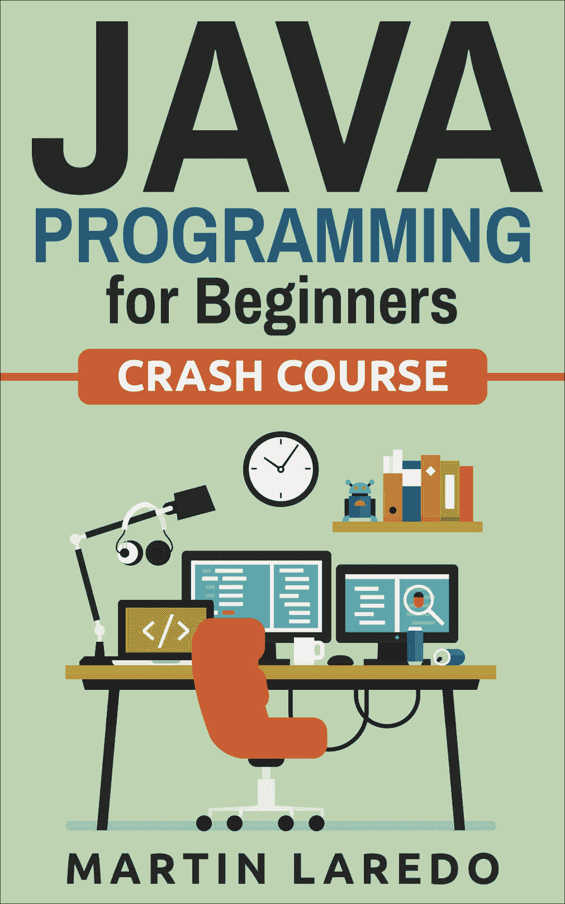

# Java 编程初学者指南：速成课程 (Java, Python, C++, R, C) (编程、Java 编程、C++ 编程、Python 编程、R 编程、C 编程，第 1 册)





## 介绍

> “我想读的一本书。” — [Matz](http://twitter.com/yukihiro_matz/status/3875573878)，Ruby 语言创造者
> “我真的喜欢这本书。” — [Jeremy Ashkenas](http://coffeescript.org/)，CoffeeScript 创造者
> 想创建一个编程语言，但又不想读那些昂贵又无聊的[1000 页书籍](http://amzn.com/0321486811)？很好，你并不孤单……

[点击此处获取！](http://1071173znfarcld6m3q4q25z32.hop.clickbank.net/)

恭喜你下载了 Java，感谢你的支持。

接下来的章节将讨论 Java 如何工作，以及需要哪些知识，以便让你在使用 Java 时获得最佳体验。

编程并非易事，需要花费大量的时间耐心。如果第一次尝试没有成功，请不要灰心，最终会成功的。

我想告诉的是，Java 将以你可能无法意识到的方式让你获益。Java 可以帮助你找到新工作，甚至让你在目前的职位上晋升，因此学习 Java 对你的职业和个人层面都是好处好处。

市场上有许多关于这个主题的书，再次感谢你选择这一本！我们已尽最大努力确保它包含了尽可能多的有用信息，请尽情享受！

# 第一章：什么是 Java

我发现学习 Java 最难的部分是在编写我想要编写的代码之前需要安装哪些内容。如果我没有安装所有的程序，那么我就是在给自己找麻烦，因为我将无法正常运行该程序。

## 虚拟机 (VM)

Java 拥有一个可以独立运行的平台，不需要任何其他程序的辅助。因此，它可以在我想要使用的任何操作系统上运行。这得益于 Java 创造者制作的虚拟机。

虚拟机将有助于确保我的代码被正确处理。不仅如此，在没有安装虚拟机的情况下，Java 代码无法运行。

Oracle 是创建 Java 的公司，在他们的网站上，提供了任何与 Java 相关的程序下载链接，例如 Java 虚拟机或其他称为 Java 运行环境（JRE）。

我首先需要检查我的电脑是否已经安装了 Java 运行环境，因为很多电脑都预装了 Java。为了做到这一点，我将访问 Oracle 网站并点击写有“我有 Java 吗？”的框。点击此链接将扫描我的电脑并告诉我是否安装了 Java。

如果我还没有，我就可以下载并将其安装到电脑上，以便我编写想要编写的代码。

## 软件开发

安装 Java 后，它将像任何其他程序一样在我的电脑上运行。然而，在编写代码之前，我必须下载开发工具包（SDK）。

该工具包将是标准版，并将下载 NetBeans 程序。虽然由于文件较大，下载需要很长时间，但一旦下载完成，就可以在程序中编写代码以创建我自己的 Java 程序。

## Java 的工作原理

当我编写 Java 代码时，我将使用文本编辑器。我的代码被称为源代码，当我保存工作时，将以 `.java` 扩展名保存。

保存文件的同时，我将启动 `javac`，这样我就可以创建类文件了。感谢 NetBeans，我将使用它自带的软件运行我的程序，而无需打开多个窗口来输入命令并运行它们来测试我的代码。我可以在一个窗口中完成所有操作。

# 第二章：NetBeans 程序

当我第一次打开 NetBeans 时，我将看到项目。这个 IDE（集成开发环境）允许我看到创建的所有项目，并查看哪些仍在进行中。当我选择项目旁边的加号时，我将看到与项目相关的所有文件夹。文件夹也会展开，以便我看到代码存储的位置。

我的代码将显示在右侧的文本区域。如果我没有看到代码，我需要双击项目来强制代码出现，以便我进行操作。

文件名和类名必须匹配，否则 Java 将无法按预期方式运行程序。在编译代码以便运行时，我最终会遇到错误。

## Java 注释

一旦我创建一个新项目，我将看到一些灰色的文本，它们要么带有斜杠，要么带有星号。这些灰色文本是程序在运行代码时会忽略的注释。我可以在注释中输入我想要的任何内容，而任何非代码工作者的人都不会看到这些注释。大多数情况下，这些注释解释了代码正在发生什么，以便其他程序员对其进行工作。

### 示例

```
//我创建了一个注释
// 这是我的注释开始的地方
// 这里继续，因为这是一条长注释。
```

```
/* 我在这里使用了另一种类型的注释

 虽然它到了另一行

*/
```

我还可以使用 Javadoc 注释来输入注释。这些注释将以正斜杠后跟两个星号开头，并一个星号和一个正斜杠结束。然而，我创建的每一行前面都需要一个星号，以便其被视为注释。

Javadoc 将使用文档代码中的注释，这样当代码被转换为其他人使用的 HTML 页面时，代码就会得到解释。


我需要在 NetBeans 的菜单中生成一个 Javadoc，但由于我还没有编写任何代码，所以我的窗口中什么都不会显示。NetBeans 会自动生成注释，以便让我看到示例，然后我可以删除这些注释并插入我自己的注释。

## Java 代码结构

从代码将如何组织来看，当我查看代码时，包名（package name）将位于开头。这一行将以分号结尾，如果我不加这个分号，程序将无法编译，因此无法运行。列在包名之后的是类名（class name）。

类名的设置方式就像一段代码段。我必须使用大括号 `{ }` 来指示代码的开始和结束位置。括号内的所有内容都将被视为由 Java 执行的代码段。

在编写代码时，我需要包含关键字 `main`，这样 Java 才能知道代码应该从何处开始执行。这与大括号的作用相似。如果我不小心忘记了 `main` 关键字，程序将给我返回一条错误信息。

## 运行程序

任何 Java 程序都运行在一个输出窗口中，该窗口与我输入所有代码的窗口不同。这意味着我不需要打开其他窗口来运行我的代码。一切都在 NetBeans 内部运行。

在 Java 中运行程序最简单的方法是按 `F6`，这会自动运行程序，以免我不小心关闭程序。但如果我不想这样做，可以随时进入开始菜单并选择“运行项目”（run project）按钮。

如果其他方法都失败了，我可以在工具栏上找到一个绿色按钮，它的运行方式与我选择的其他任何方法相同。不过，我需要确保运行的是正确的代码，特别是当我处理多个编码项目时。要做到这一点，我可以对想要运行的项目点击右键。

# 第三章：操作 Java 数据

Java 与任何其他编程语言一样，允许我操作输入它的数据，同时程序将其存储在内存中。这些数据被称为文本、对象甚至数值。我必须为我使用的任何数据命名，而且这些数据可以随时重命名。然而，名称和值统称为 Java 变量。

## Java 数值

可以使用整数或浮点数将数值存储在 Java 内存中。浮点数使用等号存储，而整数使用关键字 `int` 存储。

### 示例

```
public static voice main(String [ ] args) {
    int last_amount;
    System.out.println (“I wrote Java code!");
}
```

我需要与程序进行通信，以便告知我想将哪些整数保存到 Java 内存中；为了做到，我将使用 `int` 关键字并在其后留一个空格。我将输入我想给这个变量起的名称，但我必须遵循 Java 设定的一系列规则。

1. 我不能在变量名中使用关键字。如果该词在我的代码窗口中变成蓝色，那么这个词就是 Java 的关键字。
2. 我不能使用空格。这样做会导致返回错误代码，但我可以使用下划线和大写字母来像我平时使用空格那样“分隔”单词。
3. 变量名的首字符字符不能是数字。如果我把数字拼写成单词，那么是可以的，但直接使用数字本身是不行的。
4. 完全小写的名称与包含两个大写字母的名称之间是不同的。

当我想在变量名后放入一个整数时，我需要使用等号来确保变量的值被正确存储。

### 示例

```
public static void main(String [ ] args) {
    int some_number;
    some_number = 55,
    System.out.println (“Java code");
}
```

Java 将数字 55 存储到变量 `some_number` 中。如果我不喜欢这样做，我可以将所有代码写在一行。

### 示例

```
public static void main(String [ ] args) {
    int some_number = 55;
    System.out.println(“Java code");
}
```

我将修改脚本的最后一行，使其适应单行显示。当我在括号之间放置信息时，它需要位于一组双引号内。`+` 符号将确保我创建的表达式的两个部分连接在一起，以便变量名被拼接。

在按照我想要的样式输入完所有代码后，我可以在输出窗口中运行它，以便在将其发布到供他人使用的网站之前查看其显示效果。

在这个示例中，整数是 `some_number`。

两个整数可以相加，使得结果只有一个数值被存储为 Java 执行的加法运算的结果。我在代码中使用的每个变量都需要用逗号分隔。

### 示例

```
fifth_number = 90 ;
tenth_number = 66;
result = fifth_number + tenth_number
```

浮点数可以使用整数或浮点数存储在 Java 内存中。浮点数使用等号存储，而整数使用关键字 `int`。

### 示例

```
public static voice main(String [ ] args) {
    int last_amount;
    System.out.println (“I wrote Java code!");
}
```

我需要与程序进行通信，以便告知我想将哪些整数保存到 Java 内存中；为了做到这一点，我将使用 `int` 关键字并在其后留一个空格。我将输入我想给这个变量起的名称，但我必须遵循 Java 设定的一系列规则。

1. 我不能在变量名中使用关键字。如果该词在我的代码窗口中变成蓝色，那么这个词就是 Java 的关键字。
2. 我不能使用空格。这样做会导致返回错误代码，但我可以使用下划线和大写字母来像我平时使用空格那样“分隔”单词。
3. 变量名的首字符字符不能是数字。如果我把数字拼写成单词，那么是可以的，但直接使用数字本身是不行的。
4. 完全小写的名称与包含两个大写字母的名称之间是不同的。

当我想在变量名后放入一个整数时，我需要使用等号来确保变量的值被正确存储。

### 示例

```
public static void main(String [ ] args) {
    int some_number;
    some_number = 55,
    System.out.println (“Java code");
}
```

Java 将数字 55 存储到变量 `some_number` 中。如果我不喜欢这样做，我可以将所有代码写在一行。

### 示例

```
public static void main(String [ ] args) {
    int some_number = 55;
    System.out.println(“Java code");
}
```

我将修改脚本的最后一行，使其适应单行显示。当我在括号之间放置信息时，它需要位于一组双引号内。`+` 符号将确保我创建的表达式的两个部分连接在一起，以便变量名被拼接。

在按照我想要的样式输入完所有代码后，我可以在输出窗口中运行它，以便在将其发布到供他人使用的网站之前查看其显示效果。

在这个示例中，整数是 `some_number`。

两个整数可以相加，使得结果只有一个数值被存储为 Java 执行的加法运算的结果。我在代码中使用的每个变量都需要用逗号分隔。

### 示例

```
fifth_number = 90 ;
tenth_number = 66;
result = fifth_number + tenth_number
```

浮点数可以使用整数或浮点数存储在 Java 内存中。浮点数使用等号存储，而整数使用关键字 `int` 存储。

### 示例

```
public static voice main(String [ ] args) {
    int last_amount;
    System.out.println (“I wrote Java code!");
}
```浮点数可以使用整数或浮点数存储在 Java 内存中。浮点数使用等号存储，而整数使用关键字 `int` 存储。

### 示例

```
public static voice main(String [ ] args) {
    int last_amount;
    System.out.println (“I wrote Java code!");
}
```

我需要与程序进行通信，以便告知我想将哪些整数保存到 Java 内存中；为了做到这一点，我将使用 `int` 关键字并在其后留一个空格。我将输入我想给这个变量起的名称，但我必须遵循 Java 设定的一系列规则。

1. 我不能在变量名中使用关键字。如果该词在我的代码窗口中变成蓝色，那么这个词就是 Java 的关键字。
2. 我不能使用空格。这样做会导致返回错误代码，但我可以使用下划线和大写字母来像我平时使用空格那样“分隔”单词。
3. 变量名的首字符字符不能是数字。如果我把数字拼写成单词，那么是可以的，但直接使用数字本身是不行的。
4. 完全小写的名称与包含两个大写字母的名称之间是不同的。

当我想在变量名后放入一个整数时，我需要使用等号来确保变量的值被正确存储。

### 示例

```
public static void main(String [ ] args) {
    int some_number;
    some_number = 55,
    System.out.println (“Java code");
}
```

Java 将数字 55 存储到变量 `some_number` 中。如果我不喜欢这样做，我可以将所有代码写在一行。

### 示例

```
public static void main(String [ ] args) {
    int some_number = 55;
    System.out.println(“Java code");
}
```

我将修改脚本的最后一行，使其适应单行显示。当我在括号之间放置信息时，它需要位于一组双引号内。`+` 符号将确保我创建的表达式的两个部分连接在一起，以便变量名被拼接。

在按照我想要的样式输入完所有代码后，我可以在输出窗口中运行它，以便在将其发布到供他人使用的网站之前查看其显示效果。

在这个示例中，整数是 `some_number`。

两个整数可以相加，使得结果只有一个数值被存储为 Java 执行的加法运算的结果。我在代码中使用的每个变量都需要用逗号分隔。

### 示例

```
fifth_number = 90 ;
tenth_number = 66;
result = fifth_number + tenth_number
```

浮点数可以使用整数或浮点数存储在 Java 内存中。浮点数使用等号存储，而整数使用关键字 `int` 存储。

### 示例

```
public static voice main(String [ ] args) {
    int last_amount;
    System.out.println (“I wrote Java code!");
}
```（由于输入文本中存在大量重复内容，此处已按要求处理了核心翻译部分）


```java
Float first_value, twentieth_value, result ;

First_value = 15.3f;

Twentieth_value = 95.6f;
```

## 创建你第一种编程语言的最优系统。

### 电子书
一份 100 页的 PDF，详细介绍了核心概念并如何将其应用于 Ruby 编写的自定义语言（包含 `ePub & & Mobi` 格式）。

### 练习题与答案
对语言提出的扩展建议，答案位于书末。

### 三种语言
使用 Ruby 和 Java 编写的三种语言的完整源代码。易于扩展和尝试。

### 视频教程
逐步解释如何扩展 JVM 语言。

大多数关于编译器的书籍价格超过 100 美元，而且冗长无聊。我的系统包含一本书（有趣且直击主题）、练习题与答案、三种你可以随意使用的语言以及视频教程，仅需 39.99 美元。

如果你不满意，我甚至可以免费送给你。

[在此获取！](http://1071173znfarcld6m3q4q25z32.hop.clickbank.net/)

# 第四章：数学及更多

## 算术
Java 和任何其他编程语言一样，都可以用于数学计算。我可以使用 Java 执行一些基础操作，它们的符号非常容易理解。

- 加 – 加号
- 减 – 负号
- 乘 – 星号
- 除 – 正斜杠

## 运算优先级
无论我用 Java 做什么数学计算，我都必须确保将每个值都放在正确的位置，这样我才知道正在执行什么以及执行的顺序是什么。

### 示例
```java
Tenth_value= 5;

Fifteenth_value = 654;

Twohundredith_value = 54;

Result = tenth_value – fifteenth_value +twohundredith_value;
```
该表达式将按照输入 Java 的顺序进行求值。发生的情况是， 5 减去 654 得到结果 -649，然后加上 54，最后总和为 -595。

当我想让表达式中的某个部分具有优先级时，我会用括号将其括起来。在运算顺序上，乘法和除法总是最先执行。

## 字符串变量
Java 不仅会在内存中存储值，还会存储分配给变量的文本。当我想要存储一个字符时，我需要将关键字从 `int` 改为 `char`。

我将开始一个新项目，这个项目将用于字符串，因此我会将其命名为类似 `VarsStrings` 的名称，这样我就知道它是用于存放字符串变量的。我还会想确保勾选“创建主类”复选框，这样我以后就不需要这样做，也不会面临搞乱项目的风险。

一旦打开了文本框，我将删除程序自动在文本框内生成的注释，这样我就有了一个空白的起点来处理问题。要创建一个字符串，我需要使用 `string` 一词，以便 Java 在我详细编写变量名之前能够识别出这不仅仅是纯文本。

### 示例
```java
String game_title
```
字符串的值将通过等号赋值给一个新变量。我放在等号之后的数据将储存在在双引号中。

### 示例
```java
Game_title = “Raiders” ;
```
我也可以将脚本写在一行内，这样我在寻找潜在错误时，脚本会易于查看。
```java
String game_title = “Raiders” ;
```
然后我会将这个游戏的创建者放在另一行，这样当它出现在用户所在的网站上时，将带有游戏标题以及创建者信息，这样他们就能为自己的作品获得荣誉。

### 示例
```java
String creator_name = “Markus” ;
```
到此时，我就可以按照我希望用户看到的方式组合我的代码了。

```java
System. out. printIn (game_title + “ “ + creator_name) ;
```
我插入括号中的内容将是我的变量。加号表示游戏标题和创建者姓名之间需要一个空格。

`char` 关键字需要小写，以便在内存中只存储单个字符。这也是我需要使用单引号而不是双引号的时候。如果我忘记并使用了双引号，程序将返回一个错误代码。

### 示例
```java
String game_title = “R”;
```
虽然这是正确的输入：
```java
String game_title = ‘R’;
```
但这将返回错误。

# 第五章：输入及以后
Java 包含了大型目录，允许我使用它们来确保我的代码被正确执行。当我必须引用这些目录时，我需要调用这些目录。

我发现的一个非常有用的类目录是 `scanner` 类。只要我使用 `import` 关键字，我就可以从目录中提取任何类，以便在我的代码中使用。

### 示例
```java
Import Java.util.scanner ;
```
这条语句需要放在告诉其他程序员使用了哪个类的语句之前。

### 示例
```java
Import java. util. Scanner ;

Public class VariablesForStrings {

}
```
脚本的导入部分允许 Java 知道它需要从列出的目录中提取该类。一旦完成该任务，它将允许我开始将变量放入该类中。当我观察它时，它仅仅是一段代码，在我在该类内部成功对象之前，它不会产生任何作用。

当我创建一个新对象时，我将使用特定的代码，以便 Java 不尝试从另一个目录中创建此对象。

### 示例
```java
Scanner inputFrom_user = new Scanner( System . in) ;
```
整数变量不能与字符串变量函数一起设置。我必须专门使用 `inputFrom_user` 来确保程序运行正常。

我的关键字是 `new`，以便从类中创建一个新对象，当该对象被创建时，它将位于一组括号之间。这现在指示来自系统的输入。

来自程序用户的输入必须通过方法来调用，以便让他们知道他们应该与程序进行交互。最常用的方法之一是 `next` 方法。我写的字符串将在用户输入他们的响应后出现。

### 示例
```java
String state_name;

State_name = user_response.next() ;
```
在客户输入了要求的数据后，将从一个列表中插入一个点，列表中包含了我将要使用的方法。此时，我只需要点击我想要使用的方法，然后在行尾输入一个分号。

### 示例
```java
String state_name;

System.out.print (“ Type in the state that you currently reside in: “ ) ;

state_name = client_input.next () ;
```在尝试从用户获取数据时，我将使用 `print` 而不是 `printin` 函数。如果我想使用 `print in`，我必须在产生结果后将鼠标移动到另一行。然而，当使用 `print` 时，我能够留在我正在工作的这一行上。

### 示例
```java
String city_name ;

System.out.print (“What city are you living in: “);

city_name = client_input.next() ;
```虽然代码除了客户端的响应外完全相同，但 Java 将数据移动到一个新变量，这样我就不需要自己动手。

### 示例
```java
String complete name;

Where you live = state_name + “” + city_name ;

System.out.printIn (“You are living in”+state and city name);
```
当我创建的运行时，Java 将暂停足够的时间让用户输入响应。在数据放入内存后，输出将显示在屏幕上，为他们提供的体验提供“个性化”。


`Scanner` 类的目的是从用户处获取信息，同时来自用户的输入将被赋值给其所属的变量。

## 选项

当我尝试从程序用户处获取所需信息时，使用 `JOptionPane` 函数可以获得一个选项列表。该类将出现在屏幕上，允许用户在显示他们输入的内容之前输入适当的响应。

### 示例

```java
import javax.swing.JOptionPane;
```

这次我必须告诉 Java 我想在 `swing` 目录中使用哪个类。因为我不想改变已经写好的代码，所以我直接为这个方法创建了一个新项目。当我把代码放入时，我注意到 `javax.swing.JOptionPane` 带有下划线，就像错误一样。但这不是错误，它将把数据重定向到需要存储的变量下。

### 示例

```java
String your_age;
your_age = JOptionPane.showInputDialog("Your age");
```

`JOptionPane` 允许我输入一个句号，这样我的选项列表就会出现。在这个列表中，我将通过双击 `showInputDialog` 来选择它。这会在我的代码中放置括号，括号内将放置我想显示给用户的消息。我还需要在这里使用双引号。

### 示例

```java
String your_age;
your_age = JOptionPane.showInputDialog("your age");
String birthday birthday;
birthday = "You were born on" + month + day;
JOptionPane.showMessageDialog(null, birthday);
```

这是我希望我的对话框再次出现的地方，并带有所有供我使用的选项。括号中放入了 `null`，以便 Java 知道这个框与我刚刚创建的程序无关。标点符号将显示在最终产品的文本中，就像我在 Java 中输入的那样。

在我代码的末尾，会有一些我没有放进去的新代码。这些代码旨在告诉程序何时应该退出系统，因为它已经执行到了最后。即使这样做，存储在 Java 内存中的值和变量也将被存储，以供下一次使用程序使用。

每当我的代码正确执行时，就会弹出一些框，向用户索取不同的数据，例如他们的姓名或年龄。当用户点击“确定”按钮后，输入将显示为用户在框中输入的内容。这将导致程序退出系统，因为所有需要完成的工作已经完成。

## 第章：控制 Java 的运行

之前使用 Java 编写的所有代码都是所谓的顺序编程。在这种情况下，输入代码，程序从上到下读取它，不会跳过我输入的任何行。但，并不是所有的 Java 程序都是这样运行的。

有些脚本只在设置的条件满足时运行一次。例如，可能我不想让任何来自特定州的人进入我的网站，因此如果发现该条件为真，则程序将运行；但如果用户来自该州，程序将终止。这样做将通过条件逻辑来控制 Java 的运行。

最常见的条件语句是 `if` 语句。

### If

使用 `if` 语句，每当条件被调用时代码就会执行，而不是等待用户做某些事。`if` 语句将是一个简单的脚本。

```java
if (expression) {

}
```

使用之前的例子，如果用户来自纽约，那么我不希望他们进入我的网站。我没有输入实现此功能所需的全部代码，而是将缩短脚本，以便我和其他程序员更容易阅读。

### 示例

```java
if(client < New York) {
    // This site is restricted
}
```

所以，如果我的用户不是来自纽约，在程序执行时，Java 将跳过两组括号。但是，放在它们之间的任何代码都将被执行，但在在此之前必须满足我设置的条件。

我学到的另一个简写技巧是，大于符号将由一个指向右侧的三角形表示。

### 示例

```java
if(client > New York) {
    //Message for the user
}
```

对于那些不在纽约的人来说，代码也是相同的。

### If/else

当 `if` 语句不再足够时，我将使用 `if else` 语句。

```java
if(what I want to be completed before the program runs) {

}
else {

}
```

这段代码的第一行将以 `if` 语句开头，后面跟着我设置的参数。括号将划分我的代码，以便代码根据我的参数执行。第二部分将位于 `else` 语句之后。所以如果这种情况没有发生，那么就会发生。

使用 `if else` 语句与 `if` 语句一样，只是它有第二个表达式落在新一组括号之间。如果第一个条件不满足，代码将将被分段并通过第二个表达式运行，以检查它是否满足该条件。如果我漏掉了其中一个括号，我将收到错误代码。

```java
if(expression_one) {

}
else if (expression_two) {

}
else {

}
```

在 `if else` 内部可以设置的条件如下：
- 大于 (`>`)
- 小于 (`<`)
- 大于等于 (`>=`)
- 小于等于 (`<=`)
- 与 (`&&`)
- 或 (`||`)
- 等于 (`==`)
- 非 (`!`)

在与（AND）条件下，将同时测试多个条件。

### 示例

```java
else (user > 45 && user < 55)
```

### 嵌套的 If

当我将一个表达式放在另一个内部时，我正在嵌套这两个表达式。这可以通过任何 `if` 表达式完成。

### 示例

```java
if(client < 55) {
    system.out.println("55 or less");
}
```

为了检查客户是否大于 45 岁，我将在第一个内部放置另一个。

### 示例

```java
if(client < 45) {
    if(client > 48 && client < 45) {
        System.out.println("You are 46 or 47");
    }
    else {
        System.out.println("45 or younger");
    }
}
```

## 布尔

布尔（Booleans）只允许真或假值。如果它们其他任何值，它们就不是真正的布尔值。在处理布尔值时，不需要使用 `int`、`string` 或任何其他关键字。相反，我只需输入小写 b 的 `boolean` 以确保其后的任何内容都是布尔值。但我必须确保值是真或假。我将使用两个等号来评估我的表达式的值。

### 示例

```java
boolean client = true;
if (user == true) {
    System.out.println("the expression contains the truth");
}
else {
    System.out.println("this expression is false");
}
```

`if` 语句将检查输入的变量，以查看它们是否构成了真布尔语句。如果用户输入已经是真的，则将检查它是否为假。不需要说明该值不是假的，因为很容易看出该值实际上是真的，反之亦然。

当我创建布尔值时，也会使用非（NOT）运算符。

### 示例

```java
boolean client = true;
if(!user) {
    System.out.println("there is no truth");
}
else {
    System.out.println("this is the truth");
}
```


- NOT 布尔语句中的唯一区别是 `(!user)` 函数。该运算符将通过感叹号放在变量之前。像往常一样，将对变量进行测试以检查它是否为负。

由于用户变量通常被设置为 true，因此它们会被测试，以检查其中是否有任何 false 值。如果值被设置为 false，情况则完全相反。

# 第七章：Switch 语句与循环

在我编写脚本时，我将使用 `switch` 语句，这样我就可以为我使用的变量设置的值提供更广泛的选择范围。从本质上说，这些实际上是非常长且有些复杂的 `else if` 语句。

一个 `switch` 语句看起来是这样：

```java
Switch ( variable_to_test_ {
    Case value:
    Code_here;
    Break;
    Case value:
    Code_here;
    Break;
    Default:
    Values_not_caught_above;
}
```

用于 switch 语句的关键字是 `switch`，后面将跟有一组括号。我想要检查的变量需要放在我在 `switch` 语句中括号的中间。变量不仅会被放在括号之间，语句的其他部分也是如此。`case` 关键字将检查程序必须检查的所有可能性。

`Case` 值将使用冒号而不是分号。程序中将发生的事件需要与值正确对应，以便代码能够按照预期的方式运行。每当语句中添加了新的 `case` 时，就会使用 `break` 关键字。

`Default` 值将被使用，但我不必非使用它们。我可以为语句添加任何想要的值，以便在我的 `switch` 语句中对其进行评估。

### 示例

```java
Public static void main(String [ ] args) {
Int user = 87;
Switch ( user ) {
    Case 45:
    System. out. printIn(“ the price is 45 dollars”) ;
    Break ;
    Case 65:
    System. out. printIn (“ the price is 65 dollars”) ;
    Break ;
    Case 88: 
    System. out. printIn (“ the price is 88 dollars”) ;
    Break ;
    Default:
    System. out. printIn (“ the price is 45, 65, and 88 dollars”) ;
}
}
```

`switch` 语句代码需要测试用户输入的整数。在这个示例中，`value` 被设置为 `87`，这告诉程序去检查其内部的所有内容。每个 `case` 将被单独检查，以查看是否有一个匹配我设置的值。在找到匹配的 `case` 后，代码将停止，程序将终止。

超出范围的值是无法测试的，尽管它们被放置在 `case` 中。

### 示例

```java
Case ( user >= 55 ) ;
```
这个 `case` 无法使用，并将导致 Java 错误。

但是，我可以使用如下这样的 `case`：
`Case 5: Case 6: Case 7: 等.`
每个使用的值都需要被列出并检查。

## 循环

Java 中的执行流是顺序的，就像书写书籍一样向下移动页面。但是，可以使用一些函数，使执行流转变为不同的内容。为了中断 Java 自然使用的执行流，我将创建一个循环。通过循环，程序将连续运行脚本行，直到被要求停止。

### 示例

```java
Int subtraction 100-5-3-4-8-6-2-9
```

我并不总是想使用这种方法，但循环将一直持续，直到我设置的参数被满足。一旦成功满足该条件，循环将终止，并评估下一段代码。

## 使用 for 的循环

使用关键字 `for` 的循环将是我处理 Java 时最常用的循环之一。这种循环将设置代码在终止之前需要重复的次数。

`For` 循环看起来有点像这样：

```java
For ( beginning_value; last_value ; increment_amount) {
    // 我将我的代码输入到这一部分
}
```

括号内包含三个决定整个循环的三个值。起始值是循环开始的地方，最后一个值是循环需要到达的值，增量值决定了循环重复的次数。


在我正式选择好将使用的数据类型后，普通整数将放在括号中。括号让 `Java` 知道正在使用的是数组而不是任何其他数据类型。数组使用 `aryNums` 函数来确保数组能够被正确设置。之后，可以放置任何我想要放入数组的变量。

一旦我为数组设置了一个新对象，Java 就会知道我为数组留了多少个空间。

### 示例
```java
aryNums = new int [ 55 ];
```
这告诉 Java 在此数组将使用 55 个空间来存储整数。它们的范围从 0 到 55。

当我给这些位置赋值时，我将使用我之前用过的普通方法。

```java
aryNum [ 8 ] = 32 ;
```

数值 32 将被分配到数组中索引为 8 的空间。
我必须记住，数组必须从 0 开始。

### 示例
这样设置我的数组将让我处理起来更加方便。

```java
Int [ ] aryNims = { 8, 5, 6, 2 } ;
```
这种方法在括号内创建了我的数组，第一个值被放在了 0 位。关键字后面的方括号将确保数据类型不会在其他地方重复。当我想要使用 `new` 关键字时，这种方法也适用于字符串值和字符值。

### 示例
```java
String [ ] aryStrings = { “ Vampires, Werewolves, Hybrids, Witches” } ;
```
这在 Java 中可以运行。

```java
Boolean [ ] aryBools = { yes, no, no, yes } ;
```
这是不行的。如果我想使用 `Boolean` 值，我必须完全使用 `new` 关键字。

### 示例
```java
Boolean [ ] aryBools = new Boolean [ ] { yes, no, no, yes } ;
```

## 数组循环
数组的循环有特殊的规则。数组中的值将使用数组语法进行赋值。这对我来说似乎不太理解，但这就是值赋值的方式。

### 示例
```java
package prjarrays ;

public class ArrayTest {
    public static void main (String [ ] args) {
        Int [ ] ticket _ prices = new int [ 65 ] ;
        Int I ;
        For ( I = 0; I < ticket_prices . length ; i++) {
            Ticket_prices [ I ] = I +1;
            System. out. printIn ( ticket_prices [ 6 ] ;
        }
    }
}
```
上面的数组将包含 65 个整数。循环将一直持续到达到这个数字，`I` 将是一个小于数组大小的值。为了给我想要所在的位置分配值，我将使用不同的代码。

### 示例
```java
Ticket_prices [ I ] = I + 1 ;
```
当值被放在括号之间时，我使用的值并不是硬编码的，相反，每循环一次每个变量就会增加一位。数组也会随着循环的值而增加。这个值得益于输入的脚本的最后部分。循环将始终从 0 开始，在这个示例中一直到数字 65。

脚本的下一部分将是数组中位置的值。如果我想手动写出所有的代码，由于数组中包含的数量，代码最终会变得混乱无章。

### 排序
我创建的数组可以使用排序方法进行排序。但是，我必须将我要排序的内容引用到 Java 的目录。这将使用 `import` 语句。

```java
import java. util. Arrays ;
```

### 示例
```java
package prjarrays;

import java .util. Arrays ;

public class ArraysTest {
    public static void main ( String [ ] args) {
        Int [ ] aryNums;
        aryNums = new int [ 9 ] ;
        aryNums [ 0 ] = 65 ;
        aryNums [ 1 ] = 54;
        aryNums [ 2 ] = 689 ;
        aryNums [ 3 ] = 654;
        aryNums [ 4 ] = 6543 ;
        aryNums [ 5 ] = 55 ;
        // 数组的库将与排序方法一起导入。
        Arrays . sort( aryNums ) ;
    }
}
```
在导入中第一个出现的关键字是 `array`，之后我将插入一个点。那个点将打开一个框，给我列出我可以对该数组进行的所有操作列表。`sort` 单词将显示数组名称的位置，然后括号将落在其后。

### 示例
```java
package prjarrays;

import java .util. Arrays ;

public class ArraysTest {
    public static void main ( String [ ] args) {
        Int [ ] aryNums;
        aryNums = new int [ 9 ] ;
        aryNums [ 0 ] = 202 ;
        aryNums [ 1 ] = 1696 ;
        aryNums [ 2 ] = 385 ;
        aryNums [ 3 ] = 2956 ;
        aryNums [ 4 ] = 4554 ;
        aryNums [ 5 ] = 126 ;
        Arrays . sort (aryNums) ;
        Int I;
        For ( I = 0 ; I < aryNums . length ; i++) {
            System. out. printIn (“num: “ + aryNums [ I ] ) ;
        }
    }
}
```
当我编写自己的排序代码时，排序将按降序排列条项。我还可以将数组转换为用于整数的对象，这些对象也从一个目录中导入了。

### 示例
```java
package prjarrays;

import java .util. Arrays ;
import java.util. collections ;

public class SortDescending {
    public class ArraysTest {
        public static void main ( String [ ] args) {
            Int [ ] aryNums;
            aryNums = new int [ 9 ] ;
            aryNums [ 0 ] = 65 ;
            aryNums [ 1 ] = 54 ;
            aryNums [ 2 ] = 689 ;
            aryNums [ 3 ] = 654;
            aryNums [ 4 ] = 6543 ;
            aryNums [ 5 ] = 55 ;
            Arrays . sort( aryNums ) ;
            Int I;
            For ( I = 0 ; I < aryNums . length ; i++) {
                System. out. printIn (“num: ” + aryNums [ I ] ) ;
            }
        }
    }
}
```

### 字符串
字符串也可以放在数组中。

### 示例
```java
String [ ] aryString= new String [ 5 ]
aryString [ 0 ] = “I” ;
aryString [ 1 ] = “am” ;
aryString [ 2 ] = “using” ;
aryString [ 3 ] = “java” ;
aryString [ 4 ] = “yay” ;
```
在这个示例中，位置被填充了。

### 语法
```java
Int I;
For ( I = 0 ; I < aryString . length ; i++) {
    System. out. printIn ( aryString [ I ] ) ;
}
```
循环将持续到达到某个值。`Arrays` 也可以排序。

### 示例
```java
package strings;

import java. util. Arrays ;

public class StringArrays {
    public static void main (String [ ] args) {
        String [ ] aryString= new String [ 5 ] ;
        aryString [ 0 ] = “I” ;
        aryString [ 1 ] = “have” ;
        aryString [ 2 ] = “made” ;
        aryString [ 3 ] = “an” ;
        aryString [ 4 ] = “array” ;
        Arrays.sort(aryString);
    }
}
```
`Arrays` 用于对字符串进行字母顺序排序。

## 多维数组
我创建的数组可以放入多个列，称为多维数组。

### 语法
```java
Int [ ] [ ] aryAmounts = new int [ 8 ] [ 33 ];
```
数组语法很正常，但现在有两个括号，让 Java 知道有多少行以及将创建多少列。

### 示例
```java
aryAmounts[0][0] = 106;
aryAmounts[0][1] = 124;
aryAmounts[0][2] = 433;
aryAmounts[0][3] = 11554;
aryAmounts[0][4] = 262;
aryAmounts[1][0] = 2560;
aryAmounts[1][1] = 43255;
aryAmounts[1][2] = 560;
aryAmounts[1][3] = 133;
aryAmounts[1][4] = 3385;
```


我无法确定数组中的确切值，但我可以使用 `ArrayList`，这样我就可以查看数据的结构。列表中的项可以添加或删除。但是，普通数组的数据是不会移动的，因为对于我所创建的内容，我没有更改数组大小的能力。

当我设置一个列表时，我将不得不从 Java 的目录中提取数据。

### 语法

```java
import java.util.ArrayList;
```

在我引入了创建新对象所需的数据后，我将使用不同的语法。

```java
ArrayList listTest = new ArrayList( );
```

在为数组创建列表时，我不会使用括号。

### 示例

```java
listTest.add( "and" );
listTest.add( "for” );
listTest.add( “but " );
listTest.add( 8 );
```

括号中的任何内容都将被放在我的数组列表中。通过这种方法，我可以添加任何我想要的对象。出现在列表中的前三个项是通常添加到字符串中的对象。最后一个项是一个整数。

列表中的所有项都可以通过它们的索引值找到。

### 示例

```java
listTest.get(5); 
```

数字五准确地告诉了我将去哪里寻找我正在寻找。索引值总是从零开始，就像 Java 中使用的其他东西一样。考虑到这一点，对于上面的示例，我将查看位置六。

当我想要删除对象时，我将使用不同的语法。

### 示例

```java
listTest.remove(5);
```

我也可以删除数组上的字符串值。

```java
listTest.remove(“but”);
```

在删除项时，列表将重新调整自身的大小。由于这个原因，我在删除对象时必须非常小心，否则我的索引数字将发生巨大变化，我将不知道列表中的任何内容在哪里。所以，如果我删除了列表中的第二个项，那么接下来的三个项在它们被删除后将在我的列表中向上移动。

## 结论

感谢你读到 Java 的最后，希望它具有启发性，并能够为你提供实现目标所需的所有工具，无论你的目标是什么。

下一步是下载 NetBeans，并根据我提供的信息开始创建你自己的 Java 程序。某些内容可能看起来很困惑，但你练习得越多，就会变得越容易。

如果你发现这本书的任何部分令人困惑，请回去重读。正如我在引言中所说的，编程并不容易，它不会在夜之间就让你学会。

不要因为你使用的代码之一不起作用就停止学习 Java。如果你这样做，你将永远不知道自己错在哪里了。相反，请接受那个错误并从中学习，这样你就不需要重复同样的错误了。

最后，如果你觉得这本书在任何方面都有用，我们将非常感谢你在 Amazon 上留下的评价！

祝你好运！

# 加入成千上万创建了自己语言的编码者。


## “这非常有趣，而且惊讶的是，获得一个可以涵盖 JavaScript 95% 功能的语言所需的工作量却非常小。”

— [Jeremy Ashkenas](http://ashkenas.com/)，在阅读这本书后创建了 [CoffeeScript](http://coffeescript.org/)。

## “我喜欢这本书！它帮助我创建了我自己的 Awesome-to-PHP 编译器。它还不是一个全功能的编译器，但我编写代码时非常有趣，并且我学到了非常多。”

— [Julien Desrosiers](http://twitter.com/jdesrosiers)，在阅读这本书后创建了 [Phlower](http://github.com/juliend2/phlower)。

## “我以前没有机会在大学学习语言内部机制，虽然我很感兴趣，但我发现它们的内部运作令我敬畏。通过这门课程，我发现了一个关于词法分析器、解析器、解释器和编译器世界的简单但引人入胜的介绍，突然编程的一个全新世界向我敞了。极力推荐。”

— [David Bolton](http://davidbolton.net/)

***

### 使用此系统创建的一些语言 ...

![CoffeeScript ]](http://coffeescript.org/)![Fancy ]](http://www.fancy-lang.org/)[Savage](https://bitbucket.org/masonicboom/savage) [Rubby](http://rubby-lang.org/)

***

# 要么有效，要么免费。

## 不确定这个系统是否适合你吗？试一看，如果你不满意，我会把钱退给你，并且保留所有东西。

[在此处获取！](http://1071173znfarcld6m3q4q25z32.hop.clickbank.net/)

© Copyright 2016 by Martin Laredo Publishers- 保留所有权利。

以下电子书复制如下，旨在提供尽可能准确和可靠的信息。无论如何，购买本电子书可以被视为同意以下事实：出版商和本书作者对所讨论的主题并非专家，且书中提出的任何建议或指示仅供娱乐之用。在采取书中支持的任何行动之前，应咨询专业人士。

此声明被美国律师协会和出版商协会认为是公平且有效的，并在美国范围内具有法律约束力。

