# Java 软件与嵌入式系统

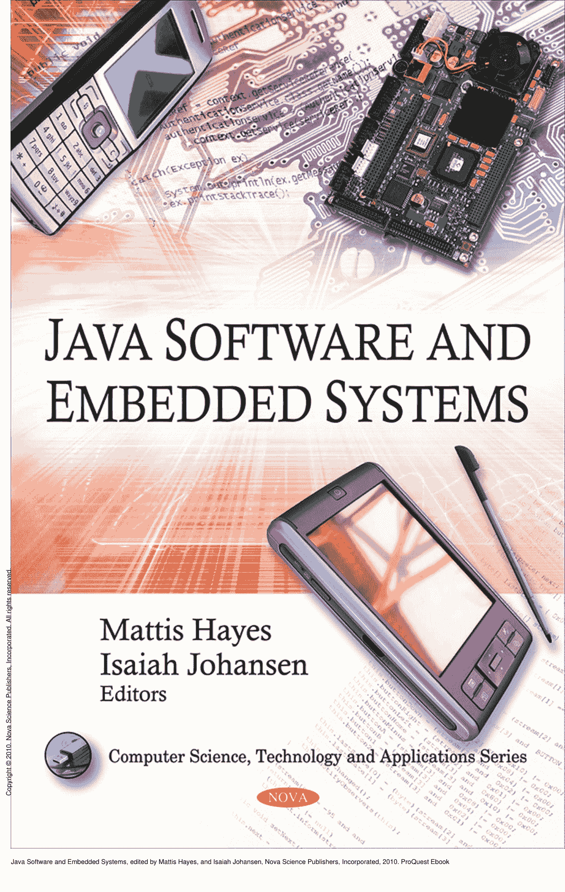

# 读者须知

出版商在准备本书时已尽合理努力，但不提供任何形式的明示或暗示的保证，并对任何错误或遗漏不承担责任。对于因书中包含的信息而导致的间接或后果性损害，出版商不承担任何责任。对于读者使用或依赖本材料而导致的全部或部分的任何特殊、后果性或惩罚性损害，出版商不承担责任。书中基于政府报告的部分已注明，并在适用于作品汇编的范围内对这些部分主张版权。

书中包含的任何数据、建议或建议均应寻求独立验证。此外，出版商对因本出版物包含的任何方法、流程、指令、思想或其他导致的人员或财产伤害/损害不承担任何责任。

本出版物旨在提供有关涵盖主题的准确且丰富的信息。其销售时的明确理解是，出版商并不从事法律或其他任何其他专业服务。如果需要法律或其他专家协助，应寻求胜任的人员的服务。源自美国律师协会委员会与出版者委员会共同通过的参与者宣言。

# 前言

汽车引擎的嵌入式控制系统开发是技术文献中的一个新兴领域。因此，缺乏支持从架构设计到验证各个开发阶段的方法论和工具。在第 4 章，介绍了一种用于嵌入式控制系统和引擎校准的新框架（F.I.R.E.——功能实现重用性），该框架能够在高抽象层对此类系统进行建模，并为验证活动提供工具。`F.I.R.E.` 使引擎工程师和软件开发人员能够关注控制系统方面，而不是平台。这是通过开发过程中对某些必要转换的自动化实现的。报告了两个应用示例，证明该工具能够在生成生产代码之前允许时间分析并检测错误的任务调度。

该工具还为嵌入式系统设计过程、校准和验证阶段提供系列支持功能，这些阶段在整个开发周期中始终至关重要。这种考虑特别适用于控制系统，因为它们的复杂性不断增加，而上市时间的要求又日益严格。

利用工具加速单一校准和验证阶段已被证明是有效的，也是目前的工业实践。这些经验也表明，需要将其集成到 `F.I.R.E.` 引擎中。其原因是引擎管理系统的开发过程包括几个阶段，其中存在增量软件开发，需要在极短时间内准确地从物理引擎中估计出一组校准参数。

第 5 章目的是考虑面向语言的分布式系统软件架构。中间件连接设备传感器信息服务器以及从中间件获取信息的控制应用程序并在浏览器中展示信息以表示无处不在空间的状态。面向语言的设计过程包括使用 `UML` 进行分析，以实现分布式系统。本章通过以下关键词介绍分布式系统中的 Java 应用：泛在空间的设计模式、软件架构、设计过程和架构。

第一部分，本章解释了用于软件架构的简单设计模式。这些设计模式被认为是构成软件架构的高效实现方法。其次，作者描述了软件架构，如模型-视图-控制器（`MVC`）和依赖注入（`DI`）。作为框架，这些面向模式的架构被应用于 Web 应用程序和软件应用中。在设计过程部分，作者讨论了用于实现所需系统的软件构建方法，并考虑了为了构建泛在空间的分布式系统而的设计过程。

由于 Java 具有易用性、可维护性和可移植性，被广泛应用于各种研究应用中。在第 6 章中，讨论了 Java 在机器人和人工智能领域的应用，并配以这些领域中基于 Java 的研究案例。作者使用 Java 开发了用于机器人和人工智能研究的软件架构，针对两台自主极地机器人，这些机器人被部署在格陵兰岛和南极，需要既可靠又稳健的软件，以最大限度地减少自主运行期间的故障。此外，还建立了一组低成本勘探和测图移动机器人团队，使用 `Java SPOTs` 作为无线通信和协调的手段，并使用自定义惯性测量单元（`IMU`）跟踪机器人姿态。截至该开发阶段，Java 还被用于实现无人系统联合架构（`JAUS`）通信协议的一部分。目前，涉及协作多代理机器学习的研究通过基于 Java 的 `WEKA` 学习套件和额外的 Java 包装器进行。这些应用说明了 Java 在机器人和人工智能领域具有广泛的研究应用。

环境由两部分组成：Java 语言和虚拟机。它的设计理念是任何软件实体都是不可信任的，因此每个实体都需要经过检查。Java 的第一个成功是 Java Applets 的诞生，它使得来自未知网站的完全不可信代码能够在浏览器中执行。这一特性展示了虚拟机（`JVM`）在应用程序与底层操作系统之间提供的隔离性。然而，Java 系统从单应用向多组件系统的演进，引入了开发者未察觉的新漏洞。这些漏洞需要额外的安全机制来支持安全环境。

本综述概述了 Java 语言和虚拟机的安全问题。文中定义并解释了默认安全模型。其三个主要部分是：Java 本身、用于逻辑和模块化的字节码验证，以及如类加载器和权限域。文中介绍了已知漏洞，这些漏洞源于 `JVM` 或应用程序代码。描述代码漏洞有两种方法：源代码和字节码。这种双重性使我们能够在开发期间通过人工代码审查和工具识别漏洞，也可以在代码部署或安装期间以自动方式识别漏洞。文中介绍了三种 Java 运行环境安全扩展和编写 Java 代码的工具：平台扩展、静态分析方法和行为注入。平台扩展加强了组件（豆等）之间的隔离，并为资源计数和控制提供支持。静态分析通过通用工具进行，以提高代码质量并减少 Java 代码中可利用的漏洞数量。其中一些工具如 `FindBugs` 包含了特定的安全漏洞，而另一些如 `JSLint` 则专门用于安全分析。字节码注入允许我们在代码核心处引入安全检查。这可以通过相关开发者执行（例如通过面向切面的编程），也可以通过字节码注入或元编程透明地完成。

第 7 章总结了根据执行生命周期阶段和对开发开销的影响划分的 Java 系统现有保护机制的概述。

如第 8 章所示，接口和设计是面向对象（`OO`）开发中的基本概念，尽管这两个概念都已被证明对软件开发是有益的，但有时它们的实现非常繁琐。这两种结果都会导致各自的类中出现转发方法或大量的空方法。这些平凡的方法将用户从类包含的非平凡方法中提取出来。这增加了复杂性并降低了可维护性。在目前的形态下，Java 没有提供足够的机制来避免样板代码。相反，所有空方法或转发调用的方法都必须手动编码。在这种情况下，作者引入了一种新的轻量级机制，改进了基于接口和基于委托的程序的实现。作者展示了这种机制是简单的，它解决了面向对象软件开发中一些为人知的问题。在三个多达 25,000 行源代码的开源 Java 程序中，作者展示了他们如何使用这种机制为每个案例生成了占所有方法高达 5.7% 的空方法或转发调用方法。

高速泛在嵌入式系统以及具有传统操作系统预备特征的嵌入式操作系统的出现，为开发者提供了新的系统灵活性和多功能性。这些特性是机械和嵌入式系统进步的关键，例如机器人系统、传感器网络、分布式嵌入式计算、结构健康监测、研究系统、监控控制与数据采集（`SCADA`）以及交通管理，特别是在地理分布和非结构化的领域。为了应对不确定性和快速原型设计的挑战，可行的嵌入式系统编程对于增强原型能力和可维护性至关重要，并提供了动态重构和现场处理。第 9 章讨论了具有交互趋势的现代全嵌入式系统的编程性和可配置性。本章还介绍了允许嵌入式开发者轻松针对其特定的嵌入式系统层次进行编程，并使用 C 语言处理多级复杂性，同时解释了嵌入式实时平台是机器人和机器工业过程自动化的基本组件。尽管工业应用传统上依赖基于 `PLC` 的硬件并且在任何情况下都依赖专有软件（即操作系统和开发工具），但近年来硬件计算能力的巨大提升和自由软件质量的提高，使得在 PC 兼容硬件和 `GNU/Linux` 软件上执行架构变得现实，这在研究社区中更为常见。自由基础设施的优势可以成为研究机构与公司之间富有成果合作的基础，并应用于附加值在于应用的领域，以及那些观点是基础设施的有意识用户而非研发者的领域。这就是下文介绍项目的情况，它代表了一个成功故事：研究小组与小企业之间的讨论导致了对需求的识别以及对共同基础设施的联合开发。当该项目在 2004 年启动时，双方（即 `CNR-ISSIA` 的自主机器人系统与控制小组以及 `Green Project Srl`）必须用稳定的软件和硬件基础设施替换其过时的海洋机器人和产品标记平台，并在极好整合技术改进的同时保持与过去的向后兼容性。该平台的第一个运行版本于 2005 年完成，并集成到 `CNR-ISSIA Charlie` 无人水面器（`USV`）用于机器人研究。第二个应用是将 `Greenproject s.r.l` 开发的用于标记连铸工业机器控制系统软件移植到该平台。该结果是本章的主要技术贡献，即实际证明了使用标准 `GNU/Linux` 用于采样频率高达 2 Khz 的嵌入式实时应用的可能性。此外，四年后，开发的系统仍然展示了其能力，得益于 Linux 内核新的实时属性，很好地整合了技术改进并不断提高性能。在报告了该领域相关研究总结并讨论了平台需求后，将介绍后续使 `GNU/Linux` 实时的方法论的关键点。最后，第 10 章将描述两个应用（一个研究型和一个工业型），并指出平台要求的实现的基本实时结构。

# 环境智能感知应用中的 JAVA

J.A. Tejedor, Jose J. Durán, Miguel A. Patricio, J. García,

A. Berlang and José M. Molina¹

应用人工智能小组

马德里卡洛斯三世大学

# 摘要

无线通信技术是在多设备平台上开发以用户为中心的系统的平台，该平台允许移动性和用户友好的交互。多设备平台的开发需要 Java 这一通用语言。在本章中，我们选择了与蓝牙（`Bluetooth`）和 `GPS-GSM` 通信两个不同的工作，以说明 Java 开发需要无线通信的应用的能力。

## 引言

由于个人数字助理和手机等设备的发展，计算资源正变得离所有人越来越近，这些设备在如今已非常流行，并日益实现网络化（例如，`Bluetooth`、`IEEE 802.11`）。这项技术的使用产生了一个新概念：移动计算。由于许多系统朝着这一方向设计，移动计算正受到越来越多的关注。大多数系统都希望具有感知能力，旨在优化并自动地在正确的时间和正确的地方分配其服务。情境计算是由（Shilt, 1995）首次定义的一种范式。该范式研究如何建模和使用情境信息。关于什么是情境，一个更广泛的定义是由（Dey et al., 2001）给出的，他将情境定义为：“描述与人类、应用程序与周围环境交互相关的任任何信息”。Chen 和 Kotz（Chen and Kotz, 2000）还描述了一些类别，将情境划分为更细粒度的类别。

> ¹ 电子邮箱地址：molina@ia.ucm.es。

因此，有多种开发移动系统的方法，例如用于提供情境感知服务的平台、框架和应用。Dey 等人（2001年）提出的情境工具包（`Context Toolkit`）可以通过为开发者提供能够构建情境感知应用的抽象来协助他们的工作。情境融合网络（`Context Fusion Networks`，Chen et al., 2004）由 Chen 和 Kotz 在 2004 年引入。它允许情境感知应用选择分布式数据源，并与自定义的数据融合算子通信，形成一个信息融合图。它代表了应用如何从低级传感器数据中计算出对其执行情境的高级理解。情境结构（`Context Fabric`, 2002）是另一个工具包，促进了隐私敏感型无处计算应用的开发。另一个平台是 `Gaia`（Schmidt et al., 1999），由 Roman 等人 2002 年开发，旨在支持无处计算空间的应用的开发和执行，在这些空间中，用户同时与多个设备和服务进行交互。`RCSM` 是由（Yau and Karim, 2004）提出的另一种中间件，旨在为应用提供情境感知和即时通信的属性。它提供了一个基于对象的框架，用于支持情境敏感应用，如用于固定网络的 `CORBA`（OMG, 2000）或 `Tao`（Gokhale and Schmidt, 1999）。此前还存在一些方法，如（Burke et al., 1996），它们使用知识库和基于案例的推理来推荐餐厅；例如 `Cyberguide`（Abowd et al., 1997），它为用户提供关于亚特兰大 GVU 中心执行项目的情境感知信息。通过整个大楼的电视控制器来检测用户位置，并为他们提供一张突出显示用户所在区域可用演示的地图。`A` 是一个情境感知平台，为特定且定义良好的需求的用户提供情境信息（Sanchez-Pi et al., 2007）。

智能体（`AMI`）的最终目标是构建智能环境，以促进对物理位置的无处不在。这种无处不在导致了近年来无线设备（尤其是手持设备）的增长。无线网络不依赖于位置；提供位置无关的特性。为应用提供情境感知和即时通信属性的中间件提供了一个基于对象的框架来支持情境敏感应用。

许多被称为无线局域网（`Wi-Fi`）的无线网络，运行在 2.4 - 2.4 GHz 频段。

这些技术的使用产生新概念在多设备平台上开发以用户为中心的系统。多设备平台开发需要 Java 这一通用语言。多设备平台允许移动性和用户友好的交互。许多系统都朝着这一方向设计，并希望具有感知能力，旨在优化并自动地在正确的时间和正确的地方分配其服务。在本章中，我们选择了与蓝牙和 `GPS-GSM` 通信两个不同的工作，以说明 Java 开发需要无线通信的应用的能力。

# 蓝牙协议和 JSR-82 包

在本节中，我们探讨了关于蓝牙协议和 `JSR-82` 包的一些主题。首先，我们从蓝牙栈协议开始，然后描述 `JSR-82` 包中最重要的类和接口。最后，我们展示了一些使用该包的示例。

## 蓝牙栈协议

蓝牙栈包含了一系列定义的协议，帮助开发者在设备之间建立通信并提供良好的服务范围。其中，这些最重要的协议包括：

-   `L2CAP`（逻辑链路控制和适配协议）：旨在在设备之间提供基于套接字的通信基础设施，授予通过连接发送原始数据的能力。基于该协议定义了其他蓝牙协议。
-   `SDP`（服务发现协议）：该协议负责根据请求提供设备的服务，告知可用服务及其属性。该协议非常重要，因为它旨在服务蓝牙的主要能力——提供服务。
-   `OBEX`（对象交换）：这种协议用于设备之间帮助发送格式化消息，帮助提供一个稳健的框架，在该框架中设备之间可以协商通信限制，并且可以在接收前拒绝消息但同时了解其属性。该协议在移动设备中广泛使用，主要用于跨平台地交换图像和音频文件，例如在打印机和相机之间。

此协议列表可以扩展，新协议可以使用这些协议来帮助定义功能，因此一个帮助创建聊天应用程序的协议将使用 `OBEX` 特性。

> ² 天堂 Wii 主机的主要控制器。


因此，有多种开发移动系统的方法，例如用于提供情境感知服务的平台、框架和应用。Dey 等人（2001年）提出的情境工具包（Context Toolkit）可以通过为开发者提供能够构建情境感知应用的抽象来协助他们的工作。情境融合网络（Context Fusion Networks，Chen et al., 2004）由 Chen 和 Kotz 在 2004 年引入。它允许情境感知应用选择分布式数据源，并与自定义的数据融合算子通信，形成一个信息融合图。它代表了应用如何从低级传感器数据中计算出对其执行情境的高级理解。情境结构（Context Fabric, 2002）是另一个工具包，促进了隐私敏感型无处计算应用的开发。另一个平台是 Gaia（Schmidt et al., 1999），由 Roman 等人 2002 年开发，旨在支持无处计算空间的应用的开发和执行，在这些空间中，用户同时与多个设备和服务进行交互。RCSM 是由（Yau and Karim, 2004）提出的另一种中间件，旨在为应用提供情境感知和即时通信的属性。它提供了一个基于对象的框架，用于支持情境敏感应用，如用于固定网络的 `CORBA`（OMG, 2000）或 `Tao`（Gokhale and Schmidt, 1999）。此前还存在一些方法，如（Burke et al., 1996），它们使用知识库和基于案例的推理来推荐餐厅；例如 Cyberguide（Abowd et al., 1997），它为用户提供关于亚特兰大 GVU 中心执行项目的情境感知信息。通过整个大楼的电视控制器来检测用户位置，并为他们提供一张突出显示用户所在区域可用演示的地图。A 是一个情境感知平台，为特定且定义良好的需求的用户提供情境信息（Sanchez-Pi et al., 2007）。

智能体（AMI）的最终目标是构建智能环境，以促进对物理位置的无处不在。这种无处不在导致了近年来无线设备（尤其是手持设备）的增长。无线网络不依赖于位置；提供位置无关的特性。许多被称为无线局域网（Wi-Fi）的无线网络，运行在 2.4 - 2.4 GHz 频段。

GPRS 使用分组交换系统提供数据传输服务。UMTS 是一种通用电信系统，运行在 2 GHz 频段并强调兼容性。我们基于 `Java ME`（`Java Platform, Micro Edition`）`JSR-179` 开发了一个 `Java` 组件，并部署在 Nokia 手机上访问 GPS 并获取位置。

# 环境智能感知应用中的 JAVA

## 蓝牙协议和 JSR-82 包

在本节中，我们探讨了关于蓝牙协议和 JSR-82 包的一些主题。首先，我们从蓝牙栈协议开始，然后描述 JSR-82 包中最重要的类和接口。最后，我们展示了一些使用该包的示例代码。

### 蓝牙栈协议

蓝牙栈包含了一系列定义的协议，帮助开发者在设备之间建立通信并提供良好的服务范围。其中，这些最重要的协议包括：

-   **L2CAP**（逻辑链路控制和适配协议）：旨在在设备之间提供基于套接字的通信基础设施，授予通过连接发送原始数据的能力。基于该协议定义了其他蓝牙协议。

-   **SDP**（服务发现协议）：该协议负责根据请求提供设备的服务，告知可用服务及其属性。该协议非常重要，因为它旨在服务蓝牙的主要能力——提供服务。

-   **OBEX**（对象交换）：这种协议用于设备之间帮助发送格式化消息，帮助提供一个稳健的框架，在该框架中设备之间可以协商通信限制，并且可以在接收前拒绝消息但同时了解其属性。该协议在移动设备中广泛使用，主要用于跨平台地交换图像和音频文件。

此协议列表可以扩展，新协议可以使用这些协议来帮助定义功能。

> ² 天堂 Wii 主机的主要控制器。

### 4 J.A. Tejedor, Jose J. Durán, Miguel A. Patricio 等。

为了发送消息，或者视频流媒体可以使用 `L2CAP` 在设备之间发送数据流，并使用异步发送原始数据的能力。在 `OBEX` 之上创建的标准服务是 OBEX 对象推送（OBEX object push），它帮助通过使用 `OBEX` 发送消息的能力在设备之间发送文件，并在稍后将文件保存到移动设备的文件系统中。

#### JSR-82 程序包内部

`JSR-82` 缩写来自 Java 规范请求（`Java Specification Request`），这是一项针对 `Java` 的建议规范，它定义了一系列类和函数，以便通过蓝牙与移动设备建立无线连接。

该技术的首次应用是在手机内部的，因为该规范仅由手机领域实现，因为它被用在个人非常复杂的设备中，因此需要使用第三方公司的库来从 `Java` 访问蓝牙，这是因为需要使用某些操作系统的独有功能，而在为个人电脑开发时需要使用 `JNI`。

为了能够使用 `JSR-82`，需要选择应用程序将面向哪种设备，因为有必要选择该规范最合适的实现方式：

- **手机**：为了在手机中使用此库，它应该在手机内部使用 `J2ME` 虚拟机中的 `JSR-82` 实现，但它取决于厂商等设备，因为某些人创建了自己的库实现，或者创建了了自己的蓝牙库来支持访问，这可能与 `JSR-82` 不兼容。

- **个人电脑**：在计算机上使用规范非常强大，但它也有一些不便，首先是要求使用外部库，这些库通常不提供对 `JSR-82` 的完整支持，但允许使用提供比移动设备更多计算能力的个人电脑功能。最合适的库是 `BlueConnect`*（Blueconnect 网页），它是开源且完全免费的。

在本章中，我们将介绍如何使用 `Blueconvolve` 在个人电脑上使用**蓝牙**。蓝牙是 `JSR-82` 蓝牙栈在 `Java` 中的一种实现，适用于不同的操作系统，如 `Windows`、`Linux` 或 `macOS`，帮助开发人员在任何拥有这些操作系统之一且带有蓝牙设备的计算机上使用 `JSR-82`。

为了能够与**蓝牙**工作，必须访问一组功能，最基本且最重要的功能是搜索设备并查询它们的服务，以便以后可以使用它们（`JSR-82` 网页）在移动设备之间发布和使用服务。

该程序包由一组接口和类组成，但我们将回顾本章使用的最重要的部分：

> 3 http://blueconnect.org/.

#### 泛物智能应用中的 Java

| 接口 | 类 | 异常 |
| --- | --- | --- |
| `DiscoveryListener` | `RemoteDevice` | `BluetoothConnectionException` |
| `L2CAPConnection` | `DeviceClass` | `BluetoothStateException` |
| `ServiceRecord` | `UUID` | |
| `ClientSession` | `LocalDevice` | |
| `HeaderSet` | `DiscoveryAgent` | |
| `Operation` | `DataElement` | |

图 1. `JSR-82` 的元素。

这些功能的描述如下：

**接口：**

- **`DiscoveryListener`**：提供原始方法来通知对象有关设备和服务的查询。有关此接口的更准确的视图可以在设备和服务搜索的示例中看到。

    - `void deviceDiscovered(RemoteDevice蓝牙, DeviceClass cod)`：每当发现代理发现新设备时，就会调用此方法，告知有关远程设备及其类型。

    - `void inquiryCompleted(int discType)`：当查询完成时，监听器会收到此通知，告知是什么种类型的搜索。

    - `void servicesDiscovered(int transID, ServiceRecord[] servRecord)`：当在服务查询中找到服务时，监听器将收到完整列表，并通知事务 ID。

    - `void servicesCompleted(int transID, int respCode)`：当查询完成时，监听器会收到此通知，告知结果代码。

- **`L2CAPConnection`**：表示使用 `L2CAP` 协议的连接。它提供了与设备交互的原始方法。在为移动设备传输数据时，它通过数据流来检查连接是否就绪。

    - `boolean ready()`：检查连接是否就绪。

    - `int receive(byte[] inBuf)`：接收缓冲区，告知接收的数据。

    - `void send(byte[] data)`：发送数据流。

- **`ServiceRecord`**：提供与 `OBEX` 交互的功能，定义了服务的属性。该类用于跟踪错误，并提供服务的身份信息。

    - `int[] getAttributeIds()`：获取属性。

    - `DataElement getAttributeValue(int attr)`：获取属性值。

    - `String getConnectionURL(String realm, boolean mustSecurity)`：根据安全域创建连接 URL。

    - `RemoteDevice getHost()`：获取关联的远程设备。

- **`Operation`**：提供使用数据流交互的功能，以便通过 `OBEX` 交换信息，从而可以在设备之间传输数据。

    - `void abort()`：终止操作。

    - `Header getReceivedHeaders()`：返回分配给此操作的头部。

    - `int getResponse()`：返回响应代码以跟踪错误。

    - `void sendHeaders(HeaderSet headers)`：发送头部。

- **`Header`**：包含使用 `OBEX` 通信的元数据，定义了对象的属性和认证。

    - `void createAuthenticationChallenge(String realm, boolean userID, boolean access)`：基于领域创建认证挑战。

    - `Object getHeader(int headerID)`：返回属性头。通常是字符串，但建议使用 `toString()` 返回的字符串。

    - `int[] getList()`：`HeaderSet` 中的头部列表。

    - `void setHeader(int headerID, object headerValue)`：设置属性头值。该值由对象的 `toString()` 方法定义。

**类：**

- **`RemoteDevice`**：访问设备信息，并定义了一些获取非广播设备信息的方法，如友好名称。

    - `String getBluetoothAddress()`：返回设备的唯一标识符，用于将其区分于其他可用设备。

- **`DeviceClass`**：定义设备的用途，但蓝牙协议不会对该信息进行任何特殊处理。

    - `int getMajorDeviceClass()`：返回主设备类号，如蓝牙标准中所定义。

    - `int getMinorDeviceClass()`：返回次设备类号，如蓝牙标准中所定义。

    - `int getServicesClass()`：返回所提供的最重要的服务的描述，如蓝牙堆栈中所定义。

- **`UUID`**：定义一个对象，以便编程人员可以管理协议标准标识符。

    - `UUID(uuid uuid)`：类的构造函数。此类仅用于蓝牙栈，或用于在服务查询中定义限制。

- **`LocalDevice`**：代表运行系统的设备，并提供访问信息和管理蓝牙栈的方法。

    - `String getBluetoothAddress()`：返回当前设备地址。

    - `DeviceClass getDeviceClass()`：获取设备自身的设备类型。

    - `int getDiscoverable()`：告知当前设备是否可被其他设备发现。

    - `DiscoveryAgent getAgent()`：发现代理的单例，以便能够对设备和服务的查询。

    - `String getFriendlyName()`：返回设备的友好名称。

    - `static LocalDevice getLocal()`：返回 `LocalDevice` 的单例副本。

    - `static String getProperty(String property)`：获取蓝牙栈属性的值。

    - `boolean isPowerOn()`：跟踪蓝牙设备的电源状态。

    - `boolean setDiscoverable(int mode)`：更改设备的发现性状态。

- **`DiscoveryAgent`**：管理查询并委托给指定的 `DiscoveryListener`。

    - `boolean cancelQuery(DiscoveryListener listener)`：取消监听器正在执行的当前查询。

    - `boolean cancelSearch(int transId)`：取消请求的服务搜索。

    - `RemoteDevice[] retrieveDevices(int filter)`：返回发现的设备列表。

    - `int searchServices(int[] array), set(UUID uuid), RemoteDevice btDev, DiscoveryListener setListener(DiscoveryListener listener)`：开始对定义数据进行查询，并将其返回给监听器。

    - `boolean startQuery(int accessCode, DiscoveryListener listener)`：开始设备查询，并将结果告知监听器。

- **`DataElement`**：代表一种用于设备间交换信息的结构，定义了标准格式。

    - `DataElement(int valueType, long value)`：基本数据类型的构造函数。

    - `DataElement(int valueType, Object value)`：复杂数据类型的构造函数，赋予创建此类类型 `DataElement` 的能力。

    - `Object getValue()`：返回 `DataElement` 的值。

#### 搜索设备

为了能够搜索设备和服务，有必要为搜索查询创建一个监听器类，蓝牙栈将能够将查询结果通知监听器。搜索的执行将由 `DiscoveryAgent` 完成，它是来自 `LocalDevice` 的静态实例化，将直接与系统硬件交互，因此 `Java` 开发者能够能够其设计的功能进行隔离。

设备搜索在接下来的代码段中定义：

```java
package bluetoothdemo;

import javax.bluetooth.*;
import java.util.*;

public class DeviceDiscover implements DiscoveryListener {
```

首先，需要创建一个实现 `DiscoveryListener` 的类，以便系统能够通知新发现的设备。

```java
BluetoothDiscover discoverer;
Vector remoteDevices = new Vector();
DiscoveryAgent discoveryAgent;
public DeviceDiscover(BluetoothDiscover discoverer) {
    this.discoverer = discoverer;
    try {
        this.discoverer.setSearching(true);
        LocalDevice localDevice = LocalDevice.getLocalDevice();
        discoveryAgent = localDevice.getDiscoveryAgent();
        discoveryAgent.updateStatus("Searching for Bluetooth devices in the vicinity.");
        discoveryAgent.startInquiry(DiscoveryAgent.GIAC, this);
    } catch (Exception e) {
        e.printStackTrace();
    }
}
```

示例 2. `DeviceDiscover` 构造函数。

在构造函数中，我们拥有一个作为被检测设备的观察者。然后，我们将调用 `discoveryAgent` 的 `startInquiry` 方法开始搜索，告诉它它将监听搜索的内容。一旦完成，设备将开始搜索兼容的设备。

```java
public void deviceDiscovered(RemoteDevice remoteDevice, DeviceClass cod) {
    try{
        remoteDevices.addElement(remoteDevice);
        discoverer.updateStatus("found: " + remoteDevice.getFriendlyName(true));
        discoverer.addDevice(remoteDevice);
    } catch (Exception e) {
        e.printStackTrace();
    }
}
```

示例 3. `DeviceDiscover` 通知方法 `deviceDiscovered`。

在 `DiscoveryAgent` 通知监听器新设备后，此方法将向观察者通知一个新设备。此功能旨在立即通知新发现的设备，或当检测到设备时立即通知。


```java
public void inquiryCompleted(int discStatus) {
    String inStatus = null;

    if (discStatus == DiscoveryListener.INQUIRY_COMPLETED) {
        inStatus = "Inquiry completed";
    } else if (discStatus == DiscoveryListener.INQUIRY_TERMINATED) {
        inStatus = "Inquiry terminated";
    } else if (discStatus == DiscoveryListener.INQUIRY_ERROR) {
        inStatus = "Inquiry error";
    }

    discoverer.updateStatus(inStatus);
    discoverer.setSearching(false);
    discoverer.updateStatus("Click on the Search to search for all services available");
}
```

示例 4. `DeviceDiscover` 通知方法 `inquiryCompleted`。

当搜索过程结束时，这将通知观察者，允许用户获取该信息，并可以执行新的搜索。

```java
public void servicesDiscovered(int transID, ServiceRecord[] servRecord) {}
public void serviceSearchCompleted(int transID, int resCode) { }
```

示例 5. `DeviceDiscover` 实现的方法。

这些其他方法在此例中不是必要的，但来自已实现的接口。在新示例中它们被使用了。

## 向设备查询服务

在这个代码段中，我们看到一个专门用于请求服务的类，而不是之前搜索设备的示例。有趣的结果是，搜索设备和服务的功能被分到了两个类中，因为搜索查询可以使用线程对每个设备进行并行处理。同时也可以在一个类中拥有这两个功能并同时使用。

```java
package bluetoothdemo;

import java.bluetooth.*;
import java.io.*;
import java.util.Vector;

public class ServiceDiscoverer extends Thread implements DiscoveryListener {
```

首先，必须创建一个实现 `DiscoveryListener` 且作为 `Thread` 类或 `Runnable` 接口的类，以便查询可以在后台进行。这样做是为了提高系统性能，并带来与它其他部分交互的能力。

```java
UUID[] uuidset = new UUID[]{0x0003};
int[] attrSet = {0x0100, 0x0003, 0x0004};
BluetoothDiscoverer discoverer = null;
ServiceRecord ServiceRecord = null;
RemoteDevice remoteDevice = null;
String connectionURL = null;
public ServiceDiscoverer(BluetoothDiscoverer discoverer, RemoteDevice remoteDevice) {
    this.discoverer = discoverer;
    this.remoteDevice = remoteDevice;
}
```

示例 6. `ServiceDiscoverer` 类引言。

```java
void run() {
    try {
        LocalDevice localDevice = LocalDevice.getLocalDevice();
        DiscoveryAgent discoveryAgent = localDevice.getDiscoveryAgent();
        discoverer.updateStatus(remoteDevice.getFriendlyName(true));
        discoveryAgent.searchServices(attrSet, uuidset, remoteDevice, this);
    } catch (Exception e) {
        e.printStackTrace();
    }
}
```

示例 7. `ServiceDiscoverer` 构造函数。

示例 8. `ServiceDiscoverer` 线程方法。

## 泛在智能应用中的 Java

在图图中，我们可以看到如何创建不同的 `ServiceDiscoverer`，因此可以在不同设备上同时执行不同的服务搜索。

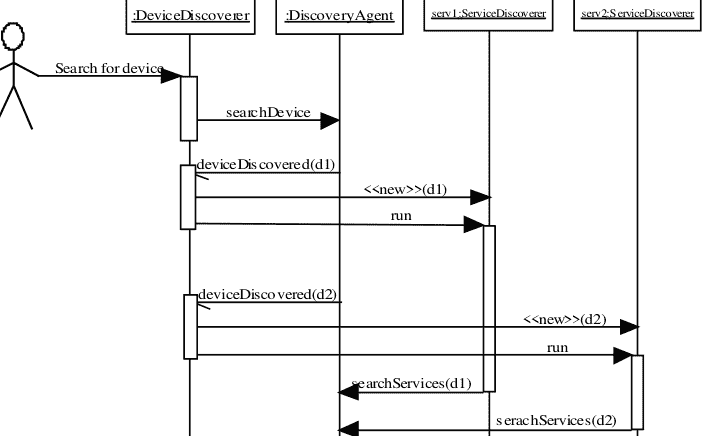

图 2. 使用线程进行多个服务查询的交互。

在构造函数中，我们传递了查询的观察者，因为它将被查询其的服务，即从设备搜索中获取的设备。不需要在设备搜索后才开始服务搜索，因为可以在没有设备搜索的情况下请求服务，但建议每当进行搜索时，设备自然会包含在。

`run` 方法将作为后台进程执行搜索，并通知发现者发生的变化。服务查询被声明为 `DiscoveryAgent`，与之前的设备查询相同。相反地，搜索是在 `DiscoveryAgent` 线程中执行的，因此为了能够正确地执行多个搜索（针对设备或服务的搜索），需要正确地处理。

```java
public void servicesDiscovered(int transID, ServiceRecord[] serRecord) {
  discoverer.addServices(remoteDevice, serRecord);
  for(int i = 0; i < serRecord.length; i++) {
    DataElement serviceNameElement = serRecord[i].getAttribute(0x0100);
    String temp_serviceName = (String)serviceNameElement.getValue();
    String serviceName = temp_serviceName.trim();
    discoverer.updateStatus("- " + serviceName);
  }
}
```

示例 9. `DiscoveryDiscoverer` 通知方法 `servicesDiscovered`。

此方法通知发现者服务的可用性，以及这些被发现的服务的信息。如果有其他观察者（即这些服务所使用的观察者），建议通知它们发现的新的服务。

```java
public void serviceSearchCompleted(int transID, int respCode) {
  String searchStatus = null;

  if (respCode == DiscoveryListener.SERVICE_SEARCH_DEVICE_NOT_REACHABLE) {
    discoverer.updateStatus("Device not reachable");
  }
  else if (respCode == DiscoveryListener.SERVICE_SEARCH_NO_RECORDS) {
    discoverer.updateStatus("Service not available");
  }
  else if (respCode == DiscoveryListener.SERVICE_SEARCH_COMPLETED) {
    // do nothing
  }
  else if (respCode == DiscoveryListener.SERVICE_SEARCH_TERMINATED) {
    discoverer.updateStatus("Service search terminated");
  }
  else if (respCode == DiscoveryListener.SERVICE_SEARCH_ERROR) {
    discoverer.updateStatus("Service search error");
  }
}
```

示例 10. `ServiceDiscovered` 通知 `serviceSearchCompleted`。

另一个方法告知服务查询的结束，并告知搜索中发现的任何问题。

```java
public void inquiryCompleted(int discType) {
  public void deviceDiscovered(RemoteDevice btDevice, DeviceClass cod) {
}
}
```

示例 11. 服务搜索不需要 `ServiceDiscovered`，因为它们旨在用于如我们在上一个示例中所示的设备搜索中。

## 连接设备

一旦检测到设备及其服务，就可以连接到设备并使用不同的可用协议，在这种情况下，我们使用 OBEX 对象推送，它允许通过蓝牙发送文件。

在发送部分，我们可以看到类如何解释信息并通过蓝牙发送数据：

```java
package bluetoothdemo;

import java.io.*;
import javax.bluetooth.*;
import javax.microedition.io.Connector;
import javax.obex.*;

public class BluetoothDiscoverer {
    JFrameBluetooth aThis;

    BluetoothDiscoverer(JFrameBluetooth aThis) {
        this.aThis = aThis;
    }
}
```

示例 12. `BluetoothDiscoverer` 导言。

此类与图形界面交互，因此蓝牙功能和用户交互被分它们之间。我们可以将其视为一种外观设计模式，帮助在类之间划分功能。

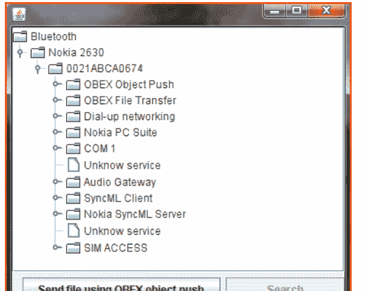

图 3. 显示检测到的服务的图形界面。

```java
void addServices(RemoteDevice remoteDevice, ServiceRecord[] servRecord) {
    String[] serv = new String[servRecord.length];
    for (int i=0; i<servRecord.length; i++) try {
        serv[i] = servRecord[i].getAttribute(0x0100).getValue().toString();
        serv[i+1] = servRecord[i].getConnectionURL(ServiceRecord.NOAUTHENTICATE_NOENCRYPT, false);
    } catch (Exception e) {
        serv[i] = null;
    }

    aThis.addServices(remoteDevice.getBluetoothAddress(service), serv);
}
```

示例 13. `BluetoothDiscoverer` `addServices` 方法。

此方法接收设备检测到的服务列表，并将该信息转换为 GUI 中用户可读的文本信息。如你所见，设备信息是通过 `ServiceRecord` 提取的，并将其值转换为 `String`，可以使用 `toString()` 功能进行安全转换。之后，信息被发送到 GUI，但以 `String` 对象的形式发送，有助于。

```java
void sendFile(File f, String string) throws IOException {
  javax.microedition.io.Connection con = Connector.open(f);

  ClientSession cs = (ClientSession)con;
  OutputStream outputStream = con.getOutputStream();
  InputStream inputStream = con.getInputStream();

  HeaderInfo header = new HeaderInfo();
  header.setHeader(HeaderInfo.NAME, f.getName());
  header.setHeader(HeaderInfo.TYPE, "image/jpeg");
  header.setHeader(HeaderInfo.LENGTH, f.length());

  outputStream.write(header);

  byte[] buffer = new byte[1024];
  int len;
  while ((len = inputStream.read(buffer)) != -1) {
    outputStream.write(buffer, 0, len);
  }
  outputStream.flush();
  con.close();
}
```

示例 14. `BluetoothDiscoverer` `sendFile`。

## Java 中蓝牙技术的使用

这种技术的特性非常有趣，因为可以根据用户的创建用于设备间通信的新应用程序。例如，环境信息和偏好，通过实现搜索设备的 Java 服务器来实现，并为每个用户提供。

## 泛在智能应用中的 Java

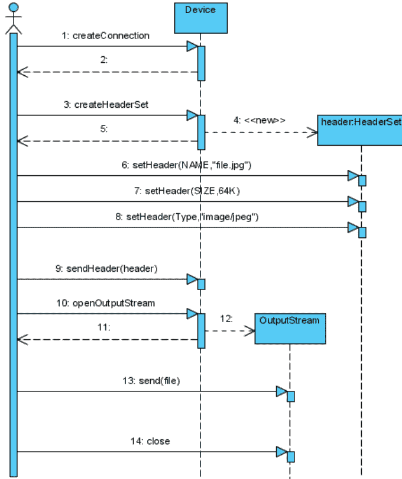

图 4. `BluetoothDiscoverer` `send` 方法的交互。

```java
void setSearching(boolean b) {
    this.btnSearch.setEnabled(b);
}
```

示例 15. `BluetoothDiscoverer` `setSearching`。

```java
void updateStatus(String String) {
    System.out.println(String);
}
```

示例 16. `BluetoothDiscoverer` `updateStatus`。

```java
void addDevice(RemoteDevice rem) throws IOException {
    this.addDevice(rem.getBluetoothAddress(), true);
    new Thread(ServiceDiscoverer(this, rem)).run();
}
```

示例 17. `BluetoothDiscoverer` `addDevice`。

## 连接 Wii Remote

该设备的连接是基于蓝牙的 L2CAP 协议实现的，在设备发现完成后完成。为了改进发现，采用了两个技巧。寻找 Wii Remote 的第一个技巧不需要询问提供的服务，因为每个 Wii 都有特定的名称“Nintendo RVL-CNT-01”，另一个是建立蓝牙标识缓存，不需要对已发现但不是 Wii Remote 的设备请求名称。

检测到设备后，需要按照如下方式建立连接：

```java
this.inputCon = (L2CAPConnection)
Connector.open("bt12cap://+bt_id:13",Connector.READ);
this.outputCon = (L2CAPConnection)
Connector.open("bt12cap//+bt_id:11",Connector.WRITE);
```

示例 18. L2CAP 连接创建。


L2CAP 使用两个单向连接与设备通信。

```java
this.receive();
//重置LED和震动
this.updateLedInfo();
this.send(this.lastLedInfo());
this.receive();
//获取校准信息
this.send(new byte[] {0x52, 0x17, 0x00, 0x00, 0x00, 0x16, 0x00, 0x08});
this.receive();
//设置 Wiiote模式
this.sendWiioteMode((byte) 0x37);
this.receive();
```

示例 19。Wiimote 初始化。

这些指令将初始化计算机与 Wiiote之间的通信，能够向计算机发送传感器信息并正如我们在下一点所示的对其进行解释。

# 信息接收

一旦 Wiiote 连接，它将向计算机发送有关传感器的信息，为了实现这一点，需要一个控制循环来获取每个接收流并对其进行转换。

# 18 J.A. Tejedor, Jose J. Durán, Miguel A. Patricio 等人.

```java
Thread.currentThread().setPriority(Thread.MAX_PRIORITY);
while (this.connected) {
    this.send(this.lastedInfo);
    this.receive();
}
```

示例 20。Wiimote 控制循环。


监听 Wiimote 的线程必须设置为最高优先级，因为每个接收到的流必须尽可能快地处理，以免阻塞通信。此外，对于每个循环，都会发送 LED 以确保连接之间始终更新，Wiimote 先获取指令，然后在循环中进行发送和状态保持。

```java
public void receive() {
    byte[] msg = new byte[32];
    inputCon.receive(msg);
    this.firstInterpreter.inform(msg);
} catch (Exception e) {
    System.err.println(e.getMessage());
    this.connected = false;
}
```

```java
public synchronized void send(byte[] msg) throws Exception {
    this.inputCon.send(msg);
    Thread.yield();
}
```

示例 21。Wiimote 接收流与委托。

可见，接收信息等同于 OBEX 协议，但作为一种设计决策，每个流都通过责任链设计模式进行解释。

# 流的解释

责任链（Gamma 等，1995年）设计模式有助于使用不同的算法解释每个流，每个流都可能为所需的类和一个辅助类提供有用信息，帮助轻松地提取信息。

在接下来的示例中，我们将看到如何从 Wiimote 获取按钮状态，以及它是如何实现的。

```java
import java.util.Observable;
public class BluetoothInterpreter extends Observable implements Interpreter {
    public boolean button2 = false; // 0x00,0x01
    public boolean button1 = false; // 0x00,0x02
    public boolean buttonB = false; // 0x00,0x04
    public boolean buttonA = false; // 0x00,0x08
    public boolean buttonMinus = false; // 0x00,0x10
    // 运动报告 0x00,0x20
    // 运动报告 0x00,0x40
    public boolean buttonHome = false; // 0x00,0x80
}
```

示例 22。请见下页继续。

# 环境智能应用中的 Java

```java
public boolean buttonLeft = false; // 0x01,0x00
public boolean buttonRight = false; // 0x02,0x00
public boolean buttonDown = false; // 0x04,0x00
public boolean buttonUp = false; // 0x08,0x00
public boolean buttonPlus = false; // 0x10,0x00
// 运动报告 0x20,0x00
// 运动报告 0x40,0x00
// 未知 0x80,0x00

private Interpreter next;
private final byte[] BUTTON_MASK = {(byte) 0x1F, (byte) 0x9F};

public byte[] lastState() { return new byte[]{0x00, 0x00}; }

public void inform(byte[] stream) throws Exception
{
    if (stream[0] == -95 && stream[1] == 0x30)
        if (stream[0] == -95 && stream[1] == 0x37)
            if (stream[0] == -95 && stream[1] == 0x37)
                {
                if (this.lastState[0] != (stream[2] & BUTTON_MASK[0])
                    this.lastState[1] = (stream[3] & BUTTON_MASK[1])
                    {
                        this.buttonPlus = (stream[2] & 0x10) != 0x00;
                        this.buttonUp = (stream[2] & 0x08) != 0x00;
                        this.buttonDown = (stream[2] & 0x04) != 0x00;
                        this.buttonRight = (stream[2] & 0x02) != 0x00;
                        this.buttonLeft = (stream[2] & 0x01) != 0x00;
                        this.buttonHome = (stream[3] & 0x80) != 0x00;
                        this.buttonMinus = (stream[3] & 0x10) != 0x00;
                        this.buttonA = (stream[3] & 0x08) != 0x00;
                        this.buttonB = (stream[3] & 0x04) != 0x00;
                        this.button1 = (stream[3] & 0x02) != 0x00;
                        this.button2 = (stream[3] & 0x01) != 0x00;
                    }

                this.lastState[0] = (byte)(stream[2] & BUTTON_MASK[0]);
                this.lastState[1] = (byte)(stream[3] & BUTTON_MASK[1]);
                this.notifyChanged();
                this.notifyObservers(this);
            }
    if (stream[0] == -95 && stream[1] == 0x30)
        return;
    if (this.next != null)
        this.next.inform(stream);
}

public void setNext(Interpreter _next)
{
    this.next = _next;
}
```

# J.A. Tejedor, Jose J. Durán, Miguel A. Patricio 等人.

可见，流包含了其类型信息。第一个和第二个包含类型信息，第三个和第四个关于按钮的状态。取决于流的类型，解释器将指示提取信息，或者如果流仅对其他部分有用。

# 案例研究：使用 Wii 遥控器管理视频监控系统

Wiiote 的常见用途之一是与游戏交互，主要通过手势移动视角。但该技术也可以用于其他场景，如视频监控，用户可以通过手势管理摄像头的移动。

为了实现 Wiiote 与摄像头之间的交互，需要开发一个框架，允许开发者提取用户的动作，将其转换为手势，并将手势转换为摄像头的命令。

我们之前已经看到如何提取 Wiimote 的动作，但为了能够将这些信息转换为手势，需要使用某种识别系统，例如神经网络。将非常有用，因为我们可以告诉用户以某种方式移动设备，而神经网络能够提取出执行的内容。

一旦识别出手势，就可以用它们移动摄像头，因此只需要让 Java 与摄像头系统进行交互。实现此点的最佳方法是创建一个能够向摄像头发送命令的服务器，将其转换为动作，例如使用以太网套接连接。

当然，可以使用 Java 的所有可能性创建一个尽可能复杂的系统，因此这些示例只是 Java 所能做的事情的一小部分，特别是对于使用蓝牙技术的移动设备，这种技术在我们的环境中无处不在。

# JSR-179 基于位置的服务

# Java 平台微版 (Java ME) 概述

所述组件是使用 Java 平台微版 (Java ME) 开发的，它为运行在移动和嵌入式设备上的应用程序提供了一个稳健、灵活的环境——移动手机、个人数字助理 (PDA)、电视机顶盒和打印机。Java ME 包含了灵活的用户界面、强大的安全性、内置的网络协议，以及对可以动态下载的网络和离线应用程序的支持。基于 Java ME 的应用程序可以在许多设备之间具有移植性，同时利用了每个设备的原生能力。

# 环境智能应用中的 Java 21


Java ME 版本由图中所示的不同组件组成。本文将重点研究手机和 PDA 上执行环境的特定组件。结论是，可以说 Java ME 是一个执行环境，专门为在手机和其他上述设备上创建和运行应用程序提供 API。手机和 PDA 版本由 4 个主要组件组成：

- **CLDC** (连接限制设备配置)：连接限制设备配置是 Java ME 的主要组件。它的功能是提供应用程序与设备原生能力之间的连接。它为应用程序提供了实现所需的资源。

- **KVM** (内核虚拟机)：该组件作为虚拟机，提供了应用程序的原生语言环境以便在设备上执行。

- **MIDP** (移动信息设备配置文件)：移动信息设备配置文件是一个主要由图组成的组件，提供了 Java ME。它基于 `CLDC` 组件为应用程序提供高级服务（如游戏和多媒体功能、复杂的用户界面以及高连接服务）。

- **可选包**：并非所有实现 Java ME 的平台都具备的额外组件。特别是 `JSR-179` 从外部获得 Java 许可的额外包，这在许多设备中并未实现。

22 J.A. Tejedor, Jose J. Durán, Miguel A. Patricio 等人。

## Java ME 的 Location API: JSR-179

JSR-179 是在 Java 社区进程（Java Community Process）开发的 Java ME Location API 规范。该规范定义了一个 ME 可选包，能够为资源限制的设备提供移动定位应用程序。该 API 设计为一个紧凑且通用的 API，为 Java 应用程序提供终端当前地理位置的信息。该 API 涵盖了获取终端当前地理位置和方向的信息，以及访问存储在终端中的已知地标数据库。

Java 社区进程负责 Java 技术的发展。其主要目的是指导和批准 Java 平台中的规范。不同公司可以为规范的创建做出贡献。这些贡献通过既定的合同来实现。

本规范受诺基亚（Nokia）的许可证限制，该公司是本规范开发和设计的作者。根据合同，该规范由诺基亚和太阳系统公司（Sun Microsystems）共同拥有。但该协议对于诺基亚创建之外的其他平台上的实现，受私有协议的限制。

作为一个额外的包，留给制造商（包括针对移动设备的操作系统分发商）来实现该规范。

这是为了验证设备是否支持该规范以便能够正确使用，从而避免不一致性。

如果你想更深入了解此 API 的规范，建议阅读 JSR 本身。

http://jcp.org/aboutJava/communityprocess/final/jsr179/index.html

在 JavaME 中，JSR-179 规范包由可选的 `java.microedition.location` 及其内部组件以及请求和处理定位结果所需的基本功能组成。

下表概述了可选包的组成：

| 接口 (Interfaces) | 类 (Classes) | 异常 (Exception) |
| --- | --- | --- |
| `LocationListener` | `AddressInfo` | `LandMarkException` |
| `ProximityListener` | `Coordinates` | `LocationException` |
| | `Criteria` | |
| | `LandMark` | |
| | `LandMarkStore` | |
| | `Location` | |
| | `LocationProvider` | |
| | `Orientation` | |
| | `QualifiedCoordinates` | |

图 7。JSR-179 包元素。

以下是对可选包中每个组件的执行描述的概述：

## 交互智能应用中的 Java

- **`LocationListener`**: 此接口代表一个观察者，接收来自特定提供者的事件。

- **`ProximityListener`**: 此接口代表一个观察者，接收与检测预先存储坐标接近度相关的事件。

- **`AddressInfo`**: 此类是一个存储地址信息的包装器。

- **`Coordinates`**: 此类代表物理和地理坐标。

- **`Criteria`**: 此类提供一组值，这些值将被配置为提供者。

- **`LandMark`**: 此类是一个包装器，持有有关地标的信息。

- **`LandMarkStore`**: 此类提供了一个提供插入和删除基本操作的存储器。

- **`Location`**: 此类代表设置标准位置的值。

- **`LocationProvider`**: API 的主引擎，此类是位置信息的来源。

- **`Orientation`**: 此类是一个包装器，收集来自终端物理方向的信息。

- **`QualifiedCoordinates`**: 此类代表附加到周期上的机翼的物理和地理坐标。

- **`LandmarkException`**: 在处理地标时发生错误时将抛出此异常。

- **`LocationException`**: 在发生通用错误时将抛出此异常。

此规范与其他 JavaME 实现一样，关联了安全权限，以启用提供位置的资源。安全权限如下：

| 安全权限名称 | 受保护的方法 |
| --- | --- |
| `javax.microedition.location.Location` | `LocationProvider.getLocation()`, `LocationProvider.setListener()` |
| `javax.microedition.location.Orientation` | `Orientation.getOrientation()` |
| `javax.microedition.location.ProximityListener` | `LocationProvider.addProximityListener()` |
| `javax.microedition.location.LandmarkStore.read` | `LandmarkStore.getInstance()`, `LandmarkStore.listLandmarks()` |
| `javax.microedition.location.LandmarkStore.write` | `LandmarkStore.addLandmark()` |
| `javax.microedition.location.LandmarkStore.update` | `LandmarkStore.updateLandmark()` |
| `javax.microedition.location.LandmarkStore.management` | `LandmarkStore.addLandmark()` |
| `javax.microedition.location.LandmarkStore.create` | `LandmarkStore.addLandmark()` |

图 8。JSR-179 软件包权限。

J.A. Tejedor, Jose J. Durán, Miguel A. Patricio 等。

此规范与其他 JavaME 实现一样，关联了安全权限，以启用提供位置的资源。这是为了验证设备支持该规范，从而避免不一致性。

如果你想更深入了解此 API 的规范，建议阅读 JSR 本身。

在 JavaME 中，JSR-179 规范包由可选的 `java.microedition.location` 及其内部组件以及请求和处理定位结果所需的基本功能组成。

下表概述了可选包的组成：

| 接口 (Interfaces) | 类 (Classes) | 异常 (Exception) |
| --- | --- | --- |
| `LocationListener` | `AddressInfo` | `LandMarkException` |
| `ProximityListener` | `Coordinates` | `LocationException` |
| | `Criteria` | |
| | `LandMark` | |
| | `LandMarkStore` | |
| | `Location` | |
| | `LocationProvider` | |
| | `Orientation` | |
| | `QualifiedCoordinates` | |

图 7。JSR-179 包元素。

以下是对可选包中每个组件的执行描述的概述：

## 交互智能应用中的 Java

- **`LocationListener`**: 此接口代表一个观察者，接收来自特定提供者的事件。

- **`ProximityListener`**: 此接口代表一个观察者，接收与检测预先存储坐标接近度相关的事件。

- **`AddressInfo`**: 此类是一个存储地址信息的包装器。

- **`Coordinates`**: 此类代表物理和地理坐标。

- **`Criteria`**: 此类提供一组值，这些值将被配置为提供者。

- **`LandMark`**: 此类是一个包装器，持有有关地标的信息。

- **`LandMarkStore`**: 此类提供了一个提供插入和删除基本操作的存储器。

- **`Location`**: 此类代表设置标准位置的值。

- **`LocationProvider`**: API 的主引擎，此类是位置信息的来源。


# Java ME 的 Location API: JSR-179

JSR-179 是在 Java 社区进程（Java Community Process）开发的 Java ME Location API 规范。该规范定义了一个 ME 可选包，能够为资源受限的设备提供移动定位应用程序。该 API 设计为一个紧凑且通用的 API，为 Java 应用程序提供终端当前地理位置的信息。该 API 涵盖了获取终端当前地理位置和方向的信息，以及访问存储在终端中的已知地标数据库。

Java 社区进程负责 Java 技术的发展。其主要目的是指导和批准 Java 平台中的规范。不同公司可以为规范的创建做出贡献。这些贡献通过既定的合同来实现。

本规范受诺基亚（Nokia）的许可证限制，该公司是本规范开发和设计的作者。根据合同，该规范由诺基亚和太阳微系统公司（Sun Microsystems）共同拥有。但该协议对于诺基亚创建之外的其他平台上的实现，受私有协议的限制。

作为一个可选包，留给制造商（包括针对移动设备的操作系统分发商）来实现该规范。

这是为了验证设备是否支持该规范以便能够正确使用它，从而避免不一致性。

如果你想更深入了解此 API 的规范，建议阅读 JSR 本身。

<http://jcp.org/aboutJava/communityprocess/final/jsr179/index.html>

在 Java ME 中，JSR-179 规范包由可选的 `java.microedition.location` 及其内部组件以及请求和处理定位结果所需的基本功能组成。

下表概述了可选包的组成：

| 接口 (Interfaces) | 类 (Classes) | 异常 (Exception) |
| --- | --- | --- |
| LocationListener | AddressInfo | LandmarkException |
| ProximityListener | Coordinates | LocationException |
| | Criteria | |
| | Landmark | |
| | LandmarkStore | |
| | Location | |
| | LocationProvider | |
| | Orientation | |
| | QualifiedCoordinates | |

图 7。JSR-179 包元素。

以下是对可选包中每个组件的描述概述：

## 交互智能应用中的 Java

- `LocationListener`：此接口代表一个观察者，接收来自特定提供者的事件。
- `ProximityListener`：此接口代表一个观察者，接收与检测预先存储坐标接近度相关的事件。
- `AddressInfo`：此类是一个存储地址信息的包装器。
- `Coordinates`：此类代表物理和地理坐标。
- `Criteria`：此类提供一组值，这些值将被配置为提供者。
- `Landmark`：此类是一个包装器，持有有关地标的信息。
- `LandmarkStore`：此类提供了一个提供插入和删除基本操作的存储器。
- `Location`：此类代表设置标准位置的值。
- `LocationProvider`：API 的主引擎，此类是位置信息的来源。
- `Orientation`：此类是一个包装器，收集来自终端物理方向的信息。
- `QualifiedCoordinates`：此类代表附加到周期上的机翼的物理和地理坐标。
- `LandmarkException`：在处理地标时发生错误时将抛出此异常。
- `LocationException`：在发生通用错误时将抛出此异常。

此规范，如其他 Java ME 实现一样，关联了安全权限，以启用提供位置的资源。安全权限如下：

| 安全权限名称 | 受保护的方法 |
| --- | --- |
| `javax.microedition.location.Location` | `LocationProvider.getLocation()`, `LocationProvider.setListener()` |
| `javax.microedition.location.Orientation` | `Orientation.getOrientation()` |
| `javax.microedition.location.ProximityListener` | `LocationProvider.addProximityListener()` |
| `javax.microedition.location.LandmarkStore.read` | `LandmarkStore.getInstance()`, `LandmarkStore.listLandmarks()` |
| `javax.microedition.location.LandmarkStore.write` | `LandmarkStore.addLandmark()` |
| `javax.microedition.location.LandmarkStore.update` | `LandmarkStore.updateLandmark()` |
| `javax.microedition.location.LandmarkStore.management` | `LandmarkStore.deleteLandmark()`, `LandmarkStore.deleteLandmarkStore()` |
| `javax.microedition.location.LandmarkStore.create` | `LandmarkStore.createLandmarkStore()` |

图 8。JSR-179 包权限。

J.A. Tejedor, Jose J. Durán, Miguel A. Patricio 等。

此规范，如其他 Java ME 实现一样，关联了安全权限，以启用提供位置的资源。这是为了验证设备支持该规范，从而避免不一致性。

如果你想更深入了解此 API 的规范，建议阅读 JSR 本身。

# ProximityListener 接口


```java
public class LocationGps implements LocationListener {
    public LocationGps() {
        // 注意引用提供者尚未实现。
        if (provider != null) {
            // 第一个参数：监听器对象
            // 第二参数：间隔
            // 第三个参数：超时
            // 第四个参数：位置的最大年龄 (maxAge)
            // -1 默认选项提供制造商信息
            provider.setLocationListener(this, -1, -1, -1);
        } else {
            System.err.println("Provider not available");
        }
    }

    /**
     * 当提供者状态改变时调用的接口方法
     * @param arg0 调用监听器的位置提供者
     * @param state 位置提供者的状态
     */
    public void providerStateChanged(LocationProvider arg0, int state) {
    }

    /**
     * 当提供者接收新位置时调用的接口方法
     * @param lp 调用监听器的位置提供者
     * @param l1 用于位置提供者的位置提供者
     */
    public void locationUpdated(LocationProvider lp, Location l1) {
    }
}
```

示例 25. 关于使用 `LocationListener` 的代码。

## 环境智能应用中的 Java

对于每一个新坐标，都需要一个新的监听器来处理。也就是说，如果我们有两个想知道何时靠近它们的位置，那么就有必要创建两个距离监听器（proximity listeners）。

该接口提供了两个方法来实现 `get` 它们的行为。

- `void monitoringStateChanged(boolean isMonitoringActive)` – 此方法在监控状态改变时被通知。
- `void proximityEvent(Coordinates coordinates, Location location)` – 此方法在检测到与估计坐标的接近性时启动。参数 `coordinates` 是关于终端位置的坐标，`location` 是当前位置。

与之前的监听器类似，它也必须实现 `LocationListener`。与之前的监听器不同的是，它可能包含一个与监听器位置相关的对象。以下示例显示了如何将 `ProximityListener` 关联到终端的 `LocationProvider`。

```java
public class ProximityObserver implements ProximityListener {
    public ProximityObserver() {
        // 注意引用提供者尚未实现。
        if (provider == null) {
            int proximityRadius = 50;
            // 第一参数：纬度
            // 第二参数：经度
            // 第三个参数：高度
            Coordinates coordinates = new Coordinates(10, 10, 10);
            // 第一个参数：监听器对象
            // 第二参数：坐标
            // 第三个参数：半径
            provider.addProximityListener(this, coordinates, proximityRadius);
        } else {
            System.err.println("Provider not available");
        }
    }
}
```

```java
/**
 * 当监控状态改变时调用的接口方法
 * @param isMonitoringActive 监控器的状态
 */
public void monitoringStateChanged(boolean isMonitoringActive) {
}
```

示例 26. 见下一页。

## J.A. Tejedor, Jose J. Durán, Miguel A. Patricio 等。

```java
/**
 * 当提供者感知到预定坐标的接近性时调用的接口方法
 * @param coordinates 检测到接近性的已注册坐标
 * @param location 实际位置
 */
public void proximityEvent(Coordinates coordinates, Location location) {
    ...
}
```

示例 26. 关于使用 `ProximityListener` 的代码。

## 使用 JSR-179 基于服务的开发

本文档假设读者对 Java Micro Edition 的开发及其特殊功能（如预验证、使用 `jad` 文件和打包）有广泛的了解。

否则，它将引用信息源，以便在学习更高级的知识之前有助于理解这一特定环境。

- <http://today.java.net/pub/a/today/2005/02/09/j2meUI.html>
- <http://today.java.net/pub/a/today/2005/05/03/midletUI.html>

本文档提供了规范的使用方法，应用于获取利用位置服务的 Java 应用程序。

示例提供了收集和处理相关位置的基础。反之，它提供了一个可能的用户界面，可以在其中查看获取的信息。它由两个类组成：

- `LocationGPS`：该类的目标是为应用程序提供有关位置的信息，对其进行处理，并提供一种格式以便使用此类信息。
- `PositionGUI`：该类旨在显示设备的位置数据，查看结果并向用户提供信息。

该示例的目的是提供一个坚实的基础，使开发者能够对提取、使用位置信息作为动力概述并将其与图形界面连接起来，你可以在附件 I 和 II 中看到。

下面显示了系统如何与软件部分交互的实际示例。为了实现这一点，测试在 Symbian 操作系统和 Nokia N95 移动平台上进行的。它是一个简单的图形界面，提供了它所感兴趣的所有信息。

Copyright © 2010. Nova Science Publishers, Incorporated. 版权所有。

*Java Software and Embedded Systems*，由 Matt Hayes 和 Isaac Johansson 编辑，Nova Science Publishers, Incorporated, 2010. ProQuest

## 环境智能应用中的 Java


示例 27. 应用程序执行。

为了便于理解开发的类，它们包含了解释应用程序行为的序列图。

| MidletGUI | LocationGPS | LocationProvider provider |
| --- | --- | --- |


图 9. 监听器行为图。

*Java Software and Embedded Systems*，由 Matt Hayes 和 Isaiah Johnson 编辑，Nova Science Publishers, Incorporated, 2010. ProQuest

## J.A. Tejedor, Jose J. Durán, Miguel A. Patricio 等。

此图显示了如何在应用程序中创建对象。图形界面创建监听器，在 `LocationProvider` 中引入了不同的标准。提供位置信息和状态。


图 10. 获取位置。

此图显示了如何在应用程序中创建对象。图形界面创建监听器，在 `LocationProvider` 中引入了不同的标准。提供位置信息和状态。

以下代码显示了 `MidletGUI`，它建立了用户界面。

以下代码所示：

```java
// 包含该类的包
package PostionGUI;

// 此类需要实现的不同类
// 功能所需的重要导入类
import java.microedition.lcui.Command;
import java.microedition.lcui.RequestListener;
import java.microedition.lcui.Display;
import java.microedition.lcui.Displayable;
import java.microedition.lcui.Form;
import java.microedition.lcui.StringItem;
import java.microedition.midlet.Midlet;
import java.microedition.midlet.MidStateException;

// 提供位置服务的类
import GPSPosition.LocationGps;
```

示例 28. 导入类部分。

## 环境智能应用中的 Java

这部分显示了类的所有包，并导入了实现简单图形界面所需的所有类。它还导入了执行基于位置服务的所需类。

```java
/*
 * 这个 Midlet 是一个示例，解释了在带有 GPS 的移动设备上使用通用 GPS
 * 设备
 * 显示 GPS 的可用性、坐标、定位方法以及
 * 移动设备的速度
 * 最后，midlet 有一个按钮来请求位置
 */
public class MidletGUI extends MIDlet implements CommandListener {
```

示例 29. 类声明和属性部分。

```java
// 不同的属性在代码本身中进行了解释，但通常分为三类：信息容器、命令或位置服务。

// 启用退出按钮的命令
private Command exitCommand;

// 启用立即请求位置的命令
private Command FindMeCommand;

// 用于查看图形界面的显示类
private Display display;

// 提供 GPS 设备信息的对象
private LocationGps lgps;

// 用于启用 GUI 的表单
private Form screen;

private int items[];

// 嵌入式设备可用性的字符串
private StringItem gpsA;

// 包含坐标的字符串
private String Loc;

// 使用定位方法的字符串
private String LocM;

// 包含位置状态的字符串。例如：无信号、有效位置或无效位置
private String Info;
```

```java
/*
 * 类的构造函数
 */
public MidletGUI() {
```

示例 30. 见下一页。

```java
// 获取 MIDlet 的显示对象。
display = Display.getDisplay(this);
```

```java
// 创建一个退出命令。
exitCommand = new Command("Exit", Command.EXIT, 2);
FindCommand = new Command("Find Me", Command.ITEM, 1);
```

```java
items = new int[4];
```

```java
for (int i = 0; i < items.length; i++)
    items[i] = -1;
```

```java
lgps = new LocationGps(this);
// 创建一个主窗口（表单）
screen = new Form("Availability by Gps");
```

```java
gpsA = new StringItem("Availability", lgps.getState());
Info = new StringItem("Information", lgps.validate());
LocM = new StringItem("Location Method", lgps.getInfo());
Loc = new StringItem("Data", lgps.getData());
```

```java
gpsA.setLayout(javax.microedition.lcui.Item.LAYOUT_LEFT);
Info.setLayout(javax.microedition.lcui.Item.LAYOUT_LEFT);
Loc.setLayout(javax.microedition.lcui.Item.LAYOUT_LEFT);
LocM.setLayout(javax.microedition.lcui.Item.LAYOUT_LEFT);
```

```java
// 引用指向图形界面的不同项
items[0] = screen.append(gpsA);
items[2] = screen.append(Info);
items[3] = screen.append(LocM);
items[1] = screen.append(Loc);
```

```java
// 添加退出命令并指示该类管理该命令
screen.addCommand(exitCommand);
screen.addCommand(FindCommand);
screen.setCommandListener(this);
```

## 示例 3. 图形界面部分。

这是该类的构造器。为每个需要的对象分配内存，并根据其类型格式化默认对象。

对 `StringItem` 感兴趣，其中第一个参数是标签，第二个参数是。

关于观察者的创建，对于基于位置的服务，图形界面是必要的。

```java
/**
 * 抽象类的重写方法
 * 启动应用程序，显示构建器中创建的显示
 */
public void startApp() throws MIDletStateChangeException {
    // 选择要显示的窗口
    display.setCurrent(screen);
}

/**
 * 抽象类的重写方法
 * 此方法用于暂停应用程序
 * 未实现
 */
public void pauseApp() {
}

/**
 * 抽象类的重写方法
 * 此方法用于销毁应用程序并终止正在运行的进程
 * @param inconditional 输入条件
 */
public void destroyApp(boolean inconditional) {
}
```

继承自 `MIDlet` 类的方法。请注意，其中某些方法尚未实现。当应用程序初始化时，虚拟机会调用 `startApp`，如果需要暂停它，则调用 `pauseApp`，最后在应用程序结束时执行 `destroyApp`。

```java
/**
 * 接口方法
 * 此方法用于应用与命令关联的动作
 */
```


public void commandAction(Command c, Displayable s) {

    // 退出

    if (c == exitCommand()) {

        destroyApp(false);

        notifyDestroyed();

    }

    // 请求实际位置

} else if (c == FindMeCommand()) {

    activateGPS(lgps.getState(), lgps.validate(), lgps.getInfoLoc(), lgps.getLocatiOn());

}

```

## 示例 32. CommandListener 接口方法

此方法实现了由 `InterfaceListener` 定义的行为。它控制你何时按下命令（通常是设备上的一个按钮）。特别是对于此类类，使用了两个命令，其中第一个命令决定应用程序的退出并应通知销毁应用程序，第二个命令是用于请求位置数据的即时更新。

```java

/**

 * 此方法仅在信息发生变化时刷新实际显示

    * @param text1 关于 GPS 可用性的信息

* @param text2 关于位置有效性的信息

* @param text3 关于用于定位的方法的信息

* @param text4 关于提供位置的坐标的信息

 */

public void activateGps(String text1, String text2, String text3, String text4) {

    // 位置有效性已改变，为了此刷新显示

    if(text1 != gpsA.getText()) {

        screen.delete(items[0]);

        gpsA.setText(text1+"\*"+String.valueOf(text1 != gpsA.getText()));

        screen.insert(items[0],gpsA);

    }

    // 位置有效性已改变，为了此刷新显示

    if(text2.equals(Info.getText())) {

        screen.delete(items[2]);

        Info.setText(text2);

        screen.insert(items[2], Info);

    }

    // 位置有效性已改变，为了此刷新显示

    if(text3.equals(LocM.getText())) {

        screen.delete(items[3]);

        LocM.setText(text3);

        screen.insert(items[3], Loc);

    }

    // 位置有效性已改变，为了此刷新显示

    if(text4.equals(Loc.getText())) {

        screen.delete(items[1]);

        Loc.setText(text4);

        screen.insert(items[1], Loc);

    }

}

```

## 示例 33. 图形界面

此方法用于更新图形界面。当位置发生变化时调用。

```java

public void requestLocation(boolean moment) {

    // 位置有效性已改变，为了此刷新显示

    if(moment) {

        // 更新逻辑

    }

}

```

## 示例 34. 即时方法

此部分已在前面的章节介绍过。设置提供者的引用。特别感兴趣，将在下一节讨论 `takeProvider` 方法。

```java

package GPSPosition;

import javax.microedition.location.LocationProvider;

import javax.microedition.location.LocationListener;

import javax.microedition.location.Location;

import javax.microedition.location.Criteria;

import javax.microedition.location.LocationException;

import javax.microedition.ui.MidletGUI;

```

## 示例 35. 导入

与之前的类一样，你可以观察 `LocationGPS`。它是状态实现。

```java

public class LocationGPS implements LocationListener {

    // 管理嵌入设备的 LocationProvider

    LocationProvider provider;

    // 实际位置

    Location location;

    // 建立方法的标准实例

    Criteria cr;

    // 信息的辅助实例

    String data;

    // 关于状态信息的辅助实例

    String state;

    // 引用图形界面的对象

    MidletGUI ngui;

}

```

## 示例 36. 类声明和属性定义

此类的声明是接口实现。该接口在你将此类添加到监听器时提供行为。

```java

/**

 * 类构造器

 * 定义标准设置并获取 gps 提供者

 * @param ngui 应用程序 GUI 的对象引用

 */

public LocationGps(MidletGUI ngui) {

    // 为每个对象选择默认值

    Criteria cr = new Criteria();

    cr.setHorizontalAccuracy(100);

    cr.setVerticalAccuracy(100);

    cr.setSpeedAndCourseRequired(true);

    this.ngui = ngui;

    state = "";

    data = "";

    dataProvider();

}

```

## 示例 37. 类构建部分

```java

/**

 * 调用单例提供并将此类类设置为提供者的器

 */

public void takeProvider() {

    try {

        // 调用单例行为的工厂方法。

        provider = LocationGps.getInstance(cr);

        if (provider != null) {

            // 第一个参数：监听对象

            // 第二个参数：间隔

            // 第三个参数：超时

            // 第四个参数：位置的最大年龄

            // 1- 默认选项提供制造商

            provider.setLocationListener(this, -1, -1, -1);

            determineState(provider.getState());

        } else {

            state = "Null Provider";

        }

    } catch (Exception e) {

        state = e.getMessage();

    }

}

```

## 环境智能应用中的 Java

此方法旨在获取一个位置提供者。添加注释非常重要，这有助于了解哪些参数是必须将 `LocationGPS` 类作为监听器引入到 `LocationProvider` 中的。

```java

/**

 * 知位置和提供者状态的方法。

 * @return 表示位置有效性的字符串

 */

public String validate() {

    String validate = "*";

    if(location == null) {

        //位置提供者不可用

        location = LocationProvider.getLastKnownLocation();

        validate = "Signal Not:\nLast Know Position\n";

    } else if(location.isValid() && LocationProvider.getLastKnownLocation() != location) {

            //位置提供者可用且位置是有效的

            validate = "Valid Position";

        } else {

            // 位置不可用，提供最后一次的位置

            location = LocationProvider.getLastKnownLocation();

            validate = "Invalid Position:\nLast Know Position\n";

        }

    }

    return validate;

}

/**

 * 获取为位置提供者提供的坐标

 * @return 正确的坐标

 */

public String getData() {

    String coord = coordinates();

    data = coord + "\n*";

    return data;

}

```

### 示例 39. 验证位置和提供者信息并获取位置数据

第一个方法 `validate()` 验证要通知给图形界面的位置信息的可行性。第二个方法 `getData()` 提供坐标，使用 `coordinates()` 方法进行适当格式化，该方法返回一个包含当前坐标信息的字符串对象。

### 38 J.A. Tejedor, Jose J. Durán, Miguel A. Patricio 等

```java

/**

* 当提供者状态改变时被调用的接口方法

* @param arg0 调用监听器的位置提供者

* @param state 位置提供者的状态

 */

```

```java

public void providerStateChanged(LocationProvider arg0, int State) {

    determinateState(State);

    ngui.activateEps(state, this.validate(),this.getInfoLoc(),this.getData());

}

```

```java

/**

* 返回当前时刻提供者的状态

* @return 提供者的状态

 */

```

```java

public String getState() {

    return state;

}

```

```java

/**为提供者接收新位置而调用的接口方法

* @param lp 调用监听器的位置更新器

* @param 1 提供给提供者的位置

 */

```

```java

    ngui.activateEps(state, this.validate(),this.getInfoLoc(),this.getData());

} catch (Exception e) {

    data = e.getMessage();

    ngui.activateEps(state,this.validate(),this.getInfoLoc(),data);

}

```

### 示例 40. 监听器接口方法

示例 18 中显示的两个方法是需要实现 `LocationListener` 接口行为的方法。`ProviderStateChanged` 在更改 `LocationProvider` 状态时被调用。`LocationUpdated` 在供应商有新更新时被调用。这两个方法都从自己的 `LocationProvider` 调用。

```java

/**

* 确定提供者的状态并翻译为字符串格式

* @param state

 */

```

```java

private void determinateState(int state) {

    switch (state) {

        case LocationProvider.AVAILABLE:this.state = "GPS Available\n";break;

```

### 示例 41. 续自下一页

## 环境智能应用中的 Java

```java

case LocationProvider.OUT_OF_SERVICE: this.state = "Gps" Out Of Service\n;break;

case LocationProvider.TEMPORARILY_UNAVAILABLE:

    this.state = "Gps" Temporarily Unavailable\n;break;

/**

 * 为位置提供者获取实际位置。

 * 实现 GUI 上的“找到我”按钮

 * @return 此时刻的位置

 */

public String getLocation() {

    try{

        ngui.requestLocation(true);

        location = provider.getLocation(10);

        ngui.requestLocation(false);

    } catch (Exception e) {

}

    return getData();

}

```

### 示例 41. 确定 LocationProvider 状态并获取即时位置数据

示例 19 中的两个方法是提供信息的方法。`DetermineState` 是用于以字符串形式获取提供者状态的方法。`GetLocation` 立即请求此位置的位置。

```java

/**

 * 以字符串格式提供坐标

 * @return 字符串格式的坐标

 */

private String coordinates() {

    String coordinates = "";

    String lat = "";

    String lon = "";

    double latitude = location.getQualifiedCoordinates().getLatitude();

    double longitude = location.getQualifiedCoordinates().getLongitude();

    if (latitude < 0) {

        lat = String.valueOf(Math.abs(latitude));

        lat = lat.substring(0,6);

        lat += "S";

    } else {

        lat = String.valueOf(latitude);

        lat = lat.substring(0,6);

        lat += "N";

    }

}

```

### 示例 42. 续自下一页

## J.A. Tejedor, Jose J. Durán, Miguel A. Patricio 等

```java

if (longitude < 0) {

  lon = String.valueOf(Math.abs(longitude));

  lon = lon.substring(0,6);

  lon += "E";

} else {

  lon = String.valueOf(longitude);

  lon = lon.substring(0,6);

  lon += "W";

}

coordinates = "Latitude:"+lat+"\nLongitude:"+lon+"\n";

coordinates += "Speed:"+String.valueOf(location.getSpeed());

```

### 示例 42. 监听方法

坐标、纬度仅用数字表示（可能是负数）。为了易于理解，必须包含方向点（经度的东/西和纬度的南/北）。因此，该方法在一个字符串中表示坐标。

/** 以字符串格式获取位置信息的方法

* 返回字符串格式的方法 */


```java
public String getInfoLoc() {
  String info = "";
  switch (location.getLocation()) {
    case Location.CELLID: info = "CELLID\n"; break;
    case Location.CELLID_UNAVAILABLE: info = "CELLID\n"; break;
    case Location.CELLID_UNKNOWN: info = "CELLID\n"; break;
    case Location.NETWORK_BASED: info = "CELLID\n"; break;
    case Location.TERMINAL_BASED: info = "CELLID\n"; break;
    case Location.NETWORK_BASED: info = "CELLID\n"; break; // 注：此处原文重复
    case Location.TERMINAL_BASED: info = "CELLID\n"; break; // 注：此处原文重复
    case Location.NETWORK_UNKNOWN: info = "CELLID\n"; break;
    // ...
```

示例 43。续自下一页。

# 环境智能应用中的 Java

```java
    case (Location.CELLID | Location.ASSISTED): info = "CELLID\n"; break;
    case (Location.CELLID | Location.NETWORK_BASED): info = "CELLID\n"; break;
    case (Location.CELLID | Location.TERMINAL_BASED): info = "CELLID\n"; break;
    case (Location.CELLID | Location.NETWORK_UNAVAILABLE): info = "CELLID\n"; break;
    case (Location.CELLID | Location.TERMINAL_BASED): info = "CELLID\n"; break;
    case (Location.CELLID | Location.NETWORK_BASED): info = "CELLID\n"; break;
    case (Location.CELLID | Location.TERMINAL_BASED): info = "CELLID\n"; break;
    case (Location.CELLID | Location.ASSISTED): info = "CELLID\n"; break;
    case (Location.CELLID | Location.NETWORK_BASED): info = "CELLID\n"; break;
    case (Location.CELLID | Location.TERMINAL_BASED): info = "CELLID\n"; break;
    case (Location.CELLID | Location.NETWORK_UNKNOWN): info = "CELLID\n"; break;
    case (Location.CELLID | Location.NETWORK_BASED): info = "CELLID\n"; break;
    case (Location.CELLID | Location.TERMINAL_BASED): info = "CELLID\n"; break;
    case (Location.CELLID | Location.ASSISTED): info = "CELLID\n"; break;
    case Location.SHORT_RANGE: info = "SHORT RANGE\n"; break;
    case Location.ASSISTED: info = "SHORT RANGE\n"; break;
    case (Location.SHORT_RANGE | Location.ASSISTED): info = "SHORT RANGE\n"; break;
    case (Location.SHORT_RANGE | Location.NETWORK_BASED): info = "SHORT RANGE\n"; break;
    case (Location.SHORT_RANGE | Location.TERMINAL_BASED): info = "SHORT RANGE\n"; break;
    case (Location.SHORT_RANGE | Location.NETWORK_UNAVAILABLE): info = "SHORT RANGE\n"; break;
    case (Location.SHORT_RANGE | Location.TERMINAL_BASED): info = "SHORT RANGE\n"; break;
    case (Location.SHORT_RANGE | Location.NETWORK_BASED): info = "SHORT RANGE\n"; break;
    case (Location.SHORT_RANGE | Location.TERMINAL_BASED): info = "SHORT RANGE\n"; break;
    case (Location.SHORT_RANGE | Location.NETWORK_UNKNOWN): info = "SHORT RANGE\n"; break;
    case (Location.SHORT_RANGE | Location.TIMED_DIFFER): info = "TD\n"; break;
    case (Location.TIMED_DIFFER | Location.ASSISTED): info = "TD\n"; break;
    case .ASSISTED: info = "TD\n"; break;
    case (Location.TIMED_DIFFER | Location.NETWORK_BASED): info = "TD\n"; break;
    case (Location.TIMED_DIFFER | Location.TERMINAL_BASED): info = "TD\n"; break;
    case (Location.TIMED_DIFFER | Location.NETWORK_UNAVAILABLE): info = "TD\n"; break;
    case (Location.TIMED_DIFFER | Location.TERMINAL_BASED): info = "TD\n"; break;
    case (Location.TIMED_DIFFER | Location.NETWORK_BASED): info = "TD\n"; break;
    case (Location.TIMED_DIFFER | Location.TERMINAL_BASED): info = "TD\n"; break;
    case Location.TIMED_DIFFER: info = "TD\n"; break;
    case (Location.TIMED_DIFFER | Location.ASSISTED): info = "TA\n"; break;
    case (Location.TIMEO_ARRIVAL | Location.ASSISTED): info = "TIME TA\n"; break;
    case (Location.TIMEO_ARRIVAL | Location.NETWORK_BASED): info = "TA\n"; break;
```

# 42 J.A. Tejedor, Jose J. Durán, Miguel. Patricio et al.

```java
case (Location.MTE_TIMOFARRIVAL | Location.MTY_TERMINALBED): info = " TA \n"; break;
case (Location.MTE_TIMEOFARRIVAL | Location.TA_UNASSISTED | Location.MTE_NETWORKBASED): info = " TA \n"; break;
case (Location.MTE_TIMEOFARRIVAL | Location.TA_UNASSISTED | Location.MTE_TERMINALBED): info = " TA \n"; break;
case (Location.MTE_TIMEOFARRIVAL | Location.TA_ASSISTED): info = " TA \n"; break;
case (Location.MTE_TIMEOFARRIVAL | Location.TA_ASSISTED | Location.MTY_TERMINALBASED): info = "TA\n"; break;
case 0: info = "UKNOW\n"; break;
}
return info;
}
```

示例 43. 关于请求位置方法的章节。

## 结论

在本章中，我们展示了 Java 代码管理蓝牙和 GPS 设备等无线接口的能力。这些能力使得 Java 成为开发移动设备内部应用程序最流行的语言，从而能够实现以用户为中心的技术，并以用户上下文为范式，以适应用户的偏好、真实环境状况、预测等。

Java 包避免了处理蓝牙或 GPS 时对复杂软件的需求，因此开发者可以将注意力放在感知的应用上，而无需担心应用程序所使用的真实设备。

## 致谢

这项工作得到了项目 `CICYT TIN2008-06742-C02-TSI`、`CICYT TEC2008-06732-C02-02/TEC`、`SINPROB`、`CAM MADRINET S-0505/TIC/0255` 以及 `DPS2008-07029-C02-02` 的支持。

## 参考文献

- Abow, G., Atkeson, C., Hong, J., Long, S., Kooper, R., and Pinkerton, M., “Cyberguide: A mobile context-aware tour guide”, 1997.
- Chen, G., and Kotz, D., “A Survey of Context-Aware Mobile Computing Research.” Technical Report `TR2000-381`, Dartmouth College, Hanover, NH, USA. (2000)
- Chen, G., Li, M., Kotz, D., “Design and Implementation of a Large-Scale Context Fusion Network.” Mobiquitous 2004: 246-255
- Dey, A., Abow, G., and Salber, D., “A Conceptual Framework for Supporting the Rapid Prototyping of Context-Aware Applications,” Human-Computer-Interaction, vol. 16, 2-4 (2001), pp: 97-166.
- Domingue, J., Motta, E., Watt, S., “The emerging VITAL workbench” In Proceedings of the 7th European Knowledge Acquisition for Knowledge-Based Systems EKAW’93, pages 320-329, 1993.
- Gamma, E. Helm, R. Johnson, and V. Vlissides. Design Patterns: Elements of Reusable Object-Oriented Software. Reading, MA: Addison-Wesley, 1995 http://www.vico.org/pages/PatronsDesign/Pattern%20Chain%20of%20Responsibility/index.html
- Gokhale, A., and Schmidt, D. 1999. Techniques for optimizing CORBA middleware for distributed embedded systems. In Proceedings of the IEEE INFOCOM 99. New York, NY.
- Hong, J.L., The Context Fabric: An Infrastructure for Context-Aware Computing (doctoral consortium), in Extended Abstracts of ACM Conference on Human Factors in Computing Systems (CHI 2002). 2002. ACM: Minneapolis, MN. p. 554-555.
- JSR 82: Java APIs for Bluetooth: http://jcp.org/en/jst/detail?id=82
- JSR-82 first steps tutorial: http://www.jsr.82/
- OMG (Object Management Group). 2000. CORBA 2.5 Specification.
- Sánchez-Pi, N., Fuentes, V., Carbó, J., Molina, J.M., Knowledge-based system to define Context in Commercial Applications. In 8th Int. Conf. on Software Engineering, Artificial Intelligence, Networking, and Parallel/Distributed Computing (SNPD), Qingdao, 2007.
- Schilit, B.N. “A System Architecture for Context-Aware Mobile Computing.” Ph.D. Thesis, Columbia University, Department of Computer Science, 1995.
- Schmidt, A. A, K., Takaloma, A., Tuomela, U., Van Laerhoven, K. and Van de Velde, W., “Advanced Interaction in Handheld and Ubiquitous Computing” Springer-Verlag, p. 89-101, 1999.
- Yau, S.S. and Karim, F., “A context sensitive middleware for dynamic integration of devices with network infrastructures”, Journal of Parallel and Distributed Computing, 64 (2004) 301–317.

# 反射的力量：在面向服务的架构中结合语义以实现动态智能调用

## 概述

面向服务的架构提供了一个视角。

# 反思的力量

## 2. 服务：从面向对象编程演进

由于对象与服务的结合，产生了一种新的范式，用以实现实际信息社会的社会经济和技术需求：即面向服务的架构（SOA）中的需求。本文还介绍了使这种模式实现成为可能的技术替代方案，包括中间件和服务提供备件平台等概念。

### 2.1. 服务面向架构

有两种方式可以帮助理解 SOA 这一缩写背后的含义。一方面，SOA 可以被视为一种方法论指南、一种架构设计概念，或者一种持续工作的方法，使现有系统和解决方案与每个组织的目标对齐并优化，同时以简单灵活的方式将它们与新的解决方案和服务集成。另一方面，如果这些新的解决方案和系统，如果在设计时考虑了这些方法论方面，就构成了理解 SOA 的第二种方式；即 SOA 技术。

从技术角度来看，SOA 是一种用于计算系统的架构设计，侧重于软件过程的创建和使用，这些过程被封装为服务并贯穿生命周期。

SOA 还定义并提供了 IT 基础设施，允许不同的应用程序之间交换信息并参与不同的过程。这些功能与运行在应用程序之下的操作系统和编程语言保持低耦合性。

SOA 将功能划分为不同的单元（服务），这些单元可以通过网络进行分布、组合和重用，以创建新的应用程序。这些服务通过将信息从一个传递到另一个，或者通过两个或多个服务的协调来进行通信。SOA 概念可以被视为分布式计算或模块化编程等概念的自然演进。因此，需要一种灵活且标准的架构来支持多个应用程序及其信息交换的连接。SOA 就是这些架构之一。

SOA 将大型应用程序结构化为较小模块的临时集合。这些应用程序可以由不同且异构的人员小组构建，并且可以在生成的服务集之上构建新的应用程序，这显示了极大的灵活性和统一性。从同一组服务开发应用程序使得这一目标更容易实现。

在 SOA 中，应用程序由软件服务构建，这些服务可以被识别为独立函数。它们通常实现可以识别为服务的功能，例如：填写银行账户的应用程序表单、可视化在线银行的费用情况，或获取订单以预订飞机机票或购买在线书籍。

服务在源代码级别之间进行相互调用，并定义了协议来描述这种架构如何基于业务过程，这种过程专门用于服务序列的合并和分配，被称为“编排”（orchestration）。


关于以往尝试中的常见做法，为了通过模块化促进软件重用，或使用被称为“类”的预定义函数组，SOA 原子层面的对象由应用程序设计者或工程师通过编排相关联。在编排过程中，具有此类功能的代码由软件工程师或过程工程师以非层级的方式（与层级类发生的情况相反）关联此类较大的代码块，并使用一个包含所有服务详细列表及其特征和其他功能的特殊软件工具。这允许设计者选择将组成软件系统部分的服务，并在执行期间管理消耗、使用和其他方面。

其目标是允许这些功能性代码块相互链接，形成完全由现有软件服务构建的临时累积。功能代码块越大，实现该功能集所需的接口点就越少。然而，这些代码块的粒度不能太大，否则会丢失细粒度。SOA 的巨大前景在于，创建第 n 个应用程序的边际成本为零，因为执行需求所需的所有软件已经存在。只需要通过编排来创建一个新应用程序。

服务之间没有交互。相反，服务之间的交互仍然由设计者以一种相对临时的方式指定。因此，服务必须是传统函数或类更大的功能单元，以避免出现需要数百个服务才能完成新系统的情况，从而超出应用程序设计者的能力。服务使用传统的编程语言开发，如 `Java`、`C#`、`C` 或 `COBOL`。

与 `Java` 或 `.NET` 等环境内部函数相比，SOA 中的服务是松耦合的，后者管理内存保留，允许延迟和临时绑定，并在数据类型上提供某种程度的不确定性。

由于市场变化，SOA 可以帮助客户以更快高效的方式回答成本问题。这种架构风格促进了服务级（宏观）而非类级（微观）的重用。它可以简化现有 IT 资源（称为遗留应用程序）的连接和使用。

SOA 是一种吸收了以往软件架构许多最佳实践的架构演进。某些论坛对其是否为模块化编程（1990年）的重生的提出了质疑。SOA 促进了让用户（消费者）脱离服务实现的目标。这样，服务可以在不同的分布式平台上执行，并通过网络进行访问。

SOA 是一种设计和架构学科，旨在实现业务和技术领域实现更强的互操作性（信息交换、易用性和组合）、更大的统一（在结合资源和应用程序的同时，保持其自主性和个体管理能力不变）以及主要的对齐。

# 反思的力量

## 2.2. 中间件和服务提供平台

**中间件**概念定义了连接组件或应用程序的软件，它由一组服务组成，允许多个进程在一个或多个机器上执行，并通过网络进行交互。这种技术的创建是为了作为分布式架构的响应提供互操作性，分布式架构用于支持和简化复杂应用程序。

中间件术语包括 `Web` 服务器、应用程序服务器以及支持应用程序开发和提供的类似工具。关于目前可以找到的现代技术，如 `XML`、`SOAP` 或 `Web` 服务等技术概念值得关注。它们与 SOA 架构之间的关系是直接的。

中间件位于应用程序及其背后的操作系统之间。它类似于三层架构中的中间层，多个系统或操作系统参与其中。一些示例包括数据库系统、电信软件、事务监控等。中间件功能与操作系统功能之间的区别是任意的。虽然操作系统的内核可以是操作系统本身，但某些以前由独立中间件提供的功能现在已集成到操作系统。一个典型的例子是电信 `TCP/IP` 协议。

从之前可以错误地推出中间件仅用于调用、传输或类似功能。考虑到服务，存在专门用于服务管理的不同类型中间件，可以被称为“容器”，用于存储、调用等。

因此创建了服务平台，它是服务的关键支持，也是基于 SOA 的软件项目的元素。作为这一点的一个示例，是 SOA。

### 2.2.1. OSGI 框架

OSGI 联盟 [1, 2] 是由技术研究人员组成的广泛非营利财团，他们研究并提出了一种成熟且经过测试的流程，以确保基于组件集成平台的应用程序和服务的互操作性。联盟提供规范、参考实现、测试套件和认证，以促进跨公司和工业生态系统。成员公司在一个平等、公平和透明的生态系统中协作，通过业务利益、用户体验和论坛推广 OSGI 技术 [3, 4]。

OSGI 的原始市场是家庭服务网关，但它已扩展到汽车行业、`Eclipse` 等软件开发环境、移动设备和应用程序服务器。

OSGI 是 `Java` 的动态模块系统，因此已成为软件集成和开发的特权环境。`Java` 提供了在各种平台上支持产品所需的移植性。OSGI 技术是一种通用的

中间件最终意味着一种基于组件的面向对象的环境，它为软件生命周期管理提供了标准化方法，并允许从微小的、可重用的且协作的组件构建应用程序。这些组件可以统一并执行以创建一个应用程序。这些能力极大地提高了使用 `Java` 平台的各种计算机的价值。图1展示了 OSGI 架构。

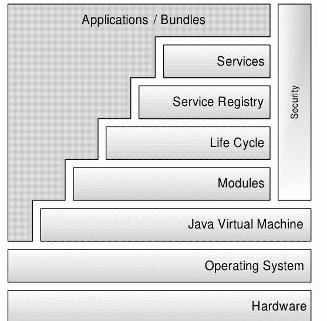

OSGI 服务平台提供的功能使其成为软件开发和集成的顶级 `Java` 环境。OSGI 技术提供了一些标准化原语，允许从小型、可重用且协作的组件构建应用程序。它提供了动态更改各种网络设备组合的功能，而无需重启。

为了最小化耦合并使这些耦合可管理，OSGI 技术提供了一种面向服务的架构，这些组件能够动态地发现彼此进行协作。OSGI Framework 的核心组件为应用程序（bundle）提供了一个标准环境，该环境分为几层：执行环境、模块、生命周期管理和服务层。服务层包含服务注册表，并在框架内提供服务的部署功能。OS 服务层定义了动态协作的发布、查找和绑定模型。

服务注册表是一个内存注册表。注册是动态的，并且取决于 bundle 的执行状态。服务始终通过接口名称和一组属性进行注册。接口名称表示预期的用途。

图1. OSGI 架构。

# 反射的力量

服务属性描述了面向受众的服务。OSGI 服务注册表动态地将 bundle 连接在一起，同时跟踪它们的状态和依赖关系。通过服务注册表，bundle 可以注册对象、搜索匹配的对象，并在服务被注册或注销时接收通知。

正如前面提到的，OSGI 服务框架的主要目标是利用 `Java` 编程语言平台的独立性和动态代码加载能力，为小内存设备开发并动态部署应用程序。它还提供了生命周期管理功能（见图 1），允许应用程序开发人员将应用程序划分成微小的自安装组件。这些组件被称为 bundle，它们可以根据需要下载，并在不再需要时移除。当 bundle 在框架中安装并激活时，它可以注册多个可供其他 bundle 使用的服务。

bundle 是一个物理和逻辑单元，用于在 OSGI 服务注册表中分配并交付服务实现。从物理角度来看，bundle 分布在一个 `Java` 归档文件（`JAR`）中，该文件包含代码、注册信息和清单文件（manifest）。清单文件告知框架 bundle 类的执行路径，并声明要与其他 bundle 共享的 `Java` 包。它还包含关于 bundle 行为的信息。从逻辑角度来看，bundle 是一个可以独立进行版本控制和部署的模块化单元。

OSGI 架构允许对组件进行动态管理，可以在不重启整个系统的情况下启动、停止或更新 bundle。这种灵活性对于高可用性系统和快速开发周期至关重要。

## 3. 智能服务管理

管理或存储的目标最终是为了实现服务的有效性。无论如何，这取决于用于发布或部署这些服务的技术。从服务与调用直接直接处在同一处而无需执行任何命令的情况开始，可以发现不同的情况（例如分布式系统），在这些情况下，复杂性决定了服务管理平台的选择。

在 `Java` 系统中，如果业务逻辑位于包内，且调用位于另一个包但对第一个包具有可见性，那么这种是可能的。目前最著名的方案之一，也是本文解决方案中使用的方案之一，是 Web 服务范式。

### 3.1. Web 服务

Web 服务是一组允许应用程序之间进行数据交换的协议和标准。使用不同编程语言开发并在平台上运行的不同软件应用程序，可以使用服务在互联网等计算机网络中交换数据。通过采用开放标准可以实现互操作性。

Web 服务中使用的标准包括 `XML`、`SOAP`、`WSDL`、`UDDI` 以及 `WS-Security` 等安全协议等。Web 服务的通信传输层可以是 `FTP`、`SMTP` 或 `HTTP` 等标准。

Web 服务提供了一些优势。例如：

- 提供了软件应用程序之间的互操作性，不受其安装环境的属性或平台的影响。
- Web 服务促进了基于文本的协议和标准，使其更容易访问其内容并理解其行为。
- 当依赖 `HTTP` 时，Web 服务可以受益于防火墙安全系统，而无需更改过滤规则。
- 它们允许来自不同公司、不同地理位置的服务和软件轻松组合以提供集成服务。
- 它们允许通过标准和开放协议实现不同供应商平台之间的互操作性。

但也有缺点：

- 与其他分布式方法（如 `RMI` 远程方法调用、`CORBA` 或 `DCOM` 分布组件对象）相比，其性能较低。
- （模型）。这是采用文本标准带来的不便之一，因为 `XML` 并没有将处理效率考虑在它的目标之内。
- 当依赖 `HTTP` 时，可以避免基于防火墙的安全措施，这些防火墙的规则是真实的拦截，或者是在差距两端的程序之间进行即时通信拦截。

使用 Web 服务（Web Services）的主要原因是它们基于 80 端口的 `TCP`（传输控制协议）上的 `HTTP`。组织和公司通过防火墙保护网络，过滤并拦截大量的互联网流量，几乎除了 80 端口外的每一个 `TCP` 端口，而浏览器使用的端口。使用 80 端口的 Web 服务唯一的理由是这种方式不会被拦截。

Web 服务具有实用表面的另一个原因是它们可以为使用 Web 服务的应用程序和服务本身之间提供高度的独立性。通过这种方式，其中一个的变化不会影响另一个。这种灵活性将变得越来越重要，因为每天从微小的分布式组件构建大型应用程序的趋势日益流行。

## 3.2. 语义：服务

服务是面向服务架构拼图中的核心部分，也是服务提供者与请求者/消费者之间建立关系的原因。最初，解决方案是以绝对的即时方式实现的，适用于严格、不可扩展且非模块化的应用程序。如今，随着信息和服务语义学对更高效解决方案的需求，这种情况正在发生变化。

为了充分理解游戏领域引入的新变化，必须对人类与计算机之间的关系进行比较。在寻找异构领域中异构解决方案的互操作性、模块化和易用性时，从人类身上获得的知识必须写成计算机可以理解的形式。知识标记和智能资源管理演化的最佳例子是世界维网（`WWW`）在实际及所谓的语义（Semantic）层面的体现。

语义网 [5-7] 毫无疑问在工业界和学术界都在增强势头。它是 `WWW` 的一种演进扩展，定义了网络上信息和服务的语义，使得网络能够理解并满足人类和机器的需求。它源于万维网联盟（`W3C`）主任姆·伯纳斯-李（Tim Berners-Lee）的愿景，将 Web 作为数据、信息和知识交换的通用媒介。

语义网的核心由设计原则、协作工作组和各种赋能技术组成。语义网的一些元素被表达为待实现或实现的描述性未来可能性。语义网的其他元素还包括资源描述框架（`RDF`）、各种数据交换格式（例如 `RDF/XML`、`N3`、`Turtle`、`N-Triples`）以及 `RDF Schema`（`RDFS`）和 Web 本体语言（`OWL`）等记法，所有这些旨在为给定知识领域内的概念、术语和关系提供正式描述。人类能够利用 Web 执行任务，如寻找“猫”的芬兰语单词、预订图书馆书籍以及搜索 DVD 的低价。然而，如果没有人类的指导，计算机无法完成同样的任务，因为语义网是一个计算机可以理解而非机器可以理解的信息愿景，这样它们就可以执行更多涉及在网络上查找、共享和组合信息的繁琐工作。

在这里，当语义区域将语义应用于服务时，出现了“语义网服务”（Semantic Web Services）这一术语。语义网服务是自包含的、自描述的、语义标记的软件资源，可以通过一种半自动的方式在跨 Web 上进行发布、发现和组合。语义网服务可以定义为语义网的动态部分。由于信息可以附加到发布的网页中，在这种情况下，可以通过不同的方式为通过网络提供客户端的服务添加附加术语。语义网服务可以实现动态发现、组合和执行，其目的是提供更高层次的增值服务。目前已创建特定的语义语言，例如 `OWL-S` [8] 或 `WSMO` [9]，用于详细说明如何添加信息。

```java
public void start(BundleContext context) throws Exception
{
    this.context = context;
}

Properties props = new Properties();
props.put("SOAP.service.name","FusionAuthentication");
props.put("author","Pablo cabezas");
props.put("vendor","CEIT");

srAuthentication = this.context.registerService(
AuthenticationService.class.getName(),
new Authentication(),
props.getReference());
}
```

图 2 在 OSGI 中注册服务

```java
public void start(BundleContext context) throws Exception
{
    this.context = context;
}

AuthenticationService authenticationService = null;
Servicereference serviceRef = null;

try {
    serviceRef = context.getServiceReference(
    AuthenticationService.class.getName());
    authenticationService = (AuthenticationService)
    context.get(serviceRef);
}

catch(Exception ex) {
    System.out.println(ex.getMessage());
    ex.printStackTrace();
}
```

图 3. OSGI 中的基本服务发现。

当前服务可以很容易地以其类名注册，如图 2 所示。因此，客户端 bundle 将查找之前留下的服务，并根据请求类名称获取的文本字符串进行匹配（见图 3）。如果该类在部署时不存在于 Framework 中，将发生错误且 bundle 将无法启动。

发布在服务注册中的服务可以拥有自己的属性，这些属性将是其他服务或应用程序发现它们的方式。属性是一个属性-值对，且不包含额外信息。那么，服务的调用者/搜索者必须预先知道属性的名称，或者简单知道类的名称和包名。

关于外部应用程序对服务的调用，如何访问的信息不仅必须是功能性的，还必须是语义性的。如果互操作性至关重要，且目标是为外部应用程序发布 Web 服务，那么向服务注册表中添加语义内容将是关键。这样，外部应用程序无需预先知道实现该服务的特定类。它们只需向注册表查询它们想要的操作，从而降低耦合级别并增加 Framework 的潜力。

OSGI 服务应该以标准的方式可用，以便提供一个关键因素：互操作性。通过这种方式，服务可以作为 Web 服务部署在 Web Server bundle 中，监听服务注册表并寻找指示哪种服务应该部署在 Web Server 中的服务属性。这 OSGI 可能包含一个内部注册表和一个供外部世界使用的外部接口（facade），发布在内部服务注册表中部署的某些服务。此外，关于服务的信息仅仅是功能性的，服务必须非常了解彼此以便能够相互调用。服务注册表可以为发现过程发布属性和类名，而外部接口将通过 `WSDL` 文件发布服务。

为了仅通过关键词访问服务和资源，已经开发了如 `OWL` 等网络标记语言，它们能够为特定领域创建本体。修改服务注册表并根据标准服务本体添加信息，将产生一个语义注册表，这将有利于于发现和调用过程。

## 4.1. SOR: 语义 OSGI 服务注册表

SOR 是根据 `OWL-S` 方法创建并适配的，以便与 Framework 中部署的符合其他标准的上层或 bundle 提供尽可能的兼容性。SOR 信息与 `OWL-S` 标准以及其他语义协议和工具兼容，使得信息可以从 `OWL` 或 `RDF` 获取，因此可以被所有获得权限的应用程序读取和处理。

通过为 OSGI 中的服务提供通用本体，将获得更多信息，并根据要求在 Framework 中部署这些服务的应用程序定义的规则或约束，创建一个更复杂、强大的 OSGI 搜索引擎。

服务注册表包含服务并提供了在 Framework 中访问它们、获取它们或跟踪其执行的方法。通过配置 `ServiceListener` 类实例来跟踪特定服务，可以从该服务的事件（注册、启动、停止等）中检索信息。

每个服务都定义了自己的属性，这些属性用于与 Framework 中的其他服务进行区分。但这是不够的，因为这些信息没有经过良好定义（例如，它们不符合关于服务定义的现有标准本体），搜索引擎无法利用这些知识。

SOR 通过添加服务的新语义属性扩展了服务层架构，同时仍与原始 OSGI Framework 兼容，使得 OSGI “经典”应用程序可以工作，而无需担心 Framework 采纳的更改。

拥有服务的 bundle 与使用该服务的 bundle 之间的依赖关系由 Framework 管理。此外，它将服务映射到其底层服务对象，并提供简单强大的查询机制，允许 bundle 请求它需要的服务。它提供了一种事件机制，以便 bundle 可以接收已注册、修改或注销的服务的事件。通过 SOR，这种查询机制变得更加复杂，并为 OSGi 添加了更多属性。

每个注册的服务对象都有唯一的 `ServiceRegistration`，并有一个多个引用它的 `ServiceReference` 对象。这些 `ServiceReference` 暴露了服务对象的注册属性，包括它实现的服务接口集。然后可以使用 `ServiceReference` 对象来获取实现所需服务接口的服务对象。

服务属性是 OSGi 提供服务对象信息的方式。它们以键/值对的形式存储信息。第一个必须是 `String` 对象，第二个应该是被 `Filter` 对象识别的类型。所有属性在 Framework 中共享一个的命名空间。

修改服务注册表并根据标准服务本体添加信息，将产生一个语义注册表，这将有利于发现和调用过程。

属性是一个属性-值对，且不包含额外信息。那么，服务的调用者/搜索者必须预先知道属性的名称，或者简单知道类的名称和包名。


关于外部应用程序对服务的调用，如何访问的信息不仅必须是功能性的，还必须是语义性的。如果互操作性至关重要，且目标是为外部应用程序发布 Web 服务，那么向服务注册表中添加语义内容将是关键。这样，外部应用程序无需预先知道实现该服务的特定类。它们只需向注册表查询它们想要的操作，从而降低耦合级别并增加 Framework 的潜力。

OSGI 服务应该以标准的方式可用，以便提供一个关键因素：互操作性。通过这种方式，服务可以作为 Web 服务部署在 Web Server bundle 中，监听服务注册表并寻找指示哪种服务应该部署在 Web Server 中的服务属性。这 OSGI 可能包含一个内部注册表和一个供外部世界使用的外部接口，发布在内部服务注册表中部署的某些服务。此外，关于服务的信息仅仅是功能性的，服务必须非常了解彼此以便能够相互调用。服务注册表可以为发现过程发布属性和类名，而外部接口将通过 WSDL 文件发布服务。

为了仅通过关键词访问服务和资源，已经开发了如 OWL 等网络标记语言，它们能够为特定领域创建本体。修改服务注册表并根据标准服务本体添加信息，将产生一个语义注册表，这将有利于发现和调用过程。

# 反射的力量

它由以下元素组成：

- 核心元素语义服务（Semantic Service S3）。它具有名称、文本描述，并与其他元素（如 Domain、Type 和 Arguments）连接。

- 领域（Domain）拥有领域概念（DomainConcepts），并包含 S3 项。它具有有效的标识符和名称，它是上层本体中的可索引术。

- 领域概念（DomainConcept）是下层本体中的项，具有有效的标识符和名称。

- 类型（Type）具有名称，并与 S3 对象（通过 `hasReturnType` 连接）以及参数（通过 `hasType` 关系）相关联。

- 参数（Argument）具有有效的标识符、文本描述、名称、类型以及它所属的领域概念。

60 P. Cabezas, S. Arrizabalaga, A. Salterain 等。

请注意，文中避免了与名称、参数类型、返回类型等相关的信息，仅请求必要且关键的信息，以避免代码中的注解过载。

## 4.2. SOR 行为

一旦包（bundle）在框架内部署并启动，SOR 注册代理（SOR Registration Agent）就会开始工作。SOR 注册代理（SRA）实现了 OSGi ServiceListener 模式，负责查找框架中有关有效或符合 SOR 标准的服务提供包的事件。

当发布 `STARTED` 或 `STOPPED` 类型的事件时，如果该包符合 SOR 标准，SRA 将进行解析并获取信息。如上一节所述，属性 "SOR.PUBLISH" 将是关键。

此时，SRA 将从 `ServiceEvent` 对象获取 `ServiceReference`，并从另一个属性 "objectClass" 获取部署在该包中的类名。现在，对于每个有效的类字符串，将获得一个通用类，SRA 将从该类开始获取方法信息。

对于第一种情况，在 `STARTED` 事件中，如果注解（Annotation）有效，SRA 将仅从方法注解（以及方法本身）获取信息；如果只能部分检索信息，为了不调用该方法，将考虑进行方法解析。如果发现有效的注解，SRA 将使用 Java Reflection API 之一从其名称、参数、类型等获取所有所需数据。在第二种情况下，当触发 `STOPPED` 事件时，SRA 必须找到该事件是否涉及了符合 SOR 标准的包，以确保 SOR 注册表的状态与 OSGi 注册表中的发布内容保持一致。

通过注解和 Java Reflection API，服务提供包无需具备之前的 SOR 知识，也不需要在其清单文件（manifest）中包含该包的引用。这样，框架中服务的部署是完全动态的，且独立于连接的接口模式。

当一个 S 在 SOR 架构中注册后，它就可以被客户端包调用。客户端必须通过添加一个额外的引用来获取 SOR 的引用。然后，它必须向 SOR 调度代理（SIA）指定与相关的领域概念（DomainConcept）的细节，以及执行方法所需的参数集（Arguments）。

随后，SIA 将查询与客户端提供的主 `DomainConcept` 相关的领域，以获取系统服务的顶层视图。在找到与该领域相关的服务时，处理过程将进一步，查找所提供的参数的数量和类型的兼容性。如果没有找到匹配项，客户端将获得 `NoS3CompatibleException` 异常，指示此类事件。客户端无需担心服务是否为静态，因为 SIA 将根据需要（或不需要）获取类对象实例，并对终端用户以完全透明的方式进行调用。

版权 © 2010. Nova Science Publishers, Incorporated. 版权所有。

《Java Software and Embedded Systems》，Matt Hayes 和 Isaac Johansen 编选，Nova Science Publishers, Incorporated, 2010. ProQuest

## 4.3. SOR 架构的分布式概念，D-SOR

分布式语义 OSGI 服务架构（D-SOR）假定了 SOR 的演进。它适配并创建了新的代理，以利用更分布的信息，这些信息可以来自网络中的 D-SOR 节点，或在需要服务时可以直接进行查询的服务提供者。

D-SOR 补充了现有的 OSGI 服务架构，增加了不会阻止 OSGI 框架默认搜索和调用引擎的功能。内存中的 SOR 注册表使其成为可能，提供了超越本地搜索的新搜索能力，并在 OSGI 架构中添加了新层，而无需任何额外的库包。

新功能与远程管理、服务调用模式、自配置以及与外部系统的通信检索信息有关。这些概念总结在以下几行：

客户端可以通过与代理交换消息来修改 D-SOR 行为，其他 D-SOR 节点可以修改特定节点的特征以适应协作网络。

关于调用功能，提供了两种调用模式：'findAndInvoke' 和 'retrieveBundleAndInvoke'。关于自配置，在首次连接或重新连接时，D-SOR 节点可以获取网络当前的配置情况，并据此进行自配置。

D-SOR 的组成及其组件之间的主要关系如图 5 所示。

D-SOR 是一种基于代理的架构，由四个实体组成，它们在模块化结构中负责不同的任务。这些代理是：

- SOR 注册代理 (SRA)
- SOR 调度代理 (SIA)
- SOR 信息代理 (SFA)
- SOR 内部代理 (STA)

D-SOR 中服务的本地注册与基础注册类似，因此 SRA 始终保持其功能。在这种方法中，并不监听其他节点的注册事件，因此当需要服务但在本地系统中未找到时，将启动一个通过传播问题的搜索过程，以找到适当的服务。

P. Cabezas, S. Arrizabalaga, A. Salterain 等。

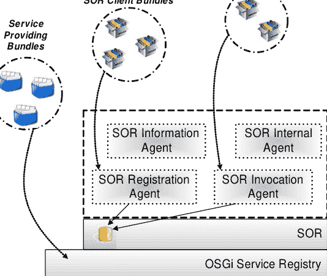

图 5. D-SOR 架构概述。

然而，分布式行为的加入使其成为可能，提供了超越本地搜索的新搜索能力，并在 OSGI 架构中添加了新层，而无需任何额外的库包。

新功能与远程管理、服务调用模式、自配置以及与外部系统的通信检索信息有关。这些概念总结在以下几行：

客户端可以通过与代理交换消息来修改 D-SOR 行为，其他 D-SOR 节点可以修改特定节点的特征以适应协作网络。

关于调用功能，提供了两种调用模式：'findAndInvoke' 和 'retrieveBundleAndInvoke'。关于自配置，在首次连接或重新连接时，D-SOR 节点可以获取网络当前的配置情况，并据此进行自配置。

D-SOR 的组成及其组件之间的主要关系如图 5 所示。

D-SOR 是一种基于代理的架构，由四个实体组成，它们在模块化结构中负责不同的任务。这些代理是：

- SOR 注册代理 (SRA)
- SOR 调度代理 (SIA)
- SOR 信息代理 (SFA)
- SOR 内部代理 (STA)

D-SOR 中服务的本地注册与基础注册类似，因此 SRA 始终保持其功能。在这种方法中，并不监听其他节点的注册事件，因此当需要服务但在本地系统中未找到时，将启动一个通过传播问题的搜索过程，以找到适当的服务。

### SOR 提供包


图 5. D-SOR 架构概述。

然而，分布式行为的加入使其成为可能，提供了超越本地搜索的新搜索能力，并在 OSGI 架构中添加了新层，而无需任何额外的库包。

# P. Cabezas, S. Arrizabalaga, A. Salterain 等人。

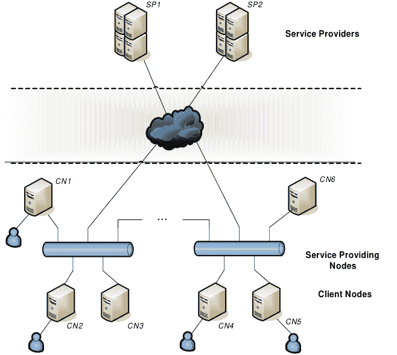

图 6. 环境概述。

在底层，可以找到寻求服务的节点，它们负责执行初始调用，这些调用将转化为网络中的搜索过程。最初，这种搜索应该针对上层的实体进行，即服务提供者（Service Providers）。然而，由于 D-SOR 遵循高度协作的方法，不同节点中的服务可以以相同的方式被其他节点搜索并被调用。

每个节点都认为应该保持完美运行，并且系统中安装了 OSGI 框架，以及部署并运行了 D-SOR 程序包（bundle）。实际上，在环境中没有找到 S3 语义服务，它将在其中包含一组基本的数据库抽象方法。

提供 S3 语义服务的包必须满足某些限制条件：

- 它在初始的 `Activator` 类中，必须在包的上下文属性中将 `SOR_PUBLISH` 属性设置为 `true` 值。
- 对于要发布到 D-SOR 的每个方法，它必须带有注解。示例见图 7。

在系统中部署服务（例如，在 CN1 中）时，D-SOR 代理负责列出服务注册事件（SRA），它会注意到这一点并继续通过注解提取有关服务的信息，关于其自身的数据（名称、参数的数量和类型、返回值等）以及服务开发者通过注解提供的数据。一旦服务在客户端节点 CN1 中可用，它们不仅可以从该节点调用，也可以从任何具有其物理访问权限的节点调用。

# 反射的力量

```
$S3Method(domain=`database.abstraction`
```

图 7. S3 注解示例。

对于本示例，CN2（来自它的一个应用）利用 DSOR 代理启动搜索，如果可能，则调用用于创建数据库的服务，而无需了解网络拓扑结构或服务的名称或参数。环境中不同元素或节点之间唯一的重要要求是能够相互理解语义搜索中包含的术语以及可理解的本体论（ontologies）。因此，带有 D-SOR 包的系统拥有有效的术语来执行所需的操作。

CN2 中的 SIA 代理启动本地搜索，首先针对领域、服务名称和参数进行搜索，并且它拥有这些值。

如果搜索成功，则调用服务并将其执行结果返回给用户。但如果没有成功，调用代理将尝试在可访问的节点（同一层次级）中寻找匹配搜索术语的方法。对于远程搜索过程有两种不同的方法可用：

- 1. internalFindInvoke：在远程机器上执行服务（如果找到的话），并获取执行结果。
- 2. retrieveRemoteBundle：将服务下载到原始客户端的包，包括其可能的所有依赖项。

无论如何，网络中 D-SOR 节点的搜索都是通过向初始预配置组发送 UDP 多组播消息执行的。在任何情况下，D-SOR 节点在其启动例程中都有初始配置过程，为可能的远程搜索和调用事件做好准备。

因此，对于前面的示例，CN2 知道它没有用于创建数据库的服务，它向网络发送多播消息以了解可用节点。一旦 CN2 知道存在它正在寻找的服务候选者，它将逐一处理它们，直到过程成功完成。

为了让每个客户端都能访问 DS 节点中的远程搜索和调用方法，以下方法已通过 OSGI 中的 Axis 包发布为 Web 服务：

- internalFindInvoke (conceptName, clientArguments)
- findAndInvoke (conceptName, clientArguments)
- retrieveRemoteBundle (conceptName, clientArguments)

该过程显然将这些方法分为两组：internalFindInvoke 和 findInvoke 组成第一组，用于远程调用情况；而第三方法用于第二组的本地服务调用，具体为下载正在搜索方法的包（及其依赖项）。图 8 显示了 internalFindInvoke 的远程调用示例。

```
String conceptName = "create_database";
Set<String> clientArguments = new HashSet<String>();
clientArguments.add(new String("hostname", "193.145.250.40"));
clientArguments.add(new String("database", "db_clients"));
clientArguments.add(new String("username", "root"));
clientArguments.add(new String("password"));

Service service = (Service) ServiceFactory.newInstance(null);
Call call = service.createCall();
call.setEndpointAddress("http://193.145.250.40:8080/axis/services/SORInvocation");
call.setOperationName(new Name("internalFindAndInvoke"));
call.addParameter(new Name("conceptName"),
new Name(String.class.getName()),
String.class,
ParameterMode.IN);
call.addParameter(new Name("clientArguments"),
new Name(Set.class.getName()),
Set.class,
ParameterMode.IN));
call.setReturnType(new Name(Object.class.getName()));
Object result = call.invoke(new Object[]{conceptName, clientArguments});
```

输入：Java 软件与嵌入式系统

编辑：M. Hayes 和 I. Johansen，第 69-88 页

ISBN：978-1-60741-661-6

© 2010 Nova Science Publishers, Inc.

# 第 3 章

# 嵌入式可调环形微带天线架构

Tapas Chakravarty$^{1,a}$, Salil K. Sanyal$^{2,b}$ 和 Asok De$^{3,c}$

$1$塔塔咨询有限公司，嵌入式系统创新实验室, Abhilash, Plot-96, EPIP Industrial Area, Whitefield, Bangalore-506066, 印度

$2$贾达普尔大学，电子与与电信工程系, Jadavpur, Kolkata – 700032, 印度

$3$Ambedkar 科技学院（德里国家首都区政府）Shakurpur, Delhi, 110092, 印度

## 1. 引言

### 嵌入式可调天线

传统的定义将嵌入式系统描述为硬件、软件、机械和其他技术组件的组合，旨在执行特定功能，这与通用计算机不同。嵌入式设备的一个主要特征是对外部刺激做出实时响应。因此，实现结果的及时性与结果的精确性同样重要。从这种形式的定义可以很容易得出结论：嵌入式系统将需要微控制器、实时操作系统（RTOS）、行业特定协议和接口等组件。

因此，现在有一种天线或更准确地说是一类天线结构被称为“嵌入式可调天线”。

答案在于设计这些天线的动机。更贴切地说，答案在于天线设计必须应对不断变化的需求的实际限制。为了理解这些需求，我们可以追踪无线通信系统的两个特定需求。目前在类似于软件无线电（SDR)/认知无线电（CR）的自主通信架构领域正在进行研究。这项技术将为频谱感知通信系统提供高效能、以信号为中心的无线电。在最近的一篇文章 [1] 中，Perlman 等描述了这些系统在波形自主控制方面面临的技术挑战。关键挑战之一与天线控制和调谐有关。要求是低剖面天线，能够在频率范围内进行电子调谐，其中控制信号由数字后端决定。设计领域面临的重大挑战是天线在宽频率范围内工作时性能下降。性能下降还与天线在手机手机中使用时的功率处理能力有关。一个相关的应用是移动电视 DVB-H。这些应用需要从 470MHz 到 862MHz 的极宽带连接，并在小尺寸内具有良好的覆盖范围。为了良好运行，最好对小尺寸天线在频率范围内进行电子调谐，同时保持阻抗匹配。

在这两种情况下，特定通信系统的数字后端对极小平面天线的谐振频率具有控制能力。通常天线通过控制变容二极管的反向电容来调谐。根据需要，处理器产生控制信号，然后将其转换为直流电压，并设定二极管的电容。传统的平面天线（偶极天线外）是一个并联谐振电路。对于这种电路，如果改变了净电容，预期的天线谐振频率就会改变。

在本章中，我们概述了如何调谐卷积（规则形状）微带天线。阐述了用集中元件值表示谐振频率的分析方法。

## 2. 背景

在本章中，我们概述了如何调谐卷积（规则形状）微带天线。阐述了用集中元件值表示谐振频率的分析方法。

在这两种情况下，特定通信系统的数字后端对极小平面天线的谐振频率具有控制能力。通常天线通过控制变容二极管的反向电容来调谐。根据需要，处理器产生控制信号，然后将其转换为直流电压，并设定二极管的电容。传统的平面天线（偶极天线外）是一个并联谐振电路。对于这种电路，如果改变了净电容，预期的天线谐振频率就会改变。

在本章中，我们概述了如何调谐卷积（规则形状）微带天线。阐述了用集中元件值表示谐振频率的分析方法。

在这两种情况下，特定通信系统的数字后端对极小平面天线的谐振频率具有控制能力。通常天线通过控制变容二极管的反向电容来调谐。根据需要，处理器产生控制信号，然后将其转换为直流电压，并设定二极管的电容。传统的平面天线（偶极天线外）是一个并联谐振电路。对于这种电路，如果改变了净电容，预期的天线谐振频率就会改变。


# 嵌入式可调微带天线架构

在本章中，我们概述了如何调谐卷积（规则形状）微带天线。阐述了用集中元件值表示谐振频率的分析方法。

在这两种情况下，特定通信系统的数字后端对极小平面天线的谐振频率具有控制能力。通常天线通过控制变容二极管的反向电容来调谐。根据需要，处理器产生控制信号，然后将其转换为直流电压，并设定二极管的电容。传统的平面天线（偶极天线外）是一个并联谐振电路。对于这种电路，如果改变了净电容，预期的天线谐振频率就会改变。

## 3.1 嵌入式可调微带天线架构

嵌入式可调微带天线的架构图中展示了自适应天线系统的原理图。在这里，加载的微带天线通过串行链路接口由计算机生成的代码驱动。代码从查找表中获取，表中工作频率与相应的数字天连接。

加载的微带天线负载了变容二极管，该二极管由模拟接收器的微处理器控制的数字模拟转换输出偏置。然而，为了在微波频使用更宽的信道分配，接收机前端为该配置提供了功能。使用串行通信确保控制 8 位或更宽的数据总线只需要三条线，并且可以覆盖约 100 英里的距离。在串行链路中添加少量配置即可使天线能够相对容易地进行快速频率跳变（预定的或随机）。在这项工作中，设计了一个数字接口电路并将其与计算机以及特定的贴片集成。实验结果表明天线与基于计算机的控制机制实现了无缝集成。

## 3.2 变容二极管的特性

变容二极管的工作基于反偏的 p-n 结。反偏增加会增大 p 型和 n 型衬底之间的耗尽区域，从而减小结电容。结电容随反偏电压变化的函数公式所示：

$$C_j(V) = C_j(0)\{1 - \frac{V}{\Phi_b}\}^M$$

其中，`C_j(0)` 是零偏置下的结电容，`\Phi_b` 是接触电位（硅为 0.7V，砷化镓为 1.3V），`M` 是取决于结面特性的系数。对于突变变容管，`M=0.5`。对于超突变型变容管，`M` 随反偏电压在 0.5 到 5 之间变化。

二极管的等效电路通过电压依赖电容 `C_j(V)` 和串联电阻 `R_s(V)` 建模，后者与欧姆接触以及外延层的有限厚度有关。由于耗尽偏压的增加，未耗尽区域变得更小，降低了结构的电阻。串联电阻应尽可能低，以保持与二极管相关的损失最低。对于封装二极管（例如 `SOT-23`），封装电感 `L_s` 和封装电容 `C_p` 也会影响二极管的功能。封装变容二极管的等效电路如图 1 所示。

通常，封装电容对变容二极管特性的影响可以忽略不计，因此被忽略。阻抗可以从等效电路获得：

$$Z_d(\omega, V) = R_s(V) + j\omega L_s - \frac{1}{\omega C_j(V)}$$

变容二极管应在截止频率下方工作。该截止频率公式如下：

$$f_{cut-off} = \frac{1}{2\pi R_s(V) C_j(V)}$$

由于 `R_s` 和 `C_j` 随偏压增加而减小，截止频率通常在零偏置处确定。

为了保持二极管处于电容模式，二极管的谐振频率应高于工作频率。二极管的串联谐振频率可以从等效电路获得，公式如下：

$$f_{r} = \frac{1}{2\pi\sqrt{L_sC_j(V)}}$$

对于天线应用等低损耗设计，`f_{cut-off}` 通常远高于谐振频率（`>10f_r`），这意味着在这种情况下，既满足了串联谐振频率的要求，也满足了截止频率的要求。

## 3.3 嵌入式可调圆形微带天线的架构

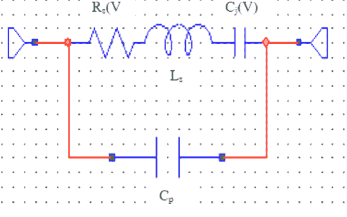

图 1. 变容二极管的等效电路。

基础天线由在双层覆微波材料（如 `RT Duroid 5880`，Roger 公司等）上的圆形贴片组成。衬底具有定义的厚度‘h’和介电常数 `\varepsilon_r`。PCB 的底部完全由铜覆盖，被视为地平面。束流变容二极管可以直接连接在贴片和地之间。但直接连接贴片和地是非常困难的。


图 3：可编程微控制器基天系统的原理图。

来自 `8155` 可编程外设接口 (`PPI`) 芯片 B 口的 4 位数字字激活了由标准 `R-2R` 梯形网络和运算放大器实现的简单 4 位 `DAC`。运算放大器的输出直流电压驱动变容二极管。电路路径可以通过改变变容二极管的数字字（以及相应的偏电平）来调谐。调谐范围取决于 0V 偏置下的电容比和最大使用的偏电平。生成调谐字的相关汇编程序见表 1。首先，将 `8155 PPI` 芯片的 B 口配置为输出端口。随后，字节“00”、“05”、“0A”和“0F”在 1 秒延迟后出现在端口上。该序列可以无限重复。

表 1. 以数字形式生成调谐电压的汇编语言

| 地址 | 助符 | 注释 |
|---|---|---|
| 0100 | `MOV_A#02H` | |
| 0102 | `MOV_DPTR#0B00H` | |
| 0105 | `MOV_X@DPTR,A` | 8155 PPI 芯片的 B 口配置为输出端口。 |
| 0106 | `MOV_R2#7H` | |
| 0108 | `MOV_R3#10H` | 将 1 秒延迟的计数器加载到数据指针中。 |
| 010A | `MOV_DPTR#0B02H` | 将 B 口的地址加载到数据指针中。 |
| 010D | `MOV_A#00H` | |
| 010F | `MOV_X@DPTR` | 字节 00 出 B 口。 |
| 0110 | `LCALL 0E012` | 延迟程序调用。 |
| 011C | `MOV_DPTR#0B02H` | DPTR 初始化为 B 口的地址。 |
| 0116 | `MOV_X@DPTR,A` | |
| 0122 | `LCALL 0E01H` | 对字节 0A 重复处理。 |
| 0125 | `MOV_DPTR#0B02H` | |
| 0128 | `MOV_A#0FH` | |
| 012A | `MOV_X@DPTR,A` | |
| 012B | `LCALL 0E01F` | 对字节 0F 重复处理 | |
| 012E | `SJMP0010H` | 无限重复该序列 |

使用十六进制等效代码表示 0V 到 15V 偏置，我们能够在宽频率范围内调谐天线。一旦通过代码对天线进行表征，就可以生成一个查找表，其中“频率”可以作为输入，自动生成相应的偏置电压。在目前的配置中，使用了一个二极管来调谐天线。已经在变容二极管的两个位置进行了实验。然而，这种方法可以通过使用“n”个变容二极管进行扩展，从而更广泛地控制此类参数，如主模共振、最大可调范围以及给定偏置变化下的调谐分辨率，这通过控制二极管的位置、短接销尺寸和同时工作的变容二极管数量来实现。

## 3.4 天线分析

当使用金属销和变容二极管组合进行电气负载时，对基础微带天线进行分析。薄衬底上的圆形贴片可以通过腔模型得到很好的解释。腔模型的最简单形式考虑了位于各向同性同质衬底上的圆形贴片，以导体为骨架，其由于衬底具有自然谐振频率。衬底的存在产生了一个基本假设，即 z 方向的电场是不变的。这些谐振模式是 `TM_{mp}`（横磁波）。通过考虑贝塞尔函数 `J_n(X)` 和 `N_n(X)` 的场的径向分量，解释了圆形贴片形成的圆柱腔的谐振。只有当腔包含后者时，才考虑二阶贝塞尔函数 `N_n(X)`。腔模型可以参考书籍 [8,9,10] 以获得该技术的详细观点。事实证明腔模型能以合理的精度预测谐振频率。我们使用腔模型来解释天线负载时的现象。

带有变容二极管负载的基础磁盘几何结构如图 2 所示。

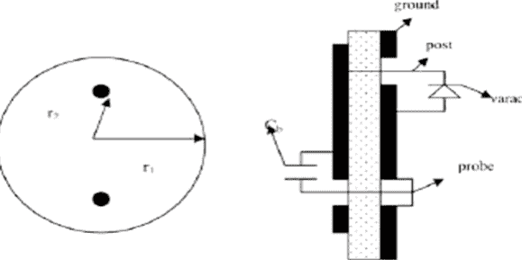

图 2. 负载变容二极管的基础磁盘几何结构。

## 3.5 解析公式中准确性的评估

我们现在说明如何使用方程 (5) 来获得所考虑的负载微带贴片的谐振频率，其尺寸如下：

- a) 介电常数 = 2.2
- b) 衬板高度 = 0.79mm
- c) 贴片半径 = 33.1mm

为了测量圆形贴片不同模式的可调性，馈电位置的选择使得所有模式都能以不同的效率被激发。贴片辐射器通过底 `SMA` 连接器被激发。

`TM_{np}` 模式的谐振频率给出：

```
$f_{np} = \frac{\chi_{np}}{2\pi r_e \sqrt{\epsilon_d}}$ (9)
```

其中 `\chi_{np}` 是 `TM_{np}` 模式的特征值，`f_{np}` 以 GHz 为单位，`r_e` 是由于边缘场引起的贴片有效半径。馈电点使用 220pf (`SMD`) 隔直电容进行隔离。用于计算方程 5 的二极管是来自 `Ztex Semiconductor` 的 `ZC83B`（电容误差为 5%）。该二极管封装在 `SOT23` 中，而总引线电感 `L_s = 2.8`nH，杂散电容变化为 0.08pf[12]，`ZC83B` 硅二极管是一种超旁路器件，电容从 100pf (2V) 变化的 17pf (2B)。对于该二极管，各种参数为：在 `f=1` MHz 时，`C_j(0) \approx 180`pf，`R_j(0) \approx 2\Omega`。因此，`f_{cut}=442` MHz。注意，谐振模式的频率低于圆形贴片的第一个自然共振。对于该共振，`n=0` 并记为 `TM_{0}`。该模式的辐射图在法线方向显示出明显的凹陷，并在方位面内显示向同性辐射。可以参考文献 [13,14,15] 的详细解释。

表 2. ZC83B 变容二极管的圆形贴片 TM0 模式的计算与测量频率（ε=2.2, h=0.79 mm, r=33.1 mm）

| 反向偏置 (V) | 谐振频率 (MHz) | S11 (dB) | 谐振频率 (MHz) | S11 (dB) | 谐振频率 (MHz) | S11 (dB) |
|---|---|---|---|---|---|---|
| 0 | 379 | -17.63 | 362 | -24.12 | 385 | -13.18 |
| 1 | 403 | -14.0 | 372 | -18.15 | 410 | -12.79 |
| 2 | 425 | -13.9 | 398 | -11.25 | 431 | -12.00 |
| 3 | 445 | -17.9 | 423 | -17.16 | 452 | -9.50 |
| 4 | 464 | -17.2 | 450 | -15.55 | 472 | -8.38 |
| 5 | 489 | -10.0 | 472 | -12.14 | 498 | -7.78 |
| 6 | 529 | -10.6 | 409 | -10.71 | 519 | -7.78 |
| 7 | 554 | -9.51 | 517 | -11.25 | 583 | -6.49 |
| 8 | 557 | -9.51 | 535 | -10.70 | 625 | -6.79 |
| 9 | 584 | -8.16 | 585 | -8.72 | 593 | -6.80 |
| 10 | 599 | -9.4 | 580 | -6.11 | 608 | -6.94 |
| 11 | 620 | -9.7 | 599 | -9.33 | 632 | -5.63 |
| 12 | 638 | -9.11 | 617 | -9.54 | 648 | -7.31 |
| 13 | 654 | -7.2 | 673 | -8.47 | 753 | -6.22 |
| 14 | 670 | -7.30 | 691 | -7.29 | 771 | -6.06 |
| 15 | 687 | -7.59 | 707 | -7.07 | 788 | -5.64 |

可以看出随着反向偏置的增加，`TM_{0}` 模式的测量频率增加。当贴片加载在贴片边缘时，频率下降最大（未加载贴片的主模）。该模式的频率调谐范围宽，接近105%（测量值）。然而，考虑到不同偏置水平下的回波损耗，有效频率范围更窄。对于 2:1 VSWR 边界，有效范围为213MHz（情况II）。

`TM_{1}`（未加载贴片为1.762GHz）在这种情况下没有显示任何调谐性。这与理论预测非常吻合。对于这种变容二极管，截止频率从约442MHz (@0V) 变化到3.2GHz (@15V)。对于所有实际用途，高模不受变容二极管的影响，因为这些共振远高于截止频率。为了观察 (1,1) 模式的可调性，我们使用了另一个高达2.5GHz的变容二极管`BB833`（来自西门子）。该二极管采用`SOD-023`封装，`L_s = 1.4nH`。表3列出了结果。从测量中重建的电容值接近18pf (@0V) 到 3.35pf (@15V)。隔直电容为47pf。

该模式在电容比为5.37时调谐性为10%。使用4.22和4.22的理论预测显示了偏置增加时 (1,X) 和 (2,X) 频率的可能性，并与测量值进行了比较。

表 3. 加载BB833变容二极管的圆形贴片TM1模式的计算频率与测量频率（ε=2.2, h=1.59 mm, r1=33.1 mm, r2=30 mm, Δ=0.15, LS=1.4nH）

| 反向偏置 (V) | 截止频率 (GHz) | 谐振频率 (MHz) | S11 (dB) | 谐振频率 (MHz) | S11 (dB) | 谐振频率 (MHz) | S11 (dB) |
|---|---|---|---|---|---|---|---|
| 0 | 4.91 | 1.912 | | 1.898 | | |
| 1 | 7.93 | 1.917 | | 1.914 | | |
| 2 | 10.18 | 1.926 | | 1.929 | | |
| 3 | 12.07 | 1.927 | | 1.943 | | |
| 4 | 13.74 | 1.940 | | 1.958 | | |
| 5 | 15.24 | 1.956 | | 1.970 | | |
| 6 | 16.63 | 1.983 | | 1.985 | | |
| 7 | 17.00 | 2.00 | | 2.00 | | |
| 8 | 19.15 | 2.02 | | 2.014 | | |
| 9 | 20.31 | 2.04 | | 2.031 | | |
| 10 | 21.42 | 2.056 | | 2.042 | | |
| 11 | 22.48 | 2.072 | | 2.058 | | |
| 12 | 23.5 | 2.084 | | 2.073 | | |
| 13 | 24.48 | 2.093 | | 2.088 | | |
| 14 | 25.43 | 2.101 | | 2.104 | | |
| 15 | 26.35 | 2.108 | | 2.12 | | |

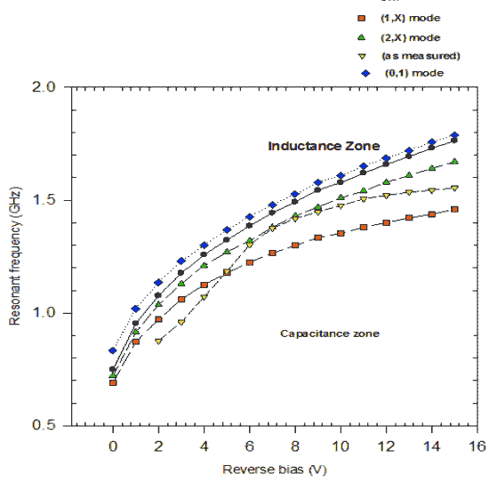

图 4：加载变容二极管的圆形贴片的计算与测量共振。

图 4 绘制了带有变容二极管电抗电感的串联谐振频率 (`SRF`)。`SRF` 将净负载效应分为电容和电感两个区域。注意到，只有当电性负载遵循 (1,X) 和 (2,X) 模式时，`TM_{II}` 才会被激发，由于这些模式间距密集，测得的共振可能会受到其中一个或两种模式的影响。该模式的可调性非常高，达到 78% 左右。然而，与之前的情况不同，有效范围受到可接受回波电平的限制。给定馈电位置的有效范围仅为 13.7%。对于 `\Delta = 0.95` mm，这种情况下最低阶模式的可调性增加到 88.5%，`TM_{II}` 的可调性接近 16.6%。

研究没有短路后极的情况下变容二极管对微带贴片共振的影响将很有趣。为了研究这种影响，选择了 `Waterhouse` [2] 使用的二极管，参数如下：`C(0) = 0.8`pF, `R_s = 7\Omega, L_s = 0.5`nH。在参考 [2] 中，一个尺寸如下的矩形贴片通过在基板上钻一个小孔加载了二极管并焊接到位置；`\epsilon_r=2.17, h=0.7844, L=13.6`mm, `W=16.4`mm, `x_{pl}=3.0`mm, `y_{pl}=0.0`。

对于未加载的贴片，基础共振在 7.125 GHz。为了比较，随后通过加载二极管参数分析了合适尺寸的圆形贴片的主模共振（未加载），频率为 7.125 GHz。这些参数为：`\epsilon_r=2.17, h=0.7844, r_1=7.9`mm, `r_2=1.742`mm。

图 5 比较了结果。可以看到，加载相同二极管的两种形状贴片的工作范围几乎相同。然而，对于圆形贴片，共振的减少和可调范围略高。对于圆形贴片，主模是 `TM_{II1}` 模式。对于该二极管，`SRF` 在 7.95 GHz (@0V) 更高。因此，没有看到明显较低的模式 (1,X) 或 (0,1)。

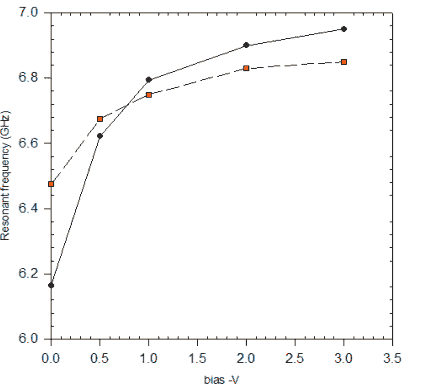

图 5 圆形和矩形形状变容加载贴片的比较。

## 3.6 带有计算机接口的自适应天线系统的开发


# 计算机控制的跳频微带天线配置

本文介绍了一种计算机控制的跳频微带天线配置。加载变容二极管串联 `L-C` 调谐电路以及金属销的圆形微带天线，通过计算机的异步串口通信功能发送数字字，在 `807 MHz` 内进行电子调谐。跳频序列可以是预定的或随机的。与嵌入式系统不同，计算机接口电路在跳频序列的选择上提供了灵活性，并便于远程操作。设计细节和测量结果如下：结果说明了所提方案将低剖天线转换为自适应系统的可行性。

## 7.1 系统描述

计算机根据用户请求向接口电路发送串行代码，接口电路将其捕获、存储并放置在数字模拟转换器 (`DAC`) 的并行数据线输入。`DAC` 将数字数据转换为模拟电压，然后通过缓冲/放大器给出变容偏置网络，并相应对贴片进行调谐。

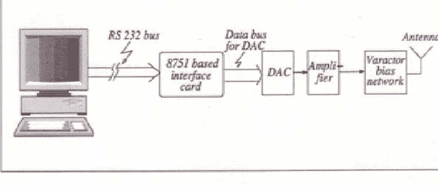

**图 6.** 计算机控制跳频系统的框框图。

图 6 显示了所提系统的原理图。天线组件通过其中一个串口连接到计算机。使用异步串口模式进行通信消除了在同步模式下所需的任何额外定时安排。在开始，通过频率对数字字对变容后极加载天线进行了表征。信息以查找表的形式插入计算机程序中，可以提供频率选择，并通过从查找表发送相应的数字字在天线端产生相应的偏置电压。该方案的灵活性在于，可以在不使用计算机额外数据线的情况下轻松增加调谐范围的分辨率。

对现有方案进行少量修改，该系统可生成随机跳频。跳频的典型应用可能是干扰雷达。程序包含了在连续跳频之间引入有限时间延迟的范围，这对于雷达给定范围内回波返回天线可以进行预计算，而天线仍在相同频率上工作。计算机程序使用 `Turbo C` 编译器开发，它提供了对计算机串口的方便访问，并具有灵活的数据安排。

## 7.2 接口电路的设计

接口电路在上述系统中起着至关重要的作用。它将 `RS 232` 信号 (`9` 到 `-9V`) 转换为 `TTL` (`0` 到 `5V`)，拦截串行数据并以并行形式提供给 `DAC`。

### 表 4. 嵌入的汇编代码列表

| 指令 | 注释 |
| :--- | :--- |
| `.equ baud_const,243; .org 00h; ajmp main` | 将波特率设置为 `4800` |
| `.org 023h; ajmp serial_int; subroutine` | 串口中断向量在此，将程序控制发送到中断服务 |
| `main : mov scon, #0101000b; mov tmd,#20h; mov th1,#baud_const; mov pcon,#80h; mov ie,#90h; mov tcon,#40h cl ri cl ti loop : ajmp loop` | 双倍波特率，在定时器中加载 `baud_const`，设置串口接收模式，启用串口中断 |
| `serial_int : cl ri; mov p2,buf; mov reti;` | 清除 `ri` 以允许下次中断，将接收代码移动到端口2，返回主程序 |

# 紧凑且可编程磁盘天线

在开发室内天线时，一个实用的假设是设计一种方式，使信号不向天花板传输，并且在方位面上存在准等向性覆盖。

## 作者信息

- `Tapas Chakravarty`
- `Salil K. Sanyal`
- `Asok De`

- `r2~30mm`
- `r2=20mm`

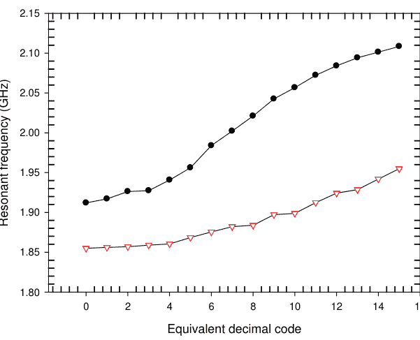

**图 7.** 两种变容器位置的谐振频率（`εr = 2.2, h = 1.59mm, Δ = 0.15mm, r1=33.1mm, r0=16mm`）。

- 电阻
- 电抗

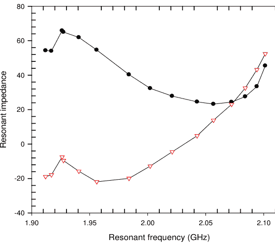

**图 8.** 可调模式的谐振阻抗。

*Copyright © 2010. Nova Science Publishers, Incorporated. 版所有。*

*Java Software and Embedded Systems，由 `Mattis Hayes` 和 `Isaiah Johansen` 编辑，Nova Science Publishers, Incorporated, ProQuest*

## 嵌入式可调圆形微带天线的架构

已经证明，在变容器二极管加载后，会产生 `TM0` 模式。零阶模式产生的辐射方向图在法向方向有一个零点，并且具有适用于室内的方位对称性。因此，如果将此天线水平放置，它将起到辐射集中在有用方向的作用。同时，它本质上非常紧凑，可以通过嵌入式架构进行控制。在本节中，通过使用商业全波电磁软件 `IE3D` 仿真变容器二极管加载结构，测试了这一假设。

对具有以下规格的天线进行了仿真：`r₁ = 33.1mm, εr = 2.2, h = 0.79mm, r₂ = 30.65mm, Δ = 0.3mm, 二极管= ZC836B`。

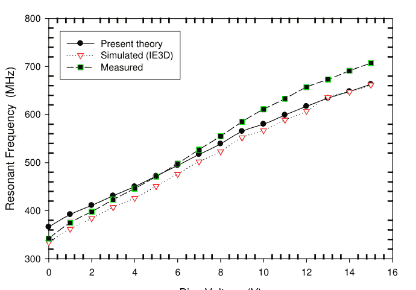

**图 9.** 变容器加载贴片的理论、仿真和测量频率的比较（`Er = 2.2, h = 0.59mm, Δ = 0.3mm, r1=33.1mm, r2=30.65mm, ZC836B` 二极管）。

图 9 所示，理论、测量和仿真结果之间的比较显示，在 `0V` 和 `15V` 两个边缘，`4V` 到 `8V` 的偏置水平一致性良好，差异约为 `6%`。这是由于对给定二极管偏置电容的估计不准确。在确定现有理论能够在合理的范围内预测谐振频率后，我们通过观察仿真辐射方向图的结果来测试零阶模式生成的假设。

已证明锥形天线的尺寸与未加载的贴片相比显著缩小（约 `80%`）。当串联变容器二极管进行加载时，可以对生成的天线进行编程，使其具有相同方向图特性的跳频。这种天线配置将导致用于跳频序列的紧凑型可调天线的设计。

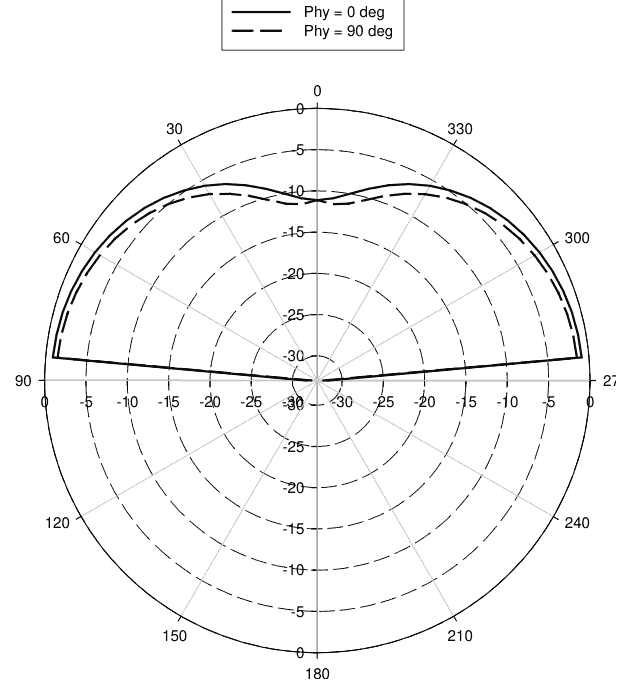

**图 10.** 上述天线 `TM01` 模式的仰面图。

## 8. 结论

本章介绍了嵌入式可调天线的架构。该架构产生了一种紧凑且扩展的可调贴片天线，可以通过数字代码进行离散调谐或编程。当以数字代码形式的反偏置应用于最低处时，低阶谐振相对于未扰动的贴片显著降低（在典型情况下，`0V` 偏置下降低了 `80%`）。还观察到两个高阶谐振在频率上宽可调。通过改变馈点位置，可以有效地激发特定模式。然而，回波随偏置水平而变化。因此，有用频率范围有限，小于完全的可调范围。还观察到较厚的衬层会导致谐振频率调谐范围增加。根据这种配置，可以设计一种自适应系统，通过查找表以电子方式更改天线参数。这种带有计算机接口的自适应天线系统已设计并通过实验。结果表明天线与基于计算机的控制机制实现了无缝集成。这种宽可调天线将应用于通信系统，其中接收端的频率合成器决定了天线的工作频率。

对于所有情况，微带天线固有的窄带宽限制了接收端的噪声。还证明了在生成低频零模式时，沿变容器使用金属销钉。零阶模式产生的辐射方向图在法向方向有一个零点，并具有适用于室内通信的方位。

## 参考文献

- `[1]` Perelman, B., J. Laskar 和 K. Lim, "Fine-tuning commercial and military radio design," *IEEE Microwave Magazine*, Vol. 9 (4), 2008年8月, pp 95-106
- `[2]` Waterhouse, R. B., 和 N. Sholey, "Characterisation of varactor-loaded, rectangular microstrip antennas," *Proc.-Antennas Propag.*, Vol 146, no. 3, 1999年10月, pp 224-228
- `[3]` East, J.W., "Self-steering, self-focussed phased array subsystem," *IEEE-S Digest*, 1991, pp 1732-1735
- `[4]` Chande, P.K., "Indian Radar: Some Technological Features," *IETE Review*, vol. 10, 2013年7月, pp 329-332
- `[5]` Damle, S.H., "Resonant modes of microstrip antenna," *Radio Science*, Vol 42, 2006, doi:10.1029/2006GR03357
- `[6]` Chaddon, N., "Application Note 9," *Zetex Semiconductors*, issue 2, 1996
- `[7]` Chakravarty, T., 和 A. De, "Design of dual-band microstrip antenna," *Electron. Lett.*, vol 31, 1995, pp 604-605
- `[8]` Garg, R., "Microstrip antenna design," *Artech House*, 1980
- `[9]` Harrison, R., "Time Electromagnetic Fields," *McGraw-Hill*, N.Y., 1961
- `[10]` Porath, Rebekka, "Theory of miniaturized shorting-post antenna," *IEEE Trans Antennas Propag.*, Vol 48, no.1, 2000年1月, pp 41-47

---

# F.I.R.E. 环境下的嵌入式控制系统开发

**作者：** `Alessandro Casavola`, `Ferdinando Cristofaro` 和 `Iolanda Montalto`

复杂度在不断增加，而对上市时间的要求也变得日益严苛。使用能够加速单次校准和验证阶段的优化工具已被证明是有效的，并且已成为目前的工业实践。这些经验也表明，需要强烈鼓励将这些工具集成到 `F.I.R.E` 环境中。其在于，发动机管理系统的开发过程由多个阶段组成，每个阶段对应一个特定的物理发动机开发阶段。在这些进行增量软件 (`SW`) 开发的阶段中，需要在极短的时间内以高准确性从物理发动机中估计大量的校准参数。

## 引言

如今，汽车配备了一系列嵌入式控制系统，且软件实现的功能越来越多。由于要实现的功能具有复杂性、由于机械与电气组件之间紧密交互导致的约束，以及出于安全考虑，此类系统的设计是一项具有挑战性的任务。此外，汽车制造商必须兼顾多个目标，即客户需求和满意度、开发时间、成本降低以及标准的满足。

当前的软件开发得到了仿真工具的帮助，这些工具允许生成框图，为客户提供支持设计和仿真活动的图形环境，并可以在 `PC` 上运行。

然而，嵌入式控制系统的完整开发还需要大量工作。目前缺乏自动化工具（见 `[1]` 和 `[2]`）、方法和模型，使得整个过程变得枯燥、耗时，并可能受到错误和遗漏的影响，因为早期阶段的大部分工作都是手工完成的。

本文的主要目标是为整个嵌入式控制系统设计过程的自动化提供一些想法。因此，上述许多想法已在 `F.I.R.E` 环境中实现，该环境支持嵌入层系统建模、设计和仿真，允许控制工程师和软件开发人员专注于平台内部问题的控制系统方面²。

> ²执行控制系统应运行的硬件和操作系统。

在处理现代内燃机控制系统时，另一个相关方面是新的稳健且多目标发动机校准方法和工具的可用性，这些工具可能比传统的校准实践带来巨大的新灵活性和性能。在本文中，将描述一种新型基于通用的校准方法，它融合了统计学概念（如稳健实验设计）、数值优化技术和发动机控制单元 (`ECU`) 算法建模。该方法探索了软件工具以支持 `ECU` 中使用的估计算法的校准。所提出的工具包括：

- 非线性多元回归
- 离散回归
- 多映射优化
- 用于校准、验证和更改的图形用户界面
- 校准性能计

文中介绍了这些工具在实际热机“基础发动机”校准过程中的应用。我们所说的“基础发动机”校准是指处理涉及发动机运行的 `ECU` 算法的校准活动，这些算法不取决于特定的车辆应用，例如负载估计、喷油器模型、点火提前计算、扭矩估计、催化器保护等。

该方法的使用已集成到控制算法设计过程中，加速、简化并改进了整个过程。与工业界使用的最佳技术相比，该方法的应用产生了有趣的结果：

- 减少了实验台台的设计工作量（减少了 `50%` 以上）
- 更准确的估计（几乎翻倍）
- 相对于发动机变性和环境条件具有更稳健的行为。

这些工具是使用 `MathWorks` 的 `MATLAB®/Simulink®` 软件开发的，这是嵌入式系统行业的行业标准。

## F.I.R.E. 工具使用背景

嵌入式控制系统的开发通常是一个复杂的过程，因为系统规模和共享资源的数量（`[3]`、`[4]` 和 `[5]`）。这些系统的建模必须包含对顶层结构、功能在系统资源之间的分布、组件之间的链路和数据传输以及系统对异步或同步视图响应的了解 `[3]`。

这些不同的信息无法通过单一的图形表示法。例如，单个图形视图可以显示抽象的功能方面，而另一个视图则显示控制结构或物理结构。一种实际的设计方法基于基于想法：每个控制系统都可以通过三个视图进行观察：功能视图、实现视图和重用性视图。

### 功能视图

在设计阶段遵循基于模型的嵌入式系统设计方法，功能视图重点关注控制系统的需求——例如信号采集、取值计算、命令执行。在这种视图中，过程是数据驱动的，且功能模型位于输入端口。

### 实现视图

实现的下一步是根据其需求对控制系统进行建模。此视图适用于将控制实现在 `RTOS`（实时）上。另一方面，实现视图使得通过作用调度器块来分析不同的多速率仿真成为可能。

### 重用性视图

从功能视图到重用性视图的转换由图形块的重新组成，这在逆向工程阶段非常有用，同时关注控制系统的某些特定硬件依赖也是很有意义的。此外，从功能视图到重用性的过渡提供了根据时间要求进行的逻辑任务重组。此视图识别了 `HLSW`（高级软件）和 `LLSW`（低级软件）。

## 创建新的 F.I.R.E. 模型所需的组件

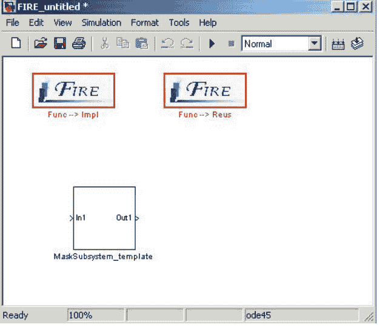

**图 4.** 构建新的 `F.I.R.E.` 模型。

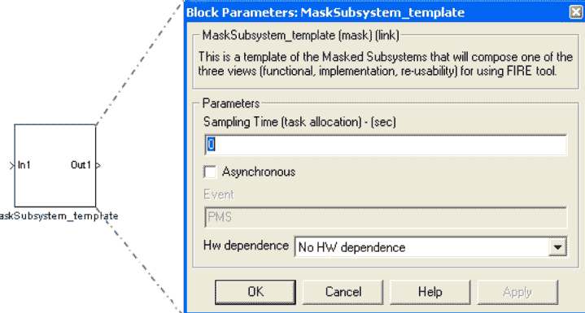

**图 5.** `MaskSubsystem_template` 模块。

为了执行转换，用户必须在模型中引入有关任务时序或硬件依赖的信息。为了以标准且简单的方式引入这些属性，`F.I.R.E.` 提供了一个 `MaskSubsystem_template` 模块（图 5），客户可以在其中设置所需的信息，如采样时间或异步事件的声明以及硬件依赖。

## 实现方面

`F.I.R.E.` 工具提供的操作是通过对与功能视图相关的 `Simulink` 文件执行文本低级解析程序完成的。解析由某些 `MATLAB®` 脚本承担，这些脚本根据用户选择的所需转换对这些文件进行分析和重写。

每个 `F.I.R.E.` 转换由两个不同部分组成：一个是低级部分，从功能视图子系统中提取表征新构建特征的参数；另一个是高级部分，在这一部分中，通过 `MATLAB® Simulink` 模型构建命令完成新文件，并使用在低级阶段提取的信息。该集群设置了优先级，由实现视图中的调度器块驱动，通过图形用户界面解决任务激活冲突。

## F.I.R.E. 应用示例

该软件已在两个不同的实时控制系统设计问题上进行了验证：一个简化的线控转向 (`DBW`) `[13]` 和可变气门正时 (`VVT`) `[14]` 单元，以及一个真实的发动机管理系统。具体而言，`F.I.R.E.` 工具被用于分析控制系统的时序问题并寻找正确的任务分配。

第一个案例的目标是对代表其行为的一阶和二阶模型，在调节时间和过调量方面设置受控阶跃响应。在功能视图中，控制工程师通过调节控制参数（如比例增益或积分增益）来设计控制，但他无法估计调度选择对整个控制系统的影响。在 `F.I.R.E.` 工具的帮助下，可以轻松分析任务分配。控制工程师在功能视图中决定任务的时序，将其快速转换为实现视图，然后分析不同任务分配和调度选择对控制系统的结果影响。接下来的图 6 显示了同一系统的不同分配如何改变控制性能。特别是，将 `VVT` 控制激活从 `100 ms` 的采样时间（太慢）更改为异步 `TDC`（上止点）如何同时减小调节时间和过调量，以及 `DBW` 控制模块的情况是怎样的。从这个例子中很容易理解该工具在代码生成方面提供的优势，因为 `F.I.R.E.` 提供的实现视图已准备好转换为 `TargetLink` 模块。

在第二个案例中，`F.I.R.E.` 工具被用于在代码生成之前研究整个发动机系统的行为。

> ⁵当发动机转速为 `2000 rpm` 时，`TDC` 每 `15 ms` 发生一次。

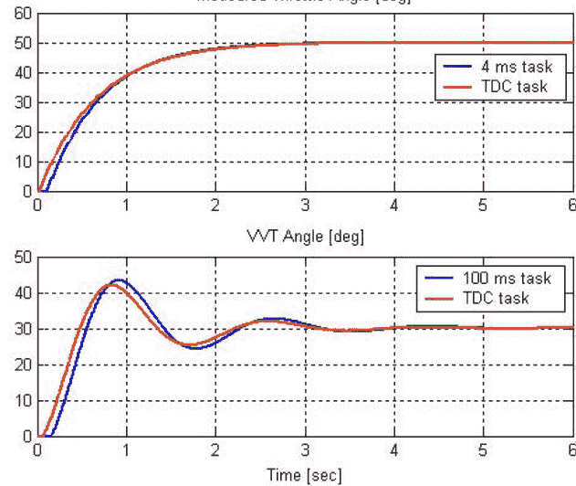

**图 6.** 控制系统的不同时间切片。

为了进行此类分析，在循环环境中进行了四项软件仿真测试，该环境集发动机/车辆 `Simulink` 模型与发动机管理系统，以执行 `MIL`（模型在环）和 `HIL`（硬件在环）仿真研究。特别地，执行了以下测试：

- 空调测试
- 失火测试
- 输出测试
- 催化器测试

`F.I.R.E.` 工具在生成代码和执行 `HIL` 仿真之前易于执行多速率仿真的相关性，可以通过比较空调测试获取的仿真结果来判断，此时相同的 `EMS` 模型 分别通过功能视图（图 7）或实现视图（图 8 和图 9）进行描述。事实上，尽管图 7 中的怠速控制看起来运行良好，但系统是不稳定的，发动机转速存在振荡（图 8），因为所选错误任务分配导致了大量的调度约束和任务执行延迟。

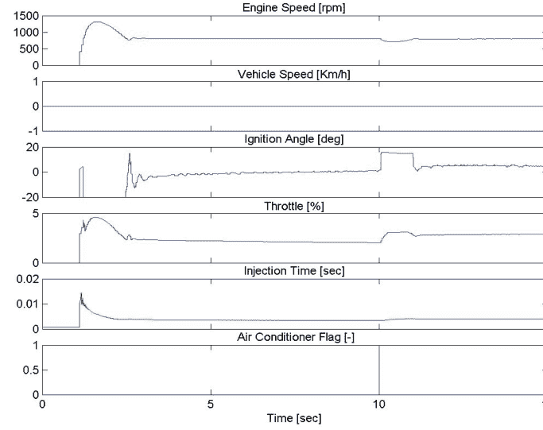

**图 7.** 带有 `ECU` 功能视图的空调测试。

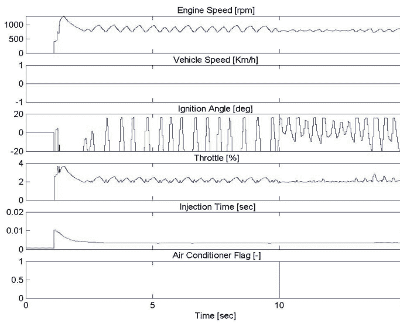

**图 8.** 带有 `ECU` 实现视图的空调测试。


然而，使用新的分配重复仿真（图 9），其中怠速控制分配从 100 ms 更改为 TDC，控制响应变得与图 7 中报告的规定标称值无异。通过 F.I.R.E. 工具执行另一个从功能到实现的转换，使得在最终生产代码生成之前的重复仿真成为可能。使用 ECU 可用性视图获取的仿真结果与使用功能视图获取的结果相比有显著差异，因为该视图仅包含模块的图形化重组，而不存在任何语义变化。

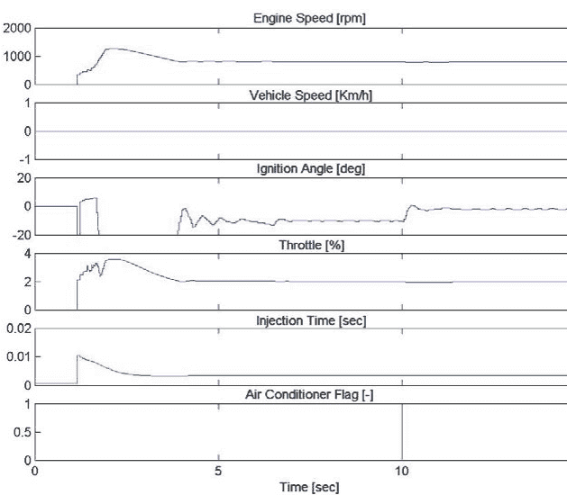

图 9. 带有新任务分配的 ECU 实现视图的空调测试。

## 基础发动机校准目标

一旦算法实现并测试，就可以使用集成在 F.I.R.E. 环境中的高级校准工具进行精确的模型校准。基础发动机控制算法的参数校准包括识别在定义工作范围内描述行为的最佳参数值。

单个算法（过程）的校准过程可以分为：

> ⁶当发动机转速为 800 rpm 时，TDC 事件大约每 40 ms 发生一次。

- 台架实验设计和执行
- 数据分析和算法校准
- 台架测试验证

这些阶段通常会重复直到达到目标精度。数据分析包括将实验结果转换为映射和向量，用于描述 ECU 软件中的发动机行为。

通过使用统计技术可以加速整个过程，这些技术减少了实验次数并最大化了每次测试的信息内容。利用再次在 MATLAB® 环境实现的高级校准技术，可以将信息自动转换为供 ECU 直接使用的校准映射。可实现的更高精度，特别是在处理多维执行（节气门、排气凸轮相位器、喷油器）时，相应地体现在性能上（更低的油耗、更大的最大功率等），并对整个发动机家族具有更稳健的现象表征，而不仅仅是“测试过的发动机”。

# 嵌入式控制系统的新型开发环境... 101

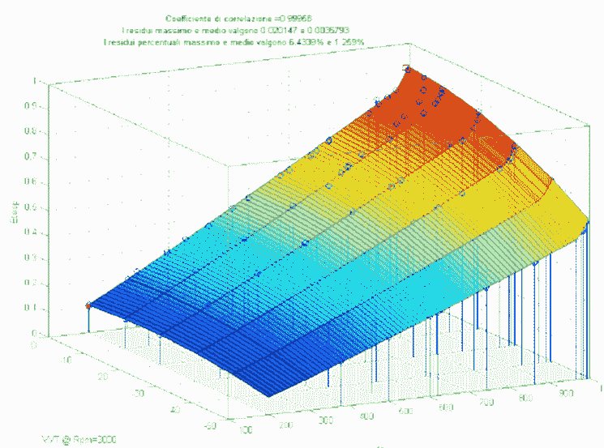

图 10. 多变量切换回归模型示例。

值得注意的是，这种依赖关系可以扩展到任意数量的独立变量 ([19])。此类模型具有极好的连续性，然而，如果方程与现象拟合得不好，可能会导致巨大的误差。使用这种新的切换回归模型具有许多优势：

- `非线性`允许人们以更高的精度描述已知现象。
- `多维性` 允许人们利用“稳健实验设计”技术，这种技术可以减少实验工作 [20–24] 并降低测量误差 [21] 对模型参数估计的影响。此外，映射的高连续性保证了控制算法在整个发动机家族中都能正常工作，而不仅仅是单台发动机。
- `实验点选择自由度更高`：如果独立变量没有经过精确控制，或者在断点处（即采集数据的稳态发动机工况）不可控，那么在最近的断点处获取的测量误差可能与控制误差处于同一数量。例如，进气效率通过调节节气阀来控制，在极低负载下，阀门位置的误差可达 2%，反映在目标经济性 2% 的误差上。这个问题在工业实践中通常通过手动修改测量值来解决。相反，多维切换回归器不需要对数据进行此类修改，即可在物理现象难以建模或控制的发动机区域保持相同的估计精度。

《Java Software and Embedded Systems》，由 Mattis Hayes 和 Isaac Johansson 编著，Nova Science Publishers, Incorporated, 2010. ProQuest。

## 离散回归模型

为了描述类型 `z=f(x,y)` 的关系，可以使用映射，该映射代表离散 x-y 网格上每个点的 z 值，该网格由两个断点向量定义。映射在不属于该网格的点上的输出值使用双线性插值法计算，类似于发动机控制单元（ECU）中的方法。

`DiscreteRegression` 工具是为了满足这一需求。它计算使实验数据与表面（描述为映射的双线性插值）之间的均方误差最小化的值。图 11 报告了一个示例。实验点被绘制为红点，而映射用透明蓝色表示。

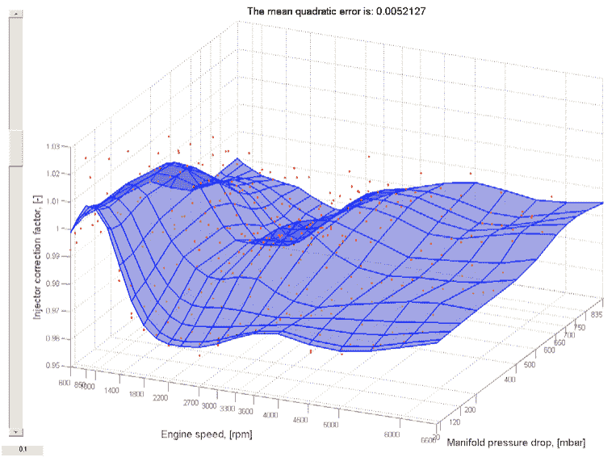

图 11. `DiscreteRegression` 工具示例。

在图左侧，有一个可以增加表面刚度的滑块。它的作用像弹簧一样拉伸表面边缘。高刚度产生平直表面，会增加均方误差。映射的连续性是校准阶段的要求之一。不连续性可能是由某些点的巨大误差引起的。不连续的映射可能会为非常相似的值产生不同的输出值。这在使用映射时是非常危险的，因为输入变量或其估计的误差可能会导致输出产生巨大变化，引起控制环路不稳定。刚度还可以用于为映射在未经历过的 x 和 y 坐标中的外推施加一种规则。

## 嵌入式控制系统的新型开发环境... 103

离散回归允许人们在采集数据集的选择上是自由的，因为例如不再需要精确地在断点交点处采集数据。它不需要像传统校准工具那样将问题拆分为子问题。

其优势与连续回归模型基本相同，但增加了以下内容：

- 在 ECU 中实现的模型是映射的输出。通过不仅在断点交点处采集数据，可以获得一个不仅最小化测量误差，而且最小化模型误差的映射。这一点在下文中有详细解释。
- 交互式增加映射刚度产生了更符合物理实际的输入/输出关系，从而避免过拟合问题。

## 离散回归算法

离散回归算法的目标是使映射与实验点之间的距离平方和最小。为了实现这一目标，可以与机械现象进行类比：每个实验点固定在空间中，而映射如图 12 所示沿 z 轴滑动。图中红色的每个实验点都通过一个蓝色的弹簧连接，弹簧的刚度对于每个点都是相同的。此外还有一个阻尼器。阻尼值可能至关重要。映射段（三维空间中的表面）具有质量，并根据第二动力定律对弹簧和阻尼器做出反应。力推动映射向点移动。映射将沿着弹簧系统能量最小的配置达到平衡。该能量的表达式为：

```
E = \sum K * \Delta z_i^2
```

其中 K 是弹簧的刚度

$\Delta z_i$ 是第 $i$ 个实验点与映射之间的 z 轴距离

N 是实验点的数量

该公式代表了实验点与映射之间的平方误差和。

机械系统的动力学已经离散化并使用离散差分方程用 MATLAB® 代码实现。了一些编程技术以避免可能的不稳定并提高仿真速度。结果是，可以在几分钟内处理超过 200,000 个点。此外，输出的映射更加平滑，与物理现象的描述更加一致，并且可以由工程师进行交互式的判断和修改。

## 多映射优化

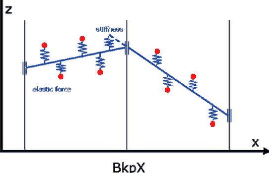

实现了算法的 MATLAB/Simulink 模型。该模型由实验采集驱动，产生取决于校准要求的输出。多映射优化从多个方面改变了校准结果。它改变向量和标量（映射元素），直到测量输出与估计输出之间的平方误差或均方误差最小。

所实现的优化方法基于梯度下降算法（见 [25], [26] 和 [27]）。该算法是一种局部优化过程，但使用了一些技巧来减少陷入局部最小值的概率。多映射优化极快，例如在 1.6 GHz 的处理器上可以在十分钟内优化 12x21 的映射。

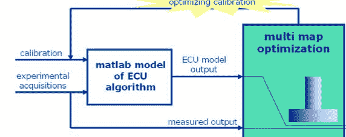

图 12. `DiscreteRegression` 原理。

图 13. 多映射优化工作原理。

## 嵌入式控制系统的新型开发环境... 105

开发过程中，显示了优化后的映射，见图 14，以及预测观测图和一些统计数据，例如均方误差。

结果的精度比传统技术高出四倍。映射更加平滑，因为优化算法被指示在具有相同误差的解决方案中选择最平滑的一个。

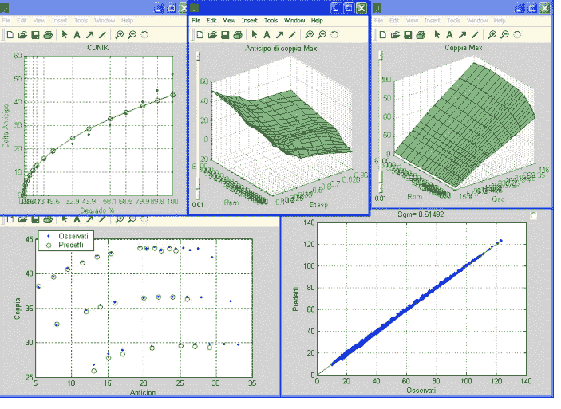

过去，首次校准是在映射上完成的，如果断点由于某些原因发生变化，没有自动方法可以重用旧的校准，只能进行耗时的手动重新调优（通常使用 Excel 表格进行）。相反，所提出的多映射优化方法将人们从这种情况下解放出来。

其他优势还包括：

- 可以同时优化多个映射。该方案最小化总误差，而不是单个映射的误差，因此结果通常更好。
- 映射的精度和连续性优于传统方法的结果。

# 可调算法

所描述的优化技术主要用于校准汽车估计算法。这些算法的第一步是通过特定的测试仪器通过特定的传感器测量进行验证的，而这些仪器在商用汽车发动机中是并不存在的。

算法必须是无记忆的，例如扭矩估计算法。上述优化技术难以用于动态算法，如进气温度估计；对于这些动态特性，只有静态部分使用多幅图表优化（multi-map optimization）进行校准，而动态部分则必须以不同的方式进行校准。

此外，校准需要控制非模拟变量（例如壁面润湿补偿策略的燃料混合气）的算法是不可能的，而壁面润湿是指位于喷油器旁进歧管壁上的燃料量，它将在运行过程中参与燃烧过程。在这种情况下，下文介绍的工具仍然有助于校准过程。

# 性能测量

优化后的图表通常通过计算预测值与实验值之间的均方误差（后文用 σ 表示）来评估：误差越小，图表对实验点的表征就越好。该统计值乘以 3，是对实验数据在图表描述表面周围变化范围的良好估计。更准确地说，在正态误差分布的假设下，所述范围内的实验数据出现的概率为 99.97%。

对于类似的应用，百分比均方误差更有意义。它是通过将实验值的平方误差乘以 10 得到的。通过这种方式，统计值与最终性能的相关性更高；例如，在空气电量估计中，百分比均方误差与混合气调节执行的误差相关。

估计算法的误差可以分为两部分：模型误差和测量误差。模型误差是由于使用的模型不够复杂以描述所研究的现象引起的。可以使用不同的模型方程、增加图表数量或更改图表的断点来减少。

测量误差是由于数据采集和处理仪器的精度的限制导致的。与回归模型相较远的实验测量值（通常称为离群值）必须消除，并在可能的情况下重新测量，以提高模型精度。结果，优化后的图表比在每个特定断点手动测量的图表对测量误差具有更强的鲁棒性。这一基于切比雪夫不等式（Chebyshev inequality）的陈述证明了使用多变量回归模型所实现的校准质量改进，这些模型比基于单变量的模型对测量误差更具鲁棒性。通过强制更多维度上依赖变量的连续性，生成的模型依赖于更多的实验点，减少了将测量误差解释为现象的概率。

# 校准性能验证工具

对于每个校准问题，都开发了一种特定的工具，以图形和数值形式显示校准变化对发动机控制算法精度的影响。该工具有助于快速验证校准是否符合规定的标准，并根据校准工程师的经验进行最终调优。自动校准的结果必须由专家根据其知识进行验证：

1. 校准工具在缺少数据时会推断最近点的行为。专家校准员可以使用其对现象的知识完成此任务。
2. 校准工具针对通常最重要的变量进行优化，但在运行条件下，它可能不是唯一的关注变量。在这种情况下，校准工程师可以修正优化过程；通过用户友好的图形界面，使用拆除的台架测试加速了这项任务。

图 15 显示了用于实际发动机校准的点火提前和扭矩估计工具的主界面。主图显示了所谓的“伞形”曲线，这意味着在预定义的发动机转速和相位变化下，平均扭矩取决于点火提前。

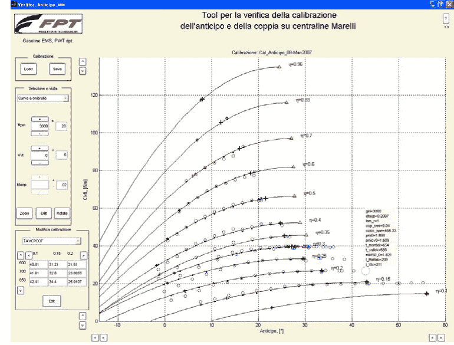

图 15 扭矩接口验证工具。

# 标准文件

为了方便信息交换，定义了一些标准文件格式和内容。

## 发动机台架数据

发动机台架数据文件在台架测试时生成。它是一个 Excel 表格，第一行包含采集变量的名称，第二行是测量单位，从第三行开始是采集的数据。每行代表一个运行静态点，其特征是稳定时间后输入输出值的测量值。测量持续预定的时间。整个采集过程都可以自动化。

通常数据在第一阶段用于校准目的，在第二阶段用于校准验证。

## 校准

校准文件必须包含与校准算法相关的 ECU 参数信息。

# 开发的工具：实际发动机校准的应用

以下工具是在 MATLAB®7/Simulink 环境下开发的。它们目前被校准工程师用于实际发动机应用。

## 进气量估计

在引入上述工具之前，实验计划需要 15 天（每天 24 小时）。这项工作必须乘以校准阶段硬件发生重大变化的倍数，通常多达四次。每个计划的数据分析几乎需要 5 天。生成的图表存在大量不连续性，估计误差不尽如意。

校准工具在一次实际校准阶段开始时引入开发过程中。实验计划时间减少了一半，现在需要 8 天，每天 24 小时。数据分析现在只需要几个小时。估计误差几乎减少了一半，现在是满意的。

**自动校准：** 校准工程师利用的标准已实现在此工具中。校准部门与发动机测试部门之间的协同产生了自动校准工具的持续改进。

# 用于嵌入式控制系统设计的新开发环境... 109

输入包括：

- 校准文件，用于收集维度和断点的信息。
- 一个或多个发动机台架测试文件，包含必要的通道。

对于每个发动机转速断点，计算一个多变量切换回归模型（见图 10），以描述进歧压力–凸正角–进气效率的关系。所使用的模型通过考虑 ECU 的可重复性关系和现象的物理行为开发的。进气效率与凸正角呈二次相关，与进歧压力呈线性相关。在断点压力（一个回归参数）之上，线性依赖变为无一阶导数连续的二次相关，而在 300 mbar 以下的跨度最能拟合数据。


图 16 变化校准验证工具。在定义的进歧压力下，进气效率取决于凸正角。

回归模型随后被离散化并在不丢失信息的情况下转换为 ECU 算法模型，该模型由 4 幅图表组成，总共 1092 个参数。

## 110 Alessandro Cavavola Ferdinando De Cristofaro and Iolanda Montalto

校准验证：该软件允许以图形化和数值化的方式可视化实验点与相应的 ECU 估计点之间的关系。可以通过以下视角对工作算法进行探索：

- 等值进气歧管效率曲线
- 等值凸轮相位器效率曲线
- 取决于压力和凸轮相位的容效率 3D 表面
- 取决于进气压力和凸轮相位的等值容效率曲线
- 总充气量估计的百分比误差

可以通过图形化或数值化的交互方式对映射表进行修改，以验证其中一种可能视图中的效果。

点击实验点会显示额外信息，而右键点击鼠标会打开上下文菜单，允许删除该点或打开源数据文件，并高亮相应的行。

通过打开工具的实例，可以利用校准的验证和精炼来比较不同的校准或不同的台架测试数据。

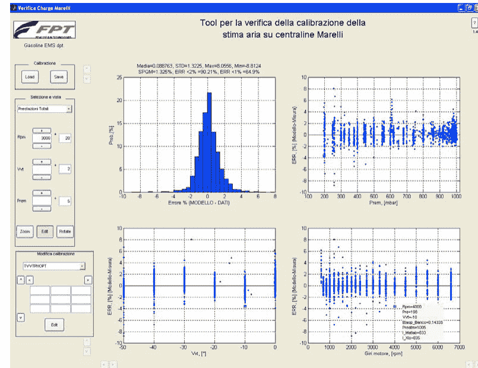

图 17。充气量验证工具。总性能，统计。

Copyright © 2010. Nova Science Publishers, Incorporated. 由 Mattis Hayes 和 Isaac Johansen 开发的 Java 软件，Nova Science Publishers, Incorporated，2010. ProQuest

## 嵌入式控制系统的新型开发环境... 111

性能测量：该工具从估计准确性的角度测量[校准-发动机台架测试数据]对的总性能。可以完成来自不同来源的校准，快速找到关键点，并评估算法的不同版本。此功能也集成在充气量校准验证工具中（图1）。

## 汽油喷嘴模型

自动校准：该工具自动校准汽油喷嘴模型（图11）。它使用相同的发动机台架测试数据进行充气估计。离散回归工具可以轻松计算出使 ECU 执行的喷射汽油估计值与测量值之间误差最小的映射表。

## 点火提前角计算与扭矩估计

自动校准：发动机提供的扭矩主要通过发动机转速、进气效率、凸轮相位位置和点火提前角进行估计（[13] 和 [14]）。在没有凸轮相位的发动机中，算法使用了两个映射表和一个向量：

- `MTA (speed, eta)`，称为最大扭矩映射提前角：它描述了每个发动机转速/进气效率下使扭矩最大的点火提前角。如果在达到最大值之前发生爆震，则使用外推值来拟合数据。在图15中，红色三角形的 x 坐标代表最大扭矩。
- `MT (speed, eta)`，称为最大扭矩映射：它描述了在最大提前角下测量的指示扭矩。在图15中，它由红色三角形的 y 坐标表示。
- `UC (advance – MTA [speed, eta])`，称为唯一曲线：它描述了点火提前角与最大点火提前角之间的距离如何降低扭矩。如果输入为0则输出为1。随着差异增大，输出减小。它非常类似于抛物线，并具有在方程中良好拟合实验数据的特性：

```
TORQUE = MT (speed, eta) * UC (advance – MTA [speed, eta]) (2)
```

其中：

- `speed` 是发动机转速
- `eta` 是进气效率
- `advance` 是实际作用的点火提前角

描述扭矩输出的超曲面必须是连续的，因为它描述的是物理现象。多映射优化会自动找到拟合实验数据的映射表值。结果是非常连续的（图14）。

## Alessandro Casavola, Ferdinando Cristofaro and Iolanda Montalto

扭矩估计的误差 0.61 Nm 几乎是传统校准方法获得误差的四分之一，传统方法通过分析相同发动机转速和进气效率下的点来计算最大扭矩点火提前角，因此对实验误差极其敏感。

通过使用多映射优化和离散回归的不同实现，可以考虑凸轮相位依赖关系校准 10 个映射表，总共 2284 个参数。

校准验证：这有助于校准工程师验证点火提前角计算和扭矩估计的正确性。在图15和图18中显示了两个截图。输入为：

- 校准工具生成的 Excel 格式校准文件，
- 发动机台架测试数据。

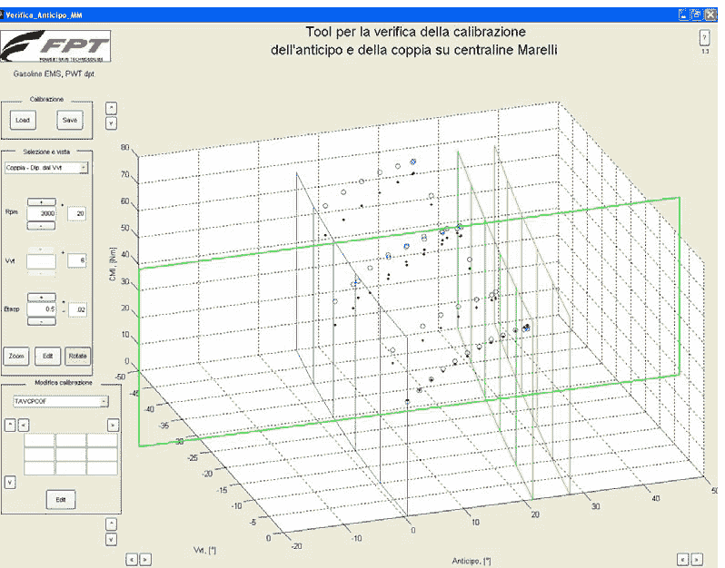

图 18。扭矩验证工具，凸轮相位位置部署。

主图显示了固定发动机转速和凸轮相位位置下的“伞形”曲线 CMI(advance)。获取的数据由蓝色圆圈表示，而校准估计的相应点是黑点。红色三角形代表每个负载断点的最大扭矩，而大加号符号是工作点火提前角。点击每个实验点会显示额外信息，如燃油消耗、温度等。相反，点击 ECU 计算出的点将显示相对公式以及输入映射表的值。

## 嵌入式控制系统的新型开发环境... 113

在左侧面板中，可以选择发动机转速、凸轮相位位置和负载。可以通过 `obj` 字符串指定凸轮相位，以仅选择目标凸轮相位位置的点，从而表征稳态点。在左下侧可以以数值或图形化的交互方式修改映射表，并控制主图中的效果。

在图18中，显示了 CMI（提前角，凸轮相位位置）图，用于从另一个视角验证现象。

还有三个视图可用，以验证每个凸轮相位位置下的工作提前角是否正确。修改后的校准可以导出为 Excel 格式，准备复制到 ECU。

## 结论


在本章中介绍了一种用于嵌入系统设计的强大分析和仿真工具。讨论了相关的汽车行业需求以及控制系统支持工具的重要性。基于这些考虑，构建了 `F.I.R.E.` 以提供 `Simulink` 模型的多个视图，因为控制系统开发者需要考虑不同的方面，而这些通过单一图形表示法无法看到。它主要允许根据自动代码生成器的对控制系统进行图形化整理和早期定时分析，目标是从这些模型直接生成 `ECU` 的生产代码。

该软件已实际应用中经过测试和验证，通过研究由于调度选择不当导致的闭环系统行为，以及工具协助寻找每个任务的最正确时间片，说明了该工具的重要性。未来的开发包括：

- 功能到实现的转换中对连续时间块进行自动离散化
- 功能视图与实现视图之间仿真结果的联合比较、反转换以及视图间的整体一致性检查
- 在功能到实现的转换中显式指定每个任务内部子任务的执行顺序。

# 114 Alessandro Casavola Ferdinando De Cristofaro 和 Iolanda Montalto

另一方面，该环境与精确仪器的集成保证了发动机系统的产品质量，这对成本有很大影响，并且必须从开发的第一阶段就开始进行管理。为了严格控制（即使是冲突的）需求，开发环境必须允许每个阶段之间进行强集成。这种满足对所用工具的特性以及参与开发人员的必要技能具有巨大影响。实现的一个重要目标是能够合并不同工程部门（例如发动机应用和发动机控制系统开发）的技能以及不同项目的经验，以确保未来项目中所需产品特征具有可预测性。

## 参考文献

- [1] Henriksson, D., Cervin, A. and Árén, K.E. “TrueTime: Real-time Control System Simulation with MATLAB/Simulink,” Proceedings of the Nordic MATLAB Conference, Copenhagen, Denmark, 2003.
- [2] Ohlin, M., Henriksson, D. and Cervin, A. “TrueTime 1.4 – Reference Manual,” Department of Automatic Control, Lund Institute of Technology, Sweden, 2006.
- [3] Calvez, J.P. Embedded real-time systems: specification and design methodology, First Edition, John Wiley and Sons, Chicago, England, 1993.
- [4] Gaviani, G., Gentile, G., Stara, G., Romagnoli, L., Thomson, T. and Ferrari, A. “From concept to implementation: a model based design approach,” Proceedings of 1st IFAC Symposium on Advances in Automotive Control, Salerno, Italy, 2004.
- [5] Oshana, R. “Introduction to embedded and real-time systems,” Proceedings of Embedded Systems Conference, Boston, USA, 2003.
- [6] Kiencke, U. and Nielsen, L. Automotive Control Systems: For Engine, Driveline and Vehicle, Springer, Berlin, Germany, 2000.
- [7] Törngen, M., Elkhoury, J., Sanfridson, M. and Redell, O. “Modelling and Simulation of Embedded Control Systems: Problem Formulation,” Technical report, Mechatronics Lab, Department of Machine Design, Royal Institute of Technology, Stockholm, Sweden, 2021.
- [8] Köster, L., Thomsen, T. and Strack, R. “Connecting Systems to OSEK: Automatic Code Generation for Real-Time Operating Systems with Target,” Embedded Intelligence, Nuremberg, Germany, 2011.
- [9] TargetLink – Production Code Generation, for TargetLink 2.0, dSPACE GmbH, Paderborn, Germany, 2004.
- [10] Buttazzo, G. “Sistemi Real-time per il controllo automatico: problemi e nuove soluzioni,” Automazione e Strumentazione, XL XVIII, N. 5, pp. 107–116, 2000.
- [12] Liu, C.L. and Layland, J.W. “Scheduling algorithms for multiprogramming in a hard real-time environment,” Journal of ACM, 20, N. 1, pp. 46–61, 1973.
- [13] Automotive Electronics Automotive Electronics, Fourth Edition, Robert Bosch GmbH, Plochingen, Germany, 2004.
- [14] Heywood, J.B. Internal Combustion Engine Fundamentals, First Edition, Mc Gray-Hill, New, USA, 1988.
- [15] Annunciata, M., D. Cristofaro, F., Flauti, G. and Scala, S. “Development of a Virtual Test Environment for Engine Control Systems: ESILE, Elias Software in The Loop Environment”, F2004F191, Proceedings of FISITA 2004, Barcelona, Spain, 2004.
- [16] De Cristofaro, F., Riegel, A., Di Martino, U., De Sisto, G. “Estimation of drawn air mass on an ICE: implementation of a new algorithm to better estimate the atmospheric pressure influence,” Proceedings of SAEInternational 2007-01-1344, Detroit, 2007
- [17] Heywood J.B., Internal Combustion Engine Fundamentals, McGraw Hill, 1988
- [18] Della Volpe, R. Motori a Combustione Interna per Autotrazione, Second Edition, Liguori Editore, Napoli, 1995
- [19] Box, G.E.P., Draper, N.R. Empirical Model-Building and Response Surfaces, Wiley and Sons, New York, 1987
- [20] Montgomery, D.C., Il Controllo Statistico della Qualità, McGraw-Hill, New York, 2000
- [21] Erto, P., Probabilità e statistica per le scienze e l'ingegneria, McGraw-Hill, Italia, 2004
- [22] Box, G.E.P., Hunter, J.S.; Hunter, W.G., Statistics for Experimenters, Wiley and Sons, 2005
- [23] Peter W.M.J., “Statistical Design and Analysis of Experiments,” Classics in Applied Mathematics, Vol. 22, 1998.

# 一种嵌入式控制系统的新型开发环境... 115

# 无处不在空间下 HCI 的 Java 软件

为了高效实现部分代码，使用了软件架构。[2] 由设计模式组成的面向模式的软件架构被用于实现子系统和应用层。[3] 面向模式的软件架构比设计模式更复杂的模式，且面向模式的软件架构方法论应用于统一建模语言（`UML`）或面向对象的分析与设计。

# 软件架构模式

设计模式作为实验性模式已用于源代码，以提高软件架构的质量。按目的分类的软件架构模式用于实现用户与计算机之间的交互系统。表1显示了交互系统的软件架构模式以及 Web 应用程序的软件架构。当应用程序从 `GUI` 或或其他系统接收输入数据时，应用程序中的软件架构模式会实时更新数据参数。为了满足这一需求，使用了模型-视图-控制（`MVC`）和呈现-抽象-控制（`PAC`）来实现应用程序。

## 表 1. 软件架构模式

| 软件架构模式 | |
|---|---|
| Web 应用程序的交互系统软件架构 | 模型-视图-控制 (`MVC`)、呈现-抽象-控制 (`PAC`)、依赖注入 (`DI`)、数据访问对象 (`DAO`)、数据传输对象 (`DTO`) |

## 1. 模型-视图-控制 (`MVC`)

模型-视图-控制由接收 `GUI` 输入的视图、判断输入是否用于模型的控制器以及用于存储输入的模型组成。`MVC` 由三种设计模式组成，能够避免应用程序中软件架构的复杂性，且软件架构的简单性可以轻松地更新结构。在 `GUI` 应用程序中使用 `MVC` 时，复合设计模式由组合设计模式、作为策略设计模式的控制器以及作为观察者设计模式的模型组成。另一方面，`Spring Framework` 被用于 Web 应用程序。

## 2. 依赖注入 (`DI`)

依赖注入是一种高效的软件架构，它划分了组件之间的结构。当应用程序包含不同的数据库时，该架构能够实现应用程序与数据库之间无依赖配置。

# 可视化接口

表2 显示了可视化的 API、软件语言和框架。软件应用程序的分析和规范是根据需求进行的，并在已知软件架构中选择了最佳框架。

## 表 2. API、软件语言和框架

| 媒体内容 | 描述 |
|---|---|
| 可视化 | 游戏等。计算机图形(`OpenGL`)...`FLASH`, `Processing` |
| Web 应用程序 | `Strus`, `Spring` 等。通过网络连接发布，用户通过网络浏览器提供输入。 |
| `GUI` 应用程序 | `Swing`, `SWT` 图形界面 |

对于复杂的数据可视化和对鼠标或设备输入做出反应的交互系统，使用了 `3D` 图形 API 或作为处理和 `OpenGL` 的插件用于可视化的输出。为了实现应用程序，需要一种通过目标结构有效软件架构来实时接收不同软件语言或设备的数据输入接口。[4][5]

由数据库和中间件组成的 Web 应用程序利用 Web 浏览器的数据。Web 应用程序的软件架构是复杂的，需要高效的架构。同样，用户界面需要可用性来高效理解显示的数据，因此实现有效的软件架构至关重要。有效软件架构之一是将软件架构分为用户界面部分、分析和数据库部分，例如框架 `Strus`、`Seasar` 等。

在图形用户界面（`GUI`）应用程序中，排序系统的屏幕图或图标考虑了可用性。屏幕和图标的目的是通过在 `GUI` 应用程序中点击或输入字符来指示应用程序用法，`GUI` 通过表示 `GUI` 来控制用户的操作。应用程序的可用性取决于应用程序中的 `GUI` 架构。

# 无处不在空间下中间件基础设施的软件架构

无处不在空间假设电子设备通过网络连接，通过网络协议共享信息，中间件为应用程序提供与电子设备相关的信息。由于来自许多电器或电子设备的传感器数据量巨大，无处不在空间中间件的软件架构需要高效的结构来从传感器获取数据以及管理数据库中的信息。这种用于无处不在空间中间件的新型框架或软件架构模式已作为概念工具包提出，具有多态媒体设备的小部件、聚合器、解释器和实体协作者。[6][7]

# 无处不在空间下 HCI 的 Java 软件

## 结论

从 `HCI` 的角度来看，应用程序功能需要对用户输入进行可视化并更新数据，使用了设计模式、`MVC`、`PAC` 和 `DI` 等可靠的软件架构和框架来实现这些功能。同样，为了高效实现了无处不在空间的中间件，中间件的一种可能方法是使用 `Java` 等面向对象的语言构建新型软件架构，如设计模式、软件架构模式和框架。上下文工具包或实体协作者有望为无处不在空间提供新平台。

## 参考文献

- [1] “Designing for interaction” Dan Saffer
- [2] GOF’Design Patterns : Elements of Reusable Object Oriented Software
- [3] Frank Buschman etal “Pattern-Oriented Software Architecture”
- [4] “Exploring and Explaining Data with the Processing Environment”Ben Fry O’Reilly
- [5] Processing www.processing.org
- [6] Anind K. Dey, Jen Mankoff and Gregory D. Abowd et al: Distributed Mediation of Imperfectly Sensed Context in Aware Environments,” UIST 2000, September 2000
- [7] Takashi Kasuya (Graduate School of Media and Governance, Keio University)
- [8] Yasuto Nakanishi (Faculty of Environmental Information, Keio University) EntityCollaborator: A Ubiquitous Computing Framework Using SIP and DHT, IPS Journal

# 124 Christopher M. Gifford, Jerome E. Mitchell 和 Arvin Agah

每一个支持 `Java` 的计算平台。开发者与其开发多个特定领域的版本，不如将注意力转移到软件的功能和质量上。这种可移植性和透明性，结合可维护性，构成了 `Java` 技术的一大优势。

`Java` 已用于许多不同的应用和领域，从微型传感器测试到用于尖端研究的大型架构。本章的示例是机器人技术和人工智能（`AI`）领域。`Java` 有许多方面非常适合机器人技术和 `AI` 工作。它的易用用性使其成为系统原型设计、使用每个对象的 `main` 方法进行组件测试以及算法快速开发的理想选择。机器人和智能软件通常需要大量的调试。`Java` 提供了易于调试的功能，满足了这些需求。此外，其面向对象的特性非常适合现代大型软件项目。

机器人及相关智能算法的虚拟原型和仿真是其开发过程中的重要一步。用户界面（`GUI`）的开发有助于信息的视觉化，以及用户与软件的交互。`Java` 能够通过 `Swing` 和标准小部件工具包（`SWT`）等专用包整合复杂的图形和界面。这些属性展示了 `Java` 在现实世界研究中的巨大潜力。

本章讨论了利用 `Java` 语言或基于 `Java` 的方法的机器人和 `AI` 工作。重点在于讨论这些领域的广泛应用，并结合现实世界的研究案例。因此，本章的目的并非提供全面的概述，而是展示 `Java` 的能力和多样性。

# 2. 机器人技术和人工智能领域的 Java 实践

`Java` 的最佳资产之一是互联网上丰富的知识和教程。初学者可以与专家互动，定制如何利用 `Java` 来解决他们尝试解决的特定问题。`Java` 的简单性使其成为机器人技术、传感器组件监控以及设备接口连接的极佳学习工具。

将面向对象的软件工程实践应用于复杂的机器人和智能算法中，可以创建灵活、可扩展且可更换的软件架构。这些在涉及许多传感器组件和连接设备的大型系统中非常有价值。此类系统的组织对于调试和长期可维护性都至关重要。接下来的章节将讨论在机器人技术和人工智能中使用 `Java` 的一些工作。

对机器人技术和人工智能的一个内在兴趣是在软件中实现智能和行为。行为之间经常相互作用，多种行为的组合会产生涌现行为。在多智能体和多机器人系统中也是如此，简单的机器人可以协作完成复杂任务，并获得效率和鲁棒性的额外收益。为机器人和智能体编写的软件通常会变得巨大且复杂，需要仔细的设计和实现，并注意机器人可能遇到的实时性限制。通过使用软件工程和现代开发原则，此类开发任务将变得更加

`Java Software and Embedded Systems`，由 `Matt Hayes` 和 `Isaac Johansson` 编辑，`Nova Science Publishers, Incorporated`, 2010. ProQuest

# 机器人技术和人工智能的 Java 方法 125

更有组织且易于管理。软件开发生命周期的步骤可以集成到人工智能和机器人软件的开发中。`Java` 配合一些辅助工具提供了这种优势。然而，在实时、资源受限的低级系统中的抽象可能会增加软件所需的空间，并导致其运行速度稍慢。随着处理能力的不断增长，这个问题将不再是问题。

## 2.1. 编程开发接口


# Eclipse 和 NetBeans IDE

Eclipse 是一个用 Java 编写的开源软件系统。它的创建是为了提供插件式工具，以扩展其对多种编程语言和应用的能力 [25]。除了允许 Eclipse 扩展到如 C 和 Python 等其他编程语言外，插件框架还允许 Eclipse 能够与 LaTeX 等排版语言配合。Eclipse 软件开发工具包（SDK）包含了 Eclipse 开发工具，提供了带有内置 Java 编译器和 Java 源文件完整模型的集成开发语言环境。Eclipse 的部件使用了从抽象窗口工具包（AWT）并用 Java 编写的标准小部件工具包（SWT）。Eclipse 的用户界面还利用了一个名为 JFace 的中间 GUI，它简化了基于 SWT 的应用程序的实现。

NetBeans 集成开发环境（IDE）是一个基于 NetBeans 平台的 Java 开源开发环境 [22]。NetBeans 支持 Java 应用的开发，如 Java SE、EJB、Java 移动应用、Apache Ant 系统、版本控制和重构工具。Eclipse 显示出大量的商业和研究用途。例如，稍后将讨论的 Java Sun 设备其应用程序编程接口（API）和软件加载过程嵌入在 NetBeans IDE 中。这使得这些设备的编程变得快速而简便。接下来的许多系统都利用这些编辑器进行 Java 开发。此类 IDE 还被用于创建仿真应用程序和游戏开发。在这方面，游戏的人工智能方面可以构建到现有的基于 Java 的引擎中 [6]。

## 2.2 WEKA 机器学习套件

WEKA 由新怀卡托大学开发和管理，是一套用 Java 编写的全面的开源面向对象机器学习和数据挖掘算法 [27]。除了分类、回归、聚类和关联规则算法外，它还提供了数据过滤、预处理和可视化的方法。该包集为预处理例程提供了接口，包括特征选择、类别和数值学习任务、分类器的性能增强、不同标准（如均方根误差）的评估，以及用于验证模型鲁棒性的实验支持。所有算法都提供了这些支持。此外，所有算法都使用相同的软件架构实现，因此比较、组合和交叉验证算法变得容易。

![img/c669dc86947c1e394b7ee25b3acc20f3_139_0.png]

图 1. WEKA Explorer 用户界面的示例。

```
/// 使用天气数据集训练 C45 决策树学习器
> java weka.classifiers.trees.J48 -t weather.arff -i

// 在大豆数据集上训练和测试朴素贝斯分类器
> java weka.classifiers.bayes.NaiveBayes -t train.arff -p0
```

图 2. WEKA 命令执行示例。

WEKA 在机器学习文献中被广泛用于开发机器学习技术并与先进技术进行比较。图 1 显示了 WEKA 的图形界面。该库还提供了命令行使用方法，如图 2 所示。

## 2.3 Robocode

Robocode 是一种事件驱动的开源基于 Java 的虚拟机器人游戏，旨在将 Java 编程技术（如继承和面向对象编程原则 [16]）与模拟机器人和团队玩家的人工智能组件相结合。Robocode 包括一个开发工具和一个机器人可以在其中战斗的虚拟竞技场。开发新机器人需要编写其智能，这将产生一个派生自 `Robot` 的新 Java 类。

![img/c669dc86947c1e394b7ee25b3acc20f3_140_0.png]

图 3. Robocode竞技场和战斗的示例视图。

`Robot` 对象拥有一个带有无限循环的 `run` 方法，该方法描述了机器人的默认行为。其他方法（如 `HitWall` 和 `scanRobot`）在游戏仿真引擎识别到事件时被调用。这些方法为机器人提供了输入，机器人可以立即做出响应，也可以记录以便稍后处理。响应包括 `ahead`（前进）、`back`（后退）、`turnleft`（左转）、`turnright`（右转）、`fire`（开火）、`turngunleft`（炮口左转）等命令。每个机器人类都可以包含数据，以创建对过去事件和世界的记忆。学习语言的新元素可以用于产生更复杂的机器人行为和智能。该资源是通过竞争性策略和战斗模拟来学习 Java、人工智能和机器人学的媒介。

图 3 展示了模拟竞技场中的机器人。有各种端口材料和教程可供选择 [17]，范围从创建机器人、到在 Java IDE 中为 Robocode 开发，再到编程智能和策略。例如，图 4 展示了一个简单的机器人实现，它可以被扩展以实现更复杂的行为。

## 2.4 TeamBots

TeamBots 是一个基于 Java 的软件包，用于移动机器人和多智能体系统的原型设计、仿真和执行 [2]。系统控制机制使用 TBSim 仿真开发，移动机器人使用 TBHard 机器人执行环境。

```java
package man;
import robocode.*;

// 简单的机器人实现，继承了 Robot 基类
public class MyFirstRobot extends Robot {
  // 循环
  public void run() {
    while (true) {
      ahead(100);
      turnGunRight(270);
      back(50);
      turnGunRight(60);
    }
  }
  // 机器人扫描事件方法
  public void onScannedRobot(ScannedRobotEvent e) {
    fire(1);
  }
}
```

图 4. 简单的 Robocode 机器人实现，作为构建更复杂机器人行为的基础。

可以设计出异构机器人和智能体，它们利用异构控制系统，同时用于移动机器人的仿真和实时控制。仿真环境还允许用户嵌入道路、墙、圆形物体和其他机器人。TeamBots 允许对不同的机器人进行相同的控制软件原型设计。这种灵活性允许控制方案的快速原型设计，并允许软件与硬件并行开发。与 Robocode 类似，TeamBots 在一个运行循环上，该循环在每个仿真步为每个机器人/智能体调用一次，并在碰撞等事件中具有额外的控制行为。尽管已经开发了许多 Java 仿真器，但 TeamBots 在多年来的各种应用中得到了大量的实验性使用。图 5 显示了一个仿真示例，同一团队的多个智能体可以协作完成对对手队得分的任务。

## 2.5 Java Sun SPOTs

小型可编程对象技术（Sun SPOT）是一种无线传感器网络，能够在没有操作系统的情况下直接在处理器上执行 Java 微型版本虚拟机 [24]。SPOT 开发工具包提供了高效的电池供电 Sun 单元，这些单元由 180 MHz 32 位 ARM920T 核心、512K RAM、4MB 非易失 Flash 内存、802.15.4 射电、8 个多色 LED、USB 接口和一个基站组成。基站与自由范围单元无线通信，并通过 USB 连接流数据。自由运行的 Sun Spots 也是较小的传感器设备，带有板载处理器、3 轴加速度计和基于 IEEE 802.15.4 地址的射电。这些设备最初是为了无线传感器网络应用开发的，但也非常适用于单机器人和多机器人系统。图 6 显示了一个去除了天窗的自由范围 Sun SPOT 图像。

![img/c669dc86947c1e394b7ee25b3acc20f3_142_0.png]

图 5. 描述多智能体竞争足球赛的 TeamBots 仿真。

![img/c669dc86947c1e394b7ee25b3acc20f3_142_1.png]

图 6. 去除天窗并点亮 LED 的自由范围 Java Sun SPOT 无线设备。

硬件考虑可以包括几个传感器，而模拟数字转换输入以及五个温度和光传感器、通用 I/O 引脚可用于添加传感器和设备。此外，提供高电流输出引脚控制执行器或电机。通过具有线程能力的 Java Sun SPOT API，与传感器的接口以及通过无线电通信变得简单 [23]。开发也十分直接，因为 API 和 Sun SPOT 过程已集成到 NetBeans IDE 中。图 7 显示了简单的 Sun SPOT 加速度计代码，证明了这些无线设备的易用性。

```java
// 计算 Sun SPOT 沿 X 轴的倾斜角度
public int getTiltDegrees() {
    // 获取每个轴的加速度
    double x = getAccelX();
    double y = getAccelY();
    double z = getAccelZ();

    // 计算加速度幅度
    double a = Math.sqrt(x*x + y*y + z*z);

    // 归一化并将弧度转换为角度
    double tilt = x / a;
    double tiltRadians = Math.toDegrees(tilt);
    return (int)(tiltRadians + 0.5);
}
```

图 7. 随软件提供的 SPOT 加速度计代码 [24]。

## 2.6 Java 机器人社区

现有的几个网站专门面向 Java 机器人学。例如，JavaNet 社区是关于 Java 设备、会议和竞赛的著名网站 [11]。它包含教程和 Java 代码库，SPOT 子社区作为该网站的一部分存在 [12]，提供了如何在移动机器人上使用 Spots 的文档。

## 2.7 JOONE

Java 对象神经网络引擎（JOONE）是一种免费的多平台人工智能神经网络框架，利用视觉化环境进行创建、训练和测试 [13]。JOONE 由基于组件的架构组成，基于可链接组件构建新的学习算法和网络架构。组件使用图形编辑器组装在一起，逻辑通过脚本控制。功能包括监督学习（如前馈和反向传播神经网络）、无监督学习（如霍夫宁自组织映射和主成分分析）、数据预处理机制以及脚本能力。它还允许使用并行模式进行训练，图 8 展示了 JOONE 神经网络环境示例。

![img/c669dc86947c1e394b7ee25b3acc20f3_144_0.png]

图 8. JOONE 图形编辑器，用于创建神经网络组件并将其组装以训练和测试 [13]。

## 2.8 Jess 规则引擎

Jess 是一种用于 Java 平台的开源规则引擎，类似于 CLIPS 规则引擎，于 1995 年在圣地亚国家实验室完全用 Java 开发 [4]。某些部分被称为专家外壳，提供了适用于自动化专家系统的严谨编程。该系统通过模式匹配过程持续将一组声明式规则应用于一组事实。规则使用 R 算法的高级版本生成，用于修改事实集合或执行任何 Java 代码。Jess 可以利用声明式规则形式的知识构建 Java 服务、EJB、Applet 和专家系统，以得出结论并进行推理。功能包括后向链、工作内存队列、循环防止以及操作 Java 对象的能力。

![img/c669dc86947c1e394b7ee25b3acc20f3_145_0.png]

图 9. 在 Eclipse IDE 中显示的 Jess 规则引擎开发 [4]。

# 3 适用于极地移动机器人的 Java 软件架构

在户外环境中自主运行的机器人（称为野外机器人）从软件开发的角度来看可能非常有挑战性。移动机器人利用多种传感器和执行器来感知环境，并根据其程序行为做出相应的反应。需要对机器人性能进行广泛的测试和评估，这影响了软件开发的方式。机器人运行的环境变得更加恶劣和复杂，这也是机器人可能面临的额外挑战。

作为堪萨斯大学 PRISM [15] 和 CReSIS [3] 项目的一部分，人员为两台用于极地区的履带式移动机器人开发了完全基于 Java 的一种软件架构 [21]。这些机器人被设计用于支持在格陵兰和南极冰盖上进行自主数据采集。首要需求是高精度导航，以及以网格模式对一个或多个雷达天线传感器进行调优。在恶劣环境中，机器人可能无法完成任务，但它们还必须在极端温度、不均匀的雪冰地形移动、由于吹雪导致能见度受限、强风引起的积雪以及存在裂缝等条件下运行。因此，软件架构的设计必须允许易于测试和传感器融合，以确保可靠的性能。

开发一种复用、可扩展且可移植的软件架构，允许在各种平台上易于测试和融合核心功能。这种设计方法减少了开发和测试时间，因为各项功能（如导航、传感器融合和避障）可以在实验室中使用具有相似组件的较小机器人进行测试。最终架构随后可以复用于野外机器人上进行实际操作。此外，虚拟原型提供了一种为机器人硬件和软件组件真实模拟野外条件的能力。这就是开发和评估那两台极地移动机器人时采用的方法。

Java 语言符合复用性、扩展性和平台间可移植性的所有需求。使用面向对象的软件设计，抽象还允许通过对低层硬件设备的高层控制来实现易用的软件架构。Java 的线程构造支持在分布式管理器中机器人组件之间进行接口和交互的需求。远程方法调用（RMI）提供了在单独 JVM 上远程调用 Java 对象的能力。随着 Java 越来越靠近实时计算和硬件级开发领域，小型足迹 JVM 在嵌入式机器人设备中的应用将会增加。由于这些原因以及本章早期部分讨论的其他原因，Java 被选为所提机器人系统的开发语言 [15][3]。

## 3.1 适用于地面雷达应用的移动机器人

设计并制造了两个移动机器人，用于在格陵兰和南极的野外作业。智能导航的自主移动机器人（MARVIN I）是第一个用于执行地面拖曳雷达实验的机器人平台。基础平台是一个 Buffalo 六轮全栖越野车（ATV），它使用线性执行器进行自动化，以控制左右刹车（用于转向）和油门（用于速度）。其传感器套件包含多个组件，包括 Toncop RTK GPS 定位系统、惯性测量单元、用于障碍检测的 SICK 激光测距仪和一个气象站。风、声音和车载发电机为车载系统提供动力。路点导航是穿越环境的。格陵兰 MARVIN I 的图像如图 10 所示。

![img/c669dc86947c1e394b7ee25b3acc20f3_146_0.png]

图 10. 格陵兰的 MARVIN I 极地机器人，配备了车载地地探测雷达天线（左）和传感器套件（右）。

通过对 MARVIN I 进行野外实验 [1] 学到的经验，开发了第二代极地探测车，称为 MARVIN II。它继承了 MARVIN I 的传感器套件和自动化设备，但通过使用真正的履带车辆（而不是应用在轮式车辆上的履带套件）在极地地形上提供了更好的移动性。南极 MARVIN II 的图像及其自主控制设置如图 11 所示。MARVIN II 是目前用于自主地面采集任务的机器人。

![img/c669dc86947c1e394b7ee25b3acc20f3_147_0.png]

图 11. 南极的 MARVIN II 极地机器人（左），以及机器人通过线性执行器控制左右履带速度进行自主运行的视图（右）。

一个 Nomadic Scout 机器人 [14] 被用作其大型对应物（MARVIN I 和 MARVIN II）的机器人测试平台。它允许在实验室环境中验证核心自主功能。一旦通过验证，只需少量的软件更改即可将高层行为转移到实际野外进行测试。这是通过一个灵活且可移植的 Java 实现实现的。机器人测试平台以及一个导航实验的示例如图 12 所示。

## 3.2 适用于移动机器人的可移植软件架构

已为上述移动机器人开发了一个 Java 应用程序编程接口（API）。其整体设计的一个关键方面是，如果底层硬件发生变化，软件架构应保持完整。在这种情况下，仅需要对新的硬件组件进行修改。此外，通过查看与其实际功能相关的内容（例如位置传感器、航向传感器、距离传感器），可以在高层利用硬件抽象和传感器接口。这代表了一种分级分层设计，使得接口为组件定义通用术语。例如，`Sensor` 接口为传感器定义通用术语，并由 `Position` 等接口实现，然后由实际传感器实现。类似地，一个更通用的 `Actuator` 接口可以被 `Motor` 接口扩展，并为特定的电机实现。这些接口定义了访问数据和基本控制的需求。

![img/c669dc86947c1e394b7ee25b3acc20f3_148_0.png]

图 12. 导航软件的 Nomad Scout 测试平台（左），以及使用野外机器人的相应测试（右）。

### 低成本多机器人制图与探索

```java
// 配置传感器
PositionSensor position = new TopGPSReceiver(GPS_PORT);
HeadingSensor heading = new Motionpak2(GYRO_PORT);

// 配置执行器
LinmotControlBox lcb4800 = new LinmotControlBox(STEERING_PORT, CONTROLLER_ID, NUM_ACTUATORS);
Motor[] motors = lcb4800.getMotors();
```


| Movement2D movement = new SkidingDriveSystem((LinearActorMotor) motors[LEFT], (LinearActorMotor) motors[RIGHT], (LinearActorMotor) motors[THROTTLE]); |
| // 根据传感器和驱动系统构建 SAR 导航器 |
| Navigator navigator = new SARNavigator(movement, heading, position); |

图 14. 代码波：用于 SAR 导航的 MARVIN I 机器人群的配置。

堪萨斯大学在低成本自主制图与探索机器人领域已开展相关研究 [5]。这项工作的目标是开发低成本移动机器人，这些机器人能够在环境中的同时定位并绘制检测到的位置地图，这是机器人领域中的自定义同步定位与地图构建（SLAM）。此外，机器人通过协作工作，以高效地探索和绘制指定区域的独立部分地图。每个机器人的地图随后与其他人的地图合并，以实现该区域的全局地图。多机器人团队使用低成本扫描（红外）距离阵列进行物体检测，并使用 VEX [26] 构建的底盘和齿轮系统上的摄像头 [18]。

传统的 SLAM 需要大量的机载计算和内存。低成本方法通过让机器人尽可能在源头处理传感器信息，然后再提供给主 SLAM 处理器（一个带有 Robotics 传感器接口的 Gumstix XL6p 主板 [7]）来分配计算负载。此外，信息必须在同一机器人的组件之间进行通信（机器人内通信），并在机器人之间进行无线通信（机器人间通信）。之前描述的 Java Sun Spots [24] 是这些机器人多个组件实现这些目标的基础。

使用 Sun Spot 3 轴加速度计和 SparkFun 3 轴陀螺仪 [19] 开发了一种自定义惯性测量单元（IMU）。这为机器人提供了方向信息以及速度、运动、倾斜和偏航等惯性属性。Sun SPOT 的传感器引脚被用于读取来自陀螺仪和轴编码器（轮子旋转）的数据。在 Java 中实现了卡尔曼滤波器来整合这些读取值，以获得精确的位置估计（位姿），为 SLAM 算法提供支持。高层机器人行为由抑制架构和状态机控制。

## 机器人与人工智能的 Java 方法

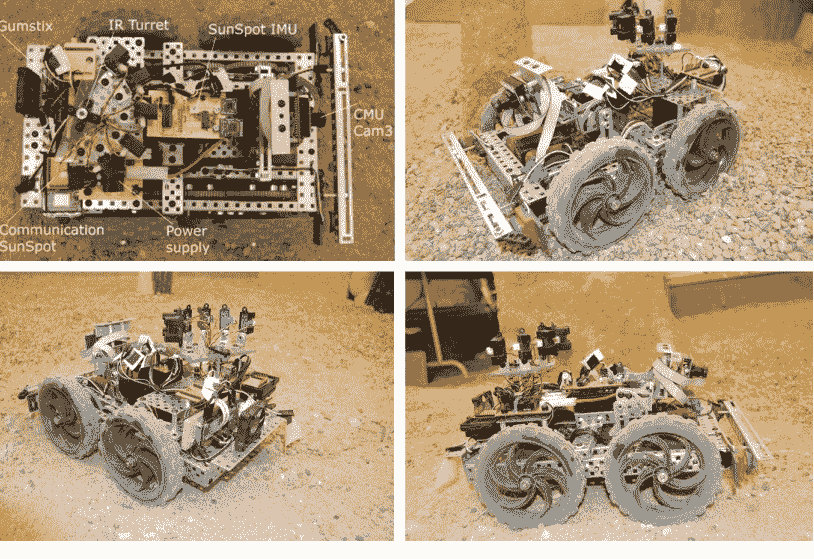

图 15. 探索机器人团队的图像。

另一个 Sun SPOT 被用作专用机器人通信节点，通过无线电向特定机器人发送数据包（基于与其通信的机器人无线电的 ID）或向所有机器人（广播）。该节点负责过滤不是发给该机器的消息，并传递有效的传出或传入消息。同一机器人上节点之间的通信通过通过串口或 I2C 线从一个设备向另一个设备发送数据来实现的。这一切都是通过无人系统联合架构（JAUS）[10] 的 Java 实现成为可能的。JAUS 是一个针对具有多个机器人、设备或设备组件系统的正式消息传递规范。它提供了一种通用的消息格式和协议，以避免语言差异或设备特定细节。每个子系统组件使用与其硬件兼容的语言（在此例中为 C、C++ 或 Java）实现其版本的 JAUS 协议。一旦实现，系统中的每个组件都将以类似于 IP 地址的分层次方式被引用。每个机器人代表多机器人系统中的一个子系统。图 16 展示了系统如何被分解为 JAUS 子系统、节点和组件。

该机器人团队参加了 2008 年国际机器人与自动化会议（ICRA）机器人挑战赛举办的 Sandbox 活动 [9]。目标是拆解一个模拟着陆器，并在包含不同形状、大小和颜色的表面及岩石的行星环境中自主执行任务。多机器人团队成功完成了“将着陆器部署到表面”和“绘制环境地图”的挑战 [5]。

## 138 Christopher M. Gifford, Jerome E. Mitchell 和 Arvin Agah

| 1 系统：着陆器 | 2 系统：探索机器人 (1-4) |
|---|---|
| 1.1 节点：Sun SPOT（通信） | 2.1 节点：Sun SPOT（通信） |
| 1.1.1 组件：通信器 | 2.1.1 组件：通信器 |
| 1.1.2 组件：节点管理器 | 2.1.2 组件：节点管理器 |
| 1.2 节点：Sony VIOO 笔记本电脑 | 2.2 节点：Gumstix/Robotix |
| 1.2.1 组件：节点管理器 | 2.2.1 组件：SBT-系统指挥器 |
| 1.2.2 组件：系统指挥器 | 2.2.3 组件：地图组件 |
| 1.2.3 组件：目标管理器 | 2.2.4 组件：全局位姿接口 |
| 1.2.4 组件：地图管理器 | 2.3 节点：Sun SPOT（IMU/里程计） |
| | 2.3.1 组件：节点管理器 |
| | 2.3.2 组件：全局位姿 |
| | 2.4 节点：CMU |
| | 2.4.1 组件：节点管理器 |

图 16. 多机器人系统内 JAUS 子系统、节点和组件的组织。

## 5. 结论

通过示例表明，Java 已应用于各种机器人和人工智能领域。由于其灵活性，它在嵌入式系统中的应用正在增加。我们将未来。

## 致谢

本材料由国家科学基金资助，编号为 ANT-042589。材料中提出的任何观点、发现和结论均为作者所有，不代表国家科学基金的观点。作者感谢堪萨斯大学工程学院和计算机科学系对本项目的支持。

## 机器人与人工智能的 Java 方法

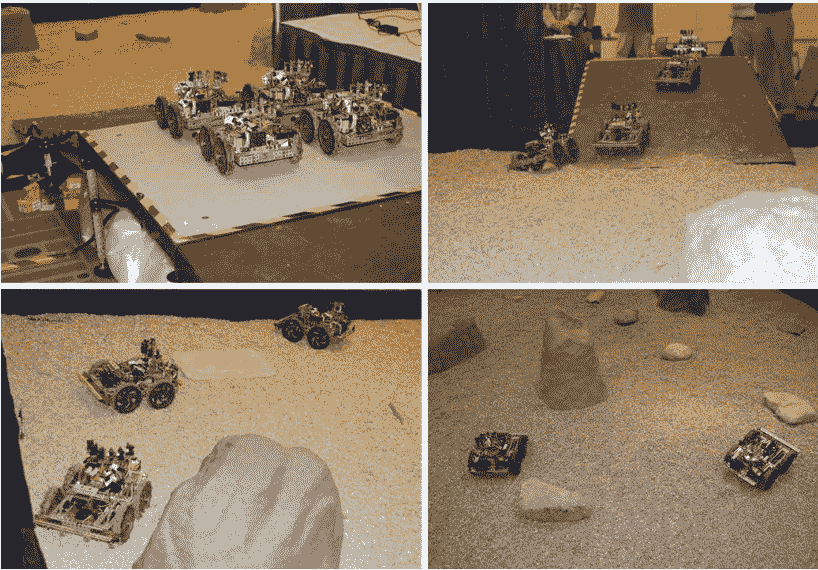

来自 2008 ICRA 事件的图像。

## 参考文献

- [1] E.L. Akers, R.S. Stansbury, A. Agah 和 T.L. Akins, 恶劣环境机器人：来自现场实验, 机器人与应用国际会议, 2006, pp. 1–6.
- [2] T.R. Balch, TeamBots 2.0, URL: `http://www.cs.cmu.edu/TeamBots/`, 2008.
- [3] CreSIS, 冰雪遥感中心, URL: `http://www.cresis.ku.edu/`, 2008.
- [4] E. Friedman-Hill, Jess: Java 平台的规则引擎, URL: `http://herzberg.ca.sandia.gov/`, 2008.
- [5] C.M. Gifford, R. Webb, J. Bley, D. Calmon, J. Makarewicz, B. Banz 和 A. Agah, 低成本机器人探索与制图, IEEE实用机器人技术国际会议（Woburn, MA）, 2008年11月, pp. 74–79.
- [6] Golden T Studios, Golden T 游戏引擎 (GTGE), URL: `http://www.goldenstudios.or.id/products/GTGE/`, 2008.
- [7] Gumstix, Inc., 扩展板, URL: `http://www.gumstix.com/specExpansion.html`, 2008.
- [8] 主机板，URL: `http://www.gumstix.com/platforms.html`, 2008.
- [9] 机器人与自动化国际会议 (ICRA), 2008年机器人挑战，URL: `http://icra2008.usec.edu/challenge.html`, 2008年5月.
- [10] JAUS, 无人系统联合架构 (JAUS)，参考架构规范版本 3.3，URL: `http://www.jauswg.org/`, 2008.
- [11] Java.net, Java 机器人社区，URL: `http://community.java.net/robotics/`, 2008.
- [12] Java net Spot 机器人子社区，URL: `https://sunspot-robotics.dev.java.net/`, 2008.
- [13] P. Marrone, June: Java 对象对象神经引擎，URL: `http://jooneworld.com/`, 2008.
- [14] Nomadic Technologies, Inc., Nomadic Scout 用户手册，版本 1.3，URL: `http://nomadic.source.forge.net/production/scout/scout-user-1.3.pdf`, 2008.
- [15] PRISM, 用于冰盖测量的极地雷达，URL: `http://ku-prism.org/`, 2008.
- [16] Robocode, Robocode 主页，URL: `http://robocode.source.forge.net/`, 2008.
- [17] Robocode 教程，URL: `http://testwiki.roborumble.org/index.php?title=Robocode#Tutorials`, 2008.
- [18] Seattle Robotics, CMUcam3，URL: `http://seattlerobotics.com/cmucam3.htm`, 2008.
- [19] SparkFun Electronics, 传感器：IMU / 陀螺仪，URL: `http://www.sparkfun.com/commerce/categories.php?c=85`, 2008.
- [20] R.S. Stanbury, E. Akers, H.P. Harmon, 和 A. Agah, 极地地区极地雷达的生存性、移动性与功能性，《控制、自动化与系统国际期刊》2 (2004), no. 3, 333–353.
- [21] 恶劣环境下自主机器人的仿真与测试，STAR: 实验机器人软件工程，第 30 卷，第 71–92 页，Springer-Verlag Berlin Heidelberg, 2007.
- [22] Sun Microsystems, Inc., NetBeans 主页，URL: `http://www.netbeans.org/`, 2008.
- [23] Sun Spot API V3.0 (Purple)，URL: `http://www.sunspot.com/docs/Purple/javadoc/`, 2008.
- [24] SunSpotWorld - Sun SPOT 项目首页，URL: `http://www.sunspotworld.com`, 2008.
- [25] Eclipse 基金会，Eclipse 主页，URL: `http://www.eclipse.org/`, 2008.
- [26] VEX Robotics, VEX 机器人设计系统，URL: `http://www.vexrobotics.com/`, 2008.
- [27] I.H. Witten 和 E. Frank，《数据挖掘：实用的机器学习工具与技术》，第二版，Morgan Kaufmann, 旧金山, 2005.

# Java 平台的安全性

Pierre Parredd*

软件工程，FZI 信息学研究中心

Haid-und-Neu-Strasse 10-14, 76131 Karlsruhe, 德国

## 摘要

Java 环境由两个主要部分组成：Java 语言和 Java 虚拟机。它的设计假设是没有任何软件实体是值得信赖的，因此，每个实体都需要经过检查。Java 的首次成功是 Java Applets 的诞生，它使得来自未知网站提供的完全不可信的代码可以在浏览器中执行。这一特性展示了 Java 虚拟机 (JVM) 在应用程序与底层操作系统之间的隔离性。然而，Java 系统从单应用向多组件系统的演进引入了开发者未察觉的新型漏洞。这需要使用额外的安全机制来支持安全的 Java 环境。

本综述介绍了 Java 语言和虚拟机的安全性问题。定义并解释了其默认安全模型。其主要组件包括 Java 语言本身、加载时的字节码验证以及类加载器和权限域等模块化设计。文中介绍了已知漏洞。这些漏洞要么源于 JVM，要么源于应用程序。描述代码漏洞有两种方法：源代码和字节码。这使我们能够在开发期间通过人工代码审查和工具识别漏洞，也可以在代码部署或安装期间以自动方式识别。文中还介绍了 Java 运行环境的安全扩展以及用于编写 Java 代码的工具，分为三种：平台扩展、静态分析方法和行为注入。平台扩展旨在加强组件（Beans 等）之间的隔离，并为资源消耗和控制提供支持。静态分析通常通过通用工具进行，这些工具可以提高代码质量并减少 Java 代码中可利用的漏洞数量。其中一些工具，如 `FindBugs`，此类。

## 1. 引言

Java 环境由两个主要部分组成：Java 语言和 Java 虚拟机。它的设计假设是没有任何软件实体是值得信赖的，因此，每个实体都需要经过检查。Java 的首次成功是 Java Applets 的诞生，它使得来自未知网站提供的完全不可信的代码可以在浏览器中执行。这一特性展示了 Java 虚拟机 (JVM) 在应用程序与底层操作系统之间的隔离性。然而，Java 系统从单应用向多组件系统的演进引入了开发者未察觉的新型漏洞。这需要使用额外的安全机制来支持安全的 Java 环境。

本综述介绍了 Java 语言和虚拟机的安全性问题。定义并解释了其默认安全模型。其主要组件包括 Java 语言本身、加载时的字节码验证以及类加载器和权限域等模块化设计。文中介绍了已知漏洞。这些漏洞要么源于 JVM，要么源于应用程序。描述代码漏洞有两种方法：源代码和字节码。这使我们能够在开发期间通过人工代码审查和工具识别漏洞，也可以在代码部署或安装期间以自动方式识别。文中还介绍了 Java 运行环境的安全扩展以及用于编写 Java 代码的工具，分为三种：平台扩展、静态分析方法和行为注入。平台扩展旨在加强组件（Beans 等）之间的隔离，并为资源消耗和控制提供支持。静态分析通常通过通用工具进行，这些工具可以提高代码质量并减少 Java 代码中可利用的漏洞数量。其中一些工具，如 `FindBugs`，此类。

## 2. 默认安全模型

Java 的安全模型从 HotJava、Netscape 演进到 Java 2。它最初的设计是为了支持潜在恶意 Applet 的安全执行。向组件的转变使用了模块化：来自不同来源的组件可以在同一平台上执行而互不访问。详细介绍见后续。

### 2.1. Java 运行环境

Java 语言旨在成为 C 语言的安全子集。这意味着在 C 语言中可以被利用的语言元素（如缓冲区溢出或内存管理活动）已从规范中移除。这种简单性旨在将开发者从易出错的任务中解放出来，并通过让他们专注于开发的功能来提高生产力。Java 语言安全性的基础如下：

- 类型安全。
- 自动内存管理。
- 字节码验证。
- 模块化。

类型安全意味着每个语言元素都有给定的类型，并且只能执行与该类型一致的操作。特别是类型安全的语言不包含指针，这使得我们可以独立于类型操作内存地址。类型安全在三个时刻强制执行：编译期间、字节码加载到内存时，以及在运行时确保与动态链接库的类型一致性。一些作者认为 Java 语言并非完全类型安全，因为它允许我们在不考虑实际类型的情况下处理数据的集合（Sets 和 Collections）。错误会导致运行时抛出异常。语言层面的解决方案是使用泛型 (`Generics`)，它将数据结构固定为仅包含特定类型的对象。为了向下兼容，此功能并非强制性的。某些面向服务的编程 (SOP) 平台（如 `Guice`）提供了解决方案，它们以“异常类型安全”的方式创建对象，即 SOP 工厂提供请求代码中不需要转换良好的类型对象。这防止了可能由于转换错误导致的运行时异常。

### Java 虚拟机

自动内存管理通过向语言隐藏内存的分配和释放来实现。它是通过将这些操作从 C 和 C++ 中的编译阶段推迟到运行时来完成的。虚拟机本身负责在对象实例化时分配所需的内存，并由垃圾回收器（GC）释放不再使用的内存。垃圾回收通过维护一个正在使用的对象列表来执行。当一个对象被所有调用者引用时，就可以安全地移除。这防止了开发错误。它还防止了恶意代码直接访问内存，使得生成的代码对攻击更具健壮性。还强制了额外的机制来保证内存的完整性。例如，会对数组边界进行检查，以防止读取或写入定义数据之外的数据。这防止了缓冲区溢出并消除了一个用于执行恶意代码的潜在攻击向量。

字节码验证机制见第 2.2 节。它们保证了执行的字节码符合规范，并防止伪造无法有效编译器从源代码推导出的指令集。

模块化机制见第 2.3 节。它们允许在没有命名冲突和无意访问的情况下执行组件。特别是，它们针对的是从远程服务器等不同位置加载的类。

Java 语言的安全机制可能是软件安全（例如语言特性）以及应用安全方法，并以模块化支持等高度集成的方式结合。这是两种技术互补性的有力说明：在可能的情况下执行软件安全，以高效的方式断言安全属性。当这不再足够时，则会用应用安全机制进行补充。

### 2.2. 字节码验证

加载的字节码被认为是不可信的。在执行之前必须对其进行完全验证，以确保其符合规范。这种验证发生在 JVM 的字节码验证器中，紧接代码加载到内存之前 [29]。在两种情况下，它通过运行时检查进行补充：当验证期间无法获取所需信息（例如当多个库被一起使用时），以及当优化使得运行时检查更高效。

图 2 显示了字节码验证的过程。

代码由编译器从 `.java` 源文件生成为 `.class` 类文件。语言规范在此处被强制执行，但不能保证 1) 编译器是有效的 [54]，2) 字节码没有在没有编译器的情况下被伪造，或 3) 文件在通过网络或其他介质传输过程中未被修改。当字节码加载时，首先在 JVM 的系统服务单元（SSU）中进行检查，然后转发到执行单元（ExecU）进行 JIT 编译或解释执行。

## Java 平台的安全

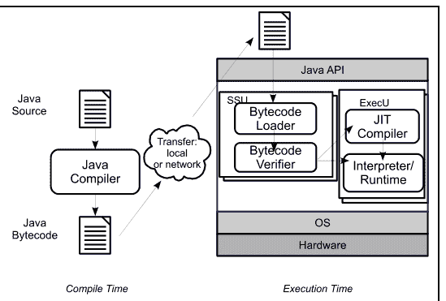

- 结构正确性：检查属性长度、类文件有效性。
- 数据正确性：检查 `final` 类未被子类化、`final` 方法未被重写、所有 `java.lang.Object` 类均有父类，且所有字段和方法引用了合法的名称、类和类型签名。


- 字节码检查：检查 1 静态约束：流的正确性、异常处理程序的有效性；2 组静态约束：子程序和异常处理程序的可达性、数据流的有效性（即不存在缓冲区溢出和下溢）。

- 运行期间的符号引用：检查当前类引用的有效性、方法调用和字段访问的类型安全、方法调用和字段访问的可见性。

这种字节码验证方法属于软件安全范畴，因为使代码安全的属性深植于其中。然而，这是一种非常灵活的方法，只能强制至关重要的属性。

## 2.3. 模块化

对模块化编程的支持旨在允许执行相互未知且不一定相互信任的组件。

类加载器构建了 JVM 的一个系统，负责查找类并使其可执行¹。它们被组织成一个层级结构²，如图 3 所示。

应用类加载器的存在是可选的，但其目的是支持组件之间的命名空间隔离。在自己的类加载器中执行时，组件可以访问其父类加载器的类以及它自己的类。这确保了如果多个组件包含同名的类，就不会发生命名冲突。如图 3 所示，组件 1 和 3 都可以拥有名为 `my.package.Foo` 的内部类，且它们具有不同的实现。它们将共享系统类，如 `java.lang.System`。

- ¹http://interview.java.com/2007/07/04/what-is-class-loader-and-what-is-it.html, 读取于 2008/08/18
- ²http://java.com/docs/books/tutorial/java/basics.html, 读取于 2008/08/18

## Pierre Parrend

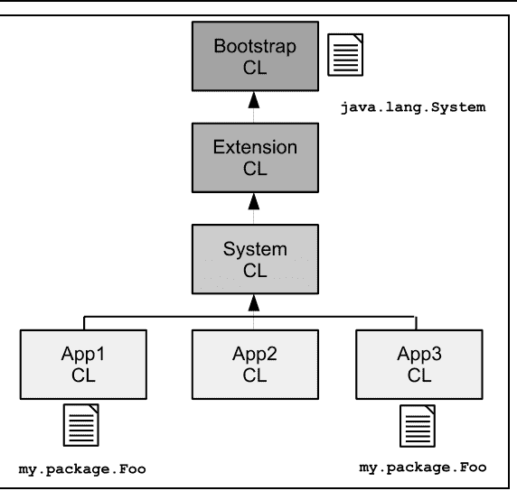

图 3. 类加载器的层级结构

每个类加载器具有以下行为：它首先检查要加载的类是否可用。如果是，则返回它。否则，它将新类的搜索委托给它的父类加载器。

默认类加载器包括启动类加载器、扩展类加载器和系统类加载器。启动类加载器可以访问 JVM 所需的类（`rt.jar`）和国际化（`i18n`）。扩展类加载器负责如安全类的扩展类。系统类加载器负责通过 `CLSPATH` 环境变量或 JVM 的 `-classpath` 选项设置的类路径。应用程序或框架可以定义额外的类加载器。

## Java 平台的安全

类加载器明显的处是命名空间隔离，这防止了一个组件在未显式允许的情况下访问另一个组件。此外，系统类是共享的，这防止了不一致。

然而，类加载器的设计并不支持强隔离。特别是，父类加载器中的静态变量是共享的。例如，启动类加载器中的 `System.out` 变量可以被所有类访问。这可能导致意外的干扰，如拒绝服务或数据传输。同样，同步调用可能会被利用。此外，它们不支持资源隔离。类加载器的最后一个缺点是无法简单地为了卸载组件，因为这会导致程序不一致。由于所有这些原因，类加载器构建了 Java 平台的一个有趣特性，但不能被认为是安全的。

保护域是 Sun 为并行执行组件提供的解决方案。这种方法基于基于栈访问控制（SBAC），因为它依赖检查类栈来确定所有调用者是否有足够的权限执行给方法。它定义在 [2, 58] 中。技术演示可参见 [50]。

从本质上说，保护域是主体（principal）当前访问的对象集 [46]。主体是对实体（个人、公司、登录名、文件系统中的位置）授予执行权限的表示。在 Java 平台的情况下，保护域因此代表了一个组件可以访问的所有对象。它由可以无缝调用的非敏感代码组成，而敏感访问通过权限策略显式授予。Java 应用程序中使用保护域需要 JVM 的安全管理器或根据应用程序需求定义的策略文件：

```
java -Djava.security.manager -Djava.security.policy=java.policy ...
```

安全检查在应用程序、框架或标准库的代码中通过调用安全管理器在运行时执行：

```java
mySecurityManager.checkPermission(new ServicePermission(serviceName, ServicePermission.GET));
```

150

Pierre Parrend

列表 1 显示了 Java 保护域（protection domains）策略文件的示例。

# 列表 1：Java 保护域策略文件示例

```
keystore "file:/home/pierre/boulot/dev/test/java/java-security/protectiondomain/data/keystore.ks";

grantBase "file:/home/pierre/boulot/dev/test/java/java-security/protectiondomain/code/" - {

permission java.io.FilePermission "/home/pierre/boulot/dev/test/java/java-security/protectiondomain/bundle/-", "read"
permission java.security.SecurityPermission "createPolicy"
permission java.io.FilePermission "/dev/test/java-security/protectiondomain/data/keystore.ks", "read";
}
grant signedBy "ALICE" {
permission java.io.FilePermission "bar.txt", "write";
}
```

该示例由两部分组成：用于创建保护域的平台策略（`grant codeBase`），以及允许签名者 Alice 写入名为 `bar.txt` 文件的策略。对代码签名者的支持通过策略文件的第一项——密钥库提供。安全管理器必须能够根据其公钥证书验证签名者的有效性。在这种情况下，如果代码归档由多个发行者提供，则必须在策略文件中添加相应的条目。

保护域的主要局限性之一是它们带来的巨大开销，特别是当其数量和安全检查频率增加时。针对原始实现，已有相关的改进工作 [27]。目前已提出了替代方案，例如通过静态分析。然而，它们仍处于研究阶段，尚未成功提供更高效的解决方案。

Java 安全评估。发布后，Java 2 语言和平台已在工业界和学术界进行了分析 [10]。在存在多个类加载器的情况下，关于类型安全属性保持讨论最重要的。Java 语言的一个子集已被证明是安全的 [22]，随后发现了类名解析中的一个错误 [47]。该错误已得到正式解决 [36] 并在 Sun JVM 的后续版本中得到了修正。

# Java 平台安全 151

此外，文献中指出了 Java 栈检查（Stack Inspection）策略的以下局限性 [23]：

- 如果在 `doPrivileged` 块内创建了一个新线程，那么该线程将继续享有增强的权限，尽管它的代码可能不在 `doPrivileged` 块的范围内，甚至在它的创建者退出 `doPrivileged` 之后也是如此。这是因为新线程开始执行时带有其创建者调用栈的副本（该帧被标记为处于 `doPrivileged` 范围内）。

- 当类 B 继承类 A 但未继承 A 的保护域（以及 B）时，`checkPermission` 在处理 `foo()` 的栈帧时将始终使用 A 的保护域。由于 B 继承 A 的方式可能会影响 `foo` 的语义（例如通过重写其他方法），可能会认为咨询了错误的保护域。

## 3. 漏洞

基于 Java 的系统的漏洞可以在两个位置找到：虚拟机和应用代码。漏洞的披露为 JVM 开发人员提高系统安全水平提供了强有动力。

### 3.1. Java 虚拟机中的漏洞

可以识别出通用的 JVM 漏洞。[41, 14] 对 Sun JVM 和 Jikes 的 bug 数据库进行了全面分析。这些漏洞可以被利用来执行拒绝服务攻击。与故障源相关的统计数据从选定的 bug 条目中提取：来自 Sun 的 103 个 bug 和来自 Jikes 的 28 个 bug。因此，结果直接涉及这两个虚拟机。

- 垃圾回收负责了内存管理单元 (MMU) 中 73% 的故障。
- 运行时支持操作（如调用、栈分配和释放、异常处理以及优化的即时编译 (JIT)）负责了执行单元 (ExecU) 中 77% 的故障。
- 线程管理负责了系统服务单元 (SSU) 76% 的故障。
- 大多数故障 (80%) 发生在 JVM 在重要工作负载下运行时。

JVM 优化（如垃圾回收器和 JIT 编译器）被明确识别为可靠性瓶颈。在这里，性能与可靠性之间出现了明显的权衡。

```
http://jikes.org/
```

Java Software and Embedded Systems, 由 Matthew Hayes 和 Isaiah Johansson 编辑，Nova Science Publishers, Incorporated, 2010. ProQuest

# 152

# Pierre Parrend

当应用程序长时间无中断运行时，JVM 故障会恶化。这种现象被称为老化（aging），在应用服务器中特别常见。它导致了 Java 服务器上运行的示例邮件应用程序出现以下行为：

- 在垃圾回收器活动期间，内存呈现持续耗尽趋势（高达 50 KB/min）。
- 还观察到持续的吞吐量损失（高达 2.4 KB/min）。
- JIT 编译器导致了微不足道的内存耗尽趋势（未给出数值）。

该实验使用一个名为 James 的邮件服务器通过工作负载生成器进行了持续 100 小时的测试。

可以利用更奇异的漏洞。例如，内存错误可用于滥用虚拟机 [30]。这种攻击取决于具有重复地址方案的程序中的随机错误。一个方法中任何位的偏移都会导致不安全行为。

（注：此处原文后续存在大量重复的 OCR 错误文本，已根据要求提取核心内容并翻译翻译逻辑）

Pierre Parrend

+ 7. 如果你必须对代码进行签名，请将其放在同一个归档文件中：这防止攻击者进行混合攻击（mix-and-match attack）。在这种攻击中，攻击者构建一个新的 Applet 或库，将你的一些已签名的类与恶意类链接，或者将你从未打算一起使用的已签名类链接在一起。通过对一组类进行整体签名，可以增加此类攻击的难度。

+ 8. 使你的类不可克隆（noncloneable）：Java 对象克隆机制允许攻击者在不执行任何构造函数的情况下制造类的新实例。

+ 9. 使你的类不可反序列化（nondeserializable）：序列化是危险的，因为它允许对手获取对象的内部状态。

+ 10. 使你的类不可按名称反序列化（nonderializable）：对手可以创建一个字节序列，恰好能反序列化为该类的实例。这是危险的，因为无法通过名称强制控制：JVM 中可能存在多个同名的类。

+ 11. 不要通过名称比较类：JVM 中可能存在多个同名的类。

+ 12. 存储在代码中的秘密无法保护你：没有什么能阻止恶意程序员或虚拟机查看你的代码内部并获知其中的秘密。

## 列表 3：私有内部类和方法：源代码

```java
public class HelloWorld {
    private class HelloWorldPrinter {
        private String textHello="Hello";
        private String textGoodbye="Goodbye World";

        private void sayHello() {
            System.out.println(textHello);
        }

        private void sayGoodbye() {
            System.out.println(textGoodbye);
        }
    }
}
```

Pierre Parrend

安全管理器（security manager）。

+ - 调试：Java 平台调试器架构基于 JVM-TI。它能够监控并修改 Java 程序的状态和数据。由于没有执行访问控制，私有字段可以被透明地访问。可以通过安全管理器防止其使用。

- 监控与管理：JMX 管理工具能够监控类加载、线程状态、堆栈跟踪、死锁检测、内存使用、垃圾回收和操作系统信息。它还可以引入远程管理。

这些功能的某些（如反射或调试）可以通过安全管理器进行保护。其他功能（如远程管理）意味着系统上安装了所需的库。然而，大多数功能仍然可能被利用。

Sun 提供了针对 Java 应用程序可执行漏洞利用的详细指南 [51, 37]。这些指南旨在通过推广良好的开发实践来防止弱代码产生。它们按以下类别组织：

# 1. 可访问性和可扩展性

+ - 1-1 限制类、接口、方法和字段的访问访问性
- 1-2 限制类和方法的扩展性
- 1-3 理解父类如何影响子类的行为

# 2. 输入和输出参数

+ - 2-1 创建多个输入和输出的副本（例如列表 5）
- 2-2 为可变类提供复制功能
- 2-3 验证输入

## 3. 类

+ - 3-1 将公共静态字段视为常量
- 3-2 对可修改的内部状态定义封装方法
- 3-3 为原生方法（native methods）定义封装器
- 3-4 从异常中清除敏感信息

## 4. 对象构造

+ - 4-1 防止敏感类被未经授权的构造
- 4-2 防御非 final 类部分初始化的实例
- 4-3 防止构造函数调用可以被覆盖的方法

## 5. 序列化与反序列化

+ - 5-1 在序列化期间保护敏感数据
- 5-2 将反序列化视为对象构造
- 5-3 在序列化和反序列化期间，复制类中强制执行的 SecurityManager 检查

## 6. 标准 API

+ - 6-1 安全调用 `java.security.AccessController.doPrivileged`
- 6-2 根据即时调用者的类加载器，安全地调用跳过 SecurityManager 检查的标准 API

# Java 平台的安全性

+ - 6-3 安全地调用使用即时调用者的类加载器实例执行任务的标准 API
- 6-4 注意对即时调用者执行 Java 语言访问检查的标准 API

列表 5：可变输入副本的示例（来自《Java 编程语言安全编码指南》）

```java
// java.util.ArrayList 是可变的且非 final 的
public void copyNonFinalInput(ArrayList list) {
    // 创建声明输入类型的新实例
    list = new ArrayList(list);
    doLogic(list);
}

// java.util.Collection 是一个接口
public void copyInterfaceInput(Collection collection) {
    // 将输入转换为信任的实现
    collection = new ArrayList(collection);
    doLogic(collection);
}
```

漏洞披露旨在提高相关软件的质量。由于这些原因，一些重要的出版如 Java“耻辱榜” [21] 或“Last Stage of Delirium”小组在网络浏览器中识别出的漏洞 [52] 现在过时。

# 字节码 FindBugs 工具 [33] 给出了在字节码层面识别的一系列漏洞类型列表，位于“恶意代码”类别下。

+ - EI：通过返回可变对象的引用暴露内部状态（Exposure Internal）。
- EI12：通过包含对可变对象的引用暴露内部状态（Exposure Internal）。
- FI：终结器（Finalizer）应该被保护，而不是公共的。
- MS: 字段和方法的可见性过高。例如静态字段、可变类型（如 Array 和 Hashtable）的非 final 字段。

这些漏洞与之前的指南部分重复。它们提供了以自动化方式识别的优势。

漏洞利用根据执行的 Java 代码，可以被利用不同的漏洞：独立应用程序、类共享组件或对象共享组件 [43]。独立应用程序是在特定框架之外执行的所有 Java 。类共享组件通常为其他组件提供类。只有作为静态数据的类定义会被滥用。

> 4 http://findbugs.sourceforge.net/bug/BugDescriptions.html

对象共享组件为其他组件提供服务实例。这通常出现在面向服务的编程（SOP）[3] 的框架中，例如 EJB、Spring 或 OSGI 平台。这些实例在对象之间共享，从而可能会非预期的方式与其他组件通信或影响并不信任它们的组件的行为。这些漏洞类别是分级的：每个类别都包含了前一个类别的漏洞以及自身的漏洞。

图 4 提供了 Java 平台漏洞类别的概述。

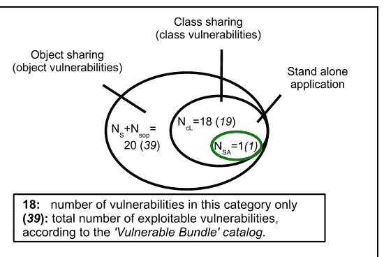

图 4. SOP 平台的漏洞类型

漏洞类别标记为 $SA$ 表示独立应用程序，$CL$ 表示类共享组件，$SOP$ 表示对象共享。每个类的基数分别为 $N_{SA}$、$N_{CL}$ 和 $N_{SOP}$。$N_x$ 是通过对象共享暴露但在某些情况下也通过类共享暴露的漏洞基数。同步（synchronized）调用就是这种情况，它会给应用程序带来冻结风险，并在相关方法可以正常执行的情况下，可以在类共享上下文中执行。这些基数在此以“漏洞包”目录 [44] 为例，该目录总结了恶意组件可以利用的已知漏洞。

这些情况要求 Java 开发社区发生两个重要转变：培训开发者意识到他们可能在应用程序中引入的缺陷，并广泛使用自动化工具来识别至少是最常见的问题。

## 4. 安全扩展

默认安全模型的局限性和 Java 应用程序中漏洞的存在导致了安全扩展的发展：平台扩展、特定的编码约束和行为注入机制。

# Java 平台安全

## 4.1. 平台扩展

平台扩展旨在隔离应用程序，并使其对其消耗的资源负责。


## 隔离器（Isolates）

隔离器的目标是在同一个 Java 运行时环境中运行独立的程序，同时防止它们之间的交互 [16]。从程序的角度来看，在隔离器中的执行不与在专用虚拟机中的执行有区别。隔离器在 Sun JSR 121 [35] 中规范，并在 [7] 中进行了详细说明。参考实现在 Sun Barcelona 项目⁵ 及其后续版本中提供，被称为多任务虚拟机（MVM）[31]。它可用于 Solaris 操作系统。

> ⁵ http://research.sun.com/projects/barcelona/

每个隔离器执行一个任务，即在专用线程中运行一个应用程序。这强制了与其他隔离单元的强隔离，特别是克服了类加载器的局限性：隔离器有其自己的系统变量，以防止任何干扰（例如 `System.out` 变量的示例）；它有自己的一组 `Strings`，即不可变的字符串值。因此，通信可以通过进程间通信（IPC）或网络技术进行，这阻止了通过该技术实现高效的多任务应用程序。

隔离器的优点是多方面的 [7]。首先，多程序和多应用程序环境变得平台中立，增强了系统的可测试性和管理能力。可扩展性得到了提高。通过结合操作系统安全（如进程隔离和应用程序与虚拟机之间共享数据的隔离）以及虚拟机安全，安全性得到了提高，后者提供了防止直接访问 OS 资源的保护。此外，管理多应用程序系统不再需要访问操作系统。最后，由于每个应用程序都是独立于其他程序执行的（如果这不是隔离器规范的一部分），因此资源管理成为可能。

尽管这些重要收益支持了多任务环境，但隔离器和 MVM 到目前仅以有限的方式使用。这是由于它们在生产环境中缺乏便利性，且编程模型缺乏透明度 [7, 25]。对于资源如此受限、进程之间没有地址隔离或没有线程的广泛 Java 环境来说，隔离器是不适当的。此外，它们没有对系统中的 Java 实体提供集中化管理，而且在资源消耗方面非常低效，特别是在实例化新任务时，因为所有执行和机制都是重复的。

## Sun 资源管理接口（RM 接口）

由 Sun JSR 284⁶ 规范。它是隔离概念的扩展。RM 接口能够监控任何资源类型，并跟踪每个隔离器的资源消耗。它是 JREs（Java 资源）原型 [18] 的后续工作。其目标是确保受信的 Java 系统能够被线程创建通知，为一个线程或一组线程所消耗的资源设定上限，并定义“过度使用回调”，即在超过限制时执行的操作。它对于被监控的应用程序来说是透明的。它需要访问虚拟机。核心实体是资源、资源域、分配器、消耗操作和预留。

> ⁶ http://jcp.org/en/jsr/detail?id=284

通过其实现类的限定名称可以唯一标识一个资源。它被建模为属性集合，并且可以是丢弃的（即在被识别时被视为已消耗）、可预留的、可撤销的（即可以在不影响应用程序行为（性能除外）的情况下限制可用资源）或无边界的（即对该资源的绝对 CPU 时间消耗没有限制）。

资源域是关于资源消耗策略的实例。多个隔离器可以绑定到同一个资源域，从而绑定到同一个策略上。

分发器（dispenser）是一个对象，用于控制提供给资源域从而提供给计算的资源数量。它是根据当前使用情况和策略执行的。

当请求消耗特定类型的资源时，执行消耗操作（consume action）。它可以是持久的。对于被监控的应用程序是透明的。它需要访问虚拟机。资源预留（reservation）保证了资源的可用性。

RM 接口的重要优点是它可以与现有应用程序完全兼容。它的限制是它需要访问虚拟机来管理多应用程序系统。RM 接口允许对隔离的消耗资源进行限制，这可以防止拒绝服务攻击。

## KaffeOS

[1] 是一个实现隔离以及资源管理和共享的虚拟机示例。它通过在用户/内核边界使用资源管理来实现。它允许对进程进行任意的终止。KaffeOS 的设计原则如下：

- 进程分离：每个进程应该看到虚拟机是仅为该一个进程运行的。
- 安全终止：进程由于内部或外部触发可以终止，两种情况下都不会影响其他进程的完整性。
- 进程直接共享：进程可以直接共享对象以通信。
- 精确的 CPU 和内存计数：对代表该进程的所有活动的 CPU 和内存进行计数。
- 全量内存回收：当进程终止时，其内存应该被释放。
- 分级内存管理：支持简单的消耗模型。

对虚拟机的修改相对于参考实现引入了 11% 的性能开销。

## 隔离器 [25]

是通过 OSGI 平台对隔离概念和系统变量的透明转换。由于在 OSGI 平台中，每个组件（命名为 bundle）都在其自己的类加载器中启动，并彼此隔离。此外，组件之间的直接调用得到了保留，这在基于 IPC 通的 Java 对象中是不可能的。

## J-Seal

[4] 是另一种 Java 微内核架构，旨在运行未根权限的移动对象。对 CPU 等低资源进行资源计数，对线程等高资源进行计数。定义了三种类型的对象：

- 作为网络和 GUI 的系统服务
- 信任代码的沙箱，允许访问所有系统服务
- 匿名代码的沙箱，仅允许有限访问

每个移动对象和服务都在一个保护域（或“封的对象”）中执行。每个保护域拥有一组线程，无法任意跨越边界。对敏感资源的访问通过专用服务执行。特别是，对象必须使用安全封装器来创建新线程。这些对象组织成层级结构，允许父对象随时终止子对象并释放资源。

## RAJE

[32]（资源感知 Java 环境）是标准平台的扩展。它旨在监控对全局资源（如每个线程）的访问和消耗。它是通过将系统资源和应用级资源具体化为线程和套接字来实现。RAJE 支持 Jamus（Java 不信任移动代码适配），这是一个执行 Java 组件的框架。每个组件都赋予了一个指定其允许消耗资源量的合同。这能够限制组件使用的资源量，并保证用于执行的资源可用。

## J-RAF

（Java 资源计数框架）[34] 通过字节码转换对 CPU、内存和网络带宽的消耗进行透明监控。与其他资源管理解决方案相比，它不涉及特定的 JVM 实现，并且兼容大多数硬件虚拟机上的 Java 平台。其目标是监控应用程序并防止拒绝服务攻击。因此，监控在资源消耗之前进行，以便主动执行定义的策略。J-RAF 的局限性是计数策略和结果存储在 SQL 数据库中，这意味着存在了一个巨大的性能开销，该工具最初是为 Apache Tomcat Servlet 引擎设计的，这可能阻止其完全适用于其他类型的多应用程序系统。

## JMX

（Java 管理扩展）也可用于对 Java 系统进行资源管理 [11]。作者提出了 JConsole，它可以跟踪内存和操作系统资源，如 CPU 时间、总物理内存和空闲内存等。

针对其他目标环境也存在类似的项目，例如针对 CDC/MIDP 的 SunPhoneME Features 7。

## 4.2 静态分析

除了修改执行平台之外，在代码层面强制执行安全约束可以从重要程度上提高应用程序的安全属性。静态分析由验证代码与显式约束的符合性组成。它通常在开发期间进行，以提高代码质量。这使得能够执行运行时无法完成的验证。

静态分析器通常作为开发后机制执行。它们旨在比像 B 等能够以形式化指定系统的正规语言更轻量。因此，它们的目标是在分析器的三个核心属性之间：完备性（Completeness）、完备性（Soundness）和有效性（Effectiveness）之间提供合理的权衡。完备性意味着检查的属性对于所有被分析的代码都成立。完备性（Soundness）意味着没有误报，即被识别为 bug 但实际上并未产生的正确代码。有效性则涉及工具发现 bug 和错误的能力。

[45] 提出了对几种用于 Java 程序的静态分析工具的比较。作者考虑了 JLint、PMD、FindBugs、ESC/2 和 Bander。这项研究的结论是，这些工具发现的是不重叠的 bug 集合，因为它们采取了不同的方法。因此，没有一种工具是充分的，所有工具都是互补的。此外，没有工具能始终报告正确的结果，且误报是不可避免的。

大多数工具的目标是识别通用 bug。某些工具如 FindBugs 考虑了安全 bug 的子集。向研究社区介绍的一个工具 JSLint 针对安全 bug。也存在商业工具，但没有发布精确的技术数据。

### Bug 模式检测（Bug Pattern Detection）

由识别描述为结构化编程构造的通用 bug（即 bug 模式）组成。它关注代码的语法特征。这种方法旨在提高所分析软件的全局质量。这使其更加健壮，减少了恶意用户利用其故障的可能性。然而，这不能被视为安全机制，因为没有对可利用的漏洞及其进行特定的关注。

bug 模式检测器的示例有 JLint 和 PMD。它们都针对 Java 源代码。JLint⁸ 还支持过程间数据分析，以检测锁，特别是在多线程程序中。它并不易于扩展。PMD⁹ [12] 支持两种类型的 bug 模式检测器：XPath¹⁰ 表达式和 Java 分析器。它包含了一系列预定义的 bug 模式并且易于扩展。它构建在 Eclipse IDE 中。

> ⁸ JLint 相关信息
> ⁹ PMD 相关信息
> ¹⁰ XPath 相关信息

FindBugs [33] 是另一个用于 bug 模式检测和过程内数据流分析的工具。它针对 Java 字节码。之前的工具旨在识别开发中的不良习惯。它包含一小部分安全漏洞的 bug 子集。这些 bug 列在第 3 节。

FindBugs 基于互补的分析技术：

- 类结构和继承层次结构。
- 使用状态机进行线性代码扫描。
- 控制流分析。
- 数据流分析。

它使用 BCEL 库实现字节码操作。FindBugs 的输出比 PMD 的实例要小得多。它只识别在……时直接导致错误的 bug 模式。

对 FindBugs 的实验得出了许多发现，突显了此类工具的优势：
1. 即使是专家编写的经过良好测试的代码也包含惊人的明显 bug；
2. Java 有许多语言特性和 API 容易被误用；
3. 简单的自动技术可以有效控制普通错误和误解语言特征的影响。

代码分析显示可以提高生成代码的质量以及开发者的意识和知识。

### JSLint

[56] 是第一个向研究社区发布的专门识别安全 bug 模式的工具。它的目标是自动利用安全知识来防止安全社区所熟悉的 bug。它特别执行了 McGraw 和 Felten 在第 3 节中提出的 12 条编码安全规则中的前 11 条。它针对源代码。此工具不与 JSLint¹¹（JavaScript 验证器）混淆。

> ¹¹ JSLint (JavaScript) 相关信息

### 注解代码（Annotated Code）

由表达变量在整个执行过程中必须遵守的约束组成。验证在这些方法的实际值可用时在运行时强制执行。这意味着要在应用程序中插入额外的代码，并且强烈取决于所监控代码的语义。标注代码工具的两个重要示例是 ESC/Java 2 和 Bandera。

ESC/Java 2 [24] 旨在扩展标准的静态分析机制，如 Java 验证器（见第 2.2 节）。它通过一个定理丰富了简单的分析技术，该定理对源代码注释中的属性作为前提、后置和循环不变式进行形式验证。不需要注解即可发现一组不容忽视的 bug：空指针引用、数组越界错误、类型转换错误、竞态条件、死锁。它不需要所有库的源代码都能检查某个特定模块。

Bandera [13] 基于模型检查。源代码中的注解表达了要执行的检查。支持服务器模型检查如 SPIN 或 Java Pathfinder。在没有注解的情况下，它验证同步属性，如不存在死锁。因此，它并不是为了识别通用安全漏洞。它被限制在分析的模块内。

## 4.3 行为注入

行为注入（Behavior injection）由修改要执行的代码以便在应用程序运行时强制执行安全策略。可以通过两种方式进行：透明地或通过注解代码。在两种情况下，它都独立于被监控方法的语义。

### 字节码注入（Bytecode Injection）

允许监控和控制资源的使用 [9]。它通过在现有类中插入字节码来实现，通常使用字节码处理库如 ASM² 或 BCEL³。使用了两种主要技术：类修改以及对对象方法的控制。它提供了防止由于过度消耗资源导致的拒绝服务攻击或使用敏感函数的保护。作者展示了针对 Java Applet 和动态发现并执行的代码示例实现。这证明了该方法足够通用以便完全自动化。这意味着性能开销估计在 5% 到 20% 之间。

> ² ASM 字节码处理库
> ³ BCEL 字节码处理库

### 注解代码（Weavable Code）

也称为切面代码，由在定义的切入点集成代码组成。它是一种用于实现非功能特征的技术。此类安全机制是注解代码的天然候选者。

## Java 平台安全

- 无缝集成：安全机制不应对适配特征的开发产生任何影响。

采用的障碍在于开发团队的阻力、开发范式转变的学习曲线、开发的可追溯性以及工具支持的缺乏。AOP（面向切面编程）在安全方面的优势非常多。它能够将不安全的函数调用替换为安全的替代方案，自动检查错误，通过不合适的函数参数（C语言中）防止缓冲区溢出，执行安全日志，插入额外的控制机制，并在程序中指定特权区域。

### 元编程（Meta-Programming）

为代码注入提供了一个全面的框架 [8]。它通过元对象协议（MOPs）实现，MOPs 定义了一种用于访问和修改代码的语言。作为一种 AOP，元编程被认为是为软件添加非功能性属性的首选方案。它的优势在于不需要定义切入点（cut points），并且可以适用于第三方组件。MOPs 在生命周期的各个阶段强制代码注入：编译时，对源代码进行转换；加载时，对字节码进行转换；运行时，在虚拟机中通过在解释或编译期间修改程序，或者通过程序中的钩子（hooks）使用代理来实现。后一种版本类似于 AOP，且不需要修改虚拟机。元编程是指标准 Java 安全管理器要求安全检查服务于开发阶段的场景。其主要局限性在于它不是一种轻量级方法，这可以通过丰富的应用程序操作框架的定义来解释。

## 内联引用监控器（IRM）

使用代码注入来灵活地执行广泛的安全策略 [23]。IRM 由三个实体组成：安全事件、安全状态和安全更新。安全事件是必须由安全机制协调的操作。安全状态是存储关于早期安全事件的数据，用于安全违规和/或触发补救措施。它基于安全通过系统（SPS）[57] 方法，该方法旨在通过扩展函数调用并带有存储本地上下文的专用参数来增强安全检查的性能。IRM 的有效性条件为：
(i) 它必须协调所有与正在执行的策略相关的事件；
(ii) 它的完整性必须免受应用程序的监控；
(iii) 它的存在对应用程序是透明的。

当 IRM 基于 SPS 时，性能开销在 20% 到 70% 之间；当它使用 JVM 调用时，则在 2% 到 7% 之间。

IRM 的优势在于它为适用的安全策略引入了极大的灵活性。例如，它能够执行执行监控（EM）策略，包括强制性和自由性访问控制、中国长墙模型、类型强制以及 Clark-Wilson 商业策略。

目前没有一种针对 Java 的静态分析代码完全专门用于识别漏洞。因此，它可以被视为增强代码质量并从而提高应用程序安全水平的重要帮助，但不能提供任何保证。正如 FindBugs 项目所示，一项重要工作是识别模式而不是提出新的分析技术。

## 5. 结论

Java 的保护机制分为三类：透明机制（对开发过程没有影响且独立于应用程序）、基于约束的机制（根据标准强制执行程序的特定属性）以及需要插入额外代码的机制。

这些额外机制在应用程序的整个生命周期内执行：在开发期间、加载时或运行时。在运行时执行的安全机制可以由虚拟机驱动，也可以由应用程序本身驱动。

图 5 展示了 Java 系统中执行安全性的现有机制。

```
img/c669dc8647c0e394b7ee25acc0f179.png
```

图 5. Java 系统的现有机制

## 参考文献

- [1] Godmar Back, Wilson C. Hsieh, and Jay Lepre. Processes in isolation, management, and sharing in Java. In 4th conference on Operating-System Design & Implementation (OSDI'00), Berkeley, CA, USENIX Association.
- [2] Dirk Balfanz and Li Gong. Experience with secure multi-processing in Java. Technical Report 560-97, Department of Computer Science, Princeton University, September 1997.
- [3] Guy Bieber and Jeff Canter. Introduction to Service-Oriented Programming (rev.1). OpenWings, April 2001.
- [4] Walter Binder, Jarle Hulas, and Alex Villazon. A portable resource control in Java: The J-Seal approach. In 16th OOPSLA, October 2001.
- [5] Joshua Bloch. Effective Java Language Guide. Addison-Wesley Professional, 2001.
- [6] Joshua Bloch and Neal Gafter. Java Puzzlers - Traps, Pitfalls and Corner Cases. Pearson Education, 2005.
- [7] Ciaran Bryce. Isolates: A new approach to multi-processing in Java platforms. LogOn Technology Transfer, http://www.bits.net/interests/papers/bryce-05-04.pdf, May 2004.
- [8] Denis Caromel and Julien Vissiere. Reflections on MOPs, components, and Java security. In European Conference on Object-Oriented Programming (ECOOP '2001), volume 207 of LNCS, pages 256–274. Springer Verlag, 2001.


- [9] Ajay Chander, John C. Mitchell, and Insik Shin. Mobile code security by bytecode implementation. In DARPA Information Survivability Conference & Exposition II (DISSEC '01), 2001.
- [10] David M. Chess and John F. Morar. Is Java still secure? In Virus Bulletin, October 1999.
- [11] Mandy Chung. Using JConsole to monitor.
- [12] Tom Copeland. PMD Applied. Centennial Books, November 2005.
- [13] James Corbett, Matthew B., Shawn Hatfield, Corina S. Păreanu, and Hongjun. Bandera: extracting finite-state models from source code. In 22nd International Conference on Software Engineering, pages 439–448.
- [14] Characterizing phenomena of Java Machine. In 26th IEEE Distributed Systems, 2006.
- [15] Java Community Process. Jsr 121 - Application Isolation. http://www.jcp.org/en/jsr/detail?id=121.
- [16] T. Jensen, D. Le Mé, and T. Thorn. Security and dynamic class loading in Java: A formalisation. In IEEE International Conference on Computer Languages, pages 4–15, Chicago, Illinois, 1998.
- [17] Charlie Lai. Java insecurity: Accounting for codets that can.. Software, 22(11–19).
- [18] Tim Linden and Frank Yellin. The Java™ Virtual Machine Specification (2nd Edition). Prentice Hall PTR, 1999. ISBN-13: 978-0201432947.
- [19] Fred Long. Software vulnerabilities in Java. Technical Report CMU/SEI-2005-TN-04, Carnegie Mellon University, October 2005.
- [20] Gary McGraw and Edward Fenton. Twelve rules for developing more secure Java code. JavaWorld.com, January 1998.
- [21] Salvatore Orlando. Dependability analysis of the Java Virtual Machine. In IEEE DSN Conference, 2005.
- [22] Pierre Parrenn and Stéphane Phrenat. Java components vulnerabilities - an experimental classification targeted at the OSGi platform. Research Report RR-6231, INRIA, 06 2007.
- [23] IRM uses code injection to flexibly enforce a wide range of security policies.
- [24] Classification of component vulnerabilities in Java service oriented programming (SOP). In Conference on ComponentBased Software Engineering (CBSE’2008), Springer LNCS.
- [25] More vulnerabilities in the Java/OSGi platform: A focus on bundle interactions. Technical Report RR-6649, INRIA, September 2008.
- [45] Nick Rutar, Christian B. Almazan, and Jeffrey S. Foster. Java 漏洞发现工具的比较。第15 届 IEEE 软件可靠性工程国际会议 (ISSRE'04)，第 245–256 页，2004年11月。法国布列塔尼圣马洛。
- [46] Jerome Saltzer and Michael D. Schroeder. 计算机系统中的信息保护。在第四届 ACM 操作系统原理小组会议，1973年10月。
- [47] Vijay Sarawak. Java 不是类型安全的。AT&T 研究白皮书，1997年8月。
- [48] Micaj Schoenfeld. Java 字节码工程中的安全方面。在 Blackhat Briefings 2002，拉斯维加斯，2002年。
- [49] Viren Shah and Frank Hill. 一种面向切的安全框架：教训。在 AOSDSEC研讨会上，英国兰开，2000年。
- [50] Sun Microsystems Inc. Java3 SDK 中的权限。在线文档。http://java.sun.com/j2se/1.4/docs/guide/security/permissions.html。
- [51] Sun Microsystems Inc. Java 语言安全编码指南，版本 2.0。Sun 白皮书，2007年。http://java.sun.com/seccodeguide.html。
- [52] The State of Delirium. 研究小组。Java 与虚拟机，安全漏洞及其利用技术。在 Black Briefings，2002年。
- [53] Gael Thomas, Nicholas Geoffrey, Charles Clement, and Bertil Foliot. 设计高度灵活的虚拟机：JJVM 经验。在《软件：实践与经验》。John Wiley & Sons，2008年。
- [54] Ken Thompson. 对信任信任的反思。ACM 通讯，27(8):761–763，1984年8月。
- [55] John Vega, J.T. Bloch, and Pravir Chandra. 将面向切面编程应用于安全。Cutter IT Journal，14(2):31–39，2001年2月。
- [56] John Vega, Gary McGraw, Tom Mutdoch, and Edward W. Felten. 静态扫描 Java 代码：寻找安全漏洞。IEEE Software，17(5):68–74，2000年。
- [57] Dan S. Wallach. 移动代码安全的新方法。博士论文，普林斯顿大学计算机科学系，1999年。
- [58] Dan S. Wallach and Edward W. Felten. 理解 Java 栈检查。在 IEEE 安全与隐私会议上，美国加利福尼亚州奥克兰，第 52–63 页，1998年5月。

# 减少基于委托的 Java 程序中的代码复制

Martin Kuhlemann*  
德国马格德堡大学计算机科学学院  

Christian Kastner†  
德国马格德堡大学计算机科学学院  

Sven Apel†  
德国帕绍大学信息学与数学系  

## 摘要

接口和委托是面向对象（OO）语言中的基本概念。这两个概念都已被证明对软件开发是有益的，但有时它们的实现非常繁琐。这导致相应类中存在大量的转发方法和空方法。这些琐碎的方法会使用户忽略类所包含的非琐碎方法。这增加了复杂性并降低了可维护性。在目前，Java 未提供足够的机制来避免这种样板代码。相反，所有仅转发调用的方法都必须手动编码。在本文中，我们引入了一种新机制，改进了基于接口和基于委托的程序的实现。我们证明，尽管这种机制非常简单，但它解决了面向对象软件开发中广为人知的问题。在超过 25,000 行源代码的开源 Java 程序中，我们展示了如何使用该机制为每个案例研究生成了高达 5.7% 的空方法或仅转发调用的方法。

**关键词：** Java 语言，生成式编程

## 1. 引言

接口和委托是面向对象编程（OOP）和 Java 的基本概念 [12, 11, 15]。接口定义了访问类的协议并隐藏了类的实现 [6, 2]。委托是一种机制，它将消息调用从委托类转发到关联的委托类以实现重用 [20]。委托和接口经常用于设计模式 [11] 和黑盒框架 [15]，以提高灵活性和扩展性。然而，在实现向委托类转发调用的方法以及实现接口的抽象方法方面存在几个已知问题——我们将这两种类型的方法统称为默认方法。这些方法是琐碎且乏味的。这些默认方法还会分散用户对我们称为“核心方法”的非琐碎方法的注意力。默认方法在整个类中重复出现 [11, 15]，生成的代码被批评为糟糕的设计（又称“代码气味”）[10]。它们可能会降低软件的可维护性和可理解性 [14]，这与通过接口和委托实现重用的承诺益处背道而驰。

我们认为默认方法占所有方法的 2% 到 5%。为了拥有这些方法，我们提供了一种名为隐式方法（IDM）的轻量级语言，它负责生成默认方法。

## 2. 问题描述

委托是将请求转发到委托类而不是继承它的过程。在 Java 中，这通常通过实现接口并持有对委托对象的引用来实现。然而，如果接口有很多方法，委托类可能会变得非常繁琐。“Draw* 包含了许多转发方法（我们下划了默认代码），这可能会阻碍寻找核心方法 `execute`。

*电子邮件地址：mkuhema@ovgu.de  
†电子邮件地址：kaestner@ovgu.de  
†电子邮件地址：apel@uni-passau.de

### Martin Kuhlmann, Christian Kästner 和 Sven Apel

方法对委托者的关注（concern）没有贡献。包含空方法的类被认为是糟糕的代码设计（懒惰类 Lazy Class）[10]。

在图 1b 中，委托类 `NavigatingClassVisitor`（取自 Jce 第 8-13 行）包含了大多数方法，因为它需要定义其接口 `ClassVisitor` 的所有方法——我们再次下划了默认代码。（注意，使用抽象类是有问题的，正如本节稍后部分概述的那样，但它避免了子类中更棘手的空方法问题。）

### 问题的相关性

设计模式定义了面向对象编程（OOP）中反复出现的设计问题的解决方案，目标是提高代码的可重用性和变活性 [11]。许多设计模式依赖委托（特别是适配器、桥接、装饰器、责任链、代理、策略、访问者或迭代器），与其它模式相比，这些模式发生得更为频繁（McNatt 等人报告，在他们的案例中，99 个四人帮模式出现中有 30 个是基于委托的 [22]）。此外，模式代码在每次使用模式时都可能重复 [23, 3, 11, 5]，从而加剧了重复委托方法的问题。图 1 的节选取自 JHotData 和 Jcefe，展示了装饰器和访问者设计模式的实现。

黑盒框架为一组使用的应用程序提供通用架构 [15, 19]。框架指出了委托接口（所谓的热点，用户必须实现、配置并完成这些热点；每个用户类都必须实现其热点接口中那些对类本身没有贡献的方法——相应的方法通常保持为空）。虽然较大的热点接口相比较小的热点为框架应用程序提供了更灵活的变活性，但它们也可能包含更多开发者需要学习但对单个应用程序并非必需的方法 [7]。因此，黑盒框架可能迫使用户实现许多空默认方法。

### 抽象类——并非解决方案

抽象类 [15] 通常用于与默认方法结合。抽象类为子类提供了一种协议并部分实现该协议。通过这种方式，抽象类可以将之前在多个类中重复的方法局部化。然而，由于问题和局限性，抽象类不能作为减少默认方法的通用解决方案。

首先，在 Java 等语言中，无法从不同的父类进行继承。因此，继承自抽象类以封装默认方法的类将无法再继承任何其他类。例如，我们在几个使用 Java AWT 框架中不同抽象类的程序中观察到了这个问题，这些抽象 WWT 类为 AWT 接口定义了默认实现。虽然可以写出实现接口组合的抽象类（如 AWT 中 `WindowAdapter` 所示），但组合的数量是指数级增长的。

其次，抽象类存在将获取器方法放在继承层次结构中的问题 [14, 24, 9]。因此，为了重用的目的，一个方法可能位于继承层次结构中的非常高位置，以至于某些继承该方法的子类必须通过重写来禁用该方法。因此，抽象类应该恰好覆盖每个子类中重复的方法，例如转发方法或空方法。如果一个抽象类没有为一组子类提供所有的转发和空方法，这些子类仍然必须定义这些方法，导致代码复制。如果一个抽象类提供的方法过多，某些子类可能通过重写禁用了被继承的方法，导致它们不起作用 [27]。一套细粒度的抽象类系统有助于解决这一局限性，但会使继承结构复杂化。

**总结。** 委托在 OOP 中被频繁使用，特别是当软件被设计良好时（即使用设计模式或框架）。为了实现这些设计良好的软件，开发者被迫实现大量的默认方法。绕过此问题的当代技术（如抽象类）是有限的。

## 3. 隐式默认方法

我们为 Java 提出了一种新的语言机制，指示编译器隐式地生成默认方法，以便转发其核心方法或什么都不做。当然，该机制不会生成必须由开发者实现的核心方法。

```
class UndoableCommand implements Command(myWrappedCommand) {
  myWrappedCommand;
  void execute(/* ... +/);
}
```

```
class UndoableCommand implements Command(myWrappedCommand) {
  myWrappedCommand;
  void execute(/* ... +/);
}
```

图 2. 生成默认方法的声明。

委托者和委托都遵循一个共同接口，该接口提供了要实现方法的签名。我们扩展了 Java 类关于参数列表的声明。此参数列表指示了为给定接口在类生成的默认方法（委托方法或委托方法）的体。在图 2 中，我们展示了使用 IDM 重构的 `UndoableCommand` 示例实现，对应于图 1a。在第 1 行，我们使用 `underforce` 子句指示 IDM 编译器为 `UndoableCommand` 类生成默认方法，使类满足 `Command` 接口。

编译器比较开发者实现的类方法集与类应遵循的接口；之后，编译器会在类中生成缺失的以提供接口的方法。因此，我们强制编译器通过生成缺失的默认方法来使问题类识别接口。³在图 2 中，转发方法不是由开发者定义的，但核心方法（如 `execute`）是定义的。编译后，`UndoCommand` 正好如图 1a 所示实现了该接口。如果扩展的声明带有参数（如图 2 中的 `myWrappedCommand`），则会生成转发方法，否则生成空方法；在第一种情况下，该参数是

> ³ 我们将在第 5 节中讨论可能的方法。

# 减少基于委托的 Java 程序中的代码复制

## 表格 1. 三个案例研究的测量结果。

| 测量项目 | JHotDraw | Jcfe | java.io |
|---|---|---|---|
| 方法 | 4668 | 780 | 1193 |
| 生成方法 | 107 | 18 | 69 |
| 生成方法百分比 | 2.2 | 2.3 | 5.7 |
| SLOC | 29026 | 10672 | 10131 |
| 使用 IDM 的 SLOC | 28756 | 10640 | 9926 |
| 生成 SLOC | 270 | 32 | 205 |
| 类和接口 | 589 | 66 | 119 |
| 使用 IDM 的剪枝类 | 27 | 1 | 11 |
| 剪枝类百分比 | 4.5 | 1.5 | 9.2 |

如果一个类的不同接口在声明方法上重叠，编译器将不会生成这些重叠方法。然而，如果一个类实现了不同的接口，关于每个接口的默认方法可能会有所不同。特殊规则也适用于抽象方法和最终方法（所有生成的方法都是非抽象且非最终的）。抽象方法定义在抽象类而不是接口中；由于我们仅对接口提出 IDM，父类的抽象方法无法隐式定义。父类的最终方法不会在子类中生成（因此不会被重写），以防止编译器错误。例如，在图 3 中，接口 `IZoom` 的 `getScale` 方法不会为 `SpecialZoomView` 类生成，因为该类继承了该类的最终签名。

```
public class ZoomDrawingView {
    public final double getScale() {
        return scale;
    }
}
public interface IZoom{
    public double getScale();
}
public class SpecialZoomView extends ZoomDrawingView implements IZoom{
}
```

图 3. 生成默认方法的声明。

# 减少基于委托的 Java 程序中的代码重复

## 4. 案例研究


# 减少基于委托的 Java 程序中的代码重复

## 摘要

我们将 IDM 实现为 Java5 的一个预编译器，但认为我们恰当且轻量级的机制应当集成到 Java 编译器中。⁴ 为了评估其相关性，我们在三个开源项目上衡量了所提方法的影响：GUI 框架 JHotDraw；Java 二进制文件编辑器 Jfe；以及提供不同数据流的 Java 标准程序包 `java.io`。`java.io` 包基于抽象类而非接口（具有我们在第 2 节中讨论的副作用），这迫使我们必须通过“提取接口”重构 [10] 来准备类。我们在表 1 中展示了研究结果。⁵

我们移除了程序中的转发方法和空方法，并指示了接口声明。在移除这些方法后——生成的方法数从 180 个减少到 107 个（占所有方法的 2.2% 到 5.7%），并节省了 32 到 270 行源代码。使用 IDM，我们为 JHotDraw 裁剪了 27 个类（占所有类的 4.5%），为 Jfe 和 `java.io` 分别裁剪了一个类（分别占 1.5% 和 9.2%）。值得注意的是，在 JHotDraw 中使用 IDM，我们为一个类（`NullDrawingView`）生成了 24 个方法。在 Jfe 中，我们为一个包含 30 个方法的类（`NavigationClassVisitor`）生成了 18 个方法；在 `java.io` 中，我们为一个总共 53 个方法的类（`ObjectInputStream`）生成了 15 个方法。某些类在使用 IDM 后甚至变为空，这允许通过重构进一步简化；在 JHotDraw 中，两个类完全为空，四个类（一个在 JHotDraw 中，三个在 `java.io` 中）除了一个转发的委托方法外为空。

我们观察到某些方法无法生成。如果接口的默认方法不是同质（即它们没有执行相同的操作）或不同于转发或空方法，则无法生成。在大多数情况下（在我们的案例研究中占 9%），方法不是默认方法且无法生成。然而，IDM 节省了高达所有方法 5.7% 的实现工作。

## 5. 讨论

在我们的案例中，我们观察到所有默认委托方法都可以被生成。JHotDraw、Jfe 和 `java.io` 的开发者可以使用 IDM 节省高达 5.7% 的方法编写工作。

IDM 只生成简单转发消息或为空的同质方法。尽管解决的重复方法问题较小，但解决它是有益的，因为这在实际使用委托的系统中是典型的。值得注意的是，我们的方法是轻量级的，对语言仅做了极小的更改，并且与遗留应用程序后兼容。

IDM 不会损害类型安全，因为它只生成类根据其接口必须提供的方法。在不使用 IDM 时，可能会引入语义正确性问题——但对于任何增强类，此方法可能会被意外生成为默认方法。

> ⁴下载预编译器：http://www.cs.uni-magdeburg.de/~mukhela/idm/
>
> ⁵SLOC 是不包含空行和注释行的源代码行。

IDM 允许程序员更容易地实现委托，因为默认方法是隐式生成的。默认方法可以使用子类型声明的参数生成，即只需定义一个方法定义即可生成类的不同方法。默认方法不再在多个类之间重复，单个类中的方法也不再重复。此外，为了复用，禁用的方法放置在继承层次结构的高层，也就是说，IDM 准确生成了每个类所需的方法。某些类可能会变为空，并允许使用重构进一步简化。

默认方法在编译时生成，并在开发期间隐藏；因此，IDM 允许开发者专注于每个类的核心实现，并防止类设计中的争议性设计（即 IDM 代码防止了“中介人”和“懒惰类”气味）以及复杂的类层次结构（参见第 2 节）。编译后生成方法的出现便于调试，因为每个执行的方法对于每个调试步骤都是可行的。隐式方法的类型安全得到了保证，因为当 IDM 不使开发者实现的核心方法失效时，它会生成类必须提供的所有方法。

除了方法生成外，IDM 通过暴露委托类和委托类直接在源代码中编码设计，并改进了对类的推理 [4]；如果没有生成方法，IDM 会标注并解释字段（例如对委托者的引用）、类（例如委托类）和接口的含义。IDM 允许使用现暴露设计模式词汇的软件设计师之间进行通信。

IDM 额外支持软件演进。当软件演进且类中添加方法时，开发者只需调整用于方法生成的委托类接口；遵循该规则的其他委托类的方法会自动生成——这等同于向委托者添加方法。然而，如果接口的某个子类中的默认方法不再足够，开发者则需要实现一个新的核心方法。

总之，我们通过 IDM 实现了以下收益：(a) 减少方法数量，(b) 核心方法的隔离，(c) 代码中委托类和委托类的隔离。

## 6. 相关工作

相关方法和研究涉及多重继承、元编程、代码生成、基于原型的语言、面向切编程和设计文档。

### 多重继承

多重继承允许类从不同的类继承字段和方法（例如默认实现）。因此，继承类可能会导致默认问题⁶ [30, 25]。

> ⁶ 子类从不同父类继承的相同签名的方法在该子类中具有歧义。

多重继承可以避免默认方法的重复，但 IDM 是专门为委托类设计的。与多重继承相比，使用 IDM，每个类都可以完全定义自己的实现（没有父类定义其部分）——这增加了每个类的模块化程度。最后，IDM 重复使用一个声明多次来实现接口的所有方法，即这在使用多重继承时是不可能的。

### 基于原型的语言

Lieberman 将委托定义为一种面向对象编程（OOP）的概念 [20]，其中每个对象都可以用作委托对象的代理（此处称为 *prototype*，即原型）。与 Java 不同，在基于原型的语言中，委托对象不需要提供转发，而是由运行时环境完成委托的。Ostermann 使用这种机制来实现分层设计 [25]。

我们提了 IDM，它改进了 Java 中委托的使用，但没有改进像 Self 那样依赖于原型的语言 [33]。IDM 并没有解决委托过程以及像基于原型的语言中的委托对象对象标识性（identity）问题 [20, 28]。然而，与基于原型的语言类似，IDM 减轻了开发者实现许多封装委托者方法的的负担。IDM 可能会为类创建不同的默认实现，而在 Lieber 的委托概念中，所有对象的方法只进行方法转发。

### Traits、Mixins、AOP 和虚类

Traits 定义了字段，并像超类一样在类中使用，超类也提供方法和字段 [27, 1]。Mixin 类 [29] 和虚类在这方面的行为与之相似——因此，我们将通过 traits 来讨论它们与 IDM 的关系。与继承不同，traits 无法实例化对象 [27]，但可以被分配给其他类（可以实例化的类）。即使在单继承语言中，traits 也能为类提供可重用的实现。Traits 的方法可以通过别名机制进行倍增，其中一个方法可以在不同的名称下可用 [27]。

Traits 提供了与 IDM 不同的方法。Traits 不适用于为单个类生成不同的委托者代理方法（Traits 可以通过方法名的别名对方法体进行倍增 [27]，但方法签名（无管其名称如何）和方法体保持不变——这对于我们所关注的方法转发是不恰当的）。IDM 比 traits 更简单，因为 traits 将方法引入类中，而 IDM 只生成转发方法或空方法。相比之下，IDM 没有将一个的实现划分为多个部分来定义默认实现；而是 IDM 将默认方法集成到每个需要提供这些方法的类中。

**面向切面编程 (AOP)** [17] 包含了不同的语言，如 Aspect [18]。为了应用标准实现，Aspect 允许 (1) 替换方法调用和 (2) 在接口和类中引入方法。通过替换方法调用 (1)，可以执行标准实现而不是被调用的方法。开发者必须避免将相同签名的两个不同方法放入同一个接口或一个类的两个不同接口中——如果他被切面编译器警告，但他必须手动更改他的切面；而 Aspect 编译器确保了类中的方法不会产生歧义。使用 IDM，对单个类核心方法的排除是自动完成的，不需要对可能的多个切面进行适配 [32]。一个用于替换不同方法体的 AOP 代码段对所有人都是一致的——而 IDM 从一条语句中生成不同的方法体。IDM 的优势源于一个单一的语言机制，而不是像 AspectJ 那样需要一整个语言。

## 7. 结论

在本文中，我们解决了委托和接口编程中的默认方法问题，并讨论了它在不同风格的面向对象编程设计模式和框架中的影响。我们为 Java 了一种轻量级机制，称为隐式默认方法（IDM），它避免了默认方法，并讨论了它的局限性和益处。使用 IDM，我们可以通过三个开源程序减少代码重复并简化类层次的实现，并发现通过生成多达 5.7% 的方法，我们可以简化多达 9.2% 的类。这些百分比表明，尽管所提出的生成机制仅适用于某些情况，但这种轻量级的语法扩展是有价值的。

## 参考文献

- [1] A. Bergel, S. Ducasse, O. Niemaszrz, and R. Wyuts. Stateful traits and their formalization. Computer Languages, Systems and Structures, 34(2-3):83–108, 2008.
- [2] G. Booch. Object-Oriented Analysis and Design with Addison Wesley Professional, 2nd edition, 1993.
- [3] J. Boesch. Design patterns as language constructs. Journal of Object-Oriented Programming, 11(2):18–32, 1998.
- [4] A. Bryant, A. Catton, K. De Volker, and G. C. Murphy. Explicit programming. Proceedings of the International Conference on Aspect-Oriented Software Development (AOSD), pages 10–18, 2002.
- [5] F. J. Budinsky, M. A. Finn, J. M. Vlissides, and P. S. Yu. Automatic code generation from design patterns. IBM Systems Journal, 35(2):151–177, 1996.
- [6] L. Cardelli and P. Wagner. On Using Types, Data Abstraction, and Polymorphism. ACM Computing Surveys, 17(4):471–525, 1985.
- [7] R. Cardone and C. Lin. Comparing Frameworks and Layered Refinement. Proceedings of the International Conference on Software Engineering (ICSE), pages 285–294, 2001.
- [8] H. B. Christensen, Frameworks: Putting design patterns into perspective. ACM SIGCSE Bulletin, 36(3):142–15, 2004.
- [9] W. R. Cook. Interfaces and specifications for
- [10] M. Fowler. Refactoring: Improving the Design of Existing Code. Addison-Wesley, 1999.
- [11] E. Gamma, R. Helm, R. Johnson, and J. Vlissides. Design Patterns: Elements of Reusable Software. Addison-Wesley, 1995.
- [12] J. Gosling, B. Joy, and G. Bracha. The Java Language. Addison-Wesley, 2005.
- [13] S. Huang and Y. Smaragakis. Expressive and safe static reflection. In Proceedings of the International Conference on Programming Language and Implementation (PLDI), 2008.
- [14] S. Zarzabek and L. Shub. Eliminating redundancies with a "composition with" meta-programming. In Proceedings of the International Symposium on Foundations of Software Engineering (FSE), pages 237–246, 2003.
- [15] R. E. Johnson and B. Foote. Designing reusable clauses. Journal of Object-Oriented Programming, 1(2):32–55, 1998.
- [16] G. Kiczales, E. Hilsdale, M. Kersten, J. Palm, and W. Griswold. An Overview of AspectJ. In Proceedings of the European Conference on Object-Oriented Programming (ECOOP), pages 327–351, 2003.
- [17] G. Kiczales, J. Mendhekkar, C. Maeda, C. V. Lopes, and J-M. Lointier. Aspect-Oriented Programming. In Proceedings of the European Conference on Object-Oriented Programming (ECOOP), pages 220–242, 1997.
- [18] R. Laddad. AspectJ in Action: Practical Aspect-Oriented Programming. Manning Publications., 2003.
- [19] R. Lajoie and R. Keller. Design and use in object-oriented frameworks: patterns, contracts, and motif in context. In Proceedings of the Congress of Canadienne Française pour l'Avancement des Systems (ACFAS), pages 295–312, 1994.
- [20] H. Lieberman. Prototypical Objects to Implement Behavior in Object-Oriented Systems. In Proceedings of the International Conference on Object-Oriented Programming, Systems, Languages, and Applications (OOPSLA), pages 214–223, 1986.
- [21] O. L. Madsen and B. Molder-Pedersen. Virtual Classes: A Powerful Mechanism in Object-Oriented Programming. In Proceedings of the International Conference on Object-Oriented Programming, Systems, Languages, and Applications (OOPSLA), pages 397–406, 1989.
- [22] W. B. McNatt and J. M. Bieman. Coupling of design patterns: Common practices and their benefits. In Proceedings of the International Computer Software and Applications Conference on Invigorating Software Development (COMPACS), pages 574–579, 2001.
- [23] B. Meyer and K. Arnout. Componentization: The Visitor Example. IEEE Computer, 39(7):23–30, 2006.
- [24] E. R. Murphy-Hill, P. J. Quitslund, 和 A. P. Black. 移除 java.io 中的重复：一个使用 traits 的案例研究。在面向对象编程、系统、语言和应用国际会议 (OOPSLA) 论文集中，第282–291页，2005年。
- [25] K. Ostermann. 用于分层和交叉关注点的模块。博士论文，计算机科学系，达特茅斯理工大学，2003年。
- [26] D. Riehle. 框架设计——一种建模方法。博士论文，苏黎世联邦理工学院，2003年。
- [27] N. Schärli, S. Ducasse, O. Nierstrasz, 和 A. Black. Traits：可组合的行为单元。在欧洲面向对象编程会议 (ECOOP) 论文集中，《计算机科学讲义》第 2734 卷，第 248–274 页，2003年。
- [28] C. Sekaraiah 和 D. Janaki Ram. 建模中的对象精神分裂是继承的角色。在 ECOOP 继承会议论文集中，2002年。


[29] Y. Smaragakis 和 D. S. Bary. 使用混合层实现分层设计。在欧洲面向对象编程会议 (ECOOP) 论文集中，第 550–570 页，1998年。

[30] A. Snyder. 面向对象编程语言中的封装与继承。在面向对象编程、系统、语言和应用国际会议 (OOPSLA) 论文集中，第 38–45 页，1986年。

[31] M. Tatsubori 和 S. Chiba. 带有时间反射的设计模式的编程支持。在 C++ 和 Java 反射编程会议论文集中，第 56–60 页，1998年。

[32] T. Tourw, J. Bichau, 和 K. Gyybels. 关于 AOSD 演化悖论的存在。在面向技术语言软件工程实践会议上，2003年。

[33] D. Ungar 和 R. B. Smith. Self：简单性的力量。ACM SIGPLAN Notices，22(12):227–242, 1987年。

[34] J. Viega, P. Reynolds, 和 R. Behrends. 类语言中委托的自动化。在面向对象语言和系统技术国际会议 (TOOLS EUROPE) 论文集中，第171页，2000年。

[35] P. Wegner. 面向对象编程的概念与范式。ACM SIGPLAN OOP MESS, I(1):7–87, 1990年。

[36] E. V. Wyk, L. Krishnan, A. Schwerfelder, 和 D. Bodin. 基于属性语法的 java 语言扩展。在欧洲面向对象编程会议 (ECOOP) 论文集中，第 575–599 页，2007年。

以及：Java 软件与嵌入式系统

ISBN 978-1-60741-661-6

编辑：M. Hayes 和 I. Johansen，第 185-209 页 © 2010 Nova Science Publishers, Inc.

# 第9章

# 嵌入式系统的脚本计算

Stephen N. Nestinger 和 Harry H. Cheng

加利福尼亚大学戴维斯分校

机械与航空航天系

美国加州

# 摘要

高速通用嵌入式系统的出现以及传统操作系统中预期的功能，为开发者提供了新的系统灵活性和多功能性。这些特性对于机电和嵌入式计算的进步，如机器人系统、传感器网络、分布式嵌入式计算、结构健康监测、应急响应系统、监视控制数据采集 (SCADA) 以及交通管理，特别是在地理分布和非结构化领域中。为了应对不确定性和快速原型开发的挑战，一个灵活的嵌入式系统编程平台对于增强能力和可维护性至关重要，并能提供动态重构和现场处理。本章讨论了沿当前接口方法趋势的现代全功能嵌入式系统的可性和可重构性。本章还介绍了一些工具，允许嵌入式系统开发者使用 C 语言针对其特定的嵌入式系统层次和多级复杂度进行编程，同时暴露嵌入式操作系统的丰富功能。

## 1. 引言

嵌入式系统是大型系统的组成部分，由专门用于与物理世界交互的计算机硬件和软件组成。它们的特性和组件传统上是特定于应用的，每个可用功能都被充分利用以实现最大优化。传统上，嵌入式系统的编程是使用极底层的汇编语言完成的，后来升级为简化版的 C 语言。大多数通用嵌入式系统可以使用 C 语言编程，应用程序在主机上开发并编译为原生代码，然后下载或烧录到嵌入式板卡中。处理编译和下载循环会大大增加嵌入式系统的开发时间。此外，当处理多个不易访问的分布式嵌入式系统时，单独对每个板卡进行重新编程或补丁是非常不现实的。

高速嵌入式系统和全嵌入式系统的出现为嵌入式系统开发者提供了更大的灵活性和多功能性。这些特性是机电和机器人系统、传感器网络、分布式嵌入式计算、结构健康监测、应急响应、监视控制数据采集 (SCADA)、交通管理的关键，特别是在地理分布和非结构化领域。某些已知操作系统使用 QNX、Windows CE 和嵌入式 Linux、FreeBSD、FreeRTOS 和 VxWorks

这些嵌入式系统的复杂性源于广泛的技术和能力，以及在存在设计缺陷、人为错误和其他干扰的情况下预测和运行的需求。然而，传统的嵌入式系统仅对设计阶段已预期和考虑的事件保证稳健运行。不幸的是，新技术和系统不断涌现，嵌入式系统变得越来越难以预测和表征。为了在意外干扰期间确保最佳运行，测量、计算和控制过程的动态集成是必要的，允许计算系统动态适应事件 [15]。这种集成将是网络基础设施 [21]，工程和信息科学的所有进展将提供通过动态输入添加和调用新组件的能力，反之则提供动态控制测量过程的能力。为了应对不确定性的挑战，一个灵活的编程平台对于增强原型开发、动态重构和现场处理，以及访问功能丰富的嵌入式操作系统至关重要。由于二进制应用开发的局限性，开发者正在使用脚本语言，提供高效的代码复用、通过系统调用的高级功能以及代码模式修改。

开发者开始使用基于 Web 的界面 (WUI) 来促进远程监控和硬件操作。多种编程语言能够与嵌入式系统进行必要的动态交互。然而，使用单一平台同时进行控制和界面对开发者和时间效率来说更具性。这需要一种能够与底层硬件轻松交互的脚本平台，并提供基于 Web 的编程能力以实现动态 Web 数据可视化和配置。

通过远程连接或基于 Web 的界面直接控制单个或少数嵌入式系统，在处理网络配置中的十个或更多嵌入式设备时是非常不现实的。整个系统的集中控制可能需要大量的通信带宽和资源丰富的系统。然而，在处理非结构化环境中的地理分布嵌入式系统时，去中心化控制变得流行。移动代理的引入通过现场信息处理 [13]，为分布式系统提供了一个灵活的框架。因此，而不是让所有嵌入式设备向一个

# 嵌入式系统的脚本计算 187

通过中心站并从中筛选所需信息，智能移动代理可以采用所需的处理算法来选择单个嵌入式设备。

本章的其余部分结构如下：第2节讨论了嵌入式系统的可编程性，并引入了 Ch —— 一个 C/C++ 解释器作为嵌入式系统的脚本平台。第3节讨论了嵌入式系统的基于 Web 的接口和远程控制，并介绍了使用 Ch CGI 工具包生成动态 Web 内容。第4节引入了使用移动代理对多个网络嵌入式系统进行分布式控制。第5节得结论。

## 2. 嵌入式脚本计算

为了让各种嵌入式资源协同工作并对不可预见的事件做出动态响应，需要一个集成编程环境。由于这种集成编程环境的特性与传统的编程任务不同，基于编译的 C 和 C++ 并不适用于集成任务 [28]。由于存在中间字节码，即使使用即时编译（`just-in-time compilation`），Java 也不适用于集成应用。系统编程语言的主要问题是缺乏活性，这源于它们的编译机制。编译在编译时冻结了应用程序的功能，使得难以在现场修改或扩展应用程序的行为。因此，系统编程语言无法适应集成应用中典型的多样性和快速演变。相比之下，脚本语言是为“粘合”应用程序而设计的 [23]。已经开发了许多脚本语言，如 T/Tk、Perl、Python、PHP 和 Ruby，适用于各种应用。基于解释器的编程为集成应用提供了极佳的平台。解释性的本质使得易于动态修改和扩展应用程序并快速演进。然而，这种灵活性是有代价的。由于大多数应用程序，特别是系统级和实时测量/控制系统是用 C 和 C++ 等系统语言编写的，使用脚本语言来集成不同的应用程序模块需要创建一个连接到这些模块的接口。二进制空间与脚本空间之间的接口既昂贵又不方便。例如，由于数据类型不同，将 C/C++ 中的数组转换为 Python 对象并传回 Python 脚本，会随着回调调用的“包袱”，这往往会限制开发者的思路。为了将二进制 C/C++ 函数导出到脚本语言，可以使用 SWIG [4] 来方便用 C 和 C++ 编写的程序与脚本语言连接。它的工作原理是获取 C/C++ 头文件中的声明，并使用它们生成脚本语言访问底层 C/C++ 代码所需的封装器。然而，SWIG 不能用于嵌入式脚本。对于能够使用相同语言无缝集成二进制和脚本空间的跨系统环境将是最理想的。后续章节将介绍 Ch 作为一种嵌入式编程环境，并提供 Ch 在不同嵌入式计算机下的示例。

# 188 Stephen S. Nestinger 和 Harry H. Cheng

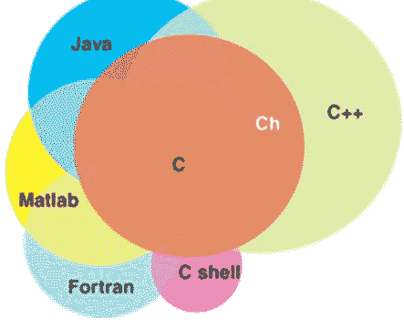

图 1. C 与其他主要语言的关系。

### 2.1. Ch —— 可嵌入式 C/C++ 解释器

Ch 最初由 Cheng [12, 11] 开发，是一种嵌入式 C/C++ 解释器 [2]，作为用于跨平台脚本 [12]、数值计算和嵌入式计算的集成编程环境。Ch 是广泛使用的 C 计算环境的扩展和增强。Ch 与其他主要编程语言及软件包的关系如图 1 所示。由于具有平台无关性，在一个平台上开发的 Ch 程序可以很容易在不同平台上执行，而无需重新编译和链接。使用 Ch 对异构机电和机器人系统进行交互控制和集成已在 [22, 7] 中验证。Ch 中的函数、命令和脚本是高级机器人编程的基础块。Ch 中的函数文件是一个包含至少一个函数定义的 C 程序。在 Ch 编程环境中，使用函数文件定义函数，这些函数被处理为类似于内置系统。通过 Ch 函数，自动机程序的创建不是通过从零开始编写大型程序，而是由较小的组件组合而成的。这些组件很小，并且集中在简单的命令上，它们易于构建、理解、描述和维护。Ch 中的命令行参数接口是兼容的。语句、函数和命令可以组成为一个脚本文件或 Ch 中的脚本。脚本还可以包含在其他 shell（如 C、Bourne 和 Korn）中编写的脚本。嵌入式系统的一些显性且重要的特征如下：

-   用于实时计算的确定性

-   解释性

-   交互式用户界面

-   已有语言的超集

-   代码在不同平台间具有可移植性

-   安全的网络计算

-   具有矩阵能力的先进数值计算

-   二进制对象接口

# 嵌入式系统的脚本计算 189

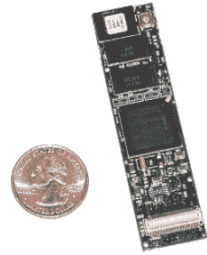

图 2. Gumstick 微电脑。

作为一种嵌入式 C/C++ 解释器，Ch 可以嵌入到 C/C++ 应用程序中以增强原型能力并增加灵活性。通过嵌入式 Ch，用户可以将脚本数值加载到应用程序中并动态执行。作为内置的 C 脚本引擎，嵌入式 Ch 可以减轻嵌入式程序员开发和维护脚本语言的负担，让他们专注于系统的核心研究或应用。嵌入式 Ch 占用空间小，满足各种嵌入式和机电系统的有限内存容量。一旦安装到嵌入式系统中，Ch 可以设置为默认登录 shell 或在命令提示符处启动。

### 2.2. 使用 Ch 进行 Gumstick 数据采集

Gumstick 微电脑 [16]（如图 2 所示）是一种多功能通用嵌入式板电脑，能够运行 Linux 或 Windows CE 等全嵌入式操作系统。Gumstick 有多种主板，配备 Intel Xeon 或德州仪器 OMAP ARM 处理器，运行频率为 400MHz 到 600MHz，带有高达 256MB 的板载闪存在内存。主板有多个连接器，允许与扩展板结合，提供多种功能，包括 Wi-Fi 802.11b/g 和以太网网络、蓝牙通信、数字和模拟 I/O、脉宽调制、通过芯片接触或微 SD 的额外内存、音频支持、控制台和 LCD 支持以及 GPS。

使用 Ch 进行 Gumstick 数字 I/O：机器人系统是一种通用的实时数据采集和控制 Gumstick 扩展板，其板载 Atmega128 16MHz 微控制器。机器人通过 60 脚插头连接器连接到 Gumstick，包含 PWM、GPIO、ADC、I2C、SPI、UART 等多个功能。运行在 Gumstick 上的 Ch 脚本可以通过通过 I2C 发布命令来控制机器人。可以安装 i2cio 二进制文件，使用户通过 I2C 直接访问 I/O 线和寄存器。互补的 Gumstick i2c-io 库为用户提供

# 190 Stephen S. Nestinger 和 Harry H. Cheng

通过与 I2C 的 Robostix 通信的 API 来获取所需的 I/O 数据。Gumix 还一个名为 `i2c-io` 的二进制程序，它为用户提供了一个简单的命令行接口来调用 `i2c-io` C 库。Robostix 和 Gumix i2c-io 二进制文件以及 Gumix i2c-io C 库可从 Gumix 网站获取 [16]。i2c-io Robostix 二进制文件是通过 I2C Robostix 引导加载程序安装的，该程序允许通过 Gumix I2C 安装 Robostix。一旦加载了 i2c-io 二进制文件，用户可以使用 Robostix 软件开发附带的 Gumix i2c-io 程序快速测试连接。在命令行提示符中运行以下命令允许用户启用 Robostix 上的蓝色 LED。

```
$ i2c-io 0x0b setdir g.3 out
$ i2c-io 0x0b set g.3 out
```

值 0xbc 是 Robostix 的 I2C 地址。第一行设置了 G 端口引脚 3 的方向，蓝色 LED 连接在此。第二行通过将 G 端口引脚 3 设置为低电平启蓝色 LED。由于 Ch 是一个 C/C++ 解释器和 Shell，可以在 Ch 脚本内部创建实用程序。以下是一个简单的 Ch 脚本 `blue.ch`，它使用 i2c-io 程序切换蓝色 LED。

```
if(atoi('i2c-io 0x0b set g.3'))
  i2c-io 0x0b set g.3 0
else
  i2c-io 0x0b set g.3 1
```

在 Ch 命令提示符处输入脚本名称执行该 Ch 脚本即可切换蓝色 LED。

## 加速度计数据采集

图 3 所示的实验装置用于演示通过 Ch 获取实时加速度数据。当电机运行时，加速度计会测量电机的震动，作为防止可能故障的预防措施。该装置包含一个带有 Robostix 和 netMMC 扩展板的 Gumix connect 400xm-bt、一个双轴加速度计（Analog Devices ADXL204EB）和一个 Melon DC 直流发生器。加速度计的工作电压范围为 3V 到 5V，并每个轴提供连续电压输出，测量范围为 ±1.7 g；加速度计输出连接到 Robostix 上的数模转换线路，并使用 Robostix 的 5V 电电。

在实验中，运行 Gumix 上的 Ch 脚本在电机使用 12V 供电时采集 30 个加速度计数据点。Ch 脚本直接使用 Robostix 提供的 i2c-io C 库通过 I2C 指令 Robostix。像 Gumix 一样，其他系统提供者可能会发布额外的 C/C++ 二进制库用于与硬件或外设接口。Ch 软件开发包 (SDK) [26] 允许用户通过创建绑定 C/C++ 二进制库和函数的 Ch 包，将 C/C++ 二进制库和函数集成到 Ch 中。一旦库或函数被移植到 Ch 并创建了 Ch 包，用户就有三种不同的方法与硬件或外设建立接口。为了让 Ch 脚本调用 i2c-io 二进制库中的 C 函数，使用 Ch SDK 开发了 Ch 包 I2C-io 并在网上可用 [3]。该概念

《Java Software and Embedded Systems》，由 Matt Hayes 和 Isaac Johannsen 编写，Nova Science Publishers, Incorporated, 2010. ProQuest

# 嵌入式系统的脚本计算

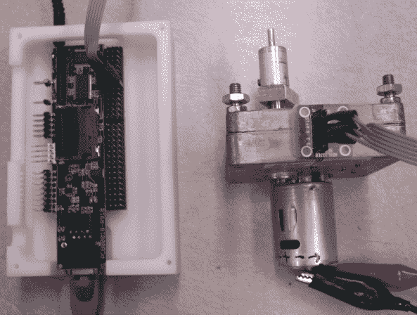

图 3. Gumstick 与 Robostix 和 NetStix 连接到安装在电机上的双轴加速度计。

| Ch 空间 | C 空间 |

|---|---|

| Ch 脚本 | i2c-io C 库 |

| accel.c | i2C_IO_GetADC() |

| 函数调用 i2C_IO_GetADC() | |

| Ch 函数文件 | i2C-IO 动态库 |

| i2C_IO_GetADC() | i2C_IO_GetADC_chldl() { |

| i2C_IO_GetADC_chldl() | i2C_IO_GetADC() } |

| Ch SDK | |

图 4. 带有 Ch I2C-IO 包的 Ch SDK 概念。

Ch I2C-IO 背后的概念如图 4 所示，其中 i2c-io C 库中名为 I2C_IO_GetADC() 的函数被 Ch 空间中的 Ch 脚本或程序调用。要在 Ch 中调用 i2c-io C 库中的 C 函数，应创建一个封装函数。封装函数由部分组成：Ch 空间中的 chf 函数和 Ch 空间中的 chld 函数。chld 函数被编译成动态加载库，该库在脚本执行期间加载。为了调用 I2C_IO_GetADC()，Ch 寻找等效的 chf 函数（在本例中为 I2C_IO_GetADC()）并将参数传递给它。

## 192 Stephen S. Nestinger 和 Harry H. Cheng


# 嵌入式系统的脚本计算

## 程序 1：一个采集数据的程序

```c
/* accel.c */
#include "i2c-io.h"

#define MEAN 512.0
#define ANYY 509.0
#define DELTA 208.0
#define ACCEL 9.8

int main() {
    char *i2cDev = "/dev/i2c";
    char *i2cAddr = "0x0b";
    int count = 0;
}
```

Ch 脚本直接使用 Robostix 提供的 `i2c-io` C 库通过 I2C 指令 Robostix。像 Gumix 一样，其他系统提供者可能会发布额外的 C/C++ 二进制库用于与硬件或外设接口。Ch 软件开发包 (SDK) [26] 允许用户通过创建绑定 C/C++ 二进制库和函数的 Ch 包，将 C/C++ 二进制库和函数集成到 Ch 中。一旦库或函数被移植到 Ch 并创建了 Ch 包，用户就有三种不同的方法与硬件或外设建立接口。为了让 Ch 脚本调用 `i2c-io` 二进制库中的 C 函数，使用 Ch SDK 开发了 Ch 包 `I2C-io` 并在网上可用 [3]。

Ch `I2C-IO` 背后的概念如图 4 所示，其中 `i2c-io` C 库中名为 `I2C_IO_GetADC()` 的函数被 Ch 空间中的 Ch 脚本或程序调用。要在 Ch 中调用 `i2c-io` C 库中的 C 函数，应创建一个封装函数。封装函数由部分组成：Ch 空间中的 `chf` 函数和 Ch 空间中的 `chld` 函数。`chld` 函数被编译成动态加载库，该库在脚本执行期间加载。为了调用 `I2C_IO_GetADC()`，Ch 寻找等效的 `chf` 函数（在本例中为 `I2C_IO_GetADC()`）并将参数传递给它。

## 2.4. iRobot 控制

iRobot Create 是一个基于广泛使用的 Roomba 的新发布 iRobot 系统。Create 具有更多功能的接口，是机器人研究的理想选择。Create 自带有板载编程微控制器，可以通过 26 脚 DB 接口进行串行连接。

## 3. Web 计算

在处理远程嵌入式系统（如传感器节点）时，物理交互以获取数据或更改控制参数可能是不现实的。嵌入式系统开发者开始使用基于 Web 的界面作为与系统交互的手段。本节介绍了使用基于 Web 的计算来交互和控制嵌入式系统，并描述了使用 Ch 和 Ch CGI 工具包的实现。提供了一个生物生产执行系统的示例，可以通过嵌入式 Web 界面控制和检查网络生物生产机械和传感器。

### 3.1. Web 计算

图 10 给出了基于 Web 计算的架构。嵌入式 Web 界面的实现基于使用标准的 HTTP Web 服务器。通过使用标准的 Web 服务器，无需开发特定的嵌入式控制和处理服务器守护进程。

Octagon Systems，基于 VIA 的单板计算机。
运行 Linux 内核 2.6.11。

```
localhost 登录: root
密码:
bash-2.05# ch
Ch 专业版，版本 5.5.0.13071
(C) Copyright 2001-2006 SoftIntegration, Inc.
http://www.softintegration.com
/root# ~ezioread.ch
A:00000000 B:00000000 C:00000000
/root# ~ezioread.ch
A:00010000 C:00000000
/root#
```

图 7. 在 Octagon XE-900 上运行的 Ch。

HTML 交互基于静态信息，非常不适用于嵌入式系统应用。通用网关接口 (CGI) 是应用程序与 Web 服务器之间交互的标准。CGI 程序可以由 Web 服务器实时执行，以运行外部应用程序并输出动态结果。支持 CGI 的 Web 服务器能够接收客户端请求，在服务器上执行应用程序，并将执行结果传回给客户端。CGI 允许 Web 服务器使用宿主机所开发的任何语言进行编写。虽然 CGI 程序可以用任何语言编写，但使用脚本语言比使用编译语言更容易对 CGI 程序进行调试、修改和维护。HTML 文档中编码的参数由 CGI 脚本提取，从而触发相应脚本或程序的调用。

## 3.2. Ch 基于 Web 的嵌入式接口的实现

许多基于 Web 的应用程序，例如用于控制系统设计与分析的 Web 系统 [29]，以及 2D/3D 计算机图形的 Web 可视化 [8]，已经使用 CGI Toolkit [27] 在 Ch 中开发出来。类似于 Java 页面 (JSP) 和活动服务器页面 (ASP)，CGI Toolkit [27] 提供了四类类作为构建基块：`CResponse`、`CRequest`、`CServer` 和 `Cookie`，用于 Ch 中的 CGI 编程。这些类的成员函数可以直接集成到基于 Web 的嵌入式接口中。为了在网页上实现完全输出，需要对用户输入的传输。用户参数由 Ch 程序提取并直接传递到 Ch 脚本，然后生成具有所需结果的动态 Web 页面。

```c
/* eziread.ch */

#include <stdio.h>      /* 用于 printf */
#include <sys/ioctl.h>  /* 用于 ioctl */
#include <fcntl.h>      /* 用于文件描述符 */
#include "ezio.h"

int main(void) {
    EZIOCINIT init;
    int digital_port[3];
    char port[3] = {'A', 'B', 'C'};
    unsigned char status[3];
    int i;

    for (i = 0; i < 3; i++) {
        /* 设置端口宽度为 8 位 */
        init.width = 8;
        /* 设置端口的位移 */
        init.shift = i * 8;
        /* 打开文件进行读取 */
        digital_port[i] = open("/dev/ezio", O_RDWR);
        /* 初始化端口 */
        ioctl(digital_port[i], EZIOC_INIT, &init);
        /* 设置方向为输出 */
        ioctl(digital_port[i], EZIOC_DDR, 0x00);
        /* 读取端口 */
        read(digital_port[i], &status[i], 1);
        /* 以 8 位二进制格式打印端口状态 */
        printf("%c:%b \n", port[i], status[i]);
    }

    printf("\n");
    /* 关闭文件 */
    for (i = 0; i < 3; i++)
        close(digital_port[i]);

    return 0;
}
```


# 嵌入式系统的脚本计算

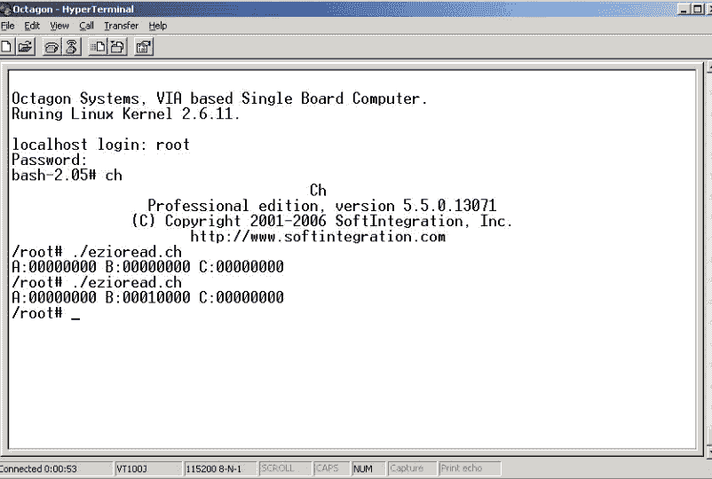

Octagon Systems，基于 VIA 的单板计算机。
运行 Linux 内核 2.6.11。

```
localhost 登录: root
密码:
bash-2.05# ch Ch
专业版，版本 5.5.0.13071
(C) Copyright 2001-2006 SoftIntegration, Inc.
http://www.softintegration.com
/root# ~ezioread.ch
A:00000000 B:00000000 C:00000000
/root# ~ezioread.ch
A:00010000 C:00000000
/root#
```

图 7. 在 Octagon XE-900 上运行的 Ch。

HTML 交互基于静态信息，非常不适用于嵌入式系统应用。通用网关接口 (`CGI`) 是应用程序与 Web 服务器之间交互的标准。`CGI` 程序可以由 Web 服务器实时执行，以运行外部应用程序并输出动态结果。支持 `CGI` 的 Web 服务器能够接收客户端请求，在服务器上执行应用程序，并将执行结果传回给客户端。`CGI` 允许 Web 服务器使用宿主机所开发的任何语言进行编写。虽然 `CGI` 程序可以用任何语言编写，但使用脚本语言比使用编译语言更容易对 `CGI` 程序进行调试、修改和维护。HTML 文档中编码的参数由 `CGI` 脚本提取，从而触发相应脚本或程序的调用。

## 3.2. Ch 基于 Web 的嵌入式接口的实现

许多基于 Web 的应用程序，例如用于控制系统设计与分析的 Web 系统 [29]，以及 2D/3D 计算机图形的 Web 可视化 [8]，已经使用 `CGI Toolkit` [27] 在 Ch 中开发出来。类似于 Java 页面 (`JSP`) 和活动服务器页面 (`ASP`)，`CGI Toolkit` [27] 提供了四类类作为构建基块：`CResponse`、`CRequest`、`CServer` 和 `Cookie`，用于 Ch 中的 `CGI` 编程。这些类的成员函数可以直接集成到基于 Web 的嵌入式接口中。为了在网页上实现完全输出，需要对用户输入的传输。用户参数由 Ch 程序提取并直接传递到 Ch 脚本，然后生成具有所需结果的动态 Web 页面。

```c
/* eziread.ch */

#include <stdio.h>      /* 用于 printf */
#include <sys/ioctl.h>  /* 用于 ioctl */
#include <fcntl.h>      /* 用于文件描述符 */
#include "ezio.h"

int main(void) {
    EZIOCINIT init;
    int digital_port[3];
    char port[3] = {'A', 'B', 'C'};
    unsigned char status[3];
    int i;

    for (i=0; i<3; i++) {
        /* 设置端口宽度为 8 位 */
        init.width = 8;
        /* 设置端口的位移 */
        init.shift = i*8;
        /* 打开文件进行读取 */
        digital_port[i] = open("/dev/ezio", O_RDWR);
        /* 初始化端口 */
        ioctl(digital_port[i], EZIOC_INIT, &init);
        /* 设置方向为输出 */
        ioctl(digital_port[i], EZIOC_DDR, 0x00);
        /* 读取端口 */
        read(digital_port[i], &status[i], 1);
        /* 以 8 位二进制格式打印端口状态 */
        printf("%c:%b \n", port[i], status[i]);
    }

    printf("\n");

    /* 关闭文件 */
    for (i=0; i<3; i++)
        close(digital_port[i]);

    return(0);
}
```

# 程序 2：用于读取 24 条数字 I/O 线状态的脚本。

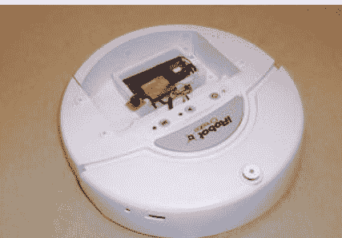

图 2: 带有增强 Gumstick 系统的 iRobot Create。

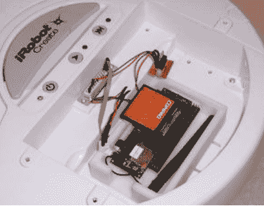

图 9. iRobot Create 上 Gumstix 的特写。

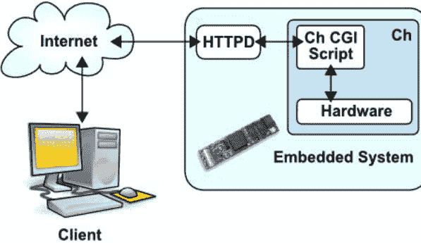

图 10. 嵌入式 Web 接口架构。

## 3.3. Gumstix I/O 基于 Web 的接口

延续 2.2 节完成的 Gumstix 实验，本示例添加了一个基于 Web 的接口，允许客户端选择所需的数据点数量、采样接口、采集的 ADC 通道，并提供数据图表。

图 11 显示了托管在 Gumstix 计算机上的 Gumstix Web 交互实时数据采集系统。接口用 HTML 编写，并使用表单将数据提交给脚本。在相同的设置下，加速度计连接到电机并连接到 Robot，选择了 ADC 通道 0 和 1 并绘制图表。Gumstix Web 交互实时数据采集系统显示 11。

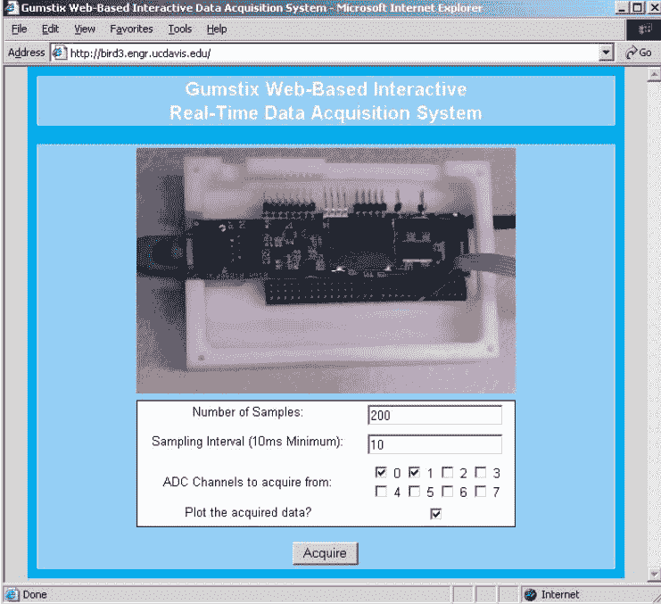

图 12. iRobot Create 上的 Gumstix。

## 3.3. Gumstix I/O 基于 Web 的接口 (续)

```c
if(Request.form("plot")) {
  CPlot plot;
  Response.setContentType("image/png");
  Response.begin();
  for(j=0; j<8; j++) {
    if(channels[j]) {
      plot.data2D(x, data[j]);
    }
  }
  plot.outputType(PLOT_OUTPUTTYPE_STREAM, "png");
  plot.plotting();
  Response.end();
} else {
  Response.setContentType("text/html");
  Response.begin();
  printf("<TR><BR><TR>");
  for(j=0; j<8; j++) {
    if(channels[j]) {
      printf("<TD ALIGN=CENTER WIDTH=50>");
      printf(" %d<BR><HR></TD", j);
    }
  }
  printf("</TR>");
  for(i = 0; i<samples; i++) {
    printf("<TR>");
    for(j=0; j<8; j++) {
      if(channels[j]) {
        printf("<TD ALIGN=RIGHT WIDTH=50>");
        printf("%d</TD>", data[j][i]);
      }
    }
    printf("</TR>");
  }
  printf("</TABLE>");
  Response.end();
}
I2C_IO_CloseDev();
return 0;
```

# 程序 4：Gumstix I/O Web 接口脚本 adc.ch 续。

由于能量限制和高通信成本，需要高效的编程方法。研究人员引入了一种增量编程机制 [18]，它允许将增量图像在整个传感器网络中进行广播。然而，在典型的大区域传感器网络中，节点的更新或更改局限于网络的某个特定区域。因此，使用了一种向局部节点引入可编程更改的方法。为了处理大型传感器网络的可编程性，将虚拟机架构引入到构成无线节点的小型嵌入式系统中。传感器网络对虚拟机的需求 [19] 已由伯克利大学 [19]、加州大学洛杉矶分校 [6] 等多个大学的研究人员进行了讨论。他们的虚拟机专为小型资源受限型系统设计，以提供最小的可编程性。使用虚拟机允许将移动代码集成到无线传感器网络中并作为移动代理，这些代理可以在整个传感器网络中自主地迁移和复制。

# Stephen S. Nestinger 和 Harry H. Cheng

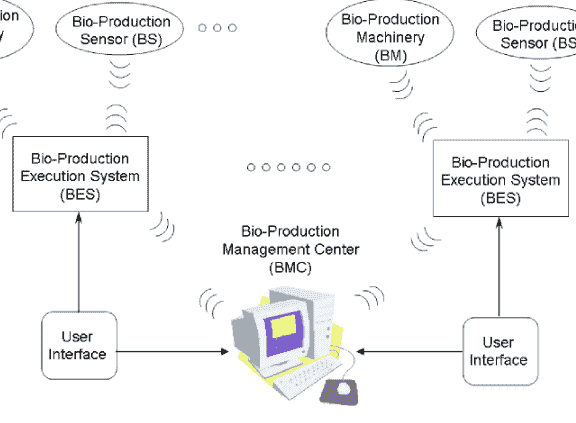

图 13. 生物生产执行系统的架构。

基于代理的方法相比其他方法具有更高优势的场景在于目标跟踪 [5]。目标跟踪是无线传感器网络的一个非常流行的应用，涉及一组执行代码的动态变化节点。

## 4.1. Mobile-C 库

`Mobile-C` [9, 20, 10] 最初被开发为一种独立的、符合 FIPA 标准的移动代理系统，主要意图是适配到具有网络机制和涉及底层硬件的嵌入式应用中。由于大多数此类系统是用 C/C++ 编写的，因此 `Mobile-C` 选择 C++ 作为代理语言，以便于与底层控制和底层硬件建立接口。此外，`Mobile-C` 使用了嵌入式 Ch 来支持 C/C++ 移动代理的执行。为了将 `Mobile-C` 与应用集成，开发了 `Mobile-C API` [14]，它允许 `Mobile-C` 嵌入到应用中支持 C/C++ 移动代理。此外，`Mobile-C API` 促进了可以与各种设备轻松建立接口的多代理系统的开发。

由于 `Mobile-C` 的代理引擎基于 Ch，代码可以很容易地作为 `Mobile-C` 代理代码使用。移动代理代码封装在带有 XML 格式 FIPA 代理通信语言的移动代理消息中。XML 移动代理消息包含封装的代理数据以及代理 C 代码。封装的代理数据包括代理状态、行程和任务。

## 4.2. 使用 Mobile-C 进行 Gumstix 数据采集

再次，继续第 2.2 节完成的 Gumstix 实验，本示例使用移动代理从 Gumstix 获取加速度计数据并返回这些数据。

# 嵌入式系统的脚本计算

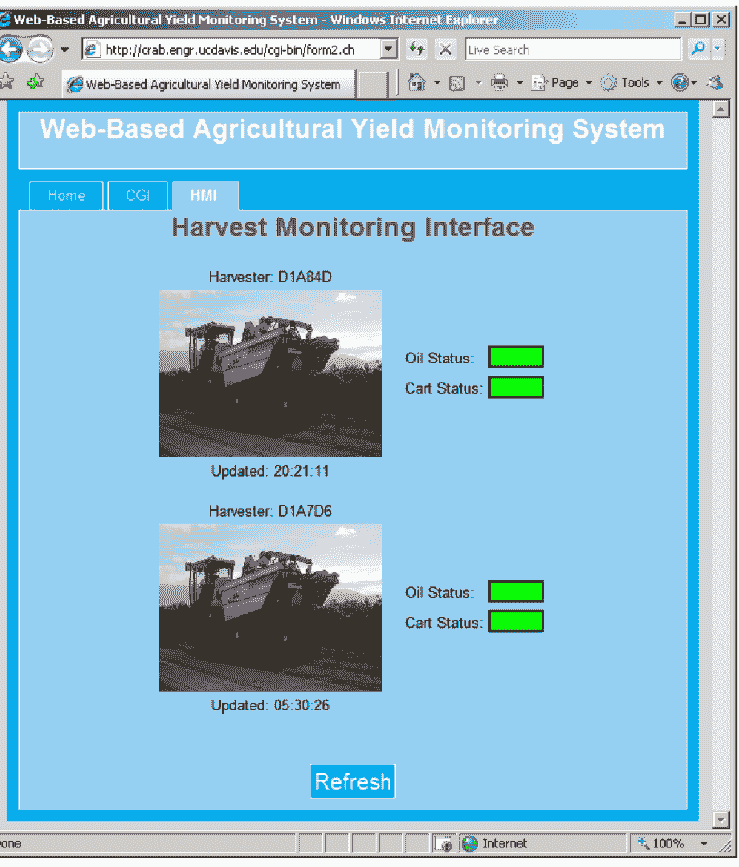

图 14. 基于 Web 的农业收成监控系统。

程序 5 显示了用于从 Gumstix 收集加速度计读数的移动代理。移动代理 C 代码与第 2.2 节实验使用的代码几乎完全相同，只是数据存储在全局数组中，且代理不处理主机系统上的数据显示。全局作用范围是必要的，以便代理能够携带采样数据返回到发送主机。代理从 Gumstix 返回后获取的数据输出如图 15 所示。

## 4.3. 使用 Mobile-C 控制 Team Khepera III

Khepera III 移动机器人配备了 KoreBoard，这是一个基于 ARM 的计算机。KoreBoard 拥有 64 MB RAM 和嵌入式 Linux 操作系统。

> Java Software and Embedded Systems，Matt Hayes 和 Isaiah Johansson 编辑，Nova Science Publishers, Incorporated, 2010. ProQuest。

# 204

# Stephen N. Nestinger 和 Harry H. Chen

```xml
<xml version="1.0">
<!DOCTYPE MESSAGE SYSTEM "message.dtd">
<GAF_MESSAGE>
<MESSAGE message="MOBILE_AGENT">
<MOBILE_AGENT>
<AGENT_DATA>
<NAME>mobagen1</NAME>
<OWNER>http://nestinger.ucavis.edu/home</OWNER>
<TASK name="task1" num="0" complete="0"></TASK>
<AGENT_CODE>
<![CDATA[
#include "i2c-io.h"
#define MEANX 512.0
#define MEANY 50.0
```


#define DELTA 200.0

#define ACCELG 9.8

double a[2][100];

int main() {

    char *i2cName = "/dev/i2c-0";

    char i2cAddr = "0x0";

    int ret, count = 0, channel = 64;

    uint16_t adcVal = 0;

    ret = I2C_IO_Init(i2cName, i2cAddr);

    for(count=0; count<100; count++) {

        if(I2C_IO_GetADC(ret, channel, &adcVal)) {

            a[0][count] = (adcVal-MEANX)/ACCELG;

        }

        if(I2C_IO_GetADC(ret, channel+1, &adcVal)) {

            a[1][count] = (adcVal-MEANY)/ACCELG;

        }

    }

    I2C_IO_CloseDev();

    return 0;

}

```

程序 5：用于从 Gumstick 获取加速度计读数的移动代理。通过 CoreBot，Khepera III 移动机器人还可以处理 Wi-Fi、蓝牙或额外存储。Khepera III 机器人基础具有 9 个红外传感器用于物体检测，5 个超声波传感器用于远距离检测。在实验中，Mobile-C 代理运行在 Khepera III 机器人上。程序 6 通过简单发送一个新的移动代理来轻松启用 Braitenberg 避障算法。嵌入式系统的脚本

```
File Edit View Help

/home/ycchou/linux_sys/bin/.acq
Welcome to Mobile C 1.8.0 -- University of California, Davis
Waiting for return...
dim is 2
Extents: 2 100
200 Elements:
```

X axis:

0.00 -0.19 0.19 0.24 0.05 -0.05 -0.05 0.09 -0.09 0.14 -0.33 -0.24 -0.14

0.19 -0.05 0.14 0.09 0.00 -0.09 -0.19 0.00 0.24 0.09 0.15 0.14 0.00 0.24

0.05 -0.09 0.14 0.09 0.05 -0.28 -0.05 -0.14 0.19 0.05 0.00 -0.14 0.00 0.19

0.00 0.09 0.19 0.15 0.05 0.09 0.05 -0.05 -0.24 -0.19 -0.09 0.09 -0.05 -0.05 -0.28 -0.28 0.19 -0.05 -0.14 -0.19 -0.19 -0.19 -0.05 -0.05 -0.05 -0.05 -0.05 -0.00 0.19 -0.14 -0.09 -0.08 -0.09 0.09 -0.09 -0.05 -0.05

..15 0.11 - ..1 - -0.09 -0.09 -0.05 0.00 -0.00 -0..0 -0..04 -0.00 -0.14

Y axis:

0.19 -0.09 0.24 0.28 0.19 -0.14 -0.09 -0.19 -0.57 -0.38 0.00 0.25 0.28

0.05 0.09 -0.09 0.24 0.14 -0.09 0.14 0.14 0.05 -0.28 0.24 0.09 -0.33

0.00 -0.42 -0.05 0.19 0.05 0.09 0.05 0.05 0.14 -0.14 0.00 -0.14

0.05 -0.52 -0.24 -0.14 -0.14 -0.14 -0.19 -0.09 -0.19 0.19 0.28

0.28 -0.28 -0.09 -0.24 0.24 0.19 -0.19 -0.13 -0.05 0.15 0.05 0.00

0.00 0.09 0.19 0.14 -0.09 0.09 0.23 0.03 0.15 0.05 -0.28

0.00 0.05 0.28 -0.33 0.09 0.00 0.00 -0.19 -0.33 -0.09 -0.14 0.09 0.05

0.24 -0.14 -0.24 0.280.28 -0.19 -0.39 -0.38 -0.19 -0.05

图 16。执行物体避障的 Khepera III 移动机器人。

### 206 Stephen S. Nestinger 和 Harry H. Cheng

```c
#include <korebot/korebot.h>

#define MAXBUFFERSIZE 100

#define BR_IRGAIN 10

#define fwSpeed = 0

static int quitReq = 0;

static char buf[1024];

static knet_dev_t *dsPic, *mot1, *mot2;

int khIT3(void) {

    init();

    dsPic = knet_open("Kepera3:dsPic", KNET_BUS_I2C, 0, NULL);

    mot1 = knet_open("Kepera3:mot1", KNET_BUS_I2C, 0, NULL);

    mot2 = knet_open("Kepera3:mot2", KNET_BUS_I2C, 0, NULL);

    if (!dsPic || !mot1 || !mot2) return -1;

    return 0;

}

int braitenbergAvoidance() {

    int Connections_B[] = {2, -2, 6, -15, 5, 2, 1, 5, 7};

    int Connections_A[] = {5, 1, 2, 5, -16, -6, 2, 7};

    int i, buflen;

    unsigned char buffer[MAXBUFFERSIZE];

    unsigned char *scan;

    long lspeed16, rspeed16;

    int left_speed, right_speed, tabens[9];

    uint8_t valueLL,valueLH,valueHL,valueHH;

    char cmd[3] = {0, 0, 0};

    while(1) {

        lspeed16 = rspeed16 = 0;

        while(!kh_3command_get(dsPic, KNET_INT0));

        buflen = knet_read(dsPic, buffer, 30);

        scan = buffer;

        if(buffer[0] != 0xb) continue;

        for(i=0; i<9; i++) {

            sensval = (*scan) * tabens[i] << 8;

            if(sensval > 2000) tabens[i] = 500;

            else tabens[i] = sensval >> 2;

        }

        scan += 2;

    }

    for(i=0; i<9; i++) {

        lspeed16 = Connections_A[i] * tabens[i];

        rspeed16 = Connections_B[i] * tabens[i];

        left_speed = (lspeed16 / BR_IRGAIN) + fwSpeed;

        right_speed = (rspeed16 / BR_IRGAIN) + fwSpeed;

        if(left_speed < 0 && left_speed > -30) left_speed = -30;

        if(left_speed > 0 && left_speed < 30) left_speed = 30;

        if(right_speed < 0 && right_speed > -30) right_speed = -30;

        if(right_speed > 0 && right_speed < 30) right_speed = 30;

        kmot_SetReg(mot1, kmotRegSpeed, left_speed);

        kmot_SetReg(mot2, kmotRegSpeed, right_speed);

        sleep(10000);

    }

    return 0;

}

int main(int argc, char *argv[]) {

    if(!initKH3(0))

        braitenbergAvoidance();

    else return(-1);

    return 0;

}
```


# 程序 6：在 Kepera III 上运行 Braitenberg 算法的代理

## 5. 结论

本章介绍了嵌入式系统脚本计算的概念。`Ch` 是一个灵活的嵌入式系统编程平台。它可以用于增强原型设计的开发能力和可维护性，并为嵌入式系统提供动态重构和现场处理能力。文中介绍了三种使用 `Ch` 实现嵌入式脚本计算的不同实现方案。第一种实现侧重于易访问的单嵌入式系统。提供了多个嵌入式实验和示例，展示了使用 `Ch` 进行嵌入式系统数据采集。第二种涉及远程嵌入式系统，以及使用基于 Web 的界面进行系统控制和监控，包括对远程系统实时数据的绘图。展示了多个示例，包括 `Gumuix` Web 实时数据采集系统和生物生产管理系统。最后一种实现研究了用于多个地理位置嵌入式系统分布式的移动代理系统，场景如无线传感器网络和移动机器人团队。文中展示了使用 `Mobile-C` 的应用。

## 参考文献

- [1] http://www.mobilec.org/apps/irobot.
- [2] `Ch` — 一个可嵌入的 C/C++ 解释器。http://www.softintegration.com
- [3] `Ch i2cio` 软件包。http://www.mobilec.org/apps/daq.
- [4] `Swig`。http://www.swig.org.
- [5] Athanassis Boulis. 为移动代理编程传感器网络。In MDM '05: Proceedings of the 6th international conference on Mobile data management , pages 252–256, New York, NY, USA.
- [6] Athanassis Boulis, Chih-Chih Chang, and Mani B. Srivastava. 高效可编程网络框架的设计与实现。In MobiSys '03: Proceedings of 1st international conference on Mobile systems, applications and services, pages 187–200, New York, NY, USA.
- [7] Kauresh G Chatterjee and Henry H. Chen. 用于机电系统的 C++ 和 Java 混合编程。In Proceedings of 2006 IEEE/ASME International Conference on Mechatronic and Embedded Systems, Beijing, China.
- [8] Bo Chen and Henry H. Cheng. 交互式图形。Computers and Graphics, 29(2):331–339, 2005.
- [9] Bo Chen, Henry H. Cheng, and Joe Patel. `Mobile-C`: 用于移动 C++ 代理的代理平台。Software-Practice & Experience, 36(15):1711–1733, 2006.
- [10] Bo Chen, David Linz, and Henry H. Chen. 移动代理系统中基于 XML 的通信与计算。Journal of Systems and Software, 81(8):1364–1378, 2008.
- [11] Harry Cheng. `Ch` 语言中的复数。Scientific Programming, 2(3):76–106, 1993.
- [12] Harry Cheng. `Ch`: 用于脚本计算的 C/C++ 解释器。C/C++ User's Journal, 24(1):6–12, 2006.
- [13] D. Chess, C. Harrison, and A. Kershenbaum. 移动代理：好主意吗？In Mobile Object Systems Lecture Notes in Computer Science 222, pages 25–45, Berlin, 1997.
- [14] Yu-Cheng Chou, David Ko, and Harry H. Cheng. 多代理系统中运行时支持嵌入式 `Mobile-C`。In Proceedings of ASME 2007 International Design Technical Conferences & Information in Engineering Conference, number DET2007-3547, Las Vegas, September-2007.
- [15] Frederica Dare. 编译之后：动态系统。In Proceedings of the IEEE, March 2005.
- [16] `Gumst Inc`。http://www.gumst.com/.
- [17] B. C. Heidan, U. A. Rosa, S. Upadhaya, and P. H. Brown. 产量监控系统的开发。In 2003 ASAE Annual International Meeting, number 031040, Las Vegas, Nevada, 2003.
- [18] Jaein Jong and D. Culler. 无线传感器的增量编程。Sensor and Ad Hoc Communications and Networks, 2004. IEEE SECON 2004 First Annual IEEE Communications Conference on, pages 25–33,2004.
- [19] Philip Levis and David Culler. `Mate`: 用于传感器网络的微虚拟机。In ASPLOS-X: Proceedings of 10th international conference on programming languages and operating systems, pages 85–95, New York, NY, USA, 2002. ACM Press.
- [20] `Mobile-C`: 用于 Mobile/CC 的多代理平台。http://www.mobilec.org.
- [21] 国家科学基金会。通过基础设施变革科学与工程，2003. http://www.nsf.gov/odci/reports/toc.jsp.
- [22] Stephen Nestinger 和 Harry H. Cheng. 使用可嵌入的 C/C++ 解释器进行交互式运动控制。Assembly Automation, 24(2):152–158, 2004.
- [23] J. K. Outskouter. 开始：21 世纪的高级编程。Computer, 31(3):23–30, March 1998.
- [24] `Rabbit` 微处理器。http://www.rabbit.com/products/Microprocessors.
- [25] 移动代理实时移动机器人控制。http://www.mobilec.org/apps/kepera/
- [30] Yu-Cheng Chou and Stephen S. Nestinger and David C. Pursell and Harry H. Cheng and Uriel A. Rosa. 用于农业作业管理的生物生产执行系统的开发。In Proceedings of the 2008 IEEE/ASME International Conference on Mechatronic and Embedded Systems and Applications, pages 118–123, Beijing, China, October 12-15 2008.

# 用于嵌入式实时机器人和工业自动化的免费软件平台

Gabriele Bruzzone; Marco Bibuli† 和 Massimo Caccia‡
意大利国家研究委员会 (Consiglio Nazionale delle Ricerche)
自动化智能系统研究所
Via De Marini, 6 - 16149 Genova, Italy

# 摘要

嵌入式实时平台是机器人和工业过程自动化机器的基础组件。尽管工业应用传统上依赖于基于 `PLC` 的硬件以及某种程度的专有软件（即操作系统和开发工具），但近年来硬件性能的巨大提升和免费软件质量的提高，使得基于 `PC` 兼容硬件和 `GNU/Linux` 的架构在科研社区中的应用变得更加常见。免费基础设施的优势可以成为研究机构与公司之间富有成效合作的领域，这种优势主要适用于附加值在于应用（即机械和算法解决方案），且其视角是人机界面用户而非研发竞争者的领域。下文介绍的项目正是此类：研究机构和一家小型企业共同识别了需求并共同开发了一套通用软件基础设施。当项目在 2004 年启动时，双方合作伙伴（即 `CNR-ISSIA` 的自主机器人系统与控制小组以及 `Green Project Srl`）都必须为他们的海洋机器人和钢制制品标记机更换过时的平台，改为一套能够在透明改进的同时保持与过去兼容（向后兼容）的稳定软件和硬件基础设施。基于下文讨论的关于可靠性、开发和维护稳健性的考虑，选择是验证使用标准 `GNU/Linux` 用于嵌入式实时应用。其结果是本章的主要技术贡献，即通过实际演示证明了使用标准 `GNU/Linux` 实现采样频率高达 2 kHz 的嵌入式实时控制系统的可行性。此外，在四年后，该开发的系统仍然展示了其能力，得益于 `Linux` 内核新的实时特性，可能整合了改进并进一步提升了其性能。

该平台的第一个可发布版本于 2005 年完成，并与 2004 年 `CNR-ISSIA` 无人水面器（`USV`）集成，用于机器人研究。

第二个应用是将 `Hammer` 的控制系统软件移植到该平台，`Hammer` 是一种用于对连续铸产品进行标记的钢用工业设备，由 `Greenpoint s.r.l.` 开发。

目前，该平台支持 `ALANIS`（用于智能传感的自主导航器）`USV` 的开发，用于水面和水下监测。此外，正在进行与通用现场总线和图像采集系统的集成。

在对该领域相关研究进行总结介绍以及对平台需求进行讨论后，将介绍使 `GNU/Linux` 实时化的后续方法论的关键点。最后，将描述两个应用（一个是研究性的，一个是工业性的），并指出该平台要求实现的实时结构。

## 引言

近年来，计算机计算能力的惊人增长以及闪存卡容量的提升（极大地扩展了嵌入式操作系统的可用空间），这使得 `GNU/Linux` 尽管在桌面/服务器环境作为操作系统已有历史之久，但与开源的专有实时操作系统相比，它在嵌入式操作系统领域也成为了一个极具吸引力的选择 [1]。事实上，得益于其可靠性基础、可扩展性、可移植性、开源规范和标准、支持以及庞大的程序员基础和免费可用性 [2]，`GNU/Linux` 提供了快速开发能力并缩短了上市时间。其主要局限性在于，由于 `Linux` 是一种类 `Unix` 内核，设计用于保证许多用户和应用程序之间公平共享资源，它无法满足实时性能需求，而这在嵌入式系统世界是至关重要的。为了获得实时能力，可以采取两种不同的方法：

- 在 `Linux`（作为低优先级进程运行）和实时硬件之间引入一个新的软件层（本质上是一个实时微内核），分别由 `RTLinux`、`RTAI` 以及最近的 `AEOS` 提出；
- 对标准 `Linux` 内核应用一组补丁使其实时化，这最初由 `KURT` 和 `TypeSys` 提出，随后由 `R. Morton` 和 `I. Molnar`（低延迟补丁）提出，并从 `Linux 2.6.0-4-preempt` 开始成为 `Linux` 标准配置（`CONFIG_PREEMPT`）。

结果是 `GNU/Linux` 已成为机器人研究和工业领域的一种可行选择，正如项目所示，如 `MCA`（模块化控制器）、`COMEDI`（控制与测量接口），这些项目提供了数据采集的开源驱动程序、工具和库；`OROS`（开放机器人软件），其目的是开发一个通用的机器人控制包。此外，下一代制造和自动化系统构建在类似于 `GNU/Linux` 的灵活开放系统之上，这些系统可以容易且高性价比地升级或扩展，以满足不断变化的需求：`ACA`（控制开放系统架构）、`OMAC`（开放模块架构）、`OSEC`（开放系统环境）、`ASADL`（开源开发实验室）、`Player` 和 `Gazebo`、`JAUS`（无人系统联合架构）以及 `CLARA`（机器人耦合层架构）都是这一方向努力的少数几个例子。关于使用 `GNU/Linux` 实施的工业自动化和机器人项目的最新列表，读者可以参考 `Real Time Foundation` 网站 [4]。

## 2. 需求

参与此研究的研究小组和小型企业都对开发可靠且可维护的系统感兴趣，这些系统运行在卫星等恶劣或远程环境中。此外，理想的平台必须是稳定的，尽可能少变，由强大且敏捷的社区支持，并能够在至少十年内可在包括板卡和通信总线内的多种硬件架构上运行。基础软件组件（例如操作系统、编程语言、`API` 等）必须是稳定的、广泛的且被开发者熟悉的，这使得易于找到人员进行工作。即使专有产品所使用的硬件和软件的存在也可以被视为一种强约束，特别是对于具有维护工业机器前景的企业而言。这种约束可能对选择自由软件的动力大于节省金钱的可能（软件许可的价格通常与先进工业机器的成本相当）。此外，一方面，共享、研究和修改软件的自由，以及对学习权和与他人分享所学知识的相关确认，与基础研究的伦理准则密切相关；另一方面，自由软件也可以负担低成本。事实上，使用相同的软件工具和硬件开发和测试不同的应用程序（例如人机界面、嵌入式实时控制系统、监控系统），极大地减少了人类开发人员进行心理上下文切换所需的压力和时间，优化了人力资源的利用，特别是在规模较小的团队中，而在许多研究小组中，人们处理复杂系统不同部分的能力是互换的。

## 3. 方法论

下将讨论使 `Linux` 嵌入式和实时所需的基础评估、步骤和组件。

### 3.1. 标准 Linux 实时的优缺点

使用标准 `Linux` 进行应用开发相比于“双 `Linux`/实时内核”方法，其优势总结为无需编写内核代码。事实上，实时层的线程无法直接访问 `Linux` 服务，其原因与禁止 `Linux` 进程产生确定性行为的原因相同，开发者必须将其应用程序设计为两个分离但又协作的世界：“纯”实时线程（无法访问 `Linux` 服务，作为内核模块加载）和非实时线程（具有完全访问系统调用的权限）。需要共享内存或 `FIFO` 等通信资源来允许这两个世界之间进行交换。虽然完全可以分离实时和非实时内核实例，但这增加了应用程序的复杂性，并对作为内核运行的系统完整性带来危险。通过使用激活了 `CONFIG_PREEMPT` 选项的纯内核，可以在用户空间运行实时应用程序，允许其代码像普通 `Unix` 进程启动（这比插入模块容易得多），并避免由于程序错误导致崩溃时影响整体系统稳定性。此外，使用 `GNU/Linux` 环境允许用户在任何时间使用一套独特的调试和性能分析工具，无需针对实时部分或基于 `GNU/Linux` 的应用程序组件。

值得注意的是，编译了 `CONFIG_PREEMPT` 选项的标准 `Linux` 内核在执行要求性活动时（例如访问大量内存导致故障、通过键盘大写、控制台切换、内存映射 `I/O` 进行压力测试；`proc` 文件访问和进程 `fork` 执行）存在限制 [5]。无论如何，这些限制通常通过实时嵌入式系统编程技术来处理。在用户与键盘和显示器进行交互的情况下，可以通过串口线或网络从远程计算机进行连接。

### 3.2. 嵌入 GNU/Linux

通常实时控制系统需要嵌入化，以增加稳健性、可靠性并降低成本。近年来，固态内存（如闪存 `CF` 卡和 `RAM`）尺寸和性能的巨大改进，使得定制嵌入式 `GNU/Linux` 系统变得关键，使得开发平台的某些方面几乎过时。因此，这里应该使用 `BusyBox`（一个提供相当完整 `POSIX` 环境的软件包）来定制和构建嵌入式 `GNU/Linux` 系统。创建的具有所需特征的文件系统在复制到合适的单个镜像文件后，可以被压缩并传输到挂载在 `CF` 卡上。

### 3.3. 实时线程与 Linux 线程

`Linux` 线程（在文中称为线程）和实时线程（`SCHED_FIFO` 线程）的区别在于调度策略。`Linux` 线程使用 `SCHED_OTHER` 策略，而实时线程使用 `SCHED_FIFO` 策略。

- `SCHED_OTHER`：`Unix` 类的时间分片策略，在文中称为线程。
- `SCHED_FIFO` 线程（在文中称为实时线程）永远不会被 `Linux` 线程抢占。因此，实时应用通过将关键任务委托给实时线程、将非关键任务委托给 `Linux` 线程来实现。值得注意的是，这种实现允许实时任务和非实时任务在同一系统中共存。

### 3.4. 自定义实时调度器与线程、数据及通信管理

为了简化和标准化控制系统应用的开发，我们实现了一组 `C++` 类，封装了实时线程和 `Linux` 线程，一个专门用于管理它们时序请求的自定义调度器，以及用于线程间通信的消息队列。图 1 所示的线程类分类法中，抽象基类 (`ABC`) `Thread` 体现了通用线程的主要特征，并作为其他类在其基础上构建的基类。`Thread` 类派生自 `SchedFIFOThread` 和 `LinuxThread`，分别代表实时线程和普通 `Linux` 线程。`SchedFIFOThread` 实现了一个通常在等待特定事件的通用线程。受自定义调度器限制的实时线程的主要特征由派自 `SchedFIFOThread` 类的抽象基类 `RTThread` 体现。`RTThread` 类派生自 `SynchronousThread` 和 `AsynchronousThread` 类，分别代表需要按请求频率周期调度的实时线程，以及需要在指定间隔后唤醒的实时线程。自定义调度器是一个具有最高优先级的实时线程，通过 `RTC` 按预设频率中断循环激活，其目标是管理来自 `AsynchronousThread` 和 `SynchronousThread` 的请求。还开发并实现了其他几个类，以便于提供线程间和网络通信。

## 4. 应用

该软件平台已应用于由 `CNR-ISSIA Genova` 开发的 `Charlie` 和 `ALANIS USV`（无人水艇）的控制系统，用于机器人研究；以及由 `Green Project S.r.l` 开发的用于连续铸造产品（如钢坯、方坯）标记的制造机器 `Hammer`。这些应用在实时调度方面具有互补需求：前者需要以低频率（8 Hz）执行周期性控制循环，后者则需要睡眠几毫秒的不同时间。对于这两个应用，嵌入式系统最初源于 `Slackware 10.1 GNU/Linux` 发行版，配备标准的 `Linux 2.6.9`。由于在实现应用时 `NPTL` 还不支持实时，使用了 `Linux-Threads` 库进行开发。目前的系统使用的是较新版本的 `Linux (2.6.21.1)` 和 `NPTL` 版本 2.3.5。

### 4.1. USV 控制系统

`Charlie USV`（见图 2）最初设计用于南极平静水域的极低速度表面微层采样 [77]，随后通过集成舵转向系统和完全基于标准 `GNU/Linux` 的新软件控制系统进行了增强。同样的控制架构现在用于 `ALANIS USV`（见图 3），这是一种配备外挂机推进和转向系统的近岸监测无人船。目前，`Charlie` 和 `ALANIS` 都实现在 `Diamond Hercules SBC`（单板计算机）上，配备了 800 MHz 的低功耗无扇 `Via Eden CPU`、512 MB `RAM`、4 个 `RS-232` 串口端口、1 个 `CF` 卡槽、100 Mbps 以太网、32 路差分/16 路单端 `A/D` 通、4 路 `D/A` 通以及 40 条数字 `I/O` 线，以及提供 8 个额外 `RS-232` 串口端口的 `Diamond Emerald-MM-8P`。船舶配备了用于基础导航的 `GPS` 和罗盘、一组传感器以及通过 `RS-232` 串口链路连接用于转向和推进的无刷及直流电机。车辆通过无线局域网连接到操作站。

`USV` 控制系统的软件架构如图 4 所示，主要由运行同步导航、引导和控制任务的执行层、保证任务依赖和约束一致性的执行控制器 [8]，以及实现物理 `I/O` 设备接口的驱动程序组成。与操作站的通信涉及驾驶命令时通过流套接进行，遥测则通过数据报套接进行。

### 4.2. Hammer

`Hammer` 控制系统的软件架构如图 6 所示，主要由运行同步导航、引导和控制任务的执行层、保证任务依赖和约束一致性的执行控制器 [8]，以及实现物理 `I/O` 设备接口的驱动程序组成。与操作站的通信涉及驾驶命令时通过流套接进行，遥测则通过数据报套接进行。

## 5. 结果

为了评估在激活和未激活 `CONFIG_PREEMPT` 选项的情况下，标准 `Linux` 在管理多个实时同步和异步线程、标准 `Unix` 类线程、`RS-232` 串行链路、模拟及数字 `I/O` 通道以及网络接口时的性能，我们在实验室中设计、实现并测试了一个基准应用程序，该程序模拟了图 6 所示的 `Hammer` 控制系统。与实际系统的区别在于，`Profibus` 和 `CANOpen` 线程以 115.2 Kbps 的速率与 `RS-232` 串行链路通信，模拟 `Profibus` 和 `CANOpen` 盒的行为。该应用运行在目标机上，一台 `Advantech PCM-9577` 单板计算机，配备了 1.2 GHz 的 `Intel Pentium III CPU`、512 MB 内存、`RS-232` 串行链路、一张 128 MB 的 `CF` 卡和一个 100 Mbps 的以太链路。使用了 `PC-104` 模块（`Advantech PCM-3724`、`Advantech PCM-3718HG` 和 `Diamond Ruby-MM-1612`）分别执行数字 `I/O`、输入和输出。在实验期间，运行在主机上的应用程序通过以 10 Hz 的频率向系统发送命令并以 8 Hz 的频率从目标机接收遥测数据，模拟连接以太网的人机界面的行为。运行在主机上的其他应用程序通过两个 `RS-232` 串行链路模拟 `Profibus` 和 `CANOpen` 接口的行为。通过 `Hammer` 控制系统，目标机上还运行了 `Calc`，这是一个不中断计算数字的 `Linux` 程序，其唯一目的是加载系统。应用性能通过 64 位时间戳计数器（`TSC`）进行测量，该计数器也位于 `Intel Pentium CPU` 上且独立于实时时钟（`RTC`）。调度器和每个派自 `RTThread` 类的线程被设计为允许用户通过读取 `TSC` 将其定时值记录在合适的数组（出于效率考虑保留在 `RAM` 中）中。特别是，调度线程和类型为 `SynchronousThread` 的线程在各自的数组中是请求周期与两个连续同步事件之间差值（在周期上）的直方图；而类型为 `AsynchronousThread` 的线程则保存请求延迟与实际延迟之间的差值（在延迟上）。在应用程序结束时，数组从 `RAM` 复制到文件中，并对数据进行离线分析。

为了在激活和未激活 `CONFIG_PREEMPT` 的情况下评估系统性能，通过使用带有 `Linux 2.6.9` 的 `Linux Threads` 以及带有 `Linux 2.6.21.1` 的 `NPTL 2.3.5` 运行系统约两周进行的。特别考虑了三个参数：

- 1. $T_{max}$：调度器请求周期上的最大误差。
- 2. $T_{99}$：调度器误差的 99.99 百分位数，即每万个调度周期样本中有一个样本误差高于 $T_{99}$。
- 3. $T_{99999}$：调度器误差的 99.9999 百分位数，即每百万个调度周期样本中有一个样本误差高于 $T_{99999}$。

表 1 汇总显示了标准 `Linux` 如何处理定时要求在 0.5-1 ms 级的应用程序。此外，它们指出近期内核和 `POSIX` 库 `NPTL` 的性能明显优于旧内核和过时的 `LinuxThreads`。特别是，激活 `CONFIG_PREEMPT` 选项减少了调度器请求周期上的最大误差，而 `NPTL` 证明比 `LinuxThreads` 更高效。

## 表 1. 系统性能评估：使用 LinuxThreads/NPTL 库并在激活/未激活抢占时的定时参数。

| 库 | 抢占 | $T_{max}$ [μs] | $T_{99}$ [μs] | $T_{99999}$ [μs] |
|---|---|---|---|---|
| LinuxThreads | 否 | 752 | 44 | 114 |
| LinuxThreads | 是 | 281 | 39 | 112 |
| NPTL | 否 | 495 | 39 | 114 |
| NPTL | 是 | 243 | 18 | 106 |

调度器和 `Machine` 线程在周期上的误差直方图如图 7 所示，这指的是类 `Hammer` 系统实验室，从带有激活了 `CONFIG_PREEMPT` 选项的 `Linux 2.6.9` 的 `LinuxThreads` 开始（表 1 的第二行）。其他实验案例中的直方图形状非常相似。

`Charlie USV` 在超过四小时的任务期间获得的结果示例见图 8，绘制了自定义调度器和 `executionLevel` 线程的直方图，它们分别按照 10 Hz 和 8 Hz 进行调度。最大误差分别为 111µs 和 62µs。关于详尽讨论，请参 [9]。

## 6. 结论

选择 `GNU/Linux` 作为致力于机器人和自动化应用的平台基础，在过去几年中是非常正确且远见的，这对 `GNU/Linux` 社区产生了巨大的兴趣。抢占补丁已从 2.5.4 开始成为 `Linux` 标准配置（`CONFIG_PREEMPT`）。此外，`NPTL` 库对实时的支持避免了旧且不完整的 `LinuxThreads`。得益于良好的设计和对开源软件的遵循，多年来可以用小的精力将软件平台和相应应用程序适应 `GNU/Linux` 内核。

抢占路径（`CONFIG_RT_PREEMPT` 内核选项）来自 `Ingo Molnar` 和 `Thomas Gleixner`，以及支持高分辨率定时器（`HRTs`）的通用事件循环（`CONFIG_HIGH_RES_TIMERS` 内核选项）。实时抢占路径通过将大多数内核旋锁替换为支持优先级继承的互斥锁，并将所有中断和软中断移动到内核线程来连接到 `Linux`。至于 `HRT`，它允许 `POSIX` 定时器和 `nanosleep` 系统调用达到硬件级的精度（目前约为 1 μs）。因此，`GNU/Linux` 获得了实时能力，并可以可靠地用于严苛的机器人和工业应用。

## 致谢

由于其性质，水下机器人研究需要由研究科学家和工程师团队进行。本文中介绍的大部分研究是意大利热那亚 `CNR-ISSIA` 自主机器人系统与控制小组的工作。特别感谢小组的其他成员 `Riccardo Bonono`、`Giorgio Bruzone` 和 `Edoardo Spirandelli`，他们在机器人硬件和软件开发、维护以及海上作业方面做出了基础性贡献。对于介绍的应用，作者感谢 `GreenProject s.r.l.` 的 `Giananco Ravenna` 和 `Alessio Bertone` 在设计软件和进行测试方面提供的帮助。本章节介绍的工作由 `Liguria` 大区 - 目标 2（2000-2005）部分资助。

L. 598/94 art. 11 “工业研究与竞争性开发干预”应用于“工业自动化与机器人嵌入式实时平台”项目，并由 `PRAI-FSR` 利古利亚区 prot.5 “海岸及港口水下防入侵系统”。

## 参考文献

- [1] N. Mc Guire, Embedded GNU/Linux - drawing the big-picture, in: Proc. of International Conference on Industrial Technology, Vol. 2, 2003, pp. 1237–1242.
- [2] A. Lennon, Embedding Linux, IEEE Review 47 (3) (2001) 33–37.
- [3] L. Wang, Factory automation systems: evolution and trends, in: Proc. of AUTOTEST, 2002, pp. 880–886.
- [4] http://www.realtimelinuxfoundation.org.
- [5] N. Mc Guire, Embedded GNU/Linux - drawing the big-picture, in: Proc. of International Conference on Industrial Technology, Vol. 2, 2003, pp. 1237–1242.
- [6] H. Franke, R. Russell, M. Kirkwood, Fuss, futexes and furworks: Fast user locking in linux, Ottawa Linux Symposium (2002) 479–789.
- [7] M. Caccia, R. Bono, G. Bruzzone, G. Bruzzone, E. Spirandelli, G. Veruggio, A. Stini, G. Capodaglio, Sampling sea surface with SESAMO, IEEE Robotics and Automation Magazine 12 (3) (2005) 95–105.
- [8] M. Caccia, P. Coletta, G. Bruzzone, G. Veruggio, Execution control of robotic tasks: a Petri net-based approach, Control Engineering Practice 13 (8) (2005) 959–971.
- [9] G. Bruzzone, M. Caccia, R. Ravera, A. Bertone, Standard linux for embedded robotics and manufacturing control systems, Robotics and Computer Integrated Manufacturing 25 (1) (2009) 178–190.

# 索引

## A

认证, 5, 6
访问, 2, 3, 4, 5, 6, 7, 21, 23, 24, 51, 52, 56, 57, 63, 64, 65, 66, 82, 113, 134, 144, 145, 146, 147, 148, 149, 152, 153, 155, 156, 157, 159, 160, 161, 165, 171, 177, 186, 187, 189, 194, 198, 214
自动化, viii, x, 89, 134, 189, 211, 213, 220, 223, 224, 225
汽车应用, viii, 89
自主性, 48
会计, iv, 143, 160, 161, 168, 198, 214
精度, viii, 3, 24, 74, 85, 90, 105, 107, 111, 136, `ACM`, 34, 117, 168, 169, 181, 183, 207, 208

## B

获取, 104
执行, 91, 100, 106, 113, 适应, 130, 132, 134, 138
带宽, 70, 71, 87, 161, 186
银行账户, 47
基础研究, 213
电池, 128
行为, ix, 27, 29, 33, 35, 124, 127, 132, 137, 143, 148, 152, 153, 156, 158, 160, 183, 187, 221, 222
代理, 5, 75, 59, 61, 62, 63, 64, 65, 118, 128, 202, 203, 186, 187, 201, 202, 207, 208
基准, 221
收益, 49, 124, 159, 163, 172, 180
二进制, 70, 71, 72, 73, 75, 76, 78, 81, 82, 83, 85, 86
绑定, 48
空气, 100, 101, 106, 112, 218
算法, 90, 91, 94, 96, 99, 100, 103, 105, 106, 107, 108, 109, 110, 111, 112, 113, 114, 115, 131, 134, 136, 137, 200, 201, 204, 206, 218
黑盒, 172
蓝牙, 1, 2, 3, 4, 6, 7, 12, 13, 14, 20
替代方案, 46, 175
放大, 74
引导程序, 149
边界条件, 74
边界, 146, 163
脑风暴, 117
宽带, 70, 81, 137, 229
天线, vii, 69, 70, 71, 72, 73, 74, 75, 76, 77, 81, 82, 83, 85, 86, 132, 133
浏览器, vii, ix, 117, 143, 144
缓冲区, 5, 81, 144, 147, 165, 206
构建块, 161, 188, 189
总线, ix, 212, 220, 221
`API`, iii, 21, 22, 23, 45, 60, 125, 133, 140, 168, 169, 192, 202
应用组件, 214
人工智能, ix, 123, 124, 125, 127
按钮, 16, 18, 220
绕过, 156
资产, 124

## C

赋值, 71
缓存, 16
异步, 81, 82, 95, 92, 96, 218, 220, 221
`AT&T`, 170
校准, vii, viii, 87, 90, 91, 99, 100, 102, 103, 104, 105, 107, 108, 109, 110, 111, 112, 113, 114
攻击, 153, 155
攻击, 146, 152, 154, 160, 161, 164
审计, 53
`CAM`, 42
电容, 70, 72, 75, 76, 77, 78, 85
容量, vii, 51, 162, 212
案例研究, x, 96, 171, 173, 183
广播, vi, 51, 145, 164
广播, xi, 51, 211, 212, 217, 218
催化剂, 91
类别, 161
`CDC`, 162
手机, 21
中心化, 159, 186
证书, 150
认证, 49
通道, 109, 192, 200, 201, 218, 221
子节点, 161
类, x, 3, 4, 6, 10, 13, 14, 28, 29, 30, 31, 35, 48, 52, 54, 55, 60, 118, 146, 147, 148, 149, 153, 154, 155, 156, 164, 172, 173, 174, 175, 176, 177, 178, 179, 180, 181, 182, 195
分类, 125, 169
克隆, 153
闭环, 113
云, 187
聚类, 125
代码生成, 99, 178, 179
代码, 76, 77, 86, 94, 153, 158, 170
一致性, 145
协作, 50, 94
冲突, 128
阻塞, 90, 106
商业, 140
通信, vii, ix, 1, 2, 3, 6, 14, 16, 53, 55, 61, 62, 69, 70, 72, 81, 82, 126, 133, 137, 159, 186, 189, 200, 201, 220
通信带宽
通信过程, 63
通信系统, 86
社区, x, 70, 140, 150, 158, 162, 223
计算性, mi, 3, 171
补偿, 106, 146, 151, 156, 165, 178
编译器, 142, 152, 153, 166, 175, 176, 180
互补, 146
复杂性, vii, x, 52, 90, 119, 171, 185, 186, 214
复杂性, 162, 194, 215, 223
组合, 22, 48, 50, 54, 61, 182
计算机图形, 195
计算机系统, 170
计算, y, 91, 113, 136, 180, x, 1, 2, 77, 106, 124, 133, 138, 185, 186, 198, 204, 206, 207
概念, 114
导体, 73
配置, 61, 62, 65, 70, 71, 72, 77, 81, 82, 85, 103, 118, 186, 212, 223
连接, vii, 45
连通性, 21, 194
保护, 150
约束, 54, 57, 69, 70, 90, 97, 124, 147, 158, 163, 218
构造, ix, 117, 121, 156, 214
消费者, 48
消费, ix, 100, 112, 139, 150, 160, 161, 164, 169
上下文感知, 2, 42
上下文敏感, 2
连续性, 101, 102, 105, 106
合同, 222
转换, 82
控制组, xi, 211, 224
协调, ix, 47, 123
铜, 74
`CORBA`, 2, 43, 52
成本, xi, 48, 114, 201, 211, 214
耦合, 50, 54, 57
覆盖, 2, 70, 83, 186
覆盖, 46
`CPU`, 9, 160, 161, 162, 215, 217, 219
关键, 148

## D

阻尼, 103
`DARPA`, 167
数据分析, 108
数据挖掘, 125
数据集, 24
数据结构, 7, 59, 145, 146
数据传输, 3, 22, 49, 63, 64, 118, 120, 125
数据库管理, 125
决策, 198
偏差, 1, 45, 57, 69, 75, 145, 157, 165, 178, 180
降级, 70
拒绝服务攻击, 160, 161, 164
检测, 23, 133, 136, 204
介电常数, 74
数字到模拟, 71
二极子, 70
披露, 151
不连续性, 109
离散化, 113
调度程序, 218
分布式应用, 53
分布式计算, 1, 9, 106, 108, 119, 217
划分, 120

## E

下载, viii, 45, 63, 177
双重性, ix, 133
重复, 152, 223
动态调度, 77, 85, 90, 100, 134, 161, 178, 179, 187, 198
生成器, 95, 133
全球资源, 48, 53, 90, 128, 136
政府, 48
`GPRS`, 2
`GPS`, 2, 3, 31, 34, 48, 133, 136, 189, 218
资助, 1
图, 2, 107, 112
格林兰, ix, 123, 132, 133
基于地的, 133
接地, 47, 58, 66, 94, 213
`GSM`, 2
指南, 156, 170, 213

## H

生态系统, 49
扩展, 105, 106
电场, 73
就业, x, 211, 213
封装的, 202
封装, 24
用途, 70, 203, 201
引擎, 57, 126
企业, xi, 211, 213
环境条件, 91
平衡, 103
设备, 133, 134, 198
进化, ix, 48, 53, 61, 123, 138, 178, 187, 223, 225
交换, 180
执行, 2, 21, 25, 48, 50, 51, 54, 55, 57, 63, 92, 100, 113, 126, 127, 128, 144, 145, 146, 147, 151, 159, 161, 162, 163, 191, 192, 194, 195, 202, 214
利用, 156, 170
提取, 28
外推, 102

## F

假阳性, 162
特征选择, 125
财务损失, 152
火, 127
防火墙, 53
活性, x, 46, 47, 53, 71, 81, 90, 128, 165, 125, 186, 187, 189
流, 4, 15, 51, 94, 147, 162, 163
聚焦, 94, 138, 214
伪造, 46
冻结, 158
燃料, 100, 106, 112
功能方面, 91
融合, 2, 132, 133

## G

`GaAs`, 32
游戏, 120
`Gamma`, 18, 432
气体, 106
汽油, 111
`IBM`, 181
识别, vii, 45, 99, 163, 165, 211
图像, 200
影响强度, 219
空, 30, 31
激励, 151
包含, 46
独立, 2, 51, 53
自变量, 101
工业, x, 46, 49, 90, 101, 150, 192, 212, 213, 219, 220, 224, 225
工业应用, x, 211, 224
工业革命, 46
工业界, 49, 53, 99, 113, 213

## I

继承, 162, 163, 172, 174, 175, 179, 180, 183, 224
`Linux`, x, xi, 4, 186, 189, 192, 203, 211, 213, 214, 215, 216, 217, 221, 222, 223, 224, 225
被继承的, 134, 175, 179
监听, 8, 19, 57, 61, 64, 定化, 222
注入, x, xi, 143, 144, 158, 164, 165, 创新, 69
位置, 3, 16, 22, 23, 24, 25, 26, 27, 28, 30, 31, 33, 34, 35, 36, 37, 38, 39, 40, 42, 70, 71, 74, 77, 80, 86, 94
不安全, 69
位置信息, 25, 28, 30, 34, 35, 日志, 189, 192, 长期的, 124, 损失, 72
插入, 23, 163, 164, 166, 检查, 149, 151, 168, 180
不稳定性, 103, 不稳定, 102, x, xi, 仪器, 106, 114
低层, 2, 59, 96, 125, 133, 198, 低功耗, 217
集成, vii, xi, 3, 43, 49, 50, 54, 67, 72, 86, 90, 114, 165, 186, 187, 188, 209, 212, 217, 完整性, 146, 160, 165, 214
机器学习, ix, 13, 125, 126, 138, 机械, 194
`Int`, 104, 219, 221, 智能, ii, 2, 3, 123, 124, 126, 137, 198, 交互, vii, 1, 2, 3, 90, 117, 144, 158, 211, 222, 133, 138, 186, 214
机械, x, xi, 49, 53, 54, 66, 170, 191, 208, 211, 213
`MacOS`, 46, 48, 159, 199, 干扰, 149, 内部战斗, 190, 国际化, 148
磁性的, 73, 维护, vii, xi, 171, 219, 224, 恶意的, 146, 152, 154, 158, `maine`, v., ii, 20, 23, 34, 45, 46, 49, 50, 51, 52, 53, 56, 61, 63, 96, 120, 144, 145, 147, 151, 153, 155, 159, 160, 161, 162, 166, 168, 187, 199, 208, 212, 215
互联网, 52, 53, 54, 55, 67, 120, 124, 205, 可操作性, 49, 51, 52, 53, 55, 56, 61, 解释, ii, 146, 165, 16, 38, 197, 200, 219, 不变性, 52
流形, 100, 109, 110, 操控, 163, 164, 165, 186, 制造商, 4, 26, 213, 制造, 217, 225, 映射, ix, 83, 123, 136, 市场, 46, 48, 212
`IP` 地址, 137, 隔离, ix, 43, 144, 150, 161, 166, 178, 各向同性, 73, 77
`MCA`, 213
测量, ii, 101, 102, 103, 108, 111, 123, 133, 136, 186, 190
卡尔曼滤波, 136, 内核, xi, 49, 160, 190, 214, 215, 223, 224
内存, 32, 48, 61, 82, 127, 128, 131, 140, 151, 152, 153, 160, 161, 162, 182, 214, 215
`LAN`, 218
大规模, 124
延迟, 214, 215
引导, 74, 77, 85, 101, 144, 149, 153, 155, 168
学习, ix, 67, 123, 124, 125, 130, 131, 134, 165
消息, 137, 3, 4, 62, 63, 65, 172, 180
处理, 67, 125, 190
`LED`, 190
许可证, 213
周期, x, 47, 50, 51, 125, 144, 165, 166, 170, 172, 214, 215
限制, 3, 150, 151, 158, 159, 174, 178, 181, 214
微控制器, 75
处理器, 75
微波, 71, vii, 2, 3, 4, 46, 47, 49, 50, 51, 120, 121
军事, 87
线性, 70, 100, 109, 133, 134
链接, 51, 55, 91, 154, 218, 221, 222
移动设备, 3, 4, 6, 8, 16, 20, 21, 22, 35
手机, 1, 2, 4, 20, 21
移动机器人, ix, 123, 127, 132, 133, 134, 136, 197, 199, 203, 204, 205
移动机器人, ix, 123, 127, 132, 133, 136, 207
移动通信, 3, vii, 1, 2, 134
建模, 124
模型, 90, 92, 94, 95, 96, 100, 106, 113, 125, 127, 现代化, 123
调制, 189
模块, 46, 47, 49, 61, 164, 217, 215, 218, 219, 220
动量, 53
运动, 118, 136, 219, 220
运动, 69
动机, 130, 135, 136, 218, 219, 220
移动, 16, 20, 135, 136
多组件系统, ix, 143
多维的, 100
多媒体, 220
多机器人系统, 124, 139, 138
多变量, 90
分区, 51
密码, 14
`PCA`, 219
`PC`, 90, 215
`PDA`, 20
百分比, 222
性能, xi, 52, 70, 71, 90, 91, 96, 100, 110, 111, 125, 132, 151, 160, 161, 162, 164, 165, 214, 221, 222
外围设备, 76
电话, 3, 452
物理世界, 185
物理学, 100
平面的, 70, 218
行行的, 137, 138
规划, 92, 94
平台, x, xi, 2, 21, 22, 46, 47, 48, 49, 124, 132, 133, 149, 152, 161, 167, 188, 211
`PLC`, x, 220
插入入, 120
极化, ix, 49, 124, 133, 135, 215
端口, 81, 82, 91, 217, 218, 222
功率, x, 28, 70, 71, 82, 100, 125, 133, 183, 212
国家科学基金, 138
自然的, 73, 77, 100, 164
自然演化, 47
`NCL`, 158
网络, 20, 43, 47, 48, 49, 54, 61, 63, 64, 65, 71, 76, 81, 113, 120, 129, 130, 131, 136, 148, 188, 200, 201, 202, 203, 214, 215, 220
网络化, 125, 159, 161
神经网络, 20, 130, 131
下一代, 213
`Nielsen`, 114
节点, 61, 62, 63, 64, 65, 137, 138, 200, 201
无, 70, 71, 80
非线性, 90
线性, 49, 77, 106, 214
`NSOP`, 158
n-型, 72
对象设计, 124
过时的, xi, 214
操作系统, ix, 1, 14, 28, 47, 49, 92, 120, 128, 143, 154, 159, 185, 186, 203, 212
优化, vii, viii, 90, 104, 105, 106, 111, 112, 185
优化方法, 104
振荡, 97
过载, ii, 45, 53, 57
抛物线的, 111
范式转移, 65
参数, 6, 26, 27, 32, 34, 35, 99, 109, 175, 178
`PPI`, 76
预处理, 70, 78, 125
压力, 100, 109, 115
预防, 132, 190
预防性的, 5, 6, 50, 215
主成分分析, 131
优先级, 96
`PRISM`, 132, 140, 19, 31, 32, 59, 133, 154, 155, 156
概率, 106
生产, 89, 92, 99, 140, 159, 213
生产力, 185
程序, x, 46, 76, 81, 82, 83, 150, 152, 153, 159, 160, 164, 165, 186, 188, 191, 192
可编程性, x, 71, 82, 185, 187, 200, 201
编程语言, 46, 47, 48, 125, 183, 187, 208, 213
属性, 7, 51, 56, 57, 59, 60, 64, 75, 111, 150
`prutop`, 217, 218
保护, x, 14, 91, 144, 149, 150, 151, 159, 161, 166, 168, 170
协议, x, 2, 3, 5, 6, 14, 18, 49, 61, 123, 137, 171, 174
类型, 138, 159, 180
原型, x, 124, 127, 128, 133, 185, 186, 189, 193, 206
公共, viii, 9, 10, 11, 12, 13, 15, 18, 19, 25, 26, 27, 204, 31, 33, 34, 35, 36, 37, 38, 39, 40, 125, 130, 150, 153, 154, 155, 156, 157
脉冲, 189

## S

安全, 90, 145, 147, 149, 150, 155, 178
样本, 3, 31, 38, 39, 200, 222
采样, xi, 94, 96, 197, 212, 217, 224
`SAR`, 5, 7, 8, 10, 12, 56, 58, 135, 136
满意度, 90, 114
可扩展性, 67, 87, 89, 92, 96, 117, 213, 215, 223
精神分裂, 183
`Barry`, 80, 224
科学家, 96, 121, 130, 161, 188, 195
搜索, 5, 6, 7, 8, 9, 10, 11, 12, 45, 51, 52, 53, 55, 57, 61, 63, 64, 65
搜索引擎, 57
搜索, 11, 12, 59, 66, 148
秘密, ix, 9, 20, 23, 52, 143, 144, 149, 151, 152, 155, 156, 159, 161, 162, 163, 164, 165, 166, 167, 168
语义, vii, 51, 53, 54, 55, 56, 57, 58, 59, 64, 65, 99, 163, 164
语义信息, 58, 66
语义学, 46, 53, 54, 57
传感, ix, 12, 14, 23, 148
`sentative`, 155
传感器节点, 16, 17, 118, 120, 130, 132, 134, 135, 136, 194, 204
传感器数据, 2
分离, 160
序列化代码, 81
系列, 4, 72, 73, 74, 78, 165
服务提供商, 51, 54, 55
服务质量, 46

## R

雷达, ix, 122, 123, 133, 135
传统, 77
无电, 2, 70, 87, 128, 130, 137
半径, 77
随机, 72, 81, 82, 152, 222
随机数, 222
范围, ix, 2, 3, 46, 50, 70, 71, 74, 76, 77, 80, 81, 82, 86, 99, 106, 123, 134, 136, 165, 190, 204, 205
快速原型, 128, 205
读取, 22, 146, 196, 218, 222
推理, 2, 172, 173, 178
`ception`, 6, 18, 70
回收, 160
减少, 70, 71, 78, 80, 82, 91
反映, 156, 183
宗教, 50, 51, 55, 56, 57, 58, 62
衰退, 90, 101, 103, 106, 111, 112, 132
关系, 46, 49, 53, 54, 59, 100, 102, 110
相对性, 53, 54, 59, 103
`ininence`, 97, 117
可靠性, xi, 2, 24, 76, 151, 170, 211, 212, 214, 215
遥感, ix, 123
表示, 179, 181
复制, 17, 117, 118, 123, 124, 125, 138, 150, 159, 163, 168, 178, 189, 193, 219, 212, 213, 217, 224
研究人员, 20, 201
预留, 160
阻力, 72, 165
分辨率, 77, 78, 82, 150, 215, 229
资源管理, 159, 160, 161, 162, 166, 168
资源, xi, 21, 42, 48, 53, 54, 55, 57, 61, 94, 144, 150, 161, 164, 187, 212, 217
返回, 5, 37, 63, 148

## T

`SLAM`, 136
`SMA`, 77
`SMS`, 152
太阳能, 133
固态, 214
解决方案, x, 47, 53, 105, 118, 150, 171, 241
速度, x, 23, 24, 90, 97, 99, 100, 103, 109, 111, 112, 133, 136, 185, 186, 206, 215, 227
`SQL`, 161
稳定性, 214
阶段, 46, 90, 186
标准, 52, 57, 61, 166, 212, 223
统计, 105, 110
稳态, 123
刚度, 102
存储, wi, x, 45, 49, 52, 152, 204
策略, 198
流, 6, 18, 128
强度, 124
应力, 213
结构健康监测, x, 185
基底, 272
子任务, 113
太阳黑子, 140
监控, 2, 20
切换, 100, 101, 109
对称, 85, 87
同步, 136, 214, 219, 222
同步的, 81, 91, 160, 218, 220, 221
语法的, 55, 192
句法, 179, 181

## U

传输, 14, 91, 113, 249
传输控制协议, 49, 53
透明度, 124, 159
瞬态, wi, 46, 49, 51, 60, 63, 102, 160, 161, 165, 166, 213
传输, 52
蒸腾, 49
树, 126, 199
趋势, 46, 53, 112, 253
试验, 223
触发器, 160
信任, x, 147, 158, 170

无处不在的 vii, viii, ix, x, 217, 120, 181, 186
脐带, 198
`UML`, vii, 117, 119
`UMTS`, 2, 3
不确定性, x, 3, 48, 185, 186
水机器人, 224
大学, 201
更新, 121, 135
用户数据, 120
用户界面需求, 120

## V

目标, 164, 179
任务分配, wi, 96, 97
分类法, 216
`TCPIP`, 49
技术, 1, 2, 3, 4, 16, 20, 47, 48, 49, 50, 52, 70, 123, 124, 164
电信, 49
温度, 106, 130
测试数据, too, 111, 112
理论, 85, 90
第三方, 155, 165
时间线, wi, 81, 82, 89, 91, 92, 94, 113, 215, 216, 222
地形, 65, 27
扭矩, 91, 101, 106, 107, 111, 112
滴答, 51, 55, 200, 202
权衡, ti, 151, 162
流量, x, 53, 185, 186
传输, 120, 131, 158
特征, 178, 186, 191, 183
转移, 3, 71, 130, 134
转换, 6
变换, 44, 96, 99, 100, 165
转换, wi, 88, 94
过渡, 82

有效性, vii, viii, ix, 89, 90, 134, 215
有效性, x, 34, 145, 150
值, 5, 14, 23, 34, 36, 45, 51, 63, 64, 65, 70, 77, 78, 99, 100, 102, 106, 107, 148, 149, 159
可变性, 71, 194
可变, 100, 102
变化, 106, 149, 153
速度, 70, 78, 102
向量, 5, 83, 111, 146
车辆, 208
通用性, x, 124, 138, 185, 186
船只, 234
视频监控, 20
可见, 113
视觉, 53, 54
视觉环境, 130
可视化, 118, 120, 121, 124, 125, 186
脆弱性, 152, 158

## W

`W3C`, 52, 53
网络, vii, x, 6, 49, 52, 53, 54, 55, 57, 61, 62, 63, 66, 117, 119, 120, 157
网页浏览器, 120, 157
网页, 54
网络服务, 52, 54, 55, 61, 62
`Wi-Fi`, 2, 189, 204
风, 132
风速, 132
无线, vii, 1, 2, 42, 69, 70, 123, 128, 129, 130, 138, 199, 200, 201, 202, 207, 208, 218
无线设备, 2, 130
无线局域网, 2
无线传感器网络, 138, 207
无线技术, 2
工作内存, 131
万维网, 53

## X

`X`轴, 130
`XML`, 49, 52, 53, 54, 67, 202

## Y

产量, 18, 198, 199
