# Java 软件解决方案：程序设计基础

# 书中 VideoNotes 的位置

| 章节 | Videonotes |
|---|---|
| 第 1 章 | 程序概述，第 28 页<br>Java IDE 比较，第 41 页<br>各类错误类型的示例，第 43 页<br>制定 PP 1.2 的解决方案，第 55 页 |
| 第 2 章 | 使用字符串和转义序列的示例，第 63 页<br>基本数据类型和表达式回顾，第 76 页<br>使用 `Scanner` 类的示例，第 91 页<br>使用绘制图形的示例，第 101 页<br>制定 PP 2.8 的解决方案，第 109 页 |
| 第 3 章 | 创建对象，第 115 页<br>使用 `Random` 和 `Math` 类的示例，第 129 页<br>使用框架和面板的示例，第 150 页<br>制定 PP 3.5 的解决方案，第 157 页 |
| 第 4 章 | 剖析 `Die` 类，第 164 页<br>讨论 `Account` 类，第 178 页<br>使用扩展 `JPanel` 的示例，第 182 页<br>GUI 开发概述，第 191 页<br>制定 PP 4.2 的解决方案，第 202 页 |
| 第 5 章 | 使用条件语句的示例，第 221 页<br>使用 `while` 循环的示例，第 233 页<br>使用复选框和单选按钮的示例，第 255 页<br>制定 PP 5.4 的解决方案，第 264 页 |
| 第 6 章 | 使用 `for` 循环的示例，第 280 页<br>制定 PP 6.2 的解决方案，第 296 页 |
| 第 7 章 | 探索 `static` 修饰符，第 305 页<br>方法重载的示例，第 344 页<br>布局管理器讨论，第 356 页<br>制定 PP 7.1 的解决方案，第 374 页 |
| 第 8 章 | 数组概述，第 382 页<br>讨论 `LetterCount` 示例，第 388 页<br>使用橡皮筋技术和数组的示例，第 423 页<br>制定 PP 8.5 的解决方案，第 436 页 |
| 第 9 章 | 继承概述，第 449 页<br>使用类层次结构的示例，第 461 页<br>使用 `Timer` 类的示例，第 475 页<br>制定 PP 9.8 的解决方案，第 483 页 |
| 第 10 章 | 探索 `Firm` 程序，第 490 页<br>对 `Comparable` 对象排序，第 506 页<br>制定 PP 10.1 的解决方案，第 534 页 |
| 第 11 章 | 正确的异常处理，第 545 页<br>探索 GUI 设计细节，第 561 页<br>制定 PP 11.1 的解决方案，第 580 页 |
| 第 12 章 | 跟踪 `MazeSearch` 程序，第 594 页<br>探索汉诺塔，第 597 页<br>制定 PP 12.1 的解决方案，第 613 页 |
| 第 13 章 | 使用链表的示例，第 620 页<br>实现队列，第 628 页<br>制定 PP 13.3 的解决方案，第 638 页 |

# 跟上编程节奏

凭借练习和即时个性化反馈的力量，`MyProgrammingLab` 提升你的学习表现。

了解更多信息，请访问 `www.myprogramminglab.com`

此页有意留白。

此页有意留白。

# 前言

欢迎阅读《Java 软件解决方案：程序设计基础》第七版。我们很高兴这本书多年来满足了众多学生和教师的需求。本版进一步调整，以改进对计算机入门关键主题的覆盖。

# 本版新增内容

- 将第 6 版的第 5 章拆分为两章，以改善内容覆盖和行文流畅。
- 将 `ArrayList` 类的内容移到书中更靠前的位置，以便更早开展更有趣的项目。
- 改进了将数组作为一种编程构造的讨论。
- 改进了可见性修饰符的讨论，尤其是 `protected` 修饰符。
- 替换并更新了全书示例。
- 替换、更新并新增了练习和编程项目。
- 可与 `MyProgrammingLab` 配合使用（详见本前言后文）。

来自教师和学生的反馈不断表明，我们已实现了本书的总体愿景。本书的重点仍然是以清晰、循序渐进的方式呈现核心概念。每一章中的“图形轨迹”部分仍然将图形和图形用户界面的内容分开，使得这些内容的讲授方式极其灵活。轻松的写作风格和有趣的示例依旧占主导地位。

本版的改进旨在让教师在选择讲授主题时有更大的灵活性。为了涵盖与条件语句和循环相关的所有问题，上一版的第 5 章变得非常庞大，有点过于百科全书式。本版将这一章仔细地重新设计为两章，使这些主题的讲解更为流畅。新的组织方式使更早探索更多有趣的示例成为可能。

这种重新组织的一个效果是，使我们能够将 `ArrayList` 类的内容移到书中更靠前的位置。虽然数组在内部用于实现 `ArrayList` 类，但没有理由非要等到讲完数组再介绍 `ArrayList` 类。与 Java API 中的许多其他类一样，`ArrayList` 类在使用时无需了解其内部工作原理。只要掌握了循环，就可以使用 `ArrayList` 对象来发挥其（非常有价值的）功能。本版的新组织方式正是这样做的。如果教师愿意，仍然可以像以前一样推迟 `ArrayList` 的讲解，但现在也可以选择更早介绍它。

除了这些改动之外，书中各处讨论也经过了更新和改进。例如，对 `protected` 可见性修饰符作用的解释得到了加强，以澄清其用法。此外，全书中的旧示例已焕然一新，章末练习和编程项目也得到扩充。

# 本书的基石

- 真正的面向对象。一本真正教授扎实的面向对象方法的教材，必须使用我们所说的“对象语言”。也就是说，所有处理过程都应使用面向对象的术语来讨论。但这并不意味着学生看到的第一个程序就必须涉及编写多个类和方法。学生应先学会使用对象，再学会编写对象。本书采用一种自然的递进方式，最终让学生能够设计真正的面向对象解决方案。
- 良好的编程实践。不应该只教学生如何编程，而应该教他们如何编写优秀的软件。这二者是有区别的。编写软件不是一系列照本宣科的动作，好的程序也不仅仅是语句的集合。本书融入了作为良好编程技能基础的实践。这些实践在所有示例中都有应用，并在讨论中得到强化。学生既学会如何解决问题，也学会如何实现解决方案。我们在全书中介绍并融合了基本的软件工程技术。“软件失败”专题通过展示不遵循这些良好实践所带来的危险，重申了这些教训。
- 示例。学生通过示例学习。本书充满了完整实现、演示特定概念的示例。我们将小而易于理解的示例与更大、更真实的示例交织在一起。图形程序和非图形程序之间保持平衡。`VideoNotes` 以现场演示形式提供额外示例。
- 图形与图形用户界面。图形对学生来说是一种很好的激励因素，其使用也可以作为面向对象思想的绝佳示例。因此，我们在文中以一组定义明确的章节（统称为“图形专题”）中使用它们。这些内容涵盖了事件处理和图形用户界面的使用。学生通过自然的主题递进来学习以恰当方式构建图形用户界面。对于不打算使用图形的读者，可以完全跳过图形专题。

## 章节概览

第1章（引言）全面介绍计算机系统，包括基本架构和硬件、网络、编程以及语言翻译。本章引入Java，并讨论了通用程序开发的基础知识以及面向对象编程。本章包含宽泛的入门性材料，可以在学生熟悉开发环境的同时进行讲解。

第2章（数据与表达式）探讨Java程序中使用的一些基本数据类型，以及用表达式执行计算的方法。本章讨论数据从一种类型转换为另一种类型的方式，以及如何借助标准 `Scanner` 类以交互方式从用户读取输入。

第3章（使用类与对象）探讨预定义类以及可由其创建的对象的使用。类和对象被用于操作字符串、生成随机数、执行复杂计算以及格式化输出。本章还讨论了枚举类型。

第4章（编写类）探讨与编写类和方法相关的基本问题。主题包括实例数据、可见性、作用域、方法参数和返回类型。封装和构造方法也涵盖在内。一些更深入的主题被推迟到第6章，或在第6章中重新讨论。

第5章（条件与循环）涵盖使用布尔表达式进行决策。然后详细探讨 `if` 语句和 `while` 循环。在建立循环之后，引入迭代器的概念，并再次回顾 `Scanner` 类以进行额外的输入解析和文本文件读取。最后，引入 `ArrayList` 类，它提供了管理大量对象的选项。

第6章（更多条件与循环）考察Java其余的条件（`switch`）和循环（`do`、`for`）语句。讨论了与条件和循环相关的所有语句，包括增强版 `for` 循环。`for-each` 循环也用于处理迭代器和 `ArrayList` 对象。

第7章（面向对象设计）强化并扩展了与类设计相关问题的讨论。本章讨论了确定问题所需类与对象及其之间关系的技术。本章还涵盖静态类成员、接口以及枚举类型类的设计。方法设计问题和方法重载也有讨论。

第8章（数组）广泛涵盖了数组及数组处理。数组作为底层编程结构的性质与更高级的对象管理方法形成对比。其他主题包括命令行参数、可变长度参数列表和多维数组。

第9章（继承）涵盖类派生及相关概念，如类层次结构、重写和可见性。重点强调继承的正确使用及其在软件设计中的作用。

第10章（多态）探讨绑定的概念及其与多态的关系。然后我们考察如何使用继承或接口实现多态引用。排序被用作多态的一个示例。与多态相关的设计问题也被审视。

第11章（异常）探讨Java标准库中用于定义异常的类层次结构，以及定义我们自己的异常对象的能力。我们还讨论了在处理输入和输出时使用异常的方法，并考察了一个编写文本文件的示例。

第12章（递归）涵盖递归的概念、实现和正确使用。来自不同领域的几个示例被用来演示递归技术如何使某些类型的处理变得优雅。

第13章（集合）引入集合的概念及其底层数据结构。在此语境下重新讨论抽象，并探索经典数据结构。泛型类型也被引入。本章可作为CS2课程的导论。

## 补充材料

## 学生在线资源

这些学生资源可在本书的配套网站访问：`www.pearsonhighered.com/lewis`：

- 文中所有程序的源代码
- Java开发环境的链接
- `VideoNotes`：简短的分步视频，演示如何从设计到编码解决问题。`VideoNotes`允许自主节奏的学习，具有易于导航的功能，包括在每个`VideoNote`练习中选择、播放、后退、快进和停止的能力。教科书页边的图标提醒你某个概念或作业问题是否提供了对应的`VideoNote`视频。

## 在线练习与评估

`MyProgrammingLab`帮助学生充分掌握编程的逻辑、语义和语法。通过练习和即时、个性化的反馈，`MyProgrammingLab`提升了初学者的编程能力，这些初学者往往在掌握流行高级编程语言的基本概念和范式上有困难。

作为一种自学和作业工具，`MyProgrammingLab`由数百个围绕本教材结构组织的小型练习题组成。对于学生，系统自动检测其代码提交中的逻辑和语法错误，并提供有针对性的提示，使学生能够找出哪里出错了以及为什么出错。对于教师，一个全面的成绩册跟踪正确和错误的答案，并存储学生提交的代码以供审阅。

`MyProgrammingLab`与本教材的使用者合作提供，合作伙伴是CodeLab交互式编程练习系统的制作者Turing’s Craft。如需完整演示、查看教师和学生的反馈，或开始在课程中使用`MyProgrammingLab`，请访问 `www.myprogramminglab.com`。

## 教师资源

以下补充材料仅对符合条件的教师提供。请访问培生教育资源中心（`www.pearsonhighered.com/irc`）或发送电子邮件至 `computing@pearson.com`，了解如何获取这些资源：

- 演示文稿幻灯片—PowerPoint格式。
- 答案—包括练习和编程项目的答案。
- 试题库及强大的试题生成软件—包含大量自由回答、多项选择和判断类型的问题。
- 实验手册—实验练习旨在配合文中的主题进度。

## Java集成开发环境（IDE）资源套件

教师可以订购本教材并附带一个套件，其中包含一张光盘，内有7种流行的Java IDE（来自Oracle的最新JDK、`Eclipse`、`NetBeans`、`jGRASP`、`DrJava`、`BlueJ`和`TextPad`），以及一个网站的访问权限，该网站包含每种IDE的入门文字和视频教程。对于教师，订购信息可在 `www.pearsonhighered.com/cs` 找到，或联系您所在校园的培生销售代表。对于学生，如果您的教师没有要求Java IDE资源套件，可在本书的配套网站找到下载各IDE的链接。

## 特色

**关键概念。** 在全文各处，关键概念框突出基本思想和重要指导原则。这些概念在每章末尾进行总结。

**代码清单。** 所有编程示例都以清晰标注的代码清单形式呈现，并附有相应的程序输出、示例运行或屏幕截图。代码经过着色，便于直观区分注释和保留字。

**语法图。** 在文本的适当位置，Java语言的语法元素会在特殊高亮部分中讨论，并配有图表，清楚标明某个语句或结构的有效形式。整个Java语言的语法图见附录L。

**图形专题。** 所有涉及图形和图形用户界面的处理都在每章末尾的一到两节中讨论，我们统称为“图形专题”。这一部分可以跳过而不会影响连续性，也可以根据需要专门聚焦。任何图形专题部分的内容都与所在章节的主要主题相关。图形专题部分以页面边缘的棕色边框标示。

**关键概念总结。** 每章中出现的关键概念在章末进行总结。

**自测题与答案。** 这些简答题复习前面部分所建立的基本思想和术语。它们旨在让学生评估自己对材料的基本掌握程度。这些问题的答案可在书末附录N中找到。

**练习。** 这些中等难度的问题需要计算、代码片段的分析或编写，以及对章节内容的透彻掌握。虽然练习可能涉及代码，但通常不需要任何在线活动。

编程项目。这些问题要求设计和实现Java程序。它们的难度差异很大。

`MyProgrammingLab`。本书中的许多问题都可以在`MyProgrammingLab`在线完成。通过实践练习和即时、个性化的反馈，`MyProgrammingLab`提升了那些常常难以掌握流行高级编程语言基本概念和范式的初学者的编程能力。

`VideoNotes`。由作者呈现，`VideoNotes`通过直观的、易于遵循的非正式视频直观地解释主题，为学生掌握重要概念提供了所需的额外帮助。请注意这个`VideoNote`图标，以了解哪些章内主题和章末编程项目可作为`VideoNotes`。

软件故障。这些章节间的小短文讨论软件设计中的现实缺陷，鼓励学生从一开始就采用良好的设计实践。

## 致谢

我非常感谢来自世界各地的教师和学生，他们为本书的前几版提供了反馈。我很高兴看到教师们对学生的深切关怀以及学生们对知识的渴望。你们的评论和问题总是受欢迎的。

我特别感谢杨百翰大学的Robert Burton所提供的帮助、洞察力和对细节的关注。多年来，Robert一直提供宝贵的反馈，帮助塑造和发展这本教科书。最近，他还对第1章中关于个人计算系统的内容进行了修订，使其重新成为最新讨论。

西蒙弗雷泽大学的Brian Fraser最近也提供了一些很好的反馈，帮助澄清了本版中的一些问题。与计算机教育者的这种互动非常有价值。

我还要感谢维拉诺瓦大学的Dan Joyce，他编写了自测题，确保每个相关主题都有足够的复习材料，并为每个问题编写了答案。

我继续对Pearson Addison-Wesley团队展现的才华和努力感到惊叹。我们的编辑Michael Hirsch具有惊人的洞察力和投入。他的助理Stephanie Sellinger提供了持续而有益的帮助。市场营销经理Yez Alayan确保教师们理解本教材的教学优势。封面由才华横溢的Suzanne Harbison设计。Jeff Holcomb和Heather McNally领导了制作工作。

|  |  |
|---|---|
| Lawrence Osborne | 拉马尔大学 |
| Barry Pollack | 旧金山市立学院 |
| B. Ravikumar | 罗德岛大学 |
| David Riley | 威斯康星大学（拉克罗斯分校） |
| Jerry Ross | 莱恩社区学院 |
| Patricia Roth | 东南理工州立大学 |
| Carolyn Schauble | 科罗拉多州立大学 |
| Arjit Sengupta | 佐治亚州立大学 |
| Bennet Setzer | 肯尼索州立大学 |
| Vijay Srinivasan | JavaSoft，太阳微系统公司 |
| Stuart Steiner | 东华盛顿大学 |
| Katherine St. John | 莱曼学院，纽约城市大学 |
| Alexander Stoytchev | 爱荷华州立大学 |
| Ed Timmerman | 马里兰大学大学学院 |
| Shengru Tu | 新奥尔良大学 |
| Paul Tymann | 罗切斯特理工学院 |
| John J. Wegis | JavaSoft，太阳微系统公司 |
| Linda Wilson | 达特茅斯学院 |
| David Wittenberg | 布兰迪斯大学 |
| Wang-Chan Wong | 加州州立大学（多明格斯山分校） |


还要感谢维拉诺瓦大学的朋友和以前的同事们，他们提供了许多极好的反馈。他们包括Bob Beck、Cathy Helwig、Anany Levitin、Najib Nadi、Beth Taddei和Barbara Zimmerman。

特别感谢新泽西学院的Pete DePasquale，他设计并发展了PaintBox项目，并编写了最初的Java类库附录。

许多其他人在各方面提供了帮助。他们包括Ken Arnold、Mike Czepiel、John Loftus、Sebastian Niezgoda和Saverio Perugini。如果我们遗漏了任何人，我们深表歉意。

ACM计算机科学教育特别兴趣小组（SIGCSE）是一个巨大的资源。他们的会议为来自各个层次和各类学校的教育者提供了分享想法和材料的机会。如果你是任何计算领域的教育者，却没有参与SIGCSE，那你就错过了。

- 索引 789

# 引言

## 章节目标

- 描述硬件与软件之间的关系。
- 定义各种类型的软件及其使用方式。
- 识别计算机的核心硬件组件并解释其作用。
- 解释硬件组件如何相互作用以执行程序和管理数据。
- 描述计算机如何连接成网络以共享信息。
- 介绍 Java 编程语言。
- 描述程序编译和执行所涉及的步骤。
- 概述面向对象原则。

本书是关于编写设计良好的软件的。为了理解软件，我们必须首先对它在计算机系统中的作用有基本的了解。硬件和软件在计算机系统中协同合作以完成复杂任务。各种硬件组件的目的，以及这些组件如何连接成网络，是学习软件开发的重要前提。本章首先讨论基本的计算机处理，然后通过介绍 Java 编程语言和面向对象编程原则开始我们对软件开发的探索。


## 1.1 计算机处理

我们从对计算机系统的概述开始计算机系统的探索，定义一些基本术语并展示计算机系统的关键部分如何交互。

计算机系统由硬件和软件组成。计算机系统的 *硬件* 组件是支持计算工作的物理、有形部件。它们包括芯片、机箱、线缆、键盘、扬声器、磁盘、存储卡、USB 闪存驱动器（也称为跳线驱动器）、电缆、插头、打印机、鼠标、显示器、路由器等。如果你可以物理触摸到它并且它可以被视为计算机系统的一部分，那么它就是计算机硬件。

> **关键概念**

> 计算机系统由硬件和软件组成，它们协同工作帮助我们解决问题。

计算机的硬件组件如果没有指令告诉它们做什么就几乎毫无用处。*程序* 是一系列硬件按顺序执行的指令。*软件* 由程序和这些程序使用的数据组成。软件是与物理硬件组件相对应的无形部分。它们共同构成了一个工具，我们可以用它来帮助解决问题。

计算机系统中的关键硬件组件是

- 中央处理器 CPU
- 输入/输出 I/O 设备
- 主内存
- 辅助存储设备

这些硬件组件将在下一节中详细介绍。现在，让我们简单地检查它们的基本作用。*中央处理器* CPU 是执行程序中单个命令的设备。*输入/输出 I/O 设备*，如键盘、鼠标和显示器，允许人类与计算机交互。

程序和数据保存在称为存储器的存储设备中，分为两类：主内存和辅助内存。*主内存* 是在 CPU 处理软件时保存软件的存储设备。*辅助内存* 设备以相对永久的方式存储软件。典型计算机系统最重要的辅助存储设备是位于主计算机机箱内的硬盘。USB 闪存驱动器也是重要的辅助存储设备。典型的 USB 闪存驱动器无法存储像硬盘那样多的信息。USB 闪存驱动器具有便携性的优势；它们可以临时移除或根据需要从一台计算机移动到另一台计算机。另一种便携式辅助存储设备是光盘 CD。

图 1.1 显示了信息如何在计算机的基本硬件组件之间移动。假设你有一个想要运行的可执行程序。

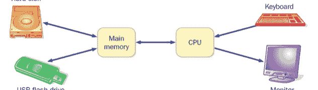

**FIGURE 1.1 A simplified view of a computer system**

程序存储在某种二级存储设备上，例如硬盘。当你指示计算机执行你的程序时，程序的副本会从二级存储器调入并存储在主存储器中。CPU 从主存储器中读取单个程序指令。然后 CPU 一条一条地执行指令，直到程序结束。指令所使用的数据，例如将被相加的两个数字，也存储在主存储器中。它们要么从二级存储器调入，要么从键盘等输入设备读取。在执行过程中，程序可能会向显示器等输出设备显示信息。

> **KEY CONCEPT**

> CPU 从主存储器读取程序指令，一条一条地执行，直到程序结束。

执行程序的过程是计算机运行的基础。所有计算机系统基本上都以相同的方式工作。

### Software Categories

软件可以根据各种标准分为许多类别。在此我们仅在系统程序和应用程序之间进行区分。

操作系统是计算机的核心软件。它执行两个重要功能。首先，它提供用户界面，使用户能够与机器交互。其次，操作系统管理计算机资源，如 CPU 和主存储器。它决定程序何时可以运行、它们被加载到内存中的位置以及硬件设备如何通信。操作系统的任务是使计算机易于使用并确保其高效运行。

> **KEY CONCEPT**

> 操作系统提供用户界面并管理计算机资源。

目前有几种流行的操作系统在使用。Windows 操作系统由 Microsoft 为个人计算机开发，其操作系统市场份额已接近 90%。各种版本的 Unix 操作系统也很受欢迎，尤其是在大型计算机系统中。名为 Linux 的 Unix 版本是作为开源项目开发的，这意味着许多人参与了其开发并且其代码可自由获取。正因如此，Linux 已成为一些用户的特别最爱。Mac OS X 是 Apple Computers 开发的计算系统使用的操作系统。

*application* 是除操作系统之外几乎任何软件的通用术语。文字处理器、导弹控制系统、数据库管理器、Web 浏览器和游戏都可以被视为应用程序。每个应用程序都有自己的用户界面，使用户能够与该特定程序交互。

大多数现代操作系统和应用程序的用户界面都是 *graphical user interface*（GUI，读作“gooey”），顾名思义，它使用图形屏幕元素。其中包括但不限于

- *windows*，用于将屏幕分隔成不同的工作区域
- *icons*，即代表计算机资源（如文件）的小图像
- *menus, checkboxes, and radio buttons*，为用户提供可选择的选项
- *sliders*，允许用户从一系列值中选择
- *buttons*，可通过鼠标点击“按下”以指示用户选择

鼠标是与 GUI 一起使用的主要输入设备；因此，GUI 有时被称为 *point-and-click interfaces*。图 1.2 的屏幕截图展示了 GUI 的一个示例。

> **KEY CONCEPT**

> 就用户而言，界面就是程序。

应用程序或操作系统的界面是软件的重要组成部分，因为它是用户直接交互的程序的唯一部分。对用户来说，界面 *is* 程序。在整本书中，我们讨论图形用户界面的设计和实现。

本书的重点是高质量应用程序的开发。我们探讨如何设计和编写软件，使其能够进行计算、做出决策并以文本或图形形式呈现结果。我们在全书中使用 Java 编程语言来演示各种计算概念。

### Digital Computers

存储和管理信息使用的两种基本技术是模拟和数字。*Analog* 信息是连续的，与信息来源成正比。例如，酒精温度计是测量温度的模拟设备。酒精在管中上升的高度与管外的温度成正比。模拟信息的另一个例子是用于表示声波振动的电子信号。该信号的电压与原始声波成正比变化。立体声放大器将这种电子信号发送到其扬声器，扬声器振动以重现声音。我们使用模拟这个术语，因为信号与它所代表的信息直接类似。图 1.3 以图形方式描绘了由麦克风捕获的声波并表示为电子信号。

**FIGURE 1.2 An example of a graphical user interface (GUI)**

数字技术将信息分解为离散片段并将这些片段表示为数字。光盘上的音乐以数字形式存储，作为一系列数字。每个数字代表录音某一特定时刻的电压电平。在短时间内会进行许多次测量，也许每秒 44,000 次测量。每秒的测量次数称为采样率。如果采样足够频繁，

> **KEY CONCEPT**

> 数字计算机通过将信息分解成片段并将每个片段表示为数字来存储信息。

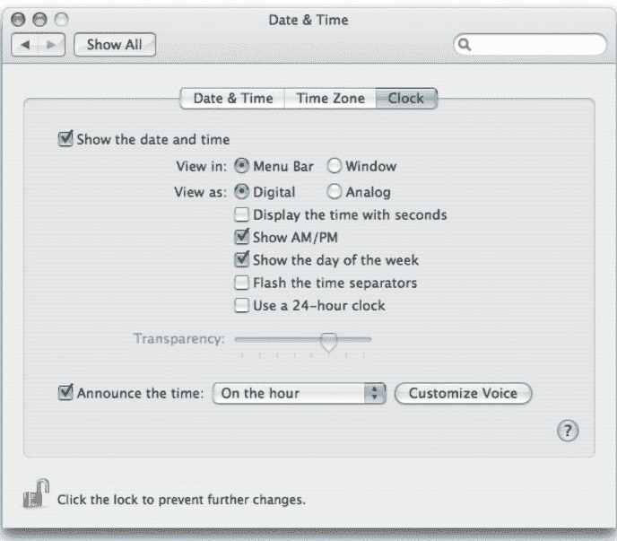

就可以使用这些离散的电压测量值生成一个“足够接近”原始信号的连续模拟信号。在大多数情况下，目标是创建原始信号的再现，使其足以满足人类的感官。

图 1.4 显示了模拟信号的采样。当模拟信息通过分解成片段转换为数字格式时，我们称其已被数字化。因为样本之间的信号变化会丢失，所以采样率必须足够快。

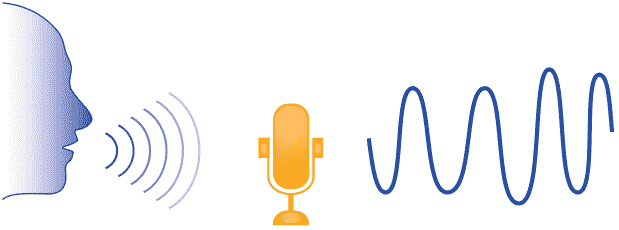

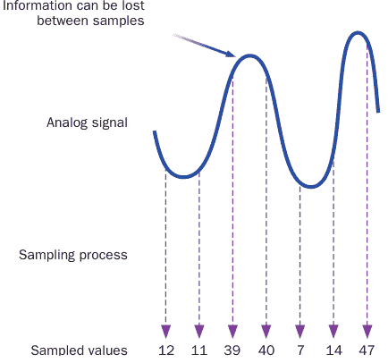

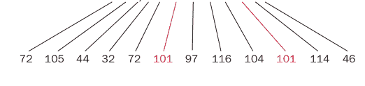

**FIGURE 1.5 Text is stored by mapping each character to a number**

采样只是数字化信息的一种方式。例如，一句话的文本存储在计算机中作为一系列数字，其中每个数字代表句子中的单个字符。每个字母、数字和标点符号都被分配了一个数字。甚至空格字符也被分配了一个数字。考虑以下句子：

Hi, Heather.

句子的字符被表示为 12 个数字的序列，如图 1.5 所示。当字符重复时，例如大写 `'H'`，使用相同的表示数字。请注意，大写字母的版本存储为与小写版本不同的数字，例如单词 Heather 中的 `'H'` 和 `'h'`。它们被视为单独且不同的字符。

现代电子计算机是数字的。所有类型的信息，包括文本、图像、数字、音频、视频，甚至程序指令都被分解成片段。每个片段都表示为一个数字。信息是通过存储这些数字来存储的。

### Binary Numbers

数字计算机将信息存储为数字，但这些数字不是以十进制值存储。计算机中的所有信息都以二进制值存储和管理。与十进制系统有 10 个数字（0 到 9）不同，二进制数字系统只有两个数字（0 和 1）。单个二进制数字称为位。

所有数字系统都遵循相同的规则。数字系统的基值决定了我们可用的数字数量，并指示数字中每个数字的位值。十进制数字系统是基数 10，而二进制数字系统是基数 2。附录 B 包含关于数字系统的详细讨论。

现代计算机使用二进制数字，因为存储和移动信息的设备如果只需要表示两种可能值之一，则成本更低且更可靠。除了这一特性之外，二进制数字

> **KEY CONCEPT**

> 二进制用于在计算机中存储和移动信息，因为存储和操作二进制数据的设备价格低廉且可靠。

system. 计算机已被创建使用其他数制系统来存储和移动信息，但它们并不方便。

一些计算机存储设备，例如硬盘，是磁性的。磁性材料很容易极化到一端或另一端，但中间水平难以区分。因此，磁性设备可以非常有效地表示二进制值——磁化区域表示二进制 1，而消磁区域表示二进制 0。其他计算机存储设备由微小的电子电路组成。这些设备更容易制造，并且如果它们只需要在这两种状态之间切换，就不太可能出现故障。我们最好复制数百万个这些简单的设备，而不是创建更少、更复杂的设备。

二进制值和数字电子信号是相辅相成的。它们提高了我们沿着电线可靠传输信息的能力。正如我们所见，模拟信号具有连续变化的电压，有无限多个状态，但数字信号是*离散的*，这意味着电压在两个极端之间急剧变化（例如 +5 伏和 -5 伏）。在任何一点，数字信号的电压都被认为是“高”，表示二进制 1，或“低”，表示二进制 0。图 1.6 比较了这两种类型的信号。

随着信号沿着电线移动，它会变弱并因环境条件而退化。也就是说，原始信号的电压水平会略有变化。模拟信号的问题在于，随着其波动，它会丢失原始信息。由于信息与信号直接类似，信号的任何变化都会改变信息。模拟信号的变化无法恢复，因为退化的信号与原始信号一样有效。数字信号也会像模拟信号一样退化，但由于数字信号最初处于两个极端之一，因此可以在信息丢失之前得到强化。电压可能与其原始值略有变化，但仍可以正确解释为高或低。

我们在任何给定情况下使用的位数决定了我们可以表示的唯一项目的数量。一个位有两个可能的值，0 和 1，并且


**FIGURE 1.6 An analog signal vs. a digital signal**

因此可以表示两种可能的情况或状态。如果我们想表示灯泡的状态（关或开），一个位就足够了，因为我们可以将 0 解释为灯泡关闭，将 1 解释为灯泡打开。如果我们想表示超过两种事物，我们需要多于一个位。

两个位合在一起可以表示四个可能的项目，因为有两个位的排列恰好有四种：00、01、10 和 11。假设我们想表示汽车所在的档位（停车、行驶、倒车或空档）。我们只需要两个位，并且可以设置位排列与档位之间的映射。例如，我们可以说 00 表示停车，01 表示行驶，10 表示倒车，11 表示空档。在这种情况下，交换该映射无关紧要，尽管在某些情况下，位排列与它们所代表的内容之间的关系很重要。

三个位可以表示八个唯一项目，因为有八种排列。同样，四个位可以表示 16 个项目，五个位可以表示 32 个项目，依此类推。图 1.7 显示了所使用的位数与它们可以表示的项目数量之间的关系。一般来说，`N` 位可以表示 `2^N` 个唯一项目。每增加一位，可以表示的项目数量就会翻倍。

> **关键概念**

> `N` 个位的排列恰好有 `2^N` 种。因此，`N` 位最多可以表示 `2^N` 个唯一项目。

| 1 bit 2 items | 2 bits 4 items | 3 bits 8 items | 4 bits 16 items | 5 bits 32 items |
|---|---|---|---|---|
| 0 | 00 | 000 | 0000 | 00000 |
| 1 | 01 | 001 | 0001 | 00001 |
|   | 10 | 010 | 0010 | 00010 |
|   | 11 | 011 | 0011 | 00011 |
|   |    | 100 | 0100 | 00100 |
|   |    | 101 | 0101 | 00101 |
|   |    | 110 | 0110 | 00110 |
|   |    | 111 | 0111 | 00111 |
|   |    |    | 1000 | 01000 |
|   |    |    | 1001 | 01001 |
|   |    |    | 1010 | 01010 |
|   |    |    | 1011 | 01011 |
|   |    |    | 1100 | 01100 |
|   |    |    | 1101 | 01101 |
|   |    |    | 1110 | 01110 |
|   |    |    | 1111 | 01111 |
|   |    |    |     | 10000 |
|   |    |    |     | 10001 |
|   |    |    |     | 10010 |
|   |    |    |     | 10011 |
|   |    |    |     | 10100 |
|   |    |    |     | 10101 |
|   |    |    |     | 10110 |
|   |    |    |     | 10111 |
|   |    |    |     | 11000 |
|   |    |    |     | 11001 |
|   |    |    |     | 11010 |
|   |    |    |     | 11011 |
|   |    |    |     | 11100 |
|   |    |    |     | 11101 |
|   |    |    |     | 11110 |
|   |    |    |     | 11111 |

**FIGURE 1.7 The number of bits used determines the number of items that can be represented**

我们已经看到如何通过将字符映射到数值来在计算机上存储文本句子。那些数值以二进制数存储。假设我们想在包含 256 个字符和符号的语言中表示字符字符串。我们需要使用八位来存储每个字符，因为八位的唯一排列有 256 种（2⁸ 等于 256）。每个位排列或二进制值映射到特定字符。

需要多少位来表示世界上 195 个国家？七位不够，因为 2⁷ 等于 128。八位就足够了，但 256 种排列中的一些将不会映射到国家。

最终，在计算机上表示信息归结为要表示的项目数量以及确定这些项目如何映射到二进制值。

### SELF-REVIEW QUESTIONS (see answers in Appendix N)

- SR 1.1 What is hardware? What is software?
- SR 1.2 What are the two primary functions of an operating system?
- SR 1.3 The music on a CD is created using a sampling rate of 44,000 measurements per second. Each measurement is stored as a number that represents a specific voltage level. How many such numbers are used to store a three-minute long song? How many such numbers does it take to represent one hour of music?
- SR 1.4 What happens to information when it is stored digitally?
- SR 1.5 How many unique items can be represented with the following?
  - a. 2 bits
  - b. 4 bits
  - c. 5 bits
  - d. 7 bits
- SR 1.6 Suppose you want to represent each of the 50 states of the United States using a unique permutation of bits. How many bits would be needed to store each state representation? Why?

## 1.2 Hardware Components

让我们更详细地检查计算机系统的硬件组件。考虑图 1.8 中描述的计算机。这意味着什么？系统能够运行您想要的软件吗？它与其他系统相比如何？这些术语在本节中进行了解释。


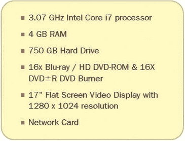

**FIGURE 1.8** The hardware specification of a particular computer

# Computer Architecture

房屋的建筑定义了其结构。同样，我们使用*计算机架构*一词来描述计算机硬件组件的组合方式。图 1.9 说明了通用计算机系统的基本架构。信息通过一组称为*总线*的电线在组件之间传输。

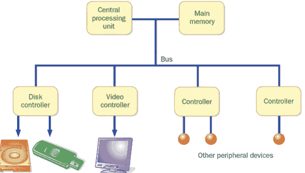

**FIGURE 1.9** Basic computer architecture

> **KEY CONCEPT**
>
> 计算机的核心由主存储器组成，用于存储程序和数据，以及 CPU，用于一次执行一条程序指令。

CPU 和主存储器构成了计算机的核心。正如我们之前提到的，主存储器存储正在积极使用中的程序和数据，而 CPU 有条不紊地一次执行一条程序指令。

假设我们有一个程序来计算数字列表的平均值。程序和数字必须在程序运行时驻留在主存储器中。CPU 从主存储器读取一条程序指令并执行它。如果指令需要数据，例如列表中的数字，来执行其任务，CPU 也会读取该信息。此过程重复进行，直到程序结束。平均值在计算后存储在主存储器中，等待进一步处理或长期存储在二级存储器中。

计算机系统中除 CPU 和主存储器之外的几乎所有设备都称为外设；它们在系统的外围或外边缘运行（尽管它们可能在同一个机箱中）。用户不会直接与 CPU 或主存储器交互。尽管它们构成了机器的本质，但如果没有外围设备，CPU 和主存储器将毫无用处。

控制器是协调特定外设活动的设备。每个设备都有其特定的格式化和通信数据的方式，控制器的一部分作用是处理这些特殊情况并将其与计算机硬件的其余部分隔离。此外，控制器通常处理大部分实际信息传输，使 CPU 能够专注于其他活动。

输入/输出（I/O）设备和二级存储设备被视为外设。另一类外设由数据传输设备组成，允许在计算机之间发送和接收信息。图 1.8 中指定的计算机包括网络卡，也称为无线网络接口控制器（WNIC），它连接到基于无线电的计算机网络。

在某些方面，二级存储设备和数据传输设备可以被视为 I/O 设备，因为它们代表信息源（输入）和发送信息的位置（输出）。就我们的讨论而言，我们将 I/O 设备定义为允许用户与计算机交互的设备。

## Input/Output Devices

让我们更详细地检查一些 I/O 设备。最常见的输入设备是键盘和鼠标。其他包括

- 条形码阅读器，例如零售店收银台使用的
- 麦克风，由解释语音命令的语音识别系统使用
- 虚拟现实设备，例如解释用户手部移动的手持设备
- *扫描仪*，将文本、照片和图形转换为机器可读形式

显示器和打印机是最常见的输出设备。其他设备包括

- *绘图仪*，可在大张纸上（或反之）移动笔
- *扬声器*，用于音频输出
- *护目镜*，用于虚拟现实显示

一些设备可以提供输入和输出功能。*触摸屏*系统可以检测用户在特定位置触摸屏幕。软件随后可以使用屏幕响应用户的触摸，在屏幕上显示文本和图形。触摸屏已成为手持设备的常见配置。

图 1.8 中描述的计算机包括一台具有 17 英寸对角显示区域的显示器。它是平板屏幕，使用液晶显示器（LCD）技术，而不像旧的阴极射线管（CRT）显示器那样需要大量电压且通常不可便携。计算机中图像的表示是通过将其分解为单独的图像元素或 *像素*。显示器可能显示 1280×1024 像素的网格。图形数据的表示和管理将在第 2 章中更详细地讨论。

## 主存储器和辅助存储器

主存储器由一系列小的、连续的 *存储位置* 组成，如图 1.10 所示。与每个存储位置相关联的是一个唯一的数字，称为 *地址*。

> **KEY CONCEPT**
>
> 地址是与存储位置相关联的唯一数字。

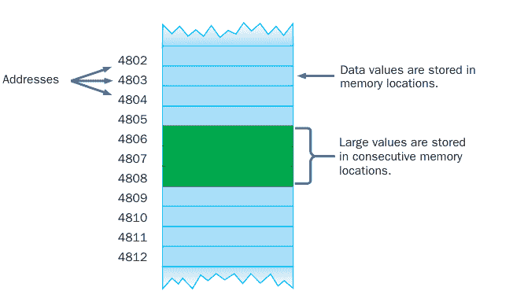

**FIGURE 1.10** Memory locations

| Unit | Symbol | Number of Bytes |
|---|---|---|
| byte |  | 2⁰ = 1 |
| kilobyte | KB | 2¹⁰ = 1024 |
| megabyte | MB | 2²⁰ = 1,048,576 |
| gigabyte | GB | 2³⁰ = 1,073,741,824 |
| terabyte | TB | 2⁴⁰ = 1,099,511,627,776 |
| petabyte | PB | 2⁵⁰ = 1,125,899,906,842,624 |

**FIGURE 1.11** Units of binary storage

当数据存储在存储位置中时，它会覆盖并破坏该位置先前存储的任何信息。然而，从存储位置读取数据不会影响它。

在许多计算机中，每个存储位置由八位，或一个 *字节* 的信息组成。如果我们需要存储的值无法用单个字节表示，例如大数，则使用多个连续的字节来存储数据。

设备的 *存储容量*，例如主存储器，是其可以容纳的总字节数。设备可以存储数千或数百万字节，因此您应该熟悉更大的度量单位。因为计算机存储基于二进制数系统，所以所有存储单位都是 2 的幂。*千字节*（KB）为 1024，或 2¹⁰，字节。一些更大的存储单位是 *兆字节*（MB）、*千兆字节*（GB）、*太字节*（TB）和 *拍字节*（PB），如 图 1.11 所列。通常通过将其四舍五入来更轻松地考虑这些容量。例如，大多数计算机用户认为千字节大约为一千字节，兆字节大约为一百万字节，依此类推。

> **KEY CONCEPT**
>
> 主存储器是易失性的，这意味着存储的信息仅在供电时才得以保持。

许多个人计算机具有四千兆字节的主存储器，或 RAM，如图 1.8 中描述的系统（我们将在本章后面更详细地讨论 RAM）。较大的主存储器允许大型程序或多个程序高效运行，因为它们不必像以前那样经常从辅助存储器中检索信息。

主存储器通常是 *易失性* 的，这意味着如果其电源关闭，则存储在其中的信息将会丢失。当您在计算机上工作时，您应该经常将工作保存到辅助存储设备，例如 USB 闪存驱动器，以防断电。辅助存储设备通常是 *非易失性* 的；即使电源关闭，信息也会保留。

高速缓存由中央处理器（CPU）使用，以减少指令和数据访问的平均时间。高速缓存是一个小型、快速的存储器，存储最频繁使用的主存储位置的内容。当代 CPU 包括指令高速缓存以加快可执行指令的获取，以及数据高速缓存以加快数据的获取和存储。

最常见的辅助存储设备是硬盘和 USB 闪存驱动器。典型的 USB 闪存驱动器存储 1 GB 到 256 GB 之间的信息。硬盘的存储容量各不相同，但在个人计算机上，容量通常在 120 GB 到 500 GB 之间，如图 1.8 中描述的系统。一些硬盘可以存储 2 TB 的数据。

USB 闪存驱动器由一个小型印刷电路板组成，上面装有电路元件和一个 USB 连接器，电气绝缘并保护在塑料、金属或橡胶化外壳内，例如可以装进口袋或钥匙链。

磁盘是磁性介质，位以磁化颗粒的形式表示。读写头在旋转磁盘上移动，根据需要读取或写入信息。硬盘驱动器可能实际上包含垂直排列的多个磁盘和多个读写头，如图 1.12 所示。

为了直观地了解这些设备可以存储多少信息，请考虑本书中的所有信息，包括图片和格式，大约需要 7 MB 的存储空间。

磁带也曾用作辅助存储，但由于信息访问方式的原因，其速度明显慢于硬盘和 USB 闪存驱动器。硬盘是直接访问设备，因为读写头通常可以直接移动到所需的信息。USB 闪存驱动器也是直接访问设备，但没有任何机械移动。术语直接访问和 *随机访问* 通常可以互换使用。然而，磁带上的信息只能在先通过中间数据后才能访问。磁带必须倒带或快进才能到达适当的位置。因此，磁带被视为 *顺序访问设备*。由于这些原因，磁带在很大程度上已不再用作计算机存储设备，就像音频盒式磁带已被光盘取代一样。

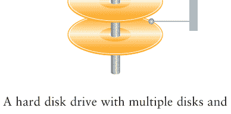

**FIGURE 1.12** A hard disk drive with multiple disks and read/write heads

device, but nothing moves mechanically. The terms direct access and *random access* are often used interchangeably. However, information on a tape can be accessed only after first getting past the intervening data. A tape must be rewound or fast-forwarded to get to the appropriate position. A tape is therefore considered a *sequential access device*. For these reasons, tapes largely have fallen out of use as a computing storage device, just as audio cassettes have been supplanted by compact discs.

Two other terms are used to describe memory devices: *random access memory* (RAM) and *read-only memory* (ROM). It’s important to understand these terms because they are used often and their names can be misleading. The terms RAM and main memory are basically interchangeable, describing the memory where active programs and data are stored. ROM can refer to chips on the computer motherboard or to portable storage such as a compact disc. ROM chips typically store software called BIOS (basic input/output system) that provide the preliminary instructions needed when the computer is turned on initially. After information is stored on ROM, generally it is not altered (as the term *read-only* implies) during typical computer use. Both RAM and ROM are direct (or random) access devices.

> **KEY CONCEPT**
>
> CD 表面既有光滑区域也有微小凹坑。凹坑代表二进制 1，光滑区域代表二进制 0。

*CD-ROM* 是一种便携式辅助存储设备。CD 代表光盘。它被称为 ROM，因为信息在 CD 创建时永久存储且无法更改。与其音乐 CD 相对应，CD-ROM 以二进制格式存储信息。当 CD 最初创建时，会压入一个微观凹坑以代表二进制 1，而光盘保持光滑以代表二进制 0。位是通过将低强度激光束照射到旋转光盘上来读取的。激光束从光盘上的光滑区域强烈反射，但从凹坑区域弱反射。接收反射的传感器据此确定每个位是 1 还是 0。典型 CD-ROM 的存储容量在 650 MB 到 900 MB 之间。

基本 CD 技术的变体很快出现。大多数个人计算机都配备了 *CD-可刻录*（CD-R）驱动器。CD-R 可用于创建音乐 CD 或用于通用计算机存储。一旦创建，您可以在标准 CD 播放器中使用 CD-R 光盘，但一旦“刻录”，就无法更改 CD-R 光盘上的信息。您购买的音乐 CD 是从模具压制的，而 CD-R 是用激光刻录的。

*CD-可重写*（CD-RW）光盘可以擦除并重复使用。它可以重复使用，因为普通 CD 的凹坑和平坦表面在 CD-RW 上是通过在光盘表面涂覆一种材料来模拟的，该材料在加热到一种温度时会变成非晶态（因此无反射），在加热到另一种温度时会变成结晶态（因此有反射）。CD-RW 媒体并非在所有播放器中都有效，但 CD-RW 驱动器可以创建 CD-R 和 CD-RW 光盘。

> **KEY CONCEPT**
>
> 可重写 CD 通过使用可根据需要制成非晶态或结晶态的涂层来模拟普通 CD 的凹坑和光滑区域。

CD最初是一种流行的音乐格式；后来发展成为一种通用的计算机存储设备。同样，DVD格式最初是为视频而创造的，现在正作为一种通用的计算机数据格式取得进展。DVD曾经代表数字视频光盘或数字多功能光盘，但现在这个缩写通常独立使用。DVD比CD具有更紧密的格式（每平方英寸的比特数更多），因此可以存储更多的信息。DVD-ROM最终可能会完全取代CD-ROM，因为存在一条兼容的迁移路径，这意味着DVD驱动器可以读取CD-ROM。类似于CD-R和CD-RW，还有DVD-R和DVD-RW光盘。图1.8中列出的驱动器允许用户读取和写入CD-RW光盘，并读取DVD-ROM，包括播放音乐CD和观看DVD视频的功能。

CD或DVD的速度以x的倍数表示，对于CD来说，x代表每秒153,600字节的数据传输速度；对于DVD来说，是该速度的九倍，即大约每秒1.5兆字节；对于蓝光光盘来说，是DVD速度的三倍，即每秒4.5兆字节。图1.8中描述的驱动器具有16x的最大数据访问速度，即大约每秒72 MB的数据。双层蓝光光盘的存储容量为50 GB。

随着技术的进步，存储设备的容量不断变化。计算机行业的一条通用规则表明，存储容量大约每18个月翻一番。然而，随着容量接近绝对物理极限，这种进步最终将会放缓。

## 中央处理器

中央处理器（CPU）与主内存交互，在计算机中执行所有基本处理。CPU在一个连续的循环中，一条接一条地解释和执行指令。如图1.13所示，它由三个重要组件组成。控制单元协调处理步骤，寄存器在CPU本身中提供少量存储空间，算术/逻辑单元执行计算并做出决策。寄存器是系统中最小、最快的缓存。

控制单元协调主内存与CPU中寄存器之间的数据和指令传输。它还协调算术/逻辑单元中的电路执行，以对存储在特定寄存器中的数据执行操作。

在大多数CPU中，一些寄存器是为特殊目的而保留的。例如，指令寄存器保存当前正在执行的指令。程序计数器是一个保存下一条要执行指令地址的寄存器。除了这些和其他专用寄存器之外，CPU还包含一组通用寄存器，用于根据需要临时存储值。

将程序指令和数据一起存储在主内存中的概念是冯·诺依曼计算机设计架构的基本原则，以匈牙利裔美国数学家约翰·冯·诺依曼的名字命名，他于1945年首次提出了这一编程概念。这类计算机持续遵循图1.14所示的取指-译码-执行周期。一条指令从程序计数器中存储的地址处从主内存取出，并放入指令寄存器。此时程序计数器递增，为下一个周期做准备。然后，这条指令被电子译码，以确定要执行的操作。最后，控制单元激活正确的电路来执行该指令，例如，可能将数据值加载到寄存器中，或者将两个值相加。

> **关键概念**
>
> 取指-译码-执行周期构成了计算机处理的基础。

CPU构建在一个称为微处理器的芯片上，该设备是计算机主板的一部分。这块主板还包含ROM芯片和通信插槽，设备控制器（例如管理视频显示的控制器）可以连接到这些插槽上。

主板的另一个关键组件是系统时钟。时钟以固定间隔产生电子脉冲，从而同步CPU的事件。脉冲发生的速率称为时钟速度，它因处理器而异。图1.8中描述的计算机包含一个英特尔酷睿i7处理器，运行时钟速度为3.07千兆赫兹（GHz），即大约每秒31亿个脉冲。系统时钟的速度提供了CPU执行指令速度快慢的粗略衡量标准。与存储容量类似，处理器的速度也随着技术的进步而不断提高。

## 自测题（参见附录N中的答案）

SR 1.7 以下各项分别包含多少字节？

- a. 3 KB
- b. 2 MB
- c. 4 GB

SR 1.8 以下各项分别包含多少比特？

- a. 8字节
- b. 2 KB
- c. 4 MB

SR 1.9 CD上的音乐是以每秒44,000次测量的采样率创建的。每次测量存储为一个表示特定电压水平的数字。假设这些数字中的每一个都需要两个字节的存储空间。表示一小时音乐需要多少MB？

SR 1.10 计算机中的两个主要硬件组件是什么？它们如何交互？

SR 1.11 什么是内存地址？

SR 1.12 易失性是什么意思？哪些内存设备是易失性的，哪些是非易失性的？

SR 1.13 从以下列表中选择与下列每个短语最匹配的单词：

控制器、CPU、主存储器、网卡、外围设备、RAM、寄存器、ROM、辅助存储器

- a. 计算机系统中除CPU和主内存外，几乎所有设备都被归类为此类。
- b. 协调外围设备活动的设备。
- c. 允许信息的发送和接收。
- d. 这种类型的内存通常是易失性的。
- e. 这种类型的内存通常是非易失性的。
- f. 这个术语基本上与“主内存”一词可以互换使用。
- g. 计算机进行基本处理的地方。

# 1.3 网络

单台计算机可以完成很多事情，但将多台计算机连接到网络中，可以极大地提高生产力并促进信息共享。网络由两台或多台连接在一起的计算机组成，以便它们可以交换信息。使用网络已成为商业计算机操作的标准模式。新技术每天都在涌现，以利用现代计算机系统的互联环境。

> **关键概念**
>
> 网络由两台或多台连接在一起的计算机组成，以便它们能够交换信息。

图1.15显示了一个简单的计算机网络。网络上的设备之一是打印机，它允许连接到网络的任何计算机在该打印机上打印文档。网络上的其中一台计算机被指定为文件服务器，专门用于存储许多网络用户需要的程序和文件。文件服务器通常具有大量的辅助内存。当网络有文件服务器时，每台单独的计算机就不需要自己的程序副本。

## 网络连接


如果两台计算机直接连接，它们基本上可以像信息在单台机器内部通过电线移动一样进行通信。当连接两台地理位置较近的计算机时，这种解决方案效果很好，称为点对点连接。然而，考虑将许多计算机跨越大距离连接起来的任务。如果使用点对点连接，那么每台计算机都通过网络中的一根电线直接连接到其他每台计算机。每个连接都单独使用一根电线并不是一个可行的解决方案，因为每次向网络中添加新计算机时，都必须为网络中已有的每台计算机安装一条新的通信线路。此外，一台计算机只能处理少量直接连接。

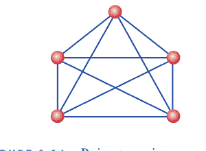

### 图1.16 点对点连接

图1.16显示了多条点对点连接。考虑一下如果向网络中添加两三台额外的计算机，将需要多少条通信线路。

比较图1.15和图1.16中的图示。图1.15中显示的所有计算机都共享一条通信线路。网络上的每台计算机都有自己的网络地址，该地址唯一地标识它。这些地址在概念上类似于主内存中的地址，只不过它们标识的是网络上的单个计算机，而不是单台计算机内部的单个内存位置。通过指定目标计算机的网络地址，消息通过线路从一台计算机发送到另一台计算机。

共享通信线路成本效益高，并且使得向网络中添加新计算机相对容易。然而，共享线路会引入延迟。网络上的计算机不能同时使用通信线路。它们必须轮流发送信息，这意味着当线路繁忙时它们必须等待。

> 关键概念
>
> 共享通信线路会产生延迟，但成本效益高，并简化了向网络中添加新计算机的过程。

改善网络延迟的一种技术是将大消息分成称为数据包的段，然后通过线路发送各个数据包，并与其他用户发送的其他消息片段混合在一起。数据包在目的地收集并重新组装成原始消息。这种情况类似于一群人使用传送带来将一组盒子从一个地方移动到另一个地方。如果一次只允许一个人使用传送带，而那个人又有大量盒子要移动，那么其他人就要等待很长时间才能使用它。通过轮流使用，每个人一次只能放一个箱子，而且他们都能完成自己的工作。这没有自己的传送带那么快，但也没有慢到必须等到其他人都完成为止。

## 局域网和广域网

局域网（LAN）旨在覆盖短距离并连接相对数量较少 的计算机。通常 LAN 只连接一栋建筑物或一个房间内的机器。LAN 安装和管理方便且可靠性高。随着计算机变得越来越小巧和多功能，LAN 提供了一种在整个组织内廉价共享信息的方式。然而，拥有 LAN 就像拥有一个只能拨打本镇人的电话系统。我们需要能够在更长距离上共享信息。

局域网（LAN）是组织内部共享信息和资源的有效方式。

广域网（WAN）连接两个或多个 LAN，通常跨越很长距离。通常每个 LAN 上的一台计算机专门负责处理 WAN 的通信。这种技术使 LAN 中的其他计算机不必执行长距离通信的细节。图 1.17 显示了几个通过 WAN 连接的 LAN。由 WAN 连接的 LAN 通常由不同的公司或组织拥有，甚至可能位于不同的国家。


网络对计算机系统的影响是巨大的。计算资源现在可以由许多用户共享，全球范围内的计算机通信已变得司空见惯。事实上，网络的使用已如此普遍，以至于某些计算机需要网络资源才能运行。

## 因特网

在 1970 年代，美国国防部下属的一个机构高级研究计划署（ARPA）资助了多个探索网络技术的项目。这些努力的一个成果是 ARPANET，这是一个最终被称为 Internet 的 WAN。Internet 是一个网络的网络。术语 Internet 源自互联网互联的概念——将许多较小的网络连接在一起。

从 1980 年代后期到现在，Internet 增长得惊人。1983 年，连接到 Internet 的计算机不到 600 台。当前，Internet 为全球数十亿用户提供服务。随着越来越多的计算机连接到 Internet，跟上更多用户和更重流量的任务变得困难。自初始开发以来，新技术已多次取代 ARPANET，每次都提供更大的容量和更快的处理速度。

> **关键概念**
>
> Internet 是一个覆盖全球的广域网（WAN）。

协议是一组规定两个事物如何通信的规则。控制信息在 Internet 上移动的软件必须符合称为 TCP/IP 的协议集（发音为拼写字母，T-C-P-I-P）。TCP 代表传输控制协议，IP 代表互联网协议。IP 软件定义了信息如何格式化以及从源传输到目的地的过程。TCP 软件处理诸如信息片段乱序到达或信息丢失等问题，这可能发生在太多信息同时汇聚到一个位置时。

连接到 Internet 的每台计算机都有一个 IP 地址，在 Internet 上所有其他计算机中唯一标识它。IP 地址的示例是 `204.192.116.2`。幸运的是，Internet 用户很少需要处理 IP 地址。Internet 允许每台计算机被赋予一个名称。像 IP 地址一样，名称必须是唯一的。计算机的 Internet 名称通常被称为其 Internet 地址。Internet 地址的示例是 `hector.vt.edu`。

> **关键概念**
>
> 连接到 Internet 的每台计算机都有一个 IP 地址，该地址在 Internet 上唯一标识它。

Internet 地址的第一部分是特定计算机的本地名称。地址的其余部分是域名，表示计算机所属的组织。例如，`vt.edu` 是弗吉尼亚理工大学计算机网络的域名，而 `hector` 是该校园上一台特定计算机的名称。因为域名是唯一的，所以许多组织可以拥有名为 `hector` 的计算机而不会混淆。各个部门可能会被分配 *子域*，这些子域添加到基本域名中，以在较大组织内唯一区分其计算机集。例如，`cs.vt.edu` 子域专用于弗吉尼亚理工大学计算机科学系。

每个域名最后的部分称为 *顶级域名*（TLD），通常表示计算机所属的组织类型。TLD `edu` 通常表示教育机构。TLD `com` 通常指商业企业。另一个常见的 TLD 是 `org`，通常由非营利组织使用。在 2008 年于巴黎举行的国际会议上，启动了一个引入通用顶级域名（gTLD）的流程。新规则可能导致数百个新的 gTLD。许多计算机，尤其是美国以外的计算机，使用表示原籍国的国家代码顶级域名（ccTLD），例如英国的 `uk` 或澳大利亚的 `au`。

当引用 Internet 地址时，它会被翻译成相应的 IP 地址，此后使用该地址。执行此翻译的软件称为 *域名系统*（DNS）。连接到 Internet 的每个组织都运行一个 *域名服务器*，该服务器维护该组织所有计算机及其 IP 地址的列表。它有点像电话目录查询服务，你提供名称，域名服务器返回一个号码。如果本地域名服务器没有该名称的 IP 地址，它会联系另一个拥有该地址的域名服务器。

Internet 彻底改变了计算机处理。最初，互联计算机的主要用途是发送电子邮件，但 Internet 功能仍在不断改进。Internet 最重要的用途之一是万维网。

## 万维网

Internet 使我们能够交换信息。*万维网*（也称为 WWW 或简称为 Web）使人类之间的信息交换变得容易。Web 软件提供了一个通用的用户界面，通过点击鼠标即可访问许多不同类型的信息。

> **关键概念**
>
> 万维网是使网络间信息共享对人类变得容易的软件。

Web 基于超文本和超媒体的概念。*超文本* 一词由 Ted Nelson 于 1965 年创造。它描述了一种组织信息的方式，使得思想的流动不受线性进展的限制。Paul Otlet（1868–1944），被一些人认为是信息科学之父，曾设想该概念作为管理大量信息的一种方式。其基本思想是，文档可以在各个点根据自然关系链接起来，以便读者可以根据自己的需求从一个文档跳转到另一个文档。当加入其他媒体组件，如图形、声音、动画和视频时，所产生的组织称为 *超媒体*。

Internet 和万维网这两个术语有时可以互换使用，但两者之间存在重要区别。Internet 使通过计算机在全球范围内通信成为可能。Web 使这种通信变得简单而愉快。Web 本质上是一种分布式信息服务，基于一组软件应用程序。它不是网络。虽然它与 Internet 有效配合使用，但它并非固有地绑定于它。Web 可以在未连接到任何其他网络的 LAN 上使用，甚至可以在单台机器上用于显示 HTML 文档。

*浏览器* 是一种加载和格式化 Web 文档以供查看的软件工具。*Mosaic* 是 Web 的第一个图形界面浏览器，于 1993 年发布。Web 文档的设计者可以定义指向 Internet 上任何地方其他 Web 信息的链接。一些开发 Mosaic 的人后来创立了 Netscape Communications Corporation 并创建了 Netscape Navigator 浏览器。流行的当代浏览器包括 Internet Explorer、Mozilla Firefox、Apple Safari、Google Chrome 和 Opera。

专门用于提供 Web 文档访问的计算机称为 *Web 服务器*。浏览器加载和解释 Web 服务器提供的文档。许多此类文档使用 *超文本标记语言*（HTML）格式化。Java 编程语言与 Web 处理有着密切的关系，因为 Java 程序的链接可以嵌入 HTML 文档中并通过 Web 浏览器执行。我们将在第 2 章更详细地探讨这种关系。

## 统一资源定位符

Web 上的信息是通过识别 *统一资源定位符*（URL，发音为拼写字母 U-R-L）找到的。URL 唯一指定浏览器获取和显示的文档和其他信息。以下是一个示例 URL：

```
http://www.google.com
```

此特定 URL 上的网站是著名的 Google *搜索引擎* 的主页，该搜索引擎可让您使用特定单词或短语搜索 Web 上的信息。

URL 包含几部分信息。第一部分是协议，它决定浏览器通过 Internet 传输和接收数据的方式。

> **关键概念**
>
> URL 唯一指定 Web 上浏览器获取和显示的文档和其他信息。

处理信息。第二部分是存储文档的机器的Internet地址。第三部分是感兴趣的文件名或资源。如果没有给出文件名，例如Google URL的情况，Web服务器通常会提供一个默认页面（例如`index.html`）。

让我们看另一个URL示例：

```
http://www.whitehouse.gov/photos-and-video/photogallery/photo-day
```

在这个URL中，协议是`http`，代表超文本传输协议。引用的机器是`www`（通常指Web服务器），位于域名`whitehouse.gov`。最后，`photos-and-video/photogallery/photo-day`表示要传输到浏览器以供查看的文件（或生成文件的引用）。URL还存在许多其他形式，但这种形式是最常见的。

## 自测问题（参见附录N中的答案）

- SR 1.14 什么是文件服务器？

- SR 1.15 一个由五台计算机组成的完全连接的点对点网络需要多少条通信线路？六台呢？

- SR 1.16 描述网络中的计算机共享一条通信线路的一个好处。描述共享一条通信线路的一个代价/缺点。

- SR 1.17 Internet一词的词源是什么？

- SR 1.18 TCP/IP协议集描述了使用Internet的软件的通信规则。TCP代表什么？IP代表什么？

- SR 1.19 解释以下URL的各部分：
  - a. `duke.csc.villanova.edu/jss/examples.html`
  - b. `java.sun.com/products/index.html`

## 1.4 Java编程语言

现在让我们把注意力转向使计算机系统有用的软件。程序是用特定的编程语言编写的，该语言使用特定的单词和符号来表达问题解决方案。编程语言定义了一套规则，这些规则精确决定了程序员如何将语言的单词和符号组合成编程语句，编程语句是程序执行时执行的指令。

自从计算机问世以来，已经创造了许多编程语言。本书使用Java语言来演示各种编程概念和技术。虽然我们的主要目标是学习这些底层的软件开发概念，但一个重要的附带效果将是精通Java程序的开发。

与许多其他编程语言相比，Java是一种相对较新的编程语言。它于1991年由Sun Microsystems的James Gosling作为他的众多机顶盒项目之一发起。该语言最初称为Oak，然后是Green，最终称为Java。Java于1995年推向公众，此后获得了巨大的欢迎。2010年，Sun Microsystems被Oracle收购。

自创建以来，Java经历了各种变化。Java平台有多种变体，包括标准版（该语言及相关工具的主流版本）、企业版（包括支持大规模系统开发的额外库）和微型版（专门用于为手机等便携设备开发软件）。本书专注于标准版。

早期Java技术的某些部分已被弃用，这意味着它们被视为过时而不应使用。在重要的情况下，我们会指出已弃用的元素，并讨论更优的替代方案。

Java最初引起关注的一个原因是，它是第一个有意采用可通过Web执行的程序（称为applet）概念的编程语言。从那时起，创建具有动态、功能能力的Web页面的技术急剧扩展。

Java是一种面向对象的编程语言。对象是构成程序的基本元素。面向对象软件开发的原则是本书的基石。我们将在本章后面以及本书其余部分探讨面向对象编程的概念。

**关键概念**

本书重点介绍面向对象编程的原理。

Java语言附带了一个额外的软件库，我们可以在开发程序时使用。这个软件被称为Java API，代表应用程序程序员接口，或简称为标准类库。Java API提供了创建图形、通过网络通信、与数据库交互等功能。Java API庞大且功能非常多样。尽管我们会探索其中几个方面，但无法涵盖库的所有方面。

Java在世界各地的商业环境中使用。它是有史以来增长最快的编程技术之一。因此，它不仅是一种学习编程概念的好语言，也是一种将来对你有用的实用语言。

### 一个Java程序

让我们看一个简单但完整的Java程序。清单1.1中的程序向屏幕打印两句话。这个特别的程序打印了亚伯拉罕·林肯的一句名言。输出显示在程序清单下方。

**清单1.1**

```
//************************************************************************
// Lincoln.java      Author: Lewis/Loftus
//
// Demonstrates the basic structure of a Java application.
//************************************************************************

public class Lincoln
{
    //-------------------------------------------------------------
    // Prints a presidential quote.
    //-------------------------------------------------------------
    public static void main (String[] args)
    {
        System.out.println ("A quote by Abraham Lincoln:");

        System.out.println ("Whatever you are, be a good one.");
    }
}
```

**输出**

```
A quote by Abraham Lincoln:
Whatever you are, be a good one.
```

所有Java应用程序都有类似的基本结构。尽管这个程序规模小、目的简单，但它包含几个重要的特性。让我们仔细剖析它并检查它的各个部分。

**关键概念**

注释不影响程序的运行；相反，它们有助于人的理解。

程序的前几行是注释，注释以`//`符号开始，一直到行末。注释不影响程序的功能，而是为了让人类更容易理解程序。程序员可以而且应该在程序中根据需要包含注释，以清楚地确定程序的目的并描述任何特殊处理。任何书面注释或文档，包括用户指南和技术参考，都称为文档。包含在程序中的注释称为内联文档。

程序的其余部分是类定义。这个类称为`Lincoln`，尽管我们可以随意命名。类定义从程序最后一行的第一个左花括号`{`到最后一个右花括号`}`。所有Java程序都使用类定义来定义。

**视频笔记**：程序元素概述。

在类定义内部还有一些注释，描述`main`方法的用途，该方法直接在注释下方定义。方法是一组被命名的编程语句。在这种情况下，方法名为`main`，它只包含两个编程语句。与类定义一样，方法也用大括号分隔。

所有Java应用程序都有一个`main`方法，它是处理开始的地方。`main`方法中的每个编程语句按顺序一次执行一个，直到到达方法末尾。然后程序结束或终止。Java程序中的`main`方法定义总是以`public`、`static`和`void`这些词开头，我们将在后面文本中研究这些词。`String`和`args`的使用在这个特定程序中不起作用。我们也将在后面描述这些。

`main`方法中的两行代码调用了另一个名为`println`（读作“print line”）的方法。当我们希望方法执行时，我们调用或调用它。`println`方法将指定的字符打印到屏幕。要打印的字符以字符串形式表示，用双引号字符(`"`)括起来。当程序执行时，它调用`println`方法打印第一个语句，再次调用它打印第二个语句，然后，因为那是`main`方法中的最后一行，程序终止。

调用`println`方法时执行的代码未在此程序中定义。`println`方法是`System.out`对象的一部分，而`System.out`对象是Java标准类库的一部分。从技术上讲，它不是Java语言的一部分，但在任何Java程序中总是可以使用。我们将在第2章更详细地探讨`println`方法。

### 注释

让我们更详细地研究注释。注释是唯一允许程序员独立于代码表达和沟通想法的语言特性。注释应该提供对程序员原始意图的洞见。一个程序常常被使用多年，并且随着时间的推移，经常会对它进行许多修改。在未来某个时候需要进行修改时，原始程序员通常不会记得特定程序的细节。此外，原始程序员并不总是能进行修改；因此，完全不了解该程序的人需要理解它。因此，良好的文档至关重要。

就Java编程语言而言，注释的内容可以是任何文本。计算机忽略注释；它们不影响程序的执行方式。


`Lincoln`程序中的注释代表了Java允许的两种注释类型之一。`Lincoln`中的注释采用以下形式：

```
// This is a comment.
```

这种注释以双斜杠（`//`）开始，一直到行尾结束。两个斜杠之间不能有任何字符。计算机忽略双斜杠之后到行尾的任何文本。注释可以跟在同一行代码后面，用于说明该行，如下例所示：

```
System.out.println ("Monthly Report"); // always use this title
```

Java注释可能具有的第二种形式如下：

```
/* This is another comment. */
```

这种注释类型不使用行尾来表示注释的结束。起始斜杠-星号（`/*`）和终止星号-斜杠（`*/`）之间的任何内容都是注释的一部分，包括表示行尾的不可见换行符。因此，这种注释类型可以跨越多行。斜杠和星号之间不能有空格。

如果注释开头的`/*`后面还有第二个星号，那么注释的内容可以使用名为`javadoc`的工具自动生成程序的外部文档。附录I中提供了更多关于`javadoc`的信息。

这两种基本注释类型可用于创建各种文档样式，例如：

```
// This is a comment on a single line.

//------------------------------------------------------------
// Some comments such as those above methods or classes
// deserve to be blocked off to focus special attention
// on a particular aspect of your code. Note that each of
// these lines is technically a separate comment.
//------------------------------------------------------------

/*
    This is one comment
    that spans several lines.
*/
```

程序员常常过于专注于编写代码，以至于对文档关注得太少。你应该养成良好的注释习惯并持之以恒。注释应当写得很好，通常使用完整的句子。

它们不应赘述显而易见的内容，而应对代码的意图提供适当的洞见。以下示例不是好的注释：

```
System.out.println ("hello"); // prints hello
System.out.println ("test"); // change this later
```

第一条注释复述了该行显而易见的目的，没有给语句增加任何价值。没有注释也比无用的注释好。第二条注释含义模糊。以后应该改什么？什么时候是“以后”？为什么要改？

> **关键概念**
>
> 内联文档应提供对代码的洞察。它不应含糊不清，也不应赘述显而易见的内容。

## 标识符和保留字

编写程序时使用的各种单词称为标识符。`Lincoln`程序中的标识符有`class`、`Lincoln`、`public`、`static`、`void`、`main`、`String`、`args`、`System`、`out`和`println`。它们分为三类：

-   我们在编写程序时自己创造的单词（`Lincoln`和`args`）
-   其他程序员选择的单词（`String`、`System`、`out`、`println`和`main`）
-   语言中保留用于特殊用途的单词（`class`、`public`、`static`和`void`）

在编写程序时，我们只是选择将类命名为`Lincoln`，但我们本可以使用许多其他可能的名称。例如，我们可以称它为`Quote`、`Abe`或`GoodOne`。标识符`args`（是`arguments`的缩写）经常以我们在`Lincoln`中的方式使用，但我们本可以使用几乎任何其他标识符来代替它。

标识符`String`、`System`、`out`和`println`是由其他程序员选择的。这些词不是Java语言的一部分。它们是Java标准库中预定义代码的一部分，是一组已经有人为我们编写好的类和方法。这些代码的作者选择了其中的标识符——我们只是在利用它们。

保留字是在编程语言中具有特殊含义且只能以预定义方式使用的标识符。保留字不能用于任何其他目的，例如命名类或方法。在`Lincoln`程序中，使用的保留字是`class`、`public`、`static`和`void`。在本书中，我们以蓝色字体显示Java保留字。图1.18按字母顺序列出了所有Java保留字。标有星号的单词已被保留，但目前没有意义。

我们为程序使用的标识符可以由字母、数字、下划线字符（`_`）和美元符号（`$`）的任意组合构成，但不能以数字开头。标识符可以任意长度。

| `abstract` | `default` | `goto`* | `package` | `this` |
| `assert` | `do` | `if` | `private` | `throw` |
| `boolean` | `double` | `implements` | `protected` | `throws` |
| `break` | `else` | `import` | `public` | `transient` |
| `byte` | `enum` | `instanceof` | `return` | `true` |
| `case` | `extends` | `int` | `short` | `try` |
| `catch` | `false` | `interface` | `static` | `void` |
| `char` | `final` | `long` | `strictfp` | `volatile` |
| `class` | `finally` | `native` | `super` | `while` |
| `const`* | `float` | `new` | `switch` |  |
| `continue` | `for` | `null` | `synchronized` |  |

### 图 1.18 Java保留字

因此，`total`、`label17`、`nextStockItem`、`NUM_BOXES`和`$amount`都是有效的标识符，但`4th_word`和`coin#value`是无效的。

标识符中可以使用大写和小写字母，且大小写字母的区别很重要。Java是区分大小写的，这意味着两个仅字母大小写不同的标识符名称被视为不同的标识符。因此，`total`、`Total`、`ToTaL`和`TOTAL`都是不同的标识符。可以想象，使用多个仅大小写不同的标识符并不是一个好主意，因为它们很容易混淆。

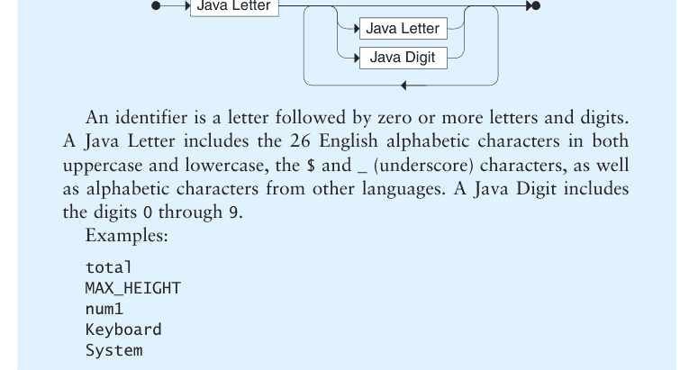

虽然Java语言并不要求这样做，但对每种标识符使用一致的大小写格式会使你的标识符更易于理解。关于标识符，有许多应遵循的Java约定，尽管从技术上讲并非必须。例如，我们对类名使用标题大小写（每个单词首字母大写）。在整本书中，我们会在每种类型的标识符首次出现时描述其首选的大小写风格。

虽然标识符可以是任意长度，但你应该仔细选择名称。它们应具有描述性但不应冗长。你应该避免使用无意义的名称，如`a`或`x`。如果短名称确实具有描述性，则可以例外，例如使用`x`和`y`表示二维网格上的`(x, y)`坐标。同样，你不应使用不必要地长的名称，例如标识符`theCurrentItemBeingProcessed`。名称`currentItem`也同样适用。可以想象，使用冗长标识符的问题远不如使用无描述性名称的问题普遍。

你应该始终努力使程序尽可能易读。因此，在缩写单词时应始终小心。你可能会认为`curStVal`是表示当前股票价值的好名字，但其他试图理解代码的人可能难以弄清楚你的意思。甚至在写完两个月后，你自己可能都不清楚了。

> **关键概念**
>
> Java 区分大小写。字母的大写和小写版本是不同的。

> **关键概念**
>
> 标识符名称应具有描述性且易读。

## 空白

所有Java程序都使用空白来分隔程序中的单词和符号。空白由空格、制表符和换行符组成。短语“空白”指的是在一张带黑色印刷的白色纸张上，单词和符号之间的空间是白色的。程序员使用空白的方式很重要，因为它可以用来强调代码的某些部分，并使程序更易于阅读。

除非用于分隔单词，否则计算机会忽略空白。它不影响程序的执行。这一事实使程序员在格式化程序时具有很大的灵活性。程序的各行应在逻辑位置进行划分，某些行应缩进和对齐，以便程序的底层结构清晰。

由于空白会被忽略，我们可以用许多不同的方式编写程序。例如，将空白推向一个极端，我们可以让每行容纳尽可能多的单词。清单1.2中的`Lincoln2`程序的格式化方式与`Lincoln`截然不同，但打印出相同的消息。

> **关键概念**
>
> 适当使用空白使程序更易于阅读和理解。

### 列表 1.2

```
//***************************************************************************
// Lincoln2.java      Author: Lewis/Loftus
//
// Demonstrates a poorly formatted, though valid, program.
//***************************************************************************

public class Lincoln2{public static void main(String[]args){
System.out.println("A quote by Abraham Lincoln:");
System.out.println("Whatever you are, be a good one.");}}
```

### 输出

A quote by Abraham Lincoln:

Whatever you are, be a good one.

将空白推向另一个极端，我们可以将几乎每个单词和符号都写在不同的行上，并使用不同数量的空格，如 `Lincoln3` 所示，见列表 1.3。

> **关键概念**
>
> 你应该遵循一套指导方针来确定格式化和记录程序的方式。

从技术上讲，`Lincoln` 的三个版本都是有效的，并且执行方式相同，但从读者的角度来看，它们截然不同。后两个示例都显示了糟糕的风格，使得程序难以理解。你在编写程序时可能会被要求遵循特定的指导方针。软件开发公司通常都有编程风格政策，要求其程序员遵循。无论如何，你应该采用并始终使用一套风格指导方针，以提高代码的可读性。

### 列表 1.3

```
//***************************************************************************
// Lincoln3.java      Author: Lewis/Loftus
//
// Demonstrates another valid program that is poorly formatted.
//***************************************************************************
        public     class
Lincoln3
{
            public
static     void
main
String (
    args []
) {
    System.out.println (
"A quote by Abraham Lincoln:"
    );
    System.out.println (
"Whatever you are, be a good one."
    );
};
}
```

### 输出

A quote by Abraham Lincoln:

Whatever you are, be a good one.

### 自测问题（见附录 N 中的答案）

SR 1.20 Java 编程语言是什么时候开发的？由谁开发的？何时向公众介绍的？

SR 1.21 Java 应用程序中的处理从哪里开始？

SR 1.22 你预测以下 Java 程序中的这一行会有什么结果？

```
System.out.println("Hello");  // prints hello
```

SR 1.23 你预测以下 Java 程序中的这一行会有什么结果？

```
// prints hello  System.out.println("Hello");
```

SR 1.24 以下哪些不是有效的 Java 标识符？为什么？

- a. `RESULT`
- b. `result`
- c. `12345`
- d. `x12345y`
- e. `black&white`
- f. `answer_7`

SR 1.25 假设一个程序需要一个标识符来表示一班学生测试成绩的总和。对于以下每个名称，说明每个是否是一个好的标识符名称。解释你的答案。

- a. `x`
- b. `scoreSum`
- c. `sumOfTheTestScoresOfTheStudents`
- d. `smTstScr`

SR 1.26 什么是空白？它如何影响程序执行？它如何影响程序可读性？

## 1.5 程序开发

使程序运行的过程涉及各种活动。程序必须用适当的编程语言编写，例如 Java。该程序必须被翻译成计算机可以执行的格式。在此过程的各个阶段都可能出现错误，必须进行修复。各种软件工具也可以用于帮助开发过程的各个部分。让我们更详细地探讨这些问题。

### 编程语言级别

假设某个人正在给朋友提供旅行方向。那个人可以用多种语言中的任何一种来解释这些方向，例如英语、俄语或意大利语。无论使用哪种语言来解释，方向都是一样的，但表达方向的方式是不同的。朋友必须能够理解所使用的语言才能遵循方向。

同样，一个问题可以通过用多种编程语言中的一种编写程序来解决，例如 Java、Ada、C、C++、C#、Pascal 和 Smalltalk。无论使用哪种语言，程序的目的本质上都相同，但用于表达指令的特定语句以及这些指令的整体组织方式因语言而异。计算机必须能够理解指令才能执行它们。

编程语言可以分为以下四组。这些组基本上反映了计算机语言的历史发展。

- machine language
- assembly language
- high-level languages
- fourth-generation languages

为了使程序在计算机上运行，它必须用该计算机的 *machine language* 表达。每种类型的 CPU 都有自己的语言。因此，我们不能在戴尔 PC 上运行专门为 Sun 工作站编写的程序，其处理器为 Sparc，而戴尔 PC 的处理器为 Intel。

每条机器语言指令只能完成一个简单的任务。例如，一条机器语言指令可能将一个值复制到寄存器或将一个值与零进行比较。可能需要四条单独的机器语言指令才能将两个数字相加并存储结果。然而，计算机每秒可以执行数百万条指令，因此许多简单命令可以快速执行以完成复杂任务。

> **关键概念**
>
> 所有程序都必须被翻译成特定 CPU 的机器语言才能被执行。

机器语言代码以一系列二进制数字表示，人类极难阅读和编写。最初，程序是通过使用开关或类似繁琐的方法输入到计算机中的。早期程序员发现这些技术耗时且容易出错。

这些问题导致了 *assembly language* 的使用，它用 *mnemonics* 替换了二进制数字，mnemonics 是代表命令或数据的简短类英语单词。对于程序员来说，用单词处理比用二进制数字容易得多。然而，汇编语言程序不能直接在计算机上执行。它必须先被翻译成机器语言。

通常，每条汇编语言指令对应一条等效的机器语言指令。因此，与机器语言类似，每条汇编语言指令只完成一个简单的操作。虽然从程序员的角度来看，汇编语言是机器代码的改进，但使用起来仍然很繁琐。汇编语言和机器语言都被认为是 *low-level languages*。

今天，大多数程序员使用 *high-level language* 来编写软件。高层语言用类英语短语表达，因此程序员更容易阅读和编写。单个高层语言编程语句可以完成相当于许多——也许数百条——机器语言指令的工作。术语 high-level 指的是编程语句以远离最终执行的机器语言的方式表达。Java 是一种高层语言，Ada、C++、Smalltalk 等也是如此。

> **关键概念**
>
> 高层语言允许程序员忽略机器语言的底层细节。

图 1.19 显示了高层语言、汇编语言和机器语言中的等效表达式。表达式将两个数字相加。此示例中的汇编语言和机器语言特定于 Sparc 处理器。

| High-Level Language | Assembly Language | Machine Language |
| --- | --- | --- |
| `a + b` | `ld [%fp-20], %0`<br>`ld [%fp-24], %1`<br>`add %0, %1, %0` | `1101 0000 0000 1111`<br>`1011 1111 1110 1000`<br>`1101 0010 0000 0111`<br>`1011 1111 1110 1000`<br>`1001 0000 0000 0000`<br>`...` |

图 1.19 一个高层表达式及其汇编语言和机器语言等价物

图 1.19 中的高层语言表达式对程序员来说是可读且直观的。它类似于代数表达式。等效的汇编语言代码有点可读，但更冗长且不那么直观。机器语言基本上是不可读的且更长。事实上，图 1.19 中只显示了将两个数字相加的二进制机器代码的一小部分。对于这个特定表达式，完整的机器语言代码长达 400 多位。

高层语言使程序员免于需要了解他们正在工作的处理器底层的机器语言。但高层语言代码必须被翻译成机器语言才能被执行。

一些编程语言被认为比高层语言操作在更高的层面上。它们可能包括自动报表生成或与数据库交互的特殊设施。这些语言被称为第四代语言，或简称为 4GLs，因为它们在计算机编程的第一三代之后出现：机器、汇编和高层。

### 编辑器、编译器和解释器

开发新程序需要几个专用程序。它们有时被称为软件工具，因为它们用于构建程序。基本软件工具的示例包括编辑器、编译器和解释器。

最初，你使用编辑器在计算机上输入程序并将其存储在文件中。有许多不同的编辑器，具有许多不同的功能。你应该熟悉你将定期使用的编辑器，因为它可以极大地影响你输入和修改程序的速度。


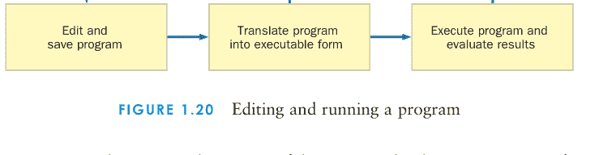

### FIGURE 1.20 Editing and running a program

图 1.20 显示了程序开发过程的一个非常基本的视图。在编辑并保存程序后，你会尝试将其从高级代码翻译成可执行的形式。该翻译可能会产生错误，在这种情况下，你会返回编辑器修改代码以解决问题。一旦翻译成功，你就可以执行程序并评估结果。如果结果不是你想要的，或者你想增强现有程序，你再次返回编辑器进行修改。

源代码到特定类型 CPU 的机器语言的翻译可以以多种方式进行。编译器是一个将一种语言的代码翻译成另一种语言等价代码的程序。原始代码称为源代码，而被翻译成的语言称为目标语言。对于许多传统编译器，源代码直接翻译成特定机器语言。在这种情况下，翻译过程只进行一次（针对程序的某个版本），并且 resulting 可执行程序可以随时运行。

解释器与编译器类似，但有一个重要区别。解释器将翻译和执行活动交织在一起。源代码的一小部分，例如一条语句，被翻译并执行。然后另一条语句被翻译并执行，依此类推。这种技术的一个优点是消除了单独编译阶段的需求。然而，由于翻译过程在每次执行时都发生，程序通常运行得更慢。

用于翻译和执行 Java 程序的通用过程结合了编译器和解释器的使用。该过程如图 1.21 所示。Java 编译器将 Java 源代码翻译成 Java 字节码，这是一种以类似于机器语言代码的低级形式表示程序的表示。Java 解释器读取 Java 字节码并在特定机器上执行它。另一个编译器可以将字节码翻译成特定机器语言以便在该机器上高效执行。

Java 字节码与真正的机器语言代码之间的区别在于，Java 字节码与任何特定处理器类型无关。这种方法具有使 Java 架构中立、因此易于从一种机器类型移植到另一种机器类型的明显优势。唯一的限制是，必须为要执行 Java 字节码的每种处理器类型提供 Java 解释器或字节码编译器。

由于编译过程将高级 Java 源代码翻译成低级表示，因此解释过程比直接解释高级代码更高效。通过解释其字节码来执行程序仍然比直接执行机器代码慢，但对于大多数应用程序来说已经足够快。请注意，为了提高效率，Java 字节码可以编译成机器代码。

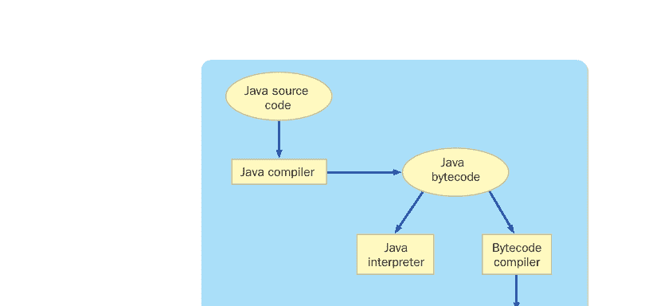

## Development Environments

软件开发环境是用于创建、测试和修改程序的工具集合。一些开发环境可免费获得，而另一些具有高级功能的环境则必须购买。一些环境被称为集成开发环境（IDE），因为它们将各种工具集成到一个软件程序中，并提供方便的图形用户界面。

任何开发环境都包含某些关键工具，例如 Java 编译器和解释器。一些环境将包含调试器，帮助你查找程序中的错误。其他可能包含的工具有文档生成器、归档工具以及帮助你可视化程序结构的工具。

Java *Software Development Kit*（SDK）下载中包含，SDK 有时也简单称为 *Java Development Kit*（JDK）。Java SDK 包含使 Java 程序运行所需的核心开发工具，但它不是集成环境。编译和解释的命令在命令行上执行。也就是说，SDK 没有 GUI。它也不包含编辑器，尽管任何可以将文档保存为纯文本的编辑器都可以使用。

最受欢迎的 Java IDE 之一称为 Eclipse（见 www.eclipse.org）。Eclipse 是一个 *open source* 项目，意味着它由大量程序员开发并可免费获得。其他流行的 Java IDE 包括 jEdit（www.jedit.org）、DrJava（drjava.sourceforge.net）、jGRASP（www.jgrasp.com）和 BlueJ（www.bluej.org）。

还有各种其他 Java 开发环境可用。一次网络搜索就会发现数十种。选择使用哪种开发环境很重要。你对环境的 capabilities 越了解，程序开发期间就越能提高生产力。


> **KEY CONCEPT**
>
> 存在许多不同的开发环境来帮助你创建和修改 Java 程序。

## Syntax and Semantics

每种编程语言都有其独特的 *syntax*。语言的语法规则规定语言的词汇元素如何组合形成语句。这些规则必须遵循才能创建程序。我们已经讨论了几个 Java 语法规则。例如，标识符不能以数字开头是语法规则。花括号用于开始和结束类和方法也是语法规则。附录 L 正式定义了 Java 编程语言的基本语法规则，文中也突出显示了具体规则。

在编译期间，所有语法规则都会被检查。如果程序在语法上不正确，编译器将发出错误消息并且不会生成字节码。Java 的语法与编程语言 C 和 C++ 相似，因此代码的外观和感觉对有这些语言背景的人来说很熟悉。

编程语言中语句的 *semantics* 定义了执行该语句时会发生什么。编程语言通常是无歧义的，这意味着程序的语义是明确定义的。也就是说，每个语句只有一个且唯一的解释。另一方面，人类用来交流的 *natural languages*，如英语和意大利语，充满了歧义。一个句子通常可以有两种或多种不同的含义。例如，考虑以下句子：

```
Time flies like an arrow.
```

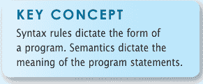

普通人很可能会将此句子解释为一般观察：时间像箭一样快速移动。然而，如果我们将单词 *time* 解释为动词（例如“跑 50 码冲刺，我会计时你”）并将单词 *flies* 解释为名词（fly 的复数），解释就会完全改变。

我们知道箭不会计时东西，所以我们通常不会那样解释句子，但它是句子中词语的一个有效解释。计算机很难确定哪个含义是 intended 的。此外，该句子可能描述了一种不寻常的昆虫“time fly”的偏好，这种昆虫可能在射箭场附近找到。毕竟，果蝇喜欢香蕉。

重点是，一个特定的英语句子可以有多种有效含义。计算机语言不能允许存在此类歧义。如果编程语言指令可能有两种不同的含义，计算机将无法确定应执行哪一种。

## Errors

在软件中，特别是程序开发期间，可能会出现几种不同类型的问题。术语 computer error 通常被误用，其含义因情况而异。从用户的角度来看，与机器交互时出现任何问题都可以称为计算机错误。例如，假设你用信用卡支付了 23 美元的商品，但收到账单时，该商品被列为 230 美元。在你解决问题后，信用卡公司为“计算机错误”道歉。计算机是否随意在数字末尾添加了一个零，或者它是否将值乘以 10？当然不是。计算机遵循我们给它的命令并操作我们提供的数据。如果我们的程序错误或数据不准确，那么我们就不能期望结果正确。描述这种情况的常用短语是“garbage in, garbage out”。

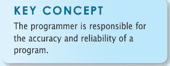

在开发程序时，你会遇到三种错误：

- compile-time error
- run-time error
- logical error

### 1.5 程序开发

编译器会检查你是否使用了正确的语法。如果有任何语句不符合语言的语法规则，编译器会产生语法错误。编译器还会尝试查找其他问题，例如使用不兼容的数据类型。语法在技术上可能是正确的，但你可能试图做一些语言在语义上不允许的事情。编译器识别出的任何错误都称为编译时错误。如果发生编译时错误，则不会创建程序的可执行版本。

第二种问题发生在程序执行期间。它被称为运行时错误，会导致程序异常终止。例如，如果我们尝试除以零，程序就会“崩溃”并在该点停止执行。因为所请求的操作是未定义的，系统就会放弃继续处理你的程序。最好的程序是健壮的；也就是说，它们尽可能避免运行时错误。例如，程序代码可以防止除以零的可能性，并在出现这种情况时适当处理。在 Java 中，许多运行时问题被称为异常，可以被捕获并相应处理。

第三种软件问题是逻辑错误。在这种情况下，软件编译和执行都没有问题，但它会产生错误的结果。例如，当值计算不正确或图形按钮未出现在正确位置时就会发生逻辑错误。程序员必须彻底测试程序，将预期结果与实际发生的结果进行比较。当发现缺陷时，必须将其追溯到代码中问题的根源并进行纠正。查找和纠正程序中的缺陷的过程称为调试。逻辑错误可以以多种方式表现出来，实际的根本原因可能很难发现。

> Java 程序必须在语法上正确，否则编译器不会生成字节码。

各种错误类型的示例。

- SR 1.27 我们都知道计算机被用来执行复杂的工作。在本节中，你了解到计算机的指令只能执行简单任务。解释这种明显的矛盾。
- SR 1.28 高级语言和机器语言之间有什么关系？
- SR 1.29 什么是 Java 字节码？
- SR 1.30 从以下列表中选择最符合以下各短语的词语：
    assembly, compiler, high-level, IDE, interpreter, Java, low-level, machine
    - a. 用这种类型的语言编写的程序可以直接在计算机上运行。
    - b. 通常，这种类型语言中的每条语言指令都对应一条等效的机器语言指令。
    - c. 大多数程序员使用这种类型的语言编写程序。
    - d. Java 是这种类型语言的一个例子。
    - e. 这种类型的程序将一种语言的代码翻译成另一种语言的代码。
    - f. 这种类型的程序交织代码的翻译和代码的执行。
- SR 1.31 我们所说的编程语言的语法和语义是什么意思？
- SR 1.32 将以下每种情况归类为编译时错误、运行时错误或逻辑错误。
    - a. 拼写错误 Java 保留字。
    - b. 通过将列表中数字的总和（为零）除以列表的大小（也为零）来计算空数字列表的平均值。
    - c. 打印学生的最高测试成绩，而应输出学生的平均测试成绩。

### 1.6 面向对象编程

正如我们在本章前面所述，Java 是一种面向对象（OO）语言。顾名思义，对象是 Java 程序中的基本实体。本书专注于通过定义相互交互的对象来开发软件的理念。

面向对象软件开发的原则已经存在多年，基本上与高级编程语言的使用时间一样长。20 世纪 60 年代开发的编程语言 Simula 具有许多定义现代 OO 软件开发方法的特征。在 20 世纪 80 年代和 90 年代，由于 C++ 和 Java 等编程语言的发展，面向对象编程变得非常流行。它现在是商业软件开发中使用的主要方法。

面向对象方法最具吸引力的特征之一是对象可以非常有效地用于表示现实世界实体。例如，我们可以用软件对象来表示公司中的一名员工。我们会为每名员工创建一个对象，每个对象都具有我们需要表示的行为和特征。这样，面向对象编程使我们能够将程序映射到程序所代表的现实情况。也就是说，面向对象的方法使解决问题变得更容易，而编写程序的初衷就是为了解决问题。

> 关键概念
>
> 面向对象编程帮助我们解决问题，而编写程序的目的就是解决问题。

让我们讨论与问题解决相关的一般问题，然后探讨面向对象方法帮助我们解决这些问题的具体特征。

### 问题解决

一般来说，问题解决包含多个步骤：

- 1. 理解问题。
- 2. 设计解决方案。
- 3. 考虑解决方案的替代方案并完善解决方案。
- 4. 实现解决方案。
- 5. 测试解决方案并修复存在的任何问题。

虽然这种方法适用于任何类型的问题解决，但在开发软件时效果特别好。这些步骤并非完全线性。也就是说，部分活动会与其他活动重叠。但在某个时候，所有这些步骤都应得到仔细处理。

第一步，理解问题，听起来很明显，但对这一步缺乏关注是导致许多误导性软件开发工作的原因。如果我们试图解决一个我们不完全理解的问题，我们往往会解决错误的问题或至少走上不适当的岔路。每个问题都有一个问题域，即对我们的解决方案至关重要的现实世界问题。例如，如果我们要编写一个程序来计分保龄球比赛，那么问题域就包括保龄球规则。为了开发出良好的解决方案，我们必须彻底理解问题域。

设计问题解决方案的关键在于将其分解为可管理的部分。任何问题的解决方案很少能表达为一个大任务。相反，它是一系列相互协作的小任务，共同执行更大的任务。在开发软件时，我们不会编写一个大程序。我们设计负责解决方案某些部分的独立部分，然后将其与其他部分集成。

> 关键概念
>
> 程序设计涉及将解决方案分解为可管理的部分。

我们对解决方案的第一印象可能不是最好的。我们必须始终考虑替代方案并根据需要完善解决方案。我们越早考虑替代方案，修改我们的方法就越容易。

实现解决方案是将设计以可用形式呈现出来的过程。在开发软件解决方案时，实现阶段就是实际编写程序的过程。编程经常被认为是编写代码。但在大多数情况下，设计程序的行为应该比在特定编程语言中实现设计的过程更有趣、更具创造性。

在开发过程的许多阶段，我们都应该测试我们的解决方案以查找存在的错误，以便我们可以修复它们。测试不能保证仍然没有尚未发现的问题，但它可以提高我们对拥有可行解决方案的信心。

在本教材中，我们探讨了设计和实现优雅程序的技术。虽然我们经常会沉浸在这些细节中，但我们绝不能忘记我们的主要目标是解决问题。

### 面向对象软件原则

面向对象编程最终需要对以下术语有扎实的理解：

- object
- attribute
- method
- class
- encapsulation
- inheritance
- polymorphism

除了这些术语之外，还有许多相关概念，允许我们以无数种方式定制解决方案。本书旨在帮助你逐步自然地发展对这些概念的理解。本节从高层次概述这些思想，以建立一些术语并提供整体情况。

我们前面提到过，对象是程序中的基本元素。软件对象通常代表我们问题域中的真实对象，例如银行账户。每个对象都有状态和一组行为。所谓“状态”是指存在状态——当前定义对象的根本特征。例如，银行账户状态的一部分是其当前余额。对象的行为是与对象相关的活动。与银行账户相关的行为可能包括存款和取款的能力。

除了对象之外，Java 程序还管理原始数据。原始数据包括数字和字符等基本值。对象通常代表更有趣或更复杂的实体。

一个对象的属性是它内部存储的值，这些值可能表示为原始数据或其它对象。例如，一个银行账户对象可能存储一个浮点数（一个原始值）来表示账户的余额。它可能包含其它属性，例如账户所有者的姓名。总体而言，一个对象属性的值定义了它的当前状态。

如本章前面所述，方法是一组被赋予名称的编程语句。当方法被调用时，其语句会被执行。一组方法与一个对象相关联。对象的方法定义了它的潜在行为。为了定义向银行账户存款的能力，我们定义一个包含将相应更新账户余额的编程语句的方法。

一个对象由一个类定义。类是创建对象所依据的模型或蓝图。考虑建筑师在设计房屋时创建的蓝图。蓝图定义了房屋的重要特征——其墙壁、窗户、门、电源插座等等。一旦蓝图创建完成，就可以使用它建造多座房屋，如图 1.22 所示。

从某种意义上说，由蓝图建造的房屋是不同的。它们位于不同的位置，具有不同的地址，包含不同的家具，并由不同的人居住。然而在许多方面它们是“相同的”房屋。

关键概念

每个对象都有一个状态，由其属性定义，以及一组行为，由其方法定义。

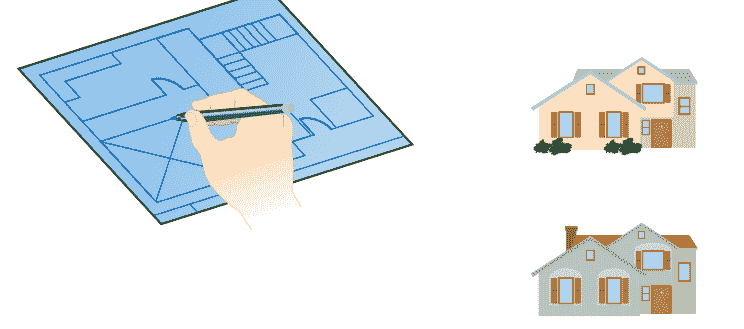

图 1.22 类用于创建对象，就像房屋蓝图用于创建不同但相似的房屋一样

每个房间的布局和其它关键特征在每座房屋中都相同。要创建不同的房屋，我们需要不同的蓝图。

类是对象的蓝图。它确定了该类型对象将保存的数据种类，并定义了代表此类对象行为的方法。然而，类不是对象，正如蓝图不是房屋一样。一般来说，类不包含存储数据的空间。每个对象都有其自己的数据空间，这就是为什么每个对象可以拥有自己的状态。

> **关键概念**
>
> 一个类是对象的蓝图。
>
> 可以从一个类定义创建多个对象。

一旦类被定义，就可从该类创建多个对象。例如，一旦我们定义一个类来表示银行账户的概念，我们就可以创建多个对象来表示具体的、独立的银行账户。每个银行账户对象都会跟踪其自己的余额。

一个对象应该是*封装的*，这意味着它保护和管理自己的信息。也就是说，一个对象应该是自治的。对对象状态所做的唯一更改应由该对象的方法完成。我们应设计对象，使其它对象无法“伸进去”并更改其状态。

类可以通过使用*继承*从其它类创建。也就是说，一个类的定义可以基于已存在的另一个类。继承是一种*软件重用*形式，利用了我们可能想要创建的各种类之间的相似性。一个类可以用来派生出几个新类。派生类随后可用于派生出更多类。这创建了一个类层次结构，其中在一个类中定义的属性和方法会被其子代继承，而子代又将其传递给它们的子代，依此类推。例如，我们可能会创建表示各种账户类型的类层次结构。共同特征在高层类中定义，特定差异在派生类中定义。

*多态性*是这样一种思想：我们可以用一致的方式在不同时间引用多种相关对象。它使我们能够为处理多个对象的问题设计强大而优雅的解决方案。

图 1.23 中描绘了一些核心面向对象概念。我们不期望你此时完全理解这些思想。本书的大部分内容旨在充实这些思想。此概述仅旨在设定背景。

## 关键概念摘要

- 计算机系统由硬件和软件组成，它们协同工作帮助我们解决问题。
- CPU 从主内存读取程序指令，逐条执行，直到程序结束。
- 操作系统提供用户界面并管理计算机资源。
- 就用户而言，界面就是程序。
- 数字计算机通过将信息分解成块并将每个块表示为数字来存储信息。
- 二进制用于在计算机中存储和移动信息，因为存储和操作二进制数据的设备价格低廉且可靠。
- N 个位恰好有 2^N 种排列。因此，N 个位可以表示多达 2^N 个唯一项。
- 计算机的核心由存储程序和数据的内存以及逐条执行程序指令的 CPU 组成。
- 地址是与内存位置相关联的唯一数字。
- 主内存是易失性的，这意味着存储的信息仅在供电时得以维持。
- CD 的表面既有光滑区域也有小坑。坑代表二进制 1，光滑区域代表二进制 0。
- 可重写 CD 通过使用可根据需要变为非晶态或晶态的涂层来模拟普通 CD 的坑和光滑区域。
- 取指-译码-执行循环构成了计算机处理的基础。
- 网络由两台或多台连接在一起以便交换信息的计算机组成。
- 共享通信线路会造成延迟，但它具有成本效益并简化了向网络添加新计算机。


- 局域网（`LAN`）是组织内部共享信息和资源的有效方式。
- 互联网是一个跨越全球的广域网（`WAN`）。
- 连接到互联网的每台计算机都有一个唯一标识它的 `IP` 地址。
- 万维网是使人类在网络上共享信息变得容易的软件。
- `URL` 唯一指定 Web 上的文档和其它信息，以便浏览器获取和显示。
- 本书侧重于面向对象编程的原理。
- 注释不影响程序的处理；相反，它们有助于人类理解。
- 内联文档应提供对代码的洞察。它不应模棱两可或啰嗦。
- `Java` 区分大小写。大写和小写字母是不同的。
- 标识符名称应具有描述性和可读性。
- 适当使用空白可以使程序更易于阅读和理解。
- 你应遵循一套指导方针来确定程序的格式和文档。
- 所有程序必须被翻译成特定 `CPU` 的机器语言才能执行。
- 高级语言允许程序员忽略机器语言的底层细节。
- `Java` 编译器将 `Java` 源代码翻译成 `Java` 字节码，即程序的低级、与体系结构无关的表示。
- 存在许多不同的开发环境来帮助你创建和修改 `Java` 程序。
- 语法规则规定了程序的形式。语义规定了程序语句的含义。
- 程序员对程序的准确性和可靠性负责。
- `Java` 程序必须在语法上正确，否则编译器将不会生成字节码。
- 面向对象编程帮助我们解决问题，这是编写程序的目的。
- 程序设计涉及将解决方案分解为可管理的部分。
- 每个对象都有一个状态，由其属性定义，以及一组行为，由其方法定义。
- 一个类是对象的蓝图。可以从一个类定义创建多个对象。

## 练习

访问 `www.myprogramminglab.com` 在线完成这些练习中的许多练习并获得即时反馈。

- **EX 1.1** 描述你个人计算机或你有权限访问的实验室计算机的硬件组件。包括处理器类型和速度，主存储器和辅助存储器的存储容量，以及 `I/O` 设备类型。解释你是如何确定答案的。
- **EX 1.2** 为什么我们使用二进制数系统在计算机上存储信息？
- **EX 1.3** 以下每种情况可以用多少个唯一项目表示？
  - a. 1 bit
  - b. 3 bits
  - c. 6 bits
  - d. 8 bits
  - e. 10 bits
  - f. 16 bits
- **EX 1.4** 如果一幅图片由 128 种可能颜色组成，存储图片的每个像素需要多少位？为什么？
- **EX 1.5** 如果一种语言使用 240 个唯一字母和符号，存储文档的每个字符需要多少位？为什么？
- **EX 1.6** 以下每个有多少位？有多少字节？
  - a. 12 KB
  - b. 5 MB
  - c. 3 GB
  - d. 2 TB
- **EX 1.7** 解释随机存取存储器（`RAM`）和只读存储器（`ROM`）之间的区别。
- **EX 1.8** 磁盘是随机访问设备但它不是 `RAM`（随机存取存储器）。解释。
- **EX 1.9** 确定你的计算机，或你有权限访问的实验室计算机，是如何通过网络连接到其他计算机的。它是否链接到互联网？绘制图表以显示你环境中的基本连接。
- **EX 1.18** `Java` 是区分大小写的。这是什么意思？
- **EX 1.19** 当我们说英语是模棱两可的时，我们是什么意思？给出英语歧义的两个例子（除本章使用的例子外）并解释歧义。为什么歧义对编程语言来说是个问题？
- **EX 1.20** 将以下每种情况归类为编译时错误、运行时错误或逻辑错误。
  - a. 你本意是相加却相乘了两个数字
  - b. 除以零
  - c. 在编程语句末尾忘记分号
  - d. 在输出中拼错一个词
  - e. 产生不准确的结果
  - f. 输入 `{` 而应输入 `(`

## 编程项目

访问 `www.myprogramminglab.com` 在线完成这些编程项目中的许多项目并获得即时反馈。

**PP 1.1** 输入、编译并运行以下应用程序：

```java
public class Test
{
    public static void main (String[] args)
    {
        System.out.println ("An Emergency Broadcast");
    }
}
```

**PP 1.2** 一次引入以下错误到 `PP 1.1` 的程序中。记录编译器产生的任何错误消息。每次引入新错误前修复之前的错误。如果没有产生错误消息，解释原因。尝试在每次更改前预测会发生什么。
- a. 将 `Test` 改为 `test`
- b. 将 `Emergency` 改为 `emergency`
- c. 删除字符串中的第一个引号
- d. 删除字符串中的最后一个引号
- e. 将 `main` 改为 `man`
- f. 将 `println` 改为 `bogus`
- g. 删除 `println` 语句末尾的分号
- h. 删除程序中的最后一个大括号

**PP 1.3** 编写一个应用程序，在单独的行上打印你的姓名、生日、爱好、你最喜欢的书和你最喜欢的电影。在输出中标记每条信息。

**PP 1.4** 编写一个应用程序打印短语 `Knowledge is Power:`
- a. 在一行上
- b. 在三行上，每行一个词，词相对于彼此居中
- c. 在由字符 `=` 和 `|` 组成的框内

**PP 1.5** 编写一个应用程序打印你喜欢的四个或五个网站的列表。打印站点名称和 `URL`。

**PP 1.6** 编写一个应用程序打印一首歌（你选择的）的前几节。标记副歌。

**PP 1.7** 编写一个应用程序使用星号（`*`）字符打印一棵树的轮廓。

**PP 1.8** 编写一个应用程序打印你选择的某部小说的一段文字。

**PP 1.9** 编写一个应用程序打印以下菱形。不要打印任何不需要的字符。 （即，不要使任何字符字符串比它必须的更长。）

```
        *
       ***
      *****
     *******
    *********
     *******
      *****
       ***
        *
```

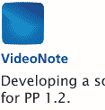

**PP 1.10** 编写一个应用程序以大块字母显示你的姓名首字母。用相应的常规字符制作每个大字母。例如：

```
JJJJJJJJJJJJJ   AAAAAAAAA   LLLL
JJJJJJJJJJJJJ   AAAAAAAAAA  LLLL
     JJJ      AAA     AAA   LLLL
     JJJJ     AAA     AAA   LLLL
     JJJJ     AAAAAAAAAA  LLLL
J       JJJJ   AAAAAAAAAA  LLLL
JJ      JJJ    AAA     AAA   LLLL
JJJJJJJJJJJ    AAA     AAA   LLLLLLLLLLLLL
JJJJJJJJJ      AAA     AAA   LLLLLLLLLLLLL
```

## 数据和表达式

### 章节目标

- 讨论字符字符串、连接和转义序列的使用。
- 探索变量的声明和使用。
- 描述 `Java` 原始数据类型。
- 讨论表达式的语法和处理。
- 定义数据类型转换的类型和实现机制。
- 介绍 `Scanner` 类以创建交互式程序。
- 探索基本图形概念和绘制形状的技术。
- 介绍 `Java` applet 的概念。

本章探讨了 `Java` 程序中使用的一些基本数据类型以及使用表达式执行计算。本章讨论了数据从一种类型到另一种类型的转换以及如何从运行程序的用户处交互式读取输入。本章还开始了本书的图形轨道，在其中我们介绍图形编程的概念，探索 `Java` 与 Web 之间的关系，并深入研究 `Java` 操作颜色和绘制形状的能力。


### 2.1 字符字符串

在第 1 章中，我们讨论了 `Java` 程序的基本结构，包括使用注释、标识符和空白，使用 `Lincoln` 程序作为示例。第 1 章还包括了面向对象编程所涉及的各种概念的概述，例如对象、类和方法。如果需要，请花点时间回顾这些概念。

字符字符串是 `Java` 中的一个对象，由类 `String` 定义。由于字符串对计算机编程如此基础，`Java` 提供了使用字符串字面量的能力，字符串字面量由双引号字符分隔，正如我们在之前的示例中所见。我们将在第 3 章更详细地探索 `String` 类及其方法。现在，让我们更详细地探索本章中字符串字面量的使用。

以下是所有有效字符串字面量的示例：
- `"The quick brown fox jumped over the lazy dog."`
- `"602 Greenbriar Court, Chalfont PA 18914"`
- `"x"`
- `""`

字符串字面量可以包含任何有效字符，包括数字、标点和其他特殊字符。上面列表中的最后一个示例根本不包含任何字符。

### print 和 println 方法

在第 1 章的 `Lincoln` 程序中，我们按如下方式调用 `println` 方法：

```java
System.out.println("Whatever you are, be a good one.");
```

此语句演示了对象的使用。`System.out` 对象代表一个输出设备或文件，默认情况下是监视器屏幕。更准确地说，对象的名称是 `out`，它存储在 `System` 类中。我们将在文本的适当位置更详细地探索这种关系。

`println` 方法是 `System.out` 对象为我们提供的服务。每当我们请求它时，对象就会将字符字符串打印到屏幕上。我们可以说我们向 `System.out` 对象发送 `println` 消息以请求打印一些文本。

我们发送给方法的数据的每个部分称为参数。在这种情况下，`println` 方法只接受一个参数：要打印的字符字符串。

`System.out` 对象还提供了一种我们可以使用的服务：`print` 方法。`print` 和 `println` 之间的区别很小但很重要。`println` 方法打印发送给它的信息，然后移动到下一行的开头。`print` 方法与 `println` 类似，但完成后不会 advances 到下一行。

`Listing 2.1` 中所示的程序称为 `Countdown`，它同时调用了 `print` 和 `println` 方法。

仔细比较 `Countdown` 程序的输出，显示在程序列表底部，与程序代码。注意单词 `Liftoff` 与前几个单词打印在同一行，即使它使用 `println` 方法打印。记住 `println` 方法在打印传递给它的信息后会移动到下一行的开头。

## KEY CONCEPT

`print` 和 `println` 方法代表 `System.out` 对象提供的两种服务。

### LISTING 2.1

```
//************************************************************************
//  Countdown.java      Author: Lewis/Loftus
//
//  Demonstrates the difference between print and println.
//************************************************************************
public class Countdown
{
    //-------------------------------------------------------------
    //  Prints two lines of output representing a rocket countdown.
    //-------------------------------------------------------------
    public static void main (String[] args)
    {
        System.out.print ("Three... ");
        System.out.print ("Two... ");
        System.out.print ("One... ");
        System.out.print ("Zero... ");
        System.out.println ("Liftoff!"); // appears on first output line
        System.out.println ("Houston, we have a problem.");
    }
}
```

### OUTPUT

Three... Two... One... Zero... Liftoff!

Houston, we have a problem.

## String Concatenation

字符串字面量不能跨多行出现在程序中。以下程序语句是错误的语法，在尝试编译时会产生错误：

```
// The following statement will not compile
System.out.println ("The only stupid question is
the one that is not asked.");
```

当我们想打印一个字符串太长而无法在一行程序中容纳时，我们可以依赖字符串连接将一个字符串附加到另一个字符串的末尾。字符串连接运算符是加号（`+`）。以下表达式将一个字符字符串连接到另一个字符字符串，生成一个长字符串：

```
"The only stupid question is " + "the one that is not asked."
```

`Listing 2.2` 中名为 `Facts` 的程序包含几个 `println` 语句。第一个打印一个句子有点长，无法容纳在一行程序中。由于字符字面量不能跨程序中的两行，我们将字符串拆分为两部分并使用字符串连接将它们附加。因此，第一个 `println` 语句中的字符串连接操作导致一个大字符串被传递给该方法以便打印。

请注意，我们不必向 `println` 方法传递任何信息，如 `Facts` 程序第二行所示。此调用不会打印任何可见字符，但确实会移动到输出的下一行。因此，在这种情况下，使用无参数调用 `println` 的效果是打印一个空行。

`Facts` 程序中最后三个对 `println` 的调用演示了字符串连接的另一个有趣之处：字符串可以与数字连接。请注意，这些行中的数字未用双引号括起来，因此不是字符字符串。在这些情况下，数字会自动转换为字符串，然后两个字符串连接。

由于我们正在打印特定值，我们本可以直接将数值作为字符串字面量的一部分包含在内，例如：

```
"Speed of ketchup: 40 km per year"
```

数字是字符，可以根据需要包含在字符串中。我们在 `Facts` 程序中将它们分开以演示将字符串和数字连接的能力。这种技术将在即将到来的示例中很有用。

正如你所想象的，`+` 运算符也用于算术加法。因此，`+` 运算符的作用取决于其操作的数据类型。如果 `+` 运算符的操作数之一或两者都是字符串，则执行字符串连接。

`Listing 2.3` 中所示的 `Addition` 程序演示了字符串连接和算术加法之间的区别。`Addition` 程序使用 `+` 运算符四次。在对 `println` 的第一次调用中，两个 `+` 操作都执行字符串连接，因为运算符按从左到右执行。第一个运算符将字符串与第一个数字（24）连接，创建更大的字符串。然后该字符串与第二个数字（45）连接，创建更大的字符串，然后将其打印。

在对 `println` 的第二次调用中，我们使用括号对两个数字操作数进行分组的 `+` 操作。这迫使该操作首先发生。由于两个操作数都是数字，因此数字在算术

### LISTING 2.3

```
//****************************************************************
// Addition.java      Author: Lewis/Loftus
//
// Demonstrates the difference between the addition and string
// concatenation operators.
//****************************************************************

public class Addition
{
    //-------------------------------------------------------------
    // Concatenates and adds two numbers and prints the results.
    //-------------------------------------------------------------
    public static void main (String[] args)
    {
        System.out.println ("24 and 45 concatenated: " + 24 + 45);

        System.out.println ("24 and 45 added: " + (24 + 45));
    }
}
```

### OUTPUT

24 and 45 concatenated: 2445

24 and 45 added: 69

我们将在本章后面重新讨论这种类型的情形，当我们形式化定义运算符求值顺序的优先级规则时。

## Escape Sequences

由于双引号字符（`"`）在 `Java` 语言中用于表示字符串的开始和结束，我们必须使用特殊技术来打印引号字符。如果我们简单地将其放在字符串中（`""`） ，编译器会感到困惑，因为它认为第二个引号字符是字符串的结束，不知道如何处理第三个字符。这会导致编译时错误。


为了解决这个问题，Java 定义了几个转义序列来表示特殊字符。转义序列以反斜杠字符（`\`）开头，表示其后的字符或字符应以特殊方式解释。图 2.1 列出了 Java 转义序列。

Listing 2.4 中的程序，名为 `Roses`，打印一些类似于诗歌的文本。它仅使用一个 `println` 语句来做到这一点，尽管诗歌有几行长。请注意字符串中使用的转义序列。`\n` 转义序列强制输出到新行，而 `\t` 转义序列表示制表符。`\"` 转义序列确保引号字符被视为字符串的一部分，而不是其终止，从而能够将其作为输出的一部分打印。

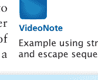

> KEY CONCEPT
>
> 可以使用转义序列来表示否则会导致编译问题的字符。

| Escape Sequence | Meaning |
|---|---|
| `\b` | backspace |
| `\t` | tab |
| `\n` | newline |
| `\r` | carriage return |
| `\"` | double quote |
| `\'` | single quote |
| `\\` | backslash |

FIGURE 2.1 Java escape sequences

### LISTING 2.4

```
//************************************************************************
// Roses.java      Author: Lewis/Loftus
//
// Demonstrates the use of escape sequences.
//************************************************************************

public class Roses
{
    //-------------------------------------------------------------
    // Prints a poem (of sorts) on multiple lines.
    //-------------------------------------------------------------
    public static void main (String[] args)
    {
        System.out.println ("Roses are red,\n\tViolets are blue,\n" +
            "Sugar is sweet,\n\tBut I have \"commitment issues\",\n\t" +
            "So I'd rather just be friends\n\tAt this point in our " +
            "relationship.");
    }
}
```

### OUTPUT

Roses are red,

    Violets are blue,

Sugar is sweet,

    But I have "commitment issues",

    So I'd rather just be friends

    At this point in our relationship.

## SELF-REVIEW QUESTIONS (see answers in Appendix N)

- SR 2.1  什么是字符串字面量？

- SR 2.2  `print` 和 `println` 方法有什么区别？

- SR 2.3  什么是参数？

- SR 2.4  以下代码片段会产生什么输出？

    `System.out.println ("One ");`

    `System.out.print ("Two ");`

    `System.out.println ("Three ");`

### SR 2.5 以下代码片段会产生什么输出？

```
System.out.print ("Ready ");
System.out.println ();
System.out.println ("Set ");
System.out.println ();
System.out.println ("Go ");
```

### SR 2.6 以下语句会产生什么输出？如果去掉内部的括号会产生什么？

```
System.out.println ("It is good to be " + (5 + 5));
```

### SR 2.7 什么是转义序列？举一些例子。

### SR 2.8 写一个单行的 `println` 语句，使其输出以下内容完全一致（包括换行和引号）。

> "I made this letter longer than usual because I lack the time to make it short."  
> Blaise Pascal

## 2.2 变量和赋值

我们在程序中管理的大部分信息都由变量表示。让我们研究一下如何在程序中声明和使用它们。

### 变量

变量是用于保存数据值的内存位置的名称。变量声明指示编译器为特定类型的值保留足够大的主内存空间，并指出我们用来引用该位置的名称。

考虑清单 2.5 中所示的程序 `PianoKeys`。`main` 方法的第一行是声明一个名为 `keys` 的变量，该变量保存一个整数（`int`）值。声明还给 `keys` 一个初始值 `88`。如果未为变量指定初始值，则该值未定义。大多数 Java 编译器在尝试在显式赋予变量值之前使用它时都会给出错误或警告。

`keys` 变量及其值可以如下图所示：


> **关键概念**  
> 变量是用于保存特定数据类型值的内存位置的名称。

## 局部变量声明

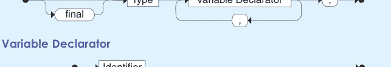

## 变量声明符

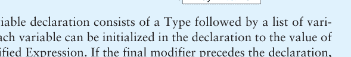

变量声明由类型后跟变量列表组成。每个变量都可以在声明时初始化为指定表达式的值。如果 `final` 修饰符位于声明之前，则标识符将被声明为命名常量，其值一旦设置就不能更改。

示例：

```
int total;
double num1, num2 = 4.356, num3;
char letter = 'A', digit = '7';
final int MAX = 45;
```

**清单 2.5**

```
//************************************************************************
// PianoKeys.java      Author: Lewis/Loftus
//
// Demonstrates the declaration, initialization, and use of an
// integer variable.
//************************************************************************

public class PianoKeys
{
    //------------------------------------------------------------
    // Prints the number of keys on a piano.
    //------------------------------------------------------------
    public static void main (String[] args)
    {
        int keys = 88;
        System.out.println ("A piano has " + keys + " keys.");
    }
}
```

**输出**

```
A piano has 88 keys.
```

在 `PianoKeys` 程序中，调用 `println` 方法使用了两条信息。第一条是字符串，第二条是变量 `keys`。当引用变量时，会使用当前存储在其中的值。因此，当执行对 `println` 的调用时，会获取 `keys` 的值，即 `88`。因为该值是整数，所以它会自动转换为字符串并与初始字符串连接。连接后的字符串被传递给 `println` 并打印。

变量声明可以在一行中声明多个相同类型的变量。行上的每个变量都可以带或不带初始化值声明。例如：

```
int count, minimum = 0, result;
```

### 赋值语句

让我们研究一个更改变量值的程序。清单 2.6 显示了一个名为 `Geometry` 的程序。该程序首先声明一个名为 `sides` 的整数变量并将其初始化为 `7`。然后它打印出 `sides` 的当前值。

`main` 中的下一行更改了存储在变量 `sides` 中的值：

```
sides = 10;
```

这称为赋值语句，因为它为变量赋值。执行时，赋值运算符（`=`）右侧的表达式会被求值，结果存储在左侧变量指示的内存位置。在此示例中，表达式只是数字 `10`。我们将在下一节讨论更复杂的表达式。

**清单 2.6**

```
//***************************************************************************
// Geometry.java      Author: Lewis/Loftus
//
// Demonstrates the use of an assignment statement to change the
// value stored in a variable.
//***************************************************************************

public class Geometry
{
    //-------------------------------------------------------------
    // Prints the number of sides of several geometric shapes.
    //-------------------------------------------------------------
    public static void main (String[] args)
    {
        int sides = 7;  // declaration with initialization
        System.out.println ("A heptagon has " + sides + " sides.");

        sides = 10;  // assignment statement
        System.out.println ("A decagon has " + sides + " sides.");

        sides = 12;
        System.out.println ("A dodecagon has " + sides + " sides.");
    }
}
```

**输出**

```
A heptagon has 7 sides.
A decagon has 10 sides.
A dodecagon has 12 sides.
```

> **关键概念**  
> 访问数据会使其在内存中保持不变，但赋值语句会覆盖旧数据。

变量只能存储其声明类型的一个值。新的值会覆盖旧值。在这种情况下，当值 `10` 被赋给 `sides` 时，原值 `7` 被覆盖并永远丢失，如下所示：

初始化后：`sides` `7`

第一次赋值后：`sides` `10`

## 基本赋值


基本赋值语句使用赋值运算符（`=`）将表达式的结果存储到指定的标识符，通常是变量中。

示例：

```
total = 57;
count = count + 1;
value = (min / 2) * lastValue;
```

当引用变量时，例如在打印时，变量的值不会改变。这是计算机内存的特性：访问（读取）数据会使内存中的值保持不变，但写入数据会用新数据替换旧数据。

Java 语言是强类型的，这意味着我们不允许将与声明类型不一致的值赋给变量。尝试组合不兼容的类型会在尝试编译程序时生成错误。因此，赋值语句右侧的表达式必须求值为与左侧变量类型兼容的值。

> **关键概念**  
> 我们不能将一种类型的值赋给不兼容类型的变量。

### 常量

有时我们使用在整个程序中保持不变的数据。例如，我们可能会编写一个处理最多可容纳 `427` 人的剧院的程序。将常量值赋予名称，例如 `MAX_OCCUPANCY`，而不是在代码中到处使用字面值，例如 `427`，通常很有帮助。字面值如 `427` 的目的和含义对于阅读代码的人来说往往令人困惑。通过为值命名，您有助于解释其在程序中的作用。

常量是标识符，与变量类似，只是它们在其存在期间保存特定值。常量，正如英文单词的含义一样，不是可变的。它们的值不会改变。

> **关键概念**  
> 常量在其存在期间保存特定值。

在 Java 中，如果在声明前加上保留字 `final`，则标识符将被设为常量。根据惯例，常量命名时使用大写字母以区别于普通变量，并且单个单词是使用下划线字符进行分隔。例如，描述剧院最大容纳人数的常量可以声明如下：

```
final int MAX_OCCUPANCY = 427;
```

一旦常量被赋予初始值后，如果你试图改变它的值，编译器将产生错误消息。这是使用常量的另一个好理由。常量可以防止无意中的编码错误，因为唯一可以修改其值的地方就是初始赋值处。

使用常量还有第三个充分理由。如果某个常量在整程序中使用，并且其值需要修改，那么你只需在同一个地方修改即可。例如，如果剧院的容量因翻修而从 `427` 变为 `535`，那么你只需修改一处声明，所有对 `MAX_OCCUPANCY` 的使用都会自动反映这一变化。如果直接在代码中使用了字面量 `427`，那么你就需要找到并修改每一处使用。如果你漏掉了任何使用该字面量的地方，必然会出现问题。

### 自测题（答案见附录 N）

- SR 2.9 什么是变量声明？

- SR 2.10 根据以下变量声明，回答每个问题。

  ```
  int count = 0, value, total;
  final int MAX_VALUE = 100;
  int myValue = 50;
  ```

  - a. 声明了多少个变量？

  - b. 这些变量的类型是什么？

  - c. 哪些变量被赋予了初始值？

  - d. 根据上述声明，以下赋值语句是否合法？请解释。

    ```
    myValue = 100;
    ```

  - e. 根据上述声明，以下赋值语句是否合法？请解释。

    ```
    MAX_VALUE = 50;
    ```

- SR 2.11 你的程序需要一个 `int` 类型的变量来保存音乐收藏中 CD 的数量。初始值应为零。请为这个变量编写一条声明语句。

- SR 2.12 你的程序需要一个 `int` 类型的变量来保存一英里中的英尺数（`5,280`）。请为这个变量编写一条声明语句。

- SR 2.13 简要描述在程序中使用常量而非字面值的三个理由。

## 2.3 基本数据类型

Java 中有八种*基本数据类型*（*primitive data types*）：四种整数类型、两种浮点类型、一种字符类型和一种布尔类型。其他一切都是用对象来表示的。让我们详细了解一下这八种基本数据类型。

### 整数与浮点数

Java 有两种基本的数值类型：整数（没有小数部分）和浮点数（有小数部分）。有四种整数数据类型（`byte`、`short`、`int` 和 `long`）和两种浮点数据类型（`float` 和 `double`）。所有数值类型的区别在于存储该类型值所使用的内存空间大小，这决定了可以表示的数值范围。每种数据类型的大小在所有硬件平台上都是相同的。所有数值类型都是*有符号的*，这意味着可以存储正值和负值。图 2.2 总结了数值基本类型。

回想一下我们在第 1 章中的讨论，一个比特可以是 1 或 0。因为每个比特可以表示两种不同状态，所以一个由 N 个比特组成的字符串可以表示 2^N 种不同的值。附录 B 更详细地描述了数字系统以及这类关系。

在设计程序时，有时我们需要小心选择合适大小的变量，以免浪费内存空间。这种情况发生在内存空间特别受限的环境中，例如在个人数字助理（PDA）上运行的程序。在这种情况下，我们可以相应地选择变量的数据类型。例如，如果某个变量的值不会超出 1 到 1000 的范围，那么一个两字节的整数（`short`）就足够容纳它了。另一方面，当不确定某个变量可能的取值范围时，我们应该提供合理甚至宽裕的空间。在大多数情况下，内存空间并不是严重的限制，我们通常可以承受宽裕的假设。

> **关键概念**
>
> Java 有两种数值：整数和浮点数。有四种整数数据类型和两种浮点数据类型。

| 类型 | 存储空间 | 最小值 | 最大值 |
|---|---|---:|---:|
| `byte` | 8 位 | −128 | 127 |
| `short` | 16 位 | −32,768 | 32,767 |
| `int` | 32 位 | −2,147,483,648 | 2,147,483,647 |
| `long` | 64 位 | −9,223,372,036,854,775,808 | 9,223,372,036,854,775,807 |
| `float` | 32 位 | 约 −3.4E+38，7 位有效数字 | 约 3.4E+38，7 位有效数字 |


| `double` | 64 位 | 约 −1.7E+308，15 位有效数字 | 约 1.7E+308，15 位有效数字 |

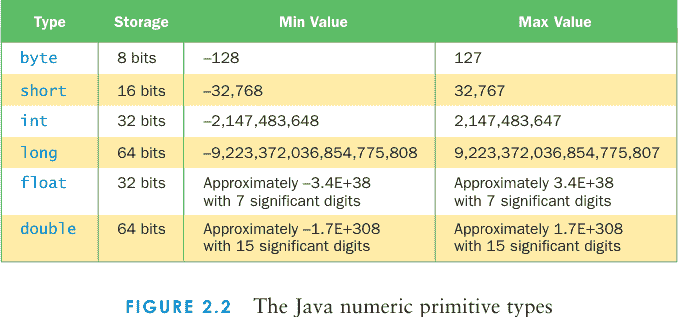

请注意，尽管 `float` 值支持非常大（和非常小）的数，但它只有七位有效数字。因此，如果要精确地保存诸如 50341.2077 这样的值，我们需要使用 `double`。

正如我们已经讨论过的，*字面量*（*literal*）是程序中使用的显式数据值。在程序 Facts、Addition 和 PianoKeys 中使用的各种数字都是*整数字面量*。Java 默认所有整数字面量都是 `int` 类型，除非在值的末尾附加 L 或 l 以表示应将其视为 `long` 类型的字面量，例如 `45L`。

同样，Java 默认所有*浮点字面量*都是 `double` 类型。如果我们需要将浮点字面量视为 `float`，我们可以在值的末尾附加 F 或 f，例如 `2.718F` 或 `123.45f`。如果需要，`double` 类型的数值字面量也可以后跟 D 或 d。

## 十进制整数字面量

整数字面量由一系列数字组成，后面可跟一个可选的后缀，以表示应将其视为整数。字面量的取反被视为一个单独的操作。

示例：

- 5

- 2594

- 4920328L

以下是在 Java 中声明数值变量的示例：

```
int answer = 42;
byte smallNumber1, smallNumber2;
long countedStars = 86827263927L;
float ratio = 0.2363F;
double delta = 453.523311903;
```

### 字符

字符是计算机使用和管理的另一种基本数据类型。单个字符可以作为独立的数据项来处理，并且，正如我们在几个示例中看到的，它们可以组合成字符串。

*字符字面量*在 Java 程序中使用单引号表示，例如 'b'、']' 或 ';'。你可能会记得，*字符串字面量*是使用双引号来界定的，并且 `String` 类型在 Java 中不是基本数据类型；它是一个类名。我们将在下一章详细讨论 `String` 类。

请注意，作为字符（或字符串的一部分）的数字与作为数字（或更大数字的一部分）的数字之间的区别。数字 602 是一个可以用于算术计算的数值。但在字符串 "602 Greenbriar Court" 中，6、0 和 2 是字符，就像构成该字符串的其他字符一样。

我们可以管理的字符由*字符集*（*character set*）定义，字符集就是一个按特定顺序排列的字符列表。每种编程语言都支持一个特定的字符集，该字符集定义了该语言中字符变量的有效值。人们提出了几种字符集，但多年来只有少数几种被经常使用。*ASCII 字符集*是一种流行的选择。ASCII 代表美国信息交换标准代码。基本 ASCII 集每个字符使用七位，可以提供 128 个不同的字符，包括：

- 大写字母，如 'A'、'B' 和 'C'

- 小写字母，如 'a'、'b' 和 'c'

- 标点符号，如句号（'.'）、分号（';'）和逗号（','）

- 数字 '0' 到 '9'

- 空格字符，' '

- 特殊符号，如与号（'&'）、竖线（'|'）和反斜杠（'\\'）

- 控制字符，如回车符、空字符和文本结束标记

*控制字符*有时被称为非打印字符或不可见字符，因为它们没有特定的符号来表示它们。然而它们与任何其他字符一样有效，并且可以用同样的方式存储和使用。许多控制字符对某些软件应用程序具有特殊含义。

随着计算在全球范围内普及，用户要求使用更灵活的、包含其他语言字母表的字符集。ASCII 被扩展为每个字符使用八位，集合中的字符数量翻倍至 256。扩展 ASCII 包含了许多英语以外语言中使用的带重音和变音符号的字符。

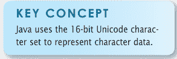

然而，即使有 256 个字符，扩展 ASCII 字符集也无法表示世界上的字母表，尤其是考虑到各种亚洲字母表及其数千个表意文字。因此，Java 编程语言的开发者选择了 Unicode 字符集，它使用每个字符 16 位，支持 65,536 个唯一字符（并且有技术可以使用多个字节表示更多字符）。来自许多语言的字符和符号都包含在 Unicode 定义中。ASCII 是 Unicode 字符集的子集，由前 128 个字符组成。附录 C 更详细地讨论了 Unicode 字符集。

字符集为每个字符分配一个特定的数字，因此按定义字符是有特定顺序的。这被称为词法顺序。在 ASCII 和 Unicode 排序中，数字字符 '0' 到 '9' 是连续的（没有其他字符介入）并且有序。类似地，小写字母字符 'a' 到 'z' 是连续且有序的，大写字母字符 'A' 到 'Z' 也是如此。这些特性使得保持字母顺序相对容易。

在 Java 中，数据类型 `char` 表示单个字符。以下是 Java 中字符变量声明的一些示例：

```java
char topGrade = 'A';
char symbol1, symbol2, symbol3;
char terminator = ';', separator = ' ';
```

## Booleans

布尔值在 Java 中使用保留字 `boolean` 定义，只有两个有效值：`true` 和 `false`。布尔变量通常用于指示特定条件是否为真，但也可以用于表示具有两种状态的任何情况，例如灯泡是开还是关。

布尔值不能转换为任何其他数据类型，也不能将任何其他数据类型转换为布尔值。单词 `true` 和 `false` 在 Java 中作为布尔字面量保留，不能在此上下文之外使用。

以下是 Java 中布尔变量声明的一些示例：

```java
boolean flag = true;
boolean tooHigh, tooSmall, tooRough;
boolean done = false;
```

## SELF-REVIEW QUESTIONS (see answers in Appendix N)

- SR 2.14 什么是原始数据？原始数据类型与对象有何不同？

- SR 2.15 整数变量可以存储多少个值？

- SR 2.16 Java 中有哪四种整数数据类型？它们有何不同？

- SR 2.17 Java 自动为整数字面量分配什么类型？如何指示整数字面量应被视为不同类型？

- SR 2.18 Java 自动为浮点字面量分配什么类型？如何指示浮点字面量应被视为不同类型？

- SR 2.19 什么是字符集？

- SR 2.20 ASCII 字符集、扩展 ASCII 字符集和 Unicode 字符集各支持多少个字符？

## 2.4 Expressions

*表达式* 是由一个或多个运算符和操作数组合而成，通常执行计算。计算出的值不一定是数字，但通常是。操作中使用的操作数可能是字面量、常量、变量或其他数据源。表达式的求值和使用方式是编程的基础。目前我们将重点放在使用数字操作数并产生数字结果的算术表达式上。

> **关键概念**
>
> 表达式是运算符和操作数的组合，用于执行计算。

### Arithmetic Operators

通常的算术运算已为整数和浮点数值类型定义，包括加法 (`+`)、减法 (`-`)、乘法 (`*`) 和除法 (`/`)。Java 还有另一种算术运算：*取余运算符* (`%`) 返回将第二个操作数除以第一个操作数后的余数。取余运算符有时称为取模运算符。取余运算结果的符号是分子符号。因此：

| 操作 | 结果 |
| --- | --- |
| 17 % 4 | 1 |
| -20 % 3 | -2 |
| 10 % -5 | 0 |
| 3 % 8 | 3 |

**VideoNote:** Review of primitive data and expressions.

正如你所期望的，如果任一或两个操作数对任何数值运算符都是浮点值，结果就是浮点值。然而，除法运算符产生的结果取决于操作数的类型而较不直观。如果两个操作数都是整数，`/` 运算符执行整数除法，这意味着结果的任何小数部分都被丢弃。如果其中一个或两个操作数是浮点值，`/` 运算符执行浮点除法，小数部分会被保留。例如，`10/4` 的结果是 2，但 `10.0/4` 和 `10/4.0` 和 `10.0/4.0` 的结果都是 2.5。

一元运算符只有一个操作数，而二元运算符有两个。`+` 和 `-` 算术运算符可以是 unary 或 binary。二元版本执行加法和减法，而一元版本表示正数和负数。例如，`-1` 是使用一元否定运算符使值变为负数的示例。一元 `+` 运算符很少使用。

Java 没有内置的将值提高到指数的运算符。然而，`Math` 类提供了执行指数运算和许多其他数学函数的方法。`Math` 类在第 3 章中讨论。

### Operator Precedence

运算符可以组合起来创建更复杂的表达式。例如，考虑以下赋值语句：

```java
result = 14 + 8 / 2;
```

> **关键概念**
>
> Java 遵循一套定义明确的优先级规则，规定表达式中运算符的求值顺序。

赋值语句的整个右手边会被求值，然后结果存储在变量中。但结果是什么？如果先执行加法，结果是 11；如果先执行除法，结果是 18。运算符求值的顺序差异很大。在这种情况下，除法先于加法执行，结果为 18。

请注意，在此及后续示例中，我们使用字面值而不是变量来简化表达式。如果操作数是变量或其他任何数据源，求值顺序是相同的。

所有表达式都根据运算符优先级层次结构进行求值，该层次结构建立了规定操作求值顺序的规则。算术运算符通常遵循你在代数中学到的相同规则。乘法、除法和取余运算符具有相同的优先级，并在加法和减法之前执行（优先级更高）。加法和减法具有相同的优先级。

同一优先级级别的任何算术运算符都从左到右执行。因此我们说算术运算符具有 *从左到右的结合性*。

然而，优先级可以通过在表达式中使用括号来强制。例如，如果我们真的想在前一个示例中先执行加法，我们可以按如下方式编写表达式：

```java
result = (14 + 8) / 2;
```

任何在括号中的表达式都会先求值。在复杂表达式中，即使不是严格必要的，使用括号也是良好的实践，以明确表达式的求值方式。

括号可以嵌套，最内层的嵌套表达式先求值。考虑以下表达式：

```java
result = 3 * ((18 - 4) / 2);
```

在此示例中，结果为 21。首先，减法被执行，由内部括号强制。然后，即使乘法和除法处于同一优先级级别并且通常会从左到右求值，由于外部括号的存在，除法先执行。最后，执行乘法。

算术运算完成后，计算结果存储在赋值运算符 (`=`) 左侧的变量中。换句话说，赋值运算符的优先级低于任何算术运算符。

特定表达式的求值可以用 *表达式树* 来表示，例如图 2.3 中的那样。运算符从底部向上执行，创建在表达式其余部分中使用的值。因此，树中较低的操作具有更高的优先级，或者它们被强制使用括号更早执行。

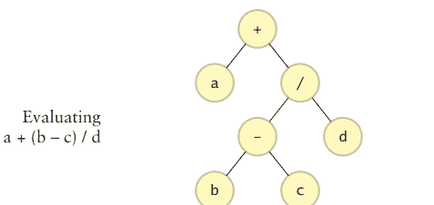

**FIGURE 2.3** An expression tree

| 优先级级别 | 运算符 | 操作 | 结合性 |
|---|---|---|---|
| 1 | `+` | 一元加 | R to L |
|  | `-` | 一元减 |  |
| 2 | `*` | 乘法 | L to R |
|  | `/` | 除法 |  |
|  | `%` | 余数 |  |
| 3 | `+` | 加法 | L to R |
|  | `-` | 减法 |  |
|  | `+` | 字符串连接 |  |
| 4 | `=` | 赋值 | R to L |

### FIGURE 2.4 Precedence among some of the Java operators

表达式中使用的括号本身也是运算符。括号的优先级高于几乎所有其他运算符。图 2.4 显示了一个优先级表，其中列出了算术运算符、括号和赋值运算符之间的关系。附录 D 包含显示所有 Java 运算符的完整优先级表。

要使表达式在语法上正确，左括号的数量必须与右括号的数量匹配，并且它们必须正确嵌套。以下示例不是有效的表达式：

```
result = ((19 + 8) % 3) - 4);  // not valid
result = (19 (+ 8 %) 3 - 4);  // not valid
```

请记住，当在表达式中引用变量时，将使用其当前值来执行计算。在以下赋值语句中，变量 `count` 的当前值被加到变量 `total` 的当前值上，结果存储在变量 `sum` 中：

```
sum = count + total;
```

赋值前 `sum` 中包含的原始值会被计算值覆盖。`count` 和 `total` 中存储的值不会改变。

同一个变量可以同时出现在赋值语句的左侧和右侧。假设变量 `count` 的当前值为 15，当执行以下赋值语句时：

```
count = count + 1;
```

由于右侧表达式先被求值，因此获取 `count` 的原始值并加上 1，得到结果 16。然后将该结果存储到变量 `count` 中，用新值 16 覆盖原始值 15。因此，此赋值语句递增，或给变量 `count` 加 1。

让我们再看一个表达式处理的例子。清单 2.7 中的程序，名为 `TempConverter`，使用表达式计算以下公式，将特定摄氏温度值转换为其等效华氏温度值：

Fahrenheit = 9/5 Celsius + 32

### LISTING 2.7

```
//************************************************************************
// TempConverter.java      Author: Lewis/Loftus
//
// Demonstrates the use of primitive data types and arithmetic
// expressions.
//************************************************************************

public class TempConverter
{
    //-------------------------------------------------------------
    // Computes the Fahrenheit equivalent of a specific Celsius
    // value using the formula F = (9/5)C + 32.
    //-------------------------------------------------------------
    public static void main (String[] args)
    {
        final int BASE = 32;
        final double CONVERSION_FACTOR = 9.0 / 5.0;

        double fahrenheitTemp;
        int celsiusTemp = 24;  // value to convert

        fahrenheitTemp = celsiusTemp * CONVERSION_FACTOR + BASE;

        System.out.println ("Celsius Temperature: " + celsiusTemp);
        System.out.println ("Fahrenheit Equivalent: " + fahrenheitTemp);
    }
}
```

### OUTPUT

Celsius Temperature: 24

Fahrenheit Equivalent: 75.2

请注意，在温度转换程序中，除法操作的运算对象是浮点字面量，以确保数字的小数部分被保留。优先级规则规定，在最终转换计算中，乘法先于加法进行。

`TempConverter` 程序并不是很有用，因为它只转换我们作为常量包含在程序中的一个数据值（24 摄氏度）。每次运行程序时都会产生相同的结果。更实用的程序版本应该在每次程序执行时从用户那里获取要转换的值。读取用户输入的交互式程序将在本章后面讨论。

## Increment and Decrement Operators

还有两个有用的算术运算符。增量运算符（`++`）将 1 加到任何整数或浮点值上。构成该运算符的两个加号之间不能用空白分隔。减量运算符（`--`）类似，只是它从值中减去 1。它们都是单目运算符，因为它们只操作一个运算对象。以下语句会导致 `count` 的值被递增：

```
count++;
```

结果存储回变量 `count`。因此它在功能上等同于我们在上一节讨论过的以下语句：

```
count = count + 1;
```

增量和减量运算符可以在变量之后应用（例如 `count++` 或 `count--`），称为运算符的后缀形式。它们也可以在变量之前应用（例如 `++count` 或 `--count`），称为前缀形式。当单独作为语句使用时，前缀形式和后缀形式在功能上是等价的。也就是说，写

```
count++;
```

或

```
++count;
```

没有区别。然而，当这种形式单独作为语句编写时，通常以其后缀形式编写。

当增量或减量运算符在更大的表达式中使用时，具体形式不同可能会产生不同的结果。例如，如果变量 `count` 当前包含值 15，则以下语句将值 15 赋给 `total`，并将值 16 赋给 `count`：

```
total = count++;
```

然而，以下语句将值 16 赋给 `total` 和 `count`：

```
total = ++count;
```

在两种情况下，`count` 的值都会被递增，但在更大的表达式中使用的值取决于使用增量运算符的前缀形式还是后缀形式。

由于增量和减量运算符的前缀形式和后缀形式之间存在细微差别，因此应谨慎使用。始终优先考虑可读性。

## Assignment Operators

为了方便，Java 中定义了几个赋值运算符，它们将基本操作与赋值结合起来。例如，`+=` 运算符可如下使用：


```
total += 5;
```

这与以下语句执行相同的操作：

```
total = total + 5;
```

赋值运算符的右侧可以是一个完整的表达式。运算符右侧的表达式会被求值，然后该结果会加到左侧变量的当前值上，并将该值存储在变量中。因此，以下语句：

```
total += (sum - 12) / count;
```

等价于：

```
total = total + ((sum - 12) / count);
```

Java 中定义了许多类似的赋值运算符，包括执行减法 (`-=`)、乘法 (`*=`)、除法 (`/=`) 和余数 (`%=`) 的运算符。完整的 Java 运算符集合在附录 D 中讨论。

所有赋值运算符都会先求值右侧的整个表达式，然后将结果用作另一个操作的右操作数。因此，以下语句：

```
result *= count1 + count2;
```

等价于：

```
result = result * (count1 + count2);
```

同样，以下语句：

```
result %= (highest - 40) / 2;
```

等价于：

```
result = result % ((highest - 40) / 2);
```

一些赋值运算符根据操作数的类型执行特定功能，就像它们对应的常规运算符一样。例如，如果 `+=` 运算符的操作数是字符串，则赋值运算符执行字符串连接。

## SELF-REVIEW QUESTIONS (see answers in Appendix N)

- SR 2.21 What is the result of `19%5` when evaluated in a Java expression? Explain.

- SR 2.22 What is the result of `13/4` when evaluated in a Java expression? Explain.

- SR 2.23 If an integer variable `diameter` currently holds the value 5, what is its value after the following statement is executed? Explain.

  `diameter = diameter * 4;`

- SR 2.24 What is operator precedence?

- SR 2.25 What is the value of each of the following expressions?

  - a. `15 + 7 * 3`
  - b. `(15 + 7) * 3`
  - c. `3 * 6 + 10 / 5 + 5`
  - d. `27 % 5 + 7 % 3`
  - e. `100 / 2 / 2 / 2`
  - f. `100 / ( 2 / 2 ) / 2`

- SR 2.26 For each of the following expressions state whether they are valid or invalid. If invalid, explain why.

  - a. `result = ( 5 + 2 );`
  - b. `result = ( 5 + 2 * ( 15 - 3 );`
  - c. `result = ( 5 + 2 (;`
  - d. `result = ( 5 + 2 ( 4 ) );`

SR 2.27 执行以下语句序列后，整数变量 `result` 中包含什么值？

```
result = 27;
result = result + 3;
result = result / 7;
result = result * 2;
```

SR 2.28 执行以下语句序列后，整数变量 `result` 中包含什么值？

```
int base;
int result;
base = 5;
result = base + 3;
base = 7;
```

SR 2.29 什么是赋值运算符？

SR 2.30 如果整数变量 `weight` 当前持有值 100，执行以下语句后其值是多少？解释。

```
weight -= 17;
```

## 2.5 数据转换

由于 Java 是一种强类型语言，每个数据值都与特定类型相关联。有时将一种类型的数据值转换为另一种类型是有帮助或必要的，但在转换过程中我们必须小心不要丢失重要信息。例如，假设一个保存数字 1000 的 `short` 变量被转换为 `byte` 值。因为 `byte` 没有足够的位来表示值 1000，转换过程中会丢失一些位，`byte` 中表示的数字将不再保持其原始值。

从一种原始类型到另一种原始类型的转换分为两类：扩展转换和缩小转换。扩展转换更安全，因为它们通常不会丢失信息。它们被称为扩展转换，因为它们从一种数据类型转换到另一种使用相等或更大空间来存储值的类型。图 2.5 列出了 Java 的扩展转换。

例如，将 `byte` 转换为 `short` 是安全的，因为 `byte` 存储在 8 位中，而 `short` 存储在 16 位中。不会丢失信息。所有从一种整数类型到另一种整数类型的扩展转换，或从一种浮点类型到另一种浮点类型的扩展转换，都能精确地保留数值。

| From | To |
|---|---|
| `byte` | `short`, `int`, `long`, `float`, or `double` |
| `short` | `int`, `long`, `float`, or `double` |
| `char` | `int`, `long`, `float`, or `double` |
| `int` | `long`, `float`, or `double` |
| `long` | `float` or `double` |
| `float` | `double` |

### FIGURE 2.5 Java widening conversions

> KEY CONCEPT
>
> 应避免缩小转换，因为它们可能丢失信息。

尽管扩展转换不会丢失关于值大小的任何信息，但导致浮点值的扩展转换可能会丢失精度。在将 `int` 或 `long` 转换为 `float`，或将 `long` 转换为 `double` 时，最不显著的数字可能会丢失。在这种情况下，结果的浮点值将是整数值的舍入版本，遵循 IEEE 754 浮点标准中定义的舍入技术。

缩小转换比扩展转换更可能丢失信息。它们通常从一种类型转换到一种用于存储值所需空间更少的类型，因此某些信息可能会受损。缩小转换可能同时丢失数值大小和精度。因此，通常应避免它们。图 2.6 列出了 Java 的缩小转换。

缩小转换中空间缩小情况的一个例外是当我们将 `byte`（8 位）或 `short`（16 位）转换为 `char`（16 位）时。这些仍然

| From | To |
|---|---|
| `byte` | `char` |
| `short` | `byte` or `char` |
| `char` | `byte` or `short` |
| `int` | `byte`, `short`, or `char` |
| `long` | `byte`, `short`, `char`, or `int` |
| `float` | `byte`, `short`, `char`, `int`, or `long` |
| `double` | `byte`, `short`, `char`, `int`, `long`, or `float` |

### FIGURE 2.6 Java narrowing conversions

被视为缩小转换，因为符号位被合并到新的字符值中。由于字符值是无符号的，负整数将被转换为与原始整数的数值没有特定关系的字符。

请注意，`boolean` 值在扩展转换或缩小转换中均未提及。`boolean` 值不能转换为任何其他原始类型，反之亦然。

## Conversion Techniques

在 Java 中，转换可以通过三种方式发生：

- assignment conversion
- promotion
- casting

赋值转换发生在一种类型的值被赋给另一种类型的变量时，在此过程中值被转换为新类型。只能通过赋值实现扩展转换。例如，如果 `money` 是一个 `float` 变量而 `dollars` 是一个 `int` 变量，则以下赋值语句会自动将 `dollars` 中的值转换为 `float`：

```
money = dollars;
```

因此，如果 `dollars` 包含值 25，则赋值后，`money` 包含值 25.0。但是，如果我们尝试将 `money` 赋给 `dollars`，编译器会发出错误消息，提醒我们正在尝试可能丢失信息的缩小转换。如果我们真的想执行此赋值，就必须通过使用强制转换使转换显式化。

通过提升进行的转换在某些运算符需要修改其操作数以执行操作时自动发生。例如，当一个名为 `sum` 的浮点值除以一个名为 `count` 的整数值时，`count` 的值会在除法进行之前自动提升为浮点值，从而产生浮点结果：

```
result = sum / count;
```

当一个数字与字符串连接时也会发生类似的转换。数字首先被转换为字符串，然后两个字符串被连接。

强制转换是 Java 中最一般的转换形式。如果 Java 程序中可以完成某种转换，就可以使用强制转换来完成。强制转换是 Java 的一种运算符，以类型名在括号中指定。它放在要转换的值前面。例如，要将 `money` 转换为整数值，我们可以在其前面加上强制转换：

```
dollars = (int) money;
```

强制转换返回 `money` 中的值，截断任何小数部分。如果 `money` 包含值 84.69，则赋值后 `dollars` 将包含值 84。请注意，强制转换不会改变 `money` 中的值。赋值操作完成后，`money` 仍包含值 84.69。

强制转换在我们需要暂时将值视为另一种类型时在许多情况下很有帮助。例如，如果我们想用整数值 `total` 除以整数值 `count` 并得到浮点结果，可以这样做：

```
result = (float) total / count;
```

首先，强制转换运算符返回 `total` 中的值的浮点版本。此操作不会改变 `total` 中的值。然后，`count` 通过算术提升被视为浮点值。现在除法运算符将执行浮点除法并产生预期结果。如果没有包含强制转换，操作将执行整数除法并在将其赋给 `result` 之前截断答案。此外请注意，由于强制转换运算符的优先级高于除法运算符，强制转换作用于 `total` 的值，而不是除法的结果。

## SELF-REVIEW QUESTIONS (see answers in Appendix N)

SR 2.31 为什么扩展转换比缩小转换更安全？

SR 2.32 将以下每个转换识别为扩展转换或缩小转换。

- a. `int` to `long`
- b. `int` to `byte`
- c. `byte` to `short`
- d. `byte` to `char`
- e. `short` to `double`

SR 2.33 假设 `result` 是一个 `float` 变量而 `value` 是一个 `int` 变量，执行以下赋值语句后 `value` 将是什么类型的变量？解释。

```
result = value;
```

SR 2.34 假设 `result` 是一个包含值 27.32 的 `float` 变量而 `value` 是一个包含值 15 的 `int` 变量，执行以下赋值语句后每个变量的值是多少？解释。

`value = (int) result;`

SR 2.35 给定以下声明，以下每个赋值语句存储什么结果。

`int iResult, num1 = 17, num2 = 5;`

`double fResult, val1 = 12.0, val2 = 2.34;`

a. `iResult = num1 / num2;`
b. `fResult = num1 / num2;`
c. `fResult = val1 / num2;`
d. `fResult = (double) num1 / num2;`
e. `iResult = (int) val1 / num2;`

## 2.6 Interactive Programs

在执行期间设计程序以交互方式从用户读取数据通常很有用。这样，每次运行程序时都可以根据输入的数据计算新的结果。

### The Scanner Class

`Scanner` 类是标准 Java 类库的一部分，提供了读取各种类型输入值的便捷方法。输入可以来自各种来源，包括用户交互式输入的数据或存储在文件中的数据。`Scanner` 类也可以用于将字符字符串解析为单独的片段。图 2.7 列出了 `Scanner` 类提供的一些方法。

> KEY CONCEPT
>
> `Scanner` 类提供了从各种来源读取各种类型输入的方法。

我们必须首先创建一个 `Scanner` 对象才能调用其方法。Java 中的对象使用 `new` 运算符创建。以下声明创建一个从键盘读取输入的 `Scanner` 对象：

```
Scanner scan = new Scanner (System.in);
```

此声明创建了一个名为 `scan` 的变量，表示一个 `Scanner` 对象。对象本身由 `new` 运算符和对特殊方法

`Scanner (InputStream source)`

`Scanner (File source)`

`Scanner (String source)`

构造方法：设置新的扫描器以从指定的源扫描值。

`String next()`

返回下一个输入标记作为字符字符串。

`String nextLine()`

返回当前行剩余的所有输入作为字符字符串。

`boolean nextBoolean()`

`byte nextByte()`

`double nextDouble()`

`float nextFloat()`

`int nextInt()`

`long nextLong()`

`short nextShort()`

返回下一个输入标记作为指定类型。 如果下一个标记与类型不一致，则抛出 `InputMismatchException`。

`boolean hasNext()`

如果扫描器在其输入中还有另一个标记，则返回 true。

`Scanner useDelimiter (String pattern)`

`Scanner useDelimiter (Pattern pattern)`

设置扫描器的分隔模式。

`Pattern delimiter()`

返回扫描器当前用于匹配分隔符的模式。

`String findInLine (String pattern)`

`String findInLine (Pattern pattern)`

尝试查找指定模式的下一个出现位置，忽略分隔符。

### FIGURE 2.7 Some methods of the Scanner class

调用构造方法来设置对象。 `Scanner` 构造方法接受一个参数，指示输入的来源。 `System.in` 对象表示标准输入流，默认情况下为键盘。 使用 `new` 操作符创建对象将在下一章进一步讨论。

除非另有说明，否则 `Scanner` 对象假定使用空白字符（空格字符、制表符和换行符）来分隔输入的元素，称为标记。 这些字符称为输入分隔符。 如果输入标记由除空白以外的字符分隔，则分隔符集可以更改。

`Scanner` 类的 `next` 方法读取下一个输入标记作为字符串并返回它。 因此，如果输入由空格分隔的一系列单词组成，则每次调用 `next` 都会返回下一个单词。 `nextLine` 方法读取输入直到找到行尾，并将其作为一个字符串返回。

程序 `Echo`，如清单 2.8 所示，只是读取用户输入的一行文本，将其存储在保存字符字符串的变量中，然后将其回显到屏幕上。

`Echo` 类定义上方 `import` 语句告诉程序我们将在此程序中使用 `Scanner` 类。 `Scanner` 类是 `java.util` 类库的一部分。 `import` 语句的使用将在第 3 章中进一步讨论。

提供了各种 `Scanner` 方法，例如 `nextInt` 和 `nextDouble`，用于读取特定类型的数据。 `GasMileage` 程序，如清单 2.9 所示，读取行驶英里数作为整数，并读取消耗的燃油量作为 `double`，然后计算燃油里程。

### LISTING 2.8

```
//****************************************************************
// Echo.java      Author: Lewis/Loftus
//
// Demonstrates the use of the nextLine method of the Scanner class
// to read a string from the user.
//****************************************************************

import java.util.Scanner;

public class Echo
{
    //-------------------------------------------------------------
    // Reads a character string from the user and prints it.
    //-------------------------------------------------------------
    public static void main (String[] args)
```

### LISTING 2.9 continued

```
{
    int miles;
    double gallons, mpg;

    Scanner scan = new Scanner (System.in);

    System.out.print ("Enter the number of miles: ");
    miles = scan.nextInt();

    System.out.print ("Enter the gallons of fuel used: ");
    gallons = scan.nextDouble();

    mpg = miles / gallons;

    System.out.println ("Miles Per Gallon: " + mpg);
}
```

### OUTPUT

Enter the number of miles: 328


```
Enter the gallons of fuel used: 11.2

Miles Per Gallon: 29.28571428571429
```

`Scanner` 对象根据用于读取数据的方法和用于分隔输入值的分隔符，一次处理一个标记的输入。因此，多个值可以放在同一行输入上，也可以根据情况在多行上分隔。

在第 5 章中，我们使用 `Scanner` 类从数据文件读取输入并修改其用于解析数据的分隔符。附录 H 探讨如何使用 `Scanner` 类使用称为正则表达式的模式来分析其输入。

**VideoNote**

Example using the `Scanner` class.

## SELF-REVIEW QUESTIONS (see answers in Appendix N)

SR 2.36 Identify which line of the `GasMileage` program does each of the following.

- a. Tells the program that we will be using the `Scanner` class.
- b. Creates a `Scanner` object.
- c. Sets up the `Scanner` object `scan` to read from the standard input stream.
- d. Reads an integer from the standard input stream.

### SR 2.37 Assume you already have instantiated a `Scanner` object named `myScanner` and an `int` variable named `value` as follows in your program:

```
Scanner myScanner = new Scanner (System.in);
int value = 0;
```

Write program statements that will ask the user to enter their age, and store their response in `value`.

## 2.7 Graphics

图形在计算机系统中起着至关重要的作用。在整本书中，我们探讨图形的各个方面并讨论其实现方式。事实上，每章的最后一段或两段都专门讨论图形主题。我们称之为贯穿全书的图形轨道。这些部分可以跳过而不影响其余文本的连贯性，也可以纳入章节的常规流程中，也可以作为一个整体进行探索。

> **KEY CONCEPT**
>
> 图形数据是通过将其划分为许多称为像素的小块来表示的。

图片，如计算机存储的所有其他信息，必须通过将信息分解成块并将这些块表示为数字来数字化。在图片的情况下，我们将图片分解为像素（图片元素）。像素是一个代表图片非常小部分的微小区域。完整的图片是通过存储每个像素的颜色来存储的。

数字化的图片在需要时可以通过重新组装其像素来重现。用于表示图片的像素越多，重现时看起来越逼真。用于表示图片的像素数量称为图片分辨率。监视器可以显示的像素数量称为监视器分辨率。

黑白图片可以通过使用单个位来表示每个像素来存储。如果位为 0，则该像素为白色；如果位为 1，则为黑色。图 2.8 显示了一张已数字化的黑白图片及其一部分的放大图，显示了单个像素。

### Coordinate Systems

绘制时，图片的每个像素都映射到监视器屏幕上的一个像素。每个计算机系统和编程语言都定义了一个坐标系统，以便我们可以引用特定像素。


### FIGURE 2.8 A digitized picture with a small portion magnified

传统的二维笛卡尔坐标系统有两个轴在原点相交。两个轴上的值可以为负或正。Java 编程语言有一个相对简单的坐标系统，其中所有可见坐标都是正数。图 2.9 将传统的坐标系统与 Java 坐标系统进行了比较。

Java 坐标系统中的每个点都使用 `(x, y)` 值对表示。任何 Java 绘图区域的左上角坐标为 `(0, 0)`。`x` 轴坐标向右移动时变大，`y` 轴坐标向下移动时变大。

> **KEY CONCEPT**
>
> Java 的坐标系统原点位于左上角，所有可见坐标均为正数。

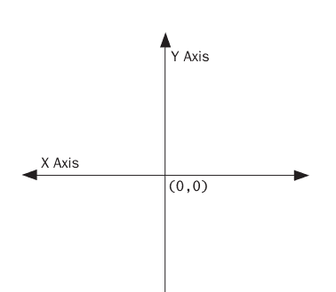

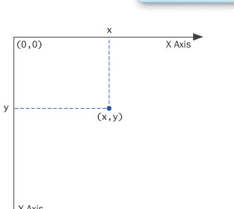

### FIGURE 2.9 A traditional coordinate system and the Java coordinate system

正如我们在之前的示例中看到的，Java 程序不必具有图形性质。然而，如果它具有图形性质，程序中的每个图形组件都有自己的坐标系统，原点 `(0, 0)` 位于左上角。这种一致的方法使得管理各种图形元素相对容易。

## 表示颜色

彩色图片与黑白图片一样被划分为像素。然而，由于每个像素可以是多种可能颜色中的一种，仅用一个比特来表示每个像素是不够的。表示像素颜色有各种方法。让我们简要讨论一种流行的技术。

> **KEY CONCEPT**
>
> Java 中颜色使用 RGB 值表示——三个值代表原色红、绿、蓝的贡献。

每种颜色都可以表示为三种原色的混合：红、绿、蓝。在 Java 中，与许多其他计算机语言一样，颜色由三个数字指定，统称为 RGB 值。RGB 代表 Red-Green-Blue。每个数字代表一种原色的贡献。使用一个字节（八位）存储三个数字中的每一个，这些数字的范围可以从 0 到 255。每种原色的级别决定了整体颜色。例如，红色和绿色值高而蓝色水平低会产生黄色色调。

| Color | Object | RGB Value |
| --- | --- | --- |
| black | `Color.black` | 0, 0, 0 |
| blue | `Color.blue` | 0, 0, 255 |
| cyan | `Color.cyan` | 0, 255, 255 |
| gray | `Color.gray` | 128, 128, 128 |
| dark gray | `Color.darkGray` | 64, 64, 64 |
| light gray | `Color.lightGray` | 192, 192, 192 |
| green | `Color.green` | 0, 255, 0 |
| magenta | `Color.magenta` | 255, 0, 255 |
| orange | `Color.orange` | 255, 200, 0 |
| pink | `Color.pink` | 255, 175, 175 |
| red | `Color.red` | 255, 0, 0 |
| white | `Color.white` | 255, 255, 255 |
| yellow | `Color.yellow` | 255, 255, 0 |

**FIGURE 2.10 Predefined colors in the `Color` class**

在 Java 中，程序员使用 `Color` 类来定义和管理颜色，该类是 `java.awt` 包的一部分。`Color` 类的每个对象代表一种颜色。该类包含其自身的几个实例，以提供一组基本预定义颜色。图 2.10 列出了 `Color` 类的预定义颜色。它还包含用于定义和管理许多其他颜色的方法。

> **KEY CONCEPT**
>
> `Color` 类包含一些常用的预定义颜色，可用于定义许多其他颜色。

## SELF-REVIEW QUESTIONS (see answers in Appendix N)

- SR 2.38 如何使用 1 和 0 表示黑白图片？
- SR 2.39 使用 Java 坐标系统绘制的矩形的三个角坐标为 `(3, 4)`、`(3, 7)` 和 `(8, 7)`。第四个角的坐标是什么？
- SR 2.40 使用 Java 坐标系统绘制的正方形的两个角坐标为 `(5, 10)` 和 `(8, 10)`。另外两个角的坐标是什么？
- SR 2.41 需要多少位来存储一张宽 300 像素、高 200 像素的彩色图片？假设颜色使用本章描述的 RGB 技术表示，并且不使用任何特殊压缩技术。

## 2.8 Applets

Java 程序有两种：Java 小程序和 Java 应用程序。Java 小程序是一种旨在嵌入 HTML 文档、通过网络传输并使用 Web 浏览器执行的 Java 程序。Java 应用程序是可使用 Java 解释器执行的独立程序。本书迄今为止介绍的所有程序都是 Java 应用程序。

> **KEY CONCEPT**
>
> 小程序是通常通过网络传输并使用 Web 浏览器执行的 Java 程序。

Web 使用户能够使用极其方便易用的点按界面发送和接收各种类型的媒体，如文本、图形和声音。Java 小程序是可通过 Web 软件检索的第一种可执行程序。Java 小程序被视为可通过 Web 交换的另一种媒体类型。

尽管 Java 小程序通常旨在通过网络传输，但它们不必如此。它们可以使用 Web 浏览器在本地查看。就此而言，它们甚至不必通过 Web 浏览器执行。Sun 的 Java 软件开发工具包中的一个工具 `appletviewer` 可用于解释和执行小程序。我们在本书中使用 `appletviewer` 来显示小程序。然而，通常制作 Java 小程序的目的是在网页上提供指向它的链接，并允许世界各地的 Web 用户检索和执行它。

Java 字节码（不是 Java 源代码）链接到 HTML 文档并通过 Web 发送。嵌入在 Web 浏览器中的 Java 解释器版本用于在小程序到达目的地后执行它。在与 Web 一起使用之前，Java 小程序必须编译为字节码格式。

Java 小程序的结构与 Java 应用程序的结构有一些重要区别。因为执行小程序的 Web 浏览器已经在运行，所以小程序可以被视为更大程序的一部分。因此它们没有执行开始的主方法。Applet 中的 `paint` 方法会被自动调用。请考虑清单 2.10 中的程序，其中 `paint` 方法用于绘制一些形状并将阿尔伯特·爱因斯坦的一句名言写到屏幕上。

程序开头的两个 `import` 语句明确指出了程序中使用的包。在此示例中，我们需要 `javax.swing` 包中的 `JApplet` 类，以及 `java.awt` 包中定义的各种图形功能。第 3 章将进一步探讨 `import` 语句。

### LISTING 2.10

```
//****************************************************************
// Einstein.java      Author: Lewis/Loftus
// Demonstrates a basic applet.
//****************************************************************

import javax.swing.JApplet;
import java.awt.*;

public class Einstein extends JApplet
{
    //-------------------------------------------------------------
    // Draws a quotation by Albert Einstein among some shapes.
    //-------------------------------------------------------------
    public void paint (Graphics page)
    {
        page.drawRect (50, 50, 40, 40);    // square
        page.drawRect (60, 80, 225, 30);   // rectangle
        page.drawOval (75, 65, 20, 20);    // circle
        page.drawLine (35, 60, 100, 120);  // line

        page.drawString ("Out of clutter, find simplicity.", 110, 70);
        page.drawString ("-- Albert Einstein", 130, 100);
    }
}
```

类定义小程序的类扩展 `JApplet` 类，如类声明的头行所示。此过程使用了我们曾在第 1 章讨论并将在本书后面更详细探讨的面向对象概念继承。Applet 类还必须声明为 `public`。

`paint` 方法是几个具有特定意义的小程序方法之一。它会在小程序的图形元素需要绘制到屏幕上时自动调用，例如小程序首次运行时或覆盖它的另一个窗口被移动时。

请注意，`paint` 方法接受 `Graphics` 对象作为参数。`Graphics` 对象定义了我们可以交互的特定图形上下文。传递给小程序 `paint` 方法的图形上下文代表整个小程序窗口。每个图形上下文都有自己的坐标系统。在后面的示例中，我们将有多个组件，每个组件都有自己的图形上下文。

`Graphics` 对象允许我们使用 `drawRect`、`drawOval`、`drawLine` 和 `drawString` 等方法绘制各种形状。传递给绘图方法的参数指定要绘制的形状的坐标和大小。我们将在下一节中探讨这些和其他绘制形状的方法。

### LISTING 2.10 continued

**DISPLAY**

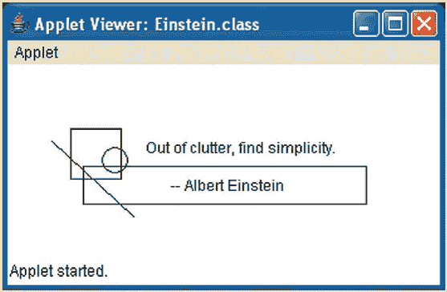

## 使用 Web 执行 Applet

为了使 applet 能通过 Web 传输并由浏览器执行，它必须在超文本标记语言（HTML）文档中被引用。HTML 文档包含指定格式指令的标签，并标识要在文档中包含的特殊媒体类型。Java 程序被视为一种特定的媒体类型，就像文本、图形和声音一样。

HTML 标签用尖括号括起来。下面是 applet 标签的一个示例：

```
<applet code="Einstein.class" width="350" height="175">
</applet>
```

该标签规定存储在文件 `Einstein.class` 中的字节码应通过网络传输，并在想要查看此特定 HTML 文档的机器上执行。applet 标签还指出了 applet 的宽度和高度。

还有其他标签可用于在 HTML 文件中引用 applet，包括 `<object>` 标签和 `<embed>` 标签。`<object>` 标签实际上是世界范围网联盟（W3C）认为应使用的标签。然而，浏览器对 `<object>` 标签的支持并不一致。目前，最可靠的解决方案是使用 `<applet>` 标签。

请注意，applet 标签引用的是 `Einstein` applet 的字节码文件，而不是源代码文件。在 applet 能通过 Web 传输之前，它必须被编译成字节码格式。然后，如图 2.11 所示，可以使用 Web 浏览器加载文档，浏览器将自动解释并执行 applet。

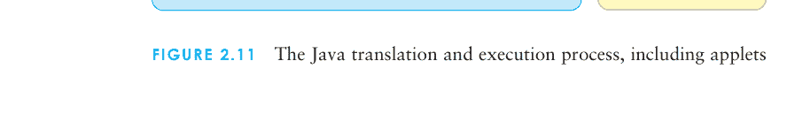

### 自测题（答案见附录 N）

- SR 2.42 Java 应用程序和 Java applet 有什么区别？
- SR 2.43 何时调用 applet 的 `paint` 方法？
- SR 2.44 下面的 HTML applet 标签有什么问题？解释说明。

```
<applet code="DrawHouse.java" width="400" height="300">
</applet>
```

## 2.9 绘制形状

Java 标准类库提供了许多用于呈现和操作图形信息的类。`Graphics` 类是所有此类处理的基础。

### Graphics 类

`Graphics` 类定义在 `java.awt` 包中。它包含各种方法，允许我们绘制形状，包括线条、矩形和椭圆。图 2.12 列出了 `Graphics` 类的一些基本绘图方法。

| 方法 | 描述 |
| --- | --- |
| `void drawLine(int x1, int y1, int x2, int y2)` | 在点 (`x1`, `y1`) 到点 (`x2`, `y2`) 之间绘制一条线。 |
| `void drawRect(int x, int y, int width, int height)` | 绘制以 (`x`, `y`) 为左上角、宽为 `width`、高为 `height` 的矩形。 |
| `void drawOval(int x, int y, int width, int height)` | 绘制以左上角为 (`x`, `y`)、宽为 `width`、高为 `height` 的矩形所包围的椭圆。 |
| `void drawString(String str, int x, int y)` | 在点 (`x`, `y`) 处绘制字符字符串 `str`，向右延伸。 |
| `void drawArc(int x, int y, int width, int height, int startAngle, int arcAngle)` | 沿由 `x`、`y`、`width` 和 `height` 定义的矩形所包围的椭圆绘制一段弧。弧从 `startAngle` 开始，延伸距离由 `arcAngle` 定义。 |
| `void fillRect(int x, int y, int width, int height)` | 与其对应的 `draw` 方法相同，但用当前前景色填充。 |
| `void fillOval(int x, int y, int width, int height)` | 与其对应的 `draw` 方法相同，但用当前前景色填充。 |


| 方法 | 描述 |
| --- | --- |
| `void fillArc(int x, int y, int width, int height, int startAngle, int arcAngle)` | 与其对应的 `draw` 方法相同，但用当前前景色填充。 |
| `Color getColor()` | 返回此图形上下文的前景色。 |
| `void setColor(Color color)` | 将此图形上下文的前景色设置为指定的颜色。 |

**FIGURE 2.12** `Graphics` 类的一些方法

> **KEY CONCEPT** 大多数形状可以填充绘制（不透明）或不填充绘制（轮廓）。

请注意，这些方法还允许我们绘制圆形和正方形，它们只是椭圆和矩形各自的特定类型。我们将在本书的适当位置稍后讨论 `Graphics` 类的其他绘图方法。

`Graphics` 类的方法允许我们指定希望形状是否填充或不填充。不填充的形状仅显示形状的轮廓，其余部分透明（可以看到任何底层图形）。填充的形状在边界之间是实心的，会覆盖任何底层图形。

所有这些方法都依赖于我们在本章前面讨论过的 Java 坐标系统。请回忆，点 (0, 0) 位于左上角，使得 x 值向右移动时变大，y 值向下移动时变大。任何绘制在可见区域外的坐标上的形状都不会被看到。

> **KEY CONCEPT** 使用边界矩形来定义诸如椭圆之类的曲线形状的位置和大小。

`Graphics` 的许多绘图方法都是自解释的，但有些需要更详细的讨论。例如，`drawOval` 方法绘制的椭圆由左上角的坐标和指定边界矩形宽度和高度的尺寸定义。具有曲线的形状，例如椭圆，通常由包围其周边的矩形定义。图 2.13 描绘了椭圆的边界矩形。

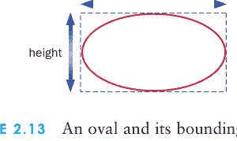

**FIGURE 2.13** 一个椭圆及其边界矩形

> **KEY CONCEPT** 弧是椭圆的一部分，从特定的起始角度开始，延伸距离由弧角度指定。

弧可以被视为椭圆的一部分。要绘制弧，我们指定弧所属的椭圆以及我们感兴趣的椭圆部分。弧的起点由起始角度定义，弧的终点由弧角度定义。弧角度并不表示弧的结束位置，而是表示其范围。起始角度和弧角度均以度为单位进行测量。起始角度的原点是穿过椭圆中心的一条假想水平线，可称为 0°，如图 2.14 所示。

每个图形上下文都有一个当前前景色，用于在绘制形状或字符串时使用。每个可绘制的表面都有一个背景色。前景色使用 `Graphics` 类的 `setColor` 方法设置，背景色使用我们正在绘制的组件（如 applet）的 `setBackground` 方法设置。

清单 2.11 显示了一个名为 `Snowman` 的 applet。它使用各种绘图和颜色方法绘制一个以雪人为主角的冬季场景。仔细查看代码，注意每个形状是如何绘制来创建整体图像的。

请注意，雪人图形基于两个常量值 `MID` 和 `TOP`，它们定义了雪人的左右中点和顶部。


VideoNote: 使用绘制形状的示例。

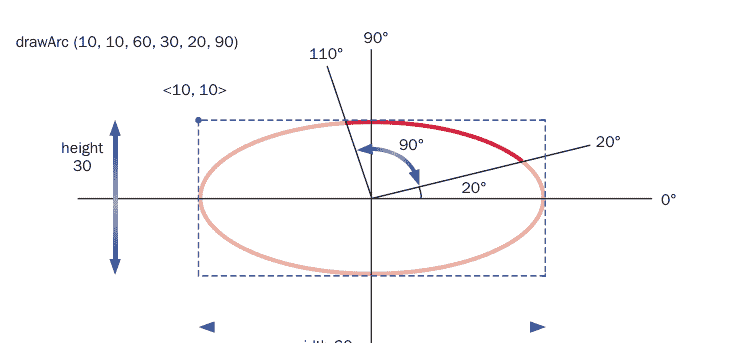

**FIGURE 2.14** 一个由椭圆、起始角度和弧角度定义的弧

### Listing 2.11

```java
//*******************************************************************
//  Snowman.java        Author: Lewis/Loftus
//
//  Demonstrates basic drawing methods and the use of color.
//*******************************************************************

import javax.swing.JApplet;
import java.awt.*;

public class Snowman extends JApplet
{
    //-------------------------------------------------------------
    //  Draws a snowman.
    //-------------------------------------------------------------
    public void paint (Graphics page)
    {
        final int MID = 150;
        final int TOP = 50;

        setBackground (Color.cyan);

        page.setColor (Color.blue);
        page.fillRect (0, 175, 300, 50);  // ground

        page.setColor (Color.yellow);
        page.fillOval (-40, -40, 80, 80);  // sun

        page.setColor (Color.white);
        page.fillOval (MID-20, TOP, 40, 40);        // head
        page.fillOval (MID-35, TOP+35, 70, 50);      // upper torso
        page.fillOval (MID-50, TOP+80, 100, 60);     // lower torso

        page.setColor (Color.black);
        page.fillOval (MID-10, TOP+10, 5, 5);        // left eye
        page.fillOval (MID+5, TOP+10, 5, 5);         // right eye

        page.drawArc (MID-10, TOP+20, 20, 10, 190, 160);  // smile

        page.drawLine (MID-25, TOP+60, MID-50, TOP+40);  // left arm
        page.drawLine (MID+25, TOP+60, MID+55, TOP+60);  // right arm

        page.drawLine (MID-20, TOP+5, MID+20, TOP+5);    // brim of hat
        page.fillRect (MID-15, TOP-20, 30, 25);          // top of hat
    }
}
```

### LISTING 2.11 continued

### DISPLAY

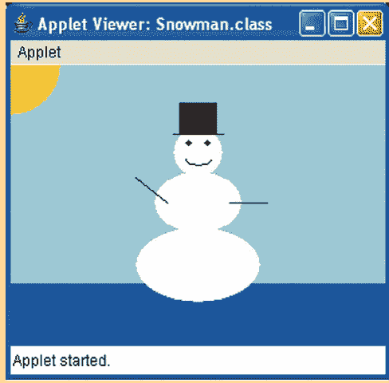

雪人头部。整个雪人图形都是相对于这些值绘制的。使用像这样的常量可以更轻松地创建雪人并在以后进行修改。例如，要将我们图片中的雪人向右或向左移动，只需更改一个常量声明即可。

## SELF-REVIEW QUESTIONS (see answers in Appendix N)

+   SR 2.45 什么是边界矩形？

+   SR 2.46 假设你有一个名为 `page` 的 `Graphics` 对象，写一条语句将绘制一个边长为 50 的正方形，使其左上角位于点 (16, 12)。

+   SR 2.47 假设你有一个名为 `page` 的 `Graphics` 对象，写一系列语句将绘制一个蓝色矩形，其高度为 20，宽度为 40，使其左上角位于点 (30, 35)。

### SR 2.48 对 `Snowman` 程序分别做出以下每项更改会有什么结果？你可以进行更改，编译并运行程序，并观察和报告结果。简要说明你观察到的现象。

+   a. `MID` 的值设为 120 而不是 150。

+   b. `TOP` 的值设为 25 而不是 50。

+   c. 在程序的最后两条语句之前（绘制帽子的语句）加入语句：

    ```
    page.setColor (Color.blue);
    ```

+   d. 在创建微笑的语句中，190 改为 10。

+   e. 在创建上半身的语句之前，前景色设为青色。在上半身创建后立即将其设置回白色。

## Summary of Key Concepts

- `print` 和 `printLn` 方法代表 `System.out` 对象提供的两种服务。
- 转义序列可用于表示否则会导致编译问题的字符。
- 变量是用于保存特定数据类型值的内存位置的名称。
- 访问数据会使其在内存中保持不变，但赋值语句会覆盖旧数据。
- 我们不能将一种类型的值赋给不兼容类型的变量。
- 常量在其存在期间保持特定值。
- Java 有两种数值类型：整数和浮点数。有四种整数数据类型和两种浮点数据类型。
- Java 使用 16 位 Unicode 字符集来表示字符数据。
- 表达式是用于执行计算的运算符和操作数的组合。
- Java 遵循一套定义良好的优先级规则，该规则规定表达式中运算符的求值顺序。
- 应避免窄化转换，因为它们可能会丢失信息。
- `Scanner` 类提供用于从各种来源读取各种类型输入的方法。
- 图形数据是通过将其划分为许多称为像素的小块来表示的。
- Java 的坐标系统原点位于左上角，所有可见坐标均为正。
- Java 中颜色使用 RGB 值表示——三个值表示原色红、绿、蓝的贡献。
- `Color` 类包含一些常用的预定义颜色，可用于定义许多其他颜色。
- `Applet` 是通常通过网络传输并使用 Web 浏览器执行的 Java 程序。
- 大多数形状可以填充绘制（不透明）或未填充绘制（作为轮廓）。
- 边界矩形用于定义诸如椭圆之类的弯曲形状的位置和大小。
- 弧是椭圆的一部分，从特定起始角度开始，延伸距离由弧角度指定。

## Exercises

*Visit www.myprogramminglab.com to complete many of these Exercises online and get instant feedback.*

**EX 2.1** 用对象及其提供的服务来解释以下编程语句：

```
System.out.println ("I gotta be me!");
```

**EX 2.2** 以下代码片段会产生什么输出？解释。

```
System.out.print ("Here we go!");
System.out.println ("12345");
System.out.print ("Test this if you are not sure.");
System.out.print ("Another.");
System.out.println ();
System.out.println ("All done.");
```

**EX 2.3** 以下程序语句有什么问题？如何修复？

```
System.out.println ("To be or not to be, that
is the question.");
```

**EX 2.4** 以下语句会产生什么输出？解释。

```
System.out.println ("50 plus 25 is " + 50 + 25);
```

**EX 2.5** 以下语句会产生什么输出？解释。

```
System.out.println ("He thrusts his fists\n\tagainst" +
"the post\nand still insists\nthe sees the \"ghost\"");
```

**EX 2.6** 执行以下语句后，整数变量 `size` 中包含什么值？

```
size = 18;
size = size + 12;
size = size * 2;
size = size / 4;
```

**EX 2.7** 执行以下语句后，浮点变量 `depth` 中包含什么值？

```
depth = 2.4;
depth = 20 - depth * 4;
depth = depth / 5;
```

**EX 2.8** 执行以下语句后，整数变量 `length` 中包含什么值？

```
length = 5;
length *= 2;
length *= length;
length /= 100;
```

**EX 2.9** 编写四个不同的程序语句来递增整数变量 `total` 的值。

**EX 2.10** 给出以下声明，在每个列出的赋值语句中存储什么结果？

```
int iResult, num1 = 25, num2 = 40, num3 = 17, num4 = 5;
double fResult, val1 = 17.0, val2 = 12.78;
```

+   a. `iResult = num1 / num4;`

+   b. `fResult = num1 / num4;`

+   c. `iResult = num3 / num4;`

+   d. `fResult = num3 / num4;`

+   e. `fResult = val1 / num4;`

+   f. `fResult = val1 / val2;`

+   g. `iResult = num1 / num2;`

+   h. `fResult = (double) num1 / num2;`

+   i. `fResult = num1 / (double) num2;`

+   j. `fResult = (double) (num1 / num2);`

+   k. `iResult = (int) (val1 / num4);`

+   l. `fResult = (int) (val1 / num4);`

+   m. `fResult = (int) ((double) num1 / num2);`

+   n. `iResult = num3 % num4;`

+   o. `iResult = num2 % num3;`

+   p. `iResult = num3 % num2;`

+   q. `iResult = num2 % num4;`

**EX 2.11** 对于以下每个表达式，通过在每个运算符下方写一个数字来指出运算符的求值顺序。

+   a. `a - b - c - d`

+   b. `a - b + c - d`

+   c. `a + b / c / d`

+   d. `a + b / c * d`

+   e. `a / b * c * d`

+   f. `a % b / c * d`

+   g. `a % b % c % d`

+   h. `a - (b - c) - d`

+   i. `(a - (b - c)) - d`

+   j. `a - ((b - c) - d)`

+   k. `a % (b % c) * d * e`

+   l. `a + (b - c) * d - e`

+   m. `(a + b) * c + d * e`

+   n. `(a + b) * (c / d) % e`

**EX 2.12** Web 在某些 Java 程序的翻译和执行中扮演什么角色？

**EX 2.13** 比较和对比传统坐标系统和 Java 图形组件使用的坐标系统。

**EX 2.14** 存储一张 400 像素宽、250 像素高的彩色图片需要多少位？假设颜色使用本章描述的 RGB 技术表示，并且不进行特殊压缩。

**EX 2.15** 假设你有一个名为 `page` 的 `Graphics` 对象，写一条语句将从点 (20, 30) 绘制一条线到点 (50, 60)。

**EX 2.16** 假设你有一个名为 `page` 的 `Graphics` 对象，写一条语句将绘制一个高度为 70、宽度为 35 的矩形，使其左上角位于点 (10, 15)。

**EX 2.17** 假设你有一个名为 `page` 的 `Graphics` 对象，写一条语句将绘制一个以点 (50, 50) 为中心、半径为 20 像素的圆。

**EX 2.18** 以下代码行绘制 `Snowman` applet 中雪人的眼睛。眼睛绘制时似乎位于脸部中央，但每次调用的第一个参数并未从中点等距偏移。解释。

```
page.fillOval (MID-10, TOP+10, 5, 5);
page.fillOval (MID+5, TOP+10, 5, 5);
```

## Programming Projects

Visit www.myprogramminglab.com to complete many of these Programming Projects online and get instant feedback.

**PP 2.1** 创建第 1 章中 `Lincoln` 应用的修订版本，使引号出现在引语周围。

**PP 2.2** 编写一个应用程序，读取三个整数并打印它们的平均值。

**PP 2.3** 编写一个应用程序，提示并读取一个人的姓名、年龄、大学和宠物的名字。然后打印以下段落，插入适当的数据：

> Hello, my name is name and I am age years old. I’m enjoying my time at college, though I miss my pet petname very much!

**PP 2.4** 编写一个应用程序，读取两个浮点数并打印它们的和、差和乘积。

**PP 2.5** 创建一个 `TempConverter` 应用程序的版本，将华氏温度转换为摄氏温度。从用户读取华氏温度。

**PP 2.6** 编写一个应用程序，将英里转换为公里。（一英里等于 1.60935 公里。）以浮点值形式从用户读取英里值。

**PP 2.7** 编写一个应用程序，提示并读取速度和行驶距离的整数值，然后以浮点结果打印行程所需的时间。


PP 2.8 编写一个应用程序，读取表示时间持续时间的小时、分钟和秒的值，然后打印等效的总秒数。（例如，1 小时、28 分钟和 42 秒相当于 5322 秒。）

PP 2.9 创建前一个项目的版本，反向计算。也就是说，读取表示秒数的数值，然后以小时、分钟和秒的组合打印等效时间。（例如，9999 秒相当于 2 小时、46 分钟和 39 秒。）

PP 2.10 编写一个应用程序，确定罐中硬币的价值并以美元和美分为单位打印总额。读取表示四分之一、十分之一、五分之一和一分硬币数量的整数值。

PP 2.11 编写一个应用程序，提示并读取表示货币金额的 `double` 值。然后确定表示该金额所需的每种纸币和硬币的最少数量，从最大面额开始（假设十美元钞票是所需的最大面额）。例如，如果输入的值为 47.63（四十七美元六十三美分），则程序应打印等效金额为：

4 ten dollar bills

1 five dollar bills

2 one dollar bills

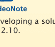

```
2 quarters
1 dimes
0 nickels
3 pennies
```

PP 2.12 编写一个应用程序，提示并读取正方形边长的整数值，然后打印正方形的周长和面积。

PP 2.13 编写一个应用程序，提示并读取分数的分子和分母作为整数，然后打印分数的十进制等价值。

PP 2.14 创建雪人小程序的修订版本，包含以下修改：

- 在上半身添加两个红色按钮。
- 让雪人皱眉而不是微笑。
- 将太阳移动到图片的右上角。
- 在图片的左上角显示你的名字。
- 将整个雪人向右移动 20 像素。

PP 2.15 编写一个小程序，使用 `drawString()` 方法写出你的名字。将小程序的链接嵌入到 HTML 文档中并使用 Web 浏览器查看。

PP 2.16 编写一个小程序，绘制北斗七星。在夜空中添加一些额外的星星。

PP 2.17 编写一个小程序，绘制一些系着绳子的气球。使气球具有各种颜色。

PP 2.18 编写一个小程序，绘制奥运标志。标志中的圆圈应从左到右分别涂成蓝色、黄色、黑色、绿色和红色。

PP 2.19 编写一个小程序，绘制一座带有门（和门把手）、窗户和烟囱的房子。添加从烟囱冒出的烟和天空中的云。

PP 2.20 编写一个小程序，显示你自己设计的名片。包含图形和文本。

PP 2.21 编写一个小程序，通过先用黑色绘制你的名字，然后在稍偏移的位置用较浅的颜色再次绘制，来显示阴影文字的你的名字。

PP 2.22 编写一个小程序，显示一个由八个相等扇区组成的饼图，所有扇区颜色各不相同。

# SOFTWARE FAILURE

## NASA Mars Climate Orbiter and Polar Lander

### What Happened?

作为探索火星的一系列任务的一部分，NASA 于 1998 年 12 月发射了火星气候轨道器，并于 1999 年 1 月发射了火星极地着陆器。这项双航天器任务旨在通过每个季节观察火星的大气条件。轨道器和着陆器本应收集有关温度、尘埃、水蒸气、云以及火星极地地区二氧化碳（CO2）增加和减少量的数据。


经过九个月的旅程，轨道器于 1999 年 9 月抵达火星，并点火主发动机以建立轨道。轨道器按计划在五分钟后从地球视角看经过行星后面，但 NASA 在预计它重新出现后无法重新建立联系。对数据的审查显示，轨道器进入轨道时的高度仅为 57 公里，而计划高度为 140 公里。可生存的最小高度在 85 到 100 公里之间。NASA 断定轨道器被大气摩擦摧毁。

极地着陆器于 1999 年 12 月抵达火星，所有数据都表明它正朝着在火星南极目标着陆点 10 公里范围内成功软着陆的目标前进。然而，NASA 在着陆器进入大气层后不久就失去了与它的联系。在随后的数周和数月内，多次尝试重新建立联系均未成功。

轨道器和着陆器的总项目成本为 3.276 亿美元。

### What Caused It?

轨道器问题的根本原因是令人尴尬的沟通问题。引导航天器导航的软件使用英制测量单位（磅力），而航天器本身期望数据以公制单位（牛顿）提供。因此，期望的导航变化和实际效果相差 4.45 倍。这种不匹配部分是由于一个位于科罗拉多的团队领导了航天器的研发工作，而一个位于加州的团队负责导航问题。

火星气候轨道器的艺术家概念图

着陆器通信问题的成因尚未解决，但不认为与轨道器的问题有关。调查得出结论，最可能的原因是软件错误，将着陆器腿部展开时产生的振动误认为是实际着陆在行星表面时产生的振动。这一错误会导致着陆器的下降发动机在仍距地面 40 米高的情况下关闭。其他问题情景也是可能的。

### Lessons Learned

火星气候轨道器中的单位不匹配表明，在高度复杂的系统中，看似明显的问题也可能被忽视。错误是不可避免的，但必须建立流程在它们变得严重之前捕获它们。调查得出结论，在这种情况下，跟踪和双重检查子系统之间相互关联元素的系统不够健全。团队新成员的培训和沟通也不一致，一些沟通渠道过于非正式。简而言之，该任务缺乏严格的整体系统视角，这本可以在为时已晚之前发现单位不匹配问题。

鉴于着陆器的问题原因尚不明确，很难得出强有力的结论。事实是它仍然是一个悬而未决的问题，凸显了在关键资源面临风险的情况下需要更多的评估、模拟和测试。

> Source: nasa.gov

# Using Classes and Objects

## CHAPTER OBJECTIVES

- 讨论对象的创建和使用对象引用变量。
- 探索 `String` 类提供的服务。
- 描述 Java 标准类库如何组织成包。
- 探索 `Random` 和 `Math` 类提供的服务。
- 讨论使用 `NumberFormat` 和 `DecimalFormat` 类格式化输出的方法。
- 介绍枚举类型。
- 讨论包装类和自动装箱的概念。
- 介绍图形用户界面中使用的组件和容器。
- 描述标签组件和图像的使用。

本章进一步探讨预定义类的使用以及我们可以从中创建的对象。使用类和对象提供的服务是面向对象软件的基本部分，也是编写我们自己的类的基础。在本章中，我们使用类和对象来操作字符字符串、生成随机数、执行复杂计算和格式化输出。本章还介绍了枚举类型这一 Java 中的特殊类概念，并讨论了包装类的概念。在本章的 Graphics Track 中，我们为程序开发图形用户界面奠定了基础，并讨论了如何显示图像。


## 3.1 创建对象

在第1章末尾，我们概述了面向对象的概念，包括类与对象之间的基本关系。然后在第2章中，除了讨论基本数据外，我们还举例说明了如何使用对象提供的服务。本章将进一步探讨这些思想。

在之前的示例中，我们多次使用了 `println` 方法。正如在第2章中提到的，`println` 方法是 `System.out` 对象提供的一项服务，它代表标准输出流。更准确地说，标识符 `out` 是存储在 `System` 类中的一个对象变量。它已作为 Java 标准类库的一部分被预先定义和设置好，我们可以直接使用。

在第2章中，我们还使用了 `Scanner` 类，它代表一个允许我们从键盘或文件读取输入的对象。我们使用 `new` 运算符创建了一个 `Scanner` 对象。一旦创建了对象，我们就能使用它提供的各种服务，也就是说，我们可以调用它的方法。

让我们仔细考察一下创建对象的概念。在 Java 中，变量名要么表示一个基本类型的值，要么表示一个对象。与保存基本类型的变量一样，引用对象的变量也必须声明。用于定义对象的类可以被视为对象的类型。对象变量的声明与基本类型变量的声明具有类似的结构。

考虑以下两个声明：

```
int num;
String name;
```

第一个声明创建了一个保存整数的变量，正如我们之前多次看到的。第二个声明创建了一个 `String` 变量，它保存对 `String` 对象的引用。对象变量本身并不保存对象，而是保存对象的地址。

最初，上面声明的两个变量不包含任何数据。我们说它们未初始化，可以描述如下：

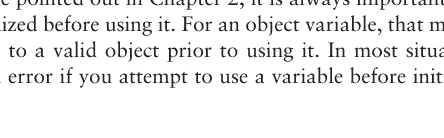

正如我们在第2章中指出的，在使用变量之前确保其已初始化始终很重要。对于对象变量，这意味着在使用它之前，我们必须确保它引用了一个有效的对象。在大多数情况下，如果你尝试在初始化变量之前使用它，编译器会报错。

对象变量也可以设置为 `null`，它是 Java 中的一个保留字。`null` 引用专门表示变量不引用任何对象。

请注意，尽管我们声明了一个 `String` 引用变量，但实际上还不存在 `String` 对象。使用 `new` 运算符创建对象的行为称为实例化。对象被称为特定类的一个实例。要实例化一个对象，我们可以使用 `new` 运算符，它返回新对象的地址。以下两条赋值语句为上面声明的两个变量赋予了值：

```
num = 42;
name = new String("James Gosling");
```

在 `new` 运算符创建对象之后，会调用一个*构造器*来帮助其进行初始设置。构造器是一个特殊的方法，其名称与类名相同。在此示例中，构造器的参数是一个字符串字面量，指定了字符串对象将包含的字符。执行这些赋值后，变量可以描述为：

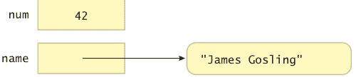

由于对象引用变量保存对象的地址，因此它可以被视为指向内存中保存对象位置的*指针*。我们可以显示数字地址，但实际的地址值并不重要——重要的是该变量引用了特定的对象。

对象被实例化后，我们使用*点运算符*来访问其方法。我们已经多次使用点运算符，例如在调用 `System.out.println` 时。点运算符直接附加在对象引用之后，后面跟要调用的方法。例如，要调用 `String` 类中定义的 `length()` 方法，我们可以对 `name` 引用变量使用点运算符：

```
count = name.length()
```

`length()` 方法不接受任何参数，但括号仍然是必要的，以表示正在调用方法。某些方法在完成时会产生一个*返回值*。`String` 类的 `length()` 方法的目的是确定并返回字符串的长度（它所包含的字符数）。在此示例中，返回值被赋给变量 `count`。对于字符串 `"James Gosling"`，`length()` 方法返回 13，该值包括名和姓之间的空格。某些方法不返回值。其他 `String` 方法将在下一节讨论。

### 关键概念

`new` 运算符返回对新创建对象的引用。


**视频注释**

创建对象。

将声明对象引用变量和创建对象本身的操作可以合并为一步，即在声明中初始化变量，就像我们对基本类型所做的那样：

```
String title = new String("Java Software Solutions");
```

尽管字符串不是基本类型，但它们非常基础且经常使用，因此 Java 定义了用双引号分隔的字符串字面量，正如我们在各种示例中所见。这是一种简写形式。每当出现字符串字面量时，就会自动创建一个 `String` 对象。因此，以下声明是有效的：

```
String city = "London";
```

也就是说，对于 `String` 对象，可以省略显式使用 `new` 运算符和调用构造器。在大多数情况下，我们将使用这种简化语法。

### 别名

由于对象引用变量存储的是地址，程序员在管理对象时必须小心。首先，让我们回顾赋值对基本类型值的影响。假设我们有两个整数变量 `num1`（初始化为5）和 `num2`（初始化为12）：


在下面的赋值语句中，`num1` 中存储的值的副本被存储到 `num2` 中：

```
num2 = num1;
```

`num2` 中原来的值 12 被值 5 覆盖。变量 `num1` 和 `num2` 仍然引用内存中的不同位置，而这两个位置现在都包含值 5：


现在考虑以下对象声明：

```
String name1 = "Ada, Countess of Lovelace";
String name2 = "Grace Murray Hopper";
```

最初，引用 `name1` 和 `name2` 引用两个不同的 `String` 对象：

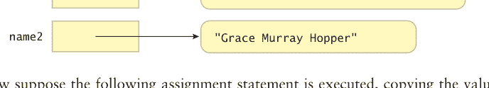

现在假设执行以下赋值语句，将 `name1` 中的值复制到 `name2` 中：

```
name2 = name1;
```

这个赋值与整数赋值的作用相同——`name1` 值的副本被存储到 `name2` 中。但请记住，对象变量保存的是对象的地址，而被复制的是地址。最初，两个引用指向不同的对象。赋值之后，`name1` 和 `name2` 包含相同的地址，因此引用同一个对象：

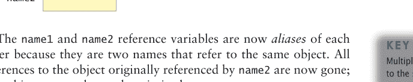

现在，引用变量 `name1` 和 `name2` 互为别名，因为它们是引用同一个对象的两个名称。所有对原本由 `name2` 引用的对象的引用现在都消失了；该对象无法再在程序中使用。

> 关键概念

> 多个引用变量可以引用同一个对象。

别名的一个重要含义是，当我们使用一个引用修改对象时，另一个引用也会看到修改，因为实际上只有一个对象。除非谨慎管理，否则别名可能会产生不良影响。

与对象的所有交互都通过引用变量进行，因此只有拥有对象的引用时，我们才能使用该对象。当对象的所有引用都丢失时（也许是通过重新赋值），该对象就无法再对程序做出贡献。程序无法再调用其方法或使用其变量。此时，该对象被称为垃圾，因为它不再起任何作用。

Java 执行自动垃圾回收。当对象的最后一个引用丢失时，该对象将成为垃圾回收的候选对象。偶尔，在后台，Java 环境会执行一个方法，“收集”所有

objects marked for garbage collection and returns their memory to the system for future use. The programmer does not have to worry about explicitly reclaiming memory that has become garbage.

## SELF-REVIEW QUESTIONS (see answers in Appendix N)

- SR 3.1 What is a `null` reference?
- SR 3.2 What does the `new` operator accomplish?
- SR 3.3 Write a declaration for a `String` variable called `author`, and initialize it to the string `"Fred Brooks"`. Draw a graphic representation of the variable and its value.
- SR 3.4 Write a code statement that sets the value of an integer variable called `size` to the `length()` of a `String` object called `name`.
- SR 3.5 What is an alias? How does it relate to garbage collection?

## 3.2 The String Class

Let’s examine the `String` class in more detail. Figure 3.1 lists some of the more useful methods of the `String` class.

Once a `String` object is created, its value cannot be lengthened or shortened, nor can any of its characters change. Thus we say that a `String` object is immutable. However, several methods in the `String` class return new `String` objects that are the result of modifying the original string’s value.

Note that some of the `String` methods refer to the index of a particular character. A character in a string can be specified by its position, or index, in the string. The index of the first character in a string is zero, the index of the next character is one, and so on. Therefore, in the string `"Hello"`, the index of the character `'H'` is zero and the character at index four is `'o'`.

Several `String` methods are exercised in the program shown in Listing 3.1.


## The `String` Class

As you examine the `StringMutation` program, keep in mind that this is not a single `String` object that changes its data; this program creates five separate `String` objects using various methods of the `String` class. Originally, the `phrase` object is set up:


### `String` Class Methods

| Method | Description |
| --- | --- |
| `String(String str)` | Constructor: creates a new string object with the same characters as `str`. |
| `char charAt(int index)` | Returns the character at the specified index. |
| `int compareTo(String str)` | Returns an integer indicating if this string is lexically before (a negative return value), equal to (a zero return value), or lexically after (a positive return value), the string `str`. |
| `String concat(String str)` | Returns a new string consisting of this string concatenated with `str`. |
| `boolean equals(String str)` | Returns `true` if this string contains the same characters as `str` (including case) and `false` otherwise. |
| `boolean equalsIgnoreCase(String str)` | Returns `true` if this string contains the same characters as `str` (without regard to case) and `false` otherwise. |
| `int length()` | Returns the number of characters in this string. |
| `String replace(char oldChar, char newChar)` | Returns a new string that is identical with this string except that every occurrence of `oldChar` is replaced by `newChar`. |
| `String substring(int offset, int endIndex)` | Returns a new string that is a subset of this string starting at index `offset` and extending through `endIndex-1`. |
| `String toLowerCase()` | Returns a new string identical to this string except all uppercase letters are converted to their lowercase equivalent. |
| `String toUpperCase()` | Returns a new string identical to this string except all lowercase letters are converted to their uppercase equivalent. |

**FIGURE 3.1** Some methods of the `String` class

### Listing 3.1

```java
//************************************************************************
// StringMutation.java      Author: Lewis/Loftus
//
// Demonstrates the use of the String class and its methods.
//************************************************************************

public class StringMutation
{
    //-------------------------------------------------------------
    // Prints a string and various mutations of it.
    //-------------------------------------------------------------
    public static void main (String[] args)
    {
        String phrase = "Change is inevitable";
        String mutation1, mutation2, mutation3, mutation4;

        System.out.println ("Original string: \"" + phrase + "\"");
        System.out.println ("Length of string: " + phrase.length());

        mutation1 = phrase.concat (", except from vending machines.");
        mutation2 = mutation1.toUpperCase();
        mutation3 = mutation2.replace ('E', 'X');
        mutation4 = mutation3.substring (3, 30);

        // Print each mutated string
        System.out.println ("Mutation #1: " + mutation1);
        System.out.println ("Mutation #2: " + mutation2);
        System.out.println ("Mutation #3: " + mutation3);
        System.out.println ("Mutation #4: " + mutation4);

        System.out.println ("Mutated length: " + mutation4.length());
    }
}
```

### Output

```text
Original string: "Change is inevitable"
Length of string: 20
Mutation #1: Change is inevitable, except from vending machines.
Mutation #2: CHANGE IS INEVITABLE, EXCEPT FROM VENDING MACHINES.
Mutation #3: CHANGX IS INXVITABL X, XXCXPT FROM VXNDING MACHINX S.
Mutation #4: NGX IS INXVITABL X, XXCXPT F
Mutated length: 27
```

After printing the original phrase and its length, the `concat` method is executed to create a new string object referenced by the variable `mutation1`:

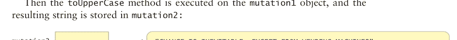

Then the `toUpperCase` method is executed on the `mutation1` object, and the resulting string is stored in `mutation2`:

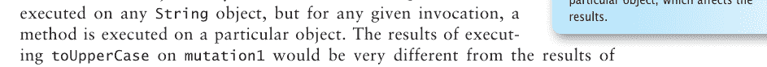

Notice that the `length` and `concat` methods are executed on the `phrase` object, but the `toUpperCase` method is executed on the `mutation1` object. Any method of the `String` class can be executed on any `String` object, but for any given invocation, a method is executed on a particular object. The results of executing `toUpperCase` on `mutation1` would be very different from the results of executing `toUpperCase` on `phrase`. Remember, each object has its own state, which often affects the results of method calls.

> **KEY CONCEPT**
>
> Usually a method is executed on a particular object, which affects the results.

Finally, the `String` object variables `mutation3` and `mutation4` are initialized by the calls to `mutation2.replace` and `mutation3.substring`, respectively:


### Self-Review Questions (see answers in Appendix N)

SR 3.6 Assume `s1`, `s2`, and `s3` are `String` variables initialized to `"Amanda"`, `"Bobby"`, and `"Chris"` respectively. Which `String` variable or variables are changed by each of the following statements?

- a. `System.out.println (s1);`
- b. `s1 = s3.toLowerCase();`
- c. `System.out.println (s2.replace('B', 'M'));`
- d. `s3 = s2.concat(s1);`

SR 3.7 What output is produced by the following code fragment?

```java
String s1 = "Foundations";
String s2;
System.out.println (s1.charAt(1));
s2 = s1.substring(0, 5);
System.out.println (s2);
```

```java
System.out.println (s1.length());
System.out.println (s2.length());
```

SR 3.8 Write a statement that prints the value of a `String` object called `title` in all uppercase letters.

SR 3.9 Write a declaration for a `String` variable called `front`, and initialize it to the first 10 characters of another `String` object called `description`.

## 3.3 Packages

We mentioned earlier that the Java language is supported by a standard class library that we can make use of as needed. Let’s examine that idea further.

A class library is a set of classes that supports the development of programs. A compiler or development environment often comes with a class library. Class libraries can also be obtained separately through third-party vendors. The classes in a class library contain methods that are often valuable to a programmer because of the special functionality they offer. In fact, programmers often become dependent on the methods in a class library and begin to think of them as part of the language. However, technically, they are not in the language itself.

> **KEY CONCEPT**
>
> A class library provides useful support when developing programs.

The `String` class, for instance, is not an inherent part of the Java language. It is part of the Java standard class library that can be found in any Java development environment. The classes that make up the library were created by employees at Sun Microsystems, the people who created the Java language.

The class library is made up of several clusters of related classes, which are often referred to as the Java APIs, which stands for application programming interfaces. For example, we may refer to the Java Database API when we’re talking about the set of classes that helps us write programs that interact with a database. Another example of an API is the Java Swing API, which refers to a set of classes that defines special graphical components used in a graphical user interface. Often the entire standard library is referred to generically as the Java API.

The classes of the Java standard class library are also grouped into packages. Each class is part of a particular package. The `String` class, for example, is part of the `java.lang` package. The `System` class is part of the `java.lang` package as well. We mentioned in Chapter 2 that the `Scanner` class is part of the `java.util` package.

> **KEY CONCEPT**
>
> The Java standard class library is organized into packages.


The package organization is more fundamental and language-based than the API names. Though there is a general correspondence between package and API names, the groups of classes that make up a given API might cross packages. In this book, we primarily refer to classes in terms of their package organization.

**图 3.2 Java 标准类库中的一些包**

| 包 | 提供支持 |
|---|---|
| `java.applet` | 创建可通过 Web 轻松传输的程序（小程序）。 |
| `java.awt` | 绘制图形并创建图形用户界面；AWT 代表抽象窗口工具包。 |
| `java.beans` | 定义可轻松组合成应用程序的软件组件。 |
| `java.io` | 执行各种输入输出功能。 |
| `java.lang` | 通用支持；它会自动导入到所有 Java 程序中。 |
| `java.math` | 执行具有任意高精度的计算。 |
| `java.net` | 跨网络通信。 |
| `java.rmi` | 创建可分布在多台计算机上的程序；RMI 代表远程方法调用。 |
| `java.security` | 强制执行安全限制。 |
| `java.sql` | 与数据库交互；SQL 代表结构化查询语言。 |
| `java.text` | 格式化文本输出。 |
| `java.util` | 通用实用工具。 |
| `javax.swing` | 使用扩展 AWT 功能的组件创建图形用户界面。 |
| `javax.xml.parsers` | 处理 XML 文档；XML 代表可扩展标记语言。 |

图 3.2 描述了 Java 标准类库的一部分包。这些包在支持 Java 软件开发的任何平台上都可用。其中一些包支持高度特定的编程技术，在开发基本程序时不会用到。

本书在整个过程中讨论了 Java API 的各种类。为了方便，我们在书中包含了我们将使用的类的一些文档（如图 3.2），但了解如何获取有关 Java API 类的更多信息对你来说也很重要。在线 Java API 文档是任何 Java 程序员的宝贵资源。它是一个网站，包含标准 Java API 中每个类的页面，列出并描述其中的方法。

图 3.3 显示了该文档的一个页面。侧边栏的链接允许你检查特定的包并跳转到特定的类。花点时间

## 3.4 `Random` 类

在编写软件时，随机数的需求经常出现。游戏通常使用随机数来表示掷骰子或洗牌。飞行模拟器可能会使用随机数来确定模拟飞行出现发动机故障的频率。旨在帮助高中生准备 SAT 的程序可能会使用随机数来选择下一个提问的问题。

`Random` 类是 `java.util` 包的一部分，表示伪随机数生成器。随机数生成器从一系列值中随机挑选一个数字。技术上执行此角色的程序是伪随机的，因为程序没有手段真正随机挑选一个数字。伪随机数生成器基于初始种子值执行一系列复杂的计算并产生一个数字。虽然它们在技术上不是随机的（因为它们是计算出来的），但伪随机数生成器产生的值通常看起来是随机的，至少对大多数情况来说足够随机。

> **关键概念**

> 伪随机数生成器执行复杂的计算以制造随机性的假象。

图 3.4 列出了 `Random` 类的一些方法。`nextInt` 方法可以不带参数调用，也可以传递一个整数值。没有参数的版本在 `int` 值的整个范围内生成随机数，包括负数。通常，我们需要一个在更特定范围内的随机数。例如，为了模拟掷骰子，我们可能想要 1 到 6 范围内的随机数。`nextInt` 方法返回的值在 0 到其参数减一的范围内。例如，如果我们传入 100，我们将得到一个大于或等于 0 且小于或等于 99 的返回值。

| 方法 | 描述 |
|---|---|
| `Random()` | 构造函数：创建一个新的伪随机数生成器。 |
| `float nextFloat()` | 返回一个介于 0.0（含）到 1.0（不含）之间的随机数。 |
| `int nextInt()` | 返回一个在所有可能的 `int` 值（正负）范围内变化的随机数。 |
| `int nextInt(int num)` | 返回 0 到 `num-1` 范围内的随机数。 |

**图 3.4 `Random` 类的一些方法**

请注意，我们传递给 `nextInt` 方法的值也是我们可以得到的可能值的数量。我们可以通过加减适当的数量来按需移动范围。要获得 1 到 6 范围内的随机数，我们可以调用 `nextInt(6)` 得到 0 到 5 的值，然后加 1。

`Random` 类的 `nextFloat` 方法返回一个大于或等于 0.0 且小于 1.0 的 `float` 值。如果需要，我们可以使用乘法缩放结果，将其转换为 `int` 值以截断小数部分，然后像处理整数一样移动范围。

Listing 3.2 所示的程序在各种范围内产生多个随机数。

### LISTING 3.2

```java
// RandomNumbers.java
// Author: Lewis/Loftus
// Demonstrates the creation of pseudo-random numbers using the
// Random class.

import java.util.Random;

public class RandomNumbers
{
   // Generates random numbers in various ranges.

   public static void main(String[] args)
   {
      Random generator = new Random();
      int num1;
      float num2;

      num1 = generator.nextInt();
      System.out.println("A random integer: " + num1);

      num1 = generator.nextInt(10);
      System.out.println("From 0 to 9: " + num1);

      // From 1 to 10
      num1 = generator.nextInt(10) + 1;
      System.out.println("From 1 to 10: " + num1);

      num1 = generator.nextInt(15) + 20;
      System.out.println("From 20 to 34: " + num1);

      num1 = generator.nextInt(20) - 10;
      System.out.println("From -10 to 9: " + num1);

      num2 = generator.nextFloat();
      System.out.println("A random float (between 0-1): " + num2);

      num2 = generator.nextFloat() * 6;  // 0.0 to 5.999999
      num1 = (int)num2 + 1;
      System.out.println("From 1 to 6: " + num1);
   }
}
```

### OUTPUT

```text
A random integer: 1773351873
From 0 to 9: 8
From 1 to 10: 6
From 20 to 34: 20
From -10 to 9: -6
A random float (between 0-1): 0.71058085
From 1 to 6: 3
```

myprogramminglab

### 自测题（答案见附录 N）

- SR 3.16 给定一个名为 `rand` 的 `Random` 对象，调用 `rand.nextInt()` 返回什么？

- SR 3.17 给定一个名为 `rand` 的 `Random` 对象，调用 `rand.nextInt(20)` 返回什么？

- SR 3.18 假设已创建了一个名为 `generator` 的 `Random` 对象，以下每个表达式的结果范围是什么？

  - a. `generator.nextInt(50)`

  - b. `generator.nextInt(5) + 10`

  - c. `generator.nextInt(10) + 5`

  - d. `generator.nextInt(50) - 25`

- SR 3.19 假设已创建了一个名为 `generator` 的 `Random` 对象，编写表达式生成以下整数范围，包括端点。使用接受单个整数参数的 `nextInt` 方法版本。

  - a. 0 到 30

  - b. 10 到 19

  - c. -5 到 5

## 3.5 `Math` 类

`Math` 类提供了大量常用的基本数学函数，可用于进行计算。`Math` 类定义在 Java 标准类库的 `java.lang` 包中。图 3.5 列出了其中一些方法。

`Math` 类中的所有方法都是静态方法（也称为类方法），这意味着它们可以通过定义它们的类名调用，而无需先实例化该类的对象。静态方法将在第 6 章进一步讨论。

`Math` 类的方法返回可按需在表达式中使用的值。例如，以下语句计算存储在 `total` 中的数字的绝对值，将其与 `count` 的四次幂相加，并将结果存储在变量 `value` 中：

```java
value = Math.abs(total) + Math.pow(count, 4);
```

请注意，你可以将整数值传递给接受 `double` 参数的方法。这是赋值转换的一种形式，已在第 2 章中讨论过。

Listing 3.3 所示的 `Quadratic` 程序使用 `Math` 类计算二次方程的根。回想一下，二次方程具有以下一般形式：

```text
ax² + bx + c
```

`Quadratic` 程序读取代表二次方程中系数（`a`、`b` 和 `c`）的值，然后评估二次公式以确定方程的根。二次公式为：

`roots = (-b ± √(b²-4ac)) / 2a`

> **关键概念**

> `Math` 类的所有方法都是静态的，这意味着它们通过类名调用。

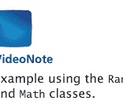

`static int abs (int num)`

返回 `num` 的绝对值。

`static double acos (double num)`

`static double asin (double num)`

`static double atan (double num)`

返回 `num` 的反余弦、反正弦或反正切。

`static double cos (double angle)`

`static double sin (double angle)`

`static double tan (double angle)`

返回以弧度为单位的 `angle` 的余弦、正弦或正切。

`static double ceil (double num)`

返回 `num` 的上界，即大于或等于 `num` 的最小整数。

`static double exp (double power)`

返回 `e` 的指定次幂的值。

`static double floor (double num)`

返回 `num` 的下界，即小于或等于 `num` 的最大整数。

`static double pow (double num, double power)`

返回 `num` 的指定次幂的值。

`static double random ()`

返回介于 0.0（含）和 1.0（不含）之间的随机数。

`static double sqrt (double num)`

返回 `num` 的平方根，`num` 必须为正。

### FIGURE 3.5 Some methods of the Math class

请注意，此程序假定判别式（平方根下的值）为负数。如果它不是负数，结果将不是有效数字，Java 将其表示为 NAN，即 Not A Number 的缩写。在第 5 章中，我们将看到如何优雅地处理这种情况。

### LISTING 3.3

```java
//************************************************************************
// Quadratic.java      Author: Lewis/Loftus
//
// Demonstrates the use of the Math class to perform a calculation
// based on user input.
//************************************************************************

import java.util.Scanner;

public class Quadratic
{
    //------------------------------------------------------------
    // Determines the roots of a quadratic equation.
    //------------------------------------------------------------
    public static void main (String[] args)
    {
        int a, b, c;  // ax^2 + bx + c
        double discriminant, root1, root2;

        Scanner scan = new Scanner (System.in);

        System.out.print ("Enter the coefficient of x squared: ");
        a = scan.nextInt();

        System.out.print ("Enter the coefficient of x: ");
        b = scan.nextInt();

        System.out.print ("Enter the constant: ");
        c = scan.nextInt();

        // Use the quadratic formula to compute the roots.
        // Assumes a positive discriminant.

        discriminant = Math.pow(b, 2) - (4 * a * c);
        root1 = ((-1 * b) + Math.sqrt(discriminant)) / (2 * a);
        root2 = ((-1 * b) - Math.sqrt(discriminant)) / (2 * a);

        System.out.println ("Root #1: " + root1);
        System.out.println ("Root #2: " + root2);
    }
}
```

### LISTING 3.3 continued

### OUTPUT

```text
Enter the coefficient of x squared: 3
Enter the coefficient of x: 8
Enter the constant: 4
Root #1: -0.6666666666666666
Root #2: -2.0
```

## SELF-REVIEW QUESTIONS (see answers in Appendix N)

- SR 3.20 What is a class method (also called a static method)?

- SR 3.21 What is the value of each of the following expressions?

  - a. `Math.abs(10) + Math.abs(-10)`

  - b. `Math.pow(2, 4)`

  - c. `Math.pow(4, 2)`

  - d. `Math.pow(3, 5)`

  - e. `Math.pow(5, 3)`

  - f. `Math.sqrt(16)`

- SR 3.22 Write a statement that prints the sine of an angle measuring 1.23 radians.

- SR 3.23 Write a declaration for a `double` variable called `result` and initialize it to 5 raised to the power 2.5.

- SR 3.24 Using the online Java API documentation, list three methods of the `Math` class that are not included in Figure 3.5.

## 3.6 Formatting Output

`NumberFormat` 类和 `DecimalFormat` 类用于格式化信息，使其在打印或显示时看起来合适。它们都是 Java 标准类库的一部分，定义在 `java.text` 包中。

### The `NumberFormat` Class


`NumberFormat`类为数字提供通用的格式化功能。你不是通过使用`new`运算符来实例化`NumberFormat`对象。相反，你可以从通过类名本身调用的静态方法之一请求一个对象。图 3.6 列出了`NumberFormat`类的方法。

`String format(double number)`

返回一个包含根据此对象的模式格式化的指定数字的字符串。

`static NumberFormat getCurrencyInstance()`

返回一个表示当前区域设置的货币格式的`NumberFormat`对象。

`static NumberFormat getPercentInstance()`

返回一个表示当前区域设置的百分比格式的`NumberFormat`对象。

### FIGURE 3.6 Some methods of the NumberFormat class

`NumberFormat`类中的两个方法`getCurrencyInstance`和`getPercentInstance`返回一个用于格式化数字的对象。`getCurrencyInstance`方法返回货币值的格式化器，而`getPercentInstance`方法返回格式化百分比的对象。`format`方法通过格式化器对象调用，并返回一个包含以适当方式格式化的数字的`String`。

`Listing 3.4`中显示的`Purchase`程序使用了这两种类型的格式化器。它读取销售交易并计算包括税在内的最终价格。

### LISTING 3.4

```
//****************************************************************
// Purchase.java Author: Lewis/Loftus
//
// Demonstrates the use of the NumberFormat class to format output.
//****************************************************************

import java.util.Scanner;
import java.text.NumberFormat;

public class Purchase
{
//---------------------------------------------------------------
// Calculates the final price of a purchased item using values
// entered by the user.
//---------------------------------------------------------------
public static void main (String[] args)
{
    final double TAX_RATE = 0.06;  // 6% sales tax

    int quantity;
    double subtotal, tax, totalCost, unitPrice;

    Scanner scan = new Scanner (System.in);

    NumberFormat fmt1 = NumberFormat.getCurrencyInstance();
    NumberFormat fmt2 = NumberFormat.getPercentInstance();

    System.out.print ("Enter the quantity: ");
    quantity = scan.nextInt();

    System.out.print ("Enter the unit price: ");
    unitPrice = scan.nextDouble();

    subtotal = quantity * unitPrice;
    tax = subtotal * TAX_RATE;
    totalCost = subtotal + tax;

    // Print output with appropriate formatting
    System.out.println ("Subtotal: " + fmt1.format(subtotal));
    System.out.println ("Tax: " + fmt1.format(tax) + " at "
        + fmt2.format(TAX_RATE));
    System.out.println ("Total: " + fmt1.format(totalCost));
}
```

### LISTING 3.4 continued

### OUTPUT

```
Enter the quantity: 5
Enter the unit price: 3.87
Subtotal: $19.35
Tax: $1.16 at 6%
Total: $20.51
```

### The DecimalFormat Class

与`NumberFormat`类不同，`DecimalFormat`类以传统方式使用`new`运算符实例化。它的构造函数接受一个字符串，表示将指导格式化过程的模式。然后我们可以使用

`DecimalFormat(String pattern)`

构造函数：使用指定的模式创建新的`DecimalFormat`对象。

`void applyPattern(String pattern)`

将指定的模式应用于此`DecimalFormat`对象。

`String format(double number)`

返回一个包含根据当前模式格式化的指定数字的字符串。

### FIGURE 3.7 Some methods of the DecimalFormat class

`format`方法来格式化特定值。在稍后的某个时间，如果我们想更改格式化器对象使用的模式，我们可以调用`applyPattern`方法。图 3.7 描述了这些方法。

传递给`DecimalFormat`构造函数的字符串定义的模式可能相当复杂。各种符号用于表示特定的格式化指南。例如，由字符串`"0.###"`定义的模式表示小数点左侧至少应打印一位数字，如果整数部分为零，则应为零。它还表示小数部分应四舍五入到三位数字。

该模式用于`Listing 3.5`中显示的`CircleStats`程序中，该程序从用户读取圆的半径并计算其面积和周长。尾随零，例如圆的面积 78.540，不会打印。

### The printf Method

除了`print`和`println`之外，`System`类还有另一个输出方法称为`printf`，它允许用户打印包含数据值的格式化字符串。该方法的第一个参数表示格式字符串，其余参数指定插入到格式字符串中的值。

例如，以下代码行打印 ID 号和名称：

```
System.out.printf ("ID: %5d\tName: %s", id, name);
```

第一个参数指定输出的格式，包括标记输出值的字面字符以及`\t`等转义字符。模式`%5d`表示相应的数值（`id`）应以五个字符的字段打印。模式`%s`匹配字符串参数

### LISTING 3.5

```
//************************************************************************
// CircleStats.java        Author: Lewis/Loftus
//
// Demonstrates the formatting of decimal values using the
// DecimalFormat class.
//************************************************************************

import java.util.Scanner;
import java.text.DecimalFormat;

public class CircleStats
{
    //-------------------------------------------------------------
    // Calculates the area and circumference of a circle given its
    // radius.
    //-------------------------------------------------------------
    public static void main (String[] args)
    {
        int radius;
        double area, circumference;

        Scanner scan = new Scanner (System.in);

        System.out.print ("Enter the circle's radius: ");
        radius = scan.nextInt();

        area = Math.PI * Math.pow(radius, 2);
        circumference = 2 * Math.PI * radius;

        // Round the output to three decimal places
        DecimalFormat fmt = new DecimalFormat ("0.###");

        System.out.println ("The circle's area: " + fmt.format(area));
        System.out.println ("The circle's circumference: "
                           + fmt.format(circumference));
    }
}
```

### OUTPUT

```
Enter the circle's radius: 5

The circle's area: 78.54

The circle's circumference: 31.416
```

`name`。`id`和`name`的值被插入到字符串中，产生如下结果：

```
ID: 24036  Name: Larry Flagelhopper
```

`printf`方法被添加到 Java 以镜像在 C 语言程序中使用的类似函数。它使程序员更容易将现有的 C 程序翻译（或迁移）到 Java。

旧软件如果仍有价值则称为遗留系统。维护遗留系统通常是一项昂贵的努力，因为其中包括基于旧技术。但在许多情况下，维护遗留系统仍然比将其迁移到新技术更具成本效益，例如用更新的语言重写它。添加`printf`方法是为了使此类迁移更容易、成本更低，通过提供 C 程序员习惯依赖的同类输出语句。

然而，使用`printf`方法并不是解决格式化输出问题的特别干净的面向对象解决方案，因此我们在本书中避免使用它。

> KEY CONCEPT
>
> `printf`方法被添加到 Java 以支持遗留系统的迁移。

## SELF-REVIEW QUESTIONS (see answers in Appendix N)

- SR 3.25 Describe how you request a `NumberFormat` object for use within a program.

- SR 3.26 Suppose that in your program you have a `double` variable named `cost`. You want to output the value stored in `cost` formatted as the currency of the current locale.

  a. Write a code statement that declares and requests a `NumberFormat` object named `moneyFormat` that can be used to represent currency in the format of the current locale.

  b. Write a code statement that uses the `moneyFormat` object and prints the value of `cost`, formatted as the currency of the current locale.

  c. What would be the output from the statement you wrote in part (b) if the value in `cost` is 54.89 and your computer’s locale is set to the United States? What if your computer’s locale is set to the United Kingdom?

- SR 3.27 What are the steps to output a floating point value as a percentage using Java’s formatting classes?

- SR 3.28 Write code statements that prompt for and read in a `double` value from the user, and then print the result of taking the square root of the absolute value of the input value. Output the result to two decimal places.

### 3.7 Enumerated Types

Java 提供定义枚举类型的能力，该类型随后可作为变量声明时的类型使用。枚举类型通过列出、枚举它们来建立变量可能的所有值。值是标识符，可以是任何期望的。

例如，以下声明定义了一个名为`Season`的枚举类型，其可能值为`winter`、`spring`、`summer`和`fall`：

```
enum Season {winter, spring, summer, fall}
```

枚举类型可以列出的值的数量没有限制。一旦类型定义，变量可以声明为该类型：

```
Season time;
```

> KEY CONCEPT
>
> 枚举类型是类型安全的，确保无效值不会被使用。

变量`time`现在在可以取的值上受到限制。它可以保存四个`Season`值之一，但不能是其他值。Java 枚举类型被认为是类型安全的，这意味着任何尝试使用枚举值以外的值都会导致编译时错误。


The values are accessed through the name of the type. For example:

```
time = Season.spring;
```

Enumerated types can be quite helpful in situations in which you have a relatively small number of distinct values that a variable can assume. For example, suppose we wanted to represent the various letter grades a student could earn. We might declare the following enumerated type:

```
enum Grade {A, B, C, D, F}
```

Any initialized variable that holds a `Grade` is guaranteed to have one of those valid grades. That’s better than using a simple character or string variable to represent the grade, which could take on any value.

Suppose we also wanted to represent plus and minus grades, such as A– and B+. We couldn’t use `A–` or `B+` as values, because they are not valid identifiers (the characters ‘-’ and ‘+’ cannot be part of an identifier in Java). However, the same values could be represented using the identifiers `Aminus`, `Bplus`, etc.

Internally, each value in an enumerated type is stored as an integer, which is referred to as its ordinal value. The first value in an enumerated type has an ordinal value of 0, the second one has an ordinal value of 1, the third one 2, and so on. The ordinal values are used internally only. You cannot assign a numeric value to an enumerated type, even if it corresponds to a valid ordinal value.

An enumerated type is a special kind of class, and the variables of an enumerated type are object variables. As such, there are a few methods associated with all enumerated types. The `ordinal()` method returns the numeric value associated with a particular enumerated type value. The `name()` method returns the name of the value, which is the same as the identifier that defines the value.

Listing 3.6 shows a program called `IceCream` that declares an enumerated type and exercises some of its methods. Because enumerated types are special types of classes, they are not defined within a method. They can be defined either at the class level (within the class but outside a method), as in this example, or at the outermost level.

We explore enumerated types further in Chapter 6.

### LISTING 3.6

```
//************************************************************************
// IceCream.java        Author: Lewis/Loftus
//
// Demonstrates the use of enumerated types.
//************************************************************************

public class IceCream
{
    enum Flavor {vanilla, chocolate, strawberry, fudgeRipple, coffee,
                rockyRoad, mintChocolateChip, cookieDough}

    //------------------------------------------------------------
    // Creates and uses variables of the Flavor type.
    //------------------------------------------------------------
    public static void main (String[] args)
    {
        Flavor cone1, cone2, cone3;

        cone1 = Flavor.rockyRoad;
        cone2 = Flavor.chocolate;

        System.out.println ("cone1 value: " + cone1);
        System.out.println ("cone1 ordinal: " + cone1.ordinal());
        System.out.println ("cone1 name: " + cone1.name());

        System.out.println ();
        System.out.println ("cone2 value: " + cone2);
        System.out.println ("cone2 ordinal: " + cone2.ordinal());
        System.out.println ("cone2 name: " + cone2.name());
```

### LISTING 3.6 continued

```
cone3 = cone1;

System.out.println ();

System.out.println ("cone3 value: " + cone3);

System.out.println ("cone3 ordinal: " + cone3.ordinal());

System.out.println ("cone3 name: " + cone3.name());

}
```

### OUTPUT

```
cone1 value: rockyRoad
cone1 ordinal: 5
cone1 name: rockyRoad

cone2 value: chocolate
cone2 ordinal: 1
cone2 name: chocolate

cone3 value: rockyRoad
cone3 ordinal: 5
cone3 name: rockyRoad
```

## SELF-REVIEW QUESTIONS (see answers in Appendix N)

SR 3.29 Write the declaration of an enumerated type that represents movie ratings.

SR 3.30 Suppose that an enumerated type called `CardSuit` has been defined as follows:

```
enum CardSuit {clubs, diamonds, hearts, spades}
```

What is the output of the following code sequence?

```
CardSuit card1, card2;

card1 = CardSuit.clubs;

card2 = CardSuit.hearts;

System.out.println (card1);

System.out.println (card2.name());

System.out.println (card1.ordinal());

System.out.println (card2.ordinal());
```

SR 3.31 Why use an enumerated type such as `CardSuit` defined in the previous question? Why not just use `String` variables and assign them values such as “hearts”?

### 3.8 Wrapper Classes

As we’ve discussed previously, Java represents data by using primitive types (such as `int`, `double`, `char`, and `boolean`) in addition to classes and objects. Having two categories of data to manage (primitive values and object references) can present a challenge in some circumstances. For example, we might create an object that serves as a container to hold various types of other objects. However, in a specific situation, we may want it to hold a simple integer value. In these cases we need to “wrap” a primitive value into an object.

A wrapper class represents a particular primitive type. For instance, the `Integer` class represents a simple integer value. An object created from the `Integer` class stores a single `int` value. The constructors of the wrapper classes accept the primitive value to store. For example:

```
Integer ageObj = new Integer(40);
```

Once this declaration and instantiation are performed, the `ageObj` object effectively represents the integer 40 as an object. It can be used wherever an object is needed in a program rather than a primitive type.

KEY CONCEPT
A wrapper class allows a primitive value to be managed as an object.

For each primitive type in Java there exists a corresponding wrapper class in the Java class library. All wrapper classes are defined in the `java.lang` package. Figure 3.8 shows the wrapper class that corresponds to each primitive type.

Note that there is even a wrapper class that represents the type `void`. However, unlike the other wrapper classes, the `Void` class cannot be instantiated. It simply represents the concept of a void reference.

| Primitive Type | Wrapper Class |
|---|---|
| byte | Byte |
| short | Short |
| int | Integer |
| long | Long |
| float | Float |
| double | Double |
| char | Character |
| boolean | Boolean |
| void | Void |

FIGURE 3.8 Wrapper classes in the Java class library

```
Integer (int value)

Constructor: creates a new Integer object storing the specified value.

byte byteValue ()

double doubleValue ()

float floatValue ()

int intValue ()

long longValue ()

Return the value of this Integer as the corresponding primitive type.

static int parseInt (String str)

Returns the int corresponding to the value stored in the specified string.

static String toBinaryString (int num)

static String toHexString (int num)

static String toOctalString (int num)

Returns a string representation of the specified integer value in the corresponding base.
```

### FIGURE 3.9 Some methods of the Integer class

Wrapper classes also provide various methods related to the management of the associated primitive type. For example, the `Integer` class contains methods that return the `int` value stored in the object and that convert the stored value to other primitive types. Figure 3.9 lists some of the methods found in the `Integer` class. The other wrapper classes have similar methods.

Note that the wrapper classes also contain static methods that can be invoked independent of any instantiated object. For example, the `Integer` class contains a static method called `parseInt` to convert an integer that is stored in a `String` to its corresponding `int` value. If the `String` object `str` holds the string "987", the following line of code converts the string into the integer value 987 and stores that value in the `int` variable `num`:

```
num = Integer.parseInt(str);
```


The Java wrapper classes often contain static constants that are helpful as well. For example, the `Integer` class contains two constants, `MIN_VALUE` and `MAX_VALUE`, that hold the smallest and largest `int` values, respectively. The other wrapper classes contain similar constants for their types.

## Autoboxing

*Autoboxing* is the automatic conversion between a primitive value and a corresponding wrapper object. For example, in the following code, an `int` value is assigned to an `Integer` object reference variable:

```
Integer obj1;

int num1 = 69;

obj1 = num1;  // automatically creates an Integer object
```

The reverse conversion, called unboxing, also occurs automatically when needed. For example:

```
Integer obj2 = new Integer(69);

int num2;

num2 = obj2;  // automatically extracts the int value
```

Assignments between primitive types and object types are generally incompatible. The ability to autobox occurs only between primitive types and corresponding wrapper classes. In any other case, attempting to assign a primitive value to an object reference variable, or vice versa, will cause a compile-time error.

> **KEY CONCEPT**
>
> Autoboxing provides automatic conversions between primitive values and corresponding wrapper objects.

+   **SELF-REVIEW QUESTIONS** *(see answers in Appendix N)*
+   
+   - **SR 3.32** How can we represent a primitive value as an object?
+   - **SR 3.33** What wrapper classes correspond to each of the following primitive types: `byte`, `int`, `double`, `char`, and `boolean`?
+   - **SR 3.34** Suppose that an `int` variable named `number` has been declared and initialized and an `Integer` variable named `holdNumber` has been declared. Show two approaches in Java for having `holdNumber` represent the value stored in `number`.
+   - **SR 3.35** Write a statement that prints out the largest possible `int` value.

### 3.9 Components and Containers

In the Graphics Track sections of Chapter 2 we introduced the Java capabilities to draw shapes using the `Graphics` and `Color` classes from the Java standard class library. We also defined the concept of an applet, a Java program that is intended to be embedded in a Web page and executed through a browser. Recall that, in contrast to applets, Java applications are stand-alone programs that are not executed through the Web.

Most of the example programs we’ve looked at so far have been Java applications. More specifically, they have been *command-line applications*, which interact with the user only through simple text prompts. A Java application can have graphical components as well. Throughout the rest of the book, in the Graphics Track sections at the end of each chapter, we will explore the capabilities of Java to create programs with graphical user interfaces (GUIs). In this chapter we establish the basic issues regarding graphics-based applications.

A GUI *component* is an object that represents a screen element that is used to display information or to allow the user to interact with the program in a certain way. GUI components include labels, buttons, text fields, scroll bars, and menus.

Java components and other GUI-related classes are defined primarily in two packages: `java.awt` and `javax.swing`. (Note the x in `javax.swing`.) The *Abstract Windowing Toolkit* (AWT) was the original Java GUI package. It still contains many important classes, such as the `Color` class that we used in Chapter 2. The Swing package was added later and provides components that are more versatile than those of the AWT package. Both packages are needed for GUI development, but we will use Swing components whenever there is an option.

A *container* is a special type of component that is used to hold and organize other components. Frames and panels are two examples of Java containers. Let’s explore them in more detail.

> KEY CONCEPT
> Containers are special GUI components that hold and organize other components.

### Frames and Panels

A *frame* is a container that is used to display GUI-based Java applications. A frame is displayed as a separate window with its own title bar. It can be repositioned on the screen and resized as needed by dragging it with the mouse. It contains small buttons in the corner of the frame that allow the frame to be minimized, maximized, and closed. A frame is defined by the `JFrame` class.

A *panel* is also a container. However, unlike a frame, it cannot be displayed on its own. A panel must be added to another container for it to be displayed. Generally a panel doesn’t move unless you move the container that it’s in. Its primary role is to help organize the other components in a GUI. A panel is defined by the `JPanel` class.

> KEY CONCEPT
> A frame is displayed as a separate window, but a panel can be displayed only as part of another container.

We can classify containers as either heavyweight or lightweight. A *heavyweight container* is one that is managed by the underlying operating system on which the program is run, whereas a *lightweight container* is managed by the Java program itself. Occasionally this distinction will be important as we explore GUI development. A frame is a heavyweight component, and a panel is a lightweight component.

Heavyweight 组件通常比 lightweight 组件更复杂。例如，frame 有多个 pane，它们负责 frame 窗口的各种特性。Java 接口的所有可见元素都显示在 frame 的 `content pane` 中。

通常，我们可以通过创建一个 frame 来创建基于 Java GUI 的应用程序，程序界面在其中显示。界面通常组织在主 panel 上，该 panel 添加到 frame 的 `content pane` 中。主 panel 中的组件通常使用其他 panel 根据需要进行组织。

容器如果不帮助我们组织和显示其他组件，通常是没有用的。让我们检查另一个基本的 GUI 组件。label 是一个在 GUI 中显示一行文本的组件。label 还可以显示图像，本章后面会讨论这个主题。通常，label 用于显示信息或标识 GUI 中的其他组件。label 可以在几乎每个基于 GUI 的程序中找到。

让我们看一个使用 frames、panels 和 labels 的示例。当执行 Listing 3.7 中的程序时，屏幕上会出现一个新窗口，显示一句话。短语的文本使用两个 label 组件显示。labels 组织在一个 panel 中，并且该 panel 显示在 frame 的 `content pane` 中。

`JFrame` 构造函数接受一个字符串作为参数，它将其显示在 frame 的标题栏中。对 `setDefaultCloseOperation` 方法的调用决定了当点击 frame 角落的关闭按钮（X）时会发生什么。在大多数情况下，我们只需让该按钮终止程序，如 `EXIT_ON_CLOSE` 常量所示。

panel 是通过实例化 `JPanel` 类创建的。panel 的背景颜色使用 `setBackground` 方法设置。`setPreferredSize` 方法接受一个 `Dimension` 对象作为参数，用于指示组件的宽度和高度（以像素为单位）。许多组件的大小都可以这样设置，而且大多数还具有 `setMinimumSize` 和 `setMaximumSize` 方法来帮助控制界面的外观。

labels 是通过实例化 `JLabel` 类创建的，将 label 的文本传递给其构造函数。在此程序中创建了两个单独的 label 组件。

容器具有 `add` 方法，允许将其他组件添加到其中。两个 labels 都添加到主 panel 中，并从那时起被视为该 panel 的一部分。组件添加到容器中的顺序通常很重要。在这种情况下，它决定了哪个 label 出现在另一个之上。

最后，使用 `getContentPane` 方法获取 frame 的 `content pane`，紧接着调用 `content pane` 的 `add` 方法以添加主 panel。

### LISTING 3.7

```java
//****************************************************************
// Authority.java      Author: Lewis/Loftus
//
// Demonstrates the use of frames, panels, and labels.
//****************************************************************
import java.awt.*;
import javax.swing.*;

public class Authority
{
    //-------------------------------------------------------------
    // Displays some words of wisdom.
    //-------------------------------------------------------------
    public static void main (String[] args)
    {
        JFrame frame = new JFrame ("Authority");
        frame.setDefaultCloseOperation (JFrame.EXIT_ON_CLOSE);
        JPanel primary = new JPanel();
        primary.setBackground (Color.yellow);
        primary.setPreferredSize (new Dimension(250, 75));
        JLabel label1 = new JLabel ("Question authority,");
        JLabel label2 = new JLabel ("but raise your hand first.");
        primary.add (label1);
        primary.add (label2);
        frame.getContentPane().add(primary);
        frame.pack();
        frame.setVisible(true);
    }
}
```


### DISPLAY


- g. 一个在 GUI 中显示一行文本的组件。
- h. 确定容器中组件在屏幕上的排列方式。

- SR 3.38 运行 `Authority` 程序。描述如果通过拖动右下角向右调整 `frame` 大小会发生什么。解释。

- SR 3.39 以下哪项陈述最能描述 `Authority` 程序 GUI 的构造方式？

    - 一个 `frame` 添加到一个 `panel`，该 `panel` 添加到两个 `labels`。
    - `Labels` 添加到一个 `panel`，该 `panel` 添加到 `frame` 的 `content pane`。
    - `Frames`、`panels` 和 `labels` 添加到前台。
    - 一个 `panel` 向用户显示两个 `labels`。

- SR 3.40 对 `Authority` 程序分别进行以下每项更改的结果是什么？你可以进行更改、编译并运行程序，观察并报告结果。简要说明你观察到的现象。

    a. 传递给 `setPreferredSize` 方法的尺寸是 `(300, 300)` 而不是 `(250, 75)`。

    b. 背景颜色设置为黑色而不是黄色。

    c. 两个 `label` 实例化语句的顺序被反转（即，首先你将 `label2` 创建为新的 `JLabel`，传递字符串 `"but raise your hand first."`，然后你将 `label1` 创建为新的 `JLabel`，传递字符串 `"Question authority,"`）。

    d. 两个 `primary add` 语句的顺序被反转（即，首先你将 `label2` 添加到 `primary panel`，然后添加 `label1`）。

### 3.10 Nested Panels

在上一节中，我们看到了一个示例，其中两个 `labels` 包含在一个 `panel` 中，而该 `panel` 包含在 `frame` 中。这种关系构成了界面的 containment hierarchy，其复杂程度可以根据需要创建所需的视觉效果而定。

> KEY CONCEPT
> `Panels` 可以嵌套以创建组件的复杂 containment hierarchy。

特别是，通常会有多层嵌套的 `panels` 来以各种方式组织和分组组件。虽然你不应该在 containment hierarchy 中包含不必要的组件，但不要犹豫在创建界面时加入额外的支架以帮助实现你想要的效果。

`Listing 3.8` 中的程序 `NestedPanels` 创建了两个 `subpanels`，每个都包含一个 `label`。两个 `subpanels` 都放在另一个 `panel` 上，然后该 `panel` 添加到 `frame` 的 `content pane`。

### LISTING 3.8

```java
//*************************************************
// NestedPanels.java    Author: Lewis/Loftus
//
// Demonstrates a basic component hierarchy.
//*************************************************
import java.awt.*;
import javax.swing.*;
public class NestedPanels
{
    //-------------------------------------------------
    // Presents two colored panels nested within a third.
    //-------------------------------------------------
    public static void main (String[] args)
    {
        JFrame frame = new JFrame ("Nested Panels");
        frame.setDefaultCloseOperation (JFrame.EXIT_ON_CLOSE);
        // Set up first subpanel
        JPanel subPanel1 = new JPanel();
        subPanel1.setPreferredSize (new Dimension(150, 100));
        subPanel1.setBackground (Color.green);
        JLabel label1 = new JLabel ("One");
        subPanel1.add (label1);
        // Set up second subpanel
        JPanel subPanel2 = new JPanel();
        subPanel2.setPreferredSize (new Dimension(150, 100));
        subPanel2.setBackground (Color.red);
        JLabel label2 = new JLabel ("Two");
        subPanel2.add (label2);
        // Set up primary panel
        JPanel primary = new JPanel();
        primary.setBackground (Color.blue);
        primary.add (subPanel1);
        primary.add (subPanel2);
        frame.getContentPane().add(primary);
        frame.pack();
        frame.setVisible(true);
    }
}
```

### DISPLAY

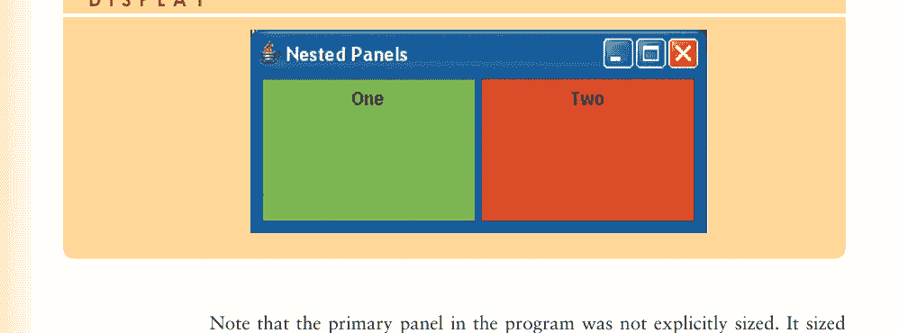

请注意，程序中的主 `panel` 并未显式设置大小。它根据其中包含的两个 `panels` 的需要自行调整大小。还请注意，`subpanels` 周围有一个缓冲区，可以看到主 `panel` 的蓝色。这种间距是用于管理容器的 `layout manager` 的功能，以及为组件本身设置的特性。这些问题将在后面的 Graphics Track 部分进一步探讨。

像前一个示例一样，执行并尝试这个示例。调整 `frame` 大小以查看对组件的影响。请注意 `subpanels` 的大小保持固定，并且两个 `panels` 的方向会根据主 `panel` 的宽度而变化（主 `panel` 随着 `frame` 的扩展而扩展）。

在你熟悉组件彼此之间的布局方式后，将所有 `panels` 的背景颜色更改为相同颜色（例如绿色），以查看如果界面设计得当，`panels` 之间的区别如何变得不可见。

## SELF-REVIEW QUESTIONS (see answers in Appendix N)

- SR 3.41 Java 图形用户界面的 containment hierarchy 是什么？
- SR 3.42 在 `NestedPanels` 程序中，创建了多少个 `panels`？`panel` 变量的名称是什么？

### 3.11 Images

SR 3.43 In the `NestedPanels` program, which panels are added to another panel? Which panel are they added to? Which panel is explicitly added to the content pane of the frame?

Images often play an important role in graphics-based software. Java has the ability to use JPEG and GIF images in various ways. The `Graphics` class contains a `drawImage` method that allows you to draw the image just as you would draw a shape or character string. An image can also be incorporated into a label component. Let’s explore the relationship between images and labels in more detail.

As we’ve seen in previous sections, a label defined by the `JLabel` class can be used to provide information to the user or to describe other components in an interface. A `JLabel` can also contain an image. That is, a label can be composed of text, an image, or both.

> KEY CONCEPT
> A label can contain text, an image, or both.

The `ImageIcon` class is used to represent an image that is included in a label. The `ImageIcon` constructor takes the name of the image file and loads it into the object. `ImageIcon` objects can be made using either JPEG or GIF images.

The alignment of the text and image within the label can be set explicitly, using either the `JLabel` constructor or specific methods. Similarly, we can set the position of the text relative to the image.

The `LabelDemo` program shown in `Listing 3.9` displays several labels. Each label shows its text and image in different orientations.

The third parameter passed to the `JLabel` constructor defines the horizontal positioning of the label within the space allowed for the label in the panel. The `SwingConstants` interface contains several constants used by various Swing components, making it easier to refer to them.

The orientation of the label’s text and image is explicitly set using the `setHorizontalTextPosition` and `setVerticalTextPosition` methods. As shown in the case of the first label, the default horizontal position for text is on the right (image on the left), and the default vertical position for text is centered relative to the image.

Don’t confuse the horizontal positioning of the label in the container with the setting of the orientation between the text and the image. The third parameter of the constructor determines the first, and the explicit method calls determine the second.

By putting an image in a label, it becomes part of a component that gets laid out with all other components in a container, instead of being drawn in a particular place. This is an appropriate design decision: whether to draw an image using

the `drawImage` method of the `Graphics` class or to use a label to display an image. Your choice should be based on the particular needs of the program.

### LISTING 3.9

```java
//****************************************************************
//  LabelDemo.java        Author: Lewis/Loftus
//
//  Demonstrates the use of image icons in labels.
//****************************************************************
import java.awt.*;
import javax.swing.*;
public class LabelDemo
{
    //-------------------------------------------------------------
    //  Creates and displays the primary application frame.
    //-------------------------------------------------------------
    public static void main (String[] args)
    {
        JFrame frame = new JFrame ("Label Demo");
        frame.setDefaultCloseOperation (JFrame.EXIT_ON_CLOSE);
        ImageIcon icon = new ImageIcon ("devil.gif");
        JLabel label1, label2, label3;
        label1 = new JLabel ("Devil Left", icon, SwingConstants.CENTER);
        label2 = new JLabel ("Devil Right", icon, SwingConstants.CENTER);
        label2.setHorizontalTextPosition (SwingConstants.LEFT);
        label2.setVerticalTextPosition (SwingConstants.BOTTOM);
        label3 = new JLabel ("Devil Above", icon, SwingConstants.CENTER);
        label3.setHorizontalTextPosition (SwingConstants.CENTER);
        label3.setVerticalTextPosition (SwingConstants.BOTTOM);
        JPanel panel = new JPanel();
        panel.setBackground (Color.cyan);
        panel.setPreferredSize (new Dimension (200, 250));
        panel.add (label1);
        panel.add (label2);
        panel.add (label3);
        frame.getContentPane().add(panel);
        frame.pack();
        frame.setVisible(true);
    }
}
```


### LISTING 3.9
DISPLAY

*continued*

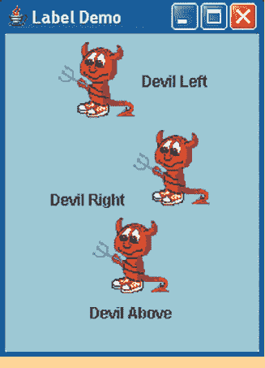

## REVIEW QUESTIONS *(see answers in Appendix N)*

- 44. How many frames, panels, image icons, and labels are declared in the `LabelDemo` program?
- 
- 45. Consider one of the label instantiation statements from the `LabelDemo` program:
  
  ```java
  label2 = new JLabel("Devil Right", icon, SwingConstants.CENTER);
  ```
  
  Explain the role of each of the three parameters passed to the `JLabel` constructor.

### SR 3.46

What is the result of separately making each of the following changes to the `LabelDemo` program? You may make the change, compile and run the program, and observe and report the results. Briefly explain what you observe.

- a. Change the third parameter of each of the three `JLabel` constructor calls to `SwingConstants.LEFT`.
- b. Change the horizontal text position of `label2` from LEFT to RIGHT.
- c. Change the horizontal text position of `label2` from LEFT to BOTTOM.
- d. Change the vertical text position of `label3` from BOTTOM to CENTER.

EX 3.3 Write a declaration for a `String` variable called `change` and initialize it to the characters stored in another `String` object called `original` with all 'e' characters changed to 'j'.

EX 3.4 What output is produced by the following code fragment?

```
String m1, m2, m3;

m1 = "Quest for the Holy Grail";

m2 = m1.toLowerCase();

m3 = m1 + " " + m2;

System.out.println (m3.replace('h', 'z'));
```

EX 3.5 What is the effect of the following import statement?

```
import java.awt.*;
```

EX 3.6 Assuming that a `Random` object has been created called `generator`, what is the range of the result of each of the following expressions?

- a. `generator.nextInt(20)`
- b. `generator.nextInt(8) + 1`
- c. `generator.nextInt(45) + 10`
- d. `generator.nextInt(100) - 50`

EX 3.7 Write code to declare and instantiate an object of the `Random` class (call the object reference variable `rand`). Then write a list of expressions using the `nextInt` method that generates random numbers in the following specified ranges, including the end-points. Use the version of the `nextInt` method that accepts a single integer parameter.

- a. 0 to 10
- b. 0 to 500
- c. 1 to 10
- d. 1 to 500
- e. 25 to 50
- f. −10 to 15

EX 3.8 Write an assignment statement that computes the square root of the sum of `num1` and `num2` and assigns the result to `num3`.

EX 3.9 Write a single statement that computes and prints the absolute value of `total`.

EX 3.10 Write code statements to create a `DecimalFormat` object that will round a formatted value to four decimal places. Then write a statement that uses that object to print the value of `result`, properly formatted.

EX 3.11 Write code statements that prompt for and read a double value from the user, and then print the result of raising that value to the fourth power. Output the results to three decimal places.

EX 3.12 Write a declaration for an enumerated type that represents the days of the week.

## Programming Projects

Visit www.myprogramminglab.com to complete many of these Programming Projects online and get instant feedback.

PP 3.1 Write an application that prompts for and reads the user’s first and last name (separately). Then print a string composed of the first letter of the user’s first name, followed by the first five characters of the user’s last name, followed by a random number in the range 10 to 99. Assume that the last name is at least five letters long. Similar algorithms are sometimes used to generate usernames for new computer accounts.

PP 3.2 Write an application that prints the sum of cubes. Prompt for and read two integer values and print the sum of each value raised to the third power.

PP 3.3 Write an application that creates and prints a random phone number of the form XXX-XXX-XXXX. Include the dashes in the output. Do not let the first three digits contain an 8 or 9 (but don’t be more restrictive than that), and make sure that the second set of three digits is not greater than 742. Hint: Think through the easiest way to construct the phone number. Each digit does not have to be determined separately.

PP 3.4 Write an application that reads the (x,y) coordinates for two points. Compute the distance between the two points using the following formula:
Distance = √((x₂ − x₁)² + (y₂ − y₁)²)

PP 3.5 Write an application that reads the radius of a sphere and prints its volume and surface area. Use the following formulas. Print the output to four decimal places. r represents the radius.
Volume = (4/3)πr³
Surface Area = 4πr²


PP 3.6 编写一个应用程序，从用户那里读取三角形的三条边长。使用海伦公式（如下）计算三角形的面积，其中 s 表示三角形周长的一半，a、b 和 c 表示三条边的长度。将面积打印到小数点后三位。

Area = √[s(s − a)(s − b)(s − c)]

PP 3.7 编写一个应用程序，生成一个介于 20 到 40 之间（含）的随机整数，并显示该数字的正弦、余弦和正切值。

PP 3.8 编写一个应用程序，生成一个介于 1 到 10 之间（含）的随机整数半径（r）和高度（h）用于圆柱体，然后计算圆柱体的体积和表面积。

Volume = πr²h

Area = 2πr h

PP 3.9 编写一个应用程序，显示一个包含两个标签的框架，一个用于显示你的名字，另一个用于显示你的姓氏。尝试改变窗口大小，观察标签如何改变彼此的方向。

PP 3.10 编写一个应用程序，显示一个包含两个面板的框架。每个面板应包含两张图片（使用四张不同的图片——由你选择）。固定第一个面板的大小，使其两张图片始终并排显示。允许另一个面板根据需要改变大小。尝试改变窗口大小，观察图片如何改变方向。确保你理解应用程序的行为原因。

PP 3.11 修改 `LabelDemo` 程序，使其显示第四个标签，标签的文字居于图片上方。

## 编写类


## 章节目标

- 讨论类定义的结构和内容。
- 使用实例数据建立对象状态的概念。
- 描述可见性修饰符对方法和数据的影响。
- 探索方法定义的构成，包括参数和返回值。
- 讨论构造函数的结构和目的。
- 探索图形对象的创建。
- 介绍创建交互式图形用户界面的所需概念。
- 探索一些基本的 GUI 组件和事件。

在第 3 章中，我们使用了类和对象来提供各种服务。也就是说，我们使用了 Java 类库中提供的预定义类，以便使编写程序的过程更简单。在本章中，我们将讨论面向对象编程的核心：编写自己的类来定义自己的对象。本章探讨类定义的基础，包括方法的结构以及数据的范围和封装。本章的 Graphics Track 部分讨论如何编写具有图形表示的类，并介绍创建真正交互式图形用户界面所需的要点。


## 4.1 重新审视类和对象

在第 1 章中，我们介绍了基本的面向对象概念，包括对象和类的简要概述。在第 3 章中，我们使用了 Java 标准类库中的几个预定义类来创建对象，并利用它们提供的特定功能。

在本章中，我们将把注意力转向编写自己的类。尽管现有的类库提供了许多有用的类，但面向对象程序开发的本质是设计和实现自己的类以满足特定需求的过程。

回顾对象和类之间的基本关系：类是对象的蓝图。类代表对象的概念，而从该类创建的任何对象都是该概念的实现。

例如，从第 3 章我们知道 `String` 类代表字符字符串的概念，而每个 `String` 对象代表包含特定字符的特定字符串。

让我们考虑另一个例子。假设有一个名为 `Student` 的类，表示大学中的一名学生。从 `Student` 类创建的对象将代表一名特定的学生。`Student` 类代表学生的一般概念，而从该类创建的每个对象都代表学校中实际就读的一名学生。在一个帮助管理大学事务的系统中，我们将有一个 `Student` 类和数千个 `Student` 对象。

回顾对象具有状态，其由与该对象关联的属性的值定义。学生的属性可能包括学生的姓名、地址、专业和平均绩点。`Student` 类规定每个学生都有这些属性。每个 `Student` 对象存储特定学生的这些属性的值。在 Java 中，对象的属性由在类中声明的变量定义。

对象还具有行为，其由与该对象关联的操作定义。学生的操作包括更新该学生的地址和计算该学生的当前平均绩点的能力。`Student` 类定义了操作，例如平均绩点计算的细节。然后这些操作可以对（或由）特定的 `Student` 对象执行。请注意，对象行为可能会修改对象状态。在 Java 中，对象的操作由在类中声明的方法定义。

图 4.1 列出了一些类的示例，以及为这些类的对象可能定义的一些属性和操作。程序设计者需要确定需要哪些属性和操作，这取决于程序的目的以及特定对象在该目的中的作用。考虑你可能为这些示例包含的其他属性和操作。

| Class | Attributes | Operations |
|---|---|---|
| Student | Name<br>Address<br>Major<br>Grade point average | Set address<br>Set major<br>Compute grade point average |
| Rectangle | Length<br>Width<br>Color | Set length<br>Set width<br>Set color |
| Aquarium | Material<br>Length<br>Width<br>Height | Set material<br>Set length<br>Set width<br>Set height<br>Compute volume<br>Compute filled weight |
| Flight | Airline<br>Flight number<br>Origin city<br>Destination city<br>Current status | Set airline<br>Set flight number<br>Determine status |
| Employee | Name<br>Department<br>Title<br>Salary | Set department<br>Set title<br>Set salary<br>Compute wages<br>Compute bonus<br>Compute taxes |

图 4.1 类的示例以及一些可能的属性和操作

### 自测题（答案见附录 N）

- SR 4.1 什么是属性？
- SR 4.2 什么是操作？
- SR 4.3 列出可能为表示图书馆中书籍的 `Book` 类定义的一些属性和操作。
- SR 4.4 真或假？解释。
  a. 编写程序时，我们应该只使用 Java 标准类库中的类——没有必要定义或使用其他类。
  b. 对象上的操作可以改变对象状态。
  c. 对象的当前状态会影响对该对象执行的操作的结果。
  d. 在 Java 中，对象的状态由其方法表示。

## 4.2 类的解剖结构

在我们之前所有的示例中，我们都编写了一个包含单个 `main` 方法的单个类。这些类代表小型但完整的程序。这些程序通常使用 Java 类库中的预定义类实例化对象，并使用这些对象提供的服务。那些预定义类也是程序的一部分，但我们除了知道如何与它们交互外，几乎不关心它们。我们只需相信它们会提供它们承诺的服务。

让我们看另一个类似的例子。清单 4.1 中显示的 `RollingDice` 类包含一个 `main` 方法，该方法实例化了两个 `Die` 对象（die 的单数形式）。然后它掷骰子并打印结果。它还调用 `Die` 类提供的其他方法，例如显式设置和获取骰子当前点数的能力。

```java
//****************************** Author: Lewis/Loftus
// RollingDice.java
// Demonstrates the creation and use of a user-defined class.
//******************************
public class RollingDice
{
```


```java
// Creates two Die objects and rolls them several times.

//-------------------------

public static void main (String[] args)
{
    Die die1, die2;
    int sum;
    die1 = new Die();
    die2 = new Die();
    die1.roll();
    die2.roll();
    System.out.println ("Die One: " + die1 + ", Die Two: " + die2);
    die1.roll();
    die2.setFaceValue(4);
}
}
```

### LISTING 4.1 continued

```java
System.out.println("Die One: " + die1 + ", Die Two: " + die2);
sum = die1.getFaceValue() + die2.getFaceValue();
System.out.println("Sum: " + sum);
sum = die1.roll() + die2.roll();
System.out.println("Die One: " + die1 + ", Die Two: " + die2);
System.out.println("New sum: " + sum);
}
```

- Die One: 5, Die Two: 2
- Die One: 1, Die Two: 4
- Sum: 5
- Die One: 4, Die Two: 2
- New sum: 6

本示例与之前示例的主要区别在于，`Die` 类并不是 Java 类库预定义的一部分。我们必须自己编写 `Die` 类，定义 `Die` 对象要执行的功能，否则该程序无法编译和运行。

每个类都可以包含数据声明和方法声明，如图 4.2 所示。数据声明表示将存储在该类的每个对象中的数据。方法声明定义了这些对象将提供的服务。综合起来，类的成员就是类的数据和方法。

我们在之前示例中编写的类也遵循此模型，但它们在类级别不包含任何数据，并且只包含一个方法（`main` 方法）。我们将继续定义此类类，例如 `RollingDice` 类，以定义程序的起点。

真正的面向对象编程，则来自于定义代表具有明确状态和行为的对象的类。例如，在任何给定时刻，`Die` 对象都显示特定的点数，我们可以将其称为骰子的状态。`Die` 对象还具有我们可以调用的各种方法，例如掷骰子或获取其点数的能力。这些方法代表了骰子的行为。

> 面向对象编程的核心是定义代表具有明确状态和行为的对象的类。

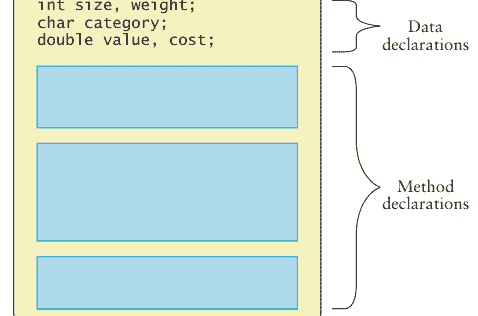

### FIGURE 4.2 The members of a class: data and method declarations

`Die` 类如清单 4.2 所示。它包含两个数据值：一个整数常量（`MAX`）表示骰子的最大点数，以及一个整数变量（`faceValue`）表示骰子的当前点数。它还包含一个名为 `Die` 的构造函数和四个普通方法：`roll`、`setFaceValue`、`getFaceValue` 和 `toString`。

你会记得在第 2 章和第 3 章中，构造函数是名称与类相同的特殊方法。当使用 `new` 操作符创建 `Die` 类的新实例时，会调用 `Die` 构造函数。`Die` 类中其余的方法定义了 `Die` 对象提供的各种服务。

我们使用文档头块来解释类中每个方法的用途。这种做法不仅对任何试图理解软件的人至关重要，而且还在视觉上将代码分隔开，使得在阅读代码时眼睛可以轻松地从一个方法跳到下一个方法。

图 4.3 列出了 `Die` 类的方法。从这个角度来看，它与我们在之前示例中使用的任何其他类看起来都不同。唯一重要的区别是，`Die` 类不是由 Java 标准类库为我们提供的。我们自己编写了它。

`Die` 类的方法包括掷骰子的能力，产生新的随机点数。`roll` 方法将新的点数返回给调用方法，但你也可以随时使用 `getFaceValue` 方法获取当前点数。`setFaceValue` 方法显式设置点数，就好像你伸手过去把骰子转到你想要的点数一样。任何对象的 `toString` 方法在你将对象传递给 `print` 或 `println` 方法以获取对象的字符串描述时都会自动调用

**VideoNote**

*Dissecting the `Die` class.*

### LISTING 4.2

```java
//************************************************************************
// Die.java      Author: Lewis/Loftus
//
// Represents one die (singular of dice) with faces showing values
// between 1 and 6.
//************************************************************************

public class Die
{
    private final int MAX = 6;  // maximum face value
    private int faceValue;  // current value showing on the die

    //-------------------------------------------------------------
    // Constructor: Sets the initial face value.
    //-------------------------------------------------------------
    public Die()
    {
        faceValue = 1;
    }

    //-------------------------------------------------------------
    // Rolls the die and returns the result.
    //-------------------------------------------------------------
    public int roll()
    {
        faceValue = (int)(Math.random() * MAX) + 1;
        return faceValue;
    }

    //-------------------------------------------------------------
    // Face value mutator.
    //-------------------------------------------------------------
    public void setFaceValue (int value)
    {
        faceValue = value;
    }

    //-------------------------------------------------------------
    // Face value accessor.
    //-------------------------------------------------------------
    public int getFaceValue()
```

## Instance Data

请注意，在 `Die` 类中，常量 `MAX` 和变量 `faceValue` 是在类内部声明的，但不在任何方法内部。变量的声明位置定义了其作用域，即该变量可以在程序中引用的区域。通过在类级别声明（而不是在方法内部），这些变量和常量可以在类的任何方法中引用。

`faceValue` 变量等属性被称为实例数据，因为每次创建该类的实例时都会为该变量保留新的内存空间。每个 `Die` 对象都有自己的 `faceValue` 变量和自己的数据空间。这就是每个 `Die` 对象可以拥有自己的状态的原因。我们在 `RollingDice` 程序的输出中看到了这一点：一个骰子的点数为 5，另一个骰子的点数为 2。只有当为每个 `Die` 对象创建 `faceValue` 变量的内存空间时，这才有可能。

> **KEY CONCEPT**
>
> 变量的作用域决定了它可以被引用的位置，这取决于它声明的位置。

我们可以将这种情况描述如下：

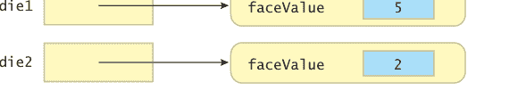

`die1` 和 `die2` 引用变量指向（即包含地址）它们各自的 `Die` 对象。每个对象都包含一个具有自己内存空间的 `faceValue` 变量。因此每个对象可以为其实例数据存储不同的值。

Java 会自动初始化在类级别声明的任何变量。例如，所有 `int` 和 `double` 等数值类型的变量都初始化为零。然而，尽管语言执行这种自动初始化，但最好显式初始化变量（通常在构造函数中），以便阅读代码的任何人都能清楚地理解其意图。

## UML Class Diagrams

在本书中，我们使用 UML 图来可视化类和对象之间的关系。UML 代表统一建模语言，已成为表示面向对象程序设计的流行记法。

存在几种类型的 UML 图，每种都旨在显示面向对象程序的特定方面。我们在本书中主要关注 UML 类图，以显示类的内容及其之间的关系。

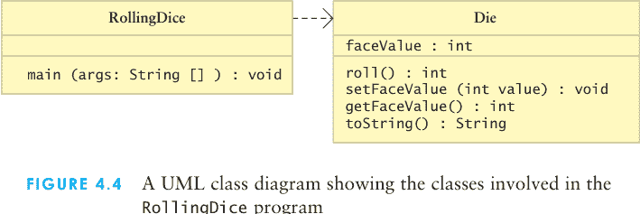

> **KEY CONCEPT**
>
> UML 类图帮助我们可视化程序中类的内容及其之间的关系。

在 UML 图中，每个类都表示为一个矩形，可能包含三个部分以显示类名、其属性（数据）和其操作（方法）。图 4.4 显示了包含 `RollingDice` 程序的类的类图。

图 4.4 中连接 `RollingDice` 和 `Die` 类的箭头表示类之间存在关系。虚线箭头表示一个类 *使用* 另一个类的方法。其他类型的面向对象类之间的关系使用不同类型的连线和箭头表示。我们将在本书中探讨相关主题时讨论这些其他关系。

请记住，UML 并非专门为 Java 程序员设计。它旨在语言独立。因此，UML 图中使用的语法不一定与 Java 相同。例如，变量的类型显示在变量名之后，用冒号分隔。方法的返回类型以相同的方式显示。

UML 图非常灵活。我们可以根据特定图的需要包含所需的相关信息。例如，如果这些细节对特定图不相关，我们可以省略类的数据和方法部分。

UML 图允许你可视化程序的设计。随着我们的程序变得更大，由越来越多的类组成，这些可视化变得越来越有帮助。我们将根据情况需要探索 UML 图的新方面。

### SELF-REVIEW QUESTIONS *(see answers in Appendix N)*

- **SR 4.5** 什么是对象与类的区别？
- **SR 4.6** 描述 `Die` 类的实例数据。
- **SR 4.7** 为 `Die` 类定义的方法中，哪些可以改变 `Die` 对象的状态——即哪些方法为实例数据赋值？
- **SR 4.8** 当你将一个对象传给 `print` 或 `println` 方法时会发生什么？
- **SR 4.9** 变量的作用域是什么？
- **SR 4.10** UML 图的设计目的是什么？

## 4.3 封装

我们在第1章概述面向对象概念时提到，对象应当是自我管理的。也就是说，对象的实例数据只能由该对象自身修改。例如，`Die` 类的方法应单独负责改变 `faceValue` 变量的值。我们应该让类外部的代码难以（如果不是不可能的话）“深入”并修改在类内部声明的变量的值。这种特性称为封装。

对象应当与系统中的其余部分封装开来。它应该只通过一组特定的方法（这些方法定义了该对象提供的服务）与程序的其他部分进行交互。这些方法定义了该对象与使用它的程序之间的接口。

> **关键概念**
>
> 对象应当被封装，以保护其数据免受不当访问。

封装在图4.5中以图形方式进行了描绘。使用对象的代码（有时称为对象的客户端）不应被允许直接访问变量。客户端应调用对象的方法，然后这些方法与封装在对象内部的数据进行交互。例如，`RollingDice` 程序中的 `main` 方法调用 `Die` 对象的 `roll` 方法。`main` 方法不应该（实际上也不能）直接访问 `faceValue` 变量。

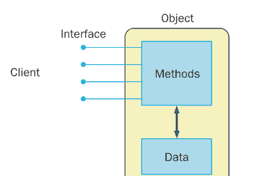

图4.5 客户端与对象的方法进行交互

该方法应当只允许对骰子的面值进行有效的修改。我们将在下一章探讨如何实现这种控制。

### 自测题（答案见附录N）

- SR 4.11 对象应当自我管理。请解释。
- SR 4.12 什么是对象的接口？
- SR 4.13 什么是修饰符？
- SR 4.14 为什么常量可能被赋予公共可见性？
- SR 4.15 描述以下各项：
  - a. 公共方法
  - b. 私有方法
  - c. 公共变量
  - d. 私有变量

## 4.4 方法的剖析

我们已经看到，类由数据声明和方法声明组成。让我们更详细地研究一下方法声明。

正如我们在第1章中所述，方法是一组被命名的编程语言语句。方法声明指定了当方法被调用时执行的代码。Java 程序中的每个方法都是特定类的一部分。

当方法被调用时，控制流转移到该方法。该方法的语句被逐一执行。当该方法完成后，控制返回到调用发生的位置，并继续执行。

被调用的方法（即被调用的那个方法）可能与调用它的方法属于同一个类。如果被调用的方法与调用方法同属一个类，则只需方法名即可调用它。如果它属于另一个类，则通过该类的对象名来调用它，正如我们多次看到的那样。图4.7展示了方法被调用时的执行流程。

在前面的示例中，我们已经多次定义了程序的 `main` 方法。它的定义遵循与所有方法相同的语法。方法的头部包括返回值的类型、方法名以及该方法接受的参数列表。构成方法体的语句定义在由花括号分隔的块中。本节的其余部分将更详细地讨论与方法声明相关的问题。

### 方法声明

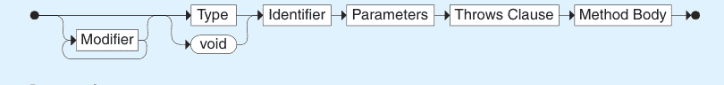

**参数**

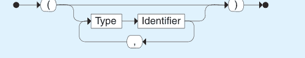

方法由可选的修饰符、返回类型、确定方法名的标识符、参数列表和方法体定义。返回类型指明了方法将返回的值的类型，该类型可能是 `void`。方法体是当方法被调用时执行的一个语句块。`throws` 子句是可选的，用于指明此方法可能抛出的异常。

示例：

```java
public void instructions (int count)
{
    System.out.println ("Follow all instructions.");
    System.out.println ("Use no more than " + count +
    " turns.");
}
```


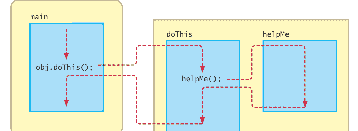

图4.7 调用方法后的控制流

### 返回类型

在数次调用中，`roll` 方法返回的值被忽略了，而在其他调用中，返回值则用于计算。

构造方法没有返回类型（甚至没有 `void`），因此不能返回值。我们将在本章后面更详细地讨论构造方法。

## 参数

正如我们在第2章中所定义的那样，参数是在方法被调用时传入方法的值。方法头部的*参数列表*指定了传入值的类型以及被调用方法引用这些值所使用的名称。

方法声明头部的参数名称称为*形式参数*。在调用中，传入方法的值称为*实际参数*。实际参数也称为方法的*实参*。

方法的调用和定义总是在方法名后的括号中给出参数列表。如果没有参数，则使用一对空括号，就像 `roll` 和 `getFaceValue` 方法中的情况一样。`Die` 的构造方法也不接受参数，尽管构造方法通常会有参数。

形式参数是充当方法内部变量的标识符，其初始值来自调用中的实际参数。当方法被调用时，每个实际参数的值被复制并存储到相应的形式参数中。实际参数可以是字面量、变量或完整表达式。如果表达式用作实际参数，则会在方法调用之前对它进行完全求值，并将结果作为参数传递。

`Die` 类中唯一接受参数的方法是 `setFaceValue` 方法，它接受一个 `int` 参数。形式参数名为 `value`。在 `main` 方法中，值 4 作为实际参数传入其中。

调用和方法声明中的参数列表必须匹配。也就是说，第一个实际参数的值被复制到第一个形式参数中，第二个实际参数复制到第二个形式参数中，以此类推，如图4.8所示。实际参数的类型必须与形式参数的指定类型一致。

有关参数传递的其他细节将在第7章中讨论。

> **关键概念**
>
> 当方法被调用时，实际参数会被复制到形式参数中。

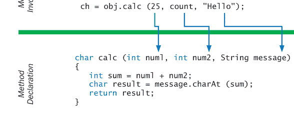

图4.8 将参数从方法调用传递到方法声明

### 局部数据

变量可以在方法内部声明，使其成为局部数据，与实例数据相对。回顾一下，实例数据在类中声明，但不在任何特定方法内部。

局部数据的作用域仅限于声明它的方法。在 `Die` 类的 `toString` 方法中声明的变量 `result` 是局部数据。在 `Die` 类的任何其他方法中对 `result` 的任何引用都会导致编译器发出错误消息。局部变量在声明它的方法之外根本不存在。另一方面，在类级别声明的实例数据具有整个类的作用域；类的任何方法都可以引用它。

> **关键概念**
>
> 在方法中声明的变量对于该方法来说是局部的，不能在方法之外使用。

由于局部数据和实例数据在不同级别的作用域中起作用，因此在方法内部声明的局部变量可以与在类级别声明的实例变量同名。在方法中引用该名称将引用该变量的局部版本。这种命名方式显然有可能使阅读代码的人感到困惑，因此应避免。

方法头部的形式参数名充当该方法的局部数据。它们在方法被调用之前不存在，并在方法退出时不再存在。例如，`setFaceValue` 方法中的形式参数 `value` 在方法被调用时开始存在，并在方法执行结束时消失。

### 银行账户示例

让我们看另一个类及其使用的示例。清单4.3中显示的 `Transactions` 类包含一个 `main` 方法，该方法创建一些 `Account` 对象并调用它们的服务。

### 代码清单 4.3

```
//************************************************************************
// Transactions.java      Author: Lewis/Loftus
//
// Demonstrates the creation and use of multiple Account objects.
//************************************************************************
public class Transactions
{
    //------------------------------------------------------------
    // Creates some bank accounts and requests various services.
    //------------------------------------------------------------
    public static void main (String[] args)
    {
        Account acct1 = new Account ("Ted Murphy", 72354, 102.56);
        Account acct2 = new Account ("Jane Smith", 69713, 40.00);
        Account acct3 = new Account ("Edward Demsey", 93757, 759.32);
        acct1.deposit (25.85);
        double smithBalance = acct2.deposit (500.00);
        System.out.println ("Smith balance after deposit: " +
                            smithBalance);
        System.out.println ("Smith balance after withdrawal: " +
                            acct2.withdraw (430.75, 1.50));
        acct1.addInterest();
        acct2.addInterest();
        acct3.addInterest();
        System.out.println ();
        System.out.println (acct1);
        System.out.println (acct2);
        System.out.println (acct3);
    }
}
```

### 输出

Smith balance after deposit: 540.0
Smith balance after withdrawal: 107.75

72354   Ted Murphy      $132.90
69713   Jane Smith      $111.52
93757   Edward Demsey   $785.90

`Account` 类，如代码清单 4.4 所示，表示一个基本的银行账户。它包含表示账户号码、账户当前余额以及账户所有者姓名的实例数据。请注意，实例数据可以是对象引用变量，而不仅仅是原始类型，例如账户所有者的姓名，它是对 `String` 对象的引用。账户的利率以常量的形式存储。

`Account` 类的构造函数接受三个参数，用于初始化实例数据。`deposit` 和 `withdraw` 方法执行账户上的基本

```java
import java.text.NumberFormat;

public class Account
{
    private final double RATE = 0.035; // interest rate of 3.5%
    private long acctNumber;
    private double balance;
    private String name;
    // ------------------------------------------------------------
    // Sets up the account by defining its owner, account number,
    // and initial balance.
    // ------------------------------------------------------------
    public Account (String owner, long account, double initial)
    {
        name = owner;
        acctNumber = account;
        balance = initial;
    }
    // ------------------------------------------------------------
    // Deposits the specified amount into the account. Returns the
    // new balance.
    // ------------------------------------------------------------
    public double deposit (double amount)
```

### 代码清单 4.4 继续

```
{
    balance = balance + amount;
    return balance;
}
//------------------------------------------------------------------------------
// Withdraws the specified amount from the account and applies
// the fee. Returns the new balance.
//------------------------------------------------------------------------------
public double withdraw (double amount, double fee)
{
    balance = balance - amount - fee;
    return balance;
}
//------------------------------------------------------------------------------
// Adds interest to the account and returns the new balance.
//------------------------------------------------------------------------------
public double addInterest ()
{
    balance += (balance * RATE);
    return balance;
}
//------------------------------------------------------------------------------
// Returns the current balance of the account.
//------------------------------------------------------------------------------
public double getBalance ()
{
    return balance;
}
//------------------------------------------------------------------------------
// Returns a one-line description of the account as a string.
//------------------------------------------------------------------------------
public String toString ()
{
    NumberFormat fmt = NumberFormat.getCurrencyInstance();
    return acctNumber + "\t" + name + "\t" + fmt.format(balance);
}
}
```

交易，基于参数调整余额。还有一个 `addInterest` 方法，它通过添加所赚取的利息来更新余额。这些方法代表了更改余额的有效方式，因此不提供经典的 mutator，例如 `setBalance`。

`Transactions` 程序中刚刚创建的三个 `Account` 对象的状态可以如下所示描述：

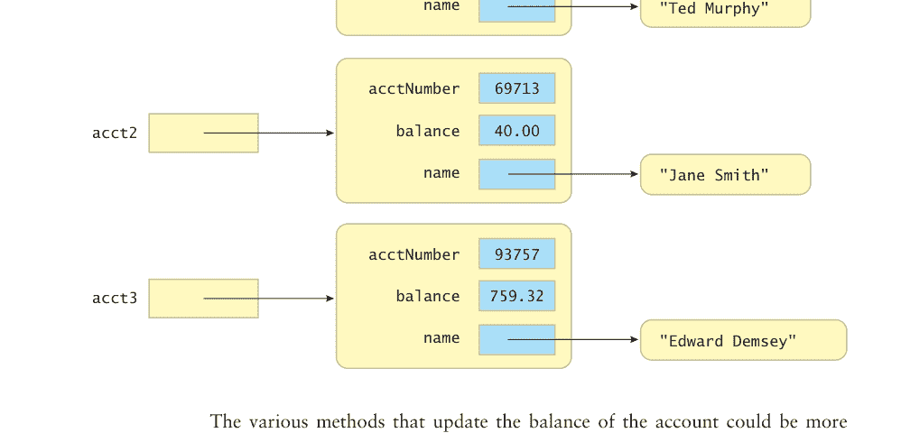

更新账户余额的各种方法可以设计得更严格。应进行检查以确保参数值有效，例如防止提取负数金额，这本质上相当于存款。这种处理将在下一章中讨论。

- SR 4.16 为什么通过某个特定对象调用的方法？该规则的例外是什么？
- SR 4.17 方法返回值意味着什么？
- SR 4.18 `return` 语句的作用是什么？
- SR 4.19 是否需要 `return` 语句？
- SR 4.20 解释实际参数和形式参数之间的区别。
- SR 4.21 为 `Die` 类编写一个名为 `getFaceDown` 的方法，该方法返回骰子的当前“朝下”面值。提示：在标准骰子上，任意两个相对面的和为七。
- SR 4.22 在 `Transactions` 程序中：
  - a. 创建了多少个 `Account` 对象？
  - b. 当在 `acct2` 对象上调用 `withdraw` 方法时，传递了多少个参数（实际参数）？
  - c. 当在 `acct3` 对象上调用 `addInterest` 方法时，传递了多少个参数（实际参数）？
- SR 4.23 你会将 `Account` 类的哪些方法归类为访问器方法？作为 mutator 方法？作为服务方法？

## 4.5 构造函数回顾

正如我们在第 2 章中所说，构造函数类似于在对象实例化时被调用的方法。当我们定义一个类时，我们通常会定义一个构造函数来帮助我们设置该类。特别是，我们经常使用构造函数来初始化与每个对象关联的变量。

构造函数与普通方法有两个不同之处。首先，构造函数的名称与类的名称相同。因此，`Die` 类中的构造函数名称为 `Die`，`Account` 类中的构造函数名称为 `Account`。其次，构造函数不能返回值，并且在方法头中不指定返回类型。

程序员常犯的一个错误是在构造函数上放置 `void` 返回类型。就编译器而言，在构造函数上放置任何返回类型，即使是 `void`，也会将其变成一个名称恰好与类相同但实际上是普通方法的方法。因此，它不能作为构造函数被调用。这会导致有时难以解读的错误信息。

> 关键概念
> 构造函数不能有任何返回类型，即使是 `void`。

通常，构造函数用于初始化新实例化的对象。例如，`Die` 类的构造函数将骰子的面值初始设置为 1。`Account` 类的构造函数将实例变量的值设置为作为参数传递给构造函数的参数值。

我们不必为每个类都定义构造函数。每个类都有一个不带参数的默认构造函数。如果我们不提供自己的构造函数，就会使用默认构造函数。这个默认构造函数通常对新创建的对象没有任何影响。

### 自测题（答案见附录 N）

- SR 4.24 构造函数有什么用途？
- SR 4.25 如何定义构造函数？

## 4.6 图形对象

一些对象具有图形表示，意味着它们的状态和行为包括关于对象在视觉上是什么样子的信息。图形对象可能包含有关其大小和颜色的数据，并且可能包含绘制它的方法。

在第 3 章中，我们实例化并使用了诸如框架、面板、标签和图像等图形组件。当然，这些组件可以被视为图形对象。本节更详细地检查其中的一些，并探讨如何定义我们自己的具有图形特征的对象。

代码清单 4.5 中的程序显示了一个笑脸和一个文本标题。然而，`SmilingFace` 类中的 `main` 方法并不处理所有这些细节。相反，`main` 方法为程序设置框架并使用它来显示 `SmilingFacePanel` 类的一个实例。

`SmilingFacePanel` 类如代码清单 4.6 所示。它定义了绘制的基础的两个常量（`BASEX` 和 `BASEY`）、一个设置面板关键方面的构造函数，以及一个名为 `paintComponent` 的方法，该方法绘制我们在程序执行时看到的面孔。在这种情况下，我们不是向此面板添加 GUI 组件，而是直接在上面绘制。

请注意，`SmilingFacePanel` 类扩展了 `JPanel` 类。正如我们在第 2 章中讨论 applet 时提到的，`extends` 子句建立了继承关系。`SmilingFacePanel` 类继承了 `JPanel` 类的特征。也就是说，`SmilingFacePanel` 是一个 `JPanel`。此时，关于继承，你只需要知道这些，在第 9 章中会详细讨论继承。

`SmilingFacePanel` 类的构造函数设置面板的背景颜色和首选大小，以及设置面板的默认字体。请注意，这些调用不是对某个其他对象进行的，就像我们在第 3 章中创建单独的 `JPanel` 对象时所做的那样。当方法在没有通过特定对象调用的情况下被调用时，你可以认为它是对象“自言自语”。构造函数中的调用是对 `SmilingFacePanel` 类所代表的对象进行的。

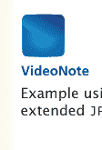

### 代码清单 4.5

```java
//***************************************************************************
// SmilingFace.java          Author: Lewis/Loftus
//
// Demonstrates the use of a separate panel class.
```


```java
//***************************************************************************

import javax.swing.JFrame;

public class SmilingFace

{

    //------------------------------------

    // Creates the main frame of the program.

    //------------------------------------

    public static void main (String[] args)

    {

        JFrame frame = new JFrame ("Smiling Face");

        frame.setDefaultCloseOperation (JFrame.EXIT_ON_CLOSE);

        SmilingFacePanel panel = new SmilingFacePanel();

        frame.getContentPane().add(panel);

        frame.pack();

        frame.setVisible(true);

    }

}
```

### 显示


## 4.6 图形对象

```java
page.drawArc (BASEX+35, BASEY+40, 15, 10, 180, 180); // nose
page.drawArc (BASEX+20, BASEY+50, 40, 15, 180, 180); // mouth
page.setColor (Color.white);
page.drawString ("Always remember that you are unique!",
BASEX-105, BASEY-15);
page.drawString ("Just like everyone else.", BASEX-45, BASEY+105);
}
```

`paintComponent`方法接受一个`Graphics`对象作为参数，正如我们在第2章中所讨论的，该对象代表组件的图形上下文。通过调用面板图形上下文（即`page`参数）的方法，可以在面板上绘制图形。

每个`JPanel`对象都有一个`paintComponent`方法，绘制面板时会自动调用该方法。在本例中，我们扩展了`paintComponent`的定义——告诉它除了绘制面板背景之外，还应按照`paintComponent`方法中的各种调用绘制笑脸和文字。`paintComponent`方法的第一行是对`super.paintComponent`的调用，它表示`JPanel`标准的`paintComponent`方法，负责绘制背景。在`paintComponent`方法中，我们几乎总是将这一行作为第一行代码。

让我们看另一个例子。代码清单4.7所示的`Splat`类包含一个`main`方法，用于创建并显示程序窗口。在视觉上，这个

```java
//******************************
// Splat.java Author: Lewis/Loftus
// Demonstrates the use of graphical objects.
//******************************

import javax.swing.*;
import java.awt.*;

public class Splat {
```

### 代码清单 4.8

```java
//*******************************************************************************
 //  SplatPanel.java      Author: Lewis/Loftus
//
//  Demonstrates the use of graphical objects.
//*******************************************************************************

import javax.swing.*;
import java.awt.*;

public class SplatPanel extends JPanel
{
    private Circle circle1, circle2, circle3, circle4, circle5;
    //-------------------------------------------------------------
    //  Constructor: Creates five Circle objects.
    //-------------------------------------------------------------
    public SplatPanel()
    {
        circle1 = new Circle (30, Color.red, 70, 35);
        circle2 = new Circle (50, Color.green, 30, 20);
        circle3 = new Circle (100, Color.cyan, 60, 85);
        circle4 = new Circle (45, Color.yellow, 170, 30);
        circle5 = new Circle (60, Color.blue, 200, 60);
        setPreferredSize (new Dimension(300, 200));
        setBackground (Color.black);
    }
    //-------------------------------------------------------------
    //  Draws this panel by requesting that each circle draw itself.
    //-------------------------------------------------------------
    public void paintComponent (Graphics page)
    {
        super.paintComponent(page);
        circle1.draw(page);
        circle2.draw(page);
        circle3.draw(page);
        circle4.draw(page);
        circle5.draw(page);
    }
}
```

`SplatPanel`类中的`paintComponent`方法通过调用每个圆的`draw`方法来绘制面板。本质上，`SplatPanel`类要求每个圆自行绘制。

`Circle`类如代码清单4.9所示。它定义了实例数据来存储圆的大小、其`(x, y)`位置和颜色。这些值通过构造方法设置，并且该类包含所有适当的访问器和修改器方法。`Circle`类的`draw`方法仅根据其实例数据（即当前状态）的值来绘制圆。

### 代码清单 4.9

```java
import java.awt.*;

public class Circle
{
    private int diameter, x, y;
    private Color color;
    //-------------------------------------------------------------
    // Constructor: Sets up this circle with the specified values.
    //-------------------------------------------------------------
    public Circle (int size, Color shade, int upperX, int upperY)
    {
        diameter = size;
        color = shade;
        x = upperX;
        y = upperY;
    }
    //-------------------------------------------------------------
    // Draws this circle in the specified graphics context.
    //-------------------------------------------------------------
    public void draw (Graphics page)
    {
        page.setColor (color);
        page.fillOval (x, y, diameter, diameter);
    }
    //--------------------
    // Diameter mutator.
    //--------------------
    // public void setDiameter (int size)
    // {
    // diameter = size;
    // }
    //--------------------
    // Color mutator.
    //--------------------
    // public void setColor (Color shade)
    // {
    // color = shade;
    // }
    //--------------------
    // X mutator.
    //--------------------
    // public void setX (int upperX)
    // {
    // x = upperX;
    // }
    //--------------------
    // Y mutator.
    //--------------------
    // public void setY (int upperY)
    // {
    // y = upperY;
    // }
    //--------------------
    // Diameter accessor.
    //--------------------
    // public int getDiameter ()
    // {
    // return diameter;
    // }
    //-----------------------------------------------
    // Color accessor.
    //-----------------------------------------------
    public Color getColor ()
    {
        return color;
    }
    //-----------------------------------------------
    // X accessor.
    //-----------------------------------------------
    public int getX ()
    {
        return x;
    }
    //-----------------------------------------------
    // Y accessor.
    //-----------------------------------------------
    public int getY ()
    {
        return y;
    }
}
```

`Splat`程序体现了基本的面向对象思想。每个圆管理自身，并会在你传入的任何图形上下文中绘制自身。每个`Circle`对象都维护自己的状态。`Circle`类的定义方式使其可以用于其他场景和程序。

### 自测题（答案见附录N）

- SR 4.26 在`SmilingFace`程序中，面板的“内容”是在哪里定义的？
- SR 4.27 在`SmilingFace`程序中，面板对象的`paintComponent`方法在何时、以何种方式被调用？
- SR 4.28 编写代码，为笑脸添加一副眼镜。
- SR 4.29 重写`Circle`类的构造方法，使其为所创建的`Circle`对象生成一个直径在20到200之间（含20和200）的随机圆。圆的其他属性应作为参数提供给构造方法。

## 4.7 图形用户界面

在第2章和第3章中，我们介绍了一些有助于设计基于图形的程序的关键组件。现在我们真正需要的是用户交互，这是图形用户界面（GUI）的核心。本节介绍创建基于GUI的交互式程序所需的概念，并为本书后续的所有GUI讨论奠定基础。

在Java中创建图形用户界面至少需要三类对象：

- 组件
- 事件
- 监听器

正如我们在第3章中提到的，GUI组件是一种对象，它定义了一个屏幕元素，用于显示信息或允许用户以特定方式与程序交互。GUI组件的示例包括按钮、文本框、标签、滚动条和菜单。容器是一种特殊类型的组件，用于容纳和组织其他组件。我们已经使用过诸如框架和面板这样的容器，也探索了标签的使用。

事件是一个对象，表示我们可能感兴趣的某种发生。通常，事件对应用户操作，例如按下鼠标按钮或敲击键盘上的按键。大多数GUI组件都会生成事件，以表示与该组件相关的用户操作。例如，按钮组件会生成一个事件来表示按钮已被按下。以GUI为核心、响应用户事件的程序被称为事件驱动。

监听器是一个对象，它“等待”事件发生，并在事件发生时以某种方式作出响应。我们必须仔细地建立监听器、它所监听的事件，以及将生成该事件的组件三者之间的关系。

> 关键概念
> GUI由组件、表示用户操作的事件，以及响应这些事件的监听器组成。

在大多数情况下，我们将使用由Java类库中的类预先定义的组件和事件。我们会定制组件的行为，但它们的基本角色已经确定。然而，我们将编写监听器类，以便在事件发生时执行我们想要的任何操作。

具体来说，要创建使用GUI的Java程序，我们必须：

- 实例化并设置必要的组件，
- 实现监听器类，定义特定事件发生时的行为，并
- 在监听器与生成相关事件的组件之间建立关系。

视频笔记
GUI开发概述。

在某些方面，一旦你对事件驱动编程有了基本理解，其余的就只是细节了。你可以使用许多类型的组件，这些组件会产生许多类型的事件，你可能想要确认这些事件。但它们都以相同的基本方式工作。它们彼此之间都有相同的核心关系。

以下各节介绍了一些更多组件，并展示了允许真正用户交互的基于 GUI 的程序示例。

### 自测题（答案见附录 N）

- SR 4.30 事件与监听器之间是什么关系？
- SR 4.31 我们能否向任何组件添加任何类型的监听器？解释。

## 4.8 按钮

第 4.10 节所示的 `PushCounter` 程序向用户展示了一个单一的推按钮（标签为“Push Me!”）。每次按下按钮时，计数器都会更新并显示。

### LISTING 4.10

```java
//*******************************************************************
//  PushCounter.java      Author: Lewis/Loftus
//
//  Demonstrates a graphical user interface and an event listener.
//*******************************************************************

import javax.swing.JFrame;

public class PushCounter
{
    //---------------------------------------------------------------
    //  Creates the main program frame.
    //---------------------------------------------------------------
    public static void main (String[] args)
    {
        JFrame frame = new JFrame ("Push Counter");
        frame.setDefaultCloseOperation (JFrame.EXIT_ON_CLOSE);
        frame.getContentPane().add(new PushCounterPanel());
        frame.pack();
        frame.setVisible(true);
    }
}
```


### DISPLAY


此程序中使用的组件包括一个按钮、一个用于显示计数的标签、一个用于组织 GUI 的面板，以及一个用于显示面板的框架。面板由 `PushCounterPanel` 类定义，见第 4.11 节。

推按钮是一个允许用户通过鼠标按下发起操作的组件。我们在后面的章节中会探索其他类型的按钮组件。推按钮由 `JButton` 类定义。

### LISTING 4.11

```java

//***********************************************************

//  PushCounterPanel.java      Author: Lewis/Loftus

//

//  Demonstrates a graphical user interface and an event listener.

//***********************************************************

import java.awt.*;

import java.awt.event.*;

import javax.swing.*;

public class PushCounterPanel extends JPanel

{

    private int count;

    private JButton push;

    private JLabel label;

    //------------------------------------------------------------

    // Constructor: Sets up the GUI.

    //------------------------------------------------------------

    public PushCounterPanel ()

    {

        count = 0;

        push = new JButton ("Push Me!");

        push.addActionListener (new ButtonListener());

        label = new JLabel ("Pushes: " + count);

        add (push);

        add (label);

        setPreferredSize (new Dimension(300, 40));

        setBackground (Color.cyan);

    }

    //****************************************************************

    // Represents a listener for button push (action) events.

    //****************************************************************

    private class ButtonListener implements ActionListener

    {

        //------------------------------------------------------------

        // Updates the counter and label when the button is pushed.

        //------------------------------------------------------------

        public void actionPerformed (ActionEvent event)

        {

            count++;

            label.setText("Pushes: " + count);

        }

    }

}

```

`PushCounterPanel` 构造函数设置了 GUI。`JButton` 构造函数的调用接受一个 `String` 参数，该参数指定按钮上显示的文本。按钮和标签被添加到面板中。

此程序中唯一感兴趣的事件是按钮被按下时发生的事件。为了响应该事件，我们必须为该事件创建监听器对象，因此我们必须编写一个表示监听器的类。

`JButton` 在被按下时会生成一个动作事件。因此我们编写的监听器类将是一个动作事件监听器。在此程序中，我们定义了一个名为 `ButtonListener` 的类来表示该事件的监听器。

我们可以在自己的文件中编写 `ButtonListener` 类，甚至可以在同一文件中但在 `PushCounterPanel` 类之外编写它。然而，这样我们就必须设置监听器与监听器更新的 GUI 组件之间通信的方式。相反，我们将 `ButtonListener` 类定义为内部类，即在另一个类中定义的类。作为内部类，它自动可以访问包含它的类的成员。你只有在两个类之间存在密切关系并且内部类不被任何其他类访问的情况下才应创建内部类。监听器与其 GUI 之间的关系是内部类合适的少数情况之一。

> **KEY CONCEPT**
> 由于监听器与 GUI 组件之间存在密切关系，监听器通常被定义为内部类。

监听器类是通过实现接口编写的，接口是实现类必须定义的方法列表。Java 标准类库为许多类型的事件包含接口。通过实现 `ActionListener` 接口创建动作监听器；因此，我们在 `ButtonListener` 类中包含 `implements` 子句。接口将在第 7 章中更详细地讨论。

`ActionListener` 接口中列出的唯一方法是 `actionPerformed` 方法，因此 `ButtonListener` 类必须实现的也只有该方法。生成动作事件的组件（在本例中为按钮）会在事件发生时调用 `actionPerformed` 方法，并传入表示该事件的 `ActionEvent` 对象。有时我们会使用事件对象，有时仅知道事件发生了就足够了。在本例中，我们不需要与事件对象交互。当事件发生时，监听器递增 `count` 并使用 `setText` 方法重置标签的文本。

记住，我们不仅要为事件创建监听器，还必须设置监听器与将生成事件的组件之间的关系。为此，我们通过调用适当的方法将监听器添加到组件中。在 `PushCounterPanel` 构造函数中，我们调用 `addActionListener` 方法，并传入一个新实例化的 `ButtonListener` 对象。

仔细回顾此示例，注意它是如何完成创建交互式基于 GUI 程序的三个关键步骤的。它创建并设置 GUI 组件，创建感兴趣事件的适当监听器，并设置监听器与将生成事件的组件之间的关系。

### 自测题（答案见附录 N）

- SR 4.32 推按钮（`JButton` 对象）会生成什么类型的事件？
- SR 4.33 你将如何更改 `PushCounterPanel` 类，使其不再显示按钮被按下的次数计数，而是显示计数“轨迹”？按下一次后显示“01”；按下两次后显示“012”；按下五次后显示“012345”；以此类推。

## 4.9 文本字段

让我们看另一个使用另一个组件的示例：文本字段。第 4.12 节所示的 `Fahrenheit` 程序展示了一个 GUI，其中包含一个文本字段，用户可以在其中输入华氏温度。当用户按下 Enter（或 Return）键时，等效的摄氏温度将被显示。

`Fahrenheit` 程序的界面在 `FahrenheitPanel` 类中设置。文本字段是 `JTextField` 类的对象。`JTextField` 构造函数接受一个整数参数，该参数指定字段的大小，以字符数为单位，基于当前默认字体。

文本字段和各种标签被添加到面板以便显示。请记住，面板受流式布局管理器控制，该管理器尽可能在一行上放置尽可能多的组件。因此，如果你调整框架大小，标签和文本字段的方向可能会发生变化。我们将在第 7 章详细研究布局管理器，提供更多控制组件布局的选项。

如果光标当前位于文本字段中，按下 Enter 或 Return 键时，文本字段组件会生成一个动作事件。因此我们需要设置一个监听器对象来响应动作事件。正如我们在上一节的 PushCounter 程序中所做的那样，我们将监听器定义为实现 `ActionListener` 接口的内部类。

当用户按下 Enter 键时，文本字段组件会调用 `actionPerformed` 方法。该方法首先通过调用其 `getText` 方法从文本字段中检索文本，该方法返回一个字符字符串。然后使用 `Integer` 包装类的 `parseInt` 方法将文本转换为整数。随后该方法执行计算以确定等效的摄氏温度，并用结果设置相应标签的文本。

请注意，推按钮和文本字段会生成同一种事件：动作事件。因此，`Fahrenheit` 程序设计的另一种选择是向 GUI 添加一个 `JButton` 对象，当用户使用鼠标按下按钮时触发转换。更进一步，相同的监听器对象可以

### 代码清单 4.12

```java

//****************************************************************

//      Fahrenheit.java      Author: Lewis/Loftus

//

//  Demonstrates the use of text fields.

//****************************************************************

import javax.swing.JFrame;

public class Fahrenheit

{

    //-------------------------------------------------------------

    // Creates and displays the temperature converter GUI.

    //-------------------------------------------------------------

    public static void main (String[] args)

    {

        JFrame frame = new JFrame ("Fahrenheit");

        frame.setDefaultCloseOperation (JFrame.EXIT_ON_CLOSE);

        FahrenheitPanel panel = new FahrenheitPanel();

        frame.getContentPane().add(panel);

        frame.pack();

        frame.setVisible(true);

    }

}

```

### 显示效果


### 代码清单 4.13

```java

//****************************************************************

// FahrenheitPanel.java      Author: Lewis/Loftus

//

// Demonstrates the use of text fields.

//****************************************************************

import java.awt.*;

import java.awt.event.*;

import javax.swing.*;

public class FahrenheitPanel extends JPanel

{

    private JLabel inputLabel, outputLabel, resultLabel;

    private JTextField fahrenheit;

    //-------------------------------------------------------------

    // Constructor: Sets up the main GUI components.

    //-------------------------------------------------------------

    public FahrenheitPanel()

    {

        inputLabel = new JLabel ("Enter Fahrenheit temperature:");

        outputLabel = new JLabel ("Temperature in Celsius: ");

        resultLabel = new JLabel ("---");

        fahrenheit = new JTextField (5);

        fahrenheit.addActionListener (new TempListener());

        add (inputLabel);

        add (fahrenheit);

        add (outputLabel);

        add (resultLabel);

        setPreferredSize (new Dimension(300, 75));

        setBackground (Color.yellow);

    }

    //****************************************************************

    // Represents an action listener for the temperature input field.

    //****************************************************************

    private class TempListener implements ActionListener

    {

        //------------------------------------------------------------

        // Performs the conversion when the enter key is pressed in

        // the text field.

        //------------------------------------------------------------

        public void actionPerformed (ActionEvent event)

        {

            int fahrenheitTemp, celsiusTemp;

            String text = fahrenheit.getText();

            fahrenheitTemp = Integer.parseInt (text);

            celsiusTemp = (fahrenheitTemp-32) * 5/9;

            resultLabel.setText (Integer.toString (celsiusTemp));

        }

    }

}
```


同一个监听器可以同时用于监听多个组件。因此，可以将该监听器同时添加到文本框和按钮上，给用户提供选择。按下按钮或 Enter 键都会执行转换。这些变体作为编程项目留给读者。

### 自测题（答案见附录 N）

- SR 4.34 描述在 `Fahrenheit` 程序中，当用户在界面的文本框中输入一个数字并按 Enter（或 Return）键时会发生什么。
- SR 4.35 修改 `FahrenheitPanel` 类，使得当用户在文本字段中输入数字时，文本字段下方会出现形如“X 华氏度 = Y 摄氏度”的语句。例如，如果用户输入 223，则显示“223 华氏度 = 106 摄氏度”，而不是“摄氏温度：106”。

## 关键概念总结

- 面向对象编程的核心是定义类，这些类表示具有良好定义的状态和行为的对象。
- 变量的作用域决定了它可以在何处被引用，它取决于变量声明的位置。
- UML 类图帮助我们直观地了解程序中各类的内容以及它们之间的关系。
- 对象应该被封装，以保护其数据不被不恰当地访问。
- 实例变量应声明为私有可见性，以促进封装。
- 大多数对象包含访问器和修改器方法，以便客户端以受控方式管理数据。
- 方法返回的值必须与方法头中指定的返回类型一致。
- 调用方法时，实际参数会被复制到形式参数中。
- 在方法中声明的变量是该方法的局部变量，不能在方法之外使用。
- 构造函数不能有任何返回类型，即使是 void 也不行。
- GUI 由组件、表示用户操作的事件以及响应这些事件的监听器组成。
- 监听器通常定义为内部类，因为监听器与 GUI 组件之间存在密切关系。

## 练习

访问 `www.myprogramminglab.com` 在线完成这些练习中的许多题目，并获得即时反馈。

- **EX 4.1** 对于以下每一对，哪一个是类，哪一个是该类的对象？
  - a. `Superhero`, `Superman`
  - b. `Justin`, `Person`
  - c. `Rover`, `Pet`
  - d. `Magazine`, `Time`
  - e. `Christmas`, `Holiday`
- **EX 4.2** 列出可能为表示相框的名为 `PictureFrame` 的类定义的一些属性和操作。
- **EX 4.3** 列出可能为表示商务会议的名为 `Meeting` 的类定义的一些属性和操作。
- **EX 4.4** 列出可能为表示大学课程的名为 `Course` 的类定义的一些属性和操作（不是某一次具体的课程开设，而是泛指这门课程）。
- **EX 4.5** 编写一个名为 `lyrics` 的方法，调用时打印一首歌的歌词。该方法不应接受任何参数，也不应返回任何值。
- **EX 4.6** 编写一个名为 `cube` 的方法，接受一个整数参数，并返回该值的三次幂。
- **EX 4.7** 编写一个名为 `random100` 的方法，返回 1 到 100（含）之间的随机整数。
- **EX 4.8** 编写一个名为 `randomInRange` 的方法，接受两个表示范围的整数参数。该方法应返回指定范围（含）内的随机整数。假设第一个参数小于第二个参数。
- **EX 4.9** 编写一个名为 `randomColor` 的方法，创建并返回一个表示随机颜色的 `Color` 对象。回想一下，`Color` 对象可以由三个 0 到 255 之间的整数值定义，分别表示红、绿、蓝的贡献（即其 RGB 值）。
- **EX 4.10** 绘制一个 UML 类图，显示 `Transactions` 程序中所用类之间的关系。
- **EX 4.11** 绘制一个 UML 类图，显示 `PushCounter` 程序中所用类之间的关系。
- **EX 4.12** 绘制一个 UML 类图，显示 `Fahrenheit` 程序中所用类之间的关系。

## 编程项目

访问 `www.myprogramminglab.com` 在线完成这些编程项目中的许多题目，并获得即时反馈。

- **PP 4.1** 设计并实现一个名为 `Sphere` 的类，该类包含表示球体直径的实例数据。定义 `Sphere` 构造函数以接收并初始化直径，并为直径提供 getter 和 setter 方法。包含计算并返回球体体积和表面积的方法（公式见 PP 3.5）。包含一个 `toString` 方法，返回球体的一行描述。创建一个名为 `MultiSphere` 的驱动类，其 `main` 方法实例化并更新多个 `Sphere` 对象。
- **PP 4.2** 设计并实现一个名为 `Dog` 的类，包含表示狗的姓名和年龄的实例数据。定义 `Dog` 构造函数以接收并初始化实例数据。为姓名和年龄提供 getter 和 setter 方法。包含一个计算并返回狗的“人类年龄”（狗龄的七倍）的方法。包含一个 `toString` 方法，返回狗的一行描述。创建一个名为 `Kennel` 的驱动类，其 `main` 方法实例化并更新多个 `Dog` 对象。
- **PP 4.3** 设计并实现一个名为 `Car` 的类，包含表示汽车品牌、型号和年份的实例数据。定义 `Car` 构造函数以初始化这些值。为所有实例数据提供 getter 和 setter 方法，并提供一个 `toString` 方法返回汽车的一行描述。创建一个名为 `CarTest` 的驱动类，其 `main` 方法实例化并更新多个 `Car` 对象。
- **PP 4.4** 设计并实现一个名为 `Box` 的类，包含表示盒子的高度、宽度和深度的实例数据。另外包含一个名为 `full` 的布尔变量作为实例数据，表示盒子是否已满。定义 `Box` 构造函数以接收并初始化盒子的高度、宽度和深度。每个新创建的 `Box` 都是空的（构造函数应将 `full` 初始化为 false）。为所有实例数据提供 getter 和 setter 方法。包含一个 `toString` 方法，返回盒子的一行描述。创建一个名为 `BoxTest` 的驱动类，其 `main` 方法实例化并更新多个 `Box` 对象。
- **PP 4.5** 设计并实现一个名为 `Book` 的类，包含标题、作者、出版社和版权日期的实例数据。定义 `Book` 构造函数以接收并初始化这些数据。为所有实例数据提供 getter 和 setter 方法。包含一个 `toString` 方法，返回格式良好、多行的书籍描述。创建一个名为 `Bookshelf` 的驱动类，其 `main` 方法实例化并更新多个 `Book` 对象。
- **PP 4.6** 设计并实现一个名为 `Flight` 的类，表示一次航班。它应包含表示以下内容的实例数据：


`airline name`, `flight number`, and the flight’s origin and destination cities. Define the `Flight` constructor to accept and initialize all instance data. Include getter and setter methods for all instance data. Include a `toString` method that returns a one-line description of the flight. Create a driver class called `FlightTest`, whose `main` method instantiates and updates several `Flight` objects.

`PP 4.7` Design and implement a class called `Bulb` that represents a light bulb that can be turned on and off. Create a driver class called `Lights` whose `main` method instantiates and turns on some `Bulb` objects.

`PP 4.8` Using the `Die` class defined in this chapter, design and implement a class called `PairOfDice`, composed of two `Die` objects. Include methods to set and get the individual die values, a method to roll the dice, and a method that returns the current sum of the two die values. Create a driver class called `RollingDice2` to instantiate and use a `PairOfDice` object.

`PP 4.9` Design and implement a class called `Building` that represents a graphical depiction of a building. Allow the parameters to the constructor to specify the building’s width and height. Each building should be colored black and should contain a few random windows of yellow. Create a program that draws a random skyline of buildings.

`PP 4.10` Write a program that displays a graphical seating chart for a dinner party. Create a class called `Diner` (as in one who dines) that stores the person’s name, gender, and location at the dinner table. A diner is graphically represented as a circle, color-coded by gender, with the person’s name printed in the circle.

`PP 4.11` Create a class called `Crayon` that represents one crayon of a particular color and length (height). Design and implement a program that draws a box of crayons.

`PP 4.12` Create a class called `Star` that represents a five-pointed star. Let the constructor accept the width of the star and the coordinates of the star’s top point. Write a program that draws a sky containing stars of various sizes.

`PP 4.13` Modify the `Fahrenheit` program from this chapter so that it displays a button that, when pressed, also causes the conversion calculation to take place. That is, the user will now have the option of either pressing Enter in the text field or pressing the button. Have the listener that is already defined for the text field also listen for the button push.

## SOFTWARE FAILURE

## Denver Airport Baggage Handling System

## What Happened?

The designers of the Denver International Airport had big plans to automate the handling of luggage. With as much as a mile to cover between the airport gates and terminals, the hope was to develop a system that whisked your luggage from the check-in counter to the departing plane and from an arriving plane to baggage collection with minimal human intervention. They thought the system would result in fewer flight delays, less waiting at luggage carousels, and reduced labor costs.


The system was designed and created in the late 1980s and early 1990s. Approximately 26 miles of track were constructed to move bags up and down inclines in gray carts under the control of a central computer. However, the planned March 1994 opening of the airport was delayed continuously due to failures in the baggage system. During tests, bags were misloaded and misrouted. They fell out of carts when making turns. The system loaded bags into carts that already were full and unloaded them onto belts already jammed with luggage. Bags were damaged by being wedged under carts and dropped onto concrete floors.

The airport finally opened for business in February of 1995. At that point, only one airline—United—agreed to use the automated system. This was a stripped-down version of the system, used only for outgoing flights. No other airline used the system at all. They opted for humans driving luggage carts, just as most airports do today. United finally gave up using the system in 2005.

The original cost of the system was $186 million. The delays cost $1 million a day, surpassing the original costs. When United opted to abandon the system in 2005, it did so despite having a lease on the system through 2025 at $60 million per year.

The automated baggage-handling system in Denver resulted in lost luggage and mangled packages.

## What Caused It?

The fiasco this project represents is considered to be one of the greatest software engineering and overall system-design failures in history. There were many individual issues that contributed to the problems, but in general, the designers simply had too much faith in the technology they were using. They didn’t factor in errors and inefficiencies that always occur in a complex system.

The individual problems included the fact that the software misinterpreted data from photoelectric eyes and, therefore, did not detect a pile of existing bags. When the system was restarted after it crashed, it lost information about the status of carts and didn’t know which ones were full or not. Sharp corners were not factored in correctly regarding the speed of the conveyors, resulting in spilled carts. A telescoping belt loader called the lizard tongue—designed to reach into a planes cargo hold and pick up bags without human assistance—failed completely.

## Lessons Learned

A project of this scope should not be attempted without many localized tests on the technologies in use. The failures were often a result of multiple variables caused by the system as a whole in operation.

When the system was designed in the late 1980s, it relied on a centralized mainframe to control the system. Such an approach seems ridiculous in today’s world of distributed processing, but it is a good example of how a large system can be obsolete by the time it is developed. Today, human baggage handlers with handheld scanners result in a far more fast and accurate delivery system than the best goals of the planned automated system.

Source: The International Herald Tribune

## Conditionals and Loops

## CHAPTER OBJECTIVES

- Define the flow of control through a method.
- Explore boolean expressions that can be used to make decisions.
- Perform basic decision making using if statements.
- Discuss issues pertaining to the comparison of certain types of data.
- Execute statements repetitively using while loops.
- Discuss the concept of an iterator object and use one to read a text file.
- Draw with the aid of conditionals and loops.
- Explore more GUI components and events.

All programming languages have statements that allow you to make decisions to determine what to do next. Some of those statements allow you to repeat a certain activity multiple times. This chapter discusses key Java statements of this type and explores issues related to the comparison of data and objects. It begins with a discussion of boolean expressions, which form the basis of any decision. The Graphics Track sections of this chapter explore new drawing options and some new components and events.


### 5.1 Boolean Expressions

The order in which statements are executed in a running program is called the *flow of control*. Unless otherwise specified, the execution of a program proceeds in a linear fashion. That is, a running program starts at the first programming statement and moves down one statement at a time until the program is complete. A Java application begins executing with the first line of the `main` method and proceeds step by step until it gets to the end of the `main` method.

Invoking a method alters the flow of control. When a method is called, control jumps to the code defined for that method. When the method completes, control returns to the place in the calling method where the invocation was made, and processing continues from there.

> KEY CONCEPT
> Conditionals and loops allow us to control the flow of execution through a method.

Within a given method, we can alter the flow of control through the code by using certain types of programming statements. Statements that control the flow of execution through a method fall into two categories: conditionals and loops.

A *conditional statement* is sometimes called a *selection statement*, because it allows us to choose which statement will be executed next. The conditional statements in Java are the `if` statement, the `if-else` statement, and the `switch` statement. We explore the `if` statement and the `if-else` statement in this chapter and cover the `switch` statement in Chapter 6.

Each decision is based on a *boolean expression* (also called a *condition*), which is an expression that evaluates to either true or false. The result of the expression determines which statement is executed next. The following is an example of an `if` statement:

```
```


```
if (count > 20)

    System.out.println ("Count exceeded");
```

> KEY CONCEPT
> An if statement allows a program to choose whether to execute a particular statement.

The condition in this statement is `count > 20`. That expression evaluates to a boolean (true or false) result. Either the value stored in `count` is greater than 20 or it’s not. If it is, the `println` statement is executed. If it’s not, the `println` statement is skipped and processing continues with whatever code follows it.

The need to make decisions like this comes up all the time in programming situations. For example, the cost of life insurance might be dependent on whether the insured person is a smoker. If the person smokes, we calculate the cost using a particular formula; if not, we calculate it using another. The role of a conditional statement is to evaluate a boolean condition (whether the person smokes) and then to execute the proper calculation accordingly.

一个循环，或重复语句，允许我们一次又一次地执行一个编程语句。与条件语句一样，循环基于一个布尔表达式，该表达式决定语句执行的次数。

例如，假设我们想要计算班级中每个学生的平均绩点。计算对每个学生都相同；只是作用于不同的数据。我们会设置一个循环，对每个学生重复该计算，直到没有更多学生需要处理为止。

Java 有三种类型的循环语句：`while`语句、`do`语句和`for`语句。每种类型的循环语句都有独特的特征，使其与其他类型区分开来。我们在本章中介绍`while`语句，并在第 6 章中探讨`do`循环和`for`循环。

条件语句和循环所基于的布尔表达式使用相等运算符、关系运算符和逻辑运算符来做出决策。在详细讨论条件语句和循环语句之前，让我们先探索这些运算符。

> KEY CONCEPT
> 循环允许程序多次执行一条语句。

## 相等运算符和关系运算符

`==`和`!=`运算符称为相等运算符。它们分别测试两个值是否相等或不相等。请注意，等号运算符由两个并排的等号组成，不应与仅使用一个等号的赋值运算符混淆。

下面的`if`语句仅在变量`total`和`sum`包含相同值时才打印一句句子：

```
if (total == sum)

    System.out.println ("total equals sum");
```

同样，下面的`if`语句仅在变量`total`和`sum`不包含相同值时才打印一句句子：

```
if (total != sum)

    System.out.println ("total does NOT equal sum");
```

Java 还有几个关系运算符，可让我们决定值之间的相对顺序。本节前面我们使用大于运算符 (`>`) 来判断一个值是否大于另一个值。我们可以使用各种运算符提出类似的问题。在 Java 中，关系运算符为大于 (`>`)、小于 (`<`)、大于或等于 (`>=`) 和小于或等于 (`<=`)。图 5.1 列出了 Java 的相等运算符和关系运算符。

| Operator | Meaning |
|---|---|
| `==` | equal to |
| `!=` | not equal to |
| `<` | less than |
| `<=` | less than or equal to |
| `>` | greater than |
| `>=` | greater than or equal to |

FIGURE 5.1 Java equality and relational operators

相等运算符和关系运算符的优先级低于算术运算符。因此，算术运算先求值，然后是相等和关系运算。和往常一样，可以使用括号显式指定求值顺序。

在我们本章中检查条件语句和循环语句时，会看到更多关系运算符的示例。

## 逻辑运算符

除了相等运算符和关系运算符之外，Java 还有三个产生布尔结果的逻辑运算符。它们也接受布尔操作数。图 5.2 列出了并描述了逻辑运算符。

`!`运算符用于执行逻辑 NOT 操作，也称为逻辑补码。布尔值的逻辑补码会产生其相反值。也就是说，如果一个布尔变量`found`的值为 false，则`!found`为 true。同样，如果`found`为 true，则`!found`为 false。逻辑 NOT 操作不会改变`found`中存储的值。

逻辑运算可以用真值表来描述，真值表列出了表达式中涉及的变量的所有可能值组合。因为逻辑

| Operator | Description | Example | Result |
|---|---|---|---|
| `!` | logical NOT | `!a` | true if a is false and false if a is true |
| `&&` | logical AND | `a && b` | true if a and b are both true and false otherwise |
| \|\| | logical OR | a \|\| b | true if a or b or both are true and false otherwise |

FIGURE 5.2 Java logical operators

NOT 运算符是单目运算符，其一个操作数只有两种可能值：true 或 false。图 5.3 显示了描述 `!`运算符的真值表。

| a | ! a |
|---|---|
| false | true |
| true | false |

FIGURE 5.3 Truth table describing the logical NOT operator

`&&`运算符执行逻辑 AND 操作。结果为 true 当且仅当两个操作数都为 true，否则为 false。将它与逻辑 OR 运算符 (`||`) 的结果进行比较，后者为 true 当且仅当一个或另一个或两个操作数都为 true，否则为 false。

AND 和 OR 运算符都是二元运算符，因为每个运算符使用两个操作数。因此，有四种可能的组合需要考虑：两个操作数都为 true、两个都为 false、一个为 true 另一个为 false，以及反之亦然。图 5.4 描绘了一个真值表，显示了 `&&`和`||`运算符。

逻辑 NOT 的优先级高于三个逻辑运算符中的最高，其次是逻辑 AND，然后是逻辑 OR。

考虑下面的`if`语句：

```
if (!done && (count > MAX))

    System.out.println ("Completed.");
```

在什么条件下会执行`println`语句？布尔变量`done`的值要么为 true 要么为 false，NOT 运算符会反转该值。`count`的值要么大于`MAX`，要么不大于。图 5.5 中的真值表分解了所有可能性。

`&&`和`||`运算符的一个重要特征是它们是“短路”的。也就是说，如果其左操作数足以决定运算的布尔结果，则右操作数不会被求值。这种情况可能发生在两个运算符上，但原因不同。如果`&&`运算符的左操作数为 false，则无论右操作数的值如何，运算结果都将为 false。同样，如果`||`的左操作数为 true，则无论右操作数的值如何，运算结果都为 true。

有时你可以利用运算是短路的这一事实。例如，下面的`if`语句中的条件在左操作数为 false 时不会尝试除以零。如果`count`的值为零，`&&`操作的左侧为 false；因此整个表达式为 false，右侧不会被求值。

```
if (count != 0 && total/count > MAX)

    System.out.println ("Testing.");
```

你应该仔细考虑是否依赖于这种微妙的编程语言特性。并非所有编程语言都以相同的方式工作。正如我们之前强调的，你应该优先考虑可读性而不是聪明的编程技巧。始终努力使代码的任何读者都能清楚地了解程序逻辑的工作方式。

| done | count > MAX | !done | !done && (count > MAX) |
|---|---|---|---|
| false | false | true | false |
| false | true | true | true |
| true | false | false | false |
| true | true | false | false |

FIGURE 5.5 A truth table for a specific condition

> KEY CONCEPT
> 逻辑运算符通常用于构建复杂的条件。

| a | b | a && b | a \|\| b |
|---|---|--------|-------|
| false | false | false | false |
| false | true | false | true |
| true | false | false | true |
| true | true | true | true |

FIGURE 5.4 Truth table describing the logical AND and OR operators

## SELF-REVIEW QUESTIONS (see answers in Appendix N)

- SR 5.1 What is meant by the flow of control through a program?
- SR 5.2 What type of conditions are conditionals and loops based on?
- SR 5.3 What are the equality operators? The relational operators? The logical operators?
- SR 5.4 Given the following declarations, what is the value of each of the listed boolean expressions?

```
int value1 = 5, value2 = 10;

boolean done = true;
```

- a. `value1 <= value2`
- b. `(value1 + 5) >= value2`
- c. `value1 < value2 / 2`
- d. `value2 != value1`
- e. `!(value1 == value2)`
- f. `(value1 < value2) || done`
- g. `(value1 > value2) || done`
- h. `(value1 < value2) && !done`
- i. `done || !done`
- j. `((value1 > value2) || done) && (!done || (value2 > value1))`

SR 5.5 What is a truth table?

SR 5.6 Assuming `done` is a boolean variable and `value` is an int variable, create a truth table for the expression:
`(value > 0 ) || !done`

SR 5.7 Assuming `c1` and `c2` are boolean variables, create a truth table for the expression:
`(c1 && !c2) || (!c1 && c2)`

## 5.2 The if Statement

我们在本章早期的示例中使用了基本的`if`语句。现在让我们详细探讨它。

`if`语句由保留字`if`组成，后跟一个布尔表达式，后跟一条语句。条件用括号括起来，必须求值为 true 或 false。如果条件为 true，则执行该语句并继续处理下一条语句。如果条件为 false，则跳过该语句并立即继续处理下一条语句。图 5.6 显示了此处理。

> KEY CONCEPT
> 适当的缩进对于人类可读性很重要；它显示了一条语句与另一条语句之间的关系。

考虑以下`if`语句的示例：

```
if (total > amount)

    total = total + (amount + 1);
```

在此示例中，如果`total`中的值大于`amount`中的值，则执行赋值语句；否则跳过赋值语句。

请注意，此示例中的赋值语句在`if`语句的标题行下方缩进。这传达了赋值语句


### 图 5.6 if 语句的逻辑

它是`if`语句的一部分；它意味着 if 语句控制赋值语句是否会被执行。尽管这种缩进对于人类读者来说极其重要，但编译器会忽略它。

代码清单 5.1 中的示例读取用户的年龄，然后根据输入的年龄决定是否打印特定句子。`Age`程序在所有情况下都会回显输入的年龄值。如果年龄小于常量`MINOR`的值，就打印关于青春的那句话。如果年龄大于或等于`MINOR`的值，`println`语句将被跳过。无论哪种情况，最后关于“年龄是一种心态”的那句话都会打印出来。

### 代码清单 5.1

```
//**************************************************************
// Age.java      Author: Lewis/Loftus
// Demonstrates the use of an if statement.
//**************************************************************

import java.util.Scanner;

public class Age

{

    //-------------------------------------------------------------
    // Reads the user's age and prints comments accordingly.
    //-------------------------------------------------------------

    public static void main (String[] args)

    {

        final int MINOR = 21;

        Scanner scan = new Scanner (System.in);

System.out.print ("Enter your age: ");

int age = scan.nextInt();

System.out.println ("You entered: " + age);

if (age < MINOR)

    System.out.println ("Youth is a wonderful thing. Enjoy.");

System.out.println ("Age is a state of mind.");

}

}
```

### 输出

```
Enter your age: 40

You entered: 40

Age is a state of mind.
```

我们再看几个基本`if`语句的示例。下面的`if`语句会在变量`size`的当前值大于或等于常量`MAX`中的值时，将其设置为零：

```
if (size >= MAX)

    size = 0;
```

下面这个`if`语句的条件首先将三个值相加，然后将结果与存储在`numBooks`中的值进行比较：

```
if (numBooks < stackCount + inventoryCount + duplicateCount)

    reorder = true;
```

如果`numBooks`小于其他三个值之和，布尔变量`reorder`就会被设置为 true。加法运算会在小于运算符之前执行，因为算术运算符的优先级高于关系运算符。

假设`generator`引用的是`Random`类的一个对象，下面的`if`语句检查调用`nextInt`返回的值，以确定一个随机中奖者：

```
if (generator.nextInt(CHANCE) == 0)

    System.out.println ("You are a randomly selected winner!");
```

这段代码选中中奖者的几率取决于`CHANCE`常量的值。也就是说，如果`CHANCE`为 20，中奖几率为 1/20。条件中查找返回值 0 这一事实是任意的；0 到`CHANCE-1`之间的任意值都可以。

## if-else 语句

有时我们希望条件为真时做一件事，条件为假时做另一件事。我们可以给`if`语句添加一个`else`子句，使其成为`if-else`语句，以处理这种情况。下面是一个`if-else`语句的示例：

```
if (height <= MAX)

    adjustment = 0;

else
```


`adjustment = MAX - height;`

### 关键概念
`if-else` 语句允许程序在条件为真时做一件事，在条件为假时做另一件事。

如果条件为真，执行第一条赋值语句；如果条件为假，执行第二条赋值语句。二者只能执行其一，因为布尔条件的计算结果要么为 `true` 要么为 `false`。注意，这里再次使用了恰当的缩进，以表明这些语句属于主导的 `if` 语句的一部分。


`if` 语句测试布尔表达式 `Expression`，如果为真，则执行第一条 `Statement`。可选的 `else` 子句指定当 `Expression` 为假时应执行的 `Statement`。

示例：

```
if (tal < 7)
    System.out.println ("Total is less than 7.");
```

```
if (firstCh != 'a')
    count++;
else
    count = count / 2;
```

代码清单 5.2 中的 `Wages` 程序使用 `if-else` 语句来计算员工应得的工资。

在 `Wages` 程序中，如果员工一周工作超过 40 小时，工资金额会考虑加班时间。程序使用 `if-else` 语句来判断用户输入的小时数是否大于 40。如果是，额外的小时数按正常工资的 1.5 倍支付。如果没有加班时间，则总工资仅根据工作小时数和标准工资率计算。

我们再来看一个 `if-else` 语句的示例：

```
if (roster.getSize() == FULL)
    roster.expand();
else
    roster.addName (name);
```

### 代码清单 5.2

```java
//****************************************************************
// Wages.java        Author: Lewis/Loftus
//
// Demonstrates the use of an if-else statement.
//****************************************************************
import java.text.NumberFormat;
import java.util.Scanner;
public class Wages
{
    //-------------------------------------------------------------
    // Reads the number of hours worked and calculates wages.
    //-------------------------------------------------------------
    public static void main (String[] args)
    {
        final double RATE = 8.25;  // regular pay rate
        final int STANDARD = 40;   // standard hours in a work week
        Scanner scan = new Scanner (System.in);
        double pay = 0.0;
        System.out.print ("Enter the number of hours worked: ");
        int hours = scan.nextInt();
        System.out.println ();
        // Pay overtime at "time and a half"
        if (hours > STANDARD)
            pay = STANDARD * RATE + (hours-STANDARD) * (RATE * 1.5);
        else
            pay = hours * RATE;
        NumberFormat fmt = NumberFormat.getCurrencyInstance();
        System.out.println ("Gross earnings: " + fmt.format(pay));
    }
}
```

### 输出

```
Enter the number of hours worked: 46
Gross earnings: $404.25
```

该示例使用了一个名为 `roster` 的对象。即使不知道 `roster` 代表什么，或者它是由哪个类创建的，我们也能看出它至少有三个方法：`getSize`、`expand` 和 `addName`。`if` 语句的条件调用 `getSize`，并将结果与常量 `FULL` 进行比较。如果条件为真，则调用 `expand` 方法（显然是为了扩展 `roster` 的大小）。如果 `roster` 尚未满，则将变量 `name` 作为参数传递给 `addName` 方法。

代码清单 5.3 中的程序实例化了一个 `Coin` 对象，通过调用 `flip` 方法抛掷硬币，然后使用 `if-else` 语句根据结果决定打印两句话中的哪一句。

### 代码清单 5.3

```java
//****************************************************************
// CoinFlip.java      Author: Lewis/Loftus
//
// Demonstrates the use of an if-else statement.
//****************************************************************
public class CoinFlip
{
    //------------------------------------------------------------
    // Creates a Coin object, flips it, and prints the results.
    //------------------------------------------------------------
    public static void main (String[] args)
    {
        Coin myCoin = new Coin();
        myCoin.flip();
        System.out.println (myCoin);
        if (myCoin.isHeads())
            System.out.println ("You win.");
        else
            System.out.println ("Better luck next time.");
    }
}
```

### 输出

```
Tails
Better luck next time.
```

`Coin` 类如代码清单 5.4 所示。它存储两个整数常量（`HEADS` 和 `TAILS`），代表硬币的两种可能状态，以及一个名为 `face` 的实例变量，代表硬币的当前状态。`Coin` 构造函数首先通过调用 `flip` 方法抛掷硬币，该方法通过随机选择一个数字（0 或 1）来确定硬币的新状态。`isHeads` 方法根据硬币当前的 `face` 值返回一个布尔值。`toString` 方法使用 `if-else` 语句来决定返回哪个字符串来描述硬币。当 `myCoin` 对象在 `main` 方法中传递给 `println` 时，`toString` 方法会被自动调用。

## 使用块语句

我们可能希望在布尔条件求值后执行多件事。在 Java 中，我们可以用块语句替换任意单条语句。

## 第 5 章 条件语句和循环

### 代码清单 5.4

```java
//*****************************
// Coin.java Author: Lewis/Loftus
// Represents a coin with two sides that can be flipped.
//*****************************
public class Coin
{
    private final int HEADS = 0;
    private final int TAILS = 1;
    private int face;
    /**
     * Sets up the coin by flipping it initially.
     */
    public Coin()
    {
        flip();
    }
    /**
     * Flips the coin by randomly choosing a face value.
     */
    public void flip()
    {
        face = (int) (Math.random() * 2);
    }
    /**
     * Returns true if the current face of the coin is heads.
     */
    public boolean isHeads()
    {
        return (face == HEADS);
    }
    /**
     * Returns the current face of the coin as a string.
     */
    public String toString()
    {
        String faceName;
        if (face == HEADS)
            faceName = "Heads";
        else
            faceName = "Tails";
        return faceName;
    }
}
```

块语句是一组用大括号括起来的语句集合。我们在之前的示例中多次使用这些大括号来包含方法和类的定义。

程序 `Guessing` 在代码清单 5.5 中展示，使用了一个 `if-else` 语句，其中 `else` 子句的语句是一个块语句。

如果用户输入的猜测等于随机选择的答案，就会打印出适当的确认信息。然而，如果答案不正确，则会打印两条语句，一条说明猜测错误，另一条打印实际答案。本章末尾的一个编程项目将此示例的概念扩展为 Hi-Lo 游戏。

请注意，如果没有使用块大括号，说明答案不正确的句子会在答案错误时打印，但揭示正确答案的句子会在所有情况下都打印。也就是说，只有第一条语句才会被视为 `else` 子句的一部分。

请记住，除对人类阅读者之外，缩进没有任何意义。语句如果没有正确分组，可能会导致程序员对代码的执行方式产生错误的假设。例如，以下代码具有误导性：

```java
if (depth >= UPPER_LIMIT)
    delta = 100;
else
    System.out.println ("WARNING: Delta is being reset to ZERO");
    delta = 0;  // not part of the else clause!
```

缩进（更不用说代码的逻辑）暗示变量 `delta` 仅在 `depth` 小于 `UPPER_LIMIT` 时才被重置为零。然而，如果不使用块，重置 `delta` 为零的赋值语句根本不受 `if-else` 语句的控制。它在任何情况下都会执行，这显然不是预期的结果。


### 代码清单 5.5

```java
//***************************************************************************
// Guessing.java      Author: Lewis/Loftus
//
// Demonstrates the use of a block statement in an if-else.
//***************************************************************************
import java.util.*;
public class Guessing
{
    //-------------------------------------------------------------
    // Plays a simple guessing game with the user.
    //-------------------------------------------------------------
    public static void main (String[] args)
    {
        final int MAX = 10;
        int answer, guess;
        Scanner scan = new Scanner (System.in);
        Random generator = new Random();
        answer = generator.nextInt(MAX) + 1;
        System.out.print ("I'm thinking of a number between 1 and "
                         + MAX + ". Guess what it is: ");
        guess = scan.nextInt();
        if (guess == answer)
            System.out.println ("You got it! Good guessing!");
        else
        {
            System.out.println ("That is not correct, sorry.");
            System.out.println ("The number was " + answer);
        }
    }
}
```

### 输出结果

```text
I'm thinking of a number between 1 and 10. Guess what it is: 7
That is not correct, sorry.
The number was 5
```

块语句可以在 Java 语法要求单个语句的任何地方使用。例如，`if-else` 语句的 `if` 部分可以是一个块，或者 `else` 部分可以是一个块（如我们在 `Guessing` 程序中看到的），或者两部分都可以是块语句。例如：

```java
if (boxes != warehouse.getCount())
{
    System.out.println ("Inventory and warehouse do NOT match.");
    System.out.println ("Beginning inventory process again!");
    boxes = 0;
}
else
{
    System.out.println ("Inventory and warehouse MATCH.");
    warehouse.ship();
}
```

在此 `if-else` 语句中，`boxes` 的值与通过调用 `warehouse` 对象的 `getCount` 方法获得的值进行比较（无论那是什么）。如果它们不完全匹配，则执行两个 `println` 语句和一个赋值语句。如果它们匹配，则打印不同的消息并调用 `warehouse` 的 `ship` 方法。

### 嵌套 if 语句

作为 `if` 语句结果而执行的语句可能又是另一个 `if` 语句。这种情况称为 *嵌套 if*。它允许我们在确定之前决策的结果后做出另一个决策。代码清单 5.6 中的程序 `MinOfThree` 使用嵌套 `if` 语句来确定用户输入的三个整数值中的最小值。

仔细追踪 `MinOfThree` 程序的逻辑，使用最小值位于三个位置中的各种输入集，以了解它如何确定最低值。

嵌套 `if` 语句会出现一个重要情况。看起来在嵌套 `if` 之后出现的 `else` 子句可能适用于任一 `if` 语句。例如：

```java
if (code == 'R')
    if (height <= 20)
        System.out.println ("Situation Normal");
    else
        System.out.println ("Bravo!");
```

### 代码清单 5.6

```java
//********************************************************************
// MinOfThree.java      Author: Lewis/Loftus
//
// Demonstrates the use of nested if statements.
//********************************************************************
import java.util.Scanner;
public class MinOfThree
{


```
//-------------------------------------------------------------

// Reads three integers from the user and determines the smallest

// value.

//-------------------------------------------------------------

public static void main (String[] args)

{

    int num1, num2, num3, min = 0;

    Scanner scan = new Scanner (System.in);

    System.out.println ("Enter three integers: ");

    num1 = scan.nextInt();

    num2 = scan.nextInt();

    num3 = scan.nextInt();

    if (num1 < num2)

        if (num1 < num3)

            min = num1;

        else

            min = num3;

    else

        if (num2 < num3)

            min = num2;

        else

            min = num3;

    System.out.println ("Minimum value: " + min);

}

}
```

### 输出结果

```
Enter three integers:
45 22 69
Minimum value: 22
```

`else` 子句是与内部 `if` 语句匹配还是与外部 `if` 语句匹配？此示例中的缩进暗示它是内部 `if` 语句的一部分，而这是正确的。`else` 子句始终与之前出现的最近的未匹配 `if` 匹配。然而，如果我们不小心，很容易在脑海中将其匹配错误并使缩进错位。这也是准确、一致的缩进至关重要的另一个原因。

> 关键概念
> 在嵌套 `if` 语句中，`else` 子句与最近的未匹配 `if` 匹配。

可以使用大括号来指定 `else` 子句所属的 `if` 语句。例如，如果前一个示例应被结构化为当 `code` 不等于 `'R'` 时打印字符串 `"Bravo!"`，我们可以强制这种关系（并正确缩进）如下：

```java
if (code == 'R')
{
    if (height <= 20)
        System.out.println ("Situation Normal");
}
else
    System.out.println ("Bravo!");
```

通过在第一个 `if` 语句中使用块语句，我们确定 `else` 子句属于它。

### 自测题（答案见附录 N）

SR 5.8 给定以下假设，以下代码片段会产生什么输出？

```java
if (num1 < num2)
    System.out.print (" red ");
if ((num1 + 5) < num2)
    System.out.print (" white ");
else
    System.out.print (" blue ");
System.out.println (" yellow ");
```

- a. 假设 `num1` 的值为 2 且 `num2` 的值为 10？
- b. 假设 `num1` 的值为 10 且 `num2` 的值为 2？
- c. 假设 `num1` 的值为 2 且 `num2` 的值为 2？

SR 5.9 块语句如何在条件语句的构造中帮助我们？

SR 5.10 什么是嵌套 `if` 语句？

SR 5.11 对于每个假设，以下代码片段会产生什么输出？

```java
if (num1 >= num2)
{
    System.out.print (" red ");
    System.out.print (" orange ");
}
if ((num1 + 5) >= num2)
    System.out.print (" white ");
else
    if ((num1 + 10) >= num2)
    {
        System.out.print (" black ");
        System.out.print (" blue ");
    }
    else
        System.out.print (" yellow ");
System.out.println(" green ");
```

- a. 假设 `num1` 的值为 5 且 `num2` 的值为 4？
- b. 假设 `num1` 的值为 5 且 `num2` 的值为 12？
- c. 假设 `num1` 的值为 5 且 `num2` 的值为 27？

SR 5.12 编写一个表达式，根据名为 `temperature` 的 `int` 变量的值打印消息。如果 `temperature` 等于或小于 50，则在一行打印 `"It is cool."`，下一行打印 `"Dress warmly."`。如果 `temperature` 大于 80，则在一行打印 `"It is warm."`，下一行打印 `"Dress coolly."`。如果 `temperature` 在 50 和 80 之间，则在一行打印 `"It is pleasant."`，下一行打印 `"Dress pleasantly."`。

## 5.3 比较数据

在使用布尔表达式比较数据时，了解根据所检查的数据类型而产生的一些细微差别非常重要。让我们看几个关键情况。

### 比较浮点数

在比较浮点数据时会出现一个有趣的情况。根据 `==` 运算符，两个浮点值相等仅当其底层表示的所有二进制位都匹配时。如果比较的值是计算的结果，即使它们对特定情况来说足够接近，也可能不太可能完全相等。因此，在比较浮点值时应很少使用相等运算符 `==`。

检查浮点相等更好的方法是计算两个值之差的绝对值，并将结果与某个容差水平进行比较。例如，我们可以选择 0.00001 的容差水平。如果两个浮点值足够接近，以至于它们的差小于容差，则我们愿意认为它们相等。比较两个浮点值 `f1` 和 `f2` 可以按如下方式完成：

```
if (Math.abs(f1 - f2) < TOLERANCE)
    System.out.println ("Essentially equal.");
```

常量 `TOLERANCE` 的值应适合具体情况。

### 比较字符

我们知道一个数字小于另一个数字是什么意思，但一个字符小于另一个字符是什么意思呢？正如我们在第 2 章中所讨论的，Java 中的字符基于 Unicode 字符集，该字符集定义了所有可用字符的顺序。因为字符 `'a'` 在字符集中位于字符 `'b'` 之前，所以我们可以说 `'a'` 小于 `'b'`。

我们可以在字符数据上使用相等和关系运算符。例如，如果两个字符变量 `ch1` 和 `ch2` 包含两个字符，我们可以使用 `if` 语句按如下方式确定它们在 Unicode 字符集中的相对顺序：

> 关键概念
> Java 中字符的相对顺序由 Unicode 字符集定义。

```
if (ch1 > ch2)
    System.out.println (ch1 + " is greater than " + ch2);
else
    System.out.println (ch1 + " is NOT greater than " + ch2);
```

Unicode 字符集的结构使得所有小写字母字符 `'a'` 到 `'z'` 都是连续的并且按字母顺序排列。同样，大写字母字符 `'A'` 到 `'Z'` 和表示数字的字符 `'0'` 到 `'9'` 也是如此。数字位于大写字母字符之前，大写字母字符位于小写字母字符之前。在这些组之前、之后和之间还有其他字符。有关详细信息，请参阅附录 C 中的图表。

请记住，字符和字符字符串是两种不同的信息类型。`char` 是一个原始值，表示一个字符。字符字符串在 Java 中表示为对象，由 `String` 类定义。虽然比较字符串基于比较字符串中的字符，但比较受对象比较规则的约束。

### 比较对象

字符和字符字符串之间的 Unicode 关系使得对字符和字符字符串进行排序变得容易。例如，如果你有一个名字列表，你可以根据字符集中字符固有的关系将它们按字母顺序排列。

然而，你不应使用相等或关系运算符来比较 `String` 对象。`String` 类包含一个名为 `equals` 的方法，它返回一个布尔值，如果两个被比较的字符串包含完全相同的字符则为 `true`，否则为 `false`。例如：

```
if (name1.equals(name2))
    System.out.println ("The names are the same.");
else
    System.out.println ("The names are not the same.");
```

> 关键概念
> `compareTo` 方法可用于确定字符串的相对顺序。

假设 `name1` 和 `name2` 是 `String` 对象，此条件确定它们包含的字符是否完全匹配。因为两个对象都是由 `String` 类创建的，所以它们都响应 `equals` 消息。因此，该条件也可以写成 `name2.equals(name1)`，结果相同。

测试条件 `name1 == name2` 是有效的，但它实际上测试的是两个引用变量是否引用同一个 `String` 对象。对于任何对象，`==` 运算符测试两个引用变量是否是彼此的别名（是否包含相同的地址）。这与测试两个不同的 `String` 对象是否包含相同的字符不同。

请记住，字符串字面量（例如 `"Nathan"`）是一种便利，实际上是创建 `String` 对象的简写技术。与字符串比较相关的有趣问题是，Java 仅在需要时为字符串字面量创建唯一对象。也就是说，如果在方法中多次使用字符串字面量 `"Hi"`，则只创建一个 `String` 对象来表示它。因此，以下代码中两个 `if` 语句的条件都为真：

```
String str = "software";
if (str == "software")
    System.out.println ("References are the same");
if (str.equals("software"))
    System.out.println ("Characters are the same");
```

第一次使用字符串字面量 `"software"` 时，会创建一个 `String` 对象来表示它，并且引用变量 `str` 被设置为其地址。每次随后使用该字面量时，都会引用原始对象。

要确定两个字符串的相对顺序，请使用 `String` 类的 `compareTo` 方法。`compareTo` 方法比 `equals` 方法更通用。`equals` 方法返回布尔值，而 `compareTo` 方法返回整数。返回值如果通过该方法调用的 `String` 对象先于（小于）作为参数传入的字符串，则为负数；如果两个字符串包含相同的字符，则返回值为零；如果通过该方法调用的 `String` 对象跟随（大于）作为参数传入的字符串，则返回值为正数。例如：

```
int result = name1.compareTo(name2);
if (result < 0)
    System.out.println (name1 + " comes before " + name2);
else
    if (result == 0)
        System.out.println ("The names are equal.");
    else
        System.out.println (name1 + " follows " + name2);
```

请记住，比较字符和字符串基于 Unicode 字符集（见附录 C）。这称为词法排序。如果所有字母字符都为同一大小写（大写或小写），则词法排序也将是字母顺序。然而，在比较诸如 `"able"` 和 `"Baker"` 这样的两个字符串时，`compareTo` 方法会得出结论 `"Baker"` 排在前面，因为在 Unicode 字符集中所有大写字母都位于所有小写字母之前。一个字符串是另一个更长字符串的前缀，则被认为先于较长的字符串。例如，在比较两个字符串 `"horse"` 和 `"horsefly"` 时，`compareTo` 方法会得出结论 `"horse"` 排在前面。

### 自测题（答案见附录 N）

- SR 5.13 为什么在比较浮点值是否相等时必须小心？
- SR 5.14 我们如何比较字符串是否相等？
- SR 5.15 为第 4.2 节的 `Die` 类编写一个 `equals` 方法。该方法应返回 `true`，如果其上调用的 `Die` 对象具有与作为参数传递的 `Die` 对象相同的 `faceValue`，否则应返回 `false`。
- SR 5.16 假设 `String` 变量 `s1` 和 `s2` 已被初始化。编写一个表达式，按词法顺序在单独的行上打印出这两个字符串。

### 5.4 while 语句

正如本章引言中所讨论的，重复语句（或循环）允许我们多次执行另一条语句。`while` 语句是一种循环，它像 `if` 语句一样评估布尔条件，并在条件为真时执行一条语句（称为循环体）。然而，与 `if` 语句不同，执行完体之后，条件会被再次评估。如果条件仍然为真，则再次执行体。这种重复会一直持续到条件变为假为止；然后处理会继续执行 `while` 循环体之后的语句。图 5.7 显示了这种处理。

### While Statement


`while` 循环只要布尔表达式为真，就会重复执行指定的语句。表达式首先被评估；因此语句可能根本不会被执行。每次执行语句后，表达式都会被再次评估，直到表达式变为假。

示例：

```
while (total > max)
{
    total = total / 2;
    System.out.println ("Current total: " + total);
}
```


图 5.7 `while` 循环的逻辑

下面的循环打印从 1 到 5 的值。每次循环迭代打印一个值，然后递增计数器。

```
int count = 1;
while (count <= 5)
{
    System.out.println (count);
    count++;
}
```

KEY CONCEPT
`while` 语句在条件变为假之前一直执行相同的语句。

请注意，`while` 循环的体是一个包含两个语句的块。整个块在每次循环迭代时都会重复。

让我们再看一个使用 `while` 循环的程序。列表 5.7 中显示的 `Average` 程序从用户读取一系列整数值，将它们求和并计算平均值。

我们不知道用户可能输入多少个值，因此我们需要一种方法来指示用户已完成输入数字。在此程序中，我们指定零为哨兵值，表示输入结束。`while` 循环会一直处理输入值，直到用户输入零为止。这假设零

### LISTING 5.7

```
//****************************************************************
// Average.java        Author: Lewis/Loftus
//
// Demonstrates the use of a while loop, a sentinel value, and a
// running sum.
//****************************************************************
import java.text.DecimalFormat;
import java.util.Scanner;
public class Average
{
    //-------------------------------------------------------------
    // Computes the average of a set of values entered by the user.
    // The running sum is printed as the numbers are entered.
    //-------------------------------------------------------------
    public static void main (String[] args)
    {
        int sum = 0, value, count = 0;
        double average;
        Scanner scan = new Scanner (System.in);
```

### LISTING 5.7 continued

```
System.out.print ("Enter an integer (0 to quit): ");
value = scan.nextInt();
while (value != 0) // sentinel value of 0 to terminate loop
{
    count++;
    sum += value;
    System.out.println ("The sum so far is " + sum);
    System.out.print ("Enter an integer (0 to quit): ");
    value = scan.nextInt();
}
System.out.println ();
if (count == 0)
```


```java
System.out.println ("No values were entered.");
else
{
    average = (double)sum / count;
    DecimalFormat fmt = new DecimalFormat ("0.###");
    System.out.println ("The average is " + fmt.format(average));
}
}
```

### OUTPUT

```
Enter an integer (0 to quit): 25
The sum so far is 25
Enter an integer (0 to quit): 164
The sum so far is 189
Enter an integer (0 to quit): -14
The sum so far is 175
Enter an integer (0 to quit): 84
The sum so far is 259
Enter an integer (0 to quit): 12
The sum so far is 271
Enter an integer (0 to quit): -35
The sum so far is 236
Enter an integer (0 to quit): 0
The average is 39.333
```

不是应计入平均值的有效数字之一。哨兵值必须始终在输入值的正常范围之外。

请注意，在 Average 程序中，一个名为 `sum` 的变量用于维护一个运行总和，这意味着它是迄今为止输入值的总和。变量 `sum` 初始化为零，并且每次读取的值都会被加到 `sum` 上并存储回 `sum`。

我们还必须计算输入值的数量，以便在循环结束后可以除以适当的值来计算平均值。请注意，哨兵值不计入计数。考虑用户在输入任何有效值之前立即输入哨兵值的特殊情况。程序末尾的 `if` 语句避免了除零错误。

让我们再检查一个使用 `while` 循环的程序。列表 5.8 中显示的 `WinPercentage` 程序根据获胜场次计算体育队的胜率。

我们在 `WinPercentage` 程序中使用 `while` 循环来验证输入，这意味着我们保证用户输入的值是我们认为有效的值。在此示例中，这意味着获胜场次必须大于或等于零且小于或等于比赛总数。`while` 循环会继续执行，反复提示用户输入有效输入，直到输入的数字确实有效为止。

```
//******************************
// WinPercentage.java Author: Lewis/Loftus
// Demonstrates the use of a while loop for input validation.
//******************************
import java.text.NumberFormat;
import java.util.Scanner;
public class WinPercentage
{
//----------------------
// Computes the percentage of games won by a team.
//----------------------
public static void main (String[] args)
{
final int NUM_GAMES = 12;
int won;
double ratio;
```

### LISTING 5.8 continued

```
Scanner scan = new Scanner (System.in);
System.out.print ("Enter the number of games won (0 to "
    + NUM_GAMES + "):");
won = scan.nextInt();
while (won < 0 || won > NUM_GAMES)
{
    System.out.print ("Invalid input. Please reenter: ");
    won = scan.nextInt();
}
ratio = (double)won / NUM_GAMES;
NumberFormat fmt = NumberFormat.getPercentInstance();
System.out.println ();
System.out.println ("Winning percentage: " + fmt.format(ratio));
}
```

### OUTPUT

```
Enter the number of games won (0 to 12): -5
Invalid input. Please reenter: 13
Invalid input. Please reenter: 7
Winning percentage: 58%
```

我们通常希望我们的程序具有健壮性，这意味着它们尽可能优雅地处理潜在问题。验证输入数据和避免诸如除零之类的错误是我们在设计程序时应有意识解决的情况。循环和条件有助于我们识别和处理此类情况。

### Infinite Loops

程序员有责任确保循环的条件最终会变为假。如果不会，循环体将永远执行，或者至少直到程序被中断为止。这种情况被称为无限循环，是一个常见的错误。

下面是无限循环的一个示例：

```java
int count = 1;
while (count <= 25)  // Warning: this is an infinite loop!
{
    System.out.println (count);
    count = count - 1;
}
```

如果执行此循环，您应准备好中断它。在大多数系统上，按下 Control-C 键盘组合键（按住 Control 键并按 C）会终止正在运行的程序。

在此示例中，`count` 的初始值为 1，并在循环体中递减。只要 `count` 小于或等于 25，`while` 循环就会继续。因为 `count` 每次迭代都会变小，所以条件将始终为真，或者至少直到 `count` 的值变得如此之小以至于发生下溢错误。关键是代码的逻辑明显是错误的。

> KEY CONCEPT
> 我们必须仔细设计程序以避免无限循环。

让我们再看一些无限循环的其他示例：

```java
int count = 1;
while (count != 50)  // infinite loop
    count += 2;
```

在此代码片段中，变量 `count` 初始化为 1 并朝正方向移动。然而，请注意它每次递增 2。此循环永远不会终止，因为 `count` 永远不会等于 50。它从 1 开始，然后变为 3，然后是 5，依此类推。最终它达到 49，然后变为 51，然后是 53，并永远继续下去。

现在考虑以下情况：

```java
double num = 1.0;
while (num != 0.0)  // infinite loop
    num = num - 0.1;
```

再次，循环控制变量的值似乎朝正确的方向移动。而且，事实上，看起来 `num` 最终会取值为 0.0。然而，此循环是无限的（至少在大多数系统上是如此），因为 `num` 永远不会恰好等于 0.0。这种情况与本章前面讨论过的在 `if` 语句条件中比较浮点值的情况类似。由于值在二进制中的表示方式，内部会发生微小的计算误差，使得比较两个浮点值是否相等变得有问题。

## 嵌套循环

循环的主体可以包含另一个循环。这种情况称为嵌套循环。请记住，对于外层循环的每次迭代，内层循环都会完全执行。考虑以下代码片段。字符串 "Here again" 会被打印多少次？

```java
int count1, count2;
count1 = 1;
while (count1 <= 10)
{
    count2 = 1;
    while (count2 <= 50)
    {
        System.out.println ("Here again");
        count2++;
    }
    count1++;
}
```

`println` 语句位于内层循环中。外层循环执行 10 次，因为 `count1` 在 1 到 10 之间迭代。内层循环执行 50 次，因为 `count2` 在 1 到 50 之间迭代。对于外层循环的每次迭代，内层循环都会完全执行。因此 `println` 语句被执行 500 次。

与任何循环情况一样，我们必须仔细检查循环的条件和变量的初始化。让我们考虑对这段代码做一些小的改动。如果外层循环的条件是 `(count1 < 10)` 而不是 `(count1 <= 10)` 会怎样？这会如何改变打印的总行数？嗯，外层循环将执行 9 次而不是 10 次，因此 `println` 语句将被执行 450 次。如果外层循环保持原样定义，但 `count2` 在进入内层循环前初始化为 11 而不是 1 呢？内层循环将执行 40 次而不是 50 次，因此打印的总行数将为 400。

让我们看另一个使用嵌套循环的例子。回文是指正读和反读都相同的字符字符串。例如，以下字符串都是回文：

- radar
- drab bard
- ab cde xxxx edc ba
- kayak
- deified
- able was I ere I saw elba

### LISTING 5.9 continued

```
if (left < right)
    System.out.println ("That string is NOT a palindrome.");
else
    System.out.println ("That string IS a palindrome.");
System.out.println();
System.out.print ("Test another palindrome (y/n)? ");
another = scan.nextLine();
}
}
```

### OUTPUT
Enter a potential palindrome:
radar

That string IS a palindrome.

Test another palindrome (y/n)? y
Enter a potential palindrome:
able was I ere I saw elba

That string IS a palindrome.

Test another palindrome (y/n)? y
Enter a potential palindrome:
abcddcba

That string IS a palindrome.

Test another palindrome (y/n)? y
Enter a potential palindrome:
abracadabra

That string is NOT a palindrome.

Test another palindrome (y/n)? n

通过每个字符串，逐字符检查，直到确定该字符串是否为回文。

变量 `left` 和 `right` 存储两个字符的索引。它们最初指示字符串两端的字符。内层循环的每次迭代都会比较 `left` 和 `right` 所指示的两个字符。当字符不匹配，表示字符串不是回文，或者当 `left` 的值变得等于或大于 `right` 的值，表示整个字符串已被测试且为回文时，我们会退出内层循环。

请注意，按当前程序版本，以下短语不会被视为回文：

- A man, a plan, a canal, Panama.
- Dennis and Edna sinned.
- Rise to vote, sir.
- Doom an evil deed, liven a mood.
- Go hang a salami; I’m a lasagna hog.

这些字符串不符合我们当前对回文的判定标准，因为存在空格、标点符号和大小写变化。然而，如果删除或忽略这些特征，这些字符串正读和反读相同。请考虑如何更改程序以处理这些情况。这些修改作为本章末尾的编程项目包含在内。

## break 和 continue 语句

Java 包含两个影响条件和循环处理的语句。当执行 `break` 语句时，执行流程会立即转移到控制当前流程的语句之后。例如，如果在循环体中执行 `break` 语句，则循环的执行会停止，并执行循环之后的语句。它“跳出”循环。

在第 6 章中我们将看到，使用 `break` 语句在编写 `switch` 语句时通常是必要的。然而，在循环中永远不需要使用 `break` 语句。总是可以不使用它编写等效的循环。因为 `break` 语句会导致程序流程从一处跳转到另一处，所以在循环中使用 `break` 不是良好的实践。你可以并且应该避免在循环中使用 `break` 语句。

`continue` 语句对循环处理有类似的影响。`continue` 语句与 `break` 相似，但会再次评估循环条件，如果仍为真则再次执行循环体。与 `break` 语句一样，`continue` 语句总可以在循环中避免，原因也相同，应该避免使用。

### 自测题（答案见附录 N）

SR 5.17 什么是无限循环？具体是什么导致了它？

SR 5.18 以下代码片段会产生什么输出？

```java
int low = 0, high = 10;
while (low < high)
{
    System.out.println (low);
    low++;
}
```

SR 5.19 以下代码片段会产生什么输出？

```java
int low = 10, high = 0;
while (low <= high)
{
    System.out.println (low);
    low++;
}
```

SR 5.20 以下代码片段会产生什么输出？

```java
int low = 0, high = 10;
while (low <= high)
{
    System.out.println (low);
    high = high - low;
}
```

SR 5.21 以下代码片段会产生什么输出？

```java
int low = 0, high = 10, mid;
while (low <= high)
{
    mid = low;
    while (mid <= high)
    {
        System.out.print (mid + " ");
        mid++;
    }
    System.out.println ();
    low++;
}
```


SR 5.22 假设 `int` 变量 `value` 已初始化为正整数。编写一个 `while` 循环打印 `value` 的所有正除数。例如，如果 `value` 为 28，则打印 28 的除数：1 2 4 7 14 28

### 5.5 迭代器

SR 5.23 假设 `int` 变量 `value` 已初始化为正整数。编写一个 `while` 循环打印从 1 到 `value` 的每个数字的所有正除数。例如，如果 `value` 为 4，则打印

```
divisors of 1: 1
divisors of 2: 1 2
divisors of 3: 1 3
divisors of 4: 1 2 4
```

迭代器是一个具有允许你一次处理一个集合中项目的对象的方法的对象。也就是说，迭代器让你逐步遍历每个项目并按需与之交互。例如，你的目标可能是计算俱乐部每个成员的会费或打印 URL 的不同部分。关键是迭代器为系统地处理一组项目提供了一种一致且简单的机制。由于它本质上是一个重复过程，因此与循环的概念密切相关。

迭代器是一个帮助你处理一组相关项目的对象。

从技术上讲，Java 中的迭代器对象是使用 `Iterator` 接口定义的，该接口将在第 7 章中讨论。目前只需知道此类对象存在，并且它们可以使集合项目的处理变得更容易。

每个迭代器对象都有一个名为 `hasNext` 的方法，该方法返回一个布尔值，表示是否还有至少一个项目可处理。因此 `hasNext` 方法可以用作循环的条件来控制每个项目的处理。迭代器还具有一个名为 `next` 的方法，用于检索集合中下一个要处理的项目。

Java 标准类库中有几个类定义了迭代器对象。其中之一是 `Scanner`，我们在之前的示例中多次使用它来帮助我们从用户读取数据。`Scanner` 类的 `hasNext` 方法如果有另一个输入标记可处理则返回 `true`。而且，正如我们之前看到的，它有一个 `next` 方法，返回下一个输入标记作为字符串。

`Scanner` 类还具有 `hasNext` 方法的特定变体，例如 `hasNextInt` 和 `hasNextDouble` 方法，允许你确定下一个输入标记是否为特定类型。同样，正如我们所见，`next` 方法也有变体，例如 `nextInt` 和 `nextDouble`，用于检索特定类型的值。

在从标准输入流交互式读取输入时，`Scanner` 类的 `hasNext` 方法会等待直到有输入可用，然后返回 `true`。也就是说，从键盘读取的交互式输入始终被认为是有

```
divisors of 1: 1
divisors of 2: 1 2
divisors of 3: 1 3
divisors of 4: 1 2 4
```

还有更多数据需要处理——只是这些数据还没有到达，要等到用户输入后才会到来。这就是为什么在之前的示例中，我们使用特殊的哨兵值来确定交互式输入的结束。

然而，`Scanner` 对象是迭代器这一事实在用于处理具有特定终点的输入源时特别有用，例如处理数据文件的行或处理字符串的各个部分。让我们来看一个此类处理的示例。

## 读取文本文件

假设我们有一个名为 `urls.inp` 的输入文件，其中包含我们想以某种方式处理的 URL 列表：

- www.google.com
- www.linux.org/info/gnu.html
- thelyric.com/calendar/
- www.cs.vt.edu/undergraduate/about
- youtube.com/watch?v=EHCRimwRGLs

程序清单5.10中的程序从该文件中读取 URL，并对它们进行解析以显示路径的各个部分。它使用一个 `Scanner` 对象来处理输入。实际上，它使用了多个 `Scanner` 对象——一个用于读取数据文件的各行，另一个用于处理每个 URL 字符串。

## 程序清单5.10

```
//************************************************************************
// URLDissector.java      Author: Lewis/Loftus
//
// Demonstrates the use of Scanner to read file input and parse it
// using alternative delimiters.
//************************************************************************
import java.util.Scanner;
import java.io.*;
public class URLDissector
{
    //-------------------------------------------------------------
    // Reads urls from a file and prints their path components.
    //-------------------------------------------------------------
    public static void main (String[] args) throws IOException
    {
```

## 程序清单5.10（续）

```
String url;
Scanner fileScan, urlScan;
fileScan = new Scanner (new File("urls.inp"));
// Read and process each line of the file
while (fileScan.hasNext())
{
    url = fileScan.nextLine();
    System.out.println ("URL: " + url);
    urlScan = new Scanner (url);
    urlScan.useDelimiter("/");
    // Print each part of the url
    while (urlScan.hasNext())
        System.out.println ("  " + urlScan.next());
    System.out.println();
}
}
```

### 输出

```
URL: www.google.com
    www.google.com

URL: www.linux.org/info/gnu.html
    www.linux.org
    info
    gnu.html

URL: thelyric.com/calendar/
    thelyric.com
    calendar

URL: www.cs.vt.edu/undergraduate/about
    www.cs.vt.edu
    undergraduate
    about

URL: youtube.com/watch?v=EHCRimwRGLs
    youtube.com
    watch?v=EHCRimwRGLs
```

这个程序中有两个 `while` 循环，一个嵌套在另一个中。外层循环处理文件中的每一行，内层循环处理当前行中的每个标记。

变量 `fileScan` 被创建为一个操作名为 `urls.inp` 的输入文件的扫描器。我们不是将 `System.in` 传入 `Scanner` 构造函数，而是实例化一个表示输入文件的 `File` 对象，并将其传入 `Scanner` 构造函数。此时，`fileScan` 对象已经准备好从输入文件中读取和处理输入。

如果由于某种原因在查找或打开输入文件时出现问题，创建 `File` 对象的尝试将抛出 `IOException`，这就是为什么我们在 `main` 方法头部添加了 `throws IOException` 子句。（I/O 异常的处理将在第11章进一步讨论。）

只要输入文件扫描器的 `hasNext` 方法返回 `true`——也就是说，只要数据文件中还有更多输入需要处理——外层 `while` 循环的循环体就会执行。每次循环迭代都会从输入文件中读取一行（一个 URL）并将其打印出来。

对于每个 URL，都会设置一个新的 `Scanner` 对象来解析 URL 字符串的各个部分；在实例化 `urlScan` 对象时，该 URL 字符串被传入 `Scanner` 构造函数。内层 `while` 循环将 URL 的每个标记打印在单独的一行上。

### 关键概念

`Scanner` 对象中用于分隔标记的分隔符可以根据需要显式设置。

回想一下，默认情况下，`Scanner` 对象假定使用空白字符（空格、制表符和换行符）作为分隔输入标记的分隔符。在本例中，对于读取输入文件每一行的扫描器来说，这是可行的。然而，如果默认分隔符不够用（例如在本例中处理 URL 时），可以更改它们。

在本例中，我们关心的是由斜杠（`/`）字符分隔的路径的各个部分。在处理 URL 字符串之前，调用扫描器的 `useDelimiter` 方法将分隔符设置为斜杠。

如果你想使用多个备选分隔符字符，或者想以更复杂的方式解析输入，`Scanner` 类可以处理称为正则表达式的模式，这将在附录H中讨论。

### 自测题（答案见附录N）

自测题5.24 设计用于创建下列每个 `Scanner` 对象的语句。

- a. 一个用于交互式输入，从 `System.in` 读取。
- b. 一个从文件“`info.dat`”读取。
- c. 一个从 `String` 变量 `infoString` 读取。

自测题5.25 假设 `Scanner` 对象 `fileScan` 已被初始化为从某个文件读取。编写一个 `while` 循环，计算该文件每行的平均字符数。

## 5.6 ArrayList类

既然我们已经掌握了循环这一编程语句，让我们介绍一个非常有用的用于管理一组对象的类。`ArrayList` 类是 Java 标准类库中 `java.util` 包的一部分。`ArrayList` 对象存储一个对象列表，并允许你通过整数索引值来引用其中每个对象。我们经常会使用循环来遍历列表中的对象，并以某种方式处理它们。

在内部，`ArrayList` 类使用一种称为数组（`array`）的编程结构来管理列表（这也是其名称的由来）。数组将在第8章详细讨论，但使用 `ArrayList` 对象并不需要我们先了解数组的细节。`ArrayList` 类是 Java 集合 API 的一部分，这是一组用于组织和管理其他对象的类。我们将在第13章进一步讨论集合类。

> `ArrayList` 对象存储一个对象列表，并允许通过整数索引访问它们。

图5.8列出了 `ArrayList` 类的几个方法。你可以通过多种方式添加和删除元素、判断列表是否为空、获取列表中当前元素的数量，以及执行其他若干操作。

注意，`ArrayList` 类的元素类型为 `E`。这是一种泛型类型（`E` 代表 element 元素），在创建 `ArrayList` 对象时确定。所以，你不仅仅是在创建一个 `ArrayList` 对象，而是在创建一个将存储特定类型对象的 `ArrayList` 对象。给定对象的类型参数写在类名后面的尖括号中。因此，我们可以说 `ArrayList<String>` 对象管理一个 `String` 对象列表，或者说 `ArrayList<Book>` 对象管理一个 `Book` 对象列表。

> 创建 `ArrayList` 对象时，你指定该列表将存储的元素类型。

- 0 "害羞鬼"
- 1 "瞌睡虫"
- 2 "开心果"
- 3 "糊涂蛋"
- 4 "万事通"

还要注意，`ArrayList` 存储的是对象的引用。你不能创建存储 `int` 等原始值的 `ArrayList`。但这就是包装类再次派上用场的地方。例如，你可以根据需要创建 `ArrayList<Integer>` 或 `ArrayList<Double>`。

```
ArrayList<E>()
    Constructor: creates an initially empty list.
boolean add (E obj)
    Inserts the specified object to the end of this list.
void add (int index, E obj)
    Inserts the specified object into this list at the specified index.
void clear()
    Removes all elements from this list.
E remove (int index)
    Removes the element at the specified index in this list and returns it.
E get (int index)
    Returns the object at the specified index in this list without removing it.
int indexOf (Object obj)
    Returns the index of the first occurrence of the specified object.
boolean contains (Object obj)
    Returns true if this list contains the specified object.
boolean isEmpty()
    Returns true if this list contains no elements.
int size()
    Returns the number of elements in this list.
```

### 图5.8 ArrayList<E> 类的部分方法

程序清单5.11中的程序实例化了一个名为 `band` 的 `ArrayList<String>`。`add` 方法用于按特定顺序将几个 `String` 对象添加到 `ArrayList` 的末尾。然后删除一个特定的字符串，并在特定索引处插入另一个字符串。与任何其他对象一样，每当 `ArrayList` 对象被传给 `println` 方法时，都会自动调用 `ArrayList` 类的 `toString` 方法，把所有元素用方括号括起来打印出来。程序末尾的 `while` 循环将每个元素显式地打印在单独的一行上。

### 程序清单5.11

```
//****************************************************************
// Beatles.java      Author: Lewis/Loftus
//
// Demonstrates the use of a ArrayList object.
//****************************************************************
```

### LISTING 5.11 continued

```
import java.util.ArrayList;
public class Beatles
{
    //------------------------------------------------------------
    // Stores and modifies a list of band members.
    //------------------------------------------------------------
    public static void main (String[] args)
    {
        ArrayList<String> band = new ArrayList<String>();
        band.add ("Paul");
        band.add ("Pete");
        band.add ("John");
        band.add ("George");
        System.out.println (band);
        int location = band.indexOf ("Pete");
        band.remove (location);
        System.out.println (band);
        System.out.println ("At index 1: " + band.get(1));
        band.add (2, "Ringo");
        System.out.println ("Size of the band: " + band.size());
        int index = 0;
        while (index < band.size())
        {
            System.out.println (band.get(index));
            index++;
        }
    }
}
```

### OUTPUT

```
[Paul, Pete, John, George]
[Paul, John, George]
At index 1: John
Size of the band: 4
Paul
John
Ringo
George
```

### LISTING 5.12

```
//*******************************************************************
// LeftRight.java      Author: Lewis/Loftus
//
// Demonstrates the use of one listener for multiple buttons.
//*******************************************************************
import javax.swing.JFrame;
public class LeftRight
{
    //-------------------------------------------------------------
```


```
// Creates the main program frame.

//-------------------------------------------------------------

public static void main (String[] args)

{

    JFrame frame = new JFrame ("Left Right");

    frame.setDefaultCloseOperation (JFrame.EXIT_ON_CLOSE);

    frame.getContentPane().add(new LeftRightPanel());

    frame.pack();

    frame.setVisible(true);

}

}
```

### DISPLAY


### LISTING 5.13

```
//************************************************************************
//  LeftRightPanel.java      Author: Lewis/Loftus
//
//  Demonstrates the use of one listener for multiple buttons.
//************************************************************************
import java.awt.*;
import java.awt.event.*;
import javax.swing.*;

public class LeftRightPanel extends JPanel
{
    private JButton left, right;
    private JLabel label;
    private JPanel buttonPanel;
    //-------------------------------------------------------------
    //  Constructor: Sets up the GUI.
    //-------------------------------------------------------------
    public LeftRightPanel ()
    {
        left = new JButton ("Left");
        right = new JButton ("Right");
        ButtonListener listener = new ButtonListener();
        left.addActionListener (listener);
        right.addActionListener (listener);
        label = new JLabel ("Push a button");
        buttonPanel = new JPanel();
        buttonPanel.setPreferredSize (new Dimension(200, 40));
        buttonPanel.setBackground (Color.blue);
        buttonPanel.add (left);
        buttonPanel.add (right);
        setPreferredSize (new Dimension(200, 80));
        setBackground (Color.cyan);
        add (label);
        add (buttonPanel);
    }
```

### LISTING 5.13 continued

```
//****************************************************************
// Represents a listener for both buttons.
//****************************************************************
private class ButtonListener implements ActionListener
{
    //---------------------------------------------------------------
    // Determines which button was pressed and sets the label
    // text accordingly.
    //---------------------------------------------------------------
    public void actionPerformed(ActionEvent event)
    {
        if (event.getSource() == left)
            label.setText("Left");
        else
            label.setText("Right");
    }
}
```

我们本可以创建两个独立的监听器类，一个监听左按钮，另一个监听右按钮。在这种情况下，`actionPerformed` 方法就不需要确定事件的来源。是否使用多个监听器或在事件发生时确定事件来源，是一个设计决策，应根据具体情况做出。

请注意，两个按钮都放在名为 `buttonPanel` 的同一个面板上，该面板与 `LeftRightPanel` 类所表示的面板是分开的。通过将两个按钮放在一个面板上，我们可以保证它们之间的视觉关系，即使在以各种方式调整框架大小时也是如此。对于标有 Left 和 Right 的按钮来说，这可能很重要。

## 5.8 复选框和单选按钮

按 `JButton` 类定义的推送按钮，只是我们在 Java GUI 中可以使用的一种按钮。另两种是复选框和单选按钮。让我们详细了解它们。

### 复选框

复选框是一种可以使用鼠标切换开/关的按钮，表示某个布尔条件被设置或未设置。例如，一个标记为 Collate 的复选框可能用于指示打印作业的输出是否应整理。虽然你可能有一组复选框表示一组选项，但每个复选框都是独立操作的。也就是说，每个复选框都可以设置为开或关，一个的状态不会影响其他。

程序在 Listing 5.14 中显示了两个复选框和一个标签。复选框决定标签的文本是以粗体、斜体、两者兼有还是两者皆无显示。粗体和斜体的任何组合都是有效的。例如，两个复选框都可能被选中（打开），在这种情况下，文本将同时以粗体和斜体显示。如果两者都未选中，标签的文本将以普通样式显示。

StyleOptions 程序的 GUI 由 Listing 5.15 中所示的 `StyleOptionsPanel` 类实现。复选框由 `JCheckBox` 类表示。当复选框从选中（已勾选）状态更改为未选中（未勾选）状态，或反之亦然时，它会生成一个项目事件。`ItemListener` 接口包含一个名为 `itemStateChanged` 的单一方法。在本例中，我们使用同一个监听器对象来处理两个复选框。

### LISTING 5.14

```
//****************************************************************
//  StyleOptions.java      Author: Lewis/Loftus
//
//  Demonstrates the use of check boxes.
//****************************************************************
import javax.swing.JFrame;
public class StyleOptions
{
    //-------------------------------------------------------------
    // Creates and presents the program frame.
    //-------------------------------------------------------------
    public static void main (String[] args)
    {
        JFrame frame = new JFrame ("Style Options");
        frame.setDefaultCloseOperation (JFrame.EXIT_ON_CLOSE);
        StyleOptionsPanel panel = new StyleOptionsPanel();
        frame.getContentPane().add (panel);
        frame.pack();
        frame.setVisible(true);
    }
}
```

### LISTING 5.14 continued

### DISPLAY


### LISTING 5.15

```
//****************************************************************
//  StyleOptionsPanel.java        Author: Lewis/Loftus
//
//  Demonstrates the use of check boxes.
//****************************************************************
import javax.swing.*;
import java.awt.*;
import java.awt.event.*;

public class StyleOptionsPanel extends JPanel
{
    private JLabel saying;
    private JCheckBox bold, italic;
    //---------------------------------------------------------------
    //  Sets up a panel with a label and some check boxes that
    //  control the style of the label's font.
    //---------------------------------------------------------------
    public StyleOptionsPanel()
    {
        saying = new JLabel ("Say it with style!");
        saying.setFont (new Font ("Helvetica", Font.PLAIN, 36));
        bold = new JCheckBox ("Bold");
        bold.setBackground (Color.cyan);
```

### LISTING 5.15 *continued*

```java
italic = new JCheckBox ("Italic");
italic.setBackground (Color.cyan);

StyleListener listener = new StyleListener();
bold.addItemListener (listener);
italic.addItemListener (listener);

add (saying);
add (bold);
add (italic);

setBackground (Color.cyan);
setPreferredSize (new Dimension(300, 100));
}

/************************************************************
//  Represents the listener for both check boxes.
/************************************************************
private class StyleListener implements ItemListener
{
    //--------------------------------------------------------
    //  Updates the style of the label font style.
    //--------------------------------------------------------
    public void itemStateChanged (ItemEvent event)
    {
        int style = Font.PLAIN;

        if (bold.isSelected())
            style = Font.BOLD;

        if (italic.isSelected())
            style += Font.ITALIC;

        saying.setFont (new Font ("Helvetica", style, 36));
    }
}
```

该程序还使用了 `Font` 类，它表示特定的 *字符字体*。`Font` 对象由字体名称、字体样式和字体大小定义。字体名称决定了字符的整体视觉特征。本程序中使用的是 Helvetica 字体。Java 字体的样式可以是 plain，bold、italic 或 bold 和 italic 组合。我们的 GUI 中的复选框被设置为更改字体样式的特征。

字体的样式以整数表示，`Font` 类中定义的整数常量用于表示样式的各个方面。常量 `PLAIN` 用于表示普通样式。常量 `BOLD` 和 `ITALIC` 分别用于表示粗体和斜体。`BOLD` 和 `ITALIC` 常量的总和表示同时为粗体和斜体的样式。

监听器的 `itemStateChanged` 方法确定在其中一个复选框状态发生变化后，修订后的样式应该是什么。它最初将样式设置为普通。然后依次使用 `isSelected` 方法检查每个复选框，该方法返回一个布尔值。首先，如果粗体复选框被选中，则样式被设置为粗体。然后，如果斜体复选框被选中，则将 `ITALIC` 常量添加到样式变量中。最后，将标签的字体设置为具有修订后样式的新字体。

请注意，鉴于本程序中监听器的编写方式，生成事件的复选框是哪个并不重要。两个复选框都由同一个监听器处理。同样重要的是，发生变化的复选框是被切换为未选中还是选中，也无关紧要。如果任一复选框发生变化，两个复选框的状态都会被检查。

## Radio Buttons

单选按钮与其他单选按钮一起使用，以提供一组互斥的选项。与复选框不同，单选按钮单独使用时并不特别有用。只有在使用一个或多个其他单选按钮时才有意义。

一组选项中只有一个是有效的。在任何时候，一组单选按钮中只有一个且仅有一个按钮被选中。按下该组中的一个单选按钮时，当前处于开启状态的组中其他按钮会自动切换为关闭。

> KEY CONCEPT
> 单选按钮作为一组运行，提供一组互斥的选项。

“单选按钮”这一术语源自老式汽车收音机上按钮的工作方式。任何时候，按下一个按钮来指定当前电台的选择；当按下另一个按钮时，当前按钮会自动弹出。

QuoteOptions 程序，如 Listing 5.16 所示，显示一个标签和一组单选按钮。单选按钮决定标签中显示的引语。由于一次只能显示其中一个引语，使用单选按钮是合适的。例如，如果选择了 Comedy 单选按钮，则在标签中显示喜剧引语。如果随后按下 Philosophy 按钮，则 Comedy 单选按钮会自动切换为关闭，并用哲学引语替换喜剧引语。

VideoNote
使用复选框和单选按钮的示例。

### LISTING 5.16


```
//************************************************************************
//  QuoteOptions.java        Author: Lewis/Loftus
//
//  Demonstrates the use of radio buttons.
//************************************************************************

import javax.swing.JFrame;

public class QuoteOptions
{
    //------------------------------------------------------------
    // Creates and presents the program frame.
    //------------------------------------------------------------
    public static void main (String[] args)
    {
        JFrame frame = new JFrame ("Quote Options");
        frame.setDefaultCloseOperation (JFrame.EXIT_ON_CLOSE);

        QuoteOptionsPanel panel = new QuoteOptionsPanel();
        frame.getContentPane().add (panel);

        frame.pack();
        frame.setVisible(true);
    }
}
```

### DISPLAY


## 5.8 Check Boxes and Radio Buttons

`QuoteOptionsPanel` 类，如 Listing 5.17 所示，设置并显示 GUI 组件。单选按钮由 `JRadioButton` 类表示。由于一组中的单选按钮协同工作，因此使用 `ButtonGroup` 类来定义一组相关的单选按钮。

请注意，每个按钮都添加到按钮组中，并且每个按钮也单独添加到面板中。`ButtonGroup` 对象不是用于组织和显示组件的容器；它只是定义协同工作以形成一组依赖选项的单选按钮组的一种方式。`ButtonGroup` 对象确保当组中另一个按钮被选中时，当前选中的单选按钮会被关闭。

单选按钮在被选中时会产生一个动作事件。监听器的 `actionPerformed` 方法首先使用 `getSource` 方法检索事件的源，然后将其与三个单选按钮中的每一个依次进行比较。根据选择了哪个按钮，标签的文本将被设置为适当的引语。

```java
//****************************** QuoteOptionsPanel.java ******************************
// QuoteOptionsPanel.java Author: Lewis/Loftus
// Demonstrates the use of radio buttons.
//******************************


import javax.swing.*;
import java.awt.*;
import java.awt.event.*;

public class QuoteOptionsPanel extends JPanel
{
    private JLabel quote;
    private JRadioButton comedy, philosophy, carpentry;
    private String comedyQuote, philosophyQuote, carpentryQuote;

    //--------------------------------------------------
    // Sets up a panel with a label and a set of radio buttons
    // that control its text.
    //--------------------------------------------------
    public QuoteOptionsPanel()
    {
        comedyQuote = "Take my wife, please.";
        philosophyQuote = "I think, therefore I am.";
        carpentryQuote = "Measure twice. Cut once.";
    }
```

### LISTING 5.17 continued

```
quote = new JLabel (comedyQuote);
quote.setFont (new Font ("Helvetica", Font.BOLD, 24));

comedy = new JRadioButton ("Comedy", true);
comedy.setBackground (Color.green);
philosophy = new JRadioButton ("Philosophy");
philosophy.setBackground (Color.green);
carpentry = new JRadioButton ("Carpentry");
carpentry.setBackground (Color.green);

ButtonGroup group = new ButtonGroup();
group.add (comedy);
group.add (philosophy);
group.add (carpentry);

QuoteListener listener = new QuoteListener();
comedy.addActionListener (listener);
philosophy.addActionListener (listener);
carpentry.addActionListener (listener);

add (quote);
add (comedy);
add (philosophy);
add (carpentry);

setBackground (Color.green);
setPreferredSize (new Dimension(300, 100));
}

//**************************************************************
// Represents the listener for all radio buttons.
//**************************************************************
private class QuoteListener implements ActionListener
{
    //-------------------------------------------------------------
    // Sets the text of the label depending on which radio
    // button was pressed.
    //-------------------------------------------------------------
    public void actionPerformed (ActionEvent event)
    {
        Object source = event.getSource();
```

### LISTING 5.17 continued

```
if (source == comedy)
    quote.setText (comedyQuote);
else
    if (source == philosophy)
        quote.setText (philosophyQuote);
    else
        quote.setText (carpentryQuote);
}
}
}
```

请注意，与按钮不同，复选框和单选按钮都是切换按钮，这意味着它们在任何时候都是打开或关闭状态。区别在于它们的使用方式。独立选项（可选择任意组合）由复选框控制。依赖选项（从一组中选择一个）由单选按钮控制。如果只有一个选项需要管理，可以单独使用复选框。正如我们之前提到的，单选按钮另一方面，只有与一个或多个其他单选按钮一起使用时才有意义。

另请注意，复选框和单选按钮产生不同类型的事件。复选框产生项目事件，而单选按钮产生操作事件。使用不同事件类型的关系与按钮功能差异有关。复选框在被选中或取消选中时会产生事件，监听器如果需要可以区分。单选按钮另一方面，仅在被选中时产生事件（组中当前选中的按钮会自动取消选中）。

## Summary of Key Concepts

- Conditionals and loops allow us to control the flow of execution through a method.
- An `if` statement allows a program to choose whether to execute a particular statement.
- A loop allows a program to execute a statement multiple times.
- Logical operators are often used to construct sophisticated conditions.
- Proper indentation is important for human readability; it shows the relationship between one statement and another.
- An `if-else` statement allows a program to do one thing if a condition is true and another thing if the condition is false.
- In a nested `if` statement, an `else` clause is matched to the closest unmatched `if`.
- The relative order of characters in Java is defined by the Unicode character set.
- The `compareTo` method can be used to determine the relative order of strings.
- A `while` statement executes the same statement until its condition becomes false.
- We must design our programs carefully to avoid infinite loops.
- An iterator is an object that helps you process a group of related items.
- The delimiters used to separate tokens in a Scanner object can be explicitly set as needed.
- An `ArrayList` object stores a list of objects and lets you access them using an integer index.
- When an `ArrayList` object is created, you specify the type of element that will be stored in the list.
- Radio buttons operate as a group, providing a set of mutually exclusive options.

## Exercises

Visit `www.myprogramminglab.com` to complete many of these Exercises online and get instant feedback.

### EX 5.1
What happens in the MinOfThree program if two or more of the values are equal? If exactly two of the values are equal, does it matter whether the equal values are lower or higher than the third?

### EX 5.2
What is wrong with the following code fragment? Rewrite it so that it produces correct output.

```
if (total == MAX)
    if (total < sum)
        System.out.println ("total == MAX and < sum.");
else
    System.out.println ("total is not equal to MAX");
```

### EX 5.3
What is wrong with the following code fragment? Will this code compile if it is part of an otherwise valid program? Explain.

```
if (length = MIN_LENGTH)
    System.out.println ("The length is minimal.");
```

### EX 5.4
What output is produced by the following code fragment?

```
int num = 87, max = 25;
if (num >= max*2)
    System.out.println ("apple");
    System.out.println ("orange");
System.out.println ("pear");
```

### EX 5.5
What output is produced by the following code fragment?

```
int limit = 100, num1 = 15, num2 = 40;
if (limit <= limit)
{
    if (num1 == num2)
        System.out.println ("lemon");
    System.out.println ("lime");
}
System.out.println ("grape");
```

### EX 5.6
Put the following list of strings in lexicographic order as if determined by the `compareTo` method of the String class. Consult the Unicode chart in Appendix C.

- `"fred"`
- `"Ethel"`
- `"?-?-?"`
- `"{([])}"`
- `"Lucy"`
- `"ricky"`
- `"book"`
- `"******"`
- `"12345"`
- `"   "`
- `"HEPHALUMP"`
- `"bookkeeper"`
- `"6789"`
- `";+<?"`
- `"^^^^^^^^^^"`
- `"hephalump"`

### EX 5.7
What output is produced by the following code fragment?

```
int num = 0, max = 20;
while (num < max)
{
    System.out.println (num);
    num += 4;
}
```

### EX 5.8
What output is produced by the following code fragment?

```
int num = 1, max = 20;
while (num < max)
{
    if (num%2 == 0)
        System.out.println (num);
    num++;
}
```

### EX 5.9
What is wrong with the following code fragment? What are three distinct ways it could be changed to remove the flaw?

```
count = 50;
while (count >= 0)
{
    System.out.println (count);
    count = count + 1;
}
```

### EX 5.10
Write a while loop that verifies that the user enters a positive integer value.


### EX 5.11
Write a code fragment that reads and prints integer values entered by a user until a particular sentinel value (stored in `SENTINEL`) is entered. Do not print the sentinel value.

### EX 5.12
Write a method called `maxOfTwo` that accepts two integer parameters and returns the larger of the two.

### EX 5.13
Write a method called `larger` that accepts two floating point parameters (of type `double`) and returns `true` if the first parameter is greater than the second, and `false` otherwise.

### EX 5.14
Write a method called `evenlyDivisible` that accepts two integer parameters and returns `true` if the first parameter is evenly divisible by the second, or vice versa, and `false` otherwise. Return `false` if either parameter is zero.

### EX 5.15
Write a method called `isAlpha` that accepts a character parameter and returns `true` if that character is either an uppercase or lowercase alphabetic letter.

### EX 5.16
Write a method called `floatEquals` that accepts three floating point values as parameters. The method should return `true` if the first two parameters are equal within the tolerance of the third parameter.

### EX 5.17
Write a method called `isIsosceles` that accepts three integer parameters that represent the lengths of the sides of a triangle. The method returns `true` if the triangle is isosceles but not equilateral (meaning that exactly two of the sides have an equal length), and `false` otherwise.

### EX 5.18
Explain what would happen if the radio buttons used in the `QuoteOptions` program were not organized into a `ButtonGroup` object. Modify the program to test your answer.

## Programming Projects

Visit `www.myprogramminglab.com` to complete many of these Programming Projects online and get instant feedback.

### PP 5.1
Design and implement an application that reads an integer value from the user representing a year. The purpose of the program is to determine if the year is a leap year (and therefore has 29 days in February) in the Gregorian calendar. A year is a leap year if it is divisible by 4, unless it is also divisible by 100 but not 400. For example, the year 2003 is not a leap year, but 2004 is. The year 1900 is not a leap year because it is divisible by 100, but the year 2000 is a leap year because even though it is divisible by 100, it is also divisible by 400. Produce an error message for any input value less than 1582 (the year the Gregorian calendar was adopted).

### PP 5.2
Modify the solution to the previous project so that the user can evaluate multiple years. Allow the user to terminate the program using an appropriate sentinel value. Validate each input value to ensure it is greater than or equal to 1582.

### PP 5.3
Design and implement an application that determines and prints the number of odd, even, and zero digits in an integer value read from the keyboard.

### PP 5.4
Design and implement an application that plays the Hi-Lo guessing game with numbers. The program should pick a random number between 1 and 100 (inclusive), then repeatedly prompt the user to guess the number. On each guess, report to the user that he or she is correct or that the guess is high or low. Continue accepting guesses until the user guesses correctly or chooses to quit. Use a sentinel value to determine whether the user wants to quit. Count the number of guesses and report that value when the user guesses correctly. At the end of each game (by quitting or a correct guess), prompt to determine whether the user wants to play again. Continue playing games until the user chooses to stop.

VideoNote

Developing a solution of `PP 5.4`.

### PP 5.5
Create a modified version of the `PalindromeTester` program so that the spaces, punctuation, and changes in uppercase and lowercase are not considered when determining whether a string is a palindrome. Hint: These issues can be handled in several ways. Think carefully about your design.

### PP 5.6
Using the `Coin` class defined in this chapter, design and implement a driver class called `FlipRace` whose `main` method creates two `Coin` objects, then continually flips them both to see which coin first comes up heads three flips in a row. Continue flipping the coins until one of the coins wins the race, and consider the possibility that they might tie. Print the results of each turn, and at the end print the winner and total number of flips that were required.

### PP 5.7
Design and implement an application that plays the Rock-Paper-Scissors game against the computer. When played between two people, each person picks one of three options (usually shown by a hand gesture) at the same time, and a winner is determined. In the game, Rock beats Scissors, Scissors beats Paper, and Paper beats Rock. The program should randomly choose one of the three options (without revealing it), then prompt for the user’s selection. At that point, the program reveals both choices and prints a statement indicating if the user won, the computer won, or if it was a tie. Continue playing until the user chooses to stop, then print the number of user wins, losses, and ties.

### PP 5.8
设计并实现一个模拟简易老虎机的应用程序，其中随机选择三个介于0到9之间的数字并排显示。如果三个数字相同，或任意两个数字相同，则打印相应的提示信息。持续运行，直到用户选择停止。

### PP 5.9
设计并实现一个程序，统计文本输入文件中整数值的数量。生成一个表格，列出你从输入文件中识别出的整数。

### PP 5.10
修改第4章中的 `Die` 类，使 `setFaceValue` 方法在参数超出有效值范围时不执行任何操作。

### PP 5.11
修改第4章中的 `Account` 类，使其对存款和取款操作进行有效性检查。具体来说，不允许存入负数，也不允许取款超过当前余额。如果出现这些问题，打印相应的错误信息。

### PP 5.12
修改本章中的 `StyleOptions` 程序，允许用户指定字体大小。使用文本字段获取大小。

### PP 5.13
设计并实现一个处理高尔夫球成绩的程序。四位高尔夫球手的成绩存储在一个文本文件中。每一行代表一个洞，文件包含18行。每行包含五个值：该洞的标准杆数，以及每位球手在该洞使用的杆数。确定获胜者，并生成一个表格显示每位球手的表现（与标准杆数相比）。

### PP 5.14
设计并实现一个程序，逐行比较两个文本输入文件是否相等。打印所有不相同的行。

### PP 5.15
设计并实现一个程序，统计文本输入文件中标点符号的数量。生成一个表格，显示每个符号出现的次数。

### PP 5.16
开发一个简单的工具，用于计算一段文本的基本统计信息。该应用程序应有一个带滚动文本框（`JTextArea`）的单一窗口和一个统计框。统计框应是一个带标题边框的面板，包含显示文本框中单词数和平均单词长度的标签字段，以及任何你想添加的其他统计信息。统计框还应包含一个按钮，按下该按钮时，重新计算文本框当前内容的统计信息。

### PP 5.17
使用 `PP 4.7` 中的 `PairOfDice` 类，设计并实现一个类来玩名为 Pig 的游戏。在这个游戏中，用户与计算机对战。每一轮，当前玩家掷一对骰子并累积分数。目标是在对手之前达到100分。如果在任何一轮中，玩家掷出一个1，则该轮累积的所有分数作废，骰子的控制权移交给另一位玩家。如果玩家在一轮中掷出两个1，则该玩家失去此前在游戏中累积的所有分数，并失去骰子的控制权。玩家可以在每次掷骰后自愿交出骰子。因此，玩家必须决定是再次掷骰（做一只猪）并冒险失去分数，还是放弃骰子的控制权，可能让对手获胜。实现计算机玩家，使其在任意一轮中累积20分或更多后总是放弃骰子。

## 软件故障

## Therac-25

### 发生了什么？

Therac-25 是一种放射治疗机器，用于提供靶向电子束或X射线束以摧毁癌变组织。在使用期间，数百名患者通过该设备接受了适当的治疗。但在1985年至1987年间有记录的六起病例中，Therac-25 提供了过量辐射，导致严重残疾和死亡。

在典型的治疗中，患者躺下，操作员调整机器以瞄准身体的适当区域。操作员在机器的计算机控制台上设置治疗参数，然后按下按钮以释放辐射。患者被告知，典型的副作用是轻微的皮肤不适，类似于轻度晒伤。

在事故案例中，一些患者报告感到“巨大的热力”或“电击般的刺痛感”。在其中一例中，患者失去了肩部和手臂的功能，并且因辐射损伤不得不切除左乳房。另有几人死于辐射中毒。

辐射剂量以 rad（辐射吸收剂量）为单位测量。标准治疗约为200 rad。据估计，这些事故造成了20,000 rad的辐射剂量。

### 原因是什么？

操作员被告知，Therac-25 采取了如此多的安全预防措施，以至于“几乎不可能”对患者造成过量辐射。但 Therac-25 中使用的一部分软件是从该机器的早期版本复用而来的，而早期版本包含了许多基于硬件的安全预防措施。因此，硬件特性


掩盖了底层软件的问题。Therac-25 的安全特性主要以软件为基础，潜伏的问题就此浮现。

事实证明，如果操作员输错了一个参数，然后以特定方式纠正它，软件会允许机器以最大辐射剂量释放辐射，而没有适当地进行扩散。这是一个非常奇怪的错误，以至于测试机器的技术人员无法重现该问题。有一次，一台明显造成过量辐射的机器在技术人员找不到任何问题后被重新投入使用。

分析人士表示，软件问题只是事故发生的原因之一。虽然存在根本性的编程错误，但总体上对安全问题的关注也不足。而这些机器被使用了这么长时间的一个原因是，问题没有得到应有的准确和彻底的报告。

### 经验教训

软件安全是本案的核心问题。当人命关天时，很难想象不竭尽全力确保你的软件尽可能健壮。这归结为风险分析。对于你正在开发的某款特定软件，你愿意冒多大的风险去容忍它仍然包含错误？对于许多应用程序，问题可能只会给用户带来不便，并产生商业影响，但其他应用程序则切实关系到人们的生命安全。

这个案例也是问题隔离困难的一个例子。对于数百名患者，Therac-25 提供了出色的治疗。最初的一起投诉在没有适当调查或报告的情况下被驳回。后来，当问题明显发生时，却无法复现。这是一个真正的特殊情况——在通常或正常条件下不会发生的情况。

来源：computingcases.org，IEEE Computer

## 更多条件语句与循环

## 本章目标

- 使用 `switch` 语句检查条件处理。
- 讨论条件运算符。
- 检查替代的重复语句：`do` 循环和 `for` 循环。
- 借助条件语句和循环绘制图形。
- 探索对话框的使用。

在第5章中，我们学习了用于决策的 `if` 语句和用于循环的 `while` 语句。本章探讨 Java 中用于执行类似任务的几个额外语句。具体来说，我们将探讨 `switch` 语句，它允许我们根据特定值在多个执行路径中进行选择。我们还将探讨 `do` 循环和 `for` 循环，它们提供了与 `while` 循环不同的逻辑处理和/或语法。这些替代语句在关键细节上有所不同，任何特定情况都可能更适合使用其中一种。本章的图形轨道部分探讨了使用条件语句和循环来控制图形，并研究了对话框的用途和使用方法。

### 6.1 switch 语句

Java 中的另一种条件语句称为 `switch` 语句，它会使正在执行的程序根据单个值遵循其中一条路径。类似的逻辑可以用多个 `if` 语句构建，但在适用时，`switch` 语句通常会使代码更易于阅读。

`switch` 语句计算一个表达式以确定一个值，然后将该值与若干可能的情况进行匹配。每个 `case` 都有与其关联的语句。计算表达式后，控制跳转到与表达式值匹配的第一个 `case` 关联的语句。考虑以下示例：


```java
switch (idChar)
{
    case 'A':
        aCount = aCount + 1;
        break;
    case 'B':
        bCount = bCount + 1;
        break;
    case 'C':
        cCount = cCount + 1;
        break;
    default:
        System.out.println ("Error in Identification Character.");
}
```

首先，计算表达式。在此示例中，表达式是一个简单的`char`变量，名为`idChar`。然后执行转移到与表达式结果匹配的`case`值之后的第一个语句。因此，如果`idChar`包含`'A'`，则变量`aCount`会递增。如果它包含`'B'`，则会跳过`'A'`的`case`，处理继续进行到`bCount`递增的位置。同样，如果`idChar`包含`'C'`，则会处理该`case`。

**KEY CONCEPT**

`switch`语句将字符或整数值与若干可能的情况进行匹配。

如果没有任何`case`值与表达式的值匹配，则执行将继续进行可选的`default` case，由保留字`default`表示。如果不存在`default` case，则`switch`语句中的语句不会被执行，处理将继续进行`switch`语句之后的语句。通常最好包含一个`default` case，即使你不期望它被执行。

当遇到`break`语句时，处理会跳转到`switch`语句之后的语句。`break`语句通常用于跳出`switch`语句的每个`case`。没有`break`语句，处理会继续进入`switch`的下一个`case`。因此，如果前一个示例中`'A'` case结尾的`break`语句不存在，当`idChar`包含`'A'`时，`aCount`和`bCount`变量都会被递增。通常我们只想执行一个`case`，因此`break`语句几乎总是被使用。偶尔，“穿透”功能会派上用场。

你会记得`break`语句在第 5 章中曾被简要提及，因为它可以在其他类型的循环和条件中使用。我们当时警告说，这种处理通常是不必要的，其使用被许多开发人员认为是不良实践。`switch`语句是此准则的例外。使用`break`语句是确保仅执行一个`case`的代码的唯一方法。


`switch`语句计算初始的`Expression`并将其值与其中一个`case`匹配。处理将继续进行与该`case`对应的`Statement`。可选的`default` case将在没有任何其他`case`匹配时执行。

Example:

```java
switch (numValues)
{
    case 0:
        System.out.println("No values were entered.");
        break;
    case 1:
        System.out.println("One value was entered.");
        break;
    case 2:
        System.out.println("Two values were entered.");
        break;
    default:
        System.out.println("Too many values were entered.");
}
```

`switch`语句开头计算的表达式必须是`char`、`byte`、`short`或`int`类型。特别是，它不能是`boolean`，或浮点值，或`String`。此外，每个`case`的值必须是常量；它不能是变量或其他表达式。这限制了`switch`语句适用的情况。但当适用时，它通常会使代码更易于阅读和理解。

还要注意，`switch`语句的隐式布尔条件基于相等性。语句开头的表达式与每个`case`值进行比较，以确定它等于哪一个。`switch`语句不能用于确定其他关系运算（如小于），除非进行一些预处理。例如，列表 6.1 中的`GradeReport`程序会根据用户输入的数字成绩打印注释。

### LISTING 6.1

```java
//****************************************************************
//  GradeReport.java      Author: Lewis/Loftus
//
//  Demonstrates the use of a switch statement.
//****************************************************************

import java.util.Scanner;

public class GradeReport
{
    //-------------------------------------------------------------
    // Reads a grade from the user and prints comments accordingly.
    //-------------------------------------------------------------
    public static void main (String[] args)
    {
        int grade, category;

        Scanner scan = new Scanner (System.in);

        System.out.print ("Enter a numeric grade (0 to 100): ");
        grade = scan.nextInt();

        category = grade / 10;

        System.out.print ("That grade is ");

        switch (category)
        {
            case 10:
                System.out.println ("a perfect score. Well done.");
                break;
            case 9:
                System.out.println ("well above average. Excellent.");
                break;
            case 8:
                System.out.println ("above average. Nice job.");
                break;
```

### LISTING 6.1 continued

```java
            case 7:
                System.out.println ("average.");
                break;
            case 6:
                System.out.println ("below average. You should see the");
                System.out.println ("instructor to clarify the material " + "presented in class.");
                break;
            default:
                System.out.println ("not passing.");
        }
    }
}
```

### OUTPUT

```text
Enter a numeric grade (0 to 100): 86
That grade is above average. Nice job.
```

在`GradeReport`中，成绩的类别是通过使用整数除法将成绩除以 10 确定的，结果是一个介于 0 和 10 之间的整数值（假设输入了有效成绩）。该结果用作`switch`的表达式，用于为 60 分及以上的成绩打印各种消息，并为所有其他值打印默认句子。

请注意，任何`switch`语句都可以用一组嵌套的`if`语句实现。然而，嵌套的`if`语句很快就会变得难以人类阅读，并且在实现和调试时容易出错。但由于`switch`只能评估相等性，有时嵌套的`if`语句是必要的。这取决于情况。

### SELF-REVIEW QUESTIONS (see answers in Appendix N)

- SR 6.1 当 Java 程序运行时，如果为`switch`语句计算的表达式与语句关联的任何`case`值都不匹配，会发生什么？

- SR 6.2 如果`switch`语句中的某个`case`没有以`break`语句结束，会发生什么？

- SR 6.3 如果用户输入“72”，`GradeReport`程序的输出是什么？如果用户输入“46”呢？如果用户输入“123”呢？

- SR 6.4 将以下嵌套`if`语句转换为等价的`switch`语句。

```java
if (num1 == 5)
    myChar = 'W';
else
    if (num1 == 6)
        myChar = 'X';
    else
        if (num1 == 7)
            myChar = 'Y';
        else
            myChar = 'Z';
```

## 6.2 条件运算符

Java 条件运算符在某些方面类似于`if-else`语句。它是一个三元运算符，因为它需要三个操作数。条件运算符的符号通常写为`?:`，但它不像其他运算符那样，组成它的两个符号总是被分隔。以下是一个包含条件运算符的表达式的示例：

```java
(total > MAX) ? total + 1 : total * 2;
```

`?`之前是一个布尔条件。`?`之后是两个由`:`符号分隔的表达式。整个条件表达式如果条件为真则返回第一个表达式的值，如果条件为假则返回第二个表达式的值。

**KEY CONCEPT**

条件运算符根据布尔条件求值为两个可能值之一。

请记住，此示例是一个返回值的表达式。条件运算符只是一个运算符，而不是独立存在的语句。通常我们希望对该值做些什么，例如将其赋给变量：

```java
total = (total > MAX) ? total + 1 : total * 2;
```

条件运算符和条件语句之间的区别可能很微妙。在许多方面，`?:`运算符让我们形成简洁的逻辑，可作为简化的`if-else`语句。之前的语句在功能上等同于，但有时比以下语句更方便：

```java
if (total > MAX)
    total = total + 1;
else
    total = total * 2;
```

让我们再看几个例子。考虑以下声明：

```java
int larger = (num1 > num2) ? num1 : num2;
```

如果`num1`大于`num2`，则`num1`的值将被返回并用于初始化变量`larger`。如果不是，则`num2`的值将被返回并用于初始化`larger`。类似地，以下语句打印两个值中较小的一个：

```java
System.out.println ("Smaller: " + ((num1 < num2) ? num1 : num2));
```

条件运算符偶尔有助于评估简短条件并返回结果。然而，它并不是`if-else`语句的替代品，因为`?:`运算符的操作数是表达式，而不一定是完整的语句。即使条件运算符是可行的替代方案，也应谨慎使用它，因为它可能比`if-else`语句的可读性更差。

### 自测问题（答案见附录 N）

- SR 6.5 条件运算符和条件语句有什么区别？

- SR 6.6 编写一个声明，如果布尔变量`first`为`true`则将字符变量`id`初始化为`'A'`，否则初始化为`'B'`。

- SR 6.7 使用条件运算符以简洁的方式表达以下逻辑。

  ```java
  if (val <= 10)
      System.out.println ("The value is not greater than 10.");
  else
      System.out.println ("The value is greater than 10.");
  ```

## 6.3 do 语句

从第 5 章回忆，`while`语句首先检查其条件，然后在该条件为真时执行其主体。`do`语句与`while`语句类似，只是其终止条件位于循环体末尾。与`while`循环一样，`do`循环会一直执行循环体中的语句，直到条件变为`false`。条件写在循环末尾，以表示它在循环体执行后才被评估。请注意，`do`循环的主体总是至少执行一次。图 6.1 显示了此处理过程。


以下代码使用`do`循环打印从 1 到 5 的数字。将此代码与第 5 章中使用`while`循环完成相同任务的类似示例进行比较。

```java
int count = 0;
do
{
    count++;
    System.out.println (count);
}
while (count < 5);
```

**关键概念**

`do`语句至少执行一次其循环体。

请注意，`do`循环仅以保留字`do`开始。`do`循环的主体一直持续到包含确定循环体是否再次执行的布尔条件的`while`子句。有时很难判断以保留字`while`开头的代码行是`while`循环的开始还是`do`循环的结束。

让我们再看一个`do`循环的例子。程序`ReverseNumber`，如清单 6.2 所示，从用户读取一个整数并以数学方式反转其数字。

**Do Statement**

`do`循环只要布尔表达式为真，就会重复执行指定的语句。语句至少执行一次，然后评估表达式以确定是否应再次执行语句。

**Example:**

```java
do
{
    System.out.print ("Enter a word:");
    word = scan.next();
    System.out.println (word);
}
while (!word.equals("quit"));
```

### Listing 6.2

```java
//************************************************************************
//  ReverseNumber.java      Author: Lewis/Loftus
//
//  Demonstrates the use of a do loop.
//************************************************************************

import java.util.Scanner;

public class ReverseNumber
{
    //-------------------------------------------------------------
    //  Reverses the digits of an integer mathematically.
    //-------------------------------------------------------------
    public static void main (String[] args)
    {
        int number, lastDigit, reverse = 0;

        Scanner scan = new Scanner (System.in);

        System.out.print ("Enter a positive integer: ");
        number = scan.nextInt();

        do
        {
            lastDigit = number % 10;
            reverse = (reverse * 10) + lastDigit;
            number = number / 10;
        }
        while (number > 0);

        System.out.println ("That number reversed is " + reverse);
    }
}
```

**OUTPUT**

```text
Enter a positive integer: 2896
That number reversed is 6982
```

`ReverseNumber`程序中的`do`循环使用取余运算来确定个位上的数字，然后将其加到反转的数字中，然后使用整数除法从原始数字中截断该数字。当我们处理完所有数字时，`do`循环终止，这对应于变量`number`达到值零的点。仔细跟踪此程序的逻辑，使用几个例子来了解其工作原理。

如果您知道想要至少执行一次循环体，那么您可能想要使用`do`语句。`do`循环具有与`while`语句相同的许多属性，因此也必须检查终止条件以避免无限循环。

### 自测问题（答案见附录 N）

- SR 6.8 比较和对比`while`循环和`do`循环。

- SR 6.9 以下代码片段会产生什么输出？

  ```java
  int low = 0, high = 10;
  do
  {
      System.out.println (low);
      low++;
  } while (low < high);
  ```

- SR 6.10 以下代码片段会产生什么输出？


```java
int low = 10, high = 0;
do
{
    System.out.println (low);
    low++;
} while (low <= high);
```

- SR 6.11 编写一个 do 循环，从用户获取一系列正整数，使用零作为哨兵值。程序应输出这些数字的总和。

## 6.4 for 语句

当您最初不知道想要执行循环体多少次时，`while` 和 `do` 语句是很好的选择。`for` 语句是另一种重复语句，特别适合在循环执行前即可确定要执行循环体特定次数的情况下使用。

**关键概念**

`for` 语句通常用于循环将执行设定次数的情况。

以下代码使用 `for` 循环打印 1 到 5 的数字，就像我们在之前的示例中使用其他循环语句所做的那样：

```java
for (int count=1; count <= 5; count++)
    System.out.println (count);
```

`for` 循环的头部包含三个部分，由分号分隔。在循环开始之前，头部第一部分称为初始化，会被执行。头部第二部分是布尔条件，在循环体之前进行评估（像 `while` 循环一样）。如果为真，则执行循环体，然后执行头部第三部分，称为增量。请注意，初始化部分只执行一次，但增量部分在每次循环迭代后执行。图 6.2 显示了此处理过程。


**VideoNote:** Examples using for loops.

`for` 循环在您习惯之前可能有点难以阅读。代码的执行并不遵循“从上到下、从左到右”的阅读方式。增量代码在循环体之后执行，即使它在头部中。

在此示例中，`for` 循环头部的初始化部分用于声明变量 `count` 并为其赋初始值。我们并非必须在那里声明变量，但在变量在循环之外不需要的情况下，这是常见做法。由于 `count` 在 `for` 循环头部声明，它仅存在于循环体内，不能在其他地方引用。循环控制变量由循环头部中的操作设置、检查和修改。它可以在循环体内引用，但不应由循环头部中定义的操作之外的方式修改。

**For Statement**

**For Init**

**For Update**

`for` 语句只要布尔表达式为真，就会重复执行指定的语句。头部的 `For Init` 部分在循环开始前只执行一次。`For Update` 部分在每次执行语句后执行。

**Examples:**

```java
for (int value=1; value < 25; value++)
    System.out.println (value + " squared is " + value*value);

for (int num=40; num > 0; num-=3)
    sum = sum + num;
```

`for` 循环头部的增量部分，尽管其名称如此，可能递减值而不是递增。例如，以下循环打印从 100 递减到 1 的整数值：

```java
for (int num = 100; num > 0; num--)
    System.out.println (num);
```

事实上，`for` 循环的增量部分可以执行任何计算，而不仅仅是简单的递增或递减。考虑第 6.3 节清单中所示的程序，它打印特定值到特定上限的倍数。

`Multiples` 程序中 `for` 循环的增量部分在每次迭代后添加用户输入的值。每行打印的值数是通过计数已打印的值，然后每当 `count` 能被 `PER_LINE` 常量整除时就换到下一行来控制的。

### LISTING 6.3

```
//****************************************************************
// Multiples.java      Author: Lewis/Loftus
//
// Demonstrates the use of a for loop.
//****************************************************************

import java.util.Scanner;

public class Multiples
{
    //-------------------------------------------------------------
    // Prints multiples of a user-specified number up to a user-
    // specified limit.
    //-------------------------------------------------------------
    public static void main (String[] args)
    {
        final int PER_LINE = 5;
        int value, limit, mult, count = 0;

        Scanner scan = new Scanner (System.in);

        System.out.print ("Enter a positive value: ");
        value = scan.nextInt();

        System.out.print ("Enter an upper limit: ");
        limit = scan.nextInt();

        System.out.println ();
        System.out.println ("The multiples of " + value + " between " +
                            value + " and " + limit + " (inclusive) are:");

        for (mult = value; mult <= limit; mult += value)
        {
            System.out.print (mult + "\t");
```

### LISTING 6.3 continued

```
// Print a specific number of values per line of output
count++;
if (count % PER_LINE == 0)
    System.out.println();
}
}
```

### OUTPUT

Enter a positive value: 7

Enter an upper limit: 400

The multiples of 7 between 7 and 400 (inclusive) are:

7    14    21    28    35

42    49    56    63    70

77    84    91    98    105

112    119    126    133    140

147    154    161    168    175

182    189    196    203    210

217    224    231    238    245

252    259    266    273    280

287    294    301    308    315

322    329    336    343    350

357    364    371    378    385

392    399

第 6.4 节清单中的 `Stars` 程序展示了嵌套 `for` 循环的使用。输出是由星号字符组成的三角形形状。外层循环恰好执行 10 次。外层循环的每次迭代打印输出的一行。内层循环执行的迭代次数取决于由外层循环控制的行值。内层循环的每次迭代在当前行打印一个星号。编写打印此三角形配置变体的程序包含在本章末尾的编程项目中。

## The for-each Loop

一种通常称为 `for-each` 循环的 `for` 语句变体，在涉及迭代器的情况下特别有帮助。在第 5 章中我们讨论了一些

### LISTING 6.4

```
//***************************************************************************
// Stars.java      Author: Lewis/Loftus
//
// Demonstrates the use of nested for loops.
//***************************************************************************

public class Stars
{
    //-------------------------------------------------------------
    // Prints a triangle shape using asterisk (star) characters.
    //-------------------------------------------------------------
    public static void main (String[] args)
    {
        final int MAX_ROWS = 10;

        for (int row = 1; row <= MAX_ROWS; row++)
        {
            for (int star = 1; star <= row; star++)
                System.out.print ("*");

            System.out.println();
        }
    }
}
```

### OUTPUT

```
*
**
***
****
*****
******
*******
********
*********
**********
```

对象被认为是迭代器，它们具有 `hasNext` 和 `next` 方法来处理来自一组中的每个项目。如果一个对象实现了 `Iterable` 接口，那么我们就可以使用 `for` 循环的变体以简化的语法处理项目。

KEY CONCEPT

`for-each` 版本的 `for` 循环简化了对 `Iterable` 对象中所有元素的处理。

`ArrayList` 对象是一个 `Iterable` 对象。因此，例如，如果 `library` 是一个 `ArrayList<Book>` 对象（即管理 `Book` 对象的 `ArrayList`），我们就可以使用 `for` 循环按如下方式处理集合中的每个 `Book` 对象：

```
for (Book myBook : library)
    System.out.println (myBook);
```

可以这样读：对于 `library` 中的每个 `Book`，打印该 `book` 对象。变量 `myBook` 依次取集合中每个 `Book` 对象的值，循环体可以对其进行适当处理。简洁的 `for-each` 循环本质上等同于以下内容：

```
Book myBook;
while (bookList.hasNext())
{
    myBook = bookList.next();
    System.out.println (myBook);
}
```

这种 `for` 循环也可以用于数组，数组将在第 8 章讨论。我们在本书其余部分的不同情况下适当地使用 `for-each` 循环。

## Comparing Loops

三种基本的循环语句（`while`、`do` 和 `for`）在功能上是等价的。任何使用一种类型的循环编写的特定循环都可以用另外两种循环类型中的任何一种编写。我们使用哪种类型的循环取决于情况。

正如我们之前提到的，`while` 循环和 `do` 循环的主要区别在于条件被评估的时间。如果我们知道想要至少执行一次循环体，`do` 循环通常是更好的选择。另一方面，`while` 循环的循环体可能根本不会执行，如果条件最初为假。因此，我们说 `while` 循环的循环体执行零次或多次，但 `do` 循环的循环体执行一次或多次。

KEY CONCEPT

循环语句在功能上是等价的。你使用哪一个应该取决于情况。

`for` 循环与 `while` 循环类似，因为条件在循环体执行之前被评估。我们通常在想要迭代的次数是固定的或可以轻松计算时使用 `for` 循环。在许多情况下，将设置和控制循环迭代的代码与循环体分离到 `for` 循环头部会更方便。

## SELF-REVIEW QUESTIONS (see answers in Appendix N)

SR 6.12 何时我们会使用 `for` 循环而不是 `while` 循环？

SR 6.13 以下代码片段会产生什么输出？

```
int value = 0;
for (int num = 10; num <= 40; num += 10)
{
    value = value + num;
}
System.out.println (value);
```

SR 6.14 以下代码片段会产生什么输出？

```
int value = 0;
for (int num = 10; num < 40; num += 10)
{
    value = value + num;
}
System.out.println (value);
```

SR 6.15 以下代码片段会产生什么输出？

```
int value = 6;
for (int num = 1; num <= value; num++)
{
    for (int i = 1; i <= (value - num); i++)
        System.out.print (" ");
    for (int i = 1; i <= ((2 * num) - 1); i++)
        System.out.print ("*");
    System.out.println ();
}
```

SR 6.16 假设 `die` 是一个 `Die` 对象（如第 4.2 节中定义）。编写一个代码片段，将 `die` 掷 100 次并输出掷出的平均值。

## 6.5 Drawing with Loops and Conditionals

条件语句和循环极大地增强了我们生成有趣图形的能力。

第 6.5 节清单中所示的 `Bullseye` 程序绘制了一个靶子。绘制实际上发生在第 6.6 节清单中所示的 `BullseyePanel` 类中。`BullseyePanel` 类的 `paintComponent` 使用 `if` 语句在黑色和白色之间交替颜色。

请注意，每个圆环实际上是作为一个实心圆（宽度和长度相等的椭圆）绘制的。由于我们将圆圈叠加绘制，内部圆圈

### LISTING 6.5

```
//************************************************************************
// Bullseye.java Author: Lewis/Loftus
//
// Demonstrates the use of loops to draw.
//************************************************************************

import javax.swing.JFrame;

public class Bullseye
{
    //------------------------------------------------------------
    // Creates the main frame of the program.
    //------------------------------------------------------------
    public static void main (String[] args)
    {
        JFrame frame = new JFrame ("Bullseye");
        frame.setDefaultCloseOperation (JFrame.EXIT_ON_CLOSE);

        BullseyePanel panel = new BullseyePanel();

        frame.getContentPane().add(panel);
        frame.pack();
        frame.setVisible(true);
    }
}
```

### DISPLAY


```java
/**************************************************************
//  BullseyePanel.java        Author: Lewis/Loftus
//
//  Demonstrates the use of conditionals and loops to guide drawing.
**************************************************************/

import javax.swing.JPanel;
import java.awt.*;

public class BullseyePanel extends JPanel
{
    private final int MAX_WIDTH = 300, NUM_RINGS = 5, RING_WIDTH = 25;

    //------------------------------------------------------------
    //  Sets up the bullseye panel.
    //------------------------------------------------------------
    public BullseyePanel ()
    {
        setBackground (Color.cyan);
        setPreferredSize (new Dimension(300,300));
    }

    //------------------------------------------------------------
    //  Paints a bullseye target.
    //------------------------------------------------------------
    public void paintComponent (Graphics page)
    {
        super.paintComponent (page);

        int x = 0, y = 0, diameter = MAX_WIDTH;

        page.setColor (Color.white);

        for (int count = 0; count < NUM_RINGS; count++)
        {
            if (page.getColor() == Color.black)   // alternate colors
                page.setColor (Color.white);
            else
                page.setColor (Color.black);

            page.fillOval (x, y, diameter, diameter);
```

### LISTING 6.6 continued

```
diameter -= (2 * RING_WIDTH);
    x += RING_WIDTH;
    y += RING_WIDTH;
}

// Draw the red bullseye in the center
page.setColor (Color.red);
page.fillOval (x, y, diameter, diameter);
}
```

覆盖较大圆的内部部分，从而产生环形效果。最后，绘制一个红色的圆作为靶心。

让我们再看一个例子。清单 6.7 显示了`Boxes`类，它实例化并显示了清单 6.8 中所示的`BoxesPanel`。此程序的目的是在随机位置绘制若干个随机大小的矩形。如果矩形的宽度低于某个厚度阈值（5 像素），则该框用黄色填充。如果高度小于相同的最小厚度，则该框用绿色填充。否则，该框以白色绘制，且不填充。

### LISTING 6.7

```
//****************************************************************
// Boxes.java        Author: Lewis/Loftus
//
// Demonstrates the use of loops to draw.
//****************************************************************

import javax.swing.JFrame;

public class Boxes
{
    //---------------------------------------------------------------
    // Creates the main frame of the program.
    //---------------------------------------------------------------
    public static void main (String[] args)
    {
        JFrame frame = new JFrame ("Boxes");
        frame.setDefaultCloseOperation (JFrame.EXIT_ON_CLOSE);
```

### LISTING 6.7 continued

```
BoxesPanel panel = new BoxesPanel();

frame.getContentPane().add(panel);
frame.pack();
frame.setVisible(true);
}
}
```

### DISPLAY


### LISTING 6.8

```
//***************************************************************************
// BoxesPanel.java Author: Lewis/Loftus
//
// Demonstrates the use of conditionals and loops to guide drawing.
//***************************************************************************

import javax.swing.JPanel;
import java.awt.*;
import java.util.Random;
```

### LISTING 6.8 continued

```
public class BoxesPanel extends JPanel
{
    private final int NUM_BOXES = 50, THICKNESS = 5, MAX_SIDE = 50;
    private final int MAX_X = 350, MAX_Y = 250;
    private Random generator;

    //-------------------------------------------------------------
    // Sets up the drawing panel.
    //-------------------------------------------------------------
    public BoxesPanel ()
    {
        generator = new Random();

        setBackground (Color.black);
        setPreferredSize (new Dimension(400, 300));
    }

    //-------------------------------------------------------------
    // Paints boxes of random width and height in a random location.
    // Narrow or short boxes are highlighted with a fill color.
    //-------------------------------------------------------------
    public void paintComponent(Graphics page)
    {
        super.paintComponent (page);

        int x, y, width, height;

        for (int count = 0; count < NUM_BOXES; count++)
        {
            x = generator.nextInt(MAX_X) + 1;
            y = generator.nextInt(MAX_Y) + 1;

            width = generator.nextInt(MAX_SIDE) + 1;
            height = generator.nextInt(MAX_SIDE) + 1;

            if (width <= THICKNESS) // check for narrow box
            {
                page.setColor (Color.yellow);
                page.fillRect (x, y, width, height);
            }
            else
                if (height <= THICKNESS) // check for short box
                {
```

### LISTING 6.8 continued

```
page.setColor (Color.green);
page.fillRect (x, y, width, height);
}
else
{
page.setColor (Color.white);
page.drawRect (x, y, width, height);
}
}
}
}
```

## 6.6 Dialog Boxes

一个名为对话框的组件有助于辅助 GUI 处理。对话框是一个图形窗口，它会弹出在任何当前活动窗口之上，以便用户可以与其交互。对话框可以用于多种目的，例如传达某些信息、确认操作或允许用户输入某些信息。通常对话框只有一个单一目的，并且用户与之的交互是短暂的。

> KEY CONCEPT
> 对话框是一个弹出窗口，允许简短、特定的用户交互以提供信息或验证操作。

Java 类库的`Swing`包包含一个名为`JOptionPane`的类，它简化了基本对话框的创建和使用。图 6.3 列出了`JOptionPane`的一些方法。

```
static String showInputDialog (Object msg)
Displays a dialog box containing the specified message and an input text field. The contents of the text field are returned.

static int showConfirmDialog (Component parent, Object msg)
Displays a dialog box containing the specified message and Yes/No button options. If the parent component is null, the box is centered on the screen.

static void showMessageDialog (Component parent, Object msg)
Displays a dialog box containing the specified message. If the parent component is null, the box is centered on the screen.
```

FIGURE 6.3 Some methods of the `JOptionPane` class

`JOptionPane`对话框的基本格式分为三类。*消息对话框*仅显示一个输出字符串。*输入对话框*呈现一个提示和一个单一的输入文本字段，用户可以在其中输入一个字符串数据。*确认对话框*向用户提出一个简单的是否问题。

让我们看一个使用这三种类型对话框的程序。清单 6.9 显示了一个程序，它首先向用户呈现一个输入对话框，要求用户输入一个整数。在用户按下输入对话框上的 OK 按钮后，会出现第二个对话框（这次是消息对话框），告知用户输入的数字是偶数还是奇数。在用户关闭该对话框后，会出现第三个对话框，以确定用户是否想测试另一个数字。如果用户按下标记为 Yes 的按钮，对话框系列会重复。否则程序终止。

```java
/*******************************************************/
//  EvenOdd.java        Author: Lewis/Loftus
//
//  Demonstrates the use of the JOptionPane class.
/*******************************************************/

import javax.swing.JOptionPane;

public class EvenOdd
{
   //----------------------------------------------------
   // Determines if the value input by the user is even or odd.
   // Uses multiple dialog boxes for user interaction.
   //----------------------------------------------------
   public static void main (String[] args)
   {
      String numStr, result;
      int num, again;

      do
      {
         numStr = JOptionPane.showInputDialog ("Enter an integer: ");
         num = Integer.parseInt(numStr);

         result = "That number is " + ((num%2 == 0) ? "even" : "odd");

         JOptionPane.showMessageDialog (null, result);
         again = JOptionPane.showConfirmDialog (null, "Do Another?");
      }
      while (again == JOptionPane.YES_OPTION);
   }
}
```

### 清单6.9（续）

```
}
}
```

### 显示


`showMessageDialog`和`showConfirmDialog`方法的第一个参数指定了对话框的所属父组件。如果该参数使用`null`引用，则对话框会显示在屏幕中央。

许多`JOptionPane`方法允许程序员定制对话框的内容。此外，`showOptionDialog`方法可用于创建结合三种基本格式特点的对话框，以实现更复杂的交互。

## 关键概念总结

- 一个`switch`语句将一个字符或整数值与多个可能的分支（`case`）进行匹配。

- 在`switch`语句中，每个分支（`case`）的末尾通常使用`break`语句。

- 条件运算符根据布尔条件求值为两个可能值之一。

- 一个`do`语句至少执行其循环体一次。

- 当循环需要执行固定次数时，通常使用`for`语句。

- `for`循环的`for-each`版本简化了对`Iterable`对象中所有元素的处理。

- 各种循环语句在功能上是等价的。使用哪一种取决于具体情境。

- 对话框是一个弹出窗口，允许简短、特定的用户交互，以提供信息或验证操作。

## 练习题

访问 www.myprogramminglab.com 在线完成这些练习中的大部分，并获得即时反馈。

**EX 6.1** 下面的代码片段输出什么？

```
for (int num = 0; num <= 200; num += 2)
    System.out.println (num);
```

**EX 6.2** 下面的代码片段输出什么？

```
for (int val = 200; val >= 0; val -= 1)
    if (val % 4 != 0)
        System.out.println (val);
```

**EX 6.3** 将下面的`while`循环转换为等价的`do`循环（确保它产生相同的输出）。

```
int num = 1;
while (num < 20)
{
    num++;
    System.out.println (num);
}
```

**EX 6.4** 将上一练习中的`while`循环转换为等价的`for`循环（确保它产生相同的输出）。

**EX 6.5** 编写一个`do`循环，验证用户输入的是一个偶数整数值。


## EX 6.6
编写一个`for`循环，打印从1到99（含）之间的奇数。

## EX 6.7
编写一个`for`循环，打印从300到3之间所有3的倍数。

## EX 6.8
编写一个代码片段，从用户处读取10个整数值，并打印输入的最高值。

## EX 6.9
编写一个代码片段，统计并打印名为`name`的`String`对象中字符`'a'`出现的次数。

## EX 6.10
编写一个代码片段，逆序打印名为`str`的`String`对象中存储的字符。

## EX 6.11
编写一个代码片段，从第一个字符开始，打印名为`word`的`String`对象中每隔一个的字符。

## EX 6.12
编写一个名为`powersOfTwo`的方法，打印2的前10次幂（从2开始）。该方法不带参数，也不返回任何内容。

## EX 6.13
编写一个名为`alarm`的方法，在单独的行上多次打印字符串`"Alarm!"`。该方法应接受一个整数参数，指定字符串打印的次数。如果参数小于1，则打印一条错误消息。

## EX 6.14
编写一个名为`sum100`的方法，返回从1到100（含）所有整数的和。

## EX 6.15
编写一个名为`sumRange`的方法，接受两个表示范围的整数参数。如果第二个参数小于第一个，则发出错误消息并返回零。否则，该方法应返回该范围内（含）所有整数的和。

## EX 6.16
编写一个名为`countA`的方法，接受一个`String`参数，并返回该字符串中字符`'A'`出现的次数。

## EX 6.17
编写一个名为`reverse`的方法，接受一个`String`参数，并返回一个包含该参数字符逆序排列的字符串。注意`String`类中有一个方法可以执行此操作，但为了本练习的目的，你需要自己编写。

## 编程项目

访问 `www.myprogramminglab.com` 在线完成这些编程项目中的大部分，并获得即时反馈。

### PP 6.1
设计并实现一个应用程序，读取一个整数值，并打印2到输入值（含）之间所有偶数的和。如果输入值小于2，则打印错误消息。相应地给出提示。

### PP 6.2
设计并实现一个应用程序，从用户处读取一个字符串，并将其每个字符单独打印在一行中。

### PP 6.3
设计并实现一个应用程序，生成一个乘法表，显示整数1到12各自相乘的结果。

### PP 6.4
设计并实现一个应用程序，打印旅行歌曲“一百瓶啤酒”的前几段歌词。使用循环，使每次迭代打印一段歌词。从用户处读取要打印的段数。对输入进行验证。以下是这首歌的前两段歌词：

```
100 bottles of beer on the wall
100 bottles of beer
If one of those bottles should happen to fall
99 bottles of beer on the wall

99 bottles of beer on the wall
99 bottles of beer
If one of those bottles should happen to fall
98 bottles of beer on the wall
```

### PP 6.5
使用PP 4.7中的`PairOfDice`类，设计并实现一个应用程序，掷一对骰子1000次，统计出现双六（boxcars，即两个六点）的次数。

### PP 6.6
使用本章定义的`Coin`类，设计并实现一个名为`CountFlips`的驱动程序类，其`main`方法掷硬币100次，并统计每一面出现的次数。打印结果。

### PP 6.7
创建修改版本的Stars程序以打印以下图案。为每个图案创建一个单独的程序。提示：部分b、c和d需要多个循环，其中一些循环要打印特定数量的空格。

a.

```
**********
*********
********
*******
******
*****
****
***
**
*
```

b.

```
          *
         **
        ***
       ****
      *****
     ******
    *******
   ********
  *********
 **********
```

c.

```
**********
 *********
  ********
   *******
    ******
     *****
      ****
       ***
        **
         *
```

d.

```
          *
         ***
        *****
       *******
      *********
     ***********
    *************
   ***************
  *****************
 *******************
```

### PP 6.8
设计并实现一个应用程序，打印Unicode字符的一个子集及其数值的表格。每行打印五对数字/字符对，以制表符分隔。打印数值从32（空格字符）到126（~字符）的表格，这对应于Unicode字符集中的可打印ASCII子集。将你的输出与附录C中的表格进行比较。与附录C中的表格不同，你的表格中的数值可以沿行递增。

### PP 6.9
设计并实现一个应用程序，从用户处读取一个字符串，然后确定并打印整个字符串中每个小写元音字母（a、e、i、o和u）出现的次数。为每个元音字母设置单独的计数器。同时统计并打印非元音字符的数量。

### PP 6.10
设计并实现一个应用程序，打印歌曲“圣诞十二天”的歌词，其中每一段添加一行。这首歌的前两段是：

```
On the 1st day of Christmas my true love gave to me
A partridge in a pear tree.
On the 2nd day of Christmas my true love gave to me
Two turtle doves, and
A partridge in a pear tree.
```

在循环中使用`switch`语句来控制打印哪些行。提示：仔细排列`case`的顺序，并避免使用`break`语句。使用单独的`switch`语句为日期数字添加适当的后缀（1st、2nd、3rd等）。这首歌的最后一段涉及全部12天，如下所示：

```
On the 12th day of Christmas, my true love gave to me
Twelve drummers drumming,
Eleven pipers piping,
```

十位跳跃的贵族，

九位跳舞的女士，

八位挤奶的侍女，

七只游泳的天鹅，

六只下蛋的鹅，

五枚金戒指，

四只鸣叫的鸟，

三只法国母鸡，

两只斑鸠，以及

一棵梨树上的鹌鹑。

- PP 6.11 设计并实现一个程序，绘制 20 条水平、等间距、长度随机的平行线。

- PP 6.12 设计并实现一个程序，从左下角到右上角绘制楼梯的侧视图。

- PP 6.13 设计并实现一个程序，在随机位置绘制 100 个随机颜色和随机直径的圆。确保在每种情况下整个圆都出现在 applet 的可见区域内。

- PP 6.14 设计并实现一个程序，绘制 10 个同心圆，半径随机。

- PP 6.15 设计并实现一个程序，绘制砖墙图案，其中每一行砖块相对于其上、下行偏移。

- PP 6.16 设计并实现一个程序，绘制一块被子，其中简单图案在正方形网格中重复。

- PP 6.17 修改上一个问题，使其使用名为 `Pattern` 的单独类来绘制被子，该类表示特定图案。允许 `Pattern` 类的构造函数改变图案的一些特征，例如其配色方案。实例化两个单独的 `Pattern` 对象并以棋盘布局将它们纳入被子中。

- PP 6.18 设计并实现一个程序，绘制一个简单的栅栏，带有垂直、等间距的木条和两块水平支撑板。在栅栏后面显示背景中的一座简单房屋。确保房屋在栅栏的木条之间可见。

- PP 6.19 设计并实现一个程序，绘制彩虹。使用紧密间隔的同心弧以特定颜色绘制彩虹的每一部分。

- PP 6.20 设计并实现一个程序，在可见区域内随机位置绘制 20,000 个点。使面板左半部分的点显示为红色，右半部分的点显示为绿色。通过绘制长度仅为一个像素的线来绘制每个点。

- PP 6.21 设计并实现一个程序，在随机位置绘制 10 个随机半径的圆。用红色填充最大的圆。

- PP 6.22 设计并实现一个应用程序，使用对话框获取两个整数值（每个值一个对话框）并显示这两个值的和与积。使用另一个对话框询问用户是否要处理另一对值。

- PP 6.23 重新设计并实现 `PalindromeTester` 程序的版本，使其使用对话框获取输入字符串、显示结果并提示继续。

- PP 6.24 设计并实现一个名为 `Card` 的类，表示标准扑克牌。每张牌都有花色和点数。创建一个程序来发五张随机牌。

## 面向对象设计

### 章节目标

- 建立与面向对象软件设计相关的关键问题。
- 探索识别程序所需类和对象的方法。
- 讨论类之间的关系。
- 描述 `static` 修饰符对方法和数据的影响。
- 讨论正式对象接口的创建。
- 进一步探索枚举类型类的定义。
- 讨论与方法设计相关的问题，包括方法重载。
- 探索与图形用户界面设计相关的问题，包括布局管理器。

本章扩展了我们对面向对象软件设计的讨论。我们首先关注软件开发阶段以及在问题域中识别类和对象的过程。然后我们讨论影响类设计的各种问题，包括静态成员、类关系、接口和枚举类型。我们还探索方法级别的设计问题并介绍方法重载的概念。测试策略的讨论完善了这些问题。在本章的 Graphics Track 部分，我们关注 GUI 设计概念，包括布局管理器和包含层次结构。

### 7.1 软件开发活动

创建软件不仅仅是编写代码。随着你处理的难题变大，解决方案包含的类越来越多，仔细思考软件的设计变得至关重要。任何适当的软件开发工作都包含四个基本开发活动：

- 建立需求
- 创建设计
- 实现设计
- 测试

如果按此顺序，这些活动似乎定义了开发软件的逐步方法。然而，虽然它们看起来是顺序的，但在现实中几乎从未完全线性。它们重叠并相互作用。让我们简要讨论每个开发活动。

软件需求指定程序必须完成什么。它们指出程序应执行哪些任务，而不是如何执行。需求通常以称为功能规范的文档形式表达。

我们在第 1 章讨论了编程本质上是问题解决的基本前提；我们创建程序来解决特定问题。需求是对该问题的明确表达。在我们真正知道要解决什么问题之前，我们就无法真正解决它。

想要软件产品开发的个人或团体（客户）通常会提供初始需求集。然而，这些初始需求通常不完整、含糊不清，甚至可能自相矛盾。软件开发人员必须与客户合作完善需求，直到关于系统将做什么的所有关键决策都得到解决。

需求通常涉及用户界面问题，例如输出格式、屏幕布局和图形界面组件。本质上，需求建立了使程序对最终用户有用的特征。它们还可能对你的程序施加约束，例如任务必须执行的速度。

软件设计表明程序将如何实现其需求。设计指定程序中需要的类和对象，并定义它们如何交互。它还指定类之间的关系。低级设计问题涉及单个方法如何完成其任务。

一名土木工程师绝不会在不先设计的情况下建造桥梁。软件的设计同样必不可少。软件中出现的许多问题都可直接归因于缺乏良好的设计工作。事实一再证明，投入到程序设计中的精力是至关重要的，并且物有所值，从长远来看可以节省时间和金钱。

在软件设计期间，需要考虑和探索替代方案。通常，第一次设计尝试并不是最佳解决方案。幸运的是，在设计阶段进行更改相对容易。

实现是将源代码编写为解决问题。更准确地说，实现是将设计翻译成特定编程语言的行为。太多程序员专注于实现，而实际上它应该是所有开发活动中创造性最少的部分。重要的决策应在建立需求和创建设计时做出。

测试是确保程序在必须执行的所有约束条件下能够解决预期问题的行为。测试包括使用各种输入多次运行程序并仔细审查结果。但这意味着远不止于此。我们将在第 7.9 节重新讨论与测试相关的问题。

**KEY CONCEPT:** 投入到设计中的精力既至关重要又具有成本效益。

### 自测问题（参见附录 N 中的答案）

- SR 7.1 命名软件开发过程中涉及的四个基本活动。
- SR 7.2 谁创建/指定软件需求，客户还是开发人员？讨论。
- SR 7.3 比较和对比本节介绍的四个基本开发活动与第 1.6 节介绍的五个一般问题解决步骤。

### 7.2 识别类和对象

面向对象软件设计的一个基本部分是确定将为程序做出贡献的类。我们必须仔细考虑如何表示构成整体解决方案的各个元素。这些类决定了我们将在系统中管理的对象。

一种识别潜在类的方法是识别程序需求中讨论的对象。对象通常是名词。你可能真的想仔细审查问题描述，或如果有的话，功能规范，以识别其中找到的名词。例如，图 7.1 显示了问题描述的一部分，其中名词被圈出。

当然，问题规范中的每个名词都不会对应程序中的一个类。这项活动只是起点，让你思考程序将管理哪些类型的对象。

**KEY CONCEPT:** 问题描述中的名词可能指示程序中需要的一些类和对象。

> 必须允许用户根据其主要特征指定每个产品，包括其名称和产品编号。如果条形码与产品不匹配，则应在消息窗口中生成错误并写入错误日志。所有交易的汇总报告必须按照第7.A节中的规定构建。

**图7.1** 部分问题描述，名词已圈出

记住，类代表一组具有相似行为的对象。规格说明中的复数名词，如 *products*，可能表示需要一个类来表示其中一个项目，如 *Product*。即使系统中只需要某一特定类型的对象，也最好将其表示为一个类。

表示对象的类通常应使用单数名词命名，例如`Coin`、`Student`和`Message`。一个类表示一个单独的项目，我们可以自由地从中创建任意数量的实例。

另一个关键决定是，将某事物表示为一个对象还是另一个对象的原始属性。例如，我们最初可能认为员工的薪水应该表示为整数，这对于系统的大部分处理来说可能可行。但进一步思考后，我们可能会意识到薪水是基于该人的职级，而职级具有必须谨慎管理的薪资上下限。因此，最终的结论可能是，最好将所有数据及相关行为表示为一个独立的类。

鉴于特定程序的需求，我们希望在过于通用的类和过于具体的类之间取得良好的平衡。例如，为房屋中存在的每种电器类型创建一个单独的类可能会不必要地使设计复杂化。有一个单独的`Appliance`类可能就足够了，也许可以附带一个实例数据来指示它是哪种类型的电器。不过，也可能不够。这完全取决于软件旨在实现什么。

除了表示问题域中对象的类之外，我们可能还需要一些类来支持完成工作所需的任务。例如，除了`Member`对象之外，我们可能还需要一个单独的类来帮助管理俱乐部的所有成员。

请记住，在构建真实系统时，我们在设计过程中识别出的某些类可能已经存在。即使没有完全匹配的，也可能有一个足够相似的旧类可以作为我们新类的基础。该现有类可能是Java标准类库的一部分、是我们之前解决问题的部分方案，或者是从第三方购买的库的一部分。这些都是软件复用的例子。

#### 分配职责

确定程序中所需类的过程的一部分是将职责分配给每个类的过程。每个类代表一个具有特定行为的对象，这些行为由类的方法定义。程序必须完成的任何活动都必须体现在类的行为中。也就是说，每个类负责执行某些活动，这些职责必须在设计程序时分配。

类的行为执行的动作构成了程序的功能。因此，我们通常使用动词来命名行为及实现这些行为的方法。

有时，确定哪个类最适合执行特定职责是具有挑战性的。要考虑多种可能性。有时这种分析会让你意识到，定义另一个类来承担这一职责可能会带来好处。

在设计初期，没有必要确定一个类将包含的所有方法。通常只需分配主要职责并考虑这些职责如何转化为特定方法即可。

### 自测题（答案见附录N）

- SR 7.4 识别问题规范中的名词如何帮助你设计面向对象的解决方案？
- SR 7.5 在问题解决方案设计的早期阶段，识别并定义类将包含的所有方法是否重要？请讨论。

### 7.3 静态类成员

在本书前面的示例中，我们已经在各种情况下使用了静态方法。例如，`Math`类的所有方法都是静态的。回想一下，静态方法是通过类名调用的，而不是通过该类的对象调用。

不仅方法可以是静态的，变量也可以是静态的。我们使用`static`修饰符来声明静态类成员。


决定是否将方法或变量声明为`static`是类设计中的关键一步。让我们更仔细地研究静态变量和方法的影响。

#### 静态变量

到目前为止，我们已经看到了两类变量：在方法内部声明的局部变量，以及在类中声明但不在方法内部的实例变量。术语*实例变量*（instance variable）之所以使用，是因为类的每个实例都有自己的变量版本。也就是说，每个对象对每个变量都有独立的内存空间，因此每个对象可以对该变量有不同的值。

**关键概念** 静态变量在类的所有实例之间共享。

*静态变量*（有时称为*类变量*）在类的所有实例之间共享。对于该类的所有对象，静态变量只有一份副本。因此，在一个对象中更改静态变量的值也会为所有其他对象更改该值。保留字`static`用作修饰符来声明静态变量，如下所示：

```
private static int count = 0;
```

静态变量的内存空间在程序中首次引用包含它的类时建立。在方法内部声明的局部变量不能是静态的。

使用`final`修饰符声明的常量，通常也使用`static`修饰符声明。因为常量的值不能更改，所以整个类的所有对象中最好只有一份副本。

#### 静态方法

在第3章中，我们简要介绍了*静态方法*（也称为*类方法*）的概念。静态方法可以通过类名调用。我们不必实例化类的对象即可调用该方法。在第3章中，我们注意到`Math`类的所有方法都是静态方法。例如，在下面这一行代码中，`sqrt`方法是通过`Math`类名调用的：

```
System.out.println ("Square root of 27: " + Math.sqrt(27));
```

`Math`类中的方法基于作为参数传递的值执行基本计算。在这些情况下没有需要维护的对象状态；因此，没有充分的理由为了请求这些服务而创建对象。


方法通过在其声明中使用`static`修饰符来变为静态的。正如我们多次看到的，Java程序的`main`方法必须使用`static`修饰符声明；这样做是为了让解释器无需实例化包含`main`的类的对象即可执行`main`。

因为静态方法不在特定对象的上下文中操作，所以它们不能引用实例变量，实例变量仅存在于类的实例中。如果静态方法尝试使用非静态变量，编译器将发出错误。但是，静态方法可以引用静态变量，因为静态变量独立于特定对象而存在。因此，`main`方法只能访问静态或局部变量。

程序清单7.1中的程序实例化了几个`Slogan`类的对象，并依次打印每个对象。在程序结束时，通过类名调用一个名为`getCount`的方法，该方法返回程序中实例化的`Slogan`对象的数量。

### 清单7.1

```
//*******************************************************************
// SloganCounter.java      Author: Lewis/Loftus
//
// Demonstrates the use of the static modifier.
//*******************************************************************

public class SloganCounter
{
    //---------------------------------------------------------------
    // Creates several Slogan objects and prints the number of
    // objects that were created.
    //---------------------------------------------------------------
    public static void main (String[] args)
    {
        Slogan obj;

        obj = new Slogan ("Remember the Alamo.");
        System.out.println (obj);

        obj = new Slogan ("Don't Worry. Be Happy.");
        System.out.println (obj);

        obj = new Slogan ("Live Free or Die.");
        System.out.println (obj);

        obj = new Slogan ("Talk is Cheap.");
        System.out.println (obj);

        obj = new Slogan ("Write Once, Run Anywhere.");
        System.out.println (obj);
```

### LISTING 7.1

```java
System.out.println();
System.out.println ("Slogans created: " + Slogan.getCount());
}
```

### OUTPUT

- Remember the Alamo.

- Don't Worry. Be Happy.

- Live Free or Die.

- Talk is Cheap.

- Write Once, Run Anywhere.

Slogans created: 5

`Listing 7.2` 显示了 `Slogan` 类。`Slogan` 的构造函数会递增一个名为 `count` 的静态变量，该变量在声明时初始化为零。因此，`count` 用于跟踪创建的 `Slogan` 实例的数量。

`Slogan` 的 `getCount` 方法也被声明为 `static`，这使得它可以在 `main` 方法中通过类名调用。请注意，`getCount` 方法中引用的唯一数据是整数变量 `count`，它是静态的。作为静态方法，`getCount` 不能引用任何非静态数据。

`getCount` 方法本可以不使用 `static` 修饰符声明，但那样的话，它在 `main` 方法中的调用就必须通过 `Slogan` 类的实例而不是类本身来完成。

### LISTING 7.2

```java
//******************************
// Slogan.java Author: Lewis/Loftus
// Represents a single slogan string.
//******************************

public class Slogan
{
    private String phrase;
    private static int count = 0;

    //------------------------------------------------------------
    // Constructor: Sets up the slogan and counts the number of
    // instances created.
    //------------------------------------------------------------
    public Slogan (String str)
    {
        phrase = str;
        count++;
    }

    //------------------------------------------------------------
    // Returns this slogan as a string.
    //------------------------------------------------------------
    public String toString()
    {
        return phrase;
    }

    //------------------------------------------------------------
    // Returns the number of instances of this class that have been
    // created.
    //------------------------------------------------------------
    public static int getCount ()
    {
        return count;
    }
}
```

## SELF-REVIEW QUESTIONS (see answers in Appendix N)

- SR 7.6 静态变量和实例变量有什么区别？

- SR 7.7 假设你正在定义一个 `BankAccount` 类，其对象各自代表一个单独的银行账户。编写一个类的变量声明，该变量将保存由该类表示的所有银行账户的 combined total balance。

- SR 7.8 假设你正在定义一个 `BankAccount` 类，其对象各自代表一个单独的银行账户。编写一个类的变量声明，该变量将保存每个账户必须维持的最低余额。

- SR 7.9 任何程序的 `main` 方法可以引用哪些类型的变量？为什么？

## 7.4 Class Relationships

软件系统中的类彼此之间存在各种类型的关系。其中三种更常见的关系是依赖、聚合和继承。

我们已经在许多示例中看到过依赖关系，其中一个类“使用”另一个类。本节重新审视依赖关系并探讨类依赖于自身的情况。然后我们探讨聚合，其中一个类的对象包含另一个类的对象，形成“has-a”关系。继承，我们在第 1 章中介绍过，在类之间创建“is-a”关系。我们将把对继承的详细检查推迟到第 8 章。

### Dependency

在许多之前的示例中，我们已经看到一个类依赖于另一个类的想法。这意味着一个类在某种程度上依赖于另一个类。通常，一个类的一个或多个方法会调用另一个类的一个或多个方法。这建立了“uses”关系。

通常，如果类 `A` 使用类 `B`，则类 `A` 的一个或多个方法会调用类 `B` 的一个或多个方法。如果被调用的方法是静态的，则 `A` 仅通过名称引用 `B`。如果被调用的方法不是静态的，则 `A` 必须访问类 `B` 的特定实例才能调用该方法。也就是说，`A` 必须有一个类 `B` 对象的引用。

一个对象如何获得对另一个类的对象的访问权是一个重要的设计决策。它发生在当一个类实例化另一个类的对象时，但这通常是聚合关系的基础。访问也可以通过将一个对象作为方法参数传递给另一个对象来实现。

通常，我们希望尽量减少类之间的依赖数量。我们的类彼此之间越不依赖，变化和错误对系统的影响就越小。

### Dependencies Among Objects of the Same Class

在某些情况下，一个类依赖于自身。也就是说，一个类的一个对象与同一类的另一个对象交互。为了实现这一点，类的一个方法可以接受同一类的对象作为参数。设计这样的类强调了类代表特定对象的思想。

`String` 类的 `concat` 方法就是这种情况的一个例子。该方法通过一个 `String` 对象执行，并将另一个 `String` 对象作为参数传递。例如：

```java
str3 = str1.concat(str2);
```

执行该方法的 `String` 对象（`str1`）将其字符附加到作为参数传递的 `String`（`str2`）的字符之后。作为结果返回一个新的 `String` 对象并存储为 `str3`。

`Listing 7.3` 中显示的 `RationalTester` 程序展示了类似的情况。有理数是可以表示为两个整数之比（分数）的值。`RationalTester` 程序创建了两个表示有理数的对象，然后对它们执行各种操作以产生新的有理数。

### LISTING 7.3

```java
//****************************************************************
//  RationalTester.java      Author: Lewis/Loftus
//
//  Driver to exercise the use of multiple Rational objects.
//****************************************************************

public class RationalTester
{
    //-------------------------------------------------------------
    //  Creates some rational number objects and performs various
    //  operations on them.
    //-------------------------------------------------------------
    public static void main (String[] args)
    {
        RationalNumber r1 = new RationalNumber (6, 8);
        RationalNumber r2 = new RationalNumber (1, 3);
        RationalNumber r3, r4, r5, r6, r7;

        System.out.println ("First rational number: " + r1);
        System.out.println ("Second rational number: " + r2);

        if (r1.isLike(r2))
            System.out.println ("r1 and r2 are equal.");
        else
            System.out.println ("r1 and r2 are NOT equal.");

        r3 = r1.reciprocal();
        System.out.println ("The reciprocal of r1 is: " + r3);

        r4 = r1.add(r2);
        r5 = r1.subtract(r2);
        r6 = r1.multiply(r2);
        r7 = r1.divide(r2);

        System.out.println ("r1 + r2: " + r4);
        System.out.println ("r1 - r2: " + r5);
        System.out.println ("r1 * r2: " + r6);
        System.out.println ("r1 / r2: " + r7);
    }
}
```

```text
First rational number: 3/4
Second rational number: 1/3
r1 and r2 are NOT equal.
The reciprocal of r1 is: 4/3
r1 + r2: 13/12
r1 - r2: 5/12
r1 * r2: 1/4
r1 / r2: 9/4
```

`RationalNumber` 类如 `Listing 7.4` 所示。在检查这个类时，请记住从 `RationalNumber` 类创建的每个对象都代表一个单一的有理数。`RationalNumber` 类包含对有理数的各种操作，例如加法和减法。

### LISTING 7.4

```java
//****************************************************************
//  RationalNumber.java      Author: Lewis/Loftus
//
//  Represents one rational number with a numerator and denominator.
//****************************************************************

public class RationalNumber
{
    private int numerator, denominator;

    //----------------------------------------------------------------
    // Constructor: Sets up the rational number by ensuring a nonzero
    // denominator and making only the numerator signed.
    //----------------------------------------------------------------
    public RationalNumber (int numer, int denom)
    {
        if (denom == 0)
            denom = 1;

        // Make the numerator "store" the sign
        if (denom < 0)
        {
            numer = numer * -1;
            denom = denom * -1;
        }

        numerator = numer;
        denominator = denom;

        reduce();
    }

    //----------------------------------------------------------------
    // Returns the numerator of this rational number.
    //----------------------------------------------------------------
    public int getNumerator ()
    {
        return numerator;
    }

    //----------------------------------------------------------------
    // Returns the denominator of this rational number.
    //----------------------------------------------------------------
    public int getDenominator ()
    {
        return denominator;
    }

    //----------------------------------------------------------------
    // Returns the reciprocal of this rational number.
    //----------------------------------------------------------------
    public RationalNumber reciprocal ()
    {
        return new RationalNumber (denominator, numerator);
    }
}
```

### LISTING 7.4 continued


```java
//------------------------------------------------------------------
// Adds this rational number to the one passed as a parameter.
// A common denominator is found by multiplying the individual
// denominators.
//------------------------------------------------------------------
public RationalNumber add (RationalNumber op2)
{
    int commonDenominator = denominator * op2.getDenominator();
    int numerator1 = numerator * op2.getDenominator();
    int numerator2 = op2.getNumerator() * denominator;
    int sum = numerator1 + numerator2;

    return new RationalNumber (sum, commonDenominator);
}

//------------------------------------------------------------------
// Subtracts the rational number passed as a parameter from this
// rational number.
//------------------------------------------------------------------
public RationalNumber subtract (RationalNumber op2)
{
    int commonDenominator = denominator * op2.getDenominator();
    int numerator1 = numerator * op2.getDenominator();
    int numerator2 = op2.getNumerator() * denominator;
    int difference = numerator1 - numerator2;

    return new RationalNumber (difference, commonDenominator);
}

//------------------------------------------------------------------
// Multiplies this rational number by the one passed as a
// parameter.
//------------------------------------------------------------------
public RationalNumber multiply (RationalNumber op2)
{
    int numer = numerator * op2.getNumerator();
    int denom = denominator * op2.getDenominator();

    return new RationalNumber (numer, denom);
}

//------------------------------------------------------------------
// Divides this rational number by the one passed as a parameter
// by multiplying by the reciprocal of the second rational.
//------------------------------------------------------------------
public RationalNumber divide (RationalNumber op2)
{
    return multiply (op2.reciprocal());
}

//------------------------------------------------------------------------------
// Determines if this rational number is equal to the one passed
// as a parameter. Assumes they are both reduced.
//------------------------------------------------------------------------------
public boolean isLike (RationalNumber op2)
{
    return ( numerator == op2.getNumerator() &&
            denominator == op2.getDenominator() );
}

//------------------------------------------------------------------------------
// Returns this rational number as a string.
//------------------------------------------------------------------------------
public String toString ()
{
    String result;
    if (numerator == 0)
        result = "0";
    else
        if (denominator == 1)
            result = numerator + "";
        else
            result = numerator + "/" + denominator;
    return result;
}

//------------------------------------------------------------------------------
// Reduces this rational number by dividing both the numerator
// and the denominator by their greatest common divisor.
//------------------------------------------------------------------------------
private void reduce ()
{
    if (numerator != 0)
    {
        int common = gcd (Math.abs(numerator), denominator);

        numerator = numerator / common;
        denominator = denominator / common;
    }
}
```

在软件世界中，我们将聚合对象定义为任何包含对其他对象作为实例数据的引用的对象。例如，`Account` 对象包含其他内容，其中包括一个表示账户所有者姓名的 `String` 对象。我们有时会忘记字符串是对象，但从技术上讲，这使得每个 `Account` 对象都成为一个聚合对象。

聚合是一种特殊的依赖关系。也就是说，部分由另一个类定义的类依赖于该类。聚合对象的方法通常调用其所组成的对象的方法。

让我们考虑另一个例子。Listing 7.5 所示的程序 `StudentBody` 创建了两个 `Student` 对象。每个 `Student` 对象部分由两个 `Address` 对象组成，一个用于学生在校的地址，另一个用于学生的家庭地址。`main` 方法除了创建 `Student` 对象并打印它们之外什么也不做。再次，我们将对象传递给 `println` 方法，依赖于对 `toString` 方法的自动调用来创建适合打印的对象的有效表示。

Listing 7.6 所示的 `Student` 类表示单个学生。如果要表示学生的所有方面，该类必须大幅扩展。我们现在故意保持其简单，以便清楚地显示对象聚合。`Student` 类的实例数据包括对两个 `Address` 对象的引用。我们在 `toString` 方法中引用这些对象，以创建学生的字符串表示。通过将 `Address` 对象连接到另一个字符串，`Address` 中的 `toString` 方法会被自动调用。

### LISTING 7.5

```java
//**********************
// StudentBody.java Author: Lewis/Loftus
//************************
// Demonstrates the use of an aggregate class.
//************************
public class StudentBody
{
    // Creates some Address and Student objects and prints them.
    //-------------------------
    public static void main (String[] args)
    {
        Address school = new Address ("800 Lancaster Ave.", "Villanova", "PA", 19085);
        Address jHome = new Address ("21 Jump Street", "Lynchburg", "VA", 24551);
        Student john = new Student ("John", "Smith", jHome, school);
        Address mHome = new Address ("123 Main Street", "Euclid", "OH", 44132);
        Student marsha = new Student ("Marsha", "Jones", mHome, school);
        System.out.println (john);
        System.out.println ();
        System.out.println (marsha);
    }
}
```

### OUTPUT

```text
John Smith
Home Address:
21 Jump Street
Lynchburg, VA 24551
School Address:
800 Lancaster Ave.
Villanova, PA 19085

Marsha Jones
Home Address:
123 Main Street
Euclid, OH 44132
School Address:
800 Lancaster Ave.
Villanova, PA 19085
```

### LISTING 7.6

```java
//************************************************************************
//  Student.java      Author: Lewis/Loftus
//
//  Represents a college student.
//************************************************************************
public class Student
{
    private String firstName, lastName;
    private Address homeAddress, schoolAddress;

    //-------------------------------------------------------------------
    // Constructor: Sets up this student with the specified values.
    //-------------------------------------------------------------------
    public Student (String first, String last, Address home,
        Address school)
    {
        firstName = first;
        lastName = last;
        homeAddress = home;
        schoolAddress = school;
    }

    //-------------------------------------------------------------------
    // Returns a string description of this Student object.
    //-------------------------------------------------------------------
    public String toString()
    {
        String result;
        result = firstName + " " + lastName + "\n";
        result += "Home Address:\n" + homeAddress + "\n";
        result += "School Address:\n" + schoolAddress;
        return result;
    }
}
```

`Address` 类如 Listing 7.7 所示。它表示一个街道地址。请注意，`Address` 类中没有任何内容表明它是 `Student` 对象的一部分。`Address` 类的设计保持通用，因此可以在任何需要街道地址的情况下使用。

### LISTING 7.7

```java
//*******************************************************************
// Address.java      Author: Lewis/Loftus
//
// Represents a street address.
//*******************************************************************
public class Address
{
    private String streetAddress, city, state;
    private long zipCode;

    //--------------------------------------------------------------------------------
    // Constructor: Sets up this address with the specified data.
    //--------------------------------------------------------------------------------
    public Address (String street, String town, String st, long zip)
    {
        streetAddress = street;
        city = town;
        state = st;
        zipCode = zip;
    }

    //--------------------------------------------------------------------------------
    // Returns a description of this Address object.
    //--------------------------------------------------------------------------------
    public String toString()
    {
        String result;
        result = streetAddress + "\n";
        result += city + ", " + state + " " + zipCode;
        return result;
    }
}
```

对象越复杂，就越可能需要表示为聚合对象。在 UML 中，聚合由两个类之间的连接表示，在靠近聚合类的末端有一个开放的菱形。图 7.2 显示了 `StudentBody` 程序的 UML 类图。

请注意，在之前的 UML 图示例中以及图 7.2 中，字符串并未作为具有聚合关系的单独类表示，尽管从技术上讲它们可以。虽然字符串对编程至关重要，但在 UML 图中它们通常被表示为好像是原始类型一样。

## The `this` Reference

在我们离开类之间关系的主题之前，我们应该检查 Java 程序中使用的另一个特殊引用，称为 `this` 引用。`this` 是 Java 中的保留字。它允许对象引用自身。正如我们所讨论的，非静态方法是通过（或由）特定对象调用的


或类中。在该方法内部，`this` 引用可用于指向当前正在执行的对象。

例如，在一个名为 `ChessPiece` 的类中，可能会有一个名为 `move` 的方法，其中可能包含以下代码行：

```java
if (this.position == piece2.position)
    result = false;
```


在这种情况下，`this`引用被用来明确引用的是哪个位置。`this`引用指向调用该方法的那个对象。因此，当使用下面这行代码调用该方法时，`this`引用指向`bishop1`：

```java
bishop1.move();
```

但是，当使用另一个不同的对象调用该方法时，`this`引用指向该对象。因此，当使用下面的调用时，`move`方法中的`this`引用指向`bishop2`：

```java
bishop2.move();
```

通常，`this`引用用于将构造函数的参数与同名的对应实例变量区分开来。例如，第4章中`Account`类的构造函数如下所示：

```java
public Account (String owner, long account, double initial)
{
    name = owner;
    acctNumber = account;
    balance = initial;
}
```

在编写这个构造函数时，我们特意为参数取了不同的名字，以便将它们与实例变量`name`、`acctNumber`和`balance`区分开来。这种区分是任意的。使用`this`引用，该构造函数也可以写成如下形式：

```java
public Account (String name, long acctNumber, double balance)
{
    this.name = name;
    this.acctNumber = acctNumber;
    this.balance = balance;
}
```

在这个版本的构造函数中，`this`引用专门指向对象的实例变量。赋值语句右侧的变量指的是形式参数。这种方法省去了想出一套不同但等价的名称的麻烦。这种情况有时也会发生在其他方法中，但在构造函数中经常出现。

### 自测题（答案见附录N）

- SR 7.10 描述两个类之间的依赖关系。
- SR 7.11 解释一个类如何与自身存在关联。
- SR 7.12 什么是聚合对象？
- SR 7.13 `this`引用指的是什么？

### 7.5 接口

我们一直使用“接口”这个术语来指代一组公有方法，通过这些方法我们可以与对象进行交互。这一定义与我们在本节中的用法一致，但现在我们将使用 Java 中的一种特定语言结构来正式定义这一概念。

### 清单 7.8

```java
//****************************************************************
// Complexity.java      Author: Lewis/Loftus
//
// Represents the interface for an object that can be assigned an
// explicit complexity.
//****************************************************************
public interface Complexity
{
    public void setComplexity(int complexity);
    public int getComplexity();
}
```

Java 接口是常量与抽象方法的集合。抽象方法是没有实现的方法，也就是说，抽象方法没有定义任何代码体。方法头（包括参数列表）之后直接跟一个分号。接口不能被实例化。

> 核心概念
> 接口是抽象方法的集合，因此不能被实例化。

清单 7.8 展示了一个名为`Complexity`的接口。它包含两个抽象方法：`setComplexity`和`getComplexity`。

抽象方法前面可以加上保留字`abstract`，不过在接口中通常不会这么做。接口中的方法默认具有`public`可见性。

类为接口中定义的每个抽象方法提供方法实现，从而实现该接口。实现接口的类需要在类头中使用保留字`implements`，后跟接口名。如果一个类声明实现了某个特定接口，就必须为接口中的所有方法提供定义。如果接口中的任何一个方法没有在类中给出定义，编译器就会报错。

清单 7.9 中所示的`Question`类实现了`Complexity`接口。`setComplexity`和`getComplexity`两个方法都已实现。它们必须使用与接口中对应抽象方法相同的签名来声明。在`Question`类中，这两个方法的定义很简单，只是设置或返回一个数值，该数值表示该对象所代表的问题的复杂度级别。

请注意，`Question`类还实现了不属于`Complexity`接口的其他方法。具体来说，它定义了名为`getQuestion`、`getAnswer`、`answerCorrect`和`toString`的方法，这些方法与接口无关。接口保证了类实现了某些方法，

## 第7章 面向对象设计

### 清单 7.9

```java
// Question.java Author: Lewis/Loftus
// Represents a question (and its answer).
//******************************
public class Question implements Complexity
{
private String question, answer;
private int complexityLevel;

// Constructor: Sets up the question with a default complexity.
//******************************
public Question (String query, String result)
{
question = query;
answer = result;
complexityLevel = 1;
}

// Sets the complexity level for this question.
//******************************
public void setComplexity (int level)
{
complexityLevel = level;
}

// Returns the complexity level for this question.
//******************************
public int getComplexity()
{
return complexityLevel;
}

// Returns the question.
//******************************
public String getQuestion()
{
return question;
}
}
```

### 清单 7.10

```java
import java.util.Scanner;
public class MiniQuiz
{
//--------------------
// Presents a short quiz.
//--------------------
public static void main (String[] args)
{
Question q1, q2;
String possible;
Scanner scan = new Scanner (System.in);
q1 = new Question ("What is the capital of Jamaica?",
"Kingston");
q1.setComplexity (4);
q2 = new Question ("Which is worse, ignorance or apathy?",
"I don't know and I don't care");
q2.setComplexity (10);
System.out.print (q1.getQuestion());
System.out.println (" (Level: " + q1.getComplexity() + ")");
possible = scan.nextLine();
if (q1.answerCorrect(possible))
System.out.println ("Correct");
else
System.out.println ("No, the answer is " + q1.getAnswer());
System.out.println();
System.out.println (q2.getQuestion());
System.out.println (" (Level: " + q2.getComplexity() + ")");
possible = scan.nextLine();
if (q2.answerCorrect(possible))
System.out.println ("Correct");
else
System.out.println ("No, the answer is " + q2.getAnswer());
}
}
```

### 清单 7.10（续）

```java
System.out.println("No, the answer is " + q2.getAnswer());
}
```

```
What is the capital of Jamaica? (Level: 4)

Kingston

Correct

Which is worse, ignorance or apathy? (Level: 10)

apathy

No, the answer is I don't know and I don't care
```

一个类实现多个接口时，这些接口会列在`implements`子句中，用逗号分隔。例如：

```java
class ManyThings implements Interface1, Interface2, Interface3
{
// contains all methods of all interfaces
}
```

除了抽象方法之外（或者取而代之），接口还可以包含使用`final`修饰符定义的常量。当一个类实现了某个接口时，它就可以访问该接口中定义的所有常量。

接口结构正式定义了我们可以与类进行交互的方式。它还为一种名为“多态”的强大编程技术奠定了基础，我们将在第10章讨论多态。

## Comparable 接口

Java 标准类库中既包含类，也包含接口。例如，`Comparable`接口定义在`java.lang`包中。`Comparable`接口只包含一个方法`compareTo`，该方法以一个对象为参数，并返回一个整数。

该接口旨在提供一种通用的机制，用于将一个对象与另一个对象进行比较。一个对象调用该方法，并将另一个对象作为参数传入，如下所示：

```java
if (obj1.compareTo(obj2) < 0)
System.out.println ("obj1 is less than obj2");
```


### FIGURE 7.3 A UML class diagram for the MiniQuiz program

根据接口文档的说明，`compareTo`方法返回的整数如果`obj1`小于`obj2`则为负数，如果相等则为 0，如果`obj1`大于`obj2`则为正数。由每个类的设计者决定对于该类的一个对象小于、等于或大于另一个对象的含义是什么。

在第 5 章中，我们提到`String`类包含一个以这种方式操作的`compareTo`方法。现在我们可以明确地说，`String`类之所以有此方法，是因为它实现了`Comparable`接口。`String`类对该方法的实现基于 Unicode 字符集定义的词法排序。

## The Iterator Interface

`Iterator`接口是作为 Java 标准类库的一部分定义的另一个接口。它被表示对象集合的类所使用，提供了一种一次处理一个对象遍历集合的手段。

## 7.6 Enumerated Types Revisited

在第 5 章中，我们使用循环来处理集合中的所有元素，从而定义了迭代器的概念。大多数迭代器，包括`Scanner`类的对象，都是使用`Iterator`接口定义的。

`Iterator`接口中的两个主要方法分别是`hasNext`，它返回一个布尔结果，以及`next`，它返回一个对象。这两个方法都不接受任何参数。`hasNext`方法如果还有待处理的项目则返回`true`，而`next`返回下一个对象。由实现`Iterator`接口的类的设计者决定`next`方法将按何种顺序提供对象。

我们应该注意，根据接口的精神，`next`方法不会从底层集合中移除对象；它只是返回对其的引用。`Iterator`接口还包含一个名为`remove`的方法，它不接受参数且返回类型为`void`。对`remove`方法的调用会从底层集合中移除最近一次由`next`方法返回的对象。

- **SR 7.14** 类和接口有什么区别？
- **SR 7.15** 定义一个名为`Nameable`的 Java 接口。实现此接口的类必须提供一个`setName`方法，该方法需要一个`String`参数且不返回任何内容，以及一个`getName`方法，该方法没有参数且返回一个`String`。
- **SR 7.16** 真或假？解释。
  - a. Java 接口只能包含抽象方法，不能包含其他内容。
  - b. 抽象方法是没有实现的方法。
  - c. Java 接口定义中包含的所有方法都必须是抽象的。
  - d. 实现接口的类只能定义接口中包含的方法。
  - e. 多个类可以实现同一个接口。
  - f. 一个类可以实现多个接口。
  - g. 所有实现接口的类必须为接口中包含的方法提供完全相同的定义。

在第 3 章中我们介绍了枚举类型的概念，它定义了一种新的数据类型并列出该类型所有可能的值。我们给出了一个定义名为`Season`的枚举类型的示例，其声明如下：

```java
enum Season {winter, spring, summer, fall}
```

我们提到枚举类型是一种特殊的类，而枚举类型的值是对象。事实上，这些值是其自身枚举类型的实例。例如，`winter`是`Season`类的一个对象。让我们进一步探索这一概念。

假设我们按如下方式声明一个`Season`类型的变量：

```java
Season time;
```

## KEY CONCEPT
枚举类型的值是该类型的静态变量。

由于枚举类型是一种特殊的类，变量`time`是一个对象引用变量。此外，作为枚举类型，它只能被赋值为`Season`定义中列出的值。这些值（`winter`、`spring`、`summer`和`fall`）实际上是存储在`Season`类内部的`public static`变量所引用的`Season`对象。因此我们可以进行如下赋值：

```java
time = Season.spring;
```

现在让我们更进一步。在 Listing 7.11 中，我们重新定义了`Season`类型，使其具有更实质性的定义。请注意，我们仍然使用`enum`保留字来声明枚举类型，并且仍然列出该类型所有可能的值。此外，在此定义中我们添加了一个`private String span`、`Season`类的构造函数以及一个名为`getSpan`的方法。枚举类型的值列表中的每个值都会调用构造函数，并传递一个字符字符串，该字符串随后存储在每个值的`span`变量中。

### LISTING 7.11

```java
//****************************************************************
// Season.java      Author: Lewis/Loftus
//
// Enumerates the values for Season.
//****************************************************************
public enum Season
{
    winter ("December through February"),
    spring ("March through May"),
    summer ("June through August"),
    fall ("September through November");
    private String span;
```

### LISTING 7.11 continued

```java
//-------------------------------------------------------------------
// Constructor: Sets up each value with an associated string.
//-------------------------------------------------------------------
Season (String months)
{
    span = months;
}

//-------------------------------------------------------------------
// Returns the span message for this value.
//-------------------------------------------------------------------
public String getSpan()
{
    return span;
}
}
```


`SeasonTester`类的主方法如 Listing 7.12 所示，它打印`Season`枚举类型的每个值以及每个值的`span`语句。每个枚举类型都包含一个名为`values`的静态方法，它返回该类型所有可能值的列表。此列表是一个迭代器，因此我们可以使用增强版的`for`循环来处理每个值。

### LISTING 7.12

```
//************************************************************************
// SeasonTester.java        Author: Lewis/Loftus
//
// Demonstrates the use of a full enumerated type.
//************************************************************************
public class SeasonTester
{
    //---------------------------------------------------------------
    // Iterates through the values of the Season enumerated type.
    //---------------------------------------------------------------
    public static void main (String[] args)
    {
        for (Season time : Season.values())
            System.out.println (time + "\t" + time.getSpan());
    }
}
```

### OUTPUT

```
winter    December through February
spring    March through May
summer    June through August
fall      September through November
```

## KEY CONCEPT

我们可以向枚举类型的定义中添加属性和方法。

除了每个枚举类型中定义的可能值列表之外，我们还可以包含任意数量自行选择的属性或方法。这为创造性的类设计提供了各种机会。

### SELF-REVIEW QUESTION (see answer in Appendix N)

SR 7.17 使用本节中定义的`Season`枚举类型，以下代码序列的输出是什么？

```
Season time1, time2;
time1 = Season.winter;
time2 = Season.summer;
System.out.println (time1);
System.out.println (time2.name());
System.out.println (time1.ordinal());
System.out.println (time2.getSpan());
```

## 7.7 方法设计 (Method Design)

一旦你识别出类并分配了基本职责，每个方法的设计将决定该类如何具体定义其行为。有些方法很直接，需要很少的思考。其他方法更有趣，需要仔细规划。

算法是解决问题的逐步过程。食谱就是算法的一个例子。旅行路线也是算法的另一个例子。每个方法都实现了一个算法，该算法决定该方法如何实现其目标。

算法通常使用伪代码来描述，伪代码是代码语句和英语短语的混合体。伪代码提供了足够的结构来展示代码将如何运行，而不会陷入特定编程语言的语法细节，也不会过早地受到特定编程构造特性的限制。

本节讨论程序设计在方法层面的两个重要方面：方法分解以及将对象作为参数传递的影响。

### 方法分解

有时，对象提供的服务过于复杂，无法合理地使用一个方法来实现。因此我们有时需要将一个方法分解为多个方法，以创建更易于理解的设计。作为示例，让我们检查一个将英语句子翻译成 Pig Latin 的程序。

> 对象提供的复杂服务可以分解，以便使用私有支持方法。

Pig Latin 是一种人造语言，其中句子的每个单词通常都经过修改，将单词的初始音移到末尾并加上“ay”音。例如，单词 happy 会写成并读作 appyhay，而单词 birthday 则变为 irthdaybay。以元音开头的单词只需在末尾加上“yay”音，将单词 enough 变为 enoughyay。单词开头处的辅音连缀如“ch”和“st”在加上“ay”音之前会一起移至末尾。因此单词 grapefruit 变为 apefruitgray。

如第 7.13 节清单所示的`PigLatin`程序读取一个或多个句子，将其逐一翻译成 Pig Latin。

`PigLatin`程序的核心是第 7.14 节清单所示的`PigLatinTranslator`类。`PigLatinTranslator`类提供一项基本服务，即一个名为`translate`的静态方法，它接受一个字符串并将其翻译成 Pig Latin。请注意，`PigLatinTranslator`类不包含构造函数，因为不需要。

### LISTING 7.13

```
// PigLatin.java
// Author: Lewis/Loftus
// Demonstrates the concept of method decomposition.
import java.util.Scanner;
```

### LISTING 7.14

```
//***************************************************************************
// PigLatinTranslator.java      Author: Lewis/Loftus
//
// Represents a translator from English to Pig Latin. Demonstrates
// method decomposition.
//***************************************************************************
import java.util.Scanner;

public class PigLatinTranslator
{
    //-------------------------------------------------------------
    // Translates a sentence of words into Pig Latin.
    //-------------------------------------------------------------
    public static String translate (String sentence)
    {
        String result = "";
        sentence = sentence.toLowerCase();
        Scanner scan = new Scanner (sentence);
        while (scan.hasNext())
        {
            result += translateWord (scan.next());
            result += " ";
        }
        return result;
    }

    //-------------------------------------------------------------
    // Translates one word into Pig Latin. If the word begins with a
    // vowel, the suffix "yay" is appended to the word. Otherwise,
    // the first letter or two are moved to the end of the word,
    // and "ay" is appended.
    //-------------------------------------------------------------
    private static String translateWord (String word)
    {
        String result = "";
        if (beginsWithVowel(word))
            result = word + "yay";
        else
            if (beginsWithBlend(word))
                result = word.substring(2) + word.substring(0,2) + "ay";
            else
                result = word.substring(1) + word.charAt(0) + "ay";
        return result;
    }

    //------------------------------------------------------------
    // Determines if the specified word begins with a vowel.
    //------------------------------------------------------------
    private static boolean beginsWithVowel (String word)
    {
        String vowels = "aeiou";
        char letter = word.charAt(0);
        return (vowels.indexOf(letter) != -1);
    }

    //------------------------------------------------------------
    // Determines if the specified word begins with a particular
    // two-character consonant blend.
    //------------------------------------------------------------
    private static boolean beginsWithBlend (String word)
    {
        return ( word.startsWith ("bl") || word.startsWith ("sc") ||
                 word.startsWith ("br") || word.startsWith ("sh") ||
                 word.startsWith ("ch") || word.startsWith ("sk") ||
                 word.startsWith ("cl") || word.startsWith ("sl") ||
                 word.startsWith ("cr") || word.startsWith ("sn") ||
                 word.startsWith ("dr") || word.startsWith ("sm") ||
                 word.startsWith ("dw") || word.startsWith ("sp") ||
                 word.startsWith ("fl") || word.startsWith ("sq") ||
                 word.startsWith ("fr") || word.startsWith ("st") ||
                 word.startsWith ("gl") || word.startsWith ("sw") ||
                 word.startsWith ("gr") || word.startsWith ("th") ||
                 word.startsWith ("kl") || word.startsWith ("tr") ||
                 word.startsWith ("ph") || word.startsWith ("tw") ||
                 word.startsWith ("pl") || word.startsWith ("wh") ||
                 word.startsWith ("pr") || word.startsWith ("wr") );
    }
}
```

将整个句子翻译成 Pig Latin 并非易事。如果写成一个大的方法，它会非常长且难以跟踪。更好的解决方案，如`PigLatinTranslator`类中实现的那样，是分解`translate`方法并使用几个其他支持方法来帮助完成任务。

`translate`方法使用`Scanner`对象将字符串分隔成单词。回想一下，`Scanner`类的一个作用（在第 3 章中讨论过）是将字符串分隔成称为标记的较小元素。在这种情况下，标记由空格字符分隔，因此我们可以使用默认的空白分隔符。`PigLatin`程序假定输入中不包含标点符号。

`translate`方法将每个单词传递给私有支持方法`translateWord`。即使翻译一个单词的工作也有些复杂，因此`translateWord`方法使用了另外两个私有方法`beginsWithVowel`和`beginsWithBlend`。

`beginsWithVowel`方法返回一个布尔值，指示作为参数传递的单词是否以元音开头。请注意，与其分别检查每个元音，该方法的代码声明了一个包含所有元音的字符串，然后调用`String`方法`indexOf`来确定单词的第一个字符是否在元音字符串中。如果找不到指定的字符，`indexOf`方法将返回 -1。

`beginsWithBlend`方法也返回一个布尔值。该方法的主体仅包含一个`return`语句，其中有一个大的表达式，对`String`类的`startsWith`方法进行了多次调用。如果其中任何一次调用返回 true，则`beginsWithBlend`方法也返回 true。

请注意，`translateWord`、`beginsWithVowel`和`beginsWithBlend`方法都声明为 private 可见性。它们并非 intended to provide services directly to clients outside the class. 相反，它们存在于帮助`translate`方法，该方法才是此类中唯一的真正服务方法，完成其工作。通过将其声明为 private 可见性，它们不能从此类外部调用。例如，如果`PigLatin`类的主方法尝试调用`translateWord`方法，编译器将发出错误消息。

图 7.4 显示了`PigLatin`程序的 UML 类图。请注意显示各种方法可见性的符号。

每当一个方法变得庞大或复杂时，我们都应考虑将其分解为多个方法，以创建更易于理解的类设计。然而，首先，我们必须考虑如何定义其他类和对象以创建更好的整体系统设计。在面向对象的设计中，方法分解必须从属于对象分解。


### 图 7.4 `PigLatin`程序的 UML 类图

## 再论方法参数

另一个与方法设计相关的重要问题涉及参数传递的方式。在 Java 中，所有参数都是按值传递的。也就是说，实参（调用中）的当前值会被复制到方法头中的形参。我们在第 4 章中提到过这个问题；现在让我们更详细地考察一下。

本质上，参数传递就像一条赋值语句，将实参中存储的值复制一份赋给形参。在方法内部修改形参时必须考虑这一点。形参是传入值的一个独立副本，因此对它的任何修改都不会影响实参。当控制返回到调用方法后，实参的值与调用前相同。

然而，当我们将对象传递给方法时，实际上传递的是对该对象的引用。被复制的值是对象的地址。因此，形参和实参互为别名。如果在方法内部通过形参引用改变了对象的状态，那么我们就是在改变实参所引用的对象，因为它们引用的是同一个对象。另一方面，如果我们改变形参引用本身（例如使其指向一个新对象），实参仍然引用原对象这一事实并不会改变。

> 关键概念
> 当对象传递给方法时，实参和形参互为别名。

清单 7.15 中的程序说明了参数传递的细微差别。仔细跟踪该程序的处理过程，并注意输出的值。`ParameterTester`类包含一个`main`方法，该方法调用`ParameterModifier`对象中的`changeValues`方法。`changeValues`的两个参数是`Num`对象，每个对象仅存储一个整数值。另一个参数是基本类型的整数值。

### 清单 7.15

```
//****************************************************************
//  ParameterTester.java      Author: Lewis/Loftus
//
//  Demonstrates the effects of passing various types of parameters.
//****************************************************************
public class ParameterTester
{
```


```
//-------------------------------------------------------------

//  Sets up three variables (one primitive and two objects) to

//  serve as actual parameters to the changeValues method. Prints

//  their values before and after calling the method.

//-------------------------------------------------------------

public static void main (String[] args)

{

    ParameterModifier modifier = new ParameterModifier();

    int a1 = 111;

    Num a2 = new Num (222);

    Num a3 = new Num (333);

    System.out.println ("Before calling changeValues:");

    System.out.println ("a1\ta2\ta3");

    System.out.println (a1 + "\t" + a2 + "\t" + a3 + "\n");

    modifier.changeValues (a1, a2, a3);

    System.out.println ("After calling changeValues:");

    System.out.println ("a1\ta2\ta3");

    System.out.println (a1 + "\t" + a2 + "\t" + a3 + "\n");

}
```

### 输出

调用 `changeValues` 之前
 a1      a2      a3
 111     222     333

更改值之前：
 f1      f2      f3
 111     222     333

### 清单 7.15（续）

```
After changing the values:

f1      f2      f3

999    888    777

After calling changeValues:

a1      a2      a3

111    888    333
```

清单 7.16 展示了 `ParameterModifier` 类，清单 7.17 展示了 `Num` 类。在 `changeValues` 方法内部，对三个形参分别进行了修改：整型参数被设置为另一个值，第一个 `Num` 参数中存储的值通过其 `setValue` 方法被改变，以及一个新的

### 清单 7.16

```
//****************************************************************
// ParameterModifier.java    Author: Lewis/Loftus
//
// Demonstrates the effects of changing parameter values.
//****************************************************************
public class ParameterModifier
{
    //-------------------------------------------------------------
    // Modifies the parameters, printing their values before and
    // after making the changes.
    //-------------------------------------------------------------
    public void changeValues (int f1, Num f2, Num f3)
    {
        System.out.println ("Before changing the values:");
        System.out.println ("f1\tf2\tf3");
        System.out.println (f1 + "\t" + f2 + "\t" + f3 + "\n");
        f1 = 999;
        f2.setValue(888);
        f3 = new Num (777);
        System.out.println ("After changing the values:");
        System.out.println ("f1\tf2\tf3");
        System.out.println (f1 + "\t" + f2 + "\t" + f3 + "\n");
    }
}
```

```java
/*******************************************************
// Num.java      Author: Lewis/Loftus
//
// Represents a single integer as an object.
/*******************************************************
public class Num
{
    private int value;
    //---------------------------------------------------
    // Sets up the new Num object, storing an initial value.
    //---------------------------------------------------
    public Num (int update)
    {
        value = update;
    }
    //---------------------------------------------------
    // Sets the stored value to the newly specified value.
    //---------------------------------------------------
    public void setValue (int update)
    {
        value = update;
    }
    //---------------------------------------------------
    // Returns the stored integer value as a string.
    //---------------------------------------------------
    public String toString ()
    {
        return value + "";
    }
}
```

`Num` 对象被创建并赋给第二个 `Num` 参数。这些更改在 `changeValues` 方法末尾打印的输出中得到了体现。

但是，请注意从方法返回后打印的最终值。基本类型整数没有改变其原始值，因为更改是在方法内部的副本上进行的。同样，最后一个参数仍然引用其原始对象及其原始值。这是因为方法中创建的新 `Num` 对象仅由形参引用。当方法返回时，该形参被销毁，它所引用的 `Num` 对象被标记为垃圾回收。唯一“永久”的更改是对第二个参数状态的更改。图 7.5 展示了该程序的逐步处理过程。

## 步骤 1

调用 `changeValues` 之前

## 步骤 2

```
tester.changeValues (a1, a2, a3);
```

## 步骤 3

```
f1 = 999;
```

## 步骤 4

```
f2.setValue (888);
```

## 步骤 5

```
f3 = new Num (777);
```

## 步骤 6

从 `changeValues` 返回后

□ = 未定义

### 图 7.5 对 ParameterTesting 程序中的参数进行跟踪

### 自测题 *(答案见附录 N)*

**SR 7.18** 什么是方法分解？

**SR 7.19** 回答关于 `PigLatinTranslator` 类的以下问题。
- a. 没有定义构造函数。为什么？
- b. 有些定义的方法是私有的。为什么？
- c. `translate` 方法中声明了一个 `Scanner` 对象。它用来扫描什么？

**SR 7.20** 当使用以下实参调用 `translate` 时，请确定 `PigLatinTranslator` 支持方法的调用/返回结果序列。
- a. `"animal"`
- b. `"hello"`
- c. `"We are the champions"`

**SR 7.21** 对象是如何作为参数传递的？

### 7.8 方法重载

正如我们已经讨论过的，当调用一个方法时，控制流转移到定义该方法的代码。方法执行完毕后，控制返回到调用点，继续处理。

通常，方法名足以指示特定调用正在调用哪个方法。但在 Java 和其他面向对象语言中，你可以对多个方法使用相同的方法名，但参数列表不同。这种技术称为*方法重载*。当你需要对不同类型的数据执行类似的方法时，它非常有用。

编译器仍然必须能够将每次调用与特定的方法声明关联起来。如果两个或多个方法的方法名相同，则需要使用额外的信息来唯一标识正在调用的版本。在 Java 中，只要参数个数、参数类型和/或参数类型的顺序不同，就可以对多个方法使用同一个方法名。

例如，我们可以声明一个名为 `sum` 的方法，如下所示：

```
public int sum (int num1, int num2)
{
    return num1 + num2;
}
```

> **关键概念**
>
> 重载方法的各个版本通过其参数的数量、类型和顺序来区分。

然后我们可以在同一个类中声明另一个名为 `sum` 的方法，如下所示：

```java
public int sum(int num1, int num2, int num3)
{
    return num1 + num2 + num3;
}
```

现在，当进行调用时，编译器会根据参数的数量来确定调用 `sum` 方法的哪个版本。例如，以下调用将调用 `sum` 方法的第二个版本：

```java
sum(25, 69, 13);
```

方法名，连同其参数的数量、类型和顺序，被称为方法的签名。编译器使用完整的方法签名将方法调用绑定到适当的定义。

编译器必须能够检查方法调用以确定正在调用哪个具体方法。如果你尝试指定两个具有相同签名的方法，编译器将发出适当的错误消息并且不会创建可执行程序。不能存在歧义。

请注意，方法的返回类型不是方法签名的一部分。也就是说，两个重载方法不能仅通过其返回类型而不同。这是因为方法返回的值可以被调用忽略。在这种情况下，编译器将无法区分重载方法的哪个版本被引用。

`println` 方法是重载多次的方法的一个例子，每次接受单一类型。以下是其各种签名的部分列表：

- `println(String s)`
- `println(int i)`
- `println(double d)`
- `println(char c)`
- `println(boolean b)`

以下两行代码实际上调用了具有相同名称但不同的两个方法：

```java
System.out.println("Number of students: ");
System.out.println(count);
```

第一行调用接受字符串的 `println` 版本。第二行，假设 `count` 是一个整数变量，调用接受整数的 `println` 版本。

**VideoNote:** 方法重载的示例。

我们经常使用打印多种不同类型的 `println` 语句，例如：

```java
System.out.println("Number of students: " + count);
```


记住，在这种情况下加号是字符串连接运算符。首先，变量 `count` 中的值被转换为字符串表示形式，然后两个字符串被连接成一个更长的字符串，最后调用接受单个字符串的 `println` 定义。

构造函数可以被重载，并且经常被重载。通过提供多个版本的构造函数，我们提供了设置对象的多种方式。

### 自我复习问题（答案见附录 N）

- SR 7.22 如何区分重载方法？
- SR 7.23 对于以下每对方法头，说明签名是否不同。如果不同，解释原因。
  - a. `String describe(String name, int count)`
    `String describe(int count, String name)`
  - b. `void count()`
    `int count()`
  - c. `int howMany(int compareValue)`
    `int howMany(int ceiling)`
  - d. `boolean greater(int value1)`
    `boolean greater(int value1, int value2)`
- SR 7.24 `Num` 类在第 7.7 节中定义。通过定义一个不带参数并将 `value` 属性设置为零的第二个构造函数来重载该类的构造函数。

### 7.9 测试

术语测试可以以多种方式应用于软件开发。测试当然包括其传统定义：使用各种输入运行已完成的程序以发现问题。但它也包括由人类或机器执行的任何评估，以评估不断演进系统的质量。这些评估应该在编写第一行代码之前很久就开始进行。

测试的目标是发现错误。通过发现并修复错误，我们提高了程序的质量。很可能稍后其他人会发现开发期间隐藏的任何错误。错误越早发现，修复起来就越容易、越便宜。花时间尽早发现问题几乎总是值得的。

> **KEY CONCEPT**
> 测试程序永远无法保证没有错误。

使用特定输入运行程序并产生正确结果，只能证明程序对该特定输入有效。随着越来越多的测试用例在没有揭示错误的情况下执行，我们对程序的信心会提高，但我们永远无法真正确定所有错误都已被消除。可能总会有另一个错误尚未被发现。因此，重要的是要尽可能全面地测试程序，并使用精心设计的测试用例。

可以证明程序是正确的，但对于大型系统来说这种技术极其复杂，并且证明本身也可能出错。因此，我们通常依靠测试来确定程序的质量。

在确定存在错误后，我们确定错误的原因并修复它。问题修复后，我们应该再次运行之前的测试，以确保在修复问题时没有制造新的问题。这种技术称为 *回归测试*。

### 评审

用于评估设计或代码的一种技术称为 *评审*，这是一次会议，几个人仔细检查设计文档或代码段。将我们的设计或代码展示给他人会让我们更仔细地思考它，并允许他人与我们分享建议。参与者讨论其优点和问题，并列出必须解决的问题清单。评审的目标是识别问题，而不是解决它们，这通常需要更多时间。

设计评审应确定是否已满足需求。它还应评估系统如何分解为类和对象。代码评审应确定设计是否忠实地满足需求以及实现是否忠实地代表设计。它应识别任何可能导致设计或实现无法履行其职责的具体问题。

有时评审被称为 *步行检查*，因为其目标是仔细逐步浏览文档并评估每个部分。

### 缺陷测试

由于测试的目标是发现错误，因此它通常被称为 *缺陷测试*。考虑到这一目标，一个好的测试是能够发现程序中任何缺陷的测试。这可能看起来很奇怪，因为我们最终不希望系统出现问题。但请记住，错误几乎肯定存在。我们的测试工作应尽一切努力找到它们。我们希望通过找到并修复存在的错误来提高程序的可靠性，而不是让用户发现它们。

> **KEY CONCEPT**
> 一个好的测试是能够发现错误的测试。

*测试用例* 由一组输入、用户操作或其他初始条件以及预期输出组成。测试用例应得到适当的记录，以便在需要时可以重复。开发人员通常会创建完整的 *测试套件*，即涵盖系统各个方面的测试用例集。

由于程序在大量可能的输入上运行，因此不可能为所有可能的输入或用户操作创建测试用例。也不通常有必要测试每一个单一情况。两个特定的测试用例可能非常相似，以至于实际上没有测试程序的独特方面。两者都执行将是浪费精力。我们宁愿执行以某种新方式对程序施加压力的测试用例。因此我们希望仔细选择测试用例。为此，让我们检查缺陷测试的两种方法：黑盒测试和白盒测试。

> **KEY CONCEPT**
> 对程序的所有可能输入和用户操作进行穷举测试是不可行的。

顾名思义，*黑盒测试* 将被测试的东西视为黑盒。在黑盒测试中，测试用例是在不考虑内部工作方式的情况下开发的。黑盒测试基于输入和输出。整个程序可以使用黑盒技术进行测试，在这种情况下，输入是用户提供的信息和用户操作，例如按钮按下。只有当输入产生预期输出时，测试用例才算成功。单个类也可以使用黑盒技术进行测试，重点是类的系统接口（其公共方法）。传递某些参数，产生某些结果。黑盒测试用例通常直接从系统的需求或方法的陈述目的中得出。

黑盒测试用例的输入数据通常通过定义等价类来选择。*等价类* 是预期产生相似输出的输入集合。一般来说，如果一个方法对等价类中的一个值有效，我们有充分的理由相信它对其他值也有效。例如，计算整数平方根的方法的输入可以分为两个等价类：非负整数和负整数。如果它对一个非负值适当工作，它很可能对所有非负值都有效。同样，如果它对一个负值适当工作，它很可能对所有负值都有效。

等价类有定义的边界。由于等价类的所有值本质上测试程序的相同特性，因此在等价边界内只需要一个测试用例。然而，由于编程经常产生“差一”错误，因此边界上和周围的值应被穷举测试。对于整数边界，一个好的测试套件至少应包括边界的确切值、边界减 1，以及边界加 1。

另外，1. 应定义使用这些用例的测试用例，并至少包含一个来自该类别一般领域的用例。

让我们看一个例子。考虑一个方法，其目的是验证某个整数值是否在0到99（含）范围内。在这种情况下有三个等价类：小于0的值、0到99范围内的值以及大于99的值。黑盒测试要求我们使用围绕边界并落在边界上的测试值，以及来自等价类的一些一般值。因此，针对这种情况的一组黑盒测试用例可能是：−500、−1、0、1、50、98、99、100和500。

白盒测试，也称为玻璃盒测试，演练方法的内部结构和实现。白盒测试用例基于代码的逻辑。其目标是确保程序中的每条路径至少执行一次。白盒测试映射代码中可能的路径，并确保测试用例使每条路径都被执行。这种测试通常称为语句覆盖。

代码中的路径由各种使用条件表达式的控制流语句控制，例如if语句。为了使程序中的每条路径至少执行一次，测试用例的输入数据值需要控制条件表达式的值。一个或多个测试用例的输入数据应使if语句的条件在至少一种情况下为真，在至少一种情况下为假。覆盖if语句中的真和假两种值可以保证if语句的两条路径都将被执行。对于循环和其他结构也可以创建类似的情况。

在黑盒测试和白盒测试中，每个测试的预期输出都应在运行测试之前确定。如果你没有首先仔细确定结果应该是什么，就很容易被说服认为测试结果是合适的。

### 自测题（答案见附录N）

SR 7.25 从以下列表中选择最符合下列每个短语的术语：

+ 黑盒、缺陷、回归、评审、测试用例、测试套件、走查、白盒

+ a. 对程序进行更改后，运行以前的测试用例，以帮助确保更改没有引入错误。
+ b. 几个人共同评估一件制品的会议。
+ c. 仔细通读文档并评估每个部分的评审。
+ d. 测试的目标是发现这些。
+ e. 对被测试代码单元的输入和相应预期输出的描述。
+ f. 覆盖系统各方面的一组测试用例。
+ g. 使用这种测试方法，测试用例仅基于需求规格说明。
+ h. 使用这种测试方法，测试用例基于程序的内部工作。

## 7.10 GUI设计

当我们专注于创建GUI的细节时，有时可能会忽略全局。在我们继续探索GUI构建时，应该牢记我们的目标是解决问题。具体来说，我们想要创建有用的软件。了解组件、事件和其他语言元素的细节为我们提供了组合GUI的工具，但我们必须用以下良好GUI设计的基本理念来指导这些知识：

- 了解用户。
- 防止用户错误。
- 优化用户能力。
- 保持一致。

> 关键概念
> 任何GUI的设计都应遵循关于一致性和可用性的基本准则。

软件设计者必须理解用户的需求和潜在活动，才能开发出为用户提供良好服务的界面。请记住，对用户而言，界面就是软件。这是用户与系统交互的唯一方式。因此，界面必须满足用户的需求。

只要有可能，我们就应该设计界面，使用户尽可能少犯错误。在许多情况下，我们可以灵活地从几个组件中选择一个来完成特定任务。我们应该始终尝试选择能够防止不当操作和避免无效输入的组件。例如，如果输入值必须是特定值集合中的一个，我们应该使用只允许用户做出有效选择的组件。也就是说，用例如一组单选按钮将用户限制在几个有效选择中，比允许用户在文本字段中键入任意且可能无效的数据要好。我们将在本章中介绍适用于特定情况的其他组件。

并非所有用户都一样。有些用户比其他人更擅长使用特定的GUI或一般的GUI组件。我们不应该只以最低公分母来设计。例如，只要合理，我们就应该提供快捷方式。也就是说，除了允许用户完成任务的正常操作序列外，我们还应该提供冗余的方式来完成相同的任务。使用键盘快捷键（助记符）就是一个很好的例子。有时这些额外的机制不太直观，但对经验丰富的用户来说可能更快。

最后，在处理大型系统或同一环境中的多个系统时，一致性很重要。用户会熟悉特定的组织方式或配色方案；这些不应随意更改。

### 自测题（答案见附录N）

+ SR 7.26 本节介绍了哪些GUI设计的一般准则？
+ SR 7.27 为什么良好的用户界面设计如此重要？

### 7.11 布局管理器

除了构成GUI主干的组件、事件和监听器之外，GUI设计中最重要的是使用布局管理器。布局管理器是一个对象，它控制组件在容器中的排列方式。它确定每个组件的大小和位置，并可能考虑许多因素来做到这一点。每个容器都有一个默认的布局管理器，但如果我们更喜欢另一个，可以替换它。

每当容器的内容可能需要改变视觉外观时，就会咨询容器的布局管理器。例如，当调整容器的大小时，咨询布局管理器以确定容器中的所有组件在调整大小后的容器中应如何显示。每次向容器添加组件时，布局管理器都会确定添加操作如何影响所有现有组件。

### 关键概念
容器中的布局管理器决定组件如何视觉呈现。

图7.6中的表格描述了Java标准类库提供的几个预定义布局管理器。

每个布局管理器都有自己特定的属性和控制组件布局的规则。对于某些布局管理器，添加组件的顺序会影响其定位，而其他布局管理器则提供更具体的控制。某些布局管理器会考虑组件的首选大小或对齐方式，而其他布局管理器则不会。要在Java中开发良好的GUI，熟悉各种布局管理器的特性和特点是重要的。

### 关键概念
当发生更改时，容器中的组件会根据布局管理器的策略重新组织。

我们可以使用容器的`setLayout`方法来更改其布局管理器。我们在前面的示例中已经做过几次。例如，以下

| 布局管理器 | 描述 |
|---|---|
| 边界布局 | 将组件组织到五个区域（北、南、东、西、中）。 |
| 盒式布局 | 将组件组织成单行或单列。 |
| 卡片布局 | 将组件组织到一个区域中，使得任意时刻只有一个可见。 |
| 流式布局 | 将组件从左到右组织，必要时开始新行。 |
| 网格布局 | 将组件组织成行列网格。 |
| 网格包布局 | 将组件组织成单元格网格，允许组件跨多个单元格。 |


代码将`JPanel`的布局管理器设置为使用边界布局，而`JPanel`默认使用流式布局：

```
JPanel panel = new JPanel();

panel.setLayout(new BorderLayout());
```

> **关键概念**
> 
> 每个容器的布局管理器都可以显式设置。

让我们更详细地探索其中一些布局管理器。目前我们将重点关注最流行的布局管理器：流式、边界、盒式和网格。清单7.18中给出的类包含一个应用程序的`main`方法，该方法演示了这些布局管理器的使用和效果。

`LayoutDemo`程序介绍了选项卡窗格的使用，选项卡窗格是一种容器，允许用户通过单击选项卡来选择当前可见的多个窗格中的哪一个。选项卡窗格由`JTabbedPane`类定义。`addTab`方法创建一个选项卡，指定选项卡上显示的名称，以及当该窗格通过“置于前端”并显示给用户而获得焦点时要在该窗格上显示的组件。

有趣的是，选项卡窗格和卡片布局管理器提供的功能存在重叠。与选项卡窗格类似，卡片布局允许定义多个层，并且在任何给定时间只显示其中一层。然而，由卡片布局管理的容器只能在程序控制下进行调整，而选项卡窗格允许用户直接指示应显示哪个选项卡。

在本例中，选项卡窗格的每个选项卡包含一个由不同布局管理器控制的面板。第一个选项卡只包含一个带有介绍性消息的面板，如清单7.19所示。当我们更详细地探索每个布局管理器时，我们将检查定义此程序相应面板的类，并讨论其视觉效果。

### 程序清单 7.19

```
//***************************************************************************
// IntroPanel.java          Author: Lewis/Loftus
//
// Represents the introduction panel for the LayoutDemo program.
//***************************************************************************
import java.awt.*;
import javax.swing.*;
public class IntroPanel extends JPanel
{
    //-------------------------------------------------------------
    // Sets up this panel with two labels.
    //-------------------------------------------------------------
    public IntroPanel()
    {
        setBackground (Color.green);
        JLabel l1 = new JLabel ("Layout Manager Demonstration");
        JLabel l2 = new JLabel ("Choose a tab to see an example of " +
                                "a layout manager.");
        add (l1);
        add (l2);
    }
}
```

### 显示


### 图 7.7 流式布局在一行中尽可能多地放置组件

### 程序清单 7.20

```
//************************************************************************
// FlowPanel.java        Author: Lewis/Loftus
//
// Represents the panel in the LayoutDemo program that demonstrates
// the flow layout manager.
//************************************************************************
import java.awt.*;
import javax.swing.*;
public class FlowPanel extends JPanel
{
    //-------------------------------------------------------------
    // Sets up this panel with some buttons to show how flow layout
    // affects their position.
    //-------------------------------------------------------------
    public FlowPanel ()
    {
        setLayout (new FlowLayout());
        setBackground (Color.green);
        JButton b1 = new JButton ("BUTTON 1");
        JButton b2 = new JButton ("BUTTON 2");
        JButton b3 = new JButton ("BUTTON 3");
        JButton b4 = new JButton ("BUTTON 4");
        JButton b5 = new JButton ("BUTTON 5");
```

### 程序清单 7.20

（续）

```
add (b1);
add (b2);
add (b3);
add (b4);
add (b5);
}
}
```


### 显示


（尽管在这种情况下这一步并不是必需的，因为 `JPanel` 默认使用流式布局）。然后创建按钮并将它们添加到面板中。

每个按钮的大小都足以容纳其上的标签。正如我们前面提到的，流式布局会尽可能多地将这些按钮放在面板的一行中，然后开始把组件放到另一行。当框架变宽时（例如用鼠标拖动右下角），面板也会随之变大，一行中可以容纳更多按钮。当框架调整大小时，会调用布局管理器并自动重新组织这些组件。注意，默认情况下，每一行中的组件都会在窗口内居中。

`FlowLayout` 类的构造函数被重载，允许程序员定制布局管理器的特性。在每一行中，组件要么居中，要么左对齐，要么右对齐，默认是居中。创建布局管理器时，还可以指定组件之间的水平和垂直间距。`FlowLayout` 类还提供了在布局管理器创建之后设置对齐方式和间距大小的方法。

## 边界布局

边界布局有五个可以添加组件的区域：北部、南部、东部、西部和中部区域。这些区域彼此之间具有特定的位置关系，如图 7.8 所示。

四个外部区域会按需扩展，以容纳其中所含的组件。如果没有向北、南、东、西区域添加组件，这些区域不会在整体布局中占据任何空间。中部区域会扩展以填满所有可用空间。

根据系统功能的不同，特定容器可能只使用其中几个区域。例如，一个程序可能只使用中部、南部和西部区域。这种灵活性使得边界布局成为一种非常实用的布局管理器。

对于由边界布局管理的容器，其 `add` 方法的第一个参数是要添加的组件，第二个参数指明要添加到的区域。区域通过使用 `BorderLayout` 类中定义的常量来指定。程序清单 7.21 显示了 `LayoutDemo` 程序用来演示边界布局的面板。


### 图 7.8 边界布局将组件组织在五个区域中

### 程序清单 7.21

```
//***************************************************************************
// BorderPanel.java        Author: Lewis/Loftus
//
// Represents the panel in the LayoutDemo program that demonstrates
// the border layout manager.
//***************************************************************************

import java.awt.*;
import javax.swing.*;

public class BorderPanel extends JPanel
{
    //-------------------------------------------------------------
    // Sets up this panel with a button in each area of a border
    // layout to show how it affects their position, shape, and size.
    //-------------------------------------------------------------
    public BorderPanel()
    {
        setLayout (new BorderLayout());
        setBackground (Color.green);

        JButton b1 = new JButton ("BUTTON 1");
        JButton b2 = new JButton ("BUTTON 2");
        JButton b3 = new JButton ("BUTTON 3");
        JButton b4 = new JButton ("BUTTON 4");
        JButton b5 = new JButton ("BUTTON 5");

        add (b1, BorderLayout.CENTER);
        add (b2, BorderLayout.NORTH);
        add (b3, BorderLayout.SOUTH);
        add (b4, BorderLayout.EAST);
        add (b5, BorderLayout.WEST);
    }
}
```

### 程序清单 7.21（续）

### 显示


在 `BorderPanel` 类的构造函数中，面板的布局管理器被显式设置为边界布局。然后创建按钮并将它们添加到特定的面板区域中。默认情况下，每个按钮都被设置为宽度足以容纳其标签，高度足以填满它被分配到的区域。当框架（以及面板）调整大小时，每个按钮的大小会按需调整，中部区域的按钮会填满所有未使用的空间。

边界布局中的每个区域只显示一个组件。也就是说，在给定的边界布局中，每个区域只能添加一个组件。一个常见错误是向边界布局的某个区域添加两个组件，这时先添加的组件会被后添加的组件替换，容器显示时只会看到后添加的那个组件。要向边界布局的某个区域添加多个组件，可以先将这些组件添加到另一个容器（如 `JPanel`）中，然后再将该面板添加到该区域。

注意，尽管用于显示按钮的面板具有绿色背景，但在程序清单 7.21 的显示中看不到任何绿色。默认情况下，边界布局的区域之间没有水平或垂直间距。这些间距可以通过重载的构造函数或 `BorderLayout` 类的显式方法来设置。如果增大间距，底层面板就会透出来。

## 网格布局

网格布局以由行和列组成的矩形网格形式呈现容器的组件。每个网格单元放置一个组件，并且所有单元的大小相同。图 7.9 展示了网格布局的总体组织结构。

网格布局的行数和列数是在创建布局管理器时通过构造函数的参数确定的。程序清单 7.22 中的类显示了 `LayoutDemo` 程序用来演示网格布局的面板。它指定该面板应使用两行三列的网格进行管理。

随着按钮被添加到容器中，它们（默认情况下）按从左到右、从上到下的顺序填满网格。除了按添加到容器中的顺序外，无法将组件显式分配到网格中的特定位置。

每个单元的大小由容器的整体大小决定。当容器调整大小时，所有单元都会按比例改变大小以填满容器。

如果用于指定行数或列数的值为零，则该维度上的网格会根据添加到容器中的组件数量按需扩展。行数和列数的值不能同时为零。


### 图 7.9 网格布局创建由等大小单元格组成的矩形网格

### LISTING 7.22

```
//***************************************************************************
// GridPanel.java      Author: Lewis/Loftus
//
// Represents the panel in the LayoutDemo program that demonstrates
// the grid layout manager.
//***************************************************************************

import java.awt.*;
import javax.swing.*;

public class GridPanel extends JPanel
{
    //-------------------------------------------------------------
    // Sets up this panel with some buttons to show how grid
    // layout affects their position, shape, and size.
    //-------------------------------------------------------------
    public GridPanel()
    {
        setLayout (new GridLayout (2, 3));
        setBackground (Color.green);

        JButton b1 = new JButton ("BUTTON 1");
        JButton b2 = new JButton ("BUTTON 2");
        JButton b3 = new JButton ("BUTTON 3");
        JButton b4 = new JButton ("BUTTON 4");
        JButton b5 = new JButton ("BUTTON 5");

        add (b1);
        add (b2);
        add (b3);
        add (b4);
        add (b5);
    }
}
```

### LISTING 7.2.2 continued


默认情况下，网格单元之间没有水平和垂直间隙。间隙大小可以使用重载的构造函数或适当的 `GridLayout` 方法来指定。

## Box Layout

盒式布局将组件在垂直或水平方向上组织成一行或一列，如图 7.10 所示。它易于使用，但与其他盒式布局结合使用时，可以产生与使用 `GridBagLayout` 能够实现的类似的复杂 GUI 设计，而 `GridBagLayout` 通常更难掌握。

创建 `BoxLayout` 对象时，我们指定它将遵循 X 轴（水平）或 Y 轴（垂直），使用 `BoxLayout` 类中定义常量。与其他布局管理器不同，`BoxLayout` 的构造函数以其将管理的组件作为第一个参数。因此，每个组件都必须创建一个新的 `BoxLayout` 对象。清单 7.23 显示了 `LayoutDemo` 程序用于演示盒式布局的面板。


### FIGURE 7.10 Box layout organizes components either vertically or horizontally

由盒式布局管理的容器中的组件按其添加到容器的顺序（从上到下或从左到右）进行组织。

盒式布局中组件之间没有间隙。与我们探索过的以前的布局管理器不同，盒式布局没有可为整个容器指定的特定垂直或水平间隙。相反，我们可以在组件之间添加不可见的组件来占用空间。`Box` 类也是 Java 标准类库的一部分，包含可用于创建这些不可见组件的静态方法。

`BoxPanel` 类中使用的两种不可见组件类型是刚性区域，其大小固定，以及胶水，指定容器中多余空间应去向何处。刚性区域使用 `Box` 类的 `createRigidArea` 方法创建，并采用 `Dimension` 对象作为参数来定义不可见区域的大小。胶水使用 `createHorizontalGlue` 方法或 `createVerticalGlue` 方法创建，具体取决于情况。

请注意，在我们的示例中，被刚性区域分隔的按钮之间的空间在容器调整大小时保持不变。而胶水则根据需要扩展或收缩以填充空间。

盒式布局——比大多数其他布局管理器更——尊重其管理的组件的对齐方式以及最小、最大和首选大小。因此，设置放入容器的组件的特征是调整视觉效果的另一种方式。

### LISTING 7.23

```
//***************************************************************************
// BoxPanel.java      Author: Lewis/Loftus
//
// Represents the panel in the LayoutDemo program that demonstrates
// the box layout manager.
//***************************************************************************

import java.awt.*;
import javax.swing.*;

public class BoxPanel extends JPanel
{
    //-------------------------------------------------------------
    // Sets up this panel with some buttons to show how a vertical
    // box layout (and invisible components) affects their position.
    //-------------------------------------------------------------
    public BoxPanel()
    {
        setLayout (new BoxLayout (this, BoxLayout.Y_AXIS));
        setBackground (Color.green);

        JButton b1 = new JButton ("BUTTON 1");
        JButton b2 = new JButton ("BUTTON 2");
        JButton b3 = new JButton ("BUTTON 3");
        JButton b4 = new JButton ("BUTTON 4");
        JButton b5 = new JButton ("BUTTON 5");

        add (b1);
        add (Box.createRigidArea (new Dimension (0, 10)));
        add (b2);
        add (Box.createVerticalGlue());
        add (b3);
        add (b4);
        add (Box.createRigidArea (new Dimension (0, 20)));
        add (b5);
    }
}
```

### LISTING 7.2.2 continued

## Layout Manager Demo

- Intro
- Flow
- Border
- Grid
- Box

- BUTTON 1
- BUTTON 2
- BUTTON 3
- BUTTON 4
- BUTTON 5

## Layout Manager Demo

- Intro
- Flow
- Border
- Grid
- Box

- BUTTON 1
- BUTTON 2

- BUTTON 3
- BUTTON 4
- BUTTON 5

## SELF-REVIEW QUESTIONS *(see answers in Appendix N)*

- SR 7.28  何时咨询布局管理器？
- SR 7.29  流式布局管理器如何表现？
- SR 7.30  描述边框布局的区域。
- SR 7.31  盒式布局中的胶水组件有什么效果？

## 7.12 Borders

Java 提供了在任何 Swing 组件周围放置 *边框* 的能力。边框本身不是组件，而是定义组件边缘的绘制方式，并对 GUI 的设计有重要影响。边框提供了 GUI 组件如何组织的视觉线索，并可用于为组件提供标题。图 7.11 列出了 Java 标准类库中的预定义边框。

`BorderFactory` 类可用于为组件创建边框。它有许多用于创建特定类型边框的方法。边框通过使用组件的 `setBorder` 方法应用于组件。

清单 7.24 中的程序演示了几种类型的边框。它只是创建了几个面板，为每个面板设置不同的边框，然后使用网格布局将它们显示在更大的面板中。

> **KEY CONCEPT**
> 
> 边框可以应用于 Swing 组件以对对象进行分组并聚焦注意力。

| Border | Description |
|---|---|
| Empty Border | 在组件边缘放置缓冲空间，但除此之外没有视觉效果。 |
| Line Border | 包围组件的简单线条。 |
| Etched Border | 在组件周围产生蚀刻槽的效果。 |
| Bevel Border | 产生组件高于表面凸起或低于表面凹陷的效果。 |
| Titled Border | 在边框上或周围包含文本标题。 |
| Matte Border | 允许指定每个边缘的大小。使用纯色或图像。 |
| Compound Border | 两种边框的组合。 |


### LISTING 7.24


```java
p5.setBorder (BorderFactory.createTitledBorder ("Title"));

p5.add (new JLabel ("Titled Border"));

panel.add (p5);

JPanel p6 = new JPanel();

TitledBorder tb = BorderFactory.createTitledBorder ("Title");

tb.setTitleJustification (TitledBorder.RIGHT);

p6.setBorder (tb);

p6.add (new JLabel ("Titled Border (right)"));

panel.add (p6);

JPanel p7 = new JPanel();

Border b1 = BorderFactory.createLineBorder (Color.blue, 2);

Border b2 = BorderFactory.createEtchedBorder ();

p7.setBorder (BorderFactory.createCompoundBorder (b1, b2));

p7.add (new JLabel ("Compound Border"));

panel.add (p7);

JPanel p8 = new JPanel();

Border mb = BorderFactory.createMatteBorder (1, 5, 1, 1,

                                             Color.red);

p8.setBorder (mb);

p8.add (new JLabel ("Matte Border"));

panel.add (p8);

frame.getContentPane().add (panel);

frame.pack();

frame.setVisible(true);

}

}
```


让我们看一下此程序中创建的每种边框类型。*空边框* 应用于容纳所有其他面板的较大面板，以在框架外边缘周围创建缓冲空间。空边框的顶部、左侧、底部和右侧边缘的大小以像素为单位指定。*线边框* 使用特定颜色创建并指定线条厚度（像素）为 3 个像素。如果未指定，线条厚度默认为 1 像素。此程序中创建的 *蚀刻边框* 使用蚀刻的高光和阴影的默认颜色，但如果需要也可以显式设置。

*斜角边框* 可以是凸起或凹陷的。此程序中使用默认着色，尽管斜角的每个方面的着色都可以根据需要定制为

### LISTING 7.24 continued

### DISPLAY


desired, including the outer highlight, inner highlight, outer shadow, and inner shadow. Each of these aspects could be a different color if desired.

A *titled border* places a title on or around the border. The default position for the title is on the border at the top-left edge. Using the `setTitleJustification` method of the `TitledBorder` class, this position can be set to many other places above, below, on, or to the left, right, or center of the border.

A *compound border* is a combination of two or more borders. The example in this program creates a compound border using a line border and an etched border. The `createCompoundBorder` method accepts two borders as parameters and makes the first parameter the outer border and the second parameter the inner border. Combinations of three or more borders are created by first creating a compound border using two borders, then making another compound border using it and yet another one.

## CHAPTER 7 Object-Oriented Design

The entire interface is governed by a border layout with a panel in each area.

North: two labels, a slider, and a combo box with vertical spacing in a box layout

East: two labels, a slider, and a combo box with vertical spacing in a box layout

West: four smaller panels in a vertical box layout. One panel for each label/text field combination and another for the gender radio buttons

Center: several check boxes, a label, and a text field

South: two buttons preceded by horizontal glue in a box layout


### FIGURE 7.12 The containment hierarchy of a GUI


### FIGURE 7.13 The containment hierarchy tree


http://avaxhome.ws/blogs/ChrisRedfield

A particular program’s containment hierarchy can be represented as a tree structure, such as the one shown in Figure 7.13. The root of the tree is the top-level container. Each level of the tree shows the containers and components held in the containers of the level above.

When changes are made that might affect the visual layout of the components in a program, the layout managers of each container are consulted in turn. The changes in one may affect another. These changes ripple through the containment hierarchy as needed.

## SELF-REVIEW QUESTIONS (see answers in Appendix N)

- SR 7.34 What is the containment hierarchy for a GUI?
- SR 7.35 Draw the containment hierarchy tree for the LeftRight application GUI presented in Chapter 5.

## Summary of Key Concepts

- The effort put into design is both crucial and cost effective.
- The nouns in a problem description may indicate some of the classes and objects needed in a program.
- A static variable is shared among all instances of a class.
- An aggregate object is composed of other objects, forming a has-a relationship.
- An interface is a collection of abstract methods and therefore cannot be instantiated.
- The values of an enumerated type are static variables of that type.
- We can add attributes and methods to the definition of an enumerated type.
- A complex service provided by an object can be decomposed to make use of private support methods.
- When an object is passed to a method, the actual and formal parameters become aliases.
- The versions of an overloaded method are distinguished by the number, type, and order of their parameters.
- Testing a program can never guarantee the absence of errors.
- A good test is one that uncovers an error.
- It is not feasible to exhaustively test a program for all possible input and user actions.
- The design of any GUI should adhere to basic guidelines regarding consistency and usability.
- The layout manager of a container determines how components are visually presented.
- When changes occur, the components in a container reorganize themselves according to the layout manager’s policy.
- The layout manager for each container can be explicitly set.
- Borders can be applied to Swing components to group objects and focus attention.
- A GUI’s appearance is a function of the containment hierarchy and the layout managers of each container.

## Exercises

Visit www.myprogramminglab.com to complete many of these Exercises online and get instant feedback.

- EX 7.1 Write a method called `average` that accepts two integer parameters and returns their average as a floating point value.
- EX 7.2 Overload the `average` method of Exercise 7.1 such that if three integers are provided as parameters, the method returns the average of all three.
- EX 7.3 Overload the `average` method of Exercise 7.1 to accept four integer parameters and return their average.
- EX 7.4 Write a method called `multiConcat` that takes a String and an integer as parameters. Return a String that consists of the string parameter concatenated with itself count times, where count is the integer parameter. For example, if the parameter values are "hi" and 4, the return value is "hihihihi". Return the original string if the integer parameter is less than 2.
- EX 7.5 Overload the `multiConcat` method from Exercise 7.4 such that if the integer parameter is not provided, the method returns the string concatenated with itself. For example, if the parameter is "test", the return value is "testtest".
- EX 7.6 Write a method called `drawCircle` that draws a circle based on the method’s parameters: a Graphics object through which to draw the circle, two integer values representing the (x, y) coordinates of the center of the circle, another integer that represents the circle’s radius, and a Color object that defines the circle’s color. The method does not return anything.
- EX 7.7 Overload the `drawCircle` method of Exercise 7.6 such that if the Color parameter is not provided, the circle’s color will default to black.
- EX 7.8 Overload the `drawCircle` method of Exercise 7.6 such that if the radius is not provided, a random radius in the range 10 to 100 (inclusive) will be used.
- EX 7.9 Overload the `drawCircle` method of Exercise 7.6 such that if both the color and the radius of the circle are not provided, the color will default to red and the radius will default to 40.
- EX 7.10 Discuss the manner in which Java passes parameters to a method. Is this technique consistent between primitive types and objects? Explain.

tests. Provide a constructor that sets all instance values based on parameter values. Overload the constructor such that each test score is assumed to be initially zero. Provide a method called setTestScore that accepts two parameters: the test number (1 through 3) and the score. Also provide a method called getTestScore that accepts the test number and returns the appropriate score. Provide a method called average that computes and returns the average test score for this student. Modify the toString method such that the test scores and average are included in the description of the student. Modify the driver class main method to exercise the new Student methods.

PP 7.3 Design and implement a class called Course that represents a course taken at a school. A course object should keep track of up to five students, as represented by the modified Student class from the previous programming project. The constructor of the Course class should accept only the name of the course. Provide a method called addStudent that accepts one Student parameter (the Course object should keep track of how many valid students have been added to the course). Provide a method called average that computes and returns the average of all students’ test score averages. Provide a method called roll that prints all students in the course. Create a driver class with a main method that creates a course, adds several students, prints a roll, and prints the overall course test average.

PP 7.4 Modify the RationalNumber class so that it implements the Comparable interface. To perform the comparison, compute an equivalent floating point value from the numerator and denominator for both RationalNumber objects, then compare them using a tolerance value of 0.0001. Write a main driver to test your modifications.

PP 7.5 Design a Java interface called Priority that includes two methods: setPriority and getPriority. The interface should define a way to establish numeric priority among a set of objects. Design and implement a class called Task that represents a task (such as on a to-do list) that implements the Priority interface. Create a driver class to exercise some Task objects.

PP 7.6 Modify the Task class from PP 7.5 so that it also implements the Complexity interface defined in this chapter. Modify the driver class to show these new features of Task objects.

PP 7.7 Modify the Task class from PPs 7.5 and 7.6 so that it also implements the Comparable interface from the Java standard class

library. 实现该接口，使任务按优先级排序。创建一个驱动类，其 main 方法展示 Task 对象的这些新特性。

### PP 7.8

设计一个名为 Lockable 的 Java 接口，包含以下方法：setKey、lock、unlock 和 locked。setKey、lock 和 unlock 方法接收一个整数参数，表示密钥。setKey 方法建立密钥。lock 和 unlock 方法锁定和解锁对象，但只有在传入的密钥正确时才生效。locked 方法返回一个布尔值，表示对象是否被锁定。Lockable 对象表示其常规方法受保护的对象：如果对象被锁定，则方法不能被调用；如果未锁定，则可以调用。重新设计并实现第 5 章中的 Coin 类的一个版本，使其为 Lockable。

### PP 7.9

重新设计并实现第 4 章中的 Account 类的一个版本，使其为 PP 7.8 中定义的 Lockable。

### PP 7.10

重新设计并实现 PigLatin 程序的一个版本，使其使用 GUI。使用文本字段接受句子，并使用标签显示结果。

### PP 7.11

修改 LayoutDemo 程序的 IntroPanel 类，使其使用 Box 布局管理器。使用不可见组件在面板上的两个标签之前以及两者之间添加间距。

### PP 7.12

修改第 5 章中的 QuoteOptions 程序以改变其视觉外观。将单选按钮以垂直列的形式呈现，并在报价标签左侧放置一个包围边框。

### PP 7.13

设计并实现一个程序，显示可能出现在电话上的数字键盘。在键盘按钮上方显示一个标签，显示所选数字。键盘按钮右侧包含另一个按钮以清除显示。使用边框布局管理整体呈现，使用网格布局管理键盘按钮。为键盘按钮添加边框以在视觉上分组，并为显示添加边框。

### PP 7.14

设计并实现一个帮助披萨餐厅接收订单的应用程序。使用选项卡式窗格显示不同类别的食物（披萨、饮料、特价商品）。收集数量和尺寸信息。随着信息的收集，显示订单费用。使用适当的组件收集各种信息。利用包含层次结构和布局管理器仔细构建界面。

## SOFTWARE FAILURE

## 2003 Northeast Blackout

## What Happened?

2003 年 8 月 14 日，美国历史上最大规模的电力大停电袭击了美国东北部和加拿大部分地区。纽约、克利夫兰、底特律、多伦多和渥太华等多个大都市区受到影响。在三分钟的时间内，21 座发电厂关闭，影响了约 5000 万人。


停电区域出现了典型问题。交通信号灯缺失导致交通问题。火车和电梯被困。机场航班延误。依赖电动泵的水压失效。手机使用受干扰。（有线电话使用仍然可用，但在紧急情况下超负荷。）由于服务器宕机和尝试重新路由消息，互联网流量变慢。报告了一些抢劫事件。

估计停电的总经济成本在 40 亿至 80 亿美元之间。9 人因与停电相关的各种原因死亡。

## What Caused It?

停电后的最初几个小时和几天里，许多原因被归咎于问题。由于 2001 年 9 月 11 日袭击后人们的高度警觉，相关部门迅速排除了恐怖主义。受影响地区倒下的树木和雷击被归咎于此。官员甚至考虑过——但很快排除了——当时正在传播的“Blaster”计算机蠕虫。

在接下来的几个月里，一个特别工作组梳理了问题。最初的原因被确定在俄亥俄州阿克伦，第一能源公司未能适当修剪靠近输电线路的树木。2003 年 8 月 14 日，树枝同时导致三条输电线路失效。当此类故障发生时，电力控制中心的运营商负责保持负荷平衡。在这种情况下，他们未能做到这一点，因为本应通知他们问题的基于计算机的报警系统未能正确运行。负荷不平衡迅速蔓延到邻近的发电厂，导致连锁停电。

因此，尽管存在各种促成因素，但问题的一个重要部分是报警系统的故障。该问题最终被追溯到通用电气能源公司用于监控报警的计算机中的竞态条件错误。

计算机程序中的竞态条件发生在两个或多个并发进程访问某些共享数据时。一个在另一个读取后修改数据，它们都在错误假设下继续处理。在这种情况下，三条输电线路同时失效导致了导致报警系统失效的竞态条件，运营商未注意到。由此产生的问题导致整个系统不久后崩溃。备用系统因相同原因崩溃。在发现错误后，GE 发布了补丁来纠正它。

此次事件的问题并非源于电力不足，而是源于无法将电力输送到需要的地方。这次停电凸显了现有输电线路的基础设施薄弱以及依赖自愿规则来维护电网可靠性的危险。

关于软件的责任，竞态条件是并发系统中已知的一种故障来源，必须对其进行彻底测试。在这种利害攸关的情况下，正式分析是必要的。

> 来源：CNN.com，WashingtonPost.com

## Arrays

## CHAPTER OBJECTIVES

- 定义和使用数组进行基本数据组织。
- 讨论边界检查和容量管理技术。
- 讨论数组作为对象和对象数组相关的问题。
- 探索命令行参数的使用。
- 描述可变长度参数列表的语法和使用。
- 讨论多维数组的创建和使用。
- 探索鼠标和键盘事件。

在我们的编程工作中，我们经常希望以易于访问和修改的形式组织对象或原始数据。第 5 章中研究的 ArrayList 类正是为此目的而使用。正如类名所示，ArrayList 使用数组实现，数组是编程构造，用于将数据分组为列表。在本章中，我们将探索数组的细节，数组是大多数高级语言的基本组成部分。在本章的 Graphics Track 部分，我们将探索绘制复杂多边形图形的方法，并检查鼠标和键盘生成的事件。


## 8.1 Array Elements

数组是用于分组和组织数据的简单但强大的编程语言构造。当编写管理大量信息的程序时，例如 100 个姓名的列表，为每条数据声明单独的变量是不切实际的。数组通过让我们声明一个可以保存多个可单独访问值的变量来解决这个问题。

数组是一组值。每个值存储在数组中的特定编号位置。对应每个位置的数字称为索引或下标。图 8.1 显示了一个整数数组及其对应每个位置的索引。数组称为 height；它包含表示几个人身高（以英寸为单位）的整数。

在 Java 中，数组索引始终从零开始。因此，存储在索引 5 的值实际上是数组中的第六个值。图 8.1 所示的数组有 11 个值，索引从 0 到 10。

KEY CONCEPT
大小为 N 的数组的索引从 0 到 N-1。

要访问数组中的值，我们使用数组名称后跟方括号中的索引。例如，以下表达式引用数组 height 中的第九个值：

```
height[8]
```


`height[8]`

```
```

根据图 8.1，`height[8]`（读作 height-sub-eight）包含值 79。不要将索引的值，在本例中为 8，与存储在该索引处的数组值混淆，在本例中为 79。


FIGURE 8.1 An array called height containing integer values

表达式 `height[8]` 指的是存储在特定内存位置的一个整数。它可以在任何可以使用整数变量的地方使用。因此你可以为其赋值、在计算中使用它、打印其值等等。此外，由于数组索引是整数，因此你可以使用整数表达式来指定用于访问数组的索引。这些概念在以下代码行中得以演示：

```
height[2] = 72;

height[count] = feet * 12;

average = (height[0] + height[1] + height[2]) / 3;

System.out.println ("The middle value is " + height[MAX/2]);

pick = height[rand.nextInt(11)];
```

数组在内存中是连续存储的，这意味着元素在内存中一个接一个地存储，就像我们在概念上想象的那样。这使得通过索引访问数组中的任何特定元素变得极其高效。内部确定任何特定元素的地址时，索引会乘以每个元素的大小，然后加上数组起始点的内存地址。这就是为什么数组索引从零开始而不是从一开始——为了使该计算尽可能简单。因此从效率角度来看，访问数组中第 500 个元素与访问第一个元素一样容易。

### 自我复习问题（答案见附录 N）

+ SR 8.1 什么是数组？
+ SR 8.2 如何引用数组的每个元素？
+ SR 8.3 基于图 8.1 所示的数组，以下各值是什么？
+ a. `height[1]`
+ b. `height[2] + height[5]`
+ c. `height[2 + 5]`
+ d. 索引 8 处存储的值
+ e. 第四个值
+ f. `height.length`

## 8.2 声明和使用数组

在 Java 中，数组是对象。要创建数组，必须声明对数组的引用。然后可以使用 `new` 操作符实例化数组，该操作符分配内存空间来存储值。以下代码表示图 8.1 所示数组的声明：

```
int[] height = new int[11];
```

变量 `height` 被声明为整数数组，其类型写为 `int[]`。存储在数组中的所有值具有相同的类型（或至少兼容）。例如，我们可以创建一个可以容纳整数的数组，也可以创建一个可以容纳字符串的数组，但不能创建一个可以同时容纳整数和字符串的数组。数组可以设置为保存任何原始类型或任何对象（类）类型。存储在数组中的值有时称为 *数组元素*，而数组保存的值的类型称为数组的 *元素类型*。


### LISTING 8.1

```java
//***********************************************
//  BasicArray.java          Author: Lewis/Loftus
//
//  Demonstrates basic array declaration and use.
//***********************************************
public class BasicArray
{
   //---------------------------------------------
   //  Creates an array, fills it with various integer values,
   //  modifies one value, then prints them out.
   //---------------------------------------------
   public static void main (String[] args)
   {
      final int LIMIT = 15, MULTIPLE = 10;
      int[] list = new int[LIMIT];
      // Initialize the array values
      for (int index = 0; index < LIMIT; index++)
         list[index] = index * MULTIPLE;
      list[5] = 999;  // change one array value
      // Print the array values
      for (int value : list)
         System.out.print (value + " ");
   }
}
```

### OUTPUT

0  10  20  30  40  999  60  70  80  90  100  110  120  130  140

请注意，数组变量的类型（`int[]`）不包括数组的大小。使用 `new` 操作符实例化 `height` 会保留存储 11 个整数的内存空间，索引从 0 到 10。一旦数组被声明为特定大小，它所能容纳的值的数量就不能更改。

清单 8.1 中显示的示例创建了一个名为 `list` 的数组，可以容纳 15 个整数，并用 10 的递增序列填充它。然后它更改数组中第六个元素（索引为 5）的值。最后，它打印数组中存储的所有值。

图 8.2 显示了在 `BasicArray` 程序执行期间数组的变化。使用 for 循环处理数组时通常很方便，因为数组中的位置数量是恒定的。请注意，`BasicArray` 程序中在多个地方使用了名为 `LIMIT` 的常量。此常量用于声明数组的大小并控制初始化数组值的 for 循环。

迭代器版本的 for 循环用于打印数组中的值。回想一下第 5 章中，这个版本的 for 循环提取迭代器中的每个值。

VideoNote
数组概述。


### FIGURE 8.2 The array list as it changes in the BasicArray program

指定的迭代器。每个 Java 数组都是一个迭代器，因此这种类型的循环可以在我们想要处理数组中存储的每个元素时使用。

用于指示数组索引的方括号在 Java 中被视为运算符。因此，就像 `+` 运算符或 `<=` 运算符一样，索引运算符（`[]`）相对于其他 Java 运算符具有优先级，决定了它的执行时间。它是所有 Java 运算符中优先级最高的。

## 边界检查

索引运算符执行自动边界检查，确保索引在被引用的数组范围内。每当对数组元素进行引用时，索引必须大于或等于零且小于数组的大小。例如，假设创建了一个名为 `prices` 的数组，包含 25 个元素。该数组的有效索引从 0 到 24。每当对数组中的特定元素进行引用时（如 `prices[count]`），索引的值就会被检查。如果它在数组的有效索引范围内（0 到 24），则会执行引用。如果索引无效，则会抛出名为 `ArrayIndexOutOfBoundsException` 的异常。

KEY CONCEPT
边界检查确保用于引用数组元素的索引在范围内。

当然，在我们的程序中，我们希望执行自己的边界检查。也就是说，我们希望小心地保持在数组的边界内并处理我们打算处理的每个元素。由于数组索引从零开始到小于数组大小，因此很容易在程序中创建差一错误，即处理除一个元素之外的所有元素或尝试索引多一个元素的问题。

检查数组边界的一种方法是使用 `length` 常量，该常量存储在数组对象中并存储数组的大小。它是公共常量，因此可以直接引用。例如，在创建包含 25 个元素的数组 `prices` 之后，常量 `prices.length` 包含值 25。它的值在数组首次创建时设置一次且不能更改。`length` 常量是每个数组不可分割的一部分，可以在需要数组大小时使用，而无需创建单独的常量。请记住，数组的长度是它可以容纳的元素数量，因此数组的最大索引是 `length-1`。

让我们再看一个例子。清单 8.2 中显示的程序读取 10 个整数到名为 `numbers` 的数组中，然后以相反的顺序打印它们。

请注意，在 `ReverseOrder` 程序中，数组 `numbers` 被声明为有 10 个元素，因此索引从 0 到 9。通过使用数组对象的 `length` 字段来控制 for 循环中的索引范围。你应该仔细设置循环控制变量的初始值和终止循环的条件，以保证处理所有预期元素并且仅使用有效索引来引用数组元素。

```java
//******************************************************************
// ReverseOrder.java     Author: Lewis/Loftus
// Demonstrates array index processing.
//******************************************************************
import java.util.Scanner;
public class ReverseOrder
{
    //-----------------------------------------------------------
    // Reads a list of numbers from the user, storing them in an
    // array, then prints them in the opposite order.
    //-----------------------------------------------------------
    public static void main (String[] args)
    {
        Scanner scan = new Scanner (System.in);
        double[] numbers = new double[10];
        System.out.println ("The size of the array: " + numbers.length);
        for (int index = 0; index < numbers.length; index++)
        {
            System.out.print ("Enter number " + (index+1) + ": ");
            numbers[index] = scan.nextDouble();
        }
        System.out.println ("The numbers in reverse order:");
        for (int index = numbers.length-1; index >= 0; index--)
            System.out.print (numbers[index] + " ");
    }
}
```

The size of the array: 10
Enter number 1: 18.36
Enter number 2: 48.9
Enter number 3: 53.5
Enter number 4: 29.06

### 清单8.2（续）

```text
Enter number 5: 72.404
Enter number 6: 34.8
Enter number 7: 63.41
Enter number 8: 45.55
Enter number 9: 69.0
Enter number 10: 99.18
The numbers in reverse order:
99.18  69.0  45.55  63.41  34.8  72.404  29.06  53.5  48.9  18.36
```

清单8.3中展示的`LetterCount`示例使用了两个数组和一个字符串对象。名为`upper`的数组用于存储字符串中每个大写字母出现的次数。名为`lower`的数组对小写字母也起同样的作用。

由于英语字母表中有26个字母，`upper`和`lower`数组都声明为26个元素。每个元素包含一个整数，默认初始为零。for循环逐个字符地扫描字符串。字符串中每出现一个字符，相应数组中相应的计数器就会加1。

### 清单8.3

```java
//****************************************************************
//  LetterCount.java      Author: Lewis/Loftus
//
//  Demonstrates the relationship between arrays and strings.
//****************************************************************
import java.util.Scanner;
public class LetterCount
{
    //---------------------------------------------------------------
    //  Reads a sentence from the user and counts the number of
    //  uppercase and lowercase letters contained in it.
    //---------------------------------------------------------------
    public static void main (String[] args)
    {
        final int NUMCHARS = 26;
        Scanner scan = new Scanner (System.in);
        int[] upper = new int[NUMCHARS];
        int[] lower = new int[NUMCHARS];
        char current;  // the current character being processed
        int other = 0;  // counter for non-alphabetics
        System.out.println ("Enter a sentence:");
        String line = scan.nextLine();
        // Count the number of each letter occurrence
        for (int ch = 0; ch < line.length(); ch++)
        {
            current = line.charAt(ch);
            if (current >= 'A' && current <= 'Z')
                upper[current-'A']++;
            else
                if (current >= 'a' && current <= 'z')
                    lower[current-'a']++;
                else
                    other++;
        }
        // Print the results
        System.out.println ();
        for (int letter=0; letter < upper.length; letter++)
        {
            System.out.print ( (char) (letter + 'A') );
            System.out.print (":" + upper[letter]);
            System.out.print ("\t\t" + (char) (letter + 'a') );
            System.out.println (":" + lower[letter]);
        }
        System.out.println ();
        System.out.println ("Non-alphabetic characters: " + other);
    }
}
```

### 输出

```text
Enter a sentence:
In Casablanca, Humphrey Bogart never says "Play it again, Sam."


| 大写字母 | 大写字母计数 | 小写字母 | 小写字母计数 |
|------------------|-----------------|------------------|-----------------|
| A | 0 | a | 10 |
| B | 1 | b | 1 |
| C | 1 | c | 1 |
| D | 0 | d | 0 |
| E | 0 | e | 3 |
| F | 0 | f | 0 |
| G | 0 | g | 2 |
| H | 1 | h | 1 |
| I | 1 | i | 2 |
| J | 0 | j | 0 |
| K | 0 | k | 0 |
| L | 0 | l | 2 |
| M | 0 | m | 2 |
| N | 0 | n | 4 |
| O | 0 | o | 1 |
| P | 1 | p | 1 |
| Q | 0 | q | 0 |
| R | 0 | r | 3 |
| S | 1 | s | 3 |
| T | 0 | t | 2 |
| U | 0 | u | 1 |
| V | 0 | v | 1 |
| W | 0 | w | 0 |
| X | 0 | x | 0 |
| Y | 0 | y | 3 |
| Z | 0 | z | 0 |

非字母字符：14


视频注释  
关于`LetterCount`示例的讨论。

两个计数器数组的索引范围都是0到25。我们必须将每个字符映射到一个计数器。一种合乎逻辑的做法是使用`upper[0]`统计找到的`'A'`字符数，使用`upper[1]`统计找到的`'B'`字符数，依此类推。同样，`lower[0]`用于计数字符`'a'`，`lower[1]`用于计数字符`'b'`，依此类推。另一个名为`other`的变量用于统计遇到的所有非字母字符。

注意，为了判断一个字符是否为大写字母，我们使用了布尔表达式`current >= 'A' && current <= 'Z'`。判断小写字母时也使用了类似的表达式。我们本可以使用`Character`类中的静态方法`isUpperCase`和`isLowerCase`来进行这些判断，但在这个示例中我们没有使用，以便强调这样一个要点：由于字符基于Unicode字符集，它们具有特定的数值和顺序，我们可以在编程中使用这些数值和顺序。

我们使用当前字符来计算要引用的数组索引。在计算索引时，我们必须小心，确保它保持在数组边界内并与正确的元素匹配。请记住，在Unicode字符集中，大写和小写字母都是连续的，并按顺序排列（参见附录C）。因此，取一个大写字母（如`'E'`，其数值为69）的数值，然后减去字符`'A'`的数值（65），得到4，这正是字符`'E'`的计数器所对应的正确索引。注意，在程序中我们实际上不需要知道每个字母的具体数值。

## 另一种数组语法

从语法上讲，在Java中声明数组引用有两种方式。第一种方式（在前面的示例和本书中一直使用）是将方括号与数组中存储的值的类型关联起来。第二种方式是将方括号与数组名关联起来。因此，下面两种声明是等价的：

```java
int[] grades;
int grades[];
```

尽管就编译器而言，这两种声明方式没有区别，但第一种方式与其他类型的声明保持一致。如果将数组方括号与元素类型关联，则声明的类型是明确的，尤其是在同一行声明多个变量时。因此，在本书中我们始终将方括号与元素类型关联。

## 初始化列表

**关键概念：** 可以使用初始化列表来实例化数组对象，而不必使用`new`运算符。

可以使用*初始化列表*来实例化数组，并为数组元素提供初始值。本质上，这与在声明中初始化基本数据类型的变量是相同的思路，只是数组需要多个值。

初始化列表中的各项用逗号分隔，并用花括号`{}`括起来。使用初始化列表时，不使用`new`运算符。数组的大小由初始化列表中的项数决定。例如，下面的声明将数组`scores`实例化为一个包含八个整数的数组，索引从0到7，并具有指定的初始值：

```java
int[] scores = {87, 98, 69, 87, 65, 76, 99, 83};
```

初始化列表只能在数组首次声明时使用。

初始化列表中每个值的类型必须与数组元素的类型匹配。让我们看另一个例子：

```java
char[] vowels = {'A', 'E', 'I', 'O', 'U'};
```

在这种情况下，变量`vowels`被声明为包含五个字符的数组，初始化列表包含字符字面量。

清单8.4中显示的程序演示了如何使用初始化列表来实例化数组。

## 数组作为参数

**关键概念：** 整个数组可以作为参数传递，使形式参数成为原始数组的别名。

整个数组可以作为参数传递给方法。因为数组是对象，所以当整个数组作为参数传递时，传递的是原始数组引用的副本。我们在第7章讨论过这个问题，它适用于所有对象。

接收数组作为参数的方法可以永久性地更改数组中的某个元素，因为它引用的是原始元素值。但该方法不能永久性地更改对数组本身的引用，因为发送给方法的是原始引用的副本。这些规则与适用于任何对象类型的规则一致。

数组元素也可以传递给方法。如果元素类型是基本类型，则传递的是值的副本。如果元素是对对象的引用，则传递的是对象引用的副本。与往常一样，方法内部对参数所做的更改产生的影响取决于参数的类型。我们将在下一节进一步讨论对象数组。

### 列表 8.4

```java
//******************************
// Primes.java Author: Lewis/Loftus
// Demonstrates the use of an initializer list for an array.
//******************************
public class Primes
{
// Stores some prime numbers in an array and prints them.
//
public static void main (String[] args)
{
int[] primeNums = { 2, 3, 5, 7, 11, 13, 17, 19};
System.out.println ("Array length: " + primeNums.length);
System.out.println("The first few prime numbers are:");
for (int prime : primeNums)
System.out.print(prime + " ");
}
}
```

### 输出

Array length: 8
The first few prime numbers are:
2 3 5 7 11 13 17 19

### 自测题（答案见附录 N）

- SR 8.4 数组的元素类型是什么？
- SR 8.5 创建数组的过程是什么？何时为数组分配内存？
- SR 8.6 写一个数组声明来表示参加夏令营的全部 100 名儿童的年龄。
- SR 8.7 写一个数组声明来表示掷标准六面骰子时每个面出现的次数。
- SR 8.8 解释数组边界检查的概念。当 Java 数组使用无效值进行索引时会发生什么？
- SR 8.9 什么是差一错误？它与数组有何关系？
- SR 8.10 编写代码，将名为 `values` 的整数数组的每个元素递增（加一）。
- SR 8.11 编写代码，计算并打印名为 `values` 的整数数组元素的总和。
- SR 8.12 数组初始化列表实现了什么？
- SR 8.13 能否将整个数组作为参数传递？如何实现？

### 8.3 对象数组

本章前面示例中，我们使用数组存储整数和字符等基本类型。数组也可以将对象引用作为元素存储。仅使用数组和其他对象就可以创建相当复杂的信息管理结构。例如，一个数组可以包含对象，而每个对象又可以由多个变量和使用这些变量的方法组成。这些变量本身也可以是数组，等等。程序的设计应利用组合这些构造的能力，为信息创建最合适的表示。

请记住，数组本身就是一个对象。因此，将名为 `weight` 的 `int` 值数组形象化如下是合适的：


> 实例化对象数组只会为存储引用预留空间。存储在每个元素中的元素必须分别实例化。

当我们将对象存储在数组中时，每个元素都是一个单独的对象。也就是说，对象数组实际上是对象引用的数组。考虑以下声明：

```
String[] words = new String[5];
```

变量 `words` 是对 `String` 对象的引用数组。声明中的 `new` 运算符实例化数组并为五个 `String` 引用预留空间。此声明不会创建任何 `String` 对象；它仅创建了一个保存对 `String` 对象引用的数组。最初，数组看起来如下：


在创建几个 `String` 对象并放入数组后，它可能看起来如下：


`words` 数组是一个对象，它所包含的每个字符字符串都是其自己的对象。数组中包含的每个对象都必须分别实例化。

请记住，`String` 对象可以用字符串字面量表示。因此，以下声明创建了一个名为 `verbs` 的数组，并使用初始化列表用多个 `String` 对象填充它，每个对象都使用字符串字面量实例化：

```
String[] verbs = {"play", "work", "eat", "sleep"};
```

列表 8.5 中所示的程序 `GradeRange` 创建一个 `Grade` 对象数组，然后打印它们。`Grade` 对象是使用数组初始化列表中的几个 `new` 运算符创建的。

`Grade` 类如列表 8.6 所示。每个 `Grade` 对象代表学校课程的字母等级，并包含一个数值下限。等级名称和下限的值可以使用 `Grade` 构造函数设置，也可以使用适当的修改器方法设置。还定义了访问器方法，以及 `toString` 方法以返回等级的字符串表示形式。`toString` 方法在 `main` 方法中打印等级时会自动调用。

让我们再看一个例子。列表 8.7 显示了 `Movies` 类，其中包含一个 `main` 方法，该方法创建、修改和检查 DVD 收藏。

### 列表 8.5

```java
//*******************************************************************
//  GradeRange.java      Author: Lewis/Loftus
//
// Demonstrates the use of an array of objects.
//*******************************************************************
public class GradeRange
{
    //-------------------------------------------------------------
    //  Creates an array of Grade objects and prints them.
    //-------------------------------------------------------------
    public static void main (String[] args)
    {
        Grade[] grades =
        {
            new Grade("A", 95), new Grade("A-", 90),
            new Grade("B+", 87), new Grade("B", 85), new Grade("B-", 80),
            new Grade("C+", 77), new Grade("C", 75), new Grade("C-", 70),
            new Grade("D+", 67), new Grade("D", 65), new Grade("D-", 60),
            new Grade("F", 0)
        };
        for (Grade letterGrade : grades)
            System.out.println (letterGrade);
    }
}
```

### 输出

|  |  |
|---|---|
| A | 95 |
| A- | 90 |
| B+ | 87 |
| B | 85 |
| B- | 80 |
| C+ | 77 |
| C | 75 |
| C- | 70 |
| D+ | 67 |
| D | 65 |
| D- | 60 |
| F | 0 |

### 列表 8.6

```java
//***************************************************************************
// Grade.java      Author: Lewis/Loftus
//
// Represents a school grade.
//***************************************************************************
public class Grade
{
    private String name;
    private int lowerBound;
    //---------------------------------------------------------------
    // Constructor: Sets up this Grade object with the specified
    // grade name and numeric lower bound.
    //---------------------------------------------------------------
    public Grade (String grade, int cutoff)
    {
        name = grade;
        lowerBound = cutoff;
    }
    //---------------------------------------------------------------
    // Returns a string representation of this grade.
    //---------------------------------------------------------------
    public String toString()
    {
        return name + "\t" + lowerBound;
    }
    //---------------------------------------------------------------
    // Name mutator.
    //---------------------------------------------------------------
    public void setName (String grade)
    {
        name = grade;
    }
    //---------------------------------------------------------------
    // Lower bound mutator.
    //---------------------------------------------------------------
    public void setLowerBound (int cutoff)
    {
        lowerBound = cutoff;
    }
```

### 列表 8.7 继续

```java
System.out.println (movies);
movies.addDVD ("Iron Man 2", "Jon Favreau", 2010, 22.99, false);
movies.addDVD ("Casablanca", "Michael Curtiz", 1942, 19.95, false);
System.out.println (movies);
}
```

### 输出

```
~~~~~~~~~~~~~~~~~~~~~~~~~~~~~~~~~~~~~~~~~~~~~~~~~~~~~~~~~~~~
My DVD Collection
Number of DVDs: 5
Total cost: $98.30
Average cost: $19.66
DVD List:
$24.95 1972 The Godfather Francis Ford Coppola Blu-ray
$19.95 2009 District 9 Neill Blomkamp
$15.95 2008 Iron Man Jon Favreau
$17.50 1950 All About Eve Joseph Mankiewicz
$19.95 1999 The Matrix Andy & Lana Wachowski Blu-ray
~~~~~~~~~~~~~~~~~~~~~~~~~~~~~~~~~~~~~~~~~~~~~~~~~~~~~~~~~~~~

My DVD Collection
Number of DVDs: 7
Total cost: $141.24
Average cost: $20.18
DVD List:
```


$24.95 1972 The Godfather Francis Ford Coppola Blu-ray

$19.95 2009 District 9 Neill Blomkamp

$15.95 2008 Iron Man Jon Favreau

$17.50 1950 All About Eve Joseph Mankiewicz

$19.95 1999 The Matrix Andy & Lana Wachowski Blu-ray

$22.99 2010 Iron Man 2 Jon Favreau

$19.95 1942 Casablanca Michael Curtiz

添加到收藏中的每张 DVD 都通过其标题、导演、发行年份、购买价格以及是否为蓝光格式来指定。

清单 8.8 展示了 `DVDCollection` 类。它包含一个 `DVD` 对象数组，用于表示该收藏。它维护着收藏中 DVD 的数量及其总价值。它还会跟踪收藏数组的当前大小，以便在向收藏中添加过多 DVD 时可以创建更大的数组。

### 清单 8.8

```
//****************************************************************
//  DVDCollection.java      Author: Lewis/Loftus
//
//  Represents a collection of DVD movies.
//****************************************************************
import java.text.NumberFormat;
public class DVDCollection
{
    private DVD[] collection;
    private int count;
    private double totalCost;
    //---------------------------------------------------------------
    // Constructor: Creates an initially empty collection.
    //---------------------------------------------------------------
    public DVDCollection ()
    {
        collection = new DVD[100];
        count = 0;
        totalCost = 0.0;
    }
    //---------------------------------------------------------------
    // Adds a DVD to the collection, increasing the size of the
    // collection array if necessary.
    //---------------------------------------------------------------
    public void addDVD (String title, String director, int year,
                        double cost, boolean bluray)
    {
        if (count == collection.length)
            increaseSize();
        collection[count] = new DVD (title, director, year, cost, bluray);
        totalCost += cost;
        count++;
    }
    //-------------------------------------------------------------------------
    // Returns a report describing the DVD collection.
    //-------------------------------------------------------------------------
    public String toString()
    {
        NumberFormat fmt = NumberFormat.getCurrencyInstance();
        String report = "~~~~~~~~~~~~~~~~~~~~~~~~~~~~~~~~~~~~~~~~~~~~~~~~~~~~~~~~~~\n";
        report += "My DVD Collection\n\n";
        report += "Number of DVDs: " + count + "\n";
        report += "Total cost: " + fmt.format(totalCost) + "\n";
        report += "Average cost: " + fmt.format(totalCost/count);
        report += "\n\nDVD List:\n\n";
        for (int dvd = 0; dvd < count; dvd++)
            report += collection[dvd].toString() + "\n";
        return report;
    }
    //-------------------------------------------------------------------------
    // Increases the capacity of the collection by creating a
    // larger array and copying the existing collection into it.
    //-------------------------------------------------------------------------
    private void increaseSize ()
    {
        DVD[] temp = new DVD[collection.length * 2];
        for (int dvd = 0; dvd < collection.length; dvd++)
            temp[dvd] = collection[dvd];
        collection = temp;
    }
}
```

`collection` 数组在 `DVDCollection` 构造函数中被实例化。每次向收藏中添加一张 DVD（使用 `addDVD` 方法）时，都会创建一个新的 `DVD` 对象，并将其引用存储在 `collection` 数组中。

每次向收藏中添加 DVD 时，我们都会检查是否已达到 `collection` 数组的当前容量。如果不进行此检查，当我们尝试在无效索引处存储新的 DVD 对象时，最终会抛出异常。如果已达到当前容量，则会调用私有的 `increaseSize` 方法，该方法首先创建一个大小为当前 `collection` 数组两倍的数组。然后，将现有收藏中的每张 DVD 复制到新数组中。最后，将 `collection` 引用设置为更大的数组。利用这种技术，理论上我们的 DVD 收藏永远不会空间不足。`DVDCollection` 对象的用户（此处是 `main` 方法）永远不必担心空间不足的问题，因为这一切都在内部处理。

图 8.3 展示了 Movies 程序的 UML 类图。回想一下，空心菱形表示聚合关系。关系中的基数也已注明：一个 `DVDCollection` 对象包含零个或多个 `DVD` 对象。

`DVDCollection` 类的 `toString` 方法返回一份完整报告，汇总该收藏。该报告部分是借助对收藏中存储的每个 `DVD` 对象的 `toString` 方法的调用来创建的。清单 8.9 展示了 `DVD` 类。


图 8.3 Movies 程序的 UML 类图

### 清单 8.9

```
//***************************************************************************
// DVD.java      Author: Lewis/Loftus
//
// Represents a DVD video disc.
//***************************************************************************
import java.text.NumberFormat;
public class DVD
{
    private String title, director;
    private int year;
    private double cost;
    private boolean bluray;
    //--------------------------------------------------------------------------------
    // Creates a new DVD with the specified information.
    //--------------------------------------------------------------------------------
    public DVD (String title, String director, int year, double cost,
                boolean bluray)
    {
        this.title = title;
        this.director = director;
        this.year = year;
        this.cost = cost;
        this.bluray = bluray;
    }
    //--------------------------------------------------------------------------------
    // Returns a string description of this DVD.
    //--------------------------------------------------------------------------------
    public String toString()
    {
        NumberFormat fmt = NumberFormat.getCurrencyInstance();
        String description;
        description = fmt.format(cost) + "\t" + year + "\t";
        description += title + "\t" + director;
        if (bluray)
            description += "\t" + "Blu-ray";
        return description;
    }
}
```

### 自测题（见附录 N 中的答案）

SR 8.14 如何创建对象数组？

SR 8.15 假设 `team` 是一个字符串数组，用于存放排球队六名队员的名字：Amanda、Clare、Emily、Julie、Katie 和 Maria。

- a. 为 `team` 编写数组声明。
- b. 展示如何使用初始化列表同时声明和填充 `team`。

SR 8.16 假设 `Book` 是一个类，其对象表示书籍。假设 `Book` 类的构造函数接受两个参数——书名和页数。

- a. 为名为 `library` 的变量编写声明，它是一个包含十本书的数组。
- b. 编写一条 `new` 语句，将 `library` 数组中的第一本书设置为《星船伞兵》，该书有 208 页。

### 8.4 命令行参数

Java 应用程序 `main` 方法的形参始终是一个 `String` 对象数组。在之前的示例中我们忽略了该参数，但现在我们可以讨论它如何偶尔发挥作用。

> 关键概念
> 命令行参数存储在一个 `String` 对象数组中，并传递给 `main` 方法。

当应用程序提交给解释器时，Java 运行时环境会调用 `main` 方法。`String[]` 参数（我们通常称为 `args`）表示在调用解释器时提供的命令行参数。调用解释器时命令行上的任何额外信息都会存储在 `args` 数组中，供程序使用。这种技术是向程序提供输入的另一种方式。

清单 8.10 中显示的程序使用命令行参数来打印一个姓名标签。它假定第一个参数代表某种问候语，第二个参数代表一个人的姓名。

如果在命令行中没有为 `NameTag` 程序提供两个字符串，`args` 数组将没有足够（如果有的话）的元素，程序中的引用将导致抛出 `ArrayIndexOutOfBoundsException` 异常。如果命令行中包含额外信息，它们会存储在 `args` 数组中，但程序会忽略它们。

### LISTING 8.10

```
//****************************************************************************
// NameTag.java      Author: Lewis/Loftus
//
// Demonstrates the use of command line arguments.
//****************************************************************************
public class NameTag
{
    //-------------------------------------------------------------
    // Prints a simple name tag using a greeting and a name that is
    // specified by the user.
    //-------------------------------------------------------------
    public static void main (String[] args)
    {
        System.out.println ();
        System.out.println ("      " + args[0]);
        System.out.println ("My name is " + args[1]);
    }
}
```

### OUTPUT

```
> java NameTag Howdy John
    Howdy
My name is John
> java NameTag Hello Bill
    Hello
My name is Bill
```

请记住，`main` 方法的参数始终是一个 `String` 对象数组。如果你希望将数值信息作为命令行参数输入，程序必须将其从字符串表示形式转换过来。

你还应该注意，在某些程序开发环境中，并不使用命令行来将程序提交给解释器。在这种情况下，命令行信息可以通过其他方式指定。如果需要，请查阅相关文档了解具体细节。

## SELF-REVIEW QUESTIONS (see answers in Appendix N)

- SR 8.17 什么是命令行参数？
- SR 8.18 编写一个 `main` 方法，用于输出其前两个命令行参数的字符串长度之和的程序。
- SR 8.19 编写一个 `main` 方法，用于输出其前两个命令行参数的值之和的程序，其中参数为整数。

## 8.5 Variable Length Parameter Lists

假设我们想要设计一个方法，使其在每次调用时处理不同数量的数据。例如，让我们设计一个名为 `average` 的方法，它接受几个整数值并返回它们的平均值。在一次调用中，我们可能会传入三个整数进行平均：

```
mean1 = average(42, 69, 37);
```

在另一次调用同一方法时，我们可能会传入七个整数进行平均：

```
mean2 = average(35, 43, 93, 23, 40, 21, 75);
```

## KEY CONCEPT

Java 方法可以定义为接受可变数量的参数。

为此，我们可以定义 `average` 方法的重载版本，但这要求我们知道可能存在参数的最大数量，并为每种可能性创建方法的一个单独版本。或者，我们可以定义该方法以接受整数数组，每次调用时数组大小可以不同。但这需要在调用方法中将整数打包到数组中并传入一个参数。

Java 提供了定义接受可变长度参数列表的方法的方式。通过在方法的形参列表中使用特殊语法，我们可以定义该方法以接受任意数量的参数。这些参数会自动放入数组中，以便在方法中轻松处理。例如，`average` 方法可以写成如下形式：

```
public double average (int ... list)
{
    double result = 0.0;
    if (list.length != 0)
    {
        int sum = 0;
```


```
        for (int num : list)

            sum += num;

        result = (double)sum / list.length;

    }

    return result;

}
```

注意形参的定义方式。省略号（三点连写）表示该方法接受可变数量的参数。在本例中，该方法接受任意数量的 int 参数，并自动将其放入名为 `list` 的数组中。在方法中，我们正常处理该数组。

现在我们可以向 `average` 方法传递任意数量的 int 参数，包括零个。这就是为什么我们在计算平均值之前检查数组长度是否为零。

多个参数的类型可以是任何基本类型或对象类型。例如，以下方法接受并打印多个 `Grade` 对象（我们在本章前面定义了 `Grade` 类）：

```
public void printGrades (Grade ... grades)
{
    for (Grade letterGrade : grades)
        System.out.println (letterGrade);
}
```

接受可变数量参数的方法也可以接受其他参数。例如，以下方法接受一个 int、一个 `String` 对象，然后是任意数量的 double 值，这些值将存储在名为 `nums` 的数组中：

```
public void test (int count, String name, double ... nums)
{
    // whatever
}
```

可变参数必须位于形参列表的最后。一个方法不能接受两组可变参数。

构造函数也可以设置成接受可变数量的参数。Listing 8.11 所示的程序创建了两个`Family`对象，将可变数量的字符串（表示家庭成员姓名）传入`Family`构造函数。

### LISTING 8.11

```
//***************************************************************************
// VariableParameters.java      Author: Lewis/Loftus
//
// Demonstrates the use of a variable length parameter list.
//***************************************************************************

public class VariableParameters
{
    //-------------------------------------------------------------
    // Creates two Family objects using a constructor that accepts
    // a variable number of String objects as parameters.
    //-------------------------------------------------------------
    public static void main (String[] args)
    {
        Family lewis = new Family ("John", "Sharon", "Justin", "Kayla",
            "Nathan", "Samantha");
        Family camden = new Family ("Stephen", "Annie", "Matt", "Mary",
            "Simon", "Lucy", "Ruthie", "Sam", "David");

        System.out.println(lewis);
        System.out.println();
        System.out.println(camden);
    }
}
```

### OUTPUT

```
John
Sharon
Justin
Kayla
Nathan
Samantha
Stephen
Annie
Matt
Mary
Simon
Lucy
Ruthie
Sam
David
```

```
//***************************************************************************
//  Family.java        Author: Lewis/Loftus
//
//  Demonstrates the use of variable length parameter lists.
//***************************************************************************

public class Family
{
   private String[] members;

   //---------------------------------------------------------------
   //  Constructor: Sets up this family by storing the (possibly
   //  multiple) names that are passed in as parameters.
   //---------------------------------------------------------------
   public Family (String ... names)
   {
      members = names;
   }

   //---------------------------------------------------------------
   //  Returns a string representation of this family.
   //---------------------------------------------------------------
   public String toString()
   {
      String result = "";

      for (String name : members)
         result += name + "\n";

      return result;
   }
}
```

`Family`类如 Listing 8.12 所示。构造函数只是将对数组参数的引用存储起来，直到需要时为止。通过为构造函数使用可变长度参数列表，我们可以轻松创建任意大小的家庭。

## SELF-REVIEW QUESTIONS *(see answers in Appendix N)*

- SR 8.20 Java 方法如何具有可变长度参数列表？
- SR 8.21 编写一个名为 `distance` 的方法，该方法接受可变数量的整数参数（每个参数代表一次旅程中一段路程的距离），并返回整个旅程的总距离。

### LISTING 8.13

```
//***************************************************************************
// TwoDArray.java        Author: Lewis/Loftus
//
// Demonstrates the use of a two-dimensional array.
//***************************************************************************

public class TwoDArray
{
    //-------------------------------------------------------------
    // Creates a 2D array of integers, fills it with increasing
    // integer values, then prints them out.
    //-------------------------------------------------------------
    public static void main (String[] args)
    {
        int[][] table = new int[5][10];

        // Load the table with values
        for (int row=0; row < table.length; row++)
            for (int col=0; col < table[row].length; col++)
                table[row][col] = row * 10 + col;

        // Print the table
        for (int row=0; row < table.length; row++)
        {
            for (int col=0; col < table[row].length; col++)
                System.out.print (table[row][col] + "\t");
            System.out.println();
        }
    }
}
```

### OUTPUT

| 0 | 1 | 2 | 3 | 4 | 5 | 6 | 7 | 8 | 9 |
|----|----|----|----|----|----|----|----|----|----|
| 10 | 11 | 12 | 13 | 14 | 15 | 16 | 17 | 18 | 19 |
| 20 | 21 | 22 | 23 | 24 | 25 | 26 | 27 | 28 | 29 |
| 30 | 31 | 32 | 33 | 34 | 35 | 36 | 37 | 38 | 39 |
| 40 | 41 | 42 | 43 | 44 | 45 | 46 | 47 | 48 | 49 |

与一维数组类似，可以使用初始化列表来实例化一个二维数组，其中每个元素本身就是一个数组初始化列表。这种技术在`SodaSurvey`程序中使用，该程序在 8.14 节清单中显示。

### LISTING 8.14

```
//****************************************************************
// SodaSurvey.java      Author: Lewis/Loftus
//
// Demonstrates the use of a two-dimensional array.
//****************************************************************

import java.text.DecimalFormat;

public class SodaSurvey
{
    //-------------------------------------------------------------
    // Determines and prints the average of each row (soda) and each
    // column (respondent) of the survey scores.
    //-------------------------------------------------------------
    public static void main (String[] args)
    {
        int[][] scores = { {3, 4, 5, 2, 1, 4, 3, 2, 4, 4},
                            {2, 4, 3, 4, 3, 3, 2, 1, 2, 2},
                            {3, 5, 4, 5, 5, 3, 2, 5, 5, 5},
                            {1, 1, 1, 3, 1, 2, 1, 3, 2, 4} };

        final int SODAS = scores.length;
        final int PEOPLE = scores[0].length;

        int[] sodaSum = new int[SODAS];
        int[] personSum = new int[PEOPLE];

        for (int soda=0; soda < SODAS; soda++)
            for (int person=0; person < PEOPLE; person++)
            {
                sodaSum[soda] += scores[soda][person];
                personSum[person] += scores[soda][person];
            }

        DecimalFormat fmt = new DecimalFormat ("0.#");

        System.out.println ("Averages:\n");
```

### LISTING 8.14 continued

```
for (int soda=0; soda < SODAS; soda++)
    System.out.println("Soda #" + (soda+1) + ": " +
        fmt.format ((float)sodaSum[soda]/PEOPLE));

System.out.println ();

for (int person=0; person < PEOPLE; person++)
    System.out.println("Person #" + (person+1) + ": " +
        fmt.format ((float)personSum[person]/SODAS));

}
```


```
+   Averages:
+   
+   Soda #1: 3.2
+   Soda #2: 2.6
+   Soda #3: 4.2
+   Soda #4: 1.9
+   
+   Person #1: 2.2
+   Person #2: 3.5
+   Person #3: 3.2
+   Person #4: 3.5
+   Person #5: 2.5
+   Person #6: 3
+   Person #7: 2
+   Person #8: 2.8
+   Person #9: 3.2
+   Person #10: 3.8
```

假设一家汽水制造商对四种新口味进行了品尝测试，以了解人们对它们的喜好。制造商让 10 个人尝试每种新口味并给出 1 到 5 分的评分，其中 1 分代表很差，5 分代表优秀。`SodaSurvey` 程序中名为 `scores` 的二维数组存储了该调查的结果。每行对应一种汽水，该行中的每一列对应品尝它的那个人。更一般地说，每一行保存所有测试者对某一种特定汽水口味的回复，而每一列保存一个人对所有汽水的回复。

`SodaSurvey` 程序计算并打印每种汽水和每个受访者的平均回复。首先，每个汽水和每个人的总和都存储在一维整数数组中。然后计算并打印平均值。

## Multidimensional Arrays

数组可以有一维、二维、三维，甚至更多维。任何具有超过一维的数组都称为 *多维数组*。

将二维数组想象成表格是比较容易的。三维数组可以画成一个立方体。然而，一旦超过三个维度，多维数组可能就很难可视化了。但请考虑，每一后续维度只是前一个维度的细分。通常最好以这种方式思考更大的多维数组。

例如，假设我们想按有意义的方式存储美国各大学的在校学生人数。我们可以用整数的四维数组来表示它。第一个维度代表州。第二个维度代表每个州的大学。第三个维度代表每所大学的学院。最后，第四个维度代表每个学院的系。每个位置存储的值是某个特定系的学生人数。图 8.5 显示了这些细分。


**FIGURE 8.5** Visualization of a four-dimensional array

> **KEY CONCEPT**
>
> 在面向对象的系统中，使用超过两个维度的数组是很少见的。

二维数组相当常见。然而，在程序中决定创建多维数组时应谨慎。当处理在多个层级管理的海量数据时，可能需要额外的信息和管理这些信息所需的方法。例如，在前面的例子中，每个州可能由一个对象表示，该对象可能包含用于存储每个大学信息的数组，依此类推。

Java 数组还有一个重要的特性需要考虑。正如我们之前所建立的，Java 并没有直接支持多维数组。相反，它们被表示为对数组对象的引用数组。这些数组本身可能包含对其他数组的引用。这种分层会持续到所需的维度数。由于这种表示每个维度的技术，同一维度中的数组可能具有不同的长度。这些有时被称为锯齿数组。例如，二维数组中每一行的元素数可能不相同。在这种情况下，必须小心确保数组得到适当管理。

## SELF-REVIEW QUESTIONS (see answers in Appendix N)

- SR 8.23 How are multidimensional arrays implemented in Java?
- SR 8.24 A two-dimensional array named `scores` holds the test scores for a class of students for a semester. Write code that prints out a single value that represents the range of scores held in the array. It prints out the value of the highest score minus the value of the lowest score. Each test score is represented as an integer.

## 8.7 Polygons and Polylines

数组在绘制复杂形状时很有帮助。例如，多边形是一种多边形状，在 Java 中使用一系列 (x, y) 点来定义，表示多边形的顶点。数组通常用于存储坐标列表。

多边形使用 `Graphics` 类的方法绘制，与绘制矩形和椭圆的方式类似。与这些其他形状一样，多边形可以填充绘制也可以不填充。用于绘制多边形的方法称为 `drawPolygon()` 和 `fillPolygon()`。这两个方法都被重载了。一个版本使用整数数组来定义多边形，另一个版本使用 `Polygon` 类的对象来定义多边形。我们将在本节后面讨论 `Polygon` 类。

在使用数组的版本中，`drawPolygon()` 和 `fillPolygon()` 方法各接受三个参数。第一个是表示多边形中点的 x 坐标的整数数组，第二个是表示这些点对应 y 坐标的整数数组，第三个是整数，表示从这两个数组中使用的点数。合在一起，前两个参数表示多边形顶点的 (x, y) 坐标。

多边形始终是封闭的。线段始终从列表中的最后一个点绘制到列表中的第一个点。

> **KEY CONCEPT**
>
> 多段线与多边形类似，只是多段线不是封闭形状。

与多边形类似，多段线包含由线段连接的一系列点。多段线与多边形的区别在于，绘制时第一个和最后一个坐标不会自动连接。由于多段线不是封闭的，因此它不能被填充。因此只有一个方法，称为 `drawPolyline()`，用于绘制多段线。

与 `drawPolygon()` 方法一样，`drawPolyline()` 方法的前两个参数都是整数数组。合在一起，前两个参数表示多段线线段端点的 (x, y) 坐标。第三个参数是坐标列表中的点数。

清单 8.15 所示的程序使用多边形绘制火箭。在清单 8.16 所示的 `RocketPanel` 类中，名为 `xRocket` 和 `yRocket` 的数组定义了构成火箭主体多边形的点。数组中的第一个点是火箭的上部尖端，然后按顺时针方向排列。`xWindow` 和 `yWindow` 数组指定构成火箭中窗口的多边形的点。火箭和窗口都作为填充多边形绘制。

### LISTING 8.15

```
//****************************************************************
// Rocket.java      Author: Lewis/Loftus
//
// Demonstrates the use of polygons and polylines.
//****************************************************************
import javax.swing.JFrame;

public class Rocket
{
    //-------------------------------------------------------------
    // Creates the main frame of the program.
    //-------------------------------------------------------------
    public static void main (String[] args)
    {
        JFrame frame = new JFrame ("Rocket");
        frame.setDefaultCloseOperation (JFrame.EXIT_ON_CLOSE);
        RocketPanel panel = new RocketPanel();
        frame.getContentPane().add(panel);
        frame.pack();
        frame.setVisible(true);
    }
}
```

### 程序清单 8.16（续）

```
private int[] xFlame = {70, 70, 75, 80, 90, 100, 110, 115, 120, 130, 130};
private int[] yFlame = {155, 170, 165, 190, 170, 175, 160, 185, 160, 175, 155};

//--------------------------------------------------
// Constructor: Sets up the basic characteristics of this panel.
//--------------------------------------------------
public RocketPanel()
{
    setBackground (Color.black);
    setPreferredSize (new Dimension(200, 200));
}

//--------------------------------------------------
// Draws a rocket using polygons and polylines.
//--------------------------------------------------
public void paintComponent (Graphics page)
{
    super.paintComponent (page);
    page.setColor (Color.cyan);
    page.fillPolygon (xRocket, yRocket, xRocket.length);
    page.setColor (Color.gray);
    page.fillPolygon (xWindow, yWindow, xWindow.length);
    page.setColor (Color.red);
    page.drawPolyline (xFlame, yFlame, xFlame.length);
}
```

`xFlame` 和 `yFlame` 数组定义了折线上的点，这些点用于绘制从火箭尾部喷出的火焰图像。由于它是作为折线而不是多边形绘制的，所以火焰不是封闭的，也没有填充。

### `Polygon` 类

也可以使用 `Polygon` 类的对象来显式定义多边形，`Polygon` 类定义在 Java 标准类库的 `java.awt` 包中。重载的 `drawPolygon()` 和 `fillPolygon()` 方法有两个版本，它们接受单个 `Polygon` 对象作为参数。

```
Polygon ()
    Constructor: Creates an empty polygon.

Polygon (int[] xpoints, int[] ypoints, int npoints)
    Constructor: Creates a polygon using the (x, y) coordinate pairs
    in corresponding entries of xpoints and ypoints.

void addPoint (int x, int y)
    Appends the specified point to this polygon.

boolean contains (int x, int y)
    Returns true if the specified point is contained in this polygon.

boolean contains (Point p)
    Returns true if the specified point is contained in this polygon.

Rectangle getBounds ()
    Gets the bounding rectangle for this polygon.

void translate (int deltaX, int deltaY)
    Translates the vertices of this polygon by deltaX along the x axis
    and deltaY along the y axis.
```

### 图 8.6 `Polygon` 类的一些方法

`Polygon` 对象封装了多边形各边的坐标。`Polygon` 类的构造方法允许创建一个初始为空的多边形，或者一个由表示点坐标的整数数组定义的多边形。`Polygon` 类包含向多边形添加点的方法，以及确定给定点是否包含在多边形形状内部的方法。它还包含获取多边形包围矩形表示的方法，以及一个将多边形中的所有点平移到另一个位置的方法。图 8.6 列出了这些方法。

### 自测题（答案见附录 N）

- SR 8.25 什么是折线？如何指定其形状？
- SR 8.26 多边形和折线之间有什么区别？
- SR 8.27 对 `RocketPanel` 类分别进行以下各项修改的结果是什么？你可以进行修改、编译并运行程序，观察并报告结果。简要解释你所观察到的现象。
  - a. 将 `page.drawPolyline()` 方法调用改为 `page.fillPolygon()` 方法调用。
  - b. 将 `fillPolygon()` 参数 `xWindow.length()` 改为数字字面量 `"2"`。
  - c. 将每个数组中的 x 和 y 值互换。例如，`yWindow` 变为 `{95, 105, 110, 90}`。
  - d. 首先绘制一个填充的黄色多边形，其坐标为 (0, 100)、(100, 0)、(200, 100) 和 (100, 200)。
  - e. 最后绘制一个填充的黄色多边形，其坐标为 (0, 100)、(100, 0)、(200, 100) 和 (100, 200)。

## 8.8 鼠标事件

让我们来研究使用鼠标时生成的事件。Java 将这些事件分为两类：鼠标事件和鼠标移动事件。图 8.7 中的表格定义了这些事件。

当你在 Java GUI 组件上点击鼠标按钮时，会生成三个事件：一个是鼠标按钮按下时（mouse pressed），另外两个是鼠标按钮松开时（mouse released 和 mouse clicked）。鼠标点击被定义为在同一位置按下并释放鼠标按钮。如果你按下鼠标按钮，移动鼠标，然后释放鼠标按钮，则不会生成鼠标点击事件。

| 鼠标事件 | 描述 |
| --- | --- |
| mouse pressed | 鼠标按钮被按下。 |
| mouse released | 鼠标按钮被释放。 |
| mouse clicked | 鼠标按钮被按下并释放，期间没有移动鼠标。 |
| mouse entered | 鼠标指针移动到组件上（上方）。 |
| mouse exited | 鼠标指针移出组件。 |

| 鼠标移动事件 | 描述 |
| --- | --- |
| mouse moved | 鼠标被移动。 |
| mouse dragged | 在鼠标按钮按下的同时移动鼠标。 |

图 8.7 鼠标事件和鼠标移动事件

当鼠标指针进入组件的图形空间时，组件会生成一个 *鼠标进入* 事件。同样，当鼠标指针离开时，组件会生成一个 *鼠标退出* 事件。

鼠标移动事件，顾名思义，是在鼠标处于运动状态时发生的。*鼠标移动* 事件仅仅表示鼠标在移动。*鼠标拖动* 事件是在用户按下鼠标按钮并移动鼠标但未释放按钮时生成的。鼠标移动事件会在鼠标运动期间快速、大量地生成。

在特定情况下，我们可能只关心一两个鼠标事件。我们监听什么事件取决于我们要实现什么目标。

程序清单 8.17 中显示的 `Dots` 程序响应一个鼠标事件。具体来说，每当鼠标按钮被按下时，它会在鼠标指针的位置绘制一个绿色圆点。

`Dots` 类的 `main()` 方法创建一个框架，并向其中添加一个面板。该面板由程序清单 8.18 中显示的 `DotsPanel` 类定义。

> **关键概念**
>
> 移动鼠标和点击鼠标按钮会生成程序可以响应的事件。

### 程序清单 8.17

（续）

### 显示


### 程序清单 8.18

```
//************************************************************************
//  DotsPanel.java      Author: Lewis/Loftus
//
//  Represents the primary panel for the Dots program.
//************************************************************************
import java.util.ArrayList;
import javax.swing.JPanel;
import java.awt.*;
import java.awt.event.*;

public class DotsPanel extends JPanel
{
    private final int SIZE = 6; // radius of each dot
```

### 程序清单 8.18（续）

```
private ArrayList<Point> pointList;

//------------------------------------------------------------
// Constructor: Sets up this panel to listen for mouse events.
//------------------------------------------------------------
public DotsPanel()
{
    pointList = new ArrayList<Point>();
    addMouseListener (new DotsListener());
```


```java
setBackground (Color.black);

setPreferredSize (new Dimension(300, 200));

}

//------------------------------------------------------------
// Draws all of the dots stored in the list.
//------------------------------------------------------------

public void paintComponent (Graphics page)
{
    super.paintComponent(page);

    page.setColor (Color.green);

    for (Point spot : pointList)
        page.fillOval (spot.x-SIZE, spot.y-SIZE, SIZE*2, SIZE*2);

    page.drawString ("Count: " + pointList.size(), 5, 15);
}

//****************************************************************
// Represents the listener for mouse events.
//****************************************************************

private class DotsListener implements MouseListener
{
    //------------------------------------------------------------
    // Adds the current point to the list of points and redraws
    // the panel whenever the mouse button is pressed.
    //------------------------------------------------------------

    public void mousePressed (MouseEvent event)
    {
        pointList.add(event.getPoint());

        repaint();
    }
}
```

实现一个接口意味着我们必须为接口中的所有方法提供定义。因此我们为其他事件提供空方法。当这些事件被生成时，空方法会被调用，但不会执行任何代码。在第 9 章中我们将讨论一种创建监听器的技术，可以让我们避免创建此类空方法。

让我们看一个响应两种鼠标相关事件的示例。图 8.19 所示的`RubberLines`程序在两点之间绘制一条线。第一点由鼠标首次按下时的位置决定。第二点在鼠标按钮按住时随鼠标拖动而不断变化。当按钮释放时，线条固定在第一点和第二点之间。当再次按下鼠标按钮时，将开始绘制一条新线。

绘制线条的面板由图 8.20 所示的`RubberLinesPanel`类表示。因为我们需要监听鼠标按下事件和鼠标拖动事件，所以我们需要一个同时响应鼠标事件和鼠标运动事件的监听器。请注意，本示例中的监听器类同时实现了`MouseListener`和`MouseMotionListener`接口。因此它必须实现两个接口的所有方法。我们感兴趣的两个方法`mousePressed`和`mouseDragged`已被实现以实现我们的目标，而其他方法则被赋予空定义以满足接口契约。

当`mousePressed`方法被调用时，变量`point1`被设置。然后，随着鼠标被拖动，变量`point2`不断被重置并且面板被重绘。因此，线条在鼠标拖动时不断被重绘，看起来像是一条线被拉伸在固定点和移动点之间。这种效果称为*`rubberbanding`*，在图形程序中很常见。

> **KEY CONCEPT**
>
> Rubberbanding 是在鼠标被拖动时形状似乎随之扩展所产生的图形效果。

请注意，在`RubberLinesPanel`构造方法中，监听器对象被两次添加到面板：一次作为鼠标监听器，一次作为鼠标运动监听器。用于添加监听器的方法必须与作为参数传递的对象相对应。在本例中，我们有一个对象同时充当两类事件的监听器。如果需要，我们也可以有两个监听器类：一个监听鼠标事件，一个监听鼠标运动事件。一个组件可以有多个用于各种事件类别的监听器。


还请注意，此程序一次只绘制一条线。也就是说，当用户用新的鼠标点击开始绘制另一条线时，之前的线会消失。这是因为`paintComponent`方法重绘其背景，每次都会消除线条。要看到之前的线条，我们必须跟踪它们，也许可以使用`ArrayList`，就像在`Dots`程序中所做的那样。对`RubberLines`程序的这种修改留作编程项目。

### LISTING 8.19

```java
//************************************************************************
//  RubberLines.java      Author: Lewis/Loftus
//
//  Demonstrates mouse events and rubberbanding.
//************************************************************************

import javax.swing.JFrame;

public class RubberLines
{
    //-------------------------------------------------------------
    // Creates and displays the application frame.
    //-------------------------------------------------------------

    public static void main (String[] args)
    {
        JFrame frame = new JFrame ("Rubber Lines");

        frame.setDefaultCloseOperation (JFrame.EXIT_ON_CLOSE);

        frame.getContentPane().add (new RubberLinesPanel());

        frame.pack();

        frame.setVisible(true);
    }
}
```

### DISPLAY


### LISTING 8.20

```java
//***************************************************************************
// RubberLinesPanel.java        Author: Lewis/Loftus
//
// Represents the primary drawing panel for the RubberLines program.
//***************************************************************************

import javax.swing.JPanel;

import java.awt.*;

import java.awt.event.*;

public class RubberLinesPanel extends JPanel
{
    private Point point1 = null, point2 = null;

    //-------------------------------------------------------------
    // Constructor: Sets up this panel to listen for mouse events.
    //-------------------------------------------------------------

    public RubberLinesPanel()
    {
        LineListener listener = new LineListener();

        addMouseListener (listener);

        addMouseMotionListener (listener);

        setBackground (Color.black);

        setPreferredSize (new Dimension(400, 200));
    }

    //-------------------------------------------------------------
    // Draws the current line from the initial mouse-pressed point to
    // the current position of the mouse.
    //-------------------------------------------------------------

    public void paintComponent (Graphics page)
    {
        super.paintComponent (page);

        page.setColor (Color.yellow);

        if (point1 != null && point2 != null)
            page.drawLine (point1.x, point1.y, point2.x, point2.y);
    }

    //***************************************************************************
    // Represents the listener for all mouse events.
    //***************************************************************************
```

## CHAPTER 8 Arrays

```java
private class LineListener implements MouseListener,
MouseMotionListener
{
    // Captures the initial position at which the mouse button is
    // pressed.
    public void mousePressed (MouseEvent event)
    {
        point1 = event.getPoint();
    }

    // Gets the current position of the mouse as it is dragged and
    // redraws the line to create the rubberband effect.
    public void mouseDragged (MouseEvent event)
    {
        point2 = event.getPoint();

        repaint();
    }

    // Provide empty definitions for unused event methods.
    public void mouseClicked (MouseEvent event) {}

    public void mouseReleased (MouseEvent event) {}

    public void mouseEntered (MouseEvent event) {}

    public void mouseExited (MouseEvent event) {}

    public void mouseMoved (MouseEvent event) {}
}
```

- SR 8.28 什么是鼠标事件？
- SR 8.29 当鼠标按钮在 GUI 组件上被点击然后释放时，会生成什么顺序的鼠标事件？
- SR 8.30 当鼠标按钮在 GUI 组件上被点击，鼠标移动到不再位于该组件上方，然后鼠标按钮被释放时，会生成什么顺序的鼠标事件？
- SR 8.31 Dots 程序响应了哪些鼠标事件？RubberLines 程序响应了哪些鼠标事件？
- SR 8.32 假设你正在创建一个 GUI 来支持一个与用户对战井字棋的程序。描述你的程序如何响应各种鼠标事件。

> 键事件允许程序立即响应用户按下键盘键。

键事件在键盘键被按下时生成。键事件允许程序在用户输入或按下其他键盘键（如方向键）时立即响应。如果正在处理键事件，程序可以在键被按下时立即响应；无需等待 Enter 键被按下或等待其他组件（如按钮）被激活。

图 8.21 所示的`Direction`程序响应键事件。显示一个箭头图像，并且当按下方向键时图像在屏幕上移动。实际上，使用了四种不同的图像，每种对应箭头指向的四个基本方向（上、下、右、左）。

`DirectionPanel`类，如图 8.22 所示，表示显示箭头图像的面板。构造方法加载四个箭头图像，其中一个始终被视为当前图像（即显示的图像）。当前图像根据最近按下的方向键设置。例如，如果按下上箭头，则显示箭头指向上的图像。如果持续按下方向键，则相应的图像会在相应方向上“移动”。

箭头图像作为`ImageIcon`对象进行管理。在本示例中，图像在面板每次重绘时使用`paintIcon`方法绘制。`paintIcon`方法接受四个参数：作为图像观察者的组件、图像将被绘制的图形上下文，以及图像被绘制的`(x, y)`坐标。图像观察者是用于管理图像加载的组件；在本例中我们使用面板作为图像观察者。

名为`DirectionListener`的私有内部类被设置用于响应键事件。它实现了`KeyListener`接口，该接口定义了三个可用于响应键盘活动的方法。图 8.8 列出了这些方法。

具体来说，`Direction`程序响应键按下事件。因为监听器类必须实现接口中定义的所有方法，所以我们为其他事件提供了空方法。

### LISTING 8.21

```java
//************************************************************************
//  Direction.java       Author: Lewis/Loftus
//
//  Demonstrates key events.
//************************************************************************

import javax.swing.JFrame;

public class Direction
{
    //-----------------------------------------------------------------
    //  Creates and displays the application frame.
    //-----------------------------------------------------------------

    public static void main (String[] args)
    {
        JFrame frame = new JFrame ("Direction");

        frame.setDefaultCloseOperation (JFrame.EXIT_ON_CLOSE);

        frame.getContentPane().add (new DirectionPanel());

        frame.pack();

        frame.setVisible(true);
    }
}
```

### DISPLAY


### LISTING 8.22

```java
//************************************************************************
//  DirectionPanel.java      Author: Lewis/Loftus
//
//  Represents the primary display panel for the Direction program.
//************************************************************************

import javax.swing.*;

import java.awt.*;

import java.awt.event.*;

public class DirectionPanel extends JPanel
{
    private final int WIDTH = 300, HEIGHT = 200;
```


```java
private final int JUMP = 10; // increment for image movement

private final int IMAGE_SIZE = 31;

private ImageIcon up, down, right, left, currentImage;

private int x, y;

//------------------------------------------------------------

//  Constructor: Sets up this panel and loads the images.

//------------------------------------------------------------

public DirectionPanel()

{

    addKeyListener (new DirectionListener());

    x = WIDTH / 2;

    y = HEIGHT / 2;

    up = new ImageIcon ("arrowUp.gif");

    down = new ImageIcon ("arrowDown.gif");

    left = new ImageIcon ("arrowLeft.gif");

    right = new ImageIcon ("arrowRight.gif");

    currentImage = right;

    setBackground (Color.black);

    setPreferredSize (new Dimension(WIDTH, HEIGHT));

    setFocusable(true);

}

//------------------------------------------------------------

//  Draws the image in the current location.

//------------------------------------------------------------

public void paintComponent (Graphics page)

{

    super.paintComponent (page);

    currentImage.paintIcon (this, page, x, y);

}

//****************************************************************

//  Represents the listener for keyboard activity.

//****************************************************************

private class DirectionListener implements KeyListener

{

    //------------------------------------------------------------

    //  Responds to the user pressing arrow keys by adjusting the

    //  image and image location accordingly.

    //------------------------------------------------------------

    public void keyPressed (KeyEvent event)

    {

        switch (event.getKeyCode())

        {

            case KeyEvent.VK_UP:

                currentImage = up;

                y -= JUMP;

                break;

            case KeyEvent.VK_DOWN:

                currentImage = down;

                y += JUMP;

                break;

            case KeyEvent.VK_LEFT:

                currentImage = left;

                x -= JUMP;

                break;

            case KeyEvent.VK_RIGHT:

                currentImage = right;

                x += JUMP;

                break;

        }

        repaint();

    }

    //----------------------------------------------------------------

    //  Provide empty definitions for unused event methods.

    //----------------------------------------------------------------

    public void keyTyped (KeyEvent event) {}

    public void keyReleased (KeyEvent event) {}

}

}
```

传递给监听器 `keyPressed` 方法的 `KeyEvent` 对象可用于确定按下了哪个键。在示例中，我们调用事件对象的 `getKeyCode` 方法来获取表示按下键的数字代码。我们使用 `switch` 语句来确定按下了哪个键并相应地做出响应。`KeyEvent` 类包含与从 `getKeyCode` 方法返回的数字代码相对应的常量。如果按下除箭头键以外的任何键，则会被忽略。

### FIGURE 8.8 The methods of the KeyListener interface

| Method | Description |
| --- | --- |
| `void keyPressed (KeyEvent event)` | Called when a key is pressed. |
| `void keyReleased (KeyEvent event)` | Called when a key is released. |
| `void keyTyped (KeyEvent event)` | Called when a pressed key or key combination produces a key character. |

Key events fire whenever a key is pressed, but most systems enable the concept of *key repetition*. That is, when a key is pressed and held down, it’s as if that key is being pressed repeatedly and quickly. Key events are generated in the same way. In the Direction program, the user can hold down an arrow key and watch the image move across the screen quickly.

The component that generates key events is the one that currently has the *keyboard focus*. Usually the keyboard focus is held by the primary “active” component. A component usually gets the keyboard focus when the user clicks on it with the mouse. The call to the `setFocusable` method in the panel constructor sets the keyboard focus to the panel.

The Direction program sets no boundaries for the arrow image, so it can be moved out of the visible window, then moved back in if desired. You could add code to the listener to stop the image when it reaches one of the window boundaries. This modification is left as a programming project.

## SELF-REVIEW QUESTIONS (see answers in Appendix N)

- SR 8.33 What is a key event?
- SR 8.34 Answer the following questions about our Direction program.
  - a. Which key pressed events are responded to?
  - b. Which key pressed events are not responded to?
  - c. What is the key code for the up-arrow key?
  - d. In what file do we store the left-arrow image?
  - e. Which image is displayed when the program begins?

## Summary of Key Concepts

- An array of size N is indexed from 0 to N-1.
- In Java, an array is an object that must be instantiated.
- Bounds checking ensures that an index used to refer to an array element is in range.
- An initializer list can be used to instantiate an array object instead of using the new operator.
- An entire array can be passed as a parameter, making the formal parameter an alias of the original.
- Instantiating an array of objects reserves room to store references only. The objects that are stored in each element must be instantiated separately.
- Command-line arguments are stored in an array of String objects and are passed to the main method.
- A Java method can be defined to accept a varying number of parameters.
- Using an array with more than two dimensions is rare in an object-oriented system.
- A polyline is similar to a polygon except that a polyline is not a closed shape.
- Moving the mouse and clicking the mouse button generate events to which a program can respond.
- A listener may have to provide empty method definitions for unheeded events to satisfy the interface.
- Rubberbanding is the graphical effect caused when a shape seems to expand as the mouse is dragged.
- Key events allow a program to respond immediately to the user pressing keyboard keys.

## Exercises

Visit www.myprogramminglab.com to complete many of these Exercises online and get instant feedback.

- **EX 8.1** Which of the following are valid declarations? Which instantiate an array object? Explain your answers.

  ```java
  int primes = {2, 3, 4, 5, 7, 11};
  float elapsedTimes[] = {11.47, 12.04, 11.72, 13.88};
  int[] scores = new int[30];
  int[] primes = new {2,3,5,7,11};
  int scores[] = new int[30];
  char grades[] = {'a', 'b', 'c', 'd', 'f'};
  char[] grades = new char[];
  ```

  

- **EX 8.2** Describe five programs that would be difficult to implement without using arrays.

- **EX 8.3** Describe how an element in an array is accessed in memory. For example, where is myArray[25] stored in memory?

- **EX 8.4** Describe what problem occurs in the following code. What modifications should be made to it to eliminate the problem?

  ```java
  int[] numbers = {3, 2, 3, 6, 9, 10, 12, 32, 3, 12, 6};
  for (int count = 1; count <= numbers.length; count++)
  System.out.println (numbers[count]);
  ```


### EX 8.5
Write an array declaration and any necessary supporting classes to represent the following statements:
- a. students' names for a class of 25 students
- b. students’ test grades for a class of 40 students
- c. credit-card transactions that contain a transaction number, a merchant name, and a charge
- d. students’ names for a class and homework grades for each student
- e. for each employee of the L&L International Corporation: the employee number, hire date, and the amount of the last five raises

### EX 8.6
Write code that sets each element of an array called `nums` to the value of the constant `INITIAL`.

### EX 8.7
Write code that prints the values stored in an array called `names` backwards.

### EX 8.8
Write code that sets each element of a boolean array called `flags` to alternating values (`true` at index 0, `false` at index 1, etc.).

### EX 8.9
Write a method called `sumArray` that accepts an array of floating point values and returns the sum of the values stored in the array.

### EX 8.10
Write a method called `switchThem` that accepts two integer arrays as parameters and switches the contents of the arrays. Take into account that the arrays may be of different sizes.

## 编程项目

**EX 8.11** 描述一个你会使用 `ArrayList` 类而不是数组的程序。描述一个你会使用数组而不是 `ArrayList` 类的程序。解释你的选择。

**EX 8.12** 如果在 Dots 程序中，我们没有为一个或多个未使用的鼠标事件提供空定义，会发生什么？

**EX 8.13** Dots 程序监听鼠标按下事件来绘制一个点。如果程序改为监听鼠标释放事件会怎样？鼠标点击事件呢？

**EX 8.14** 如果从 `DotsPanel1` 类的 `paintComponent` 方法中移除了对 `super.paintComponent` 的调用会发生什么？将其移除并运行程序来测试你的答案。

**EX 8.15** 如果从 `RubberLinesPanel1` 类的 `paintComponent` 方法中移除了对 `super.paintComponent` 的调用会发生什么？将其移除并运行程序来测试你的答案。与练习 8.13 的答案有何不同？

**EX 8.16** 为 `Direction` 程序创建 UML 类图。

## 编程项目

访问 `www.myprogramminglab.com` 在线完成这些编程项目中的许多项目并获得即时反馈。

**PP 8.1** 设计并实现一个应用程序，读取任意数量的整数，这些整数在 0 到 50 之间（含），并统计每个整数出现的次数。在处理完所有输入后，打印所有出现一次或多次的值（以及出现次数）。

**PP 8.2** 修改 PP 8.1 中的程序，使其适用于 -25 到 25 之间的数字。

**PP 8.3** 设计并实现一个应用程序，创建一个直方图，让你能够直观地检查一组值的频率分布。程序应读取任意数量的整数，这些整数在 1 到 100 之间（含）；然后生成一个类似于下方的图表，指示有多少输入值落在 1 到 10、11 到 20 等范围内。每个输入值打印一个星号。

| 1 - 10 | ***** |
| 11 - 20 | ** |
| 21 - 30 | ************************ |
| 31 - 40 |  |
| 41 - 50 | *** |
| 51 - 60 | ******** |
| 61 - 70 | ** |
| 71 - 80 | ***** |
| 81 - 90 | ******* |
| 91 - 100 | ********* |

**PP 8.4** 如果输入大量值，PP 8.3 中的直方图行会过长。修改程序，使其每五个值在每个类别中打印一个星号。忽略余数。例如，如果某个类别有 17 个值，则在该行打印三个星号。如果某个类别有 4 个值，则在该行不打印任何星号。

**PP 8.5** 设计并实现一个应用程序，计算并打印整数列表 `x1` 到 `xn` 的均值和标准差。假设输入值不超过 50 个。将均值和标准差都作为浮点值计算，使用以下公式。

`mean = (∑ᵢ₌₁ⁿ Xᵢ) / n`

`sd = √[∑ᵢ₌₁ⁿ (Xᵢ − mean)²]`

**PP 8.6** L&L 银行可以处理多达 30 个拥有储蓄账户的客户。设计并实现一个管理账户的程序。跟踪关键信息并允许每个客户进行存款和取款。对无效交易产生适当的错误消息。提示：你可能希望基于第 4 章的 `Account` 类来构建你的账户。还提供一个方法，在调用该方法时为所有账户增加 3% 的利息。

VideoNote
开发 PP 8.5 的解决方案。

**PP 8.7** 第 4 章的编程项目讨论了代表标准扑克牌的 `Card` 类。创建一个名为 `DeckOfCards` 的类，存储 52 个 `Card` 类的对象。包含洗牌、发牌以及报告牌堆剩余牌数的方法。洗牌方法应假设牌堆是完整的。创建一个包含 `main` 方法的驱动类，从洗好的牌堆中发每张牌，并在发牌时打印每张牌。

**PP 8.8** 设计并实现一个应用程序，读取多达 25 对个人姓名和邮政编码。存储数据在设计用于存储名字（字符串）、姓氏（字符串）和邮政编码（整数）的对象中。假设输入的每一行包含两个字符串后跟一个整数值，各自由制表符分隔。然后，在读取完输入后，以适当的格式将列表打印到屏幕上。

**PP 8.9** 修改你在 PP 8.8 中创建的程序以完成以下任务：
- 支持存储额外的用户信息：街道地址（字符串）、城市（字符串）、州（字符串）和 10 位电话号码（长整数，包含区号且不包含特殊字符如 '('、')' 或 '-'）
- 将数据存储在 `ArrayList` 对象中。

**PP 8.10** 使用第 7 章的 `Question` 类定义一个 `Quiz` 类。测验可以包含多达 25 个问题。定义 `Quiz` 类的 `add` 方法以向测验中添加一个问题。定义 `Quiz` 类的 `giveQuiz` 方法以依次向用户出示每个问题，接受每个问题的答案并跟踪结果。定义一个名为 `QuizTime` 的类，其中包含 `main` 方法来填充测验、呈现测验并打印最终结果。

**PP 8.11** 修改你对 PP 8.10 的答案，使测验中问题的复杂程度得到考虑。重载 `giveQuiz` 方法，使其接受两个整数参数，指定测验问题的最小和最大复杂程度，并仅出示该复杂程度范围内的题目。修改 `main` 方法以演示此功能。

**PP 8.12** 设计一个类，表示具有指定半径和颜色的星星。使用填充多边形绘制星星。设计并实现一个程序，绘制 10 个半径随机、位置随机的星星。

**PP 8.13** 设计一个类，表示汽车的视觉表示。使用折线和多边形在任何图形上下文和任何位置绘制汽车。创建一个主驱动程序来显示汽车。

**PP 8.14** 修改 PP 8.13 的解决方案，使其使用 `Polygon` 类来表示绘图中使用的所有多边形。

**PP 8.15** 修改第 5 章的 `QuoteOptions` 程序，使其提供三个额外的名言选项。使用数组存储所有名言字符串。

**PP 8.16** 设计并实现一个程序，绘制 20 个圆，每个圆的半径和位置都是随机确定的。如果一个圆不与任何其他圆重叠，则用黑色绘制该圆。如果一个圆与一个或多个其他圆重叠，则用青色绘制它。使用数组存储每个圆的表示，然后确定每个圆的颜色。两个圆重叠的条件是它们中心点之间的距离小于它们半径之和。

**PP 8.17** 设计并实现一个程序，在棋盘上绘制五个红色和八个黑色棋子，位置各不相同。将棋盘存储为二维数组。

**PP 8.18** 修改 PP 8.17 中的程序，使程序判断是否有任何黑色棋子可以跳过任何红色棋子。在棋盘下方，使用 `drawString` 打印所有有可行跳跃的黑色棋子的行和列位置。

**PP 8.19** 修改本章的 `RubberLines` 程序，使其显示所有绘制的线条。仅显示最终线条（从初始鼠标按下到鼠标释放），而不是显示橡皮筋效果的中间线条。提示：跟踪表示线条的对象的列表，类似于 Dots 程序跟踪多个点的方式。

**PP 8.20** 设计并实现一个程序，统计鼠标被点击的次数。在小程序窗口中央显示该数字。

**PP 8.21** 设计并实现一个应用程序，使用鼠标点击动态创建折线形状。每次鼠标点击都会从上一点添加一个新的线段。在绘图区域下方包含一个按钮，用于清除当前折线并开始绘制另一条。

**PP 8.22** 设计并实现一个应用程序，使用橡皮筋技术绘制一个圆。圆的大小由鼠标拖动决定。使用原始鼠标点击位置作为固定

本页有意留空

## 软件故障：洛杉矶空中交通管制

### 发生了什么？

2004年9月14日星期二下午5点左右，洛杉矶空中交通管制中心突然与他们在美国西南部追踪的400架飞机失去语音联系。由佛罗里达州墨尔本的哈里斯公司设计的语音交换与控制系统（VSCS）意外关机。随后，本应在发生此类故障时接管的备份系统在激活后不到一分钟内崩溃。没有管制员的引导，飞机开始危险地相互接近，导致多次险情。


之所以避免碰撞，部分归功于一些管制员的快速反应，他们用手机提醒其他空中交通管制中心和航空公司。但该事件没有成为灾难的主要原因，是现代商用喷气式飞机上配备的机载防撞系统。这些系统跟踪附近飞机的应答机，并在最后一刻向飞行员发出爬升或下降的紧急指令。如果这个问题发生在10到15年前，即飞机尚未配备此类防撞系统之前，很可能已经导致多次空中相撞。

空中交通管制员正在使用语音和成像系统工作。

### 原因是什么？

官方将事件归咎于人为错误。美国联邦航空管理局（FAA）报告称，问题“并非系统可靠性问题”，如果遵守了FAA规程本可避免。本例中的关键规程要求语音交换系统每30天重启一次。

然而，根本原因追溯到了软件问题。VSCS依赖一个周期性运行内置测试的子系统。子系统中的倒计时定时器用于确定测试的运行时间。定时器以毫秒为单位倒计时，从系统能处理的最高数值2^32开始。这略超四十亿毫秒。定时器从2^32降至零需要不到50天。不幸的是，当定时器到达零时，测试无法运行，系统关闭。通过每30天重启系统，定时器在到期前将近三周被重置。

FAA最初是在对该系统进行现场测试时发现这一问题的。系统运行了49.7天，然后崩溃。重启后，一切似乎正常。当另一个系统出现类似崩溃时，FAA制定了30天重启规程。

洛杉矶事件发生后，问题被查找出来，并创建了一个软件补丁来修复。现在系统定期重置计数器，无需人工干预。

### 经验教训

在这种情况下，问题（虽然不是其影响）事先已知。哈里斯公司（制造商）知道定时器可能到期，但尚未确定它可能对系统产生的影响。FAA在测试中发现了问题——尽管不是根本原因。他们没有进一步深究，而是实施了基于人力的手动解决方案——终极的“拿不准就重启”方案。

的确，如果遵守了FAA规程，问题本可避免，但当软件能使这些规程变得多余时，这并不能带来多少安慰。同样，如果备份系统没有失效，事件本可忽略。拥有冗余备份系统会降低完全失效的概率。

不过，在这个案例中，底线是彻底的测试和调查本可使问题暴露。在安全关键系统中，低于此标准是不可接受的。

> 来源：《IEEE Spectrum》，2004年11月

## 继承

## 本章目标

- 从现有类探索新类的派生。
- 定义方法重写的概念和目的。
- 讨论类层次结构的设计。
- 讨论与继承相关的可见性问题。
- 探索从一个接口派生出另一个接口的能力。
- 在继承的背景下讨论面向对象设计。
- 描述GUI组件的继承结构。
- 探索通过扩展适配器类来创建监听器。

本章讲解继承，这是一种用于组织和创建类的基本技术。它是一个简单但强大的思想，影响着我们设计面向对象软件的方式，并增强了我们在其他情况和程序中复用类的能力。在本章中，我们探索创建子类和类层次结构的技术，并讨论覆盖继承方法定义的技术。我们考察`protected`修饰符，并讨论所有可见性修饰符对继承属性和方法的影响。最后，我们讨论继承如何影响与Java中图形用户界面（GUI）相关的各种问题，例如扩展适配器类以创建监听器的能力。


### 9.1 创建子类

在第1章介绍面向对象概念时，我们提出了一个类比：类之于对象，就像蓝图之于房屋。在后续章节中，我们通过编写定义一组相似对象的类来强化这一观点。类确立了对象的特征和行为，但不会为变量保留内存空间（除非这些变量被声明为`static`）。类是计划，对象是该计划的体现。

许多房屋可以用同一蓝图建造。它们本质上是同一栋房子，只是位于不同地点，住着不同的人。现在假设你想要一栋与另一栋相似但具有某些不同或额外特征的房子。你希望从相同的基本蓝图开始，但对其进行修改以适应新的、略有不同的需求。许多住宅开发项目就是这样创建的。开发项目中的房屋具有相同的核心布局，但各有独特之处。例如，它们可能都是错层式住宅，基本房间配置相同，但有些有壁炉或完整地下室，而另一些没有；或者采用升级版高档厨房而不是标准版本。

住宅开发商很可能委托一位主建筑师创建一份蓝图来确定开发项目中所有房屋的基本设计，然后创建一系列包含变体的新蓝图，以吸引不同的买家。创建这一系列蓝图的工作被简化了，因为它们都始于相同的基础结构，而变体则赋予它们独特的特征，这些特征可能对潜在业主很重要。

> 关键概念
> 继承是从现有类派生新类的过程。

基于现有蓝图创建新蓝图类似于面向对象中的继承概念，即从现有类派生新类的过程。继承是一种强大的软件开发技术，也是面向对象编程的一个定义性特征。

通过继承，新类自动包含原始类中的变量和方法。然后，为了按需定制类，程序员可以向派生类添加新的变量和方法，或者修改继承的成员。

> 关键概念
> 继承的目的之一是复用现有软件。

一般来说，通过继承创建新类比从头编写更快、更容易、更便宜。继承是支持软件复用理念的一种方式。通过使用现有软件组件来创建新组件，我们能够充分利用投入到现有软件设计、实现和测试中的努力。

请记住，`class`一词源于对具有相似特征的对象群进行分类的思想。分类方案通常使用彼此相关的类层次。例如，所有哺乳动物都具有某些特征：它们是恒温动物，有毛发，并通过分泌乳汁来哺育幼崽。现在考虑哺乳动物的一个子集，例如马。所有的马都是哺乳动物，具有哺乳动物的所有特征，但它们也有独特的特征，使其不同于狗等其他哺乳动物。

如果我们将这一概念转化为软件术语，一个已有的名为 `Mammal` 的类会包含描述哺乳动物状态和行为的某些变量和方法。可以从已有的 `Mammal` 类派生出 `Horse` 类，自动继承 `Mammal` 中包含的变量和方法。`Horse` 类可以引用继承来的变量和方法，就像它们在类中本地声明的一样。然后可以向派生类添加新的变量和方法，以区分马与其他哺乳动物。

用于派生新类的原始类称为父类、超类或基类。派生类称为子类或派生类。Java 使用保留字 `extends` 来表示新类是从已有类派生出来的。

继承过程应该在两个类之间建立一种“is-a”（是一种）关系。也就是说，子类应该是父类的一个更具体的版本。例如，马是一种哺乳动物。并非所有哺乳动物都是马，但所有马都是哺乳动物。对于任何从类 Y 派生的类 X，你应该能够说“X 是一种 Y”。如果这种说法没有意义，那么这种关系可能不适合使用继承。

让我们看一个例子。清单 9.1 中的程序实例化了一个 `Dictionary` 类的对象，该类是从一个名为 `Book` 的类派生而来的。在 `main` 方法中，通过 `Dictionary` 对象调用了三个方法：两个是在 `Dictionary` 类中本地声明的，一个是继承自 `Book` 类的。

`Book` 类（见清单 9.2）用于派生 `Dictionary` 类（见清单 9.3），在 `Dictionary` 的类头中使用了保留字 `extends`。`Dictionary` 类自动继承 `setPages` 和 `getPages` 方法的定义，以及 `pages` 变量。就像这些方法和 `pages` 变量是在 `Dictionary` 类内部声明的一样。注意，在 `Dictionary` 类中，`computeRatio` 方法显式引用了 `pages` 变量，尽管该变量是在 `Book` 类中声明的。

还要注意，虽然需要 `Book` 类来创建 `Dictionary` 的定义，但程序中从未实例化 `Book` 对象。子类的实例并不依赖于父类的实例。

继承是单向的。`Book` 类不能使用在 `Dictionary` 类中显式声明的变量或方法。例如，如果我们从 `Book` 类创建了一个对象，就不能用它来调用 `setDefinitions` 方法。这种限制是合理的，因为子类是父类的一个更具体的版本。字典有页数，因为所有的书都有页数；但是，尽管字典有释义，并不是所有的书都有释义。

> 关键概念
> 继承在父类和子类之间建立了一种“is-a”（是一种）关系。

### 清单 9.1

```java
```


```
//******************************************************************************
// Words.java Author: Lewis/Loftus
// Demonstrates the use of an inherited method.
//******************************************************************************
public class Words
{
	// Instantiates a derived class and invokes its inherited and
	// local methods.
	//----------------------------------------------------------------------------
	public static void main (String[] args)
	{
		Dictionary webster = new Dictionary();
		System.out.println ("Number of pages: " + webster.getPages());
		System.out.println ("Number of definitions: " + webster.getDefinitions());
		System.out.println ("Definitions per page: " + webster.computeRatio());
	}
}
```

### 输出

```
Number of pages: 1500
Number of definitions: 52500
Definitions per page: 35.0
```

继承关系通常用 UML 类图来表示。图 9.1 展示了 `Book` 类和 `Dictionary` 类之间的继承关系。在 UML 图中，使用带有空心箭头的箭头来表示继承，箭头从子类指向父类。


### 图 9.1 展示继承关系的 UML 类图

### 清单 9.2

```java
// Book.java Author: Lewis/Loftus
// Represents a book. Used as the parent of a derived class to
// demonstrate inheritance.
public class Book
{
	protected int pages = 1500;
	// Pages mutator.
	//-----------------------
	public void setPages (int numPages)
	{
		pages = numPages;
	}
	// Pages accessor.
	//-----------------------
	public int getPages ()
	{
		return pages;
	}
}
```

## `protected` 修饰符

正如我们所看到的，可见性修饰符用于控制对类成员的访问。这种影响也延伸到了继承过程。父类中任何 `public` 的方法或变量都可以在子类中通过名称显式引用，也可以通过该子类的对象来引用。另一方面，父类中 `private` 的方法和变量不能在子类中或通过子类的对象引用。

然而，如果我们声明一个具有 `public` 可见性的变量以便派生类可以引用它，就会违反封装原则。因此，Java 提供了第三种可见性修饰符：`protected`。注意，`pages` 变量在 `Book` 类中是用 `protected` 可见性声明的。当变量或方法以 `protected` 可见性声明时，派生类可以引用它。而且 `protected` 可见性允许该类保留一定的封装特性。使用 `protected` 可见性的封装不如声明为 `private` 时那么严密，但比声明为 `public` 要好。具体来说，声明为 `protected` 可见性的变量或方法可以被同一包中的任何类访问，此外还可以被任何派生类访问。所有 Java 修饰符之间的关系在附录 E 中有完整说明。

### 清单 9.3

```java
//************************************************************************
// Dictionary.java      Author: Lewis/Loftus
//
// Represents a dictionary, which is a book. Used to demonstrate
// inheritance.
//************************************************************************
public class Dictionary extends Book
{
    private int definitions = 52500;
    //-------------------------------------------------------------
    // Prints a message using both local and inherited values.
    //-------------------------------------------------------------
    public double computeRatio ()
    {
        return (double) definitions/pages;
    }
    //-------------------------------------------------------------
    // Definitions mutator.
    //-------------------------------------------------------------
    public void setDefinitions (int numDefinitions)
    {
        definitions = numDefinitions;
    }
    //-------------------------------------------------------------
    // Definitions accessor.
    //-------------------------------------------------------------
    public int getDefinitions ()
    {
        return definitions;
    }
}
```

在 UML 图中，`protected` 可见性可以通过在受保护成员前面加上井号（`#`）来表示。在图 9.1 中，`Book` 类的 `pages` 变量具有这个标注。

每个变量或方法都保留其原始可见性修饰符的效果。例如，`setPages` 方法在 `Dictionary` 类中以其继承形式仍然被视为 `public`。

让我们明确一下术语。所有方法和变量，即使是那些声明为 `private` 可见性的，都会被子类继承。也就是说，它们的定义存在，并且变量会保留内存空间。只是它们不能被名称引用。这个问题将在第 9.4 节中更详细地探讨。

然而，构造函数不会被继承。构造函数是用于初始化特定类型对象的特殊方法，因此一个名为 `Dictionary` 的类拥有一个名为 `Book` 的构造函数是没有意义的。但你可以想象，子类可能想要引用父类的构造函数，这是 `super` 引用存在的原因之一，接下来将对此进行描述。

> 关键概念
> `protected` 可见性在允许继承的前提下提供了尽可能最好的封装。

视频笔记
继承概览。

## 超级引用

**核心概念**

可以使用 `super` 引用调用父类的构造函数。

保留字 `super` 可用于类中引用其父类。使用 `super` 引用，我们可以访问父类的成员。与 `this` 引用类似，`super` 关键字所指的内容取决于其使用的类。

`super` 引用的一种用途是调用父类的构造函数。让我们看一个例子。列表 9.4 显示了对列表 9.1 中原始 `Words` 程序的修改。与原始版本类似，我们使用一个名为 `Book2` 的类（见列表 9.5）作为派生类 `Dictionary2`（见列表 9.6）的父类。然而，与这些类的早期版本不同，`Book2` 和 `Dictionary2` 都有显式构造函数用于初始化其实例变量。`Words2` 程序的输出与原始 `Words` 程序相同。

### LISTING 9.4

```java
//****************************************************************
// Words2.java      Author: Lewis/Loftus
//
// Demonstrates the use of the super reference.
//****************************************************************
public class Words2
{
    //-------------------------------------------------------------
    // Instantiates a derived class and invokes its inherited and
    // local methods.
    //-------------------------------------------------------------
    public static void main (String[] args)
    {
        Dictionary2 webster = new Dictionary2 (1500, 52500);
        System.out.println ("Number of pages: " + webster.getPages());
        System.out.println ("Number of definitions: " +
            webster.getDefinitions());
        System.out.println ("Definitions per page: " +
            webster.computeRatio());
    }
}
```

### OUTPUT

```text
Number of pages: 1500
Number of definitions: 52500
Definitions per page: 35.0
```

### LISTING 9.5

```java
/***************************************************************
//  Book2.java        Author: Lewis/Loftus
//
//  Represents a book. Used as the parent of a derived class to
//  demonstrate inheritance and the use of the super reference.
***************************************************************/
public class Book2
{
    protected int pages;
    //-----------------------------------------------------------
    //  Constructor: Sets up the book with the specified number of
    //  pages.
    //-----------------------------------------------------------
    public Book2 (int numPages)
    {
        pages = numPages;
    }
    //-----------------------------------------------------------
    //  Pages mutator.
    //-----------------------------------------------------------
    public void setPages (int numPages)
    {
        pages = numPages;
    }
    //-----------------------------------------------------------
    //  Pages accessor.
    //-----------------------------------------------------------
    public int getPages ()
    {
        return pages;
    }
}
```

### LISTING 9.6

```java
//************************************************************************
// Dictionary2.java      Author: Lewis/Loftus
//
// Represents a dictionary, which is a book. Used to demonstrate
// the use of the super reference.
//************************************************************************
public class Dictionary2 extends Book2
{
    private int definitions;
    //-------------------------------------------------------------
    // Constructor: Sets up the dictionary with the specified number
    // of pages and definitions.
    //-------------------------------------------------------------
    public Dictionary2 (int numPages, int numDefinitions)
    {
        super(numPages);
        definitions = numDefinitions;
    }
    //-------------------------------------------------------------
    // Prints a message using both local and inherited values.
    //-------------------------------------------------------------
    public double computeRatio ()
    {
        return (double) definitions/pages;
    }
    //-------------------------------------------------------------
    // Definitions mutator.
    //-------------------------------------------------------------
    public void setDefinitions (int numDefinitions)
    {
        definitions = numDefinitions;
    }
    //-------------------------------------------------------------
    // Definitions accessor.
    //-------------------------------------------------------------
    public int getDefinitions ()
    {
        return definitions;
    }
}
```


`Dictionary2`构造函数接受两个整数值作为参数，表示书籍中的页数和释义数。因为`Book2`类已经有一个执行设置字典继承部分工作的构造函数，所以我们依赖该构造函数来完成此工作。然而，由于构造函数不会被继承，我们不能直接调用它，因此我们使用`super`引用在父类中访问它。`Dictionary2`构造函数随后继续初始化其`definitions`变量。

在这种情况下，直接在`Dictionary2`构造函数中显式设置`pages`变量而不是使用`super`调用`Book2`构造函数也同样容易。然而，让每个类“自己负责”是良好的实践。如果我们选择更改`Book2`构造函数设置其`pages`变量的方式，我们也必须记住在`Dictionary2`中做出该更改。通过使用`super`引用，在`Book2`中所做的更改会自动反映在`Dictionary2`中。

子类的构造函数负责调用其父类的构造函数。通常，构造函数的第一行应使用`super`引用调用父类的构造函数。如果不存在此类调用，Java 会自动在构造函数开始时调用`super()`。此规则确保父类在子类构造函数开始执行之前初始化其变量。仅可在子类的构造函数中使用`super`引用调用父类的构造函数，并且如果包含则必须是构造函数的第一行。

`super`引用也可以用于引用父类中定义的其他变量和方法。我们在本章后面的部分中使用这种技术。

## 多重继承

Java 对继承的方法称为单继承。此术语意味着派生类只能有一个父类。某些面向对象的语言允许子类的父类有多个。这种方法称为多重继承，有时对于描述介于两个类别或类之间的对象很有用。例如，假设我们有一个`Car`类和一个`Truck`类，我们想要创建一个名为`PickupTruck`的新类。皮卡车有点像汽车，也有点像卡车。在单继承的情况下，我们必须决定是最好从`Car`还是`Truck`派生新类。在多重继承的情况下，它可以从两者派生，如图 9.2 所示。


### FIGURE 9.2 A UML class diagram showing multiple inheritance

多重继承在某些情况下效果很好，但它是有代价的。如果`Truck`和`Car`都有同名的方法，`PickupTruck`将继承哪种方法？这个问题答案很复杂，并且取决于支持多重继承的语言的规则。

Java 语言的设计者明确决定不支持多重继承。相反，我们可以依赖接口来提供多重继承的最佳特性，而无需增加复杂性。虽然 Java 类只能从一个父类派生，但它可以实现多个接口。因此，我们可以在继承核心信息来自一个父类的同时，以特定方式与特定类交互。

## SELF-REVIEW QUESTIONS (see answers in Appendix N)

- SR 9.1 描述父类与子类之间的关系。
- SR 9.2 继承如何支持软件重用？
- SR 9.3 每个类派生应代表什么关系？
- SR 9.4 `protected` 修饰符实现了什么？
- SR 9.5 `super` 引用对子类为何重要？
- SR 9.6 定义一个扩展`Book2`的类`SchoolBook2`，以包含一个表示书籍针对的年龄（4 到 16 岁）的属性。构造函数接受年龄作为参数。该类还提供一个`level`方法返回如下字符串：目标年龄为4至6岁时返回“Pre-school”，7至9岁时返回“Early”，10至12岁时返回“Middle”，13至16岁时返回“Upper”。
- SR 9.7 单继承和多重继承之间的区别是什么？

## 9.2 方法重写

当子类定义了一个与父类中方法具有相同名称和签名的方法时，我们就说子类版本重写了父类版本，转而使用自己的版本。在继承场景中，经常需要重写。

清单9.7中的程序简单演示了Java中的方法重写。`Messages`类包含一个`main`方法，它实例化两个对象：一个来自`Thought`类，一个来自`Advice`类。`Thought`类是`Advice`类的父类。

> **关键概念**
>
> 子类可以重写（重新定义）父类对继承方法的定义。

```java
//********************************************************************
//  Messages.java              Author: Lewis/Loftus
//
//  Demonstrates the use of an overridden method.
//********************************************************************
public class Messages
{
   //-----------------------------------------------------------------
   //  Creates two objects and invokes the message method in each.
   //-----------------------------------------------------------------
   public static void main (String[] args)
   {
      Thought parked = new Thought();
      Advice dates = new Advice();
      parked.message();
      dates.message();  // overridden
   }
}
```

### 清单9.7（续）

输出

```
I feel like I'm diagonally parked in a parallel universe.
Warning: Dates in calendar are closer than they appear.
I feel like I'm diagonally parked in a parallel universe.
```

`Thought`类（见清单9.8）和`Advice`类（见清单9.9）都包含一个名为`message`的方法定义。`Thought`类中定义的`message`版本被`Advice`继承，但`Advice`用另一个版本重写了它。这个新版本的方法打印出一条完全不同的消息，然后使用`super`引用调用父类的`message`版本。

用于调用方法的对象决定了实际执行哪个版本的方法。当使用`parked`对象在

### 清单9.8

```java
//****************************************************************
// Thought.java      Author: Lewis/Loftus
//
// Represents a stray thought. Used as the parent of a derived
// class to demonstrate the use of an overridden method.
//****************************************************************
public class Thought
{
    //-------------------------------------------------------------
    // Prints a message.
    //-------------------------------------------------------------
    public void message()
    {
        System.out.println ("I feel like I'm diagonally parked in a " +
                            "parallel universe.");
        System.out.println();
    }
}
```

```java
// Advice.java Author: Lewis/Loftus
// Represents some thoughtful advice. Used to demonstrate the use
// of an overridden method.
public class Advice extends Thought
{
// Prints a message. This method overrides the parent's version.
// public void message()
{
System.out.println("Warning: Dates in calendar are closer " +
"than they appear.");
System.out.println();
super.message(); // explicitly invokes the parent's version
}
}
```

`main`方法中调用`message`时，执行的是`Thought`版本的`message`。当使用`dates`对象调用`message`时，执行的是`Advice`版本的`message`。

方法可以使用`final`修饰符定义。子类不能重写`final`方法。这种技术用于确保派生类使用某个特定方法的特定定义。

方法重写是面向对象设计中的关键要素。它允许两个因继承而关联的对象，对以不同方式完成相同一般任务的方法使用相同的命名约定。当涉及多态性时，重写变得更加重要，多态性将在第10章讨论。

## 变量遮蔽

子类可以声明一个与从父类继承的变量同名的变量，尽管不推荐这样做。请注意重新声明变量与简单地给继承变量赋一个特定值之间的区别。如果在子类中声明了同名的变量，则称其为遮蔽变量。它在概念上类似于方法重写的过程，但会产生令人困惑的微妙之处。

由于继承变量已经对子类可用，因此通常没有充分的理由重新声明它。阅读带有遮蔽变量的代码的人会发现两个不同的声明似乎都适用于子类中使用的变量。这种混淆会造成问题，而且没有任何用处。重新声明一个特定的变量名可能会改变其类型，但这通常是不必要的。通常，应避免变量遮蔽。

### 自测题（答案见附录N）

SR 9.8 为什么子类要重写父类的一个或多个方法？

SR 9.9 判断对错？请解释。

- a. 子类可以定义与父类中方法同名的方法。
- b. 子类可以重写父类的构造函数。
- c. 子类可以重写父类的`final`方法。
- d. 当子类重写父类的方法时，这被认为是不良设计。
- e. 子类可以定义与父类中变量同名的变量。

## 9.3 类层次结构

一个从某个父类派生的子类可以成为其自身子类的父类。此外，多个类可以从同一个父类派生。因此，继承关系常常发展为类层次结构。图9.3中的图展示了一个类

> **关键概念**
>
> 一个类的子类可以是另一个或多个其他类的父类，从而形成类层次结构。


图9.3 展示类层次结构的UML类图

层次结构，它包含`Mammal`类与`Horse`类之间的继承关系。

一个类可以拥有的子类数量，或者类层次结构可以延伸的层数，都没有限制。同一个父类的两个子类称为兄弟类。尽管兄弟类共享其共同父类传递的特征，但它们在继承上并不相关，因为其中一个不是由另一个派生而来。

在类层次结构中，公共特征应尽可能合理地保持在层次结构的高处。这样，子类中明确建立的特征仅是其区别于父类和兄弟类的特征。这种方法最大化了重用类的可能性。它还有助于维护活动，因为当父类发生变化时，这些变化会自动反映在后代类中。在构建类层次结构时，始终记住维护is-a关系。

继承机制是可传递的。也就是说，父类将特征传给子类，该子类再传给它的子类，依此类推。一个继承的特征可能直接源于父类，也可能源于更高层级的较远祖先类。

不存在适用于所有情况的唯一最佳层次结构组织。在设计类层次结构时所做的决策会限制并指导更详细的设计决策和实现选项，因此必须仔细做出这些决策。

本章前面讨论了一个按动物主要生物学分类（如`Mammal`、`Bird`和`Reptile`）来组织动物的类层次结构。然而，在不同的情况下，同样的动物可能在逻辑上以不同方式组织。例如，如图9.4所示，类层次结构可以围绕动物的某个功能（如飞行能力）来组织。在这种情况下，`Parrot`类和`Bat`类将成为由通用`FlyingAnimal`类派生的兄弟类。这个类层次结构与原来的层次结构一样有效且合理。使用这些类的程序的需求将决定哪种方式最适合特定情况。


图9.4 组织动物的另一种层次结构

## 对象类

在 Java 中，所有类最终都派生自`Object`类。如果一个类定义没有使用`extends`子句显式地从另一个类派生，那么该类默认会自动派生自`Object`类。因此，以下两个类定义是等价的：

```java
class Thing
{
    // whatever
}
```

和

```java
class Thing extends Object
{
    // whatever
}
```

> **关键概念**
>
> 所有 Java 类都直接或间接地派生自`Object`类。

由于所有类都派生自`Object`，因此`Object`的所有公共方法都被每个 Java 类继承。它们可以通过在任何 Java 程序中创建的任何对象调用。`Object`类定义在 Java 标准类库的`java.lang`包中。图 9.5 列出了`Object`类的一些方法。

事实证明，我们在示例中经常使用`Object`方法。例如，`toString`方法定义在`Object`类中，因此`toString`方法可以对任何对象调用。正如我们多次看到的那样，当`println`方法使用对象参数调用时，会调用`toString`来确定要打印的内容。

> **关键概念**
>
> `toString`和`equals`方法被每个 Java 程序中的每个类继承。

因此，当我们在一个类中定义`toString`方法时，我们实际上是在覆盖一个继承的定义。`Object`类提供的`toString`的定义返回一个包含对象的类名后跟该对象唯一的数值的字符串。通常，我们会覆盖`Object`版本的`toString`以满足我们自己的需求。`String`类已经覆盖了`toString`方法，使其返回其存储的字符串值。

当我们为一个类定义`equals`方法时，我们也在覆盖一个继承的方法。正如我们之前讨论过的，`equals`方法的目的是确定两个对象是否相等。`Object`类提供的`equals`方法的定义在两个对象引用实际引用同一个对象时返回`true`（即它们是别名）。类通常会覆盖继承的`equals`方法定义以采用更合适的定义。例如，`String`类覆盖`equals`，使其仅在两个字符串包含相同字符且顺序相同时返回`true`。

```
boolean equals (Object obj)
Returns true if this object is an alias of the specified object.
String toString ()
Returns a string representation of this object.
Object clone ()
Creates and returns a copy of this object.
```


图 9.5 Object 类的一些方法

对象的类名后跟一个对该对象唯一 的数值。通常，我们会覆盖 `Object` 版本的 `toString` 以满足我们自己的需求。`String` 类已经覆盖了 `toString` 方法，使其返回其存储的字符串值。

我们也在覆盖一个继承的方法时定义 `equals` 方法。正如我们之前讨论过的，`equals` 方法的目的是确定两个对象是否相等。`Object` 类提供的 `equals` 方法的定义在两个对象引用实际引用同一个对象时返回 `true`（即它们是别名）。类通常会覆盖继承的 `equals` 方法定义以采用更合适的定义。例如，`String` 类覆盖 `equals`，使其仅在两个字符串包含相同字符且顺序相同 时返回 `true`。

## 抽象类

抽象类代表类层次结构中的一个通用概念。抽象类不能被实例化，并且通常包含一个或多个抽象方法，这些方法没有定义。我们在第 7 章讨论过抽象方法，当它们用于定义 Java 接口时。抽象类在某些方面类似于接口。然而，与接口不同，抽象类可以包含非抽象的方法。它也可以包含除常量之外的其他数据声明。

一个类通过在类头中包含 `abstract` 修饰符来声明为抽象类。任何包含一个或多个抽象方法的类都必须声明为抽象类。在抽象类中（与接口不同），`abstract` 修饰符必须应用于每个抽象方法。声明为抽象的类不必包含抽象方法。

> 关键概念
> 抽象类不能被实例化。它代表一个概念，其他类可以在此基础上构建其定义。

抽象类充当类层次结构中的占位符。顾名思义，抽象类代表一个通常不足以单独使用的抽象实体。相反，抽象类可能包含一个部分描述，被其类层次结构中的所有后代继承。其子级，即更具体的类，填补空白。

考虑图 9.6 所示的类层次结构。层次结构顶部的 `Vehicle` 类可能对于特定应用程序来说过于通用。因此我们可能选择将其实现为抽象类。在 UML 图中，抽象类名以斜体显示。

适用于所有车辆的概念可以在 `Vehicle` 类中表示并被其后代继承。这样，其每个后代就不必冗余地（并且可能不一致地）定义相同的概念。例如，我们可以说所有车辆都有特定的速度。因此我们在 `Vehicle` 类中声明一个 `speed` 变量，并且层次结构中下面的所有特定车辆

VideoNote
使用类层次结构的示例。

## 接口层次结构

继承的概念可以应用于接口以及类。也就是说，一个接口可以从另一个接口派生。这些关系可以形成接口层次结构，其与类层次结构类似。接口之间的继承关系在 UML 图中使用与类相同的连接（带开放箭头的箭头）显示。

当父接口用于派生子接口时，子接口继承父接口的所有抽象方法和常量。实现子接口的任何类都必须实现所有方法。在处理接口之间的继承时不存在可见性问题（与类的 `protected` 和 `private` 成员不同），因为接口的所有成员都是公共的。

类层次结构和接口层次结构不重叠。也就是说，接口不能用于派生类，类也不能用于派生接口。类和接口仅在类设计为实现特定接口时交互。

> 关键概念
> 继承可以应用于接口，以便一个接口可以从另一个接口派生。

### 自测题（答案见附录 N）

- SR 9.10 绘制一个 UML 类图，显示包含代表不同类型食物的类的继承层次结构。至少为其中两个类显示一些适当的变量和方法名。
- SR 9.11 `Object` 类的意义是什么？
- SR 9.12 哪个是唯一没有父类的 Java 类？解释。
- SR 9.13 抽象类的角色是什么？
- SR 9.14 为什么定义一个 `final`、`abstract` 类是矛盾的？
- SR 9.15 什么是接口层次结构？

## 9.4 可见性

正如我们在本章前面讨论的那样，父类中定义的所有变量和方法，即使是 `private` 成员，也会被子类继承。它们对于派生类的对象存在，即使它们不能被直接引用。它们 however 可以被间接引用。

让我们看一个演示这种情况的示例。清单 9.10 所示的程序包含一个 `main` 方法，该方法实例化一个 `Pizza`

> 关键概念
> 私有成员被子类继承，但不能通过名称直接引用。然而，它们可以被间接使用。

### 清单 9.10

```

//************************************************************************

//  FoodAnalyzer.java      Author: Lewis/Loftus

//

//  Demonstrates indirect access to inherited private members.

//************************************************************************

public class FoodAnalyzer

{

    //---------------------------------------------------------------

    //  Instantiates a Pizza object and prints its calories per

    //  serving.

    //---------------------------------------------------------------

    public static void main (String[] args)

    {

        Pizza special = new Pizza (275);

        System.out.println ("Calories per serving: " +

                            special.caloriesPerServing());

    }

}

```

### OUTPUT

```
Calories per serving: 309
```

对象并调用一个方法来确定披萨由于其脂肪含量每份有多少卡路里。

清单 9.11 所示的 `FoodItem` 类代表一种通用的食物类型。`FoodItem` 的构造函数接受脂肪的克数和该食物的份数。`calories` 方法返回由于脂肪产生的卡路里数，`caloriesPerServing` 方法调用它来帮助计算每份的脂肪卡路里数。

清单 9.12 所示的 `Pizza` 类派生自 `FoodItem` 类，但它没有添加特殊功能或数据。它的构造函数使用 `super` 引用调用 `FoodItem` 的构造函数，断言每块披萨有八份。

`main` 方法中名为 `special` 的 `Pizza` 对象用于调用 `caloriesPerServing` 方法，该方法定义为 `FoodItem` 的公共方法。请注意，`caloriesPerServing` 调用 `calories`，而 `calories` 是以 `private` 可见性声明的。此外，`calories` 引用变量 `fatGrams` 和常量 `CALORIES_PER_GRAM`，它们也以 `private` 可见性声明。

### 代码清单 9.11

```

//*******************************************************************

// FoodItem.java      Author: Lewis/Loftus

//

// Represents an item of food. Used as the parent of a derived class

// to demonstrate indirect referencing.

//*******************************************************************

public class FoodItem

{

    final private int CALORIES_PER_GRAM = 9;

    private int fatGrams;

    protected int servings;

    //---------------------------------------------------------------

    // Sets up this food item with the specified number of fat grams

    // and number of servings.

    //---------------------------------------------------------------

    public FoodItem (int numFatGrams, int numServings)

    {

        fatGrams = numFatGrams;

        servings = numServings;

    }

    //---------------------------------------------------------------

    // Computes and returns the number of calories in this food item

    // due to fat.

    //---------------------------------------------------------------

    private int calories()

    {

        return fatGrams * CALORIES_PER_GRAM;

    }

    //---------------------------------------------------------------

    // Computes and returns the number of fat calories per serving.

    //---------------------------------------------------------------

    public int caloriesPerServing()

    {

        return (calories() / servings);

    }

}

```

### 代码清单 9.12

```

//************************************************************************

// Pizza.java        Author: Lewis/Loftus

//

// Represents a pizza, which is a food item. Used to demonstrate

// indirect referencing through inheritance.

//************************************************************************

public class Pizza extends FoodItem

{

    //-------------------------------------------------------------

    // Sets up a pizza with the specified amount of fat (assumes

    // eight servings).

    //-------------------------------------------------------------

    public Pizza (int fatGrams)

    {

        super (fatGrams, 8);

    }

}

```

即使 `Pizza` 类不能显式引用 `calories`、`fatGrams` 或 `CALORIES_PER_GRAM`，它们在 `Pizza` 对象需要时仍可通过间接方式使用。`Pizza` 对象不能用来调用 `calories` 方法，但它可以调用能够调用该方法的方法。请注意，从未创建或需要 `FoodItem` 对象。

### 自测题（答案见附录 N）

- SR 9.16 父类的所有成员是否都被子类继承？解释。
- SR 9.17 `Pizza` 类能否显式引用变量 `servings`？`calories` 方法呢？解释。

## 9.5 面向继承的设计

### 关键概念
软件设计必须仔细且具体地处理继承。

作为面向对象软件的主要特征，继承必须在软件设计期间得到仔细且具体的处理。对继承关系稍加思考，就能带来更优雅的设计，从长远来看会获得巨大回报。

在本章中，在讨论 Java 继承的细节时，已经涉及了几个设计问题。以下列表总结了你在程序设计阶段应牢记的一些继承问题：

- 每个派生都应是一个 is-a 关系。子类应是父类的更具体版本。
- 设计类层次结构以利用重用，以及未来潜在的重用。
- 在问题域中识别类和对象时，找到它们的共同点。将共同特征推到类层次结构中尽可能高的位置，以保持一致性和便于维护。
- 根据需要重写方法，以定制或更改子类的功能。
- 根据需要向子类添加新变量，但不要遮蔽（重新定义）任何继承的变量。
- 允许每个类管理自己的数据。因此使用 `super` 引用来调用父类的构造函数，并在适当时调用被重写的方法版本。
- 使用接口创建同时承担多个角色的类（模拟多重继承）。
- 设计类层次结构以满足应用程序的需求，并注意其在未来可能的有用性。
- 即使目前没有使用，也应在子类中适当重写诸如 `toString` 和 `equals` 之类的通用方法，以免继承的版本日后造成非预期问题。
- 使用抽象类为层次结构中更低层的具体类指定一个共同的类接口。
- 仔细使用可见性修饰符，以在派生类中提供所需访问权限，同时不违反封装。

我们已经多次看到 `final` 修饰符用于声明中创建常量。`final` 修饰符的其它用途涉及继承，并且可能对软件设计产生重大影响。具体而言，`final` 修饰符可用于限制与继承相关的能力。

本章前面提到过，一个方法可以声明为 `final`，这意味着它不能在扩展它的任何类中被重写。`final` 方法通常用于坚持要求在所有子类中使用特定功能。

> **关键概念**
> 
> `final` 修饰符可用于限制继承。

`final` 修饰符也可以应用于整个类。`final` 类根本不能被扩展。考虑以下声明：

```

public final class Standards

{

    // whatever

}
```


给定此声明，`Standards`类不能在另一个类的`extends`子句中使用。编译器在这种情况下会生成错误消息。`Standards`类可以正常使用，但它不能成为另一个类的父类。

使用`final`修饰符来限制继承能力是一个关键的设计决策。应在可能使用子类来更改你作为设计者特别希望以某种方式处理的功能的情况下进行。此问题在第 10 章关于多态性的讨论中再次出现。

### 自测题（答案见附录 N）

- SR 9.18 继承派生表示 is-a 关系意味着什么？
- SR 9.19 类的共同特征应在类层次结构中的什么位置？为什么？
- SR 9.20 如何定义具有多重角色的类？
- SR 9.21 为什么即使你的当前应用程序并未通过子类调用该方法，也应重写父类的`toString`方法？
- SR 9.22 如何使用`final`修饰符来限制继承？为什么要这样做？

## 9.6 组件类层次结构

### 关键概念
表示 Java GUI 组件的类被组织成一个类层次结构。

定义 GUI 组件的所有 Java 类都是类层次结构的一部分，部分显示在图 9.7 中。几乎所有 Swing GUI 组件都派生自`JComponent`类，该类定义了所有组件的通用工作方式。`JComponent`派生自`Container`类，后者又派生自`Component`类。

你会回忆起 Java 中使用的两个主要 GUI API：抽象窗口工具包（AWT）和 Swing 类。AWT 是 Java 中最初的一组图形类。Swing 类后来引入，提供了比其 AWT 对应组件多得多的功能。我们在本书的示例中使用 Swing 组件。在组件类层次结构中，一些 Swing 类最终派生自 AWT 类。

`Container`和`Component`都是原始的 AWT 类。`Component`类包含适用于所有 GUI 组件的大量通用功能，例如基本的绘制和事件处理。因此，尽管我们可能更喜欢使用一些特定的 Swing 组件，但它们基于核心 AWT 概念，并响应与 AWT 组件相同的事件。由于它们派生自`Container`，许多 Swing 组件可以充当容器，尽管在大多数情况下这些能力受到限制。例如，我们已经看到`JLabel`对象可以包含图像，但它不能用作可添加任何组件的通用容器。

许多适用于所有 Swing 组件的特性在`JComponent`类中定义，并继承到其后代中。例如，我们有


### 图 9.7 GUI 组件类层次结构的一部分

图形类在 Java 中。Swing 类后来引入，添加了提供比其 AWT 对应组件多得多功能的组件。我们在本书的示例中使用 Swing 组件。在组件类层次结构中，一些 Swing 类最终派生自 AWT 类。

能够为任何 Swing 组件（正如我们在第 6 章中所见）添加边框的能力是在`JComponent`类中定义一次，并被直接或间接派生自它的任何类继承。

一些组件类，例如`JPanel`和`JLabel`，是直接从`JComponent`派生的。其他组件类在继承层次结构中嵌套得更深。例如，`AbstractButton`类是一个抽象类，定义了适用于所有类型 GUI 按钮的功能。`JButton`直接派生自它。然而，请注意`JCheckBox`和`JRadioButton`都派生自一个名为`JToggleButton`的类，该类体现了可在两种状态之一的按钮的共同特征。定义 GUI 按钮的类集合再次表明，共同特征被放在类层次结构的适当高层，而不是在多个类中重复。

文本组件的世界也展示了这一点。我们在之前的示例中使用的`JTextField`类是支持文本数据管理的众多 Java GUI 组件之一。它们组织在名为`JTextComponent`的类之下。请记住，还有许多 GUI 组件类未在图 9.7 的图中显示。

在之前的章节中，我们通过使用继承进一步扩展了组件类层次结构，通过定义我们自己的面板和 applet 类。通过扩展`JPanel`或`JApplet`类，我们创建了自己的类，这些类自动具有这些组件的所有特征。有时我们随后重写了方法，例如`paintComponent`方法的定义，使其以特定方式表现。

创建我们自己的面板和 applet 类是继承的经典用法，允许父类承担适用于其所有后代的责任。例如，`JApplet`类已经设计为处理所有关于 applet 创建和执行的细节。Applet 与浏览器交互，可以通过 HTML 代码接受参数，并且受到某些安全限制的约束。`JApplet`类已经以适用于所有 applet 的通用方式处理了这些细节。我们编写的 applet 类（即派生自`JApplet`的类）就可以专注于该特定程序的目的。换句话说，我们在 applet 代码中处理的唯一问题是使其与其他 applet 不同之处。

### 自测问题（答案见附录 N）

SR 9.23 根据本节中显示的 GUI 组件类层次结构图，判断真假。

- a. `JCheckBox`对象是`JToggleButton`。
- b. `JCheckBox`对象是`AbstractButton`。
- c. `JTextField`对象是`JLabel`。
- d. `JComponent`对象是`JPanel`。
- e. `JToggleButton`对象是`JButton`。
- f. `JRadioButton`是`Component`。

SR 9.24 通过让你的 applet 类扩展 Java 库的`JApplet`类，你获得了什么好处？

## 9.7 扩展适配器类

在之前的基于事件的示例中，我们通过实现特定的监听器接口来创建监听器类。例如，为了创建一个监听鼠标事件的类，我们创建了一个实现`MouseListener`接口的监听器类。正如我们在第 8 章的 Dots 和 RubberLines 程序中所见，监听器接口通常包含对特定程序不重要的事件方法，在这种情况下，我们提供了空定义以满足接口要求。

创建监听器类的另一种技术是扩展事件适配器类。每个包含一个以上方法的监听器接口都有一个对应的适配器类，该适配器类已包含接口中所有方法的空定义。为了创建监听器，我们可以从适当的适配器类派生一个新的监听器类，并重写我们感兴趣的任何事件方法。使用这种技术，我们不再需要为未使用的提供空定义。

如清单 9.13 所示的程序显示了一个响应鼠标单击事件的面板。每当在面板上单击鼠标按钮时，就会在鼠标指针位置与面板中心之间绘制一条线。该线在像素中所代表的距离会显示出来。

监听器类实现为`OffCenterPanel`类的内部类，如清单 9.14 所示。与我们在之前的示例中所做的不同，此监听器没有直接实现`MouseListener`接口，而是扩展了`MouseAdapter`类，该类定义在 Java 标准类库的`java.awt.event`包中。`MouseAdapter`类实现了`MouseListener`接口并包含所有鼠标事件方法的空定义。在我们的监听器类中，我们重写`mouseClicked`方法的定义以满足我们的需求。由于我们继承了对应于其余鼠标事件的其他空方法，因此无需提供自己的空定义。

由于继承，我们在创建事件监听器时现在有了选择。我们可以实现事件监听器接口，也可以扩展事件适配器类。这是一个需要仔细考虑的设计决策。最佳技术取决于情况。

> KEY CONCEPT
> 监听器类可以通过从事件适配器类派生来创建。

### LISTING 9.14

```
//***************************************************************************
// OffCenterPanel.java      Author: Lewis/Loftus
//
// Represents the primary drawing panel for the OffCenter program.
//***************************************************************************
import java.awt.*;
import java.awt.event.*;
import java.text.DecimalFormat;
import javax.swing.*;

public class OffCenterPanel extends JPanel
{
    private final int WIDTH=300, HEIGHT=300;
    private DecimalFormat fmt;
    private Point current;
    private int centerX, centerY;
    private double length;

    //-------------------------------------------------------------
    // Constructor: Sets up the panel and necessary data.
    //-------------------------------------------------------------
    public OffCenterPanel()
    {
        addMouseListener (new OffCenterListener());
        centerX = WIDTH / 2;
        centerY = HEIGHT / 2;
        fmt = new DecimalFormat ("0.##");
        setPreferredSize (new Dimension(WIDTH, HEIGHT));
        setBackground (Color.yellow);
    }

    //-------------------------------------------------------------
    // Draws a line from the mouse pointer to the center point of
    // the panel and displays the distance.
    //-------------------------------------------------------------
    public void paintComponent (Graphics page)
    {
        super.paintComponent (page);
    }
}
```

## 9.8 Timer 类

从`javax.swing`包的`Timer`类创建的计时器对象可以被视为 GUI 组件。然而，与其他组件不同，它没有出现在屏幕上的视觉表示。相反，正如名称所示，它帮助我们管理随时间进行的活动。

> KEY CONCEPT
> `Timer`对象以规律的间隔生成动作事件，可用于控制动画。

计时器对象以规律的间隔生成动作事件。为了执行动画，我们设置一个计时器以定期生成动作事件，然后在动作监听器中更新动画图形。`Timer`类的方法如图所示 9.8。

如清单 9.15 所示的程序显示了一个微笑的面孔图像，该图像似乎以一定角度在程序窗口中滑行，并在窗口边缘反弹。

如清单 9.16 所示的`ReboundPanel`类的构造函数创建了一个`Timer`对象。`Timer`构造函数的第一个参数是毫秒为单位的延迟。构造函数的第二个参数是处理计时器动作事件的监听器。构造函数还设置了图像的初始位置以及每次重绘图像时在垂直和水平方向上移动的像素数。


`Timer (int delay, ActionListener listener)`
构造函数：创建一个以规律间隔生成动作事件的计时器，间隔由`delay`指定。事件将由指定的监听器处理。

`void addActionListener (ActionListener listener)`
向计时器添加动作监听器。

`boolean isRunning ()`
如果计时器正在运行则返回 true。

`void setDelay (int delay)`
设置计时器的延迟。

`void start ()`
启动计时器，使其生成动作事件。

`void stop ()`
停止计时器，使其停止生成动作事件。

FIGURE 9.8 Some methods of the Timer class

### LISTING 9.15

```
//***************************************************************************
// Rebound.java          Author: Lewis/Loftus
//
// Demonstrates an animation and the use of the Timer class.
//***************************************************************************
import java.awt.*;
import java.awt.event.*;
import javax.swing.*;

public class Rebound
{
    //-------------------------------------------------------------
    // Displays the main frame of the program.
    //-------------------------------------------------------------
    public static void main (String[] args)
    {
        JFrame frame = new JFrame ("Rebound");
        frame.setDefaultCloseOperation (JFrame.EXIT_ON_CLOSE);
        frame.getContentPane().add(new ReboundPanel());
        frame.pack();
        frame.setVisible(true);
    }
}
```

### DISPLAY


### LISTING 9.16

```
//***************************************************************************
// ReboundPanel.java      Author: Lewis/Loftus
//
// Represents the primary panel for the Rebound program.
//***************************************************************************
import java.awt.*;
import java.awt.event.*;
import javax.swing.*;

public class ReboundPanel extends JPanel
{
    private final int WIDTH = 300, HEIGHT = 100;
    private final int DELAY = 20, IMAGE_SIZE = 35;
    private ImageIcon image;
    private Timer timer;
    private int x, y, moveX, moveY;

    //-------------------------------------------------------------
    // Sets up the panel, including the timer for the animation.
    //-------------------------------------------------------------
    public ReboundPanel()
    {
        timer = new Timer(DELAY, new ReboundListener());
        image = new ImageIcon("happyFace.gif");
        x = 0;
        y = 40;
        moveX = moveY = 3;
        setPreferredSize(new Dimension(WIDTH, HEIGHT));
        setBackground(Color.black);
        timer.start();
    }

    //-------------------------------------------------------------
    // Draws the image in the current location.
    //-------------------------------------------------------------
    public void paintComponent(Graphics page)
    {
        super.paintComponent(page);
        image.paintIcon(this, page, x, y);
    }
}
```

### LISTING 9.16 continued


```
//****************************************************************

// Represents the action listener for the timer.

//****************************************************************

private class ReboundListener implements ActionListener

{

    //---------------------------------------------------------------

    // Updates the position of the image and possibly the direction

    // of movement whenever the timer fires an action event.

    //---------------------------------------------------------------

    public void actionPerformed(ActionEvent event)

    {

        x += moveX;

        y += moveY;

        if (x <= 0 || x >= WIDTH-IMAGE_SIZE)

            moveX = moveX * -1;

        if (y <= 0 || y <= HEIGHT-IMAGE_SIZE)

            moveY = moveY * -1;

        repaint();

    }

}
```

监听器的 `actionPerformed` 方法会更新当前 `x` 和 `y` 坐标值，然后检查这些值是否会导致图像“撞到”面板的边缘。如果是，则调整移动方向，使图像在水平、垂直或两者方向上都朝相反方向进行未来的移动。请注意，此计算考虑了图像大小。

本程序中动画的速度取决于两个因素：动作事件之间的暂停时间以及每次图像移动的距离。在此示例中，计时器设置为每 20 毫秒生成一次动作事件，并且每次更新时图像移动 3 个像素。你可以尝试更改这些值来改变动画的速度。目标应该是创造出令人赏心悦目的运动错觉。

## SELF-REVIEW QUESTIONS (see answers in Appendix N)

SR 9.28 `Timer` 对象做什么？

SR 9.29 列出 `Rebound` 程序中使用的每个 `Timer` 方法，并描述它们的使用方式。

SR 9.30 描述如何更改 `ReboundPanel` 类以提供对 `Rebound` 程序的以下每项更改：

- a. 微笑的脸移动得更快。
- b. 微笑的脸移动得更慢。
- c. 不同的图像在四周弹跳。
- d. 微笑的脸做出更大的“跳跃”。
- e. 每次微笑的脸“撞到”窗口边缘时都会加速。

## Summary of Key Concepts

- 继承是从现有类派生新类的过程。
- 继承的一个目的是重用现有软件。
- 继承在父类和子类之间创建了 is-a 关系。
- 受保护的可见性提供了允许继承的最佳封装。
- 父类的构造函数可以使用 `super` 引用进行调用。
- 子类可以覆盖（重新定义）父类对继承方法的定义。
- 一个类的子类可以是一个或多个其他类的父类，从而创建类层次结构。
- 共同特征应尽可能高地放置在类层次结构中。
- 所有 Java 类都是直接或间接从 `Object` 类派生的。
- `toString` 和 `equals` 方法被每个 Java 程序中的每个类继承。
- 抽象类不能被实例化。它代表其他类可以在其基础上构建定义的抽象概念。
- 从抽象父类派生的类必须覆盖其父类的所有抽象方法，否则派生类也将被视为抽象。
- 继承可以应用于接口，以便一个接口可以从另一个接口派生。
- 私有成员被子类继承，但不能直接通过名称引用。然而，它们可以间接使用。
- 软件设计必须仔细且具体地处理继承。
- `final` 修饰符可用于限制继承。
- 表示 Java GUI 组件的类被组织成类层次结构。
- 监听器类可以通过从事件适配器类派生来创建。
- `Timer` 对象以固定的时间间隔生成动作事件，可用于控制动画。

## Exercises

Visit `www.myprogramminglab.com` to complete many of these Exercises online and get instant feedback.

EX 9.1 绘制一个 UML 类图，显示表示不同类型时钟的类的继承层次结构。显示其中两个类的变量和方法的名称。

EX 9.2 显示练习 9.1 中层次结构的替代图。解释为什么它可能比原始方法更好或更差。

EX 9.3 绘制一个 UML 类图，显示表示不同类型汽车的类的继承层次结构，首先按制造商组织。显示其中至少两个类的一些适当的变量和方法的名称。

EX 9.4 显示练习 9.3 中层次结构的替代图，其中汽车首先按类型组织（跑车、轿车、SUV 等）。显示其中至少两个类的一些适当的变量和方法的名称。比较和对比这两种方法。

EX 9.5 绘制一个 UML 类图，显示表示不同类型飞机的类的继承层次结构。显示其中至少两个类的一些适当的变量和方法的名称。

EX 9.6 绘制一个 UML 类图，显示表示不同类型树木（橡树、白蜡树等）的类的继承层次结构。显示其中至少两个类的一些适当的变量和方法的名称。

EX 9.7 绘制一个 UML 类图，显示表示商店中不同类型的支付交易（现金、信用卡等）的类的继承层次结构。显示其中至少两个类的一些适当的变量和方法的名称。

EX 9.8 尝试两个类之间简单的派生关系。 在父类和子类的构造函数中放置 `println` 语句。 不要在子中显式调用父类的构造函数。会发生什么？为什么？将子类的构造函数更改为显式调用父类的构造函数。现在会发生什么？

## 编程项目

访问 `www.myprogramminglab.com` 在线完成这些编程项目中的许多项目并获得即时反馈。

PP 9.1 设计并实现一个名为 `MonetaryCoin` 的类，该类派生自第 5 章中介绍的 `Coin` 类。在 `MonetaryCoin` 中存储一个整数来表示其价值，并添加一个返回其价值的方法。创建一个主驱动类来实例化并计算多个 `MonetaryCoin` 对象的总和。证明货币硬币继承了其父类被抛掷的能力。

PP 9.2 设计并实现一组类来定义医院的员工：医生、护士、管理员、外科医生、接待员、清洁工等等。在每个类中包含根据该人员提供的服务命名的方法，并打印适当的提示信息。创建一个主驱动类来实例化并使用其中的几个类。

PP 9.3 设计并实现一组类来定义各种类型的阅读材料：书籍、小说、杂志、技术期刊、教科书等等。包含描述材料各种属性的数据值，例如页数和主要人物的姓名。包含为每个类命名适当的方法并打印适当提示信息的方法。创建一个主驱动类来实例化并使用其中的几个类。

PP 9.4 设计并实现一组类来跟踪各种体育统计数据。让每个低级类代表一项特定的运动。根据所讨论的运动定制类的服务，并将通用属性适当地移至更高级别的类。创建一个主驱动类来实例化并使用其中的几个类。

PP 9.5 设计并实现一组类来跟踪一组人的人口统计信息，例如年龄、国籍、职业、收入等等。设计每个类以专注于数据收集的特定方面。创建一个主驱动类来实例化并使用其中的几个类。

PP 9.6 修改本章中的 `Rebound` 程序，使其在单击鼠标按钮时动画停止，再次单击时动画恢复。

PP 9.7 设计并实现一个应用程序，显示一辆汽车（侧视图）在屏幕上从左向右移动的动画。创建一个表示汽车的 `Car` 类（或使用第 8 章编程项目中创建的类）。

PP 9.8 设计并实现一个应用程序，显示一条水平线段在屏幕上移动，最终穿过一条垂直线。当穿过垂直线时，水平线应改变颜色。颜色变化应发生在水平线穿过垂直线时；因此，在穿过时，水平线将为两种不同的颜色。

PP 9.9 设计并实现一个名为 `Catch-the-Creature` 的游戏应用程序。使用图像表示生物。让生物在随机位置随机持续时间出现，然后消失并在其他地方重新出现。目标是通过在鼠标指针位于生物图像上时按下鼠标按钮来“捕捉”生物。创建一个单独的类来表示生物，并在其中包含一个方法来确定鼠标点击的位置是否对应于生物的当前位置。显示捕捉到生物的次数计数。

PP 9.10 设计并实现一个用作秒表的应用程序。包含一个显示随着时间递增而显示的时间（以秒为单位）的显示。包含允许用户启动和停止时间以及将显示重置为零的按钮。安排组件以呈现美观的界面。提示：使用 `Timer` 类来控制秒表的计时。

PP 9.11 设计并实现一组类来定义一系列三维几何形状。对每个形状存储有关其大小的基本数据并提供访问和修改此数据的方法。此外，提供适当的计算每个形状的周长、面积和体积的方法。在设计中，考虑形状之间的关系以及继承可以实现的位置。创建一个主驱动类来实例化几种不同类型的形状并使用您提供的行为。

PP 9.12 设计并实现一组类来定义各种类型的电子设备（计算机、手机、寻呼机、数码相机等）。包含描述电子设备各种属性的数据值，例如重量、成本、功耗和制造商名称。包含为每个类命名适当的方法并打印适当提示信息的方法。创建一个主驱动类来实例化并使用其中的几个类。

VideoNote
开发 PP 9.8 的解决方案。

PP 9.13 设计并实现一组类来定义您课程中的各种课程。包含有关每门课程的信息，例如标题、编号、描述和授课部门。在设计继承结构时，考虑构成您课程的类类别。创建一个主驱动类来实例化并使用其中的几个类。

the failure resulted from changes in the dynamics of the system and its environment. It is a failure of design and testing---more so than a software bug.

Better reactions to such a problem would have been helpful as well. The exception handling system, if left in place, could have handled the problem more gracefully, rather than simply shutting down the control computer. Ironically, in this case, the measurement in question wasn’t even needed after liftoff.

Sources: IEEE Software, cnn.com

# 多态性

## 章节目标

- 定义多态性并探讨其优点。
- 讨论动态绑定的概念。
- 使用继承关系创建多态引用。
- 使用接口创建多态引用。
- 探讨使用多态实现进行排序和搜索。
- 在多态性的上下文中讨论面向对象设计。
- 讨论事件处理作为多态性的一个例子。
- 检查更多 GUI 组件。

本章讨论多态性，这是面向对象软件的另一个基本原理。我们首先探讨绑定概念并讨论它与多态性的关系。然后我们检查如何使用继承或接口实现多态引用。讨论与多态性相关的设计问题。本章的图形轨道讨论图形用户界面中的事件处理是多态性的一个例子。我们还检查了几个新的 GUI 组件。


## 10.1 晚绑定

通常，引用变量的类型与它所引用的对象的类完全匹配。例如，考虑以下引用：

```
ChessPiece bishop;
```

`bishop` 变量可用于指向通过实例化 `ChessPiece` 类创建的对象。然而，它不必如此。变量类型和它所引用的对象必须兼容，但它们的类型不必完全相同。引用变量与其所引用对象之间的关系比这更灵活。

多态性可以定义为“具有多种形式”。多态引用是一个引用变量，可以在不同时间点引用不同类型的对象。通过多态引用调用的具体方法可以从一次调用到下一次调用而改变。

KEY CONCEPT
多态引用可以随着时间的推移引用不同类型的对象。

考虑以下代码行：

```
obj.doIt();
```

如果引用 `obj` 是多态的，它可以在不同时间引用不同类型的对象。因此，如果该代码行在循环中，或者如果它在被多次调用的方法中，则该代码行每次调用时都可能调用 `doIt` 方法的不同版本。

在某个时刻，会做出执行特定代码以执行方法调用的承诺。这被称为将方法调用绑定到方法定义。在许多情况下，方法调用与方法定义的绑定可以在编译时发生。然而，对于多态引用，决定必须在运行时做出。所使用的定义基于引用变量在那一刻所引用的对象。这种延迟的承诺称为晚绑定或动态绑定。它比编译时绑定效率低，因为决策必须在程序执行期间做出。这种开销通常是可以接受的，因为多态引用提供了灵活性。

KEY CONCEPT
对于多态引用，方法调用与其定义的绑定是在运行时执行的。

我们可以通过两种方式在 Java 中创建多态引用：使用继承和使用接口。让我们逐一查看它们。

### 自测问题（答案见附录 N）

- SR 10.1 什么是多态？
- SR 10.2 为什么编译时绑定被认为比动态绑定更高效？

## 10.2 通过继承实现的多态

当我们使用特定类名声明一个引用变量时，它可以用来引用该类的任何对象。此外，它还可以引用通过继承与其声明类型相关的任何类的任何对象。例如，如果类 `Mammal` 是类 `Horse` 的父类，那么 `Mammal` 引用可以用来引用类 `Horse` 的任何对象。这种能力在以下代码段中展示：

```
Mammal pet;

Horse secretariat = new Horse();

pet = secretariat; // a valid assignment
```

反向操作，即将 `Mammal` 对象赋值给 `Horse` 引用，也是可行的，但需要显式转换。按此方向赋值通常用处不大，且更可能引发问题，因为尽管马具有哺乳动物的全部功能（因为马是一种哺乳动物），但反过来并不一定成立。

这种关系在整个类层次结构中有效。如果 `Mammal` 类派生自一个名为 `Animal` 的类，那么以下赋值也是有效的：

```
Animal creature = new Horse();
```

更进一步，`Object` 引用可以用来引用任何对象，因为最终所有类都是 `Object` 类的后代。例如，`ArrayList` 利用多态性，它被设计为保存 `Object` 引用。这就是为什么未指定元素类型的 `ArrayList` 可以用来存储任何种类的对象。实际上，一个特定的 `ArrayList` 可以在同一时间保存多种不同类型的对象，因为通过继承，它们都是 `Object` 对象。

引用变量 `creature` 可以是多态的，因为在任何时刻它都可以引用 `Animal` 对象、`Mammal` 对象或 `Horse` 对象。假设这三个类都有一个名为 `move` 的方法，并且以不同的方式实现（因为

关键概念
一个引用变量可以引用由继承相关的任何类创建的任何对象。

关键概念
对象的类型，而不是引用的类型，用于决定调用哪个版本的方法。

子类覆盖了它继承的定义）。下面的调用调用了 `move` 方法，但它调用的方法的特定版本是在运行时确定的：

```
creature.move();
```


当这行代码执行时，如果 `creature` 当前引用的是 `Animal` 对象，则会调用 `Animal` 类的 `move` 方法。同样，如果 `creature` 当前引用的是 `Mammal` 对象，则会调用 `Mammal` 版本的 `move`。如果它当前引用的是 `Horse` 对象，也是如此。

当然，由于 `Animal` 和 `Mammal` 表示一般概念，它们可以被定义为抽象类。这种情况并不会消除拥有多态引用的能力。假设 `Mammal` 类中的 `move` 方法是抽象的，并在 `Horse`、`Dog` 和 `Whale` 类（均派生自 `Mammal`）中给出了独特定义。`Mammal` 引用变量可以用来引用从 `Horse`、`Dog` 和 `Whale` 类中任何一个创建的任何对象，并且可以对它们中的任何一个执行 `move` 方法。

让我们看另一种情况。考虑图 10.1 中所示的类层次结构。其中的类代表某家公司可能雇佣的各种类型的员工。让我们探索一个使用该层次结构来支付一组不同类型员工工资的示例。

清单 10.1 中所示的 `Firm` 类包含一个 `main` 驱动程序，它创建一组员工（`Staff`）并调用 `payday` 方法来支付他们所有人的工资。程序输出包括每位员工的信息以及每位员工获得的工资金额（如果有的话）。

清单 10.2 中所示的 `Staff` 类维护一个对象数组，这些对象代表各种类型的员工个体。请注意，该数组被声明为保存 `StaffMember` 引用，但实际填充的是从其他几个类（如 `Executive` 和 `Employee`）创建的对象。这些类都是 `StaffMember` 类的后代，因此这些赋值是有效的。`staffList` 数组填充了多态引用。

`Staff` 类的 `payday` 方法扫描员工列表，打印他们的信息并调用他们的 `pay` 方法，以确定每位员工应获得多少工资。`pay` 方法的调用是多态的，因为每个类都有自己的 `pay` 方法版本。

清单 10.3 中所示的 `StaffMember` 类是抽象的。它不代表特定类型的员工，也不打算被实例化。相反，它充当所有员工类的祖先，并包含适用于所有员工的信息。每位员工都有姓名、地址和电话号码，因此用于存储这些值的变量在 `StaffMember` 类中声明，并由所有后代继承。

视频注释
探索 `Firm` 程序。


`StaffMember` 类包含一个 `toString` 方法，用于返回 `StaffMember` 类管理的信息。它还包含一个名为 `pay` 的抽象方法，该方法不带参数并返回 `double` 类型的值。在通用的 `StaffMember` 级别，给这个方法提供定义是不合适的。

### 清单 10.1

```
//************************************************************************
// Firm.java          Author: Lewis/Loftus
//
// Demonstrates polymorphism via inheritance.
//************************************************************************
public class Firm
{
    //-------------------------------------------------------------
    // Creates a staff of employees for a firm and pays them.
    //-------------------------------------------------------------
    public static void main (String[] args)
    {
        Staff personnel = new Staff();
        personnel.payday();
    }
}
```

### 输出

Name: Sam
Address: 123 Main Line
Phone: 555-0469
Social Security Number: 123-45-6789
Paid: 2923.07
--------------------------------------------------
Name: Carla
Address: 456 Off Line
Phone: 555-0101
Social Security Number: 987-65-4321
Paid: 1246.15
--------------------------------------------------
Name: Woody
Address: 789 Off Rocker
Phone: 555-0000
Social Security Number: 010-20-3040
Paid: 1169.23
--------------------------------------------------
Name: Diane
Address: 678 Fifth Ave.
Phone: 555-0690
Social Security Number: 958-47-3625
Current hours: 40
Paid: 422.0
----------------------------------------
Name: Norm
Address: 987 Suds Blvd.
Phone: 555-8374
Thanks!
----------------------------------------
Name: Cliff
Address: 321 Duds Lane
Phone: 555-7282
Thanks!
----------------------------------------

### 清单 10.1（续）

```
Social Security Number: 958-47-3625
Current hours: 40
Paid: 422.0
----------------------------------------
Name: Norm
Address: 987 Suds Blvd.
Phone: 555-8374
Thanks!
----------------------------------------
Name: Cliff
Address: 321 Duds Lane
Phone: 555-7282
Thanks!
----------------------------------------
```

### 清单 10.2

```
//****************************************************************
// Staff.java      Author: Lewis/Loftus
//
// Represents the personnel staff of a particular business.
//****************************************************************
public class Staff
{
    private StaffMember[] staffList;
    //-------------------------------------------------------------
    // Constructor: Sets up the list of staff members.
    //-------------------------------------------------------------
    public Staff ()
    {
        staffList = new StaffMember[6];
        staffList[0] = new Executive ("Sam", "123 Main Line",
            "555-0469", "123-45-6789", 2423.07);
```

### 清单 10.2（续）

```
staffList[1] = new Employee ("Carla", "456 Off Line", "555-0101", "987-65-4321", 1246.15);
staffList[2] = new Employee ("Woody", "789 Off Rocker", "555-0000", "010-20-3040", 1169.23);
staffList[3] = new Hourly ("Diane", "678 Fifth Ave.", "555-0690", "958-47-3625", 10.55);
staffList[4] = new Volunteer ("Norm", "987 Suds Blvd.", "555-8374");
staffList[5] = new Volunteer ("Cliff", "321 Duds Lane", "555-7282");
((Executive)staffList[0]).awardBonus (500.00);
((Hourly)staffList[3]).addHours (40);
}
//--------------------------------------------------
// Pays all staff members.
//--------------------------------------------------
public void payday ()
{
    double amount;
    for (int count=0; count < staffList.length; count++)
    {
        System.out.println (staffList[count]);
        amount = staffList[count].pay(); // polymorphic
        if (amount == 0.0)
            System.out.println ("Thanks!");
        else
            System.out.println ("Paid: " + amount);
        System.out.println ("--------------------------------");
    }
}
```

### LISTING 10.3

```java
//***************************************************************************
// StaffMember.java      Author: Lewis/Loftus
//
// Represents a generic staff member.
//***************************************************************************
abstract public class StaffMember
{
    protected String name;
    protected String address;
    protected String phone;
    //-------------------------------------------------------------
    // Constructor: Sets up this staff member using the specified
    // information.
    //-------------------------------------------------------------
    public StaffMember (String eName, String eAddress, String ePhone)
    {
        name = eName;
        address = eAddress;
        phone = ePhone;
    }
    //-------------------------------------------------------------
    // Returns a string including the basic employee information.
    //-------------------------------------------------------------
    public String toString()
    {
        String result = "Name: " + name + "\n";
        result += "Address: " + address + "\n";
        result += "Phone: " + phone;
        return result;
    }
    //-------------------------------------------------------------
    // Derived classes must define the pay method for each type of
    // employee.
    //-------------------------------------------------------------
    public abstract double pay();
}
```

## CHAPTER 10 Polymorphism

然而，`StaffMember` 的后代各自为 `pay` 提供了自己的具体定义。通过在 `StaffMember` 中将 `pay` 定义为抽象，`StaffMember` 的 `payday` 方法就可以多态地为每位员工发放工资。

这就是多态的本质。每个类最清楚自己应如何处理特定行为，在本例中即支付员工工资。然而从某种意义上说，这都是相同的行为——员工正在领薪。多态让我们能够以一致但独特的方式处理相似的对象。

`Listing 10.4` 中展示的 `Volunteer` 类代表一个不因其工作而获得货币报酬的人。我们仅跟踪志愿者的基本信息，该信息传入 `Volunteer` 的构造函数中，而后者又通过 `super` 引用将其传递给 `StaffMember` 构造函数。`Volunteer` 的 `pay` 方法仅返回零的薪酬值。

### LISTING 10.4

```java
// Volunteer.java
// Author: Lewis/Loftus
// Represents a staff member that works as a volunteer.
public class Volunteer extends StaffMember
{
    // Constructor: Sets up this volunteer using the specified
    // information.
    public Volunteer (String eName, String eAddress, String ePhone)
    {
        super (eName, eAddress, ePhone);
    }
    // Returns a zero pay value for this volunteer.
    public double pay()
    {
        return 0.0;
    }
}
```


如果 `pay` 未被重写，`Volunteer` 类将被视为抽象类且无法实例化。

请注意，当志愿者在 `Staff` 的 `payday` 方法中被“支付”时，会打印一条简单的感谢信息。在所有其他情况下，当薪酬值大于零时，则打印付款本身。

`Listing 10.5` 中展示的 `Employee` 类代表按特定费率每个工资期领取报酬的员工。薪酬率以及员工的社保号码，连同其他基本信息一起传递给 `Employee` 构造函数。基本信息通过 `super` 引用传递给 `StaffMember` 的构造函数。

`Employee` 的 `toString` 方法被重写，以将 `Employee` 管理的额外信息与父类版本的 `toString` 返回的信息拼接起来，后者通过 `super` 引用调用。`Employee` 的 `pay` 方法仅返回该员工的薪酬率。

`Listing 10.6` 中展示的 `Executive` 类代表除正常薪酬率外还可能获得奖金的员工。`Executive` 类派生自 `Employee`，因此继承自 `StaffMember` 和 `Employee`。`Executive` 的构造函数将其信息传递给 `Employee` 构造函数，并将高管奖金设为零。

通过 `awardBonus` 方法向高管授予奖金。该方法在 `Staff` 构造函数中对 `staffList` 数组中唯一的执行官调用。请注意，必须将通用的 `StaffMember` 引用强制转换为 `Executive` 引用才能调用 `awardBonus` 方法（`StaffMember` 不存在该方法）。

`Executive` 类重写了 `pay` 方法，使其首先按普通员工的方式确定付款，然后加上奖金。`Employee` 类的 `pay` 方法通过 `super` 调用以获得正常付款金额。这种技术比仅使用 `payRate` 变量更好，因为如果我们选择更改 `Employee` 对象的支付方式，更改将自动反映在 `Executive` 中。奖金发放后会被重置为零。

`Listing 10.7` 中展示的 `Hourly` 类代表按小时计酬的员工。它跟踪当前工资期内工作的小时数，可通过 `addHours` 方法的调用进行修改。该方法由 `Staff` 的 `payday` 方法调用。`Hourly` 的 `pay` 方法根据工作小时数确定付款，然后将小时数重置为零。

### LISTING 10.5

```java
//******************************
// Employee.java      Author: Lewis/Loftus
// Represents a general paid employee.
//******************************
public class Employee extends StaffMember
{
    protected String socialSecurityNumber;
    protected double payRate;
    //-------------------------------------------------------------
    // Constructor: Sets up this employee with the specified information.
    //-------------------------------------------------------------
    public Employee (String eName, String eAddress, String ePhone,
                     String socSecNumber, double rate)
    {
        super (eName, eAddress, ePhone);
        socialSecurityNumber = socSecNumber;
        payRate = rate;
    }
    //-------------------------------------------------------------
    // Returns information about an employee as a string.
    //-------------------------------------------------------------
    public String toString()
    {
        String result = super.toString();
        result += "\nSocial Security Number: " + socialSecurityNumber;
        return result;
    }
    //-------------------------------------------------------------
    // Returns the pay rate for this employee.
    //-------------------------------------------------------------
    public double pay()
    {
        return payRate;
    }
}
```

### LISTING 10.6

```java
//************************************************************************
// Executive.java      Author: Lewis/Loftus
//
// Represents an executive staff member, who can earn a bonus.
//************************************************************************
public class Executive extends Employee
{
    private double bonus;
    //-------------------------------------------------------------
    // Constructor: Sets up this executive with the specified
    // information.
    //-------------------------------------------------------------
    public Executive (String eName, String eAddress, String ePhone,
                      String socSecNumber, double rate)
    {
        super (eName, eAddress, ePhone, socSecNumber, rate);
        bonus = 0;  // bonus has yet to be awarded
    }
    //-------------------------------------------------------------
    // Awards the specified bonus to this executive.
    //-------------------------------------------------------------
    public void awardBonus (double execBonus)
    {
        bonus = execBonus;
    }
    //-------------------------------------------------------------
    // Computes and returns the pay for an executive, which is the
    // regular employee payment plus a one-time bonus.
    //-------------------------------------------------------------
    public double pay()
    {
        double payment = super.pay() + bonus;
        bonus = 0;
        return payment;
    }
}
```

### LISTING 10.7

```java
//***************************************************************************
// Hourly.java      Author: Lewis/Loftus
//
// Represents an employee that gets paid by the hour.
//***************************************************************************
public class Hourly extends Employee
{
    private int hoursWorked;
    //-------------------------------------------------------------
    // Constructor: Sets up this hourly employee using the specified
    // information.
    //-------------------------------------------------------------
    public Hourly (String eName, String eAddress, String ePhone,
                   String socSecNumber, double rate)
    {
        super (eName, eAddress, ePhone, socSecNumber, rate);
        hoursWorked = 0;
    }
    //-------------------------------------------------------------
    // Adds the specified number of hours to this employee's
    // accumulated hours.
    //-------------------------------------------------------------
    public void addHours (int moreHours)
    {
        hoursWorked += moreHours;
    }
    //-------------------------------------------------------------
    // Computes and returns the pay for this hourly employee.
    //-------------------------------------------------------------
    public double pay()
    {
        double payment = payRate * hoursWorked;
        hoursWorked = 0;
        return payment;
    }
}
```

### 清单 10.7 续

```java
//-------------------------------------------------------------------
// Returns information about this hourly employee as a string.
//-------------------------------------------------------------------
public String toString()
{
    String result = super.toString();
    result += "\nCurrent hours: " + hoursWorked;
    return result;
}
}
```

### 自我复习题（答案见附录 N）

SR 10.3 继承如何支持多态？

SR 10.4 假设类 `MusicPlayer` 是类 `CDPlayer` 的父类。以下语句序列是否合法？请解释。

```java
MusicPlayer mplayer = new MusicPlayer();
CDPlayer cdplayer = new CDPlayer();
mplayer = cdplayer;
```

SR 10.5 假设类 `MusicPlayer` 是类 `CDPlayer` 的父类。以下语句序列是否合法？请解释。

```java
MusicPlayer mplayer = new MusicPlayer();
CDPlayer cdplayer = new CDPlayer();
cdplayer = mplayer;
```

SR 10.6 重写与多态有何关系？

SR 10.7 为什么 Firm 示例中的 `StaffMember` 类被声明为抽象类？

SR 10.8 既然 `pay` 方法是抽象方法，并且在该层级没有方法体，为什么还要在 `StaffMember` 类中声明它？

SR 10.9 在 `Staff` 类的 `payday` 方法中，以下代码行会调用哪个 `pay` 方法？

```java
amount = staffList[count].pay();
```

## 10.3 通过接口实现多态

> 关键概念
> 接口名可用于声明对象引用变量。

现在让我们探讨如何使用接口创建多态引用。正如我们多次看到的，类名可以用来声明对象引用变量的类型。类似地，接口名也可以用作引用变量的类型。接口引用变量可以引用任何实现了该接口的类的任何对象。

假设我们声明一个名为 `Speaker` 的接口，如下所示：

```java
public interface Speaker
{
    public void speak();
    public void announce (String str);
}
```

现在可以使用接口名 `Speaker` 来声明对象引用变量：

```java
Speaker current;
```

> 关键概念
> 接口引用可以引用任何实现了该接口的类的任何对象。

引用变量 `current` 可以用于引用任何实现了 `Speaker` 接口的类的任何对象。例如，如果我们定义一个名为 `Philosopher` 的类，使其实现 `Speaker` 接口，那么我们可以将 `Philosopher` 对象赋值给 `Speaker` 引用，如下所示：

```java
current = new Philosopher();
```

这个赋值是合法的，因为 `Philosopher` 是一种 `Speaker`。在这个意义上，类与其接口之间的关系与子类和父类之间的关系相同。这是一种“是一个”关系。而这个关系构成了多态的基础。

接口引用的灵活性使我们能够创建多态引用。正如我们在本章前面看到的，利用继承，我们可以创建一个多态引用，只要一组对象通过继承相关联，它就可以引用其中任意一个对象。利用接口，我们可以在实现同一接口的对象之间创建类似的多态引用。

例如，如果我们创建一个名为 `Dog` 的类，它也实现了 `Speaker` 接口，那么它也可以被赋值给 `Speaker` 引用变量。实际上，同一个引用变量可以在某一时刻引用 `Philosopher` 对象，随后再引用 `Dog` 对象。以下代码行说明了这一点：

```java
Speaker guest;
guest = new Philosopher();
guest.speak();
guest = new Dog();
guest.speak();
```

在这段代码中，第一次调用 `speak` 方法时，它调用的是 `Philosopher` 类中定义的 `speak` 方法。第二次调用时，它调用的是 `Dog` 类的 `speak` 方法。与通过继承实现的多态引用一样，决定调用哪个方法的不是引用的类型，而是引用在调用时刻所指向的对象的类型。

注意，当我们使用接口引用变量时，只能调用接口中定义的方法，即使它所引用的对象还有其他可以响应的方法。例如，假设 `Philosopher` 类还定义了一个名为 `pontificate` 的公共方法。以下代码的第二行会产生编译错误，即使该对象实际上可以响应 `pontificate` 方法：

```java
Speaker special = new Philosopher();
special.pontificate();  // generates a compiler error
```

问题在于编译器只能确定该对象是一个 `Speaker`，因此只能保证该对象能够响应 `speak` 和 `announce` 方法。由于引用变量 `special` 可能引用 `Dog` 对象（而 `Dog` 对象不能 `pontificate`），所以它不允许该调用。如果我们知道在特定情况下这种调用是合法的，我们可以将该对象强制转换为适当的引用，以便编译器接受它，如下所示：

```java
((Philosopher)special).pontificate();
```


与基于继承的多态引用一样，接口名也可以用作方法参数的类型。在这种情况下，任何实现了该接口的类的任何对象都可以传入该方法。例如，以下方法接受一个 `Speaker` 对象作为参数。因此，在多次调用中，`Dog` 对象和 `Philosopher` 对象都可以传入该方法：

```java
public void sayIt (Speaker current)
{
    current.speak();
}
```

> 关键概念
> 方法的参数可以是多态的，这使方法能够灵活地控制其参数。

使用多态引用作为方法的形参是一种强大的技术。它既允许方法控制传入的参数类型，又赋予了方法接受各种类型参数的灵活性。

### 自我复习题（答案见附录 N）

- SR 10.10 如何使用接口实现多态？
- SR 10.11 假设 `Speaker` 接口以及 `Philosopher` 和 `Dog` 类如本节所述。以下语句序列是否合法？请解释。
  - a. `Speaker current = new Speaker();`
  - b. `Speaker current = new Dog();`
  - c. `Speaker first, second;`
    `first = new Dog();`
    `second = new Philosopher();`
    `first.speak();`
    `first = second;`
  - d. `Speaker first = new Dog();`
    `Philosopher second = new Philosopher();`
    `second.pontificate();`
    `first = second;`
  - e. `Speaker first = new Dog();`
    `Philosopher second = new Philosopher();`
    `first = second;`
    `second.pontificate();`
    `first.pontificate();`

## 10.4 排序

让我们来考察一个适合用多态解决方案来处理的问题。排序是将一列项目按照明确定义的顺序进行排列的过程。例如，你可能想按字母顺序排列一组姓名，或者将一组调查结果按降序排列。多年来，人们开发并评析了许多排序算法。事实上，排序被认为是计算机科学中的一个经典研究领域。

本节考察两种排序算法：选择排序和插入排序。全面介绍各种排序技术超出了本书的范围。相反，我们引入这一主题并确立其中涉及的一些基本概念。我们不会深入探讨算法的详细分析，而是关注所涉及的策略和总体特征。

### 选择排序

选择排序算法通过逐个将特定值放置到其最终的、已排序的位置上来对一组值进行排序。换句话说，对于列表中的每个位置，该算法选择应该放在该位置的值并将其放入。让我们考虑将一组数值按升序排列的问题。

选择排序的总体策略是：扫描整个列表以找到最小的值。将该值与列表中第一个位置的值交换。扫描列表的其余部分（除第一个值外的所有值）以找到最小的值，然后将其与列表中第二个位置的值交换。扫描列表的其余部分（除前两个值外的所有值）以找到最小的值，然后将其与列表中第三个位置的值交换。对列表中除最后一个位置（最后一个位置最终将包含最大值）外的所有位置继续此过程。当过程完成时，列表就已排好序。图 10.2 演示了选择排序算法的使用。


图 10.2 选择排序处理过程

让我们看一个例子。10.8 节中所示的程序使用选择排序将一组 `Contact` 对象按升序排列。

10.9 节显示了 `Sorting` 类。它包含两种静态排序算法。`PhoneList` 程序仅使用 `selectionSort` 方法。另一方法将在本节后面讨论。

`selectionSort` 方法接受一个要排序的 `Comparable` 对象数组。回想一下，`Comparable` 是一个仅包含一个方法 `compareTo` 的接口，该方法设计为返回一个整数，如果执行对象小于、等于或大于正在比较的对象，则该整数分别小于零、等于零或大于零。

任何实现 `Comparable` 接口的类都必须定义 `compareTo` 方法。因此，任何此类对象都可以与另一个对象进行比较以确定其相对顺序。

`selectionSort` 方法是多态的。请注意，它根本没有引用 `Contact` 对象，但却被用来对 `Contact` 对象数组进行排序。`selectionSort` 方法被设置为对任何对象数组进行排序，只要这些对象可以进行比较以确定其顺序即可。只要它们是 `Comparable`，你就可以多次调用 `selectionSort`，传入不同类型的对象数组。

每个 `Contact` 对象代表一个具有姓氏、名字和电话号码的人。10.10 节显示了 `Contact` 类。

`Contact` 类实现了 `Comparable` 接口，因此提供了 `compareTo` 方法的定义。在这种情况下，联系人按姓氏排序；如果两个联系人的姓氏相同，则使用名字。

`selectionSort` 方法的实现使用两个 `for` 循环对数组进行排序。外层循环控制数组中下一个最小值将被存储的位置。内层循环通过扫描大于或等于外层循环指定的索引的所有位置来在列表的其余部分中找到最小值。当确定最小值后，它会与存储在该索引处的值交换。这种交换是通过使用一个名为 `temp` 的额外变量的三个赋值语句完成的。这种类型的交换通常称为交换。

请注意，由于该算法在每次迭代中都找到最小值，因此结果是按升序排序的数组（即从小到大）。该算法可以很容易地更改为按降序排列值，只需每次找到最大值即可。

另请注意，我们已将排序方法设置为对对象数组进行排序。因此，如果你的目标是对原始类型的数组进行排序，例如整数值数组，则它们必须放入 `Integer` 对象的数组中才能进行处理。所有包装类都实现了 `Comparable` 接口。

KEY CONCEPT
以多态方式实现排序算法允许它对任何可比较的对象集合进行排序。

VideoNote
Sorting Comparable objects.

### LISTING 10.9

```java
//************************************************************************
// Sorting.java          Author: Lewis/Loftus
//
// Demonstrates the selection sort and insertion sort algorithms.
//************************************************************************
public class Sorting
{
    //-------------------------------------------------------------
    // Sorts the specified array of objects using the selection
    // sort algorithm.
    //-------------------------------------------------------------
    public static void selectionSort (Comparable[] list)
    {
        int min;
        Comparable temp;
        for (int index = 0; index < list.length-1; index++)
        {
            min = index;
            for (int scan = index+1; scan < list.length; scan++)
                if (list[scan].compareTo(list[min]) < 0)
                    min = scan;
            // Swap the values
            temp = list[min];
            list[min] = list[index];
            list[index] = temp;
        }
    }
    //-------------------------------------------------------------
    // Sorts the specified array of objects using the insertion
    // sort algorithm.
    //-------------------------------------------------------------
    public static void insertionSort (Comparable[] list)
    {
        for (int index = 1; index < list.length; index++)
        {
            Comparable key = list[index];
            int position = index;
```

### LISTING 10.9 continued

```java
// Shift larger values to the right
while (position > 0 && key.compareTo(list[position-1]) < 0)
{
    list[position] = list[position-1];
    position--;
}
list[position] = key;
}
}
```

### LISTING 10.10

```java
/**************************************************************
// Contact.java      Author: Lewis/Loftus
//
// Represents a phone contact.
/**************************************************************
public class Contact implements Comparable
{
    private String firstName, lastName, phone;
    //-------------------------------------------------------------
    // Constructor: Sets up this contact with the specified data.
    //-------------------------------------------------------------
    public Contact (String first, String last, String telephone)
    {
        firstName = first;
        lastName = last;
        phone = telephone;
    }
    //-------------------------------------------------------------
    // Returns a description of this contact as a string.
    //-------------------------------------------------------------
    public String toString ()
    {
        return lastName + ", " + firstName + "\t" + phone;
    }
}
```

### LISTING 10.10 continued

```java
//------------------------------------------------------------
// Returns true if the first and last names of this contact match
// those of the parameter.
//------------------------------------------------------------
public boolean equals (Object other)
{
    return (lastName.equals(((Contact)other).getLastName()) &&
            firstName.equals(((Contact)other).getFirstName()));
}
//------------------------------------------------------------
// Uses both last and first names to determine ordering.
//------------------------------------------------------------
public int compareTo (Object other)
{
    int result;
    String otherFirst = ((Contact)other).getFirstName();
    String otherLast = ((Contact)other).getLastName();
    if (lastName.equals(otherLast))
        result = firstName.compareTo(otherFirst);
    else
        result = lastName.compareTo(otherLast);
    return result;
}
//------------------------------------------------------------
// First name accessor.
//------------------------------------------------------------
public String getFirstName ()
{
    return firstName;
}
//------------------------------------------------------------
// Last name accessor.
//------------------------------------------------------------
public String getLastName ()
{
    return lastName;
}
}
```


## Insertion Sort

`Sorting`类还包含一个对`Comparable`对象数组执行插入排序的方法。如果用于对`PhoneList`程序中的`Contact`对象数组进行排序，它将产生与选择排序相同的结果。然而，用于将对象排序的逻辑是不同的。

插入排序算法通过重复地将特定值插入到已经排序的列表子集中来对值列表进行排序。一次一个，每个未排序的元素都被插入到该已排序子集中的适当位置，直到整个列表有序为止。

插入排序的总体策略是：从仅包含一个值的“已排序”列表开始。按相对顺序对列表中的前两个值进行排序，如果必要则交换它们。将列表的第三个值插入到相对于前两个（已排序）值的适当位置。然后将第四个值插入到相对于列表中前三个值的正确位置。每次进行插入时，已排序子集中的值数量就会增加一。继续此过程，直到所有值都插入到其正确位置，此时列表完全排序。

插入过程要求数组中的其他值移动以腾出空间供插入的元素。图 10.3 用整数演示了插入排序算法的行为。


FIGURE 10.3 Insertion sort processing

与选择排序的实现类似，`insertionSort`方法使用两个`for`循环对数组进行排序。然而在插入排序中，外层循环控制的是下一个待插入值的在数组中的索引。内层循环将当前待插入值与存储在较低索引处的值进行比较（这些值构成了整个列表的有序子集）。如果当前待插入值小于该位置的值，则该值会向右移动。移动会一直持续，直到为待插入值腾出合适的位置为止。外层循环的每次迭代都会在列表的有序子集中增加一个值，直到整个列表被排序为止。

## 比较排序

选择一种排序算法而非另一种的原因有很多，包括算法的简洁性、其效率水平以及它使用的内存量。更容易理解的算法也更容易实现和调试。然而，通常最简单的排序算法也是效率最低的。效率通常被认为是比较排序算法时的主要标准。一般来说，如果一种排序算法执行的比较次数多于另一种，则它就比另一种效率低。有几种算法比我们考察的两种算法更高效，但它们也更复杂。

选择排序和插入排序在效率上本质上是相同的。两者都有外层循环和内层循环，具有相似的属性，如果不是目的的话。外层循环会为列表中的每个值执行一次，而内层循环会将外层循环中的值与列表中其余值的大多数，如果不是全部的话进行比较。因此，这两种算法都大约执行 n² 次比较，其中 n 是列表中值的数量。我们说选择排序和插入排序都是 n² 阶的算法。更高效的排序算法执行的比较次数更少，阶数更小，例如 n log₂ n。

由于选择排序和插入排序具有相同的总体效率，在两者之间进行选择几乎是任意的。然而，还有一些其他问题需要考虑。选择排序通常很容易理解，并且在许多情况下通常就足够了。此外，每个值都恰好移动一次到其在列表中的最终位置。也就是说，虽然选择排序和插入排序在执行的比较次数上通常是等价的，但选择排序进行的交换次数更少。

### 自测题（答案见附录 N）

- SR 10.12 描述`Comparable`接口。
- SR 10.13 显示选择排序算法对以下数字列表所做的更改序列：

  5 7 1 8 2 4 3

- SR 10.14 显示插入排序算法对以下数字列表所做的更改序列：

  5 7 1 8 2 4 3

- SR 10.15 本章中定义的排序方法在何种意义上是多态的？

- SR 10.16 哪种更好：选择排序还是插入排序？解释。

## 10.5 搜索

与排序一样，搜索项目是另一个经典的计算问题，并且也适用于多态解决方案。搜索是在一组项目中查找指定的目标元素的过程。例如，我们可能需要在俱乐部名单中搜索名为 Vito Andolini 的人。

要搜索的项目组有时称为搜索池。搜索池通常组织成某种对象的集合，例如数组。

每当我们执行搜索时，我们必须考虑目标可能不存在于该组中的可能性。此外，我们希望高效地执行搜索。我们不想进行不必要的比较。

在本节中，我们考察两种搜索算法，线性搜索和二分搜索。我们探索这些算法的多功能、多态实现并比较它们的效率。

### 线性搜索

如果搜索池可以按任意顺序一次检查一个元素，那么执行搜索的一种直接方法是從列表开头开始，依次将每个值与目标元素进行比较。最终，要么找到目标元素，要么我们到达列表末尾并得出目标不存在于该组中的结论。

这种方法称为线性搜索，因为它从一端开始，以线性方式扫描搜索池。此过程在图 10.4 中显示。当项目存储在数组中时，线性搜索相对简单。

图 10.11 中显示的程序与上一节的`PhoneList`程序类似。它以相同的未排序`Contact`对象数组开始。然后它对联系人执行线性搜索并打印结果。然后它调用上一节讨论过的`selectionSort`方法对联系人进行排序。然后它使用本节后面讨论的二分搜索搜索另一个联系人。


### 图 10.4 线性搜索

### 列表 10.11

```
//***************************************************************************
// PhoneList2.java Author: Lewis/Loftus
//
// Driver for testing searching algorithms.
//***************************************************************************
public class PhoneList2
{
    //-------------------------------------------------------------
    // Creates an array of Contact objects, sorts them, then prints
    // them.
    //-------------------------------------------------------------
    public static void main (String[] args)
    {
        Contact test, found;
        Contact[] friends = new Contact[8];
        friends[0] = new Contact ("John", "Smith", "610-555-7384");
        friends[1] = new Contact ("Sarah", "Barnes", "215-555-3827");
        friends[2] = new Contact ("Mark", "Riley", "733-555-2969");
        friends[3] = new Contact ("Laura", "Getz", "663-555-3984");
        friends[4] = new Contact ("Larry", "Smith", "464-555-3489");
        friends[5] = new Contact ("Frank", "Phelps", "322-555-2284");
        friends[6] = new Contact ("Mario", "Guzman", "804-555-9066");
        friends[7] = new Contact ("Marsha", "Grant", "243-555-2837");

        test = new Contact ("Frank", "Phelps", "");
        found = (Contact) Searching.linearSearch(friends, test);
        if (found != null)
            System.out.println ("Found: " + found);
        else
            System.out.println ("The contact was not found.");

        System.out.println ();
        Sorting.selectionSort(friends);
        test = new Contact ("Mario", "Guzman", "");
        found = (Contact) Searching.binarySearch(friends, test);
        if (found != null)
            System.out.println ("Found: " + found);
        else
            System.out.println ("The contact was not found.");
    }
}
```

### 输出

```
Found: Phelps, Frank      322-555-2284
Found: Guzman, Mario      804-555-9066
```

列表 10.12 显示了`Searching`类。它包含两个静态搜索算法。

在`linearSearch`方法中，`while`循环遍历数组的元素，在找到目标或到达数组末尾时终止。布尔变量`found`初始化为`false`，并且只有在找到目标元素时才会被更改为`true`。

请注意，我们必须检查每个元素，然后才能得出目标不存在于数组中的结论。平均而言，线性搜索方法在找到数组中存在的目标之前会查看大约一半的数据。

`linearSearch`方法实现为处理`Comparable`对象数组。对于此算法而言，它仅依赖于`equals`方法，因此该限制并非必要。

### 二分搜索

如果数组中的元素按升序或降序排序，那么我们的搜索方法可以比线性搜索算法高效得多。二分搜索通过利用搜索池是有序的这一事实，每次比较都能消除搜索池的大部分。

### 程序清单 10.12

```
//***************************************************************************
// Searching.java      Author: Lewis/Loftus
//
// Demonstrates the linear search and binary search algorithms.
//***************************************************************************
public class Searching
{
    //---------------------------------------------------------------
    // Searches the specified array of objects for the target using
    // a linear search. Returns a reference to the target object from
    // the array if found, and null otherwise.
    //---------------------------------------------------------------
    public static Comparable linearSearch (Comparable[] list,
                                            Comparable target)
    {
        int index = 0;
        boolean found = false;
        while (!found && index < list.length)
        {
            if (list[index].compareTo(target) == 0)
                found = true;
            else
                index++;
        }
        if (found)
            return list[index];
        else
            return null;
    }

    //---------------------------------------------------------------
    // Searches the specified array of objects for the target using
    // a binary search. Assumes the array is already sorted in
    // ascending order when it is passed in. Returns a reference to
    // the target object from the array if found, and null otherwise.
    //---------------------------------------------------------------
    public static Comparable binarySearch (Comparable[] list,
                                            Comparable target)
    {
        int min=0, max=list.length-1, mid=0;
        boolean found = false;

        while (!found && min <= max)
        {
            mid = (min+max) / 2;
            if (list[mid].compareTo(target) == 0)
                found = true;
            else
                if (target.compareTo(list[mid]) < 0)
                    max = mid-1;
                else
                    min = mid+1;
        }

        if (found)
            return list[mid];
        else
            return null;
    }
}


考虑以下已排序的整数数组：

| 0 | 1 | 2 | 3 | 4 | 5 | 6 | 7 | 8 | 9 | 10 | 11 | 12 | 13 | 14 |
|---|---|---|---|---|---|---|---|---|---|----|----|----|----|----|
| 10 | 12 | 18 | 22 | 31 | 34 | 40 | 46 | 59 | 67 | 69 | 72 | 82 | 84 | 98 |

假设我们要判断数字 `67` 是否在这个列表中。最初，目标元素可能出现在列表中的任何位置，也可能根本不在列表中。也就是说，一开始，搜索池中的所有元素都是可行的候选元素。

二分查找不是从某一端开始搜索，而是从已排序列表的中间开始。如果目标元素不在中间位置，则继续搜索。这个列表的中间元素是 `46`，不是我们的目标，因此我们必须继续搜索。然而，由于列表已排序，我们知道如果 `67` 在列表中，它一定位于数组的后半部分。所有索引更小的值都小于 `46`。因此，仅仅经过一次比较，我们就将一半的数据排除在考虑范围之外，剩下的可行候选元素如下：


要搜索剩下的候选元素，我们再次检查“中间”元素。中间元素是 `72`，因此我们仍未找到目标。但这一次我们又可以将一半的可行候选元素（那些大于 `72` 的）排除掉，剩下的是：

可行候选元素
0 1 2 3 4 5 6 7 8 9 10 11 12 13 14
10 12 18 22 31 34 40 46 59 67 69 72 82 84 98

再次采用同样的方法，我们选择中间元素 `67`，并找到了我们正在寻找的元素。如果它还不是我们的目标，我们会继续这个过程，直到找到该值或排除所有可能的数据。

每次比较，二分查找大约会排除剩余待搜索数据的一半（同时也会排除中间元素）。也就是说，二分查找通过第一次比较排除一半数据，第二次比较再排除四分之一数据，第三次比较再排除八分之一数据，依此类推。二分查找的过程如图 10.5 所示。

`Searching` 类中的 `binarySearch` 方法通过循环执行二分查找，直到找到目标元素或可行候选元素降至零。两个整数索引 `min` 和 `max` 用于定义数组中仍被视为可行的部分。当 `min` 大于 `max` 时，可行候选元素已全部耗尽。

在循环的每次迭代中，中点通过将 `min` 和 `max` 之和除以二来计算。如果当前可行候选元素为偶数个，因此有两个“中间”值，此计算会丢弃小数余数，并选择两者中的第一个。

如果未找到目标元素，则修改 `min` 或 `max` 的值，以排除相应的那一半可行候选元素。然后搜索继续。


图10.5 二分查找

多态性为我们提供了一种在软件中实现优雅灵活性的手段。它允许我们对不一致但相关的行为采用一致的方法。我们应该努力在软件系统中寻找适合采用多态解决方案的机会。在开始编写代码之前，我们应该主动而有意地去寻找这些机会。

每当你发现不同类型的对象执行相同类型的行为时，就存在采用多态解决方案的机会。经验越丰富，就越容易发现这类情况。看看你是否能在以下情境中认识到多态的机会：

- 不同类型的车辆以不同的方式移动。
- 公司的所有业务交易必须记录在案。
- 公司生产的所有产品都必须符合一定的质量标准。
- 酒店需要为每个房间规划改造工作。
- 赌场想要分析其游戏项目的利润率。
- 调度员必须根据工作规模来安排搬家货车和人员。
- 绘图程序允许用户绘制各种形状。

这些例子中的共同主题是：相同的基本行为适用于多个对象，而这些行为的实现方式因对象的具体类型而异。每个圆都是用相同的基本技术和信息绘制出来的，这与绘制矩形所需的信息和采取的步骤不同。但这两类形状都能被绘制出来。不同，但相似。这就是多态。

关于绘图程序的示例将在附录 J 中的 `PaintBox` 案例研究中更详细地探讨。该案例研究追踪了一个大型程序在其开发各个阶段的完善过程。其设计的核心是一种处理用户可绘制的各种形状的多态方法。

一旦确定了多态情境，就可以处理设计的细节。特别是，应该使用继承还是接口作为定义多态引用的机制？这个问题的答案取决于所涉及的不同类型对象之间的关系。如果这些对象可以通过继承自然地关联起来，具有真正的 `is-a` 关系，那么通过继承实现的多态可能是合适的选择。但如果这些对象的主要共同点是它们需要以特定方式处理，那么也许使用接口来创建多态引用是更好的解决方案。

> 关键概念
> 多态允许我们对不一致的行为采用一致的方法。

> 关键概念
> 我们应该磨炼自己的设计意识，以识别适合采用多态解决方案的情境。

### 自测题（答案见附录 N）

`SR 10.20` 假设你正在为一个银行相关系统设计类。支票账户和储蓄账户都需要存款和取款操作。你决定使用多态来提供这些行为。对于这种情况，哪种多态机制（继承或接口）最适合？请为你的选择提供支持。

`SR 10.21` 假设你正在设计类以帮助创建基于水族馆的屏幕保护程序。有时，你会希望一些水族馆对象从它们所在的位置“漂浮”到水族箱顶部。你决定使用多态来提供这种行为。对于这种情况，哪种多态机制（继承或接口）最适合？请为你的选择提供支持。

`SR 10.22` 假设你正在设计类以支持雨林环境的建模。动物对象，例如蝴蝶和猴子，需要定期变老。你决定使用多态来提供这种行为。对于这种情况，哪种多态机制（继承或接口）最适合？请为你的选择提供支持。

## 10.7 事件处理

让我们重新审视 Java GUI 中的事件处理概念，看看它与多态的关系。正如我们在之前的示例中多次看到的，为了响应事件，我们必须在事件监听器对象与可能触发事件的特定组件之间建立关系。我们通过调用一个将监听器添加到组件的方法，来在监听器与其监听的组件之间建立关系。

例如，假设有一个名为 `MyButtonListener` 的类表示动作监听器。要设置一个监听器以响应 `JButton` 对象，我们可能会这样做：

```
JButton button = new JButton();

button.addActionListener (new MyButtonListener());
```

一旦建立了这种关系，每当按钮触发动作事件时（因为用户按下了它），监听器就会响应。现在仔细思考 `addActionListener` 方法。它是 `JButton` 类的一个方法，这个类是由 Sun Microsystems 的某个人多年前编写的。另一方面，我们可能今天才编写了 `MyButtonListener` 类。那么，一个多年前编写的方法如何能接受一个其类刚刚才被编写的参数呢？

关键概念
监听器与其所监听组件之间关系的建立是通过多态实现的。

答案是多态。如果你查看 `addActionListener` 方法的源代码，就会发现它接受一个类型为 `ActionListener`（接口）的参数。因此，`addActionListener` 方法并不是只接受一种对象类型的参数，而是可以接受任何实现了 `ActionListener` 接口的类的任何对象。所有其他添加监听器的方法都以类似方式工作。

`JButton` 对象对于传递给 `addActionListener` 方法的对象并不了解任何具体信息，只知道它实现了 `ActionListener` 接口（否则代码无法编译）。`JButton` 对象只是存储该监听器对象，并在事件发生时调用其 `actionPerformed` 方法。

在第9章中，我们讨论过还可以通过扩展适配器类来创建监听器。实际上，使用适配器类并不是创建监听器的一种全新方式。每个适配器类都实现了相应的监听器接口，并为所有事件处理方法提供空方法。因此，通过扩展适配器类，新的监听器类会自动实现对应的监听器接口。而这正是使它成为监听器的真正原因，从而可以被传递给适当的添加监听器的方法。

因此，无论监听器对象是如何创建的，我们都是在通过接口使用多态来建立监听器与其所监听组件之间的关系。GUI 事件是多态所提供的强大功能和灵活性的绝佳示例。

## 10.8 文件选择器

关键概念
文件选择器允许用户浏览磁盘并选择要处理的文件。

对话框在第6章中已经介绍过。我们使用 `JOptionPane` 类创建了几个对话框，用于呈现信息、接受输入和确认操作。

`JFileChooser` 类代表了另一种专用对话框——文件选择器，它允许用户从硬盘或其他存储介质中选择文件。你可能运行过许多程序，它们使用类似的对话框来打开文件。

清单10.13中显示的程序使用 `JFileChooser` 对话框来选择文件。该程序还演示了另一个 GUI 组件——文本区域（text area）的使用，它与文本字段类似，但可以同时显示多行文本。用户通过文件选择器对话框选择文件后，该文件中的文本将显示在文本区域中。

### 清单10.13

```
//*******************************************************************************
 // DisplayFile.java      Author: Lewis/Loftus
 //
 // Demonstrates the use of a file chooser and a text area.
 //*******************************************************************************
import java.util.Scanner;
import java.io.*;
import javax.swing.*;
public class DisplayFile
{
    //-------------------------------------------------------------
    // Opens a file chooser dialog, reads the selected file and
    // loads it into a text area.
    //-------------------------------------------------------------
    public static void main (String[] args) throws IOException
    {
        JFrame frame = new JFrame ("Display File");
        frame.setDefaultCloseOperation (JFrame.EXIT_ON_CLOSE);
        JTextArea ta = new JTextArea (20, 30);
        JFileChooser chooser = new JFileChooser();
        int status = chooser.showOpenDialog (null);
        if (status != JFileChooser.APPROVE_OPTION)
            ta.setText ("No File Chosen");
        else
        {
            File file = chooser.getSelectedFile();
            Scanner scan = new Scanner(file);
            String info = "";
            while (scan.hasNext())
                info += scan.nextLine() + "\n";
            ta.setText (info);
        }
        frame.getContentPane().add (ta);
        frame.pack();
        frame.setVisible(true);
    }
}
```

### 清单10.13（续）

### 显示


当调用 `showOpenDialog` 方法时，将显示文件选择器对话框。它会自动呈现特定目录中包含的文件列表。用户可以使用对话框上的控件导航到其他目录、更改文件查看方式以及指定显示哪些类型的文件。

`showOpenDialog` 方法返回一个表示操作状态的整数，可以通过与 `JFileChooser` 类中定义的常量进行比较来判断状态。在程序中，如果未选择文件（例如按下了“取消”按钮），则文本区域会显示默认消息。如果用户选择了文件，则打开该文件并使用 `Scanner` 类读取其内容。请注意，该程序假定所选文件包含文本。它没有捕获任何异常，因此如果用户选择了不合适的文件，程序将会在抛出异常时终止。

文本区域组件由 `JTextArea` 类定义。在此程序中，我们向构造函数传递两个参数，以字符数量（行和列）指定文本区域应显示的大小。要显示的文本使用 `setText` 方法设置。

文本区域组件与文本字段一样，可以设置为可编辑或不可编辑。用户可以通过单击文本区域并用键盘输入来更改可编辑文本区域的内容。如果文本区域不可编辑，则仅用于显示文本。默认情况下，`JTextArea` 组件是可编辑的。

`JFileChooser` 组件让用户可以轻松地指定要使用的文件。另一种专用对话框——允许用户选择颜色的对话框——将在下一节讨论。

## 10.9 颜色选择器

在许多情况下，我们可能希望让程序用户能够选择颜色。我们可以通过多种方式实现这一点。例如，可以使用一组单选按钮提供颜色列表。然而，由于可用颜色种类繁多，使用一种更简单、更灵活的技术来完成这一常见任务会更好。一种专用对话框——通常称为颜色选择器——就是用于此目的的图形组件。

关键概念
颜色选择器允许用户从调色板中选择颜色，或使用 RGB 值指定颜色。

`JColorChooser` 类代表颜色选择器。它可以用来显示一个对话框，让用户从为此目的提供的调色板中点击选择一种颜色。用户也可以使用 RGB 值或其他颜色表示技术来指定颜色。

清单10.14中显示的程序使用颜色选择器对话框来指定显示在单独框架中的面板颜色。

选择颜色后，新颜色将显示在主框架中，并使用另一个对话框（如第6章所讨论的，该对话框使用 `JOptionPane` 创建）来确定用户是否想要再次更改颜色。如果是，则再次显示一个颜色选择器对话框。只要用户愿意，这个循环就可以继续。

调用 `JColorChooser` 类的静态 `showDialog` 方法会使颜色选择器对话框出现。该方法的参数指定了对话框的父组件、出现在对话框框架中的标题以及颜色选择器中显示的初始颜色。通过使用变量 `shade` 作为第三个参数，颜色选择器首次出现时显示的初始颜色将与面板的当前颜色一致。

### 清单10.14

```
//************************************************************************
//  DisplayColor.java      Author: Lewis/Loftus
//
//  Demonstrates the use of a color chooser.
//************************************************************************
import javax.swing.*;
import java.awt.*;
public class DisplayColor
{
    //-------------------------------------------------------------
    //  Presents a frame with a colored panel, then allows the user
    //  to change the color multiple times using a color chooser.
    //-------------------------------------------------------------
    public static void main (String[] args)
    {
        JFrame frame = new JFrame ("Display Color");
        frame.setDefaultCloseOperation (JFrame.EXIT_ON_CLOSE);
        JPanel colorPanel = new JPanel();
        colorPanel.setBackground (Color.white);
        colorPanel.setPreferredSize (new Dimension (300, 100));
        frame.getContentPane().add (colorPanel);
        frame.pack();
        frame.setVisible(true);
        Color shade = Color.white;
        int again;
        do
        {
            shade = JColorChooser.showDialog (frame, "Pick a Color!",
                                            shade);
            colorPanel.setBackground (shade);
            again = JOptionPane.showConfirmDialog (null,
                        "Display another color?");
        }
        while (again == JOptionPane.YES_OPTION);
    }
}
```


### LISTING 10.14 continued

### DISPLAY


## 10.10 Sliders

滑块是一种允许用户在有界范围内指定数值值的组件。滑块可以垂直或水平呈现，并且可以具有可选的刻度和标签来指示值的范围。

程序`SlideColor`在列表 10.15 中显示。从某种意义上说，该程序是对上一节中的`DisplayColor`程序的改进，因为它允许用户在不每次都使用颜色选择器的情况下不断更改显示的颜色。该程序展示了三个控制颜色 RGB 分量的滑块。滑块值指定的颜色显示在滑块右侧的一个正方形中。

列表 10.16 中显示的`SlideColorPanel`类是一个用于显示三个滑块的面板。每个滑块都是从`JSlider`类创建的，该类接受四个参数。第一个使用两个`JSlider`常量之一（`HORIZONTAL`或`VERTICAL`）确定滑块的方向。第二个和第三个参数指定滑块的最大值和最小值，在示例中每个滑块都设置为 0 和 255。`JSlider`

## KEY CONCEPT

滑块允许用户在有界范围内指定数值值。

### LISTING 10.15

```
//***************************************************************************
// SlideColor.java        Author: Lewis/Loftus
//
// Demonstrates the use of slider components.
//***************************************************************************

import java.awt.*;
import javax.swing.*;

public class SlideColor
{
    //-------------------------------------------------------------
    // Presents a frame with a control panel and a panel that
    // changes color as the sliders are adjusted.
    //-------------------------------------------------------------
    public static void main (String[] args)
    {
        JFrame frame = new JFrame ("Slide Colors");
        frame.setDefaultCloseOperation (JFrame.EXIT_ON_CLOSE);
        frame.getContentPane().add(new SlideColorPanel());
        frame.pack();
        frame.setVisible(true);
    }
}
```

### DISPLAY


### LISTING 10.16

```
//************************************************************************
// SlideColorPanel.java      Author: Lewis/Loftus
//
// Represents the slider control panel for the SlideColor program.
//************************************************************************

import java.awt.*;
import javax.swing.*;
import javax.swing.event.*;

public class SlideColorPanel extends JPanel
{
    private JPanel controls, colorPanel;
    private JSlider rSlider, gSlider, bSlider;
    private JLabel rLabel, gLabel, bLabel;

    //-------------------------------------------------------------
    // Sets up the sliders and their labels, aligning them along
    // their left edge using a box layout.
    //-------------------------------------------------------------
    public SlideColorPanel()
    {
        rSlider = new JSlider (JSlider.HORIZONTAL, 0, 255, 0);
        rSlider.setMajorTickSpacing (50);
        rSlider.setMinorTickSpacing (10);
        rSlider.setPaintTicks (true);
        rSlider.setPaintLabels (true);
        rSlider.setAlignmentX (Component.LEFT_ALIGNMENT);

        gSlider = new JSlider (JSlider.HORIZONTAL, 0, 255, 0);
        gSlider.setMajorTickSpacing (50);
        gSlider.setMinorTickSpacing (10);
        gSlider.setPaintTicks (true);
        gSlider.setPaintLabels (true);
        gSlider.setAlignmentX (Component.LEFT_ALIGNMENT);

        bSlider = new JSlider (JSlider.HORIZONTAL, 0, 255, 0);
        bSlider.setMajorTickSpacing (50);
        bSlider.setMinorTickSpacing (10);
        bSlider.setPaintTicks (true);
        bSlider.setPaintLabels (true);
        bSlider.setAlignmentX (Component.LEFT_ALIGNMENT);
```

### LISTING 10.16 continued

```
SliderListener listener = new SliderListener();
rSlider.addChangeListener (listener);
gSlider.addChangeListener (listener);
bSlider.addChangeListener (listener);

rLabel = new JLabel ("Red: 0");
rLabel.setAlignmentX (Component.LEFT_ALIGNMENT);
gLabel = new JLabel ("Green: 0");
gLabel.setAlignmentX (Component.LEFT_ALIGNMENT);
bLabel = new JLabel ("Blue: 0");
bLabel.setAlignmentX (Component.LEFT_ALIGNMENT);

controls = new JPanel();
BoxLayout layout = new BoxLayout (controls, BoxLayout.Y_AXIS);
controls.setLayout (layout);
controls.add (rLabel);
controls.add (rSlider);
controls.add (Box.createRigidArea (new Dimension (0, 20)));
controls.add (gLabel);
controls.add (gSlider);
controls.add (Box.createRigidArea (new Dimension (0, 20)));
controls.add (bLabel);
controls.add (bSlider);

colorPanel = new JPanel();
colorPanel.setPreferredSize (new Dimension (100, 100));
colorPanel.setBackground (new Color (0, 0, 0));
add (controls);
add (colorPanel);
}

//**********************************************************
// Represents the listener for all three sliders.
//**********************************************************
private class SliderListener implements ChangeListener
{
    private int red, green, blue;
```

### LISTING 10.16 continued

```
//------------------------------------------------------------
// Gets the value of each slider, then updates the labels and
// the color panel.
//------------------------------------------------------------
public void stateChanged (ChangeEvent event)
{
    red = rSlider.getValue();
    green = gSlider.getValue();
    blue = bSlider.getValue();
    rLabel.setText ("Red: " + red);
    gLabel.setText ("Green: " + green);
    bLabel.setText ("Blue: " + blue);
    colorPanel.setBackground (new Color (red, green, blue));
}
}
```


构造函数的最后一个参数指定滑块的初始值。在我们的示例中，每个滑块的初始值为零，这使得程序初始执行时滑块旋钮位于最左侧。

名为`colorPanel`的面板用于通过设置其背景颜色来显示滑块指定的颜色。最初，滑块的设置均为零，这对应于显示的初始颜色（黑色）。

`JSlider`类有几个方法允许程序员定制滑块的外观。主刻度线可以使用`setMajorTickSpacing`方法在特定间隔设置。中间的次刻度线可以使用`setMinorTickSpacing`方法设置。然而，除非调用`setPaintTicks`方法且参数为`true`，否则两者都不会显示。指示主刻度线值的标签如果通过调用`setPaintLabels`方法指示则会显示。

请注意，在本示例中，主刻度间距设置为 50。从零开始，每增加 50 都会被标记。因此最后一个标签是 250，即使滑块值可以达到 255。

滑块会产生 *change event*，表示滑块的位置及其代表的值已更改。`ChangeListener`接口包含一个名为`stateChanged`的方法。在`SlideColor`程序中，同一个监听器对象用于所有三个滑块。在`stateChanged`方法中，每当任一滑块被调整时都会调用该方法，会获取每个滑块的值，更新全部三个标签，并修改显示面板的背景颜色。实际上只需要更新一个标签（对应于发生变化的滑块的标签）。然而，确定哪个滑块被调整的努力是不必要的。每次更新全部三个标签更容易——而且可能更高效。另一个选择是为每个滑块设置唯一的监听器，但这额外的编码工作也不需要。

当可能存在大范围的值但在两端严格受限时，滑块通常是一个不错的选择。与文本字段等替代方案相比，滑块向用户传达了更多信息并消除了输入错误。

## 关键概念摘要

- 多态引用可以在不同时间引用不同类型的对象。
- 对多态引用的方法调用与其定义的绑定是在运行时执行的。
- 引用变量可以引用由其通过继承相关联的任何类创建的任何对象。
- 用于确定要调用的方法版本的是对象的类型，而不是引用的类型。
- 接口名可用于声明对象引用变量。
- 接口引用可以引用实现该接口的任何类的任何对象。
- 方法的参数可以是多态的，从而使方法对其参数具有灵活的控制。
- 以多态方式实现排序算法可使其对任何可比较的对象集合进行排序。
- 多态使我们能够对不一致的行为采用一致的方法。
- 我们应磨练我们的设计感，以识别适合多态解决方案的情况。
- 使用多态实现监听器与其所监听的组件之间的关系。
- 文件选择器允许用户浏览磁盘并选择要处理的文件。
- 颜色选择器允许用户从调色板中选择颜色或使用 RGB 值。
- 滑块让用户在有界范围内指定数值。

## 练习

访问 www.myprogramminglab.com 在线完成这些练习中的许多练习并获得即时反馈。

EX 10.1 绘制并注释一个表示大学各种类型教职员工的类层次结构。显示在层次结构中的各个类中会表示哪些特征。解释多态性如何在分配课程给每位教职员工的过程中发挥作用。

EX 10.2 绘制并注释一个表示动物园中各种类型动物的类层次结构。显示在层次结构中的各个类中会表示哪些特征。解释多态性如何在指导动物喂养的过程中发挥作用。

EX 10.3 绘制并注释一个表示商店中各种类型销售交易（现金、信用卡等）的类层次结构。显示在层次结构中的各个类中会表示哪些特征。解释多态性如何在支付过程中发挥作用。

EX 10.4 如果`Firm`程序的`StaffMember`类中`pay`方法未定义为抽象方法会发生什么？

EX 10.5 解释对`addMouseListener`方法的调用如何代表多态情况。

EX 10.6 绘制`SlideColor`程序的包含层次结构树。

## 编程项目

访问 www.myprogramminglab.com 在线完成这些编程项目中的许多项目并获得即时反馈。

PP 10.1 修改本章中的`Firm`示例，使其使用名为`Payable`的接口来实现多态。

PP 10.2 修改本章中的`Firm`示例，使所有员工可以根据其分类获得不同的休假选项。修改驱动程序以演示此新功能。

PP 10.3 实现第 10.3 节中描述的`Speaker`接口，并创建三个以各种方式实现`Speaker`的类。创建一个驱动类，其`main`方法实例化这些对象中的一些并测试其能力。

PP 10.4 重写`Sorting`类，使两种排序算法都将值按降序排列。创建一个具有`main`方法的驱动类来测试这些修改。

PP 10.5 修改第 8 章中的`Movies`程序，使其按标题对`DVD`进行排序。

PP 10.6 设计并实现一个程序，以图形方式显示选择排序的处理过程。使用各种高度的条形表示被排序的值。在每次交换后显示条形集合。在排序处理中加入延迟，以便人类观察者有机会看到值的顺序如何变化。

PP 10.7 使用插入排序重复 PP 10.6。

PP 10.8 设计并实现一个程序，将第 5 章中的`StyleOptions`和`QuoteOptions`程序的功能结合起来。也就是说，新程序应呈现适当的引语（使用单选按钮），其样式可以更改（使用复选框）。还包括一个滑块来调节引用字体的大小。仔细设计包含层次结构并使用布局管理器创建美观的界面。

PP 10.9 设计并实现一个应用程序，绘制方程 ax² + bx + c 的图形，其中 a、b 和 c 的值使用三个滑块设置。

此页 intentionally left blank

# 异常

## 章节目标

- 讨论异常的目的。
- 检查异常消息和调用栈跟踪。
- 检查用于处理异常的`try-catch`语句。
- 探索异常传播的概念。
- 描述 Java 标准类库中异常类层次结构。
- 探索 I/O 异常以及写入文本文件的能力。
- 使用助记符和工具提示创建 GUI。
- 探索额外的 GUI 组件和容器。

异常处理是面向对象软件系统的重要组成部分。异常代表程序中可能出现的问题或异常情况。Java 提供了在异常发生时处理异常的各种方法。我们探索用于定义异常的 Java 标准库中的类层次结构，以及定义我们自己的异常对象的能力。本章还讨论了在处理输入和输出时使用异常，并检查了一个写入文本文件的示例。本章的 Graphics Track 部分探索了 Swing 组件的一些特殊功能，以及一些额外的组件和容器。

## 11.1 异常处理

正如我们在文本的其他部分简要讨论的那样，Java 程序中出现的问题可能会产生异常或错误。异常是定义异常或错误情况的对象。异常由程序或运行时环境抛出，如果需要可以被捕获并适当处理。错误与异常类似，只是错误通常代表不可恢复的情况，不应被捕获。Java 有一组预定义的异常和错误，可能在程序执行期间发生。

### KEY CONCEPT

错误和异常是代表异常或无效处理的的对象。

由异常和错误表示的问题情况可能有各种各样的根本原因。以下是导致抛出异常的一些情况：

- 尝试除以零。
- 数组索引超出边界。
- 指定的文件找不到。
- 请求的 I/O 操作无法正常完成。
- 尝试跟随空引用。
- 尝试执行违反某种安全措施的操作。

这些只是几个例子。还有数十个其他例子涉及非常具体的情况。

正如这些示例中的许多所示，异常可能代表真正错误的状况。但正如名称所暗示的，它们可能只是代表异常情况。也就是说，异常可能代表在正常条件下不会发生的情况。异常处理被设置为以高效的方式处理这种情况，尤其是考虑到它们并不经常发生。

在处理异常时，我们有几个选择。程序可以设计为以三种方式之一处理异常。它可以：

- 根本不处理异常，
- 在发生异常的地方处理异常，或
- 在程序的另一点处理异常。

我们在以下各节中探讨这三种方法。

### SELF-REVIEW QUESTIONS (see answers in Appendix N)

SR 11.1 错误和异常有什么区别？
SR 11.2 抛出的异常可能以什么方式被处理？

## 11.2 未捕获的异常

如果程序根本不处理异常，它将异常终止并产生一条消息，描述发生了什么异常以及它产生的位置。与异常关联的信息通常有助于追踪问题的原因。

让我们来看一下异常的输出。清单 11.1 中所示的程序在尝试无效的算术运算时会抛出`ArithmeticException`。在这种情况下，程序尝试除以零。

由于该程序中没有代码显式处理异常，因此在发生异常时程序会终止，并打印有关异常的特定信息。请注意，程序中最后的`println`语句永远不会执行，因为异常先发生。

### LISTING 11.1

```java
//****************************************************************
// Zero.java      Author: Lewis/Loftus
//
// Demonstrates an uncaught exception.
//****************************************************************
public class Zero
{
    //-------------------------------------------------------------
    // Deliberately divides by zero to produce an exception.
    //-------------------------------------------------------------
    public static void main (String[] args)
    {
        int numerator = 10;
        int denominator = 0;
        System.out.println (numerator / denominator);
        System.out.println ("This text will not be printed.");
    }
}
```

### OUTPUT

```
Exception in thread "main" java.lang.ArithmeticException: / by zero
    at Zero.main(Zero.java:17)
```

### KEY CONCEPT

抛出异常时打印的消息提供了方法调用栈跟踪。

异常输出的第一行指示抛出了哪个异常，并提供有关其抛出原因的一些信息。剩余的行是调用栈跟踪；它们指示异常发生的位置。在这种情况下，调用栈跟踪中只有一行，但根据异常的来源可能有几行。第一个跟踪行指示异常发生的 方法、文件和行号。如果存在其他跟踪行，则指示导致产生异常的方法所调用的方法。在此程序中，只有一个方法，并且它产生了异常；因此跟踪中只有一行。

调用栈跟踪信息也可以通过调用正在抛出的异常类的 方法来获得。方法`getMessage`返回一个解释异常抛出原因的字符串。方法`printStackTrace`打印调用栈跟踪。

### SELF-REVIEW QUESTION (see answer in Appendix N)

SR 11.3 True or False. Explain.

- a. An exception and an error are the same thing.
- b. An attempt to divide by zero will cause an exception to be thrown.
- c. If a program does not handle a raised exception, the exception is ignored and nothing happens.
- d. If a program does not handle an exception, a message related to the exception will be produced.
- e. A call stack trace shows the sequence of method calls that led to the code where an exception occurred.

## 11.3 The `try-catch` Statement

现在让我们检查在抛出异常时如何捕获和处理异常。`try-catch`语句标识可能抛出异常的语句块。跟随`try`块的`catch`子句定义了如何处理特定类型的异常。一个`try`块可以与其关联多个`catch`子句。每个`catch`子句都是一个异常处理器。

当执行`try`语句时，`try`块中的语句会被执行。如果在`try`块执行期间没有抛出异常，则处理将继续执行`try`语句之后的语句（在所有`catch`子句之后）。这种情况是正常的执行流程，应该大部分时间发生。

如果在`try`块执行期间的任何时刻抛出异常，控制会立即转移到适当的`catch`处理程序（如果存在）。也就是说，控制转移到第一个其异常类与所抛出的异常相对应的`catch`子句。执行`catch`子句中的语句后，控制转移到整个`try-catch`语句之后的语句。

让我们看一个例子。假设一家假想的公司使用代码表示其各种产品。产品代码包括其他信息，其中第十位的一个字符代表该产品生产的区域，4 到 7 位的四位整数代表其将被销售的地区。由于某些重组，来自区域 R 的产品禁止在编号为 2000 或更高的地区销售。清单 11.2 中所示的程序从用户读取产品代码并计算输入的被禁代码的数量。

### KEY CONCEPT

每个`catch`子句处理`try`块中可能抛出的特定类型的异常。

### Try Statement


`try`语句包含一段代码，后跟一个或多个`catch`子句。如果在`try`块中发生异常，则执行相应的`catch`子句的代码。`finally`子句（如果存在）无论`try`块如何退出都会被执行。

Example:

```java
try
{
    System.out.println (Integer.parseInt(numString));
}
catch (NumberFormatException exception)
{
    System.out.println ("Caught an exception.");
}
finally
{
    System.out.println ("Done.");
}
```

### LISTING 11.2

```java
/**************************************************************
//  ProductCodes.java        Author: Lewis/Loftus
//
//  Demonstrates the use of a try-catch block.
/**************************************************************
import java.util.Scanner;

public class ProductCodes
{
    //-----------------------------------------------------------
    //  Counts the number of product codes that are entered with a
    //  zone of R and a district greater than 2000.
    //-----------------------------------------------------------
    public static void main (String[] args)
    {
        String code;
        char zone;
        int district, valid = 0, banned = 0;
        Scanner scan = new Scanner (System.in);
        System.out.print ("Enter product code (XXX to quit): ");
        code = scan.nextLine();
        while (!code.equals ("XXX"))
        {
            try
            {
                zone = code.charAt(0);
                district = Integer.parseInt(code.substring(3, 7));
                valid++;
                if (zone == 'R' && district > 2000)
                    banned++;
            }
            catch (StringIndexOutOfBoundsException exception)
            {
                System.out.println ("Improper code length: " + code);
            }
            catch (NumberFormatException exception)
            {
                System.out.println ("District is not numeric: " + code);
            }

        }

    }

}
```

### LISTING 11.2 continued

```java
System.out.print ("Enter product code (XXX to quit): ");
code = scan.nextLine();
}
System.out.println ("# of valid codes entered: " + valid);
```


`System.out.println ("# of banned codes entered: " + banned);`

}

```
### OUTPUT
```

Enter product code (XXX to quit): TRV2475A5R-14

Enter product code (XXX to quit): TRD1704A7R-12

Enter product code (XXX to quit): TRL2k74A5R-11

District is not numeric: TRL2k74A5R-11

Enter product code (XXX to quit): TRQ2949A6M-04

Enter product code (XXX to quit): TRV2105A2

Improper code length: TRV2105A2

Enter product code (XXX to quit): TRQ2778A7R-19

Enter product code (XXX to quit): XXX

### of valid codes entered: 4

### of banned codes entered: 2
```

`try`块中的编程语句尝试提取区域和地区信息，然后确定它是否代表被禁的产品代码。如果在提取区域和地区信息时出现任何问题，则产品代码被视为无效且不再进一步处理。例如，`charAt`或`substring`方法可能会抛出`StringIndexOutOfBoundsException`。此外，如果子字符串不包含有效整数，`parseInt`方法可能会抛出`NumberFormatException`。根据抛出的异常打印特定的消息。在任何一种情况下，由于异常被捕获并处理，因此处理会正常继续。

请注意，对于每个检查的代码，只有在没有抛出异常时，整数`valid`才会递增。如果抛出异常，控制会立即转移到适当的`catch`子句。同样，只有在没有抛出异常时，`if`语句才会测试区域和地区。

## The finally Clause

KEY CONCEPT
The `finally` clause is executed whether the `try` block is exited normally or because of a thrown exception.

A `try-catch` statement can have an optional *finally* clause. The `finally` clause defines a section of code that is executed no matter how the `try` block is exited. Most often, a `finally` clause is used to manage resources or to guarantee that particular parts of an algorithm are executed.

If no exception is generated, the statements in the `finally` clause are executed after the `try` block is complete. If an exception is generated in the `try` block, control first transfers to the appropriate `catch` clause. After executing the exception-handling code, control transfers to the `finally` clause and its statements are executed. A `finally` clause, if present, must be listed following the `catch` clauses.

Note that a `try` block does not need to have a `catch` clause at all. If there are no `catch` clauses, a `finally` clause may used by itself if that is appropriate for the situation.

## SELF-REVIEW QUESTIONS (see answers in Appendix N)

- SR 11.4 What is a `catch` clause?
- SR 11.5 What is a `finally` clause?
- SR 11.6 What output is produced by the following code fragment under each of the stated conditions?

```
try

{

    review.question();

}

catch (Exception1 exception)

{

    System.out.println ("one caught");

}

catch (Exception2 exception)

{

    System.out.println ("two caught");

}

finally

{

    System.out.println ("finally");

}

System.out.println ("the end");
```

a. No exception is thrown by the `review.question()` method.
- b. An `Exception1` exception is thrown by the `review.question()` method.
- c. An `Exception2` exception is thrown by the `review.question()` method.
- d. An `Exception3` exception is thrown by the `review.question()` method.

## 11.4 Exception Propagation

If an exception is not caught and handled where it occurs, control is immediately returned to the method that invoked the method that produced the exception. We can design our software so that the exception is caught and handled at this outer level. If it isn’t caught there, control returns to the method that called it. This process is called propagating the exception. This propagation continues until the exception is caught and handled or until it is passed out of the `main` method, which terminates the program and produces an exception message. To catch an exception at an outer level, the method that produces the exception must be invoked inside a `try` block that has `catch` clauses to handle it.

> KEY CONCEPT
> If an exception is not caught and handled where it occurs, it is propagated to the calling method.

The Propagation program shown in Listing 11.3 succinctly demonstrates the process of exception propagation. The `main` method invokes method `level1` in the `ExceptionScope` class (see Listing 11.4), which invokes `level2`, which invokes `level3`, which produces an exception. Method `level3` does not catch and handle the exception, so control is transferred back to `level2`. The `level2` method does not catch and handle the exception either, so control is transferred back to `level1`. Because the invocation of `level2` is made inside a `try` block (in method `level1`), the exception is caught and handled at that point.

Note that the output does not include the messages indicating that the methods `level3` and `level2` are ending. These `println` statements are never executed, because an exception occurred and had not yet been caught. However, after method `level1` handles the exception, processing continues normally from that point, printing the messages indicating that method `level1` and the program are ending.

VideoNote
Proper exception handling.

Note also that the `catch` clause that handles the exception uses the `getMessage` and `printStackTrace` methods to output that information. The stack trace shows the methods that were called when the exception occurred.

### LISTING 11.3

```
//************************************************************************
//  Propagation.java      Author: Lewis/Loftus
//
//  Demonstrates exception propagation.
//************************************************************************
public class Propagation
{

    //-------------------------------------------------------------
    // Invokes the level1 method to begin the exception demonstration.
    //-------------------------------------------------------------
    public static void main (String[] args)
    {

        ExceptionScope demo = new ExceptionScope();
        System.out.println("Program beginning.");
        demo.level1();
        System.out.println("Program ending.");

    }

}
```

### OUTPUT

Program beginning.
Level 1 beginning.
Level 2 beginning.
Level 3 beginning.

The exception message is: / by zero

The call stack trace:
java.lang.ArithmeticException: / by zero
    at ExceptionScope.level3(ExceptionScope.java:54)
    at ExceptionScope.level2(ExceptionScope.java:41)
    at ExceptionScope.level1(ExceptionScope.java:18)
    at Propagation.main(Propagation.java:17)

Level 1 ending.
Program ending.

### LISTING 11.4

```
//***************************************************************************
//  ExceptionScope.java      Author: Lewis/Loftus
//
//  Demonstrates exception propagation.
//***************************************************************************
public class ExceptionScope
{

    //------------------------------------------------------------
    // Catches and handles the exception that is thrown in level3.
    //------------------------------------------------------------
    public void level1()
    {

        System.out.println("Level 1 beginning.");
        try
        {

            level2();

        }
        catch (ArithmeticException problem)
        {

            System.out.println();

            System.out.println ("The exception message is: " +
                problem.getMessage());

            System.out.println();

            System.out.println ("The call stack trace:");
            problem.printStackTrace();
            System.out.println();

        }
        System.out.println("Level 1 ending.");

    }

    //------------------------------------------------------------
    // Serves as an intermediate level. The exception propagates
    // through this method back to level1.
    //------------------------------------------------------------
    public void level2()
    {

        System.out.println("Level 2 beginning.");
        level3();
        System.out.println("Level 2 ending.");

    }
```


## 11.5 The Exception Class Hierarchy

The classes that define various exceptions are related by inheritance, creating a class hierarchy that is shown in part in Figure 11.1

The `Throwable` class is the parent of both the `Error` class and the `Exception` class. Many types of exceptions are derived from the `Exception` class, and these classes also have many children. Though these high-level classes are defined in the `java.lang` package, many child classes that define specific exceptions are part of several other packages. Inheritance relationships can span package boundaries.


FIGURE 11.1 Part of the Error and Exception class hierarchy

We can define our own exceptions by deriving a new class from `Exception` or one of its descendants. The class we choose as the parent depends on what situation or condition the new exception represents.

The program in Listing 11.5 instantiates an exception object and throws it. The exception is created from the `OutOfRangeException` class, which is shown in Listing 11.6. Note that this exception is not part of the Java standard class library. It was created to represent the situation in which a value is outside a particular valid range.

KEY CONCEPT
A new exception is defined by deriving a new class from the `Exception` class or one of its descendants.

### LISTING 11.5

```
//****************************************************************************
//  CreatingExceptions.java      Author: Lewis/Loftus
//
//  Demonstrates the ability to define an exception via inheritance.
//****************************************************************************

import java.util.Scanner;

public class CreatingExceptions
{
    //------------------------------------------------------------
    // Creates an exception object and possibly throws it.
    //------------------------------------------------------------
    public static void main (String[] args) throws OutOfRangeException
    {
        final int MIN = 25, MAX = 40;
        Scanner scan = new Scanner (System.in);

        OutOfRangeException problem =
            new OutOfRangeException ("Input value is out of range.");

        System.out.print ("Enter an integer value between " + MIN +
                          " and " + MAX + ", inclusive: ");
        int value = scan.nextInt();

        // Determine if the exception should be thrown
        if (value < MIN || value > MAX)
            throw problem;

        System.out.println ("End of main method.");  // may never reach
    }
}
```

### LISTING 11.5 继续

### 输出

```
Enter an integer value between 25 and 40, inclusive: 69

Exception in thread "main" OutOfRangeException:
    Input value is out of range.
    at CreatingExceptions.main(CreatingExceptions.java:20)
```

读取输入值后，`main`方法会对其进行评估，以查看其是否在有效范围内。如果不在，则执行`throw`语句。`throw`语句用于开始异常传播。由于`main`方法未捕获并处理异常，如果抛出异常，程序将终止，并打印与异常关联的消息。

我们通过扩展`Exception`类来创建`OutOfRangeException`类。通常，新的异常与本示例中看到的没有什么不同：

### LISTING 11.6

```
//****************************************************************
// OutOfRangeException.java      Author: Lewis/Loftus
//
// Represents an exceptional condition in which a value is out of
// some particular range.
//****************************************************************

public class OutOfRangeException extends Exception
{
    //-------------------------------------------------------------
    // Sets up the exception object with a particular message.
    //-------------------------------------------------------------
    OutOfRangeException (String message)
    {
        super (message);
    }
}
```

## 11.6 I/O 异常

处理输入和输出是一项经常会产生不可预见情况的任务，从而导致抛出异常。让我们探讨一些 I/O 问题以及可能出现的问题。

流是有序的字节序列。术语“流”源于这样的类比：当我们读写信息时，数据从源流向目的地（或汇），就像水流经溪流一样。信息的来源就像为溪流注水的泉眼，而目的地就像溪流流向的洞穴。

> 关键概念
> 流是字节的顺序序列；它可以用作输入的来源或输出的目的地。

在程序中，我们将流视为输入流，从中读取信息，或视为输出流，向其写入信息。也就是说，程序充当为流注水的泉眼或接收流的洞穴。程序可以同时处理多个输入和输出流。特定的数据存储，例如文件，可以作为程序的输入流或输出流，但通常不能同时兼任两者。

有三个流被称为标准 I/O 流。它们列在图 11.2 中。`System`类包含三个对象引用变量（`in`、`out`和`err`），代表三个标准 I/O 流。这些引用同时声明为 `public` 和 `static`，这使得它们可以通过`System`类直接访问。

> 关键概念
> `System`类中的三个 `public` 引用变量代表标准 I/O 流。

我们在本书的示例中一直在使用标准输出流，例如调用`System.out.println`。我们还使用标准输入流来创建`Scanner`对象，以便处理从用户交互式读取的输入。`Scanner`类以各种方式管理从标准输入流读取的输入，使我们的编程任务更轻松。它还会在内部处理各种 I/O 异常，并在需要时创建`InputMismatchException`。

默认情况下，标准 I/O 流代表特定的 I/O 设备。`System.in`通常代表键盘输入，而`System.out`和`System.err`通常代表显示器屏幕上的特定窗口。默认情况下，`System.out`和`System.err`流将输出写入同一窗口（通常是程序执行的窗口），尽管它们可以设置成写入不同的位置。`System.err`流通常用于发送错误消息。

| 标准 I/O 流 | 描述 |
|---|---|
| `System.in` | 标准输入流。 |
| `System.out` | 标准输出流。 |
| `System.err` | 标准错误流（错误消息的输出） |

图 11.2 标准 I/O 流

除了标准输入流之外，Java 标准类库的`java.io`包提供了许多类，让我们可以定义具有特定特征的流。一些类处理文件，其他类处理内存，还有一些类处理字符串。一些类假定它们处理的数据由字符组成，而另一些类假定数据由原始二进制信息字节组成。一些类提供了以某种方式操作流中数据的方法，例如缓冲信息或对其编号。通过以适当的方式组合类，我们可以创建代表具有我们为特定情况想要的确切特征的信息流的对象。

> 关键概念
> Java 类库包含许多用于定义具有各种特征的 I/O 流的类。

Java I/O 的广泛主题以及`java.io`包中类的 sheer 数量使得我们无法在本書中详细涵盖它。我们目前的重点是 I/O 异常。

I/O 类执行的许多操作都可能抛出`IOException`。`IOException`类是多个表示尝试执行 I/O 时出现问题的异常类的父类。

`IOException`是一个已检查异常。如本章前面所述，这意味着异常必须被捕获，或者所有传播它的方法都必须在其方法头部的`throws`子句中列出它。

由于 I/O 通常处理外部资源，尝试执行 I/O 操作的程序中可能出现许多问题。例如，我们想要读取的文件可能不存在；当我们尝试打开文件时，将抛出异常，因为找不到该文件。一般来说，我们应该尽量设计程序在处理潜在问题时尽可能健壮。

我们在之前的示例中已经看到如何使用`Scanner`类读取和处理从文本文件读取的输入。现在让我们探索一个将数据写入文本输出文件的示例。将输出写入文本文件只需要我们使用适当的类创建输出流，然后调用适当的方法写入数据。

假设我们想测试正在编写的程序，但没有可用的真实数据。我们可以编写一个程序来生成包含随机值的测试数据文件。Listing 11.7 所示的程序生成一个包含特定范围内随机整数值的文件。它还写入一行标准输出，确认数据文件已写入。

### LISTING 11.7

```
//************************************************************************
// TestData.java      Author: Lewis/Loftus
//
// Demonstrates I/O exceptions and the use of a character file
// output stream.
//************************************************************************

import java.util.Random;
import java.io.*;

public class TestData
{
    //-------------------------------------------------------------
    // Creates a file of test data that consists of ten lines each
    // containing ten integer values in the range 10 to 99.
    //-------------------------------------------------------------
    public static void main (String[] args) throws IOException
    {
        final int MAX = 10;
        int value;
        String file = "test.dat";

        Random rand = new Random();
        FileWriter fw = new FileWriter (file);
        BufferedWriter bw = new BufferedWriter (fw);
        PrintWriter outFile = new PrintWriter (bw);

        for (int line=1; line <= MAX; line++)
        {
            for (int num=1; num <= MAX; num++)
            {
                value = rand.nextInt (90) + 10;
                outFile.print (value + " ");
            }
            outFile.println ();
        }
    }
}
```

### LISTING 11.7 continued

```
outFile.close();
    System.out.println ("Output file has been created: " + file);

}
}
```


### OUTPUT

Output file has been created: `test.dat`

The `FileWriter` class represents a text output file, but has minimal method support for manipulating data. The `PrintWriter` class provides `print` and `println` methods similar to the standard I/O `PrintStream` class.

The data that is contained in the file `test.dat` after the `TestData` program is run might look like this:

```
85 90 93 15 82 79 52 71 70 98
74 57 41 66 22 16 67 65 24 84
86 61 91 79 18 81 64 41 68 81
98 47 28 40 69 10 85 82 64 41
23 61 27 10 59 89 88 26 24 76
33 89 73 36 54 91 42 73 95 58
19 41 18 14 63 80 96 30 17 28
24 37 40 64 94 23 98 10 78 50
89 28 64 54 59 23 61 15 80 88
51 28 44 48 73 21 41 52 35 38
```

Although we do not need to do so for the program to work, we have added a layer in the file stream configuration to include a `BufferedWriter`. This addition simply gives the output stream buffering capabilities, which makes the processing more efficient. While buffering is not crucial in this situation, it is usually a good idea when writing text files.

Note that in the `TestData` program, we have eliminated explicit exception handling. That is, if something goes wrong, we simply allow the program to terminate instead of specifically catching and handling the problem. Because all `IOExceptions` are checked exceptions, we must include the `throws` clause on the method header to indicate that they may be thrown. For each program, we must carefully consider how best to handle the exceptions that may be thrown. This requirement is especially important when dealing with I/O, which is fraught with potential problems that cannot always be foreseen.

The `TestData` program uses nested for loops to compute random values and write them to the output file. After all values are printed, the file is closed. Output files must be closed explicitly to ensure that the data is retained. In general, it is good practice to close all file streams explicitly when they are no longer needed.

## SELF-REVIEW QUESTIONS (see answers in Appendix N)

- SR 11.13 What is a stream?
- SR 11.14 What are the standard I/O streams?
- SR 11.15 What Stream class object have we been using explicitly throughout this book?
- SR 11.16 An I/O exception, the `InputMismatchException`, will occur during the `main` method of the `CreatingExceptions` program (see Listing 11.5) if the user enters an alphabetic character. Why doesn’t the `main` method definition include a `throws InputMismatchException` clause?
- SR 11.17 An I/O exception, the `FileNotFoundException`, will occur during the `main` method of the `TestData` program if the `test.dat` is not writable. Why doesn’t the `main` method definition include a `throws FileNotFoundException` clause?
- SR 11.18 What happens if the `PrintWriter` constructor of the `TestDate` class is passed the `fw` object instead of the `bw` object?

## 11.7 Tool Tips and Mnemonics

Let’s take a look at a some special features that can be used with any Swing component. Appropriate application of these features can enhance the user interface and facilitate the use of the components. This section describes the use of tool tips and mnemonics, as well as the ability to disable components, then explores an example that uses these features.

Any Swing component can be assigned a tool tip, which is a short line of text that will appear when the cursor is rested momentarily on top of the component. Tool tips are usually used to inform the user about the component, such as the purpose of a button.

> KEY CONCEPT
> Tool tips and mnemonics can enhance the functionality of a graphical user interface.

A tool tip can be assigned using the `setToolTipText` method of a Swing component. For example:

```
JButton button = new JButton ("Compute");

button.setToolTipText ("Calculates the area under the curve.");
```

When the button is added to a container and displayed, it appears normally. When the user rolls the mouse pointer over the button, hovering there momentarily, the tool tip text pops up. When the user moves the mouse pointer off of the button, the tool tip text disappears.

A mnemonic is a character that allows the user to push a button or make a menu choice using the keyboard in addition to the mouse. For example, when a mnemonic has been defined for a button, the user can hold down the ALT key and press the mnemonic character to activate the button. Using a mnemonic to activate the button causes the system to behave just as it would if the user had used the mouse to press the button.

A mnemonic character should be chosen from the label on a button or menu item. Once the mnemonic has been established using the `setMnemonic` method, the character in the label will be underlined to indicate that it can be used as a shortcut. If a letter is chosen that is not in the label, nothing will be underlined and the user won’t know how to use the shortcut. You can set a mnemonic as follows:

```
JButton button = new JButton ("Calculate");

button.setMnemonic ('C');
```

When the button is displayed, the letter C in Calculate is underlined on the button label. When the user presses ALT-C, the button is activated as if the user had pressed it with the mouse.

Some components can be disabled if they should not be used. A disabled component will appear “grayed out,” and nothing will happen if the user attempts to interact with it. To disable and enable components, we invoke the `setEnabled` method of the component, passing it a boolean value to indicate whether the component should be disabled (`false`) or enabled (`true`). For example:

```
JButton button = new JButton ("Do It");

button.setEnabled (false);
```

Disabling components is a good idea when users should not be allowed to use the functionality of a component. The grayed appearance of the disabled component is an indication that using the component is inappropriate (and, in fact, impossible) at the current time. Disabled components not only convey to the user which actions are appropriate and which aren’t, they also prevent erroneous situations from occurring.

> KEY CONCEPT
> Components should be disabled when their use is inappropriate.

Let’s look at an example that uses tool tips, mnemonics, and disabled components. The program in Listing 11.8 presents the image of a light bulb and provides a button to turn the light bulb on and a button to turn the light bulb off.

There are actually two images of the light bulb: one showing it turned on and one showing it turned off. These images are brought in as `ImageIcon` objects. The `setIcon` method of the label that displays the image is used to set the appropriate image, depending on the current status. This processing is controlled in the `LightBulbPanel` class shown in Listing 11.9.

### LISTING 11.8

```
//*******************************************************************
// LightBulb.java      Author: Lewis/Loftus
//
// Demonstrates mnemonics and tool tips.
//*******************************************************************
import javax.swing.*;
import java.awt.*;

public class LightBulb
{
    //-------------------------------------------------------------
    // Sets up a frame that displays a light bulb image that can be
    // turned on and off.
    //-------------------------------------------------------------
    public static void main (String[] args)
    {
        JFrame frame = new JFrame ("Light Bulb");
        frame.setDefaultCloseOperation (JFrame.EXIT_ON_CLOSE);
        LightBulbPanel bulb = new LightBulbPanel();
        LightBulbControls controls = new LightBulbControls (bulb);
        JPanel panel = new JPanel();
        panel.setBackground (Color.black);
        panel.setLayout (new BoxLayout(panel, BoxLayout.Y_AXIS));
        panel.add (Box.createRigidArea (new Dimension (0, 20)));
        panel.add (bulb);
        panel.add (Box.createRigidArea (new Dimension (0, 10)));
        panel.add (controls);
        panel.add (Box.createRigidArea (new Dimension (0, 10)));
        frame.getContentPane().add(panel);


```java
frame.pack();

frame.setVisible(true);

}
}
```

### LISTING 11.8

continued

### DISPLAY


### LISTING 11.9

```
//************************************************************************
// LightBulbPanel.java      Author: Lewis/Loftus
//
// Represents the image for the LightBulb program.
//************************************************************************
import javax.swing.*;
import java.awt.*;

public class LightBulbPanel extends JPanel
{
    private boolean on;
    private ImageIcon lightOn, lightOff;
    private JLabel imageLabel;
    //------------------------------------------------------------
    // Constructor: Sets up the images and the initial state.
    //------------------------------------------------------------
```

### LISTING 11.9 continued

```
public LightBulbPanel()
{
    lightOn = new ImageIcon ("lightBulbOn.gif");
    lightOff = new ImageIcon ("lightBulbOff.gif");
    setBackground (Color.black);
    on = true;
    imageLabel = new JLabel (lightOff);
    add (imageLabel);
}
//--------------------------------------------------
// Paints the panel using the appropriate image.
//--------------------------------------------------
public void paintComponent (Graphics page)
{
    super.paintComponent(page);
    if (on)
        imageLabel.setIcon (lightOn);
    else
        imageLabel.setIcon (lightOff);
}
//--------------------------------------------------
// Sets the status of the light bulb.
//--------------------------------------------------
public void setOn (boolean lightBulbOn)
{
    on = lightBulbOn;
}
```

`Listing 11.10` 中所示的 `LightBulbControls` 类是一个包含开和关按钮的面板。这两个按钮都分配了工具提示，并且都使用了助记符。此外，当其中一个按钮被启用时，另一个按钮会被禁用，反之亦然。当灯泡亮着时，没有理由让开按钮保持启用状态。同样，当灯泡熄灭时，也没有理由让关按钮保持启用状态。


### LISTING 11.10

```
//***************************************************************************
//  LightBulbControls.java      Author: Lewis/Loftus
//
//  Represents the control panel for the LightBulb program.
//***************************************************************************
import javax.swing.*;
import java.awt.*;
import java.awt.event.*;

public class LightBulbControls extends JPanel
{
    private LightBulbPanel bulb;
    private JButton onButton, offButton;
    //---------------------------------------------------------------
    // Sets up the lightbulb control panel.
    //---------------------------------------------------------------
    public LightBulbControls (LightBulbPanel bulbPanel)
    {
        bulb = bulbPanel;
        onButton = new JButton ("On");
        onButton.setEnabled (false);
        onButton.setMnemonic ('n');
        onButton.setToolTipText ("Turn it on!");
        onButton.addActionListener (new OnListener());
        offButton = new JButton ("Off");
        offButton.setEnabled (true);
        offButton.setMnemonic ('f');
        offButton.setToolTipText ("Turn it off!");
        offButton.addActionListener (new OffListener());
        setBackground (Color.black);
        add (onButton);
        add (offButton);
    }
    //***************************************************************************
    // Represents the listener for the On button.
    //***************************************************************************
    private class OnListener implements ActionListener
    {
```

### LISTING 11.10 continued

```
//------------------------------------------------------------
// Turns the bulb on and repaints the bulb panel.
//------------------------------------------------------------
public void actionPerformed (ActionEvent event)
{
    bulb.setOn (true);
    onButton.setEnabled (false);
    offButton.setEnabled (true);
    bulb.repaint();
}
}
//****************************************************************
// Represents the listener for the Off button.
//****************************************************************
private class OffListener implements ActionListener
{
    //------------------------------------------------------------
    // Turns the bulb off and repaints the bulb panel.
    //------------------------------------------------------------
    public void actionPerformed (ActionEvent event)
    {
        bulb.setOn (false);
        onButton.setEnabled (true);
        offButton.setEnabled (false);
        bulb.repaint();
    }
}
}
```

每个按钮都有自己的监听器类。每个监听器的 `actionPerformed` 方法设置灯泡的状态，切换两个按钮的启用状态，并使包含图像的面板重新绘制。

请注意，每个按钮使用的助记符字符在显示中都会被下划线标出。运行程序时，请注意工具提示会自动包含可用于该按钮的助记符的指示。

## SELF-REVIEW QUESTIONS (see answers in Appendix N)

- SR 11.19 什么是工具提示？
- SR 11.20 什么是助记符以及它是如何使用的？
- SR 11.21 为什么你可能想要禁用一个组件？

### SR 11.22 识别为 Lightbulb 程序提供以下各项的类以及该类中的代码行。

- a. 背景为黑色。
- b. 当你将鼠标放在关按钮上时，出现消息 "Turn it off!"。
- c. 如果用户输入 ALT-n，熄灭的灯泡会亮起。
- d. 当灯泡打开时，开按钮变灰。
- e. 最初灯泡是亮着的。

## 11.8 Combo Boxes

> KEY CONCEPT
> 组合框为用户提供选项的下拉菜单。

组合框允许用户从“下拉”菜单中选择多个选项之一。当用户用鼠标按下组合框时，会显示一个选项列表供用户选择。当前选择会显示在组合框中。组合框由 `JComboBox` 类定义。

组合框可以是可编辑的或不可编辑的。默认情况下，组合框是不可编辑的。不可编辑组合框的值只能通过从列表中选择一个项目来更改。然而，如果组合框是可编辑的，用户可以通过从列表中选择一个项目或在组合框区域中输入特定值来更改值。

组合框列表中的选项可以通过两种方式之一建立。我们可以创建一个字符串数组并将其传递给 `JComboBox` 类的构造函数。或者，我们可以使用 `addItem` 方法在组合框创建后添加一个项目。`JComboBox` 还可以显示 `ImageIcon` 对象作为选项。

`Listing 11.11` 中所示的 `JukeBox` 程序演示了组合框的使用。用户使用组合框选择要播放的歌曲，然后按下播放按钮开始播放歌曲。停止按钮可以在任何时候按下以停止歌曲。在播放时选择新歌曲也会停止当前歌曲。

`Listing 11.12` 中所示的 `JukeBoxControls` 类是一个包含组成点唱机 GUI 的组件的面板。该类的构造函数还加载将要播放的音频剪辑。首先通过创建对应于定义剪辑的 wav 或 au 文件的 URL 对象来获取音频剪辑。如果音频剪辑存储在程序执行的同一台机器上，则 URL 构造函数的第一个两个参数应分别为 "file" 和 "localhost"。创建 URL 对象可能会抛出已检查异常；因此它们是在 try 块中创建的。然而，该程序假设音频剪辑将被成功加载，因此如果抛出异常则不执行任何操作。

### LISTING 11.11

```
//************************************************************************
// JukeBox.java        Author: Lewis/Loftus
//
// Demonstrates the use of a combo box.
//************************************************************************
import javax.swing.*;

public class JukeBox
{
    //---------------------------------------------
    // Creates and displays the controls for a juke box.
    //---------------------------------------------
    public static void main (String[] args)
    {
        JFrame frame = new JFrame ("Java Juke Box");
        frame.setDefaultCloseOperation (JFrame.EXIT_ON_CLOSE);
        JukeBoxControls controlPanel = new JukeBoxControls();
        frame.getContentPane().add(controlPanel);
        frame.pack();
        frame.setVisible(true);
    }
}
```

### DISPLAY


创建后，URL 对象用于使用 `JApplet` 类的静态 `newAudioClip` 方法创建 `AudioClip` 对象。音频剪辑存储在数组中。数组中的第一个条目，索引 0，设置为 null。该条目对应于初始组合框选项，该选项只是鼓励用户进行选择。

## 第11章 异常
### 清单 11.12

```java
//******************************
// JukeBoxControls.java  Author: Lewis and Loftus
// Represents the control panel for the juke box.
//******************************
import java.awt.*;
import java.awt.event.*;
import javax.swing.*;
import java.applet.*;
import java.net.URL;

public class JukeBoxControls extends JPanel
{
    private JComboBox musicCombo;
    private JButton stopButton, playButton;
    private AudioClip[] music;
    private AudioClip current;
    // Sets up the GUI for the juke box.
    public JukeBoxControls()
    {
        URL url1, url2, url3, url4, url5, url6;
        url1 = url2 = url3 = url4 = url5 = url6 = null;
        // Obtain and store the audio clips to play
        try
        {
            url1 = new URL("file", "localhost", "westernBeat.wav");
            url2 = new URL("file", "localhost", "classical.wav");
            url3 = new URL("file", "localhost", "jeopardy.au");
            url4 = new URL("file", "localhost", "newAgeRhythm.wav");
            url5 = new URL("file", "localhost", "eightiesJam.wav");
            url6 = new URL("file", "localhost", "hitchcock.wav");
        }
        catch (Exception exception) {}
        music = new AudioClip[7];
```


```java
        music[0] = null; // Corresponds to "Make a Selection..."

        music[1] = JApplet.newAudioClip (url1);
        music[2] = JApplet.newAudioClip (url2);
        music[3] = JApplet.newAudioClip (url3);
        music[4] = JApplet.newAudioClip (url4);
        music[5] = JApplet.newAudioClip (url5);
        music[6] = JApplet.newAudioClip (url6);

        JLabel titleLabel = new JLabel ("Java Juke Box");
        titleLabel.setAlignmentX (Component.CENTER_ALIGNMENT);

        // Create the list of strings for the combo box options
        String[] musicNames = {"Make A Selection...", "Western Beat",
        "Classical Melody", "Jeopardy Theme", "Eighties Jam", "Alfred Hitchcock's Theme"};
        musicCombo = new JComboBox (musicNames);
        musicCombo.setAlignmentX (Component.CENTER_ALIGNMENT);

        // Set up the buttons
        playButton = new JButton ("Play", new ImageIcon ("play.gif"));
        playButton.setBackground (Color.white);
        playButton.setMnemonic ('p');

        stopButton = new JButton ("Stop", new ImageIcon ("stop.gif"));
        stopButton.setBackground (Color.white);
        stopButton.setMnemonic ('s');

        JPanel buttons = new JPanel();
        buttons.setLayout (new BoxLayout (buttons, BoxLayout.X_AXIS));
        buttons.add (playButton);
        buttons.add (Box.createRigidArea (new Dimension(5,0)));
        buttons.add (stopButton);
        buttons.setBackground (Color.cyan);

        // Set up this panel
        setPreferredSize (new Dimension (300, 100));
        setBackground (Color.cyan);
        setLayout (new BoxLayout (this, BoxLayout.Y_AXIS));
        add (Box.createRigidArea (new Dimension(0,5)));
        add (titleLabel);
        add (Box.createRigidArea (new Dimension(0,5)));
        add (musicCombo);
        add (Box.createRigidArea (new Dimension(0,5)));
        add (buttons);
        add (Box.createRigidArea (new Dimension(0,5)));

        musicCombo.addActionListener (new ComboListener());
        stopButton.addActionListener (new ButtonListener());
        playButton.addActionListener(new ButtonListener());

        current = null;
    }

    //************************************************************************
    // Represents the action listener for the combo box.
    //************************************************************************
    private class ComboListener implements ActionListener
    {
        //-------------------------------------------------------------
        // Stops playing the current selection (if any) and resets
        // the current selection to the one chosen.
        //-------------------------------------------------------------
        public void actionPerformed(ActionEvent event)
        {
            if (current != null)
                current.stop();
            current = music[musicCombo.getSelectedIndex()];
        }
    }

    //************************************************************************
    // Represents the action listener for both control buttons.
    //************************************************************************
    private class ButtonListener implements ActionListener
    {
        //-------------------------------------------------------------
        // Stops the current selection (if any) in either case. If
        // the play button was pressed, start playing it again.
        //-------------------------------------------------------------
        public void actionPerformed(ActionEvent event)
        {
            if (current != null)
                current.stop();
            if (event.getSource() == playButton)
                if (current != null)
                    current.play();
        }
    }

}
```

显示在组合框中的歌曲列表是在一个字符串数组中定义的。数组的第一个条目默认会出现在组合框中，通常用于指导用户。我们必须确保程序的其余部分不会尝试将该选项用作有效的歌曲。

播放和停止按钮同时显示文本标签和图像图标。它们还被赋予了助记符，以便可以通过键盘部分控制点唱机。

每当用户从中做出选择时，组合框就会生成一个动作事件。`JukeBox` 程序为组合框使用一个动作监听器类，为两个推送按钮使用另一个动作监听器类。它们本可以合并，使用代码来区分哪个组件触发了事件。

当从组合框中做出选择时，`ComboListener` 类的 `actionPerformed` 方法会被执行。如果有正在播放的当前音频选择，则会停止。当前剪辑随后会更新以反映新的选择。请注意，音频剪辑在此时不会立即播放。该程序的设计方式是，用户必须按下播放按钮才能听到新的选择。

当按下任一按钮时，`ButtonListener` 类的 `actionPerformed` 方法会被执行。如果有正在播放的当前音频选择，则会停止。如果按下的是停止按钮，任务就完成了。如果按下的是播放按钮，则当前音频选择会从头开始再次播放。

### 自我复习问题 *(见附录 N 中的答案)*

- SR 11.23 什么是组合框？
- SR 11.24 `JukeBox` 程序如何确保它不会尝试播放与“请选择...”组合框选项关联的歌曲？
- SR 11.25 `JukeBox` 程序中定义了多少个动作监听器，它们各自监听什么？
- SR 11.26 详细描述 `JukeBox` 程序如何将用户在组合框中做出的选择与特定的音频剪辑关联起来。

## 11.9 滚动窗格

有时我们需要处理图像或信息太大而无法放入合理区域的情况。在这些情况下，滚动窗格通常很有帮助。滚动窗格是一个容器，它提供对组件的有限视图，并提供垂直或水平滚动条来更改该视图。在任何时候，只能看到底层组件的一部分，但滚动条允许用户导航到组件的任何部分。当 GUI 中的空间有限或正在查看的组件很大或大小会动态变化时，滚动条很有用。

### 关键概念

滚动窗格对于查看大型对象或大量数据很有用。

清单 11.13 中的程序展示了一个包含单个滚动窗格的框架。滚动窗格用于查看费城及其周边地区相当大的地铁地图的图像。该图像被放入一个标签中，然后使用 `JScrollPane` 构造函数将该标签添加到滚动窗格中。

### 清单 11.13

```java
//************************************************************************
//  TransitMap.java        Author: Lewis/Loftus
//
//  Demonstrates the use of a scroll pane.
//************************************************************************

import java.awt.*;
import javax.swing.*;

public class TransitMap
{
    //-------------------------------------------------------------
    //  Presents a frame containing a scroll pane used to view a large
    //  map of the Philadelphia subway system.
    //-------------------------------------------------------------
    public static void main (String[] args)
    {
        // SEPTA = SouthEast Pennsylvania Transit Authority
        JFrame frame = new JFrame ("SEPTA Transit Map");
        frame.setDefaultCloseOperation (JFrame.EXIT_ON_CLOSE);

        ImageIcon image = new ImageIcon ("septa.jpg");
        JLabel imageLabel = new JLabel (image);

        JScrollPane sp = new JScrollPane (imageLabel);
        sp.setPreferredSize (new Dimension (450, 400));

        frame.getContentPane().add (sp);

        frame.pack();
        frame.setVisible(true);
    }
}
```

### LISTING 11.13 continued


滚动窗格可以在容器的右侧有一个垂直滚动条，以及在容器的底部有一个水平滚动条。对于这两者，程序员可以指定滚动条是始终使用、从不使用，或根据需要使用以查看底层组件。默认情况下，垂直和水平滚动条均按需使用。`TransiMap` 程序依赖于这些默认值，并且由于图像在高度和宽度上都太大，因此两个滚动条都会出现。

要移动滚动条，用户可以点击并拖动滚动条中的方块，即表示其当前位置的旋钮（在该维度上：上/下或右/左）。或者，用户可以点击旋钮右侧或左侧的条，或点击滚动条两端的箭头来调整位置。程序员可以确定这些操作中的每一个如何改变显示区域。

请注意，使用滚动窗格以这种方式不需要设置任何事件监听器。滚动窗格会自动响应其滚动条的调整。

## SELF-REVIEW QUESTIONS (see answers in Appendix N)

+ SR 11.27 描述滚动窗格上滚动条的使用。
+ SR 11.28 如果将 `TransitMap` 程序中 `Dimension` 构造函数的第一个参数更改为 1000 会发生什么？解释。

## 11.10 Split Panes

分割窗格是一个容器，它通过可移动的分隔条显示两个组件。根据分割窗格的设置方式，两个组件要么并排显示，要么一个在另一个之上，如图 11.3 所示。在 Java 中，我们可以使用 `JSplitPane` 类创建分割窗格。


FIGURE 11.3 The configurations of a split pane

该面板包含列表和要显示的图像的标签并排放置。对 `setOneTouchExpandable` 方法的调用使得分割窗格的分隔条显示箭头，允许用户通过一次鼠标点击将窗格向一侧或另一侧展开。

### LISTING 11.14

```java
//****************************************************************
//  PickImage.java      Author: Lewis/Loftus
//
//  Demonstrates the use of a split pane and a list.
//****************************************************************

import java.awt.*;
import javax.swing.*;

public class PickImage
{
    //-------------------------------------------------------------
    //  Creates and displays a frame containing a split pane. The
    //  user selects an image name from the list to be displayed.
    //-------------------------------------------------------------
    public static void main (String[] args)
    {
        JFrame frame = new JFrame ("Pick Image");
        frame.setDefaultCloseOperation (JFrame.EXIT_ON_CLOSE);

        JLabel imageLabel = new JLabel();
        JPanel imagePanel = new JPanel();
        imagePanel.add (imageLabel);
        imagePanel.setBackground (Color.white);

        ListPanel imageList = new ListPanel (imageLabel);

        JSplitPane sp = new JSplitPane(JSplitPane.HORIZONTAL_SPLIT,
                                    imageList, imagePanel);
```


```java
sp.setOneTouchExpandable (true);

frame.getContentPane().add (sp);

frame.pack();

frame.setVisible(true);

}
}
```


`Listing 11.15` 中显示的 `ListPanel` 类定义了包含文件名列表的面板。我们使用列表组件，即 `JList` 类，来显示文件名列表。列表内容被设置为 `String` 对象的数组，并传递给 `JList` 构造函数。

```
//******************************

// ListPanel.java Author: Lewis/Loftus

// Represents the list of images for the PickImage program.

//******************************

import java.awt.*;

import javax.swing.*;

import javax.swing.event.*;

public class ListPanel extends JPanel

{

    private JLabel label;

```

### LISTING 11.15 continued

```
private JList list;

//------------------------------------------------------------

// Loads the list of image names into the list.

//------------------------------------------------------------

public ListPanel (JLabel imageLabel)

{

    label = imageLabel;

    String[] fileNames = { "circuit.gif",

                           "duke.gif",

                           "hammock.gif",

                           "justin.jpg",

                           "kayla.jpg",

                           "tiger.jpg",

                           "toucan.gif",

                           "worldmap.gif" };

    list = new JList (fileNames);

    list.addListSelectionListener (new ListListener());

    list.setSelectionMode (ListSelectionModel.SINGLE_SELECTION);

    add (list);

    setBackground (Color.white);

}

//****************************************************************

// Represents the listener for the list of images.

//****************************************************************

private class ListListener implements ListSelectionListener

{

    public void valueChanged (ListSelectionEvent event)

    {

        if (list.isSelectionEmpty())

            label.setIcon (null);

        else

        {

            String fileName = (String)list.getSelectedValue();

            ImageIcon image = new ImageIcon (fileName);

            label.setIcon (image);

        }

    }

}

```

通常，`JList` 组件中的所有选项都是可见的。当用户使用鼠标选择一个项目时，它会被高亮显示。当选择新项目时，先前选择的项目会自动取消高亮。

`JList` 的内容可以使用传递给构造函数的对象数组来指定。`JList` 类的方法用于以各种方式管理列表，包括检索当前选中的项目。

请注意组合框（在第 11.8 节中描述）和 `JList` 对象之间的相似性和差异。两者都允许用户从一组选择中选择一个项目。然而，列表中的选择始终显示，当前选择被高亮显示，而组合框只有在用户用鼠标按下它时才显示其选项。组合框中始终显示的唯一项目是当前选择。

每当列表的当前选择发生变化时，`JList` 对象都会生成一个 *list selection event*。`ListSelectionListener` 接口包含一个名为 `valueChanged` 的方法。在此程序中，名为 `ListListener` 的私有内部类定义了文件名列表的监听器。

监听器的 `valueChanged` 方法调用 `JList` 对象的 `isSelectionEmpty` 方法来确定当前是否有任何值被选中。如果没有，则标签的图标被设置为 `null`。如果有，则使用 `getSelectedValue` 方法获取文件名。然后创建相应的图像图标并在标签中显示。

`JList` 对象可以设置为允许同时选择多个项目。*list selection mode* 可以是三种选项之一，如图 11.4 中的表格所示。

列表选择模式由 `ListSelectionModel` 对象定义。默认情况下，列表允许多区间选择。使用 `ListSelectionModel` 类中定义的常量调用 `setSelectionMode` 方法将显式设置列表选择模式。

在 `PickImage` 程序中，我们将列表选择模式设置为单选，因为一次只能显示一个图像。然而，即使多个

| List Selection Mode | Description |
|---|---|
| Single Selection | Only one item can be selected at a time. |
| Single Interval Selection | Multiple, contiguous items can be selected at a time. |
| Multiple Interval Selection | Any combination of items can be selected. |


## 关键概念摘要

- 错误和异常是表示异常或无效处理的对象的。
- 抛出异常时打印的消息提供方法调用栈跟踪。
- 每个 `catch` 子句处理在 `try` 块中可能抛出的特定类型的异常。
- `finally` 子句无论 `try` 块是正常退出还是因抛出异常而退出都会被执行。
- 如果异常未在发生处被捕获和处理，它将被传播到调用方法。
- 程序员必须仔细考虑异常应该如何以及在何处被处理，如果需要处理的话。
- 新的异常是通过从 `Exception` 类或其后代派生新类来定义的。
- 方法头上的 `throws` 子句必须包含未在方法中捕获和处理的已检查异常。
- 流是字节的顺序序列；它可以用作输入的来源或输出的目的地。
- `System` 类中的三个公共引用变量代表标准 I/O 流。
- 输出文件流应显式关闭，否则可能无法正确保留写入其中的数据。
- Java 类库包含许多用于定义具有各种特征的 I/O 流的类。
- 工具提示和助记符可以增强图形用户界面的功能。
- 组件在不适当使用时应被禁用。
- 组合框为用户提供选项的下拉菜单。
- 滚动窗格对于查看大型对象或大量数据很有用。
- 分割窗格将两个组件并排显示或一个在另一个之上显示。

## 练习

访问 `www.myprogramminglab.com` 在线完成这些练习中的许多练习并获得即时反馈。

- EX 11.1 为 `ProductCodes` 程序创建 UML 类图。
- EX 11.2 如果从 `Propagation` 程序中 `ExceptionScope` 类的 `level1` 方法中删除 `try` 语句会发生什么？
- EX 11.3 如果将上一练习中描述的 `try` 语句移动到 `level2` 方法会发生什么？
- EX 11.4 在在线 Java API 文档中查找以下异常类并描述其用途：
  - a. `ArithmeticException`
  - b. `NullPointerException`
  - c. `NumberFormatException`
  - d. `PatternSyntaxException`
- EX 11.5 为 `LightBulb` 程序绘制包含层次结构树。
- EX 11.6 为 `PickImage` 程序绘制包含层次结构树。
- EX 11.7 为 `JukeBox` 程序绘制包含层次结构树。
- EX 11.8 删除 `ListPanel` 类中对 `setSelectionMode` 的调用会产生什么效果？做出更改以测试你的答案。

## 编程项目

访问 `www.myprogramminglab.com` 在线完成这些编程项目中的许多项目并获得即时反馈。

- PP 11.1 设计并实现一个程序，创建一个名为 `StringTooLongException` 的异常类，旨在在发现字符串字符过多时抛出。在程序的主驱动中，从用户读取字符串，直到用户输入 `"DONE"`。如果输入的字符串字符过多（例如 20 个），则抛出异常。允许抛出的异常终止程序。
- PP 11.2 修改 PP 11.1 的解决方案，使其捕获并处理抛出的异常。通过打印适当的提示信息来处理异常，然后继续处理更多字符串。

VideoNote
开发 PP 11.1 的解决方案。

PP 11.3 设计并实现一个程序，创建一个名为 `InvalidDocumentCodeException` 的异常类，旨在在处理过程中遇到文档的不当指定时抛出。假设在某项特定业务中，所有文档都以 U、C 或 P 开头的两个字符指定，分别代表未分类、机密或专有。如果遇到不符合该描述的文档指定，则抛出异常。创建一个驱动程序来测试该异常，允许它终止程序。

PP 11.4 修改 PP 11.3 的解决方案，使其捕获并处理抛出的异常。通过打印适当的提示信息来处理异常，然后继续处理。

PP 11.5 修改第 10 章的 `DisplayFile` 程序，在文本区域上方添加一个标记为 `Save` 的按钮。当按下按钮时，将内容写回文件。

PP 11.6 修改 `JukeBox` 程序，使其在通过组合框选择歌曲后立即播放。合并两个监听器为一个。

PP 11.7 修改第 5 章的 `StyleOptions` 程序，使其使用分割窗格。将分割窗格定向为标签在顶部，样式复选框在底部。为复选框添加工具提示以解释其用途。

PP 11.8 修改 `PickImage` 程序，使其提供多个额外的图像选项。在始终显示垂直滚动条的滚动窗格中显示列表。在仅在必要时使用水平和垂直滚动条的滚动窗格中显示图像。

PP 11.9 设计并实现一个应用程序，用于测试简单的数学问题的闪卡。允许用户选择类别。重复显示问题并获取用户的答案。对每个问题的用户答案指示是否正确，并显示持续的分数。

此页 intentionally left blank

## 递归

## 12

## 章节目标

- 解释递归的底层概念。
- 探索促进递归思维的示例。
- 检查递归方法并解析其处理步骤。
- 定义无限递归并讨论避免它的方法。
- 解释何时应使用递归以及何时不应使用。
- 演示使用递归解决问题的能力。
- 探索递归在基于图形的程序中的使用。
- 定义分形概念及其与递归的关系。

递归是一种强大的编程技术，为某些问题提供了优雅的解决方案。本章介绍了递归处理的入门。它包含对递归基本概念的解释，然后探讨递归在编程中的使用。多个具体问题使用递归解决，展示了其多功能性、简洁性和优雅性。


**图 12.1** 追踪 *List* 的递归定义

case. 如果所有选项都有递归成分，递归将永远不会结束。例如，如果 *List* 的定义仅仅是“一个数字后跟一个逗号后跟一个 *List*”，则任何列表都永远无法结束。此问题称为 *无限递归*。它类似于无限循环，只是“循环”发生在定义本身中。

与无限循环问题一样，程序员必须小心设计算法以避免无限递归。任何递归定义都必须有一个不导致递归选项的基本情况。*List* 定义的基本情况是一个不跟随任何内容的单个数字。换句话说，当到达列表中的最后一个数字时，基本情况选项终止递归路径。

> **关键概念**
> 
> 任何递归定义都必须有一个非递归部分，称为基本情况，这使得递归最终能够结束。

## 数学中的递归

让我们看一个数学中递归的例子。称为 *N!* 的值（读作 *N 阶乘*）对于任何正整数 *N* 定义为 1 到 *N* 之间所有整数的乘积。因此，`3!` 定义为：

```
3!   =   3*2*1   =   6
```

而 `5!` 定义为：

```
5!   =   5*4*3*2*1   =   120.
```

数学公式通常以递归方式表达。*N!* 的定义可以递归地表达为：

```
1!  =  1
N!  =  N * (N-1)!  for N > 1
```

### 关键概念
数学问题和公式通常以递归方式表达。

该定义的基准情形是 `1!`，定义为 1。`N!` 的所有其他值（对于 N > 1）均递归定义为 N 乘以值 `(N−1)!`。递归之处在于阶乘函数是基于阶乘函数本身定义的。

使用此定义，`50!` 等于 `50 * 49!`。而 `49!` 等于 `49 * 48!`。而 `48!` 等于 `48 * 47!`。此过程一直持续到达到基准情形 1。由于 `N!` 仅定义为正整数，此定义是完整且将始终以基准情形结束。

下一节描述递归在程序中是如何实现的。

### 自测问题（答案见附录 N）

- SR 12.1 什么是递归？
- SR 12.2 在定义包含 10 个数字的列表时，列表定义的递归部分被使用了多少次？基准情形被使用了多少次？
- SR 12.3 什么是无限递归？
- SR 12.4 何时需要为递归处理提供基准情形？
- SR 12.5 写出 `5 * n`（整数乘法）的递归定义，其中 n > 0。将乘法过程定义为整数加法。例如，`5 * 7` 等于 5 加自身 7 次。

## 12.2 递归编程

让我们使用一个简单的数学运算来演示递归编程的概念。考虑求从 1 到 N 之间值的和的过程，其中 N 为任意正整数。从 1 到 N 的值的和可以表示为 N 加上从 1 到 N−1 的值的和。该和可以类似地表示，如图 12.2 所示。

```
∑_{i=1}^{N} i = N + ∑_{i=1}^{N-1} i = N + N - 1 + ∑_{i=1}^{N-2} i
= N + N - 1 + N - 2 + ∑_{i=1}^{N-3} i
⋮
= N + N - 1 + N - 2 + ⋯ + 2 + 1
```

图 12.2 从 1 到 N 的数字之和，递归定义

例如，从 1 到 20 的值的和等于 20 加上从 1 到 19 的值的和。继续这种方法，从 1 到 19 的值的和等于 19 加上从 1 到 18 的值的和。这听起来可能是一种奇怪的思考问题的方式，但它是一个直接的例子，可用于演示递归是如何编程的。

正如我们之前提到的，在 Java 中，如许多其他编程语言一样，一个方法可以调用自身。对方法的每次调用都会创建一个新的工作环境。也就是说，每次调用方法时，所有局部变量和参数都会以其各自唯一的 数据空间重新定义。每次调用时，每个参数都会根据新的调用获得初始值。每次方法终止时，处理都会返回到调用它的 方法（可能是同一方法的更早调用）。这些规则与任何“常规”方法调用的规则没有区别。

> 关键概念
> 对方法的每次递归调用都会创建新的局部变量和参数。

求和问题的递归解由以下递归方法 `sum` 定义：

```java
// This method returns the sum of 1 to num
public int sum (int num)
{
    int result;
    if (num == 1)
        result = 1;
    else
        result = num + sum (num-1);
    return result;
}
```

请注意，此方法本质上体现了我们的递归定义，即从 1 到 N 的数字之和等于 N 加上从 1 到 N−1 的数字之和。`sum` 方法是递归的，因为 `sum` 调用了自身。传递给 `sum` 的参数在每次调用 `sum` 时都会递减，直到达到基准情形 1。递归方法必然包含一个 `if-else` 语句，其中一个分支，通常是第一个分支，表示基准情形，如本例所示。

假设 `main` 方法调用 `sum`，并传递初始值为 1，该值存储在参数 `num` 中。由于 `num` 等于 1，结果 1 返回给 `main`，且不会发生递归。

现在让我们跟踪 `sum` 方法在传递初始值为 2 时的执行。由于 `num` 不等于 1，`sum` 将再次被调用，参数为 `num-1`，即 1。这是方法 `sum` 的新调用，具有新的参数 `num` 和新的局部变量 `result`。由于在此调用中 `num` 等于 1，结果 1 在没有进一步递归调用的情况下返回。控制返回到最初调用的 `sum` 版本


的第一个版本。返回值 1 加上该调用中 `num` 的初始值，即 2。因此，`result` 被赋值为 3，该值返回给 `main` 方法。从 `main` 调用的方法正确计算了从 1 到 2 的整数之和并返回结果 3。

### 关键概念

对递归处理的仔细跟踪可以提供对其用于解决问题的方式的洞察。

求和示例中的基准情形是 `N` 等于 1 时，此时不会再进行递归调用。递归开始折叠回 `sum` 方法的早期版本，每次返回适当的值。每个返回值都为更高级别的求和计算做出贡献。如果没有基准情形，将导致无限递归。每次调用方法都需要额外的内存空间；因此无限递归通常会导致运行时错误，提示内存已耗尽。

使用不同的 `num` 初始值跟踪 `sum` 函数，直到此处理变得熟悉为止。图 12.3 说明了当 `main` 调用 `sum` 以确定从 1 到 4 的整数之和时的递归调用。每个框代表方法在被调用时的副本，表示为存储形式参数和任何局部变量而分配的空间。调用显示为实线，


图 12.3 对 `sum` 方法的递归调用

返回显示为虚线。每个步骤的返回值 `result` 都显示出来。递归路径完全跟随直到达到基准情形；然后调用开始沿链返回其结果。

## 递归 vs. 迭代

当然，我们刚刚探索的求和问题有一个非递归解。一种以迭代方式计算从 1 到 `num` 之间数字之和的方法如下：

```
sum = 0;
for (int number = 1; number <= num; number++)
    sum += number;
```

此解决方案肯定比递归版本更直接。我们使用求和问题来演示递归，因为它很简单，而不是因为在正常情况下你会使用递归来解决它。递归有多次方法调用的开销，并且在这种情况下，其解决方案比其迭代对应方案更复杂。

程序员必须学习何时使用递归以及何时不使用它。确定哪种方法最好取决于所解决的问题。所有问题都可以用迭代方式解决，但在某些情况下迭代版本要复杂得多。对于某些问题，递归允许我们创建相对简短、优雅的程序。

### 关键概念

递归是解决某些问题的最优雅和最合适的方法，但对于其他问题，它不如迭代解决方案直观。

## 直接递归 vs. 间接递归

直接递归发生在方法调用自身时，例如 `sum` 调用 `sum` 时。间接递归发生在方法调用另一个方法，最终导致原始方法再次被调用。例如，如果方法 `m1` 调用方法 `m2`，而 `m2` 调用方法 `m1`，我们可以说 `m1` 是间接递归的。间接的程度可能有几个层级，例如 `m1` 调用 `m2`，`m2` 调用 `m3`，`m3` 调用 `m4`，`m4` 调用 `m1`。图 12.4 描绘了间接递归的情况。方法调用显示为实线，返回显示为虚线。整个调用路径被跟随，然后递归沿返回路径展开。

间接递归需要与直接递归相同的基准情形关注。此外，由于中间的方法调用，间接递归可能更难以跟踪。因此在设计或评估间接递归方法时需要格外小心。确保间接是真正必要的，并在文档中清楚地说明。


### 图 12.4 间接递归

### 自测题（答案见附录 N）

SR 12.6 递归是必要的吗？

SR 12.7 何时应避免使用递归？

SR 12.8 描述以下递归方法返回的内容。

```
private static int exercise (int n)
{
    if (n < 0)
        return -1;
    else
        if (n < 10)
            return 1;
        else
            return 1 + exercise (n/10);
}
```

SR 12.9 编写一个递归方法，返回 `5 * n` 的值，其中 `n > 0`。参见自测题 12.5。解释为什么你通常不会使用递归来解决这个问题。

SR 12.10 什么是间接递归？

## 12.3 使用递归

以下每个部分描述了一个特定的递归问题。对于每个问题，我们检查递归在解决方案中如何发挥作用以及如何使用基本情况终止递归。在你检查这些示例时，请考虑为每个问题设计非递归解决方案的复杂程度。

### 遍历迷宫

解决迷宫涉及大量的试错：沿着一条路径前进，在无法继续时回溯，并尝试其他未尝试过的选项。这种活动通常使用递归处理得很好。清单 12.1 所示的程序创建一个 `Maze` 对象并尝试遍历它。

#### 清单 12.1

```
//****************************************************************
// MazeSearch.java      Author: Lewis/Lofthus
//
// Demonstrates recursion.
//****************************************************************
public class MazeSearch
{
    //-------------------------------------------------------------
    // Creates a new maze, prints its original form, attempts to
    // solve it, and prints out its final form.
    //-------------------------------------------------------------
    public static void main (String[] args)
    {
        Maze labyrinth = new Maze();

        System.out.println (labyrinth);

        if (labyrinth.traverse (0, 0))
            System.out.println ("The maze was successfully traversed!");
        else
            System.out.println ("There is no possible path.");

        System.out.println (labyrinth);
    }
}
```

#### 输出

1110110001111

1011101111001

0000101010100

1110111010111

101000111001

1011111101111

1000000000000

1111111111111

#### 清单 12.1 继续

```
The maze was successfully traversed!

7770110001111
307707771001
000707070300
7770777070333
7070000773003
7077777703333
7000000000000
7777777777777
```

`Maze` 类如清单 12.2 所示，使用二维整数数组表示迷宫。目标是从左上角（入口点）移动到右下角（出口点）。最初，1 表示畅通路径，0 表示被阻塞路径。随着迷宫被解决，这些数组元素会被更改为其他值，以指示尝试过的路径以及如果存在的话最终通过迷宫的成功路径。

#### 清单 12.2

```java
/**
 * Maze.java Author: Lewis/Loftus
 */
// Represents a maze of characters. The goal is to get from the
// top left corner to the bottom right, following a path of 1s.
public class Maze
{
    private final int TRIED = 3;
    private final int PATH = 7;
    private int[][] grid = {
        {1,1,1,0,1,1,0,0,0,1,1,1},
        {1,0,1,1,0,1,1,1,1,0,1,0,1},
        {0,0,0,0,0,1,0,1,0,1,0,1,0,0},
        {1,1,1,0,1,1,0,1,0,1,1,1},
    };
}
```

#### 清单 12.2 继续

```
{1,0,1,0,0,0,0,1,1,1,0,0,1},
{1,0,1,1,1,1,1,0,1,1,1,1},
{1,0,0,0,0,0,0,0,0,0,0,0},
{1,1,1,1,1,1,1,1,1,1,1,1} };

//------------------------------------------------------------
// Attempts to recursively traverse the maze. Inserts special
// characters indicating locations that have been tried and that
// eventually become part of the solution.
//------------------------------------------------------------
public boolean traverse (int row, int column)
{
    boolean done = false;

    if (valid (row, column))
    {
        grid[row][column] = TRIED;  // this cell has been tried

        if (row == grid.length-1 && column == grid[0].length-1)
            done = true;  // the maze is solved
        else
        {
            done = traverse (row+1, column);     // down
            if (!done)
                done = traverse (row, column+1);  // right
            if (!done)
                done = traverse (row-1, column);  // up
            if (!done)
                done = traverse (row, column-1);  // left
        }

        if (done)  // this location is part of the final path
            grid[row][column] = PATH;
    }
    return done;
}

//------------------------------------------------------------
// Determines if a specific location is valid.
//------------------------------------------------------------
private boolean valid (int row, int column)
{
    boolean result = false;

    // check if cell is in the bounds of the matrix
    if (row >= 0 && row < grid.length &&
        column >= 0 && column < grid[row].length)

        // check if cell is not blocked and not previously tried
        if (grid[row][column] == 1)
            result = true;

    return result;
}

//--------------------------------------------------
// Returns the maze as a string.
//--------------------------------------------------
public String toString ()
{
    String result = "\n";
    for (int row=0; row < grid.length; row++)
    {
        for (int column=0; column < grid[row].length; column++)
            result += grid[row][column] + "";
        result += "\n";
    }

    return result;
}
}
```


VideoNote

追踪 `MazeSearch` 程序。

迷宫中唯一有效的移动方向是四个基本方向：下、右、上和左。不允许对角移动。在此示例中，迷宫为 8 行 13 列，尽管代码设计为可处理任意大小的迷宫。

让我们递归地思考这个问题。迷宫可以成功遍历，如果它可以从位置 `(0, 0)` 成功遍历。因此，迷宫可以成功遍历，如果它可以从 `(0, 0)` 相邻的任何位置成功遍历，即位置 `(1, 0)`、位置 `(0, 1)`、位置 `(-1, 0)` 或位置 `(0, -1)`。选择一个潜在的下一步，比如 `(1, 0)`，我们发现自己处于与之前相同类型的情况。要从新的当前位置成功遍历迷宫，我们必须从相邻位置成功遍历它。在任何时候，

一些相邻位置可能无效，可能被阻塞，或可能代表一条可能的成功路径。我们继续递归地进行此过程。如果到达基本情况位置 `(7, 12)`，则迷宫已成功遍历。

`Maze` 类中的递归方法称为 `traverse`。它返回一个布尔值，表示是否找到解决方案。首先该方法确定移动到指定行和列是否有效。移动被认为有效，如果它保持在网格边界内，并且网格中该位置包含 1，表示该方向的移动未被阻塞。对 `traverse` 的初始调用传入左上角位置 `(0, 0)`。

如果移动有效，则网格条目从 1 改为 3，标记此位置为已访问，以便以后我们不会重复走这一步。`traverse` 方法然后确定是否已通过到达右下角完成迷宫。因此，对于此问题，终止任何特定递归路径的基本情况实际上有三种可能性：

- 移动无效，因为移动超出边界

- 移动无效，因为移动之前已尝试过

- 移动到达最终位置

如果当前位置不是右下角，我们会在每个基本方向上搜索解决方案（如有必要）。首先，我们通过递归调用 `traverse` 方法并传入新位置向下查找。`traverse` 方法的逻辑使用此新位置重新开始。解决方案要么最终通过首先尝试从当前位置向下移动而找到，要么找不到。如果找不到，我们尝试向右移动。如果失败，我们尝试向上。最后，如果其他方向均未产生正确路径，我们尝试向左。如果从当前位置的任何方向都得不到正确解决方案，则此位置没有路径，`traverse` 返回 `false`。

如果从当前位置找到解决方案，则网格条目更改为 7。第一个 7 放置在右下角。下一个 7 放置在通向右下角的位置，依此类推，直到最后一个 7 放置在左上角。因此，当最终迷宫打印出来时，零仍表示被阻塞的路径，1 表示从未尝试过的开放路径，3 表示尝试过但未能产生正确解决方案的路径，7 表示迷宫最终解决方案的一部分。

请注意，在每次对 `traverse` 方法的调用中都有多个递归机会。取决于迷宫配置，可能会跟随其中任何一个或全部。虽然迷宫中可能存在多条路径，但递归在找到路径时终止。仔细跟踪此代码的执行，同时跟随迷宫数组，看看递归如何解决这个问题。然后考虑生成非递归解决方案的难度。


*图 12.5 汉诺塔谜题*

### 汉诺塔

汉诺塔谜题由法国数学家埃杜阿尔·卢卡斯在 1880 年代发明。它在计算机科学家中很受欢迎，因为其解法是递归优雅性的绝佳演示。

该谜题由三根直立的柱子和一套中间有孔的圆盘组成，使其可以滑到柱子上。每个圆盘的直径都不同。最初，所有圆盘都堆叠在一根柱子上，按大小顺序排列，最大的圆盘在底部，如图 12.5 所示。

谜题的目标是将所有圆盘从原始的（第一）柱子移动到目的地的（第三）柱子。我们可以使用“额外”的柱子作为临时放置圆盘的地方，但必须遵守以下三条规则：

- 每次只能移动一个圆盘。

- 不能将较大的圆盘放在较小的圆盘之上。

- 除正在柱子之间移动的圆盘外，所有圆盘都必须在某根柱子上。

这些规则意味着，为了将较大的圆盘从一根柱子移动到另一根柱子，我们必须先将较小的圆盘“移开”。图 12.6 显示了使用三个圆盘的汉诺塔谜题的逐步解法。为了最终将全部三个圆盘从第一根柱子移动到第三根柱子，我们首先必须让较小的两个圆盘移开到第二根柱子上，以便将最大的圆盘从第一根柱子移动到第三根柱子。

图 12.6 中显示的前三次移动可以被视为将较小的圆盘移开。第四次移动将最大的圆盘放到其最终位置。最后三次移动然后将较小的圆盘放到最大的圆盘顶部作为其最终位置。

让我们利用这个想法形成一个通用策略。要将 `N` 个圆盘的堆栈从原始柱子移动到目的柱子：

- 将最上面的 `N-1` 个圆盘从原始柱子移动到额外柱子。

- 将最大的圆盘从原始柱子移动到目的柱子。

- 将 `N-1` 个圆盘从额外柱子移动到目的柱子。

*图 12.6 三圆盘汉诺塔谜题的一个解法*

该策略非常适合递归解法。将 `N-1` 个圆盘移开的步骤本质上是同一个问题：移动一堆圆盘。对于这个子任务，虽然圆盘少了一个，而且我们的目的柱子是我们原来所说的额外柱子。移动完最大的圆盘后，我们必须再次移动原来的 `N-1` 个圆盘时，也会出现类似的情况。


该问题的基准情况发生在我们想要移动的“堆栈”仅由一个圆盘组成时。该步骤可以直接完成而无需递归。

第 12.3 节中的程序创建一个`TowersOfHanoi`对象并调用其`solve()`方法。输出是逐步的指令列表，描述应如何移动圆盘来解决谜题。此示例使用四个圆盘，这由`TowersOfHanoi`构造函数的参数指定。

第 12.4 节中显示的`TowersOfHanoi`类使用`solve()`方法对递归方法`moveTower()`进行初始调用。初始调用指示应将所有圆盘从柱子 1 移动到柱子 3，使用柱子 2 作为额外位置。

`moveTower()`方法首先考虑基准情况（一个圆盘的“堆栈”）。当这种情况发生时，它会调用`moveOneDisk()`方法打印一行


VideoNote 探索汉诺塔。

### 列表 12.3

```java
//****************************************************************
// SolveTowers.java      Author: Lewis/Loftus
//
// Demonstrates recursion.
//****************************************************************

public class SolveTowers
{
    //-------------------------------------------------------------
    // Creates a TowersOfHanoi puzzle and solves it.
    //-------------------------------------------------------------
    public static void main (String[] args)
    {
        TowersOfHanoi towers = new TowersOfHanoi (4);

        towers.solve();
    }
}
```

### 输出

```text
Move one disk from 1 to 2
Move one disk from 1 to 3
Move one disk from 2 to 3
Move one disk from 1 to 2
Move one disk from 3 to 1
Move one disk from 3 to 2
Move one disk from 1 to 2
Move one disk from 1 to 3
Move one disk from 2 to 3
Move one disk from 2 to 1
Move one disk from 3 to 1
Move one disk from 2 to 3
Move one disk from 1 to 2
Move one disk from 1 to 3
Move one disk from 2 to 3
```

描述该特定移动。如果堆栈包含多于一个圆盘，我们再次调用`moveTower()`将 N-1 个圆盘移开，然后移动最大的圆盘，然后再次调用`moveTower()`将 N-1 个圆盘移动到其最终目的地。

### 列表 12.4

```java
//***************************************************************************
// TowersOfHanoi.java      Author: Lewis/Loftus
//
// Represents the classic Towers of Hanoi puzzle.
//***************************************************************************

public class TowersOfHanoi
{
    private int totalDisks;

    //-----------------------------------------------
    // Sets up the puzzle with the specified number of disks.
    //-----------------------------------------------
    public TowersOfHanoi (int disks)
    {
        totalDisks = disks;
    }

    //-----------------------------------------------
    // Performs the initial call to moveTower to solve the puzzle.
    // Moves the disks from tower 1 to tower 3 using tower 2.
    //-----------------------------------------------
    public void solve ()
    {
        moveTower (totalDisks, 1, 3, 2);
    }

    //-----------------------------------------------
    // Moves the specified number of disks from one tower to another
    // by moving a subtower of n-1 disks out of the way, moving one
    // disk, then moving the subtower back. Base case of 1 disk.
    //-----------------------------------------------
    private void moveTower (int numDisks, int start, int end, int temp)
    {
        if (numDisks == 1)
            moveOneDisk (start, end);
        else
        {
            moveTower (numDisks-1, start, temp, end);
            moveOneDisk (start, end);
            moveTower (numDisks-1, temp, end, start);
        }
    }

    //------------------------------------------------------------
    // Prints instructions to move one disk from the specified start
    // tower to the specified end tower.
    //------------------------------------------------------------
    private void moveOneDisk (int start, int end)
    {
        System.out.println ("Move one disk from " + start + " to " +
            end);
    }
}
```

请注意，`moveTower()`方法中描述柱子的参数会根据需要进行切换以移动部分堆栈。此代码遵循我们的通用策略并使用`moveTower()`方法移动所有部分堆栈。仔细跟踪三个圆盘堆栈的代码以理解处理过程。将处理步骤与图 12.6 进行比较。

### 关键概念

汉诺塔解法具有指数级复杂度，这非常低效。然而，该解法的实现却非常简短而优雅。

与简短而优雅的实现相反，汉诺塔谜题的解法极其低效。要用 N 个圆盘的堆栈解决谜题，我们必须进行 2^N-1 次单独的圆盘移动。这种情况是指数复杂度的一个例子。随着圆盘数量的增加，所需移动次数呈指数增长。

传说，世界中心的寺庙中，梵天祭司正在进行这个谜题。他们使用 64 个金盘，在纯钻石柱子之间移动。坏处是，当祭司完成谜题时，世界将终结。好处是，即使他们每秒每一天都移动一个圆盘，完成它也需要超过 5840 亿年。这仅有 64 个圆盘的谜题！这无疑表明指数级算法复杂性是多么难以处理。

### 自测问题（见附录 N 中的答案）

- SR 12.11 在`MazeSearch`程序中，递归在什么条件下停止？
- SR 12.12 在`MazeSearch`程序中，分别在何处提供了以下各项。
+ a. 原始迷宫被定义。
+ b. 进行一次测试以查看是否已到达目标。
+ c. 将一个位置标记为已尝试。
+ d. 进行一次测试以查看是否已尝试过某个位置。

SR 12.13 追踪`MazeSearch`程序，以确定如果原始迷宫如图所示，将会调用方法`valid()`的一系列调用（包括传递的参数值）。
+ a. 1 1
+ 1 1
+ b. 0 0
+ 0 0
+ c. 1 1
+ 1 0

SR 12.14 解释解决汉诺塔谜题的一般方法。它与递归有何关系？

SR 12.15 追踪初始堆叠为 1 个圆盘的`SolveTowers`代码。对`moveTower()`方法进行了多少次调用？对于初始堆叠为 2 个圆盘的情况进行了多少次调用？对于 3 个圆盘的情况呢？描述随着圆盘数量增加，对`moveTower()`方法的调用次数相关的模式。

## 12.4 图形中的递归

递归的概念在图像和图形中有多种用途。以下部分探讨了一些基于图像和图形的递归示例。

### 镶嵌图片

仔细检查如清单 12.5 所示的`TiledPictures`小程序的显示。实际上，在这群图像中共有三种独特的图像。整个区域被划分为四个相等象限。世界地图的图片（用圆圈标出喜马拉雅山脉区域）显示在右下象限。左下象限包含珠穆朗玛峰的图片。右上象限是山羊的图片。

图片有趣的部分是左上象限。它包含整个拼贴画的副本，包括它自身。在这个较小的版本中，你可以看到三个简单的图片位于其三个象限中。而且，再次在左上角，图片被重复（包括它自身）。这种重复持续了好几层。这与在另一个镜子的反射中观看镜子时可以产生的效果相似。

### LISTING 12.5

```
//************************************************************************
//  TiledPictures.java      Author: Lewis/Loftus
//
//  Demonstrates the use of recursion.
//************************************************************************

import java.awt.*;
import javax.swing.JApplet;

public class TiledPictures extends JApplet
{
    private final int APPLET_WIDTH = 320;
    private final int APPLET_HEIGHT = 320;
    private final int MIN = 20;  // smallest picture size

    private Image world, everest, goat;

    //-------------------------------------------------------------
    //  Loads the images.
    //-------------------------------------------------------------
    public void init()
    {
        world = getImage (getDocumentBase(), "world.gif");
        everest = getImage (getDocumentBase(), "everest.gif");
        goat = getImage (getDocumentBase(), "goat.gif");

        setSize (APPLET_WIDTH, APPLET_HEIGHT);
    }

    //-------------------------------------------------------------
    //  Draws the three images, then calls itself recursively.
    //-------------------------------------------------------------
    public void drawPictures (int size, Graphics page)
    {
        page.drawImage (everest, 0, size/2, size/2, size/2, this);
        page.drawImage (goat, size/2, 0, size/2, size/2, this);
        page.drawImage (world, size/2, size/2, size/2, size/2, this);

        if (size > MIN)
            drawPictures (size/2, page);
    }

    //-------------------------------------------------------------
    //  Performs the initial call to the drawPictures method.
    //-------------------------------------------------------------
```

### LISTING 12.5 continued

```
public void paint (Graphics page)
{
    drawPictures (APPLET_WIDTH, page);
}
```

### DISPLAY


这种视觉效果使用递归很容易实现。小程序的`init()`方法最初加载了三张图片。`paint()`方法然后调用`drawPictures()`方法，该方法接受一个参数来定义显示图片的区域大小。它使用`drawImage()`方法绘制三张图片，参数将图片按比例缩放到正确大小和位置。然后`drawPictures()`方法被递归调用以绘制左上象限。

每次调用时，如果绘图区域足够大，`drawPictures()`方法就会再次被调用，使用较小的绘图区域。最终，绘图区域变得太小，递归调用不再执行。注意`drawPictures()`假设原点 (0, 0) 坐标是新图片的相对位置，无论其大小如何。

此问题中递归的基准情形指定了绘图区域的最小尺寸。由于每次大小都会减小，最终会达到基准情形，递归停止。这就是为什么拼贴画最小版本中左上角是空的原因。

### 分形

KEY CONCEPT

分形是一种以递归方式自然定义的几何形状。

分形是一种几何形状，可以由在不同尺度和方向上重复的相同模式组成。分形的特性使其非常适合递归定义。对分形的兴趣在近年来越来越大，很大程度上归功于 1924 年出生的波兰数学家 Benoit Mandelbrot。他证明了分形在数学和自然界的许多地方都存在。计算机使分形更容易生成和研究。在过去的四分之一世纪里，用分形创建的明亮有趣的图像已成为一种艺术形式，而不仅仅是数学兴趣。

一种特定的分形称为 Koch 雪花，以瑞典数学家 Helge von Koch 的名字命名。它以等边三角形开始，被认为是 1 阶 Koch 分形。更高阶的 Koch 分形是通过反复修改形状中的所有线段构造的。

为了创建更高阶的 Koch 分形，形状中的每个线段都会被修改，用两个线段替换其中中间三分之一，形成一个尖锐的突起，每个线段的长度与被替换的部分相同。相对于整个形状，任何线段上的突起始终指向外。图 12.7 显示了 Koch 分形的几个阶数。随着阶数的增加，形状开始看起来像雪花。

清单 12.6 所示的小程序绘制了几种不同阶数的 Koch 雪花。小程序顶部的按钮允许用户增加或减少分形的阶数。每次按下按钮时，分形图像都会重新绘制。小程序充当按钮的监听器。


FIGURE 12.7 Several orders of the Koch snowflake

### LISTING 12.6


```java
//************************************************************************
// KochSnowflake.java      Author: Lewis/Loftus
//
// Demonstrates the use of recursion.
//************************************************************************

import java.awt.*;
import java.awt.event.*;
import javax.swing.*;

public class KochSnowflake extends JApplet implements ActionListener
{
    private final int APPLET_WIDTH = 400;
    private final int APPLET_HEIGHT = 440;

    private final int MIN = 1, MAX = 9;

    private JButton increase, decrease;
    private JLabel titleLabel, orderLabel;
    private KochPanel drawing;
    private JPanel appletPanel, tools;

    //---------------------------------------------------------------
    // Sets up the components for the applet.
    //---------------------------------------------------------------
    public void init()
    {
        tools = new JPanel();
        tools.setLayout(new BoxLayout(tools, BoxLayout.X_AXIS));
        tools.setBackground(Color.yellow);
        tools.setOpaque(true);
```

### LISTING 12.6 continued

```java
titleLabel = new JLabel ("The Koch Snowflake");
titleLabel.setForeground (Color.black);

increase = new JButton (new ImageIcon ("increase.gif"));
increase.setPressedIcon (new ImageIcon ("increasePressed.gif"));
increase.setMargin (new Insets (0, 0, 0, 0));
increase.addActionListener (this);
decrease = new JButton (new ImageIcon ("decrease.gif"));
decrease.setPressedIcon (new ImageIcon ("decreasePressed.gif"));
decrease.setMargin (new Insets (0, 0, 0, 0));
decrease.addActionListener (this);

orderLabel = new JLabel ("Order: 1");
orderLabel.setForeground (Color.black);

tools.add (titleLabel);
tools.add (Box.createHorizontalStrut (20));
tools.add (decrease);
tools.add (increase);
tools.add (Box.createHorizontalStrut (20));
tools.add (orderLabel);

drawing = new KochPanel (1);

appletPanel = new JPanel();
appletPanel.add (tools);
appletPanel.add (drawing);

getContentPane().add (appletPanel);

setSize (APPLET_WIDTH, APPLET_HEIGHT);
}

//------------------------------------------------------------
// Determines which button was pushed, and sets the new order
// if it is in range.
//------------------------------------------------------------
public void actionPerformed (ActionEvent event)
{
    int order = drawing.getOrder();

    if (event.getSource() == increase)
        order++;
    else
        order--;
```

### LISTING 12.7 continued

```java
// intermediate points are computed, and each line segment is
// drawn as a fractal.
//-------------------------------------------------------------
public void drawFractal (int order, int x1, int y1, int x5, int y5,
    Graphics page)
{
    int deltaX, deltaY, x2, y2, x3, y3, x4, y4;

    if (order == 1)
        page.drawLine (x1, y1, x5, y5);
    else
    {
        deltaX = x5 - x1; // distance between end points
        deltaY = y5 - y1;

        x2 = x1 + deltaX / 3; // one third
        y2 = y1 + deltaY / 3;

        x3 = (int) ((x1+x5)/2 + SQ * (y1-y5)); // tip of projection
        y3 = (int) ((y1+y5)/2 + SQ * (x5-x1));

        x4 = x1 + deltaX * 2/3; // two thirds
        y4 = y1 + deltaY * 2/3;

        drawFractal (order-1, x1, y1, x2, y2, page);
        drawFractal (order-1, x2, y2, x3, y3, page);
        drawFractal (order-1, x3, y3, x4, y4, page);
        drawFractal (order-1, x4, y4, x5, y5, page);
    }
}

//-------------------------------------------------------------
// Performs the initial calls to the drawFractal method.
//-------------------------------------------------------------
public void paintComponent (Graphics page)
{
    super.paintComponent (page);

    page.setColor (Color.green);

    drawFractal (current, TOPX, TOPY, LEFTX, LEFTY, page);
    drawFractal (current, LEFTX, LEFTY, RIGHTX, RIGHTY, page);
    drawFractal (current, RIGHTX, RIGHTY, TOPX, TOPY, page);
}
```

### LISTING 12.7 continued

```java
//----------------------------------------------------------------
// Sets the fractal order to the value specified.
//----------------------------------------------------------------
public void setOrder (int order)
{
    current = order;
}

//----------------------------------------------------------------
// Returns the current order.
//----------------------------------------------------------------
public int getOrder ()
{
    return current;
}
}
```

变量 `current` 表示要绘制的分形阶数。每次对 `drawFractal` 的递归调用都会使阶数递减 1。递归的基准情形发生在分形的阶数为 1 时，这将导致在参数指定的坐标之间绘制一条简单的线段。

如果分形的阶数高于 1，则会计算出另外三个点。结合参数，这些点构成了修正分形的四个线段。图 12.8 显示了该变换。

基于原始线段的两个端点的位置，会计算出位于它们之间三分之一处的一个点和三分之二处的一个点。尖端突起处点 `<x₃, y₃>` 的计算更为复杂，并使用了包含多个几何关系的简化常数。用于确定这三个新点的计算实际上与用于绘制分形的递归技术无关，因此我们在此不讨论这些计算的细节。

科赫雪花的一个有趣的数学特征是它具有无限的周长但有限的面积。随着分形阶数的增加，周长呈指数级变大，其数学极限为无穷大。然而，一个足够大的矩形可以包围科赫雪花的二阶分形，也足以包含所有更高阶的分形。形状在面积上永远受限，但其周长变得无限长。


图 12.8 科赫雪花中每条线段的变换

## SELF-REVIEW QUESTIONS (see answers in Appendix N)

- SR 12.16 `TiledPictures` 程序的基准情形是什么？

- SR 12.17 什么是分形？它与递归有什么关系？

## Summary of Key Concepts

- 递归是一种编程技术，其中一个方法调用自身。能够递归编程的关键在于能够递归地思考。

- 任何递归定义都必须有一个非递归的部分，称为基准情形，它使递归最终能够结束。

- 数学问题和公式通常以递归方式表达。

- 对方法的每次递归调用都会创建新的局部变量和参数。

- 对递归处理的仔细追踪可以深入了解其用于解决问题的方式。

- 递归是解决某些问题的最优雅、最合适的方法，但对于其他问题，迭代解决方案可能更直观。

- 汉诺塔解决方案具有指数级复杂度，这非常低效。但该解决方案的实现却非常简短而优雅。

- 分形是一种几何形状，其定义在递归方式下自然形成。

## Exercises

访问 www.myprogramminglab.com 在线完成这些练习并获得即时反馈。

- EX 12.1 编写一个有效 Java 标识符的递归定义（参见第 1 章）。

- EX 12.2 编写 `x^y` 的递归定义（`x` 的 `y` 次幂），其中 `x` 和 `y` 为整数且 `y > 0`。

- EX 12.3 编写 `i * j` 的递归定义（整数乘法），其中 `i > 0`。将乘法过程定义为整数加法。例如，`4 * 7` 等于 `7` 加自身 `4` 次。

- EX 12.4 编写斐波那契数的递归定义。斐波那契数是整数序列，其中每个数是前两个数的和。序列中的前两个数是 0 和 1。解释为什么通常不会使用递归来解决此问题。

- EX 12.5 修改本章中计算 1 到 `N` 之间整数之和的方法。使新版本符合以下递归定义：1 到 `N` 的和等于 1 到 `N/2` 的和加上 `N/2 + 1` 到 `N` 的和。使用 `N` 为 7 追踪你的解决方案。

- EX 12.6 编写一个递归方法，使用本章给出的定义返回 `N!`（`N` 的阶乘）。解释为什么通常不会使用递归来解决此问题。

- EX 12.7 编写一个递归方法来反转字符串。解释为什么通常不会使用递归来解决此问题。

- EX 12.8 设计或生成本章 `MazeSearch` 程序的新迷宫并重新运行程序。用你的新迷宫解释处理过程，给出尝试但失败的路径、从未尝试的路径以及最终解决方案的示例。

- EX 12.9 注释本章 `SolveTowers` 程序的输出行以显示递归步骤。

- EX 12.10 制作一张图表，显示使用以下盘数解决汉诺塔谜题所需的移动次数：2、3、4、5、6、7、8、9、10、15、20 和 25。

- EX 12.11 构造一个阶数为 `N` 的科赫雪花需要多少条线段？制作一张图表，显示阶数 1 到 9 的科赫雪花所包含的线段数。

## Programming Projects

访问 www.myprogramminglab.com 在线完成这些编程项目并获得即时反馈。

- PP 12.1 设计并实现 `PalindromeTester` 程序的递归版本，该程序来自第 5 章。

- PP 12.2 设计并实现一个程序，实现欧几里得算法来求两个正整数的最大公约数。最大公约数是能同时整除两个值且不产生余数的最大整数。第 7 章中介绍的 `RationalNumber` 类中包含该方法的迭代版本。在名为 `DivisorCalc` 的类中，定义一个名为 `gcd` 的静态方法，该方法接受两个整数 `num1` 和 `num2`。创建一个驱动程序来测试你的实现。递归算法定义如下：

  - `gcd (num1, num2)` 是 `num2`，如果 `num2 <= num1` 且 `num2` 整除 `num1`
  - `gcd (num1, num2)` 是 `gcd (num2, num1)`，如果 `num1 < num2`
  - 否则 `gcd (num1, num2)` 是 `gcd (num2, num1 % num2)`


VideoNote

开发 PP 12.1 的解决方案。

- PP 12.3 修改 `Maze` 类，使其在发现最终解决方案时打印出该路径，而不存储它。

- PP 12.4 设计并实现一个遍历 3D 迷宫的程序。

- PP 12.5 修改 `TiledPictures` 程序，使重复的图像出现在右下象限。

- PP 12.6 设计并实现一个递归程序来解决非攻击皇后问题。也就是说，编写一个程序来确定八个皇后如何在八乘八的国际象棋棋盘上放置，使得它们中没有任何两个在同一行、同一列或同一对角线上。棋盘上没有其他棋子。

- PP 12.7 在外星种族的语言中，所有单词都采用 `Blurbs` 的形式。`Blurb` 是由一个 `Whoozit` 后跟一个或多个 `Whatzit` 组成。`Whoozit` 是字符 `'x'` 后跟零个或多个 `'y'`。`Whatzit` 是 `'q'` 后跟 `'z'` 或 `'d'`，后跟一个 `Whoozit`。设计并实现一个递归程序，在这种外星语言中生成随机的 `Blurbs`。

- PP 12.8 设计并实现一个递归程序来确定一个字符串是否是一个有效的 `Blurb`，如 PP 12.7 中定义的那样。

- PP 12.9 设计并实现一个递归程序来确定并打印帕斯卡三角形的第 `N` 行，如下所示。每个内部值是其上方两个值的和。提示：使用数组存储每一行的值。


- PP 12.10 设计并实现一个 Java 小程序，对 `KochSnowflake` 程序进行泛化。允许用户从菜单项中选择一种分形设计，并选择背景色和绘图颜色。用于增大和减小分形阶数的按钮将适用于所选择的任何分形设计。除了科赫雪花之外，还要包含一种 C 曲线分形，其 1 阶是一条直线。后续每一阶都是通过将所有线段替换为两条线段来生成的，这两条线段的大小均为原线段的一半，并且成直角相交。具体来说，从 `<x1, y1>` 到 `<x3, y3>` 的 `N` 阶 C 曲线被替换为两条 C 曲线：一条从 `<x1, y1>` 到 `<x2, y2>`，另一条从 `<x2, y2>` 到 `<x3, y3>`，其中：

  - `x2 = (x1 + x3 + y1 - y3) / 2;`
  - `y2 = (x3 + y1 + y3 - x1) / 2;`

- PP 12.11 设计并实现汉诺塔谜题的图形化版本。允许用户设置谜题中使用的圆盘数量。用户应能通过两种主要方式与谜题交互。用户可以使用鼠标将圆盘从一个柱子移动到另一个柱子，在这种情况下，程序应确保每次移动都是合法的。用户还可以观看以动画形式进行的求解过程，并带有暂停/恢复按钮。允许用户控制动画的速度。

- PP 12.12 编写一个程序，实现对有序字符串列表的递归搜索。你的程序应包含一个递归方法，该方法通过逐次搜索列表的较小片段，来确定给定的 `String` 是否存在于有序数组（或者，如果你愿意，`ArrayList`）中。


包含一个测试驱动程序，提示用户输入要搜索的字符串。用户应每行输入一个字符串，空行表示序列结束。输入有序字符串列表后，程序应提示用户输入搜索字符串。然后，程序应打印一条消息，说明该搜索字符串是否在列表中找到、列表中字符串的总数，以及查找该搜索字符串时进行的比较次数。

PP 12.13 编写一个程序，提示用户输入城市列表，每个城市都有名称以及 x 和 y 坐标。输入所有城市后，程序应使用递归算法打印所有可能路线的长度，这些路线从输入的第一个城市开始，到输入的最后一个城市结束，并访问列表中的每个城市。对于每条路线，程序应打印访问的每个城市的名称，以及该路线的长度。

PP 12.14 谢尔宾斯基三角形是一种分形，通过绘制一个三角形，然后使用三角形每条边的中点形成另一个三角形来生成。然后移除这个内部三角形。结果是三个较小的三角形（一个在顶部，一个在每个角），然后对这些三角形重复该过程。经过 N 次迭代后，图像将包含 3^N 个三角形，每个三角形都与原始三角形相似。

编写一个程序，实现绘制谢尔宾斯基三角形的递归算法。程序的用户界面应包含一个 `JSlider`，允许用户选择 N 的值。滑块应允许用户选择 0 到根据程序窗口大小可能达到的最大 N 值之间的值。当窗口调整大小时，滑块的最大值应相应改变。

# 集合

## 本章目标

- 探索集合的概念。

- 强调将接口与实现分离的重要性。

- 考察固定实现与动态实现之间的差异。

- 定义并使用动态链表。

- 介绍经典线性数据，如队列和栈。

- 介绍经典非线性数据结构，如树和图。

- 讨论 Java Collections API。

- 定义泛型类型的使用及其在集合类中的应用。

解决问题通常需要组织和管理信息的技术。本章探讨存储信息的对象（称为集合），以及实现它们的各种方式。多年来，人们开发了许多集合，其中一些已成为经典。本章解释了如何通过引用将一个对象链接到另一个对象来实现集合。


## 13.1 集合与数据结构

*集合*是充当其他对象存储库的对象。它是一个可以应用于许多情况的通用术语，但我们通常用它来讨论其特定角色是提供添加、删除和管理其中元素的服务的对象。例如，`ArrayList`类（在第 5 章讨论过）代表一个集合。它提供了将元素添加到列表末尾或根据索引值添加到列表特定位置的方法。它提供了按需删除特定元素的方法。

有些集合按特定顺序维护其元素，而有些则不然。有些集合是*同质的*，意味着它们可以包含同一类型的对象；另一些集合是*异质的*，意味着它们可以包含不同类型的对象。未指定显式元素类型的 `ArrayList`可以被认为是异质的，因为它可以保存任何类型的对象。其异质性源于 `ArrayList`存储 `Object`引用的事实，这意味着由于继承和多态，它可以存储任何对象。

### 接口与实现的分离

集合的一个关键方面是它们可以通过多种方式实现。也就是说，存储对象的底层*数据结构*可以使用各种技术来实现。例如，Java 标准库中的 `ArrayList`类就是使用数组实现的。对 `ArrayList`的所有操作都是通过调用对底层数组执行相应操作的方法来完成的。

*抽象数据类型*（ADT）是数据的集合以及允许对该数据执行的特定操作。ADT 有一个名称、一个值域和一组可执行的操作。ADT 被认为是抽象的，因为你可以对其执行的操作与底层实现是分离的。也就是说，ADT 如何存储数据以及如何完成其方法的细节，与它所体现的概念是分开的。本质上，*集合*和*抽象数据类型*这两个术语是可以互换的。

> **关键概念**

> 对象具有定义良好的接口，是完美的集合实现机制。

对象非常适合定义集合。根据定义，对象具有定义良好的接口，其实现隐藏在类中。数据的表示方式以及管理数据的操作都被封装在对象内部。这类对象是可复用且可靠的，因为它与系统其余部分的交互是受控的。

### 自测题（答案见附录 N）

- SR 13.1 什么是集合？

- SR 13.2 `ArrayList`类是否提供了一种抽象数据类型？

- SR 13.3 为什么对象特别适合实现抽象数据类型？

## 13.2 动态表示

数组只是表示列表的一种方式。数组在某种意义上是受限的，因为它们在存在期间大小固定。有时我们不知道该把数组建多大，因为我们不知道将存储多少信息。`ArrayList`类通过创建更大的数组，并在必要时将所有内容复制过去来解决这个问题。这不一定是一种高效的实现。

动态数据结构是通过链接实现的。通过使用引用作为对象之间的链接，我们可以创建适合当前情况的任何类型的结构。如果实现得当，这种结构在搜索和修改方面会非常高效。以这种方式创建的结构被认为是动态的，因为它们的大小是在使用过程中动态确定的，而不是由声明决定的。

> **关键概念**

> 动态数据结构的大小会按需增长和收缩。

### 动态结构

回顾一下，用于跟踪对象的变量实际上是对该对象的引用，这意味着它存储的是对象的地址。如下声明：

```
House home = new House ("602 Greenbriar Court");
```

实际上完成了两件事：它声明 `home`是一个 `House`对象的引用，并实例化了一个 `House`类的对象。现在考虑一个包含对同类另一个对象引用的对象。例如：

```
class Node
{
    int info;
    Node next;
}
```

可以实例化该类的两个对象，并通过让一个 `Node`对象的 `next`引用指向另一个 `Node`对象来将它们链接在一起。第二个


### 图 13.1 一个链表

> 关键概念

> 动态链表是通过存储和更新对对象的引用来管理的。

对象的 `next`引用可以引用第三个 `Node`对象，以此类推，形成一个链表。列表中的第一个节点可以使用单独的变量来引用。列表中的最后一个节点的 `next`引用为 null，表示列表的结束。图 13.1 描述了这种情况。

在此示例中，每个 `Node`类中存储的信息是一个简单的整数，但请记住，我们可以定义一个类来包含任意类型和任意量的信息。

### 一个动态链表

程序清单 13.1 设置了一个 `Magazine`对象的列表，然后打印该列表。杂志列表封装在程序清单 13.2 所示的 `MagazineList`类中，并作为动态链表维护。

`MagazineList`类表示杂志列表。从类的外部来看，我们不关注列表是如何实现的。例如，我们不知道杂志列表是存储在数组中还是链表中。`MagazineList`类提供了一组方法，允许用户维护杂志列表。该方法集，特别是 `add`和 `toString`，定义了对 `MagazineList` ADT 的操作。

`MagazineList`类使用一个名为 `MagazineNode`的内部类来表示链表中的一个节点。每个节点包含对一本杂志的引用和对列表中下一个节点的引用。因为 `MagazineNode`是一个内部类，允许该类中的数据值公开是合理的。因此，`MagazineList`类中的代码直接引用这些数据值。

程序清单 13.3 所示的 `Magazine`类封装良好，所有数据均声明为 private，并提供方法来完成必要的任何更新。请注意，因为我们使用单独的类来表示列表中的节点，所以 `Magazine`类本身不需要包含指向下一个 `Magazine`的链接。这使得 `Magazine`类可以摆脱其在列表中包含的相关问题。

> VideoNote

> 使用链表的示例。

#### LISTING 13.1

```
//**********************************
// MagazineRack.java Author: Lewis/Loftus
// Driver to exercise the MagazineList collection.
//**********************************

public class MagazineRack
{
	//----------------------------------
	// Creates a MagazineList object, adds several magazines to the
	// list, then prints it.
	//----------------------------------
	public static void main (String[] args)
	{
		MagazineList rack = new MagazineList();

		rack.add (new Magazine("Time"));
	rack.add (new Magazine("Woodworking Today"));
	rack.add (new Magazine("Communications of the ACM"));
	rack.add (new Magazine("House and Garden"));
	rack.add (new Magazine("GQ"));

		System.out.println (rack);
	}
	
}
```

### OUTPUT

- Time

- Woodworking Today

- Communications of the ACM

- House and Garden

- GQ

其他方法也可以包含在 `MagazineList` ADT 中。例如，除了提供的 `add`方法之外，该方法始终将新杂志添加到列表末尾，还可以定义一个名为 `insert`的方法，将节点添加到列表的任何位置，以保持其排序。例如。`insert`的一个参数可以指示应在之后插入新节点的节点的值。图 13.2 显示了插入新节点时引用的更新方式。

> 插入和删除操作可以通过仔细操作对象引用来实现。

#### LISTING 13.2

```
//********************** MagazineList.java Author: Lewis/Loftus
// Represents a collection of magazines.
//**********************

public class MagazineList
{
private MagazineNode list;

// Sets up an initially empty list of magazines.
//--------------------
public MagazineList()
{
list = null;
}

// Creates a new MagazineNode object and adds it to the end of the linked list.
//--------------------
public void add (Magazine mag)
{
MagazineNode node = new MagazineNode (mag);
MagazineNode current;

if (list == null)
list = node;
else
{
current = list;
while (current.next != null)
current = current.next;
current.next = node;
}
}

// Returns this list of magazines as a string.
//--------------------
public String toString ()
{
    String result = "";
    MagazineNode current = list;
    while (current != null)
    {
        result += current.magazine + "\n";
        current = current.next;
    }
    return result;
}

// An inner class that represents a node in the magazine list.
// The public variables are accessed by the MagazineList class.
private class MagazineNode
{
    public Magazine magazine;
    public MagazineNode next;

    // Sets up the node
    public MagazineNode (Magazine mag)
    {
        magazine = mag;
        next = null;
    }
}
}
```

```
//******************************************************
//  Magazine.java        Author: Lewis/Loftus
//
//  Represents a single magazine.
*******************************************************/

public class Magazine
{
    private String title;

    //--------------------------------------------------
    //  Sets up the new magazine with its title.
    //--------------------------------------------------
    public Magazine (String newTitle)
    {
        title = newTitle;
    }

    //--------------------------------------------------
    //  Returns this magazine as a string.
    //--------------------------------------------------
    public String toString ()
    {
        return title;
    }
}
```


**图 13.2** 在列表中间插入一个节点


### 图 13.3 从列表中删除一个节点

列表 ADT 中另一个有用的操作将是 `delete`方法，用于删除特定节点。回顾我们在第 3 章中的讨论，通过删除对对象的所有引用，它就成为垃圾回收的候选对象。图 13.3 显示了从列表中删除节点时引用的更新方式。必须小心以正确的顺序完成对引用的修改，以确保不会丢失其他节点，并且引用继续引用列表中有效、适当的节点。

### 其他动态列表表示

您可以根据正在设计的程序的具体需求使用不同的列表实现。例如，在某些情况下，为了使处理更容易，可以实现双向链表，其中每个节点不仅具有对列表中下一个节点的引用，还有另一个对列表中前一个节点的引用。我们的通用 `Node`类可能如下声明：

> 关键概念

> 可以定义许多动态链表实现的变体。

```
class Node
{
    int info;
    Node next, prev;
}
```

图 13.4 显示了一个双向链表。请注意，与单向链表一样，最后一个节点的 `next`引用为 null。同样，第一个节点的前一个节点为 null，因为在第一个节点之前没有节点。这种结构使得在列表节点之间前后移动变得容易，但设置和修改需要更多的工作。


### 图 13.4 一个双向链表

### 图 13.5 一个带有前端和后端引用的列表

另一个链表的实现可以包括列表的头节点，该节点具有对列表前端的引用和另一个对列表后端的引用。后端引用使得向列表末尾添加新节点变得更容易。头节点可以包含其他信息，例如当前列表中节点的计数。头节点的声明类似于以下内容：

```
class ListHeader
{
    int count;
    Node front, rear;
}
```

请注意，头节点与它引用的 `Node`类不是同一类。图 13.5 描述了使用头节点实现的链表。

还可以创建其他链表实现。例如，可以将头的使用与双向链表结合起来，或者列表可以按排序顺序维护。实现应满足所需处理的需要。如果它使结构上的常见操作更有效，那么维护更复杂的数据结构所付出的额外努力可能是值得的。

### 自测问题（参见附录 N 中的答案）

- SR 13.4 什么是动态数据结构？

- SR 13.5 描述图 13.2 中插入节点到列表的步骤。存在哪些特殊情况？

- SR 13.6 描述图 13.3 中从列表中删除节点的步骤。存在哪些特殊情况？


SR 13.7 假设 `first`是一个对 `Node`对象的引用，并且它指向链表中的第一个节点。请用伪代码展示计算并返回该链表中节点数量的步骤。

SR 13.8 什么是双向链表？

SR 13.9 什么是链表的头节点？

## 13.3 线性数据结构

除了列表之外，一些数据结构已成为经典，因为它们代表了在计算中常见的重要通用情况。与列表一样，队列和栈都是线性数据结构，这意味着它们所表示的数据以线性方式组织。本节更详细地探讨一些线性数据结构。

### 队列

队列与列表相似，只是对放入和取出项目的方式有限制。具体来说，队列使用先进先出（FIFO）处理。也就是说，第一个放入列表的项目是第一个从列表中取出的项目。图 13.6 描述了队列的 FIFO 处理。

> 关键概念

> 队列是一种线性数据结构，以先进先出的方式管理数据。


任何等待线都是一个队列。想想银行柜员前排队的人。顾客从队伍后面进入，随着前面顾客被服务而向前移动。最终，每个顾客都会来到队列前面以便处理。

请注意，队列的处理是概念性的。我们可以说人们向前移动直到到达队列前面，但现实可能是队列前面随着元素被取出而移动。也就是说，我们目前不关心顾客队列是朝向柜员移动，还是在顾客被服务时柜员移动而队列保持静止。

队列数据结构通常具有以下操作：

- `enqueue()`—将项目添加到队列的后面
- `dequeue()`—从队列的前面移除项目
- `empty()`—如果队列为空则返回 `true`

**VideoNote**

实现队列。

### 栈

**KEY CONCEPT**

栈是一种线性数据结构，以后进先出的方式管理数据。

栈与队列相似，只是其元素在同一端进出。最后一个进入栈的项目是第一个从栈中取出的项目，就像橱柜里的盘子堆或谷仓里的干草捆堆一样。因此，栈以后进先出（LIFO）方式处理信息，如图 13.7 所示。

典型的栈 ADT 包含以下操作：

- `push()`—将项目推到栈顶
- `pop()`—从栈顶移除项目
- `peek()`—在不移除的情况下检索栈顶项目
- `empty()`—如果栈为空则返回 `true`

API 的 `java.util` 包包含一个名为 `Stack` 的类，它实现了栈数据结构。它包含与标准栈操作相对应的方法，外加一个在栈中搜索特定对象的方法。

`Stack` 类有一个 `search()` 方法，它返回一个整数，对应于特定对象在栈中的位置。这种类型的搜索通常不被认为属于经典栈 ADT 的一部分。


FIGURE 13.7 A stack data structure

```
// print word in reverse
while (!word.empty())
    System.out.print (((Character)word.pop()).charValue());
System.out.print (" ");
index++;
}

System.out.println();
}
```

### OUTPUT

```
Enter the coded message:
artxE esehc esaelp
The decoded message is:
Extra cheese please
```

一条已编码的消息，其每个单词都被反转。消息中的单词由单个空格分隔。程序使用 `Stack` 类将每个单词的字符压入栈。当整个单词被读取后，每个字符在被弹出栈并打印时以反转顺序出现。

## SELF-REVIEW QUESTIONS

*see answers in Appendix N*

- SR 13.10 队列与列表有何不同？
- SR 13.11 执行以下操作后队列的内容是什么？假设队列初始为空。

```
enqueue (5);
enqueue (21);
dequeue();
enqueue (72);
enqueue (37);
enqueue (15);
dequeue();
```

- SR 13.12 什么是栈？
- SR 13.13 执行以下操作后栈的内容是什么？假设栈初始为空。

```
push (5);
push (21);
pop();
push (72);
push (37);
push (15);
pop();
```

- SR 13.14 什么是 `Stack` 类？

## 13.4 非线性数据结构

一些数据结构被认为是非线性数据结构，因为它们的数据不是线性组织的。本节检查两种非线性结构：树和图。

### 树

树是一种非线性数据结构，由根节点和可能形成层次结构的多个额外节点级别组成。除根节点外的所有节点都称为内部节点。没有子节点的节点称为叶节点。图 13.8 描述了一棵树。请注意，我们将树“倒着”绘制，根在顶部，叶在底部。

**KEY CONCEPT**

树是一种非线性数据结构，将数据组织成层次结构。

像图 13.8 中的一般树一样，每个节点可能有许多子节点。正如我们在第 9 章中提到的，类之间的继承关系可以用一般树结构来描述。

在二叉树中，每个节点最多有两个子节点。二叉树在各种编程情况下很有用，通常比一般树更容易实现。从技术上讲，二叉树是一般树的子集，但它们在计算世界中如此重要，通常被视为自己的数据结构。

树和二叉树的操作各不相同，但至少包括向树或二叉树添加和移除节点。由于其非线性特性，树和二叉树使用引用作为动态链接实现得很好。然而，使用数组等固定表示实现树数据结构也是可能的。


FIGURE 13.8 A tree data structure

### 图

**KEY CONCEPT**

图是一种非线性数据结构，使用通用边连接节点。

像树一样，图是一种非线性数据结构。与树不同，图没有像树根节点那样的主要入口点。在图中，一个节点通过称为边的连接链接到另一个节点。通常对图中节点之间可以建立的边的数量没有限制。图 13.9 展示了图数据结构。

当表示线性路径和严格层次结构不足的关系时，图很有用。例如，地图上连接城市的高速公路系统和机场之间的航空公司连接，用图表示比迄今为止讨论的任何其他数据结构都更好。

在一般图中，边是双向的，这意味着连接节点 A 和 B 的边可以从 A 到 B 也可以从 B 到 A 跟随。在有向图或 digraph 中，每条边都有特定方向。图 13.10 显示了一个 digraph，其中每条边使用箭头指示方向。

例如，digraph 可用于表示机场之间的航空航班。与几乎所有情况下都是双向的高速公路系统不同，从一个城市到另一个城市的航班并不一定意味着有往返航班。或者，如果有，我们可能想为其关联不同的信息，例如成本。

像树一样，图通常使用动态链接实现，尽管它们也可以使用数组实现。


FIGURE 13.9 A graph data structure


FIGURE 13.10 A directed graph

## SELF-REVIEW QUESTIONS (see answers in Appendix N)

- SR 13.15 树和图有什么共同点？
- SR 13.16 哪种结构（树或图）是表示以下每种情况的良好选择。
  - a. 计算机系统上的目录和文件。
  - b. 飞机航线。
  - c. 一群人之间的“是朋友”关系。
  - d. 公司中的“是老板”关系。

## 13.5 Java Collections API

Java 标准类库包含几个表示各种类型集合的类。这些通常被称为 Java Collections API（应用程序编程接口）。

该集合中大多数类的名称都指示了集合类型和底层实现。一个例子是 `ArrayList` 类，它在第 5 章中有详细讨论。它表示使用底层数组实现的列表集合。类似地，`LinkedList` 类表示具有动态链接内部实现的列表集合。

`Vector` 类和 `Stack` 类是从早期 Java 版本中继承下来的，这就是为什么它们的名字与更新的集合类不一致。

几个接口用于定义集合操作本身。这些接口包括 `List`、`Set`、`SortedSet`、`Map` 和 `SortedMap`。`Set` 与其通常的解释一致，即不包含重复元素的集合。`Map` 是一组可以通过键值引用的元素。

**KEY CONCEPT**

Java Collections API 定义了以各种方式实现的几个集合类。

## Generics

正如我们在第 5 章讨论 `ArrayList` 类时提到的，Java Collections API 中的类被实现为泛型类型，这意味着该集合管理的对象的类型可以在该集合类型的对象被实例化时确定。

例如，要创建一个 `String` 对象的 `LinkedList`，我们将以如下方式实例化一个集合对象：

```
LinkedList<String> myStringList = new LinkedList<String>();
```

同样，要创建一个 `Book` 对象的 `LinkedList`，我们将按如下方式实例化集合：

```
LinkedList<Book> myBookList = new LinkedList<Book>();
```

通过指定集合中存储的类型，我们获得了两个优势：

- 只有适当类型的对象才能添加到集合中。
- 当对象从集合中移除时，其类型已经确定，避免了将其强制转换为适当类型的需要。

`myStringList` 对象只能存储 `String` 对象，而 `myBookList` 集合只能存储 `Book` 对象。请记住，这包括与指定类型通过继承相关的对象。例如，如果 `Dictionary` 类派生自 `Book`，那么我们就可以在 `myBookList` 集合中存储一个 `Dictionary` 对象。毕竟，如果我们正确使用继承，`Dictionary` 就是一个 `Book`。

如果在创建集合对象时未指定特定类型，则集合被定义为包含 `Object` 类的引用，这意味着它们可以存储任何类型的对象。这使得集合类的使用与未包含泛型规范的 Java 早期版本保持一致。

集合类的细节以及定义泛型类的技术超出了本书的范围，因此在此不再进一步探讨。

**KEY CONCEPT**

Java Collections API 的类被实现为泛型类型。

**KEY CONCEPT**

泛型类确保集合中存储的对象的类型兼容性。

## SELF-REVIEW QUESTIONS (see answers in Appendix N)

- SR 13.17 什么是 Java Collections API？
- SR 13.18 什么是泛型类型，它与 Java Collections API 有何关系？

## Summary of Key Concepts

- 一个对象，其接口定义良好，是实现集合的完美机制。
- 动态数据结构的大小会根据需要增长和缩小。
- 动态链表通过存储和更新对对象的引用来管理。
- 插入和删除操作可以通过仔细操作对象引用来实现。
- 可以定义多种动态链表实现的变体。
- 队列是一种线性数据结构，以先进先出方式管理数据。
- 栈是一种线性数据结构，以后进先出方式管理数据。
- 树是一种非线性数据结构，将数据组织成层次结构。
- 图是一种非线性数据结构，使用通用边连接节点。
- Java Collections API 定义了多种以各种方式实现的集合类。
- Java Collections API 的类被实现为泛型类型。
- 泛型类确保集合中存储的对象的类型兼容性。

## Exercises

Visit www.myprogramminglab.com to complete many of these Exercises online and get instant feedback.

EX 13.1 假设 `current` 是一个引用到 `Node` 对象的引用，并且它当前引用链表中的特定节点。显示在伪代码中，将删除 `current` 之后的节点从列表中删除的步骤。仔细考虑 `current` 引用列表中第一个和最后一个节点的情况。

EX 13.2 修改你对练习 13.1 的回答，假设列表被设置为双向链表，具有 `next` 和 `prev` 引用。

EX 13.3 假设 `current` 和 `newNode` 是对 `Node` 对象的引用。假设 `current` 当前引用链表中的特定节点，而 `newNode` 引用一个未连接的 `Node` 对象。显示在伪代码中，将 `newNode` 插入到 `current` 后面的列表中的步骤。仔细考虑 `current` 引用列表中第一个和最后一个节点的情况。

EX 13.4 修改你对练习 13.3 的回答，假设列表被设置为双向链表，具有 `next` 和 `prev` 引用。

EX 13.5 链表的头节点的 `front` 和 `rear` 引用是否会指向同一个节点？它们是否会同时为空？如果另一个不为空，一个是否会为空？使用示例解释你的答案。

EX 13.6 显示执行以下操作后队列的内容。假设队列初始为空。

```
enqueue (45);
enqueue (12);
enqueue (28);
dequeue();
dequeue();
enqueue (69);
enqueue (27);
enqueue (99);
dequeue();
enqueue (24);
enqueue (85);
enqueue (16);
dequeue();
```

EX 13.7 就队列的最终状态而言，`dequeue()` 操作与 `enqueue()` 操作的交错方式是否重要？`enqueue()` 操作之间的交错方式是否重要？使用示例进行解释。

EX 13.8 显示执行以下操作后栈的内容。假设栈初始为空。

```
push (45);
push (12);
push (28);
pop();
pop();
push (69);
push (27);
push (99);
pop();
push (24);
push (85);
push (16);
pop();
```

EX 13.9 就栈的最终状态而言，`pop()` 操作与 `push()` 操作的交错方式是否重要？`push()` 操作之间的交错方式是否重要？使用示例进行解释。

EX 13.10 树数据结构是否是表示显示血统的家谱的良好选择？为什么或为什么不？二叉树是否是更好的选择？为什么或为什么不？

EX 13.11 什么数据结构是表示各种网站之间链接的良好选择？给出一个例子。

## Programming Projects

Visit www.myprogramminglab.com to complete many of these Programming Projects online and get instant feedback.

PP 13.1 与第 8 章的示例一致，设计并实现一个应用程序，使用链表维护 `DVD` 集合。在驱动类的 `main()` 方法中，向集合添加各种 `DVD`，并在完成时打印列表。

PP 13.2 修改本章中介绍的 `MagazineRack` 程序，通过向 `MagazineList` 类中添加删除和插入操作。让 `Magazine` 类实现 `Comparable` 接口，并基于 `Magazine` 类中 `compareTo()` 方法的调用来处理 `insert()` 方法，该方法确定一个 `Magazine` 标题是否在字母顺序上先于另一个。在驱动程序中，执行各种插入和删除操作。完成时打印杂志列表。

PP 13.3 设计并实现一个选择排序的版本（来自第 10 章），它对每个节点包含一个整数的链表进行操作。

PP 13.4 设计并实现一个插入排序的版本（来自第 10 章），它对每个节点包含一个整数的链表进行操作。

PP 13.5 设计并实现一个应用程序，模拟在银行排队等待的客户。使用队列数据结构表示队列。当客户到达银行时，客户对象通过 `enqueue()` 操作放入队列的后部。当出纳员准备为另一位客户服务时，客户对象通过 `dequeue()` 操作从队列的前部移除。随机确定新客户何时到达银行以及当前客户何时在出纳窗口完成。每次模拟期间发生操作时打印一条消息。


**VideoNote**

Developing a solution of PP 13.3.

### PP 13.6

修改 PP 13.5 的解决方案，使其表示八个出纳员以及八个客户队列。让新客户前往最短的队列。确定哪个队列的平均每个客户等待时间最短。

### PP 13.7

设计并实现一个应用程序，评估一个操作整数操作数并使用算术运算符 `+`, `-`, `*`, `/`, 和 `%` 的后缀表达式。我们已经熟悉中缀表达式，其中运算符位于其两个操作数之间。后缀表达式将运算符放在其操作数之后。请记住，操作数可能是另一个操作的结果。这消除了使用括号强制优先级的需要。例如，以下中缀表达式：

```
(5 + 2) * (8 - 5)
```

等价于以下后缀表达式。

```
5 2 + 8 5 - *
```

后缀表达式的求值可通过使用栈来促进。当你从左到右处理后缀表达式时，你会遇到操作数和运算符。如果遇到操作数，将其压入栈。如果遇到运算符，从栈中弹出两个操作数，执行操作，并将结果压回栈。当你处理完整个表达式时，栈上将有一个值，即整个表达式的结果。

你可能希望使用 `StringTokenizer` 对象来协助解析表达式。你可以假设表达式将以有效的后缀形式出现。

### PP 13.8

设计并实现一个程序，提示用户输入一个字符串，然后执行两个回文测试。第一个应使用单个栈来测试字符串是否为回文。第二个应使用两个栈来测试字符串在忽略大小写、空格、标点符号和其他非字母数字字符将被忽略。程序应打印两个测试的结果。

### PP 13.9

设计并实现一个名为 `StringTree` 的类，这是一个用于按字母顺序存储 `String` 对象的二叉树。树中每个节点应由一个 `Node` 类表示，该类存储字符串值以及指向右子节点和左子节点的指针。对于树中任何节点的值，其左子节点的值应排在该值之前，其右子节点的值应排在该值之后。`StringTree` 类应同时包含将字符串添加到树的方法以及按字母顺序打印树值的方法。编写一个驱动程序，提示用户输入字符串并将其添加到树中。处理完输入后，打印树值。

### PP 13.10

设计并实现一个应用程序，以支持一个由主持人管理的问答环节，其中观众成员将问题提交到队列中。队列前端的问题可由演讲者或小组回答，并且已回答或未回答的问题列表可随时检索。

程序应接受以下简单命令：`Q` 将允许观众成员提交问题以及他们的姓名；`A` 将允许演讲者对队列顶部的问题输入答案；`P` 将允许演讲者跳过一个问题，将其从队列前端移动到队列末尾；`R` 将允许演讲者将问题标记为被拒绝，从队列中将其移除；`LA` 将打印已回答问题的编号列表以及答案；`LU` 将打印未回答问题的编号列表；最后，`X` 将打印已回答和未回答问题的编号列表，然后退出程序。


你应创建一个 `Question` 类来存储每个问题、其答案以及任何其他问题状态信息。已回答和未回答的队列应使用 `java.util.LinkedList` 类实现。你只能使用该类提供的提供队列功能的方法：移除第一个元素、在末尾追加元素、检索队列大小以及遍历列表。

`appleviewer`—一种软件工具，通过 HTML 文档中的链接解释并显示 Java 小程序。Java 开发工具包的一部分。

`application`—(1) 任何程序的通用术语。(2) 一种可以在不使用 Web 浏览器的情况下运行的 Java 程序，与 Java 小程序相对。

`Application Programming Interface (API)`—一组类，定义了程序员可用的服务。它不是语言本身的一部分，但通常被依赖以执行甚至是基本任务。另见 `class library`。

`arc angle`—在定义弧时，定义弧长度的径向距离。另见 `start angle`。

`architectural design`—一种高层设计，识别软件系统的较大部分和关键数据结构。另见 `detailed design`。

`architecture`—参见 `computer architecture`。

`array element type`—存储在数组中的值或对象的类型。

`ASCII`—许多编程语言使用的流行字符集。`ASCII` 代表 American Standard Code for Information Interchange。它是 Java 使用的 Unicode 字符集的子集。

`assembly language`—一种使用助记符表示程序命令的低级语言。

`assignment conversion`—某些数据类型可以在赋值语句中转换为另一种。参见 `widening conversion`。

`assignment operator`—导致向变量赋值的运算符。`=` 运算符执行基本赋值。许多其他赋值运算符在赋值前执行额外操作，例如 `*=` 运算符。

`association`—两个类之间的关系，其中一个使用另一个或以某种方式与其相关。另见 `operator association`, `use relationship`。

`AWT`—参见 `Abstract Windowing Toolkit`。

`background color`—(1) 图形用户界面组件的背景颜色。(2) HTML 页面的背景颜色。另见 `foreground color`。

`base`—特定数字系统所基于的数值。它决定了该数字系统中可用的数字位数以及数字中每个数字的位值。另见 `binary`, `decimal`, `hexadecimal`, `octal`, `place value`。

## APPENDIX A Glossary

**`base case`**—终止递归处理的情形，允许活动的递归方法开始返回到其调用点。

**`base class`**—参见 `superclass`。

**`behavior`**—对象的功能特性，由其方法定义。*另见* `identity`, `state`。

**`binary`**—基数-2 数字系统。现代计算机系统将信息存储为二进制数字（位）的字符串。

**`binary operator`**—使用两个操作数的运算符。

**`binary search`**—一种搜索算法，要求列表已排序。它反复将列表的“中间”元素与目标值进行比较，每次缩小搜索范围。*另见* `linear search`。

**`binary string`**—一系列二进制数字（位）。

**`binary tree`**—一种树数据结构，其中每个节点最多有两个子节点。

**`binding`**—将标识符与其所代表的构造关联起来的过程。例如，将方法名绑定到其调用的具体定义的过程。

**`bit`**—二进制数字，为 0 或 1。

**`bit shifting`**—将数据值的位向左或向右移动，在一端丢失位并在另一端插入位。

**`bits per second (bps)`**—数据传输设备的测量速率。

**`bitwise operator`**—操作值的单个位的运算符，无论是通过计算还是通过移位。

**`black-box testing`**—基于软件组件的输入和预期输出生成和评估测试用例。测试用例侧重于覆盖输入的等价类别和边界值。*另见* `white-box testing`。

**`block`**—由大括号 (`{}`) 限定的程序语句和声明组。

**`boolean`**—Java 保留字，表示只能取 `true` 或 `false` 值的逻辑原始数据类型。

**`boolean expression`**—求值为 true 或 false 结果的表达式，主要用作选择和重复语句的条件。

**`boolean operator`**—当应用于布尔操作数时，位运算符 AND (`&`)、OR (`|`) 或 XOR (`^`) 中的任意一个。结果与其逻辑对应物等价，只是布尔运算符不是短路的。

**`border`**—围绕图形用户界面组件的图形边缘，以增强其外观或在视觉上对组件进行分组。空边框在组件周围创建空间缓冲区。

**`bounding rectangle`**—界定椭圆或弧所定义区域的矩形。

**`boundary values`**—对应于等价类别边缘的输入值。用于黑盒测试。

**`bounds checking`**—确定数组索引是否在界限内的过程，给定数组的大小。Java 执行自动边界检查。

**`bps`**—参见 `bits per second`。

**`break`**—Java 保留字，用于通过跳出当前循环或 `switch` 语句中断控制流。

**`browser`**—在网络上检索 HTML 文档和其他资源并将其格式化以供查看的软件。浏览器是访问万维网的主要工具。

**`bug`**—计算机程序中缺陷或错误的俚语。

**`build-and-fix approach`**—一种软件开发方法，其中程序在没有显著规划或设计的情况下创建，然后进行修改直到达到某种接受程度。它是一种普遍但不明智的方法。

**`bus`**—计算机中一组用于在 CPU 和主内存等组件之间传输数据的导线。

**`button`**—图形用户界面组件，允许用户通过鼠标点击启动操作、设置条件或选择选项。有几种 GUI 按钮类型。另见 `check box`, `push button`, `radio button`。

**`byte`**—(1) 等于八位的二进制存储单元。(2) Java 保留字，表示使用八位以二进制补码格式存储的原始整数类型。

**`byte stream`**—管理原始二进制数据的 8 位字节的 I/O 流。另见 `character stream`。

**`bytecode`**—Java 编译器将 Java 源代码翻译成的低级格式。字节码由 Java 解释器解释和执行，可能在通过互联网传输之后。

**`capacity`**—参见 `storage capacity`。

**`case`**—(1) Java 保留字，用于在 switch 语句中标识每个唯一选项。(2) 字母字符的方向（大写或小写）。

**`case sensitive`**—区分字母的大写和小写版本。Java 是区分大小写的；因此标识符 `total` 和标识符 `Total` 被视为不同的标识符。

**`cast`**—Java 操作，使用类型或类名在括号中表示，以显式转换并返回一种数据类型的值为另一种数据类型。

**`catch`**—Java 保留字，用于指定异常处理程序，定义在 try 块之后。

**`CD-Recordable (CD-R)`**—一种使用配备适当驱动器的家用计算机可一次性存储信息的光盘。另见 `CD-Rewritable`, `CD-ROM`。

**`CD-Rewritable (CD-RW)`**—一种使用配备适当驱动器的家用计算机可多次存储和重写信息的光盘。另见 `CD-Recordable`, `CD-ROM`。

**`CD-ROM`**—一种光学二级存储介质，以类似于音乐光盘的方式存储二进制信息。

**`central processing unit (CPU)`**—控制计算机主要活动（包括信息流和命令执行）的硬件组件。

**`char`**—Java 保留字，表示原始字符类型。所有 Java 字符都是 Unicode 字符集的成员，使用 16 位存储。

**`character font`**—定义字符在打印或绘制时独特外观的规范。

**`character set`**—字符的有序列表，例如 `ASCII` 或 `Unicode` 字符集。每个字符在给定字符集中对应一个特定、唯一的数值。编程语言采用特定字符集用于字符表示和管理。

**`character stream`**—管理 16 位 Unicode 字符的 I/O 流。另见 `byte stream`。

**`character string`**—一系列有序字符。在 Java 中使用 `String` 类和字符串字面量如 `"hello"` 表示。

**`复选框（check box）`**—一种图形用户界面组件，允许用户通过鼠标点击设置布尔条件。复选框可以单独使用，也可以在其他复选框之间独立使用。另请参阅单选按钮（`radio button`）。

**`受检异常（checked exception）`**—一种必须被捕获或显式抛给调用方法的Java异常。另请参阅非受检异常（`unchecked exception`）。

**`子类（child class）`**—参见“子类”。

**`类（class）`**—（1）Java保留字，用于定义类。（2）对象的蓝图——定义实例化时对象将包含的变量和方法的模型。

**`类图（class diagram）`**—显示类之间关系的图，包括继承和使用关系。另请参阅统一建模语言（`Unified Modeling Language`）。

**`类层次结构（class hierarchy）`**—通过继承从其他类派生出类时创建的树状结构。另请参阅接口层次结构（`interface hierarchy`）。

**`类库（class library）`**—一组为程序员提供有用服务的类。另请参阅应用程序编程接口（`Application Programming Interface`）。

**`类方法（class method）`**—一种仅使用类名即可调用的方法。与实例方法不同，不需要实例化对象。在Java程序中通过使用 `static` 保留字定义。

**`CLASSPATH（类路径）`**—一种操作系统设置，用于确定Java解释器搜索类文件的位置。

**`类变量（class variable）`**—一个类的所有对象共享的变量。也可以通过类名引用，而无需实例化该类的任何对象。在Java程序中通过使用 `static` 保留字定义。

**`客户端-服务器模型（client-server model）`**—一种基于对象（客户端）使用其他对象（服务器）提供的服务来构建软件设计的方式。

**`编码指南（coding guidelines）`**—描述程序应如何构建的一系列约定。它们使程序更易于阅读、交换和集成。有时被称为编码标准（`coding standards`），尤其是在强制执行时。

**`编码标准（coding standard）`**—参见“编码指南”。

**`内聚性（cohesion）`**—软件组件内部各部分之间关系的强度。另请参阅耦合性（`coupling`）。

**`冲突（collision）`**—两个哈希值产生相同哈希码的过程。另请参阅哈希码（`hash code`）、哈希（`hashing`）。

**`颜色选择器（color chooser）`**—一种图形用户界面组件，通常显示为对话框，允许用户选择或指定颜色。

**`组合框（combo box）`**—一种图形用户界面组件，允许用户从多个选项中选择一个。组合框显示最近的选择。另请参阅列表（`list`）。

**`命令行参数（command-line arguments）`**—命令行中程序名后面的值。在Java程序中通过 `main` 方法的字符串数组参数访问。

**`注释（comment）`**—一种编程语言结构，允许程序员将人类可读的注释嵌入源代码。另请参阅文档（`documentation`）。

**`编译器（compiler）`**—将代码从一种语言翻译为另一种语言等价代码的程序。Java编译器将Java源代码翻译为Java字节码。另请参阅解释器（`interpreter`）。

**`编译时错误（compile-time error）`**—在编译过程中发生的任何错误，通常表明程序不符合语言语法，或者尝试对不合适的数据类型进行操作。另请参阅逻辑错误（`logical error`）、运行时错误（`run-time error`）、语法错误（`syntax error`）。

**`组件（component）`**—软件系统中执行特定任务（将输入转换为输出）的任何部分。另请参阅GUI组件（`GUI component`）。

**`计算机体系结构（computer architecture）`**—计算机硬件组件的结构和交互。

**`连接（concatenation）`**—参见字符串连接（`string concatenation`）。

**`条件（condition）`**—用于确定是否应执行选择或重复语句体的布尔表达式。

**`条件覆盖（conditional coverage）`**—在白盒测试中使用的一种策略，其中执行程序中的所有条件，产生真和假两种结果。另请参阅语句覆盖（`statement coverage`）。

**`条件运算符（conditional operator）`**—Java三元运算符，根据条件计算两个表达式之一。

**`条件语句（conditional statement）`**—参见选择语句（`selection statement`）。

**`const`**—Java保留字，当前未使用。

**`常量（constant）`**—保存一个不能修改的值的标识符。用于使代码更具可读性并便于更改。在Java中使用 `final` 修饰符定义。

**`构造方法（constructor）`**—类中一种特殊的方法，在从类实例化对象时调用。用于初始化对象。

**`容器（container）`**—一种Java图形用户界面组件，可以容纳其他组件。另请参阅包含层次结构（`containment hierarchy`）。

**`包含层次结构（containment hierarchy）`**—用户界面的图形组件之间的关系。另请参阅容器（`container`）。

**`内容面板（content pane）`**—顶层容器中添加组件的部分。

**`控制字符（control characters）`**—参见不可打印字符（`nonprintable characters`）。

**`控制器（controller）`**—控制计算机系统与特定类型外设之间交互的硬件设备。

**`耦合性（coupling）`**—两个软件组件之间关系的强度。另请参阅内聚性（`cohesion`）。

**`CPU`**—参见中央处理器（`central processing unit`）。

**`数据流（data stream）`**—表示特定数据源或数据目的地（如文件）的I/O流。另请参阅处理流（`processing stream`）。

**`数据结构（data structure）`**—任何编程构造，无论是语言定义的还是程序员定义的，用于将数据组织成便于访问和处理的格式。数组、链表和栈都可以视为数据结构。

**`数据类型（data type）`**—指定一组值（可能无限）的指示。例如，每个变量都有一个数据类型，指定可存储的值的种类。

**`数据传输设备（data transfer device）`**—允许在计算机之间发送信息的硬件组件，例如调制解调器。

**`调试器（debugger）`**—一种软件工具，允许程序员逐步执行正在运行的程序，并在任何点检查变量的值。另请参阅 `jdb`。

**`十进制（decimal）`**—基数为10的数字系统，人类在日常生活中使用。另请参阅二进制（`binary`）。

**`default`**—Java保留字，用于指示switch语句的默认情况，在没有其他情况匹配时使用。

**`默认可见性（default visibility）`**—当没有使用显式可见性修饰符声明类、接口、方法或变量时指定的访问级别。有时称为包可见性（`package visibility`）。任何以默认可见性声明的元素仅对同一包中的类可见。

**`缺陷测试（defect testing）`**—旨在揭示程序中错误的测试。

**`分隔符（delimiter）`**—用于设置编程语言构造边界的任何符号或单词，例如用于定义Java块的花括号（`{}`）。

**`弃用（deprecated）`**—某些内容（例如Java API中的特定方法）被认为不推荐使用，不应使用。

**`派生类（derived class）`**—参见子类（`subclass`）。

**`设计（design）`**—（1）实现程序的计划，包括所用类和对象的规范以及重要程序算法的表达。（2）创建程序设计的过程。

**`桌面检查（desk check）`**—一种审查类型，开发人员仔细检查设计或程序以发现错误。

**`详细设计（detailed design）`**—（1）方法的低级算法步骤。（2）确定低级算法步骤的开发阶段。

**`开发阶段（development stage）`**—软件生命周期的阶段，在该阶段首次创建软件系统，随后是使用、维护和最终退役。

**`对话框（dialog box）`**—弹出的小图形窗口，用于进行简短、特定的用户交互。

**`数字（digital）`**—一种将信息分解为片段，再以数字形式表示这些片段的表示方式。所有现代计算机系统都是数字的。

**`数字化（digitize）`**—通过将模拟表示分解为片段将其转换为数字表示的行为。

**`有向图（digraph）`**—一种图数据结构，其中每条边都有特定的方向。

**`维数（dimension）`**—特定数组的索引级别数。

**`直接递归（direct recursion）`**—方法调用自身的过程。另请参阅间接递归（`indirect recursion`）。

**`禁用（disable）`**—使图形用户界面组件不活动，使其不能被使用。禁用组件呈灰色以指示其禁用状态。另请参阅启用（`enable`）。

**`DNS`**—参见域名系统（`Domain Name System`）。

**`do`**—Java保留字，表示一种重复构造。`do`语句执行一次或多次。另请参阅 `for`、`while`。

**`文档（documentation）`**—有关程序的补充信息，包括程序源代码中的注释和打印的报告（如用户指南）。

**`域名（domain name）`**—互联网地址中指定计算机所属组织的部分。

**`域名系统（Domain Name System，DNS）`**—使用域服务器将互联网地址转换为IP地址的软件。

**`域服务器（domain server）`**—维护互联网地址及其对应IP地址列表的文件服务器。

**`double`**—Java保留字，表示一种基本浮点数值类型，使用IEEE 754格式的64位存储。

**`双向链表（doubly linked list）`**—一种链表，每个节点有两个引用：一个引用列表中的下一个节点，一个引用列表中的上一个节点。

**`动态绑定（dynamic binding）`**—在运行时将标识符与其定义关联的过程。另请参阅绑定（`binding`）。

**`动态数据结构（dynamic data structure）`**—使用引用链接的一组对象，可在程序执行期间根据需要修改。

**`编辑器（editor）`**—一种软件工具，允许用户在计算机上输入和存储字符文件。程序员常用其输入程序的源代码。


效率（efficiency）—算法的特性，指定完成其任务所需的特定操作的数量。例如，排序的效率可以通过对列表排序所需的比较次数来衡量。另请参阅阶（order）。

element—存储在另一个对象（如数组）中的值或对象。

element type—参见 array element type。

`else`—Java 保留字，用于指定在 `if` 语句中当条件为 `false` 时执行的代码部分。

enable—使图形用户界面组件处于活动状态以便使用。另见 disable。

encapsulation—对象限制对其所包含变量和方法访问的特性。对对象的所有交互都通过支持模块化设计的良好定义的接口进行。

equality operator—Java 中两种返回布尔结果的运算符之一，用于判断两个值是否相等 (`==`) 或不相等 (`!=`)。

equivalence category—根据软件组件需求所指定的功能等价的输入值范围。在开发黑盒测试用例时使用。

error—(1) 设计或程序中的任何缺陷。(2) 可以被特殊 `catch` 块抛出和处理的对象的统称，但通常不应捕获错误。另见 compile-time error、exception、logical error、run-time error、syntax error。

escape sequence—在 Java 中，以反斜杠字符 (`\`) 开头的字符序列，用于在打印值时表示特殊情况。例如，escape sequence `\t` 指定应打印水平制表符。

exception—(1) 程序执行期间出现的错误或不寻常的情况。(2) 可以被特殊 `catch` 块抛出和处理的对象。另见 error。

exception handler—`try` 语句的 `catch` 子句中的代码，当抛出特定类型的异常时执行。

exception propagation—当抛出异常时发生的过程：控制权返回到堆栈跟踪中的每个调用方法，直到异常被捕获并处理，或直到异常从 `main` 方法抛出，终止程序。

exponent—浮点值内部表示中指定小数点移动距离的部分。另见 mantissa。

expression—由运算符和操作数组合而成并产生结果的表达式。

`extends`—Java 保留字，用于在子类定义中指定父类。

event—(1) 用户操作，例如鼠标点击或按键。(2) 表示用户操作的对象，程序可以对其做出响应。另见 event-driven programming。

event-driven programming—一种软件开发方法，程序被设计为承认事件的发生并据此采取行动。另见 event。

`false`—Java 保留字，作为两个布尔字面量之一 (`true` 和 `false`)。

fetch-decode-execute—CPU 不断从主内存获取指令并执行它们的循环。

FIFO—参见 first-in, first-out。

file—存储在磁盘等二级存储设备上的命名数据集合。另见 text file。

file chooser—图形用户界面组件，通常以对话框形式显示，允许用户从存储设备中选择文件。

file server—网络中的计算机，通常具有大容量二级存储，专门用于存储供许多网络用户使用的软件。

filtering stream—参见 processing stream。

`final`—Java 保留字，作为类、方法和变量的修饰符。`final` 类不能用于派生新类。`final` 方法不能被重写。`final` 变量是常量。

`finalize`—Java 中在 `Object` 类中定义的方法，可在任何其他类中重写。它在对象成为垃圾回收候选对象后、在销毁前被调用。可用于执行垃圾回收器不会自动执行的“清理”活动。

finalizer method—Java 方法，名为 `finalize`，在对象销毁前被调用。另见 finalize。

`finally`—Java 保留字，用于指定在抛出异常后、在任何适当的 catch 处理程序处理之后执行的代码块。

first-in, first-out (FIFO)—一种数据管理技术，其中首先存储在数据结构中的值是首先取出的数据。另见 last-in, first-out；queue。

`float`—Java 保留字，表示使用 IEEE 754 格式以 32 位存储的原始浮点数值类型。

flushing—强制输出缓冲区的内容显示在输出设备上的过程。

font—参见 character font。

`for`—Java 保留字，表示重复结构。`for` 语句执行零次或多次，通常在已知精确迭代次数时使用。

foreground color—当前绘图将以该颜色呈现的颜色。另见 background color。

formal parameter—作为方法中参数名使用的标识符。它从传递给它的实际参数接收初始值。另见 actual parameter。

fourth-generation language—一种高级语言，提供诸如自动报表生成或数据库管理等内置功能，超出传统高级语言的功能。

function—可按需调用（执行）的命名声明和编程语句组。属于类的函数称为方法。Java 没有函数，因为所有代码都是类的组成部分。

garbage—(1) 内存位置中的未指定或未初始化值。(2) 由于所有引用都丢失而无法再访问的对象。

garbage collection—回收不再需要的动态分配内存的过程。Java 会自动对不再有有效引用的对象进行垃圾回收。

gigabyte (GB)—二进制存储单位，等于 2³⁰（约 10 亿）字节。

`goto`—(1) 目前未使用的 Java 保留字。(2) 无条件分支。

grammar—语言语法的表示，指定保留字、符号和标识符如何组合成有效程序。

graph—由节点和连接节点的边组成的非线性数据结构。另见 digraph。

graphical user interface (GUI)—通过使用图形图像和点选机制（如按钮和文本字段）与程序或操作系统交互的软件。

graphics context—绘图被渲染或图形用户界面组件被放置其上的绘图表面和相关坐标系统。

GUI component—用于构成图形用户界面 (GUI) 的视觉元素，例如按钮或文本字段。

hardware—计算机系统的有形组件，例如键盘、显示器和电路板。

has-a relationship—两个对象之间的关系，其中一个对象至少部分由一个或多个其他对象组成。另见 aggregate object、is-a relationship。

hash code—从任何给定数据值或对象计算得出的整数值，用于确定值应存储在哈希表中的位置。也称为哈希值。另见 hashing。

hash method—从数据值或对象计算哈希码的方法。相同的数据值或对象始终会产生相同的哈希码。也称为哈希函数。另见 hashing。

hash table—用于高效检索而存储值的结构。另见 hashing。

hashing—一种存储项目以便高效查找的技术。项目根据计算出的哈希码存储在哈希表中的指定位置。另见 hash method。

hexadecimal—基数 16 的数字系统，常用于二进制字符串的简写表示。

hierarchy—一种组织技术，通过分层或分组项目来降低复杂性。

high-level language—每条语句代表许多机器级指令的编程语言。

HTML—参见 HyperText Markup Language。

hybrid object-oriented language—一种可根据程序员意愿以过程方式或面向对象方式实现程序的编程语言。另见 pure object-oriented language。

hypermedia—超文本概念的扩展，包括图形、音频、视频和程序等其他媒体类型。

hypertext—允许用户以非线性方式轻松浏览的文档表示形式。在适当位置嵌入指向文档其他部分的链接，使用户能够从文档的一部分跳转到另一部分。另见 hypermedia。

HyperText Markup Language (HTML)—用于定义网页的记法。另见 browser、World Wide Web。

icon—小尺寸固定大小的图片，常用于装饰图形界面。另见 image。

identifier—程序员在程序中自创的任何名称，例如类名或变量名。

identity—对象的标识，在 Java 中为对象的引用名。另见 state、behavior。

IEEE 754—表示浮点值的标准。Java 用于表示 `float` 和 `double` 数据类型。

`if`—Java 保留字，指定简单条件结构。另见 else。

image—图片，通常使用 GIF、JPEG 或 PNG 格式指定。另见 icon。

immutable—不变的特性。例如，Java 字符字符串的内容在字符串定义后不可变。

- **实现**—(1) 将设计翻译成源代码的过程。(2) 定义方法、类、抽象数据类型或其他编程实体的源代码。

- **实现**—Java 保留字，用于类声明中指定该类实现了特定接口中指定的方法。

- **导入**—Java 保留字，用于指定特定 Java 源代码文件中使用到的包和类。

- **索引**—用于指定数组中特定元素的整数值。

- **索引运算符**—指定数组索引的方括号 (`[]`)。

- **间接递归**—方法调用另一个方法，而该方法最终又导致原始方法被再次调用的过程。另见直接递归。

- **无限循环**—由于控制循环的条件永远不会变为 `false`，导致不终止的循环。

- **无限递归**—递归调用序列不终止，因为从未达到基本情况。

- **中缀表达式**—运算符位于其操作的运算对象之间的表达式。另见后缀表达式。

- **继承**—从现有类派生新类的能力。原始类（父类）的继承变量和方法在新类（子类）中可用，就好像它们是在本地声明的一样。

- **初始化**—为变量赋予初始值。

- **初始化列表**—由大括号 (`{}`) 括起来的逗号分隔的值列表，用于初始化数组并指定其大小。

- **内联文档**—包含在程序源代码中的注释。

- **内部类**—非静态的嵌套类。

- **输入/输出缓冲区**—数据在从用户传输到计算机（输入缓冲区）或从计算机传输到用户（输出缓冲区）途中的存储位置。

- **输入/输出设备**—允许人类用户与计算机交互的硬件组件，如键盘、鼠标和显示器。

- **输入/输出流**—表示数据源（输入流）或数据目的地的字节序列（输出流）。

- **插入排序**—一种排序算法，每次将一个值插入到整个列表的已排序子集中。另见选择排序。

- **检查**—另见步行检查。

- **实例**—从类创建的对象。可以从单个类实例化多个对象。

- **实例方法**—必须通过类的特定实例调用的方法，而非类方法。

- **实例变量**—必须通过类的特定实例引用的变量，而非类变量。

- `instanceof`—Java 保留字，也是运算符，用于确定变量的类或类型。

- **实例化**—从类创建对象的行为。

- `int`—Java 保留字，表示使用 32 位二进制补码格式存储的原始整数类型。

- **集成测试**—测试由其他交互组件组成的软件组件的过程。强调组件之间的通信而非单个组件的功能。

- **接口**—(1) Java 保留字，用于定义一组抽象方法，将由特定类实现。(2) 对象响应的消息集，由可在对象外部调用的方法定义。(3) 人类用户与程序交互的技术，通常是图形化的。另见图形用户界面。

- **接口层次结构**—通过继承从其他接口派生接口时创建的树状结构。另见类层次结构。

- **解释器**—在特定机器上翻译并执行代码的程序。Java 解释器翻译并执行 Java 字节码。另见编译器。

- **互联网**—世界上最普遍的广域网；它已成为计算机到计算机通信的主要载体。

- **互联网地址**—唯一标识互联网上特定计算机或设备的标识。

- **不可见组件**—可添加到容器中以在其他组件之间提供缓冲空间的图形用户界面组件。

- **调用**—另见方法调用。

- **I/O 设备**—另见输入/输出设备。

- **IP 地址**—由句点 (.) 分隔的若干个整数值序列，唯一标识互联网上特定计算机或设备。每个互联网地址都有对应的 IP 地址。

- **is-a 关系**—通过继承正确派生类而创建的关系。子类是超类的更具体版本。另见 has-a 关系。

- **ISO-Latin-1**—国际标准化组织（ISO）定义的 ASCII 字符集的 128 个字符扩展。字符对应于 ASCII 和 Unicode 中 128 到 255 的数值。

- **迭代**—(1) 重复语句体的一次执行。(2) 循环过程的一次遍历，如迭代开发过程。

- **迭代语句**—另见重复语句。

- **迭代开发过程**—创建软件的分步方法，包含一系列重复执行的阶段。

- **Java 虚拟机 (JVM)**—在软件中实现的概念设备，用于执行 Java 字节码。字节码是与体系结构无关的，不在特定硬件平台上运行；而是在 JVM 上运行。

- `java`—Java 命令行解释器，用于翻译和执行 Java 字节码。Java 开发工具包的一部分。

- **Java**—本教材中用于演示软件开发概念的编程语言。其开发者将其描述为面向对象、健壮、安全、与体系结构无关、可移植、高性能、解释型、线程化和动态的。

- **Java API**—另见应用程序编程接口。

- **Java 开发工具包 (JDK)**—用于开发 Java 软件的基本软件工具集合，包括编译器和解释器。另见软件开发工具包。

- `javac`—Java 命令行编译器，将 Java 源代码翻译成 Java 字节码。Java 开发工具包的一部分。

- `javadoc`—创建关于 Java 软件系统内容和结构的 HTML 格式外部文档的软件工具。Java 开发工具包的一部分。

- `javah`—生成用于实现本地方法的 C 头文件和源文件的软件工具。Java 开发工具包的一部分。

- `javap`—反汇编 Java 类文件，将不可读的字节码转换为可读版本的软件工具。Java 开发工具包的一部分。

- `jdb`—Java 命令行调试器。Java 开发工具包的一部分。

- **JDK**—另见 Java 开发工具包。

- **JVM**—另见 Java 虚拟机。

- **千位 (Kb)**—二进制存储单位，等于 2¹⁰，或 1024 位。

- **千字节 (K 或 KB)**—二进制存储单位，等于 2¹⁰，或 1024 字节。

- **标签**—(1) 显示文本、图像或二者兼有的图形用户界面组件。(2) Java 中用于指定特定代码行的标识符。`break` 和 `continue` 语句可以跳转到程序中特定的带标签行。

- **LAN**—另见局域网。

- **后进先出 (LIFO)**—一种数据管理技术，最后存储在数据结构中的值是第一个取出值。另见先进先出；栈。

- **布局管理器**—指定图形用户界面组件呈现方式的对象。每个容器都由特定的布局管理器控制。

- **字典序**—基于特定字符集（如 Unicode）对字符和字符串进行排序。

- **生命周期**—软件产品开发和使用的阶段。

- **LIFO**—另见后进先出。

- **线性搜索**—一种搜索算法，将列表中的每个项目与目标值进行比较，直到找到目标或列表耗尽。另见二分搜索。

- **链接**—(1) 超文本文档中的指定项，单击后“跳转”到新文档（或同一文档的新部分）。(2) 动态链接结构中两个项目之间的连接，表示为对象引用。

- **监听器**—设置好以便在事件发生时做出响应的对象。

- **监听器适配器类**—定义了在特定事件发生时调用的空方法的类。可以从适配器类派生监听器对象。另见监听器接口。

- **监听器接口**—定义在特定事件被调用时调用的方法的 Java 接口。可以通过实现监听器接口创建监听器对象。另见监听器适配器类。

- **字面量**—在程序中显式使用的原始值，如数值字面量 147 或字符串字面量 “hello”。

- **局域网 (LAN)**—设计用于跨越短距离并连接相对少量计算机的计算机网络。另见广域网。

- **局部变量**—在方法内定义、在方法执行期间才存在的变量。

- **逻辑错误**—源于代码中处理不当的问题。它不会导致程序异常终止。but it produces incorrect results. See also compile-time error, run-time error, syntax error.

### logical line of code

源代码程序中的一条逻辑编程语句，可能跨越多行物理行。另见 physical line of code。

### logical operator

执行逻辑 NOT (`!`)、AND (`&&`) 或 OR (`||`) 的运算符之一，返回布尔结果。逻辑运算符是短路的，这意味着如果其左操作数足以确定结果，则右操作数不会被求值。

### long

`long`—Java 保留字，表示一种原始整数类型，使用 64 位以二进制补码格式存储。

### loop

参见 repetition statement。

### loop control variable

其值专门决定循环体执行次数的变量。

### low-level language

机器语言或汇编语言，比高级语言构造软件不方便。

### machine language

特定 CPU 的原生语言。任何在特定 CPU 上运行的软件都必须被翻译成其机器语言。

### main memory

当 CPU 需要时，程序和数据被保存在其中的易失性硬件存储设备。另见 secondary memory。

### maintenance

(1) 修复已发布软件产品中的错误或对其进行增强的过程。(2) 软件生命周期中软件正在使用且根据需要对其进行更改的阶段。

### mantissa

浮点值内部表示中指定数字大小的部分。另见 exponent。

### megabyte (MB)

二进制存储单位，等于 2^20（约 100 万）字节。

### member

对象或类中的变量或方法。

### memory

存储程序和数据的硬件设备。另见 main memory, secondary memory。

### memory location

主内存中可单独寻址的单元，可在其中存储数据。

### memory management


控制动态分配的主内存部分的过程，尤其是当不再需要时将已分配内存归还的行为。另见 garbage collection。

### method

可按需调用（执行）的命名声明和编程语句组。方法属于类的一部分。

### method call conversion

当一个类型的值传递给另一个类型的形式参数时可能发生的自动扩展转换。

### method definition

方法被调用时执行的代码的规范。定义包括局部变量和形式参数的声明。

### method invocation

导致方法执行的代码行。它指定作为参数传递给方法的值。

### method overloading

参见 overloading。

### mnemonic

(1) 在汇编语言中指定命令或数据值的单词或标识符。(2) 用作激活图形用户界面组件（如按钮）的替代方式的键盘字符。

### modal

具有多种模式（如对话框）。

### modem

允许信息沿电话线发送的数据传输设备。

### modifier

在 Java 声明中使用的指定符，用于为所声明的构造指定特定特征。

### monitor

计算机系统中用作输出设备的屏幕。

### multidimensional array

使用一个以上索引指定其中存储的值的数组。

### multiple inheritance

从多个父类派生类，从每个父类继承方法和变量。Java 不支持多重继承。

### multiplicity

两个对象之间的数值关系，通常在类图中显示。

### `NaN`

缩写，表示“not a number”，即不适当或未定义的数值值的指定。

### `native`

Java 保留字，作为方法的修饰符。本地方法是用另一种编程语言实现的。

### natural language

人类用来交流的语言，如英语或法语。

### negative infinity

表示“最低可能”值的特殊浮点值。另见 positive infinity。

### nested class

为了便于实现和限制访问而在另一个类中声明的类。

### nested `if` statement

其主体为另一个 `if` 语句的 `if` 语句。

### network

两个或多个计算机连接在一起以便交换数据和共享资源。

### network address

参见 address。

### `new`

Java 保留字，也是运算符，用于从类实例化对象。

### newline character

表示行结束的不可打印字符。

### nonprintable characters

任何字符，如转义或换行，不具有可在监视器上显示或由打印机打印的符号表示。另见 printable characters。

### nonvolatile

即使电源关闭后仍保留其存储信息的存储设备的特性。二级存储设备是非易失性的。另见 volatile。

### `null`

Java 保留字，是引用字面量，用于指示引用当前不引用任何对象。

### number system

由特定基值确定的值和运算的集合，该基值决定可用数字的数量和每个数字的位值。

### object

(1) 面向对象范式中的主要软件构造。(2) 数据变量和方法的封装集合。(3) 类的实例。

### object diagram

程序在给定时间点的对象的可视化表示，通常显示实例数据的状态。

### object-oriented programming

以对象和类为中心的软件设计和实现方法。另见 procedural programming。

### octal

基数为 8 的数字系统，有时用于缩写二进制字符串。另见 binary, hexadecimal。

### off-by-one error

由计算或条件偏差一个单位引起的错误，例如循环设置访问的数组元素多了一个。

### operand

运算符在其上执行其功能的数值。例如，在表达式 `5 + 2` 中，值 5 和 2 是操作数。

### operating system

提供计算机主要用户界面并管理其资源（如内存和 CPU）的程序集合。

### operator

表示编程语言中特定操作的符号，如加法运算符（`+`）。

### operator association

同一优先级级别内运算符的求值顺序，可能是从右到左或从左到右。另见 operator precedence。

### operator overloading

为运算符分配额外含义。Java 不支持运算符重载，但支持方法重载。

### operator precedence

在表达式中按定义良好的层次结构指定的运算符求值顺序。

### order

指定算法效率的方程中的主导项。例如，选择排序的阶为 `n²`。

### overflow

当数据值增长超出其存储大小时出现的问题，可能导致算术处理不准确。另见 underflow。

### overloading

为编程语言构造（如方法或运算符）分配额外含义。Java 支持方法重载，但不支持运算符重载。

### overriding

修改继承方法的定义以适应子类目的的过程。另见 shadowing variables。

### `package`

Java 保留字，用于指定一组相关类。

### package visibility

参见 default visibility。

### panel

图形用户界面（GUI）容器，用于容纳和组织其他 GUI 组件。

### parameter

(1) 从方法调用传递到其定义的值。(2) 方法定义中接受调用方法时传递给它的值的标识符。另见 actual parameter, formal parameter。

### parameter list

方法的实际参数或形式参数列表。

### parent class

参见 superclass。

### pass by reference

将值引用传递到方法作为参数的过程。在 Java 中，所有对象都使用引用管理，因此对象的形式参数是原始对象的别名。另见 pass by value。

### pass by value

复制值并将副本传递到方法的过程。因此，在方法内部对值的任何更改都不会反映在原始值中。所有 Java 原始类型都是按值传递的。

### PDL

参见 Program Design Language。

### peripheral

除 CPU 或主内存之外的任何硬件设备。

### persistence

对象在创建它的执行程序终止后仍能存在的能力。另见 serialize。

### physical line of code

源代码文件中的一行，以换行或类似字符终止。另见 logical line of code。

### pixel

图像元素。数字化图像由许多像素组成。

### place value

数字中每个数字位置的值，决定该数字对整体值的贡献。另见 number system。

### pointer

可保存内存地址的变量。Java 代替指针使用引用，提供基本相同的功能类似于指针，但无需显式解引用。

点到点连接——通过线路直接相连的两台联网设备之间的链路。

折线——由一系列相连的线段组成的形状。折线与多边形类似，但形状不是封闭的。

多态性——一种面向对象技术，通过该技术，用于调用方法的引用在不同时间可能导致调用不同的方法。所有 Java 方法调用都具有潜在的多态性，因为它们调用的是对象类型的方法，而不是引用类型的方法。

可移植性——程序无需修改即可从一个硬件平台迁移到另一个硬件平台的能力。由于 Java 字节码与任何特定的硬件环境无关，Java 程序被认为是可移植的。另请参阅体系结构中立。

正无穷大——一种特殊的浮点值，表示“最大可能”的值。另请参阅负无穷大。

后缀表达式——运算符位于其操作数之后的表达式。另请参阅中缀表达式。

后缀运算符——在 Java 中，位于其单个操作数之后的运算符，其求值产生执行操作之前的值。递增（`++`）和递减（`--`）运算符都可以以后缀形式应用。另请参阅前缀运算符。

优先级——请参阅运算符优先级。

前缀运算符——在 Java 中，位于其单个操作数之前的运算符，其求值产生执行操作之后的值。递增（`++`）和递减（`--`）运算符都可以以前缀形式应用。另请参阅后缀运算符。

基本数据类型——编程语言中预定义的数据类型。

可打印字符——具有符号表示形式、可以显示在显示器上或由打印机打印的任何字符。另请参阅不可打印字符。

`private`——Java 保留字，用作内部类以及方法和变量的可见性修饰符。私有内部类只能由其声明所在类的成员访问。私有方法和变量仅在其声明所在的类中可见。

过程式编程——一种围绕过程（或函数）及其交互进行软件设计和实现的方法。另请参阅面向对象编程。

处理流——对流中的数据执行某种类型操作的 I/O 流。有时称为过滤流。另请参阅数据流。

程序——由硬件一条接一条执行的一系列指令。

程序设计语言（PDL）——用于表达程序设计和算法的语言。另请参阅伪代码。

编程语言——对用于创建程序的语句的语法和语义的规范。

编程语言语句——特定编程语言中的单条指令。

提示符——用于向用户请求信息的消息或符号。

传播——请参阅异常传播。

`protected`——Java 保留字，用作内部类以及方法和变量的可见性修饰符。受保护的内部类对同一包中的类以及扩展其声明所在类的其他包中的所有类可见。受保护的方法和变量对同一包中的所有类以及包外扩展该类的类可见。

原型——用于探索想法或证明特定方法可行性的程序。

伪代码——用于表达程序算法步骤的结构化且精简的自然语言。另请参阅程序设计语言。

伪随机数——由软件根据初始种子值执行大量计算而生成的值。结果并非真正随机，因为它基于计算，但对大多数用途而言通常已足够随机。

`public`——Java 保留字，用作类、接口、方法和变量的可见性修饰符。任何声明为 `public` 的内容对所有类都可见。

纯面向对象语言——在某种程度上强制使用面向对象方法进行软件开发的编程语言。另请参阅混合面向对象语言。

按钮——一种图形用户界面组件，允许用户通过鼠标单击启动操作。另请参阅复选框、单选按钮。

队列——一种以先进先出方式管理信息的抽象数据类型。

单选按钮——一种图形用户界面组件，允许用户通过鼠标单击从一组选项中选择一个。单选按钮只有作为其他单选按钮组的一部分时才有效。另请参阅复选框。

RAM——请参阅随机存取存储器。

随机存取设备——其信息可以直接访问的存储设备。另请参阅随机存取存储器、顺序存取设备。

随机存取存储器（RAM）——基本上可与主存储器互换使用的术语。或许应该称为读写存储器，以区别于只读存储器。

随机数生成器——生成伪随机数的软件，该伪随机数基于种子值通过计算生成。

只读存储器（ROM）——任何在设备创建时其存储信息被永久保存的存储设备。可以从中读取，但不能写入。

递归——方法直接或间接调用自身的过程。递归算法有时能为问题提供优雅但可能低效的解决方案。

引用——保存对象地址的变量。在 Java 中，引用可用于与对象交互，但不能直接访问、设置或操作其数值地址。

寄存器——计算机 CPU 中的一小块存储区域。

关系运算符——用于确定两个值之间顺序关系的若干运算符之一：小于（`<`）、小于或等于（`<=`）、大于（`>`）和大于或等于（`>=`）。另请参阅相等运算符。

发布版——提供给客户的软件产品版本。

重复语句——一种编程结构，只要特定条件为真，就允许一组语句重复执行。重复语句的主体最终应使条件变为假。也称为迭代语句或循环。另请参阅 `do`、`for`、`while`。

## 附录 A 术语表

**需求**——(1) 对程序必须做什么和不得做什么的规范。(2) 软件开发过程的早期阶段，在此阶段确定程序需求。

**保留字**——在编程语言中具有特殊含义且不能用于任何其他用途的单词。

**退役**——程序生命周期中程序停止活跃使用的阶段。

`return`——Java 保留字，使程序执行流从方法返回到调用点。

**返回类型**——方法返回值的类型，在方法声明中指定于方法名之前。可以是`void`，表示不返回任何值。

**重用**——使用现有软件组件创建新组件。

**评审**——批判性地检查设计或程序以发现错误的过程。评审有多种类型。另请参阅桌面检查、走查。

**RGB 值**——定义颜色的一组三个值。每个值表示红、绿、蓝三原色的贡献。

**ROM**——请参阅只读存储器。

**运行时错误**——程序执行期间发生的、导致程序异常终止的问题。另请参阅编译时错误、逻辑错误、语法错误。

**作用域**——程序中可以引用标识符（如变量）的区域。另请参阅访问。

**滚动窗格**——一种图形用户界面容器，提供组件的有限视图，并提供水平和/或垂直滚动条以更改该视图。

**SDK**——请参阅软件开发工具包。

**查找**——确定目标值在值列表中的存在性或位置的过程。另请参阅二分查找、线性查找。

**辅助存储器**——以相对永久的方式存储信息的硬件存储设备，例如磁盘或磁带。另请参阅主存储器。

**种子值**——随机数生成器用作产生伪随机数的计算基础的值。

**选择排序**——一种排序算法，其中每个值一次一个地被放置到其最终排序位置。另请参阅插入排序。

**选择语句**——一种编程结构，允许在特定条件为真时执行一组语句。另请参阅 `if`、`switch`。

**语义**——对程序或编程结构的解释。

**哨兵值**——用于指示特殊条件（如输入结束）的特定值。

**序列化**——将对象转换为线性字节序列的过程，以便可以将其保存到文件或通过网络发送。另请参阅持久性。

**服务方法**——对象中以公共可见性声明的方法，定义对象客户端可以调用的服务。

**变量遮蔽**——在子类中定义取代继承版本的变量的过程。

`short`——Java 保留字，表示一种基本整数类型，使用 16 位以二进制补码格式存储。

**兄弟节点**——树或层次结构（如类继承层次结构）中具有相同父项的两个项。

**符号位**——数值中表示该值符号（正或负）的位。

**有符号数值**——存储符号（正或负）的值。所有 Java 数值都是有符号的。Java 字符存储为无符号值。

**签名**——方法的参数的数量、类型和顺序。重载方法必须各自具有唯一的签名。

**滑块**——一种图形用户界面组件，允许用户通过将旋钮移动到范围内的适当位置来指定有界范围内的数值。

**软件**——(1) 程序和数据。(2) 计算机系统的无形组件。

**软件组件**——参见组件。

**软件开发工具包（SDK）**——辅助软件开发的一系列软件工具。Java 软件开发工具包是 Java 开发工具包的另一个名称。

**软件工程**——计算机科学中的一门学科，涉及在实际约束下开发高质量软件的过程。

**排序**——将值列表按明确定义的顺序排列的过程。另参见插入排序、选择排序。

**拆分窗格**——一种图形用户界面容器，显示两个组件，并排或上下放置，由可移动的分隔条隔开。

**栈**——一种以后进先出的方式管理数据的抽象数据类型。

**堆栈跟踪**——调用到程序中某一点的一系列方法。当抛出异常时，可以分析堆栈跟踪以帮助程序员追踪问题。

**标准I/O流**——三种常见的 I/O 流之一，分别表示标准输入（通常是键盘）、标准输出（通常是显示器屏幕）和标准错误（通常也是显示器）。另参见流。

**起始角**——定义弧时，弧开始的角度。另参见弧角。

**状态**——对象的存在状态，由其数据的值定义。另参见行为、身份。

**语句**——参见编程语言语句。

**语句覆盖**——白盒测试中使用的一种策略，即执行程序中的所有语句。另参见条件覆盖。

`static`——Java 保留字，用作方法和变量的修饰符。静态方法也称为类方法，无需类的实例即可引用。静态变量也称为类变量，对该类的所有实例共有。

**静态数据结构**——具有固定大小、不能按需增长和缩小的数据结构。另参见动态数据结构。

**存储容量**——特定存储设备可以存储的总字节数。

**流**——输入源或输出目的地。

`strictfp`——Java 保留字，用于控制浮点运算的某些方面。

**字符串**——参见字符串。

**字符串连接**——将一个字符串连接到另一个字符串末尾的过程，结果是一个更长的字符串。

**强类型语言**——一种编程语言，其中每个变量在其存在期间都与特定数据类型相关联。变量不允许采用与其类型不一致的值或用于与其类型不一致的操作。

**结构化编程**——一种程序开发方法，其中每个软件组件都有一个入口点和一个出口点，控制流不会不必要地交叉。

**桩**——模拟特定软件组件功能的方法。通常在单元测试中使用。

**子类**——通过继承从另一个类派生的类。也称为派生类或子类。另参见超类。

**下标**——参见索引。

`super`——Java 保留字，是对发出引用的对象的父类的引用。通常用于调用父类的构造函数。

**super 引用**——参见 `super`。

**超类**——在继承中，另一个类从其派生的类。也称为基类或父类。另参见子类。

**支持方法**——对象中不打算在类外使用的方法。它们为服务方法提供支持功能。因此，它们通常不声明为 `public` 可见性。

**交换**——交换两个变量的值的过程。

**Swing**——Java API（`javax.swing`）中的包，包含与图形用户界面相关的类。Swing 提供了与抽象窗口工具包包不同的组件，但并不取代它。

`switch`——指定复合条件结构的 Java 保留字。

**同步**——确保多个线程之间共享的数据不能同时被多个线程访问的过程。另参见 `synchronized`。

`synchronized`——Java 保留字，用作方法的修饰符。除非方法被 `synchronized` 修饰，使其成为互斥资源，否则进程的各个线程可以在方法中并发执行。访问共享数据的方法应声明为 `synchronized`。

**语法规则**——规定编程语言的元素如何组合在一起形成有效语句的一组规范。

**语法错误**——由于程序不符合编程语言的语法而由编译器产生的错误。语法错误是编译时错误的子集。另参见编译时错误、逻辑错误、运行时错误、语法规则。


**选项卡窗格**—一种图形用户界面（GUI）容器，呈现一组卡片供用户选择。每张卡片包含自己的 GUI 组件。

**目标值**—对数据集合执行搜索时正在寻找的值。

**TCP/IP**—控制消息在互联网上传输的软件。该缩写代表传输控制协议/网际协议。

**太字节（TB）**—二进制存储单位，等于 `2^40`（约 1 万亿）字节。

**终止**—程序停止执行的点。

**三元运算符**—使用三个操作数的运算符。

**测试用例**—一组输入值和用户操作，以及预期输出的说明，用于发现系统中的错误。

**测试**—(1) 使用各种测试用例运行程序以发现问题的过程。(2) 批判性地评估设计或程序的过程。

**文本区域**—显示或允许用户输入多行数据的图形用户界面组件。

**文本字段**—显示或允许用户输入单行数据的图形用户界面组件。

**文本文件**—包含按 ASCII 或 Unicode 字符格式化的数据的文件。

**this**—Java 保留字，是对正在执行发出引用的代码的对象的引用。

**线程**—在程序中执行的独立进程。一个 Java 程序可以同时运行多个线程。

**throw**—Java 保留字，用于开始异常传播。

**throws**—Java 保留字，指定方法可能抛出特定类型的异常。

**定时器**—按固定间隔生成事件的对象。

**标记**—由一组分隔符定义的字符串的一部分。

**工具提示**—当鼠标指针停留在特定组件上时出现的短文本行。通常，工具提示用于告知用户组件的用途。

**顶级域名**—网络域名的最后部分，例如 `edu` 或 `com`。

**transient**—Java 保留字，用作变量的修饰符。`transient` 变量不会影响对象的持久状态，因此不需要保存。另参见序列化。

**树**—一种非线性数据结构，从单一根节点形成层次结构。

**true**—Java 保留字，是两个布尔字面量之一（`true` 和 `false`）。

**真值表**—布尔表达式中涉及的所有值的排列以及计算结果的完整枚举。

**try**—Java 保留字，用于定义在抛出某些异常时将处理这些异常的上下文。

**二维数组**—使用两个索引指定元素位置的数组。这两个维度通常被认为是表的行和列。另参见多维数组。

**二进制补码**—表示数值二进制数据的一种技术。Java 所有整数基本类型（`byte`、`short`、`int`、`long`）都使用它。

**类型**—参见数据类型。

**UML**—参见统一建模语言。

**一元运算符**—只使用一个操作数的运算符。

**未检查异常**—程序员可以选择不捕获或不处理的 Java 异常。

**下溢**—当浮点值对于其存储大小变得过小而可能导致算术处理不准确时出现的问题。另参见溢出。

**Unicode**—用于定义有效 Java 字符的国际字符集。每个字符使用 16 位无符号数值表示。

**统一建模语言（UML）**—一种用于可视化类与对象之间关系的图形表示法。缩写为 `UML`。UML 图示有多种类型。另参见类图。

**统一资源定位符（URL）**—可通过万维网浏览器定位的资源的标识。

**单元测试**—测试单个软件组件的过程。可能需要创建桩模块来模拟其他系统组件。

无符号数值——一种不存储符号（正或负）的值。通常保留用来表示符号的那一位被包含在该值中，从而将可存储的数值大小加倍。Java 字符以无符号数值形式存储，但没有任何基本数值类型是无符号的。

URL——参见统一资源定位符。

使用关系——两个类之间的一种关系，通常在类图中显示，表示一个类以某种方式使用另一个类，例如依赖其服务。另见关联。

用户界面——用户与软件系统交互的方式，通常是图形化的。另见图形用户界面。

变量——程序中的一个标识符，表示存储数据值的内存位置。

可见性修饰符——定义某个构造可以被访问范围的 Java 修饰符。Java 的可见性修饰符包括 `public`、`protected`、`private` 和 `default`（不使用任何修饰符）。

`void`—Java 保留字，可用作方法的返回值类型，表示不返回任何值。

`volatile`—(1) Java 保留字，用作变量的修饰符。`volatile` 变量可能被异步更改，因此指示编译器不应尝试对其优化。(2) 存储设备的一种特性，当电源中断时会丢失存储的信息。主存是一种易失性存储设备。另见 `nonvolatile`。

冯·诺依曼体系结构——以约翰·冯·诺依曼命名的计算机体系结构，其中程序和数据存储在同一存储设备中。

走查——一种评审形式，由一组开发人员、管理人员和质量保证人员检查设计或程序以发现错误。有时称为审查。另见桌面检查。

WAN——参见广域网。

瀑布模型——最早的软件开发过程模型之一。它定义了需求、设计、实现和测试阶段之间基本上是线性的交互关系。

Web——参见万维网。

`while`—Java 保留字，表示一种重复构造。`while` 语句执行零次或多次。另见 `do`、`for`。

白盒测试——基于软件组件的内部逻辑生成和评估测试用例。测试用例重点强调决策点并确保覆盖率。另见黑盒测试、条件覆盖、语句覆盖。

空白——用于分隔源代码段落以增强程序可读性的空格、制表符和空行。

广域网（WAN）——连接两个或多个局域网的计算机网络，通常跨越较长的地理距离。另见局域网。

加宽转换——两个不同但兼容的数据类型值之间的转换。加宽转换通常保持数据值不变，因为转换后的类型的内部表示等于或大于原始存储空间。另见缩窄转换。

字——二进制存储的一个单位。字的大小因计算机而异，通常为两个、四个或八个字节。字长表示一次可以通过机器移动的信息量。

## 数制

本附录详细介绍数制及其基本特征。重点讨论二进制数制、它在计算机中的使用，以及它与其他数制的相似之处。本介绍还涵盖基数之间的转换。

在日常生活中，我们使用*十进制数制*来表示数值、计数和执行算术运算。十进制也称为*基数为10的数制*。我们用10个数字（0到9）来表示十进制中的数值。

计算机使用*二进制数制*来存储和管理信息。二进制系统也称为*基数为2的数制*，只有两个数字（0和1）。每个0或1称为一个*位*（bit），是二进制数字的简称。一串位称为*二进制字符串*。

二进制或十进制系统都没有什么特别之处。很久以前，人类采用十进制数制大概是因为我们双手有10根手指。如果人类有12根手指，我们可能会经常使用十二进制数制，并觉得它和我们现在使用十进制一样容易处理。这一切都取决于你习惯了什么。随着你探索二进制系统，它会变得更加熟悉和自然。

二进制被用于计算机处理，因为用于管理和存储信息的设备如果只需表示两个可能的值，则更便宜、更可靠。曾经也制造过使用十进制的计算机，但它们并不那么方便。

数制有无限多种，而且都遵循相同的基本规则。你已经知道二进制数制是如何工作的，只是可能没有意识到而已。这一切都归结到算术的基本规则。

### 位值

在十进制中，我们只用一位数字表示0到9的值。要表示大于9的任何值，必须使用多位数字。每个数字的位置都有一个*位值*，表示它对整个数值的贡献大小。在十进制中，我们称个位、十位、百位，以此类推。


每个位值由数制的**基数**确定，从右向左移动时基数的幂次递增。在十进制数制中，最右边数字的位值是`10^0`，即1。下一个数字的位值是`10^1`，即10。从右边数第三个数字的位值是`10^2`，即100，以此类推。图B.1展示了十进制数中每个数字对数值的贡献。

二进制系统的工作方式相同，只不过我们会更快地用尽可用数字。我们可以用单个位表示0和1，但要表示大于1的任何值，必须使用多个位。

二进制中的位值由基数从右向左递增的幂确定，正如十进制系统一样。然而，在二进制中，基数是2。因此最右边位的位值是`2^0`，即1。下一个位的位值是`2^1`，即2。从右边数第三个位的位值是`2^2`，即4，以此类推。图B.2展示了一个二进制数及其位值。

数字`1101`是一个有效的二进制数，但同样也是一个有效的十进制数。有时为了明确使用的是哪一种数制，会将


图B.1 十进制系统中的位值

图B.2 二进制系统中的位值

基数作为下标附加在数字末尾。因此，你可以区分`1101₂`（相当于十进制的13）和`1101₁₀`（一千一百零一），后者在二进制中表示为`10001001101₂`。

基数为*N*的数制有*N*个数字（0到*N*−1）。如我们所见，十进制有10个数字（0到9），二进制有两个数字（0和1）。它们都以相同方式工作。例如，基数为5的数制有五个数字（0到4）。

注意，在任何数制中，最右边数字的位值都是1，因为任何基数的零次幂都是1。还要注意，数值10在十进制中我们称为“十”，它在任何数制中总是表示基数。在基数为10时，10表示一个10和零个1。在基数为2时，10表示一个2和零个1。在基数为5时，10表示一个5和零个1。

### 基数大于10的数制

由于所有基数为*N*的数制都有*N*个数字，因此基数为16的数制有16个数字。但它们是哪些呢？我们习惯使用数字0到9，但在基数大于10的数制中，我们需要一个单独的数字，一个单独的符号，来表示十进制值10。实际上，在基数为16的数制中，也称为*十六进制*，我们需要表示十进制值10到15的数字。

对于大于10的数制，我们使用字母字符作为大于9的值的单个数字。十六进制数字是0到F，其中0到9表示前10个数字，A表示十进制值10，B表示11，C表示12，D表示13，E表示14，F表示15。

因此，数字`2A8E`是有效的十六进制数。位值的确定方式与十进制和二进制相同，使用基数的递增幂。所以在十六进制中，位值是16的幂。图B.3展示了十六进制数`2A8E`的各位值对整体数值的贡献。


万维网（WWW或Web）——一种软件，通过为多种类型的信息提供通用用户界面，使跨网络的信息交换更加容易。Web浏览器用于检索和格式化HTML文档。

包装类——设计用于将基本类型存储在对象中的类。通常在需要对象引用而基本类型不够用的时候使用。

WWW——参见万维网。

所有基数大于10的数制都使用字母作为数字。例如，基数为12的数制有数字0到B，基数为19的数制有数字0到I。然而，除了数字集合和基数不同之外，支配每种数制的规则是相同的。

请记住，当我们改变数制时，我们只是在改变表示数值的方式，而不是数值本身。如果你有`18₁₀`支铅笔，它可以写成二进制的`10010`或十六进制的`12`，但它仍然是相同数量的铅笔。

图B.4显示了十进制值0到20在几种数制中的表示，包括基数8，也称为八进制。请注意，基数越大，单个数字能表示的值就越高。

| 二进制（基数2） | 八进制（基数8） | 十进制（基数10） | 十六进制（基数16） |
| --- | --- | --- | --- |
| 0 | 0 | 0 | 0 |
| 1 | 1 | 1 | 1 |
| 10 | 2 | 2 | 2 |
| 11 | 3 | 3 | 3 |
| 100 | 4 | 4 | 4 |
| 101 | 5 | 5 | 5 |
| 110 | 6 | 6 | 6 |
| 111 | 7 | 7 | 7 |
| 1000 | 10 | 8 | 8 |
| 1001 | 11 | 9 | 9 |
| 1010 | 12 | 10 | A |
| 1011 | 13 | 11 | B |
| 1100 | 14 | 12 | C |
| 1101 | 15 | 13 | D |
| 1110 | 16 | 14 | E |
| 1111 | 17 | 15 | F |
| 10000 | 20 | 16 | 10 |
| 10001 | 21 | 17 | 11 |
| 10010 | 22 | 18 | 12 |
| 10011 | 23 | 19 | 13 |
| 10100 | 24 | 20 | 14 |

图B.4 在多种数制中计数

## 转换

我们已经了解了如何通过确定每个数字的位值并计算结果，将其他基数的数字转换为十进制。这个过程可用于将任何基数的任何数字转换为其十进制等效值。

现在让我们反转这个过程，将十进制值转换为另一种基数。首先，找到新数制中小于或等于原始值的最高位值。然后用原始数值除以该位值，以确定属于该位置的数字。余数是在剩余数字位置中必须表示的值。继续这个过程，逐位进行，直到整个值都被表示出来。

例如，图B.5展示了将180转换为二进制的过程。二进制中小于或等于180的最高位值是128（即`2^7`），它是从右边数起的第8个比特位。180除以128得到1，余52。因此第一个比特是1，十进制值52必须由剩余的七个比特表示。52除以64（下一个位值，即`2^6`）得0，余52。所以第二个比特是0。52除以32得1，余20。所以第三个比特是1，剩余五个比特必须表示值20。20除以16得1，余4。4除以8得0，余4。4除以4得1，余0。

| 位值 | 数值 | 数字 |
| --- | --- | --- |
| 128 | 180 | 1 |
| 64 | 52 | 0 |
| 32 | 52 | 1 |
| 16 | 20 | 1 |
| 8 | 4 | 0 |
| 4 | 4 | 1 |
| 2 | 0 | 0 |
| 1 | 0 | 0 |

`180₁₀ = 10110100₂`

> 图B.5 将十进制值转换为二进制

| 位值 | 数值 | 数字 |
| --- | --- | --- |
| 256 | 1967 | 7 |
| 16 | 175 | A |
| 1 | 15 | F |

`1967₁₀ = 7AF₁₆`

### 图B.6 将十进制值转换为十六进制

将新的二进制数转换回十进制，以确保我们得到原始值。

这个过程适用于将任何十进制值转换为任何目标基数。对于每个目标基数，位值和可能的数字都会改变。如果你从正确的位值开始，每次除法运算都会在新基数中产生一个有效的数字。

在图B.5的示例中，由于我们转换的是二进制，每次除法运算可能产生的数字只能是1或0。然而，当我们转换到其他基数时，新基数中的任何有效数字都可能出现。例如，图B.6展示了将十进制值1967转换为十六进制的过程。

位值256即`16²`，是小于或等于原始数字的最高位值，因为下一个更高的位值是`16³`即4096。1967除以256得7，余175。175除以16得10，余15。请记住，十进制中的10可以用十六进制中的单个数字A表示。余下的15可以用数字F表示。因此，`1967₁₀`相当于十六进制的`7AF`。

## 快捷转换

我们已经建立了将任何基数中的任何值转换为其十进制等效表示，以及从十进制转换到任何其他基数的方法。因此，你现在可以通过十进制将任何基数的数字转换为任何其他基数。然而，在2的幂的基数之间（如二进制、八进制和十六进制）存在一种有趣的关系，这使得它们之间的转换非常快速。

例如，要从二进制转换为十六进制，你可以简单地将原始值的位从右边开始每四位分成一组，然后将每组四位转换为一个十六进制数字。图B.7中的示例演示了这一过程。

### 图B.7 从二进制到十六进制的快捷转换

### 图B.8 从十六进制到二进制的快捷转换

要从十六进制转换为二进制，我们反转这个过程，将每个十六进制数字扩展为四个二进制数字。注意，如有必要，你可能需要在每个扩展后的十六进制数字的二进制版本前面添加前导零，以凑成四个二进制数字。图B.8显示了十六进制值`40C6`到二进制的转换。

为什么在从二进制转换为十六进制时，我们要将位分成四位一组？快捷转换适用于二进制和任何2的幂的基数之间。我们将位分成该幂的组。由于`2^4 = 16`，我们将位分成四位一组。

从二进制转换为八进制的过程相同，只是位被分成三位一组，因为`2^3 = 8`。同样，从八进制转换为二进制时，我们将每个八进制数字扩展为三个位。

例如，要在十六进制和八进制之间转换，现在需要执行两次快捷转换。首先从十六进制转换为二进制，然后对该结果执行从二进制到八进制的快捷转换。

顺便提一下，这类快捷转换可以在任何基数B和任何B的幂的基数之间执行。例如，基数3和基数9之间的转换可以使用快捷分组技术完成，将数字分成或扩展成两位一组，因为`3^2 = 9`。

此页有意留为空白。

## Unicode 字符集

Java 编程语言使用 Unicode 字符集来管理文本。*字符集*就是字符的有序列表，每个字符对应一个特定的数值。Unicode 是一个国际字符集，包含世界各地的语言中的字母、符号和表意文字。每个字符表示为一个16位无符号数值。因此，Unicode 可以支持超过65,000个唯一字符。目前大约只有一半的值被分配了字符。随着各种语言字符的收录，Unicode 字符集不断被完善。

许多编程语言仍然使用 ASCII 字符集。ASCII 代表美国信息交换标准码。8位扩展 ASCII 集相当小，因此 Java 的开发者选择使用 Unicode 以支持国际用户。然而，ASCII 本质上是 Unicode 的一个子集，包括相应的数值，所以习惯于 ASCII 的程序员使用 Unicode 应该没有问题。

图C.1列出了常用字符及其 Unicode 数值。这些字符也恰好是 ASCII 字符。图C.1中的所有字符都称为*可打印字符*，因为它们具有可以在显示器上显示或由打印机打印的符号表示。其他字符称为*不可打印字符*，因为它们没有这样的符号表示。注意，空格字符（数值32）被认为是可打印字符，尽管显示时不会打印出任何符号。不可打印字符有时称为*控制字符*，因为其中许多可以通过按住键盘上的控制键并按下另一个键来生成。

Unicode 中数值0到31的字符是不可打印字符。此外，数值为127的删除字符是不可打印字符。

## 附录 C Unicode 字符集

| 数值 | 字符 | 数值 | 字符 | 数值 | 字符 | 数值 | 字符 | 数值 | 字符 |
|---:|:---|---:|:---|---:|:---|---:|:---|---:|:---| |
| 32 | *空格* | 51 | 3 | 70 | F | 89 | Y | 108 | l |
| 33 | ! | 52 | 4 | 71 | G | 90 | Z | 109 | m |
| 34 | " | 53 | 5 | 72 | H | 91 | [ | 110 | n |
| 35 | # | 54 | 6 | 73 | I | 92 | \ | 111 | o |


| 36 | $ | 55 | 7 | 74 | J | 93 | ] | 112 | p |

| 37 | % | 56 | 8 | 75 | K | 94 | ^ | 113 | q |

| 38 | & | 57 | 9 | 76 | L | 95 | _ | 114 | r |

| 39 | ' | 58 | : | 77 | M | 96 | ` | 115 | s |

| 40 | ( | 59 | ; | 78 | N | 97 | a | 116 | t |

| 41 | ) | 60 | < | 79 | O | 98 | b | 117 | u |

| 42 | * | 61 | = | 80 | P | 99 | c | 118 | v |

| 43 | + | 62 | > | 81 | Q | 100 | d | 119 | w |

| 44 | , | 63 | ? | 82 | R | 101 | e | 120 | x |

| 45 | - | 64 | @ | 83 | S | 102 | f | 121 | y |

| 46 | . | 65 | A | 84 | T | 103 | g | 122 | z |

| 47 | / | 66 | B | 85 | U | 104 | h | 123 | { |

| 48 | 0 | 67 | C | 86 | V | 105 | i | 124 | \| |

| 49 | 1 | 68 | D | 87 | W | 106 | j | 125 | } |

| 50 | 2 | 69 | E | 88 | X | 107 | k | 126 | ~ |


字符。所有这些字符也都是 ASCII 字符。其中许多字符具有相当常见且明确的用途，而其他一些则更为通用。图 C.2 中的表格列出了少量不可打印字符的示例。

不可打印字符在许多情况下用于表示特殊状态。例如，某些不可打印字符可以存储在文本文档中，用来表示新行的开始等。编辑器会处理这些字符，将后续文本从新行开始，而不是在屏幕上打印符号。不同类型的计算机系统使用不同的不可打印字符来表示特定状态。

除了没有可见表示外，不可打印字符与可打印字符本质上是等价的。它们可以存储在 Java 字符变量中，并成为字符串的一部分。它们使用 16 位存储，可以转换为其数值，并且可以使用关系运算符进行比较。

本页有意留空

## Java 运算符

Java 运算符按照图 D.1 所示的优先级层次结构进行求值。低优先级级别的运算符会在高优先级级别的运算符之前求值。同一优先级级别的运算符按照指定的结合性进行求值，可以是从右到左（R 到 L）或从左到右（L 到 R）。同一优先级级别的运算符没有按任何特定顺序列出。

运算符的求值顺序始终可以通过使用括号来强制改变。即使不需要时，使用括号也常常是一个好主意，以便向读者明确表达表达式是如何求值的。

对于某些运算符，操作数的类型决定了执行哪种操作。例如，如果 `+` 运算符用于两个字符串，则执行字符串连接；但如果应用于两个数值类型，则按算术意义进行加法。如果只有一个操作数是字符串，则另一个操作数会被转换为字符串，然后执行字符串连接。类似地，运算符 `&`、`^` 和 `|` 对数值操作数执行按位运算，但对布尔操作数执行布尔运算。

布尔运算符 `&` 和 `|` 与逻辑运算符 `&&` 和 `||` 在一个微妙之处有所不同。逻辑运算符是“短路”的，如果仅通过求值左操作数就能确定表达式的结果，则不会求值右操作数。布尔版本总是求值表达式的两侧。Java 中没有执行异或（XOR）运算的逻辑运算符。

### Java 按位运算符

Java 按位运算符对原始值中的各个位进行操作。它们仅为整数和字符定义。它们在所有 Java 运算符中是独一无二的，因为它们允许我们在二进制存储的最底层工作。图 D.2 列出了 Java 按位运算符。

按位运算符中有三个与逻辑运算符 `!`、`&&` 和 `||` 相似。按位 NOT、AND 和 OR 运算的工作方式与对应的逻辑运算基本相同，不同之处在于它们处理的是值的各个位。这些

| 优先级级别 | 运算符 | 操作 | 结合性 |

|---|---|---|---|

| 1 | [] | 数组索引 | 从左到右 |

| 1 | . | 对象成员引用 |  |

| 1 | (参数) | 参数求值和方法调用 |  |

| 1 | ++ | 后缀自增 |  |

| 1 | -- | 后缀自减 |  |

| 2 | ++ | 前缀自增 | 从右到左 |

| 2 | -- | 前缀自减 |  |

| 2 | + | 一元正号 |  |

| 2 | - | 一元负号 |  |

| 2 | ~ | 按位取反 |  |

| 2 | ! | 逻辑非 |  |

| 3 | new | 对象实例化 | 从右到左 |

| 3 | (类型) | 类型转换 |  |

| 4 | * | 乘法 | 从左到右 |

| 4 | / | 除法 |  |

| 4 | % | 取余 |  |

| 5 | + | 加法 | 从左到右 |

| 5 | + | 字符串连接 |  |

| 5 | - | 减法 |  |

| 6 | << | 左移 | 从左到右 |

| 6 | >> | 带符号右移 |  |

| 6 | >>> | 无符号右移 |  |

| 7 | < | 小于 | 从左到右 |

| 7 | <= | 小于等于 |  |

| 7 | > | 大于 |  |

| 7 | >= | 大于等于 |  |

| 7 | instanceof | 类型比较 |  |

| 8 | == | 等于 | 从左到右 |

| 8 | != | 不等于 |  |

| 9 | & | 按位与 | 从左到右 |

| 9 | & | 布尔与 |  |

| 10 | ^ | 按位异或 | 从左到右 |

| 10 | ^ | 布尔异或 |  |

| 11 | \| | 按位或 | 从左到右 |

| 11 | \| | 布尔或 |  |

| 12 | && | 逻辑与 | 从左到右 |

| 13 | \|\| | 逻辑或 | 从左到右 |

| 优先级级别 | 运算符 | 操作 | 结合性 |

| --- | --- | --- | --- |

| 14 | ?: | 条件运算符 | 从右到左 |

| 15 | = | 赋值 | 从右到左 |

| 15 | += | 加法后赋值 | 从右到左 |

| 15 | -= | 减法后赋值 | 从右到左 |

| 15 | *= | 乘法后赋值 | 从右到左 |

| 15 | /= | 除法后赋值 | 从右到左 |

| 15 | %= | 取余后赋值 | 从右到左 |

| 15 | <<= | 左移后赋值 | 从右到左 |

| 15 | >>= | 右移（符号）后赋值 | 从右到左 |

| 15 | >>>= | 右移（零）后赋值 | 从右到左 |

| 15 | &= | 按位与后赋值 | 从右到左 |

| 15 | ^= | 按位异或后赋值 | 从右到左 |

| 15 | \|= | 按位或后赋值 | 从右到左 |

| 15 | \|\|= | 布尔或后赋值 | 从右到左 |

### 图 D.1 Java 运算符优先级（续）

规则本质上是相同的。图 D.3 显示了按位运算符对所有两位组合的结果。将此图表与第 5 章中逻辑运算符的真值表进行比较，即可看出相似之处。

按位运算符包括 XOR 运算符，XOR 代表异或（exclusive OR）。逻辑 `|` 运算符是一种包含式 OR（inclusive OR）运算，这意味着如果两个操作数都为真，则返回真。`|` 按位运算符也是包含式的，并且会产生一个

### 图 D.2 Java 按位运算符

| 运算符 | 说明 |

| --- | --- |

| ~ | 按位取反 |

| & | 按位与 |

| \| | 按位或 |

| ^ | 按位异或 |

| << | 左移 |

| >> | 带符号右移 |

| >>> | 以零填充右移 |

| a | b | ~ a | a & b | a \| b | a ^ b |

|---|---|---|---|---|---|

| 0 | 0 | 1 | 0 | 0 | 0 |

| 0 | 1 | 1 | 0 | 1 | 1 |

| 1 | 0 | 0 | 0 | 1 | 1 |

| 1 | 1 | 0 | 1 | 1 | 0 |

图 D.3 对单个位的按位运算

当按位运算符应用于整数值时，运算会针对值中的每一位单独执行。例如，假设整数变量 `number` 被声明为 `byte` 类型，当前保存值为 45。以 8 位字节存储时，它以二进制表示为 00101101。当对 `number` 应用按位取反运算符（`~`）时，值中的每一位都会被反转，得到 11010010。由于整数使用二进制补码表示存储，所以现在表示的值是负数，具体为 −46。

类似地，对于所有按位运算符，运算都是逐位进行的，这也是“按位”一词的由来。对于二元运算符（有两个操作数），运算应用于每个操作数中对应的位。例如，假设 `num1` 和 `num2` 是 `byte` 整数，`num1` 保存值 45，`num2` 保存值 14。图 D.4 显示了几个按位运算的结果。

运算符 `&`、`|` 和 `^` 也可以应用于布尔值，它们与对应的逻辑运算符含义基本相同。当与布尔值一起使用时，它们被称为布尔运算符。然而，与“短路”的运算符 `&&` 和 `||` 不同，布尔运算符不会短路。表达式的两侧每次都会被求值。

| num1 & num2 | num1 \| num2 | num1 ^ num2 |

|---|---|---|

| 00101101 | 00101101 | 00101101 |

| & 00001110 | \| 00001110 | ^ 00001110 |

| = 00001100 | = 00101111 | = 00100011 |

图 D.4 对字节的按位运算

与其它位运算符一样，三个位移运算符操作整数值的各个位。它们都接受两个操作数。左操作数是其位被移位的数值；右操作数指定它们应移动的位置。在执行移位之前，`byte` 和 `short` 值会先被提升为 `int`，适用于所有移位运算符。此外，如果任一操作数是 `long`，则另一个操作数会被提升为 `long`。为了便于阅读，本节示例中仅使用 16 位，但概念在扩展到 32 位或 64 位串时是相同的。

移位时，一些位会从一端丢失，另一端需要填入新的位。左移运算符（`<<`）将位向左移，并用零填充右侧的位。例如，如果整数变量 `number` 当前的值为 13，则语句

```
number = number << 2;
```

会将值 52 存储到 `number` 中。最初，`number` 包含位串 000000000001101。左移后，值变为 000000000110100，即 52。请注意，每向左移一位，原值就乘以 2。

数值的符号位会随其它位一起移位。因此，如果移位足够多以改变符号位，值的符号可能会改变。例如，值 -8 以二进制补码形式存储为 1111111111111000。左移两位后，它变为 1111111111100000，即 -32。然而，如果移位的位置足够多，负数可能会变为正数，反之亦然。

右移运算符有两种形式：一种保留原始值的符号（`>>`），另一种用零填充最左边的位（`>>>`）。

让我们检查右移-带符号填充运算符的两个示例。如果 `int` 变量 `number` 当前的值为 39，则表达式 (`number >> 2`) 的结果为 9。`number` 中存储的原始位串为 0000000000100111，右移两位后的结果为 0000000000001001。最左边的符号位，在本例中为零，用于从左侧填充。

如果 `number` 的原始值为 -16，即 1111111111110000，则右移（带符号填充）表达式 (`number >> 3`) 的结果为二进制串 1111111111111110，即 -2。在本例中，最左边的符号位为 1，并用于填充新的左侧位，保持符号不变。

如果不希望保留符号，可以使用右移-零填充运算符（`>>>`）。它与 `>>` 运算符类似，但无论原始值的符号如何，都用零填充。

## Java Modifiers

本附录总结了赋予 Java 类、接口、方法及变量特定特征的修饰符。出于讨论目的，所有 Java 修饰符被分为两组：可见性修饰符和其它修饰符。

### Java Visibility Modifiers

图 E.1 中的表格描述了 Java 可见性修饰符对各种构造的影响。可视性修饰符对类和接口的作用相同，对方法和变量的作用相同。

默认可见性意味着没有显式使用可见性修饰符。默认可见性有时称为包可见性，但你不能使用保留字 `package` 作为修饰符。

请注意，只有内部类可以具有 `private` 或 `protected` 可见性。

| Modifier | Classes and interfaces | Methods and variables |

|---|---|---|

| default (no modifier) | Visible in its package. | Visible to any class in the same package as its class. |

| public | Visible anywhere. | Visible anywhere. |

| protected | Can only be applied to inner classes. Visible in its package and to classes that extend the class in which it is declared. | Visible to any class in the same package and to any derived classes. |

| private | Can only be applied to inner classes. Visible to the enclosing class only. | Not visible by any other class. |

FIGURE E.1 Java visibility modifiers

### Other Java Modifiers

图 E.3 总结了其余的 Java 修饰符，它们涉及各种问题。此外，修饰符对类、接口、方法及变量的效果不同。某些修饰符不能与特定构造一起使用，因此列为不适用（N/A）。

`transient` 修饰符用于指示在持久化（序列化）对象中无需存储的数据。也就是说，当对象写入序列化流时，对象表示将包含所有未指定为 `transient` 的数据。

| Modifier | Class | Interface | Method | Variable |

|---|---|---|---|---|

| `abstract` | The class may contain abstract methods. It cannot be instantiated. | All interfaces are inherently abstract. The modifier is optional. | No method body is defined. The method requires implementation when inherited. | N/A |

| `final` | The class cannot be used to drive new classes. | N/A | The method cannot be overridden. | The variable is a constant, whose value cannot be changed once initially set. |

| `native` | N/A | N/A | No method body is necessary since implementation is in another language. | N/A |

| `static` | N/A | N/A | Defines a class method. It does not require an instantiated object to be invoked. It cannot reference non-static methods or variables. It is implicitly final. | Defines a class variable. It does not require an instantiated object to be referenced. It is shared (common memory space) among all instances of the class. |

| `synchronized` | N/A | N/A | The execution of the method is mutually exclusive among all threads. | N/A |

| `transient` | N/A | N/A | N/A | The variable will not be serialized. |

| `volatile` | N/A | N/A | N/A | The variable is changed asynchronously. The compiler should not perform optimizations on it. |

**FIGURE E.3**  The rest of the Java modifiers

## Design Guidelines

- A. Design Preparation

- 1. The ultimate guideline is to develop a clean design. Think before you start coding. A working program is not necessarily a good program.

- 2. Express and document your design with consistent, clear notation.


# B. Structured Programming

## 1. Do not use the `continue` statement.

## 2. Use the `break` statement only to terminate cases of a `switch` statement.

## 3. Have only one `return` statement in a method as the last line, unless it unnecessarily complicates the method.

# C. Classes and Packages

## 1. Do not have additional methods in the class that contains the `main` method.

## 2. Define the class that contains the `main` method at the top of the file it is in, followed by other classes if appropriate.

## 3. If only one class is used from an imported package, import that class by name. If two or more are imported, use the `*` symbol.

# D. Modifiers

## 1. Do not declare variables with `public` visibility.

## 2. Do not use modifiers inside an interface.

## 3. Always use the most appropriate modifiers for each situation. For example, if a variable is used as a constant, explicitly declare it as a constant using the `final` modifier.

# E. Exceptions

## 1. Use exception handling only for truly exceptional conditions, such as terminating errors, or for significantly unusual or important situations.

## 2. Do not use exceptions to disguise or hide inappropriate processing.

## 3. Handle each exception at the appropriate level of design.

# F. Miscellaneous

## 1. Use constants instead of literals in almost all situations.

## 2. Design methods so that they perform one logical function. As such, the length of a method will tend to be no longer than 50 lines of code, and usually much shorter.

## 3. Keep the physical lines of a source code file to less than 80 characters in length.

## 4. Extend a logical line of code over two or more physical lines only when necessary. Divide the line at a logical place.

# 附录 F Java 编码规范

## A. 标识符命名

### 1. 为标识符赋予语义含义。例如，除非单个字母具有语义含义，否则不要使用单个字母名称，如 `a` 或 `i`。

### 2. 使标识符易于阅读。例如，使用 `currentValue` 而不是 `curval`。

### 3. 保持标识符长度在合理范围内。

### 4. 使用下划线字符分隔常量的单词。

## B. 标识符大小写

### 1. 常量使用 `UPPERCASE`。

### 2. 类、包和接口名称使用 `Title Case`。

### 3. 变量和方法名称使用 `lowercase`，除第一个单词外的每个单词的首字母大写。例如，`minTaxRate`。请注意，所有保留字必须为小写。

## C. 缩进

### 1. 将任何块中的代码缩进三个或四个空格（保持一致）。

### 2. 如果循环、`if` 语句或 `else` 子句的主体是一个单一语句（不是块），则将该语句单独缩进三空格到其行上。

### 3. 将开始每个新块的左大括号（`{`）放在新行上。使结束的右大括号（`}`）与开始的左大括号对齐。例如：

```java
while (value < 25)
{
    value += 5;
    System.out.println("The value is " + value);
}
```

### 4. 在 `switch` 语句中，将每个 `case` 标签缩进三空格。将与某个 `case` 关联的所有代码再缩进三个空格。

## D. 间距

### 1. 仔细使用空白来突出程序的适当特征。

### 2. 在参数列表中的每个逗号后加一个空格。

### 3. 在二元运算符的两侧各加一个空格。

### 4. 不要在左括号后或右括号前加空格。

### 5. 不要在分号前加空格。

### 6. 在左括号前加一个空格，除空参数列表外。

```
//***********************************
//
//          header block
//***********************************
```

## D. 行内注释

### 1. 适当使用行内文档来清晰描述有趣的处理过程。

### 2. 仅当注释适用于一行代码并且可以方便地放在该行上时，才将注释与代码放在同一行。否则，将注释放在单独的行上，位于其适用的代码行或代码段上方。

## E. 杂项

### 1. 避免使用 `/* */` 风格的注释，除非符合 javadoc (`/ ** */`) 注释约定。

### 2. 不要等到程序完成后再插入文档。随着系统各部分的完成，适当对其进行注释。

# Java Applet

在第 2 章中我们介绍了 applet 的基本概念，包括 applet 与应用程序的区别以及如何在 HTML 页面中引用 applet 以便在浏览器中执行。第 2 章中的 applet 示例展示了简单的绘图。我们在第 9 章重新探讨了 applet 的概念，探索了 applet 如何成为继承的一个良好示例。本附录补充了有关 Java applet 的其他细节。

第 2 章中的示例 applet 重写了 `JApplet` 类的 `paint` 方法。Applet 有多个执行特定任务的其他方法。因为 applet 设计为与网页配合工作，所以一些 applet 方法就是专门为此概念设计的。图 G.1 列出了几个 applet 方法。

```
public void init ()
Initializes the applet. Called just after the applet is loaded.

public void start ()
Starts the applet. Called just after the applet is made active.

public void stop ()
Stops the applet. Called just after the applet is made inactive.

public void destroy ()
Destroys the applet. Called when the browser is exited.

public URL getCodeBase ()
Returns the URL at which this applet's bytecode is located.

public URL getDocumentBase ()
Returns the URL at which the HTML document containing this applet is located.

public AudioClip getAudioClip (URL url, String name)
Retrieves an audio clip from the specified URL.

public Image getImage (URL url, String name)
Retrieves an image from the specified URL.
```

图 G.1 Applet 类的一些方法

`init` 方法在 applet 第一次加载时执行一次，例如当浏览器或 `appletviewer` 最初查看 applet 时。因此 `init` 方法是初始化 applet 环境和永久数据的合适位置。

applet 的 `start` 和 `stop` 方法分别在 applet 变得活动或非活动时被调用。例如，在我们使用浏览器首次加载 applet 后，applet 的 `start` 方法会被调用。然后我们可能会离开该页面访问另一个页面，此时 applet 变得非活动，`stop` 方法会被调用。如果我们返回到 applet 的页面，applet 再次变得活动，`start` 方法会再次被调用。

请注意，`init` 方法在 applet 加载时只调用一次，但 `start` 可能在页面被多次访问时被调用多次。如果 applet 积极使用 CPU 时间，例如显示动画时，实现 `start` 和 `stop` 对于 applet 是良好的实践，这样不会浪费 CPU 时间在不可见的 applet 上。

另请注意，在浏览器中重新加载网页不一定会重新加载 applet。为了强制 applet 重新加载，大多数浏览器都提供了相应的键组合。例如，在 Netscape Navigator 中，按住 Shift 键同时用鼠标点击 Reload 按钮，不仅会重新加载网页，还会重新加载（并重新初始化）与该页面链接的所有 applet。

`getCodeBase` 和 `getDocumentBase` 方法对于确定 applet 的字节码或 HTML 文档所在位置很有用。Applet 可以使用适当的 URL 来检索额外的资源，例如通过 applet 方法 `getImage` 或 `getAudioClip` 分别检索图像或音频剪辑。

安全性是 applet 的一个问题。当你浏览网页时，你可能会打开包含 applet 的页面，突然一个未知程序在你的机器上执行。由于该过程固有的危险，applet 在其可以执行的操作方面受到限制。例如，applet 不能向本地驱动器写入数据。

在本书的 Graphics Track 各节中，我们探讨了与开发使用图形用户界面（GUI）的程序相关的问题。那些节中的示例以 Java 应用程序形式呈现，使用 `JFrame` 组件作为主要重量级容器。Applet 也可以用于呈现基于 GUI 的程序。像 `JFrame` 一样，`JApplet` 也是一个重量级容器。

Applet 对于小型、独立的程序很有用，例如游戏或计算器。由于其安全限制和处理开销，它们不常用于大型系统。通常，其他技术用于支持完全集成、动态的网站。

# 正则表达式

在整本书中我们使用 `Scanner` 类从用户读取交互式输入并将字符串解析为单个标记，如单词。在第 5 章中我们也用它从数据文件读取输入。通常我们使用扫描器输入的默认空白分隔符作为标记的分隔符。

`Scanner` 类也可以根据正则表达式解析其输入，正则表达式是一个表示模式的字符字符串。正则表达式可用于设置提取标记时使用的分隔符，或可在 `findInLine` 等方法中用于匹配特定字符串。

构造正则表达式的一些通用规则包括：

- 点号 (`.`) 字符匹配任何单个字符。
- `*` 字符，称为 Kleene 星号，匹配零个或多个字符。
- 方括号 (`[ ]`) 中的字符串匹配该字符串中的任何单个字符。
- `\` 字符后跟一个特殊字符（如本列表中的字符）匹配该字符本身。
- `\` 字符后跟一个字符匹配该字符指定的模式（见下表）。

例如，正则表达式 `B.b*` 匹配 `Bob`、`Bubba` 和 `Baby`。正则表达式 `T[aei]*ing` 匹配 `Taking`、`Tickling` 和 `Telling`。

这些示例只是众多示例中的几个。图 H.1 指定了可在 Java 正则表达式中匹配的一些模式，此列表并不完整。请参阅 `Pattern` 类的在线文档以获取完整列表。

| 正则表达式 | 匹配项 |
|---|---|
| `x` | 字符 `x` |
| `.` | 任意字符 |
| `[abc]` | `a`、`b` 或 `c` |
| `[^abc]` | 除 `a`、`b` 或 `c` 之外的任意字符（否定） |
| `[a-zA-Z]` | `a` 至 `z` 或 `A` 至 `Z`，包含（范围） |
| `[a-d[m-p]]` | `a` 至 `d` 或 `m` 至 `p`（并集） |
| `[a-z&&[def]]` | `d`、`e` 或 `f`（交集） |
| `[a-z&&[^bc]]` | `a` 至 `z`，但不包括 `b` 和 `c`（减法） |
| `[a-z&&[^m-p]]` | `a` 至 `z` 但不包括 `m` 至 `p`（减法） |
| `\d` | 一个数字：`[0–9]` |
| `\D` | 一个非数字：`[^0–9]` |
| `\s` | 一个空白字符 |
| `\S` | 一个非空白字符 |
| `^` | 行的开头 |
| `$` | 行的结尾 |

图 H.1 在 Java 正则表达式中可以匹配的一些模式

# Javadoc 文档生成器

`Javadoc` 是一个从 Java 源代码以 HTML 格式创建文档的工具。该实用程序检查源代码，提取文档中的特殊标记信息，然后生成汇总软件的网页。

文档注释，也称为 doc 注释，指定了由 `javadoc` 工具处理的注释格式。`javadoc` 也会解析称为标签的特殊标签。doc 注释和标签一起可用于构建完整的 Java 应用程序编程接口（API）规范。Java API 是对如何使用一个类的规范。

`Javadoc` 可以在包或单个文件（或两者）上运行。每次都会生成一个结构良好的单一文档。然而，`javadoc` 不支持增量添加。

`Javadoc` 是 Java 软件开发工具包（SDK）的标准组成部分。工具可执行文件 `javadoc.exe` 与 `javac` 编译器和 `java` 执行工具一起位于安装目录的 `bin` 文件夹中。因此，如果你能够使用命令行编译和执行代码，`javadoc` 也应该可以工作。

使用 `javadoc` 在其基本形式中非常简单；它与编译 Java 源文件非常相似。例如：

```
javadoc myfile.java
```

`javadoc` 命令也可以指定选项和包名。源文件名必须包含 `.java` 扩展名（类似于 `javac` 编译器命令）。

在主描述之后。*内联标签*，用 `{` 和 `}` 分隔符括起来，可以放置在描述部分或块标签的注释中。例如：

```
/**
* This is an <strong>example</strong> document comment.
* The {@link Glossary} provides definitions of types used.
*
* @author Sebastian Niezgoda
*/
```

## 生成的文件

`javadoc` 工具分析 Java 源文件或包，并为每个类生成一个三部分的 HTML 文档。HTML 文件通常被称为文档文件。它包含从代码中包含的 doc 注释派生的关于类文件的清晰组织信息。

文档的第一部分包含对类的总体描述。类名首先出现，后跟继承关系的图形表示。接下来显示的是一般描述，它是从每个 doc 注释实体的第一句话中提取的（如前所述）。

接下来，提供构造器和方法列表。源文件中包含的所有构造器和方法的签名以及一句话描述一起列出。构造器/方法名是到文档第三部分更详细描述的超链接。

第三，提供方法的完整描述。再次，首先提供签名，然后是对实体的解释，这次没有一句话限制，它是从 doc 注释中获得的。如果适用，参数和返回值列表连同其描述一起在各自的章节中提供。

HTML 文档大量使用超链接来提供必要的信息，例如使用 `@see` 标签，以及用于导航的目的。页面的页眉和页脚是导航栏，其中包含以下链接：

- *Package* 提供包含在包中的类列表以及每个类的简要目的和描述。
- *Tree* 以视觉层次结构呈现包内的类。每个类名都是指向相应文档 HTML 文件的链接。
- *Deprecated* 列出在包中包含的任何类文件中使用且被认为已弃用的功能。
- *Index* 提供包中类、构造器和方法按字母顺序的列表。类名还与类的简要目的和描述相关联。类名的每次出现都是指向相应 HTML 文档的链接。每个构造器和方法的签名都是指向相应详细描述的链接。签名列表旁边呈现的一句话描述将构造器/方法与适当的类关联起来。
- *Help* 加载一个帮助页面，其中包含使用和导航 HTML 文档的如何操作说明。

所有页面都可以用或不用框架查看。每个类摘要都有链接，可用于快速访问文档的任何部分（如上所述）。

输出内容可以通过执行 `javadoc` 工具时使用的命令行选项（见上文）生成。默认情况下，如果未指定选项，则返回的输出等同于使用 `-protected` 选项。选项包括：

- `-private` 显示所有类、方法和变量。
- `-public` 仅显示公共类、方法和变量。
- `-protected` 仅显示受保护和公共类、方法和变量。
- `-help` 显示在线帮助。
- `-keywords` 在生成的输出文件中包含 HTML meta 标签以协助搜索。


图 J.1 PaintBox 程序用户界面的草图

与客户一起。对于其他系统，每个程序屏幕可能有许多这样的草图。


界面草图显示了一个主绘图区域，用户将在其中创建绘图。顶部边缘包含一组用于选择各种工具的按钮，例如用于绘制椭圆或圆的椭圆工具、用于更改当前绘图颜色的颜色工具，以及用于选择先前绘制的形状以修改或移动它的选择工具。顶部边缘显示了两个菜单标题。文件菜单包含开始新绘图、保存绘图和退出程序的操作。编辑菜单包含剪切、复制和粘贴等编辑操作。

## 与客户讨论的结果

与客户讨论的结果，建立了几个额外的需求问题：

- 无需对圆形或正方形有单独的用户交互，因为它们分别是椭圆和矩形的子集。
- 用户还应能够创建折线形状。
- 用于选择绘图工具的按钮应使用图标而不是文字。
- 系统应区分笔触颜色（轮廓）和填充颜色（内部）。因此，每个形状将具有单独的笔触和填充颜色。线条和折线将只有笔触颜色，因为它们不能被填充。
- 应提供将绘图保存为特定名称的选项（传统的“另存为”操作）。
- 应包含剪切、复制和粘贴等操作的传统键盘快捷键。
- 系统应执行检查以确保用户不会丢失绘图的未保存更改。
- 系统应在执行时显示初始“启动画面”以介绍程序。

这些问题必须整合到项目需求文档的正式描述中。在我们拥有准确且可靠的程序需求集之前，可能需要与客户进行几次讨论，并提供额外的屏幕草图。

## PaintBox 架构设计

在我们与客户澄清需求后，我们可以开始思考系统的一些高级 *架构设计* 元素。例如，用户界面所需的大多数类可以来自 Java 标准类库中的 `Swing` 包。

似乎也合理的是，可以使用单独的类来表示每种形状类型。此外，每个单独绘制的形状都应是适当形状类的实例化。例如，我们可以定义一个 `Oval` 类来表示椭圆，一个 `Line` 类来表示线，等等。每个类应负责跟踪定义它所需的信息，并提供绘制自己的方法。

一个绘图可能由许多形状组成，因此我们需要一种跟踪所有这些形状的方法。`ArrayList` 可能是一个不错的选择。随着每个新形状的绘制，我们可以将表示它的对象添加到列表中。列表还将固有地定义形状绘制的顺序。由于某些形状会绘制在其他形状之上，列表还将跟踪形状“堆叠”的顺序。

定义架构设计的过程可能需要一段时间。关键是做出最重要的和最根本的决定，这些决定会影响整个系统，而不要跳到最好留给系统单独改进的决定。

## PaintBox 改进

经过一番考虑，我们可能会决定 PaintBox 项目的演进可以分解为以下改进步骤：

- 建立基本用户界面。
- 允许用户使用不同的笔触颜色绘制基本形状。
- 允许用户剪切、复制和粘贴形状。
- 允许用户选择、移动和填充形状。
- 允许用户修改形状的尺寸。
- 允许用户保存和重新加载绘图。
- 包括最终润色，例如启动画面。

注意，首先，这些改进侧重于分解系统的功能。随着我们进入迭代过程，可能需要额外的改进。例如，我们可能会决定需要一个改进来解决在之前的改进中发现的问题。

所列的改进本可以进一步分解。例如，一个改进可以专门用于绘制某一特定类型的形状的能力。改进的程度，就像在开发软件系统时做出的许多其他决策一样，是一种判断。开发者必须决定在特定情况下什么是最好的。

我们处理改进的顺序也很重要。用户界面改进似乎是一个合乎逻辑的第一个步骤，因为所有其他活动都依赖于它。我们可能会决定，保存和重新加载绘图的能力在测试目的上最好尽早实现。我们还可能注意到，能够选择一个对象对于移动和剪切/复制/粘贴等操作是基础的。经过进一步分析，我们得到了图 J.2 所示的一组改进。

| 改进 | 描述 |
|---|---|
| 1 | 呈现基本图形用户界面，包括主框架、按钮、菜单、菜单项和绘图区域。选择和形状按钮作为单选按钮组一起工作（一次只能选择一个）。目前不包含这些界面元素的任何功能。退出程序仅通过框架的窗口关闭按钮提供。 |
| 2 | 添加对绘制四种基本形状的支持：线条、椭圆、矩形和多段线。所选的形状按钮决定绘制什么形状。笔触颜色按钮可用于设置下一个绘制形状的笔触颜色。颜色按钮会弹出一个单独的对话框以允许颜色选择。 |
| 3 | 添加保存和加载绘图的功能。这包括 File 菜单项中的打开、保存和另存为功能。当选择打开、新的或退出 File 菜单选项时，检查当前绘图自上次保存以来是否已被修改，如果是，则提示用户是否要保存绘图。 |
| 4 | 提供在绘图表面上选择和移动形状的能力。应在形状轮廓上呈现简单的图形选择框以指示当前选中的形状。选中后，可使用鼠标将形状拖动到绘图表面的另一位置。 |
| 5 | 添加 Edit 菜单项中剪切、复制和粘贴的功能。选中后，可以剪切或复制形状。形状一旦被剪切或复制，就可以在绘图表面上粘贴（可能多次），位置相对于原始位置有一个固定偏移。任何给定时间无效的 Edit 菜单项将被禁用。例如，除非选择了形状，否则剪切和复制菜单项不能被选择。 |
| 6 | 添加填充和重塑形状的支持。选中形状后，可使用填充颜色按钮确定其填充颜色。Edit 菜单上的一个菜单项可用于移除任何已填充对象的填充（使其透明）。当前选中的形状现在将具有一个重塑手柄，可用于更改形状的尺寸。 |
| 7 | 为程序添加一些额外功能。这些添加包括系统初始执行时出现的启动画面、关于对话框、所有菜单项的键盘快捷键，以及将应用程序打包成可执行 JAR 文件。 |

图 J.2 PaintBox 项目的功能改进

### PaintBox 改进 #1

用于界面的大部分类来自预定义库。我们在合理的情况下使用 `Swing` 技术。例如，我们可以使用 `JPanel` 作为整体界面空间，以及单独的 `JPanel` 对象来组织按钮工具和绘图区域。`JButton` 类将很好地用于按钮。`JMenuBar` 和 `JMenuItem` 等类将用于实现菜单。

图 J.3 显示了一个类图，表示 PaintBox 项目第一次改进中重要的类。请注意，它不包括可能需要的所有类，也不涉及除此一次改进需求之外的任何内容。

界面改进的详细设计和实现可能与我们在前几章中开发的其他图形项目类似。


图 J.3 PaintBox 项目界面改进的类图

我们可以根据需要创建监听器对象和方法，但暂时不必关心其内部工作原理。也就是说，我们在此改进中的重点是呈现用户界面，而不是创建界面背后的任何功能。在此改进的开发过程中，我们修改用户界面的细节，直到它看起来完全是我们想要的样子。

在第一次改进结束时，我们得到一个完全实现的程序，它仅呈现用户界面。按钮按下时不执行任何操作，菜单项被选中时也不执行任何操作。我们目前还没有创建绘图的方法。

然而，我们拥有的是一

## 事件

| 组件 | 操作 | 插入点 | 更改 | 文档 | 项目 | 列表选择 | 窗口 | 其他 |
|---|---|---|---|---|---|---|---|---|
| `JButton` | ✓ |  | ✓ |  | ✓ |  |  |  |
| `JCheckBox` | ✓ |  | ✓ |  | ✓ |  |  |  |
| `JColorChooser` |  |  | ✓ |  |  |  |  |  |
| `JComboBox` | ✓ |  |  |  | ✓ |  |  |  |
| `JDialog` |  |  |  |  |  |  | ✓ |  |
| `JEditorPane` |  | ✓ |  | ✓ |  |  |  | ✓ |
| `JFileChooser` | ✓ |  |  |  |  |  |  |  |
| `JFrame` |  |  |  |  |  |  | ✓ |  |
| `JInternalFrame` |  |  |  |  |  |  |  | ✓ |
| `JList` |  |  |  |  |  | ✓ |  | ✓ |
| `JMenu` |  |  |  |  |  |  |  | ✓ |
| `JMenuItem` | ✓ |  | ✓ |  | ✓ |  |  | ✓ |
| `JOptionPane` |  |  |  |  |  |  |  |  |
| `JPasswordField` | ✓ | ✓ |  | ✓ |  |  |  |  |
| `JPopupMenu` |  |  |  |  |  |  |  | ✓ |
| `JProgressBar` |  |  | ✓ |  | ✓ |  |  |  |
| `JRadioButton` | ✓ |  | ✓ |  |  |  |  |  |
| `JSlider` |  |  | ✓ |  |  |  |  |  |
| `JTabbedPane` |  |  | ✓ |  |  |  |  |  |
| `JTable` |  |  |  |  |  | ✓ |  | ✓ |
| `JTextArea` |  | ✓ |  | ✓ |  |  |  |  |
| `JTextField` | ✓ | ✓ |  | ✓ |  |  |  |  |
| `JTextPane` |  | ✓ |  | ✓ |  |  |  | ✓ |
| `JToggleButton` | ✓ |  | ✓ |  | ✓ |  |  |  |
| `JTree` |  |  |  |  |  |  |  | ✓ |

### 图 K.2 特定组件生成的特定事件

- 工具栏是一个将多个组件分组为一行或一列的容器。工具栏通常包含对应于也可以通过其他方式完成任务的按钮。工具栏可以从其最初存在的容器中拖离到自己的窗口中。
- 内部框架是一个容器，其操作方式类似于常规框架，但仅在另一个窗口内。内部框架可以在窗口内移动并与其他内部框架重叠。内部框架可用于创建类似 GUI 桌面的感觉，其中组件可以根据用户选择进行排列。
- 分层窗格是一个容器，它考虑到第三个维度，即深度，来组织其包含的组件。当组件添加到分层窗格时，其深度会被指定。如果组件重叠，则每个组件的深度值决定哪个在上。
- 进度条可用于指示特定活动的进度。用户通常不会与进度条交互，只是查看它以确定任务，例如图像加载，已进展到何种程度。
- 表格是 Java GUI 组件，以表格格式显示数据。Java 表格可以完全定制以提供精确的组织和呈现。它还可以允许用户编辑数据。Java 表格实际上不包含或存储数据；它只是以有组织的方式向用户呈现数据。
- 树是一个组件，以层次结构视图呈现数据。像表格一样，它实际上不存储数据；它提供一个有组织的视图，允许用户从高级根节点向下遍历各个分支。
- Java 对文本处理的支持是丰富的。我们已经使用了基本的文本组件，如文本字段和文本区域，但这只是开始。Java 标准类库（特别是 `Swing` API）有大量支持文本的显示、编辑和操作的类。

与本书中介绍的所有主题一样，我们鼓励您更详细地探索这些问题。特别是 Java GUI 的世界，为您提供了许多发现的机会。

此页 intentionally left blank

## Java 语法

本附录包含语法图， collectively 描述了 Java 语言元素可以构建的方式。矩形表示在另一个语法图中进一步定义的内容，而椭圆形表示字面单词或字符。

### 编译单元


### 包声明


### 导入声明


### 类型声明


### 类声明


### 类关联


### 类体


### 类成员


### 接口声明


### 接口体


### 接口成员


### 字段声明


### 变量声明符


### 类型


### 修饰符

### 原始类型


### 数组初始化器


### 名称

### 名称列表


### 块

### 块语句

### 局部变量声明

### 语句

### If 语句


### Switch 语句


### Switch 情况


## While 语句


## Do 语句


## For 语句


## For 初始化


## For 更新


## 基本赋值

## Return 语句

## Throw 语句

## Try 语句

## Synchronized 语句

## 空语句

## Break 语句

## Continue 语句

## 带标签的语句

## 表达式


## 主表达式


## 主后缀


## 参数


## 分配


## 数组维度


## 语句表达式


## 赋值


## 一元表达式

## 前缀表达式

## 后缀表达式

## 字面量

## 整数字面量

## 十进制整数字面量

## 八进制整数字面量

## 十六进制数字

## 十六进制整数字面量

## 浮点字面量


## 指数部分


## 浮点后缀


## 字符字面量


## 布尔字面量


## 字符串字面量


## 转义序列


## 标识符


## Java 字母


* “其他 Java 字母”类别包括除英语之外许多语言的字母。

## Java 数字


* “其他 Java 数字”类别包括 Unicode 中定义的其他数字。

## Unicode 转义*


* 在某些上下文中，Unicode 转义所表示的字符受到限制。

此页 intentionally left blank

## Java 类库

在本书的早期版本中，本附录包含 Java API 的简略参考资料。本附录仍可在 `ftp://ftp.aw.com/cseng/authors/lewis/jss7/` 获取，任何希望下载并使用它的人都可以。

更好的解决方案是熟悉官方的完整在线 API 文档，如图 M.1 所示。它包含每个 Java 开发环境可用的每个类、接口和方法 的描述。我们鼓励您花一些时间熟悉该文档的组织和布局。它是在程序开发期间可以依赖的有价值的工具。


图 M.1 在线 Java API 文档

自评问题的答案

### 第1章 引言

#### 1.1 计算机处理

SR 1.1 计算机系统的硬件由其物理组件组成，例如电路板、显示器或键盘。计算机软件由硬件执行的程序以及这些程序使用的数据组成。硬件是有形的，而软件是无形的。为了发挥作用，硬件需要软件，软件也需要硬件。

SR 1.2 操作系统提供用户界面并高效地协调主内存和 CPU 等资源的使用。

SR 1.3 一首 3 分钟的歌曲需要 7,200,000 个数字（40,000 × 60 × 3），1 小时的音乐需要 144,000,000 个数字（40,000 × 60 × 60）。

SR 1.4 信息被分解成片段，这些片段以数字表示。

SR 1.5 一般来说，N 位可以表示 2^N 个唯一项目。因此：

a. 2 位可以表示 4 个项目，因为 2^2 = 4。

b. 4 位可以表示 16 个项目，因为 2^4 = 16。

c. 5 位可以表示 32 个项目，因为 2^5 = 32。

d. 7 位可以表示 128 个项目，因为 2^7 = 128。

SR 1.6 表示 50 个州中的每一个需要 6 位。5 位不够，因为 2^5 = 32，但 6 位就足够了，因为 2^6 = 64。

#### 1.2 硬件组件

SR 1.7 一千字节（KB）是 2^10 = 1,024 字节，一兆字节（MB）是 2^20 = 1,048,576 字节，一千兆字节（GB）是 2^30 = 1,073,741,824 字节。因此：

a. 3 KB = 3 * 1,024 字节 = 3,072 字节 = 大约 3 千字节

b. 2 MB = 2 * 1,048,576 字节 = 2,097,152 字节 = 大约 210 万字节

c. 4 GB = 4 * 1,073,741,824 字节 = 4,294,967,296 字节 = 大约 43 亿字节

SR 1.8

一个字节有八位。因此：

a. 8 字节 = 8 * 8 位 = 64 位

b. 2 KB = 2 * 1,024 字节 = 2,048 字节 = 2,048 * 8 位 = 16,384 位

c. 4 MB = 4 * 1,048,576 字节 = 4,194,304 字节 = 4,194,304 * 8 位 = 33,554,432 位

SR 1.9

在所述条件下，一小时的音乐需要 288,000,000 字节（40,000 × 60 × 60 × 2）。将该数字除以兆字节中的字节数（1,048,576 字节）得到大约 275 MB。注意，典型的音频 CD 容量约为 650 MB，可存储约 70 分钟的音乐。这与每秒 41,000 次测量的实际采样率、每次测量占用两个字节的存储空间以及需要存储两个音乐流以产生立体声效果相吻合。

SR 1.10

两个主要硬件组件是主内存和 CPU。主内存保存当前活动的程序和数据。CPU 从主内存中逐条检索单个程序指令并执行它们。

SR 1.11

内存地址是一个唯一标识存储值的特定内存位置的数字。

SR 1.12

主内存是易失性的，这意味着存储在其中的信息如果计算机电源关闭就会丢失。辅助存储设备是非易失性的；因此，即使断电，存储在它们上的信息也会保留。

SR 1.13

最匹配的词是

a. peripheral b. controller c. modem d. main or RAM

e. secondary or ROM f. RAM g. CPU

#### 1.3 网络

SR 1.14

文件服务器是专用于存储和提供许多网络用户所需的程序和数据的网络计算机。

SR 1.15 统计图 1.16 中的唯一连接数，要完全连接五台计算机的点对点网络需要 10 条通信线路。将第六台计算机添加到网络中将需要将其连接到原来的五台，总共达到 15 条通信线路。

SR 1.16 让计算机在网络上共享通信线路具有成本效益，因为它减少了所需的连接数，并且也更容易将新计算机添加到网络中。然而，共享线路可能意味着如果网络繁忙，通信会延迟。

SR 1.17 词 Internet 来自 internetworking 一词，与广域网（WAN）相关。互联网将一个网络连接到另一个网络。Internet 是一个 WAN。

SR 1.18 TCP 代表 Transmission Control Protocol。IP 代表 Internet Protocol。协议是一组规定两件事如何通信的规则。

SR 1.19 分解每个 URL 的各部分：

a. `duke` 是 `csc` 子域（计算科学系）中 `villanova.edu` 域内的计算机名称，该域代表 Villanova University。`edu` 顶级域表示它是教育机构。此 URL 请求从名为 `jss` 的子目录中获取名为 `examples.html` 的文件。

b. `java` 是 `sun.com` 域中的计算机（Web 服务器）名称，该域代表 Sun Microsystems, Inc。`com` 顶级域表示它是商业企业。此 URL 请求从名为 `products` 的子目录中获取名为 `index.html` 的文件。

#### 1.4 Java 编程语言

SR 1.20 Java 编程语言由 James Gosling 于 1990 年代初在 Sun Microsystems 开发。它于 1995 年向公众推出。

SR 1.21 Java 应用程序的处理从 `main` 方法开始。

SR 1.22 字符 “Hello” 将打印在计算机屏幕上。

SR 1.23 整行代码都是注释，因此没有结果。

SR 1.24 所示的所有标识符都是有效的，除了 `12345`（因为标识符不能以数字开头）和 `black&white`（因为标识符不能包含字符 &）。标识符 RESULT 和 result 都是有效的，但在程序中不应同时使用，因为它们仅按大小写不同。下划线字符（如 `answer_7`）是标识符的有效组成部分。

SR 1.25 尽管列出的任何名称都可以用作所需的标识符，但唯一“好”的选择是 `scoreSum`。标识符 x 没有描述性且毫无意义，标识符 `sumOfTheTestScoresOfTheStudents` 不必要地过长，而标识符 `smTstScr` 不清晰。

SR 1.26 空白是一个术语，指程序中分隔单词和符号的空格、制表符和换行符。编译器忽略额外的空白；因此，它不影响执行。然而，适当使用空白对于使程序对人类可读至关重要。

#### 1.5 程序开发

SR 1.27 在最低层，计算机的指令只执行简单的任务，例如复制一个值或比较两个数字。然而，通过每秒组合数百万条这些简单指令，计算机可以执行复杂任务。

SR 1.28 高级语言允许程序员以相对易于阅读和使用的类英语术语表达一系列程序指令。然而，为了执行，程序必须以特定计算机的机器语言表达，机器语言由基本上人类无法阅读的一系列位组成。高级语言程序必须在运行前被翻译成机器语言。

SR 1.29 Java 字节码是 Java 源代码程序的低级表示。Java 编译器将源代码翻译成字节码，然后可以使用 Java 解释器执行。字节码可能在执行前通过 Web 传输，然后由 Web 浏览器的一部分的 Java 解释器执行。

SR 1.30 最匹配的词是

a. machine

b. assembly

c. high-level

d. high-level

e. compiler

f. interpreter

SR 1.31 语法规则定义了编程语言的符号和单词如何组合。编程语言指令的语义决定了执行该指令时会发生什么。

SR 1.32 a. 编译时错误 b. 运行时错误（你不能除以零） c. 逻辑错误

### 1.6 面向对象编程

SR 1.33

1. 理解问题。

2. 设计解决方案。

3. 考虑方案的替代方案和改进方法。

4. 实现解决方案。

5. 测试解决方案。

SR 1.34 我们想到的第一个解决方案可能不是好的方案。在投入过多精力实现最初的想法之前，先考虑替代方案，往往能节省总时间和精力。

SR 1.35 支持面向对象编程的主要元素是对象、类、封装和继承。对象由类定义，类包含定义对象操作（即对象执行的服务）的方法。对象被封装起来，自行存储和管理数据。继承是一种复用技术，其中一个类可以从另一个类派生而来。

## 第2章 数据与表达式

### 2.1 字符串

SR 2.1 字符串字面量是由双引号定界的一串字符。

SR 2.2 `System.out` 对象的 `print` 和 `println` 方法都会将字符串输出到显示器上。区别在于，`println` 在输出字符后会执行一次回车，使得后续输出出现在下一行；而 `print` 方法允许后续输出出现在同一行。

SR 2.3 参数是方法调用时传入方法的数据。方法通常使用该数据来完成其提供的服务。例如，`println` 方法的参数指明了应输出哪些字符。

SR 2.4 代码片段产生的输出为

One

Two Three

SR 2.5 代码片段产生的输出为

Ready

Set

Go

SR 2.6 该语句产生的输出为

It is good to be 10

子表达式 (5 + 5) 中的 `+` 运算符表示整数加法，因为它的两个操作数都是整数。如果去掉内部括号，则 `+` 运算符表示字符串连接，产生的输出为

It is good to be 55

SR 2.7 转义序列是以反斜杠（\）开头的一系列字符，表示后续字符应以某种特殊方式处理。例如：`\n` 表示换行符，`\t` 表示制表符，`\"` 表示引号字符（而不是用来终止字符串）。

```
System.out.println ("\"I made this letter longer than "
+ "usual because I lack the time to\nmake it short.\""
+ "\n\tBlaise Pascal");
```

### 2.2 变量与赋值

SR 2.9 变量声明确定了变量的名称以及它可以包含的数据类型。声明还可以包含可选的初始化，为变量提供初始值。

SR 2.10 根据这些变量声明，答案是：

a. 声明了五个变量：`count`、`value`、`total`、`MAX_VALUE` 和 `myValue`。

b. 它们都是 `int` 类型。

c. `count`、`MAX_VALUE` 和 `myValue` 分别被赋予了初始值。

d. 合法。`myValue` 是 `int` 类型的变量，100 是 `int` 字面量。

e. 不合法。`MAX_VALUE` 被声明为 final 变量，因此不能被赋予初始值以外的其他值。

SR 2.11 你选择的变量名应反映该变量的用途。例如：

```
int numCDs = 0;
```

SR 2.12 你选择的变量名应反映该变量的用途。由于一英里中的英尺数不会改变，因此最好声明一个常量。例如：

```
final int FT_PER_MILE = 5280;
```

SR 2.13 首先，通过仔细选择常量的名称，你可以使程序比直接使用字面量更容易理解。其次，使用常量可以确保该变量所代表的字面量不会在程序中的某处被无意修改。第三，如果真的需要用不同的字面量重写程序，你只需修改一处，即常量的初始值，而不必修改程序中的许多地方。

## 2.3 基本数据类型

SR 2.14 基本数据是诸如数字或字符之类的简单值。对象是更复杂的实体，通常包含有助于定义对象的基本数据。

SR 2.15 整数变量一次只能存储一个值。当为其赋新值时，旧值会被覆盖并丢失。

SR 2.16 Java 中的四种整数数据类型是 `byte`、`short`、`int` 和 `long`。它们之间区别在于每种类型分配的内存空间大小不同，因此能表示的数字大小也不同。

SR 2.17 Java 会自动将整数字面量赋为 `int` 数据类型。如果在整数字面量末尾添加 L 或 l，例如 `1234L`，Java 会将其赋为 `long` 类型。

SR 2.18 Java 会自动将浮点字面量赋为 `double` 数据类型。如果在浮点字面量末尾添加 F 或 f，例如 `12.34f`，Java 会将其赋为 `float` 类型。

SR 2.19 字符集是按特定顺序排列的字符列表。字符集定义了特定类型的计算机或编程语言支持的有效字符。Java 使用 Unicode 字符集。

SR 2.20 最初的 ASCII 字符集支持 2⁷ = 128 个字符，扩展 ASCII 字符集支持 2⁸ = 256 个字符，Unicode 字符集支持 2¹⁶ = 65,536 个字符。

## 2.4 表达式

SR 2.21 Java 表达式 `19%5` 的结果是 4。取余运算符 `%` 返回第一个操作数除以第二个操作数后的余数。19 除以 5 的余数是 4。

SR 2.22 Java 表达式 `13/4` 的结果是 3（不是 3.25）。结果是一个整数，因为两个操作数都是整数。因此，`/` 运算符执行整数除法，结果的小数部分会被截断。


### SR 2.23
执行该语句后，`diameter`的值为 20。首先，将`diameter`的当前值（5）乘以 4，然后将结果存回`diameter`。

### SR 2.24
运算符优先级是一组规则，决定了表达式中运算符的求值顺序。

### SR 2.25
各个表达式的求值为

```
a. 15 + 7 * 3          = 15 + 21       = 36
b. (15 + 7) * 3        = 22 * 3        = 66
c. 3 * 6 + 10 / 5 + 5  = 18 + 2 + 5    = 25
d. 27 % 5 + 7 % 3      = 2 + 1         = 3
e. 100 / 2 / 2 / 2     = 50 / 2 / 2    = 25 / 2 = 12
f. 100 / ( 2 / 2) / 2   = 100 / 1 / 2    = 100 / 2 = 50
```

### SR 2.26
表达式 a 是有效的。表达式 b 无效，因为有 2 个左括号但只有 1 个右括号。表达式 c 同样无效，有 2 个左括号但没有右括号。表达式 d 在代数书中可能是有效的代数表达式，但在 Java 中不是有效表达式。操作数 2 和 `(4)` 之间没有运算符。

### SR 2.27
执行完这些语句后，`result`中的值是 8。

### SR 2.28
执行完这些语句后，`result`中的值是 8。注意，即使`result`被设置为`base + 3`，将`base`的值改为 7 并不会追溯性地改变`result`的值。

### SR 2.29
赋值运算符将某种运算与赋值结合在一起。例如，`+=`运算符执行加法，然后将结果存回左侧的变量中。

### SR 2.30
执行该语句后，`weight`的值为 83。赋值运算符`-=`通过先从当前值（100）中减去 17，然后将结果存回`weight`，从而修改`weight`。

## 2.5 数据转换

### SR 2.31
拓宽转换通常是从存储空间较小的数据值转换为较大的数据值。窄化转换则相反。在窄化转换中信息更可能丢失，因此窄化转换被认为不如拓宽转换安全。

### SR 2.32
各转换分别是：a. 拓宽，b. 窄化，c. 拓宽，d. 拓宽，e. 拓宽。

### SR 2.33
在语句执行期间，存储在`value`中的值被读取并在复制到`result`所代表的内存位置时被转换为`float`。但`value`变量本身并未改变，因此赋值语句后`value`仍为`int`变量。

### SR 2.34
在语句执行期间，存储在`result`中的值被读取，然后在复制到`value`所代表的内存位置时被转换为`int`。但`result`变量本身并未改变，因此它仍然等于 27.32，而`value`变为 27。

### SR 2.35
存储的结果为

- a. 3 使用整数除法，因为两个操作数都是整数。
- b. 3.0 使用整数除法，因为两个操作数都是整数，但随后赋值转换将结果 3 转换为 3.0。
- c. 2.4 使用浮点除法，因为其中一个操作数是浮点数。
- d. 3.4 `num1`首先被强制转换为`double`；因此使用浮点除法，因为其中一个操作数是浮点数。
- e. 2 `val1`首先被强制转换为`int`；因此使用整数除法，因为两个操作数都是整数。

## 2.6 交互式程序

### SR 2.36
`GasMileage`程序的对应行是

- a. `import java.util.Scanner;`
- b. `Scanner scan = new Scanner (System.in);`
- c. `Scanner scan = new Scanner (System.in);`
- d. `miles = scan.nextInt();`

### SR 2.37
在所述假设下，以下代码将提示用户输入其年龄并将其响应存储在`value`中。

```
System.out.print ("Enter your age in years: ");
value = myScanner.nextInt();
```

## 2.7 图形

### SR 2.38
可以使用一系列称为像素的点绘制黑白图片。对应值为 0 的像素以白色显示，对应值为 1 的像素以黑色显示。通过使用数千个像素，可以在计算机屏幕上生成逼真的黑白照片。

### SR 2.39
第四個角的坐标是 `(3, 7)`，它是右上角。

### SR 2.40
我们可以从给出的信息中得知正方形的边长为 3。因此，另外两个角是 `(5, 13)` 和 `(8, 13)`。

### SR 2.41
每个数 8 位，每像素三个数，300×200 像素给出

`8 × 3 × 300 × 200 = 1,440,000` 位

## 2.8 Applet

### SR 2.42
Java `applet`是可使用 Web 浏览器执行的 Java 程序。通常，Java `applet`的字节码形式会从另一台计算机通过 Internet 拉取并在本地执行。Java 应用程序是可独立运行的 Java 程序。它不需要 Web 浏览器即可执行。

### SR 2.43
当`applet`的图形元素需要在屏幕上显示（或“绘制”）时，系统会调用其`paint`方法。示例包括`applet`首次运行时或覆盖`applet`窗口的窗口被移除时。

### SR 2.44
`code`标签应指示字节码文件，例如`DrawHouse.class`，而不是源代码文件。标签所指示的文件 supposed to be “ready to run” 在 Java 解释器上运行。

## 2.9 绘制形状

### SR 2.45
包围矩形是围绕曲线形状，例如椭圆的想象矩形，用于定义形状的宽度、高度和左上角。

```
SR 2.46 page.drawRect (16, 12, 50, 50);
```

```
SR 2.47 page.setColor (Color.blue);
page.fillRect (30, 35, 40, 20);
```

### SR 2.48
更改的结果为

- a. 由于`MID`的值被加到雪人图形的所有水平分量上，雪人向左移动了一点。
- b. 由于`TOP`的值被加到雪人图形的所有垂直分量上，雪人向上移动了一点。
- c. 帽子现在是蓝色的。
- d. 通过将微笑弧的起始角度改为 10，起点现在位于雪人脸的右侧而不是左侧。弧的“方向”仍然是逆时针。因此，弧向下弯曲而不是向上，快乐的雪人现在变得悲伤。
- e. 上半身“消失”了，因为它与背景合并了。

# Chapter 3 使用类和对象

## 3.1 创建对象

### SR 3.1
空引用是指不引用任何对象的引用。保留字`null`可用于在跟随引用之前检查空引用。

### SR 3.2
`new`操作符创建指定类的新实例（对象）。然后调用该类的构造函数以帮助设置新创建的对象。

### SR 3.3
以下声明创建了一个名为`author`的`String`变量并对其进行初始化：

```
String author = new String ("Fred Brooks");
```

对于字符串，此声明可以缩写如下：

```
String author = "Fred Brooks";
```

此对象引用变量及其值可以如下所示：


### SR 3.4
要将整数变量`size`设置为名为`name`的`String`对象的长度，你编写：

```
size = name.length();
```

### SR 3.5
如果两个引用引用同一个对象，则它们是彼此的别名。通过一个引用更改对象的状态会为另一个引用更改，因为实际上只有一个对象。只有在没有任何有效引用指向它时，对象才会被标记为垃圾回收。

## 3.2 String 类

### SR 3.6
字符串是不可变的。更改`String`变量值的唯一方法是将其重新赋值为新对象。因此，被语句更改的变量为：a. 无，b. `s1`，c. 无，d. `s3`。

产生的输出为：

```text
o
Found
11
5
```

以下语句以全大写字母打印`String`对象的值：

```java
System.out.println (title.toUpperCase());
```

以下声明创建一个`String`对象并将其设置为`String` `description`的前 10 个字符：

```java
String front = description.substring(0, 10);
```

## 3.3 包

Java 包是相关类的集合。Java 标准类库是一组支持常见编程任务的包。

每个包包含一组支持特定编程活动的类。`java.net`包中的类支持网络通信，而`javax.swing`类支持图形用户界面的开发。

`Scanner`类和`Random`类是`java.util`包的一部分。`String`和`Math`类是`java.lang`包的一部分。

`Point`类根据在线 Java API 文档，表示二维空间中坐标为 `(x, y)` 的位置。

`import`语句建立了程序使用特定类的事实，指定该类所属的包。这允许程序员使用类名（例如`Random`）而无需每次都完全限定引用（例如`java.util.Random`）。

`String`类是`java.lang`包的一部分，该包自动导入到任何 Java 程序中。因此，无需单独的 import 声明。

## 3.4 Random 类

对`Random`对象的`nextInt`方法的调用返回所有可能的`int`值范围内的随机整数，正负皆有。

### SR 3.17
将正整数参数`x`传递给`Random`对象的`nextInt`方法会返回 0 到 `x−1`范围内的随机数。因此，对`nextInt(20)`的调用将返回 0 到 19 范围内的随机数，包含两端。

### SR 3.18
表达式的范围为：

- a. 从 0 到 49
- b. 从 10 到 14
- c. 从 5 到 14
- d. 从 -25 到 24

### SR 3.19
生成给定范围的表达式为：

```
a. generator.nextInt (31);    // range is 0 to 30
b. generator.nextInt (10) + 10;  // range is 10 to 19
c. generator.nextInt (11) - 5;   // range is -5 to 5
```

## 3.5 Math 类

### SR 3.20
类或静态方法可以通过包含它的类名调用，例如`Math.abs`。如果方法不是静态的，则只能通过该类的实例（对象）执行。

### SR 3.21
表达式的值为：

- a. 20    b. 16.0    c. 16.0    d. 243.0    e. 125.0    f. 4.0

### SR 3.22
以下语句打印以弧度计量的角度为 1.23 的正弦值：

```
System.out.println (Math.sin(1.23));
```

### SR 3.23
以下声明创建一个`double`变量并将其初始化为 5 的 2.5 次幂：

```
double result = Math.pow(5, 2.5);
```

### SR 3.24
未列在图 3.5 中的方法的示例包括：

```
static int min(int a, int b)
static float max(long a, long b)
static long round(double a)
```

## 3.6 格式化输出

### SR 3.25
要在程序中使用`NumberFormat`对象，你需要使用`NumberFormat`类提供的静态方法之一请求一个对象。你调用的方法取决于你的

object. For example, if you intend to use it for formatting percentages, you might code:

```
NumberFormat fmt = NumberFormat.getPercentInstance();
```

### SR 3.26

- a. The statement is:

```
NumberFormat moneyFormat = NumberFormat.getCurrencyInstance();
```

Do not forget, you also must import `java.text.NumberFormat` into your program.

- b. The statement is:

```
System.out.println(moneyFormat.format(cost));
```

- c. If the locale is the United States, the output will be $54.89. If the locale is the United Kingdom, the output will be £54.89.

### SR 3.27

To output a floating point value as a percentage, you first obtain a `NumberFormat` object using a call to the static method `getPercentInstance` of the `NumberFormat` class. Then, you pass the value to be formatted to the `format` method of the formatter object, which returns a properly formatted string. For example:

```
NumberFormat fmt = NumberFormat.getPercentInstance();
System.out.println (fmt.format(value));
```

### SR 3.28

The following code will prompt for and read in a double value from the user and then print the result of taking the square root of the absolute value of the input value to two decimal places:

```
Scanner scan = new Scanner (System.in);
DecimalFormat fmt = new DecimalFormat("0.00");
double value, result;
System.out.print ("Enter a double value: ");
value = scan.nextDouble();
result = Math.sqrt(Math.abs(value));
System.out.println (fmt.format(result));
```

## 3.7 Enumerated Types

### SR 3.29

The following is a declaration of an enumerated type for movie ratings:

```
enum Ratings {G, PG, PG13, R, NC17}
```

### SR 3.30

Under the listed assumptions, the output is:

```
clubs
hearts
0
2
```

### SR 3.31

By using an enumerated type, you guarantee that variables of that type will only take on the enumerated values.

## 3.8 Wrapper Classes

### SR 3.32

A wrapper class is defined in the Java standard class library for each primitive type. In situations where objects are called for, an object created from a wrapper class may suffice.

### SR 3.33

The corresponding wrapper classes are `Byte`, `Integer`, `Double`, `Character`, and `Boolean`.

### SR 3.34

One approach is to use the constructor of `Integer`, as follows:

```
holdNumber = new Integer(number);
```

Another approach is to take advantage of autoboxing, as follows:

```
holdNumber = number;
```

### SR 3.35

The following statement uses the `MAX_VALUE` constant of the `Integer` class to print the largest possible `int` value:

```
System.out.println (Integer.MAX_VALUE);
```

## 3.9 Components and Containers

### SR 3.36

Both a frame and a panel are containers that can hold GUI elements. However, a frame is displayed as a separate window with a title bar, whereas a panel cannot be displayed on its own. A panel is often displayed inside a frame.


### SR 3.37

The term that best matches is

- a. `container`
- b. `frame`
- c. `panel`
- d. `heavyweight`
- e. `lightweight`
- f. `content pane`
- g. `label`
- h. `layout manager`

### SR 3.38

If you resize the frame by dragging the bottom right corner toward the right, the saying changes from being spread across two lines to being on one line. This happens because no special instructions were included to describe the layout of the container, in which case components of a panel arrange themselves next to each other if the size of the panel allows.

### SR 3.39

The best description is “Labels are added to a panel, which is added to a content pane of a frame.”

### SR 3.40

The results of the changes are

- a. Due to the new dimensions the panel is larger and square.
- b. The saying is not visible. You just see a black panel because the saying, which is written in black, blends in with the background.
- c. There is no change.
- d. Since the labels are added in the opposite order, the saying is “backwards”—that is, it reads “but raise your hand first.” followed by “Question authority.”

### 3.10 Nested Panels

### SR 3.41

The containment hierarchy of a graphical user interface identifies the nesting of elements within the GUI. For example, in a particular GUI, suppose some labels and buttons are contained within a panel that is contained within another panel that is contained within a frame. The containment hierarchy can be represented as a tree that indicates how all the elements of a GUI are nested within each other.

### SR 3.42

In the `NestedPanels` program, there are three panels created: `subPanel1`, `subPanel2`, and `primary`.

### SR 3.43

In the `NestedPanels` program, `subPanel1` and `subPanel2` are added to the `primary` panel. The `primary` panel is explicitly added to the content pane of the frame.

### 3.11 Images

### SR 3.44

One frame, one panel, one image icon, and three labels are declared in the `LabelDemo` program.

### SR 3.45

In the label instantiation statement from the `LabelDemo` program:

```
label2 = new JLabel("Devil Right", icon, SwingConstants.CENTER);
```

the first parameter defines the text, the second parameter provides the image, and the third parameter indicates the horizontal alignment of the label.

### SR 3.46

The results of the changes are:

- a. Changing the horizontal alignment of the labels has no visual effect. The horizontal alignment describes only how text and icons are aligned within a label. Since a label's area is typically exactly the size needed to display the label, label alignment within that area is irrelevant.
- b. The change in the text position results in the text “Devil Right” appearing to the right of the second image, instead of to its left.
- c. The change in the text position results in a run-time error— “Bottom” is not a valid argument for the `setHorizontalTextPosition` method.
- d. Since you changed the vertical position of the text within the label, the text “Devil Above” appears directly on the third image.

## Chapter 4 Writing Classes

### 4.1 Classes and Objects Revisited

### SR 4.1

An attribute is a data value stored in an object and defines a particular characteristic of that object. For example, one attribute of a `Student` object might be that student’s current grade point average. Collectively, the values of an object’s attributes determine that object’s current state.

### SR 4.2

An operation is a function that can be done to or done by an object. For example, one operation of a `Student` object might be to compute that student’s current grade point average. Collectively, an object’s operations are referred to as the object’s behaviors.

### SR 4.3

Some attributes and operations that might be defined for a class called `Book` that represents a book in a library are:

| Attributes | Operations |
|---|---|
| `idNumber` | `checkOut` |
| `onShelfStatus` | `checkIn` |
| `readingLevel` | `isAvailable` |
| `dueDate` | `placeOnHold` |
|  | `setStatus` |

### SR 4.4

The answers are:

- a. False – Identifying classes to help us solve a problem is a key step in object-oriented programming. In addition to identifying classes that already exist, we also identify, design, and implement new classes, as needed.
- b. True – We call such operations mutators.
- c. True – The result of many operations depends on the current state of the object on which they are operating.
- d. False – In Java, the state of an object is represented by its instance data.

### 4.2 Anatomy of a Class

### SR 4.5

A class is the blueprint of an object. It defines the variables and methods that will be a part of every object that is instantiated from it. But a class reserves no memory space for variables. Each object has its own data space and, therefore, its own state.

### SR 4.6

The instance data of the `Die` class are `MAX`, an integer constant equal to 6 that represents the number of faces on the die and therefore the maximum value of the die, and `faceValue`, an integer variable that represents the current “up” or face value of the die.

### SR 4.7

The methods defined for the `Die` class that can change the state of a `Die` object are `roll` and `setFaceValue`.

### SR 4.8

When you pass an object to a `print` or `println` method, the `toString` method of the object is called automatically to obtain a string description of the object. If no `toString` method is defined for the object, then a default string is used. Therefore, it is usually a good idea to define a `toString` method when defining classes.

### SR 4.9

The scope of a variable is the area within a program in which the variable can be referenced. An instance variable, declared at the class level, can be referenced in any method of the class. Local variables, including the formal parameters, declared within a particular method, can be referenced only in that method.

### SR 4.10

A UML diagram helps us visualize the entities (classes and objects) in a program as well as the relationships among them. UML diagrams are tools that help us capture the design of a program prior to writing it.

### 4.3 Encapsulation

### SR 4.11

A self-governing object is one that controls the values of its own data. Encapsulated objects, which don’t allow an external client to reach in and change its data, are self-governing.

### SR 4.12

An object’s interface is the set of public operations (methods) defined on it. That is, the interface establishes the set of services the object will perform for the rest of the system.

### SR 4.13

A modifier is a Java reserved word that can be used in the definition of a variable or method and that specifically defines certain characteristics of its use. For example, by declaring a variable with private visibility, the variable cannot be directly accessed outside of the object in which it is defined.

### SR 4.14

常量可以用 `public` 可见性声明，因为这不会违反封装性。由于常量的值不能被改变，其他对象直接访问它通常不是问题。

### SR 4.15

修饰符通过以下方式影响方法和变量：

- a. `public` 方法被称为对象的服务方法，因为它定义了对象提供的一项服务。
- b. `private` 方法被称为支持方法，因为它不能从对象外部调用，而是用于支持类中其他方法的活动。
- c. `public` 变量是客户端可以直接访问和修改的变量。这明显违反了封装原则，因此应该避免。
- d. `private` 变量是只能从类内部访问和修改的变量。变量几乎总是用 `private` 可见性声明。

## 4.4 方法剖析

### SR 4.16

尽管方法是在类中定义的，但它是通过特定对象调用的，以指明该类的哪个对象正在被影响。例如，`Student` 类可以定义计算学生平均绩点（GPA）的操作，但该操作是通过特定的 `Student` 对象来调用的，以计算该学生的 GPA。此规则的例外是静态方法（参见第3章）的调用，它通过类名执行，不影响任何特定对象。

### SR 4.17

被调用的方法可能返回一个值，这意味着它计算一个值并将该值提供给调用方法。调用方法通常将调用及其返回值用作更大表达式的一部分。

### SR 4.18

显式的 `return` 语句用于指定从方法返回的值。返回值的类型必须与方法定义中指定的返回类型匹配。

### SR 4.19

在返回类型不是 `void` 的方法中，必须有 `return` 语句。不返回值的方法可以使用不带表达式的 `return` 语句，但这不是必须的。一个方法中应该只有一个 `return` 语句。

### SR 4.20

实际参数是在调用方法时发送给方法的值。形式参数是方法声明头中对应的变量；它接受实际参数的值，以便可以在方法内部使用。

### SR 4.21

以下代码实现了所要求的 `getFaceDown` 方法：

```
//--------------------------------------------------
// Face down value accessor.
//--------------------------------------------------
public int getFaceDown()
{
    return (MAX + 1) - faceValue;
}
```

### SR 4.22

在 `Transactions` 程序中

- a. 创建了三个 `Account` 对象。
- b. 当在 `acct2` 对象上调用 `withdraw` 方法时，向它传递了两个参数（实际参数）。


- c. 当在 `acct3` 对象上调用 `addInterest` 方法时，没有向它传递任何参数（实际参数）。

SR 4.23 `getBalance` 方法是一个典型的访问器方法。我们也可以将 `toString` 方法归类为访问器，因为它返回有关对象的信息。`deposit`、`withdraw` 和 `addInterest` 方法都同时提供了修改器和访问器的功能，因为它们既可以用来更改账户余额，也可以在更改后返回余额的值。上面提到的所有方法都是服务方法——它们都具有 `public` 可见性，并向客户端提供服务。

## 4.5 构造方法再探

SR 4.24 构造方法是对象中特殊的方法，用于在对象实例化时初始化对象。

SR 4.25 构造方法与它的类同名，并且不返回任何值。

## 4.6 图形对象

SR 4.26 在 `SmilingFace` 程序中创建的面板的“内容”是在 `SmilingFacePanel` 类中定义的。

SR 4.27 在 `SmilingFace` 程序中，当面板对象 `SmilingFacePanel` 被实例化时，面板对象的 `paintComponent` 方法会自动调用。

对于“trail”，你可以定义 `PushCounterPanel` 类的一个新的实例变量，如下所示：

```
private String display = "0";
```

然后将 `actionPerformed` 方法中的代码改为：

```
count++;
display = display + count;
label.setText("Pushes: " + display);
```

## 4.9 文本字段

SR 4.34 在 `Fahrenheit` 程序中，当用户在界面的文本框中输入一个数字并按下 Enter（或 Return）键时，文本字段组件会生成一个动作事件。监听该事件的 `TempListener` 类会做出反应：从文本框中获取文本，将其转换为表示给定华氏温度的整数，计算相应的摄氏温度并将其保存到 `resultLabel` 中。然后 `resultLabel` 的内容会显示在屏幕上。

SR 4.35 要对 `FahrenheitPanel` 类进行更改，首先从类中移除 `outputLabel`，因为不再需要它。然后，将设置结果标签的代码改为：

```
String hold = text + " degrees Fahrenheit = ";
hold += celsiusTemp + " degrees Celsius";
resultLabel.setText (hold);
```

# 第5章 条件语句和循环

## 5.1 布尔表达式

SR 5.1 程序的流程控制决定了在程序的一次给定运行中哪些程序语句将被执行。

SR 5.2 每个条件语句和循环都基于一个布尔条件，该条件的计算结果为 `true` 或 `false`。

SR 5.3 相等运算符是等于（`==`）和不等于（`!=`）。关系运算符是小于（`<`）、小于或等于（`<=`）、大于（`>`）和大于或等于（`>=`）。逻辑运算符是非（`!`）、与（`&&`）和或（`||`）。

SR 5.4 假设给定的声明，其值为：a. `true`, b. `true`, c. `false`, d. `true`, e. `true`, f. `true`, g. `true`, h. `false`, i. `true`, j. `true`

SR 5.5 真值表是展示布尔表达式在所有可能的变量和条件组合下的所有可能结果的表。

SR 5.6 真值表如下：

| value > 0 | done | !done | (value > 0) \|\| !done |
|---|---|---|---|
| true | true | false | true |
| true | false | true | true |
| false | true | false | false |
| false | false | true | true |

SR 5.7 真值表如下：

| c1 | c2 | !c1 | !c2 | c1 && !c2 | !c1 && c2 | c1 && !c2 \|\| !c1 && c2 |
|---|---|---|---|---|---|---|
| true | true | false | false | false | false | false |
| true | false | false | true | true | false | true |
| false | true | true | false | false | true | true |
| false | false | true | true | false | false | false |

## 5.2 if 语句

SR 5.8 根据给定的假设，输出将是：

- a. red white yellow
- b. blue yellow
- c. blue yellow

SR 5.9 块语句将多个语句组合在一起。当我们想基于布尔条件做多件事情时，我们使用它们来定义 `if` 语句或循环的主体。

SR 5.10 当 `if` 或 `else` 子句中的语句是 `if` 语句时，就出现了嵌套 `if`。嵌套 `if` 允许程序员做出一系列决策。类似地，嵌套循环是循环内部的循环。

SR 5.11 根据给定的假设，输出将是：

- a. red  orange  white  yellow
- b. black  blue  green
- c. yellow  green

```
if (temperature <= 50)
{
    System.out.println ("It is cool.");
    System.out.println ("Dress warmly.");
}
else
    if (temperature > 80)
    {
        System.out.println ("It is warm.");
        System.out.println ("Dress cooly.");
    }
else
{
    System.out.println ("It is pleasant.");
    System.out.println ("Dress pleasantly.");
}
```

## 5.3 比较数据

SR 5.13 由于浮点值在内部以二进制数存储，比较浮点值是否完全相等只有在它们逐位相同的情况下才为 `true`。更好的做法是使用一个合理的容差值，并考虑两个值之间的差值。

SR 5.14 我们使用 `String` 类的 `equals` 方法比较字符串是否相等，该方法返回一个布尔结果。`String` 类的 `compareTo` 方法也可以用来比较字符串。它根据两个字符串之间的关系返回正数、0 或负整数结果。

```
//--------------------------------------------------
//  Returns true if this Die equals die, otherwise
//  returns false.
//--------------------------------------------------
public boolean equals(Die die)
{
    return (this.faceValue == die.faceValue);
}
```

```
if (s1.compareTo(s2) < 0)
    System.out.println (s1 + "\n" + s2);
else
    System.out.println (s2 + "\n" + s1);
```

### 5.4 while 语句

SR 5.17 无限循环是一种永远不会终止的重复语句。具体来说，循环体永远不会使条件变为 `false`。

SR 5.18 输出是从 0 到 9 的整数，每行打印一个整数。

SR 5.19 循环未被进入，因此没有输出。

SR 5.20 由于 `high` 的值始终大于 `low` 的值，代码会持续循环，不断产生许多零行，直到程序被终止。

SR 5.21 输出是：

```
0 1 2 3 4 5 6 7 8 9 10
1 2 3 4 5 6 7 8 9 10
2 3 4 5 6 7 8 9 10
3 4 5 6 7 8 9 10
4 5 6 7 8 9 10
5 6 7 8 9 10
6 7 8 9 10
7 8 9 10
8 9 10
9 10
10
```

```
int count = 1;
System.out.print ("divisors of " + value + ":");
while (count <= value)
{
    if ((value % count) == 0)
        System.out.print(" " + count);
    count++;
}
```

```
int count1 = 1, count2;
while (count1 <= value)
{
    System.out.print ("divisors of " + count1 + ":");
    count2 = 1;
    while (count2 <= count1)
    {
        if ((count1 % count2) == 0)
            System.out.print(" " + count2);
        count2++;
    }
    System.out.println ();
    count1++;
}
```

### 5.5 迭代器

SR 5.24

- `Scanner user = new Scanner(System.in);`
- `Scanner infoFileScan = new Scanner(new File("info.dat"));`
- `Scanner infoStringScan = new Scanner(infoString);`

SR 5.25 以下代码打印出每行字符的平均数：

```
int numChars = 0;
int numLines = 0;
String holdLine;

// Read and process each line of the file
while (fileScan.hasNext())
{
    numLines++;
    holdLine = fileScan.nextLine();
    numChars += holdLine.length();
}
System.out.println ((double)numChars/numLines);
```

### 5.6 ArrayList 类

SR 5.26 `ArrayList` 在一次存储和管理多个对象。它允许你通过数字索引访问对象，并在对象添加和删除时保持其索引连续。`ArrayList` 会根据需要动态增加其容量。

SR 5.27 `ArrayList` 通常保存对 `Object` 类的引用，这意味着它可以保存任何类型的对象（这将在第 8 章中进一步讨论）。可以在 `ArrayList` 声明中指定一种特定的元素类型，以限制可以添加的对象类型，并在提取时消除类型转换的需要。

SR 5.28 `ArrayList<Die> dice = new ArrayList<Die>();`

SR 5.29 `[Andy, Don, Betty]`

# 第 6 章 更多条件语句和循环

### 6.1 switch 语句

SR 6.1 当 Java 程序运行时，如果为 `switch` 语句计算的表达式与该语句关联的任何 `case` 值都不匹配，则执行将继续进行 `default` case。如果不存在 `default` case，则处理将继续进行 `switch` 语句之后的语句。

SR 6.2 如果 `case` 没有以 `break` 语句结束，处理将继续进入下一个 `case` 的语句。我们通常希望使用 `break` 语句以跳到 `switch` 的末尾。

SR 6.3 如果用户输入 72，输出是：That grade is average. 如果用户输入 46，输出是：That grade is not passing. 如果用户输入 123，输出是：That grade is not passing.

SR 6.4 等价的 `switch` 语句是：

```
switch (num1)
{
    case 5:
        myChar = 'W';
        break;
    case 6:
        myChar = 'X';
        break;
    case 7:
        myChar = 'Y';
        break;
    default:
        myChar = 'Z';
}
```

### 6.2 条件运算符

SR 6.5 条件运算符是一个三元运算符，它评估一个条件并产生两个可能的结果之一。条件语句，例如 `if` 和 `switch` 语句，是一类允许评估条件并据此执行适当语句的语句。

## 附录 N 自测题答案

```
char id = (first) ? 'A' : 'B';
```

```
System.out.println ("The value is " + ((val <= 10) ? "not" : "") + "greater than 10.");
```

`while` 循环首先评估条件。如果为真，则执行循环体。`do` 循环先执行主体然后评估条件。因此，`while` 循环的主体被执行零次或多次，而 `do` 循环的主体被执行一次或多次。

输出是从 0 到 9 的整数，每行打印一个整数。

代码包含一个无限循环。数字 10、11、12 等将被打印，直到程序被终止或数字变得太大而无法由 `int` 变量 `low` 容纳。

```
Scanner scan = new Scanner (System.in);
int num, sum = 0;
do
{
	System.out.print ("enter next number (0 to quit) > ");
	num = scan.nextInt ();
	sum += num;
} while (num != 0);
System.out.println (sum);
```

`for` 循环通常在我们知道或可以计算出想要遍历循环体多少次时使用。`while` 循环处理更通用的情况。

输出是：100

输出是：60

```
*
*****
********
*********
***********
```

SR 6.16

```
final int NUMROLLS = 100;
int sum = 0;
for (int i = 1; i <= NUMROLLS; i++)
{
    sum += die.roll();
}
System.out.println((double)sum/NUMROLLS);
```

# 第 7 章 面向对象设计

### 7.1 软件开发活动

SR 7.1 软件开发的四个基本活动是需求分析（决定程序应该做什么）、设计（决定如何做）、实现（用源代码编写解决方案）和测试（验证实现）。

SR 7.2 通常客户提供一组初始需求或他们希望解决的问题描述。软件开发人员的责任是与客户合作，确保需求或问题陈述正确且无歧义。

SR 7.3 软件开发是一种问题解决活动。因此，毫不奇怪，本节介绍的四个基本开发活动本质上与第 1.6 节介绍的五个一般问题解决步骤相同。“建立需求”直接对应于“理解问题”。“设计解决方案”和“考虑替代设计”合在一起对应于“创建设计”——在软件中，设计就是解决方案。最后，在两种方法中我们都包括“实现”和“测试”阶段。

### 7.2 识别类和对象

SR 7.4 识别问题规范中的名词可以帮助你在为问题开发面向对象的解决方案时识别潜在的类。规范中的名词通常对应于应在解决方案中表示的对象。

SR 7.5 在问题解决方案设计的早期阶段，识别和定义类将包含的所有方法并不是至关重要的。通常只需识别那些提供类主要职责的方法即可。可以在需要时，随着设计的发展和细节的增加，向类添加额外的方法。

### 7.3 静态类成员

SR 7.6 为从类实例化的每个对象创建实例变量的内存空间。静态变量在类的所有对象之间共享。

SR 7.7 假设你决定使用标识符 `totalBalance`，声明是：

```
private static int totalBalance = 0;
```

SR 7.8 假设最低要求是 100 且你决定使用标识符 `MIN_BALANCE`，声明是：

```
public static final int MIN_BALANCE = 100;
```

SR 7.9 任何程序的主方法都是静态的，只能引用静态或局部变量。因此，主方法不能引用在类级别声明的实例变量。

### 7.4 类关系

SR 7.10 两个类之间的依赖关系发生在一个类依赖于另一个类的功能时。它通常被称为“使用”关系。

SR 7.11 通过对象执行的方法可能会将另一个从同一类创建的对象作为参数。例如，`String` 类的 `concat` 方法通过一个 `String` 对象执行并将另一个 `String` 对象作为参数。

SR 7.12 聚合对象是一个具有其他对象作为实例数据的对象。也就是说，聚合对象是由其他对象组成的。

SR 7.13 `this` 引用始终引用当前正在执行的对象。类的非静态方法为类的所有对象通用编写，但通过特定对象调用。因此，`this` 引用引用的是当前正在通过该方法执行的对象。

### 7.5 接口

SR 7.14 类可以被实例化；接口不能。接口包含一组抽象方法，由类提供实现。

SR 7.15

```
public interface Nameable
{
    public void setName (String name);
    public String getName();
}
```

## 附录 N 自测题答案

SR 7.16


- a. 假 – 接口也可以包含常量。

- b. 真 – 抽象方法没有定义代码体。

- c. 真 – 接口是常量和抽象方法的集合。

- d. 假 – 尽管类必须定义接口中包含的方法，但类也可以定义额外的方法。

- e. 真 – 只要每个实现类都提供了所需的方法。

- f. 真 – 只要类为其实现的每个接口提供了所需的方法。

- g. 假 – 尽管方法签名必须相同，但方法的实现可以不同。

**SR 7.17** 使用本节中定义的枚举类型`Season`，输出为：

```
winter
summer
0
June through August
```

**SR 7.18** 方法分解是将复杂方法划分为多个支持方法以完成任务的过程。这简化并促进了程序的设计。

**SR 7.19** 基于`PigLatinTranslator`类：

- a. 类提供的服务，即将字符串翻译成 Pig Latin，是通过静态方法访问的。因此，无需创建该类的对象。由此可知，无需构造函数。

- b. 定义为私有方法的方法不直接向类的客户端提供服务。相反，它们用于支持公共方法`translate()`。

- c. `translate()`方法中声明的`Scanner`对象用于扫描传递给该方法的字符串`sentence`，该字符串由客户端传入。

**SR 7.20** 调用的顺序为：

- a. `translate()` - `translateWord()` - `beginsWithVowel()`

- b. `translate()` - `translateWord()` - `beginsWithVowel()` - `beginsWithBlend()`

- c. `translate()` - `translateWord()` - `beginsWithVowel()` - `beginsWithBlend()` - `translateWord()` - `beginsWithVowel()` - `translateWord()` - `beginsWithVowel()` - `beginsWithBlend()` - `translateWord()` - `beginsWithVowel()` - `beginsWithBlend()`

**SR 7.21** 对象是通过复制对象引用（其地址）传递给方法的。因此，方法的实际参数和形式参数成为彼此的别名。

### 7.8 方法重载

**SR 7.22** 重载方法通过具有唯一的签名来区分，签名包括参数的数量、顺序和类型。返回类型不是签名的一部分。

**SR 7.23**

- a. 它们是不同的。

- b. 它们不是不同的。方法的返回类型不是其签名的一部分。

- c. 它们不是不同的。方法参数的名称不是其签名的一部分。

- d. 它们是不同的。

**SR 7.24**

```java
//-----------------------------------------
// 设置新的 Num 对象，存储默认值
// 为 0。
//-----------------------------------------
public Num ()
{
    value = 0;
}
```

### 7.9 测试

**SR 7.25** 最佳匹配的词是：

- a. regression

- b. review

- c. walkthrough

- d. defects

- e. test case

- f. test suite

- g. black-box

- h. white-box

### 7.10 GUI 设计

**SR 7.26** GUI 设计的一般准则包括：了解用户需求和特征，在可能的情况下防止用户错误，通过提供快捷方式和其他冗余方式来优化用户能力以完成任务，并在 GUI 布局和配色方案上保持一致。

**SR 7.27** 良好的用户界面设计非常重要，因为对用户而言，界面就是程序。由于它是用户与程序交互的唯一方式，在用户心目中，界面代表了整个程序。

### 7.11 布局管理器

**SR 7.28** 每当其组件的视觉外观可能受到影响时，就会咨询布局管理器，例如容器被调整大小时或向容器添加新组件时。

**SR 7.29** 流布局尝试在一行上放置尽可能多的组件。必要时创建多行。

**SR 7.30** 边框布局分为五个区域：North、South、East、West 和 Center。North 和 South 区域分别位于容器的顶部和底部，并跨越容器的整个宽度。夹在它们之间，从左到右的是 West、Center 和 East 区域。任何未使用的区域不占用空间，其他区域按需填充。

**SR 7.31** 框布局中的胶水组件决定了布局中任何额外空间应放置的位置。它根据需要扩展，但在没有额外空间可分配时不占用空间。

### 7.12 边框

**SR 7.32** `BorderFactory`类包含多个用于创建可应用于组件的边框的方法。

**SR 7.33** 本节介绍的边框类型为：empty—仅缓冲空间，line—简单线条，etched—蚀刻槽，bevel—组件看起来凸起或凹陷，titled—文本标题，matte—边缘可能有单独尺寸，以及 compound—两个边框的组合。

### 7.13 包含层次结构

**SR 7.34** GUI 的包含层次结构是嵌套容器及其包含的其他组件的集合。包含层次结构可以描述为一棵树。

每当引用特定数组元素时，索引运算符（括住下标的方括号）确保索引的值大于或等于零且小于数组的大小。如果不在有效范围内，将抛出`ArrayIndexOutOfBoundsException`。

一次错误发生在程序逻辑超出数组（或类似结构）的边界一个单位时。这些错误包括忘记处理边界元素以及尝试处理不存在的元素。数组处理容易出现一次错误，因为它们的索引从零开始，运行到小于数组大小的一个。

```java
for (int index = 0; index < values.length; index++)
{
    values[index]++;
}
```

```java
int sum = 0;
for (int index = 0; index < values.length; index++)
{
    sum += values[index];
}
System.out.println(sum);
```

数组初始化列表用于在数组声明中设置其元素的初始值。初始化列表实例化数组对象，因此不需要`new`运算符。

整个数组可以作为参数传递。具体来说，因为数组是一个对象，所以数组的引用被传递给方法。对数组元素所做的任何更改都将在方法外部反映出来。

### 8.3 对象数组

对象数组实际上是对象引用的数组。数组本身必须实例化，存储在数组中的对象必须分别创建。

```java
a. String[] team = new String[6];
b. String[] team = {"Amanda", "Clare", "Emily", "Julie", "Katie", "Maria"};
```

```java
a. Book[] library = new Book[10];
b. library[0] = new Book("Starship Troopers", 208);
```

### 8.4 命令行参数

**SR 8.17** 命令行参数是在调用解释器执行程序时包含在命令行上的数据。命令行参数是向程序提供输入的另一种方式。它们通过作为参数传递给`main()`方法的字符串数组来访问。

**SR 8.18**

```java
//--------------------------------------------------
//  打印前两个命令行参数的字符串长度之和。
//--------------------------------------------------
public static void main (String[] args)
{
    System.out.println (args[0].length() +
    args[1].length());
}
```

**SR 8.19**

```java
//--------------------------------------------------
//  打印前两个命令行参数的和，假设它们是整数。
//--------------------------------------------------
public static void main (String[] args)
{
    System.out.println (Integer.parseInt(args[0])
        + Integer.parseInt(args[1]));
}
```

### 8.5 可变长度参数列表

**SR 8.20** Java 方法可以通过在形式参数列表中使用省略号 (`...`) 来定义以接受可变数量的参数。当一组值传递给方法时，它们会自动转换为数组。这允许方法以数组处理的方式编写，而无需调用方法创建数组。

**SR 8.21**

```java
public int distance (int ... legs)
{
    int sum = 0;
    for (int leg : legs)
    {
        sum += leg;
    }
    return sum;
}
```

**SR 8.22**

```java
double travelTime (int speed, int ... legs)
{
    int sum = 0;
    for (int leg : legs)
    {
        sum += leg;
    }
    return (double)sum/speed;
}
```

### 8.6 二维数组

SR 8.23 Java 中多维数组被实现为数组对象的数组。外层数组的元素数组也可以包含数组作为元素。这种嵌套过程可以继续进行所需任意多的层级。

SR 8.24

```java
int high = scores[0][0];
int low = high;
for (int row = 0; row < scores.length; row++)
    for (int col = 0; col < scores[row].length; col++)
    {
        if (scores[row][col] < low)
            low = scores[row][col];
        if (scores[row][col] > high)
            high = scores[row][col];
    }
System.out.println (high - low);
```

### 8.7 多边形和折线

SR 8.25 折线由代表其顶点的点序列定义。`drawPolyline()`方法使用三个参数来指定其形状。第一个是表示点的 x 坐标的整数数组。第二个是表示点的 y 坐标的整数数组。第三个参数是单个整数，表示要从数组中使用的点的数量。

SR 8.26 多边形始终是闭合的，而折线可能是开放的。多边形的第一个和最后一个坐标会自动连接；折线则不然。

SR 8.27 更改的结果是：

- a. 火箭下方的火焰现在是纯红色，因为多边形始终是闭合的，我们指定它为填充。

- b. 火箭船的窗户消失了，因为只使用了前两个点来绘制多边形，这导致绘制了一条“不可见”的线而不是窗户。

- c. 火箭船和火焰现在看起来是侧向的（即水平），因为交换所有点的 x 和 y 坐标会在直线`x = y`上反射绘制。

- d. 火箭船和火焰被黄色菱形框住；因为黄色多边形最先绘制，所以其他所有内容都可见在其之上。

- e. 图片几乎全部被黄色多边形隐藏；因为黄色多边形最后绘制，所以它隐藏了在其坐标范围内的绘图的其它组件。

### 8.8 鼠标事件

SR 8.28 鼠标事件是在用户以各种方式操作鼠标时生成的事件。在特定情况下可能感兴趣的鼠标事件类型有多种，包括鼠标移动、鼠标按钮按下、鼠标进入特定组件以及鼠标被拖动。

SR 8.29 事件的顺序是鼠标按下、鼠标释放和鼠标单击。

SR 8.30 事件的顺序是鼠标按下、鼠标退出和鼠标单击。还有一系列鼠标运动事件被生成。

SR 8.31 `Dots`程序中响应的鼠标事件是鼠标按下。`RubberLines`程序中响应的鼠标事件是鼠标按下和鼠标拖动。

SR 8.32 一些可能的响应是：当鼠标进入其空间时高亮显示游戏方格，如果它代表合法移动；如果用户在适当时间单击它，则在游戏方格中放置 X（或 O）；允许用户将 X（或 O）拖动到方格中。

### 8.9 键盘事件

SR 8.33 键盘事件是在键盘按键按下时生成的，这允许监听程序立即响应用户输入。表示该事件的对象保存一个代码，指定按下了哪个键。

- SR 8.34

    - a. `keyPressed()`

    - b. `keyTyped()`, `keyReleased()`

    - c. `VK_UP`

    - d. `arrowLeft.gif`

    - e. `arrowRight.gif`

## 第 9 章 继承

### 9.1 创建子类

SR 9.1 子类通过继承从父类派生。父类的方法和变量自动成为子类的组成部分，取决于用于声明它们的可见性修饰符的规则。

SR 9.2 因为可以从现有类派生新类，所以父类的特性可以重用，而无需进行容易出错的代码复制和修改过程。

SR 9.3 每次继承派生都应代表 is-a 关系：子是父的更具体版本。如果这种关系不成立，则继承被错误使用。

SR 9.4 `protected`修饰符建立了一个可见性级别（像`public`和`private`一样），它考虑了继承。用`protected`可见性声明的变量或方法可以在派生类中按名称引用，同时保留一定程度的封装。`protected`可见性允许在同一包中的任何类访问。

SR 9.5 `super`引用可用于调用父类的构造函数，该构造函数不能直接按名称调用。它也可以用于调用被重写方法的父类版本。

SR 9.6

```java
public class SchoolBook2 extends Book2
{
    private int ageLevel;

    //-----------------------------------------
    // Constructor: Sets up the schoolbook with the
    // specified number of pages and age level (assumed
    // to be between 4 and 16 inclusive).
    //-----------------------------------------
    public SchoolBook2 (int numPages, int age)
    {
        super(numPages);
        ageLevel = age;
    }

    //-----------------------------------------
    // Returns a string that describes the age level.
    //-----------------------------------------
    public String level ()
    {
        if (ageLevel <= 6)
            return "Pre-school";
        else
            if (ageLevel <= 9)
                return "Early";
            else
                if (ageLevel <= 12)
                    return "Middle";
                else
                    return "Upper";
    }
}
```

SR 9.7 在单继承中，类只从一个父类派生，而在多继承中，类可以从多个父类派生，继承每个父类的属性。多继承的问题在于，当两个或多个父类贡献具有相同名称的属性或方法时，必须解决冲突。Java 只支持单继承。

### 9.2 重写方法

SR 9.8 子类可能更喜欢它自己的方法定义，而不是其父类为其提供的定义。在这种情况下，子重写（重新定义）父的定义为自己的定义。

SR 9.9 答案是：

- a. 真实 – 如果两个方法具有相同的签名，则子“重写”父的方法定义。

- b. 错误 – 构造函数是一个没有返回类型的特殊方法，其名称与其类相同。如果你试图重写父的构造函数，你将创建一个语法错误，因为除了构造函数之外所有方法都必须有返回类型。

- c. 错误 – `final`方法不能被重写（这就是它被称为“`final`”的原因）。

- d. 错误 – 相反，使用继承时经常需要重写父类的方法。

- e. 真实 – 这种变量称为阴影变量。你可以这样做，但这可能导致令人困惑的情况，其使用不被鼓励。

### 9.3 类层次结构

SR 9.10 这个问题的答案有很多种可能。

SR 9.11 Java 中的所有类都直接或间接地从`Object`类派生。因此，`Object`类的所有公共方法，例如`equals()`和`toString()`，都可用于每个对象。

SR 9.12 唯一没有父类的 Java 类是`Object`类。如前所述，所有其他类都直接或间接地从`Object`派生。`Object`是 Java 继承树的根。

SR 9.13 抽象类是对一般概念的表示。可以在抽象类中定义通用特征和方法签名，以便由其派生的子继承。

SR 9.14 将抽象类定义为`final`是矛盾的。抽象类是“不完整”的，因为它包含抽象方法。通常这些方法的定义由一个或多个扩展抽象类的类完成。但`final`类不能被扩展，因此将没有办法完成其定义。

SR 9.15 新接口可以使用继承从现有接口派生，就像新类可以从现有类派生一样。

### 9.4 可见性

SR 9.16 如果类成员具有`private`可见性，则它不会被继承，这意味着它不能在子类中按名称引用。然而，此类成员确实存在于子中，可以间接引用。


SR 9.17 `Pizza` 类可以显式引用变量 `servings`，因为它是用 `protected` 可见性声明的。然而，它不能显式引用 `calories` 方法，因为 `calories` 方法被声明为 `private`。

## 9.5 为继承设计

SR 9.18 继承派生在子类代表父类的更具体版本时表示“is-a”关系。例如，词典是一种书籍类型，因此如果 `Dictionary` 类扩展 `Book` 类，则继承表示“is-a”关系。

SR 9.19 类的通用特征应尽可能高地出现在类层次结构中，只要在定义它们的级别上放置这些特征是合适的。这种方法支持可理解性、一致性和重用。

SR 9.20 你可以通过让类实现多个接口来定义具有多重角色的类。

SR 9.21 即使当前通过子调用该方法，你也应该在子中重写父的 `toString` 方法

应用程序，以避免以后出现问题。以后直接使用该类或扩展该类的人可能会假定存在一个有效的 `toString` 方法。

SR 9.22 `final` 修饰符可以应用于特定方法，从而防止该方法在子类中被重写。它也可以应用于整个类，从而防止该类被扩展。

## 9.6 组件类层次结构

SR 9.23 a. 对，b. 对，c. 错，d. 错，e. 错，f. 对

SR 9.24 好处包括不必担心小程序创建和执行的具体细节，也不必担心小程序如何与浏览器交互或安全问题。本质上，你无需担心所有小程序都会关心的任何问题；这些问题已经处理好了。你只需要关心你的小程序与其他小程序的不同之处。

## 9.7 扩展适配器类

SR 9.25 适配器类是实现了监听器接口并为所有方法提供空定义的类。可以通过扩展相应的适配器类并重写感兴趣的方法来创建监听器类。

SR 9.26 `OffCenterPanel` 类扩展了 `JPanel` 类。`JPanel` 类继承自所有其他提到的类。因此，`OffCenterPanel` 对象“是一个”`JPanel`，也是一个 `JComponent`、一个 `Container` 和一个 `Object`。

SR 9.27 `OffCenterListener` 类扩展了 `MouseAdapter` 类。由于 `MouseAdapter` 类包含对应每个鼠标事件的方法，`OffCenterListener` 类继承了这些方法，不需要直接定义它们。

## 9.8 Timer 类

SR 9.28 由 `Timer` 类创建的对象会按固定间隔产生一个动作事件。它可用于控制动画的速度。

SR 9.29 `Timer` 构造函数在 `ReboundPanel` 构造函数中被调用，以设置初始延迟并将监听器与该计时器关联。`start` 方法也在 `ReboundPanel` 构造函数中被调用，以最初启动计时器倒计时。在 `Rebound` 程序中，计时器从未停止。

SR 9.30 a. 如果减小计时器延迟，笑脸会移动得更快。b. 如果增大计时器延迟，笑脸会移动得更慢。c. 可以通过在调用 `ImageIcon` 构造函数时指定一个新文件来更改图像。d. 如果增大 `moveX` 和 `moveY` 的值，笑脸会以更大的步幅跳跃。e. 如果在 `actionPerformed` 方法中的两个 `if` 语句中都减小计时器延迟，笑脸在碰到边缘时会移动得更快。

## 第 10 章 多态

## 10.1 后期绑定

SR 10.1 多态是引用变量在不同时间引用各种类型对象的能力。通过这种引用调用的方法会在不同时间绑定到不同的方法定义，具体取决于所引用对象的类型。

SR 10.2 编译时绑定被认为比动态绑定更高效。编译时绑定发生在程序执行之前，因此不会延迟程序的执行进度。动态绑定发生在程序运行期间，因此确实会影响程序的运行时效率。

## 10.2 通过继承实现多态

SR 10.3 在 Java 中，使用父类声明的引用变量可以引用子类的对象。如果两个类都包含具有相同签名的方法，则父类引用可以是多态的。

SR 10.4 是的，这些语句是合法的。由于 `CDPlayer` 是一种 `MusicPlayer`，因此将 `CDPlayer` 类的对象赋给 `MusicPlayer` 类的变量是合法的。

SR 10.5 不，第三条语句不合法。`MusicPlayer` 不一定是 `CDPlayer`。如果不使用显式强制转换操作，执行 `cdplayer = mplayer` 是不合法的。考虑一下，`mplayer` 变量可能代表许多不同种类的音乐播放器：`CD` 播放器、唱片播放器、`MP3` 播放器等等。假设在执行赋值语句时，它代表一个 `MP3` 播放器。那么，你就是在将一个 `MP3` 播放器对象赋给 `CDPlayer` 变量。这很可能没有意义，如果允许发生，将导致问题。

SR 10.6 当子类重写父类方法的定义时，该方法的两个版本都会存在。如果使用多态引用来调用该方法，则被调用的方法版本由所引用对象的类型决定，而不是由引用变量的类型决定。

SR 10.7 `StaffMember` 类是抽象的，因为它不打算被实例化。它在继承层次结构中充当占位符，以帮助以多态方式组织和管理对象。

SR 10.8 `pay` 方法在 `StaffMember` 级别没有意义，因此被声明为抽象方法。但通过在那里声明它，我们保证其子类的每个对象都会有一个 `pay` 方法。这使我们能够创建一个 `StaffMember` 对象数组，该数组实际上填充了各种类型的员工，并支付每个人的报酬。获得报酬的具体细节由每个类酌情决定。

SR 10.9 视情况而定。`pay` 方法的调用是多态的。实际调用的方法是在运行时确定的，并且基于 `staff` 列表中当前（根据 `count` 的值）元素所引用的对象的类。

## 10.3 通过接口实现多态

SR 10.10 接口名称可以用作引用的类型。这样的引用变量可以引用实现该接口的任何类的任何对象。由于所有类都实现同一个接口，它们拥有具有共同签名的方法，这些方法可以被动态绑定。

SR 10.11

- a. 非法——`Speaker` 是一个接口，接口没有构造函数。
- b. 合法——`Dog` 类实现了 `Speaker`。
- c. 合法——注意所有涉及的类都实现了 `Speaker`。
- d. 合法——`Philosopher` 实现了 `Speaker`，因此将 `philosopher` 对象赋给 `speaker` 变量是合法的。
- e. 非法——`first` 被声明为 `Speaker`，所以我们不能通过 `first` 调用 `Philosopher` 的 `pontificate` 方法。

## 10.4 排序

SR 10.12 `Comparable` 接口包含一个名为 `compareTo` 的方法，如果执行对象分别小于、等于或大于被比较的对象，它应返回小于零、等于零或大于零的整数。

SR 10.13

选择排序算法对数字列表进行的更改顺序是：

5 7 1 8 2 4 3

1 7 5 8 2 4 3

1 2 5 8 7 4 3

1 2 3 8 7 4 5

1 2 3 4 7 8 5

1 2 3 4 5 8 7

1 2 3 4 5 7 8

SR 10.14

插入排序算法对数字列表进行的更改顺序是：

5 7 1 8 2 4 3

5 7 1 8 2 4 3

1 5 7 8 2 4 3

1 5 7 8 2 4 3

1 2 5 7 8 4 3

1 2 4 5 7 8 3

1 2 3 4 5 7 8

SR 10.15

本章中的排序方法都操作于一个 `Comparable` 对象数组。因此，排序方法实际上并不“知道”这些对象是什么，只知道它们是可比较的，因此有一个可调用的 `compareTo` 方法。

SR 10.16

选择排序和插入排序在效率上大体相当，因为它们都需要大约 `n²` 次比较来对 `n` 个数字的列表进行排序。不过，选择排序通常进行较少的交换。有几种排序算法比这两种算法都更高效。

## 10.5 搜索

SR 10.17

a. 4, b. 1, c. 15, d. 15

SR 10.18

二分查找假定搜索池已经排序，并首先检查中间元素。假设目标未找到，则大约一半的数据被排除为可行候选。然后，检查剩余候选的中间元素，再排除四分之一的数据。此过程持续进行，直到找到该元素或所有可行数据均已被检查。

SR 10.19

a. 1, b. 3, c. 4, d. 4

## 10.6 为多态而设计

SR 10.20–SR 10.22 对于本节中的问题，在所描述的每种情况下，都可以为使用继承或接口提出合理的论据。这些问题的重点在于让学生思考选择、考虑替代方法，并练习提出技术论据来支持他们的决策。

## 第 11 章 异常

## 11.1 异常处理

异常是一个定义不寻常或错误情况的对象。错误与之类似，只是错误通常代表一种不可恢复的情况，不应被捕获。

抛出的异常可以通过以下三种方式之一进行处理：可以忽略它，这将导致程序终止；可以在异常发生的地方使用 `try` 语句处理它；也可以在方法调用层次结构的更高层捕获并处理它。

## 11.2 未捕获的异常

- a. 错——异常和错误相关但不总是一回事。
- b. 对——除以零是无效的，因此会抛出异常。
- c. 错——异常必须要么被处理，要么被抛出。
- d. 对——如果异常未被处理，程序将终止并显示一条消息。
- e. 对——这就是调用堆栈跟踪的目的。

## 11.3 try-catch 语句

`try` 语句的 `catch` 子句定义了将处理特定类型异常的代码。

无论 `try` 块以何种方式退出，都会执行 `try` 语句的 `finally` 子句。如果没有抛出异常，则在 `try` 块完成后执行 `finally` 子句。如果抛出异常，则执行相应的 `catch` 子句；然后执行 `finally` 子句。

SR 11.6 产生的输出是：

- a. finally
  - the end
- b. one caught
  - finally
  - the end
- c. two caught
  - finally
  - the end
- d. finally

## 11.4 异常传播

SR 11.7 如果异常在抛出时没有被立即捕获，它就会开始沿着调用链向上传播，经过那些为了到达异常产生点而被调用的方法。在传播过程中的任何一点，异常都可以被捕获和处理。如果它传播出了 `main` 方法，程序就会终止。

SR 11.8 如果将产生异常的代码添加到 `level2` 方法中，就在调用 `level3` 方法之前，那么输出中将不会包含任何关于“Level 3”的提及——这是因为对 `level 3` 的调用没有发生，因为异常是在调用之前抛出的。

SR 11.9 没有变化。异常仍然在 `level 3` 中抛出。`level 2` 中的新代码不会被执行。

## 11.5 异常类层次结构

SR 11.10 受检异常（checked exception）是一种必须要么 (1) 被捕获并处理，要么 (2) 被列在任何可能抛出或传播该异常的方法的 `throws` 子句中的异常。这建立了一组必须在程序中以某种方式正式确认的异常。非受检异常（unchecked exceptions）如果愿意，可以在代码中完全忽略。

SR 11.11

- a. 正确 – 它继承自 `RuntimeException`，而 `RuntimeException` 继承自 `Exception`。
- b. 正确 – 它通过 `RuntimeException` 和 `Exception` 继承自 `Throwable`。
- c. 错误 – 它继承自 `RuntimeException`，所以它是非受检的。
- d. 正确 – 它不继承自 `RuntimeException`。
- e. 正确 – 例如，参见本节定义的 `OutOfRangeException`。
- f. 错误 – `ArithmeticException` 是非受检的。

## 11.6 I/O 异常

SR 11.12 如果输入是 42，程序中定义的 `OutOfRangeException` 会在 `main` 中被抛出；会打印消息“Input value is out of range.”以及仅包含 `CreatingExceptions.main` 相关信息的堆栈跟踪，然后程序终止。如果输入是 -3，会发生同样的事情。如果输入是字符串“thirty”，则会抛出库定义的 `InputMismatchException`；会打印一条包含五个方法相关信息的堆栈跟踪，然后程序终止。I/O 异常是本教材下一节的主题。

SR 11.13 流（stream）是一个顺序的字节序列，作为输入的来源或输出的目的地。

SR 11.14 Java 中的标准 I/O 流有：`System.in`，标准输入流；`System.out`，标准输出流；以及 `System.err`，标准错误流。通常，标准输入来自键盘，标准输出和标准错误会发送到监视器屏幕上的默认窗口。

SR 11.15 我们在本书中一直显式使用的流对象是 `System.out` 对象。当我们的程序打印输出时，我们一直在使用它。有时我们也使用 `System.in` 对象来创建 `Scanner` 对象，以便从用户那里读取输入。

SR 11.16 `CreatingExceptions` 程序的 `main` 方法定义不包含 `throws InputMismatchException` 子句，因为 `Scanner` 类已经处理了该异常——当异常处理已经包含在辅助类中时，无需在 `main` 方法中重复。

SR 11.17 `TestData` 程序的 `main` 方法定义不包含 `throws FileNotFoundException` 子句，因为 `FileWriter` 类已经处理了该异常——当异常处理已经包含在辅助类中时，无需在 `main` 方法中重复。

SR 11.18 如果将 `fw` 对象而不是 `bw` 对象传递给 `TestData` 类的 `PrintWriter` 构造函数，程序仍然可以工作。唯一的区别是，程序不会使用 `BufferedWriter` 类的缓冲功能，因此处理效率可能不会那么高。

## 11.7 工具提示和助记符

SR 11.19 工具提示（tool tip）是一小段文本，可以设置为当光标停留在某个组件上时显示。它通常提供有关该组件的信息。

SR 11.20 助记符（mnemonic）是一个字符，可以用来激活诸如按钮之类的控件，就像用户用鼠标操作一样。用户通过按住 ALT 键并按下相应的字符来激活助记符。

SR 11.21 如果某个组件在给定时间对用户来说不是一个可行的选项，那么应该禁用它。这不仅防止了用户错误，还有助于明确当前有效操作是什么。

SR 11.22 提供所列功能的类以及来自这些类的代码行如下：

- a. `LightBulb` — `panel.setBackground(Color.black)`
- b. `LightBulbControls` — `offButton.setToolTipText("Turn it off!")`
- c. `LightBulbControls` — `onButton.setMnemonic('n')`
  - `OffListener` — `onButton.setEnabled(true)`
- d. `OnListener` — `onButton.setEnabled(false)`
- e. `LightBulbPanel` — `on = true`

## 11.8 组合框

SR 11.23 组合框（combo box）是一种组件，允许用户从下拉列表中的一组选项中进行选择。可编辑的组合框还允许用户输入特定值。

SR 11.24 `JukeBox` 程序通过将 `music` 数组中对应的条目设置为 `null`，确保不会尝试播放与“Make a Selection...”组合框选项相关联的歌曲。

SR 11.25 `JukeBox` 程序中定义了两个动作监听器。`ComboListener` 监听组合框选择列表上的鼠标点击。`ButtonListener` 监听两个按钮（播放和停止）之一的鼠标点击。

SR 11.26 `JukeBox` 程序将用户所做的组合框选择与特定的音频剪辑关联起来：将音频剪辑存储在数组 `music` 中；按相同顺序将音乐描述存储在数组 `musicNames` 中；基于数组 `musicNames` 生成用于音乐选择的组合框；并利用组合框选择返回的索引来从 `music` 数组中设置当前音频剪辑。

## 11.9 滚动窗格

SR 11.27 滚动窗格（scroll pane）可以在右侧有垂直滚动条，和/或在底部有水平滚动条。程序员可以决定在每种情况下，滚动条是始终显示、从不显示，还是根据需要显示，以便能够查看底层组件。

SR 11.28 如果将 `TransitMap` 程序中传给 `Dimension` 构造函数的第一个参数改为 1000，那么当地图出现时，它会处于一个更宽的容器中——地图底部没有水平滚动条，因为地图的整个宽度已经适合容器。

## 11.10 拆分窗格

SR 11.29 分隔条将拆分窗格分成不同的右/左或上/下部分。可以拖动分隔条来使一个部分变大，另一个部分变小，以便用户控制他们看到的内容。

SR 11.30 一般来说，`JList` 对象的所有选项对用户都是可见的，而对于组合框，用户必须“打开”该框才能看到选项。

## 第 12 章 递归

### 12.1 递归思维

SR 12.1 递归是一种编程技术，其中方法调用自身，每次都解决一个较小规模的问题，直到达到终止条件。

SR 12.2 为了定义一个包含 10 个数字的列表，列表定义中的递归部分使用了九次。基本情况使用了一次。

SR 12.3 当没有基本情况作为终止条件，或者基本情况被不正确地指定时，就会发生无限递归。递归路径将永远持续下去。在递归程序中，无限递归通常会导致一个错误，指示可用内存已耗尽。

SR 12.4 基本情况总是必须的，用于终止递归并开始通过调用层次返回的过程。没有基本情况，就会产生无限递归。

SR 12.5 `5 * n = 5 if n = 1, 5 * n = 5 + (5 * (n − 1)) if n > 1`

### 12.2 递归编程

SR 12.6 递归不是必需的。每个递归算法都可以用迭代的方式编写。然而，一些问题的解决方案在递归编写时会更优雅、更直接。

SR 12.7 当迭代解法更简单且更容易理解和编程时，避免使用递归。递归会产生多次方法调用的开销，并且并不总是直观。

SR 12.8 如果 `n < 0` 则返回 -1；否则返回整数 `n` 的位数。

SR 12.9 下面的递归解法比迭代版本更复杂，因此通常不会这样做。


```
// Returns 5 * num, assumes num > 0
private static int multByFive (int num)
{
    int result = 5; // when num == 1
    if (num > 1)
        result = 5 + multByFive(num - 1);
    return result;
}
```

## 12.3 使用递归

SR 12.10 间接递归发生在方法调用另一个方法，该方法再调用另一个方法，依此类推，直到被调用的方法之一调用了原始方法。间接递归通常比直接递归更难追踪，而直接递归是指方法调用自身。

SR 12.11 `MazeSearch` 程序会递归地处理与“当前”位置相邻的四个位置中的每一个，除非满足以下任一条件：（1）当前位置位于游戏网格之外，或（2）到达了最终目标位置。

SR 12.12
- a. 原始迷宫是在声明并初始化网格数组时定义的。
- b. 判断是否到达目标的测试发生在 `traverse` 方法中的第二个 `if` 语句处。
- c. 位置在 `traverse` 方法的第一个 `if` 块中的第一条语句中被标记为已尝试。
- d. 判断是否已尝试过某个位置的测试发生在 `valid` 方法的第二个 `if` 语句中。

SR 12.13 a. `valid 0,0`   `valid 1,0`   `valid 2,0`   `valid 1,1`

b. `valid 0,0`

c. `valid 0,0 valid 1,0 valid 2,0 valid 1,1 valid 0,0 valid 1,-1 valid 0,1 valid 1,1 valid 0,2 valid -1,1 valid 0,0 valid -1,0 valid 0,-1`

SR 12.14 汉诺塔问题中 N 个盘子的解法是通过将 N-1 个盘子移开到额外的柱子上，将最大盘子移动到其目的地，然后将 N-1 个盘子从额外柱子移动到目的地。这个解法本质上是递归的，因为为了移动 N-1 个盘子的子堆栈，我们可以使用相同的过程。

SR 12.15 对于初始堆栈为 1 个盘子，`moveTower` 方法被调用 1 次。对于初始堆栈为 2 个盘子，有 3 次调用。对于 3 个盘子有 7 次调用。每增加一个盘子，调用次数会增加上一次次数的两倍加一。

## 12.4 递归在图形中的应用

SR 12.16 `TiledPictures` 程序的基本情况是图像产生的最小尺寸。如果区域的大小小于预设的最小值，递归就会终止。

SR 12.17 分形是一种几何形状，可以由多个不同尺度和不同方向角度的相同形状组成。递归可以用来反复绘制重复的形状。

## 第 13 章 集合

## 13.1 集合和数据结构

SR 13.1 集合是一个对象的目的在于存储和组织原始数据或其他对象。一些集合代表经典的数据结构，在特定问题解决情况下很有帮助。

SR 13.2 是的，`ArrayList` 类提供了一个抽象数据类型。`ArrayList` 类提供了一组信息的集合。它提供了存储和访问信息的操作。实现细节对我们是隐藏的——也就是说，我们不需要知道信息是如何存储的或操作是如何实现的就可以使用 `ArrayList` 对象。

SR 13.3 抽象数据类型 ADT 是一组数据以及可以在该数据上执行的操作。对象本质上是同样的东西，因为我们在对象中封装了相关的变量和方法。对象隐藏了 ADT 的底层实现，将接口与底层实现分离，使得实现可以在不影响接口的情况下更改。

## 13.2 动态表示

SR 13.4 动态数据结构是使用引用构造的，将各种对象链接在一起形成特定的组织。它是动态的，因为它可以根据需要增长和缩小。新的对象可以在运行时通过调整结构中对象之间的引用添加到结构中，过时的对象也可以从结构中移除。

SR 13.5 要将节点插入列表中，首先找到新节点之前的节点（我们称之为 `beforeNode`）。然后，将新节点的 `next` 指针设为 `beforeNode` 的 `next` 指针。然后，将 `beforeNode` 的 `next` 指针设为新节点。插入节点到列表开头时存在特殊情况。

SR 13.6 要从列表中删除节点，首先找到要删除节点之前的节点（我们称之为 `beforeNode`）。然后，将 `beforeNode` 的 `next` 指针设为被删除节点的 `next` 指针。删除列表的第一个节点时存在特殊情况。

```
SR 13.7
set count = 0;
current = first;
while current != null
    count++;
    current = current.next;
return count;
```

SR 13.8 双向链表中的每个节点都引用列表中在其前面的节点和在其后面的节点。这种组织允许在列表中轻松向前和向后移动，并简化了一些操作。

SR 13.9 链表的头节点是一个特殊节点，保存有关列表的信息，例如指向列表前端和后端的引用以及一个整数来跟踪当前列表中节点的数量。

## 13.3 线性数据结构

SR 13.10 队列是一种线性数据结构，像列表一样，但对其使用有更多限制。一般列表可以通过在列表的任何位置插入或删除节点来修改，但队列只在其中一端添加节点（入队）和从另一端取出（出队）。因此，队列使用先进先出 FIFO 方法。

SR 13.11 队列从前端到后端的元素为：72 37 15

SR 13.12 栈是一种线性数据结构，从一端添加（压栈）和移除（弹栈）节点。它使用后进先出 LIFO 方法管理信息。

SR 13.13 栈从顶部到底部的元素为：37 72 5

SR 13.14 `Stack` 类定义在 Java 标准类库的 `java.util` 包中。它实现了一个通用的栈 ADT。`Stack` 类存储 `Object` 引用，因此栈可用于存储任何类型的对象。

## 13.4 非线性数据结构

SR 13.15 树和图都是非线性数据结构，意味着它们存储的数据不是以线性方式组织的。树创建节点的层次结构。图中的节点使用通用边连接。

SR 13.16 a. 树, b. 图, c. 图, d. 树

## 13.5 Java 集合 API

SR 13.17 Java 集合 API 是 Java 标准类库中一组类，表示各种类型的集合，例如 `ArrayList` 和 `LinkedList`。

SR 13.18 泛型类型是一种集合对象，其实现方式使得它管理的对象的类型可以在集合创建时确定。这允许在编译时对添加到集合中的对象类型进行一定程度的控制，并消除了从集合中移除对象时进行类型转换的需要。Java 集合 API 中的所有集合都已实现为泛型类型。

## 索引

## 符号

-- (递减运算符), 80–81

'' (字符文字的单引号), 73

– (减法运算符), 75

!== (等于运算符), 209–210

" " (字符字符串文字的双引号), 29, 58, 63

$ (美元符号字符), 31–32

% (余数运算符), 75, 277–278

%= (余数赋值运算符), 81–82

& (AND 按位运算符), 667

&& (AND 逻辑运算符), 210–212

() (括号), 62–63, 77–78, 85–86, 115, 213

算术表达式, 77–78

布尔表达式, 213

类型转换数据转换, 85–86

调用方法, 115

使用括号的操作符优先级, 62–63, 77–78

* (Import 声明的星号), 125

*= (乘法赋值运算符), 81

* (乘法运算符), 75

. (用于访问方法的点运算符), 115

/ (除法运算符), 75–76

/ (路径分隔的斜杠), 244

/* 和 */ (多行注释), 30

/** 和 */ (外部注释), 30

// (注释), 28, 30

/= (除法赋值运算符), 81

? : (条件运算符), 274–275

[] (数组的方括号), 380–381, 384

\' (单引号转义序列), 63

\" (双引号转义序列), 63

\\ (反斜杠转义序列), 63

\b (退格转义序列), 63

\n (换行转义序列), 63

\r (回车转义序列), 63

\t (制表符转义序列), 63

^ (XOR 按位运算符), 667–678

_ (下划线字符), 31–32

{ } (类定义), 28–29

{} (if 语句的大括号), 221, 225

| (NOT 逻辑运算符), 210–212

| (OR 按位运算符), 667–678

|| (OR 逻辑运算符), 210–212

~ (NOT 按位运算符), 667

+ (加号), 60–62, 75

加法运算符, 75

字符串连接, 60–62

++ (递增运算符), 80–81

+= (加法赋值运算符), 81

< (小于关系运算符), 209–210

<< (左移按位运算符), 669

<= (小于或等于关系运算符), 209–210

<> (HTML 标签), 98

-= (减法赋值运算符), 81

== (不等于运算符), 209–210

> (大于关系运算符), 209–210

>= (大于或等于关系运算符), 209–210

>> (右移按位运算符), 669

>>> (带零的右移按位运算符), 669

## A

抽象类, 461–462

抽象数据类型 ADT, 618

抽象方法, 323

`abstract` 修饰符（保留字）, 323, 461–462, 673

抽象窗口工具包 AWT, 144, 468–469

访问器方法, 封装, 171–172

动作事件, 195–196, 248–251, 257–259

实际参数（参数）, 175

适配器类, 使用扩展事件, 471–474

`add` 方法, 145

地址, 13, 21, 23–24

互联网, 21, 23–24

内存, 13

网络, 21

高级研究项目局 ARPA 网络 ARPANET, 23

聚合, 316–320

算法, 332–333

别名, 116–118

模拟信号, 4–5

AND 按位运算符 (&), 667

## 索引

小应用程序, 95–103, 601–611, 681–682

`appletviewer` 工具, 95–96

与应用程序比较, 95–96

字节码, 96

绘制形状, 99–103

执行, 96–98

分形, 604–611

`Graphics` 类, 99–103

HTML 标签 <>, 98

`import` 语句, 96–97

Java 编程, 95–103, 681–682

方法, 97, 681–682

`paint` 方法, 97

公开声明, 97

递归, 601–611

平铺图片, 601–604

万维网执行, 98

应用程序编程接口（API）, 27, 122–123, 634–635

应用程序, 4, 95–96

弧角度, 101

体系结构，计算机硬件功能, 11–13

`arg` 标识符, 31, 402–403

参数，命令行, 402–403。另见 参数

算术/逻辑单元, 17

`ArrayList` 类, 245–247

数组, 245, 379–442, 575–578

边界检查, 384–389

字符, 386–389

命令行参数, 402–403

构造函数, 398–400, 405–407

声明, 381–401

元素, 380–381

事件驱动程序, 418–432, 575–578

图形用户界面（GUI）, 413–432, 575–578

索引（下标）值, 245, 380–381, 384–389

初始化列表, 389–390

实例化, 381–382, 392–394, 398–400

`int[]` 声明, 381–382, 408

整数, 384–386

键盘事件, 427–432

列表, 575–578

鼠标事件, 418–426

多维, 412–413

`new` 运算符, 381–382, 392–393

对象, 381–384, 392–401

差一错误, 384

参数, 390–391, 402–407

多边形, 413–417

折线, 414–416

不规则, 413

方括号 [] 用于, 380–381, 384

语法, 389

二维, 408–412

可变长度参数列表, 404–407

变量, 381–384, 389–390

ASCII 字符集, 73–74, 661–662

汇编语言, 37

赋值, 67–69, 77–78, 81–82, 85

算术运算符优先级, 77–78

加法（+=）, 81

数据转换, 85

数据值, 67–69

除法（/=）, 81

表达式, 67, 77–78, 81–82

Java 定义的操作, 81–82

乘法（*=）, 81

运算符（=）, 67, 77–78, 81–82

余数（%=）, 81–82

语句, 67–69

减法（−=）, 81

变量, 67–69

用于 import 声明的星号（*）, 125

自动装箱, 143

## B

背景颜色, 101

基本情况, 584–585

基数, 7

斜面边框, 367–368

二元运算符, 76

二分查找, 515–518

二叉树, 631

二进制值, 7–10, 653

位, 9–10, 653

黑盒测试, 347–348

块语句, 219–223

布尔表达式, 208–213, 226–229

条件语句判定, 208

数据比较, 226–229

相等运算符, 209–210

`if` 语句, 208, 212–213, 226–229

逻辑运算符, 210–212

循环执行时间, 209

括号（）, 213

关系运算符, 209–210

短路操作, 211–212

真值表, 210–212

布尔字面量, 74

布尔运算符, 668

布尔基本数据类型, 74, 85, 141

边框, 356–359, 365–369

斜面, 367–368

复合, 368

空, 367–368

蚀刻, 367–368

GUI 程序, 365–369

布局管理器, 356–359

线, 367–368

哑光, 368–369

Swing 组件的使用, 365–369

带标题, 368

边界, 347–348

黑盒测试, 347–348

等价类别, 347–348

边界矩形, 99–101

边界检查, 384–389

数组索引（下标）值, 384–389

字符, 386–389

整数, 384–386

差一错误, 384

框布局, 361–364

`break` 语句, 239, 270–271

浏览器, 25

总线, 11

按钮, 192–196, 248–259

动作事件, 195–196, 248–251, 257–259

复选框, 251–255

条件语句, 248–259

事件源, 248–251

GUI 程序, 192–196, 248–251

项目事件, 252–255

标签字体样式, 251–255

监听器对象, 191–199, 248–251

普通按钮, 192–196, 248–251

单选按钮, 255–259

切换按钮, 259

按值传递参数, 338–342

`byte` 整数数据类型, 71–72, 83–85, 141–142

字节码，Java 编程, 39–40, 96

字节, 14

### C

缓存, 15

调用堆栈跟踪, 540

区分大小写，Java 编程, 32–33

类型转换（），数据转换, 85–86

`catch` 子句, 540–544

CD（光盘）设备, 16–17

CD-ROM 设备, 16

中央处理器（CPU）, 2–3, 12, 15, 17–19

算术/逻辑单元, 17

缓存, 15

计算机硬件功能, 2–3, 12, 17–19

控制单元, 17

取指-解码-执行周期, 18

主存储器, 2–3, 15

微处理器, 18–19

寄存器, 17–18

系统时钟, 19

冯·诺依曼体系结构, 18

变更事件, 532

`char` 字符数据类型, 74, 84–85, 141

字符串, 29, 58–65, 116, 228–229

数据比较, 228–229

转义序列, 63–64

`if` 语句, 228–229

Java 编程, 29, 58

字面量（""）, 29, 58, 63, 116

对象数据, 58–63, 116, 228–229

参数, 58

`print` 和 `println` 方法, 58–59

字符串连接, 60–63

Unicode 关系, 228–229

字符, 73–74, 83–85, 227, 386–389, 661–663

数组索引值, 386–389

ASCII 字符集, 73–74, 661–662

赋值转换, 85

边界检查, 386–389

`char`, 74, 84–85

控制字符, 73, 661–663

转换, 83–86

数据比较, 227

`if` 语句, 227

字面量（'）, 73

窄化转换, 83–84

不可打印（控制）, 661–663

可打印, 661–662

基本数据, 73–74

Unicode 字符集, 74, 661–663

加宽转换, 83–84

复选框，GUI 创建, 251–255

受检查异常, 552

子类, 445, 453–459。另见 子类

`Circle` 类, 188–190

类定义（{}）, 28–29

类层次结构, 458–462, 468–470, 490–491, 549–552

抽象类, 461–462

子类, 458–459

`Component` 类, 468–470

异常, 549–552

继承, 458–462, 468–470

`Object` 类, 460–461

多态, 490–491

类, 27, 31, 47–49, 113–158, 159–206, 303–343, 443–486, 490–491

适配器类, 471–474

抽象, 461–462

聚合, 316–320

分配职责, 305

子类, 445, 453–458

`Component`, 468–470


构造函数, 181–182

`DecimalFormat`, 134–135

依赖, 310–316

封装, 169–172

枚举类型, 138–140, 329–332

事件适配器, 471–474

格式化输出, 132–137

图形对象, 182–190

图形用户界面（GUI）, 143–153, 191–199

识别, 303–305

`import` 声明, 124–125

继承, 48, 443–486

实例数据, 167

接口实现, 322–329

Java 编程, 47–49

Java 标准类库, 27, 31, 122–125

`JButton`, 193–195

`JFrame`, 144–147, 185–186

`JPanel`, 144–147, 182–187

`JTextField`, 196–199

监听器, 195

`main` 方法, 162–163

`Math`, 129–132

方法, 160–166, 169–182, 332–343

`NumberFormat`, 132–134

`Object`, 460–461

面向对象（OO）编程, 47–49, 303–322

对象, 47–48, 113–158, 160–161, 169–172, 181–190, 303–305, 310–317, 320–322

包, 122–125

父类（基类）, 445, 450–453

多态, 490–491

限定名称, 124

`Random`, 126–129

关系, 310–322

返回值, 115–116, 126–127, 129–132

软件设计, 303–322

静态成员, 305–309

`String`, 118–121

子类, 444–447

`System`, 135–137

`this` 方法, 320–322

`Timer`, 475–478

使用, 113–158

可见性修饰符, 170

包装类, 141–143

编写, 159–206

客户端, 169, 302

时钟速度, 19

编码规范, 675–679

设计, 676

文档, 678–679

Java 编程, 675–679

风格, 677–678

集合, 617–640

抽象数据类型（ADT）, 618

数据结构, 618–634

动态表示, 619–626

泛型类型, 634–635

图, 632–634

异构, 618

同构, 618

实现, 618

接口, 618

Java Collections API, 634–635

链表, 620–626

线性数据结构, 627–630

非线性数据结构, 631–634

队列, 627–628

栈, 628–630

树, 631–632

颜色选择器，GUI 程序, 526–527

`Color` 类, 94–95

颜色表示，Java 图形, 94–95, 101

组合框，GUI 程序, 564–569

命令行应用程序, 144

命令行参数, 402–403

注释, 28–31, 685–688

文档注释, 28, 30–31, 685–688

双斜杠（//）符号, 28, 30

内联文档, 28, 31

`javadoc`, 30, 685–688

`javadoc`（/** 和 */）符号, 30

换行符, 30

多行（/* 和 */）符号, 30

标签, 686–688

`Comparable` 接口, 328

编译时错误, 42

编译器, 39–40

`Component` 类, 468–470

复合边框, 368

计算机系统, 1–56

体系结构, 11–12

中央处理器（CPU）, 2, 17–19

开发环境, 40–41

数字技术, 4–10

错误, 42–43, 45–46

硬件组件, 2–3, 10–19

信息存储与管理, 4–10, 13–17

输入/输出（I/O）设备, 2, 12–13

互联网, 23–24

Java 编程, 26–35, 39–41, 44–49

局域网（LAN）, 22–23

内存, 2, 13–17

网络, 20–26

面向对象（OO）编程, 27, 44–49

处理, 2–10

编程语言, 26–41

程序, 2, 26–49

语义, 41–42

软件, 2–4, 24–25, 38–43, 44–49

语法, 41–42

统一资源定位符（URL）, 25–26

广域网（WAN）, 22–23

万维网（WWW）, 25–26

条件运算符（? :）, 274–275

条件语句, 207–268, 269–299

布尔表达式, 208–212

`break`, 239, 270–271

按钮开发, 248–259

`continue`, 239

数据比较, 226–229

判定, 208

对话框开发, 291–293

`do` 循环, 209, 275–278, 292–293

绘图程序, 285–291

事件确定, 248–251

控制流, 208

`for` 循环, 209, 279–284

图形用户界面（GUI）, 248–259, 285–293

`if`, 208, 213–226

`if-else`, 208, 216–225, 274–275

迭代器, 241–244, 282–284

循环, 209–212, 230–239, 269, 275–293

嵌套, 223–225, 236–239

对象管理, 245–247

对象, 241–259

`switch`, 208, 270–273

三元运算符（? :）, 274–275

`while` 循环, 209, 230–239, 241–244

确认对话框, 292–293

### C

- **连接**, 20–22
- **常量**, 作为数据值, 69–70
- **构造器**, 87–89, 115, 164, 175, 181–190, 398–400, 405–407
  - 使用构造器创建数组, 398–400, 405–407
  - 默认, 181
  - 从构造器获取图形对象特征, 182–190
  - 使用实例化, 87–89, 181, 398–400
  - 调用, 164, 181
  - Java 编程中使用, 87–89, 181–182
  - 用于构造器的 `new` 运算符, 87–89, 115, 164
  - 参数与, 405–407
  - `void` 修饰符, 175, 181–182
- **容器**, 144–150, 191, 350–365, 369–371
  - 容器的 `add` 方法, 145
  - 内容面板, 145–147
  - GUI 组件, 144–150, 191, 350–365, 369–371
  - 重容器, 144–145
  - 层次结构, 148–150, 369–371
  - 标签, 145–146, 151–153
  - 布局管理器, 147, 350–365
  - 轻容器, 144–145
  - 面板, 144–150
  - 画布, 145–147
  - 顶层, 369
- **包含层次**, 148–150, 369–371
- **内容面板**, 145–147
- **continue 语句**, 239
- **控制（不可打印）字符**, 73, 661–663
- **控制流语句**, 348
- **控制单元**, 17
- **控制器**, 12
- **坐标系统**, Java 图形, 92–94, 99

## D

- **数据**, 57–110, 138–140, 163–164, 167, 175–176, 226–229, 270–271, 329–332, 404–407
  - 小程序, 95–103
  - 赋值语句, 67–69
  - 布尔型, 74, 85
  - 字符字符串 (" "), 58–65, 228–229
  - 字符, 73–74, 83–86, 227
  - 类型比较, 226–229
  - 常量, 69–70
  - 构造器, 87–89
  - 转换, 83–86
  - 声明, 163–164, 167, 175–176
  - 枚举类型, 138–140, 329–332
  - 转义序列, 63–64
  - 表达式, 75–83
  - 浮点型, 71–72, 83–86, 226–227
  - `Graphics` 类, 99–103
  - 图形, 92–103
  - 用于数据的 `if` 语句, 226–229
  - 输入, 89, 91
  - 实例, 167
  - 整数, 71–72, 83–86
  - 交互式程序, 87–91
  - 字典序, 229
  - 字面量, 58, 63, 72–74
  - 局部, 175–176
  - 方法声明与, 175–176
  - `new` 运算符, 87–89
  - 对象比较, 228–229
  - 运算符, 60–62, 67, 69, 75–82
  - 输出, 90
  - 参数, 58, 404–407
  - 原始类型, 71–75, 83–87
  - `Scanner` 类, 87–91
  - `switch` 语句类型, 270–271
  - Unicode 关系, 228–229
  - 变长参数列表, 404–407
  - 变量, 65–69, 167, 175–176
- **数据转换**, 83–87, 143
  - 赋值, 85
  - 自动装箱, 143
  - 强制类型转换 `()`, 85–86
  - 缩窄, 84–85
  - 原始数据类型与, 83–85, 143
  - 提升, 85
  - 扩展, 83–84
  - 包装类对象与, 143
- **数据结构**, 618–634
  - 集合与, 618, 627–634
  - 双向链表, 625
  - 动态, 619–626
  - 图, 632–634
  - 头节点, 626
  - 线性, 627–630
  - 链表, 620–626
  - 节点, 631–632
  - 非线性, 631–634
  - 使用数据结构存储对象, 618
  - 队列, 627–628
  - 栈, 628–630
  - 树, 631–632
- **数据传输设备**, 12
- **调试软件**, 40–41, 43
- **十进制值**, 653
- **DecimalFormat 类**, 134–135
- **声明**, 65–67, 69–70, 87–89, 114–116, 124–125, 163–167, 172–173, 175–176, 381–400, 489–490, 502
  - 数组, 381–400
  - 用于声明的星号 (*), 125
  - 边界检查, 374–389
  - 类, 124–125
  - 常量, 69–70
  - 构造器与, 89, 115, 181, 398–400
  - 数据, 163–164, 167, 175–176
  - `import`, 124–125
  - 初始化列表, 389–390
  - 实例数据, 167
  - 实例化与, 87–89, 115, 181, 381–382, 392–394, 398–400
  - `int`, 65–67, 114, 381–382
  - `java.util` 包, 124–125
  - 局部数据, 175–176
  - 方法, 163–166, 172–173, 175–176
  - `new` 运算符与, 87–89, 115–116, 381–382, 392–394

## E

- **事件驱动程序**
  - 适配器类, 471–474
  - 用于事件驱动程序的数组, 418–432
  - 按钮, 192–196, 248–259
  - 更改事件, 532
  - 组合框, 564–569
  - 用于事件驱动程序的条件语句, 248–259
  - 确定事件源, 248–251
  - 图形用户界面 (GUIs) 作为, 191–192
  - 用于事件驱动程序的继承, 471–474
  - 项目事件, 252–255
  - 键事件, 427–432
  - 列表选择事件, 572–578
  - 监听器, 191–199, 248–251, 422–426, 427–431, 471–474, 569
  - 鼠标事件, 418–426, 471–474
  - 鼠标移动事件, 418–419
  - 用于事件驱动程序的多态, 521, 522, 527–532
  - 橡皮筋, 423–426
  - 滚动面板, 569–572
  - 滑块, 527–532
  - 分割面板, 572–578
- **事件生成**, 703–705
- **事件处理**, 521–522
- **事件源**, 248–251, 418–432
- **异常**, 43, 537–581
  - 调用栈跟踪, 540
  - `catch` 子句, 540–544
  - 受检异常, 552
  - 类层次结构, 549–552
  - 组合框, 564–569
  - `finally` 子句, 544
  - 图形用户界面 (GUIs), 557–578
  - 处理, 538, 540–544
  - 继承与, 549–552
  - 输入/输出 (I/O), 553–557
  - 加速键与, 557–563
  - 传播, 545–548
  - 运行时错误, 43, 538
  - 滚动面板, 569–572
  - 分割面板, 572–578
  - 流, 553–554
  - `throw` 语句, 551–552, 554–556
  - 工具提示与, 557–563
  - `try` 块, 540–544
  - `try–catch` 语句, 540–544
  - 未捕获, 539–540
  - 未受检异常, 552
- **指数复杂度**, 600
- **表达式**, 75–83, 209–212, 244, 683–684
  - 算术运算符, 75–76
  - 赋值 (=) 运算符, 77–78, 81–82
  - 布尔型, 209–212
  - 数据与, 75–83
  - 自减 (–) 运算符, 80–81
  - 相等运算符, 209–210
  - 自增 (++) 运算符, 80–81
  - 逻辑运算符, 210–212
  - 运算符优先级, 76–80
  - 表达式中的括号 `()`, 77–78
  - 后缀运算符, 80–81
  - 前缀运算符, 80–81
  - 正则, 244, 683–684
  - 关系运算符, 209–210
  - 树, 77
- **extends 修饰符** (保留字), 182, 445, 460

## F

- **false 布尔值**, 74
- **取指-译码-执行周期**, 18
- **文件选择器**, GUI 程序, 522–525
- **文件生成 (HTML)**, 688–689
- **文件服务器**, 20
- **final 修饰符** (保留字), 69–70, 170, 457, 467–468, 673
- **finally 子句**, 544
- **先进先出 (FIFO) 处理**, 627
- **float 浮点数据类型**, 71–72, 84–85, 141
- **浮点数据类型**, 71–72, 83–87, 226–227
  - 浮点型的赋值转换, 85
  - 强制类型转换 `()`, 85–86
  - 浮点型转换, 83–87
  - 数据比较, 226–227
  - 用于浮点型的 `if` 语句, 226–227
  - 浮点型的缩窄转换, 83–84
  - 字面量, 72
  - 原始数据作为浮点型, 71–72
  - 浮点型的提升转换, 85
  - 浮点型的扩展转换, 84–85
- **流式布局**, 352–356
- **字体样式**, GUI 编程, 251–255
- **for 循环语句**, 209, 279–284, 408–412
  - `for-each` 版本, 282–284
  - `for` 循环的增量代码, 279–281
  - 初始化, 279–282
  - 迭代器与, 282–284
  - 嵌套, 408–412
  - 重复, 279–280
  - 使用二维数组, 408–412
- **for-each 循环**, 282–284
- **前景色**, 101
- **形式参数**, 175
- **格式化输出**, 132–137
  - `DecimalFormat` 类, 134–135
  - `NumberFormat` 类, 132–134
  - `printf` 方法, 135–137
- **第四代语言 (4GL)**, 38
- **分形**, 604–611
- **框架**, 144–150
  - 包含层次, 148–150
  - 内容面板, 145–147
  - `JFrame` 类, 144–147
  - 面板, 145
- **功能规范**, 302

## G

- **垃圾**, 对象引用, 117–118
- **泛型类型**, 634–635
- **图数据结构**, 632–634
- **图形应用**, 601–611
- **图形用户界面 (GUIs)**, 4, 144–153, 191–199, 248–259, 285–293, 349–371, 413–432, 468–478, 521–532, 557–578, 703–705. 另见 事件驱动程序
  - 抽象窗口工具包 (AWT), 144, 468–469
  - 操作事件, 195–196, 248–251, 257–259


- 用于 GUI 的数组，413–432，574–578
- 边框，356–359，365–369
- 按钮，192–196，248–251
- 更改事件，532
- 用于 GUI 的类，143–153，191–199
- 颜色选择器与，526–527
- 组合框，564–569
- 组件，144，191，350–365，468–470，557–563，703–705
- 计算机系统与，4
- 用于 GUI 的条件语句，248–259，285–293
- 容器，144–150，191，350–365，369–371
- 包含层次，148–150，369–371
- 对话框，291–293
- 禁用组件，558，561–563
- 绘图程序，285–291，413–417
- 事件适配器类，471–474
- 事件生成，703–705
- 事件处理，521–522
- 事件源，248–251，418–432
- 用于 GUI 的异常，557–578
- 文件选择器，522–525
- 框架，144–147
- 用于 GUI 的继承，468–478
- 交互，191–199
- 接口实现，195
- 项目事件，252–255
- 键事件，427–432
- 标签，145–146，151–153
- 布局管理器，147，350–365
- 列表组件，575–578
- 监听器对象，191–199，248–251，422–426，427–431，471–478，569
- 用于 GUI 的循环，285–291
- 加速键与，557–563
- 鼠标事件，418–426
- 面向对象编程与，349–371
- 面板，144–150
- 用于 GUI 的多态，521–532
- 滚动面板，569–572
- 滑块，527–532
- 软件设计与，349–371
- 分割面板，572–578
- `Swing` 包，144，291，468–470，557
- 文本字段，196–199
- 定时器对象，475–478
- 工具提示与，557–563

- **图形**，92–95，95–103，143–153，182–190，601–611
  - 使用小程序，95–103
  - 颜色表示，94–95，101
  - 构造器，182–190
  - 坐标系统，92–94，99
  - 绘图，99–103，182–190
  - 分形，604–611
  - GUI 容器，144–150
  - 图像，151–153
  - Java 编程，91–103
  - Koch 雪花，604–611
  - 标签，145–146，151–153
  - 显示器分辨率，92
  - 对象作为图形，182–190
  - `paint` 方法，97
  - 面板，144–150
  - 图片分辨率，92
  - 像素，92
  - 使用递归，601–611
  - RGB（红绿蓝）值，94
  - 拼贴图片与，601–604

- `Graphics` 类，99–103
- 网格布局，359–361
- GUI，参见图形用户界面（GUIs）

## H

- **硬盘**，15
- **硬件组件**，2–3，10–19
  - 中央处理器（CPU），2–3，12，15，17–19
  - 计算机架构，11–13
  - 计算机处理功能，2–3
  - 输入/输出（I/O）设备，2，12–13
  - 主内存，2–3，13–15
  - 内存，2–3，13–17
  - 辅助存储，2，15–17
  - 软件与，2
- `has-a` 关系，316–317
- 头节点，626
- 重容器，144–145
- 十六进制值，655
- 高级语言，37–38
- HTML 文件生成，688–689
- HTML 标签（`< >`），98
- 超媒体，25
- 超文本，24–26
- 超文本标记语言（HTML），25
- 超文本传输协议（HTTP），26

## I

- **标识符**，31–33，677
  - 缩写，33
  - 大小写敏感，32–33
  - 编码指南，677
  - 命名，33
  - 保留字，31–32
  - 标题大小写，33

- **`if` 语句**，208，213–229
  - 用于 `if` 的布尔表达式（`()`），208，212–213，226–229
  - 使用大括号 `{}`，221，225
  - 字符数据比较，227
  - 使用 `if` 进行数据比较，226–229
  - `else` 子句，216–225
  - 浮点数据比较，226–227
  - 缩进，213–214，216，221，225
  - 嵌套，223–225
  - 对象比较，228–229

- **`if-else` 语句**，208，216–225，274–275
  - 块语句，219–223
  - 作为条件（三元）运算符，274–275
  - 嵌套，223–225
  - 真/假条件，216–219

- 图像观察者，427
- `ImageIcon` 类，151–153
- 交互式编程，87–89
- `new` operator，87–89，115，381–382，392–394
- 接口，195，323–329，463，502–504。另见图形用户界面（GUIs）
  - `Comparable`，328
  - 层次结构，463
  - 实现，195，323–328
  - 继承与，463
  - `Iterator`，328–329
  - 方法，322–328，502–504
  - 通过接口实现多态，502–504
  - 引用变量，502–504
  - 软件设计与，323–329
- 内部框架，704
- 内部节点，631
- 互联网，23–26
  - 地址，21，23–24
  - 高级研究项目局（ARPA），23
  - 域名，23–24
  - 域名服务器，24
  - 超文本，24–26
  - 协议（IP），23
  - 搜索引擎，25–26
  - 子域，24
  - 顶级域名（TLD），24
  - 传输控制协议（TCP），23
  - 统一资源定位符（URL），25–26
  - 万维网（WWW），25–26
- 解释器，49–50
- 不可见组件，362–364
- 调用（调用）方法，29，115，172–173，343–345
- `is-a` 关系，445–446
- `Iterator` 接口，328–329
- 迭代器，241–244，282–284，589
  - 条件语句与，241–244，282–284
  - 分隔符，244
  - `for-each` 语句，282–284
  - 路径分隔符（`/`），244
  - 使用迭代器读取文本文件，242–244
  - 递归与，589
  - `Scanner` 类，241–244

## J

- Java 集合 API，634–635
- Java 开发工具包（JDK），41
- Java 编程，26–35，39–41，44–49，81–82，87–91，92–95，95–103，117–118，122–125，137–140，170，181–182，350–365，665–682
  - 小程序，95–103，681–682
  - 应用程序编程接口（API），27，122–123
  - 应用程序，95–96
  - 赋值运算符，81–82
  - 字节码，39–40
  - 字符字符串（`" "`），29
  - 类定义 `{}`，28–29
  - 类，47–49，122–125，181–182
  - 编码指南，675–679
  - 颜色表示，94–95
  - 坐标系统，92–94
  - 注释，28–31
  - 编译器，39–40
  - 构造函数，87–89，181–182
  - 已弃用，27
  - 文档，28，30–31，678–679
  - 封装，48
  - 枚举类型，138–140
  - 事件生成，703–705
  - 垃圾回收，117–118
  - 图形，92–103
  - 标识符，31–33，677
  - 继承，48
  - 内联文档，28，31
  - 集成开发环境（IDEs），40–41
  - 交互式，87–91
  - 调用（调用）方法，29
  - 语言，26–35
  - 布局管理器，350–365
  - 遗留系统，137
  - `main` 方法，28
  - 方法，29，47
  - 修饰符，671–673，676
  - `new` 运算符，87–89
  - 面向对象（OO）语言，27，46–49
  - 对象，46–49，87–89，181–182
  - 运算符，665–669
  - 包，122–125
  - PaintBox 项目，691–701
  - 多态，48
  - 原始数据，46
  - `println` 方法，29
  - 保留字，31–33
  - `Scanner` 类，87–91
  - 语义，41–42
  - 软件开发工具包（SDK），41
  - 标准类库，27，31
  - 语法，41–42，707–719
  - 终止，29
  - 可见性修饰符，170
  - 空白字符，33–35，89，677

- Java 标准类库，27，31，122–125，132–135，141–142，245–247，416–417，460–461，634–635，671–672，721
  - 应用程序编程接口（API），27，122–123，634–635
  - `ArrayList` 类，245–247
  - 集合，634–635
  - 格式化数据输出，132–135
  - 泛型，634–635
  - 标识符，31
  - `import` 声明，124–125
  - `java` 包，124–125，416–417
  - 修饰符，671–673
  - `Object` 类，460–461
  - 在线 API 文档，123–124，721
  - 包，122–125
  - `Polygon` 类，416–417
  - 输入/输出（I/O）流，554
  - 可见性修饰符，671–672
  - 包装类，141–142
  - `java.util` 包，124–125

- `javadoc`，30，685–689
  - 注释，30，685–688
  - 文档生成，30，685–689
  - 为其生成的文件，688–689
  - 标签，686–688

## K

- 键盘事件，GUI 程序，427–432
  - 按键重复，432
  - 键盘焦点，432
- 千字节（KB），14

## L

- 标签，145–146，151–153，251–255
  - 字体样式，251–255
  - GUI 容器，145–146
  - 图像与，150–153
  - `JLabel` 类，145–146，151
- 语言，见编程语言
- 后进先出（lifo）处理，628
- 后期（动态）绑定，488
- 分层窗格，705
- 布局管理器，147，350–365
  - 边框，356–359
  - 框，361–364
  - 容器与，147，350–365
  - 流，352–356
  - 网格，359–361
- 使用布局管理器的 GUI 组件，350–365
  - 不可见组件，362–364
  - 选项卡窗格，351–352
- 叶节点，631–632
- 左移运算符（`<<`），669
- 遗留系统，137
- 字典序，229
- 轻量级容器，144–145
- `JButton` 类，193–195
- `JColorChooser` 类，525–527
- `JComboBox` 类，564–569
- `JFileChooser` 类，522–525
- `JFrame` 类，144–147，185–201
- `JList` 类，575–578
- `JOptionPane` 类，291–293
- `JPanel` 类，144–147，182–187
- `JScrollBar` 类，569–572
- `JSlider` 类，527–532
- `JSplitPane` 类，572–578
- 线条边框，367–368
- 线性搜索，513–515
- 链表，620–626
- 列表组件，575–578
- 监听器对象，191–199，248–251，421–426，427–431，471–474，521–522，527–532
  - 为其扩展的适配器类，471–474
  - 按钮，192–196，248–259
  - 键盘事件，427–431
  - 鼠标事件，422–426
  - 多态与，521–522，527–532
  - 滑块，527–532
- `ListsPanel` 类，574–578
- 字面量，作为数据类型，58，63，72–74，116，393
- 局域网（LAN），22–23
- 本地数据，175–176
- 逻辑错误，43
- 逻辑运算符，210–212
- 长整数数据类型，71，84
- 循环，209–212，230–239，269，275–293
  - 布尔表达式，209–212
  - 比较，284
  - 使用循环创建对话框，291–293
  - `do` 语句，209，275–278，292–293
  - 使用循环的绘图程序，285–291
  - 执行时间，212
  - `for` 语句，209，279–284
  - `for-each` 语句，282–284
- 图形用户界面（GUI），285–293
- 无限循环，234–235，278
- 嵌套，236–239
- `while` 语句，209，230–239
- 低级语言，37

## M

- 机器语言，37
- 磁性存储设备，15–16
- 主内存，2–3，13–15
  - 地址，13
  - 缓存，15
  - 中央处理器（CPU）与，2–3，15
  - 位置，13–14
  - 存储容量，14–15
- `main` 方法，28，162–163
- `Math` 类，129–132
- 哑边框，368–369
- 兆字节（MB），14
- 内存，2–3，13–17
  - 地址，13
  - 字节，14
  - 容量，14–17
- 计算机硬件
  - 功能，2–3，13–17
  - 直接访问设备，15–16
  - 位置，13–14
  - 磁性设备，15–16
  - 主，2–3，13–15
  - 随机访问（RAM），14
  - 只读（ROM），14
  - 二级，2，15–17
  - 顺序访问设备，14
  - 存储设备，14–17
  - 易失性，14
- 消息对话框，292–293
- 方法，29，47，58–59，114–116，118–121，126–129，129–132，135–137，142，160–166，169–182，306–309，322–329，332–345，404–407，455–457，488–504，681–682。另见递归
  - 抽象，323
  - 访问器，171–172
  - 算法，332–333
  - 小程序，97，681–682
  - 类与，160–166，169–182
  - 构造函数作为，115，164，181–182
  - 声明，163–166，172–173
  - 分解，333–338
  - 访问方法的点（`.`）运算符，115
  - 对象的封装，169–172
  - 头部，172，174–175
  - 继承与，455–457，488–501

### 方法（续）

- 接口与，322–328，502–504
- 调用（调用），29，115，172–173，343–345
- 后期（动态）绑定，488
- 局部，175–176
- `main`，28，162–163
- `Math` 类，129–132
- 变异器，171–172
- 对象行为与，47，160–161，163
- 对象声明，114–116
- 面向对象编程与，306–309，322–329，332–345
- 对象引用变量，47，114–116
- 操作作为，160–161
- 重载，343–345
- 重写，455–457，497
- 参数传递，175–176，338–342，404–407
- 调用的圆括号（`()`），115
- 多态与，488–504
- `print`，58–59
- `printf`，135–137
- `println`，29，58–59
- 伪随机数生成器，126–129
- `Random` 类，126–129
- 引用变量，47，114–116，488–490，502–504
- `return` 语句，174–175
- 返回值，115–116，126–127，129–132
- 签名，344
- 静态，129，142，306–309
- `String` 类，114–116，118–121
- 终止程序，29
- UML 类图，337–338
- 可变长度参数列表，404–407
- 方法中的变量，47，114–116，175–176，488–490，502–504
- 包装类与，142

- 微处理器，18–19
- 助记符，37
- 助记符，GUI 程序，557–563
- 修饰符，170–171，447–449，463–466，671–673。另见保留字
  - 封装与，170–172
  - 继承与，447–449，463–466
  - Java 编程，671–673
  - 可见性，170–171，447–449，463–466，671–672
  - 使用，673
- 显示器分辨率，92
- 鼠标事件，GUI 程序，418–426，471–474
  - 鼠标移动事件，418–419
- 多维数组，412–413
- 多重继承，453–454
- 变异器方法，封装，171–172

## N

- 窄化转换，84–85
- `native` 修饰符（保留字），673
- 嵌套面板，148–150
- 嵌套语句，223–225，236–239，408–412
  - 布尔表达式，223–225
  - `else` 子句应用，223–225
  - `for` 循环语句，223–225
  - `if` 语句，223–225
  - 缩进，225
  - 回文示例，236–239
  - 使用嵌套语句的二维数组，408–412
  - `while` 循环，236–239
- 网络，20–26
  - 计算机系统，20–26
  - 地址，21，23–24
  - 连接，20–22


# 索引

## 文件服务器
文件服务器，20

互联网，23–26

局域网 (LAN)，22–23

数据包，21–22

点对点连接，20–21

协议，23

统一资源定位符 (URL)，25–26

广域网 (WAN)，22–23

万维网，25–26

`new` 运算符，87–89, 115–116, 164, 381–382, 392–394

数组声明，381–382, 392–394

构造函数与，87–89, 115, 164

使用其实例化，87–89, 115, 381–382, 392–394

对象数据与，87–89, 115–116, 392–394

`String` 对象与，115–116, 392–394

`nextLine` 方法，89

节点，非线性数据结构，631–632

不可打印（控制）字符，661–663

NOT 按位运算符 (~)，667

空值设置，115, 625

数制，653–659

二进制，653

十进制以上基数，655–656

二进制，653

位，653

转换，657–659

十进制，653

十六进制，655

位值，653–655

`NumberFormat` 类，132–134

## O

面向对象 (OO) 编程，27, 44–49, 167–168, 301–378, 466–468, 519–520

聚合与，316–320

分配职责，305

边框，356–359, 365–369

类与，47–49, 303–305

包含层次结构，369–371

依赖与，310–316

封装，48

枚举类型，329–332

图形用户界面 (GUI)，349–371

继承, 48, 466–468

接口, 322–329

语言, 27

布局管理器, 350–365

方法, 47, 306–309, 332–345

对象与, 46–48, 87–89, 303–305, 316–317, 320–322

方法重载, 343–345

多态, 48, 519–520

问题解决, 45–46

软件设计, 44–49, 301–378, 466–468, 519–520

静态类成员, 305–309

测试, 345–349

`this` 保留字与, 320–322

统一建模语言（UML）图, 167–168, 446, 449

对象, 46–48, 87–89, 113–158, 181–199, 228–229, 241–259, 303–305, 310–317, 320–322, 381–384, 392–401, 475–478, 617–640

动作事件, 195

聚合, 316–317

别名, 116–118

`ArrayList` 类, 245–247

数组作为, 381–384, 392–401

属性, 47, 160–161

自动装箱, 143

行为, 46–47, 160

按钮, 192–196, 248–259

字符串（" "）, 58–65, 116, 228–229

类与, 47–48, 113–158, 160–161, 169–172, 181–190, 303–305, 310–317, 320–322

客户端, 169

集合, 617–640

条件语句, 241–259

构造函数, 87–89, 115, 181–190, 398–400

容器, 144–145

创建, 114–118

数据比较, 228–229

声明, 87–89, 114–115, 381–384, 392–401

之间的依赖, 310–316

点（.）运算符用于访问方法, 115

封装, 48, 169–172

枚举类型, 138–140

事件驱动程序, 191–192

事件, 191–199, 248–251

框架, 143–147

垃圾, 117–118

图形, 144–153, 182–190

基于 GUI 的类, 144–153, 191–199, 248–259

has-a 关系, 316–317

识别, 303–305

图像, 151–153

不可变的, 118

索引值, 245–247

继承与, 48, 475–478

实例化, 115, 381–384, 392–394, 398–400

迭代器, 241–244

标签, 145–146, 151–153

GUI 接口的监听器, 191–199, 248–251

方法与, 47, 115–116, 169–172

`new` 运算符, 87–89, 115–116, 381–382, 392–394

面向对象编程与, 46–47, 87–89, 303–305, 316–317, 320–322

操作, 160–161

序数值, 138–139

圆括号 ( ) 用于调用方法, 115

指针, 115

引用变量, 114–118

返回值, 115–116

软件设计与, 303–305, 316–317, 320–322

状态, 46, 160

`String` 类, 114–116, 118–121, 392–397

字符串字面量（""）, 116, 393

文本字段, 196–199

`this` 引用, 320–322

定时器, 475–478

变量作为, 114–118, 138–140

包装类, 141–143

差一错误, 384

操作系统, 3–4

操作、对象行为以及, 160–161. 另见方法

运算符, 60–62, 67, 69, 75–82, 115, 209–212, 274–275, 665–669

加法（+）, 75, 81

算术, 75–76

赋值（=）, 67, 81–82

二元, 76

按位, 665–669

布尔值, 668

布尔表达式条件, 209–212

条件（? :）, 274–275

条件语句与, 209–212, 274–275

递减（--）, 80–81

除法（/）, 75–76, 81

点（.）用于访问方法, 115

相等, 209–210

递增（++）, 80–81

Java 编程, 665–669

逻辑, 210–212

循环语句与, 209–212

乘法（*）, 75, 81

圆括号 () 用于, 62, 77–78

后缀形式, 80–81

优先级, 62, 76–80, 665–667

前缀形式, 80–81

关系, 209–210

取余（%）, 75, 81–82, 277–278

字符串连接（+）, 60–62

减法（-）, 75, 81

三元（条件）, 274–275

一元, 76

按位或运算符（|）, 667–678

序数值, 138–139

输出数据, 29, 58–59, 90, 132–137

`DecimalFormat` 类, 134–135

格式化, 132–137

交互式编程, 90

Java 标准类库包, 132–135

`NumberFormat` 类, 132–134

`print` 方法, 58–59

`printf` 方法, 135–137

`println` 方法, 29, 58–59

方法重载, 343–345

方法覆盖, 455–457, 497

## P

包, 122–125, 671

应用程序编程接口（API）, 122–123

`import` 声明, 124–125

`java.util`, 124–125

可见性, 671

数据包, 21–22

`paint` 方法, 97

`PaintBox` 项目, 691–701

`paintComponent` 方法, 182, 185, 187–188, 285–288

回文，嵌套循环示例, 236–239

面板, 144–150

包含层次结构, 148–150

`JPanel` 类, 144–147

嵌套, 148–150

窗格, 145–147, 351–352, 569–578

内容, 145–147

异常处理, 569–578

框架与, 145

GUI 程序, 145–147, 351–352, 569–578

布局管理器与, 351–352

列表组件, 575–578

滚动, 569–572

分隔, 572–578

选项卡, 351–352

参数, 58, 175–176, 338–342, 390–391, 402–407

实际参数, 175

`arg` 标识符, 402–403

数组作为, 390–391, 402–407

按值传递, 338–342

字符串作为, 58

命令行参数, 402–407

构造函数与, 405–407

数据作为, 58

形式参数, 175

头部规范, 175–176

列表, 175

`main` 方法与, 402–403

方法, 175–176, 338–342, 404–407

多个, 402–407

传递, 175–176, 338–342, 390–391, 404–407

软件设计与, 338–342

`String` 对象与, 402–403

可变长度列表, 404–407

父（基）类, 445, 450–453

路径分隔符（/）, 244

外围设备, 12

拍字节（PB）, 14

图像分辨率, 92

像素, 92

位值, 653–655

点对点连接, 20–21

指针, 115

多边形，绘制, 413–417

折线，绘制, 414–416

多态, 48, 487–535

类层次结构与, 490–491

颜色选择器与, 526–527

事件处理（利用多态）, 521–522

文件选择器与, 522–525

图形用户界面（GUI）, 521–532

继承与, 48, 488–501

接口与, 502–504

后期（动态）绑定, 488

方法与, 488–501

引用变量, 488–490, 502–504

搜索, 513–519

滑块与, 527–532

软件设计（多态）, 519–520

排序, 504–512

`super` 保留字（用于多态）, 497

后缀运算符形式, 80–81

前缀运算符形式, 80–81

原色, 94

基本数据类型, 46, 71–75, 83–87, 141–143, 226–227, 384–389, 661–663

数组索引值, 384–389

赋值转换, 85

自动装箱, 143

布尔, 74, 141

边界检查, 384–389

强制类型转换（（））, 85–86

`char`, 74, 84–85

字符, 73–74, 83–86, 386–389, 661–663

转换, 83–87

数据值作为, 71–75

`double`, 71–72, 84–85

`false`, 74

`float`, 71–72, 84–85

浮点, 71–72, 83–86, 226–227

`int`, 71–72, 84–85, 141–143

整数, 71–72, 83–87, 384–386

Java 编程与, 46

字面量, 72

`long`, 71, 84

窄化转换, 84–85

提升转换, 85

`short`, 71–72, 83–85

`true`, 74

类型, 71–75

拓宽转换, 83–84

包装类, 141–143

`print` 方法, 58–59

可打印字符, 661–662

`printf` 方法, 135–137

`println` 方法, 29, 58–59

`private` 修饰符, 170, 671–672

程序计数器, 17

编程语言, 26–43

汇编语言, 37

字符串（"）, 29

类定义 { }, 28–29

注释, 28–31

编译器, 39–40

计算机错误与, 42–43

文档, 28, 31

第四代（4GL）, 38

高级, 37–38

标识符, 31–33

解释器, 39–40

调用方法, 29

Java, 26–35

低级, 37

机器, 37

方法与, 29

助记符, 37

面向对象（OO）, 27

保留字, 31–32

语义, 41–42

语句与, 26

语法, 41–42

目标, 39

代码翻译, 38–40

程序, 2, 26–49

类定义（{ }）, 28–29

注释, 28–31

编译器, 39–40

计算机硬件与, 2

调试器, 40–41

开发环境, 40–41

开发, 36–43

文档, 28, 30–31

编辑器, 38–39

错误, 40–43

集成开发环境（IDE）, 40–41

解释器, 39–40

调用方法, 29

Java, 26–35, 40–43

语言, 26–43

方法, 29, 47

面向对象（OO）, 27, 44–49

语义, 41–42

软件工具, 2, 38–41

源代码, 39

语句, 26

语法, 41–42

终止, 29

进度条, 705

提升，数据转换, 85

异常传播, 545–548

`protected` 修饰符, 170, 447–449, 671–672

协议, 23

伪代码, 333

伪随机数生成器, 126–129

`public` 修饰符, 29, 31, 97, 170, 671–672

按钮，GUI 创建, 192–196, 248–251

## Q

队列, 627–628

## R

单选按钮，GUI 创建, 255–259

不规则数组, 413

随机存取存储器（RAM）, 14

`Random` 类, 126–129

只读存储器（ROM）, 14

可记录 CD（CD-R）设备, 16

递归, 583–616

直接递归, 589–590

分形与, 604–611

图形应用, 601–611

间接递归, 589–590

无限递归, 584–585

迭代与递归比较, 589

数学应用, 585–586

问题解决应用, 590–600

编程, 586–590

递归思维, 584–586

平铺图片与, 601–604

汉诺塔问题, 595–600

迷宫遍历, 591–595

引用变量, 47, 114–118, 489–490, 502–504

垃圾, 117–118

继承与, 489–490

接口与, 502–504

对象别名, 116–118

对象声明与, 114–116

多态的, 488–490, 502–504

字符串方法, 114–116

寄存器, 17–18

正则表达式, 91, 683–684

关系运算符, 209–210

取余（%）运算符, 75, 81–82, 277–278

重复语句，参见循环

保留字, 31–32, 69–70, 74, 170–171, 174–175, 181–182, 305–309, 320–328, 447–453, 457, 460–462, 467–468, 671–673, 676

`abstract`, 323, 461–462, 673

`extends`, 445, 460

`boolean`, 74

`class`, 31

使用保留字声明的常量, 69–70

`false`, 74

`final`, 69–70, 170, 457, 467–468, 328, 673

标识符, 31–32

`implements`, 322–328

使用保留字的继承, 445, 447–453, 460–462, 464, 467–468

接口与, 322–328

Java 修饰符, 671–673, 676

Java 编程, 31–32

使用保留字的面向对象设计, 305–309, 320–328

`private` 修饰符, 170, 671–672

`protected` 修饰符, 170, 447–449, 671–672

`public` 修饰符, 31, 170, 671–672

`return`, 174–175, 181

`static` 修饰符, 31, 305–309, 673

`super`, 450–453, 464, 467, 497

`this` 保留字与, 320–322

`true`, 74

可见性修饰符, 170–171, 447–449

`void`, 31, 174–175, 181–182

`return` 语句, 174–175

返回值, 115–116, 126–127, 129–132

`Math` 类, 129–132

`Random` 类, 126–129

`String` 类, 115–116

评审，代码评估, 346

可重写 CD（CD-RW）设备, 16

RGB（红-绿-蓝）值, 94

右移运算符（>>）, 669

带零填充的右移运算符（>>>）, 669

健壮的程序, 234

根节点, 631–632

橡皮筋拖拽, 423–426

运行时错误, 43

累加和, 233

## S

采样率, 5–7

`Scanner` 类, 87–91, 241–244

变量的作用域, 167

滚动窗格（GUI 程序）, 569–572

搜索引擎, 25–26

搜索, 513–519

二分搜索, 515–518

方法比较, 519

线性搜索, 513–515

多态与搜索, 513–519

辅助存储器, 2, 15–17

直接存取存储设备, 15–16

磁存储设备, 15–16

随机存取存储器（RAM）, 14

只读存储器（ROM）, 14

顺序存取存储设备, 14

存储容量, 15–17

种子值, 126–127

选择排序, 505–507

选择语句，参见条件语句

语义, 41–42

哨兵值, 231–233

顺序存取存储设备, 14

服务（支持）方法，封装, 170

遮蔽变量, 457–458

短整数数据类型, 71–72, 83–85

兄弟节点, 459

信号, 4–10

模拟信号, 4–5

数字信号, 6–10

采样率, 5–7

方法签名与调用, 344

滑块（GUI 程序）, 527–532

软件, 2–4, 24–25, 38–43, 44–49, 466–468, 519–520

应用程序, 4

编译器, 39–40

编译时错误, 42

计算机系统功能, 2–4

调试, 40–41, 43

开发环境, 40–41

编辑器, 38–39

错误, 40–43

图形用户界面（GUI）, 4

硬件组件与软件, 4

继承与软件设计, 466–468

解释器, 39–40


# 术语索引

## 通用术语
`Java 开发工具包（JDK）`，41
`逻辑错误`，43
`面向对象编程`，44–49
`操作系统`，3–4
`多态与软件设计`，519–520
`程序开发工具`，38–41
`运行时错误`，43
`用户界面`，3
`软件设计`，44–49，301–378，466–468，519–520
`多态与软件设计`，519–520
`聚合与软件设计`，316–320
`边框`，356–359，365–369
`边界`，347–348
`类与软件设计`，303–343
`客户端`，302
`包含层次结构`，369–371
`依赖与软件设计`，310–316
`开发活动`，302–303
`枚举类型`，329–332
`功能规格说明`，302
`图形用户界面（GUI）`，349–371
`对象和类的标识`，303–305
`实现`，303，323–328
`继承与软件设计`，466–468
`接口与软件设计`，322–329
`布局管理器`，350–365
`方法`，306–309，332–345
`对象与软件设计`，46–48，303–305，316–317，320–322
`参数传递`，338–342
`软件设计原则`，44–49
`静态类成员`，305–309
`程序测试`，303，345–348
`this 保留字与软件设计`，320–322
`软件开发工具包（SDK）`，41
`软件故障`，111–112，205–206，267–268，377–378，441–442，485–486
`阿丽亚娜 5 号 501 次飞行`，485–486
`丹佛机场行李处理系统`，205–206
`洛杉矶空中交通管制`，441–442
`NASA 火星气候轨道器和极地着陆器`，111–112
`Therac-25`，267–268
`2003 年东北部大停电`，377–378
`软件复用`，48，444
`排序`，504–512
`方法比较`，512
`插入排序`，511–512
`多态与排序`，504–512
`选择排序`，505–507
`源代码`，39
`空格`，编码指南，677
`拆分窗格（GUI 程序）`，572–578
`栈数据结构`，628–630
`标准输入流`，89
`起始角`，101
`语句覆盖`，348
`静态类成员`，29，31，129，142，300，305–309，673
`静态方法`，129，142，306–309
`static 修饰符`，29，31，305–309，673
`静态变量`，300，306
`流与异常`，553–554
`字符串连接`，60–63
`字符串字面量（" "）`，29，58，116，393
`String 对象`，114–116，118–121，392–397，402–403
`arg 标识符`，402–403
`String 对象数组`，392–397，402–403
`命令行参数`，402–403
`使用 String 声明对象`，114–116，392–397
`String 中的不可变对象`，118
`字符索引`，118
`使用 String 实例化`，115，392–394
`main 方法与 String`，402–403
`String 方法`，116–121
`new 运算符`，115–116，392–394
`String 作为参数`，402–403
`引用变量`，114–116
`返回值`，115–116
`子类`，444–458
`子类（child class）`，445
`创建子类`，444–447
`extends 保留字用于子类`，445
`多重继承`，453–454
`方法重写`，455–457
`父类（基类）`，445
`protected 修饰符用于子类`，447–449
`遮蔽变量`，457–458
`super 保留字用于子类`，450–453
`子类的 UML 类图`，446，449
`子域`，24
`下标值`，参见索引值
`super 修饰符（保留字）`，450–453，464，467，497
`Swing 包`，144，291，365–369，468–470，557
`switch 语句`，208，270–273
`break 语句与 switch`，270–271
`switch 的数据类型`，271
`默认情况`，270–271
`switch 的相等条件`，272–273
`switch 的单值情况`，270
`synchronized 修饰符（保留字）`，673
`语法`，41–42，389，707–719
`语法错误`，43
`System 类`，135–137
`系统时钟`，19
`System.err 标准 I/O 流`，553–554
`System.in 标准 I/O 流`，553
`System.out 标准 I/O 流`，553–554

## T
`选项卡窗格`，351–352
`表格`，705
`标签`，javadoc 注释，686–688
`目标语言`，39
`太字节（TB）`，14
`测试用例`，347
`测试套件`，347
`程序测试`，303，345–348
`黑盒测试`，347–348
`边界`，347–348
`缺陷`，346–348
`等价类`，347–348
`评审`，346
`软件设计与测试`，303，345–348
`语句覆盖`，348
`走查`，346
`白盒（玻璃盒）测试`，348
`文本字段`，196–199
`文本文件，使用迭代器读取`，242–244
`文本处理`，705
`this 保留字`，320–322
`throws 子句`，243–244，550–555
`throw 语句`，551–552，554–556
`平铺图片`，601–604
`Timer 类`，475–478
`标题大小写`，33
`带标题的边框`，368
`切换按钮`，259
`标记`，89
`工具栏`，704
`工具提示（GUI 程序）`，557–563
`顶级容器`，369
`顶级域（TLD）`，24
`触摸屏系统`，13
`汉诺塔递归问题`，595–600
`transient 修饰符（保留字）`，673
`传输控制协议（TCP）`，23
`迷宫遍历递归问题`，591–595
`树组件`，705
`树数据结构`，631–632
`布尔值 true`，74
`真值表`，210–212
`try 块`，540–544
`try-catch 语句`，540–544
`二维数组`，408–412

## U
`一元运算符`，76
`未检查异常`，552
`Unicode 字符集`，74，661–663
`统一建模语言（UML）图`，167–168，446，449
`统一资源定位符（URL）`，25–26
`未初始化变量`，114
`USB 闪存驱动器`，15
`用户界面`，3

## V
`可变长度参数列表`，404–407
`变量`，65–69，114–118，138–140，167，175–176，306，329–332，381–384，389–390，457–458，488–490，502–504
`变量的别名`，116–118
`数组变量`，381–384，389–390
`赋值语句`，67–69
`数据值作为变量`，65–69
`变量声明`，66–67，114–116，167，175–176，381–384，389–390，489–490，502
`枚举类型`，138–140，329–332
`继承与变量`，457–458，489–490
`变量（续）`
`初始化列表`，389–390
`实例数据`，167
`实例化`，115，167
`int 值变量声明`，65–67，114，381–382，389–390
`接口与变量`，502–504
`接口中的变量`，502–504
`后期绑定`，488
`局部数据`，175–176
`方法声明中的变量`，175–176，381–384
`new 运算符创建变量`，115–116
`设置 null 值`，115
`对象与变量`，114–118，138–140
`序数值`，138–139
`多态与变量`，488–490，502–504
`引用变量`，114–116，488–490，502–504
`变量作用域`，197
`变量遮蔽`，457–458
`静态（类）变量`，300，306
`未初始化变量`，114
`可见性修饰符`，170–171，447–449，463–466，671–672
`默认可见性`，671–672
`封装与可见性修饰符`，170–171，447–449
`继承与可见性修饰符`，447–449，463–466
`Java 编程`，671–672
`包`，671
`private`，170，671–672
`protected`，447–449，671–672
`public`，170，671–672
`void 修饰符`，29，31，141，174–175，181–182
`Java 编程中的 void 修饰符用法`，29，31，181–182
`方法头规范`，174–175
`return 语句与 void`，174–175，181
`void 的包装类`，141
`volatile 修饰符（保留字）`，673
`冯·诺依曼体系结构`，18
`while 循环语句`，209，230–239，241–244
`while 循环的 break 语句`，239
`while 循环的 continue 语句`，239
`除零错误`，232–233
`无限 while 循环`，234–235
`输入验证`，234
`使用 while 循环迭代`，241–244
`嵌套 while 循环`，236–269
`重复 while 循环`，230–231
`累加和`，233
`哨兵值`，231–233
`白盒（玻璃盒）测试`，348
`空白`，33–35，89，677
`广域网（WAN）`，22–23
`拓宽转换`，83–84
`万维网（WWW）`，25–26，98
`包装类`，141–143
`编写类`，159–206
`W`

## W
`走查`，代码评估，346
`do 语句中的 while 子句`，275–276

## X
`按位异或运算符（^）`，667–678
