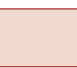
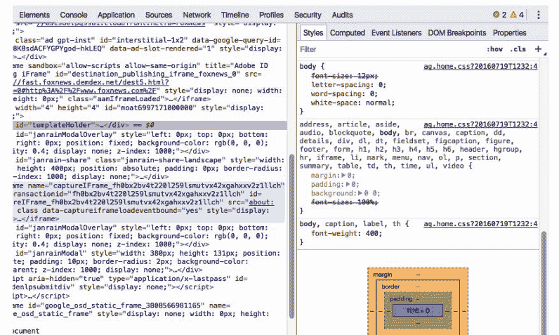
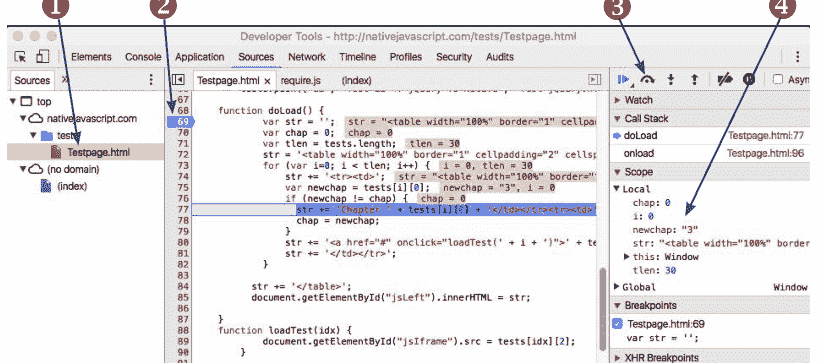
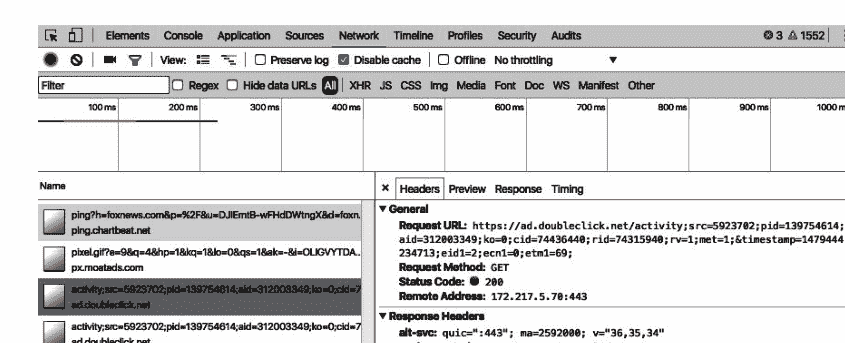
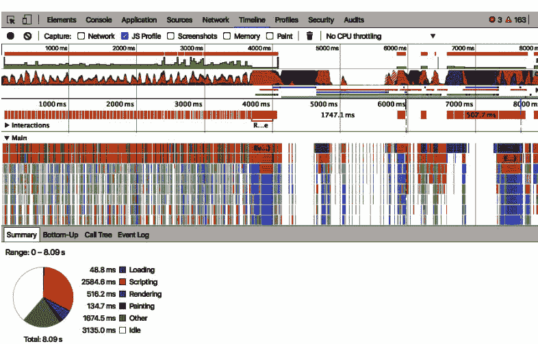
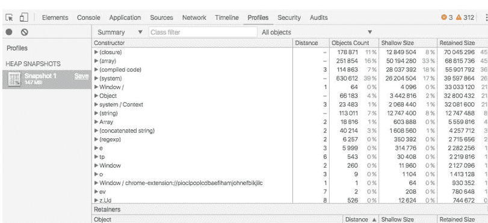

# JavaScript：优化原生 JavaScript：设计、编程与调试原生 JavaScript 应用


# 关于作者

Robert C. Etherledge 是 MiraVista Press 和 myWriterTools 的创始人。他从事编程已超过 30 年。他在 IBM 穿孔卡上编写了自己的第一个程序，随后进化到使用纸带在美国海军计算机上进行编程，并在 5 1/4 英寸 Apple II 软盘上编写了他的首个商业软件。他设计或编写了 20 多款软件产品，并花费了 16 年使用 JavaScript 和 HTML 为机顶盒和移动设备进行编程。最近，他一直在设计和编写 JavaScript/HTML 接口，用于处理健康相关应用的大数据。


*设计、编程与调试原生 JavaScript 应用*


在具有真实截止日期和真实限制的真实项目中使用 JavaScript、HTML 和 CSS
包含有关 UI 设计、优化和面试的技巧


# 献词

本书献给我的孩子们，以及我的妻子 Cheri，她多年来一直支持我并忍受我。

> “构建软件设计有两种方法。一种方法是让它变得简单到至于显然没有缺陷；另一种方法是让它变得复杂到至于没有明显的缺陷。”

- C.A.R. Hoare


引言


- 代码编译器和压缩器......................................................................................................... 25


UI 设计

模型与比喻...................................................................................................... 166
功能优先——形式后随............................................................................................... 168
屏幕尺寸........................................................................................................................ 171


# 引言

使用 JavaScript、HTML 和 CSS 编写应用程序可以是趣味且有成就感的。JavaScript 是一门相当容易的语言，而 HTML/CSS 让你在没有大量图形经验的情况下也能创建精美的界面。建立你自己的网站（而不仅仅是简单的网页）是非常容易且廉价的。对于这些问题，有很多原因，你可以下载许多库和框架来帮助你的开发工作。

然而，这种低低门槛也使得编写糟糕的 JavaScript 应用程序变得容易。我所说的“糟糕”，不仅是指效率低的代码，还包括设计不当的应用。由于有许多可以下载的库和框架来帮助开发工作，导致这些问题的原因有许多。


# 为什么这本书与其他 JavaScript 书籍不同？

这并不是一本 JavaScript 参考书。它不是关于如何使用最新的框架和库的。它不涵盖晦涩的编码解决方案和算法，我也没有涉及 JavaScript 引擎的内部原理。这本书假设你已经具备了一定程度的 JavaScript ，并能够编写简单的页面。对于更高级的 JavaScript 程序员，有很多优秀的参考书籍可以选择。

我的很多经验是在 CPU 性能和内存（RAM）有限的顶盒设备上，因此编写简单快速的 JavaScript 是至关重要的。但同样的概念也适用于更快的 PC 浏览器和内存更大的移动设备：就像计算中的其他所有事物一样，额外的速度和内存会迅速被更大的图片、视频和 3D 图形耗尽，因此你又回到了起点。某些应用程序或公司可能要求使用特定的框架或库，例如 Angular 或 jQuery，但在其他情况下和项目中，采用更基础的方法可能是必要的。

我的方法是实实用的。如果你包含了非常难以理解的代码（特别是如果你没有妥善注释的话），那么你可能就不应该包含这些代码，除非你能证明它在速度或内存使用上带给你优势。这本书应该帮助你在真实场景中，根据项目进度编写真实的代码。

# 代码在哪里？

书中提到的一些代码可以在我们的网站 www.Nativejavascript.com 上找到。书中随处可见的对比测试引用了网站上的行号，你可以在那里运行测试。速度测试并不是决定性的，因为绝对时间会随着浏览器、浏览器版本和计算机系统的不同而产生巨大差异。你不应该执着于这些时间，因为许多操作非常快，你完全负担得起额外的几毫秒延迟，而且你可能不想为了速度而牺牲可读性。但如果你知道哪些类型的操作和模式更快，请将它们作为你的首选，或者在你选择进行优化时使用它们。

# 本书中的约定

以下约定以等宽字体显示，例如：

- **代码。** `else if (x==1) { elem.style.backgroundColor = sBackalternate;`

- **性能示例。** 贯穿全书表格展示了在不同浏览器上对各种代码修改进行性能测试。这显示了每个示例和浏览器的相对操作次数。数字越高表示性能越好。这些数字只有相互比较时才有意义，因为它们是执行数千次操作的时间，在许多情况下，为了可读性，数字已经过过简化。每个表格下方列出了你可以自己运行性能测试的 URL。比较的是数字，而不是跨浏览器的时间。


| 性能测试 | OPS (越大越好) | | | | |
|---|---|---|---|---|
| 1. test 1 | 711 | 1,350 | 1,312 |
| 2. test 2 | 702 | 3,330 | 1,634 |

测试 3-5: http://www.nativejavascript.com/tests/Test-Sample
注意：书中所有测试的性能数据可能会随着每个新浏览器版本的发布而变化。某些操作可能会更快，而另一些可能会变慢。在依赖它们之前，请再次测试。

- **已测试浏览器：** 书中显示的各种性能和内存数据通常是通过以下浏览器完成的，尽管具体的版本号在不断变化。运行相同的测试可能会由于更新版本的浏览器、不同的计算机速度、同时运行的其他应用程序而产生不同的结果，但除非特定浏览器对某些功能进行了优化（或降低了性能），否则相对结果应该是相似的。我们在 Windows 和 Macintosh 上都进行了测试。我们测试使用的版本列在下方。你可以使用任何浏览器从我们的网站运行测试。
- Chrome: 55.0
- Safari: 9.1
- Firefox: 50.1.0


## 第一章：基本原理

# 1 基本原理

在应用程序过程的所有阶段（从设计到实现），你都应该记住一些原则。这些原则有助于引导你的编码风格，并影响你在项目期间必须做出的每一个决定。这些原则被忽略的次数之多让我感到惊讶。

当你处于应用程序过程中涉及的不同小组之间的接口处时，往往会产生问题。如果这些小组不知道 JavaScript/HTML 的局限性（和优势），他们往往很容易忽略一些基本设计原则。你将关注的主要小组有：

- **设计师。** 如果设计师将每个 UI 屏幕视为独立的 HTML 屏幕，那么你在设计优化应用程序时就会遇到问题。他们必须理解，尽可能共享许多屏幕和代码通常会更好。即使你的应用程序加载了许多独立的缓存，你仍然应该这样做。
- **程序员。** （注：原文此处似乎断了，根据上下文推断为程序员类项）

...（由于原文在末尾处中断，翻译也相应在此处结束）


交付到移动设备，这极大地影响了用户体验。我能够将其优化为 3mb 的负载，客户端几乎立即接收到，从而允许对所有数据进行立即滚动。回想你可能花费了大量精力来精简 JavaScript 内容，但随后你又加载了不必要的大型数据文件。其他错误的服务器选择还包括在服务器上对数据进行格式化而不是让用户界面根据用户的偏好进行格式化，以及对布尔值、字符串和数字的优化使用。

## 分享、分享、分享……

尽可能多分享代码和屏幕。我指的不是将你的代码写成可以在其他项目中复用的形式。这是一个可以引发讨论的独立议题，因为它往往会增加你的项目时长。我想说的是确保你没有在代码的多个地方复制和粘贴相同的例程。如果你必须执行相同的操作超过一次，请花时间编写一个良好的函数，以便在多处使用。投入更多时间设计你的应用程序前端，并创建可以在多处使用的单函数。这同样适用于你的 HTML 代码，它可能会影响应用程序的性能。在布局 HTML 屏幕时要小心，尽可能地复用它们，并避免不断修改或破坏 DOM 树。

## 进行适当的权衡

编写代码时总是存在权衡。作为程序员，你的工作是在你有选择时为适当的值进行优化。权衡通常发生在之间：

- 内存使用
- 执行速度
- 代码可读性

在许多情况下，你可以同时对这三个值进行优化。在其他情况下，你将不得不分析你的 UI 是否要求快速执行，或者你是否需要节省内存。如果你选择了一种导致代码更难阅读的方法，请确保根据需要对该部分进行适当注释。在优化代码时请记住几条规则：

- 不要过早优化。然而，这并不意味着你不应该一直尝试使用最佳实践。
- 代码可读性始终很重要，因此请确保对任何可能难以理解的代码段进行注释。当你的应用发布时，压缩器可以很容易地移除注释。
- 首先关注“触手可得的果实”。这遵循帕累托 80/20 原则。通过集中精力处理20% 的代码，你可以获得 80% 的收益。对你的代码进行分析，以确定内存在哪里被以及性能在哪里受损。然后关注这些领域。明显的关注领域是递归函数和循环。


如果你曾被问及写了多少行代码，回答一个很大的数字并不一定是一件好事。为你编写较少的代码感到自豪——只要让它们是非常优秀的代码即可。正如马克·吐温（或布莱斯·帕斯卡）所评论过的：“抱歉这封信太长了，但我没有时间把它写短。”


首先，我们将介绍简单但经常引起争议的 JavaScript 代码格式化主题。这看起来像是一个简单的话题，但正确的格式化极大影响他人阅读和维护你代码的难易程度。当你有多个程序员在同一个代码库工作以及你的版本控制软件如何工作时，这一点尤为重要。我在这里根据我编写特别是分享 JavaScript 代码的经验提供了一些建议。由于 JavaScript 独特的解释性质和全局上下文结构，这些中的许多重要性超过了它们在编译语言。你使用的编程环境和代码验证器也会影响你的风格，因为你可以利用这两个工具。

注意：某些 IDE 环境或代码验证器可能会自动格式化或至少对你的代码建议格式化更改。这些工具可能会为你决定一套格式化约定。你可能想先决定一个格式化工具，并基于该工具制定你的格式化指南。


JavaScript 1.8.5 添加了一个名为严格模式的新功能。要调用它，你需要在应用该模式的脚本或函数开头处包含 "use strict" 表达式，使用以下行代码：

```
"use strict";
```

- 使用 delete 方法删除变量或对象
- 使用 with 语句
- 对其他变量名使用的限制
- 不再支持 arguments.callee


### 注释

### 注释样式

即使是注释这样简单的内容也需要一致地处理。在 JavaScript 中，可以使用两种类型的注释，你可能会读到推荐每种类型的书籍或文章。你需要为 CSS 和 HTML 文件使用不同类型的注释。你的 JavaScript 代码的注释类型为：

- // 行中的任何地方双斜杠都会将该行的剩余部分视为注释。你可以将其用于代码块（每行都以 // 开头）、单行注释以及代码行尾的注释。
- 任何放在 /* 之间并以另一个 */ 结束的代码都会被视为注释。我强烈建议使用第一种注释，原因有三：

- 如果你在代码中使用 /* 这种块注释，它可能会抛出错误。如果你在代码中使用 /* 这种块注释，它会更容易调试。
- 我强烈建议使用第一种注释，原因如下：
- 你的代码看起来像 /* 这样：var rgex = /*/

### 包含哪些注释？

注释的量取决于你的编程风格、代码的清晰度以及项目需求。由于你通常会在部署前压缩代码，过多的注释会让代码更难阅读。确保你对任何需要解释的地方进行注释，例如：

```
// 用户输入了值
if (x==0) {
  elem.style.backgroundColor = cBack;
}

// 用户选择了辅助颜色
else if (x==1) {
  elem.style.backgroundColor = cBack;
}
```


我在编写大型项目时发现非常有用的事情，特别是当有其他程序员参与时，即使用注释与其他程序员交流或给自己做标记。某些 IDE 环境自动支持 TODO 注释。我可能会有这样的注释：// 此函数需要优化
// 我不确定这里的可能值是什么
// 你能在这里添加适当的代码吗？
// 最终前删除
```


为代码注释似乎是一件苦事，是你推迟到最后，或者项目结束后要做。取决于你的项目，这可能是一个很大的不利。如果项目没有立即进行注释，你可能会忘记函数是如何工作的或为什么要写。如果你在为其他程序员编写模块，或者有发布的 API，那么正确的注释至关重要。

有很多产品可以简化你的 JavaScript 代码文档任务，例如 JSDoc 或 UIDoc 这些工具依赖于程序员使用特定格式的嵌入注释，例如：


然而，这种方法也有其缺点。你的团队（如果你是单兵作战，则是你自己）必须决定正确的方法。一些缺点包括：

- 每位程序员都需要高度自律来正确地填写每个注释部分。
- 你必须小心，不要在没有进行适当修改的情况下直接复制和粘贴注释部分。
- 它们可能会让实际代码变得更难阅读。大段的注释会使理解你的代码变得困难。某些 IDE 可以轻松地隐藏注释部分。
- 如果程序员们在同一个项目上工作，他们可能会有不同的文档样式，文档团队在生成最终文档之前需要对这些样式进行协调。
- 程序员倾向于将注释的优先级低于实际代码。项目负责人或文档团队将花费时间来确保已正确添加并更新注释。
- 如果依赖嵌入式注释来生成最终文档，而没有由程序员进行额外的详细编辑，它们很容易产生错误的文档，而这可能比没有文档更糟糕。
- 文档团队很可能有办法在嵌入式注释之外添加更多文档内容，例如更多的细节、示例、案例。这意味着他们必须有一种方法来识别哪些函数和变量需要记录，并理解代码或对其进行仔细解释。

你的团队必须决定一个一致的解决方案并确保其执行。至少，你应该有一种方法来识别哪些函数和变量需要记录，哪些本质上是私有的。当有疑问时，在编写代码时添加注释。你以后可以随时删除它们或稍后重做。


### 分号

遗憾的是，JavaScript 规范并没有要求使用分号来结束每一行，但你应该确保使用它们。尽管你可以不使用它们也能运行，但在对代码使用闭包编译器（closure compiler）或压缩化工具（minifier）时，你可能会遇到麻烦。如果没有正确使用分号结束行，可能会产生错误条件。以下代码如果通过编译器运行，可能会被误读，因为编译器会在 `return` 单词后添加分号，而这并不是你想要的。它将返回你的对象中带有索引值的任何内容。这是不将大括号放在单独一行的另一个原因，将在后续章节中讨论。某些环境还会标记缺少终止分号的代码。

```javascript
function doThis(str) {
  return
    index: 1;
} // 糟糕的代码！
```


JavaScript 与所有计算机语言一样，有一套用于分析公式运算符的顺序。例如，乘法操作在加法操作之前执行。你可以在任何数量的文章或书籍中找到这个列表。你应该倾向于过度精确，即使这意味着多出几个字符。不要假设每个阅读你代码的人都记得 `+ * / ^` 运算符的优先级。你就能立即知道以下公式是如何计算的吗？

```javascript
var prec = x + y / 4 - 2 * z % 5;
```

即使你知道，在适当的地方加上括号也只能帮助读者理解你正在尝试做什么。添加一些注释来澄清你正尝试做的事情也大有益处。

## 大括号的位置

这是一个看似微不足道的格式化决策，但每当讨论它时，都会引发激烈的争论。我应该这样写我的代码吗：

```javascript
if (a == b) {
  var a = 5;
}
```

还是这样写：

```javascript
if (a == b) 
  var a = 5;
}
```

对我来说，这个问题已经定论了。第二种方法更紧凑、更容易阅读，并且对像 JSLint 这样的代码分析工具更友好。在翻阅程序时，一次在屏幕上看到更多代码是有优势的。同样的规则适用于其他块，如 for 循环和 switch 语句。遗憾的是，这可能是你工作的任何地方争论的话题。来自不同语言的程序员倾向于第一种风格。


在 JavaScript 中，你通常可以交替使用单引号或双引号。在某些情况下，你必须注意使用的是哪一种：

- 1. 有时你必须在引号内部使用双引号，例如从 JavaScript 设置 HTML：
  `var str = '<div style="left:10px;">text</div>';` 
  在那里你必须用一种类型作为外部引号，另一种类型作为内部引号。对于这个例子，两种种方式都可以，但在创建 HTML 字符串时，通常使用单引号作为外部字符串引号更好。
- 2. JSON。JSON 标准规定所有的键值对都应该使用双引号，单……

总来说，你应该在整个代码库中尽可能保持一致。不要随意在不同样式之间切换。如果你不一致，或者在同一代码库上工作的程序员使用不同的方法，将会出现全局搜索的问题。通常你会在字符串中查找某个特定的单词，该单词可能出现在多个地方，你可能会尝试搜索 `('string')`。如果你不确定使用的是什么引号符号，也必须搜索 `('string')`。如果你不一致，可能会用错误的符号关闭你正在输入的字符串，尽管许多 IDE 环境会捕获这个错误。


### 行长度

你应该尝试将代码行的长度保持在 80 个字符或以内。能够在不进行水平滚动的情况下看到整行代码通常是有益的。如果必要，可以通过在逗号等运算符后添加换行来折断长行。下一行……

### 制表符或空格

许多编辑器会自动执行此操作。你可能希望每一层缩进使用两个空格。你也希望所有逻辑连接的大括号对齐。这将使检查代码变得更容易。所以你的代码应该像这样：

```javascript
for (var i = 0; i < 10; i++) {
  for (var j = 0; j < 5; j++) {
    if (i == 0) {
      // 在此处代码
    }
  }
}
```

### 运算符周围的空格

关于运算符周围是否包含空格的问题会被某些编译器抵消。这是有效的。某些格式化工具倾向于第二种方法。而不是：

```javascript
var x=2;
if(x==2) {
```

使用

```javascript
var x = 2;
if (x == 2) {
```

### 对齐等号

另一种你看到的格式选项……当连续行相似时对齐等号或对象属性。如果你压缩代码，这些空格将被移除，有时额外的缩进会让阅读更容易。它看起来可能像：

```javascript
var thisum = 5;
var idx = 12;
var str = 'name';
var obj = {
pl: 'value',
dateprop: 123,
idx: 1
}
```


有很多广泛接受的命名约定，也有一些引起争议。JavaScript 引擎强制了一些命名限制，包括：

- **大小写敏感**。JavaScript 名称对大小写敏感。因此，`thisVar` 和 `ThisVar` 被视为不同的变量名。
- **关键字**。有许多被 JavaScript 语言保留的单词。你可以在 developer.mozilla.org/en-US/Web/JavaScript/Reference/Reserved_Words 看到完整的列表。
- **特殊字符**。名称应由字母（A-Z, a-z）、数字（0-9）和下划线 (_) 组成。不要使用特殊字符，我会避免使用国际货币符号，因为它们可能被误读且难以搜索。我还会避免使用美元符号 ($)，尽管它是有效的，但因为它被框架用作别名，并可能被误读。

所有其他命名建议都取决于编码规范以及对 JavaScript 全局空间的处理。与格式建议一样，编程团队应该决定一个标准并执行该标准。


JavaScript 代码在全局命名空间中运行。这意味着你所有的独立函数、变量、对象、方法和模块都共享一个公共根，即 `window` 对象。没有什么可以阻止你将自己的名称添加到全局命名空间中。如果你在函数外部声明变量，或者在函数内部在没有使用 `var` 语句的情况下声明变量，它们将被放置在这个全局命名空间中。有许多理由可以避免将你的变量和函数名放在全局命名空间，包括：

- *它们很容易被你的应用程序加载的任何其他程序或进程覆盖或删除，包括库和框架。或者，你可能有两个函数依赖于同一个全局变量，而你并没有注意到另一个函数正在更改它。*
- *依赖全局变量和函数会使你的代码更难维护。它们会阻碍封装和代码组织，而这些组织将使你的模块和函数更容易调试或重用。*
- *直接从函数访问全局变量的速度比访问全局变量的本地副本要慢。*
- *如果你的项目使用了全局变量，你必须确保你有一套严格的命名规范，以防止程序员声明同名的变量。你应该能够为全局空间中的每个项目分配一个公司前缀，例如 `mvModel` 和 `mvViews`。*


在使用全局命名空间时，有很多防止问题的方法。通常，你必须在全局空间中放置一个对象，仅仅是为了持有你所有的变量和函数。但记住，这不是魔法解决方案——你仍然有一个名称可以被覆盖，从而导致你的整个应用程序被删除。无论你做什么，你都必须小心。你的解决方案取决于你正在编写的应用程序类型。如果你编写一个特定的应用，你可以控制所有要添加到全局命名空间的内容，你选择的解决方案可能与必须处理第三方库或添加到该空间的代码的应用程序不同。可以考虑的解决方案包括：

- *使用对象来存放你的变量和函数。你可以使用一个全局对象（它本身可以包含多个对象），或一组小的全局对象将你的大部分名称排除在全局命名空间之外。因此，你的代码可能看起来像：*

```javascript
var globalObj = {
  name: "name",
  city: "city",
  showName: function() {
    console.log(" " + this.name);
  }
};
```

这在全局命名空间中只放置了一个名称 `globalObj`。如果你创建一个创建对象新实例的构造函数，相同的方法也适用。

使用闭包（closures）将你的变量和函数排除在全局命名空间之外。这是一个常用方法，既可以保护全局命名空间，又能让变量或函数在本质上保持“私有”。编写这些函数有多种方法，从拥有具有访问方法的公共对象，到一个在启动时运行一次且不再使用的完全匿名函数。它们可能像这样：

```javascript
var nafDate = function () {
  var localVar = 5;
  var fname = "name";
  var localMethod = function () {
    console.log(" " + fname);
  };
  var globalMethod = function () {
    localMethod();
  };
  return {
    fname: fname,
    globalMethod: globalMethod
  };
}();
```

这创建了一个名为 `nafDate` 的全局对象，它只有两个项可以在函数外部访问：`fname` 和 `globalMethod`，它们在对象创建时都被返回了。包含 `()();` 的声明行会导致函数在被读取时立即执行，从而创建 `nafDate` 对象。在 `nafDate` 外部无法访问 `localMethod`。

- 无论你采取什么方法，你必须担心你的全局名称被其他代码覆盖。因此，请注意你的全局对象的命名。我使用了一种方法，为程序中可能在全局空间中有命名的每个功能部分分配小写前缀。


有一些被广泛接受的规范。为了让代码更易读，我建议在命名全局变量时遵循这些规则：

- *构造函数。* 构造函数应该以大写字母开头，除非有其他理由。例如：

```javascript
function Screen()
```

- *普通名称。* 普通变量和函数名应该以小写字母开头，并使用驼峰命名法（camelCase），例如：

```javascript
function display()
```

- *常量。* JavaScript 没有专门的常量数据类型。你可以使用大写字母来突出显示它们，现在可以使用 `const` 语句来代替 `var`。它们可能如下：

```javascript
var EENT = 13; // 这个可以更改
const LEFT = 37; // 这个不能更改
```


- **下划线的使用。** 对于对象内部的方法和属性，一种常见的约定是使用下划线开头，表示它们不是“公共”的。对于在函数内部使用的变量，例如 `_netWorth`，JavaScript 不会以特殊方式解释这些名称。
- **避免使用的字符。** 避免在名称中使用字母 "l" 或 "o"，除非它们是识别单词的一部分，例如 `fullName` 或 `logo`。我特别避免将它们用于单字母变量，以免被误认为是数字 (0) 或 (1)。

```javascript
var logor = "logright.gif";
var logo = "logfile;
```


习惯使用短名称。这让你始终考虑保持代码精简。记住，由于你在投入生产环境之前可能会对代码进行压缩，你需要在代码中添加注释，而不是使用长名称。从一开始就保持短名称，可以减少你对变量名的需求。不要让它们太短或太通用以至于在全局搜索时难以找到。短名称更容易输入，并减少输入错误的概率。

## 循环中的变量名

JavaScript 代码中的惯例似乎是在循环中使用 'i' 作为变量名以及 'x'。有些程序员喜欢使用更具描述性的名称，例如 `crit` 或 `titleIdx`，除非循环非常长，否则不需要。使用 `i`（如果循环内需要更多变量则使用 `j, k`），但避免小写 `l(1)` 或字母 'o'。我认为如果你在命名上保持一致，你会发现代码更容易读。这是某种硬性规则吗？不……只要记住它。

- 函数内部与全局变量相同的局部变量名，即使大小写不同。这是麻烦。
- 与任何 HTML 元素 ID 相同的名称。这会产生不可预测的结果，特别是在不同浏览器之间。即使你认为这可能有帮助，也不要依赖它。


## 第 2 章：JavaScript 格式 • 23

某些浏览器允许你直接引用元素 ID，而不是使用 `document.getElementById`。以下示例假设你有一个 id 如下 HTML 元素：`<div id="eSplash">`。这段代码：

```javascript
console.log('getelem: " + document.getElementById("eSplash"));
console.log('varname: " " + e););
eSplash = 12;
console.log('getelem: " + document.getElementById("eSplash"));
console.log('varname: " + e e);

```

产生如下输出：

```
getelem: [object HTMLInputElement]
varname: [object HTMLInputElement]
getelem: [object HTMLInputElement]
varname: 12
```

- 包含保留字或常用函数名的短名称。如果你将某些变量命名为 `ById`，你的搜索将找到该名称的所有实例，包括你代码中存在的多个 `document.getElementById` 实例。其他短名称也是如此。如果你使用像 "loc" 或 "nam" 这样相似的短名称，情况会变得非常糟糕。你需要花费大量时间在扩展代码库中筛选才能找到正确的。


`var` 语句的使用和位置是另一个引发激烈争议的话题。通常有几种方法被推为处理此问题的正确方式。使用 `var` 非常重要，它可以防止变量和函数名在需要访问局部变量时被添加到全局命名空间，这样速度更快。`var` 语句会被提升到它们所在的函数中。这意味着无论 `var` 语句出现在哪里，它本质上都位于赋值处。如果你在赋值之前尝试访问变量，它将是 `undefined`。以下代码显示了未包含在函数中的：

```javascript
var globalidx = 9;      //这是一个全局变量
var idx = 5;            //这是一个全局变量
function test() {
    console.log(idx);               // 这打印 'undefined'
    console.log(globalidx);         // 这会打印 9
    var idx = 2;                    // 这是一个局部变量
    console.log(idx);               // 这会打印 2
}

test() {
    console.log(idx);               // 这打印 5
}
```

当运行 `test` 函数时，`idx` 的第一次打印是 `undefined`，尽管函数内部对 `idx` 的声明被提升并覆盖了全局值，但赋值 `2` 并没有被提升。第二次打印显示了上一行赋值的 `2`。当最后一条语句打印时，它显示了 `idx` 的全局值。那么，放置 `var` 语句的位置有哪些选择？通常接受的做法是，你应该在


在每个函数的顶部声明所有的 `vars` 以尽可能的减少错误。以下选项假设你将所有 `vars` 放在开头。

- 方法 1。使用 `var` 语句在一行内声明所有变量，无论是否有赋值。

```javascript
var a, b, c;
或
var a = 1, b = 2, c = 3;
```

- 方法 2。使用一个 `var` 语句，但将每个声明放在单独的一行。

```javascript
var a = 1,
b = 2,
c = 3;
```

- 方法 3。为每个声明使用独立的 `var` 语句并放在单独的一行。

```javascript
var a = 1;
b = 2;
c = 3;
```

根据我的经验，我推荐最后一种方法。如果你愿意花一点精力，还可以按字母顺序列出它们。我推荐这种方法的原因包括：

- 声明更容易易读。带有多个声明的长语句使得很难找到新变量，尤其是当你有复杂的赋值时。
- 你减少了在未来更改中发生错误的概率。例如，如果有人在方法 2 的赋值后将第一个逗号改为分号，其余变量将将被分配到全局命名空间，而你可能完全没有察觉到这种变化。
- 如果你使用方法 2，那么当你对变量名进行全局搜索时，由于看不到 `var` 语句，将不清楚哪行代码是什么意思。


我认为没有其他可能引起混淆的 `var` 声明用法。再次，这些并不是任何性质的强制；只是建议。

- 循环。将 `var` 声明放在循环之外更安全。将声明放在循环外有助于避免作用域问题。
- 循环中的多次声明。如果变量在每次迭代中都被重新声明，可能会导致意外行为。


有几种合法的变体。其中一种是糟糕的格式，可能会被误解。

（文本根据不完整的 OCR 输入继续）


通过 YUI 编译器运行时，你将得到类似的结果。然而，通过 Google 的 Closure Compiler 的高级模式运行会产生以下代码：

```
BigPic=function(a){console.log("in drawline "+a)};BigPic.a(1);
BigPic.drawLine(2);BigPic.drawLine(3);BigPic.drawLine(4);
BigPic.drawLine(5);
```

这些代码一旦运行就会产生 JavaScript 错误。因此，如果你决定使用更高级的编译器选项，你需要仔细检查你的代码，以确保你没有创建此类错误。

> “用代码行来衡量编程进度就像通过重量来衡量飞机制造进度。”
    - Bill Gates


本章介绍了 JavaScript 命令和操作符。它不是参考手册，也没有涵盖所有的命令和操作符。其他书籍和网站提供了这些信息。然而，它涵盖了在为支持 JavaScript 的设备和计算机创建应用程序时的真实用法。我讨论了优化代码的方法，使其更小、更快。我不依赖第三方框架来处理所需的功能——所有内容都是用原生 JavaScript 编写的。如果你理解并编写这些代码，你就可以理解并使用任何框架。JavaScript 库和框架只是更多的代码层——它们必须更大、更慢，但它们有助于实现功能的标准化，特别是在使用由许多程序员支持的项目时。它们具有优势，特别是如果你是一个初级程序员，因为它们被广泛使用且应该是没有错误的。但它们并不是魔法，而且它们有许多交叉依赖关系。

## JavaScript 版本

JavaScript 开发于 1995 年，以其非商标名称 ECMAScript 著称。多年来，它通过许多主要版本的发布不断演变，目前提供 1.7 或 1.8 版本的变。每个浏览器（IE、Firefox、Chrome、Opera 等）都有自己的实现，并且并不支持所有功能，因此如果你需要跨浏览器兼容性，请注意你所依赖的 JavaScript 特性。为了安全起见，你应该支持你必须支持的浏览器所使用的旧版本，或者根据浏览器版本对代码进行特殊处理。许多可用框架和库都具有跨浏览器支持。特别是旧版本的 Internet Explorer 与其他浏览器有许多不兼容之处。Google 有一个开放的 JavaScript 引擎 V8，用于其 Chrome 浏览器。


我们在本书的大多数章节中都讨论了性能，并在许多情况下列出了在几个浏览器上运行的实际测试结果。在许多情况下，使用各种选项运行数千次测试以发现某一次快了几毫秒，并不会让你的应用程序性能变得更好。你在编写代码时应该记住通用概念，尽可能高效地编写。本章讨论了你在设计和编写应用程序时应该记住的一些性能问题。请记住，书中记录的测试是针对当时的特定浏览器版本的。浏览器在不断变化，测试结果可能会发生变化，变慢或变快。务必使用 Google PageSpeed 等工具来改进你的代码。

## 变量类型

JavaScript 不是一种类型语言。这解决了一些问题，但也意味着如果你使用 IDE，它不会像普通的类型语言那样经过优化。现在已经有了像 TypeScript 这样的解决方案，以及 JavaScript 本身未来解决这一缺点的计划。在此期间，如果你足够小心，可以利用这一“特性”作为优势。你只需要意识到 JavaScript 操作符是如何工作的，以及你正在测试的值是什么。尽管变量不是严格类型化的，但可以创建几种通用类型的变量：

字体 字符串 (strings)
- 数字 (numbers)
- 对象 (objects)
- 布尔值 (booleans)

当你尝试对变量执行操作时，需要意识到变量，否则可能会得到不可预知的结果。JavaScript 会尝试将一种类型的变量强制转换为另一种类型（例如在字符串末尾添加数字），但你必须理解发生了什么，否则可能会得到错误的结果。如果你明确你的数据和输入字段的类型，那么你应该能够在代码中正确地处理它们。


首先，你应该将全局声明减少到最。你可以将一些高级对象名称声明为全局，但尽量避免对变量名使用全局声明。假设你必须声明一些全局变量，通常你关心的有三种通用方法：

```
globalVar = 12;
var globalVar2 = 13; //使用 var 可能会产生问题
window.globalVar3 = 14;
```

这些本质上都是将你的变量分配给全局对象，但处理方式略有不同。这在需要删除它们时通常不是问题。一种方法是将它们赋值为 null，类似于：

```
globalVar = null;
globalVar2 = null;
globalVar3 = null;
```

这会将三个变量都设置为 null 并释放内存，但由于它们在全局范围内，它们不会被完全移除。删除这些变量的另一种方法是使用 `delete` 方法，类似于：

```
delete globalVar;
delete globalVar2;
delete globalVar3;
```

`delete` 方法通常会移除对象。然而，使用 `var` 声明的全局对象 (globalVar2) 不会被移除并仍然包含值。当你再次访问这些变量时，访问 globalVar 或 globalVar3 将抛出 JavaScript 错误。globalVar2 仍然显示 13;


小心测试 undefined，因为用户可能会更改此变量的值，你的测试可能会失败。我认为这种情况极不利且容易发现和修正。假设你的内容都是“可信任”的——即它们经过了审查并且不包含恶意代码。如果你在一个无法控制添加内容的环境中编程，那么在决定如何测试变量时，你可能需要考虑到这一点。在这种情况下，你还需要添加更多的错误检查。


JavaScript 有两个相等操作符可以比较变量和常量。

| 操作符 | 结果 |
| :--- | :--- |
| == 类型转换相等 | JavaScript 将尝试将变量转换为相同类型并比较它们是否相等 |
| === 严格相等 | 变量必须具有相同类型且相同值才被视为相等 |

关于这些操作符的几点：

- 比较对象的表达式仅在比较的是同一个对象时为真。
- null 和 undefined 使用 == 时被认为是相同的，但使用 === 则不是。
- 如下所示，这两个操作符的性能基本上是相同的。

如果你知道自己在做什么，有时使用 == 比较值是可以接受的。使用严格比较 === 可以确保值的类型和值都正确，但在某些情况下，普通的比较就足够了。你需要小心的地方包括：

- 从 cookie 或类似的存储中读取值。这些通常在内部表示为字符串，普通的转换可能不起。你将需要使用类似 parseInt() 的方法将读取的数值强制转换为数字。
- 如果你小心，可以使用类型转换比较来编写短比较语句。这在关于测试假值的章节中会有更详细的讨论。


- 注意。`switch` 语句默认使用严格相等。在将 `switch` 语句替换为普通的 `if` 语句时，需要小心。

以下等性测试的声明如下：

```javascript
var varA = 9;
var varB = "9";
var varC = "abc";
```


| | Safari | Chrome | Firefox |
|---|---|---|---|
| 1. if (varA === 9) | 1,555 | 605 | 1,042 |
| 2. if (varA == "9") | 1,560 | 604 | 1,042 |
| 3. newA = parseInt(varB); if (newA === 9) | 35 | 63 | 41 |
| 4. if (varA == "9") | 40 | 30 | 23 |
| 5. if (varA == "9") | 38 | 30 | 22 |
| 6. if (varC === "abc") | 1,579 | 597 | 1,051 |
| 7. if (varC == "abc") | 1,542 | 605 | 1,045 |

> 测试 3-1: http://www.javascript.com/tests/Test-Comparisons.html

这些案例分析了字符串和数字之间的比较，其中你有特定的值并且知道每个变量的类型。下一节分析了纯粹的真或假测试（假值）。上述测试结果指出了几点建议。Safari 浏览器似乎对其中一些比较进行了优化。

- 测试 1 和 2。如果你正在比较两个你确定是数字的数字，两种方法（== ===）的性能相同。为了一致性，你这里可以使用严格运算符。
- 测试 3、4 和 5。如果你正在比较一个可能可能是字符串的数字，可以在比较之前将其转换为数字，或者允许 JavaScript 将字符串转换为数字或数字转换为字符串，这与其他测试相比，性能非常糟糕。
- 测试 6 和 7。字符串比较的性能实际上与数字比较基本相同。

JavaScript 使用 `typeof` 运算符来确定变量的内部类型。该命令的常用如下：
```javascript
if (typeof idx == 'undefined') {
if (typeof(idx) == 'undefined') // 如果你想，可以加上括号
```

由于 `typeof` 是一个运算符而不是方法，所以你不需要在变量周围加括号。使用 `typeof` 命令返回的值如下表所示。

| 变量类型 | typeof 结果 |
|---|---|
| 未声明 | "undefined" |
| undefined | "undefined" |
| null | "object" |
| boolean | "boolean" |
| number | "number" |
| string | "string" |
| function | "function" |
| 其他任何对象 | "object" |


- 如果你没有声明变量并尝试在语句中引用它，将得到一个基本上停止执行的 JavaScript 错误。你唯一可以执行且不会产生此错误的操作是 `typeof` 操作，或者使用类似 `window.x` 的内容（`x` 是变量名）。
- 变量可以先用语句声明，也可以作为参数传递给函数。
- 已声明但未赋值的变量将返回 `undefined` 的 typeof 值。
- 在引用变量之前使用 `typeof` 测试变量是否存在是一个开销很大且通常必要的的操作。通常，在使用变量之前，你应该知道声明了什么类型的变量以及它们是什么类型。正如下面的测试所示，对可能未声明的变量进行测试比仅检查变量是否为 `undefined` 慢几乎 300 倍。如果不确定，可以在代码开始的正确上下文中声明该变量并对其赋值，以避免出现你稍后检查的明显错误值。如果你不确定变量是否存在，请务必先用 `typeof` 进行测试。

以下测试是通过使用不同的方法测试变量的存在或值完成的。你可以看到对尚未声明的变量进行测试有多慢。测试之前的声明如下：

```javascript
// varA 未声明
var varB = 1;
var varC;
var varD = null;
var obj2 = {};
```

| | PERFORMANCE TESTING | | Safari | Chrome | Firefox |
|---|---|---|---|---|---|
| 1 | if (typeof varA == "undefined") | //true | 393 | 2 | 348 |
| 2 | if (typeof varA === "undefined") | //true | 385 | 2 | 350 |
| 3 | if (window.varA === undefined) | //true | 87 | 1 | 1 |
| 4 | if (window.varA === undefined) | //true | 389 | 1 | 1 |
| 5 | if (typeof varB === "undefined") | //false | 1,532 | 626 | 56 |
| 6 | if (typeof varC == "undefined") | //true | 1,549 | 630 | 1,043 |
| 7 | if (typeof varD == "undefined") | //true | 113 | 620 | 1,042 |
| 8 | if (typeof varD === "undefined") | //false | 1,542 | 627 | 35 |
| 9 | if (varD == undefined) | //true | 118 | 629 | 1,045 |
| 10 | if (obj.b === undefined) | //true | 97 | 633 | 1,045 |

测试 3-2: http://www.javascript.com/tests/Undefined.html

关于上表结果几点：

- 所有测试 `varA`（从未声明）存在的方法都很慢。这说明重写你的代码是必要的。
- 使用 `window.varA` 测试是否存在通常比使用 `typeof` 慢。
- `===` 的使用与 `==` 基本上相同。
- 大多数比较是有效的，除了 Safari 在测试 7 和 9 中测试 `undefined` 时。
- 对 `varD` 的测试（8 和 9）涉及 `null` 值。`null` 被视为一个对象，这就是为什么方法 8 返回 "object"。
- 测试 7 和 9 对于 `undefined`（已声明）返回 `true`，它们在 Chrome 中的速度相同。


测试“假值”意味着依赖 JavaScript 的弱类型来判断变量是否匹配。使用这种测试通常意味着你在使用弱相等运算符 (`==`)，因为它不关心每个比较项的类型。你可以查看上一节关于实际值的详细信息。本节涵盖了真假值的比较：

- false
- NaN
- undefined
- 0
- null
- ""

这种测试的主要用途包括：

- **语句**。你可以使用如：`if (varA) {`
- **函数参数**。你可以使用如下代码确保参数有效：这里，如果 `varA` 为为 `false`，将使用默认值。
```javascript
function(varA) {
  varA = varA || "default";
}
```

- **返回值**。你可以使用以下内容从函数返回值：
```javascript
return varA || "default";
```

下表中的测试都返回了 `true` 值。以下是等性测试的声明：

```javascript
var varA;
var varB = null;
var varC = 0;
var varD = "";
var varE = false;
```


| | Safari | Chrome | Firefox |
|---|---|---|---|
| 1. (!varA) | 697 | 612 | 1,048 |
| 2. (varA == undefined) | 116 | 613 | 1,023 |
| 3. (varB == null) | 1,557 | 613 | 1,010 |
| 4. (varB == varC) | 1,580 | 580 | 1,032 |
| 5. (varC == undefined) | 1,560 | 604 | 1,013 |
| 6. (varC == 0) | 1,535 | 592 | 1,038 |
| 7. (varD == undefined) | 1,557 | 600 | 1,051 |
| 8. (varD == "") | 1,571 | 600 | 1,019 |
| 9. (varE == undefined) | 1,571 | 591 | 1,048 |
| 10. (varE == false) | 1,575 | 605 | 1,016 |
| 11. (varB == false || varB == undefined) | 120 | 600 | 1,032 |
| 12. (varB == null || varB == undefined) | 1,567 | 592 | 1,038 |

测试 3-3: http://www.nativejavascript.com/tests/TestCompare.html
这些案例相当一致：

- 大多数简单的 `if (varA)` 性能与测试所有类型的复合语句一样，Safari 除外。如果你的复合语句不匹配第一项，这种情况可能是真的。在测试 11 和 12 中，测试 11 以前要慢得多，因为它必须测试所有 3 个条件。但现在它几乎与 Safari 相同。按照最常见测试的顺序列出多个测试并无害。


- 如果你使用假值（falsy）测试来判断变量是否已赋值，请务必小心，因为有效值包括 0（零）或空字符串。这些值会等于 false，但变量实际上已经过赋值了。

## 短路逻辑 if 语句

测试多个条件的 `if` 语句会发生短路逻辑，这意味着语句一旦确定了其真假性就会立即执行。上一个测试中的测试 11 和 12 就是这种方法的例子。在接下来的语句中，使用 `&&`（与）运算符，如果 `isValid` 为 false，对 `age` 的第二个测试将不会执行：

同样，在下面的 `||` 语句中，如果 `x` 为 null，则不会进行第二个测试。

除了尝试将最可能的测试放在前面之外，你还可以利用这种行为来避免由 `undefined` 值引起的错误。如果你不确定某个测试是否会抛出错误，可以在检查其属性之前先测试项是否存在。忘记这一点是错误的常见原因，而这些错误在测试所有可能比较的值的边界情况之前可能无法被发现：

```javascript
var a = null;
var b = [3, 2, 3];
if (a.length > 0) // 这抛出一个错误
if (b.length > 0) // OK - 为 true
if (a && b.length > 0) {} // OK - 为 false
```

## 避免 if 语句中的赋值错误

JavaScript 条件语句中的一个常见错误是忘记使用两个等号 `==` 或 `===`，而只使用了一个 `=`。这是一个有效的语句，因此 JavaScript 通常会运行它。它看起来可能是这样：

```javascript
if (x = 5) {
// 而
if (x == 5) {
```

某些编译器、SDK 或像 ESLint 这样的程序会提示此类问题。许多程序员使用的一种方法通常被称为 Yoda 方法（尤达写法）。Yoda 可能会把比较语句描述为“如果 5 是你的变量 x”，你这样写：

```javascript
if (5 == x) {
```

按照顺序书写，如果你写错并写成 `if (5 = x)`，它会导致一个明显的 JavaScript 错误，而不是引入一个难以发现的细微漏洞。如果你习惯这种写法并且它能帮你写出更好的代码就好。个人而言，我觉得这种语法很困惑，并依赖 ESLint 来发现任何错误。

## 创建新数组和对象

在 JavaScript 中创建原生数组和对象有两种主要方法（不包括 `split` 方法或对象构造函数等方法）。你随处都能看到这两种方法的示例，更传统的方法是：

```javascript
var a = new Array();
var b = new Object();
```

你也可以使用以下快捷方法：

```javascript
var a = [];
var b = {};
```

如下表所示，你真的应该使用第二种方法，因为在某些浏览器中其性能有巨大的提升。

| | 性能测试 | OPS (越大越好) | Safari | Chrome | Firefox |
| :--- | :--- | :--- | :--- | :--- | :--- |
| 1. var a = new Array(); | 1,521 | 69 | 972 | |
| 2. var a = []; | 1,501 | 181 | 958 | |
| 3. var a = new Object(); | 1,468 | 29 | 5 | |
| 4. var a = {}; | 1,481 | 99 | 1,001 | |

> 测试 3: http://www.nativejavascript.com/tests/CreateObjects.html

这些结果强调了几个重要点。

- Safari 浏览器似乎经过了优化，处理所有方法的方式大致相同，尽管快捷方法仍然更快。
- Chrome 在所有方法上都较慢，但快捷方法仍然快得多。
- Firefox 上创建对象的长方法慢得惊人。请使用快捷方法。

## 提升 (Hoisting)

JavaScript 使用一种被称为“提升”的方法将所有变量声明移动到顶部。只有声明会被提升，而赋值值不会。

```javascript
console.log("varA = " + varA);
var varA = "value";
```

这会在控制台显示：

```
varA = undefined
```

因为声明被提升了，但赋值未设置。如果你使用赋值来声明函数，情况如下：

```javascript
function parseData {};
```

## 38 • JavaScript：优化原生 JavaScript

如果你以以下方式声明相同的函数，它在当前作用域的任何地方（上方或下方）都是可用的：

```javascript
function parseData() {
```

这是另一个你应该将所有变量声明放在顶部的原因，以确保你的逻辑不会被误解。将函数赋值变量的另一个用途（尽管不会被提升）是可以将类似的函数赋值给数组元素。与其在一个函数中使用条件逻辑来处理不同的排序，不如通过索引调用相应的函数，例如：

```javascript
var dateFunctions = [];
dateFunctions[0] = function() {
// 第一个函数的代码
}
dateFunctions[1] = function() {
// 第二个函数的代码
}

## 将字符串转换为数字

有时你需要强制将字符串变量视为数字。如果你使用严格相等运算符 `===` 进行比较，或者将该值用作公式的一部分或数组索引，就需要这样做。有时从 Cookie 或类似的存储获取的值看起来是数字，但在内部以字符串形式表示，必须转换为数字。有多种方法可以进行这种转换。

- `parseInt()`：将字符串转换为整数。务必在操作末尾添加基数，以避免某些字符串被转换为非10 进制。以零“0”开头的字符串如果不指定基数，将默认为八进制（基数 8）。命令应该是：`var x = parseInt("342", 10);`
- `Number()`：将字符串转换为数字。
- `parseFloat()`：将字符串转换为浮点数（包括小数）。
- `Math.floor()`：通过向下取整处理数字或有效字符串。
- `Math.ceil()`：通过向上取整处理数字或有效字符串。
- `Math.round()`：将数字四舍五入到的整数。如果小数部分等于 .5，则向上舍入；否则向下舍入。
- -0：字符串末尾有 -0 会强制将其转换为数字。


# 数字与字符串的拼接

```
var varA = "123";
var varB = varA + 4;
console.log(varB); // 显示 1234
```

```
var varC = +varA;
var varD = varC + 4;
console.log(varD); // 显示 127，因为 +varA 强制将 varA//转换为数字
```

```
var varE = "123" - 0;
var varF = varE + 4;
console.log(varF); // 显示 127，因为 -0 强制将 varE//转换为数字
```

```
var varG = 4 + 4 + "60" + 3;
console.log(varG); // 显示 8603
```

```
var varH = "123" + 4 + 5;
console.log(varH); // 显示 12345
```

```
var varJ = "123" + 4 + 5 + "789";
console.log(varJ); // 显示 12345789
```

# 将数字转换为字符串

将数字转换为字符串比相反的操作要简单得多，但你仍然有几个选项需要考虑。你可以：

- 简单地在数字后面加上一个字符串或空字符串 ""，类似于：
var num = 22;
var numStr = num + ""; // numStr 现在是一个字符串

- 使用 `toString()` 方法强制将其转换为字符串。这种方法的好处是允许你指定转换的进制：
var num = 22;
var numStr = num.toString(); // 使用默认的 10 进制
var newStr = (3267).toString(16); // 生成 "fff"

- 如果你想控制小数位数或添加小数，请使用 `toFixed()` 方法。如果你正尝试在表格中对齐小数，这可能会非常有用。如果命令对最后一位小数进行了舍入，你可能会根据不同的浏览器得到不同的舍入结果，因此如果这很重要，你应该对其进行测试。请记住结果是字符串，所以不要对它进行数学运算。

```
var num = 8.3;
var newStr = num.toFixed(2); //"8.30"
var newNum = newStr + 1.1; //"8.301.1" 哎！
var new2 = (num + 1.1).toFixed(2); //"9.40" 正确！
```

以下转换测试的声明为：
var num = 22.5;

# 性能测试

| | Safari | Chrome | Firefox |
|---|---|---|---|
| 1. var numStr = num + ""; | 33 | 607 | 1,038 |
| 2. var numStr = num.toString(); | 16 | 39 | 64 |
| 3. var numStr = num.toString(10); | 15 | 24 | 55 |
| 4. var numStr = num.toFixed(1); | 7 | 3 | 9 |
| 5. var numStr = (parseInt(num * 10) / 10) + ""; | 20 | 54 | 35 |

测试 3-6: http://www.javascript.com/tests/Test-NumberToTesting.html

从性能数据中可以看出，在所有情况下，添加空字符串的简单操作都更快，在 Chrome 和 Firefox 中速度快了高达 20 倍。`toFixed` 选项非常慢，但如果你需要它，就必须使用它。测试 5 显示了另一种将数字转换为带一位小数的字符串的方法。它比 `toFixed` 快几倍。

# 注意浮点数算术

JavaScript 使用双精度浮点数存储数字，使用 64 位来存储每个数字。如果你不小心，可能会导致精度错误。请注意以下表达式：

```
var x = .2 + .1; // x = 0.30000000000000004
```

如果你在这些情况下需要更好的精度，你可能需要对数字进行乘法和除法，例如执行如下操作：

```
var x = ((2 * 10) + (1 * 10)) / 10; // x = 0.3
```

# 关于数字的其他奇怪陷阱

关于 JavaScript 中使用数字还有其他一些陷阱，包括：

- **前零。** 某些浏览器会将带有前零的数字解释为八进制数。因此，
  var x = 012; // x = 10 (八进制 012 = 十进制 10)
  var x = 12; // x = 12
- **十六进制。** 要使用十六进制表示设置数字，只需在数字前加 0x，类似于：
  var x = 0x12; // x = 18 (十六进制 12 = 十进制 18)
- 要产生数字的十六进制表示，你可以使用带有括号数字的 `toString` 方法，类似于：
  var str = x.toString(16); // str = "12" (十进制 18 的十六进制键)
- **Infinity（无穷）。** 你可以使用关键字 `Infinity` 将变量设置为无穷大值，或者通过除以零来设置。因此，
  var x = Infinity; // x 现在大于所有数字
- **NaN。** `NaN` 代表“不是数字”（Not a Number）。当数学运算的结果不是数字时，就会返回 `NaN`。例如：
  var x = "abc" * 2; // x = NaN

# 循环

在 JavaScript 中处理循环有多种方法，包括：

- **for 循环。** 这是最常用的循环方式：
  for (var i = 0; i < 5; i++) {
    console.log(i);
  }
- **while 循环。** 当条件为真时持续执行：
  var i = 0;
  while (i < 5) {
    console.log(i);
    i++;
  }
- **do...while 循环。** 这种循环至少执行一次，然后检查条件：
  var i = 0;
  do {
    console.log(i);
    i++;
  } while (i < 5);
- **forEach 循环。** 对数组中的每个元素执行函数：
  var arr = [1, 2, 3];
  arr.forEach(function(num) {
    console.log(num);
  });
- **for...in 循环。** 用于遍历对象的属性：
  var obj = {a: 1, b: 2};
  for (var key in obj) {
    console.log(key);
  }
- **for...of 循环。** 用于遍历数组或其他迭代对象：
  var arr = [1, 2, 3];
  for (var val of arr) {
    console.log(val);
  }


# Duff 技巧示例

```javascript
var y;
var locarr = newArr;
var nlen = locarr.length;
var i = 0;
var n = nlen % 8;
while (n--) {
    y = locarr[i++];
}
nn = parseInt(nlen/8);
while (n--) {
    y = locarr[i++];
    y = locarr[i++];
    y = locarr[i++];
    y = locarr[i++];
    y = locarr[i++];
    y = locarr[i++];
    y = locarr[i++];
}
```

# 移除不再需要的函数

你的代码中可能包含仅在应用程序启动时执行一次的函数或代码。你应该安排这些代码，使其在在使用后可以被删除，从而从内存中清除。最简单的方法是将函数名设置为 null，类似于：

```javascript
function addData() //在此处编写代码
addData();//仅调用一次
addData = null;
```

`delete` 命令实际上是用于删除对象属性的，而不是函数，它的工作方式取决于函数和变量是如何声明的。使用 `null` 会导致函数在垃圾回收期间被移除。严格模式的使用也会影响你可以删除的项。

# 对象通过引用传递

Date 对象以及任何其他对象都是通过引用传递的，而不是值。如果你将变量赋值为日期对象，需要小心，因为它们将相互链接。如果你想创建一个与现有日期对象的值相同的新日期对象，请使用类似代码：

```javascript
var dateOne = new Date(); //将新日期设置为现在
var dateTwo = dateOne; //对象链接
//到 dateOne
// 设置唯一日期为值
var dateThree = new Date(dateOne.getTime()); //与 dateOne 不链接的
```

# 第 3 章：JavaScript • 45

## 字符串拼接

在某些情况下，你必须通过拼接较小的字符串来创建一个大字符串。这通常用于创建将与 innerHTML 属性配合 HTML 字符串。有多种方法可以拼接。某些方法的内存需求较大，因此你必须决定合适的权衡。浏览器在拼接时优化内存使用方面有了很大改进，并尝试减少内存块的复制次数。

| 性能测试 | Safari | Chrome | Firefox |
| :--- | :--- | :--- | :--- |
| 1. str = str.concat("abcd"); | 337 | 475 | 341 |
| 2. str += "a" + "b" + "c" + "d"; | 383 | 988 | 700 |
| 3. array.push("abcd"); str = array.join(""); | 323 | 192 | 283 |
| 4. array[str.length]="abcd";str=array.join(""); | 323 | 188 | 301 |
| 5. str +=="abcd"; | 786 | | 814 |
| 6. str = str + "abcd" | 823 | 979 | 838 |

测试 3-8: http://www.nativejavascript.com/tests/Test-ConcatenatingStrings.html

这些方法在不同浏览器之间主要保持一致，尽管测试结果存在差异。我们在这里学到一些教训：

- 使用 `str+=` 或 `str+` 性能优于使用数组或 `.concat` 来添加新文本。然而，如果你观察内存使用，情况就反过来了。诚然，大部分的额外内存会被垃圾回收，但你真的想从源上避免创建垃圾。取决于浏览器和拼接的字符串，你可能会看到使用 `str+` 或 `str+str` 的内存占用是使用数组的两倍或更多。

- 你还应该减少加法操作的内存消耗。在某些浏览器上，添加字符串 "abc" 比添加 "a" + "b" + "c" 更快。

## 正则表达式

正则表达式的作用几乎像魔法一样，可以在字符串中查找或替换文本。从 Microsoft Word 到 JavaScript 的各种程序，有整本书都是关于使用正则表达式的。我将不会详细介绍如何构建单个正则表达式，因为资源非常多。通常，你可以使用它们在其他字符串内部查找或替换特定模式。你可以使用它们来验证电话号码或邮政编码等输入字段，或者过滤匹配字段上的文本。它们非常强大，但也极其令人困惑。如果你选择使用它们，请确保对代码进行注释，以便他人知道该表达式在做什么。

# 46 + JavaScript：优化原生 JavaScript

JavaScript 中的通用用法包括以下方法：

- exec: 在字符串中搜索匹配并返回信息数组。
- test: 在字符串中搜索匹配，如果找到则返回 true。
- match: 在字符串中搜索匹配并返回信息数组。
- search: 在字符串中搜索匹配并返回匹配的索引。
- replace: 将匹配的字符串出现处替换为字符串。
- split: 根据匹配表达式分割字符串并返回数组。

有一些很棒的测试工具可以测试你的正则表达式，以确定使用的最佳方法。我使用 http://www.regexpal.com/

## 我应该切换到使用 switch 吗？

有多种方法设置你的逻辑语句来比较值。（此处由于原文存在大量重复和 OCR 错误，已保留核心逻辑结构）：

- * 对象：
  obj = {};
  newVar = 4;
- * 三元运算符：
  newVar = (x == "d") ? 5;
- * switch 语句：
  switch(x) {
    case "a":
      break;
    default:
      newVar = 5;
  }
- * 三元运算符：
  newVar = (x == "d") ? 5:
- * if 语句：
  if (x == "a") {
    newVar = 4;
  } else {
    newVar = 5;
  }

| | Safari | Chrome | Firefox |
| :--- | :--- | :--- | :--- |
| 1. str = str.concat("abcd"); | 337 | 475 | 341 |
| 2. str += "a" + "b" + "c" + "d"; | 383 | 988 | 700 |
| 3. array.push("abcd"); str = array.join(""); | 323 | 192 | 283 |
| 4. array[str.length]="abcd";str=array.join(""); | 323 | 188 | 301 |
| 5. str +=="abcd"; | 786 | | 814 |
| 6. str = str + "abcd" | 823 | 979 | 838 |

# 第 3 章：JavaScript • 47

有多种方法设置你的逻辑语句来比较值。（此处根据可读片段提供清理版本）：

- * ...: 因此，如果调用语句不包含参数，你可以将其视为包含了 false 或 null。
- ...: 你应该尝试使用的另一种方法是检查参数，如果参数未包含或未定义则提供默认值。函数看起来如下：

```javascript
function myFunction(arg1,arg2) {
  arg1 = arg1 || 1; // 默认值为 1
  arg2 = arg2 || "default"; // 默认值为 "default"
}
```

## setTimeout

有两种方法允许你推迟执行代码执行时间。由于 JavaScript 是单线程的，这些方法还允许你对代码执行顺序进行某些控制。这些方法是：

- setTimeout(): 它允许你在指定的毫秒（ms）后执行指定的函数或代码段。这将运行一次函数。有一个对应的 clearTimeout() 来清除现有的定时器。


## 48 + JavaScript: 优化原生 JavaScript

- setInterval(): 它的作用类似于 `setTimeout`，但引用的代码每隔 x 毫秒就会持续运行，直到你发出 `clearInterval()` 命令为止。当你执行此命令时，第一个实例在指定的等待间隔到达之前不会被触发。你无法保证函数会在每个间隔期间都释放，因为其他操作可能会阻塞它的执行。

设置超时有多种方法。变体涵盖了操作函数的各种设置方式。你可能会看到以下方法。它们适用于 `setTimeout` 和 `setInterval`。

- `setTimeout("doFunc", 100);` 必须通过 `eval` 执行，这开销很大且可能导致问题。
- `setTimeout(doFunc, 100);` 这将在 100ms 后调用 `doFunc`，但你无法传递参数。
- `setTimeout(function (var){100);` 这是设置超时和定时器的最佳方式，因为它允许你直接将参数传递到你的函数中。

定时器有很多种可以帮助你的方法。请确保你熟悉所有这些方法。无法保证你的定时器会在你指定的精确时间触发。CPU 必须在处理定时器函数之前完成其当前的线程。你应该记住使用 `setTimeout` 和 `clearCommands` 停止不再需要的定时器。

- 超时 (0)。你会一直使用它并发现它有很多用途。主要用途是停止你的处理以允许另一个进程运行。你不需要数字；零即可。最常见的用途是：

- 屏幕更新。超时将允许屏幕更新。你可能使用 `innerHTML` 创建了 DOM 对象，但它们还没有创建，因此你可以设置一个超时来允许元素被创建。

- 拆分长时间进程。你不应该拥有执行时间长且释放控制权的函数。你可以将这些长进程拆分为两个或多个函数，并使用 `setTimeout(xx, 0)` 在之间放弃处理权。

- 事件。你可能需要处理键盘、鼠标或触摸事件。这些事件将一直排队，直到进程空闲并接受它们。

- 等待代码为加载事件。你可以在函数的开始处使用 `setTimeout`，让代码执行等待某个事件的发生，例如：

```javascript
function thisFunction() {
  setTimeout(loadLoaded);
  if (filesLoaded) { //为了某些外部条件
    loadTimer = setTimeout(function () {thisFunction()},200);
    return;
  }
} // 剩余函数
```

数据加载失败时的备用方案。你可以让 `XMLHttpRequest` 请求超时，或者你可以添加自己的超时，以便在数据从未加载失败时运行。你需要在通常在数据加载时运行的回调代码中放置 `clearTimeout`。

## 第3章：JavaScript • 49

- 分钟定时器。处理每分钟显示一次时间的屏幕设计的最佳方法是设置一个主定时器程序，该程序每分钟触发一次，并更新所有注册了该事件的回调程序。该程序更新变量、更新视图，并为下一分钟发布新的超时调用。创建 `Date` 稍微有点慢，大多数时候你只需要精确到最近分钟的日期对象，因此这是一个始终拥有有效日期对象的好方法。

```javascript
function minuteTimer() {
    clearTimeout(minuteTimeout);
    globalDate = new Date();
    globalDisplayDate = dFormat(globalDate);
    // 如果它们注册了监听器，在这里更新你的视图
    // 一分钟后再次运行
    var nsecs = (60 - globalDate.getSeconds()) * 1000;
    minuteTimeout = setTimeout(function () { minuteTimer(); }, nsecs);
}
```

## 减少垃圾的创建

JavaScript 中的“垃圾”是指用于变量的内存，或者因为不再被任何内容引用而被释放的函数。没有办法可以强制收集这些垃圾。每个浏览器都有其自己的机制来决定何时应该收集和释放垃圾。随着高效的收集和更大的内存容量，这个问题不再像以前那样关键了，但你仍然应该努力尽量减少垃圾的创建。我编写过高性能的滚动应用程序，这些程序会被浏览器突然执行的垃圾回收产生不利影响。你应该始终记住这两个问题：

- 释放未使用的内存。任何离开作用域的变量都可以被回收。这包括在函数内部使用 `var` 语句声明的局部变量。一旦函数退出，这些项就会解除引用并可以收集。但全局空间中的其他函数或变量将保持被引用，直到你删除它们或将其设置为 `null`。小心任何被闭包保持引用的变量。

- 从源上不产生垃圾。让你的循环尽可能紧凑，尽量避免大量的临时字符串。让你的数据结构复杂化，并尽量减少你必须丢弃的数据量。我能够将原本从服务器下载并产生垃圾的 168MB 数据，创建一个全都是 JSON 数据的 3MB 小文件。

在内部使用整数代替字符串的简单更改可以节省内存。复用整数比使用字符串消耗内存内存。而不是使用类似：

```javascript
var varNew = ((i%3)==0) ? "on" : "off";
直接使用：
varNew = ((i%3)==0) ? 1 : 0;
```

## 数组与对象的查找

在某些情况下，使用数组存储数据是最合理的，而在另一些情况下，对象数组可能更合理。你需要决定哪种是适用于你使用的最佳方法。需要考虑的因素有：

- 性能。数据访问频率有多高？
- 内存。集合有多大？
- 属性数量。你需要它吗？
- 可读性。哪种方法更具可读性？

| 方法 | Safari | Chrome |
|---|---|---|
| 1. Object | 9 | 9 |
| 2. Array | 10 | 10 |
| 3. Object | 9 | 9 |
| 4. Object | 9 | 9 |
| 5. Array | 10 | 10 |
| 6. Array | 10 | 10 |


# JavaScript: 优化原生 JavaScript

## 稀疏数组 (Sparse arrays)

稀疏数组（Sparse array）是一种成员索引不连续的数值数组，或者换句话说，它包含许多数量相同的 `undefined` 值。如果数组过于稀疏，它本质上会变成一个查找对象（lookup object）。你可以通过多种方式给非连续的元素赋值来创建这种数组，类似于：

```javascript
var newArr = [];
newArr[0] = "one";
newArr[330] = "thirty-three";
```

| | Safari | Chrome | Firefox |
|---|---|---|---|
| 1. 稀疏数组 - 每隔 50 个元素一个 | 233 | 310 | 82 |
| 2. 普通数组 - 所有 10000 个元素 | 5,050 | 3,744 | 4,993 |

测试 3-12: http://www.native.javascript.com/tests/Test-SparseArray.html

上述测试显示了访问稀疏数组与普通数组相比有多慢，慢速度可达 50 倍。通过使数组变稀疏，你可以降低查找速度。然而，性能会随浏览器和数组的稀疏程度而异。你可以拥有某些稀疏但并不慢的数组。如果你用于数组的数据被证明过于稀疏，你应该考虑使用带有属性的对象代替。

## 填充数组 (Populating arrays)

数组可以通过三种主要方式填充（也可以通过 `str.split(i)` 等其他方法创建）。你可以使用 `push` 方法向数组添加新元素，或使用元素赋值为稀疏数组分配新值。

| | Safari | Chrome | Firefox |
|---|---|---|---|
| 1. newArr.push("abc" + i); | 1,322 | 3,891 | 1,588 |
| 2. newArr[newArr.length] = "abc" + i; | 1,228 | 4,000 | 1,749 |
| 3. newArr[i] = "abc" + i; | 1,003 | 3,963 | 1,637 |
| 4. Duffs: newArr[i+n] = five at time | 1,296 | 4,156 | 1,671 |

测试 3-13: http://www.native.javascript.com/tests/Test-PopulatingArrays.html

这些指标的性能与之前的版本有所不同。现在已经没有太大区别。如果你有大型数组且性能是一个问题，最快的方法类似于之前讨论过的 Duff 技巧（Duff's device）。这限制了你可以整合到代码中的循环迭代次数。类似下面的代码（Duff 设备的变体）可能适用于你的应用程序，但可能并不值得：

```javascript
var duff = [];
for (var i=0; i<10000; i+=5) {
  duff[i] = "abc" + i;
  duff[i+1] = "abc" + (i+1);
  duff[i+2] = "abc" + (i+2);
  duff[i+3] = "abc" + (i+3);
  duff[i+4] = "abc" + (i+4);
}
```

## 清空数组 (Clearing arrays)

由于数组是通过引用传递的，因此在创建引用现有数组的新数组时，必须小心。通常情况下，更改第一个数组的值也会改变引用第二个数组时的值。如果你需要清空数组，请小心。以下方法将产生略有不同的结果：

```javascript
array1 = [1, 2, 3]; //声明新数组
array2 = array1;//两个数组将具有相同的值
```

### 选项 1 - 将 array1 设置为空空数组

```javascript
array1 = []; //array1 = []
结果:
array2 = [1,2,3]
```

将其设置为 `null` 将产生类似的结果。

### 选项 2 - 将长度置为零

```javascript
array1.length = 0;
结果:
array1 = []
array2 = []
```

### 选项 3 - 使用 splice

```javascript
array1.splice(0,array1.length);
结果:
array1 = []
array2 = []
```

## 利用“引用传递”优势

在 JavaScript 中，对象是按引用传递而非按值传递的。由于数组也是对象，它们继承了这一特性。我经常利用这一点，将临时变量设置为存在于全局上下文的对象，然后使用这些变量来更改值。拥有这些对象的本地引用会让更改速度更快。在下面的示例中，全局对象和数组在函数内部都被修改了，一个通过引用传递，另一个通过临时变量。这两种方法都适用于对象。

```javascript
object1 = {a: 1, b: 2};
array1 = [1, 2, 3];

function change(obj, arr) {
  obj.a = 4;
  arr.push(4);
}

var tempObj = object1;
var tempArr = array1;
change(tempObj, tempArr);
```


# 56 + JavaScript: 优化原生 JavaScript

| 性能测试 | Safari | Chrome | Firefox |
|---|---|---|---|
| 1. try 语句内部 - 失败 | 7 | 2 | 3 |
| 2. 无 try 语句 - 失败 | 9,892 | 70 | 9,929 |
| 3. try 语句内部 - 通过 | 4,443 | 30,305 | 2,365 |
| 4. 无 try 语句 - 通过 | 49,228 | 30,660 | 32,263 |

测试 3-15: http://www.javascript.com/tests/Test-TryCatch.html

使用普通数组来存储 1,000,000 个数字大约占用 10,000,000 字节，或者说每个元素 8 字节。JavaScript 通常将数字存储为 64 位数字，每个元素大约占用 4 字节。然而，有一些特殊的数组类型每个元素使用固定字节数的这可能对你有所帮助。例如，如果你将数字存储在 `Int32Array` 中，可以将内存占用减少到大约 4,000,000 字节。如果你可以使用 16 位数组，内存占用将下降到 2,000,000 字节。你需要选择足够以容纳你预期值的数组类型。

- 尽可能使用整数数组而不是字符串来处理许多项，甚至使用由整数索引的查找表。
- 尽可能使用最小的固定数组大小。从 64 位到 32 位再到 16 位，将节省大量内存并获得更好的性能。
- 在应用程序启动时一次性声明并分配数组。
- 尽可能使用整数数组而不是浮点数数组。根据你的数值范围，你可以将数字乘以 10 或 100 以变为整数。

注意浮点数在内部的表示方式。这可能会导致计算错误。看看下面这个简单循环的输出：

```
for (var i=0; i < 1; i+=1) {
  console.log(i);
}
0.1
0.2
0.30000000000000004
0.4
0.5
0.6
0.7
0.7999999999999999
0.8999999999999999
0.9999999999999999
```

# 固定数组的类型

| 名称 | 字节数 | 数字类型 |
|---|---|---|
| Int8Array | 1 | 8 位有符号整数 |
| Uint8Array | 1 | 8 位无符号整数 |
| Uint8ClampedArray | 1 | 8 位无符号整数（限位） |
| Int16Array | 2 | 16 位有符号整数 |
| Uint16Array | 2 | 16 位无符号整数 |
| Int32Array | 4 | 32 位有符号整数 |
| Uint32Array | 4 | 32 位无符号整数 |
| Float32Array | 4 | 32 位浮点数 |
| Float64Array | 8 | 64 位浮点数 |

除了节省内存外，固定数组在大多数浏览器中都可以填充。在 Safari 上速度稍慢。有许多变量，包括固定数组的大小和数值，因此你应该对你的实验进行测试。

| 性能测试 | OPS (越大越好) | | |
|---|---|---|---|
| 1. 填充普通数组 | 13,981 | 3,947 | 6,182 |
| 2. 填充 Int16Array | 9,395 | 6,844 | 11,970 |

> 测试 3-6: http://www.nativejavascript.com/tests/FixedArray.html

## 动画

让界面元素动画看起来很酷，但注意正在发生的动作通常是重要的 - 点击右箭头应该从右侧滑入新屏幕，按下向下箭头应该从底部向上滑入新页面，这与仅仅显示新屏幕相比非常重要。然而，动画在性能方面可能是昂贵的。如果不需要，请尝试避免同时动画元素。

# 预缓存

如果为了你的应用程序界面或显示用户选择，你可能想要考虑预缓存它们以加速显示。这涉及到在显示之前加载并将存储在 Image 对象中。然后你可以引用实际想要显示的图像。

```
var image = new Image(480, 320); // width, height
image.src = "1.jpg";
```

# 58 JavaScript: 优化原生 JavaScript

# 裁剪字符串空格

现代浏览器支持 `trim` 方法来移除字符串两端的空白。以前没有这种方法，你必须使用正则表达式来裁剪字符串。新方法比使用正则更快，但如果你需要支持旧浏览器，可能需要添加正则，如下测试所示：

```
var y = x.replace(/\s+|\s+$/gm, '');
```

| 性能测试 | Safari | Chrome | Firefox |
|---|---|---|---|
| 使用 str.trim() | 8,076 | 11,058 | 18,351 |
| 使用正则 | 5,727 | 4,211 | 3,290 |

测试 3-17: http://www.nativejavascript.com/tests/TrimStrings.html

# 过早优化的危险

在过早优化某些区域或方法之前，通常建议先完成通用逻辑和程序。你应该使用你的调试工具确定哪些函数消耗了大部分时间，并集中在这些区域。尽管如此，我认为始终尝试加速是一个好主意。一旦你学会了这些概念，你就可以编写代码。

# 非触摸设备的无限滚动

触摸屏幕通常支持滑动。许多库成功地添加了滚动。只需几行代码，我就可以让任何列表或集合在触控设备或鼠标上独立滚动。如果你需要添加滚动，甚至在离散界面上无限滚动，以下是垂直列表的通用方法，例如向上或向下。

### HTML

1. 创建一个显示行的裁剪元素并将其放在正确的位置。它应该具有 `overflow:hidden;` 属性。
2. 作为 DIV 的子元素，创建另一个用于存放行的 DIV。将其顶部值 设置为等于高度的负值。这导致在显示行时它是隐藏的。

### JavaScript

1. 用数据填充所有行，使第一行位于顶部。
2. 当用户按下按键时（例如向下按钮），使用你的动画程序平滑地让包含所有行的内层 DIV 移动，直到高度结束。
3. 使用定时器或 `transitionend` 事件（在 DIV 移动后触发），你需要一个执行多个操作的函数。首先，它应该用新数据填充所有行并移动数据。你可以行行复制数据，也可以从你的数据源重新填充。然后重新定位你的内层 DIV，使其顶部值为负。这些事件将同时发生，因此用户不会检测到移动。你可能希望使用 `setTimeout` 优化你的程序，以便在用户按下向上或向下箭头时立即重新填充网格。每次按下，你可以增加显示行的索引，但在用户未按下按键 200ms 后再重新填充数据。

> “理论上，理论和实践没有区别。但在实践中，是有的。” Jan van de Sncheut

# 4 对象

JavaScript 对象可以帮助组织和优化你的代码。JavaScript 的对象模型基于原型而不是类继承。这意味着你设置对象的方法与创建新对象或实例的方法不同。要理解原型链如何工作，有很多书籍（如 Nicholas C. Zakas 的《The Principles of Object-Oriented JavaScript》和 Stoyan Stefan 的《Object-Oriented JavaScript》）以及关于 JavaScript 中对象如何运作的网络文章，所以我在这里不详细介绍。相反，在你的应用程序中使用复杂的对象时，我认为在代码中使用对象和原型时需要非常小心，因为可能会让你的代码变慢并可能难以阅读。然而，妥当使用对象将减少你所需的代码量，并对全局命名空间提供更好的保护。

## 创建对象

在应用程序中创建和使用对象有多种方法。你需要选择最符合需求的方法。性能上存在差异，所以你想选择最简单清晰的方法。

- 普通对象（Plain object）。这使用 `object` 构造函数。这是最简单的但构造对象的速度较慢。所有属性在拷贝上都是的。你不能用它创建唯一的对象实例，因为任何拷贝都会引用原始对象的值。

```
var newObj = {
  doThis: function () {},
  doThat: function () {},
  propOne: 12
};
```

- 普通对象构造函数。这是传统的构造函数。这种方法非常慢，是 Chrome 上构造新对象实例最慢的方法。可以传递值并赋值给新对象的属性。所有通过这种声明的项目在对象上都可用。

```javascript
function ObjectConstructor(val) {
  this.type = val || {};
  this.doThis = function () {};
  this.doThat = function () {};
  this.propOne = 12;
}
var newObj = new ObjectConstructor(5); // new实例
```


# 62 • JavaScript: 优化原生 JavaScript

3. **带原型的构造函数。** 与之前的构造函数类似，但使用原型来添加方法和属性，这可以快速加快对象的创建。原型项在通过此方法创建的实例之间共享。这是创建实例的最快方法。

```javascript
// WITH PROTOTYPES
function ObjectsWithPrototypes() {
  ObjectsWithPrototypes.prototype.doThis = function () {};
  ObjectsWithPrototypes.prototype.doThat = function () {};
  ObjectsWithPrototypes.prototype.propOne = 12;
}
var newObj = new ObjectsWithPrototypes(); // 创建新实例
```

4. **模块模式。** 这使用闭包和返回方法来暴露你提供的任何方法和变量。如果项没有在返回状态中引用，它们将是对象的私有的。因为返回语句返回一个函数，所以主函数可以作为构造函数使用。在性能方面，这种方法处于列表中间。

```javascript
// MODULE PATTERN
var ModulePattern = (function () {
  function doThis() {}
  function doThat() {}
  var propOne = 12;
  return function () {
    this.doThis = doThis;
    this.doThat = doThat;
    this.propOne = propOne;
  };
});
var newObj = new ModulePattern(); // 创建新实例
```

5. **单例对象的模块模式。** 这与之前的方法相同，但它不是构造函数。只有在返回语句中引用的项是公共的。在 Chrome 上也非常慢。

```javascript
// MODULE PATTERN FOR SINGLETON
var newObj = (function () {
  function doThis() {}
  function doThat() {}
  var propOne = 12;
  return {
    doThis: doThis,
    doThat: doThat,
    propOne: propOne
  };
})();
```

# 第 4 章：对象 • 63

下表提供了使用上述方法构建新对象的一些性能数据。比较它们稍微有点困难，因为构造函数实际上可以创建多个对象；测试 1 和 5 中的对象只是单个对象。

| | Safari | Chrome | Firefox |
|---|---|---|---|
| 1. 创建 - 普通对象 | 218 | 16 | 15 |
| 2. 创建 - 常规构造函数 | 212 | - | 16 |
| 3. 创建 - 带原型的构造函数 | 1,233 | 239 | 178 |
| 4. 创建 - 模块模式 | 67 | 31 | 69 |
| 5. 创建 - 模块模式 - 单例 | 216 | 3 | 17 |

测试 4-1: http://www.nativejavascript.com/tests/Test-CreatingObjects.html

## 为对象声明方法

当你使用构造函数创建对象实例时，有几种方法为每个实例创建方法：

- 将方法包含在对象构造函数中。该方法将被复制并包含在每个实例中。对方法的更改不会反映在任何已创建的对象实例上。
- 将方法添加到原型系统中。每个实例将共享同一个原型方法。对原型方法的更改将影响所有对象实例。这通常不用于处理希望每个对象实例都唯一的属性，而且它无法访问构造函数中的局部变量。
- 将方法直接添加到实例上。只有此实例可以访问此方法。

以下显示了一个对象构造函数在使用三种不同方法分配方法的效果：

```javascript
// 方法作为对象的一部分
function MakeObject() {
  this.doSomething = function() {
    console.log('Original method');
  }
  var newInstance = new MakeObject();
  newInstance.doSomething(); // 显示 'Original method'
}

// 使用了原型但仍使用原始方法
MakeObject.prototype.doSomething = function() {
  console.log('Prototype method');
};
newInstance.doSomething(); // 显示 'Original method'

// 删除实例上的方法 - 使用原型方法
delete newInstance.doSomething();
newInstance.doSomething(); // 显示 'Prototype method'
```

```javascript
// 覆盖原型方法 - 新原型方法
MakeObject.prototype.doSomething = function() {
  console.log('New Prototype method');
}
newInstance.doSomething(); // 显示 'New Prototype method'
```

```javascript
// 覆盖实例上的方法 - 使用此方法
newInstance.doSomething = function() {
  console.log('Override method');
}
newInstance.doSomething(); // 显示 'Override method'
```

```javascript
// 删除实例方法 - 最后的原型方法
delete newInstance.doSomething;
newInstance.doSomething(); // 显示 'New Prototype method'
```

```javascript
// 删除原型方法 - 方法现在抛出错误
delete MakeObject.prototype.doSomething;
//newInstance.doSomething(); // 抛出错误
```

```javascript
// 分配新的原型方法 - 使用它
MakeObject.prototype.doSomething = function() {
  console.log('Last Prototype method');
}
newInstance.doSomething(); // 显示 'Last Prototype method'
```

## 删除使用的对象引用

当属性取消引用（超出作用范围）时，它们将被收集。因此，如果你有一个使用 `var` 声明局部变量的函数，当函数结束时，变量将被垃圾回收。


## 66 JavaScript: 优化原生 JavaScript

## 3. 内存使用

要准确测量将被垃圾回收项占用的内存总是很困难的；你从初就应该避免创建垃圾。然而，`delete` 方法释放的内存通常比将对象属性设置为 `null` 要多得多。既然现在访问已删除属性对象的性能必须有所提高，你可能想要使用 `delete` 来移除未使用的属性。

### 给对象属性赋值

在为单例对象分配属性时，你可以在创建对象时进行赋值，从而节省一些代码空间并使代码更易读。正如我们在前面的章节中讨论过的，你应该已经在用 `{}` 方法而不是使用 `new Object()`。而且与其像这样赋值属性：

```javascript
var newobj = {};
newobj.prop = "a";
newobj.prop2 = "b";
```

不如使用

```javascript
var newobj = {
  prop1: "a",
  prop2: "b"
};
```

或者使用：

```javascript
var newobj = {"prop1":"a","prop2":"b"};
```

注意：如果对象属性名不是有效的变量名，你可以使用 `newobj["prop name"]` 方法为它们设置值，或者用引号括名称。无效名称包括包含空格、连字符或以数字开头的名称。在下面的测试中，无论使用这种方法还是上面所示的原始方法，速度几乎是相同的。


| | Safari | Chrome | Firefox |
|---|---|---|---|
| 1. 先对象，后属性 | 65 | 4 | 1 |
| 2. 同时进行对象和属性 | 72 | 6 | 51 |
| 3. 先数组，后元素 | 3 | 1 | 4 |
| 4. 同时进行数组和元素 | 73 | 9 | 48 |

测试 4: http://native.javascript.com/tests/Test-AssigningObjectProperties.html
上述结果测试了使用两种方法设置属性的速度，以及用于对比的类似属性。这突显了：

- 如果在声明对象的同时进行操作，Firefox 在对象和数组上的设置值速度都非常快。单独操作，Firefox 速度非常慢。
- 在 Chrome 和 Firefox 上，与数组同时设置值的速度要快得多。

- 结果将根据你需要支持的浏览器以及你需要设置的属性实际数量而异，但在设置值的速度方面，如果可能，你最好在声明对象的同时进行设置。再次，如果可能，从设置速度来说，数组可能是更好的选择。

### Getter（访问器）和 Setter（赋值器）

早期使用 `_defineGetter()` 和 `_defineSetter()` 定义 getter 和 setter 的方法已弃用。如果你需要此功能，应该使用 `get` 或 `set` 运算符。get 和 set 的通用用法在下述对象声明中所示：

```javascript
var obj = {
  zip: 0,
  get zipcode() {
    return this.zip;
  },
  set zipcode(newval) {
    this.zip=newval;
  },
  readzip: function() {
    return this.zip;
  }
};
Object.defineProperty(obj, 'arecode', {
  value: 925
});
obj.zipcode = 94563; //使用 setter 设置 obj.zip 的值
var newzip = obj.zipcode; //使用 getter 获取 obj.zip 的值
var newzip = obj.readzip(); //使用函数获取 obj.zip 的值
```

以下测试显示了使用 getter 和 setter 与直接使用普通对象访问属性获取值之间的差异。

| | 性能测试 | Safari | Chrome | Firefox |
|---|---|---|---|---|
| 1. 使用 setter 设置对象属性 | 25 | .1 | 19 |
| 2. 直接设置对象属性 | 26 | 2 | 16 |
| 3. 使用 getter 读取对象属性 | 24 | .1 | 20 |
| 4. 直接读取对象属性 | 25 | 3 | 26 |
| 5. 使用函数读取对象属性 | 25 | 1 | 20 |

测试 4-5: http://www.nativejavascript.com/tests/Test-GettersAndSetters.html

这说明了什么？有几个关注点。这些是新运算符，我看到浏览器一直在稳步改进，Chrome 除外。现在，我们可以看到：

- 除了 Chrome 之外，你可以使用任何最简单的方法。如果你需要支持 Chrome，目前应该考虑跳过使用新的 getter 和 setter。

你为什么要使用这类 getter 和 setter？

1. 你可以使用 setter 来验证或更改传递给变量的值，甚至可以使用传递的值更改多个对象属性。当然，你也可以通过普通方法做到这一点，后者可能更快。
2. 你可以通过添加一个 setter 来模拟重载方法（这在 JavaScript 中是不允许的），该 允许用户传递不同类型的变量（例如字符串、数字或对象）。再次，你也可以通过普通方法来实现。
3. 你可以使用 getter 在返回值之前执行某些计算。当值依赖于其他属性时，这非常有用。

### 使用属性

有多种方法访问对象的属性。以下示例展示了如何使用：

```javascript
var Cobj = function () {
  this.a = 1;
  this.b = 2;
  this.c = function () {
    console.log("a is ", this.a);
  };
  this.d = function () {
    setTimeout(function () {
      console.log("b is ", this.b);
    }, 100);
  }
}

var obj = new Cobj();
obj.c();
obj.d();
```

### 枚举属性

有多种方法枚举属性。某些方法看起来更简单，但性能可能较低。这些方法包括：

- for (var name in obj)。使用它遍历对象的所有属性。除非对每个名称检查 `obj.hasOwnProperty(name)`，否则它将显示所有继承属性。
  ```javascript
  for (var name in obj) {
    var val = obj[name];
  }
  ```
- Object.keys(obj)。返回所有可枚举属性名的数组。如果需要，使用它获取属性值。
  ```javascript
  var arr = Object.keys(obj);
  var len = arr.length;
  for (var i=0; i < len; i++) {
    var val = obj[arr[i]];
  }
  ```
- Object.getOwnPropertyNames(obj)。返回所有属性（无论是否可枚举）的数组。

| | 性能测试 | OPS（越大越好） | | |
| --- |---|---|---|
| 1. for (var name in obj) | 25 | 5 | 11 |
| 2. Object.keys(obj) | 2 | 4 | 3 |
| 3. Object.getOwnPropertyNames(obj) | 2 | 1 | 3 |

测试 4-6: http://www.nativeJavaScript.com/tests/Test-EnumerateObjectProps.html

所有浏览器快的方法是使用标准的 for (var name in obj)。可能有其他原因使用其他方法，但对于枚举来说，这种方法最快。


## 比较对象

当你通过比较对象来确定它们是否相同时，在尝试比较时需要注意以下条件：

- 两个使用相同构造函数和取值的对象：不相等。
- 两个具有完全相同属性的独立对象：不相等。
- 将第二个对象赋值为第一个对象（例如 obj2 = obj1）：相等。

## 第 5 章：HTML • 71

### HTML

你的应用程序始于 HTML 文件。你的 HTML 包含了用户将看到的内容，并决定了他们将如何与你的应用程序交互。我们将在后面的章节中讨论用于为你的 HTML 元素应用样式的 CSS（层叠样式表）。你需要熟悉的另一个术语是文档对象模型或 DOM。该模型是你的应用程序可以显示的所有元素的表示。它通常被称为“树”，因为它是一个相关元素的层级列表。

## 第一规则

不要乱动 DOM。对 DOM 树进行适当访问和操作是导致应用程序性能不佳的主要原因之一。你需要最小化浏览器必须重流（reflow）你文档 DOM 元素的次数。强制重流的一种简单且无意的方法是直接获取偏移量值，例如 `elem.offsetTop`。这些方法会强制浏览器重流整个文档，以确定偏移量的精确值。

## 第二规则

参见第一规则。

## 如何向你的应用程序添加 HTML 元素

有多种方法向你的应用程序添加 HTML 元素。你需要决定哪些方法适用于你的应用程序。每种方法都有其优缺点。还有许多像 Angular 这样的模板系统和框架也可以添加 HTML 或动态 HTML。原生方法包括：

1. 将元素放置在主 HTML 文件（称为 index.html）中。如果你有不需要动态更新的静态 HTML，这可能很有用。通常情况下，你希望在启动时只加载用于初始屏幕显示的 HTML。
2. 将从文件中读取的 HTML 部分附加到现有 HTML 的相应部分。这允许你在需要时再延迟某些 DOM 部分。
3. 复制或克隆现有元素并将它们添加回 DOM。你可以在将它们添加到 DOM 之前更改任何属性的值。
4. 使用 JavaScript 的 `innerHTML` 或 `appendChild` 创建元素。这允许你创建自定义属性并使用循环填充 DOM。`appendChild` 的优势是，如果你以后需要更改元素属性或内容，你可以在创建元素时就保存该元素的句柄。

## JavaScript: 优化原生 JavaScript

## 让第一个屏幕显示得更快

你需要决定在设计应用程序时优化什么。有时，你希望尽可能快地显示第一个屏幕；其他时候，你希望在显示界面或完整界面之前加载更多信息。假设你想尽快让第一个屏幕显示并运行，你需要记住以下点：

- 最小化显示第一个屏幕所需的 JavaScript 代码。相反，让大部分工作由你的 HTML 和 CSS 完成。
- 让加载的初始文件（通常是 index.html）仅包含第一页所需的 HTML。让你的 JavaScript 在第一页加载后加载或创建其余。
- 将 `script` 标签放在文档末尾（HTML 之后），以确保 HTML 尽可能快速加载。使用 `script` 标签加载 JavaScript 文件会阻塞页面的完整显示。大多数浏览器会并行加载脚本文件，但仍然需要加载时间。
- 通常在 DOM 正确加载之前，你不需要执行任何 JavaScript。你可以使用 `body` 标签上的两个事件（或两者都）之一来调用你的初始化：
  - `onContentLoaded`: 当文档加载并解析时触发，但图像和样式表可能尚未加载。如果你的 HTML 是完整的且不需要这些项目，这种方法可能有效。
  - `onload`: 当页面完全加载时触发。它等待这些其他项目，可能一段时间后才会触发。

有时，在启动应用时加载更多文件和图像可能更好，这样应用程序运行得更快。UI 设计之一就是决定何时以及如何预加载元素或信息。

你还可以使用 `script` 标签中的 `defer` 选项来延迟加载不影响 DOM 显示的脚本。大多数浏览器都支持此。一旦 DOM 加载，这些文件将被请求并加载。

请查看第 11 章中关于加载 JavaScript、HTML 和 CSS 文件的更多信息。

## 克隆节点

如果你有想要复制的节点，可以使用 `cloneNode` 方法制作副本。这种方式创建元素有一些优势，包括：

- 你可以复制节点但在将其添加回 DOM 之前更改单个属性。这对于更改 ID 或位置等属性很有用。
- 如果程序稍后需要，你可以保存对元素的句柄。

这种克隆元素的示例如下：

```
var rowelement = document.getElementById('rowid-0');
for (var i=1; i<10; i++) {
  var newNode = rowelement.cloneNode(true);
  newId = 'rowid-' + i;
  parentobj.appendChild(newNode);
}
```

## 减少对 DOM 影响的方法

如前面所述，你希望尽量减少需要强制浏览器重新布局你的 HTML DOM 的元素数量。有时这是不可避免的，但有许多方法可以让你将其降到最低。

1. 附加从文件中读取的整个 HTML 部分。这会导致重流，但不会为每个元素引起多次重流。
2. 使用 `innerHTML` 附加包含许多元素的字符串。这可能也比附加多个元素更快。
3. 将元素添加到文档片段（fragment），然后将其添加到 DOM。

| | Safari | Chrome | Firefox |
|---|---|---|---|
| 1. mdiv.innerHTML = str; | 41 | 31 | 21 |
| 2. mdiv.appendChild(newDiv); | 63 | 18 | 21 |
| 3. frag.appendChild(newDiv); | 24 | | 30 |

测试 5：http://www.nativejavascript.com/tests/Test-innerHTMLVsAppend.html
使用 `innerHTML` 与 `appendChild` 的结果显示了不同的胜者，但它们都非常接近。由于你的元素将比此处使用的元素复杂得多，你可能需要在每个浏览器上测试你的具体需求。此外，在循环中测试 HTML 元素来衡量性能无法确定整体性能。

4. 不要访问需要浏览器重绘文档的属性。

## 可见性、透明度和显示的区别

一旦你将元素添加到 DOM 树中，有多种方法可以临时隐藏它们。每种方法都有优缺点。

- **透明度 (Opacity)**：你可以将元素的透明度设置为零（`opacity:0;`）。这会隐藏元素，但不会改变任何布局。取决于你的元素堆叠方式，该元素可能仍然拦截触摸事件。
- **可见性 (Visibility)**：你可以将元素的可见性设置为隐藏（`visibility:hidden;`）。这会隐藏元素但不会改变布局。但是，它将不再拦截鼠标触摸事件。
- **显示 (Display)**：你可以将元素的显示属性设置为无（`display:none;`）。这会将元素从 DOM 树中移除。它是被隐藏的，无法接受用户事件，也不会影响任何布局。如果这是你想要的效果，它应该让其余 UI 显示得更快，因为不需要进行布局。


## 第 5 章：HTML

防止元素获取触摸或点击事件。你可能有一个透明度为 0 或某些低值的元素，允许该元素作为 UI 其他部分的透明层。由于该元素是可见的，它通常会拦截所有的触摸和点击事件。为了防止这种情况发生，你可以将 CSS 属性 `pointer-events` 设置为 none：`pointer-events: none;`

处理继承问题。`visibility` 属性是继承的，而 `opacity` 则不是。如果你有一个包含多个元素的父容器，并在父容器上设置 `visibility` 属性，期望容器及其所有子元素都变得不可见，可能会遇到问题。但是，如果你手动覆盖了其中一个子元素的 `visibility` 属性，该设置将具有优先级，该元素将不再继承父元素的可见性设置。根据你的需求，你可能需要手动检查子元素或相应设置/清除类；在子元素上使用 `display:none` 并让其继承可见性属性，或者在让子元素可见时使用 `visibility:inherit`。

## 查找 HTML 元素

在 JavaScript 中有几种方法可以查找 DOM元素，这样你就可以更改它们的文本、颜色、位置或其他属性。你应该预先仔细设计你的 HTML，明确哪些元素以后需要被访问和更改。某些可用方法更容易创建更复杂的算法，但你通常需要以性能下降为代价换取便利。

测试的方法根据元素的 id、标签或类来测试元素。任何人都不应该使用 `getElementsByName`，因为 `name` 属性已废弃。三种传统方法是：

- `document.getElementById(id)`。找到具有指定 id 的第一个元素。这些 id 理上应该是唯一的，但并没有强制执行，且此方法只会找到第一个。
- `document.getElementsByClassName(class)`。在 DOM 中找到的元素中，返回所有匹配指定类名的元素数组。这是一个“活动性”的节点列表（live node list），意味着 DOM 的任何变化只要该列表仍然存在，也会随之改变。这种方法的一个优势是它可以应用于 DOM 中的任何元素，而不仅仅是文档。它的一个主要缺点是，如果你一直保留列表并保留 DOM，它的效率会很低。另一个主要缺点是它不支持 IE 8 及更早版本。你也可以将此方法用于两个或多个类名，例如 `getElementsByClassName(“class1 class2”)`。在这种用法下，元素必须包含列表中的所有类。
- `document.getElementsByTagName(tag)`。按照它们在 DOM 中出现的顺序返回所有具有指定标签（如“div”或“p”）的元素数组。这是一个“活动性”的节点列表，意味着 DOM 的任何变化只要该列表仍然存在，也会随之改变。要获取 DOM 中的所有元素，标签名请使用星号 (*)。

# JavaScript：优化原生 JavaScript

现在已添加了大多数浏览器都支持的新方法。它允许你执行普通选择器可以的操作，并且可以使用更多标准来使选择元素变得更容易。但这种用法伴随着性能代价。

- `document[element].querySelector(str)`。这返回第一个匹配指定字符串的元素。参数的选项有：
  - ID。指定 "id"。
  - Class。指定 "classname"。
  - Tag。指定 "div"。
  - 组合。你可以组合参数，例如 "div.classname"。
- `document[element].querySelectorAll(str)`。这返回所有匹配指定字符串元素的 NodeList。字符串选项与上述相同。这是一个“静态”列表，不会改变，与 getElementsByClassName 或 getTagName 返回的列表不同。

你应该使用哪种方法？如前所述，最重要的是根据你的 JavaScript 需要何种访问，基于具有合适的 ID、标签和类来设计 HTML。下方的结果显示了使用不同方法的性能权衡。后面的章节将简要讨论使用 jQuery 选择器的性能。

| 性能测试 | Safari | Chrome | Firefox |
|---|---|---|---|
| document.getElementById("div+1") | 337 | 296 | 283 |
| document.getElementsByTagName("div") | 728 | 466 | 115 |
| document.getElementsByClassName("classname") | 809 | 513 | 122 |
| document.querySelector("div+1") | 118 | 203 | 35 |
| document.querySelectorAll("div") | 419 | 230 | 93 |
| document.querySelectorAll("classname") | 466 | 262 | 81 |
| document.getElementById("onetime") | 29,454 | 19,005 | 999,999 |
| document.getElementsByClassName("onetime") | 13,760 | 8,163 | 5,748 |

测试 5: http://www.javascript.com/tests/Test-SelectingElement.html

结果相当合理。然而，对于你的应用，有几点需要记住。不要忘记结果会取决于你具体的应用程序。

- 第一种方法比其他方法慢，因为它通过拼接字符串创建创建；测试 7 和 8 测试了使用单个字符串的简单获取，显示普通的 `getElementById` 和类名一样快，而且在 Firefox 上快了几百倍。
- 新的 `querySelector` 和 `querySelectorAll` 通常较慢，尽管这种比较是不公平的，因为它们可以执行你以任何方式都无法轻松完成。取决于你的 HTML 结构，你可能可以使用更高效的方法或复合选择器。

下表显示了使用简单的 `getElementById` 方法和 `querySelector` 的结果。`querySelector` 较慢，但如果你需要，请使用它。测试 5: http://www.javascript.com/tests/SimpleSelect.html

通常，你希望你的 DOM 尽可能扁平化，避免过度的嵌套层。HTML 中的注释也会减慢速度。一些动态创建 HTML 的框架可能也会产生注释。

## 绑定事件

为了将你的显示（视图）与代码分离，最好避免直接在 HTML 中放置事件。相反，请在 JavaScript 中添加处理器。由于某些浏览器（如 IE）设置监听器的方式不同，你可能需要添加一些实用函数：

```javascript
// 除了 IE
if (document.getElementById("BODY")).addEventListener {
    var addEvent = function (elem, event, callback) {
        opt = opt || false;
        try {
            elem.addEventListener(event, callback, opt);
        } catch (e) {
    };
    var removeEvent = function (elem, event, callback) {
        opt = opt || false;
        try {
            elem.removeEventListener(event, callback, opt);
        } catch (e) {
}
// IE - 仅冒泡阶段
else {
    var addEvent = function (elem, event, callback) {
        elem.attachEventListener(event, callback);
    };
    var removeEvent = function (elem, event, callback) {
        elem.detachEventListener(event, callback);
    }
}
```

最好在应用启动时执行一次这些方法，而不是在每次有 "mouseup" 事件时都检查。使用上面的代码，为元素 "elem" 设置一个 "mouseup" 事件监听器，你会使用：

```javascript
addEvent(elem, "mouseup", false);
```

最后一个参数 (false) 表示事件将从元素向 DOM 树冒泡。指定 true 以在捕获阶段执行处理器。这在“事件处理”章节中详细讨论。

## 使用 ID 标识元素

DOM 中的每个 ID 都应该是唯一的。虽然没有强制执行，但任何尝试使用 `getElementById` 的 ID、标签、类和名称都可以重复。设置唯一 ID 的简单方法是在字符串末尾附加数字。ID 不能以数字开头，但可以以数字结尾。加号、连字符和下划线是 ID 中的合法字符。名称可能如下：

```html
<div id="name_full-0">John Doe</div>
<div id="name_full-1">Jane Doe</div>
```

通过这种方式，你可以在循环中访问这些元素：

```javascript
for (var i=0; i < 2; i++) {
  document.getElementById("name_full-"+i).innerHTML = names[i];
}
```

你也可以通过类名或 ID 定位元素。你具体的应用程序将决定最佳方法。

## innerText vs innerHTML

有几种方法向现有 DOM 元素添加文本或 HTML。取决于你尝试添加的内容，你需要确保选择了正确的方法。两种方法只处理文本，而 innerHTML 会添加 HTML 标签和文本。这些方法在旧浏览器中不起作用，但在大多数当前浏览器中都可以工作。这些方法可以设置或获取内容。方法之间还有其他差异：

- innerHTML：添加 HTML 标签但比 innerText 慢。使用它会替换元素内部所有的 HTML 内容。如果你需要添加 HTML 标签，必须使用此方法。
- innerText：设置或获取元素的而非任何 HTML 标签。它不会返回隐藏元素的文本。如果你向元素添加简单文本且不需要添加 HTML 标签，它比另外两种方法快 10 倍。它不执行 DOM 的重流，所以快得多。
- textContent：与 innerText ，但会获取包括样式和标签在内的元素内容，还会返回隐藏的内容。
- nodeValue：如果位于该位置，你可以检查元素的 `firstChild` 属性的 `nodeValue` 属性。

| | 性能测试 | | OPS (更好) |
|---|---|---|---|
| | Safari | Chrome | Firefox |
| 1. | element.innerHTML = "text"; | 513 | 136 | 482 |
| 2. | element.innerText = "text"; | 9,873 | 2,486 | 370 |
| 3. | element.textContent = "text"; | | 2,880 | 13,943 | 674 |
| 4. | element.firstChild.nodeValue = "text"; | | 18,558 | 11,422 | 1,024 |
| 5. | var xt = element.innerHTML; | | 4,946 | 2,925 | 999,999 |
| 6. | var xt = element.innerText; | | 563 | 821 | 2,210 |
| 7. | var xt = element.textContent; | | 16,591 | 10,500 | 7,849 |
| 8. | var xt = element.firstChild.nodeValue; | | 21,055 | 13,173 | 999,999 |


如果你是在设置文本，`nodeValue` 的性能相当不错，但如果你需要设置 HTML 属性，则必须使用 `innerHTML`。同样，如果你的元素上可以使用 `nodeValue`，那么读取元素的速度会更快。Firefox 已经极大地优化了使用 `innerHTML` 读取文本的速度，因此这也是一个可选方案。其他某些方法在返回换行符等文本时，在不同浏览器中的表现略有不同，因此你需要测试你的应用程序。下面的简单代码在用不同的度进行检查时会有不同的结果。在你没有预料的情况下，可能会在响应中使用 CR/LF 变化。

## HTML 代码

```html
<div id="div">
<span id="span" style="left: 10px;">>Inside Span</span>
<span style="display:none;">>Inside display none span</span>
</div>
```

- * 使用 div1 的 innerHTML 输出*
  <此处空行>
  <span id="span" style="left: 10px;">>Inside Span</span>
  <span style="display:none;">>Inside display none span</span>
  <此处空行>

- * 使用 div1 的 innerText 输出*
  Inside Span

- * 使用 div1 的 textContent 输出*
  <此处空行>
  Inside Span
  Inside display none span
  <此处空行>

## 向 DOM 附加文本

我们已经讨论过使用 `innerHTML`、`innerText` 和 `textContent` 向你的 DOM 中添加新内容。还有另一种方法 `insertAdjacentHTML`，也可以将内容插入到现有元素中。可以指定四个位置——`before`、`afterbegin`、`beforeend` 和 `append`。如果你将新内容指定为文本字符串，对于向现有显示内容附加新信息（例如新闻馈或博客评论列表）很有帮助。然而，在大多数情况下，它没有其他方法快，但你需要测试你的特定用例。在测试中使用的代码段如下：

```javascript
var elem = document.getElementById("test3");
elem.insertAdjacentHTML('beforeend', '<span>abc' + '</span>');
```

| 性能测试 | Safari | Chrome | Firefox |
|---|---|---|---|
| 1. 构建字符串后使用 innerHTML = str | 31 | 4 | 30 |
| 2. 使用 innerHTML += str | 4 | 3 | 4 |
| 3. 使用 insertAdjacentHTML | 15 | 5 | 13 |
| 4. 使用 appendChild | 82 | 17 | 25 |

## 让图片显示更快

不恰当使用图片会导致你的应用程序加载和显示速度变慢，并影响 UI 导航的速度。在设计应用程序时，你可以做许多事情，包括：

- 尽量减少应用程序中使用图片数量。
- 使用纯色背景色代替图片。
- 设计屏幕以尽可能共享更多的 UI 元素。除了减少加载的元素数量外，你的屏幕切换应该更加流畅，没有任何闪烁。
- 将较小的图片合并成较大的图片，以便以精灵（sprites）的形式加载它们，下文将讨论。
- 如果必须使用图片，确保其创建的大小与 UI 显示所需的尺寸完全一致。不要请求占用带宽的大图，却让浏览器将其缩放到较小尺寸。此外，你通常可以使用图形编辑工具创建一个更好看的较小图片。
- 在图片标签中包含尺寸属性（size attributes），以便浏览器在获取和渲染图片之前正确设置图片的大小和位置。这样做会导致网页页面在图片最终加载时发生跳动。对于表格，你可以指定 `table-layout:fixed` 以避免表格列和行调整大小。
- 使用特殊字符表示简单图标和单色图片。使用字体字符有几个优点：
  - 一个字体文件的加载速度会比多个独立的图片文件快得多。
  - 字体字符可以缩放且保持平滑，因为它们本质上是矢量图像。它们可以非常大或非常小。
  - 字体字符在显示的任何背景色上都会进行抗锯齿（使用颜色变化平滑边缘）。这消除了为了在不同背景上正确抗锯齿而复制某些透明 `gif` 或 `png` 图片的需求。
  - 一旦字体加载，特殊字体在表格中的显示速度更快，而无需等待图片加载和渲染。
- 改变字体字符的颜色以指示特殊状态。
- 复选框。如果你在表格列中需要复选框，可能会发现使用字体复选框更容易。你可以使用点击处理器在空框和包含勾选标记的框之间切换字符。这可能比在每行都放置一个输入控件更快且体积更小。
- 你可以在 `https://icomoon.io/` 等网站上找到许多常用符号，或使用良好的字体编辑器制作你几乎任何想要的单色图片：


有几种方法可以显示你的特殊字体字符。

1. 设置一个类，每当你想显示特殊字符时使用该类，将该字符包含 `<span>` 或 `<div>` 元素内部。

```css
.specialFont {
  font-family: iconfont;
  font-size: 15px;
  color: #ee3333;
}
```
<div class="specialFont">C</div>

2. 设置一个使用 `before` 选择器的类：

```css
.specialChar {
  font-family: iconfont;
  content: "\6653";
  color: #993333;
}
```
<span class="specialChar"></span>

你可以在代码中使用几种方法来提高图片的性能。

1. 预加载你的图片。预加载引用允许浏览器在显示它们之前将它们获取到本地缓存中。这提高了显示速度。最简单的方法是在 JavaScript 中构建一个图片数组并将图片加载到数组中。未来对这些图片的请求将更快，因为图片会被缓存。通常，你还希望将此代码放在一个函数中，该函数在第一个页面加载之前不调用，以便你可以更快地显示该页面。

```javascript
var imageNames = ['pic1.png', 'pic2.png', 'pic3.png'];
var imgNum = imageNames.length;
var imageList = [];
for (var i=0; i < imgNum; i++) {
  imageList[i] = new Image();
  imageList[i].src = imageNames[i];
}
```

2. 精灵（Sprites）。这些是合并后的较小图片。由于获取的开销，单个图片比多个图片加载更快。你的 CSS 定义图片的区域显示在不同位置。这种方法通常用于合并图标的正常/悬停/禁用版本。下面的示例假设你将几张 60px x 60px 的图片合并成一张 picbig.png。背景数字代表图片的位置，先水平后垂直。它们是负数，因为它们代表在高度和宽度创建的“窗口”中的左上角。

```css
.imageOne {
  height: 60px;
  width: 60px;
  background: url('picbig.png') 0 0;
}
.imageTwo {
  height: 60px;
  width: 60px;
  background: url('picbig.png') -60px 0;
}
```

- 叠层图片。你经常图片在触摸或点击时改变外观，例如显示状态的图标，甚至是手动创建的单选按钮。改变状态的一种方法是将第一张图片替换为第二张。通过将两个版本的图片叠在一起，然后只需隐藏或显示最顶部的图片来显示状态变化，可能会获得更好的性能。


## CSS 技术

你可以使用层叠样式表（CSS）来格式化你的 HTML 显示。随着 CSS 3 的发布，你的应用程序现在可以利用许多强大的功能，为移动设备添加动画、阴影和更多的显示控制。本章节不是 CSS 参考手册，也不是对每个 CSS 属性的详细描述，而是关于常见 CSS 用法和问题的某些通用注释的集合。

## 在你的应用程序中引入 CSS

-   将你的 CSS 定义放在 HTML 中的 `<style></style>` 标签内部。这必须在每个使用这些定义的 HTML 文件中重复这些定义。

-   将你的 CSS 定义放在单独的 CSS 文件中，通过在 HTML 的 `head` 标签内指定类似于下面的内容来引入。这允许一个 CSS 定义文件被多个 HTML 文件使用，并且由于在首次访问后会被缓存，加载速度更快，但你必须在每个 HTML 文件中包含该引用。

```html
<link rel="stylesheet" href="index.css" type="text/css">
```

-   在 JavaScript 代码中通过 `XMLHttpRequest` 方法加载外部 CSS 文件。如果你想下载加载所需文件、或者 CSS 仅在某些时候需要，或者你需要根据运行时可用的值加载不同的 CSS 文件，这种方法可能很有用。你可能有按主题或公司组织的 CSS 子目录，并可能想要选择加载哪些目录。

-   将必要的 CSS 属性直接内联在 HTML 标签中。这通常是不建议的，因为这无法让显示与数据分离，且样式无法共享，而实际上会被覆盖。

-   使用 JavaScript 为特定元素分配样式属性或类（class）。

## Position 属性（定位）

在布局你的屏幕时，你需要决定是使用绝对定位，还是依靠正常流来决定元素的位置。在设计手机应用程序时，我通常依赖绝对定位以确保文本和图形正确对齐。包含更多随机数据的网站或应用程序使用静态或相对定位可能更好。绝对定位的一个优势是，当你移动一个元素时，整个文档不需要重流（reflow）。

-   **static（默认）**：元素位于由页面正常流决定的位置上。
-   **relative**：你可以设置 `left` 或 `top` 值，以相对于其正常流位置移动元素。原始位置和大小将用于为下一个静态或相对元素进行定位。
-   **absolute**：指定 `top` 和 `left` 值，将元素相对于其容器放置在此位置。它不会影响静态或相对元素的定位。
-   **fixed**：指定 `top` 和 `left` 值将元素的位置固定在窗口和父容器中。这对于你不希望在用户滚动时移动的菜单和列表很有用。
-   **inherit**：继承父元素的定位属性。

## Display 属性（显示）

使用 `display` 属性来选择元素显示的“框”类型。它在设置为 "none" 时在从显示布局中移除元素方面也具有重要用途。

-   **inline（默认）**：使用内容的宽度在当前块内内联显示元素，类似于 `<span>` 标签。
-   **block**：以指定的高度和宽度作为块级显示元素，类似于 `<p>` 标签。
-   **inline-block**：内联显示元素，但将其视为块级。
-   **none**：将元素从 DOM 显示树中移除。这可以用于在不强制重流的情况下更新移除的元素，或临时移除元素以“点亮” DOM 以获得更好的性能。
-   **Others**：还有许多其他选项在旧版浏览器中可能不起作用，例如：`table-cell`, `run-in`, `list-item`, `inline-table`。更多细节请参见 CSS 文档。由于避免在使用数据表格以外的地方使用 `<table>`，某些表格显示属性（如 `table-cell`）可以解决某些 UI 问题，如垂直对齐。

## 使用 JavaScript 设置样式属性

有几种方法可以从 JavaScript 修改元素的样式。每种方法都有其用途、优缺点。设计 UI 页面以尽量减少样式操作是非常重要的。设置单个属性（直接设置或使用 `cssText`）的最常见原因是，当你需要从 JavaScript 代码中动态执行此以设置新的位置或颜色属性时。这些方法包括：

-   使用 `className` 分配新类或多个类。这通常是更改样式和更新样式属性最快的方法。已分配（使用 `cssText` 或 `style=`）的任何单个属性将不会被覆盖，但仍然具有优先级。

-   使用 `classList` 分配新类。`classList` 属性具有 `add` 和 `remove` 方法，可以用于更改类。

-   向现有的 `className` 附加新类。这使用 `'+'` 运算符向元素追加一个新类。确保在每个类之前包含一个空格。

-   分配单个样式属性。当你有一个必须从 JavaScript 分配的变量值时（如位置或颜色），这种最有用。取决于你必须分配的属性数量，它通常比 `cssText` 快。

-   使用 `cssText` 分配多个属性。`cssText` 允许在一条命令中读取或设置多个属性。你可能认为它比单独分配属性更快，但在 Firefox 上通常较慢。它会清除之前使用 `style` 分配的任何属性属性。

以下是性能测试的设置：

```css
.classOne {
  left: 10px;
  color: #ff9900;
}
.classTwo {
  top: 10px;
  height: 10px;
}
```

| | | Safari | Firefox |
| :--- | :--- | :--- | :--- |
| 84 JavaScript: Optimizing Native JavaScript | | | |
| 86 JavaScript: Optimizing Native JavaScript | | | |
| 1. element.className = "classOne"; | | | |
| 2. element.className += "classTwo"; | | | |
| 3. element.add("classOne"); | | | |
| 4. element.className += "classTwo"; | | | |
| 5. element.style = "10px"; | | | |
| 6. element.style.cssText = "left:10px;color:#ff9900;height:10px;"; | | | |
| 7. element.className = "classOne"; | | | |
| 8. element.className += "classTwo"; | | | |

# 86 JavaScript: Optimizing Native JavaScript

分配样式属性的最快方法将是使用 `className` 并在一次时分配多个类。注意：当你使用 `cssText` 设置属性时，除了 Firefox 之外，它将移除所有之前使用 `style` 分配的属性。

## CSS 选择器

许多属性从其父元素继承，但并非所有属性都是。如果你不确定特定属性的继承情况，需要参考 CSS 参考。CSS 规则应用到元素的顺序由它们的特殊性（specificity）决定。在设计 HTML 时你需要小心，以避免特殊性问题或将其纳入你的设计中。浏览器使用可能应用于每个元素的 CSS 选择器。当多个选择器具有相同的特殊性时，最新的声明将生效。直接应用于元素上的规则优于继承规则。以下列表显示了通用优先级顺序，从低到高：

1.  通用 `*` 选择器
2.  伪元素和类型选择器
3.  类选择器和伪类
4.  ID 选择器
5.  元素上的内联样式（这一个胜出！）

## 使用 important 规则覆盖样式

带有 `!important` 标记声明的样式将覆盖其他声明。通常，你应该避免使用 `!important`，而是通过结构化你的 CSS 使其不需要它，尽管这可能永远可行。有许多文章、书籍和网站（它们确实存在）在解释 CSS 的规则。如果规则很复杂，我建议的方法是避免依赖 CSS 规则的稳定交互，并专注于编写尽可能具体的简单 CSS 规则。通常这样可以避免可能难以追踪和调试的交互，并且实际上可以提高性能。

## 后代选择器

后代选择器是一起定义的多个选择器，例如：

```css
.class1 .class2 (props... )
```

你可以链联所有类型的选择器——包括元素、类和类型。这是 CSS 的一项功能，可以利用它让你的 CSS 更容易分配。某些 CSS 编译器（如 LESS）通过允许你嵌套 CSS 定义也产生这种 CSS 输出。然而，由于几个原因，我不建议使用这种样式：


## 第 6 章：CSS 技术 • 87

- 1. 它会让你的 HTML 变得难以阅读，因为你必须检查元素的祖先节点来确定应用哪个选择器。
- 2. 根据它们的编写方式，它们的效率可能低于更具针对性的选择器。
- 3. 如果你需要更改这些嵌套类之一元素的外观，将很难确定该如何做，并避免更改到其他元素。

后代选择器的低效性通常源于程序员没有意识到它们是如何分配的。选择器实际上是从左到右检查的，以确定它们适用于哪个元素或哪些元素。考虑以下 CSS 选择器：

```
div#elem li:licclass
```

浏览器必须执行以下计算来解析此选择器。我见过许多比这复杂的选择器：

- 1. 找到所有 `class = licclass` 的元素
- 2. 从此列表中仅选择出 `li` 元素
- 3. 将此列表缩小到 `ID = elemid` 的元素
- 4. 现在只收集那些比以下内容差或更差的元素，且这不是由 CSS 编译器生成的（告诉我修改或调试这将会有多难）：

许多声明由逗号分隔，这使得它们不是后代选择器，而是为所有由逗号分隔的选择器分配了相同的属性。

```
#ng-container .vid-header .container .favorites-container .top-right-nav .vid-saved-list .vid-saved-search-ul li .vid-fav-doc-pane-a .vid-saved-search-menu-url:hover;
#ng-container .vid-header .favorites-container .top-right-nav .vid-saved-list .vid-fav-docs ul li .vid-saved-search-pane a .vid-saved-search-menu-url:hover;
favorites-container .top-right-nav .vid-saved-list .vid-saved-searches-ul li .vid-saved-search-pane a .vid-saved-search-menu-url:hover {
  color: #ba5ae1;
```

但某些时候使用后代选择器非常有意义。你可能有一大量元素组合在一起，以便在父类更改时改变它们的外观。例如，在下面的示例中，你可能希望当父元素更改它们时，标题（Title）和描述（Description）会改变颜色：

```
<div id="" class="theme-one">
<div class="child-one">Title</div>
<div class="child-two">Description</div>
</div>
```

## 88 • JavaScript：优化原生 JavaScript (CSS 续接)

你可能有如下所示的 CSS：

```css
.theme-one {
  // theme-one 的属性
}
.theme-two {
  // theme-one 的属性
}
.theme-one .child-one {
  color: red;
}
.theme-one .child-two {
  color: red;
}
.theme-two .child-one {
  color: blue;
}
.theme-two .child-two {
  color: blue;
}
```

将 (id=parent) 的类从 `theme-one` 更改为 `theme-two` 会将其子元素的颜色从红色变为蓝色。使用后代选择器是非常强大的。

## 移除未使用的 CSS 声明

另一个被忽视的未使用 CSS 声明目标。使用剪切和粘贴来填充你的 CSS 文件，或者在使用 HTML 时不移除未使用的选择器是太容易的。移除未使用的声明将加速渲染，并通过减小文件大小来节省带宽。目前有很多工具可以帮助移除未使用的 CSS。你可以在 Chrome 开发者工具中打开并显示“移除未使用的选择器”，并运行审计仅检查当前页面上的 CSS；它可能找不到动态创建的类。你可能需要使用全局搜索。

## 小心开销较大的 CSS 属性

某些 CSS 属性比其他属性更“昂贵”，因为它们在浏览器尝试布局和重绘你的网页时造成了额外负担。你可能通过想象浏览器渲染元素必须完成的额外工作来判断哪些属性可能是昂贵的。这些属性包括：

- 阴影 (shadows)
- 变换 (transforms) 和过渡 (transitions)
- 任何项目的透明度，因为项目在下层上是抗锯齿的
- 透明度 (opacity)
- 渐变 (gradients)
- 圆角 (border-radius)（这很容易过度使用，但它是较昂贵的属性之一）

因此，你应该尝试在不影响 UI 外观的情况下尽可能移除这些这些属性。如果你正在旋转一段不变化的文本，请考虑将其转换为图像。渐变可以用实色代替。

## CSS 盒模型

理解元素如何定位的关键在于了解各种元素尺寸和内边距值之间的关系。CSS 盒模型是指浏览器根据每个元素的以下属性对内容进行定位和留空的方式：

- 内边距 (padding)
- 边框 (border)
- 外边距 (margin)

当你指定元素的高度和宽度时，你指定的是内部元素的大小。元素的总尺寸通过加上内边距、边框和外边距的值计算得出。因此，你认为的 100 像素宽元素在加上内边距、边框和外边距值后实际上占据了更大的空间。

为了在设计 UI 时考虑到这些增加，你通常可以通过以下方式之一处理此情况：

- 将宽度和高度属性调小，为增加的内边距、外边距和边框留出空间。你需要计算内部元素缩小多少以适应你的设计。
- 使用 CSS 属性 `box-sizing` 让你的设计更简单。默认值是 `content-box`。

```css
.element {
  box-sizing: border-box;
}
```

等等，让我重新对齐最后几页相当混乱的 OCR 文本：

为了在设计 UI 时考虑到这些增加，你通常可以通过以下方式之一处理此情况：

- 将宽度和高度属性调小，为增加的内边距、外边距和边框留出空间。你需要计算内部元素缩小多少以适应你的设计。
- 使用 CSS 属性 `box-sizing` 让你的设计更简单。默认值是 `content-box`。

实际上，查看第 95-97 页的 OCR，源文件中存在大量的重复和噪声。让我们根据逻辑流提供一个干净的版本：

## CSS 盒模型

理解元素如何定位的关键在于了解各种元素尺寸和内边距值之间的关系。CSS 盒模型是指浏览器根据每个元素的以下属性对内容进行定位和留空的方式：

- 内边距 (padding)
- 边框 (border)
- 外边距 (margin)

当你指定元素的高度和宽度时，你指定的是内部元素的大小。元素的总尺寸通过加上内边距、边框和外边距的值计算得出。因此，你认为的 100 像素宽元素在加上内边距、边框和外边距值后实际上占据了更大的空间。

为了在设计 UI 时考虑到这些增加，你通常可以通过以下方式之一处理此情况：

- 将宽度和高度属性调小，为增加的内边距、外边距和边框留出空间。你需要计算内部元素缩小多少以适应你的设计。
- 使用 CSS 属性 `box-sizing` 让你的设计更简单。默认值是 `content-box`。

（注：第 95-97 页的 OCR 包含高度重复和混乱的字符串。我根据可见片段重建了逻辑内容。）

## 元素居中

这是一个经典的面试题，这也是你可能一直在做的事情。

### 文字居中

- * 水平居中。这通常通过为容器元素分配如下样式（或使用 CSS 类）来实现。无论文本有多少行，这都能让 div 内垂直居中。
  `<div style="text-align: center;">居中文本</div>`
- * 垂直居中——单行文本。如果你知道容器的大小且只有一行文本，有两种快速方法可以实现。

### 居中 div 元素（或具有 display 属性的元素）

居中 div 或块级元素稍微复杂一些，但有一种相对简单的方法可以在两个方向上居中它们。居中的元素需要固定的宽度和高度此才能生效。如果这些值可能会变化，你将需要使用 `auto` 属性并在元素显示后使用 JavaScript 代码检查高宽。这种方法依赖于结合 50% 定位和负外边距来居中项目。

```html
<div style="width:200px; height:200px">
<div style="position:relative; width:80px; height:20px; top:50%; left:50%; margin-left:-40px; margin-top:-10px;"></div>
</div>
```


## 我经常忘记的其他 CSS 属性

除了上述描述的 `box-sizing` 属性外，我似乎总是忘记以下属性：

- `pointer-events`: none; 你可以将此应用于屏幕上覆盖在其他对象上的透明或半透明对象，允许鼠标事件穿透到下方的元素，而不会被该元素拦截。
- `table-layout`: fixed; 表格大小不再根据每个单元格中的内容来确定列宽，而是固定为你为表格和每列指定的值。这迫使表格外观保持一致，并加快显示速度，因为浏览器可以无需等待放置所有内容即可立即渲染表格。
- `white-space`: nowrap; 这可以防止长字符串换行到后续行，并强制其保持单行。

# 7 事件处理

JavaScript 有多种方法来分配和处理鼠标、键盘和触摸事件。要确切知道使用哪种方法来分配处理程序，以及如何妥善处理它们以避免破坏应用程序，可能会令人困惑。我认为对于事件在文档内部究竟是如何处理的也存在一些不确定性。你在代码中会处理各种类型的事件，包括文档加载事件和按键处理事件，但我将集中关注我认为最容易问题的输入事件。

在设置和使用事件处理程序方面，需要理解几个概念。这些包括：

- 设置处理程序
- 理解事件处理的顺序，包括捕获阶段与冒泡阶段的概念
- 通过多个处理程序控制事件的传播

## 设置事件处理程序

你可以使用多种方法为元素分配事件处理程序。这些方法各不相同，并在下文中进行了详细介绍。这些方法包括：

1. element.attach(): 仅限 IE8 及早期版本
2. HTML 分配：如 <div onclick="doSomething()">

3. 直接从 JavaScript 赋值：如 element.onclick=doSomething;
4. element.addEventListener: 适用于所有浏览器，IE9 及更高版本。这是推荐的方法，因为它将代码与 HTML 分离，并且具有更高的灵活性。

## 事件处理的顺序

你需要关注的事件处理顺序有三种：

1. 同一元素上同一事件的多个处理程序。
2. 同一元素上针对不同事件的多个处理程序。
3. 不同元素上同一事件的多个处理程序。

你可以为同一个元素上的同一个事件分配多个处理程序。你需要意识到你的浏览器是如何处理这些多个处理程序的。

- 元素上同一事件的多个处理程序。你可以为同一个事件分配两个或多个处理程序，例如两个 onClick 处理程序。它们应该按照分配的顺序触发，但我不会依赖此点。由于这样做可能产生歧义，我强烈建议不要这样做。你这纯同于在自找麻烦。

- 同一元素上不同事件的多个处理程序。当你点击元素或按下按键时，事件的触发有一个标准的顺序。在分配处理程序时，你需要意识到这一点。标准鼠标事件的顺序是：

1. mousedown
2. mouseup
3. click
4. submit（如果适用）

- 键键事件的顺序是：
1. keydown
2. keypress
3. keyup

- 不同元素上同一事件的多个处理程序。每个文档通常由一系列嵌套元素组成，从 BODY 标签开始并经过你的 DOM。你可能有一个包含其他 DIV 元素、SPAN 元素或 FORM 元素的 DIV。当你在元素上创建一个事件（例如点击事件）时，浏览器会从两个方向处理 DOM，将事件传递给任何已分配的处理程序。首先，在捕获阶段，事件将从顶层最外层元素移动到被操作的元素。一旦到达该元素，它就会冒泡到最外层的顶层元素。这些元素上的任何该事件的处理程序都将被执行。

然而，情况比这复杂。所有的常规处理程序只在冒泡阶段起。然后你会获得在捕获阶段创建的任何事件。查看捕获阶段只有方法，就是使用 `addEventListener` 方法分配处理程序时指定正确的参数。此方法在 IE8 及早期版本以外的所有浏览器中均有效。

## 事件传播

事件遵循上述的捕获和冒泡阶段自动传递给父元素和子元素。如果你不想要这种默认行为，必须向事件处理程序中添加方法来停止传播。你会看到从事件处理程序内部调用的几种方法来停止或控制事件的处理或传播。理解这些方法之间的区别至关重要，因为很容易用错方法。

- event.stopPropagation(). 这停止当前事件的传播，对其他可能具有处理程序的事件没有影响。这在捕获和冒泡阶段都有效。如果你在 DOM 树顶部元素上注册作为捕获处理程序的事件处理程序中使用 stopPropagation()，事件将永远不会到达任何其他处理程序。

- event.cancelBubble = true. 这的作用与 stopPropagation 类似，但仅用于 IE8 及早期版本。如果你需要支持这些浏览器，你需要处理这两种方法。

- preventDefault(): 这仅用于取消事件的默认操作。你可能希望在提交按钮上设置一个事件处理程序，用以检查错误情况并在实际提交表单之前确保所有字段已填写。并不是所有事件都是可以取消的，但你可以检查事件的 `cancelable` 属性来确定其适用性。preventDefault 方法并不会阻止事件的传播。你仍然需要使用其中之一。


## 使用事件冒泡进行事件委托

事件冒泡允许你在外部元素上设置一个事件处理器，该处理器可以获取在所有内部元素上触发的所有事件。这可以极大减少你代码中处理器的数量。例如，你不需要在表格的每一行或每个单元格上设置处理器，可以在表格上设置一个处理器，来获取来自所有行的事件。你仍然需要检查创建事件元素的 id 并采取相应的操作。对于你无法识别的元素，其事件将被忽略，或者你可以取消它们。

当你将处理器放置在最外层元素上时，你通常需要知道是哪一个内部元素被操作了。你的处理器可以访问两个有助于妥善处理事件的属性：

- *this*：指的是从较低元素冒泡上来的事件元素。它**不是**指向最初被操作的元素。你必须通过其他方式对此进行测试。
- *target*：可以使用以下处理浏览器差异的代码来访问被操作的原始元素。在事件冒泡时执行的每个处理器中，赋值的结果都是相同的。你可以使用此变量来确定所选元素的 ID。

```javascript
var target = event.target || event.srcElement;
```

注意：IE 的 attach 方法没有为此传递任何值。

## 委托诸如 focus 和 blur 的事件

某些事件不会冒泡到外部元素，因此尝试使用普通的事件委托处理器将不起作用。这些事件包括 focus、blur 和 change。然而，这些事件可以通过通过 addEventListener 设置的捕获处理器来处理。例如，这可以用于判断任何子元素何时接收到焦点。

## 事件名称的差异

用于分配事件的精确名称根据浏览器和用法的略有不同。例如，要添加一个处理点击事件的处理器，可以使用以下方法之一：

- `<div onclick="doThis()">`
- element.onclick = doThis;
- element.addEventListener('click', doThis, false);
- element.attachEvent('onclick', doThis); (IE 8 及以前版本)

注意，除了使用 `addEventListener` 之外，在所有情况下都使用 `onclick`。同样的差异也适用于其他事件，例如：focus/onfocus、blur/onblur 以及 key/keyup。在将它们分配给你的处理器之前，你需要在代码中测试适当的处理器。

## 为 mousemove 事件设置处理器

你可能需要设置一个事件处理器，允许用户像滑块或小窗口一样跨屏幕移动元素。这涉及设置三个处理器：

- mousedown：捕获鼠标起始位置并设置 mousemove 事件。
- mousemove：跟踪鼠标位置，并使用 mousedown 事件中的信息（知道要移动多远）来适当移动元素。
- mouseup：表示鼠标事件结束并移除 mousemove 事件，这样当你不按按钮移动鼠标时，元素就不会持续移动。

当你设置这些事件时，需要小心处理用户快速移动鼠标或将鼠标移动到实际允许元素出现之外之外。如果你将三个事件都分配给同一个原始元素，通常会遇到 mousemove 永远停止移动元素的问题。分配这些处理器的正确方法是：

1. 将 mousedown 事件处理器分配到你想要移动的原始元素上。
2. 在此 mousemove 事件处理器中，你需要记录鼠标的位置和元素的位置，以便在 mousemove 事件处理器中妥善地移动它。
3. 在 mousemove 事件处理器中，你还需要在上层元素（通常是 document）上分配一个 mousemove 事件处理器。这确保你将妥善跟踪鼠标移动。该处理器将在鼠标移动时重新定位元素。
4. 在 mousemove 处理器中，你还将 mouseup 事件处理器分配到同一个上层元素或 document 上。该处理器将移除 mousemove 处理器。

## 移除处理器

移除处理器的方法取决于你最初是如何创建它们的。移除处理器的常见原因是处理 mousemove 事件时，你需要移除 mousemove 处理器。方法包括：

- detachEvent('click', doThis)。（IE 8 及以前）
- removeEventListener('click', doThis, true）。使用 removeEventListener 方法）
- element.onclick=null。（使用 element.onclick 方法）

## 处理 dblclick 事件

在分配 dblclick 事件时需要小心。你通常会在元素上双击时触发 dblclick 事件。如果你添加了相关的事件，如 mousedown、mouseup 和 click，你会在双击元素时看到以下处理器的触发顺序：

1. mousedown
2. mouseup
3. click
4. mousedown
5. mouseup
6. click
7. dblclick

## 在屏幕上禁用事件

（注：原文此处为大量重复性文本，已剔除以保持文档清晰）


鼠标位置：确定正确的鼠标位置也充满了危险。在鼠标处理程序中，你可以查询许多属性，但你需要理解每种属性的工作原理。你必须考虑到元素内部的位置以及已经发生的滚动。而且并不是所有的浏览器都支持每个属性。通常情况下，这些属性具有以下含义（这些是水平位置——将 Y 替换为 X 以获取垂直位置）：

- clientX: 相对于窗口的位置
- layerX: 相对于当前元素的位置
- offsetX: 相对于当前元素的位置
- pageX: 相对于整个屏幕的位置
- x: 相对于窗口的位置

你可能需要创建一个函数来返回鼠标在不同浏览器中的位置。它看起来可能像这样：

```javascript
function getPosition(e) {
  e = e || window.event;
  var pos = {};
  if (e.pageX) {
    pos.x = e.pageX;
    pos.y = e.pageY;
  } else {
    pos.x = e.clientX + document.body.scrollLeft + document.documentElement.scrollLeft;
    pos.y = e.clientY + document.body.scrollTop + document.documentElement.scrollTop;
  }
  return pos;
}
```

## 总结

最佳用法可能是：

- 1. 添加一个工具函数，在一个调用中处理 `stopBubble` 或 `stopPropagation`。
- 2. 使用 `addEventListener` 添加你的事件监听器。无论如何，将 HTML 代码的处理程序赋值分开更好，而且这种方法更具灵活性。
- 3. 决定捕获事件是否有助于组织你的代码。如果是，请在你调用的 `addEventListener` 方法中添加此选项。
- 4. 如果你需要停止传播或阻止默认操作，请在你的方法中使用 `stopPropagation` 和/或 `preventDefault` 显式调用这些方法。

> “优秀的程序员并不是比普通的程序员好出一点点。根据任何标准衡量（概念创造力、速度、设计的巧妙性或解决问题的能力），他们要好出整一个数量级。”
- Randall E. Stross

# 高效处理数据

你经常需要处理需要排序、滚动和过滤的大型项目列表。这包括名称列表、电视节目列表或用户必须访问任何其他大型数据集合。处理这些操作有很多方法，列表越大，你就越需要注意优化内存和性能。你做得越好，能够处理的数据就越多。

你需要关注的主要任务包括：

- 管理服务器请求
- 管理内存
- 管理 DOM
- 提高性能，包括滚动、排序和过滤

我们将详细介绍这些每一个领域。

## 管理服务器请求

第一个设计任务之一是关于服务器数据的可用性以及获取数据的快慢。这通常是一个相当复杂的问题，因为涉及到许多主要基于数据集大小、变化频率和数据使用终结的考量。你应该问的问题包括：

- 数据集是否在每次被请求时都必须创建（数据库查询），还是它是相当静态且不经常变化的？如果每天只变化一次呢？
- 有多少服务器可用？它们的容量是多少？有什么种缓存可供？
- 将有多少并发用户使用你的应用程序？他们需要多频繁地请求新数据？
- 数据是否可以拆分成较小的集合，以便每个用户每次都不需要获取大量数据？
- 你可以将数据拆分为查找表，以便主数据集可以更小并简单地在表中引用吗？
- 来自多个用户甚至同一个用户的请求是可以被缓存的吗？它们具有相同的 URL 还是每个请求都是唯一的？

# JavaScript • 优化原生 JavaScript

还有其他可能取决于你的应用程序和服务器安装的考量。我曾为欧洲的顶盒软件工作过，它每当顶盒启动时都会获取大量的电视数据。不幸的是，当时该地区经常停电，导致所有顶盒在同一时间上线并请求数据。我们必须添加一些随机计时，以防止所有请求在同时发生。

另一个电视应用程序最初被设计为以非常冗长的分段从服务器请求数据，这几乎需要获取 200MB 的数据来填充 UI 指南。通过将数据结构重构为带有查找表的紧凑格式，我能够将总有效负载减少到 3MB，并且几乎瞬时加载。所以，请在项目的各个方面发挥创造力，寻找优化其性能的方法。看起来你可能不需要担心带宽、传输速度和内存，但你应该尝试将这些因素考虑在内设计应用程序。

## 不要让服务器为你做 UI 决策

不要让 API、数据有效负载的大小或数据格式影响 UI 显示数据的方式。确保从服务器接收的数据是应用程序的最优格式，这样它在在使用之前就不需要进行排序或合并。这包括获取无格式值（如毫秒）的日期字段，或可以由你的 JavaScript 代码直接转换的 JSON 日期格式。这样，你就可以以任何需要的格式显示数据，甚至可以由用户决定使用哪种日期格式。这样更容易排序。

## 管理内存和带宽

管理内存可能比管理服务器请求更复杂。通过更小的数据对象来减少你的带宽通常也会减少你的内存使用量，但这取决于你从服务器接收的对象的精确格式。不同的浏览器以不同的方式处理内存，很难确切知道用户将如何使用你的应用程序。计算机的内存比以前多，但你仍然拥有更受限的移动设备。而且你通常不是运行中的唯一应用程序。你应该尝试将这些因素考虑在内设计你的应用程序。为了让屏幕尽可能快，通过更小的数据对象减少带宽通常也会减少内存使用。你需要注意的属性包括：

- 尽量使用查找表来减少内存使用。
- 尽可能使用元素元素，以减少内存。
- 尽可能使用字体颜色而不是图形图像，以节省空间。
- 尽量让数据保持精小。
- 属性名称越短对实际性能的影响越小。
- 如果你有大型数据集，尽量使用查找表来处理它。
- 只从服务器下载你需要的数据。

# 第 8 章：高效处理数据 • 105

- 删除不再需要的函数、数组和对象。记住你无法控制或强制垃圾回收。它可能会在你预期时发生。
- 注意对图形图像的使用。尽量设计屏幕，让大多数元素被重用。
- 尽可能对代码、数据和图形进行懒加载。这通常是为了通过延迟加载素材来加快屏幕。

## 管理 DOM

DOM 的大小和组成也会影响你的内存使用和性能。当单页应用程序需要显示大量数据（例如滚动列表）时，DOM 越大，使用的内存越多，UI 导航就越慢。如果你的界面相当简单，通常不需要担心 DOM 的复杂性。然而，在显示大量数据时你应该注意：

- 尽可能重用元素元素。如果你有多个具有相似背景的屏幕，使用一个背景加上元素。
- 避免 DOM 抖动。不要在 HTML 中不断添加和删除元素。布局是昂贵的，即使是更改元素位置等简单任务也是代价的。
- 如果不需要显示某个元素但以后需要，将元素的显示属性设置为 `none`。注意这可能会改变页面外观，所以请确保你设计页面来解决这个问题。一个常见的用例是包含主菜单的应用程序，通过按钮显示元素（可能是滑入）。当你将元素滑出屏幕外时，可以将其显示属性设置为 `none`。要重新绘制此元素，将其设为 `block` 以将其隐藏回屏幕上。
- 尽可能避免额外的元素，除非是需要的 `span` 和 `div`。
- 尽量减少特殊特效的使用，如投影投影、文本阴影和渐变。
- 尽可能避免透明度，特别是当你移动元素时。文本在移动时必须针对背景进行抗锯齿。
- 小心使用过渡和变换，因为它们会影响性能。某些动画将由硬件加速，你应该尽可能使用这些方法。通常情况下，随着你移动或缩放的元素数量和大小的增加，性能将会下降。
- 某些看似简单的可能会产生负面的性能结果，例如旋转文本。


# JavaScript: 优化原生 JavaScript

- 保持你的 CSS 尽可能简单。我尽量避免对 CSS 选择器进行分组和嵌套，因为这可能会导致运行变慢且令人困惑。浏览器必须解析嵌套行为，如果你不小心，这会消耗时间。此外，我发现过度嵌套会使代码更难以维护，难以对特定元素进行特定的更改。仅在需要时使用它。

- 尽可能减少 HTML 注释，或确保在生成最终应用程序之前删除它们。

## 提高性能

如果你已经妥善处理了之前关于处理服务器请求、内存占用和 DOM 设计的目标，那么你已经完成了优化应用程序性能的大部分工作。然而，在处理海量数据时，仍然有些领域可以改进应用程序的实际性能或感知性能。注意“感知性能”，它本质上是用户认为应用程序运行得如何。一些微小的操作如提供即时反馈和立即填充部分屏幕，对于让应用看起来和用起来更好非常有帮助。包括的领域有：

- 有时，你希望在程序启动时加载所有的程序文件，这样程序运行时的速度会更快。你通常希望确保在加载内容的同时立即显示某些 UI。如果用户将长时间使用你的应用程序，那么在开头花费一点额外时间换取其他更好的性能是值得的。你可以延迟加载某些项（例如帮助屏幕），直到它们被实际请求。用户已经习惯于多等一会儿来显示此类条目。通过保持代码尽可能简单并避免大型库或框架，你将为数据留出更多内存。

- 当你的应用程序执行可能需要一秒左右的任务时，显示进度条或加载旋转。如果是一项长期任务，你可能想要显示更多关于你正在操作的信息，例如：`Calculating totals...`——此外，你必须小心在编程循环中显示计算进度，你通常需要使用类似 `setTimeout` 的命令来中断循环，以便 UI 显示更新后的消息。单单这一项就会减慢你的应用程序。如果你显示消息，请尝试使用元素的 `innerText` 属性以避免 DOM 重流（reflow）。

- 当用户点击你的 UI 时，提供即时反馈。这非常重要且经常被忽视。这种从按钮移动或改变颜色到切换新屏幕的变化是非常重要的。如果你在切换页面时不想让用户与界面交互，可以在整个屏幕上显示一个灰色遮层。

- 不要乱动 DOM。尽量减少销或创建 DOM 部分的次数。通过请求 `offsetLeft`、`offsetTop` 和类似属性的值，尽量减少必须触发 DOM 重流的次数。

## 第 8 章：高效处理数据

## 现实案例

我开发过几个处理大型数据集的应用程序，这些数据必须从服务器加载并由 UI 进行处理。设计和编程经过了多次迭代，以减少内存占用并提高性能。我拥有的一个优势是，我可以更改请求数据的格式。这并不总是可能的，但能够更改数据结构通常对你的优化工作至关重要。

## 电视节目指南

我为一家大型电视电缆公司编写了一个移动应用程序，该程序在一个滚动网格中显示他们两周的完整电视节目表，以便查看电视上正在播放的内容。这个项目是一个在三个方面必须优化代码的案例——负载大小、内存占用和性能。它涉及到在启动时使用 API 调用请求他们的日程更新。原始设计要求每 3 小时分块请求数据并在 UI 中缝合这些事件。这是使用 JSON 请求完成的，返回的数据如下所示。每个 3 小时的分段都包含该时间段播放的内容，即使只播放了几分钟。每个分段包含了在三小时内某个时间点播出的约 2000 个节目。结构看起来如下：

```json
{
  "shows": [
    "show": {
      "title": "Raiders of the Lost Ark",
      "type": "Movie",
      "rating": "TV-14",
      "resolution": "HD",
      "startTime": "2012-04-23T18:00:00.000Z",
      "endTime": "2012-04-23T18:30:00.000Z",
      "duration": 1800,
      "channelID": "12",
      "channelName": "SPAN"
    },
    "show": ....
  ]
}
```

```
某些字段的选择如下：

- 电影: Movie（电影）, Sports（体育）, Kids（儿童）
- 解析: HD, SD
- 分级: "NA", "TV-G", "NR(General)", "G/TV", "PG/PG", "TV-13", "TV-MA", "R", "NC-17", "NR(Adult)"

```

节目表涵盖了数百个频道，请求的节目数量非常大。第一步是显示所有频道并能够滚动查看两周。目标是移动设备，因此传输的数据应该尽可能小。（img/10cdf588c0c2e50324246d7b57f0.png）

- 应用程序应该尽早开始工作，至少显示当前时段的某些节目。
- 数据可以在服务器上预处理为任何所需的格式。
- 频道列表（频道列表）会频繁变化，且仅在晚上更改。白天会有特定节目的更新，应用程序必须捕获这些更新。因此，我开始分析。通过保持代码尽可能简单并避免大型库或框架，你将为数据留出更多内存。- 应用程序应该尽早开始工作，至少显示当前时段的某些节目。
- 数据可以在服务器上预处理为任何所需的格式。
- 频道列表会频繁变化，且仅在晚上更改。白天会有特定节目的更新，应用程序必须捕获这些更新。因此，我开始分析。通过保持代码尽可能简单并避免大型库或框架，你将为数据留出更多内存。

- 应用程序应该尽早开始工作，至少显示当前时段的某些节目。
- 数据可以在服务器上预处理为任何所需的格式。
- 频道列表会频繁变化，且仅在晚上更改。白天会有特定节目的更新，应用程序必须捕获这些更新。因此，我开始分析。通过保持代码尽可能简单并避免大型库或框架，你将为数据留出更多内存。

- 应用程序应该尽早开始工作，至少显示当前时段的某些节目。
- 数据可以在服务器上预处理为任何所需的格式。
- 频道列表会频繁变化，且仅在晚上更改。白天会有特定节目的更新，应用程序必须捕获这些更新。因此，我开始分析。通过保持代码尽可能简单并避免大型库或框架，你将为数据留出更多内存。

- 应用程序应该尽早开始工作，至少显示当前时段的某些节目。
- 数据可以在服务器上预处理为任何所需的格式。
- 频道列表会频繁变化，且仅在晚上更改。白天会有特定节目的更新，应用程序必须捕获这些更新。因此，我开始分析。通过保持代码尽可能简单并避免大型库或框架，你将为数据留出更多内存。

- 应用程序应该尽早开始工作，至少显示当前时段的某些节目。
- 数据可以在服务器上预处理为任何所需的格式。
- 频道列表会频繁变化，且仅在晚上更改。白天会有特定节目的更新，应用程序必须捕获这些更新。因此，我开始分析。通过保持代码尽可能简单并避免大型库或框架，你将为数据留出更多内存。

- 应用程序应该尽早开始工作，至少显示当前时段的某些节目。
- 数据可以在服务器上预处理为任何所需的格式。
- 频道列表会频繁变化，且仅在晚上更改。白天会有特定节目的更新，应用程序必须捕获这些更新。因此，我开始分析。通过保持代码尽可能简单并避免大型库或框架，你将为数据留出更多内存。

- 应用程序应该尽早开始工作，至少显示当前时段的某些节目。
- 数据可以在服务器上预处理为任何所需的格式。
- 频道列表会频繁变化，且仅在晚上更改。白天会有特定节目的更新，应用程序必须捕获这些更新。因此，我开始分析。通过保持代码尽可能简单并避免大型库或框架，你将为数据留出更多内存。

- 应用程序应该尽早开始工作，至少显示当前时段的某些节目。
- 数据可以在服务器上预处理为任何所需的格式。
- 频道列表会频繁变化，且仅在晚上更改。白天会有特定节目的更新，应用程序必须捕获这些更新。因此，我开始分析。通过保持代码尽可能简单并避免大型库或框架，你将为数据留出更多内存。

- 应用程序应该尽早开始工作，至少显示当前时段的某些节目。
- 数据可以在服务器上预处理为任何所需的格式。
- 频道列表会频繁变化，且仅在晚上更改。白天会有特定节目的更新，应用程序必须捕获这些更新。因此，我开始分析。通过保持代码尽可能简单并避免大型库或框架，你将为数据留出更多内存。

- 应用程序应该尽早开始工作，至少显示当前时段的某些节目。
- 数据可以在服务器上预处理为任何所需的格式。
- 频道列表会频繁变化，且仅在晚上更改。白天会有特定节目的更新，应用程序必须捕获这些更新。因此，我开始分析。通过保持代码尽可能简单并避免大型库或框架，你将为数据留出更多内存。

- 应用程序应该尽早开始工作，至少显示当前时段的某些节目。
- 数据可以在服务器上预处理为任何所需的格式。
- 频道列表会频繁变化，且仅在晚上更改。白天会有特定节目的更新，应用程序必须捕获这些更新。因此，我开始分析。通过保持代码尽可能简单并避免大型库或框架，你将为数据留出更多内存。

- 应用程序应该尽早开始工作，至少显示当前时段的某些节目。
- 数据可以在服务器上预处理为任何所需的格式。
- 频道列表会频繁变化，且仅在晚上更改。白天会有特定节目的更新，应用程序必须捕获这些更新。因此，我开始分析。通过保持代码尽可能简单并避免大型库或框架，你将为数据留出更多内存。

- 应用程序应该尽早开始工作，至少显示当前时段的某些节目。
- 数据可以在服务器上预处理为任何所需的格式。
- 频道列表会频繁变化，且仅在晚上更改。白天会有特定节目的更新，应用程序必须捕获这些更新。因此，我开始分析。通过保持代码尽可能简单并避免大型库或框架，你将为数据留出更多内存。

*(注：由于输入文本中存在重复的列表项，翻译时已根据“不要重复输出原文”的原则进行了去重处理)*

- 应用程序应该尽早开始工作，至少显示当前时段的某些节目。
- 数据可以在服务器上预处理为任何所需的格式。
- 频道列表会频繁变化，且仅在晚上更改。白天会有特定节目的更新，应用程序必须捕获这些更新。因此，我开始分析。通过保持代码尽可能简单并避免大型库或框架，你将为数据留出更多内存。

步骤 1：日期

```json
"startTime": "2012-04-23T18:00:00.000Z",
"endTime": "2012-04-23T18:30:00.000Z"
```

步骤 2：时长

```json
"duration": 1800
```

步骤 3：标题

```json
"title": "Raiders of the Lost Ark"
```

步骤 4：频道 ID

```json
"channelID": "12",
"channelName": "SPAN"
```

步骤 5：属性

使用位运算符来表示这些值。位运算符本质上使用数字的每一个位（到 31 位）作为该位置的真假标志。因此，第一位可能代表类型=电影，第二位代表类型=体育，以此此类推。有几种方法可以组合并读取这些值，但简单的方法是使用 `&` 和 `|` 运算符。你可以创建一个为 0 的变量，然后使用 OR 运算符设置需要的位。

```javascript
var flag = 0;
flag |= Math.pow(2,5); // 开启（设置为 1）第 6 位
flag |= Math.pow(2,8); // 开启第 9 位，保持其他位不变
```

要测试 flag 的值，可以使用如下代码：

```javascript
if (flag & Math.pow(2,5)) // 如果第 6 位为真，执行函数
```

步骤 6：按频道合并所有节目

这也需要对服务器上的数据以及数据在传输到应用程序之前的组合方式进行分析。这包括：

- 我发现每个频道的节目总是连续的，这意味着节目表中没有空隙——当一个节目结束，列表中的下一个节目就开始开始。这允许我进一步压缩数据，因为我不再需要每个节目的开始和结束时间。


# JavaScript: 优化原生 JavaScript

出于各种原因，我决定将节目数据分成几个数组，而不是使用对象或多级数组。这使得有效载负载更小，内存占用更低，且访问速度略快。每个数组中相同位置的属性对应于同一个节目。现在，数据格式如下，对应每个数组元素中的每个频道）：

```
"titles": ["Angels", "Armada", "As the World Turns"],
"chans": [[2, "KRON"], [4, "KPIX"]],
"gridStartTime": 1335250800000,
"showTitles": [[23, 21, 3, 6, ...], [6541, 12, 22, ...]],
"showFlags": [[345, 124, 1122, ...], [233, 1122, 1122, ...]],
"showTimes": [[0, 30, 60, ...], [0, 90, 180, ...]]
```

原始计划是使用3 小时分段进行加载，需要传输近 200MB 的数据。新格式几乎是时下载的，仅使用了约 4MB 的内存。

更新：任何仍在运行的应用程序都会下载整个数据库。由于应用程序的任何新实例在启动时都会获取最新数据，对于任何具有相同频道组合的区域，都可以进行预构建并在多处进行更改。白天涉及特定节目更改的更新通过以下方式处理：

- 定期让每个项变得非常轻量并向服务器请求更新（如果有的话）。
- 更新通过发送发生变化的频道的数组元素返回。这些元素将简单地替换现有的数组成员（而不是整个数组），并在需要刷新 UI。实际节目标题的更改可以通过发送整个标题数组，或简单地在末尾添加新标题来处理。这将导致列表不是完全按字母顺序排序，但在下次加载完整数据时会纠正。

## 大列表的滚动、排序和过滤

我设计了几个应用程序，它们可以在滚动大量数据集的同时，允许用户快速对显示列表进行排序和过滤。我必须让排序和过滤操作尽可能快，并允许在 PC 和移动设备上平滑滚动。出于各种原因，我想一次性加载整个列表，然后在应用程序中处理所有操作，而无需进行进一步请求。如果你设计得当，你应该能够让它适用于数万条记录，为用户提供比典型的“一次加载”好得多的体验。显然，需求会随应用程序而异。如果你获取的数据的前 30 条记录是有意义的（类似于搜索引擎的请求），则不需要这些技术中的某些。然而，如果你想能够检索数据、更改过滤器、在不同字段上进行排序，那么这些方法就适用。重点领域在于：

- 使从服务器加载的数据格式尽可能精小且高效。
- 将数据加载到一个大数组中，该数组在过滤或排序时不会发生变化。这将有助于减少垃圾回收（Garbage Collection）的产生并提高效率。
- 在被请求时，为每个排序顺序构建单独的索引数组。这些数组将按照请求顺序排列，但仅是主数据数组的指针。这些数组也可以预构建并从服务器下载。
- 为每个数组成员添加一个过滤器标记，每当过滤器更改时，将其设置为 true 或 false。这样，过滤代码就不需要在每次排序更改时重新运行。
- 保持 DOM 占用尽可能小。这涉及让播放的元素尽可能轻量，并将当前未显示的元素的 display 属性设置为 none。

## 第 1  - 数据格式

从让你的数据尽可能紧凑开始。我通过仅包含所需字段的 JSON 对象加载我的数据。我确保数据在服务器上创建时按照我想要的初始排序顺序创建（在这种情况下是按名称字母顺序排序）。这假设数据集足够小，可以一次性获取并显示。如果数据量太大，你必须在用户滚动列表时分段加载它。这里提到的所有概念都可以用于分段加载的列表。然而，如果你在大 div 中使用滚动条显示部分列表（而不是使用“上一个/下一个”之类的按钮），那么你可能希望将容器 div 的高度设置为所有行加载后的高度，以确保滚动条看起来和运行正常。

## 第 2  - 添加排序

为了实现最优的排序和过滤，我通常通过将数据字段放在每行的 div 元素中来布局数据，并对每行使用绝对定位。我通过递增行高来设置每行的 top 属性。每行用一个唯一 ID 标识，该 ID 直接引用数据数组的索引元素。尽量保持 HTML 元素尽可能“轻量”。这意味着避免在每行中嵌套大量元素，并将 CSS 效果降至最低——例如不使用阴影、变或等。

## 第 3  - 添加排序

现在添加对任何一列进行排序的能力。你可以添加一些方法来显示当前排序列并允许用户更改它。这通常通过点击列标题来更改顺序，更改后通过一个小三角形图标显示出来。在这个新的排序顺序中创建一个新的索引数组，指向你的数据数组。这最小化了你需要移动的数据量。当用户对此列进行排序时，这种方法可以减少需要移动的数据量。如果用户指定反向排序，可以使用该索引数组。

## 第 4  - 过滤

现在添加对列表进行过滤的能力。缺点是它有以下几个部分：

1. 首先，创建一个允许用户选择想要过滤的字段的界面。
2. 然后，使用过滤标准遍历数据，并将过滤器标记设置为 true 或 false。
3. 现在，使用当前的排序顺序，你希望将这些行的 display 属性设置为 'block'而将它的设置为 'none'。这将它们从 DOM 中移除。

## 第 5  - 滚动

你的 div 元素列表可以放置在一个 overflow 属性设置为 scroll 的大 div 中。然后，调整此元素的大小以适应页面。这允许你保持其他元素（如菜单或列标题）可见。除非列表很大，否则你可以显示所有行。然而，对于非常大的列表，你可能需要限制一次显示（display:block）的 div 元素数量。处理这种问题的方法是在列表父元素上添加滚动处理器。在该处理器中，你可以检测滚动条的位置，并根据行的高度和窗口的高度确定哪些元素正在显示。然后你可以将这些行的 display 属性设置为'block'。为了让下一页或向下滚动更顺畅，你可能希望将当前可见行上下各100行的 display 属性也设置为 block。

# 缓存

你的服务器请求让数据加载更快，因为可以使用本地或服务器缓存中的数据。缺点是，你可能会获得在服务器上更改过的过时数据。这包括新版本的程序文件或服务器上频繁更改的数据。大多数应用程序使用某些 `cache busting` 技术来确保它们始终加载最新数据。缺点是这会让你的程序和数据加载变慢。一种常见的方法是在 url 的末尾附加时间戳，以强制应用程序看起来新请求并绕过任何缓存。
每天更改一次（或类似的间隔）。这至少可以允许对当天的所有访问进行缓存。

有时，你可能拥有大型数据集，并希望它们在服务器或边缘服务器上进行缓存，供许多用户使用。如果是这样，你可能需要确保对该数据的所有请求看起来是相同的。这意味着例如，不要在每个请求中包含用户 ID。在我参与过的一些电视节目程序中，这个问题是通过用一个通用的调用获取节目数据来解决的，而第二次调用则包含用户 ID 和位置，并返回有关这些节目的任何个性化信息。应用程序随后在浏览器代码中将这两个文件合并在一起。

> “没有任何一种编程语言——无论结构多如何——能够防止程序员写出糟糕的程序。”
- Larry Flon

## 获取服务器数据

你的应用程序很可能会访问服务器来存储和检索数据、设置或图像。在编写必须访问服务器的应用程序时，除了初始加载 JavaScript、HTML 和 CSS 文件外，你还需要注意数量的几个因素。

## 使用 GET 或 POST 请求

你通常会使用 GET 或 POST 请求与服务器进行通信。在设计应用程序时，你需要了解这些方法之间的一些显著差异。

## GET

此方法通常用于从服务器请求数据。然而，你也可以在请求中包含服务器可以保存的数据。关于 GET 请求的一些点：

- **格式**：请求由两部分组成：URL 和请求的键值对。第一条数据之前是 ampersand (&) 或问号 (?)。任何其他键值对之前都是 ampersand (&)。请求看起来像是：http://xx.yy.com/app?name=val&name=val2。只能设置 ASCII 字符。注意：你应该在问号之前包含最后的斜杠 (/) 以确保正确。这对于 SEO 路由也可能产生影响。
- **缓存**：这些请求可以缓存（参见下文 JSON 请求的注释）。
- **收藏**：由于所有内容都包含在请求字符串中，GET 请求可以保存并签名以便以后使用。
- **可见性**：请求中包含的任何数据对用户都是可见的。
- **大小**：GET 请求有最大长度，取决于浏览器和服务器，但通常为 2048 个字符。

## POST

此方法通常用于将数据保存到服务器，通常来自 HTML 表单中填写的字段。关于 POST 请求的一些点：

- **格式**：请求由 URL 组成。键值对发送在消息体中。可以发送二进制数据。

## 116 • JavaScript: 优化原生 JavaScript

- **缓存**：这些请求不被缓存。
- **收藏**：Post 请求无法被标记。
- **可见性**：任何数据都不会显示在 URL 中。
- **大小**：对发送的数据量没有不合理的限制。

## 跨域问题

如果你的代码向不同域的服务器发送 GET 或 POST 请求，那么你正在进行跨域请求。因此，如果你的应用程序运行在 www.sample.com 上，向 www.test.com 上的服务器应用程序发送请求就是跨域请求。如果你需要进行此类请求，你有两个选择：

- **CORS (跨源资源共享)**：这必须在服务器上设置，引用它将接受来自你服务器的请求。
- **JSONP**：代表“带有填充的 JSON”。这些请求通过在添加到你的 DOM 的 script 标签上设置 source 属性来实现。你的请求 URL 必须包含一个唯一名称，服务器将使用该名称将返回的数据封装在由你的浏览器执行的函数内部。因此，一个普通的 JSON 对象可能看起来如下：

```json
{
  "name": "John Jones",
  "age": 12
}
```

对应的 JSONP 看起来如下：

```javascript
cb123(
  "name": "John Jones",
  "age": 12
);
```

你的代码在请求数据之前必须创建由 JSONP 调用的函数（在此例中为 `cb123`）。JSON 数据中的解析错误可能会导致无法捕获的错误。这通常是由服务器没有将数据封装在函数调用内部引起的。

> 注意：JSONP 只能用于 GET 请求而不能用于 PUT 请求。

## UNIX 和 Windows 差异

如果你在 UNIX 和 Windows 计算机和服务器之间移动或共享文件，有一些你应该注意的差异，包括：

- **行结束符**：UNIX 使用单个 LF（换行符）结束，而 Windows 使用 CRLF（回车/换行符）。版本控制系统通常会处理此，但需要小心。
- **字符编码**：系统之间特殊字符的字符编码可能不同。
- **文件名**：UNIX 系统通常对大小写字符的处理方式不同。Windows 系统通常忽略文件和文件夹名称中的大小写。为了避免可能的问题，我尝试将所有文件夹和文件名保持为小写。

## 第 9 章：获取服务器数据 • 117

## 使用预制数据

如果你的应用程序依赖于从服务器下载的数据，你可能希望考虑在预构建的数据文件中本地提供这些数据。这通常被称为*预制数据 (canned data)*，由于以下几个原因，它可能非常有帮助：

1. 当你使用界面时，服务器 API 或数据可能无法及时为你工作。你可能希望能够填充列表并编写正确的代码。
2. [原始 OCR 文本截断或损坏，缺少上下文以进行完整重建]
3. [原始 OCR 文本截断或损坏，缺少上下文以进行完整重建]

## 局限性

在使用预制数据时，有一些你应该注意的局限性...

## 设置预制数据

如果你想使用预制数据，你可能需要进行设置...


# 缓存你的服务器请求

缓存是指通过早先请求的响应来响应你的数据请求的方法。这可以用于通过 HTTP 请求加载程序文件、图像文件或数据文件。当你运行应用程序并重复加载相同的程序文件时，这非常有帮助。响应可以缓存在 fetch 过程中的多个位置，从你的浏览器缓存开始。这减少了服务器的负载，并提高了应用程序的响应速度。

有许多因素影响缓存何时使用。这些因素包括 HTML 文件头中的信息，以及最重要的是所发送的 URL 请求。你可以利用这些信息来帮助影响请求何时被缓存。你通过在线搜索可以找到许多策略，其中许多涉及在文件头中使用 `Expires` 或 `Cache-Control`，或使用实体标签 (ETags)。

# 禁用缓存

你可能想要确保禁用缓存的常见情况包括：

- 请求对时间敏感的信息，这些信息可能在服务器上不断更新，因此你需要确保获取的是最新信息。
- 在开发应用程序时加载程序文件（HTML、CSS、JavaScript），这些文件可能会频繁更改。在这种情况下，禁用缓存的一种常用方法是在 JavaScript 获取这些文件时，为每个文件的文件名添加一个随机字符串（如当前毫秒时间）。
- 使用浏览器的“清除缓存”功能手动清除当前缓存。

# 启用缓存

有时你希望确保数据被缓存，主要为了加速你的应用程序并减少服务器负载。在此操作时需要记住以下几点：

- 你只能进行 GET 请求。POST 请求无法被缓存。
- 你的请求 URL 必须与之前的请求相同，以确保你的数据被拆分，从而可以使用相同的 URL 获取大量信息，并将用户特定的请求减少到最少。请记住，缓存可能发生在网络中的不同位置，因此来自不同用户的请求也可能被缓存。
- JSON 请求。生成 JSON 的例程通常会在 URL 的末尾附加一个唯一字符串，以构建 JSON 运行所需的回调函数（callback function）。这个唯一字符串将导致请求无法被缓存。为了缓存这些请求，你需要在每个请求中使用相同的回调字符串。你可以尝试每 12 或 24 小时更改一次此字符串，以确保定期定期获取新的副本。

# 减少你必须处理的数据量

你应该尝试尽量减少从服务器接收的数据量。这将减少服务器负载，提高加载速度，并减少你的应用程序使用的内存。实现这一目标包括：

- 保持所有字段名尽可能短。
- 如果可能，更改文件名，以便通过索引号或可计算名称进行引用。
- 将所有图像放在一个目录结构中并发送一次该名称，让你的应用在每个文件名前加上该名称。
- 不要发送不需要的信息。创建仅返回你所需内容的 API，或者在 API 上添加一个方法来指定你需要的字段。
- 尝试避免为记录使用过长的 ID。即使你有 100,000 个对象，你实际上只需要一个 6 字符的字符串，如果进行哈希处理甚至短。
- 将服务器上的二进制字段合并为位数组，并仅发送代表位的数字。
- 不要发送比你需要的更大的图像。这些大图像会强制浏览器在显示之前对其进行尺寸调整。记住，宽度增加倍且高度增加倍会导致文件增大高达 4 倍。

# 本地化

本地化是指确保你的应用程序适应使用用户的国家、语言、习俗或偏好。为美国市场编写应用程序时，很容易忘记某些用户可能位于不同的国家或有不同的偏好。进行本地化时需要考虑的项目包括：

- 日期格式
- 用户界面的语言
- 数字和时间格式
- 货币格式
- 特殊字符和排序规则
- 图标和颜色的意义

你需要分析你的目标受众，以确定为应用程序提供多少程度的本地化。此外还需要考虑两种本地化方法：

- 启动本地化。你在应用程序启动时确定使用的正确格式，并用于应用的所有部分。
- 用户可选的本地化。你可以在应用启动时确定默认设置，但提供一个设置界面，让用户为每个本地化区域选择所需的选项。这可能需要更多的代码，因为屏幕上显示的任何格式都可以随时动态更改。

# 日期格式

为了允许动态更改日期和时间的显示，你可能希望在代码中添加两个基本函数：

- 通用日期格式化函数。这将允许你传入一个日期对象和一个表示显示方式的字符串，并返回格式化后的日期。参见本章后面的示例代码了解如何实现。
- 通过设置设置特定的日期/时间例程。你应该在整个应用中调用一个通用函数来格式化日期时间。为了让这些例程尽可能快速，它们应该设置为针对所选日期/时间格式的优化例程。

# JavaScript • 优化原生 JavaScript

由用户。这将比每次需要格式化日期时间时运行条件逻辑更高效。你可以有一个在整个应用中调用的类似这样的通用例程：

```javascript
var formatDate = {};
```

然后你可以由每个用户指定其他函数。这将比每次需要格式化日期时间时运行条件逻辑更高效。你可以有一个在整个应用中调用的类似这样的通用例程：

```javascript
var formatDate = {};
```

然后你可以由每个用户指定其他函数。这将比每次需要格式化日期时间时运行条件逻辑更高效。你可以有一个在整个应用中调用的类似这样的通用例程：

```javascript
var formatDate = {};
```

然后你可以由每个用户指定其他函数。这将比每次需要格式化日期时间时运行条件逻辑更高效。你可以有一个在整个应用中调用的类似这样的通用例程：

```javascript
var formatDate = {};
```

然后你可以由每个用户指定其他函数。这将比每次需要格式化日期时间时运行条件逻辑更高效。你可以有一个在整个应用中调用的类似这样的通用例程：

```javascript
var formatDate = {};
```

然后你可以由每个用户指定其他函数。这将比每次需要格式化日期时间时运行条件逻辑更高效。你可以有一个在整个应用中调用的类似这样的通用例程：

```javascript
var formatDate = {};

```

然后你可以由每个用户指定其他函数。这将比每次需要格式化日期时间时运行条件逻辑更高效。你可以有一个在整个应用中调用的类似这样的通用例程：

```javascript
var formatDate = {};

```

然后你可以由每个用户指定其他函数。这将比每次需要格式化日期时间时运行条件逻辑更高效。你可以有一个在整个应用中调用的类似这样的通用例程：

```javascript
var formatDate = {};
```

然后你可以由每个用户指定其他函数。这将比每次需要格式化日期时间时运行条件逻辑更高效。你可以有一个在整个应用中调用的类似这样的通用例程：

```javascript
var formatDate = {};
```

然后你可以由每个用户指定其他函数。这将比每次需要格式化日期时间时运行条件逻辑更高效。你可以有一个在整个应用中调用的类似这样的通用例程：

```javascript
var formatDate = {};
```

然后你可以由每个用户指定其他函数。这将比每次需要格式化日期时间时运行条件逻辑更高效。你可以有一个在整个应用中调用的类似这样的通用例程：

```javascript
var formatDate = {};
```

然后你可以由每个用户指定其他函数。这将比每次需要格式化日期时间时运行条件逻辑更高效。你可以有一个在整个应用中调用的类似这样的通用例程：

```javascript
var formatDate = {};
```

（等待，OCR 文本在 JavaScript 部分似乎重复/损坏。我将根据提供的文本进行清理。）

- 特定的日期/时间例程通过设置设置。你应该在整个应用中调用一个通用函数来格式化日期时间。为了让这些例程尽可能快速，它们应该设置为针对所选日期/时间格式的优化例程由用户。这将比每次需要格式化日期时间时运行条件逻辑更高效。你可以有一个在整个应用中调用的类似这样的通用例程：

```javascript
var formatDate = {};
```

然后你可以由每个用户指定其他函数。这将比每次需要格式化日期时间时运行条件逻辑更高效。你可以有一个在整个应用中调用的类似这样的通用例程：

```javascript
var formatDate = {};
```

然后你可以由每个用户指定其他函数。这将比每次需要格式化日期时间时运行条件逻辑更高效。你可以有一个在整个应用中调用的类似这样的通用例程：

```javascript
var formatDate = {};
```

# 每分钟更新日期的函数

这里的 OCR 文本有点混乱。我将重构句子：

```javascript
// 带有最新时间的全局对象
nowTime = {
  obj: new Date(),
  ms: 0,
  mins: 0,
  day: 0
}
var timerMinute = function(timerMinute) {
  clearTimeout(timerMinute);
  nowTime.obj = new Date();
  nowTime.ms = nowTime.obj.getTime();
  var mdate = nowTime.obj.getDate(); // 日期
  var newDay = (mdate != nowTime.day) ? true : false;
  nowTime.day = mdate;
  notifyListeners(nowTime, newDay);
  var nsecs = (60 - nowTime.obj.getSeconds()) * 1000;
  timerMinute = setTimeout(function() { timerMinute(); },nsecs);
}
timerMinute(); // 开始计时器
```

# 使用图标和颜色

你可以使用特殊图标来指示 OK、停止、警告或类似的情况。请注意，在美国有意义的图标（如停止标志或勾钩）在其他国家或文化中可能有不同的含义，或者没有含义。

颜色的使用也可能出现同样，例如红色和绿色、坏或好。你需要确保用法不会产生相反的含义，并且你有其他方式通过颜色表示意义。你还需要考虑你所选颜色对色盲用户是否可见。如果你依赖颜色来指示选择或强调，你可能希望包含一个选项部分，让用户可以选择他们喜好的组合。

# 日期和时间格式化函数

下面的代码是一个库例程，它可以根据你与要转换的字符串一起传递的“掩码”将日期和数字转换为显示字符串。函数被封装在一个对象 (xFormat) 中。对象顶部用于星期名称、月份名称以及小数点/逗号分隔符的数组和值应该被设置并更改，以反映当前的语言和国家偏好。


# 格式化日期：

```
var newstr = xFormat.formatDate(dateobj, mask);
```

```
obj =日期对象或 null，用于使用今天的日期
mask = 来自下方列表的字符字符串。任何未列出的字符
都将在格式化后的字符串中返回，例如 / 分隔符
示例："mm/dd/yy hh:nn am"
// nn: 分钟
// hh: 小时 (12小时制) HH: 小时 (24小时制)
// am: am 或 pm p (应用可以根据需要将其转换为大写)
// d: 月中的几 dd: 零填充 ddd: 周日
// m: 月份数字 mm: 零填充 mmm: 二月 mmmm: 二月
// yy: 年 yyyy: 2012
```

## 格式化数字

```
var n = xFormat.formatNumber(num, mask);
```

```
num = 需要格式化的数字
mask = 来自下方列表的字符字符串。在任何位置包含特殊
字符以在适当的位置显示该字符
示例:"$#,.##"
// $: 开头的美元符号
// R: 如果为负数，将数字变为红色
// G: 如果为正数，将数字变为绿色
// , 在千位之间加上逗号（你也可以使用 C）
// . 在小数点前加上点
// +- 在数字前加上加号或减号
// #: 代表数字，整个整数你只需要一个
使用小数点后的数字表示小数点的位数
// 在负数周围加上括号
// %: 数字末尾的百分比符号
```

## 示例函数

```
var xFormat = {
weekdayNames: ["Sunday", "Monday", "Tuesday", "Wednesday",
"Thursday", "Friday", "Saturday", "Sat"],
weekDayNames: ["Sun", "Mon", "Tue", "Wed", "Thu", "Fri", "Sat"],
monthNamesLong: ["January", "February", "March", "April", "May",
"June", "August", "September", "October", "November",
"December"],
monthNamesShort: ["Jan", "Feb", "Mar", "Apr", "May", "Jun", "Jul",
"Aug", "Sep", "Oct", "Nov", "Dec"],
strDec: ["", ", "],

formatDate: function(obj, mask) {
obj = (this.isDate(obj)) ? (obj) : (new Date(obj)):(new Date());
return this.formatTime(mask,
obj.getMinutes()),
};
```

```javascript
obj.getHours(),
obj.getDate(),
obj.getDay(),
obj.getMonth(),
obj.getUTCFullYear());
```

```javascript
isDate: function(obj) { 
  return Object.prototype.toString.call(obj) === '[object Date]';
}
```

```javascript
formatTimeDate: function(str, mins, hrs, mdate, wday, mon, yr) {
  var ampm = '';
  var hrzero = '';

  // 替换年份
  str = str.replace("yyyy",yr);
  str = str.replace("yy",(yr%100));

  // 替换月份日期
  var dayzero = (mdate < 10) ? "0" : "";
  str = str.replace("dddd", "xxxx");
  str = str.replace("ddd", "xxx");
  str = str.replace("dd", dayzero + date);
  str = str.replace("d", mdate);

  // 分钟
  var minszero = (mins < 10) ? "0" : "";
  str = str.replace("nn",minszero + mins);
  str = str.replace("n",mins);

  // 小时
  if (str.indexOf("H") >= 0) {
    hrzero = (hrs < 10) ? "0" : "";
    str = str.replace("HH",hrzero + hrs);
    str = str.replace("H",hrs);
  } else {
    ampm = "am";
    if (hrs >= 12) {
      hrs = (hrs > 12) ? (hrs-12) : hrs;
      ampm = "pm";
    }
    hrzero = (hrs < 10) ? "0" : "";
    str = str.replace("hh",hrzero + hrs);
    str = str.replace("h",hrs);
  }
}
```

# 126 • JavaScript: 优化原生 JavaScript

```javascript
// 12 小时制
str = str.replace("am","zz");
str = str.replace("a","z");
```

```javascript
// 月份（这样做是为了确保不会改变字符串中的任何 'am'）
var monzero = (mon < 9) ? "0" : "";
str = str.replace("mmmm","zzzz");
str = str.replace("mmmm"," "zzz");
str = str.replace("mm",monzero + (mon+1));
str = str.replace("m","m");
```

```javascript
// 替换临时占位符
str = str.replace("xxxx",this.weekdayNameLong[wday]);
str = str.replace("xxx",this.weekdayNameShort[wday]);
str = str.replace("zzzz",this.monthNamesLong[mon]);
str = str.replace("zzz",this.monthNamesShort[mon]);
str = str.replace("zz",ampm);
str = str.replace("z",ampm.substr(0,1));
return str;
```

```javascript
formatNumber: function (num) {
  if (typeof num != undefined && num != null) {
    var parts = num.toString().split(".");
    return parts[0].replace(/\B(\d{3})+(?=\d)/g, ",") + (parts[1] ? "." + parts[1] : "");
  } else {
    return "n/a";
  }
```

```javascript
// 格式化数字字符串 $, % - C
 mask 可以像这样：($+-,###%)
// 对于负数，除非添加会显示减号
formatNumberObj:function(str, mask) {
  str += '';
  var splitnum = mask.split('.');
  var numde = (splitnum.length < 2) ? 0 : splitnum[1].length - 1;
  var hasDollar = (mask.indexOf('$') >= 0);
  var hasPercent = (mask.indexOf('%') >= 0);
  var hasParen = (mask.indexOf('(') >= 0);
  var hasComma = (mask.indexOf(',') >= 0);
  var hasComma = (mask.indexOf('C') >= 0) ? true : hasComma;
  var hasPlus = (mask.indexOf('+') >= 0);
  var hasRed = (mask.indexOf('R') >= 0);
  var hasGreen = (mask.indexOf('G') >= 0);
}

```javascript
// 数字数字 - 小数点/逗号
var num = str.toString().replace(/,/g, ' ');
var num = +num;
if (isNaN(num)) return str;
var isNeg = (num < 0);
var isPos = (num > 0);
var num = Math.abs(num);
var num = num.toFixed(numde);
if (hasComma) num = this.formatNumber(num);
// 添加额外内容
var sfx = (hasPercent) ? ' %' : '';
sfx += (hasParen && isNeg) ? ')' : '';
if (isNeg) {
  var pfx = (hasParen) ? '(' : '-';
} else {
  var pfx = (hasPlus) ? '+' : '';
}
pfx += (hasDollar) ? '$' : '';
num = pfx + num + sfx;
if ((hasRed && isNeg) || (hasGreen && isPos)) {
  num = '<span style="color:' + (isNeg ? 'red' : 'green') + '">' + num + '</span>>';
}
return num;
```

# 语言本地化

如果你的应用程序将在其他国家发布，或被想要使用英语以外语言的用户使用，你需要在程序中添加相应的功能。步骤包括：

- 你需要确定支持哪些语言。然后你必须将所有的短语翻译成相应语言。有专业的服务可以为你完成此工作。
- 为一种语言创建一个文件，包含界面所需的所有语言字符串。
- 移除界面中硬编码的字符串，并将其替换为语言文件中相应的字符串。
- 在设置页面添加一个函数，允许用户选择界面语言。
- 添加一个在应用启动或用户在设置页面更改语言时调用的函数。这将调用任何需要动态更改显示字符串的视图处理器。

# 语言示例代码

以下代码是应用程序中处理语言本地化的一种方法示例。你可能也想查看现有的库。

- 1. 设置一些全局对象

```javascript
xLang = {};
xLang.uilang = {};
xLang.callbacks = {};
xLang.curLanguage = '';
xLang.language = {};
```

- 2. 加载你的 uilang['en'] = {

```javascript
vSETTINGS = {
  "Settings",
  "Search", "Menu"
};
MENU = {};
xLang.uilang['fr'] = {
  vSETTINGS: {
    "Paramètres",
  }
}
```

- 3. 添加语言更改时调用的函数

```javascript
xLang.changeLanguage = function(newlang) {
  if (newlang != xLang.curLanguage) {
    xLang.curLanguage = newlang;
    xLanguage = xLang.uilang[newlang];
    // 通知所有视图语言已更改
    for (var name in xLang.callbacks) {
      xLang.callbacks[name]();
    }
  }
};
```

- 4. 为每个显示 UI 字符串的视图添加回调函数

```javascript
xLang.callbacks["settings"] = function () {
  document.getElementById("eTitle").innerHTML = xLanguage.vSETTINGS;
};
```

- 5. 初始化所有视图的默认语言

```javascript
xLang.changeLanguage('en');
```

# 加载程序文件

有多种方法加载你的程序文件——构成应用程序的 HTML、CSS 和 JavaScript 文件。你决定的方法可能会取决于程序的通用用途以及你想要优化的变量。一些需要考虑的因素包括：

- 你可以在 HTML 中使用 `<script>` 标签来加载 JavaScript 文件。通常做法是将这些标签放在 HTML 的末尾，以便 UI 尽可能地加载和显示。大多数浏览器允许获取多个文件，但它们在加载和解析时会阻塞执行。加载较少、更大的文件有一个优势，但它们会阻塞更长时间。
- 你可能想要延迟加载某些不需要的文件，以提供更好的用户体验。你会在主 HTML 中包含脚本和样式标签，仅包含初始 UI 需要的代码。加载的 JavaScript 将包含按需要动态加载应用程序其余部分的代码。
- 你可能想要编程加载文件，以便根据用户设置或偏好加载不同的文件。你的初始脚本文件加载条件逻辑，使用配置值或 URL 中的信息来确定加载哪些文件。这对于你的应用程序支持不同品牌可能很有帮助。
- 你可能想要考虑使用类似 require.js 的加载器在需要时加载文件。这对于你的应用程序可能永远不需要某些文件很有帮助。
- 你应该考虑将你的文件合并，因为每次获取都有开销。你可以使用任何现有的压缩器或紧凑工具对每个文件进行压缩。使用压缩代码会使调试变得困难。使用仅删除了空格和注释的压缩代码，而不是更改变量和函数名称的混淆代码。由于 JavaScript 的弱类型和对 `eval` 的使用，混淆名称存在某些潜在危险。


# 使用文件加载器

我不倾向于使用 require.js，因为我通常希望在程序启动时按照我想要的顺序加载所有需要的文件，或者至少在显示第一个屏幕后加载。使用原生 JavaScript 运行时往往可以保持较小的代码体积。我通常有一个很小的 `index.html` 文件，它加载一个包含以下加载器代码的 `index.js` 文件。它从一个文件名数组中加载所有内容。

运行时 true fact一个选项可以确保不返回缓存文件。如果变量 `cachebust` 被设置为 `true`，则会在每个请求的 URL 末尾添加随机字符串，以确保绕过任何缓存。`filesToLoad` 数组包含了你想要加载的所有文件的名称和类型。该数组可以写在文件中，也可以从配置文件加载。

如果需要，你还可以根据用户设置或运行时参数更改正在加载的文件的名称或位置。

## 1. 设置运行时以添加 DOM 元素

```javascript
//
if (window.addEventListener(function(type, attributes, innerHTML) {
  var attributes = attributes || {};
  var element = document.createElement(type);
  if (innerHTML) element.innerHTML = innerHTML;
  for (var key in attributes) {
    if (key == "class") {
      element.setAttribute("className", attributes[key]);
    } else if (key == "style") {
      element.style.cssText = attributes[key];
    } else {
      element.setAttribute(key, attributes[key]);
    }
  }
  return element;
});

// IE 除外
var createDOMElement = function(type, attributes, innerHTML) {
  attributes = attributes || {};
  var element = document.createElement(type);
  if (innerHTML) element.innerHTML = innerHTML;
  for (var key in attributes) {
    element.setAttribute(key, attributes[key]);
  }
  return element;
};
```

## 2. 决定是否要绕过缓存

```javascript
var cacheBust = true; // 设置为 true 以绕过缓存
```

## 3. 识别主 HTML 文件的 head 元素

```javascript
var xTag_Head = document.getElementsByTagName("head")[0];
```

## 4. 设置包含想要加载的文件详情的数组

```javascript
var filesToLoad = [];
filesToLoad.push({type:"js", url:"js/util.js"});
filesToLoad.push({type:"css", url:"css/main.css"});
filesToLoad.push({type:"html", url:"main.html"});
```

## 5. 设置你将调用的从数组加载所有文件的函数

```javascript
var loadFiles = function() {
  var nextobj = filesToLoad.shift();

  // 列表中的下一个文件
  if (nextobj) {
    loadFile(nextobj,loadFiles);
    // 全部完成
  } else {
    init(); // 启动程序的函数
  }
}
```

## 6. 设置准确加载文件的函数

```javascript
var loadFile = function(obj,callback) {
  var fileref;
  var newurl = obj.url;
  if (cacheBust) newurl += '?ts=' + (new Date()).getTime();

  // CSS
  if (obj.type == "css") {
    fileref=document.createElement("link");
    fileref.setAttribute("rel", "stylesheet");
    fileref.setAttribute("type", "text/css");
    fileref.setAttribute("href", newurl);
  }

  // CSS 文件不触发 onload - 设置定时器检查是否已加载
  var interval_id = setInterval(function() {
    try {
      if (fileref.sheet && fileref.sheet.cssRules.length) {
        clearInterval(interval_id);
        setTimeout(function() {if (callback) callback();},10);
      }
    } catch (e) {
    }
    xTag_Head.appendChild(fileref);
  },100);

  // JAVCRIPT 文件
  else if (obj.type == "js") {
    fileref = document.createElement("script");
    fileref.setAttribute("type", "javascript");
    fileref.setAttribute("src", newurl);

    fileref.onload = function () {
      fileref.onload = fileref.onereadychange = null;
      if (xTag_Head && fileref.parentNode &&
      fileref.type==="text/javascript") xTag_Head.removeChild(fileref);
      setTimeout(function() {if (callback) callback();},10);
    }
    xTag_Head.appendChild(fileref);
  }
  // HTML 文件
  else if (obj.type == "html") {
    var req = new window.XMLHttpRequest;
    req.onereadychange = function() {
      if (req.readyState == 4 && (req.status == 0 ||
      req.status == 200)) {
        try {
          var dv2 = createElement("div",{id:obj.id,
          'class ':obj.sclass},req.responseText);
          document.getElementById(obj.element).appendChild(dv2);
        } catch (e) {
          console.log("ERROR LOADING "+newurl);
        }
        setTimeout(function() {if (callback) callback();},10);
      }
      req.open("GET", newurl, true);
      req.send("");
    }
  }
}
```

## 7. 现在，开始加载

```javascript
loadFiles();
```


# 第 12 章：工具 • 135

你可以从下面的测试看出，使用这些库的某些性能可能非常糟糕。
以下测试比较了执行简单的 `document.getElementById` 和 `document.getElementsByClassName` 与简单的 jQuery 等效操作的差异。在某些情况下，jQuery 的等效操作要慢 2,000 倍。即使在性能问题出现必须使用 jQuery 调用，我也会非常谨慎。以下测试使用的是 `jquery-3.1.1.min.js`，这是当时最新的 jQuery 库。



| 性能测试 | Safari | Chrome | Firefox |
| --- | --- | --- | --- |
| 1. 原生 - getElementById | 647 | 550 | 22,442 |
| 2. jQuery - $('#id') | | 46 | 9 |
| 3. 原生 - getElementsByClassName | 660 | 401 | 20,049 |
| 4. jQuery - $('.class') | | 9 | 3 |

测试 12-1: http://www.nativejavascript.com/tests/Test-FixedArray.html

这些测试也让你意识到，当你编写任何多功能函数时都需要进行权衡。你可以让函数处理许多不同的情况，但这通常是通过条件逻辑实现的，这会降低性能。对于许多用例，为了易用性和更小的代码，这种权衡是值得的。对于对性能重要的领域，你可能想要考虑创建特定的函数。

## 模板

模板系统有助于将你的 HTML 代码与 JavaScript 代码分离，并使其更容易填充重复元素的列表。它们使用特殊的格式，指示将使用动态值来填充元素。可用的模板系统包括：

- Mustache
- Handlebars
- jQuery Template
- Dust

> 将显示内容与代码分离是许多 JavaScript 增强产品经常提到的目标。一方面，你不应该在 HTML 中嵌入处理器和对 JavaScript 函数的引用。另一方面，你的 JavaScript 不应该直接创建所有的 HTML。考虑这一点的一种方法是思考开发应用时所需的传统技能。程序员应该专注于实际的代码逻辑，因为他们可能不精通布局设计；而设计师专注于布局，因为他们可能不是程序员。最好的工具将能够允许这种分离。通常情况下，模板包含了编程语言，或者程序包含了 HTML 语言。

## CSS 预处理器

这些工具允许通过接受私有的 CSS 输入并将其处理以生成标准 CSS，从而获得更灵活、更强大的 CSS。更强大的功能包括变量的使用和更多的嵌套能力。一些流行的工具包括：

- Sass
- Less
- Stylus

处理器通常会预先编译 CSS，如果用户更改格式选项，它们不允许从应用本身动态更改样式。还有其他解决方案可以将常用颜色或其他值替换到你的 CSS 或 HTML 中。此外，注意不要过度使用嵌套功能，因为这会让你的 HTML 非常难以调试和/或修改，并且运行速度可能会慢。

# Polyfills 和 shim（垫片）

Polyfills 和 shims 是代码集合，允许你的应用程序使用并非所有浏览器都支持的功能。它们让你支持这些功能的浏览器上实现这些新功能，但提供一个可以在旧浏览器上运行的后备方法。它们通常在使用功能之前先测试该功能是否存在，如果不存在，则使用旧方法。示例包括：

- html5Shiv
- PersistJS
- Modernizr
- Polyfiller

# 压缩工具

更小的 JavaScript 代码下载更快、加载更快，且消耗的带宽更少。你的代码不像大多数其他语言那样被编译，你需要采取额外的步骤来使其尽可能减小。有很多工具通过多种方法实现这一点，包括：

- 移除空格和注释
- 缩短变量和函数名
- 将函数替换为内联代码
- 将函数合并为更少更大的文件

你的代码保持不变，压缩器创建新的、更小的文件并将其部署到你的网站上。这些步骤大部分是非常安全的。更改变量和函数名等更激的步骤被称为混淆，必须仔细进行。混淆也会让你的代码在他人未经许可的情况下难以使用。大多数调试工具都有“格式化打印”（pretty print）功能，可以让你的压缩后的文件更易读，但它们不会让混淆变得更清晰。还有 map 文件帮助你调试。合并文件可以更快下载代码，因为下载文件无论多小都会涉及一些开销。一些好的压缩器包括：

- YUI Compressor
- Google Closure Compiler
- Microsoft Ajax Minifier
- JSMIN
- UglifyJS

在使用更极端的压缩设置时要小心，因为由于 JavaScript 的非类型特性，你可能会引入错误。参见第 2 章中关于 JavaScript 格式的注释。你的代码中包含的库越多，压缩就变得越重要或越必要。当我添加库时，在功能几乎没有增加的情况下，代码大小却增加了四倍。

## 脚本加载器

在 HTML 中依赖 `<script>` 标签通常是加载 JavaScript 文件的最佳方法。每个脚本都会阻塞你的界面直到加载完成，并且所有的脚本都必须在应用程序启动之前加载。使用脚本加载器提供几处好处，包括：

- 加载脚本可以延迟到初始 UI 加载并显示，从而带来更好的用户体验
- 你的代码可以根据配置决定加载哪些文件或允许添加值以自定义

一些可脚本加载器包括：

- yepnope.js
- HeadJS
- RequireJS
- LazyLoad

> 动态加载脚本文件可以帮助提高应用程序的性能或感知性能。如果你的应用仅运行总可用文件的子集，它们将特别有用。然而，使用它们可能会导致脚本以完全随机的顺序加载，因此你需要确保这不会引起任何问题。用户在请求的文件加载时也可能会经历一些延迟。

> “你自己任何六六个月没看过的代码，可能还不如别人写的。”
- 埃格森定律 (Eagleson's Law)

# 第 13 章：调试 • 139

# 13 调试

有很多可用工具可以帮助你调试 JavaScript/HTML 应用程序。Firebug 是 Firefox 中用于调试的流行工具，而 Chrome 有一个出色的内置调试器。其他浏览器也有具有类似功能的内置调试工具。我倾向于使用 Chrome 调试器，因为我认为它是最易于使用的，但你可能需要在你的应用程序支持的每个浏览器上运行调试工具。这些工具在你开发周期的每一步都有帮助，但在部署前的最后的性能和内存问题时特别有用。使用它们，并经常使用它们。


# 140 · JavaScript: 优化原生 JavaScript

## Elements (元素)



这可能是工具栏上最有用的工具。Elements 标签显示了 DOM 树，以及由于级联样式表和直接分配给元素的样式包含的所有属性。你也可以在浏览器窗口中右键点击元素并选择“检查 (Inspect)”来显示此视图。此视图与“查看源代码”不同，后者显示的是原始 HTML，不包含任何动态添加或更改的 HTML。你可以使用 Elements 标签覆盖任何类或属性并立即查看。只需在左侧面板中选择元素，然后在右侧面板中输入或更改属性即可。右侧底部的图显示了所选元素的所有“盒模型”值：位置、大小、内边距、边框和外边距。右上面板细分为更多标签，最常用的包括：

- *Styles (样式)*：列出继承树中所有来自 CSS 类和文件的属性。被其他类或样式覆盖的属性将显示为删除线。

- *Event Listeners (事件监听器)*：显示元素中用于点击、滚动和卸载处理器的所有监听器。

```javascript
copy (xx)
```

# 142 JavaScript: 优化原生 JavaScript

## Sources (源代码)



Sources 标签是你对代码进行逐行调试的工具。代码加载后，你可以打开此标签并在代码的任何位置设置断点。你可以在左上面板中找到你的 JavaScript 文件，向下滚动到感兴趣的行，并点击行号设置断点。然后你可以运行代码，程序会在遇到断点时暂停。在使用控制按钮单步执行代码时，可以在右侧面板查看所有变量的值。你还可以运行格式化工具（Pretty-Print，上方 #5）来让压缩后的脚本具有可读性。可用项目包括：

- 选择要检查的文件。
- 点击行号设置由蓝色箭头指示的断点。
- 触达断点后，使用这些工具遍历代码，包括：运行/暂停、单步跳过、进入、单步跳出、激活/禁用断点。
- 在此处访问所有本地和全局变量的值。
- 格式化压缩后的代码。

# 第 13 章：调试 · 143

## Network (网络)



Network 标签在左侧列出了所有请求的文件。你可以看到每个响应返回的 URL，检查每个请求的所有细节，并查看响应返回的负载（payload）。这允许你发现请求或响应中的错误。列表还显示了每个请求完成所需的时间。我最常用的该标签用法是右键点击左侧列表中的文件并选择“在新标签页中打开”。这将重新获取并在新的浏览器窗口中显示结果。你只能将其用于 GET 请求而不能用于 POST 请求。如果你正在使用 JSON 数据，请确保在响应中添加 JSON 格式化器，使其格式整齐。点击响应菜单将显示所有标头：

# 144 JavaScript • 优化原生 JavaScript

## Timeline (时间线)



Timeline 标签为你提供了一种简单的分析应用程序的方法，用于寻找性能问题甚至是错误执行的代码。只需点击左上角的小圈图标即可开始录制。你会看到一个带有停止（Stop）按钮的小进度弹出窗口，录制完成后点击它。然后你可以根据此标签上的信息确定处理时间耗在何。

# 第 13 章：调试 · 145

## Profiles (性能分析)



你可以使用此标签上的信息确定处理时间耗在何。只需点击左上角的小圈图标即可开始录制。你会看到一个带有停止（Stop）按钮的小进度弹出窗口，录制完成后点击它。

# 146 JavaScript: 优化原生 JavaScript

## Audits (审计)

| Elements | Console | Sources | Network | Timeline | Audits |
| :--- | :--- | :--- | :--- | :--- | :--- |
| | | | | | |


# 148 • JavaScript: 优化原生 JavaScript

```javascript
Closure Fix: 0
Closure Fix: 1
Closure Fix: 2
```

## 方法 1

```javascript
for (var i = 0; i < 3; i++) {
  (function() {
    var j = i;
    setTimeout(function() {
      console.log("Closure Fix: "+j);
    });
  })();
}
```

## 方法 2

```javascript
for (var i = 0; i < 3; i++) {
  (function() {
    setTimeout(function() {
      console.log("Closure Fix: "+i);
    });
  })(i);
}
```

## 方法 3

```javascript
for (var i = 0; i < 3; i++) {
  let j = i;
  setTimeout(function() {
    console.log("Closure Fix: " + j);
  });
}
```

## 适当的错误处理

在设计应用程序时，你应该记住一个层级关系，以尽量减少错误对用户的影响。记住，用户在离开你的应用程序之前，通常不会忍受应用中的大量错误。80/20 原则通常适用于让应用程序无错误。大多数组织（以及个人）并没有足够的时间或预算来确保应用程序 100% 无错误。由于存在大量你无法控制的变量，这个目标是完全不切实际的。你只能在有限的设备和操作系统上对应用进行测试。以下每一项都是你无法控制的，并且它们使得错误检测变成了一个 n 平方问题，因为这些项的组合本质上是无限的：

- 设备：已安装的操作系统版本。
- 浏览器版本：精确的浏览器类型和版本，包括用户可能为浏览器选择的任何选项。
- 连接：这是 3G 还是 4G 设备？是有线以太网还是无线以太网？

# 第 13 章：调试 · 149

- 内存：你的应用程序有多少可用的空闲内存？
- 其他应用程序：内存中当前加载了多少个以及哪些其他应用程序？如果你正在设计与另一个应用程序紧密协作的东西，那么你必须对该软件的每一个可能版本进行测试。
- 之前的应用程序：之前可能运行过但已关闭且可能损坏了内存的应用程序有哪些？
- 日期：我有些应用程序在某个日期之前一直正常。一个日历程序测试了整个夏天，运行良好，直到 10 月中旬开始出现问题。在我们能够确定导致错误的原因之前，错误在一个月后又停止启动了。结果发现是一个日期字段没有指定得足够大，导致日期是两位数的月份和双数的日期，结果就崩溃了。这种情况从 96 年 10 月 10 日开始，但在 96 年 11 月 1 日停止。你永远无法预知。
- 数据：如果你让用户添加或导入他们自己的数据，那么你就有一个巨大的潜在错误来源。你需要对所有可能的组合对每个数据进行测试，包括：
- 空字段
- 长字段 - 只要你能做到越长越好
- 不寻常 ASCII 字符 (!@#$%^&()())
- 取决于你允许的内容，Unicode 字符和扩展 ASCII 字符（如带变音的字母）
- 无效的字段类型，例如数字字段中的字符串，或日期字段中的垃圾数据
- 执行操作的字段中的无效条目 - 例如在应该是 1 或更大的字段中输入数字或零，以此类推……
- 用户交互。似乎有一半的应用程序在我认为与第一个用户进行“隐藏测试”后就发布了。这显然意味着我的用例并不完整。错误通常出现是因为用户拥有某些不寻常（未测试过的）程序组合、未测试的硬件，或者简单地输入了意料之外的按键，或者按照未测试的顺序运行了程序。这强调了尽可能经常与真实用户进行测试的重要性。
- 不寻常的处理。当用户以你未测试的方式按键（或点击鼠标或用手指触摸）时，另一种捕获错误条件的情况。你真的不想在每个屏幕上显示一个警告，写着类似“请只按一个按钮，并缓慢操作，在看到第一次点击的结果之前不要按另一个按钮……而且请不要按住按钮。”用户会做出意料之外的事——在一秒内极快速点击右箭头，当看到没反应时，再点击左箭头十次，然后点击取消按钮。你能处理这种情况吗？

上述项的要点在于，你不可能针对所有可能的错误情况测试你的产品。因此，你必须优先考虑精力，以便在本世纪的某个时候将你的产品推出。你必须利用你对代码和业务需求的知识。


# 150 · JavaScript: 优化原生 JavaScript

改进以确定哪些错误条件最可能且最重要。你应该有一组与此优先级列表匹配的用例。你几乎总是会在发布产品时带有已知的 Bug，但这些是你已经检查过并决定可以接受的 Bug。在开发过程中，越晚修复 Bug（即使是微小的 Bug），破坏某些你没有时间检测到的东西的风险就越高。你应该关注的影响（按大致顺序）包括：

- 防止错误。这需要你对你的代码进行单元测试。
- 让错误条件易于撤销。
- 在适当的地方添加 try/catch 代码。

- **回归 Bug。** 这些是最糟糕的 Bug，因为它们发生于你之前测试过的代码中，但代码更改或其他 Bug 修复创建了新的 Bug。除非你有一个完整的测试回归 Bug 的计划，否则你就会面临风险。即使是开发后期引入的相对无害的修复也可能产生严重的后果，因为你通常没有时间再次充分测试产品。
- **测试工具。** 你可能还会考虑使用 Jenkins 等第三方测试工具来自动化你的测试。当你在每次代码检查后运行这些测试时，它们对于发现回归 Bug 非常帮助。它们主要关注于对代码进行单元测试。


> “在编写代码时，要假设最后维护你代码的人是一个知道你住在哪里的暴虐精神病态者。”

-John Woods

附录 附录 A：面试 • 153

## 面试

编写这本关于编程的书的主要动力是我长期工作的一家公司发生了大规模裁员。此外，我在那里工作了 15 多年。这是我第一次被投入就业市场。现在我老了几岁，正在与伴随互联网长大的千禧一代竞争。我编写 JavaScript 和 HTML 已经很久了，但我需要确保自己熟悉最新方法，并重新熟悉面试流程。因此，在我努力寻找新工作的同时，我开始写这本书。遗憾的是（对这本书来说），但对我来说的是，我在几个月后找到了一新工作。现在我终于要完成这本书了，关于面试过程有一些建议，或许可以帮助其他正在找工作的人。

## 如何自动进入候选人的前 50%

我曾处于面试过程的双方——作为求职者，以及为我的公司面试候选人。我还尽可能向面试过我的人请教，看看我的表现如何，并为未来的面试获取建议。我不断地惊讶于大量候选人的准备工作多么不充分。因此，无论新职位所需的专业知识如何，我有一些“要做的”和“不要做的”，可以让你进入所有候选人的前 50% 或更多。至少，遵循这些建议应该让你保持竞争力。这些建议对你来说可能很显而易见，但令人惊讶的是这么多候选人没有遵守。而且这些与你与新职位相关的技能无关。

- **准时！** 迟到就等于开场丢局。早点到确保你找到了正确的建筑和房间……这能显示出你的留心。
- **简历。** 多带几份简历副本。有些面试官可能丢失了他们的那份。你可能还需要对简历进行修改以针对特定职位。
- **着装。** 根据工作的类型和地点穿着整洁得体的衣服。这可能需要一些研究，但正如俗语所说，盛过犹也胜过不足。至少，这显示了对面试官的尊重。
- **问候。** 握手要有力，直视对方的眼睛。
- **交流。** 说话时要清晰、乐观、积极。语速要慢。仔细听问题，但不要害怕让面试官澄清任何问题。这显示出你在关注并且实际上理解了所涉及的问题。

## JavaScript • 优化原生 JavaScript

- **回答。** 花些时间回答问题。这让你看起来像是在仔细考虑答案（并为你留出更多时间想出最佳答案）。对话中的停顿并没有问题。
- **书。** 如果你必须写，请写得整齐。
- **手机。** 关掉手机。面试期间甚至不要想看它，更不用说接电话了。也不发短信。没有什么比这更能表现出对面试官的不尊重了。
- **做功课。** 尽可能多寻找关于你面试公司的信息。你可以在网上、公司官网和财务网站上找到大量信息。为你所面试的每个工作创建一个文件夹，并尽可能填满各种信息。
- **这是什么工作？** 了解你所申请的职位的要求。有些候选人竟然不知道自己申请的是什么工作，这让我大为震惊。
- **举例。** 注意不要把你没做过的事情归于自己。但尝试用具体的例子说明你过去是如何解决问题的。
- **了解对方。** 如果可能，了解将面试你的人。你可以去 LinkedIn 获取他们的简介和照片（如果发布过的话）。了解他们的背景和技能将将是有帮助的。你可能会在爱好、运动或母校方面找到共同点。将这些信息放在你的文件夹里。
- **发生了什么？** 准备好回答一些个人问题，例如你为什么离开上一份工作、你对那里喜欢或不喜欢什么、你如何与他人相处、你的优点和缺点等。这些与技术性工作技能无关，但对大多数工作来说同样重要，因为你将与他人合作。提前排练你的答案。这里的回答将让你获得工作，或让你无缘机会。
- **如果你无话可说……** 永远不要诋毁之前的雇主或任何员工。准备好对任何关于以前工作的提给出积极的回答。
- **福利。** 尽量避免谈论薪水或福利，至少在前面的面试中如此。如果你还在竞争中，这些问题可以在之后提。如果你一开始就问可以居家办公几天或有多少年假，可能会过早葬送自己的机会。
- **提问！** 你也在面试。你正在做一个将影响你几年的决定，这会对你的生活产生巨大影响。你需要尽可能多地了解公司本身以及那里的人。就晋升机会和公司愿景提直接的问题。你可能会决定，尽管他们想要你，你也不想在那里工作。此外，如果你提问，面试官会将其视为负面——他们希望被提问。
- **跟进。** 给面试官发一封礼貌的邮件会让你的名字留在他们面前，并向他们展示你的兴趣。我从一些那里得到了反馈。

附录 A：面试 • 155

- **经常面试。** 尽可能多参加面试。你不想浪费面试官的时间。在获得更多经验之前，面试都是灾难。此外，我似乎从每次面试中中学到了什么，或者发现了需要学习的领域。
- **练习。** 提前练习回答问题，包括写解决方案。大声回答。你需要习惯缓慢清晰地说话。

## 回答技术问题

现在我们讨论如何应对测试专业知识的技术面试。我认为，比起答案，你如何推导问题更重要。在可以秒查任何答案的时代，记住每个函数没有识别要解决的问题并设计解决方案重要。在处理这部分时，最重要的事情包括：

- **澄清问题。** 如果问题完全不清楚，确保你澄清它。不要害怕提问，以便你充分理解问题后再回答。
- **口语化你的解决方案。** 你处理问题的方法通常比细节更重要。如果你忘记了方法的格式，但解释了该函数在做什么，面试官通常不会惩罚你。
- **交流。** 除非遇到问题，否则不要坐在那里。。边想边说。如果你的逻辑和推理正确，你可能不需要回答完问题。特别是如果你很久没有面试了，很容易产生“紧张”。口语化问题有时有助于你想出正确的答案，并以此告诉面试官（有时他们也会帮助你）。


## 面试中的常见问题类型

你可能会被问到几类常见问题。市面上有很多书籍和博客列出了各种面试题，从技术问题到奇特的脑筋急转弯。对这些请保持保留态度，其中很多虽然主意不错，但可能有些过头。你也会在很多地方看到这些问题被列为“常见”问题。查看这些来源是有价值的，因为在很多情况下，面试官也在寻找可以问候选人的问题。记住学习基础知识——我被问过的很多问题与我做过的编程完全没有关系。一位面试官告诉我，如果他们有一个候选人能回答所有困难或刁钻的问题，那可能意味着这个人找工作找太久了，没人想要。你将涉及的问题类型包括：

- **经验/背景。** 你在何所大学就读；上过哪些课程；获得了什么学位等。确保你不要夸大——这太容易查出来。工作经历的简要总结会有帮助。

- **编程题。** 这些问题将测试你对编程的了解，在本文中是：JavaScript、HTML 和 CSS。下面的部分列出了你应该熟悉的某些常见领域。

- **项目管理。** 你处理项目的能力如何，特别是那些有多个程序员的项目？你是否用过 Agile（敏捷）等开发工具？

- **行为/管理。** 准备好回答有关你与前同事合作、如何解决工作问题、如何处理困难员工等的问题。

- **脑筋急转弯/陷阱题。** 这些问题五形百态。有的要求你估算汽车里能装多少个乒乓球，需要多少桶油漆来喷 747 飞机的翼……乒乓球问题通常需要你做出合理的猜测，而飞机问题可能简单地回答“一桶——如果足够的话”。这些答案大部分都比你想象的要简单。仔细听问题。这些问题对于判断你解决问题或跳跃性思维的能力很有价值。

- **蠢问题。** “如果你是一种动物，你会成为哪种动物？”如果你被要求给出一个有意义的答案，你就被这些问题困住了。

## 通用问题

你可能会被问到一些与职位技术要求无关的通用问题。然而，它们非常重要，你对这些问题的回答可能比你提供的任何技术回答都重要。务必提前演练，以便有连贯的回答。这些类型的问题包括：

- 你职业生涯中最让你感到自豪的是什么？

- 在我们公司工作有什么吸引你的地方？

- 如果你明天中了彩票，你会做什么？

- 描述你与老板合作良好的经历，以及你遇到问题的经历。

- 用一个词或一个短语来描述你自己。

- 你还在看哪些其他工作或公司？

- 你为什么要离开（或正要离开）目前的工作？

- 你的优点和缺点是什么？

- *（如果适用)* 失业了一段时间。你最近在做什么？

## 编程题

我在找工作面试时最令人沮丧的事情之一是，无论我准备得多么充分，面试官总是会问一些我没有准备过的问题。这也是为什么尽可能参加多次面试的另一个原因。以下列表包含了作为 JavaScript UI 职位应该掌握的专业领域。你需要重点关注与你申请的职位相关的领域。

### JavaScript

- 面向对象：了解创建对象的不同方法；原型（prototypes）原理；如何使用 `this` 关键字。

- 递归：能够编写递归函数。

- 大 O 表示法：知道它的含义以及如何应用于编程。你应该了解这一点，因为你的任何回答都可能需要考虑到这个。

- 链表：知道如何创建链表以及你应该如何使用它。

- 局部与全局作用域：优缺点；提升（hoisting）的工作原理；命名空间。

- 事件处理：冒泡和委托；事件；事件传播。

- 闭包：什么创建了闭包以及如何使用它们；如何在作用域内正确引用变量；JavaScript 中的作用域。

- 排序：如何在 JavaScript 中进行排序。

- 浏览器检测：特性检测（feature detection）。

- 循环：了解各种类型的循环以及何时使用每种。

- 模块模式：它们是什么以及你为什么要关注它们；它们如何让变量不在全局作用域中。

- 等等：知道 `==` 和 `===` 的区别；使用虚假比较。

- DOM：使用 `document.getElementById`、`document.querySelectorAll` 和相关选择器访问 DOM 元素；哪些方法会强制 DOM 重新布局。

- 字符串：如何拼接；将字符串与数字拼接时会发生什么。

- 对象、数组和关联数组。

### HTML

- 格式：理解 HTML 页面及其部分的通用格式。
- 语义化 HTML：加强部分含义的元素名称。
- DOM：理解它是如何构建和访问的。
- 响应式网页：了解响应式网站的概念以及如何创建。
- 创建 HTML 的不同方式：模板；使用 JavaScript 动态创建。
- 单页应用（SPA）：它们是什么以及为什么要使用它们。
- 常见元素：它们的标签和属性，包括 `id`、`class`、`style` 和 `data`。

### CSS

- 样式：使用内联样式对比类。
- 盒模型：它是怎样的以及为什么重要；`box-sizing` 属性。
- 居中：如何在两个方向上都居中元素。
- 伪元素和伪类：如何以及何时使用它们。
- 属性：了解常用属性，如 `position`、`display`、`left`、`top`、`right`、`bottom`、`margin`、`padding` 等。
- CSS 分组与嵌套：选择器。
- CSS 编译器：Sass、LESS 以及其他预处理器的优。
- CSS 规范化：重置（resets）的使用；`normalize.css`。
- 雪图（sprites）：它们是什么以及为什么要使用它们。

### 服务器 API

如果你是全栈，你需要更多地了解 PHP 和服务器端编程。这里的建议主要针对客户端编码。

- JSON 和 JSON：它们的不同之处；何时使用。
- 同步与异步请求。
- Ajax：获取数据；回调函数（callbacks）。
- 缓存：它是什么以及如何控制。

## 设计模式

JavaScript 常见的设计模式以及它们如何封装代码并使其易于维护。理解 MVC 模式——模型（model）、视图（view）、控制器（controller）。

## 框架和库

你应该了解并学习的准确框架和库取决于你申请的职位要求。

- jQuery
- Angular、Backbone、Bootstrap
- 模板引擎：Mustache、Underscore、HandlebarsJS

## 术语

有很多你应该了解的编程术语、概念、方法和框架。务必让自己熟悉它们，但不要装懂。

## 其他技能

- 如何调试
- 了解浏览器之间的通用区别
- 项目管理工具。了解一些如何管理项目。熟悉敏捷系统是如何运作的。

## 逻辑/脑筋急转弯题

你可能会被问到一个或多个不直接相关编程的问题，而是测试你解决问题的能力。有很多你无法学习所有的问题，但大多数属于几类，具有类似的解决方案。在尝试解决问题时保持说话，说出你的思维过程。记住，面试官并不是问关于技术技能的问题，而是测试你如何解决问题。

- 通用逻辑。这些要求你分析问题并实际推导出解决方案。
- 两个答案——简单和复杂。这些问题有两个可能的答案：一个需要复杂的数学或编程解决方案，另一个在知道后非常简单易见。由于你正在面试编程工作，很容易假设解决方案是复杂的。只需确保你没有错过简单的那个。这对于 UI 设计师/程序员来说实际上是一个很好的测试，因为简单的解决方案通常更好。这些问题看起来可能像：
火车相距 100 英里并以每小时 50 英里的速度迎面。一只蝇从一列火车起飞，以 75 英里的速度飞向另一列火车，到达另一只火车时立即返回（假设没有摩擦损失时间或速度）。蝇不断重复直到火车碰撞。蝇飞了多远？


## 160 • JavaScript: 优化原生 JavaScript

苍蝇飞过去了吗？复杂的答案将涉及计算苍蝇旅程的每一段并将其相加。简单的答案是只需要计算出两列火车将在 1 小时后相撞，而期间苍蝇会飞行 75 英里，这便是答案。

- 仔细听每一个问题。有些问题是陷阱性问题，需要你仔细检查问题中的每一个词，以确保你没有对问题或问题中的任何词做出任何假设。接下来的问题属于这一类。

涂 747 飞机的机翼需要多少桶油漆？如果你假设“桶”意味着 1 加仑（这在美国很常见），那么你将尝试弄清楚机翼有多大，以及每加仑能覆盖多少平方英尺。或者，由于问题没有问需要多少加仑油漆，你可以说“1桶——如果足够的话”。

## FizzBuzz

我在我最早的面试之一遇到了它。由于我没有做功课，而且已经多年没有面试了，这对我来说很新鲜。这个问题是编写一个程序，接受一个数字并返回以下内容之一：

- 如果数字能被 3 整除，返回 'Fizz'
- 如果数字能被 5 整除，返回 'Buzz'
- 如果数字能被 5 整除，返回 'FizzBuzz'
- 否则返回该数字

解决这个问题有很多方法。我很关于这个练习的行注释数量感到惊讶，注释提到许多申请者在编写代码方面有困难。这里有几个重要点需要注意：

- 任何语言的任何编程职位候选人都应该能够给出快速答案，即使它不是优化的。
- 最重要的问题（至少对于 JavaScript 面试但可能对其他面试也是如此）是你关于优化的追问。针对不同的目标有几种优化答案的方法，探测候选人对这些问题的知识和解决方案是非常重要的。这包括关于优化与创建垃圾回收的问题。下面的一种解决方案在计算中没有创建临时字符串，但它并不是最快的。

```javascript
var fizzbuzz = {
  str: ['',','Fizz','Buzz','FizzBuzz'],
  get: function (num) {
    var a = (i%3) ? 0 : 1;
    a = (i%5) ? a : (a + 2);
    return (a) ? str[a] : i;
  }
};
```


## 示例问题

这些是我被问过或看起来相当常见的随机问题。你可以在互联网上找到更多示例，但类似的解决方案适用于其中许多问题。许多问题可能有可行的暴力破解解，但可能非常耗时或效率低下。你始终需要注意并尝试寻找更高效的解决方案。记住，在寻找解决方案或在黑板上写代码时要保持交流。有些问题可能涉及大 O 计算。

## 寻找数组中的最小值和最大值

你给你一个随机数数组，要求找到最小的数字。你可以遍历数组检查每个数字，但下面显示了单行解决方案。

```javascript
var arrNumbers = [1,4,7,3,5,9,3,2];
Math.max.apply(null, arrNumbers); // 9
Math.min.apply(null, arrNumbers); // 1
```

## 反转字符串中的字符

这个问题给你一个字符串并要求你反转字符顺序。同样，你可以写一个循环使用替换来构建新字符串，或者你可以记住字符串可以表示为每个元素一个字符的数组，并使用如下内容：

## 寻找后代

通常，仅仅问题本身就可以指向一个更高效的答案。我得到一个问题，判断在多级树中 B 是否是 A 的后代。我想象了一个递归程序，获取 A 的所有孩子，然后是他们所有的孩子，依此类推，直到我找到元素 B。我意识到，我只需要反过来这样做就能快速得到答案。从 B 开始并向上追踪链条，看是否到达了 A。问题被重写为“A 是 B 的祖先吗”。

# 字符串数组中最长公共前缀

这要求你找到字符串数组中的最长公共前缀，如：

```javascript
var arr = ["abcdef", "abc", "abcd"];
```

有很多方法通过遍历列表并比较每个字符串的开头来解决。然而，一种优雅且可能更高效（取决于排序方法）的方法简单是将数组排序，然后比较第一个和最后一个元素，看看有多少字母是匹配。

## 寻找缺失的数字

这个问题涉及一个从 1 到 100 的随机数数组，但只缺少了一个数字。找到缺失数字的最佳方法是什么？最好的解决方案涉及考虑你的解决方案的 Big O 表示法后果。如果你遍历数组并创建一个新的标记数组，你将需要再次遍历新数组以确定哪个数字缺失了。这本质上导致了 O(2n) 的解决方案，意味着你可能需要再次遍历所有 100 条记录（直到你找到缺失的数字为止）。为了提高效率，你可以执行以下操作：

1. 计算所有 100 个数字的总和将会是多少
2. 从总和中减去数组之和
3. 结果就是缺失的数字

# 附录 B：UI 设计

与程序员（设计屏幕、制作图形、选择颜色的人）紧密合作至关重要。如果他们了解足够的 JavaScript/HTML/CSS 以便在设计屏幕时做出正确的决策，将非常有帮助。根据我的经验，糟糕的情况（其他没有设计师）是有一个在真空环境中设计 Photoshop 的团队，然后将多层 PSD 交给无助的程序员。没有理由设计师不能为你提供正确的 CSS 和最终图像文件。记住，并不是所有的 Photoshop 设计都能直接转换为 CSS（例如渐变），在某些情况下，程序员将花时间转换所有其他属性。

设计师还必须熟悉程序的逻辑流。整个应用程序必须经过仔细考虑，并在设计 UI 时考虑到所有的边界情况。

## 通用目标

在设计时你应该记住的一些基本原则。它们包括：

- 清晰：你的界面应该是清晰且简单的。
- 限制选项：超过 6 个选择会让用户感到困难。
- 一致性：所有屏幕应该具有相似的外观和感觉。
- 明显易用：元素的操作方式应该是清晰的。
- 明显的错误或警告：处理所有错误情况。对于预期的错误，给出的解决方案。
- 为所有用户操作提供反馈：按钮会变化，屏幕在激活时应该变暗。
- 当应用程序加载、等待或思考超过一秒时，显示进度指示。
- 在需要的地方提供在线帮助。
- 保持界面尽可能扁平用户不容易迷。

## 边界情况

在你设计和调试界面时，你会看到并听到“边界情况”或“边缘情况”。这些是在出现异常情况或用户以未使用的方式调用某些函数或多个函数时发生的问题。如果你确定这些情况很少发生或后果很小，很多时候可以推迟修复这些边界情况。然而，我见过许多 UI 设计因为忽略了边界情况而失败。


## 附录 B：UI 设计 • 165

## 从用例开始

开发新应用程序最重要（也最被忽视）的步骤显然是明确应用程序应该做什么。最最好的方法是通过识别最常见的“用例”来实现，这些用例描述了你的软件应该完成的各种任务。敏捷环境通过故事来描述它们。目前许多系统在使用各种方法和方法论来描述这些，使用了参与者（actors）、目标（goals）和系统（systems）等术语。你的公司对于如何开发和记录用例可能有特定要求——最重要的是花时间准确分析你的软件需要完成什么以及将如何被使用。确保你的应用程序：

字体 完成用户需要完成。你可以添加一些酷炫的功能或特殊动画，但只需确保重要任务得以完成即可。
- 目标用户可以使用。你需要考虑用户的技能和经验。例如，为大众市场设计应用程序与为化学工程师设计的应用程序具有不同的要求。

总的来说，你希望建立若干用例，涵盖你应用程序的所有预期用法。确保你涵盖了所有常见的、预期的操作以及大多数预期的情况。每个用例通常包含以下简化项目：

- 名称（Name）：用例的名称，例如：预订（Make a Reservation）。
- 参与者（Actor）：执行特定操作的应用程序用户。如果你正在设计一个旅行应用程序，你可能为以下每一项设置参与者：
    - 寻找第一班航班的人。
    - 预订航班的人。
    - 访问之前订单的人。
    - 通知航班已更改的人。
- 操作（Actions）：完成此用例的详细步骤。
- 结果（Result）：操作产生的可衡量结果。
- 优先级（Priority）：对该用例重要性的某种指示。

你需要拥有应用程序的完整需求才能创建出正确的用例。确保你对结果的测量尽可能客观。你的结果不能是“导航快速”或“易用”——它应该是具体的且可衡量的——例如“在 2 秒内完成全页滚动”或“95% 的用户第一次选择了正确的菜单项”。

## 观察你的用户

大多数时候，对我发布的应用程序感到不满意，是因为我没有（或没有时间）与用户坐在一起，观察他们如何与软件交互。有时，客户可能很难与他们的用户见面；日程太紧，无法做到。即使你符合目标用户的需求，你离产品也太近了，无法作为一个良好的测试案例。如果你有访问权限，请务必：

## JavaScript：优化原生 JavaScript

- 学习他们现在是如何完成任务的，无论是手动还是使用其他软件。向每位用户提问：你现在在做什么？如果发生这种情况会怎样？什么会让这项任务变得更容易？
- 尽早制作原型并将其展示在用户面前，然后观察他们的交互并向他们提问。在整个过程中尽可能可行地这样做。
- 你需要观察——不要依赖他人来模仿观察，因为他们通常知道该问什么问题，而他们不知道软件可能实现什么功能。
- 与用户坐在一起，观察他们执行任务或运行你的程序。

## 业务规则或需求

如果你是为客户或公司开发应用程序，通常会有许多被称为“业务规则”的选项或决策。这些规则影响你的应用程序各个部分的功能，并且通常放在配置文件中，以便于更改。你需要与客户合作，确保你包含了所有必要项目。它们通常影响那些有多种不同且同等有效方式来完成任务的领域。列表通常包括超时、密码规则、标志、API 加密等项目。确保在开发周期的尽早让客户详细说明这些内容。

## 模型与隐喻

你的应用程序工作原理的概念模型必须与你实际制作应用程序时使用的模型匹配，否则你将遇到问题。有时问题是由设计师造成的，他们离应用程序太近，对应用程序如何工作做出了假设，而 UI 的新用户并不知道。你需要在 UI 设计中保持一致性，让用户始终知道按钮和滚动是如何工作的。

一种常见的 UI 设计模式是模仿用户可能熟悉的现有隐喻。这种模式在其他流行程序中，甚至是一个与计算机无关的现实隐喻。为你的程序选择视觉或功能隐喻必须非常小心。你应该选择一种实际上让用户更容易访问你的界面，并让你与该隐喻保持一致的东西。计算机隐喻的例子比比胜，包括：

- 索引卡（Apple 的 Hypercard、闪卡程序）
- 轮播（Carousels）。通常用于水平滑入滑出的页面。
- 纸张/笔记本页。看起来像纸的背景图像。
- 电话簿（Rolodex）。最用于地址列表或类似项目。
- 文件夹/标签页（File folders/tabs）。标签页用于在不同功能的屏幕之间切换。
- 书籍（Books）。通常用于显示书架上的书脊，允许用户选择和打开。

## 附录 B：UI 设计 • 167

## 隐喻的问题

1. 强制你所有屏幕的逻辑符合你的隐喻。如果你没有想清楚所有的屏幕，当你尝试编写最后一个屏幕时，你可能会发现你无法将逻辑强加到隐喻中。
2. 选择一个可能不明显或不为人知的隐喻。这是为了可能跨文化和语言。而且，放大镜是指搜索还是缩放？
3. 一致性：如果你在应用程序中使用了一种隐喻，你必须保持一致。如果你设计的界面是像轮播一样从左向右切换，那么它就不应该突然从底部弹出。如果你使用书籍隐喻，当你的页面可以上下滚动时，你如何返回目录？
4. 触摸屏。在运行鼠标的桌面上的界面在在触摸屏的移动设备上可能会有问题。如果你有一个在桌面上通过点击向下箭头滚动的长列表，你可以通过替换列表内容来解决长列表的问题。如果列表很简单，你需要更好的方法让用户滑动屏幕来显示列表。
5. 同一设备上的其他问题。运行你目标设备的流行程序。Mac 计算机用户。其他应用程序中的功能也可能提高用户对你的应用程序应该做什么的预期。如果你有图片，用户可能期望能够通过捏合来缩放显示。
6. 小心可能太可爱的隐喻。记得微软的 Bob 应用程序吗？它有很多问题，其中一个就是太可爱了。

## 惯例的存在是有根据的

利用“惯例”的优势。如果存在大多数用户执行功能的被认可的方法，确保你使用它们，绝对不要将它们改为其他东西。UI 惯例让用户专注于内容，而不是 UI 导航。减少用户为了导航你的网站而必须付出的任何心理努力。精力太大，用户就会到处去。驾驶汽车已变成一项无意识的任务（想象边开车边吃多汁汉堡），主要是因为汽车行业了汽车的工作方式、油门和刹车的位置，这些惯例是有效的。如果你需要一种方法让用户购买多种物品并随时查看潜在购买列表，可以考虑在每个屏幕顶部提供“购物车”图标，这是一个被广泛接受的惯例。不要把它命名为“购买列表”并在菜单上购买。

我认为谷歌和微软的一些新设计实际上是倒退，因为它们忽略了这些在控件阴影和渐变中的惯例，所以现在很难判断哪些是可点击的控件，哪些只是信息。


# 一图胜千千言

有时，用一个很小的 JPG 或 PNG 图片来传达某项功能真的比千言更有用。你可能想在设置页面中使用它，在该页面里用户正在选择控制视觉显示的选项——例如缩放、页面方向，或者信息面板是显示在主窗口的右侧还是下方。只需在 UI 中放置一张小图片，用户就能立刻明白你想表达什么。额外的好处是，你不需要担心语言本地化问题。而且你可以在屏幕上放置比文字多得图标。

## 图表垃圾 (Chartjunk)

爱德华·塔夫（Edward Tufte）在他关于设计的优秀著作《定量信息的可视化》（*The Visual Display of Quantitative Information*）中，将屏幕或图表中不必要的元素称为“图表垃圾”。不要在屏幕上添加不必要的元素。留白。在元素周围留出空间以提高屏幕的可读性是可以的。让每一个元素都发挥作用。与其使用单独的排序按钮，不如允许用户点击列标题。如果这不代表数据，否则不要让图表看起来是三维的。移除不需要的垂直或水平线。

## 屏幕应该自文档化

用户应该始终能够确定屏幕的状态。尽可能让它们具备自文档化能力。如果用户点击了一个屏幕中的某行来查看更多详情，那么详情界面应该重复第一个屏幕中的项目名称，以便清晰地表示的是什么。这在多用户体验中更为重要，例如在在电视屏幕上运行并供多人查看的软件。当你显示下一个屏幕时，不要依赖用户能确切记得他们在上一个屏幕上选了什么。这可以通过屏幕上的额外文本字段、小图标或特殊颜色来实现。

## 功能优先——表单后后

确定好你的逻辑。仔细研究终端用户的需求。先设计你程序的逻辑流。使用一个好的线框图程序（wire-frame program）来设计并链接所有的屏幕。只有那时，你才开始布局你的视觉设计（视觉享受）。我经常看到如果反过来操作，过程就会失败。不要先选一个比喻，然后强迫逻辑挤进这个比喻中。我发现将所有功能放置在合适的屏幕上更有帮助。然后，根据该布局和预期的用户画像（这是为作家还是游戏准备的？）查看是否有实际上能帮助用户使用程序的比喻。你不需要某些酷炫的比喻——你完全可以做出只需要平台标准界面外观的非常有效的设计。

管理层或销售部门通常会带来压力，要求尽快出东西，这往往导致图形设计师交付了 Photoshop 或 PowerPoint 幻灯片，而没有过多考虑应用程序实际上需要如何工作。那些设计往往会有它们自己的想法。确保这种情况不会发生在你身上。

## 界面问题

- 触摸设备上的“电梯条”。传统鼠标屏幕上的电梯条和滚动条非常明显。每个人都能立即理解如何使用它们以及它们传达了什么信息。键盘上的向下箭头直接对应滚动条上的向下箭头或移动电梯条。它们都会向下移动文档。然而，触摸屏改变了这种显而易见的可用性。在列表中向下移动，用户滑动屏幕。如果你显示滚动条，它会向相反方向移动。如果你让用户抓住滚动按钮并移动，那么操作将与在文本上执行的操作相反。你必须清楚如何显示这些控件，以及你“邀请”用户做什么。我真的很不喜欢只有在在使用时才出现的“隐藏”滚动条。可见的滚动条能向用户传达大量信息——即数据比可见的更多、当前屏幕显示了哪部分、文档有多大，并且提供了一种一键向上滚动或按页滚动数据的方法。
- 计数器（Spinners）。你可能在使用处理数字或日期的计数器以及相应的光标键时遇到问题。如果是日期列表，那么向上移动是回到过去（较小的数字）或移动到更大的数字（向未来移动）。如果可以，让日期控件从左向右移动。你在电视节目指南的频道号上也会遇到类似的问题。“上一个”按钮在按钮上方可能有“上/加”符号，但在显示的节目中向上移动会显示更小的频道号。
- 开/关滑块。这些滑块在 iOS 设备上很流行，但占用了空间。如果实现不当，它们可能会非常烦人。是向侧滑动还是点击其中一个？在移动鼠标时它们会触发吗？

## 动画

设计师需要参与其中，并且他们能够编写处理动画的 CSS 至关重要。给程序员提供动画应该什么样是没有帮助的——他们真正想要的是展示精确视觉（vision）、变换（transform）或动画（animation）以产生所需动画的 CSS。程序员通常不知道设计师所想要的效果。

随着 CSS3 的出现，快速为屏幕切换、元素移动或滚动制作各种酷炫的特效变得更容易了。然而，这些新特效潜伏着危险，包括：

- 在没有你电脑那样 CPU 能力的设备上，它们可能会缓慢或卡顿。拥有缓慢或卡顿的动画可能比没有动画更糟糕。不要只在你的高端电脑上测试它们——要在你的目标设备上尝试。最好，在决定将它们整合进去之前，先在小型测试文件中尝试你想要的动画。但记住，一旦你将代码放入具有完整 DOM 树的全应用中，它们的表现可能会不同。

# JavaScript • 优化原生 JavaScript

2. 动画确实是有意义的。不要因为你可以这样做就添加无意义的动画。如果用户按下右箭头显示下一个屏幕，那么该屏幕应该从右侧滑入。同样，由箭头控件触发的其他动画也是如此。如果你按下返回按钮，向左移动上一个屏幕会增强用户脑海中发生的情况。如果没有明显的动作，你可能想尝试透明度淡入效果（fade）。

3. 同时动画化的元素越多，卡顿的风险就越大，因此尽量减少它们。保持你的 HTML 简单。如果你有一个移动的表格行，尽量减少每行中的元素数量。

## 在黑暗房间中构想你的应用程序

这适用于任何为遥控器设计的 UI，但相同的概念也适用于任何设备的 UI。基本规则是，如果我用遥控器控制电视而你坐在沙发上不知道我在按哪些按钮，你应该能够通过观察屏幕判断发生了什么。如果你设计的屏幕在用户按下左右箭头切换到下一个/上一个屏幕时没有动画，那么观察者将不知道刚刚发生了什么。按钮在按下时应该改变形状、颜色或位置，选中的项应被清晰地亮。

## 用户反馈

对用户事件应该有立即反应。如果按钮被按下或触摸，用户应该立即知道事件已被记录且事情正在发生。你可以通过以下一种或多种技术来实现：

- 1. 改变外观。按钮在被触摸时即可改变外观。这可能涉及颜色变化、大小变化或轻微移动。PC 或 Mac 程序上的传统变化是显示按钮被压入，通常意味着反转渐变颜色。只需记住，在触摸设备上，用户的手指可能会遮住你对元素做的任何更改。这就是为什么虚拟键盘应该在手指下的气泡中显示被触摸的字符，以便你可以看到按了什么。
- 2. 进度。你可以显示进度指示来表明某些事情正在发生。这通常是一个旋转小圆或类似图形的 GIF。
- 3. 显示下一个屏幕。你应该尽快地显示下一个屏幕。设计一种可以让你立即显示主要元素，然后填充其余字段的布局。

当你处理上一个用户操作时，你还应该通过变暗它们来禁用控件。在应用程序首次加载时，不要忘记背后的透明遮罩层。确保用户知道事情正在发生。


## 后退按钮

如果你的应用程序不仅仅是简单的链接 HTML 页面，那么使用浏览器的后退按钮可能会导致问题。许多框架使用 # 标签和 URL 在不同功能区域之间移动。这允许用户使用浏览器后退键回到上一个 URL，因为它存在于浏览器历史堆栈中。然而，这可能并不是你想要的。在许多应用中，屏幕是动态创建的，对“后退”按钮的正确处理并不明确。如果你将屏幕保存为收藏夹，浏览器中会发生什么？以后运行它又如何？你可以向前或向后移动吗？

## 屏幕尺寸

你需要意识到目标市场中需要支持的屏幕变化。这些尺寸范围从小型移动设备的较小尺寸到高分辨率计算机显示器不等。需要考虑的因素包括：

- **最小和最大屏幕尺寸。** 如果你为一家公司开发应用程序，他们可能对屏幕支持有要求。如果你是面向大众的设计，你必须确定什么范围可以满足你的需求。最小尺寸通常更关键，因为即使是 800 x 600 都难以支持。
- **移动设备尺寸。** 如果你通过编写响应式网页或实际的移动应用程序来支持移动设备，你必须准确确定哪些设备是你认为必须支持的。你可能会在其他移动设备上运行，但这些将是你使用软件进行测试的设备列表。
- **竖屏与横屏。** 如果你支持移动设备，你可能需要决定是否同时支持竖屏和横屏模式。手机和平板的尺寸太多，导致竖屏和横屏之间的界限变得模糊。然而，许多应用在较小的手机上仅以竖屏或横屏模式运行。你的应用可能包含仅在竖屏下正常工作的列表。
- **响应式应用和网页。** 你应该始终编写对屏幕尺寸具有响应性的应用程序，以便它们在用户调整窗口大小时自动缩放。你可以让应用程序可以调整为任何大小，或者决定设置一个不会低的最小尺寸（800 x 600）。你的应用程序应该在窗口大小变化时平滑地放大或缩小。

## 双重否定

避免使用否定句，因为它们可能会引起困惑。尽量避免使用类似以下的选项：

- 隐藏注释
或
- 禁用警告消息显示

## 颜色

颜色在你的应用程序中有两个用途：

- 强化公司或产品线的配色方案。
- 向用户传递知识，以帮助他们做出正确的决策。

你的设计师应该设计一套贯穿整个产品的有限调色板。这通常基于现有的网站或程序，并且通常包含了公司的 Logo 和商标颜色。记住，大多数大公司都对其企业视觉形象有非常详尽且严格的规范。他们会对任何与公司名称相关的物种有精确的颜色值，且颜色必须符合他们的指南。每种颜色都应该明确其在界面中使用的具体位置，包括：

- 通用显示和高亮颜色
- 背景颜色
- 正文文本和文本强调
- URL 链接
- 标题和子标题

在考虑使用什么颜色时，需要注意的某些区域包括：

- 注意你的色板和选择，特别是当你使用非常大胆的颜色时。文本和背景的可接受颜色在文化上存在差异，因此你需要确保了解你的目标受众。亚洲市场倾向于更接受非常独特的颜色组合。如果你正在设计要在电视上运行的软件，传统的做法应该是避免饱和色调，甚至是黑色。不要使用纯红色（#ff0000），你的白色应该调低亮度——使用 #ffffff 代替 #ffffff（注：原文此处可能为笔误，意为避免纯白）。
- 我会避免在大面积文本的深色背景上使用浅色文字。另一种很好的颜色选择是使用深灰色作为正文文本。这可以为你的应用程序或网站创建一个非常独特的视觉效果。只需确保你的文本在目标设备上不是太难阅读即可。
- 如果用户可以在任何地方选择文本，你也必须小心，因为选择可能会导致文本和背景的颜色反转。确保如果存在任何持久性选择，这种反转不会让用户困惑。
- 颜色在不同文化中也可能有不同的含义。不要假设红色代表危险、绿色代表正常。

## 字体

不要过度投入。这是初学者最明显的错误之一，无论是在网页字体、Word 文档还是应用程序中。可用的酷炫字体有很多，而且切换起来非常容易，以至于你可以很容易制作出看起来随机的屏幕。坚持使用非常小的字体族集合，并谨慎地使用加粗、斜体和字号调整。这些字体、尺寸和效果应该是设计师为程序员创建的样式表的一部分。

## 功能蔓变 (Feature Creep)

不惜一切避免功能蔓变。将你的注意力紧紧集中在产品的原始业务需求上。任何新增功能只有在满足这些需求时才是合理的。如果你有了新主意，把它们放在你的“版本 2”文件夹中。另一个需要避免的紧相关领域是“委员会设计”。参与你设计过程的人越多，耗费的时间就越长，重点也越不突出。

## 不要犯明显的错误

我见过太多人在这些事情上犯错。

- 顺序，文化问题。
- 避免让用户感到困惑。

## 学习他人

- “先解决问题，再写代码。”

# 索引

- A
- addEventListener, 77
- addEventListener, 95
- 动画, 57
- 数组
- 清空, 53
- 创建, 37
- 固定数组, 56
- 填充, 52
- 数组与对象, 50

- B
- 糟糕格式, 25
- 带宽, 104
- 位运算符, 27
- 浏览器规则, 8

- C
- 缓存, 112
- 禁用缓存, 119
- 启用缓存, 119
- 罐头数据, 117
- 大写敏感, 19
- 居中元素, 91
- 避免字符, 22
- 图表垃圾, 168
- Chrome 开发者工具, 139
- 类
- className, 85
- 克隆节点, 72
- 闭包, 21
- 代码编译器, 25
- 注释, 14
- 比较, 31
- 压缩, 26
- 常量, 21
- 构造函数, 21
- 内容盒模型, 90
- 约定, 7
- 转换
- 数字转字符串, 29
- 字符串转数字, 38
- 边界情况, 164
- 跨域, 116
- CSS
- 框模型, 90
- 盒模型, 89
- cssText, 86
- 显示属性, 84
- 强制规则, 86
- 继承, 75
- 使文本可选择, 90
- 指针事件, 92
- 位置属性, 83
- 移除未使用, 88
- 选择器, 86
- 样式属性, 84
- 表格布局, 92
- 可见性、透明度和显示, 74
- CSS 预处理器, 136
- CSS 技术, 83

- D
- 数据
- 处理, 103
- 日期对象
- 日期格式, 121
- 引用传递, 44
- 审计, 146
- 控制台, 141
- 设备工具, 139
- 元素, 140
- 网络, 143
- 配置文件, 145
- 来源, 142
- 时间线, 144
- 调试, 139
- 文档对象模型 (DOM), 71

- E
- 属性枚举, 69
- 错误处理, 148
- 事件冒泡, 97
- 事件处理器, 93
- 事件
- 绑定事件, 77
- 取消冒泡, 94
- 捕获与冒泡, 95
- dblClick, 99
- mousemove, 98


# 176 • JavaScript: 优化原生 JavaScript

- 事件处理顺序， 93
- 传播， 94
- 移除事件处理器， 98
- stopPropagation, 94
- 触摸或点击事件， 75
- 无限变量, 41
- innerHTML, 73, 78
- innerText, 78
- 接口问题, 169
- 面试, 153
  - 编码题, 157
  - FizzBuzz 问题, 160
  - 普通问题, 156
  - 逻辑/脑筋急转弯，159
  - 技术问题, 155

# F
- 元素淡出, 74
- 假值 (falsey values), 34
- 文件加载器, 130
- 让首屏加载更快， 72
- 越扁平越好, 10
- 浮点数运算, 41
- 框架 (Frameworks), 134
- 函数 (functions)
  - 名称, 19
  - 移除函数, 44
  - 测试参数, 47
  - 函数与内联代码, 55

# J
- JavaScript 版本, 29
- JSDoc, 15
- JSMIN, 25
- JSON 文件, 118

# K
- 键码 (key code), 99

# G
- 垃圾创建, 49
- getElementById, 75
- ElementsClassName, 75
- getElementsByTagName, 75
- 访问器属性 (getters and setters), 67
- 全局命名空间, 20
- 全局变量声明, 30
- Google Closure Compiler, 25
- 语言本地化, 127
- 大列表
  - 排序、过滤、滚动, 110
- 前导零, 41
- 名称长度, 22
- 库 (libraries), 134
- 行长度, 18
- 等号垂直对齐, 19
- 加载程序文件, 129
- 本地化 (localization), 121
- 循环 (loops), 42
- Duff 技巧 (duff's device), 52
- 大写与小写字符, 21

# H
- hasOwnProperty, 69
- 十六进制, 41
- 变量提升 (hoisting), 23, 37
- HTML, 71
  - 添加 HTML 元素, 71
  - 追加文本, 79

# M
- Math
  - Math.ceil, 38
  - Math.floor, 38
  - 使用 Math.pow 设置值, 51
  - Math.round, 38
- 极化器 (minifiers), 25
- 极化工具, 136
- 模型与比喻, 166
- 模块模式, 62
- 鼠标 (mouse)
  - 鼠标按钮, 100
  - 鼠标位置, 101

# I
- 图标与颜色, 123
- 图像 (images)
  - 解压缩, 82
  - 显示更快, 80
  - 预缓存, 57
  - 预加载, 81
  - 雪碧图 (sprites), 81
- 缩进 (indenting), 19
- 无限滚动, 54
- 无限滚动 (Infinite scrolling), 58

# N
- 名称 (Names), 21
- 应当避免的名称, 22
- NaN, 41
- nodeValue, 78
- 数字类型 (number), 38

# O
- Object.getOwnPropertyNames, 69
- Object.keys, 69
- 对象 (objects), 61
- 赋值对象属性, 66
- 比较对象, 70
- 带有原型的构造函数, 62
  - 创建, 37, 61
  - 删除无用的对象引用, 64
- 单例模式 (singletons), 62
- onDOMContentLoaded, 72
- 运算符优先级, 17

# P
- parseFloat, 38
- parseInt, 38
- 按引用传递 (pass by reference), 53
- 补丁与垫片 (polyfils and shims), 136
- 过早优化 (premature optimization), 58
- 标点, 16

# Q
- querySelector, 76
- querySelectorAll, 76
- 引号, 17

# R
- 重绘 (reflow), 73
- 正正则表达式 (regular expressions), 45
- 保留字, 19

# S
- 脚本加载器 (script loaders), 137
- 选择器 (selectors)
  - 后代选择, 86
  - 分号, 16
- 服务器 (server)
  - Get, 115
  - Post, 115
  - 服务器数据, 115
- 服务器请求, 103
- setTimeout, 47
- 短路 if 语句 (short-circuiting if statements), 36
- 单页应用 (single page apps), 163
- 尺寸依然重要, 9
- 特殊字符, 19
- 字体字符, 80
- 速度依然重要, 10
- 严格模式 (strict mode), 13
- 字符串拼接 (concatenating), 45
- 空格计时, 58
- switch, 46

# T
- Tab 还是空格 (tabs or spaces), 18
- 目标读者, 6
- 目标元素, 99
- 模板 (templates), 135
- 术语与缩写, 82
- textContent, 78
- 这个那个 (this and that), 68
- 工具 (tools), 133
- 权衡 (trade-offs), 11
- try/catch, 55
- 电视节目指南 (TV Programming Guide), 107
- 自动补全 (typehead), 54
- typeof 命令, 32

# U
- UglifyJS, 25
- UI 设计, 163
- 屏幕尺寸, 171
- 字体类型, 172
- 用户反馈, 170
- 未定义变量 (undefined variable), 31
- 使用下划线 (underscore, use), 22
- UNIX 和 Windows, 116

# V
- 变量名 (variable names), 19
- 变量类型 (variable types), 32

# W
- 空白 (whitespace), 18

# Y
- YUI compressor, 25
- UIDoc, 15

