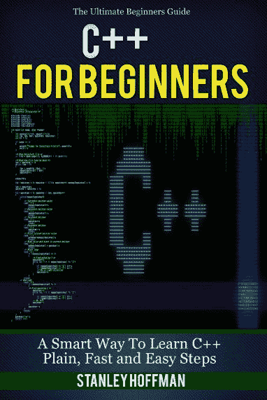
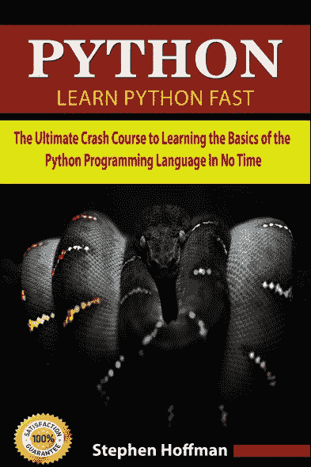
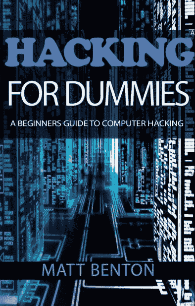
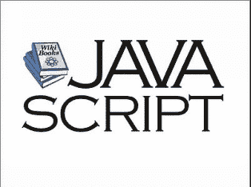
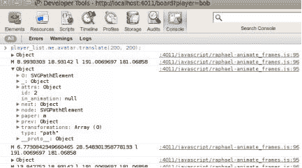
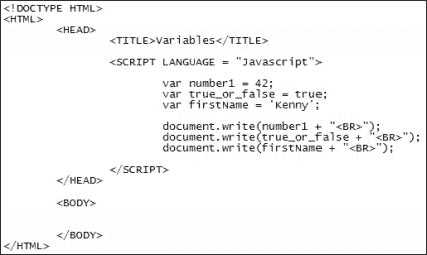

# Javascript：Javascript 编程终极指南 (初学者指南、如何编程、软件开发、基础 Javascript、浏览器... 编码、CSS、Java、PHP) (第 7 卷)


我认为接下来的书对你可能感兴趣。

[C++](http://www.amazon.com/Beginners-Simple-programming-coding-Developers-ebook/dp/B014MT5ME8/ref=sr_1_fkmr0_1?s=digital-text&ie=UTF8&qid=1442833820&sr=1-1-fkmr0&keywords=C%2B%2B%3A+C%2B%2B+for+Beginners%2C+C%2B%2B+in+24+Hours%2C+Learn+C%2B%2B+fast%21+A+smart+w)


[Python](http://www.amazon.com/Python-Ultimate-Learning-Programming-Hands--ebook/dp/B014MV238Y/ref=sr_1_1?s=digital-text&ie=UTF8&qid=1442836729&sr=1-1&keywords=Python%3A+Learn+Python+FAST+-+The+Ultimate+Crash+Course+to+Learning+the+Basics+of+the+Python+Programming+)


[计算机黑客](http://www.amazon.com/dp/B010965F36)


[黑客入门教程](http://www.amazon.com/Computer-Hacking-beginners-computer-security-ebook/dp/B015T8FZYI/ref=sr_1_1?s=digital-text&ie=UTF8&qid=1446193044&sr=1-1&keywords=hacking+for+dummies+matt+benton)


## 序言

在这一代，计算机似乎不再令人畏惧。它们现在正成为我们的日常工具之一——让我们让事情变得更简单高效。尽管今天的最新计算机操作是非常友好的，但仍然存在许多隐藏的复杂性。大多数人发现它们难以理解。因此，这本书是为那些想要以最简单的方法发现计算机潜力的人编写的。

为了实现这一点，你必须记住通信是计算机过程中的至关重要的部分。这不是计算机之间的过程，而是键盘后的用户与运行机器之间的过程。基本元素当然是语言。学习像 `C` 这样的语言将让你能够按照你想要以及你期望的方式命令机器。

在本书书中，你将学习计算机最重要的语言之一——`JavaScript`。

### 编程简述

在继续学习 `JavaScript` 之前，理解什么是编程至关重要。

计算机程序可以是任何东西。你用来阅读这本电子书的软件是一个程序。你使用的网络浏览器是一个程序。播放音乐文件的应用程序是一个程序。你正在玩是一个程序。换句话说，你在计算机中看到和使用的一切都是一个程序。所有这些都是一个被称为编程的单一过程的产物。


编程是一门艺术。程序员在其中输入一段文本，命令计算机执行特定的操作。让我们以人体作为类比。

如果给给你一个数学问题来解决，你的大脑必须处理它。根据方程的规模，你可能会发现自己在数手指或在纸上解一个公式。简而言之，有几项身体功能在工作。

从编程的角度来看，所有这些身体功能都是程序，你的整个身体就是机器。你大脑的机械对应物是机器的内存。方程就是我们要处理的数据。

我们在这里的首要目标是处理数据。在上面的场景中，那就是得到数学问题的正确答案。为了让我们的身体能够做到，你的眼睛需要看到问题并将其传递给大脑。对于机器，你需要一个程序。

## 介绍 JavaScript



在任何其他事情之前，你可能已经熟悉另一种名为 `Java` 的编程语言。

`JavaScript` 最初被命名 `Mocha`，创建于 `1995` 年。它是当时在 `Netscape` 的 `Brendan Eich` 的作品。`Mocha` 这个名字是由 `Netscape` 的创始人 `Marc Andreessen` 选定的。

在同年的九月，语言的名字改为 `LiveScript`。在同年的 12 月，在获得 Sun 的商标许可后，名称再次变为 `JavaScript`。显然，这是一个营销手段，因为当时 `Java` 语言正在大力推广并变得流行。

今天，`JavaScript` 是每个新手都能轻松学习的编程语言之一。它也是网页开发者在 `CSS` 和 `HTML` 之外学习的语言。网页开发者使用 `HTML` 定义网页内容。他们使用 `CSS` 指定网页布局。最后，他们使用 `JavaScript` 编写网站的行为。因此，`JavaScript` 被认为是 Web 的编程语言。

尽管 `JavaScript` 的想法是为初学者提供更简单的编程领域，但该语言提供的灵活性对资深程序员也有巨大的优势。它为你提供了许多在更僵化的编程语言中无法实现的编程空间。你将在书中后后看到更多这些技术。所以如果你不是编程新手，只是刚开始学习 `JavaScript`，如果它通常以不同的方式解释你提供的代码，不要讨厌它。你只需要耐心并保持开放，因为 `JavaScript` 不仅有趣，而且会带你进入一个全新的编程世界。

## 本书中你可以找到什么？

本书是《简单单词中的 JavaScript》系列的第一部分。该系列的这一部分包含 3 章。第一章将介绍值以及如何在 `JavaScript` 语言中处理这些值。你将学习如何使用运算符、比较符以及如何创建字符串。第二章讨论变量。在本章中，你将学习如何为变量赋值。你还将学习如何通过组合多个变量来创建多变信息。最后一章讨论 `JavaScript` 源文件的创建。在这一章中，你将学习如何在源文件中正确编写 `JavaScript` 代码。此外，你将学习如何在 `HTML` 文件中执行此文件。


《浅显 JavaScript》系列书籍分为几个部分，帮助你掌握这门编程语言而不会感到无从下手。许多初学者放弃了，是因为他们认为 JavaScript 太难处理。整个系列旨在以最简单的方式带你进入 JavaScript 的核心。

# 第 1 章 – 认识数字、运算符和字符串

仅仅浏览互联网就能接触到数百万行的 JavaScript 代码。当你启动喜欢的浏览器（例如 `Google Chrome`、`Mozilla Firefox` 和 `Internet Explorer`）并开始访问某个网站时，你已经在使用 JavaScript 语言进行通信了。

在本章中，我们将讨论 JavaScript 语言的基础构建块。这将帮助你在转向 `jQuery` 等高级框架时建立坚实的基础。你将学习更多关于数字、运算符和字符串的知识。本章还将涵盖使用运算符操作值的不同以及以及将这些值存储在变量中。最后，你还将学习如何在 HTML 代码中创建、运行和查找 JavaScript 代码。

## 控制台 (Console)

在一切之前，访问浏览器控制台对你来说至关重要。浏览器控制台是开发者工具之一，记录与当前网页相关的信息。这些信息包括 CSS、安全错误和 JavaScript。控制台还允许你通过断言 JavaScript 表达式与网页进行交互。

这就是我们在书中执行示例 JavaScript 代码的地方。你可以通过按下键盘上的 `F12` 键访问它。寻找 `Console` 标签页，你现在准备好开始了。



## 基础数字与提示符 (Prompt)

在开始学习 JavaScript 时，你需要熟悉两个符号：

- `>`：大于符号；以及，
- `→`：箭头符号

`>` 符号代表 JavaScript 提示符。我们想要输入控制台的所有代码都将写在这个符号之后。`→` 指的是我们输入的代码产生的结果。

在 JavaScript 语言中，数字会被自动识别。在提示符后输入数字并按下键盘上的回车键，将得到相同的值的结果。尝试在控制台中输入数字 `13`，它将返回相同的值。

| `> 13→ 13` |

带有小数位值的数字也是如此。

| `> 13.29→ 13.29` |

## 运算符

在 JavaScript 中，数学运算也是允许的。JavaScript 语法中常用的操作如下：

- 加法
- 减法
- 乘法
- 除法
- 取模 (Modulus)

加通过 `+` 符号表示。

| `> 1 + 3→ 4` |

减法通过 `–` 符号表示。

| `> 10 – 5→ 5` |

乘法通过 `*` 符号表示。

| `> 2 * 9→ 18` |

除法通过 `/` 符号表示。

| `> 25 / 5→ 5` |

另一方面，取模是 JavaScript 语言中的一种特殊运算。它通过 `%` 符号表示。你得到的结果是两个数字相除后的余数。

| `> 23 % 2→ 1` |

在上面的取模示例中，控制台将 `23` 除以 `2`。即使在 `23` 中可以除 11 次，控制台也只显示余数作为结果，即 `1`。

### PEMDAS 顺序

JavaScript 编程遵循流行的数学运算顺序：`PEMDAS`。这个缩写代表：

- **P**: 括号 (Parentheses)
- **E**: 幂 (Exponents)
- **M**: 乘法 (Multiplication)
- **D**: 除法 (Division)
- **A**: 加法 (Addition)
- **S**: 减法 (Subtraction)

让我们以以下表达式为例。

| `> (10 + 5) * 3` |

按下回车键后，控制台将给你这个答案。

| `→ 45` |

括号内的运算将首先求解。在我们的案例中，`10 + 5` 得到 `15`。之后，该和将乘以 `3`。因此，控制台给出了 `45`。

让我们尝试一个更长的表达式。

| `> (7 * 2) + 5 – 10 / 2` |

按照 PEMDAS 顺序，表达式将按如下求解：
1. `(7 * 2)` = `14`
2. `14 + 5` = `19`
3. `10 / 2` = `5`
4. `19 – 5` = `14`

因此，控制台将给你这个答案。

| `→ 14` |

### 比较运算符 (Comparators)

除了运算符之外，JavaScript 语言也识别逻辑运算符，我们称之为比较运算符。JavaScript 中常用的比较运算符通过以下方式表示：

- `>`：大于
- `<`：小于
- `==`：等于
- `!=`：不等于
- `>=`：大于或等于
- `<=`：小于或等于

使用这些比较运算符在 JavaScript 中发送表达式就像是向控制台提一个逻辑问题。你从控制台得到的答案可能是 `true` 或 `false`。这些答案被称为布尔值 (Boolean values)。

让我们尝试向控制台发送以下表达式。

| `>10 != 9` |

这个表达式就像是在问控制台，在 JavaScript 语言中 `10` 是否不等于 `9`。因此，控制台将给你 `true`，因为 `10` 不等于 `9`。

## 字符串 (Strings)


JavaScript 处理、存储并处理文本。为了告知控制台我们要处理文本，需要将它们封装在引号内。这将允许控制台将其识别为字符串并返回给我们。

| `> “The quick brown fox jumps over the lazy”→“The brown brown jumps the the dog” |

多个字符串可以使用连接方法组合。通过在字符串之间添加 `+` 符号来连接或多个字符串。控制台会将所有连接的字符串合并为一个字符串。

| `> “Lee” + “and” + “Haide”→“Lee and” |

你注意到开头有一个空格吗？这是因为连接没有将 `+` 符号视为空格。让我们尝试一个字符串和数字组合的示例。

| `> “I will deliver this at” + 5 + “PM”→“I will deliver at”” |

在这里你应该注意两点。首先，与字符串与数字不需要引号。其次，得到的结果不是我们想要的。因此，我们需要在第一个字符串的结尾和第二个字符串的开头添加空格。应该是这样的。

| `> “I will deliver this at ” + 5 + “ PM”→“I will deliver this at” | |

数字之外，你还可以连接字符串、数字和表达式。但注意，控制台会自动求值数学表达式。

| `> “The rooftop needs to be “ + 15 + “ feetand + 1/4→“The rooftop needs to be and 0.25”` |

我们 JavaScript 代码中的分数被自动转换成了值。如果你需要保持表达式原样，则需要将它们封装在字符串中。应该是这样的。

| `> “The rooftop needs to be “ + 15 + “ feet and 1/4”→“The rooftop needs to be feet and 1/4”` |

### 使用特殊字符格式化字符串

你可以使用特殊字符来格式化字符串的外。一个很好的例子是特殊字符反斜杠 `\` 后面跟着字母 `t`。

                \t                  指示控制台移动到下一个制表位

编写带有此额外命令的字符串，你将得到的版应该是这样的。

| `> “Height:\t6 ft.\t\t\tWidth:\t26 ft.”→“Height:      6 ft.Width:      26 ft.”` |


在字符串内部添加引号时也应该使用反斜杠。

`\"` 告诉控制台，接下来的引号不是字符串的开始或结束。

以下是在字符串内部断言引号时你的字符串行的样式，以及你将获得的返回输出。

| > `“Nicknames:\t\”The Geek\” \”Com Wiz\” \”Backslasher\””→“Nicknames:     “The Geek” “Com Wiz” “Backslasher”` |

如果你想在字符串输出中断言反斜杠符号，也适用相同的规则。

`\\` 告诉控制台在输出中按原样添加接下来的反斜杠。

当编写此命令时，字符串和输出应该如下所示。

| > `“Target Folder:\t\”C:\\Program Files\\Directory 1\\Directory 2\””→“Target Folder:     “C:\Program Files\Directory 1\Directory 2”` |

你也可以通过在反斜杠后添加字母“n”来命令控制台将值放在新行。

`\n` 告诉控制台在新行中断言接下来的值。

这是你的代码和输出应该的样子。

| > `“Member 1:\tFebz\nMember 2:\tDonz\nMember 3:\tTaz”→“Member 1:     Febz→ Member 2:     Donz→ Member 3:     Taz”` |

### 比较运算符与字符串

除了数字，比较运算符也可以用于比较字符串以获取布尔值作为输出。让我们尝试使用相等比较运算符。

| > `“Obi-Wan Kenobi” == “Obi-Wan Kenobi”→true` |

基于上面的示例，我们返回了布尔值“true”，因为第一个字符串与第二个字符串完全相同。让我们尝试修改其中一个字符串。

| > `“Obi-Wan Kenobi” == “Obi-Wan Kinobi”→ false` |

请记住，JavaScript 语言对大小写敏感。因此，如果第一个字符串是用大写字母写的，而第二个字符串完全用小写字母写；那么控制台将它们视为不相等。

| > `“Obi-Wan Kenobi” == “obi-wan kenobi”→ false` |

### 计算字符串长度

在 JavaScript 语言中，你可以轻松地访问字符串的长度。这样做将命令控制台计算引号之间的所有字符，包括空格和表示字符串开始和结束引号之间的非字母字符。我们通过在字符串后紧接着添加以下属性来实现。

`.length` 命令控制台计算其后字符串内的字符。

这是我们编写它的方式以及我们将得到什么种的输出。

| > `“Pneumonoultramicroscopicsilicovolcanoconiosis”.length→45` |

现在让我们尝试使用一个带有空格和非字母字符的字符串。

| > `“Pink, Blue, Black, Red, Purple, White, and Green”.length→48` |

## 第 2 章 – 发现变量

现在你已经知道了如何在 JavaScript 语言中编写、格式化和处理数据，现在是时候学习变量了。在本章中，你将学习如何使用变量存储值。如果不先学习如何编写变量，你将无法做到。话不多说，让我们开始我们的变量之旅。



### 值的存储

为了管理 JavaScript 语言中的数据，你需要将它们存储在变量中。让我向你展示一个名为“Learn Easy”的变量的基本赋值语法。

| > `var learnEasy = 6` |

这里的代码 `var` 指的是变量关键字。它命令浏览器为此变量预留特定的空间。下一个是 `learnEasy` 指的是变量名。这是我们将分配给示例变量语法的名称。这里的等号充当赋值运算符。注意，我们这里只使用单个等号，与我们之前用于比较的双双等号不同。最后，此处的数字 `6` 是我们要存储在名为 `learnEasy` 的变量中的值。

现在我们已经在变量中存储了一个值，我们现在仅使用变量名就可以调用它了。在控制台中断言变量名 `learnEasy` 将带给我们赋值的值作为输出。

| > `learnEasy→ 6` |

在我们的变量中命名时，在 JavaScript 语言中有一些我们需要遵循的规则。这些规则如下：

1. 变量名中不能有空格。（例如 `var learn easy`、`var sweet java`）
2. 变量名开头不能是数字。（例如 `var 4`）

你可以使用一些特殊字符。但最好使用 `_` 或 `$`。

- `_`（下划线）
- `$`（美元符号）
- 驼峰命名法（例如 `simpleAndClean`）

### 修改变量中的值

回到 `learnEasy`。目前，我们给它分配了 `13`。注意我们不再使用关键字，因为控制台记得这个值。一旦你调用此变量，你将获得新值。

| > `learnEasy = 13` |

你也可以使用变量自身的名称来更改现有变量的值。格式应该是变量名后跟运算符。

| > `learnEasy = learnEasy + 16` |

这将存储的值更改为 29，因为表达式调用了当前值 13 并加上 16。

还有另一种方法可以实现此。我们将使用不同的语法更改存储的值。

| > `learnEasy += 2` |

这里的 `+=` 运算符命令控制台先将变量的值加上数字 `2`。然后命令控制台将新值存储到同一个变量中。

### 在变量中存储字符串

除了数值，你还可以将字符串存储在变量中。语法使用相同的格式。让我们创建一个变量来欢迎我们的客人。

| > `var hello = "Welcome to my website!"` |

通过将字符串存储在变量中，你不再需要输入长长的字符串。只需调用变量名，控制台就会给你存储的字符串。它应该是应该是显示的。

| > `hello→“Welcome to my website!” |

### 在字符串中查找字符

JavaScript 语言有自己的方式来索引字符串中的每个字符。让我们以变量 `hello` 为例。

“Welcome to my website!”

0 1 2 3 4 5 6 7 8 9 10 11 12 13 14 15 16 17 18 19 20 21


在进行索引时，JavaScript 使用数值值 `0` 来索引第一个字符。这与 `.length` 属性不同，因为 JavaScript 使用数值值 `1` 来计数第一个字符。换句话说，最后一个索引数字始终比长度值小 `1`。

使用存储在 `hello` 变量中的字符串，我们的 `length` 属性为 `22`，最后一个索引号为 `21`。现在，你可能会问为什么我们需要索引号呢？

我们使用它来查找字符串中的特定字符。这是通过 `charAt( ` 方法实现的，我们像放置 `.length` 属性一样将它放在变量之后。例如，我们想知道变量 `hello` 中索引号为 `20` 的字符是哪个。我们只需要输入以下内容：

```
hello.charAt(20)→ “e”
```

## 使用变量创建消息

现在你已经知道如何在变量中存储值了，让我们使用变量来创建消息吧。让我们再创建一个变量，与我们现有的变量“hello”结合起来。

```
var enjoy = "Please enjoy your visit!"
```

现在我们已经有了第二个变量，让我们将它们结合起来并创建一个新变量，作为我们的欢迎消息。

```
varwelcome = hello + enjoy
```

每当我们调用变量 `welcome` 时，都会带我们得到如下输出。

```
welcome→"Welcome to my website! Please enjoy your visit!"
```

## 第 3 章 – 构建与运行 JavaScript

学习变量很有趣，不是吗？然而，没有人想在控制台中编写 JavaScript 语言。在本章中，你将学习如何构建 JavaScript 文件。你还将学习如何在 HTML 中运行这些文件。那么，让我们开始吧。


### 创建源文件

仅在控制台中编写 JavaScript 代码并无法输出我们想要向用户的网页浏览器传达的内容。因此，我们需要找到一种方法将我们想要的内容交给用户。为了实现这一点，我们需要创建 JavaScript 源文件并在 HTML 文件中运行这些文件。这里有一个常见的 HTML 文件 `index.html` 的示例。

```html
<<html><head><script src="greetings.js"></script></head><body><h1>WELCOME TO JAVASCRIPT!</h1>…</body></html>
```

正如你所见，我们在这个文件中使用了 `<script>` 标签。该标签命令此 HTML 文件加载特定的 JavaScript 源文件，以便访问者的网页浏览器能够按照你希望的方式查看你的网站。注意我们在 `<script>` 标签内部有 “src” 关键字。这是给 HTML 文件的命令，指示它从哪里加载 JavaScript 源文件。

在这个示例中，我们命令 `index.html` 文件加载保存在 `greetings.js` 中的所有变量和值。

为了创建此 `.js` 文件，你只需要打开任何文本编辑器（如记事本或文本编辑）。将你所有的 JavaScript 代码写在里面，并将文件保存为 `.js` 格式。在这个文件中，我们断言了希望访问者访问我们的网站时立即执行的所有 JavaScript 代码。

### 源文件存放在哪里？

在浏览你网站的文件管理器时，你永远不会错过一个名为 `root/` 的文件夹。这就是我们找到网站内所有内容的地方。这也是你网站 `index.html` 的默认位置。

根据我们上面的 `index.html` 文件，我们正引导它在同一位置文件夹内寻找 JavaScript 源文件——即 `root/` 文件夹。因此，我们应该将 `greetings.js` 放在相同的位置。

```
+ root/      - index.html      - greetings.js
```

然而，有些网站会将所有的 JavaScript 源文件放在子文件夹中。它们源文件最常见的目录是 `scripts/` 文件夹。这里是它们在你网站目录中的样子。

```
+ root/      - index.html      + scripts/             - greetings.js
```

如果你想这样组织源文件，那么我们需要修改示例 `index.html` 中的 `<script>` 标签。你的 HTML 代码应该是这样的。

```html
<<html><head><script src="scripts/greetings.js"></script></head><body><h1>WELCOME TO JAVASCRIPT!</h1>…</body></html>
```

注意，在这段代码中，我们正在指示 `index.html` 从 `scripts/` 子文件夹中加载 `greetings.js`。

### 在源文件中编写代码

在 `greetings.js` 中直接编写控制台风格的表达式只会导致错误。让我们尝试在源文件中编写以下几行作为例如。

```
var hello = "Welcome to my website! "var enjoy = "Please enjoy your visit!"hello + enjoy
```

一旦我们打开 `index.html` 并进入浏览器的控制台，我们将一无所获，只有错误。这是因为网页浏览器对你到底想要什么感到困惑。错误来自我们的 JavaScript 源文件。与控制台不同，我们需要在源文件中以不同的方式断言 JavaScript 代码。我们通过在每个语句后添加分号（`;`）来实现。因此，我们应该这样写 JavaScript 代码。

```
var hello = "Welcome to my website! ";var enjoy = "Please enjoy your visit!";hello + enjoy;
```

使用分号编写代码后，当你尝试访问控制台时将不再看到错误。然而，你将在控制台中看不到任何内容。这意味着我们的代码尚未传递到控制台。JavaScript 代码的执行仅发生在源文件中。为了解决这个问题，我们需要使用 `console.log( )` 方法。

我们在这里想要做的是显示 `hello` 和 `enjoy` 变量拼接后的字符串。我们是这样做的：

```
var hello = "Welcome to my website! ";var enjoy = "Please enjoy your visit!";console.log(hello + enjoy);
```

通过 `console.log(` 方法，你现在可以在控制台中看到字符串了。换句话说，我们现在有了由 `index.html` 运行的有效的 JavaScript 语言。

## 总结

到此，你已经知道如何在 JavaScript 语言中编写值。你刚刚学习了 JavaScript 如何解释数字和平直文本，以及如何将文本转换为字符串值。你还学习了如何使用运算符和比较符将这些值转换为表达式和语句。

在第二章中，你接触了变量。你学习了如何将值存储在变量中，以及通过拼接方法如何以变量的形式快速处理值。还介绍了一些方法，例如 `charAt( )` 方法和 `.length` 属性——这些都是帮助你高效分析值的工具。

在第三章中，你学习了如何创建自己的 JavaScript 源文件。注意，与控制台相比，你需要在源文件中不同的断言 JavaScript 代码。你还了解 `console.log( )` 方法，它允许你在浏览器控制台中打印值。

感谢阅读。希望你喜欢。我请求你留下诚恳的反馈。

