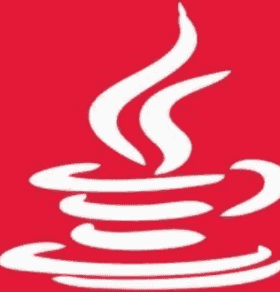
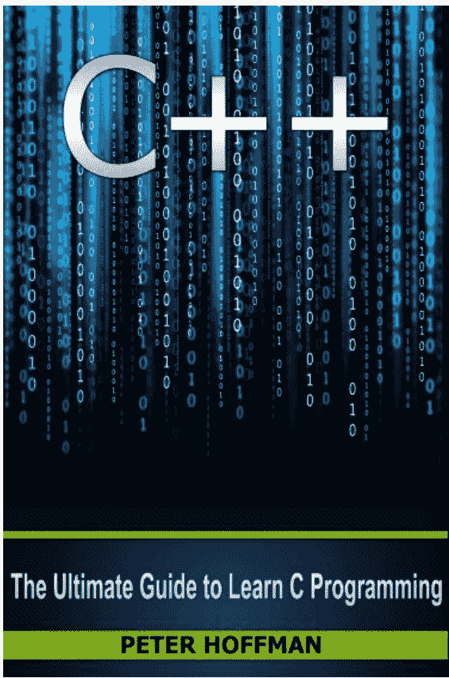
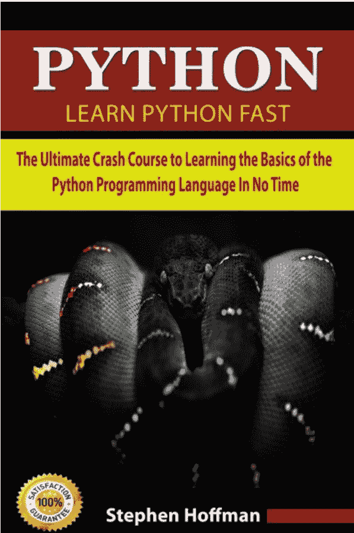
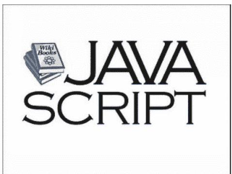
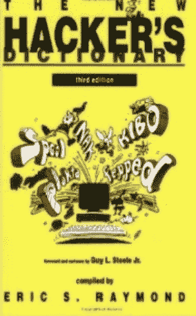
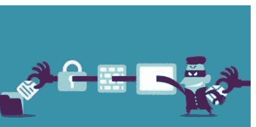
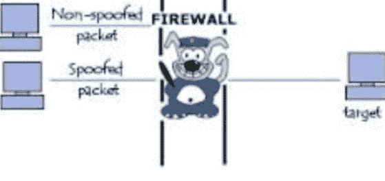
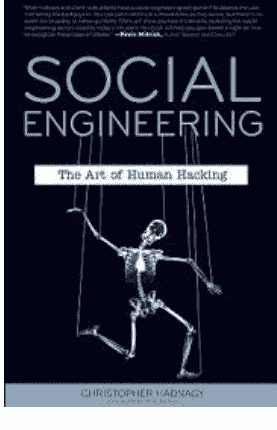

# Javascript：Javascript 编程与计算机黑客终极指南（Javascript 初学者指南，如何编程、黑客破解、黑客、如何……（C语言编程、HTML、编码、CSS、Java、PHP））




我认为接下来的书籍对你也会很有趣：







## 引言

在这一代，计算机似乎已经不再令人畏惧。它们现在正成为我们的日常工具之一——让我们事情变得更简单更高效。尽管今天最新的计算机操作对用户友好，但仍然有许多隐藏的复杂性。大多数人会发现它们难以理解。因此，这本书是为那些希望以最简单的方法发现计算机最大潜力的人编写的。

为了做到这一点，你必须记住通信是计算机处理过程中至关重要的部分。这并不是计算机之间的过程，而是键盘后的用户与操作机器之间的过程。基本元素当然是语言。学习像 C 这样的语言将让你能够按照你想要以及你希望的方式来命令机器。

在书中，你将学习计算机最重要的语言之一——JavaScript。

## 编程简介

在学习 JavaScript 之前，首先理解什么是编程至关重要。

计算机程序可以是任何东西。你用来阅读这本电子书的软件是一个程序。你使用的网络浏览器是一个程序。播放你音乐文件的应用程序是一个程序。你正在的游戏的游戏程序。换句话说，你在计算机中看到和使用的一切都是程序。所有这些都是一个被称为编程的单一过程的产物。


编程是一门艺术。程序员输入一段文本，命令计算机执行特定的操作。让我们以人体作比。

如果你给你一个数学问题来解决，你的大脑必须处理它。根据方程的规模，你可能会发现自己正在数手指或在纸上解算公式。简而言之，有几个生理功能在工作。

从编程的角度来看，所有这些生理功能都是程序，你的整个身体就是机器。你大脑的机械对应物是机器的内存。方程是我们想要处理的数据。

在这里的首要目标是处理数据。在上面的场景中，那就是为数学问题提供正确答案。为了让身体能够做到这一点，你的眼睛需要看到问题并将其传递给你的大脑。对于机器，你需要一个程序将该信号传递给计算机内存。

回到人体，你可能需要使用你的手指或一张纸来解方程。为了控制你的手指，你的大脑必须发送信号，让它们以有助于你解决当前问题的方式运行。对于机器，你需要程序。程序写得正确时是美丽的。讽刺的是，写得糟糕的程序是令人恐怖的。

## 介绍 JavaScript



在其他事情之前，你可能熟悉另一种名为 Java 的编程语言。记住，JavaScript 和 Java 之间几乎没有任何关系。

JavaScript 最初命名为 Mocha，创建于 1995 年 5 月。它是 Brendan Eich 经过 10 天艰苦工作的成果。Brendan 当时在 Netscape 工作。

1995 年 9 月，由于 Netscape 的选择，名字改为了 JavaScript。1995 年 12 月，在获得 Sun 的商标后，名字再次更改为 JavaScript。

如今，JavaScript 是开发者必须学习的语言之一，正如 CSS 和 HTML 一样。它提供了许多功能空间。

## 基础数字与提示 (Prompt)

在开始学习 JavaScript 之前，你需要熟悉两个符号：

- `>` 大于符号；以及
- `→` 箭头符号

`>` 符号代表 JavaScript 的提示符（prompt）。我们想要输入控制台的所有代码都将写在这个符号之后。`→` 符号指的是我们输入的代码所产生的结果。

在 JavaScript 语言中，数字会被自动识别。在提示符后输入数字并按下键盘上的回车键，将得到相同的值的结果。尝试在控制台输入数字 13，它将返回相同的值。

```
> 13
→ 13
```

带有小数值的数字也是如此的。

```
> 13.29
→ 13.29
```

## 运算符

在 JavaScript 中，数学运算也是允许的。JavaScript 语法中常用的操作包括：

- `+` 加法
- `-` 减法
- `*` 乘法
- `/` 除法
- `%` 取模运算 (Modulus)

加法通过 `+` 号表示。

```
> 1 + 3
→ 4
```

减法通过 `–` 号表示。

```
> 10 – 5
→ 5
```

乘法通过 `*` 号表示。

```
> 2 * 9
→ 18
```

除法通过 `/` 号表示。

```
> 25 / 5
→ 5
```

另一方面，取模运算是 JavaScript 语言中的一种特殊运算。它通过 `%` 号表示。你得到的结果是两个数字除之后的余数。

```
> 23 % 2
→ 1
```

在上面的取模示例中，控制台将 23 除以 2。即使在 23 中可以除尽 11 次，控制台也只显示余数作为结果，即 1。

### PEMDAS 顺序

JavaScript 编程遵循通用的数学运算顺序：PEMDAS。这个缩写代表：

- P 括号 (Parentheses)
- E 幂 (Exponents)
- M 乘法 (Multiplication)
- D 除法 (Division)
- A 加法 (Addition)
- S 减法 (Subtraction)

让我们以以下表达式为例。

```
> (10 + 5) * 3
```

按下回车后，控制台将返回此答案。

```
→ 45
```

括号内的运算将首先求解。在我们的例子中，是 `10 + 5`，得到 15。之后，该总和将乘以 3。因此，控制台给了你 45。

让我们尝试一个更长的表达式。

```
> (7 * 2) + 5 - 10 / 2
```

按照 PEMDAS 顺序，该表达式将按如下求解：

```
14 + 5 - 10 / 2
14 + 5 - 5
19 - 5
```

因此，控制台将返回此答案。

```
→ 14
```

### 比较运算符 (Comparators)

除了运算符之外，JavaScript 语言还识别逻辑运算符，我们称之为比较运算符。JavaScript 中常用的比较运算符通过以下语法表示：

- `>` 大于
- `<` 小于
- `==` 等于
- `!=` 不等于
- `>=` 大于或等于
- `<=` 小于或等于

在 JavaScript 中使用这些比较运算符发送表达式，就像向控制台提一个逻辑问题。你从控制台得到的答案可能是“true”或“false”。这些答案被称为布尔值（Boolean values）。

让我们尝试向控制台发送以下表达式。

```
>10 !== 9
```

这个表达式就像是在问控制台在 JavaScript 语言中 10 是否不等于 9。因此，控制台将给你“true”作为答案，因为 10 在数值上不等于 9。

### 字符串 (Strings)

```html
<!DOCTYPE html>
<html>
<body>
<script type="text/javascript">
var str=" ";
document.write(str + "<br>");
document.write(str + ",") + "<br>");
document.write(str + "/") + "<br>");
</script>
</body>
</html>
```

JavaScript 处理、存储和处理文本为字符串。为了告诉控制台我们想要处理文本，我们需要将其包含在引号内。这将允许控制台将其视为字符串并返回给我们。

```
> "The quick brown fox jumps over the lazy dog"
→ "The quick brown fox jumps over the lazy dog"
```

多个字符串可以使用连接方法组合。通过在字符串之间简单添加 `+` 号，控制台会将所有字符串组合成一个单一字符串。

```
> "Lee" + "and" + "Haide"
→ "Lee and Haide"
```

你注意到字符串的开头和结尾有一个空格吗？这是因为连接并没有自动将 `+` 号视为空格。让我们尝试使用字符串和数字的组合。

```
> "I will deliver this at" + 5 + "PM"
→ "I will deliver this at5PM"
```

这里两点需要注意：第一，与字符串连接时数字不需要引号。第二，我们得到的结果不是我们想要的。因此，我们应该在第一个字符串的结尾和第二个字符串的开头添加空格。应该是这样的：

```
> "I will deliver this at " + 5 + " PM"
→ "I will deliver this at 5 PM"
```

除了数字，你还可以将字符串、数字和表达式组合在一起。注意，控制台会自动计算数学表达式。

```
> "The rooftop needs to be " + 15 + " feet and " + 4
→ "The rooftop needs to be 15 feet and 4"
```

JavaScript 代码中的表达式会自动转换为值。如果你需要保持表达式原样，则需要将其包含在字符串中。应该是这样的：

```
> "The rooftop needs to be " + "15" + " feet and " + "4"
→ "The rooftop needs to be 15 feet and4"
```

### 使用特殊字符格式化字符串

你可以使用特殊字符来格式化字符串的外。一个很好的例子是斜杠（`\`）后跟字母 `t`。

`\t` 通知控制台跳转到下一个制表符

使用此额外命令编写字符串，得到的结果应该是这样的。

```
> "Height:\t6 ft.\tWidth:\t26 ft."
→ "Height: 6 ft.Width: 26 ft."
```

字符串内的引号也应该用斜杠编写。

`\"` 通知控制台后面的引号不是字符串的开始或结束。

当在字符串内部断引号时，你的字符串行应该是这样的，返回的结果如下：

```
> "Nicknames:\t\"The Geek\" \|Com Wiz\" \|Backslash\""
→ "Nicknames: "The Geek" "Com Wiz" "Backslash""
```

如果你想在字符串中使用斜杠，则适用此规则。

`\\` 通知控制台在你的输出中添加后续斜杠。

编写此命令时，字符串和输出应该如下。

```
> "Target Folder:\t\Program Files\Directory 1
→ "Target Folder: \Program Files\Directory 1
```

你也可以通过在斜杠后添加字母“n”来命令控制台将值放在新行。

`\n` 通知控制台在新行断言值。

这是你的代码和输出应该的样子。

```
> "Member 1:\tFebz\nMember 2:\tDonz\nMember 3:\taz"
→ "Member 1: Febz
→ Member 2: Donz"
```

### 比较运算符与字符串

除了数字，比较运算符也可以用于比较字符串以获得布尔值输出。让我们尝试使用相等运算符。

```
> "Obi-Wan Kenobi" == "Obi-Wan Kenobi"
→ true
```

基于上面的示例，我们得到了布尔值“true”，因为第一个字符串与第二个字符串完全相同。让我们尝试修改一个字符串。

```
> "Obi-Wan Kenobi" == "Obi-Wan Kinobi"
→ false
```

记住 JavaScript 语言是大小写敏感的。因此，如果第一个字符串是用大写字母写的，而第二个字符串完全是用小写字母写的，那么控制台将它们视为不相等。

```
> "Obi-Wan Kenobi" == "obi-wan kenobi"
→ false
```

### 统计字符串长度

在 JavaScript 语言中，你可以轻松访问字符串的长度。这将命令控制台计算引号之间的所有字符，包括表示字符串开始和结束的空格和非字母字符。我们通过在字符串后直接添加以下属性来实现。

`.length` 命令控制台计算字符串内部的字符

我们这样写以及得到什么样的输出。

```
> "Pneumonoultramicroscopicsilicovolcanoconiosis".length
→ 45
```

现在让我们尝试使用一个包含空格和非字母字符的字符串。

```
> "Pink, Blue, Black, Red, Purple, White, and Green".length
→ 48
```

## 第2章 – 发现变量

现在你已经知道了如何在 JavaScript 语言中编写、格式化和处理数据，现在是时候学习变量了。在本章中，你将学习如何使用变量来存储值。如果你不先学习如何编写变量，你将无法完成这一点。话不多说，让我们开始变量世界之旅。

```html
<!DOCTYPE HTML>
<html>
<HEAD>
<TITLE>Variables =</TITLE>
<SCRIPT LANGUAGE="Javascript">
  var number1 = 21;
  var true_or_false = true;
  var firstName = 'Kenny';
  document.write(number1 + "<BR>");
  document.write(true_or_false + "<BR>");
  document.write(firstName + "<BR>");
</SCRIPT>
</HEAD>
<BODY>

</BODY>
</html>
```

### 值的存储

为了在 JavaScript 语言中管理数据，你必须将它们存储在变量中。让我给你展示一个名为“Learn Easy”的变量的基本赋值语法。

```javascript
var learnEasy = 6
```

这里的代码 `var` 指的是变量关键字。它命令浏览器为此变量留出特定的空间。下一个是 `learnEasy`，指的是变量名。这是我们将分配给此示例变量语法的名称。这里的等号在这里充当赋值运算符。注意，我们只使用单个等号，而不像我们之前用于比较的双等号那样。最后，数字 6 是我们要存储在名为 `learnEasy` 的变量中的值。

现在我们已经已经在变量中存储了一个值，我们现在就可以通过变量名直接调用它了。在控制台中输入变量名 `learnEasy` 将得到我们赋值的值作为输出。

```javascript
learnEasy
→ 6
```

在为我们的变量命名时，在 JavaScript 语言中有一些我们需要遵循的规则。这些规则如下：

1. 变量名中不能有空格。（例如：`var learn easy`, `var sweet java`）
2. 变量名开头不能是数字。（例如：`var 4life`, `var 1piece`）

你可以在变量名中使用一些特殊字符。但最好使用简单的名称，以免让 JavaScript 语言变得复杂。

1. 你可以在变量名中使用下划线 (`_`)。（例如：`var learn_easy`）
2. 你可以在变量名中使用美元符号 (`$`)。（例如：`var learnEa$`）
3. 你可以同时使用下划线和美元符号。（例如：`var learn_ea$`）

一个良好的变量名应该是这样的。它被称为“驼峰命名法”（Camel Case），以小字母开头，后续单词的首字母大写。

```javascript
varsimpleAndClean
```

如果你喜欢重用变量名来存储不同的值，你可以像这样在末尾添加数字来简化一切。

```javascript
var simpleAndClean2
```

### 修改变量中的赋值值

让我们回到我们的示例变量 `learnEasy`。目前，我们为它分配了数值 3。假设，你想更改分配给该变量的值。你可以通过输入变量名，后面跟着赋值运算符，然后是你想分配给该变量的新值来轻松地实现。

```javascript
learnEasy = 13
```

注意，我们在这里不再使用变量关键字。这是因为控制台记得该值已经存在于它的内存中了。一旦你调用此变量，你现在将获得分配给它的新值。

```javascript
learnEasy
→ 13
```

你也可以在数学表达式中使用现有变量的名称来更改其值。格式应该是变量名后跟赋值运算符。你在运算符后插入数学表达式。它应该是这样的：

```javascript
learnEasy = learnEasy + 16
```

这将我们的存储值更改为 29，因为该表达式调用了当前的变量值（13）加上 16。这让它变成了 29。

还有另一种方法来实现。我们将使用不同的语法来更改存储的值。它如下：

```javascript
learnEasy += 2
```

这里的 `+=` 运算符命令控制台先将变量的当前值加上数字 2。然后它命令控制台随后将新值存储到同一个变量中。由于我们当前的值是 29，我们现在将获得 31 作为存储在变量 `learnEasy` 中的新值。

在这种情况下，可以使用两种格式的所有运算符。

### 在变量中存储字符串

除了数值外，你还可以在变量中存储字符串。语法使用相同的格式。让我们创建一个变量来欢迎我们的客人。

```javascript
var hello = "Welcome to my website!"
```

通过将字符串存储在变量中，你就不需要再次输入长字符串。只需调用变量名，控制台就会给你存储的字符串。它应该是这样的：

```javascript
hello
→ "Welcome to my website!"
```

## 源文件存放在何处

当你浏览网站的文件管理器时，你永远不会错过一个名为 `root/` 的文件夹。这就是我们找到网站内所有内容的地方。这里也是你网站 `index.html` 的默认位置。


根据上面的`index.html`文件，我们引导它在同一位置的文件夹内中查找 JavaScript 源代码文件——即`root/`文件夹。因此，我们应该将`greetings.js`放置在相同的位置。

```
+ root/
- index.html
- greetings.js
```

然而，有些网站会将所有的 JavaScript 源代码文件放在子文件夹中。它们最常见的目录是`scripts/`文件夹。以下是它们在你的网站目录中的外观。

```
+ root/
- index.html
+ scripts/
- greetings.js
```

如果你想这样组织你的源文件，那么我们需要修改示例`index.html`中的`<script>`标签。你的 HTML 代码看起来应该是这样的：

```html
<html>
<head>
<script src="scripts/greetings.js"></script>
</head>
<body>
<h1>WELCOME TO JAVASCRIPT!</h1>
...
</body>
</html>
```

注意，在这段代码中，我们指示`index.html`从`scripts/`子文件夹加载`greetings.js`。

# 在源文件中编写代码

直接在`greetings.js`中编写控制台风格表达式（console-style expressions）会导致错误。让我们尝试在源文件中写入以下行作为示例：

```
var hello = "Welcome to my website! "
var enjoy = "Please enjoy your visit!"
hello + enjoy
```

一旦我们打开`index.html`并进入浏览器控制台，我们将看到除了错误之外什么也没有。这是因为我们对你真正想要显示的内容感到困惑。错误来自我们的 JavaScript 源文件。与控制台不同，我们需要在源文件中不同的方式断言 JavaScript 代码。我们通过在每个语句后添加分号（`;`）来实现。因此，我们应该这样写 JavaScript 代码：

```
var hello = "Welcome to my website! "
var enjoy = "Please enjoy your visit!"
hello + enjoy;
```

使用分号编写代码后，当你尝试访问控制台时将不再看到错误。然而，你会在控制台中看到任何内容。这意味着我们的代码没有被传递到浏览器的控制台中。JavaScript 代码的执行仅发生在源文件本身。为了修复这个问题，我们需要使用`console.log()`方法。

我们想要的是显示由变量`hello`和`enjoy`拼接而来的字符串。以下是我们的做法：


```
var hello = "Welcome to my website! ";
var enjoy = "Please enjoy your visit!";
console.log(hello + enjoy);
```

通过使用`console.log()`方法，你现在能够在控制台中看到该字符串了。换句话说，我们现在有一个由`index.html`文件运行的有效 JavaScript 编程语言。

## 结论

到此，你现在已经知道如何在 JavaScript 语言中编写值了。你刚刚学习了 JavaScript 如何解释数字和扁平文本，以及如何将文本转换为字符串值。你还学习了如何使用运算符和比较符将这些值操作为表达式和语句。

在第二章中，你接触了变量。你学习了如何将值存储在变量中，以及拼接方法，通过它学习了如何以变量的形式快速处理值。还介绍了一些方法，如`charAt()`方法和`.length`属性——这些工具可以帮助高效分析值。

在第三章中，你学习了如何创建自己的 JavaScript 源文件。请注意，与控制台相比，在源文件中需要不同的断言 JavaScript 代码。你还了解了`console.log()`方法，它允许你在浏览器控制台中打印值。然而，这仍然不是传递 JavaScript 代码最高效的方法。想象一下如果你要向浏览器传递成百上千个值？这意味着重复性编程和太多的麻烦。

在《简单易懂 JavaScript》（JavaScript in Simple Words）系列的下一部分，我们将带你进入 JavaScript 的循环世界，在那里你将学习如何高效地管理重复代码。该书系列的后部分还将讨论几个主题，包括但不限于条件的使用和对话框的创建。


学者必备黑客指南

# 引言 – 什么是黑客？

黑客行为（Hacking）是指未经授权访问计算机系统的行为，包括查看或复制数据，甚至创建新数据。黑客行为通常被理解为恶意破坏计算机系统、复制信息或留下破坏数据的病毒的方式。

黑客行为的发生有很多不同的原因，这些原因范围从由于意识形态而想破坏系统（因此将黑客作为一种抗议手段），到为了获取利益（例如为了实施信用卡欺诈），或者仅仅是为了娱乐和消遣黑客。

关于“黑客”（hacker）一词的定义存在一些争议，因为那些试图防止此类安全漏洞发生或寻求恢复丢失文件的人也可以被称为黑客。因此，一些人认为，对于恶意系统安全漏洞的正确术语实际上是“破解”（cracking），而“黑客”是那些对抗恶意利用计算机漏洞的人的正确用词。

然而，在公众的想象和日常对话中，“黑客”一词主要被理解为突破计算机安全的“坏”方法。这两个过程共享许多共同技能，无论动机如何（无论是为了偷取还是保护、为了保存而计算机数据），都需要对计算机有相同的理解。

对于对技术感兴趣的人来说，黑客不仅仅是一种消遣，也不仅仅是用于个人利益和带有恶意的非法活动，尽管这两种动机都构成了黑客活动。事实上，黑客有自己的亚文化，社区成员对他们在计算机地下世界中的意识形态、技术和社会关系感到非常强烈。

有许多黑客小组和会议，例如 SummerCon、DEF CON、HoHoCon、ShmooCon、BlackHat、Chaos Communication 和 Hacker Halted，当地黑客社区非常严肃地参加黑客竞赛。意外的是，还有许多致力于黑客主题的在线小组和论坛，具有相似黑客理念的人有着强大的社区精神。

此外，黑客通常对黑客社区的文学描写充满热情，并热衷于阅读小说和真实的黑客杂志。

本书将作为黑客世界的介绍，并对黑客的一些关键影响、意识形态、群体、概念和技术提供见解。

第一章将考虑黑客的起源以及赛博朋克文学流的影响。第二章将介绍不同类型的黑客，并区分伦理黑客与不伦理黑客。第三章将探讨计算机安全问题，这对于理解黑客至关重要。

最后一章将提供各种黑客技术的概述，包括自动化和手动方法，以及被称为“社会工程学”的网络心理骗术的重要性。

# 第一章 – 黑客与赛博朋克的影响

美国科幻小说作家迈克尔·布鲁斯·斯特林（Michael Bruce Sterling）帮助建立了“赛博朋克”这一流行流派。赛博朋克是科幻小说的一个分支，专注于技术在未来设定中的作用。在这一文学和电影流派中，描绘了底层阶级公民，他们接触并对先进技术有深入的理解。

赛博朋克经常探索社会秩序崩溃期间技术扮演的角色，在这种背景下，存在一个压迫性的政府限制并损害普通民众的生活。此外，人工智能（如机器人或智能计算机）在赛博朋克故事中也扮演着重要角色，而地球在近未来被描为一个后工业时代的反乌托邦（乌托邦的反面，因此是一个以压迫和经常性的社会动荡为特征的黑暗世界）。


赛博朋克对当代黑客概念的影响是巨大的。当我们能在虚构表现中识别出自己的世界时，科幻小说尤为有效，通过赛博朋克，我们意识到了当代时代的许多忧虑。劳伦斯·波森（Lawrence Person，科幻杂志《Nova Express》编辑）描述了赛博朋克中的典型人物：

“经典的赛博朋克角色是边缘化的、疏远的孤独者，他们生活在社会的边缘，通常处于反乌托邦的未来，日常生活受到快速技术变化、无处不在的计算机信息数据领域以及对人体侵入性改造的影响。”

对于现代读者来说，这种对赛博朋克角色的描述让人想起大众想象以及书籍和电影中描绘的黑客形象。因此，赛博朋克角色与我们看待现实黑客的方式之间的相互作用是巨大的：在许多方面，我们对黑客形象的理解是基于小说中对赛博朋克角色的描写。其中一个例子是赛博朋克角色经常住在肮脏的环境中，晚上工作白天睡觉，除了聊天室外没有任何社交生活。

在当代的想象中，当我们想到黑客时，往往会想到一个坐在黑暗电脑屏幕后的孤独少年男孩。事实上，作为首批处理赛博朋克的科幻作家之一，迈克尔·布鲁斯·斯特林对理解黑客的发展也表现出了最大的兴趣。


斯特林将黑客的出现以及相关的地下计算机网络追溯到“嬉皮人”（Yippies），这是一个活跃于20世纪60年代的反主流文化群体，他们出版了《技术援助计划》（Technological Assistance Program），这封简报向读者教授了未经授权访问电话的技巧，这被称为“电话骗”（phreaking）。

许多参与“电话骗”社区的个人也是地下黑客社区的活跃分子，这暗示了这两个群体之间的关系。

# 第二章 – 黑客的不同类型

计算机黑客地下世界包含了不同的黑客子类别。这主要是由于意识形态的冲突，某些小组通过特定的名称称呼自己，或用特定名称称呼，来强调他们不认同他人的意识形态。



因此，“黑客”这个通用词虽然指的是拥有技术知识并能够未经授权访问计算机系统的人，但它相当模糊，无法区分那些使用不同方法或持有某些观点的人。

相反，出现了一些独立的名称以区分不同的群体，并表明并非所有黑客都遵循相同的规则或意识形态。正如之前讨论的，这一点体现在埃里克·S·雷蒙德（Eric S. Raymond）在《新黑客字典》（*The New Hacker's Dictionary*）中提倡的黑客与破解者（crackers）之间的区别。

在本书中，雷蒙德编写了一份黑客计算机编程术语表，但黑客社区的人认为，这本书太受雷蒙德个人将黑客视为恶意行为的观点偏见的影响。

与其遵循雷蒙德所建议的黑客/破解者二分法，普通黑客社区认为这种划分过于简单化，而主张使用更广泛的名称列表来反映大型黑客社区的信仰和实践光谱。

黑客的一个子类别被称为“白帽黑客”，他们在没有恶意动机的情况下突破计算机安全。示例包括安全测试员，他们发现漏洞以便在恶意攻击者利用它们之前进行修复。正如之前讨论的，这一点体现在埃里克·S·雷蒙德在《新黑客字典》中提倡的黑客与破解者之间的区别。

（以加密格式存储。）

协作工作的黑客群体可能包括有组织的犯罪团伙、国家级网络战争力量。黑客的不同子类别反映了黑客社区中存在的各种意识形态、动机和技术。

# 第 3 章 – 计算机安全

在我们开始探索黑客的核心概念和技术之前，首先了解计算机安全的基础知识会有帮助。由于黑客是指突破计算机系统安全措施的行为，因此对于任何希望渗透这些系统的黑客来说，了解这些系统至关重要。计算机安全应用于计算机、智能手机、计算机网络（公共网络和私有网络）以及整个互联网，以保护设备、数据和服务安全。


计算机安全保护数字设备免受未经授权的访问，以确保数据不被盗取、更改或删除，并维持系统的正常运行。在当今社会，数字文化不断增长，保护这些系统极其重要，计算机安全领域也一直在不断增长和发展。计算机安全的一部分是保护物理设备免受盗窃，而另一部分是信息安全，用于保护数据本身（这正是黑客大用武之地）。

然而，这两个领域有时会重叠，因为如果物理安全发生破口（例如，笔记本电脑被盗），那么个人成功突破信息安全就会变得容易得多，因为他们拥有了设备，因此访问数据比远程访问要容易得多。

网络安全涵盖了保护计算机数据的所有安全措施，包括意识培训、渗透测试以及使用密码确认授权等程序，以确保数据在传输过程中和仅进行存储时都是安全的。成为计算机安全违规事件受害者的财务成本是巨大的，因此防病毒软件和计算机安全保护出现了一个利润丰的市场。

由于我们现在对技术的依赖，计算机安全是一个巨大的领域。几乎每个行业在不同程度上都使用计算机，因此计算机安全措施的范围和种类非常广泛。然而，在某些领域，计算机安全特别重要，因为这些领域特别容易受到安全漏洞的影响。



其中之一就是金融系统，因为黑客可以通过窃取数据并随之访问资金来获利。任何要求用户输入信用卡号的网站通常都是目标，因为黑客可以立即将资金转入自己的账户，或花费受害者的钱。

即使黑客不直接使用该人的银行详情，他们也可能非法出售这些信息，以与犯罪撇清关系并避免被捕。不仅个人的数据可能被盗取；商店的刷卡机和 ATM 机也可能被改装以收集个人信息，从而获取资金。

人们在进行在线购物或输入信用卡详情时，日益意识到这种风险，因此采取了各种措施，包括使用密码和回答安全问题。航空业是另一个计算机安全极其至关重要的领域，因为安全漏洞的后果可能从机密信息泄露到昂贵设备损失和人员死亡不等。


航空业可能遭受计算机安全攻击的原因有很多，这取决于犯罪的动机。这些动机包括军事航空业中的破坏活动和间谍活动，以及商业航空业中的工业竞争和恐怖主义。交通管制是航空业最脆弱的系统之一，因为任何攻击都难以追踪，而且操作相对简单，因为只需要在无线电中发送一个伪造信息即可。

有些人寻求利用计算机漏洞（无论是出于追求刺激、为了表达政治/社会立场或为了财务利益），当然，另一方是那些维护计算机安全以抵御此类威胁的人。因此，拥有技术知识并能够黑入计算机系统的人可以参与非法且不符合道德的黑客行为（又被称为“破解”，cracking），也可以通过识别威胁、改进安全措施以及提醒公司系统中的漏洞来服务后者。

对于那些目标是保护计算机安全的人来说，有各种针对黑客的应对措施，由此可以减少或消除遭受计算机安全漏洞的风险。这些预防措施在成本和复杂性上不相同，但包括：

- 入侵检测系统（用于检测威胁并在事件后分析攻击）
- 账户控制的使用（密码和数据加密）
- 安装防火墙（提供硬件或软件包对某些形式的攻击进行过滤）

防止计算机系统受攻击破坏的预防措施包括采取防止攻击的步骤、确保任何潜在攻击都能被检测到以及响应攻击的能力以防止进一步损害。

然而，尽管有一系列应对措施，计算机系统仍然容易受到攻击，计算机的安全性被破坏的情况绝非罕见。尝试违反安全之所以仍然发生的首要原因是，警察通常不熟悉计算机技术，因此既没有技能也没有动力解决案件并抓捕负责的犯罪分子。

| 用户名 |
| :--- |
| user01 |
| 密码 |
| ****** |

此外，对此类事务的任何调查都需要搜查令，以便执法人员检查入口，这可能使程序变得耗时。确保计算机安全的另一个困难是，在在全球化的时代，信息可以在全球范围内共享，抓捕负责的人特别困难。其原因是，黑客可能在一个司法管辖区工作，而他们正在黑入的系统在另一个司法管辖区。此外，黑客可以使用各种技术（如临时拨号）来确保其匿名性。第三个问题是由于攻击数量巨大。组织可能会面临许多攻击，因此无法追踪每一个安全威胁。计算机用户从采取预防措施确保自己的安全中获益，因为一旦发生安全漏洞，就没做什么可以补救了。

# 第 4 章 – 黑客技术

黑客可以使用各种技术获取对计算机系统的未经授权访问，以制造混乱、盗取金钱或数据，或防止系统按其预期运行。攻击连接到互联网的系统的三个主要方法是：

- 网络枚举 (network enumeration)
- 漏洞分析 (vulnerability analysis)
- 利用 (exploitation)

网络枚举是一种用于从网络计算机中发现用户名和其他信息的程序。程序发现计算机网络安全中的任何漏洞，并将结果报告给黑客，黑客随后可以使用这些信息访问网络并造成破坏（通过盗取数据或损坏网络）。


另一方面，道德黑客可以使用相同的过程来发现其系统中的任何弱点，以加强安全。使用的另一种方法是漏洞分析，它能识别系统中的任何漏洞点；这些信息可以用于攻击系统，也可以用于消除弱点。漏洞分析可以导致利用，即黑客利用漏洞信息突破计算机或系统的安全性。

有许多具体的技术可以使用，但它们都采用了上述描述的核心概念和方法。黑客技术第一个具体的例子是漏洞扫描器，它是一种用于检查网络是否易受攻击的程序。端口扫描器也可以使用，它可以识别访问计算机的途径并确定如何绕过防火墙。

除了这些机械化设备外，黑客还可以发现这些漏洞

它们本身，这可以通过手动搜索计算机代码并测试其是否正确来完成。暴力攻击是黑客获取未经授权进入计算机网络的另一种方法，这涉及到猜测密码。密码破解另一种使用密码的黑客技术，但与猜测密码不同，黑客恢复存储在计算机中或传输的密码信息。

## 互联网局域网 (LAN)



欺骗攻击（又称为网络钓鱼）是一种伪装成受信任对象的敌对程序、系统或网站。通过伪造数据，黑客能够伪装成受信任系统，从而欺骗程序或用户暴露密码或银行详情等机密信息。另一种常用的黑客技术是根内核（root kit），它是一种通过采用难以检测的方法成功接管操作系统控制权的程序。

特洛木马是另一种技术，它是一种能够欺骗系统和用户的程序；它的工作方式是表面上看起来实际上在做另一件事。通过这种方法，黑客能够获得系统的未经授权访问，并创建一个访问点，以便他们以后可以通过既定路线重新进入。计算机病毒是最广为人知的黑客形式，因为它是大多数人意识到的计算机威胁。

病毒通过自我复制并将其植入计算机代码来起作用；有些计算机病毒是恶意的，有些仅仅是烦人的或无害的。计算机虫的相似之处在于它也能自我复制，但它能够在用户无意允许的情况下进入计算机程序，且不需要插入到现有的程序中。


最后，键盘记录器是一种记录给定机器上每次击键的工具，黑客随后可以访问并查看这些记录。这通常是为了让黑客能够访问受害者输入的机密信息。事实上，这种技术也有合法用途，例如，某些公司使用键盘记录器来检测员工的任何不诚或欺诈行为。

计算机黑客的一个大领域涉及社会工程，通过它，为了绕过信息安全，人员被操纵披露机密信息或授予对安全网络的访问权限。这种技术（包括网络钓鱼）通常只是更广泛欺诈计划中复杂流程的一部分，但它也是危险的一步，因为人类比机器更容易被有说服力的骗子所打动。

社会工程依赖于决策的心理方面，可以被认为是计算机安全系统中最严重的漏洞之一。有许多不同的方法可以将社会工程用于获取对计算机系统的未经授权访问，包括犯罪分子伪装成技术人员，假装在修理计算机，实际上在偷取数据。

另一个例子是骗子通知公司帮助台的号码已更改，所以当员工拨打该号码时，他们会乐意披露账户详情，认为他们正在与他们可以信任的人交谈。这类场景属于“预设法”（pretexting）类别，因为编造一个可信的情景让犯罪分子能够获取所需信息，并导致受害者披露信息。

黑客参与社会工程时可能伪装的其他专业人员包括警察或银行经理，因为我们认为这些人有权获得他们所请求的任何信息。诱饵（Baiting）是社会工程的一个子类，因为它依赖心理学来运作。当使用受感染的设备或`USB`盘时，受害者的计算机安全就会遭到。



诱饵的一个例子是犯罪分子将一个`USB`盘投到某人的门下，听起来很有吸引力，然后静候好奇的受害者将其插入其笔记本电脑，此时恶意软件将自动安装并感染他们的计算机。这种技术利用了大多数人对好奇和贪婪的倾向，因为如果标签承诺有色情图片、金钱或八卦，受害者可能会发现难以抵抗看一眼。

凯文·米特尼克（Kevin Mitnik）曾是一个计算机罪犯，后来成为一名安全顾问，他指出，欺骗他人披露机密信息比利用运气、暴力破解或技术知识破解系统要容易得多也快得多。克里斯托弗·哈德纳西（Christopher Hadnagy）撰写了一本名为《社会工程学：人类黑客的艺术》（Social Engineering: The Art of Human Hacking）的书，书中强调了人类是任何计算机系统中最脆弱的部分。

## 结论

本书提供了有关黑客行为的某些关键概念的概述。我们考虑了黑客行为的起源，以及它曾如何受到赛博朋克（Cyberpunk）文学传统的影响。有趣的是，科幻小说中被描绘为乌托邦社会中想象活动的内容已变成现实，并对计算机安全构成了重大威胁，成为信息技术专家关注的焦点。

在这里，我们可以看到黑客行为的真正起点，曾经的虚构理论概念已变成现实，对数字文化产生了重大影响。接下来我们查看了不同类型的黑客，并区分了伦理黑客（合法地为了提高计算机安全而进行黑客活动，又被称为白帽黑客）和不合道德黑客（非法使用其技能制造破坏、中断服务和窃取信息，又被称为黑帽黑客）之间的区别。

通过此，有趣的是，技术技能可以根据动机有不同的使用方式，而且黑客社区并不是通过一个清晰一致的意识形态团结在一起的。随后我们研究了计算机安全，以便更好地理解黑客发生的条件。通过学习计算机安全，可以理解面对安全措施的黑客所面临的挑战，以及那些寻求维护计算机系统安全的人所面临的挑战。

任何对黑客行为的介绍，如果没有对计算机安全的检查，将是不完整的，因为维护计算机安全的价值是伦理黑客的动力，也是不合道德黑客所反对的。最后，我们研究了可以利用的各种黑客技术，包括发现和利用计算机系统漏洞的自动化软件，以及突破安全措施的手动方法（例如通过尝试错误发现密码）。

在本章中，我们还考虑了黑客行为的一个巨大领域社会工程，通过它，黑客能够非法获取所需信息来访问安全网络。在当今的数字文化中，我们所做的一切都日益依赖技术。

随着技术的进步，我们的生活在许多方面变得更加容易，但随着这一蓬勃行业的发展也产生了新类型的犯罪分子。犯罪分子现在甚至不需要出门偷钱，只需通过黑入受害者的计算机并访问机密数据即可。

然而，黑客行为并不总是非法的，这本书还研究了市场对计算机专家成为伦理黑客的需求日益增加，以进一步促进和保护计算机安全。对黑客世界的介绍揭示了黑客行为并不是一项简单的活动，而是一个涉及广泛技术和动机的巨大行为谱。

此外，黑客行为被显示为一种具有强烈群体归属感的活动，从这个意义上说，黑客强烈认为是黑客社区的一部分。随着数字文化的继续增长，伦理和不合道德的黑客似乎将变得越来越精通，其影响也将变得日益显著。

感谢阅读。希望你喜欢。请留下你诚实的反馈。
