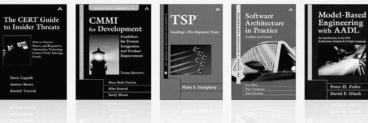

# JavaTM 编码指南：编写可靠安全程序的 75 条建议

> “所有 Java 开发者的必读之作。”MARY ANN DAVIDSON，Oracle 首席安全官

Java 语言之父 JAMES A. GOSLING 前言




Fred Long

Dhruv Mohindra

Robert C. Seacord

Dean F. Sutherland

David Svoboda

第一次印刷，2013 年 8 月

给我的妻子 Ann，感谢她多年来的爱与帮助。—Fred Long

给我的父母 Deepak 和 Eta Mohindra，让一切成为可能。“Dhruv Mohindra

给我的妻子 peppy, spotted，让这一切成为可能。“David Svoboda

给我的妻子 Rhonda，让这一切有了意义。“Robert C. Seacord

给我的父母 Chelsea 和 Jordan。“Dean Sutherland

- 41. 对于返回数组或集合的方法，返回空数组或集合而非 null
- 49. 从长命容器中移除短命对象
- 56. 每个与 case 标签相关的语句set都用 break 语句结束
- 75. 不要试图通过将本地引用变量设置为 null 来帮助垃圾收集

# 前言

这套 Java™ 编码指南是早期《CERT® Oracle® Secure Coding Standard for Java™》的后续，具有极高的价值。这本书几乎可以更名为《可靠的 Java™ 编码指南》。多年来，令我触深的一点是可靠性与安全性之间的相互作用。存在各种显性的安全工具——加密、身份验证等，但大多数入侵都是对漏洞的利用：即编写得糟糕或防御性不足的代码。构建一个可靠的系统在许多方面等同于构建一个安全的系统。你在可靠性方面做的工作会在安全性上回报，反之亦然。

本书强调了安全性并不是一个特性，而是一种在每一点都尽职的态度。它应该是每个软件工程师设计思维过程中的持续过程。它围绕一系列指南组织。书的核心在于这些指南背后的微妙之处。例如，“使用哈希函数存储密码”似乎是一个非常基础且显而易见的点，但经常有新闻报道发生重大数据泄露，仅仅是因为某些软件工程师没有考虑到这一点。做对这一点很棘手：魔鬼可以藏在很多细节中。本书为处理这些细节提供了极佳指导。

James A. Gosling

本页特意留

# 前言

《Java™ 编码指南：可靠且安全程序的 75 条建议》为 Java 程序员提供了具体的建议。这些 Java 指南的应用将带来更健壮、更具抗攻击能力的更好的系统。这些指南涵盖了使用 Java 编写的用于 PC、游戏机、手机、平板电脑、家电器和汽车电子设备等设备的各种产品。

任何编程语言的开发者都应该遵循一套指南，在编程语言定义规范之外控制其程序结构，在 Java 中也是如此。

Java 程序员需要比《Java 语言规范》（JLS）[JLS 2013] 提供的更多帮助来编写可靠且安全的 Java 程序。Java 包含了容易被误用的语言特征和 API，需要指导来避免这些陷阱。

一个程序要是可靠的，它必须在所有情况下面对所有可能的输入都能工作。不可避免的是，任何复杂的程序都会遇到意外的输入，并发生错误。当此类错误发生时，限制影响是非常重要的，这最好通过局部化错误并尽快处理它来实现。程序员可以从他人预测异常输入或编程情况的经验中受益，并采用防御性编程策略。

这些指南可能被认为是风格性的，但对于代码的可读性和可维护性仍然非常重要。对于 Java，Oracle 提供了一套代码规范 [Conventions 2009] 来帮助程序员产生一致的风格，这些规范被广泛采用。

xiv

前言

# 《CERT® Oracle® Secure Coding Standard for Java™》

Java™ 编码指南由《CERT® Oracle® Secure Coding Standard for Java™》[Long 2012] 的作者编写。该编码标准为 Java 语言的安全编码提供了一set规则。这些规则的目标是消除不安全的编码实践。安全编码标准为软件系统建立了规范性要求。然后，可以使用源代码分析实验室 `SCALE` [Seacord 2012] 对这些软件系统进行符合编码标准的评估。然而，一些糟糕的编码实践尽管未包含在安全标准中，也可能导致不可靠或不安全的程序。本书旨在记录并警告此类实践。

尽管这些指南未包含在编码标准中，但不应认为是不重要的。在某些情况下，虽然遵循指南总是好主意，但违反指南并不总是会导致错误。之所以做这种区分是因为如果没有特定的缺陷，系统不能被引用为不符合。因此，编码规则必须定义得非常精确。编码指南对安全性和可靠性具有深远的影响，尽管它们可以定义得更广泛。

书中许多指南引用了《CERT® Oracle® Secure Coding Standard for Java™》。这些如“在验证之前规范化字符串”的引用，其前三个字母标识了《CERT® Oracle® Secure Coding Standard for Java™》的相应章节。例如，`IDS` 指第 2 章“输入验证和数据清洗 `IDS`”。

Java 安全编码标准规则也可以在 CERT 的安全 wiki (`www.securecoding.org`) 上获取，它们在 ways持续演进。《CERT® Oracle® Secure Coding Standard for Java™》提供了用于合规性测试目的的规则定义，但 wiki 可能包含书中未涵盖的额外信息或见解，这些信息可以帮助你解释这些规则的含义。

# 范围

《Java™ 编码指南》（Java™ Coding Guidelines）专注于 Java SE 7 平台环境，包含了在使用 Java SE 7 API 进行安全编码问题的指南。《Java 语言规范：Java SE 7 版》（JLS）[JLS 2013] 规定了 Java 编程语言的行为，并作为开发这些指南的主要参考。

传统的语言标准（如 C 和 C++ 的标准）包含了未定义（undefined）、未指明（unspecified）和实现定义（implementation-defined）的行为，当程序员对这些行为的可移植性做出错误假设时，可能会导致漏洞。相比之下，JLS 更完整地规范了语言行为，因为 Java 被设计为一种跨平台语言。尽管如此，某些行为仍由 Java 虚拟机（JVM）或 Java 编译器的实现者决定。这些指南识别了此类语言特性，建议帮助实现者解决这些问题，并让程序员识别、理解语言的局限性并规避这些局限。

仅关注语言问题并不等同于可靠且安全的软件。Java API 中的设计有时会导致其废弃。在其他情况下，API 或相关文档可能会被编程社区误读。这些指南识别了此类问题 API，并强调了它们的正确用法。书中还包含了常见的错误设计模式和惯用的示例。

Java 语言及其核心和扩展 API 以及 JVM 提供了多种安全特性，如安全管理器和访问控制器、密码学、自动内存管理、强类型检查和字节码验证。这些特性为大多数应用程序提供了足够的安全性，但正确使用至关重要。这些指南强调了与安全架构相关的陷阱和警告，并强调了其正确实现。遵循这些指南可以保护信任程序免受许多可利用的安全漏洞，这些漏洞可能导致拒绝服务、信息泄露、错误计算和权限提升。

图 P-1 是 Oracle Java SE 产品的概念图。

这些编码指南主要适用于 `lang` 和 `util` 基础库以及“其他库”的安全问题。它们避免了包含已标记为待修复或缺乏负面影响的开放漏洞。只有当功能缺陷可能高频发生、引起重大的安全或可靠性担忧，或影响大多数依赖于核心平台的 Java 技术时，才会将其包含。这些指南不仅限于核心 API 的特定安全问题，还包含了与标准扩展 API（`javax` 包）相关的重要的可靠性和安全问题。

# 前言

| Java Language | | `java` | `javac` | `javadoc` | `jar` | `javap` | `JPDA` |
|---|---|---|---|---|---|---|---|
| 工具与工具 API | `JConsole` | Java Visual | Java DB | Security | Int'l | RMI | |
| | IDL | Deploy | Monitoring | Troubleshoot | Scripting | JVM | Web Services |
| 部署 | Java Web Start | | | | | | |
| | JavaFX | Applet / Plug-in | | | | | |
| 集成库 | 拖放 | 输入法 | | 打印服务 | Sound | | |
| | `JNI` | Math | Networking | 覆盖机制 | API | | |
| | 反射 | 管理 | 正则表达式 | 首好 API | 版本控制 | Zip | Instrumentation |

# 未涵盖的问题

本安全编码标准未涵盖若干问题。

# 适用范围

这些编码指南广泛适用于所有平台；仅适用于某一 Java 平台的指南超出了本指南的范畴。例如，仅适用于 Android、Java 微型版 `ME` 或 Java 企业版 `EE` 而不适用于 Java 标准版 `SE` 的指南通常被排除在外。在 Java SE 中，处理用户界面（用户界面工具包）或提供声音、图形渲染、用户账户访问控制、会话管理、认证和授权等功能的 API 超出了本指南的范畴。尽管如此，指南结合与不当输入验证和注入流相关的风险讨论了网络系统，并建议了适当的缓解策略。这些指南假设产品的功能规范已正确识别并防止了高层设计和架构漏洞。

# 编码风格

编码风格问题是主观的；事实证明，就适当风格指南达成共识是不可能的。因此，《Java™ 编码指南》通常避免强制任何特定的编码风格。相反，我们建议用户定义风格指南并一致地应用这些指南。应用编码风格最简单的方法是使用代码格式化工具。许多集成开发环境 `IDE` 都提供此类功能。

# 工具

许多指南不适用于自动检测或纠正。在某些情况下，工具供应商可能会选择实现检查器以识别这些指南的违背。作为一个联邦资助的研究开发中心 `FFDC`，软件工程研究所 `SEI` 不具备推荐特定供应商或工具的。

# 有争议的指南

通常情况下，《Java™ 编码指南》尽量避免缺乏广泛共识的争议性指南。

# 读者

《Java™ 编码指南》主要面向 Java 语言程序的开发者。尽管这些指南专注于 SE 7 平台环境，但对于使用 Java ME 或 Java EE 的开发者来说也具有参考价值（尽管不完整）。

# 致谢

本书的完成离不开整个社区的通力努力。首先，我们要感谢对这项工作做出贡献的仁士，包括 Ron Bandes, Jose Sandoval Chaverri, Ryan Hall, Fei He, Ryan Holfer, Sam Kaplan, Michael Kross, Christopher Leonavicius, Bocong Liu, Bastian Marquis, Aniket Mokashi, Jonathan Paulson, Michael Rosen, Samir Sen, John Truelove 以及 Matthew Wiethoff。

以下人员也对这项工作做出了贡献，我们深表感谢：James Ahlborn, Neelkamal Gohar, Ankur Goyal, Tim Halloran, Sujay Jain, Pranjal Jumde, Justin Lo, Yitzchak Mandelbaum, Todd Nowacki, Vishal Patel, Justin Pincar, Abhishek Ramani, Brendon Salisbury, Kirk Sayre, Stroz, Yozo Toda 以及 Shishir Kumar Yadav。我们还要感谢 Hiroshi Kumagai 和 CERT 在安卓方面的工作。

我们还要感谢以下评审员：Thomas Hawtin, Dan Plakosh 和 Steve Stockholm。感谢鼓励并支持我们工作的 SEI 经理：Andrew Andrews, Rich Pethia, Greg Shannon 和 Bill Wilson。感谢项目编辑 Peter Gordon 及其 Addison-Wesley 团队：Kim Boedheimer, Jennifer Fuller, Stephanie Nakib, Julie Nahil 和 Anna Popnick。感谢 CERT 团队其他成员提供的支持与协助，没有他们，本书无法完成。最后，但同样重要的是，感谢我们的内部编辑 Carol Lier，她帮助使这项工作可能。

## 关于作者

Fred Long 是英国阿伯莱威斯大学（Aberystwyth University）计算机科学系高级讲师。他教授形式化方法、Java、C++ 以及与编程相关的安全。他是英国学会分支机构主席。自1992年以来，Fred一直是软件工程研究所（SEI）的访问科学家。最近，他的研究涉及 Java 漏洞的调查。Fred 是《The CERT Secure Coding Standard for Java》（Addison-Wesley, 2012）的合著者。


Dhruv Mohindra 是印度 Persistent Systems Limited CTO 办公室下安全实践组的技术主管，在那里，他为云、银行金融、电信、企业、移动计算、生命科学和医疗保健等各个技术领域提供信息安全解决方案。他定期为财富500强公司、中小企业的高级管理层和开发团队提供咨询。


Dhruv 曾在软件工程研究所的 CERT 工作，并继续提高编程社区的安全意识水平。他在卡内基梅隆大学获得信息安全与管理硕士学位，在浦内大学获得计算机工程学士。他也是《The CERT Secure Coding Standard for Java》（Addison-Wesley, 2012）的合著者。

Robert C. Secard 是位于宾夕法尼亚州匹兹堡软件工程研究所（SEI）CERT部门的安全编码技术经理。Robert 也是卡内基梅隆大学计算机科学与信息网络学院的教授。他是《The CERT Secure Coding Standard》（Addison-Wesley, 2009）的作者，以及《Building Systems from Components》（Addison-Wesley, 2002）、《Modernizing Legacy Systems》（Addison-Wesley, 2003）、《The CERT Secure Coding Standard for Java》（Addison-Wesley, 2012）以及《Secure Coding in C++, Second Edition》（Addison-Wesley, 2013）的合著者。他在软件安全、基于组件的软件工程、基于 Web 的系统设计、遗留系统现代化、组件库、用户界面设计与开发方面发表了六多篇论文。自2005年来，Robert 一一直在业界、学术界和政府教授 C 和 C++ 安全编码。他从1982年开始在 IBM 从职业编程，从事通信和操作系统环境、处理器开发和软件工程工作。Robert 还曾在 X 协会工作，在那里他开发并维护了常用桌面环境和 X 系统的代码。他代表卡内基梅隆大学参加 ISO/IEC JTC1/SC22/WG14 C 语言国际工作组。


Dean F. Sutherland 是 CERT 的高级安全工程师。Dean 于2008年在卡内基梅隆大学获得软件工程博士学位。在回到学术界之前，他在 Tartan, Inc. 当了14年专业软件工程师。在最后六年里，他担任技术人员的高级成员和编译器后端技术主管。他是公司研发小组的主要活跃成员，是 Tartan 研发项目新软件开发流程设计和部署的关键推动者，并为 12 人的编译器后端小组提供了技术和项目领导。Dean 是《The CERT Secure Coding Standard for Java》（Addison-Wesley, 2012）的合著者。


David Svoboda 是 CERT/SEI 的软件安全工程师，也是《The CERT Secure Coding Standard for Java》的合著者。他还维护 Java 的 CERT 安全编码网站，以及 C++ 和 Perl。自1991年以来，David 一一直是卡内基梅隆大学各类软件开发项目的主要开发者，范围从分层芯片建模和社交组织模拟到自动机器翻译（AMT）。他在1996年开发的 KANTOO AMT 软件仍在卡特勒中使用。从 Java 2 开始，他拥有超过十年的 Java 开发经验，他的 Java 项目包括 Tomcat Servlet 和 Eclipse 插件。他在世界范围内向各个小组教授 C 和 C++ 安全编码。David 还是 ISO/IEC JTC1/SC22/WG14 C 语言工作组和 ISO/IEC JTC1/SC22/WG21 C++ 工作组的活跃参与者。

# 第一章

## 安全

Java 编程语言和运行时系统在设计时考虑了安全性。例如，指针操作是隐式的且对程序员隐藏，任何引用空指针的行为都会抛出异常。同样，访问数组或字符串范围之外的内容也会产生异常。Java 是一种强类型语言，所有隐式类型转换都有定义且与平台无关，算术类型和转换也是如此。Java 虚拟机（JVM）内置字节码验证器，以确保运行的字节码符合 Java 语言规范：Java SE 7 版（JLS），以便语言中定义的所有检查都能到位且无法被绕过。


Java 类加载器在类加载到 JVM 时识别它们，并区分受信任的系统类和可能不可的类。来自外部源的类还可以通过数字签名来赋予权限；这些数字签名可以被类加载器检查，并有助于类的识别。Java 还提供了一种可扩展的细粒度安全机制，允许程序员控制对信息、文件、套接字以及程序员希望使用的任何其他安全敏感资源的访问。这种安全机制可以要求运行时安全管理器来执行安全策略。安全管理器及其安全策略通常通过命令行参数指定，但也可以通过编程方式安装，前提该操作未被现有的安全策略禁止。可以通过依赖类加载器机制提供的标识，将访问权限扩展到非系统 Java 类。

# 第 1 章 安全

企业级 Java 应用程序容易受到攻击，因为它们接受不可信输入并与复杂的子系统进行交互。当应用程序中使用易受此类攻击的组件时，可能会注入攻击（例如跨站脚本 [XSS]、XPath 和 LDAP 注入）。一种有效的缓解策略是对输入进行白名单校验，并在处理渲染之前对输出进行编码或转义。

本章包含了专门确保 Java 应用程序安全的指南。文中阐述了处理以下安全细微差别的指南：

- 1. 处理敏感数据
- 2. 避免常见的注入攻击
- 3. 可能被误用来破坏安全的语言特性
- 4. Java 细粒度安全机制的细节

## 1. 限制敏感数据的生命周期

内存中的敏感数据可能会受到破坏。能够在应用程序相同系统上执行代码的攻击者可能会在应用程序满足以下条件的情况下访问此类数据：

- 使用对象存储敏感数据，且在使用后未清除内容或未进行垃圾回收
- 内存页可以根据操作系统的要求交换到磁盘（例如为了执行内存管理任务或支持休眠）
- 将敏感数据存储在缓冲区（如 `BufferedReader`）中，该缓冲区在 OS 缓存或内存中保留数据的副本
- 基于反射进行控制，反射允许防御措施绕过对敏感变量生命期的限制
- 在调试信息、日志文件、环境变量或通过线程核心转储暴露敏感数据

如果在使用数据后没有清除包含数据的内存，敏感数据泄露的可能性将增加。为了限制暴露风险，程序必须最小化敏感数据的生命周期。

完全缓解（即对内存中的数据进行无缝保护）需要底层操作系统和 Java 虚拟机的支持。例如，如果将敏感数据交换到磁盘是一个问题，则需要一个禁用交换和休眠的安全操作系统。

### 不合规代码示例

此不合规代码示例从控制台读取用户名和密码并将密码作为 `String` 对象存储。在垃圾回收器回收与该 `String` 内存之前，凭据一直暴露。

```java
class Password {
    public static void main (String args[]) throws IOException {
        Console c = System.console();
        if (c == null) {
            System.err.println("No console.");
            System.exit(1);
        }

        String username = c.readLine("Enter your user name: ");
        String password = c.readLine("Enter your password: ");

        if (!verify(username, password)) {
            throw new SecurityException("Invalid Credentials");
        }

        // ...
    }

    // Dummy verify method, always returns true
    private static final boolean verify(String username, String password) {
        return true;
    }
}
```

### 合规解决方案

此合规解决方案使用 `Console.readPassword()` 方法从控制台获取密码。

```java
class Password {
    public static void main (String args[]) throws IOException {
        Console c = System.console();

        if (c == null) {
            System.err.println("No console.");
            System.exit(1);
        }

        String username = c.readLine("Enter your user name: ");
        char[] password = c.readPassword("Enter your password: ");

        if (!verify(username, password)) {
            throw new SecurityException("Invalid Credentials");
        }

        // Clear the password
        Arrays.fill(password, ' ');
    }

    // Dummy verify method, always returns true
    private static final boolean verify(String username, char[] password) {
        return true;
    }
}
```

`Console.readPassword()` 方法允许密码以字符序列而非 `String` 对象的形式返回。因此，程序员可以在使用后立即清除数组中的密码。该方法还禁用了密码在控制台上的回显。

### 不合规代码示例

此不合规代码示例使用 `BufferedReader` 封装 `InputStreamReader`，以便从文件中读取敏感数据：

```java
void readData() throws IOException {
    BufferedReader br = new BufferedReader(new InputStreamReader(
        new FileInputStream("file")));
    // Read from the file
    String data = br.readLine();
}
```

`BufferedReader.readLine()` 方法将敏感数据作为 `String` 对象返回，该数据在数据不再需要后可能仍然存在。`BufferedReader.read(char[], int, int)` 方法可以填充数组，但它要求程序员在使用后手动清除数组。

### 合规解决方案

此合规解决方案使用 `ByteBuffer` 从文件中读取敏感数据。

```java
void readData() throws IOException {
    ByteBuffer buffer = ByteBuffer.allocate(1024);
    try (FileChannel rdr = (new FileInputStream("file")).getChannel()) {
        while (rdr.read(buffer) > 0) {
            // Do something with buffer
            buffer.clear();
        }
    } catch (Throwable e) {
        // Handle error
    }
}
```

## 2. 不在客户端存储未加密的敏感信息

未能限制敏感数据的生命周期会导致信息泄露。对于 Web 应用程序，解决此问题的常用缓解方法是为客户端提供 Cookie并将敏感信息存储在服务器上。Cookie 由 Web 服务器创建，并在客户端存储一段时间。Cookie 并不保护敏感信息免受跨站脚本 (XSS) 攻击。能够通过 XSS 攻击或直接攻击客户端获取 Cookie 的攻击者可以从服务器获取敏感信息。如果服务器在有限时间（例如 15 分钟）过去后使会话失效（invalidate），则这种风险是受到时间限制的。

Cookie 通常是一个短字符串。如果它包含敏感信息，则应对其进行加密。敏感信息包括用户名、密码、信用卡号、社会安全号码以及任何关于用户的身份识别信息。

### 不合规代码示例

```java
if (validated) {
  Cookie loginCookie = new Cookie("rememberme", username +
  ":" + new String(password));
  response.addCookie(loginCookie);
  // ... 转发到欢迎页
} else {
  // 设置错误并返回
}
} else {
  // 未选择“记住我”功能
  // 继续常规身份验证；
  // 如果失败则设置错误并返回
}

Arrays.fill(password, ' ');
```

然而，实现“记住我”功能的尝试是不安全的，因为能够访问客户端机器的攻击者可以直接在客户端上获取这些信息。此代码还违反了准则 13，“使用哈希函数存储密码”。

### 合规解决方案（Session）

该合规解决方案通过在 cookie 中存储用户名和安全的随机字符串来实现“记住我”功能。它还使用 `HttpSession` 在 session 中维护状态：

```java
protected void doPostPost(HttpServletRequest request,
      HttpServletResponse response) {

  // 验证输入（省略）

  String username = request.getParameter("username");
  char[] password =
    request.getParameter("password").toCharArray();
  boolean rememberMe=
    Boolean.valueOf(request.getParameter("rememberme"));
  LoginService loginService = new LoginServiceImpl();
  boolean validated = false;
  if (rememberMe) {
    if (request.getCookies()[0] != null &&
      request.getCookies()[0].getValue() != null) {
```

服务器维护用户名与安全随机字符串之间的映射。当用户选择“记住我”时，`doPost()` 方法检查提供的 cookie 是否包含有效的用户名和随机字符串对。如果映射包含匹配的对，服务器将验证用户并将其重定向到欢迎页。如果不是，服务器将向客户端返回错误。如果用户选择

## 3. 为敏感的可变类提供不可修改包装器

虽然“记住”但客户端未能提供有效的 cookie，服务器要求用户使用凭据进行身份验证。如果身份验证成功，服务器将发布一个带有“记住我”特征的新 cookie。

此解决方案通过使当前 session失效并创建新 session 来防止会话固定攻击。它通过将客户端访问之间的 session 超时设置为 15 分钟，缩短了攻击者执行会话劫持攻击的时间窗口。

### 适用性

在客户端存储未加密的敏感信息会使任何可以攻击客户端的人获取这些信息。

- [Oracle 2011c] Package javax.servlet.http
- [OWASP 2009] Session Fixation in Java
- [OWASP 2011] Cross-Site Scripting (XSS)
- [W3C 2003] The World Wide Web Security FAQ

字段的不可变性可以防止无意修改以及恶意篡改，这样在接收输入或返回值时就不需要进行防御性复制。然而，某些敏感类不能是不可变的。幸运的是，可以使用不可修改包装器向不可信代码授予对可变类的只读访问。例如，Collection 类包含一组包装器，允许客户端观察 Collection 对象的不可修改视图。

### 不合规代码示例

此不合规代码示例包含类 `Mutable`，它允许数组对象被修改：

```java
class Mutable {
    private int[] array = new int[10];

    public int[] getArray() {
        return array;
    }

    public void setArray(int[] i) {
      array = i;
    }

    //...
    private Mutable mutable = new Mutable();
    public Mutable getMutable() {return mutable;}
}
```

不可信的调用者可能会调用变器方法 `setArray()`，并违反对象的不可变属性。调用访问方法 `getArray()` 也允许修改类的私有内部状态。此类还违反了《The CERT® Oracle® Secure Coding Standard for Java [Long 2012]，“OBJ05-J. 在返回引用之前防御性地复制私有可变成员。”

### 不合规代码示例

此不合规代码示例通过 `MutableProtector` 子类扩展了 `Mutable`：

```java
class MutableProtector extends Mutable {
  @Override
  public int[] getArray() {
    return super.getArray().clone();
  }
  //...
  private Mutable mutable = new MutableProtector();
  // 具有读取能力的不可信调用者可以安全地调用
  public Mutable getMutable() {return mutable;}
}
```

在此类中，调用访问方法 `getArray()` 不允许修改类的私有内部状态，符合“OBJ05-J. 在返回引用之前防御性地复制私有可变成员” [Long 2012]。然而，不可信的调用者仍可能调用 `setArray()` 方法并修改 `Mutable` 对象。

### 合规解决方案

通常，通过为核心接口定义的所有方法（包括变器方法）提供适当的包装器，可以将敏感类转换为安全视图对象。变器方法的包装器必须抛出 `UnsupportedOperationException`，以便客户端无法执行影响对象不可变属性的操作。

此合规解决方案增加了 `setArray()` 方法，它覆盖了 `.setArray()` 方法并防止 `Mutable` 对象的变变：

```java
class MutableProtector extends Mutable {
    @Override
    public int[] getArray() {
        return super.getArray().clone();
    }

    @Override
    public void setArray(int[] i) {
        throw new UnsupportedOperationException();
    }
}

// ...
private Mutable mutable = new MutableProtector();
// 具有读取能力的不可信调用者可以安全地调用
public Mutable getMutable() { return mutable; }
```

`MutableProtector` 包装器覆盖了 `getArray()` 方法并克隆了数组。尽管调用代码获得了对象的副本，但原始数组保持不变。覆盖的 `setArray()` 方法在调用者尝试使用此方法时会抛出异常。此对象可以传递给不可信代码。

### 适用性

未能为不可信代码提供敏感对象的不可修改安全视图可能会导致对象的被恶意篡改和损坏。

### 参考文献

- [2012] OBJ05-J. 在返回引用之前防御性地复制私有成员
- [Tutorials 2023] Unmodifiable Wrappers

## 4. 确保使用验证过的参数调用安全敏感方法

调用安全敏感方法的应用程序代码必须验证传递给方法的参数。特别是，null 值可能会被某些安全敏感方法解释为良性。

尽管安全敏感方法应该采用防御性编码，但客户端代码必须验证方法原本可能接受的参数。未这样做可能导致权限提升和任意代码的执行。

### 不合规代码示例

此不合规代码示例展示了两个参数的 `doPrivileged()` 方法，它将访问控制上下文作为第二个参数。此代码从之前保存的上下文恢复权限。

```java
AccessController.doPrivileged(
  new PrivilegedAction<Void>() {
    public Void run() {
      // ...
    }
}, accessControlContext);
```


当传递 null 访问控制上下文时，两个参数的 `doPrivileged()` 方法无法将上下文降低到之前保存的上下文的水平。因此，当 `accessControlContext` 参数为 null 时，此代码可能会授予过度权限。意图使用 null 访问控制上下文调用 `AccessController.doPrivileged()` 的程序员应显式传递 null 常量，或使用单参数版本的 `AccessController.doPrivileged()`。

### 合规解决方案

此合规解决方案通过确保 `accessControlContext` 不空来防止授予过度权限：

```java
if (accessControlContext == null) {
  throw new SecurityException("Missing AccessControlContext");
}
AccessController.doPrivileged(
  new PrivilegedAction<Void>() {
    public Void run() {
      // ...
    }
}, accessControlContext);
```

## 5. 防止任意文件上传

参数。如果将意外的参数值传递给安全敏感型方法，就可能导致任意代码执行，并可能引发权限提升。

[API 2013] `AccessController.doPrivileged()`, `System.setSecurityManager()`

### 5. 防止任意文件上传

接受文件上传的 Java 应用程序（包括 Web 应用）必须确保攻击者无法上传或传输恶意文件。如果目标系统执行了包含代码的受限制文件，可能会破坏应用层的防御。例如，允许上传 HTML 文件的应用程序可能会允许恶意代码的执行——在缺少输出转义程序的情况下，攻击者可以提交一个带有跨站脚本（XSS）负载字段的有效 HTML 文件。出于此原因，许多应用程序限制了可以上传的文件类型。

可能会上传具有 `.exe` 和 `.sh` 等危险扩展名的文件，这可能导致服务器端应用程序的任意代码执行。仅限制 HTTP 请求头中 `Content-Type` 字段的应用程序可能会受到此类攻击。

为了支持文件上传，一个典型的 Java Server Pages (JSP) 页面通常包含如下代码：

```
<form action="doUpload" method="POST"
ctype="multipart/form-data">
<file name="uploadFile" label="Choose File" size="40" />
<submit value="Upload" name="submit" />
</form>
```

许多企业框架提供了配置设置，旨在作为防止任意文件上传的防御。遗憾的是，大多数未能提供足够的保护。缓解此漏洞涉及检查文件大小、内容类型和文件内容以及其他元数据属性。

### 不合规代码示例

此合规代码示例显示了 Struts 2 应用程序上传操作中的 XML 代码。拦截器负责允许文件上传。

#### 14 章 第1 章 安全

```
<action name="doUpload" class="com.example.UploadAction">
  <interceptor-ref name="fileUpload">
    <param name="maximumSize">10240</param>
    <param name="allowedTypes">
      text/plain,image/JPEG,text/html
    </param>
  </interceptor-ref>
</action>
```

文件上传代码出现在 `UploadAction` 类中：

```java
public class UploadAction extends ActionSupport {
  private File uploadedFile;
  // setter and getter for uploadedFile

  public String execute() {
    try {
      // 为了演示，路径和文件名硬硬编码
      File fileCreate = new File("filepath", "filename");
      // 将文件内容拷贝到此处
      FileUtils.copyFile(uploadedFile, fileToFile);
      return "SUCCESS";
    } catch (Throwable e) {
      addActionError(e.getMessage());
      return "ERROR";
    }
  }
}
```

参数类型 `maxSize` 的值确保特定的 Action 无法接收大文件。`allowedTypes` 参数定义了接受的文件类型。然而，这种方法无法确保上传的文件符合安全要求，因为拦截器检查可以被轻易绕过。如果攻击者使用代理工具更改传输过程中原始 HTTP 请求中的内容类型，框架将无法阻止文件的上传。因此，攻击者可以上传一个具有 `.exe` 扩展名的恶意文件（例如）。

### 合规解决方案

只有当内容类型与文件的实际内容匹配时，文件上传才能成功。例如，具有图像头的文件必须只包含图像，且不能包含可执行代码。此合规解决方案使用 Apache Tika 库 [Apache 2013] 利用现有的解析器库检测并提取文档中的元数据和结构化文本内容。在调用 `execute()` 中负责上传文件的代码之前，必须调用 `checkMetaData()` 方法。

```java
public class UploadAction extends ActionSupport {
    private File uploadedFile;
    // setter and getter for uploadedFile

    public String execute() {
        try {
            // 为了演示，路径和文件名硬编码
            File fileToFileCreate = new File("filepath", "filename");

            boolean textPlain = checkMetaData(uploadedFile,
                "text/plain");
            boolean img = checkMetaData(uploadedFile, "image/JPEG");
            boolean textHtml = checkMetaData(uploadedFile,
                "text/html");

            if (!textPlain || !img || !textHtml) {
                return "ERROR";
            }

            // 将临时文件内容拷贝到此处
            FileUtils.copyFile(uploadedFile, fileToFileCreate);
            return "SUCCESS";
        } catch (Throwable e) {
            addActionError(e.getMessage());
            return "ERROR";
        }
    }

    public static boolean checkMetaData(
        File f, String contentType) {
        try (InputStream is = new FileInputStream(f)) {
            ContentHandler contenthandler = new ContentHandler();
            metadata.set(Metadata.RESOURCE_KEY, f.getName());
            Parser parser = new AutoDetectParser();
            try {
                parser.parse(is, contenthandler,
                    metadata, new ParseContext());
            } catch (SAXException | ParserException e) {
                // 处理错误
                return false;
            }
            if (metadata.get(Metadata.CONTENT_TYPE).equalsIgnoreCase(
            contentType)) {
                return true;
            } else {
                return false;
            }
        } catch (IOException e) {
            // 处理错误
            return false;
        }
    }
```

`AutoDetectParser` 根据文件的内容类型选择最佳可用解析器。

### 适用性

任意上传漏洞可能导致权限提升和任意代码执行。

+   [Apache 2013] Apache Tika: Content Analysis Toolkit

## 6. 对输出进行适当编码或转义

存在多个用于输出数据的系统。输出系统的数据可能源于可信源。然而，假设输出清理是不必要的危险的，因为数据可能直接源于不可信源并包含恶意内容。例如，HTML 渲染器容易受到 HTML 注入和跨站脚本（XSS）攻击 [OWASP 2011]。防止此类攻击的输出清理与输入清理同样重要。

与输入一样，数据在清理之前应进行归一化。对除已知安全的字符外的所有输出进行正确编码，以避免由绕过验证导致的漏洞。详见《Java 安全编码标准》[Long 2012]，“IDS01-J. 在验证之前对字符串进行归一化”。

### 不合规代码示例

此合规代码示例使用基于 Java EE 的 Spring 框架的模型视图控制器（MVC）概念在不进行编码或转义的情况下向用户显示数据。由于数据被发送到 Web浏览器，该代码受到 HTML 注入和 XSS 攻击。

```java
@RequestMapping("/notifications.htm")
public ModelAndView getNotifications(
    HttpServletRequest request, HttpServletResponse response) {
    ModelAndView mv = new ModelAndView();
    try {
        UserInfo userDetails = getUserInfo();
        List<Map<String, Object>> list = 
            new ArrayList<Map<String, Object>>();
        List<Notification> notificationList = 
            notificationService.getNotificationsForUserId(
            userDetails.getPersonId());
        
        for (Notification notification : notificationList) {
            Map<String, Object> map = new HashMap<String, Object>();
            map.put("id", notification.getId());
            map.put("message", notification.getMessage());
            list.add(map);
        }

        mv.addObject("Notifications", list);
    } catch (Throwable t) {
        // 记录到文件并处理
    }

    return mv;
}
```

### 合规解决方案

此合规解决方案定义了一个 `ValidationError` 类，将输出归一化为已知字符，使用白名单执行输出清理并对任何未指定的数据值进行编码以实施双重检查机制 [OWASP 2013]。

```java
public class ValidateOutput {
    // 允许字母、数字和空格
    private static final Pattern pattern = Pattern.compile("^[a-zA-Z0-9-\\s]{0,20}$");

    // 根据白名单对输入字段进行验证和编码
    public String validate(String name, String input)
        throws ValidationException {
        String canonical = normalize(input);

        if (!pattern.matcher(canonical).matches()) {
            throw new ValidationException("Improper format in " + name + " field");
        }

        // 对无效字符执行输出编码
        canonical = HTMLEntityEncode(canonical);
        return canonical;
    }

    // 规范化为已知实例
    private static String normalize(String input) {
        String canonical = java.text.Normalizer.normalize(input, Normalizer.Form.NFKC);
        return canonical;
    }

    // 编码无效数据
    private static String HTMLEntityEncode(String input) {
        StringBuilder sb = new StringBuilder();

        for (int i = 0; i < input.length(); i++) {
            char ch = input.charAt(i);
            if (Character.isLetterOrDigit(ch) || Character.isWhitespace(ch)) {
                sb.append(ch);
            } else {
                sb.append("&#" + (int)ch + ";");
            }
        }
        return sb.toString();
    }
}
```

### 6. 正确编码或转义输出

```java
// ...

@RequestMapping("/getnotifications.htm")
public ModelAndView getNotifications(HttpServletRequest request, 
    HttpServletResponse response) {
    ValidateOutput vo = new ValidateOutput();

    ModelAndView mv = new ModelAndView();
    try {
        UserInfo userDetails = getUserInfo();
        List<Map<String, Object>> list = new ArrayList<Map<String, Object>>();
        NotificationList notificationList = notificationService.getNotificationsForUserId(
            userDetails.getUserId());

        for (Notification notification : notificationList) {
            Map<String, Object> map = new HashMap<String, Object>();
            map.put("id", vo.validate("id", notification.getId()));
            map.put("message", 
                vo.validate("message", notification.getMessage()));
            list.add(map);
        }

        mv.addObject("Notifications", list);
    } catch (Throwable t) {
        // 记录日志到文件并处理
    }

    return mv;
}
```


在接受双引号和角括号等危险字符时，必须进行输出编码和转义。即使输入已通过白名单禁用了此类字符，仍建议进行输出转义，因为这提供了第二层防御。请注意，转义序列取决于输出嵌入的位置。例如，不可信的输出可能出现在 HTML 的值属性、CSS、URL 或脚本中；每种情况下的编码程序都不相同。在某些上下文中，无法安全地使用不可信数据。请参阅 OWASP XSS（跨站脚本）预防备抄表以获取更多防止 XSS 攻击的信息（`www.owasp.org/index.php/XSS_Prevention_Cheat_Sheet`）。

## 适用性

在显示或跨越信任边界之前未对输出进行编码或转义，可能会导致任意代码执行。

## 相关漏洞

2006 年 1 月报告的 Apache `GERONIMO-1474` 漏洞允许攻击者提交包含 JavaScript 的 URL。访问日志查看器未能对其转发到管理员控制台的数据进行清理，从而导致经典的 XSS 攻击。

- `[Long 2012]` 在验证字符串之前对其进行规范化
- `[OWASP 2011]` 跨站脚本 (`XSS`)
- `[OWASP 2013]` 如何向 `HttpRequest` 中添加验证逻辑
- (`XSS` 跨站脚本 预防备抄表)

# 7. 防止代码注入

当不可信输入被注入到动态构建的代码中时，就会发生代码注入。漏洞的一个明显来源是在 Java 代码中使用 JavaScript。`javax.script` 包包含了一系列接口和类，它们定义了 JavaScript 引擎以及一个在 Java 代码中使用这些接口和类的框架。对 `javax.script` API 的滥用允许攻击者在目标系统上执行任意代码。

本准指南是《The CERT® Oracle® Secure Coding for Java》[`Long 2012`] 中“`IDS00-J`。清理跨越信任边界的不可信数据”的一个特定实例。

## 不合规代码示例

此不合规代码示例将不可信的用户输入整合到负责打印输入的 JavaScript 语句中：

```java
private static void evalScript(String firstName)
    throws ScriptException {
    ScriptEngineManager manager = new ScriptEngineManager();
    ScriptEngine engine = manager.getEngineByName("javascript");
    engine.eval("print('"'+ firstName + " "')");
}
```

## 攻击说明

攻击者可以输入特意构造的参数以尝试注入恶意 JavaScript。此示例显示了一个包含 JavaScript 代码的恶意字符串，该代码可以在漏洞系统上创建或覆盖现有文件。

示例中的脚本打印 `"dummy"` 并 `"some text"` 写入名为 `config.cfg` 的配置文件中。实际的利用程序可以执行任意代码。

### 合规解决方案（白名单）

防止代码注入漏洞的最佳防御是防止包含可执行的输入代码。动态代码中的用户输入必须经过清理，例如，确保它只包含有效的白名单字符。清理是在数据输入后立即进行的，使用数据抽象层的方法来存储和处理数据。如需更多信息，请参阅“`IDS00-J`。清理跨越信任边界的不可信数据” [`Long 2012`]。如果名称中允许特殊字符，则必须在与其等值比较之前对其进行规范化。此合规解决方案使用白名单防止未清理的输入被脚本引擎解释。

```java
private static void evalScript(String firstName)
throws ScriptException {
// 在 firstName 中允许字母、数字和下划线
//（如果 firstName 可能包含特殊字符，请修改）
if (!firstName.matches("\\w*")) {
  // 字符串不匹配白名单字符
  throw new IllegalArgumentException();
}

ScriptEngineManager manager = new ScriptEngineManager();
ScriptEngine engine = manager.getEngineByName("javascript");
engine.eval("print('" + firstName + "')");
}
```

### 合规解决方案（安全沙箱）

另一种方法是使用安全管理器创建一个安全的沙箱（准指南 20，“使用安全管理器创建安全的沙箱”）。应用程序应防止脚本执行任意命令，例如查询本地系统。`doPrivileged()` 的双参数形式可可以在应用程序必须以更高权限运行时降低权限，但脚本引擎不能这样做。`RestrictedAccessContext` 将默认策略中授予的权限减少到新创建域的权限。有效权限是新创建域的权限与系统范围安全策略的交集。请参阅指南 16，“避免授予过度权限”以获取更多关于 `doPrivileged()` 双参数形式的信息。

此合规解决方案说明了在 `doPrivileged()` 双参数形式中使用 `AccessControlContext`。

```java
class ACC {
    private static RestrictedAccessControlContext {
    private static final AccessControlContext INSTANCE;

    static {
        INSTANCE = new AccessControlContext(
new ProtectionDomain[] {
new ProtectionDomain(null, null) // 无权限
});
    }

    private static void evalScript(final String firstName) hrows ScriptException
ScriptEngineManager manager = new ScriptEngineManager();
    final ScriptEngine engine = manager.getByName("javascript");
    // 使用双参数
    // 形的 doPrivileged())限制权限
    try {
        AccessController.doPrivileged(
new PrivilegedExceptionAction<Object>() {
    public Object run() throws ScriptException {
engine.eval("print(''" + firstName + "')");
return null;
    }
    });
    // 来自嵌套类
    RestrictedAccessControlContext.INSTANCE);
}
}
```

```java
} catch (PrivilegedActionException pae) {
    // 处理错误
}
}
```

这种方法可以与白名单结合以增加额外的安全性。

### 适用性

未能防止代码注入可能会导致执行任意代码。

### 参考文献

+   `[API 2013]` 包 `javax.script`
+   `[Long 2012]` `ID500-J`。对跨越信任边界传递的不可信数据进行清洗
+   `[OWASP 2013]` Java 中的代码注入

# 8. 防止 XPath 注入

可扩展标记语言 (`XML`) 可以用于类似于关系型数据库的方式进行数据存储。数据经常从此类 XML 文档中检索，且在这些时未经过适当的清理。这使用了 XPath 路径。当向用于从 XML 文档中检索数据的 XPath 检索例程提供的数据受到类似于 SQL 注入或 XML 注入的攻击时，就会发生 XPath 注入（参见 `*The CERT® Oracle Secure Coding Standard for Java*`）[`Long 2012`], “`ID500-J`。对跨越信任边界传递的不可信数据进行清洗”。攻击者可以在查询的数据字段中输入有效的 SQL 或 XML 结构。在典型的攻击中，查询的条件字段解析为恒真式（tautology），或其他通过方式授予攻击者访问特权信息的权限。

本指南是广义指南 7，“防止代码注入”的一个特定示例。

## XML 路径注入示例

考虑以下 XML 架构。

```
<users>
  <user>
    <username>Utah</username>
    <password>e92005372a3b89e2</password>
  </user>
  <user>
    <username>Bohdi</username>
    <password>6c16b22029df4ec6</password>
  </user>
  <user>
    <username>Busey</username>
    <password>ad39b3c2a4abc98</password>
  </user>
</users>
```

密码是根据指南 13 “使用哈希函数存储密码”进行哈希的。这里显示 MD5 哈希值是为了说明目的；在实际操作中，你应该使用像 `SHA-256` 这样更安全的算法。不可信代码可能会尝试使用从用户输入动态构建的 XPath 语句从此文件中检索用户详细信息。

```
//users[username/text()='&LOGIN& and password/text()='&PASSWORD&]
```

如果攻击者知道 `Utah` 是一个有效的用户名，他或她可以指定输入为：

`Utah' or '1'='1`

这将产生以下查询字符串：

```
//users[username/text()='Utah' or '1'='1 and password/text()='xxxx'
```

由于 `'1='1'` 自动为真，因此密码没有通过验证。结果是攻击者在不知道 `Utah` 密码的情况下，不当地作为用户 `Utah` 通过了身份验证。

## 不合规代码示例

此不合规代码示例从用户处读取用户名和密码，并使用它们来构建查询字符串。密码以字符数组的形式传递，然后进行哈希处理。此示例容易受到前述的攻击。如果将之前的攻击字符串传递给 `evaluate()`，该方法将返回 XML 文件中相应的节点，导致 `doLogin()` 方法返回 `true` 并绕过任何授权。

```
private boolean doLogin(String username, char[] password) throws ParserConfigurationException, SAXException, IOException, XPathExpressionException {
DocumentBuilderFactory domFactory = 
DocumentBuilderFactory.newInstance();
domFactory.setNamespaceAware(true);
DocumentBuilder builder = domFactory.newDocumentBuilder();
Document doc = builder.parse("users.xml");
String pwd = hashPassword(password);

XPath factory = XPathFactory.newInstance();
XPath xpath = factory.newXPath();
Expression expr = 
xpath.compile("//users/user[text()=' + 
username + '\'' and password/text()=' + pwd + "'>");
Object result = expr.evaluate(doc, XPathConstants.NODESET);
NodeList nodes = (NodeList) result;
```

### 合规解决方案 (XQuery)

XPath 注入可以通过采用类似于防止 SQL 注入的防御措施来防止。

- 将所有用户输入视为不可信的，并进行清洗。
- 在清理用户输入时，验证数据类型、长度、格式和内容。例如，使用正则表达式检查用户输入中的 XML 标签和特殊字符。这种做法对应于输入清理。
- 在客户端-服务器应用中，在双方都进行验证。
- 对提供、传播或接受用户输入的应用程序进行彻底测试。详情请参见指南 7，“防止代码注入”。

## 第1章 安全

防止相关 SQL 注入问题的有效技术是参数化。参数化确保用户指定的数据作为参数传递给 API，而不会被解释为执行内容。遗憾的是，Java 目前缺乏用于 XPath 查询的类似接口。XPath 路径参数化可以使用支持运行时指定文件的 Xquery 来模拟。此合规解决方案使用 `Map` 来插入用户名和密码。

输入文件：`login.xq`

```
declare variable $username as xs:string external;
declare variable $password as xs:string external;
//users[username/text()=' + $username + ' and password/text()=' + $password + ']
```

```
private boolean login(String username, String password)
throws ParserConfigurationException, SAXException,
IOException {
DocumentBuilderFactory domFactory = DocumentBuilderFactory.newInstance();
domFactory.setNamespaceAware(true);
DocumentBuilder builder = domFactory.newDocumentBuilder();
Document doc = builder.parse("users.xml");

XQuery query = new XQueryFactory().createQuery("login.xq");
Map queryVars = new HashMap<>();
queryVars.put("username", username);
queryVars.put("password", password);
NodeList nodes = query.execute(doc, null, queryVars).toNodes();

// 将名称打印到控制台
for (int i = 0; i < nodes.getLength(); i++) {
  Node node = nodes.item(i).getChildNodes().item(1);
  node.getChildNodes().item(0);
  System.out.println(node.getNodeValue());
}

return (nodes.getLength() >= 1);
}
```

# 9. 防止 LDAP 注入

轻量级目录访问协议 (`LDAP`) 允许应用程序远程执行搜索和修改记录等操作。LDAP 注入源于输入清理和验证不足，允许恶意用户从目录服务获取受限信息。

可以使用白名单将输入限制在有效字符列表中。必须从白名单中排除的字符和字符序列（包括 Java 命名目录接口 (`JNDI`) 元字符和 LDAP 特殊字符）如表 1–1 所示。

## 表 1–1. 排除在白名单之外的字符和序列

| 字符 | 名称 |
| --- | --- |
| ' and " | 单单引号和双引号 |
| / and \ | 正斜杠和反斜杠 |
| \ \ | 双斜杠* |
| space | 字符串开头或结尾的空格字符 |
| # | 字符串开头的井号字符 |
| < > | 角括号 |
| , and; | 命令和分号 |
| + * | 加法和乘法运算符 |
| ( ) | 圆括号 |
| \u0000 | Unicode 空空字符 |

*这是一个字符序列

### LDAP 注入示例

考虑一个包含如下格式记录的 LDAP 数据互换格式 (`LDIF`) 文件：

```
dn: dc=example,dc=com
objectClass: object
objectClass: organization
o: Some Name
dc: example

d: ou=People,dc=example,dc=com
ou: People
objectClass: object
objectClass: organizationalUnit
dc: example

d: cn=Manager,ou=People,dc=example,dc=com
cn: Manager
sn: John Watson
### 此处有多个 objectClass 定义（省略）
userPassword: secret1
mail: john@holmesassociates.com

d: cn=Senior Manager,ou=People,dc=example,dc=com
cn: Senior Manager
sn: Sherlock Holmes
### 此处有多个 objectClass 定义（省略）
userPassword: secret2
mail: sherlock@holmesassociates.com
```

对有效用户名和密码的搜索通常形式如下

```
(&sn=USERN)(userPassword=<USERPASSWORD))
```

然而，攻击者可以使用在 `USERN` 字段中使用 `S*` 以及在 `USERPASSWORD` 字段中使用 `*` 来绕过身份验证。此类输入将产生所有 `USERN` 字段以 `S` 开头的记录。


一个允许 LDAP 注入的身份验证程序将允许未经授权的用户登录。同样地，搜索路由将允许攻击者覆盖目录中的部分或全部数据。

# 不合规代码示例

此不合规代码示例允许 `searchRecord()` 方法的调用者使用 LDAP 协议在目录中搜索记录。字符串过滤器用于过滤结果集，以匹配由调用者提供的用户名和密码的条目。

```
// String userSN = "S*"; // 无效
// String userPassword = "*\" // 无效
public class LDAPInjection {
    private void searchRecord(String userSN, String userPassword)
        throws NamingException {
        Hashtable<String, String> env =
            new Hashtable<String, String>();
        env.put(Context.INITIAL_CONTEXT_FACTORY,
            "com.sun.jndi.ldap.LdapCtxFactory");

        try {
            Dir ctx = new InitialDirContext(env);

            SearchControls sc = new SearchControls();
            String[] attributeFilter = {"cn", "mail"};
            sc.setReturningAttributes(attributeFilter);
            sc.setSearchScope(SearchControls.SUBTREE_SCOPE);
            String base = "dc=example,dc=com";

            // 以下解析为 (&(cn=S*)(userPassword=*))
            String filter = "(&(cn=" + userSN + ")(userPassword=" +
                userPassword + "))";
            NamingEnumeration<?> results =
                ctx.search(base, filter, sc);
            while (results.hasMore()) {
                SearchResult sr = (SearchResult) results.next();
                Attributes attrs = (Attributes) sr.getAttributes();
                Attribute attr = (Attribute) attrs.get("cn");
```

# 第 1 章 安全

```
System.out.println(attr);
attr = (Attribute) attrs.get("mail");
System.out.println(attr);
}
ctx.close();
catch (NamingException e) {
// 转发到处理器
}
}
```

当恶意用户输入经过特殊构造的输入时（如所述），这种基础身份验证方案无法将搜索查询的输出限制在用户具有访问权限的信息范围内。

### 合规解决方案

此合规解决方案使用白名单对用户输入进行清理，使过滤器字符串仅包含有效字符。在这些代码中，`userSN` 可能只包含字母和空格，而密码可能只包含字母数字。

```
// String userSN = "Sherlock Holmes"; // 有效
// String userPassword = "secret2"; // 有效
```

```
// LDAPInjection.searchRecord() 的开始
sc.setSearchScope(SearchControls.SUBTREE_SCOPE);
String base = "dc=example,dc=com";
```

```
if (userSN.matches("[\\w]*$")) {
  userPassword.matches("[\\w]*$");
  throw new IllegalArgumentException("Invalid input");
}
```

```
String filter = "&(sn = " + userSN + ")(userPassword = " + userPassword + "))";
```

```
// LDAPInjection.searchRecord() 的剩余部分
```

当数据库字段作为密码必须包含特殊字符时，确保真实数据以清理后的格式存储在数据库中，并且在进行验证或比较之前对任何用户输入进行归一化是非常关重要的。不建议在缺乏全面的归一化和基于白名单的程序的情况下，使用 JNDI 和 LDAP 中具有特殊含义的字符。

## 10. 不要使用 clone() 方法复制不可信的方法参数

在将特殊字符添加到用于验证传入的白名单表达式之前，必须将其转换为清理后的、安全的值。同样，对用户输入的归一化应发生在验证步骤之前。

### 适用性

未能执行上述措施将导致...

### 参考文献

未能对输入进行清理会导致信息泄露。[OWASP 2013] 防止 LDAP 注入

### 10. 不要使用 clone() 方法复制不可信的方法参数

特殊字符在添加到用于验证传入的白名单表达式之前，必须将其转换为清理后的、安全的值。同样，对用户输入的归一化应发生在验证步骤之前。

### 适用性

未能执行上述措施将导致...

### 合规解决方案 (CVE-2012-0507)

在 Java 1.7.0 update 3 中，构造函数被修改为在 `clone()` 方法内部使用 `Arrays.copyOf()` 方法，如下：

```java
public AtomicReferenceArray(E[] array) {
    // 由 final 字段保证
    this.array = Arrays.copyOf(
        array, array.length, Object[].class);
}
```

### 适用性

使用 `clone()` 方法复制不可信的参数会给攻击者提供执行任意代码的机会。

### 参考文献

- [Long 2012] Defensively copy mutable inputs and mutable internal components
- [Sterbenz 2006] Secure Coding Antipatterns: Avoiding Vulnerabilities

## 11. 不要使用 Object.equals() 比较加密密钥

`java.lang.Object.equals()` 方法默认无法比较如加密密钥之类的复合对象。大多数 `Key` 类未能提供重写 `Object.equals()` 的 `equals()` 实现。在这种情况下，必须单独对复合对象的组件进行比较，以确保正确性。

### 不合规代码示例

此不合规代码示例使用 `equals()` 方法比较两个密钥。即使两个密钥代表相同的值，它们也可能被视为相等。

```java
private static boolean keysEqual(Key key1, Key key2) {
    if (key1.equals(key2)) {
        return true;
    }
    return false;
}
```

### 合规解决方案

此合规解决方案使用 `equals()` 方法作为首次测试，然后比较密钥的编码版本以实现独立于提供者的行为。它检查 `RSAPrivateKey` 和 `RSAPrivateCrtKey` 是否代表等效的私钥 [Oracle 2011b]。

```java
private static boolean keysEqual(Key key1, Key key2) {
    if (key1.equals(key2)) {
        return true;
    }

    if (Arrays.equals(key1.getEncoded(), key2.getEncoded())) {
        return true;
    }

    // 此处更多针对不同类型密钥的代码
    // 例如，以下代码可以检查
    // RSAPrivateKey 和 RSAPrivateCrtKey 是否相等
    if ((key1 instanceof RSAPrivateKey) &&
        (key2 instanceof RSAPrivateKey)) {
        if (((RSASKey)key1).getModulus().equals(
            ((RSAPrivateKey)key1).getModulus())) &&
            ((RSAPrivateKey)key2).getPrivateExponent().equals(
            ((RSAPrivateKey)key2).getPrivateExponent()))) {
            return true;
        }
    }
    return false;
}
```

### 自动检测

使用 `Object.equals()` 比较加密密钥可能会产生意想不到的结果。

### 参考文献

- [API 2013] java.lang.Object.equals(), Object.equals()
- [Oracle 2011b] Determining If Two Keys Are Equal (JCA Reference Guide)

## 12. 不要使用不安全或弱的加密算法

安全密集型应用程序必须避免使用不安全或弱的加密原语。现代计算机的计算允许通过暴力破解绕过此类加密。例如，数据加密标准 (DES) 算法被认为极不安全；使用 DES 的消息已被电子前沿基金 (EFF) 的 Deep Crack 等机器在一天内通过暴力破解破解。

### 不合规代码示例

此不合规代码示例使用弱的加密算法 (DES) 加密字符串输入。

```java
SecretKey key = KeyGenerator.getInstance("DES").generateKey();
Cipher cipher = Cipher.getInstance("DES");
cipher.init(cipher.ENCRYPT_MODE, key);

// 将字节编码为 UTF8，strToBeEncrypted 包含
// 要加密的输入字符串
byte[] encoded = strToBeEncrypted.getBytes("UTF8");

// 执行加密
byte[] encrypted = cipher.doFinal(encoded);
```

### 合规解决方案

此合规解决方案使用更安全的进加密标准 (AES) 算法执行加密。

```java
Cipher cipher = Cipher.getInstance("AES");
KeyGenerator kgen = KeyGenerator.getInstance("AES");
kngen.init(128); // 192 和 256 位可能不可

SecretKey key = kgen.generateKey();
byte[] raw = key.getEncoded();

SecretKeySpec keySpec = new SecretKeySpec(raw, "AES");
cipher.init(cipher.ENCRYPT_MODE, keySpec);

// 将字节编码为 UTF8，strToBeEncrypted 包含
// 要加密的输入字符串
byte[] encoded = strToBeEncrypted.getBytes("UTF8");
```

## 13. 使用哈希函数存储密码

```java
// 执行加密
byte[] encrypted = cipher.doFinal(encoded);
```

### 适用性

使用数学上和计算上不安全的加密算法会导致敏感信息的泄露。

在 Java SE 7 中可以禁用弱的加密算法；参见 Java™ PKI Programmer’s Guide，附录 D，“Disabling Cryptographic Algorithms” [Oracle 2011a]。

在特别要求破解密码的场景中，可以使用弱的加密算法。例如，ROT13 密码通常用于公告板和网站，其加密目的是保护人们免受信息的侵害，而不是保护信息免受他人的侵害。

### 参考文献

- [Oracle 2011a] Appendix D, “Disabling Cryptographic Algorithms”
- [Oracle 2013b] Java Cryptography Architecture (JCA) Reference Guide

## 13. 使用哈希函数存储密码

良好的做法是在进行哈希的密码后添加盐（salt）。盐是一个唯一的（通常是顺序的）或随机生成的数据，与哈希值一起存储。使用盐有助于防止针对哈希值的暴力破解，前提是盐足够长以产生足够的熵（较短的盐值无法显著减慢暴力破解）。每个密码都应该有其与其关联的盐。如果多个密码使用同一个盐，那么两个用户就能看到他们的密码是否相同。

哈希函数的选择和盐的长度在安全性和性能之间存在权衡。通过选择更强的哈希函数来增加有效暴力破解的难度会增加验证密码的时间。增加盐的长度会让暴力破解变得困难，但需要额外的存储空间。

`MessageDigest` 类实现了各种加密哈希函数。MD5）。安全哈希算法 (SHA-1) 和 SHA-2 等哈希函数由国家安全局维护，目前被认为是安全的。在实践中，许多应用程序使用 SHA-256，因为该哈希函数在保持安全的同时具有合理的性能。

### 不合规代码示例

此不合规代码示例使用对称密钥算法加密解密存储在 `password.bin` 中的密码。

```java
public final class Password {
    private void setPassword(byte[] pass) throws Exception {
        // 任意加密方案
        byte[] encrypted = encrypt(pass);
        clearArray(pass);
        // 加密后的密码到 password.bin
        saveBytes(encrypted,"password.bin");
        clearArray(encrypted);
    }

    boolean checkPassword(byte[] pass) throws Exception {
        // 加载加密密码
        byte[] encrypted = loadBytes("password.bin");
        byte[] decrypted = decrypt(encrypted);
        boolean arraysEqual = Arrays.equals(decrypted, pass);
        clearArray(decrypted);
        clearArray(pass);
    }
}
```

## 13. 使用哈希函数存储密码

```java
return arraysEqual;

private void clearArray(byte[] a) {
  for (int i = 0; i < a.length; i++) {
    a[i] = 0;
  }
}
```

攻击者可能会解密此文件以发现密码，特别是攻击者了解程序所使用的密钥和加密方案时。密码应当防止系统管理员和特权用户的访问。因此，加密在缓解密码泄露威胁方面的作用是有限。

# 不合规代码示例

此不合规代码示例通过 `MessageDigest` 使用 SHA-256 哈希函数来清除哈希值而非密文字符串，但它使用 `String` 来存储密码：


```java
import java.security.MessageDigest;
import java.security.NoSuchAlgorithmException;

public final class Password {
  private void setPassword(String pass) throws Exception {
    byte[] salt = generateSalt(12);
    MessageDigest msgDigest = MessageDigest.getInstance("SHA-256");
    // 编码字符串和盐
    byte[] hashVal = msgDigest.digest((pass+salt).getBytes());
    saveBytes(salt, "salt.bin");
    // 保存哈希值到 password.bin
    saveBytes(hashVal, "password.bin");
  }

  boolean checkPassword(String pass) throws Exception {
    byte[] salt = loadBytes("salt.bin");
    MessageDigest msgDigest = MessageDigest.getInstance("SHA-256");
    // 编码字符串和盐
    byte[] hashVal = msgDigest.digest((pass+salt).getBytes());
    // 加载存储在 password.bin 中的哈希值
byte[] hashVal2 = loadBytes("password.bin");
return Arrays.equals(hashVal1, hashVal2);
}

private byte[] generateSalt(int n) {
// 生成长度为 n 的随机字节数组
}
}
```

即使攻击者知道程序使用 `SHA-256` 和 12 字节的盐来存储密码，他们也无法从 `password.bin` 和 `salt.bin` 中获取实际密码。

尽管这种方法解决了上一个不合规代码示例中的解密问题，但该程序可能会无意中将密码以明文形式存储在内存中：Java `String` 是不可变的，可能会被 Java 虚拟机复制并在内部存储。因此，Java 缺乏在密码存储在 `String` 中后安全擦除它的机制。更多信息，请参见准则 1，“限制敏感数据的生命周期”。

### 合规解决方案

此合规解决方案通过使用字节数组存储密码，解决了上一个不合规代码示例的问题：

```java
import java.security.MessageDigest;
import java.security.NoSuchAlgorithmException;

public final class Password {

private void setPassword(byte[] pass) throws Exception {
byte[] salt = generateSalt(12);
byte[] input = appendArrays(pass, salt);
MessageDigest msgDigest = MessageDigest.getInstance("SHA-256");
// 编码字符串和盐
byte[] hashVal = msgDigest.digest(input);
clearArray(pass);
clearArray(input);
saveBytes(salt, "salt.bin");
// 保存哈希值到 password.bin
saveBytes(hashVal, "password.bin");

clearArray(salt);
clearArray(hashVal);

boolean checkPassword(byte[] pass) throws Exception {
    byte[] salt = loadBytes("salt.bin");
    byte[] input = appendArrays(pass, salt);
    MessageDigest msgDigest = MessageDigest.getInstance("SHA-256");
    // 编码字符串和盐
    byte[] hashVal1 = msgDigest.digest(input);
    clearArray(pass);
    clearArray(input);
    // 加载存储在 password.bin 中的哈希值
    byte[] hashVal2 = loadBytes("password.bin");
    boolean arraysEquals = Arrays.equals(hashVal1, hashVal2);
    clearArray(hashVal1);
    clearArray(hashVal2);
    return arraysEquals;
}

private byte[] generateSalt(int n) {
    // 生成长度为 n 的随机字节数组
}

private byte[] appendArrays(byte[] a, byte[] b) {
    // 返回 a[] 附加到 b[] 之后的新数组
}

private void clearArray(byte[] a) {
    for (int i = 0; i < a.length; i++) {
        a[i] = 0;
    }
}
}
```

在 `setPassword()` 和 `checkPassword()` 方法中，密码的明文表示在转换为哈希值后立即被擦除。因此，攻击者必须在擦除后付出更大的努力才能获取明文密码。提供保证的擦除极具挑战性，可能取决于平台，甚至可能是不可能的，因为复制垃圾回收器、动态分页以及在 Java 语言级别以下运行的其他平台特性。

# 第1章 安全

## 适用性

未使用安全哈希存储的密码可能会暴露给恶意用户。违反此准则通常会有明确的利用漏洞与之相关。

在某些不需要安全的上下文中，这些情况在 `MSC02-J` 的异常情况中进行了说明。

如密码管理器之类的应用程序可能需要检索原始密码以输入第三方应用程序。即使这违反了本准则，也是允许的。密码管理器由单个用户访问，并且始终拥有用户存储密码或显示这些密码的权限。

## 14. 确保 SecureRandom 正确初始化

随机数不足会导致攻击者获取有关其用例上下文的特定信息。

不安全的随机数在某些不需要安全的上下文中是有用的。这些情况在 `MSC02-J` 的异常情况中处理。

### 不合规代码示例

此不合规代码示例构建了一个使用指定种子化的随机数生成器。

```java
SecureRandom random = new SecureRandom(new Date().getTime().getBytes());
```

此构造函数搜索提供者注册表并返回第一个支持的提供者。如果不存在，则选择一个特定实现的默认值。此外，默认种子被程序员覆盖了。

### 合规解决方案

优先使用使用系统种子的 `SecureRandom` 无参数构造函数。

```java
byte[] randomBytes = new byte[128];
SecureRandom random = new SecureRandom();
random.nextBytes(randomBytes);
```

指定具体的随机数和提供者也是一种良好的做法，有助于提高移植性。

## 15. 不要依赖可以被不可信代码覆盖的方法

```java
@Override
public int hashCode() {
    int res = 17;
    res = res * 31 + type == null ? 0 : type.hashCode();
    return res;
}
@Override
public boolean equals(Object arg) {
    if (arg == null || !(arg instanceof LicenseType)) {
        return false;
    }
    if (type.equals(((LicenseType) arg).getType())) {
        return true;
    }
    return false;
}
```

`LicenseManager` 的构造函数使用一个演示密钥初始化 `licenseMap`，该密钥必须保持秘密。为了说明，许可证密钥是硬编码的；理想情况下，应该从外部配置文件中读取，该文件存储了密钥的加密版本。`LicenseType` 类提供了 `equals()` 和 `hashCode()` 方法的重写实现。

该实现容易受到攻击，攻击者可以扩展 `LicenseType` 类并重写 `equals()` 和 `hashCode()` 方法。

```java
public class CraftedLicenseType extends LicenseType {
    private static int guessedHashCode = 0;
    @Override
    public int hashCode() {
        // 返回一个新的 hashcode，以便在每次调用 get() 时测试
        guessedHashCode++;
        return guessedHashCode;
    }
    @Override
    public boolean equals(Object arg) {
        // 始终返回 true
        return true;
    }
}
```

以下是恶意的客户端程序。

```java
public class DemoClient {
    public static void main(String[] args) {
        LicenseManager licenseManager = new LicenseManager();
        for (int i = 0; i <= Integer.MAX_VALUE; i++) {
            Object guessed = licenseManager.getLicenseKey(new CraftedLicenseType());
            if (guessed != null) {
                // 输出 ABC-DEF-PQR-XYZ
                System.out.println(guessed);
            }
        }
    }
}
```

客户端程序通过使用 `CraftedLicenseType` 遍历所有可能的哈希值序列，直到成功匹配存储在 `LicenseManager` 类中的演示密钥对象的哈希值。因此，攻击者可以在几分钟内发现存在 `LicenseMap` 的敏感数据。该攻击的原理是发现与 map 的键至少一个哈希冲突。

### 合规解决方案 (IdentityHashMap)

此合规解决方案使用 `IdentityHashMap` 而不是 `HashMap` 来存储许可证信息：

```java
public class LicenseManager {
    Map<LicenseType, String> licenseMap = 
        new IdentityHashMap<LicenseType, String>();

    // ...
}
```

根据 `IdentityHashMap` 类文档 [API 2006]，

该类使用哈希表实现了 Map 接口，在比较键（以及值）时使用引用相等性（reference-equality）代替对象相等性（object-equality）。换句话说，在 IdentityHashMap 中，两个键 k1 和 k2 被认为相等的且仅当 (k1==k2)。（在标准的 Map 实现（如 HashMap）中，两个键 k1 和 k2 被认为相等的且仅当 (k1==null ? k2==null : k1.equals(k2))）

因此，被重写的方法无法暴露内部类细节。客户端程序甚至可以检索添加的键值对，如下面的客户端代码所示。

## 15. 不要依赖可以被不可信代码覆盖的方法

```java
public class DemoClient {
    public static void main(String[] args) {
        LicenseManager licenseManager = new LicenseManager();
        LicenseType type = new LicenseType();
        type.setType("custom-license-key");
        licenseManager.setLicenseKey(type, "CUS-TOM-LIC-KEY");
        Object licenseKeyValue = licenseManager.getLicenseKey(type);
        // CUS-TOM-LIC-KEY
        System.out.println(licenseKeyValue);
    }
}
```

### 合规解决方案 (final 类)

此合规解决方案将 `LicenseType` 类声明为 `final`，以便其方法无法被重写：

```java
final class LicenseType {
    // ...
}
```

### 不合规代码示例

此不合规代码示例包含一个 `Widget` 类和一个包含一组组件的 `LayoutManager` 类：

```java
public class Widget {
    private int noOfComponents;

    public Widget(int noOfComponents) {
        this.noOfComponents = noOfComponents;
    }
    public int getNoOfComponents() {
        return noOfComponents;
    }
    public final void setNoOfComponents(int noOfComponents) {
        this.noOfComponents = noOfComponents;
    }
    public boolean equals(Object o) {
        if (o == null || !(o instanceof Widget)) {
            return false;
        }
        Widget widget = (Widget) o;
        return this.noOfComponents == widget.getNoOfComponents();
    }
}
```

## 48 第 1 章 安全

```java
@Override
public int hashCode() {
    int res = 31;
    res = res * 17 + noOfComponents;
    return res;
}
public class LayoutManager {
    private Set<Widget> layouts = new HashSet<Widget>();
    public void addWidget(Widget widget) {
        if (!layouts.contains(widget)) {
            layouts.add(widget);
        }
    }
    public int getLayoutSize() {
        return layouts.size();
    }
}
```

攻击者可以扩展 `Widget` 类作为 `Navigator` 并重写 `hashCode()` 方法。

```java
public class Navigator extends Widget {
    public Navigator(int noOfComponents) {
        super(noOfComponents);
    }
    @Override
    public int hashCode() {
        int res = 31;
        res = res * 17 + noOfComponents;
        return res;
    }
}
```

客户端代码如下：

```java
Navigator nav = new Navigator(1);
Widget widget = new Widget(1);
LayoutManager manager = new LayoutManager();
manager.addWidget(nav);
manager.addWidget(widget);
System.out.println(manager.getLayoutSize()); // 输出 2
```

## 15. 不要依赖可以被不可信代码覆盖的方法

预计 `layouts` 包含一个项目，因为 `widget` 被添加了。然而，`getLayoutSize()` 返回 2。这种差异的原因是当添加 `widget` 时，使用了 `Widget` 的 `hashCode` 方法。当 `navigator` 被添加时，使用了 `Navigator` 类提供的 `hashCode` 方法。因此，集合包含了两个对象实例。

### 合规解决方案 (final 类)

此合规解决方案将 `LicenseType` 类声明为 `final`，以便其方法无法被重写：


```java
final class LicenseType {
    // ...
}
```

## 不合规代码示例 (run)

在这个不合规代码示例中，`Worker`类及其子类`SubWorker`都包含一个用于启动线程的`startThread()`方法。

```java
public class Worker implements Runnable {
  Worker() {}
  public void startThread(String name) {
    new Thread(this, name).start();
  }
  @Override
  public void run() {
    System.out.println("Parent");
  }
}

public class SubWorker extends Worker {
  @Override
  public void startThread(String name) {
    super.startThread(name);
    new Thread(this, name).start();
  }
  @Override
  public void run() {
    System.out.println("Child");
  }
}
```

如果客户端运行以下代码：

```java
Worker w = new SubWorker();
w.startThread("thread");
```

客户端期望打印`Parent`和`Child`。然而，`Child`被打印两次是因为每次启动新线程时都调用了重写的`run()`方法。

### 合规解决方案

此合规解决方案修改了`SubWorker`类，并删除了对`super.startThread()`的调用：

```java
public class SubWorker extends Worker {
  @Override
  public void startThread(String name) {
    new Thread(this, name).start();
  }
  // ...
}
```

客户端代码也被修改为分别启动父线程和子线程。程序产生了预期的输出：

```java
Worker w1 = new Worker();
w1.startThread("parent-thread");
Worker w2 = new SubWorker();
w2.startThread("child-thread");
```

### 参考文献

+ [API 2013]

[Hawtin 2006]

+ Class IdentityHashMap

[dlvm][kernel_classes] ThreadLocal vulnerability

## 16. 避免授予过度权限

安全策略授予代码权限以允许访问特定的系统资源。授予权限的源码（`CodeSource`类型对象）由代码位置（`URL`）和对证书的引用组成。

## 16. 避免授予过度权限

包含与用于数字签名代码的私钥对应的公钥。只有当代码经过数字签名时，引用证书才有意义。保护域（`protection domain`）包含了代码源（`CodeSource`）以及根据当前生效的安全策略授予来自该代码源的权限。由相同密钥签名且源自相同`URL`的类被放在同一个保护域中。一个类属于且仅属于一个保护域。具有相同权限但来自不同代码源的类属于不同的域。

每个`Java`类根据其代码源运行在相应的域中。对于任何在安全管理器（`security manager`）下运行执行安全操作（如读取或写入文件）的代码，必须授予执行该特定操作的权限。特权代码可以使用`AccessController.doPrivileged()`方法代表无特权调用者访问特权资源。这是必要的，例如，当系统需要代表用户打开字体文件，而应用程序缺乏该操作权限时。为了执行此操作，系统利用其全权来获取字体，而忽略调用者的权限。特权代码以与代码源相关的保护域的所有权限运行。这些权限通常超过了执行特权操作所需的权限。理想情况下，应仅授予完成其操作所需的最小权限集。

准则 19，“为细粒度安全定义自定义安全权限”描述了消除过度权限的另一种方法。

# 不规范代码示例

此不合规代码示例展示了一个库方法，它允许调用者通过包装方法`performActionOnFile()`执行特权操作（读取文件）：

```java
private FileInputStream openFile() {
    final FileInputStream f[] = { null };

    AccessController.doPrivileged(new PrivilegedAction() {
        public Object run() {
            try {
                f[0] = new FileInputStream("file");
            } catch (FileNotFoundException fnf) {
                // 转发给处理器
            }
            return null;
        }
    });

    return f[0];
}

// 包装方法
public void performActionOnOpenFile() {
    try (FileInputStream f = openFile()){
        // 执行操作
    } catch (Throwable t) {
        // 处理异常
    }
}
```

在此示例中，信任代码授予的权限超过了读取文件所需的权限，尽管`doPrivileged()`块只需要读取文件的访问权限。因此，该代码通过为代码块提供多余权限违反了最小权限原则。

### 合规解决方案

`doPrivileged()`的双参数形式从调用者处访问`AccessControlContext`对象，并将所包含代码的权限限制在保护域权限与作为第二个参数传递的上下文权限的交集上。因此，只想授予读取文件权限的调用者可以提供一个仅具有文件读取权限的上下文。

可以作为内部类创建一个授予了适当文件读取权限的`AccessControlContext`：

```java
private FileInputStream openFile(AccessControlContext context) {
    if (context == null) {
        throw new SecurityException("Missing AccessControlContext");
    }

    final FileInputStream f[] = null;
    AccessController.doPrivileged(
        new PrivilegedAction() {
            public Object run() {
                try {
                    f[0] = new FileInputStream("file");
                } catch (FileNotFoundException fnf) {
                    // 转发给处理器
                }
                return null;
            }
        },
        // 通过传递上下文参数来限制权限
        context
    );
    return f[0];
}

private static class FileAccessControlContext {
    public static final AccessControlContext INSTANCE;
    static {
        Permission perm = new java.io.FilePermission("file","read");
        PermissionCollection perms = perm.newPermissionCollection();
        perms.add(perm);
        INSTANCE = new AccessControlContext(new ProtectionDomain[] {
            new ProtectionDomain(null, perms)
        });
    }
}

// 包装方法
public void performActionOnOpenFile() {
    try (final FileInputStream stream =
        // 仅授予打开读取权限
        openFile(FileAccessControlContext.INSTANCE)) {
        // 执行操作
    } catch (Throwable t) {
        // 处理异常
    }
}
```

缺乏创建适当`AccessControlContext`权限的调用者可以使用`AccessController.getContext()`请求来创建一个实例。

### 适用性

未能遵循最小权限原则可能导致不可信的无特权代码执行意预期之外的操作。然而，仔细地限制权限会增加复杂性。这种增加的复杂性以及相关的维护性下降必须与任何安全改进进行权衡。

### 参考文献

+   [API 2013] Class AccessController

[Oracle 2013a] API for Privileged Blocks

## 17. 最小化特权代码

程序遵循最小权限原则，不仅通过为特权块提供正确操作所需的最小权限（参见准则 16，“避免授予过度权限”），还通过确保特权代码仅包含需要增加权限的操作。特权块中包含的多余代码将以该块的权限运行，增加了攻击面。

# 不规范代码示例

此不合代码示例包含一个`changePassword()`方法，它尝试在`doPrivileged`块内打开密码文件并使用该文件执行操作。`doPrivileged`块还包含一个多余的`System.loadLibrary()`，它调用了身份验证库。

```java
public void changePassword(String currentPassword,String newPassword) {
    final FileInputStream fi[] = { null };

    AccessController.doPrivileged(new PrivilegedAction() {
        public Object run() {
            try {
                String passwordFile = System.getProperty("user.dir") +
                File.separator + "PasswordField";
                fi[0] = new FileInputStream(passwordFile);
                // 检查密码是否与文件中的匹配
                // 如果不，抛出异常
                System.loadLibrary("authentication");
            } catch (FileNotFoundException cnf) {
                // 转发给处理器
                return null;
            }
        }
    }); // doPrivileged 结束
```

此示例验证了最小权限原则，因为无特权调用者也可以导致身份验证库被加载。无特权调用者无法直接调用`System.loadLibrary()`方法，这可能会向无特权代码暴露原生方法 [SCG 2010]。此外，`System.loadLibrary()`方法只检查其直接调用者的权限，因此在使用时必须非常小心。有关更多的信息，请参见准则 18，“不要将使用降低安全检查的方法暴露给不可信的代码。”

### 合规解决方案

此合规解决方案将`System.loadLibrary()`的调用移动到`doPrivileged()`块之外。这样做允许无特权代码使用本地文件执行初步密码重置检查，但防止了它加载身份验证库。

```java
public void changePassword(String currentPassword,
    String newPassword) {
    final FileInputStream f[] = { null };

    AccessController.doPrivileged(new PrivilegedAction() {
        try {
            String passwordFile = System.getProperty("user.dir") +
            File.separator + "PasswordFileName";
            f[0] = new FileInputStream(passwordFile);
            // 检查旧密码是否与文件中的匹配
            // 如果不，抛出异常
        } catch (FileNotFoundException cnf) {
            // 转发给处理器
            return null;
        }
    }); // doPrivileged 结束

    System.loadLibrary("authentication");
}
```

### 适用性

最小化特权代码可以减少应用程序的攻击面，并简化特权代码的审计任务。

## 18. 不要向不受信代码暴露使用了低安全性安全检查的方法

大多数方法缺乏安全检查，因为它们没有提供对系统敏感部分（如文件系统）的访问权限。大多数提供安全管理器（`security manager`）检查的方法在执行之前，会验证调用栈中的每个类和方法都已获得授权。这种安全模型允许受限程序（如 Java applets）完全访问核心 Java 库。它还能防止敏感方法代表隐藏在调用栈背后的恶意方法执行操作。

然而，某些方法使用了低安全性安全检查，该检查仅检查调用者方法是否获得授权，而不是检查调用栈中的每个方法。任何调用这些方法的代码都无法保证它们不会代表不受信代码被调用。这些方法列在表 1–2。

`java.lang.reflect.Field.setAccessible()`和`getAccessible()`方法用于指示 Java 虚拟机 (`JVM`) 覆盖语言访问检查，它们阻止了标准的（以及更严格的）安全管理器检查，并导致了本指南所描述的漏洞。尽管如此，使用这些方法时也应极其谨慎。剩余的 set* 和 getget* 反射方法仅执行语言访问检查，因此存在漏洞。

### 类加载器 (Class Loaders)

类加载器允许 Java 在运行时通过添加额外的类来动态扩展。对于每个加载的类，JVM 都会跟踪用于加载该类的类加载器。当已加载的类引用另一个类时，虚拟机请求使用加载该引用类的相同类加载器来加载被引用的类。Java 的类加载器架构通过允许使用不同的类加载器，控制从不同源加载的代码之间的交互。类加载器的这种分离是代码分离的基础：它防止恶意代码访问并破坏信任代码。

表 1–2. 仅检查调用者方法的方法

| java.lang.Class.newInstance |

| java.lang.reflect.Constructor.newInstance |

| java.lang.reflect.Field.get* |

| java.lang.reflect.Field.set* |

| java.lang.reflect.Method.invoke |

| java.util.concurrent.atomic.AtomicIntegerFieldUpdater.newUpdater |

| java.util.concurrent.atomic.AtomicLongFieldUpdater.newUpdater |

| java.util.concurrent.atomic.AtomicReferenceFieldUpdater.newUpdater |

若干负责加载类的的方法会将工作委托给调用它们的方法类的类加载器。与加载类相关的安全检查由类加载器执行。因此，任何调用这些类加载器之一的方法都必须保证这些方法不会代表不受信代码执行。这些方法列在表 1–3。

除了`loadLibrary()`和`load()`方法外，表中的方法不执行任何安全检查；它们会委托给相应的类加载器。

在实践中，信任代码的类加载器经常允许这些方法被调用，而不受信代码的类加载器可能缺少这些权限。然而，当不受信代码类加载器委托给信任代码的类加载器时，不受信代码获得了对信任代码的可见性。如果没有委托关系，类加载器将无法实现命名空间隔离；因此，不受信代码无法观察或调用属于信任代码的方法。

类加载器委托模型是许多 Java 实现和框架的基础。避免向不受信代码暴露表 1–2 和 1–3 中列出的方法。例如，考虑一种攻击场景：不受信代码尝试加载一个特权类。如果它的类加载器没有权限自行加载请求的特权类，但该类加载器被允许将类加载委托给信任类的类加载器，则可能会发生权限提升。此外，如果信任代码接受输入，信任代码的类加载器可能会被说服代表不受信代码加载特权的恶意类。

表 1–3. 使用调用者类类加载器的方法

| java.lang.Class.forName |

| java.lang.Package.getPackage |

| java.lang.Package.getPackages |


| `java.lang.Runtime.load` |
| `java.lang.Runtime.loadLibrary` |
| `java.lang.System.load` |
| `java.lang.System.loadLibrary` |
| `java.sql.DriverManager.getConnection` |
| `java.sql.DriverManager.getDriver` |
| `java.sql.DriverManager.getDrivers` |
| `java.sql.DriverManager.registerDriver` |
| `java.util.ResourceBundle.getBundle` |

具有相同类加载器的类将存在相同的命名空间中，但根据安全策略，它们可能有不同的权限。当特权代码与由同一类加载器加载的无特权（或权限较低）的代码共存时，就会产生安全漏洞。在这种情况下，特权代码可以根据特权代码声明的访问性自由地访问特权代码的成员。当特权代码使用任何信任 API 时，它将绕过安全管理器检查（`loadLibrary()` 和 `load()` 除外）。

本指南适用于 CERT® Oracle® Secure Coding Standard for Java™ [Long 2012]，“SEC03-J. 不要加载不受信代码加载任意类之后加载信任类。”许多示例也违反了“SEC00-J. 不要允许跨信任边界传递权限敏感信息。”

## 不合规代码示例

在这个不合规代码示例中，对 `System.loadLibrary()` 的调用被嵌入在 `doPrivileged` 块中。

```java
public void load(String libName) {
    AccessController.doPrivileged(new PrivilegedAction() {
    public Object run() {
        System.loadLibrary(libName);
        return null;
    }
}
);
```

这段代码是不安全的，因为它可能被代表不受信代码加载库。从本质上说，不受信代码的类加载器可以使用此代码加载库，即使它没有足够的权限来这样做。加载库后，如果这些方法是可用的，不受信代码就可以调用库中的原生方法，因为 `doPrivileged` 块阻止了对执行栈更高处的调用者应用安全检查。

非原生库代码也可能受到相关漏洞的影响。假设存在一个库，其中包含一个未直接暴露的漏洞，因为它位于一个未使用的方法中。加载此库可能不会直接暴露漏洞。但攻击者可以加载另一个额外的库来利用第一个库的漏洞。此外，非原生库通常使用 `doPrivileged` 块，使其成为极具吸引力的目标。

### 合规解决方案

此合规解决方案通过硬编码库的名称来防止污染值的可能性。它还将 `load()` 方法的访问权限从 `public` 改为 `private`。因此，禁止不受信的调用者加载 awt 库。

```java
private void load() {
    AccessController.doPrivileged(new PrivilegedAction() {
    public Object run() {
        System.loadLibrary("awt");
        return null;
    }
}
});
```

## 不合规代码示例

此不合规代码示例从信任代码向不受信代码返回 `java.sql.Connection` 实例。

```java
public Connection getConnection(String url, String username,
String password) {
    // ...
    return DriverManager.getConnection(url, username, password);
}
```

缺少创建 SQL 连接所需的权限的不受信代码可以通过直接使用获取的实例来绕过这些限制。`getConnection()` 方法是不安全的，因为它使用 `url` 参数来指示要加载的类；该类作为数据库驱动程序。

### 合规解决方案

此合规解决方案通过防止恶意用户向数据库连接提供自己的 URL，从而限制了他们加载不受信驱动程序的能力。

## 60 第1章 安全

```java
private String url = // 硬编码的值

public Connection getConnection(String username,
    String password) {
    // ...
    return DriverManager.getConnection(this.url,
    username,password);
}
```

## 不合代码示例 (CERT 漏洞 636312)

CERT 漏洞说明 VU#636312 描述了 Java 1.7.0 update 6 中的一个漏洞，该漏洞曾于 2012 年 8 月被广泛利用。该利用程序实际上利用了两个漏洞；详见《CERT Oracle® Secure Coding Standard for Java™ [Long 2012]》中的“SEC-0J”。不要使用反射来增加类、方法或字段的访问性。

该利用程序作为一个 Java 应用程序运行。类加载器确保应用程序无法直接调用存在于 `com.sun.*` 中的类的方法。正常的安全管理器（security manager）会根据调用栈上所有调用者的权限（权限与包含该类的代码相关），检查特定操作是否被允许或拒绝。

利用代码的首要目标是访问私有类 `sun.awt.SunToolkit`。然而，直接对该类名调用 `class.forName()` 会导致 `SecurityException`。随后，利用程序代码使用以下方法来访问任何类，从而绕过了安全管理器：

```java
private Class GetClass(String paramString)
throws Throwable {
    Object arrayOfObject[] = new Object[1];
    arrayOfObject[0] = paramString;
    Expression localExpression =
    new Expression(Class.class, "forName", arrayOfObject);
    localExpression.execute();
    return (Class)localExpression.getValue();
}
```

`java.beans.Expression.execute()` 方法将其工作委托给以下方法：

```java
private Object invokeInternal() throws Exception {
    Object target = getTarget();
    String methodName = getMethodName();
```

## 18. 不要暴露方法 == 对不可信代码使用低安全级别检查 61

```java
if (target == null || methodName == null) {
    throw new NullPointerException(
        (target == null ? "target" : "methodName") +
        should not be null());
}

Object[] arguments = getArguments();
if (arguments == null) {
    arguments = emptyArray();
}
// Class.forName() 不会从核心内部的类加载器加载核心之外的类，因此
// 它被作为一个特殊情况处理。
if (target == Class.class && methodName.equals("forName")) {
    return ClassFinder.resolveClass((String)arguments[0],
        this.loader);
}

// ...
```

`com.sun.beans.finder.ClassFinder.resolveClass()` 方法将其工作委托给此 `findClass()` 方法：

```java
public static Class<?> findClass(String name)
    throws ClassNotFoundException {
    try {
        ClassLoader loader =
            Thread.currentThread().getContextClassLoader();
        if (loader == null) {
            loader = ClassLoader.SystemClassLoader();
        }
        if (loader != null) {
            return Class.forName(name, false, loader);
        }
    } catch (ClassNotFoundException exception) {
        // 使用当前类加载器代替
    } catch (SecurityException exception) {
        // 使用当前类加载器代替
    }
    return Class.forName(name);
}
```

尽管该方法是在 applet 的上下文中调用的，但它使用 `Class.forName()` 来获取请求的类。`Class.forName()` 将搜索委托给调用方法的类加载器。在这种情况下，调用类（`com.sun.beans.finder.ClassFinder`）是 Java 核心的一部分，因此使用了信任的类加载器代替了限制较多的 applet 类加载器；信任的类加载器加载了该类，而不知道它正在代表恶意代码操作。

### 合规解决方案 (CVE-2012-4681)

Oracle 通过修补 `com.sun.beans.finder.ClassFinder.findClass()` 方法，在 Java 1.7.0 update 7 中缓解了这一漏洞。`checkPackageAccess()` 方法检查整个调用栈，以确保 `Class.forName(name)`（在此例中仅此此）代表受信任的方法获取类。

```java
public static Class<?> findClass(String name)
throws ClassNotFoundException {
    checkPackageAccess(name);
    try {
    ClassLoader loader =
    Thread.currentThread().getContextClassLoader();
    if (loader == null) {
        // 我们在 IE 中可能为 null（参见 6204697）
        loader = ClassLoader.SystemClassLoader();
    }
    if (loader != null) {
        return Class.forName(name, false, loader);
    }
    } catch (ClassNotFoundException exception) {
        // 使用当前类加载器代替
    } catch (SecurityException exception) {
        // 使用当前类加载器代替
    }
    return Class.forName(name);
}
```

### 不合规代码示例 (CVE-2013-0422)

Java 1.7.0 update 10 因为多个漏洞在 2013 年 1 月被广泛利用。`com.sun.jmx.mbeanserver.MBeanInstantiator` 类中的一个漏洞赋予了无特权访问任何类的能力，无论当前的安全策略或访问性规则如何。`MBeanInstantiator.findClass()` 方法可以使用任何字符串进行调用，并尝试返回以该字符串命名的 `Class` 对象。该方法将其工作委托给 `MBeanInstantiator.loadClass()` 方法，其源代码所示：

```java
/**
 * 使用指定的加载器加载类，如果 loader 为空则使用系统类加载器。
 */
static Class<?> loadClass(String className, ClassLoader loader)
throws ReflectionException {
  Class<?> theClass;
  if (className == null) {
    throw new RuntimeException(
      "The name cannot be null",
      "Exception during instantiation"
    );
  }
  try {
    if (loader == null) {
      loader = ClassLoader.SystemClassLoader();
    }
    if (loader != null) {
      theClass = Class.forName(className, false, loader);
    } else {
      theClass = Class.forName(className);
    }
  } catch (ClassNotFoundException e) {
    throw new ReflectionException(
      e, "The class could not be loaded"
    );
  }
  return theClass;
}
```

加载加载类的任务委托给了调用类加载器的 `Class.forName()` 方法，因为 `MBeanInstantiator.loadClass()` 没有安全检查。

### 合规解决方案 (CVE-2013-0422)

Oracle 通过在 `MBeanInstantiator.loadClass()` 中添加访问检查，在 Java 1.7 update 11 中缓解了这一漏洞。该访问检查确保调用者被允许访问请求：

```java
if (className == null) {
  throw new RuntimeException(
    "The name cannot be null",
    "Exception during instantiation"
  );
}
ReflectUtil.checkPackageAccess(className);
try {
  if (loader == null {
// ...
```

## 适用性

19. 为细粒度安全定义自定义安全权限

默认的安全检查检查方法的调用者是否具有足够的权限来执行操作。操作在 Java 架构中被定义为一种访问级别，并在执行之前需要某些权限。例如，`java.io.FilePermission` 的操作包括读、写、执行和删除 [API 2013]。《权限描述与风险》指南 [Oracle 2011d] 列举了默认权限以及向 Java 代码授予这些权限的相应风险。

## 19. 定义自定义安全权限以实现细粒度安全

有时，需要比默认安全管理器提供的限制更强的限制。当不存在相应的默认权限时，未能提供自定义权限可能会导致**权限提升漏洞**，从而允许调用者执行受限的操作或行为。

本指南解决了权限过度化的问题。关于解决此问题的另一种方法，请参阅指南 16，“避免授予过度权限”。

## 不合规代码示例

此不合规代码示例包含一个特权块，其用于执行两个敏感操作：加载库和设置默认异常处理器。

```java
class LoadLibrary {
    private void loadLibrary() {
        AccessController.doPrivileged(
            new PrivilegedAction() {
                public Object run() {
                    // 特权代码
                    System.loadLibrary("myLib.so");
                    // 执行某些敏感操作
                    // 设置默认异常处理器
                    MyExceptionHandlerReporter.setExceptionReporter(reporter);
                    return null;
                }
            });
        }
    }
}
```

使用时，默认安全管理器会禁止加载库，除非在策略文件中授予了 `RuntimePermission loadLibrary.myLib`。然而，安全管理器并不会防止调用者执行设置默认异常处理器的敏感操作，因为该操作的权限是非默认的，因此是不可用的。这种安全缺陷可以被利用，例如，通过编写并安装一个异常处理器来泄露合法处理器会过滤掉的信息。

### 合规解决方案


此合规解决方案定义了一个自定义的 `ExceptionReporterPermission`，目标为 `exc.reporter`，以防止非法的调用者设置默认异常处理器。这可以通过子类 `BasicPermission` 实现，该类允许二进制风格的权限（允许或不允许）。合规解决方案随后使用安全管理器检查调用者是否具有设置处理器的所需的权限。如果检查失败，代码将抛出 `SecurityException`。自定义权限类 `ExceptionReporterPermission` 也定义了两个所需的构造函数。

```java
class LoadLibrary {
    private void loadLibrary() {
        AccessController.doPrivileged(
            new PrivilegedAction() {
                public Object run() {
                    // 特权代码
                    System.loadLibrary("myLib.so");

                    // 执行某些敏感操作，例如
                    // 设置默认异常处理器
                    MyExceptionReporter.setExceptionReporter(reporter);
                    return null;
                }
            });
        );
    }
}

final class MyExceptionReporter extends ExceptionReporter {
    public void setExceptionReporter(ExceptionReporter reporter) {
        SecurityManager sm = System.getSecurityManager();
        if(sm != null) {
            sm.checkPermission(
                new ExceptionReporterPermission("exc.reporter")
            );
        }
    }

    // ... MyExceptionReporter 的其他方法
}

final class ExceptionReporterPermission extends BasicPermission {
    public ExceptionReporterPermission(String permName) {
        super(permName);
    }

    // 尽管 actions 参数被忽略了，
    // 但必须构造构造函数
    public ExceptionReporterPermission(String permName, String actions) {
        super(permName, actions);
    }
}
```

策略文件需要授予两个权限：`ExceptionReporterPermission exc.reporter` 和 `RuntimePermission loadlibrary.myLib`。以下策略文件假设上述源位于 Windows 系统的 `c:\package` 目录下。

```
grant codeBase"file:c:/package" {
    // 对于 *nix，使用 file:${user.home}/package/
    permission ExceptionReporterPermission "exc.reporter";
    permission java.lang.RuntimePermission "LoadLibrary.myLib";
};
```

默认情况下，无法通过 `BasicPermission` 定义支持操作的权限，但如果需要，可以在子类 `Exception-ReporterPermission` 中自由实现这些操作。尽管 `BasicPermission` 是抽象的，但它不包含任何抽象方法；它定义了从 `Permission` 类继承的所有方法。自定义的 `BasicPermission` 类子类必须定义两个构造函数，以调用最合适的（单参数或双参数）父类构造函数（因为父类缺少默认构造函数）。双参数的构造函数接受一个操作，尽管权限并不使用它。这种行为对于从策略文件构建权限对象是必需的。注意，自定义的 `BasicPermission` 类子类被声明为 `final`。

### 适用性

在默认权限无法胜任的情况下不定义自定义权限运行 Java 代码，可能会应用程序暴露权限提升漏洞。

### 参考文献

- [API 2013] Class FilePermission

- [Oaks 2001] Class SecurityManager 第 5 章“The Access Controller”中的“Permissions”小节

- [Oracle 2011d] Java" SE 6 Development Kit (JDK) 中的 Permissions

- [Oracle 2013c] Java Platform Standard Edition 7 Documentation

- [Policy 2010] “Permission Descriptions and Risks”

## 20. 使用安全管理器创建安全沙箱

根据 Java API 类 SecurityManager 文档 [API 2013]，

安全管理器是一个允许应用程序实现安全策略的类。它允许应用程序在执行可能不安全或敏感的操作之前，确定该操作是否在一个允许执行该操作的安全上下文中尝试执行。应用程序可以允许或禁止该操作。

安全管理器可以与任何 Java 代码关联。Applet 器拒绝所有最核心的权限。它的设计目的是防止无意的系统修改、信息泄露和用户冒充。Web 服务器（如 Tomcat 和 WebSphere）使用此机制来隔离 servlet 和恶意的 Java Server Pages (JSP)，同时也保护系统资源。从命令行运行的 Java 应用程序可以使用命令行创建默认或自定义的安全管理器。或者，也可以通过编程安装安全管理器。通过编程安装安全管理器有助于根据有效的安全策略创建一个允许或拒绝敏感操作的默认沙箱。

从 Java 2 SE 开始，SecurityManager 是一个非抽象类。因此，没有显式要求覆盖它的方法。要通过编程使用和创建安全管理器，代码必须具有运行时权限 `createSecurity`（实例化 SecurityManager）和 `setSecurity`（安装）。这些权限仅在已安装安全管理器时才会被检查。这对于已安装默认安全管理器的情况（例如在虚拟主机上）非常有用，所需的权限允许用自定义管理器替换默认管理器。

安全管理器与 `AccessController` 类紧密相关。前者作为访问控制的枢纽，而后者提供了访问控制算法的实际实现。前者支持

- 向后兼容：遗留代码通常包含安全管理器的实现，因为它最初是抽象的。

- 定义自定义策略：子类安全管理器允许定义自定义的安全策略（例如多级、粗粒度或细粒度）。

关于自定义管理器相对于默认管理器的实现和使用，Java 体系规范 [SecuritySpec2010] 指出：

我们鼓励在应用程序代码中使用 AccessController，而对安全管理器的自定义（通过子类）应该是最后的手段，并且必须极其小心。此外，自定义的安全管理器（例如，在调用标准安全检查之前总是检查时间）应该在适当的时候利用 AccessController 提供的算法。

许多 Java SE API 在执行敏感操作之前默认执行安全检查。例如，类 `java.io` 的构造函数

## 20. 使用安全管理器创建安全沙箱

如果调用者没有读取文件的权限，`.FileInputStream` 会抛出 `SecurityException`。由于 `SecurityException` 是 `RuntimeException` 的子类，某些 API 方法（例如 Java `io.FileReader` 类）的声明可能缺少列出 `SecurityException` 的语句。避免依赖 API 方法文档中未指定的安全管理器检查是否存在。

### 不合规代码示例（命令行安装）

此不合规代码示例未能从命令行安装安全管理器。因此，该程序在启用所有权限的情况下运行；也就是说，没有安全管理器来防止程序可能执行的任何恶意操作。

```
java LocalJava
```

## 合规解决方案（默认策略文件）

任何 Java 程序都可以通过程序化方式安装 `SecurityManager`，尽管当前激活的安全管理器可能会禁止此操作。设计为在本地运行的应用程序可以在调用时通过命令行上的标志来指定默认的安全管理器。

当禁止应用程序程序化安装自定义安全管理器，并且要求在任何情况下都遵守默认安全策略时，应首选命令行选项。此合规解决方案使用适当的命令行标志安装默认安全管理器。策略文件为应用程序的预定操作授予权限。

```
java -Djava.security.manager -Djava.security.policy=policyURL \
LocalJavaApp
```

命令行标志可以指定一个全局执行策略的自定义安全管理器。我们使用 `-java.security.manager` 标志，如下：

```
java -Djava.security.manager=my.security.CustomManager ...
```

如果当前的安全策略由安全管理器禁止替换（通过省略 `RuntimePermission("setSecurityManager")`），则任何调用 `setSecurityManager()` 的尝试将抛出 `SecurityException`。

默认策略文件 `java.policy`——在 UNIX 系统的 `/path/to/java.home/lib/security` 目录下以及在 Microsoft Windows 系统中的等效目录——授予了少量权限（读取系统属性、绑定非特权端口等）。用户特定的策略文件也可能位于用户的主目录。这些策略文件的并集指定了授予给程序的权限。`java.security` 文件可以指定使用哪些策略文件。如果删除了系统范围 `java.policy` 或 `java.security` 文件中的任何一个，则不会向执行的 `java.program` 授予权限。

## 合规解决方案（自定义策略文件）

在使用自定义策略文件覆盖 Java 安全策略文件时，请使用双等号 (==) 而不是单等号 (=)：

```
java -Djava.security.manager \
-Djava.security.policy=policyURL \
LocalJavaApp
```

## 合规解决方案（附加策略文件）

applet 会自动使用标准策略文件安装安全管理器。要指定额外的策略文件，请使用 `-j` 标志。

```
appletviewer -Djava.security.manager \
-Djava.security.policy=policyURL LocalJavaApp
```

注意，当安全策略文件（java.security）中的 `.allowSystemProperty` 属性设置为 `false` 时，参数中指定的策略将被忽略；《默认策略实现和策略文件语法 [Policy 2010]》深入讨论了编写策略文件的问题和语法。

### 不合规代码示例（程序化安装）

也可以使用静态 `System.setSecurityManager(Manager)` 方法激活 `SecurityManager`。一次只能有一个激活的 `SecurityManager`。该方法用参数提供的 `SecurityManager` 替换当前激活的 `SecurityManager`，如果参数为 `null`，则不提供 `SecurityManager`。

此不合规代码示例激活了任何当前的 `SecurityManager` 但没有在其位置安装另一个 `SecurityManager`。因此，后续代码将在启用所有权限的情况下运行；对程序可能执行的任何操作将没有任何限制。

```
try {
  System.setSecurityManager(null);
} catch (SecurityException e) {
  // 无法设置安全管理器，记录到文件
}
```

20. 使用安全管理器创建安全沙箱

一个执行明智安全策略的激活 `SecurityManager` 将防止系统去取消它，导致此代码抛出 `SecurityException`。

## 合规解决方案（默认安全管理器）

此合规解决方案实例化并设置了默认的安全管理器。

```
try {
  System.setSecurityManager(new SecurityManager());
} catch (SecurityException se) {
  // 无法设置安全管理器，适当记录日志
}
```

## 合规解决方案（自定义安全管理器）

此合规解决方案演示了如何通过密码密码构造函数实例化名为 `CustomSecurityManager` 的自定义 `SecurityManager` 类；然后将此自定义安全管理器安装为激活的安全管理器。

```
char password[] = /* initialize */
try {
  System.setSecurityManager(
    new CustomSecurityManager("password here")
  );
} catch (SecurityException se) {
  // 无法设置安全管理器，适当记录日志
}
```

此代码执行后，执行安全检查的 API 将使用自定义的安全管理器。如前所述，只有当默认安全管理器缺少所需功能时，才应安装自定义安全管理器。

### 适用性

Java 安全根本上取决于安全管理器的存在。在缺少它的情况下，敏感操作可以在不受限制的情况下执行。

在运行时程序化检测 `SecurityManager` 的存在或否是简单的。静态分析可以解决是否存在在代码执行时尝试安装 `SecurityManager` 的代码。在某些特殊情况下，检查 `SecurityManager` 是否安装得足够早、它是否指定了所需的属性、或者是否保证已安装可能是可能的，但通常情况下是不可判的。

在已知始终从命令行安装全局默认安全管理器的受控环境中，可以省略 `setSecurityManager()` 方法的调用。这很难强制，如果环境配置不当，可能会导致漏洞。

### 参考文献

- [API 2013] Class SecurityManager

- Class AccessOperationContext

- Class AccessController

- [Gong 2003] §6.1, "Security Manager"

- [Pistoia 2004] §7.4, "The Security Manager"

- [Policy 2010] Default Policy Implementation and Policy Syntax

- [SecuritySpec 2010] §6.2, "SecurityManager versus AccessController"

## 21. 不要让不可信的代码滥用回调方法的权限

回调提供了一种在发生感兴趣的事件时注册并调用（或回调）方法的方法。Java 将回调用于 applet 和 servlet 生命周期事件、AWT 和 Swing 事件通知（如按钮点击）、对存储器进行异步读写，甚至在 `Runnable.run()` 中，其中新线程会自动执行指定的 `run()` 方法。

在 Java 中，回调通常使用接口实现。回调的一般结构如下：

```
public interface Callback {
    void callMethod();
}

class CallbackImpl implements Callback {
    public void callMethod() {
        System.out.println("Callback invoked");
    }
}

class CallbackAction {
    private Callback callback;
```

## 21. 不要让不可信的代码滥用回调方法的权限

```
public CallbackAction(Callback callback) {
    this.callback = callback;
}

public void perform() {
    callback.callMethod();
}

class Client {
    public static void main(String[] args) {
    CallbackAction action =
    new CallbackAction(new CallbackImpl());
    // ..
    action.perform(); // 输出 "Callback invoked"
  }
}
```

回调方法通常在具有全权限的系统环境中调用。认为恶意代码需要位于栈上才能执行操作是合理的，但事实并非如此。恶意代码可能会设置对象，将回调桥接到安全检查的操作。例如，一个可以从用户操作操作文件系统的对话框可能会发布来自恶意代码的事件。或者，恶意代码可以将文件选择器伪装成无害的东西的同时重定向用户事件。

根据 Oracle 的安全编码指南 [SCG 2010]：

回调方法通常是在不改变权限的情况下调用的，这意味着它们可能在比声明处权限更高的特文中文中执行。如果这些回调方法接受来自不可信代码的数据，可能会发生权限提升。


此指南是第 17 条准则“最小化特权代码”的实例，并与《CERT Java 安全编码标准》[Long 2012]，“SEC01-J. 不要在特权块中允许污染变量”相关。

## 不合规代码示例

此不合规代码示例使用 `UserLookupCallback` 类，该类实现了 `Callback` 接口，根据用户 ID 查找用户名。此查找代码假设其信息位于 `/etc/passwd` 文件中，该文件具有打开的提升权限。因此，`Client` 类在提升的权限内（在 `doPrivileged` 块中）调用所有回调。

```java
public interface Callback {
    void callMethod();
}

class UserLookupCallback implements Callback {
    private int uid;
    private String name;

    public UserLookupCallback(int uid) {
        this.uid = uid;
    }

    public String getName() {
        return name;
    }

    public void callMethod() {
        try (InputStream fis = new FileInputStream("/etc/passwd")) {
            // Look up and assign to name
        } catch (IOException x) {
            name = null;
        }
    }
}
final class CallbackAction {
    private Callback callback;

    public CallbackAction(Callback callback) {
        this.callback = callback;
    }

    public void perform() {
        AccessController.doPrivileged(new PrivilegedAction<Void>()() {
            public Void run() {
                return null;
            }
        });
        callback.callMethod();
    }
}
```

这段代码可以像如下安全地被客户端使用：

```java
public static void main(String[] args) {
    int uid = Integer.parseInt(args[0]);
```

## 21. 不要让不可信的代码滥用回调方法的特权

```java
Callback callBack = new UserLookupCallback(uid);
CallbackAction action = new CallbackAction(callBack);
```

```java
// ...
action.perform(); // 查找用户名
System.out.println("User " + uid + " is named " + 
callBack.getName());
```

}

然而，攻击者可以通过注册一个 `MaliciousCallback` 实例，使用 `CallbackAction` 以提升权限执行恶意代码：

```java
class MaliciousCallback implements Callback {
  public void callMethod() {
    // 此处的代码将以提升权限执行
  }
}
```

```java
// 客户端代码
public static void main(String[] args) {
  Callback callBack = new MaliciousCallback();
  CallbackAction action = new CallbackAction(callBack);
  action.perform(); // 执行恶意代码
}
```

## 合规解决方案（回调本地 doPrivileged 块）

根据 Oracle 的安全编码指南（SCG）ExceptionAction [2010]，

> 按照惯例，`PrivilegedAction` 和 `PrivilegedExceptionAction` 的实例可能对不可信代码可用，但不能由调用者提供的动作调用 `doPrivileged`。

此合规解决方案将 `doPrivileged()` 的调用从回调代码中移动到回调函数内部。

```java
public interface Callback {
  void callMethod();
}
```

```java
class UserLookupCallback implements Callback {
  private int uid;
  private String name;

  public UserLookupCallback(int uid) {
    this.uid = uid;
  }

  public String getName() {
    return name;
  }

  public final void callMethod() {
    AccessController.doPrivileged(new PrivilegedAction<Void>()() {
        public Void run() {
            try (InputStream fis = 
                new FileInputStream("/etc/passwd")) {
                // 查找 userid 并赋值给
                // UserLookupCallback.this.name
            } catch (IOException x) {
                UserLookupCallback.this.name = null;
            }
            return null;
        }
    });
  }
}
```

```java
final class CallbackAction {
    private Callback callback;

    public CallbackAction(Callback callback) {
    this.callback = callback;
    }

    public void perform() {
    callback.callMethod();
    }
}
```

这种行为与之前相同，但攻击者不再能以提升的权限执行恶意回调代码。尽管攻击者可以使用 `CallbackAction` 类的构造函数传递恶意的回调实例，但代码不会以提升的权限执行，因为恶意实例必须包含一个 `doPrivileged` 块，而该块无法拥有与信任代码相同的权限。此外，由于 `CallbackAction` 类被声明为 `final`，无法被子类以重写 `perform()` 方法。

## 合规解决方案（声明回调为 final）

此合规解决方案将 `UserLookupCallback` 类声明为 `final`，以防止重写 `callMethod()`。

```java
final class UserLookupCallback implements Callback {
  // ...
}
// 剩余代码保持不变
```

### 适用性

通过回调暴露敏感方法会导致特权滥用和任意代码执行。

### 参考文献

- [API 2013] `AccessController.doPrivileged()`

- [Long 2012] SEC01-J. Do not allow tainted variables in privileged blocks

- [SCG 2010] Guideline 9-2: Beware of callback methods,Guideline 9-3: Safely invoke java.security.AccessController.doPrivileged

# 第 2 章

## 防御性编程

**防御性编程**（Defensive programming）是一种谨慎的编程方式，通过尽可能地让每个组件保持独立来帮助你构建可靠的软件：例如，检查未记录的假设是否仍然有效 [Goodliffe 2007]。本章的指南涉及 Java 语言中可以限制错误影响或帮助从错误恢复的领域。

应该使用 Java 语言机制限制程序资源的范围、生命周期和访问权限。此外，Java 注解可以用于记录程序，提高可读性和维护性。Java 程序员应该意识到隐式行为，并避免对系统行为做出不假设。

防御性编程的一个良好的总体原则是简单。复杂的系统难以理解、难以维护且难以正确实现。在方法作用范围内需要声明 `i` 的少数场景之一是当循环中包含 `break` 语句，且在循环结束后必须检查 `i` 的值。

## 22. 缩小变量范围

范围最小化有助于开发者避免常见的编程错误，提高代码可读性，并更容易检测和移除未使用变量。

### 不合规代码示例

此不合规代码示例显示变量定义在循环之外。

```java
public class Scope {
    public static void main(String[] args) {
        int i = 0;
        for (i = 0; i < 10; i++) {
            // 操作
        }
    }
}
```

这段代码是不合规的，尽管 `i` 在循环外部未使用，它定义在方法范围内。

### 合规解决方案

尽可能缩小变量范围。例如，在语句中声明循环索引：

```java
public class Scope {
    public static void main(String[] args) {
        for (int i = 0; i < 10; i++) { // 包含声明
            // 操作
        }
    }
}
```

### 不合规代码示例

此不合规代码示例显示变量 `count` 定义在 `counter()` 方法之外，而该变量在 `counter()` 方法外部并未使用。

```java
public class Foo {
    private int count;
    private static final int MAX_COUNT = 10;

    public void counter() {
        count = 0;
        while (condition()) {
            /* ... */
            if (count++ > MAX_COUNT) {
                return;
            }
        }
    }

    private boolean condition() {/* ... */}
    // 没有其他方法引用 count
    // 但多个其他方法引用 MAX_COUNT
}
```

如果将该方法复制到另一个类，其重用性就会降低，因为 `count` 变量也在新上下文中重新定义。此外，`counter` 方法的可分析性也会降低，因为需要整个程序的数据流分析来确定 `count` 的可能值。

### 合规解决方案

在此合规解决方案中，`count` 字段被声明为 `counter()` 方法的局部变量：

```java
public class Foo {
    private static final int MAX_COUNT = 10;

    public void counter() {
        int count = 0;
        while (condition()) {
            /* ... */
            if (count++ > MAX_COUNT) {
                return;
            }
        }
    }
}
```

# 82

# 第 2 章 防御性编程

```java
private boolean condition() {/* ... */
// 没有其他方法引用计数
// 但其他几个方法引用了 MAX_COUNT
```

### 适用性

检测声明范围比代码编写所需范围更大的局部变量是直观的，并且可以消除误报的可能性。

检测使用相同索引变量的多个 `for` 语句也是直观的；只有在索引值意图在循环之间持续保持的异常情况下，它才会产生误报。

### 参考文献

- [Bloch 2001] 项目 29, “缩小局部变量的作用范围”

- [JLS 2013] §14.4, “局部变量声明语句”

## 23. 缩小 @SuppressWarnings 注解的作用范围

当编译器检测到由于原始类型（raw type）与泛型代码混合而引起潜在的类型安全问题时，它会发出未检查警告（unchecked warnings），包括未检查强制转换警告、未检查方法调用警告、未检查的泛型数组创建警告以及未检查转换警告 [Bloch 2008]。只有在保证产生警告的代码是类型安全的，才允许使用 `@SuppressWarnings("unchecked")` 注解来抑制未检查警告。常见情况是遗留代码与新客户端代码混合。忽略未检查警告的危险在《The CERT Oracle® Secure Coding Standard for Java》[Long 2012] 中被广泛讨论：“OBJ03-j: 不要在新代码中混合泛型与非泛型类型。”

根据 Java API 注解类型 `SuppressWarnings` 文档 [API 2013]，

从风格角度来说，程序员应该始终在生效的深层嵌套元素上使用此注解。如果你想在特定方法中抑制警告，应该对该方法进行注解，而不是它的类。

`@SuppressWarnings` 注解可以用于变量和方法的声明，也可以用于整个类。然而，缩小其作用范围非常重要，以便只有在较窄范围内发生的警告才会被抑制。

## 不合规代码示例

在这个不合规代码示例中，`@SuppressWarnings` 注解范围涵盖了整个类：

```java
@SuppressWarnings("unchecked")
class Legacy {
    Set s = new HashSet();
    public final void doLogic(int a, char c) {
        s.add(a);
        s.add(c); // 类型不的操作，被忽略
    }
}
```

这段代码是危险的，因为类中所有的未检查警告都被抑制了。这种程度的疏忽会导致运行时出现 `ClassCastException`。

### 合规解决方案

将 `@SuppressWarnings` 注解的作用范围限制在产生警告的最邻代码。在这种情况下，可以在 `Set` 的声明中使用它：

```java
class Legacy {
    @SuppressWarnings("unchecked")
    Set s = new HashSet();
    public final void doLogic(int a, char c) {
        s.add(a); // 产生未检查警告
        s.add(c); // 产生未检查警告
    }
}
```

## 不合规代码示例 (ArrayList)

这个不合规代码示例是 `java.util.ArrayList` 的旧实现版本。

```java
@SuppressWarnings("unchecked")
public <T> T[] toArray(T[] a) {
    if (a.length < size) {
        // 产生未检查警告
        return (T[]) Arrays.copyOf(elements, size, a.getClass());
    }
    // ...
}
```

当类被编译时，它会发出一个未检查强制转换警告：

```java
// 未检查转换警告
ArrayList.java:305: warning: [unchecked] unchecked cast found :
Object[], required: T[]
return (T[]) Arrays.copyOf(elements, size, a.getClass());
```

该警告无法在返回语句中被抑制，因为它不是一个声明 [JLS 2013]。结果是程序员抑制了整个方法的警告。当在日后向该方法添加了执行类型不安全操作的功能时，这可能会导致问题 [Bloch 2008]。

### 合规解决方案 (ArrayList)

当无法在适当范围内使用 `@SuppressWarnings` 注解时（如前面的不合规代码示例所示），请声明一个新变量来持有返回值，并在该变量上修饰 `@SuppressWarnings` 注解。

```java
//...
@SuppressWarnings("unchecked")
T[] result = (T[]) Arrays.copyOf(elements, size, a.getClass());
return result;
//..
```

### 适用性

未能缩小 `@SuppressWarnings` 注解的作用范围会导致运行时异常并破坏类型安全保证。

此规则无法在通用范围内完全静态强制；然而，静态分析可以用于某些特殊情况。

### 参考文献


- [API 2013] Annotation Type SuppWarnings
- [Bloch 2008] 项目 24, “消除未检查警告”
- [Long 2012] OBJ03-J. 不要在新代码中混合泛型与非泛型类型

# 24. 缩小类及其成员的访问权限

类和类成员（类、接口、字段和方法）在 Java 中受访问控制的。访问权限通过访问修饰符（`public`、`protected` 或 `private`）或通过缺少访问修饰符（默认访问，也称为包私有访问权限）来指示。

## 访问修饰符表

| 访问修饰符 | 类 | 包 | 子类 | 世界 |
|---|---|---|---|---|
| `private` | x | | | |
| 无 | | x | x* | |
| `protected` | | x | x | |
| `public` | x | x | x |

表格 2–1 展示了访问控制的简化视图。x 表示在领域内允许访问。例如，类列中的 x 表示在同一个类内允许。包列中的 x 表示在包内允许。子类列中的 x 表示在子类内允许。世界列中的 x 表示在世界范围内允许。

尽可能，类应该赋予最小访问权限。注意，即使非本地类的可见性是默认的，它也可能被误用。执行所有安全检查并清理所有输入的方法可以通过接口暴露。保护性访问对于非嵌套类无效，但嵌套类可以是保护的。非 `final` 类字段很少声明为保护；另一个包中的不受信任代码可以子类该类并访问成员。此外，成员是类的一部分，因此需要持续支持。遵循此规则时，没有必要将字段声明为保护。“OBJ01-J. 将数据成员声明为私并提供可访问的封装方法” [Long 2012] 建议将字段声明为私。

如果类、接口、方法或字段属于发布的 API（例如 Web 服务端点），则可以声明为公共。其他类和成员应该声明为包私有或私有。例如，鼓励非安全关键类提供公共静态工厂通过私有构造函数实现实例控制。

### 不合规代码示例 (公共类)

这个不合规代码示例定义了一个系统内部且不属于任何公共 API 的类。然而，该类被声明为公共。

```java
public final class Point {
    private final int x;
    private final int y;

    public Point(int x, int y) {
        this.x = x;
        this.y = y;
    }

    public void getPoint() {
        System.out.println("" + x + "," + y + ")");
    }
}
```

即使此示例符合“OBJ01-J. 将数据成员声明为私并提供可访问的封装方法” [Long 2012]，不受信任代码也可以实例化 `Point` 并调用公共的 `getPoint()` 方法获取坐标。

### 合规解决方案 (带有公共方法的最终类)

该合规解决方案根据其不属于公共 API 的状态，将 `Point` 类声明为包私有。

```java
final class Point {
    private final int x;
    private final int y;

    Point(int x, int y) {
        this.x = x;
        this.y = y;
    }

    public void getPoint() {
        System.out.println("" + x + "," + y + "");
    }
}
```

像 `Point` 这样的顶层类不能声明为 `private`。包私有（Package-private）访问权限是可以接受的，前提是避免包插入攻击。详见“ENV01-J. 将所有安全敏感代码放在单个 JAR 中并进行签名” [Long 2012]。包插入攻击发生在：在运行时，类的任何一个包私有成员都可以被恶意插入到相同包中的类直接调用。然而，这种攻击在实践中很难实施，因为除了需要渗透包权限外，目标类和不可信的类必须由同一个类加载器加载。不可信的代码通常被剥夺了这种程度的访问权限。

由于该类是 `final` 的，`getPoint()` 方法可以声明为 `public`。违反此规则的子类无法重写该方法并将其暴露给不可信代码，因此其访问权限是无关的。对于 `final` 类，将方法的访问权限降低到 `private` 或包私有可以消除这种威胁。

### 合规方案（带有非公共方法的非最终类）

此合规方案将 `Point` 类及其 `getPoint()` 方法声明为包私有，这允许 `Point` 类为非 `final` 类，并允许 `getPoint()` 被存在于相同包中且由公共类加载器加载的类调用。

```java
class Point {
    private final int x;
    private final int y;

    Point(int x, int y) {
        this.x = x;
        this.y = y;
    }

    void getPoint() {
      System.out.println("" + x + "," + y + ")");
    }
}
```

### 不合规代码示例（带有公共静态方法的公共类）

此不合规代码示例定义了一个系统内部的类，不属于任何公共 API。尽管如此，该类被声明为 `public`。

```java
public final class Point {
  private static final int x = 1;
  private static final int y = 2;

  Point(int x, int y) {}
  public static void getPoint() {
    System.out.println("" + x + "," + y + ")");
  }
}
```

此示例也符合“OBJ01-J. 将数据成员声明为私并提供可访问的包装方法” [Long 2012]，不可信代码可以访问 `Point` 并调用公共静态方法 `getPoint()` 获取默认坐标。使用私有构造函数实现实例控制的尝试是徒劳的，因为公共静态方法暴露了类的的内容。

### 合规方案（包私有类）

此合规方案将类的访问权限降低到包私有。

```java
final class Point {
  private static final int x = 1;
  private static final int y = 2;

  Point(int x, int y) {}

  public static void getPoint() {
    System.out.println("" + x + "," + y + ")");
  }
}
```

对 `getPoint()` 方法的访问被限于位于相同包内的类。防止不可信代码调用 `getPoint()` 并获取坐标。

#### 适用性

授予过度访问会破坏封装并削弱 Java 应用程序的安全性。

一个设计供第三方代码使用（并可能扩展）的 API 系统必须通过公共接口暴露 API。此类 API 的需求优先于此准则。

对于任何代码，都可以计算每个类和成员的最小访问权限，以避免引入编译错误。局限性在于，计算结果可能与代码编写时的意图没有任何相似之处。例如，未使用的成员可以声明为 `private`。但因为所检查的特定代码体恰好缺少对这些成员的引用。尽管如此，这种计算可以为希望最小化类及其成员访问权限的程序员提供一个有用的起点。

#### 参考文献

- [Bloch 2008] Item 13, "Minimize the Accessibility of Classes and Members"
- [Campione 1996] Item 16, "Prefer Interfaces to Abstract Classes"
- [JLS 2013] Access Control §6.6, "Access Control"
- [Long 2012] ENV01-j. Place all security-sensitive code in a single JAR and sign and seal it
- OBJ1-j. Declare data members as private and provide accessible wrapper methods
- OBJ04-j. Provide mutable classes with copy functionality to safely allow instances to untrusted code
- [McGraw 1999] Chapter 3, "Java Language Security Constructs"

# 25. 记录线程安全性并在可用处使用注解

Java 语言的注解机制对于记录设计意图非常有用。源代码注解是一种将元数据与程序元素关联的机制，并使其供编译器、分析器、调试器或 Java 虚拟机（JVM）可用以进行检查。有多种注解可用于记录线程安全性或缺乏线程安全性。

## 获取并发注解

两组并发注解可以免费获取，并许可在任何代码中使用。第一组由四种注解组成，这些在《Java 并发编程》（Java Concurrency in Practice, JCIP）[Goetz 2006] 中描述，可以从 `http://jcip.net` 下载。JCIP 注释根据知识共享署名许可（Creative Commons Attribution License）发布。

第二组更大的并发注解集由 SureLogic 提供并支持。这些注解根据 Apache 软件许可证 2.0 发布，可以在 `www.surelogic.com` 下载。这些注解可以使用 SureLogic 工具进行验证，并且当工具不可用时它们仍然有用。这些注解包含了 JCIP 注释（SureLogic 也支持 JAR 文件）。

要使用这些注解，请将上述一个或两个 JAR 文件添加到代码构建路径中。使用这些注解记录线程安全性将在后续章节中描述。

## 记录线程安全性

JCIP 提供了三种类级注解来描述关于线程安全性的设计意图。

`@ThreadSafe` 注解应用于类，表示该类是线程安全的。这意味着无论运行时或调用者的外部同步或协调如何交错，对公共字段的读写以及公共方法的调用序列都不会让对象处于不一致状态。

例如，接下来的 `AircraftSafe` 类通过其锁定策略指定其是线程安全的。该类使用重入锁保护 `x` 和 `y` 字段。

```java
@ThreadSafe
@Region("AircraftState")
@RegionLock("StateLock protects AircraftState")
public final class Aircraft {
    private final Lock stateLock = new ReentrantLock();
    // ...
    @InRegion("AircraftState")
    private long x, y;
    // ...
}
```

`@Region` 和 `@RegionLock` 注解记录了作为安全性承诺的锁定策略。

当使用一个或多个 `@RegionLock` 或 `@GuardedBy` 注解来记录类的锁定策略时，`@ThreadSafe` 注解为评审人员提供了一个直观的注解，告知该类是线程安全的。

`@Immutable` 注解应用于不可变类。不可变对象是天然线程安全的；一旦完全构造，就可以通过引用并在多个线程之间安全地共享。

以下示例展示了一个不可变的 `Point` 类：

```java
@Immutable
public final class Point {
  private final int f_x;
  private final int f_y;

  Point(int x, int y) {
    f_x = x;
    f_y = y;
  }

  public int getX() {
    return f_x;
  }

  public int getY() {
    return f_y;
  }
}
```

根据 Joshua Bloch [Bloch 2008] 的观点：

没有必要记录枚举类型的不可变性。除非从返回类型显而易见，否则静态工厂必须记录返回对象的线程安全性，如 `Collections.synchronizedMap` 所示。

`@NotThreadSafe` 注解应用于非线程安全的类。许多类未能记录它们是否在多线程使用时是安全的。因此，程序员没有简单的方法来确定该类是否是线程安全的。该注解清晰地指示了类缺乏线程安全性。

例如，`java.util` 中提供的大多数集合实现都不是线程安全的。`java.util.ArrayList` 类可以这样记录此点：

```java
package java.util.ArrayList;

@NotThreadSafe
public class ArrayList<E> extends ... {
    // ...
}
```

## 文档化锁策略

记录所有用于保护共享状态的锁是非常重要的。根据 Brian Goetz 及其同事 [Goetz 2006] 的观点：

> 对于每个可能被多个线程访问的可变状态变量，对该变量的所有访问都必须在持有相同锁的情况下进行。在这种情况下，我们称该变量受该锁保护。（p. 28）

JCIP 为此目的提供了 `@GuardedBy` 注解，而 SureLogic 提供了 `@RegionLock` 注解。应用 `@GuardedBy` 注解的字段或方法只有在持有特定锁或动态锁（如 `java.util.concurrent.Lock`）时才能被访问。

例如，下面的 `MovablePoint` 类实现了一个可以使用 `memo` 数组列表记住过去位置的移动点：

```java
@ThreadSafe
public final class MovablePoint {

    @GuardedBy("this")
    double xPos = 1.0;
    @GuardedBy("this")
    double yPos = 1.0;
    @GuardedBy("itself")
    static final List<MovablePoint> memo = new ArrayList<MovablePoint>();

    public void move(double slope, double distance) {
      synchronized(this) {
        rememberPoint(this);
        xPos += (1 / slope) * distance;
        yPos += slope * distance;
      }
    }

    static void rememberPoint(MovablePoint value) {
      synchronized(memo) {
        memo.add(value);
      }
    }
}
```

`xPos` 和 `yPos` 字段上的 `@GuardedBy` 注解表示对这些字段的访问受持有 `this` 锁的保护。`move()` 方法也对 `this` 进行同步并修改了这些字段。`memo` 列表上的 `@GuardedBy` 注解表示 `ArrayList` 的锁保护其内容。`rememberPoint()` 方法也对 `memo` 列表进行了同步。

`@GuardedBy` 注解的一个问题是它无法指示类字段之间是否存在关系。这种限制可以通过使用 `@RegionLock` 注解来克服，该注解为应用于它的类声明了一个新的区域锁。该声明创建一个新锁，将特定锁与类的某个区域关联起来。只有在持有锁时才能访问该区域。例如，`SimpleLock` 锁策略指示对实例进行同步保护了其所有状态：

```java
@RegionLock("SimpleLock is this Instance")
class Simple { ... }
```

与 `@GuardedBy` 不同，`@RegionLock` 注解允许程序员为锁策略赋予一个显式的、并尽可能有意义的名字。

除了为锁策略命名外，`@Region` 注解还允许为被保护的状态区域命名。该名称能够清楚地表明状态和锁策略是归属于在一起的，如下例所示：

```java
@Region("private AircraftPosition")
@RegionLock("StateLock protects AircraftPosition")
public final class Aircraft {
    private final Lock stateLock = new ReentrantLock();

    @Region("AircraftPosition")
    private long x, y;

    @Region("AircraftPosition")
    private long altitude;
    // ...
    public void setPosition(long x, long y) {
        stateLock.lock();
        try {
            this.x = x;
            this.y = y;
        } finally {
            stateLock.unlock();
        }
    }
    // ...
}
```

在示例中，`stateLock` 保护了 `AircraftPosition`。

## 25. 尽可能记录线程安全性

### 可变对象的构造


通常，注解并发代码有助于设计意图，并用于自动检测和防止竞态条件。该建议与 CERT Java 安全标准 [Long 2012] 中的“TSM01-J. 不要让引用逃逸”一致。

### 封装策略

Dean Sutherland 和 William 提出 [Sutherland 2010] 封装可以简洁地表示。例如，在下面的代码中，使用 `stateLock` 来保护实例：

```java
@RegionLock("Lock is this Instance")
public class Example {
    private int x = 1;
    private int y;

    @Unique("return")
    public Example(int y) {
        this.y = y;
    }
    // ...
}
```

### 文档化等待-通知协议

等待-通知协议应该有良好的记录。目前，我们没有发现任何用于此目的注解。

## 26. 始终对方法的返回值提供反馈

方法的设计应能够返回一个值，让开发者了解对象的当前状态和或操作的结果。该建议与 CERT Java 安全标准 [Long 2012] 中的“EXP00-J. 不要忽略方法的返回值”一致。返回的值应该代表最后状态，并考虑到开发者的感知和心理模型。

反馈也可以通过抛出标准或派自 `Exception` 的自定义异常来提供。通过这种方法，开发者仍然可以获取方法结果的精确信息并采取必要的行动。为了做到，异常应该在合适的抽象级别对异常情况提供详细说明。

API 应该结合这些方法，既有助于客户端区分正确结果和错误结果，又能鼓励仔细处理任何错误结果。在存在常见的接受且不会被误认为是方法有效返回值的错误值的情况下，应返回该值；在其他情况下应抛出异常。方法不得返回一个既可以包含有效数据又包含错误代码的值；更多细节请参见指南 52，“避免带内错误指示”。

另一种，对象可以提供一个状态测试方法 [Boch 2008] 来检查对象是否处于一致状态。这种方法仅在对象状态无法被外部线程修改的情况下有用。这防止了

## 26. 始终对方法的执行结果提供反馈

在调用对象的状态测试方法与调用依赖于该状态的方法之间，存在“检查时间与使用时间”（TOCTOU）竞态条件。在此间隔期间内，对象的状态可能会发生意料之外的改变，甚至是恶意的改变。

方法的返回值和/或错误代码必须在适当的抽象层级上准确指定对象的状态。客户端必须能够根据该值来执行关键操作。

### 不合规代码示例

在此不合规代码示例中，`updateNode()` 方法如果在链表中找到节点则修改该节点，如果未找到节点则什么都不做。

```java
public void updateNode(int id, int newValue) {
    Node current = root;
    while (current != null) {
        if (current.getId() == id) {
            current.setValue(newValue);
            break;
        }
        current = current.next;
    }
}
```

该方法未能指示其是否修改了任何节点。因此，调用者无法判断该方法是成功了还是静默失败了。

### 合规解决方案（布尔值）

此合规解决方案在修改了节点时返回 `true`，在未修改时返回 `false`。

```java
public boolean updateNode(int id, int newValue) {
    Node current = root;
    while (current != null) {
        if (current.getId() == id) {
            current.setValue(newValue);
            return true; // 节点成功更新
        }
        current = current.next;
    }
    return false;
}
```

### 合规解决方案（异常）

此合规解决方案在找到节点时返回修改后的 Node，在列表中不存在节点时抛出 `NodeNotFoundException`。

```java
public Node updateNode(int id, int newValue) throws NodeNotFoundException {
    Node current = root;
    while (current != null) {
        if (current.getId() == id) {
            current.setValue(newValue);
            return current;
        }
        current = current.next;
    }
    throw new NodeNotFoundException();
}
```

使用异常来指示失败是一个很好的设计选择，但抛出异常并不总是合适的。通常情况下，方法只有在预期成功但发生了不可恢复的情况，或者期望调用栈层级中的某个方法进行恢复时，才应该抛出异常。

### 合规解决方案（空返回值）

此合规解决方案返回更新后的 Node，以便开发者可以在操作失败时简单检查返回值是否为 `null`。

```java
public Node updateNode(int id, int newValue) {
    Node current = root;
    while (current != null) {
        if (current.getId() == id) {
            current.setValue(newValue);
            return current;
        }
        current = current.next;
    }
    return null;
}
```

可能为 `null` 的返回值是一种带内错误指示器，这在指南 52 条“避免带内错误指示器”中进行了更深入的讨论。这种设计是被允许的，但被认为劣于本指南中其他合规解决方案所示的设计。

### 适用性

未能通过返回值、错误代码和异常的组合提供适当反馈，会导致对象状态不一致和意外的程序行为。

### 参考文献

- [Bloch 2008] Item 59. 避免不必要地使用检查异常
- [Long 2012] EXP00-J. 不要忽略方法返回的值
- [Ware 2008] 编写安全的 Java 代码

## 27. 使用多个文件属性识别文件

许多文件相关的安全漏洞源于程序访问了非预期的对象。这通常是因为文件名与底层文件对象的绑定是松散的。文件本身不提供关于文件性质的信息。此外，文件名与文件对象的绑定在每次在操作中使用文件名时都会进行评估。这种重新评估可能会在 `java.io.File` 类型的应用程序中引入“检查时间与使用时间”（TOCTOU）竞态条件，且在访问文件时，`java.nio.file.Path` 类型的对象会被操作系统绑定到底层文件。

`java.io.File` 构造函数以及 `java.nio.File` 的 `renameTo()` 和 `delete()` 仅依赖文件名进行文件识别。`java.nio.file.Path.get()` 创建 Path 对象的方法以及 `java.nio.file.Files` 的 `move()` 和 `delete()` 方法也是如此。请谨慎使用所有这些方法。

幸运的是，除了文件名外，还可以通过其他属性来识别文件——例如通过比较文件的创建时间或修改时间。关于已创建并关闭的文件的信息可以存储起来，然后在必须重新打开文件时通过这些信息验证文件的身份。比较文件的多个属性可以增加重新打开的文件与之前打开的文件是同一个文件的概率。

对于将文件维护在安全目录中的应用程序（这些目录只有文件所有者和（可能的）系统管理员才能访问），文件识别并不那么关键（参见“《CERT® Oracle® Secure Coding Standard for Java》[Long 2012], 'FIO00-J. 不要对共享目录中的文件进行操作”）。

### 不合规代码示例

在此不合规代码示例中，字符串识别的文件被打开、处理、关闭，然后重新打开进行读取。[注：由于第 124-126 页严重的 OCR 损坏，后续代码块未重构]。

尽管此解决方案是相对安全的，但有意的攻击者可以创建一个与原始文件具有相同创建时间和最后修改时间的符号链接。此外，在第一次读取文件属性的时间和第一次打开文件之间会发生 TOCTOU 竞态条件（时间检查到使用的竞态条件）。同样，在第二次读取属性并重新打开文件时，会发生另一个 TOCTOU 条件。

### 合规解决方案 (POSIX fileKey 属性)

在支持 `fileKey` 属性的环境中，更可靠的方法是检查文件的 `fileKey` 属性以判断它们是否相同。`fileKey` 属性是一个“唯一标识文件”的get [API 2013]，如此合规解决方案所示：

```java
public void processFile(String filename) throws IOException {
    // 通过路径识别文件
    Path file1 = Paths.get(filename);
    BasicFileAttributes attr1 =
        Files.readAttributes(file1, BasicFileAttributes.class);
    Object key1 = attr1.fileKey();
    // 打开文件进行写入
    try (BufferedWriter bw =
        new BufferedWriter(
            new OutputStreamWriter(Files.newOutputStream(file1))))) {
        // 写入文件
    } catch (IOException e) {
        // 处理错误
    }

    // 重新打开文件进行读取
    Path file2 = Paths.get(filename);
    BasicFileAttributes attr2 =
        Files.readAttributes(file2, BasicFileAttributes.class);
    Object key2 = attr2.fileKey();
    if (!key1.equals(key2)) {
        System.out.println("File tampered with");
        // 文件被篡改，处理错误
    }

    try (BufferedReader br =
        new BufferedReader(
            new InputStreamReader(Files.newInputStream(file2)))) {
        String line;
        while ((line = br.readLine()) != null) {
            System.out.println(line);
        }
    } catch (IOException e) {
        // 处理错误
    }
}
```

`fileKey()` 方法返回的文件键 只有在文件系统和文件保持静态时才能保证是唯一的。文件系统可能会重用标识符，例如在文件被删除之后。与之前的合规解决方案不同，在第一次读取文件属性的时间和第一次打开文件之间存在 TOCTOU 窗口。在第二次读取属性并重新打开文件时，会发生另一个 TOCTOU 条件。

### 合规解决方案 (RandomAccessFile)

```java
public void processFile(String filename) throws IOException{
// 通过路径识别文件
try (RandomAccessFile file = new
  RandomAccessFile(filename
```

```java
System.out.println("File has wrong size!");
return;

```

```java
try (BufferedReader br = new BufferedReader(
    InputStreamReader(new FileInputStream(filename)))) {
    // ... 对文件操作
} catch (IOException e) {
    // 处理错误
}
```

这段代码在检查文件大小和打开文件之间存在 TOCTOU 竞态条件。如果攻击者在这个竞态窗口内用另一个文件替换了大小为 1024 字节的文件，那么他们就可以导致此程序打开任何文件，从而使检查失效。

### 合规解决方案 (文件大小)

该合规解决方案使用 `FileChannel.size()` 方法来获取文件大小。由于该方法仅在文件打开后才应用于 `FileInputStream`，因此此解决方案消除了竞态窗口。

```java
static long goodSize = 1024;

public void doSomething(String filename) {
    try (FileInputStream in = new FileInputStream(filename);
        BufferedReader br = new BufferedReader(
            new InputStreamReader(in))) {
        long size = in.getChannel().size();
        if (size != goodSize) {
            System.out.println("File has wrong size!");
            return;
        }

        String line;
        while ((line = br.readLine()) != null) {
            System.out.println(line);
        }
    } catch (IOException e) {
        // 处理错误
    }
}
```

### 适用性

攻击者经常利用文件相关的漏洞来导致程序访问非预期的文件。为了防止利用，适当的文件识别是必要的。

### 参考文献

- [API 2013] Class `java.io.File`
  Interface `java.nio.file.Path`
  Class `java.nio.file.Files`
  Interface `java.nio.file.attribute.BasicFileAttributes`
- [Long 2012] FIO0-j. 不要对共享目录中的文件操作

## 28. 不要对枚举相关的序数赋予外部意义

Java 语言枚举类型有一个 `ordinal()` 方法，该方法返回每个枚举常量在类声明中的数值位置。

根据 Java API，`public Class Enum<E> extends Enum<E>> [API 2013], public final int ordinal()`

> 返回枚举常量的序数（其在枚举声明中的位置，其中初始常量被分配序数为 0）。大多数程序员对此方法没有需要。它是专为复杂的基于枚举的数据结构设计的，例如 `EnumSet` 和 `EnumMap`。

《Java 语言规范》(JLS) §8.9, "Enums（枚举）" [JLS 2013] 未规定在程序中使用 `ordinal()`。然而，对枚举常量的 `ordinal()` 值赋予外部意义是容易出错的，在防御性编程中应尽量避免。

## 非合规代码示例

此非合规代码示例声明了 `Hydrocarbon` 并使用其 `ordinal()` 方法来提供 `getNumberOfOfCarbons()` 方法的结果：

```java
enum Hydrocarbon {
    METHANE, ETHANE, PROPANE, BUTANE, PENTANE,
    HEXANE, HEPTANE, OCTANE, NONANE;

    public int getNumberOfOfCarbons() {
        return ordinal();
    }
}
```

## 28. 不要对枚举相关的序数赋予意义

此非合规代码示例声明了 `Hydrocarbon` 并使用其 `ordinal()` 方法来提供 `getNumberOfOfCarbons()` 方法的结果：

```java
enum Hydrocarbon {
    METHANE, ETHANE, PROPANE, BUTANE, PENTANE,
    HEXANE, HEPTANE, OCTANE, NONANE;

    public int getNumberOfOfCarbons() {
        return ordinal() + 1;
    }
}
```

### 合规解决方案

在此合规解决方案中，枚举常量被显式地关联到数值，`getNumberOfCarbons()` 方法不再依赖顺序，因为序数是手动赋值的：


```java
enum Hydrocarbon {
    METHANE(1), ETHANE(2), PROPANE(3), BUTANE(4), PENTANE(5),
    HEXANE(6), HEPTANE(7), OCTANE(8), NONANE(9),
    DECANE(10);

    private int numberOfCarbons;

    Hydrocarbon(int carbons) {
        this.numberOfCarbons = carbons;
    }

    public int getNumberOfCarbons() {
        return numberOfCarbons;
    }
}
```

### 适用性

当枚举顺序是标准的且无法更改时，使用序数是可以接受的。例如对于以下枚举：

```java
public enum Day { SUNDAY, MONDAY, TUESDAY, WEDNESDAY, THURSDAY, FRIDAY, SATURDAY }
```

通常，使用序数导出值会降低程序的可维护性并导致错误。

### 参考文献

- [API 2013] Class `Enum<E>` extends `Enum<E>`

- [Bloch 2008] Item 31, “Use Instance Fields Instead of Ordinals”

- [JLS 2013] §8.9, “Enums"

## 29. 注意数值提升行为

数值提升用于将数值算符的操作数转换为共同类型以便执行操作。当对混合大小的操作使用算符时，较窄的操作数会被提升为较宽的操作数的类型。

### 提升规则

JLS §5.6, “数值提升” [JLS 2013] 将数值提升描述为：

- 1. 如果操作数之一是引用类型，则执行拆箱转换。

- 2. 如果操作数之一为 `double` 类型，则另一个转换为 `double`。

- 3. 否则，如果操作数之一为 `float` 类型，则另一个转换为 `float`。

- 4. 否则，如果操作数之一为 `long` 类型，则另一个转换为 `long`。

- 5. 否则，两个操作数都转换为 `int` 类型。

由于整数提升产生的转换转换保留了数值的大小。然而，从 `int` 转换为 `float` 或从 `long` 转换为 `double` 的提升会导致精度丢失。（更多详情请参阅 CERT Java 安全编码标准 [Long 2012], “NUM13-J. 在将原始整数转换为浮点数时避免丢失精度”。）

这些转换可能发生在使用乘法算符 (`*`, `%`, `/`)、加法算符 (`+`, `-`)、比较算符 (`<`, `<=`, `>=`)、相等算符 (`=`, `!=`) 以及整数位运算算符 (`&`, `|`) 时。

### 示例

在以下示例中，`a` 在 `+` 算符之前被提升为 `double`：

```java
int a = some_value;
double b = some_other_value;
double c = a + b;
```

## 29. 注意数值提升行为

在以下程序代码段中，`b` 首先被转换为 `int`，以便 `+` 运算符可以作用于相同类型的操作数：

```java
int a = some_value;
char b = some_character;

if ((a + b) > 1.1f) {
    // 执行某些操作
}
```

`(a+b)` 的结果被转换为 `float`，最后应用比较运算符。

### 复合运算符

当对混合类型使用复合表达式时，可能会发生类型转换。复合赋值运算符的示例包括 `+=`、`-=`、`*=`、`/=`、`&=`、`^=`、`%=`、`<<=`、`>>=`

根据 JLS §15.26.22，“复合赋值运算符” [JLS 2013]，

形式为 `E1 op= E2` 的复合赋值表达式等价于 `E1 = (T)(E1 op (E2))`，其中 `T` 是 `E1` 的类型，但 `E1` 只求值一次。

也就是说，复合赋值表达式隐式地将计算结果转换为左侧操作数的类型。

当操作数类型不同时，可能会发生多次转换。例如，当 `E1` 是 `int` 且 `E2` 是 `long`、`float` 或 `double` 时，`E1` 会从 `int` 类型拓宽为 `E2` 的类型（在 `op` 之前），随后在 `op` 之后但在赋值之前，从 `E2` 的类型收窄转换回 `int` 类型。

### 不合规代码示例（乘法）

在这个不合规的代码示例中，`int` 类型的变量 `big` 与一个 `float` 类型的值 `one` 相乘。

```java
int big = 1999999999;
float one = 1.0f;
// 二进制运算，由于隐式转换导致精度丢失
System.out.println(big * one);
```

在这种情况下，数值提升要求 `big` 在执行乘法之前被提升为 `float` 类型，从而导致精度丢失。（参见“NUM13-J. 在将原始整数转换为浮点数时避免精度丢失” [Long 2012]。）此代码输出的是 `2.0E9` 而不是 `1.999999999E9`。

### 合规解决方案（乘法）

该合规解决方案使用了 `double` 类型而非 `float`，作为一种更安全的方法来处理整数提升引起的原始类型拓宽转换：

```java
int big = 1999999999;
double one = 1.0; // 使用 double 代替 float
System.out.println(big *= one);
```

此解决方案产生了预期的输出 `1.999999999E9`，这是 `int` 赋值（隐式转换）为 `double` 时获得的值。

关于混合整数和浮点算术的更多信息，请参见准则 60，“将整数转换为浮点运算”。

### 不合规代码示例（左移）

这个不合规的代码示例展示了使用位位或运算符导致的整数提升。

```java
byte[] b = new byte[4];
int result = 0;
for (int i = 0; i < 4; i++) {
    result = (result << 8) | b[i];
}
```

每个数组元素在用操作数之前会被符号扩展到 32 位。如果它原始包含值 `0xff`，它将包含 `0xffffff` [FindBugs 2008]。这导致 `result` 包含一个并非四个数组元素拼接的值。

### 合规解决方案（左移）

该合规解决方案通过对字节数组元素的高 24 位进行掩码处理来实现预期的结果：

```java
byte[] b = new byte[4];
int result = 0;
for (int i = 0; i < 8; i++) {
  result = (result << 8) | (b[i] & 0xff);
}
```

### 不合规代码示例（复合加与赋值）

这个不合规的代码示例执行了复合赋值操作。

```java
int x = 2147483642; // 0x7fffffa
x += 1.0f;              // x 包含 2147483647 (0x7fffffff)
// 计算后
```

该复合操作涉及一个 `int` 值，其位过多，无法放入 Java `float` 的 23 位尾数中，导致从 `int` 到 `float` 的拓宽转换丢失精度。得到的结果通常出乎意料。

### 合规解决方案（复合加与赋值）

出于防御性编程考虑，避免对 `byte`、`short` 或 `char` 类型的变量使用任何复合赋值运算符。同样，避免在右侧使用更宽的操作数。在这个合规解决方案中，所有操作数都是 Java 类型 `double`。

```java
double x = 2147483642; // 0x7fffffa
x += 1.0; // x 包含 2147483643.0 (0x7fffff)，符合预期
```

### 不合规代码示例（复合移与赋值）

这个不合规的代码示例使用复合移运算符将 `i` 的值移动一位。

```java
short i = -1;
i >>>= 1;
```

遗憾的是，`i` 的值保持不变。`i` 首先被提升为 `int`。这是一个原始类型拓宽，因此没有丢失数据。作为 `short`，`-1` 表示为 `0xffff`。转换为 `int` 后变为 `0xffffffff`，右移一位得到 `07ffff`。要将值存回短变量 `i`，Java 执行隐式收窄转换，丢弃高 16 位。最终结果为 `0xffff`，即 `-1`。

### 合规解决方案（复合移与赋值）

该合规解决方案对 `int` 应用复合赋值运算符，这不需要拓宽后续收窄。因此，`i` 得到了值 `07ffff`。

```java
int i = -1;
i >>>= 1;
```

# 31. 不要对后续发布中值可能会变化的常量使用 public final

当方法体既没有类型强制转换也没有自动装箱，且编译无错误时，使用 `Object` 和不精确泛型类型的变长参数签名是可以接受的。考虑以下示例，它对所有对象类型都能正常工作，并成功通过类型检查：

```
<T> Collection<T> assembleCollection(T... args) {
    return new HashSet<T>(Arrays.asList(args));
}
```

在某些情况下，有必要使用 `Object` 类型的变长参数。一个很好的例子是 `java.util.Formatter.format(String -format, Object... args)` 方法，它可以格式化任何类型的对象。自动化检测非常简单。

### 参考文献

- [Bloch 2008] Item 42, “谨慎地使用变长参数”

- [Steinberg 2008] Using the Varags Language Feature

- [Oracle 2011b] Varags

# 31. 不要对后续发布中值可能会变化的常量使用 public final

`final` 关键字可以用于指定常量值（即在程序执行期间不会改变的值）。然而，在程序生命周期内可能会变化的常量不应声明为 `public final`。JLS [JLS 2013] 允许实现在读取该字段的编译单元中将任何公共字段的值内联（inline）。因此，如果对声明字段的类进行了修改，使得新版本为该字段提供了不同的值，那么读取该公共字段的编译单元在重新编译时可能仍然看到旧值。这个问题可能会发生，例如当第三方库更新到最新版本，但引用代码没有重新编译时。

当程序员声明一个指向可变对象的 `static final` 引用时，可能会出现相关的错误；更多信息请参见准则 73，“永远不要混淆引用不可变性与被引用对象的不可变性”。

# 不规范代码示例

在以下不规范代码示例中，`Foo.java` 中的 `Foo` 类声明了一个其值代表软件版本的字段：

```
class Foo {
    public static final int VERSION = 1;
    // ...
}
```

该字段随后被另一个独立编译单元（`Bar.java`）中的 `Bar` 类访问：

```
class Bar {
    public static void main(String[] args) {
        System.out.println("You are using version " + Foo.VERSION);
    }
}
```

当编译并运行时，软件会正确打印：

You are using version 1

但如果开发者通过修改 `Foo.java` 将 `VERSION` 的值改为 2 并随后重新编译 `Foo.java`，但忘记重新编译 `Bar.java`，软件将错误地打印：

You are using version 1

虽然重新编译 `Bar.java` 可以解决这个问题，但有更好的解决方案。

### 解决方案

根据 JLS [JLS 2013] 中的 §13.4.9，“final字段和常量”，

对于真正的数学常量，我们建议源代码非常节制地使用声明为 `static` 和 `final` 的类变量。`final` 的只读性质意味着更好的选择是声明一个 `private static` 变量和一个合适的访问器方法来获取其值。

在这一规范解决方案中，`Foo.java` 中的 `version` 字段被声明为 `private static`，并通过 `getVersion()` 方法访问：

```
class Foo {
    private static int version = 1;
    public static final int getVersion() {
        return version;
    }

    // ...
}
```

`Bar.java` 中的 `Bar` 类被修改为调用 `getVersion()` 访问方法来从 `Foo.java` 检索 `version` 字段：

```class
class Bar {
    public static void main(String[] args) {
        System.out.println("You are using version " + Foo.getVersion());
    }
}
```

在此解决方案中，`private version` 值在编译时无法被复制到 `Bar` 类中，从而防止了 Bug 的产生。注意，这种转换几乎没有产生性能损失，因为即时编译（JIT）代码生成器会在运行时内联 `getVersion()` 方法。

### 适用性

将随软件生命周期而变化的值声明为 `final` 可能会导致意外结果。

根据 JLS [JLS 2013] 中的 §89.3，“字段（常量声明）”，“接口体中的每个字段声明都是隐式的 `public`、`static` 和 `final`。允许对这些字段冗余地指定此类字段的任何或所有修饰符。”因此，此准则不适用于接口定义的字段。如果接口中字段的值发生，每个实现或使用该接口的类都必须重新编译。更多信息请参见准则 35，“在发布之前仔细设计接口”。

使用 `enum` 类型声明的常量允许违反此准则。值在整个软件生命周期内从不改变的常量可以声明为 `final`。例如，JLS 建议将数学常量声明为 `final`。

### 参考文献

[JLS 2013] §4.12.4, "final Variables"

§8.3.1.1, "static Fields"

§9.3, "Field (Constant) Declarations"

§13.4.9, "final Fields and Constants",

## 32. 避免包之间的循环依赖

《Java  Style Elements》[Allen 2000] 和 《JPL Java Coding Standard》[Havelund 2009] 都要求包的依赖结构永远不能包含循环；即，它必须能够表示为有向无环图（DAG）。消除包之间的循环有几个优势：

- 测试和可维护性。循环依赖会放大源码更改或补丁的影响。减少更改的影响有助于测试并提高可维护性。由于循环依赖导致无法进行充分测试是安全漏洞的常见来源。

- 重用性。包之间的循环依赖要求同步发布和升级。这种要求降低了重用性。

- 发布和构建。避免循环有助于引导开发向模块化环境发展。

- 部署。避免包之间的循环依赖减少了包之间的耦合。降低耦合减少了如 `ClassNotFoundException` 等运行时错误的频率。这简化了部署。

# 不规范代码示例

此不规范代码示例包含了 `account` 和 `user` 包，分别由 `AccountHolder`、`User` 和 `UserDetails` 类组成。`UserDetails` 类继承 `AccountHolder`，因为用户是一种账户持有。`AccountHolder` 类依赖 `User` 类中的非静态工具方法。同样，`UserDetails` 通过扩展 `AccountHolder` 来依赖它。

```
package account;
import user.User;
public class AccountHolder {
```

## 32. 避免包之间的循环依赖

```
private User user;
public void setUser(User newUser) {user = newUser;}

synchronized void depositFunds(String username,
double amount) {
// 使用 User 的工具方法检查
//用户名是否存在
if (user.exists(username)) {
  // 存入金额
}
}

protected double getBalance(String accountNumber) {
// 返回账户余额
  return 1.0;
}
package user;
import account.AccountHolder;
public class UserDetails extends AccountHolder {
public synchronized
double getBalance(String accountNumber) {
// 使用 AccountHolder 的方法获取账户余额
  return getBalance(accountNumber);
}
}

public class User {
public boolean exists(String username) {
// 检查用户是否存在
  return true; // 
}

```

### 解决方案

通过在第三方包 `bank` 中引入一个名为 `BankApplication` 的接口，可以减轻两个包中类之间的紧耦合。通过确保 `AccountHolder` 不依赖 `User`，而是通过导入 `bank` 包（而不是实现接口）来依赖接口，消除了循环包依赖。


在这一规范解决方案中，通过向 `depositFunds()` 方法添加接口类型 `BankApplication` 的参数来实现功能。该解决方案为 `AccountHolder` 提供了一个坚固的 `bank` 约。此外，`UserDetails` 实现了接口并提供了方法的具体实现，同时继承了来自 `AccountHolder` 的其他方法。

```java
package bank;
public interface BankApplication {
    void depositFunds(BankApplication ba, String username, double amount);
    double getBalance(String accountNumber);
    double getBalance(String accountNumber);
    boolean exists(String username);
}
package account;
import bank.BankApplication; // 从第三个包导入
class AccountHolder {
    private BankApplication ba;
    public void setBankApplication(BankApplication newBA) {
        ba = newBA;
    }

    public synchronized void depositFunds(BankApplication ba, String username, double amount) {
        // 使用 UserDetails 的工具方法来        // 检查用户名 是否存在
        if (ba.exists(username)) {
            // 存款金额
        }
    }
    public double getBalance(String accountNumber) {
        // 返回账户余额
        return 1.0;
    }
}
package user;
import account.AccountHolder; // 单向依赖
import bank.BankApplication; // 从第三个包导入
public class UserDetails extends AccountHolder implements BankApplication {
    public synchronized double getBalance(String accountNumber) {
        // 使用 AccountHolder 的方法获取账户余额
        return getBalance(accountNumber);
    }
    public boolean exists(String username) {
        // 检查用户名是否存在
        return true;
    }
}
```

### 33. 优先使用自定义异常而非更通用的异常类型

`BankApplication` 接口似乎包含了一些多余的方法，如 `depositFunds()` 和 `getBalance()`。这些方法的存在是为了当子类对其进行重写时，父类仍然保留了讽刺性地通过多态调用子类方法的能力（例如，在 `UserDetails` 中使用重写后的方法实现调用 `ba.getBalance()`）。这种解决方案的后果是在接口中声明的方法在定义它们的类中必须是 `public` 的。

#### 适用性

包之间的循环依赖会导致构建的脆弱性。一个包中的漏洞可以很容易渗透到其他包。

#### 参考文献

- * [Allen 2000]
- [Havelund 2009]
- [Knoerschild 2002]
- *《Java 编程风格》
- JPL 编码标准，第 11 版
- 第 1 章，“面向对象原则与模式

### 33. 优先使用自定义异常而非更通用的异常类型

由于异常是通过其类型被捕获的，因此为特定目的定义异常，比将通用异常类型用于多个目的要好。抛出通用异常类型会使代码难以理解和维护，并破坏了 Java 异常处理机制的许多优势。

#### 不合代码示例

此不合代码示例尝试通过查看异常的消息来区分不同的异常行为：

如果 `something()` 抛出的异常或错误类型是 `Throwable` 的子类，`switch` 语句允许选择特定的情况进行执行。

```java
try {
  doSomething();
} catch (Throwable e) {
  String msg = e.getMessage();
  switch (msg) {
    case "file not found":
      // 处理错误
      break;
    case "connection timeout":
      // 处理错误
      break;
    case "security violation":
      // 处理错误
      break;
    default: throw e;
  }
}
```

例如，如果异常消息是“file not found”，则会在异常处理代码中采取适当的操作。

然而，对涉及的异常消息字量的任何更改都会破坏代码。例如，假设执行了此代码：

```java
throw new Exception("cannot find file");
```

此异常应该由第一个 `case` 子句处理，由于字符串不匹配任何 `case` 子句，它会被重新抛出。

此外，异常可以在没有消息的情况下抛出。此不合代码示例属于《Java CERT® Oracle 安全编码标准》[Long 2012] 中的 ERR08-EX0，“ERR08-J. 不要捕获 NullPointerException 或其任何祖类”，因为它捕获了通用异常但将其重新抛出。

#### 符合标准的解决方案

此符合标准的解决方案使用了特定的异常类型并在需要定义了新的特殊用途异常类型。

```java
public class TimeoutException extends Exception {
  TimeoutException () {
    super();
  }
  TimeoutException (String msg) {
    super(msg);
  }
}
```

```java
// ...

try {
  doSomething();
} catch (FileNotFoundException e) {
  // 处理错误
} catch (TimeoutException te) {
  // 处理错误
} catch (SecurityException se) {
  // 处理错误
}
```

#### 适用性

异常被用于处理异常情况。如果异常未被捕获，程序将终止。错误地捕获异常或在错误的恢复层级捕获异常通常会导致错误行为。

#### 参考文献

- [JLS 2013] 第 11 章，“异常”
- [Long 2012] ERR08-J. 不要捕获 NullPointerException 或其任何祖类

### 34. 尝试从系统错误中优雅恢复

根据 JLS §11.1.1，“异常的种类” [JLS 2013]：

> 未检查的异常类是 `RuntimeException` 类及其子类，以及 `Error` 类及其子类。所有其他异常类都是已检查异常。

未检查的异常类不受编译时检查，因为检查它们很繁琐。然而，当无法恢复时，虚拟机（JVM）允许优雅退出。这是通过 `try-catch` 块实现的。此外，当恢复变得可能时，减少线程的数量可能是有效的变通方法。

`Thread.setUncaughtExceptionHandler()` 和 `Thread.uncaughtExceptionHandler()` 可用于处理 `OutOfMemoryError`。

注意此解决方案捕获 `Throwable` 以处理错误；它属于 [Long 2012] 中的 ERR08-EX0，“不要捕获 NullPointerException 或其任何祖类”。

#### 不合代码示例

此不合代码示例由于无限递归产生 `StackOverflow`。它耗尽了栈空间并可能导致拒绝服务。

```java
public class StackOverflow {
    public static void main(String[] args) {
        infiniteRun();
        // ...
    }
    private static void infiniteRun() {
        infiniteRun();
    }
}
```

#### 符合标准的解决方案

此符合标准的解决方案使用了 `try-catch` 块来捕获 `java.Error`。

```java
public class StackOverflow {
    public static void main(String[] args) {
        try {
      infiniteRun();
        } catch (Throwable t) {
            // 处理错误
        } finally {
            // 释放资源
            // ...
        }
    }
    private static void infiniteRun() {
        infiniteRun();
    }
}
```

#### 适用性

允许系统突然终止 Java 程序可能会导致拒绝服务漏洞。在内存耗尽的情况下，某些程序数据可能处于不一致状态。因此，重启进程可能是最好的。如果尝试继续，减少线程的数量可能是有效的变通方法。

#### 参考文献

- [JLS 2013] §11.2，“编译时检查异常”
- [Kalinovsky 2004] 第 16 章，“拦截控制流：拦截系统错误”
- ERR08-J. 不要捕获 NullPointerException 或其任何祖类

接口用于分组类承诺公开暴露的所有方法。实现类有义务为所有这些方法提供具体实现。接口是大多数公共 API 的必要元素；一旦发布，很难在不破坏实现旧版本的代码的情况下进行修复。影响包括：

- 修复带来的接口更改可能会严重损害实现类的契约。例如，在后续版本中引入的修复可能会伴对无关接口的修改，而现在必须实现该接口。客户端可能被阻止实现修复，因为新接口对其施加了额外的实现负担。
- 实现者可以提供接口方法的默认或骨架实现供客户端扩展；然而，此类代码可能会影响子类的行为。相反，当此类默认实现是由于该方法，子类必须提供占位实现。这种实现会产生诸如“忽略此代码，不会发生任何操作”之类的注释环境。此类代码可能永远不会被测试。

如果公共 API 中存在安全漏洞，例如在 [CERT® Oracle® Secure Coding Standard for Java™ (2012)] 中对 ThreadGroup 方法的讨论：“TNI1-J. 不要调用 ThreadGroup 方法”，该漏洞将贯穿整个 API 的生命周期，从而影响任何使用它的应用程序或库的安全。在安全漏洞被修复后，应用程序和库可能会继续使用不安全的版本，直到它们也得到更新。

#### 不合规代码示例

在这个不合规代码示例中，接口 `User` 冻结了两个方法：`authenticate()` 和 `subscribe()`。随后，提供者发布了一种不依赖身份验证的免费服务。

```
public interface User {
    boolean authenticate(String username, char[] password);
    void subscribe(int noOfDeath);
    // 在类公开发布后引入
    void freeService();
}
```

遗憾的是，`freeService()` 方法的破坏了所有实现该接口的客户端代码。此外，由于前面讨论过的原因，想要使用 `freeService()` 的实现者不得不承担提供其他两个方法的负担，从而污染了 API。

#### 不合规代码示例

另一种想法是倾向于使用抽象类来处理持续演变，但以牺牲接口提供的灵活性为代价（一个类可以实现多个接口，但只能扩展一个）。一种常见的模式是让提供者发布一个实现了演进接口的抽象骨架类。该骨架类可以选择性地实现某些方法，并强制扩展类提供其他方法的具体实现。如果接口添加了新方法，骨架类可以提供一个非抽象的默认实现，扩展类可以选择性覆盖它。这个不合规代码示例展示了这样一个骨架类。

### 35. 在发布接口前进行仔细设计

```
public interface User {
    boolean authenticate(String username, char[] password);
    void subscribe(int noOfDays);
    void freeService(); // 在 API 公开发布后引入
}
```

```
abstract class SkeletalUser implements User {
    public abstract boolean authenticate(String username,
        char[] password);
    public abstract void subscribe(int noOfDays);
    public void freeService()
        // 稍后添加，提供实现并重新发布类
}
```

```
class Client extends SkeletalUser {
    // 实现 authenticate() 和 subscribe()，未实现 freeService()
}
```

尽管这种模式很有用，但它可能是不安全的，因为不了解扩展类代码的提供者可能会选择一种导致客户端 API 引入安全漏洞的实现。

#### 合规解决方案（模块化）

更好的设计策略是预见服务的未来演变。核心功能应该在 `User` 接口中实现；在这种情况下，可能只有付费服务需要继承自它。为了使用新服务，现有的类可以选择实现新接口 `FreeUser`，或者完全忽略它。

```
public interface User {
    boolean authenticate(String username, char[] password);
}

public interface PremiumUser extends User {
    void subscribe(int noOfDays);
}

public interface FreeUser {
    void freeService();
}
```

#### 合规解决方案（使新方法不可用）

另一种合规解决方案是在实现子类中定义的新 `freeService()` 方法内部抛出异常。

```
class Client implements User {
    public void freeService() {
        throw new AbstractMethodError();
    }
}
```

#### 合规解决方案（委托实现）

虽然允许，但一种灵活性较的合规解决方案是将方法的实现委托给客户端核心接口实现类的子类。

```
abstract class Client implements User {
    public void freeService();
    // 将新方法的实现委托给子类
    // 其他具体实现
}
```

#### 适用性

未能发布稳定、无缺陷的接口可能会破坏实现类的契约，污染客户端 API，并可能在实现类中引入安全漏洞。

#### 参考文献

- [Bloch 2008] Item 18, "优先使用接口而非抽象类"
- [Long 2012] THI01-J. 不要调用 ThreadGroup 方法

### 36. 编写垃圾回收友好的代码

Java 的垃圾回收功能相比不带垃圾回收的语言提供了显著益处。垃圾回收器（GC）设计用于自动回收不可达的内存，并避免内存泄漏。尽管 GC 非常擅长执行此任务，恶意攻击者仍然可以针对 GC 发起拒绝服务（DoS）攻击，例如诱导异常的堆内存分配。

### 36. 编写垃圾回收友好的代码

或异常长时间的对象留存。例如，某些版本的 GC 可能会停止所有执行线程，以跟踪触发堆管理活动增加的传入分配请求。在这种情况下，系统吞吐量会迅速下降。

实时系统特别容易受到更细微的堆耗尽 DoS 攻击，这种攻击通过窃取 CPU 周期来实现。攻击者可以以某种方式进行内存分配——

#### 避免短命对象

从 JDK 1.2 开始，GC 降低了成本。使用短命对象通常比使用长命可变对象更高效。注意，年轻代中的对象会持续到老年代。对于短命对象，GC 更高效 [Oracle 2010]。

等一下，让我们重新检查--------------短命对象会留在下一代.- 10a。

#### 避免大对象

分配大对象的代价是昂贵的，部分原因是初始化其字段的成本与其大小正比。此外，频繁分配大对象会导致碎片或或压缩操作。

#### 不要显式调用垃圾回收器

可以通过调用 `System.gc()` 方法显式调用垃圾回收器。尽管文档说它会“运行垃圾回收器”，但并没有保证 GC 何时或是否会实际运行。事实上，该调用只是建议 GC 应该执行；JVM 可以自由忽略这一建议。

不负责任地使用此功能可能会在不恰当的时机触发垃圾回收，从而严重降低性能，而不是等待在安全的时期进行收集。


在 Java HotSpot VM 中（从 1.2 版本开始默认），`System.gc()` 会强制执行显式垃圾回收。调用可能隐藏在库的深处，可能难以追踪。要忽略所有此类情况，请使用标志 `-XX:+DisableGC`。为了避免在执行全垃圾回收时停顿，可以通过指定标志 `-XX:+ExplicitGC` 来调用一个要求较低的周期。

# 第3章

## 可靠性

ISO/IEC/IEEE 24765:2010《系统和软件工程—术语》将可靠性定义为系统或组件在规定的条件下在规定时间内执行所需功能的能力[ISO/IEC/IEEE 24765:2010]。ISO/IEC 9126-1:2001《软件工程—产品质量—第1部分：质量模型》对可靠性提供了类似的定义，即软件产品在规定的条件下使用时维持特定性能水平的能力[ISO/IEC 9126-1:2001]。

软件可靠性是影响软件可靠性的重要因素。它与硬件可靠性的区别在于，它反映的是设计的完美，而不是制造性能。软件不会发生磨损或老化。可靠性的局限是由需求、设计和实现中的缺陷导致的。这些缺陷导致的故障取决于软件产品的使用方式以及随时间推移选择的程序。

ISO/IEC/IEEE 24765:2010 将可靠性定义为软件在规定条件下规定时间内不引起系统故障的概率[ISO/IEC/IEEE 24765:2010]。该概率不仅是系统输入和使用的函数，还取决于软件中缺陷的存在。

软件的高度复杂性是导致软件可靠性问题的主要因素。

这些指南涉及了可能被疏忽的人员误用的 Java 语言特性。Java 语言在用法上提供了极大的灵活性，但某些用法可能导致晦涩且难以理解和维护的技术和代码。通过遵循这些指南，程序员将产生不容易出现 own 和运行时故障的代码。

本章包含以下指南：

- 1. 帮助减少错误，因此对于开发可靠的 Java 代码至关重要
- 2. 包含提高软件可靠性的特定 Java 建议

## 37. 不要在子作用域中遮蔽或隐藏标识符

在子作用域内重用标识符名称会导致遮蔽（obscuring）或隐藏（shadowing）。在当前作用域内重用的标识符会导致它们在其他地方无法访问。尽管 Java 语言规范（JLS 13）清楚地解决了由遮蔽或隐藏引起的语法歧义，但这种歧义会增加维护人员和审计人员负担，特别是当代码需要访问原始名称时。当重用的名称定义在不同的包中时，问题会更加严重。

根据 JLS 的 §6.4.2 “遮蔽”，简单名称可能出现在上下文中，其中它可以被解释为变量、类型或包的名称。在这些情况下，§6.5 的规则规定将优先选择变量而非类型，优先选择类型而非包。这意味着变量可以遮蔽类型或包。另一方面，隐藏（Shadowing）是指一个变量使得包含作用域中的另一个变量无法。一个类型也可以隐藏包含作用域中的另一个变量。任何标识符都不应该遮蔽或隐藏另一个标识符。例如，局部变量不应重用类字段或方法的名称。同样，内部类名称不应重用外部类的名称。重写（overriding）和隐藏（shadowing）都与隐藏（hiding）不同，后者是将本应由子类继承的可访问成员（通常是非私有的）被一个具有相同名称但具有不同且不兼容签的局部声明成员取代。

### 不合规代码示例（字段隐藏）

此不合规代码在实例方法的作用域内重用了字段名称：

```java
class MyVector {
  private int val = 1;
  private void doLogic() {
    int val;
    //...
  }
}
```

导致的行为可以归类为隐藏；方法变量使得类变量在方法作用域内不可访问。例如，在方法内部为 `this.val` 赋值不会影响类变量的值。

### 合规解决方案（字段隐藏）

此合规解决方案通过将方法作用域内的变量名称更改为 `newValue` 消除了隐藏：

```java
class MyVector {
  private int val = 1;
  private void doLogic() {
    int newValue;
    //...
  }
}
```

### 不合规代码示例（变量隐藏）

此示例不合规，是因为第二个 `for` 循环作用域内定义的变量 `i` 隐藏了在 `MyVector` 类中定义的实例变量 `i` 的定义：

```java
class MyVector {
  private int i = 0;
  private void doLogic() {
    for (int i = 0; i < 10; i++) {/** ...*/}
    for (i = 0; i < 20; i++) {/** ...*/}
  }
}
```

### 合规解决方案（变量隐藏）

在此合规解决方案中，循环计数器 `i` 只在每个 `for` 循环的作用域内定义：

```java
class MyVector {
    private void doLogic() {
    for (int i = 0; i < 10; i++) {/** ...*/}
    for (int i = 0; i < 20; i++) {/** ...*/}
    }
}
```

### 适用性

名称重用使代码更难以阅读和维护，可能导致安全弱点。自动化工具可以轻松检测包含作用域内标识符的重用。

### 参考文献

- [Bloch 2005] Puzzle 67, "All about Strings"
- [Bloch 2008] Item 16, "Prefer Interfaces to Abstract Classes"
- [Conventions 2009] §6.3, "Placement"
- [FindBugs 2009] DLS, "Dead store to local variable that shadows field"
- [JLS 2013] §6.4.1, "Shadowing"
- §6.4.2, "Obscuring"
- §7.5.2, "Type-Import-on-Demand Declarations"

## 38. 不要在每个声明中声明多个变量

在单个声明中声明多个变量可能会导致对变量类型及其初始值的混淆。特别是，不要在单个声明中声明任何以下内容：

- 不同类型的变量
- 已初始化和未初始化变量的混合

通常情况下，你应该单独用一行声明每个变量，并附带关于其作用的解释性注释。虽然对于符合此指南并非强制要求，但《Java 编程语言代码规范》§6.1 “每行数量” [Conventions 2009] 中也建议这种做法。

此指南适用于：

- 局部变量声明语句 [JLS 2013, §14.4]
- 字段声明 [JLS 2013, §8.3]
- 字段（常量）声明 [JLS 2013, §8.3]

#### 不合规代码示例（初始化）

此不合规代码示例可能让程序员或审查人员误认为 `i` 和 `j` 都初始化为 1。事实上，只有 `j` 初始化了，而 `i` 尚未初始化：

```java
int i, j = 1;
```

### 合规解决方案（初始化）

在此合规解决方案中，可以明显看出 `i` 和 `j` 都初始化为 1：

```java
int i = 1; // i 的作用...
int j = 1; // j 的作用...
```

### 合规解决方案（初始化）

当变量是数组索引等简单变量时，在一行声明是可以的。

#### 不合规代码示例（不同类型）

在此不合规代码示例中，程序员在同一行声明了多个变量，包括一个数组。所有类型的实例都可以访问 `Object` 类的方法。然而，当重写某些这些方法时，很容易忘记 `c` 是 `T` 数组而不是 `T` 对象的引用：

```java
public class Example<T> {
    private T a, b, c[], d;

    public Example(T in) {
        a = in;
        b = in;
        c = (T[]) new Object[10];
        d = in;
    }
}
```

当重写 `Object` 方法（如 `toString()`）时，程序员意外提供了一个类型 `T` 的实现，未能考虑到 `c` 是 `T` 数组而不是 `T` 类型对象：

```java
public String toString() {
    return a.toString() + b.toString() +
    c.toString() + d.toString();
}
```

然而，程序员的意图可能是对数组 `c` 中的每个元素调用 `toString()`：

```java
// 正确的功能性实现
public String toString() {
    String s = a.toString() + b.toString();
    for (int i = 0; i < c.length; i++) {
        s += c[i].toString();
    }
    s += d.toString();
}
```

#### 合规解决方案（不同类型）

此合规解决方案将每个声明单独放在一行，并使用了数组声明的优表示法：

```java
public class Example<T> {
    private T a; // a 的作用...
    private T b; // b 的作用...
    private T[] c; // c[] 的作用...
    private T d; // d 的作用...
}
```

```java
public Example(T in){
a = in;
b = in;
c = (T[]) new Object[10];
d = in;
}
```

### 适用性

在单行中声明多个变量会降低代码的可读性并导致程序员的困惑。

当在单个声明中声明了多个变量时，请确保每个变量的类型和初始值都是显而易见的。

循环索引的声明应该包含在 `for` 语句中，即使这会导致变量声明缺少关于该变量用途的注释：

```java
public class Example {
void function() {
int mx = 100; //某个最大值

for (int i = 0; i < mx; ++i) {
/* ... */
}
}
}
```

此类声明并不要求单独成行，且可以省略解释性注释。

### 参考文献

- [Conventions 2009] §6.1, “每行变量数”
- [ESA 2005] 规则 9, 将单个变量定义放在单独的行上
- §4.3.2, “Object 类”
- [JLS 2013] §6.1, “声明”
- §8.3, “字段声明”
- §9.3, “字段（常量）声明”
- §14.4, “局部变量声明语句”

## 39. 使用有意义的符号常量来表示程序逻辑中的字面量

通过使用具有意义名称的常量声明类变量，将它们的值设置为所需的字面量，并在整个程序中使用常量代替字面量，可以避免这些问题。这种方法清楚地指明了每个字面量的含义或意图用途。此外，如果常量需要修改，更改将局限于在声明处；无需搜索代码。

常量应该被声明为 `static` 且 `final`。然而，如果常量的值可能会发生，则不应将其声明为 `public`（详情请参阅指南 31，“不要创建值在后续发布中可能改变的 public final 常量”）。例如：

```java
private static final int SIZE = 25;
```

虽然 `final` 可以用于指定不可变常量，但在处理复合对象时存在注意事项。详情请参阅指南 73，“切勿混淆引用的不可变性与所引对象的不可变性”。

### 不合规代码示例

此不合规代码示例根据给定的半径计算球体的近似尺寸：

```java
double area(double radius) {
    return 3.14 * radius * radius;
}
double volume(double radius) {
    return 4.19 * radius * radius * radius;
}
double doubleGreatCircleCircumference(double radius) {
    return 6.28 * radius;
}
```

### 不合规代码示例

这些方法使用了看似任意的字面量 3.14、4.19 和 6.28 来表示在计算这些尺寸时用到的各种缩放因子。阅读此代码的开发者或维护人员几乎不知道这些值是如何生成的或含义是什么，并且无法理解这段代码的功能。

### 不合规代码示例

此不合规代码示例展示了通过式计算所需的常量来避免问题的尝试：

```java
double area(double radius) {
    return 3.14 * radius * radius;
}

double volume(double radius) {
    return 4.0 / 3.0 * 3.14 * radius * radius;
}

double greatCircumference(double radius) {
    return 2 * 3.14 * radius;
}
```

代码使用字面量 3.14 来表示值 π。虽然它消除了字面量的一些歧义，但增加了代码维护的复杂性。如果程序员决定需要更精确的 π 值，则代码中所有 3.14 出现处都必须修改。

### 合规解决方案（常量）

在此合规解决方案中，PI 被声明并初始化为 3.14。

```java
static final double PI = 3.14;

double area(double radius) {
    return PI * radius * radius;
}

double volume(double radius) {
    return 4.0 / 3.0 * PI * radius * radius;
}

double greatCircumference(double radius) {
    return 2 * PI * radius;
}
```

此类声明并不要求单独成行，且可以省略解释性注释。

### 合规解决方案（预定义常量）

当可用时，使用预定义常量。

```java
double area(double radius) {
    return Math.PI * radius * radius;
}

double volume(double radius) {
    return 4.0 / 3.0 * Math.PI * radius * radius;
}

double greatCircumference(double radius) {
    return 2 * Math.PI * radius;
}
```

### 不合规代码示例

此不合规代码示例定义了常量 BUFSIZE，但通过显式计算所需的常量：

```java
static final int BUFSIZE = 512;
// ...
public void shiftBlock() {
    int nblocks = nbytes - 1 >> 9; 
}
```

代码假设 BUFSIZE 是 512，并右移 9 位。如果未来 BUFSIZE 变为 1024，修改将变得困难。此代码不符合 Java 安全编码标准 NUM01-J。不要在同一数据上执行位运算和算术运算。

### 合规解决方案

此合规解决方案在表达式中使用标识符：

```java
static final int BUFSIZE = 512;
// ...
public void shiftBlock(int nbytes) {
    int nblocks = nbytes - 1 / BUFSIZE;
}
```

### 适用性

使用字面量会让代码难以阅读、理解和编辑。符号常量的使用应限制在能够提高代码可读性和维护性的情况下。当字面量的意图显而易见，或者字面量不太改变时，使用符号常量会损害可读性。以下代码示例通过过多的符号常量模糊了代码的含义。

```java
static final double FOUR = 4.0;
static final double THREE = 3.0;

double volume(double radius) {
    return FOUR / THREE * radius * radius;
}
```

体积计算中的 4.0 和 3.0 是用于计算体积的清晰缩放因子，不会改变（不像 π 值），因此可以精确表示。没有理由更改它们来增加精度，因为将它们替换为符号常量实际上会损害代码的可读性。

## 40. 在常量定义中正确编码关系

当常量表达式表示的值相关时，常量表达式的定义应该是相关的。

### 不合规代码示例

在此不合规代码示例中，OUT_STR_LEN 必须比 IN_STR_LEN 大两个。这些定义未能反映这一要求：

```java
public static final int IN_STR_LEN = 18;
public static final int OUT_STR_LEN = 20;
```

### 合规解决方案

在此合规解决方案中，两个值之间的关系在定义中：

```java
public static final int IN_STR_LEN = 18;
public static final int OUT_STR_LEN = IN_STR_LEN + 2;
```

### 符合规范的解决方案

在这种解决方案中，定义反映了两个常量之间的独立性：

```
public static final int VOTING_AGE = 18;
public static final int ALCOHOL_AGE = 21;
```

### 参考文献

[JLS 2013] §4.12.4, "final Variables"

## 41. 对于返回数组或集合的方法，返回空数组或集合而不是空值


某些 API 故意返回空引用以表示实例不可用。当客户端代码未能显式处理空返回值时，这种做法可能会导致拒绝服务漏洞。空值是带内错误指示器的一个示例，准则 52 “避免带内错误错误”是不建议这种做法的。对于使用数组或集合返回一组值的方法，返回空数组或集合是返回空值的极佳替代方案，因为大多数调用者处理空集的能力比处理空值更强。

## 不符合规范的代码示例

此不符合规范的代码在 `ArrayList` 大小为 0 时返回一个 null `ArrayList`。`Inventory` 类包含一个 `get()` 方法，该方法构建一个库存为 0 的项目列表，并将该列表返回给调用者。

```java
class Inventory {
    private final Hashtable<String, Integer> items;
    public Inventory() {
        items = new Hashtable<String, Integer>();
    }

    public List<String> get() {
        List<String> stock = new ArrayList<String>();
        Enumeration itemKeys = items.keys();
        while (itemKeys.hasMoreElements()) {
            Object value = itemKeys.nextElement();
            if ((items.get(value)) == 0) {
                stock.add((String)value);
            }
        }
        return stock;
    }
}
if (items.size() == 0) {
    return null;
} else {
    return stock;
}
}
public class Client {
    public static void main(String[] args) {
    Inventory inv = new Inventory();
    List<String> items = inv.getStock();
    System.out.println(items.size());
}
}
```

当此列表大小为 0 时，会返回一个 null 值，并假设客户端会进行必要的检查。在这个代码示例中，客户端缺乏任何空值检查，导致在运行时出现 `NullPointerException`。

## 符合规范的解决方案

这种符合规范的解决方案不再返回空值，而是直接返回 `List`，即使它是空的。

```java
class Inventory {
    private final Hashtable<String, Integer> items;
    public Inventory() {
        items = new Hashtable<String, Integer>();
    }

    public List<String> getStock() {
        List<String> stock = new ArrayList<String>();
        Integer noOfItems = // 库存中剩余的项目数
        Enumeration itemKeys = items.keys();
        while (itemKeys.hasMoreElements()) {
            Object value = itemKeys.nextElement();
            if ((noOfItems = items.get(value)) == 0) {
                stock.add((String)value);
            }
        }
        return stock; // 返回列表（可能长度为零）
    }
}
public class Client {
  public static void main(String[] args) {
    Inventory inv = new Inventory();
    List<String> items = inv.getStock();
    System.out.println(items.size());
  }
}
```

客户端可以有效处理这种情况，而不会被运行时异常中断。在返回数组而非集合时，确保客户端避免访问零长度数组的单个元素。这可以防止抛出 `ArrayIndexOutOfBoundsException`。

## 符合规范的解决方案

这种符合规范的解决方案返回一个显式的空列表，这是等效允许的技术。

```java
public List<String> getStock() {
  List<String> stock = new ArrayList<String>();
  Integer noOfItems; // 库存中剩余的项目数
  Enumeration itemKeys = items.keys();
  while (itemKeys.hasMoreElements()) {
    Object value = itemKeys.nextElement();
    if ((noOfItems = items.get(value)) == 0) {
      stock.add((String)value);
    }
  }
  if (stock.isEmpty()) {
    return Collections.EMPTY_LIST; // 始终长度为零
  } else {
    return stock; // 返回列表
  }
}
```

`// Class Client ...`

第 3 章可靠性

### 适用性

当客户端代码未能正确处理空返回值时，返回空值而非零长度数组或集合可能会导致拒绝服务漏洞。

自动检测是直接的；修复问题通常需要程序员的干预。

### 参考文献

[Bloch 2008] Item 43, "Return Empty Arrays or Collections, Not Nulls"

## 42. 仅将异常用于异常情况

异常应仅用于表示异常情况；不应用于普通的控制流。将通用对象作为 `Throwable` 捕可能会捕获到意外错误；请参阅《The CERT® Oracle® Secure Coding Standard for Java™ [Long 2012] “不要捕获 NullPointerException 或其任何祖类”，以获取程序捕获此类异常的示例。

### 适用性

出于检测和处理异常情况以外的任何目的使用异常都会增加程序分析和调试的复杂性，降低性能，并增加维护成本。

## 43. 使用 try-with-resources 语句安全地处理关闭资源 149

```java
if (bw != null) {
    bw.close();
} catch (IOException x) {
    // Handle error
}
```

然而，如果在关闭 `BufferedReader` 时抛出异常，`BufferedWriter bw` 将无法被关闭。

### 合规解决方案（第二个 finally 块）

该合规解决方案使用第二个 `finally` 块来确保即使在关闭 `br` 时抛出异常，`bw` 也能正确关闭。

```java
public void processFile(String inPath, String outPath)
throws IOException {
    BufferedReader br = null;
    BufferedWriter bw = null;
    try {
        br = new BufferedReader(new FileReader(inPath));
        bw = new BufferedWriter(new FileWriter(outPath));
        // 处理输入并产生输出
    } finally {
        if (br != null) {
            try {
                br.close();
            } catch (IOException x) {
                // Handle error
            }
        }
        if (bw != null) {
            try {
                bw.close();
            } catch (IOException x) {
                // Handle error
            }
        }
    }
}
```

### 合规解决方案（try-with-resources）

该合规解决方案使用 `try-with-resources` 语句同时管理 `br` 和 `bw`：

```java
public void processFile(String inPath, String outPath)
throws IOException {
    try (BufferedReader br =
        new BufferedReader(new FileReader(inPath));
        BufferedWriter bw =
        new BufferedWriter(new FileWriter(outPath))) {
    // 处理输入并产生输出
    // 打印所有异常，包括被抑制的异常
    System.err.println("thrown exception: " + ex.toString());
    Throwable[] suppressed = ex.getSuppressed();
    for (int i = 0; i < suppressed.length; i++) {
        System.err.println("suppressed exception: " + suppressed[i].toString());
    }
}
```

此解决方案防止了处理输入过程中出现任何异常，同时确保无论发生什么异常，`br` 和 `bw` 都能被正确关闭。最后，这段代码演示了如何访问 `try-with-resources` 块可能产生的每一个异常。

如果在文件的打开、处理或关闭期间仅抛出一个异常，该异常将打印在“thrown exception:”之后。如果在处理过程中抛出一个异常，并且在尝试关闭任一文件时抛出第二个异常，则第二个异常将打印在“thrown exception:”之后，而第一个异常将打印在“suppressed exception:”之后。

### 适用性

在处理可关闭资源时，未能正确处理失败情况可能会导致某些资源未关闭或重要异常被掩盖，可能导致拒绝服务。请注意，未使用 `try-with-resources` 语句本身不能被视为一种安全漏洞，因为可以编写结构正确的嵌套 `try-catch-finally` 块组来保护正在使用的资源（"ERR05-0). 不要让受检异常从 finally 块中逸出” [Long 2012]。尽管如此，未能正确处理此类情况是漏洞的常见来源。使用 `try-with-resources` 语句可以缓解这一点，因为它保证了资源的正确管理且异常永远不会被掩盖。

## 44. 不要使用断言来验证运行时的不存在

### 参考文献

- [JLS 2013] §14.10, "The assert Statement"
- [Long 2012] ERR05-0. 不要让受检异常从 finally 块中逸出

断言主要用于调试，而不是运行时检查。断言在生产环境中通常是禁用的，因此任何依赖它们来实现程序正确行为的逻辑都会失败。

### 不合规代码

此不合规示例使用 `assert` 来验证输入：

```java
BufferedReader br;
String line;
// ...
assert line = br.readLine();
```

### 合规解决方案

该合规解决方案演示了处理不可用性的推荐方法：

```java
BufferedReader br;
String line;
// ...
line = br.readLine();
if (line != null) {
    // Handle error
}
```

### 适用性

断言是发现缺陷的有效工具。然而，没有断言并不意味着代码没有 bug。

## 45. 在条件表达式中使用相同类型作为第二个和操作数

条件运算符 `?:` 使用其第一个操作数的布尔值来决定评估另外两个表达式中的哪一个。Java 条件表达式的一般形式为 `operand1 ? operand2 : operand3`。

- 如果第一个操作数（`operand1`）的值为 `true`，则选择第二个表达式（`operand2`）。

- 如果第一个操作数的值为 `false`，则选择第三个操作数（`operand3`）。

条件运算符 `?:` 在语法上是右结合的。例如，`a?b:c?d:e?f:g` 等于 `a?b:(c?d:(e?f:g))`。

确定条件表达式结果类型的 JLS 规则非常复杂；程序员可能会他们编写的表达式所需的类型感到惊讶。因此，每个条件表达式的第二个和第三个操作数应该具有相同的类型。此建议也适用于包装后的基本类型。

# 表 3–1. 确定条件表达式的结果类型

| 规则 | 操作数 2 | 操作数 3 | 结果类型 |
|---|---|---|---|
| 1 | Type T | Type T | Type T |
| 2 | boolean | Boolean | boolean |
| 3 | Boolean | boolean | boolean |
| 4 | null | reference | reference |
| 5 | reference | null | reference |
| 6 | byte or Byte | short or Short | short |
| 7 | short or Short | byte or Byte | short |
| 8 | byte, short, char, Byte, Short, Character | constant int | byte, short, char，如果 int 的值可表示 |
| 9 | constant int | byte, short, char, Byte, Short, Character | byte, short, char，如果 int 的值可表示 |
| 10 | 其他数值类型 | 其他数值类型 | 第二第三操作数的提升类型 |
| 11 | T1 = boxing conversion(S1) | T2 = boxing conversion(S2) | 对 T1 和 T2 的最小上界应用捕获转换 |

# 不合规代码示例

在这个不合规代码示例中，程序员期望两个 print 语句都会将 alpha 的值作为 char 打印：

```java
public class Expr {
    public static void main(String[] args) {
        char alpha = 'A';
        int i = 0;
        // 其他代码。i 的值可能会改变
        boolean trueExp = true; // 结果为 true 的表达式
        System.out.print(trueExp ? alpha : 0); // 打印 A
        System.out.print(trueExp ? alpha : i); // 打印 65
    }
}
```

第一条语句打印 A 是因为编译器应用了结果确定表中的规则 8，确定条件表达式的第二个和第三操作数是 char 类型或转换为 char 类型。然而，第二条语句打印了 65——即 alpha 作为 int 的值。从表中匹配的第一条规则是规则 10。因此，编译器将 alpha 的值提升为 int 类型。

### 合规解决方案

此合规解决方案对每个条件表达式的第二个和第三操作数使用了相同的类型；显式强制转换指定了程序员期望的类型：

```java
public class Expr {
    public static void main(String[] args) {
        char alpha = 'A';
        int i = 0;
        boolean trueExp = true; // 结果为 true 的表达式
        System.out.print(trueExp ? alpha : 0); // 打印 A
        // 对 i 进行刻意的窄转换；可能的截断是 OK 的
        System.out.print(trueExp ? alpha : (char) i); // 打印 A
    }
}
```

当第二个条件表达式中 i 的值超出 char 可以表示的范围时，显式强制转换将截断其值。这种用法符合《CERT® Secure Coding Standard for Java [Long 2012] 中的 NUM112-J 异常 NUM112-EX0，“确保数值类型向更窄类型的转换不会导致数据丢失或误读”。

# 不合规代码示例

这个不合规代码示例打印 100 作为 HashSet 的大小，而不是预期的结果（0 到 50 之间的值）：


```java
public class ShortSet {
    public static void main(String[] args) {
        HashSet<Short> s = new HashSet<Short>();
        for (int i = 0; i < 100; i++) {
            s.add(i);
            // 对 i-1 进行强制转换是安全的
            // 因为值始终是可表示的
            short workingVal = (short) (i-1);
            // ... 其他代码可能会更新 workingVal
            s.remove(((i % 2) == 1) ? i-1 : workingVal);
        }
        System.out.println(s.size());
    }
}
```

条件表达式第二个参数 `(i-1)` 中 `short` 和 `int` 类型值的组合导致结果为 `int`，由整数提升规则指定。因此，第三个参数中的 `Short` 对象被拆箱为 `short`，然后被提升为 `int`。条件表达式的结果为 `int`。

### 合规解决方案

此合规解决方案对每个条件表达式的第二个和第三操作数使用了相同的类型；显式强制转换指定了程序员期望的类型：

```java
public class ShortSet {
    public static void main(String[] args) {
        HashSet<Short> s = new HashSet<Short>();
        for (int i = 0; i < 100; i++) {
            s.add(i);
            // 对 i-1 进行强制转换是安全的
            // 因为值始终是可表示的
            short workingVal = (short) (i-1);
            // ... 其他代码可能会更新 workingVal
            s.remove(((i % 2) == 1) ? (short)i-1 : workingVal);
        }
        System.out.println(s.size());
    }
}
```

## 45. 在条件表达式的第二个和第三操作数中使用相同类型

## 46. 不要对系统资源的直接句柄进行序列化

## 47. 优先使用迭代器而非枚举

根据 Java API 接口 `Enumeration<E>` 文档 [API 2013]，

实现 `Enumeration` 接口的对象会生成一系列元素，每次生成一个。连续调用 `nextElement` 方法会返回该系列元素中连续的元素。

例如，以下代码使用 `Enumeration` 来显示 `Vector` 的内容：

```
for (Enumeration e = vector.elements(); e.hasMoreElements()) {
    System.out.println(e.nextElement());
}
```

Java API [API 2013] 建议：“新的实现应该考虑使用 `Iterator` 而不是 `Enumeration`。”迭代器优于枚举器，是因为它们使用了更简单的方法，而且与枚举器不同，当在遍历集合时从集合中删除元素，迭代器具有定义良好的语义。因此，在检查可迭代集合时，应优先使用迭代器而不是枚举器。

### 不符合的代码示例

此不符合的代码示例实现了一个 `BankOperations` 类，包含一个 `removeAccounts()` 方法，用于根据名称终止特定账户持有人的所有账户。如果一个人有多个账户，则在 `vector` 中对 `remove()` 方法可能会重复执行。`remove()` 方法尝试遍历 `vector` 中的所有条目，并将每个条目与名称 `"Harry"` 进行比较。

```java
class BankOperations {
    private static void removeAccounts(Vector v, String name) {
        Enumeration e = v.elements();

        while (e.hasMoreElements()) {
            String s = (String) e.nextElement();
            if (s.equals(name)) {
                v.remove(name); // 第二个 Harry 没有被移除
            }
        }
        
        // 显示当前账户 Holder
        System.out.println("The names are:");
        e = v.elements(); // 已修复 OCR 错误
        while (e.hasMoreElements()) {
            // 打印 Dick, Harry,
            System.out.println(e.nextElement());
        }
    }

    public static void main(String args[]) {
        // 列表包含排序后的账户持姓名数组
        // 重复是允许的
        List list = new ArrayList(Arrays.asList(
            new String("Dick", "Harry", "Harry", "Tom")));
        Vector v = new Vector(list);
        removeAccounts(v, "Harry");
    }
}
```

当遇到第一个 `"Harry"` 时，它成功移除了该条目，`vector` 的大小减到三个。然而，`Enumeration` 的索引保持不变，导致程序执行下一次（即最后的）与 `"Tom"` 的比较。因此，第二个 `"Harry"` 完好无损地留在 `vector` 中，它已经移动到了 `vector` 的第二个位置。

### 符合标准的解决方案

根据 Java API 接口 `Iterator<E>` 文档 [API 2013]，

`Iterator` 在 Java 集合框架中取代了 `Enumeration`。迭代器与枚举有两点不同：

- 迭代器允许调用者在迭代过程中从底层集合中删除元素，并具有定义良好的语义。
- 方法名称得到了改进。

此符合标准的解决方案解决了不符合代码示例中描述的问题，并展示了使用 `Iterator` 替代 `Enumeration` 的优势：

```java
class BankOperations {
    private static void removeAccounts(Vector v, String name) {
      Iterator i = v.iterator();

      while (i.hasNext()) {
        String s = (String) i.next();
        if (s.equals(name)) {
          i.remove(); // 正确移除了所有
          // 为 Harry 的实例
        }
      }

      // 显示当前账户 Holder
      System.out.println("The names are:");
      Iterator i = v.iterator();
      while (i.hasNext()) {
        System.out.println(i.next()); // 只打印 Dick, Tom
      }
    }

    public static void main(String args[]) {
        List list = new ArrayList(Arrays.asList(
          new String[] {"Dick", "Harry", "Harry", "Tom"}));
        Vector v = new Vector(list);
        removeAccounts(v, "Harry");
    }
}
```

### 适用性

在对可迭代集合执行删除操作时使用 `Enumeration` 可能会导致意外的程序行为。

### 参考文献

- [API 2013] Interface `Enumeration<E>`  Interface `Iterator<E>`
- [Daconta 2003] Item 21, "Use Iteration over Enumeration"

## 48. 不要对短命、低频对象使用直接缓冲区

`java.nio` 中的新 I/O `NIO` 允许创建和使用直接缓冲区 `direct buffers`。这些缓冲区极大提高了重复 I/O 活动的吞吐量。然而，它们的创建和回收比基于堆的非直接缓冲区的创建和回收更高，因为直接缓冲区是使用特定系统的原生代码管理的。额外的管理成本使得直接缓冲区不是单次使用或低频情况的良好选择。直接缓冲区也在 Java 垃圾收集器的范围之外；因此，误直接缓冲区会导致内存泄漏。最后，频繁分配大缓冲区会导致 `OutMemoryError`。

### 不符合的代码示例

此不符合的代码示例同时使用了短命本地对象 `rarelyUsedBuffer` 和长命且频繁使用的对象 `heavilyUsedBuffer`。两者都分配在非堆内存中；不会被垃圾回收。

```java
ByteBuffer rarelyUsedBuffer = ByteBuffer.allocateDirect(8192);
// ...
ByteBuffer heavilyUsedBuffer = ByteBuffer.allocateDirect(8192);
// ...
```

### 符合标准的解决方案

此符合标准的解决方案对短命对象使用堆缓冲区，仅对长命且频繁使用的对象使用直接缓冲区。

### 适用性

对短命或低频使用的对象使用直接缓冲区会导致性能下降和内存泄漏。

### 参考文献

- [API 2013] Interface `ByteBuffer`

# 49. 从长寿命容器对象中移除短生命周期对象

```java
// 使某个元素变得无关的处理
// 将引用指向无关的 DataElement
// （空对象
longLList.set(someIndex, DataElement.NULL);
```

在可行的情况下，程序员应该选择这种设计模式，而不是显式的空引用值，正如指南 41 所述：“对于返回数组或集合的方法，返回空数组或集合而不是空值。”

使用此模式时，空对象必须是单例的且必须是 `final` 的。根据 `DataElement` 类的整体设计，它可以是公的或私有的。空对象的状态在创建后应该是不可变的；可以通过 `final` 字段或通过 `Element` 类方法中的显式代码来强制不可变性。请参见《Java 设计模式（第一版第二版）[Grand 2002] 第 8 章“行为模式：空对象”，获取有关此设计模式的更多信息，并参考《CERT Oracle® Java 安全编码标准》[Long 2012] 中的“ERR08-J. 不要捕获 NullPointerException 或其任何父类”。## 适用性

在长寿命容器对象中保留短生命周期对象可能会消耗垃圾回收器无法恢复的内存，导致内存耗尽并可能引发拒绝服务攻击。

### 参考文献

- [Grand 2002] 第 8 章，“行为模式，空对象”
- [Long 2012] ERR08-J. 不要捕获 NullPointerException 或其任何父类。

## 第 4 章

## 程序的可理解性

程序的可理解性是指理解程序的难易程度——即通过阅读源代码和随附文档来确定程序执行了什么以及它是如何工作的能力 [Grubb 2003]。易于理解的代码更容易维护，因为软件维护者不太可能在清晰且易于理解的代码中引入缺陷。可理解性有助于源代码的人工分析，因为它允许审计人员更容易地发现缺陷和漏洞。

本章中的某些指南在性质上是风格性的；它们将帮助 Java 程序员编写出更清晰、更可读的代码。未能遵循这些指南可能会导致代码晦涩和设计缺陷。

- 50. 小心使用在视觉上具有误导性的标识符和字面量

在代码开发和审查期间，使用不容易被误读的独特标识符。根据所使用的字体，某些字符在视觉上是相似或相同的，可能会被误解。请考虑表 4–1 中的示例。

《Java 语言规范》`JLS` 规定程序代码必须使用 Unicode 字符编码 [Unicode 2013]。某些不同的 Unicode 字符在许多常用字体显示时具有相同的字形表示。例如，希腊语和科普特字符（Unicode 范围 0370–03FF）经常与数学字母符号（Unicode 范围 1D40–1DFF）中的希腊字母子集无法区分。

## 表 4-1. 误导性字符

| 预期字符 | 可能被误认为是此字符，反之亦然 |

|---|---|

| 0 (零) | O (大写 $o$) |

| | D (大写 $d$) |

| 1 (一) | 1 (大写 $l$) |

| | 1 (小写 $L$) |

| 2 (二) | Z (大写 $z$) |

| 5 (五) | S (大写 $s$) |

| 8 (八) | B (大写 $b$) |

| n (小写 $N$) | h (小写 $H$) |

| rn (小写 $R$, 小写 $N$) | m (小写 $M$) |

避免定义包含重叠字形 Unicode 字符的标识符。一种直接的方法是在标识符中使用仅 ASCII 或 Latin-1 字符。注意 ASCII 字符集是 Unicode 的子集。

不要使用仅通过一个或多个视觉相似字符区分的标识符。此外，让长标识符的初始部分保持不同以有助于识别。根据 JLS §83.10.1，“整数字面量” [JLS 2013]，

如果一个整数字面量以 ASCII 字母 `L` 或 1 (ell) 结尾，则它的类型为 `long`；否则，它的类型为 `int`。优先使用后缀 `L`，因为字母 `l` 往往与数字 1 (一)难以区分。

因此，在指示整数字面量为 `long` 类型时，使用 `L` 而不是 1 来明确程序员的意图。

前导零的整数字面量实际上表示八进制值而非十进制值。根据 JLS §83.10.1，“整数字面量” [JLS 2013]，

八进制数由一个 ASCII 数字 0 开头，后面跟着一个或多个由下划线分隔的 0 到 7 之间的数字，可以表示正整数、零或负整数。

这种误解可能会导致编程错误，并且更有可能在声明多个常量并尝试通过零填充来增强格式时发生。

## 不合规代码示例

此合规代码示例在同一作用域内有两个变量 `stem` 和 `stern`，它们很容易被混淆或出错：

```java
int stem; // 船头附近
/* ... */
int stern; // 船尾附近
```

### 解决方案

通过为变量分配视觉独特的标识符来消除混淆：

```java
int bow; // 船头附近
```

（此处省略重复的合规/不合规示例循环部分）

## 51. 避免可变长度方法

可变长度 `varargs` 功能在 JDK v1.5.0 中引入，用于接受可数量参数的方法。

根据 Java SE 6 文档 [Oracle 2011]，

作为 API 设计师，你应该谨慎使用[可变长度方法]，只有当收益确实非常有说服力时。通常情况下，你不应该重载 varargs 方法，否则程序员很难确定调用了哪一个定义。

## 不合规代码示例

在此不合规代码示例中，重载可变长度方法使得 `displayBooleans()` 的定义不明确：

```java
Class Varargs {
    private static void displayBooleans(boolean... bool) {
        System.out.print("Number of arguments: "
        + bool.length + ",
```

# 第 4 章 程序的可读性

运行此程序时，它会输出

Overloaded method invoked

这是因为非可变幅度的定义更具具体性，因此更符合所提供的参数。然而，这种复杂性最好能被避免。

### 合规解决方案

为了避免对可变幅度方法进行重载，请使用不同的方法名以确保调用了预期的方法，如下合规解决方案所示：

### 适用性

谨慎使用重载的可变幅度方法可能会产生歧义并降低代码的可读性。

出于性能考虑，违反这一规则可能是理想的。其中一个理由是为了避免在每次调用方法时创建数组实例并对其初始化的代价 [Bloch 2008]。

```
public void foo() { }
public void foo(int a1) { }
public void foo(int a1, int a2, int... rest) { }
```

## 52. 避免使用带内错误指示

在重载可变幅度方法时，避免对应该调用哪个方法产生任何歧义非常重要。前面的代码示例通过使用无歧的方法签名避免了选择错误方法的可能性。自动化检测非常简单。

### 参考文献

- [Bloch 2008] 使用“谨慎地使用 Varargs”
- [Steinberg 2008] 使用 Varargs 语言特性
- [Oracle 2011b] Varargs

## 52. 避免使用带内错误指示

带内错误指示是方法返回的一个值，该值表示合法的返回值，或表示错误的非法值。带内错误指示的常见示例包括：

- 有效对象或 null 引用。
- 表示正值的整数，或用 -1 表示发生了错误。


- 包含有效对象的数组或用于表示缺失有效对象的 `null` 引用。（此主题在准则 41 中有进一步讨论，“对于返回数组或集合的方法，请返回空数组或集合而不是 `null` 值。”）

带内错误指示要求调用者检查错误情况；然而，这种检查往往会被忽略。未能检查此类情况不仅违反了《CERT® Oracle® Java 安全编码标准》[Long 2012] 中提到的“EXP00-J. 不要忽略方法返回的值”，还会产生一个遗憾的后果，即传播了无效值，这些无效值在随后的计算中可能会被视为有效值。

避免使用带内错误指示。在 Java 核心库中，它们比其他编程语言少得多；尽管如此，它们仍被用于 `java.io` 中的 `read(byte[] b, int off, int len)` 和 `read(char[] cbuf, int off, int len)` 系列方法。

在 Java 中，指示异常情况的最佳方法是抛出异常而不是返回错误代码。异常跨范围传播，并且不像错误代码那样容易被忽略。使用异常时，错误检测和错误处理代码与主控制流分离。

## 不合规代码示例

此不合规代码示例尝试读取字符到字符数组中，并在读取字符后立即在缓冲区中添加一个额外的字符。

```
static final int MAX = 21;
static final int MAX_READ = MAX - 1;
static final char TERMINATOR = '\\';
int read;
char[] chBuff = new char[MAX];
Buffered buffRdr;

// 设置 buffRdr

read = buffRdr.read(chBuff, 0, MAX_READ);
chBuff[read] = TERMINATOR;
```

如果输入缓冲区初始处于文件末尾，`read()` 方法将返回 `-1`，而尝试放置终止符将抛出 `ArrayIndexOutOfBoundsException`。

### 合规解决方案（包装）

此合规解决方案定义了一个 `readSafe()` 方法，它封装了原始的 `read()` 方法并在检测到文件末尾时抛出异常：

```
public static int readSafe(BufferedReader buffer, char[] cbuf,
    int off, int len) throws IOException {
    int read = buffer.read(cbuf, off, len);
    if (read == -1) {
        throw new EOFException();
    } else {
        return read;
    }
}

// ...

BufferedReader buffRdr;

// 设置 buffRdr
```

## 53. 不要在条件表达式中执行赋值

```
try {
  read = readSafe(buffRdr, chBuff, 0, MAX_READ);
  chBuff[read] = TERMINATOR;
} catch (EOFException e) {
  chBuff[0] = TERMINATOR;
}
```

### 适用性

使用带内错误指示可能导致程序员未能检查状态码或使用了错误的返回值，导致意外行为。

鉴于 Java 中带内错误指示出现频率较少，可能会列出所有使用它们的标准库方法列表并自动检测它们的使用。然而，在通用情况下检测带内错误指示的使用是不可行的。

失败时返回可能为 `null` 的对象或成功时返回有效对象是带内错误指示的一个常见示例。尽管通常有更好的方法设计，但在某些情况下，返回一个可能为 `null` 对象是可以接受的。示例参见准则 26，“始终提供关于方法结果结果的反馈”。

### 参考文献

- [API 2013] 类 `Reader`
- [JLS 2013] 第 11 章，“异常”
- [Long 2012] EXP00-J. 不要忽略方法返回的值

## 53. 不要在条件表达式中执行赋值

在条件表达式中使用赋值运算符通常意味着程序员错误，并可能导致意外行为。

作为此准则的例外，当赋值不是条件表达式本身（即赋值是一个子表达式）时，允许在条件表达式中使用赋值运算符，如下合规解决方案所示。

```java
public void assignNontrol(BufferedReader reader)
    throws IOException {
    String line;
    while ((line = reader.readLine()) != null) {
        // 处理 line
    }
}
```

### 参考文献

- [Hatton 1995] §2.7.2, “遗漏与添加错误”

## 54. 为 if、for 或 while 语句体使用大括号

即使语句体只包含一条语句，也要为 `if`、`for` 和 `while` 语句使用大括号。大括号提高了代码的统一性和可读性。

更重要的是，在只包含单个语句的主体内插入额外语句时，很容易忘记添加大括号，因为传统的程序缩进为结构提供了强（但具有误导性的）指导。

## 不合规代码示例

此不合规代码示例使用缺少大括号的 `if` 语句验证用户。

```
int login;
if (invalid_login())
    login = 0;
else
    login = 1;
```

### 54. 对于 if、for 或 while 语句的主体使用大括号

此程序的运行符合预期。然而，维护人员随后可能会添加调试语句或其他逻辑，但忘记了添加左和右大括号：

```java
int login;

if (invalid_login())
  login = 0;
else
  // 在下方添加了调试行
  System.out.println("Login is valid\n");
  // 下行代码始终会被执行
  login = 1;
```

代码的缩进隐藏了程序的功能，可能导致安全漏洞。

### 合规解决方案

此合规解决方案即使在 `if` 语句的 `if` 和 `else` 部分只有单条语句的情况下，也使用了左、右大括号：

```java
int login;

if (invalid_login())
  login = 0;
} else {
  login = 1;
}
```

## 不合规代码示例

此不合规示例将一个 `if` 语句嵌套在另一个语句中，且没有在 `if` 和 `else` 主体周围使用大括号：

```java
int privileges;

if (invalid_login())
  if (allow_guests())
    privileges = GUEST;
else
  privileges = ADMINISTRATOR;
```

缩进可能会让程序员认为只有在登录有效时，才会授予用户管理员权限。然而，`else` 语句实际上绑定到了内部的 `if` 语句上：

```java
int privileges;
if (invalid_login())
  if (allow_guests())
    privileges = GUEST;
  else
    privileges = ADMINISTRATOR;
```

因此，此缺陷允许未经授权的用户获得管理员权限。

### 合规解决方案

此合规解决方案使用大括号消除了歧义，从而确保了权限被正确分配：

```java
int privileges;
if (invalid_login()) {
  if (allow_guests()) {
    privileges = GUEST;
  } else {
    privileges = ADMINISTRATOR;
  }
}
```

### 适用性

未闭合 `if`、`for` 或 `while` 语句的主体会导致代码容易出错并增加维护成本。

### 参考文献

[GNU 2013] §5.3, "C Construct的规范用法"

## 55. 不要紧跟在 if、for 或 while 条件之后放置分号

不要在 `if`、`for` 或 `while` 条件之后使用分号，因为这通常表示程序员的错误，并可能导致意料之外的行为。

## 56. 使用 break 语句结束与 case 标签关联的所有语句组

## 不合规代码示例

在此不合规代码示例中，分号被紧跟在 `if` 条件之后。

```java
if (a == b); {
/* ... */
}
```

无论条件表达式的结果如何，`if` 语句表观主体中的语句始终会被执行（求值）。

### 合规解决方案

此合规解决方案消除了分号，确保只有在条件表达式为真时才执行 `if` 语句的主体：

```java
if (a == b) {
/* ... */
}
```

### 适用性

在 `if`、`for` 或 `while` 条件之后立即放置分号可能会导致意料之外的行为。

### 参考文献

[Hatton 1995] §2.7.2, "遗漏与添加错误"

## 56. 使用 break 语句结束与 case 标签关联的所有语句组

`switch` 块包含多个 `case` 标签和一个可选但强烈推荐的 `default` 标签。每个 `case` 标签后的语句必须以 `break` 语句结束，负责将控制转移到 `switch` 块的末尾。如果省略，后续 `case` 标签中的语句将被执行。由于 `break` 语句是可选的，省略它不会产生编译器警告。当这种行为并非本意时，它会导致不可的的控制流。

## 不合规代码示例

在此不合规代码示例中，`card` 为 11 的情况缺少 `break` 语句。结果是执行继续处理 `card = 12` 的语句。

## 第 4 章 程序理解

```java
int card = 11;

switch (card) {
/* ... */
case 11:
    System.out.println("Jack");
case 12:
    System.out.println("Queen");
case 13:
    System.out.println("King");
default:
    System.out.println("Invalid Card");
}
```

### 合规解决方案

此合规解决方案使用大括号消除了歧义，从而确保了权限被正确分配：

```java
int card = 11;

switch (card) {
/* ... */
case 11:
    System.out.println("Jack");
    break;
case 12:
    System.out.println("Queen");
    break;
case 13:
    System.out.println("King");
    break;
default:
    System.out.println("Invalid Card");
}
```

### 适用性

未闭合 `if`、`for` 或 `while` 语句的主体会导致代码容易出错并增加维护成本。

## 57. 避免计数器的无意绕回

除非编码得当，否则 循环可能会无限执行，直到计数器绕回并达到其值。此问题可能源于对限制的盲目测试；例如，当计数器小于预期值时无限执行的循环：

```java
int counter = 0;
while (counter < Integer.MAX_VALUE) {
    // ...
    counter++;
}
```

## 不合规代码示例

此不合规代码示例似乎循环了五次。

```java
for (i = 1; i != 10; i += 2) {
  // ...
}
```

然而，循环永远不会终止。`i` 的连续值为 1, 3, 5, 7, 9, 11，以此此类推；与 10 的比较永远不会为真。值达到了最大正整数（`Integer.MAX_VALUE`），然后绕回到第二最小负整数（`Integer.MIN_VALUE + 1`）。它一直运行到 -1，然后 1，按所述方式进行。

## 不合规代码示例

此不合规代码示例会终止，但迭代次数远超预期：

```java
for (i = 1; i != 10; i += 5) {
  // ...
}
```

`i` 的连续值为 1, 6 和 11，跳过了 10。`i` 的值随后从接近最大正值绕回到最低负值，并向上增加到 0。然后它变为 2、7 和 12，再次跳过 10。在值从高正侧绕到低负侧另外三次后，它终于到达 0、5 和 10，终止了循环。

### 合规解决方案

一种解决方案是确保计数器在无意绕回之前达到循环终止条件。

```java
for (i = 1; i == 11; i += 2) {
  // ...
}
```

## 57. 避免循环计数器溢出 185

当影响迭代的一个或多个条件需要发生更改时，此解决方案可能是脆弱的。更好的解决方案是使用数值比较运算符（即 `<`, `<=`, `>`, `>=`）来终止循环。

```
for (i = 1; i <= 10; i += 2) {
  // ...
}
```

在迭代条件发生变化时，这种后来的解决方案可能更具健壮性。然而，这种方法绝不应替代对预期和实际迭代次数的审慎考虑。

## 不合规代码示例

测试计数器是否小于或等于 `Integer.MAX_VALUE` 或大于或等于 `Integer.MIN_VALUE` 的循环表达式永远不会终止，因为该表达式始终评估为 `true`。例如，以下循环将永远不会，因为 `i` 永远无法大于 `Integer.MAX_VALUE`：

```
for (i = 1; i <= Integer.MAX_VALUE; i++) {
  // ...
}
```

### 合规解决方案

此合规解决方案中的循环在 `i` 等于 `Integer.MAX_VALUE` 时终止：

```
for (i = 1; i < Integer.MAX_VALUE; i++) {
  // ...
}
```

如果循环旨在遍历 `i` 大于 0 的每一个值（包括 `Integer.MAX_VALUE`），则可以如下所示实现：

```
i = 0;
do {
  i++
  // ...
} while (i != Integer.MAX_VALUE);
```

## 不合规代码示例

此不合规代码示例将循环计数器初始化为 0，然后在每次迭代中增加 2，基本上是枚举了所有的正偶数值。

预期循环在 `i` 大于 `Integer.MAX_VALUE - 1`（一个偶数）时终止。在这种情况下，循环未能终止，因为计数器在达到 `Integer.MAX_VALUE - 1` 之前发生了回绕。

```
for (i = 0; i <= Integer.MAX_VALUE - 1; i += 2) {
  // ...
}
```

### 合规解决方案

此合规解决方案中的循环在计数器 `i` 大于 `Integer.MAX_VALUE` 减去步长时终止，并将其作为循环终止条件。

```
for (i = 0; i <= Integer.MAX_VALUE - 2; i += 2) {
  // ...
}
```

### 适用性

循环错误终止可能导致无限循环、性能低下的、结果错误和其他问题。如果用于终止循环的任何条件可以被攻击者影响，则这些错误可以被利用来导致拒绝服务或其他攻击。

### 参考文献

+ [JLS 2013] §15.20.1, "数值比较运算符 <, <=, >, 和 ="
- [Long 2012] NUM00-J. 检测或防止整数溢出

## 58. 使用括号确定操作优先级

程序员经常在运算符优先级上犯错，因为 `&`、`^`、`<<` 和 `>>` 的低优先级级别并不直观。通过恰当使用括号来避免优先级相关的错误，这也可以提高代码的可读性。按子类顺序的操作优先级列在 Java™ 教程 [Tutorials 2013] 中。

虽然取决于是否使用括号来指定评估顺序，但 Java CERT® Oracle® 安全编码标准 [Long 2012]，“EXP05-J. 不要在一个表达式中对同一个变量写入多次”仅适用于包含侧效应的表达式。

## 58. 使用括号确定操作优先级

## 不合规代码示例

此不合规代码示例中表达式的意图是将变量 `OFFSET` 加到 `x` 与 `MASK` 之间的位与运算结果上。

```
public static final int MASK = 1337;
public static final int OFFSET = -1337;

public static int computeCode(int x) {
  return x & MASK + OFFSET;
}
```

根据运算符优先级指南，该表达式解析为：

x & (MASK + OFFSET)

该表达式的评估方式如下，结果值为 0：

x & (1337 - 1337)

### 合规解决方案

此合规解决方案使用括号来确保表达式按预期进行评估：

```
public static final int MASK = 1337;
public static final int OFFSET = -1337;

public static int computeCode(int x) {
  return (x & MASK) + OFFSET;
}
```

## 不合规代码示例

在此不合规代码示例中，意图是在字符串 "value=" 之后附加 "0" 或 "1"。

```java
public class PrintValue {
  public static void main(String[] args) {
    String s = null;
    // 打印 "1"
    System.out.println("value=" + s == null ? 0 : 1);
  }
}
```

然而，优先级规则导致打印的表达式解析为 ("value=" + s) == null ? 0 : 1。

### 合规解决方案


```java
public class PrintValue {
  public static void main(String[] args) {
    String s = null;
    // 如预期的打印 "value=0"
    System.out.println("value=" + (s == null ? 0 : 1));
  }
}
```

此合规解决方案使用括号来确保表达式按预期进行评估。

### 适用性

关于优先级的错误可能导致意外行为。使用括号明确预期操作顺序可以提高代码可读性并防止逻辑错误。

### 参考文献

+   [ESA 2005] 表达式规则
-   [Long 2012] EXP05-J. 不要在一个表达式中对同一个变量写入多次
-   [Tutorials 2013]

## 59. 不要对创建做出假设

虽然创建文件通常通过一次调用完成，引发了多个问题。如果无法创建文件怎么办？如果文件已存在怎么办？

Java CERT® Oracle® 安全编码标准 [Long 2012]，“FIO01-J 以适当权限创建文件”解释了如何指定新创建文件的权限。

### 不合规代码示例

此不合规代码示例尝试打开文件写入：

```java
public void createFile(String filename)
    throws FileNotFoundException{
    OutputStream out = new FileOutputStream(filename);
    // 使用文件
}
```

如果文件在打开之前已存在，其内容将被程序覆盖。

### 不合规代码示例 (TOCTOU)

此不合规代码示例试图通过使用 `java.io.File.createNewFile()` 创建空文件来避免修改现有文件。如果已存在同名文件，则 `createFile()` 将返回 `false` 而不破坏命名文件。

```java
public void createFile(String filename)
    throws FileNotFoundException{
    OutputStream out = new FileOutputStream(filename, true);
    if (!File(filename).createNewFile()) {
// 无法创建文件..处理错误
    } else {
    out = new FileOutputStream(filename);
    // 使用文件
}
```

遗憾的是，此解决方案受到 TOCTOU（检查时间到使用时间的时间差）竞态条件的影响。攻击者可能在创建空文件之后但在打开文件之前修改文件系统，导致打开的文件与创建的文件是不同的。

### 合规解决方案 (Files)

此合规解决方案使用 `java.nio.file.Files.newOutputStream()` 方法原子化地创建文件，并在文件已存在时抛出异常：

```java
public void createFile(String filename)
throws FileNotFoundException {
  try (OutputStream out = new BufferedOutputStream(
Files.newOutputStream(Paths.get(filename),
StandardOpenOption.CREATE_NEW))) {
    // 使用 out
  } catch (IOException x) {
    // 文件不可写..处理错误
  }
}
```

### 适用性

确定是打开了现有文件还是创建了新文件提供了更大的保证，确保只有预期的文件被打开或覆盖，且其他文件不受影响。

## 60. 将整数转换为浮点数以进行浮点操作

不谨慎地使用整数算术来计算并赋值给浮点变量的值可能会导致信息丢失。例如，整数算术始终产生整数结果，丢弃了任何可能的小数余数信息。此外，在将整数转换为浮点值时，可能会发生精度损失。更多信息请参阅《The CERT® Oracle® Secure Coding Standard for Java™ [Long 2012]》中的“NUM13-J. 避免将原始整数转换为浮点数时发生精度损失”。对组合整数和浮点值的表达式进行正确编程需要仔细的考虑。

对于可能遭受整数溢出或丢失小数余数的操作，应该在浮点值上执行，而不是整数值。

### 不合规代码示例

在这个不合规的代码示例中，除法和乘法操作是在整数值上进行的；然后将这些操作的结果转换为浮点数。

```java
short a = 533;
int b = 6789;
long c = 4664382371590123456L;

float d = a / 7;      // d 是 76.0（截断）
double e = b / 30; // e 是 226.0（截断）
double f = c * 2;   // f 是 -9.1179973305293046E18
                     // 因为整数溢出
```

整数操作的结果被截断为最的整数，并且可能发生溢出。浮点变量 `d`、`e` 和 `f` 的初始化是不正确的，因为截断和溢出发生在转换为浮点数之前。

> 注意，对 `c` 的计算也违反了“NUM00-J. 检出或防止溢出” [Long 2012]。

### 合规解决方案（浮点数字面量）

以下合规解决方案在浮点值上执行乘法和除法操作，避免了在不合规代码示例中看到的截断和溢出。在每次操作中，至少有一个操作数是浮点数类型，从而强制执行浮点数乘法和除法，并避免了截断和溢出：

```java
short a = 533;
int b = 6789;
long c = 4664382371590123456L;

float d = a / 7.0;      // d 是 76.14286
double e = b / 30.;     // e 是 226.3
double f = (double)c * 2; // f 是 9.328764743180247E18
```

另一个合规解决方案是在执行算术操作之前，将整数存储在浮点变量中，从而消除截断和溢出错误：

```java
short a = 533;
int b = 6789;
long c = 4664382371590123456;

float d = a;
double e = b;
double f = c;

d /= 7;      // d 是 76.14286
e /= 30;     // e 是 226.3
f *= 2;      // f 是 9.328764743180247E18
```

与之前的合规解决方案一样，这种做法确保了每个操作的操作数中至少有一个浮点数。因此，操作是在浮点值上执行的。

在两种解决方案中，`c` 的原始值都无法精确地表示为 `double`。`double` 类型表示只有 48 位尾数，但对 `c` 的精确表示将被四舍入到 `double` 可以表示的最接近的值，而计算出的值是 9.328764743180247E18。

### 参考文献

[API 2013] Class Object

## 62. 一致地且以可读的方式使用注释

混合使用传统注释或块注释（以 `/*` 开头，以 `*` 结束）以及行尾注释（从 `//` 直到行尾）会导致代码具有误导性且令人困惑，可能导致错误。

### 不合规代码示例

以下不合规代码示例展示了可能被误解的混合注释。

```
/* */  /* Comment, not syntax error */
f = g/*//h;  /* 等同于 f = g / h; */
*/; 10);  /* 等同于 10; */
m = n//*o  /* 等同于 m = n + p; */
+ p;
a = b //divisor:*c  /* 等同于 a = b + d; */
```

### 合规解决方案

使用一致的注释风格。

```java
// Nice simple comment

int i; // Counter
```

### 不合规代码示例

还有其他应该避免的注释误用情况。此不合规代码示例使用字符序列 `/*` 开始注释，但忽略了使用分隔符 `*//` 结束注释。结果是，对安全关键方法的调用没有执行。检查此页面的审查人员可能会错误地假设代码已执行。

```java
/* 无意中遗漏行尾注释标记的注释

security_critical_method();

/* Some other comment */
```

使用提供语法高亮或能通过格式化代码来识别缺失结束注释分隔符问题的编辑器，有助于检测意外的遗漏。

由于缺少结束分隔符很容易出错且通常被视为错误，不建议使用这种方法来注释掉代码。

### 合规解决方案

此合规解决方案演示了标记代码为“死代码”的推荐方法。它还利用了编译器移除不可达（死）代码的能力。`if` 块内部的代码在语法上必须是。如果程序的其他部分发生了会导致语法错误的变化，则必须更新不可达代码以解决该问题。然后，如果未来再次需要它，程序员只需删除外围的 `if` 语句和 NOTREACHED 注释即可。

NOTREACHED 注释可以告诉某些编译器和静态分析工具不要这段不可达代码报错。它也兼当文档的作用。

```java
if(false) { /* Use of critical security method no
 longer necessary, for now */
/* NOTREACHED */
security_critical_method();
/* Some other comment */
}
```

这是指南 63 “检测并移除多余代码和值”中描述的一种异常情况。

### 适用性

对于哪些指令被执行以及哪些未执行的困惑可能会导致严重的编程错误和漏洞，包括拒绝服务、程序异常终止和数据完整性违背。通过使用交互式开发环境（IDE）以及使用字体、颜色或其他机制区分注释和代码的编辑器可以缓解这一问题。然而，该问题仍然可能出现，例如在查看在黑白打印机打印的源码时。

嵌套的块注释和不一致的注释可以通过合适的静态分析工具检测到。

### 参考文献

[JLS 2013] §3.7, "Comments"

## 63. 检测并移除多余代码和值

多余的代码和值可能以死代码、无效代码以及程序逻辑中未使用的值的形式出现。

从不执行的代码被称为死代码。通常，死代码的存在表明由于程序或程序环境的变化导致了逻辑错误。死代码通常会在程序编译时被优化。然而，为了提高可读性并确保逻辑错误得到解决，应该识别、理解并移除死代码。

已执行但未能执行任何操作或产生意外影响的代码最可能源于编码错误，并会导致意外行为。没有作用的语句或表达式应该识别并从代码中移除。大多数现代编译器会对无效代码发出警告。

代码中未使用的值可能指示严重的逻辑错误。为了防止这些错误，应该从代码中移除未使用的值。

### 不合规代码示例（死代码）

此不合规代码示例演示了死代码是如何引入程序中的 [Fortify 2023]:

```java
public int func(boolean condition) {
  int x = 0;
  if (condition) {
    x = foo();
    /* Process x */
    return x;
  }
  /* ... */
  if (x != 0) {
    /* This code is never executed */
    return x;
  }
}
```

第二个语句中的 `(x != 0)` 永远不会为真，因为为 `x` 分配非值的唯一路径是以 `return` 语句结尾的。

### 合规解决方案

修复死代码需要程序员不仅确定代码为什么没有执行，还要确定代码是否本该执行，然后解决该情况。此合规解决方案假设死代码本该执行，因此第一个条件语句的体体不再以 `return` 结尾。

```java
int func(boolean condition) {
    int x = 0;
    if (condition) {
        x = foo();
        /* Process x */
    }
    /* ... */
    if (x != 0) {
        /* This code is never executed */
        return x;
    }
}
```

### 参考文献

[Fortify 2013] 代码质量：死代码
[Coverity 2007] Coverity Prevent™ 用户手册 (3.3.0)

## 64. 追求逻辑的完备性

当程序员未能考虑所有可能的数据状态时，可能会导致软件漏洞。

### 不合规代码示例 (if 链)

此不合规代码示例未能测试 `a` 既不是 `b` 也不是 `c` 的情况。在某些情况下，这可能是正确的行为，但如果没有考虑到 `a` 的所有值，当意外假设 `a` 取了不同的值时，可能会导致逻辑错误。

```java
if (a == b) {
    /* ... */
} else if (a == c) {
    /* ... */
}
```

### 合规解决方案 (if 链)

此合规解决方案显式地检查了意外情况并对其进行了适当处理：

```java
if (a == b) {
    /* ... */
} else if (a == c) {
    /* ... */
} else {
    /* 处理错误情况 */
}
```

### 不合规代码示例 (switch)

尽管在这个不合规示例中 `x` 应该代表一个位（0 或 1），但此之前的某些错误可能允许 `x` 取了不同的值。

尽早地检测并处理不一致的状态会让错误更容易被发现。

```java
switch (x) {
  case 0: foo(); break;
  case 1: bar(); break;
}
```

### 合规解决方案 (switch)

此合规解决方案提供了默认标签，以处理 `int` 类型的所有可能值：

```java
switch (x) {
  case 0: foo(); break;
  case 1: bar(); break;
  default: /* 处理错误 */ break;
}
```

### 不合规代码示例 (Zune 30)

此不合规代码示例改编自 Zune 30 媒体播放器中的 C 代码，该代码导致许多播放在 2008 年 12 月 30 日太平洋标准时间午夜死机。它包含了不完整的逻辑，在转换日期时会导致拒绝服务。

```java
final static int ORIGIN_YEAR = 1980;
/* 自 1980 年 1 月 1 日以来的天数 */
public void convertDays(long days) {
  int year = ORIGIN_YEAR;
  /* ... */
  while (days > 365) {
    if (isLeapYear(year)) {
      if (days > 366) {
        days -= 366;
        year += 1;
      }
    } else {
      days -= 365;
      year += 1;
    }
  }
}
```

### 第 4 章 程序可理解性

MC13783 PMIC RTC 实时时钟例程中原始的 ConvertDays() C 函数接收自 1980 年 1 月 1 日以来的天数，并计算正确的年份以及该年份 1 月 1 日以来的正确天数。

当 `days` 的值为 366 时，代码中的缺陷会导致循环永远不会终止。这个 bug 出现在 2008 年的第 366 天，而那是该代码运行的第一个闰年。

### 合规解决方案 (Zone 30)

此建议的重写版本由 Bryant Zadegan 的《无限循环的课程》[Zadegan 2009] 提供。循环保证退出，因为 `days` 在循环每次迭代中都会减少，除非 `while` 条件失败，此时循环将终止。

```java
static int ORIGIN_YEAR = 1980;
/* 自 1980 年 1 月 1 日以来的天数 */
void convertDays(long days) {
  int year = ORIGIN_YEAR;
  /* ... */
  int daysThisYear = (IsLeapYear(year) ? 366 : 365);
  while (days > daysThisYear) {
    days -= daysThisYear;
    year += 1;
    daysThisYear = (IsLeapYear(year) ? 366 : 365);
  }
}
```

此合规解决方案仅用于说明目的，并可能与微软实现的解决方案有所不同。

### 适用性

未能在逻辑语句中考虑到所有可能性会导致运行状态损坏，可能导致意外的信息泄露或程序异常终止。

### 参考文献

- [Hatton 1995] §5.2.7，“遗漏与添加错误”
- [Viega 2005] §5.2.17，“未考虑 switch 中的默认情况”
- [Zadegan 2009] 无限循环的课程

## 65. 避免歧义或混淆的重载使用

方法和构造函数的重载允许声明名称相同但参数列表不同的方法和构造函数。编译器检查每个对重载方法或构造函数的调用，并使用方法参数的声明类型来决定调用哪个方法。然而，在某些情况下，由于自动装箱和泛型等较新语言特性，可能会产生混淆。

此外，参数类型相同但声明顺序不同的方法或构造函数通常会被 Java 编译器标记。当开发者在每次使用重载方法或构造函数时未能查阅文档时，可能会导致错误。相关的陷阱为重载方法关联不同的语义。

### 不合规代码示例 (构造函数)

此不合规代码示例展示了重载的构造函数：

```java
class Con {
    public Con(int i) { /* ... */ }
```


`public Con(String s) { /* ... */ }`

}

```
（注：此部分的原始文本高度破碎；以上为根据常见的 Java 模式重构。）
```

客户端可以通过传递一个 `int` 类型的参数来正确地调用此方法；结果将根据其值进行选择，因为 `int` 参数会被自动箱为 `Integer`。随后，当添加了 `getData(int)` 方法时，编译器会将所有参数类型为 `int` 的调用解析为调用新的 `getData(int)` 方法，从而改变了它们的语义，并可能破坏之前正确的代码。在这种情况下，编译器是完全正确的；实际问题是对 API 发生了不兼容的更改。

## 合规解决方案（方法）

为两个相关方法命名不同的名称可以同时消除重载和混淆：

```
public Integer getDataByIndex(int i) {
// 不再存在重载
}

public String getDataByValue(Integer i) {
// 不再存在重载
}
```

### 适用性

重载的歧义或混淆使用会导致意想不到的结果。

### 参考文献

- [API 2013] Interface Collection<E>
- [Bloch 2008] Item 41, “审慎使用重载”

# 第 5 章

## 程序员语言误区

本章的指南解决了开发者经常对 Java 语言和库行为做出无根据的假设，或者容易引入歧义的领域。不遵循这些指南可能会导致程序产生违反直觉的结果。

本章包含针对以下问题的指南：

- 1. 关于 Java API 和语言特性的误区
- 2. 充满假设和歧义的程序
- 3. 程序员想做某事但结果却做了另一事的情况

## 66. 不要假设将引用声明为 volatile 就能保证被引用对象成员的安全发布（safe publication）

根据《Java 语言规范》(JLS) §8.3.1.4，“volatile 字段” [JLS 2013]，

一个字段可以声明为 `volatile`，在这种情况下，Java 内存模型确保所有线程都能看到变量的一致值 (§17.4)。

## 210 页 第 5 章 程序员误区

这种安全发布保证仅适用于基本类型字段和对象引用。程序员通常使用不精确的术语，并谈论“成员对象”。为了这种可见性保证，实际的成员是对象引用；被 `volatile` 对象引用引用的对象（又称为引用对象）在这一安全发布保证的范围之外。因此，将对象引用声明为 `volatile` 不足以保证对被引用成员的更改已发布到其他线程。线程可能无法观察到另一个线程对此类引用对象的某个成员字段的最新写入。

此外，当引用对象是可变的且缺乏线程安全时，其他线程可能会看到部分构造的对象或一个（暂时的）不一致状态 [Goetz 2007]。然而，当引用对象是不可变的时，将引用声明为 `volatile` 就足以保证引用对象成员的发布。程序员不能使用 `volatile` 关键字来保证可变对象的安全发布。`volatile` 关键字的使用只能保证基本类型字段、对象引用或不可变对象字段的安全发布。

将 `volatile` 对象与其成员对象的易变性（volatility）相混淆，这种错误与指南 73 中描述的错误类似，“永远不要将引用的不可变性与被引用对象的不可变性混淆”。

## 非合规代码示例（数组）

非合规代码示例声明了一个指向数组对象的 `volatile` 引用：

```
final class Foo {
private volatile int[] arr = new int[20];
public int getFirst() {
return arr[0];
}
public void setFirst(int n) {
arr[0] = n;
}
//...
}
```

一个线程赋值给数组元素的值（例如，通过调用 `setFirst()`）可能对调用 `getFirst()` 的另一个线程不可，因为 `volatile` 关键字只保证数组引用的安全发布；它对数组内部的实际数据不做任何保证。

## 66. 不要假设声明引用为 volatile 就能保证安全发布 211 页

该问题在线程调用 `setFirst()` 时出现，`setFirst()` 和随后的 `getFirst()` 之间缺乏发生关系（happens-before）。`volatile` 关键字只保证数组引用的安全发布；它对数组中包含的实际数据不做任何保证。在这种情况下，写入 `volatile` 变量的线程和随后读取该变量的线程之间没有建立发生关系。

## 合规解决方案（AtomicArray）

为了确保数组元素的写入是原子的且对其他线程可见，此合规解决方案使用了 `AtomicArray`：

```
final class Foo {
private final Map<String, String> map;
public Foo() {
map = new HashMap<String, String>();
// 加载有用值到 map
}
public synchronized String get(String s) {
return map.get(s);
}
```

使用同步确保非 `volatile` 元素的操作可见。`put()` 方法也被标记为 `synchronized`。

## 合规解决方案（同步）

为了确保可见性，访问方法必须对非 `volatile` 元素进行同步，即使该数组是非 `volatile` 的：

```
final class Foo {
private int[] arr = new int[20];
public synchronized int getFirst() {
return arr[0];
}
public synchronized void setFirst(int n) {
arr[0] = n;
}
```

同步在写入 `volatile` 变量的线程和随后读取该变量的线程之间建立了发生关系。在这种情况下，`Map` 实例的发布是有保证的。

## 非合规代码示例（可变对象）

非合规代码示例声明了 `volatile` `Map` 字段。由于 `Map` 的 `put()` 方法，该实例是可变的：

```
final class Foo {
private volatile Map<String, String> map;
public Foo() {
map = new HashMap<String, String>();
// 加载有用值到 map
}
public String get(String s) {
return map.get(s);
}
public void put(String key, String value) {
// 在插入前进行验证
if (!value.matches("\\w*")) {
throw new IllegalArgumentException();
}
map.put(key, value);
}
}
```

交替调用 `get()` 和 `put()` 可能会从 `Map` 对象获取到内部不一致的值。将对象声明为 `volatile` 不足以消除这种竞态条件。

## 非合规代码示例（volatile 读，同步写）

该非合规代码示例尝试使用 [Goetz 2007] 中描述的 volatile 读同步写技术。`map` 字段被声明为 `volatile` 以同步其读写。`put()` 方法也被标记为 `synchronized` 以确保其原子执行。

```
final class Foo {
private volatile Map<String, String> map;
public Foo() {
map = new HashMap<String, String>();
// 加载有用值到 map
}
public String get(String s) {
return map.get(s);
}
public synchronized void put(String key, String value) {
// 在插入前进行验证
if (!value.matches("\\w*")) {
throw new IllegalArgumentException();
}
map.put(key, value);
}
}
```

volatile 读同步写技术使用同步来保持复合操作（如增加）的原子性，并为原子读提供更快的访问速度。然而，对于可变对象它是无效的，因为 `volatile` 提供的安全发布保证仅适用于字段本身（基本值或对象引用）；元素被排除在保证之外，引用成员也是如此。实际上，对 `map` 的写入和随后的读取之间缺乏发生关系。

该技术在《CERT® Oracle® Secure Coding Standard for Java》 [Long 2012] 中也有讨论，“VNA02-J. 确保共享变量上的复合操作是原子的”。

# 214
# 第 5 章 程序员的误解

```
return map.get(s);
public synchronized void put(String key, String value) {
// 在插入之前校验值
if (!value.matches("\\\\w*\*")) {
throw new IllegalArgumentException();
}
map.put(key, value);
}
```

没有必要将 map 字段声明为 `volatile`，因为访问器方法是同步的。将该字段声明为 `final` 是为了防止在引用对象处于部分初始化状态时发布其引用（更多信息请参见“TSM03-J. 不要发布部分初始化的对象”）[Long 2012]。

## 不合规代码示例（可变子对象）

在这个不合规的代码示例中，`volatile` 格式字段存储了对可变对象 `java.text.DateFormat` 的引用：

```
final class DateHandler {
private static volatile DateFormat format =
DateFormat.getDateFormat(DateFormat.MEDIUM);
public static java.util.Date parse(String str)
throws ParseException {
return format.parse(str);
}
}
```

因为 `Date` 不是线程安全的 [API 2013]，`parse()` 方法返回的 `Date` 值可能与参数 `str` 不对应。

## 合规解决方案（每次调用实例/防御拷贝）

该合规解决方案每次调用 `parse()` 方法都会创建并返回一个新的 `DateFormat` 实例 [API 2013]：

```
final class DateHandler {
public static java.util.Date parse(String str)
throws ParseException {
return DateFormat.getDateFormat(
DateFormat.MEDIUM).parse(str);
}
}
```

## 66. 不要假设将引用声明为 `volatile` 就能保证安全发布 215

## 合规解决方案（同步）

该合规解决方案通过同步 `parse()` 方法内部的状态，使 `DateHandler` 变得线程安全 [API 2013]：

```
final class DateHandler {
private static DateFormat format =
DateFormat.getDateFormat(DateFormat.MEDIUM);
public static java.util.Date parse(String str)
throws ParseException {
synchronized (format) {
return format.parse(str);
}
}
}
```

## 合规解决方案（ThreadLocal 存储）

该合规解决方案使用 `ThreadLocal` 对象为每个线程创建一个独立的 `DateFormat` 实例：

```
final class DateHandler {
private static final ThreadLocal<DateFormat> format =
new ThreadLocal<DateFormat>()() {
@Override protected DateFormat initialValue() {
return DateFormat.getDateFormat(DateFormat.MEDIUM);
};
// ...
}
```

### 适用性

错误地假设将字段声明为 `volatile` 就能保证引用对象成员的安全发布，会导致线程观察到过时或不一致的值。

# 216
# 第 5 章 程序员的误解

从技术上讲，引用对象的严格不可变性是一个比安全发布的基本要求更强的的条件。当可以确定一个引用对象在设计上是线程安全的，持有其引用的字段可以声明为 `volatile`。然而，这种使用 `volatile` 的方法会降低可维护性，应该尽量避免。

### 参考文献

- [API 2013]
[Goetz 2007]
[JLS 2013]
[Long 2012]
[Miller 2009]

Class DateFormat
Pattern 2, "One-Time Safe Publication"
§ 8.3.1,"volatile Fields"
OBJ05-J. 对返回引用的私有可变类成员进行防御拷贝
TSM03-J. 不要发布部分初始化的对象
VNA02-J. 确保共享变量上的复合操作是原子的
“Mutable Statics"

## 67. 不要假设 sleep(), yield() 或 getState() 提供同步语义

根据 JLS §17.3，“Sleep and Yield” [JLS 2013]：

> 需要注意的是，`Thread.sleep` 和 `Thread.yield` 都不具有任何同步语义。特别是，在调用 `Thread.sleep` 或 `Thread.yield` 之前，编译器并不需要将缓存在寄存器中的写入操作刷新到共享内存；在调用 `Thread.sleep`.`yield` 之后，编译器也不需要重新加载缓存在寄存器中的值。

将并发安全性建立在线程挂起或让出给以下进程的代码是错误的，因此不被允许：

- 刷新缓存的寄存器
- 重新加载任何值
- 在执行恢复时提供任何先行发生（happens-before）关系

程序必须确保线程之间的通信具有适当的同步、先行发生和安全发布语义。

## 67. sleep(), yield(), 和 getState() 不提供同步语义 217

## 不合规代码示例（sleep()）

此不合规代码尝试使用非 volatile 的原始 `Boolean` 成员 `done` 作为终止线程执行的标志。另一个线程通过调用 `shutdown()` 方法将 `done` 设为 `true`。

```
final class ControlledStop implements Runnable {
private boolean done = false;
@Override public void run() {
while (!done) {
try {
Thread.sleep(1000);
} catch (InterruptedException e) {
// 重置中断状态
Thread.currentThread().interrupt();
}
}
}
public void shutdown() {
this.done = true;
}
}
```

在这种情况下，编译器可以只读取一次字段 `this.done` 并在循环的每次执行中重用缓存的值。因此，`while` 循环可能永远不会终止，即使另一个线程调用 `shutdown()` 方法更改了 `this.done` 的值 [JLS 2013]。此错误可能是由于程序错误地假设 `sleep()` 调用会导致值的重新加载。

## 合规解决方案（Volatile 标志）

该合规解决方案将 `done` 字段声明为 `volatile`，以确保更新在多个线程间可见：

```
final class ControlledStop implements Runnable {
private volatile boolean done = false;
@Override public void run() {
//...
}
```


# 第 5 章 程序员的误解

`volatile`关键字在此线程与任何设置`done`的线程之间建立了先行发生关系。

## 合规解决方案（Thread.interrupt()）

对于调用`sleep()`方法，更好的解决方案是使用线程中断，这会导致睡眠线程立即唤醒。

```java
final class ControlledStop implements Runnable {

    @Override public void run() {

    // 记录当前线程以便其他线程中断

    myThread = currentThread();

    while (!Thread.interrupted()) {

        try {

            Thread.sleep(1000);

        } catch (InterruptedException e) {

            Thread.currentThread().interrupt();

        }

    }

}

    public void shutdown(Thread th) {

        th.interrupt();

    }

}
```

中断线程必须知道中断哪个线程；此解决方案省略了这种跟踪逻辑。

## 不合规代码示例（getState()）

此不合规代码示例包含一个启动线程的`do()`方法。线程通过检查标志并等待通知来支持中断。`stop()`方法检查线程是否被阻塞；如果是，则将标志设为`true`并通知线程可以终止。

```java
public class Waiter {
    private Thread thread;
    private boolean flag;
    private final Object lock = new Object();

public void doSomething() {
    thread = new Thread(new Runnable() {
        @Override
        public void run() {
            synchronized (lock) {
                while (!flag) {
                    try {
                        lock.wait();
                        // ...
                    } catch (ruptedException e) {
                        // 转发给处理器
                    }
                }
            }
        }
    });
    thread.start();
}

public boolean stop() {
    if (thread != null) {
        if (thread.getState() == Thread.State.WAITING) {
            synchronized (lock) {
                flag = true;
                lock.notifyAll();
            }
            return true;
        }
    }
    return false;
}
```

遗憾的是，`stop()`方法错误地使用`getState()`方法来检查线程是否阻塞且在通知前终止。使用`getState()`方法进行同步控制是不恰当的。Java虚拟机（JVM）允许使用自来实现阻塞；因此，线程可以阻塞但不进入`WAITING`或`TIMED_WAITING`状态 [Goetz 2006]。因为线程可能永远不会进入`WAITING`状态，`stop()`方法可能无法终止线程。
即使`doSomething()`先调用，`stop()`方法也无法看到初始化的线程。如果这两个方法由同一个线程调用，它们自动具有先行发生关系，因此无法遇到此问题。

### 合规解决方案

此合规解决方案移除了判断线程是否处于`WAITING`状态的检查。这种检查是没有必要的，因为调用`notifyAll()`只影响阻塞在`wait()`调用之上的线程：

```java
public class Waiter {
    //...
    private Thread thread;
    private volatile boolean flag;
    private final Object lock = new Object();
    public boolean stop() {
        if (thread != null) {
            synchronized (lock) {
                flag = true;
                lock.notifyAll();
            }
            return true;
        }
        return false;
    }
}
```

### 适用性

依赖`Thread`类的`sleep()`、`yield()`和`getState()`方法进行同步控制可能会导致意外行为。

### 参考文献

- [Goetz 2006]
- [JLS 2013]

§17.3, “Sleep and Yield”

> 68. 不要假设余数运算符对于整数操作数总是返回非负结果

JLS, §15.17.3, “余数运算符 %” [JLS 2013] 规定：

对于经过二进制提升后为整数的操作数 (§5.6.2)，其余数操作产生一个结果值，使得 `(a/b)*b+(a%b)` 等于 `a`。即使在被除数为该类型最大可能绝对值的负整数，且除数为 `-1` 的特殊情况下（余数为 `0`），该等式依然成立。

# 68. 不要假设余数运算符总是返回非负结果

根据此规则，余数操作的结果只有在被除数为负数时才可能为负，在被除数为正数时可能为正；此外，结果的绝对值始终小于除数的绝对值。

余数运算符的结果与被除数（表达式中的第一个操作数）符号相同：

```
5 % 3 produces 2
5 % (-3) produces 2
(-5) % 3 produces -2
(-5) % (-3) produces -2
```

因此，依赖余数操作始终返回正结果的代码是错误的。

# 不合规代码示例

此不合规代码示例使用整数`hashKey`作为数组的索引：

```java
private int SIZE = 16;
public int[] hash = new int[SIZE];
public int lookup(int hashKey) {
    return hash[hashKey % SIZE];
}
```

负的`hash key`会导致余数运算符产生负结果，导致`lookup()`方法抛出`java.lang.ArrayIndexOutOfBoundsException`。

### 合规解决方案

此合规解决方案调用`imod()`方法，该方法始终返回正余数：

```java
// 方法 imod() 给出非负结果
private int SIZE = 16;
public int[] hash = new int[SIZE];
```

```java
private int imod(int i, int j) {
    int temp = i % j;
    // 一元负操作不会产生溢出
    // 因为 temp 不可能是 Integer.MIN_VALUE
    return (temp < 0) ? -temp : temp;
}
```

```java
public int lookup(int hashKey) {
    return hash[imod(hashKey, SIZE)];
}
```

### 适用性

错误地假设余数操作会返回正余数会导致错误的代码。

### 参考文献

[JLS 2013] §17.3, "Remainder Operator %"

# 69. 不要混淆抽象对象的相等性与引用相等

Java 定义了相等运算符`==`和`!=`来测试引用相等性，但使用`Object`及其子类中定义的`equals(Object)`方法来测试抽象对象的相等性。初级程序员经常混淆`==`操作意图与`Object.equals(Object)`方法意图。这种混淆在处理字符串的上下文中非常常见。

一条通用规则是：使用`Object.equals()`方法检查对象是否具有等效内容，使用相等运算符`==`和`!=`测试两个引用是否具体指向同一个对象。后者被称为引用相等性（referential equality）。对于重写了默认`equals()`实现的类，必须同时重写`hashCode()`方法。“Java CERT™ 安全编码标准” [Long 2012], “MET09-J. 定义了 equals() 的类也必须定义 hashCode()”

数值包装类型（例如，Byte、Character、Short、Integer、Long、Float 和 Double）也应该使用`Object.equals()`进行比较，尽管`==`运算符对于范围在 -128 到 127 之间的 Integer 值似乎有效，但如果任一操作数在该范围之外，它可能会失效。相等以外的数值运算符（如 `<`, `<=`、>` 和 `>=`）可以安全地用于比较包装的原始类型（更多信息请参见“EXP03-J. 比较包装原始类型的值时不要使用相等运算符” [Long 2012]）。

# 69. 不要混淆抽象对象的相等性与引用相等

# 不合规代码示例

此不合规代码示例声明了两个包含相同值的 String 对象：

```java
public class StringComparison {
    public static void main(String[] args) {
        String str1 = new String("one");
        String str2 = new String("one");
        System.out.println(str1 == str2); // 打印 "false"
    }
}
```

引用相等性`==`仅在它们是同一个对象时才为 true。此示例中的引用是不相等的，因为它们指向不同的对象。

# 合规解决方案 (Object.equals())

此合规解决方案在比较字符串值时使用`Object.equals()`方法：

```java
public class StringComparison {
    public static void main(String[] args) {
        String str1 = new String("one");
        String str2 = new String("one");
        System.out.println(str1.equals(str2)); // 打印 "true"
    }
}
```

# 合规解决方案 (String.intern())

此合规解决方案使用`String.intern()`，当内存中只需要字符串副本时可以进行快速字符串比较。

```java
public class StringComparison {
    public static void main(String[] args) {
        String str1 = new String("one");
        String str2 = new String("one");
        str1 = str1.intern();
        str2 = str2.intern();
        System.out.println(str1 == str2); // 打印 "true"
    }
}
```

JLS 对`String.intern()`的实现提供的保证很少。例如：

- `String.intern()`的成本随着内部字符串数量增加而增加。性能不应差于 O(n log n)，但 JLS 缺乏具体的性能保证。
- 在早期 Java 虚拟机 (JVM) 实现中，内部字符串是永存的：它们不受垃圾回收的影响。这在内部化大量字符串时可能会出现问题。较新的实现会回收不再被引用的内部字符串所占空间。然而，JLS 缺乏对这种行为的规范。
- 在 Java 1.7 之前的 JVM 实现中，内部字符串分配在永久代区域（perm generation region），该区域通常比堆的其他部分小得多。因此，增加大量字符串会导致内存溢出。在许多 Java 1.7 实现中，内部字符串分配在堆上，消除了这一限制。再次，JLS 未规定分配的细节；因此，实现可能有所不同。

# 70. 理解位运算符与逻辑运算符之间的区别 225

当需要对对象进行规范化时，使用构建在`ConcurrentHashMap`之上的自定义规范化器可能更为明智；详情请参见 Joshua Bloch 的《Effective Java》第二版第 69 条 [Bloch 2008]。

### 适用性

混淆引用相等性和对象相等性会导致意外的。。只有在定义类保证了对于每个可能的对象值最多只有一个对象实例时，才允许用引用相等性代替对象相等性。使用静态工厂方法而非公共构造函数有助于实例控制；这是一项关键启用技术。另一种技术是使用枚举（enum）类型。

使用引用相等性来判断两个引用是否指向同一个对象。

### 参考文献

- [Bloch 2008] Item 69, "Prefer Concurrency Utilities to wait and notify" 
- [FindBugs 2008] ES, "Comparison of String Objects == or !="
- $3.10.5, "String Literals"
- [JLS 2013] $5.6.2, "Binary Numeric Promotion"
- [Long 2012] EXP03-J. Do not use the equality operators when comparing valued primitives
- MET09-J. Classes that define an equals() method must also define a hashCode() method

# 70. 理解位运算符与逻辑运算符之间的区别

条件与和条件或运算符（分别为`&&`和`||`）表现出短路行为。也就是说，只有当无法通过评估第一个操作数推导出条件运算符的结果时，才会评估第二个操作数。因此，当条件运算符的结果仅从第一个操作数就能推断时，第二个操作数保持不被评估；其副作用（如果有）将永远不会发生。

位与和位运算符（`&`和`|`）缺乏短路行为。与大多数 Java 运算符类似，它们会评估两个操作数。它们分别返回与`&&`和`||`相同的布尔结果，但根据第二个操作数是否存在副作用，可能会产生不同的影响。

# 第 5 章 | 程序员误区

因此，在执行布尔逻辑时，可以使用`&`或`&&`运算符。然而，在某些情况下倾向于短路行为，而在另一些情况下，短路行为又会导致微妙的错误。

## 不合规代码示例（不当的 &）

此不合规代码示例源自 Flanagan [Flanagan 2005]，包含两个未知值的变量。代码必须验证数据，并检查`array[i]`是否为有效索引。

```java
int array[]; // 可能为 null
int i; // 可能为 array 的无效索引
if (array != null && i >= 0) {
  if (i < array.length && array[i] >= 0) {
    // 使用 array
  } else {
    // 处理错误
  }
}
```

这段代码可能会由于它试图防止的相同错误而失败。当`array`为空或不是有效索引时，对`array`和`array[i]`的引用将导致抛出`NullPointerException`或`ArrayOutOfBoundsException`。异常的发生是因为`&`运算符未能防止右侧操作数的评估，即使对左侧操作数的评估已证明右侧操作数无关。

## 合规解决方案（使用 &&）

此合规解决方案通过使用`&&`缓解了问题，`&&`导致如果任何条件失败，条件表达式的评估立即终止，从而防止运行时异常：

```java
int array[]; // 可能为 null
int i; // 可能为 array 的无效索引
if (array != null && i >= 0) {
  if (i < array.length && array[i] >= 0) {
    // 处理 array
  } else {
    // 处理错误
  }
}
```

## 合规解决方案（嵌套 if 语句）

此合规解决方案使用多个`if`语句来实现正确的效果。

```java
int array[]; // 可能为 null
int i; // 可能为 array 的有效索引
if (array != null) {
    if (i >= 0 && i < array.length) {
        if (array[i] >= 0) {
            // 使用 array
        } else {
```


尽管这种解决方案是正确的，但它更加冗长，并且可能难以维护。尽管如此，当每个潜在失败条件的错误处理代码不同时，这种解决方案是更优的。

## 不合规代码示例（不当的 &&）

此不合规代码示例演示了比较两个数组以查找匹配成员范围的代码。这里 `i1` 和 `i2` 分别是 `array1` 和 `array2` 中的有效数组索引。变量 `end1` 和 `end2` 是两个数组之间匹配范围的结束索引。

```java
if (end1 >= 0 && i2 >= 0) {
    int begin1 = i1;
    int begin2 = i2;
    while (+i1 < array1.length &&
           ++i2 < array2.length &&
           array1[i1] == array2[i2]) {
        // 到此为止数组匹配
    }
    int end1 = i1;
    int end2 = i2;
    assert end1 - begin1 == end2 - begin2;
}
```

# 第 5 章 | 程序员误区

这段代码的问题在于 `while` 循环中的第一个条件失败时，第二个条件没有执行。也就是说，一旦 `i1` 达到 `array1.length`，循环就会终止。

## 合规解决方案（使用 &）

此合规解决方案通过使用 `&` 缓解了问题，它确保了两个操作数都被评估：

```java
public void exampleFunction() {
    if (array != null & i >= 0) {
        if (i < array.length & array[i] >= 0) {
            // 执行某些操作
        } else {
            // 处理错误
        }
    }
}
```

### 适用性

未能理解位和逻辑运算符的行为会导致意外的结果。

### 参考文献

- [Flanagan 2005] §2.5.6, "Boolean Operators"
- [JLS 2013] §15.23, "Conditional-And Operator"
- [JLS 2013] §15.24, "Conditional-Or Operator"

# 71. 理解字符串加载时如何解释转义字符

许多类允许在字符和字符串字面量中包含转义序列。示例包括 `java.util.regex.Pattern` 以及支持 SQL 操作的类。

在字符串字面量中正确使用转义序列需要理解序列如何被 Java 编译器解释，以及它们如何被任何后续处理器（如 SQL 引擎）解释。某些情况下，SQL 语句需要转义序列（例如包含 `\t`、`\n`、`\r` 的序列）。在 Java 字面量中表示 SQL 语句时，每个转义序列前面必须有一个反斜杠。

另一个示例考虑在执行正则表达式相关任务的 `Pattern` 类。模式字面量被编译为 `Pattern` 实例。当要匹配的模式包含与 Java 转义序列相同的字符序列——例如 `\` 和 `n`——Java 编译器会将字符串的该部分视为 Java 转义序列并进行转换。为了插入换行序列而非字面换行符，程序员必须在 `\n` 序列前面加上反斜杠，以防止 Java 编译器将其替换为换行符。由结果构造的字符串

```
\n
```

因此是正确的字符序列 `\n`，并正确表示了模式中的换行转义序列。

通常，对于形式为 `\X` 的特定转义字符，对应的 Java 表示为

```
\X
```

## 不合规代码示例（字符串字面量）

此不合规代码示例定义了一个方法 `splitWords()`，用于查找字符串字面量（WORDS）与输入序列之间的匹配。预期 WORDS 保存匹配单词边界的转义序列。然而，Java 编译器将 "\b" 字面量视为 Java 转义序列，该字符串静默地编译为检查单个退格字符的正则表达式。

```java
public class Splitter {
  // 被解释为退格符
  // 无法在单词边界处进行分割
  private final String WORDS = "\b";
  public String[] splitwords(String input){
    Pattern pattern = Pattern.compile(WORDS);
    String[] input_array = pattern.split(input);
    return input_array;
  }
}
```

## 合规解决方案（字符串字面量）

此合规解决方案展示了字符串字面量的正确转义值，结果是一个旨在在单词边界处分割的正则表达式：

```java
public class Splitter {
  // 被解释为两个字符，'\' 和 'b'
  // 正确地在单词边界处分割
  private final String WORDS = "\\b";
  public String[] split(String input){
    Pattern pattern = Pattern.compile(WORDS);
    String[] input_array = pattern.split(input);
    return input_array;
  }
}
```

## 不合规代码示例（字符串属性）

```java
public class Splitter {
  private final String WORDS;
  public Splitter() throws IOException {
    Properties properties = new Properties();
    properties.load(new FileInputStream("splitter.properties"));
    WORDS = properties.getProperty("WORDS");
  }
}
```

```java
public String[] split(String input){
  Pattern pattern = Pattern.compile(WORDS);
  String[] input_array = pattern.split(input);
  return input_array;
}
```

在属性文件中，`WORDS` 属性再次被错误地指定为 `\b`。

`WORDS=\b`

`Properties.load()` 方法将其读取为单个字符 `b`，这导致 `split()` 方法沿着字母 `b` 对字符串进行分割。尽管字符串的解释方式与作为字符串字面量（如上一个不合规代码示例所示）不同，但这种解释是错误的。

## 合规解决方案（字符串属性）

此合规解决方案展示了 `WORDS` 属性的正确转义值。

`WORDS=\b`

### 适用性

在字符串输入中错误使用转义字符可能会导致误解和潜在的数据损坏。

### 参考文献

- [API 2013] Class `Pattern`, "Backslashes, Escapes, and Quoting" Package `java.util`
- [JLS 2013] §3.10.6, "Escape Sequences for Character and String Literals"

# 72. 不要使用重载方法来区分运行时类型

Java 支持方法重载，并能够区分不同签名的方法。因此，在某些情况下，如果类中的方法具有不同的参数列表，则可以拥有相同的名称。在方法重载中，在运行时调用的方法是在编译时确定的。因此，即使每次调用的运行时类型不同，也会调用与对象的静态类型相关的重载方法。

为了程序的可读性，在使用重载时不要引入歧义（参见指南第 65 节，“避免产生歧义或混淆的重载用法”），并谨慎使用重载方法 [Tutorials 2013]。

## 不合规代码示例

此不合规代码示例尝试使用重载的 `display()` 方法，根据传递的是 `ArrayList<Integer>` 还是 `LinkedList<String>` 来执行不同的操作：

```java
public class Overloader {
    private static String display(ArrayList<Integer> arrayList) {
        return "ArrayList";
    }
    private static String display(LinkedList<String> linkedList) {
        return "LinkedList";
    }
    private static String display(List<?> list) {
        return "List is not recognized";
    }
    public static void main(String[] args) {
        System.out.println(display(new ArrayList<Integer>()));
        List<?>[] invokeAll = new List<?>[][] {
            new ArrayList<Integer>(),
            new LinkedList<String>(),
            new Vector<Integer>()
        };
        for (List<?> list : invokeAll) {
            System.out.println(display(list));
        }
    }
}
```

在编译时，对象数组的类型是 `List`。`List`、`ArrayList`、`LinkedList` 和 `List is not recognized`（因为 `java.util.Vector` 既不是 `ArrayList` 也不是 `LinkedList`）。实际输出是 `Array`，然后是重复的 `List is not recognized`。这种意外行为的原因是，重载方法的调用仅受其参数的编译时类型的影响：第一次调用为 `ArrayList`，其他调用为 `List`。

### 合规解决方案

此合规解决方案使用单个 `display` 方法和 `instanceof` 来区分不同的类型。正如预期的，输出是 `ArrayList`、`ArrayList`、`LinkedList`、`List is not recognized`：

```java
public class Overloader {
    private static String display(List<?> list) {
        return (
            list instanceof ArrayList ? "ArrayList" :
            (list instanceof LinkedList ? "LinkedList" :
            "List is not recognized")
        );
    }
    public static void main(String[] args) {
        System.out.println(display(new ArrayList<Integer>()));
        List<?[]> invokeAll = new List<?>[]{
            new ArrayList<Integer>(),
            new LinkedList<String>(),
            new Vector<Integer>()
        };
        for (List<?> list : invokeAll) {
            System.out.println(display(list));
        }
    }
}
```

### 适用性

重载的歧义用法会导致意外的结果。

### 参考文献

- [API 2013] Interface `Collection<E>`
- [Bloch 2008] Item 41, “Use Overloading Judiciously"
- [Tutorials 2013] Defining Methods

# 73. 不要将引用的不可变性与引用对象的不可变性混淆

引用的不可变性有助于安全，在共享对象时无需担心 [Mettler 2010]。程序员经常错误地认为 `final` 变量会使对象变为不可变。然而，当 `final` 变量是引用类型时，它只会防止引用的改变。根据 JLS §4.12.4，“final Variables”，引用的对象状态仍然是可变的。

## 不合规代码示例（可变类，final 引用）

在这个不合规代码示例中，程序员声明引用认为这可以防止实例变量 `x` 和 `y` 的修改。因为 `final` 关键字只作用于引用本身，初始化后实例变量的值是可变的。

```java
class Point {
    private int x;
    private int y;
    Point(int x, int y) {
        this.x = x;
        this.y = y;
    }
}
```

## 不要引用的不可变性与引用对象的不可变性

```java
void set_xy(int x, int y) {
    this.x = x;
    this.y = y;
}
void print_xy() {
    System.out.println("the value x is: " + this.x);
    System.out.println("the value y is: " + this.y);
}
public class PointCaller {
    public static void main(String[] args) {
    final Point point = new Point(1, 2);
    point.print_xy();
    point.set_xy(5, 6);
    point.print_xy();
    }
}
```

## 合规解决方案（final 字段）

当 `x` 和 `y` 实例变量的值在初始化后必须保持不变时，应将它们声明为 `final`。这将使 `set_xy()` 方法失效，因为它再无法修改 `x` 和 `y` 的值：

```java
class Point {
    private final int x;
    private final int y;
    Point(int x, int y) {
        this.x = x;
        this.y = y;
    }
    void print_xy() {
    System.out.println("the value x is: " + this.x);
    System.out.println("the value y is: " + this.y);
    }
}
```

通过此修改，实例变量的值变得不可变，从而符合了程序员预期的使用模型。

## 合规解决方案（提供拷贝功能）

如果类必须保持可变性，另一个合规解决方案是提供拷贝功能。该合规解决方案在 `Point` 类中提供了一个 `clone()` 方法，避免了消除 setter 方法：

```java
final public class Point implements Cloneable {
    private int x;
    private int y;
    Point(int x, int y) {
        this.x = x;
        this.y = y;
    }
    void set_xy(int x, int y) {
        this.x = x;
        this.y = y;
    }
    void print_xy() {
        System.out.println("the value is: " + this.x);
        System.out.println("the value y is: " + this.y);
    }
    public Point clone() throws CloneNotSupportedException {
        Point cloned = (Point) super.clone();
        return cloned;
    }
}
public class PointCaller {
    public static void main(String[] args)
        throws CloneNotSupportedException {
        Point point = new Point(1, 2);
```


```java
point.print_xy();

// 获取原始对象的拷贝

Point pointCopy = point.clone();

// pointCopy 现在持有指向

// 新克隆 Point 实例的唯一引用

// 修改拷贝对象的 x,y 的值

pointCopy.set_xy(5, 6);

// 原始值保持不变

point.print_xy();

}
}
```

`clone()`方法返回原始对象的拷贝，该拷贝反映了克隆瞬间原始对象的状态。这个新对象可以在不暴露原始对象的情况下使用。由于调用者仅持有指向新克隆实例的引用，调用者无法通过其操作更改实例变量。这种对`clone()`方法的使用允许该类保持安全的可变性。（参见“CERT® Oracle® Secure Coding Standard for Java” [Long 2012, “OBJ04-J. Prevent mutable classes with copy functionality to safely passing instances to untrusted code.)）

该类被声明为`final`，以防止子类通过重写`clone()`方法进行破坏。这使得该类适用于各种场景，而不会对原始对象产生任何意外修改。

## 73. 不要将引用的不可变性与被引用对象的不可变性混淆

### 不合规代码示例（数组）

此不合规代码示例使用了公有的静态`final`数组`items`：

```java
public static final String[] items = {/**/* . . */};
```

尽管将数组引用声明为`final`可以防止引用本身被修改，但客户端仍然可以修改数组的内容。

### 合规解决方案（索引 Getter）

此合规解决方案将数组设为私有，并提供公共方法来获取单个项目和数组大小：

```java
private static final String[] items = {/**/* . . */};

public static final String getItem(int index) {
    return items[index];
}

public static final int getItemCount() {
    return items.length;
}
```

直接访问数组对象本身是安全的，因为`String`是不可变的。

### 合规解决方案（拷贝数组）

此合规解决方案定义了一个私有数组以及一个返回数组拷贝的公共方法：

```java
private static final String[] items = {/* . . .*/};
public static final String getItems() {
  return items.clone();
}
```

由于返回的是数组的拷贝，客户端无法修改原始数组的值。注意，在处理对象数组时，可能需要手动深拷贝。这通常发生在对象没有导出`clone()`方法时。更多信息请参阅“OBJ06-J. Defensively copy mutable inputs and internal components” [Long 2012]。

与之前一样，该方法提供了对数组对象的直接访问，但这是因为`String`是不可变的。如果数组包含可变对象，`getItems()`方法可以返回一个包含克隆对象的数组。

### 合规解决方案（不可变包装器）

此合规解决方案声明了一个私有数组，并基于其构造了一个公有的不可变列表：

```java
private static final String[] items = {/* . . .*/};
public static final List<String> itemsList =
  Collections.unmodifiableList(Arrays.asList(items));
```

原始数组的值和公共列表都无法被客户端修改。关于不可变包装器的更多细节，请参阅指南 3，“Provide sensitive mutable classes with unmodifiable wrappers.” 当数组包含可变对象时，也可以使用此解决方案。

#### 适用性

错误地认为`final`引用会导致被引用对象的内容保持不可变，可能会导致攻击者修改被认为是不可变的对象。

因此，`writeUnShared()`和`readUnShared()`方法不适用于包含引用循环的数据结构的往返序列化。

考虑以下代码示例：

```java
public class Person {
    private String name;
    Person() {
        // 什么都不做 - 序列化需要
    }
    Person(String theName) {
        name = theName;
    }
    // 其他与此示例无关的细节
}

public class Student extends Person implements Serializable {
    private Professor tutor;
    Student() {
        // 什么都不做 - 序列化需要
    }
    Student(String theName, Professor theTutor) {
        super(theName);
        tutor = theTutor;
    }
    public Professor getTutor() {
        return tutor;
    }
}

public class Professor extends Person implements Serializable {
    private List<Student> tutees = new ArrayList<>();
    public boolean checkTutees() {
        boolean result = true;
        for (Student stu : tutees) {
            if (stu.getutor() != this) {
                result = false;
                break;
            }
        }
        return result;
    }
    public void addStudent(Student s) {
        tutees.add(s);
    }
}

Professor jane = new Professor("Jane");
Student able = new Student("Able", jane);
Student baker = new Student("Baker", jane);
Student charlie = new Student("Charlie", jane);
jane.addStudent(able);
jane.addStudent(baker);
jane.addStudent(charlie);

System.out.println("checkTutees returns: " + jane.checkTutees());
// 输出 "checkTutees returns: true"
```
```
// 使用 readShared 反序列化
try (ObjectInputStream ois = new ObjectStream(new FileInputStream(filename))) {
    Professor jane2 = (Professor)ois.readObject();
    System.out.println("checkTutees returns: " + jane2.checkTutees());
} catch (Throwable e) {
    // 处理错误
}
```

#### 适用性

在使用`readUnShared()`和`readUnShared()`方法对包含引用的数据结构进行循环序列化时，可能会产生意外的结果。

### 参考文献

+ [API 2013] Class ObjectOutputStream Class ObjectInputStream

# 75. 不要尝试通过将本地引用变量设置为 null 来帮助垃圾回收器

将本地引用变量设置为`null`以“帮助垃圾回收器”是没有必要的。这会增加代码的冗余并使维护变得困难。Java 即时编译器（JIT）可以执行等效的活跃性分析且无需实现。

一个相关的坏习惯是使用`finally`块将引用置空。更多细节请参见 Java CERT® 安全编码标准 [Long 2012], "MET12-J. Do not use finalizers"。

此准则专门适用于本地变量。对于显式删除对象有用的情况，请参见准则 49，“从长寿命容器对象中移除短寿命对象”。

## 不合规代码示例

在这个不合规的代码示例中，`buffer`是一个持有临时数组引用的本地变量。程序员试图在`buffer`数组不再需要时通过给其赋值`null`来帮助垃圾回收器。

```
// 本地作用域
int[] buffer = new int[100];
doSomething(buffer);
buffer = null;
```

### 合规解决方案

程序逻辑有时要求对本地变量引用的对象的生命周期进行严密控制。在需要此类控制的特殊情况下，请使用词法块来限制变量范围，因为当对象超出范围时，垃圾回收器可以立即回收该对象 [Bloch 2008]。

此合规解决方案使用词法块来控制`buffer`对象的生命周期：

```
// 限制 buffer 的范围
int[] buffer = new int[100];
doSomething(buffer);
```


### 适用性

当本地引用变量不再需要时，将它们设置为 `null` 是没有必要的，这只是错误的试图帮助垃圾回收器释放关联内存。

### 参考文献

+ [Bloch 2008] Item 6, "Eliminate Obsolete Object References"
- [Long 2012] MET12-J. Do not use finalizers

# 附录 A

# Android

本附录描述了书中指南对于 Android 平台 Java 应用开发的适用性。

| 准则 | 适用性 |
| --- | --- |
| 1. 限制敏感数据的生命周期 | 适用¹ |
| 2. 不要在客户端侧存储未加密的敏感信息 | 适用 |
| 3. 为敏感的可变类提供不可修改的包装器 | 未知 |
| 4. 确保使用验证过的参数调用安全敏感方法 | 原则上适用² |
| 5. 防止任意文件上传 | 原则上适用 |
| 6. 适当对输出进行编码或转义 | 原则上适用 |
| 7. 防止代码注入 | 原则上适用¹ |
| 8. 防止 XPath 注入 | 适用 |
| 9. 防止 LDAP 注入 | 原则上适用² |

+ 1. 在 Dalvik 上，不合规代码示例更难利用，因为每个应用都在其自己的 Dalvik VM 中执行，使得其他应用难以访问该字符串。
2. 在 Android 上，不可用 `AccessControlContext()`。
3. Android SDK 不包含 `ScriptEngineManager`。
4. 对于对于尝试实现自定义 LDAP 的 Android 应用，在原则上适用。

| 准则 | 适用性 |
| --- | --- |
| 10. 不要使用 `clone()` 方法复制不可信的方法参数 | 适用 |
| 11. 不要使用 `Object.equals()` 比较加密密钥 | 适用 |
| 12. 不要使用不安全或弱效的加密算法 | 适用 |
| 13. 使用哈希函数存储密码 | 适用 |
| 14. 确保 `SecureRandom` 被正确设置了种子 | 适用 |
| 15. 不要依赖可以被不可信代码重写的方法 | 适用 |
| 16. 避免授予过度权限 | 不适用³ |
| 17. 最小化特权代码 | 不适用⁶ |
| 18. 不要向不可信代码暴露使用降低安全性检查的方法 | 不适用 |
| 19. 为细粒度安全定义自定义安全权限 | 不适用 |
| 20. 使用安全计数器创建安全的沙箱 | 不适用 |
| 21. 不要让不可信代码滥用回调方法的权限 | 未知 |
| 22. 最小化变量的范围 | 适用 |
| 23. 最小化 `@SuppressWarnings` 注解的范围 | 适用 |
| 24. 最小化类及其成员的访问性 | 适用 |
| 25. 文档化线程安全性，并在适用处使用注解 | 适用 |
| 26. 始终对方法的返回值提供反馈 | 适用 |
| 27. 使用多个文件属性标识文件 | 原则上适用⁷ |
| 28. 不要给枚举关联的顺序赋予重要性 | 适用 |
| 29. 注意数值提升行为 | 适用 |
| 30. 开启变量参数的编译时类型检查 | 适用 |
| 31. 将整数转换为浮点操作 | 适用 |

+ 5. Android 不使用 `AccessController`。
+ 6. Android 不使用 `AccessController`。
+ 7. Android 不使用 `openOutputFile()` 和 `openFileInput()`。

# 附录 A Android

| 准则 | 适用性 |
| --- | --- |
| 32. 避免循环依赖 | 适用 |
| 33. 优先使用迭代器而非枚举 | 适用 |
| 34. 尝试从错误中优雅恢复 | 适用 |
| 35. 小心设计接口 | 适用 |
| 36. 使用有意义的常量 | 适用 |
| 37. 避免重载的歧义或混淆使用 | 适用 |
| 38. 使用括号确定操作优先级 | 适用 |
| 39. 使用异常 | 适用 |
| 40. 妥善封装关系 | 适用 |
| 41. 返回空数组而非 `null` | 适用 |
| 42. 仅在异常情况下使用异常 | 适用 |
| 43. 使用 `try-with-resources` 安全关闭资源 | 不适用 |
| 44. 检测并移除多余的代码和值 | 原则上适用 |
| 45. 使用断言 | 适用 |
| 46. 移除短寿命对象 | 适用 |
| 47. 使用迭代器 | 适用 |
| 48. 长寿命（对象） | 适用 |
| 49. 从长寿命容器对象中移除短寿命对象 | 适用 |
| 50. 使用有意义的标识符 | 适用 |
| 51. 避免数组重载 | 适用 |
| 52. 避免带内错误 | 适用 |
| 53. 不在条件表达式中赋值 | 适用 |
| 54. 为 `if` 或 `while` 语句使用大括号 | 适用 |
| 55. 在 `if`、`for` 或 `while` 之后紧跟分号 | 适用 |
| 56. 在每个 `case` 语句集使用 `break` 语句结束 | 适用 |
| 57. 避免循环计数器的意外封装 | 适用 |
| 58. 使用括号确定操作优先级 | 适用 |
| 59. 不要对文件创建做出假设 | 原则上适用⁰ |
| 60. 浮点 | 适用 |
| 61. 确保 `clone()` 方法调用 `super.clone()` | 适用 |
| 62. 以一致且易读的方式使用注释 | 适用 |
| 63. 检测并移除多余的代码和值 | 适用 |
| 64. 追求逻辑完整 | 适用 |
| 65. 避免重载的歧义或混淆使用 | 适用 |
| 66. 不要假设声明 `volatile` 引用保证所引用对象的成员发布 | 适用 |
| 67. 不要假设 `sleep()`、`yield()` 或 `getStatus()` 提供同步语义 | 适用 |
| 68. 不要假设取模运算符对整数操作总是返回非负结果 | 适用 |
| 69. 不要混淆抽象对象相等与引用相等 | 适用 |
| 70. 理解位运算符与逻辑运算符之间的区别 | 适用 |
| 71. 理解在加载字符串时如何解释转义字符 | 适用 |
| 72. 不要使用重载方法来区分运行时类型 | 适用 |
| 73. 不要混淆引用不可变性与所引用对象的不可变性 | 适用 |
| 74. 小心使用序列化方法 `writeUnshared()` 和 `readUnShared()` | 适用 |
| 75. 不要尝试通过将本地引用变量设置为 null 来帮助垃圾回收器 | 适用 |

+ 8. Android 上不可用 `try-with-resources`。
+ 9. Android 上 `assert()` 默认被忽略。
+ 10. Android 上不可用 `java.nio.file`。

## 术语表

**原子性 (atomicity)** 当应用于对原始数据的操作时，它表示可能访问该数据的其他线程可能会看到操作发生前或操作完成后的数据，但可能永远不会看到数据的中间值。

**规范化 (canonicalization)** 将输入还原为已知的、其等价的最简单形式。

**类变量 (class variable)** “类变量是在类声明内部使用 `static` 关键字声明的字段，在接口声明中可以包含 `static` 关键字，也可以不包含。当其类或接口被准备好时，类变量被创建，并初始化为默认值。当其类或接口被卸载时，类变量实际上不再存在” [JLS 2013, §12.3, “变量类型”]。

**条件谓词 (condition predicate)** 一个由类的状态变量构建的表达式，线程若要继续执行，该表达式必须为真。线程通过 `Object.wait()`、`Thread.sleep()` 或其他机制暂停执行，并在稍后恢复（通常是在条件满足且收到通知时）[Goetz 2006]。

**控制表达式 (controlling expression)** `if`、`while`、`do...while` 或 `switch` 语句的条件表达式中的顶层表达式。

**数据竞态 (data race)** “当程序包含两个没有被发生之前（happens-before）关系排序的冲突访问时，就称为包含数据竞态” [JLS 2013, §17.4.5, “发生之前的顺序”]。

## 发生之前的顺序 (happens-before order)

两个动作可以通过发生之前的关系进行排序。如果一个动作发生在另一个动作之前，则第一个动作是可见的，且排在第二个动作之前……需要注意的是，两个动作之间存在发生之前的关系并不一定意味着它们在实现中必须按照该顺序发生。如果重排序产生了与合法执行的结果，则不是非法的。更具体地说，如果两个动作共享发生之前的关系，那么对于任何不与它们共享发生之前关系的代码来说，它们并不一定看起来是顺序发生的。例如，一个线程中与另一个线程存在数据竞态的写入对于这些读取操作似乎是无序的 [JLS 2013, §17.4.5, “发生之前的顺序”]。

堆内存 (heap memory) “可以在线程之间共享的内存称为最终内存或堆内存……局部变量、静态字段和数组元素存储在堆内存中……形式方法参数或异常处理程序永远不会被共享，且不受内存模型的影响” [JLS 2013, §17.4.1, “共享变量”]。

隐藏 (hide) 如果一个类在父类中具有相同标识符的字段，则该字段被隐藏。隐藏字段无法从该类访问。同样，如果一个类方法与父类中的方法具有相同的标识符但签名不兼容，则该方法会隐藏父类的方法。隐藏的方法无法从该类访问。正式定义参见 JLS, §§8.4.2., “类方法的隐藏)” [JLS 2013]。将其与重写（override）对比。

**不可变性 (immutable)** 当应用于对象时，不可变意味着其状态在初始化后无法更改。如果满足以下条件，则对象是不可变的：

- 它的状态在构造后可以修改；
- 它所有字段都是 final；且
- 它是正确构造的（此引用在构造期间不会逃逸） [Goetz 2006]。

在技术上，可以存在一个所有字段并非 final 的不可变对象。`String` 就是这样一个类，但这依赖于对良性数据竞态的推理，这需要对 Java 内存模型的深刻理解。

**活跃性 (liveness)** 每个操作或方法都能执行到完成而不受中断，即使它违背了安全性（safety）。

**内存模型 (memory model)** “决定内存访问如何排序以及何时保证可见的规则被称为 Java 编程语言的内存模型” [Arnold 2006]。内存模型描述了，在给定一个程序和该程序的执行轨迹的情况下，该执行轨迹是否为该程序的合法执行” [JLS 2013, §17.4, “内存模型”]。

**归一化 (normalization)** 将数据转换为其预期形式的损失性转换。“将数据转换为其最简单形式” [Java 2008]。

**混蔽 (obscure)** 如果一个类在父类中具有相同标识符的字段，则该字段被隐藏。隐藏字段无法从该类访问。同样，如果一个类方法与父类中的方法具有相同的标识符但签名不兼容，则该方法会隐藏父类的方法。隐藏的方法无法从该类访问。正式定义参见 JLS, §§8.4.2., “类方法的隐藏)” [JLS 2013]。将其与重写（override）对比。

**重写 (override)** 一个类重写父类中的方法，如果它们具有相同的签名。被重写的方法仍然可以从类访问。参见 JLS, §§8.4, “实例方法的重写)” [JLS 2013]。

**发布 (publishing)** 将对象发布给其他代码可用的意味着通过：

- 从静态初始化器中初始化对象；
- 将引用存入 volatile 字段；
- 将引用存入 final 字段；
- 存入受锁保护的 AtomicReference” [Goetz 2006]。

**竞态条件 (race condition)** “当程序的正确性取决于多个线程的相对计时或交错执行时，就会发生竞态 [Netzer 1992]；竞态会导致非确定性的执行” [Goetz 2006]。

**安全发布 (safe publication)** 为了安全地发布对象，对象的引用和其状态必须对其他线程可见。可以通过以下方式发布正确构造的对象：

- 从静态初始化器中初始化对象；
- 将引用存入 volatile 字段；
- 将引用存入 final 字段；
通过锁 [Goetz 2006, §3.5 “安全发布”]。

**安全性 (safety)** 其主要目标是确保所有对象在多线程环境中保持一致的状态 [Lea 2000]。

**清理 (sanitization)** 验证输入并将其转换为符合子系统要求的表示。例如，数据库可能在存储之前对所有无效字符进行转义。输入清理是通过移除、替换、编码或转义来消除输入中的不良字符。

**安全缺陷 (security flaw)** 引起潜在安全风险的软件缺陷 [Seacord 2023]。

**敏感代码 (sensitive code)** 执行任何操作的代码对不可信代码禁止。此外，任何需要增强权限的代码通常被认为是敏感的。

**敏感数据 (sensitive data)** 必须保持安全的数据。这种安全要求的结果包括：

- 不可信代码访问敏感数据
- 可信代码向不可信代码泄露敏感数据

敏感数据的示例包括密码和个人身份信息。

**隐藏 (shadow)** 如果一个作用域标识符与包含它的另一个标识符相同，且两者都引用变量，它们也可以引用方法或类型。被隐藏的标识符在隐藏标识符的作用域内不可访问。参见 JLS, §6.4.1, “隐藏” [JLS 2013]。将其与混蔽（obscure）对比。

**同步 (synchronization)** “Java 编程语言提供了多种线程间的通信机制。这些方法大部分是同步，它是通过监视器实现的。Java 中的每个对象都关联有一个监视器，线程可以对其锁定或解锁。一次只有一个线程可以持有监视器的锁。任何试图锁定该监视器的线程都会被阻塞，直到它们获取监视器的锁” [JLS 2013, §17.1, “同步”]。

**线程安全 (thread-safe)** 如果一个对象可以被多个线程共享而不会产生数据竞态，则它是线程安全的。线程安全的对象在内部执行同步，多个线程可以通过其公共接口访问无需额外的同步 [Goetz 2006]。不可变类在定义上是线程安全的。

**可信代码 (trusted code)** 由原始类加载器加载的代码，无论其是否构成 Java API。在本文中，这种含义扩展到从已知实体获取并赋予不可信代码所缺乏的权限的代码。

在单个类加载器（不一定是原始类加载器）的命名空间中。在这种情况下，安全策略必须通过为受信任的代码分配适当权限，同时拒绝不受信代码获取这些权限，来明确这种区别。

来源未知的**不可信代码**在执行时可能会导致某些危害。不可信的代码并不总是恶意的，但通常难以自动确定。因此，不可信的代码应该在沙箱环境中运行。

**volatile** “对 volatile 字段的写入发生于该字段的每一次后续读取之前” [JLS 2013, 817.4.5, "Happens-before Order"]。“主内存代表所请求线程对 volatile 变量主副本进行的操作，由主内存完全按照线程请求的顺序执行” [JVMSpec 1999]。对 volatile 变量的访问豁免编译器优化的限制，这意味着这些操作是顺序一致的。将变量声明为 volatile 可以确保如果任何线程修改了变量，所有线程都能看到变量的最新值。volatile 保证了原始值的原子性读和写，但不能保证复合操作（如变量自增：读取-修改-写入序列）的原子性。

**漏洞** “一组允许攻击者违反显式或隐式安全策略的状态” [Seacord 2013]。

# References

- [Allen 2000] Vermeulen, Allan, Scott W. Ambler, Greg Bumgardner, Eldon Metz, Trevor Misfeld, Jim Shur, and Patrick Thompson. The Elements of Java™ Style. New York, NY: Cambridge University Press (2000).
- [Apache 2013] Apache Tika: A Content Analysis Toolkit. The Apache Software Foundation (2013). http://tika.apache.org/index.html
- [API 2006] Java™ Platform, Standard Edition 6 API Specification. Oracle (2006/2011). http://docs.oracle.com/javase/6/docs/api/
- [API 2013] Java™ Platform, Standard Edition 7 API Specification. Oracle (2013). http://docs.oracle.com/javase/7/docs/api/html
- [Arnold 2006] Arnold, Ken, James Gosling, and David Holmes. The Java™ Programming Language, Fourth Edition. Boston, MA: Addison-Wesley (2006).
- [Bloch 2001] Bloch, Joshua. Effective Java™: Programming Language Guide. Boston, MA: Addison-Wesley (2001).
- [Bloch 2005] Bloch, Joshua, and Neal Gafter. Java™ Puzzlers: Traps, Pitfalls, and Corner Cases. Boston, MA: Addison-Wesley (2005).
- [Bloch 2008] Bloch, Joshua. Effective Java™: Programming Language Guide, Second Edition. Boston, MA: Addison-Wesley (2008).

## 参考文献

- [Oracle 2010a] Java SE 6 HotSpot™ 虚拟机垃圾回收调优. Oracle (2010). www.oracle.com/technetwork/java/java/gc-tuning-6-140523.html
- [Oracle 2010b] 新 I/O API. Oracle (2010). http://docs.oracle.com/javase/1.5.0/docs/nio/
- [Oracle 2011a] Java™ PKI 程序员指南. Oracle (2011). http://docs.oracle.com/javase/6/technotes/guides/certpath/CertPathProgGuide
- [Oracle 2011b] Java SE 6 文档. Oracle (2011). http://docs.oracle.com/javase/6/index.html
- [Oracle 2011c] java.servlet.http 包. Oracle (2011). http://docs.oracle.com/javaee6/api/java/servlet/http/package-summary.html
- [Oracle 2011d] Java™ SE 6 开发包 (JDK) 中的权限. Oracle (2011). http://docs.oracle.com/java/6/technotes/guides/security/permissions.html
- [Oracle 2013a] 特权块的 API. Oracle (2013). http://download.java.net/jdk8/docs/technotes/guides/security/privilegedblock
- [Oracle 2013b] “从输入流读取 ASCII 密码的示例”, Java™ 加密架构 (JCA) 参考指南. Oracle (2013). http://docs.oracle.com/java/7/technotes/guides/security/CryptoSpec.html#ReadPassword
- [Oracle 2013c] Java 平台标准版 7 文档. Oracle (2013). http://docs.oracle.com/java/7/
- [Oracle 2013d] CVE-2013-0422 安全警报, Oracle (2013). www.oracle.com/technetwork/topics/security/alert-cve-2013-0422-1896849.html
- [OWASP 2009] Java 中的会话固定. OWASP (2009). http://www.owasp.org/index.php/Session_Fixation_In_Java
- [OWASP 2011] 跨站脚本攻击 (XSS). OWASP (2011). www.owasp.org/index.php/Cross-Site_Scripting_%28XSS%29
- [OWASP 2012] “为什么要加盐?” Java 的哈希处理. OWASP (2012). www.owasp.org/index.php/Hashing_Java
- [OWASP 2013] OWASP 指南项目. 开放 Web 安全项目 (OWASP) (2013). www.owasp.org/index.php/OWASP_Guide_Project

# 索引

# 265

- `break` 语句, 181–183
- 视觉误导性标识符和
- 字面量, 167–168
- 文件识别, 100
- `checkMetaData()`, 15
- 限制语句的寿命, 2–4
- `checkPackageAccess()`, 62
- 缓冲区 (Buffers)
- `checkPassword()`, 41
- 帮助垃圾回收器, 243–244
- 类加载器, 56–58, 60–62
- 限制语句的寿命, 2
- 类变量, 249
- 短命且频繁使用的对象和, 162–163
- 类 (Classes)
- 漏洞 (Bugs), xv–xvi
- 最小化访问权限, 84–89
- 字节数组, 40–41
- 最小化 `@SuppressWarnings` 范围, 82–83
- 二维码验证器, 1
- 安全: 1
- 安全管理器 (SecurityManager), 67–72

# C
- 敏感信息的不可变包装器
- 可变的,–11
- `Class.forName()`, 61–64
- 规范化 (Canonicalization)
- 客户端敏感信息源, 5–9
- 自定义的, 225
- `clone()` 
- 已定义的, 213
- 确保所有的 `clone.clone()`, 194–199
- 在发布前仔细设计接口
- `final` 变量和, 236–237
- 它们, 125–128
- 不可信的方法, 31–34
- 插入符 (^), 186
- 可关闭资源, 148–151
- `case`, 181–183
- 代码 (Code)
- `catch`, 146–147
- 检测并恢复可移除的方法, 198–202
- The CERT™ Oracle Secure Coding for
- Java™ (Long)
- 垃圾回收友好型;; 128–130
- 注入, 20–23
- CRT 漏洞说明 #VU6312, 60–62
- Java 指南和标准, 见 Program
- 源, 50–51
- 异常 NUM120-EX 之 NUM122-J, 135
- 风格, xvii
- 关于 restful 方法返回值的反馈, 96
- 可理解性.
- 从系统错误的优雅恢复, 124
- 可理解性
- 错误指示器, 173
- `CodeSource`, 50–51
- 预处理注入, 140–141
- 集合 (Collections)
- 随机数生成, 42
- 迭代器 vs. 枚举器, 159–161
- 减少安全检查, 38
- 如果为空则返回条目消息, 143–146
- 安全出版, 94
- 敏感可变类的不可变包装器
- 9
- `try-with-resources` 语句, 148
- 未检查的变量, 82
- 命令行服务管理器
- 安装, 69–70
- `changePassword()`, 54–35
- 比较一致性和可读性, 196–198
- 字符 (Characters)
- 抽象对象值 vs. 引用相等, 222–225
- 当字符串为 时转义字符是如何被解释的, 228–231
- 加密密钥, 34–35
- 终止循环, 185
- 使用有意义的符号常量, 138
- 比较运算符 (>>), 186
- 防止 XPath 注入, 27
- 比较运算符 (<<), 186
- 变量属性的编译检查
- 参数类型, 112–115

# 266
- 复合运算符, 109, 111–112
- 货币注解, 90
- 条件预测
- 已定义的, 249
- wait-notify 协议, 95
- 条件表达式
- 赋值中的, 175–178
- 位运算运算符 vs. 逻辑运算符, 225–228
- 第二和第三操作数在其中具有相同类型, 153–157
- 条件运算符 (?), 153, 176
- 公共应用, 115–118
- 定义中的编码, 142–143
- 在程序逻辑中表示字面量值, 138–142
- 构造函数重载, 205–206
- 控制表达式, xvii, 175–178, 249
- 有争议的问题, xiii
- 将整数转换为浮点数进行浮点运算, 191–194
- 拷贝, 5–99
- 使用 `clone()` 的复制功能, 236–238
- `counter()`, 81–82
- `createNew()`, 189–190
- 使用 SecurityManager 创建安全沙箱, 67–72
- 创意归属许可 (Creative Attribution License), 90
- 跨站脚本 (XSS) 攻击
- 存储加密信息, 5–6
- 加密算法, 36–37
- 加密哈希函数, 37–38
- 密钥比较, 34–35
- 自定义安全管理器, 71
- 自定义安全权限, 64–67
- 自定义安全策略, 68
- 循环依赖, 118–121
- DAG (有向无环图), 118
- 数据加密标准 (DES), 36
- 敏感数据. 见 Sensitive data
- `DataElement`, 164–165
- `DateFormat`, 214–215
- 死代码, 198–202
- 十进制值, 170
- 声明, 133–137
- 默认异常处理器, 65–67
- 默认标签定义, 181–183
- 逻辑完整性, 203
- 默认安全管理器, 69–71
- 值的, 96–99
- 公共 final 在常量的应用, 115–118
- 包之间的循环依赖, 118–121
- 注意数值行为, 108–112
- 在发布前仔细设计接口, 128–128
- 记录线程安全并在适用时使用注解, 89–96
- 启用数组类型的编译检查, 99–106
- 使用多个属性识别文件, 84–89
- 最小化类及其成员的访问权限, 84–89
- 最小化 `@SuppressWarnings` 注解范围, 82–84
- 最小化变量范围, 80–79
- 优先使用自定义异常, 121–123
- 从系统错误优雅恢复, 123–125
- 写入垃圾回收友好型代码, 128–130
- 细粒度安全, 64–67
- 委托方法实现, 126
- `delete()`, 99
- 分隔符, 196–197

# 267
- 拒绝服务 (DoS)
- 垃圾回收友好型代码, 128–130
- 从系统错误优雅恢复, 124–125
- 计数器的无意恢复, 186
- 返回空数组或集合, 143, 146
- 验证运行时错误, 152
- 依赖, 循环, 118–121
- DES (数据加密标准), 36
- 依赖, 89
- 接口, 125–128
- 检测并移除多余代码和值, 198–200
- 直接缓冲区, 有向无环图 (DAG), 118
- 目录, 99
- 禁用 assertions (da), 51
- `display()`, 232–233
- `listeners()`, 171–172
- 除法, 191–193
- ... while, 175
- 记录线程安全并在适用时使用注解, 89–96
- 一致性和可靠性, 196–198
- 线程安全并在适用时使用注解, 89–96
- `doPrivileged()` void
- 避免过量权限, 52
- 带有验证参数的敏感方法, 12
- 在受信代码中调用, 58–59
- 未使用的回调函数, 75–77
- 最小化权限代码, 54
- 防止注入, 22
- DoS (拒绝服务). 见 Denial-of-service (DoS)
- 同步语义, 218–219
- 用户定义异常, 122
- `double`
- 浮点运算, 192–193
- 数值提升, 108–111
- 双斜杠 (//), 196
- 双引号 (")
- 输出, 19
- 防止 XPath 注入, 27

# E
- 140
- 电子边界基金 (EFF) Deep
-  破解, 36
- 空数组和集合, 143–144
- 编码
- 适当的输出, 16–20
- 定义中的关系, 142–143
- 存储加密信息, 5–6
- 行尾, 30–31
- 敏感方法被调用, 11–13
- Ensure clone(), 194
- 确保 `SecureRandom` 已正确种子, 42
- 与 enum 的关联性, 106–108
- 优先使用迭代器, 159–161
- 线程安全并在适用时使用注解, 89–96
- 等于运算符 (=), 70, 222–225
- 等于运算符 (!), 228–231
- 抽象对象质量 vs. 引用
- 质量, 222–225
- 比较密钥, 34–35
- 被不可信代码覆盖的方法, 44–48–49

# 268
- 异常
- 创建假设, 189–190
- 错误指示器, 173
- 从系统错误优雅恢复, 124–125
- 关于方法值的反馈, 96–99
- `try-with-resources` 语句, 148–149
- 用户定义异常 vs. 通用类型, 121–123
- `float`, 108–111
- 浮点数, 191–194
- 将整数转换为浮点数进行浮点运算, 191–194
- 条件表达式中的赋值, 175–178
- 分别声明变量, 136–137
- 紧随 `break` 语句, 181–183
- 计数器的无意恢复, 186
- 最小化变量范围, 80–82
- 仅用于, 178–180

# F
- `false`, 97
- 联邦资助研究开发中心 (FFDRC), xvii
- 反馈, 96–99
- 字段阴蔽, 132–133
- “未找到文件”, 124
- “未找到文件”, 124–125
- `FileChannel.size()`, 105
- 文件名, 105
- Files
- 创建假设, 189–190
- 错误资源, 157–158
- 多个文件属性, 99–106
- 防止任意上传, 13–16
- `Files.isSameFile()`, 101–102
- 过滤器, 30–31
- `final`
- 公共 final 在常量的应用, 115–118
- 引用 vs. 对象不可变性, 234–238
- 类
- 不要依赖被不可信代码覆盖的方法, 44–48–49
- 最小化类及其成员的访问权限, 84–89
- 终结器 (Finalizers), 243
- `finally` 块
- 从系统错误的优雅恢复, 124–125
- `try-with-resources` 语句, 以及 148–149
- `findClass()`, 61–62

# G
- 垃圾回收器 (GC)
- 垃圾回收友好型代码, 128–130
- 从长期容器对象中移除短命对象, 163–164
- 将引用变量置为 `null`, 243–245
- 短命且频繁使用的对象, 162–163
- 代际垃圾回收, 129
- 通用类型参数, 112–115
- `getArray()`, 9–11
- `getConnection()`, 59–60
- `getData()`, 206–208
- `getFirst()`, 210–211
- `getState()`, 218–220
- `getTime()`, 33
- `getVersion()`, 116–117
- Goetz, Brian
- 文档锁策略, 92
- 文档 wait-notify 协议, 95
- 授予权限, 50–53

# H
- Happens-before , 211–212, 252
- 哈希函数, 37–42
- `hashCode()`
- 被不可信代码覆盖的方法, 44–48–49

# 索引

`hashKey`, 221–222
堆内存, 250
`heavilyUsedBuffer`, 162
Hide, 132, 250
HTML 文件, 13–16
HTML 渲染器, 16–47
HttpSession, 7–8

循环计数器的无意包装, 184–186
使用有意义的符号常量, 138
数值提升行为, 108–112
整型操作数, 220–222
程序员的意图
Java 指南以及和, xiv
视觉上误导的标识符和字面量, 168

# I

标识符
在使用视觉上误导的标识符时小心, 167–171
不要在下标中遮蔽或掩盖, 132–134
使用多个文件属性, 99–106
`identityHashMap`, 46–47

条件表达式中的赋值, 175–177
位运算符与逻辑运算符, 227
不要在紧随其后放置分号, 180–181
逻辑完整性, 202

接口
仔细设计, 125–128
包之间的循环依赖, 119–121
池化字符串 (Interned strings), 223–225
`IsSameFile()`, 101–102
迭代器, 159–161

不可变性
将引用与被引用对象混淆, 234–239
短寿命对象, 129
线程安全注解, 91–92
敏感材料类的不可修改包装器, 9–10

`@Immutable`, 221–222
带内错误指示, 173–175
索引值, 80–82
间接缓冲区, 162–163
初始化, 135
注入攻击

J
Java Concurrency in Practice (Goetz), 90
Java 语言规范 (JLS)
在使用视觉上误导的标识符和字面量时小心, 167–168
转义字符, 229
`final` 字段和常量, 116
`final` 变量, 234
数值提升行为, 108
关于遮蔽, 132
与枚举相关的序数, 106
余数运算符, 220–222
确定条件表达式类型的规则, 153–154
指南范围, xv

Java 安全, 1–2
防止代码, 20–23
防止 LDAP, 27–31
防止 XPath, 23–27

输入
规范化, 30–31
验证, 152
不安全的加密算法, 36–37
安装安全管理器, 69–72
`java.io`, 189
`java.io.File`, 99
`java.nio`, 162
`java.nio.file.Path`, 99
`java.policy`, 69–70
JavaScript 脚本注入, 20–23
`java.util.Date`, 33
`java.util.regex.Pattern`, 228
`java.xvi`, 20
JCIP (Java Concurrency in Practice)
注解, 90
JITs (即时编译器), 243
JLS (Java Language Specification), 参见 Java 语言规范 (JLS)
JNDI (Java 命名和目录接口)
元字符, 27–28
即时编译器 (JITs), 243
JVM (Java Virtual Machines). 参见 Java 虚拟机 (JVM)

`long`, 108–109
长寿命容器对象, 163–165
循环
单独声明变量, 136–137
循环计数器的无意包装, 183–186
逻辑完整性, 203–204

# M

维护
`MaliciousCallBack`, 75
`Map`, 212
数学表达式
浮点数运算, 191–194
运算优先级, 186–188
MD5 (消息摘要算法), 38
内存
垃圾回收友好型, 128–130
限制敏感数据的寿命, 2–4
`MemoryError`, 125
从长寿命容器对象中移除短对象, 163–165

# K

键类, 34–35

# L

大对象, 129
Latin字符, 168
`LayoutManager`, 47–49
LDAP (轻量级目录协议)
注入, 27–31
库, xv–vi
`LicenseManager`, 44–47
敏感数据的寿命, 2–5
轻量级目录访问协议 (LDAP)
注入, 27–31
`List`, 207, 232–233
字面量值
在使用视觉上误导的时小心, 167–171
使用有意义的符号表示, 138–142
活性, 243, 250
加载库, 65–67
锁定策略, 92–94
逻辑完整性, 202–204
逻辑运算符, 225–228
日志, 123–124
`volatile` 字段, 209
消息摘要算法 (MD5), 38
`MessageDigest`, 38–41
消息, 121–122
元字符
防止 LDAP 注入, 27–28
防止 XPath 注入, 27
方法
类及其成员的可访问性, 84–89
歧义重载, 171–173
调用带敏感参数的方法时, 11–13
复制原始类型, 31–34
暴露于不可信代码, 56
文件标识符, 99
带内错误指示, 173
使用歧义重载来区分, 231–233
重载, 206–208
被不可信代码重写, 44
回调权限, 72
返回数组或集合而非 `null`, 143–146
同步, 213–214
`write()`, 239–243
类及其成员的可访问性范围, 88–89
`@SuppressWarnings` 注解范围, 82–84
变量范围, 80–82
Null 模式, 164–165
`null` 值
避免带内错误指示, 73
调用带敏感参数的方法时, 11–13
提供结果值的反馈, 98
返回数组或集合而非, 143
数值提升行为, 108
误解. 参见 程序员
领先章节, 168
移动, 99
乘法
为浮点运算转换整数, 191–192
数值提升行为, 109–110
可变类
`final` 和 235–235
可变对象
带不可修改包装器的, 9–11
带 `volatile` 的安全发布, 210

# O

Object
编译时类型检查, 112–113
不可变性, 252
`Object.equals()`
抽象相等与引用相等, 222–225
比较密钥, 34–35
`Object.hashCode()`, 44
遮蔽, 132, 251
八进制值, 170
操作数
浮点数, 191–194
数值提升行为, 108–112
括号用于优先级, 186–188
整型余数运算符结果, 220–222
第二和第三条件表达式的类型使用, 153–157

# N

不要将引用对象的不可变性混淆, 234–239
输入 (I/O) 缓冲区, 4–5
`NotFoundException`, 98
非原生库, 59
规范化, 30–31, 251
符号, 136–137
通知协议, 95–96
NOTREACHED, 196–197
`@NotThreadSafe`, 92

OR ()
位运算符与逻辑运算符, 225–228
数值提升行为, 110
优先级, 186
OR (|)
条件表达式赋值, 176
位运算符与逻辑运算符, 225–228
`ordinal()`, 106–108
`OutOfMemoryError`, 125, 162

# 索引

输出清理, 16–20
策略文件, 69–70

重载
运算优先级, 186–188
避免歧义或混淆的使用, 205–208
误用方法来区分, 231–233
优先使用自定义异常而非更通用的异常类型, 121–123
变长参数方法, 171–173
优先使用迭代器而非枚举, 159–161
Override, 251
过早优化, 140–141
防止任意文件上传, 13–16

# P

防止代码注入, 20–23
包依赖, 118–121
防止 LDAP, 27–31
包私有访问, 84–89
防止 XPath 注入, 23–27

# 参数
类及其成员的可访问性, 84–89
变量数组类型的编译时类型检查, 112–115
`final static`, 116–117
避免歧义或混淆的重载, 54–55
不要 `clone()` 复制的方法, 31–34
避免过度, 50–53
防止代码注入, 22–23
防止 XPath 注入, 26–27
`processString()`, 146–147
使用哈希函数存储, 37–42

程序理解性
条件表达式中的赋值, 175–178
`Path`, 99, 101
避免歧义或混淆的重载, 205–208
`Pattern`, 228
避免重载变长参数方法, 171–173
`performActionOnFile()`, 51–52
循环计数器的带内错误指示, 183–186

性能
调用 `System.gc()`, 130
在使用视觉上误导的标识符和字面量时小心, 167–171
可靠性, 131
`pergen`, 224
将整数转换为浮点数, 191–194
检测并移除冗余代码和值, 198–202

权限. 参见 权限
关于文件的假设, 189–190
避免授予过度权限, 50–53
为细粒度安全定义自定义安全, 64–67
不要对文件创建假设, 189–190
定义细粒度安全, 64–67

`DriverManager`, 68
PI (m), 139–140

平台
Android 指南适用性, 245–246
确保 `clone()` 方法调用 `super.clone()`, 194–196
指南范围, xv
`Point`, 236–237

# 索引

# 273

使用 `break` 语句完成与 `case` 标签相关的每个语句set, 181–183
概览, 167
用于操作优先级的括号, 186–188
力求逻辑完整性, 202–204
使用大括号作为 `if`、`for` 或 `while` 语句体，178–180
以一致且可读的方式使用注释, 196–198

程序化管理器 (Programmatic Manager)
安装, 70–71
程序员意图, xiv
程序员误区
- 不要假设声明 `volatile` 引用可以保证被引用对象的成员能够被发布, 209–216
- 不要假设 `remain` 对于整数运算始终返回负结果, 220–222
- 不要假设 `sleep()`、`yield()` 或语义化同步
- 不要试图通过将局部变量设置为 `null` 来帮助垃圾收集, 234–244
- 不要将对象相等性与引用质量混淆, 222–225
- 不要使用重载方法来区分运行时时间, 231–233
- 永远不要确认引用的不可变性与其引用对象的不可变性, 234–239
概览, 209
- 理解位运算符与逻辑运算符之间的区别, 222–228
- 理解字符串加载时转义字符是如何被解释的, 238–231
- 谨慎使用序列化方法 `writeUnShared()` 和 `unshared()`, 239–243
编程 (Programming). 参见 **防御性** (Defensive) 编程
正确编码或转义输出, 16–20
在启动定义中正确编码关系, 142–143

受保护类, 88–89
保护域 (Protection domain), 51
为敏感的可变类提供不可修改的包装器, 9–11
公共类, 86
`public final`, 115–118, 237–238
发布对象 (Publishing objects)
已定义, 251
安全发布保证, 209–216

R

竞态条件 (Race conditions)
- 关于创建的假设, 189–190
- 已定义, 251
- 通过注解防止, 96
- 通过测试状态防止, 97
随机数生成, 42–43

`RandomAccessFile`, 104
`rareUsedBuffer`, 162
可读性 (Readability). 参见 程序的可理解性 (Program understandability)
- 注释的一致性与可读性, 196–220
- 有意义的符号常量, 141

`readObject()`, 239
`readShared()`, 239–244
恢复 (Recovery), 123–125
引用 (References)
- 抽象对象相等性 vs 引用质量, 222–225
- 不可变性 vs 被引用对象的不可变性, 234–239
- 安全发布保障与 `volatile`, 209–216
- 将局部变量设置为 `null`, 233–244
被引用者 (Referents), 210
`@Region`, 91
`@RegionLock`, 91–94
注册表 (Registries), 42–43
关系编码, 142–143
发布 (Releases)
- 将 `public final` 应用于值可能发生变化的常量, 115–118
- 避免包与包之间的循环依赖, 118
- 仔细的接口设计, 125–128

# 274

# 索引

可靠性 (Reliability)
已定义, xiii

- 不要声明超过一个变量声明, 134–137
- 不要对枚举、资源上的迭代器进行序列化, 157–158
- 不要在子作用域中遮蔽或观察标识符, 134–137
- 不要使用断言 (assertions) 来验证运行时错误, 151–153
- 对于短命且低频率使用的对象，不要使用直接缓冲区, 162–163
- 在常量定义中优先使用关系, 142–147
- 从长命容器对象中移除短命对象, 163–165
- 对于返回数组或集合的方法，返回空数组或集合而非 `null` 值, 143–146
- 使用异常处理特殊情况, 138–142
- 在条件表达式的第二个和第三操作数中使用相同类型, 153–157
- 使用 `try-with-resources` 语句处理可关闭的资源, 148–151

剩余对象 (Remaining object), 5–220
记忆功能 (Remember-functionality), 5–9
- 从长命容器对象中移除短命对象, 163–165
`renameTo()`, 99
资源 (Resources), 148
受限访问 (RestrictedAccessControl), 22
- 对于返回数组或集合的方法，返回空数组或集合而非 `null` 值, 143–146
可重性 (Reusability), 118
健壮性 (Robustness), 79
`RSAKey`, 35
`RSAKey`, 35
`run()`, 49–50

运行时错误 (Runtime errors), 151–153
运行时类型, 231–233
`RuntimeException`, 147

$
安全发布保证, 209–216, 251
安全性 (Safety), 38
使用安全管理器的沙箱 (Sandbox), 67–72
防止代码注入, 22–23
净化 (Sanitization)
已定义, 251
输入, 30–31
输出, 16
SCALE (代码分析), xiv
范围 (Scope)
`SuppressWarnings` 注解, 82–84
变量, 80–82
`search()`, (29)
安全哈希算法 (SHA), 38–40
使用安全管理器的安全沙箱, 67–72
防止代码注入, 22–23
`SecureRandom`, 42–43
安全 (Security)
避免过度权限, 50–53
在发布前仔细设计接口, 125–126
使用安全管理器创建安全沙箱, 67–72
为细粒度安全检查定义权限, 64–67
不要暴露被不可信代码覆盖的方法,44–50
不要在客户端存储未加密的敏感信息,5–9
不要使用 `clone()` 拷贝不可信的方法参数, 31–34
不要使用不安全或脆弱的加密算法, 36–37
不要使用 `Object.equals()` 比较密钥, 34–35

# 275

# 索引

- 使用验证过的参数调用敏感方法,11–13
- 确保 `SecureRandom` 正确种子, 42–43
- 最小化特权代码, 54–55
- 概览, 1–2
- 防止任意文件上传, 13–16
- 防止代码注入, 20–23
- 防止 LDAP 注入, 27–31
- 防止 XPath 注入, 23–27
- 正确编码或转义输出, 16–20
- 为敏感的可变类提供不可修改的包装器, 9–11
安全缺陷 (Security flaws)
仔细的接口设计, 126
已定义, 252
原生库及, 59
安全管理器 (Security manager)
使用创建安全沙箱, 67–72
定义权限, 64–65
防止代码注入, 22–23
安全敏感方法, 11–13
`SecurityException`, 65, 69
分号 (;), 180–181
敏感代码 (Sensitive code), 252
敏感数据 (Sensitive data)
已定义, 252
限制, 2–5
存储未加密的敏感信息, 5–9
敏感可变类, 9–11
哨兵模式 (Sentinel pattern), 164–165
序列化 (Serialization)
- 不要使用直接句柄处理系统资源, 157–158
- `writeShared()` 和 `readShared()` 239–249
服务端存储, 5–9
Servlet 安全管理器, 68
会话固定攻击 (Session-fixation attacks), 9
`setArray()`, 10–11
`setFirst()`, 210–211
`setPassword()`, 41
`setSecurityManager`, 72
SHA (安全哈希算法), 38–40
遮影 (Shadow), 132–134, 252

短命对象 (Short-lived objects)
- 不要使用直接缓冲区, 162–163
- 垃圾收集友好型代码, 129
- 从长命对象中移除, 163–165
`shutdown()`, 217
`SimpleLock`, 93
简单性 (Simplicity), 79
单引号 (''), 27
`sleep()`, 216–220
软件可靠性. 参见 可靠性 (Reliability)
代码分析实验室 (SCALE), xiv
特殊字符, 27–28
`StackOverflowError`, 124
`startThread()`, 49–50
状态 (State)
逻辑完整性, 202–204
提供关于报告方法值的反馈, 96–99
`StateLock`
`static final`, 225
`stop()`, 218–219
存储 (Storage)
密码, 37
加密信息, 5–9
字符串 (String)
抽象对象相等性 vs 引用质量, 222–225
存储哈希函数, 39–40
字符串
转义字符是如何被解释的, 228–231
有意义的符号表示, 202
子类 (Subclasses)
确保 `clone()` 调用, 194
接口设计, 125–128
对象 (Objects), 132–134
范围 (Scopes), 49–50
`super.clone()`, 196

# 276

# 索引

- 使用 `break` 语句完成与 `case` 标签相关的每个语句set, 181–183
- 逻辑完整性, 202–204
- 使用大括号作为 `if`、`for` 或 `while` 语句体, 178–180
- 以一致且可读的方式使用注释, 196–198

类型 (Types)
- 不要声明超过一个变量声明, 134–137
- 不要对枚举、资源上的迭代器进行序列化, 157–158
- 不要在子作用域中遮蔽或观察标识符, 132–134
- 不要使用断言 (assertions) 来验证运行时错误, 151–153
- 对于短命且低频率使用的对象，不要使用直接缓冲区, 162–163
- 在常量定义中优先使用关系, 142–147
- 对于返回数组或集合的方法，返回空数组或集合而非 `null` 值, 143–146
- 使用异常处理特殊情况, 138–142
- 使用 `try-with-resources` 语句处理可关闭的资源, 148–151

剩余对象 (Remaining object), 5–220
记忆功能 (Memory-functionality), 5–9
- 从长命容器对象中移除短命对象, 163–165
`renameTo()`, 99
资源 (Resources), 148
受限访问 (RestrictedAccessControl), 22
- 对于返回数组或集合的方法，返回空数组或集合而非 `null` 值, 143–146
可重性 (Reusability), 118
健壮性 (Robustness), 79
`RSAKey`, 35
`RSAKey`, 35
`run()`, 49–50

运行时错误 (Runtime errors), 151–153
运行时类型, 231–233
`RuntimeException`, 147

# 索引

# 277

在条件表达式的第二和第三操作数中使用相同类型，153–137

谨慎使用序列化方法 `writeUnShared()` 和 `readShared()`，239–243

使用 try-with 语句安全地处理可关闭资源，148–151

用户凭据
- 防止 LDAP 注入，29
- 防止 XPath 注入，24–27
- 使用哈希函数存储密码，37–42
- 未加密的敏感信息，5–9

用户定义异常，121–123
- `UserLookupCallback()`,，73–77
- `util()`，xvi

# V

已验证的参数，11–13
- `ValidateOutput()`,，17–19
- `validateValue()`，31–32

值
- 检测并移除多余的，198–202
- 使用有意义的常量替换字面量量，138–142
- `null` 值
    - 对结果方法提供反馈，96–99
- 可变参数 (varargs) 类型，171–173

变量
- 避免重载的重载，112–115
- 编译时类型检查，112–115
- 不要进行多一个声明，134–137
- 记录锁定策略，92–94
- 在类中编码关系，142–145
- 最小化大小，80–82
- `$suppressWarnings` 的最小大小，82
- 将本地引用置为 `null`，243–244, 133–134
- Vector，159

版本，116–117

volatile
- 定义，253
- 提供同步语义，217–218
- 安全发布保障及和，209–216

漏洞，253

# W

Wait-notify 协议，95–96
WAITING，219–220

警告，82–84
弱加密算法，36–37

while
- 条件表达式中的赋值，175
- 不要独立放置分号
- 随后的，180–181
- 循环计数器的无意包装，183–186
- 使用大括号用于，178–190

白名单
- 输出清理，17–19
- 防止代码注入，21
- 防止 LDAP 注入，27–28, 30–31

Widget，47–49
Worker，49–50

包装器 (Wrappers)
- 避免输入错误指示，174–175
- 循环计数器的无意包装，183–186
- `performActionOnFile()`，51–52
- 不可修改的，238
- 敏感可变类的不可修改性，9–11

编写垃圾回收友好的代码，128–130
- `writeUnShared()`，239–243

# X

XML 文档，23–27
XPath 注入，23–27
查询，25–27

XSS（跨站脚本）攻击
- 输出清理，16–19
- 存储加密的敏感信息，5–6

-XX:+DisableExplicitGC,130
-XX:+ExplicitGCInvokedConcurrent,130

# Y

`yield()`，216–220
新生代，129

# Z

Zadegan, Bryan,204
Zune，203–204

## 测试对 CERT® 安全编码标准的合规性

软件开发人员经常面临着权衡代码质量与时间及预算限制的挑战。确保代码符合 CERT® 安全编码标准是一项巨大的投资，可能难以证明其合理性。

让我们帮助减轻负担。使用我们的源代码分析实验室 (SCALe)，我们可以测试您的源代码是否符合 CERT 安全编码标准的合规性。这一过程将为您带来多处好处：

- 您不需要自己投入时间和资源来分析代码。
- 如果您的软件通过了合规性测试，您将获得带有 CERT 合规标志的该版本的推广许可。
- 您的合规系统将列在我们的在线注册表中。
- 您和您的客户对您的代码质量充满信心。

有关关于我们工作的更多信息，请访问 CERT 网站的安全编码区域：

www.cert.org/secure-coding

# Addison Wesley | 软件工程学院 | 卡内基梅隆大学

ISBN-13: 978-0-321-80395-5

“在 Java 世界中，安全不被视为一种附加功能。它是一种普遍的思维方式。那些忘记用安全思维思考的人最终会陷入麻烦。但仅仅拥有这些设施，并不意味着安全得到了自动保障。一套标准实践多年年来演变而来。《Java Oracle® 安全编码标准》是这些实践的汇编。这些不是研究论文或产品营销文案。这些都是严肃的、关键任务的、经过实战检验的企业级实践。”

> James A. Gosling，Java 编程语言之父
