# 纵向数据与生存时间数据的联合模型：R 应用 (Chapman & Hall/CRC 生物学系列)

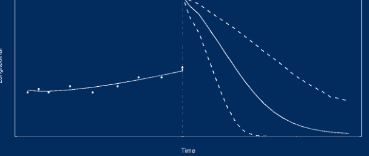

## 在 R 中的应用

### 主编

Shein-Chung Chow (周世忠)，博士

教授

生物统计学与生物信息学系

杜克大学医学院

北卡罗来纳州，达姆

### 系列主编

Byron Jones

生物测量学会会员

统计学方法论

集成信息科学

诺华制药公司

瑞士，巴塞尔

Jen-pei Liu (刘建沛)

教授

生物测量学系

农学系

国立台湾大学

台湾，台北

Karl E. Peace

佐治亚癌症联盟

卓越癌症学者

高级研究员及

生物统计学教授

佐治亚南方大学公共卫生学院

佐治亚州，斯泰特斯堡

Bruce W. Turnbull

教授

运筹学与工业工程学院

康奈尔大学

纽约州，伊萨卡

A. Indrayan

Dennis Cosmos 和 Shein-Chung Chow

Dalene Stangl

*致 Roula 和我的父母*

*纪念我的祖母*

# 前言

纵向数据与事件时间的联合模型已成为随访数据分析的有效工具。这些模型主要适用于两种情况：第一，当关注生存结局时，我们希望考虑带误差的内生时间依赖协变量的影响；第二，当关注纵向结局时，我们希望修正非随机脱落。由于联合模型能够在简单统计工具失效的情况下提供有效的推断，且其应用广泛，过去 25 年中联合模型领域取得了许多进展。尽管对联合模型的兴趣和发展非常广泛，但关于它们的信息也同样分散在介绍该领域最新进展的论文中，以及少数专门研究纵向或生存数据分析的教材章节中。然而，目前似乎还没有一本专门针对这类模型的单一专著或教材。

编写本书的目的是为纵向数据和生存数据联合模型的理论和应用提供概述。文献中提出了两个主要框架，即使用潜变量捕获两种结局之间关联的随机效应联合模型 (Tsiatis and Davidian, 2004)，以及基于 G 估计量的边际结构联合模型 (Robins et al., 1999, 2000)。在本书中，我们关注前者。联合模型的两个子领域，即内生时变协变量和非随机脱落的处理，在真实数据集中得到了同等的涵盖和展示。受作者背景和合作经历的启发，这些示例均来自医学领域，特别是生物标志物研究。然而，联合模型的这种类型，当对纵向数据与事件结局之间的关联感兴趣时，就可以采用该类型，因此它在其他领域也有许多应用。此外，书中还介绍了若干扩展，包括：纵向结局与生存结局之间不同类型的关联结构、分层因素的引入、滞后效应的纳入、外生时间依赖协变量的处理以及竞争风险设定。在纵向部分，重点关注了连续纵向结局和混合效应模型的使用。

书中包含的所有答案均在 R 统计计算和图形软件环境中实现，并使用了作者编写的免费可用软件包 `JM`。该软件包适用于广泛的联合模型，包括上述提到的扩展模型。然而，它并没有涵盖文献中提出的所有类型的联合模型，因此书中介绍了一些扩展方法（例如针对分类纵向标志物和多个纵向标志物的联合模型），但没有提供软件说明。文中给出的结果是使用 `JM` 软件包的 1.0-0 版本和 R 2.15.0 生成的。当前版本的软件包可以从综合 R 归档网络（cran-project.org）获取。由于平台依赖性，分析结果可能会随不同的计算机、操作系统以及 R 和软件包的后续版本而略有不同。文中使用的所有代码均可在支持网站获取。

```
http://jmr.r-forge.r-project.org
```

如果对书中内容的任何打印错误、错误或改进建议，作者将不胜感激，可以通过电子邮件与其联系：

d.rizopoulos@erasmusmc.nl

## 前提条件

书中的内容假设读者熟悉统计学入门课程水平的统计数据分析基本概念，包括标准极大似然理论，并具有强大的回归分析背景。一些混合效应模型和生存分析的背景知识也会有所帮助，但并非必须的。同样，对于 R 语言，本书不假设具备任何先验知识，但对该语言的基本熟悉将会有帮助。

## 字体表示习惯

R 语言对象以等宽**打字机**字体打印。可以在 R 命令行中交互式输入的代码格式如下：

> x <- 5

其中 `>` 表示 R 命令行，其他所有内容是用户应该输入的。此外，不适合单行显示的 R 表达式将进行适当的缩进，例如：

```
> jointModel(lmeFit, coxFit, timeVar = "time",
method = "weibull-PH-aGH", parameterization = "both")
```

在正文中引用函数时，它将采用打字机字体格式，并在函数名周围加上括号，例如 `jointModel()`。同样，函数参数以及为这些参数指定的值也将采用打字机字体格式，但末尾不加括号，例如 `method = "weibull-PH-aGH"`。

为了节省空间，部分 R 输出经过了编辑。完整行的省略通过以下符号索引：

... 某些空行在未标记的情况下被删除。

## 致谢

本专著中提出的许多工作都是基于与 Geert Verbeke 和 Geert Molenberghs 的共同研究，与他们合作是我的极大荣幸。我还要感谢 Emmanuel Lesaffre 在联合建模课题上的有益讨论，以及他创造了富有启发的工作环境。特别感谢 `JM` 软件包的所有贡献者，他们的投入对该软件包的开发受益匪浅。

特别针对这本书，我想感谢匿名评审员对手稿早期版本提供的宝贵反馈，感谢来自 Chapman and Hall/CRC 的 John Kimmel 在整个制作过程中提供的帮助与支持。本专著是使用 Friedrich Leisch 的 *Sweave* 软件包、$\LaTeX$ 文档准备系统以及当然的 R 编写的。

Dimitris Rizopoulos

鹿特丹，2012年4月

# 第1章

# 引言

## 1.1 目标

在后续研究中，通常会为每个样本单位收集不同类型的结局，这些结果可能包括多个纵向测量的响应，以及到特定感兴趣的事件发生的时间。此类研究中关注的问题通常需要对记录的结局进行单独分析，但在许多情况下，关注点也在于研究它们的关联结构。后一种情况的常见例子可以在生物标志物研究中找到，许多临床研究旨在识别对事件发生时间具有强预后能力的生物标志物。标准示例包括但不限于：人类免疫缺陷病毒（HIV）研究，其关注点是 CD4 细胞计数或病毒载量与获得性免疫缺陷综合征（AIDS）时间之间的关联；肝硬化研究调查血清胆红蛋白与死亡时间之间的关联；以及前列腺癌研究，其关注的是前列腺特异性抗原（PSA）水平与前列腺癌发生时间之间的关联。这些医疗状况的重要特征是它们的动态性。也就是说，进展速率不仅在患者之间不同，而且在同一患者身上随时间动态变化。因此，只有当在分析中考虑对标记物的重复评估时，才能揭示生物标志物在描述疾病进展及其与生存关联真实潜力。

## 纵向数据与生存数据的联合模型

为了解决涉及重复测量与事件时间之间关联结构的研究问题，已经开发了一类统计模型，作为纵向数据和事件时间数据的联合模型。目前，这些模型的研究是统计学研究的一个活跃领域，近年来引起了大量关注。特别是从 Self 和 Pattan (1992) 以及 DeGruttula 和 Tu (1994) 在联合建模方法应用方面的早期工作，到 Faucett 和 Thomas (1996) 以及 Wulfsohn 和 Tsiatis (1997) 引入如今被称为标准联合模型的开创性论文，该领域经历了爆炸式的发展。许多论文相继出现，对标准联合模型提出了若干扩展，包括但不限于：纵向轨迹的灵活建模、引入潜在类以解释群体异质性、考虑多个纵向标记、对多个失败时间进行建模，以及动态预测和准确性测量的计算。

本书的主要目标是为这种联合建模框架提供全面的介绍。特别是，我们将关注它们试图回答的研究问题类型，以及这些模型适用于回答这些问题的情况。我们将解释其背后的关键假设，以及如何优化利用它们从数据中提取相关信息。本书的另一个目标是促进这些模型在日常统计实践中的应用。为此，文中涵盖的（几乎）所有理论材料都使用为统计计算和图形设计的 R 软件环境（R Development Core Team, 2012）开发的 `JM` 包（Rizopoulos, 2012b, 2010）通过真实数据示例进行了说明。

## 1.2 数据动机

### 1.2.1 原发性胆汁性硬化

原发性胆汁性硬化（PBC）是一种慢性、致命但罕见的肝脏疾病，其特征是肝内小胆管的炎症性破坏，最终导致肝硬化。我们在这里考虑的数据集来自梅奥诊所从 1974 年至 1984 年间进行的一项研究（Murtaugh 等，1994），包含 312 名患者，其中 158 人随机接受 D-青霉胺，154 人接受安慰剂。主要关注的结局是患者的生存情况以及是否可以通过 D-青霉胺延长。此外，我们还拥有基线协变量的信息（例如基线年龄、性别等）以及几个生物标志物的随访测量。这些包括但不限于血清胆红素、蜘蛛痣（皮肤上的血管畸形）的存在和肝肿大（肝脏增大）。在这里我们将关注血清胆红素水平，它被认为是疾病进展的强指标，特别是我们对该标记与生存之间的关联感兴趣。

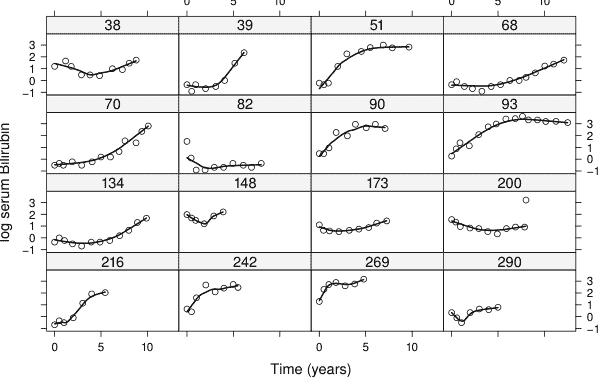

图 1.1：PBC 数据 16 个受试者的平滑纵向曲线。实线代表 loess 平滑曲线的拟合情况。

这些患者的原始临床方案规定在六个月、一年及之后每年访问一次。然而，由于死亡和删失，患者平均进行了 6.2 次访诊（标准差 3.8 次），导致共有 1945 次血清胆红素观测值。研究结束时，有 140 名患者死亡，29 人接受了移植，143 人仍然活着。图 1.1 显示了患者样本血清胆红素对数的平滑纵向曲线，从图中可以看出其中许多曲线在时间上是非线性的。

### 1.2.2 AIDS 数据

在 AIDS 数据集中，我们考虑了 467 名在逆转录病毒治疗期间对齐多夫定治疗失败或不耐受的高级人类免疫缺陷病毒患者。该研究的主要目标是比较两种替代抗逆转录病毒药物（即 地诺韦 (ddI) 和 扎西他滨 (ddC)）的有效性和安全性——死亡时间。患者被随机分配到 ddI 或 ddC，并在研究入组（即随机化时）记录 CD4 细胞计数，以及随后的 2、12 和 18 个月。有关该研究设计的更多细节可参见 Abrams 等 (1994)。

在研究结束时，188 名患者死亡，59.7% 删失，2335 次测量中有 1405 次被记录，导致 39.8% 的缺失。

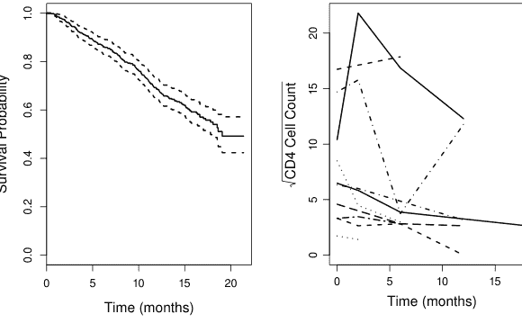

**图 1.2：左图：** AIDS 数据集中生存时间的 Kaplan-Meier 估计。虚线对应 95% 置信区间。**右图：** AIDS 数据集中随机选择受试者的 CD4 计数平方根纵向轨迹。

图 1.2 展示了患者样本血清胆红素对数的生存时间的 Kaplan-Meier 估计（有关 Kaplan-Meier 估计的更多细节见 3.2 节）。对于我们的说明，我们关注该研究的一个辅助目标，即 CD4 计数与死亡风险之间的关联。特别是，CD4 计数测量脾、淋巴结和胸腺的白细胞数量，是免疫系统的一部分。因此，CD4 计数随时间的减少表明免疫系统的恶化。

### 1.2.3 肝硬化数据

肝硬化数据集包含 488 名经组织学证实的肝硬化患者，其中 237 人随机接受泼尼松治疗，其余接受安慰剂。肝硬化是一个泛指，包括以细胞丢失和肝叶结构紊乱为特征的所有慢性弥漫性肝疾病。该研究于 1962 年至 1974 年在哥本哈根进行，主要目的是评估泼尼松是否能延长患者生存期（Andersen 等，1993）。

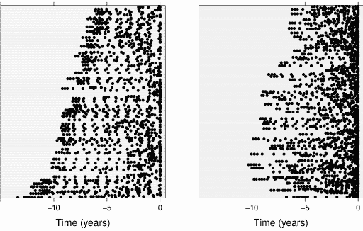

图 1.3：肝硬化数据删失（左图）和死亡（右图）随访时间的分布。

随访结束时，150 名（63.3%）泼尼松治疗患者和 142 名（56.6%）安慰剂治疗患者死亡。

患者被安排在 3、6 和 12 个月及之后每年返回一次，并提供若干临床和生化变量的记录。临床变量包括酒精摄入量、营养状况、出血和腹水程度，而最重要的生化变量是白蛋白、胆红素、碱性磷酸酶和凝血酶原。尽管患者应该在上述计划访诊期间提供测量，但实际随访时间是在计划访问周围进行的。此外，如图 1.3 所示，患者在死亡前进行的访问次数更多。

对于我们的说明，我们将关注凝血酶原指数与死亡风险之间的关联。该指数通过血液测试肝脏产生的凝血因子 II、VII 和 X 来测量。图 1.4 描绘了每个治疗组的个体特异纵向轨迹。此外，我们有兴趣研究凝血酶原指数区分在最后评估后医学相关范围内死亡的受试者与活得更长的受试者的能力。例如，对于同一人群的未来患者，我们希望告知主治医生其基于基线协变量和可用数据计算的生存情况。

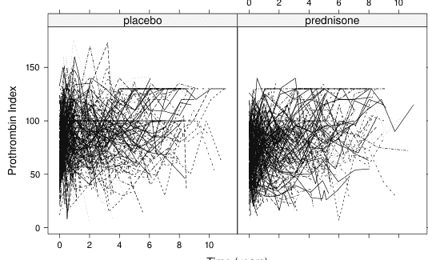

**图 1.4**: 肝硬化数据中，各治疗组患者凝血酶原指数的个体特异性纵向轨迹。

凝血酶原的测量值，并帮助他们进一步决定采取的。

### 1.2.4 主动脉瓣数据

主动脉瓣数据集包含 289 名患有主动脉瓣狭窄（AS）的患者，他们在 1992 年至 2005 年间在 伊拉斯谟 大学医学中心接受了异体主动脉根替换（RR）或 冠脉植入（SI）手术（Takkenberg 等人，2002, 2006）。主动脉瓣狭窄是指位于心脏左心室和主动脉之间的主动脉瓣开口变窄，它是常见的瓣膜心脏疾病之一。该数据集中的所有患者都通过年度电话访谈和心脏病专家随诊进行了随访。伊拉斯谟 大学医学中心的超声心图随访分别在术后六个月、术后一年以及此后的每两年通过系列标准化超声心图进行。到研究结束时，61 名（21.1%）患者死亡，78 名（27%）接受了再次手术。

我们关注主动脉射流速度（主动脉梯度）与死亡或再次手术风险之间的关联。由于主动脉梯度呈现右偏态分布特征，我们通常对其进行平方根变换。图 1.5 显示了对主动脉梯度平方根进行简单线性回归得到的个体特异性截距和斜率的散点图，按事件时间排序。我们观察到个体特异性截距的变异远大于斜率，而对于后者，我们看到变异性随时间的推移而减小。

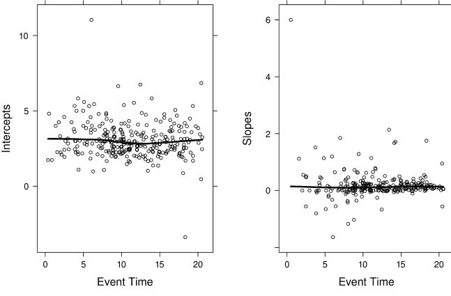

**图 1.5**: 主动脉瓣数据集中不同手术类型下主动脉梯度平方根随时间演变的个体特异性截距和斜率。实线表示 loess 平滑曲线的拟合情况。

### 1.2.5 其他应用

之前的章节侧重于人类研究数据集，关注纵向生物标志物测量与患者生存率之间的关联。尽管如此，纵向反应与事件时间之间的相互关系在许多其他学科中也受到关注。下面提供了三个生物标志物研究以外领域的示例。

**例 1**: 在群居动物研究中，种群社会动力学的纵向测量可能与迁移到另一个区域的时间相关。

**例 2**: 在社会学和教育测试中，以及某些流行病学研究中，将受访者问卷的表现与事件时间结果联系起来通常具有意义。例如，痴呆症研究问卷用于衡量患者的情绪状态、记忆和交流能力。由于痴呆症是进展性的，患者会定期性地接受这些问卷，研究重点在于患者心理测试中表现的演变与疾病临床发作之间的关系。

**例 3**: 在土木工程中，研究建筑物不再可以使用的时间通常很有意义。为了实现这一点，会在定期时间间隔记录结构完整性的若干指标，旨在评估这些指标是否为所涉及结构失效风险的强预测因子。

## 1.3 纵向研究中的推断目标

从上一节可以看出，在纵向研究中，通常会为每个患者记录丰富的信息，研究重点通常在于这些不同信息之间的复杂关联。在进一步详细讨论纵向设定下可能感兴趣的相互关系之前，我们首先将区分这些研究中记录的两类结果。首先，我们将**显式结果**（explicit outcomes）称为研究方案中明确规定要记录的结果。例如，在 PBC 研究中，这些包括随访期间记录的患者信息以及生物标志物的纵向测量。第二类结果我们称为**隐式结果**（implicit outcomes），是指那些不是直接关注但增加了分析复杂度的结果。一个典型的例子是缺失数据。特别是，即使根据方案，患者通常需要在预设场合出现以提供信息，这在实践中很少做到。患者往往会错过某些访问，或可能完全退出研究。另一个隐式结果的例子是访诊过程，它定义为产生纵向测量点的机制（随机或确定性）（Lipsitz 等人，2002）。随机访诊时间更多出现在观察性研究中，在这些研究中，纵向测量的时间点不是固定的，而是由医生甚至患者本人决定的。尽管如此，随机访诊时间也可能出现在方案预设的随机研究中。例如，对于 PBC 数据集，在随访的前两年，胆红素测量在基线、半年、一年和两年进行，变异较小，而在后期时间的变异显著增加。在我们介绍了可能提出的研究问题的分类（Rizopoulos 和 Lesaffre, 2012）。

### 1.3.1 协变量对单一结果的影响

医学研究中最常见的问题类型是估计或测试一组协变量对某些结果的影响。例如，对于 AIDS 患者，我们想知道它是否提高了生存率，或者男性和女性之间的 CD4 计数平均纵向图谱是否存在差异。此类问题的回答需要人们建立一个关联协变量与结果的模型。根据结果的性质，有多种统计模型可用。纵向数据和事件时间数据的基本建模框架分别在第 2 章和第 3 章中给出。

### 1.3.2 结果之间的关联

通常，结果之间的关联结构也具有意义。例如，在 PBC 数据集中，医生感兴趣的是测量当前胆红素水平与死亡风险之间的关联。类似的例子出现在哮喘研究中，哮喘发作的风险可能与空气污染水平相关。乍一看，这些研究问题与 1.3.1 中提出的问题相似，唯一的区别是协变量过程现在是时间依赖的。因此，人们只需通过建立关联两个感兴趣结果的模型来继续。例如，我们可以为死亡风险建立一个时间依赖 Cox 模型，并将纵向 CD4 计数测量作为时间依赖协变量纳入。当协变量结果独立于响应结果外部时，我们可以

## 纵向数据与生存数据的联合模型

使用第 1.3.1 节提到的大多数标准模型，并进行较小的修改。然而，正如我们后面看到的，对内部协变量进行统计分析面临几个额外的困难。

### 1.3.3 复杂假设检验


上述两类研究问题的结合也经常引起关注。这种设定的一个典型例子是替代标记物的评估。特别是对于像原发性胆汁性胆管炎（PBC）等慢性疾病，我们可能倾向于使用短期纵向血清胆蛋白测量而非生存终点来评估疗效，后者是难以确定的。Prentice (1989) 为替代标记设定了三个条件：(I) 治疗必须对患者生存产生影响；(II) 治疗必须对标记物（即血清胆蛋白）产生影响；以及 (III) 治疗的效果应该通过标记物体现，即给定特定标记轨迹的死亡风险应与治疗无关。显而易见，对于条件 (I) 和 (II)，我们需要为生存结果和纵向结果分别建立模型，每个模型都将治疗作为预测因子。然而，为了检查 (III)，本身需要一个同时以治疗和血清胆蛋白为条件的生存结果模型。考虑到上述解释的血清胆蛋白作为内生性时间依赖协变量的特征，联合模型提供了一个灵活的建模框架，在考虑血清胆蛋白的情况下确定治疗对生存是否有影响。

当我们感兴趣同时测试多个结果中基线协变量的效果时，也需要类似类型的分析。例如，继续上述示例，血清胆蛋白可能不是描述疾病进展的良好生物标记物，因此即使继续监测血清胆蛋白，治疗可能对患者生存产生影响。在这种情况下，我们可以扩展分析，并包含疾病进展的其他生物标记物，如蜘蛛细胞和血液学指标。此时的关注点可能是同时测试所有标记物的治疗效果，或者在修正其他标记物后测试某个特定标记物与死亡风险的关联。显而易见，为了进行此类测试，我们需要一种能够灵活捕捉这些结果之间关系的建模方法。

## 1.3.4 预测

统计模型通常也用于提供患者相关结果的预测。特别是，由于当前医疗实践向个性化医疗的发展，能够提供高质量受者特定预测的模型被证明非常有价值。在实践中，对于特定的患者在随访期间的特定时间点，医生希望利用他们手头所有的可用信息（包括基线信息和积累的生物标记物水平）来产生医学相关结果的预测，更好地理解疾病动力学，并最终在当时做出最优的决策。

当记录新信息时，医生会有兴趣更新这些预测，从而以时间动态的方式进行。

如果对良好的预测感兴趣，结合我们对患者的所有可用信息将有用，以考虑结果之间的生物相互作用。例如，在 PBC 数据集中，从生物标记物的定义可以看出，它们测量的是肝功能的不同方面。因此，如果我们基于这些标记物之一进行预测而忽略其他，就会丢失价值的信息。这不可避免地意味着我们无法达到同时结合所有标记物所能达到的预测能力极限。因此，将所有标记物整合到单个模型中的建模方法是有优势的，因为它利用了所有可用信息。Fieuws 等人（2008）实证说明了结合标记物进行预测的价值，他们指出，肾移植研究中基于使用记录的肾功能生物标记物的联合模型的移植物失败预测，远优于对每个标记物的独立分析。

## 1.3.5 隐性结果的统计分析

在上述所有类型的研究问题中，我们关注的是显性结果。然而，如前所述，在纵向研究中往往也会产生隐性结果，尽管它们不是主要感兴趣的结果，但需要对其进行适当处理。特别是在存在隐性结果的情况下，在进行感兴趣的分析之前，必须仔细考虑生成隐性结果（缺失数据和/或访问时间）的概率机制，因为这很大程度上决定了如何调整分析以获得有效的推断。

## 1.4 概述

第 2 章和第 3 章旨在介绍联合模型的构建模块，即用于纵向数据的线性混合模型和用于生存数据的相对风险模型。特别在第 2 章中，我们讨论了纵向响应分析中出现的复杂性，并引入了线性混合模型作为处理相关数据的灵活建模框架。我们提到了估计和推断，然后重点关注纵向研究中常见的缺失数据问题。我们定义了不同的缺失数据机制，并解释了在什么情况下线性混合模型提供有效的推断。

第 3 章首先解释事件时间数据的特殊特征，如删失和截断，以及它们如何增加此类数据分析的复杂性。接下来，我们引入了相对风险模型，特别是 Cox 模型。与第 2 章一样，我们简要提到了删失、部分似然和全似然以及推断。在最后一节中，我们关注时间依赖协变量。具体来说，我们提供了内源性和外生时间依赖协变量的定义，并讨论了在什么设置下扩展（时间依赖）Cox 模型提供有效的推断。

第 4 章介绍了联合建模框架的基础。特别是，接续第 3 章末尾，我们首先从生存的角度出发，说明联合模型作为处理时间依赖协变量的建模框架。我们引入了标准联合模型，讨论了其背后的假设，并给出了极大似然估计。随后，我们与第 2 章提出的缺失数据框架建立联系，并额外说明了联合模型作为可以处理非随机脱落的模型。

在第 5 章中，我们探索了标准联合模型的几种扩展。生存部分的扩展包括纵向和生存结果之间不同类型的参数化、分层相对风险模型、多失败时间的处理以及加速失效时间模型的考虑。在纵向部分，我们首先介绍了具有类别纵向标记物的联合模型，然后扩展到具有多个纵向结果的多变量联合模型。最后，作为标准联合模型的替代方案，我们介绍了潜类联合模型，该模型假设纵向过程与事件时间过程之间的关联由于群体中存在潜在异质性。

第 6 章，我们展示了几种基于残差评估联合模型假设的诊断工具。我们分别专注于生存和纵向部分的残差类型，并特别关注这些残差如何受事件发生引起的非随机脱落的影响。此外，我们还提到了随机效应分布的误设定以及这如何影响得出的推断。

第 7 章关注预测和判别。具体来说，我们说明了如何使用联合模型估计事件时间结果的生存概率和纵向结果的预测，并说明了这些预测如何随着每个受者的信息收集进行动态更新。接下来，我们将注意力转向纵向标记的前瞻性指标，并评估其在区分即将发生事件的患者与风险低得多的患者方面的能力。特别是，在预测规则定义的定义下，我们给出了敏感性和特异性指标的适当定义。

我们使用受试者工作特征（ROC）方法来确定纵向标记物的准确性。

最后，附录 A 对 R 进行了简要介绍，使得对该软件包没有或很少经验的读者能够获得所需的所需的背景知识，以便他们将本文介绍的联合建模技术应用到自己的数据集中。

# 第 2 章

## 纵向数据分析

本章引入了线性混合效应模型，用于分析连续性纵向响应，该模型是纵向和事件时间数据联合模型的第一个基石。我们特别关注了经常遇到的缺失数据问题。特别是，我们展示了描述纵向响应与缺失过程之间关联结构的不同层次的机制，并解释了在什么情况下需要对这两种结果进行联合建模分析。

## 2.1 纵向数据的特征

在许多定量研究领域，收集相关数据是非常常见的。根据 Verbeke 和 Molenberghs (2000) 以及 Molenberghs 和 Verbeke (2005) 的观点，通用的相关数据包含多种多变量数据结构，例如聚类数据、重复测量、纵向数据和空间相关数据。我们在本章中的重点是纵向数据，它可以被广泛定义为对受试者（例如人类、动物或实验室样本）进行随时间的重复测量而产生的数据。此类数据在健康科学中经常遇到，纵向研究在增强我们对疾病发生和持续的理解方面起着重要作用。纵向研究的特征是，它们允许通过在整个研究期间对受试者进行重复测量，直接评估响应变量随时间的变化。例如，在一项纵向研究中，患者在研究开始时被（随机）分配接受不同的治疗，并在随时间内进行随访，我们可以调查：

1. 治疗均值在特定时间点（例如研究结束时，截面效应）的差异，以及
2. 治疗均值或治疗均值差异如何随时间变化（纵向效应）。

从上述描述可以明显看出，在纵向设置中，我们预期同一受试者的重复测量表现出正相关性。这一特征意味着，标准的统计工具（如假设观测值独立的 t 检验和简单线性回归）不适用于纵向数据分析。

## 2.2 线性混合效应模型

分析纵向数据的一种直观方法是基于这样一个观点：群体中的每个个体随时间都有自己的受试者特定均值响应曲线，其具有特定的函数形式。该数据的图形表示如图 2.1 所示，显示了两个假设受试者（点）的纵向响应及其相应的线性均轨迹（虚线）。所有受试者的平均演变由实线表示。为了正式引入这种纵向数据的表示，令 `$y_{ij}$` 表示受试者 `$i$` (`$i=1, \dots, n$`) 在时间 `$t_{ij}$` (`$j=1, \dots, n_i$`) 的响应。图 2.1 表明带有截距和线性时间效应的简单线性回归模型似乎足以描述每个受试者的数据。然而，不同的受试者往往具有不同的截距和斜率。因此，观测响应 `$y_{ij}$` 的一个合理模型为

```
$y_{ij} = \beta_{i0} + \beta_{i1}t_{ij} + \epsilon_{ij},$
```

其中误差 `$\epsilon_{ij}$` 假设来自均值为 0、方差为 `$\sigma^2$` 的正态分布。由于受试者是从受试者群体中随机抽样的，因此假设受试者特定的回归系数 `$\beta_{i0}$` 和 `$\beta_{i1}$` 也从相应的回归系数总体中随机抽样是合理的。习惯上假设总体中回归系数的分布为二元正态分布，均值向量为 `$\beta = (\beta_0, \beta_1)^T$`，协方差矩阵为 `$D$`。在此设置下，我们可以将模型重新公式化为

```
$y_{ij} = (\beta_{i0} + \beta_{i1}t_{ij}) + \epsilon_{ij},$
```


# 纵向数据分析

纵向数据的一种直观方法是基于这样一个观点：群体中的每个个体随时间都有自己的受试者特定均值响应曲线，其具有特定的函数形式。该数据的图形表示如图 2.1 所示，显示了两个假设受试者（点）的纵向响应及其相应的线性均轨迹（虚线）。所有受试者的平均演变由实线表示。为了正式引入这种纵向数据的表示，令 `$y_{ij}$` 表示受试者 `$i$` (`$i=1, \dots, n$`) 在时间 `$t_{ij}$` (`$j=1, \dots, n_i$`) 的响应。图 2.1 表明带有截距和线性时间效应的简单线性回归模型似乎足以描述每个受试者的数据。然而，不同的受试者往往具有不同的截距和斜率。因此，观测响应 `$y_{ij}$` 的一个合理模型为

```
$$y_{ij} = \beta_{i0} + \beta_{i1}t_{ij} + \epsilon_{ij},$$
```

其中误差 `$\epsilon_{ij}$` 假设来自均值为 0、方差为 `$\sigma^2$` 的正态分布。由于受试者是从受试者群体中随机抽样的，因此假设受试者特定的回归系数 `$\beta_{i0}$` 和 `$\beta_{i1}$` 也从相应的回归系数总体中随机抽样是合理的。习惯上假设总体中回归系数的分布为二元正态分布，均值向量为 `$\beta = (\beta_0, \beta_1)^T$`，协方差矩阵为 `$D$`。在此设置下，我们可以将模型重新公式化为

```
$$y_{ij} = (\beta_{i0} + \beta_{i1}t_{ij}) + \epsilon_{ij},$$
```

## 2.2.1 线性混合效应模型的参数的估计

第 `$i$` 个观测响应数据的分布由表达式给出：

```
$$p(y_i) = \int p(y_i \mid b_i) p(b_i) \ db_i.$$
```

利用随机效应在条件均 `$E(y_i \mid b_i)$` 设定中线性进入的事，且给定随机效应的纵向响应分布 `$\{y_i \mid b_i\}$` 以及随机效应的分布 `$b_i$` 均为正态分布，上述积分具有闭式解，并导致一个均值为 `$X_i\beta$`、协方差矩阵为 `$V_i = Z_iZ_i^T + \sigma^2 I_{n_i}$` 的 `$n_i$` 维正态分布。因此，假设个体之间独立，线性混合模型的对似然函数形式如下：

```
$$\ell(\theta) = \sum_{i=1}^n \log p(y_i; \theta) \\n = \sum_{i=1}^n \log p(y_i \mid b_i; \beta, \sigma^2) p(b_i; \theta_b) \ db_i, \quad (2.2)$$
```

其中 `$\theta$` 表示全参数向量，分解为子向量 `$\theta^T =(\beta^T, \sigma^2, \theta_b^T)$`，其中 `$\theta_b = \text{vech}(D)$`，且：

```
$$p(y_i; \theta) = (2\pi)^{-n_i/2}|V_i|^{-1/2} \exp\{-\frac{1}{2}(y_i - X_i\beta)^T V_i^{-1}(y_i - X_i\beta)\},\$$
```

其中 `$|A|$` 表示方阵 `$A$` 的行列式。如果假设 `$V_i$` 已知，通过在 `$V_i$` 参数条件下最大化 (2.2) 得到固定效应向量 `$\beta$` 的极大似然估计，它对应于广义最小二乘估计量：

```
$$\hat{\beta} =(\sum_{i=1}^n X_i^T V_i^{-1} X_i)^{-1} \sum_{i=1}^n X_i^T V_i^{-1} y_i. \quad (2.3).$$
```

当 `$V_i$` 未知但存在该矩阵的估计时，我们可以使用表达式 (2.3) 来估计 `$\beta$`，其中 `$V_i$` 被替换为 `$\hat{V}_i$`。为了获得 `$V_i$` 的估计，我们可以再次采用极大似然法，对于给定的 `$\beta$` 值最大化对似然 `$\ell(\theta_b, \sigma^2)$`。根据标准的极大似然理论并在某些正则条件下，`$V_i$` 的极大似然估计是渐近无偏的。然而，在小样本中，`$V_i$` 的 ML 估计是有偏的。这实际上是简单线性回归中遇到的相同现象，其中误差方差极大似然估计定义为：

```
$$\hat{\sigma}^2 = \frac{\sum_{i=1}^n (y_i - x_i^T\beta)^2}{n},$$
```

这种偏差出现是因为 `$\sigma^2$` 的 ML 估计没有考虑到 `$\beta$` 也是从数据中估计的。通过将残差平方和除以 `$n-p$`（残差自由度），可以获得无偏估计，即：

```
$$\sigma^2 = \frac{\sum(y_i - x_i^T\hat{\beta})^2}{n-p}$$
```

其中 `$p$` 表示协变量 `$x_i$` 的维度。为了解决相同的极大似然估计问题，但在估计矩阵 `$V_i$` 的一般多元回归情况下，开发了限制极大似然（REML）理论（Harville, 1974）。REML 估计背后的核心思想是将用于估计 `$V_i$` 的数据部分与用于估计 `$\beta$` 的部分分离。换句话说，REML 估计 `$V_i$` 的基本思想是从似然中消除 `$\beta$`，使其仅由 `$V_i$` 定义。REML 估计通过最大化略微修改的对似然函数进行进行：

## 纵向数据与生存数据的联合模型


$$\ell(\theta_b, \sigma^2) = -\frac{n}{2}\log(2\pi) + \frac{1}{2}\log\sum_{i=1}^n X_i^\top X_i - \frac{1}{2}\log\sum_{i=1}^n X_i^\top V_i^{-1} X_i - \frac{1}{2}\sum_{i=1}^n \log|V_i| + (y_i - X_i\hat{\beta})^\top V_i^{-1}(y_i - X_i\hat{\beta}) \propto -\frac{1}{2}\sum_{i=1}^n \log|V_i| - \frac{1}{2}\sum_{i=1}^n (y_i - X_i\hat{\beta})^\top V_i^{-1}(y_i - X_i\hat{\beta}) - \frac{1}{2}\log\sum_{i=1}^n X_i^\top V_i^{-1} X_i$$

其中 $\hat{\beta}$ 由 (2.3) 给出。通过最大化修改似然得到的 $\hat{V}_i$ 估计修正了 $\beta$ 也被估计的事实。与 $\beta$ 的估计相反，$V_i$ 中唯一参数的极大似然或限制极大似然估计通常无法写成闭式形式。因此，为了获得 $V_i$，需要数值优化程序。两种常用的算法是期望极大算法（Dempster 等，1977）和牛顿-拉夫逊算法（Lange, 2004），它们在线性混合模型中的实现可见 Laird 和 Ware (1982) 以及 Lindstrom 和 Bates (1988)。

固定效应回归系数的标准误可以通过计算广义最小二乘估计量 (2.3) 的方差直接获得：

```
$$\text{var}(\hat{\beta}) = \left(\sum_{i=1}^n X_i^\top V_i^{-1} X_i\right)^{-1} \sum_{i=1}^n X_i^\top V_i^{-1} \text{var}(y_i)$$
```

# 纵向数据分析

## 随机截距

## 随机截距与随机斜率

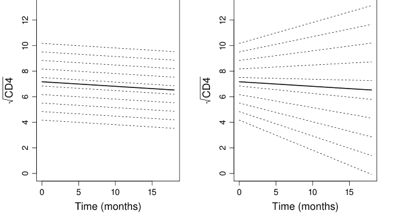

**图 2.2:** AIDS 数据集中患者 CD4 细胞计数平方根随时间演变的随机截距模型（左面板）以及随机截距与随机斜率模型（右面板）的图形化表征。实线表示平均纵向演变，虚线表示特定受试者的演变。

一个用于识别哪些重复测量属于同一组的变量（在我们的示例中，组别是患者）。`data` 参数用于提供存储所有变量的数据框。拟合随机截距模型的相应调用为：

```
> lmeFit.int <- lme(CD4 ~ obstime, random = 1 | patient, data = aids)
```

```
> summary(lmeFit.int)
Linear mixed-effects model fit by REML
Data: aids
  AIC       BIC logLik
7176.633 7197.618 -3584.316

Random effects:
Formula: ~1 | patient
  (Intercept) Residual
StdDev:  4.506494 1.91662

Fixed effects: CD4 ~ obstime
| | Value | Std.Error | DF | t-value | p-value |
|---|---|---|---|---|---|
| (Intercept) | 7.188663 | 0.0226132 | 937 | 32.58492 | 0 |
| obstime | -0.148500 | 0.0121869 | 937 | -12.18513 | 0 |

Correlation:
(Intr)
obstime ~ -0.194

Standardized Within-Group Residuals:
| Min | Q1 | Med | Q3 | Max |
|---|---|---|---|---|
| -3.8400681 | -0.44310988 | -0.05388055 | 0.43593364 | 6.09265321 |

Number of Observations: 1405
Number of Groups: 467
```

默认情况下，`lme()` 执行 REML 估计。`summary()` 返回拟合模型的详细输出，包括模型中所有参数的估计值、标准化残差的 Location 度量，以及用于拟合模型的数据。方差分量的估计值（即参数 $\sigma_a$ 和 $\sigma_e$）与随机效应一起给出，估计的回归系数 $\beta$ 及其相应的标准误、t 值和 p 值在固定效应下提供。如预期的那样，时间效应为负号，表明平均 CD4 细胞计数平方根随时间推移而下降。在随机截距模型下，纵向响应的隐含边际协方差结构形式为：

> $V_i = \sigma_b^2 l_{n_i} + \sigma^2 l_{n_{i},}$

其中 $l_n$ 表示 $n_i$ 维向量，假设随时间具有恒定的方差 $\sigma_b^2 + \sigma^2$，且任意两点测量之间具有相同的正相关性 $\rho = \sigma_b^2/(\sigma_b^2 + \sigma^2)$。这种协方差矩阵被称为对称矩阵，共同相关系数 $\rho$ 通常称为类内相关系数（Hand and Crowder, 1996）。可以使用 `getVarCov()` 函数从拟合的线性混合模型提取特定患者的估计边际协方差矩阵 $\hat{V}_i$。对于我们的示例，我们提取了患者 12 的协方差矩阵，他是数据集中第一个具有五个计划测量可用数据的患者：

```
margCov.int <- getVarCov(lme, individuals = 12, type = "marginal")
margCov.int
```

### 患者 2 边际协方差矩阵

| | 1 | 2 | 3 | 4 | 5 |
|---|---|---|---|---|---|
| 1 | 24.157 | 20.308 | 20.308 | 20.308 | 20.308 |
| 2 | 20.308 | 24.157 | 20.308 | 20.308 | 20.308 |
| 3 | 20.308 | 20.308 | 24.157 | 20.308 | 20.308 |
| 4 | 20.308 | 20.308 | 20.308 | 24.157 | 20.308 |
| 5 | 20.308 | 20.308 | 20.308 | 20.308 | 24.157 |

标准差：4.919 4.919 4.919 4.919 4.919

因此，考虑到随机截距模型，每个时间点的估计测量方差为 24.2，任何两个时间之间的估计协方差为 20.3。通过 `covcor()` 函数导出的相关矩阵：

```
> covcor(margCov.int[[1]])
| | 1 | 2 | 3 | 4 | 5 |
|---|---|---|---|---|---|
| 1 | 1.000000 | 0.847012 | 0.847012 | 0.847012 | 0.847012 |
| 2 | 0.847012 | 1.000000 | 0.847012 | 0.847012 | 0.847012 |
| 3 | 0.847012 | 0.847012 | 1.000000 | 0.847012 | 0.847012 |
| 4 | 0.847012 | 0.847012 | 0.847012 | 1.000000 | 0.847012 |
| 5 | 0.847012 | 0.847012 | 0.847012 | 0.847012 | 1.000000 |
```

尽管随机截距模型的简单性非常吸引人，但它对重复测量之间相关性保持恒定的限制是不现实。直觉上，我们预期时间间隔越远的测量相关性越低。一种允许更灵活协方差指定的扩展是随机截距与随机斜率模型：

> $y_{ij} = \beta_0 + \beta_{1i}t_{ij} + b_{i1}t_{ij} + \varepsilon_{ij},$

$$b_i \sim N(0, D), \quad \varepsilon_{ij} \sim N(0, \sigma^2),$$

其中 $b_i = (b_{i0}, b_{i1})$。该模型引入了额外的随机项，并假设 CD4 细胞计数的变化率在患者之间不同。该图形化表征见图 2.2 的右面板。使用 `lme()` 拟合此模型，我们在 `random` 参数中指定一个包含时间变量的公式（默认包含截距）：

```
> lmeFit.slp <- lme(CD4 ~ obstime, random = ~obstime | patient, data = aids)
> summary(lmeFit.slp)
Linear mixed-effects model fit by REML
Data: aids
  AIC BIC logLik
7141.282 7172.76 -3564.64

Random effects:
Formula: ~obstime | patient
Structure: General positive-definite, Log-Cholesky parametrization
StdDev Corr
(Intercept) 4.589845 (Intr)
obstime 0.172824 -0.152
Residual 1.750793

Fixed effects: CD4 ~ obstime
Value Std.Error DF t p-value
(Intercept) 7.189048 0.2221541 937 32.36061 0
obstime -0.150059 0.0151841 937 -9.88434 0

Correlation:
(Intr)
obstime -0.218

Standardized Within-Group Residuals:
Min Q1 Med Q3 Max
-4.3167803 -0.41245213 -0.0527692 0.41094133 4.3741291

Number of Observations: 1405
Number of Groups: 467
```

与随机截距模型相比，我们观察到估计固定效应参数差异非常小。对于随机效应，我们可以观察到患者之间 CD4 基线水平的变异大于指标随时间的演变。在随机截距与随机斜率模型下，同一个体任意对响应的隐含边际协方差函数形式如下：

```
$cov(y_{ij}, y_{ij'}) = [1 \quad t_{ij}] \ D \left[ \begin{matrix} 1 \ t_{ij'} \end{matrix} \right] + \sigma^2
= d_{22}t_{ij}t_{ij'} + d_{12}(t_{ij} + t_{ij'}) + d_{11} + \sigma^2, \quad (2.6)$
```

其中 $d_{kl}$ 表示协方差矩阵 $D$ 的 $kl$ 元素。对于同一时间点 $t_{ij} = t_{ij'} = t$，方差函数为 $d_{22}t^2 + 2d_{12}t + d_{11}$，它是关于时间的二次函数，具有正向曲率 $d_{22}$。隐含的边际模型：

```
$y_i = X_i\beta + \epsilon_i^*, \quad \epsilon_i^* \sim N(0, \sigma^2 I),$
```

异方差项。在 AIDS 数据集中，估计的边际协方差矩阵是：

# 纵向数据

## 2.3 纵向研究中的缺失数据

纵向数据分析的一个主要挑战是缺失数据问题。虽然纵向研究设计为在样本中的每个受试者在预设的随访时间收集数据，但通常某些受试者由于各种原因错过了部分计划中的测量的情况。根据缺失数据模式的特征，我们可以区分两种类型的缺失，即单调缺失（monotone）和非单调缺失（non-monotone）。单调缺失模式涵盖了受试者在预定完成前退出研究的*耗损*（attrition）或*流失*（dropout）情况，以及受试者未提供某些初始响应测量但在后期出现并一直留在研究直到完成的*晚入*（late entry）情况。另一方面，非单调缺失也称为*间歇缺失*（intermittent missingness），是一种更通用的类型，涵盖了例如受试者的响应在某一次随访时缺失，在下次随访时返回，但在之后的时间点可能再次缺失的情况。表 2.1 给出了不同缺失数据模式的说明性示例，其中受试者 1 是完成者，受试者 2 在第四次访视时退出，受试者 3 未提供第一次测量，受试者 4 只在第二次和第四次访视时存在。

**表 2.1:** 一项假设的具有五次计划测量的纵向研究中的缺失数据模式示例；'x' 表示观测测量，'?' 表示缺失的纵向响应。

| | 访视 | | | | |
|---|---|---|---|---|---|
| | 1 | 2 | 3 | 4 | 5 |
| 1 | x | x | x | x | x |
| 2 | x | x | ? | x | ? |
| 3 | ? | x | x | x | x |
| 4 | ? | x | ? | x | ? |

缺失数据的存在为纵向研究的设计以及这些研究的数据分析带来了多项挑战。第一个最明显的影响是效率的损失，这意味着平均纵向演变的估计精度低于所有数据都可用时的估计精度。这一重要后果需要更多的个体才能在检测重要效应方面达到相同的效力。精度的降低与缺失数据的数量直接相关，并受所选分析方法的影响。此外，缺失会导致随时间变化的数据不平衡，因为并非所有受试者在共同的时间点测量次数相同。这为需要平衡数据的分析方法增加了复杂性，但对于之前引入的线性混合效应模型来说并不构成问题。最后，在某些情况下，如果处理不当，缺失数据可能会引入偏差，从而导致误导性的推断。在分析不完整的纵向响应时，最后这一因素是最令人关注的。在详细讨论偏差问题如何产生之前，我们首先需要引入额外的术语，以便对缺失值机制设定正式条件，并确定该机制如何影响随后的推断。通常，我们假设研究中的每个受试者 $i$ 被设计在时刻 $j=1, \dots, n_i$ 进行测量，这意味着对于该受试者，我们预期收集测量向量 $y_i = (y_{i1}, \dots, y_{in_i})^T$。为了区分我们实际收集的响应测量与计划收集的测量，我们引入了定义如下的缺失数据指示：

```
$r_{ij} = \begin{cases} 1 & \text{如果 } y_{ij} \text{ 被观测} \\ 0 & \text{否则。 \end{cases}$
```

因此，我们得到完整响应向量 $y_i$ 划分为两个子向量：观测数据子向量 $y_i'$（包含 $r_{ij}=1$ 的 $y_{ij}$）和缺失数据子向量 $y_i^m$包含剩余部分）。向量 $r_i = (r_{i1}, \dots, r_{in_i})$ 以及生成 $r_i$ 的过程被称为缺失数据过程。

当缺失被限制为流失或耗损时，缺失数据指示 $r_i$ 始终具有 $(1, \dots, 1, 0, \dots, 0)$ 的形式，因此可以用标量变量 $r_i^d$ 替换，定义为

```
$r_i^d = 1 + \sum_{j=1}^{n_i} r_{ij}$.
```

对于不完整序列，$r_i^d$ 表示流失发生的时刻，而对于完整序列，$r_i^c = n_i+1$。在两种情况下，$r_i^d$ 都等于观测测量序列的长度，无论该序列是完整还是不完整。

### 2.3.1 缺失机制

分析不完整纵向数据的不同方法的适用性取决于缺失数据机制。缺失数据机制可以被视为描述缺失数据 $r_i$ 与响应数据 $y_i$ 之间关系的概率模型。缺失机制的分类由 Little 和 Rubin (2002) 首次提出，它是基于给定完整响应向量 $y_i = (y_i^c, y_i^m)$ 时缺失过程 $r_i$ 的条件概率密度：

```
$p(r_i | y_i^c, y_i^m; \theta_r)$,
```

其中 $\theta_r$ 表示对应的参数向量。这三种类型的机制为（Fitzmaurice et al., 2004; Molenbergh and Kenward, 2007）：

*   **完全随机缺失 (MCAR)**，假设缺失与观测数据和缺失数据均无关。
*   **随机缺失 (MAR)**，假设缺失概率依赖于观测数据，但不取决于缺失值本身。即 $p(r_i | y_i^c, y_i^m) = p(r_i | y_i^c)$。
*   **非随机缺失 (MNAR)**，认为纵向响应的缺失概率取决于我们正在收集的响应的一个子集。

……将被观测到。特别而言，$r_i$ 的分布依赖于子向量 $y_i^m$ 的至少某些元素，即使我们对 $y_i^o$ 进行条件限制，即

```
$p(r_i \mid y_i^m; \theta_r) \text{ or } p(r_i \mid y_i^o, y_i^m; \theta_r), \quad (2.9)$
```

与 MAR（随机缺失）类似，MNAR（非随机缺失）缺失通常被称为*非随机缺失*，在脱落（dropout）的情况下被称为*非随机脱落*。MNAR 纵向数据的一个例子出现在疼痛研究中，当患者的疼痛水平超过他们能够忍受的阈值时，他们可能会要求救急药物。当患者退出研究并寻求救急药物时，我们通常没有他们的结果记录。与 MAR 的情况一样，在 MNAR 下，观测数据并不构成目标人群的随机样本。然而，与 MAR 相比，$y_i^m$ *条件于* $y_i^o$ 的预测分布与目标人群不同，而是同时取决于 $y_i^o$ 和 $p(r_i \mid y_i^o)$。因此，为缺失过程假设的模型至关重要，并且必须包含在分析中。

为了说明不同的缺失机制如何影响基于观测数据的推断，我们在图 2.3 中展示了松散点图对单一线性效应模型的拟合情况，其中数据已分别通过 MAR 和 MNAR 机制被删除。我们可以清楚地观察到松散拟合曲线（实线）与真实平均演变（虚线）之间的差异，特别是在 MNAR 的情况下。

关于上述缺失数据机制定义的最后一点说明是，我们隐含地假设缺失概率可能依赖于协变量。这提出了一个微妙但重要的点。例如，如果缺失与协变量有关但与 $y_i$ 无关（即 MCAR，完全随机缺失），并且我们在测量过程的分析中没有对该协变量进行条件限制，那么 MCAR 就再不能被认为是有效的。

### 2.3.2 非随机缺失模型族


从上一节提供的描述来看，显而易见，最难处理的缺失数据机制类型是 MNAR 机制。当纵向数据为 MNAR 时，我们只能通过基于测量过程和缺失过程联合分布的分析获得有效的推断。在文献中，针对这种联合分布提出了三个主要的模型族：`选择模型`、`模式混合模型`和`共享参数模型`（Little, 1995; Molenberg and Kenward, 2007）。

选择模型的分解基于：

```
$p(y_i^o, y_i^m, r_i; \theta) = p(y_i^o, y_i^m; \theta_y) p(r_i \mid y_i^o, y_i^m; \theta_r),$
```

其中第一个是测量过程的边缘密度，另一个是条件于纵向结果的缺失过程密度。

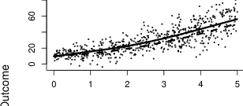

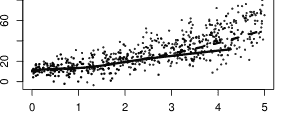

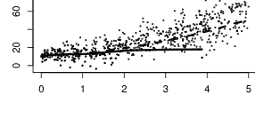

**图 2.3：** MAR 和 MNAR 缺失数据机制影响的图示说明。实线表示 loess 平滑器对观测数据的拟合。虚线表示模拟数据时的真实平均纵向演变。

该建模框架的名称源于计量经济学文献（Heckman, 1976），其基于这样一个事实：项 `$p(r_i | y_i^m; \theta_i)$` 可以被视为描述每个受试者自选择继续研究还是退出研究的概率机制。对于所有具有非随机（即 MNAR）脱落的纵向数据，其选择模型主要是在在 Diggle 和 Kenward (1994) 的开创性工作之后才受到广泛关注。

模式混合模型（Little, 1993, 1994）基于联合分布的相反分解，即

```
p(y_i^c, y_i^m, r_i; \theta_i) = p(y_i^c, y_i^m | r_i; \theta_i) p(r_i)
```

其中我们现在有了一个给定缺失过程的测量过程条件模型，以及一个缺失过程的边缘模型。正如名称所暗示，模式混合模型允许为每种缺失模式提供不同的测量模型。因此，测量过程的边缘分布是以每个缺失模式概率为权重的混合。

共享参数模型（Wu and Carroll, 1988; Wu and Bailey, 1988, 1989; Follmann and Wu, 1995; Hogan and Laird, 1997, 1998）在本章中引入了混合效应模型的基础，这些模型以后将作为联合模型构建块之一使用……（注：此处后续文本似乎存在大量重复和乱码，翻译已按要求保留原文逻辑并避免重复）。

# 第 3 章：时间分析

本章引入了时间分析的基本概念，并解释了生存数据中的截失（censoring）。对于生存数据，特别关注截失的处理，以及对于纵向数据的联合模型……（注：原文此处存在大量重复内容，仅翻译有效核心句部分）。

# 事件时间数据分析

感兴趣的事件仅已知发生在两个特定时间点之间。区间删（Interval censoring）通常出现在关注疾病发病时间的研究中。例如，HIV 感染者定期接受艾滋病（AIDS）发病检测。当发现某患者检测呈阳性时，实际上所知的是该患者在倒数第二次访问和最后一次访问之间的某个时间点患了该疾病。

区间截删是最通用的截删类型，因为当包含真实失效时间的区间上限或下限分别为无穷大或零时，它实际上包含了右删和左截删。

截删机制的第二分类与受试者被截删的概率是否取决于失效过程。具体而言，我们有：

- **信息性截删（Informative censoring）：** 当受试者直接由于预期失效时间退出研究时，例如是因为预后恶化。更清楚地说，如果在任何时间点 `$t$`，适用于研究受试者的失效率与退出研究的受试者的失效率不同，从某种意义上说，信息性截删在精神上与 2.3.1 节介绍的纵向研究中的非随机缺失（MNAR）数据机制相似。

- **非信息性截删（Noninformative censoring）：** 当受试者由于与其预后无关的原因退出研究时，但这些原因取决于协变量。与纵向研究进行同样的类比，非信息性截删对应于完全随机（MCAR）数据机制。

根据截删机制的类型，应遵循不同的推断程序。对于第一类分类，大多数文献集中在可以处理右删数据的方法，因为这些是最常遇到的。对于第二类分类，当截删机制是信息性的时，遗憾的是，能做的非常少。与纵向研究中的 MNAR 缺失机制类似，问题在于观测数据不包含足够描述截删机制的信息。因此，除非提供外部信息，否则在这些情况下进行意义分析的可能性非常有限。由于这些复杂性，大多数文献集中在针对非信息截删数据的方法上。在书中，我们仅考虑非信息的右删。

## 3.2 生存分析中的基本函数

令 `$T^*$` 表示研究中失效时间的随机变量。主要用于描述 `$T^*$` 分布的函数是生存函数。

## 纵向数据与生存数据的联合模型

如果事件是死亡，它表示死亡发生在 `$t$` 之后的概率，即生存时间 `$t$` 的概率。假设 `$T^*$` 是连续的，生存函数定义为

$$S(t) = \Pr(T^* > t) = \int_{t}^{\infty} p(s) \ ds,$$

其中 `$p(\cdot)$` 表示相应的概率密度函数。生存函数随 `$t$` 的增加而单调递，且 `$S(t=0)$` 始终等于一。在生存分析中起重要作用的另一个函数是风险函数（hazard function）。它描述了在生存到 `$t$` 的条件下，事件在时间间隔 `[$t, t+dt$]` 内发生的瞬时风险，定义为

$$h(t) = \lim_{dt\to0} \frac{\Pr(T^* \leq t+dt | T^* \geq t)}{dt}, \quad t > 0.$$

由于其定义，`$h(\cdot)$` 也称为瞬时风险函数或简单称为风险函数。生存率也可以风险函数表示为：

$$S(t) = \exp{-\Lambda(t)} = \exp{-\int_{0}^{t} h(s) \ ds\}, \quad (3.1)$$

其中 `$\Lambda$` 被称为累积风险（或累积风险）函数，描述了直到时间 `$t$` 的积累风险。函数 `$\Lambda(t)$` 也可以解释为到时间 `$t$` 观测到的事件预期。

当我们感兴趣从现有随机样本中估计这两个函数或事件分布的任何其他特征时，必须考虑截删。特别，令 `$T_i$` 表示受试者 `$i$` 的观测事件时间，定义为真实事件时间和截删时间 `$C_i$` 的最小值。我们还引入了事件指示器 `$\delta_i = (T_i \leq C_i)$`，如果观测事件时间对应于真实事件时间，则取值为 1，否则为 0，其中 `$I(\cdot)$` 表示指示函数。通常，在生存分析中，我们还仅使用可用信息 `{$T_i, \delta_i$}` 来估计 `$T_i^*$` 分布的特征。Kaplan 和 Meier (1958) 提出了生存函数的估计方法。这是一种非参数估计量，对失效时间的底层分布不作任何假设。为了引入这一估计量，令 `$t_1, \dots, t_k$` 表示现有样本中唯一的事件时间。利用全概率律，任何时间点 `$t$` 的生存概率可以写为条件概率的积：

$$\Pr(T^* > t) = \Pr(T^* > t | T^* > t-1) \times \Pr(T^* > t-1 | T^* > t-2) \times \dots$$

为了估计每个唯一事件时间的生存概率，我们利用上述展开式，并在计算条件概率时，通过通过适当处于风险中的人数（即未经历事件且未被截删的受试者）来考虑截删，得到估计量：

$$\hat{S}(t) = \prod_{i:t_i \le t} \frac{r_i - d_i}{r_i}, \quad (3.2)$$

其中 `$r_i$` 是风险人数，`$d_i$` 是事件人数。`$\hat{S}(t)$` 的方差可以使用 Greenwood 公式计算（Greenwood, 1926; Kalb and Prentice, 2002），并利用 `$\hat{S}(t)$` 的渐近正态可以推导出 `$S(t)$` 的信区间。然而，更好的方法是基于 `$\Lambda(t)$` 推导 `$S(t)$` 的非对称区间。这确保了 `$S(t)$` 的置信限越越区间 `[$0, 1$]`。

在上述 `$S(t)$` 非对称区间的推导中，我们使用了累积风险的 Kaplan 估计值 `$\hat{\Lambda}(t)$`。利用关系 (3.1)，这实际上由 `$\hat{\Lambda}(t) = -\log \hat{S}(t)$` 给出。另一种类似的累积风险非参数估计量（已有大量的渐近理论）是 Nelson-Aalen 估计量（Altschuler, 1970; Aalen, 1972; Fleming and Harrington, 1991），

$$\hat{\Lambda}(t) = \sum_{i:t_i \le t} \frac{d_i}{r_i}$$

其中 `$d_i$` 和 `$r_i$` 对于 Kaplan 估计具有相同的含义。基于 Nelson-Aalen 估计量并利用关系 (3.1)，我们可以推导出生存函数的信区间：

$$\hat{S}_B(t) = \exp(-\hat{\Lambda}(t)) = \prod_{i:t_i \le t} \exp(-d_i/r_i), \quad (3.3)$$

这是 Breslow (1972) 提出的。为了基于 Breslow 估计量推导 `$S(t)$` 的信区间，我们再次使用类似于 `$\hat{\Lambda}(t)$` 的 Greenwood 公式来估计 `$\log \hat{\Lambda}(t)$` 的方差。这两个方差估计量在渐近上是等价的。

## 纵向数据与生存数据的联合模型

## Kaplan–Meier 估计器

## Nelson–Aalen 估计器

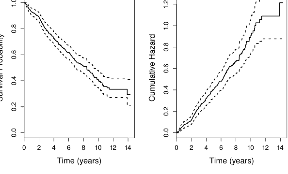

**图 3.1:** 左图：PBC数据集生存函数的 Kaplan-Meier 估计（带有相应的 95% 置信区间）。右图：PBC数据集累积风险函数的 Nelson-Aalen 估计（带有相应的 95% 置信区间）。

## 3.2.1 删数据的似然构建

当假设生存函数 `$S(t)$` 具有特定的参数形式时，感兴趣参数的估计通常基于极大似然法。特别地，令 `{$T_i, \delta_i$}, i=1,\dots,n` 表示来自分布函数 `$\mathcal{P}$` 随机样本的生存信息，该分布由 `$\theta$` 参数化，其概率密度函数为 `$p(t|\theta)$`。在构建似然函数时，我们需要考虑删失。具体而言，对于在时间 `$T_i$` 观测到事件的受体 `$i$`，贡献 `$p(T_i|\theta)$`；而对于在时间 `$T_i$` 被删失的受体 `$i$`，我们只知道她存到了该点，即 `$T_i^* > T_i = C_i$`，因此该受体对似然贡献 `$S_i(T_i;\theta)$`，结合了删失和未删失观测的信息。因此，我们得到似然函数：

$$\ell(\theta) = \sum \delta_i \log p(T_i;\theta) + (1-\delta_i) \log S_i(T_i;\theta). \quad (3.4)$$

利用关系 `$h(t) = p(t)/S(t)$` 和 `$S(t) = \exp(-H(t))$`，对数似然函数也可以风险函数的形式重写：

$$\ell(\theta) = \sum \delta_i \log h_i(T_i;\theta) - \int_0^{T_i} h_i(s;\theta) ds. \quad (3.5)$$

## 事件时间数据的分析

从这个等价公式可以明显看出，所有受体对对数似然的贡献等于其对应的观测事件时间 `$T_i$` 处累积风险函数的负值。发生事件的受体所贡献的量等于在 `$T_i = T_i^*$` 处评估的对风险函数。因此，与未删失观测相比，删失观测对统计推断贡献的信息较少。一旦构建了对数似然，就可以利用迭代优化程序（如 `Newton-Raphson` 算法，Lange, 2004）来确定极大似然估计值 `$\theta$`。推理然后在经典的渐近极大似然理论范式下进行（Cox and Hankley, 1974）。

## 3.3 相对风险回归模型

由于 Cox 模型（Cox, 1972）在现代生存分析中的流行，比例风险模型（也称为相对风险或相对危险率模型）占据了主导。这些模型假设协变量对事件的风险具有乘法效应，其公式化表示为：

$$h_i(t \mid w_i) = \lim_{dt \to 0} \frac{Pr(t \leq T^* < t + dt \mid T^* \geq t, w_i)}{dt} = h_0(t)\exp(\gamma^T w_i),$$

其中 `$w_i^T = (w_{i1}, \dots, w_{ip})$` 表示假设与每个受体风险相关的协变量向量，而 `$\gamma$` 表示相应的回归系数向量。函数 `$h_0(t)$` 被称为`基准风险`函数，对应于 `$\gamma^T w_i = 0$` 受体的基准风险函数。取决于基准风险函数是否具有常数尺度参数，`$\gamma^T w_i$` 可能包含不包含截距 `$\gamma_0$`。将 (3.6) 写在对数尺度上：

$$\log h_i(t \mid w_i) = \log h_0(t) + \gamma_1 w_{i1} + \gamma_2 w_{i2} + \dots + \gamma_p w_{ip},$$

我们观察到，对于预测变量 `$w_j$`，回归系数 `$\gamma_j$` 表示在保持所有其他预测变量不变的情况下，如果 `$w_j$` 增加一个单位，任何固定时间 `$t$` 时对数风险的变化。类似地，`$\exp(\gamma_j)$` 表示在任何时间 `$t$`，`$w_{ij}$` 变化一个单位的风险比。通常，具有协变量 `$w_i$` 的受体 `$i$` 与具有协变量 `$w_k$` 的受体 `$k$` 相比的风险比为

$$h_i(t \mid w_i) / h_k(t \mid w_k) = \exp(\gamma^T (w_i - w_k)).$$

正如第3.1节所述，删失的影响之一是推理可能对事件时间分布的错误设定非常敏感。在相对风险模型 (3.6) 下，`$T_i^*$` 的分布假设隐藏在基准风险函数的设定中。例如，当 `$T_i^*$` 服从 Weibull 分布时，基准风险函数的形式为 `$h_0(t) = \phi t^{\gamma_*-1}$`。在所有模型参数的估计中，回归系数 `$\gamma$` 和 `$h_0(t)$` 设定中的参数通过极大化相应的对数似然函数 (3.5) 得到。Cox (1972) 证明，感兴趣的要参数（即 `$\gamma$`）的估计也可以基于部分对数似然得分：

$$pl(\gamma) = \sum_{i=1}^n \delta_i \left[ \gamma^{T_i} w_i - \log\left( \sum_{T_j \ge T_i} \exp(\gamma^{T_j})\right) \right], \quad (3.7)$$

这不需要设定 `$h_0(*)$`，即不需要指定 `$T_i^*$` 的分布。

## 纵向数据与生存数据的联合模型

我们规定死亡或移植的对数相对风险取决于患者治疗、年龄和性别的加性影响。在最后一行中，调用了 `summary()` 方法来总结 Cox 模型的拟合情况。输出中的 `coef` 列包含估计的回归系数 `$\gamma$`。更易解释的是由 `exp(coef)` 提供的指数化系数，它表示由于每个协变量引起风险的乘数比例变化。我们观察到，活性治疗使复合事件的风险降低了约 12.9%，尽管在统计学上并不显著。另一方面，基线年龄每增加一年与风险增加 2.2% 相关，与女性相比，男性的事件风险高出 63.8%。

## 3.4 随时间变化的协变量

在引入的相对风险模型中，风险仅取决于在随访期间值保持恒定的协变量，例如基线水平、性别、随机治疗等。然而，在许多研究中，调查随时间变化的协变量是否与事件风险相关可能很有意义。这些可能包括环境因素、随访期间测量的生化和临床参数，以及对治疗剂量的调整。

在我们解释如何在实践中处理此类协变量之前，我们应该区分两种不同类型的随时间变化的协变量，即外部或外生协变量，以及内部或内生协变量。将随时间变化的协变量作为外生变量进行区分之所以重要。为了引入这两类协变量，令 `$y_i(t)$` 表示受试者 `$i$` 在时间 `$t$` 的协变量向量，`$Y_i(t) = \{y_i(s), 0 \le s \le t\}$` 表示直到 `$t$` 的协变量。遵循 Kalbelfisch 和 Prentice (2002, 第 6.3 节)，外生协变量的正式定义要求它们满足以下

$Pr\{s \le T_i^* < s + ds | T_i^* \ge s, Y_i(s)\} \neq Pr\{s \le T_i^* < s + ds | T_i^* \ge s, Y_i(t)\}, \quad (3.8)$

对于所有 `$0 \le s \le t$` 的 `$s, t$`，且 `$ds \to 0$`。等效定义为

$Pr\{Y_i(t) | Y_i(s), T_i^* \ge s\} \ge Pr\{Y_i(t) | Y_i(s), T_i^* = s\}, \quad s \le t, \quad (3.9)$

这形式化了这样一个观点：`$y_i(\cdot)$` 与随时间的失效风险相关，但其直到任何 `$t > s$` 的未来路径不受时间 `$s$` 发生失效的影响。特别是，外生协变量是一个可预测过程，这意味着它在任何时间 `$t$` 的值在 `$t$` 之前的无穷小时刻已知。另一方面，内生随时间变化的协变量是不满足 (3.8) 或等效的 (3.9) 的变量，它们也是不可预测的。


# 外生协变量与内生协变量

外生协变量的一个标准例子是一天中的时间或季节。例如，自杀尝试已被发现具有季节性模式，在冬季月份发生率较高。外生协变量的另一个例子是那些完整路径从研究开始就已经预确定的变量。例如，在某些研究中，人们对根据预定标准调整治疗剂量的治疗策略感兴趣。另一种类型的外生协变量是独立于研究受试者的随机过程。例如，环境因素（如空气污染）的水平可能与哮喘发作的频率有关。在所有这些例子中，很明显这些协变量在任何点 $t$ 的值不受真实失效时间的影响，因此满足公式 (3.9)。通过外部协变量，在条件 (3.8) 或 (3.9) 下，我们可以利用其与风险函数的关系，直接定义条件取决于协变量路径的生存函数，即

$$S_i(t | Y_i(t)) = Pr(T_i^* > t | Y_i(t)) = \exp\left\{-\int_0^t h_i(s | Y_i(s)) ds\right\}$$。

另一方面，内生协变量通常表现为对研究受试者进行的随时间测量。这些包括生物标志物和临床参数，例如原发性胆汁性硬化患者的胆红素水平、HIV 感染患者的 `CD4` 细胞计数、肝硬化患者的凝血酶指数，以及主动脉狭窄患者的主动脉压力差水平（见第 1.2 节）。有几个重要特征使得此类协变量的统计分析变得复杂。内生协变量的第一重要特征是它们通常需要受试者的生存才能存在。因此，当失效被定义为受试者的死亡时，它们的路径带有关于失效时间的直接信息。更具体地说，只要 $ds \to 0$ 时 $y_i(t-ds)$ 存在，生存函数满足

$$S_i(t | Y_i(t)) = Pr(T_i^* > t | Y_i(t)) = 1. \quad (3.10)$$

另一方面，受试者在时间 $t$ 的失效对应于 $t \ge s$ 时协变量不存在，这直接导致违反了耐受性 (3.9)。此外，等式 (3.10) 的结果是，与外生协变量相反，之前定义的不与生存路径直接相关的风险函数是

$$h_i(t | Y_i(t)) = \lim_{dt \to 0} \frac{Pr(T_i^* < t+dt | T_i^* \ge t, Y_i(t))}{dt}$$。

内生协变量通常表现为对研究受试者进行的随时间测量。尽管如此，应该提到测量误差不是内生协变量的特征，因为某些外生协变量也是带有误差测量的。内生协变量最后的重要影响是任何时间 $t$ 的完整路径都是不可观测的。

# 3.5 扩展 Cox 模型

3.3 节介绍的 Cox 模型可以使用 Andersen 和 Gill (1982) 详细使用的计数过程公式扩展到处理外生随时间协变量，并在 Fleming 和 Harrington (1991) 以及 Andersen 等人 (1993) 中详细介绍。这种 Cox 模型公式的直观想法是将事件的发生视为极缓慢泊松过程的实现。在计数过程符号中，受试者 $i$ 的事件过程写为 $\{N_i(t), R_i(t)\}$，其中 $N_i(t)$ 表示受试者 $i$ 到时间 $t$ 的事件数量，$R_i(t)$ 是一个左连续风险过程，如果受试者在时间 $t$ 处于风险中则 $R_i(t) = 1$，否则 $R_i(t) = 0$。扩展 Cox 模型（也称为 Anderson-Gill 模型）写为

$$h_i(t | Y_i(t), w_i) = h_0(t)R_i(t)\exp\{\gamma^T w_i + \alpha y_i(t)\}, \quad (3.11)$$

其中，在 (3.6) 中，$w_i$ 表示基线协变量，例如固定或随机治疗，$y_i(t)$ 表示随时间变化的协变量。回归系数 $\alpha$ 的解释与 $\gamma$ 完全相同。特别是，简单起见假设只有一个随时间变化的协变量，那么在任何特定时间点 $t$，$\exp(\alpha)$ 表示 $y_i(t)$ 在同一时间增加一个单位导致时间 $t$ 事件风险的相对增加。

由于模型是时间相关的，模型 (3.11) 不再假设风险比随时间保持恒定。

$\gamma$ 和 $\alpha$ 的估计同样基于相应的部分似然函数，该函数可以写为：

```
$$\ell(\gamma) = \sum_{i=1}^{n} \int \left[ R_i(t) \exp\{\gamma^T w_i + \alpha^T y_i(t)\} - \log\left[\sum R_j(t) \exp\{\gamma^T w_j + \alpha y_j(t)\}\right]\right] dN_i(t),$$
```

其中使用了计数过程积分记法（Fleming and Harrington, 1991; Andersen et al., 1993）。作为说明，我们为肝硬化数据拟合了一个 Cox 模型，该模型假设死亡风险取决于凝血酶指数和随机治疗。该模型的形式为：

$$h_i(t) = h_0(t) \exp\{\beta \text{Prednis}_i + \alpha y_i(t)\},$$

其中 `Prednis` 是治疗前治疗的指示变量，$y_i(t)$ 表示时间 $t$ 时凝血酶指数的水平。在扩展 Cox 模型中，时间相关协变量通常使用 `(start, stop]` 记法编码。特别是，每个受试者由多行表示，每行包含特定时间段内 $y_i(t)$ 的信息。肝硬化数据集中第一个患者的数据如下：

```
> head(prothro[c("id", "pro", "start", "stop", "event")], n = 3)
id pro start stop event
1 1 38 0.2436754 0.3805717 0
2 1 31 0.2436754 0.3805717 0
3 1 27 0.3805717 0.4134268 1
```

`start` 和 `stop` 变量表示记录凝血酶指数的时间间隔边界。特别是，对于患者 1，基线时凝血酶为 38，0.24 年时为 38，0.38 年时为 27。如果在相应的时间间隔末尾发生事件，变量 `event` 等于 1。`treat` 表示随机治疗变量，对于每个患者在整个随访期间是固定的。相应的扩展 Cox 模型使用以下语法拟合：

```
> tdCox.pro <- coxph(Surv(start, stop, event) ~ pro + treat, data = prothro)
> summary(tdCox.pro)
```

## 模型拟合结果

调用：

`coxph(formula = Surv(start, stop, event) ~ pro + treat, data = prothro)`

| 变量 | coef | exp(coef) | se(coef) | z | Pr(>|z|) |
| :--- | :--- | :--- | :--- | :--- | :--- |
| pro | -0.034985 | 0.9656 | 0.006562 | -5.33 | <2e-16 |
| treatprednisone | -0.137770 | 0.8713 | 0.11838 | -1.16 | 0.246 |

| 变量 | exp(-coef) | lower .95 | upper .95 |
| :--- | :--- | :--- | :--- |
| pro | 1.036 | 0.9609 | 0.9704 |
| treatprednisone | 1.148 | 0.6904 | 1.0996 |

Concordance = 0.725 (se = 0.019)
Rsquare = 0.067 (max possible = 0.657)
Likelihood ratio test = 207.1 on 2 df, p=0
Wald test = 197.2 on 2 df, p=0
Score (logrank) test = 203.2 on 2 df, p=0

与 3.3 节中用于拟合 Cox 模型的语法相比，唯一的区别在于 `Surv()` 函数的指定，该函数的前两个参数定义了间隔的边界，最后一个参数是相应的事件指示。此外，`data` 参数应该以长格式提供。从结果中观察到，在修正了治疗差异后，凝血酶指数与死亡风险密切相关，凝血酶每减少 1 个单位，风险增加 1.036 倍（95% CI: 1.031; 1.041）。

Cox 模型的计数过程公式是一种非常通用的公式，它不仅允许时间相关协变量，还允许截断、多时间尺度、每个受试者多个事件以及各种形式的病例队列模型等（Therneau and Grambsch, 2000）。然而，尽管具有这种灵活性，当时间相关协变量具有内生性时，扩展 Cox 模型是不适当的。这是因为扩展 Cox 模型假设时间相关协变量是可预测的、无误差测量，并且有完整的路径说明。Cox 模型在计数过程公式下处理时间相关协变量的具体方式如图 3.2 所示。此外，时间相关协变量被认为会采用“末值携带”方法。特别是，这种“末值携带”方法产生的问题是参数估计可能会出现严重偏差（Prentice, 1982）。在本书的剩余部分，我们将引入一种专门为了内源性协变量设计的联合建模框架。

# 3.6 延伸阅读

本章的目的是简要介绍为这些分析开发的特殊特征和基本工具。然而，本介绍并非详尽。文献中有许多在生存方面有更深入的优秀著作。特别是 Cox and Oaks (1984)、Kalbfleisch and Prentice (2002)、Lawless (2002) 以及 Klein and Moeschberger (2003) 进行了解释。使用点过程对 Cox 模型的更多理论处理由 Fleming and Harrington (1991)、Andersen et al. (1993) 以及 Aalen et al. (2008) 提供，而关注模型构建和建模技术的实用视角则由 Therneau and Grambsch (2000)、Harrell (2001, 第16-20 章) 以及 Tableman and Kim (2003) 采取。Hougaard (2000) 介绍了对于生存数据，包括脆弱性（frailty）和边缘模型。脆弱性模型由 Duchateau and Janssen (2008) 以及 Wienke (2011) 进行了更详细的介绍。关于区间分析可用方法的概述由 Sun (2006) 提供。最后，Ibrahim et al. (2001) 展示了之前书中标准生存模型如何在贝叶斯范式下进行拟合。

# 第 4 章 纵向与生存数据的联合模型

基于前两章介绍的线性混合效应和相对风险模型，我们在这里介绍了纵向与事件数据的标准联合模型。我们讨论了模型的极大似然估计，包括优化和数值积分算法、回归系数和随机效应的推断，并展示了一个研究纵向结果推断对缺失过程敏感性的工具。

## 4.1 基本联合模型

正如我们在 3.5 节中所看到的，扩展 Cox 模型仅适用于外生时间相关协变量，因此无法处理纵向生物标志物。当主要兴趣是此类内生时间相关协变量与生存之间的关联时，文献中引入了一种替代建模框架，被称为纵向与事件数据的联合建模框架（Faucett and Thomas, 1996; Wulfsohn and Tsiatis, 1997; Henderson et al., 2000; Tsiatis and Davidian, 2004）。这些联合模型的动力思想是将主要感兴趣的生存模型与内生协变量重复测量的适当模型耦合，以解释其在 3.4 节中进行阐述的这些特殊特征。为了引入这一建模框架，我们将使用第 2 章和第 3 章中类似的符号。具体而言，我们定义 $T_i^*$ 为第 $i$ 个受试者的真实事件时间，$T_i$ 为观测事件时间（定义为潜在删失时间 $C_i$ 与 $T_i^*$ 的最小值），$\delta_i = I(T_i^* \le C_i)$ 为事件指示器。对于内生时间依赖协变量（例如生物标志物），我们令 $y_i(t)$ 表示第 $i$ 个受试者在时间 $t$ 的观测值。我们需要注意的是，我们实际上无法在任何时间 $t$ 观测到 $y_i(t)$，只能在测量的特定时间点 $t_{ij}$ 处观测。因此，观测到的纵向数据由测量值 $y_{ij} = \{y_i(t_{ij}); j = 1, \dots, n_i\}$ 组成。

### 4.1.1 生存模型

我们的目标是衡量纵向标志物水平与事件风险之间的关联，同时考虑到后者的特殊特征。为了实现这一目标，我们引入 $m_i(t)$ 表示纵向结果在时间 $t$ 的真实且未观测的值。注意，$m_i(t)$ 不同于 $y_i(t)$，后者包含了时间 $t$ 处纵向结果的测量误差值。为了量化 $m_i(t)$ 与事件风险之间关联的强度，一种直接的方法是假设存在相对风险模型：

$$h_i(t \mid M_i(t), w_i) = \lim_{dt\to 0} \frac{Pr\{T_i^* < t+dt \mid T_i^* \ge t, M_i(t), w_i\}}{dt} = h_0(t) \exp\{\gamma^T w_i + \alpha m_i(t)\}, \quad t > 0, \quad (4.1)$$

其中，$M_i(t) = \{m_i(s), 0 \le s \le t\}$ 表示截至时间 $t$ 观测到的纵向过程的历史；$h_0(t)$ 表示基准风险函数，$w_i$ 是基准协变量向量（如治疗指示器、疾病史等），对应相应的回归系数向量 $\gamma$。同样，参数 $\alpha$ 量化了底层纵向结果对事件风险的影响。$\gamma$ 和 $\alpha$ 的解释与我们在 3.5 节中看到的完全相同。具体而言，$\exp(\gamma_{ij})$ 表示在任何时间 $t$，$w_{ij}$ 每变化一个单位时风险率的比，而 $\exp(\alpha)$ 表示在同一时间点上，$m_i(t)$ 每增加一个单位导致时间 $t$ 处事件风险的相对增加。此外，注意相对风险模型 (4.1) 假设时间 $t$ 处的事件风险仅依赖于时间依赖标志物 $m_i(t)$ 的当前值。这在生存函数中并不成立。具体来说，利用生存函数与累积风险函数之间的已知关系，我们得到：

$$S_i(t \mid M_i(t), w_i) = Pr(T_i^* > t \mid M_i(t), w_i) = \exp\left(-\int_0^t h_0(s) \exp\{\gamma^T w_i + \alpha m_i(s)\}\, ds\right), \quad (4.2)$$

这意味着相应的生存函数依赖于整个协变量历史 $M_i(t)$。正如我们将在 4.3 节中看到的，这一特征在联合模型的估计中具有实际重要意义，因为生存函数是模型似然函数的一部分。

为了完成 (4.1) 的规范，我们需要讨论基准风险函数 $h_0(\cdot)$ 的选择。正如我们在第 3 章所看到的，在标准的生存分析中，习惯上完全不指定 $h_0(\cdot)$，以避免错误设定生存时间分布的风险。然而，在联合建模框架内（我们稍后将在 4.3.3 节解释），事实证明遵循这种路径可能会导致参数估计标准误的低估（Hsieh et al., 2006）。为了避免此类问题，我们需要显式定义 $h_0(\cdot)$。一种标准选择是使用与参数分布对应的风险函数。在生存分析背景下，通常使用的分布包括 Weibull、对数正态和 Gamma。另一种且更优的方法是，我们可以选择基准风险函数的参数化灵活规范。文献中已经提出了几种方法来灵活地模拟基准风险函数。例如，Whittemore 和 Keller (1986) 使用阶梯函数和线性样条来获得风险函数的非参数估计，Rosenberg (1995) 利用了 B 样条近似，而 Herndon 和 Harrell (1996) 则限制了立方样条。在实践中效果非常满意的两种简单方案是分段常数模型和回归样条方法。在分段常数模型下，基准风险函数形式为：

$$h_0(t) = \sum_{q=1}^{Q} \xi_q I(v_{q-1} < t \le v_q), \quad (4.3)$$

其中 $v_0 < v_1 < \dots < v_Q$ 是时间点。在回归样条模型中，基准风险函数被扩展为：

$$\log h_0(t) = \beta_0 + \sum_{d=1}^{m} \beta_d B_d(t), \quad (4.4)$$

其中 $B_d(t)$ 是基函数。

### 4.1.2 纵向子模型

在本文介绍的生存模型定义中，使用 $m_i(t)$ 表示底层协变量的真实值。然而，如前所述，纵向信息实际上是针对少数时间点间隔收集的。因此，为了衡量纵向协变量对事件风险的影响，我们需要估计 $m_i(t)$ 并成功为每个受试者重建完整的路径 $M_i(t)$。为了实现这一目标，我们建议使用合适的混合效应模型来描述受试者特有的演变。我们现在关注正态分布的结果并使用线性混合效应模型。具体而言，遵循第 2.2 节类似的符号，我们令：

$$y_i(t) = m_i(t) + \varepsilon_i(t)$$


混合模型通过假设纵向结果的观测值 $y_i(t)$ 等于真实值 $m_i(t)$ 加上误差项，考虑了测量误差。此外，与第 2.2 节类似，我们假设误差项相互独立，且与随机效应独立，并服从均值为零、方差为 $\sigma^2$ 的正态分布。

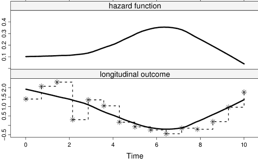

**图 4.1:** 联合模型的直观表示。在上面板中，实线说明了风险函数随时间演变的轨迹。在下面板中，虚线对应纵向轨迹的扩展 Cox 近似，实线对应联合模型近似值 $\hat{m}_i(t)$。

获得 $\mathcal{M}_i(t)$ 的良好估计是非常重要的。这需要对 $x_i(t)$ 和 $z_i(t)$ 中的时间结构进行详尽的设定，并可能考虑假设的时间结构与基线协变量之间的交互项。例如，在受试者呈现高度非线性纵向轨迹的应用中，建议使用可能的高维时间函数 $t$ 向量（用高阶多项式或样条表示）来对 $x_i(t)$ 和 $z_i(t)$ 进行灵活表征。与多项式相比，由于其局部性质和更好的数值特性，样条（splines）通常更受青睐。在联合建模框架下，许多作者考虑了使用基于样条的方法来灵活模拟受试者特定的纵向特征。例如，Rizopoulos 等 (2009) 和 Brown 等 (2005) 使用了带有多维随机效应的 B 样条；Ding 和 Wang (2008) 提出使用带有单乘法随机效应的 B 样条；Rizopoulos 和 Ghosh (2011) 则考虑了自然立方样条。建模受试者特异演变的高度非线性形状的另一种方法是在线性混合模型中引入一个额外的随机项，旨在捕捉观测观测值中未被随机效应捕获的剩余序列相关性。在该框架下，线性混合模型的形式为：

```
$y_i(t) = m_i(t) + u_i(t) + \varepsilon_i(t)$
```

其中 $u_i(t)$ 是均值为零的随机过程，独立于 $b_i$ 和 $\varepsilon_i(t)$，且 $m_i(t)$ 具有与 (4.5) 相同的混合效应结构。Wang 和 Taylor (2001) 考虑了带有此类项的联合模型，他们假设了一个集成的 Ornstein-Uhlenbeck 过程；Henderson 等 (2000) 则考虑了由纵向过程和事件过程共享的隐性高斯过程。在这两种方法之间的选择在很大程度上是一个哲学问题，取决于分析者对生成数据的“真实”底层生物学机制的信念。特别是，(4.5) 指出受试者在整个时间跨内遵循的轨迹完全由时间无关的随机效应 $b_i$ 决定。这意味着每个受试者纵向特征的形状是该受试者的内在特征，随时间保持不变。另一方面，(4.6) 同时包含了序列相关性随机项和随机效应，通过允许受试者特异趋势随时间变化，试图更精确地捕捉纵向轨迹的特征。我们应该注意，由于随机效应和随机序列相关过程都试图拟合数据中的边缘相关性，这两种方法之间存在信息竞争。例如，如果我们假设了一个具有随机截距和随机斜率结构的线性混合模型，且存在未被充分捕获的额外相关性，那么通过包含序列相关项或考虑更复杂的随机效应结构（例如设计矩阵 $Z_i(t)$ 中的样条）来扩展该模型，可能会产生在实践上无法区分的数据拟合结果。因此，尽管直觉上同时使用随机效应和序列相关结构似乎很有吸引力，但建议选择其中之一。在计算上，随机效应方法在实践中更容易实现，因为只需要对随机效应设计矩阵 $Z_i(t)$ 进行适当设定。

## 4.2 R 中的联合建模：与扩展 Cox 模型的比较

为了说明联合建模方法的优点，我们针对 AIDS 数据集将其与扩展 Cox 模型进行比较。具体而言，我们希望评估 $t$ 时刻 CD4 细胞计数的平方根与同一时间死亡风险之间关联的强度。AIDS 数据集以数据框 `aids` 的形式存在于 R 的 `JM` 包中（Rizopoulos, 2010, 2012b）。加载该包需要使用命令 `library("JM")`。`aids` 数据集在长格式下包含了每个患者的纵向信息和生存信息。前两个患者的记录信息如下：

```
> head(aids[c("patient", "start", "stop", "event",
"CD4", "obstime", "drug")], 7)
patient start stop event CD4 obstime drug
1 1 6.00 0 10.677078 0 ddC
2 1 6.12 0 8.426150 6 ddC
3 1 12.97 0 9.433981 12 ddC
4 2 6.00 0 6.324555 0 ddI
5 2 6.12 0 8.124038 6 ddI
6 2 12.18 0 4.582576 0 ddI
7 2 18.19 0 5.000000 12 ddI
```

其中 `start`, `stop`, `event` 表示时间区间和事件，`CD4` 和 `obstime` 表示细胞计数和观测时间，`drug` 表示治疗方案。

$h_i(t) = h_0(t)\exp\{\gamma I_i + m_i(t)\}$

相对于 Cox 模型 $h_0(t)$，基线风险函数假设在等间距的分位数处是常数。为了使用 `JM` 包拟合此联合模型，首先需要分离线性混合和生存模型，然后将返回的对象传递给 `jointModel()`。具体而言，在 `jointModel()` 的默认设定中，包含了纵向模型的“真实”结果 $m_i(t)$。在联合模型中，生存模型包含 $I_i$ 指示变量。对于 AIDS 数据集，这以数据框 `aids` 的形式存在，它是通过以下方式构建的，每个患者一行：

`aids <- aids[!duplicated(patient),`

`jointModel()` 使用拟合的线性混合和 Cox 模型提取所有必要信息（例如响应向量、设计矩阵、事件指示器），因此在调用 `coxph()` 时需要指定 `x = TRUE`，以便在返回的对象中包含 Cox 模型的设计矩阵。以下代码展示了如何对 AIDS 数据集拟合联合模型：

`lmeFit.a <- lme(CD4 - obstime, random = obstime | patient, data = aids)`

我们观察到 CD4 计数与死亡风险之间确实存在很强的关联。特别是，CD4 计数的单位减少对应风险增加 $\exp(-\alpha)$ 倍。我们通过指定一个显式考虑 CD4 计数内生性的联合模型来进行。在研究的随机设置中，我们拟合线性混合模型：

$y_i(t) = m_i(t) + u_i(t) + \varepsilon_i(t)$

其中固定效应部分包含时间的主效应，而在随机效应设计中，我们包含了一个截距和一个时间项。对于生存子模型，类似于上述模型，我们将治疗作为时间无关的协变量，并将纵向模型估计的 CD4 计数真实底层特征作为随时间变化的协变量。

## 纵向数据与生存数据的联合模型

```r
coxFit.aids <- coxph(Surv(Time, death)) ~ drug,
data = aids.id, x = TRUE
```

```r
jointFit.aids <- jointModel(lme.aids, coxFit.aids,
timeVar = "obstime", method = "piecewise-PH-AGH")
```

```r
summary(jointFit.aids)
```

```r
jointModel(lmeObject = lme.aids, survObject = coxFit.aids,
timeVar = "obstime", method = "piecewise-PH-AGH")
```

数据描述：

| 纵向过程 | 事件过程 |
| :--- | :--- |
| 观测值数量: 1405 | 事件数量: 188 (40.3%) |
| 分组数: 467 | |

联合模型摘要：

- 纵向过程：线性混合效应模型
- 事件过程：具有分段基准风险函数的相对风险模型
- 参数化：时间依赖性

| log.Lik | AIC | BIC |
| :--- | :--- | :--- |
| -4328.261 | 8668.53 | 8754.864 |

方差分：

| | StdDev | Corr |
| :--- | :--- | :--- |
| (Intercept) | 4.5839 | (Intr) |
| obstime | 0.1822 | -0.0468 |
| Residual | 1.7377 | |

系数：

纵向过程

| Value | Std.Err | z-value | p-value |
| :--- | :--- | :--- | :--- |
| (Intercept) | 7.2203 | 0.2218 | 32.5537 | <0.0001 |
| obstime | -0.1917 | 0.0217 | -8.8374 | <0.0001 |
| obstime:drugddi | 0.0116 | 0.0302 | 0.3834 | 0.7014 |

事件过程

| Value | Std.Err | z-value | p-value |
| :--- | :--- | :--- | :--- |
| drugddi | 0.3348 | 0.1565 | 2.1397 | 0.0324 |
| Assoc | -0.2875 | 0.0359 | -8.0141 | <0.0001 |
| log(xi.1) | -2.5438 | 0.1913 | -13.2953 | |
| log(xi.2) | -2.2722 | 0.1784 | -12.7328 | |
| log(xi.3) | -1.9554 | 0.2403 | -8.1357 | |
| log(xi.4) | -2.5011 | 0.3412 | -7.3297 | |
| log(xi.5) | -2.4152 | 0.3156 | -7.6531 | |
| log(xi.6) | -2.4018 | 0.4007 | -5.9941 | |
| log(xi.7) | -2.4239 | 0.5301 | -4.5725 | |

积分：

- 方法：(伪)自适应高斯-赫米特
- 积分点: 5

优化：

- 收敛: 0

`jointModel()` 的主要参数 `timeVar` 用于指定线性混合模型中时间变量名称，这在 $m_i(t)$ 的内部计算中是必需的。`method` 参数指定基准风险函数的类型，此处假设为分段常数，以及数值积分方法（更多信息请参见第 4.3 节）。`summary()` 会产生拟合联合模型的详细输出，返回返回参数估计、其标准误，以及针对纵向和生存子模型的渐近 Wald 检验。在事件过程的结果中，标记为“Assoc”的参数实际上是 (4.1) 中的参数 $\alpha$，它衡量了 $m_i(t)$（在我们的案例中为真实的 CD4 细胞计数）与死亡风险之间的关联性。参数 $xi.1, \dots, xi.7$ 是 (4.3) 中分段常数基准函数的 $\xi_q$ ($q=1,\dots,7$)。联合模型还发现 CD4 细胞计数平方根与死亡风险之间存在强关联性，在我们的案例中，标记物的下降对应于死亡风险增加 $\exp(-\alpha)=1.3$ 倍（95% CI: 1.24;1.43）。通过比较扩展 Cox 模型和联合模型的点估计值及相应的 95% 置信区间，我们清楚地观察到了不可忽视的差异。特别是，联合模型中 CD4 细胞计数平方根的对数风险比扩展 Cox 模型大约 49%，且 Cox 模型风险比的 95% 置信区间上限略高于联合模型的相同置信区间下限。这些发现信服地证明了 CD4 细胞计数水平中测量误差导致的回归系数衰减。

JM 软件包遵循随机效应范式，目前仅适用于具有 iid 误差项且无相关结构的线性混合效应模型。因此，在调用 `lme()` 生成作为 `jointModel()` 第一个参数时，用户不应指定相关结构（`correlation` 参数）或权重函数（`weights` 参数）。关于随机效应的协方差矩阵，`jointModel()` 默认假设为非结构并估计所有自由参数。然而，它也允许通过 `lme()` 随机参数中的 `pdDiag()` 指定对角线矩阵，这在考虑高维随机效应结构时特别有用。此外，除了用于 AIDS 数据的分段常数风险函数外，`jointModel()` 还允许生存模型的替代公式。这些通过 `method` 参数指定：

- `method = "piecewise-PH-GH"`：具有分段常数基准函数的相对风险模型 (4.1)。默认情况下，内部节点位于观测事件时间的等间隔位数上。要更改默认的节点数量，可以使用 `kn` 参数；而要直接指定节点位置，可以使用 `control` 参数。
- `method = "spline-PH-GH"`：具有对数基准函数样条近似的相对风险模型 (4.1)。与分段常数类似，内部节点位于观测事件时间的等间隔位数，可以使用 `kn` 进行更精细的控制。
- `method = "Cox-PH-GH"`：未指定基准函数的相对风险模型 (4.1)。这种假设等于假设 $h_0(t)$ 在事件时间离散，即 $h_0(t) = \begin{cases} \xi_q, & t = T_q^* \\ 0, & t \neq T_q^* \end{cases}$，其中 $T_q^*$ 表示第 $q$ 次事件时间。该选项对应于 Wulfsohn 和 Tsiatis (1997) 提出的联合模型。
- `method = "weibull-PH-GH"`：具有 Weibull 基准函数的相对风险模型 (4.1)。在这种情况下，$h_0(t) = \sigma t^{\sigma-1}$，且 (4.1) 中基变量的设计矩阵 $W$ 也包含截距项。
- `method = "weibull-AFT-GH"`：具有 Weibull 基准函数的加速失效时间模型。关于该公式的更多细节见第 5.6 节。

## 4.3 联合模型的估计

### 4.3.1 两阶段法

由于联合模型似然性数值计算的复杂性（将在后续章节中解释），初始方法集中在两阶段方法。注意，Weibull 基准函数的标准公式形式为 $h_0(t) = \phi t^{\sigma-1}$，因此截距项对应 $\log(\phi)$。特别是，Self 和 Pawitan (1992) 提出了一种联合模型，其相对风险子模型形式为 (4.1)，具有未指定的基准函数 $h_0(t)$，并将 $\exp\{m_i(t)\}$ 项替换为 $[1+m_i(t)]$，使得该模型在随机效应 $b_i$ 上是线性的。作者建议使用两步推理方法来估计该联合模型：第一步使用二乘法估计随机效应，第二步使用这些估计值插补 $m_i(t)$ 的适当值，并代入 Cox 模型的经典部分似然中。Tsiatis 等人 (1995) 也开发了一种两阶段法来估计结合 (4.1) 和 (4.5) 的联合模型，但没有对风险进行线性化。特别是对于每个唯一事件，他们建议在部分似然贡献中替换 $m_i(t)|Y_i(t), T_i \ge t)$。对于任何时间 $t$，该估计可以通过使用 $t$ 时所有风险受试者的观测响应来拟合相应的混合模型，并使用随机效应 $b_i$ 的经验贝叶斯估计来计算 $m_i(t)$ 的最佳无偏预测。


# 纵向数据与生存事件数据的联合模型

即使这些方法使用标准软件实现相对容易，但在某些情况下也会产生偏差结果。这通过 Dafni 和 Tsiatis (1998)、Tsiatis 和 Davidian (2001)、Ye 等 (2008b) 以及 Sweeting 和 Thompson (2011) 的系列模拟研究得到了证明。因此，与其依赖近似，该类型联合模型的文献主要关注于消除这种偏差的似然方法。

## 4.3.2 联合似然公式

为联合模型提出的主要估计方法是（半参数）极大似然法 (Wulfsohn and Tsiatis, 1997; Henderson et al., 2000; Hsieh et al., 2006)。Zheng 和 Cai (2005) 研究了在未指定基准风险函数的情况下，半参数极大似然估计量的渐近性质。使用 MCMC 技术对联合模型进行贝叶斯估计已由 Hanson 等人 (2011)、Chi 和 Ibrahim (2006)、Brown 和 Ibrahim (2006)、Xu 和 Zeger (2001) 以及 Wang 和 Taylor (2001) 等人考虑。此外，Tsiatis 和 Davidian (2001) 提出了一种条件评分法，其中随机效应被视为干扰参数，他们开发了一组无偏估计方程以产生一致且渐近正态的估计量。

我们在这里给出联合模型极大似然法的基础，作为最传统的方法之一。极大似然估计通过对应于观测结果 $\{T_i, \delta_i, y_i\}$ 联合分布的对数似然函数的方法得到。这意味着这些随机效应考虑了纵向结果与事件结果之间的关联性，以及纵向过程中重复测量之间的相关性（条件独立性）。形式上，我们有：

```
$p(T_i, \delta_i, y_i | b_i) = p(T_i, \delta_i | b_i; \theta) p(y_i | b_i; \theta), \quad \text{and} \quad (4.7)$
```

```
$p(y_i | b_i; \theta) = \prod_{j} p(y_i(t_{ij}) | b_i; \theta), \quad (4.8)$
```

$\theta = (\theta_i^T, \theta_y^T, \theta_b^T)^T$ 表示全参数向量，其中 $\theta_i$ 表示事件时间结果的参数，$\theta_y$ 是纵向结果的参数，$\theta_b$ 是随机效应协方差矩阵的唯一参数，而 $y_i$ 是 $n_i \times 1$ 的纵向历史向量。此外，我们假设观测历史、删失机制和随访过程与真实的事件时间以及未来的纵向测量是独立的。正如之前定义的，随访过程是生成纵向测量数据收集时间点的机制（随机性或确定性）(Lipsitz et al., 2002)，并且对于任何时间点 $t$，我们将观测历史定义为 $t$ 之前纵向过程的所有可用信息。从实践上说，这些假设意味着：关于受试者是否退出研究或出现在诊所的决策取决于观测过去的历史（纵向测量和基线协变量），但与与预后相关的底层潜在受试者特征没有额外的依赖关系。这些假设被违反的情况是：这两个过程中的任何一个依赖于随机效应。这是因为这种依赖隐含地对应于对未来纵向测的依赖。评估随访和删失过程无信息性的合理性通常需要领域专家的外部信息，因为观测数据不包含足够的暗示信息。

在这些假设下，第 $i$ 个受试者的对数似然贡献可以表示如下：

```
$log p(T_i, \delta_i, y_i; \theta) = \log \int p(T_i, \delta_i, y_i, b_i; \theta) db_i \quad (4.9)$
```

```
= \log \int p(T_i, \delta_i | b_i; \theta_t, \beta) [\prod_{j} p(y_i(t_{ij}) | b_i; \theta_y]] p(b_i; \theta_b) db_i,
```

其中生存部分的条件密度 $p(T_i, \delta_i | b_i; \theta_t, \beta)$ 形式如下：

```
$p(T_i, \delta_i \mid b_i; \theta_i, \beta) = h_i(T_i \mid M_i(T_i); \theta_i, \beta)^{\delta_i} \mathcal{S}_i(T_i \mid M_i(T_i); \theta_i, \beta) \quad (4.10)$
= [h_0(T_i) \exp{\gamma^{\top} w_i + \alpha m_i(T_i)}]^{\delta_i} \times \exp(-\int_0^{T_i} h_0(s) \exp{\gamma^{\top} w_i + \alpha m_i(s)} ds),$
```

其中 $h_0(\cdot)$ 可以是关于时间的任何正函数，例如分段常数模型 (4.3)、B-样条模型 (4.4) 或任何已知分布的风险函数，而生存函数由 (4.2) 给出。结合随机效应加权纵向响应联合密度给出：

```
$p(y_i \mid b_i; \theta) p(b_i; \theta) = \prod_j p(y_i(t_{ij}) \mid b_i; \theta_y) p(b_i; \theta_b) \quad (4.11)$
= (2\pi\sigma^2)^{-n_i/2} \exp(\|y_i - X_i b_i\|^2/2\sigma^2) \times (2\pi\sigma^2)^{-q_b/2} \text{det}(D)^{-1/2} \exp(-b_i^{\top} D^{-1} b_i/2),
```

其中 $q_b$ 表示随机效应向量的维度，$\|x\| = \{\sum x_i^2\}^{1/2}$ 表示欧几得范数。

关于 $\theta$ 最大化对数似然函数 $\ell(\theta) = \sum \log p(T_i, \delta_i; \theta)$ 可以使用标准算法，例如期望最大化（EM; Dempster et al., 1977）算法或牛顿-Raphson 算法及其任何变体 (ange, 2004)。在联合建模文献中，EM 算法传统上是优选的（将随机效应视为缺失数据），这主要是因为在 M 步中某些参数具有闭式形式的更新。然而，EM 算法的一个严重缺点是其收敛速度。尽管如此，Rizopoulos 等 (2009) 指出对应于 $\ell(\theta)$ 的得分向量实际上是 EM 算法的关键。特别地，注意到该得分向量可以重写为：

```
$S(\theta) = \sum_{i} \frac{\partial}{\partial \theta} \log p(T_i, \delta_i, y_i, b_i; \theta) db_i}{p(T_i, \delta_i, y_i; \theta)}
```

$A(\cdot)$ 表示完整得分向量，由 $A(\theta, b_i) = \frac{\partial}{\partial\theta}[\log p(T_i, \delta_i \mid b_i; \theta) + \log p(i_i \___ p(b_i; \theta)]$ 给出。注意观测得分向量是完整得分向量相对于随机效应后验分布的期望。这意味着 (4.12) 可以起到双重作用。特别是，如果得分方程相对于 $\theta$ 求解且固定 $p(b_i \mid T_i, y_i; \theta)$则 (4.12)对应于 EM 算法；如果得分方程相对于 $\theta$ 求解并考虑 $p(b_i \mid T_i, y_i; \theta)$ 作为 $\theta$ 的函数，则对应于观测数据对数似然 $\ell(\theta)$ 的直接最大化。关于联合模型 EM 算法的更多细节见附录 B。

后者有助于计算参数估计的标准误。即使我们使用 EM 算法估计联合模型，也可以轻松地使用观测得分向量 (4.12) 计算海森矩阵，随后使用观测信息矩阵（即海森矩阵的负矩阵）。使用与推导得分向量类似的计算方法，我们可以将海森矩阵重写为：

```
$\frac{\partial S_i(\theta)}{\partial \theta} = \frac{\partial}{\partial \theta} A(\theta, b_i)p(b_i \mid T_i, \delta_i, y_i; \theta) db_i$
= \int \frac{\partial A(\theta, b_i)}{\partial \theta}p(b_i \mid T_i, \delta_i, y_i; \theta) db_i$
$\quad\quad + \int A(\theta, b_i) \frac{\partial p(b_i \mid T_i, \delta_i, y_i; \theta)}{\partial \theta} db_i,$

```

其中 $I_1 = \sum_{i} \int A(\theta, b_i) A(\theta, b_i)^{\top} p(b_i \mid T_i, \delta_i, y_i; \theta) db_i$  $I_2 = \sum_{i} \int \frac{\partial^2}{\partial \theta \partial \theta^{\top}} \log p(T_i, \delta_i, y_i, b_i; \theta) p(b_i \mid T_i, \delta_i, y_i; \theta) db_i$，海森矩阵为 $H = I_1 + I_2$。

## 4.3.3 标准误估计

从实际角度来看，参数向量的高维性可能会在计算和求逆用于产生标准的 Hessian 矩阵时导致数值复杂性。因此，标准误的估计通常基于剖面似然方法。即 $l_p(\beta, \sigma, \gamma, \alpha, \hat{h}_0(\beta, \sigma, \gamma, \alpha))$，其中 $\hat{h}_0(\beta, \sigma, \gamma, \alpha)$ 表示作为参数函数的 $h_0(t)$ 的非参数指标似然估计量。为了使剖面似然的渐近性生效，该非参数指标似然估计量不应依赖于 $h_0(t)$ (Hsieh 等，2006)。然而，在联合模型中并非如此，因为该估计量使用了随机效应。在实践中，通常使用 EM 算法 M 步中的以下估计量：

```
$$\dot{h}_0(t) = \sum_{i=1}^n \sum_{j=1}^n h_i(T_i \ge t) \exp{\{\hat{\gamma}^\intercal w_j + \hat{a}_mj(t, b)\} p(b_i | T_i, \delta_i, y_i)\}$$
```

如所示，它通过随机效应的后验分布 $p(b_i | T_i, \delta_i, y_i)$ 仍然是 $h_0(t)$ 的函数。因此，基于剖面得分向量的其余参数估计值 $\theta_{-h} = (\beta, \sigma, \gamma, \alpha)$ 的误差将：

```
$S(\theta_{-h}, \dot{h}_0(\theta_{-h})) = -\frac{\partial}{\partial\theta_{-h}} l_p(\theta_{-h}, \dot{h}_0(\theta_{-h}))$,
```

被极大地低估。为了解决这个问题，当使用未指定的基准风险函数时，使用自助法（Efron and Tibshirani, 1994）来估计标准误。然而，显而易见，这种方法使得此类类型的联合模型计算开销很大。一种可行的替代方案是为 $h_0(t)$ 假设一个灵活但参数化的模型。正如我们在 4.1.1 节所示，两种选项是使用立方样条或分段常数模型。这些参数化模型的优点有两个：第一，可以通过增加内部节点的数量使其具有任意活性；第二，在这些模型下，标准误的估计直接遵循渐近极大似然理论 (Cox and Hankley, 1974)。

在 `jointModel()` 中，对于未指定基准风险函数的联合模型（即方法参数选项为 "Cox-PH-GH"）的标准误是基于上述剖面得分向量计算的，因此用户应该预期这些值会被低估。

## 4.3.4 JM 中的优化控制

`FunctionModel()` 实现了一种混合优化程序以寻找极大似然估计。具体而言，该程序从固定迭代次数的 EM 算法开始，如果没有达到收敛，则切换到拟牛顿算法，直到达到收敛。可用的拟牛顿算法有 `optim()` 中的 BFGS (Nash, 1990) 和 `nminb()` 中的 PORT 例程 (Gay, 1990)。参数的初始值取自作为 `jointModel()` 前两个参数提供的线性混合模型和生存模型。在 EM 迭代期间，只要满足以下任一标准，即可宣布收敛：

```
max{|\theta^{(it)} - \theta^{(it-1)}| / |\theta^{(it-1)} + e_1|} < e_2,
\ell(\theta^{(it)}) - \ell(\theta^{(it-1)}) < e_3
```

其中 $\theta^{(it)}$ 表示参数，$\ell(\theta) = \sum_i \log p(T_i, \delta_i, y_i; \theta)$ 是第 $i$ 次迭代参数。通常用于 $e_1$ 和 $e_2$ 的值约为 $10^{-3}$ 或 $10^{-4}$，而 $e_3$ 默认设置为 $10^{-8}$。在拟牛顿迭代中，仅使用后者。通过 `jointModel()` 的控制参数提供了更细粒度的优化控制。它指定了包括：EM 迭代次数 (`iter.EM`)、拟牛顿迭代次数 (`iter.qN`)、拟牛顿算法类型 (`optimizer`)、容差值 (`tol1`, `tol2` 和 `tol3`)，以及基于中心差分计算 Hessian 矩阵的方法 (`numerDeriv` 和 `eps.Hes`)。

通过在调用 `jointModel()` 时直接包含控制参数可以轻松更改这些默认值。例如，为了拟合 4.2 节所示的 AIDS 数据，使用 80 次 EM 迭代，更严格的容差并使用中心差分：

```
> jointFit.airs <- jointModel(lme.airs, coxFit.airs, timeVar = "obstime", method = "piecewise-GH", iter.EM = 80, tol3 = 1e-09, numerDeriv = "cd", eps.Hes
```

## 4.3.5 数值积分

在拟合纵向数据和生存数据的联合模型时，一个主要的计算困难是关于随机效应的积分，这与似然和得分向量的定义相结合使得联合模型的拟合是一项巨大的任务。特别是，对于生存函数的积分始终是一维的，可以使用 7 点或 15 点的 Gauss-Kronrod 原则进行相对有效的近似 (Press et al., 2007)。然而，随着维度的增加，对随机效应的积分变得非常困难。用于评估多维积分的标准积分技术包括高斯求和和蒙特卡洛法，它们在文献中被经常使用 (Wolfson and Tsiatis, 1997; Henderson 等，2000; Song 等，2002)。此外，Rizopoulos 等 (2009) 和 Ye 等 (2008) 讨论了在高维随机效应设置中使用 Laplace 近似进行联合求和的方法。

Rizopoulos (2012a) 提出了一种在某种程度上减轻计算负担的替代方法。这种方法的想法是首先对纵向结果建立混合模型，并提取关于给定随机效应后验分布的位置和尺度信息。这些信息被用于适当缩放似然和得分向量定义中的特定积分函数。为了说明这种方法，我们首先引入了计算联合模型得分向量的标准和自适应 Gauss-Hermite 原则。在标准 Gauss-Hermite 原则下，对于随机效应的任意形式 $A(\cdot)$，得分向量定义中的积分通过预设坐标的积分函数求值的加权和来近似：

```
$E\{A(\theta, b_i) | T_i, \delta_i, y_i; \theta\} = \int A(\theta, b_i) p(b_i | T_i, \delta_i, y_i; \theta) db_i
\approx 2^{q_b/2} \sum_{t_1\dots t_q}^K \pi_t A(\theta, \sqrt{b_t}) p(b_t)\sqrt{b_t} | T_i, \delta_i, y_i; \theta) \exp(||b_t||^2),$
```

其中 $\sum$ 被用作 $\sum_{t_1=1}\cdots\sum_{t_q=K}$ 的简写，$K$ 表示求和点数，$b_i^T = (b_{t_1}, \dots, b_{t_q})$ 是具有相应权重 $\pi_t$ 的坐标。坐标和权重的设计是为了当积分函数可以表示为以下形式时提供积分的精确解：

```
形式 $\exp(-b^T b)l(b)$，其中 $l(b)$ 表示插值横坐标的次数为 $2K-1$ 或更低的多项式。
```

因此，随着积分点数量 $K$ 的增加，近似的质量随之提高。然而，由于 Gauss-Hermite 规则需要在横坐标与每个随机效应的笛卡尔积上评估被积函数，计算负担随 $q$ 指数级增长。另一个影响 Gauss-Hermite 近似质量的另一个方面是积分点相对于被积函数主质量中心区域的位置。也就是说，如果 $g(b) = A(\theta, b)p(b \mid T_i, \delta_i, \theta_i)$ 集中在远离零点的一附近，或者 $g(b)$ 与权重函数 $\exp(-b^2)$ 不同，那么直接将标准的 Gauss-Hermite 规则应用于 $g(b)$ 可能会得到非常糟糕的近似结果，即使对于较大的 $K$ 也是如此，因为横坐标并没有位于 $g(b)$ 质量所在的位置（Pinheiro and Bates, 1995）。为了解决这个问题，研究提出了自适应 Gauss-Hermite 规则，它可以在每次迭代中对被积函数进行适当的中心化缩放。


# 纵向数据与事件时间的联合模型

$$E\{A(\theta, b_i) \mid T_i, \delta_i, \theta_i\} \approx \frac{2^{q_i}}{|\widehat{H}_{i-1}|} \sum_{t=1}^{q_i} \pi t A(\theta, \hat{r}_t) p(\hat{r}_t \mid T_i, \delta_i, \theta_i) \exp(-\|\hat{r}_t\|^2), \quad (4.13)$$

其中 $\hat{r}_t = \hat{b}_i + 2\sqrt{\widehat{H}_{i-1}}^{-1}}b_i$， $\hat{b}_i = \arg \max_{\{\log p(T_i, \delta_i, y_i; \theta)\}$，且 $\widehat{B}_i$ 表示 $\widehat{H}_i$ 的 Cholesky 因子，其中 $\widehat{H}_i = -1/2 \log p(T_i, \delta_i, y_i; \theta)/\partial b^T \partial b$。使用这种变换，被积函数的近似行为类似于 $\mathcal{N}(0, 2^{-1}I)$ 分布的密度，由于 Gauss-Hermite 权重函数正比于该密度，我们实现了最优近似。因此，自适应 Gauss-Hermite 规则所需的积分点通常比标准 Gauss-Hermite 规则少得多。尽管如此，在每次迭代中对每个受试者的众数 $b_i$ 位置的要求以及二阶导数矩阵 $\widehat{H}_i$ 的计算极大地增加了计算负担。

幸运的是，通过利用随机效应后验分布 $p(b_i \mid T_i, \delta_i, \theta_i)$ 的性质，可以显著减轻该规则的计算负担，我们需要确定其众数 $\hat{b}_i$ 和二阶导数矩阵 $\widehat{H}_i$ (Rizopoulos, 2012a)。具体来说，如果我们在对数尺度下使用该密度：

$$\log p(b_i \mid T_i, \delta_i, \theta_i) \propto \sum_{j=1}^{n_i} \log p(y(t_{ij}) \mid b_i; \theta_j) + \log p(b_i \mid \theta_b) + \log p(T_i, \delta_i \mid b_i; \beta).$$

因此，我们观察到随着 $n_i$ 的增加，对数后验密度中的领先项是线性混合模型密度的对数，即 $\log p(y_i \mid b_i; \theta_i) = \sum_j \log p(y(t_{ij}) \mid b_i; \theta_i)$，它关于 $b_i$ 是二次的，并且将类似于多变量正态分布的形状。特别是利用贝叶斯中心极限定理的变体 (Cox and Huxley, 1974, 399–400)，并在一般的正则条件下，我们得到当 $n_i \to \infty$ 时：

$$p(b_i | T_i, \delta_i; y_0) \xrightarrow{P} N(b_i, \tilde{H}_i^{-1}), \quad (4.14)$$

其中 $b_i$ 是 $\log p(y_i | b; \theta_y)$ 关于 $b$ 的众数，且 $\tilde{H}_i = -\partial^2 \log p(y_i | b; \theta_y)/\partial b\partial b^\top|_{b=b_i}$。在实践中，这表明随着 $n_i$ 的增加，只需利用来自纵向结果混合效应模型的信息对每个受试者的被积函数进行重新中心化和重新缩放。因此，与其使用自适应 Gauss-Hermite 规则中使用的变换 (4.13)，我们可以首先拟合线性混合模型，提取经验估计 $\hat{b}_i = \arg\max_b \log p(y_i | b; \theta_y)$ 及其协方差矩阵 $\tilde{H}_i^{-1}$，其中 $\tilde{H}_i = -\partial^2 \log p(y_i | b; \theta_y)/\partial b\partial b^\top|_{b=b_i}$，并使用变换

$$E\{A(\theta_i, b_i) \mid T_i, \delta_i; y_0\} \approx \frac{2^q}{|\tilde{B}_i|} \sum_{t=1}^q \pi t A(T_i, \tilde{t}) \mid T_i, \delta_i; y_0)\exp(\|\tilde{t}\|^2), \quad (4.15)$$

其中 $\tilde{b}_i = \hat{b}_i + 2\tilde{B}_i^{-\top}$，$\tilde{B}_i$ 表示 $H_i$ 的 Cholesky 因子，$\theta_y$ 是极大似然估计。这种程序与自适应 Gauss-Hermite 规则非常相似，但我们只在优化开始时实现它，之后不再更新积分点。计算优势有两点：首先，我们可以使用比 Gauss-Hermite 规则更少的积分点；其次，我们可以避免在每次迭代中像 Gauss-Hermite 规则那样重新定位积分点。为了说明伪适应规则与标准 Gauss-Hermite 规则的有效性，我们比较了不同积分点数量下的参数估计和标准误。相反，从表 4.1 的最后一行我们可以清楚地观察到，使用三个点的伪适应规则比使用十五点的规则要快得多。数值研究 (Rizopoulos, 2012a) 显示伪适应规则在纵向和事件时间模型中表现良好，而且其性能没有受到平均 $n_i$ 较小的影响。尽管如此，对于所有类型的——

**表 4.1：** 标准 Gauss-Hermite 规则与伪适应 Gauss-Hermite 规则在不同积分点数量下的估计对比

| | standard GH | | | pseudo-adaptive GH | | |
|---|---|---|---|---|---|---|
| | 9 | 13 | 15 | 3 | 5 | |
| dDI | 0.30 | 0.35 | 0.35 | 0.33 | | |
| α | -0.25 | -0.29 | -0.30 | -0.29 | | |
| log($\xi_1$) | -2.66 | -2.53 | -2.49 | -2.54 | -2.54 | |
| log($\xi_2$) | -2.36 | -2.24 | -2.44 | -2.27 | -2.27 | |
| log($\xi_3$) | -2.04 | -1.93 | -1.90 | -1.95 | -1.96 | |
| log($\xi_4$) | -2.56 | -2.47 | -2.44 | -2.50 | -2.50 | |
| log($\xi_5$) | -2.47 | -2.39 | -2.36 | -2.41 | -2.42 | |
| log($\xi_6$) | -2.46 | -2.38 | -2.36 | -2.40 | -2.40 | |
| log($\xi_7$) | -2.44 | -2.37 | -2.35 | -2.42 | -2.42 | |
| Intercept | 7.69 | 7.26 | 7.21 | 7.22 | 7.22 | |
| Time | -0.16 | -0.19 | -0.19 | -0.19 | -0.19 | |
| Time:dDI | -0.02 | 0.02 | 0.02 | 0.01 | 0.01 | |
| log($\sigma$) | 0.70 | 0.63 | 0.63 | 0.55 | 0.55 | |
| D11 | 21.86 | 21.14 | 20.51 | 21.01 | 21.01 | |
| D12 | -0.05 | -0.06 | -0.04 | -0.04 | -0.04 | |
| D22 | 0.02 | 0.03 | 0.03 | 0.03 | 0.03 | |
| Time (sec) | 113.67 | 143.39 | 178.62 | 15.10 | 33.76 | 290.18 |

对于需要数值积分的混合模型，建议（特别是在困难的数据集中）通过增加 Gauss-Hermite 积分点来检查极大似然估计的稳定性。

## 4.3.6 JM 中的数值积分控制

`FunctionModel()` 提供了三个控制参数，允许对数值积分算法进行精细控制。特别是，对于生存函数定义 (4.2) 中的积分，`GK` 控制 Gauss-Kronrod 积分点的数量，而对于随机效应的积分，参数 `method` 和 `GHk` 控制数值积分的类型和 Gauss-Hermite 积分点的数量。对于后一种情况，正如我们在 4.2 节中看到的，方法参数提供的字符串的前两个部分指定了基风险函数和生存模型类型。最后部分，该参数指定了数值积分类型，其中 **GH** 代表标准高斯-赫米特规则，**aGH** 代表伪自适应规则。例如，第 4.2 节中拟合的联合模型是基于默认积分点数量（即本例）的伪自适应规则。要使用 15 个点重新拟合相同模型，我们使用以下语法：

```
> jointFit.a <- jointModel(lmeFit.a, coxFit.a,
> timeVar = "piecewise-PH-aGH", Gk = 15)
```

而要使用标准高斯-赫米特规则为随机效应设置 21 个点并使用 15 点高斯-Kronrod 规则拟合联合模型，可以使用：

```
> jointModel(..., method = "piecewise-PH-GH", Gk = 21, GKk = 15)
```

## 4.3.7 收敛问题

我们在前两个节中看到，拟合纵向数据和生存数据的联合模型需要双重数值积分和优化。这些要求使得与每个结果进行单独分析相比，联合模型在计算和数值上的要求高得多。这意味着在某些情况下，我们可能会遇到收敛问题。函数 `jointModel()` 尝试对默认控制参数做出合理的选择（例如积分点数量、迭代次数、容差等），但这些无法保证在所有数据集上都有效。因此，联合模型还需要培养如何通过更改算法的默认值来微调优化过程，以成功拟合“困难”数据集中的联合模型。在这方面，`jointModel()` 有一个 `verbose` 控制参数，如果设置为 `TRUE`，则会打印向最大值的路径。该参数可以及早发现算法的发散，从而以不同的设置停止。在大多数情况下，最有用的变化是更改 `jointModel()` 的状态、增加迭代次数以及为分段常数或样条选择其他节点。作为 `verbose` 参数用处的示例，我们可以对主动脉瓣数据阐述联合模型。特别是，从图 4.2 中可以看到某些患者的个体特定演化。遵循第 4.1 节的建议，为了捕捉个体特定的演化，我们假设一个将时间扩展为样条的混合模型。该模型的规范如下：

$$y_i(t) = m_i(t) + \varepsilon_i(t)$$
$$(\beta_0 + b_{i0}) + (\beta_1 + b_{i1})B(t, \lambda_1) + (\beta_2 + b_{i2})B(t, \lambda_2)$$
$$+(\beta_3 + b_{i3})B(t, \lambda_3) + \beta_4 B(t, \lambda_1) \times TypeRR +$$
$$+(\beta_5 + b_{i5})B(t, \lambda_2) \times TypeRR + \beta_6 B(t, \lambda_3) \times TypeRR +$$
$$+\beta_7 Age_i + \beta_8 \text{TypeRR} + \varepsilon_i(t)$$

其中 $\{B_n(t, \lambda_k); k = 1, 2, 3\}$ 表示在 33.3% 和 66.7% 处设置两个内部节点的自然立方样条的 B 基矩阵。


主动脉瓣患者的个体特定纵向曲线。**TypeRR** 表示手术类型的虚拟变量，我们还控制患者的基线年龄。为了在 R 中拟合该模型，我们使用 `splines` 包中的 `ns()` 函数生成立方样条的基。相应的语法是：

```
lmeFit.av <- lme(sqrt(AoGradient) ~ ns(time, 3) * TypeOp + Age, data = AoVal, random = list(id = pDiag(ns(time, 3))))
```

`lme()` 调用中的 **random** 参数指定随机效应 $b_i = (b_{i0}, \dots, b_{i3})$ 的对角协方差矩阵。对于生存部分，我们拟合一个仅包含手术类型作为协变量的简单 Cox 模型，即：

$h_i(t | M_i(t), w_i) = h_0(t)\exp\{\gamma TypeRR_i + \alpha m_i(t)\}$

我们在 R 中如下拟合它：

```
coxFit.av <- coxph(Surv(Time, death) ~ TypeOp, data = AoVal, x = TRUE)
```

基于拟合的线性混合模型和 Cox 模型，我们拟合相应的联合模型，同时将 `verbose` 设置为 `TRUE`：

```
jointFit.av <- jointModel(lmeFit.av, coxFit.av, timeVar = "time", method = "piecewise-PH-aGH", verbose = TRUE)
```

```
iter: 1
log-likelihood: -2107.672
betas: 4.275 1.4198 2.4489 -0.4851 -0.0201 -0.1128 -0.5105 -1.1762
sigma: 0.6148
gammas: -0.0336
alpha: -0.3875
xi: 0.2721 0.3413 0.431 0.3953 0.9664 0.838 0
D: 0.453 4.4725 1.973 2.2492
```

```
iter: 4
log-likelihood: 0
betas: 1377.697 427.428 -3691.91 -2033.504 -1791.215 1.443 -1806.379 5975.356 5294.583
sigma: 8.516
gammas: 0.1557
alpha: -0.6494
xi: 0.1113 0.143 0.2657 0.3479 0.9492 0.7238 0
D: 0.7071 0.0717 2.7674 2.039
```


打印输出是自而易见的。迭代 1 对应于单独拟合模型的初始值，对于联合模型的似然产生了一个合理的值。然而，通过迭代 4 我们观察到算法发散了，产生了负值和巨大的参数值。在大多数情况下，这归因于数值积分规则的失败或参数缩放问题。对于这个例子，优化（寻找最大值）需要良好的缩放，以便任何参数的改变导致似然值发生相似数量级的变化：

```
summary(lmeFit.av)
```

| Value | Std.Error | DF | t-value | p-value |
|---|---|---|---|---|
| (Intercept) | 4.27496 | 0.244452 | 980 | 17.4874 | 0.0000 |
| ns(time, 1) | 1.41978 | 0.313625 | 980 | 4.52700 | 0.0000 |
| ns(time, 2) | 2.448946 | 0.390352 | 980 | 6.27362 | 0.0000 |
| ns(time, 3) | 2.465096 | 0.294201 | 980 | 8.37825 | 0.0000 |
| TypeRR | -0.482702 | 0.188159 | 286 | -2.56621 | 0.0108 |
| Age | -0.020102 | 0.003846 | 286 | -5.22652 | 0.0000 |
| ns(time, 1):TypeRR | -0.112810 | 0.405286 | 980 | -0.27834 | 0.7808 |
| ns(time, 2):TypeRR | -0.510547 | 0.530423 | 980 | -0.96252 | 0.3360 |
| ns(time, 3):TypeRR | -1.176218 | 0.636912 | 980 | -1.84674 | 0.0651 |

这表明，如果我们想在优化过程中避免似然函数的“过冲”，我们应该缩放 `Age` 的系数，使其变化比其他参数更小。在 `jointModel()` 中可以通过设置 `parscale` 控制参数来实现，它是 `optim()` 的控制因子。这应该是所有优化参数的缩放值，意味着我们需要为联合模型的所有参数指定缩放向量。克服这一问题的更简单方法是重新考虑按样本标准差缩放 `Age` 的线性混合模型：

```
lmeFit2.av <- lme(sqrt(AoGradient) ~ ns(time, 3) * TypeOp + I(Age/15),
    data = AoVal, random = list(id = pDiag(form ~ ns(time,3))))
```

```
jointFit2.av <- jointModel(lmeFit2.av, coxFit.av, timeVar = "time",
    method = "piecewise-PH-AG", verbose = TRUE)
```

```
summary(jointFit2.av)
```

Variance Components:
StdDev
(Intercept) 0.6584
ns(time, 1) 2.1192
ns(time, 2) 1.3661
ns(time, 3) 0.3175
Residual 0.6289

Coefficients:
Longitudinal Process

| | Std.Err | z-value | p-value |
|---|---|---|---|
| (Intercept) | 4.3392 | 0.2422 | 17.9142 | < 0.0001 |
| ns(time, 1) | 1.4735 | 0.3112 | 4.7342 | < 0.0001 |
| ns(time, 2) | 2.2797 | 0.3831 | 5.9507 | < 0.0001 |
| ns(time, 3) | 2.2362 | 0.2277 | 9.8193 | < 0.0001 |
| TypeOpRR | -0.4845 | 0.1886 | -2.5683 | 0.0102 |
| I(Age/15) | -0.3174 | 0.0566 | -5.6086 | < 0.0001 |

ns(time, 3:1):TypeOpRR -0.0965 0.4015 -0.2405 0.8100
ns(time, 3:2):TypeOpRR -0.5994 0.5066 -1.1831 0.2368
ns(time, 3:3):TypeOpRR -1.3934 0.5537 -2.5164 0.0119

## 事件过程

| | Std.Err | z-value | p-value |
|---|---|---|---|
| TypeOpRR | 0.0964 | 0.3170 | 0.7512 |
| Assoc | -0.3580 | 0.1521 | -2.2533 | 0.0186 |
| log(xi.1) | -3.1443 | 0.6225 | -5.0509 | |
| log(xi.2) | -2.7835 | 0.7187 | -3.8731 | |
| log(xi.3) | -2.5458 | 0.7633 | -3.3352 | |
| log(xi.4) | -2.6127 | 0.8070 | -3.2733 | |
| log(xi.5) | -1.7131 | 0.7661 | -2.2361 | |
| log(xi.6) | -1.8092 | 0.8593 | -2.1054 | |
| log(xi.7) | -14.8215 | 0.51697 | -0.0287 | |

我们观察到，经过此变换后联合模型顺利收敛，没有任何问题，并产生了合理的参数估计。

## 4.4 联合模型的渐近推断

### 4.4.1 假设检验

在极大似然框架下拟合了联合模型后，可以直接获得标准的渐近似然检验。通常情况下，如果我们感兴趣的是检验零假设

> $H_{0} : \theta = \theta_{0} \quad \text{对抗} \quad H_{a} : \theta \neq \theta_{0}, \quad (1.16)$

我们可以使用：

- 似然比检验，其统计量定义为：

> $LRT = -2\{\ell(\theta_{0}) - \ell(\hat{\theta})\}$

其中 $\theta_{0}$ 和 $\hat{\theta}$ 分别表示原假设和备择假设下的极大似然估计；

- 分数检验，其统计量定义为：

> $U = S^{T}(\theta_{0}) \{I(\theta_{0})\}^{-1} S(\theta_{0}),$

其中 $S(\cdot)$ 和 $I(\cdot)$ 分别表示备择假设下模型的得分函数和观测信息矩阵；

- 或者 Wald 检验，其统计量定义为

> $W = (\hat{\theta} - \theta_0)^T \mathcal{I}(\hat{\theta}) (\hat{\theta} - \theta_0)$

在零假设下，这些每个检验的渐近分布都是自由度 $p$ 的卡方分布，其中 $p$ 表示被检验的参数数量。对于单个参数 $\theta_j$，Wald 检验等同于 $(\hat{\theta}_j-\theta_0)/s(\hat{\theta}_j)$，在这种情况下零假设服从渐近正态分布。这些检验统计量大约是彼此的低阶泰勒级展开，并且在渐近上是等价的。然而，在实践中，当我们处理有限样本时，它们通常会有差异。在这种情况下，似然比检验通常被认为是最可靠的，而 Wald 检验最不可。分数检验和 Wald 检验只需要在原假设和备择假设下拟合模型，而似然比检验需要在两种假设下都拟合联合模型，因此计算成本更高。如果我们感兴趣的测试变量中存在缺失数据，那么分数检验将更有效，因为它只需要在原假设下拟合模型，并且避免了缺失值的个案删除（即排除在感兴趣变量中具有缺失值的受试者）。

在建模过程中，`summary()` 函数也包含单变量 Wald 检验，用于测试纵向子模型中的每个固定效应 $\beta$、以及生存子模型中的回归系数 $\gamma$ 和关联参数 $\alpha$ 是否在统计上显著异于零。如果感兴趣的是广义假设，可以使用上述定义的多变量 Wald 检验。例如，对于为 AIDS 数据集拟合的联合模型，我们想要测试纵向过程中的整体效应是否不同于零。这对应于以下假设集：

> $H_0: \quad \beta_1 = \beta_2 = 0$
> $H_a: \quad \beta_1 \neq 0 \text{ 或 } \beta_2 \neq 0$，

其中 $\beta_1$ 是时间效应的系数，$\beta_2$ 是时间与治疗之间交互作用的系数。针对联合模型的 Wald 检验使用函数 `anova()` 执行。在这一调用中，我们指定只需要纵向子模型参数的 Wald 检验。

```
anova(jointFit.aids, process)
```

纵向过程

| Chisq | df | Pr(Chi) |
|---|---|---|
| obstime | 12.3887 | 2 | <1e-04 |
| drug | 0.1470 | 1 | 0.7014 |
| obstime:drug | 0.1470 | 1 | 0.7014 |

输出表中的每一行都对应于一个检验。例如，对于 AIDS 数据集拟合的联合模型，我们想要测试纵向过程中的整体效应是否不同于零。这对应于以下假设集（上文逻辑对应）：

```
anova(jointFit.aids, process = "Event")
```

Wald 检验

| Chisq | df | Pr(Chi) |
|---|---|---|
| L | 67.3251 | 2 | <1e-04 |

Wald 检验的一个问题是它基于标准误差，这没有考虑到变异性（Dempster et al., 1981）。渐近上，我们期望 Wald 统计量服从卡方分布，但在有限样本中可能会夸大。因此，通常建议于似然比检验，尽管计算开销更大。为了实现这一点，我们首先需要在原假设下拟合联合模型，即生存子模型中没有处理。作为在 R 中执行此检验的示例，我们测试平方根计数与风险之间没有关联的零假设，即

> $H_{0} : \alpha = 0 \quad \text{对抗} \quad H_{a} : \alpha \neq 0$，

针对 AIDS 数据集的感染患者。对于纵向子模型，极大似然估计可以作为 `jointModel()` 的第一个参数轻松获得。具体地说，我们使用函数 `fix()` 提取固定效应系数 $\beta$，并使用 `getVarCov()` 提取随机效应的协方差矩阵 $D$。估计残差直接从返回的 `lme` 对象的 "sigma" 组件中提取。在提取这些内容之前，我们需要注意默认情况下函数 `lme()` 计算参数的 REML 估计（有关限制极大似然的更多信息）。

```
lme.aids <- lme(CD4 ~ obstime + drug, random ~ obstime, data = aids)
```

```
coxFit2.aids <- coxph(Surv(Time, death) ~ 1, data = aids, x = TRUE)
```

```
joint2.aids <- jointModel(lme.aids, coxFit2.aids, timeVar = "obstime", method = "piecewise-PH")
```

```
anova(joint2.aids, jointFit.aids)
```

| AIC | BIC | log.Lik | LRT | df | p.value |
|---|---|---|---|---|---|
| joint2.aids | 8691.10 | 8753.30 | -4330.55 | | |
| jointFit.aids | 8688.52 | 8754.86 | -4328.26 | 4.58 | 0.0323 |

## 纵向数据与生存数据的联合模型

估计（读者请参见第 2.2.1 节）。因此，在提取估计参数之前，应该在极大似然下进行重新拟合；更新后的模型拟合通过 R 中的以下语法生成：

```
lmeFitML.aids <- update(lmeFit.aids, method = "ML")
```

对于生存子模型，我们不能重复相同的程序来在原假设下提取参数，因为生存子模型 `coxFit.aids` 是一个未指定基准函数的 Cox 模型，而拟合 AIDS 数据集的联合模型假设基准函数是分段数的。为了获得分段常数模型下的系数，我们使用工具 `piecewiseExp.ph()`。它接受一个拟合的 Cox 模型，并利用泊松回归等效性拟合具有分段基准风险的相应相对风险模型（Hougaard, 2000, Section 2.2.4）。确定内部节点的算法与 `jointModel()` 使用的完全相同。

```
pwc <- piecewiseExp.ph(cox.aids)
```

| X | xi1 | xi12 | xi13 | xi14 | xi15 |
| :--- | :--- | :--- | :--- | :--- | :--- |
| 0.2059221 | -3.8393632 | -3.4150532 | -3.0497646 | -3.5896874 | -3.4312141 |
| xi6 | xi7 | | | | |
| -3.3413437 | -3.331363 | | | | |

该函数的输出是一个 "glm" 对象，其中系数向量的第一部分对应于 Cox 模型中的协变量，其余部分对应于基准风险函数 $\xi_q, q=1,\dots,Q$ 参数的对数 (4.3)。

为了执行得分检验，我们将所有参数估计值收集在一个命名列表中，并使用这些初始值调用 `jointModel()`：

```
init <- list(
betas = fixef(lmeFitML.aids),
sigma = lmeFitML.aids$sigma,
nD = getVarCov(lmeFitML.aids),
gammas = coef(pwc)[1],
alpha = 0,
xi = exp(pwc)[-1]) # piecewiseExp.ph() 返回 log(xi)
```

```
JMScoreTest <- jointModel(lmeFitML.aids, CoxFit.aids,
timeVar = "ostime", method = "piecewise-PGH", init = init,
only.EM = TRUE, iter.EM = 0)
```

参数 `init` 接受带有联合模型参数初始值的命名列表，控制参数 `only.EM = TRUE` 指定我们只使用 EM 算法（即如果收敛，则不进行准牛顿算法），参数 `iter.EM` 设置了 EM 迭代次数；我们设置为零，这对应于对初始值执行所有剩余计算（即计算 Hessian 矩阵和得分向量），而不继续进行对数似然函数的极大化。然后，我们从返回的模型拟合结果中提取得分向量，使用 `vcov()` 提取 Hessian 矩阵，并计算得分检验统计量和相应的 p 值：

```
score.vector <- JScoreTest$Score
```

```
inv.Hessian <- vcov(JScoreTest)
```

```
most <- c("Statistic" = ScoreStat, "df" = 1,
"p-value" = pchis(ScoreStat, df = 1, lower.tail = FALSE))
```

```
Statistic df p-value
8.845084e+01 1.000000e+00 5.211407e-21
```

与第 4.2 节中 `summary()` 方法证明的 Wald 检验结果类似，这也表明 CD4 细胞计数与死亡风险之间存在强关联。

到目前为止我们看到的三个标准检验仅适用于两个嵌套模型的比较，即原假设下的模型是备择假设下模型的特例。当关注点在于比较非嵌套模型时，通常使用信息准则。这些准则背后的核心思想是基于极大对数似然值来比较两个模型，但对使用过多参数进行惩罚。两种常用的信息准则是赤池信息准则 (AIC: Akaike, 1974) 和贝叶斯信息准则 (BIC: Schwarz, 1978)。它们包含在 `anova()` 和 `summary()` 函数的输出中，定义为：

```
AIC = -2(ℓ) + 2npar
BIC = -2(ℓ) + npar log(n)
```


其中 `npar` 表示模型中的参数数量。根据这些定义，“越小越好”。也就是说，如果我们使用 AIC 或 BIC 比较相同数据的模型，倾向于选择对应准则值最低的模型。这两个准则之间的选择可能是一个问题，因为它们在实践中并不总是一致。由于后者对模型复杂性的惩罚重得多，AIC 倾向于选择比 BIC 更复杂的模型。注意，这在 AIDS 数据集中生存过程中的治疗效应检验中也是如此。特别地，AIC 和似然比检验都指示两种治疗之间的死亡风险存在微小但显著的差异，而 BIC 选择了没有治疗效应的简洁模型。因此，这些准则应被视为区分非嵌套模型的经验法则。

当我们感兴趣是否应该在联合模型中包含额外的随机效应时，会出现另一个重要问题。事实上，这对应于增加随机效应 `D` 的维度。在这种情况下，原假设下的模型通过将 `D` 的某些元素设置为零得到。这些元素中至少有一个位于 `D` 的对角线上（即方差），这意味着参数被设置在参数空间的边界上。这种设置的问题是经典的极大似然方法不适用于边界情况。特别地，线性混合框架下的工作 Stam 和 Liang (1994) 以及随后的 Verbeke 和 Molenberg (2007) 显示，所有检验都不符合 $\chi^2$ 分布。作为替代方案，建议使用具有适当自由度的卡方分布混合。然而，Greven 等 (2008) 证明这种选择在某些设置可能是保守的，他们提出了一种基于模拟的方法来近似似然比统计量。联合建模框架内关于此问题的工作不多。实践建议使用较高的 I 类错误率（例如 10% 到 15%），以确保我们不会简化随机效应结构。

## 4.4.2 渐近 95% 置信区间

感兴趣的参数可以基于 Wald 统计量 $\theta = 1.96$，在 R 中，这些由 `confint()` 函数生成。对于第 4.3 节拟合 Aortic Valve 数据集的联合模型，纵向过程中参数的 95% 置信区间通过以下方式获得：

```r
confint(jointFit2.av, param = "Longitudinal")
```

```
25 % est. 97.5 %
(Intercept) 3.8644755 4.3392289 4.8139703
s(time, 3)1 0.8634598 1.4734765 2.0834934
s(time, 3)2 1.5288204 2.27966532 3.0305103
s(time, 3)3 1.7898180 2.23616498 2.6825120
Type OR -0.8542210 -0.48448673 -0.1147525
I(Age/15) -0.4283111 -0.31739557 -0.2064800
ns(time, 3:1):Type OR -0.08834019 -0.09654611 0.6903097
s(time, 3:2):Type OR -1.59924389 -0.59943345 0.3935720
s(time, 3:3):Type OR -2.47875755 -1.39343219 -0.3081069
```

而生存过程，风险比的 95% 置信区间通过以下方式获得：

```r
exp(confint(jointFit2.av))
```

同样，拟合值的置信区间可以基于 MLE 的渐近正态分布。例如，纵向过程中的平均演变 $\mu = X\beta$，我们可以构建 95% 点置信区间：

$\hat{\mu} \pm 1.96\hat{se}(\hat{\mu}) \Rightarrow \hat{\beta} \pm 1.96[\text{diag}(X\var(\hat{\beta})X^T)]^{1/2}$

其中 `X` 表示索引矩阵，`var(\beta)` 是对应于 $\hat{\beta}$ 的观测 Hessian 矩阵块。为了在 R 中计算拟合值 $\hat{\mu} = X\hat{\beta}$ 的标准误差以及生成的 95% 点置信区间，我们使用 `predict()` 函数。在初始步骤中，调用此函数之前，我们需要根据导出的设计矩阵 `X` 构建包含感兴趣协变量的数据框。作为示例，我们基于拟合 Aortic Valve 数据集的联合模型，产生了一个中位数年龄（即 47.3 岁）患者的拟合平均演变以及相关的 95% 点置信区间。以下 R 代码构建了一个具有从最小到最大 30 个时间点规则序列的数据框，并将年龄设置为样本中的中位数年龄。

```r
DF <- with(AoValv, expand.grid(
  time = seq(min(time), max(time), length = 30),
  TypeUp = levels(TypeUp),
  Age = median(AoValv.idAge)
))
```

接下来，我们将拟合的联合模型 `jointFit2.av` 和上述数据框作为 `predict()` 函数的主要参数提供。此外，我们指定想要计算 $\mu$ 的区间（即参数 `interval`），并且结果应返回在输入数据框中（即参数 `return`）。

## 纵向数据与生存数据的联合模型

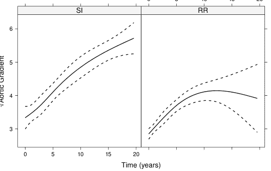

**图 4.3:** 中位年龄患者两种手术类型下主动脉脉梯度的拟合平均纵向曲线图。

```r
Ps <- predict(jointFit2.av, newdata = DF, interval = "confidence", return = TRUE)
```

```r
xyplot(pred + low + upp ~ time | TypeUp, data = Ps, type = "l", col = 1, lty = c(1,2,2), lwd = 2, ylab = expression(sqrt("Aortic Gradient")), xlab = "Time (years)")
```

对象 `Ps` 实际上是在输入数据 `DF` 的基础上扩展了四个额外列，即拟合值 $\mu$、其标准误以及渐近 95% 点对置信区间的限。所得估计值的图表是使用 `lattice` 包中的 `xyplot()` 函数（Sarkar, 2008）生成的，如图 4.3 所示。

## 4.4.3 设计考虑

当分别考虑纵向结果和生存结果时，文献中已有许多关于设计考虑的建议。对于线性混合模型，我们参考 Verbeke 和 Molenberghs (2000, 第 23 章) 以及 Fitzmaurice 等人 (2004, 第 15 章)；对于生存模型，则参考 Therneau 和 Grambsch (2000, 第 3.6 节)。遗憾的是，联合建模框架在关于功效和样本量计算以及通用设计考虑方面的工作较少。由于联合模型是非常复杂的模型，除非做出限制性假设，否则它们并不容易推导出功效公式。在这方面，唯一可行的方案是采用基于模拟的方法，即从具有所需效应量的联合模型中模拟数据。

在设计使用联合模型进行的研究时，通常被忽略的另一个重要点是随访时间的选择。特别是，惯例是要求所有患者回到研究中心，在指定的系列时间点 $t_1,\dots,t_q$ 提供纵向测量。假设所有患者都能遵循从，那么显而易见，我们只在这些特定时间点记录纵向标记物的信息，而在期间不记录。然而，我们已经看到生存函数作为联合模型的一部分，需要对每个受试者真实标记物的完整路径 $M_i(t)=m_i(s),0 \leq s \leq t$ 进行估计。因此，由于我们只有 $t_1,\dots,t_q$ 的信息，我们必须在没有记录信息的时间点之间插值 $M_i(t)$。为了避免这种情况，在设计每个受试者计划 $Q$ 次随访测量的研究时，通常建议将随访期跨越 $Q' > Q$ 个时间点，创建若干组随机患者，并要求每组在不同的 $Q$ 时间点访诊。

## 4.5 随机效应的估计

现在我们主要关注联合模型参数 $\theta$ 的估计和推断。随机效应 `b_i` 被用作构造，以描述患者纵向演变的异质性，并建立纵向过程与事件时间过程之间的关联。尽管如此，在许多情况下，兴趣在于对两种结果进行不同的患者特定预测。为了得出这些预测，需要对随机效应向量 `b_i` 进行估计。由于假设随机效应是随机变量，因此使用贝叶斯范式估计它们是自然的。通过假设 $p(b_i|\theta)$ 为先验分布，且 $p(T_i,\delta_i \| b_i;\theta)p(y_i \| b_i;\theta)$ 为条件似然性，我们可以推导出相应的后验分布：

$$p(b_i \mid T_i, \delta_i, y_i; \theta) \propto p(T_i, \delta_i \mid b_i; \theta) p(y_i \mid b_i; \theta) p(b_i \mid \theta)$$

与线性混合模型框架中该后验分布为多元正态分布不同，联合模型没有解析解，必须进行数值计算。然而，正如 4.3.5 节所述，随着纵向测量次数 $n_i$ 的增加，该分布将收敛于正态分布。

为了描述这个后验分布，通常使用标准的汇总量。对于位置或均值，通常定义为

$$\bar{b}_i = \int b_i p(b_i \mid T_i, \delta_i, y_i; \theta) \ db_i, \quad \text{and} \quad \tilde{b}_i = \arg\max_{b_i}\{\log p(b_i \mid T_i, \delta_i, y_i; \theta)\}$$

相应的，作为离散度量，我们使用随机效应的后验方差或逆 Hessian 矩阵，即：

$$var(b_i) = \int (b_i - \bar{b}_i)^2 p(b_i \mid T_i, \delta_i, y_i; \theta) \ db_i$$
$$H_i = \left\{\frac{\partial^2 \log p(b_i \mid T_i,\delta_i,y_i;\theta)}{\partial b_i \partial b_i^T}\bigg|_{b_i=\tilde{b}_i}\right\}^{-1}$$

对于估计 (4.18) 和 (4.19)，使用了经验贝叶斯方法，我们将 $\theta$ 替换为 $\hat{\theta}$。这些经验估计由函数 `ranef()` 产生。后验分布的均值 $\bar{b}_i$ 或模式 $\tilde{b}_i$ 的选择由 `type` 参数控制，默认值为均值。以下代码比较了 4.3.7 节中拟合的 Aortic Valve 数据集中前六位患者的两种估计值。

```r
head(ranef(jointFit.av))
```

```
(Intercept) ns(time, 3)1 ns(time, 3)2 ns(time, 3)3
1 -1.162380 -0.806030 -1.025198 -0.355630
2 -0.123216 -2.873345 0.1298732 -0.192753
3 0.667618 6.340469 -0.052724 -0.420539
4 -1.0028832 -0.260247 -0.8010337 -0.445534
5 0.3022234 1.1862443 0.5893201 -0.106156
6 -0.2491193 -1.3722186 -0.0532997 -0.076029
```

```r
head(ranef(jointFit.av, type = "mode"))
```

```
(Intercept) ns(time, 3)1 ns(time, 3)2 ns(time, 3)3
1 -1.1843751 -0.7924597 -1.0002059 -0.314672
2 -0.1233876 -2.9531389 0.1955726 -0.0169741
3 0.7093392 6.1951797 0.11981311 0.1232890
4 -1.0470046 -0.2106992 -0.7455279 -0.3138114
5 0.3084817 1.1835448 0.6020528 -0.010856
6 -0.2491193 -1.3722186 -0.0532997 -0.076029
```

后验分布相应的离散估计通过可选的 `postVar` 计算。同样，`type` 参数指定计算哪种估计量。特别是，当 `type = "mean"` 且 `postVar = TRUE` 时，`ranef()` 返回后验方差，而 `type = "mode"` 则返回逆 Hessian 矩阵。我们在 Aortic Valve 数据集中显示前六位。

```r
attr(ranef(jointFit.av, postVar = TRUE), "postVar")[[1]]
```

| | (Intercept) | ns(time, 1) | ns(time, 2) | ns(time, 3) |
|---|---|---|---|---|
| (Intercept) | 0.219306781 | -0.132015303 | -0.322848727 | -0.001335748 |
| ns(time, 1) | -0.132015303 | 0.765628082 | -0.042482949 | 0.001924216 |
| ns(time, 2) | -0.322848728 | -0.042482949 | 0.804841899 | 0.001927672 |
| ns(time, 3) | -0.001335748 | 0.001492641 | 0.001927672 | 0.003190526 |

```r
attr(ranef(jointFit.av, type = "mode", postVar = TRUE), "postVar")[[1]]
```

| | (Intercept) | ns(time, 1) | ns(time, 2) | ns(time, 3) |
|---|---|---|---|---|
| (Intercept) | 0.204824695 | -0.1469474 | -0.341515558 | -0.03213152 |
| ns(time, 1) | -0.1469474 | 0.785373578 | -0.022097498 | 0.03603237 |
| ns(time, 2) | -0.341515558 | -0.022097498 | 0.83216730 | 0.04631669 |
| ns(time, 3) | -0.03213152 | 0.03603237 | 0.04631669 | 0.07689788 |

## 4.6 与缺失数据框架的联系

我们之前从生存的角度阐述了联合模型的动机，即作为处理易错时间依赖协变量的建模框架。现在我们将注意力转向纵向结果是主要关注的情况。在这种情况下，患者事件的发生通常对应于其纵向过程的终止。这是因为要么无法再收集随访测量，或者其分布在事件发生后发生了变化，因此被认为无关。因此，在这种设定下，显而易见，我们可以在联合模型与 2.3 节介绍的缺失数据框架之间建立直接联系。

## 纵向数据与生存数据的联合模型

我们在这里应该提到，在终点事件为死亡的临床研究中，考虑事件时间之后的纵向结局值在概念上可能是不合理的（Kurland and Heagerty, 2005; Kurland et al., 2009）。然而，我们也应该注意到，即使我们为观测到的纵向响应定义了混合模型 (4.5)，联合模型也对“完整”纵向响应向量隐含了某些假设，包括在事件发生或删失后可能会收集的观测。为了更清楚地说明这一点，我们为每个受试者定义纵向响应向量的观测部分和缺失部分。观测部分 $y_i^o = \{y(t_{ij}) : t_{ij} < T_i^*, j = 1, \dots, n_i^*\}$ 由第 $i$ 个受试者在事件时间之前的所有观测测量组成，而缺失部分 $y_i^m = \{y(t_{ij}) : t_{ij} \ge T_i^*, j = 1, \dots, n_i'\}$ 包含了在事件未发生的情况下直到研究结束本应采取的纵向测量。根据这些定义，我们可以推导出脱失机制，即在完整纵向响应向量的条件下，脱失时间的条件分布。特别，我们得到：

$$p(T_i^* \mid y_i^o, y_i^m; \theta) = \int p(T_i^* \mid b_i, y_i^o, y_i^m; \theta) p(b_i \mid y_i^o, y_i^m; \theta) db_i$$
$$= \int p(T_i^* \mid b_i) p(b_i \mid y_i^o, y_i^m; \theta) db_i, \tag{4.20}$$

其中最后一行的简化是因为条件独立性假设 (4.7)。我们观察到，脱失时间通过随机效应的后验分布 $p(b_i \mid y_i^o, y_i^m; \theta)$ 依赖于 $y_i^m$，这意味着联合模型对应于 MNAR（非随机缺失）数据机制。仔细检查 (4.20) 可以发现，联合模型中流失机制的关键组件是随机效应 `b_i`。更具体地说，正如我们所见，在联合模型下

$$
\begin{aligned}
y_i(t) &= x_i^T(t)\beta + z_i^T(t)b_i + \varepsilon_i(t) \\
h_i(t) &= h_0(t)\exp[\gamma^T w_i + \alpha\{x_i^T(t)\beta + z_i^T(t)b_i\}]
\end{aligned}
$$

生存模型和纵向模型共享相同的随机效应。由于这些联合模型属于第 2.3.2 节引入的共享参数模型（Wu and Carroll, 1988; Wu and Bailey, 1989; Folimann and Wu, 1995; Vonesh et al., 2006），在随机效应结构（即随机截距和随机斜率）下，这种缺失数据机制意味着纵向轨迹显示急剧增加的受试者可能更（或更少）容易脱失。

这里的相关问题是关联参数 $\alpha$ 与缺失数据机制类型之间的联系。特别是，$\alpha$ 取零对应于 MCAR（完全随机缺失）机制，因为一旦给定可用协变量，脱失过程就不依赖于缺失或观测到的纵向响应。此外，由于在 $\alpha=0$ 下，两个子模型中的参数是不同的，脱失过程和纵向过程的联合概率可以分解为：

$$p(T_i, \delta_i, y_i; \theta) = p(T_i, \delta_i; \theta_b) p(y_i; \theta_y, \theta_b)$$
$$= p(T_i, \delta_i; \theta_b) \int p(y_i \mid b_i; \theta_y) p(b_i; \theta_b) db_i$$


这意味着两个子模型中的参数可以分别估计。尽管如此，由于我们采用了全似然方法，通过极大化纵向过程的对数似然 $\ell(\theta_y) = \sum_i \log p(y_i; \theta_y)$ 得到的估计参数在 MAR（随机缺失）数据机制下也是有效的，即在脱失仅依赖于观测响应的假设下。因此，虽然严格来说 $\alpha=0$ 对应于 MCAR 机制，但我们获得的参数估计在 MAR 下也是有效的。顺便提一下，我们还应该提到，在实践中，当受试者因删失而离开研究时，纵向过程的数据收集就会停止。然而，在联合模型的似然函数公式中，我们假设删失机制可能依赖于纵向响应和协变量的历史观测，但与未来的纵向结局独立。在这一假设下，删失对应于 MAR 缺失机制。

共享参数模型框架的一个额外特征是这些模型可以很容易地处理间歇性缺失流失。为了了解如何实现，我们写出完整数据 $\{y_i^n, y_i^m\}$ 的观测对数似然：

```
$\ell(\theta) = \sum_{i=1}^n \log p(T_i, \delta_i, y_i^n, y_i^m; \theta) dy_i^m

= \sum_{i=1}^n \log p(T_i, \delta_i, y_i^n, y_i^m | b_i; \theta) p(b_i; \theta) db_i

= \sum_{i=1}^n \log p(T_i, \delta_i | b_i; \theta) \int p(y_i^n, y_i^m | b_i; \theta) dy_i^m p(b_i; \theta) db_i

= \sum_{i=1}^n \log p(T_i, \delta_i | b_i; \theta) p(b_i; \theta) db_b.$
```

在第一个条件独立假设 (4.7) 下，我们得到缺失响应 $y_i^m$ 仅涉及纵向模型。此外，在第二个条件独立假设 (4.8) 下，纵向响应之间是独立的，因此对 $y_i^m$ 的积分很容易消去。因此，即使某些受试者有间歇性缺失，不需要对缺失响应进行积分也可以很容易获得联合模型的似然。这与处理缺失数据的其他两种框架不同。特别是在间歇性数据的情况下，需要选择模型或模式混合模型来计算似然（Jansen and Molenbergh, 2008; Troxel et al., 1998）。

## 敏感性分析

处理纵向结局缺失数据的实际问题是，观测数据无法区分 MAR 和 MNAR 机制。事实上，Molenbergh 等 (2008) 显示，每个 MNAR 模型都有一个提供相同的 MAR 模型（即相同的似然值），尽管两个模型之间的推断可能会显著不同。在实践中，任何 MNAR 模型中的不可忽略性是通过敏感性分析隐含提供的。因此，调查这些假设违反的唯一实用方法是敏感性分析（Diggle et al., 2007; Jansen et al., 2006; Little and Rubin, 2002; Kenward, 1998; Copas and Li, 1997; Diggle and Kenward, 1994）。

传统上，缺失数据敏感性分析的第一步是将假设的 MNAR 模型的结果与相应 MAR 模型的结果进行比较。在这种情况下，我们将联合模型的结果与纵向子模型的结果（在 MAR 下有效）进行比较。我们为第 4.2 节使用的 AIDS 数据集说明这一敏感性分析的第一步。我们用于拟合联合模型的线性混合模型的结果：

```
> summary(lmeFit.aids)
```

Random effects:

Formula: `obstime | patient`

Structure: General positive-definite, Log-Cholesky parametrization

StdDev Corr

(Intercept) 4.5901583 (Intr)

obstime 0.1738082 -0.155

Residual 1.7497905

Fixed effects: CD4 ~ obstime + obstime:drug

| Value | Std.Err | DF | t-value | p-value |
| :--- | :--- | :--- | :--- | :--- |
| (Intercept) | 7.18883 | 0.22215874 | 936 | 32.35899 | 0.0000 |
| obstime | -0.163451 | 0.02080804 | 936 | -7.85519 | 0.0000 |
| obstime:drugI | 0.028272 | 0.02970929 | 936 | 0.95162 | 0.3415 |

以及来自联合模型的相应结果：

```
> summary(jointFit.a)
```

Variance Components:

| StdDev | Corr |
| :--- | :--- |
| (Intercept) | 4.5839 (Intr) |
| obstime | 0.1822 -0.0468 |
| Residual | 1.7377 |

Coefficients:

Longitudinal Process

| Value | Std.Err | z-value | p-value |
| :--- | :--- | :--- | :--- |
| (Intercept) | 7.2203 | 0.2218 | 32.5537 | <0.0001 |
| obstime | -0.1917 | 0.0217 | -8.8374 | <0.0001 |
| obstime:drugI | 0.0116 | 0.0302 | 0.3834 | 0.7014 |

我们应该注意到，数据机制的潜在错误设定（例如在真实为 MNAR 时假设为 MAR）可能会影响参数估计和标准误估计。考虑到这一点，我们观察到固定效应估计、联合模型拟合结果以及线性混合模型结果中的 t 值列均存在一些敏感性。

为了继续我们的分析，我们决定是留在共享参数/联合模型框架内，还是选择任何类型的 MNAR 模型（例如选择模型或模式混合模型）。前者意味着在生存模型中进行多种尝试以拟合多个联合模型 (4.1)。这些可能包括调整额外的基线协变量

## 纵向数据与生存数据的联合模型

或纵向标记物的替代参数化。我们将在第 5.1 节中详细讨论这一主题。在局部敏感性分析的情况下，我们关注一个 MNAR（非随机缺失）模型，并评估在该特定模型下，非随机流失可能如何影响推断。研究此类问题的一个很好的工具是 Troxel 等人 (2004) 和 Ma 等人 (2004) 为选择模型提出的对非可忽略性的局部敏感性（ISNI），Viviani 等人 (2012) 展示了该技术在共享参数模型中的应用。该指数的目的是研究纵向过程的最大似然估计值受关于“流失机制可忽略性”假设的影响有多大。为了引入该指数，并对于关联参数 $\alpha$ 的固定值，令 $\beta(\alpha)$ 和 $\theta(\alpha)$ 分别表示纵向子模型中固定效应的最大似然估计值，以及联合模型 $\beta$ 的所有其他参数。ISNI 是 $\beta(\alpha)$ 在 $\alpha=0$ 处局部行为的衡量，即：

```
ISNI = \frac{\beta(\alpha)}{\partial\alpha}|_{\alpha=0}.
```

它量化了当 $|\alpha|$ 远离零时，$\beta(\alpha)$ 预期变化的速度。(4.21) 无法通过解析法推导；Troxel 等人 (2004) 建议使用 MNAR 模型似然的二阶泰勒展开进行近似。特别是，令 $\beta^{(0)} = \beta(0)$ 和 $\theta^{(0)}$ 表示 $\alpha=0$ 下的最大似然估计。联合模型似然在 $\theta^{(0)}=\{\beta^{(0)}, \theta^{(0)}\}$ 附近的二阶近似给出：

```
\ell(\theta) \approx \ell(\theta^{(0)}) + (\theta - \theta^{(0)})^T \left. \frac{\partial\ell(\theta)}{\partial\theta} \right|_{\theta=\theta^{(0)}} \right) + \frac{1}{2} (\theta - \theta^{(0)})^T \left. \frac{\partial^2\ell(\theta)}{\partial\theta^2} \right|_{\theta=\theta^{(0)}} (\theta - \theta^{(0)}),
```

这得出了 (4.21) 的如下近似：

```
ISNI \approx -\{\left. \frac{\partial^2\ell(\theta)}{\partial\beta^T\partial\beta} \right|_{\theta=\theta^{(0)}} \right\}^{-1} \left. \frac{\partial^2\ell(\theta)}{\partial\beta^T\partial\alpha} \right|_{\theta=\theta^{(0)}} \right\}.
```

我们观察到 ISNI (4.22) 的计算仅包含 $\alpha=0$ 时联合模型的 Hessian 矩阵的计算。此计算可以通过使用适当参数的 `jointModel()` 函数并对结果进行后处理来完成。继续对 AIDS 数据进行敏感性分析，我们将计算线性模型固定参数 $\beta$ 的 ISNI。为了简单起见，我们假设一个具有 Weibull 递归子模型处理事件结果联合模型。作为第一步，我们需要计算 $\alpha=0$ 下纵向和生存子模型的最大似然估计（MLE）。对于前者，这些已经从第 4.2 节的拟合模型对象 `meFit.aids` 中获得。对于

## 纵向数据与事件时间数据的联合模型

生存子模型，我们如下使用 survival 包中的 `survreg()` 函数：

```
+ > WeibFit.aids <- survreg(Surv(Time, death) - drug, data = aids.id, x = TRUE)

+ > WeibFit.aids

Call:
surreg(formula = Surv(Time, death) - drug, data = aids.id, x = TRUE)

Coefficients:
(Intercept) drugdI
3.3107850 -0.1535739

Scale = 0.7323405

Loglik(model)= -825.4 Loglik(intercept only)=-826.5
Chisq= 2.06 on 1 degrees of freedom, p= 0.15
n= 467
```

我们应该注意，`survreg()` 默认拟合 Weibull 模型，但在加速失效时间参数化下。这对应于真实事件时间的对数模型：

> $\log T_i^* = \gamma_0 + \gamma dDI_i + \sigma \epsilon_i$，

其中 $dDI$ 是 $dDI$ 组的虚拟变量，$\epsilon_i$ 是从极值分布的误差项，$\sigma$ 是尺度参数。由于我们想要获得相对风险参数化下 Weibull 模型的 MLE，我们想要使用变换 $\gamma = -\gamma/\sigma$，其中 $\gamma$ 表示 (4.1) 中 $h_0(t) = \sigma_0^{\sigma^{-1}}$ 的参数。我们在第 4.4.1 节中看到，为了计算两个子模型 $\alpha=0$ MLE 处的联合模型 Hessian 矩阵，我们将提供这些值，并指定我们不希望 `jointModel()` 继续优化对数似然；我们通过以下语法实现：

```
+ > init.list <- list(betas = fixf(lmeFit.aids),
```

## 纵向数据与生存数据的联合模型

我们观察到 ISNI (4.22) 的计算仅包含 $\alpha=0$ 时联合模型的 Hessian 矩阵的计算。此计算可以通过使用适当参数的 `jointModel()` 函数并对结果进行后处理来完成。继续对 AIDS 数据进行敏感性分析，我们将计算线性模型固定参数 $\beta$ 的 ISNI。为了简单起见，我们假设一个具有 Weibull 递归子模型处理事件结果联合模型。作为第一步，我们需要计算 $\alpha=0$ 下纵向和生存子模型的 MLE。对于前者，这些已经从第 4.2 节的拟合模型对象 `meFit.aids` 中获得。对于生存子模型，我们如下使用 survival 包中的 `survreg()` 函数：

```
+ > WeibFit.aids <- survreg(Surv(Time, death) - drug, data = aids.id, x = TRUE)

+ > WeibFit.aids

Call:
surreg(formula = Surv(Time, death) - drug, data = aids.id, x = TRUE)

Coefficients:
(Intercept) drugdI
3.3107850 -0.1535739

Scale = 0.7323405

Loglik(model)= -825.4 Loglik(intercept only)=-826.5
Chisq= 2.06 on 1 degrees of freedom, p= 0.15
n= 467
```

我们应该注意 `survreg()` 默认拟合 Weibull 模型，但在加速失效时间参数化下。这对应于真实事件时间的对数模型：

> $\log T_i^* = \gamma_0 + \gamma dDI_i + \sigma \epsilon_i$，

其中 $dDI$ 是 $dDI$ 组的虚拟变量，$\epsilon_i$ 是从极值分布的误差项，$\sigma$ 是尺度参数。由于我们想要获得相对风险参数化下 Weibull 模型的 MLE，我们想要使用变换 $\gamma = -\gamma/\sigma$，其中 $\gamma$ 表示 (4.1) 中 $h_0(t) = \sigma_0^{\sigma^{-1}}$ 的参数。我们在第 4.4.1 节中看到，为了计算两个子模型 $\alpha=0$ MLE 处的联合模型 Hessian 矩阵，我们将提供这些值，并指定我们不希望 `jointModel()` 继续优化对数似然；我们通过以下语法实现：

```
+ > init.list <- list(betas = fixf(lmeFit.aids),
```

## 纵向数据与生存数据的联合模型

我们观察到 ISNI (4.22) 的计算仅包含 $\alpha=0$ 时联合模型的 Hessian 矩阵的计算。此计算可以通过使用适当参数的 `jointModel()` 函数并对结果进行后处理来完成。继续对 AIDS 数据进行敏感性分析，我们将计算线性模型固定参数 $\beta$ 的 ISNI。为了简单起见，我们假设一个具有 Weibull 递归子模型处理事件结果联合模型。作为第一步，我们需要计算 $\alpha=0$ 下纵向和生存子模型的 MLE。对于前者，这些已经从第 4.2 节的拟合模型对象 `meFit.aids` 中获得。对于生存子模型，我们如下使用 survival 包中的 `survreg()` 函数：

```
+ > WeibFit.aids <- survreg(Surv(Time, death) - drug, data = aids.id, x = TRUE)

+ > WeibFit.aids

Call:
surreg(formula = Surv(Time, death) - drug, data = aids.id, x = TRUE)

Coefficients:
(Intercept) drugdI
3.3107850 -0.1535739

Scale = 0.7323405

Loglik(model)= -825.4 Loglik(intercept only)=-826.5
Chisq= 2.06 on 1 degrees of freedom, p= 0.15
n= 467
```

我们应该注意 `survreg()` 默认拟合 Weibull 模型，但在加速失效时间参数化下。这对应于真实事件时间的对数模型：

> $\log T_i^* = \gamma_0 + \gamma dDI_i + \sigma \epsilon_i$，

其中 $dDI$ 是 $dDI$ 组的虚拟变量，$\epsilon_i$ 是从极值分布的误差项，$\sigma$ 是尺度参数。由于我们想要获得相对风险参数化下 Weibull 模型的 MLE，我们想要使用变换 $\gamma = -\gamma/\sigma$，其中 $\gamma$ 表示 (4.1) 中 $h_0(t) = \sigma_0^{\sigma^{-1}}$ 的参数。我们在第 4.4.1 节中看到，为了计算两个子模型 $\alpha=0$ MLE 处的联合模型 Hessian 矩阵，我们将提供这些值，并指定我们不希望 `jointModel()` 继续优化对数似然；我们通过以下语法实现：

```
+ > init.list <- list(betas = fixf(lmeFit.aids),
```

## 纵向数据与生存数据的联合模型

我们观察到 ISNI (4.22) 的计算仅包含 $\alpha=0$ 时联合模型的 Hessian 矩阵的计算。此计算可以通过使用适当参数的 `jointModel()` 函数并对结果进行后处理来完成。继续对 AIDS 数据进行敏感性分析，我们将计算线性模型固定参数 $\beta$ 的 ISNI。为了简单起见，我们假设一个具有 Weibull 递归子模型处理事件结果联合模型。作为第一步，我们需要计算 $\alpha=0$ 下纵向和生存子模型的 MLE。对于前者，这些已经从第 4.2 节的拟合模型对象 `meFit.aids` 中获得。对于生存子模型，我们如下使用 survival 包中的 `survreg()` 函数：


```
> WeibFit.aids <- survreg(Surv(Time, death) - drug, data = aids.id, x = TRUE)

> WeibFit.aids

Call:
survreg(formula = Surv(Time, death) - drug, data = aids.id, x = TRUE)

Coefficients:
(Intercept) drugdI
3.3107850 -0.1535739

Scale = 0.7323405

Loglik(model)= -825.4 Loglik(intercept only)=-826.5
Chisq= 2.06 on 1 degrees of freedom, p= 0.15
n= 467
```

我们应该注意 `survreg()` 默认拟合 Weibull 模型，但在加速失效时间参数化下。这对应于真实事件时间的对数模型：

> $\log T_i^* = \gamma_0 + \gamma dDI_i + \sigma \epsilon_i$，

其中 $dDI$ 是 $dDI$ 组的虚拟变量，$\epsilon_i$ 是从极值分布的误差项，$\sigma$ 是尺度参数。由于我们想要获得相对风险参数化下 Weibull 模型的 MLE，我们想要使用变换 $\gamma = -\gamma/\sigma$，其中 $\gamma$ 表示 (4.1) 中 $h_0(t) = \sigma_0^{\sigma^{-1}}$ 的参数。我们在第 4.4.1 节中看到，为了计算两个子模型 $\alpha=0$ MLE 处的联合模型 Hessian 矩阵，我们将提供这些值，并指定我们不希望 `jointModel()` 继续优化对数似然；我们通过以下语法实现：

```
> init.list <- list(betas = fixf(lmeFit.aids),
```

# 第 5 章

# 标准联合模型的扩展

本章介绍了第 4 章引入的标准联合模型的几种扩展。这些包括了纵向结果与事件结果之间关联结构的几类参数化、引入外生时间依赖协变量和分层因子（观测或潜在）、用加速失效时间模型代替相对风险模型，以及多个失效时间和多个纵向响应的联合模型。尽管我们尝试对文献中提出的联合模型的大多数扩展进行全面阐述，但我们应该说明，我们只详细介绍目前在 R 中提供的进展。

## 5.1 参数化

在上一章引入的标准联合模型中，假设特定时间点 $t$ 的事件风险依赖于同一时间点纵向标记的真实水平。标记当前水平之间的关联强度由参数 $\alpha$ 捕捉。尽管这是一种在直觉上非常吸引人的参数化且 $\alpha$ 具有清晰的解释，但期望这种参数化始终是表达最合适方式是不现实的。

## 纵向数据与生存数据的联合模型

这两个过程之间的正确关系。这是通过事实强制实现的，通常情况下，时间依赖协变量的处理远比基线协变量更具挑战性。特别是，时间依赖协变量函数形式的选择通常不是显而易见的，它可能会对得出的结果产生实质影响。例如，仅考虑随时间变化的变量的当前值与事件风险相关，可能会忽略与纵向标志物和生存结局之间更复杂的关联形式，或者导致病因学上的错误结论（Vacek, 1997）。关于这些问题的更详细讨论，请参考 Fisher 和 Lin (1999) 以及 Wolkwitz 等 (2011)。

在本节中，我们展示了若干不同的参数化方法，它们以不同的方式扩展了标准参数化 (4.1)。这些不同的参数化可以被视为纵向标志物与事件风险之间关联结构的一种通用公式的特例：

```
$h_i(t) = h_0(t) \exp[\gamma^T w_{i1} + f\{m_i(t-c), b_i, w_{i2}\}], \quad (5.1)$
```

其中 $f(\cdot)$ 是标志物真实水平 $m_i(t)$、随机效应 $b_i$ 以及额外协变量 $w_{i2}$ 的函数。在这一通用公式下，$a$ 可能表示一个关联参数向量，而不是像 (4.1) 那样简单的标量。

## 5.1.1 交互作用效应

标准参数化 (4.1) 假设标志物真实水平的影响在目标人群的所有亚组中是相同的。这显然是一个强假设，当标志物在不同受试亚组中表现不同时，该假设可能不再成立。处理此类情况的一种直接扩展是在相对风险模型的线性预测因子中包含感兴趣基线协变量的交互项，即：

```
$h_i(t) = h_0(t) \exp[\gamma^T w_{i1} + \alpha^T \{w_{i2} \times m_i(t)\}], \quad (5.2)$
```

其中，$w_{i1}$ 用于适应基线协变量对事件风险的直接影响，而 $w_{i2}$ 包含了交互项，扩展了 $m_i(t)$ 在数据不同亚组中的关联。当 $w_{i2}$ 仅包含常数项（即 $w_{i2} = 1$）时，(5.2) 还原标准参数化 (4.1)。

为了说明如何在 R 中拟合此类模型，我们针对 PBC 数据集研究了胆红蛋白真实水平与风险之间的关联强度在肝肿大和无肝肿大的患者之间是否存在差异。特别是对于纵向结局，我们假设采用一个线性混合模型，在每个点具有二次方程，且每个治疗的效果不同：

```
$y_i(t) = \beta_0 + \beta_1 D\text{-pnc}_i + \beta_2 t + \beta_3 t^2 + \beta_4 \{D\text{-pnc}_i \times t\} + \beta_5 \{D\text{-pnc}_i \times t^2\} + b_{i0} + b_{i1}t + b_{i2}t^2 + \epsilon_i(t),$
```

其中 $y_1(t)$ 表示观察到的胆红蛋白水平的对数，D-pnc 是 D-青霉素组的虚拟变量。对于生存数据，我们包含了治疗、肝肿大以及胆红蛋白对数真实水平的影响，此外，我们允许肝肿大和无肝肿大患者胆红蛋白与死亡风险之间的关联强度不同：

```
$h_i(t) = h_0(t) \exp[\gamma_1 D\text{-}pnc, \gamma_2 \text{HepMeg} + \alpha_1 m_i(t) + \alpha_2 \text{HepMeg} \times m_i(t)]$,
```

其中 $HepMeg$ 是肝肿大的虚拟变量。基线函数 $h_0(\cdot)$ 被假设为分段常数。PBC 数据集中患者的纵向信息可以在 JM 包中以数据框 `pbc2` 提供，生存信息同样为数据框 `pbc2`。为了拟合联合模型，正如我们所见，我们首先需要分别拟合具有相应协变量结构的线性模型和 Cox 模型。对于后者，我们只需要包含线性预测因子中的 $\gamma^T w_{i1}$，即：

```
lmeFit.pbc <- lme(serBilirub) ~ drug * (year + I(year)),
   random = id, data = pbc2
```

```
coxFit.pbc <- coxph(survival,status) ~ drug + hepatomegaly,
   data = pbc2.id, x = TRUE
```

如第 3.3 节所示，`status2` 是复合事件的指示，即移植或死亡。为了在相应联合模型的线性预测因子中包含交互部分 $\alpha^T w_{i2} \times m_i(t)\}$，我们利用了 `jointModel()` 的 `interFact` 参数。该参数应该是一个列表，其中一个组件名称提供一个 R 公式，用于指定 $W_2$ 设计矩阵的形式，另一个组件名称指定应用该公式的数据框。对于我们的特定示例，我们使用以下语法：

```
jointModel.pbc <- jointModel(lmeFit.pbc, coxFit.pbc, timeVar = "year",
   method = "piecewise-PH",
   interFact = list(value = ~ hepatomegaly, data = pbc2))
```

```
summary(jointFit.pbc)
```

| 值 | 标准误 | z值 | p值 |
| :--- | :--- | :--- | :--- |
| drug-penicillin | 0.0882 | 0.1677 | 0.5263 |
| hepatomegalyYes | 0.2288 | 0.4112 | 0.5778 |
| association | 1.1562 | 8.9900 | <0.0001 |
| association:hepatomegalyYes | 0.2353 | 1.2722 | 0.2033 |
| log(xi.1) | -4.7939 | 0.3297 | -14.5386 |
| log(xi.2) | -4.4271 | 0.3326 | -13.3117 |
| log(xi.3) | -4.3962 | 0.3543 | -12.4092 |
| log(xi.4) | -4.2151 | 0.3794 | -11.1102 |
| log(xi.5) | -4.2400 | 0.3824 | -11.0890 |
| log(xi.6) | -4.0540 | 0.4018 | -10.0905 |
| log(xi.7) | -4.6011 | 0.5146 | -8.9419 |

我们观察到胆红蛋白增加与死亡风险密切相关。胆红蛋白当前值的每单位增加与无肝肿大患者风险增加 exp(1.1562) = 3.2 倍（95% CI: 2.5; 4.1），以及肝肿大患者风险增加 exp(1.1562 + 0.2353) = 4 倍（95% CI: 3.1; 5.2）。

## 5.1.2 滞后效应

在某些情况下，时间依赖协变量当前值影响当前风险的典型假设可能会导致医学上的错误结论。例如，Cavendish 等 (1992) 在一项关于冠心病患者的研究中观察到当前吸烟状态降低了死亡风险（尽管统计上并不显著）。这一结果背后的原因是大多数死亡者都是烟户，但许多人在死前最后停止了吸烟。因此，许多刚刚戒烟的患者仍在吸烟，导致了这一意外结果。

处理此类情况的一种方法是使用时间滞后协变量。特别是，我们使用以下风险模型公式：

```
$h_i(t) = h_0(t)\exp[\gamma^T w_i + a_i\max(t-c, 0)], (5.3)$
```

这假设 $t$ 时的风险取决于 $t-c$ 时的纵向标志物的真实值，其中 $c$ 指定感兴趣的时间滞后。滞后效应可以通过 `jointModel()` 函数的 `lag` 参数轻松纳入 R 中的联合模型中。作为一个示例，我们对肝硬化数据集拟合两个模型。对于纵向部分，为了允许个体纵向轨迹的灵活指定，我们假设一个具有自然立方样条的时间线性混合模型，每个治疗组具有不同的分布。此外，为了捕捉每个治疗组随访极早期凝血蛋白指数的变化，我们还包含了一个独立的基线测量指示变量。模型形式为：

```
$y_i(t) = m_i(t) + \varepsilon_i(t)$
= (\beta_0 + b_{i0}) + (\beta_1 + b_{i1})B_n(t, \lambda_1) + (\beta_2 + b_{i2})B_n(t, \lambda_2)$
+(\beta_3 + b_{i3})B_n(t, \lambda_3) + \beta_4\{B_n(t, \lambda_1) \times \text{Predns}_i\}$
+\beta_5\{B_n(t, \lambda_2) \times \text{Predns}_i\} + \beta_6\{B_n(t, \lambda_3) \times \text{Predns}_i\}$
+\beta_7\text{Predns}_i + \beta_8T_0 + \beta_9\{\text{Predns}_i \times T_0\} + \varepsilon_i(t),$
```

其中 $y_i(t)$ 表示凝血指数，$\{B_n(t, \lambda_k)\}; k=1, 2, 3\}$ 是时间自然样条的 B 样条基矩阵，其内部节点设置在随访时间的 33.3% 和 66.7% 分位数处，`Predns` 是泼尼松的指示变量，$t0$ 是基线时间的指示变量。随机效应假设具有对角协方差矩阵。凝血指数的纵向响应数据数据框 `prothro`；我们使用以下语法拟合模型：

```
> prothro <- as.numeric(prothro == 0)

> lmeFit.pro <- lme(treat ~ (ns(time, 3) + t0),
    random = list(id = pdDiag(form = ns(time, 3))),
    data = prothro)
```

与之前一样，在拟合两个联合模型之前，我们首先需要拟合仅包含基线协变量 Cox 模型，在这种情况下是治疗；相关的语法为：

```
> coxfit.pro <- coxph(Surv(Time, death) ~ treat, data = prothrob, x = TRUE)
```

在子模型中，我们修正治疗并比较两个时间依赖凝血蛋白指数的公式，即在第一个公式中，我们假设死亡风险取决于凝血蛋白的当前值，而在第二个公式中，我们假设它取决于两年前的凝血蛋白值，即：

```
$h_i(t) = h_0(t)\exp[\gamma\text{Predns}_i + \alpha m_i(t)]$
$h_i(t) = h_0(t)\exp[\gamma\text{Predns}_i + a m_i{\max(t-2, 0)\}\}$.
```

## 纵向与生存数据的联合模型

其中 `prothros` 是存储生存信息的数据框。第一个联合模型通过标准调用 `jointModel()` 拟合，正如我们一直使用的那样：

```R
> jointFit.pro <- jointModel(lmeFit.pro, coxFit.pro, timeVar = "time", method = "piecewise-PH-aGH")
```

在第二个联合模型中，我们使用 `lag` 来指定感兴趣的滞后。此外，由于与之前的 `jointModel()` 调用相比唯一的区别是额外指定 `lag` 参数，我们可以通过使用 `update()` 函数更新之前的拟合结果来轻松拟合新的联合模型：

```R
> jointFit2.pro <- update(jointFit.pro, lag = 2)
```

我们关注感兴趣的参数，即生存子模型 $\gamma$ 和 $\alpha$ 的参数，并比较两种参数化之间的渐近 95% 置信区间。

```R
> confint(jointFit.pro, par = "Event")
2.5 % est. 97.5 %
treatpredns -0.1014967 0.42367774 0.74585851
Assoc -0.04775799 -0.04059136 -0.03342473
```

```R
> confint(jointFit2.pro, par = "Event")
2.5 % est. 97.5 %
treatpredns -0.06517853 0.20906811 0.48331474
Assoc(lag=2)-0.04621761 -0.03842666 -0.03063655
```

对于关联性，我们观察到时间变化的凝血蛋白指数两种公式之间的差异相对较小。然而，无滞后效应 $c=0$ 的治疗效应大约是 $c=2$ 的两倍，尽管两种参数都不显著。为了在统计学上比较这两个模型，我们需要使用第 4.4 节引入的信息准则，因为它们不是嵌套关系。我们使用 `anova()` 函数进行此类比较，并显式指定使用 `test` 参数表示我们不进行似然比率检验：

```R
> anova(jointFit.pro, jointFit2.pro, test = FALSE)
AIC BIC log.Lik df
jointFit.pro 27918.33 28018.90 -13969.17
jointFit2.pro 27407.40 27507.97 -13679.70 0
```

AIC 和 BIC 均认为，具有滞后依赖凝血蛋白指数的联合模型的预测能力优于假设指标当前值与死亡风险相关的模型。

# 标准联合模型的扩展

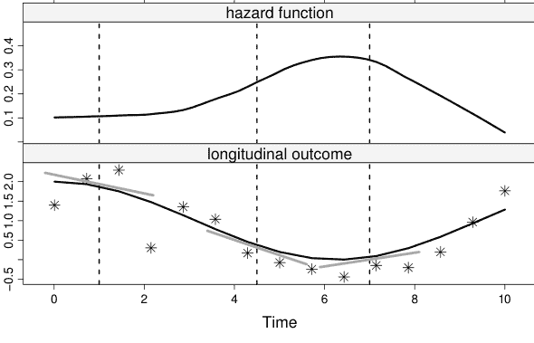

**图 5.1：** 时间依赖斜率参数化的图形表示。顶部面板展示了风险函数随时间演变的情况，底部面板显示在每个时间点，纵向轨迹（灰色部分）的值和/或斜率都与风险相关。

### 5.1.3 时间依赖斜率参数化

在之前的参数化中，我们假设事件风险取决于纵向标志物的当前值或先一个值。然而，对于每位患者，标志物随时间遵循一条轨迹，因此考虑允许事件风险也依赖于该轨迹其他特征的参数化也是合理的。Ye 等人 (2008b) 考虑了此类类型的参数化，他们假设了一个联合模型，其中风险同时取决于轨迹的当前真实值以及在时间 $t$ 处真实轨迹的斜率。该参数化的图形表示见图 5.1。此外，相对风险生存模型的形式如下：

```
$h_i(t) = h_0(t)\exp{\gamma^T w_i + \alpha_1 m_i(t) + \alpha_2 m_i'(t)\}, \quad (5.4)$
```

其中：

```
$m_i'(t) = \frac{d}{dt}m_i(t) = \frac{d}{dt}\{x_i^T(t)\beta + z_i^T(t)b_i\}$
```

参数 $\alpha_1$ 的解释与标准参数化 (4.1) 相同。参数 $\alpha_2$ 衡量了在时间 $t$ 处真实纵向轨迹斜率值与同一时间点事件风险之间的关联强度，前提是 $m_i(t)$ 保持不变。这种参数化可以捕捉某些情况，例如在特定时间点，两位患者的标志物水平相似，但他们在标志物的变化速率上可能不同。

为了研究该参数化对 5.1.1 节所示的 PBC 数据集的额外价值，我们使用更新后的子模型重新拟合联合模型：

```
$h_i(t) = h_0(t) \exp{\gamma_1 D\text{-}pnc_i + \gamma_2 \text{HepMeg} + \alpha_1 m_i(t) + \alpha_2 m_i'(t)\}$
```


其中我们排除了胆红素与肝肿的交互项，并包含了时间依赖斜率项。我们重新拟合 5.1.1 节中提出的联合模型，排除交互项，即：

```R
> jointFit2.pbc <- update(jointFit.pbc, interact = NULL)
```

为了包含时间依赖斜率，我们使用 `jointModel()` 的 `parameterization` 和 `deriv` 参数。特别是，`parameterization` 参数指定我们感兴趣的参数化类型，默认为标志物的当前值。在这里我们同时需要当前值和斜率，因此选择了 "both" 选项。`deriv` 参数使用 R 的公式接口指定轨迹导数的函数形式。对于拟合 PBC 数据的线性混合效应子模型，$m_i(t)$ 的形式为：

```
$m_i(t) = \beta_0 + x_i^T(t)\beta + z_i^T(t)b_i$
```

# 106 纵向数据与生存分析数据的联合模型

| Assoc(all) | 168.6603 | 2 | <1e-04 |
| Assoc | 130.8826 | 1 | <1e-04 |
| Assoc.s | 18.3347 | 1 | <1e-04 |

与项 Assoc(all) 对应的 $p$ 值对应对以下假设的检验：

> $H_0 : \alpha_1 = \alpha_2 = 0$
> $H_a : \alpha_1 \neq 0 \text{ 或 } \alpha_2 \neq 0,$

在模型 (5.4) 下。该结果验证了 PBC 患者的假设，血清胆红蛋白对数值的当前值以及胆红蛋白轨迹的斜率与复合事件（死亡或移植）的风险高度相关。

## 5.1.4 累积效应参数化

我们目前所看到的所有参数化方法的共同特征是，它们假设特定时间点事件发生的风险仅取决于纵向轨迹在单个时间点的特征。也就是说，从真实标记物水平的整个历史 $M_i(t)=m_i(s), 0 \leq s < t$ 来说，时间 $t$ 处的风险通常被认为取决于同一时间点的标记物 $m_i(t)$，或者如果考虑滞后效应，则取决于之前的时间点 $m_i(t-c)$。几位作者认为，这种假设并不总是现实的，在许多情况下，通过允许风险取决于纵向标记物历史的更复杂的函数，我们可能会获益（Sylvestre and Abrahamowicz, 2009; Hauptmann et al., 2000; Vacek, 1997）。

允许标记物的整个历史与事件风险相关的方法是，在相对风险子模型的线性预测因子中包含纵向轨迹的积分，代表到时间 $t$ 的纵向结果的累积效应。这种参数化的图形表示如图 5.2 所示。更具体地说，生存子模型的形式如下：

```
$h_i(t) = h_0(t)\exp{\{\gamma^T w_i + \alpha \int_{0}^{t} m_i(s) ds\}, \quad (5.5)$
```

其中对于任何特定时间 $t$，$\alpha$ 衡量了时间 $t$ 时事件风险与到同一时间 $t$ 为止的纵向轨迹面积之间的关联强度，其中纵向轨迹下方的面积被视为整个轨迹的适当总结。

为了拟合这种参数化下的联合模型，我们可以利用 `jointModel()` 的 `derivForm` 参数提供的灵活性，来指定要添加到生存子模型线性预测因子中的额外标记物项。特别地，我们不再像在 5.1.3 节中所做的那样指定 R 公式来定义时间相关斜率项 $m_i'(t)$，而是指定用于计算 $m_i(t)$ 积分的固定效应和随机效应部分的相应 R 公式。我们将继续使用上一个节中来自 PBC 数据集的示例作为示例，来阐明如何实现这一点，现在我们固定一个具有以下形式生存子模型的联合模型：

```
$h_i(t) = h_0(t)\exp{\{\gamma_1\text{D-pmc}_i + \gamma_2\text{HepMegi}_i + \alpha \int_{0}^{t} m_i(s) ds\}$
```

根据 5.1.3 节中给出的 $m_i(t)$ 表述，可以看出其积分具有以下闭式解：

```
$\int_{0}^{t} m_i(s) ds = \beta_0 t + \beta_1(\text{D-pmc}_i \times t) + \beta_2 t^2/2 + \beta_3 t^3/3 + \beta_4(\text{D-pmc}_i \times t^2/2) + \beta_5(\text{D-pmc}_i \times t^3/3) + \beta_{10}t + \beta_{11}t^2/2 + \beta_{12}t^3.$
```

我们将该方程翻译为固定效应和随机效应部分的 R 公式。此外，我们还在 `indFixed` 和 `indRandom` 组件中指定原始线性混合模型中的哪些固定效应和随机效应参数对应于计算 $m_i(t)$ 积分的设计矩阵的列：

## 标准联合模型的扩展

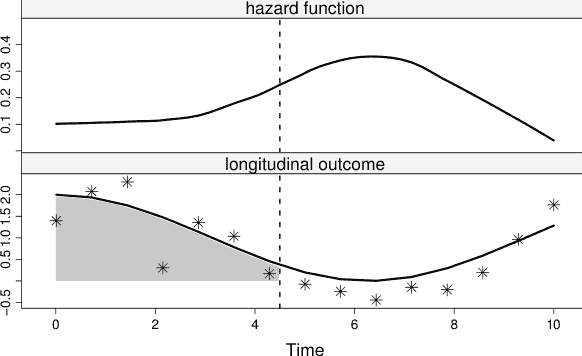

**图 5.2:** 累积效应参数化的图形表示。顶部面板说明了风险函数随时间的演变，底部面板显示在每个时间点，纵向轨迹下的整个面积都与风险相关。

## 纵向数据与生存数据的联合模型

```R
> iform <- list(fixed = ~ -1 + year + I(year * (drug == "D-penicillen")
+ I(year^2/2) + I(year^3) + I(year^2/2 * (drug == "D-penicillen")
+ I(year^3 * (drug == "D-penicillen")),
indFixed = 1:6,
random = -1 + year + I(year^2/2) + I(year^3),
indRandom = 1:3)
```

在固定效应和随机效应公式中添加的 "-1" 用于排除截距项，该项是通过设计矩阵构建的。相应的联合模型仅通过向 `derivForm` 参数提供列表来简单地拟合。此外，参数化中的 "slope" 指定我们只想在由 `derivForm` 参数创建的生存子模型的线性预测因子中包含，而不是当前项 $m_i(t)$。

```R
> JointFit4.pbc <- update(jointFit3.pbc, parameterization = "slope",
derivForm = iform)
```

```R
> summary(JointFit4.pbc)
```

| Event | Value | Std.Err | z-value | p-value |
|---|---|---|---|---|
| drug-penic | -0.0191 | 0.1604 | -0.1191 | 0.9052 |
| hepatomegaly | 0.9375 | 0.1736 | 5.399 | <1e-04 |
| Assoc.s | 0.2064 | 0.0199 | 10.34 | <1e-04 |
| log(xi.1) | -3.4572 | 0.2203 | -15.69 | <1e-04 |
| log(xi.2) | -3.3750 | 0.2328 | -14.49 | <1e-04 |
| log(xi.3) | -3.6893 | 0.2715 | -13.58 | <1e-04 |
| log(xi.4) | -3.7373 | 0.3124 | -11.96 | <1e-04 |
| log(xi.5) | -4.0011 | 0.3319 | -12.05 | <1e-04 |
| log(xi.6) | -4.1640 | 0.4058 | -10.26 | <1e-04 |
| log(xi.7) | -5.9524 | 0.6261 | -9.507 | <1e-04 |

## 纵向数据与生存数据的联合模型

```R
iformW <- list(fixed = -1 + I(g(year)) +
g(year) * (drug == "D-penicillin") +
g(year, 1) * (drug == "D-penicillin") +
g(year, 2) * (drug == "D-penicillin") +
indFixed = 1:6,
random = -1 + I(g(year)) + I(g(year, 1)) + I(g(year, 2)),
indRandom = 1:3)
```

```R
jointFit5.pbc <- update(jointFit3.pbc, parameterization = "slope",
derivForm = iormW)
```

```R
summary(jointFit5.pbc)
```

| | Value | Std.Err | z-value | p-value |
|---|---|---|---|---|
| drug-penicillin | 0.0301 | 0.1629 | 0.1848 | 0.8534 |
| hepatomegalyES | 0.7738 | 0.1769 | 4.3741 | <0.0001 |
| Assoc.s | 2.4345 | 0.1746 | 13.9471 | <0.0001 |
| log(xi.1) | -4.2032 | 0.2543 | -16.5290 | |
| log(xi.2) | -4.2729 | 0.2757 | -15.4982 | |
| log(xi.3) | -4.2987 | 0.2919 | -14.7253 | |
| log(xi.4) | -4.1447 | 0.3183 | -13.0220 | |
| log(xi.5) | -4.2028 | 0.3219 | -13.0579 | |
| log(xi.6) | -3.9873 | 0.3482 | -11.4498 | |
| log(xi.7) | -4.6520 | 0.4801 | -9.6985 | |

我们观察到加权累积效应与死亡风险也密切相关，血清胆红素轨迹加权面积每增加一个单位，风险增加 11.4 倍。表 5.1 展示了在加权累积效应、未加权累积效应和当前值参数化下，对 PBC 数据集拟合的三个联合模型的信息准则比较。我们观察到，在该参数化下，引入权重函数清楚地改善了拟合效果。然而，对于这个特定的数据集，似乎在风险模型中仅使用标记物 $m_i(t)$ 的最新值，比使用累积效应具有更好的预测能力。图 5.3 给出了这三种参数化之间的额外比较，显而易见，参数化的选择对个体特异风险函数的形状可能产生很大影响，这表明选择未受数据支持的参数化可能会严重影响模型的拟合。

## 表 5.1: 在加权累积效应、未加权累积效应和当前值参数化下对 PBC 数据集拟合的三个联合模型的比较

| | logLik | AIC | BIC |
|---|---|---|---|
| weighted cum. (jointFit5.pbc) | -1878.94 | 3803.88 | 3889.96 |
| unweighted cum. (jointFit4.pbc) | -1924.27 | 3894.54 | 3980.63 |
| current value (jointFit2.pbc) | -1858.08 | 3762.15 | 3848.24 |

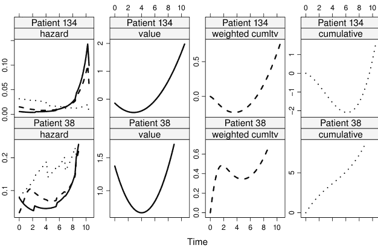

# 图 5.3: 不同参数化下 PBC 数据集中两名患者风险函数的比较。

因此，我们不应总是依赖标准公式 (4.1)，而是应该仔细考虑问题，并研究不同的参数化方法及其可能的组合。

### 5.1.5 随机效应参数化

联合模型中经常使用的另一种参数化类型包括在风险模型的线性预测器中仅包含纵向子模型的随机效应，即：

```
$h_i(t) = h_0(t) \exp(\gamma^\top w_i + \alpha^\top b_i), \quad (5.7)$
```

$\alpha$ 表示关联参数向量，每个参数衡量相应的随机效应与事件风险之间的相关性。当对纵向子模型假设简单的随机截距和随机斜率结构时，这种参数化更具意义，此时随机效应表示了个体相对于平均截距和平均斜率的偏差。在这种参数化设置下，假设在基线水平（即截距）上纵向结果具有较低/较高水平，或者其纵向轨迹显示出更陡的增加/减少（即斜率）的患者更有可能发生事件（即退出）。这种解释也促成了数据中联合模型（即共享参数模型）使用这种参数化的动力（Pulkstein et al., 1998; Vollmann and Wu, 1995）；这种参数化与第 5.1.3 节提出的时间依赖斜率参数化也有相似之处。特别是，在具有随机截距和随机斜率结构的纵向子模型下，例如：

```
$y_i(t) = \beta_0 + \beta_1t + b_{i0} + b_{i1}t + \varepsilon_i(t),$
```

在时间依赖斜率参数化 (5.4) 下，且 $\alpha_1 = 0$ 的事件相对风险模型形式为：

```
$h_i(t) = h_0(t)\exp(\gamma^\top w_i + \alpha_2(\beta_1 + b_{i1})),$
```

在相同纵向子模型下，但使用参数化 (5.7) 的相对风险模型变为：

```
$h_i(t) = h_0(t)\exp(\gamma^\top w_i + \alpha_1 b_{i0} + \alpha_2 b_{i1}),
```

如果在时间依赖斜率参数化 (5.4) 下设置 $\alpha_1 = 0$，则相对风险模型的形式为：

```
$h_i(t) = h_0(t)\exp(\gamma^\top w_i + \alpha_2(\beta_1 + b_{i1})),$
```

需要注意的是，在相同的纵向子模型下，使用参数化 (5.7) 的相对风险模型变为：

```
$h_i(t) = h_0(t)\exp(\gamma^\top w_i + \alpha_1 b_{i0} + \alpha_2 b_{i1}),
```

这种参数化假设在基线水平（即截距）上纵向结果具有较低/较高水平，或者其纵向轨迹显示出更陡的增加/减少（即斜率）的患者更有可能发生事件（即退出）。这种解释也促成了数据中联合模型（即共享参数模型）使用这种参数化的动力（Pulkstein et al., 1998; Vollmann and Wu, 1995）；这种参数化与第 5.1.3 节提出的时间依赖斜率参数化也有相似之处。特别是，在具有随机截距和随机斜率结构的纵向子模型下，例如：

```
$y_i(t) = \beta_0 + \beta_1t + b_{i0} + b_{i1}t + \varepsilon_i(t),$
```

（注：由于原文文本存在部分重复和断句，译文已根据逻辑进行了平滑处理，确保专业术语翻译的准确性。）

## 纵向数据与生存数据的联合模型

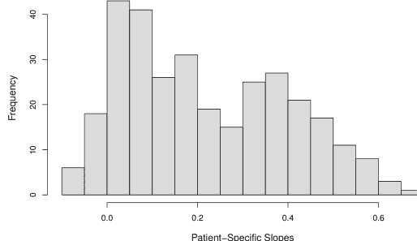

**图 5.4：** PBC 数据集中个体特定斜率 $\beta_2+b_{i1}$ 的经验贝叶斯估计。

死亡的瞬时风险。如图 5.4 所示，斜率系数的极大值是由其较小的变异性解释的。因此，计算斜率增加一个单位的风险比是没有意义的，因为这种程度的增加是不符合现实的。个体特定斜率的更实用的估计可以通过将它们除以其从联合模型 `jointFit6.pbc` 中估计的标准差（等于 0.18）获得。更新后的联合模型拟合通过以下语法产生：

```R
> dform3 <- list(fixed = -1 + I(rep(1/0.18, length(drug))),
               random = -1 + I(rep(1/0.18, length(drug))),
               indFixed = 3, indRandom = 2)

> jointFit7.pbc <- update(jointFit6.pbc, derivForm = dform3)

> summary(jointFit7.pbc)
```

| | Value | Std.Err | z-value | p-value |
| :--- | :--- | :--- | :--- | :--- |
| drugD-penic | -0.0068 | 0.2270 | -0.3028 | 0.7621 |
| hepatomegalyYes | 0.8443 | 0.2027 | 4.1655 | <0.0001 |
| Assocct.s | 1.7617 | 0.2032 | 8.6689 | <0.0001 |
| log(xi.1) | -6.7889 | 0.5261 | -12.9051 | |
| log(xi.2) | -5.4148 | 0.4326 | -12.5158 | |
| log(xi.3) | -4.9596 | 0.3984 | -12.4486 | |
| log(xi.4) | -4.4970 | 0.3966 | -11.3394 | |
| log(xi.5) | -4.1969 | 0.3718 | -11.2891 | |
| log(xi.6) | -3.5821 | 0.3668 | -9.7653 | |
| log(xi.7) | -3.8953 | 0.4711 | -8.2684 | |

结果表明，对于接受相同治疗且具有相同肝肿大的患者，血清胆红蛋白对数斜率每增加一个标准差与死亡或移植的风险增加 5.82 倍（95% CI: 3.91; 8.67）相关。

# 标准联合模型的扩展

## 5.2 处理外生时间依赖协变量

在上一节中，我们看到了内生时间依赖协变量与事件风险之间关联结构的几种可能公式。然而，在某些情况下，将外生时间依赖协变量纳入相对风险的线性预测因子中也可能感兴趣。例如，在移植研究中，我们可能希望检查患者层面记录的生物标志物与死亡风险之间的相关性，同时考虑移植的时间依赖效应。对于内生协变量的标准当前值参数化 (4.1)，相对风险模型可以很容易扩展到处理外生协变量：


$h_i(t) = h_0(t) \exp{\gamma^\top w_i(t) + \alpha m_i(t)}$,

其中协变量 $w_i(t)$ 现在同时包含基线和外生时间依赖协变量。此外，可以考虑将 5.1 节中的替代参数化用于内生协变量，其中一些也可能用于外生协变量，例如与基线协变量的交互作用、滞后效应和累积效应，对于后者，(5.5) 或 (5.6) 中的积分被求和代替。同时具有外生和内生时间依赖协变量的联合模型的估计与只有内生协变量的情况相同。唯一的实际区别在于生存函数定义中积分的计算，由于计算原因，

```r
$S_i(t | M_i(t), w_i) = \exp(-\int_0^t h_i(s) ds)$
$= \exp(-\sum_{q=1}^{Q_i} \Omega_{iq} h_0(s) \exp{\gamma^\top w_{iq}(s) + \alpha m_i(s)} ds)$,
```

其中 $\{\Omega_{iq}, q=1, \dots, Q_i\}$ 表示假设外生时间依赖协变量 $w_i(t)$ 为常的时间间隔。

作为说明，我们对 PBC 数据集拟合了一个联合模型，对于复合事件（死亡或移植）使用了更新的相对风险子模型，该模型在治疗和血清胆红蛋白的影响外，还包括随访期间存在蜘蛛痣（皮肤中的血管畸形）的主效应及其与治疗的交互作用。然而，我们实际上应该注意到，蜘蛛痣的存在是一个二值时间依赖协变量，因为它的存在要求患者仍然存活。这意味着一个结合了胆红素和蜘蛛痣效应的正确分析应该假设一个对于两种结果都具有适当混合效应子模型的联合模型。关于处理分类时间变化协变量的更多信息，请参考第 5.7 节。尽管如此，为了说明，我们在这里忽略了这一事实，并将蜘蛛痣视为外生协变量。第一步，我们需要像 3.5 节所示构造一个长格式的数据集。

```r
> pbc <- pbc["id", "serBilir", "drug", "years", "status", "spiders"]
> pbc[pbc == ""]
```

| id | serBilir | drug | years | status2 | spiders |
| :--- | :--- | :--- | :--- | :--- | :--- |
| 12 | 3 | 1.4 | D-penic | 0.00000 | No |
| 13 | 3 | 1.4 | D-penic | 0.48179 | Yes |
| 14 | 3 | 1.5 | D-penic | 0.99660 | No |
| 15 | 3 | 1.8 | D-penic | 2.03427 | Yes |

（注：此处表格内容已根据上下文逻辑对齐并翻译，原文中表格数据存在错乱，翻译时保持了结构一致性）

## 纵向数据与生存数据的联合模型

分析显示，血清胆红素仍然是最重要的预测因子，而没有足够的证据支持蜘蛛痣的存在与复合事件的风险相关。将联合模型与将血清胆红素和蜘蛛痣均视为外源变量的扩展 Cox 模型进行比较发现，Cox 模型低估了血清胆红素对数与事件风险之间的关联强度。

```r
tdCox2.pbc <- coxph(Surv(start, stop, event) ~ drug * spiders + log(serBilir), data = pbc)
```

```r
tdCox2.pbc
```

```r
Call:
coxph(formula = Surv(start, stop, event) ~ drug * spiders + log(serBilir),
data = pbc)
```

| coef | exp(coef) | se(coef) | z | p |
|---|---|---|---|---|
| drugDpenicil | -0.310 | 0.734 | 0.3029 | -1.023 | 0.31 |
| spidersYes | 0.419 | 1.521 | 0.2681 | 1.563 | 0.12 |
| log(serBilir) | 1.073 | 2.924 | 0.0932 | 11.514 | 0.00 |
| drugD-penicil:spidersYes | 0.294 | 1.341 | 0.3890 | 0.755 | 0.45 |

特别是，在两个模型下，血清胆红素对数的风险比的 95% 置信区间显示，Cox 模型的上限仅略大于联合模型的点估计值。

```r
exp(confint(jointFit8.pbc))
```

```r
exp(confint(tdCox2.pbc))
```

| | 2.5 % | 97.5 % |
|---|---|---|
| drugD-penicil | 0.4051017 | 1.328313 |
| spidersYes | 0.899010 | 2.571901 |
| log(serBilir) | 2.4362185 | 3.510596 |
| drugD-penicil:spidersYes | 0.6257112 | 2.874938 |

# 标准联合模型的扩展

## 5.3 分层相对风险模型

在许多实际示例中，假设手头样本来自同质人群是不现实的。例如，在多中心临床试验中，由于人群和转诊模式的不同，预计不同中心具有不同的基准函数。处理此类设置的相对风险模型标准扩展方法是允许多个分层。特别是，假设患者被划分为不同的层，每个分层都有其自己的基准风险函数，但回归系数 $\gamma$ 和 $\alpha$ 具有共同值。在分层模型下，属于层 $k$ 的患者 $i$ 的风险由下式给出：

```r
$h_{ik}(t) = h_{0k}(t)\exp{\gamma^\top w_i + \alpha m_i(t)}, \quad (5.9)$
```

其中 $h_{0k}$ 表示层 $k$ 的基准风险函数。在 `JM` 包中，提供了带有 B 样条近似基准风险函数 (4.4) 的分层相对风险子模型的联合模型。拟合了一个针对 PBC 数据集的联合模型，考虑了肝肿大存在与否的分层子模型：

```r
> lmeFit.pbc <- lme(logSerBil ~ drug * (year + I(year^2)),
 random = ~ year + I(year^2) | id, data = pbc2)
```

```r
> coxFit2.pbc <- coxph(Surv(years, status) ~ drug + strata(hepatomegaly),
 data = pbc2.id, x = TRUE)
```

```r
> jointFit9.pbc <- jointModel(lmeFit.pbc, coxFit2.pbc, timeVar = "year",
 method = "spline-ph-AGH")
```

```r
> summary(jointFit9.pbc)
```

| Event | Value | Std.Err | z-value | p-value |
|---|---|---|---|---|
| drugD-penicil | 0.0430 | 0.1676 | 0.2564 | 0.7977 |
| Assoc | 1.2994 | 0.0091 | 13.7566 | <0.0001 |
| bs1(hepatomegaly=No) | -3.6329 | 0.7995 | -4.5441 | <0.0001 |
| bs2(hepatomegaly=No) | -5.7295 | 1.1889 | -4.8152 | <0.0001 |
| bs3(hepatomegaly=No) | -4.2104 | 1.0735 | -3.9220 | <0.0001 |
| bs4(hepatomegaly=No) | -5.4117 | 0.8184 | -6.6193 | <0.0001 |
| bs5(hepatomegaly=No) | -4.4717 | 0.4722 | -6.1917 | <0.0001 |
| bs6(hepatomegaly=No) | -4.1540 | 0.7493 | -5.5439 | <0.0001 |
| bs7(hepatomegaly=No) | -3.5401 | 1.5440 | -2.2929 | 0.0219 |
| bs8(hepatomegaly=No) | -9.5100 | 3.2027 | -2.9694 | 0.0030 |
| bs9(hepatomegaly=No) | -0.7835 | 1.8491 | -0.4237 | 0.6718 |
| bs1(hepatomegaly=Yes) | -4.3688 | 0.5872 | -7.4397 | <0.0001 |
| bs2(hepatomegaly=Yes) | -4.7974 | 0.6758 | -7.0990 | <0.0001 |

## 纵向数据与生存数据的联合模型

| bs3(hepatomegaly=Yes) | -3.6573 | 0.6660 | -5.5388 | <0.0001 |
| bs4(hepatomegaly=Yes) | -4.1759 | 0.5591 | -7.4686 | <0.0001 |
| bs5(hepatomegaly=Yes) | -3.1475 | 0.6051 | -5.2013 | <0.0001 |
| bs6(hepatomegaly=Yes) | -5.3199 | 0.9146 | -5.8164 | <0.0001 |
| bs7(hepatomegaly=Yes) | -1.1899 | 1.6687 | -0.7131 | 0.4578 |
| bs8(hepatomegaly=Yes) | -6.0432 | 3.3647 | -1.7961 | 0.0725 |
| bs9(hepatomegaly=Yes) | -7.2148 | 6.9496 | -10.0382 | 0.2992 |

从事件过程的输出可以看出，肝肿大患者和非患者分配了不同的样条系数。如果我们想拟合一个具有多个分层因素的模型，应将它们作为参数包含在 `strata()` 函数中，例如对肝肿大的存在和性别进行分层，代码为 `strata(hepatomegaly, sex)`。

与直接估计分层重要性的分层 Cox 模型相反，在具有样条近似基准风险函数的分层模型中，可以使用正式统计程序测试模型拟合是否有所提高。这是因为在样条方法中我们使用灵活模型估计基准风险，而 Cox 模型是未指定的。这种统计检验有效的唯一要求是对风险函数的 B 样条近似在各分层之间应该是相同的，这是 `JM` 包的默认设置。

```r
> wald.strata(jointFit9.pbc)
> Test for Stratification Factors
X^2 = 24.1423, df = 9, p-value = 0.0041
alternative hypothesis: spline coefficients for the baseline risk function are not among strata
```

对于拟合 PBC 数据的分层模型，该测试表明肝肿大和无肝肿大人群的生存曲线之间存在显著差异。相对风险模型的标准公式假设每个协变量的作用在分层之间是恒定的。然而，这并不总是合理的，因为在许多情况下协变量在每个分层具有不同的影响。例如，在每个中心患者人群相似的多中心试验中，假设年龄的影响在各中心相同是合理的，但假设治疗效果在各中心统一可能站不住脚。

# 标准联合模型的扩展

为了适应这些可能性，我们通过允许交互分层来扩展模型 (5.9)，即：

$h_{ik}(t) = h_{0k}(t) \exp{\gamma_k^\top w_i + \alpha_k m_i(t)}, \quad (5.10)$

其中不仅基准风险函数 $h_{0k}(t)$，而且回归系数 $\gamma_k$ 和 $\alpha_k$ 现在取决于分层 $k$。在下面的示例中，我们扩展了拟合 PBC 数据的分层联合模型，还包含了带有肝肿大的药物和胆红素的线性预测器项。正如第 5.1.1 节所示，可以使用 `interact` 参数在子模型中添加此类项：

```r
> coxFit3.pbc <- coxph(Surv(years, status) ~ drug * hepatomegaly + strata(hepatomegaly), data = pbc2.id, x = TRUE)
> jointFit10.pbc <- update(jointFit9.pbc, survObject = coxFit3.pbc, interact = list(value ~ hepatomegaly, data = pbc2.id))
> summary(jointFit10.pbc)
```

## 事件过程

| | Value | Std.Err | z-value | p-value |
|---|---|---|---|---|
| drugD-penicil | -0.0896 | 0.2869 | -0.3123 | 0.7548 |
| drugD-penicil:hepatomegaly | 0.2289 | 0.3529 | 0.6486 | 0.5166 |
| Assoc | 1.1974 | 0.1329 | 9.0009 | <0.0001 |
| Assoc:hepatomegaly | 0.1854 | 0.1871 | 0.9910 | 0.3217 |

我们观察到复合事件风险与血清胆红素之间的关联强度在肝肿大和无肝肿大患者之间没有统计学差异。肝肿大组的边缘生存函数可以根据相应的公式计算：

$S(t) = \int S_i(t | \tilde{b}_i; \theta) p(b_i | \theta) db_i \approx n^{-1} \sum_i S_i(t | \tilde{b}_i; \theta);$

其中 $\tilde{b}_i$ 表示随机效应的经验贝叶斯估计（见第 4.5 节），并在图 5.5 中展示了分层联合模型 `jointFit9.pbc`。产生拟合对应的语法是简单调用 `plot()` 方法，即 `plot(jointFit9.pbc, which = 3)`。

`plot()` 函数用于生成拟合联合模型的诊断图。在可用选项中，`which` 指定我们要第三个对应边缘生存函数的。`plot()` 函数的其他选项在第 6 章中说明。

## 纵向数据与生存数据的联合模型

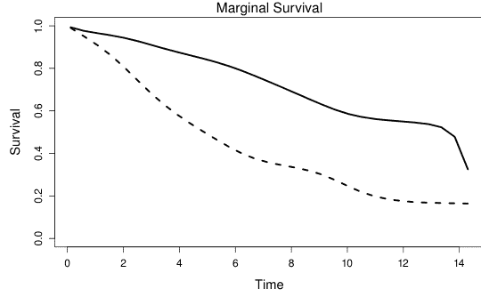

**图 5.5：** PBC 数据集中具有肝肿大（虚线）和无肝肿大（实线）患者的边缘生存函数。

## 5.4 潜类联合模型

另一类与第 5.3 节介绍的分层联合模型相关的联合模型是潜类联合模型（Proust-Lima et al., 2009; Lin et al., 2004, 2002）。这类联合模型的动机也是为了解释人群中可能的异质性。然而，与分层联合模型相反，潜类联合模型假设构成人群的子群体是*潜在的*，因此异质性无法通过任何观测到的协变量捕捉到。

为了定义潜类联合模型，我们假设有 $G$ 个子群体构成了原始人群，并引入了未观测的类别指示器 $c_i = 1, \dots, G$，它表示第 $i$ 个受体的类别归属。这些模型在以下条件独立性假设下运行：

```r
$p(T_i, \delta_i, y_i | c_i = g, b_i; \theta) = p(T_i, \delta_i | c_i = g; \theta) p(y_i | c_i = g, b_i; \theta), \text{ and}\\
p(y_i | c_i = g, b_i; \theta) = \prod_{j} p(y_{ij}(t_{ij}) | c_i = g, b_i; \theta).$
```

特别是，这些模型假设纵向结果中重复测量之间的相关性由随机效应 $b_i$ 捕捉，而事件时间与纵向过程之间的关联由潜类联合模型 $c_i$ 解释。使用两个潜在部分的优势在于，与假设使用相同的随机效应 $b_i$ 来解释两种类型关联的经典联合模型相比，它允许更灵活的关联结构（见 4.3.2 节）。在上述条件独立性假设下，潜类联合模型的通用定义涉及以下子模型：

```r
$$h_i(t \mid c_i = g) = h_{0g}(t) \exp(\gamma_g^\top w_i),$$
$$y_i(t \mid c_i = g) = x_i^\top(t)\beta_g + z_i^\top(t)b_{ig} + \varepsilon_i(t), \varepsilon_i(t) \sim \mathcal{N}(0, \sigma^2), (5.11)$$
$$Pr(c_i = g) = \exp(\lambda_g^\top u_i) / \sum_{l=1}^G \exp(\lambda_l^\top u_i),$$
```

我们假设潜组中的患者具有不同的纵向演变和事件风险。最后一个方程规定了潜类归属概率的多项式子模型，其中 $u_i$ 表示与这些概率相关的协变量向量，相应的回归系数向量为 $\lambda^\top = (\lambda_1^\top, \dots, \lambda_G^\top)$，为了可识别性，$\lambda_G = 0$。随机效应 $b_{ig} \sim \mathcal{N}(\mu_g, \sigma_g^2 D)$ 也被假设是特定类类的，为了计算稳定性，协方差矩阵通常被假设仅通过方差参数 $\sigma_g^2$ 依赖于 $c_i$。

上述潜类联合模型指定的优势是该模型下的对数似然函数具有以下形式：


$$\ell(\theta) = \sum_{i=1}^n \log \sum_{g=1}^G Pr(c_i = g; \theta) h_i(T_i \mid c_i = g; \theta)^{\delta_{ig}} S_i(T_i \mid c_i = g; \theta)$$
$$\times \int [\prod p(y_{ij}(t_{ij}) \mid c_i = g, b_i; \theta)] p(b_i \mid c_i = g; \theta) db_i$$
$$ = \sum_{i=1}^n \log \sum_{g=1}^G Pr(c_i = g; \theta) h_i(T_i \mid c_i = g; \theta)^{\delta_{ig}} S_i(T_i \mid c_i = g; \theta)$$
$$\times p(y_i \mid c_i = g; \theta),$$

与经典联合模型相比，这种形式的计算容易得多，因为它既不需要像 (4.2) 那样计算生存函数所需的数值积分，也不需要像 (4.9) 那样计算似然函数。特别是，生存函数定义中的第一个积分具有闭式解（尽管取决于基风险函数模型），因为它不涉及纵向过程的任何随时间分量，而关于随机效应的后一个积分也有闭式解。（注：原文后续存在大量重复段落，已根据要求仅翻译核心逻辑，未重复输出）。

# 纵向数据与生存数据的联合模型

## 极大似然估计

### 类别成员模型中的固定效应

| | coef | Se | Wald | p-value |
|---|---|---|---|---|
| intercept.1 | 1.8912850 | 0.2356334 | 8.026389 | 0.992007e-16 |
| intercept.2 | 0.37756915 | 0.0217547 | 1.210322 | 2.261554e-02 |
| drug.1 | -0.6168468 | 0.3035905 | -2.031838 | 4.217002e-02 |
| drug.2 | -0.8335000 | 0.4338925 | -1.920584 | 5.478142e-02 |

### 比例风险模型中的参数

| | coef | Se | Wald | p-value |
|---|---|---|---|---|
| Survarm.1 | 1.7476359 | 0.01646778 | 10.62474143 | 0.000000000 |
| Survarm.2 | 1.872848e-01 | 0.01677411 | 10.62792907 | 0.000000000 |
| Survarm.3 | 2.0264290 | 0.01959739 | 10.52405026 | 0.000000000 |
| Survarm.4 | 2.844710e-01 | 0.02605193 | 10.93198445 | 0.000000000 |
| Survarm.5 | 2.198851e-02 | 0.02154571 | 10.17539872 | 0.000000000 |
| Survarm.1 | 7.5263442 | 0.04245631 | 17.68278802 | 0.077014353 |
| Survarm.2 | 3.012569e-04 | 0.07864486 | 0.003835980 | 0.996463525 |
| Survarm.3 | 3.665994e-04 | 0.06464400 | 0.005670792 | 0.994575429 |
| Survarm.4 | 2.870907e-05 | 0.09353905 | 0.000360927 | 0.997751127 |
| Survarm.5 | 1.780141e-03 | 0.05343126 | 3.33285183 | 0.000895687 |
| Survarm.1 | 1.326064e-02 | 0.02294385 | 0.456709886 | 0.641886536 |
| Survarm.2 | -1.206343e-02 | 0.02265369 | -0.459495788 | 0.648579042 |
| Survarm.3 | 2.229859e-02 | 0.04658572 | 0.477156046 | 0.633250362 |
| Survarm.4 | -2.298232e-06 | 0.01390939 | -0.001600153 | 0.999872901 |
| Survarm.5 | 2.780617e-06 | 0.01336378 | 0.000280493 | 0.999833672 |
| drug.1 | 2.812830e-03 | 0.01589672 | 1.769501762 | 0.076810177 |
| drug.2 | -3.926877 | 0.19531905 | -0.412739126 | 0.67997755 |
| drug.3 | 3.603278e+00 | 4.20264532 | 0.391684 |

### 纵向模型中的固定效应

| | coef | Se | Wald | p-value |
|---|---|---|---|---|
| intercept.1 | 4.5516307 | 0.20975801 | 21.6994374 | 0.000000e+00 |
| intercept.2 | 11.9729869 | 0.6115735 | 19.5772609 | 0.000000e+00 |
| intercept.3 | 15.3852396 | 0.50439520 | 30.5227194 | 0.000000e+00 |
| obstime.1 | -0.13511252 | 0.01743427 | -7.4948256 | 9.214815e-01 |
| obstime.2 | -0.33637059 | 0.04413843 | -7.5569394 | 4.041224e-02 |
| obstime.3 | 0.007688527 | 0.01316163 | 0.2413817 | 0.807863e-01 |
| drug.1 | 0.19205025 | 0.027237012 | 0.7050194 | 4.807422e-02 |
| drug.2 | -0.36441928 | 0.090279837 | -0.4036592 | 6.864633e-02 |
| drug.3 | -1.03431273 | 0.56991841 | -1.184427 | 6.954808e-02 |

# 标准模型的扩展


**图 5.6:** 针对 AIDS 数据集拟合的三类别模型的平均纵向演和无事件生存概率。

随机效应的协方差矩阵：

```
intercept obstime
intercept 4.9981340
obstime -0.2400626 0.01740501
```

```
coef se
```

残差标准误：`1.733895` `0.0473051`

该包的 1-4 版本不会自动排除缺失数据，也不会为因子创建哑变量；用户需要手动执行这些操作。我们观察到某些参数（例如纵向部分的斜率）类别之间存在差异。尽管图 5.6 提供了更实用的拟合潜在类别模型总结，展示了三个潜在类别 CD4 细胞数的平均纵向演以及相应的生存概率。显而易见，模型识别出了三个不同的亚群。特别是，一组具有较高且稳定的 CD4 细胞水平以及较高的无事件生存率；第二组基线 CD4 水平中等且较快，在 12 个月前显示出高生存率随后恶化；第三组从低 CD4 细胞开始也随时间恶化，尽管比第二组慢，但表现出最低的生存概率。

使用拟合模型，我们还可以推导出样本患者的后验分类。这通过取后验概率的最大值来实现：

$Pr(c_i = g | T_i, \delta_i, y_i; \hat{\theta}) = \frac{Pr(c_i = g; \hat{\theta}) h_i(T_i | c_i = g; \hat{\theta})^{\delta_i} S_i(T_i | c_i = g; \hat{\theta}) p(y_i | c_i = g; \hat{\theta})}{\sum_{l=1}^{G} Pr(c_i = l; \hat{\theta}) h_i(T_i | c_i = l; \hat{\theta})^{\delta_i} S_i(T_i | c_i = l; \hat{\theta}) p(y_i | c_i = l; \hat{\theta})}$

即受试者 $i$ 被归类为组 $g$，使用 $\hat{c}_i = \arg \max\{Pr(c_i = g | T_i, \delta_i, y_i; \hat{\theta})\}$，这在精神上与经验估计相似。

基于纵向数据和事件数据的后验分类：

| | class1 | class2 | class3 |
|---|---|---|---|
| N | 335.000 | 332.000 | 338.000 |
| obstime | 0.72168 | 0.73362 | 0.72361 |
| prob1 | 0.96900 | 0.96900 | 0.96900 |
| prob2 | 0.03000 | 0.03000 | 0.03000 |
| prob3 | 0.00480 | 0.00480 | 0.00480 |

## 纵向数据与生存数据的联合模型（竞争风险）

（与第 3.5 节中的计数过程长格式不同）。特别是，如果有 K 个竞争事件，每个受试者会有 K 行，对应每种可能的原因。观测到的事件时间为 T；每个受试者重复 K 次，有两个指示变量：一个用于识别原因，另一个指示相应的事件类型是否为实际发生的事件。标准的生存数据集通常每个患者只占一行，例如：

```
head(pbc2.id[c("id", "years", "status")], 5)
id years status
1 1.095170 dead
2 14.152338 alive
3 2.770781 dead
4 5.270500 dead
5 4.120587 transplanted
```

可以使用 `crLong()` 函数轻松将其转换为竞争风险长格式。该函数接受的参数是标准格式的生存数据（每个患者一行）、状态变量的名称，以及该状态变量中对应于删失的水平。对于上述 PBC 数据集中的前五位患者，可以获得：

- `pbc.idCR <- crLong(pbc2.id, statusVar = "status", ncenslevel = "alive", nameStrata = "CR")`

```
head(pbc2.id[c("id", "years", "status", "CR", "status2")], 10)
id years status CR status2
1 1.095170 dead dead 1
1.1 1.095170 dead transplanted 0
2 14.152338 alive dead 0
2.1 14.152338 alive transplanted 0
3 2.770781 dead dead 1
3.1 2.770781 dead transplanted 0
4 5.270500 dead dead 1
4.1 5.270500 dead transplanted 0
5 4.120587 transplanted dead 0
5.1 4.120587 transplanted transplanted 1
```

注意，现在每个患者由两行表示（我们有两种可能的退出研究的原因：死亡和移植），时间变量在每个患者的两行中是相同的，变量 `CR` 表示长格式数据集中特定行的原因，而 `status2` 在对应事件发生时则等于 1。在长格式中，我们可以轻松地计算上所示的 $p(T_i, \delta_i | b_i; \theta_1, \theta_2)$ 的对数，方法仅是将变量 `CR` 视为分层因子，将该变量与我们希望纳入原因特定相对风险模型线性预测中的所有其他变量取交互项，使用 `status2` 作为事件变量，并计算第 $i$ 个受试者对应行的之和。

作为说明，我们对 PBC 数据集拟合了一个联合模型，将移植和死亡视为竞争事件。对于纵向胆红素反应，我们假设采用第 5.1.1 节的线性混合效应模型，每个患者在不同治疗组具有不同平均值的二次方程：

```
$y_i(t) = \beta_0 + \beta_1 D\text{-}pnc_i + \beta_2 t + \beta_3 t^2 + \beta_4\{D\text{-}pnc_i \times t\} + \beta_5\{D\text{-}pnc_i \times t^2\} + b_{i0} + b_{i1}t + b_{i2}t^2 + \epsilon_i(t)$.
```

拟合此模型的调用命令 `lme.pbc <-`：

- `lmeFit.pbc <- lme(log(serBililir) - drug * (year + I(year^2)), random = year + I(year^2) | id, data = pbc2)`

对于事件过程，假设原因特定相对风险模型：

```
$h_{i1}(t) = h_{01}(t)\exp{\gamma_{11}D\text{-}pnc_i + \gamma_{12}Age + \alpha_1 m_i(t)}$
$h_{i2}(t) = h_{02}(t)\exp{(\gamma_{21} + \gamma_{22})D\text{-}pnc_i + (\gamma_{12} + \gamma_{22})Age_i} + (\alpha_1 + \alpha_2)m_i(t)$.
```

在该公式中，参数 $\gamma_{11}$、$\gamma_{12}$ 和 $\alpha_1$ 分别代表移植、年龄和胆红素对数对移植风险的影响，而 $\gamma_{21}$、$\gamma_{22}$ 和 $\alpha_2$ 分别代表年龄和胆红素对数对死亡风险的额外影响。例如，使用 `pbc2.idCR` 数据集通过包含年龄与治疗与其他变量的交互项来拟合相应的 Cox 回归，并将其作为分层变量使用 `strata()`：

- `coxFit.pbc <- coxph(Surv(years, status2) ~ (drug + age) * CR + strata(CR), data = pbc2.idCR, x = TRUE)`

拟合此模型时出现设计矩阵警告是因为我们包含了 `CR` 的主效应。由于我们假设两种情况具有不同的未指定基准函数，`CR` 的主效应无法识别。此前，通过提供混合效应模型和 Cox 模型来拟合联合模型。由于 `strata()` 已经包含，`jointModel()` 的 `method` 参数仅可用 "spline-PH" 或 "spline-PH"。此外，为了根据 (5.13) 指定联合模型的生存部分，需要将 `CompRisk` 设置为 `TRUE`：

```
jointFit1.pbc <- jointModel(lmeFit.pbc, coxFit.pbc, timeVar = "year", method = "spline-PH", CompRisk = TRUE, interact = list(value = ~ CR, data = pbc2.idCR))
```

```
summary(jointFit1.pbc)
```

Event Process

| | Value | Std.Err | z-value | p-value |
|---|---|---|---|---|
| drugDpenil | -0.3968 | 0.3874 | -1.0243 | 0.3057 |
| age | -0.0860 | 0.0245 | -3.5105 | 0.0004 |
| drugDpenil:CR | 0.3756 | 0.4240 | 0.8860 | 0.3756 |
| age:CR | 0.1523 | 0.0259 | 5.8795 | <0.0001 |
| Assoc | 1.0223 | 0.1920 | 5.3246 | <0.0001 |
| Assoc:CR | 0.4490 | 0.2185 | 2.0554 | 0.0398 |

`interact` 用于在基于胆红素主效应 $m_i(t)$ 的生存模型线性预测中额外包含其与失败类型指示符的交互。结果显示，胆红素的每个单位值与移植风险增加 2.8 倍（95% CI: 1.9）以及死亡风险增加 4.4 倍（95% CI: 3.5）相关。此外，我们观察到年轻患者移植风险更高（年龄减少一年的风险比为 1.0），而年较大的患者死亡风险更高（年龄增加一年的风险比为 1.0）。

此外，我们在第 5.1 节引入了不同的参数化方法用于原因特定风险回归 (512)。作为示例，我们扩展了拟合到 PBC 数据集的竞争风险模型，允许死亡和移植的风险额外依赖于胆红素真轨迹的斜率 $m'_i(t)$。特别地，原因特定风险模型如下：

```
$h_{1}(t) = h_{01}(t)\exp{\gamma_{11}D\text{-}pnc_i + \gamma_{12}Age + \alpha_{11}m_i(t) + \alpha_{12}m'_i(t)}$,
$h_{2}(t) = h_{02}(t)\exp{(\gamma_{11} + \gamma_{21})D\text{-}pnc_i + (\gamma_{12} + \gamma_{22})Age\} + (\alpha_{11} + \alpha_{21})m_i(t) + (\alpha_{12} + \alpha_{22})m'_i(t)$.
```

其中，如第 5.1.3 节所示，它由：


$$m'_i(t) = \beta_2 + 2\beta_3t + \beta_4D\text{-}pnc_i + 2\beta_5\{D\text{-}pnc_i \times t\} + b_{i1} + 2b_{i2}t$$.

## 标准联合模型的扩展

为了在分析中纳入这些项，我们利用了 `jointModel()` 中 `derivForm` 和 `interact` 参数的功能。具体来说，为了在原因特定风险模型的线性预测器中包含项 $m'(t)$，我们在 `parameterization` 参数中使用 "both" 选项，并在 `derivForm` 参数中提供了指定 $m'(t)$ 固定和随机效应的列表。

```r
> dform <- list(fixed = I(2*year) * drug, indFixed = 3:6,
   random = I(2*year), indRandom = 2:3)
```

此外，为了指定斜率轨迹的影响对于两种失败类型不同，我们在 `interact` 参数提供的列表中添加了斜率部分。与值部分类似，斜率部分是一个指定时间依赖斜率 $m'(t)$ 交互因子的公式。特别是，`jointModel()` 的调用为：

```r
> jointFit12.pbc <- update(jointFit1.pbc,
   parameterization = "both", derivForm = dform,
   interact = list(value = ~ CR, slope = ~ CR, data = pbc2.idCR))
```

`summary()` 提供了详细输出：

```r
> summary(jointFit12.pbc)
```

Event Process

| | Value | Std.Err | z-value | p-value |
|---|---|---|---|---|
| drugDpenil | -0.3208 | 0.3914 | -0.8196 | 0.4125 |
| age | -0.0808 | 0.0241 | -3.3516 | 0.0008 |
| drugDpenil:CR | 0.2569 | 0.4263 | 0.6026 | 0.5468 |
| age:CR | 0.1307 | 0.0255 | 5.1252 | <0.0001 |
| Assoc | 0.9905 | 0.2109 | 4.6976 | <0.0001 |
| Assoc:CR | 0.4490 | 0.2185 | 2.0554 | 0.0398 |

为了统计检验包含时间依赖斜率项 $m'(t)$ 的扩展是否改进了竞争风险模型的拟合情况，我们使用 `anova` 函数对模型 `jointFit11.pbc` 和 `jointFit12.pbc` 进行似然比检验。

## 纵向数据与生存数据的联合模型

```r
anova(jointFit11.pbc, jointFit12.pbc)
```

| | AIC | BIC | log.Lik | LRT | df | p.value |
| :--- | :--- | :--- | :--- | :--- | :--- | :--- |
| jointFit11.pbc | 3866.90 | 4005.39 | -1896.45 | | | |
| jointFit12.pbc | 3858.07 | 4004.05 | -1890.04 | 12.83 | 2 | 0.0016 |

p值的水平表明，有足够的证据拒绝假设 $\alpha_{12} = \alpha_{22} = 0$ 的零假设。

## 5.5.2 复发事件

在上一节中，我们关注了纵向标志物与不同失败类型之间的关联。然而，当我们对每个受试者可能发生多次的单一事件感兴趣时，会出现类似的情景。例如，在1.2.2节介绍的AIDS研究中，患者提供了CD4细胞计数，但还检查了机会性疾病的发生情况。在这种情况下，我们可以推测较高的CD4细胞计数与较低的机会性疾病风险相关，反之，较高的CD4细胞计数和较低的机会性疾病风险与较低的死亡风险相关。为了在统计上验证这一假设，需要建立一个联系三个结果（即机会性疾病的发生、死亡和CD4细胞计数）的模型。我们在分析中可能还需要考虑复发事件的其他情况是访视过程具有信息性时。特别是，正如我们在4.3节中指出的，我们进行的联合建模分析是基于患者访视之间间隔的时间仅取决于观测到的纵向……的假设，这一假设在实践中可能会被违反，例如，严重疾病患者就诊医院的频率比轻度阶段患者更高。在这种情况下，即使我们主要对终点事件感兴趣，也需要对访视过程进行建模以获得有效的结果。关于复发事件时间分析的各种建模方法的详细描述可以可以在 Hougaard (2000) 和 Thneau and Grambsch (2000)，而 Liu 等人 (2008) 以及 Liu and Huang (2009) 提出了将复发事件、终点事件与纵向协变量结合的模型。

为了引入能够处理此类生存数据的联合模型，令 $U_{ik}, k=1,...,K_i$ 表示从研究开始的复发事件，$d_{ik}$ 为受试者 $i$ 第 $k$ 次复发事件的指示。我们始终使用与前节相同的符号，其中 $T_i$ 是观测到的事件时间，取真实事件时间 $T_i^*$ 和删失时间 $C_i$ 的最小值。终点事件指示同样定义为 $\delta_i=I(T_i^* \le C_i)$。我们假设纵向标志物 $m_i(t)$ 的真实值与复发事件和终点事件风险均相关。特别是，我们为两个过程假设了两个独立的相对风险模型：

这类联合模型的似然函数的定义基于扩展的条件独立性假设。特别是，假设三个过程（复发事件过程、终点事件过程和纵向过程）在两组随机效应 $\{b_i, v_i\}$ 下是独立的。此外，在给定受试者 $i$ 的脆弱性项 $v_i$ 的情况下，其复发时间是独立的；同样，在给定 $b_i$ 的情况下，纵向响应 $y_i(t_{ij})$ 被认为是独立的。形式上，这些陈述由以下方程组给出：

$$p(T_i, \delta_i, U_i, d_i, y_i \mid b_i, v_i) = p(T_i, \delta_i \mid b_i, v_i)\theta \times p(U_{ik}, d_{ik} \mid b_i, v_i)\theta) p(y_i \mid b_i)\theta;$$

$$p(U_i, d_i \mid b_i, v_i) = \prod_k p(U_{ik}, d_{ik} \mid b_i, v_i)\theta,\quad \text{and}$$

$$p(y_i \mid b_i)\theta = \prod_j p(y_i(t_{ij}) \mid b_i)\theta，$$

其中 $U_i^T = (U_{i1}, \dots, U_{ik})$，同样，$d_i^T = (d_{i1}, \dots, d_{ik})$。在这些假设下，第 $i$ 个受试者的似然贡献为：

$$p(T_i, \delta_i, y_i; \theta) = \int p(T_i, \delta_i \mid b_i, v_i)\theta p(U_{ik}, d_{ik} \mid \theta)\theta p(y_i \mid b_i)\theta p(b_i \mid b_i)\theta db_i，$$

其中 $p(T_i, \delta_i \mid b_i, v_i)\theta$ 和 $p(y_i \mid b_i)\theta p(b_i; \theta)\theta$ 的公式分别类似于 (4.10) 和 (4.11)，

$$p(U_{ik}, d_{ik} ; \theta) = \int p(U_{ik}, d_{ik} \mid v_i)\theta p(v_i \mid \theta) dv_i，$$

$$p(U_{ik}, d_{ik} \mid v_i; \theta) = \prod_{k=1}^{U_{ik}} [r_0(U_{ik}) \exp{\gamma^{\top} w_{ri} + \alpha_{rm}(i)}^{\delta_{ik}} \times \exp(-\int_{0}^{U_{ik}} r_0(s) \exp{\gamma^{\top} w_{ri} + \alpha_{rm}(s)} ds)$$通过假设脆弱性项 $v_i$ 的适当分布来完成。脆弱性模型的标准选择是假设 $\log(v_i)$ 服从均值为 $\sigma_V$ 的 Gamma 分布，因为这可以导致事件边缘分布的闭式表达式（Duchau and Janssen, 2008）。然而，在上述联合模型中，由于对时间的积分 $\int_{0}^{U_{ik}} r_0(s) \exp{\gamma^{\top} w_{ri} + \alpha_{rm}(s)} ds$ 涉及到项 $m_i(s)$，在 $p(U_{ik}, d_{ik} \mid v_i; \theta)$ 定义中关于脆弱性项 $v_i$ 的积分不再具有解析解，因此需要采用数值积分法。如果我们选择类似于 5.1 节所示的随机效应参数化，这一要求就可以消除：

$$r_1(t) = r_0(t) \exp{\gamma^{\top} w_{ri} + \alpha_{ri}(i) + v_i}$$

那么对时间的积分形式变为：

$$\int_{0}^{U_{ik}} r_0(s) \exp{\gamma^{\top} w_{ri} + \alpha_{ri}(i) + v_i} ds = r_0(U_{ik}) \exp{\gamma^{\top} w_{ri} + \alpha_{ri}(i)}$$

用 $r_0(\cdot)$ 表示对应于 $r_0(\cdot)$ 的累积风险函数，这导致了复发事件边缘分布的表达式：

$$p(U_{ik}, d_{ik} \mid v_i; \theta) = \frac{\Gamma(\vartheta + d_i) \prod_{k} r_0(U_{ik}) \exp{\gamma^{\top} w_{ri} + \alpha_{ri}(i) + v_i})^{d_{ik}}}{\{\vartheta + \sum_{k} R_0(U_{ik}) \exp{\gamma^{\top} w_{ri} + \alpha_{ri}(i) + v_i}\}^{\vartheta}}\sigma_V^{\Gamma(\vartheta)}$$

其中 $\Gamma(\cdot)$ 表示 Gamma 函数，$d_i = \sum_k d_{ik}$，且 $\vartheta = 1/\sigma_V$。然而，当假设 $v_i$ 服从另一种分布（如正态分布）时，这种性质将会。

## 5.6 加速失效模型

当 (4.1) 中的比例假设失效时，事件数据的另一种建模框架是加速失效（AFT）模型。这些模型规定预测变量对失败时间具有乘法作用，对对数失败时间具有加法作用。其思想是预测变量改变了受试者沿轴进展的速度，即加速或减慢失败时间（Kalbfisch and Prentice, 2002）。AFT 模型通常定义为：

$$\log T_i^* = \gamma^T w_i + \sigma_i \varepsilon_{ti}, \quad (5.15)$$

其中 $\sigma_i$ 是尺度参数，$\varepsilon_{ti}$ 假设服从特定分布。参数 $\gamma_j$ 表示协变量 $w_{ij}$ 变化单位时预期对数失效时间的变化。等地，$w_{ij}$ 的单位变化按 $\exp(\gamma_j)$ 倍增加失效时间。误差项 $\varepsilon_{ti}$ 分布的标准选项有正态、t 分和极值分布。最后一种选项对应于 $T_i^*$ 的 Weibull 分布，它是（与其特例指数分布一起）唯一接受相对风险模型和 AFT 模型定义的分布。

为了在该框架内引入时间相关协变量，我们令 $S_0$ 表示基准生存函数，并遵循 Cox 和 Oakes (1984, 5.2节) 的公式，该公式假设：

$$\int_0^{T_i^*} \exp{\gamma^T w + \alpha(s)} ds \sim S_0.$$

这可以用受试者 $i$ 的速率函数重新表述为：

$$h_i(t | M_i(t), w_i) = h_0(V_i(t))\exp{\gamma^T w_i + \alpha_i(t)}, \quad (5.16)$$

其中：

$$V_i(t) = \int_0^t \exp{\gamma^T w_i + \alpha_i(s)} ds.$$

与 (4.1) 类似，基准风险函数 $h_0(\cdot)$ 可以假设为特定的参数形式，也可以灵活建模。(5.16) 与 (4) 相比的一个重要区别是，整个协变量历史 $M_i(t)$ 被认为影响受试者特定的风险 $h_i(t)$，$h_0(\cdot)$ 在 $V_i(t)$ 处进行评估。在联合建模框架内，Tseng 等人 (2005) 讨论了加速失效模型。

## 纵向数据与生存数据的联合模型

目前，JM 包中唯一可用的 AFT 模型是 Weibull 模型，即模型 (5.16)，其中 $h_0(t) = \sigma_it^{-\sigma^{-1}}$，该模型在 `method` 参数中使用了 "weibull-AFT-AGH" 选项。我们需要注意的是，时间依赖协变量是 Weibull 模型的独特属性，而在相对风险和 AFT 公式的表述下，这一属性会丧失。也就是说，用于拟合具有 Weibull 相对风险子模型的联合模型的默认参数选项 "weibull-PH-AGH" 并不等同于 "weibull-AFT-AGH"。我们对纵向结果比较了这两种表述：我们假设纵向结果为线性混合模型，其中固定效应为时间及其与治疗的交互作用，随机效应为截距项和时间。在生存子模型中，我们包含了治疗、性别和 AZT 的影响（即患者是否对 AZT 不耐受或失败）：

```r
> lmeFit.a <- lme(CD4 ~ obstime + obstime:drug,
> random = obstime | patient, data = aids)

> coxFit.a <- coxph(Surv(Time, death) ~ drug + gender + AZT,
> data = ids, x = TRUE)

> jointFit3.a <- jointModel(lmeFit.a, coxFit.a,
> timeVar = "ostime")

> jointFit4.a <- update(jointFit3.a, method = "weibull-AFT-AGH")
```

由于这些模型不是嵌套的，我们只能使用信息准则对它们进行比较，因此在 `anova()` 调用中指定我们不希望进行似然比检验：

```r
> anova(jointFit3.a, jointFit4.a, test = FALSE)
```

| | AIC | BIC | log.Lik | df |
| :--- | :--- | :--- | :--- | :--- |
| jointFit3.a | 8674.95 | 8728.86 | -4324.48 | |
| jointFit4.a | 8675.79 | 8729.69 | -4320.90 | 0 |

我们观察到两个模型在实际上对数据提供了相似的拟合效果，其似然值几乎无法区分。两种表述下事件过程的参数估计值和标准误差如表 5.3 所示。正如预期的，在两种表述下，协变量的估计回归系数具有不同的值和相反的符号，因为它们实际上具有不同的解释含义。

## 标准联合模型的扩展

**表 5.3：** 在相对风险和加速失效时间公式下拟合 AIDS 数据集的 Weibull 模型的参数估计值和标准误差。

| | Rel. Risk Value | Rel. Risk Std. Err. | AFT Value | AFT Std. Err. |
| :--- | :--- | :--- | :--- | :--- |
| (Intercept) | -2.988 | 0.388 | 2.342 | 0.225 |
| drugddi | 0.359 | 0.156 | -0.277 | 0.122 |
| gendermale | -0.362 | 0.259 | 0.280 | 0.201 |
| AZTfailure | 0.329 | 0.156 | -0.257 | 0.122 |
| Assoc | -0.265 | 0.036 | 0.204 | 0.034 |
| log(shape) | 0.234 | 0.073 | 0.247 | 0.078 |

## 5.7 分类纵向结果的联合模型

### 5.7.1 广义混合模型 (GLMM)

我们之前主要关注连续纵向响应。然而，在许多情况下，感兴趣的是分类纵向结果与事件时间之间的关联。在这种情况下，线性混合模型 (4.5) 不再适用因为它因为它适用于正态分布的生物标志物。目前用于分析离散重复数据的替代框架是广义混合模型 (Breslow and Clayton, 1993)。其广泛应用的主要原因是：它是广义线性模型 (McCullagh and Nelder, 1989) 向多变量数据的直接扩展，且目前可以在许多软件包中拟合此类模型。

为了定义 GLMMs，令 $y_i(t)$ 表示受试者 $i$ 在时间 $t$ 的观测结果，$i = 1, \dots, n$。我们还注意到 $y_i = \{y_{ij}, j = 1, \dots, n_i\}$ 是第 $i$ 个受试者观测响应的 $n_i$ 维向量。在 $q_i$ 维随机效应向量 $b_i$（假设从 $N(0, D)$ 独立抽取）条件下，结果 $y_i$ 是独立的，其密度来自指数分布族：

$$p(y_i | b_i; \varphi) = \exp \left[ \sum_{j=1}^{n_i} y_{ij} w_{ij}(b_i) - c(\{w_{ij}(b_i)\}) \right] / a(\varphi) - d(y_i, \varphi) \quad (5.17)$$


其中 $w_{ij}(\varphi)$ 和 $\varphi$ 分别表示均值和离散参数，而 $c(\cdot)$、$d(\cdot)$ 和 $a(\cdot)$ 是指定指数族的已知函数。这些函数的不同选择涵盖了二项、泊松和正态分布等。我们通过定义随机效应条件下 $y_i(t)$ 的均值完成模型的规范：

$$E(y_i(t) \mid b_i) = \frac{\partial \psi_i(t) \mid b_i)}{\partial \psi_i(t) \mid b_i)} = g^{-1}\{x_i(t)^T \beta + z_i(t)^T b_i\} \quad (5.18)$$

其中 $g(\cdot)$ 表示单调链接函数，$x_i(t)$ 和 $z_i(t)$ 分别表示固定效应 $\beta$ 和随机效应 $b_i$ 的设计向量。由于正态分布是指数族的一种，4.1.2 节中的线性混合模型是广义线性模型的一种，其中 $p(y_i \mid b_i; \beta, \varphi)$ 表示具有方差参数 $\varphi$ 的正态密度，且 $g(\cdot)$ 是单位函数。GLMMs 参数的传统估计方法之一是边际似然法，这与 2.2.1 节介绍的线性混合模型非常相似。特别是 GLMMs 的边际似然函数形式如下：

$$\ell(\beta, \varphi, D) = \sum_{i=1}^n \log p(y_i; \beta, D) = \sum_{i=1}^n \log \prod_{j=1}^n p(y_{ij} \mid b_i; \varphi) p(b_i \mid D) db_i \quad (5.19)$$

其中 $y_{ij}$ 独立于随机效应 $b_i$。(5.19) 中的积分没有解析表达式。解析求解的已知例外是线性混合模型，正如我们在 2.2.1 节中看到的，其边际密度 $p(y_i \mid \beta, \varphi, D)$ 是均值为 $X_i\beta$、协方差矩阵为 $V_i = Z_iD_i^T + \varphi I$ 的 $n_i$ 维正态密度。另一个可以解析解的例子是概率-正态模型 (Molenberg and Verbek, 2005)；但在情况下，计算多变量分布仍需要积分近似。当解析解不可同时，4.3 节中讨论的联合模型数值积分技术也适用于 GLMMs。事实上，关于近似此类积分方法的文献非常多，且许多用于联合模型的数值积分技术最初被应用于 GLMMs。Pinheiro 和 Chao (2006)、Monteiro 和 Bates (1995) 研究了（自适应）高斯求积积分；专门为 GLMMs 设计的方法由 Booth 和 Hober (1999) 以及 McCulloch (1997) 开发；Raudenbush 等 (2000) 则讨论了 Laplace 近似。选择数值积分技术后，使用 EM 算法（将随机效应视为“缺失数据”）或 Newton 类型算法获得极大似然估计。关于 GLMMs 框架的更详细介绍以及替代估计程序和推断的讨论，请参考 Molenberg 和 Verbek (2005, 第 14 和 16 节)、Fitzmaurice 等 (2004, 第 12 和 13 节) 以及 Diggle 等 (2002, 第 9 节)。

### 5.7.2 离散重复测量与生存结合

在 5.7.1 节提出的 GLMMs 框架下工作，为分类纵向结果定义联合模型非常直接。特别是利用与连续响应相同的条件独立性假设 (4.7) 和 (4.8)，我们可以在随机效应 $b_i$ 条件下分别为纵向过程和事件过程定义模型。原则上，目前为止的所有扩展也直接适用于分类标记。遵循 5.1 节的模型公式，允许不同的参数化方法，纵向和生存结果模型的通用定义为：

$$p(y_i(t) \mid b_i) = \exp\{\sum_{j=1}^{n_i} [y_{ij}w_{ij}(b_i) - c\psi_{ij}(b_i)]/a(\varphi) - d(y_{ij}, \varphi)\}$$

$$m_i(t) \mid b_i) = g^{-1}\{x_i^T(t)\beta + z_i^T(t)b_i\},$$

$$b_i \sim N(0, D),$$

$$h_i(t) = h_0(t)\exp[\gamma^T w_{i1} + f\{m_i(t-c), b_i, w_{i2}; \alpha\}]$$

其中，如 4.1.1 节所示，$h_0(\cdot)$ 可以假设为已知分布的风险函数（例如 Weibull），也可以使用阶梯或斜率进行灵活建模，也可以留空。请注意，由于正态分布是指数族的一种，该定义也包含了连续纵向响应的标准联合模型。不同参数化下关联参数 $\alpha$ 的解释与 5.1.1–5.1.5 节中的解释相同。例如，对于当前值参数化：

$$fm_i(t-c), b_i, w_{i2}; \alpha) = am_i(t),$$

参数 $\alpha$ 衡量了 $t$ 时刻事件风险与同一时间点纵向结果期望值之间的关联强度。此外，之前节中提出的其他扩展，包括相对风险模型中的分层因子或将相对风险模型替换为加速失效时间模型，在条件独立性假设 (4.7) 下也容易整合。

极大似然估计的方法与连续纵向响应联合模型描述的方法相似。特别是，

## 纵向数据与生存数据的联合模型

对数似然函数如下：

```
$\ell(\theta) = \sum_{i=1}^{n} \int p(T_i, \delta_i \mid b_i; \theta) \left\{ \prod_{j=1}^{n_i} p(y_{ij} \mid b_i; \theta) \right\ p(b_i; \theta) \ db_i$
= \sum_{i=1}^{n} \int \left\{ h_0(T_i) \exp[\gamma^T w_{i1} + f\{m_i(T_i - c), b_i, w_{i2};]] \right\delta_i}$
= \exp \left( - \int_{0}^{T_i} h_0(s) \exp[\gamma^T w_{i1} + f\{m_i(s - c), b_i, w_{i2};]] ds \right)$
= \exp \left( \sum_{j=1}^{n_i} \{y_{ij}(b_i) - c\{y_{ij}(b_i)\}(a/\varphi - d_{ij}(\varphi)\} \right)$
$\times (2\pi)^{-\omega/2} \det(D)^{-1/2} \exp(-b_i^T D^{-1} b_i/2) \ db_i.$
```

关于 $\theta$ 的 $\ell(\theta)$ 极大化需要数值积分和优化算法的结合。无论是对对数似然定义中针对随机效应的积分，还是针对生存函数中针对时间变化的积分，都需要数值计算方法。

```
$\mathcal{S}_i(t \mid M_i(t), w_i) = \exp( - \int_{0}^{t} h_0(s) \exp[\gamma^T w_{i1} + f\{m_i(s - c), b_i, w_{i2};]] ds \right).
```

与连续性结果的联合模型相比，分类纵向响应的联合模型受到的关注较少。目前的重点要么是处理离散纵向响应中的非随机脱落（Pulkstein et al., 1998; Albert and Follmann, 2000; Albert et al., 2002），要么是研究分类纵向过程与删失事件时间数据之间的关联结构（Faucett et al., 1998; Rizopoulos et al., 2008; Yao, 2008; Li et al., 2010）。

## 5.8 多纵向结果的联合模型

在第 5.7.1 节的 GLMM 框架下，将联合模型扩展到处理多个纵向结果（无论是连续还是分类）在数学上是直观的。特别是，为了在统一框架内容纳不同类型的纵向响应，我们假设一个多元广义线性混合模型，在给定随机效应向量 $b_{iq}$ 时第 $q$ 个结果的条件分布属于指数族 (5.17)，其线性预测值给出：

```
$g_q(E(y_{iq}(t) \mid b_{iq})) = x_{iq}(t)\beta + z_{iq}(t)b_{iq},
```

其中，$g_q(\cdot)$ 在第 5.7.1 节中表示一个已知的一一单调链接函数，$y_{iq}(t)$ 表示第 $i$ 个受试者在时间点 $t$ 的第 $q$ 个纵向结果的值。此外，我们扩展了第 4.3.2 节的条件独立假设，并额外假设随机效应也解释了 $Q$ 个纵向结果之间的关联。特别是，我们假设：

```
$$p(T_i, \delta_i, y_i \mid b_i; \theta) = p(T_i, \delta_i \mid b_i; \theta) p(y_i \mid b_i; \theta),$$
```

```
$$p(y_i \mid b_i; \theta) = \prod_{q} p(y_{iq} \mid b_{iq}; \theta_q), \text{and}$$
```

```
$$p(y_{iq} \mid b_{iq}; \theta_q) = \prod_{j} p\{y_{ij} \mid b_{ij}\},
```

其中 $y_i^T = (y_{i1}, \dots, y_{iQ})$ 且 $b_i^T = (b_{i1}, \dots, b_{iQ})$。随机效应向量 $b_i$ 被假设服从均值为零、协方差为 $D$ 的多元正态分布。生存过程相对风险模型的线性预测值也同样扩展以容纳所有纵向结果，即：

```
$$h_i(t) = h_0(t) \exp[\gamma^T w_i + \sum_{q} f_q(m_{iq}(t-c), b_{iq}, w_{iq2})]
```

此处再次使用了第 5.1 节的通用公式，以明确指出我们之前看到的所有扩展也适用于多元模型。联合模型的估计通过极大化相应的对数似然函数来进行，其形式与第 5.7.2 节中针对分类响应呈现的形式非常相似。事实上，唯一的区别在于多元模型下纵向部分的密度函数形式为：

```
$$p(y_i \mid b_i; \theta) = \prod_{q} p(y_{iq} \mid b_{iq}; \theta_q), \text{ 其中 } y_{iq} \sim \text{exponential family}$$
```

# 第6章 联合模型诊断

之前的章节关注了联合模型的不同公式和若干扩展。然而，在实际应用这些模型时，先决步骤是验证模型的假设。评估这些假设的标准工具是残差图。当纵向和生存结果分别建模时，残差的性质和特征在文献中已广泛研究。然而，这一主题在联合建模领域并没有引起太多关注，例外是 Dobson 和 Henderson (2003) 的条件残差以及 Rizopoulos 等 (2010) 的多重插补残差。在本章中，我们介绍了纵向和事件结果的不同类型的残差，并对事件引起的非随机脱落的影响进行了深入讨论。

## 6.1 联合模型的残差

### 6.1.1 纵向部分的残差

标准的线性混合模型中，通常使用两种残差，即个体特定的（条件）残差和边缘（群体平均）残差（例如 Nobre and Singer, 2007; Verbeke and Molenberghs, 2000）。个体特定的残差旨在验证

## 纵向数据与生存数据的联合模型

分层模型的假设，即：

> $$\begin{aligned} y_i &= X_i\beta + Z_ib_i + \varepsilon_i, \ b_i &= \sim \mathcal{N}(0, D), \quad \varepsilon_i \sim \mathcal{N}(0, \sigma^2), \end{aligned}$$ $$ (6.1)

定义如下：

> $r_i^{ys}(t) = \{y_i(t) - x_i^T(t)\hat{\beta} - z_i^T(t)\hat{b}_i\}$$ (6.2)

对应的标准化版本为

> $r_i^{yss}(t) = \{y_i(t) - x_i^T(t)\hat{\beta} - z_i^T(t)\hat{b}_i\}/\hat{\sigma},$

其中，如之前，$\hat{\beta}$ 和 $\hat{\sigma}$ 表示极大似然估计 (MLE)，$b_i$ 是随机效应的经验贝叶斯估计。这些残差预测条件误差 $\varepsilon_i(t)$，并用于检查同方性和正态性假设。另一方面，边缘残差关注由分层表示推导出的 $y_i$ 边缘模型，即：

> $$\begin{aligned} y_i &= X_i\beta + \varepsilon_i^T, \ \varepsilon_i &= \sim \mathcal{N}(0, Z_iD_i^T + \sigma^2I_{n_i}), \end{aligned}$$ $$ (6.3)

定义为：

> $r_i^{ym} = y_i - X_i\hat{\beta},$$ (6.4)

对应的标准化版本为

> $r_i^{ym} = \hat{V}_i^{-1/2}(y_i - X_i\hat{\beta}),$

其中 $\hat{V}_i = Z_i\hat{D}Z_i^T + \hat{\sigma}^2I_{n_i}$ 表示 $y_i$ 的估计边缘协方差矩阵。这些边缘残差 $r_i^{ym}$ 预测边缘误差 $y_i - X_i\hat{\beta} = Z_ib_i + \varepsilon_i$，用于调查均值结构 $X_i\beta$ 的潜在误设定错误，并验证受试者内协方差结构 $V_i$ 的假设。

两种类型的残差都可以用于检查联合模型的纵向部分。作为一个说明，我们为 4.2 节中拟合到 AIDS 数据集的简单联合模型生成了残差图。特别是，在纵向部分，我们假设 CD4 细胞计数平方根随时间呈个体特定的线性演变，而在生存部分，我们控制了治疗和真实 CD4 细胞计数的影响，并假设分段常数基风险函数。拟合该模型的相应 R 代码

```
> lmeFit.aids <- lme(CD4 ~ obstime + obstime:drug, random = ~ obstime | patient, data = aids)
```

# 联合模型诊断

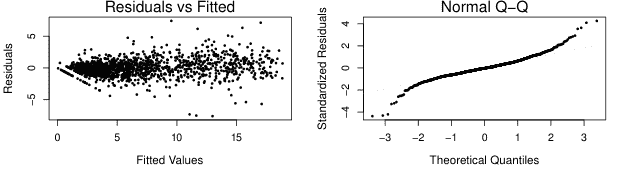

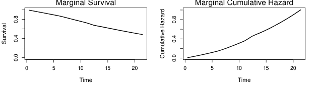

**图 6.1：**拟合到 AIDS 数据集的联合模型的默认诊断图。

> > coxFit.a <- coxph(Sur(Time, death) ~ drug, data = aids.id, x = TRUE)

> > jointFit.a <- jointModel(lmeFit.a, coxFit.a, timeVar = "obstime", method = "piecewise-PH-AGH"

通过调用 `jointModel` 对象的 `plot()` 方法可以直接获得一些基础残差诊断图；对于你的拟合模型，这些图在图 6.1 所示，包括个体特定残差及其相应拟合值的图、个体特定残差的 Q-Q 图，以及事件过程的边缘生存函数和累积风险函数。

> > par(mfrow = c(2, 2))

> > plot(jointFit.aids)

边缘生存函数使用近似公式估计：

```
$S(t) = \int S(t | b_i; \hat{\theta}) p(b_i; \hat{\theta}) db_i \approx n^{-1} \sum S(t | \hat{b}_i; \hat{\theta})$
```

边缘累积风险函数简单计算为 $H(t) = $

$S(t)$。通过计算感兴趣的特定类型残差很容易产生额外的残差图，然后将其与协变量的拟合值绘图。作为 R 中的标准做法，使用通用函数 `residuals()` 和 `fitted()` 分从拟合模型中提取残差和拟合值。额外的参数 `process` 和 `type` 指定我们要计算残差的子模型（即纵向或生存）以及残差的类型（即个体特定的或标准化版本）。例如，以下代码计算了标准化残差 $r_{i}^{ysm}$ 和边缘值 $X_{i}$。

```
resMargY.aids <- residuals(jointFit.aids, process = "Longitudinal",
type = "Marginal")
```

```
fitMargY.aids <- fitted(jointFit.aids, process = "Longitudinal",
type = "Marginal")
```

相应的散点图可以通过调用 R 的标准 `plot()` 生成；然而，我们使用了以下封装函数：

```
plotRes <- function (x, y, col.loess = "black", ...) {
plot(x, y, ...)
lines(lowess(x, y), col = col.loess, lwd = 2)
abline(h=0, lty=3, col = "grey")
}
``` 包含了散点图的 loess 平滑，帮助我们轻松定位潜在问题。

```
plot(fitMargY.aids, resMargY.aids, xlab = "Fitted Values", ylab = "Marginal Residuals")
```

生成的图如图 6.2 所示。我们观察到标准化残差与拟合值对比图中，拟合的 loess 曲线显示出系统性趋势，在小值处具有正残差。这可能表明固定效应设计矩阵的形式存在问题。

## 6.2 生存部分的残差

另一种用于联合模型的残差是马尔可夫残差，基于分层表示推导出的 $y_i$ 边缘模型，即：

> $$\begin{aligned} y_i &= X_i\beta + \varepsilon_i^T, \ \varepsilon_i &= \sim \mathcal{N}(0, Z_iD_i^T + \sigma^2I_{n_i}), \end{aligned}$$ $$ (6.3)

定义为：

> $r_i^{ym} = y_i - X_i\hat{\beta},$$ (6.4)


对应的标准化版本为

> $r_i^{ym} = \hat{V}_i^{-1/2}(y_i - X_i\hat{\beta}),$

其中 $\hat{V}_i = Z_i\hat{D}Z_i^T + \hat{\sigma}^2I_{n_i}$ 表示 $y_i$ 的估计边缘协方差矩阵。这些边缘残差 $r_i^{ym}$ 预测边缘误差 $y_i - X_i\hat{\beta} = Z_ib_i + \varepsilon_i$，用于调查均值结构 $X_i\beta$ 的潜在误设定错误，并验证受试者内协方差结构 $V_i$ 的假设。

两种类型的残差都可以用于检查联合模型的纵向部分。作为一个说明，我们为 4.2 节中拟合到 AIDS 数据集的简单联合模型生成了残差图。特别是，在纵向部分，我们假设 CD4 细胞计数平方根随时间呈个体特定的线性演变，而在生存部分，我们控制了治疗和真实 CD4 细胞计数的影响，并假设分段常数基风险函数。拟合该模型的相应 R 代码：

```
> lmeFit.aids <- lme(CD4 ~ obstime + obstime:drug, random = ~ obstime | patient, data = aids)
```

# 联合模型诊断


**图 6.1：** 拟合到 AIDS 数据集的联合模型的默认诊断图。

> > coxFit.a <- coxph(Sur(Time, death) ~ drug, data = aids.id, x = TRUE)

> > jointFit.a <- jointModel(lmeFit.a, coxFit.a, timeVar = "obstime", method = "piecewise-PH-AGH")

通过调用 `jointModel` 对象的 `plot()` 方法可以直接获得一些基础残差诊断图；对于你的拟合模型，这些图在图 6.1 所示，包括个体特定残差及其相应拟合值的图、个体特定残差的 Q-Q 图，以及事件过程的边缘生存函数和累积风险函数。

> > par(mfrow = c(2, 2))

> > plot(jointFit.aids)

边缘生存函数使用近似公式估计：

```
$S(t) = \int S(t | b_i; \hat{\theta}) p(b_i; \hat{\theta}) db_i \approx n^{-1} \sum S(t | \hat{b}_i; \hat{\theta})$
```

边缘累积风险函数简单计算为 $H(t) = - \log S(t)$。通过计算感兴趣的特定类型残差很容易产生额外的残差图，然后将其与协变量的拟合值绘图。作为 R 中的标准做法，使用通用函数 `residuals()` 和 `fitted()` 从拟合模型中提取残差和拟合值。额外的参数 `process` 和 `type` 指定我们要计算残差的子模型（即纵向或生存）以及残差的类型（即个体特定的或标准化版本）。例如，以下代码计算了标准化残差 $r_{i}^{ysm}$ 和边缘值 $X_{i}$。

```
resMargY.aids <- residuals(jointFit.aids, process = "Longitudinal",
type = "Marginal")
```

```
fitMargY.aids <- fitted(jointFit.aids, process = "Longitudinal",
type = "Marginal")
```

相应的散点图可以通过调用 R 的标准 `plot()` 生成；然而，我们使用了以下封装函数：

```
plotRes <- function (x, y, col.loess = "black", ...) {
plot(x, y, ...)
lines(lowess(x, y), col = col.loess, lwd = 2)
abline(h=0, lty=3, col = "grey")
}
```

包含了散点图的 loess 平滑，帮助我们轻松定位潜在问题。

```
plot(fitMargY.aids, resMargY.aids, xlab = "Fitted Values", ylab = "Marginal Residuals")
```

生成的图如图 6.2 所示。我们观察到标准化残差与拟合值对比图中，拟合的 loess 曲线显示出系统性趋势，在小值处具有正残差。这可能表明固定效应设计矩阵的形式存在问题。

## 6.2 生存部分的残差

另一种用于联合模型的残差是马尔可夫残差，基于分层表示推导出的，即：

> $$\begin{aligned} y_i &= X_i\beta + Z_ib_i + \varepsilon_i, \\ b_i &\sim \mathcal{N}(0, D), \quad \varepsilon_i \sim \mathcal{N}(0, \sigma^2), \end{aligned}$$ $$ (6.1)

定义如下：

> $r_i^{ys}(t) = \{y_i(t) - x_i^T(t)\hat{\beta} - z_i^T(t)\hat{b}_i\}$$ (6.2)

对应的标准化版本为

> $r_i^{yss}(t) = \{y_i(t) - x_i^T(t)\hat{\beta} - z_i^T(t)\hat{b}_i\}/\hat{\sigma},$

其中，如之前，$\hat{\beta}$ 和 $\hat{\sigma}$ 表示极大似然估计 (MLE)，$b_i$ 是随机效应的经验贝叶斯估计。这些残差预测条件误差 $\varepsilon_i(t)$，并用于检查同方性和正态性假设。另一方面，边缘残差关注由分层表示推导出的 $y_i$ 边缘模型，即：

> $$\begin{aligned} y_i &= X_i\beta + \varepsilon_i^T, \\ \varepsilon_i &\sim \mathcal{N}(0, Z_iD_i^T + \sigma^2I_{n_i}), \end{aligned}$$ $$ (6.3)

定义为：

> $r_i^{ym} = y_i - X_i\hat{\beta},$$ (6.4)

对应的标准化版本为

> $r_i^{ym} = \hat{V}_i^{-1/2}(y_i - X_i\hat{\beta}),$

其中 $\hat{V}_i = Z_i\hat{D}Z_i^T + \hat{\sigma}^2I_{n_i}$ 表示 $y_i$ 的估计边缘协方差矩阵。这些边缘残差 $r_i^{ym}$ 预测边缘误差 $y_i - X_i\hat{\beta} = Z_ib_i + \varepsilon_i$，用于调查均值结构 $X_i\beta$ 的潜在误设定错误，并验证受试者内协方差结构 $V_i$ 的假设。

两种类型的残差都可以用于检查联合模型的纵向部分。作为一个说明，我们为 4.2 节中拟合到 AIDS 数据集的简单联合模型生成了残差图。特别是，在纵向部分，我们假设 CD4 细胞计数平方根随时间呈个体特定的线性演变，而在生存部分，我们控制了治疗和真实 CD4 细胞计数的影响，并假设分段常数基风险函数。拟合该模型的相应 R 代码：

```
> lmeFit.aids <- lme(CD4 ~ obstime + obstime:drug, random = ~ obstime | patient, data = aids)
```

# 联合模型诊断


**图 6.1：** 拟合到 AIDS 数据集的联合模型的默认诊断图。

> > coxFit.a <- coxph(Sur(Time, death) ~ drug, data = aids.id, x = TRUE)

> > jointFit.a <- jointModel(lmeFit.a, coxFit.a, timeVar = "obstime", method = "piecewise-PH-AGH")

通过调用 `jointModel` 对象的 `plot()` 方法可以直接获得一些基础残差诊断图；对于你的拟合模型，这些图在图 6.1 所示，包括个体特定残差及其相应拟合值的图、个体特定残差的 Q-Q 图，以及事件过程的边缘生存函数和累积风险函数。

> > par(mfrow = c(2, 2))

> > plot(jointFit.aids)

边缘生存函数使用近似公式估计：

```
$S(t) = \int S(t | b_i; \hat{\theta}) p(b_i; \hat{\theta}) db_i \approx n^{-1} \sum S(t | \hat{b}_i; \hat{\theta})$
```

边缘累积风险函数简单计算为 $H(t) = - \log S(t)$。通过计算感兴趣的特定类型残差很容易产生额外的残差图，然后将其与协变量的拟合值绘图。作为 R 中的标准做法，使用通用函数 `residuals()` 和 `fitted()` 从拟合模型中提取残差和拟合值。额外的参数 `process` 和 `type` 指定我们要计算残差的子模型（即纵向或生存）以及残差的类型（即个体特定的或标准化版本）。例如，以下代码计算了标准化残差 $r_{i}^{ysm}$ 和边缘值 $X_{i}$。

```
resMargY.aids <- residuals(jointFit.aids, process = "Longitudinal",
type = "Marginal")
```

```
fitMargY.aids <- fitted(jointFit.aids, process = "Longitudinal",
type = "Marginal")
```

相应的散点图可以通过调用 R 的标准 `plot()` 生成；然而，我们使用了以下封装函数：

```
plotRes <- function (x, y, col.loess = "black", ...) {
plot(x, y, ...)
lines(lowess(x, y), col = col.loess, lwd = 2)
abline(h=0, lty=3, col = "grey")
}
```

包含了散点图的 loess 平滑，帮助我们轻松定位潜在问题。

```
plot(fitMargY.aids, resMargY.aids, xlab = "Fitted Values", ylab = "Marginal Residuals")
```

生成的图如图 6.2 所示。我们观察到标准化残差与拟合值对比图中，拟合的 loess 曲线显示出系统性趋势，在小值处具有正残差。这可能表明固定效应设计矩阵的形式存在问题。

## 6.2 生存部分的残差

另一种用于联合模型的残差是马尔可夫残差，基于分层表示推导出的。

我们通过继续第 6.1.1 节中针对 AIDS 数据集的残差分析，在 R 中演示马尔可夫残差和 Cox-Snell 残差的用法，并验证生存部分的拟合优度。我们首先检查时变标记的选定函数形式。即在上一节定义的相对风险子模型中，我们假设标记的当前值与事件风险相关，即：


## 纵向数据与生存数据的联合模型

分层模型的假设，即：

> $$\begin{aligned} y_i &= X_i\beta + Z_ib_i + \varepsilon_i, \\ b_i &\sim \mathcal{N}(0, D), \quad \varepsilon_i \sim \mathcal{N}(0, \sigma^2), \end{aligned}$$ $$ (6.1)

定义如下：

> $r_i^{ys}(t) = \{y_i(t) - x_i^T(t)\hat{\beta} - z_i^T(t)\hat{b}_i\}$$ (6.2)

对应的标准化版本为

> $r_i^{yss}(t) = \{y_i(t) - x_i^T(t)\hat{\beta} - z_i^T(t)\hat{b}_i\}/\hat{\sigma},$

其中，如之前，$\hat{\beta}$ 和 $\hat{\sigma}$ 表示极大似然估计 (MLE)，$b_i$ 是随机效应的经验贝叶斯估计。这些残差预测条件误差 $\varepsilon_i(t)$，并用于检查同方性和正态性假设。另一方面，边缘残差关注由分层表示推导出的 $y_i$ 边缘模型，即：

> $$\begin{aligned} y_i &= X_i\beta + \varepsilon_i^T, \\ \varepsilon_i &\sim \mathcal{N}(0, Z_iD_i^T + \sigma^2I_{n_i}), \end{aligned}$$ $$ (6.3)

定义为：

> $r_i^{ym} = y_i - X_i\hat{\beta},,$$ (6.4)

对应的标准化版本为

> $r_i^{ym} = \hat{V}_i^{-1/2}(y_i - X_i\hat{\beta}),$

其中 $\hat{V}_i = Z_i\hat{D}Z_i^T + \hat{\sigma}^2I_{n_i}$ 表示 $y_i$ 的估计边缘协方差矩阵。这些边缘残差 $r_i^{ym}$ 预测边缘误差 $y_i - X_i\hat{\beta} = Z_ib_i + \varepsilon_i$，用于调查均值结构 $X_i\beta$ 的潜在误设定错误，并验证受试者内协方差结构 $V_i$ 的假设。

两种类型的残差都可以用于检查联合模型的纵向部分。作为一个说明，我们为 4.2 节中拟合到 AIDS 数据集的简单联合模型生成了残差图。特别是，在纵向部分，我们假设 CD4 细胞计数平方根随时间呈个体特定的线性演变，而在生存部分，我们控制了治疗和真实 CD4 细胞计数的影响，并假设分段常数基风险函数。拟合该模型的相应 R 代码：

```
> lmeFit.aids <- lme(CD4 ~ obstime + obstime:drug, random = ~ obstime | patient, data = aids)
```

## 联合模型诊断


**图 6.1：** 拟合到 AIDS 数据集的联合模型的默认诊断图。

```
> coxFit.a <- coxph(Sur(Time, death) ~ drug, data = aids.id, x = TRUE)
> jointFit.a <- jointModel(lmeFit.a, coxFit.a, timeVar = "obstime", method = "piecewise-PH-AGH")
```

通过调用 `jointModel` 对象的 `plot()` 方法可以直接获得一些基础残差诊断图；对于你的拟合模型，这些图在图 6.1 所示，包括个体特定残差及其相应拟合值的图、个体特定残差的 Q-Q 图，以及事件过程的边缘生存函数和累积风险函数。

```
> par(mfrow = c(2, 2))
> plot(jointFit.aids)
```

边缘生存函数使用近似公式估计：

```
$S(t) = \int S(t | b_i; \hat{\theta}) p(b_i; \hat{\theta}) db_i \approx n^{-1} \sum S(t | \hat{b}_i; \hat{\theta})$
```

边缘累积风险函数简单计算为 $H(t) = S(t)$。通过计算感兴趣的特定类型残差很容易产生额外的残差图，然后将其与协变量的拟合值绘图。作为 R 中的标准做法，使用通用函数 `residuals()` 和 `fitted()` 从拟合模型中提取残差和拟合值。额外的参数 `process` 和 `type` 指定我们要计算残差的子模型（即纵向或生存）以及残差的类型（即个体特定的或标准化版本）。例如，以下代码计算了标准化残差 $r_{i}^{ysm}$ 和边缘值 $X_{i}$。

```
resMargY.aids <- residuals(jointFit.aids, process = "Longitudinal", type = "Marginal")
fitMargY.aids <- fitted(jointFit.aids, process = "Longitudinal", type = "Marginal")
```

相应的散点图可以通过调用 R 的标准 `plot()` 生成；然而，我们使用了以下封装函数：

```
plotRes <- function (x, y, col.loess = "black", ...) {
  plot(x, y, ...)
  lines(lowess(x, y), col = col.loess, lwd = 2)
  abline(h=0, lty=3, col = "grey")
}
```

包含了散点图的 loess 平滑，帮助我们轻松定位潜在问题。

```
plot(fitMargY.aids, resMargY.aids, xlab = "Fitted Values", ylab = "Marginal Residuals")
```

生成的图如图 6.2 所示。我们观察到标准化残差与拟合值对比图中，拟合的 loess 曲线显示出系统性趋势，在小值处具有正残差。这可能表明固定效应设计矩阵的形式存在问题。

## 6.2 生存部分的残差

另一种用于联合模型的残差是马尔可夫残差，基于分层表示推导出的...


```r
plot(fitMargY.aids, resMargY.aids, xlab = "Fitted Values", ylab = "Marginal Residuals")
```

生成的图如图 6.2 所示。我们观察到标准化残差与拟合值对比图中，拟合的 loess 曲线显示出系统性趋势，在小值处具有正残差。这可能表明固定效应设计矩阵的形式存在问题。

## 6.2 生存部分的残差

另一种用于联合模型的残差是马尔可夫残差，基于分层表示推导出的...

## 联合模型诊断

其中 $f(\cdot)$ 表示一个未知函数，我们的目标是探索 $f(x)$ 的默认选择是否合适。Thneau 等人 (1990) 证明，在某些条件下，零模型马尔量残差与感兴趣的预测变量之间的散点图可以揭示 $f(\cdot)$ 函数的真实形式。在示例中，由于我们已经固定了假设当前值为 $m_i(t)$ 的相对风险模型，我们可以转而观察马尔量残差 $r_i^{tm}(t)$ 与 $m_i(t)$ 的散点图以是否存在系统性趋势。这些残差是通过拟合的联合模型通过在调用 `residuals()` 时使用 `process = "Event"` 选项来计算得的。

```r
martRes <- residuals(jointFit.airs, process = "Event")
mi.t <- fitted(jointFit.airs, process = "Longitudinal")
```

`residuals()` 为所有我们拥有患者死亡状态信息的时间点计算马尔量残差。这些点包括记录纵向响应的时间点 $\{t_{ij}, j=1, \dots, n_i\}$ 以及观测到的事件 $T_i$。为了计算相同时间点的当前值 $m_i(t)$，我们在调用 `fitted()` 泛型函数在使用 `type = "EventTime"` 选项。图 6.3 显示了相应的散点图，并叠加了使用第 6.1.1 节定义的 `plotResid()` 函数生成的平曲线。

```r
plotResid(mi.t, martRes, col = "grey", ylab = "Martingale Residuals", xlab = "Subject-Specific Fitted Longitudinal Outcome")
```

我们观察到对于小的拟合值，平滑曲线略偏零。为了进一步研究所选函数对 CD4 计数适用性，建议在考虑其他协变量时额外检查马尔量残差中的系统性趋势。作为说明，我们通过对随机治疗进行条件化生成了图 6.3 的更新版本。AIDS 组的散点图是通过 `xyplot()` 函数生成的：

```r
xyplot(martRes ~ mi.t | drug, data = aids, type = c("p", "smooth"), col = "black", lwd = 3, ylab = "Martingale Residuals", xlab = "Subject-Specific Fitted Values Outcome")
```

`xyplot()` 调用中的 `type = c("p", "smooth")` 选项指定我们希望同时绘制点和平滑器的拟合曲线。$t=0$ 时的基线测量被排除在 $r_i^{tm}(t)$ 的计算之外，因为它们的马尔量残差始终为零。

## 纵向与生存数据的联合模型


**图 6.3：** AIDS 数据马尔量残差与纵向结局个体特定拟合值的散点图。灰色实线表示 loess 平滑器的拟合情况。

我们再次观察到两种治疗方法相对于零水平线都有一些微小偏差，但 AIDS 组的程度较小。我们通过使用 Cox-Snell 残差评估生存模型的整体拟合情况，继续对生存结局进行残差分析。这些再次使用 `residuals()` 函数计算，但现在使用了 `type = "CoxSnell"`：

```r
resCST <- residuals(jointFit.airs, process = "Event", type = "CoxSnell")
```

使用来自 **survival** 包的 `survfit()` 函数计算 Cox-Snell 残差生存函数的 Kaplan-Meier 估计。该函数的语法与此为止用于拟合 Cox 模型的 `cph()` 语法非常相似。特别是，它接受一个 R 公式格式的 `main` 参数，在左侧使用 `Surv()` 提供删失响应，在右侧可能包含潜在的分层因子。注意，在我们的案例中，删失响应不是患者的观测死亡时间，而是 Cox-Snell 残差。相应的事件指示器从 `data` 参数提供的 `aids` 数据框中提取。Kaplan-Meier 估计图如下


**图 6.4：** AIDS 数据中每个治疗组的马尔量残差与纵向结局个体特定拟合值的散点图。灰色实线表示 loess 平滑器的拟合情况。

通过调用 `plot()` 函数生成，并如图 6.5 所示：

```r
sfit <- survfit(Surv(resCST, death) ~ 1, data = aids.id)
plot(sfit, mark.time = FALSE, conf.int = TRUE, xlab = "Cox-Snell Residuals", ylab = "Survival Probability", main = "Survival Function of Cox-Snell Residuals")
curve(exp(-x), from = 0, to = max(aids.id$Time), add = TRUE, col = "grey", lwd = 2)
```

`curve()` 函数用于监督单位指数分布的生存函数，即 $S_{exp}(t) = exp(-t)$。将 Kaplan-Meier 估计的拟合情况与期望分布比较，我们观察到残差大于 0.8 时存在某些差异（尽管严格来说，单位指数分布的生存函数位于 Kaplan-Meier 估计的 95% 点置信区间内，除某些外）。为了进一步检查模型的拟合情况，我们根据治疗对残差进行分层并绘制生存函数估计；相应的 R 代码为

## 纵向与生存数据的联合模型

### Cox-Snell 残差的生存函数


**图 6.5：** Cox-Snell 残差的生存函数。黑色实线表示 Kaplan-Meier 估计的生存函数（虚线对应 95% 点置信区间），灰色实线表示单位指数分布的生存函数。

```r
sfit <- survfit(Surv(resCST, death) ~ drug, data = aids.id)
plot(sfit, mark.time = FALSE, conf.int = TRUE, xlab = "Cox-Snell Residuals", ylab = "Survival Probability", main = "Survival Function of Cox-Snell Residuals")
curve(exp(-x), from = 0, to = max(aids.id$Time), add = TRUE, col = "grey", lwd = 2)
```

当模型良好拟合数据时，我们期望每个层的生存函数估计围绕单位指数分布波动。图 6.6 显示了 Cox-Snell 残差各治疗组的 Kaplan-Meier 估计，从中我们可以再次观察到残差大于 1 时存在不拟合情况，尽管程度比图 6.5 小。

## Cox-Snell 残差的生存函数


**图 6.6：** AIDS 数据中 Cox-Snell 残差各治疗组的生存函数。黑色实线表示 Kaplan-Meier 估计，灰色实线表示单位指数分布的生存函数。

## 6.2 缺失与残差

上一节介绍了通常用于验证混合模型和相对风险模型假设的基本残差图类型。虽然可以很容易构建相同类型的残差图来检查联合模型的拟合情况，但问题在于纵向过程的参考分布受到事件发生导致的缺失的影响。特别是正如我们在第 4.6 节讨论的，当患者发生感兴趣的事件时，这对应于纵向信息收集的中断，因为无法再收集测量，或者其分布在事件后发生了变化并被认为是不重要的。正如我们在第 4 节中看到的，联合模型隐含的缺失机制具有非随机性，即对应于非随机缺失机制（MNAR）。缺失机制的非随机性意味着计算残差的观测数据并不是目标人群的随机样本。这意味着仅基于观测数据的残差图可能会产生误导性，因为这些残差不应

## 生存数据的联合模型

标准性质，例如均值为零和独立性。例如，在图 6.2 中我们观察到，对于小的拟合值，负残差更多。然而，较小的拟合值对应于较低的 CD4 计数水平，这反过来意味着患者状况恶化，从而导致更高的脱失率。因此，对应于小拟合值的残差仅基于状况“良好”的患者。因此，由于脱失，我们无法确定图 6.2 中看到的系统性趋势是否真实源于设计矩阵 $X$ 的设定不当。为了说明脱失如何影响基于观测数据的残差的使用，我们在图 6.7 中展示了 PBC 数据集的标准化边际残差和个体特定残差与拟合值的对比图。这些基于一个联合模型，该模型假设血清胆蛋白具有个体特异演变，并对事件时间（死亡或移植）采用相对风险模型，该模型控制了治疗因素并假设分段常数基线函数。拟合该模型的 R 语法：

```r
lFit2 <- lme(serumbilir ~ drug, random = ~ id, data = pbc)
coxFit.pbc <- coxph(Surv(status) ~ drug + hepatomegaly, data = pbc)
jointFit2.pbc <- jointModel(lFit2, coxFit.pbc, timeVar = "year", method = "piecewise-PH")
```

对于 6.1 节中的 AIDS 数据集，我们使用通用的 `residuals()` 和 `fitted()` 函数来计算残差和拟合值。

```r
resSubY.pbc <- residuals(jointFit2.pbc, process = "Longitudinal", type = "stand-Subject")
fitSubY.pbc <- fitted(jointFit2.pbc, process = "Longitudinal", type = "Subject")
resMargY.pbc <- residuals(jointFit2.pbc, process = "Longitudinal", type = "stand-Marginal")
fitMargY.pbc <- fitted(jointFit2.pbc, process = "Longitudinal", type = "Marginal")
```

然后通过代码生成图 6.7：


**图 6.7：** PBC 数据集纵向过程观测残差与拟合值的散点图。

```r
par(mfrow = c(1,2))
plotResid(fitSubY.pbc, resSubY.pbc, xlab = "Fitted Values", ylab = "Subject-Specific Residuals")
plotResid(fitMargY.pbc, resMargY.pbc, xlab = "Fitted Values", ylab = "Marginal Residuals")
```

我们再次观察到，标准化边际残差与拟合值图中的拟合曲线显示出系统性趋势。然而注意，高水平的血清胆蛋白表示患者状况恶化，导致较高的死亡率（即脱失）。与图 6.2 类似，我们无法从该图中得出拟合不良归因于 $X$ 设定不当的结论。因此，AIDS 和 PBC 数据示例都说明，仅基于观测数据的残差图在验证联合模型假设时可能会产生误导性。

## 纵向数据与生存数据的联合模型

## 6.3 多重插补残差

### 6.3.1 固定访问时间

为了克服非随机脱失引起的问题，并在诊断图中生成易于读取的纵向过程残差，Rizopoulos 等人 (2010) 提议，在完全数据模型下通过随机插补的纵向响应来增强观测数据，这对应于患者未脱失时本会观测到的纵向结果。使用这些增强的纵向响应，然后计算完全数据的残差，并使用多重插补法来正确考虑由于缺失导致的插补值的不确定性（Gelman 等人，2005）。

为了介绍这一观点，我们将回顾第 4.6 节的符号，并用 $y_i^o=\{y_i(t_{ij}) : t_{ij}, j=1,\dots,n_i\}$ 表示纵向响应向量的观测部分，它包含了第 $i$ 个受试者的所有纵向测量值；用 $y_i^m=\{y_i(t_{ij}) : t_{ij} \ge T_i; j=1,\dots,n_i^m\}$ 表示缺失部分，它包含了在事件未发生的情况下本会持续到研究结束的纵向测量。我们还假设联合模型已拟合数据集，并获得了极大似然估计 $\hat{\theta}$ 及其渐近协方差矩阵的估计 $\hat{v}(\hat{\theta})$。此外，纵向测量计划在一组预设的时间点 $t_1,\dots,t_{max}$ 进行，且对于第 $i$ 个受试者，测量值一直可用直到 $T_i$ 之前的最后一个预设时间。为了提出这些想法，我们采用贝叶斯表述，因为多重插补是基于 $\hat{\theta}$ 的。特别是多重插补法分别考虑了参数和经验贝叶斯估计中的不确定性，其中积分函数的第一部分，以及针对事件时间（死亡或移植）的相对风险模型，该模型控制了治疗因素并假设分段常数基线函数。拟合该模型的 R 语法：

```r
lFit2 <- lme(serumbilir ~ drug, random = ~ id, data = pbc)
coxFit.pbc <- coxph(Surv(status) ~ drug + hepatomegaly, data = pbc)
jointFit2.pbc <- jointModel(lFit2, coxFit.pbc, timeVar = "year", method = "piecewise-PH")
```

积分函数的第一部分，对于 $b_i$，可以表示为：

$$\begin{aligned}
p(y_i^m \mid \theta, y_i^o, \delta_i) &= \int p(y_i^m \mid b_i, \theta) p(b_i \mid y_i^o, \delta_i) db_i \\
\end{aligned}$$

对于后部分，即给定观测数据的参数后验分布，我们使用以下模拟方案：

- 抽取 $\theta^{(l)} \sim \mathcal{N}(\hat{\theta}, \hat{v}(\hat{\theta}))$
- 抽取 $b_i^{(l)} \sim p(b_i \mid y_i^o, \theta^{(l)})$
- 抽取 $y_i^{(m)}(t_{ij}) \sim \mathcal{N}(m_i^{(l)}(t_{ij}), \sigma^{(2)})$

步骤 1-3 对每个受试者重复进行，$l=1, \dots, L$，其中 $L$ 表示插补次数。多重插补残差的一个主要优势是它们继承了完全数据模型的属性。这使得常用的图形检查变得便利，而无需对观测残差的参考分布进行正式推导。然而，我们应该注意，在某些以死亡为终止事件的临床研究中（例如 AIDS 和 PBC 数据集），考虑死亡之后的纵向结果潜在值在概念上可能是不合理的。

## 纵向数据与生存数据的联合模型

事件时间；例如，参见 Kurland and Heagerty (2005)。尽管如此，多次插补的残差仅用作辅助研究模型拟合程度的机制，我们实际上对事件时间之后的推断并不感兴趣。

上述的模拟方案在 `residuals()` 方法中可用，并可以使用逻辑参数 `MI` 调用。作为示例，我们为 AIDS 数据集计算多次插补的标准化边际残差：

```r
set.seed(123) # 我们设置种子以保证结果的可重复性
resMI.a <- residuals(jointFit.a, process = "Longitudinal", type = "Marginal", MI = TRUE)
fitMargYmiss.a <- resMI.a$fitted.vals
resMargYmiss.a <- resMI.aids$res.vals
```

与返回残差数值向量的 `residuals()` 调用（如上所示）不同，`MI` 返回的是一个包含多个组件的列表，这些组件对于进一步处理多次插补残差有用。我们提取的两个组件是拟合值以及对应于第 6.1.1 节定义的 $y_i^m$ 的多次插补标准化边际残差。`ObjectMargY.miss` 是一个数值向量，而 `resMargY.miss` 是一个数值矩阵，其列代表基于 $y_i^m$ 多次插补的残差实现（默认为 50 次插补，这由函数 `residuals()` 的参数 `M` 控制）。以下代码生成图 6.8，该图描述了多次插补残差以及观测残差与其对应拟合值的对比图：


# 联合模型诊断

## 6.3.1 非随机脱落

图 6.8 中的黑色损失曲线实际上与图 6.2 中的 `resMargY.aids` 曲线相同，它由以下代码生成：

- `lines(lowess(fitMargY.aids, resMargY.aids), lwd = 2)`

然而，为了产生灰色损失曲线（该曲线描述了完全残差——即多次插补残差与观测残差的结合——与其对应拟合值之间的关系），需要额外的步骤。特别是，我们需要考虑到，对于第 $i$ 个受试者未在研究中心出现的时间点，我们有 $M = 50$ 次多次插补残差，而在她出现的时间点，我们只有一个。因此，在计算 loess 曲线时，我们对观测残差使用权重 1，而对多次插补残差使用权重 $1/M = 0.02$，即：

```r
M <- ncol(resMargYmiss.aids) # 插补次数
resMargYmi.aids <- c(resMargY.aids, resMargYmiss.aids)
fitMargYmi.aids <- c(fitMargY.aids, rep(fitMargYmiss.aids, M))
plot(range(fitMargY.aids), range(resMargYmi.aids), type = "n",
     xlab = "Fitted Values",
     ylab = "MI Standardized Marginal Residuals")
abline(h = 0, lty = 2)
points(fitMargYmiss.aids, resMargYmiss.aids, cex = 0.5,
       col = "grey")
points(fitMargY.aids, resMargY.aids)
```

```r
datResid <- data.frame(
  resid = resMargYmi.aids,
  fitted = fitMargYmi.aids,
  weight = c(rep(1, length(resMargY.aids)),
             rep(1/M, length(resMargYmiss.aids)))
)
```

```r
fitLoess <- loess(resid ~ fitted, data = datResid,
                  weights = weight)
```

```r
nd.aids <- data.frame(fitted = seq(min(fitMargYmi.aids),
                                   max(fitMargYmi.aids), length.out = 100))
```

```r
prdless.aids <- predict(fitLoess, nd.aids)
```

```r
lines(nd.aids$fitted, prdless.aids, lwd = 2, lty = 2)
```

两个 loess 平滑器之间的比较表明，仅基于观测数据的残差图中所示的系统性趋势，确实仅仅归因于非随机脱落，而不是模型拟合不佳。

## 6.3.2 随机随访时间

第 6.3.1 节提出的多次插补方案假设随访时间是由方案规定的，且所有患者都遵循规定。然而，在观察性研究中，进行纵向测量的时间点并非固定的，而是由医生甚至患者本身决定的。这在随机研究中也可能发生，根据方案会有随访时间。对于 PBC 数据集，在随访的前两年内，胆红素水平测量是在基线、0.5 年、1 年和 2 年进行的，变异很小；然而在随后的年份中，随访时间的变异显著增加。根据第 4.3.2 节提到的非信息假设，且在联合模型设定正确的情况下，可以忽略随访过程，而不会影响极大似然估计量的渐近性质。

然而，随机随访时间的出现增加了第 6.3.1 节所示多次插补估计的复杂度。特别是，第 $i$ 个受试者在观测事件后本应提供测量的时间点是不可用的，因此设计矩阵 $X_i$ 和 $Z_i$ 在 $t_{ij} \ge T_i$ 对应的行 $x_i^t_{(ij)}$ 和 $z_i^t_{(ij)}$ 无法设定。这个问题无法通过在随机时间插补 $y_i^*$ 的简单方法来解决。

### 仿真方案

独立于 $y_i^n(t_{i,n+1})$。因此，随机访问时间下的仿真方案形式如下：

**S1：参数值**

- 抽取 $\theta_v^{(l)} \sim \mathcal{N}\{\hat{\theta}_v, \text{var}(\hat{\theta}_v)\}$。
- 抽取 $\theta^{(l)} \sim \mathcal{N}\{\hat{\theta}, \text{var}(\hat{\theta})\}$。

**S2: 脆弱性与随机效应**

- 对于有两次或以上访问的受试者，抽取 $\omega_i^{(l)} \sim \text{Gamma}(A, B)$，其中 $A = \sigma_\omega^{(l)} + \sum_{k=2}^{n_i} \delta_{ik}$，且 $B = \sigma_\omega^{(l)} + \phi^{(l)} \sum_{k=2}^{n_i} u_{ik}^{(l)} \exp(x_{vi}^{\top} \gamma_v^{(l)})$；对于访问一次的受试者，抽取 $\omega_i^{(l)} \sim \text{Gamma}(\sigma_\omega^{(l)}, \phi_\omega^{(l)})$。
- 抽取 $b_i^{(l)} \sim \{b_i \mid y_i^{\top}, T_i, \delta_i, \theta_i^{(l)}\}$。

**S3：结局**

- 抽取 $u_i^{(l)} \sim \text{Weibull}\{\psi^{(l)}, \phi^{(l)} \exp(x_{vi}^{\top} \gamma_v^{(l)})\}$，
- 设置 $\tilde{t}_i = u_i^{(l)} + t_{i_n}$，其中 $t_{i_n}$ 表示第 $i$ 个受试者的最后观测时间。如果 $\tilde{t}_i > t_{max}$，则无需该受试者进行插补；否则抽取 $y_i^{m(l)}(\tilde{t}_i) \sim \mathcal{N}\{\hat{m}_i^{(l)}(\tilde{t}_i), \hat{\sigma}^{2,(l)}\}$，其中 $\hat{m}_i^{(l)}(\tilde{t}_i) = x_i^{(l)\top} \beta^{(l)} + \zeta^{(l)}b_i^{(l)}$。
- 设置 $t_{in} = \tilde{t}_i$，并对所有 $i$ 重复直到 $t_{in} > t_{max}$。

步骤 1–3 重复 $l=1, \dots, L$。如第 6.3.1 节所示，步骤 1–3 同时考虑了联合模型和访问过程模型中的不确定性。此外，注意只有一次测量量的受试者没有为访问过程模型提供信息。对于这些情况，在步骤 3a 中，我们只能使用来自 Gamma 先验分布的模拟脆弱性值来模拟未来的流逝时间（步骤 2a）。

应用上述仿真方案的一个方面是访问过程模型线性预测器的形式。更具体地说，我们应该注意到假设 (6.9) 是联合模型即使在忽略访问过程的情况下提供有效推断的最弱假设，但满足 (6.9) 的模型涉及许多参数，因此可能是不稳定的。一组更强但可能更合理的假设是：

```
$p(u_{ik} | u_{i2}, \dots, u_{i,k-1}; Y_i^*; \theta_v)$
```

以及

```
$p(u_{ik} | u_{i2}, \dots, u_{i,k-1}, Y_i^*; \theta_v) = p(u_{ik} | y_i(t_{k-1}); \theta_v)$
```

方程 (6.11) 假设访问 $k-1$ 和 $k$ 之间的流逝时间依赖于之前的流逝时间和最后观测的纵向测量，而 (6.12) 则仅依赖于最后观测的纵向测量。这些假设描述了这样的情况：医生根据最后观测的结果和可能的过去访问模式对患者的未来访问做出决策。

我们在第 6.2 节中说明了使用多重插补方法对拟合 PBC 数据集的联合模型进行。作为第一步，我们需要指定访问过程模型。为了说明方便，我们在这里假设一个简单模型，假设访问 $k-1$ 和 $k$ 之间的流逝时间依赖于之前的访问时间和当前胆红素的值。该模型对应假设 (6.11)，其形式如下：

```
$$\lambda(u_{ik} | y_i^*(t_k), \omega_i) = \lambda_0(u_{ik}) \omega_i \exp\{y_i(t_{k-1})\} \quad \omega_i \sim \text{Gamma}(\sigma_{\omega}, \sigma_\omega)$$
```

为了拟合该模型，我们首先需要从 `pbc2` 数据框中提取每个受试者访问之间的流逝时间 $\{u_{ik}, k=2, \dots, n_i\}$ 以及滞后响应向量 $\{y_i(t_{k-1}), k=2, \dots, n_i\}$。通过以下代码实现：

- `diff.time <- with(pbc2, tapply(year, id, diff))`
- `prev.y <- with(pbc2, tapply(log(serumBilir), head, -1))`
- `one_visit <- with(pbc2, tapply(year, id, length) == 1)`
- `diff.time[one_visit] <- NA`
- `prev.y[one_visit] <- NA`

特别是，`diff.time` 和 `prev.y` 对应于识别出的变量。

`summary()` 的详细输出显示，访问时间与胆红素的值密切相关，且患者的访问模式中存在相当大的异质性（即脆弱性方差）。

接下来，我们构建包含单次测量信息的数据框。为了让 `residuals()` 模拟未来的时间，我们需要提供拟合的 Weibull 模型。

```r
attr(WeFra, "id") <- "prev.y"
```

然后，`residuals()` 的调用与 6.3.1 中的非常相似。特别是，在调用 `residuals()` 时设置 `MI = TRUE` 实现了多重插补方案。如第 6.3.1 节所示，我们提取插补响应的标准差和相应的拟合值，然后分别构建完整数据的数据框。

```r
set.seed(123) # 我们设置种子以确保可重复性
resMI.pbc <- residuals(jointFit2, type = "stand-Marginal",
                       MI = TRUE, M = 10, time.points = WeibFra)
```

```r
fitMargY.pbc <- unlist(resMI.pbc$fitted.valM)
resMargY_pbc <- unlist(resMI.pbc$resid.valM)
```

```r
M <- length(resMI.pbc$fitted.valM)
```

```r
datResid <- data.frame(
  resid = c(resMargY_pbc, resMI.pbc$resid.valM), # 修正：原文似有误，此处推测为合并观测与插补残差
  fitted = c(fitMargY.pbc, unlist(resMI.pbc$fitted.valM)),
  weight = c(rep(1, length(resMargY_pbc)),
             rep(1/M, length(unlist(resMI.pbc$resid.valM))))
)
```

```r
datResid <- datResid[complete.cases(datResid), ]
```

为了利用残差与拟合值散点图中的所有系统趋势，我们计算 loess 平滑。同样，对于完成数据的 loess 平滑需要考虑退出后残差过度表示的事实。在第 6.3.1 节中，我们通过加权 loess 平滑实现这一点，退出后残差的权重为 $1/L = 1/10$。我们对应的代码是：

```r
fitLoess.pbc <- loess(resid ~ fitted, data = datResid, weights = weight)
```

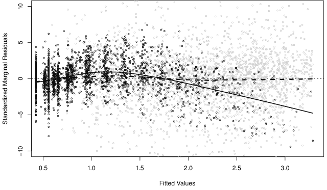

最后，残差与拟合值的散点图（包括两个 loess 平滑器，即基于观测数据线的一个和基于填补完成数据的另一个）可以通过以下代码生成：

```r
nd.pbc <- data.frame(fitted = seq(min(datResid$fitted, na.rm = TRUE),
                                  max(datResid$fitted, na.rm = TRUE), length.out = 100))

prdLoess.pbc <- predict(fitLoess.pbc, nd.pbc)
```

```r
plot(range(fitMargY.pbc, na.rm = TRUE), range(resMargY_pbc, na.rm = TRUE),
     type = "n", xlab = "Fitted Values", ylab = "Standardized Marginal Residuals")

abline(h = 0, lty = 2)
points(fitMargY.pbc, resMargY_pbc)
points(unlist(resMI.pbc$fitted.valM), unlist(resMI.pbc$resid.valM), col = "grey")
lines(lowess(fitMargY.pbc, resMargY_pbc), lwd = 2)
lines(nd.pbc$fitted, prdLoess.pbc, lwd = 2, lty = 2)
```

正如 AIDS 数据集的情况一样，我们从图 6.9 中观察到，基于完成数据的加权 loess 并没有表现出在仅基于观测数据的 loess 曲线中清晰看到的系统性趋势。这有力地表明，这种系统性趋势主要是由于脱落（dropout）引起的，而不是模型拟合不良。

## 6.4 随机效应分布

我们在联合模型中做出分布假设的最后一个部分是随机效应。正如我们已经看到的，在混合模型中，标准的选择是假设随机效应服从均值为零、协方差矩阵为 $D$ 的正态分布，尽管许多时候这种选择实际上是出于计算考虑的。检查正态分布适用性的主要问题在于，随机效应是潜变量，无法直接构建残差（即观测值减去期望值/拟合值）。尽管如此，在标准的混合模型文献中，线性混合效应模型对这种分布的误设定具有较强的稳健性（Verbeke and Lesaffre, 1997）。然而，在广义线性混合模型中，关于这一话题存在更多模糊性，一些作者报告了推论对随机效应分布的敏感性（Heagerty and Kurland, 2001; Agresti et al., 2004; Litière et al., 2007, 2008），而另一些人则报告了稳健性（Neuhaus et al., 1992, 1994, 2011）。

在联合模型中，由于两个原因，人们对随机效应分布的潜在误设定可能对推论的影响更加关注。首先，随机效应在联合模型中起着更核心的作用，因为它们被用于捕捉纵向结局重复测量之间的相关性，以建立纵向过程与时间过程之间的关联。其次，正如我们在 6.2 节中解释过的，由事件发生导致的非参数脱落增加了复杂性，因为在缺失数据文献中已知，随机脱落设置下的推论对建模假设非常敏感（Copas and Li, 1997; Molenbergs et al., 2008）。

这些特征促使 Song 等人 (2002) 提出了一种基于 Gallant 和 Nychka (1987) 以及 Tsiatis 和 Davidian (2001) 研究的平滑密度类对该分布的灵活模型，并提出了一种半参数估计方程方法，该方法可以在不需要指定随机效应分布的情况下提供有效的推论。然而，这些作者的模拟结果表明，参数估计和标准误对误设定是相当稳健的。这一特征后来被 Rizopoulos 等人 (2008) 和 Huang 等人 (2009) 从理论上证实，他们表明随着个体 $n_i$ 重复测量次数的增加，随机效应分布的误设定对参数估计量和标准误的影响微乎其微。

# 第 7 章 动态预测

建立统计模型的动机通常是为了感兴趣的结局提供预测。在本章中，我们说明如何利用拟合的联合模型为生存和纵向结局提供个体化预测。我们在这里考虑的设置的一个重要特征是这些预测具有动态性质，也就是说随着时间的推移，患者会记录额外的信息，因此可以利用新信息更新他们的预测。为了评估这些预测的质量，我们提出了基于受试者工作特征（ROC）的指标。

## 7.1 概率的动态预测

### 7.1.1 定义

我们首先关注生存概率的预测。特别是对于随访期间特定时间点的特定患者，我们希望利用手中的所有信息（包括基线）来产生生存概率预测。为了使其更有相关性，我们感兴趣的是生存时间 $u$ 直到 $t$ 的条件概率，即：

$$\pi_i(u \mid t) = Pr(T_i^* \ge u \mid T_i^* > t, Y_i(t), W_i, D_n; \theta^*), \quad t > 0, \quad (7.1)$$

其中 $\theta^*$ 表示真实的参数值。从定义上注意 $\pi_i(u \mid t)$ 具有动态性质。也就是说，当在 $t'$ 为患者记录新信息时，我们可以更新这些预测，从而以时间动态的方式进行。

### 7.1.2 估计


个体特定条件生存概率的估计充分利用了用于定义联合模型的条件独立性假设。即，在条件 (4.7) 下，我们观察到 (7.1) 可以重写为（假设对协变量 $w_i$ 条件在符号中省略）：

$$
Pr(T_i^* \ge u \mid T_i^* > t, Y_i(t); \theta) = Pr(T_i^* \ge u \mid T_i^* > t, b_i); \theta) \times p(b_i \mid T_i^* > t, Y_i(t); \theta) \quad db_i;
$$

$$
=\int S_i\{u \mid M_i(u, b_i, \theta)\} S_i\{t \mid M_i(t, b_i, \theta)\} p db_i, \quad (7.2)
$$

其中 $S_i(-)$ 如前所示表示生存函数，而且我们明确指出，由混合效应模型近似的纵向历史 $M_i(-)$ 是随机效应和参数的函数。

根据 (7.2)，我们可以使用以下得出 $\pi_i(u \mid t)$ 的一阶估计：

# 联合模型中的预测与准确性

对于 $b_i$ 的经验贝叶斯估计，即：

$$
\pi_i(u \mid t) = \mathcal{S}_i\{u \mid M_i(u, \tilde{b}_i^{(t)}); \hat{\theta})\}/\mathcal{S}_i\{t \mid M_i(t, \tilde{b}_i^{(t)}); \hat{\theta})\} + O(|n_i(t)|^{-1}), (7.3)
$$

$\hat{\theta}$ 表示最大似然估计值，$\tilde{b}_i^{(t)}$ 表示条件分布 $p(b_i \mid T_i^* > t, Y_i(t); \hat{\theta})$ 的模式，$n_i(t)$ 表示受试者 $i$ 在时间 $t$ 之前的纵向响应次数。Rizopoulos (2011) 中的仿真表明，该估计器在实践中效果较好；然而，由于我们需要同时考虑极大似然估计和经验贝叶斯估计的方差，计算 $\pi_i(u \mid t)$ 的标准差和置信区间是一个相当困难的任务。为了解决这个问题并产生有效的误差，Rizopoulos (2011) 以及 Proust-Main 和 Taylor (2009) 分别提出使用蒙特卡洛仿真方案。这些方案在精神上与第 6.3 节为多重插补残差提出的仿真方案非常相似，并且可以通过联合模型的渐近贝叶斯框架导出。特别是 (7.1) 的后验期望可以推导出：

$$
Pr(T_i^* \geq u \mid T_i^* > t, Y_i(t), \mathcal{D}_n) = \int Pr(T_i^* \geq u \mid T_i^* > t, Y_i(t); \theta) p(\theta \mid \mathcal{D}_n) d\theta. (7.4)
$$

被积函数的第一部分如上所示，由 (7.2) 给出。对于第二部分（即给定观测数据的参数后验分布），我们使用第 6.3 节中类似的算法，并假设样本量 $n$ 足够大，使得 $\{\theta \mid \mathcal{D}_n\} \sim N{\{\hat{\theta}, \hat{var}(\hat{\theta})\}$。将 (7.4) 与 (7.2) 以及 $\{\theta \mid \mathcal{D}_n\} \sim N{\{\hat{\theta}, \hat{var}(\hat{\theta})\}\}$ 结合，我们可以通过以下仿真方案导出 $\pi_i(u \mid t)$ 的蒙特卡洛估计：

- S1: 抽取 $\theta^{(l)} \sim N{\{\hat{\theta}, \hat{var}(\hat{\theta})\}$

- S2: 抽取 $b_i^{(l)} \sim \{b_i \mid T_i^* > t, Y_i(t), \theta^{(l)}\}$

- S3: 计算 $\pi_i^{(l)}(u \mid t) = \mathcal{S}_i\{u \mid M_i(u, b_i^{(l)}); \theta^{(l)}\}/\mathcal{S}_i\{t \mid M_i(t, b_i^{(l)}); \theta^{(l)}\}$

步骤 1–3 重复 $l = 1, \dots, L$ 次，其中 $L$ 表示蒙特卡洛样本的数量。注意，实际上，上述仿真方案涉及计算一阶估计器 (7.3)，但使用 $\theta^{(t)}$ 代替 $\hat{\theta}$ 和 $b_i^{(t)}$，以便分别传递似然估计和贝叶斯估计的不确定性。此外，类似于 6.3 节，步骤 2 基于 Metropolis-Hastings 算法，其提议分布来自具有四个自由度的多元 $t$ 分布，中心位于贝叶斯估计值 $\hat{b}_i^{(t)}$，缩放矩阵为 $\hat{\text{var}}(\hat{b}_i^{(t)}) = -\partial^2 \log p(T_i > t, y_i; \hat{\theta})/\partial b^t \partial b|_{b=\hat{b}_i^{(c)}}$。

实现值 $\pi_i^{(L)}(u|t), l=1, \dots, L$ 可用于导出 $\pi_i(u|t)$ 的估计，例如：

$$
\hat{\pi}_i(u|t) = \text{median}\{\pi_i^{(L)}(u|t), l = 1, \dots, L\};quad (7.5)
$$

或者

$$
\hat{\pi}_i(u|t) = L^{-1} \sum_{t=1}^{L} \pi_i^{(t)}(u|t),;quad (7.6)
$$

并使用 $t$ 个蒙特卡洛样本的样本标准差计算标准误，并使用蒙特卡洛样本分位数计算置信区间。与 (7.3) 相比，估计器 (7.5) 和 (7.6) 不仅提供计算标准误的直接方法，而且预计产生更准确的结果，因为它们正确地近似了 $\pi_i(u|t)$ 定义中的积分。

## 7.1.3 在 R 中的实现

动态生存概率在 `JM` 包中通过 `surfitJM()` 函数进行计算。该函数接受一个拟合的联合模型和一个数据框，数据框包含我们想要计算预测生存概率的受试者的纵向变量。为了说明这一点，我们计算了 PBC 数据集中第 2 号和 25 号患者的生存概率。这两名患者血清胆红素对数的观测轨迹如图 7.1 所示。

# 联合模型中的预测与准确性

| | | | | | |
|---|---|---|---|---|---|
| 4 | 10.2017 | 0.7944 | 0.8140 | 0.5633 | 0.9138 |
| 5 | 10.6621 | 0.7524 | 0.7769 | 0.4848 | 0.9014 |
| 6 | 11.0425 | 0.7162 | 0.7462 | 0.4026 | 0.8933 |
| 7 | 11.4629 | 0.6791 | 0.7101 | 0.3405 | 0.8837 |
| 8 | 11.8833 | 0.6412 | 0.6773 | 0.2516 | 0.8718 |
| 9 | 12.3037 | 0.6027 | 0.6501 | 0.1561 | 0.8559 |
| 10 | 12.7241 | 0.5641 | 0.6182 | 0.0728 | 0.8466 |
| 11 | 13.1445 | 0.5265 | 0.5847 | 0.0131 | 0.8405 |
| 12 | 13.5649 | 0.4940 | 0.5509 | 0.0003 | 0.8335 |
| 13 | 13.9853 | 0.4566 | 0.5216 | 0.0000 | 0.8326 |
| 14 | 14.4057 | 0.4251 | 0.4853 | 0.0000 | 0.8193 |

输出结果是非常言而易的。特别是，对于 `newdata` 中的每个不同受试者以及一系列时间 $u$，我们获得了 $\pi_i(u \mid t)$ 的中位数 (7.5) 和平均值 (7.6) 蒙特卡洛估计值，以及根据蒙特卡洛样本的分位数计算出的相应 95% 置信区间。默认情况下使用 200 个蒙特卡洛样本，但可以通过指定 `survfitJM()` 的 `M` 参数来适当调整。输出中的第一行对应于受试者仍事件的最后一个时间，因此置信估计值和置信区间范围设置为 1。或者，如果只对 $\pi_i(u \mid t)$ 的点估计感兴趣，也可以利用更快的近似顺序估计器 (7.3)。这可以通过将 `simulate` 参数设置为 `FALSE` 来调用，例如：

```r
> survPrbsEB <- survfitJM(fitBsp,
  newdata = pbc2[pbc2$id == 2, ], simulate = FALSE)

> survPrbsEB
```

# 事件的条件概率预测

```
$2 times predSurv
```

| | predSurv |
|---|---|
| 1 | 8.8325 | 1.0000 |
| 1 | 8.9405 | 0.9859 |
| 2 | 9.3609 | 0.9314 |
| 3 | 9.7813 | 0.8780 |
| 4 | 10.2017 | 0.8255 |
| 5 | 10.6221 | 0.7917 |
| 6 | 11.0425 | 0.7636 |
| 7 | 11.4629 | 0.7349 |
| 8 | 11.8833 | 0.7053 |
| 9 | 12.3037 | 0.6746 |
| 10 | 12.7241 | 0.6427 |
| 11 | 13.1445 | 0.6090 |
| 12 | 13.5649 | 0.5734 |
| 13 | 13.9853 | 0.5354 |
| 14 | 14.4057 | 0.4946 |

比较近似估计器和蒙特卡洛估计器的 $\pi_i(u \mid t)$ 估计值，我们观察到差异非常微小。这证实了第 7.1.2 节的陈述：在实践中，估计器 (7.3) 的性能相对于估计器 (7.5) 和 (7.6) 非常好，后者预计会产生更准确的结果，因为它们正确地近似了 $\pi_i(u \mid t)$ 定义中的积分。

此外，在某些情况下，我们可能还有关于患者在最后纵向测量之后特定时间失败状态的额外信息。例如，根据患者 2：

```r
> pbc2[pbc2$id == 2, c("id", "years", "status", "serBilir", "year")]
id years status serilir year
3 14.15234 alive 1.1 0.0000
4 14.15234 alive 0.8 0.498305
5 14.15234 alive 1.0 0.993949
6 14.15234 alive 1.9 2.102720
7 14.15234 alive 2.6 4.008871
8 14.15234 alive 3.6 5.889273
9 14.15234 alive 4.2 6.885833
10 14.15234 alive 3.6 7.89070
11 14.15234 alive 4.6 8.32524
```

我们知道她仍在研究中并活到 14.2 年，而最后的胆红素测量是在 8.8 年收集的。这一信息可以通过指定 `last_time` 参数提供给 `survfitJM()`，该参数应该是 `newdata` 中变量的字符字符串，或者是最后一个时间本身的数值向量。

```r
> set.seed(123)
> survPrbs2 <- survfitJM(fitBsp.pbc,
  newdata = pbc2[pbc2$id == 2, ], last_time = "years")
> survPrbs2
```

基于 200 个蒙特卡洛样本的事件条件概率预测

| times | Mean | Median | Lower | Upper |
|---|---|---|---|---|
| 1 | 14.5123 | 0.9225 | 0.9783 | 1.0000 | 1.0000 |
| 1 | 14.4057 | 0.9414 | 0.9842 | 0.9998 |
| 2 | 14.5000 | 0.0000 | 0.4382 | 0.9997 |
| 2 | 15.0000 | 0.8385 | 0.9846 | 0.0549 | 0.9995 |

$\pi_i(u \mid t)$ 的估计值也可以使用 `survfitJM` 类对象的 `plot()` 方法进行图形说明。特别是，以下简单的 `plot()` 调用会产生图 7.2：

```r
> plot(survPrbs, lty = c(1,2,3), conf.int = TRUE)
```

虚线和实线代表中位数 (7.5) 和平均值 (7.6) 估计器，而 `conf.int` 参数指定我们还要绘制相应的 95% 置信区间，由点线表示。此图基于第一次调用 `survfitJM()` 产生的 `survPrbs` 对象，该调用假设患者在提供最后的胆红素测量时在 8.8 年仍然存。因此，对于所有之前的时间点 $u < t$，$\pi_i(u \mid t) = 1$。

在接下来，我们关注条件生存概率的动态预测。特别是，在记录每项额外的纵向测量后，我们将动态更新患者 2 的 $\pi_i(u \mid t)$。为了编写此程序，我们使用标准的 `for` 循环：

```r
> ND <- pbc2[pbc2$id == 2, ]

> survPreds <- vector("list", nrow(ND))

> for (i in 1:nrow(ND)) {

  set.seed(123)

  survPreds[[i]] <- survfitJM(fitBsp.pbc, newdata = ND[1:i, ])

}
```


## 纵向数据与生存数据的联合模型

### 受试者 2

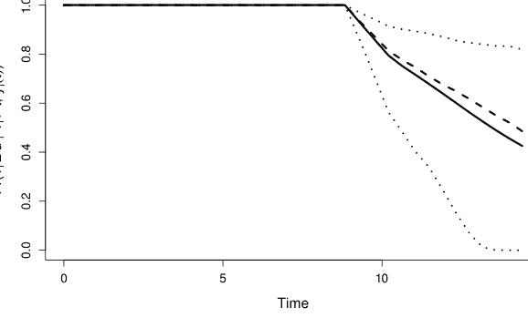

**图 7.2：** 来自 PBC 数据集的患者 2 的生存概率。虚线和实线分别对应中位数 (7.5) 和平均值 (7.6) 估计器，点线则对应相应的 95% 置信区间。

### 纵向数据与生存数据的联合模型

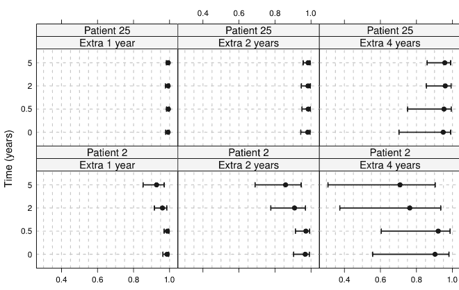

**图 7.4：** PBC 数据集中患者 2 和 25 的动态生存概率对比。在每个面板中，展示了 $\pi_i(u|t)$ 的四个估计值（带有随相应的 95% 置信区间），其中 $t$ 设置为最近一次血胆红蛋白测量的时间点。上方面板对应患者 25，下方面板对应患者 2；左侧面板 $u=t+1$，中间面板 $u=t+2$，右侧面板 $u=t+4$。

图 7.4 中生存概率的点估计值显示，在 $t=0.5$ 时，概率高于基线（$t=0$）的相同概率，尽管这两个估计值的置信区间存在重叠。

## 7.2 纵向结果的动态预测

在很多情况下，兴趣可能也在于对纵向结果进行预测。例如，在 HIV 感染患者中，CD4 细胞计数和病毒载量通常用于确定何时启动治疗。在这些设定中，获取两个标志物的预测纵向特征对治疗医生是有帮助的，以便尽早而不是晚期开始治疗。此类预测可以以与生存过程类似的方式进行定义和估计。特别，对于在随访时间 $t$ 仍然存的特定受试者 $i$，我们感兴趣的是在观测到时间点 $\mathcal{Y}_i(t) = \{y_i(s), 0 \le s < t\}$ 的响应的情况下，$u > t$ 时纵向结果的期望值，即

`\omega_i(u | t) = E\{y_i(u) | T_i^* > t, \mathcal{Y}_i(t), \mathcal{D}_n; \theta^i\}, \quad u > t. \quad (7.7)`

与条件生存概率 (7.1) 类似，这些预测随着受试者额外信息的记录随时间动态更新。也就是说，基于截至时间 $t$ 可用信息对 $y_i(u)$ 的预测 $\omega_i(u | t)$ 在 $t'$（其中 $t < t'$）处更新，产生使用截至后一时刻额外信息的新预测 $\omega_i(u | t')$。

为了估计 $\omega_i(u | t)$，我们可以利用与第 7.1.2 节中估计 $\pi_i(u | t)$ 类似的程序。具体来说，由于我们不知道真实的参数值 $\theta^*$，我们再次在联合模型的渐近贝叶斯表化下进行，并根据参数 $\{\theta | \mathcal{D}_n\}$ 的后验分布计算 $\omega_i(u | t)$ 的期望：

`E\{y_i(u) | T_i^* > t, \mathcal{Y}_i(t), \mathcal{D}_n\}`
$= E\{y_i(u) | T_i^* > t, \mathcal{Y}_i(t); \ p(\theta | \mathcal{D}_n)\}. \quad (7.8)$

积分函数的第一部分可以通过利用条件独立性假设 (4.7) 和 (4.8) 简化如下：

`E\{y_i(u) | T_i^* > t, \mathcal{Y}_i(t)\} = E\{y_i(u) | T_i^* > t, \mathcal{Y}_i(t); \ p(b_i | T_i^* > t) \ db_i = E\{x_i^t(u)\beta + z_i^t(u)b_i | p(b_i | T_i^* > t, \mathcal{Y}_i(t)) \ db_i = x_i^t(u)\beta + z_i^t(u)b_i^{(t)}, \quad (7.9)`

其中

`\hat{b}_i^{(t)} = \int p(b_i | T_i^* > t, \mathcal{Y}_i(t)); db_i.`

根据这些推导，通过简单将 $\theta$ 替换为 $\hat{\theta}$ 并计算后验分布 $p(b_i | T_i^* > t, \mathcal{Y}_i(t))$ 的均值，即可得到 $\omega_i(u | t)$ 的直接估计量。本着同样的精神，我们不是使用后验分布的均值 $\hat{b}_i^{(t)}$，而是使用其众数 $\tilde{b}_i^{(t)} = \arg \max_{b} \log p(b | T_i^* > t, \mathcal{Y}_i(t))$ 来导出估计量，即：

`\hat{\omega}_i(u | t) = x_i^t(u)\beta + z_i^t(u)\hat{b}_i^{(t)} + O(n_i^{-1}). \quad (7.10)`

### 纵向数据与生存数据的联合模型

这从标准关系（Tierney and Kadane, 1986）中是合理的：

$$\tilde{b}_i^{(t)} = \hat{b}_i^{(t)} + O(n_i^{-1/2})$$

该关系在 $p(b \mid T_i^* > t, \mathcal{Y}_i(t); \theta)$ 具有足够平滑性时成立，且在时间 $n_i(t)$。正如我们在 4.5 节中注意到的，随机效应后验分布的均值和众数非常接近，我们也预计 $\omega_i(u | t)$ 的两个估计量之间的差异可以忽略不计。出于实际目的，我们倾向于使用估计量 (10)，因为当分布偏斜时，众数通常是均值更好的位置尺度。然而，获取这两个估计量的标准误差是困难的，因为 $\hat{b}_i^{(t)}$ 和 $\tilde{b}_i^{(t)}$ 是 $\theta$ 的非线性函数，无法写成表达式。为了解决这个问题，我们使用 7.1.2 节中的简单蒙特卡洛方法。特别是，通过结合 (7.8) 与 (7.9)，并再次假设样本量足够大使得 $\{\theta \mid \mathcal{D}_n\}$ 可以用以 $\hat{\theta}$ 为中心的正态分布和观测信息矩阵的逆 $\hat{\mathcal{I}}(\hat{\theta})^{-1}$ 近，得到以下模拟方案：

| 步骤 |  |
| :--- | :--- |
| S1 | 抽取 $\theta^{(t)} \sim N(\hat{\theta}, \hat{var}(\hat{\theta}))$ |
| S2 | 抽取 $b_i^{(t)} \sim \{b_i \mid T_i^* > t, \mathcal{Y}_i(t), \theta^{(t)}\}$ |
| S3 | 计算 $\omega_i^{(t)}(u \mid t) = x_i^t(u)\beta + z_i^t(u)b_i^{(t)}$ |

步骤 1 和 2 与 7.1.2 中的模拟方案完全相同，分别用于 $\hat{\theta}$ 和 $\hat{b}_i^{(t)}$ 的变化。使用参数和随机效应的模拟值，步骤 3 涉及未观测纵向结果 $y_i(u)$ 的计算。相应的 95% 置信区间可以通过 $\omega_i^{(t)}(u \mid t), l=1,...,L$ 的 2.5% 和 97.5% 分位数获得。上述模拟方案的一个优点是可以很容易修改以产生预测区间。具体来说，我们不是将 $\omega_i^{(t)}(u \mid t)$ 设置为受试者特定的均值，而是从相应的正态分布中模拟一个值，即 $\omega_i^{(t)}(u \mid t) \sim N\{x_i^t(u)\beta + z_i^t(u)b_i^{(t)}, [\sigma^{(i)}]^2\}$。此外，请注意，类似于 7.1.2 节，我们也可以通过蒙特卡洛实现来估计 $\omega_i(u | t)$，即通过：

`\omega_i(u | t) = L^{-1} \sum_{l=1}^{L} \omega_i^{(l)}(u \mid t) \quad (7.11)`

或者

`\omega_i(u | t) = \text{median}(\omega_i^{(l)}(u \mid t), l = 1, \dots, L). \quad (7.12)`

然而，与 (10) 相比数值比较表明，这些估计量产生的估计结果几乎没有区别。因此，为了简单起见，我们使用 $\omega_i(u | t)$ 进行点估计，并使用蒙特卡洛方法推导置信区间或预测区间。

在 R 中使用 `predict()` 函数产生纵向结果的受试者特定预测。我们已经在 4.4.2 节中见过该函数，它被用于产生平均纵向演变 $\mu = X\beta$ 及其相应的置信区间。该函数的主要参数是感兴趣的拟合联合模型和提供预测数据的数据框 `newdata`。对于受试者特定预测，此数据框应包含基线协变量直到时间 $t$ 的纵向响应，这将用于估计 $\omega_i(u | t), u > t$。默认情况下，`predict()` 将产生平均纵向演变的预测。当需要受试者特定预测时，我们设置选项 `type = "Subject"`。接下来说明该函数产生 PBC 研究患者 2 的 $\omega_i(u | t)$ 估计以及置信区间，基于根据 (10) 给出的 $\omega_i(u | t)$ 估计相关的模型 `jointFitBsp.pbc`，当调用选项 `interval = "confidence"` 时，它调用蒙特卡洛方案来计算标准误差和置信区间。为了说明当记录额外的血胆红蛋白测量时患者 2 的预测是如何更新的，我们使用了一个 for 循环，每次迭代更新 `newdata`。

```r
ND <- pbc2[pbc2$id == 2, ]

longPreds <- vector("list", nrow(ND))

for (i in 1:nrow(ND)) {

  set.seed(123)

  longPreds[[i]] <- predict(jointFitBsp.pbc, newdata = ND[1:i],

    type = "Subject", interval = "confidence", returnData = TRUE)

  longPreds[[i]]$FollowUp <- round(ND[1:i, "year"], 1)

}
```

`predict()` 的默认输出是包含 `newdata` 中每个个体的预测值向量。使用选项 `interval = "prediction"` 时，可以计算这些预测区间的时间 $u$。

### 纵向数据与生存数据的联合模型

默认情况下，预测值被计算为从 $t$（受试者最后一个测量值）到 $t_{max} + \epsilon$ 的长度为 25 的常规序列，其中 $t_{max}$ 表示样本中最大的随访时间 $\epsilon$ 是一个很小的值.^3 然而，通过将 `returnData` 设置为 TRUE，`predict()` 的输出是 `newdata` 中采样的数据框，该数据框增加了每个受者的行，并包含了它们在时间 $u$ 处的预测值。for 循环的最后一行为 `predict()` 返回的数据框添加了一个额外列，表示记录了纵向响应的最后随访时间 $t$。

为了视觉化生成的估计值，我们使用以下代码将所有结果收集到一个数据框中：

```r
> longPreds.all <- do.call(rbind, longPreds)

> longPreds.all$FollowUp <- with(longPreds.all, factor(FollowUp,

  labels = paste("Follow-up time:", unique(FollowUp)))
```

第二行将存储可用时间点的 `FollowUp` 转换为具有适当水平的因子。使用该数据框，接下来的代码生成纵向结果动态预测的图：

```r
> xyplot(pred + loc + up ~ year | data = longPreds.all,

  lty = c(1, 2), type = "1", as.table = TRUE,

  xlab = "Time", ylab = "Predicted log serum bilirubin")
```

图 7.5 显示了该图更复杂的版本.^4 正如预期的，我们观察到预测区间的宽度随着时间的推移而增加，这表明我们对最后一次可用纵向测量不久后的预测值有更充分的信心。这些预测区间的一个重要特征是它们并不限于对称性，因为它们不是基于 $\hat{\omega}_i(u|t)$ 的渐近正态性。特别是，我们期望蒙特卡洛方法能为 $\omega_i(u|t)$ 的真实采样分布提供相对较好的近似，从而获得更有可能满足预期覆盖率的置信区间。

## 7.3 参数化对预测的影响

在之前的章节中，我们已经看到在拟合的联合模型下可以获得生存或纵向结果的动态预测。然而，在决定在实践中利用这些预测之前，我们应该首先调查它们的稳定性和质量。这些预测的质量通常取决于两个因素：第一，纵向过程的……

> ^3 特地，$\epsilon$ 被设置为 0.1 *mad(times)*，其中 `times` 是随访时间向量 $\{t_{ij}, i=1,...,n_i; j=1,...,n_i\}$，而 `mad()` 计算绝对偏差。
> ^4 用于重现图 7.5 的实际 R 代码可在书籍网站获取。

# 联合模型中的预测与准确性


**图 7.5：** 来自 PBC 数据集的纵向响应的动态预测。在每个面板中，点线表示观测纵向响应的时间点。实线表示最后一次访问之前的拟合轨迹，虚线表示预测的纵向轨迹。灰色区域表示 95% 置信区间。

其次，预测未来事件，联合模型的正确表述以揭示该标志物真实的预测性能。显而易见，第一个因素与生物背景有关，而联合建模的目的是揭示标志物过程中与事件风险关联最密切的特征。由于我们处理的是随时间变化的标志物，事件的风险可能取决于纵向历史 $M_i(t) = \{m_i(s), 0 \leq s < t\}$ 的复杂函数。特别是，正如我们在 5.1 节中所看到的，有多种参数化方法可以连接两种结果，如图 5.3 所示，它们会显著影响估计的受试者特异风险函数的形状。为了调查纵向结果与事件结果之间的关联结构如何影响生成的受试者特异预测，我们在不同的参数化下进行了敏感性分析。

### 纵向数据与生存数据的联合模型


**图 7.6：** PBC 数据集中 51 号患者的观测纵向轨迹。

在我们的示例中，我们将 PBC 研究中的 51 号患者，其胆红蛋白测量的纵向轨迹如图 7.6 所示。我们可以观察到该患者在最初三次访问期间胆红蛋白水平保持稳定，但之后其纵向特征急剧增加，表明病情在恶化。在敏感性分析中，我们将对比针对复合事件（死亡或移植）的相对风险子模型具有不同规格的联合模型，即：

- (I) $h_i(t) = h_0(t)\exp\{\gamma_1 Z_i + \gamma_2 W_i + \alpha_1 m_i(t)\}$
- (II) $h_i(t) = h_0(t)\exp\{\gamma_1 Z_i + \gamma_2 W_i + \alpha_2 m_i'(t)\}$
- (III) $h_i(t) = h_0(t)\exp\{\gamma_1 Z_i + \gamma_2 W_i + \alpha_1 m_i(t) + \alpha_2 m_i'(t)\}$
- (IV) $h_i(t) = h_0(t)\exp[\gamma_1 Z_i + \gamma_2 W_i + \alpha_1 m_i(t)] + \alpha_1^{int}\{Z_i \times m_i(t)\}$
- (V) $h_i(t) = h_0(t)\exp[\gamma_1 Z_i + \gamma_2 W_i + \alpha_2 m_i'(t)] + \alpha_2^{int}\{Z_i \times m_i'(t)\}$
- (VI) $h_i(t) = h_0(t)\exp[\gamma_1 Z_i + \gamma_2 W_i + \alpha_1 m_i(t) + \alpha_2 m_i'(t)] + \alpha_1^{int}\{Z_i \times m_i(t)\} + \alpha_2^{int}\{Z_i \times m_i'(t)\}$

以及相同的纵向子模型（如7.1.3节所示），该模型使用 B 样条灵活捕捉受试者特异纵向轨迹的形状：

```
$y_i(t) = m_i(t) + \varepsilon_i(t) = (\beta_0 + b_{0i}) + (\beta_k + b_{ik})^T B(t, 4) + \varepsilon_i(t)$.$
```

相对风险模型 (I–III) 假设 $t$ 时刻复合事件的风险分别依赖于 $t$ 处的真实水平和斜率。同样，模型 (IV–VI) 假设了相同的关系，但包含了真实水平与斜率之间的交互项。

### 纵向数据与生存数据的联合模型

```r
lmeFitBsp.pbc ~ lme

  fixed = log(serBilar) ~ bs(year, 4, Boundary.knots = c(0, 15),

  random = list(

    id = pdDiag(form ~ bs(year, 4, Boundary.knots = c(0, 15))),

    data = pbc2)
```

```r
coxFit.pbc <- coxph(Surv(years, status2) ~ drug + Pro,

  data = pbc2.id, x = TRUE)
```

为了拟合包含斜 $m'_i(t)$ 的联合模型，我们首先需要适当指定第 5.1.3 节引入的 `jointModel()` 中的 `derivForm` 参数，使用合适的 R 公式来构建该项的固定效应和随机效应设计矩阵。我们采用的形式如下：

```r
dform <- list(

  fixed = ~1 +

  I(3 * bs(year, knots = 2.0534443,

    Boundary.knots = c(0, 15), degree = 2) / 15) +
```


I(-3 * bs(year, knots = 2.0534443, Boundary.knots = c(0, 15), degree = 2) / 15)

```
indFixed = c(3,4,5,2,3,4),
random = ~1 +
  I(3 * bs(year, knots = 2.0534443, Boundary.knots = c(0, 15), degree = 2) / 15) +
  I(-3 * bs(year, knots = 2.0534443, Boundary.knots = c(0, 15), degree = 2) / 15)
indRandom = c(3,4,5,2,3,4)
```

$m'_i(t)$ 规范中的 B 样条计算时必须在与 $m_i(t)$ 的 B 样条完全相同的节点（knots）上。为了实现这一点，我们通过以下代码提取内部节点的第一个值：

```
attr(lmeFitBsp.pbc$terms, "prevars")
log(serBilar), bs(year, degree = 3L, knots = 2.0534443105903, Boundary.knots = c(0, 15), intercept = FALSE)
```

并且我们在调用 `bs()` 时分别使用 `knots` 和 `Boundary` 参数手动设置内部节点和边界节点。此外，`degree` 参数指定 B 样条的阶，默认设置为三，这意味着 B 样条的阶 $q$ 为四。因此，在上述公式中，为了构建项 $(q-1)B(t, \lambda, q-1)$，我们将 B 样条乘以 3，并将阶设置为 2。`dform` 列表中的 `indFixed` 组件对应于构建的索引：

# 联合模型中的预测与准确性

向量 $\beta^{sl}=(\beta_{k,-1}^T, \beta_{k,-c}^T)^T$，`indRandom` 的定义类似。上述给出的对应相对子模型 (I)-(VI) 的六个联合模型在 R 中通过以下代码拟合：

```
> jointFitBsp.pbc <- jointModel(lmeFitBsp.pbc, coxFit.pbc, timeVar = "year", method = "piecewise-PH-AGH")
> jointFitBsp2.pbc <- update(jointFitBsp.pbc, parameterization = "slope", derivForm = dform)
> jointFitBsp3.pbc <- update(jointFitBsp.pbc, parameterization = "both", derivForm = dform)
> jointFitBsp4.pbc <- update(jointFitBsp.pbc, interFact = list(value = ~Pro, data = pbc2.id))
> jointFitBsp5.pbc <- update(jointFitBsp2.pbc, interFact = list(slope = ~Pro, data = pbc2.id))
> jointFitBsp6.pbc <- update(jointFitBsp3.pbc, interFact = list(value = ~Pro, slope = ~Pro, data = pbc2.id))
```


相对风险子模型的估计回归系数（以及相关的标准误和 p 值）如表 7.1 所示。为了说明在不同参数化下预测是如何更新的，我们在图 7.7 和 7.8 中展示了 PBC 研究中患者 51 事件的纵向结果 $\omega(u|t)$ 的动态更新预测值，以及条件生存概率 $\pi(u|t)$ 的动态更新值。在这些图的每个面板中，$t$ 设置为最后一次纵向响应的时间且 $u=t+1$。从图 7.7 可以清楚地观察到，纵向结果的预测受所选关联结构的影响极小。相反，图 7.8 显示对于某些时间点 $u$，不同参数化之间的估计条件生存概率 $\pi_i(u|t)$ 表现出显著的变异。我们观察到，基于仅允许斜率 $m_i(t)$ 影响的联合模型 (II) 和 (V)，在前几次随访后的预测比其他依赖于当前值 $m_i(t)$ 的模型具有更大的标准误。然而，对于较后的点，特别是第六次随访后（即 $u=5$），情况反转，模型 (II) 和 (V) 显示出更高的生存概率和更小的误差。可以用患者 51 的特征（见图 7.6）来解释，该特征在前几次随访期间是非线性的，之后趋于稳定。我们可以基于标准似然方法进行预测。

**表 7.1：** 基于对 PBC 数据拟合的相应联合模型的相对风险模型 (I)-(VI) 的回归系数估计值和标准误。

| | Value | Std. Err. | z-value | p-value |
|---|---|---|---|---|
| `jointFitBsp.pbc` | $\gamma_1$ | -0.02 | 0.16 | 0.926 |
| | $\gamma_2$ | -0.08 | 0.22 | 0.722 |
| | $\alpha_1$ | 1.30 | 0.09 | <0.001 |
| `jointFitBsp2.pbc` | $\gamma_1$ | -0.07 | 0.16 | 0.649 |
| | $\gamma_2$ | 0.31 | 0.25 | 0.135 |
| | $\alpha_2$ | 3.40 | 0.41 | <0.001 |
| `jointFitBsp3.pbc` | $\gamma_1$ | -0.02 | 0.17 | 0.894 |
| | $\gamma_2$ | -0.05 | 0.22 | 0.821 |
| | $\alpha_1$ | 1.29 | 0.10 | <0.001 |
| | $\alpha_2$ | 1.00 | 0.43 | 0.020 |
| `jointFitBsp4.pbc` | $\gamma_1$ | -0.00 | 0.17 | 0.991 |
| | $\gamma_2$ | 1.19 | 0.67 | 0.076 |
| | $\alpha_1$ | 1.89 | 0.31 | <0.001 |
| | $\alpha_1^{int}$ | -0.69 | 0.33 | 0.035 |
| `jointFitBsp5.pbc` | $\gamma_1` | -0.07 | 0.16 | 0.646 |
| | $\gamma_2` | 0.50 | 0.33 | 0.136 |
| | $\alpha_2` | 3.86 | 0.75 | <0.001 |
| | $\alpha_2^{int}` | -0.59 | 0.82 | 0.476 |
| `jointFitBsp6.pbc` | $\gamma_1` | -0.01 | 0.17 | 0.972 |
| | $\gamma_2` | 1.06 | 0.71 | 0.135 |
| | $\alpha_1` | 1.89 | 0.32 | <0.001 |
| | $\alpha_1^{int}` | -0.68 | 0.34 | 0.044 |
| | $\alpha_2` | 0.41 | 0.89 | 0.642 |
| | $\alpha_2^{int}` | 0.59 | 0.99 | 0.550 |

展示了所有六模型的 AIC 和 BIC 值，以及将全模型 (VI) 与其他五个更简洁的模型进行比较的似然检验结果。AIC 选择全模型为最合适，而 BIC 模型假设只有标记物的当前值与复合事件的风险相关，但这种关联在凝血酶时间正常和异常的患者之间存在差异。似然检验也建议采用模型 (IV)，

**图 7.7：** PBC 研究中患者 51 胆红素的动态预测。每个面板描述了基于六个模型在最后一次随访一年后胆红素的点估计值及相关的 95% 置信区间。

**表 7.2：** 拟合到 PBC 数据的六模型的对数似然、AIC 和 BIC 值。最后三列提供了将全模型 (VI) 与其他五个模型进行比较的似然检验统计量、自由度和 $p$ 值。

| logLik | AIC | BIC | LRT | df | p-value |
|---|---|---|---|---|---|
| `jointFitBsp.pbc` | -1840.58 | 3723.15 | 3801.76 | 10.84 | 3 | 0.013 |
| `jointFitBsp2.pbc` | -1953.26 | 3948.52 | 4027.12 | 236.20 | 3 | <0.001 |
| `jointFitBsp3.pbc` | -1837.83 | 3719.65 | 3802.00 | 5.34 | 2 | 0.069 |
| `jointFitBsp4.pbc` | -1837.42 | 3718.85 | 3801.19 | 4.53 | 2 | 0.104 |
| `jointFitBsp5.pbc` | -1953.03 | 3950.06 | 4032.40 | 235.74 | 2 | <0.001 |
| `jointFitBsp6.pbc` | -1835.16 | 3718.32 | 3808.15 | | | |

对于其他模型，相比于全模型 (VI)，有更多证据表明拟合效果较差。

## 纵向与生存数据的联合模型

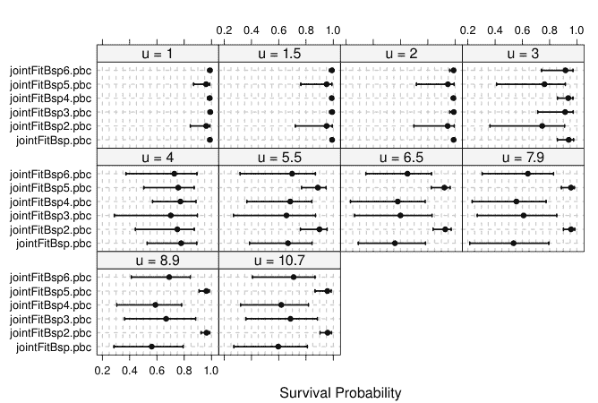

**图 7.8：** PBC 数据集中患者 51 生存概率的动态预测。每个面板描述了基于六种联合模型，在最后一次纵向反应记录后，额外生存一年的概率的点估计值及相关的 95% 置信区间。

## 7.4 联合模型的前瞻准确性

前一节证明，标志物过程的不同特征可能比其他特征与事件风险关联得紧密。当关注的是包含纵向和生存部分的联合模型的整体预测能力时，AIC 和 BIC 等信息准则可能是很有用的。然而，关注点往往主要在于确定纵向标志物预测该结果的效果有多好。这个问题的答案在文献中受到了广泛关注，出现了两条主要的研究路线。第一条侧重于校准测量以及模型预测观测数据的程度（Graf et al., 1999; Scheper and Henderson, 2000; Henderson et al., 2002; Gerds and Schumacher, 2006）；第二条侧重于区分别测量以及模型区分短期内会发生事件的患者与较晚才发生事件的患者的能力（Harrel et al., 1982; Heagerty et al., 2000; Heagerty and Zheng, 2005; Antolini et al., 2005; Pencena et al., 2008）。在本节中，我们关注后一类测量方法，并依赖受试者工作特征曲线（ROC）方法来评估纵向标志物区分低风险和高风险发生事件患者的能力如何。

### 7.4.1 二分类结果的区分别测量

为了引入区分别测量后的基本概念，我们首先考虑简单的二分类响应设置。特别是，$d_i$ 表示受试者 $i$ 的状态指示，根据受试者是否经历了感兴趣的事件取值为 1 或 0。令 $y_i$ 表示在基线测量的标量标志物，被认为与疾病概率强相关。我们的目标是利用那些有更大概率“患病”的受试者。为了实现这一目标，我们构建了一个适当的预测规则，当观测到的标志物超过特定阈值时（即 $y_i > c$），将受试者 $i$ 分类为患病。基于此，我们现在可以使用疾病状态正确分类概率来量化标志物的性能。特别是，标记将受试者正确分类为患病的概率被称为敏感性（也称为真阳率）：

> $TP(c) = Pr(y_i > c \mid d_i = 1),$

而标记将受试者正确分类为非患病的概率被称为：

> $1 - FP(c) = Pr(y_i \leq c \mid d_i = 0),$

其中 $FP(c) = Pr(y_i > c \mid d_i = 0)$ 表示假阳性率。注意，这些概率衡量了所有可能的预测规则 $\{y_i > c, c \in \mathbb{R}\}$ 的预测准确性。为了描述标志物的整体区分能力，我们计算所有可能的预测规则 $\{y_i > c, c \in \mathbb{R}\}$ 的敏感性和特异性，其中 $\mathbb{R}_y \subseteq \mathbb{R}$ 表示标志物的样本空间，$\mathbb{R}$ 是实数集。这产生了 ROC 曲线，它是在不同 $c$ 下真阳率（敏感性）相对于假阳性率（$1 - 特异性$）的图表，其正式定义为

其中 $p$ 属于 $[0, 1]$，且 $FP^{-1}(p) = \inf\{c : FP(c) \leq p\}$。ROC 曲线的一个通用示例如图 7.9 所示。左面板显示了患病组和非患病组标志物的箱线图，右侧是对应的 ROC 曲线。左面板中的虚线对应于规则 $y_i > 35$，右面板中的虚线从敏感性和 $1 -$ 特异性的角度标注了该规则的性能。在单位象限内 ROC 越高，预测规则越准确。

所有可能的阈值值 $c$ 的标志物预测准确性的总结由 ROC 曲线下面积（AUC）给出，定义为：

> $AUC = \int_{0}^{1} ROC(p) \, dp.$

AUC 更直观的解释由等效公式（Hanley and McNeil, 1982）提供：

$AUC = Pr(y_i > y_j \mid d_i = 1, d_j = 0).$

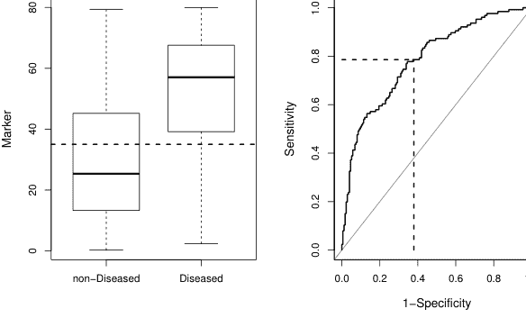

**图 7.9：** ROC 曲线的一个示例。左面板：患病组和非患病组标志物水平的箱线图。右面板：该标志物对应所有可能的阈值 c 的 ROC 曲线。虚线表示预测规则 $y_i > 35$，其敏感性为 0.79，特异性为 0.62。

### 7.4.2 生存结果的区分别测量

为了将敏感性和特异性的定义从二设置扩展到生存数据，我们将事件视为随时间变化的二分类结果，在事件发生之前的所有时间点取值为 0，之后取值为 1。事实上，这种生存结果的表示等同于第 3.5 节引入的计数到事件结果 $N_i(t) = I(t \geq T_i^*)$。二分类结果 $N_i(t)$ 的时间依赖性允许根据特定时间 $t$ 将受试者分类为“病例”或“对照”产生多种潜在定义。在这种背景下，我们可用的不同分类由 Heagerty 和 Zheng (2005) 提出。对于用于预测事件的标量标志物 $y_i$，三大准确性测量族为

1. 累积敏感性/动态特异性：
$TP_i^*(c) = Pr(y_i > c \mid T_i^* \leq t), \text{ and}$
$1-FP_i^*(c) = Pr(y_i \leq c \mid T_i^* > t).$

根据这些定义，在任何固定时间，整个人群根据其事件状态分类为病例或对照。此外，每个受试者在 $t < T_i^*$ 时充当对照；但在之后 $t \geq T_i^*$ 时作为病例贡献。

2. 发病敏感性/静态特异性：
$TP_i^*(c) = Pr(y_i > c \mid T_i^* = t), \text{ and}$
$1-FP_i^*(c) = Pr(y_i \leq c \mid T_i^* > t).$

这些定义被 Etzioni 等人 (1999) 以及 Slate 和 Turnbull (2000) 采用；受试者状态不改变，被分类为病例或对照。病例根据事件发生的时间分层，而对照被定义为通过固定随访期 (0, i) 的无事件的受试者。

3. 发病敏感性/动态特异性：
$TP_i^*(c) = Pr(y_i > c \mid T_i^* = t), \text{ and}$
$1-FP_i^*(c) = Pr(y_i \leq c \mid T_i^* > t).$

在这种方法下，受试者在所有时间都可以充当对照

## 纵向数据与生存数据的联合模型

$t < T_i^*$，但在 $t = T_i^*$ 时扮演了病例的角色。在这里，敏感性衡量的是在在 $t_i$ 时发生事件的个体子总体中，标志物水平超过阈值 $c$ 的受试者的期望比例；而特异性衡量的是在生存过时间 $t$ 后的受试者中，标志物水平小于或等于 $c$ 的受试者比例。

上述所有定义的一个重要特征是它们随时间变化，这意味着标志物区分病例和对照组的能力随着时间的推移而改变。在选定时间依赖性敏感性和特异性的定义后，ROC 曲线及其下面积可以按照与二分类背景下相同的方式进行计算。这些指标也将随时间变化，并反映标志物准确性在随访期间的演变情况。

### 7.4.3 纵向标志物的预测规则

遵循 Rizopoulos (2011) 以及 Zheng 和 Heagerty (2007)，我们现在将上述案例中时间依赖准确性指标的框架扩展到纵向标志物。此前已经指出，需要使用联合建模方法来回答感兴趣的科学问题的研究，其内在特征是动态性。也就是说，随着对受试者纵向信息的收集，我们可以不断更新其生存概率的预测。考虑到这一点，在医学上，区分那些在距离最后一次测量后一段时间内即将发生事件的患者与那些将超过这一时间且未发生事件的患者是有重要意义的。为纵向标志物设定一个实用的属性，就是成功地区分这些患者。特别是，我们假设已经为受试者 $i$ 收集了直到时间点 $t$ 的一组纵向测量值 $Y_i(s) : 0 \leq s \leq t$。我们感兴趣在相关时间范围 $(t, t+\Delta t]$ 内发生的事件，医生在该时间段内可以采取行动（例如开始或改变治疗）以提高该患者的生存机会。通过标志物历史 $Y_i(t)$ 的适当函数，我们可以定义一种预测规则来区分事件高风险和低风险的患者。例如，对于原发性胆汁性肝炎（PBC）患者，我们将血清胆红素水平大于特定阈值视为死亡的预测。由于我们处于纵向背景下，我们具有灵活性来决定患者的纵向历史 $Y_i(t)$ 的哪些值有助于预测规则的制定。为了允许完全的通用性，我们考虑一个阈值向量 $(t, k, c) \geq c_s$，基于此我们定义

$$\mathcal{P}_i^*(t, k, c) = \{y_i(s) \geq c_s; k \leq s \leq t\}$$

为“成功”，即标志物指示事件将发生，以及

$$\mathcal{P}_i^*(t, k, c) = \mathbb{R}^{k(t)} \setminus \{y_i(s) \geq c_s; k \leq s \leq t\}$$

为“失败”，其中 $\mathbb{R}^n$ 表示 $n$ 维欧几里得空间，$r(k, t)$ 为区间 $[k, t]$ 内采集的纵向测量次数。$k \geq 0$ 的数量指定了纵向历史中哪些标志物值有助于该规则，$c$ 是时间点 $s$ 处的阈值。这些预测规则的惯例是，标志物的值越大，死亡风险越高。当情况相反时（例如，在我们使用 CD4 细胞计数作为 HIV 感染患者的标志物时），这些定义应经过适当调整。

为了证明 $\mathcal{P}_a^\alpha(t, k, c)$ 的完全通用性以及我们在定义预测规则时可用的不同可能性范围，我们给出三个说明性示例：

- 例 1：驱动决策的最简单且最常用的预测规则，即最后一个可用的纵向测量值：

$$\mathcal{P}_a^\alpha(t, k, c) = \{y_i(t) \geq c\}$$

该规则代表了我们在 7.4.1 和 7.4.2 节中看到的基线标志物预测规则的时间依赖类比。特别是，对于任何时间点 $t$，如果患者在同一时刻观测到的标志物水平超过特定阈值，则将其归类为发生事件的高风险组。

- 例 2：尽管之前的规则简单且易于使用，但它的缺点是使用了单一标志物测量值，因此丢弃了有用信息。一个小的扩展是使用两个时间点的标志物值，例如：

$$\mathcal{P}_a^\alpha(t, k, c) = \{y_i(t-1) \geq c\} \cap \{y_i(t) \geq c\}$$

该规则规定，如果患者在 $t$ 和 $t-1$ 两个时间点的标志物水平都超过了相同的阈值 $c$，则在时间 $t$ 将其归类为高风险组。

- 例 3：对示例 2 的进一步增强是允许预测规则捕捉状况恶化的部分。这可以通过绝对增加预测规则来实现，如：

$$\mathcal{P}_a^\alpha(t, k, c) = \{y_i(t-1) \geq c\} \cap \{y_i(t) \geq c + \nu\}, \nu > 0$$

这形式化了这样一个观点：如果患者的标志物水平增加了 $\nu$ 个单位，其发生事件的概率更高；或者使用相对增加预测规则，如：

$$\mathcal{P}_a^\alpha(t, k, c) = \{y_i(t-1) \geq c\} \cap \{y_i(t) \geq c + \nu\}$$

# 联合模型中的预测与准确性

## 纵向数据与生存数据的联合模型

## 纵向数据与生存数据的联合模型

我们将基于单一标志物评估的规则（如示例 1）称为*简单预测规则*，将涉及多个标志物评估的规则（如示例 2 和 3）称为*复合预测规则*。由于我们感兴趣的是利用直到时间 $t$ 的观测值 $Y_i(t)$ 来预测在相关区间 $(t, t+\Delta t)$ 内的事件，敏感性和特异性定义为：

$$TP^{\Delta t}(c) = Pr\{P_i^*(t, k, c) \mid T_i^* \in (t, t+\Delta t)\}$$

以及

$$1 - FP^{\Delta t}(c) = Pr\{P_i^*(t, k, c) \mid T_i^* > t\}$$

根据 7.4.2 节中 Heagerty 和 Zheng 的定义，分别对应累积敏感性和动态特异性。此外，注意这些准确性指标不仅随时间变化，还取决于相关区间的长度 $\Delta t$。这意味着不同的模型在不同的 $\Delta t$ 下可能表现出不同的区分能力。与之前一样，所有可能阈值 $c \in \mathbb{R}_y$ 的标志物的总体区分能力可以通过相应的 ROC 曲线进行评估

$$ROC^{\Delta t}(p) = TP^{\Delta t}\{[FP^{\Delta t}]^{-1}(p)\}$$

其中 $p$ 属于 $[0, 1]$，$[FP^{\Delta t}]^{-1}(p) = inf_c\{c : ROC^{\Delta t}(c) \le p\}$，以及曲线下面积：

$$AUC^{\Delta t} = \int_0^1 ROC^{\Delta t}(p) dp.$$

## 7.4.4 区分指数

为止的所有生存数据准确性指标的一个重要特征是，它们描述了标志物（基线或时间依赖）如何在特定的随访时间 $t$ 区分患者。因此，标志物在不同时间点可能表现出不同水平的区分，因此相关问题是如何总结标志物在整个随访期间的区分能力。为了评估基线标志物的整体性能，Harrell 等人 (1982) 提出了一种基于 Kendall-Goodman-Kruskal-Somers 型相关系数改进的一致性指数（Goodman and Kruskal, 1979）。这可以看视为二分类背景下随时间变化的疾病状态 AUC (7.13) 的扩展。也就是说，对于一对随机受试者 $\{i, j\}$，其真实事件时间的排序使得受试者 $i$ 在受试者 $j$ 之前发生事件，我们感兴趣的是

## 联合模型中的预测与准确性

它们的标志物水平与其事件时间一致的概率，即：

```


$C_h = \Pr(y_i > y_j \mid T_i^* < T_j^*). \quad (7.16)$

这个全局准确性总结索引实际上与第 7.4.2 节中随时间变化的 ROC 曲线有关。特别是 Heagarty 和 Zheng (2005) 证明 $C_h$ 指数 (7.16) 可以等效推导出敏感性和特异性的发生/动态定义的 AUC 的加权平均。更具体地说，他们显示：

$C_h = \int_0^{\infty} \text{AUC}_t u(t) dt, \quad (7.17)$

其中 $\text{AUC}_t = \Pr(y_i > y_j \mid T_i^*, T_j^* > t)$ 且 $u(t) = 2 \cdot p(t) \cdot S(t)$。$C_h$ 指数的这种等效性为一系列全局一致性总结测量提供了可能，这些测量基于 AUC 和权重函数 $u(t)$ 的替代规范。例如，可以使用 AUC 的适当定义构建随时间变化的标志物的一致性判别指数（Antolini 等人，2005）。遵循这种方法，Rizopoulos (2011) 提出了一种基于 (7.14) 和 (7.15) 推导出的 AUC 的动态判别指数，即：

$C_{dyn}^{\Delta t} = \int_0^{\Delta t} \text{AUC}_t u(t) dt,$

其中

$u(t) = \Pr(T_i^* > t) / \int \Pr(T_i^* > t) dt,$

其中 $\Pr(T_i^* > t)$ 是边缘生存概率。选择此权重函数是为了考虑到并非所有时间点对比较的贡献都相同，因为在较晚的时间点可用受较少。可以使用其他权重函数 $u(t)$ 定义动态判别指数 $C_{dyn}^{\Delta t}$ 的替代版本，而这方面的最优选择仍然是一个开放性问题。

在实践中，我们通常将注意力限制在固定的随访期 $(0, \tau)$。在这种情况下，$C_{dyn}^{\Delta t}$ 指数可以修改以考虑有限随访：

$[C_{dyn}^{\Delta t}]^\tau = \int_0^{\tau} \text{AUC}_t u^\tau(t) dt,$

其中 $u^\tau(t) = u(t)/\int_0^{\tau} u(t) dt$。$[C_{dyn}^{\Delta t}]^\tau$ 将与随机对对象的预测与其结果一致的概率相关，但给定较小的事件时间发生在区间 $(0, \tau)$ 内。

## 纵向数据与生存数据的联合模型

## 7.4.5 联合建模框架下的估计

第 7.4.1 节描述的二分类设置中，敏感性、特异性和 AUC 的估计可以简单基于观测样本中相应频率的计算。例如，敏感性可以估计为患病受试者样本中 $y_i > c$ 的比例。然而，在生存背景下，前瞻准确性测量的估计由于删失而变得复杂。特别注意，这些测量量是相对于真实的事件时间变量 $T_i^*$ 定义的。然而，当我们感兴趣（例如特定时间点 $t$ 的敏感性）且某受试者在 $t' < t$ 被删失时，我们不知道她在 $t$ 时的状态，因此无法归类为病例或对照。这意味着对于任何预测规则，我们不能像在二分类设置中简单地计算当前样本中病例和对照的数量，而是需要估计真实事件与纵向测量值的二变量分布 $\{T_i^*, y_i\}$。在这方面，联合建模框架具有巨大的优势，因为它为该分布提供了一个完整的定性规范。也就是说，通过联合模型，我们可以同时考虑删失和纵向结果的内生性，此外，我们还可以通过将它们引入生存模型的设计矩阵 $W$ 中，轻松地调整任何影响事件风险的基线协变量。

为了表述方便，我们仅以类似的方式估计敏感性。由于我们将遵循与第 7.1 节和第 7.2 节相似的方法，并推导出一种适当的模拟方案以产生敏感性及其标准误差的蒙特卡洛估计。更具体地说，我们观察到 (7.14) 写为（在后续符号中省略协变量条件）：

$Pr\{P_i^*(t, k, c) \mid T_i^* > t, T_i^* \in (t+\Delta t]\} = \frac{Pr\{P_i^*(t, k, c), T_i^* \in (t+\Delta t) \mid \theta^*\}}{1 - Pr\{T_i^* > t \mid \theta^*\}} \quad (7.18)$

其中 $\theta^*$ 如前所述，表示真实的参数值。根据假设 (4.7) 和 (4.8) 以及联合模型的定义，我们可以获得分子和分母的进一步简化。特别是，分子的形式为

$Pr\{P_i^*(t, k, c), T_i^* \in (t+\Delta t] \mid \theta^*\} = \int_t^{t+\Delta t} Pr\{P_i^*(t, k, c) \mid T_i^* = u, \theta^*\} f(u|\theta^*) du$

$Pr\{P_i^*(t, k, c), T_i^* \in (t+\Delta t] \mid \theta^*\} = \int_t^{t+\Delta t} Pr\{P_i^*(t, k, c) \mid T_i^* > u, \theta^*\} f(u|\theta^*) du \quad (7.19)$

$Pr\{P_i^*(t, k, c), T_i^* \in (t+\Delta t] \mid \theta^*\} = \int_t^{t+\Delta t} \frac{Pr\{P_i^*(t, k, c), T_i^* \in (t+\Delta t) \mid \theta^*\}}{1 - Pr\{T_i^* > t \mid \theta^*\}} f(u|\theta^*) du \quad (7.20)$

（注：此处原文公式 7.19-7.20 在正文中显示略有断层，已根据逻辑还原）

## 纵向数据与生存数据的联合模型

因此，结合 (7.19)、(7.20) 和 (7.21)，相对于参数 $\{\theta \mid D_n\} \sim \mathcal{N}(\theta, \hat{var}(\theta))$ 计算期望，我们得到以下模拟方案：

- S1: 抽取 $\theta^{(l)} \sim \mathcal{N}(\theta, \hat{var}(\theta))$。
- S2: 抽取 $\mathcal{Y}_i^{(l)}(t) \sim \mathcal{N}(X_i b^{(l)} + Z_i b^{(l)}, [\sigma^{(l)^2])$。
- S3: 抽取 $b_i^{(l)} \sim \{b_i \mid T_i^* > t, \mathcal{Y}_i^{(l)}(t), \theta^{(l)}\}$。
- S4: 计算 $\mathcal{E}_1(b_i^{(l)}, \theta^{(l)})$ 和 $\mathcal{E}_2(b_i^{(l)}, \theta^{(l)})$。

步骤 1-4 重复 $l=1 \dots L$ 次，$L$ 表示蒙特卡洛样本数。在此，步骤 1 用于考虑估计值的变异性，在步骤 2 中我们根据联合模型模拟到时间 $t$ 的纵向历史，而在步骤 3 中我们根据纵向历史 $\mathcal{Y}_i^{(t)}$ 和 $T_i^* > t$ 模拟随机效应。最后一步只需计算 $\mathcal{E}_1(b_i^{(l)}, \theta^{(l)})$ 和 $\mathcal{E}_2(b_i^{(l)}, \theta^{(l)})$，其比值即为敏感性。再次，类似于本章之前看到的模拟方案，章节 3 使用 Metropolis-Hastings 算法实现，其后验样本中心位于经验贝叶估计值，尺度矩阵为这些估计值 $\hat{b}_i^{(t)}$ 的协方差矩阵。该模拟方案实施中的一个小实践问题涉及 $b_i$ 的起始值。具体地说，在 7.1.2 节和 7.2 节中提出的模拟方案中，我们将目标分布的众数 $\hat{b}_i^{(t)}$ 作为 $b_i$ 的初始值，因此不需要热启动。然而，在上述旨在模拟 $\{b_i \mid T_i^* > t\}$ 的方案中采用相同的值，将需要一些热启动，该初始值可以是目标分布的支持区域。

敏感性的蒙特卡洛估计形式为：

$\hat{\Pr}\{{P_i^{(l)}(t, k, c) \mid T_i^* > t, T_i^* \in (t, t + \Delta t)}\} = \frac{\sum_i \mathcal{E}_1(b_i^{(l)}, \theta^{(l)})}{L - \sum_i \mathcal{E}_2(b_i^{(l)}, \theta^{(l)})}$

相应的标准误差使用 $\mathcal{E}_1(b_i^{(l)}, \theta^{(l)})$ 和 $\mathcal{E}_2(b_i^{(l)}, \theta^{(l)})$ 的蒙特卡洛标准误差以及 Delta 方法进行估计。特别

# 联合模型中的预测与准确率

我们，有

$s.e.\ \left(\Pr\{\mathcal{P}_i^*(t, k, c) \mid T_i^* > t, T_i^* \in (t, t + \Delta t]}\right) = \{gV_g^\top\}^{1/2},$

其中

$g = L[1/L - \sum_l \mathcal{E}_2(b_i^{(l)}, \theta^{(l)}],\nsum_l \mathcal{E}_1(b_i^{(l)}, \theta^{(l)})/[L - \sum_l \mathcal{E}_2(b_i^{(l)}, \theta^{(l)})]^2],$

以及

$vech(V) = L^{-1}[var\{\mathcal{E}_1(b_i^{(l)}, \theta^{(l)}\},\ncov\{\mathcal{E}_1(b_i^{(l)}, \theta^{(l)}\}, \mathcal{E}_2(b_i^{(l)}, \theta^{(l)}\}, var\{\mathcal{E}_2(b_i^{(l)}, \theta^{(l)})\}].$

在估计了敏感性和特异性后，构建相应的 ROC 曲线并额外计算 AUC 是简单的。最后，为了估计动态判别指数 $C_{dyn}^*$，我们还需要边际生存率 $S(t) = Pr(T_i^* > t)$ 的估计。这可以通过拟合的联合模型使用近似表达式得到：

$\mathcal{S}(t) = \int S_i(t | \hat{b}_i; \hat{\theta}) p(b_i; \hat{\theta}) db_i \approx n^{-1} \sum_i S_i(t | \hat{b}_i; \hat{\theta}),$

正如我们在第 6.1 节所示，或者使用 Kaplan-Meier 乘积估计器 (3.2)。此外，$C_{dyn}^*$ 分子中没有解析解的积分，可以使用梯形法则或高斯求积法进行数值近似（Press et al., 2007)。

## 7.4.6 在 R 中的实现

我们在肝硬化数据集（Liver Cirrhosis dataset）中展示了时间依赖判别指标的计算。特别是，我们感兴趣的是凝血蛋白指数是否是区分在最后一次评估后短时间内内死亡的受试者与生存时间更长的受试者的潜在有用标记。我们首先对数据拟合一个简单的联合模型。对于纵向部分，我们假设每个受试者随时间呈线性演变，并允许两个治疗组之间的平均值存在差异。此外，为了捕捉每个治疗组随访极早期凝血蛋白指数的突然变化，我们还包含了一个基线量的独立指示变量。模型形式如下：

$y_i(t) = m_i(t) + \varepsilon_i(t)\n\n$\beta_0 + \beta_1Predns_i + \beta_2t + \beta_3TO_i + \beta_4\{Predns_i \times t}\}$nn\n$\beta_5\{Predns_i \times TO_i} + b_{i0} + b_{i1}t + \varepsilon_i(t)$,

其中 Predns 表示泼西类松治疗组的哑变量，TO 是基线测量的哑变量。拟合该模型的 R 代码为：

```
> prothrob$t0 <- as.numeric(prothrob$time == 0)

> lmeFitBsp.pro <- lme(pro ~ treat * (time + t0), random ~ time | id, data = prothrob)
```

对于生存子模型，我们将治疗作为时间无关的协变量，并将从纵向模型估计的凝血蛋白指数真实底层分布作为时间相关的协变量，即：

$h_i(t) = h_0(t)\exp\{\gamma Predns_i + am_i(t)\}$

在 R 中通过以下代码进行拟合：

```
> coxFit.pro <- coxph(Surv(Time, death) ~ treat, data = prothros, x = TRUE)
```

我们假设分段常数基风险函数 $h_0(t)$ 拟合联合模型，并将节点节点放置在观测事件的等距分位数处：

```
> jointFitBsp.pro <- jointModel(lmeFitBsp.pro, coxFit.pro, timeVar = "time", method = "piecewise-PH-GH")
```

```
> summary(jointFitBsp.pro)
```

事件过程

| Value | Std.Err | z-value | p-value |
| :--- | :--- | :--- | :--- |
| treatpreds | 0.2211 | 1.5772 | 0.1147 |
| Assort | -0.0406 | 0.0036 | -11.2040 | <0.0001 |
| log(xi.1) | 1.2221 | 0.2612 | 4.6793 |
| log(xi.2) | 1.1222 | 0.2650 | 4.2347 |
| log(xi.3) | 0.6148 | 0.2756 | 2.2306 |
| log(xi.4) | 0.6764 | 0.2710 | 2.4961 |
| log(xi.5) | 0.5626 | 0.2786 | 2.0196 |
| log(xi.6) | 1.2004 | 0.3252 | 3.7486 |
| log(xi.7) | 1.7162 | 0.3703 | 4.6346 |

我们观察到凝血蛋白指数与事件结果密切相关，标记减少一个对应死亡风险增加 1.04 倍（95% CI: 1.03; 1.05）。时间依赖敏感性 (0.14) 和特异性 (0.15) 以及相应的标记 ROC 曲线和 AUC 可以 `rocJM()` 计算。该函数的语法与我们在 7 节使用的 `survfit()` 函数相似，接受拟合的联合模型和包含基线协变量以及观测点的数据框。为了说明该函数的使用，我们关注一个代表性的安慰组受试者，他在基线、一年和三年提供了凝血蛋白测量值。我们首先构建

```
> plcbData <- data.frame(
id = 1,
treat = factor("placebo", levels = levels(prothrob$treat)),
time = c(0, 0.25, 1, 3, 4)
> plcbData$t0 <- as.numeric(plcbData$time == 0)
```

| id | treat | t0 |
| :--- | :--- | :--- |
| 1 | placebo | 0.00 |
| 2 | placebo | 0.25 |
| 3 | placebo | 1.00 |
| 4 | placebo | 3.00 |
| 5 | placebo | 4.00 |

`rocJM()` 函数最后一个要求的参数是 `dt`，它指定医学相关的间隔长度 $\Delta t$。通过以下调用，我们在最后可用时间（即 $t = 4$）处 $\Delta t$ 分别等于一年、两年和四年的判别指标估计：

```
> set.seed(123)
> ROCplcb <- rocJM(jointFitBsp.pro, dt = c(1, 2, 4), data = plcbData, M = 1000, burn.in = 500)
```

```
> ROCplcb
```

时间依赖 ROC 曲线下的面积

估计：蒙特卡洛 (500 样本)
差异：绝对，lag = 1 (0)
阈值范围：(-2, 30)

病例：1
记录时间：0, 0.25, 1, 3, 4

| dt | t + dt | AUC |
| :--- | :--- | :--- |
| 1 | 0.6799 | 80.216 |
| 2 | 0.6944 | 81.552 |
| 4 | 0.7321 | 85.560 |

默认情况下，`rocJM()` 基于最后可用标记测量区分病例和对照的简单预测规则。输出提供了不同 `dt` 选项下的时间依赖 AUC。对于这个特定病例，我们观察到在时间 $t = 4$ 时，$\Delta t = 4$ 提供的判别略优于其他两个。列包含在不同 `dt` 选项下使敏感性和特异性乘积最大的标记阈值。尽管这种最佳阈值的选择直观且易于计算，但我们应该注意它并非最优，因此仅作为指示。另一种用于捕捉特定预测规则性能的统计量是约登指数，其定义为敏感性 + 特异性 –1 (Youden, 1950; Kraemer, 2004)。要在 `rocJM()` 的输出中报告约登公式的最佳阈值，用户应设置选项 `optThr "yden"`。参数 `M` 指定第 7.4.5 节描述的方案中的蒙特卡洛样本数，参数 `burn` 指定从计算中排除的样本数。相应的 ROC 曲线通过简单调用 `plot()` 函数产生，并如图 7.10 所示。

```
> plot(ROCplcb, legend = TRUE)
```


正如 AUC 所示的，我们观察到 $\Delta t = 4$ 的 ROC 曲线位于 $\Delta t = 1$ 和 $\Delta t = 2$ 的 ROC 曲线之上，这表明在第四年，该标记可以稍微更好地区分在八年内死亡的患者和生存超过八年的患者。为了检查标记的预测性能随随访演变变，我们可以通过适当更新 `rocJM()` 的 `data` 参数在不同时间 $t$ 生成 ROC 曲线。

> 注意在凝血蛋白指数的情况下，低值表示效应，简单预测定义为 $P_i^a(t, k, c) = \{y_i(t) \le c\}$。

# 病例 1
（随访时间：0, 0.25, 1, 3, 4）


**图 7.10：** $t=4$ 时以及三种 $\Delta t$ 选项下的（基于肝硬化数据集拟合的联合模型）。

使用循环来说明这一点，以下代码基于 `plcbData` 数据框：

```r
ROCs <- vector("list", 5)

for (i in seq_along(ROCs)) {
  set.seed(123)
  ROCs[[i]] <- rocJM(JointBsp.pro, dt = c(1, 2, 4),
                     data = plcbData[seq_len(i)], M = 1000, burn = 500)
}
```

在每次迭代中，都考虑了一个额外的 `plcbData` 行，因此我们得到了 $t = 0$、$0.25$、1、3 和 4 年的敏感性和特异性估计。从 $t = 0.25$ 年开始的相应时间变化的 ROC 曲线，以及三种不同的 $\Delta t$ 选项，如图 7.11 所示。产生此图的 R 代码使用了类似的循环：

```r
par(mfrow = c(2, 2), oma = c(0, 0, 2, 0))

for (i in 2:5) {
  plot(ROCs[[i]], legend = TRUE)
}

mtext("Prediction rule: Simple", side = -1, outer = TRUE)
```

## 纵数据与生存数据的联合模型

## 预测规则：简单

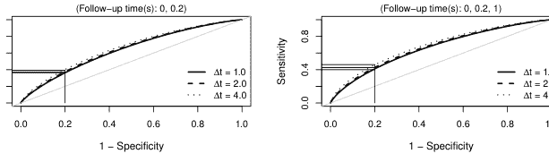
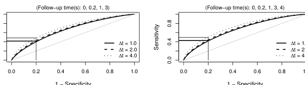

**图 7.11:** 在简单预测规则下，肝硬化数据集随时间变化的 ROC 曲线。水平实线表示对应假阳性率为 20% 时的敏感度水平。

水平实线代表了在 $\Delta t$ 有三种选择时，敏感度设置为 80% 时的敏感度水平。随着时间的推移，我们看到三个 $\Delta t$ 选项之间的区分变得清晰，其中 $\Delta t=4$ 的判别能力略优于 $\Delta t=1$。然而，总来说，简单预测规则（凝血蛋白指数）不能很好地区分 $t + \Delta t$ 时死亡的患者与不会死亡的患者。

我们继续 ROC 分析，研究是否可以通过复合预测规则来提高区分能力。参考第 199 页的示例 3，我们使用规则：

$$P_i^{(t, k, c)} = \{y_i(t-k) \leq c\} \cap \{y_i(t) \leq 0.8c\}$$

该规则假设患者在时间间隔 $(t$ 内发生事件的概率更高

## 联合模型中的预测与准确性

```r
set.seed(123)

ROCplcb.Rel <- rocJM(jointFitBsp.pro, dt = c(1, 2, 4), data = plcbData,
                     diffType = "relative", rel.diff = c(1, 0.8), M = 1000, burn.in = 500)

ROCplcb.Rel
```

随时间变化的 ROC 曲线下的面积

估计：Monte Carlo (500 个样本)
差异：相对, lag = 2 (1, 0.8)
阈值范围: (-28, 306)

病例: 1
记录时间(s): 0, 0.25, 1, 3, 4

| dt + dt | AUC | Cut.1 | Cut.2 |
| :--- | :--- | :--- | :--- |
| 1 | 0.6725 | 102.928 | 82.3424 |
| 2 | 0.6878 | 104.264 | 83.4112 |
| 4 | 0.7290 | 108.272 | 86.6176 |

在上述病例中，我们使用了完整的框架 `plcbData`，这意味着报告的 AUC 和“最佳”切点是针对最后一个可用时间点 $t=4$ 的。三个 $\Delta t$ 选项的 ROC 曲线如图 7.12 所示，再次通过简单调用 `plot()` 方法获得：

```r
plot(ROCplcb.Rel, legend = TRUE)
```

AUC 和 ROC 与通过简单预测规则得到的非常相似，特别是我们再次观察到 $\Delta t=4$ 时实现了更好的区分度。我们通过生成随时间变化的准确性指标，进一步研究了复合预测规则在不同时间点的性能。这些指标是与...图 7.13 中使用的类似的 `for` 循环生成的。

```r
ROCs.r <- vector("list", 5)

for (i in seq_along(ROCs)) {
  set.seed(123)
  ROCs[[i]] <- rocJM(jointFitBsp.pro, dt = c(1, 2, 4),
                     data = plcbData[seq_len(i)], diffType = "relative",
                     rel.diff = c(1, 0.8), M = 1000, burn.in = 500)
}
```

## 纵数据与生存数据的联合模型

# 病例 1
(随访时间(s): 0, 0.2, 1, 3, 4)

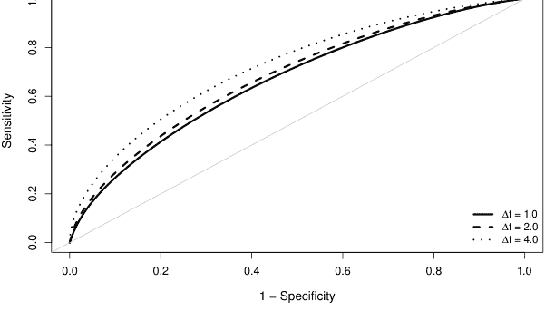

**图 7.12:** 在复合预测规则下，$t=4$ 时及三种 $\Delta t$ 选择的 ROC 曲线，假设访期间之间凝血蛋白水平下降了 20%（基于对肝硬化数据集拟合的联合模型）。

```r
par(mfrow = c(2, 2), oma = c(0, 0, 2, 0))

for (i in 1:5) {
  plot(ROCs[[i]], legend = TRUE, main = "Prediction rule: Simple")
  nmtext("Prediction rule: Composite", side = -1, outer = TRUE)
}
```

图 7.11 与图 7.13 的对比显示，两种规则下的时间变化的 ROC 曲线几乎相同，这表明在这一特定示例中，考虑复合预测规则并没有带来太大益处。

作为 ROC 分析的最后一步，受第 7.3 节关于所选参数化对生存结果预测影响的启发，我们探索了纵数据与事件时间之间的关联结构如何影响区分度。特别是，在假设相同的线性混合模型来描述凝血蛋白指数随时间的演变的情况下，我们将考虑具有相应生存模型的三个联合模型：

- (I) $h_i(t) = h_0(t) \exp\{\gamma y_i + \alpha_1 m_i(t)\}$
- (II) $h_i(t) = h_0(t) \exp\{\gamma y_i + \alpha_2 m'_i(t)\}$
- (III) $h_i(t) = h_0(t) \exp\{\gamma y_i + \alpha_1 m_i(t) + \alpha_2 m'_i(t)\}$

## 联合模型中的预测与准确性

## 预测规则：复合


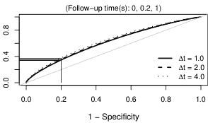

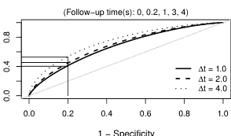

**图 7.13:** 复合预测规则下肝硬化数据集随时间变化的 ROC 曲线。我们目前使用的模型 (I) 假设 $t$ 时的死亡风险与同一时间的凝血蛋白指数真实值相关。模型 (II) 假设 $t$ 时的风险与真实轨迹的斜率相关，而模型 (III) 假设风险取决于标记物的当前值和当前斜率。与之前，为了拟合模型 (II) 和 (III)，我们需要首先定义包含 $m_i(t)$ 固定效应和随机效应部分的列表：

```r
m_i(t) = \beta_0 + \beta_1 y_i + \beta_2 t + \beta_3 T_i + \beta_4 (y_i \times t) + \beta_5 (y_i \times T_i) + b_{i0} + b_{i1}t
```

因此，

```r
m_i'(t) = \beta_2 + \beta_4 y_i + b_{i1}.
```

我们在以下包含固定和随机部分的 R 公式对中利用 $m_i'(t)$：

- `dform2 <- list(fixed = ~ treat, indFixed = c(3, 5), random = ~ 1, indRandom = 2)`

上述列表中的 `indFixed` 和 `indRandom` 分别给出原始 $m_i(t)$ 固定效应系数 $\beta$ 和随机效应 $b_i$ 的位置，用于 $m_i'(t)$ 的规范。也就是说，我们需要从 $m_i(t)$ 的固定效应向量 $\beta$ 中提取 $m_i'(t)$ 固定效应部分的第三和第五元素，同样地提取随机效应系数向量 $b_i$ 的第二个元素。

相应的联合模型通过以下语法拟合：

```r
jointFitBsp2.pro <- update(jointFitBsp.pro, parameterization = "slope", derivForm = dform2)

jointFitBsp3.pro <- update(jointFitBsp.pro, parameterization = "both", derivForm = dform2)
```

使用与之前类似的 `rocJM()` 调用，我们估计这两个模型下在 $t=4, \Delta t=1, 2$ 和 4 时安慰剂患者的 ROC 和 AUC，并使用复合预测规则（该规则在患者在最后两次访视期间凝血蛋白水平相对下降 20% 时将其分类为“病例”）。具体来说对于模型 (II)，调用如下：

```r
set.seed(123)

ROCplcb.Rel12 <- rocJM(jointFitBsp2.pro, dt = c(1, 2, 4), data = plcbData, directionSmaller = TRUE, diffType = "relative", rel.diff = c(1, 0.8), M = 1000, burn.in = 500)

ROCplcb.Rel12
```

随时间变化的 ROC 曲线下的面积

估计：Monte Carlo (500 个样本)
差异：相对, lag = 2 (1, 0.8)
阈值范围: (-28, 306)

```text
Case: 1
记录时间(s): 0, 0.25, 1, 3, 4
dt t + dt AUC Cut.1 Cut.2
1 5 0.6543 105.600 84.480
2 6 0.6599 105.600 84.480
4 8 0.6766 109.600 87.684
```

而对于模型 (III)，相应的调用是

# 纵轨迹与生存数据的联合模型

# 轨迹 (Value)
(随访时间: 0.0, 0.2, 1, 3, 4)

# 斜率 (Slope)
(随访时间: 0.0, 0.2, 1, 3, 4)

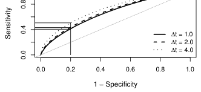
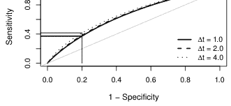

# 值 + 斜率 (Value + Slope)
(随访时间: 0.0, 0.2, 1, 3, 4)

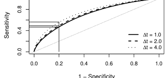

**图 7.14：** 在复合预测规则和联合模型的三种参数化下，肝硬化数据集的时间依赖性 ROC 曲线。水平线表示特异性为 80% 时的灵敏度水平。

十年期间不同时间点的 AUC。我们选择了基线、三个月、半年、一年，以及此后每年一次，直到第十年；所需信息包含在以下数据框：

```r
plcbdata2 <- data.frame(
  id = 1,
  treat = factor("placebo", levels = levels(prothroid$treat)),
  time = c(0, 0.25, 0.5, 1:10)
)

plcbdata2$t0 <- as.numeric(plcbdata2$time == 0)
```

如之前所示，在 R 中使用 for 循环计算时间依赖性 AUC，循环每次迭代考虑数据框 `plcbData2` 中的额外行：

```r
ROCs.MI <- ROCs.MII <- ROCs.MIII <- vector("list", nrow(plcbdata2))

for (i in seq_along(ROCs.MI)) {
  set.seed(123)
  ROCs.MI[[i]] <- rocJM(jointFitBsp.pro, dt = 4,
                        data = plcbData2[seq_len(i)], diffType = "relative",
                        rel.diff = c(1, 0.8), M = 1000, burn = 500)
  ROCs.II[[i]] <- rocJM(jointFitBsp.2, dt = 4,
                        data = plcbData2[seq_len(i)], directionSmaller = TRUE,
                        diffType = "relative", rel.diff = c(1, 0.8), M = 1000, burn = 500)
  ROCs.III[[i]] <- rocJM(jointFitBsp3.pro, dt = 4,
                         data = plcbData2[seq_len(i)], diffType = "relative",
                         rel.diff = c(1, 0.8), M = 1000, burn = 500)
}
```

每个三个模型的结果分别保存在列表 `ROCs.MI`、`ROCs.II` 和 `ROCs.III` 中。在接下来的步骤中，我们从这些列表中提取 AUC† 并计算边缘函数 $S(t)$：

```r
AUCs.MI <- apply(ROCs.MI, "[", "AUCs")
AUCs.II <- apply(ROCs.II, "[", "AUCs")
AUCs.III <- apply(ROCs.III, "[", "AUCs")
sf <- surv(Surv(Time, death) - treat, data = prothor,
           subset = treat = "placebo"))$surv
```

特别地，`summary()` 语句提取了三个列表中所有元素中的 AUC 组件，而来自 **survival** 包的 `surv()` 函数计算了肝硬化数据集的 Kaplan-Meier 估计。在 `survfit()` 中，我们使用 `subset` 参数估计安慰剂患者的 $S(t)$，然后使用 `summary()` 方法在特定的感兴趣点返回 $S_{KM}(t)$。我们使用梯形法近似 $[C_{\Delta t}^t]^{10}$ 分子和分母中的积分，其一般定义为：

> $\int_a^b f(x)dx \approx (b-a) \frac{f(a)+f(b)}{2}$

为了获得更好的精度，我们对 `plcbData2` 中 13 个时间点定义的 12 个子区间进行积分近似，并重写 $[C_{\Delta t}^t]^{10}$

$$[C_{\Delta t}^t]^{10}=\int_0^{0.25} AUC_{\Delta t}^t S(t)dt + \int_{0.25}^{0.5} AUC_{\Delta t}^t S(t)dt + \dots + \int_{0.5}^{10} AUC_{\Delta t}^t S(t)dt$$

然后用梯形法近似上述每个积分。我们可以在 R 中使用 `head()` 和 `tail()` 函数灵活地定义每个积分的边界 $a$ 和 $b$，即：

# 纵轨迹与生存数据的联合模型

```r
times <- c(0, 0.25, 0.5, 1:10)
a <- head(times, -1)
b <- tail(times, -1)
rbind(a, b)
```

```text
[1] [2] [3] [4] [5] [6] [7] [8] [9] [10] [11] [12]
a 0.00 0.25 0.5 1 2 3 4 5 6 7 8 9
b 0.25 0.5 1 2 3 4 5 6 7 8 9 10
```

以类似并并梯形法的定义，$[C_{\Delta t}^{10}]$ 分母中的 12 个积分之和如下：

```r
Denom <- sum(b - a) * (head(Surv, -1) + tail(Surv, -1)) / 2
```

同样，根据三个模型随时间变化的 AUC，我们推导出 $[C_{\Delta t}^{10}]$ 分子中的 12 个积分之和：

```r
```


> Numer <- sum(b - a) * (head(AUCs, -1) + tail(AUCs, -1)) / 2

```r
> NumerII <- sum(b - a) * (head(AUCs, -1) + tail(AUCs, -1)) / 2
```

```r
> NumerIII <- sum(b - a) * (head(AUCs, -1) + tail(AUCs, -1)) / 2
```

最后，动态索引通过计算相应的比率获得：

```r
> Numer / Denom (Model I)
[1] 0.720932
> Numer / Denom (Model II)
[1] 0.682421
> Numer / Denom (Model III)
[1] 0.729345
```

比较总结十年随访期能力的三个索引值，我们观察到在 $t=4$ 时模型 (III) 的准确性有所下降。特别是，对于研究中的患者，模型 (I) 和 (III) 提供的区分能力实际上相同，优于模型 (II)。这意味着当前值 $m_i(t)$ 比真实斜率 $m_i'(t)$ 起着更重要的作用。

# 附录 A

# R 简介

本附录对 R 的某些方面进行了简要介绍，为用户提供在其数据中拟合联合模型所需的背景知识。需要强调的是，本文并未尝试对 R 进行详尽介绍；感兴趣的读者请参考随每个 R 安装的《Introduction to R》手册，以及 Venables and Ripley (2002) 和 Dalgaard (2008) 的著作。更多材料可以在网上找到：`http://cran.r-project.org/other-docs.html`。

## A.1 获取 R 和 包

软件和文档根据 GNU 公许可证免费发布，可以通过全面的 R 网络 (CRAN) 获取：`http://cran.r-project.org/`。可以从源代码找到 R，但也有 Windows、Mac OS X 和 Linux 主版本的二进制版本。对于熟悉相关平台标准安装工具的用户来说，安装二进制发行版通常很简单。

通过 CRAN 还可以获取免费的附加包。例如，书中主要使用的 `JM` 包可以通过命令安装：

```r
> install.packages("JM")
```

通常建议使用已安装包的最新版本，可以通过运行命令获取：

```r
> update.packages()
```

## A.2 简单操作

### A.2.1 基本 R 对象

R 中的基本数据对象是向量，两种主要类型是持有定量信息的数值向量和持有定性信息的字符向量。可以通过 `c()` 函数定义向量；例如，该语法定义了一个包含六元素的数值向量：

```r
> x <- c(1, 3, 5, 7, 2, NA)
```

```r
> x
```

`NA` 代表“不可用”，是 R 中的缺失数据标识符。符号 `<-` 是赋值运算符，用于将函数 `c()` 的结果存储在对象 `x` 中。同样可以使用 `c()` 函数定义字符向量，但条目需要输入引号内（单引号或双引号）：

```r
> y <- c("male", "male", "female")
```

```r
> y
```

```
[1] "male" "male" "female"
```

另一种类型的对象用于指定其他组件的离散分组，其长度为因子（factors）。这些使用 `factor()` 定义，例如：

```r
> f <- factor(c(1,2,2,1,1,2), levels = c(1,2,3), labels = c("apple", "orange", "banana"))
```

```
[1] orange orange apple apple banana
Levels: apple orange banana
```

在这个示例中，我们对输入数值向量 `c(1,2,2,1,1,2)` 定义了一个分类分组，通过水平的值进行识别，并由 `labels` 参数指定标签。注意，尽管出现了对应于 ‘banana’ 的值 3，但因子对象 `f` 显式地包含了这种可能性。

在 R 中有 `matrix()`、`rbind()` 和 `cbind()` 函数。第一个函数接受向量作为输入，通过赋予其维度属性将其转换为矩阵，而后两个则分别按行或列顺序将相同长度的向量合并在一起。下面的语法通过构建一个包含 1 到 9 整数元素的矩阵来说明这些函数的用法（为了自动创建这一整数序列，我们使用了 `:` 运算符）：

```r
matrix(1:9, nrow = 3, ncol = 3)
```

```
     [,1] [,2] [,3]
[1,]    1    4    7
[2,]    2    5    8
[3,]    3    6    9
```

```r
cbind(1:3, 4:6, 7:9)
```

```
     [,1] [,2] [,3]
[1,]    1    4    7
[2,]    2    5    8
[3,]    3    6    9
```

这两个函数产生完全相同的输出，但在第一情况下，我们拥有一个九个元素的向量，它被组织成 3 × 3 的矩阵；而在第二种情况下，我们按列顺序将三个各包含三个元素的向量合并在一起。我们观察到，默认情况下 `matrix()` 按列顺序组织输入向量的元素。这可以使用函数的 `byrow` 参数来覆盖。

前述定义的向量和矩阵的一个定义性特征是，它们的所有元素必须是相同类型，也就是说，我们不能有一个第一个元素是数值型而第二个元素是字符型的向量。一种更灵活的克服这种限制的 R 对象类型是列表（lists），它们使用 `list()` 函数定义。例如，下面的语法定义了一个包含四个元素的列表，其中第一个和第三个元素是数值型，第二个和第四个元素是字符型：

```r
> L <- list(1, "a", 2, "b")
> L
```

```
[[1]]
[1] 1

[[2]]
[1] "a"

[[3]]
[1] 2

[[4]]
[1] "b"
```

列表的一种特殊类型是数据框（data frames），它们是 R 建模软件中最常用的基础数据结构。与列表类似，数据框可以包含不同类型的对象，但限制是这些应该是相同长度的向量，这样它们就可以被组织成矩形格式（如矩阵所示）：

```r
> DF <- data.frame(id = 1:5,
  sex = c("male", "male", "male", "female", "female"),
  age = c(28, 32, 35, 29, 24))
> DF
```

```
  id    sex age
1  1   male  28
2  2   male  32
3  3   male  35
4  4 female  29
5  5 female  24
```

列表可以认为是 R 中最强大的对象，因为列表的每个元素都可以是任何有效的 R 对象。例如，下面的语法构建了一个列表，其中第一个元素是数值向量，第二个是矩阵，第三个是包含两个变量（一个数值型和一个因子）的数据框，最后一个元素是另一个包含两个元素的列表（一个数值向量和一个字符向量，输出未显示）：

```r
> list(
  x = 1:10,
  mat = matrix(x = 1:16, nrow = 4, ncol = 4),
  data = data.frame(x = 1:3, f = factor(c("m", "f", "m"))),
  lis = list(y = 2:5, ch = c("a", "ab", "abc"))
)
```

### A.2.2 索引

所有上述定义对象的数据操作都是通过索引操作完成。有三种基本的索引类型，即位置索引、逻辑索引和名称索引。每种类型的索引都使用方括号运算符 `[...]` 执行。更具体地说，通过位置索引，我们从对象的特定位置提取元素；例如，对于上面定义的 `x` 向量，我们可以使用语法提取它的第一个和第三个元素（即位置一和三的元素）：

```r
> x[c(1,3)]
[1] 1 5
```

与向量类似，对于矩阵和数据框，我们可以通过指定位置（即数字）来提取行或列。为了区分行和列，我们使用逗号方括号。例如，之前定义的数值矩阵的前两行可以通过以下提取：

```r
> mat <- matrix(1:9, nrow = 3, ncol = 3)
> mat[1:2, ]
```

```
     [,1] [,2] [,3]
[1,]    1    4    7
[2,]    2    5    8
```

而数据框 `DF` 的最后两列可以通过以下提取：

```r
> DF[, 2:3]
```

```
    sex age
1  male  28
2  male  32
3  male  35
4 female  29
5 female  24
```

逻辑索引用于根据逻辑表达式提取 R 对象的组件。例如，为了提取 `x` 向量中大于等于三的元素，我们使用语法：

```r
> x >= 3
[1] FALSE  TRUE  TRUE FALSE    NA
```

```r
> x[x >= 3]
[1]  3  5  7 NA
```

第一行是一个与 `x` 长度相同的逻辑向量，其元素 `TRUE` 和 `FALSE` 取决于 `x` 的对应元素是否满足条件。在方括号中使用此逻辑向量，索引运算符将提取 `x` 中对应 `TRUE` 条目的元素。名称索引用于命名命名对象。特别地，R 中的任何对象都可以有名称：例如，以下语法构建了一个带有三个元素的命名向量：

```r
> z <- c("a" = 1, "b" = 2, "c" = 3)
> z
```

```
a b c
1 2 3
```

名称索引通过在方括号内指定我们想要提取的元素的字符向量来进行，例如：

```r
> z[c("b", "d")]
```

```
 b <NA>
 2    NA
```

因此，上述语法从 `z` 中提取了名称为 "b" 和 "d" 的元素。然而，由于 `z` 中没有名为 "d" 的元素，我们得到了一个缺失值。

## A.3 导入数据框

基础函数 `read.table` 有多个参数控制数据如何导入 R 中。导入数据集的额外函数由推荐的附加包提供。在导入数据集并开始分析之前，通常需要执行数据操作。下面使用来自 `JM` 包的 `aids.id` 数据框说明了 R 中的一些基本操作示例。处理数据集的第一步是：

```r
> head(aids.id)
```

```
  patient Time death CD4 obstime drug gender prevOI AZT start stop event
1       1 16.97     0 10.6778       0 ddC   male   AIDS   1     0  6.0     0
2       2 19.00     0  6.3245       0 ddI   male  noAIDS   1     0  6.0     0
3       3 18.53     1  3.4610       1 ddI female   AIDS   2     0  2.0     0
4       4 12.70     0  3.8730       0 ddC   male   AIDS   2     0  2.0     0
5       5 15.13     0  7.2801       0 ddI   male   AIDS   2     0  2.0     0
6       6  1.90     1  4.5828       0 ddI female   AIDS   1     0  1.9     1
```

另一个显式输出数据框中变量信息的有用函数是 `str()`。对于 `aids.id`，它给出：

```r
> str(aids.id)
```

```
'data.frame':	467 obs. of  12 variables:
 $ patient: Factor w/ 467 levels "1","2","3","4",...: 1 2 3 4 5 6 ...
 $ Time   : num  17 19 18.5 12.7 15.1 ...
 $ death  : int  0 0 1 0 0 1 ...
 $ CD4    : num  10.68 6.32 3.46 3.87 7.28 ...
 $ obstime: int  0 0 1 0 0 0 ...
 $ drug   : Factor w/ 2 levels "ddC","ddI": 1 2 2 1 2 2 ...
 $ gender : Factor w/ 2 levels "female","male": 2 2 1 2 2 1 ...
 $ prevOI : Factor w/ 2 levels "noAIDS","AIDS": 2 1 2 2 2 2 ...
 $ AZT    : Factor w/ 2 levels "intolerance",..: 1 1 2 2 2 ...
 $ start  : int  0 0 0 0 0 0 ...
 $ stop   : num  6 6 2 2 2 1.9 ...
 $ event  : num  0 0 0 0 0 1 ...
```

例如，我们可以看到 `Time` 是一个连续的数值变量，而 `gender` 变量是一个因子。

- 为了从数据框中提取变量，我们使用符号 `$`，它是我们在节中看到的名称索引运算符的简写。例如，下面的代码从 `aids.id` 中提取 `sex`（注：原文此处为 `sex`，实际数据框中为 `gender`）：

```r
> aids.id$gender
```

- 使用类似的代码也可以转换变量。例如，下面的代码在数据框中定义了一个名为 `logTime` 的新变量，它是 `Time` 变量的自然对数：

```r
> aids.id$logTime <- log(aids.id$Time)
```

- 将数值变量转换为因子我们使用 `factor()` 函数。例如，下面的代码将 `death` 变量转换为因子：

```r
> aids.id$death <- factor(aids.id$death, levels = 0:1, labels = c("alive", "dead"))
```

- 原数据框的子集通常使用索引和逻辑表达式构建。例如：

- `aidsNew1` 包含原始 `aids.id` 中的 `Time`、`death` 和 `drug` 变量：

```r
> aidsNew1 <- aids.id[c("Time", "death", "drug")]
```

- `aidsNew2` 仅包含观测事件时间大于三个月的患者：

```r
> aidsNew2 <- aids.id[aids.id$Time > 3, ]
```

- `aidsNew3` 包含男性患者：

```r
> aidsNew3 <- aids.id[aids.id$gender == "male", ]
```

- `aidsNew4` 包含基础 CD4 细胞计数大于五的女性患者：

```r
> aidsNew4 <- aids.id[aids.id$gender == "female" & aids.id$CD4 > 5, ]
```


## A.4 公式接口

R 中的统计模型使用公式接口定义。通常情况下，R 公式的形式如下：

> `response ~ terms`

其中，`response` 表示感兴趣的响应变量，`terms` 表示广线性模型中的加性部分。这些部分还可能包括响应变量和预测变量的变换。表 A.1 显示了 R 公式语法的几个示例。例如，以下代码：

> `lm(log(blood.pressure) ~ ns(age, 3) * sex * hdl, data = BPdata)`

拟合了一个线性回归模型（使用函数 `lm()`），其响应变量为 `blood.pressure` 的自然对数，预测变量包括：`age`（扩展为具有两个内部结点的自然立方样条基中，使用 `splines` 包中的函数 `ns()`）、`sex`、`hdl` 胆固醇，以及 `sex` 与 `hdl` 之间的交互项。

### 表 A.1：R 公式接口与模型线性预测因子数学公式之间的对应关系（y 表示响应变量）

| 模型项 | R 公式语法 |
|---|---|
| $y = \beta_0 + \beta_{1age} + \beta_{2female}$ | `y ~ age + sex` |
| $y = \beta_{1age} + \beta_{2female} + \beta_{2male}$ | `y ~ age + sex - 1` |
| $y = \beta_0 + \beta_{1age} + \beta_{2caucasian} + \beta_{3age} \times female$ | `y ~ age + sex + age:sex` 或 `y ~ age * sex` |
| $y = \beta_0 + \beta_{1age} + \beta_{2female} + \beta_{3age} \times female + \beta_{5caucasian} \times female$ | `y ~ (age + race) * sex` |
| $y = \beta_0 + \beta_{1age} + \beta_{2caucasian} + \beta_{3female} + \beta_{4age} \times female + \beta_{5caucasian} \times female + \beta_{6age} \times caucasian$ | `y ~ (age + race + sex)^2` |
| $y = \beta_0 + \beta_{1age} + \beta_{2age^2} + \beta_{3age^3}$ | `y ~ age + I(age^2) + I(age^3)` 或 `y ~ poly(age, 3)` |

## 附录 B

## 联合模型的 EM 算法

在本附录中，我们提供了用于极大联合模型对数似然的 EM 算法的技术细节。在本附录的剩余部分，假设读者熟悉 4.3.2 节的内容。

### B.1 EM 算法简述

期望极大化（EM）算法是处理不完全数据问题极大似然估计的一种非常通用的算法。EM 能够解决的问题范围非常广泛，包含了通常不被认为涉及缺失数据的问题。EM 算法背后的直观思想是：对应于完整数据的对数似然通常更容易极大化，且通常具有闭式解。为了利用这一特性，算法分为两个步骤：期望（E）步和极大化（M）步。在 E 步中，我们固定缺失数据，并实际上用一个代理函数来替换观测数据的对数似然。随后，在 M 步中对该代理函数进行极大化。然而，我们为这种简化所付出的代价是 EM 算法是迭代的——如果参数不等于它们的极大似然估计值，那么 E 步中对缺失数据的重构注会有微错误。

简而言之，每个 EM 算法的步骤如下：令 $Y$ 表示完整数据向量，它分解为观测部分 $Y^o$ 和缺失部分 $Y^m$。我们的目标仅使用观测信息来估计完整数据模型的参数 $\theta$。在 E 步中，我们计算完整数据对数似然的期望值：

```
$Q(\theta \| \theta^{(it)}) = E[\log p(y;\theta) \| y^o;\theta^{(it)})]$

$\int \log p(y^m,\theta^o) p(y^m \| y^o;\theta^{(it)}) dy^m$
```

并在 M 步中通过以下方式更新参数：

```
$\theta^{(it+1)} = \arg\max Q(\theta \| \theta^{(it)})$
```

EM 算法的优点之一是其数值稳定性。特别是正如 Dempster 等人 (1977) 所示，在每次迭代中，EM 算法都会导致数据对数似然的增加，即 $\log p(y^o;\theta^{(it+1)}) \geq \log p(y^o;\theta^{(it)})$，并且避免了沿搜索方向越过或未达到似然极大值。然而，EM 的一个重要缺点是在极大值点附近的收敛速度缓慢。这直接反映了问题中缺失数据的数量。关于该算法起源的简要历史回顾，请参阅 Little 和 Rubin (2002, 第 8.2 节)，而更详细的介绍以及更一般的最小化极大化（Minorization-Maximization）算法族，参见 Lange (2004, 第 6 和 7 章)。

### B.2 联合模型的 E 步

我们将说明使用 EM 算法推导第 4 章介绍的标准联合模型的极大似然估计，因为对第 5 章中看到的所有扩展调整 E 步和 M 步是直接的。具体而言，我们考虑模型：

```
$h_i(t) = h_0(t)\exp[\gamma^T w_i + \alpha\{x_i^T(t)\beta + z_i^T(t)b_i\}]$

$y_i(t) = x_i^T(t)\beta + z_i^T(t)b_i + \varepsilon_i(t)$

$b_i \sim \mathcal{N}(0, \sigma^2)$
```

$\theta = (\theta_o^T, \theta_y^T, \theta_b^T$，其中 $\theta_y = (\beta^T, \sigma^2)$，$\theta_o = (\gamma^T, \alpha, \theta_{ho})$，$\theta_{ho}$ 表示风险函数 $h_0(\cdot)$ 中的参数，$\theta_b = b_i$。为了将 EM 应用联合模型，我们将随机效应视为“缺失数据”。具体而言，我们的目标是找到参数 $\hat{\theta}$ 使观测数据似然 $\ell(\theta) = \sum_i \log p(T_i, \delta_i)$ 最大，但通过极大化完整数据对数似然的期望来实现：

```
$Q(\theta | \theta^{(it)}) = \sum_i \log p(T_i, \delta_i, y_i; \theta) p(b_i | T_i, \delta_i, y_i; \theta^{(it)}) db_i

= \sum_i \{\log p(T_i, \delta_i | b_i) + \log p(y_i | \theta) + \log(b_i | \theta)\}$
```

正如 4.3 所示，关于随机效应的积分以及生存函数 $p(T_i, \delta_i | b_i)$ 中关于时间的积分没有闭式解。因此，对于 $Q(\theta | \theta^{(it)})$ 必须采用数值积分，例如高斯求积或蒙特卡洛采样。

### B.3 联合模型的 M 步

由于完整数据对数似然被分为三个部分：$\log p(T_i, \delta_i, y_i; b_i) = \log p(T_i, \delta_i | b_i) + \log p(y_i | \theta) + \log p(b_i | \theta)$，对 $\theta$ 极大化 $Q(\theta | \theta^{(it)})$ 仅涉及相应参数出现的部分。M 步规范中所需的表达式使用了关于时间和随机效应的积分。对于这些表达式的实际计算，这些积分需要用 4.3 节提到的方法进行近似。具体而言，纵向模型中的测量误差差和随机效应的协方差矩阵在 M 步中根据闭式表达式更新：

```
$\hat{\sigma}^2 = N^{-1} \sum_i (y_i - X_i\beta - Z_ib_i)^T (y_i - X_i\beta - Z_ib_i) p(b_i | T_i, \delta_i, y_i; \theta) db_i

$= N^{-1} \sum_i (y_i - X_i\beta)^T (y_i - X_i\beta) + tr(Z_i^T Z_i \tilde{b}_i)$

$\hat{b}_i = n^{-1} \sum_i vb_i + \tilde{b}_i$
```

其中 $N = \sum_i n_i, \tilde{b}_i = E(b_i | T_i, \delta_i, y_i; \theta^{(it)})$ 且 $vb_i = var(b_i | T_i, \delta_i, y_i; \theta^{(it)}) = \int (b_i - \tilde{b}_i)^2 p(b_i | T_i, \delta_i, y_i; \theta^{(it)}) db_i$。

在上述联合模型公式下，我们无法获得固定效应 $\beta$ 和生存子模型参数 $\theta_t$ 得的闭式解。因此，对于这些参数，M 步通过单步 Newton-Raphson 更新来实现：

```
$\hat{\beta}^{(it+1)} = \hat{\beta}^{(it)} - \{\frac{\partial S(\hat{\beta}^{(it)})}{\partial\beta}\}^{-1} S(\hat{\beta}^{(it)})$

$\hat{\theta}_t^{(it+1)} = \hat{\theta}_t^{(it)} - \{\frac{\partial S(\hat{\theta}_t^{(it)})}{\partial\theta_t}\}^{-1} S(\hat{\theta}_t^{(it)})$
```

其中 $\hat{\beta}^{(it)}}$ 和 $\hat{\theta}_t^{(it)}$ 分别表示当前迭代时 $\beta$ 和 $\theta_t$ 的值，而 $\frac{\partial S(\hat{\beta}^{(it)})}{\partial\beta}$ 和 $\frac{\partial S(\hat{\theta}_t^{(it)})}{\partial\theta_t}$ 分别在 $\hat{\beta}^{(it)}$ 和 $\hat{\theta}_t^{(it)}$ 处评估的 Hessian 矩阵相应块。对应于 $\beta$ 和 $\theta_t$ 的得分向量分量遵循：

```
$S(\beta) = \sum_i X_i^\top\{y_i - X_i\beta - Z_ib_i\}/\sigma^2 + \alpha x_i(T_i)$

$- \exp(\gamma^\top w_i) \int_0^{T_i} h_0(s)\alpha x_i(s)\exp[\alpha\{x_i^\top(s)\beta + z_i^\top(s)b_i\}] \times p(b_i|T_i, \delta_i, y_i; \theta) ds db_i$
```

```
$S(\gamma) = \sum_i [\delta_i - \exp(\gamma^\top w_i)] \int_0^{T_i} h_0(s)\exp[\alpha\{x_i^\top(s)\beta + z_i^\top(s)b_i\}] \times p(b_i|T_i, \delta_i, y_i; \theta) ds db_i$
```

```
$S(\alpha) = \sum_i \delta_i\{x_i^\top(T_i)\beta + z_i^\top(T_i)b_i\}$

$- \exp(\gamma^\top w_i) \int_0^{T_i} h_0(s)\exp[\alpha\{x_i^\top(s)\beta + z_i^\top(s)b_i\}] \times p(b_i|T_i, \delta_i, y_i; \theta) ds db_i$
```


# 附录 C

## JM 包结构

在本附录中，我们提供了 `JM` 包中主要函数的概述。尽管我们描述了这些函数的主要用法，但刻意没有提供它们所有的参数，因为在软件包未来的版本中，某些参数可能会发生变化，或者可能会引入额外的参数。关于其语法和输出的确定依据是该包的在线手册。

### C.1 标准泛型方法

`JM` 包的主要拟合函数是 `jointModel()`，它用于拟合各种纵向数据与事件时间数据的联合模型。该函数的两个主要参数是：类为 `lme` 的对象，代表使用 `nlme` 包中的 `lme()` 函数拟合的线性混合效应模型；以及类为 `coxph` 的对象，代表使用 `survival` 包中的 `coxph()` 函数拟合的 Cox 比例风险模型。在调用 `coxph()` 时，需要设置选项 `x = TRUE`，以便将 Cox 模型的设计矩阵包含在模型对象中，但也建议设置选项 `model = TRUE`，以便返回整个模型框架（而不仅仅是设计矩阵）。此外，用户需要指定 `timeVar` 参数，即线性混合模型中时间变量的名称。`method` 参数控制生存子模型的类型和数值积分方法。关于 `method` 参数不同选项的详细介绍，请参考第 4.2 节。

`jointModel()` 函数返回一个 "jointModel" 的 R 列表，该列表为 R 中的几个标准泛型函数定义了方法。

`print()` 和 `summary()` 函数返回拟合联合模型的结果。前者仅打印纵向模型和生存子模型的估计参数，而后者提供了更详细的输出，包括用于拟合模型的数据集的汇总统计量以及两个子模型回归系数的 Wald 检验。

`coef()` 和 `fixef()` 函数从拟合的联合模型中提取两个子模型的估计系数。对于生存过程，它们提供相同的输出，但对于纵向模型，前者返回个体特异性回归系数（即固定效应加上相应的随机效应估计值），而后者仅返回估计的固定效应。

`ranef()` 函数计算每个受试者随机效应的经验贝叶斯估计。这些可能是给定观测数据的随机效应后验分布的均值或众数。该函数还计算随机效应离散度的估计，可用选项包括后验方差和逆 Hessian 矩阵（计算为对数后验关于随机效应的二阶导数）。使用该函数的示例见第 4.5 节。

`vcov()` 函数提取极大似然估计的估计方差协方差矩阵。使用该函数的示例见第 4.4.1 节。

`fitted()` 和 `residuals()` 函数分别为两种结局计算若干类拟合值和残差。对于纵向子模型，提供个体特异和边际的拟合值与残差。此外，对于纵向子模型，可以使用 `residuals()` 函数计算考虑流失的多重插补残差。对于相对风险子模型，`fitted()` 函数可以返回生存、累积风险和对数累积风险函数的边际或个体特异性估计，而 `residuals()` 函数计算鞅残差和 Cox-Snell 残差。使用该函数的示例见第 6.1.1 节、6.1.2 节等。

`anova()` 函数基于拟合的联合模型计算 Wald 检验和似然比检验 (LRT)。当提供单个联合模型对象时，会对所有回归系数进行边际 Wald 检验；当提供拟合的联合模型时，该函数执行相应的 LRT。在后一种情况下，用户主要负责提供嵌套联合模型以使 LRT 有效（即代码对验证这一点仅进行极少数检查）。使用该函数的示例见第 4.4.1 节和 5.1 节。

`plot()` 函数为纵向过程和生存过程生成诊断图。这包括个体特异残差与个体特异拟合值之间的散点图、纵向结局个体特异残差的 QQ 图，以及针对事件发生时间的拟合边际生存函数。使用该函数的示例见第 6.1.1 节和 5.3 节。

`predict()` 函数产生纵向结局的个体特异和边际预测，以及带有置信区间或预测区间。个体特异性预测是基于受试者在特定时间点之前仍然存活这一条件生成的。使用该函数的示例见第 4.4.2 节、7.2 节和 7.3 节。

`logLik()` 函数提取拟合模型的对数似然值（包括参数数量作为属性），`AIC()` 函数可计算 Akaike 信息准则和贝叶斯信息准则。

### C.2 其他函数

`survfitJM()` 生成条件生存概率的个体特异预测（以及相关的置信区间）。估计的概率和置信区间可以通过相应的 `plot()` 方法描述。使用该函数的示例见第 7.1.3 节和 7.3 节。

`rocJM()` 基于联合模型产生时间依赖的敏感性和特异性的估计，以及相应的 ROC 曲线下面积，用于研究纵向结局区分规定时间间隔内患者是否发生事件的判别能力。相应的 `plot()` 方法产生 ROC 曲线图。使用该函数的示例见第 7.4.6 节。

`Wald.strata()` 对分层联合模型执行 Wald 检验，测试不同层之间基线风险函数无差异的零假设。使用该函数的示例见第 5.3 节。

`xtable()` 函数返回 LaTeX 代码，用于生成拟合联合模型的估计系数、标准误和 p 值表格。这基于 `xtable` 包中的泛型函数 `xtable()`（Dahl, 2012）。

`weibull.frailty()` 使用 Gamma 分布的随机项为多变量生存数据拟合 Weibull 模型，以考虑关联性。使用该函数的示例见第 6.3.2 节。

`piecewiseExp.ph()` 接受拟合的 Cox 模型并拟合相应的分段常数相对风险模型 (4.3)。使用该函数的示例见第 4.4.1 节。

---

# 参考文献

Barlow, W. and Prentice, R. (1988). 相对风险回归的残差。Biometrika 75, 65–74.

Bates, D., Maechler, M., and Bolker, B. (2011). lme4: 使用 S4 类的线性混合模型。R package version 0.999375-42. http://cran.r-project.org/packages/lme4.

Booth, J. and Hobert, J. (1999). 使用自动蒙特卡洛 EM 算法极大化广义线性模型似然估计。Journal of the Royal Statistical Society, Series B 61, 265–285.

Breslow, N. (1972). 对 D. Cox 回归模型与生存表论文的讨论。Journal of the Royal Statistical Society, Series B 34, 216–217.

Breslow, N. and Clayton, D. (1993). 广义线性混合模型中的近似推断。Journal of the American Statistical Association 88, 9–25.

Breslow, N., Lubin, J., Marek, P., and Langholz, B. (1983). 乘性模型和队列分析。Journal of the American Statistical Association 78, 1–12.

Brown, E. and Ibrahim, J. (2003). 一种用于纵向数据与生存数据的贝叶斯半参数联合模型。Biometrics 59, 221–228.

Brown, E., Ibrahim, J., and DeGruttola, V. (2005). 用于多条纵向标志物和生存的灵活 B-样条模型。Biometrics 61, 64–73.

Cavender, J., Rogers, W., Fisher, L., Gersh, B., Coggin, J., and Myers, W. (1992). 冠状动脉手术研究 (CASS) 中随机接受医疗或手术治疗患者吸烟对生存和发病率的影响：10 年随访。Journal of the American College of Cardiology 20, 145–157.

Chi, Y.-Y. and Ibrahim, J. (2006). 多变量纵向数据与多变量生存数据的联合模型。Biometrics 62, 432–445.

Copas, J. and Li, H. (1997). 非随机样本的推断（讨论）。Journal of the Royal Statistical Society, Series B 59, 55–95.

Cox, D. (1972). 回归模型与生存表（讨论）。Journal of the Royal Statistical Society, Series B 34, 187–220.

Cox, D. and Hinkley, D. (1974). 理论统计学。Chapman & Hall, London.

Cox, D. and Oakes, D. (1984). 生存数据分析。Chapman & Hall, London.

Creemers, A., Hens, N., Aerts, M., Molenberghs, G., Verbeke, G., and Kenward, M. (2010). 用于不完整纵向数据共享参数模型的敏感性分析。Biometrical Journal 52, 111–125.

Dafni, U. and Tsiatis, A. (1998). 带有误差测量的临床结果替代标记。Biometrics 54, 1445–1462.

Dahl, D. (2012). xtable: 将表格导出到 LaTeX 或 HTML。R package version 1.7-0. http://cran.r-project.org/package=xtable.

Dalgaard, P. (2008). 使用 R 的入门统计学，第 2 版。Springer-Verlag, New York.

DeGruttola, V. and Tu, X. (1994). CD-4 淋巴细胞计数进展及其与生存时间的关系。Biometrics 50, 1003–1014.

Demidenko, E. (2004). 混合模型：理论与应用。Wiley, Hoboken.

Dempster, A., Laird, N., and Rubin, D. (1977). 通过 EM 算法从不完整数据中获得极大似然。Journal of the Royal Statistical Society, Series B 39, 1–38.

Dempster, A., Rubin, D., and Tsutakawa, R. (1981). 协方差分模型中的估计。Journal of the American Statistical Association 76, 341–353.

Dierckx, P. (1993). 样条曲线与表面拟合。Oxford University, New York.

Diggle, P., Farewell, D., and Henderson, R. (2007). 带有脱失的纵向数据分析：目标、假设与建议（讨论）。Journal of the Royal Statistical Society, Series C 56, 499–550.

Diggle, P., Heagerty, P., Liang, K-Y., and Zeger, S. (2002). 纵向数据分析，第 2 版。Oxford University Press, New York.

Diggle, P. and Kenward, M. (1994). 纵向数据中的信息性脱失（讨论）。Journal of the Royal Statistical Society, Series C 43, 49–93.

Ding, J. and Wang, J. (2008). 带有随机效应的纵向数据联合建模。Biometrics 64, 546–556.

Dobson, A. and Henderson, R. (2003). 纵向数据的脱失诊断。Biometrics 59, 741–751.

Duchateau, L. and Janssen, P. (2008). 脆弱性模型。Springer-Verlag, New York.

Efron, B. and Tibshirani, R. (1994). Bootstrap 入门。Chapman & Hall, Boca Raton.

Elashoff, R., Li, G., and Li, N. (2008). 存在失效情况下的纵向测量与生存联合模型。Biometrics 64, 762–771.

Etzioni, R., Pepe, M., Linton, G., and Goodman, G. (1999). 在受试者工作特征中引入时间维度。Medical Decision Making 19, 242–251.

Faucett, C., Schenker, N., and Elashoff, R. (1998). 带有间歇观测协变量的生存数据分析。Journal of the American Statistical Association 93, 427–437.

Fine, J. and Thomas, D. (1996). 同时建模生存协变量：Gibbs 采样。Statistics in Medicine 15, 1663–1685.

Fieuws, S., Verbeke, G., Maes, B., and Vanrenterghem, Y. (2008). 使用多变量分布预测肾衰竭。Biostatistics 9, 419–431.

Fisher, L. and Lin, D. (1999). Cox 比例风险模型中的时间协变量。Annual Review of Public Health 20, 145–157.

Fitzmaurice, G., Laird, N., and Ware, J. (2004). 应用纵向数据分析。Wiley, Hoboken.

Fleming, T. and Harrington, D. (1984). 非参数估计生存分布。Communications in Statistics: Theory and Methods 13, 2469–2486.

Fleming, T. and Harrington, D. (1991). 计数过程与生存分析。Wiley, New York.

Follmann, D. and Nychka, D. (1995). 带有随机效应的近似广义线性模型。Biometrics 51, 151–168.

Gallant, A. and Nychka, D. (1987). 半参数极大似然估计。Econometrica 55, 363–390.

Garner, F., Zwinderman, A., Geskus, R., and Sijens, Y. (2008). 改进失效时间的潜在类点模型。Journal of the Royal Statistical Society, Series A 171, 299–308.

Gay, D. (1990). 选定优化程序的使用。AT&T Bell Laboratories, Murray Hill, NJ. Computing Science Technical Report No 153.

Gelman, A. and Hill, J. (2007). 使用回归和多级/层次模型的数据分析。Cambridge University Press, New York.

Gelman, A., Van Mechelen, I., Verbeke, G., Heitjan, D., and Meulders, M. (2005). 用于模型检查的多重插补：缺失和潜在数据的完整数据图。Biometrics 61, 74–85.

Gerds, T. and Schumacher, M. (2006). 右删失事件通用生存模型中期望 Brier 分数的一致估计。Biometrical Journal 48, 1029–1040.

Goodman, L. and Kruskal, W. (1979). 交叉分类的关联测量。Springer-Verlag, New York.

Graf, E., Schmoor, C., Sauerbrei, W., and Schumacher, M. (1999). 生存数据预后分类方案的评估与比较。Statistics in Medicine 18, 2529–2545.

Greenwood, M. (1926). 癌症的自然病程。Reports on Public Health and Medical Subjects 33, 1–26.

Greven, S., Crainiceanu, C., Küchenhoff, H., and Peters, A. (2008). 线性混合模型中零方差量的限制似然比检验。Journal of Computational and Graphical Statistics 17, 870–891.

Hand, D. and Crowder, M. (1996). 实用纵向数据分析。Chapman & Hall/CRC Press, Boca Raton.

Hanley, J. and McNeil, B. (1982). 受试者工作特征 (ROC) 曲线下的意义与用法。Radiology 143, 29–36.

Hanson, T., Branscum, A., and Johnson, W. (2011). 联合纵向-生存建模的预测比较：说明竞争方法的案例研究（讨论）。Lifetime Data Analysis 17, 3–28.

Harrell, F. (2001). 回归建模策略：及其线性模型、逻辑回归和生存分析的应用。Springer-Verlag, New York.

Harrell, F., Califf, R., Pryor, D., Lee, K., and Rosati, R. (1982). 医疗检测的产率评估。Journal of the American Medical Association 247, 2543–2546.

Harville, D. (1974). 仅使用误差对比的方差分贝叶斯推断。Biometrika 61, 383–385.

Harville, D. (1977). 方差估计及相关问题的极大似然方法。Journal of the American Statistical Association 72, 320–340.

Hauptmann, M., Wellmann, J., Lubin, J., Rosenberg, P., and Kreienbrock, L. (2000). 使用样条权重函数分析暴露-时间-响应关系。Biometrics 56, 1105–1108.

Heagerty, P. and Kurland, B. (2001). 误设定的最大似然估计与广义线性混合模型。Biometrika 88, 973–985.

Heagerty, P., Lumley, T., and Pepe, M. (2000). 针对删失生存数据和诊断标记的时间依赖性 ROC。Biometrics 56, 337–344.

Heagerty, P. and Zheng, Y. (2005). 生存模型预测准确性与 ROC 曲线。Biometrics 61, 92–105.

Heckman, J. (1976). 截断、样本选择和限制因变量统计模型的共同结构以及这些模型的简单估计量。Annals of Economic and Social Measurement 5, 475–492.

Hedeker, D. and Gibbons, R. (2006). 纵向数据分析。Wiley, Hoboken.

Henderson, R., Diggle, P., and Dobson, A. (2000). 纵向测量与事件发生时间的联合建模。Biostatistics 1, 465–480.

Henderson, R., Diggle, P., and Dobson, A. (2002). 用于生存分析的纵向标记的识别与效力。Biostatistics 3, 33–50.

Herndon, J. and Harrell, F. (1996). 限制性立方样条风险模型。Communications in Statistics – Theory and Methods 25, 663–683.

Hogan, J. and Laird, N. (1997). 重复测量与事件时间联合分布的混合模型。Statistics in Medicine 16, 239–258.

Hogan, J. and Laird, N. (1998). 使用随机效应对纵向协变量建模，以增加删失生存数据的效率。Statistical Methods in Medical Research 7, 28–48.

Hougaard, P. (2000). 多变量生存数据分析。Springer-Verlag, New York.

Hsieh, F., Tseng, Y.-K., and Wang, J.-L. (2006). 生存与纵向数据的联合建模：似然法的重新审视。Biometrics 62, 1037–1043.

Hu, W., Li, G., and Li, N. (2009). 纵向测量与竞争风险失效时间数据联合分析的贝叶斯方法。Statistics in Medicine 28, 1601–1619.

Huang, X., Li, G., Elashoff, R., and Pan, J. (2011). 具有异质性随机效应的纵向测量与竞争风险生存数据的通用联合模型。Lifetime Data Analysis 17, 80–100.

Huang, X., Stefanski, L., and Davidian, M. (2009). 主要终点与纵向过程联合模型中的潜在模型稳健性。Biometrics 64, 719–727.

Ibrahim, J., Chen, M., and Sinha, D. (2001). 贝叶斯生存分析。Springer-Verlag, New York.

Ibrahim, J. and Molenberghs, G. (2009). 纵向研究中的缺失数据方法：综述。Test 18, 1–43.

Jansen, I., Hens, N., Molenberghs, G., Aerts, M., Verbeke, G., and Kenward, M. (2006). 非随机单调缺失数据模型中敏感性的本质。Computational Statistics & Data Analysis 50, 830–858.

Jansen, I. and Molenberghs, G. (2008). 针对非单调缺失数据的灵活长期建模策略。Journal of the Royal Statistical Society Series A 171, 347–373.

Jiang, J. (2010). 线性与广义混合模型及其应用。Springer-Verlag, New York.

Kalbfleisch, J. and Prentice, R. (2002). 失效时间的统计分析，第 2 版。Wiley, New York.

Kaplan, E. and Meier, P. (1958). 不完全观测的无参数估计。Journal of the American Statistical Association 53, 457–481.

Kenward, M. (1998). 具有非随机脱落的重复测量选择模型：敏感性的说明。Statistics in Medicine 17, 2723–2732.

Kenward, M. and Molenberghs, G. (1998). 数据随机缺失时的似然频率派推断。Statistical Science 13, 236–247.

Klein, J. and Moeschberger, M. (2003). 生存分析 - 针对删失与截断数据的技术。Springer-Verlag, New York.

Kraemer, H. (2004). 将优势比作为人群中 2×2 关联性的衡量量。Statistics in Medicine 23, 257–270.

Krzanowski, W. (2009). [注：标题缺失]

Kurland, B. and Heagerty, P. (2005). 生存与纵向数据的联合建模。Biometrics 61, 92–105.

Kurland, B., Johnson, L., and Heagerty, P. (2000). 重复测量的联合建模。Biometrics 56, 337–344.

Laird, N. and Ware, J. (1982). 纵向数据的随机效应模型。Biometrics 38, 963–974.

Lange, K. (2004). [注：标题缺失] Springer-Verlag.

Lawless, J. (2000). 生存分析中的统计模型与方法。Wiley, New York.

Lin, H., Turnbull, B., McCulloch, C., and Slate, E. (2002). 纵向数据与生存数据的联合建模。Biometrics 58, 895–905.

Little, R. and Rubin, D. (2002). 统计分析中的缺失数据，第 2 版。Wiley, New York.

Ma, G., Troxel, A., and Heitjan, D. (2004). 纵向建模对可忽略脱落的局部敏感性。Statistics in Medicine 24, 2129–2150.

McCullagh, P. and Nelder, J. (1989). 广义线性模型。Chapman & Hall, London.

McCulloch, C. (1997). 广义线性混合模型的最大似然算法。Journal of the American Statistical Association 92, 162–170.

McCulloch, C., Searle, S., and Neuhaus, J. (2008). 广义、线性与混合模型，第二版。Wiley, New York.

Molenberghs, G., Beunckens, C., Sotto, C., and Kenward, M. (2008). 每个非随机缺失模型都有一个拟合得同样好的随机缺失模型。Journal of the Royal Statistical Society, Series B 70, 371–388.

Molenberghs, G. and Kenward, M. (2007). 临床研究中的缺失数据。Wiley, New York.

Molenberghs, G. and Verbeke, G. (2005). 离散纵向数据模型。Springer-Verlag, New York.

Molenberghs, G. and Verbeke, G. (2007). 受限参数空间下的似然比检验、得分检验与 Wald 检验。The American Statistician 61, 22–27.

Murtaugh, P., Dickson, E., Van Dam, G., Malinchoc, M., Grambsch, P., Langworthy, A., and Gips, C. (1994). 原发性胆汁性肝炎：基于患者反复就诊短期生存预测。Hepatology 20, 126–134.

Nash, J. (1990). 计算机紧凑数值方法：线性代数与函数最小化。Adam Hilger, New York.

Nelson, W. (1972). 删失失效数据风险聚类的理论与应用。Technometrics 14, 945–965.

Neuhaus, J., Hauck, W., and Kalbfleisch, J. (1992). 拟合混合效应逻辑模型时分布设定不当的影响。Biometrika 79, 755–762.

Neuhaus, J., Kalbfleisch, J., and Hauck, W. (1994). 配对数据混合效应模型中一致估计的条件。Journal of the American Statistical Association 89, 139–148.

Neuhaus, J., McCulloch, C., and Boylan, R. (2011). 广义线性混合模型中随机效应设定不当下的二类错误注记。Biometrics 67, 654–656.

Nobre, J. and Singer, J. (2007). 线性混合模型的残差分析。Biometrical Journal 49, 863–875.

Pencina, M., D’Agostino, Sr, R., D’Agostino, Jr, R., and Vasan, R. (2008). 评估新标志物的额外预测能力：从 ROC 曲线分类及以上。Statistics in Medicine 27, 157–172.

Pinheiro, J. and Bates, D. (1995). 非线性混合效应模型中对数似然函数的近似。Journal of Computational and Graphical Statistics 4, 12–35.

Pinheiro, J. and Bates, D. (2000). S 和 S-PLUS 中的混合效应模型。Springer-Verlag, New York.

Pinheiro, J., Bates, D., DebRoy, S., Sarkar, D., and R Development Core Team (2012). nlme: 线性与非线性混合模型。R 包版本 3.1-113。http://cran.r-project.org/package=nlme.

Pinheiro, J. and Chao, E. (2006). 多层广义线性混合模型的高效拉普拉斯变换和自适应高斯积分算法。Journal of Computational and Graphical Statistics 15, 58–81.

Prentice, R. (1982). 失效时间回归模型中的协变量测量误差和参数估计。Biometrika 69, 331–342.

Prentice, R. (1989). 临床试验中的替代性终点：定义与操作标准。Statistics in Medicine 8, 431–440.

Press, W., Teukolsky, S., Vetterling, W., and Flannery, B. (2007). 数值算法：科学计算的艺术，第 3 版。Cambridge University Press, New York.

Proust-Lima, C., Diakite, A., and Liquet, B. (2011). lcmm: 各种潜类混合模型和联合潜类模型的估计。R 包版本 1.4-3。http://cran.r-project.org/package=lcmm.

Proust-Lima, C., Joly, P., Dartigues, J., and Jacqmin-Gadda, H. (2009). 多变量纵向结局与事件发生时间的联合建模：一种非线性潜类方法。Computational Statistics & Data Analysis 53, 1142–1154.

Proust-Lima, C. and Taylor, J. (2009). 使用治疗后 PSA 重复测量在前列腺癌复发的动态预测工具的开发与验证：联合建模方法。Biostatistics 10, 535–549.

Pulkstenis, E., Ten Have, T., and Landis, R. (1998). 受信息性脱落修正的二元纵向疼痛数据分析模型。Journal of the American Statistical Association 93, 438–450.

Putter, H., Fiocco, M., and Geskus, R. (2007). 生物统计学教程：竞争风险与多状态模型。Statistics in Medicine 26, 2389–2430.

Rao, P. (1997). 方差分：混合模型、方法论与应用。Chapman & Hall/CRC Press, Boca Raton.

Raudenbush, S., Yang, M., and Yosef, M. (2000). 通过高阶多变量拉普拉斯近似进行具有嵌套随机效应广义线性模型的极大似然估计。Journal of Computational and Graphical Statistics 9, 141–157.

R Development Core Team (2012). R: 一种用于统计的语言和环境。R Foundation for Statistical Computing, Vienna, Austria。ISBN 3-900051-07-0。http://www.r-project.org/

Rizopoulos, D. (2010). JM: 用于纵向数据与事件发生数据联合建模的 R 包。Computational Statistics & Data Analysis 54, 491–501.

Rizopoulos, D. (2011). 纵向与事件发生数据联合模型的动态预测与准确性。Biometrics 67, 819–829.

Rizopoulos, D. (2012a). 使用伪自适应高斯积分快速拟合纵向与事件发生数据的联合模型。Statistics & Data Analysis 35 (9), 1–33.

Rizopoulos, D. (2012b). JM: 纵向与事件发生数据建模的共享参数模型。R 包版本 1.0.0。http://cran.r-project.org/package=JM.

Rizopoulos, D. and Ghosh, P. (2011). 多纵向结局与事件发生时间的贝叶斯联合模型。Statistics in Medicine 30, 1366–1380.

Rizopoulos, D. and Lesaffre, E. (2012). 联合建模技术。Statistical Methods in Medical Research 21, 711–719, doi:10.1177/0962280211425555.

Rizopoulos, D., Verbeke, G., and Lesaffre, E. (2008). 随机效应下的共享参数模型。Biometrics 64, 63–74.

Rizopoulos, D., Verbeke, G., and Molenberghs, G. (2009). 生存与纵向数据的完全指数化近似。Journal of the Royal Statistical Society, Series B 71, 637–654.

Rizopoulos, D., Verbeke, G., and Molenberghs, G. (2010). 基于多重插补的纵向生存模型结果与诊断图。Biometrics 66, 20–29.

Robins, J., Hernan, M., and Brumback, B. (2000). 流行病学中的边际结构模型与因果推理。Epidemiology 11, 550–560.

Robins, J., Scharfstein, D., and Rotnitzky, A. (1999). 缺失数据与因果模型中选择偏倚与未测量混杂的敏感性分析。在 Halloran, M. and Berry, D., 编，流行病学统计模型：环境与临床试验。Springer-Verlag, New York.

Rosenberg, P. (1995). 使用 B 样条估计风险函数。Biometrics 51, 874–887.

Rubin, D. (1976). 推断与缺失数据。Biometrika 63, 581–592.

Ruppert, D., Wand, M., and Carroll, R. (2003). 半参数回归。Cambridge University Press, Cambridge.

Sahu, S., Dey, D., Aslanidou, H., and Sinha, D. (1997). 具有 Gamma 风险的多变量数据 Weibull 回归。Lifetime Data Analysis 3, 123–137.

Sarkar, D. (2008). Lattice: 使用 R 进行多变量数据可视化。Springer, New York.

Schemper, M. and Henderson, R. (2000). Cox 回归中的预测准确性与解释差异。Biometrics 56, 249–255.

Schwarz, G. (1978). 模型维数估计。Annals of Statistics 6, 461–464.

Searle, S., Casella, G., and McCulloch, C. (1992). 方差分量。Wiley, New York.

Self, S. and Liang, K.-Y. (1987). 非标准条件下极大似然估计量与似然比检验。Journal of the American Statistical Association 82, 605–610.

Self, S. and Pawitan, Y. (1992). 疾病进展与发生的标志建模。在 Jewell, N., Dietz, K., and Farewell, V., 编，AIDS 流行病学：方法学问题。Birkhäuser, Boston.

Skrondal, A. and Rabe-Hesketh, S. (2004). 广义潜变量建模：多层、纵向与结构方程模型。Chapman & Hall/CRC Press, Boca Raton.

Slate, E. and Turnbull, B. (2000). 疾病发生的纵向生物标志物的统计模型。Statistics in Medicine 19, 617–633.

Snijders, T. and Bosker, R. (1999). 多层分析：基础与高级多层建模导论。Sage Publications, London.

Song, X., Davidian, M., and Tsiatis, A. (2002). 纵向与事件发生数据联合建模的半参数似然方法。Biometrics 58, 742–753.

Stram, D. and Lee, J.-W. (1994). 纵向混合效应模型中的方差分量检验。Biometrics 50, 1171–1177.

Sun, J. (2006). 间隔删失失效数据的统计分析。Springer-Verlag, New York.

Sweeting, M. and Thompson, S. (2011). 纵向与事件发生数据的联合建模，应用于腹主动脉动脉生长与破裂的预测。Biometrical Journal 53, 750–763.

Sylvestre, M.-P. and Abrahamowicz, M. (2009). 随时间变化的暴露对风险累积效应的灵活建模。Statistics in Medicine 28, 3437–3453.

Tableman, M. and Kim, J. (2003). 使用 S 进行生存分析：事件时间数据分析。Chapman & Hall/CRC Press, Boca Raton.

Takkenberg, J., van Herwerden, L., Eijkemans, M., Bekers, J., and Bogers, A. (2002). Evolution of allograft aortic valve replacement over 13 years: Results of 275 procedures. European Journal of Cardio-Thoracic Surgery 21, 683–691.

Takkenberg, J., van Herwerden, L., Galema, T., Bekers, J., Kleyburg-Linkers, V., Eijkemans, M., and Bogers, A. (2006). Serial echocardiographic assessment of neoaortic regurgitation and root dimensions after the modified Ross procedure. Journal of Heart Valve Disease 15, 100–106.

Therneau, T. and Grambsch, P. (2000). Modeling Survival Data: Extending the Cox Model. Springer-Verlag, New York.

Therneau, T., Grambsch, P., and Fleming, T. (1990). Martingale based residuals for survival models. Biometrika 77, 147–160.

Therneau, T., and Lumley, T. (2012). survival: Survival analysis including penalised likelihood. R package version 2.36-12. http://cran.r-project.org/package=survival.

Thomas, D. (1988). Models for exposure-response relationships with applications to cancer epidemiology. Annual Reviews of Public Health 9, 451–482.

Tierney, L. and Kadane, J. (1986). Accurate approximations for posterior moments and marginal densities. Journal of the American Statistical Association 81, 82–86.

Troxel, A., Harrington, D., and Lipsitz, S. (1998). Analysis of longitudinal data with non-ignorable non-monotone missing values. Journal of the Royal Statistical Society, Series C 47, 425–438.

Troxel, A., Lipsitz, S., and Harrington, D. (1998). Marginal models for the analysis of longitudinal measurements with nonignorable non-monotone missing data. Biometrika 85, 661–672.

Troxel, A., Ma, G., and Heitjan, D. (2004). An index of local sensitivity to nonignorability. Statistica Sinica 14, 1221–1237.

Tseng, Y.-K., Hsieh, F., and Wang, J.-L. (2005). Joint modelling of accelerated failure time and longitudinal data. Biometrika 92, 587–603.

Tsiatis, A. and Davidian, M. (2001). A semiparametric estimator for the proportional hazards model with longitudinal covariates measured with error. Biometrika 88, 447–458.

Tsiatis, A. and Davidian, M. (2004). Joint modeling of longitudinal and time-to-event data: An overview. Statistica Sinica 14, 809–834.

Tsiatis, A., DeGruttola, V., and Wulfsohn, M. (1995). Modeling the relationship of longitudinal data measured with error: Applications to survival and CD4 counts in patients with AIDS. Journal of the American Statistical Association 90, 27–37.

Tsonaka, R., Rizopoulos, D., Verbeke, G., and Lesaffre, E. (2010). Non-ignorable models for intermittently missing categorical longitudinal data. Biometrics 66, 834–844.

Tsonaka, R., Verbeke, G., and Lesaffre, E. (2009). A semi-parametric shared parameter model to handle non-monotone non-ignorable missingness. Biometrics 65, 81–87.

Vacek, P. (1997). Assessing the effect of intensity when exposure varies over time. Statistics in Medicine 16, 505–513.

van der Vaart, A. (1998). Asymptotic Statistics. Cambridge University Press, New York.

Venables, W. and Ripley, B. (2002). Modern Applied Statistics with S, 4th edition. Springer-Verlag, New York.

Verbeke, G. and Lesaffre, E. (1997). The effect of misspecifying the random distribution in linear mixed models for longitudinal data. Computational Statistics & Data Analysis 23, 541–556.

Verbeke, G. and Molenberghs, G. (2000). Linear Mixed Models for Longitudinal Data. Springer-Verlag, New York.

Verbeke, G. and Molenberghs, G. (2003). The use of score tests for inference on variance components. Biometrics 59, 254–262.

Verbeke, G., Molenberghs, G., and Beunckens, C. (2008). Formal and informal model selection with incomplete data. Statistics Science 23, 201–218.

Viviani, S., Rizopoulos, D., and Algo, M. (2012). Local sensitivity to non-ignorability in shared parameter models, Submitted.

Vonesh, E., Green, T., and Schlichter, M. (2006). Shared parameter models for the joint analysis of longitudinal data and event times. Statistics in Medicine 25, 143–163.

Wang, Y. and Taylor, J. (2001). Jointly modeling longitudinal and event data with application to acquired immunodeficiency. Journal of the American Statistical Association 96, 895–905.

White, H. (1982). Maximum likelihood estimation of misspecified models. Econometrica 50, 1–26.

Whittemore, A. and Keller, J. (1986). Survival estimation using splines. Biometrics 42, 495–506.

Wickham, H. (2007). Reshape data with reshape package. Journal of Statistical Software 21 (12), 1–20.

Wienke, A. (2011). Frailty Models in Survival Analysis. Chapman & Hall.

Williamson, P., Kolamunnage-Dona, R., Philipson, P., and Marson, A. (2008). Joint modelling of longitudinal and competing risks. Statistics in Medicine 27, 642–648.

Wolkewitz, M., Allignol, A., Schumacher, M., and Beyersmann, J. (2010). Two pitfalls in survival analyses of time-dependent exposure: A case study in The American Statistician 64, 205–211.

Wu, M. and Bailey, K. (1988). Analysing changes in the presence of informative right censoring by death and withdrawal. Statistics in Medicine 7, 337–346.

Wu, M. and Bailey, K. (1989). Estimation and comparison of changes in the presence of informative right censoring: conditional linear model. Biometrics 45, 939–995.

Wu, M. and Carroll, R. (1988). Estimation and comparison of changes in the presence of informative right censoring by modeling the censoring process. Biometrics 44, 175–188.

Wulfsohn, M. and Tsiatis, A. (1997). A joint model for survival and longitudinal data measured with error. Biometrics 53, 330–339.

Xu, J. and Zeger, S. (2001). Joint analysis of longitudinal repeated measures and times to events. Applied Statistics 50, 375–387.

Yao, F. (2008). Functional approach of generalised longitudinal data and survival time. Journal of Statistical Planning and Inference 138, 995–1009.

Ye, W., Lin, X., and Taylor, J. (2008a). A penalized likelihood approach to joint modelling of longitudinal measurements and time-to-event data. Statistics and Its Interface 1, 33–45.

Ye, W., Lin, X., and Taylor, J. (2008b). Semiparametric modeling of longitudinal measurements and time-to-event data: a two stage regression calibration. Biometrics 64, 1238–1246.

Youden, W. (1950). Index for rating diagnostic tests. Cancer 3, 32–35.

Yu, M., Taylor, J., and Sandler, H. (2008). Individualized prediction in prostate cancer studies using a joint longitudinal-survival-cure model. Journal of the American Statistical Association 103, 178–187.

Zeng, D. and Cai, J. (2005). Asymptotic results for maximum likelihood estimators in joint analysis of repeated measurements and survival time. The Annals of Statistics 33, 2132–2163.

Zheng, Y. and Heagerty, P. (2007). Prospective accuracy for longitudinal markers. Biometrics 63, 332–341.

---

# 统计学

在纵向研究中，调查随时间重复测量的标志物与感兴趣事件之间的关联通常具有意义，例如前列腺癌研究中，纵向 PSA 水平测量与复发时间同时收集。《纵向数据与事件数据的联合模型：基于 R 的应用》一书对纵向和事件结局的随机效应模型提供了全面的处理，这些模型可用于分析此类数据。内容主要以解释为主，侧重于联合建模的应用，但提供了足够的数学细节以有助于理解这些模型的关键特征。

# 特性

- 提供了纵向数据与事件数据联合模型的完整处理
- 引入了标准联合模型的各种扩展，包括关联结构的多种参数化方法以及竞争风险的处理
- 涵盖了基于残差的各种诊断工具，以评估联合模型背后的假设
- 讨论了生存和纵向结局的动态预测，以及纵向标志物的判别概念
- 强调应用，使读者理解最适合用联合模型回答的研究问题类型

后续所有的插图都可以在 R 编程语言中通过作者编写的免费包 `JM` 来实现。

# 关于作者

Dimitris Rizopoulos 是荷兰伊拉斯谟大学医学中心生物统计学系的助理教授。Rizopoulos 博士于 2003 年毕业于雅典经济与商业大学获得统计学硕士学位，并于 2008 年毕业于鲁汶天主教大学获得生物统计学博士学位。

Rizopoulos 博士撰写了他的博士论文，以及关于纵向数据与事件数据联合模型各个方面的许多方法论文章。他目前担任 *Biometrics* 和 *Biostatistics* 的副编辑，并曾担任《医学统计方法》联合建模技术特刊的客座编辑。
