# 响应式网页设计快速入门：现代响应式解决方案


# 快速上手

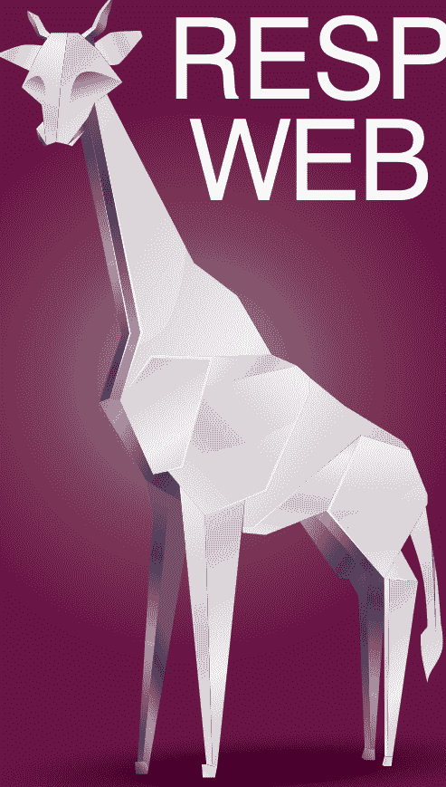


## 关于 Chris Ward

Chris 向世界解释酷炫的技术。他是一名技术作家和博客博主。他正在进行一些疯狂的项目，并愿意向任何倾听的人演讲。

## 关于 SitePoint

SitePoint 专门为网络专业人士出版有趣、实用且易于理解的内容。访问 `http://www.sitepoint.com/` 访问我们的博客、书籍、时通讯、文章和社区论坛。你可以在那里找到关于 JavaScript、PHP、Ruby、移动开发、设计等大量信息。

本书献给 2016 年，因为那是我本该完成它的一年，但生活产生了干扰。那也是非常有意思的一年，不是吗？

我可能还应该把这本书献给我的妻子，感谢她不断忍受“这周末什么都做不了，得写书”。

- 电量水平
- 环境光
- 设备方向

# 前言

“像素级完美”的网页已经结束。在网页上定位元素并期望它们始终以我们想要的方式显示的日子已成为遥远的记忆；我们现在必须应对源源不断涌出的新颖多样的设备，我们的设计需要在所有这些设备上都看起来非常完美。

本书旨在帮助你开始理解如何使用一系列 CSS 和 HTML 工具来响应这个全新的设备世界。它将向你介绍帮助你的页面适应不同设备的构建模块，通过网格布局更进一步，向你展示如何在所有设备上让文本和图像变得具有可读性，并在最后一章中，介绍如何利用更多设备功能。

让我们开始吧。

## 谁应该读这本书

本书是面向网页设计师和前端开发者的。你需要熟悉 HTML 和 CSS，但不需要以往的响应式网页设计经验。对于书的后半部分，熟悉一些 JavaScript 会很有帮助。

## 约定

你会注意到，我们在整书中使用了某些排版和布局样式来表示不同类型的信息。请留意以下几项。

### 代码示例

书中的代码使用等宽字体显示，如下：

```html
<h1>A Perfect Summer's Day</h1>
<p>It was a lovely day for a walk in the park. The
birds were singing and the kids were all back at school.</p>
```

如果代码位于书的代码存档中，文件名将出现在程序列表的顶部，如下：

```
0-1. example.css
.footer {
  background-color: #CCC;
  border-top: 1px solid #333;
}
```

如果只显示了文件的部分内容，通过 *excerpt*（摘录）一词指示：

```
0-2. example.css (excerpt)
.footer {
  background-color: #CCC;
  border-top: 1px solid #333;
}
```

如果要在现有示例中插入额外的代码，新代码将以**粗体**显示：

```javascript
function animate() {
  new_variable = "Hello";
}
```

当需要现有代码来提供上下文，而不是重复所有代码时，将显示冒号：

```javascript
function animate() {
  :
  new_variable = "Hello";
}
```

某些代码行应该在一行内输入，但由于页面限制，我们对它们进行了换行。`↩` 表示仅出于格式目的而存在的换行，应该被忽略：

```javascript
URL.open("http://www.sitepoint.com/responsive-web-design-real-user-testing/?responsive1");
```

### 提示、备注与警告

> 嘿，你！
>
> 提示（Tips）提供了实用的小技巧。

> 咳咳，打扰一下……
>
> 备注（Notes）是与当前主题相关但并非关键的有用助手。将它们视为额外的信息片段即可。

> 确保你始终……
>
> 注意这些重要的要点。

> 注意！
>
> 警告（Warnings）突出了在过程中可能会让你绊倒的任何陷阱。

### 补充材料

- 书的代码存档包含了与演示示例配套的可下载代码和示例视频。
- `https://www.sitepoint.com/community/` 是 SitePoint 的论坛，用于就任何棘手的网页问题寻求帮助。
- `books@sitepoint.com` 是我们的电子邮件地址，如果您需要联系我们报告问题或出于任何其他原因。

# 第 1 章 响应式网页设计的意义与目的

过去曾如此简单：你为 15 英寸显示器设计一个网站或应用程序，除了浏览器之间的不兼容性外，你就完成了工作。

然后，带有网络浏览器的手机出现了，并毁了我们轻松的生活。最糟糕的是，人们竟然喜欢在手机上浏览网页！

> **移动端的崛起**
>
> 2016 年，在移动设备上浏览网页首次超过了桌面浏览。

正当开发者和设计师习惯于为手机构建网站时，平板电脑、手表、电视、汽车、眼镜、更大的桌面屏幕以及高分辨率屏幕接踵而至。

## 快速上手响应式设计

我们如何支持这些源源不断的设备呢？答案是响应式设计，它利用了允许网站适应屏幕的技术。例如，许多旧项目是不响应式的。

## 响应式网页设计的意义与目的

响应式网页设计（RWD）遵循流行的开发准则“不要重复”（Don’t Repeat Yourself，通常缩写为 DRY）。与其为你想要支持的每个设备维护多个代码库，RWD 旨在使用一套 HTML、CSS 和 JavaScript，并为每个平台进行适当显示。

## 历史

“响应式”设计并不新鲜，而且是一个对不同的人有不同含义的术语，使其确切的历史难以追踪。

在理论上，自从存在多个浏览器以来，开发者就在创建响应式设计了。浏览器之间一直存在细微（或显著）的渲染差异，开发者几十年来一直在学习如何应对这些差异。如果你是网页开发的新手，请感谢 Internet Explorer 早期版本的统治地位已基本结束。处理它们怪癖的日子是黑暗的。

## 响应式设计中的流派

关于如何使用响应式设计，流派之多与其对其的解读一样多。有些流派随来随去，而另一些则留了下来。我们不会在书中显式地介绍任何细节，但会触及它们的实际应用。现在让我们快速回顾其中的几派。

### 渐进式增强

遵循更传统的渐进式增强原则，你的主要重点是确保所有用户都能看到网站内容，无论他们的设备多简单或连接有多慢。然后，为可以利用这些功能的设备添加额外特性——例如更复杂的设计和功能。

### 优雅降级

移动浏览的普及反转了更传统的设计路径。过去，你会在你工作的平台（通常是计算机）上开始一项设计，然后剥离样式和功能，以支持屏幕较小或对某些功能支持较少的设备。

虽然优雅降级通常应用于浏览器对特定功能的缺失，但你也可以更广泛地考虑它。它的原则是：你从一个功能完整的网站开始，运行在你的理想设备和浏览器上，同时确保任何（受支持）设备上的任何用户都能使用核心功能，即使他们失去了一些锦上添花的功能。

### 移动优先

移动优先与渐进式增强类似，但更针对响应式设计。它提议你从最小或能力最弱的支持的设备（在该原则创建时通常是手机）开始，然后随着设备尺寸的增加，不断添加功能和样式。

作为一个术语，“移动优先”可能会让人困惑，特别是对于非设计人员/开发者观众，它会给移动端在项目中获得的优先级产生偏颇的印象。

从理论上说，这种做法确保了较小设备不会获得最好的体验——即所有设备都受到同等对待。

## 你需要支持什么？

在开始或增强任何基于 Web 的项目之前，了解它是否值得以及为你的所有努力工作评估（潜在）用户是关键的。

如果你有一个现有的网站，分析网站流量可能是值得的，看看你的访问者使用什么类型的设备访问你的网站。如果 90% 的访问者一直通过桌面机进行访问，这说明要么你的移动端体验糟糕，要么你的访问者不是大设备用户。你可以进行广泛的研究来找到准确答案，或者简单地使用响应式设计技术构建一个移动友好的网站，这可能会吸引新访问者。

如果你正在处理一个新项目，分析你的潜在用户的需求同样重要。这可以通过传统的市场研究技术、创建简单的测试站点或观察你的竞争对手来完成，从而构建出你的客户将会是画像。

### 计算机

尽管销量缓慢下降，但世界上仍然有很多桌面电脑和笔记本电脑，以及运行在它们上面的许多浏览器。这些计算机包括从低质量（且低分辨率）的 11 英寸上网笔记本，到配有各种比例和方向的 28 英寸高分辨率显示器的高性能台式机，所有这些都会极大地影响你工作时的屏幕区域。

### 手机

现在在手机上浏览网站的人数百分比已与桌面浏览持平，因此照顾移动浏览器用户具有同等（且可能在不断增长）的重要性。

> **移动浏览统计**
>
> 有关移动网络浏览上升的更多信息，我推荐 Smart Insights 关于移动营销统计报告，以及 Statcounter 的桌面和移动使用情况对比。

在 iOS 上，这通常只通过一个浏览器实现，而且设备尺寸更加一致。

Android 有多种浏览器和屏幕尺寸可用。运行移动操作系统的设备数量不断增加，具有不同分辨率的高密度屏幕。

你还需要考虑，用户很大程度上是通过触摸而非点击设备进行浏览的，这对行为有很大影响。

### 平板电脑

平板电脑的销量可能正在萎缩，但仍然会有大量的用户基础。对于平板设备，布局可能会一个一个功能功能，设备设备，如 `Surface Pro` 这样的设备在用户在屏幕上访问你的网站时是够的。

### 混合设备

由于浏览器对特定功能的支持不足，你也可以更广泛地考虑它。它的原则是：你从一个功能完整的网站开始，运行在你的理想设备和浏览器上，同时在 `Surface Pro` 等混合设备之间切换。

### 可穿戴设备

大多数可穿戴设备是用于网络浏览的，但它们功能完整，运行在你的理想设备和浏览器上，同时确保任何（受支持）设备上的任何用户都能使用核心功能，即使他们失去了一些锦上添花的功能。

### 电视

智能电视和相关设备正变得越来越流行。由于电视屏幕很大，所以显示内容需要足够清晰。

### 汽车

汽车现在拥有仪表盘，设计时不要分散驾驶员注意力或导致事故。对于乘客来说，仪表盘需要清晰地显示信息。

### 游戏主机

大多数游戏机花费部分时间连接互联网，并在社交网络。这些设备上的浏览器可能是有限的。家用主机，物理键盘可能不可用。

总之，你无法预测任何人何时以及何地查看你的网站，所以要构建一个自适应的、灵活且响应式的。

### 打印

打印？这不是一本网页设计书吗？是的，打印版本仍然经常被访问，无论是为了实际打印还是为了在离线阅读器上渲染内容。

> **书**
>
> 你正在阅读的页面也是通过 HTML 和 CSS 渲染的。是的，甚至是。

## 示例应用

在我看来，通过示例学习始终是最好的方式，因此在书中，我们将创建一个演示网站并对其可能访问的各种设备进行优化。

### 介绍 RWFlix

RWFlix 是一个虚拟的视频流服务，包含本地、国家和全球电视节目供人们在线观看。用户可以观看的内容取决于他们的位置和时间。

#### 计算机版本

桌面电脑版的布局将显示图像缩略图、视频播放器、节目标题、视频长度和节目描述。虽然桌面用户的网络速度差异较小，此版本将在足够的带宽后允许用户播放视频。

#### 平板电脑版本

平板电脑的布局将侧重于让用户轻松地找到节目，并在网络允许的情况下观看。它将显示较大的缩略图、节目标题、节目长度、估计文件大小和节目描述。如果用户有数据连接，它将提供播放视频；如果没有连接，则将视频添加到观看列表。

#### 移动版本

移动版本将侧重于让用户轻松找到剧集，并在网络允许的情况下进行播放。它将显示较小的缩略图、剧集标题、剧集长度以及估计的文件大小。与平板版本一样，如果有数据连接，它将提供播放视频选项，否则将其添加到观看列表。

#### TV 版本

电视的布局将显示大缩略图、视频播放器、节目标题、视频长度以及剧集描述。为了方便距离观看和使用，界面将是巨大且清晰的。虽然这不在本书的范围内，但界面也可能通过物理遥控器或远程 App 进行控制和导航。

## 使用 HTML5 构建页面结构

在我们开始创建响应式设计并使用 CSS 实现它们之前，理解你将操作的底层 HTML 结构非常重要。HTML 最近的发展对概念和页面结构发生了变化，因此回顾一下现代网页设计师可以使用工具和选项非常有帮助。

在 HTML5 之前，HTML 页面的逻辑部分是使用 `div` 和 `span` 等通用元素构建的。这些元素在多年里工作得良好，但它们过于宽泛，无法帮助设计师或网络浏览器理解日益复杂的页面结构。

除其他外，HTML5 引入了新的语义化元素，它们比简单的 `div` 更完整地描述了用途。这些新元素旨在帮助辅助访问和多功能内容，但它们也有助于响应式网页设计。它们包括页面的页眉（`header`）、导航（`navigation`）或主内容区（`main content area`）的定义，以及视频和音频的特定元素。响应式设计从根本上关于操作页面布局以适应不同的用例，更好的页面组织和结构有助于你使用 CSS 和媒体查询（在第 2 章介绍）定位你需要的元素。

让我们看看桌面站简化版本。这是一个精简的副本，我们将从它开始工作：

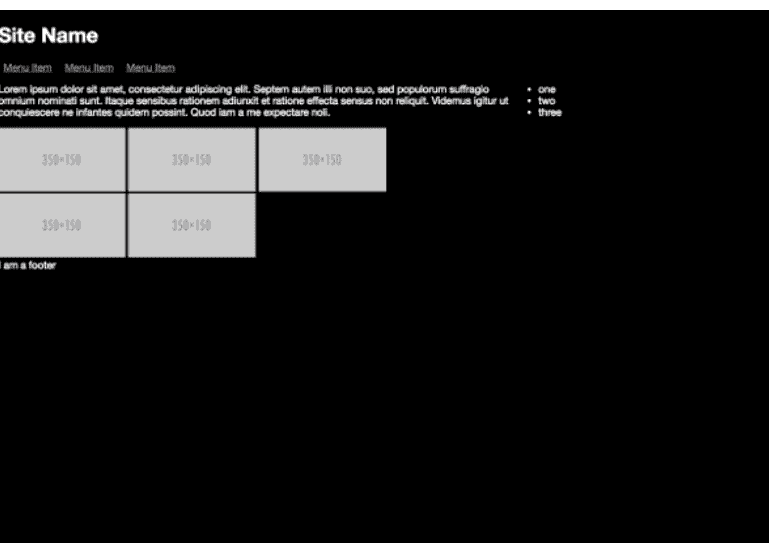

1-9. 网站当前的桌面版本

代码如下：

```html
<body>
<header><h1>站点名称</h1></header>

<nav>...</nav>

<main>
  <section>...</section>
  <aside>...</aside>
</main>

<footer>...</footer>
</body>
```

这是 HTML 元素在页面上的位置：

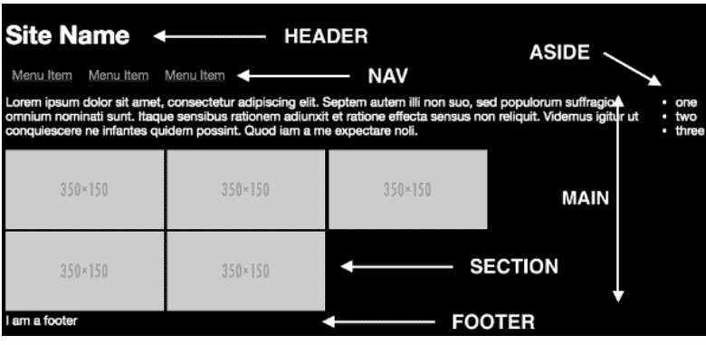

1-11. 标记页面的各个区域

它们的功能如下：

- `header` 元素用于站点名称等。页面的其他部分也可以有自己的 `header`。
- `nav` 元素用于导航链接，如顶部或页脚菜单。
- `section` 元素用于包含文章或页面重要区域的内容。
- `aside` 元素定义与 `main` 相关的子部分。
- `main` 元素包裹页面唯一的元素。
- `footer` 元素用于网站法律信息等。页面的其他部分也可以有自己的 `footer`。

HTML5 列出了其他语义元素，我们将在书中介绍其中许多。结构良好的页面对于响应式设计非常重要，也有助于访问性和 SEO。以下是语义化组织的更多页面内容：

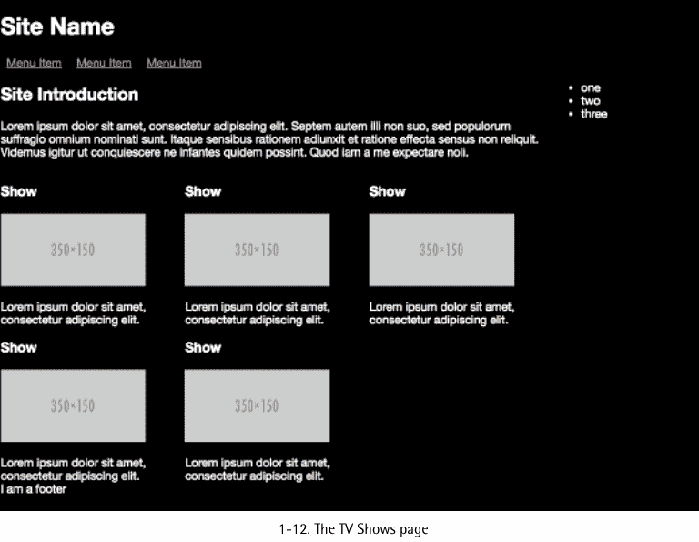

首先，我为页面添加了一个标题，它是 `h2`，因为它是主标题 `h1` 之后的第二级标题。

每个单独的电视剧都在其自己的 `section` 中，位于另一个标题（但 `h3`，因为它是 `h2` 下一级）之下，并配有图片和短描述。

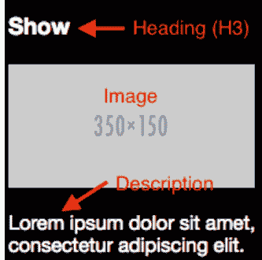

1-13. 标记剧集的各个部分

1-14. Base/index.html


```html
<section class="left">
  <h3>Show</h3>
  
  <p>Lorem ipsum dolor sit amet, consectetur adipiscing elit.</p>
</section>
```

典型的现代应用程序由后端（存储数据）和多个显示或消费数据的应用程序组成。它们包括响应式网页、原生移动 App 和后端系统。正如你将在整书中看到的，并不是所有上下文都会使用或显示可用数据，而是只使用与其用例最相关的数据。例如，一个电视剧可能在后端存储以下值：

- 剧集名
- 系列
- 长度
- 年龄分级
- 文件大小
- 剧名
- 年份
- 产地
- 描述
- 标签
- 类别

但网站的移动版本将仅显示移动设备用户最相关的值，忽略仅在不同上下文相关的其他值：

# 响应式网页设计的意义与目的

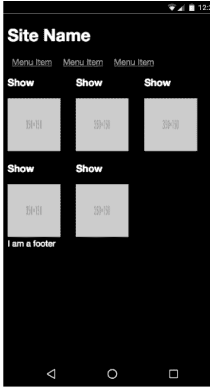

1-15. 网站的移动版本

```html
<section class="left">
  <h3>Show</h3>
  
</section>
```

`aside` 用于补充信息，如联系支持和账户信息。网站的移动版本针对浏览和观看视频进行了优化，因此不显示 `aside`。这并不是唯一的可能性。例如，你可以选择将 `aside` 显示在屏幕底部（我们在查看网格系统时介绍）。

随着屏幕尺寸的减小，电视剧描述变得越来越简短，以更多更多关注缩略图，而缩略图已针对移动设备进行了适当调整。

如果你感兴趣学习更多关于 HTML5 和页面结构的知识，我建议阅读 SitePoint 的《Jump Start HTML5》。

## 准备好响应式了吗？

在这一章中，我查看了响应式设计的需求和历史。我涵盖了你的网站现在需要支持的设备类型，并介绍了我将在书其余部分演示响应式网页设计原则的演示网站。我们还简要查看了使用 HTML5 构建页面。现在我们准备好深入研究响应式设计的构建模块，这是下一章的重点。

# 响应式设计的构建模块

# 第 2 章

## 响应式设计的构建模块

响应式网页设计的核心有两个主要的构建模块：媒体查询（`media queries`）和视口（`viewports`）。

**媒体查询**代表了连接许多其他响应式概念和工具的胶水。它们是一个简单但强大的概念，允许你检测设备属性、定义规则并根据它们加载不同的 CSS 属性。例如，你可以为不同的设备优化导航菜单，将桌面浏览器上的完整水平菜单转换为移动设备上常见的“汉堡”菜单。

**视口**较为简单，允许你无论查看页面的设备尺寸如何，都能相应地定义网页的尺寸和缩放因子。没有它们，媒体查询只能发挥部分作用。

## 媒体类型

本章将首先介绍媒体查询（`media queries`），然后展示如何通过定义视口（`viewport`）让它们更好地为你工作。

你可以通过多种方式调用依赖媒体查询的样式，最常见的是使用 HTML `link` 元素链接一个或多个 CSS 文件，或者直接在 CSS 文件内部使用 `@import`。

在 HTML 中，此示例将在查询为真时加载 `style.css` 文件，这在所有设备类型上都是真的：

```html
<link rel="stylesheet" media="all" href="/style.css">
```

在下一个示例中，`@import` 实现了相同的功能，但是在 CSS 文件内部实现的：

```css
@import url("/style.css") all;
```

在下方的示例中，`@media` CSS 规则包含一组特定的选择器，如果查询为真则将加载它们：

```css
@media all {
  ...
}
```

这些查询中的 `all` 是媒体类型。目前可用四种媒体类型（编写本文时）：

- `print`: 用于页面的打印版本
- `screen`: 用于电脑、平板电脑和手机屏幕
- `speech`: 用于向用户朗读页面的屏幕阅读器
- `all`: 用于上述所有类型

## 创建查询

添加媒体类型允许你指定查询适用于哪些类型的设备。这些类型非常广泛，无法提供太多的控制。为了更具体地针对设备，你可以为这些媒体类型添加表达式。

让我们尝试一些实用的东西。RWDflix 中主内容侧侧边栏（`aside`）旨在显示公告和新闻。手机和平板访问者可能只想专注于看节目，其他不要，所以让我们为小屏幕设备的用户隐藏这个元素吧。

## 本书中使用的方法

> 在本章的剩余部分，我将使用上面所示的 `@media` 方法进行媒体查询。这是我的个人偏好，作为一种实验，你可能会尝试使用其他方法重写这些示例。

删除当前的 `aside` CSS 类并将其替换为以下媒体查询：

```css
@media screen and (min-width: 680px) {
  aside {
    width: 33%;
  }
}
@media screen and (max-width: 680px) {
  aside {
    display: none;
  }
}
```

这对媒体查询设置了：如果屏幕宽于 680px，则 `aside` 元素的宽度为 33%（通过 `min-width` 询问屏幕是否至少有 680px）；如果屏幕窄于 680px，则将其隐藏（通过 `max-width` 询问屏幕宽度是否最多为 680px）。

## 站点名称

菜单项 菜单项 菜单项

## 站点介绍

Lorem ipsum dolor sit amet, consectetur adipiscing elit. Septem autem illum non, sed popularum suffragium omnis nulla erat. Itaque sensibus ratione adnuerit ratione effecta sensus non reliquit. Videtur ut consequuntur non fines quidem possant. Quod clam a me expectare toll.

显示

显示

显示

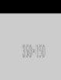


Lorem ipsum dolor sit amet, consectetur adipiscing elit.

Lorem ipsum dolor sit amet, consectetur adipiscing elit.

Lorem ipsum dolor sit amet, consectetur adipiscing elit.

显示

显示

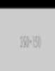Lorem ipsum dolor sit amet, consectetur adipiscing elit.

Lorem ipsum dolor sit amet, consectetur adipiscing elit.

页脚

2. 在小屏幕上隐藏 `aside` 元素

接下来，让列表部分在 `aside` 不显示时填充屏幕宽度：

```css
section.showlisting {
  margin-bottom: 25px;
}
@media screen and (min-width: 680px) {
  section.showlisting {
    width: 66%;
  }
}
@media screen and (max-width: 680px) {
  section.showlisting {
    width: 100%;
  }
}
```

## 站点名称

- 菜单项 - 菜单项 - 菜单项

## 站点介绍

Lorem ipsum dolor sit amet, consectetur adipiscing elit. Septem autem illum non, sed porttitor fugiat omnis nominatat sunt. Itaque sensibus ratione adnuerit ratione effecta sensus non reliquit. Vidimus igitur quiscere infantes possident. Quod iam expectare null.

| 显示 | 显示 | 显示 |
|---|---|---|
| 150x150 | 150x150 | 150x150 |
| Lorem ipsum dolor sit amet, consectetur adipiscing elit. | Lorem ipsum dolor sit amet, consectetur adipiscing elit. | Lorem ipsum dolor sit amet, consectetur adipiscing elit. |
| 响应式设计 | | |
| Lorem ipsum dolor sit amet, consectetur adipiscing elit. | 页脚 | |

如果你在桌面浏览器中调整页面大小，你会看到随着加宽或缩小浏览器，`aside` 会出现或消失，主内容会相应调整。

## 响应式设计

你可以在媒体查询中使用基础逻辑。这允许你组合多个条件。例如，可以使用逻辑与（AND）：

```css
@media screen (min-width: 640px) and (max-width: 1136px) {
  ...
}
```

上面的代码在设备屏幕宽度在 640px 到 1136px 之间时调用查询中的 CSS 样式。`min-width` 属性是屏幕的最小宽度，`max-width` 是最大宽度。要使此媒体查询匹配，两个条件都必须为真。也可以使用逻辑或（OR）来匹配查询，这用逗号表示。下面的查询将应用于屏幕或打印设备：

```css
@media only screen, print {
  ...
}
```

你还可以将 AND 与 OR 组合创建更复杂的查询。这里是在较大尺寸的横屏模式下渲染的页面：

## 响应式设计的构建模块

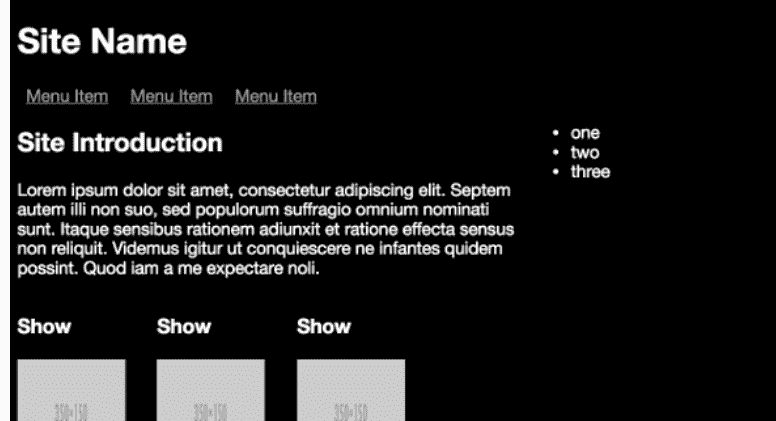

2-3. 横屏模式下的当前手机布局

在截图中，屏幕宽度为 732px，高于上面设置的 640px。尽管如此，`aside` 仍然放入窗口，所以如果屏幕尺寸低于 640px 或设备处于横屏模式，让我们将其隐藏：

```css
@media screen and (max-width: 680px), screen and
  (orientation: landscape) and (max-width: 750px) {
  aside {
    display: none;
  }
}
```

以及对应列表部分的媒体查询：

```css
@media screen and (max-width: 680px), screen and
  (orientation: landscape) and (max-width: 750px) {
  section.showlisting {
    width: 100%;
  }
}
```

## 响应式网页设计

你会发现我添加了 `max-width` 检查，以便在横屏模式的平板电脑上显示 `aside`，同时也为了展示如何将逻辑检查组合在一起。

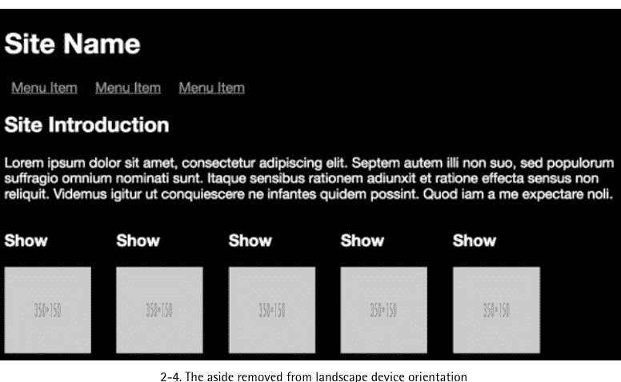

## 使用 Only 和 Not 的逻辑查询

你也可以使用 `only` 和 `not` 创建精确的媒体查询。例如，此媒体查询将匹配至少有 640px 宽且排除打印媒体类型的设备：

```css
@media not print and (min-width: 640px) {
  ...
}
```

相比之下，此查询仅适用于至少 640px 宽的屏幕设备：

```css
@media only screen and (min-width: 640px) {
  ...
}
```

## 查询特性

我们为止看到的宽度和高度查询是最常用的几个，但还有其他几种媒体特性对于检查设备特性也有用。这些包括颜色能力、纵横比、方向、分辨率以及针对 Mozilla 和 WebKit 浏览器的特定功能。其中大多数特性都接受 `min-` 和 `max-` 前缀，其工作方式与上面的尺寸查询类似。

### aspect-ratio

`aspect-ratio` 特性允许你检查水平像素与垂直像素的比例，用斜杠隔开。例如：

```css
@media screen and (min-aspect-ratio: 1/1) {
  ...
}
```

上面的规则将匹配屏幕宽高比为 1:1 或更大的设备，即正方形或横屏。

这种的一种常用用途是检测更宽的屏幕，当你显示视频时非常有用：

```css
@media screen and (min-aspect-ratio: 16/9) {
  ...
}
```

### orientation

如前所示，此特性检查设备是处于横屏还是竖屏模式。例如：

```css
@media all and (orientation: landscape) {
  ...
}
```

以及：

```css
@media all and (orientation: portrait) {
  ...
}
```

### color

此功能检查设备是否支持特定的位深颜色。例如，以下是检查设备是否支持至少 8 位颜色（即 256 种颜色）：

```css
@media all and (min-color: 8) {
  ...
}
```

### color-index

此属性的作用与 `color` 类似，但它允许你检查颜色的数量而不是位深：

```css
@media all and (min-color-index: 256) {
  ...
}
```

### monochrome

同样，与 `color` 类似，`monochrome` 允许你检查设备中的灰度级别：

```css
@media all and (min-monochrome: 8) {
  ...
}
```

### resolution

此功能针对具有高分辨率屏幕的设备：

```css
@media all and (min-resolution: 120dpi) {
  ...
}
```

### scan

`scan` 媒体功能允许你检查电视的扫描过程，选项包括隔扫描（`interlace`）或逐行扫描（`progressive`）：

```css
@media all and (scan: progressive) {
  ...
}
```

### grid

`grid` 用于检查设备是否为终端类设备。这还包括旧款手机（即非智能手机）、辅助手机（为视力不佳的人设计）以及盲文设备。如果为真，它返回一个布尔值：

```css
@media grid {
  ...
}
```

如你所见，通过基于尺寸和特征的查询组合，你可以构建复杂的样式表，以有效地针对多种设备，并使用对它们运行效率最高的工作样式。这是媒体查询的核心要点：它们允许你针对特定的设备配置选择性地加载 CSS 样式。

## 优化示例应用程序

现在你已经有了基础的理解，让我们继续在之前添加的媒体查询基础上，使示例网站更加整洁。

首先，你可以合并已经编写的查询，将类移动到两组媒体查询中：

```css
/* 媒体查询 */
/* 例如，桌面设备 */
@media screen and (min-width: 680px) {
  aside {
    width: 33%;
  }

  section.showlisting {
    width: 66%;
  }
}

/* 例如，中等宽度或横屏模式下的较小屏幕 */
@media screen and (max-width: 680px), screen and (orientation: landscape) and (max-width: 750px) {
  aside {
    display: none;
  }

  section.showlisting {
    width: 100%;
  }
}
```

整洁多了！你可以继续为每个查询向这些部分中添加新样式。

让我们回顾一下第 1 章中概述的演示网站规范，看看每个屏幕尺寸还需要进行哪些优化。下一步是在小屏幕上隐藏电视节目描述，并在中等尺寸屏幕上缩短它。

如果描述文本有一个类名，那么做这些将会容易得多：为每个包含节目描述的 `p` 标签实例添加一个类名：

```html
<section class="tvshow">
  <h3>Show</h3>
  
  <p class="showdescription">Lorem ipsum dolor sit amet, consectetur adipiscing elit.</p>
</section>
```

让我们添加新的媒体查询以适应我们目标支持的各种尺寸，并在此过程中整理现有查询。

我们希望设计重新流动的的特定宽度被称为断点（`breakpoints`）。我们要添加的断点并不是穷尽的：由于设备尺寸范围巨大，尝试为每个设备都单独设计是徒劳的。响应式设计的精髓在于：你可以评估设计需要重新流动的断点，并创建媒体查询。

添加以下断点并重构我们的样式：


```css
/* 媒体查询 */

/* 例如，旧手机 */
@media screen and (min-width: 320px) {
  aside {
    display: none;
  }

  section.showlisting {
    width: 100%;
  }

  .showdescription {
    display: none;
  }
}

/* 例如，新款手机 */
@media screen and (min-width: 480px) {
}

/* 例如，小号屏幕和平板电脑 */
@media screen and (min-width: 768px) {
  .showdescription {
    text-overflow: ellipsis;
    display: block;
    white-space: nowrap;
    width: 100px;
    overflow: hidden;
  }
}

/* 例如，典型的桌面显示器或较大的平板设备 */
@media screen and (min-width: 992px) {
  aside {
    width: 33%;
    display: block;
  }
}
```

## 响应式设计的构建模块

```css
section.showlisting {
  width: 66%;
}

.showdescription {
  white-space: normal;
  width: 125px;
}

/* 大型设备，例如大显示器和电视 */
@media screen and (min-width: 1200px) {
}
```

媒体查询现在应该是显而易见的。它们通过尺寸定义了一组设备。正如 CSS 所示，媒体查询具有级联性：你可以为较小的设备断点构建样式，并更改不同的属性。注意在 `@media screen and (min-width: 320px)` 较小设备断点和 `@media screen and (min-width: 768px)` 中等尺寸设备断点之间，所有的变化都是 `showdescription` 类，显示文本但对其进行截断。然后在 `@media screen and (min-width: 992px)` 大屏幕断点中，所有元素都显示了。

## 启动响应式网页设计

![bd4041c3e441a2781fa04a5cbb773b_48.png]

## 移动优先

在第 1 章中我引入了“移动优先”的概念。目前，页面可以在不同设备尺寸上运行，但并不是移动优先，因为“默认”样式（即不在媒体查询中的样式）实际上是为较大的设备设计的。所以让我们进行一些重排和重构，使设计移动优先。这不会涉及太多工作。

对媒体查询之外的类进行以下更改：

```css
aside {
  display: none;
}

section.showlisting {
  margin-bottom: 25px;
  width: 100%;
}

.showdescription {
  display: none;
}
```

# 响应式设计的基础组件

## 视口 meta 元素

在上一节中，我讲解了如何通过媒体查询让演示页面实现移动端优先。如果你在桌面浏览器中尝试该示例并调整窗口大小，一切看起来都如你预期的那样。但如果你在移动浏览器中或使用模拟的移动浏览器进行尝试，你可能会看到像下面截图所示的内容并感到失望。媒体查询难道不应该让页面在移动浏览器中表现得更好吗？

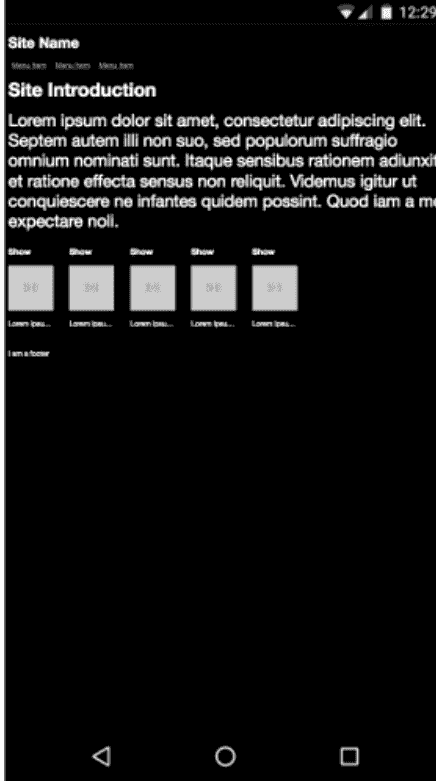

**图 2-9. 无视口的移动端优先**

媒体查询允许我们为不同的屏幕尺寸设置不同的样式表。因此，如果你的桌面浏览器的视口宽度为 1200px，任何针对该屏幕宽度的媒体查询都会生效。如果你在一个视口宽度为 320px 的移动设备上，你可能预期任何针对 320px 视口的样式都会激活。但这里有一个巨大的陷阱。默认情况下，许多设备（如手机和平板电脑）的行为就像它们拥有一个比实际宽的屏幕。

为了解释发生了什么，让我们看看这种行为的起源——iPhone。第一代 iPhone 的屏幕/视口宽度为 320px。然而，大多数为桌面设备设计的网站比这宽得多。为了避免在初始加载时只看到网站的左上角，Apple 开发了“虚拟视口”或“布局视口”的概念。网站被加载到这个宽得多的视口中，然后等比例缩小以适应屏幕。大多数网站在 iPhone 上的渲染结果是字体非常小，你必须放大才能阅读。

Apple 的虚拟视口被设置为 980px，因此只要网站宽度不超过 980px，布局就会显示在屏幕上。任何宽于 980px 的布局都会在右侧被部分隐藏，需要横向滚动。今天的情况依然如此。其他设备制造商也采用了虚拟视口的想法，尽管默认宽度各不相同。

在设计响应式网站时，我们真的不希望在移动设备上出现这种默认行为。我们希望自己操作的画布是每个设备的实际屏幕区域。坦率地说，有一种简单的方法告诉这些设备不要以默认方式运行。我们所需要的是在每个页面的 `head` 中添加一个特殊的 `meta` 元素。这里有一个典型的示例：

```html
<meta name="viewport" content="width=device-width,
     initial-scale=1">
```

作为一个一般规则，上面的代码行就是确保你的媒体查询在移动设备上按预期运行所需的全部内容。`name` 属性指定了我们针对的是虚拟视口，`content` 属性指定了我们希望设备如何运行。在上面的示例中，我们指定虚拟视口应该匹配屏幕的实际宽度，并且对内容不应用缩放。

一旦有了视口声明，你就可以确保针对 320px 设备的媒体查询实际上会被该设备识别。

让我们修改演示站点以添加视口声明。在当前的 `head` 元素内部添加以下 `meta` 标签：

```html
<head>
  <meta charset="UTF-8">
  <title>App Name</title>
  <link rel="stylesheet" type="text/css" media="all" href="layout.css">
  <meta name="viewport" content="width=device-width,initial-scale=1.0">
</head>
```

刷新页面：

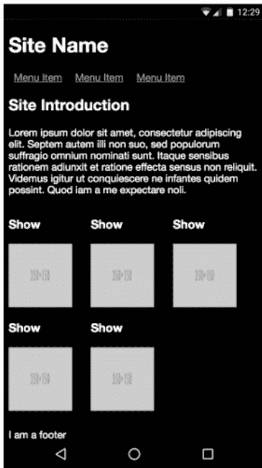

**图 2-11. 带视口的演示页面**

好多了！

## 视口

**Viewport**（视口）是计算机图形中的一个老术语，用于定义渲染用户在浏览器中看到的元素的（通常是矩形的）屏幕区域。当网页浏览限于桌面浏览器时，视口仍然存在但设计师很少更改。随着浏览器尺寸多样性的增加，HTML5 在 `meta` 元素中引入了 `viewport` 属性，允许设计师设置和操作此区域。

`meta` 元素最初由 Apple 提出，用于将页面的初始状态设置为正确的大小，后来作为 HTML5 标准的一部分引入。

通常情况下，你通过 `width=device-width` 将视口设置为当前设备的宽度，并保持内容不缩放（使用 `initial-scale=1.0`）。

`width` 属性是一个像素值，而 `device-width` 会检测当前设备的宽度，这意味着你不需要处理可能出现的各种尺寸；`meta` 元素会为你处理好。不同的屏幕方向也是如此：横屏和竖屏之间的切换也由系统为你处理。要让设计完全响应式仍然需要许多额外工作，但媒体查询加上这个视口设置已经为你提供了一个绝佳的基础。

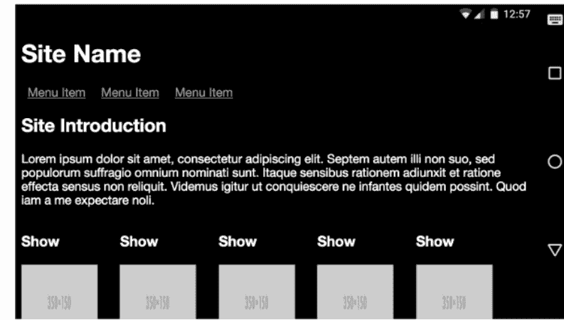

**图 2-12. 带视口的演示页面**

该标签的 `content` 属性也接受设置宽度的标准方法。例如：

```html
<head>
  <meta name="viewport" content="width=500,initial-scale=1.0">
</head>
```

这将导致：

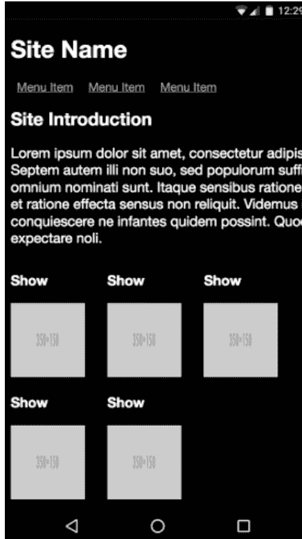

**图 2-13. 手动设置宽度**

好多了！

如果你在桌面上查看当前的演示页面，它实际上是一个由四行两列组成的网格：

## 有任何查询吗？

这是针对某些情况的简单示例，但你可能需要它。

视口还有其他不常用的属性：

- `minimum-scale`：最小缩放比例，用户可以缩小的程度。
- `maximum-scale`：最大缩放比例，用户可以放大的程度。
- `user-scalable=no`：禁止缩放。

媒体查询的选择性使其成为你工具箱中必不可少的工具，在本章中，我们学习了如何使用它们为我们的响应式设计增添细节。

# 第 3 章 使用网格系统改进响应式结构

**图 3-1. 初始页面网格**

当你调整页面大小时，上一节添加的媒体查询会负责更改行和列布局以适应变化。

这是因为目前的布局是**流式网格**（fluid grid）的简单示例。页面的主要部分的宽度是视口宽度的百分比，并且会随之调整。

在桌面设备上，电视节目的主列表占据了页面的 66%（或三分之二），菜单占据 33%（或三分之一）。

```css
@media only screen and (min-width: 992px) {
  aside {
    width: 33%;
    display: block;
  }

  section.showing {
    width: 66%;
  }

  .showdescription {
    white-space: normal;
    width: 125px;
  }
}
```

设计的流性可以比此进一步。页面区域内的布局也可以占据可用空间的百分比。例如，你可以设置让单个电视节目列表具有灵活的宽度：

```css
section.tvshow {
  width: 20%;
  height: 150px;
  display: inline-block;
}
```

这意味着无论屏幕大小如何，每个子部分都将占据主内容区域的 20%。这可能会开始变得繁琐，它更多像是一个示例，用于展示基于百分比的尺寸可以应用于任何地方——文本甚至媒体元素（这两者我们将在稍后的章节中介绍）。

虽然目前的页面布局是一个网格，但它可以变得更好，拥有更具意义的类名和更好的结构。

创建一个类为 `container` 的新 `div` 元素，包裹 `body` 元素内的所有内容：

```html
<body>
  <div class="container">
    ...
  </div>
</body>
```

在你的样式表中，为此 `div` 添加以下样式：

```css
.container {
  width: 95%;
  margin-left: auto;
  margin-right: auto;
  max-width: 1180px;
}
```

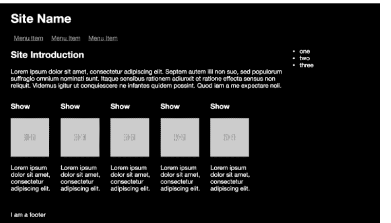

**图 3-5. 带有额外容器的布局**

这是为页面内容设置容器元素的常用方法。它设置了 1180px 的最大宽度、浏览器窗口 95% 的宽度，并使用方便的左右自动外边距将容器在窗口中居中。

### 为什么是 1180px？

为什么最大宽度被设置为 1180px？这是一个任意值，基于当前桌面屏幕尺寸的趋势；它的添加是为了确保页面在巨屏上不会变得太宽。长期以来，它是 960px，反映了当时大多数屏幕宽度最多为 1024px。随着尺寸和分辨率的增长，这个最大宽度已经变大，但仍然留有不同的意见。媒体查询（在第 2 章中介绍）让这个最大宽度没有像以前那么重要。目前，请坚持这个 1180px 的值。

接下来，在 `header`、`navigation`、列表和 `footer` 元素中添加 `row` 类。你也可以移除这些元素中的 `left` 类，因为你将合并它的 CSS 属性：

```html
<header class="row">
</header>
<nav class="row">
...
</nav>
<main class="row">
</main>
<footer class="row">
...
</footer>
```

并定义 `row` CSS 类：

```css
.row {
  clear: both;
  float: left;
}
```

此 `row` 填充了容器的宽度并向左浮动，这意味着当浏览器窗口调整大小时，它会随之流动，固定在左侧。由于你尚未定义 `row` 中的列，`aside` 菜单在较大的屏幕尺寸上会被推到底部。

## 站点名称

- 菜单项目 菜单项目 菜单项目

## 站点介绍

Lorem ipsum dolor sit amet, consectetur adipiscing elit. Septem autem illi non suo, sed populorum fugiat omnis nominati sunt. Itaque risus ratione adiuxit et ratione sensus non reliquit. Videmus igitur in conquisore ne infidem quorum possim. Quod iam a me expect-at.

| 节目 | 节目 | 节目 | 节目 | 节目 |
|---|---|---|---|---|
| 350x150 | 350x150 | 350x150 | 350x150 | 350x150 |
| Lorem ipsum dolor sit amet, consectetur elit. | Lorem ipsum dolor sit amet, consectetur elit. | Lorem ipsum dolor sit amet, consectetur elit. | Lorem ipsum dolor sit amet, consectetur elit. | Lorem ipsum dolor sit amet, consectetur elit. |

- 一个
- 两个
- 三

**图 3-6. 新的页面结构**

现在页面上所有的水平内容都在 `row` 中，是时候定义 `row` 内部的列了。某些 `row` 是单宽列，而另一些则被细分了。

为了重新开始，移除较简单的百分比宽度（来自所有的媒体查询），这样你就有了：

```css
@media only screen and (min-width: 320px) {
  aside {
    display: none;
  }

  section.showing {
  }

  .showdescription {
    display: none;
  }
}

@media only screen and (min-width: 992px) {
  aside {
    display: block;
  }

  section.showing {
  }

  .showdescription {
    white-space: normal;
    width: 125px;
  }
}
```

页面在较大屏幕上的流动不再那么顺畅了。

### 什么是网格？

**网格**是响应式设计中的一个概念，它允许你创建灵活的布局。网格由行（rows）和列（columns）组成。网格可以根据不同屏幕的大小自动调整布局的比例。

创建一个类为 `container` 的新 `div` 元素，包裹 `body` 元素内的所有内容：


设计的流性可以比此进一步。页面区域内的布局也可以占据可用空间的百分比。例如，你可以设置让单个电视节目列表具有灵活的宽度：

```css
section.tvshow {
  width: 20%;
  height: 150px;
  display: inline-block;
}
```

这意味着无论屏幕大小如何，每个子部分都将占据主内容区域的 20%。这可能会开始变得繁琐，它更多像是一个示例，用于展示基于百分比的尺寸可以应用于任何地方——文本甚至媒体元素（这两者我们将在稍后的章节中介绍）。

虽然目前的页面布局是一个网格，但它可以变得更好，拥有更有意义的类名和更好的结构。

创建一个类为 `container` 的新 `div` 元素，包裹 `body` 元素内的所有内容：

## 快速上手响应式网页设计

```html
<body>
  <div class="container">
    ...
  </div>
</body>
```

在你的样式表中，为此 `div` 添加以下样式：

```css
.container {
  width: 95%;
  margin-left: auto;
  margin-right: auto;
  max-width: 1180px;
}
```


3-5. 带有额外容器的布局

## 使用网格系统的更好的响应式结构 51

这是为页面内容设置容器元素的常用方法。它设置了 1180px 的最大宽度、浏览器窗口 95% 的宽度，并使用方便的左右自动外边距将容器在窗口中居中。

### 为什么是 1180px？

为什么最大宽度被设置为 1180px？这是一个任意值，基于当前桌面屏幕尺寸的趋势；它的添加是为了确保页面在巨屏上不会变得太宽。长期以来，它是 960px，反映了当时大多数屏幕宽度最多为 1024px。随着尺寸和分辨率的增长，这个最大宽度已经变大，但仍然留有不同的意见。媒体查询（在第 2 章中介绍）让这个最大宽度没有像以前那么重要。目前，请坚持这个 1180px 的值。

接下来，在 `header`、`navigation`、列表和 `footer` 元素中添加 `row` 类。你也可以移除这些元素中的 `left` 类，因为你将合并它的 CSS 属性：

```html
<header class="row">
</header>
<nav class="row">
...
</nav>
<main class="row">
</main>
<footer class="row">
...
</footer>
```

并定义 `row` CSS 类：

```css
.row {
  clear: both;
  float: left;
}
```

此 `row` 填充了容器的宽度并向左浮动，这意味着当浏览器窗口调整大小时，它会随之流动，固定在左侧。由于你尚未定义 `row` 中的列，`aside` 菜单在较大的屏幕尺寸上会被推到底部。

## 站点名称

- 菜单项目 菜单项目 菜单项目

## 站点介绍

Lorem ipsum dolor sit amet, consectetur adipiscing elit. Septem autem illi non suo, sed populorum fugiat omnis nominati sunt. Itaque risus ratione adiuxit et ratione sensus non reliquit. Videmus igitur in conquisore ne infidem quorum possim. Quod iam a me expect-at.

| 节目 | 节目 | 节目 | 节目 | 节目 |
|---|---|---|---|---|
| 350x150 | 350x150 | 350x150 | 350x150 | 350x150 |
| Lorem ipsum dolor sit amet, consectetur elit. | Lorem ipsum dolor sit amet, consectetur elit. | Lorem ipsum dolor sit amet, consectetur elit. | Lorem ipsum dolor sit amet, consectetur elit. | Lorem ipsum dolor sit amet, consectetur elit. |

- 一个
- 两个
- 三

3-6. 新的页面结构

现在页面上所有的水平内容都在 `row` 中，是时候定义 `row` 内部的列了。某些 `row` 是单宽列，而另一些则被细分了。

为了重新开始，移除较简单的百分比宽度（来自所有的媒体查询），这样你就有了：

```css
@media only screen and (min-width: 320px) {
  aside {
    display: none;
  }

  section.showing {
  }

  .showdescription {
    display: none;
  }
}

@media only screen and (min-width: 992px) {
  aside {
    display: block;
  }

  section.showing {
  }

  .showdescription {
    white-space: normal;
    width: 125px;
  }
}
```

页面在较大屏幕上的流动不再那么顺畅了。

### 什么是网格？

虽然目前的页面布局是一个网格，但它可以变得更好，拥有更有意义的类名和更好的结构。

**网格**是响应式设计中的一个概念，它允许你创建灵活的布局。网格由行（rows）和列（columns）组成。网格可以根据不同屏幕的大小自动调整布局的比例。

（注：由于源文本包含大量重复内容，译文仅展示核心逻辑部分的翻译，以避免重复输出。）

```css
@media only screen and (min-width: 992px) {
  aside {
    width: 33%;
    display: block;
  }

  section.showing {
    width: 66%;
  }

  .showdescription {
    white-space: normal;
    width: 125px;
  }
}
```

设计的流性可以比此进一步。页面区域内的布局也可以占据可用空间的百分比。例如，你可以设置让单个电视节目列表具有灵活的宽度：

```css
section.tvshow {
  width: 20%;
  height: 150px;
  display: inline-block;
}
```

这意味着无论屏幕大小如何，每个子部分都将占据主内容区域的 20%。这可能会开始变得繁琐，它更多像是一个示例，用于展示基于百分比的尺寸可以应用于任何地方——文本甚至媒体元素（这两者我们将在稍后的章节中介绍）。

虽然目前的页面布局是一个网格，但它可以变得更好，拥有更有意义的类名和更好的结构。

创建一个类为 `container` 的新 `div` 元素，包裹 `body` 元素内的所有内容：

## 快速上手响应式网页设计

```html
<body>
  <div class="container">
    ...
  </div>
</body>
```

在你的样式表中，为此 `div` 添加以下样式：

```css
.container {
  width: 95%;
  margin-left: auto;
  margin-right: auto;
  max-width: 1180px;
}
```


3-5. 带有额外容器的布局

## 使用网格系统的更好的响应式结构 51

这是为页面内容设置容器元素的常用方法。它设置了 1180px 的最大宽度、浏览器窗口 95% 的宽度，并使用方便的左右自动外边距将容器在窗口中居中。

### 为什么是 1180px？

为什么最大宽度被设置为 1180px？这是一个任意值，基于当前桌面屏幕尺寸的趋势；它的添加是为了确保页面在巨屏上不会变得太宽。长期以来，它是 960px，反映了当时大多数屏幕宽度最多为 1024px。随着尺寸和分辨率的增长，这个最大宽度已经变大，但仍然留有不同的意见。媒体查询（在第 2 章中介绍）让这个最大宽度没有像以前那么重要。目前，请坚持这个 1180px 的值。

接下来，在 `header`、`navigation`、列表和 `footer` 元素中添加 `row` 类。你也可以移除这些元素中的 `left` 类，因为你将合并它的 CSS 属性：

```html
<header class="row">
</header>
<nav class="row">
...
</nav>
<main class="row">
</main>
<footer class="row">
...
</footer>
```

并定义 `row` CSS 类：

```css
.row {
  clear: both;
  float: left;
}
```

此 `row` 填充了容器的宽度并向左浮动，这意味着当浏览器窗口调整大小时，它会随之流动，固定在左侧。由于你尚未定义 `row` 中的列，`aside` 菜单在较大的屏幕尺寸上会被推到底部。

## 站点名称

- 菜单项目 菜单项目 菜单项目

## 站点介绍

Lorem ipsum dolor sit amet, consectetur adipiscing elit. Septem autem illi non suo, sed populorum fugiat omnis nominati sunt. Itaque risus ratione adiuxit et ratione sensus non reliquit. Videmus igitur in conquisore ne infidem quorum possim. Quod iam a me expect-at.

| 节目 | 节目 | 节目 | 节目 | 节目 |
|---|---|---|---|---|
| 350x150 | 350x150 | 350x150 | 350x150 | 350x150 |
| Lorem ipsum dolor sit amet, consectetur elit. | Lorem ipsum dolor sit amet, consectetur elit. | Lorem ipsum dolor sit amet, consectetur elit. | Lorem ipsum dolor sit amet, consectetur elit. | Lorem ipsum dolor sit amet, consectetur elit. |

- 一个
- 两个
- 三

3-6. 新的页面结构

现在页面上所有的水平内容都在 `row` 中，是时候定义 `row` 内部的列了。某些 `row` 是单宽列，而另一些则被细分了。

为了重新开始，移除较简单的百分比宽度（来自所有的媒体查询），这样你就有了：

```css
@media only screen and (min-width: 320px) {
  aside {
    display: none;
  }

  section.showing {
  }

  .showdescription {
    display: none;
  }
}

@media only screen and (min-width: 992px) {
  aside {
    display: block;
  }

  section.showing {
  }

  .showdescription {
    white-space: normal;
    width: 125px;
  }
}
```

# 使用网格系统改进响应式结构 59

```
ColumnWidth = (SingleColumnWidth * CurrentColumn) + 
(MarginValue * (CurrentColumn - 1))
```

例如，这里是找到跨越两列所需的数值：

```
(SingleColumnWidth * CurrentColumn)
6.866666666667 * 2 = 13.7333333333

(CurrentColumn - 1)
2 - 1 = 1

(MarginValue * (CurrentColumn - 1))
1.6 * 1 = 1.6

(SingleColumnWidth * CurrentColumn) + (MarginValue *
(CurrentColumn - 1))
13.7333333333 + 1.6 = 15.3333333333
```

这将产生以下 column-n 类，表示你想要跨越的列数。将这些类添加到 layout.css 中：

```css
.column-1 {
  width: 6.86666666667%;
}
.column-2 {
  width: 15.33333333333%;
}
.column-3 {
  width: 23.8%;
}
.column-4 {
  width: 32.26666666667%;
}
.column-5 {
  width: 40.73333333333%;
}
.column-6 {
  width: 49.2%;
}
.column-7 {
  width: 57.66666666667%;
}
.column-8 {
  width: 66.13333333333%;
}
.column-9 {
  width: 74.6%;
}
.column-10 {
  width: 83.06666666667%;
}
.column-11 {
  width: 91.53333333333%;
}
.column-12 {
  width: 100%;
}
```

再次，不要担心记住这些数值。一旦定义了它们，只需要使用相应的 CSS 类即可。

## 减少重复工作

你也可以使用 CSS 预处理器——例如 Sass 或 Less——它们提供了一个额外的框架来帮助你生成重复且复杂的 CSS。在其他功能中，这包括为你完成上述计算。

现在你希望页眉和导航栏始终占据 12 列以更好地适应网格模型，因此让我们页眉和导航元素重新排列为行，并添加相应的列类。这些是基础列类和填充 12 列的 column-12：

```html
<header class="row">
  <h1 class="column column-12">站点名称</h1>
</header>
<nav class="row">
  <ul class="column column-12">
    <li><a href="#">菜单项</a></li>
    <li><a href="#">菜单项</a></li>
    <li><a href="#">菜单项</a></li>
  </ul>
</nav>
```

左侧内容区域需要 9 列宽，右侧侧边栏需要 3 列，因此添加这些类：

```html
<section class="showlisting column column-9">
...
</section>

<aside class="column column-3">
...
</aside>
```

现在为内容区域内的电视节目添加列类：

```html
<section class="tvshow column column-2">
--
</section>
```

在 tvshow 类中，你现在可以移除 width 和 display 属性，并将高度更改为 auto 以获得更强大的响应式效果：

```css
section.tvshow {
  height: auto;
}
```

页面布局看起来与之前没有太大区别，但这些关键的变化增加了灵活性。想让电视节目列表更紧凑吗？那么将类改为 column-3。

想要更宽的侧边栏菜单？将它的类改为 column-4，并将列表宽度类改为 column-8：

# 使用网格系统改进响应式结构 63

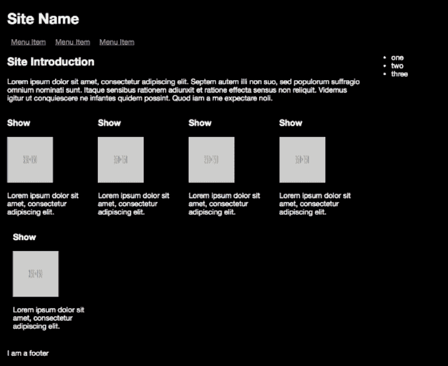

3-12. 具有更宽侧边栏的页面

随着浏览器窗口大小的变化，你会看到页面元素平滑地收缩和放大，这非常适合响应式 Web 设计。但注意当到达较小屏幕尺寸时会发生什么：

# 64 快速上手响应式设计

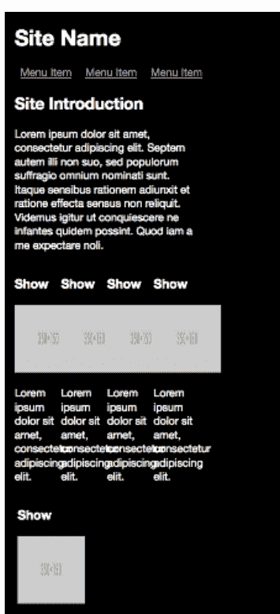

3-13. 在较小屏幕尺寸下发生了什么

看起来不太好：电视节目元素被压扁了。部分原因是图片还没有适当缩小尺寸——我们将在第 5 章中进一步讨论这一主题。这也是流式网格的问题。理论上，在较小尺寸下发生的情况应该是布局应该垂直堆叠。

## Flexbox

Flexbox 是一种用于在行或列中设计灵活布局的现代布局模型。它使得在容器内对齐项目和分配空间变得更容易，即使项目的大小是未知的。Flexbox 是一种一维布局方法，意味着它处理行或列布局，而不是兼顾。对于二维布局，请使用 CSS Grid。

Flexbox 由一个 flex 容器及其 flex 项目组成。你通过将 `display` 属性设置为 `flex` 或 `inline-flex` 来定义容器。

flex 容器的关键属性：

- `flex-direction`：设置主轴，项目在该轴上放置（值：`row`、`row-reverse`、`column`、`column-reverse`）。
- `flex-wrap`：控制 flex 项目是换行还是保持单行（值：`nowrap`、`wrap`、`wrap-reverse`）。
- `justify-content`：定义如何在主轴上对齐以及如何分配额外空间（值：`flex-start`、`flex-end`、`center`、`space-between`、`space-around`）。


# Flexbox 布局

## 容器属性

- `align-items`：定义如何在交叉轴对齐（值：`stretch`、`flex-start`、`flex-end`、`center`）。

## 项目属性

- `flex-grow`：项目增长的能力。
- `flex-shrink`：项目收缩的能力。
- `flex-basis`：分配空间之前的项目初始大小。
- `flex-self`：覆盖容器设置的 `align-items` 值，但仅针对单个项目。
- `order`：项目相对于其他项目的顺序。

## 基础示例

以下示例显示了如何使用 flexbox：

```css
.container {
  display: flex;
  flex-direction: row;
  justify-content: space-around;
  align-items: center;
}

.item {
  flex-grow: 1;
}
```

Flexbox 是创建响应式布局的强大工具。通过掌握它的属性，你可以构建适应不同屏幕尺寸的复杂动态界面。

## 导航栏示例

使用 flexbox 创建简单的导航栏：

```html
<nav class="navbar">
  <div class="logo">品牌</div>
  <ul class="nav-links">
    <li><a href="#">首页</a></li>
    <li><a href="#">关于我们</a></li>
    <li><a href="#">联系我们</a></li>
  </ul>
</nav>
```

对应的 CSS：

```css
.navbar {
  display: flex;
  justify-content: space-between;
  align-items: center;
  background-color: #333;
  padding: 1rem;
}

.nav-links {
  display: flex;
  list-style: none;
}

.nav-links li {
  margin-left: 20px;
}

.nav-links a {
  color: white;
  text-decoration: none;
}
```

这创建了一个 logo 在左侧、链接在右侧的响应式导航栏。`justify-content: space-between` 属性确保它们被推到容器的两端。

## 多列布局示例

使用 flexbox 创建多列布局：

```html
<div class="layout">
  <aside class="sidebar">
    侧边栏内容
  </aside>
  <main class="content">
    主内容
  </main>
</div>
```

对应的 CSS：

```css
.layout {
  display: flex;
}

.sidebar {
  flex: 1;
  background-color: #f4f4f4;
  padding: 1rem;
}

.content {
  flex: 3;
  padding: 1rem;
}
```

这创建了一个双列布局，其中主内容区域比侧边栏宽。`flex` 属性用于定义项目的增长比例。

## 响应式网格示例

最后，使用 flexbox 创建一个响应式网格：

```html
<div class="grid">
  <div class="card">1</div>
  <div class="card">2</div>
  <div class="card">3</div>
  <div class="card">4</div>
</div>
```

对应的 CSS：

```css
.grid {
  display: flex;
  flex-wrap: wrap;
  gap: 10px;
}

.card {
  flex: 1 calc(25% - 10px);
  border: 1px solid #ccc;
  padding: 1rem;
  text-align: center;
}

@media (max-width: 768px) {
  .card {
    flex: 1 calc(50% - 10px);
  }
}

@media (max-width: 480px) {
  .card {
    flex: 1 100%;
  }
}
```

这创建了一个适应不同屏幕尺寸的响应式网格。Flexbox 是构建现代布局的通用且强大的工具。

## 使用网格系统实现更好的响应式结构

调整页面大小。你会发现，你现在的效果与第一个流式网格示例相同，但从媒体查询中删除了大量的 CSS。通过其中一组 flex 属性，页面元素的尺寸调整已经由我们处理好了。而且完全不需要任何 JavaScript！

如果你想重新构建页面，可以移除 `flex-basis` 属性，但嵌套具有不同行/列方向的 flex 容器会涉及更多元素，因此我们在 HTML 复杂性与 CSS 复杂性之间进行权衡。

接下来，这里是电视节目列表的样式：

```css
section.showlistings {
  display: flex;
  flex-wrap: wrap;
  flex-direction: row;
  margin-bottom: 25px;
}

section.tvshow {
  width: 125px;
  height: auto;
}
```

这会将 `showlistings` 部分设置为另一个 flex 容器，它会换行无法在单行内显示的任何项目——默认情况下，flex 会尝试将所有项目放在同一行。

此时，你也可以从 HTML 和 CSS 中删除 `left` 类，因为它已不再需要。

## 设置页面元素的顺序

另一个很酷的 flexbox 技巧是使用 `order` 属性设置元素的顺序，用数字定义其位置。例如，你可以使用以下代码重新排列移动设备的元素：

```css
nav { order: 1; }
header { order: 2; }
main { order: 3; }
footer { order: 4; }
```

但如果你想移除页面元素，仍然需要使用媒体查询。

这是一个关于如何使用 flexbox 的简单示例，但正如你所看到的，一旦你重构了页面，flexbox 就会为你处理大部分手动重流。

# CSS Grid 布局

flexbox 的补充是 CSS Grid Layout 模块，它可以帮助你定义和布局页面的区域。过去，网页布局的主要选项是灵活（我泛指这个术语）网页布局使用的是 HTML 表格来定义行和列页面区域，但这些对于可访问性来说糟糕。网格布局是对该概念的现代重新解释。

> **Grid Layout 的浏览器支持**
>
> Grid 在 2017 年初已支持主流浏览器的最新版本，因此如果布局需要支持旧浏览器，则需要回退策略。你可以在网上查看哪些浏览器版本不支持 Grid。

让我们尝试将网格布局应用于演示网站，从代码开始。同样，在 `body` 内部创建一个容器 `div` 来布局：

```html
<div class="container">
...
</div>
```

将 `aside` 从 `main` 内部移动到其外部。这让你能够将其视为一个独立的列：

```html
<!-- 3-20. 第 3 章/index.html (节选) -->
<main>
<aside class="left">
  <ul>
    <li>one</li>
    <li>two</li>
    <li>three</li>
  </ul>
</aside>
```

在 CSS 中，将显示模式更改为 `grid`：

```css
.container {
  display: grid;
}
```

现在网格显示变得非常酷了。添加以下内容：

```css
/* 3-21. 第 3 章/layout.css (节选) */
.container {
  display: grid;
  grid-template-columns: 66% 33%;
}
```

就像 flexbox 布局一样，你也可以利用此机会移除媒体查询中的所有尺寸覆盖。通过一个简单的 CSS 属性，你已经移除了目前为止使用的类。`grid-template-columns` 属性为你提供了更多可能性。例如：

- 你可以使用任何标准尺寸单位来定义列，包括 `auto` 来填充剩余空间。
- 你可以使用 `fr`（分数单位）让网格按比例填充空间。因此，你可以将此网格重写为 `grid-template-columns: 2fr 1fr;`，这意味着第一列将占据空间的三之二，第二列占据三分之一。

很棒，但如果你现在查看演示网站，你会发现设计中的行这种设置了显示模式的 grid 布局，但正如你所看到的，一旦你重构了页面，你还需要使用媒体查询来显式定义行：

```css
.container {
  display: grid;
  grid-template-columns: 66% 33%;
  grid-template-rows: auto auto auto;
}
```

## 有多少行？

这种设置了显示模式的 grid 布局，但正如你所看到的，一旦你重构了页面，你还需要使用媒体查询来显式定义行：

```css
.container {
  display: grid;
  grid-template-columns: 66% 33%;
  grid-template-rows: 80px 40px auto;
}
```

此声明块规定了列应该从左侧开始一直延伸到右侧，并从该行的顶部延伸到底部。

其他页面元素遵循类似的模式：

```css
...
nav {
  grid-column-start: left;
  grid-column-end: right;
  grid-row-start: main-nav;
  grid-row-end: main-nav;
}
...
main {
  grid-column-start: left;
  grid-column-end: right;
  grid-row-start: shows;
  grid-row-end: shows;
}
...
footer {
  grid-column-start: left;
  grid-column-end: right;
  grid-row-start: footer;
  grid-row-end: footer;
}

@media only screen and (min-width: 992px) {
  ...
  aside {
    display: block;
    grid-column-start: right;
    grid-column-end: right;
    grid-row-start: header;
    grid-row-end: header;
  }
}
```

现在你已经定义了一个网格。最初，这种语法看起来很冗长，但它更符合人类阅读。

## 最终网格布局

还有许多其他网格布局特性，包括重复布局、嵌套网格、内容对齐以及在网格中定义边距和间距的能力。网格布局的最后一个优势是，它还让浮动变得不再必要，因此可以从 HTML 中移除 `left` 类以及任何使用的清除样式。

## 使用框架让网格变得简单

在很多情况下，按照本章描述的方法创建一个网格并不困难，但开发者和设计师喜欢尽可能地完成重复性任务。一个简单的解决方案是创建一套适用于自己的网格系统，并在你的项目中复用它。但当然，其他开发者和设计师也想到了这一点，并在互联网上提供了他们的网格系统（或框架）。我将介绍其中两个流行的框架，但这是一个可能存在分歧的话题。我的目标是向你展示框架如何能够帮助你在重复性任务上节省时间，而不是详细讨论哪一个“更好”（这是一个你必须自己做出的决定）。许多框架提供的不仅是响应式网格，还提供了其他响应式元素，如字体、图标和可复用的组件。你可能更喜欢某一个框架而不是另一个，因为它在你网页的其他方面提供了更好的选择。

### Bootstrap

虽然 Bootstrap 不是第一个响应式设计框架，但它是使用最广泛的。你可能在没有察觉的情况下见过它的运行。它由 Twitter 于 2011 年发布，使用 12 列网格，提供 flexbox 布局，并一直是 GitHub 上最流行的仓库之一。

流行性是 Bootstrap 最大的优势也是缺点。它易于使用，鼓励积极的布局和 CSS 实践，并拥有大量的文档和社区帮助。但你的网站看起来可能非常像其他由 Bootstrap 驱动的网站。

#### 安装 Bootstrap

默认下载的 Bootstrap 会增加页面权重，因此我建议你仔细查看说明，以确保获取一个最适合你用途优化的版本。在这个示例中，我将使用 CDN 选项，因为它是最简单的。如果你想跟随操作，请添加 Bootstrap 页面提供的行，并移除指向当前 CSS 文件的链接。

你可以在这里找到简化的（无媒体查询）重构后的 `index.html` 页面作为示例。你丢失了自定义字体和背景颜色（这些很容易重新添加），但你不需要费太大精力就得到了一个响应式网格（Bootstrap 也使用 12 列网格），它的工作方式与我们的自定义网格类似。Bootstrap 还有许多其他样式用于处理图像、确定在不同网格尺寸下显示哪些网格元素，等等更多。

#### Bootstrap 示例

如果你对学习更多 Bootstrap 感兴趣，推荐 SitePoint 的 Jump Start Bootstrap。

### Foundation


Foundation 由 Zurb（一家交互设计机构）于 2011 年创建。它提供了许多功能（包括可选的 `flexbox`），定期发布，并拥有良好的社区，但使用率较少。它提供了更多的灵活性来基于 12 列创建布局。

# Jump Start 响应式设计

## 安装 Foundation

像 Bootstrap 一样，Foundation 可以增加很多页面权重，因此我建议你确保下载最适合你的配置。

```html
<link rel="stylesheet" href="foundation.css">
<link rel="stylesheet" href="app.css">
```

你可以在这里找到简化的（无媒体查询）重构后的 `index.html` 页面作为示例。你丢失了自定义字体和背景颜色（这些很容易重新添加），但你应该看到所需的额外元素。

## 网站名称

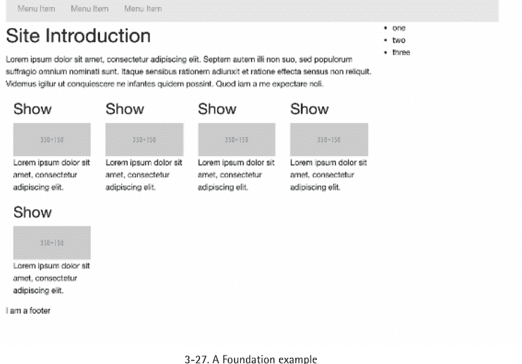

如果你对学习更多 Foundation 感兴趣，推荐 SitePoints 的 Jump Start Foundation。

## 演示 App 怎么？

在本章为止，我使用了演示 app 的部分，但书的其他部分将不再使用任何网格。这是为了清晰，让你可以在不被网格干扰的情况下查看其他主题，同时也减少浏览器兼容性问题。

作为一个练习，尝试选择一个你喜欢的网格系统并重写示例。

## 总结

现在你已经知道如何创建一个可以响应任何浏览器的页面布局。在下一章中，我们将研究如何让布局的内容变为响应式——因为如果没有可读且美观的内容，你的工作尚未完成。

# 第 4 章 响应式文本

如果网页要实现真正的响应式，那么页面内容也应该适应用户查看它的设备尺寸。虽然网页变得越来越依赖图像和媒体，但文本仍然是一个关键组件，并且有许多技术可以帮助它在任何情况下尽可能易读。

为了更好地理解如何在网页上表示文本，最好的方法是回顾文本的长历史。

## 文本的历史

排版（文本的排列和样式设计）原理自从人们在纸上打印以来就一直在演变。测量如行距（行间）、字间距等已继承到桌面出版领域，任何使用过 QuarkXpress、InDesign 或其前身的人都知道它们是如何影响文本的。

CSS 排版与印刷排版共享许多相同的属性，但某些名称不同。事实上，它比旧版本具有更具描述性的名称。

在 Web 早期，排版控制水平非常有限，但 CSS3 提供了巨大的帮助，为我们提供了更多工具来实现我们的设计。

## CSS 中的响应式排版属性

你可以使用 CSS 设置许多与文本相关的属性。以下是我认为对响应式设计最有用的几个：

- `font-size`：字体的大小。
- `line-height`：指定块级元素内行的最小高度，以及行内元素的实际行行高。
- `font-weight`：字体的“重量”，即其粗细程度和强度。
- `text-decoration`：用于设置下划线或删除线。
- `text-align`：用于设置文本左对齐、右对齐、居中或两端对齐（对齐到左右边距）。
- `text-transform`：用于将文本显示为大写、小写或首字母大写。
- `letter-spacing`：指定字母之间的间距，类似于行间距（leading）。
- `word-spacing`：指定单词之间的间距，类似于字间距（tracking）。

使用像素值设置这些属性中的某些或全部是很常见的。例如，你可以将当前演示网站的 `body` 选择器添加以下内容：

```css
body {
  font-size: 18px;
  line-height: 22px;
  letter-spacing: 4px;
}
```

这将导致文本看起来如下所示：

### 4-2. 一个奇怪的文本示例

你可能在设计中发现其他有用的属性是：

- `font-style`：将文本设置为斜体或倾斜。斜体文本在小屏幕上的可读性可能不如大屏幕。
- `text-indent`：设置文本块中第一行的（大部分的）缩进。在较小设备上空间有限的情况下，缩进段落可能比设置段落之间的间距更好。
- `text-align-last`：设置文本最后行的对齐方式。同样，在不同的设备尺寸下，你可能希望以不同的方式处理。
- `white-space`：定义文本块中空白和换行的处理方式。
- `word-wrap`：指定允许单词跨行折。这对于根据显示大小优化文本可能很有用。

你可能在好奇设置固定大小的文本如何是响应式的。`18px` 无论是在桌面电脑还是移动屏幕上渲染都是 `18px`。你可以使用媒体查询在不同的屏幕尺寸下设置不同的字体大小，但这将变得繁琐，而且可能有更好的方法。

CSS 允许你使用不同的单位来设置元素的大小，特别是对于文本。它们分为两个阵营：固定尺寸和相对尺寸。

## 固定尺寸

固定尺寸意味着尺寸始终相同。你可以使用七种可能的单位，但我将重点关注最常用的两种：`px` 和 `pt` 值。

### 像素

像素是组成每个设备屏幕的微小彩色点。当你需要在 HTML 中设置元素的大小时，一个 CSS 像素等于一个设备像素，对吧？不，并没有……

**设备像素**（也称为**屏幕像素**）组成你屏幕的实际像素，传统上这是用户屏幕宽度乘以高度的像素数。这可能与他们的浏览器窗口大小不同，因为桌面用户经常调整窗口大小，而且浏览器通常不在全屏模式下运行。

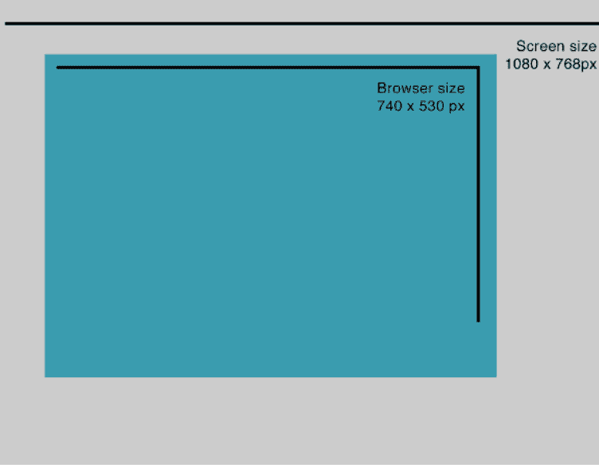

新的高分辨率屏幕——例如 Apple 的“Retina”显示器——使问题复杂，因为它们在屏幕区域使用了更多的像素。通常，这是通过将垂直和水平方向的像素数翻倍来实现的，尽管越来越多的屏幕在每个方向上的像素是四倍。

更复杂的是用户为了无障碍或其他原因缩放或放大了他们的浏览器窗口。例如，下面的截图是当前演示网站缩放了 125%，其中一个 CSS 像素现在覆盖 1.25 个设备像素。

### 点

正如你在较早的截图中看到的，点（`pt`）尺寸单位源于打印，理解起来更复杂。它代表类似于像素的大小，由于不同的操作系统以不同的方式表示像素，它们最好保留打印。

## 相对尺寸

相对尺寸适用于网页和响应式设计，因为尺寸会相对于基础大小变化。但理解固定尺寸（至少是像素）有助于理解这些方法的工作原理。相对字体尺寸最常用的单位是 `%`、`em` 和 `rem` 值。

### 百分比

设置字体大小的百分比值意味着相对于默认字体大小的百分比，所以如果用户将浏览器字体大小设置为 `16px`，那么 `font-size: 100%;` 将仍然等于 `16px`。

使用相对尺寸时需要了解的第一重要事实是这些尺寸相对于什么。在所有浏览器中，默认都是 `16px`，但如果用户更改了此默认——例如为了补偿视力低——那么相对尺寸仍然会放大和缩小。

作为一个示例，让我们尝试将百分比尺寸应用于演示网站，再次采用移动优先的方法，为较小屏幕设备的用户设置基础字体大小。

```css
body {
  font-size: 75%;
}
```

然后，在平板和桌面电脑的媒体查询中，为更大的屏幕尺寸添加字体大小。

```css
@media only screen and (min-width: 768px) {
  body {
    font-size: 100%;
  }
}
@media only screen and (min-width: 992px) {
  body {
    font-size: 125%;
  }
}
```

这导致在大屏幕上的字体渲染比中等尺寸屏幕上略微像素化。

### Em

尽管 `em` 单位最近在网页设计师中越来越流行，但 `em` 仍然是一个古老的排版单位，以字母 “M” 命名。`em` 单位的基值等于当前字体大小的磅值（points）。例如，在 16 磅字体中，一个 `em` 等于 16 磅。

在实践中，它的工作方式与百分比缩放类似，但单位更小。例如，假设默认字体大小为 `16px`，`font-size: 1em` 仍然等于 `16px`，而 `font-size: 0.5em` 则等于 `8px`。

使用 `em` 时，单位值较小，但样式很容易无意中导致大字体。例如，考虑 `font-size: 4em`：虽然数字看起来并不大，但它实际上等于 `64px`。当然，你可以将默认字体大小设为更小的值，这样增加 `em` 就不会产生巨大的变化。

作为一个示例，让我们尝试在演示网站上应用 `em` 缩放，同样采用移动优先的方法。

为 `body` 元素添加一个基础字体大小，将默认字体大小设置为 `16px` 的 `.75em`，即 `12px`：

```css
body {
  font-size: 0.75em;
}
```

然后，在平板电脑和桌面显示的的媒体查询中，为更大的屏幕尺寸添加字体大小：

```css
@media only screen and (min-width: 768px) {
  body {
    font-size: 1em;
  }
}
@media only screen and (min-width: 992px) {
  body {
    font-size: 1.25em;
  }
}
```

我不会添加截图，因为结果看起来应该和百分比示例完全一样。

使用 `em` 的一个巧妙技巧是相对缩放会级联到嵌套元素。例如，修改页面的 `aside` 元素以包含一些嵌套的列表项：

```html
<aside class="left">
  <ul>
    <li>one
      <ul>
        <li>sub item</li>
        <li>sub item</li>
      </ul>
    </li>
    <li>two
      <ul>
        <li>sub item</li>
        <li>sub item</li>
      </ul>
    </li>
    <li>three
      <ul>
        <li>sub item</li>
        <li>sub item</li>
      </ul>
    </li>
  </ul>
</aside>
```

然后添加以下样式：

```css
aside ul {
  font-size: 0.75em;
}
```

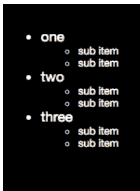

### 4-7. Em 级联示例

你会发现外层 `ul` 的字体大小是当前默认大小的 `.75em`（`15px`，在截图中是 `20px`），而内层 `ul` 是该尺寸的 `.75em`（`11.25px`）。虽然这种技术允许一种创建响应式字体尺寸的极佳简便方法。

对于页面的小屏幕版本（即默认样式），节目描述文本实际上是隐藏的，因此我们不需要担心对其进行格式化。然而，当屏幕空间有限时，主站描述占据了过多的空间，因此使用 `:not` 伪类来减小默认字体大小并排除节目描述：

```css
section.showlisting p:not(.showdescription) {
  font-size: 0.8em;
}
```

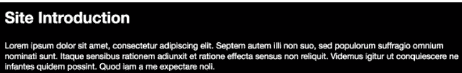

### 4-10. 网站介绍文本调整大小

随着屏幕尺寸的增大，除了观看视频之外，节目描述可能是人们想要访问的内容，所以让文字稍微大一点，以便更突出。在等等屏幕尺寸下，仍然显示文本摘要，因此这足够提高它的可读性了：

```css
@media only screen and (min-width: 768px) {
  .showdescription {
    font-size: 1.2em;
  }
}
```

### 4-11. 节目描述现在变大了

屏幕变大了，让我们增大字体大小并收紧行间距，特别是人们现在可能在安坐享受晚上娱乐时，从另一个房间阅读这些描述。

```css
/* 中等设备和桌面电脑 */
@media only screen and (min-width: 992px) {
  .showdescription {
    font-size: 1.3em;
    line-height: 1.1em;
  }
}
```

| 节目 | 节目 | 节目 | 节目 | 节目 |
| --- | --- | --- | --- | --- |
| 350-150 | 350-150 | 350-150 | 350-150 | 350-150 |
| Lorem ip... | Lorem ip... | Lorem ip... | Lorem ip... | Lorem ip... |

### 4-12. 完整的描述文本

## 继续阅读


在本章中，我介绍了与响应式设计相关的排版概念，并展示了它们如何在 CSS 中表示。我还涵盖了你可以用于设置这些属性的各种尺寸单位，以及如何让你页面上的重要文本具有可读性。在下一章中，我将展示如何对页面的其余内容进行相同的操作，例如图像和视频。

# 第 5 章：响应式图像和视频

基于内容的交换促成了 Web 的诞生，但图像和其他富媒体一直使其不断演变，并使其成为我们所有人所知/喜爱/厌恶的样子。

使图像响应式的方案在近年来发展迅速，已经能够加载完美适配用户设备的图像。此外，视频等新 HTML 元素的加入为响应式设计开启了新的选择。这是一个全新的领域，但也充满了陷阱、折中和需要学习的新技术。所以，让我们开始吧！

## 图像

图像是一种强大的通信工具，能够传达信息、意图、解释，并为你的网页注入生命。

多年来，图像一直是设计师（网页和打印）痛苦的源源，尽管 HTML5 带来了许多改进，但在你的网页中添加响应式图像仍然需要规划和准备。

在本章中，我用来自版权免费网站的图像替换了此处为止网站使用的占位图形，以代表一个拥有真实电视节目的网站可能的样子。

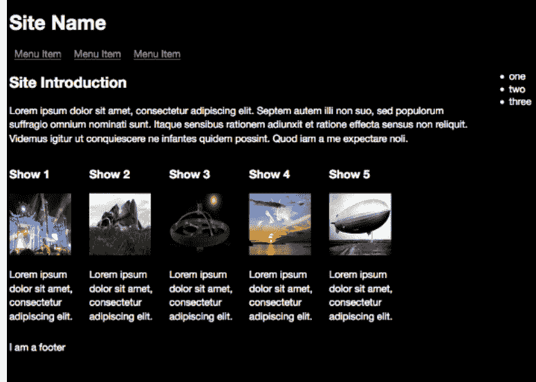

### 5-1. 添加图像

添加真实图像后，页面出现了一些问题。最明显的是，虽然布局仍然良好，但所有图像都被强制设置为相同的尺寸，这意味着它们没有利用可用的屏幕空间。示例网站用于浏览和观看视频，因此让视觉内容尽可能突出且易于观察是有意义的。

为了展示如何使用响应式图像，我们将更改演示网站，使其在第 3 章定义的断点处适应每种用例的不同图像尺寸和布局。

首先，更改 CSS 和 HTML 以更好地适应我们将添加的图像。让我们给主内容区域留更多空间并缩小侧边菜单的大小：

```css
@media only screen and (min-width: 992px) {
  aside {
    width: 15%;
    display: block;
  }

  section.showlisting {
    width: 75%;
  }
}
```

为包含节目详情的 `div` 添加移动端样式。这设置了 480px 的最大宽度，居中，理想宽度占据大部分屏幕：

```css
section.tvshow {
  width: 90%;
  max-width: 480px;
  margin: 0 auto;
  display: block;
}
```

接下来，为同一个 `div` 在更大屏幕上显示时添加一个媒体查询——仍然居中并填充大部分屏幕：

```css
@media only screen and (min-width: 480px) {
  section.tvshow {
    max-width: 768px;
  }
}
```

当我们跳转到更大的屏幕时，我们将行内显示更多一个图像，它们仍然居中并占据大部分屏幕。这意味着图像将变小，且每个 `div` 的最大宽度是屏幕的一半，通过以下媒体查询实现：

```css
@media only screen and (min-width: 768px) {
  section.tvshow {
    max-width: 50%;
  }
}
```

在屏幕上显示时，为同一个 `div` 添加另一个媒体查询：

```css
@media only screen and (min-width: 992px) {
  section.tvshow {
    max-width: 768px;
  }
}
```

最后，针对大屏幕的媒体查询：

```css
/* 大屏幕设备和显示器 */
@media only screen and (min-width: 1200px) {
  section.tvshow {
    width: 33%;
  }
}
```

所以就是这样，对吧？遗憾的是，并不是。在你的网页检查器中检查其中一张图片，你会发现我们只是在缩放一张很大的图片。尽管它看起来很小，但实际文件仍然很大，增加了大量的页面权重。查看网络请求：这五张图片几乎有 4MB，对于移动用户加载来说，数据量太大了。要让你的图片完全响应式，你需要确保为设备提供了正确的文件。

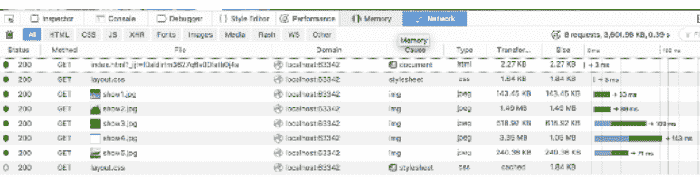

## 5-5. 图片尺寸

### 为正确的设备选择正确的图片

处理响应式图片有两种方法。一种是 `srcset`，你已经用过的 `img` 标签的属性，另一种是新的 HTML5 `picture` 元素。这两种方法都使用媒体查询语法来选择最适合设备能力的图像，但 `srcset` 允许浏览器对渲染哪张图像做出最终决定，而 `picture` 则显式地告诉浏览器渲染哪张图像。对于大多数情况，`srcset` 就足够了，但对于设计密集型网站，当你需要对浏览器渲染图像有更多控制权（例如裁剪图像而不是缩放它），`picture` 标签会更适合你。

就像媒体查询加载的 CSS 规则一样，你使用和支持的图片尺寸取决于你和你的场景。示例项目经过了中度优化，但还可以更好。例如，我们可以减少在较屏幕上加载的图片的最大尺寸。查询可以采用第 2 章概述的相同格式。

我手动创建了设计所需的每张图片，它们的宽度大致匹配将显示的最大宽度：

- 小图片：320px 宽。
- 中等图片：480px 宽。
- 大图片：768px 宽。

手动创建不同版本的图片是枯燥的，但它可以让你控制每个图片尺寸下显示的内容。如果你更愿意自动生成这些图片，有几种选择，例如：

- 在 Photoshop 或 XnView (Windows) 等图像编辑器中进行批量处理。
- 使用 Gulp 等构建工具进行批量处理。
- 为你的 CMS 或站点生成器使用插件，这些很可能是流行的 `imagemagick` 或 `OptiPNG` 库的封装。

### srcset

将现有的图像元素替换为以下内容：

```html
<section class="tshow">
  <h3>show1-medium</h3>
  
  <p class="showdescription">Lorem dolor sit amet, consectetur adipiscing elit.</p>
</section>
```

> **课后作业**
>
> 这个示例替换了一张图片，为了减少重复，我没有包含替换其他四张图片的代码。如果你想尝试替换其他图片，可以在代码存档中找到剩余图片的代码。保持媒体查询不变，并用相应的文件替换图片。

这需要进行拆分，而且我们使用的布局也增加了复杂度。

元素的第一个部分是正常的，最后一个类属性也是如此，第二行和第三行是新语法。`srcset` 设计用于允许浏览器根据你提供的信息对显示哪种图像做出最佳决定。第二行中的每一对都定义了可用图像，并告诉浏览器宽度（后跟 `w`）。第三行定义了你想要加载特定图片的视口尺寸，以及加载哪张图片。

上面的示例声明了：

- 当视口宽度为 768px 时，加载 480px 的图片。
- 当视口宽度在 768px 和 1800px 之间时，加载 320px 的图片。
- 如果适用其他规则，加载 768px 的图片。

你可以使用这些声明这些不同的尺寸，例如：

```html

```

这声明了最适合的视口尺寸。对于这种设计，它们基本上是相同的，但它给了你关于浏览器如何智能处理的思路。这在测试时可能会导致困惑：我经常发现它没有按预期方式工作，直到我意识到是浏览器缓存了版本，或者再次缓存了图片。在调试你的 `srcset` 时，我建议使用无痕模式检查你的屏幕分辨率，并打开开发者工具查看浏览器的文件。

# 响应式图像与视频 117

看到。就这些了；`video` 元素并没有特别的响应式，除了它可以加载带有控制控件的合适视频文件。

你可以尝试一些技巧让视频更具响应性，但让我们先简单地让视频播放器控件可见、添加海报（视频播放前显示的缩略图）并移除手动尺寸开始。

```html
<video controls poster="../images/show1-medium.jpg">
  <source src="../videos/show1.ogv" type="video/ogg">
  <source src="../videos/show1.mp4" type="video/mp4">
  您的浏览器不支持 video 标签。
</video>
```

`video` 元素的早期建议包含自己的媒体查询（正如我们看到的 `picture` 元素一样）。但这个想法被舍弃了，这意味着无法为不同的设备切换不同的视频文件。让视频具有响应式的唯一真实方法是使用百分比宽度，例如：

```css
video {
  width: 100%;
  height: auto;
}
```

这将使视频缩放以适应其容器元素，你可以使用 `max-width` 属性来限制它可以增长的尺寸大小，或者使用较小的值，如 50%。然而，在较大的屏幕尺寸上，它无法防止视频的放大，这意味着如果尺寸太大，它可能会看起来像素化。

除非另有指定，否则视频将在页面加载后开始下载到您的浏览器（这样如果用户选择观看，它就可以准备就绪）。注意视频潜在的网络开销，这对于移动用户来说并不好：

# 1 快速上手响应式设计

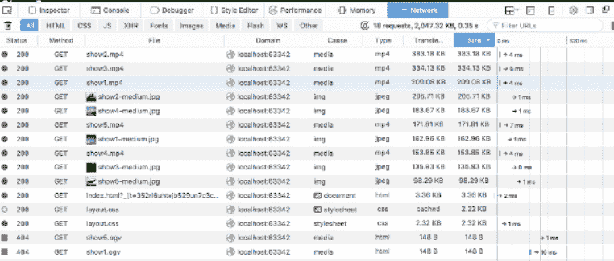

5-8. 检查器中显示的视频文件大小

这个问题有一个部分解决方案：在 video 标签中添加 `preload="none"`

```html
<video controls poster="../images/show1-medium.jpg" preload="none">
...
</video>
```

视频只有在用户点击播放按钮时才会加载，允许用户选择何时以及是否加载。

在我们的代码文件中，请（暂时）移除 `picture` 元素，并用上面所示的 `video` 元素替换它。

## 站点名称

菜单项  菜单项  菜单项

## 站点介绍

Lorem ipsum dolor sit amet, consectetur adipiscing elit. Septem illum non suo, sed populorum suffragio omnis nominati sunt. Itaque senalibus ratione adduct et ratione effecta sensus non reliquit. Videmus igtur ut conquisescere infantes quidem posuere. Quod eum a me expectare nol.

## 展示 1

## 展示 2

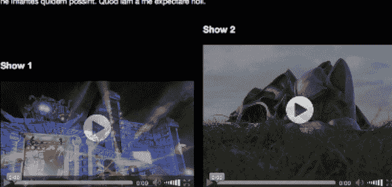

Lorem ipsum dolor sit amet, consectetur adipiscing ...

Lorem ipsum dolor sit amet, consectetur adipiscing ...

## 展示 3

## 展示 4

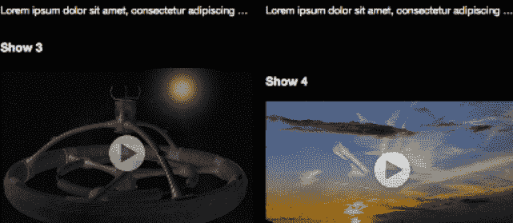

5-9. 在平板设备上加载的视频

如果你使用较大的视频，那么视频在大尺寸下的缩放效果会很好。但你会发现在播放器尺寸（平板电脑和电视断点）处，海报图像是像素化的。

这个问题没有理想的解决方案，希望随着元素的演进，会出现更好的解决方案。（我希望看到的某种可能的解决方案是：可以在 `video` 标签内部的 `source` 子元素中设置海报图像的选项，理想情况下应支持断点和媒体格式选择性加载。）

### 使用较大的图像作为海报

将海报图像替换为大版本意味着海报图像将跨所有文件尺寸进行缩放，但这意味着我们在某些断点处加载了不必要的大文件。

如果你想进一步对海报元素进行样式处理（更改尺寸或添加内边距），你可以使用以下选择器直接对其进行：

```css
video[poster] {
  ...
}
```

### 背景图像

创建视频响应式图像表示的一种方法是移除海报图像，而是为视频设置背景图像，允许使用媒体查询来加载相应的图像。

你需要在 video 标签内内联设置背景图像，或者为每个视频创建一个 CSS 样式来设置图像，因为每个视频都需要不同的图像作为背景。

使用内联样式：

```html
<video controls preload="none"
style="background: transparent
url('../images/show1-large.jpg')
0 0 / cover no-repeat;">
</video>
```

使用 CSS 类：为了避免在生产网站上重复输入，你可能会使用像 Twig 或 Mustache 这样的模板系统，它会遍历你用于显示的视频，并根据需要填充各种名称。如果你不想使用内联样式，可以使用 Less 或 Sass 等 CSS 预处理器，它允许你使用函数和参数（在此例中为背景图像）来为你生成必要的类，但这将产生大量的 CSS。

为了演示这一原理，让我们采取一种介于上述两者之间的方法，而不使用任何新依赖。首先，从 video 标签中移除所有 `poster` 属性，并为每个视频添加一个类，然后为每个断点创建背景图像所需的样式。例如：

```html
<video controls preload="none" class="show1">
</video>
```

以及移动优先布局的 CSS：

```css
.show1 {
  background: transparent url("../images/show1-medium.jpg")
  0 0 / cover no-repeat;
}
```

然后对于较大的移动设备：

```css
@media only screen and (min-width: 480px) {
  .show1 {
    background: transparent url("../images/show1-large.jpg")
    0 0 / cover no-repeat;
  }
}
```

对于较大的平板电脑和桌面设备：

```css
@media only screen and (min-width: 992px) {
  .show1 {
    background: transparent url("../images/show1-small.jpg")
    0 0 / cover no-repeat;
  }
}
```

最后对于大屏幕和电视：

```css
@media only screen and (min-width: 1800px) {
  .show1 {
    background: transparent url("../images/show1-large.jpg")
    0 0 / cover no-repeat;
  }
}
```

现在，为每个视频创建匹配的类和样式。这对于响应式非常棒！你可以在代码中找到。

### 可点击图像

创建完全响应式视频的另一种解决方案是使用 `picture` 标签替换播放器，它在点击时加载播放器。

首先，为每个展示将 `picture` 和 `video` 标签结合：

```html
<section class="tvshow">
  <h3>展示 1</h3>
  <picture>
    <source srcset="../images/show1-small.jpg" media="(max-width: 320px)">
    <source srcset="../images/show1-medium.jpg" media="(min-width: 320px) and (max-width: 480px)">
    <source srcset="../images/show1-large.jpg" media="(min-width: 480px)">
    
  </picture>
  <video controls preload="none">
    <source src="../videos/show1.mp4" type="video/mp4">
    <source src="../videos/show1.ogv" type="video/ogg">
    您的浏览器不支持 HTML5 video 标签。
  </video>
  <p class="showdescription">Lorem ipsum dolor sit amet, consectetur adipiscing elit.</p>
</section>
```

对其他每个展示执行相同操作，替换图像和视频源。

现在将 video 元素设置为默认隐藏：

```css
video {
  display: none;
  width: 100%;
  height: auto;
}
```

## 关于 JavaScript 的说明


# 本章和第 6 章中的 JavaScript 代码

本章和第 6 章中的 JavaScript 代码大多是独立演示的，因为它们提供了单独的选择。如果你想合并并使用所有示例，你需要进一步计划，特别是要尽量减少所需的事件处理程序数量。

## 添加点击事件监听器

接下来，添加以下 JavaScript 为页面添加点击事件监听器。如果检测到点击，代码将检查点击是否在缩略图上。如果是，它将调用 `toggle_visibility` 函数。该函数显示隐藏的视频，播放它并隐藏被点击的图像。

在 `index.html` 文件的 `script` 标签内添加以下 JavaScript，以添加监听器：

```javascript
function () {
  document.addEventListener('click', toggle_visibility, false);
}
```

一旦进入函数内部，如果点击的元素是视频缩略图之一，则继续，忽略所有其他元素：

```javascript
function toggle_visibility(id) {
  clickedElement = id.target;
  if (clickedElement.classList.contains('thumbnail')) {
    var v = clickedElement.parentNode.parentNode.querySelector('video');
    v.style.display = 'block';
    v.play();
    clickedElement.style.display = 'none';
  }
}
```

现在，响应式图像被视频播放器取代，该播放器设计为拉伸以适应。你可以通过视频暂停时反转这一过程来改进。

## 站点名称

- 菜单项 菜单项 菜单项

## 站点介绍

Lorem dolor sit amet, consectetur adipiscing elit. Septem illum in non, sed, ullamcorper suffrag omnisium nominat sunt. Raque sensibus ratione dictum et ratione effects sensus non reliquit. Vimeo ut quiscere ne infidem possident. Quod iam a me expectare non.

## 显示 2

## 显示 1

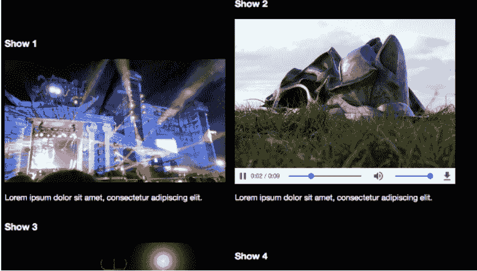

Lorem dolor sit amet, consectetur adipiscing elit.

Lorem dolor sit amet, consectetur adipiscing elit.

## 显示 3

## 显示 4

5-10. 可点击图像和生成的视频播放器

## 获取视觉

现在结果已经：在本章中，我们添加了大量图像和视频来丰富示例站点，使其感觉更像一个正式的网页。如你所见，现在让图片变为响应式要容易得多。新的工具和库让响应式图像比以前简单得多且全面。视频仍然需要更多工作，但至少复杂媒体插件的时代已经过去了。

在下一章节中，我们将使用响应用户浏览器能力、位置、数据和其他“自适应”技术等技巧，来对页面进行润色。

# 第 6 章

## 响应用户上下文

我们的示例页面现在是响应式的，并且可以在各种设备上良好运行——能够缩放布局、图像、媒体和文本以适应设备。

在最后一个章节中，我们将介绍根据用户上下文或偏好调整用户体验的技术。现实世界的应用会从后端对许多情况做出反应，为每种情况提供合适的内容。尽管如此，理解界面变化的不同方式和原因仍然很有趣，我希望这一章能让你对可能实现的功能有所启发。

## 万皆有 API

现代 HTML 和 JavaScript 允许你检查各种参数，然后调整用户看到的内容。我们的演示站以媒体为主的特性为改变如何向用户提供内容提供了巨大的潜力。例如，家庭友好节目可以在一天的特定时间之前播放，之后则提供更多成人节目；可以为用户提供选择，只有在有适当网络连接时才允许播放视频。

## 基于时间

列出的某些电视节目比其他节目包含更多成人内容，如果用户所在位置的时间在晚上 7:00 之前，我们应该在列表中突出显示它们，以指示家庭中较小的成员不应该观看。

### 修改 HTML

我为几个 `tvshow` 部分添加了 `evening` 类。在添加下面的 JavaScript 之前，请先为几个 `section` 元素添加该类。

在 `index.js` 中，添加以下代码获取本地时间，然后提取小时数：

```javascript
var localNow = new Date();
var localTime = localNow.getHours();
```

现在，构建所有具有 `tvshow` 类的元素的数组：

```javascript
tvShows = document.getElementsByClassName('tvshow');
```

遍历电视节目数组，如果时间早于晚上 7:00 且具有 `evening` 类，则为该节目添加 `highlight` 类：

```javascript
var j;
for (j = 0; j < tvShows.length; j++) {
  if ((localTime <= 19) && (tvShows[j].classList.contains('evening'))) {
    tvShows[j].classList.add('highlight')
  }
}
```

接下来，编写一条 CSS 规则，为你可能关注的节目添加微妙的突出效果：

```css
section.tvshow.highlight {
  background: rgba(255, 0, 0, 0.2);
}
```

在 `index.html` 中添加一个新的 `div` 让用户知道 `highlight` 的含义：

```html
<section class="showlisting">
  <h2>欢迎</h2>
  <p>Flux 为你带来最好的视频，当你想要<i>这些节目包含成人内容。</i></p>
</section>
```

另一种响应时间的方法是过滤蓝光以减轻眼睛疲劳或帮助睡眠，本章后面介绍的环境光传感器可以类似的功能。你可能使用过像 Flux 这样的应用程序来执行此操作。如果提供此选项，它会自动发生。HTML5 电池 API 允许你检查设备的当前电量并做出相应。

在 `index.js` 中添加以下代码检查浏览器是否支持该功能。如果是，则获取位于 0（空电）到 1（满电）之间的值：

```javascript
navigator.getBattery().then(function (battery) {
  var level = battery.level;
  console.log(level);
});
```

如果电量小于 20% (0.2)，添加一个 CSS 类并从 DOM 中移除图像（因为加载和显示图像会影响电量，每一点都有帮助）：

```javascript
if (level < 0.2) {
  body = document.getElementsByTagName('body');
  body.classList.add('battery-save');
  images = document.getElementsByTagName('img');
  var i;
  for (i = 0; i < images.length; i++) {
    images[i].remove();
  }
}
```

在你的 CSS 中添加新的 `battery-save` 样式：

```css
.battery-save {
  color: gray;
}
```

配色方案是否真的节省电量是一个争议的话题，很大取决于设备屏幕，但值得尝试。帮助用户节省电量的更明确的想法是：

- 减少网络调用
- 减少动画和效果
- 通过减少客户端处理量

尽管我们用 JavaScript 从 DOM 中移除了图像，它们在隐藏之前仍然被加载了。这与减少网络调用的目标矛盾。JavaScript 只允许你更改传递给浏览器的内容。为了使此生效，你需要重新思考页面结构使其更友好。在当前 HTML 中添加类以识别每个电视节目：

```html
<section class="show1">
  ...
</section>

<section class="show2">
  ...
</section>
```

现在移除每个 `tvshow` 部分的所有 `<picture>` 和 `<video>` 标签。回到 `index.js` 中，用以下代码替换我们在之前的章节中已使用的概念（点击图像播放视频）：

```javascript
window.addEventListener("load", function(event) {
  navigator.getBattery().then(function(battery) {
    // 获取电量，如果电量大于 0.2
    var level = battery.level;
    if (level > 0.2) {
      // 找到所有的 'tvshow' div 并遍历它们
      tvShows = document.getElementsByClassName('tvshow');
      var i;
      for (i = 0; i < tvShows.length; i++) {
        tvShow = tvShows[i];
        // 获取节目名称
        showName = tvShow.classList[1];
        // 创建一个 picture 元素
        var newPictureNode = document.createElement("picture");
        // 为 picture 设置源和类，代码与示例相同，但为每个节目生成了传递了节目名称
        var pictureInnerHTML = '<source src="../images/" + showName + "-small.jpg" media="max-width:320px" class="thumbnail"><source src="../images/" + showName + "-medium.jpg" media="(min-width:320px) and (max-width:480px)" class="thumbnail"><source src="../images/" + showName + "-large.jpg" media="min-width:480px)" class="thumbnail">';
        newPictureNode.innerHTML = pictureInnerHTML;
        // 为 picture 添加事件监听器
        newPictureNode.addEventListener('click', toggle_visibility, false);

        // 以同样的方式生成 video HTML
        newVideoNode = document.createElement("video");
        var videoInnerHTML = '<source src="../videos/" + showName + ".mp4" type="video/mp4"><source src="../videos/" + showName + ".ogv" type="video/ogg">您的浏览器不支持 HTML5 video标签。';
        newVideoNode.setAttribute("controls", "controls");
        newVideoNode.setAttribute("poster", "../images/" + showName + ".jpg");
        newVideoNode.innerHTML = videoInnerHTML;
        newPictureNode.appendChild(newVideoNode);
        tvShow.appendChild(newPictureNode);
      }
    }
  });
});
```

```javascript
showName + '-medium.jpg');
videoNode.setAttribute('preload', "none");
videoNode.innerHTML = videoInnerHTML;
```

```javascript
// Insert the new image and video in the correct place
var nextNode = tvShow.getElementsByClassName('showdescription');
tvShow.insertBefore(newNode, nextNode[0]);
tvShow.insertBefore(newPictureNode, videoNode);
```

```javascript
function toggle_visibility(id) {
  var e = this;
  var v = e.nextSibling;
  v.style.display = 'block';
  v.play();
  e.style.display = 'none';
}
```

当页面加载时，它会检查电池电量是否高于 20%。如果是，图像和视频节点（DOM 内部的元素）将被添加到每个 `tvshow` 类中，使用电视节目的类名来确保加载正确的媒体文件。如果电池电量低于 20%，则只显示文本。理想情况下，您应该将此功能添加到偏好设置中，以免用户产生意料之外的惊喜。

这需要一些重组工作，但现在页面的启动状态更符合移动端习惯，仅在设备状态良好时才加载最重的页面元素。对于本章中的其余示例，我们将使用这个概念来展示如何添加不同的检测功能。事实上，在继续之前，尝试使用上面的框架重构时间示例。

## 地理定位 (Geolocation)

HTML5 Geolocation API 允许您检测用户当前位置的大致纬度和经度。

在提供优质视频内容的同时，RWDFlux 还喜欢推荐可能感兴趣的节目。这个示例将使用用户的当前位置来突出显示包含该位置内容的节目。

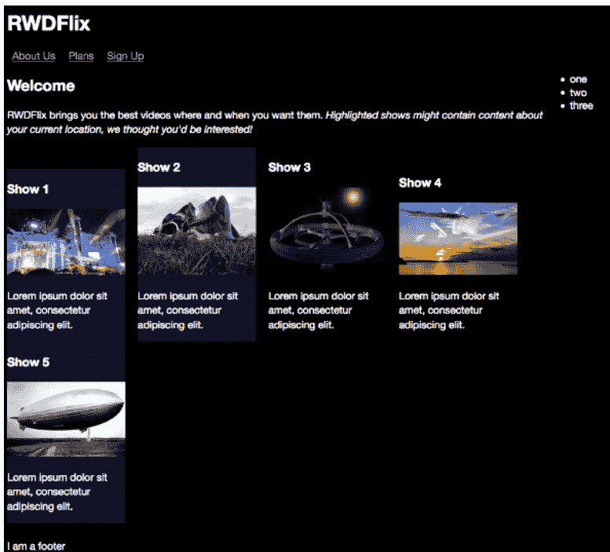

### 6-3. 匹配用户位置的节目显示

在 `index.js` 中，用以下代码替换文件的现有内容，该代码会检查浏览器是否支持地理定位，如果不支持则通知用户：

## 快速上手响应式网页设计

```javascript
window.addEventListener("load", function(event) {
  if ("geolocation" in navigator) {

  } else {
    alert("RWDFlix 使用地理定位来推荐可能与你相关的节目")
  }
}, false);
```

如果浏览器支持地理定位，则获取用户的当前位置并将值传递给一个新函数：

```javascript
if ("geolocation" in navigator) {
  navigator.geolocation.getCurrentPosition(getPosition);
} else {
  alert("RWDFlix 使用地理定位来推荐可能与你相关的节目")
}
```

API 方法返回当前的纬度和经度，这对我们来说并不用，因为我们真的想知道用户当前所在的国家。使用 Google Maps API 将其转换为更有用的国家代码：

```javascript
function getPosition(position) {
  // 定义包含当前纬经的 URL
  var url = "http://maps.googleapis.com/maps/api/geocode/json?latlng=" + position.coords.latitude + "," + position.coords.longitude + "&sensor=false";
  // 创建请求并发送 URL
  var xml = new XMLHttpRequest();
  xml.open("GET", url, true);
  xml.send();
  // 当请求返回时，处理响应
  xml.addEventListener("readystatechange", processRequest, false);
}
```

## 响应用户上下文 (User Context)

现在我们已经得到了来自 Google Maps 的结果，可以处理这些结果。我们需要找到包含国家值的数组，然后以类似于时间示例的方式突出显示与该国家匹配的电视节目：


```javascript
function processRequest() {
  // 响应是否成功？
  if (this.readyState == 4 && this.status == 200) {
    // 解析 JSON 响应
    var myArr = JSON.parse(response.responseText);
    var i;
    for (i = 0; i < myArr.results.length; i++) {
      // 遍历结果数组找到元素
      直到找到
      if (myArr.results[i].types[0] == "country") {
        tvShows = document.getElementsByClassName('show');
        var j;
        // 遍历结果数组找到元素
        for (j = 0; j < tvShows.length; j++) {
          tvShow = tvShows[j];
          if (tvShow.classList[2] !== 'mature') {
            tvShow.classList.add('highlight');
          }
        }
      }
    }
  }
}
```

## 修改 HTML


## 基于网络

`Network Information API` 仍然是一个草案，但你可以检查它是否支持。

## 浏览器支持

`Network Information API` 目前处于提案阶段。

## 用户偏好

`Cookie` 通常用于保留状态。

```javascript
window.addEventListener("load", function(event) {
  document.cookie = "mature=no";
}, false);
```

```javascript
function getCookie(name) {
  var regexp = new RegExp(":^" + name + "|\\s*" + name + ")=(.+?(;|$))", "g");
  var result = regexp.exec(document.cookie);
  return (result === null) ? null : result[1];
}
```

## 环境光

将环境光传感器 API 与时间检测相结合，可能是一种根据一天的时间和观众可见的光线来调整页面或视频亮度的极佳方法。

## 安全担忧

> 最近环境光传感器 API 出现了安全问题。我建议你阅读 W3C 规范以检查其未来。

```
}
});
```

将这些样式添加到你的 CSS 文件中，用于在光线最亮的情况下：

```css
.bright {
  background-color: #fff;
  color: #000;
}
```

当应用此类时，页面如下：

## RWDFlix

+ 关于我们 方案 注册

## 欢迎

`RWDFlix` 在你想要的时间和地点为你提供最优质的视频。

- 一
- 二
- 三

| 直击者神队 | 传道士 | 瑞克和莫蒂 | 美国人 |
| --- | --- | --- | --- |
| Lorem ipsum dolor sit amet, consectetur adipiscing elit. | Lorem ipsum dolor sit amet, consectetur adipiscing elit. | Lorem ipsum dolor sit amet, consectetur adipiscing elit. | Lorem ipsum dolor sit amet, consectetur adipiscing elit. |

## 行尸走亡

Lorem ipsum dolor sit amet, consectetur adipiscing elit.

我是页脚

### 6-4. 在强光下设置高对比度

这种样式将当前的配色方案反转为白底黑字，以便在强阳光下具有更高的对比度和可读性。如果你有一台现代设备，你可能已经注意到屏幕发生了类似的情况。

接下来，为低光照级别添加样式：

## 快速上手：响应式网页设计

```css
.dim {
  background-color: #6600b4;
  color: #b5aaff;
}
```

这是页面的外观：

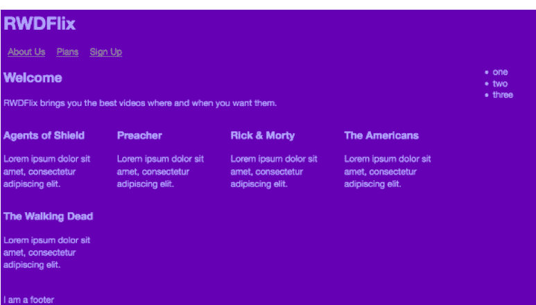

### 6-5. 在暗光下设置低对比度

这使得背景和文本在低光照情况下变得更容易阅读。

接下来，在非常黑暗的环境下，添加一个类使文本与背景之间的对比度更小：

```css
.darkness {
  background-color: #2d004f;
  color: #b5aaff;
}
```

# 响应用户上下文 143

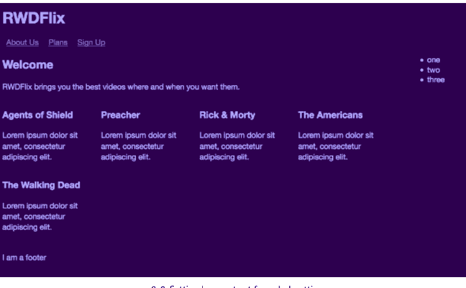

配色方案之间的快速切换会让用户感到不安，因此为了消除这种生硬感，请向 `body` 元素添加以下 CSS 以平滑颜色之间的过渡：

```css
body {
  -webkit-transition: all 0.5s ease-in-out;
  -moz-transition: all 0.5s ease-in-out;
  -o-transition: all 0.5s ease-in-out;
  transition: all 0.5s ease-in-out;
}
```

## 震动

另一个 W3C 创新是 `Vibration API`，它提供了访问移动设备震动机制的方法以提供触反馈。我们可以通过为背景音乐添加震动来增加视频播放的沉浸体验，但这需要大量工作。该 API 还有其他有助于无功能的用途。例如，如果设备在点击按钮时轻微震动，将非常有用，让用户知道操作已被。

## 设备方向

我们已经看到如何通过媒体查询检测并响应设备方向，但也可以对设备方向做出动态响应。例如，我们可以将视频文件切换为更适合横屏或竖屏视频的格式。

如果你想进行更多实验性尝试，根据设备的方向来控制视频的播放如何如何？例如，如果用户向一个方向倾斜手机，我们可以暂停视频，反之亦然。

对于这个示例，我们将创建一个新的、简化的页面，专门用于播放一个视频。

以下是 HTML：

```html
<!DOCTYPE html>
<html lang="en">
<head>
  <meta charset="UTF-8">
  <meta name="viewport" content="width=device-width, initial-scale=1.0, user-scale=no">
  <title>RWDFLix</title>
  <link rel="stylesheet" type="text/css" media="all" href="layout.css">
</head>
<body>
  <header><h1>RWDFLix</h1></header>
  <main>
    <section class="showlisting">
      <section class="tvshow">
        <h3>显示 1/3</h3>
        <video controls poster="../images/show1-medium.jpg" preload="none" id="show1">
        <source src="../videos/show1.mp4" type="video/mp4">
        <source src="../videos/show1.ogg" type="video/ogg">
        您的浏览器不支持 HTML5 视频标签。
        </video>
        <p class="showdescription">Lorem ipsum dolor sit amet, consectetur adipiscing elit.</p>
      </section>
    </section>
  </main>
  <footer>
  我是页脚
  </footer>
</body>
</html>
```

CSS 同样简单：

## 146 快速上手：响应式网页设计

### 6-8. Chapter6/orientation/layout.css (节录)

```css
body {
  background: black;
  color: white;
  font-family: 'Helvetica Neue', Helvetica, Arial, sans-serif;
}

.showing {
  margin-bottom: 25px;
}

.tvshow {
  width: 100%;
}

.showing p {
  line-height: 1.2em;
}

video {
  width: 100%;
  height: auto;
}

.thumbnail {
  font-size: 1em;
}

.footer {
  clear: both;
}

/* 媒体查询 */

@media (min-width: 480px) {
  .showing {
    margin-right: 15px;
  }
}

@media (min-width: 768px) {
  .showing {
    margin-right: 15px;
  }
}

@media (min-width: 992px) {
  .showing {
    margin-right: 15px;
  }
}

@media (min-width: 1800px) {
  .showing {
    margin-right: 15px;
  }
}
```
