# 基于知识的配置：从研究到商业案例


本页有意留白


本页 intentionally left blank

## 致谢

我们要感谢所有帮助使本书成为知识型配置领域高质量贡献的审稿人。我们特别感谢 Michel Aldanondo 和 Albert Haag 对本书的审阅工作。

Alexander Felfernig, Lothar Hotz, Claire Bagley, 和 Juha Tiihonen

本页 intentionally left blank

## 关于编辑

**Alexander Felfernig** 自 2009 年 3 月起担任格拉茨工业大学（奥地利）的正教授；他获得克拉根福大学计算机科学博士学位。目前，他领导软件技术研究所的应用软件工程 (ASE) 研究组。他的研究兴趣包括配置系统、推荐系统、基于模型的诊断、软件需求工程、人类决策制定的各个方面以及知识获取方法。Alexander Felfernig 在著名国际会议和期刊上发表了大量论文（例如 AI Magazine、Artificial Intelligence、IEEE Transactions on Engineering Management、IEEE Intelligent Systems、Journal of Electronic Commerce），并是剑桥大学出版社出版的书籍 *Recommender Systems* 的合著者。他还担任过国际会议和研讨会的组织者，例如 ACM 推荐系统国际会议和智能系统方法论国际研讨会。目前，他是《Applied Intelligence》和《Journal of Intelligent Information Systems》编委会成员。

**Lothar Hotz** 是位于德国汉堡大学的汉堡信息技术中心 (HITeC e.V.) 的高级研究员；他获得汉堡大学计算机科学博士学位。他参与了多个国家和欧洲项目，涉及配置、知识表示、约束、诊断、场景解释、需求工程、并行处理、句法和语义搜索以及面向对象编程语言等主题。Lothar 发表了大量关于这些主题的科学论文。除其他书籍外，他还是由 IOS Press 出版的 *Configuration in Industrial Product Families* 的合著者。Lothar 还积极参与德国国家知识型配置社区 (PuK) 和国际知识型配置社区。

**Claire Bagley** 自 2009 年 6 月起担任 Oracle 高级约束技术 (ACT) 组织的负责人。她负责 Oracle ACT 产品的研发，该产品为 Oracle 应用提供约束解决方案。此外，她还是约束编程和配置应用领域众多专利的作者或合著者。她的研发兴趣包括配置系统、规划和调度系统，以及所有可能受益于约束编程和数学规划解决方案的应用领域。Claire 还担任国际会议的组织者和委员会成员，包括欧洲人工智能会议 (ECAI)、国际人工智能联合会议 (IJCAI)、人工智能与运筹学技术在约束编程中集成国际会议，以及约束编程原理与实践国际会议。

**Juha Tiihonen** 是阿尔托大学科学学院的研究员。他的研究兴趣包括各种形式的产品和服务配置，包括建模、配置器、基于产品和服务配置的业务流程的运营管理方面、面向配置的设计以及可配置产品的推荐。他在这些主题上发表了大量文章，并是知识型配置科学社区的积极成员。


其他研究兴趣源于对设备供应商服务业务的支持，这些业务基于对其服务基础信息的先进利用，而这些信息涵盖了他们自身及竞争对手的个体产品。在“全面服务”或“运营与维护”等服务情境下，关键决策是什么？需要哪些信息？我们如何获取这些信息？如何对这些信息进行建模？又如何将其转化为可操作的形式？

## 贡献者名单

**安德烈亚斯·安德森**
芬兰埃斯波，Variantum

**克莱尔·巴格利**
美国马萨诸塞州伯灵顿，甲骨文公司

**莫滕·H·本尼克**
丹麦哥本哈根，FLSmidth

**保罗·布拉泽克**
奥地利维也纳，cyLEDGE

**桑娅·博尔特克**
奥地利维也纳，Kapsch Carrier Com

**安德烈亚斯·福尔克纳**
奥地利维也纳，西门子奥地利公司

**亚历山大·费尔费尼格**
奥地利格拉茨，格拉茨工业大学

**格哈德·弗里德里希**
奥地利克拉根福，阿尔卑斯-亚得里亚大学

**保罗·格林巴赫**
奥地利林茨，约翰·开普勒林茨大学

**安德烈亚斯·京特**
德国汉堡，HITeC e.V.，汉堡大学

**阿尔伯特·哈格**
德国瓦尔多夫，SAP公司

**阿洛伊斯·哈泽尔伯克**
奥地利维也纳，西门子公司

**米科·海斯卡拉**
芬兰阿尔托，阿尔托大学

**哈拉尔德·霍夫鲍尔**
奥地利维也纳，Kapsch Carrier Com

**洛塔尔·霍茨**
德国汉堡，HITeC e.V.，汉堡大学

**比约恩·赫夫林**
德国不来梅，encoway

**戈特弗里德·申纳**
奥地利维也纳，西门子公司

**克里斯蒂安·朔伯**
奥地利维也纳，Kapsch Business Com

**赫尔维希·施赖纳**
奥地利维也纳，西门子奥地利公司

**马库斯·斯图姆特纳**
澳大利亚南澳州阿德莱德，南澳大利亚大学

**埃里希·特潘**
奥地利克拉根福，阿尔卑斯-亚得里亚大学

**尤哈·蒂霍宁**
芬兰阿尔托，阿尔托大学

**米夏埃尔·菲尔豪泽**
奥地利林茨，西门子VAI金属技术公司

**卡塔琳娜·沃尔特**
德国汉堡，HITeC e.V.，汉堡大学

**洛伊丝·沃特利**
美国马萨诸塞州伯灵顿，甲骨文公司

**弗朗茨·沃特瓦**
奥地利格拉茨，格拉茨工业大学

**马库斯·赞克**
奥地利克拉根福，阿尔卑斯-亚得里亚大学

## 前言

工业化赋予了我们高效生产相同产品的能力。然而，某些类型的业务并不适合向所有客户交付相同的产品。制造商试图通过创建一套包含预定义选项的固定产品变体来解决这一问题，希望其中某个变体能够符合客户需求。不幸的是，对于高度差异化的产品，这种策略无法提供足够贴近的匹配，以满足个体客户的需求。为了实现个性化定制，配置系统首先被应用于卡车、高端计算机系统等复杂的工业产品。1960年代，国际收割机公司用汇编语言实现了最早的计算机化卡车配置支持系统之一。数字设备公司（DEC）于1978年推出了第一个基于规则的配置专家系统R1，并于1980年推出了XCON，用于VAX计算机的订购和配置，每年为DEC节省数百万美元。这些系统由经验丰富的销售人员使用，帮助客户下单。互联网的广泛普及为配置系统带来了巨大的推动力。它让消费者可以直接访问配置系统，使其适用于高度差异化的消费品。个人电脑制造商是最早赶上这班车的群体之一，通过互联网提供PC的定制订购功能。如今，我们生活在大规模定制时代，企业通过为客户提供定制化产品的同时保持与量产产品一致的价格来创造价值。配置系统在大规模定制这一持续趋势中扮演着核心角色，该趋势正影响着越来越多的产品。

比尔·帕斯曼（Bill Paseman），Calico Commerce公司的创始人——该公司是配置领域早期的先驱初创公司——向我介绍了一个可能是支持配置系统的最佳案例之一：电影《五首轻松小品》中的一个餐厅场景，杰克·尼科尔森在餐厅里试图点一份“定制”的鸡肉沙拉三明治。你可以轻松地在YouTube上找到这个场景。它生动地展示了没有配置能力时的用户体验。

配置涵盖了从定制运动鞋的简单产品选项选择到飞机构造等广泛任务。毕竟，一架飞机只不过是一百万个零件紧密编队飞行。我们所有人都以某种方式在生活中遇到过配置问题。如果你买过一辆车，你可能在某种程度上已经处理过它，无论是有意还是无意。能够良好实施配置系统的公司会为客户提供出色的体验，同时在后台解决那些集成技术和业务物流能力的艰巨任务。对于更复杂的产品，配置需要技术创新和公司内部业务流程的大规模重构。

1985年，我在施乐帕克研究中心（Xerox PARC）工作，同时还在斯坦福大学人工智能实验室完成博士论文研究，当时我发现了配置问题。施乐刚刚进入PC业务，并通过一支习惯于销售复印机的销售团队进行销售。所有PC选项和一些兼容性规则都记录在纸上，分发给销售人员。所下的订单中有百分之四十存在某种错误，导致无法向客户交付可正常工作的PC。当时构建的大多数专家配置系统都是基于规则的。不幸的是，大型规则系统相当难以维护，因为所有知识都用产生式规则表示。我们开始研究一种“更好”、更易于维护的配置系统交付技术，以帮助解决施乐的PC订购问题。其结果是开发了Cossack系统，这是早期基于模型的配置器之一，将领域知识、问题求解知识和用户需求分离开来。Cossack提供了预定义的组件关系类型，如部分-整体、兼容性、必需和连接性，这些关系被映射到一个动态约束处理引擎中。

这项工作最终体现在我与桑贾伊·米塔尔（Sanjay Mittal）合著的一篇论文中，该论文提供了配置任务的早期形式化之一。此后，我一直在惠普实验室从事配置问题的研究，探索快速穷举解决方案空间探索和用户界面构建的机制，这些界面通过利用高度优化的约束传播算法，主动阻止用户选择不兼容的选项。1999年，我加入了Calico Commerce，在那里我们创建了一个面向更简单配置任务的新配置环境，支持大量用户同时通过互联网使用。该系统基于无状态编译处理架构，运行速度和计算资源占用比之前的系统提升了两个数量级以上。

大多数配置系统都有相当大的计算密集型资源占用，并且在整个配置会话中需要维护计算状态。此类系统很难扩展到支持大量同时在线用户。我们设计了一个新的配置环境，面向一类更简单的配置问题，采用无状态位向量编译约束处理，运行速度比前一个系统提升了两个数量级以上，计算资源占用也类似地减少了两个数量级。该系统无法处理更复杂的技术配置任务，但在目标问题集上表现优异。

乍一看，某些配置解决方案可能显得简单得诱人，但对于更复杂的问题，实现可能最终变得相当难以完美执行。在实现各种配置系统的过程中，我发现了一些非常棘手且根深蒂固的问题，涉及系统可维护性、用户界面设计和响应时间之间的紧密联系，这些问题必须被克服。这本书将帮助你理解这些问题，并为你提供各种应对方法。一个精心构建的配置系统必须提供创建可维护知识库的能力，提供精致的用户体验，并在可接受的计算资源占用下，为目标用户负载提供对指数级大解空间的快速探索。在这本书中，你将看到实际应用中的配置系统和配置环境如何满足这些要求。

本书是对配置系统领域的出色入门和概览。它涵盖了该领域最重要的发展。书中讨论了配置对支持大规模定制的整体公司业务流程的影响。它为读者提供了配置问题的操作性定义，并界定了从简单选择到技术配置的一系列配置任务。它将配置置于设计、规划、产品数据管理等相关任务的背景下，并对形式化表示和推理机制进行了讨论和良好比较，同时解决了与用户界面设计相关的问题。涵盖的高级主题包括个性化、配置信息的自动化测试与调试，以及开放研究问题的讨论。本书深入回顾了不同应用领域中的配置业务案例。它还介绍了商业和免费的配置环境，这些环境可作为在不同应用领域实现配置系统的基础。

这本书将服务于多种读者。对于业界人士，本书提供了该领域的入门介绍和最新发展的深入回顾，描述了真实世界的经验


## 1 本书的动机

Alexander Felfernig\*, Lothar Hotz†, Claire Bagley‡, and Juha Tiihonen§

- \* Graz University of Technology, Graz, Austria
- † HITeC e.V., University of Hamburg, Hamburg, Germany
- ‡ Oracle Corporation, Burlington, MA, USA
- § Aalto University, Aalto, Finland

**摘要：** 欢迎阅读这本关于配置系统的书籍！本书的目的是让读者了解一个已在工业界成功集成并使用超过30年的人工智能领域。本书为来自工业、教育和研究领域的感兴趣读者提供了与配置相关的材料。

### 1.1 什么是配置？

本书的这一部分首先介绍动机，回顾历史发展（第2章）、相关技术问题（第3章）和商业利益（第4章）。第5章提供了本书组织的概述。

大规模生产。 在上个世纪的第一部分，亨利·福特推出了T型车（见图1.1），并通过引入大规模生产的概念彻底改变了汽车的制造方式，即高效生产大量相同的产品。福特本人对大规模生产的最好描述是：你可以拥有任何颜色的汽车，只要它是黑色的（关于1909年T型车的评论）。

大规模定制。 与此同时，相同产品的批量生产已成为过去的商业模式，因为买方市场占主导地位。这种情况对生产和销售流程提出了新的挑战，因为公司现在被迫提供满足客户个人需求的产品。因此，大规模定制范式（Anderson and Pine, 1996; Pine, 1999）得以确立。该范式基于在接近大规模生产定价条件下对高度变异产品的客户个体化生产思想。这意味着主要目标不仅是实现向更充分考虑客户需求和偏好的范式转变，而且要在大规模生产水平的时间和定价条件下实现这一目标。大规模定制时代为有效实施该范式而迫切需要的技术发展敲响了警钟。配置技术已发展成为支持大规模定制业务场景的领先技术。

基于知识的配置。 Sabin和Weigel（1998）对配置（作为一项活动）给出了一个定义，他们将配置定义为“设计活动的一种特殊情况，其中

如何基于一致性知识库测试和（自动化）调试的集成方法来测试此类系统。

- （3）对于*对配置技术教学感兴趣的工业界和学术界代表*，我们在整本书中提供了与个人电脑配置产品域相关的实际工作示例。我们选择该域是因为它众所周知，并且经常用作参考示例。此外，我们还提供了一套可自由用于配置系统课程的幻灯片。
- （4）对于*对配置系统感兴趣的研究人员*，我们提供了基本技术的概述以及对高级主题的介绍，最终引出未来研究的议题讨论。

本书内容的更深入概述，包括哪些部分对哪些读者群体有用，可以在[第5章](#)中找到。

## 参考文献

Anderson, D., Pine, B.J., 1996. Agile Product Development for Mass Customization. McGraw-Hill.

Falkner, A., Felfernig, A., Haag, A., 2011. Recommendation Technologies for Configurable Products. AI Magazine 32 (3), 99–108.

Mittal, S., Frayman, F., 1989. Towards a generic model of configuration tasks. In: 11th International Joint Conference on Artificial Intelligence (IJCAI-89), Detroit, Michigan, USA, vol. 2, pp. 1395–1401.

Pine, B.J., 1999. Mass Customization: The New Frontier in Business Competition. Harvard Business School Press.

Sabin, D., Weigel, R., 1998. Product configuration frameworks – a survey. IEEE Intelligent Systems 13 (4), 42–49.

## 2 配置技术的简史

Lothar Hotz\*, Alexander Felfernig†, Andreas Günter\*, and Juha Tiihonen‡

- \* HITeC e.V., University of Hamburg, Hamburg, Germany
- † Graz University of Technology, Graz, Austria
- ‡ Aalto University, Aalto, Finland

**摘要：** 近40年的配置技术促使我们对主要配置技术流进行简要概述。我们概述了该领域的技术发展，从20世纪70年代末的第一个专家系统到今天的配置解决方案。配置领域的庞大和复杂性使得不可能简洁地涵盖其所有相关方面。为本次概述的目的，我们决定重点关注以下四个不同但重叠的技术发展：（1）基于规则的配置器，（2）早期的基于模型的配置器，（3）主流配置环境，以及（4）大规模定制工具包。

### 2.1 基于规则的配置器

弱人工智能（Weak AI）（Searle, 1980）表示人工智能的狭义解释：它支持完成特定问题求解任务（如配置），而不涵盖人类认知能力的全部范围（见 Russell and Norvig, 2003）。在弱人工智能的思路下（当时该术语尚不为人知），在20世纪70年代开发了许多专家系统。成功的配置专家系统的例子有（1）R1/XCON（第一个版本于20世纪70年代末开发），一个计算机配置器（Bachant and McDermott, 1984; McDermott, 1982; Soloway et al., 1987）和（2）VT（垂直运输），西屋电梯公司用于处理电梯系统设计的系统（Marcus et al., 1987）。应用专家系统技术的主要原因之一是程序化（例如基于FORTRAN）方法解决配置问题失败。作为示例，我们重点关注R1/XCON配置器。

R1/XCON是由John McDermott最初基于OPS5（Forgy, 1981）实现的专家系统；即生产规则用于表达配置知识（见图2.1）。R1/XCON被开发用于支持VAX计算机系统的订单生成（最初用于Digital Equipment VAX-11系统，后来用于PDP、MICROVAX和MICRO-PDP）。

在引入R1/XCON之前，Digital Equipment（DEC）的计算机是手动配置的。因此，销售人员创建了错误、不完整和不可行的配置，这造成了巨大的额外开销和成本。DEC的总体净回报估计为每年4000万美元，这是成功交付有效且完全配置系统的结果。

```text
ASSIGN-POWER-SUPPLY-1

IF: THE MOST CURRENT ACTIVE CONTEXT IS ASSIGNING A POWER SUPPLY
    AND AN SBI MODULE OF ANY TYPE HAS BEEN PUT IN A CABINET
    AND THE POSITION IT OCCUPIES IN THE CABINET IS KNOWN
    AND THERE IS SPACE IN THE CABINET FOR A POWER SUPPLY
    AND THERE IS NO AVAILABLE POWER SUPPLY
    AND THE VOLTAGE AND FREQUENCY OF THE COMPONENTS IS KNOWN

THEN: FIND A POWER SUPPLY OF THAT VOLTAGE AND FREQUENCY
      AND ADD IT TO THE ORDER
```

**图 2.1**

R1/XCON中一个典型的规则（转述）（McDermott, 1982）。*条件*部分描述了当前的配置上下文（配置），而*动作*部分包括扩展该配置的动作。

尽管非常成功，R1/XCON有一个主要缺点：所选择的知识表示。基于规则的实现在知识库开发和维护方面触发了巨大的工作量（Soloway et al., 1987）。R1/XCON系统中定义的规则示例见图2.1。

R1/XCON的主要问题是领域知识与问题求解知识之间的依赖性；也就是说，当领域知识需要调整时，这会导致问题求解知识发生变化，反之亦然（Bachant and McDermott, 1984; Soloway et al., 1987）。换句话说，配置过程的结果在很大程度上取决于不同规则被解释的顺序。为了实现某个结果（配置），会应用晦涩的“技巧”来强制执行规则触发的特定序列（Soloway et al., 1987）。

这种不幸的情况促使了新的技术发展，可以用*基于模型的知识表示*这一术语来概括。¹

### 2.2 早期的基于模型的配置器

基于模型配置的主要特征是领域知识与问题求解知识之间清晰的分离。在配置上下文中，这通过产品特定知识与配置搜索相关知识的分离来实现；即找到一致的解决方案。

约束满足问题（CSPs）（见 Hotz et al., 2014²）是一种广泛使用的基于模型的知识表示形式主义。CSP的早期版本已在20世纪70年代末开发（Laurière, 1978; Mackworth, 1977）。多向性可以被认为是基于规则和基于约束问题求解之间的主要区别。

与基于约束的表示相反，规则基于*如果-那么结构*，其解释预设了从条件到动作部分的单向性。作为约束表述的限制使得可以为任意变量分配值。约束求解器可以传播


consequences of assignments to other variables and the order of variable assignments does not affect constraints. Nowadays, basic constraint technologies are provided by open source constraint libraries such as CHOCO, JACOP, and MINION.

A major characteristic of many configuration domains is the need of component-oriented configuration knowledge representations (Mittal and Frayman, 1989). In order to assure the maintainability of the configuration model, component types and their relationships are treated as first class entities within an object model; that is component types and relationships are not represented as variables and constraints but as component types and generic constraints (see Hotz et al., 2014).

Without any claim to completeness, we want to mention the following “early” environments that supported a component-oriented knowledge representation: COSSACK (Frayman and Mittal, 1987), (Wright et al., 1993), COCOS (Stumptner et al., 1994), Beologic (Skovgaard, 1996), Trilogy (Franke, 1996), Selectica, Caméléon (Aldanondo et al., 2000), SAP (Haag, 1996), and further developments of the PLAKON configurator (Cunis et al., 1991; Günter and Cunis, 1992; Neumann, 1988; see also Haag, 2014).

## 2.3 Mainstream Configuration Environments

Today, component-oriented technologies are widely used for the representation and solving of configuration tasks. Promising results with the early systems and a cut in prices by several orders of magnitude due to the transition from classic AI environments to mainstream environments triggered further developments (and also redevelopments), which ended in industrial-strength configuration environments such as Tacton (Orsvärn and Axling, 1999), ConfigIT (Moeller et al., 2001), EngCon (further development of KONWERK; see Hotz and Günter, 2014; Ranze et al., 2002), and ILOG; see Junker and Mailharro, 2003; Mailharro, 1998. At the same time, configuration environments were increasingly integrated into ERP (enterprise resource planning) solutions; examples are SAP (Haag, 1998), BAAN (Yu and Skovgaard, 1998), and ORACLE. ERP systems and supply chain integration made configuration a mainstream technology simply due to the fact that ERP systems were already widely used.

Complex configuration tasks need *generative configuration approaches*; this is the generation of components (instances of component types) and corresponding constraints (instances of generic constraints) on demand. This capability is a further development of early component-oriented configuration approaches. Component-oriented knowledge representations and generative problem solving are crucial for complex domains such as telecommunication (Fleischanderl et al., 1998; Stumptner et al., 1998,

- ³ www.emn.fr
- ⁴ www.osolpro.com
- ⁵ minion.sourceforge.net
- ⁶ www.trilogy.com
- ⁷ www.selectica.com
- ⁸ www.cameleon-software.com
- ⁹ www.sap.com
- ¹⁰ Chapter 27.
- ¹¹ Chapter 24.
- ¹² Now: www.ibm.com
- ¹³ www.oracle.com


FIGURE 2.2

Siemens railway interlocking hardware.


FIGURE 2.3

Example of gear drives that are parts of drive control systems arranged and dimensioned by the DSD (Drive Solution Designer) configurator. DSD is implemented with the configuration tool EngCon (see Krebs, 2014, Chapter 23). Such drives are used for printing and sorting machines or automated saws. The variability in these domains stems from a large number (thousands) of different engines, gears, controllers, and other components and their variants.

1994), railway interlocking (see Falkner and Schreiner, 2014¹⁴), cabin-layouts (Kopisch and Günter, 1992), the automotive industry (Pargamin, 2002), and drive systems (Ranze et al., 2002). Most of these configuration environments do support generative problem solving. A screenshot of railway interlocking hardware is depicted in Figure 2.2; drive systems are shown in Figure 2.3.

The increasing size and complexity of configuration models (and corresponding configurations) triggered the development of further technologies. Approaches such as binary decision diagrams (BDDs; Andersen et al., 2010) and solution automata (Amilhastre et al., 2002) allow efficient reasoning especially in nongenerative configuration settings. Diagnosis and repair algorithms help users to overcome inconsistent situations (Felfernig et al., 2012; Junker, 2004; Sinz et al., 2007) in an efficient fashion (Card et al., 1991). Increasing model complexity triggered the development of graphical development and test environments that helped to increase understandability and maintainability of configuration knowledge bases (Aldanondo et al., 2000; Felfernig, 2007; Felfernig et al., 2004, 2000, 2013b; Haug, 2010). Today’s commercial environments provide graphical notations that allow the formulation of partonomies, taxonomies, and related constraints (sometimes also denoted as business rules).

In addition to constraint-based approaches, Answer Set Programming (ASP) became a paradigm for configuration knowledge representation (Aschinger et al., 2012; Friedrich et al., 2011; Myllyniemi et al., 2005; Simons et al., 2002; Soininen et al., 2001; Tiihonen et al., 2003, 2013). ASP maps a logic-based configuration model onto propositional logic theories and solves them with SAT-solvers (see Hotz et al., 2014).¹⁵ Due to a first order logic-based knowledge representation, ASP allows a component-oriented representation of configuration tasks, and thus is a potential alternative to constraint-based approaches. The configuration system WeCoTin (Tiihonen et al., 2013) was implemented on the basis of this technology and tested against several application domains. The commercial version of WeCoTin is VariSales—(see Tiihonen and Anderson, 2014).¹⁶

## 2.4 Mass Customization Toolkits

The goal of mass customization is to efficiently provide customers with what they want, when they want it, and at a competitive price (see Piller and Blazek, 2014).¹⁷ This widespread business requirement triggered the demand for technologies that intelligently support customers (end users) in autonomously configuring (codesign) products and services that fit their wishes and needs. Configurators deployed in such application scenarios are often referred to as mass customization toolkits (Aldanondo and Vareilles, 2008; Franke and Piller, 2003).

Enabling customers to configure products and services on their own triggered the development of personalization technologies that provide services such as the automated recommendation of parameter values, whole (sub-) configurations, and questions of interest for the user (Ardissono et al., 2003; Chevaleyre et al., 2007; Cöster et al., 2002; Domshlak et al., 2000; Falkner et al., 2011; Felfernig and Burke, 2008; Felfernig et al., 2013a; Stegmann et al., 2003; Tiihonen and Felfernig, 2010). Furthermore, configurators were enabled to recommend alternative parameter settings in situations where no solution

¹⁴ Chapter 16.
¹⁵ Chapter 6.
¹⁶ Chapter 26.
¹⁷ Chapter 9.

could be found for the given set of customer requirements (Felfernig et al., 2009, 2012; Junker, 2004; Sinz et al., 2007). For an overview of the application of recommendation technologies in configuration scenarios refer to Tiihonen et al. (2014).¹⁸ An example of a mass customization toolkit is mi adidas,¹⁹ which supports the configuration of individualized shoes (see Piller and Blazek, 2014).

Besides supporting customers in finding products and services that fit their wishes and needs, mass customization toolkits are also exploited for the identification of new requirements emerging in the customer community. On the one hand, such requirements can be derived by analyzing customer interactions with the mass customization toolkit, and on the other hand, customers themselves can be integrated into a company’s new product development processes. Both of these approaches exploiting customer knowledge for new product development are related to the concept of open innovation (Chesbrough, 2003); that is to systematically integrate customers into a company’s value chain. A nice example of an open innovation toolkit is introduced by Piller et al. (2004), who present a community-based environment for the cooperative development of computer games. In this context, an open innovation toolkit supports the generation of new game components without the need of programming knowledge.

## 2.5 Conclusion

In this chapter, we provided an outline of configuration-related historical developments. These developments can be briefly characterized as follows:

- From initial applications as rule-based expert systems,
- Via early model-based configurators, which allow a clear separation of domain knowledge and problem-solving knowledge,
- To mainstream model-based configuration environments integrated in supply chains and ERP systems,
- And mass customization toolkits.

The history of configuration reflects many different developments that ultimately lead to industrial strength configuration technologies. As such, configuration can be seen as one of the most successful application areas of Artificial Intelligence technologies.

We are aware of the fact that not all configuration-related developments could be considered in this chapter, and refer you to further related work, for example, on resource-based configuration (Heinrich and Jüngst, 1991; Jüngst and Heinrich, 1998), functional approaches (Stein, 1995), description logic-based configuration (McGuinness and Wright, 1998; Wright et al., 1993), hybrid configuration (Günter, 1995; Hotz, 2009; Junker and Mailharro, 2003; McGuinness and Wright, 1998; Wright et al., 1993), and related topics that are discussed in Chapter 3. For further historical remarks, refer to overviews such as Forza and Salvador (2002), Günter and Kühn (1999), Jannach et al. (2007), Sabin and Weigel (1998), Soininen et al. (1998), and Stumptner (1997).


- Felfernig, A., Schubert, M., Friedrich, G., Mandl, M., Mairitsch, M., Teppan, E., 2009. 不一致需求的合理修复. 见：第21届国际人工智能联合会议（IJCAI’09），加利福尼亚州帕萨迪纳，第791–796页.
- Felfernig, A., Schubert, M., Zehentner, C., 2012. 不一致约束集的高效诊断算法. 人工智能工程设计、分析与制造（AI EDAM）26 (1), 53–62.
- Felfernig, A., Jeran, M., Ninaus, G., Reinfrank, F., Reiterer, S., 2013a. 迈向下一代推荐系统：应用与研究挑战. 见：Tsihrintzis, G.A., Virvou, M., Jain, L.C.（编），智能环境中的多媒体服务——推荐系统进展. 智慧创新、系统与技术，第24卷. Springer, 海德堡、纽约、多德雷赫特、伦敦，第81–98页.
- Felfernig, A., Reiterer, S., Stettinger, M., Reinfrank, F., Jeran, M., Ninaus, G., 2013b. 面向配置知识工程的推荐系统. 见：配置研讨会，奥地利维也纳，第51–54页.
- Fleischanderl, G., Friedrich, G.E., Haselböck, A., Schreiner, H., Stumptner, M., 1998. 使用生成式约束满足配置大型系统. IEEE智能系统 13 (4), 59–68.
- Forgy, C., 1981. OPS5用户手册. 技术报告 CMU-CS-81-135，计算机科学系，论文2397，卡内基梅隆大学. <http://repository.cmu.edu/compsci/2397>
- Forza, C., Salvador, F., 2002. 管理订单获取与履行流程中的多样性：产品配置系统的贡献. 国际生产经济学杂志 76 (1), 87–98.
- Franke, D., 1996. Trilogy配置器——立场声明. 见：第13届全国人工智能会议（AAAI-96），配置研讨会，编号 AAAI FS-96-03，俄勒冈州波特兰，第148–149页.
- Franke, N., Piller, F.T., 2003. 大规模定制系统中用户与配置工具包交互的关键研究问题. 国际技术管理杂志 26 (5–6), 578–599.
- Frayman, F., Mittal, S., 1987. COSSACK：用于配置任务的基于约束的专家系统. 见：Sriram, D., Adey, R.（编），工程中的基于知识的专家系统：规划与设计. 计算力学出版社，马萨诸塞州沃本，第143–166页.
- Friedrich, G., Ryabokon, A., Falkner, A.A., Haselböck, A., Schenner, G., Schreiner, H., 2011. 基于模型生成的（重新）配置. 见：第二届组件配置逻辑研讨会（LoCoCo 2011），意大利佩鲁贾，第26–35页.
- Günter, A., 1995. 基于知识的配置. Infix出版社，圣奥古斯丁（德文：Wissensbasiertes Konfigurieren）.
- Günter, A., Cunis, R., 1992. 构造任务专家系统中的灵活控制. 应用智能杂志 2 (4), 369–385.
- Günter, A., Kühn, C., 1999. 基于知识的配置——综述与未来方向. 见：Puppe, F.（编），XPS-99：基于知识的系统，第5届德国双年度知识系统会议论文集. 人工智能讲义，第1570卷. Springer, 维尔茨堡.
- Haag, A., 1996. SAP配置器——立场声明. 见：第13届全国人工智能会议（AAAI-96），配置研讨会，编号 AAAI FS-96-03，俄勒冈州波特兰，第150页.
- Haag, A., 1998. 业务流程中的销售配置. IEEE智能系统 13 (4), 78–85.
- Haag, A., 2014. SAP中的产品配置——回顾. 见：Felfernig, A., Hotz, L., Bagley, C., Tiihonen, J.（编），基于知识的配置——从研究到商业案例. Morgan Kaufmann出版社，马萨诸塞州沃尔瑟姆，第319–337页（第27章）.
- Haug, A., 2010. 支持复杂产品配置器开发与维护的软件系统. 国际先进制造技术杂志 49 (1–4), 393–406.
- Heinrich, M., Jüngst, E., 1991. 基于资源的模块化组件技术系统配置范式. 见：第7届IEEE人工智能应用会议（CAIA-91），佛罗里达州迈阿密海滩，第257–264页（2月24–28日）.
- Hotz, L., 2009. 面向技术系统配置、分析与诊断的基于框架的知识表示. 博士学位论文，德国汉堡大学（德文：Frame-basierte Wissensrepräsentation für Konfigurierung, Analyse und Diagnose technischer Systeme）.
- Hotz, L., Günter, A., 2014. KONWERK. 见：Felfernig, A., Hotz, L., Bagley, C., Tiihonen, J.（编），基于知识的配置——从研究到商业案例. Morgan Kaufmann出版社，马萨诸塞州沃尔瑟姆，第281–295页（第24章）.
- Hotz, L., Felfernig, A., Stumptner, M., Ryabokon, A., Bagley, C., Wolter, K., 2014. 配置知识表示与推理. 见：Felfernig, A., Hotz, L., Bagley, C., Tiihonen, J.（编），基于知识的配置——从研究到商业案例. Morgan Kaufmann出版社，马萨诸塞州沃尔瑟姆，第41–72页（第6章）.
- Jannach, D., Felfernig, A., Kreutler, G., Zanker, M., Friedrich, G., 2007. 基于知识的配置中的研究问题. 见：商业中的大规模定制信息系统. Idea Group出版社，第221–236页（第11章）.
- Jüngst, W., Heinrich, M., 1998. 利用资源平衡配置模块化系统. IEEE智能系统 13 (4), 50–58.
- Junker, U., 2004. QUICKXPLAIN：过约束问题的偏好解释与松弛. 见：McGuinness, D.L., Ferguson, G.（编），第19届国际人工智能会议（AAAI’04）. AAAI出版社，第167–172页.
- Junker, U., Mailharro, D., 2003. ILOG(J)配置器的逻辑：结合约束编程与描述逻辑. 见：第18届国际人工智能联合会议（IJCAI-03）. 配置研讨会，墨西哥阿卡普尔科，第13–20页.
- Kopisch, M., Günter, A., 1992. 基于概念层次、约束和灵活控制的客机客舱配置. 见：Belli, F., Radermacher, F.（编），人工智能与专家系统的工业及工程应用（IEA/AIE-92）. 计算机科学讲义，第604卷. Springer, 帕德博恩，第421–430页.
- Krebs, T., 2014. encoway. 见：Felfernig, A., Hotz, L., Bagley, C., Tiihonen, J.（编），基于知识的配置——从研究到商业案例. Morgan Kaufmann出版社，马萨诸塞州沃尔瑟姆，第271–279页（第23章）.
- Laurière, J., 1978. 用于表述和求解组合问题的语言与程序. 人工智能 10 (1), 29–127.
- Mackworth, A., 1977. 关系网络中的一致性. 人工智能 8 (1), 99–118.
- Mailharro, D., 1998. 用于配置的基于分类和约束的框架. 人工智能工程设计、分析与制造（AI EDAM）12 (04), 383–397.
- Marcus, S., Stout, J., McDermott, J., 1987. VT：使用基于知识回溯的专家电梯设计器. AI杂志 8 (4), 41–58.
- McDermott, J., 1982. R1：计算机系统的基于规则的配置器. 人工智能 19 (1), 39–88.
- McGuinness, D., Wright, J., 1998. 一个工业强度的基于描述逻辑的配置器平台. IEEE智能系统及其应用 13 (4), 69–77.
- Mittal, S., Frayman, F., 1989. 迈向配置任务的通用模型. 第11届国际人工智能联合会议（IJCAI-89），密歇根州底特律，第2卷，第1395–1401页.
- Moeller, J., Andersen, H., Hulgaard, H., 2001. 基于互联网的产品配置. 见：第6届INFORMS信息系统与技术会议，佛罗里达州迈阿密海滩.
- Myllärniemi, V., Asikainen, T., Männistö, T., Soininen, T., 2005. Kumbang配置器——软件产品族的配置工具. 见：第19届国际人工智能联合会议（IJCAI-05）. 配置研讨会，英国苏格兰爱丁堡，第51–56页.
- Neumann, B., 1988. 配置专家系统：案例研究与教程. 见：Bunke, H.O.（编），1988年SGAICO人工智能在制造、装配与机器人中的应用会议论文集，Oldenbourg出版社，慕尼黑，第27–68页.


## 第3章 配置相关主题

**Alexander Felfernig**，**Lothar Hotz**，**Juha Tiihonen**，和 **Claire Bagley**  
*格拉茨科技大学，奥地利格拉茨*  
*HITeC e.V.，汉堡大学，德国汉堡*  
*阿尔托大学，芬兰阿尔托*  
*甲骨文公司，美国马萨诸塞州伯灵顿*

**摘要：** 配置有多个相关主题，如 *大规模定制、软件产品线、设计、规划、推荐系统、软件配置* 和 *产品数据管理*。关于大规模定制的讨论，请参阅[第9章]；关于软件产品线的讨论可在[第6章]找到。其他主题在本章中讨论。

### 3.1 设计

[Sabin and Weigel (1998)](Sabin and Weigel, 1998) 将配置定义为“一种特殊的设计活动，其中被配置的制品由一组固定类型的明确定义组件的实例组装而成，这些组件可根据一组约束进行组合。” 遵循 *综合任务* 的表征（[Brown and Chandrasekaran, 1989]），配置通常被归类为 *常规设计*（[Günter and Kühn, 1999; Stumptner, 1997; 见图3.1]）。

[Brown and Chandrasekaran (1989)] 将 *常规设计*（*设计类别3*）描述为一个问题，其中对象的规范、其属性和组合结构已经给出，并且解决方案的发现基于已知策略。这种表征与[Sabin and Weigel (1998)]的定义相似。常规设计的例子是基于组件的完整描述、其属性、组合结构和相关约束的技术系统报价生成。如果常规设计的局限性在该领域中不存在，其他可能的分类是 *创新设计*（*设计类别2*）和 *创造性设计*（*量表顶部的设计类别1*）。创新设计的例子是为一种基本手机类型创建升级版本，与旧型号相比包含额外功能。创造性设计的例子是新家具线的艺术设计。从这些例子中，我们可以推断设计类别之间的过渡是平滑的，并且可以引入子分类（[Hotz and Vietze, 1995]）。关于设计任务的详细讨论，请参阅[Brown and Chandrasekaran (1989)]。

**图3.1** 不同类型的设计任务：（1）设计由一组固定的组件类型和相关约束导出（常规），（2）新的组件和约束可以在设计过程的范围内包含（创新），以及（3）组件和约束从头开始设计（创造性）。inc 表示不兼容约束。

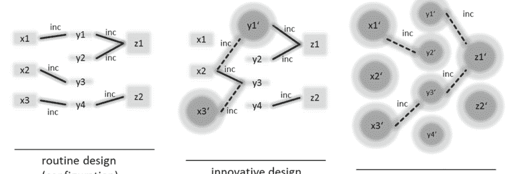

**图3.2** 将规划任务表示为配置任务。

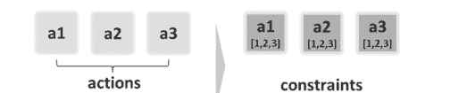

### 3.2 规划

规划可以定义为以这样一种方式对一组活动进行排序的过程，使得既定的目标可以实现。因此，规划处理的是行动的组合，而配置处理的是组件的组合。两者在计算结果和使用的解决问题方法方面相似¹。如何将规划任务转化为相应的配置任务的例子如图3.2所示。

在两种情况下，解空间都受约束限制：在规划中是行动之间的约束，在配置中是组件之间的约束。规划与配置之间的区别在于规划情境中时间限制的影响（例如，动作a1在a2之前或a1和a2同时进行）。“应用规划算子后条件是否仍然成立？”的问题是规划任务中的主要关注点。它引入了额外的复杂性，这解释了对利用精细启发式搜索方法的方法的研究兴趣（Biundo et al., 1993; Edelkamp and Schrödl, 2012; Görz, 1993）。

> ¹ 另见 www.puk-workshop.de。

### 3.3 推荐系统

推荐系统（Felfernig et al., 2007, 2013; Jannach et al., 2010; Ricci et al., 2011）支持用户从给定的商品集合中查找和选择产品（项目）。此类项目的例子有电影、书籍、歌曲、金融服务、公寓和数码相机。配置器通常也是出于类似的目标而构建的。然而，产品配置器与推荐系统之间一个主要区别是产品知识的表示方式（Falkner et al., 2011）。配置器通常在配置知识库上运行，而推荐系统通常在显式定义的解决方案备选方案表上运行。使用知识库的一个原因是可能的解决方案空间使得显式表示变得不可能。推荐器与配置器之间的主要共同点是，两者系统都试图实现主动支持用户找到符合其愿望和需求的解决方案（配置）的目标。存在三种基本的项目推荐方法。

首先，协同过滤（CF；Konstan et al., 1997）基于口碑推广的想法。此类系统通过识别具有与当前用户相似的评分行为（偏好特征）的所谓最近邻居来确定推荐。基于此信息，推荐给当前用户不熟悉的项目。其次，基于内容的过滤（CBF；Pazzani and Billsus, 1997）基于根据当前用户偏好（用户已调查的项目的属性）与从项目描述中提取的项目属性之间的相似性来确定推荐项目的想法。基于内容推荐应用的例子是网站推荐。第三，基于知识的推荐（KBR；Felfernig and Burke, 2008; Felfernig et al., 2006）基于预定义的一组约束（规则）和/或相似度度量来推荐项目。与CF和CBF方法相比的主要区别在于，在KBR中需要对产品组合有深入的知识才能确定推荐（这在CF和CBF方法中并非如此）。有关推荐技术的更详细讨论，请参阅例如 Jannach et al. (2010) 和 Ricci et al. (2011)。

表3.1 协同特征推荐的示例会话×项目矩阵（Falkner et al., 2011）。s_k × f_i 的值表示特征 f_i 由用户在会话 s_k 中指定的顺序。

| session | f1 | f2 | f3 | f4 | f5 | f6 |
|---|---|---|---|---|---|---|
| s1 | 1 | 0 | 3 | 2 | 0 | 4 |
| s2 | 1 | 0 | 0 | 2 | 4 | 3 |
| s3 | 2 | 3 | 0 | 1 | 4 | 0 |
| s4 | 1 | 4 | 0 | 2 | 0 | 3 |
| s5 | 1 | 0 | 0 | 2 | 0 | 0 |

由于我们可以观察到对主动支持配置器用户的功能需求不断增加，因此有大量潜力可利用推荐技术来支持与配置系统的交互（Falkner et al., 2011; Tiihonen and Felfernig, 2010）。此类功能之一是特征推荐。例如，由于问题的数量庞大，推荐器可以作为应向用户提出的问题的预选择器（见表3.1）。协作选择特征是预测用户感兴趣的特征的一种方法。这种推荐可以基于协同过滤实现（Konstan et al., 1997）。如果我们假设用户在其当前会话中已经选择并指定了特征 f1 和 f4，最相似的会话（四个最近邻居）是会话 {s1, s2, s4, s5}，并且 f6 将被推荐为用户应指定的下一个文本特征（f6 是最近邻居中大多数人选择的特征）。其他例子是特征值的推荐（Falkner et al., 2011; Tiihonen and Felfernig, 2010）以及不一致需求的修复替代方案的推荐（Felfernig et al., 2009）。

### 3.4 软件配置与版本管理

配置技术最初源于硬件配置（McDermott, 1982）。由于所开发技术的通用性，配置也可以应用于软件和软件密集型系统。汽车周边监控（CPS）等软件密集型领域需要硬件和软件系统的组合。CPS系统基于安装在车辆周围的传感器监控汽车的局部环境。传感器数据的测量和评估能够实现不同种类的应用。这些可以分为安全相关应用，如碰撞前检测、盲点检测和安全气囊和安全带张紧器的自适应控制；以及舒适相关应用，如停车辅助和自适应巡航控制（Thiel et al., 2001）。由于涉及的硬件和软件组件种类繁多以及可能的客户需求集合具有高度多样性，CPS成为应用配置方法的有趣领域（Geyer, 2002; Hotz et al., 2006）。“纯”软件配置应用配置技术的例子在 Hotz et al. (2006)、Männistö et al. (2001)、Myllärniemi et al. (2005) 和 Tiihonen et al. (1998) 中讨论。基于特征模型的软件产品线配置方法在第6章中讨论。

软件配置管理（SCM）处理软件开发项目背景下软件制品的依赖关系。在大多数情况下，这些制品表示为文件（例如，参见 Ylinen et al., 2002，关于配置 Linux 系统）。主要功能包括创建软件制品的新版本、恢复部分（或完整）旧版本、合并不同版本，以及通知服务，使开发人员了解存储库中的更改。因此，SCM主要应用于软件开发过程的背景下，而软件配置技术更侧重于稳定软件制品的可变性管理。与配置技术相比的一个主要区别是缺乏被配置源代码的抽象、声明式模型（Männistö and Sulonen, 1999）。知识型系统（如配置系统）比SCM系统提供更正式的一致性和完整性概念（Tiihonen et al., 1998），并且可以在此问题上提供支持。有关软件配置管理的进一步方面在 van der Hoek et al. (1995) 中讨论。


### 3.5 产品数据管理

产品数据管理（PDM）支持定义和维护设计、制造和维护产品所需的信息。[^2] 示例包括与制造过程相关的规范、技术产品数据以及为生产目的所需材料的规范。存储在 PDM 系统中的产品零件通常以零件标识符、供应商名称、价格和 CAD 绘图等属性为特征。PDM 系统可用于存储配置器创建的配置、派生文档和物料清单。通过 ERP 系统直接或间接实现 PDM 系统与配置器的集成以存储配置。配置器和 PDM 系统通常共享一些共同的产品数据：在工作示例的上下文中（见第 6 章），当前硬盘和处理器类型可通过 PDM 集成添加到配置模型中。PDM 系统越来越多地包含产品配置设施，尤其从生产配置的角度来看。在这种角色中，PDM 系统可以充当一种企业知识库，支持来自例如营销、销售、产品开发、生产和客户等用户的的信息交换。

[^2]: 产品数据管理如今通常在产品生命周期管理（PLM）和主数据管理（MDM）学科的背景下讨论。讨论其关系超出了本书的范围。参见例如 White 和 Halpern（2009）。

### 3.6 结论

在本章中，我们简要讨论了与配置直接相关的话题。与这些相关主题之间的区别特征是规划中*关于时间依赖性的推理*、设计中*开放的配置模型*、推荐系统中*对备选方案的明确表示*、软件配置管理中*对依赖关系的明确处理*，以及产品数据管理系统中的*灵活的数据管理*。

## 参考文献

- Biundo, S., Günter, A., Hertzberg, J., Schneberger, J., Tank, W., 1993. Planning and configuration. In: Görz, G. (Ed.), Introduction to Artificial Intelligence. Addison-Wesley, Bonn, Paris, Reading, pp. 767–828.
- Brown, D., Chandrasekaran, B., 1989. Design Problem Solving – Knowledge Structures and Control Strategies. Research Notes in Artificial Intelligence Series. Pitman Publishing, London.
- Edelkamp, S., Schrödl, S., 2012. Heuristic Search – Theory and Applications. Academic Press, Waltham, MA.
- Falkner, A., Felfernig, A., Haag, A., 2011. Recommendation technologies for configurable products. AI Magazine 32 (3), 99–108.
- Felfernig, A., Burke, R., 2008. Constraint-based recommender systems: technologies and research issues. In: ACM International Conference on Electronic Commerce (ICEC08), Innsbruck, Austria, pp. 17–26.
- Felfernig, A., Friedrich, G., Jannach, D., Zanker, M., 2006. An integrated environment for the development of knowledge-based recommender applications. International Journal of Electronic Commerce (IJEC) 11 (2), 11–34.
- Felfernig, A., Friedrich, G., Schmidt-Thieme, L., 2007. Guest editors’ introduction: special issue on recommender systems. IEEE Intelligent Systems 22 (3), 18–21.
- Felfernig, A., Schubert, M., Friedrich, G., Mandl, M., Mairitsch, M., Teppan, E., 2009. Plausible repairs for inconsistent requirements. In: 21st International Joint Conference on Artificial Intelligence (IJCAI’09), Pasadena, CA, pp. 791–796.
- Felfernig, A., Jeran, M., Ninaus, G., Reinfrank, F., Reiterer, S., 2013. Toward the next generation of recommender systems: applications and research challenges. In: Tsihrintzis, G.A., Virvou, M., Jain, L.C. (Eds.), Multimedia Services in Intelligent Environments: Advances in Recommender Systems. Smart Innovation, Systems and Technologies, vol. 24. Springer, pp. 81–98.
- Geyer, L., 2002. Configuring product families using design spaces. In: Integrated Design and Process Technology (IDPT-2002). Society for Design and Process Science, Pasadena, CA, pp. 9 (CD ROM).
- Görz, G., 1993. Introduction to Artificial Intelligence. Addison-Wesley.
- Günter, A., Kühn, C., 1999. Knowledge-Based Configuration – Survey and Future Directions. In: Puppe, F. (Ed.), XPS-99: Knowledge Based Systems, Proceedings Fifth Biannual German Conference on Knowledge Based Systems. Lecture Notes in Artificial Intelligence, vol. 1570. Springer, Würzburg.
- Hotz, L., Vietze, T., 1995. Innovative configuration in technical domains. In: PuK-95 – 9. Workshop Planen und Konfigurieren. DFKI Saarbrücken, Kaiserslautern, Germany, pp. 59–68 (in German: Innovatives Konfigurieren in technischen Domänen).
- Hotz, L., Wolter, K., Krebs, T., Deelstra, S., Sinnema, M., Nijhuis, J., MacGregor, J., 2006. Configuration in Industrial Product Families – The ConIPF Methodology. IOS Press, Berlin.
- Jannach, D., Zanker, M., Felfernig, A., Friedrich, G., 2010. Recommender Systems: An Introduction. Cambridge University Press.
- Konstan, J., Miller, B., Maltz, D., Herlocker, J., Gordon, L., Riedl, J., 1997. GroupLens: applying collaborative filtering to Usenet news full text. Communications of the ACM 40 (3), 77–87.
- Männistö, T., Sulonen, R., 1999. Evolution of schema and individuals of configurable products. In: Chen, P., Embley, D., Kouloumdjian, J., Liddle, S., Roddick, J. (Eds.), Advances in Conceptual Modeling – Proceedings of ECDM’99 – Workshop on Evolution and Change in Data Management. Lecture Notes in Computer Science, vol. 1727. Springer, Versailles, France, pp. 12–23.
- Männistö, T., Soininen, T., Sulonen, R., 2001. Modeling configurable products and software product families. In: 17th International Joint Conference on Artificial Intelligence (IJCAI-2001). Workshop on Configuration, Seattle, Washington, pp. 64–70.
- McDermott, J., 1982. R1: a rule-based configurer of computer systems. Artificial Intelligence 19 (1), 39–88.
- Myllyniemi, V., Asikainen, T., Männistö, T., Soininen, T., 2005. Kumbang configurator – a configuration tool for software product families. In: 19th International Joint Conference on Artificial Intelligence (IJCAI-05). Configuration Workshop, Edinburgh, Scotland, UK, pp. 51–56.
- Pazzani, M., Billsus, D., 1997. Learning and revising user profiles: the identification of interesting websites. Machine Learning 27 (3), 313–331.
- Ricci, F., Rokach, L., Shapira, B., Kantor, P., 2011. Recommender Systems Handbook. Springer.
- Sabin, D., Weigel, R., 1998. Product Configuration Frameworks – A Survey. IEEE Intelligent Systems 13 (4), 42–49.
- Stumptner, M., 1997. An overview of knowledge-based configuration. AI Communications 10 (2), 111–126.
- Thiel, S., Ferber, S., Fischer, T., Hein, A., Schlick, M., 2001. A case study in applying a product line approach for car periphery supervision systems. In: Proceedings of In-Vehicle Software 2001 (SP-1587), SAE 2001 World Congress, Detroit, Michigan, pp. 43–55.
- Tiihonen, J., Felfernig, A., 2010. Towards recommending configurable offerings. International Journal of Mass Customization 3 (4), 389–406.
- Tiihonen, J., Lehtonen, T., Soininen, T., Pulkkinen, A., Sulonen, R., Riitahuhta, A., 1998. Modelling configurable product families. In: Fourth WDK Workshop on Product Structuring, Delft, The Netherlands, pp. 29–50.

## 配置系统的优势

**Alexander Felfernig\*, Claire Bagley†, Juha Tiihonen‡, Lois Wortley†, and Lothar Hotz§**

\* Graz University of Technology, Graz, Austria
† Oracle Corporation, Burlington, MA, USA
‡ Aalto University, Aalto, Finland
§ HITeC e.V., University of Hamburg, Hamburg, Germany

**摘要：** 在本章中，我们总结了实施大规模定制相关挑战。在此背景下，我们讨论了成功部署和应用配置技术所带来的益处。

### 4.1 引言

配置是成功实施大规模定制（见 Piller 和 Blazek, 2014¹）的关键技术。在本章中，我们将审视大规模定制背景下的关键挑战，以及使用配置技术应对这些挑战所带来的相应益处。配置器可以作为高效缩短潜在大型、复杂且可定制产品上市时间的关键组件。表 4.1 总结了此后详细说明的挑战和益处。

### 4.2 挑战和益处

**挑战 1：避免错误和次优的报价。** 提供高度可变（可配置）产品的目标要求销售代表投入更多时间来了解产品组合。面对高度可变性的结果是错误的报价，这些错误往往在生产前未被发现（例如 Heiskala et al., 2007）。即使报价正确，也可能是不理想的，包括不必要用于满足客户愿望和需求的附加服务/成本。这种情况可能导致客户流失。配置技术可以通过多种方式应对这一挑战。它们包括支持客户需求自动可行性检查的约束技术。此类检查有助于显著减少订单记录中的错误（Hvam et al., 2010）。订单记录阶段错误减少导致客户投诉和混淆减少、交货时间缩短（Barker et al., 1989; Haug et al., 2011），以及销售业绩提升


| 表 4.1 大规模定制（MC）挑战及配置技术的益处。 |
|---|---|---|
| MC 挑战 | 配置器的益处 |
| (1) 避免错误和次优报价 | 错误更少或为零<br>交期缩短<br>销售额提升<br>人员成本降低<br>工作量估算稳定<br>更高价值的产品<br>计划稳定 |
| (2) 避免大规模混乱 | 客户自助服务<br>客户预先了解信息<br>企业记忆 |
| (3) 需求获取的复杂性处理 | 销售额提升<br>偏好知识<br>开放式创新 |
| (4) 知识集成 | 可靠的需求预测<br>上市时间缩短<br>错误减少 |
| (5) 高效的知识管理 | 高效开发<br>高效维护 |

(Hvam et al., 2010). 对于成功获取的客户订单量相同的情况，我们可以预期由于周期时间缩短而导致的人员成本降低 (Barker et al., 1989)。高比例的正确报价使工作量估算保持稳定。此外，由于销售代表能够处理复杂性，因此可以提供更多样化的产品 (Heiskala et al., 2007)。

挑战 2：避免大规模混乱。大规模混乱 (Huffman and Kahn, 1998) 由庞大且复杂的产品组合触发。它表示客户（用户）可能因产品组合的规模和复杂性而感到不堪重负，从而无法做出决策。相关的心理效应是，可选方案的数量越多，识别和比较潜在替代方案所需的认知努力就越大，高质量决策的概率就越低 (Felfernig et al., 2007, 2006, 2008; Piller et al., 2005)。在此背景下，配置器可以提供一个搜索界面，帮助缩小相关选项的数量。个性化技术支持更高效的决策过程 (Felfernig et al., 2006)。更易于使用的（个性化）界面可以鼓励客户自主使用配置器（客户自助服务），从而客户能够预先了解信息。最后，配置知识可以作为一种企业记忆，用于新销售代表的教育。在此背景下，销售知识丢失的风险更低，产品知识变得更加标准化 (Hvam et al., 2010)。

挑战 3：需求获取的复杂性处理。如挑战 2 中所述，配置和个性化技术对于在搜索（配置）产品时高效支持用户是必要的。在此背景下，智能需求获取是一个重要问题。如果没有对用户偏好的清晰认识，就不可能识别出最相关的配置 (Ardissono et al., 2003; Falkner et al., 2011; Tiihonen and Felfernig, 2010)。在开始配置过程时，用户通常事先并不了解自己的偏好，而是在配置会话的范围内构建偏好（参见 Mandl et al., 2014²）。智能配置器用户界面必须考虑这一方面。成功帮助客户找到符合其愿望和需求的配置的界面能够提升销售额，并允许深入了解客户偏好（参见例如 Felfernig et al., 2006）。如果客户输入了一组需求而无法识别出解决方案（配置），这些信息也可以被利用：需求可以收集用于开放式创新过程；即明确将客户整合到公司新产品开发中的过程 (Felfernig et al., 2004b)。

挑战 4：知识集成。成功的公司不断精简其核心信息技术系统以保持竞争力。企业通过投资例如客户关系管理（CRM）系统并专注于流入其供应链的数据和知识，加强了与客户的沟通和信息共享。客户和供应商的管理在很大程度上依赖于企业范围内产品知识的管理。从前端到后端运营，知识必须无缝流动并在企业的每个方面都可访问。当处理复杂产品和服务时，一个关键问题是配置技术深度集成到供应链中 (Ardissono et al., 2003)。基于这种集成，能够利用这些流程中的及时信息的公司更能预测和预测需求，最终使他们能够更好地影响日常运营和事件（参见例如 Hugos, 2011）。最先进的配置器可以完全无缝地集成到更大的系统中，以缩短任何大型、复杂且可定制产品的上市时间；简化此类产品的配置；减少订单和处理错误；从而提高盈利能力。因此，配置器为集成配置、定价和报价（CPQ）解决方案奠定了基础 (Dunne and Alvarez, 2011)。

挑战 5：高效的知识管理。配置器实施的核心是产品（配置）知识的定义 (Mittal and Frayman, 1989)。该知识可能存在于多种来源中，包括产品数据管理系统、电子表格、遗留企业和 CRM 系统，甚至即将退休员工的头脑中。在配置模型实施的早期阶段，需要进行知识获取和数据清洗阶段，以将产品知识（包括相应的产品数据）集中化， preferably 整合到企业范围内共享的单一事实来源中。在企业范围内共享通用数据对于保持订单准确性和减少周期时间至关重要。

成功的配置工具依赖于其创建可维护配置模型的能力 (Felfernig et al., 2013; Haug, 2010; Haug and Hvam, 2007)，使用户能够高效地输入需求 (DeSisto, 1997)。顶级配置器使企业能够快速创建和维护大型配置模型（具有大量约束和相关的大型产品模型），通过给予产品专家在时间依赖的方式下无需编程专业知识即可建模复杂产品的灵活性 (Alvarez and Dutra, 2009)。一旦产品结构已创建和/或从中央产品定义存储库导入，配置建模者就可以陈述必要的产品业务规则（约束）和偏好，以确保产品配置的有效性同时满足客户需求。有效的配置器还支持测试大型且复杂配置知识库的机制，提供模拟用户与配置模型交互的环境，检查配置器是否产生预期的配置，并在不一致时提供解释 (Felfernig et al., 2004a; 2006)。满足这些要求后，配置环境能够成功解决知识获取瓶颈问题，实现高效的开发和维护流程。

### 4.3 结论

在本章中，我们概述了与大规模定制实施相关的重大挑战。对于每个挑战，我们讨论了配置技术的应用场景以及应用这些技术相关的益处。借助配置技术应用相关的业务益处的概述，本章为在配置技术应用方面经验有限的人员提供了特别相关的见解。关于配置技术在工业环境中的影响的更多细节，可在 Barker et al. (1989)、Forza and Salvador (2002)、Haug et al. (2011)、Heiskala et al. (2005, 2007) 和 Hvam et al. (2010) 等综述出版物中找到。

## 参考文献

Alvarez, G., Dutra, L., 2009. Marketscope for Sales Configuration. Technical Report G00169350, Gartner.

Ardissono, L., Felfernig, A., Friedrich, G., Goy, A., Jannach, D., Petrone, G., Schäfer, R., Zanker, M., 2003. A framework for the development of personalized, distributed web-based configuration systems. AI Magazine 24 (3), 93–108.

Barker, V., O’Connor, D., Bachant, J., Soloway, E., 1989. Expert systems for configuration at Digital: XCON and beyond. Communications of the ACM 32 (3), 298–318.

DeSisto, R., 1997. Constraints Still Key for Product Configurator Deployments. Technical Report T-22-9419, Gartner.

Dunne, M., Alvarez, G., 2011. MarketScope for Configuration, Price, Quote Application Suites. Technical Report G00212720, Gartner.

Falkner, A., Felfernig, A., Haag, A., 2011. Recommendation technologies for configurable products. AI Magazine 32 (3), 99–108.

Felfernig, A., Friedrich, G., Jannach, D., Stumptner, M., 2004a. Consistency-based diagnosis of configuration knowledge bases. Artificial Intelligence 152 (2), 213–234.

Felfernig, A., Russ, C., Wundara, M., 2004b. Toolkits supporting open innovation in E-government. In: Sixth International Conference on Enterprise Information Systems, (ICEIS2004) Porto, Portugal, vol. IV, pp. 296–303.

Felfernig, A., Friedrich, G., Jannach, D., Zanker, M., 2006. An integrated environment for the development of knowledge-based recommender applications. International Journal of Electronic Commerce (IJEC) 11 (2), 11–34.


Felfernig, A., Friedrich, G., Gula, B., Hitz, M., Kruggel, T., Melcher, R., Riepan, D., Strauss, S., Teppan, E., Vitouch, O., 2007. 说服性推荐：基于知识的推荐系统中序列位置效应的探索。载于：De Kort, Y., Ijsselsteijn, W., Midden, C., Eggen, B., Fogg, B.J.（编），第二届说服技术国际会议（Persuasive 2007）。Lecture Notes in Computer Science，第4744卷。Springer，Palo Alto, CA，第283–294页。
Felfernig, A., Gula, B., Leitner, G., Maier, M., Melcher, R., Teppan, E., 2008. 基于知识推荐中的说服。载于：Oinas-Kukkonen, H., Hasle, P.F.V., Harjumaa, M., Segerstähl, K., Øhrstrøm, P.（编），说服技术，第三届国际会议（Persuasive 2008）。Lecture Notes in Computer Science，第5033卷。Springer，Oulu, Finland，第71–82页。
Felfernig, A., Reiterer, S., Stettinger, M., Reinfank, F., Jeran, M., Ninaus, G., 2013. 配置知识工程的推荐系统。载于：Workshop on Configuration。Vienna, Austria，第51–54页。
Forza, C., Salvador, F., 2002. 管理订单获取和履约过程中的多样性：产品配置系统的作用。International Journal of Production Economics 76 (1)，87–98。
Haug, A., 2010. 一个支持复杂产品配置器开发和维护的软件系统。International Journal of Advanced Manufacturing Technology 49 (1–4)，393–406。
Haug, A., Hvam, L., 2007. 一个支持产品配置系统开发和维护的文档系统的建模技术。International Journal of Mass Customization 2 (1–2)，1–18。
Haug, A., Hvam, L., Mortensen, N.H., 2011. 产品配置器对工程导向型企业交货期的影响。Artificial Intelligence for Engineering Design, Analysis and Manufacturing (AI EDAM) 25 (2)，197–206。
Heiskala, M., Paloheimo, K., Tiihonen, J., 2005. 服务的大规模定制：可配置服务的益处与挑战。载于：Frontiers of e-Business Research (FeBR 2005)，Tampere, Finland，第206–221页。
Heiskala, M., Paloheimo, K.-S., Tiihonen, J., 2007. 使用可配置产品和配置器的规模定制：益处与挑战综述。载于：Mass customization information systems in business，第一版。IGI Global，第1–32页（第1章）。
Huffman, C., Kahn, B., 1998. 为销售而设的多样性：大规模定制还是大规模混乱。Journal of Retailing 74 (4)，491–513。
Hugos, M., 2011. Essentials of Supply Chain Management，第三版。Wiley。
Hvam, L., Haug, A., Mortensen, N., 2010. 产品配置系统的效益评估。载于：Hotz, L., Haselböck, A.（编），第19届人工智能欧洲会议（ECAI 2010），Workshop on Configuration，Lisbon, Portugal。第9–14页。
Mandl, M., Felfernig, A., Teppan, E., 2014. 消费者决策与配置系统。载于：Felfernig, A., Hotz, L., Bagley, C., Tiihonen, J.（编），Knowledge-based Configuration – From Research to Business Cases。Morgan Kaufmann Publishers，Waltham, MA，第181–190页（第14章）。
Mittal, S., Frayman, F., 1989. 迈向配置任务的通用模型。载于：11th International Joint Conference on Artificial Intelligence (IJCAI-89)，第2卷，Detroit, Michigan, USA，第1395–1401页。
Piller, F.T., Blazek, P., 2014. 可持续大规模定制的核心能力。载于：Felfernig, A., Hotz, L., Bagley, C., Tiihonen, J.（编），Knowledgebased Configuration – From Research to Business Cases。Morgan Kaufmann Publishers，Waltham, MA，第107–120页（第9章）。
Piller, F.T., Schubert, P., Koch, M., Möslein, K., 2005. 克服大规模混乱：在线社区中的协作客户共同设计。Journal of Computer-Mediated Communication 10 (4)，1–28。
Tiihonen, J., Felfernig, A., 2010. 迈向可配置产品推荐。International Journal of Mass Customization 3 (4)，389–406。

## 书籍概述

**Alexander Felfernig\*, Lothar Hotz†, Juha Tiihonen‡, and Claire Bagley§**

\* Graz University of Technology, Graz, Austria  
† HITeC e.V., University of Hamburg, Hamburg, Germany  
‡ Aalto University, Aalto, Finland  
§ Oracle Corporation, Burlington, MA, USA

**Abstract:** 对于对本书感兴趣的不同读者，我们提供了一本简短的入门性书籍概述。此概述有助于选择合适的章节并确保高效开始。

*Introduction*（第1部分）突出了主题并概述了配置技术的重要性。它提供了历史发展简要概述（第2章），解释了相关主题如*推荐系统、软件配置*和*产品数据管理*（第3章），并提供了将配置器集成到业务流程中对组织带来的商业利益的见解（第4章）。

*Basics*（第2部分）介绍了理解配置技术工作原理所需的概念。本部分帮助读者形成答案，例如以下问题：什么是配置？什么是配置模型？什么是配置任务（问题）？如何以形式化层面表示配置任务？解决配置任务存在哪些推理方法？配置器用户界面需要考虑哪些关键标准？如何应用配置来支持大规模定制？

第2部分包含以下章节。第6章中，Lothar Hotz等人提供了配置知识表示及相关推理方法的深入介绍。本章包括一个基于UML（统一建模语言）的配置模型展示，该模型在全书中作为工作示例使用。配置知识的一致性管理是工业环境中的重要问题。配置知识库必须确定正确的解决方案，同时考虑技术限制以及与市场营销和销售相关的约束。第7章中，Alexander Felfernig等人介绍了不同的一致性管理技术，并在示例配置知识库的背景下进行说明。第8章中，Gerhard Leitner等人讨论了配置器用户界面设计相关的重大问题。此外，Paul Blazek和Frank T. Piller阐明了大规模定制范式与其底层技术之间的关系（第9章）。最后，Lothar Hotz和Katharina Wolter介绍了智能家居领域的配置模型（第10章）。

*Advanced Topics*（第3部分）提供了对推进配置系统技术前沿的持续研究的概述。本书的这一部分有助于回答例如以下问题：如何个性化配置器用户界面？如何个性化配置？回答这两个问题都非常重要，以便解决*大规模混乱*问题，即当向用户呈现过多选项时出现的问题。我们如何自动测试和调试配置知识库？我们如何提高配置知识库的质量，例如通过检测冗余（因此通常并非必需）的约束？与人类决策制定的不同心理学理论相关的重大问题是什么？这些理论如何影响用户与配置器交互的方式？本部分以对未来研究重要问题的讨论结束。

**第3部分**包含以下章节。Gerhard Friedrich等人（**第11章**）在**第7章**概念的基础上，引入了配置知识库的自动测试和调试方法。Alexander Felfernig等人将测试和调试知识库的思路扩展到自动识别知识库中冗余的方法（**第12章**）。冗余约束是指可以从知识库中删除而不改变知识库语义的约束。在**第13章**中，Juha Tiihonen等人介绍了与个性化配置过程相关的概念——在此背景下，提出了不同的算法方法，目标是在配置过程中主动支持用户。Monika Mandl等人讨论了配置系统背景下消费者决策制定的决策心理学方面（**第14章**）。作者关注不同的决策心理学现象及其对用户与配置器交互时决策可能产生的影响。

*配置技术的应用*（**第4部分**）包含六个商业案例，展示了配置技术在不同产品领域的应用。四个贡献报告了在工业环境中部署配置技术的经验，其余两个贡献介绍了未来的应用领域及相关商业利益。

**第4部分**包含以下章节。四个章节报告了现实场景中配置技术的经验。第**16章**中，Andreas Falkner和Herwig Schreiner基于铁路联锁系统领域的配置器应用介绍了SIEMENS配置环境。Klas Orsvarn和Morten Bennick报告了水泥厂设备领域Tacton配置环境的经验（见**第17章**）。随后在**第18章**中，Björn Höfling介绍了压缩空气系统领域的已部署配置器应用。最后，Rick Rabiser等人论证了配置技术在配置文档背景下的相关性——在此背景下应用了特征模型技术（见**第20章**）。其余两个章节讨论了具有相关潜在影响的应用领域——在这两个案例中均未在工业环境中进行部署。首先，Julia Nica等人论证了（再）配置技术在移动电话网络基础设施领域的应用（见**第19章**）。其次，Juha Tiihonen等人讨论了配置技术在服务和流程配置背景下的特殊性（见**第21章**）。

*配置环境*（**第5部分**）在更技术层面讨论了配置环境。本部分包括四个商业和两个学术配置环境。本部分章节提供了关于如何将**第6章**中介绍的PC配置模型实现为配置知识库的印象，使用相应的配置环境时。第一，Alois Haselböck和Gottfried Schenner介绍了SIEMENS的*S’UPREME*配置环境（**第22章**）。随后，Thorsten Krebs提供了*encoway*配置环境的概述（**第23章**）。Lothar Hotz介绍了*KONWERK*开源配置环境（**第24章**）。Felfernig等人介绍了


## 基础

## 2

## 配置知识
表示与推理

Lothar Hotz*, Alexander Helferich†, Markus Stumptner‡, Anna Ryabokon§, Claire Bagley¶
and Katharina Wolter*

* HITeC e.V., University of Hamburg, Hamburg, Germany
† Graz, University of Technology, Graz, Austria
‡ University of South Australia, Adelaide, SA, Australia
§ Alpen-Adria Universität Klagenfurt, Klagenfurt, Austria
¶ Oracle Corporation, Burlington, MA, USA

**摘要：** 配置模型指定了可能的配置集（解决方案）。配置模型与定义的一组（客户）需求是配置任务（问题）的主要要素。在本章中，我们讨论了可用于定义配置模型的不同知识表示。我们提供了示例以帮助进一步理解底层概念，并包含一个基于 UML 的个人计算机（PC）配置模型，该模型在本书中作为参考示例贯穿始终。

### 6.1 引言

配置知识表示语言的开发已有相当长的研究历史（Felfernig et al., 2003; Günter and Kühn, 1999; Jüngst and Heinrich, 1998; Junker, 2006; Mailharro, 1998; McDermott, 1982; McGuinness and Wright, 1998; Mittal and Falkenhainer, 1990; Mittal and Frayman, 1989; Soininen et al., 1998）。第一个配置系统之一是 R1/XCON，它建立在基于规则的表示语言之上（McDermott, 1982; Soloway et al., 1987）。基于规则的系统在工作记忆上运行，工作记忆存储规则所做的断言。规则以 if-then 风格表示。如果规则被激活（给定 if 条件得到满足），它可以修改工作记忆的内容。经验表明，基于规则系统的主要问题是（产品）领域知识与问题求解知识的交织（参见 Friedrich et al., 2014）。其后果是，如果产品知识发生变化，与组件在配置中集成顺序相关的规则也必须进行调整，这会带来巨大的维护开销。基于规则方法的不足是开发模型化知识表示的动机，这些表示支持领域知识与问题求解知识的清晰分离。Mittal 和 Frayman（1989）引入了配置任务的模型化定义，其特征为：（1）以其属性和关系描述通用组件，以及（2）用户对解决方案（配置）功能属性的要求和偏好。这种特征是配置研究和工业的主要基础（Junker, 2006）。它还包括将功能需求（客户需求）与可配置产品的技术属性分离的想法。

模型化方法的主要代表是基于约束的系统（参见，例如，Freuder, 1997; Tsang, 1993）。相关的知识表示范围从静态约束满足（变量和约束是预定义的，并且从一开始就是搜索过程的一部分（参见例如 Tsang, 1993），动态约束满足（变量不一定从一开始就处于活动状态，但可以在搜索过程范围内被激活；Mittal and Falkenhainer, 1990），到生成式约束满足，其中组件和相关约束在搜索过程范围内按需生成（参见 Stumptner et al., 1998）。生成式方法也可以称为组件导向，因为组件类型（而不是变量）和元（通用）约束（而不是约束）被视为一等实体。配置知识表示作为约束满足问题（CSP）的示例将在第 6.2 节中提供。

在以下内容中，图形表示已被开发出来，目的是提高配置知识的可访问性（例如，可理解性和可维护性），这在商业环境中尤为关键。配置模型图形表示的一种方法是特征模型（参见，例如，Kang et al., 1990）。特征模型可以表示为静态约束满足问题（CSP; Tsang, 1993）或 SAT 问题（Gomes et al., 2008）的形式。Neumann（1988）和 Soininen et al.（1998）引入了配置本体，它们定义了配置知识表示的相关建模概念。这些本体包括当今商业配置环境中通常提供的建模概念；例如，组件类型、端口和约束。类似于 Neumann（1988）和 Soininen et al.（1998）引入的本体论概念，以 UML 配置知识表示的 UML 配置文件形式，以及这些概念在谓词逻辑和描述逻辑中的形式化，已由 Felfernig（2007）以及 Felfernig et al.（2000a, 2003）提出。请注意，在本章中我们关注产品相关配置知识的表示；与增量配置过程相关的知识表示（Sabin and Weigel, 1998）已在 Leitner et al.（2014）、Hotz and Wolter（2014）以及 Hotz and Günter（2014）中详细讨论。

通过本章，我们提供了与配置知识表示相关的建模概念的概述。在第 6.2.1 小节中，我们介绍了静态约束满足问题作为配置知识的基本表示机制。在第 6.2.2 小节中，我们介绍了两种高级 CSP 表示，即动态和生成式约束满足问题。此后，在第 6.3 节中，我们讨论图形配置知识表示（特征模型和 UML 模型）。在此基础上，我们引入了一个个人计算机配置模型。在本书的其他章节中，该 UML 模型会根据需要进行调整和扩展。在第 6.4 节中，
我们概述了配置知识表示的不同基于逻辑的方法。本章以对不同类型配置知识表示的主要优点和缺点的讨论作为结尾。

### 6.2 基于约束的知识表示

#### 6.2.1 静态约束满足

“约束技术是计算机科学迄今为止最接近编程圣杯的方法：用户陈述问题，计算机求解它。”（Freuder, 1997）。约束技术是人工智能（AI）在商业环境中最成功应用的技术之一（Brailsford et al., 1999）。借助这些技术，通过易于理解和易于使用的技术解决了知识获取瓶颈。应用示例包括 *配置*（Fleischanderl et al., 1998; Mittal and Frayman, 1989）、*调度*（Pinedo, 2012）以及 *推荐系统*（Felfernig and Burke, 2008; Jannach et al., 2010）。基于约束的表示被广泛用于配置模型的定义（参见 Junker and Mailharro, 2003; Mailharro, 1998）。我们首先关注 *静态约束满足问题*（CSPs）。

#### 约束满足问题与解

我们现在将介绍 *约束满足问题*（CSP）及其解的定义。此定义随后将用作定义 *配置任务*（问题）及其对应 *配置*（解）的基础。

**定义（约束满足问题 – CSP）。** 约束满足问题（CSP）可以由三元组（V, D, C）定义，其中 V 是有限域变量的集合 {v₁, v₂, . . . , vₙ}，D 表示变量域 {dom(v₁), dom(v₂), . . . , dom(vₙ)}，而 C 表示一组约束，定义了变量可能取值上的限制 {c₁, c₂, . . . , cₘ}。

给定 CSP = (V, D, C) 的解可以定义如下。

**定义（CSP 解）。** 给定 CSP = (V, D, C) 的解由赋值 *S = {ins(v₁), ins(v₂), . . . , ins(vₖ)}* 表示，其中 *ins(vᵢ) ∈ dom(vᵢ)*。*S* 必须完整；即 CSP 定义的每个变量在 *S* 中都有值，并且是一致的（即 *S* 满足 *C* 中的约束）。

#### 配置任务与解

基于 CSP 的定义，我们现在可以引入 *配置任务*（问题）及其对应 *配置*（解）的定义。我们引入两组约束来描述（1）配置知识库（*CKB*）和（2）用户需求（*REQ*）。

**定义（配置任务）。** 配置任务可以定义为 CSP（V, D, C），其中 *V = {v₁, v₂, . . . , vₙ}, D = {dom(v₁), dom(v₂), . . . , dom(vₙ)}, 且 C = Cₖᵦ ∪ Rᴇǫ*。*Cₖᵦ* 表示配置知识库（配置模型），而 *Rᴇǫ* 表示一组用户（客户）需求。


### FIGURE 6.2

Map coloring configuration model: graphical representation of a CSP where the nodes represent the variables and the arcs represent constraints.

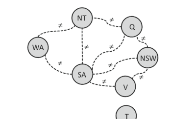

Finally, we introduce the set of constraints C = C_KB ∪ REQ to be taken into account when configuring (coloring) a map. The elements of C_KB are those constraints that are defining the restrictions regarding the color combinations of neighborhood territories.

```
C_KB = {WA ≠ NT, WA ≠ SA, NT ≠ SA, NT ≠ Q, SA ≠ Q, SA ≠ NSW, SA ≠ V, Q ≠ NSW, NSW ≠ V}
```

A CSP can also be represented graphically in terms of nodes (the variables) and the corresponding constraints (arcs between the variables); Figure 6.2 shows a graphical depiction of the map coloring configuration model.

Customer requirements in this context can be preferences (in terms of initial settings) regarding the coloring of the map. For example, we could introduce the singleton requirement REQ = {WA = r}; that is, the color of Western Australia (WA) should be red (r). Then REQ ∪ C_KB is consistent; that is, we are able to determine a solution for the map coloring (configuration) problem.

```
S = {WA = r, NT = g, SA = b, Q = r, NSW = g, V = r, T = r}
```

### Example: Mobile Phone Configuration

The following configuration model of a mobile phone is based on the model of a mobile phone software product lines (adapted from Benavides et al., 2010). We will provide a formalization of this model on the basis of the definition of a configuration task given in Subsection 6.2.1. See Figure 6.3 for a graphical depiction of the mobile phone configuration model.

Our Mobile Phone (MP) model consists of the following elements: each mobile phone has two mandatory elements that are the support of Calls (CA) and the availability of a Screen (SC). A Screen can either be of type Basic (BA), Color (CO), or HighResolution (HR). A mobile phone can (but does not have to) be equipped with a GPS (GPS) feature. Furthermore, a mobile phone can include additional media equipment (Camera (CM) and MPX Player (MPX)). When equipped with a

> 7 In Subsection 6.3.1 we will show how to represent similar settings with the notation of feature models (Kang et al., 1990).

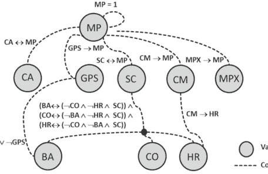

**FIGURE 6.3**  
Simple Mobile Phone configuration model (represented as CSP). An abbreviation is used for the constraint representation; for example, CA ↔ MP is the short form of CA = 1 ↔ MP = 1. MP = Mobile Phone, CA = Calls, GPS = GPS, SC = Screen, CM = Camera, MPX = MPX Player, BA = Basic, CO = Color, HR = High Resolution.

GPS, then the phone’s Screen can’t be of type Basic. A phone with a Camera must be equipped with a HighResolution Screen.

Based on this characterization of the basic properties of our example mobile phone, we can introduce the following configuration task $(V, D, C)$.

$V = \{\mathrm{MP}, \mathrm{CA}, \mathrm{GPS}, \mathrm{BA}, \mathrm{CO}, \mathrm{HR}, \mathrm{SC}, \mathrm{CM}, \mathrm{MPX}\}$

Since we are interested in defining the possible combinations of mobile phone features, we assign to each of the feature variables in $V$ the domain $\{1,0\}$ (true, false is possible as well). The semantics of 1 (resp. 0) is that a feature is active (resp. inactive); that is, included or not included in a configuration.

$D = \{\mathrm{dom(MP)} = \{1,0\}, \mathrm{dom(CA)} = \{1,0\}, \mathrm{dom(GPS)} = \{1,0\}, \mathrm{dom(BA)} = \{1,0\}, \mathrm{dom(CO)} = \{1,0\}, \mathrm{dom(HR)} = \{1,0\}, \mathrm{dom(SC)} = \{1,0\}, \mathrm{dom(CM)} = \{1,0\}, \mathrm{dom(MPX)} = \{1,0\}\}$

Finally, we specify the constraints $C = C_{KB} \cup REQ$. Since we are not interested in empty configurations, we introduce constraint MP = 1.

$C_{KB} = \{\mathrm{MP}=1,\ \mathrm{CA}\leftrightarrow\mathrm{MP},\ \mathrm{GPS}\to\mathrm{MP},\ \mathrm{SC}\leftrightarrow\mathrm{MP},\ \mathrm{CM}\to\mathrm{MP},\ \mathrm{MPX}\to\mathrm{MP},\ (\mathrm{BA}\to(\neg\mathrm{CO}\land\neg\mathrm{HR}\land\mathrm{SC}))\land(\mathrm{CO}\leftrightarrow(\neg\mathrm{BA}\land\neg\mathrm{HR}\land\mathrm{SC}))\land(\mathrm{HR}\leftrightarrow(\neg\mathrm{CO}\land\neg\mathrm{BA}\land\mathrm{SC})),\ \neg\mathrm{BA}\lor\neg\mathrm{GPS},\ \mathrm{CM}\to\mathrm{HR}\}$

Customer requirements regarding a concrete mobile phone configuration could be the following:  
$REQ = \{\mathrm{GPS}=1\}$; that is, GPS should be included. In our example, $REQ \cup C_{KB}$ is consistent and a possible configuration (solution) $S$ is:

$S = \{\mathrm{MP}=1,\ \mathrm{CA}=1,\ \mathrm{GPS}=1,\ \mathrm{BA}=0,\ \mathrm{CO}=1,\ \mathrm{HR}=0,\ \mathrm{SC}=1,\ \mathrm{CM}=0,\ \mathrm{MPX}=0\}$

### Solution Search in Static CSPs

There is plenty of literature on algorithms that can be used for solving static constraint satisfaction problems (e.g., Mackworth, 1977; Rossi et al., 2006; Russel and Norvig, 2003; Tsang, 1993). The basic approach of CSP algorithms is to apply backtracking in combination with a couple of additional mechanisms that altogether focus on variable domain size reduction during search (Russel and Norvig, 2003). One basic principle for reducing the domain size of variables is node-consistency, which requires that those values of a variable domain that are inconsistent with an unary constraint are eliminated as options (for these options there does not exist a solution). Arc-consistency (AC) is a property that must be fulfilled by combinations of variables v1 and v2 that are connected via a binary constraint cb9: each value in the domain of v1 must have at least one corresponding value in the domain of v2 such that cb is fulfilled. Note that arc-consistency is directed; if variable v1 is arc-consistent with variable v2 this does not necessarily mean that v2 is arc-consistent with v1. In the following example we take a look at the variables WA and NT of our map configuration (coloring) example (see Figure 6.2). Although AC is restricted to binary constraints, this does not restrict its applicability since every n-ary constraint can be transformed into a corresponding set of binary constraints (e.g., Bacchus and vanBeek, 1998).

Example of node-consistency and arc-consistency. The original domain of WA = {r,g,b}. Since we defined {WA = r} as a requirement, WA is node-consistent and the values {g,b} get removed from its domain. In order to ensure arc-consistency between WA and NT, the value {r} needs to be removed from NT’s domain definition. Now, each value in the new domain of WA has a consistent corresponding value in the domain of NT and vice versa.

Another important principle in variable domain size reduction is forward checking: Depending on the value selected for the current variable, the values of the instantiated variables that can’t be a support for the selected value are eliminated from their corresponding domains. An example is depicted in Figure 6.4.

Search algorithms for CSPs are able to support optimization, which helps to minimize (e.g., the overall price of a configuration) or maximize (e.g., the failure safety of an equipment) solution parameters (Pitiot et al., 2013).

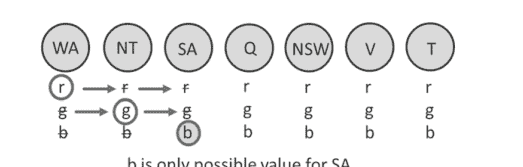

### FIGURE 6.4

A simple example of forward checking. The variables WA and NT already have assigned values (r and g). The only possible remaining value for SA is b; r and g do not have to be checked for consistency with the settings of WA and NT.

9 A constraint that refers to exactly two variables.

Finally, tuning the performance of solution search is typically done with basic strategies of *variable and value orderings* (Russel and Norvig, 2003), with advanced approaches such as *symmetry breaking* (Kiziltan and Hnich, 2001) and *machine learning based acquisition of search strategies* (Terashima–Marin et al., 2008), with *local search algorithms* (Leit et al., 2006), and different techniques of knowledge compilation such as *binary decision diagrams* (BDDs; Andersen et al., 2010) and *solution automata* (Amilhastre et al., 2002). For further literature on related algorithms and optimization approaches we refer to Brailsford et al. (1999); Rossi et al. (2006); Russel and Norvig (2003), and Tsang (1993).

### Excursus: SAT Problems

For a given propositional formula, the goal of SAT solving (see, e.g., Claessen et al., 2008) is the determination of a variable assignment such that the formula evaluates to *true*. A propositional logic formula is in a *conjunctive normal form* (CNF) when it is represented in the form of *conjunctions of disjunctions of literals*. For a Boolean variable X, a literal is defined as X or its negation ¬X. Each of the disjunctions is denoted as a *clause*. A SAT problem (satisfiability problem) is to identify an assignment to the given Boolean variables in such a way that the mentioned formula in CNF evaluates to *true*. This is the case if each clause has at least one literal that evaluates to *true*. For a more detailed discussion of SAT solving and related algorithms, refer to Claessen et al. (2008). An example of the translation of a given static CSP into a corresponding SAT representation follows.

*Example: SAT encoding of a static CSP.* In order to show the basic principle of how to translate a static CSP into a corresponding SAT representation, we take the variables wA and nT from our working example (map coloring). In a static CSP representation the variable domains can be specified as dom(wA) = {r,g,b} and dom(nT) = {r,g,b}. In the corresponding SAT representation we have to introduce Boolean variables where each domain value of the original variables is represented by its own (Boolean) variable. In our example this translation results in the variables wA,r, wA,g, wA,b, nT,r, nT,g, and nT,b. Each of these variables has the domain {true, false} ({1,0}). The translation of the constraint wA ≠ nT into a clausal form could look like: (¬wA,r = 1 ∨ ¬nT,r = 1) ∧ (¬wA,g = 1 ∨ ¬nT,g = 1) ∧ (¬wA,b = 1 ∨ ¬nT,b = 1) ∧ (¬wA,r = 0 ∨ ¬wA,g = 0 ∨ ¬wA,b = 0) ∧ (¬nT,r = 0 ∨ ¬nT,g = 0 ∨ ¬nT,b = 0). With this, we assure that (1) the two territories do not have the same color and (2) both territories have a color assigned.

As can easily be seen, our Mobile Phone configuration model can directly be translated into a corresponding SAT representation, since the variable domains in the CSP are already of type Boolean. For further related work refer to Janota (2008) and Janota et al. (2010).

### 6.2.2 Advanced CSP Approaches

On the basis of the static CSP approach, numerous extensions have been implemented in order to improve the expressiveness and the efficiency of the underlying reasoning algorithms. An in-depth analysis of existing CSP variants is beyond the scope of this book; however, we will now discuss some representative ones that have found their way into commercial configuration environments.

### Dynamic Constraint Satisfaction

Configuration tasks very often include variables that do not have to be taken into account in specific configuration contexts. For instance, in our mobile phone configuration example, the variable Camera is not relevant if the user is interested only in monochrome (basic) displays. In the mobile phone


configuration example in [Subsection 6.2.1]，*变量无关性* 的特性是通过特征停用来实现的；也就是说，如果配置中没有 Camera，则该变量的值被设为 0（false）。然而，如果我们想引入一个变量 Camera，其域为 {TypeA, TypeB, TypeC} 表示三种不同的相机类型，我们就必须引入一个额外的域值 noval 来表达相机不属于配置的事实。从这个简单例子可以看出，需要包含支持对变量状态（active，inactive）进行推理的概念。为了考虑在搜索过程中排除无关变量的需求，Mital 和 Falkenhainer（1990）引入了 *动态约束满足*（DCSP）的概念，其中约束求解器也能对变量的活动状态进行推理。以下示例展示了这样的激活约束。

*激活约束示例。* 对于一个变量 CM（相机），其域为 {TypeA, TypeB, TypeC}，我们可以定义以下激活约束：HighResolution (HR) = yes → active(CM)。如果前提条件未得到满足，则无需为 CM 分配值（即激活它）。

DCSP 中关于活动状态的这种推理是基于预定义的活动约束。关于 DCSP 属性的正式讨论见 Bowen 和 Bahler（1991）。变量激活的概念也已应用于其他方法中。例如，基于生成式约束满足（GCSP）的系统（Stumptner et al., 1998）将变量激活的概念推广为 *组件和约束激活* 的概念。SIEMENS 的配置环境基于这种生成式方法（另见 Falkner and Schreiner, 2014）。

### Generative Constraint Satisfaction

静态（和动态）CSP 的主要缺点包括在处理变量和变量值而非组件类型和对应组件（实例）方面的表示限制。另一个缺点是，静态 CSP 在描述配置问题时存在局限性，即配置的大小和结构无法事先估计。生成式约束满足（GCSP）通过将变量和对应约束提升到组件类型和元约束（通用约束）的层面来克服这些问题。通用约束（约束模式）有助于识别并生成在当前配置上下文中相关的额外组件和变量。

约束被称为“通用”，因为它们单独适用于约束所定义的类型的全部组件。例如，一个防止特定类型的 CPU 被放置在特定类型的 Motherboard 上的约束适用于该类型的所有 CPU，尽管它在知识库中仅定义一次。GCSP 环境中的组件以有限域变量的形式表示（变量的域对应于组件可以取的不同类型）。激活约束被用于例如基于对组件变量的类型赋值来生成新的属性变量。*生成式约束满足问题*（GCSP）可以如下定义（Stumptner et al., 1998）。

*定义（生成式约束满足问题 – GCSP）。* 生成式约束满足问题可以由三元组 (CV, P, Γ) 定义，其中 CV 是一个可能无限的组件变量集合。CV 中每个变量的域都是一个有限集合 T = {τ₁, τ₂, …, τₙ} 的组件类型。P = {p₁, p₂, …, pₙ} 是一个属性（属性）名称集合。此外，存在一个集合

$D = \{CV, D_1, D_2, \ldots, D_n\}$ of domains and a function $Dom$ that maps pairs of the form *(property name, type)* to elements of $D$. The sets $D_1, D_2, \ldots, D_n$ are called *atomic domains*（即它们包含数值或符号值，但与 $CV$ 不同）。属性变量的名称由源组件的名称和属性名称组成；例如，如果属性 $p \in P$ 为组件 $c \in CV$ 定义，则属性变量命名为 $c.p$。最后，$\Gamma$ 是一个有限的通用约束集合，包括激活和资源约束。

GCSP 表示允许定义 *端口*，端口代表不同组件之间的连接点。在 GCSP 中（[Stumptner et al., 1998](#)），端口由属性（属性）表示，这些属性允许其他组件作为值。*Partonomies*（部分结构；见 [Subsection 6.3.2](#)）可以基于此类端口定义来表示。*继承关系*（与生成层次相关）是基于引用组件类型域的（通用）约束来表示的。

*示例 GCSP 组件类型。* 一个组件类型 $PC$（P）可以使用 GCSP 风格的记法表示如下（见例如 [Stumptner et al., 1998](#)）。该 PC 基本属性的定义与 [Figure 6.7](#) 中描绘的图形配置模型相关。如很容易看出，GCSP 方法具有更直观的知识表示，其灵感来自面向对象的数据模型与约束的结合（见例如 [Bowen and Bahler, 1991](#)；[Neumann 1988](#)；[Puget and Albert, 1991](#)）。

```
PC P DESCRIPTION:
    P.name := [String];
    P.price := [Integer];
    P.usage := {'internet','scientific','multimedia'};
    P.efficiency := {'A','B','C'};
    P.PORTS := {screen-of-pc-1[Screen], screen-of-pc-2[Screen],
    hdunit-of-pc-1[HDUnit], ...};
    P.screens := <screen-of-pc-1,screen-of-pc-2>;
    P.mb := <mb-of-pc-1>;
    P.hdunits := <hdunit-of-pc-1,hdunit-of-pc-2>;
```

GCSP 约束是在特定组件类型的上下文中表示的。因此这种方法与包含约束的面向对象语言非常相似，例如统一建模语言 UML（[Booch et al., 2005](#)），其中包括对象约束语言 OCL（[Warmer and Kleppe, 2003](#)）。关于 UML 和 OCL 在配置知识表示中应用的概述请参阅 [Felfernig (2007)](#) 和 [Felfernig et al. (2000a)](#)。UML 基于的配置模型示例在 [Subsection 6.3.2](#) 中介绍。

*示例 GCSP 约束。* 一个描述用户所需能源效率必须由主板 $mb$ 支持的 GCSP 约束，可以表示如下。该示例展示了约束如何“导航”通过为 GCSP 定义的组件 partonomy。

```
PC P DESCRIPTION:
    P.efficiency = P.mb.efficiency;
```

通常，GCSP 环境包括一个图形前端，有助于更轻松地以面向对象的方式定义配置模型。这种抽象层提高了

为了更轻松地表示和管理配置知识并提高其可访问性而开发的表示，这对于商业配置器项目至关重要。在以下小节（6.3.1–6.3.2）中，我们介绍两种基本的图形配置知识表示方法。

### 6.3 Graphical Knowledge Representation

#### 6.3.1 Feature Models

特征模型是在软件工程社区中开发的，目的是在软件产品线中表示可变性属性（见例如 Batory, 2005; Czarnecki et al., 2005; Felfernig et al., 2013a; Kang et al., 1990）。我们展示如何使用特征模型来表示基于静态 CSP 的配置模型。请注意，每个静态 CSP 都可以很容易地转换为对应的布尔 CSP（Gomes et al., 2008），通过将单个变量域值转换为对应的布尔变量；约束需要相应地调整（示例见 Subsection 6.2.1）。

在本节中，我们展示如何将移动电话配置模型（Subsection 6.2.1）表示为特征模型（见 Figure 6.6）。特征模型基于一种知识表示，该表示

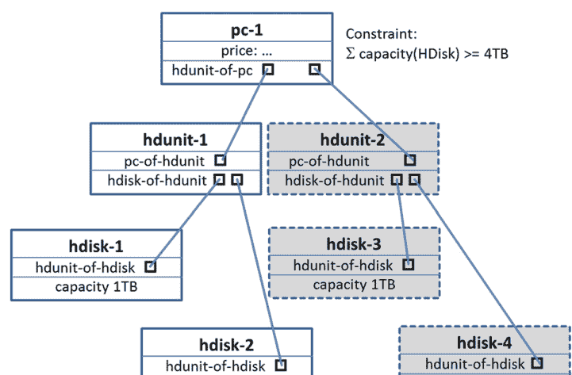

### FIGURE 6.5

Simple GCSP dynamic component creation example. The constraint representation is simplified（i.e., it does not directly correspond to the GCSP constraint representation used in Stumpfner et al., 1998）.


### 表 6.1 以约束（命题逻辑）定义的特征模型语义。特征由布尔变量表示。

| 关系/约束 | 语义 |
|---|---|
| mandatory(P,C) | P ↔ C |
| optional(P,C) | C → P |
| or (P, C₁, C₂, ..., Cₙ) | P ↔ (C₁ ∨ C₂ ∨ ... ∨ Cₙ) |
| alternative (P, C₁, C₂, ..., Cₙ) | (C₁ ↔ (¬C₂ ∧ ... ∧ ¬Cₙ ∧ P)) ∧ (C₂ ↔ (¬C₁ ∧ ¬C₃ ∧ ... ∧ ¬Cₙ ∧ P)) ∧ ... ∧ (Cₙ ↔ (¬C₁ ∧ ... ∧ ¬Cₙ₋₁ ∧ P)) |
| requires(P,C) | P → C |
| excludes(P,C) | ¬P ∨ ¬C |

### 特征模型的语义

特征模型的语义可以使用 6.2.1 小节中引入的静态约束表示来定义。如果我们想表达移动电话与 GPS 之间的可选关系，我们可以用约束 GPS → Mobile Phones 来表达这种关系。如果我们的目标是将特征模型转换为静态 CSP 表示，则可以应用表 6.1 中描述的规则。在此定义中，P 表示更高层的特征，C 表示与 P 存在关系的较低层特征。

特征模型的求解搜索可以基于能够求解静态约束满足问题（SCSP）或可满足性（SAT）问题的<|message|> 基本算法来实现。

#### 6.3.2 UML 配置模型

我们现在介绍一种基于 UML 的配置知识表示¹³，该表示也可用于配置的大小和结构事先未知的复杂领域。在此背景下，我们介绍个人电脑（PC）的配置模型，该模型在本书中用作工作示例。它由两个主要部分组成：（1）PC 的基本结构以带有相关泛化层次结构的部件结构表示（见图 6.7），以及（2）限制各个组件组合的附加约束。一些基本约束（gc1, gc2, gc3）已直接集成在图 6.7 的配置模型中；其余约束（prc1, prc2, resc1, resc2, crc1, crc2, crc3, crc4, compc1, compc2, compc3）则在表 6.2 中以文本形式引入。¹⁴ 以下介绍的建模设施可被视为配置模型设计所需的主要概念（Falkner and Haselböck, 2013; Felfernig, 2007; Felfernig et al., 2000a, 2001, 2003; Soininen et al., 1998）。对于 UML 中配置模型的表示，我们依赖于类图的记法；在该上下文中不需要组件图或序列图等进一步的记法。

¹³ Unified Modeling Language（Booch et al., 2005）。

¹⁴ 有关如何使用 UML 约束语言 OCL（Warmer and Kleppe, 2003）表示这些约束的详细讨论，请参阅 Felfernig（2007）。

与 ControllerPort 相连。请注意，在需要时，额外的关联类型包含在各个章节中。

- 泛化：该建模设施通过子集关系关联两种或多种组件类型。子类型与超类型之间的泛化关系（或超类型与子类型之间的逆向特化关系）可表征为不相交且完备。不相交意味着组件类型 X 的每个实例只能分配给 X 的一个子类型。例如，每个 CPU 要么是 CPUS 类型，要么是 CPUD 类型，但不能同时是两者。完备性意味着每个实例都分配给泛化层次结构的叶节点之一。此外，配置上下文中的泛化层次结构通常不允许多重继承。再次说明，在本书的其他章节中，在需要时将引入具有不同语义的进一步建模设施。请注意，出于简化的原因，我们的示例中未包含特定应用类型的定义；假设类型 Application 的每个实例具有相同的所需 hdcapacity（200）和相同的价格，为 50。在个人电脑的完整模型中，将包含或作为相应组件目录的一部分定义额外的子类型。

### UML 中的计算机配置模型：约束

约束表示属性和/或组件类型之间必须保持的限制。现在基于我们的 PC 配置模型（见表 6.2）¹⁶ 解释配置模型中经常使用的约束。

我们区分以下类型的约束：（1）直接集成到图 6.7 所示配置模型中的约束记为图形约束（gc_i ∈ GC）。（2）关于可配置产品定价的约束可以作为配置模型的一部分定义。在许多现实场景中，定价约束（策略）不是配置模型的一部分，而是作为单独的定价组件实现。我们将定价约束的集合记为 PRC ≡ ∪prc_i。（3）限制资源生产和消耗的约束记为资源约束（resc_i ∈ RESC）。（4）定义在何种上下文中哪些附加组件必须成为配置（解）一部分的约束记为 requires 约束（crc_i ∈ CRC）。Requires 约束 {crc1–crc3} 是在 GC 中已包含的约束之外定义的。（5）关于不同组件（组件类型实例）如何组合的限制基于兼容性约束定义（compc_i ∈ COMPC）。兼容性约束 {comp1–comp3} 是在 GC 中已包含的约束之外定义的。图形约束 gc1 描述了不兼容性，这是兼容性的补集。兼容性用于组件（或属性值）允许组合数量较少的情况。或者，如果不兼容的数量较少，则使用不兼容性约束。相当频繁地，兼容性约束这一术语同时表示兼容性和不兼容性。配置模型 C_KB = GC ∪ PRC ∪ RESC ∪ CRC ∪ COMPC¹⁷ 的所有约束连同客户需求的集合一起是可由配置器（配置系统）求解的配置任务的主要要素。

16 这些约束的形式化在 6.4.1 小节中引入。

17 请注意，为简化起见，我们仅考虑这些特定类型的约束。然而，工业配置环境通常允许定义进一步的约束，这些约束不限于此处使用的分类。

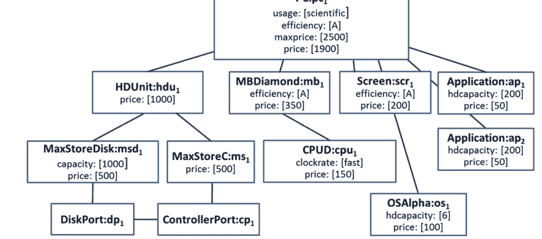

### 图 6.8

配置（解）以 UML 实例图表示。

### 计算机配置（解）

配置（配置任务的解）可以表示为 UML 实例图；此类图的示例如图 6.8 所示。该图描绘了配置模型图 6.7 中所示类的具体组件（实例）。

### 6.4 基于逻辑的知识表示

#### 6.4.1 一阶逻辑（FOL）

UML 建模设施的语义基于图 6.9 所示的配置模型进行解释。这是我们图 6.7 的 PC 配置模型的一个片段，包含组件类型 {PC, MB, MBDiamond, MBSilver, CPU, CPUS, CPUD, OS, OSAlpha, OSBeta} 以及约束 {gc1, gc2, gc3, prc2', resc1}（见表 6.3）。¹⁸ 为了定义基于 UML 的配置模型的语义，我们将应用一阶逻辑（FOL）的一个可判定子集。这与致力于组件导向表示形式化的研究方向一致（见例如 Falkner and Haselböck, 2013; Felfernig, 2007; Felfernig et al., 2000a, 2003; Schröder et al., 1996）。

### 配置任务和解

我们现在将引入基于谓词逻辑的配置任务（问题）及其解的定义，该定义用于本章的剩余部分。此定义基于 Felfernig et al.（2004, 2003）。从现在起我们集中于广义（组件导向）的知识

¹⁸我们减少了模型元素的数量以便于理解。


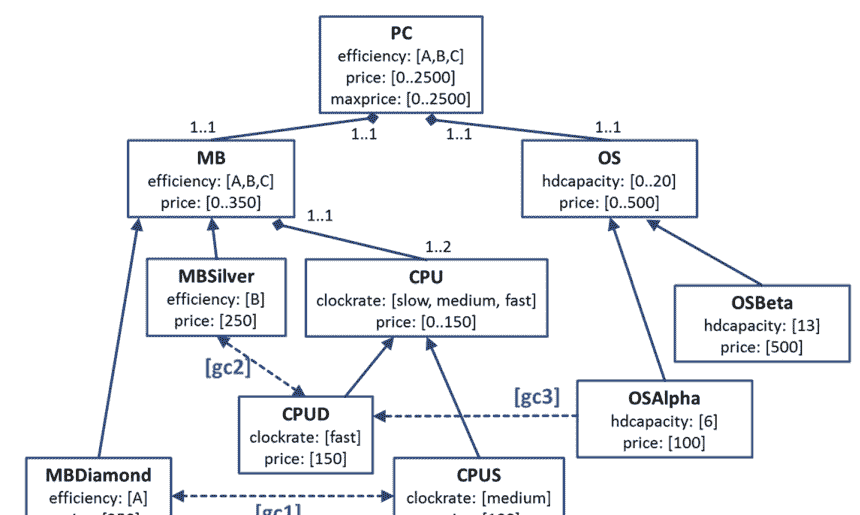

### FIGURE 6.9

PC 模型片段（改编自图 6.7 的部分）。

### Table 6.3 Constraints related to the configuration model in Figure 6.9.

| Name | Description |
|------|-------------|
| gc1 | 类型为 CPUS 的 CPU 与类型为 MBDiamond 的主板不兼容 |
| gc2 | 类型为 CPUD 的 CPU 与类型为 MBSilver 的主板不兼容 |
| gc3 | 每个类型为 OSAlpha 的操作系统都需要一个类型为 CPUD 的 CPU |
| prc2' | 一台个人电脑（PC）的价格由主板（MB）、CPU 和操作系统（OS）的价格决定 |
| resc1 | 计算机价格必须小于或等于客户定义的 maxprice |

基于组件类型和通用约束的表示（类似于生成式约束满足方法所提供的概念；Mailharro, 1998; Stumpfner et al., 1998）。

Definition (Configuration Task). 配置任务可以定义为一个三元组 (C_KB, REQ, CLANG)，其中 C_KB 和 REQ 是逻辑句子的集合，CLANG 是谓词符号的集合。C_KB 表示配置模型，REQ 指定特定的系统（客户）需求。

Table 6.5 Example representation of user (customer) requirements (REQ).

| Modeling Facility | Example in FOL |
|---|---|
| User requirements | {PC(pc₁). MBDiamond(mb₁).} ⊆ REQ |

Table 6.6 Example configuration (CONF) with completeness axioms (AX).

| Modeling Facility | Example in FOL |
|---|---|
| Components (CONF) | {PC(pc₁). MBDiamond(mb₁). CPUD(cpu₁). OSAlpha(os₁).} ⊆ CONF |
| Attributes (CONF) | {efficiency(pc₁, A), price(pc₁, 600). efficiency(mb₁, A), price(mb₁, 350). clockrate(cpu₁, fast). price(cpu₁, 150). hdcapacity(os₁, 6). price(os₁, 100).} ⊆ CONF |
| Associations (CONF) | {pc-of-mb(pc₁, mb₁). mb-of-pc(mb₁, pc₁).} ⊆ CONF {mb-of-cpu(mb₁, cpu₁). cpu-of-mb(cpu₁, mb₁).} ⊆ CONF {pc-of-os(pc₁, os₁). os-of-pc(os₁, pc₁).} ⊆ CONF |
| Components (AX) | {PC(X) → X = pc₁. MBDiamond(X) → X = mb₁. ...} ⊆ AX |
| Attributes (AX) | {efficiency(X, Y) → (X = pc₁ ∧ Y = A) ∨ (X = mb₁ ∧ Y = A) ∨ ...} ⊆ AX |
| Associations (AX) | {pc-of-mb(X, Y) → (X = pc₁ ∧ Y = mb₁). ...} ⊆ AX |

知识表示、演绎数据库和逻辑编程（Brewka et al., 2011）。ASP 是在稳定模型语义下解释的一阶逻辑 FOL 的子集（Gelfond and Lifschitz, 1988）。值得一提的是，配置是 ASP 最早的现实世界应用之一（参见 Soininen et al., 2001; Tiihonen et al., 2003, 2013）。ASP 程序表示为一组有限的规则 a ← b₁, ..., bₘ, not c₁, ..., not cₖ，其中 a（规则的头部）、bᵢ 和 cⱼ（规则的体）是经典的一阶逻辑原子。在一条规则中，头部中的原子 a 在所有体的文字都为真时为真；也就是说，每个正文字 b₁, ..., bₘ 都有推导，而 none of the negative literals not c₁, ..., not cₖ 不能被推导。

头部为空的规则（假的占位符）表示为完整性约束。例如，← mbdiamond(X), cpus(Y), mb-of-cpu(X, Y). 表示组件类型 MBDiamond 与 CPUS 之间的不兼容性（参见图 6.9）。体为空的规则表示为事实；例如，mbsilver_domain(1..2) 表示两个事实 mbsilver_domain(1) 和 mbsilver_domain(2)。最后，权重约束允许定义选择。例如，1{cpu(X) : cpu_domain(X)}2 表示可以在配置中包含 1 到 2 个 CPU（cpu_domain 描述可用的 CPU 实例）。ASP 程序配置的确定基于两个步骤：（1）程序的一阶变量被系统地替换为 Herbrand 宇宙的元素（该过程也称为 grounding（例如，Gebser et al., 2009））并且（2）由此产生的（无变量）程序随后被输入到 ASP 求解器中，该求解器确定稳定模型

（答案集），ASP 程序的最小模型（Giunchiglia et al., 2006）。图 6.9 所示的配置模型的 ASP 表示在表 6.7 中给出。出于可读性的原因，我们省略了在泛化层次结构所有层级上的属性域的规范。例如，组件类型 cpu 的 clockrate 属性可能值的规范可以实现如下：1 { clockrate(C,A): clockrate_domain(A) } 1 :- cpu(C). clockrate_domain(slow;medium;fast). 客户需求和配置结果的 ASP 表示在表 6.8 中显示。

Table 6.7 Example formalizations of the PC configuration model shown in Figure 6.9 defined in clingo (see potassco.sourceforge.net).

| Concept | ASP Representation |
|---|---|
| Components (instances) | pc_domain(1). mbsilver_domain(2). mbdiamond_domain(3). cpud_domain(4). cpud_domain(5). cpus_domain(6). cpus_domain(7). osalpha_domain(8). osbeta_domain(9). |
| Domain generalizations | mb_domain(X) :- mbsilver_domain(X). mb_domain(X) :- mbdiamond_domain(X). cpu_domain(X) :- cpud_domain(X). cpu_domain(X) :- cpus_domain(X). os_domain(X) :- osalpha_domain(X). os_domain(X) :- osbeta_domain(X). |
| Component types | mbsilver(X) :- component(X), mbsilver_domain(X). mbdiamond(X) :- component(X), mbdiamond_domain(X). mb(X) :- component(X), mb_domain(X). cpus(X) :- component(X), cpus_domain(X). cpud(X) :- component(X), cpud_domain(X). cpu(X) :- component(X), cpu_domain(X). osalpha(X) :- component(X), osalpha_domain(X). osbeta(X) :- component(X), osbeta_domain(X). os(X) :- component(X), os_domain(X). |
| Attribute domains | efficiency(X,b) :- mbsilver(X). efficiency(X,a) :- mbdiamond(X). price(X,250) :- mbsilver(X). price(X,350) :- mbdiamond(X). clockrate(X,medium) :- cpus(X). clockrate(X,fast) :- cpud(X). price(X,100) :- cpus(X). price(X,150) :- cpud(X). hdcapacity(X,6) :- osalpha(X). hdcapacity(X,13) :- osbeta(X). price(X,100) :- osalpha(X). price(X,500) :- osbeta(X). |
| Generalization hierarchies | mb(X) :- mbsilver(X). mb(X) :- mbdiamond(X). cpu(X) :- cpus(X). cpu(X) :- cpud(X). os(X) :- osalpha(X). os(X) :- osbeta(X). |
| Part of relationships | 1 { mb_of_cpu(X,Y) : cpu_domain(Y) } 2 :- mb(X). 1 { pc_of_mb(X,Y) : mb_domain(Y) } 1 :- pc(X). 1 { pc_of_os(X,Y) : os_domain(Y) } 1 :- pc(X). |
| Symmetry properties | cpu_of_mb(Y,X) :- mb_of_cpu(X,Y). mb_of_pc(X,Y) :- pc_of_mb(Y,X). os_of_pc(X,Y) :- pc_of_os(Y,X). |
| Component generation | component(Y) :- mb_of_cpu(X,Y). component(Y) :- pc_of_mb(X,Y). component(Y) :- pc_of_os(X,Y). |
| gc1 | :- mbdiamond(X), cpus(Y), mb_of_cpu(X,Y). |
| gc2 | :- mbsilver(X), cpud(Y), mb_of_cpu(X,Y). |
| gc3 | :- osalpha(X), not cpud(C), pc_of_os(P,X), pc_of_mb(P,M), mb_of_cpu(M,C). |
| prc2' | pcprice(A,P) :- P = #sum [price(C,PR) = PR, pc(A)]. |
| resc1 | :- pc(X), maxprice(X,P), pcprice(X,Q), Q > P. |

Table 6.8 Example configuration result calculated by clingo (see potassco.sourceforge.net).

| Concept | ASP Representation |
|---|---|
| Customer requirements | pc(1). maxprice(1,2500). efficiency(1,b). |
| Configuration (result) | pc(1), maxprice(1,2500), efficiency(1,b), pc_of_mb(1,2), pc_of_os(1,9), pcprice(1,850), mbsilver(2), mb(2), efficiency(2,b), price(2,250), mb_of_cpu(2,7), mb_of_pc(2,1), osbeta(9), os(9), hdcapacity(9,13), price(9,500), os_of_pc(9,1), cpus(7), cpu(7), clockrate(7,medium), price(7,100), cpu_of_mb(7,2) |

### Description Logics

描述逻辑 Description Logics (DL; Baader et al., 2003) 是语义网上下文中流行的知识表示形式。DL 可用于配置知识表示，特别是用于组件类型层次结构（本体）的设计和一致性分析。描述逻辑知识库由两个主要元素组成：TBox 引入（产品）域的概念、关系和约束，ABox 包含关于个体的断言。因此，TBox 可用于表示配置模型，ABox 表示由此产生的配置。描述逻辑已成功应用于配置系统的开发——有关详细讨论请参阅 Hotz et al. (2006) 和 McGuinness and Wright (1998)。Felfernig et al. (2003) 分析了描述逻辑在配置知识表示方面的适用性。DL 可用于表示配置知识，然而，一些特定约束类型仅以受限方式得到支持。例如，没有提供聚合函数，并且由于许多 DL 方言的表达能力较低（但可判定），无法定义通过端口的复杂连接结构的约束。此外，由于没有提供自动实例化的标准推理方法，DL 推理器必须包含在从外部创建个体的架构中。这是因为配置过程的增量方面（参见 Buchheit et al., 1995; Hotz and Neumann, 2005; Stumpfner, 1997）。除此分析外，Felfernig et al. (2003) 还引入了描述逻辑中配置问题及其解决方案的形式定义，并证明了该定义与基于谓词逻辑的定义等价。

### Hybrid Configuration

混合配置利用多种表示和推理机制（Stumpfner, 1997）。通常，有一个类似本体（基于 DL）的表示（Baader et al., 2003）用于表示组件、其组合关系和属性。此外，约束用于表示组件之间 n 元关系并计算和推断属性值。配置过程以循环方式结合相关的推理机制、本体推理服务和约束传播。此外，过程知识（Hotz et al., 2006; McDermott, 1982）可用于描述配置


often also dispose of concepts for structured rule representation. Graphical UML modeling supports the inclusion of advanced modularization concepts such as packaging and diagram contextualization (Felfernig et al., 2000b; Felfernig and Zanker, 2000). Techniques for easy knowledge base evolution and maintenance (C5) are not primarily depending on the knowledge representation itself but more on additional meta-functionalities that support intuitive knowledge navigation and adaptation; nearly all representation formalisms can be equipped with such a functionality (Felfernig et al., 2013b). RBS have serious maintenance problems due to the dependence of product domain and problem solving knowledge. With the exception of RBS, all other representations follow a model-based paradigm (C6) that supports a clear separation of domain and problem-solving knowledge. RBS and constraint satisfaction algorithms have proven to support efficient problem solving on an industrial scale. For this reason, these approaches are evaluated better with regard to performance (C7). GCSP allows the determination of solutions for generative configuration problems; ASP and HB are also able to provide such functionalities (C8). With the exception of FM and UML, all approaches provide basic support for explanations (as to why a configuration could (not) be found). Dependencies between domain and problem solving knowledge in RBS and encodings in SAT (see Subsection 6.2.1) make these approaches less accessible for explanation techniques.

### 6.6 Conclusion

In this chapter we provided an overview of different configuration knowledge representation and reasoning techniques. These techniques were discussed on the basis of a timeline ranging from the rule-based configuration system R1/XCON implemented in the late 1970’s via different types of constraint representations and constraint reasoning approaches through to advanced knowledge representation and reasoning approaches that are applied nowadays for the definition and solution of configuration tasks.

## Acknowledgments

The work presented in this chapter was partially funded by the Austrian research promotion agency (grant numbers: 827587 and 825071).

## References

Amilhastre, J., Fargier, H., Marquis, P., 2002. Consistency restoration and explanations in dynamic CSPs - application to configuration. Artificial Intelligence 135 (1–2), 199–234.

Andersen, H., Hadzic, T., Pisinger, D., 2010. Interactive cost configuration over decision diagrams. Journal of Artificial Intelligence Research 37, 99–139.

Baader, F., Calvanese, D., McGuinness, D.L., Nardi, D., Patel-Schneider, P.F. (Eds.), 2003. The Description Logic Handbook: Theory, Implementation, and Applications. Cambridge University Press, New York, NY.

Bacchus, F., vanBeek, P., 1998. On the conversion between non-binary and binary constraint satisfaction problems. In: 15th National Conference on Artificial Intelligence (AAAI’98). Madison, Wisconsin, pp. 311–318.

Felfernig, A., Schubert, M., Zehentner, C., 2012. An efficient diagnosis algorithm for inconsistent constraint sets. Artificial Intelligence for Engineering Design, Analysis and Manufacturing (AI EDAM) 26 (1), 53–62.
Felfernig, A., Benavides, D., Galindo, J., Reinfrank, F., 2013a. Towards anomaly explanation in feature models. In: Workshop on Configuration. Vienna, Austria, pp. 117–124.
Felfernig, A., Reiterer, S., Stettinger, M., Reinfrank, F., Jeran, M., Ninaus, G., 2013b. Recommender systems for configuration knowledge engineering. In: Workshop on Configuration. Vienna, Austria, pp. 51–54.
Fleischanderl, G., Friedrich, G.E., Haselböck, A., Schreiner, H., Stumptner, M., 1998. Configuring large systems using generative constraint satisfaction. IEEE Intelligent Systems 13 (4), 59–68.
Freuder, E., 1997. In pursuit of the holy grail. Constraints 2 (1), 57–61.
Friedrich, G., Jannach, D., Stumptner, M., Zanker, M., 2014. Knowledge engineering for configuration systems. In: Felfernig, A., Hotz, L., Bagley, C., Tiihonen, J. (Eds.), Knowledge-based Configuration – From Research to Business Cases. Morgan Kaufmann Publishers, Waltham, MA, pp. 139–155 (Chapter 11).
Gebser, M., Kaminski, R., Ostrowski, M., Schaub, T., Thiele, S., 2009. On the input language of ASP grounder Gringo. In: Erdem, E., Lin, F., Schaub, T. (Eds.), Proceedings of the 10th International Conference on Logic Programming and Nonmonotonic Reasoning. Lecture Notes in Computer Science, Vol. 5373. Springer, Potsdam, Germany, pp. 502–508.
Gelfond, M., Lifschitz, V., 1988. The stable model semantics for logic programming. In: Kowalkowski, R.A., Bowen, K.A. (Eds.), Logic Programming: Proceedings of the 5th International Conference and Symposium. Seattle, WA, pp. 1070–1080.
Giunchiglia, E., Lierler, Y., Maratea, M., 2006. Answer set programming based on propositional satisfiability. Journal of Automated Reasoning 36 (4), 345–377.
Gomes, C., Kautz, H., Sabharwal, A., Selman, B., 2008. Satisfiability solvers. In: Handbook of Knowledge Representation. Foundations of Artificial Intelligence, vol. 3. Elsevier, New York, NY, pp. 89–134 (Chapter 2).
Günter, A., Kühn, C., 1999. Knowledge-Based Configuration - Survey and Future Directions. In: Puppe, F. (Ed.), XPS-99: knowledge based systems, proceedings 5th biannual german conference on knowledge based systems. Lecture Notes in Artificial Intelligence, Vol. 1570. Springer, Würzburg.
Hotz, L., Günter, A., 2014. KONWERK. In: Felfernig, A., Hotz, L., Bagley, C., Tiihonen, J. (Eds.), Knowledge-based Configuration – From Research to Business Cases. Morgan Kaufmann Publishers, Waltham, MA, pp. 281–295 (Chapter 24).
Hotz, L., Neumann, B., 2005. Scene Interpretation as a Configuration Task. Künstliche Intelligenz 3, 59–65.
Hotz, L., Wolter, K., 2014. Smarthome Configuration Model. In: Felfernig, A., Hotz, L., Bagley, C., Tiihonen, J. (Eds.), Knowledge-based Configuration – From Research to Business Cases. Morgan Kaufmann Publishers, Waltham, MA, pp. 121–135 (Chapter 10).
Hotz, L., Wolter, K., Krebs, T., Deelstra, S., Sinnema, M., Nijhuis, J., MacGregor, J., 2006. Configuration in Industrial Product Families - The ConIPF Methodology. IOS Press, Berlin.
Jannach, D., Zanker, M., Felfernig, A., Friedrich, G., 2010. Recommender Systems: An Introduction. Cambridge University Press, MA.
Janota, M., 2008. Do SAT solvers make good configurators? In: First Workshop on Analyses of Software Product Lines (ASPL08) of 12th International Software Product Lines Conference (SPLC08). Limerick, Ireland, pp. 10–14.
Janota, M., Botterweck, G., Grigore, R., Marques-Silva, J., 2010. How to complete an interactive configuration process? In: 36th Conference on Current Trends in Theory and Practice of Computer Science (SOFSEM 2010). Lecture Notes in Computer Science, vol. 5901. Springer, Špindlerův Mlýn, Czech Republic, pp. 528–539.
Jüngst, W., Heinrich, M., 1998. Using resource balancing to configure modular systems. IEEE Intelligent Systems 13 (4), 50–58.

Sinz, C., Haag, A., Narodynska, N., Walsh, T., Gelle, E., Sabin, M., Junker, U., O’Sullivan, B., Rabiser, R., Dhungana, D., Grünbacher, P., Lehner, K., Federspiel, C., Naus, D., 2007. Configuration. IEEE Intelligent Systems 22 (1), 78–90.

Soininen, T., Tiihonen, J., Männistö, T., Sulonen, R., 1998. Towards a general ontology of configuration. Artificial Intelligence for Engineering Design, Analysis and Manufacturing (AI EDAM) 12 (4), 357–372.

Soininen, T., Niemelä, I., Tiihonen, J., Sulonen, R., 2001. Representing configuration knowledge with weight constraint rules. In: Provetti, A., Son, T.C. (Eds.), 1st International Workshop on Answer Set Programming: Towards Efficient and Scalable Knowledge (AAAI Technical, Report SS-01-01). pp. 195–201.

Soloway, E., Bachant, J., Jensen, K., 1987. Assessing the maintainability of XCON-in-RIME: coping with the problem of very large rule-bases. In: Proceedings of the Sixth National Conference on Artificial Intelligence (AAAI-87). Seattle, Washington, pp. 824–829 July 13–17.

Stumptner, M., 1997. An overview of knowledge-based configuration. AI Communications 10 (2), 111–126.

Stumptner, M., Friedrich, G., Haselböck, A., 1998. Generative constraint-based configuration of large technical systems. Artificial Intelligence for Engineering Design, Analysis and Manufacturing (AI EDAM) 12 (4), 307–320.

Terashima-Marin, H., Ross, P., Valenzuela-Rendon, M., 2008. Hyper-heuristics for the dynamic variable ordering in constraint satisfaction problems. In: Genetic and Evolutionary Computation Conference (GECCO’08). Atlanta, Georgia, pp. 571–578.

Tiihonen, J., Soininen, T., Niemelä, I., Sulonen, R., 2003. A practical tool for mass-customising configurable products. In: Proceedings of the 14th International Conference on Engineering Design, Stockholm, Sweden, August 19–21, 2003, CDROM, p. 10 (Paper number: 1290).

Tiihonen, J., Heiskala, M., Anderson, A., Soininen, T., 2013. WeCoTin – A practical logic-based sales configurator. AI Communications 26 (1), 99–131.

Tsang, E., 1993. Foundations of Constraint Satisfaction. Academic Press, London, San Diego, New York.

Warner, J., Kleppe, A., 2003. The Object Constraint Language: Getting Your Models Ready for MDA, second ed. Addison-Wesley Longman Publishing, Boston, MA.


operations. 本章其余部分组织如下。第 7.2 节，我们介绍本章使用的示例，Hotz et al. (2014) 中引入的示例配置知识库的简化版本。³ 我们在第 7.3 节讨论选定的冲突检测算法，并在第 7.4 节讨论相应的诊断算法。基于性能分析的结果，我们讨论所呈现的冲突检测和诊断算法的优缺点。第 7.5 节总结本章。

### 7.2 示例

我们介绍一个基于 Hotz et al. (2014) 中引入的配置知识库的工作示例。对于以下讨论，我们引入个人计算机（PC）片段的配置知识库（C_KB），它由组件类型 MB（主板）和 CPU（中央处理器）及其特定子类型 {MBSilver, MBDiamond} 和 {CPUS, CPUD} 组成。

以下个人计算机（PC）配置知识库（配置模型）是不一致的，意味着它不允许计算解决方案（配置）。这种情况通常发生在知识库维护操作的结果中，例如，由于新元素的插入或现有元素的适应而引入冲突。在我们的工作示例中，我们假设约束 c2（CPUS 需要 MBSilver）已被知识工程师添加，以替换有缺陷的约束 c1（CPUS 需要 MBDiamond）。不幸的是，知识工程师在删除 c1 的情况下插入了 c2。我们的示例还假设一个约束 c5（组件类型 CPUD 的实例不应成为任何配置的一部分）早先为测试目的而引入，没有意图使其属于配置模型。然而知识工程师在测试模型后忘记禁用它。约束 c3 规定 MBSilver 不得与 CPUD 组合，约束 c4 规定 MBDiamond 不得与 CPUS 组合。

```
C_KB = {
  c_α : ∀X : MB(X) → ∃!Y : cpu-of-mb(Y, X).
  c_β : ∀X : CPU(X) → ∃!Y : mb-of-cpu(Y, X).
  c_γ : ∀X : MB(X) ↔ MBSilver(X) ∨ MBDiamond(X).
  c_δ : ∀X : ¬MBSilver(X) ∨ ¬MBDiamond(X).
  c_ε : ∀X : CPU(X) ↔ CPUD(X) ∨ CPUS(X).
  c_φ : ∀X, Y : cpu-of-mb(X,Y) ↔ mb-of-cpu(Y,X).
  c_ι : ∀X : ¬CPUD(X) ∨ ¬CPUS(X).

  c1 : ∀X, Y : cpu-of-mb(Y, X) ∧ CPUS(Y) → MBDiamond(X).
  c2 : ∀X, Y : cpu-of-mb(Y, X) ∧ CPUS(Y) → MBSilver(X).
  c3 : ∀X, Y : cpu-of-mb(Y, X) ∧ CPUD(Y) ∧ MBSilver(X) → false.
  c4 : ∀X, Y : cpu-of-mb(Y, X) ∧ CPUS(Y) ∧ MBDiamond(X) → false.
  c5 : ∀X : CPUD(X) → false.
}
```

我们现在将开始讨论专注于冲突检测的算法，然后展示如何利用已识别的最小冲突集来确定相应的诊断。请注意，此后讨论的冲突检测和诊断算法是 Friedrich et al. (2014)⁴ 和 Felfernig et al. (2014)⁵ 中解释的概念的基础。

### 7.3 确定最小冲突集

在讨论适用于（但不限于）配置场景的基本冲突检测算法之前，我们在不一致的配置知识库的上下文中引入冲突（冲突集）的定义。

**定义（最小冲突集）。** 冲突集 CS = {cₐ, c_b, …, c_z} 是 C 的子集，使得 inconsistent (B ∪ CS)。 AC = B ∪ C 表示知识库中所有约束的集合（AC = {c₁, c₂, …, cₙ}），B 表示背景知识（假设没有冲突元素包含在 B 中），C 表示冲突搜索的约束集。冲突集 CS 是最小的，如果不存在 CS′ ⊂ CS 具有冲突属性。

请注意，如果我们想分析整个知识库（考虑到冲突集搜索中的约束完整集合），我们只需定义 C = AC，并且作为结果，B = ∅。

在我们的工作示例中，我们能够识别以下最小冲突集：CS₁ = {c₁, c₄, c₅} 和 CS₂ = {c₁, c₂, c₅}。这些集合不允许确定解决方案；inconsistent ({c₁, c₄, c₅} ∪ B) 和 inconsistent ({c₁, c₂, c₅} ∪ B)。CS₁ 和 CS₂ 是最小的，因为它们的任何子集都不满足冲突集属性。每个最小冲突集（冲突）只需通过删除其一个元素即可解决。这种方法被第 7.4 节中讨论的一些诊断算法所使用。

在本节的其余部分，我们介绍并评估两种基本的冲突检测算法：SIMPLECONFLICTDETECTION 和 QUICKXPLAIN。

#### 7.3.1 简单冲突检测

确定最小冲突集的第一种方法是 SIMPLECONFLICTDETECTION（见算法 7.1）。符合所引入的冲突集定义，算法专注于通过明确指定可能引发冲突的约束集 C ⊆ AC 来搜索最小冲突。请注意，SIMPLECONFLICTDETECTION 每次计算确定一个冲突集。为了识别 C 中的所有最小冲突，该算法必须与 HSDAG-based 诊断算法结合使用（见第 7.4 节）。

集合 CS 收集最小冲突的所有相关元素（约束）。如果删除 C 的所有约束不允许确定解决方案（inconsistent(B)）或 AC（B ∪ C）本身是一致的，则无需搜索冲突（返回空集 ∅）。在所有其他情况下，算法尝试识别最小冲突。为了实现这一目标，C 的元素 cᵢ 被提取并用于确定它们是否触发冲突。如果识别出这样的元素，它将被存储在集合 CS 中，该集合收集导致冲突的元素。

```
Algorithm 7.1 — SIMPLECONFLICTDETECTION

1. `func SimpleConflictDetection(C ⊆ AC, B = AC − C) : CS`
2. `CS ← ∅;`
3. `if inconsistent(B) or consistent(B ∪ C) return(∅);`
4. `else`
5. `repeat`
6. `Φ ← CS;`
7. `repeat`
8. `c ← element(C − Φ);`
9. `Φ ← Φ ∪ {c};`
10. `until inconsistent(Φ)`
11. `CS ← CS ∪ {c};`
12. `until inconsistent(CS)`
13. `return(CS);`
```

为了演示 SimpleConflictDetection 的功能，该算法的基本步骤在表 7.1 中显示。对于此示例（另见图 7.1），我们取域描述（DD）的约束并假设 C = {c₁, c₂, c₃, c₄, c₅} 且 AC = {cα, cβ, cγ, cδ, cε, cφ, c₁, c₂, c₃, c₄, c₅}（B = {cα, cβ, cγ, cδ, cε, cφ, c₁}）。内部循环负责检查和拒绝参与冲突的单个元素，外部循环负责检查生成的集合 CS 是否已不一致（即可以找到最小冲突集）。

*算法分析。* 如果可以确定最小冲突集（AC − C 一致且 AC 不一致），SimpleConflictDetection 在最佳情况下需要 O(2) 次额外的 consistency 检查（位于约束列表 C 的第一个位置的表示单例冲突的约束 cₐ）。

**表 7.1** SimpleConflictDetection 应用示例。CS = {c₁, c₄, c₅} 作为 C = {c₅, c₄, c₃, c₂, c₁} 和 B = {cα, cβ, cγ, cδ, cε, cφ, c₁} 的最小冲突集（CS）返回。

| Step | CS | c | Φ |
|---:|---|---|---|
| 1 | ∅ | c₅ | {c₅} |
| 2 | ∅ | c₄ | {c₅, c₄} |
| 3 | ∅ | c₃ | {c₅, c₄, c₃} |
| 4 | ∅ | c₂ | {c₅, c₄, c₃, c₂} |
| 5 | ∅ | c₁ | {c₅, c₄, c₃, c₂, c₁} |
| 6 | {c₁} | c₅ | {c₁, c₅} |
| 7 | {c₁} | c₄ | {c₁, c₅, c₄} |
| 8 | {c₁, c₄} | c₅ | {c₁, c₄, c₅} |
| 9 | {c₁, c₄, c₅} | — | — |

### 表 7.2 QUICKXPLAIN 示例：Γ = {cα, cβ, cγ, cδ, cε, cφ, cι} 是（原始）背景知识，CS = {c1, c4, c5} 是返回的冲突集。不同 QX 激活的序列如图 7.2 所示。

| Step | D | C | B | C1 | C2 | Return |
|---|---|---|---|---|---|---|
| 1 | ∅ | {c1, ..., c5} | Γ | {c1, c2, c3} | {c4, c5} | {c1, c4, c5} |
| 2 | {c4, c5} | {c1, c2, c3} | Γ ∪ {c4, c5} | {c1, c2} | {c3} | {c1} |
| 3 | {c3} | {c1, c2} | Γ ∪ {c3, ..., c5} | {c1} | {c2} | {c1} |
| 4 | {c2} | {c1} | Γ ∪ {c2, ..., c5} | ∅ | ∅ | {c1} |
| 5 | {c1} | {c2} | Γ ∪ {c1, c3, c4, c5} | ∅ | ∅ | ∅ |
| 6 | {c1} | {c3} | Γ ∪ {c1, c4, c5} | ∅ | ∅ | ∅ |
| 7 | {c1} | {c4, c5} | Γ ∪ {c1} | {c4} | {c5} | {c4, c5} |
| 8 | {c5} | {c4} | Γ ∪ {c1, c5} | ∅ | ∅ | {c4} |
| 9 | {c4} | {c5} | Γ ∪ {c1, c4} | ∅ | ∅ | {c5} |

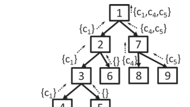

### 图 7.2

不同 QUICKXPLAIN 实例的激活序列（详情见表 7.2）。

QUICKXPLAIN 每次计算确定一个冲突集。为了识别 C 中的所有最小冲突，该算法必须与 HSDAG-based 诊断算法结合使用（见第 7.4 节）。QUICKXPLAIN 如何确定最小冲突最好基于我们的工作示例来解释（见表 7.2）。递归函数 QX 的激活层次结构如图 7.2 所示。

函数 QX 在结果约束集保持一致的情况下不断向背景知识添加额外约束（来自 C2）。如果它变得不一致，算法就会放弃剩余的约束。例如，在表 7.2（步骤 5）中，集合 {c1, c3, c4, c5} 是不一致的，剩余约束 c2 可以被放弃。另一方面，如果背景知识是一致的，并且只有一个约束会引发不一致，则该约束必须是冲突集的一部分。例如，在表 7.2（步骤 4）中，背景知识由约束 {c2, ..., c5} 组成，c1 保留为单个约束。很明显 c1 是冲突的一部分，因为 {c2, ..., c5} 是 一致的但 {c2, ..., c5} ∪ {c1} 是不一致的。


**表7.3.** 运行时间评估：SIMPLECONFLICTDETECTION（SCD）和QUICKXPLAIN在标准PC上计算一个最小冲突集所需的平均运行时间（毫秒）。此评估的基础是来自www.splot-research.org的知识库。

| 领域 | 约束数 | 变量数 | QUICKXPLAIN（毫秒） | SCD（毫秒） |
|---|---|---|---|---|
| DELL笔记本电脑 | 285 | 47 | 75.7 | 643.2 |
| 智能家居 | 73 | 55 | 42.6 | 89.6 |
| 汽车 | 150 | 73 | 42.9 | 406.2 |
| 施乐打印机 | 242 | 158 | 78.1 | 812.2 |

**算法分析。** 在比较SIMPLECONFLICTDETECTION与QUICKXPLAIN的性能时，我们可以看到QUICKXPLAIN有可能减少所需的一致性检查次数。在我们的工作示例中，SIMPLECONFLICTDETECTION需要11次一致性检查，而QUICKXPLAIN只需要8次一致性检查。在最坏情况下，该算法需要2k × log₂(n/k) + 2k次检查，其中k是最小冲突集的规模，n是C中的约束数量（Junker, 2004）。就一致性检查次数而言，最佳情况复杂度为log₂(n/k) + 2k。

请注意，所介绍的两种冲突检测算法都是根据约束排序来确定冲突的。如果我们反转这两种算法的约束排序，将首先得到冲突集CS₂ = {c₁, c₂, c₅}。关于约束排序及其在冲突检测中作用的更详细讨论，请参阅Junker（2004）。

#### 7.3.3 冲突检测算法的运行性能

我们通过对所介绍的算法在来自www.splot-research.org的真实世界配置数据集上执行时的运行性能进行分析，来结束对冲突检测问题的讨论。两种算法的平均运行时间以毫秒（ms）为单位进行测量，在每种设置中约束排序都是随机化的，并且每种设置执行100次。很明显，QUICKXPLAIN在所有分析的设置中都明显优于SIMPLECONFLICTDETECTION（见表7.3）。

影响QUICKXPLAIN性能的一个主要因素是冲突集的规模——冲突中的元素越多，确定一个最小冲突集所需的一致性检查就越多。另一个影响QUICKXPLAIN性能的因素是约束在考虑集C中的排序。这些约束在C中分布得越分散，预期的一致性检查就越多，因为在QX执行的早期阶段可以省略的约束越少。

### 7.4 确定最小诊断

冲突集有助于识别一组约束中的不一致区域。如果我们想知道必须调整（或从配置知识库中删除）的最小约束集，以便为给定的配置任务找到解决方案，就需要确定与已确定的冲突集相关的（最小）诊断。基于我们在7.3节中对冲突集的定义，我们现在介绍诊断任务和相应诊断（解决方案）的定义。

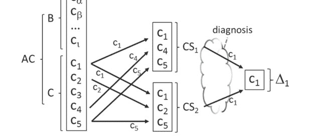

**图7.3**

诊断Δ是C（AC = C ∪ B）的一个子集，使得B ∪ C − Δ是一致的。如果不存在满足诊断性质的Δ的子集，则Δ是最小的。B再次表示背景知识。一个示例诊断是Δ₁ = {c₁}。

**定义（诊断任务）。** 诊断任务可以通过元组(C, AC)来定义，其中AC = B ∪ C，B是背景知识，C是要分析的约束集。

在讨论支持计算最小诊断的潜在算法之前，我们先介绍诊断的定义，该诊断表示给定诊断任务(C, AC)的解决方案。诊断确定的基本思想如图7.3所示。

**定义（诊断）。** 给定诊断任务(C, AC)的诊断是约束集Δ ⊆ C，使得B ∪ C − Δ是一致的。如果不存在具有诊断性质的诊断Δ′ ⊂ Δ，则诊断Δ是最小的。最后，如果不存在满足|Δ′| < |Δ|的最小诊断Δ′，则最小诊断Δ被称为最小基数诊断。

确定诊断（命中集）的一种广泛使用的方法是构建HSDAG。该算法被称为命中集有向无环图算法，由Reiter（1987）提出。

#### 7.4.1 命中集有向无环图（HSDAG）

HSDAG算法支持最小诊断的确定。由于该算法通常以广度优先的方式进行诊断搜索，因此它支持确定最小基数诊断（即包含约束数量尽可能少的最小诊断）。然而，该算法是完备的；在返回最小基数诊断之后，它返回考虑集C中包含的所有其他诊断。HSDAG结构可以通过重复激活冲突检测算法（例如，SIMPLECONFLICTDETECTION或QUICKXPLAIN）并分析解决所返回冲突的不同可能性来建立。由于这是广度优先搜索策略的简单实现，我们在此不提供算法。

例如，在图7.4中，冲突检测算法返回的第一个最小冲突集是CS₁ = {c₁, c₄, c₅}。如果我们通过删除约束c₄来解决冲突CS₁，将识别出另一个冲突集——CS₂ = {c₁, c₂, c₅}。

**图7.4**

基于最小冲突集CS₁ = {c₁, c₄, c₅}和CS₂ = {c₁, c₂, c₅}的广度优先诊断搜索。得到的最小诊断是Δ₁ = {c₁}、Δ₂ = {c₅}和Δ₃ = {c₂, c₄}。

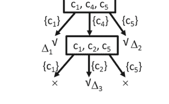

**图7.5**

基于最小诊断Δ₁ = {c₁}、Δ₂ = {c₅}和Δ₃ = {c₂, c₄}的广度优先冲突搜索。得到的最小冲突集是CS₁ = {c₁, c₂, c₅}、CS₂ = {c₁, c₄, c₅}。

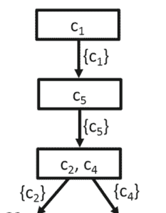

由于CS₁的最小性，我们恰好有三种不同的替代方案来解决冲突（通过删除其一个元素）。HSDAG算法是完备的——解决给定冲突的所有不同替代方案都会被分析。例如，如果我们从CS₁中删除c₁，就已经确定了第一个诊断Δ₁ = {c₁}。可以从HSDAG推导出的第二个最小基数诊断是Δ₂ = {c₅}。还有第三个最小诊断（不是最小基数诊断）：Δ₃ = {c₂, c₄}。

HSDAG算法（Reiter, 1987）不仅支持以诊断的形式确定命中集——给定预定义的诊断集，我们也能够推导出所有对应的最小冲突（例如，见图7.5）。典型的HSDAG实现基于许多有助于提高诊断（冲突集）检测性能的附加概念。首先，冲突（诊断）可以被重用，即已经确定的冲突（诊断）可以被重用于HSDAG中不包含相应元素的那些路径。在我们的工作示例中（见图7.5），由于只有一条通往HSDAG叶节点的路径，因此没有重用冲突集的可能性。

提高诊断搜索性能的第二种可能性是关闭树中已在树的其他部分展开过的特定路径。在我们的工作示例中（见图7.3），路径{c₁}直接通向一个诊断。因此，进一步展开包含c₁的其他路径没有意义。我们还可以考虑两条路径包含相同元素集的情况。在这种情况下，其中一条路径可以被关闭（即不必进一步展开）。

#### 7.4.2 FastDiag

在许多情况下，并非所有现有诊断都与用户相关。例如，在与配置器交互时，用户并不希望处理可能大量的替代诊断。我们需要能够快速确定所谓主导诊断的算法，以便用户对其进行分析和评估。由于在许多情况下（出于性能原因）无法确定所有可能的诊断，因此会首先确定假定与用户相关的诊断——这些诊断被称为主导诊断。FASTDIAG是一种能够高效确定主导诊断而无需承担确定冲突集额外开销的算法。它易于实现（确定一个诊断不需要冲突检测和HSDAG算法），并且特别适用于交互式配置场景，例如在找不到解决方案的情况下为用户提供支持（Felfernig等，2012）。

与QUICKXPLAIN一脉相承，FASTDIAG在很大程度上依赖于分而治之的概念。假设集合AC不一致，主要思想是将约束集C划分为两个不同的子集C1和C2。例如，如果AC − C1是一致的，我们就知道集合C1包含一个诊断，因此，无需针对更多诊断元素进一步分析C2。FASTDIAG的一大优点是它基于与冲突无关的搜索策略（即确定诊断不需要冲突）。FASTDIAG一次精确地确定一个诊断（如果存在的话）。如果我们对给定约束集AC的所有诊断感兴趣，就必须将FASTDIAG与相应的HSDAG算法结合起来（见图7.5中的示例）。

FASTDIAG如何确定最小诊断可以通过我们的工作示例（见表7.4）来最好地解释。FASTDIAG函数的激活层次结构如图7.6所示。该算法检查从AC中删除约束是否能使剩余约束一致。例如，如果我们在步骤1（表7.4）中从AC中删除C2，就能够恢复一致性。同时我们也知道C2中必定存在一个诊断，因为从AC中删除它有助于恢复一致性。此外，不需要在C1中搜索诊断。

**算法分析。** 在比较HSDAG与FASTDIAG的性能时，我们可以看到FASTDIAG有可能减少所需的一致性检查次数，特别是在需要识别所谓主导诊断（即不是完整的诊断集）的场景中。在最坏情况下，FASTDIAG需要2d × log₂(n/d) + 2d次检查，其中d是最小诊断的规模，n是C中的约束数量（Junker, 2004）。就一致性检查次数而言，最佳情况复杂度为log₂(n/d) + 2d。

FASTDIAG的效率可以通过这样一个事实来最好地证明：确定一个诊断所需的一致性检查次数与QUICKXPLAIN确定恰好一个冲突集所需的一致性检查次数相似。通常，存在不止一个冲突集在一个


**表 7.6 将诊断任务表示为优化问题。在此情况下，所有最小冲突集（$CS_1, ..., CS_4$）必须在优化开始前确定（1（0）表示 $c_i$ 是（不是）最小冲突集的一部分）。**

| Conflict Set | $c_1$ | $c_2$ | $c_3$ | $c_4$ | $c_5$ |
|---|---|---|---|---|---|
| $CS_1$ | 1 | 0 | 0 | 1 | 1 |
| $CS_2$ | 1 | 1 | 0 | 0 | 0 |
| $CS_3$ | 1 | 0 | 1 | 0 | 0 |
| $CS_4$ | 0 | 1 | 1 | 0 | 0 |

**表 7.7 由变量 $V = \{v_1, v_2, v_3\}$、dom($v_i$) = {1,2,3} 以及约束 $c_p = conf_1 \lor conf_2 \lor conf_3 \lor conf_4 \in C_{KB}$ 定义的一个简单配置问题。**

| Variables | $conf_1$ | $conf_2$ | $conf_3$ | $conf_4$ |
|---|---|---|---|---|
| $v_1$ | 1 | 3 | 1 | 1 |
| $v_2$ | 2 | 2 | 2 | 2 |
| $v_3$ | 3 | 1 | 2 | 1 |

**表 7.8 示例用户需求 $C_R$ 及其与配置 $conf_1, ..., conf_4$ 的关系（1 = 需求得到支持，0 = 未得到支持）。**

| User Requirements | $conf_1$ | $conf_2$ | $conf_3$ | $conf_4$ |
|---|---|---|---|---|
| $v_1 = 1$ | 1 | 0 | 1 | 1 |
| $v_2 = 1$ | 0 | 0 | 0 | 0 |
| $v_3 = 1$ | 0 | 1 | 0 | 1 |
| $support$ | 1 | 1 | 1 | 2 |

*过滤最小基数诊断。* 我们解释在所有可能配置均已可用的情况下确定最小基数诊断的方法（参见表 7.7 和 7.8）。表 7.7 描述了由一组变量（$V$）、其定义域（dom($v_i$)）以及描述可能配置集合的约束 $c_p$ 定义的配置任务（$c_p = conf_1 \lor conf_2 \lor conf_3 \lor conf_4$）。

基于表 7.7 中包含的信息，我们能够推导出一个*中间表示*，该表示针对每个用户（客户）需求（$\in C_R$）$^6$ 和每个配置（$conf_i$）指示需求是否得到 $conf_i$ 的支持（参见表 7.8）。*support* 值指示

> 6 有关配置任务定义的详细信息，请参见第 6 章。

有多少用户需求得到配置的支持；例如，配置 conf₁ 支持用户需求 v₁ = 1 但不支持其余需求；因此 conf₁ 的支持度为 1。现在应该清楚，我们感兴趣的是针对给定需求集的诊断——必须删除的最小（基数）需求集，以便能够识别出解。

基于中间表示（参见表 7.8），确定例如一个最小基数诊断是直接的。具有最大支持度的配置 confᵢ 也定义了一个最小基数诊断 Δ，因为不存在基数 |Δ′| < |Δ| 的诊断 Δ′（如果存在这种情况，则 Δ 不会具有最大支持值）。在我们的示例中，唯一的最小基数诊断是 Δ = {v₂ = 1}。

### 7.5 结论

在本章中，我们概述了支持基于约束的应用开发中的异常管理，特别是配置器应用开发中的主要概念、技术和算法。这些概念是本书其他章节的基础（参见 Friedrich et al., 2014⁷ 和 Felfernig et al., 2014⁸）。

## 致谢

本章所呈现的工作由奥地利研究促进署资助（拨款编号：827587）。

## 参考文献

Barker, V., O’Connor, D., Bachant, J., Soloway, E., 1989. Expert systems for configuration at Digital: XCON and beyond. Communications of the ACM 32 (3), 298–318.
Chandola, V., Banerjee, A., Kumar, V., 2009. Anomaly Detection: A Survey. ACM Computing Surveys 41 (3), 1–58.
Felfernig, A., Friedrich, G., Jannach, D., Stumptner, M., 2004. Consistency-based diagnosis of configuration knowledge bases. Artificial Intelligence 152 (2), 213–234.
Felfernig, A., Zehentner, C., Blazek, P., 2011. CoreDiag: eliminating redundancy in constraint sets. In: 22nd International Workshop on Principles of Diagnosis (DX’2011), Murnau, Germany, pp. 219–224.
Felfernig, A., Schubert, M., Zehentner, C., 2012. An efficient diagnosis algorithm for inconsistent constraint sets. Artificial Intelligence for Engineering Design, Analysis and Manufacturing (AI EDAM) 26 (1), 53–62.
Felfernig, A., Schippel, S., Leitner, G., Reinfrank, F., Isak, K., Mandl, M., Blazek, P., Ninaus, G., 2013. Automated repair of scoring rules in constraint-based recommender systems. AI Communications 26 (2), 15–27.
Felfernig, A., Reinfrank, F., Ninaus, G., Blazek, P., 2014. Redundancy detection in configuration knowledge. In: Felfernig, A., Hotz, L., Bagley, C., Tiihonen, J. (Eds.), Knowledge-based Configuration – From Research to Business Cases. Morgan Kaufmann Publishers, Waltham, MA, pp. 157–166 (Chapter 12).
Fijany, A., Vatan, F., 2004. New approaches for efficient solution of hitting set problem. In: Winter International Symposium on Information and Communication Technologies. Trinity College Dublin, Cancun, Mexico, pp. 1–6.

⁷第 11 章。
⁸第 12 章。

Fleischanderl, G., Friedrich, G.E., Haselböck, A., Schreiner, H., Stumptner, M., 1998. Configuring large systems using generative constraint satisfaction. IEEE Intelligent Systems 13 (4), 59–68.

Friedrich, G., Jannach, D., Stumptner, M., Zanker, M., 2014. Knowledge engineering for configuration systems. In: Felfernig, A., Hotz, L., Bagley, C., Tiihonen, J. (Eds.), Knowledge-based Configuration – From Research to Business Cases. Morgan Kaufmann Publishers, Waltham, MA, pp. 139–155 (Chapter 11).

Hotz, L., Felfernig, A., Stumptner, M., Ryabokon, A., Bagley, C., Wolter, K., 2014. Configuration knowledge representation and reasoning. In: Felfernig, A., Hotz, L., Bagley, C., Tiihonen, J. (Eds.), Knowledge-based Configuration – From Research to Business Cases. Morgan Kaufmann Publishers, Waltham, MA, pp. 41–72 (Chapter 6).

Jannach, D., 2008. Finding preferred query relaxations in content-based recommenders. In: Chountas, P., Petrounias, I., Kacprzyk, J. (Eds.), Intelligent Techniques and Tools for Novel System Architectures, London, UK, Studies in Computational Intelligence, vol. 109, pp. 81–97.

Junker, U., 2004. QUICKXPLAIN: preferred explanations and relaxations for over-constrained problems. In: McGuinness, D.L., Ferguson, G. (Eds.), 19th International Conference on Artificial Intelligence (AAAI'04). AAAI Press, San Jose, CA, pp. 167–172.

Reiter, R., 1987. A theory of diagnosis from first principles. Artificial Intelligence 32 (1), 57–95.

Schubert, M., Felfernig, A., 2011. BFX: diagnosing conflicting requirements in constraint-based recommendation. International Journal on Artificial Intelligence Tools 20 (2), 297–312.

Schubert, M., Felfernig, A., Mandl, M., 2010. FastXPlain: conflict detection for constraint-based recommendation problems. In: García-Pedrajas, N., Herrera, F., Fyfe, C., Benítez, J., Ali, M. (Eds.), Trends in Applied Intelligent Systems (Proceedings of 23rd International Conference on Industrial Engineering and Other Applications of Applied Intelligent Systems, IEA/AIE 2010). Lecture Notes in Computer Science, vol. 6096. Springer, Cordoba, Spain, pp. 621–630.

## 配置环境的用户界面

Gerhard Leitner*, Alexander Felfernig†, Paul Blazek‡, Florian Reinfank† and Gerald Ninaus†
*Alpen-Adria Universität Klagenfurt, Klagenfurt, Austria
†Graz University of Technology, Graz, Austria
‡cyLEDGE, Vienna, Austria

摘要：配置技术已成功应用于电信、金融服务和汽车等不同领域。配置环境的用户界面在两个主要方面发挥关键作用。首先，配置器应用的用户需要允许高效和直观配置过程的界面。其次，知识工程师和领域专家（配置器应用的开发者）需要提供开发和维护操作智能支持的界面。在本章中，我们讨论在开发配置器终端用户和应用开发者用户界面时应考虑的方面。

### 8.1 引言

配置是大规模定制（Anderson and Pine, 1996; Pine, 1999; 另见 Piller and Blazek, 2014¹）的一项关键技术。它可以定义为设计活动的一种特殊情况，其中产生的工件由预定义的一组组件类型组成，并且与给定的约束集一致（Sabin and Weigel, 1998）。配置环境允许终端用户设计他们自己的个性化产品和服务，以及知识工程师和领域专家开发配置器应用（主要是用户界面和知识库）。对于两类用户，配置环境的 user interface 都发挥关键作用。首先，持久接受和应用的一个主要前提是终端用户能够轻松配置符合其愿望和需求的产品（Ardissono et al., 2003; Falkner et al., 2011）。其次，知识工程师和领域专家需要允许有效开发和维护的技术，这是保持知识库最新不可或缺的前提（Blythe et al., 2001）。对于这两种场景，我们讨论有助于使配置技术应用取得成功的用户界面的属性。

本章的主要贡献如下。我们提供了在开发配置器应用用户界面以及相应知识工程环境用户界面时应考虑的重要标准概述（参见第 8.2 节）。对于这些标准，我们提出了并举例说明了支持技术（参见第 8.3 节）。接下来，我们

> ¹第 9 章。
> ²配置工具和用户界面的概述可在第 V 部分找到。


讨论与配置器用户界面构建相关的可用性问题，涉及工业实践（参见第8.4节）。第8.5节总结本章。

### 8.2 配置器用户界面的设计原则

与传统的产品设计（由经验丰富的产品设计师和经理负责设计提供给客户的产品替代方案）不同，定制任务现在也交给了*最终用户*。在这种情况下，一个重要方面是我们不能期望最终用户具备详细的技术产品领域知识。此外，最终用户通常事先不知道自己的偏好和需求，这使得配置任务更具挑战性（Simonson, 2003）。正如Randall等人（2005）所分析的，现有的配置器用户界面存在一些问题，必须解决这些问题以提高配置技术的可用性。我们现在总结在开发配置环境的用户界面时应考虑的*五项关键原则*（见Randall等人，2005）。在此背景下，我们既关注*配置器应用程序的用户*界面，也关注支持*知识工程师和领域专家*进行配置器应用程序开发和维护的界面。第8.3节讨论了支持上述设计原则的相关方法。

#### 原则1：定制化定制流程。

销售人员通常根据客户类型调整其客户互动方式。例如，对技术细节感兴趣的客户应获得深入的技术信息和相应的分析。相比之下，没有产品领域专业知识的客户则应通过更面向功能的对话获得支持，这种对话会省略技术细节。由于我们可以预期配置器应用程序会有不同类型的最终用户，我们需要技术方法来帮助根据当前用户的基本特征实现与配置环境的个性化交互（另见Tihonen等人，2014）。正如Randall等人（2005）所提出的，配置环境应至少支持两种不同类型的用户界面：面向非专家的*基于需求*的界面，以及面向主要基于给定技术产品属性进行配置的用户的*基于参数*的界面。

与最终用户类似，负责配置器应用程序开发和维护的*知识工程师和领域专家*也有不同类型。可能有了解产品每一项技术属性的专家，也可能有刚刚开始、尚未获得足够知识表示专业知识的新手或新员工。这两类用户需要不同的导航方式。

#### 原则2：提供起点。

配置器应用程序的用户不仅在产品偏好上有所不同，还在他们的*首选产品属性*（即他们感兴趣并希望指定的产品属性）上有所不同。例如，汽车配置器的一个用户更喜欢从指定*汽车类型*（如*轿车*与*旅行车*）开始，而另一个用户则更喜欢将*价格*作为优先级最高的参数来指定。在这种情况下，配置器用户界面的一个要求是提供所谓的*起点*，它可以看作一种初始设计，客户可以从中继续开展配置活动。

起点背后的重要理念是，并非每个用户都乐于从头开始设计（配置）产品，而是依赖现有的基本设置（也称为*刻板配置*）。*知识工程师和领域专家*也应获得起点。一位对已有配置知识库几乎不了解的知识工程师（或领域专家）显然需要知道从哪里开始分析知识库最合适。这类起点可以提高对知识库基本理解的整体开发效率，或者更一般地说，提高对配置器应用程序的基本理解开发效率。在知识库开发和维护背景下的另一个起点示例是推荐（另见Tiihonen等人，2014）⁴，用以检查知识库中可理解性较低的部分（Felfernig等人，2013a）。

#### 原则3：支持增量细化。

配置器应用程序的用户通常在配置会话的范围内构建其偏好（Simonson, 2003）；也就是说，偏好并非事先已知。在这种情况下，对用户界面的一个要求是，配置器应积极支持*敏感性分析*，即以直观的方式可视化不同属性之间的权衡，并显示当前配置的替代方案。支持这种权衡分析的一个简单方式是加入*产品比较*功能——对不同备选配置进行比较。在这种情况下，一个重要功能是配置器能够根据用户定义的偏好*自动*确定替代配置。

类似地，在知识库开发和维护的背景下也需要支持*权衡分析*。在这种情况下，知识工程师（或领域专家）在纠正和扩展活动中应得到支持。例如，如果领域专家已经指定了配置器预期行为的示例，即哪些配置应在哪些上下文中显示（类似于测试用例；见Friedrich等人，2014⁵），而配置器无法满足这些要求，那么配置器应提供解释这种不一致性的手段（见Felfernig等人，2014⁶和Friedrich等人，2014）。在这种情况下，用户界面应支持对不一致性解释的比较（例如，对故障知识库的诊断和修复建议），并应提供关于知识库变更实用性的信息，例如测试用例方面的信息，这些测试用例由于所进行的修复而被知识库额外接受。

#### 原则4：利用原型避免意外。

妨碍购买意愿的一个主要障碍是对给定配置缺乏*信任*（Felfernig等人，2006b; Grabner-Kräuter和Kaluscha, 2003）。由于许多情况下配置是独特的，因此利用产品评价来进行决策常常是不可能的。因此，必须提供替代概念，以帮助客户预见购买后的体验（Randall等人，2005）。在这种情况下，重要的是可视化不同决策方案对最终配置结果的影响。例如，汽车的*内饰颜色*变化应立即通过直接显示所选*汽车类型*的新内饰来呈现给用户。另一个例子是金融服务组合的配置：在提高*风险承担意愿*水平或提高金融服务的*预期年收益率*后，配置器应立即显示该决策可能带来的后果。例如，因*股价*下跌导致*可用资金减少*，或者更直观地说，可能无法购买想象中的汽车。

### 定制化定制流程。

配置器应用程序的用户界面可以简单地基于配置过程的显式定义来实现。这样的过程定义了用户必须按什么顺序指定参数。对于我们的计算机配置示例（见Hotz等人，2014⁸），我们可以指定两种不同类型的用户界面。对于个人计算机领域的专家，我们可以提供一个搜索界面，用户（客户）可以在技术产品属性级别指定需求，例如cpu类型、主板、操作系统、屏幕、硬盘单元、互联网和应用软件。对于产品领域的非专家，用户界面可以在更抽象（面向需求⁹）的层面上提出问题，例如主要使用类型（如多媒体和游戏、编程、视频编辑、复杂数学计算和办公应用）。这种面向需求的产品种类视图被称为可配置产品的功能架构（见Hotz和Wolter, 2014¹⁰）。根据偏好规格，配置器应用程序可以确定相应的技术属性。例如，视频编辑和复杂数学应用需要多核cpu架构。

在这两个层面（功能架构和详细的技术产品属性）上，向客户提出的问题必须进行排序。最简单的方法是指定一个静态顺序，例如，首先询问关于cpu类型的问题。然而，已经开发了更灵活的方法，这些方法有助于根据用户的导航行为调整选择下一个问题的策略。支持“即时”选择问题的一种方法是应用协同过滤的概念（Falkner等人，2011; Konstan等人，1997）。协同过滤的思想是根据具有与当前用户相似导航行为的用户的偏好，为当前用户确定推荐。在我们的场景中，为了确定接下来要向当前用户提出的问题，我们会找出具有相似导航行为的用户（最近邻），并根据最近邻的偏好尝试选择（推荐）接下来要向当前用户提出的问题。

这种协同对话管理的一个工作实例如表8.1所示。用户1到5已经完成了他们的配置会话；例如，用户1首先为CPU指定了一个值，然后为OS指定了一个值，然后依次指定了HD、主板、屏幕、互联网，最后是应用。当前用户已经为参数CPU和OS指定了值，我们希望预测当前用户接下来将指定剩余参数中的哪一个。当前用户的最近邻是用户1、用户3和用户4，因为他们都首先选择了CPU，然后指定了OS。由于最近邻中的大多数选择了主板作为第三个参数，我们推荐主板作为当前用户下一个要指定的参数。有关参数选择方法的更详细概述，请参阅Falkner等人（2011）。

类似的方法可以支持知识工程师（领域专家）在复杂知识库中的导航（参见表8.2中的示例）。在我们的场景中，知识工程师（用户1-4）已经与知识库进行了交互；例如，用户1按以下顺序查看了所有约束：c₅, c₂, c₃, c₁, c₄, c₆.¹¹ 当前用户已经检查了约束c₅


**表 8.1 基于协同过滤确定相关问题的示例（Konstan et al., 1997）。**

| User | CPU | MB | OS | Screen | HD | Internet | Applications |
|------|-----|----|----|--------|----|----------|--------------|
| 1 | 1 | 4 | 2 | 5 | 3 | 6 | 7 |
| 2 | 3 | 1 | 2 | 4 | 5 | 7 | 6 |
| 3 | 1 | 3 | 2 | 5 | 4 | 7 | 6 |
| 4 | 1 | 3 | 2 | 4 | 5 | 6 | 7 |
| 5 | 2 | 1 | 3 | 5 | 4 | 6 | 7 |
| Current | 1 | ? | 2 | ? | ? | ? | ? |

**表 8.2 基于协同过滤确定相关约束的示例（Konstan et al., 1997）。**

| User | c₁ | c₂ | c₃ | c₄ | c₅ | c₆ |
|------|----|----|----|----|----|----|
| 1 | 4 | 2 | 3 | 5 | 1 | 6 |
| 2 | 3 | 2 | 5 | 6 | 1 | 4 |
| 3 | 1 | 3 | 2 | 4 | 6 | 5 |
| 4 | 3 | 2 | 4 | 5 | 1 | 6 |
| Current | ? | 2 | ? | ? | 1 | ? |

and c₂. The constraint that should be recommended next to the current user is c₁ since this one has been inspected next by the majority of the nearest neighbors of the current user (user 2 and user 4).

ICONE¹² 知识获取原型是图形化知识获取用户界面的一个示例，其中包含推荐技术，用于在开发和维护活动中主动支持知识工程师和领域专家。ICONE 用户界面如图 8.1 所示。在左侧，用户可以利用典型的功能，例如产品数据（组件）管理、约束的定义和维护，以及配置过程的定义（对话管理）。除了这些基本功能之外，ICONE 环境还包括智能推荐功能，可主动支持用户检查知识库（例如，图 8.1 右侧的 *take a look at ...* 功能）。从产品（组件）和约束的定义出发，ICONE 知识获取用户界面可以直接生成针对不同平台（iOS、Android 和 HTML）的相应配置器应用程序。请注意，在知识获取和维护场景中利用推荐算法和机器学习方法是一门年轻且不断发展的学科；未来可以预期在配置器开发过程的效率方面取得显著改进（Burke et al., 2011）。

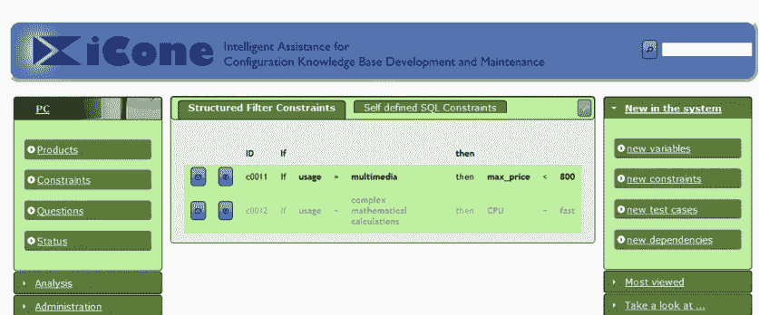

**图 8.1** ICONE 知识获取环境：简单 *requires* 关系的示例（参见 Hotz et al., 2014）。

### 提供起点。

提供起点的基本方法是预先确定用户感兴趣的参数设置。此类起点充当 *default values*，在配置会话范围内向用户提出。一方面，默认值可以表示特定的参数设置，例如，在德语国家，配置中键盘部分的取值为德语。另一方面，默认值可以表示整个子配置；例如，计算机配置中包含的软件包的默认安装设置。无论默认值的通用类型如何（即特定参数设置与整个子配置），默认值可以根据确定默认值的方式进行区分。以下将讨论三种基本类型的默认值。

#### 静态默认值。

参数具有固定的预定义默认值，该值与当前配置上下文无关。例如，参数 *internet* 的默认值设置为 *yes*，因为假设大多数用户希望包含相应的网络硬件。此类默认值的应用是有限的，因为在许多情况下默认值取决于用户交互的上下文。以下两种类型的默认值考虑了这种 *contextualization* 方面。

#### 基于规则的默认值。

在此，默认值的确定是个性化的，默认值的选择是基于预定义的默认规则执行的。此类规则的一个示例如下：*if the user has selected "programming" as a main field of application then the default value of the parameter "memory" is set to xGB.* 尽管此默认值类型考虑了上下文信息（基于规则），但规则会触发知识获取和维护工作。以下默认值类型不依赖于上下文的显式规范，而是依赖于基于已完成配置会话分析的上下文学习。

#### 自适应默认值。

**表 8.3** 基于 *协同过滤* 确定计算机配置器参数默认值示例（Konstan et al., 1997）。

| User | CPU | Motherboard | OS | Screen | HD | Internet |
|---|---|---|---|---|---|---|
| 1 | CPUD | MBDiamond | OS-Alpha | ScreenA | MedStore | Yes |
| 2 | CPUS | MBSilver | OS-Beta | ScreenB | MedStore | No |
| 3 | CPUS | MBSilver | OS-Beta | ScreenA | MaxStore | Yes |
| 4 | CPUS | MBSilver | OS-Beta | ScreenB | MedStore | No |
| 5 | CPUD | MBDiamond | OS-Alpha | ScreenA | MedStore | No |
| Current | CPUD | MBDiamond | ? | ? | ? | ? |

如果我们希望尽可能降低知识库开发和维护工作，我们必须开发能够自动确定当前用户相关参数设置的机制。可以应用不同类型的机器学习方法来支持此类默认值的自适应确定（Ardissono et al., 2003; Cöster et al., 2002; Falkner et al., 2011; Tiihonen and Felfernig, 2010）。协同过滤应用的一个示例见表 8.3。向 *current user* 提出的 *OS*（操作系统）参数的默认值将为 *OS-Alpha*，因为 *current user* 的最近邻居（用户 1 和 5）选择了 *OS-Alpha*。基于自适应默认值的示例用户界面如图 8.2 所示。此配置器（RecoMobile）支持移动电话的配置（详情参见 Tiihonen et al., 2014¹³）。

在 *知识工程和维护场景* 的背景下，默认值也起着重要作用。对可能与当前用户（知识工程师或领域专家）相关的约束的推荐（见图 8.1）可以解释为一种特定的自适应默认值。类似的默认值也可以为诊断（Felfernig and Schubert, 2010）或冗余约束集确定（即删除时不改变知识库语义的约束；Felfernig et al., 2011）。在此上下文中，默认值可以解释为一组有缺陷或冗余的约束。

### 支持增量细化。

支持用户进行偏好构建的一个重要功能是在相应的比较表中明确可视化不同配置替代方案之间的现有权衡（Felfernig et al., 2006a）。常用于支持此类权衡分析的方法是简单地根据其 *price* 对替代配置进行排序（见图 8.3）。以这种方式呈现配置替代方案会使产品比较偏向于对价格属性的评估（参见 Mandl et al., 2014¹⁴）。由于 *price* 在许多情况下是最重要的决策标准，此类界面常用于商业环境中。这种产品比较类型的最大缺点是界面没有考虑用户的真实偏好。

如果有用户偏好信息可用，则可以在呈现配置替代方案时予以考虑。为了我们的示例目的，假设当前用户对不同产品属性重要性的偏好是已知的（见表 8.4）。此类偏好


### 8.3 技术问题


**图 8.2**  
RecoMobile 用户界面，用于表示（自适应）默认值。

**表 8.4** 用户偏好示例列表。

| 价格 | CPU | 主板 | 网络 |
|---|---|---|---|
| 5% | 35% | 35% | 25% |

例如，可以通过直接询问用户或从以往用户的行为中学习来获得这些偏好。此外，我们还对不同产品属性进行了效用评估（见表 8.5）。

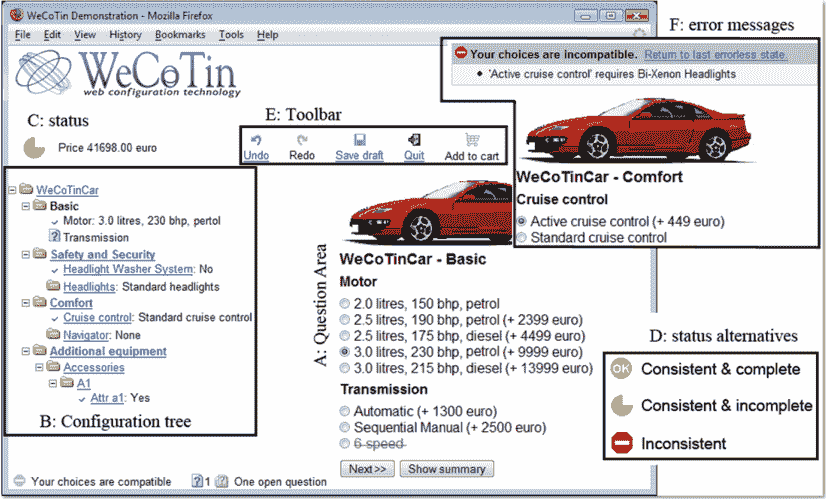

**图 8.7**  
WeCoTiN：配置环境（汽车配置器）。

反馈；应用程序的错误行为可以立即报告给负责的知识工程师。有关配置器应用程序的图形化开发、测试和调试环境的进一步研究，可参见 Felfernig（2007）。

**指导消费者。** 帮助用户更好地理解配置结果以及出现不一致情况的基本且广泛采用的方法是提供*解释*（Sinz 等，2007）。基本上，我们可以区分两种基本形式的解释。第一种，解释可以提供一组*论证*，说明为什么推荐某个配置方案（Felfernig 等，2006a）。第二种，在配置器无法找到任何解决方案的情况下，必须告知用户潜在的不一致之处以及可能的修复方法。图 8.7 展示了此类不一致可视化的示例，其中显示了 WeCoTiN 配置环境的屏幕截图（Tiihonen 等，2013）。该环境代表了回答集编程（ASP；另见 Hotz 等，2014¹⁷ 和 Tiihonen 与 Anderson，2014¹⁸）领域开创性研究的成果。

在*知识库开发与维护*的情境中，知识工程师和领域专家也面临类似的情况——他们必须了解错误行为的来源；例如，当某些测试用例因知识库先前的变更而变得无效时。

¹⁷ 第 6 章。  
¹⁸ 第 26 章。

**表 8.6** 配置器用户界面的设计原则与技术基础。

| 原则 | 技术基础 |
|---|---|
| 定制定制过程 | 参数选择（Falkner 等，2011）<br>自适应知识获取（Burke 等，2011） |
| 提供起点 | 默认值推荐（Falkner 等，2011；Tiihonen 和 Felfernig，2010）<br>知识库诊断推荐（Felfernig 等，2012） |
| 支持增量式细化 | 配置比较（Felfernig 等，2006a；Heiskala 等，2003）<br>诊断比较（Felfernig 等，2009） |
| 利用原型避免意外 | 配置可视化（Fano 和 Kurth，2003）<br>图形化测试与调试（Felfernig，2007） |
| 指导消费者 | 个性化诊断（Felfernig 等，2009）<br>解释（Friedrich 等，2011） |

在这种情况下，诊断承担了解释的角色（另见 Felfernig 等，2014¹⁹）。除了这些基本类型的解释之外，前面章节讨论的所有配置器用户界面开发标准也有助于更好地理解产品领域和底层配置知识库。定制定制过程允许用户处理他们感兴趣的主题，从而更了解产品领域的相关概念。同样，知识工程师也能高效地建立对配置知识库中最相关组件和约束的基本理解。提供起点以部分配置等形式提供初始且合理的设置，从而有助于减少与设计一致配置相关的开销。此外，由于提供了潜在不一致来源的额外指标，起点也使知识工程操作更加高效。

知识工程师和领域专家在建立对修复知识库一致性所需的替代修复操作之间权衡的基本理解方面得到了支持。支持增量式细化的概念，例如基于产品比较页面，帮助用户清晰理解配置知识库所提供的解决方案空间中的现有权衡。最后，可视化替代配置的原型可以显著帮助用户更好地理解并形成对特定解决方案方案的更清晰偏好。在知识库开发的情境中，此类可视化有助于理解变更操作对知识库下一版本的不同影响（Felfernig，2007）。

为总结所讨论的配置环境用户界面设计原则，我们提供了这些原则的概览，包括相关的技术基础（见表 8.6）。

### 8.4 配置器用户界面开发中的可用性问题

配置模型的多样性对用户界面的设计和结构有很大影响——尽管如此，仍可以识别出某些共性。*配置器数据库项目*提供了在线配置器的集合，包含 800 多个条目。在分析该数据库中包含的配置环境后，我们发现超过 50% 的被分析配置器具有以下基本特征：

- 所选组件在配置过程结束时汇总。
- 可用于配置的产品以图片形式呈现。
- 流程导航（如果有）以水平方式结构组织。
- 选择字段位于产品图片旁边和/或下方。
- 购物车、下单按钮和总价格清晰可见。

一个考虑了上述特征的配置器应用程序如图 8.8 所示。它旨在作为配置器应用程序开发者的示例。关于各个配置器用户界面元素设计的重要提示如下：

- 标志应放置在显眼位置以便快速识别。
- 导航栏应清晰可见且不分散。
- 产品（配置）图像的尺寸应足以看到细节。
- 选择框应遵循逻辑分组。
- 价格（价格表）应在会话的所有步骤中都可访问。
- 用户偏好应可调整（例如，通过后退/前进导航）。
- 购物车和下单按钮应可用于完成购买。

总之，推荐采用*贴近现实的方法*，以减少客户对尚未实际接触到的产品所感到的不确定性。有关配置器用户界面开发中可用性问题的更详细讨论，请参阅 Rogoll 和 Piller（2004）。

### 8.5 结论

在本章中，我们概述了为配置环境开发用户界面的相关原则。在此背景下，我们关注了两种类型的用户界面：面向最终用户的界面，以及面向负责知识库开发和维护的知识工程师和领域专家的界面。除了对设计原则的讨论之外，我们还提出了一些有助于实现这些原则的技术。

**图 8.8**  
一个基于 Web 的自行车配置器原型（见 www.cyledge.com）。

## 致谢

本章所述工作部分由奥地利研究促进机构资助（资助号：827587）。

## 参考文献

Anderson, D., Pine, J.B., 1996. Agile Product Development for Mass Customization. McGraw-Hill.

Ardissono, L., Felfernig, A., Friedrich, G., Goy, A., Jannach, D., Petrone, G., Schäfer, R., Zanker, M., 2003. A framework for the development of personalized, distributed web-based configuration systems. AI Magazine 24 (3), 93–108.

Blythe, J., Kim, J., Ramachandran, S., Gil, Y., 2001. An integrated environment for knowledge acquisition. In: 6th International Conference on Intelligent User Interfaces. ACM, New York, Santa Fe, NM, pp. 13–20.

Burke, R., Felfernig, A., Göker, M., 2011. Recommender systems: an overview. AI Magazine 32 (3), 13–18.


Cöster, C., Gustavsson, A., Olsson, R., Rudström, A., 2002. 增强基于网络的配置的推荐和基于聚类的帮助。载于：Francesco, R., Barry, S. 编者, AH’02 Workshop on Recommendation and Personalized in e-Commerce。Universidad de Málaga, Málaga, Spain, 页 30–40。
Falkner, A., Felfernig, A., Haag, A., 2011. 可配置产品的推荐技术。AI Magazine 32 (3), 99–108。
Fano, A., Kurth, S., 2003. Personal Choice Point: 帮助用户可视化购买宝马的含义。载于：International Conference on Intelligent User Interfaces IUI’03。ACM, New York; Miami, FL, 页 46–52。
Felfernig, A., 2007. 大规模定制的技术基础——标准化配置知识表示。IEEE Transactions on Engineering Management 54 (1), 41–56。
Felfernig, A., Schubert, M., 2010. 诊断不一致的需求。载于：Hotz, L., Haselböck, A. 编者, 19th European Conference on Artificial Intelligence (ECAI-2010), Workshop on Configuration。Lisbon, Portugal, 页 15–20。
Felfernig, A., Friedrich, G., Jannach, D., Zanker, M., 2006a. 基于知识的推荐应用开发的集成环境。International Journal of Electronic Commerce (IJEC) 11 (2), 11–34。
Felfernig, A., Teppan, E., Gula, B., 2006b. 营销和销售的知识型推荐技术。International Journal of Pattern Recognition and Artificial Intelligence (IJPRIA) 21 (2), 333–354 (special issue of Personalization Techniques for Recommender Systems and Intelligent User Interfaces)。
Felfernig, A., Friedrich, G., Gula, B., Hitz, M., Kruggel, T., Melcher, R., Riepan, D., Strauss, S., Teppan, E., Vitouch, O., 2007. 说服性推荐：探索知识型推荐系统中的序列位置效应。载于：De Kort, Y., IJsselsteijn, W., Midden, C., Eggen, B., Fogg, B.J. 编者, 2nd International Conference of Persuasive Technology (Persuasive 2007)。Lecture Notes in Computer Science, vol. 4744。Springer, Palo Alto, CA, 页 283–294。
Felfernig, A., Gula, B., Leitner, G., Maier, M., Melcher, R., Teppan, E., 2008. 知识型推荐中的说服。载于：Oinas-Kukkonen, H., Hasle, P.F.V., Harjumaa, M., Segerstähl, K., Öhrstrm, P. 编者, Persuasive Technology, 3rd International Conference (PERSUASIVE 2008)。Lecture Notes in Computer Science, vol. 5033。Springer, Oulu, Finland, 页 71–82。
Felfernig, A., Schubert, M., Friedrich, G., Mandl, M., Mairitsch, M., Teppan, E., 2009. 不一致需求的可行修复。载于：21st International Joint Conference on Artificial Intelligence (IJCAI’09), Pasadena, CA, 页 791–796。
Felfernig, A., Zehentner, C., Blazek, P., 2011. CoreDiag: 消除约束集中的冗余。载于：22nd International Workshop on Principles of Diagnosis (DX’2011), Murnau, Germany, 页 219–224。
Felfernig, A., Schubert, M., Zehentner, C., 2012. 不一致约束集的高效诊断算法。Artificial Intelligence for Engineering Design, Analysis and Manufacturing (AI EDAM) 26 (1), 53–62。
Felfernig, A., Reiterer, S., Stettinger, M., Reinfank, F., Jeran, M., Ninaus, G., 2013a. 配置知识工程的推荐系统。载于：Workshop on Configuration。Vienna, Austria, 页 51–54。
Felfernig, A., Schippel, S., Leitner, G., Reinfank, F., Isak, K., Mandl, M., Blazek, P., Ninaus, G., 2013b. 约束型推荐系统中评分规则的自动修复。AI Communications 26 (2), 15–27。
Felfernig, A., Schubert, M., Reiterer, S., 2013c. 超约束问题的个性化诊断。载于：23rd International Conference on Artificial Intelligence。Peking, China, 页 1990–1996。
Felfernig, A., Reiterer, S., Reinfank, F., Ninaus, G., Jeran, M., 2014. 配置中的冲突检测与诊断。载于：Felfernig, A., Hotz, L., Bagley, C., Tiihonen, J. 编者, Knowledge-based Configuration – From Research to Business Cases。Morgan Kaufmann Publishers, Waltham, MA, 页 73–87 (Chapter 7)。
Friedrich, G., Ryabokon, A., Falkner, A.A., Haselböck, A., Schenner, G., Schreiner, H., 2011. 基于模型生成的 (Re)configuration。载于：Second Workshop on Logics for Component Configuration (LoCoCo 2011), Perugia, Italy, 页 26–35。
Friedrich, G., Jannach, D., Stumptner, M., Zanker, M., 2014. 配置系统的知识工程。载于：Felfernig, A., Hotz, L., Bagley, C., Tiihonen, J. 编者, Knowledge-based Configuration – From Research to Business Cases。Morgan Kaufmann Publishers, Waltham, MA, 页 139–155 (Chapter 11)。
Grabner-Kräuter, S., Kaluscha, E., 2003. 在线信任的实证研究：综述与批判性评估。International Journal of Human-Computer Studies 58 (6), 783–812。
Heiskala, M., Anderson, A., Huhtinen, V., Tiihonen, J., Martio, A., 2003. 比较可配置产品的工具。载于：18th International Joint Conference on Artificial Intelligence – Workshop on Configuration。AAAI, Acapulco, Mexico, 页 64–69。
Hotz, L., Wolter, K., 2014. Smarthome 配置模型。载于：Felfernig, A., Hotz, L., Bagley, C., Tiihonen, J. 编者, Knowledge-based Configuration – From Research to Business Cases。Morgan Kaufmann Publishers, Waltham, MA, 页 121–135 (Chapter 10)。
Hotz, L., Felfernig, A., Stumptner, M., Ryabokon, A., Bagley, C., Wolter, K., 2014. 配置知识表示与推理。载于：Felfernig, A., Hotz, L., Bagley, C., Tiihonen, J. 编者, Knowledge-based Configuration – From Research to Business Cases。Morgan Kaufmann Publishers, Waltham, MA, 页 41–72 (Chapter 6)。
Konstan, J., Miller, B., Maltz, D., Herlocker, J., Gordon, L., Riedl, J., 1997. GroupLens: 将协同过滤应用于 Usenet 新闻全文。Communications of the ACM 40 (3), 77–87。
Mandl, M., Felfernig, A., Teppan, E., 2014. 消费者决策与配置系统。载于：Felfernig, A., Hotz, L., Bagley, C., Tiihonen, J. 编者, Knowledge-based Configuration – From Research to Business Cases。Morgan Kaufmann Publishers, Waltham, MA, 页 181–190 (Chapter 14)。
Mittal, S., Frayman, F., 1989. 迈向配置任务的通用模型。11th International Joint Conference on Artificial Intelligence (IJCAI-89), Detroit, Michigan, vol. 2 页 1395–1401。
Piller, F.T., Blazek, P., 2014. 可持续大规模定制的核心能力。载于：Felfernig, A., Hotz, L., Bagley, C., Tiihonen, J. 编者, Knowledge-based Configuration – From Research to Business Cases。Morgan Kaufmann Publishers, Waltham, MA, 页 107–120 (Chapter 9)。
Pine, B.J., 1999. 大规模定制：商业竞争的新前沿。Harvard Business School Press。
Randall, T., Terwiesch, C., Ulrich, K., 2005. 定制产品用户设计的原则。California Management Review 47 (4), 1–18。
Rogoll, T., Piller, F.T., 2004. 从客户角度的产品配置：服装行业配置系统的比较。载于：International Conference on Economic, Technical and Organisational aspects of Product Configuration Systems (PETO 2004)。Lyngby, Copenhagen, Denmark, 页 179–199。
Sabin, D., Weigel, R., 1998. 产品配置框架——综述。IEEE Intelligent Systems 13 (4), 42–49。
Simonson, I., 2003. 客户对定制化优惠的反应决定因素：概念框架与研究命题。Stanford GSB Working Paper No. 1794。
Sinz, C., Haag, A., Narodynska, N., Walsh, T., Gelle, E., Sabin, M., Junker, U., O’Sullivan, B., Rabiser, R., Dhungana, D., Grünbacher, P., Lehner, K., Federspiel, C., Naus, D., 2007. Configuration。IEEE Intelligent Systems 22 (1), 78–90。
Tiihonen, J., Anderson, A., 2014. VariSales。载于：Felfernig, A., Hotz, L., Bagley, C., Tiihonen, J. 编者, Knowledge-based Configuration – From Research to Business Cases。Morgan Kaufmann Publishers, Waltham, MA, 页 309–318 (Chapter 26)。
Tiihonen, J., Felfernig, A., 2010. 迈向可配置产品推荐。International Journal of Mass Customization 3 (4), 389–406。
Tiihonen, J., Heiskala, M., Anderson, A., Soininen, T., 2013. WeCoTin – 一个实用的基于逻辑的销售配置器。AI Communications 26 (1), 99–131。
Tiihonen, J., Felfernig, A., Mandl, M., 2014. 个性化配置。载于：Felfernig, A., Hotz, L., Bagley, C., Tiihonen, J. 编者, Knowledge-based Configuration – From Research to Business Cases。Morgan Kaufmann Publishers, Waltham, MA, 页 167–179 (Chapter 13)。
Winterfeldt, D., Edwards, W., 1986. 决策分析与行为研究。Cambridge University Press, London, UK。


## 可持续大规模定制的核心能力

Frank T. Piller* 和 Paul Blazek†
*德国亚琛工业大学，亚琛，德国
†cyLEDGE，奥地利维也纳

摘要：大规模定制的目标是：以可负担的价格，在客户需要的时间，高效地向客户提供他们想要的产品和服务。实现这一承诺，从流程设计的角度看，需要将客户整合到制造商的价值链中。在此过程中，配置流程通过为客户共同设计其个性化产品或服务提供支持和导航，在管理这一任务中发挥着关键作用。但这种由现代配置系统所实现的能力——“选择导航”，只是大规模定制的三大战略能力之一。本章阐述了为什么配置系统在满足每一位个体客户的特定需求方面发挥着至关重要的作用，并探讨了可持续大规模定制的基本能力：解决方案空间开发、稳健流程设计以及选择导航。

### 9.1 引言

大规模定制（MC）¹的目标是以接近大规模生产的效率，交付满足个体客户需求的产品和服务（Tseng and Jiao, 2001）。产品配置系统也被称为“协同设计工具包”（Franke and Piller, 2003, 2004），是大规模定制中的传统工具，使个体客户能够指定产品特性（Sabin and Weigel, 1998）。配置系统也被称为配置器、选择板、设计系统、工具包或协同设计平台（Hvam et al., 2008; Salvador and Forza, 2007）。它们负责引导用户完成偏好获取过程。文献中提及“配置器”或“配置系统”时，大多是在技术意义上使用，通常指一种软件工具。然而，这类工具的成功绝不仅仅取决于其技术能力，还取决于其与销售环境的整合、其支持学习的能力、其提供体验和流程满意度的能力，以及其与品牌理念的融合。

用于大规模定制的配置系统必须与用于复杂技术需求的配置系统区分开来（Stumpfner, 1997）。后者是需要使用培训且主要由技术专家使用的专家工具，而大规模定制产品配置器处理的是企业与客户之间的互动与合作（Khalid and Helander, 2003; Tseng et al., 2003）。早在1991年，Udwadia 和 Kumar 就已预见，客户和制造商将成为那些面向每位客户个体使用而设计的产品的共同构建者（即协同设计者）。在他们

¹本章综合了两篇早期出版物中的论述：Piller (2008) 和 Salvador et al. (2009)。

看来，当客户对自己想要什么只有一种模糊的感觉时，共同构建就会发生。没有客户的深度参与，制造商将无法充分满足每一项个体产品需求。

在这篇开创性论文（Udwadia and Kumar, 1991）之后，计算机技术，尤其是购买前模拟潜在产品设计的能力，极大地推动了协同设计技术的发展（Haug and Hvam, 2007; Ulrich et al., 2003）。这种协作方式也被称为协作式定制（Gilmore and Pine, 1997）。在协作式定制中，制造商与客户通过一个能够轻松表达准确需求（即产品的设计、合身度和功能）的系统，共同识别并满足客户需求。Anderson-Connell 等人（2002）使用“协同设计”一词来描述消费者与制造商之间的协作关系，在这种关系中，通过设计经理与消费者之间的互动过程，根据消费者的规格说明并基于现有的制造组件来设计产品。

精密的配置器已在多个领域成为推动力量；在大规模定制中，它们通过将耗时的需求识别过程转移到客户自身，成为将定制制造与大规模生产结合起来的概念的效率驱动因素之一。将创建个性化产品的责任转移给客户，同时也带来了必须满足的一系列要求，以避免混乱。要理解所需配置功能的性质和复杂性，有必要更深入地审视在应对产品定制时发挥作用的各项能力。

成功实施大规模定制战略的企业，已经围绕三大核心能力构建了能力，这些能力驱动着可持续的大规模定制业务。从大规模定制中获利的关键在于，将其视为一套能够补充和丰富现有系统的组织能力。虽然关于这些能力性质和特征的具体答案显然取决于行业背景或产品特性，但有三组基本能力决定了企业进行大规模定制的本领。这些能力——解决方案空间开发、稳健流程设计和选择导航——源自 Salvador 等人（2009, 2008）的研究。这些能力背后的方法往往并不新鲜，其中一些已存在多年。但成功的大规模定制要求将这些方法以有意义且整合的方式组合成能力，从而设计出一条通过以差异化方式服务个体客户来创造价值的价值链。

### 9.2 解决方案空间开发

大规模定制者必须首先识别其客户的独特需求，特别是那些客户需求差异最大的产品属性。这与大规模生产者形成对比，后者通常试图专注于满足通用需求，理想情况下是所有目标客户共同拥有的需求。一旦这些信息被了解并理解，企业就可以定义其“解决方案空间”，清晰地界定它将提供什么、不提供什么。这个空间决定了某种供应旨在向客户提供的利益范围，以及在那一范围内可以提供哪些特定的功能组合（Pine, 1995）。

例如皮革或图案。鞋子的功能可以通过其缓冲性能、鞋跟形状或鞋钉结构来定义。

为了了解网上提供的种类繁多的可配置产品，我们建议仔细查阅基准研究《Customization 500》（Walcher and Piller, 2012）以及《Configurator Database Report 2013》（Blazek et al., 2013）。

#### 9.2.2 解决方案空间定义的方法

要定义解决方案空间，公司必须识别出客户之间存在差异、且客户在乎这些差异的那些需求。将解决方案空间所代表的选项与目标细分市场的需求相匹配，是大规模定制的一个关键成功因素（Hvam et al., 2008）。这一阶段的核心要求是获取“客户需求信息”，即关于产品和服务供应的客户及用户的偏好、需求、渴望、满意度和动机的信息。需求信息建立在对客户需求、运作和系统的深入理解和领会之上。发现客户之间尚未被挖掘的差异并非易事，因为关于未满足客户需求的信息是“粘性的”——也就是说，对于解决方案提供者而言，这些信息难以获取和编码（von Hippel, 1998）。从识别差异化属性、验证产品概念和收集客户反馈的角度来理解异质的客户需求，可能是一项代价高昂且复杂的工作，但有几种方法可以提供帮助。

第一种是采用传统的市场调研技术，即从所选市场领域中的代表性客户那里细致地收集数据。为了降低失败风险，来自客户的需求相关信息在新产品开发过程的许多节点被反复整合（Dahan and Hauser, 2002; Griffin and Hauser, 1993）。制造商选择一组客户并对其进行调查，以获取关于新产品需求的信息，分析数据，形成一个响应性的产品构想，并根据客户偏好（需求）和购买决策来筛选这一构想。这种模式在消费品领域尤其占据主导地位，在该领域，焦点小组、联合分析、客户调查和客户投诉分析等市场调研方法被经常用于识别和评估客户需求与欲望。

公司可用于定义其解决方案空间的第二种方法，是向客户提供用于用户共创的工具包（Franke and Piller, 2004; von Hippel and Katz, 2002）。这些软件设计工具类似于 CAD 系统，但具有易于使用的界面以及基本模块和功能库。借助这些工具包，客户可以自行将他们的偏好直接转化为产品设计，并在此过程中突显未被满足的需求。由此产生的信息可以被公司评估，并可能纳入其解决方案空间。

第三，在开发其解决方案空间（见表 9.1）时，公司可以采用某种形式的“客户体验智能”，即持续收集关于客户交易、行为或体验的数据，并分析这些信息以确定客户偏好的方法。这还包括不仅整合来自客户的数据，还整合来自那些可能已转向别处的潜在客户的数据。例如，考虑有人曾评估过但未下单的产品信息。这些数据可以从使用在线配置器的人的浏览行为所产生的日志文件中获得（Piller et al., 2004; Rangaswamy and Pal, 2003; Squire et al., 2004）。通过系统分析这些信息，管理者可以了解到很多关于客户


Table 9.1 Solution space definition approaches.

| Name | Description | References |
|---|---|---|
| Market research techniques | Selecting and surveying a group of customers to obtain information on needs for new products with the help of conventional market research approaches. | Dahan and Hauser (2002), Griffin and Hauser (1993) |
| Toolkits for user co-creation | Offering software tools that enable customers to translate their preferences directly into a product design and identifying unsatisfied needs during the process. | Franke and Piller (2004), von Hippel and Katz (2002) |
| Customer experience intelligence | Continuously collecting data on all transactions, behaviors, or experiences not only from customers but from all users and analyzing that information to determine preferences. | Piller et al. (2004), Rangaswamy and Pal (2003), Squire et al. (2004) |

preferences, ultimately leading to a refined solution space. A company could, for instance, eliminate options that are rarely explored or selected, and it could add more choices for the popular components. In addition, customer feedback can even be used to improve the very algorithms that a particular application deploys.

### 9.2.3 Modular Product Architectures

Once the relevant options to be represented in a solution space have been identified, these have to be transferred into a product architecture that includes the configuration model (Felfernig, 2007). It is important to note that mass customization does not mean to offer limitless choice, but to offer choice that is restricted to options that are already represented in the production system. In the case of digital goods (or components), customization possibilities may be infinite. In the case of physical goods, however, they are limited and may be represented by a modular product architecture. Modularity is an important part of many mass customization strategies (Duray, 2002; Gilmore and Pine, 1997; Kumar, 2005; Piller, 2005; Salvador, 2007). Each module provides one or more well-defined functions of the product and is available in several options that deliver a different performance level for the function(s) the product is intended to serve.

In order to manage the additional costs of variety, product families of similar or identical units can be formed. The product family approach has been recognized as an effective means to accommodate an increasing product variety across diverse market niches while still being able to achieve economies of scale (Tseng and Jiao, 2001; Zhang and Tseng, 2007). In addition to leveraging the costs of delivering variety, product family design can reduce development risks by reusing proven elements in a firm’s activities and offerings. Setting the modular product family structure of a mass customization system, and thus its solution space, becomes one of the foremost competitive capabilities of a mass customization company.

### 9.3 Robust Process Design

A core idea of mass customization is to ensure that an increased variability in customers’ requirements will not significantly impair the firm’s operations and supply chain (Pine et al., 1993). This can be achieved through robust process design, which is the capability to reuse or recombine existing organizational and value-chain resources to deliver customized solutions with high efficiency and reliability. A successful mass customization system hence is characterized by stable, but still flexible, responsive processes that provide a dynamic flow of products (Badurdeen and Masel, 2007; Pine, 1995; Salvador et al., 2004; Tu et al., 2001). Value creation within robust processes is the major differentiation of mass customization versus conventional (craft) customization. Traditional (craft) customizers often reinvent not only their products, but also their processes for each individual customer. Mass customizers use stable processes to deliver high-variety goods (Pine et al., 1993), which allows them to achieve near mass production efficiency, but it also implies that the customization options are somehow limited. Customers are being served within a list of predefined options or components, the company’s solution space.

The core objective of robust process design is to prevent or counterbalance the additional cost resulting from the flexibility a company needs to build in order to serve its customers individually. We can differentiate two sources of additional cost of flexibility (Su et al., 2005): (1) increased complexity and (2) increased uncertainty in business operations, which by implication results in higher operational cost.

Methods to establish robust processes. A primary mechanism to create robust processes in mass customization is the application of delayed product differentiation (postponement). Delayed product differentiation refers to partitioning the supply chain into two stages (Yang and Burns, 2003; Yang et al., 2004). A standardized portion of the product is produced during the first stage, while the differentiated portion of the product is produced in the second stage, based on customer preferences that were expressed in an order. The success of delayed product differentiation is a direct manifestation of the fact that most companies offer a portfolio of products that consists of families of closely related products that differ from each other in a limited number of differentiated features. An example of delayed product differentiation in the automotive industry would be to send a standard version of the car (a stripped or partially equipped version) to dealers and then allow the dealer to install, on the basis of customer-specific requests, options such as a CD/DVD player, the interior leather or fabric, and the cruise control system. Prior to the point of differentiation, product parts are reengineered in such a way that as many parts or components as possible are common to each configuration. Cost savings result from the risk-pooling effect and reduction in inventory stocking costs (Yang et al., 2004).

While postponement starts with the design of the offerings, another possibility to achieve robust processes is through flexible automation (Koste et al., 2004; Tu et al., 2001; Zhang et al., 2003). Although the words “flexible” and “automation” might have been contradictory in the past, that’s no longer the case. In the automotive industry, robots and automation are compatible with high levels of versatility and customization. Even process industries (e.g., pharmaceuticals, food, and so on), once synonymous with rigid automation and large batches, nowadays enjoy levels of flexibility once considered unattainable. Similarly, many intangible goods and services also lend themselves to flexible automated solutions, oftentimes based on the Internet.

A complementary approach to flexible automation is process modularity, which can be achieved by thinking of operational and value-chain processes as segments, each one linked to a specific source of variability in the customers’ needs (Pine et al., 1993). As such, the company can serve different customer requirements by appropriately recombining the process segments, without the need to create costly ad-hoc modules (Zhang et al., 2003). BMW’s Mini factory, for instance, relies on individual mobile production cells with standardized robotic units. BMW can integrate the cells into an existing system in the plant within a few days, thus enabling the company to quickly adapt to unexpected swings in customer preferences without extensive modifications of its production areas.

### 9.4 Choice Navigation

#### 9.4.1 Paradox of Choice

A mass customizer must support customers in identifying their own needs and creating solutions while minimizing complexity and the burden of choice. When a customer is exposed to a myriad of choices, the cost of evaluating those options can easily outweigh the additional benefit from having so many alternatives. The resulting syndrome has been called the “paradox of choice” (Schwartz, 2004), in which too many options can actually reduce customer value instead of increasing it (Desmeules, 2002; Huffman and Kahn, 1998). In such situations, customers might postpone their buying decisions and, worse, classify the vendor as difficult and undesirable. Research in marketing has addressed this issue in more detail and has found that the perceived cognitive cost is one of the largest hurdles toward a larger adaption of mass customization from the consumer perspective (Dellaert and Stremersch, 2005). To avoid that, companies have to provide means of choice navigation to simplify the ways in which people explore their offerings.

#### 9.4.2 Effective Support of Interaction

When looking at the interaction patterns offered by configurators it becomes obvious that the different types with their different goals and solution spaces must have specific characteristics in defining the way the interface to the customer has to look like (see also Leitner et al., 2014²). The range of product configurators spans from simple Select-to-order (STO) and Pick-to-order (PTO) configurators, to currently massive growing Assemble-to-order (ATO) and Configure-to-order (CTO) configuration systems, up to sophisticated Make-to-order (MTO) and high-end Engineer-to-order (ETO) solutions that bridge the field of product configurators with the field of user innovation configurators (see Table 9.2).

The more complex the purpose of a configuration system is, the lower is the similarity between individual systems. Nevertheless a number of findings shed light on recurring patterns, which are the basis for more general interaction rules. It seems to be clear that the success of a configuration system is not only defined by its technological capabilities but by many more factors such as its ability to allow learning by doing, to add experience effects, and to initiate process satisfaction (Franke and Piller, 2003).

As almost any interaction throughout the customer buying cycle might take place via online channels, it is important to see the information delivery aspects that play an enabling and an accompanying role to the configuration process itself. According to Totz and Riemer (2001), information has to be communicated in a clear and sufficient way to eliminate uncertainties when configuring products.


**表9.2 产品配置器的类型。**

| 类型 | 描述 | 复杂度 |
| --- | --- | --- |
| 按订单选择（STO） | 客户选择产品的所有必要组件。没有组件依赖关系。 | 低 |
| 按订单挑选（PTO） | 客户挑选产品组件，并在没有配置器支持的情况下自行处理依赖关系。 | 低 |
| 按订单装配（ATO） | 配置器在考虑组件依赖关系的情况下匹配预制组件。 | 中 |
| 按订单配置（CTO） | 配置器基于模块化系统，支持客户选择相互匹配的组件。 | 中 |
| 按订单制造（MTO） | 配置器允许客户根据产品规则定义特定参数。制造在订单之后进行。 | 中–高 |
| 按订单设计（ETO） | 配置自由度非常高。可能需要新的组件和新的规则来满足客户的配置需求。 | 高 |

必须提供关于可用产品和服务以及配置可能性的信息。用户必须被告知价格、交付和售后条件。生产者必须提供关于公司能力以及品牌和购物体验的信息。此外，推荐最合适的产品和服务有助于减少不确定性。

信息传递的棘手之处在于，向客户展示产品的方式多种多样。Salvador 和 Forza (2007) 指出，同一产品的描述可能侧重于不同的抽象程度，例如侧重于产品性能、产品功能或物理产品组件。通过使用符合客户认知期望的方法、语言和语调来提高客户理解产品的能力，可以降低配置复杂性；同时，减少客户的整体信息负荷也应是这一简化策略的一部分。Rogoll 和 Piller (2004) 指出，可用性直接决定配置系统的成败。重要的可用性方面包括可操作性和自解释性（即直观的操作和导航）、导向性（即应用结构的透明度和可追溯性）、信息的个性化访问（即信息必须以不同的方式可访问，如文本、视觉、字母顺序等）、加载时间（即应用程序在加载或更新每个配置步骤时不能花费太长时间）以及支持（即支持功能必须能够处理配置过程中可能出现的潜在问题）。

除了这些可用性方面，还有其他参数强烈影响产品配置系统的感知质量：视觉真实感（即产品配置过程可视化的真实程度）、创造性（即配置产品时创造自由的程度和限制）、愉悦感（即配置过程的乐趣、快乐、愉悦、娱乐性和趣味性如何）、选择选项（即解决方案空间中给定选择选项的感知程度；Walcher 和 Piller, 2012）。在不确定性下说服客户购买，并充分满足每个客户的具体需求，仍然是一项需要掌握的挑战。

### 9.4.3 可获得的收益与过程满意度

选择导航不仅从客户的角度避免了选择的复杂性和品种多样性的负面影响；相反，以有意义的方式向客户提供选择可以带来新的利润机会（Franke 和 Schreier, 2010）。研究表明，对定制（消费）产品的额外支付意愿中，高达 50% 可以用对共同设计过程本身的积极感知来解释（Franke 和 Piller, 2004; Franke 和 Schreier, 2010; Merle 等, 2010; Schreier, 2006）。客户共同设计的产品还可能为他们提供象征性（内在和社会性）利益，这些利益源于共同设计的实际过程而非其结果。例如，Schreier (2006) 引用了“作者自豪感效应”。这种效应与前面讨论的对独特性的渴望有关，但这里是基于独特的任务而非结果。除了愉悦感之外，完成任务还具有创造感。参与共同设计过程可能被参与此任务的个人视为一个高度创造性的问题解决过程，从而成为购买大规模定制产品的动机。越来越多的社交媒体应用（如 Facebook、Twitter、Pinterest、YouTube、Google Plus）支持传播这种创造出的产品个性。因此，客户在社交网络中的整合是又一个领域，近期论文（Blazek 等, 2012; Piller 等, 2012）对此进行了关注。

通过共同设计实现客户满意度的一个重要前提是过程本身应该是成功的。客户必须有能力执行任务。这一能力问题涉及“心流”（flow），这是研究人员经常使用的一个构念，用来解释客户参与过程如何提高满意度（Csíkszentmihályi, 1990）。心流是一种最佳体验的过程，当有动机的用户在互动过程中感知到自己的技能与当前挑战之间的平衡时，就会实现这种体验（Novak 等, 2000）。正如近期市场营销研究表明的那样，与共同设计工具包的互动可能会导致这种状态（Dellaert 和 Stremersch, 2005; Franke 等, 2008; Fuchs 等, 2010）。相应地，近期研究提供了一些设计指南，应能促进这种过程满意度的效果（Dellaert 和 Dabholkar, 2009; Franke 等, 2009; Randall 等, 2005）。

### 9.4.4 学习型关系

共同设计过程背后的制造商与客户之间的互动，为进一步建立忠诚度和持久的客户关系提供了可能性。一旦客户成功购买了某件个性化商品，制造商所获得的知识就构成了防止客户转向其他供应商的潜在障碍。客户的重新订购变得容易得多。以大型运动用品制造商阿迪达斯（Adidas）为例（Berger 等, 2005）。2001年，该公司推出了大规模定制计划“mi adidas”，提供在合脚性、功能性和美学设计方面定制的运动鞋。这个过程始于一位想购买约150美元个性化跑鞋的客户。在整合过程中，客户向供应商透露的喜好和厌恶越多，产品第一次就满足客户确切需求的机会就越大。制造商可以利用有关客户的详细信息进行下一次销售，确保所提供的服务变得更快捷、更简单、更有针对性。随着每一次额外销售，信息状态都会增加并得到更精细的调整。

当阿迪达斯与其客户建立学习型关系时，它增加了来自每个客户的收入，因为除了实际的产品利益外，它还简化了购买决策，使客户不断回来。通过汇总来自一部分个体客户的信息，阿迪达斯还获得了有价值的市场调研知识。因此，大众市场细分的新产品可以更高效地规划，而且由于可以不受过滤地获取市场趋势和客户需求的数据，市场调研也更加有效。这对于那些将大规模备货生产与定制服务结合起来的公司尤其有利。因此，大规模定制可以成为提高大规模生产系统效率的赋能战略。

这种学习型关系可能会带来新的成本节约潜力（Piller 等, 2004），其基础是更好地获取有关客户群需求的知识（Kotha, 1995; Squire 等, 2004）。这包括：

- 减少对产品需求预测的需求（或至少集中预测的可能性）
- 减少或消除成品库存水平
- 减少产品退货
- 降低过时或款式过时的风险
- 防止因客户在商店中找不到符合其要求的产品而将购买预算分配给其他商品所造成的销售损失

这些效果带来的节约可能非常巨大。Forrester Research 估计，美国汽车行业从目前的按库存生产模式转向按订单生产系统，每辆车可节省高达 3,500 美元（Reichwald 和 Piller, 2009）。

### 9.4.5 选择导航的高级方法

客户共同设计工具包的应用可能是帮助客户在大规模定制系统中进行选择导航的最常用方法。但也存在许多其他方法。一种有效的方法是我们称之为“品类匹配”（assortment matching）的方法（Salvador 等, 2009），即软件通过将客户的需求模型与现有选项集的特征进行匹配，自动为客户构建配置。然后客户只需评估预定义的配置，这大大节省了搜索过程中的精力和时间。例如，使用特殊软件，Sears.com 的客户可以通过选择不同的体型、发型、面部特征等来创建自己的虚拟形象。系统可以根据这些信息，从在线商家庞大的商品品类中推荐商品。

但客户在收到推荐后可能并不总是准备好做出决定（另见 Tiihonen 等, 2014³）。他们可能不确定自己的真实偏好，或者推荐可能看起来不符合他们的需求。在这种情况下，将推荐系统与共同设计工具包相结合是一个完美的解决方案。以 121Time.com 的在线购物者为例，该公司是定制瑞士手表的主要供应商。手表市场的客户可能对自己想要什么有一个大致的想法，但在使用在线配置器尝试各种选项、组合颜色和风格时，他们实际上可以看到一个选择如何影响另一个选择，并影响手表的整体外观。通过这种迭代过程，他们了解了自己的偏好——这些重要信息随后会体现在后续配置中。

许多公司正在采用更具创新性和颠覆性的选择导航方法。在近期的一些产品中，选择导航已完全自动化，这些产品能够理解它们应如何适应用户，然后相应地重新配置自身。这些产品配备了所谓的嵌入式配置能力，矛盾的是，对制造商而言它们成为标准产品，而用户却体验到定制化的解决方案。这可以被视为一种延迟配置策略，即用户可以在此产品制造完成并到达用户领域之后对其进行修改，从而提供嵌入式产品的“智能”。想象一下，产品具有……


Blazek, P., Partl, M., Streichsbier, C., 2013. Configurator Database Report 2013. Tech. rep., Raleigh, NC. <www.configurator-database.com/report2013>.
Csikszentmihályi, M., 1990. Flow: The Psychology of Optimal Experience. Harper & Row, New York.
Dahan, E., Hauser, J., 2002. The virtual customer. Journal of Product Innovation Management 19 (5), 332–353.
Dellaert, B.G., Dabholkar, P., 2009. Increasing the attractiveness of mass customization: the role of complementary online services and range of options. International Journal of Electronic Commerce 13 (3), 43–70.
Dellaert, B.G.C., Stremersch, S., 2005. Marketing mass customized products: striking the balance between utility and complexity. Journal of Marketing Research 42 (2), 219–227.
Desmeules, R., 2002. The impact of variety on consumer happiness: marketing and the tyranny of freedom. Academy of Marketing Science Review 12, 1–18.
Duray, R., 2002. Mass customization origins: mass or custom manufacturing? International Journal of Operations & Production Management 22 (3), 314–328.
Felfernig, A., 2007. Standardized configuration knowledge representations as technological foundation for mass customization. IEEE Transactions on Engineering Management 54 (1), 41–56.
Franke, N., Piller, F.T., 2003. Key research issues in user interaction with configuration toolkits in a mass customization system. International Journal of Technology Management 26, 587–599.
Franke, N., Piller, F.T., 2004. Value creation by toolkits for user innovation and design: the case of the watch market. Journal of Product Innovation Management 21 (6), 401–415.
Franke, N., Schreier, M., 2010. Why customers value self-designed products: the importance of process effort and enjoyment. Journal of Product Innovation Management 27 (7), 1020–1031.
Franke, N., Keinz, P., Schreier, M., 2008. Complementing mass customization toolkits with user communities: how peer input improves customer self-design. Journal of Product Innovation Management 25 (6), 546–559.
Franke, N., Keinz, P., Steger, C., 2009. Testing the value of customization: when do customers really prefer products tailored to their preferences? Journal of Marketing 73 (5), 103–121.
Fuchs, C., Schreier, M., Prandelli, E., 2010. The psychological effects of empowerment strategies on consumers’ product demand. Journal of Marketing 74 (1), 65–79.
Gilmore, J.H., Pine, B.J., 1997. The four faces of mass customization. Harvard Business Review 75 (1), 91–101.
Griffin, A., Hauser, J., 1993. The voice of the customer. Marketing Science 12 (1), 1–27.
Haug, A., Hvam, L., 2007. The modeling techniques of a documentation system that supports the development and maintenance of product configuration systems. International Journal of Mass Customization 2 (1–2), 1–18.
Huffman, C., Kahn, B., 1998. Variety for sale: mass customization or mass confusion. Journal of Retailing 74 (4), 491–513.
Hvam, L., Mortensen, N., Riis, H., 2008. Product Customization. Springer, Heidelberg, Berlin.
Khalid, H., Helander, M., 2003. Web-based do-it-yourself product design. In: Tseng, M., Piller, F.T. (Eds.), The Customer Centric Enterprise: Advances in Mass Customization and Personalization. Springer, New York, pp. 247–266.
Koste, L., Malhotra, M.K., Sharma, S., 2004. Measuring dimensions of manufacturing flexibility. Journal of Operations Management 22 (2), 171–196.
Kotha, S., 1995. Mass customization: implementing the emerging paradigm for competitive advantage. Strategic Management Journal 16 (S1), 21–42.
Kumar, A., 2005. Mass customization: metrics and modularity. International Journal of Flexible Manufacturing Systems 16 (4), 287–312.
Leitner, G., Felfernig, A., Blazek, P., Reinfank, F., Ninas, G., 2014. User interfaces for configuration environments. In: Felfernig, A., Hotz, L., Bagley, C., Tiihonen, J. (Eds.), Knowledge-based Configuration – From Research to Business Cases. Morgan Kaufmann Publishers, Waltham, MA, pp. 89–106 (Chapter 8).
Merle, A., Chandon, J., Roux, E., Alizon, F., 2010. Perceived value of the mass–customized product and mass customization experience for individual consumers. Production & Operations Management 19 (5), 503–514.
Novak, T., Hoffmann, D., Yung, Y., 2000. Measuring the customer experience in online environments: a structural modeling approach. Marketing Science 19 (1), 22–42.
Piller, F.T., 2005. Mass customization: reflections on the state of the concept. International Journal of Flexible Manufacturing Systems 16 (4), 313–334.
Piller, F.T., 2008. Mass customization. In: Wankel, C. (Ed.). 21st Century Management: A Reference Handbook, vol. 1. Sage Publications, pp. 420–430.
Piller, F.T., Möhlein, K., Stotko, C., 2004. Does mass customization pay? An economic approach to evaluate customer integration. Production Planning & Control 15 (4), 435–444.
Piller, F.T., Ihl, C., Steiner, F., 2010. Embedded toolkits for user co-design: a technology acceptance study of product adaptability in the usage stage. In: 43th Hawaii International Conference on System Science (HICSS), Honolulu, HI, CD–ROM, p. 10.
Piller, F.T., Vossen, A., Ihl, C., 2012. From social media to social product development: the impact of social media on co-creation of innovation. Die Unternehmung 66 (1), 7–27.
Pine, B.J., 1995. Challenges to total quality management in manufacturing. In: Cortada, J.W., Woods, J.A. (Eds.), The Quality Yearbook. McGraw-Hill, New York, pp. 69–75.
Pine, B.J., Victor, B., Boynton, A., 1993. Making mass customization work. Harvard Business Review 71 (5), 108–119.
Randall, T., Terwiesch, C., Ulrich, K., 2005. Principles for user design of customized products. California Management Review 47 (4), 1–18.
Rangaswamy, A., Pal, N., 2003. Introduction: gaining business value from personalization technologies. In: Pal, N., Rangaswamy, A. (Eds.), The Power of One: Gaining Business Value from Personalization Technologies. Trafford Publishing, Victoria, BC, Canada, pp. 1–9.
Reichwald, R., Piller, F., 2009. Interactive value creation in the production: individualization and mass customization. Interactive Value Creation: Open Innovation, Individualization and New Forms of Division of Labour, second ed. Gabler Verlag, pp. 263–267 (in German: Interaktive Wertschöpfung in der Produktion: Individualisierung und Mass Customization).
Rogoll, T., Piller, F.T., 2004. Product configuration from the customer’s perspective: a comparison of configuration systems in the apparel industry. In: International Conference on Economic, Technical and Organisational Aspects of Product Configuration Systems (PET O 2004), Lyngby, Copenhagen, Denmark, pp. 179–199.
Sabin, D., Weigel, R., 1998. Product configuration frameworks - a survey. IEEE Intelligent Systems 13 (4), 42–49.
Salvador, F., 2007. Towards a product modularity construct: literature review and reconceptualization. IEEE Transactions on Engineering Management 54 (2), 219–240.
Salvador, F., Forza, C., 2007. Principles for efficient and effective sales configuration design. International Journal of Mass Customization 2 (1–2), 114–127.
Salvador, F., Rungtusanatham, M., Forza, C., 2004. Supply-chain configurations for mass customization. Production Planning & Control 15 (4), 381–397.
Salvador, F., Rungtusanatham, M., Akpinar, S., Forza, C., 2008. Strategic capabilities for mass customization: theoretical synthesis and empirical evidence. In: Academy of Management Annual Meeting, pp. 1–6.
Salvador, F., de Holan, M., Piller, F.T., 2009. Cracking the code of mass customization. MIT Sloan Management Review 50 (3), 70–79.
Schreier, M., 2006. The value increment of mass-customized products: an empirical assessment. Journal of Consumer Behavior 5 (4), 317–327.
Schwartz, B., 2004. The Paradox of Choice: Why More is Less. HarperCollins, New York.
Squire, B., Readman, J., Brown, S., Bessant, J., 2004. Mass customization: the key to customer value? Production Planning & Control 15 (4), 459–471.
Stumptner, M., 1997. An overview of knowledge-based configuration. AI Communications 10 (2), 111–126.


Su, J.C.P., Chang, Y.-L., Ferguson, M., 2005. 评估以适应大规模定制的需求延迟结构。*Journal of Operations Management* 23 (3–4), 305–318。
Tepper, K., Bearden, W.O., Hunter, G.L., 2001. 消费者的独特性需求：量表开发与验证。*Journal of Consumer Research* 28 (1), 50–66。
Tiihonen, J., Felfernig, A., Mandl, M., 2014. 个性化配置。In: Felfernig, A., Hotz, L., Bagley, C., Tiihonen, J. (Eds.), *Knowledge-based Configuration – From Research to Business Cases*. Morgan Kaufmann Publishers, Waltham, MA, pp. 167–179 (Chapter 13)。
Totz, C., Riemer, K., 2001. 界面质量对成功的影响 - 大规模定制设计中的综合方法。In: Tseng, M., Piller, F.T. (Eds.), *Proceedings of the 1st World Congress on Mass Customization and Personalization*, Hong Kong, China. CD ROM。
Tseng, M., Jiao, J., 2001. 大规模定制。In: Salvendy, G. (Ed.), *Handbook of Industrial Engineering*, third ed. Wiley, New York, pp. 684–709 (Chapter 25)。
Tseng, M., Kjellberg, T., Lu, S.C.-Y., 2003. 新电子商务时代的设计。*Annals of the CIRP* 52 (2), 509–519。
Tu, Q., Vonderembse, M., Ragu-Nathan, T., 2001. 基于时间的制造实践对大规模定制和客户价值的影响。*Journal of Operations Management* 19 (2), 201–217。
Udwadia, F., Kumar, R., 1991. 客户共同构建对产品/服务市场的影响。*International Journal of Technological Forecasting and Social Change* 40 (3), 261–272。
Ulrich, P., Anderson-Connell, L., Wu, W., 2003. 大规模定制服装的消费者共同设计。*Journal of Fashion Marketing and Management* 7 (4), 398–412。
von Hippel, E., 1998. 用户产品开发的经济学：“粘性”本地信息的影响。*Management Science* 44 (5), 629–644。
von Hippel, E., Katz, R., 2002. 通过工具包将创新转移给用户。*Management Science* 48 (7), 821–833。
Walcher, D., Piller, F.T., 2012. *The Customization 500 – An International Benchmark Study on Mass Customization and Personalization in Consumer E-Commerce*. Tech. rep., Lulu Inc., Raleigh, NC. www.mc-500.com。
Yang, B., Burns, N.D., 2003. 延迟对供应链的影响。*International Journal of Production Research* 41 (9), 2075–2090。
Yang, B., Burns, N.D., Backhouse, C.J., 2004. 延迟：综述和综合框架。*International Journal of Operations & Production Management* 24 (5), 468–487。
Zhang, M., Tseng, M., 2007. 基于产品和过程建模的方法研究大规模定制中产品多样性的成本影响。*IEEE Transactions on Engineering Management* 54 (1), 130–144。
Zhang, Q., Vonderembse, M., Lim, J.-S., 2003. 制造柔性：能力、能力和客户满意度之间关系定义与分析。*Journal of Operations Management* 21 (2), 173–191。

### Smarthome Configuration Model

Lothar Hotz and Katharina Wolter
HITeC e.V., University of Hamburg, Hamburg, Germany

Abstract: 本章介绍了一个来自建筑自动化领域的配置模型。它提供了配置模型的复杂方面，例如将系统的特征与实现系统组件分离，以及配置过程的领域相关工作流程。

### 10.1 Introduction

本章介绍了一个建筑自动化系统配置模型的示例。该领域中的任务是组合建筑的功能，例如控制遮阳百叶窗、调节空调系统以及监控电梯设施。与 Hotz et al. (2014)¹ 中介绍的工作示例相比，建筑自动化系统的领域更为复杂。这是因为 (1) 属性化的技术组件类型数量更多，(2) 组合了代表领域不同方面的不同模型，以及 (3) 配置工作流程的建模。

除了解决配置问题所需的各种知识类型外，该示例还介绍了如何对领域的特征和组件进行建模。特征是客户可见的产品特性 (Kang et al., 1990)。技术组件组合成实际的建筑自动化系统，以确保实现这些特征（我们说组件实现了特征）。不同的子模型将特征和组件分开；约束和关系将两者关联起来。

此外，该示例强调了建模配置过程工作流程的方面。工作流程考虑了配置决策之间的依赖关系，从而确保有效的配置过程。

总之，这个复杂的配置模型示例展示了知识型配置技术在技术领域的应用。我们由此集中于不同的表示方面，因此不侧重于完整模型。²

在后续章节中，我们介绍了建筑自动化领域的配置模型（Smarthome 模型）。第 10.2 节介绍了 Smarthome 领域中使用的术语。第 10.3 节介绍了 Smarthome 模型的结构。第 10.4 节提供了 Smarthome 模型的约束。第 10.5 节说明了一个描述配置过程的工作流程，用于组合特定的建筑自动化系统。第 10.6 节总结了 Smarthome 模型的建模和表示属性。第 10.7 节总结本章。

¹ 第 6 章。

² 尽管该模型展示了复杂的建模方面，但我们基于关于建筑自动化系统的简单假设构建模型。有关此类系统的更多信息可在 Wolter (2003) 和 xinca.com, www.buildingtechnologies.siemens.com, www.kmccontrols.com, highperformancehvac.com 中找到。

### 10.2 Building Automation Systems: Domain

建筑自动化系统（Smarthome 系统）提供调节、控制和监控建筑功能所需的设备。根据建筑类型，可以实现不同系统的自动化：照明系统、太阳辐射防护系统、遮阳百叶窗、空调系统、供暖系统、卫生设施、电梯设施、电信系统或安全系统。

传统上，如果建筑包含若干此类子系统，它们是分别控制的。这导致布线工作量大且子系统之间信息交换较少。通过使用公共总线（如本地操作网络 LON³），可以实现一个综合系统，允许对子系统进行联合控制。来自照明、太阳辐射防护和供暖等不同领域的设备可通过此类总线系统进行控制。连接的系统可以直接相互通信。

图 10.1 给出了 Smarthome 配置的一个示例：一个由走廊、主办公室（例如办公室主管）和普通办公室（例如职员）组成的办公室配备了建筑自动化设施。走廊有一个可调光灯。主办公室有遮阳百叶窗，由以下设备控制：

- 风力传感器，可触发遮阳百叶窗的移动以防止其在暴风中受损。
- 亮度传感器，可在室内过亮时触发遮阳百叶窗下降。
- 温度传感器，可在温度达到特定阈值时触发遮阳百叶窗下降（室内可能过热，因此遮阳百叶窗应放下）。
- 存在探测器，可在有人在室内时激活亮度传感器；即遮阳百叶窗仅在传感器检测到室内有人时才操作（前提是如果房间空置，则无需放下遮阳百叶窗）。
- 用于允许手动控制遮阳百叶窗的开关。

此外，主办公室有两个灯组，一个在天花板上，另一个在桌子上方。天花板上的灯在有人在室内时打开，桌子上的灯可以调光。

普通办公室有一个灯组，为恒定光。它通过考虑自然光来确保房间的恒定照明条件（即灯组的灯光根据室内的日光进行调光）。对于办公室而言，全天都能确保恒定的照明条件。在办公楼中，有一个控制单元，可集中控制办公室的遮阳百叶窗和灯组。

特征的示例是检测房间内人员的存在或根据风力或温度变化控制遮阳百叶窗。该领域中的配置任务是根据建筑自动化系统的给定期望特征组合各种组件。


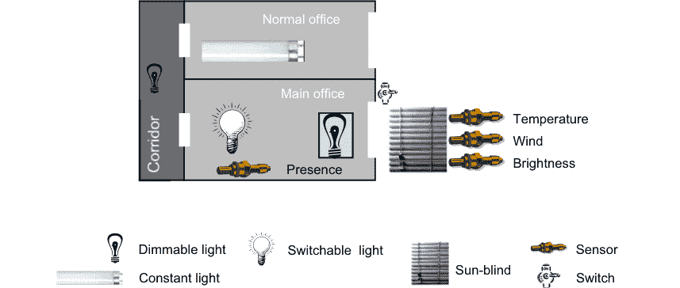

### 10.3 配置模型：结构

为了分离建筑自动化系统的功能特征和技术组件，我们将 SmartHome 模型的结构（由 `SmartHome` 表示）划分为 *特征模型*（由 `SmartHomeFeature` 表示；见小节 10.3.1）和 *系统模型*（由 `SmartHomeSystem` 表示；见小节 10.3.2）。这些模型允许对 SmartHome 的功能特征（特征）与其实现这些功能性的组件进行清晰分离（见图 10.2 和 10.3 中的关联 `realize`）。将 SmartHome 作为包含两个部分 `SmartHomeFeature` 和 `SmartHomeSystem` 的聚合体使用，可在一种产品的 resulting 配置中将这两个方面结合起来。

两个模型都利用了 Hotz et al. (2014)⁴ 中引入的配置知识表示以及更进一步的内容。特别是，所呈现的模型涵盖了以下特征和组件相关的表示方面，这些方面将在后续章节中更详细地解释：

- *类* 用于表示特征和组件类型。例如，遮阳百叶特征由类 `SunBlindsFeature` 表示，而调光器则由组件类型 `Dimmer` 表示。
- *实例* 表示针对特定配置所选或推断出的特征或组件。实例未在配置模型中表示，而是在配置过程中创建。

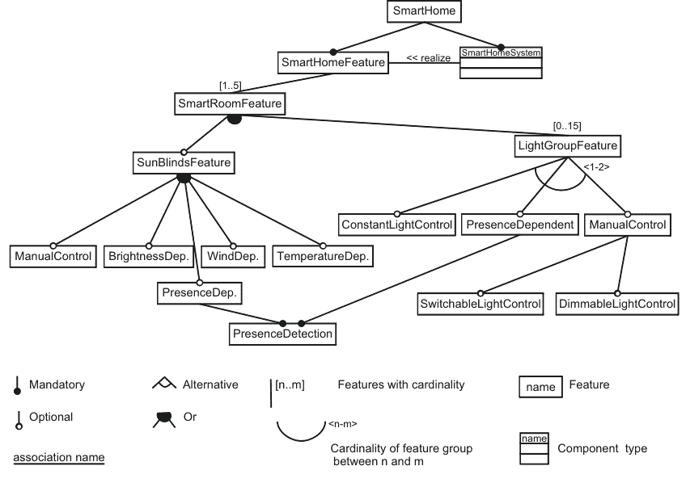

**图 10.2**

SmartHome 特征模型，其根特征为 `SmartHomeFeature`，通过关联 realize 与系统模型中的根组件类型 `SmartHomeSystem` 相关联（即 `SmartHomeSystem` 实现 `SmartHomeFeature`）。这两个根都是整体 `SmartHome` 模型的一部分。

- *带重数的部分-整体* 用于表达特征-子特征关系和聚合-部分关系。例如，如果智能房间需要遮阳百叶作为特征，则用户（客户）还应就控制遮阳百叶的（子）特征做出决策。
- *特化* 用于根据共同属性对模型进行结构化。例如，调光器是一种特殊的控制单元；因此它具有控制单元的所有属性。
- *属性* 仅用于组件。例如，电气组件的功耗由类的属性建模。特征通常可由用户选择且没有进一步的属性。
- *Requires* 用于表达组件之间、特征之间或组件与特征之间的依赖关系。例如，可切换的灯组需要一个开关。

**图 10.3**

SmartHome 系统模型（第 1 部分；根为 `SmartHomeSystem`）及其通过有向关联 realize 与特征模型（根为 `SmartHomeFeature`）的关系。realize 关联的一个示例提供了室内传感器（`SensorInside`），它实现了在特征模型中建模为 `PresenceDetection` 的存在特征。

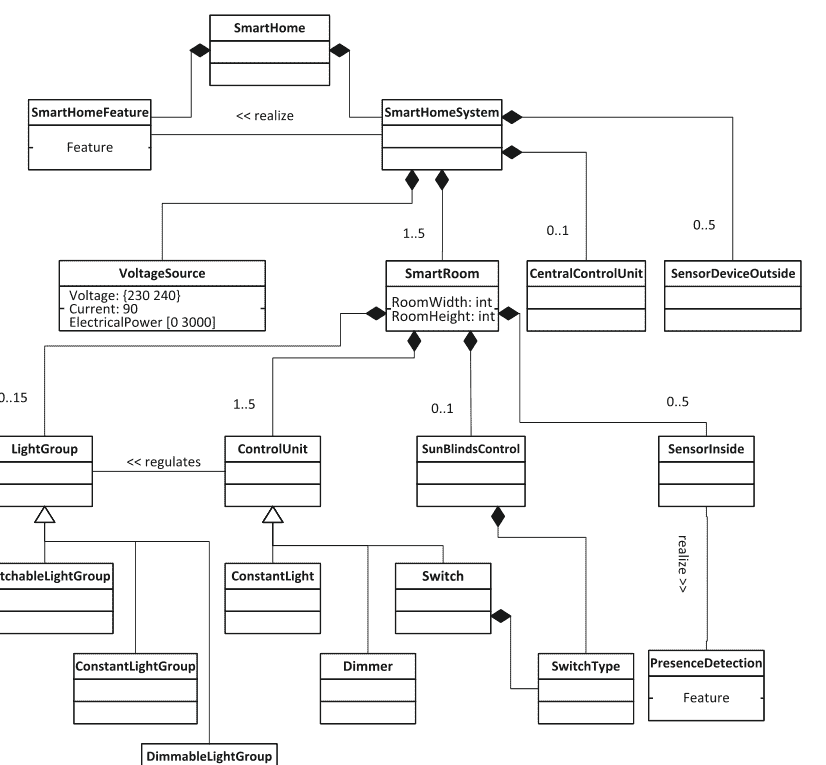

- *Incompatible-with* 用于排除不能同时出现的特征或组件。例如，手动控制与存在检测不兼容。
- *Compatible* 用于可以一起使用但不必一起使用的特征或组件。例如，遮阳百叶可以与灯组组合。
- *共享类* 用于表达不同特征或组件的共同方面。例如，存在检测特征可以被遮阳百叶和灯组特征共享，但每个实例应有其自己的存在检测组件。
- *连接/关联* 表达在该领域中特别重要的特征或组件之间的关系。例如，控制单元与它调节的灯组相连接。

以下，我们仅介绍第 10.4 节用于说明约束时使用的特征、组件类型和组件属性。

#### 10.3.1 SmartHomes 的特征模型

SmartHome 主要功能属性的特征模型如图 10.2 所示。该模型表示可能的函数属性或特征组合。然而，SmartHome 系统的组件并不允许所有特征组合；因此，可实现的特征组合会因约束而进一步受限（见第 10.4 节）。

图 10.2 展示了将特征划分为子特征的组合结构（例如，`ManualControl` 是 `SunBlindsFeature` 的子特征）。除了组合结构外，配置模型还必须指定类之间的特化关系。在此表示的 SmartHomes 特征模型中，特征的特化层次是平坦的；即所有特征都是 `SmartHomeFeature` 的特化（这些特化在图 10.2 中为可读性目的而省略）。

我们扩展了 Hotz et al. (2014)⁵ 中用于特征模型的记法，通过 *基数*（遵循 Czarnecki et al., 2005）和 *关联* 来关联图 10.3 所示的系统模型。基数可以针对单个特征（*具有基数的特征*）或针对特征组（*特征组的基数*）表达。特征组是一组特征，其基数指定该集合中包含多少个特征。

在我们的示例中，一个 SmartHome 最多可有五个房间，因此 `SmartHomeFeature` 最多可有五个 `SmartRoomFeature`。SmartHome 中的每个房间都有其自己的特征。每个房间可能有一个可选的 `SunBlindsFeature` 和最多 15 个 `LightGroupFeature` 实例，这些实例可以具有专门的控制，如下所述。

**控制遮阳百叶。** 作为功能属性，用户可以选择 *遮阳百叶的控制*；即他/她关于遮阳百叶何时应降下或升起的偏好。遮阳百叶可以根据某些环境情况手动或自动控制（见第 10.2 节），例如

- 房间内的光照量（`BrightnessDep.`）
- 房间内人员的存在（`PresenceDep.`）
- 风力因素（`WindDep.`）
- 室外温度（`TemperatureDep.`）

所有这些特征都是可选的（以 0..1 表示）。然而，至少需要存在一个特征（以 Or 表示）。当客户选择多个特征时，控制替代方案可以组合；例如，一个房间中遮阳百叶的手动控制与温度相关控制可以组合。所有组合都是可能的，但实现特定组合所需的组件可能有所不同（见小节 10.4.3 中的约束 `fsc-3`）。

**控制灯光。** 作为另一个功能属性，用户可以选择房间内灯光的 *控制*；即他/她关于灯光何时应打开或关闭的偏好。`LightGroupFeature` 表示此功能属性。它由一个或两个类型为 `ConstantLightControl`、`PresenceDependent` 或 `ManualControl` 的特征组成（这些特征中的每一个都是可选的）。因此，特征组 `LightGroupFeature` 限制了其成员的数量。灯组可以根据人员的存在自动控制（`LightGroupFeature` 的 `PresenceDependent`），可以手动控制（`LightGroupFeature` 的 `ManualControl`），也可以是确保恒定照明条件的恒定灯光（`ConstantLightControl`）。手动控制提供两种选项：它可以是开关（`SwitchableLightControl`）或调光器（`DimmableLightControl`）。然而，并非所有组合都是可能的；见小节 10.4.1。

存在依赖特征（即 `SunBlindsFeature` 的 `PresenceDep` 和 `LightGroupFeature` 的 `PresenceDependent`）具有强制特征 `PresenceDetection` 特征。这模拟了系统必须以某种方式检测房间内人员的存在以允许存在相关控制的事实。存在依赖特征更面向客户（*用户特征*）——它们可以直接由客户选择，而 `PresenceDetection` 特征更与系统相关（*系统特征*）——如果客户选择存在依赖特征，系统应具有此特征。系统特征 `PresenceDetection` 通过与实现组件 `SensorInside` 的关联连接到系统模型（见图 10.3）。

#### 10.3.2 SmartHomes 的系统模型

图 10.3 和 10.4 以两个（出于说明原因）分离的部分展示了 SmartHomes 的系统模型。图 10.3 说明了 `SmartHomeSystem` 的组合结构的定义，而图 10.4 说明了泛化层次的主要部分。定义了以下组件类型：

- `SmartHomeSystem` 由电压源（`VoltageSource`）、可选的中央控制单元（`CentralControlUnit`）、最多五个智能房间（`SmartRoom`）以及零到五个室外传感器（`SensorDeviceOutside`）组成。
- `CentralControlUnit` 允许对所有设备进行手动中央调节。`VoltageSource` 必须提供电能，以便所有网络节点都可以纳入网络。
- 每个 `SmartRoom` 由灯组（`LightGroup`）、控制单元（`ControlUnit`）如开关（`Switch`）和调光器（`Dimmer`）、遮阳百叶控制（`SunBlindsControl`）以及多个传感器（`SensorInside`）组成。
- `LightGroups` 包含可通过控制单元（`ControlUnit`）一起调节的一组灯。控制单元可以调节多个灯组（有向关联 regulates）。遮阳百叶控制（`SunBlindsControl`）调节遮阳百叶，而遮阳百叶本身不是智能房间模型的一部分。`SensorInside` 的实例（即房间传感器）在总线上提供信号，由适当的控制进行解释。


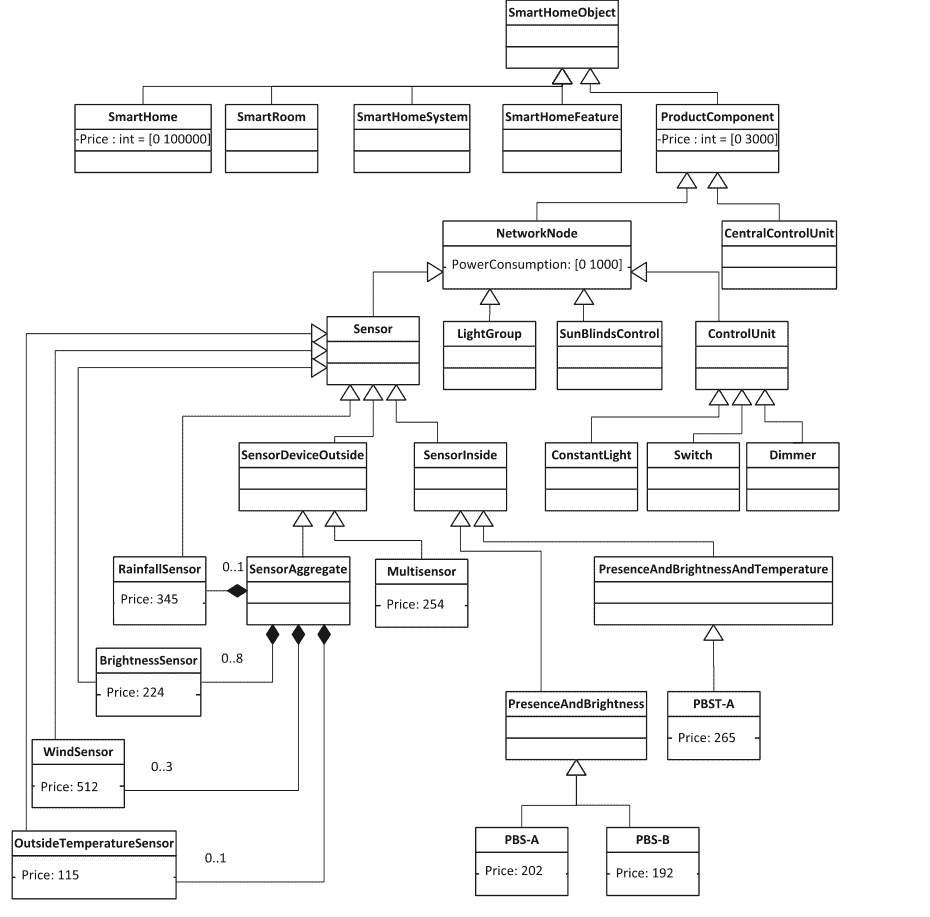

**图 10.4** Smarthome 系统模型（第 2 部分）包含属性的分量层次结构。SmartHomeObject 是所有类的分类学根。

- 外部传感器（`SensorDeviceOutside`）为控制单元提供传感器数据。在我们的模型中，`SunBlindsControl` 解释传感器数据，而 `ControlUnit` 也对传感器数据以及手动操作（例如通过 `Switch`）做出反应。房间内的特定传感器控制房间内人员的存在。
- 分量类型 `Switch` 和 `SunBlindsControl` 具有 `SwitchType`。因此，`SwitchType` 是一个 *共享类*；然而，每个控制都有其单独的开关类型。

图 10.4 说明了系统模型中使用的所有类的泛化层次结构。虽然组合层次结构基于通用类，但泛化层次结构包括特定公司的特定组件。例如，通用类 `SensorInside` 被细化为可检测存在和亮度的内部传感器（此处称为 `PBS-A` 和 `PBS-B`，即 Presence-Brightness Sensor，两者均为 `PresenceAndBrightness` 类型）或 additionally 测量温度（`PBTS-A`，类型为 `PresenceAndBrightnessAndTemperature`）。

如第 10.2 小节所述，一个本地操作网络连接各组件。类 `NetworkNode` 汇总了通过总线连接的所有组件（即传感器和控制单元）。通过这样做，可以定义适用于所有网络节点属性以及约束。作为示例，请参阅第 10.4.2 小节中的 *系统属性约束*，其限制了 `NetworkNodes` 的 `PowerConsumption`。

外部传感器（`SensorDeviceOutside`）可以专门化为特定传感器设备 `SensorAggregate`，该设备可能包含多种类型的传感器（例如风或温度传感器），或可专门化为 `Multisensor`。`SensorAggregate` 的部件（即 `WindSensor`、`OutsideTemperatureSensor`、`BrightnessSensor` 和 `RainfallSensor`）被建模为进一步的传感器。`Multisensor` 将亮度和存在传感器集成到一个组件中。这种将不同的传感器组合成传感器聚合与使用包含各种传感器的一个多传感器之间的选择，是 Smarthome 系统的一个主要系统相关决策。根据所选功能，可以组合传感器或选择多传感器。约束 *fsc-3* 表示这种依赖关系（参见第 10.4.3 小节和表 10.1）。这些传感器还说明了属性 `Price` 的使用，所有基本组件类型都通过继承自 `ProductComponent` 而拥有该属性。因此，属性 `Price` 不必为每种组件类型建模，只需为更具体的组件定义特定的价格。

### 10.4 配置模型：约束

与结构模型类似，我们将建筑自动化系统的约束分为 *特征模型约束*（参见第 10.4.1 小节）和 *系统模型约束*（参见第 10.4.2 小节）。此外，第 10.4.3 小节提供了特征模型与系统模型之间的约束。我们提供了一组约束示例摘录，说明了以下约束类型：*资源约束*、*不兼容和兼容约束*、*requires 约束*、*共享类约束*、用于计算的 *代数约束*、*n 元基数约束*、对任意数量属性的 *all 约束*，以及通过枚举变量值可能组合来外延表达关系的 *表约束*。

#### 10.4.1 特征模型约束

*图 10.2* 中定义的特征模型指定了特征的组合。通过遵循 *不兼容* 和 *requires 特征模型约束* 来减少这些组合。

**不兼容。** 同一房间中类型为 `SwitchableLightControl` 的灯组与类型为 `DimmableLightControl` 的灯组 *不兼容*。因此，用户不能同时选择这两个特征。

**共享类约束。** 每个具有 `PresenceDependent` 的 `LightGroupFeature` 需要一个 *不同的* `PresenceDetection`。因此，特征 `PresenceDetection` 仅在类层面共享，而非实例层面。

#### 10.4.2 系统模型约束

系统模型必须满足以下 *系统模型约束*，分为 *系统结构约束 (ssc)* 和 *系统属性约束 (sac)*。系统结构约束限制组件类型、关联以及组合关系的基数，从而影响结果配置（解）中创建的实例的类型和数量。系统属性约束限制组件属性。

**Requires 约束 (ssc)。** 智能房间的 `SwitchableLightGroup` *需要* 该房间中的一个 `Switch`。因此，在结果配置中，两类组件的实例总是同时出现。

**共享类约束 (ssc)。** 每个 `LightGroup` 和每个 `SunBlindsControl` *必须具有其单独的* `SwitchType`；即，`SwitchType` 仅在类层面共享，而非实例层面。

**不兼容 (ssc)。** 存在和亮度传感器 `PBS-A` 和 `PBS-B` *不兼容*——它们不能在同一房间中使用。因此，这两种组件类型的实例不能出现在同一个 Smarthome 配置中。

**组合关系的代数约束 (ssc)。** 房间的 `PresenceDetection` 需要对 `PresenceDetectors` 的数量进行 *计算*。该数量取决于房间的尺寸（`RoomWidth`、`RoomHeight`）。因此，如果选择了存在依赖，则房间的尺寸必须由用户（客户）决定。

**n 元基数约束 (ssc)。** `SmartRoom` 的部件数量应为 *最小* 1 个，*最大* 26 个。因此，该约束对 *图 10.3* 中为组件类型 `SmartRoom` 所示的基数添加了进一步的限制，导致一个 n 元组合关系。

**表达物理限制的代数约束 (sac)。** `VoltageSource` 的 `ElectricalPower`、`Voltage` 和 `Current` 属性必须满足方程：`ElectricalPower = Voltage * Current`。因此，该约束计算为 `VoltageSource` 定义的属性 *电功率*（`ElectricalPower`）。

**资源约束 (sac)。** 所有 `NetworkNodes` 的 `PowerConsumption` 之和必须小于 `VoltageSource` 的 `ElectricalPower`。该约束将网络节点的功耗（`PowerConsumption`）与计算得到的 `VoltageSource` 的 `ElectricalPower` 关联起来。

**对可变数量属性的代数约束 (sac)。** 所有 `ProductComponents` 的 `Price` 之和必须等于 `SmartHome` 的 `Price`。因此，参与此约束的 `ProductComponents` 类型的实例数量不是固定的。该约束通过汇总其产品组件的价格来计算 Smarthome 的价格。

#### 10.4.3 特征模型与系统模型之间的约束

`realize` 关联指定了特征模型与系统模型之间主要约束（`fsc`）。对于每个 realize 关联，都需要一个 requires 约束来确保存在实现该特征的组件。此类约束的示例有：

- **fsc-1** `LightGroupFeature` *需要* 智能房间中的一个 `LightGroup`。
- **fsc-2** `LightGroupFeature` 的 `ManualControl` *需要* 智能房间中的一个 `Dimmer` **或** 一个 `Switch`。
- **fsc-3** `SunBlindsFeature` *需要* 如表 10.1 所示的智能房间的组件。

`fsc-3` 确定了如果选择了 `SunBlindsFeature`，房间所需的传感器组合（参见表 10.1）。左侧列 *Feature Selection* 枚举了每种可能的特征选择，右侧列 *Required Components* 列出了所需的传感器。例如，在第三行，遮阳篷通过风和温度变化进行控制（即 `WindDep` 和 `TemperatureDep` 等于 yes）。因此，`WindSensor` 和 `TemperatureSensor` 包括集成的 `SensorAggregate` 必须存在于结果系统中。基本上，如果需要风依赖控制（特征 `WindDep` 等于 yes，即前四行），则必须选择具有特定传感器组合的 `SensorAggregate`，否则（第 5 至 7 行）可以选择 `Multisensor`。

**表 10.1** 某些组件实现了 `SunBlindsFeature` 的组合。一个外延表通过枚举可能的传感器组合来表示约束 `fsc-3`。以下缩写适用：WD：`WindDep`，BD：`BrightnessDep`，TD：`TemperatureDep`，SA：`SensorAggregate`，WS：`WindSensor`，BS：`BrightnessSensor`，TS：`TemperatureSensor`，MS：`MultiSensor`。

| WD | BD | TD | SA | WS | BS | TS | MS |
| --- | --- | --- | --- | --- | --- | --- | --- |
| yes | yes | yes | yes | yes | yes | yes | no |
| yes | yes | no | yes | yes | yes | no | no |
| yes | no | yes | yes | yes | no | yes | no |
| yes | no | no | yes | yes | no | no | no |
| no | yes | yes | no | no | no | no | yes |
| no | yes | no | no | no | no | no | yes |
| no | no | yes | no | no | no | no | yes |
| no | no | no | no | no | no | no | no |


最后一行说明，当配置中未选择防晒功能时，则不需要传感器。

约束 *fsc-3* 同样说明了特征与组件之间的关系通常是 n 对 m 的关系；也就是说，一个特征可能需要多个组件来实现，而一个组件可以实现多个特征。例如，仅由风控制的遮阳篷（*WindDep.*）需要一个 *WindSensor* 和一个 *SensorAggregate*（第 4 行）。另一方面，*Multisensor* 可以实现亮度和温度相关的遮阳篷。

### 10.5 配置模型：配置工作流

*配置活动* 描述了对某个子系统的配置，如控制单元或照明系统的配置（参见第 10.2 节）。一个配置活动由多个由 *步骤* 表示的配置决策组成。在本章描述的 Smarthome 示例中，一个决策对应于特征的选择或组件属性值的设置。因此，子系统的配置活动汇总了该子系统的特征选择以及实现组件的决策。

*配置过程* 由多个配置活动组成。配置活动之间可能相互依赖，并且必须按一定顺序进行。例如，控制单元的配置意味着选择按钮，它们为房间提供特定的调节。因此，只有在确定房间功能之后才能配置控制单元。或者，需要的网络技术取决于所需设备数量和类型。因此，网络只能在建筑自动化配置结束时确定。

[Figure 10.5](#) 在软件过程工程元模型规范（SPEM）中提供了这些示例的依赖描述。⁶ 除其他外，SPEM 具有以下图形建模设施（有关使用 SPEM 结合基于知识的配置的详细描述，请参见 [Hotz et al. (2006)](#)）。

**Activity.** *活动* 描述了由一个过程角色执行的工作片段。活动由一个或多个称为 *步骤* 的原子元素组成。活动代表配置活动，例如配置控制单元。特征模型或系统模型的一类或多类被分配给每个活动。这些类的所有属性和关系都受该活动配置的约束。例如，对于活动 *Configure ControlUnit*，分配了类 *ControlUnit*，由模型类：*ControlUnit* 表示。相关的决策是：
- 将关联 regulates 配置到 *LightGroup*
- 确保 *ControlUnit* 是 *SmartRoom* 的一部分
- 并且确定继承属性 *PowerConsumption* 和 *Price* 的值

需要注意的是，所有必要的决策都可以从特征和系统模型计算出来（参见图 10.3 和 10.4）。有关从模型计算必要决策的示例，请参阅 KONWERK 中程序性知识的建模（参见 Hotz 和 Günter, 2014）。⁷

#### FIGURE 10.5

Smarthome 示例的配置活动之间的依赖关系作为过程模型。依赖关系限制了活动的可能顺序。通常，一个配置活动的决策可以从特征和系统模型计算出来。然而，在当前示例中，仅需要与系统模型相关的限制依赖，而与特征模型相关的依赖则不需要。因此，特征可以按任意顺序配置。

**Model.** *模型* 是一种特定类型的工作产品。工作产品是过程产生、消费或修改的任何东西。除模型外，工作产品的示例还有文档和源代码。

**Finish-start.** 如果活动 B 相对于活动 A 具有 *完成-开始依赖*，则 B 只能在 A 完成后才能开始（严格顺序，无并行）。此类依赖关系代表配置活动之间的依赖关系。

图 10.5 中的依赖关系是唯一的顺序方面；其他配置活动的顺序，特别是特征的获取，并不固定，因此不得建模。此外，在配置下一个子系统之前不需要完成一个子系统的配置。相反，在为一个子系统选择部件后，这些部件可能会因另一个子系统的配置决策而改变，以便获得最佳解决方案。经过此类更改后，其他部件必须更新以获得正确的解决方案。配置任务的常见情况是客户在技术系统的配置过程中更改其需求。

### 10.6 Smarthome 模型的特点

与 Hotz et al. (2014) 中介绍的工作示例相比，Smarthome 模型涵盖了配置模型的另外两个特点，以下小节对其进行了总结：
- 通过特征模型和系统模型分离特征和实现组件（参见小节 10.6.1）
- 对配置过程建模工作流（参见小节 10.6.2）

#### 10.6.1 特征和系统模型分离的特点

特征模型相当简单，而系统模型由于组件的内部结构而更复杂（例如，由传感器组成的传感器聚合）。例如，在特征模型中，用户确定灯组应可开关还是可调光。在系统模型中，必须在不同的设备或设备类别之间做出决策以实现此功能。特征模型提供了系统的用户视图。它可以直接用于配置过程，通过从用户获取所需特征。通过与系统模型的直接连接，可以通过在特征选择后直接配置组件来确保所选特征的可实现性。

特征模型和系统模型可以用典型配置系统的建模设施轻松表示。例如，特征可以用布尔值属性或带基数的类表示。有关建模设施的详细描述，请参阅 Hotz et al. (2014)。

#### 10.6.2 引入工作流的特点

建筑自动化系统展示了在复杂配置任务中为结构化配置活动需要工作流，因为配置活动相互依赖。例如，不可能从任意选择的配置活动开始配置过程，例如配置开关的类型。此外，此类配置活动的顺序取决于领域特征（例如，在配置过程结束时确定建筑自动化系统的网络技术）。因此，此类依赖关系必须在配置模型中表示。

这一特点将复杂配置问题与可通过其他推理技术（如纯约束处理）解决的简单配置问题区分开来。当解决复杂配置问题时，不能遵循一步法（描述问题然后求解）。对于复杂问题，需要多步骤（或配置活动）的方法。每个活动涉及一个或多个决策以及这些决策的含义计算。这些又会影响后续决策的可能值。因此，解决配置问题是一系列由决策制定和通过推理计算影响组成的对。

并非所有配置系统都能表示本示例中描述的工作流。相反，工作流直接在特定于应用程序的用户界面中实现。有关工作流的基于模型表示，请参阅 Hotz 和 Günter (2014)。⁹

### 10.7 结论

本章提供了一个配置示例，其中包含一个复杂的模型，分为用户可见的特征、实现组件以及它们之间的关系。该示例还展示了建模配置工作流的必要性。

## References

Czarnecki, K., Helsen, S., Eisenecker, U., 2005. Formalizing cardinality-based feature models and their specialization. SoftwareProcess: Improvement and Practice 10 (1), 7–29.

Hotz, L., Günter, A., 2014. KONWERK. In: Felfernig, A., Hotz, L., Bagley, C., Tiihonen, J. (Eds.), Knowledge-based Configuration – From Research to Business Cases. Morgan Kaufmann Publishers, Waltham, MA, pp. 281–295 (Chapter 24).

Hotz, L., Wolter, K., Krebs, T., Deelstra, S., Sinnema, M., Nijhuis, J., MacGregor, J., 2006. Configuration in Industrial Product Families – The ConIPF Methodology. IOS Press, Berlin.

Hotz, L., Felfernig, A., Stumptner, M., Ryabokon, A., Bagley, C., Wolter, K., 2014. Configuration knowledge representation and reasoning. In: Felfernig, A., Hotz, L., Bagley, C., Tiihonen, J. (Eds.), Knowledge-based Configuration – From Research to Business Cases. Morgan Kaufmann Publishers, Waltham, MA, pp. 41–72 (Chapter 6).

Kang, K., Cohen, S., Hess, J., Novak, W., Peterson, S., 1990. Feature-Oriented Domain Analysis Feasibility Study (FODA). Technical Report CMU/SEI-90-TR-021, Carnegie Mellon University, Software Engineering Institute, Pittsburgh, PA.

Wolter, K., 2003. Supporting the orientation and navigation of users in the process of configuring complex products (Master’s thesis). Universität Hamburg, Fachbereich Informatik, Hamburg, Germany (in German: Unterstützung der Orientierung und Navigation von Benutzern im Prozess der Konfiguration von komplexen, variantenreichen Produkten).


## 高级主题
## 3

## 配置系统的知识工程

## 第11章

**Gerhard Friedrich**，†Dietmar Jannach†，‡Markus Stumptner‡，和 Markus Zanker*

*Alpen-Adria Universität Klagenfurt, Klagenfurt, Austria
†Dortmund University of Technology, Dortmund, Germany
‡University of South Australia, Adelaide, SA, Australia

**摘要：** 开发产品配置系统由于多种原因是一项非平凡且具有挑战性的任务。首先，必须编码到系统中的领域知识往往分散在公司的多个部门或职能中。除此之外，在许多情况下，还必须将来自现有信息系统的数据集成到配置器中。最后，定义可能配置空间的业务规则或技术约束可能相对复杂，并且也经常发生变化。这使得获取和编码领域知识以及测试和调试成为特别繁重的任务。

在本章中，我们概述了开发基于知识的配置系统时面临的挑战。我们将特别关注与知识获取过程相关的问题，并将进一步展示如何应用基于模型的调试技术来支持知识工程师的测试和调试过程。

### 11.1 引言

产品配置器是知识密集型和复杂的软件系统，其在公司内的设计、开发和实施在整个软件生命周期中都是一项具有挑战性和需求性的工作。即使使用 Mailharro (1998) 描述的现成通用配置问题求解框架或约束引擎作为配置器应用的基础，整体开发过程的复杂性仍然有几个方面。

由于我们只对非平凡的配置系统感兴趣，我们将从选择基于知识的方法这一前提开始。因此，配置知识必须由某种形式的逻辑、声明式规则或约束来表示。与标准软件开发流程不同，“知识工程”阶段必须成为生命周期的一部分（作为该主题的介绍，参见 Studer et al., 1998）。在此阶段，必须使用配置器框架提供的知识表示机制对所需的配置逻辑进行建模。然而，知识的提取和无错误形式化需要领域专家和知识工程师之间的紧密合作，后者需要在业务和技术人员之间建立联系。在此背景下出现的一个问题是，公司中可能有多个部门会影响可以向客户提供的配置集。除了技术限制之外，

基于配置问题求解器的知识表示机制，一个在标准软件工程流程中不存在的阶段。

在知识获取过程中，知识工程师或系统分析师必须识别不同的利益相关者和信息来源。许多信息可能已经存在于其他软件系统中。例如，组件不同方面的信息可能在公司的 ERP 系统中可用；定价过程的计算可能在电子表格应用程序中找到。将配置器开发嵌入组织流程的这一问题将在第 11.4 节中进一步讨论。关于开发周期的规划过程，请注意，在某些领域，可能需要与可配置产品并行开发配置器应用程序以支持集成测试（Fleischanderl et al., 1998）。在这些情况下，待获取的知识可能仍不稳定并不断变化。因此，选择合适的知识获取技术至关重要。因此，在本节中，我们将重点关注如何以正确和有效的方式获取配置模型。

#### 11.2.1 来自早期专家系统的经验

最早的基于知识的大规模配置器应用之一是 DEC 的 R1 (XCON) 基于规则的 VAX-11/780 计算机系统的“配置器”（McDermott, 1982）。除了这是工业界成功实施的第一个专家系统之一之外，它也是在实际使用 10 年后发表了有关工程和实施问题的经验报告的少数应用之一。在他们的报告中，Barker et al. (1989) 识别了开发大规模配置器时面临的各种挑战，其中许多在配置系统开发在工业界超过 20 年后仍然适用。

从商业和战略角度来看，当时和今天的主要问题之一是建立业务与“技术人员”（配置器开发者）之间的适当联系。这一方面特别重要，因为在市场上提供可配置产品是一个战略决策，需要协调多个业务职能。在 DEC 当时，管理层对使用当时创新但不成熟的专家系统技术构建系统也非常重要，这还额外需要新聘开发者长时间的学习和培训阶段。今天，声明式技术，特别是基于约束的方法已经达到了一定的成熟度，但仍远非工业软件开发实践中的“标准”工具。即使有一些方法，例如 Agarwal 和 Tanniru (1992) 针对基于规则系统的结构化开发过程，基于知识的系统开发阶段与标准软件工程流程的适当集成问题（例如，考虑此类系统的测试）今天仍然 largely 开放。

从应用领域的角度来看，Barker et al. (1989) 识别了波动性、范围扩展和复杂性问题。在他们的领域中，每年约有 40% 的规则发生变化。范围扩展意味着系统变得越来越多地与其他工具集成，并被不同的业务部门使用，因此必须将各种其他系统与配置器连接，并且需要不断添加额外功能。关于复杂性方面，Barker et al. 报告说，10 年后规则库包含超过 10,000 条规则，并且组件数据库包含超过 30,000 个不同零件。

底层推理引擎以及在决定配置应用程序的技术基础时知识获取工具的可用性。

现代配置框架应在建模阶段尽可能从底层技术表示中抽象出来。可以在此类工具中找到的典型元素例如可能包括兼容性表等机制，即使非 IT 人员也能理解，包括适当编辑支持的用户导向规则语言，或物料清单结构的图形表示。用于此类机制的框架和可以提供的工具支持将在第 11.2.4 节中介绍。此外，为了便于实际使用，框架中应包含适当的测试、调试和跟踪支持。我们在第 11.3 节中描述了这样一个框架。

#### 11.2.4 基于 UML 的方法

在讨论了配置器应用程序知识获取的各种问题之后，我们将在本小节中描述 Felfernig et al. (2000a) 基于统一建模语言（UML）的配置器开发方法。图 11.1 给出了所提出开发过程的总体概述。

图中的方框显示了从产品建模到投入使用的开发过程的不同步骤。对开发阶段 (1) 到 (4) 的适当机制和工具的支持是 Felfernig et al. (2000a) 建议的核心。

在阶段 (1) 中，知识工程师与领域专家一起使用统一建模语言来开发配置问题的模型。³ 然而，与使用某种专有的配置特定表示格式不同，想法是依赖 UML 作为图形表示法，这是一种在标准软件工程流程中用于概念建模的广泛已知和标准化的语言。由于 UML 是一种与特定应用领域无关的通用语言，Felfernig et al. (2000a) 建议为建模者提供预定义的一组配置特定建模概念。这些领域特定扩展的定义基于配置文件和构造型，即 UML 创建领域特定语言的内置机制。

在第 11.2.2 节中我们讨论了在推理大规模配置问题实例时适当问题求解启发式的重要性。在许多情况下，这种对搜索过程的微调发生在开发过程的最后阶段，并且基于系统在生产中运行的首次经验，在低技术水平上进行。然而，如果在更早的开发阶段已经有关于有效搜索策略的知识，人们就可以尝试将此知识也纳入概念模型。Felfernig et al. (2000a) 面向领域专家和知识工程师的 UML 方法不包括此类启发式的建模概念。虽然在 20 世纪 90 年代知识获取和基于知识的系统领域有一些提案旨在支持领域专家在更抽象或概念层面制定问题求解知识，但我们认为在配置领域这个问题仍然 largely 开放。

对于每个领域特定概念，例如组件类型概念，提供了一组所谓的良构规则的形式为 OCL（对象约束语言）约束，

³ 另见 Studer et al. (1998) 中将知识工程视为建模过程与将知识工程视为转移过程的讨论。


**图 11.1：** 配置器开发过程改编自 Felfernig 等 (2000a)。

它描述了建模概念如何被正确使用。由于所提出的扩展和 OCL 约束是使用 UML 的标准机制开发的，因此现成的 UML 工具可以应用于检查阶段 (2) 中的配置模型的语法有效性。

随后，在阶段 (3) 中，概念模型应自动翻译成可被配置问题求解器解释的“可执行”表示形式。这对应于模型驱动软件开发和标准软件开发过程中自动代码生成的思想。类似于模型驱动架构 (MDA)，⁴ 概念模型可以被视为“平台无关模型”。然而，将模型翻译成可执行代码意味着需要为给定的 UML 建模概念提供精确的语义。在 Felfernig (2007) 以及 Felfernig 等 (2000a, 2000b) 中，该语义的定义是通过描述每个建模构造如何翻译成配置问题的一般逻辑基础形式化来完成的。

⁴ http://www.omg.org/mda/.

为了证明该方法也适用于组件-端口配置方法的具体实现，已实现了概念模型到商业 ILOG Configurator 框架 (Mailharro, 1998) 约束基础表示的映射。

在阶段 (4)，所得到的知识库应基于测试用例和专家知识进行验证，然后在阶段 (5) 投入生产使用。为了支持知识工程师在此阶段的工作，Felfernig 等 (2004) 提出了一种用于声明式配置知识库的调试方法。所提出的方法依赖于最初为硬件组件和电子电路分析而开发的基于模型的诊断技术。借助该方法，知识工程师会被指出知识库中潜在的错误陈述。然而，由于知识库内容与概念模型之间通过自动生成过程存在密切对应，工程师可以利用这些潜在错误的指针在概念层面修复问题，然后重复知识库生成过程。我们将在下一节讨论所采用的基于模型诊断技术的更多细节。

总之，所提出方法的一个关键目标，该方法基于模型驱动开发、声明式知识表示和基于 AI 的推理，是减少所需的开发、调试和维护工作。一般而言，使用不同软件工程技术或模型驱动方法时潜在成本节约的精确科学量化是困难的。Fleischanderl 等 (1998) 中给出了一个轶事示例，作者报告说，根据他们的经验，其领域中产品开发成本的 20% 通常用于配置器软件的开发。此外，他们估计，使用声明式、约束基础的方法帮助他们将配置器开发成本降低了高达 60%。一个进一步的指标表明所提出的概念在实践中有价值的是，其中一些已被实现在商业工具中：例如 2000 年代中期的 ILOG JConfigurator 产品就包含了类似于 Felfernig 等 (2000b) 中 UML 基础结构图的图形建模组件，以及冲突检测和解释算法，这些只有在声明式方法中才可能实现。

### 11.3 调试配置知识库

为了介绍配置知识库的诊断，我们采用 Hotz 等 (2014) 中引入和说明的示例的一个小部分。⁵ 为使示例自包含，所有必要的公理都已列出。我们通过引入一个典型错误，随后演示基于模型诊断方法定位故障描述的应用来说明我们的方法。基于此示例，我们描述基于模型诊断的基本概念，最后展示其在我们介绍性示例中的应用。

#### 11.3.1 动机示例

假设除了在介绍性示例中提到的组件之外，还有一种通用主板可以作为有效 PC 配置的一部分。该主板允许 CPU_D 和 CPU_S 组合在一块主板上。因此，配置知识库 KB⁶ 必须通过公理⁷ 扩展以反映这些新的配置选项。特别是，通过 is-a 关系在各种类型主板之间形成类层次结构可以建模如下。每种专用主板都是主板 (公理 1 至 3)。 specialization 是排他的 (公理 4 至 6)。最后，公理 7 表达了每个主板必须属于特定主板子类型。然而，在公理 7 中，知识工程师忘记将公式的后件扩展为 MBUniversal。我们将有故障的知识库记为 KB_faulty。

⁶ KB 在第 6 章中记为 C_KB。

⁷ 我们采用公理的通常逻辑编程记法。以大写字母开头的符号表示逻辑变量。所有逻辑变量都是全称量化的。符号 false 表示不可满足。

- (1) MBSilver(X) → MB(X).
- (2) MBDiamond(X) → MB(X).
- (3) MBUniversal(X) → MB(X).
- (4) MBSilver(X) ∧ MBDiamond(X) → false.
- (5) MBSilver(X) ∧ MBUniversal(X) → false.
- (6) MBDiamond(X) ∧ MBUniversal(X) → false.
- (7) MB(X) → MBSilver(X) ∨ MBDiamond(X).

正确的公理 7 应读作：

```text
(7ok) MB(X) → MBSilver(X) ∨ MBDiamond(X) ∨ MBUniversal(X).
```

此外，我们声明 CPU_D 与 MBSilver 以及 CPU_S 与 MBDiamond 不兼容，这由以下表达：

- (8) CPU_D(C) ∧ cpu-of-mb(C,M) ∧ MBSilver(M) → false.
- (9) CPU_S(C) ∧ cpu-of-mb(C,M) ∧ MBDiamond(M) → false.

指定知识库后，知识工程师通常会借助测试用例对其进行验证。在调试配置知识库时，我们可以区分正例和负例。正例是必须与 KB 一致的配置，而负例必须不一致。换句话说，以逻辑术语表述，负例的否定必须由 KB 推出。一般而言，测试用例可以是完整或不完整的。完整的测试用例包含配置的所有相关部分（例如组件和连接），而不完整的测试用例仅指定配置的一部分，对于正测试用例而言必须可扩展为完整配置。相反，部分负测试用例声明了一个部分配置，该配置无法扩展为完整配置。Hotz 等 (2014)⁸ 中定义的配置是完整的。测试用例是一个逻辑句子。

⁸ 第 6 章。

让我们考虑以下正不完整测试用例 c⁺ 的示例，该示例指定必须存在一个配置，其中 CPU_D 和 CPU_S 在同一块主板上。

```text
c⁺: MB(m1) ∧ CPU_D(c1) ∧ CPU_S(c2) ∧ cpu-of-mb(c1,m1) ∧ cpu-of-mb(c2,m1).
```

负测试用例 c⁻ 另一方面，指定 CPU_D 和 CPU_S 不得在银色和钻石主板上混合。

```text
c⁻: CPU_D(c1) ∧ CPU_S(c2) ∧ (MBSilver(m1) ∨ MBDiamond(m1)) ∧
    cpu-of-mb(c1,m1) ∧ cpu-of-mb(c2,m1).
```

用这两个测试用例测试给定的知识库会产生不期望的矛盾——KB_faulty ∪ c⁺ 是不一致的。特别是，公理 7、8 和 9 与 c⁺ 结合时不可满足。因此，在假设测试用例正确的情况下，其中一个公理必须被更改。注意，除了有故障的公理 7 之外，正确的公理 8 和 9 也参与了矛盾。因此乍一看，其中一个公理也可能有故障。然而，将会发现，如果我们假设公理 8 或 9 有故障，则必须存在另一个有故障的公理。

让我们首先假设公理 8 有故障而所有其他公理正确。公理 7 和 9 与 c⁺ 结合意味着主板 m1 为银色类型。因此，公理 7 和 9 以及情况 c⁺ 意味着 c⁻。请记住，c⁻ 必须与知识库不一致。换句话说，知识库必须推出 ¬c⁻。因此，如果我们将公理 8 视为有故障而将 KB_faulty 的所有其他公理视为正确，则没有办法将该公理集扩展为在给定测试用例下可接受的配置知识库。仅删除或替换公理 8 的 KB_faulty 的任何更改都无法与正例一致且与负例不一致。对公理 9 也适用类似的论证。

由此可知，只有公理 7 是 KB_faulty 的单故障诊断，其含义是更改公理 7 将允许制定一个知识库，使得正例一致而负例不一致。如果公理 8 或 9 受到修订，则必须更改额外的公理。

#### 11.3.2 定义配置和诊断

调试配置知识库的任务是发现 KB 的哪些公理必须被更改。特别是，有故障知识库的一些公理必须被移除，并且可能需要添加一些公理。该扩展记为 EX。我们称这种修订后的知识库为目标知识库。该目标知识库必须与所有正测试用例一致，并且必须与所有负测试用例不一致。我们从配置知识库诊断问题 (CKB-诊断问题) 实例的定义开始。

**定义 (CKB-诊断问题实例)。** 配置知识库诊断问题的实例 ⟨KB, C⁺, C⁻⟩ 由表示配置知识库的逻辑句子集合 KB、正测试用例集合 C⁺ 和负测试用例集合 C⁻ 定义。C⁺、C⁻ 的元素是表示测试用例的逻辑句子。

基于 CKB-诊断问题的实例，我们将诊断定义为配置知识库的子集：

**定义 (诊断)。** 集合 S ⊆ KB 是 CKB-诊断问题实例 ⟨KB, C⁺, C⁻⟩ 的诊断当且仅当存在扩展 KB 的逻辑句子集合 EX 使得

- (KB − S) ∪ EX ∪ {c⁺} 对所有 c⁺ ∈ C⁺ 一致，且
- (KB − S) ∪ EX ∪ {c⁻} 对所有 c⁻ ∈ C⁻ 不一致


一个诊断 S 定义了 KB 中必须删除的那些句子，使得所有正例都是配置或可以扩展为配置。⁹ 然而，通过删除公理，逻辑理论变得更弱，以至于可能某些负测试用例与 (KB − S) 不不一致。因此，一方面从 KB 中删除公理，使得所有正测试用例都一致，但另一方面必须添加公理，使得所有负测试用例都与 resulting 知识库 (KB − S) ∪ EX 不一致。如果对于一个诊断 S 这样的扩展 EX 不存在，则诊断 S 必须被拒绝。然而，我们如何验证这样的扩展不存在呢？

由于负测试用例的否定必须由 (KB − S) ∪ EX 推出，我们可以用否定负测试用例的合取来替换 EX。注意，我们可以利用逻辑编程中约束的通常表述，通过使用特殊符号 false 来处理否定。例如，我们可以通过以下方式否定并推广我们示例中的负测试用例：

```
¬c⁻ : CPUD(X) ∧ CPUS(Y) ∧ (MBSilver(Z) ∨ MBDiamond(Z)) ∧ cpu-of-mb(X,Z) ∧ cpu-of-mb(Y,Z) → false.
```

如果在我们的示例中不考虑负测试用例，公理 8 将会是一个诊断。然而，如果考虑到负测试用例，公理 8 不能是一个诊断，因为没有办法扩展 KBfaulty − {Axiom 8} 使得 c⁺ 一致且 c⁻ 与 resulting 知识库不一致。对公理 9 也是同样的论证。

命题。集合 S ⊆ KB 对于 CKB 诊断问题实例 ⟨KB, C⁺, C⁻⟩ 是一个诊断当且仅当 ∀c⁺ ∈ C⁺ : (KB − S) ∪ {c⁺ ∧ ∧_{c⁻ ∈ C⁻} (¬c⁻)} 是相容的。

由此可知，在正例和负测试用例彼此不干扰的（合理）假设下，诊断总是存在的。

命题。对于 CKB 诊断问题实例 ⟨KB, C⁺, C⁻⟩，诊断 S 存在当且仅当 ∀c⁺ ∈ C⁺ : c⁺ ∧ ∧_{c⁻ ∈ C⁻} (¬c⁻) 是相容的。

通常，在调试知识库时，知识工程师对最小的改动感兴趣。这可以通过提供最小诊断来实现。对于 CKB 诊断问题实例 ⟨KB, C⁺, C⁻⟩ 的最小诊断是一个诊断 S，其中 S 的任何真子集 S′ 都不是诊断。一般来说，可能存在多个最小诊断，尽管可以引入额外的标准来在计算中对其进行排序，如下所述。

### 11.3.3 计算诊断

之前的定义允许我们采用一致性为基础的诊断的标准算法，并对该领域进行适当的扩展。特别是可以应用 Reiter 的 Hitting Set 算法（Reiter, 1987），该算法基于冲突集的概念。冲突集为寻找诊断提供了有效的机制。基本思想是计算不一致的逻辑句子最小集合，称为冲突集。为了消除不一致性，每个冲突集中至少有一个句子必须被改变。我们假设 C⁺ 为非空。

定义（冲突集）。冲突集 CS 对于 ⟨KB, C⁺, C⁻⟩ 是一个 KB 的子集，使得 ∃c⁺ ∈ C⁺ : CS ∪ [c⁺ ∧ ∧_{c⁻ ∈ C⁻} (¬c⁻)] 是不一致的。

如果冲突集不包含任何真子集是冲突集，则该冲突集是最小的。诊断与冲突集之间的关系可以用 hitting set 的概念来表达。给定一组集合 \overline{C}，集合 S 是 \overline{C} 的 hitting set 当且仅当 S ∩ C_i ≠ ∅ 对所有 C_i ∈ \overline{C} 成立且 S ⊆ ∪_{C_i ∈ \overline{C}} C_i。 hitting set 是最小的，如果它不包含任何真子集是 hitting set。在我们的领域中，集合 \overline{C} 对应于冲突集的集合，而 hitting set S 代表一个诊断。

### 命题。

逻辑句子集合 S 对于 CKB 诊断问题实例 ⟨KB, C⁺, C⁻⟩ 是一个最小诊断当且仅当 S 是 ⟨KB, C⁺, C⁻⟩ 的所有最小冲突集集合的最小 hitting set。

在 Felfernig et al. (2004) 中提出了一种用于诊断配置知识库的方法，基于 Reiter 的 HS-DAG 算法（Greiner et al., 1989; Reiter, 1987）与计算最小冲突集的 divide-and-conquer 方法（Junker, 2004）的结合。该方法通常适用于所有基于单调语义的知识表示范式，例如谓词逻辑、描述逻辑和约束。该方法需要一个完整且正确的相容性检查器，用于计算最小冲突集。Reiter 的算法以广度优先的方式生成最小诊断；也就是说，基数较小的诊断先被构造出来。这有助于控制计算成本，因为在实践中，知识工程师计算其中一些最可能的诊断就足够了。这些诊断随后用于生成额外的测试，因此不需要计算所有最小诊断（Shchekotykhin et al., 2012）。如果我们认为知识库中逻辑句子的正确性比错误性更可能，则最小基数诊断的集合（即元素数量最小的那些诊断）可作为最可能诊断集合的近似值。此外，如果我们将诊断的搜索限制为最小基数诊断，则搜索空间的深度恰好对应于最小基数诊断中元素的数量。由于在实践中知识库中的错误公理数量较低，应用广度优先策略是可行的。在 Felfernig et al. (2014b) 中提出了计算冲突和诊断的技术和算法。

让我们现在重新考虑我们的示例知识库。如果仅提供 c⁺，则存在一个最小冲突集 {7, 8, 9}，它包含与 c⁺ 不一致的公理的最小集合。因此，最小诊断是公理 7、8 和 9，它们是最小冲突集的最小 hitting set。注意，在这种情况下只有一个最小冲突集。如果我们考虑负测试用例 c⁻（即向知识库添加 ¬c⁻），则仍然只有一个最小冲突集 {7}。因此，存在唯一一个最小单故障诊断 {7}。

或者，让我们考虑一个不同的情况并假设公理 7 错误地定义如下：

```
(7) MB(X) → MBSilver(X) ∧ MBDiamond(X) ∧ MBUniversal(X).
```

在这种情况下，通用主板并未被遗忘，但知识工程师混淆了 ∨ 和 ∧。此外，假设仅给出正例 c⁺。在这种情况下，最小冲突集的集合是 {7, 4}, {7, 5}, {7, 6}, {7, 8}，和 {7, 9}。因此，最小诊断（或冲突集的 hitting set）是 {7} 和 {4, 5, 6, 8, 9}。

总之，我们提出了一种用于配置知识的声明式表示的通用调试方法，该方法采用基于模型的诊断技术。类似于软件工程中的回归测试程序，已配置产品实例的正例和负例用于定位配置器应用程序中的故障。所提出的方法通过指出知识库的最小子集来支持知识工程师，在配置器不接受所有正例或不拒绝所有负例的情况下，这些子集最可能存在故障。

总体而言，测试用例（示例）在该方法中起着核心作用，并且有足够数量的测试用例可以帮助大幅减少诊断候选的数量。错误引入到知识库中的典型时间点是在规则更新或扩展时，这在许多应用领域中相当频繁。在这种情况下，所有在维护操作之前计算过并且应仍然有效的过去配置都可以作为正测试用例，因此可用于回归测试。此外，请记住，所提出的方法还支持使用部分测试用例，这意味着知识工程师可以指定有效的配置片段，而无需在将其定义为测试用例之前手动检查完整且可能复杂的配置是否正确。尽管如此，在测试用例管理方面仍有可能提供更多支持，例如通过自动生成代表性测试用例。我们认为这是一个相关研究方向，不仅在配置领域，而且对于基于知识的系统总体而言。

### 11.4 组织挑战

开发配置器应用程序的挑战的核心在于配置知识库的设置和维护。然而，除了我们到目前为止讨论的知识编码的技术问题、从领域专家获取配置知识以及其验证和维护（即内容方面）之外，配置知识库开发还涉及多种组织、业务和流程方面。知识库定义了所讨论的可配置产品提供的可变性。最初，一家处于配置知识库开发情况的公司可以从例如大规模生产（见 Felfernig et al., 2014a¹¹）开始，或者重新构建已有的产品配置方法。在后一种情况下，组织已具备大规模定制（见 Piller and Blazek, 2014¹²）和可配置产品提供的经验，而在前一种情况下，知识库开发将伴随着多种组织和管理问题。通常，产品提供本身以及为定制提供的可变程度需要从头设计，因为大规模定制战略的实施需要对产品架构本身进行根本性重新思考。例如，Mikkola (2009) 探索了产品架构设计与大规模定制之间的关系。她讨论了产品架构的模块化度量以及与大规模定制战略相关的机会。基于 Mikkola 的建议，不同的配置模型变体可以（部分地）根据其对成功大规模定制战略的适用性进行评估。

¹¹第 1 章。

¹²第 9 章。


产品开发过程本身通常包括多个视图的规范，特别是功能、技術和物理视图（Arana et al., 2007; Jiao and Tseng, 1999）。来自 Malmgren et al. (2011) 的建筑行业配置模型结构化沿不同视图的另一个例子。由于预制建筑的两阶段建造（生产和在客户现场组装），Jiao 和 Tseng (1999) 中的物理视图被分为单独的生产和组装视图。这种配置模型的模块化在配置模型图形表示的情况下尤其必要，以便减少图表复杂性并避免所涉及利益相关者的概念过载（Moody, 2009）。功能视图对功能进行建模，通常取决于对目标市场细分中客户需求的分析。相比之下，技术视图通过其模块和模块化结构描述产品设计，并通过强制设计参数和结构化机制确保技术可行性。在第三步——物理视图中，产品设计必须映射到物理组件和装配。在那里，配置产品的可制造性以及成本、体积和进度是重点，并且可能导致对功能和技术视图的反馈循环。显然，这些过程步骤因此只能以迭代和交织的方式执行，其中营销和销售、设计以及制造和物流等不同组织单位紧密协作。在 Jiao 和 Tseng (1999) 中，提出了一种基于这三个过程步骤的面向大规模定制产品族架构开发的方法论，并提供了案例研究的实证结果以供进一步阅读。此外，Nellore et al. (1999) 关注新产品开发中的初始规范过程，并提出了一个模型来管理这一早期且至关重要的阶段中不同利益相关者的互动。

虽然所呈现的基于 UML 的方法在简化配置器开发项目中不同利益相关者之间的沟通方面非常有帮助，但人们已经探索了配置知识外部文档化的进一步手段。Haug (2010) 将配置器文档系统的思想概括化，并提出了一种产品模型管理软件，该软件构成了参与产品配置开发和维护项目利益相关者的知识管理和学习平台。文档软件支持诸如类信息卡和产品变体主数据（PVM）等表示概念，这些概念对领域专家来说是足够易于理解的。Haug 非正式地认为，在配置器开发项目中削减文档成本是短视的，会导致所开发配置器应用的可维护性降低或丧失。最后，Hvam et al. (2008) 的书籍从实践角度讨论了使用产品配置系统实施大规模定制策略的多个案例研究，因此也可以作为一个有用的指南。

### 11.5 结论

大多数现代且非平凡的产品配置系统都依赖于一个知识库，该知识库将潜在配置产品的解决方案空间限制为根据技术或业务相关限制和约束实际有效的那些实例。本章的目标是阐述从其来源获取这些“技术和经济限制和约束”的过程，以及在配置系统的运行生命周期中对其进行编码、维护和验证。最初，我们对从第一个基于规则的知识

## 参考文献

Agarwal, R., Tanniru, M., 1992. A structured methodology for developing production systems. Decision Support Systems 8 (6), 483–499.

Arana, J., Elejoste, M., Lakunza, J.A., Uribetxebarria, J., Zangitu, M., 2007. Product Modeling and Configuration Experiences. Idea Group. pp. 33–58, (Chapter 2)

Ardissono, L., Felfernig, A., Friedrich, G., Goy, A., Jannach, D., Petrone, G., Schäfer, R., Zanker, M., 2003. A framework for the development of personalized, distributed web-based configuration systems. AI Magazine 24 (3), 93–108.

Barker, V., O’Connor, D., Bachant, J., Soloway, E., 1989. Expert systems for configuration at Digital: XCON and beyond. Communications of the ACM 32 (3), 298–318.

Davis, J., 1990. Effect of modularity on maintainability of rule-based systems. International Journal of Man-Machine Studies 32 (4), 439–447.

Dietrich, A.J., Kirn, S., Timm, I.J., 2006. Implications of mass customization on business information systems. International Journal on Mass Customization 1 (2–3), 218–236.

Felfernig, A., 2007. Standardized configuration knowledge representations as technological foundation for mass customization. IEEE Transactions on Engineering Management 54 (1), 41–56.

Felfernig, A., Zanker, M., 2000. Diagrammatic acquisition of functional knowledge for product configuration systems with the unified modeling language. In: Proceedings of the First International Conference on Theory and Application of Diagrams (Diagrams ’00). Lecture Notes in Computer Science, vol. 1889. Springer Verlag, London, UK, pp. 361–375.

Felfernig, A., Friedrich, G., Jannach, D., 2000a. Generating product configuration knowledge bases from precise domain extended UML models. In: 12th International Conference on Software Engineering and Knowledge Engineering (SEKE’2000). Chicago, Illinois, pp. 284–293.

Felfernig, A., Jannach, D., Zanker, M., 2000b. Contextual diagrams as structuring mechanisms for designing configuration knowledge bases in UML. In: 3rd International Conference on the Unified Modeling Language (UML2000). Lecture Notes in Computer Science, vol. 1939. Springer, York, UK, pp. 240–254.

Felfernig, A., Friedrich, G., Jannach, D., Zanker, M., 2001. Towards distributed configuration. In: 24th German Conference on Artificial Intelligence (KI). Lecture Notes in Computer Science, vol. 2174. Springer, Vienna, pp. 198–212.

Felfernig, A., Friedrich, G., Jannach, D., Zanker, M., 2002. Web-based configuration of virtual private networks with multiple suppliers. In: Gero, J.S. (Ed.), Proceedings 7th International Conference on Artificial Intelligence in Design (AID-02). Kluwer Academic Publisher, Cambridge, UK, pp. 41–62.

Felfernig, A., Friedrich, G., Jannach, D., Stumptner, M., 2004. Consistency-based diagnosis of configuration knowledge bases. Artificial Intelligence 152 (2), 213–234.

Felfernig, A., Hotz, L., Bagley, C., Tiihonen, J., 2014a. Motivation for the Book. In: Felfernig, A., Hotz, L., Bagley, C., Tiihonen, J. (Eds.), Knowledge-based Configuration – From Research to Business Cases. Morgan Kaufmann Publishers, Waltham, MA, pp. 3–7 (Chapter 1).

Felfernig, A., Reiterer, S., Reinfrank, F., Ninaus, G., Jeran, M., 2014b. Conflict Detection and Diagnosis in Configuration. In: Felfernig, A., Hotz, L., Bagley, C., Tiihonen, J. (Eds.), Knowledge-based Configuration – From Research to Business Cases. Morgan Kaufmann Publishers, Waltham, MA, pp. 73–87 (Chapter 7).

Fleischanderl, G., Friedrich, G.E., Haselböck, A., Schreiner, H., Stumptner, M., 1998. Configuring large systems using generative constraint satisfaction. IEEE Intelligent Systems 13 (4), 59–68.

Fowler, M., 2010. Domain-Specific Languages. Addison-Wesley, Boston, MA.

Greiner, R., Smith, B.A., Wilkerson, R.W., 1989. A Correction to the algorithm in Reiter’s theory of diagnosis. Artificial Intelligence 41 (1), 79–88.

Haug, A., 2010. A software system to support the development and maintenance of complex product configurators. International Journal of Advanced Manufacturing Technology 49 (1–4), 393–406.

Heiskala, M., Paloheimo, K.-S., Tiihonen, J., 2007. Mass customization with configurable products and configurators: A review of benefits and challenges. In: Mass Customization Information Systems in Business, first ed., IGI Global, New York, NY, pp. 1–32 (Chapter 1).

Hotz, L., Felfernig, A., Stumptner, M., Ryabokon, A., Bagley, C., Wolter, K., 2014. Configuration knowledge representation and reasoning. In: Felfernig, A., Hotz, L., Bagley, C., Tiihonen, J. (Eds.), Knowledge-based Configuration – From Research to Business Cases. Morgan Kaufmann Publishers, Waltham, MA, pp. 41–72 (Chapter 6).

Hvam, L., Mortensen, N., Riis, H., 2008. Product Customization. Springer, Berlin.

Jannach, D., Zanker, M., 2013. Modeling and solving distributed configuration problems: A CSP-based approach. IEEE Transactions on Knowledge and Data Engineering 25 (3), 603–618.

Jannach, D., Felfernig, A., Kreutler, G., Zanker, M., Friedrich, G., 2007. Research issues in knowledge-based configuration. In: Mass Customization Information Systems in Business. Idea Group, New York, NY, pp. 221–236. (Chapter 11)

Jiao, J., Tseng, M.M., 1999. A methodology of developing product family architecture for mass customization. Journal of Intelligent Manufacturing 10 (1), 3–20.

Junker, U., 2001. Preference-based programming for Configuration. In: 17th International Joint Conference on Artificial Intelligence (IJCAI-2001), Configuration Workshop. Seattle, WA, pp. 50–56.

Junker, U., 2004. QUICKXPLAIN: preferred explanations and relaxations for over-constrained problems. In: McGuinness, D.L., Ferguson, G. (Eds.), 19th Intl. Conference on Artificial Intelligence (AAAI’04). AAAI Press, San Jose, CA, pp. 167–172.

Junker, U., Mailharro, D., 2003. Preference programming: Advanced problem solving for configuration. Artificial Intelligence for Engineering Design, Analysis and Manufacturing (AI EDAM) 17 (1), 13–29.

Mailharro, D., 1998. A Classification and Constraint-based Framework for Configuration. Artificial Intelligence for Engineering Design, Analysis and Manufacturing (AI EDAM) 12 (04), 383–397.

Malmgren, L., Jensen, P., Olofsson, T., 2011. Product modeling of configurable building systems – a case study. Journal of Information Technology in Construction (ITcon) 16, 697–712.

McDermott, J., 1982. R1: a rule-based configurer of computer systems. Artificial Intelligence 19 (1), 39–88.

McGuinness, D., Wright, J., 1998. An industrial-strength description logic-based configurator platform. Intelligent Systems and their Applications, IEEE 13 (4), 69–77.

Mikkola, J.H., 2009. Management of product architecture modularity for mass customization: modeling and theoretical considerations. IEEE Transactions on Engineering Management 54 (1), 57–69.

Mittal, S., Frayman, F., 1989. Towards a generic model of configuration tasks. 11th International Joint Conference on Artificial Intelligence (IJCAI-89), Detroit, Michigan, vol. 2 pp. 1395–1401.

Moody, D.L., 2009. The physics of notations: toward a scientific basis for constructing visual notations in software engineering. IEEE Transactions on Software Engineering 35 (6), 756–779.

Nellore, R., Söderquist, K., Eriksson, K.-A., 1999. A specification model for product development. European Management Journal 17 (1), 50–63.

Nica, I., Wotawa, F., Ochenbauer, R., Schober, C., Hofbauer, H., Boltek, S., 2014. Kapsch: reconfiguration of mobile phone networks. In: Felfernig, A., Hotz, L., Bagley, C., Tiihonen, J. (Eds.), Knowledge-based Configuration – From Research to Business Cases. Morgan Kaufmann Publishers, Waltham, MA, pp. 229–240 (Chapter 19).

Otto, K.N., Wood, K.L., 2001. Product Design. Prentice Hall, Upper Saddle River, NY.

Piller, F.T., Blazek, P., 2014. Core capabilities of sustainable mass customization. In: Felfernig, A., Hotz, L., Bagley, C., Tiihonen, J. (Eds.), Knowledge-based Configuration – From Research to Business Cases. Morgan Kaufmann Publishers, Waltham, MA, pp. 107–120 (Chapter 9).

Reiter, R., 1987. A theory of diagnosis from first principles. Artificial Intelligence 32 (1), 57–95.


Shchekotykhin, K.M., Friedrich, G., Fleiss, P., Rodler, P., 2012. 交互式本体调试：用于高效故障定位的两种查询策略。《Web语义学：万维网上的科学、服务与代理》12–13, 88–103.

Studer, R., Benjamins, V.R., Fensel, D., 1998. 知识工程：原理与方法。《数据与知识工程》25 (1–2), 161–197.

Tiihonen, J., Felfernig, A., 2010. 迈向推荐可配置产品。《国际大规模定制杂志》3 (4), 389–406.

Zanker, M., Aschinger, M., Jessenitschnig, M., 2010. 基于约束的产品与服务捆绑个性化配置。《国际大规模定制杂志》3 (4), 407–425.

## 配置知识中的冗余检测

Alexander Felfernig*、Florian Reinfank*、Gerald Ninaus* 和 Paul Blazek†
*格拉茨技术大学，格拉茨，奥地利
†cyLEDGE，维也纳，奥地利

摘要：配置系统利用知识库来确定用户感兴趣的解决方案。此类知识库的开发与维护是一项耗时且易出错的任务。例如，定义冗余约束往往会增加计算解决方案的工作量，以及知识库开发与维护的相关工作量。在本章中，我们提出两种可用于确定最小核心（最小非冗余约束集）的替代算法。第一种算法（SEQUENTIAL）是冗余度较低的集中式场景下的更好选择。第二种算法（COREDIAG）特别适用于冗余度可能变高的分布式知识工程场景。

### 12.1 引言

基于约束的应用的核心元素是知识库（约束集）。在开发和维护约束集时，用户经常定义错误的约束（系统计算出不被允许的解决方案或找不到解决方案；(Bakker et al., 1993; Felfernig et al., 2004)）或冗余约束（两者也称为异常），这些约束并非完整表达领域知识所必需 (Dechter and Dechter, 1987; Fahad and Qadir, 2008; Levy and Sagiv, 1992; Liberatore, 2005; Piette, 2008; Sabin and Freuder, 1999)。在本章中，我们关注用户定义冗余约束的情况：这些约束从约束集中删除后，不会改变其余约束的语义。这可能出于性能原因，或因为知识工程师没有意识到冗余。我们聚焦于后一种情况。

更形式化地，冗余可描述如下：如果 C = {c1, c2, ..., cn} 是一个约束集，且其中一个约束 ci ∈ C 是冗余的，那么 (C − {ci}) ∪ C̄ 是不一致的。在此上下文中，C̄ 是 C 的否定¹：如果 C = {c1, c2, ..., cn}，则 C̄ = {¬c1 ∨ ¬c2 ∨ ... ∨ ¬cn}。

知识库中的冗余消除是人工智能研究广泛探讨的主题。例如，冗余约束在配置知识库的开发与维护中起着作用 (Sabin and Freuder, 1999)。作者介绍了在条件约束满足问题（CCSPs）中检测冗余约束的概念。该方法基于

> ¹我们将 C 的否定 C̄ 也称为 C 的补集。

分析给定问题的解空间（在单个解层面）以检测不同类型的冗余约束。Piette (2008) 讨论了冗余消除在 SAT 求解中的作用。作者介绍了一种用于消除冗余子句的（不完备）算法，并通过实证研究展示了其实用性。Fahad 和 Qadir (2008) 分析了本体开发中冗余的作用。作者指出了冗余消除的重要性，并讨论了在本体开发与维护过程中出现的典型建模错误。Grimm 和 Wissmann (2011) 介绍了 OWL 本体中冗余消除的算法。作者提出了一种算法，通过利用关于公理可舍弃性的先验知识来计算冗余公理。Levy 和 Sagiv (1992) 分析了 Datalog 程序中的两类冗余。首先，他们从可达性的角度解释冗余（即，消除不属于任何推导树的规则和谓词）。其次，冗余基于最小推导树的概念定义，这些最小推导树不包含任何一对完全相同的原子，其中一个是另一个的前驱。Chmeiss 等人 (2008) 提出的冗余检测算法对应于本章讨论的 SEQUENTIAL 算法。Belov 等人 (2012) 的工作与最初由 Felfernig 等人 (2011) 提出的 COREdiag 算法一脉相承，即将子公式检查的思想应用于冗余子句的识别（例如在 SAT 求解中）。

上述所有方法都侧重于集中式场景中的冗余约束识别，在这些场景中，一个或少数知识工程师需要识别冗余约束。此类场景假设给定约束中只有一小部分是冗余的（该假设也称为低冗余假设；Grimm and Wissmann, 2011）。在本章中，我们更进一步，提出了一种特别适用于分布式知识工程场景的算法，在这些场景中，由于不同的贡献者会添加与同一主题相关的约束，因此可以预期存在大量冗余约束（例如，参见 Chklovski and Gil, 2005; Richardson and Domingos, 2003）。我们将存在较大冗余约束集的假设称为高冗余假设。例如，我们设想一个场景：大量用户提出约束，供基于约束的配置或推荐引擎使用 (Felfernig and Burke, 2008)，而底层算法的任务是识别保留原始约束集语义的最小约束集。我们将此类约束集称为最小核心。注意，以下讨论基于约束集一致的假设。一致性恢复的方法在 Bakker et al. (1993)、Felfernig et al. (2004, 2012)、Friedrich and Shchekotykhin (2005) 中讨论。另请参见 Felfernig et al. (2014)² 和 Friedrich et al. (2014)。³

本章的主要贡献如下。首先，我们介绍了能够确定冗余约束的算法 SEQUENTIAL 和 COREdiag。COREdiag 特别适用于分布式（基于社区的）知识工程场景，而 SEQUENTIAL 适用于知识库冗余度较低的“独立”场景。其次，我们使用金融服务知识库比较了 SEQUENTIAL 和 COREdiag 的性能。

本章其余部分组织如下。在**第12.2节**中，我们介绍了一个来自汽车领域的示例配置知识库。在**第12.3节**中，我们介绍了一种在集中式设置中确定冗余约束的基本算法（SEQUENTIAL）。在**第12.4节**中，我们介绍 COREdiag 算法。随后，我们报告性能评估的结果（**第12.5节**）。**第12.6节**总结本章。

### 12.2 示例配置知识库

出于说明目的，我们在本章中使用以下*汽车配置任务*。变量 type 表示汽车类型，pdc 是泊车距离控制功能，fuel 表示每 100 公里的平均燃油消耗量，skibag 表示车内是否方便存放滑雪袋，4-wheel 表示驱动类型（是否支持四轮驱动）。这些变量表示客户需求的各种可能组合。配置知识库 $C_{KB} = \{c_1, c_2, c_3, c_4, c_5\}$ 对可能的客户需求集 $C_R = \{c_6, c_7, c_8, c_9, c_{10}\}$ 定义了额外限制。

- **变量（$V$）** = {type, fuel, skibag, 4-wheel, pdc}
- **域（$D$）** = {
  - $dom(type)$ = {city, limo, combi, xdrive},
  - $dom(fuel)$ = {4l, 6l, 10l},
  - $dom(skibag)$ = {yes, no},
  - $dom(4\text{-}wheel)$ = {yes, no},
  - $dom(pdc)$ = {yes, no}
  }

- **知识库（$C_{KB}$）** = {
  - $c_1$: 4-wheel = yes → type = xdrive,
  - $c_2$: skibag = yes → type ≠ city,
  - $c_3$: fuel = 4l → type = city,
  - $c_4$: fuel = 6l → type ≠ xdrive,
  - $c_5$: type = city → fuel ≠ 10l
  }

- **客户需求（$C_R$）** = {
  - $c_6$: 4-wheel = no,
  - $c_7$: fuel = 4l,
  - $c_8$: type = city,
  - $c_9$: skibag = no,
  - $c_{10}$: pdc = yes}


一个*配置*（参见 Hotz et al., 2014⁶）对于我们的示例配置任务为 \(I = \{4\text{-wheel} = \text{no},\ \text{fuel} = 41,\ \text{type} = \text{city},\ \text{skibag} = \text{no},\ \text{pdc} = \text{yes}\}\)。

### 12.3 确定冗余约束

现在让我们考虑原始约束集 \(C_{KB}\) 的一个简单改编，我们用 \(C'_{KB}\) 表示。\(C'_{KB}\) 包含一个额外的约束 \(c_a\)，该约束由知识工程师添加。

\[
C'_{KB}=\{\
\begin{aligned}
 c_a &: \text{skibag} \ne \text{no} \to \text{type}=\text{limo} \lor\\
    &\quad \text{type}=\text{combi} \lor\\
    &\quad \text{type}=\text{xdrive},\\
 c_1 &: 4\text{-wheel}=\text{yes} \to \text{type}=\text{xdrive},\\
 c_2 &: \text{skibag}=\text{yes} \to \text{type}\ne\text{city},\\
 c_3 &: \text{fuel}=41 \to \text{type}=\text{city},\\
 c_4 &: \text{fuel}=61 \to \text{type}\ne\text{xdrive},\\
 c_5 &: \text{type}=\text{city} \to \text{fuel}\ne101\}
\end{aligned}
\]

显然 \(c_a\) 是冗余的，因为它并没有进一步限制由 \(C_{KB}=\{c_1,c_2,c_3,c_4,c_5\}\) 定义的解空间。为了在更正式的层面上讨论约束*冗余*，我们引入以下定义。

**定义（冗余约束）。** 设 \(c_a\) 为配置知识库 \(C_{KB}\) 的一个约束。\(c_a\) 被称为冗余当且仅当 \(C_{KB}-\{c_a\}\models c_a\)。如果此条件不满足，则称 \(c_a\) 为*非冗余*。冗余也可以通过检查 \(C_{KB}-\{c_a\}\cup\overline{C}_{KB}\) 的一致性来分析。如果一致性成立，则 \(c_a\) 为非冗余。

该定义基于 Dechter 和 Dechter（1987）的定义。对 \(C_{KB}\) 的每个约束进行迭代，执行非冗余性检查 \(C_{KB}-\{c_a\}\cup\overline{C}_{KB}\) 并从 \(C_{KB}\) 中删除冗余约束，会得到一组非冗余约束（*最小核心*）。如果非冗余性检查失败（找不到解），则约束 \(c_a\) 是冗余的，可以从 \(C_{KB}\) 中删除。否则，\(c_a\) 是非冗余的。

**定义（最小核心）。** 设 \(C_{KB}\) 为配置知识库。\(C_{KB}\) 被称为最小核心当且仅当 \(\forall c_i\in C_{KB}: C_{KB}-\{c_i\}\cup\overline{C}_{KB}\) 是相容的。显然，\(C_{KB}\cup\overline{C}_{KB}\models\bot\)。

以下算法（SEQUENTIAL - 算法 12.1）的原理通常用于确定此类冗余（参见，例如，Boulkhad 和 Roussel, 2000；Chmeiss et al., 2008；Fourdrinoy et al., 2007；Grimm 和 Wissmann, 2011；Piette, 2008）。

#### 算法 12.1 SEQUENTIAL(C_KB): Δ

```
{C_KB: configuration knowledge base}
{\overline{C_KB}: the complement of C_KB}
{Δ: set of redundant constraints}
{C_KBt: copy of C_KB used for redundancy elimination}
C_KBt ← C_KB;
for all c_i in C_KBt do
  if isInconsistent((C_KBt − {c_i}) ∪ {¬c_i}) then
    C_KBt ← C_KBt − {c_i};
  end if
end for
Δ ← C_KB − C_KBt;
return Δ;
```

SEQUENTIAL 的方法很直接（参见，例如，Boufkhad 和 Roussel, 2000；Chmeiss et al., 2008；Fourdrinoy et al., 2007；Grimm 和 Wissmann, 2011；Piette, 2008）：每个单独的约束 c_i 都通过检查 C_KB − c_i 是否仍与 \overline{C_KB} 不一致来评估其冗余性。与检查 C_KB − {c_i} ∪ \overline{C_KB} 的不一致性相比，SEQUENTIAL 系统地减少了在 \overline{C_KB} 中需要检查的约束数量。给定配置知识库 C_KB 及其补集 \overline{C_KB}，C_KB − {c_i} ∪ \overline{C_KB} 的（不）一致性检查可以简化为 C_KB' − {c_i} ∪ \overline{C_KB'} 的不一致性检查，其中 \overline{C_KB'} = {¬c_i}。如果我们假设 C_KB = {c1 ∧ c2 ∧ ... ∧ c_m ∧ c_{m+1} ∧ ... ∧ c_n}，\overline{C_KB} = {¬c1 ∨ ¬c2 ∨ ... ∨ ¬c_m ∨ ¬c_{m+1} ∨ ... ∨ ¬c_n}，且 γ = {c_{m+1} ∧ ... ∧ c_n}，则 C_KB − γ ∪ \overline{C_KB} 的一致性检查可以简化为 {c1 ∧ c2 ∧ ... ∧ c_m} ∪ {¬c_{m+1} ∨ ... ∨ ¬c_n}。在 SEQUENTIAL 算法中相应地利用了这一性质。

如果 (C_KB − {c_i}) ∪ {¬c_i} 不一致，则 c_i 可以被视为冗余。如果 C_KB − {c_i} 与 ¬c_i 相容，则 c_i 是非冗余约束，因为其删除会与 \overline{C_KB} 产生一致性。将算法 SEQUENTIAL 应用于我们的示例 C'_KB 得到 Δ = {c_a}，因为 (C_KB − {c_a}) ∪ {¬c_a} 不一致，并且没有其他约束 c_i 可以从 C_KB 中删除，使得 (C_KB − {c_a, c_i}) ∪ {¬c_i} 仍然不一致。表 12.1 显示了 SEQUENTIAL 冗余检测算法在我们的（冗余）示例配置知识库 C'_KB = {c_a, c1, c2, c3, c4, c5} 基础上的执行轨迹。

#### 表 12.1 SEQUENTIAL 的示例执行轨迹。冗余约束集为 Δ = {c_a}。

| SEQUENTIAL Iteration | C_KBt | c_i |
|---|---|---|
| 1 | {c_a, c1, c2, c3, c4, c5} | c_a |
| 2 | {c1, c2, c3, c4, c5} | c1 |
| 3 | {c1, c2, c3, c4, c5} | c2 |
| 4 | {c1, c2, c3, c4, c5} | c3 |
| 5 | {c1, c2, c3, c4, c5} | c4 |
| 6 | {c1, c2, c3, c4, c5} | c5 |

### 第 12 章 配置知识中的冗余检测

检查给定约束是否可以从约束集的剩余部分推导出来的问题在一般情况下已被证明是 Co-NP-完全的（Piette, 2008）。存在替代算法，在 $C_{KB}$ 中存在大量冗余约束的情况下，其运行时间性能优于 Sequential。大量冗余约束通常出现在分布式知识工程场景中，其中大量用户指定规则，这些规则随后需要聚合为一个一致的约束集（参见，例如，Chklovski 和 Gil, 2005）。

在下一节中我们介绍 CoreDiag 算法，它是在存在大量冗余约束的情况下对 Sequential 的有价值的替代方案。在介绍 CoreDiag 之后，我们将基于金融服务知识库（第 12.5 节）分析两种算法（Sequential 和 CoreDiag）的性能。

### 12.4 CoreDiag

CoreDiag 算法（连同 CoreD；Felfernig et al., 2011）基于分而治之的原则：每当集合 $S$，它是 $C_{KB}$ 的子集，与 $\overline{C}_{KB}$ 不一致时，它是或包含一个最小核心（即保留 $C_{KB}$ 语义的约束集）。在我们的实现中，CoreD 负责确定此类最小核心，CoreDiag 返回最小核心的补集，即 $C_{KB}$ 中最大冗余约束集。CoreD 基于 QuickXPlain 原则（参见 Felfernig et al., 2014）；⁷ 因此最小核心（保留 $C_{KB}$ 语义的最小约束集）可以解释为最小冲突（即与 $C_{KB}$ 不一致的最小约束集）。

CoreD 允许确定首选的最小核心，因为该算法基于 $C_{KB}$ 中约束的严格字典序假设。在非正式层面上，首选最小核心可以表述如下：如果我们有选择最小核心的不同选项，我们会选择具有最多被认可约束的那个。有关约束严格字典序作用的更多细节，请参阅 Junker（2004）和 Felfernig et al.（2012）的工作。

CoreDiag 算法（参见算法 12.2）从 $C_{KB}$ 生成 $C'_{KB}$。然后它激活 CoreD（参见算法 12.3），CoreD 基于分而治之策略确定最小核心，该策略将 $C$ 中的约束分为两个子集（$C_1$ 和 $C_2$），目标是弄清其中一个子集是否已包含最小核心。如果 $C_2$ 包含最小核心，则 $C_1$ 不再进一步考虑。如果 $C$ 仅包含一个元素（$c_\alpha$）且 $B$ 仍然一致，则 $c_\alpha$ 是最小核心的一部分。

表 12.2 显示了 CoreDiag 冗余检测算法在我们的（冗余）示例配置知识库 $C'_{KB} = \{c_a, c_1, c_2, c_3, c_4, c_5\}$ 基础上的执行轨迹。在此上下文中，递归函数 CoreD 负责确定最小核心（如果存在）。CoreD 的基本方法是为 $C \cup B$ 识别一个最小冲突集 $CS$，使得 $CS \cup B$ 不一致。所识别的冲突集代表最小核心，而 $C - CS$ 为冗余约束集。


**Algorithm 12.2** `CoreDiag (C_KB): Δ`

`{C_KB = {c_1, c_2, ..., c_n}}`

`{C_KB̄: the complement of C_KB}`

`{Δ: set of redundant constraints}`

`C̄_KB ← {¬c_1 ∨ ¬c_2 ∨ ... ∨ ¬c_n};`

`return(C̄_KB − CoreD(C̄_KB, C_KB));`

**Algorithm 12.3** `CoreD(B, D, C = {c_1, c_2, ..., c_p}): Δ`

`{B: consideration set}`

`{D: constraints added to B}`

`{C: set of constraints to be checked for redundancy}`

`if D ≠ ∅ and inconsistent(B) then`

&emsp;`return ∅;`

`end if`

`if singleton(C) then`

&emsp;`return(C);`

`end if`

`k ← ⌈p/2⌉;`

`C_1 ← {c_1, c_2, ..., c_k};`

`C_2 ← {c_{k+1}, c_{k+2}, ..., c_p};`

`Δ_1 ← CoreD(B ∪ C_2, C_2, C_1);`

`Δ_2 ← CoreD(B ∪ Δ_1, Δ_1, C_2);`

`return(Δ_1 ∪ Δ_2);`

### 12.5 Evaluation

我们现在将 CoreDiag 的性能与第 12.3 节中讨论的 Sequential 算法进行比较。Sequential 在所需一致性检查次数方面的最坏情况复杂度（以及最好情况复杂度）为 c（C_KB 中约束的数量）。最坏情况和最好情况复杂度相同，因为 Sequential 会检查每个单独约束 c_i 相对于 C_KB 的冗余性。相比之下，CoreDiag 的最坏情况复杂度取决于 C_KB 中冗余约束的数量。CoreDiag 在所需一致性检查次数方面的最坏情况复杂度为 2c · log₂(n/c) + 2c，其中 n 是 C_KB 中约束的数量，c 是最小核心大小。所需一致性检查次数方面的最好情况复杂度可以在最小核心的所有约束元素都位于 CoreD 搜索树的同一分支时实现：log₂(n/c) + 2c。因此，CoreDiag 的性能在很大程度上依赖于最小核心中包含的约束数量（最小核心中约束数量越少，CoreDiag 的性能越好）。

图 12.1 显示了 Sequential 和 CoreDiag 在金融服务知识库（Felfernig et al., 2011）方面的性能比较。除了原始版本（冗余率 = ~0–10%）之外，还生成了冗余率为 50%、75% 和 87.5% 的三个知识库。例如，冗余率为 50% 的知识库是通过简单地复制原始知识库中的每个约束生成的。从冗余率为 50% 开始，我们可以观察到

Table 12.2 Example execution trace of CORE DIAG.

| Level | B | D | C | C1 | C2 | Return Value |
|---|---|---|---|---|---|---|
| 1 | −C′_KB | −C′_KB | C′_KB | {c_a, c_1, c_2} | {c_3, c_4, c_5} | {c_1, …, c_5} |
| 1.1 | −C′_KB ∪ {c_3, c_4, c_5} | {c_3, c_4, c_5} | {c_a, c_1, c_2} | {c_a} | {c_1, c_2} | {c_1, c_2} |
| 1.1.1 | −C′_KB ∪ {c_1, c_2, c_3, c_4, c_5} | {c_1, c_2} | {c_a} | {} | {} | {} |
| 1.1.2 | −C′_KB ∪ {c_3, c_4, c_5} | {} | {c_1, c_2} | {c_1} | {c_2} | {c_1, c_2} |
| 1.1.2.1 | −C′_KB ∪ {c_2, c_3, c_4, c_5} | {c_2} | {c_1} | {} | {} | {c_1} |
| 1.1.2.2 | −C′_KB ∪ {c_1, c_3, c_4, c_5} | {c_1} | {c_2} | {} | {} | {c_2} |
| 1.2 | −C′_KB ∪ {c_1, c_2} | {c_1, c_2} | {c_3, c_4, c_5} | {c_3} | {c_4, c_5} | {c_3, c_4, c_5} |
| 1.2.1 | −C′_KB ∪ {c_1, c_2, c_4, c_5} | {c_4, c_5} | {c_3} | {} | {} | {c_3} |
| 1.2.2 | −C′_KB ∪ {c_1, c_2, c_3} | {c_3} | {c_4, c_5} | {c_4} | {c_5} | {c_4, c_5} |
| 1.2.2.1 | −C′_KB ∪ {c_1, c_2, c_3, c_5} | {c_5} | {c_4} | {} | {} | {c_4} |
| 1.2.2.2 | −C′_KB ∪ {c_1, c_2, c_3, c_4} | {c_4} | {c_5} | {} | {} | {c_5} |

运行时性能的转变（CORE DIAG 开始表现优于 SEQUENTIAL），这是由于冗余约束数量的增加。

### 12.6 Conclusion

智能冗余检测支持是直观知识工程支持的构建块。在本章中，我们讨论了两种可用于识别最小核心（即保持原始知识库语义的最小约束集）的算法。SEQUENTIAL 算法可应用于知识库中冗余约束数量较低的场景。第二种算法（CORE DIAG）更高效，但其应用受限于包含大量冗余约束的知识库。对于与冗余识别相关的理论问题的深入分析，请参阅 Liberatore (2005, 2008a,b)。

## Acknowledgments

本章所呈现的工作部分由奥地利研究促进机构资助（拨款编号：827587）。

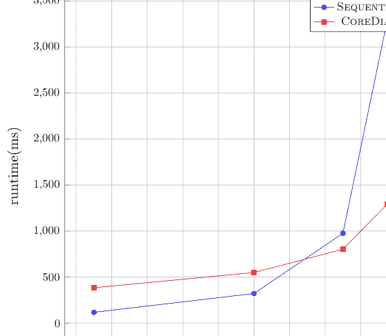

### FIGURE 12.1

金融服务知识库中 SEQUENTIAL 和 CoreDiag 的性能（见 Felfernig et al. 2011）。

## References

Bakker, R., Dikker, F., Tempelman, F., Wogmim, P., 1993. Diagnosing and solving over-determined constraint satisfaction problems. In: 13th International Joint Conference on Artificial Intelligence, Chambery, France, pp. 276–281.

Belov, A., Janota, M., Lynce, I., Marques-Silva, J., 2012. On computing minimal equivalent subformulas. In: Principles and Practices of Constraint Programming (CP 2012). No. 7514 in Lecture Notes in Computer Science. Springer, Québec City, QC, Canada, pp. 158–174.

Boufkhadd, Y., Roussel, O., 2000. Redundancy in random SAT formulas. In: 17th National Conference on Artificial Intelligence (AAAI-00), Austin, Texas, pp. 273–278.

Chklovski, T., Gil, Y., 2005. An analysis of knowledge collected from volunteer contributors. In: 20th National Conference on Artificial Intelligence (AAAI-05), Pittsburg, Pennsylvania, pp. 564–571.

Chmeiss, A., Krawczyk, V., Saïs, L., 2008. Redundancy in CSPs. In: Ghallab, M., Spyropoulos, C.D., Fakotakis, N., Avouris, N.M. (Eds.), 18th European Conference on Artificial Intelligence (ECAI 2008), Patras, Greece, pp. 907–908.

Dechter, A., Dechter, R., 1987. Removing redundancies in constraint networks. In: 6th National Conference on Artificial Intelligence (AAAI-87), Seattle, Washington, pp. 105–109.

Fahad, M., Qadir, M., 2008. A framework for ontology evaluation. In: Supplementary Proceedings of the 16th International Conference on Conceptual Structures (ICCS 2008), Toulouse, France, pp. 149–158.
Felfernig, A., Burke, R., 2008. Constraint-based recommender systems: Technologies and research issues. In: ACM International Conference on Electronic Commerce (ICE C08), Innsbruck, Austria, pp. 17–26.
Felfernig, A., Friedrich, G., Jannach, D., Stumptner, M., 2004. Consistency-based diagnosis of configuration knowledge bases. Artificial Intelligence 152 (2), 213–234.
Felfernig, A., Zehentner, C., Blazek, P., 2011. CoreDiag: Eliminating redundancy in constraint sets. In: 22nd International Workshop on Principles of Diagnosis (DX’2011), Murnau, Germany, pp. 219–224.
Felfernig, A., Schubert, M., Zehentner, C., 2012. An efficient diagnosis algorithm for inconsistent constraint sets. Artificial Intelligence for Engineering Design, Analysis and Manufacturing (AI EDAM) 26 (1), 53–62.
Felfernig, A., Reiterer, S., Reinfank, F., Ninaus, G., Jeran, M., 2014. Conflict detection and diagnosis in configuration. In: Felfernig, A., Hotz, L., Bagley, C., Tiihonen, J. (Eds.), Knowledge-based Configuration – From Research to Business Cases. Morgan Kaufmann Publishers, Waltham, MA, pp. 73–87 (Chapter 7).
Fourdrinoy, O., Grégoire, E., Mazure, B., Saïs, L., 2007. Eliminating redundant clauses in SAT instances. In: 4th International Conference on Integration of AI and OR Techniques in Constraint Programming for Combinatorial Optimization Problems. No. 4510 in Lecture Notes in Computer Science. Springer, Brussels, Belgium, pp. 71–83.
Friedrich, G., Shechekotykin, K., 2005. A general diagnosis method for ontologies. In: 4th International Semantic Web Conference (ISWC05). No. 3729 in Lecture Notes in Computer Science. Springer, Galway, Ireland, pp. 232–246.
Friedrich, G., Jannach, D., Stumptner, M., Zanker, M., 2014. Knowledge engineering for configuration systems. In: Felfernig, A., Hotz, L., Bagley, C., Tiihonen, J. (Eds.), Knowledge-based Configuration – From Research to Business Cases. Morgan Kaufmann Publishers, Waltham, MA, pp. 139–155 (Chapter 11).
Grimm, S., Wissmann, J., 2011. Elimination of redundancy in ontologies. In: The Semantic Web: Research and Applications, 8th Extended Semantic Web Conference (ESWC 2011). No. 6643 in Lecture Notes in Computer Science. Springer, Heraklion, Greece, pp. 260–274.
Hotz, L., Felfernig, A., Stumptner, M., Ryabokon, A., Bagley, C., Wolter, K., 2014. Configuration knowledge representation and reasoning. In: Felfernig, A., Hotz, L., Bagley, C., Tiihonen, J. (Eds.), Knowledge-based Configuration – From Research to Business Cases. Morgan Kaufman Publishers, Waltham, MA, pp. 41–72 (Chapter 6).
Junker, U., 2004. QUICKXPLAIN: Preferred explanations and relaxations for over-constrained problems. In: McGuinness, D.L., Ferguson, G. (Eds.), 19th International Conference on Artificial Intelligence (AAAI’04). AAAI Press, pp. 167–172.
Levy, A., Sagiv, Y., 1992. Constraints and redundancy in Datalog. In: 11th Symposium on Principles of database systems, San Diego, California, pp. 67–80.
Liberatore, P., 2005. Redundancy in logic I: CNF propositional formulae. Artificial Intelligence 163 (2), 203–232.
Liberatore, P., 2008a. Redundancy in logic II: 2CNF and horn propositional formulae. Artificial Intelligence 172 (2–3), 265–299.
Liberatore, P., 2008b. Redundancy in logic III: Non-monotonic reasoning. Artificial Intelligence 172 (11), 1317–1359.
Piette, C., 2008. Let the solver deal with redundancy. In: 20th IEEE International Conference on Tools with Artificial Intelligence (ICTAI’08), Dayton, Ohio, pp. 67–73.
Richardson, M., Domingos, P., 2003. Building large knowledge bases by mass collaboration. In: 2nd International Conference on Knowledge Capture (K-CAP 2003), Sanibel Island, Florida, pp. 129–137.
Sabin, M., Freuder, E. 1999. Detecting and resolving inconsistency and redundancy in conditional constraint satisfaction problems. AAAI 1999 Workshop on Configuration (AAAI Technical Report WS-99-05), Orlando, Florida, 90–94.


## 个性化配置

Juha Tiihonen*, Alexander Felfernig† 和 Monika Mandl†
*Aalto University, Aalto, Finland
†Graz University of Technology, Graz, Austria

摘要：产品（或产品组合）规模和复杂性的不断增加，促使人们需要智能技术来主动支持配置器应用的用户找到符合其愿望和需求的解决方案（配置）。推荐技术非常适合应用于配置环境，因为它们可以从庞大而复杂的项目集中找到相关项目。在本章中，我们展示了如何将不同类型的基础推荐技术应用于向配置器的用户推荐配置或单个选择，例如属性值。此讨论基于移动电话领域的实际示例。

### 13.1 引言

配置系统（简称为配置器；Barker et al., 1989; Heiskala et al., 2007; Stumptner, 1997）已成为实施大规模定制概念的重要工具（见 Piller and Blazek, 2014¹）。大规模定制的核心概念是以接近大规模生产效率的方式生产客户个性化产品（Pine, 1993; Tseng and Jiao, 2001）。遵循大规模定制的范式，产品和服务的智能定制对于制造企业保持竞争力至关重要。配置器支持将用户纳入设计过程的理念，允许用户指定所需产品特征；后续的生产过程会考虑这种个性化设计。用户不是选择一个产品，而是通过基于一组可用选项配置产品属性来指定产品。配置器应用的示例领域包括计算机、汽车、工业机械、金融服务和电信交换机。

配置器具有许多优点，例如消除错误、缩短产品交付周期以及提高销售代表的生产率（见 Bagley et al., 2014²）。产品配置器的一个主要缺点是，用户（客户）在许多情况下无法完全理解所提供的选项集合，并且常常被这些选项的复杂性所压倒（Bettman et al., 1998; Huffman and Kahn, 1998）。本章的目的是介绍一套选定的策略，通过集成（利用）

¹第9章。
²第4章。

I 中的赋值与 C 中的约束一致。配置是 *complete* 如果 V 中的所有变量都有具体值，最后，配置是 *valid* 如果它同时一致且完整。

一个有效配置的示例如下：`{styleReq=clam, webUse=often, GPSReq=false, pModel= p3, pStyle=clam, pHSDPA=3.6, pGPS =false, pPrice=99}`。

### 13.3 将推荐技术集成到配置器中

配置器可指定的产品具有高度多样性，这会产生一个副作用，即提供的复杂性可能超出用户探索解决方案空间并做出购买决定的能力。先前的研究表明，消费者常常被大量的选项所压倒（Malhotra, 1982）。由于人类处理能力有限，向消费者提供过多的信息会导致信息过载，从而可能导致决策绩效质量下降（Jacoby et al., 1974）。另一个挑战是，用户通常对可能满足其需求的解决方案没有明确的了解（Bettman et al., 1998）。*偏好构建理论*（Bettman et al.）解释说，用户通常并不知道自己喜欢哪些产品或组件（见 Mandl et al., 2014）。因此，用户会在配置过程的范围内构建和调整其偏好（Bettman et al., 1998）。

推荐技术可以在用户需求的规范中提供支持，从而有助于实现更高的用户满意度（Cöster et al., 2002; Helferning et al., 2010; Geneste and Ruet, 2001）。将推荐技术与基于知识的配置集成仍处于非常早期的阶段。存在一些考虑在配置环境中应用个性化技术的贡献。Geneste and Ruet (2001) 引入了一种将案例推理方法（Kolodner, 1993; McSherry, 2003）与约束求解（Tsang, 1993; Mackworth, 1977）集成的思路。Cöster et al. (2002)、Tihonen and Helferning (2010) 以及 Helferning et al. (2010) 专注于特征、特征值推荐以及将这些推荐集成到用户界面的策略。

接下来，我们将讨论通过应用推荐技术来支持用户与配置环境交互的选定方法。

#### 13.3.1 默认推荐

在本章的剩余部分，*defaults* 指的是预先选择的特征值，表示与当前用户偏好兼容的推荐、有意义的替代方案。默认值支持用户仅指定对他们重要的特征，而让系统自动确定其余特征值的理念（Falkner et al., 2011）。以下段落介绍了推荐默认值的不同方法。

**静态默认推荐。** 静态默认的一种解释是，参数具有预定义的值，该值独立于配置上下文。McSherry (2005) 引入了静态默认的另一种概念，他基于这样一种想法确定项目的静态推荐：大多数用户希望最大化或最小化数值产品属性的值。这些属性被称为 *more-is-better*（MIB；例如数码相机的分辨率或光学变焦）或

*less-is-better*（LIB；例如价格或重量）属性。此外，对于某些属性，用户更喜欢其偏好与相应产品属性之间具有高度相似性。*nearer-is-better*（NIB）属性的一个例子是 *pGPS*：如果用户期望 GPS 可用，则配置应包含此功能。*default query* 指定最佳产品；它由以下偏好组成：MIB 属性的最大值、LIB 属性的最小值以及 NIB 属性的用户需求。

对于我们的移动电话示例（表 13.1），LIB 属性 `pPrice` 的首选值为 69（最便宜的可用手机的价格）。`pHSDPA` 的首选值为 7.2（MIB；最高可用数据速率）。最后，假设客户（用户）需要 GPS（*GPSReq = true*），则 NIB 属性 `pGPS` 的首选值为 *true*。由此产生的默认查询为 *Q = {pPrice = 69; pHSDPA = 7.2; pGPS = true}*。

项目 *I* 与默认查询 *Q* 的相似度是根据 *Q* 中的每个属性 *a* 确定的。公式 13.1 用于 MIB 属性，公式 13.2 用于 LIB 属性，公式 13.3 用于 NIB 属性（McSherry, 2005）。在这些公式中，*max(a)* 和 *min(a)* 分别指案例库中属性 *a* 的最大值和最小值。*φₐ(Q)* 是（默认）查询 *Q* 中 *a* 的值，而 *φₐ(I)* 是项目 *I* 的 *a* 的值。在这些公式中，布尔属性值 *false* 和 *true* 分别解释为 0 和 1。案例库中所有属性的并集为 *V*（变量集合）。

sim_(MIB)(a, I, Q) = 1 - |φₐ(I) - φₐ(Q)| / [max(a) - min(a)] = [φₐ(I) - min(a)] / [max(a) - min(a)]   (13.1)

sim_(LIB)(a, I, Q) = 1 - |φₐ(I) - φₐ(Q)| / [max(a) - min(a)] = [max(a) - φₐ(I)] / [max(a) - min(a)]   (13.2)

sim_(NIB)(a, I, Q) = 1 - |φₐ(I) - φₐ(Q)| / [max(a) - min(a)]   (13.3)

将静态默认推荐应用于表 13.1 中的手机，对于查询 *Q = {pPrice = 69; pHSDPA = 7.2; pGPS = true}*，我们计算数值属性 `pPrice`、`pHSDPA` 和 `pGPS` 的相似度（见表 13.2）。

表 13.2 工作示例中手机型号的静态默认推荐。`pModel` 是手机型号，`pHSDPA` 是支持的 HSDPA 数据速率，`sim_pHSDPA` 是 MIB 属性 `pHSDPA` 的相似值（公式 13.1）。`pPrice` 是手机的价格，`sim_pPrice` 是 LIB 属性 `pPrice` 的相似值（公式 13.2）。`pGPS` 指定手机是否支持 GPS，`sim_pGPS` 是布尔 NIB 属性 `pGPS` 的相似值（公式 13.3）。最后 Σ 表示 Σₐ∈V sim(a, pModel, Q)—pModel 相对于最佳值 Q 的总相似度。

| pModel | pHSDPA | sim_pHSDPA | pPrice | sim_pPrice | pGPS | sim_pGPS | Σ |
|---|---|---|---|---|---|---|---|
| p1 | 0 | 0.000 | 69 | 1.000 | false | 0.000 | 1.000 |
| p2 | 7.2 | 1.000 | 149 | 0.000 | true | 1.000 | 2.000 |
| p3 | 3.6 | 0.500 | 99 | 0.625 | false | 0.000 | 1.125 |


| 表 13.3 示例：来自之前会话的有效配置（conf₁, conf₂, conf₃）。 |
| feature fᵢ / configuration confⱼ | conf₁ | conf₂ | conf₃ | confᵤ |
| f₁ = styleReq | bar | clam | clam | clam |
| f₂ = webUse | no | often | occasional | often |
| f₃ = GPSReq | false | true | false |  |
| f₄ = pStyle | bar | clam | clam |  |
| f₅ = pModel | p1 | p2 | p3 |  |
| f₆ = pHSDPA | 0 | 7.2 | 3.6 |  |
| f₇ = pGPS | false | true | false |  |
| f₈ = pPrice | 69 | 149 | 99 |  |

user. 用户更有可能探索结果排名中靠前的项目；这种效应被称为首因效应（参见 Mandl et al., 2014⁶）。不同的结果排名方法例如在 Felfernig et al. (2008, 2010) 中有所讨论。Felfernig et al. (2010) 引入了一种基于相似度的产品排名方法。确定用户当前配置与已完成配置的相似度（确定最近邻配置），从而决定相关手机的顺序（排名）。与当前用户需求一致（兼容）的手机将按此顺序显示。例如，如果用户需求为 C_R = {r₀ : styleReq=clam, r₁ : webUse=occasional, r₂ : GPSReq = false}，配置 conf₃ 满足用户需求（参见表 13.1 和 13.3）。由于 conf₃ 与用户配置最相似（一个相关配置的平凡情况），手机 p₃ 被排在第一位。p₁ 不能被推荐，因为其风格与用户需求不匹配。

另一种个性化项目排名的方法在 Felfernig et al. (2008) 中引入。该方法利用多属性效用理论（MAUT；Winterfeldt and Edwards, 1986），其中产品或例如单个属性值根据其在预定义的一组兴趣维度 D 上的表现以及用户偏好进行评估。移动电话场景中的示例维度可以是时尚（fa）、经济（eco）和功能性（fu）。产品 p 对兴趣维度 d 的贡献是预先定义的，并表示为分数 sc_d(p)。用户偏好表示为对每个维度 in_d 的兴趣。产品的效用 u(p) 例如可以根据公式 13.5 确定。

```
u(p) = Σ_{d∈D} sc_d(p) * in_d   (13.5)
```

结果，产品的顺序取决于用户对兴趣维度的重要性。兴趣维度的重要性（in_d）可以通过用户提供的显式评估确定，或从用户需求中推导出来（参见例如 Felfernig et al., 2013a）。为简单起见，我们的示例采用显式的兴趣维度权重，并假设 sc_d(p) 的值在产品数据库建立时为每个产品手动指定。确定 sc_d(p) 的方法

**表 13.6** 示例用户对手机参数值的偏好（显然，价格具有最高优先级，即不应成为诊断的一部分）。

| r₀ : pStyle = clam | r₁ : pPrice < 70 | r₂ : pGPS = true |
|---:|---:|---:|
| 10 | 80 | 10 |

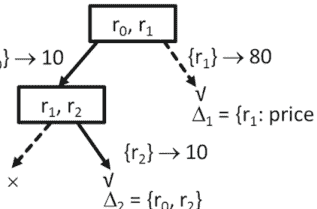

**图 13.2**

不一致需求的优选诊断（{r₀, r₁, r₂}）：Δ₂。

冲突：$CS_1 = \{r_0 : pStyle = clam, r_1 : pPrice < 70\}$ 和 $CS_2 = \{r_1 : pPrice < 70, r_2 : pGPS = true\}$。两个集合都是冲突集，因为 $CS_1 \cup CK_B$ 不一致，且 $CS_2 \cup CK_B$ 也不一致。此外，两个冲突集都是最小的，因为这些集合的任何子集都不是冲突集。

对于给定的每个最小冲突，我们有两种可能性来解决冲突。从给定的冲突集中可以确定的所有不同的备选最小诊断为：$\Delta_1 = \{r_1 : pPrice < 70\}$ 和 $\Delta_2 = \{r_0 : pStyle = clam, r_2 : pGPS = true\}$。因此，$\Delta_1$ 和 $\Delta_2$ 表明用户可以调整（或删除）其需求的方式，以便配置系统能够识别出解决方案。

有了对用户偏好的一些了解，我们能够对不同的备选诊断进行排序并向用户展示最相关的诊断。由于我们在工作示例中只有两个备选诊断，因此我们不必选择最相关的诊断，只需根据用户的偏好对这两个备选方案进行排序。我们用公式 13.6 确定特定诊断 $\Delta$ 对用户的效用。假设表 13.6 中显示的偏好值是由用户提供的。

$$utility(\Delta) = \frac{1}{\sum_{r \in \Delta} preference(r)} \tag{13.6}$$

公式 13.6 中的效用函数可在诊断过程中使用（参见 Felfernig et al., 2014）。用于确定个性化（优选）诊断的命中集有向无环图如图 13.2 所示。在此上下文中，$\Delta_2$ 是优选诊断，因为它具有最高的效用。

(1/20 > 1/80)。确定一组不一致需求的优选诊断的替代方法在 Felfernig et al. (2009, 2013b) 中有所讨论。

### 13.4 研究挑战

将个性化和推荐技术与配置系统集成仍处于起步阶段。接下来，我们概述一些未来研究的重点主题。

#### 决策现象。
心理学理论识别并解释了消费者决策中的不同类型的决策偏差。消费者受所呈现信息格式的影响，因而在不同情境下使用不同的决策策略。这意味着用户界面的设计可能对决策过程的最终结果产生重大影响。在结果页面的上下文中，我们未来工作的重点是研究 *诱饵效应* 的存在（参见例如 Huber et al., 1982）。诱饵效应发生在劣质（低质量）的 *诱饵配置* 与其他解决方案一起呈现的情况下。实际上，诱饵使其他解决方案“看起来更好”。诱饵可以触发用户解决方案选择（购买）行为的显著转变。我们有兴趣回答关于产品数量上限的问题，使得诱饵效应仍然发生。此外，我们有兴趣研究解决方案多样性（通常通过不同类型的相似度度量来衡量；McSherry, 2004）与诱饵效应存在之间的相互关系。另一个问题是诱饵解决方案在结果集中的位置是否会影响决策偏差（诱饵效应）的大小。

#### 高级推荐算法。
未来工作的另一个主题是扩展现有的配置支持推荐算法，以考虑可配置产品的结构变化。这意味着开发不依赖于基本 CSP 表示的算法，但也可适用于更复杂、面向组件的产品结构（参见例如 Hotz et al., 2014 中的配置模型）。此外，价格和交货时间通常受众多因素影响，例如选项的确切组合，以及制造和供应链等利益相关者的动态负载。如何在确定推荐时有效考虑这些方面是未来研究的话题。

#### 修复操作。
如果给定的用户需求集找不到配置，则存在大量可以解决冲突的修复操作组合；其数量随需求数量呈指数增长（O'Sullivan et al., 2007）。未来工作的一个主要目标是扩展 Felfernig et al. (2009) 的方法，同时考虑修复选择过程中可能出现的不同类型的决策偏差。例如，Kivetz and Simonson (2000) 研究了不完整信息对消费者选择的影响。一系列研究表明，从信息缺失的集合中选择会影响消费者的口味和购买决策（Kivetz and Simonson, 2000）。修复操作可以被视为不完整信息，因为修复备选方案通常仅包括产品属性的子集。在此上下文中，我们希望研究为解释目的而包含额外属性是否会对修复选择过程产生影响。


**解决方案搜索的新方法。** 存在两种主要的方法来搜索可能的解决方案的大空间。一种*基于查询的方法*支持指定最终解决方案必须考虑的搜索标准；这是现有配置环境通常支持的方法。另一种支持用户的替代方案是提供*基于导航的*界面，允许在解决方案空间中轻松导航。这种导航是通过确定与当前呈现的解决方案相似的解决方案并将该新解决方案呈现给用户来实现的。基于导航的界面在推荐系统领域（尤其是基于批评的推荐系统）中已得到很好的建立。将这些推荐方法应用于配置场景的可行性是一个主要的研究问题。

### 13.5 结论

在本章中，我们介绍了一组精选的推荐策略，这些策略通过支持用户根据其个人需求配置产品来个性化产品配置体验。我们讨论了特征值推荐和配置个性化排序的方法。我们将我们的贡献视为迈向更智能的配置用户界面的重要一步，这些界面有助于从预测准确性或对配置环境的整体满意度等不同维度提高应用程序的质量。

## 参考文献

+ Bagley, C., Helferning, A., Tiihonen, J., Wortley, L., Hotz, L., 2014. Benefits of configuration systems. In: Helferning, A., Hotz, L., Bagley, C., Tiihonen, J. (Eds.), *Knowledge-based Configuration – From Research to Business Cases*. Morgan Kaufmann Publishers, Waltham, MA, pp. 29–33 (Chapter 4).
+ Barker, V., O’Connor, D., Bachant, J., Soloway, E., 1989. Expert systems for configuration at digital: XCON and beyond. *Communications of the ACM* 32 (3), 298–318.
+ Bettman, J., Luce, M., Payne, J., 1998. Constructive consumer choice processes. *Journal of Consumer Research* 25 (3), 187–217.
+ Cöster, C., Gustavsson, A., Olsson, R., Rudström, A., 2002. Enhancing web-based configuration with recommendations and cluster-based help. In: Francesco, R., Barry, S. (Eds.), AH’02 Workshop on Recommendation and Personalized in e-Commerce. Universidade de Málaga, Málaga, Spain, pp. 30–40.
+ Falkner, A., Helferning, A., Haag, A., 2011. Recommendation technologies for configurable products. *AI Magazine* 32 (3), 99–108.
+ Helferning, A., Friedrich, G., Jannach, D., Zanker, M., 2006. An integrated environment for the development of knowledge-based recommender applications. *International Journal of Electronic Commerce (IJEC)* 11 (2), 11–34.
+ Helferning, A., Gula, B., Leitner, G., Maier, M., Melcher, R., Teppan, E., 2008. Persuasion in knowledge-based recommendation. In: Oinas-Kukkonen, H., Hasle, P.V., Harjumaa, M., Segerståhl, K., Øhrstrøm, P. (Eds.), *Persuasive Technology, 3rd International Conference (PERSUASIVE 2008)*. Lecture Notes in Computer Science, vol. 5033. Springer, Oulu, Finland, pp. 71–82.
+ Helferning, A., Schubert, M., Friedrich, G., Mandl, M., Mairitsch, M., Teppan, E., 2009. Plausible repairs for inconsistent requirements. In: 21st International Joint Conference on Artificial Intelligence (IJCAI’09). Pasadena, CA, USA, pp. 791–796.
+ O’Sullivan, B., Papadopoulos, A., Faltings, B., Pu, P., 2007. Representative explanations for over-constrained problems. In: Holte, R.C., Howe, A.E. (Eds.), Twenty-Second AAAI Conference on Artificial Intelligence (AAAI-07). AAAI Press, Vancouver, Canada, pp. 323–328.
+ Piller, F.T., Blazek, P., 2014. Core capabilities of sustainable mass customization. In: Felfernig, A., Hotz, L., Bagley, C., Tiihonen, J. (Eds.), Knowledge-based Configuration – From Research to Business Cases. Morgan Kaufmann Publishers, Waltham, MA, pp. 107–120 (Chapter 9).
+ Pine, B.J., 1993. Mass customization: The New Frontier in Business Competition. Harvard Business School Press.
+ Stumpfner, M., 1997. An overview of knowledge-based configuration. AI Communications 10 (2), 111–126.
+ Tiihonen, J., Felfernig, A., 2010. Towards recommending configurable offerings. International Journal of Mass Customization 3 (4), 389–406.
+ Tsang, E., 1993. Foundations of Constraint Satisfaction. Academic Press, London, San Diego, New York.
+ Tseng, M., Jiao, J., 2001. Mass customization. In: Salvendy, G. (Ed.), Handbook of Industrial Engineering, 3rd ed. Wiley, New York, pp. 684–709 (Chapter 25).
+ Wilson, D., Martinez, T., 1997. Improved heterogenous distance functions. Journal of Artificial Intelligence Research 6, 1–34.
+ Winterfeldt, D., Edwards, W., 1986. Decision Analysis and Behavioral Research. Cambridge University Press, Cambridge.

## 消费者决策与配置系统

## 第14章

Monika Mandl*, Alexander Felfernig*, and Erich Teppan†
*Graz University of Technology, Graz, Austria
†Alpen Adria Universität Klagenfurt, Klagenfurt, Austria

摘要：配置复杂产品和服务对用户来说可能具有挑战性。由于底层决策任务的复杂性，决策往往受到不同类型的决策偏差的影响。这种偏差可能使用户走向非预期结果，并且通常是次优决策的主要原因。在本章中，我们提供了不同类型的决策偏差的概述，这些偏差可能与配置过程相关的任务有关。

### 14.1 引言

在心理学文献中可以找到解释消费者决策中不同类型决策偏差存在的若干理论。消费者会受到信息呈现方式的影响，从而使用不同的决策策略（参见例如 Asch, 1949; Bettman et al., 1991; Tversky and Kahneman, 1981）。例如，Asch 进行的一项研究的结果说明了项目在列表中的位置的重要性。该实验表明，在按顺序呈现描述一个人的形容词时，相同的词语可能会导致对该人的评价出现非常不同的结果，具体取决于词语呈现的顺序。这种效应被称为首因效应，也可能出现在产品描述的不同排序中（Felfernig et al., 2007）。

Mandel 和 Johnson（1998）的研究结果表明，网页设计可能会影响用户对产品属性重要性的感知，从而影响最终的产品选择——这被称为启动效应。在他们的研究中，他们让参与者面对一个支持家具项目选择的界面。界面的一个版本具有“货币相关”的背景（向用户展示硬币），另一个界面具有柔软的云朵背景。使用第一个版本的界面时，用户选择的产品价格明显更低。

如果用户在偏好构建过程中存在偏见，¹ 这可能导致不精确和错误的偏好信息，从而导致产品预测不准确。另一个问题是，决策偏差可能导致不道德的商业行为，因为在线零售商可能会利用这些偏差来增加销售额。这促使在产品配置的背景下研究决策偏差。一个重要的研究领域是开发能够抵消这些偏差或以改善用户体验的方式利用这些效应的用户界面（Teppan and Felfernig, 2012）。

本章的主要贡献如下。我们提供了在与配置系统交互时可能出现的潜在决策偏差的概述。通过这一概述，我们提高了人们对决策偏差存在的认识，并鼓励计算机科学和决策心理学领域的<|message|>


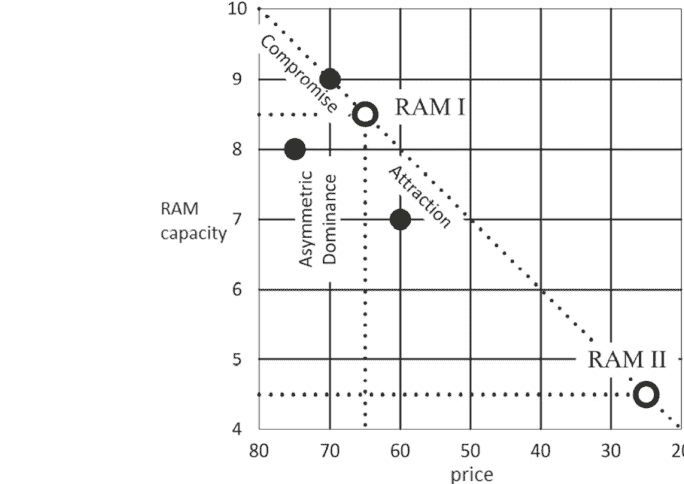

### FIGURE 14.1

本章讨论的不同类型的诱饵项目。

在下面的小节中，我们将讨论不同类型的诱饵效应（*妥协、非对称优势和吸引*），并解释这些效应如何影响决策过程的最终结果。**Figure 14.1** 提供了本章讨论的不同类型诱饵效应的概览。请注意，计算机 RAM I 和 RAM II 出现在帕累托线上，这意味着它们具有可比较的效用（计算机 RAM I 的容量更高，而 RAM II 的价格更低）。

**妥协效应。**妥协效应表示诱饵效应的一种特定原型（参见**Table 14.2**）。Simonson 和 Tversky（1992）证明，往选择集添加一个极端备选方案会导致人们更倾向于“中间”选择，其属性值介于其他备选方案的值之间。例如，通过向备选方案集合中添加计算机 D，可以提高计算机 RAM I 相对于计算机 RAM II 的吸引力（参见**Table 14.2**）。由于 RAM I 相对于 D 价格显著更低，且容量仅略低，因此计算机 RAM I 在备选方案 RAM II 和 D 之间确立为妥协选择。

**非对称优势效应。**第二种诱饵效应原型称为非对称优势（见**Table 14.3**）。在此情景中，计算机 RAM I 在两个属性（价格和容量）上都占优于计算机 D，而计算机 RAM II 仅在其中一个维度（价格）上占优于 D。因此，向集合中添加计算机 D 可以提高计算机 RAM I 的份额。其背后的效应是，用户认为 RAM I 是更好的选择，因为它与 RAM II 相比，在两个维度上都优于 D。

**Table 14.5 Scoring rules for product attribute *price*.**

| Price | Economy | Quality |
|---|---|---|
| ≤ 25 | 10 | 3 |
| > 25, ≤ 50 | 6 | 5 |
| > 50, ≤ 75 | 4 | 7 |
| > 75, ≤ 100 | 2 | 10 |

**Table 14.6 Scoring rules for product attribute *capacity*.**

| Capacity | Economy | Quality |
|---|---|---|
| ≤ 3 | 10 | 4 |
| > 3, ≤ 6 | 6 | 7 |
| > 6, ≤ 10 | 4 | 10 |

contents (Felfernig et al., 2007). 最后，Li 和 Epley（2009）展示了由于选择备选方案（选项）排序不同而产生的序列位置效应。

#### 14.3.2 产品配置场景中序列位置效应的相关性

产品配置系统已被公认为协助客户根据个人偏好配置复杂产品的理想工具（Blecker et al., 2004; Yang et al., 2005）。在此背景下，序列位置效应在排序选择备选方案时发挥重要作用；配置系统必须意识到，不同的排序会触发不同的选择行为，并且会增加或减少用户的决策努力。Murphy et al.（2006）建议将最重要的项目放在第一位，并将另一个重要项目放在列表的最后一位（应继续按重要性顺序进行）。Felfernig et al.（2008）引入了一种计算个性化项目排序的方法，并在推荐场景中结果集的呈现中考虑首因/近因效应。他们应用了多属性效用理论（MAUT；Winterfeldt and Edwards, 1986）的概念，并从客户需求中推导出兴趣维度的相对重要性（另见 Felfernig et al., 2006, 2013）。

Felfernig et al.（2008）所介绍概念的一个简单示例如下。假设 *economy* 和 *quality* 已被定义为第 14.2 节中介绍的计算机产品领域的兴趣维度。表 14.5 和 14.6 中定义了示例评分规则，描述了计算机属性（*price* 和 *capacity*）与相应兴趣维度（*economy* 和 *quality*）之间的关系。例如，表 14.5 显示，昂贵的计算机在经济性兴趣维度上的感知价值较低，而在质量兴趣维度上的感知价值较高。表 14.6 显示，容量较低的计算机在经济性兴趣域中的效价较高，而在质量兴趣维度中的效价较低。

Crowder, R., 1976. Principles of learning and memory. In: The Experimental Psychology Series. Lawrence Erlbaum Associates, Hillsdale, NJ.

Ebbinghaus, H., Rüger, H.A., Clara, E.B., 1885. Memory: a contribution to experimental psychology. In: The Experimental Psychology Series. Teachers College, Columbia University, NY.

Falkner, A., Felfernig, A., Haag, A., 2011. Recommendation technologies for configurable products. AI Magazine 32 (3), 99–108.

Felfernig, A., Friedrich, G., Jannach, D., Zanker, M., 2006. An integrated environment for the development of knowledge-based recommender applications. International Journal of Electronic Commerce (IJEC) 11 (2), 11–34.

Felfernig, A., Friedrich, G., Gula, B., Hitz, M., Kruggel, T., Melcher, R., Riepan, D., Strauss, S., Teppan, E., Vitouch, O., 2007. Persuasive recommendation: exploring serial position effects in knowledge-based recommender systems. In: De Kort, Y., IJsselsteijn, W., Midden, C., Eggen, B., Fogg, B.J. (Eds.), Second International Conference of Persuasive Technology (Persuasive 2007). Lecture Notes in Computer Science, vol. 4744. Springer, Palo Alto, CA, pp. 283–294.

Felfernig, A., Gula, B., Leitner, G., Maier, M., Melcher, R., Teppan, E., 2008. Persuasion in knowledge-based recommendation. In: Oinas-Kukkonen, H., Hasle, P.F.V., Harjumaa, M., Segerståhl, K., Øhrstrøm, P. (Eds.), Persuasive Technology, Third International Conference (PERSUASIVE 2008). Lecture Notes in Computer Science, vol. 5033. Springer, Oulu, Finland, pp. 71–82.

Felfernig, A., Schippel, S., Leitner, G., Reinfank, F., Isak, K., Mandl, M., Blazek, P., Ninaus, G., 2013. Automated repair of scoring rules in constraint-based recommender systems. AI Communications 26 (2), 15–27.

Häubl, G., Trifts, V., 2000. Consumer decision making in online shopping environments: the effects of interactive decision aids. Marketing Science 19 (1), 4–21.

Huber, J., Payne, W., Puto, C., 1982. Adding asymmetrically dominated alternatives: violations of regularity and the similarity hypothesis. Journal of Consumer Research 9 (1), 90–98.

Huffman, C., Kahn, B., 1998. Variety for sale: mass customization or mass confusion. Journal of Retailing 74 (4), 491–513.

Jacoby, J., Speller, D., Kohn, C., 1974. Brand choice behavior as a function of information load. Journal of Marketing Research 11 (1), 63–69.

Kahneman, D., Tversky, A., 1979. Prospect theory: an analysis of decision under risk. Econometrica 47 (2), 263–291.

Kahneman, D., Knetsch, J.L., Thaler, R.H., 1991. Anomalies: the endowment effect, loss aversion, and status quo bias. Journal of Economic Perspectives 5 (1), 193–206.

Konstan, J., Miller, B., Maltz, D., Herlocker, J., Gordon, L., Riedl, J., 1997. Grouplens: applying collaborative filtering to usenet news full text. Communications of the ACM 40 (3), 77–87.

Li, Y., Epley, N., 2009. When the best appears to be saved for last: serial position effects on choice. Journal of Behavioral Decision Making 22 (4), 378–389.

Mandel, N., Johnson, E., 1998. Constructing Preferences Online: Can Web Pages Change What You Want? Marketing Department, The Wharton School, University of Pennsylvania, Philadelphia, PA.

Mandl, M., Felfernig, A., Teppan, E., Schubert, M., 2010. Consumer decision making in knowledge-based recommendation. Journal of Intelligent Information Systems (JIIS) 37 (1), 1–22.

Mandl, M., Felfernig, A., Tiihonen, J., Isak, K., 2011. Status quo bias in configuration systems. In: 24th International Conference on Industrial, Engineering and Other Applications of Applied Intelligent Systems (IEA/AIE 2011). Lecture Notes in Computer Science, vol. 6703. Springer, Syracuse, NY, pp. 105–114.

Murphy, J., Hofacker, C.F., Mizerski, R., 2006. Primacy and recency effects on clicking behavior. Journal of Computer-Mediated Communication 11 (2), 522–535.

Ritov, I., Baron, J., 1992. Status-quo and omission biases. Journal of Risk and Uncertainty 5 (1), 49–61.


(Benavides et al., 2013)。为了推广这一方面，对这两个研究领域之间潜在协同效应的系统性分析是未来研究的一个主要问题。相关研究问题的深入讨论例如可参见 Benavides et al. (2013) 和 Hubaux et al. (2012)。

## 社区化配置

通常，配置被假定为一个过程，其中一名用户与配置系统交互，目标是识别出一个解决方案（配置）。在此背景下一个主要的研究问题是如何最好地支持包含用户群体的配置过程（Felfernig et al., 2012b; Jameson, 2004）。此类场景的例子有度假行程配置、软件发布计划，以及（同样）汽车配置。在这些场景中，用户通常会合作设计其解决方案，这需要额外的配置功能，例如为用户群体提供特征（值）推荐、为用户群体提供诊断和修复推荐、为用户群体提供配置排序，等等。从这些问题我们可以推导出应回答的一般研究问题：我们必须以何种方式调整（扩展）现有的用户界面、算法和配置过程，才能支持用户群体？

## 标准化的配置知识表示

开发配置通用语言仍然是一个主要的研究问题。这种语言将有助于使配置知识在不同的配置环境之间互换，从而更好地保护企业资产免受技术变化的影响。此外，这种知识表示语言将有助于使新算法发展的实证评估更容易，因为在假设每个环境都能导入/导出标准表示的情况下，翻译现有配置知识库到特定配置环境的方言所花费的精力会更少。致力于开发此类标准化知识表示的研究集中于通用本体（Soininen et al., 1998）、UML（Felfernig, 2007; Felfernig et al., 2000），以及基于描述逻辑的表示（参见例如 Felfernig et al., 2003）。未来研究的主要问题是开发一种通用表示语言，该语言（1）考虑到配置知识的所有相关方面（例如，端口、复合和共享的层次结构部分）并且（2）也提供允许高效求解搜索的语义。基于答案集编程的配置研究显示出有前景的结果，这将为实现上述目标铺平道路（Aschinger et al., 2012; Friedrich et al., 2011; Simons et al., 2002; Tiihonen et al., 2003, 2013）。

## 配置知识获取的智能用户界面

复杂配置知识库的工程通常是一个合作过程，其中涉及产品设计师、市场和销售专家以及知识工程师等不同利益相关者。每个利益相关者仅熟悉产品域的特定方面，甚至在技术层面也有不同的专家对底层产品有不同的知识。此外，利益相关者往往对可配置产品应支持的特性存在冲突的利益。在此背景下需要回答的主要问题如下：知识库的哪些组件应成为其一部分（即提供给客户）？知识库应包含哪些约束？如何实现不同利益相关者之间的共识？在此背景下的另一个问题是知识库的可访问性：经验丰富的知识工程师在知识库中的导航行为与经验较少的工程人员不同。在此背景下一个主要的研究问题是开发智能技术以支持配置知识库的易于理解和处理（Felfernig et al., 2013）。在此背景下需要回答的问题如下：在已经检查了特定序列的约束之后，还应额外检查哪些约束？在某些维护上下文中，知识库的哪些部分不应向工程师展示？我们如何重构格式不良的知识库？在此背景下，我们必须深入了解不同约束结构和类型的认知复杂性。关于该主题的初步研究结果已在 Felfernig et al. (2010a) 中报道。

## 智能测试与调试

除了确定与配置知识库不一致的最小用户需求集合外，基于模型的诊断（MBD；Reiter, 1987）的概念也可以应用于配置知识库的测试和调试（参见 Felfernig et al., 2004）。如果配置知识库与测试套件的某些（或全部）测试用例不一致，我们感兴趣的是以知识库中必须删除或调整的最小约束集合为最小解释，以便能够恢复知识库相对于测试套件的一致性。知识库测试和调试背景下需要回答的研究问题如下：我们如何自动生成测试套件？软件工程中的测试用例生成技术如何应用于或扩展到基于知识的配置场景？我们如何个性化诊断的确定，例如基于提供知识库某些部分质量指标的复杂性度量？我们如何提高调试算法的效率？

## 非侵入式偏好 elicitation

与推荐系统类似，用户偏好估计的质量是成功确定用户感兴趣的配置的一个主要因素（在假设个性化技术已集成到配置环境中的前提下）。在许多配置器（以及推荐应用）中，偏好 elicitation 基于直接询问用户或从先前用户交互的交互日志中推断偏好的概念（参见例如 Felfernig et al., 2009, 2010b）。从用户交互中推导偏好的替代方式例如是（在线）解释眼动追踪数据或基于语音处理推导需求和偏好。这些是未来研究的问题。

## 智能系统开发流程

知识型技术的广泛应用引发了对支持以结构化方式进行应用开发的方法论的需求。相关研究问题是标准软件工程方法在多大程度上适用，或者敏捷方法是否提供更好的方法支持。例如，Knublauch 和 Rose (2003) 中讨论了在知识型系统开发背景下应用敏捷方法。

## 参考文献

Ardissono, L., Felfernig, A., Friedrich, G., Goy, A., Jannach, D., Petrone, G., Schäfer, R., Zanker, M., 2003. A framework for the development of personalized, distributed web-based configuration systems. AI Magazine 24 (3), 93–108.

Aschinger, M., Drescher, C., Vollmer, H., 2012. LoCo – a logic for configuration problems. In: 20th European Conference on Artificial Intelligence (ECAI2012). IOS Press, Montpellier, France, pp. 73–78.

Asikainen, T., Soininen, T., Männistö, T., 2003. Towards managing variability using software product family architecture models and product configurators. In: Proceedings of the Software Variability Management Workshop, Groningen, The Netherlands, pp. 84–93.

Asikainen, T., Männistö, T., Soininen, T., August 2004. Representing feature models of software product families using a configuration ontology. In: 16th European Conference on Artificial Intelligence (ECAI-2004), Configuration Workshop, Valencia, Spain.


Asikainen, T., Männistö, T., Soininen, T., 2006. 特征建模的统一概念基础。载于：第十届软件产品线大会（SPLC 2006）。IEEE Computer Society，巴尔的摩，MD，第 31–40 页。
Benavides, D., Segura, S., Ruiz-Cortés, A., 2010. 自动化分析特征模型二十年后：文献综述。信息系统 35 (6)，615–636。
Benavides, D., Felfernig, A., Galindo, J., Reinfrank, F., 2013. 特征建模和产品配置中的自动化分析。载于：第 13 届软件复用国际会议。Lecture Notes in Computer Science，第 7925 卷。Springer，意大利皮萨，第 160–175 页。
Bettman, J., Luce, M., Payne, J., 1998. 建设性消费者选择过程。消费者研究杂志 25 (3)，187–217。
Cöster, C., Gustavsson, A., Olsson, R., Rudström, A., 2002. 利用推荐和基于聚类的帮助增强基于 Web 的配置。载于：Francesco, R., Barry, S.（编），AH’02 电子商务推荐与个性化研讨会，马拉加大学，马拉加，西班牙，第 30–40 页。
Czarnecki, K., Helsen, S., Eisenecker, U., 2004. 使用特征模型进行分阶段配置。载于：第三届软件产品线大会（SPLC’04），美国波士顿，第 266–283 页。
Czarnecki, K., Helsen, S., Eisenecker, U., 2005. 形式化基于基数的特征模型及其特化。软件过程：改进与实践 10 (1)，7–29。
Falkner, A., Felfernig, A., Haag, A., 2011. 可配置产品的推荐技术。AI Magazine 32 (3)，99–108。
Felfernig, A., 2007. 标准化配置知识表示作为大规模定制的技术基础。IEEE 工程管理学报 54 (1)，41–56。
Felfernig, A., Friedrich, G.E., Jannach, D., 2000. UML 作为构建基于知识配置系统的领域特定语言。国际软件工程与知识工程杂志 10 (4)，449–469。
Felfernig, A., Friedrich, G., Jannach, D., Stumptner, M., Zanker, M., 2003. 用于语义 Web 应用的配置知识表示。工程设计、分析和制造的人工智能（AI EDAM）17 (1)，31–50。
Felfernig, A., Friedrich, G., Jannach, D., Stumptner, M., 2004. 基于一致性的配置知识库诊断。人工智能 152 (2)，213–234。
Felfernig, A., Schubert, M., Friedrich, G., Mandl, M., Mairitsch, M., Teppan, E., 2009. 不一致需求的可行修复。载于：第 21 届国际人工智能联合会议（IJCAI’09），加州帕萨迪纳，第 791–796 页。
Felfernig, A., Mandl, M., Pum, A., Schubert, M., 2010a. 经验知识工程：约束式推荐器开发中的认知方面。载于：第 23 届工业工程及其他应用智能系统国际会议（IEA/AIE 2010），西班牙科尔多瓦，第 631–640 页。
Felfernig, A., Mandl, M., Tiihonen, J., Schubert, M., Leitner, G., 2010b. 产品配置的个性化用户界面。载于：Rich, C., Yang, Q., Cavazza, M., Zhou, M.X.（编），第 15 届 ACM 智能用户界面国际会议（IUI’2010）。ACM，中国香港，第 317–320 页。
Felfernig, A., Schubert, M., Zehentner, C., 2012a. 不一致约束集的高效诊断算法。工程设计、分析和制造的人工智能（AI EDAM）26 (1)，53–62。
Felfernig, A., Zehentner, C., Ninaus, G., Grabner, H., Maalej, W., Pagano, D., Weninger, L., Reinfrank, F., 2012b. 需求协商的群体决策支持。载于：用户建模进展。Lecture Notes in Computer Science，第 7138 卷。Springer，西班牙赫罗纳，第 105–116 页。
Felfernig, A., Reiterer, S., Stettinger, M., Reinfrank, F., Jeran, M., Ninaus, G., 2013. 配置知识工程的推荐系统。配置研讨会，奥地利维也纳，第 51–54 页
Friedrich, G., Ryabokon, A., Falkner, A.A., Haselböck, A., Schenner, G., Schreiner, H., 2011. 基于模型生成的（重新）配置。第二届组件配置逻辑研讨会（LoCoCo 2011），意大利佩鲁贾，第 26–35 页。

## PART

## 案例研究

## 4

## SIEMENS：工业中的配置与重新配置

Andreas Falkner 和 Herwig Schreiner

西门子股份公司奥地利公司，维也纳，奥地利

摘要：虽然诸如 PC、汽车、保险等消费品的配置已被很好地理解并由商业工具支持，但大规模工业系统在建模、求解和性能方面仍带来 considerable 挑战。在简要说明该主题对西门子重要性之后，本章以铁路联锁系统这一复杂工业系统的例子来介绍该领域，并讨论其配置的详细需求。然后报告了西门子为解决这些需求所使用的技术以及其应用的结果。

### 16.1 引言

西门子¹ 是一家全球公司，其在能源、工业、医疗保健和基础设施与城市四大业务领域生产丰富多样的产品，从相对较小的物品（如电力电源、齿轮单元等）到非常复杂的物品（如发电厂、燃气轮机、铁路联锁系统等）。其中许多产品都是可配置的，要么由西门子工程师或销售经理为准备投标而配置，要么直接由业务客户在购买产品前自行选择组件或功能。

根据产品和生产过程的特殊要求，西门子使用不同的配置器，有些是定制开发的（如西门子工业商城），有些使用西门子产品生命周期管理工具 COMOS 和 Teamcenter 内置的配置器，有些则基于外部商业工具（如 SAP 的 Variant Configurator 或 Internet Pricing Configurator²）。

在 1990 年代开发的新型西门子铁路联锁系统中，以上任何工具都不可用或不适合配置任务。挑战在于从工程师到订单类型的流程（适用于传统的继电器联锁）转变为配置到订单流程，以便降低新型电子联锁的成本。这对配置系统提出了以下挑战：

- 高变异性：许多不同类型的组件和子类型（数百种类型，数千个属性），不同国家的不同变体
- 动态数据：组件数量不是固定的，而是在配置过程中才推导出来

组件存在和/或数量以及其属性值的约束取决于其他组件的存在和值；例如，现场的每个电灯信号都需要存在一个合适的硬件模块，“M8”类型的模块最多可控制八盏灯，使用 LED 会排除同一模块上的其他灯类型，等等。

特定车站的配置过程使用有关现场元素的信息（名称、轨道布局、环境属性（如下坡、曲线半径等）所施加的速度限制等）以及与邻近车站和交通控制器的接口信息。从这些信息中，必须推导出铁路联锁系统所需的所有数据（参数），在某些情况下需由配置工程师进行调整，同时考虑所选技术（联锁系统类型）提供的功能。工程师必须被告知备选方案，以便使已存在的不一致配置变得一致（例如，添加或删除哪些组件，改变哪些值）。

图 16.4 显示了铁路联锁系统配置的示意表示。左上部分代表车站，带有铁路轨道、道岔（转换器）和信号（类似

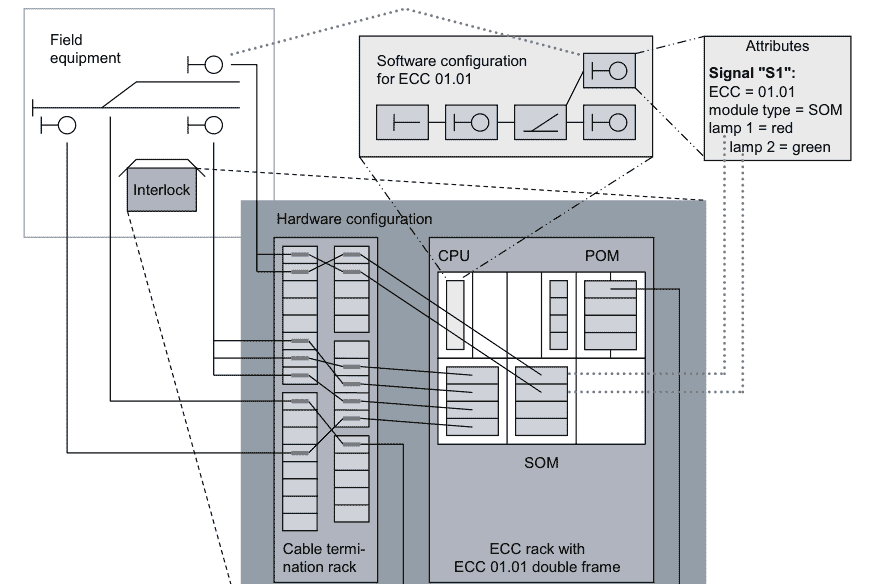

图 16.4

铁路联锁系统的示意表示。


目标是在给定元素及其功能（包括所需位）时，为每个车站找到机架、框架和模块的最小解决方案。场景是增量的：功能（因此模块）可以添加到现有配置中。

### 16.3 需求

#### 16.3.1 可变性

尽管上一节仅概述了联锁系统最重要的组件，但它展示了问题的多样性和复杂性。存在各种子系统，其特征差异很大，例如：

- 硬件具有多种类型的不同组件以及电气和空间约束。作为制造输出，需要 CAD 图纸。
- 软件模块具有数千个配置参数，这些参数取决于其他参数和硬件。它们必须以各种格式输出，以便可以加载到电子联锁的 PROM 中。
- 配置为满足不同网络协议和地址空间的通信设备。
- 用于交通控制员的工作场所，包括监视器屏幕、键盘和其他设备。

由于铁路历史悠久，运营商认为其是一种国家文化，不同国家有不同的法规、设备和要求。因此，必须并行开发、部署和维护配置器应用程序的相应变体和版本。

应用程序和用例范围从单个安装（在某个国家进入市场）到“大规模”生产（为一个国家配置多个车站）。在第一种情况下，重要的是保持配置器国家特定适配的成本低，例如，通过给予项目工程师很大的自由度来根据国家的特殊要求配置系统。在第二种情况下，重要的是保持车站配置的成本低，例如，通过提高解决方案查找的自动化程度。这种半交互式使用（手动编辑和自动完成的组合）也很重要，当法规发生变化并且车站配置必须在更改在配置器中实现之前相应调整时。

#### 16.3.2 复杂性

模型的固有结构不仅是大多数基于 BOM（物料清单）结构（如特征建模（Asikainen et al., 2006））的工具所支持的树结构。相反，它是一个网络，例如，硬件组件之间的布线、交通控制员屏幕上轨道图中的列车路线等等。通常，每个元素（例如信号“S1”）在不同子系统中都有交互的表示（例如硬件中的灯、软件中的参数、交通控制员监视器上的菜单项等）。这导致复杂的完整性和一致性条件（例如，从一个信号到另一个信号的列车路线必须是连接元素的路径，没有环路，并且如果存在替代路径，则开关位置具有唯一选择）。

大型车站可以有数百条轨道，轴计数器或轨道电路数量相似，数百组道岔（开关）每个有一台或两台机器，数百个信号总共数千盏灯，以及许多其他设备，如道口和区段闭塞。所有这些设备都与联锁建筑中的计算机布线，其中数万个引脚必须连接。元素的数量乘以它们出现的不同软件模块。 此外，还有数千条列车路线。考虑到所有这些组件可能有多个属性和与其他组件的关系（关联），变量的数量可达数十万。 由于其中大多数不仅是布尔值，而是枚举或整数值，可能的配置数量是巨大的。

配置任务必须能够处理系统的动态增长。组件数量事先未知。根据车站的轨道、道岔（开关）、信号和其他元素的数量，必须提供硬件机架和模块。项目工程师可能会决定紧密打包模块，或为未来的车站扩展留下一定余量。在第二种情况下，用户对最小解决方案不感兴趣，因此纯优化算法没有用。

#### 16.3.3 演进

铁路联锁系统寿命长（20 至 40 年）。在此期间，不仅车站布局可能会发生变化（由于增加或移除轨道、信号或其他设备），联锁硬件的备件也可能被更换为具有不同特性的新版本。

尽管知识库不如消费品那样不稳定，但其变化率约为每年 10%（基于类、属性和约束的数量）。大多数变化是由新组件类型或新软件功能引起的。然而，当法规发生变化（例如要求更长的制动距离）或运营经验导致制造程序发生变化时，约束也可能发生变化（例如，某种类型的两个模块不应相邻放置，因为由此产生的热量增加可能会降低其使用寿命）。通常，旧类型不能从知识库中删除，因为它们仍在使用于现有配置中。约束必须考虑到所有这些旧和新组件和特征之间可能的相互关系。需要适当的工具来轻松维护知识库。

如果联锁系统需要更改，无论是由于车站布局的变化还是损坏组件的更换，都可能需要升级到当前的知识库。这可能导致约束冲突，因为现有配置不再符合新的知识库。在某些情况下，必要的重新配置可以自动完成（例如，将新属性设置为其默认值）；在其他情况下，需要用户决策（例如，如果现有硬件模块在其当前位置不再允许，则要么将其移动到另一个位置，要么用允许在该位置的新版本替换）。Falkner 和 Haselböck（2013）描述了此类情况下出现的主要问题，而 Friedrich 等人（2011）总结了形式化重新配置问题的重要的理论和实践方面。

#### 16.3.4 其他问题

前几段集中于核心配置任务的知识表示和推理问题。当然，配置器应用程序作为一个整体必须处理更多内容：销售和定价主题在投标阶段发挥作用，尽管不如消费品配置器那样突出。可用性针对专业工程师，因此图形用户界面必须清晰易懂且功能齐全，但不必过于精致。非常重要的话题是与其他系统或数据源的交互：读取有关车站的信息，以各种格式生成输出和文档用于制造、审查和评估，访问管理系统中（例如 SAP）的产品数据。最后但同样重要的是，还有授权、协作、数据库管理、版本控制等一般问题。

### 16.4 技术

在开发项目开始时对可用的商业配置框架和工具进行简短调查显示，它们要么表达能力不足（例如，仅支持一组平坦的变量和约束元组），要么效率不足（例如，基于回溯、回跳等的求解器）。决定创建一个功能强大的通用框架和用于铁路安全系统领域特定要求的专用层。有关通用框架（S'UPREME）的详细描述，请参阅 Haselböck 和 Schenner（2014）。

大多数结构和要求对于不同的铁路公司是相似的（例如，轨道、信号、列车路线等）。然而，它们在某些——有时是许多——细节上有所不同。例如，不同国家可用的硬件元素集合不同，连接组件的规则各不相同，或需要特殊的用户界面视图或导入/导出格式。因此，铁路安全系统的 S'UPREME 配置器的架构由三层组成（见图 16.6）：

- S'UPREME 框架的领域无关内核，提供知识库表示、基于约束的推理和通用用户界面的机制
- 基础层，包含所有铁路和技术知识，这些知识对所有配置器变体都是通用的
- 变体层，表示不同国家和客户的特殊性

在铁路安全系统的基础层中，一些领域特定的实现处理特殊要求，尤其是在输入/输出方面。配置器读取表（例如 Excel）以指定客户要求并检查其一致性（包括输入表之间的交叉引用）。基于模板的输出生成器使创建各种格式的文档（XML、PDF、Microsoft Word、Excel 等）变得更容易。

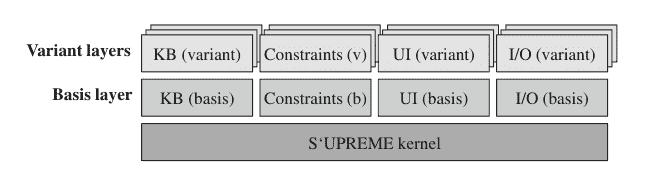

### FIGURE 16.6

S'UPREME 配置器的层。


必须在非常早的阶段被检测到，并且同等重要的是，确保配置从一个版本到下一个版本保持稳定。该功能对于铁路应用尤其重要，在铁路应用中，所有安装——因此所有对现有安装的更改——都必须经过密集的质量保证和验证程序。

回归测试分为两组：小型测试用例，用于针对每个约束测试部分配置（通常在开发期间设计），以及大型测试用例，包含许多不同的功能，以便获得各种配置和值的较高覆盖率（通常由集成团队在项目开始时设计）。当然，在新版本中实现变更请求时，所有这些测试都必须进行检查并可能进行调整。

利用标准 IDE（集成开发环境）如 Eclipse 的优势：它支持使用最先进的编辑器（代码补全、图表等）、调试设施、测试环境和版本控制进行知识工程。

知识工程的迭代和增量过程是保证客户满意度和高质量的重要实践。特别是，它们对于正确建模领域和产品细节是必要的，因为必须整合来自各种来源的信息：可配置产品的众多部分的书面技术规范、所有相关工程师的（默会）知识、不同的语言和表示形式（例如，半结构化自然语言、逻辑、图形）。因此，领域专家在配置器开发期间的早期和持续参与对于成功至关重要。

### 16.5 结果

与知识表示和推理的核心任务相关的配置器代码往往被高估。在本章描述的配置器中，模型和约束仅占源代码的约 20%。其余代码涉及用户界面（UI）、输出的生成（BOM、文档、CAD 绘图、制造计划等）以及整个应用程序的测试。

分层架构大大促进了重用。典型变体的代码规模约为整个应用程序代码的 10%（考虑到不同国家的铁路公司要求相当不同，这是一个很小的值）。标准化模型和 UI（即在变体层中省略这些包或将其减少为通过表进行定制或仅覆盖某些约束）使变体的代码行数减少了 40%。因此，变体的开发时间也显著减少。

约束帮助用户避免错误，减少了集成周期和系统测试时间。规则和求解步骤自动创建对象并设置值，与之前使用的配置工具相比，使用户的生产率提高了 10 倍以上：

- 对于特定国家变体，联锁系统的第一个版本的配置工作量可从八周减少到两周。
- 西门子负责一种新型联锁系统的业务部门在对一个需要配备多个车站的国家的研究中评估了核心配置过程 70% 的类似加速。他们将用于新技术（包含客户信息的表）的工具与用于类似技术的现有工具进行了比较。
- 在新轴计数器系统配置器变体的帮助下（开发时间不到一年），可通过可求解约束和规则实现的自动化程度非常高，一旦车站布局在工具中绘制完成（仅需数小时工作），95% 的配置可在几秒钟内推导出来。尽管此类系统比联锁系统小得多，但仍由 50 个类、300 个属性和关联以及 200 个约束定义组成。平均配置由 2,000 个实例、30,000 个变量和 30,000 个约束实例化组成。

多步升级将升级的开发时间减少了估计 50% 的升级编码时间，以及用户将配置升级到 1/N 的时间，N 为源版本和目标版本号之间的差值（即单步升级的次数）。

### 16.6 结论

以上各节介绍了在大型工业系统（铁路联锁）配置器框架中使用产品配置技术的原因和影响。总的来说，与仅使用标准面向对象编程语言的替代方案相比，开发速度得以加快：

- 约束的多重使用（用于检查、过滤、解释和修复）以及其紧凑的格式使相应代码部分的规模减少了约 30%。
- 由于约束的声明式表示（与求解算法分离），维护更容易。
- 模式演化和自动数据库升级可以更容易地实现。
- 新知识工程师的培训时间减少到约一半。
- 与类似的基于规则的系统相比，估计避免了 20% 的错误。

因此，配置技术确实可以帮助降低项目成本。

## 参考文献

Asikainen, T., Männistö, T., Soininen, T., 2006. A unified conceptual foundation for feature modeling. In: 10th International Software Product Line Conference (SPLC 2006), IEEE Computer Society, Baltimore, MD, pp. 31–40.

Falkner, A., Fleischanderl, G., 2001. Configuration requirements from railway interlocking stations. In: 17th International Joint Conference on Artificial Intelligence (IJCAI-2001), Configuration Workshop, Seattle, WA, pp. 15–17.

Falkner, A., Haselböck, A., 2013. Challenges of knowledge evolution in practice. AI Communications 26 (1), 3–14.

Falkner, A., Haselböck, A., Schenner, G., Schreiner, H., 2007. Benefits from three configurator generations. In: Innovative Processes and Products for Mass Customization (Proceedings of the joint conference of the International Mass Customization Meeting 2007 (IMCM’07) and International Conference on Economic, Technical and Organizational Aspects on Product Configuration Systems (PETO’07). Series on Business Informatics and Application Systems, vol. 3. GITO, pp. 89–103.

Fleischanderl, G., Friedrich, G.E., Haselböck, A., Schreiner, H., Stumptner, M., 1998. Configuring large systems using generative constraint satisfaction. IEEE Intelligent Systems 13 (4), 59–68.

Friedrich, G., Ryabokon, A., Falkner, A.A., Haselböck, A., Schenner, G., Schreiner, H., 2011. (Re)configuration based on model generation. Second Workshop on Logics for Component Configuration (LoCoCo 2011), Perugia, Italy, pp. 26–35.

Haselböck, A., Schenner, G., 2014. S'UPREME. In: Felfernig, A., Hotz, L., Bagley, C., Tiihonen, J. (Eds.), Knowledge-based Configuration – From Research to Business Cases. Morgan Kaufmann Publishers, Waltham, MA, pp. 263–269 (Chapter 22).

## Tacton: Use of Tacton Configurator at FLSmidth

Klas Orsvärn* and Morten H. Bennick†
*Tacton, Stockholm, Sweden
†FLSmidth, Copenhagen, Denmark

摘要：FLSmidth 是水泥厂设备领先供应商，在使用软件支持产品配置以制定提案以及在订单处理中拥有悠久经验。本文描述了他们实施 Tacton Configurator 的经验，该配置器与 SolidWorks 3D CAD、SmartPlant 3D、Mathcad 和遗留 ERP 等各种其他系统集成。集成被发现是关键成功因素。其他关键成功因素是使用强大的约束求解器引擎以及专用于配置建模的产品专家。我们描述了已识别的业务收益，例如提高生产率、缩短交货时间、标准化、提高质量和增加市场份额。

### 17.1 引言

FLSmidth 是全球领先的完整水泥厂供应商，也是矿物加工厂和设备领先供应商。我们首先描述公司及其业务。我们简要描述了他们之前使用配置器的经验以及为何选择 Tacton Configurator 取代它们。一个关键成功因素是使用强大的约束求解器，因此，我们描述了此类配置器的优势和一些重要要求。该公司任命了一支专门的工程师团队负责大部分配置建模。与相关业务和工程系统的集成对于充分发挥配置系统的效益至关重要（Tiihonen and Soininen, 1997）。我们从高层次描述了 FLSmidth 的集成。最后，我们描述已识别的业务收益并得出结论。

### 17.2 FLSmidth 公司介绍

总部位于丹麦哥本哈根，FLSmidth 在全球约雇佣 14.000 名员工，其中大多数是工程师。虽然大多数产品由 FLSmidth 设计，但其大部分制造外包给供应商。

FLSmidth 不断努力提高效率和质量。因此，该公司一直是工业设备供应商中率先使用软件支持工程和产品数据处理的前沿企业。FLSmidth 收购了大量供应相关设备的公司，这体现了工业设备行业的一个强劲趋势；即整合并成为完整端到端制造流程解决方案的一站式供应商。这也意味着员工


参与从客户询盘到订单履行的流程必须处理非常广泛的产品范围，这使得使用产品配置工具对于生成报价至关重要——计算成本和价格、生成描述所提议解决方案的提案文档，以及将订单处理到用于制造执行和供应链的系统。

### 17.3 水泥厂

一座完整的水泥厂规模巨大，长度约为一公里，而最大的产品高度可超过一百米（图 17.1）。水泥生产厂的输入是石灰石和粘土等原材料。从这些输入中每天生产数千吨水泥的过程包括破碎、研磨、混合、加热和冷却等众多步骤。每个步骤都由一个或多个可配置产品执行。在所有这些过程之间以及内部，物料通过各种类型的输送机进行运输，既有机械式也有气动式。总的来说，一座水泥厂由数百个可配置产品组成，其中大部分由 FLSmidth 设计。每个产品本身都高度可配置，其中许多产品由数千个组件组成。配置器软件必须能够逐一配置单个产品，也能够配置整个产品系统。设备配置在很大程度上取决于客户现场所用原材料的特定特性、不同技术的选择、产能


#### FIGURE 17.1

FLSmidth 供应的水泥厂。

要求、可用空间等等。在所有产品中，减少污染和能源消耗非常重要。因此，配置器必须能够与尺寸计算集成，以考虑这些应用要求。虽然布局决策由使用工厂设计软件的工厂设计师做出，但配置器必须能够参数化产品配置，以便根据布局驱动的空间要求，自动按尺寸和位置定制组件。

FLSmidth 的配置要求对于工业设备来说是典型的；一个看似标准化的流程由于产能、输入和输出的特性、效率要求、自动化、环境、安全、可靠性、可用空间等方面的差异而需要极大的变化。组合起来，即使在单一产品中，也会产生数十亿种潜在组合。与消费品的配置要求相比是相关的，因为后者更为人所熟知。面向个人消费者的产品通常是标准化目录产品，通过零售商以非常大的批量销售。工业客户更为专业化，因此需要更多的变化。此外，与消费品相比，每个工业设备细分市场的销售单位数量都很小。这意味着规模经济并不会强烈推动标准化目录产品的发展。一刀切的概念在这里并不能带来回报。当产量较低时，定制的额外成本更低。大规模定制是消费品中日益增长的趋势，但在工业设备市场中，定制一直是必需的。

### 17.4 Tacton Configurator 的选择

在自研配置器的基础上，FLSmidth 于 2000 年改用 Baans 销售配置器，用于提案以及订单处理。该实施情况已在 [Hvam et al. (2008)](https://example.com) 中描述。2008 年，决定用 Tacton Configurator 取代该系统。[^1] 多个原因促成了这一决定：

- 最初，Tacton Configurator 被评估为在 SolidWorks 中生成 3D 模型和图纸的解决方案，用于提案和制造，这是 Baan 的销售配置器无法实现的。
- 在此次评估中，FLSmidth 对 Tacton Configurator 作为产品配置器和销售配置器的易用性和稳健性印象深刻。使用 Baans 销售配置器的经验使组织认识到基于约束的配置在交互性和维护简易性方面的优势（参见第 17.5 节）。此外，Tacton Configurator 被认为是一种更强大的基于约束的解决方案（例如，能够在需要时混合基于约束的求解与顺序处理，并将用户界面的模型与其实渲染方式分离）。
- 在销售、订单处理和 CAD 设计自动化中使用同一配置器具有明显的优势，以避免维护和使用多个系统。
- Tacton 拥有配置完整生产系统的类似复杂工业设备产品的良好客户参考（例如 TetraPak、Sidel 和 Siemens Turbomachinery）。
- FLSmidth 喜欢 Tacton 作为一家公司专注于配置，同时规模足够大以满足其需求（当时超过 50 名员工，现在超过 100 名），并且在 10 多年里部署和增强配置器而未损害向后兼容性方面拥有悠久的记录。
- 在替换现有的 Baan 配置器时，Tacton Configurator 基于 XML 且设计为可嵌入其他应用程序也很重要。FLSmidth 能够重用对旧系统的现有集成，并且用户界面可以根据组织的协作方式进行定制，在所有产品中保持一致。
- Tacton Configurator 在数月的强化测试中幸存下来，以确保能够满足复杂的<|message|>

[^1]: [www.tacton.com](http://www.tacton.com).

要求。

### 17.5 基于约束配置的优势和要求

使用基于约束的求解引擎进行产品配置的优势是众所周知的（DeSisto, 1997; Junker, 2006）。

基于约束的交互使用户能够探索庞大的配置空间并找到最适合客户需求的解决方案：

- 由于许多输入组合无效，因此最终用户能够按其偏好的顺序做出选择并查看每个选择如何影响其他选择的可用替代方案非常重要。
- 为了找到最佳解决方案，有时需要在冲突的选择之间做出权衡。这可以通过向用户展示哪些替代方案与之前的选择不兼容并自动告知用户如何通过与之前选择的权衡使无效的替代方案有效来实现。
- 由于客户规范通常不完整，约束求解引擎应能够验证不完整的输入并为未指定的输入找到良好的解决方案。应能够根据任何属性（如成本或交期）优化解决方案，或根据软性偏好指导搜索。

规则维护是另一个重要挑战。我们在此使用规则一词来表示配置决策之间的现实世界依赖关系，而约束则指为基于约束的引擎处理而对该规则的编码。从规则维护的角度来看，使用基于约束的引擎的一个优势是每个约束都是独立的，并且不假设规则处理的顺序。这意味着产品的每个配置规则都可以独立地作为约束进行编码，而无需考虑其他规则，因此可以在不影响其他规则的编码的情况下添加、修改或删除规则。这非常重要，因为规则通常无法从一开始就记录下来，并且随着可配置产品的不断演进而经常发生变化。在编码配置器之前记录所有规则的难度在于，产品专家很难表述其全部知识。在测试和使用配置器期间，他们因此意识到遗漏了重要的规则，需要添加。

同样，配置规则通常存在争议，并且会因设计修改而发生变化。因此，每个规则都可以独立编码至关重要。使用顺序规则引擎，这种


由于编码存在顺序依赖性，概念层面相对较小的规则变更可能需要编码进行较大修改。这样做的成本可能会高得令人望而却步，并严重延误上市时间。

为了在不进行额外昂贵且耗时的规则编程的情况下满足这些交互需求，基于约束的引擎必须是强大的约束求解器，以便能够基于约束自动实现交互性。

除了约束求解器的能力之外，复杂工业设备的配置对约束求解器还有以下额外要求，FLSmidth 的评估得出结论认为 Tacton Configurator 满足这些要求。

许多产品本质上是动态的。组件实例的数量可能会根据容量需求而变化，每个实例可能需要单独配置。在水泥厂中，典型的例子是段数随长度和高度变化的产品，例如输送机。这要求约束求解器能够动态生成新变量。

对于复杂产品，配置器在配置会话开始时就能访问所有相关数据并不总是可行的，例如当相关组件数据取决于一开始未知的容量和决策时。这要求在配置会话期间能够按需动态访问更多数据。复杂产品配置通常涉及尺寸计算。约束求解器必须能够在运行时应用复杂数学函数并调用外部计算，将结果反馈到进一步的约束处理中。可配置产品可能具有可自由定制的参数，例如尺寸和位置，就像输送机中的横梁和支撑点一样。要很好地处理这一点，配置模型必须在整个产品层级中保持参数化，并且变量必须能够在大型整数或浮点数域上取值。

可配置产品中需要考虑的潜在组合空间可能大于可观测宇宙中的原子数量。尽管在为配置而设计的产品中，寻找解决方案的问题通常是可控的，但对于高度复杂的产品，使用通用算法在可接受的响应时间内求解可能是不可行的。重要的是还要有机制，在决策序列方面启发式地指导搜索，而不需要对约束进行冗余编码。

### 17.6 在 FLSmidth 实施 Tacton Configurator

#### 17.6.1 配置建模

配置建模是在配置器软件中定义通用产品结构、可配置参数、约束等的工作。在为期三天的入门培训之后，FLSmidth 的工程师借助 Tacton 的远程产品支持，能够独立完成所有必需的建模工作。配置建模最初在哥本哈根总部进行。但由于如今大部分工程工作都在 FLSmidth 位于印度金奈的办公室完成，配置建模大部分已由那里的工程师团队接管。他们对产品及其应用非常了解，这减少了沟通开销。

Mathcad 在 Tacton Configurator 背后的服务器上隐形运行。当程序调用外部服务（例如 Mathcad）执行计算时，最终用户甚至不会察觉到。

#### 17.6.4 输出

Tacton Configurator 在 FLSmidth 可生成以下类型的输出：

- 将配置后的产品 BOM 结构输出到旧版 ERP 系统 Atlas。
- 通过 SolidWorks 集成生成的多种格式的 3D 模型和 2D 图纸，用于方案和制造。
- PDF 格式的方案文档。

#### 17.6.5 与 SmartPlant 3D 的集成

FLSmidth 正在引入一款来自 Intergraph 的工厂设计软件 SmartPlant 3D。该工具用于设计工厂的工艺流程和布局。为了简化流程，FLSmidth 为 SmartPlant 开发了一个插件，使其能够在 SmartPlant 用户界面中运行 Tacton Configurator，以确保工厂中的产品得到正确配置，并在工厂设计层面拥有正确的 3D 模型。随后，可以在基于 Web 的配置器中访问相同的配置，以生成额外的文档、基于 SolidWorks 的机械 CAD 文档，并将设备订单处理到 ERP 中。

### 17.7 收益

#### 17.7.1 减少产品配置时间

没有配置器时，配置一个产品需要数小时，而现在只需几分钟。这同样适用于方案生成和订单处理。一个工厂可能包含数百种不同的配置（许多不同的可配置产品，以及其中一些产品的许多不同配置），因此累计节省的时间非常可观。

#### 17.7.2 缩短交付周期

当产品配置需要少数专家参与时，这会造成方案生成和订单处理的交付周期很长，超出了实际花费的有效时间。这一挑战随时间推移而加剧。FLSmidth 过去将所有工程专家集中在哥本哈根总部，但如今已收购了世界各地拥有不同产品的公司。产品专业知识更加分散。由于 FLSmidth 销售的是包含来自不同地方产品的完整工厂，这种全球分布使得生成方案和处理订单变得更加复杂和耗时。Tacton Configurator 通过让专业知识在任何地方都能获取，消除了这一复杂性。项目中所有产品配置的交付周期可以从数月缩短到数天。

#### 17.7.3 更标准化的配置

没有配置器时，专家们倾向于创建比实际需要更定制化的特殊方案。配置器强制实施标准化，从而降低了供应产品的成本。

#### 17.7.4 提高配置质量

在配置水泥厂时需要遵守极其大量的规则。不仅涉及产品配置，还涉及水泥生产过程的规则。人为因素增加了出错风险，而且在项目中的每次修订都让专家参与是不可行的。因此，使用配置器降低了配置错误的风险。

#### 17.7.5 提高市场份额

随着交付周期和方案成本的大幅削减，FLSmidth 现在可以制作更多方案，并获得更大的市场份额。

### 17.8 结论

本文介绍了 FLSmidth 及其为水泥厂产品实施 Tacton Configurator 的经验。关键成功因素包括：一个支持高度交互性和易于约束建模的强大约束求解引擎；与尺寸计算的集成；与相关系统（如 3D CAD、工厂设计和旧版 ERP）的集成；以及专门负责配置建模的资源，这些资源由熟悉产品及其应用的熟练工程师组成。建模和集成需要大量资源，但对业务而言收益非常显著。

## 致谢

Kristin Lund 在数据收集和编辑方面提供了宝贵的帮助。SolidWorks 是 Dassault Systèmes 的商标。SmartPlant 是 Intergraph 的商标。Mathcad 是 Mathsoft 的商标。

## 参考文献

- DeSisto, R., 1997. Constraints Still Key for Product Configurator Deployments. Technical Report T-22-9419, Gartner, Stamford, CT.

- Hvam, L., Mortensen, N., Riis, H., 2008. Product Customization. Springer, Berlin, Heidelberg.

- Junker, U., 2006. Configuration. In: Rossi, F., van Beek, P., Walsh, T. (Eds.), Handbook of constraint programming. Foundations of Artificial Intelligence, vol. 2. Elsevier, Amsterdam, The Netherlands, pp. 837–873.

- Tiihonen, J., Soininen, T., 1997. Product Configurators - Information System Support for Configurable Products. Technical Report TKO-B137, Helsinki University of Technology, Laboratory of Information Processing Science, also published in: Increasing Sales Productivity through the Use of Information Technology during the Sales Visit, Hewson Consulting Group.


## encoway: 从基于 ERP 的配置到以销售为导向的配置

## 第18章

Björn Höfling

encoway, Bremen, Germany

摘要：基于 ERP 的产品配置通常用于支持企业中的业务执行流程。重用底层产品配置模型于以销售为导向的场景中会带来额外的挑战。在本章中，我们描述了一个名为 sellAIR 的销售应用，它是 encoway 与德国公司 Boge 合作项目的成果。通过该应用，Boge 成功弥合了基于 ERP 的产品配置与以销售为导向的配置之间的差距。

### 18.1 引言：基于 ERP 的配置

企业资源规划（ERP）系统是用于自动化业务流程的集成软件应用。此类流程在 ERP 系统中的典型例子是报价和订单处理或生产计划。对于生产或处理具有大量变体的复杂产品的公司，一些 ERP 系统支持基于知识的配置。根据特定市场或支持的场景，这些系统中实现了不同的知识表示和推理技术。制造复杂产品时需要解决的主要挑战之一可概括为大规模定制概念，该概念试图将大规模生产的优势与个性化定制的灵活性相结合（参见 Piller 和 Blazek, 2014¹）。配置系统是大规模定制的一项关键使能技术。对 ERP 系统中（基于知识的）产品配置应用领域进行简单分类的方式可沿订单履行流程展示。按库存生产（MTS）是一种提前生产的模式，支持大规模生产。相比之下，个性化定制可在项目导向生产中进行。介于两者之间的是按订单生产（MTO）场景，可通过产品配置得到支持。在此，生产流程由包含订单中可配置产品具体定义的销售订单触发。

德国软件公司 SAP AG 是企业应用软件市场的主要参与者（另见 Haag, 2014²）。其企业资源规划应用称为 SAP ERP，其中包含一个名为 LO-VC 的变体配置器（物流模块，变体配置）。变体配置是一种基础技术，可在 SAP ERP 内的不同业务流程中使用。LO-VC 可应用于 PP（生产计划）、SD（销售与分销）、

MM（物料管理）、CO（控制）、CA（跨应用组件）和 CRM（客户关系管理）模块。

关于知识表示和推理机制，LO-VC 结合了不同的方法，从而为产品配置模型提供了高度的表达能力。声明式和过程式建模均通过以下用于不同对象之间依赖关系的主要建模原语得到支持：

- 约束，用于以声明方式分配或检查值，通过求值（不）等式、变体表或变体函数
- 过程，用于在考虑定义的操作序列的情况下分配或更改值（例如，值分配、价格计算、可见性更改和动态默认值设置）
- 前提条件，用于借助布尔表达式（不）允许值
- 选择条件，用于将部件包含在物料清单中

特征的单调行为（值范围在配置过程中只能缩小而不能扩大）可通过选择所谓的受限特征并借助约束减少其值来建模。SAP 变体配置的全部范围在 Blumöhr 等（2012）中有所描述。关于 SAP 变体配置的声明式和过程式方法的比较，请参阅 Haag（2010）。

本章其余部分组织如下。第 18.2 节更详细地描述了我们对以销售为导向的配置及其产品模型和功能需求的看法。第 18.3 节提供了德国公司 Boge 的一个具体案例研究 sellAIR。首先讨论需求。然后，我们介绍该应用的架构。我们以对已部署的 sellAIR 应用所取得成果的讨论作为本章的结尾。

### 18.2 以销售为导向的配置

显然，公司的销售团队希望能够访问其产品配置，以便能够向客户做出有效陈述（技术和商业）。但在许多情况下，这无法通过直接访问 SAP ERP 实现。此外，ERP 产品模型本身可能必要但通常不足以支持销售流程。复杂可配置产品的供应商通常投入了大量的专业知识和建模时间，这通常在数十或数百人年的范围内。这种知识体现在 SAP LO-VC 的产品模型中，该模型不断维护并保持最新。这也是正确的位置，因为它支持公司的许多核心业务流程。为销售团队需求复制此产品模型将意味着冗余数据管理的全部缺点。因此，这大量的知识应可在不直接集成到 ERP 流程的流程中使用，且不产生冗余，并应遵循单一数据源原则，以 SAP ERP 为主导系统。

图 18.1 说明了 SAP ERP 中的业务执行流程和外部应用中的以销售为导向的流程如何共享模型。通常，SAP 中的配置模型可分为两部分。高层配置位于 SD（销售与分销）中。它是交互式的；即用户在报价中通过为不同行项目的产品特征分配值来做出配置决策。此配置的结果被传递给低层配置，该配置位于 PP（生产计划）中。此配置不是交互式的，但从高层的结果出发确定物料清单（BoM）和工艺路线。由于低层的知识库通常不需要在以销售为导向的流程中使用，只有高层模型应被导出并重用。

### 图 18.1

以销售为导向的配置与基于 ERP 的产品配置的对比，销售与分销（SD）的高层配置模型被共享。

#### 18.2.1 以销售为导向配置的产品模型

重用 ERP 配置模型原样（不做更改）用于销售场景可能非常有吸引力。但在许多情况下，它只是额外改进的起点。以下，我们将此改进后的模型称为以销售为导向的模型，与来自 ERP 系统的源产品模型相对。进行这些改进的主要原因有：

- 客户应用或机器、上下文和环境等实体不适合在 SAP LO-VC 中处理。只有在物流流程中使用的对象，如产品或服务，才能建模为所谓的“可配置物料”，任何配置知识都附加于此。
- 在 ERP 系统中，此可配置物料也是配置的唯一可能起点。但在以销售为导向配置的早期阶段，整个产品范围可能相关，且至少部分依赖关系存在。在 SAP 中，只有当可能的可配置物料列表减少到恰好一个时，才能进行推理。

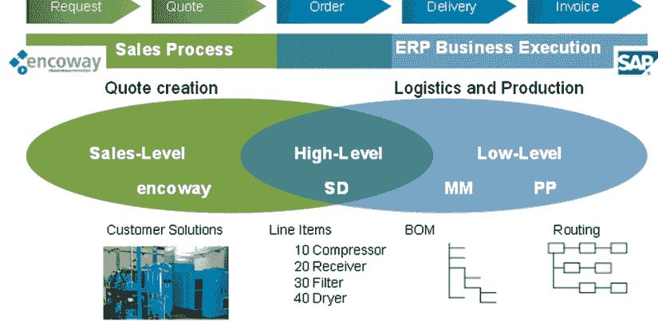

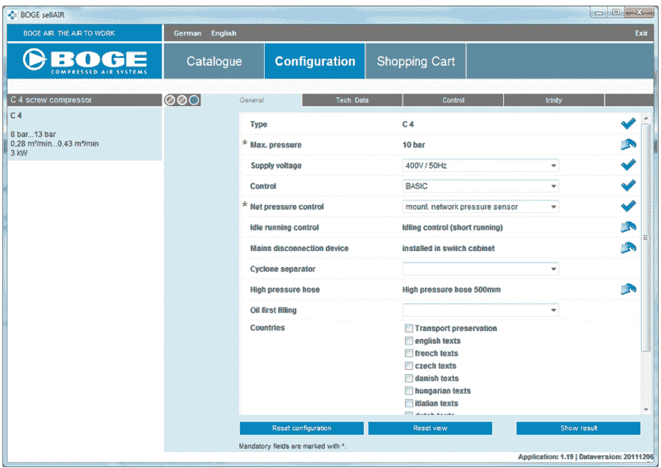

### 图 18.2

sellAIR：以销售为导向的配置器的用户界面。

接收器，以及一些其他组件。此外，压缩空气系统的不同应用领域的特征会影响相应组件的选择和参数化。每个以销售为导向的应用的重要组成部分是定价。在 Boge 的案例中，毛价包括在 SAP ERP 中定义的配置的复杂变体条件。此后，可添加客户特定的折扣和条件。对于 Boge，此信息维护在基于 Lotus Notes 的 CRM（客户关系管理）系统 SalesAssistant 中。因此，sellAIR 的一个重要需求是对 SalesAssistant 的接口。该系统还应作为所有客户数据的资源。

sellAIR 的主要成果是一份提案文档。它应作为 Boge 竞争对手的差异化特色而具有吸引力。产品沟通（价值主张、独特销售主张等）必须以非常广泛的方式得到支持，通过添加额外和个性化内容以及丰富媒体的可能性。用于生成提案文档的软件必须为 Microsoft® Word，因为 Boge 销售团队和经销商希望之后能够进行个性化更改。生成的提案文档必须存储在 CRM 系统中以供后续流程使用。为了在业务执行链中不出现中断，生成的行

在订单情况下，物料必须转移至SAP ERP。最后，sellAIR必须能离线供Boge的现场销售团队使用，并在线供经销商以及未来可能还有客户使用。

### 18.3.2 sellAIR：应用架构

图18.3展示了满足所给定需求的解决方案架构。涉及的系统包括SAP ERP、CRM系统SalesAssistant、用于文档归档的d.3系统、sellAIR（离线版）以及sellAIR Web（在线版）。sellAIR的离线版本由Boge的销售团队使用，尤其是在客户现场执行任务。它连接到SalesAssistant，该系统在所有销售笔记本电脑上可用。通过使用Lotus Notes API，sellAIR可以访问所有客户数据，生成的报价文档存储在CRM中的具体报价对象上。出于归档目的，该报价之后会存储在d.3系统中。客户数据和条件在CRM和ERP之间定期同步。

在线版本sellAIR Web的目标和用户略有不同。它由Boge产品的客户和经销商使用。因此，其功能必须取决于用户各自的角色。客户可以根据自己的需求创建包含产品的购物篮。随后，他们将获得一份更详细描述这些产品的文档。该购物篮将通过电子邮件作为提案请求发送给Boge，后续流程在CRM和ERP系统中执行。

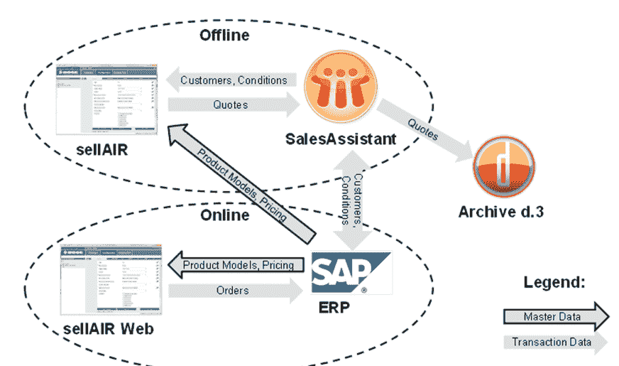

**图18.3** Boge的应用基础设施：连接SalesAssistant CRM的离线版本与连接SAP ERP的在线版本之间的区别。

拥有特殊权限的少数经销商可以在sellAIR Web中直接将购物篮转换为订单。配置数据连同订单头数据被移交给SAP ERP，并创建一个订单对象。此外，还会为经销商生成一份有吸引力的提案文档，该文档可以被修改并移交给经销商的客户。

为了根据ERP配置产品，必要的高级产品模型主数据（物料、类、特征、带依赖关系的配置配置文件、变式表、GUI模型和翻译）从SAP传输到sellAIR（离线和在线版本）。这借助sellAIR构建器环境完成。当主数据发生更改时，Boge可以轻松触发更新。sellAIR构建器使用来自encoway的标准软件组件，名为 *K-Connect for SAP LO-VC*。数据传输分两步执行：（1）*提取*和（2）*映射*。提取过程在技术上基于通过JCo（Java连接器）对SAP BAPI（业务应用程序编程接口）的远程函数调用。结果存储到数据库中。映射过程获取该数据库，并将内容映射到目标系统的不同结构中（encoway配置环境（参见Krebs，2014⁵））。SAP变式配置器中的依赖关系以纯文本形式（遵循LO-VC语法）作为源代码提供，必须从这种知识表示形式中解析并翻译成目标形式。为此使用了编译器-编译器。

就Boge而言，SAP产品模型本身并未改变。在产品上增加了导航和搜索层级，以便新手用户更容易访问。此外，还添加了额外的文本和媒体，以增强配置和结果可视化以及文档创建。在销售方面，该模型通过一个用于压缩空气系统配置的知识库得到了增强。除了压缩机外，此类系统还包含其他（可配置的）组件，例如空气过滤器和储气罐。在用户对系统做出必要的决策后，将为系统的每个相关组件启动一个配置（对应于LO-VC中的产品，但在SAP外部的encoway配置环境中运行）。配置结果由一系列列表项组成，每个列表项都有其专门的配置。该列表可通过后续步骤（文档生成和报价/订单创建）进行处理。sellAIR应用程序基于encoway的标准模块，并根据Boge及其客户的具体需求进行了调整。

### 18.3.3 sellAIR：成果

sellAIR于2008年推出。sellAIR Web于2011年增加，自2012年起公开发布。已实现了以下优势：

- sellAIR取代了旧的配置系统，该系统需要在SAP和外部工具中对配置模型进行双重维护。
- 建立了产品配置模型的自动更新流程。
- sellAIR中的产品模型是最新的，并与其ERP对应物一致。
- 在基于ERP的产品模型之上，为系统配置添加了面向销售的模型。
- 产品和系统配置既可在线也可离线使用。
- 导航和搜索功能可快速访问相关产品。
- 该工具允许Boge销售代表快速、技术上正确且个性化地创建提案。
- 主要成就之一是以统一的国际布局，针对不同任务动态生成多语言、有吸引力的Microsoft® Word文档。
- sellAIR支持与SalesAssistant（Boge的CRM）进行全面的数据交换。
- 通过sellAIR Web，客户和经销商也受益于配置功能。
- sellAIR Web的结果可以直接转移到SAP SD（销售与分销）中的订单中。

### 18.4 结论

我们已经证明，在面向销售的场景中复用基于ERP的产品配置模型具有诸多好处。但还必须考虑来自销售视角的额外功能需求。根据它们在销售过程中的位置（产品配置之前、期间或之后），这对配置任务会产生不同的后果。范围从为正确的可配置产品提供额外的搜索机制，到在基于ERP的产品模型之上为系统或解决方案提供面向销售的模型。该方法的具体影响通过德国公司Boge的销售应用程序得到了说明。

## 参考文献

- Blumöhr, U., Münch, M., Ukalovic, M., 2012. Variant Configuration with SAP, second ed. Galileo Press.
- Haag, A., 2010. Declarative modeling at SAP revisited – lessons learnt when applying configuration techniques. In: 19th European Conference on Artificial Intelligence (ECAI-2010), Configuration Workshop, Lisbon, Portugal, pp. 57–59.
- Haag, A., 2014. Product configuration in SAP – a retrospective. In: Felfernig, A., Hotz, L., Bagley, C., Tiihonen, J. (Eds.), Knowledge-Based Configuration – From Research to Business Cases. Morgan Kaufmann Publishers, Waltham, MA, pp. 319–337 (Chapter 27).
- Krebs, T., 2014. encoway. In: Felfernig, A., Hotz, L., Bagley, C., Tiihonen, J. (Eds.), Knowledge-Based Configuration – From Research to Business Cases. Morgan Kaufmann Publishers, Waltham, MA, pp. 271–279 (Chapter 23).
- Piller, F.T., Blazek, P., 2014. Core capabilities of sustainable mass customization. In: Felfernig, A., Hotz, L., Bagley, C., Tiihonen, J. (Eds.), Knowledge-Based Configuration – From Research to Business Cases. Morgan Kaufmann Publishers, Waltham, MA, pp. 107–120 (Chapter 9).

## Kapsch：移动电话网络的重新配置

Iulia Nica*， Franz Wotawa*， Roland Ochenbauer†， Christian Schober†， Harald Hofbauer‡， 以及 Sanja Boltek‡

*格拉茨技术大学，奥地利格拉茨  
†Kapsch Business Com，奥地利维也纳  
‡Kapsch Carrier Com，奥地利维也纳

**摘要：** 模拟和配置常常需要同时使用，在工业中发挥着重要作用，从早期开发阶段到部署后作为系统维护的一部分都是如此。由于新客户需求导致的需求变化，系统的结构或行为随时间变化是必要的。例如，当前全球范围内采用智能电网技术的意愿，给现有移动电话网络的结构和功能带来了新的挑战。在本章中，我们阐述了在机器对机器通信背景下，模拟和（重新）配置移动电话网络的重要性，以应对智能交通系统和智能计量的未来市场。我们讨论了我们基于系统模型和系统需求的SIMOA方法，用于模拟和（重新）配置。该方法具有以下优点：它灵活且适用于各种系统和需求，能够确定系统处理特定需求的能力，并在需求无法满足时建议系统调整。

### 19.1 引言

机器对机器（M2M）通信市场预计将在未来几年增长，并成为移动电话网络运营商的最大客户。M2M通信的应用场景是多方面的。目前，M2M通信的主要应用领域是智能计量，在电力供应商和家庭电表之间提供直接连接，以及在运输行业中对车辆和货物进行追踪。在本章中，我们侧重于第一个场景（连接家庭电表）。

这些智能计量应用场景不仅为公司带来优势，也为客户带来额外好处。例如，智能计量解决方案有可能通过在停电发生之前限制电力消耗来避免停电。另一个例子是电力部门的二氧化碳减排。越来越多的人独立生产和消费能源，并将剩余能源输入电网。在这方面的一个希望是通过更短的抄表间隔实现更高的能源效率，因为这允许客户全天控制其能源消耗。能源网络运营商随后能够更频繁地收集消费数据，并以透明的方式向最终消费者提供这些数据。要完成所有这些任务，需要智能通信解决方案，这些解决方案能够处理通过无线方式传输的增加的数据量


网络，特别是在移动 GPRS/UMTS 网络上。最初，通信基础设施并不是为满足上述 M2M 通信场景的需求而设计的。

Kapsch 智能能源管理系统用于计量和建筑自动化，提供了一种面向未来、开放且制造商独立的解决方案，满足所有相关群体的需求：从终端消费者、建筑业主和设施管理人员到网络运营商和能源供应商。在此背景下，支持对替代智能计量场景进行详细分析的功能备受需求。为了支持此类功能，必须对移动网络的各个部分进行仿真，例如小区、骨干网和数据存储。此类仿真的主要目的是检查网络配置是否能够支持一组给定的用户需求。为了模拟移动网络的动态性，我们将待仿真的移动网络的每个部分视为具有预定义状态数量的状态机。例如，在某一特定状态下，组件可能处于活动状态，而在另一状态下则不然。另一个例子是网络配置可能从一个状态到另一个状态发生变化，以便处理不同的通信需求。

如果仿真失败（需求无法由移动网络满足），则必须提供给定系统的可行重新配置。特别是，将过多的 M2M 设备添加到小区配置中可能会导致服务可用性不可接受地降低，这只能通过更改小区中参数的默认值（例如，通过增加服务频率的数量）或通过扩展通信网络（通过添加新的移动电话小区）来处理。¹ 小区配置包含一个基站、一定数量的计量设备和一个基线负载值。

本章的主要贡献如下：（1）我们提供了关于 M2M 通信网络领域基于知识的重新配置原理的重要见解，以及（2）我们讨论了与在移动电话网络和 M2M 应用背景下（重新）配置技术应用相关的主要业务案例。

本章的其余部分组织如下。在第 19.2 节中，我们更详细地讨论了支持 M2M 通信场景的主要需求。随后，我们介绍一个应用场景并概述 SIMOA 方法（第 19.3 节）。在第 19.4 节中，我们讨论与 SIMOA 技术应用相关的相关业务案例。最后，在第 19.5 节中我们总结本章。

### 19.2 领域需求

与当今的移动网络不同，用于自动计量管理（AMM）通信的未来 GPRS（通用分组无线业务）网络必须满足以下要求：

- GPRS 网络必须高度可靠且可扩展。
- 必须有大量的 IP 地址池可用。
- AMM 通信有指定的所需数据量。

¹ 当向网络添加一个新的移动电话小区时，实际上是向系统添加一个新的基站，并且传输数据被重新分配到各小区。

- 通过 GPRS 网络通信的数据量取决于 AMM 读出频率² 和所使用的通信协议，例如 DLMS/COSEM 或 IEC61107 协议。

这些要求对于配置过程至关重要。用户应能够在网络中添加大量设备，并且设备类型要么已在知识库中定义，要么可以额外定义新的类型。最后两项要求通过对网络中传输数据量的约束来限制可能的重新配置空间。

图 19.1 说明了一个来自智能电网的简化小区，³ 一方面考虑 GPRS 数据通信，另一方面考虑从发电站到智能电表的电力传输（以灰色表示）。请注意，SIMOA 仿真和（重新）配置侧重于 GPRS 数据通信设置。

如图 19.1 所示，IP 启用电表（点对点（P2P）可单独寻址的智能电表），它们通过 GPRS 直接连接到广域网（WAN），与 AMM 应用通信，而无需现场的数据集中器⁴。连接到数据集中器的电表称为 PLC（电力线载波）电表。当电表与数据集中器之间的连接距离过大（超过 300 米）时，使用 P2P 电表变得不可避免。在仿真过程中，我们必须考虑特定小区中 M2M 终端的以下变体：（1）仅 P2P 电表，（2）仅带 PLC 电表的数据集中器，以及（3）P2P 电表和带 PLC 电表的数据集中器两者兼有。

在图 19.1 中，智能电网（GPRS）小区包含以下部分：

- 基站收发信台（BTS）：促进用户设备（移动电话、智能电表等）与网络之间的无线通信。BTS 具有加密和解密通信的设备、频谱滤波工具、天线等。通常一个 BTS 有多个收发信机（TRX），使其能够服务于多个不同频率，并在小区中为 M2M 通信分配一定数量的时隙。

- P2P 电表和数据集中器：这些由可配置属性描述，表示固定或可变数据量（源自所选传输协议）、网络拓扑（由 BTS 与数据集中器/P2P 电表之间的距离决定），以及在数据集中器的情况下，连接到它们的 PCL 电表数量。

- GPRS 基线负载，由图 19.1 中的移动电话表示，并代表小区中所有非智能计量流量。

值得注意的是，移动电话网络的结构各不相同，并且通信需求取决于 M2M 应用场景。一个典型的 AMM 场景例如是传输

² AMM 读出频率是指抄表间隔；例如，电表可以每 15 分钟记录一次用电量。

³ 智能电网是一种电力传输网络，它利用供应商和消费者信息和通信基础设施，以自动化方式提高整体网络性能方面的效率、可靠性和可持续性。

⁴ 数据集中器是一种通过线路与多个智能电表连接的设备。在这种情况下，所有连接的智能电表都通过数据集中器与 AMM 应用通信。例如，在拥有大量公寓的建筑物中，由于额外布线成本低，因此使用数据集中器。

因此，一种用于证明通信网络满足 M2M 应用场景需求并在检测到不足时采取对策的解决方案必须具有灵活性和可适应性。

### 19.3 SIMOA 方法

从应用领域我们可以推导出工具的要求，该工具可为给定的移动网络提供变更操作，同时考虑未来的使用场景。未来的使用场景由 M2M 应用的通信需求决定（参见例如上一节中讨论的两个场景）。下面，我们讨论工具要求，涉及知识表示语言、仿真功能、重新配置和优化功能。

- *语言。* 为了支持所讨论的场景，我们需要有关移动网络的结构和行为以及相关使用场景的信息。由于网络和使用场景种类繁多，必须提供一种建模语言来形式化这些信息。该语言必须允许陈述系统的结构及其组件的行为。时间方面，例如网络接入随时间的变化，也必须被捕获。此外，在优化需求的情况下，该语言必须提供陈述最优性标准的手段。
- *仿真。* 评估现有移动网络是否能够处理未来 M2M 应用施加的所有请求的第一步是使用 M2M 通信需求模拟网络行为。示例需求可能是远程机器对发送消息的回复的最大延迟，或同时需要发送的数据量。如果仿真表明网络无法处理 M2M 应用的某些需求，人们希望找到网络的重新配置以满足这些需求。仿真本身应基于所引入的建模语言。在动态系统建模和仿真领域，我们提到 Matlab/Simulink 和 Modelica。虽然两者都是复杂的语言，能够建模各种组件，但它们不太适合（重新）配置目的，因为它们无法处理存在多种可能解决方案的欠约束问题。
- *重新配置。* 为了满足 M2M 应用施加的通信场景而更改现有网络可以在多个层面上进行。可以更改移动电话小区的某些参数以提供更多信道。也可以向网络添加新小区，从而改变网络拓扑。在我们的应用中，所有此类可能的更改都应被报告。用于仿真的同一建模语言也应用于提供配置信息。
- *优化。* 由于很可能存在多种用于处理未来通信需求的重新配置，因此最优解决方案将非常有价值。根据用户是谁，不同的最优性标准需要得到满足。例如，移动运营商会偏好提供最佳服务质量的重新配置，而客户则会选择通信成本最低的解决方案。因此，一个要求是能够指定各种最优性标准，并且能够搜索满足最优性标准的重新配置。


为了基于相同的底层信息处理仿真、重配置和优化，我们采用了基于模型的方法。特别是，我们设计了一种建模语言（SIMOL），它允许指定系统的结构和行为以及（重）配置信息和需求。语言还必须能被非人工智能专家使用。这是因为所考虑的网络以及机器对机器（M2M）应用需求会随时间变化并且需要进行调整。

SIMOA 方法是基于模型的，能够满足所有提到的需求。该方法基于 SIMOL 编程语言（Nica and Wotawa, 2012），这是一种具有类似 Java 语法的面向对象语言，以及 MINION 约束求解器（Gent et al., 2006）。

如 Figure 19.2 所示， resulting SIMOL 工具架构包含三个相互连接并交换信息的模块：SIMOL 编译器，它将 SIMOL 程序映射为一组约束（MINION 程序），并生成一个符号表，该符号表允许将 SIMOL 程序中使用的变量映射到约束表示中使用的变量；CSP 求解器，它计算 CSP 问题的解；以及映射模块，它接收来自约束求解器的解，并使用之前生成的符号表将变量名更改为原始 SIMOL 程序中使用的名称。在此上下文中，重配置核心由 CSP 表示（MINION 程序）和约束求解器表示；也就是说，约束求解器负责确定重配置。Figure 19.2 中的 CSP 解被映射到实际的重配置，由 Figure 19.2 中的 Solutions 所示。CSP 问题的解是对变量的值分配，使得没有约束被违反（参见 Hotz et al., 2014⁷）。

由于这种架构，SIMOA 工具是通用的，可以用于解决各种任务。唯一的要求是使用 SIMOL 指定领域和案例特定知识。

在 Figure 19.3 中，我们展示了在 SIMOL 模型中使用的 GPRS 单元的 UML 图，并且在我们当前的实现中也使用它。如我们所见，一个单元拥有一个 BTS 组件、有限数量的 P2P Meter 和 Data Concentrator 组件，以及一个 Base Load 组件。此外，GPRS Cell 具有一个属性，指的是可能的 GPRS/UMTS 基线负载（gbase）非智能电表相关的数据传输，该值实际上在 Base Load 组件的 value 属性中定义。P2P Meter 组件类型由 P2P 电表与 BTS 之间的距离（mdist）、使用的码集（codeset；影响每秒传输的数据量的信道编码）以及用于从智能设备检索数据的协议套件的各种参数（dbr 计费读取、iptlogin M2M 网关登录等）描述。其中许多属性也可在 Data Concentrator 类型的定义中找到，但值大多取决于连接到集中器的 PLC 电表数量。PLC Meter 和 P2P Meter 类型均派生自通用类型 Smart Meter。BTS 组件有两个属性：频率数（fpc）和时隙数（availableTimeSlots），BTS 在单元中为 M2M 通信分配这些时隙。请注意，与 Figure 19.3 中显示的其他属性不同，这两个属性在仿真失败时可以自动重配置。为了实现这一点，模型中引入了两种“假”组件类型 FPC（Frequencies Per Cell）和 ATS（Available Time Slots）（见 Figure 19.3）。它们是“属性视为组件”类型，并且当链接到实际属性 fpc 和 availableTimeSlots 时，能够重配置给定的系统。

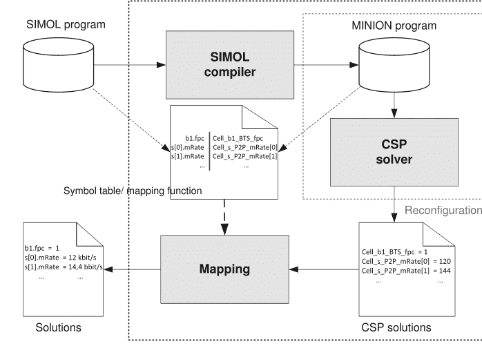

### FIGURE 19.2

The SIMOA tool architecture.

用于定义 Figure 19.3 中所示模型的 SIMOL 使用组件类型，如 Figure 19.4 所示。每个定义的组件都具有一组属性，并在系统中引入约束。除了在 constraints{...} 块定义中陈述的约束之外，还显示为一般约束（见 Figure 19.4，第 30–36 行），SIMOL 还能够通过状态特定约束和转换约束来捕捉真实系统的时态方面。虽然一般约束在所有状态下都得到满足，但状态特定约束仅在特定状态下得到满足。后者提供在额外的 observations 文件中，该文件至少包含初始约束（对于初始状态下的单元）。两个连续状态之间的转换约束出现在 transition{...} 块中，并通过 next 运算符实现（见 Figure 19.4，第 37–42 行）。

在我们的案例中，GPRS 单元模型将被视为具有预定义的有界状态数状态机的状态机，其中每个状态对应于分配给 P2P Meter 和 Data Concentrator 组件的不同码集（属性 codeset）。因此，根据表示 BTS 与当前电表 m 之间距离的 mdist 属性，可以通过遵循 GPRS Cell 组件的转换约束来增加或减少 m.codeset 值，如 Nica et al. (2012) 中所述。基于这些转换约束，SIMOL 编译器将为每个状态生成新的相应约束。

```
1.  kbase GPRS Cell;
2.  component P2PMeter {
3.    attribute int mdist,codeset,mRate;
4.    constraints {
5.      mdist = {1..3};
6.      codeset = {1..4};
7.    }
8.  }
9.  component FPC {
10. attribute int value;
11. constraints(default){
12.   value = 1;
13. }
14. constraints(x1){
15.   value = {2..4};
16. }
17. constraints(unknown){
18.
19. }
20. }
21. component BTS {
22.   attribute int fpc;
23.   constraints{
24.     FPC fpc1;
25.     fpc = fpc1.value;
26.   }
27. }
28. component Cell {
29.   attribute int neededR, realR;
30.   constraints {
31.     BTS b1;
32.     P2PMeter s[100];
33.     realR=sum([s], mRate)/P2PNo;
34.     realR>=neededR;
35.    ...//neededR is internally computed
36.   }
37.   transition {
38.     forall ( P2PMeter ) {
39.       if (mdist=1 and codeset = 2 )
40.         codeset.next = {2,3}
41.       if (mdist=3 and codeset = 2 )
42.         codeset.next = {2,1};
43.     }
44.   }
45. }
```

### FIGURE 19.4

A SIMOL program. For reasons of space limitations, we omitted the attributes dbr, dlpr, doa, iptlogin, etc. in Line 3, their initialization in the constraints section of the Cell component, and also the definition of the ATS component from Figure 19.3.

requirements, COMP is a set of attributes that can be changed, and MODES represents the set of all functional modes defined for the elements in COMP.

该定义几乎等同于根据 (Reiter (1987)) 的诊断问题的定义，事实上诊断与重配置之间的关系已被指出（例如，Crow and Rushby, 1991; Provan and Chen, 1999; Stumptner and Wotawa, 1998）。与 Crow and Rushby (1991) 和 Provan and Chen (1999) 不同，我们的方法中不交错诊断和重配置（约束求解器直接确定重配置，即不使用任何先前计算的诊断）。与 Stumptner and Wotawa (1998) 的细微差别在于，在这项工作中我们完全依赖基于一致性的推理，忽略故障模型，这对于我们的目的已足够。

正如我们已经看到的，SIMOL 可用于描述 SD、REQ、COMP 和 MODES。将属性/组件（COMP）分配给功能模式（MODES）可以定义如下。

Definition (Mode assignment). Given the set of configurable attributes COMP and the set of all functional modes MODES. A mode assignment M is a function M : COMP → MODES mapping each component to one of its modes.

重配置问题的解可使用 Reiter (1987) 引入的诊断定义轻松形式化。


model-based systems considering the costs of necessary maintenance activities are usually smaller compared to very specific solutions, for example, using rule-based systems methodologies.

### 19.5 Conclusion

The SIMOA tool has been developed as part of the project *Simulation and configuration of mobile networks for M2M applications (SIMOA)* that deals with the study of principles for the simulation, (re)configuration, and optimization of mobile networks. The focus of the project is to investigate and solve problems in wireless networks under the assumption of a future user behavior and growing M2M applications. In particular, we are interested in reconfiguring a mobile network in case of bottlenecks caused by requirements coming from future M2M applications. The result of the suggestions for reconfiguration coming from the tool might be changes in the structure or the parameters of the mobile network. It is worth noting that only a flexible approach like model-based configuration is capable of handling the needs and requirements coming from the application domain.

Summarizing, today’s configuration technology offers a lot of benefits for the M2M application domain: (1) providing evidence that a certain application scenario can be carried out in a current mobile phone network given the system model and the requirements; (2) suggesting reconfigurations for changing the system’s parameters or structure in order to meet requirements; (3) being flexible enough for adaptation to different usage scenarios. The latter is of particular interest in order to save investments and to cope with the fast-paced M2M application domain.

## Acknowledgments

The work presented in this paper has been supported by the BRIDGE research project Simulation and Configuration of Mobile networks with M2M Applications (SIMOA), which is funded by the FFG.

## References

Crow, J., Rushby, J., 1991. Model-based reconfiguration: toward an integration with diagnosis. In: Ninth National Conference on Artificial Intelligence (AAAI-91). The MIT Press, Anaheim, CA, pp. 836–841.

Gent, I.P., Jefferson, C., Miguel, I., 2006. MINION: a fast, scalable, constraint solver. In: Brewka, G., Coradeschi, S., Perini, A., Traverso, P. (Eds.), Proceedings of the 2006 Conference on ECAI 2006: 17th European Conference on Artificial Intelligence August 29–September 1, 2006, Riva del Garda, Italy. IOS Press, Amsterdam, The Netherlands, pp. 98–102.

Hotz, L., Felfernig, A., Stumptner, M., Ryabokon, A., Bagley, C., Wolter, K., 2014. Configuration knowledge representation and reasoning. In: Felfernig, A., Hotz, L., Bagley, C., Tiihonen, J. (Eds.), Knowledge-based Configuration – From Research to Business Cases. Morgan Kaufmann Publishers, Waltham, MA, pp. 41–72 (Chapter 6).

Nica, I., Wotawa, F., 2012. The SIMoL modelling language for simulation and (re)configuration. In: SOFSEM 2012: Theory and Practice of Computer Science, Proceedings of the 38th International Conference (SOFSEM’12), Špindlerův Mlýn, Czech Republic. Lecture Notes in Computer Science, vol. 7147, pp. 661–672.

## Configuring and Generating Technical Documents

Rick Rabiser*, Michael Vierhauser†, Martin Lehofer†, Paul Grünbacher* and Tomi Männistö‡
* Johannes Kepler University Linz, Linz, Austria
† Siemens VAI Metals Technologies, Linz, Austria
‡ Aalto University, Aalto, Finland

Abstract: In industrial software development salespeople, product managers, or technical writers frequently create documents such as offers, contracts, user manuals, or technical documentation. For products that are configured specifically for different customers, the documentation also needs to be adapted to match the product. Such adaptation of documents is tedious and error-prone and can easily lead to inconsistencies. Stakeholders thus need configuration support for adapting documents. We describe a flexible approach for automatically generating product-specific documents based on product line variability models. We report on an industrial case example of applying the approach to support configuring and generating product-specific documents in an automation software product line.

### 20.1 Introduction

Software product lines aim at providing the means for dealing with variability in large software systems effectively to leverage extensive reuse (Pohl et al., 2005; van der Linden et al., 2007). Software product line engineering (SPLE) covers activities such as domain scoping, modeling the variability of reusable artifacts, configuring and deriving individual products, and managing evolution. The tasks for a particular product line typically include the development of a common platform, the definition of the product line’s architecture, and the automated configuration and derivation of product artifacts.

In this chapter, we focus on the derivation of individual products and related artifacts such as product-specific documentation. More specifically, we address a particular type of derivation: automated product configuration and artifact generation. The automation is based on a predesigned model that describes system variability accurately enough so that all desired variants can be derived from the product line. This principal goal makes product configuration (see Hotz et al., 2014a¹) perhaps the most modeling-intensive of all SPLE tasks and thus sets high requirements for the rigor of the modeling methods that need clear enough semantics to support the automation. This can be achieved, for example, by mapping the variability modeling concepts to a logical representation with formal semantics or a powerful enough decision support system (Asikainen et al., 2007; Benavides et al., 2010; Dhungana et al., 2011; Hotz et al., 2006). Given such a conceptualization, appropriate tools (see Leitner et al., 2014²), such as inference

¹ Chapter 2.
² Chapter 8.

engines, can be used in the configuration task to search for valid configurations. Researchers and practitioners in the realm of product configuration are typically adopting feature models (Asikainen et al., 2007; Benavides et al., 2010), component connection models (Asikainen et al., 2007; van Ommering et al., 2000), decision models (Dhungana et al., 2011), or other approaches (Pohl et al., 2005; van der Linden et al., 2007) to define variability. Many methods and tools for configuration in SPLE are similar to those in the knowledge-based configuration community (Soininen et al., 1998; Stumpfner, 1997); also see Hotz et al. (2014a).

Model-based product configuration involves three main activities: (1) the definition of variability models, (2) the actual configuration task of producing a description for a valid configuration, and (3) the generation of product artifacts on the basis of the produced configuration description. Variability modeling for product configuration is demanding and costly as all possible variations need to be captured. The modeling method and tool support are often tightly connected as the semantics of the modeling concepts heavily reflect the possible tool support. During configuration, configurers select from the available variability, for example, by choosing features (see Hotz et al., 2014b³). They rely on tool support for finding an appropriate configuration (see Leitner et al., 2014⁴). The output of the configuration task is a configuration description that includes a list of the selected features. Generation then uses the configuration description for creating the actual product and related artifacts for the particular configuration. Generation can be separated from the configuration task. For example, in the knowledge-based community, where the configured artifacts typically are manufactured products, manufacturing is inherently a separate activity from configuration. However, in SPLE artifact creation can often be done with the same machinery as the configuration task, such as, a computer, improving the potential for integration of configuration and generation tasks.

In the following, we first provide an outline of defining a model-based product line for supporting configuration and generation of arbitrary artifacts in SPLE and then present an industrial case example on supporting the generation of user documentation in an automation software product line. We discuss how document variability can be modeled; we present tool extensions for managing and configuring documents in a software product line; and we show how configuring and generating documents is supported in our industrial example.

### 20.2 Defining Model-Based Product Lines

Several tasks are performed in SPLE when defining a model-based product line for supporting the configuration and generation of arbitrary artifacts.

#### Analyzing variability in artifacts.

An industrial product line rarely starts from scratch. Product line experts familiar with a system’s variability thus typically first examine existing artifacts such as user manuals or code. The analysis shows what can vary (the variation points) and how it can vary (the variants). It is challenging to find the right level of detail and granularity that is needed to distinguish products. Workshops conducted with domain experts from product management, sales, and development help to ensure focus.


*定义变异模型。* 产品线专家使用收集到的信息来定义变异模型，使用他们选择的方案和工具。此任务涉及定义变异，以区分产品线的不同产品，例如表示为可选择的產品特性或配置决策。它还意味着对可重用工件与特性或决策之间的关系进行建模。例如，在产品配置中选择一个特性可能需要在配置的产品中包含特定的软件组件和相关文档。

*准备工件并设计领域特定生成器。* 基于模型的產品线方法依赖于生成器，根据配置描述自动创建产品特定的工件。生成器通常利用工件中的变异点。例如，代码和文档格式可以使用注释、标记或占位符进行扩展，这些注释、标记或占位符可用于标记需要稍后替换或修改的可变部分。因此，需要开发生成器，利用配置者在产品配置期间所做的选择（例如，所选特性）来组合和调整可重用工件以用于特定产品。根据产品线的性质及其特征，需要在不同粒度级别上支持不同类型的工件。生成器可以开发用于创建系统源代码的一部分、用于参数化系统的配置文件，或诸如用户文档或产品描述等高级工件。生成器有助于减少耗时的、容易出错的产品工件手动采用。它们通常作为现有产品线（配置）工具的扩展而开发。

*为工件增加变异信息。* 产品线专家严格指定工件中的变异点和变体，并使用所选择的变异机制将它们与变异模型关联。在产品配置期间，生成器可以根据配置描述中的用户选择解析变异点，以生成产品特定的工件。

### 20.3 工业案例示例：定制技术文档

SPLE传统上非常关注程序工件，例如代码或配置文件。然而，在实践中配置文档是一个非常频繁且至关重要的用例。销售人员、营销人员或产品经理准备面向客户的特定文档，例如报价、用户手册或合同。工业经验表明，虽然产品的配置通常至少部分自动化，但文档通常仍手动调整。例如，在西门子VAI，CC-L2产品线（见后文）每个客户的文档手动调整由于文档大小（数百页）而乏味。此外，还需要避免所提供文档与部署的软件之间存在不一致。

在我们的工业案例示例中，我们对文档变异进行了建模，并将模型驱动的SPLE应用于结构化文档。我们的方法通用且灵活，可独立于文档的具体类型以及产品线的成熟度、变异建模和生成技术已应用的程度来自动化文档生成。我们最初在Rabiser等人（2010）中描述了该方法。此后，它已扩展为Microsoft Word文档的生成器，并在多个工业产品线中应用。我们的方法基于模型驱动的SPLE方法DOPLER（Dhungana等人，2011），并支持从同一变异模型生成交付文档和软件系统。这是可行的，因为许多决策

### 20.4 建模文档变异

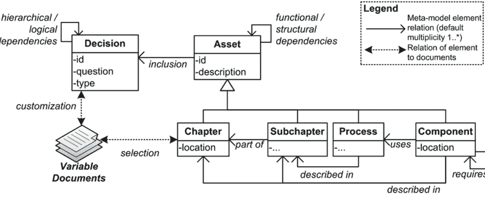

**FIGURE 20.1**  
扩展的DOPLER元模型，包含用于建模CC-L2系统的Chapter、Subchapter、Process和Component资产类型。图还描绘了元模型中的元素如何用于支持配置和生成可变文档；即，Decisions用于定制文档（例如填充占位符），Assets用于选择文档或其部分（例如特定章节）。

配置，以及Decision类型（布尔、枚举、字符串或数字）。Decision可以按层次（如果需要在其他Decision之前做出）或逻辑上（如果做出Decision会改变其他Decision的答案或Decision相互排斥）依赖于其他Decision。Decision类型定义的可接受答案范围可以进一步通过有效性条件进行约束。Assets表示核心产品线工件，例如技术组件或文档。它们可以在功能上相互依赖（例如，一个组件需要另一个组件）或结构上相互依赖（例如，一个子章节是章节的一部分）。Assets通过包含条件链接到Decisions，定义特定Asset何时包含在配置的产品中。Asset属性也可以依赖于Decision的答案，以实现对Assets的定制。

图20.1显示了CC-L2变异模型的元模型，其中包含预定义的Decision和Asset元素。CC-L2特定的Asset类型为Chapter（表示文档的章节）、Subchapter（表示章节的一部分）、Component（表示软件组件）和Process（表示执行软件组件的虚拟机）。Chapter和Component元素除了默认模型属性id和description之外，还具有类型为URL的属性location。Component在Chapter或Subchapter中描述，Process在Subchapter中描述，以将技术组件与文档Assets关联。Subchapter可以是Chapter的一部分。

Asset类型Chapter和Subchapter用于建模粗粒度变异。将文档的部分显式表示为模型中的Assets为定义文档变异和选择特定章节或部分提供了额外的抽象层。虽然也可以仅在Decision级别描述文档变异，但我们了解到这种额外的抽象层有助于领域专家更好地理解文档的粗粒度变异。

#### FIGURE 20.2

产品线中管理和配置文档的架构。

Decision dbversion。表内的变异通过命令#table.row.visible和#table.col.visible实现。这些命令在定义配置参数时经常使用，配置参数通常记录在表中。例如，#table.row.visible{A:WebHMI}用于标记提供WebHMI系统默认用户信息的表格行。

我们扩展了DOPLER配置向导（见图20.3），其中包含一个生成器，该生成器使用配置描述（即Decision的答案以及包含的Chapter和Subchapter Assets）来组合Microsoft Word文档。生成器使用要生成的文档的模板和任意数量的文档片段，具体取决于Decision。文档模板作为生成器的入口点，包含目录、图表和表格索引，以及包含文档插入注释的文档结构。各种子章节（表示为片段）可以插入到文档模板内的任意位置。在生成期间，文档模板被解析，并且插入的标签基于配置决策和所选资产进行解析。组合文档后，索引、表格和交叉引用将被更新。

本章介绍的方法目前在西门子VAI的15多个产品线中使用，全球近100名用户使用。虽然所展示的CC-L2示例同时结合了软件工件和文档的生成，但在西门子VAI的其他产品线中，使用重点在于文档的配置和生成，还包括粗略估算成本、投资回报率和投资回收期的计算。这些文档由会计人员使用，以向客户提供信息或为客户会议做准备。

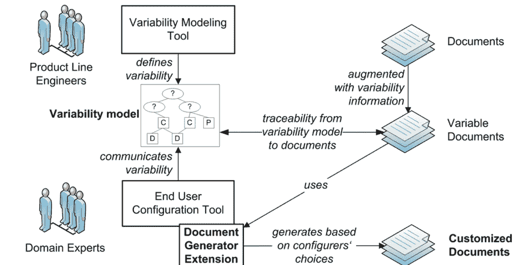


### 图 20.3

DOPLER 配置向导显示了 CC-L2 变体模型的决策和资产。终端用户通过回答问题来做出配置决策。根据配置人员对问题的回答，该工具计算出配置产品所需的文档资产列表。然后生成器根据此列表以 Microsoft Word 格式创建定制文档。

### 20.6 结论

本章报告了一个工业示例，用于开发一个灵活的配置工具，重点在于生成文档。该方法基于定义文档结构的变体模型和定义终端用户选择的配置描述处理。我们使用 SPLE 工具套件 DOPLER 和 Microsoft Word 实现了该方法。我们的方法在

文档类型和变异类型方面具有灵活性。DOPLER 决策模型的问卷式结构支持终端用户在配置向导中进行配置。

对于所描述的 Siemens VAI 的 CC-L2 产品线，需要各种文档，这些文档现在可以在产品配置期间使用 DOPLER 工具套件自动生成。支持的文档类型（例如，系统文档、用户手册）在规模和复杂性上各不相同。尽管定义标记和模型所需的初始工作量相当可观，但 resulting 解决方案在公司中得到了高度认可，因为它避免了手动调整文档耗时且容易出错的任务。该方法的接受度也依赖于公司已建立的文字处理工具的使用。此外，为产品特定文档准备所需的知识现在已明确定义。这使得对系统不太熟悉的人员也能生成有效的定制文档，从而减轻了专家的负担。

## 致谢

本工作由奥地利 Christian Doppler Forschungsgesellschaft 资助。作者感谢 Cornelia Miesbauer 对 MS Word 插件和生成器的工作。

## 参考文献

Asikainen, T., Männistö, T., Soininen, T., 2007. Kumbang: a domain ontology for modelling variability in software product families. Advanced Engineering Informatics 21 (1), 23–40.

Benavides, D., Segura, S., Ruiz-Cortés, A., 2010. Automated analysis of feature models 20 years later: a literature review. Information Systems 35 (6), 615–636.

Dhungana, D., Grünbacher, P., Rabiser, R., 2011. The DOPLER meta-tool for decision-oriented variability modeling: a multiple case study. Automated Software Engineering 18 (1), 77–114.

Hotz, L., Wolter, K., Krebs, T., Deelstra, S., Sinnema, M., Nijhuis, J., MacGregor, J., 2006. Configuration in Industrial Product Families - The ConIPF Methodology. IOS Press, Berlin.

Hotz, L., Felfernig, A., Günter, A., Tiihonen, J., 2014a. A short history of configuration technologies. In: Felfernig, A., Hotz, L., Bagley, C., Tiihonen, J. (Eds.), Knowledge-based Configuration – From Research to Business Cases. Morgan Kaufmann Publishers, Waltham, MA, pp. 9–19 (Chapter 2).

Hotz, L., Felfernig, A., Stumptner, M., Ryabokon, A., Bagley, C., Wolter, K., 2014b. Configuration knowledge representation and reasoning. In: Felfernig, A., Hotz, L., Bagley, C., Tiihonen, J. (Eds.), Knowledge-based Configuration – From Research to Business Cases. Morgan Kaufmann Publishers, Waltham, MA, pp. 41–72 (Chapter 6).

Leitner, G., Felfernig, A., Blazek, P., Reinfank, F., Ninaus, G., 2014. User interfaces for configuration environments. In: Felfernig, A., Hotz, L., Bagley, C., Tiihonen, J. (Eds.), Knowledge-based Configuration – From Research to Business Cases. Morgan Kaufmann Publishers, Waltham, MA, pp. 89–106 (Chapter 8).

Lettner, D., Thaller, D., Vierhauser, M., Rabiser, R., Grünbacher, P., Heider, W., 2011. Supporting business calculations in a product line engineering tool suite. In: MAPLE/SACLE Workshop at Software Product Lines Conference (SPLC), Munich. ACM Paper number 26.

Pohl, K., Böckle, G., van der Linden, F.J., 2005. Software Product Line Engineering: Foundations, Principles and Techniques. Springer, Secaucus, NJ.

Rabiser, R., Heider, W., Elsner, C., Lehofer, M., Grümbacher, P., Schwanninger, C., 2010. A flexible approach for generating product-specific documents in product lines. In: Bosch, J., Lee, J. (Eds.), 14th International Software Product Line Conference. Lecture Notes in Computer Science, vol. 6287. Springer, Berlin, pp. 47–61.

Soininen, T., Tiihonen, J., Männistö, T., Sulonen, R., 1998. Towards a general ontology of configuration. Artificial Intelligence for Engineering Design, Analysis and Manufacturing (AI EDAM) 12 (4), 357–372.

Stumptner, M., 1997. An overview of knowledge-based configuration. AI Communications 10 (2), 111–126.

van der Linden, F.J., Schmid, K., Rommes, E., 2007. Software Product Lines in Action: The Best Industrial Practice in Product Line Engineering. Springer, Secaucus, NJ.

van Ommering, R.C., van der Linden, F., Kramer, J., Magee, J., 2000. The Koala component model for consumer electronics software. IEEE Computer 33 (3), 78–85.

### 图 21.1

电梯维护合同配置模型。

除了建模概念化之外，我们知道很少有针对服务核心销售配置的特定技术。然而，在主要企业软件套件中存在针对服务的特定领域扩展，例如管理电信服务。

#### 21.2.4 成就与案例

我们在见证的服务销售配置案例之间的共同点包括通过合同承诺的客户，这些合同是配置的。服务提供商表现出 Salter 和 Tether（2006）所识别的系统企业的特征，即通常规模较大，基于详细的劳动分工、复杂的运营程序以及对技术的高度依赖，通常是信息和通信技术，有时是物流。示例包括银行、保险、电信、超市和航空公司。此类公司由于其产品中潜在复杂服务的数量庞大，有可能从服务配置中显著受益。基于模块化元素的服务交付能够以中等技能的员工和相对较低的提供商自由裁量权实现高效流程。

我们的示例案例包括宽带和移动订阅、电梯维护合同和保险。订阅是通过主要企业软件系统的配置器模块和电信扩展以大量方式管理的。支持自动配置、已安装基础管理以及重新配置，并且是系统的核心业务需求。大规模和希望使客户能够配置其订阅的愿望需要一个配置器。

金融行业中的智能销售配置在多个关键绩效指标方面带来了显著改进，例如解决方案质量、报价时间以及维护工作量（Felfernig et al., 2007）。

### 21.3 流程配置

#### 21.3.1 什么是流程配置？

提供可配置的产品和服务最有效的方式是将配置从产品和服务的特性扩展到支持的业务流程。有效交付可配置服务需要同样可配置的开发和交付流程，以便简化业务流程并管理利益相关者的期望。

在此背景下，流程配置可以描述为将给定的流程模型转变为专门针对给定需求集的模型的行为。输入流程模型通常是通用参考模型，管理着广泛的活动，必须对其进行配置以适应给定场景。通常，配置涉及选择应保留在定制流程中的任务、子流程和执行路径，同时消除其他任务，同时保持整体流程的完整性。定制可以逐步应用，从而产生范围和细节各不相同的流程模型序列。

一般来说，仅将注意力限制在任务选择和排序上是不够的。还考虑了几个同样重要的视角：控制视角主要关注任务以及流程中允许的任务的并行性、顺序和同步。决策任务及其相关条件，用于在替代执行路径之间进行选择，也包括在此。资源视角体现了可用资源以及管理资源分配给任务的业务规则。角色、权限和组织结构的显式模型构成了这一视角的基础。数据视角捕获了流程中业务对象和数据的表示和使用。它是确保所有支持流程中人类和自动化任务所需的信息在适当时间可用所必需的。

可配置流程模型体现了参考模型中的可能变异点以及选择与元素之间的关系，以确保定制结果正确


organizations to customize and extend reference processes and configuration models (Becker et al., 2007; Mayer et al., 2011; Rosa et al., 2011)。

**声明式流程约束。** 基于约束的流程配置技术依赖于流程属性的规范。约束指定在任何有效的定制流程中必须（不）成立的内容。Pesic et al. (2010) 提出了一个使用线性时序逻辑作为约束规范语言的模型，以及从部分执行中合成符合工作流的方法。Mayer et al. (2011) 讨论了一种混合方法，其中参考流程使用动态约束满足技术和可扩展的流程和资源模型进行定制以满足项目特定要求。

使用各种自动规划（Baryannis and Plexousakis, 2011）和动态约束满足（Thiagarajan et al., 2009）技术，从单个 Web 服务组成和配置计算流程也已得到解决。这些方法依赖于流程组件和目标的全面形式化规范。

### 21.3.3 示例

让我们重新审视电梯示例并检查流程配置如何支持定制的服务交付。图 21.2 描绘了我们电梯服务提供商的（简化）参考流程。它包含六个任务（t₁, …, t₆）、一个决策网关（g₁）和两个受保护的流程（f₁, f₂）。然而，并非所有任务对所有合同都相关：计费取决于合同类型和选项，而超出预设限额的工作审批（任务 t₂ 和 t₃）是可选的，并且不适用于黄金合同。

可能的流程变体可以捕捉在如图 21.3 所示的配置模型中。变量 Type、Approval_limit、Spares_included 和 Repair_work_included 对应于合同中设定的服务选项。我们写 ¬tᵢ 表示任务 tᵢ 应被跳过，¬fᵢ 表示流程 fᵢ 应被阻塞。未被某些规则跳过的任务保留在定制的流程中。一旦跳过的任务和被阻塞的流程被确定，额外的任务和流程可能会被移除以消除不可达的任务和不必要的网关。

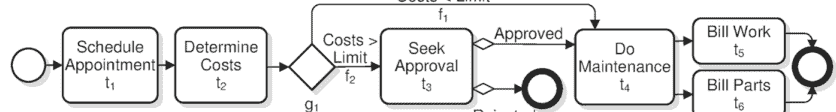

**图 21.2**  
维护参考流程。

```
Type = Gold ∨ Approval_limit = 0  →  ¬t₂ ∧ ¬f₂
Spares_included = true        →  ¬t₆
Repair_work_included = true   →  ¬t₅
```

**图 21.3**  
电梯维护流程配置模型。

假设流程是要为黄金合同配置的。配置模型意味着 ¬t₂、¬f₂、¬t₅ 和 ¬t₆；因此任务 t₂、t₅ 和 t₆ 被跳过。任务 t₃、其外出流程以及被拒绝的结束状态被移除，因为如果 f₂ 被阻塞它们是不可达的。网关 g₁ 也被跳过，因为它退化为简单的序列。 resulting 流程包含任务序列 t₁、t₄。

### 21.3.4 成就与案例

流程配置已在多个大型项目中取得成功。Gottschalk 和 La Rosa (2010) 描述了电影行业的一个案例研究，使用了数百个任务的流程和包含 53 个问题和 162 个事实的问卷模型。Mayer et al. (2011) 描述了包含数千个元素的软件和硬件开发流程的配置和验证。他们的模型揭示了手工创建的适配中超过 130 个错误，并消除了配置流程中的不必要任务。Gottschalk et al. (2009) 在荷兰市政当局中应用了流程配置，并得出结论，控制方面的配置是有益的，但也应包括其他视角。

### 21.4 结论

服务和流程配置技术可以为提供商及其客户带来显著益处，特别是在服务行业，在那里来自不同提供商的各种服务可以在较长的时间内捆绑在一起。配置技术已从纯粹的技术兼容性扩展到客户的环境和长期客户关系的维护。配置系统本身已变得可配置，以便适应客户偏好，其中技术系统和产品特性的模型已补充了自适应用户和对话模型。可扩展的配置框架已被设计用于捕获、配置和验证与服务开发和提供相关的流程方面。

然而，将组织中产品和流程模型经常非正式的使用与自动配置所需的形式化精确性之间的差距 bridging 仍然具有挑战性，就像支持领域专家从（抽象）领域概念开发可扩展的配置模型一样。当前用于开发和验证配置模型的方法和商业系统大多侧重于相对静态的特征模型或需要形式化方法方面的专业知识。配置模型、推荐系统和重新配置机制的获取、测试和验证需要进一步研究，以便在主流配置系统中适用。

## 致谢

我们感谢芬兰技术发展中心（项目 WeCoTin、ConSerWe 和 Cosmos）、相关公司以及 Aalto 大学服务工厂提供的资金支持。

## 参考文献

Akkermans, H., Baida, Z., Gordijn, J., Peña, N., Altuna, A., Laresgoiti, I., 2004. Value webs: using ontologies to bundle real-world services. IEEE Intelligent Systems 19 (4), 57–66。

Anderson, A., 2005. Towards tool-supported configuration of services. Master’s thesis, Helsinki University of Technology, Department of Computer Science and Engineering, Espoo, Finland。

Baryannis, G., Plexousakis, D., October 2011. Automated web service composition: state of the art and research challenges. Tech. Rep. ICS-FORTH/TR-409, Institute of Computer Science, Foundation for Research and Technology – Hellas。

Becker, J., Delfmann, P., Knackstedt, R., February 2007. Adaptive reference modeling: integrating configurative and generic adaptation techniques for information models. In: Becker, J., Delfmann, P. (Eds.), Proceedings of the Reference Modeling Conference (RM’06), Physica Verlag, Heidelberg, pp. 27–58。

Becker, J., Beverungen, D., Knackstedt, R., Matzner, M., 2009. Configurative service engineering – a rule-based configuration approach for versatile service processes in corrective maintenance. In: Proceedings of the 42nd Hawaii International Conference on System Sciences, Big Island, HI, pp. 1–10。

Falkner, A., Felfernig, A., Haag, A., 2011. Recommendation technologies for configurable products. AI Magazine 32 (3), 99–108。

Felfernig, A., Isak, K., Kreutler, G., Kruggel, T., Teppan, E., 2007. Knowledge representations for the interactive selling of financial services. Information Systems and e-Business Management 5 (2), 143–166。

Gottschalk, F., La Rosa, M., 2010. Modern business process automation: YAWL and its support environment. In: Hofstede, A.H.M., Aalst, W.M.P., Adams, M., Russell, N. (Eds.), Modern Business Process Automation. Springer, Berlin, Heidelberg, pp. 459–487 (Chapter: Process configuration in YAWL)。

Gottschalk, F., Wagemakers, T.A.C., Jansen-Vullers, M.H., van der Aalst, W.M.P., Rosa, M.L., 2009. Configurable process models: experiences from a municipality case study. In: van Eck, P., Gordijn, J., Wieringa, R. (Eds.), Advanced Information Systems Engineering, 21st International Conference, CAiSE 2009. Lecture Notes in Computer Science, vol. 5565. Springer, Amsterdam, The Netherlands, pp. 486–500。

Grönroos, C., 2000. Service Management and Marketing: A Customer Relationship Management Approach. John Wiley & Sons, Ltd., Chichester。

Heiskala, M., Tiihonen, J., Anderson, A., Soininen, T. June 22–23, 2006. Four-worlds model for configurable services. In: Blecker, T., Friedrich, G., Hvam, L., Edwards, K. (Eds.), Customer Interaction and Customer Integration. Proceedings of the Joint Conference IMCM’06 & PETO’06, Hamburg/Germany, pp. 199–216。

Mayer, W., Stumptner, M., Kllisperger, P., Grossmann, G., 2011. A declarative framework for work process configuration. Artificial Intelligence for Engineering Design, Analysis and Manufacturing (AI EDAM) 25 (2), 143–162。

Pesic, M., Schonenberg, H., Aalst, W., 2010. Declarative workflow. In: Hofstede, A.H.M., Aalst, W.M.P., Adams, M., Russell, N. (Eds.), Modern Business Process Automation. Springer, Berlin, Heidelberg, pp. 175–201。

Piller, F.T., Blazek, P., 2014. Core capabilities of sustainable mass customization. In: Felfernig, A., Hotz, L., Bagley, C., Tiihonen, J. (Eds.), Knowledge-based Configuration – From Research to Business Cases. Morgan Kaufmann Publishers, Waltham, MA, pp. 107–120 (Chapter 9)。

Queva, M., 2011. A framework for constraint-programming based configuration. Ph.D. thesis, Technical University of Denmark, Informatics。

Rosa, M.L., Dumas, M., ter Hofstede, A.H.M., Mendling, J., 2011. Configurable multi-perspective business process models. Information Systems 36 (2), 313–340。

Rosemann, M., van der Aalst, W.M.P., 2007. A configurable reference modelling language. Information Systems 32 (1), 1–23。


Salter, A., Tether, B.S., 2006. 服务创新——透过创新研究的镜子。高级管理学院（AIM）研究“服务科学重大挑战”的背景论文。

Thiagarajan, R.K., Mayer, W., Stumptner, M., 2009. 服务流程组合的生成式框架。见：面向服务的计算，第七届国际联合会议（ICSOC-ServiceWave 2009）。计算机科学讲义，第5900卷。斯普林格，瑞典斯德哥尔摩，第358–363页。

## S’UPREME

Alois Haselböck 和 Gottfried Schenner
西门子股份公司，奥地利维也纳

摘要：S’UPREME 是西门子股份公司内部使用的配置系统，用于配置复杂的大规模技术系统，例如铁路安全系统或工业生产系统（另见第16章）。本章简要概述 S’UPREME 的技术背景和建模表达能力。

### 22.1 引言

本章介绍西门子内部使用的配置框架 S’UPREME。S’UPREME 的技术基础是约束编程系统的面向对象扩展，称为生成式约束满足（另见 Hotz 等人，2014¹）。自大约 2002 年以来，它已投入生产使用，主要用于大规模工业生产、电信、铁路设备与安全系统领域。

本章其余部分安排如下：22.2 节概述该框架的架构。22.3 节描述定义一个新的基于 S’UPREME 的配置器所需的典型步骤。最后，22.4 节给出结束语。

### 22.2 系统架构与技术背景

S’UPREME 是一个与领域无关的配置框架，提供通用的配置能力。图 22.1 勾勒了 S’UPREME 架构的主要组件。S’UPREME 的核心由知识库元结构（用于指定具体配置领域的组件、属性和约束）和求解引擎组成。

框架提供了几个内置求解器：一致性算法可以检查配置、传播用户输入并过滤配置选项；基于修复的启发式搜索算法和回溯算法可以完成部分配置。

除了这些内置求解器外，S’UPREME 的设计还允许集成外部求解器，如 MILP（混合整数线性规划）或 SAT 求解器（命题公式的可满足性；见 Falkner 等，2010）。

对于一个具体的配置领域，配置器架构师设计工程过程，并对知识库结构进行建模。知识库由组件类型组成，这些组件类型组织在

¹第6章。

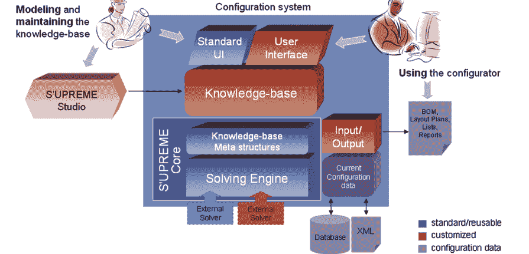

### 图 22.1

S'UPREME 的系统架构。

类型与聚合层次结构中，并包含其属性和约束（约束表示关于哪些配置有效且完整、哪些配置无效不完整的命题）。工具 S'UPREME Studio 帮助知识工程师定义知识库。生成的应用程序用 Java 编写，其中很大一部分代码由 S'UPREME Studio 生成。

S’UPREME 提供了标准的基于框架的图形用户界面（GUI），但通常每个新的配置器都需要设计和编写特定的应用程序 GUI。通常还必须实现客户特定的输入和输出接口。为了持久化配置，S’UPREME 提供了针对 SQL 数据库、面向对象数据库和 XML 文件的连接器。

S’UPREME 的主要且突出的技术概念是生成式约束满足（GCSP）。GCSP 是经典 CSP 的扩展，旨在应对许多技术应用领域（如配置、设计或规划）中出现的动态方面。经典 CSP 通过一组固定的变量、它们的域和约束来表示问题。解决方案是一个不违反任何约束的变量赋值。但是，如果在建模时不知道解决方案中的组件数量，这种静态变量集合通常是不合适的。

经典 CSP 模式向更动态视角发展的最显著扩展包括条件 CSP（Gottlob 等，2007；Mittal 和 Falkerhainer，1990）、动态 CSP（Dechter 和 Dechter，1998），以及 S’UPREME 中所使用的生成式 CSP（Felfernig 等，2003；Fleischanderl 等，1998）。

GCSP 专为表示和求解大规模复杂配置问题而设计，因此是一个强大且表达力极高的框架。除了约束满足之外，GCSP 的主要背景是面向对象范式，它清晰地将问题模型与问题实例分离开来。这使得问题结构能够自然而可维护地表述，问题逻辑能够声明式地表述，并且能够干净地处理许多配置问题中固有的动态性。

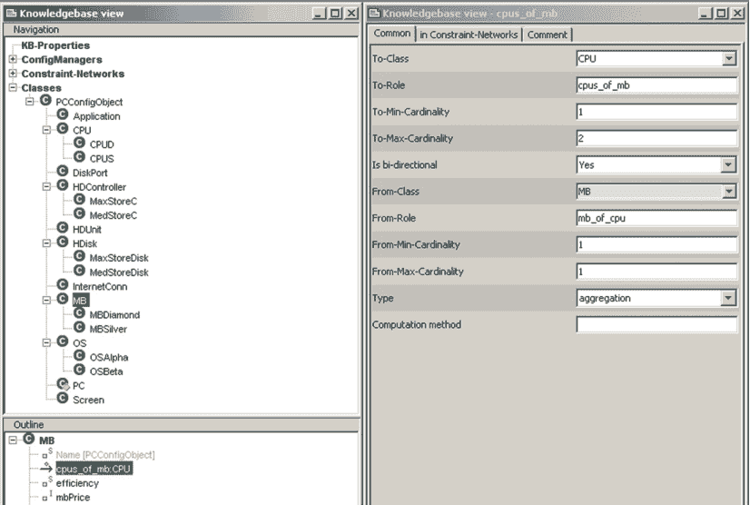

### 图 22.2

建模框架 S'UPREME Studio。

### 22.3 工作示例的建模

在创建 S’UPREME 配置器应用程序时，知识工程师的首要任务是为待配置系统建立一个面向对象的模型。S’UPREME 的面向对象元模型与面向对象 UML 标准兼容。因此，为了对本书的工作示例进行建模，我们可以直接使用 Hotz 等人（2014）中图 6.7 的 UML 图。²

知识工程师使用 S’UPREME Studio 来定义知识库。在该编辑器中，知识工程师编辑类及其属性和关联。对于属性，可以提供其域、初始值和计算函数。对于关联，必须定义关联的角色及其基数。

图 22.2 中的截图显示了 Hotz 等人（2014）工作示例知识库的一部分。在左侧的树视图中，可以看到与 UML 图一一对应的类及继承层次。右侧的编辑窗口显示了一个

²第6章。

关联的示例，这里是从主板到其 CPU 的关联。基数项确保每个 CPU 都有一个指定的主板，并且一个主板有一个或两个 CPU。

模型完成后，S’UPREME Studio 可以为知识库生成一个基于 Java 的 S’UPREME 配置器应用程序。知识库中的每个类都会生成相应的 Java 类。继承层次直接取自 UML 图；例如，类 OSAlpha 和 OSBeta 是类 OS 的子类。

这些生成的 Java 类具有类型安全的 getter/setter 方法，应用程序程序员可以像对待普通 Java 类一样使用它们；他们可以根据需要在这些类中编写其他方法（输出生成、GUI、测试等）。

属性通过如下语句定义：

```
theKnowledgeBase.defineStringAttr(
"PC", // component class
"usage", // attribute name
new String[]{"internet","scientific","multimedia"});
```

在此示例中，属性 usage 在 PC 类中定义。关联以类似方式定义；例如，以下语句定义了主板（MB）与其 CPU 之间的双向链接：

```
theKnowledgeBase:defineAssoc(
"MB", // class 1
"mb-of-cpu",1,1, // role 1 and cardinalities
"CPU", // class2
"cpus-of-mb",1,2); // role 2 and cardinalities
```

配置是知识库的一个实例化。S’UPREME 配置器一次维护一个配置。使用标准 GUI，用户可以通过添加、删除和连接组件以及设置其属性来操作当前配置。从 GCSP 的角度来看，属性和关联被视为约束变量，由 GCSP 推理进行检查和操作。

约束是约束变量（即组件类的属性和关联）上的一个条件，有效配置必须满足该条件。与属性和关联一样，约束沿类型层次结构继承。当前配置每次更改后，都会检查受影响的（可能继承的）约束，并更新其状态（违反/有效）。当约束被违反时，GUI 通过显示约束的依赖关系提供解释。

约束还可用于过滤掉不一致的值。例如，当将 PC 的效率设置为 B 时，屏幕的效率不再允许取 C 值，并且该值将不再作为可能值显示在 GUI 上。如果先设置屏幕的效率，那么对 PC 也会发生类似的过滤。对于 Screen 类，像下面这样的约束可以实现这两种情况下的行为：

```
constraint.post(getVar("efficiency")
.lessOrEq(getPC().getVar("efficiency"));
```


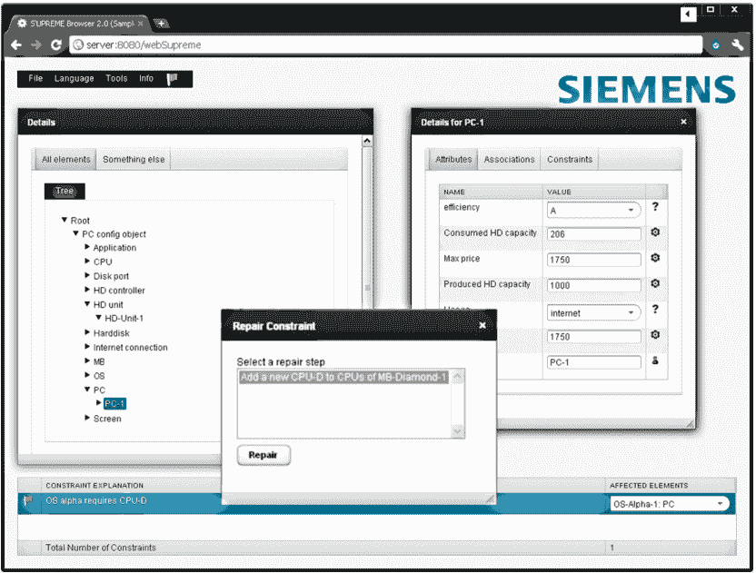

### FIGURE 22.3

Repair action in the PC configurator with S'UPREME.

- Systems must be maintained, modernized, and updated to changed environmental or strategic situations. Changes in existing systems may lead to conflicts that must be repaired. Of course, the adapted system shall keep as many components and structures of the old system as possible. Also not all reconfiguration actions are equally costly. For instance, changing the RAM is usually less costly than changing the motherboard. Heuristic repair can deal with such reconfiguration tasks in a natural way by defining different costs for different repair actions.
- It is easy to adapt the heuristics used by the solver by providing an explicit ordering of the constraint variables.

The disadvantage of local search methods like heuristic repair is their incompleteness. If completeness is required then a complete backtracking solver can be used, although in practice without the right heuristic, complete methods can only be used for moderate problem sizes (e.g., up to a few hundred component instances).

### 22.4 Conclusion

A configuration system must always be integrated into the ordering, pricing, configuration, and manufacturing process of a business unit. This integration is well-supported by S'UPREME due to its open architecture, its standard object-oriented model, and its Java API.

S'UPREME was and is successfully used in domains like mobility (train control systems, interlocking systems), telecommunication, and industrial production within Siemens (see Falkner and Schreiner, 2014⁴). Including country-specific variants there exist more than 30 different configurator applications based on S'UPREME.

Technical systems are often configured in an interactive process. The user specifies his/her requirements and selects components, then the configurator checks the inputs, shows inconsistencies, rules out options that have become invalid, and derives additional knowledge (e.g., additionally needed components). Then, in turn, the user proceeds with his/her inputs, and so on. The process stops when the user has specified all of his/her requirements and the configuration is complete and consistent. A generative constraint system like S'UPREME supports this interactive process in a very natural way, guiding the user through a sequence of configuration steps.

# References

Dechter, R., Dechter, A., 1988. Belief maintenance in dynamic constraint networks. In: AAAI 1998, Madison, WI, pp. 37–42.

Falkner, A., Schreiner, H., 2014. SIEMENS: configuration and reconfiguration in industry. In: Felfernig, A., Hotz, L., Bagley, C., Tiihonen, J. (Eds.), Knowledge-based Configuration – From Research to Business Cases. Morgan Kaufmann Publishers, Waltham, MA, pp. 199–210 (Chapter 16).

Falkner, A., Haselböck, A., Schenner, G., Schreiner, H., 2010. Modeling and solving technical product configuration problems. Artificial Intelligence for Engineering Design, Analysis and Manufacturing (AI EDAM) 25 (2), 115–129.

Felfernig, A., Friedrich, G., Jannach, D., Stumptner, M., Zanker, M., 2003. Configuration knowledge representations for semantic web applications. Artificial Intelligence for Engineering Design, Analysis and Manufacturing (AI EDAM) 17 (1), 31–50.

Fleischanderl, G., Friedrich, G.E., Haselböck, A., Schreiner, H., Stumptner, M., 1998. Configuring large systems using generative constraint satisfaction. IEEE Intelligent Systems 13 (4), 59–68.

Gottlob, G., Greco, G., Mancini, T., 2007. Conditional constraint satisfaction: Logical foundations and complexity. In: 20th International Joint Conference on Artificial Intelligence (IJCAI-07), Hyderabad, India, pp. 88–93.

Hotz, L., Felfernig, A., Stumptner, M., Ryabokon, A., Bagley, C., Wolter, K., 2014. Configuration knowledge representation & reasoning. In: Felfernig, A., Hotz, L., Bagley, C., Tiihonen, J. (Eds.), Knowledge-based Configuration – From Research to Business Cases. Morgan Kaufmann Publishers, Waltham, MA, pp. 41–72 (Chapter 6).

Mittal, S., Falkenhainer, B., 1990. Dynamic constraint satisfaction problems. In: Proceedings of the Eighth National Conference on Artificial Intelligence (AAAI-90), Boston, MA, pp. 25–32.

Tsang, E., 1993. Foundations of Constraint Satisfaction. Academic Press, London, San Diego, New York.

## encoway

## CHAPTER 23

Thorsten Krebs
encoway GmbH, Bremen, Germany

Abstract: This chapter describes the basics of the encoway configuration environment. encoway is working with a set of tools that best suits the heterogeneous system landscapes and their very different needs that encoway encounters in real-life customer projects. In the following we give a brief introduction of the configuration environment, including a scientific background, an architecture description, and typical system landscapes in which encoway integrates configuration applications.

### 23.1 Introduction

This chapter describes the basics of the encoway¹ configuration environment. encoway is working with a set of tools for the different tasks of data integration and maintenance, product modeling and configuration, representing and displaying configuration decisions and related rich content, as well as quote generation and handling transaction data in general. This set of tools best suits the heterogeneous system landscapes and their very different needs that encoway encounters in real life customer projects.

The remainder of this chapter is organized as follows. Section 23.2 presents an overview of encoway’s history and its roots within the scientific community. Section 23.3 briefly discusses the configuration and reasoning methods that are implemented within encoway’s configuration environment. Section 23.4 presents an overview of encoway’s system architecture and typical system landscapes in which encoway integrates configuration applications. Section 23.5 describes the necessary data required for such configuration applications. Section 23.6 discusses the quote generation process in which configuration plays a key role between selecting configurable products and generating quote documents. Finally, Section 23.7 summarizes and concludes this chapter.

### 23.2 History and Scientific Basis

encoway uses methods from structure-based (component-oriented) configuration that have a long history in the research area of Artificial Intelligence (see e.g., Günter, 1995). The declarative approach of representing products by means of structure-based configuration is especially well suited for managing large amounts of product variants and configuring complex products. encoway itself is deeply rooted in research. The company was founded as a spin-off from the research institute TZI (Center for Computing

¹ http://www.encoway.de.

values may be introduced on lower levels. This, in combination with the closed world assumption³ is the basis for taxonomic inferences. For example, when any CPU can be fast or medium but a CPUD is always fast (refined inherited attribute value), and there is no other fast CPU (closed world assumption) then the system can infer that any fast CPU has to be a CPUD.

- Partonomies define the decomposition of a configurable product. The parts that comprise a product are related to the composite together with a (minimum and maximum) multiplicity definition. For example, a HDUnit has one to four HDisk and one or two HDController parts. The concept of multiplicity allows for the specification of parts that can be either optional or required. Using the same component types within partonomies for different products is the key to define a large external variance with only a small internal variance.

A component type describes a prototypical product or component, some sort of pattern of which instances are generated within a configuration process according to the multiplicity definition. The generated instances together with the values that have been selected for their attributes form the configuration result. For more information on this topic and structure-based configuration in general see also Günter (1995).

Representing configuration knowledge for the inference engine engcon is based on a hybrid approach consisting of conceptual knowledge and constraint knowledge. Conceptual knowledge describes the products and the components from which products can be assembled. This means that conceptual knowledge describes the search space for possible configuration solutions. Constraint knowledge on the other hand narrows down this search space by defining situations that do not describe allowed configurations and thus must be avoided during the configuration process.

A constraint defines restrictions on one or more attributes of one or more component types. It consists of a condition and an action. The condition describes a situation in which the action definition is relevant with respect to a configuration task. For example, constraint gc1 has the condition that an instance of component type CPUS is present within the configuration. The action is executed when the condition matches the contents of a running configuration process and thus restricts instances of the component types that appear within the condition. The constraint gc1, for example, limits the choice of motherboards to those of compatible type MBDiamond. This means that the component types and their relations describe the search space while the set of constraints restricts this space to the subset of actually buildable combinations (see Mailharro, 1998).

Figure 23.1 shows a screenshot of encoway’s modeling tool K-Build. On the left side there are the two hierarchies: taxonomy on the top and partonomy on the bottom. We can see that an MBDiamond is a special MB (motherboard) that belongs to the component type Hardware and is part of PC. The tool K-Build uses the term “concept” to denote component types. On the right-hand side the attributes of MBDiamond are listed together with a reference to constraints that restrict its extension: gc1 in this example.

engcon distinguishes different types of constraints that restrict the value assignment of attribute values, specialize an instance along the defined taxonomy, or decompose a component type according to its part definitions. A very expressive ready-to-use library comes along with the modeling environment


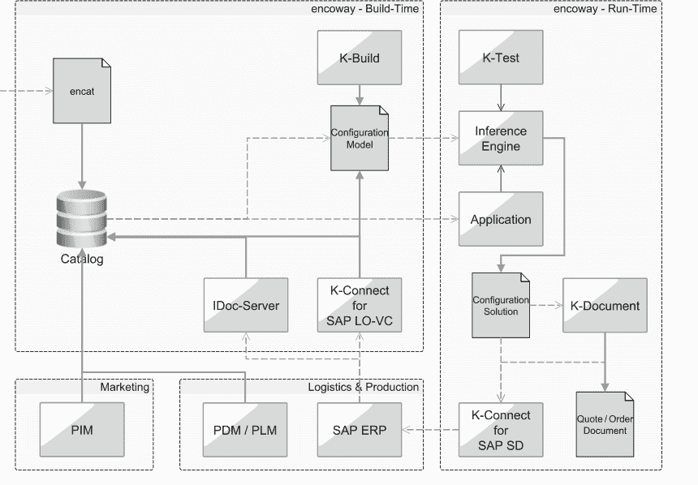

**图 23.2**
工具景观的整体视图。

配置模型在源系统中出现主数据的新版本时无需更改。

#### 23.5 数据集成

应用程序可以连接到目录以获取产品数据的访问权限。例如，一个不需要推理引擎的选取器可以直接通过实现 API 或使用网络服务对目录数据进行操作。K-Build 提供了使用目录中的产品组作为“分支点”的功能。分支点被视为一种组件类型，同时是指向目录中特定产品组的指针。这意味着在运行时，属于该产品组的产品被视为可能的子组件类型。

- Mittal, S., Frayman, F., 1989. Towards a generic model of configuration tasks. 11th International Joint Conference on Artificial Intelligence (IJCAI-89), Detroit, MI, vol. 2, pp. 1395–1401.
- Ranze, K., Scholz, T., Wagner, T., Günter, A., Herzog, O., Hollmann, O., Schlieder, C., Arlt, V., 2002. A structure-based configuration tool: Drive Solution Designer – DSD. In: 14th Conference on Innovative Applications of AI (IAAI-02), Edmonton, Alberta, Canada, pp. 845–852.
- Reiter, R., 1978. On closed world databases. In: Gallaire, H., Minker, J. (Eds.), Logic and Databases. Plenum Press, New York, pp. 55–76.
- Russell, S., Norvig, P., 2003. Artificial Intelligence – A Modern Approach, second ed. Prentice Hall, Upper Saddle River, NJ.
- Stumptner, M., 1997. An overview of knowledge-based configuration. AI Communications 10 (2), 111–126.

## 第24章 KONWERK

Lothar Hotz and Andreas Günter
HITeC e.V., University of Hamburg, Hamburg, Germany

**摘要：** 本章介绍了领域无关的配置工具 KONWERK。KONWERK 提供了在所谓的 basic modules 中实现的混合配置表示设施。Enhancement modules 提供诸如复杂需求建模或创建空间配置等方面。这些模块可用于开发多样化的应用。

### 24.1 概述

KONWERK¹ 是在汉堡大学开发的领域无关混合配置工具（Günter, 1995; Hotz et al., 2006）。该工具为知识表示和推理提供了 basic modules，涉及四种不同类型的知识：（1）概念知识，（2）约束知识，（3）任务知识（以下称为任务描述），以及（4）过程知识（参见 Günter and Cunis, 1992）。概念知识以本体形式表示。可使用分类（isA）和组合（hasParts）关系。知识库元素之间的限制通过约束定义。任务描述通过提供配置目标来表示用户需求。基于过程知识，可以定义配置决策的默认顺序。配置过程可以划分为多个子任务以指导用户。可以实现不同的交互风格；例如，按顺序呈现决策的配置向导，或更灵活的过程，其中用户会得到关于下一步应采取哪些配置步骤的指导。使用 KONWERK 进行配置的结果是对所有组件及其属性值的详细描述。

KONWERK 的 basic modules 部分作为商业配置工具 EngCon（参见 Krebs, 2014）² 和 Hollmann et al. (2000)³ 的蓝本。研究活动通过 enhancement modules 扩展了这些模块，以支持配置任务的额外方面，如基于资源的配置、模糊计算和空间推理。

本章的其余部分组织如下。第 24.2 节提供了 KONWERK 支持的知识表示和推理的概述。第 24.3 节介绍了 KONWERK 的 enhancement modules。第 24.4 节提供了工具实现的见解。第 24.5 节概述了使用该工具构建的一些配置器。

¹ KONWERK（Konfigurierungs-Werkzeug，配置工具）是在德国政府资助的研究项目 Prokon 中开发的。

² 第 23 章。

³ KONWERK 本身是 PLAKON 的继任者；参见 Hotz et al.（2014a，第 2 章）和 Neumann（1988）。

### 24.2 工作示例的建模

在 KONWERK 中，配置模型由概念和约束组成。它以组件为导向的方式表示配置知识。类似本体的表示法能够定义概念以及参数、分类和结构关系等关系。参数描述概念与原始数据类型（如数字、字符串、区间或这些数据类型的集合）之间的关系。分类关系描述两个概念之间的子集关系。结构关系是概念之间的关系（在 GCSP 中称为连接，在描述逻辑中称为角色）。结构关系的一个例子是组合关系（如 hasParts）。约束表示增强了这种本体知识，用于定义 n 元关系和代数表达式。尤其是概念与约束的紧密集成，使得能够结合使用描述逻辑服务（Baader et al., 2003）和基于约束的推理（Mackworth, 1977; Rossi et al., 2006; Tsang, 1993）；另见 Hotz et al.（2014b）⁴。

⁴ 有关替代配置知识表示的详细讨论，请参见 Hotz et al.（2014b，第 6 章）。

PC 域中使用的概念示例（参见 Hotz et al., 2014b⁶）以 KONWERK 的 Component Description Language 表示（Hotz, 2009）为：⁷

```
(define-concept :name PC
:super-concept Domain-Object
:parameters ((usage {internet scientific multimedia})
(efficiency {A B C})
(price [0 inf]))
(maxprice [0 inf])
:hasParts
((:type PC-Part :min 5 :max inf) :=     ; (*)
(:type InternetConn :min 0 :max 1)   ; (**)
(:type HDUnit :min 1 :max 2)
(:type MB :min 1 :max 1)
(:type Screen :min 1 :max 2)
(:type OS :min 1 :max 1)
(:type Application :min 1 :max inf))
```

概念（组件类型）PC 表示个人计算机。术语 :super-concept Domain-Object 将概念集成到 specialization hierarchy 中。PC 概念的参数表示个人计算机的属性，如 usage 或 efficiency。这些参数具有符号集合作为值（例如，{A B C}）。参数 price 和 maxprice 最初具有正无限范围 [0 inf]。结构关系 hasParts 模拟 PC 与其部件的组合关系，例如与 HDUnit。集合描述符使用所有部件的超概念 PC-Part 和基数 (*) 以及部件描述列表定义整个部件集合。概念和基数定义每个部件（**）。

概念约束。每个概念约束 cc ∈ CC 由（1）描述结构情况的条件和（2）一组约束调用组成。结构情况描述了概念的关联结构，其实例将由约束调用限制。每个约束调用由实现特定限制的约束关系指定。

包含相关概念的概念约束示例如下：

```
(define-conceptual-constraint :name prc1
:structural-situation
((?hdu :name HDUnit)                 ; (*)
(?hup :all :name HDUnit-Part        ; (**)
:partOf ?hdu))
:constraint-calls
((totalsum (?hdu price) (?hup price))) ; (3*)

(define-concept :name HDUnit-Part
:super-concept Domain-Object
:parameter ((price [0 inf]))
:partOf HDUnit)

(define-concept :name HDController
:super-concept HDUnit-Part
:parameter ((price [0 500]))
:hasParts ((:type DiskPort :min 1 :max 4)))

(define-concept :name HDisk                ; HDisk inherits parameter price from
:super-concept HDUnit-Part                 ; HDUnit-Part
:parameter ((capacity [0 inf])))
```

该模型片段定义了工作示例的价格约束 prc1。该约束通过将磁盘（HDisk）和控制器（HDController）的价格相加来计算硬盘单元（HDUnit）的价格。由于两者都被建模为硬盘单元的部件，因此我们可以在概念约束的结构情况中指定 HDUnit-Part。该情况描述了约束关系成立的条件。通过“?”表示的变量可以在其他条件或约束调用中引用在结构情况中识别的特定概念实例。因此，只有当存在一个 HDUnit (*) 及其某些 HDUnit-Parts (**) 时，才需要计算指定的约束调用 totalsum (3*)。在此，使用了特定的 :all 约束（参见（**）），其对数量具有灵活性


属性变量（例如，在 (3*) (?mb price) 中表示每个找到的 HDisk-Part 的参数 price 的集合）。

请注意，概念约束看起来像一条规则（具有条件部分，即结构情况，以及动作部分，即约束调用），然而，约束调用不会直接改变任何属性，而是实例化一个约束关系。因此，当在迄今为止创建的配置中识别出结构情况时，概念约束的约束调用会增加一个约束网（类似于激活约束；参见 Hotz et al., 2014b⁸）。

约束关系。每个约束关系 cr ∈ CR 由一组约束引脚和一个代数表达式或一个关系表组成，该关系表以内涵或外延方式关联约束引脚。约束引脚是对概念实例的属性值的引用。通常，约束关系是领域无关的。约束关系的示例如下；它实现了方程 summand1 + summand2 = sum。

```
(define-constraint-relation :name adder
:constraint-type function
:external-pins (summand1 summand2 sum)
:function
(let ((summand1 (sect summand1
(descriptor-subtract sum summand2)))
(summand2 (sect summand2
(descriptor-subtract sum summand1)))
(sum (sect sum (descriptor-add summand1 summand2))))
(when (and summand1 summand2 sum)
(list summand1 summand2 sum))))
```

该约束关系的类型为 function，这意味着函数定义了底层限制，而不是例如关系表。adder 约束关系接受三个参数（外部引脚或约束变量），并在所有方向上关联它们；每个变量根据其他变量的值计算（多向约束）。以下示例展示了在 PC 领域中使用 adder 约束关系的情况。概念约束对计算 MB 的价格应用领域无关的约束关系 adder：

```
(define-conceptual-constraint :name Price-of-MB
:structural-situation
((?pc :name PC)
(?mb :name MB :partOf ?pc))
:constraint-calls ((adder (?mb price-of-cpus) (?mb own-price) (?mb price))))
```

在此示例中，adder 获取三个引脚的值 (?mb price-of-cpus)、(?mb own-price) 和 (?mb price)，它们分别是 cpus 的价格、(?mb MB) 的自身价格以及 MB 的总价格（另见图 24.2）。Adder 使用描述符方法 descriptor-subtract 进行减法，使用 sect 进行交集。此类方法为数字、范围或两者的集合实现了集合和区间算术。例如，约束引脚 (?mb price-of-cpus) 可能是数字集合，例如 {220 3000 350}，(?mb own-price) 为集合 {120 4000 250}，而 (?mb price) 可能是范围 [0 inf]。adder 按给定变量的顺序计算值集合（{220 3000 350}{120 4000 250}{340 4220 470 3120 7000 3250 4350 600}）。因此，范围 [0 inf] 被简化为一组数字，表示 (?mb price) 和 (?mb own-price) 的值求和的所有可能结果。

除了用于表示组件类型的概念外，概念实例还用于表示实际组件。然而，实例通常不在配置模型中指定，而是由推理系统创建，特别是由任务描述创建（或由结构化配置步骤创建，见后文）。任务描述表示用户的初始需求（参见例如 Mittal and Frayman, 1989）。此类描述以待配置的聚合形式给出：配置过程的目标。通常，目标由组合层次结构的根节点表示。任务描述还可能定义附加需求，例如部件选择、其他聚合或规定的属性。任务描述的示例如下：

```
(define-construction-task
:name construct-pc
:goal PC
:instances
((?pc :type PC :usage scientific)    ; (*)
(?hdisk :type MaxStoreDisk))        ; (**))
```

应为科学用途 (*) 构建一台 PC，其中至少包含一个类型为 MaxStoreDisk 的硬盘 (**)。

过程性知识。PK = {s1, …, sw} 是一个策略集合。每个策略都是一个二元组 ⟨FO, SC⟩，其中 FO（焦点）根据概念定义 CO 推断出一组构造步骤并在议程中管理它们。每个构造步骤代表一个决策，例如设置属性值。每个构造步骤的类型为参数化、特化或结构化，其中最后一种决定了概念实例之间关系的决策。结构化配置步骤类型可以是自上而下结构化或自下而上结构化。自上而下结构化步骤从概念 c 开始配置到其相对概念 ri 的结构关系。此关系实例化 ri 的新概念实例或使用已有的实例来建立结构关系。例如，对于一个聚合（一个概念），如果它们尚未存在于部分配置中，则生成部件（相对概念）。部分配置表示迄今为止所做的所有决策及其含义。自下而上结构化步骤从相对概念 ri 开始配置到相关概念 cj 的结构关系。此关系实例化 cj 的新概念实例或使用已有的实例来建立结构关系；例如，为了将部件集成到聚合中，如果聚合尚未存在于部分配置中，则生成该聚合。

通常，构造步骤描述了概念实例的有效属性值以及该值如何通过值确定方法（见后文）进行更改。

焦点（FO）根据建模定义收集构造步骤，从而聚焦于应处理的配置决策集合。焦点的示例为：

```
(define-focus
:name application-focus
:concepts (PC Application)
:cs-type (top-down-structuring parameterize)
:property (hasParts hdcapacity))
```

此焦点为概念 PC 和 Application 选择属性 hasParts 的自上而下结构化以及参数 hdcapacity 的参数化（即将聚焦两个决策）。

SC 是一系列选择标准，其中每个标准从焦点 FO 定义的集合中选择一组构造步骤。与焦点类似，选择标准使用概念和属性名称以及构造步骤类型来选择构造步骤。

以下是两个选择标准的示例。每个标准都偏好一个决策。prefer-pc 选择标准选择自上而下结构化决策，而 prefer-application 选择 hdcapacity 的参数化：

```
(define-agenda-selection
:name prefer-pc
:concept PC
:cs-type top-down-structuring
:property (hasParts))
```

```
(define-agenda-selection
:name prefer-application
:concept Application
:cs-type parameterize
:property (hdcapacity))
```

焦点和选择标准组合成策略如下：

```
(define-strategy
:name application-selection
:priority 2000
:focus application-focus          ; (*)
:agenda-selection-criteria
    (prefer-pc prefer-application)  ; (**)
:value-determination-method
    (default computational-function ask-user))  ; (3*)
```

总之，该策略使用 application-focus (*) 聚焦于与 PC 和 Application 相关的决策。此焦点收集了如上所述的两个决策。这些决策由议程选择标准 prefer-pc 和 prefer-application 排序；即 hasParts 自上而下结构化决策在 hdcapacity 参数化决策之前做出（**）。值确定方法列表（3*）用于计算配置步骤，即首先尝试默认值。如果未定义，则调用计算函数。如果该值确定方法也无法提供有效值，则询问用户（"ask-user"）。配置模型中可能存在多个策略。给定的优先级决定了它们的顺序。用户交互（"ask-user"）实现了对初始给定需求的动态扩展。

在 KONWERK 中，配置问题（任务；另见 Hotz et al., 2014b⁹）由 (1) 实例（组件）和 (2) 具有概念、约束定义和过程性知识的配置模型组成。任务描述计算实例。因此，它们是部分实例化的概念，构成了表示用户需求的初始部分配置。术语“部分”强调了用户通常不会为所需实例的每个属性提供值这一事实。配置模型在整个配置过程中用于推断实例属性的值，并在需要时创建新实例。问题的解 S（一个配置）是一组实例 Sᴵ，它们与概念、概念约束和概念关系一致。此外，属于解的实例必须通过配置过程计算得出


### 图24.1

KONWERK知识库浏览器：特化层次结构（左）与一个选定的概念。

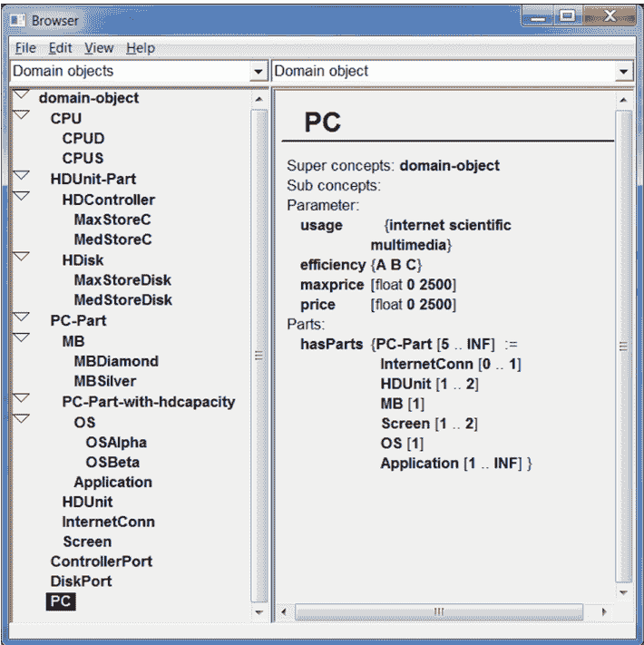

浏览器（参见图24.2）、细化网络（由部分已配置对象构成的增量增长网络；图24.3）以及议程（图24.4）。

KONWERK使用Common Lisp（Steele，1984）、CLOS（Common Lisp对象系统；Keene，1989，包括元对象协议；Kiczales等，1991）以及用于用户界面的CLIM（Common Lisp接口管理器）¹³编写。

¹³bauhh.dyndns.org.

### 图24.4

KONWERK议程浏览器：配置步骤按步骤类型（左）、属性（中）和实例（右）列出。

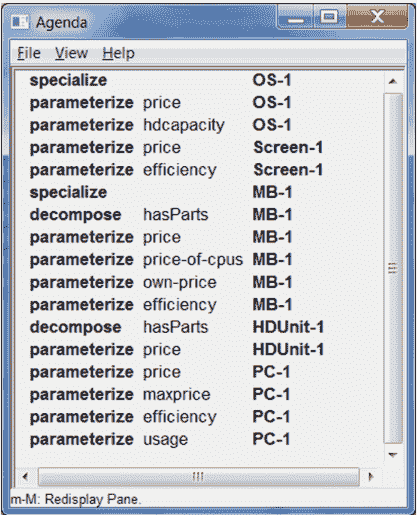

### 图24.5

客舱布局配置器XKL，它允许根据客户意愿、技术约束、法律约束和最优性标准来布置座椅、厨房、卫生间等客舱设备。该应用主要涉及具有空间方面的配置。

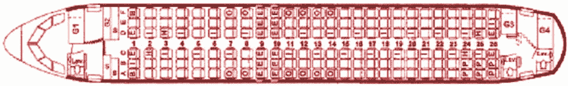

解释系统（配置器）生成高级解释，如“放置盖子”或“布置双人餐桌”（参见Hotz和Neumann，2005，以及图24.6）。

所考虑应用的异构性（涵盖若干指定方面）确保了KONWERK在广泛应用问题上的可用性。

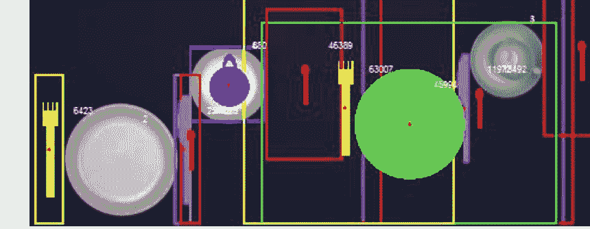

### 图24.6

使用KONWERK构建的场景解释示例。灰色表示观察到的对象（一个盘子、两个碟子和一个杯子），图标化表示假设的对象，其可能的空间位置由描述餐具布局的组件和约束模型计算得出。摘自Hotz和Neumann（2005）。

### 24.6 结论

本章概述了混合配置系统KONWERK。通过结合多种知识表示和推理技术，KONWERK可用于复杂的配置应用。使用KONWERK获得的经验可总结为：快速原型创建、知识库的高接受度，以及无特定应用的用户界面。

## 致谢

除作者外，KONWERK核心模块的主要贡献者还有Frank Buhr、Bernd Neumann、Manfred Kopisch和Thomas Vietze。项目合作伙伴在增强模块和应用方面做出了贡献。

## 参考文献

Baader, F., Calvanese, D., McGuinness, D.L., Nardi, D., Patel-Schneider, P.F. (Eds.), 2003. The Description Logic Handbook: Theory, Implementation, and Applications. Cambridge University Press, New York, NY.

Cunis, R., Günter, A., Strecker, H. (Eds.), 1991. The PLAKON-Book. Informatik-Fachberichte, vol. 266. Springer, London (in German: Das PLAKON-Buch).

Felfernig, A., Reiterer, S., Reinfrank, F., Ninaus, G., Jeran, M., 2014. Conflict detection & diagnosis in configuration. In: Felfernig, A., Hotz, L., Bagley, C., Tiihonen, J. (Eds.), Knowledge-based Configuration – From Research to Business Cases. Morgan Kaufmann Publishers, Waltham, MA, pp. 73–87 (Chapter 7).

Funke, B., Müller, K., Sebastian, H.-J., Thaerigen, M., 1994. Innovative design by integration of expert system technology with multi-criteria decision making and fuzzy systems. In: Moving Towards Expert Systems Globally in the 21st Century, 2nd World Congress on Expert Systems. Cognizant Communication Offices, Lisbon, Portugal, pp. 263–272.

Gülden, O., Hotz, L., 1997. Integrating resource-oriented and structure-oriented configuration with KONWERK. In: 11th Workshop Planen und Konfigurieren (PuK-97) im Rahmen der 4. Deutschen Tagung Wissensbasierte Systeme (XPS-97). Bad Honnef.

Günter, A., 1995. Knowledge-based Configuration (Wissensbasiertes Konfigurieren). Infix, St. Augustin, Germany (in German).

Günter, A., Cunis, R., 1992. Flexible control in expert systems for construction tasks. Journal of Applied Intelligence 2 (4), 369–385.

Günter, A., Hotz, L., 1995. Conflict resolution with knowledge-based backtracking and repair-statement. In: Günter, A. (Ed.), Wissensbasiertes Konfigurieren. Infix, St. Augustin, pp. 181–192 (in German: Auflösung von Konfigurationskonflikten mit Wissensbasiertem Backtracking und Reparaturanweisungen).

Hollmann, O., Wagner, T., Günter, A., 2000. EngCon: a flexible domain-independent configuration engine. In: 14th European Conference on Artificial Intelligence (ECAI 2000), Configuration Workshop, Berlin, Germany, pp. 94–96.

Hotz, L., 2000. Frame-based Knowledge Representation for Configuration, Analysis, and Diagnoses of Technical Systems. Dissertation, University of Hamburg, Germany (in German: Frame-basierte Wissensrepräsentation für Konfigurierung, Analyse und Diagnose technischer Systems).

Hotz, L., Neumann, B., 2005. Scene interpretation as a configuration task. Künstliche Intelligenz 3, 59–65.

Hotz, L., Wolter, K., 2013. Beyond physical product configuration – configuration in unusual domains. AI Communications 26 (1), 39–66.

Hotz, L., Wolter, K., 2014. Smarthome configuration model. In: Felfernig, A., Hotz, L., Bagley, C., Tiihonen, J. (Eds.), Knowledge-based Configuration – From Research to Business Cases. Morgan Kaufmann Publishers, Waltham, MA, pp. 121–135 (Chapter 10).

Hotz, L., Wolter, K., Krebs, T., Deelstra, S., Sinnema, M., Nijhuis, J., MacGregor, J., 2006. Configuration in Industrial Product Families – The ConPF Methodology. IOS Press, Berlin, Germany.

Hotz, L., Felfernig, A., Günter, A., Tiihonen, J., 2014a. A short history of configuration technologies. In: Felfernig, A., Hotz, L., Bagley, C., Tiihonen, J. (Eds.), Knowledge-based Configuration – From Research to Business Cases. Morgan Kaufmann Publishers, Waltham, MA, pp. 9–19 (Chapter 2).

Hotz, L., Felfernig, A., Stumptner, M., Ryabokon, A., Bagley, C., Wolter, K., 2014b. Configuration knowledge representation and reasoning. In: Felfernig, A., Hotz, L., Bagley, C., Tiihonen, J. (Eds.), Knowledge-based Configuration – From Research to Business Cases. Morgan Kaufmann Publishers, Waltham, MA, pp. 41–72 (Chapter 6).

Jannach, D., Zanker, M., Felfernig, A., Friedrich, G., 2010. Recommender Systems: An Introduction. Cambridge University Press.

Keene, S.E., 1989. Object-Oriented Programming in Common Lisp: A Programmer’s Guide to CLOS. Addison-Wesley, Boston, MA.

Kiczales, J., Bobrow, D.G., des Rivières, J., 1991. The Art of the Metaobject Protocol. MIT Press, Cambridge, MA.

Kopisch, M., Günter, A., 1992. Configuration of a passenger aircraft cabin based on conceptual hierarchy, constraints and flexible control. In: Belli, F., Radermacher, F. (Eds.), Industrial and Engineering Applications of Artificial Intelligence and Expert Systems (IEA/AIE-92). Lecture Notes in Computer Science, vol. 604. Springer, Paderborn, pp. 421–430.

Krebs, T., 2014. encoWay. In: Felfernig, A., Hotz, L., Bagley, C., Tiihonen, J. (Eds.), Knowledge-based Configuration – From Research to Business Cases. Morgan Kaufmann Publishers, Waltham, MA, pp. 271–279 (Chapter 23).

Kühn, C., 2000. Modeling structure and behaviour for knowledge based software configuration. In: Sauer, J. (Ed.), 14th Workshop, New Results in Planning, Scheduling and Design (PuK2000), Berlin, Germany.

Mackworth, A., 1977. Consistency in networks of relations. Artificial Intelligence 8 (1), 99–118.

Marcus, S., Stout, J., McDermott, J., 1987. VT: an expert elevator designer that uses knowledge-based backtracking. AI Magazine 8 (4), 41–58.

Mittal, S., Frayman, F., 1989. Towards a generic model of configuration tasks. In: 11th International Joint Conference on Artificial Intelligence (IJCAI-89), vol. 2, Detroit, MI, pp. 1395–1401.

Neumann, B., 1988. Configuration expert systems: a case study and tutorial. In: Bunke, H.O. (Ed.), Proceedings of the 1988 SGAICO Conference on Artificial Intelligence in Manufacturing, Assembly, and Robotics. Oldenbourg, Munich, pp. 27–68.

Oehler, P., 2000. Knowledge-based construction of mixed analog/digital systems. Dissertation, J.W. Goethe-Universität, Frankfurt, Germany (in German: Wissensbasierte Konstruktion gemischt analog/digitaler Systeme).

Oehler, P., Grimm, C., Waldschmidt, K., 2002. A methodology for system-level synthesis of mixed-signal applications. IEEE Transactions on Very Large Scale Integration (VLSI) Systems 10 (6), 935–942.

Pfitzer, K., 1993. Case-based configuration of technical systems (Fallbasierte Konfigurierung technischer Systeme). Künstliche Intelligenz 7/93, 24–30.

Ricci, F., Rokach, L., Shapira, B., Kantor, P., 2011. Recommender Systems Handbook. Springer.

Rossi, F., vanBeek, P., Walsh, T. (Eds.), 2006. Handbook of constraint programming. Foundations of Artificial Intelligence. Elsevier, Amsterdam, The Netherlands.

Schröder, C., Möller, R., Lutz, C., 1996. A partial logical reconstruction of PLAKON/KONWERK. In: Baader, F., Bürckert, H.-J., Günther, A., Nutt, W. (Eds.), Proceedings of the Workshop on Knowledge Representation and Configuration WRKP’96. No. D-96-04 in DFKI Documents, pp. 55–64.

Schumann, S., Schumann, O., 2008. Modeling uncertainty with the configuration tool KONWERK. In: Steinmuller, J., Langner, H., Ritter, M., Zeidler, J. (Eds.), 15 Years Artificial Intelligence at the TU Chemnitz. Chemnitzer Informatik-Berichte, TU Chemnitz, pp. 33–44.

Sebastian, H.-J., 1996. Intelligent systems for configuration problems. In: Sebastian, H.-J., Antonsson, E. (Eds.), Fuzzy Sets in Engineering Design and Configuration. International Series in Intelligent Technologies, vol. 9. Springer, US, pp. 89–232.

Steele, G.L.J., 1984. COMMON LISP: The Language. Digital Press, Bedford, MA.

Tiihonen, J., Felfernig, A., Mandl, M., 2014. Personalized configuration. In: Felfernig, A., Hotz, L., Bagley, C., Tiihonen, J. (Eds.), Knowledge-based Configuration – From Research to Business Cases. Morgan Kaufmann Publishers, Waltham, MA, pp. 167–179 (Chapter 13).

Tsang, E., 1993. Foundations of Constraint Satisfaction. Academic Press, London, San Diego, New York.

Wolter, K., 2003. Supporting the orientation and navigation of users in the process of configuring complex products. Master’s thesis, Universität Hamburg, Fachbereich Informatik, Hamburg (in German: Unterstützung der Orientierung und Navigation von Benutzern im Prozess der Konfiguration von komplexen, variantenreichen Produkten).


当前版本，WEEVIS 支持用户需求可以用功能需求（Mittal and Frayman, 1989）来定义的情况，而相应的解决方案（配置）通常是从一组预定义配置中选择。用户需求会对其一致性进行检查，并且在需求不一致的情况下，WEEVIS 会提出一组可能的修复替代方案。这样，WEEVIS 不仅支持产品选择，还基于智能修复机制（Felfernig et al., 2009）支持一致性维护流程。目前，WEEVIS 没有为配置知识库提供图形化开发环境，而是依赖于文本知识表示语言。其理念是工程师（用户）社区协同贡献于配置知识库的开发。将支持社区化知识库开发和维护的图形化概念纳入其中属于未来工作的范围。WEEVIS 具有以下创新：

- 知识获取。WEEVIS 用户能够通过以维基百科风格定义配置任务的基本属性来表达其领域知识。WEEVIS 提供了一组预定义标签，可用于创建、定义和维护配置问题定义。通过利用底层 MediaWiki 基础设施的基本功能，配置知识库可以进行版本控制，并在创建非预期版本时进行恢复。
- 知识分发与协作开发。WEEVIS 用户可以将配置知识开发并发布给感兴趣的用户社区。其他有兴趣参与知识库进一步开发的用户可以像标准 Wiki 页面一样参与开发和维护过程。WEEVIS 及其知识库可自由获取并在互联网上访问。
- 快速原型设计。通过使用维基百科提供的基本功能，WEEVIS 允许快速原型设计流程，其中更改的结果只需从编辑模式切换到相应的阅读模式即可立即看到。这种方法有助于轻松理解 WEEVIS 标签以及所提供的 WEEVIS 语言的语义。

本章的主要贡献如下。我们介绍了一个基于 Wiki 的环境，用于配置问题的开发和维护。在此背景下，我们提供了 WEEVIS 环境所支持的功能概述。这为进一步的应用和利用奠定了基础。

本章的其余部分组织如下。基于个人电脑领域的示例（见 Hotz et al., 2014²）我们介绍 WEEVIS 知识表示概念（第 25.2 节）。在第 25.3 节中，我们概述了 WEEVIS 如何嵌入 Media Wiki 环境。在第 25.4 节中，我们讨论了 WEEVIS 方法的局限性，并通过将现有工程实践与 WEEVIS 功能进行比较来阐明相关工作。以第 25.5 节我们总结本章。

### 25.2 工作示例的建模

为演示目的，我们现在将展示如何基于 WEEVIS 知识表示概念定义 Hotz et al. (2014) 中引入的配置模型。在此过程中我们将看到

表 25.2 工作示例的产品属性。例如，每个计算机配置都有指定的 cpu 类型 *pcpu* (*CPUS* 或 *CPUD*)。

| Product Property | Domain |
|---|---|
| pname | Text |
| pcpu | CPUS, CPUD |
| pmb | MBSilver, MBDiamond |
| pos | OSAlpha, OSBeta |
| pprice | Integer |

表 25.3 工作示例的不兼容约束。例如，主板 *MBSilver* 与能效等级 *A* 不兼容。

| Attribute | Property | Attribute | Property |
|---|---|---|---|
| efficiency | A | mb | MBSilver |
| efficiency | C | mb | MBDiamond |

表 25.4 工作示例的过滤约束。例如，客户选择的 *cpu* 必须包含在相应的配置中。

| Attribute | Operator | Attribute |
|---|---|---|
| maxprice | ≥ | price |
| cpu | = | pcpu |
| mb | = | pmb |

为 *MBDiamond*。我们工作示例中不兼容约束的完整列表如表 25.3 所示。

*过滤约束。* 在 WEEVIS 中，过滤约束用于表达所选客户需求（客户属性的实例化）与相应产品属性之间的关系。例如，解决方案的价格不得超过用户定义的最大价格，或所选 *cpu* 应包含在配置中。本工作示例中使用的过滤约束完整列表如表 25.4 所示。

*包含。* 这是一种额外的约束类型，允许定义不兼容和过滤约束未考虑的 *替代包含*。此类包含约束的示例如下：如果用户对高能效计算机感兴趣，则包含

表 25.5 工作示例的包含约束。例如，如果用户对能效等级 A 配置感兴趣，则应包含项目（产品）energystar。

| Attribute | Property | pname |
|-----------|----------|-------|
| efficiency | A | energystar |

表 25.6 工作示例的排除约束。例如，如果目的地国家是奥地利，则计算机 hw2 不允许包含在配置中。此外，hw1 目前不可用。

| Attribute | Property | pname |
|-----------|----------|-------|
| – | – | hw1 |
| country | Austria | hw2 |

表 25.7 工作示例的支持解决方案。

| pname | pcpu | pmb | pos | pprice |
|-------|------|-----|-----|--------|
| hw1 | CPUD | MBSilver | OSAlpha | 600 |
| hw2 | CPUS | MBDiamond | OSBeta | 600 |
| energystar | CPUS | MBDiamond | OSBeta | 800 |

最新型号名为 energystar（即使用户接受的最大价格低于 energystar 的价格）；见表 25.5。

排除。在包含约束的基础上，WEEVIS 还支持定义所谓的排除约束。解决方案可能因所需硬件目前不可用而被排除（例如，pname = hw1），或由于某些个人电脑无法交付到所有目的地国家而无法交付（例如，country = Austria 且 pname = hw2）。排除约束的概述见表 25.6。

产品。在 WEEVIS 中，可能的解决方案替代方案可以在产品表中定义（见表 25.7）。如果备选方案集合较少，使用此类产品表是有意义的。这样可以提高搜索效率。在搜索空间较大的情况下，解决方案替代方案的显式表示会使知识工程和底层搜索过程变得低效。在这种情况下，WEEVIS 也允许以隐式（基于约束）形式定义解决方案空间。

### 25.3 用户界面

WEEVIS Wiki 环境的入口页面如图 25.1 所示。该入口页面的理念类似于维基百科的入口页面，以帮助用户轻松识别最相关的信息单元（在我们的上下文中为配置增强的维基百科页面）。

在选择（或创建）配置器应用程序后（这只需插入指向新 Wiki 页面的链接即可完成），新的配置器应用程序可以被定义，其中使用了 MediaWiki Tag Extension System 来定义自定义推荐标签。WEEVIS 配置知识库可以用与标准 Wiki 页面语法相似的语法在文本层面上定义。显示 WEEVIS 配置器应用程序定义的屏幕截图如图 25.2 所示。


### FIGURE 25.1

The WeeVis entry page (www.selectionarts.org/weevis).


**图 25.3** WEEVIS：示例个人电脑配置器。用户通过回答问题的方式指定其需求。WEEVIS 确定解决方案，并在需求不一致的情况下呈现一组修复操作。


作为相应 Wiki-based 应用的基础进行指定。领域本体以本体表示语言的形式定义。与 WEEVIS 相比，Baumeister 等人侧重于本体表示语言的应用，而这些语言对于非知识工程领域专家而言可访问性较差。此外，WEEVIS 的约束表示专注于配置域特定的知识表示，这使得定义相应的领域知识变得更容易。

#### 配置知识表示

配置问题表示语言的开发有着悠久的历史。Mittal 和 Frayman（1989）提出了第一个基于一致性的配置问题表征方法。此后开发了不同类型的基于约束的表示，从动态约束满足问题（参见 Mittal 和 Falkenhainer，1990）到所谓的生成式约束满足问题（参见 Stumptner 等，1998）。不同类型基本配置知识表示的深入概述可在 Stumptner（1997）中找到。Felfernig（2007）介绍了一种基于统一建模语言（UML）定义配置知识库的方法，而 Felfernig 等（2003）还展示了如何基于描述逻辑概念表示此类模型。Soininen 等（1998）引入了一个通用本体，其中包含配置知识表示所需的相关概念。

#### 配置环境

Felfernig 等（2006）介绍了一个用于图形化开发基于知识的推荐应用的环境。该环境与 WEEVIS 的基本功能有共同之处：产品备选方案被明确指定，然后根据给定的用户需求集进行选择和排序。Tiihonen 等（2003，2013）介绍了他们基于答案集编程的配置环境 WeCoTin，这是一个专门用于图形化定义大规模配置知识库的环境。主要配置相关约束类型可以在图形级别定义。更复杂的约束必须以专有的基于逻辑的知识表示语言定义。其他图形化开发环境见 Haselböck 和 Schenner（2014），⁴ Krebs（2014），⁵ 以及 Hotz 和 Günter（2014）。⁶

WEEVIS 与其他配置知识库开发环境之间的主要区别在于，我们可以预期更多用户能够在 Wikipedia 中处理配置器建模，而无需使用提供商特定的环境来定义知识库。然而，坦率地说，WEEVIS 的主要缺点是与更通用的知识表示形式主义相比，其表达能力有限（参见 Hotz 等，2014⁷）。此外，还必须集成图形化约束管理功能才能实现广泛使用。

#### 异常管理

大多数现有配置环境都包含不同类型的异常检测（参见 Felfernig 等，2014⁸）或至少一致性管理功能。同样，WEEVIS 包含 FastDiag 诊断算法（Felfernig 等，2012）的基本实现，该算法支持用户在找不到解决方案时的情况。此外，WEEVIS 允许指定可用于回归测试目的的测试用例。将进一步的质量保证机制集成，例如 WEEVIS 知识库的自动化调试、冗余检测（Felfernig 等，2011）以及诊断区分（Shchekotykhin 等，2012）属于未来工作的范围。

### 25.5 结论

在本章中，我们介绍了 WEEVIS 环境，用于基于 Wiki 开发和维护简单的配置知识库。WEEVIS 在用户群体或社区有兴趣共同为公众或特定用户组提供配置器应用的场景中尤其有用。从技术角度来看，WEEVIS 的主要优势是在无需熟悉全新技术的情况下开发和维护配置知识库。与 WEEVIS 进一步开发相关的主要问题是集成个性化概念（Ardissono 等，2003；Tiihonen 和 Felfernig，2010），以帮助对确定的解决方案（配置）进行排序，集成额外的质量保证机制（除了 Wikipedia 的基本版本控制概念之外），以及 WEEVIS 语言本身的进一步开发，即提高可理解性并降低所提供建模概念的认知复杂性。

### 致谢

本章介绍的工作部分由奥地利研究促进机构资助（拨款编号：827587）。

⁴ 第 22 章。
⁵ 第 23 章。
⁶ 第 24 章。
⁷ 第 6 章。
⁸ 第 7 章。

- Shchekotykhin, K.M., Friedrich, G., Fleiss, P., Rodler, P., 2012. Interactive ontology debugging: two query strategies for efficient fault localization. Web Semantics: Science, Services and Agents on the World Wide Web 12–13, 88–103.
- Soininen, T., Tiihonen, J., Männistö, T., Sulonen, R., 1998. Towards a general ontology of configuration. Artificial Intelligence for Engineering Design, Analysis and Manufacturing (AI EDAM) 12 (4), 357–372.
- Stumptner, M., 1997. An overview of knowledge-based configuration. AI Communications 10 (2), 111–126.
- Stumptner, M., Friedrich, G., Haselböck, A., 1998. Generative constraint-based configuration of large technical systems. Artificial Intelligence for Engineering Design, Analysis and Manufacturing (AI EDAM) 12 (4), 307–320.
- Tiihonen, J., Felfernig, A., 2010. Towards recommending configurable offerings. International Journal of Mass Customization 3 (4), 389–406.
- Tiihonen, J., Soininen, T., Niemelä, I., Sulonen, R., 2003. A practical tool for mass-customising configurable products. In: Proceedings of the 14th International Conference on Engineering Design, Stockholm, Sweden, August 19–21, 2003, CDROM, p. 10 (Paper number: 1290).
- Tiihonen, J., Heiskala, M., Anderson, A., Soininen, T., 2013. WeCoTin – a practical logic-based sales configurator. AI Communications 26 (1), 99–131.
- Tsang, E., 1993. Foundations of Constraint Satisfaction. Academic Press, London, San Diego, New York.

## 第 26 章 VariSales

**Juha Tiihonen** 和 **Andreas Anderson**  
*Aalto University, Aalto, Finland*  
*Variantum, Espoo, Finland*

**摘要：** 本章概述了使用 VariSales 对 PC 配置知识库的建模。VariSales 基于具有明确底层语义的面向对象知识表示。VariSales 环境由半可视化 *建模工具* 和基于 Web 的 *配置工具* 组成。它应用遵循基于逻辑的答案集编程（ASP）范式的推理引擎。

### 26.1 引言

许多问题求解方法为表示配置模型、需求和配置，即配置知识提供了明确或隐式的概念模型。在我们看来，从配置器可维护性角度来看，实用的方法是提供一种配置特定的建模概念化，可用于表达配置知识。配置系统的任务是将此知识映射到能够提供支持配置任务所需推理的形式。

我们认为 Soininen 等（1998）提出的配置本体涵盖了广泛的配置问题。然而，在我们访问的许多公司中，销售配置的订单表相对简单，通常为 A4 格式的一页或两页。配置任务很直接，仅需要有限的推理。VariSales，即 WeCoTin（Tiihonen 等，2003，2013）的商业化版本，主要就是为解决这些较简单的问题而开发的。

本章其余部分组织如下。第 26.2 节概述了 VariSales 的建模概念，并展示了如何定义（表示）分类层次、属性、组合结构和约束。第 26.3 节举例说明了资源约束的建模，第 26.4 节介绍了用户界面建模以及由此产生的面向终端用户的 VariSales 界面。最后提供了简要讨论和结论。

### 26.2 工作示例的建模

Soininen 等（1998）提出的配置本体中一个显著缩减的子集为 VariSales 的建模语言提供了概念基础。该子集由


*产品配置建模语言* (PCML)。PCML 的实现基于这样的信念，即它可以支持一套实用且相关的销售配置任务。它包括分类法、组合结构、属性和约束。面向连接的概念（端口）甚至资源都被排除在外。PCML 的主要概念是 *特征类型*、它们的组合结构、*属性* 和 *约束*。特征类型定义了可在配置中出现的其 *个体* 的子特征（部件）和属性。Hotz 等人（2014）¹ 中介绍的 PC 配置模型的概述如图 26.1 所示。

PCML 的语义通过将 PCML 映射到权重约束规则语言（WCRL）提供，应用了 Soininen 等人（2001）的思想。*Smodels* 系统为 WCRL 提供了一个高效的推理引擎（Simons 等人，2002）。WCRL 和 *Smodels* 的开发考虑了配置作为潜在的应用领域。

#### 26.2.1 分类层级和属性

*VariSales Modeling Tool* 提供特征类型、其类层级和属性的编辑。这包括创建、删除、重命名（保持模型一致性）以及更改子类层级。*特征类型树* 显示类层级（见图 26.1 左上角）并作为编辑类型的各个方面的起点。所选对象的编辑在显示的右侧进行，有时在弹出窗口中进行。在特征类型树中，彩色方块区分具体（蓝色）、抽象（红色）类型和配置类型（绿色）。该树显示了示例的完整分类层级。下面以文本 PCML 格式展示了其中一些以及 PC 的属性定义：

```
feature PC
    attribute usage
        value type string constrained by $
            in list("internet","scientific","multimedia")

    attribute efficiency
        value type efficiency_valueType constrained by $
            in list("A","B","C")
        no default
            constraint crc1
    ( ( usage = "internet" ) or ( usage = "multimedia" ) )
        implies present (InternetConn)
    feature PC_Component
        abstract
    feature InternetConn
        subtype of PC_Component
```

特征类型概述（图 26.1 右侧）允许添加或删除属性，并更改当前所选类型的抽象级别或名称。选项卡 Attributes 显示所选特征类型 PC 的属性概述。属性 efficiency 通过一种新的值类型定义——相同的定义需要在多个地方使用，并且可用的 efficiency 类容易发生变化。该值类型通过图形用户界面定义，以文本 PCML 形式为：efficiency_valueType string constrained by $ in list ("A", "B", "C")。

#### 26.2.2 组合结构

特征类型通过一组子特征定义来定义其组合结构。子特征定义指定子特征名称、可能的子特征类型的一个非空集合（简称为允许类型）以及指示有效子特征数量的基数。

在配置中，特征个体的子特征（部件）由特征个体实现。实现特征个体“填充”由有效子特征定义创建的“角色”。当基数允许 0 时，显式的空实现是可能的。工业产品中常见的“可选部件”被建模为允许空实现的子特征。默认实现可以包括属性值和任意深度的子特征实现。此外，可以将空实现（特殊值 none）设为默认实现。继承的子特征可以通过限制允许类型、基数或通过修改或隐藏默认子特征实现来进行细化。

组合结构在子特征层级树中显示（图 26.1 和 26.2 左下角）。从特征类型树拖放可实现添加允许的特征类型、子特征定义和默认值。

图 26.2 右侧显示了特征类型 HDUnit 的子特征概述。每个 HDUnit 都有一个名为 HD_Controllers 的部件，包含 1 到 2 个 HDController 的任何子类型的个体，以及一个名为 Hard_disks 的部件，包含 1 到 4 个 HDisk 的任何子类型的个体。子特征未设置默认值。

在文本 PCML 表示中，对应的配置模型部分表达如下：

```
feature HDUnit
  subtype of PC_Component
```

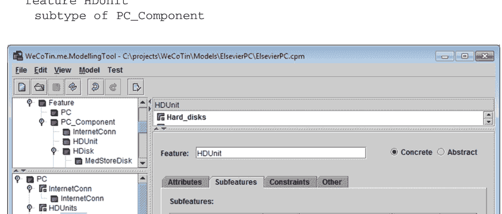

**FIGURE 26.2**

VariSales Modeling Tool 中 HDUnit 的组合结构。

```
subfeature Hard_disks
  allowed features HDisk
  cardinality 1 to 4

subfeature HD_Controllers
  allowed features HDController
  cardinality 1 to 2
```

#### 26.2.3 约束

特征类型可以定义约束。在本示例中，我们仅应用硬约束，这些约束定义了正确配置必须满足的条件。配置仅在没有任何特征个体的硬约束被违反时才被认为是一致的。如果任何硬约束被破坏，购买流程就无法完成，例如，将配置放入购物车会被阻止。

约束以约束语言表达，并在特征类型内唯一命名。约束语言的第一级构建块是对子特征、特征的属性以及整数或字符串等常量的访问引用。引用可以连续使用，例如访问实现子特征的个体的属性。通过使用引用、常量和算术表达式构造返回布尔值的测试。测试包括检查特定引用个体是否存在或是否为给定类型的谓词。属性引用可以用常量在算术表达式中使用。这些可以用通常的关系运算符进行比较以创建测试。测试可以进一步使用标准布尔连接词组合成任意复杂的布尔表达式。

VariSales Modeling Tool 提供多种定义约束的方式：文本、图形和表约束。Tab Constraints（图 26.1）中的 Feature type overview 以文本形式列出活动特征类型的约束并便于添加新约束。

许多约束相对简单，通常以 requires- 和 incompatible- 关系的形式出现。为了使输入和修改简单约束更容易，VariSales Modeling Tool 具有图形约束编辑器。可以将 and 和 or 连接词用于创建子表达式。这些子表达式可以例如用作更复杂图形表达式中的要求、被要求或不兼容因素。

图 26.3 说明了约束 crc1（见表 26.1 和第 26.2.1 节的文本 PCML 表示），该约束是用图形约束编辑器创建的。首先对约束进行了命名，并将 requires 符号带到画布上。参数和子表达式通过拖放支持放置到位置。这使建模者免于繁琐且易出错的对象名称和值输入。

表 26.1 举例说明了我们示例 PC 配置知识库中约束的实现（见 Hotz 等人，2014²）。

### 26.3 价格和硬盘容量

VariSales 有两种确定价格的机制。基本定价机制应用简单的加法价格，而高级计算机制则允许自由指定的计算。示例 PC 的价格由基本机制确定，而高级计算机制用于计算硬盘资源生产和消耗。

基本定价机制很简单：每个特征个体都有其类型指定的价格；默认情况下无价格（0）。此外，每个属性值都可以给定价格。配置中特征个体的价格和属性值的价格在每次选择后在 Web 浏览器中求和。用户界面在选择实现特征类型或属性值的上下文中显示价格。例如，Screen 价格由 efficiency 的各个属性值的价格决定。其他价格如 CPU 的价格仅基于类型确定。PC 价格表的一部分（XML 格式）为：


**表26.1** Hotz等人（2014）（第6章）中指定约束的实现。

| 名称 | 描述 |
|---|---|
| gc1 | 不需要约束：应用允许子特征类型的细化<br>`feature MBDiamond subfeature refinement`<br>`CPU allowed features CPUD` |
| gc2 | 不需要约束：应用允许子特征类型的细化<br>`feature MBSilver subfeature refinement`<br>`CPU allowed features CPUS` |
| gc3 | 在OSAIpha中：约束gc3<br>`every $cpu in $config.Motherboard.CPU`<br>`satisfies $cpu individual of CPUD` |
| prc1&2 | 作为价格表实现，显示总价 |
| resc1 | 未实现：用户始终看到当前价格 |
| resc2 | 消耗、产生和可用的硬盘空间通过计算机制计算：结果在状态栏中显示 |
| crc1 | 在PC中，（见图26.3）：约束crc1<br>`((usage = "internet") or (usage = "multimedia"))`<br>`implies present (InternetConn)` |
| crc2 | 在PC中：约束crc2<br>`(usage = "scientific") implies (every $cpu in Motherboard.CPU satisfies $cpu individual of CPUD)` |
| crc3 | 在PC中：约束crc3 efficiency = Motherboard.efficiency |
| crc4 | 在Screen中：约束crc4 efficiency = $config.efficiency |
| compc1 | 作为价格表实现，参见26.3节 |
| compc2 | 作为价格表实现，参见26.3节 |
| compc3 | 作为价格表实现，参见26.3节 |

```xml
<configurationPriceList currency="euro" model="ElsieverPC"
    name="euroPricesIncludeTax" tax="0.23">
  <feature name="Screen">
    <attribute name="efficiency">
      <price value="A">200</price>
      <price value="B">150</price>
      <price value="C">100</price>
    </attribute>
  </feature>

  <feature name="CPUD">
    <price>150</price>
  </feature>
</configurationPriceList>
```

### 26.4 用户界面建模与生成

#### 26.4.1 布局

为最终用户生成的基于Web的用户界面无需编程。用户在HTML表单上进行选择；例如，见图26.4右侧。总体思路是，被配置的特征个体的每个可选择属性或子特征都会生成一个问题。建模者创建一个布局，以定义与某个特征个体相关的问题如何分页、问题的顺序，以及（可选）问题所使用的输入控件类型。

例如，PC被分为需求（usage、efficiency）、软件（Operating_System、Applications、storage（用于HDUnits））、硬件（Motherboard、Screens）和互联网（InternetConn）。这些组反映在图26.4左侧的配置树中。

#### 26.4.2 资源

原则上，配置模型的语言与最终用户界面的语言无关。资源文件定义了要显示给最终用户的配置模型对象的显示名称及其可选描述。此外，资源还定义了提供附加信息的网页链接、失效约束的消息等。多种资源支持最终用户的多种语言。

这里只定义了一些资源，因此用户可见的名称直接来自配置模型中使用的名称（标识符中的下划线被自动替换为空格）。为了演示，MedStoreDisk 通过资源进行了重命名，并为两种硬盘类型添加了描述性文本。参见图26.4右侧。

由于配置模型使用了适当的术语，因此可以以主要语言近乎自动地生成用户界面。

#### 26.4.3 其他用户界面方面

用户界面的整体外观由网页模板定义。除了将硬盘计算结果添加到状态区域（图26.4左上侧）之外，均使用了默认设置。这将视觉外观的定义与用户界面中与产品相关的部分分离开来。

### 26.5 结论

本章展示了如何使用 VariSales 对示例 PC 进行建模。分类层次结构和带有细化的属性、组合结构以及约束都以直接的方式应用。并非所有方面都被建模：拓扑（连接）约束未被建模，因为 VariSales 目前不支持它们，并且它们在示例中没有提供额外的价值。资源约束通过价格和计算机制进行管理。VariSales 旨在管理有限配置。因此，Applications 的最大数量受到限制，上界由常量 Max_Applications = 20 定义，应用于子特征定义 Applications。

在未来的工作中，应增加将资源约束编译为权重约束规则的直接支持，以便在与此示例类似的情况下高效且更主动地支持用户。这种编译的思想已在 Soininen 等人（2001）中描述。

总的来说，建模过程进展顺利，能够捕捉最相关的方面。用户界面是半自动生成的。在我们看来，VariSales 非常优雅地结合了高层配置建模、底层推理和用户界面的半自动生成。

## 致谢

本工作得到了芬兰技术发展中心和阿尔托服务工厂的支持。本章基于 Tiihonen 等人（2013）描述了 VariSales 的基础。

## 参考文献

- Hotz, L., Felfernig, A., Stumptner, M., Ryabokon, A., Bagley, C., Wolter, K., 2014. Configuration knowledge representation & reasoning. In: Felfernig, A., Hotz, L., Bagley, C., Tiihonen, J. (Eds.), Knowledge-based Configuration – From Research to Business Cases. Morgan Kaufmann Publishers, Waltham, MA, pp. 41–72 (Chapter 6).
- Simons, P., Niemelä, I., Soininen, T., 2002. Extending and implementing the stable model semantics. Artificial Intelligence 138 (1–2), 181–234.
- Soininen, T., Tiihonen, J., Männistö, T., Sulonen, R., 1998. Towards a general ontology of configuration. Artificial Intelligence for Engineering Design, Analysis and Manufacturing (AI EDAM) 12 (4), 357–372.
- Soininen, T., Niemelä, I., Tiihonen, J., Sulonen, R., 2001. Representing configuration knowledge with weight constraint rules. In: Provetti, A., Son, T.C. (Eds.), 1st International Workshop on Answer Set Programming: Towards Efficient and Scalable Knowledge (AAAI Technical Report SS-01-01), pp. 195–201.
- Tiihonen, J., Soininen, T., Niemelä, I., Sulonen, R., 2003. A practical tool for mass-customising configurable products. In: Proceedings of the 14th International Conference on Engineering Design, Stockholm, Sweden, August 19–21, 2003, CDROM, p. 10 (Paper number: 1290).
- Tiihonen, J., Heiskala, M., Anderson, A., Soininen, T., 2013. WeCoTin – a practical logic-based sales configurator. AI Communications 26 (1), 99–131.

## 在SAP中的产品配置：回顾

摘要：本章回顾了SAP变式配置器及其所基于概念的发展。其之前的SAP OS/2配置器和之后的IPC配置器也继承了这一传统，并一同涵盖在内。由于这三个配置器都源于1980年代的专家系统开发项目，因此对当时的信念和动机进行了回顾。

### 27.1 引言

SAP变式配置器（SAP VC）是一个商业相关配置器的突出示例。自R/3 3.0以来，它一直是SAP ERP（企业资源规划）系统的一部分，因此作为SAP ERP许可证的一部分可供所有客户使用。基于对咨询请求/问题报告和其他可用数据的分析，大约有2000家公司在使用它，使其成为自大约20年前问世以来最常用的商业配置器之一。许多公司的业务依赖于它。

有一本专门的著作《使用SAP进行变式配置》（Blumöhr等人，2012），它不仅描述了SAP VC的功能和业务集成，还审视了周边的生态系统和客户案例研究，并简要介绍了其他相关的SAP配置器。本章不是该材料的浓缩版，而是对SAP VC及其派生原则的发展的回顾。它还以SAP配置器的发展作为配置技术演进中商业侧的例子，因为关于这方面的出版物很少。本回顾基于个人在SAP的参与（自1992年起），以及在此之前参与后文提到的TEX-K和TEX-B专家系统项目（为德国法兰克福的巴特尔研究所）。

本回顾涵盖了三代SAP产品配置器。第一个是基于PROLOG的销售配置器，与专家系统有非常直接的联系。它在当时被称为SAP配置器，因为它是唯一的一个。由于它在OS/2平台上部署，也被非正式地称为SAP OS/2配置器，这里使用了这一称谓，尽管并非官方正确。下一个配置器是前面提到的SAP VC（另见Höfling，2014¹）。第三个SAP配置器是现在所称的IPC配置器。每个配置器都基于其前身。其中许多


最初在专家系统范式中开发的特性在这些配置器中仍然可见。因此，了解专家系统项目对于理解它们如何以及为何以这种方式运行至关重要。

### 27.2 专家系统 (XPS)

XCON 系统 (McDermott, 1982) 被视为专家系统 (XPS；另见 Hotz et al., 2014a²)。其成功表明 XPS 可以解决经典实现失败的实际业务问题。当时这证实了 XPS 提供了一种处理配置问题的好方法，这反过来又为 1980 年代的相关研究和商业项目提供了充足的资金。

如图 27.1 所示的 XPS 的基本架构非常简单。实现一个应用的任务被简化为捕获和表示人类专家的知识。该知识随后存储在即用型 XPS 的知识库 (KB) 中。用户随后可以查询 XPS，后者使用预定义的推理技术利用 KB 中存储的专业知识来回答查询。获取专家的知识并将其充分表示在 KB 中的任务被称为知识工程（与经典软件工程相对）。

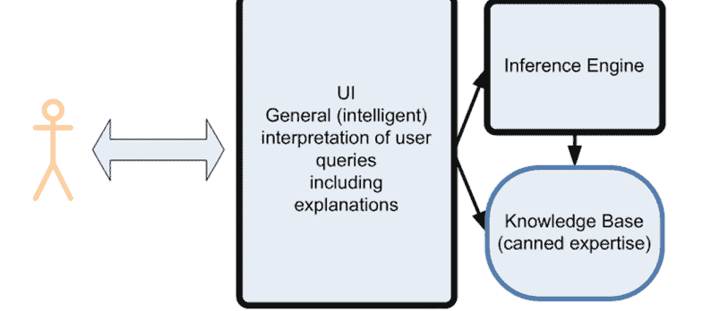

**FIGURE 27.1** General architecture of an expert system (XPS).

XPS 思想具有一些明确的概念优势。由于 XPS 要模拟人类专家的认知过程，系统理想情况下能够做专家所能做的一切，只要 KB 编码了相关专业知识并且假设系统具有足够的推理技术即可。知识工程师无需担心底层问题的具体性质。他们的任务只是正确地编码相关知识。他们也不必担心。

公式陈述“是什么”而不是“应该做什么”，这些方法被称为声明式而非过程式。操作其 KB 中声明式知识表示的 XPS 被称为基于模型的配置器。声明式表示本身被称为（配置）模型（见 Hotz et al., 2014a³）。

> ³Chapter 2.

#### 27.3.1 (Conceptual) Constraints

知识工程师的主要关注点之一是表示人类领域专家所知的依赖关系。在基于模型的 XPS 中，该表示应尽可能为声明式的。（声明式）约束与（过程式）规则相反，是模型中实体及其属性之间的关系。⁴

> ⁴在本章中，术语 property/attribute/characteristic 可互换使用。Characteristic 是 SAP ERP 中的首选术语。Attribute 是 AI 中的首选术语。销售中使用的术语 feature 也是另一个同义词，此处未使用。这些术语中的每一个都可以指配置中对象实例的实际属性，例如“height = 75 cm”。或者它可以指抽象概念的可观察量，例如类。例如，所有楼梯柱都有可观察属性 height。

例如，专家可能会告诉知识工程师，对于等距台阶的（直线）楼梯，每个楼梯柱的高度 (hp) 取决于柱在台阶上的位置 (pos)、扶手的高度 (hr)、楼梯的上升角度 (α)，并且其计算公式如下：

hp = hr + pos tan α  (27.1)

这是一个几何约束，可在给定其他三个变量的情况下通过求解该变量来计算公式中任何变量的值。（通常，求解 α 毫无意义。）因此，在不改变任何内容的情况下，它也可以写成更中性的形式，更接近表达式的几何含义：

tan α = (hp − hr) / pos  (27.2)

知识工程师必须意识到，该等式应适用于配置中所有实例对 (S, P)，其中 S 是楼梯，P 是楼梯柱，且 P 是 S 的一部分。

知识工程师可以用多种方式建模此信息。其中一种可能是作为 PROLOG 代码片段。图 27.2 显示了它如何在 SAP 约束语法中表达。⁵

```
OBJECTS:
    ?S IS_A (300)STAIRCASE
        WHERE ?a = ANGLE; ?hr = HEIGHT_HANDRAIL,
    ?P IS_A (300)POST
        WHERE ?hp = HEIGHT; ?pos = POSITION_ON_STEP

CONDITION:
    PART_OF(?P, ?S)

RESTRICTIONS:
    ?hp = ?hr + ?pos * TAN(2*3.14/360 * ?a)
```

**FIGURE 27.2** (Conceptual) Constraint in SAP syntax.

> ⁵有关此语法的详细信息，请参阅 SAP 文档。Haag (1998) 中也给出了带解释的 SAP 约束示例。公式中的角度 α 被假定为弧度，而图 27.2 中的变量 ?a 被假定为度。

图 27.2 中的约束不是 CSP⁶ 约束。如果建筑配置中有三个楼梯实例，每个楼梯有 50 个柱子，它就需要应用于 150 个楼梯/柱子对。这相当于 150 个 CSP 约束。此外，它使用实数并为变量准备了区间域。这超出了经典 CSP 的范围。在 PLAKON 中，当有与 CSP 术语混淆的危险时，像图 27.2 中那样在抽象层面上表述的约束被称为概念约束⁷。但在本文讨论的配置器的上下文中不会出现这种混淆，因为 CSP 约束在那里不是显式的。

> ⁶See Hotz et al. (2014b), Chapter 6.
>
> ⁷通用约束与概念约束类似（见 Hotz and Günter, 2014, Chapter 24）。

约束的变量指的是模型中的实体及其属性。当约束被应用时，其变量绑定到配置中对象实例的相应属性（值或域）。然后可以使用这些绑定来评估约束。

> ⁸以下我将简单使用术语 constraint 来指代概念约束。

#### 27.3.2 Local Constraint Propagation and Arc Consistency

TEX-K 项目中采用的约束推理方法相当简单。与约束相关的主要推理技术是 *local constraint propagation* 以实现 *arc consistency*（见 Hotz et al., 2014b, Chapter 6）；也就是说，约束用于过滤掉不允许的值并在可能的情况下缩小其变量的域。寻找实际解，可能需要制定合适的启发式方法，被视为一个单独的问题，而不是约束本身的主题。

弧一致性方法受到了 Hans-Werner Güsgen 在 TEX-B 项目中的工作的启发（Güsgen, 1988; Ho et al., 1994），TEX-B 项目是 TEX-K 的姊妹项目，致力于开发对技术 XPS 的诊断或配置有用的基本技术。局部传播也可以应用于具有区间域的实值变量的线性数值不等式/等式的情况（Haag, 1989）。

楼梯示例中的等式在三个变量 *hr*、*hp* 和 *pos* 上是线性的。因此，假设角度 α 已知，约束可用于确保其他三个变量的弧一致性⁹（针对所有楼梯/柱子对）。为了说明这些概念：假设上升角度为 45°（tan α = 1）并且扶手高度为 75 cm，且台阶深度为 32 cm，则变量 *pos*（柱子在台阶上的位置）在不考虑进一步约束的情况下被限制为区间 [0, 32] cm，并且因此约束可以将变量 *hp*（柱子的高度）限制为 [75, 107] cm。

> ⁹在 SAP 约束语法中，可以通过向图 27.2 中的约束添加以下内容来声明约束传播的主题变量：INFERENCES: ?hp, ?pos。这意味着在应用约束之前必须给出其他变量。（?hr 被有意省略为推理，因为从业务角度来看，指定其值在前面是有意义的。）


TEX-K 中存在几种处理约束的实现方法（Cunis et al., 1991）。其中一种被实现用于 KONEX 和 APLEX 应用，并被称为 μPLAKON，因为它仅关注 PLAKON 设想功能的一个子集。¹⁰ 其描述见 Haag (1991)，更完整的内容见 Haag (1995)。后来被 SAP 采用并至今仍在使用。简而言之，它由三个模块组成：所谓的动态数据库（DDB）、模式匹配系统（PMS）和真值维护系统（TMS）。

DDB 是描述配置的事实（谓词逻辑原子）的存储库。主要来说，一个事实说明实例的可观察属性被赋予一个值或一个域。PMS 识别出允许应用特定约束的所有事实元组。PMS 的实现基于用于 XCON 和 OPS 编程语言（Forgy, 1982）中前向链的 RETE 算法。

TMS 记录 DDB 中所有事实的证明，特别是由约束引起的事实。一个证明是蕴涵式 f₁ … fₙ → f，说明如果事实 f₁ … fₙ 有效，则事实 f 是配置的有效组成部分。TMS 隐藏/屏蔽¹¹ 不感兴趣的事实，并且能够高效地使所有依赖于被撤销决策的事实失效。后者被称为依赖导向回溯（参见 Hotz and Wolter, 2013）。

### 27.3.3 平衡、检查和资源

有时依赖关系无法用模型中给定的有限变量集表示为约束。一个例子是“约束”：厨房中所有橱柜的总宽度 S 应该填满分配的空间 W。“约束”关系是 S = W。如果因 S > W 而违反，则会导致只能通过收回某些内容（橱柜或 W 的指定值）来纠正的不一致。在这种方式下，它表现得像一个真正的约束。但是，如果因 S < W 而违反，则仅表明不完整，可能是通过添加内容（另一个橱柜）来纠正的。由于（至少在交互式配置中）XPS 必须向用户明确区分不一致和不完整，因此将此类依赖关系与约束区分开来是合适的；它们在 Haag (1991) 中被称为检查。

涉及和的依赖关系通常与资源的概念相关（参见 Hotz et al., 2014b¹²）。资源（例如空间或电力）由某些组件消耗，由其他组件提供。在前面的例子中，每个橱柜消耗等于其宽度的空间，而整个厨房提供可用空间 W 的数量。SAP 遵循 Bernhard Neumann 的方法，他在其博士论文（Neumann, 1989）中为分层配置中的资源和/或功能开发了平衡的概念。平衡的两侧被称为提供和需求。

### 27.3.4 软约束

并非所有约束都是一样的。一些约束编码了必须不被违反的物理或法律规律。这些不能被质疑，被称为硬约束。其他约束编码了默认值或关系，是“最好有”的。这些通常在好的解决方案中得到满足，但在被违反时可能会被放弃，被称为 *软约束*。软约束在交互式配置中用于引导用户找到好的解决方案。一般来说，模型中的任何约束都可以被标记为软。约束被视为硬还是软也可能是有意识的决定结果：例如，纯粹基于营销决策的约束可能根据公司的政策被归类为硬或软。

软约束可能在知识工程中自然出现。让我们考虑 APLEX 应用模型中专家给出的以下两个约束的表述：

- 对于每个待加工的特征，操作 *粗加工* 必须先于操作 *精加工*。
- （所有）*粗加工* 操作应先于（所有）*精加工* 操作。

后者是一个全局陈述，表达了一个良好的策略。在需要时可以被违反。前者是硬约束。对特征进行精加工后再粗加工是没有意义的，并且会破坏精加工的结果。

另一个在 AI 中著名的例子是陈述“所有鸟都会飞”：也就是说，如果已知一个对象实例是鸟，则该约束会将其“能够飞”的属性设为值 *true*。显然，个别鸟可能无法飞行（例如由于翅膀受伤）。在涉及鸟的配置中，软约束在某些情况下适用，但在其他情况下可能不适用。在 μPLAKON 中，可以选择性地移除软约束的一些推导，同时保留其他推导，因为由软约束产生的推导被表示为软证明。解决不一致的问题是丢弃软证明，而不是整体丢弃软约束。

鸟是否能飞的问题是非单调推理学科处理的典型问题。这在 TEX-B 项目中是一个研发主题，在该项目中开发了各种版本的 *基于假设的真值维护系统*（ATMS；DeKleer, 1986）（Dressler, 1988）。μPLAKON 中的 TMS 就是其中之一，称为 ATMS*（Haag, 1991, 1995）。软证明被视为 ATMS 假设。在配置不一致的情况下，ATMS* 可以计算最小的冲突软证明集合。该功能已被纳入 SAP IPC 配置器（见后面的专门章节），并在进一步扩展后也用于 SAP 内部的“范围选择”应用（Haag and Riemann, 2011）。

### 27.3.5 问题求解

现在的问题是：XPS 在支持问题求解方面的任务是什么？如果底层问题等同于 CSP（或 CSP 的某种扩展），并且由于约束过重而难以求解，那么使用 CSP 技术找到解决方案是关键。另一方面，典型的交互式配置问题（例如销售配置）通常相对于硬约束而言是欠约束的。这意味着存在大量的解决方案，并且找到一个并不困难。但相对于硬约束和软约束的整体集合而言，问题是过度约束的。这意味着不可能找到满足所有这些约束的解决方案。通过决定忽略哪些来自软约束（和用户选择）的推导来解决不一致性现在是关键，并定义了实际的搜索问题。

除了将约束标记为软之外，还有另一种限制适用约束的方法。在面向工程师定制的场景中，可能存在一种首选的配置所需组件的方式，例如使用标准组件配置变压器的核心。为此任务可以制定约束。然而，如果失败，则必须使用非标准组件设计该组件。然后适用另一组约束。因此，待考虑的约束集合基于正在执行的任务。

总之，为了支持找到解决方案，XPS 可能需要在不同情况下做不同的事情。如果问题是找到一个或多个满足适用约束的解决方案，则 XPS 必须实现一种系统且高效地探索搜索空间的策略。在 TEX-K 中，这并非直接属于约束处理，而是被视为控制配置过程的主题（Günter et al., 1990；参见 Hotz and Günter, 2014¹³）。

在由于软约束而过度约束且没有满足一切的解决方案的情况下，所求解决方案的形式是软约束的最大集合，使得由此产生的整体约束集合可以得到满足并提供最优解。自主找到这一点可能是 XPS 的任务。在这种情况下，偏好或最优性标准需要以某种方式定义。一种方法（在 APLEX 中使用 μPLAKON 探索）是为每个软约束分配一个数值强度并执行最佳优先搜索。实践中的复杂性很高，理论上是指数级的。因此，该方法未被 SAP 采用。

然而，如果用户或代表用户的代理以交互方式执行搜索，他们将自行做出创造性决策，任何复杂性都是他们的责任。XPS 的作用是提供决策支持。这意味着 XPS 将能够计算不一致的根本原因并指导用户解决它们。它还将支持用户在备选方案之间权衡；即让他们在不同的配置状态之间来回切换，并帮助比较这些状态之间的差异。μPLAKON 中的 ATMS* 支持这一点。

最后，XPS 可能需要推理应用哪些任务以及何时应用。在 μPLAKON 中为 KONEX 提供了类似 PROLOG 的机制，允许将任务分解为子任务，并在任务失败时制定备选任务以开始。尽管在面向工程师定制的环境中需要能够切换到使用非标准组件的配置是一个常见问题，但这种方法在 SAP 配置器中被采纳得很晚，至今尚未完全实现。独立于 μPLAKON 中的开发，关于任务的推理也在 XVIS 应用中发挥了作用（Kühne and Meyer-Fujara, 1991）。

### 27.4 变体的制造：一个配置问题

PLAKON 应用多种多样，但绝不涵盖所有业务相关配置问题的空间。TEX-K 中未涉及的一个核心流程源于产品变体的制造。公司制造和销售的许多产品往往是基本方案的变体。例如，同一支圆珠笔可能有多种颜色。传统上，为每种笔/颜色组合定义一个标准（不可配置）产品。另一种方法是将所有这些视为中央产品“笔”的产品变体。


在OS/2上还实现了一个用PROLOG编写的独立建模环境。这允许定义具有特征的类（受FRESKO影响；Cunis，1992）。一个类可以有多个超类。物料（需与宿主R/2系统中的物料对应）被分配到类中，并继承这些类的特征、值域和默认值。除默认值外，继承是单调的。Touretzky的最小推理距离概念被用于控制默认继承（Touretzky，1986）。这种部分关系类似于BoM，表示销售BoM。定义了一种语法来维护不同形式的依赖关系：*选择条件*、*前置条件*、*过程*、*余额*和*约束*。SAP ABAP编程语言的语法可能影响了依赖语法的风格，并加入了从PLAKON约束语法中借用的一点点LISP（见图27.3）。一份早期手册提到了类似于TEX-K中的控制知识，但从未有办法维护这些知识。

约束处理基于μPLAKON架构。DDB、PMS和TMS三个模块均用PROLOG实现。DDB中实现了一种比ATMS*更简单的默认值处理方法。区分了不一致性（已决定的内容需要修改）和不完整性（可能通过添加内容来修复）。如果某个约束被违反，这就是不一致。约束在配置中永久有效，因此用户会立即收到不一致的警告。完整性检查（包括余额计算）仅在用户要求时执行。其他依赖关系要么按需执行，要么自动与UI中的某些事件关联。

每个配置都有一个唯一的根实例。所有其他组件在配置中都有一个唯一的父实例。因此，配置中的对象实例集合始终是一个以BoM结构链接的树。特征有三种类型：单值特征（可在配置中被赋予一个值）、多值特征（可被赋予多个值）和可限制特征。后者行为类似于单值特征，但在配置中被赋予域限制。单元素限制被视为等同于值赋值。对空域的限制则是不一致的。所有特征都可声明为*必填*或*可选*。如果某个必填特征未被赋值，则配置不完整。

除单元素域（等同于赋值）外，用户无法制定域限制。这简化了配置逻辑和用户界面，尤其是在撤销用户决策方面。用户可能做出的交互式配置决策包括：

-   为特征赋值（或撤销赋值）
-   从BoM中手动选择组件，从而实例化一个实例（或从配置中删除一个实例）
-   特化实例的类型；例如，决定“个人计算机”类的一个实例实际上是“笔记本电脑”类的一个实例（或撤销实例的特化）

可以通过特征值搜索变体。这是作为*模糊搜索*实现的，以方便查找相似变体。实现了一个生成解释的工具，如同在配置中那样，可能是在选定的制造工厂中预留物料。对于配置器来说，只有在像SAP VC那样紧密集成的情况下才能做到这一点（另一个USP）。

此外，至关重要的是，被SAP VC标记为一致且完整的配置，能够按承诺的价格和日期进行生产和交付。同样，配置模型和制造过程使用相同的主数据作为来源，也极大地促进了这一点。

最后，人们认识到销售配置是一种三层方法。最底层是潜在数万个零件的低级BoM展开（例如在MRP运行中）。这是非交互式的，最好由单独的实现来处理，该实现不受任何可能的解释开销的影响。中间层称为制造完成。与XCON一样，它接收销售配置，验证其正确性，并通过为额外的特征推导值以及可能实例化额外的组件来完成配置。制造完成的结果是低级BoM展开的输入。第一层是销售配置。与其他两层不同，它通常不依赖于制造工厂。上面两层都允许使用约束。低级任务只允许选择条件和过程。SAP VC实际上将前两层一起处理。只有低级BoM展开是单独实现的。然而，将顶层交互式配置与完成配置正式分离将是一个福音，使配置的整体性能更易于管理。在类似XCON的场景中，SAP VC仅执行制造完成任务（基于通过其他方式获得的销售订单）并触发低级BoM展开。

### 27.7 SAP IPC（互联网定价与配置）

从许多在SAP CRM（*客户关系管理*）和SAP ERP系统中都进行配置的客户的角度来看，SAP IPC配置器只是SAP VC在Java中的重新实现，集成度较低，并且存在一长串令人烦恼的微小差异（即所谓的*IPC差异清单*）。IPC在功能上是CRM系统的一部分，可以附加到ERP系统，具有适合Web的界面，并且可以脱离ERP系统运行。它还支持那些在CRM中有配置流程但在ERP中没有配置模型的客户。

其创建动机基于特定的客户需求。这些客户希望有一个独立的销售配置器，它不像SAP OS/2和VC配置器那样以BoM为导向，并且支持对象之间的更多关系，如连接关系和包含关系等。[^23]

基于这些需求，设计并实现了一个用Java编写的配置器引擎，称为SAP SCE（*独立/销售配置器引擎*）。[^24] SCE现在是IPC的一部分。模型数据从R/3（SAP ERP）中提取。SAP VC通常为特定日期或ECM状态动态收集的所有模型数据都存储在一个称为*知识库运行时版本*（KBRT）的存储库中。一个KBRT可以存储多个根物料的模型数据。例如，给定类下所有物料的数据可以合并到一个KBRT中。KBRT可以被传输到本地数据库或CRM系统。对于那些使用CRM系统但没有ERP系统的客户（绝对是少数），可以直接在CRM中以KBRT的形式维护模型。

R/3（SAP ERP）中的维护得到了增强，以支持高级功能，如ADT（*抽象数据类型*）特征，这种特征可以在运行时将另一个对象实例作为值赋给它（以表达实例之间的关系）。约束得到了增强，以处理ADT并能够执行选择条件和前置条件的工作。此外，SAP VC的一个限制也被消除了。使用经典BoM时，配置中的每个实例与其父实例BoM中的一个BoM项目唯一对应。在高级模型中，可以为BoM中的每个项目指定允许的实例最小和最大数量。现在，多个实例可以属于一个BoM项目。当建模产品中对象实例的部件数量无法预知时，这一功能非常重要。例如电梯的BoM。为一个电梯可能需要服务的最大楼层数建模是繁琐或不切实际的。

引入了一个非层次化的求和概念，即所谓的*聚合规则*。这些规则使用与约束处理相同的技术实现。支持非层次化的余额。这些余额将两个聚合归入一个名称，一个用于余额的*供给*方，一个用于*需求*方，并内置对双方的比较。最终实现了ATMS功能以支持*冲突求解器*，这是一种处理不一致性的辅助工具。目前，它已通过使用源自*Scope Selection*应用（Haag和Riemann，2011）的*选择*概念得到改进。选择是用户决定支持或放弃配置的某一特定属性。如果他们选择放弃该属性，则该属性的所有软证明将同时被停用/丢弃。如果他们随后再次选择支持该属性，则所有软证明将被激活/重新实例化。

进一步说明：设计文档中提出了一个类似于μPLAKON中的任务概念，但迄今尚未实现。对于默认值的非单调继承，Touretzky的*最小推理距离*（Touretzky，1986）概念被*Common LISP*（Steele，1990）中定义的*类优先级列表*所取代。这仍然过于复杂，因此有人提出了务实简化的建议。提供了与使用第三方查看器对配置产品进行2D/3D渲染集成的挂钩，但由于相关工作量和成本，该功能并未得到大量使用。

SCE的首次使用是在1998年一个配置办公家具解决方案的项目中，该项目还包含与CAD系统的集成，这是一项开创性工作。由于复杂性和集成问题，这类开发并非主流项目。参与其中的客户数量很少。

与此同时，许多使用SAP VC的客户希望在不需新的高级功能的情况下受益于独立配置器。因此，SCE增加了*兼容模式*。重新引入了选择条件、前置条件和过程。然而，由于SCE的设计初衷是改进SAP VC的规范，而且其运行发生在ERP环境之外，SCE与SAP VC之间仍然存在一系列差异（*IPC差异清单*）。随着时间的推移，人们通过使SCE更接近SAP VC来努力减少这一清单。SCE最初设计的原始模式后来被称为*SCE高级模式*。

[^23]: 他们转向SAP，是因为他们希望保留SAP VC的优势（模型与主数据的统一，以及保证正确的配置能够按承诺生产）。他们组成了美国配置器工作组（ACWG）。此后，该工作组走向国际化，现简称为CWG。Blumohr等人（2012）中有专门章节介绍CWG。

[^24]: 最初没有计划创建用户界面，因为人们认为在销售方面所有客户都更愿意创建自己的界面。然而，很快发现没有用户界面就无法进行测试或演示。此后，寻求一个易于客户定制的通用用户界面成为该配置器后续发展中的长期话题。


高级模式缺乏与 ERP 的标准集成。例如，单个 BoM 条目的多个实例必须以某种方式转换为订单 BoM。这种集成是在各个项目中完成的。这些项目成本日益高昂，SAP 在没有额外报酬的情况下停止了对它们的支持。近来，基于高级模式功能的 SAP Solution Configurator（SSC）正作为标准产品提供。

SCE 被整合到 SAP 移动销售中，并经过调整可用于互联网。定价功能也效仿之，用 Java 开发了 SPE（独立定价引擎）。SCE 和 SPE 被合并到一个名为 SAP IPC（互联网定价与配置）的组件中。IPC 是 SAP CRM 的一部分。就使用 SAP VC 的客户而言，Blumöhr 等人（2012）也对其进行了描述。

从业务集成的角度来看，出现了新的挑战。在本节结尾，我提及三个示例：采购可配置产品、可配置产品合同，以及将可配置产品纳入目录。

从供应商的角度来看，采购可以被视为一种销售配置。然而，买方面临的问题是必须能够以一种他们可以理解的形式存储配置；例如，配置必须补充文本等内容，这些内容不会随内部配置存储，因为可以从数据库中读取。不过，采购也可能导致招标，邀请竞争供应商提交报价。在这种情况下，招标的主题是描述所需产品（例如要印刷的杂志）的配置。买方拥有模型，但供应商必须能够理解并处理该配置。

两家公司之间的合同可能规定一方为另一方提供哪些产品。例如，一家公司可能允许其员工直接从另一家公司订购个人电脑，但前提是必须符合与供应商在合同中约定的条件。对于像计算机这样的可配置产品，这采取部分配置（受限域等）的形式。在 SAP 环境中，非单例域限制通常不存储在持久化配置中。因此，存储和相关逻辑必须相应修改。另一种方法可能是为合同定义一个受限模型。在实践中，第一种方法被证明更简单。

包含可配置产品的电子目录必须支持配置。一些客户希望通过 CD 大规模分发这种电子目录。那么 CD 必须包含配置器和模型，理想情况下用户无需安装。一个问题是在产品配置完成之前如何显示产品及其价格。一种答案是始终显示一个带价格的变体，然后根据这个变体，当用户重新配置其解决方案时，调整产品和价格。

在上述所有三个例子中，一个核心问题是模型和定价数据的所有权。通常，这是敏感专有信息，当通过使用配置器授予访问权限时，这些信息就会暴露。例如，如果知识库（KB）通过 CD 分发，则它可能只包含公开信息。

### 27.8 结论

SAP 变式配置器（SAP VC）已稳定使用二十年（SAP IPC 配置器则超过十年）。两个配置器都是混合型的，因为它们既允许过程式建模，也允许声明式建模。它们同时支持（概念/通用）约束和面向 BoM 的

## 附录 A

### A.1 会议与研讨会

表 A.1 列出了国际配置会议和研讨会。此外，德国研讨会 *规划与配置* 自 1987 年以来一直举办；其概览可在 www.puk-workshop.de 找到。

**表 A.1** 会议与研讨会概览（1996–2013）。

| 名称 | 链接 |
|------|------|
| AAAI Fall Symposium 1996 | www.aaai.org |
| AAAI 1999 Workshop on Configuration | www.uni-klu.ac.at |
| ECAI 2000 Workshop on Configuration | cse.aalto.fi |
| IJCAI 2001 Workshop on Configuration | cse.aalto.fi |
| ECAI 2002 Workshop on Configuration | www.enstimac.fr |
| IJCAI 2003 Workshop on Configuration | www.isi.edu |
| ECAI 2004 Workshop on Configuration | www.dsic.upv.es |
| IJCAI 2005 Workshop on Configuration | www.uni-klu.ac.at |
| ECAI 2006 Workshop on Configuration | fmv.jku.at |
| AAAI 2007 Workshop on Configuration | www.cs.ucc.ie |
| ECAI 2008 Workshop on Configuration | www.soberit.hut.fi |
| IJCAI 2009 Workshop on Configuration | www.cis.unisa.edu.au |
| ECAI 2010 Workshop on Configuration | www.hitec-hh.de |
| FLoC 2010 Workshop on Logic in Component Configuration | lococo2010.mancoosi.org |
| ECAI 2010 WS on Intell. Eng. Techn. for Knowledge Bases | ase.ist.tugraz.at |
| IJCAI 2011 Workshop on Configuration | ls13-www.cs.uni-dortmund.de |
| ECAI 2012 Workshop on Configuration | confws-12.cis.unisa.edu.au |
| Workshop on Configuration 2013 | ws-config-2013.mines-albi.fr |
| Workshop on Configuration 2014 | http://confws.ist.tugraz.at |

### A.2 开源 CSP、ASP 和 SAT 求解器

（见表 A.2）。

**表 A.2** 概览：开源 CSP、ASP 和 SAT 求解器。

| 名称 | 链接 | 类型 |
|------|------|------|
| Choco | www.emn.fr | CSP |
| Cream | bach.istc.kobe-u.ac.jp | CSP |
| Gecode | www.gecode.org | CSP |
| Jacop | jacop.solpro.com | CSP |
| jOpt | jopt.sourceforge.net | CSP |
| Minion | minion.sourceforge.net | CSP |
| Numberjack | numberjack.ucc.ie | CSP |
| 另见 ... | en.wikipedia.org/wiki/Constraint_programming | CSP |
| ASPeRIX | www.info.univ-angers.fr | ASP |
| DLV-Complex | www.mat.unical.it | ASP |
| GnT | www.tcs.hut.fi | ASP |
| Potassco | potassco.sourceforge.net | ASP |
| Smodels | www.tcs.hut.fi | ASP |
| 另见 ... | en.wikipedia.org/wiki/Answer_set_programming | ASP |
| MiniSat | minisat.se | SAT |
| PicoSAT | fmv.jku.at | SAT |
| RSat | reasoning.cs.ucla.edu | SAT |
| Sat4j | www.sat4j.org | SAT |
| UBCSAT | www.satlib.org | SAT |
| 另见 ... | en.wikipedia.org/wiki/Boolean_satisfiability_problem | SAT |

### A.3 配置环境

（见表 A.3）。

**表 A.3** 基于知识的配置环境概览。

| 名称 | 链接 |
|------|------|
| BigMachines | www.bigmachines.com |
| BuildConfigurator | buildconfigurator.com |
| ConfigIT | www.configit.com |
| encoway | www.encoway.de |
| Intelliquip | www.intelliquip.com |
| KONWERK | www.hitec-hh.de |
| ORACLE | www.oracle.com |
| SAP | www.sapconfigurator.com |
| SIEMENS | www.siemens.com |
| Tacton | www.tacton.com |
| Technicon | www.technicon.com |
| WeeVis | www.selectionarts.com |
| VariSales | www.variantum.com |

### A.4 基准测试

（见表 A.4）。

**表 A.4** 基准测试站点概览。

| 名称 | 链接 |
|------|------|
| 配置基准测试库（CLib） | www.itu.dk |
| 来自汽车产品配置的基准测试 | www-sr.informatik.uni-tuebingen.de |

### A.5 词典与数据库

（见表 A.5）。

**表 A.5** 词典条目与数据库概览。

| 名称 | 链接 |
|------|------|
| 维基百科：基于知识的配置 | en.wikipedia.org |
| 配置器数据库 | www.configurator-database.com |

### A.6 期刊特刊

（见表 A.6）。

**表 A.6** 配置相关期刊特刊概览（1998–2013）。

| 名称 | 链接 |
|------|------|
| AIEDAM 1998 配置设计特刊 | journals.cambridge.org |
| IEEE Intelligent Systems 1998 配置特刊 | www.computer.org |
| AIEDAM 2003 配置特刊 | journals.cambridge.org |
| IEEE Intelligent Systems 2007 配置特刊 | www.computer.org |
| Intl. J. of Mass Customization 2006 配置特刊 | www.inderscience.com |
| Intl. J. of Mass Customization 2010 配置特刊 | www.inderscience.com |
| AIEDAM 2011 配置特刊 | journals.cambridge.org |
| AICom 2013 知识库工程技术特刊 | iospress.metapress.com |


## 作者索引

### A

- Aalst, W., 256–257
- Abdelkafi, N., 186
- Agarwal, R., 141
- Akkermans, H., 253
- Akpinar, S., 108
- Albert, I., 187
- Albert, P., 50
- Aldanondo, M., 11, 13, 47
- Alizon, F., 114
- Altuna, A., 253
- Alvarez, G., 31
- Amilhastre, J., 13, 47
- Andersen, H., 11, 13, 47
- Anderson, A., 13, 61, 101–102, 253, 297, 304
- Anderson, D., 3, 89
- Anderson-Connell, L.J., 108
- Arana, J., 151
- Ardissono, L., 13, 30–31, 89, 96, 151, 191, 305
- Arlt, V., 11, 271, 274
- Asch, S., 181, 185
- Aschinger, M., 13, 192
- Asikainen, T., 13, 24, 191, 204, 241
- Axling, T., 11

### B

- Bacchus, F., 46
- Bachant, J., 9–10, 29, 32, 41, 73, 141, 167, 321
- Backhouse, C.J., 112
- Badurdeen, F., 111
- Bagley, C., 10–11, 13, 73–74, 92, 94, 101, 121, 123, 126, 134, 142, 145–146, 150, 160, 167–168, 176, 191, 234, 242, 263–265, 267, 282, 284, 286, 291, 298, 304, 309, 313, 322–324
- Bahler, D., 49–50
- Baida, Z., 253
- Bakker, R., 157–158
- Banerjee, A., 73
- Barker, V., 29, 32, 73, 141, 167
- Baron, J., 188
- Baryannis, 257
- Batory, D., 52–53
- Baumeister, J., 303
- Bearden, W.O., 109
- Becker, J., 251, 253, 256
- Belov, A., 157
- Benavides, D., 45, 52–54, 67, 191, 241
- Benjamins, V.R., 139, 141, 143
- Berger, C., 109, 115
- Berman, J.I., 11, 14
- Bessant, J., 110, 116, 167, 170, 181, 191
- Bettman, J.R., 181
- Beverungen, D., 251, 253
- Billsus, D., 23
- Biundo, S., 22
- Blazek, 110
- Blazek, P., 13, 29, 42, 73, 75, 86, 89, 96–97, 113–114, 150, 157, 162–163, 165, 167, 173–174, 186, 241–242, 251, 305
- Blecker, T., 186
- Blumöhr, U., 220–221, 319, 330, 332, 334
- Blythe, J., 89
- Bobrow, D.G., 289
- Böckle, G., 241
- Boltek, S., 152, 174, 235
- Booch, G., 50, 55
- Borgida, A., 321
- Botterweck, G., 48
- Boufkhad, Y., 160–161
- Bowen, J., 49–50
- Boynton, A., 111–112
- Brachman, R.J., 321
- Brafman, R., 13
- Brailsford, S., 43, 47
- Brannon, E.L., 108
- Brewka, G., 61, 67
- Brown, D., 21
- Brown, K.E., 11, 14
- Brown, S., 110, 116
- Buchheit, M., 64
- Burke, R., 13, 23, 43, 94, 102, 158
- Burns, N.D., 112

### C

- Card, S., 13
- Chandola, V., 73
- Chandon, J., 114
- Chandrasekaran, B., 21
- Chang, Y.-L., 112
- Chen, L., 47
- Chen, Y.-L., 237
- Chesbrough, H., 14
- Chevaleyre, Y., 13
- Chklovski, T., 158, 162
- Chmeiss, A., 157, 160–161
- Claessen, K., 48
- Clara, E.B., 185
- Cohen, S., 42, 45, 52–54, 121, 191
- Cosley, D., 187
- Cöster, C., 13, 96, 167, 170, 191
- Crow, J., 237
- Crowder, R., 185
- Csikszentmihályi, M., 115
- Cunis, R., 11, 281, 326, 329
- Czarnecki, K., 52–53, 126, 191

### D

- Dabholkar, P., 115
- Dahan, E., 110
- Davis, J., 141
- de Holan, M., 107–108, 116–117
- Dechter, A., 157, 160, 264
- Dechter, R., 157, 160, 264
- Deelstra, S., 24, 64–65, 132, 241, 281–282, 291
- DeKleer, J., 325
- Delfmann, P., 256
- Dellaert, B.G., 113, 115
- des Rivieres, J., 289
- DeSisto, R., 31, 214
- Desmeules, R., 113
- Dhungana, D., 13, 51, 101, 241, 243–244, 246
- Dietrich, A.J., 151
- Dikker, F., 157–158
- Djefel, M.S.C., 47
- Domingos, P., 158
- Domshlak, C., 13
- Drescher, C., 13, 191–192
- Dressler, O., 325
- Dumas, M., 256
- Dunne, M., 31
- Duray, R., 111
- Dutra, L., 31

### E

- Ebbinghaus, H., 185
- Edelkamp, S., 22
- Edwards, W., 186
- Een, N., 48
- Eisenecker, U., 52–53, 126, 191
- Eiter, T., 61, 67
- Elejoste, M., 151
- Elsner, C., 243
- Endriss, U., 13
- Epley, N., 185
- Eriksson, K.-A., 151–152

### F

- Fahad, M., 157
- Falkenhainer, B., 41–42, 48, 264, 304
- Falkner, A., 4, 11, 13, 22–23, 30, 49, 51, 55, 59, 89, 93, 96, 102, 167, 170, 172, 188, 191, 200, 202, 205, 253, 263, 269
- Falkner, A.A., 13, 102, 192, 205
- Faltings, B., 41, 176
- Fano, A., 102
- Fargier, H., 13, 47
- Federspiel, C., 13, 51, 101
- Felfernig, A., 4, 10–11, 13–14, 22–23, 30–31, 41–43, 50–52, 55, 59, 61, 64, 67, 73–75, 82–83, 86, 89–94, 96–102, 111, 113, 116, 121, 123, 126, 134, 140, 142–146, 149–152, 157–158, 160, 162–163, 165, 167–168, 170–176, 181–182, 184–188, 191–193, 234, 241–242, 251, 253, 255, 263–265, 267, 281–282, 284, 286, 288, 291, 297–298, 304–305, 309, 313, 320–324
- Fensel, D., 139, 141, 143
- Ferber, S., 24
- Ferguson, M., 112
- Fijany, A., 83–84
- Fischer, T., 24
- Fleischanderl, G., 11, 43, 73, 140–142, 145, 200, 202, 264, 297
- Fleiss, P., 149, 305
- Forgy, C., 9, 324, 330
- Forza, C., 14, 32, 107–108, 111, 114
- Fourdrinoy, O., 160–161
- Fowler, M., 139
- Franke, D., 11
- Franke, N., 13, 107, 110, 113–115
- Frayman, F., 4, 11, 31, 41, 43, 92, 142, 272, 285, 297, 304
- Freuder, E., 42–43
- Friedrich, G., 11, 13–14, 22–23, 30–31, 41–43, 49–51, 55, 59, 61, 64, 67, 73, 75, 86, 89, 91–92, 96, 98–99, 101–102, 140, 144–145, 149, 151–152, 157–158, 173–176, 181–182, 184–186, 191–193, 205, 264, 288, 297–298, 304–305
- Friedrich, G.E., 11, 13, 42–43, 50, 55, 59, 61, 67, 73, 140–142, 145, 192, 200, 264, 297
- Fuchs, C., 115
- Füller, J., 14
- Funke, B., 288

### G

- Gaborit, P., 47
- Galindo, J., 52, 191
- Gebser, M., 63
- Gelfond, M., 61
- Gelle, E., 13, 51, 101
- Genaim, S., 13
- Geneste, L., 167, 170
- Gent, I.P., 234
- Geyer, L., 24
- Gil, Y., 89, 158, 162
- Gilmore, J.H., 108, 111
- Giunchiglia, E., 63
- Göker, M., 94, 102
- Gomes, C., 42, 52
- Gordijn, J., 253
- Gordon, L., 23, 92–94, 96, 187
- Görz, G., 22
- Gottlob, G., 264
- Gottschalk, F., 256, 258
- Goy, A., 13, 30–31, 89, 96, 151, 191, 305
- Grabner, H., 192
- Grabner-Kräuter, S., 91, 99
- Greco, G., 264
- Grégoire, E., 160–161
- Greiner, R., 149
- Griffin, A., 110
- Grigore, R., 48
- Grimm, C., 290
- Grimm, S., 157–158, 160–161
- Grönroos, C., 251
- Grossmann, G., 255–258
- Grünbacher, P., 13, 51, 101, 241, 243–244, 246
- Gula, B., 30, 91, 99, 172–173, 181–182, 185–186
- Gülden, O., 288
- Günter, A., 11, 14, 21–22, 41–42, 65, 132, 135, 241, 271, 273–274, 281–282, 287, 290, 304, 320–322, 326
- Güsgen, H.W., 323
- Gustavsson, A., 13, 96, 167, 170, 191

### H

- Haag, A., 4, 11, 13, 22–23, 30, 51, 89, 93, 96, 101–102, 167, 170, 172, 188, 191, 219–220, 253, 322–325, 330, 333
- Hadzic, T., 13, 47
- Halpern, M., 24
- Haselböck, A., 11, 13, 42–43, 49, 50–51, 55, 59, 67, 73, 102, 140–142, 145, 192, 200, 205, 263–264, 297, 304
- Häubl, G., 188, 191
- Haug, A., 13, 29–32, 108, 151
- Hauser, J., 110
- Heider, W., 243–244
- Heimbigner, D., 24
- Hein, A., 24
- Heinrich, M., 14, 41
- Heiskala, M., 13, 29, 32, 61, 101–102, 152, 167, 253, 297, 304
- Helander, M., 107
- Helsen, S., 52–53, 126, 191
- Herlocker, J., 23, 87, 92–94, 96
- Hertzberg, J., 22
- Herzog, O., 11, 271, 274
- Hess, J., 42, 45, 52–54, 121, 191
- Heymans, P., 191
- Hilfinger, P.N., 323
- Hitz, M., 99, 181–182, 185
- Hnich, B., 47
- Ho, K., 323
- Hofacker, C.F., 182, 185–186
- Hofbauer, H., 152, 174, 235
- Hoffmann, D., 115
- Höfling, B., 319
- Hollmann, O., 11, 271, 274, 281
- Hotz, L., 10–11, 13–14, 21, 24, 42, 64–65, 73–74, 92, 94, 101, 121, 123, 126, 132, 134–135, 142, 145–146, 150, 160, 167–168, 176, 191, 234, 241–242, 263–265, 267, 281–282, 284, 286–288, 291–292, 298, 304, 309, 313, 320–324, 326
- Huang, Z., 47
- Hubaux, A., 191
- Huber, J., 176, 182
- Huffman, C., 30, 113, 167, 187, 191
- Hugos, M., 31
- Huhtinen, V., 102
- Hulgaard, H., 11
- Hunter, G.L., 109
- Hvam, L., 107–108, 29–32, 110, 151, 213

### I

### J

- Jacobson, I., 50, 55
- Jacoby, J., 170, 187
- Jameson, A., 192
- Jannach, D., 13–14, 22–23, 30–31, 41–43, 50–52, 55, 59, 61, 64, 67, 73, 75, 83, 86, 89, 91–92, 96, 99, 101–102, 140, 142–145, 149, 151–152, 157–158, 173, 186, 191–193, 264, 288, 298, 304–305
- Janota, M., 48, 157
- Jansen-Vullers, M.H., 258
- Jefferson, C., 234
- Jensen, K., 9–10, 41, 321
- Jensen, P., 151
- Jeran, M., 13, 22, 31, 67, 91–92, 101, 149, 158, 162, 174–175, 192, 288, 305
- Jiao, J., 107, 111, 151–152, 167
- Johnson, E., 181
- Jüngst, E., 14
- Jüngst, W., 14, 41
- Junker, U., 11, 13–14, 41, 43, 51, 73, 77, 79, 82, 101, 140–141, 149, 162, 214

### K

- Kahn, B., 30, 113, 167, 187, 191
- Kahneman, D., 181, 187
- Kaluscha, E., 91, 99
- Kaminski, R., 63
- Kang, K., 121, 191
- Kang, K., 42, 45, 52–54
- Kantor, P., 22–23, 288
- Katz, R., 110
- Kautz, H., 42, 52
- Keene, S.E., 289
- Keinz, P., 115
- Khalid, H., 107
- Kiczales, J., 289
- Killisperger, P., 255–258
- Kim, J., 89
- Kirn, S., 151
- Kivetz, R., 176
- Kiziltan, Z., 47
- Kjellberg, T., 107
- Klein, R., 64
- Kleine Büning, H., 327
- Knackstedt, R., 251, 253, 256
- Knetsch, J.L., 187
- Knublauch, H., 193
- Koch, M., 13, 30, 170, 187
- Kolb, M., 114
- Kolodner, J., 23, 92–94, 96, 170, 187
- Kopisch, M., 11, 287, 290
- Koste, L., 112
- Kotha, S., 116
- Krawczyk, V., 157, 160–161
- Krebs, T., 11, 24, 32, 64–65, 222–223, 226, 241, 272, 281–282, 291, 304
- Kreutler, G., 14, 152, 186, 251, 255
- Krüggel, T., 99, 181–182, 185, 251, 255
- Kühn, C., 14, 21, 41, 291
- Kühne, A., 326
- Kumar, A., 111
- Kumar, R., 108
- Kumar, V., 73
- Kurth, S., 102

### L

- La Rosa, M., 13, 256, 258
- Lakunza, J.A., 151
- Lam, S., 187
- Lang, J., 13
- Laresgoiti, I., 253
- Lauriere, J., 10
- Leckner, T., 13
- Lehner, K., 13, 51, 101
- Lehofer, M., 243
- Lehtonen, T., 24
- Leitner, G., 30, 42, 73, 97, 99, 113, 167, 170, 172–174, 186, 193, 241–242
- Lettner, D., 244
- Levy, A., 157
- Li, B., 47
- Li, Y., 185
- Liberatore, P., 157, 164
- Lierler, Y., 63
- Lifschitz, V., 61
- Lu, S.C.-Y., 107
- Luce, M., 167, 170, 181, 191
- Lutz, C., 59, 287
- Lynce, I., 157

### M

- Maalej, W., 192
- MacGregor, J., 13, 24, 132, 64–65, 241, 281–282, 291
- Mackworth, A., 10, 46, 170, 282, 298, 321
- Maier, M., 30, 99, 172–173, 186
- Mailharro, D., 11, 14, 41, 43, 51, 59, 139, 141–142, 144, 273
- Mairitsch, M., 13, 23, 98, 102, 174–176, 193, 297–298
- Malhotra, M.K., 112
- Malhotra, N.K., 170
- Malmgren, L., 151
- Maltz, D., 23, 92–94, 96, 187
- Mancini, T., 264
- Mandel, N., 181
- Mandl, M., 13, 23, 30, 63, 73, 90–91, 96–98, 102, 116, 167, 170, 172–176, 182, 186–188, 192–193, 288, 297–298
- Männistö, T., 13–14, 24, 41–42, 55, 91, 191–192, 204, 241, 304, 309
- Marcus, S., 9, 291
- Marques-Silva, J., 48, 157
- Marquis, P., 13, 47
- Martinez, T., 172
- Martio, A., 102
- Masel, D., 111
- Matzner, M., 251, 253
- Maudet, N., 13
- Mayer, W., 255–258
- Mazure, B., 160–161
- McDermott, J., 9–10, 24, 41, 65, 141, 291, 320
- McGuinness, D., 14, 41, 64, 142


### R

- Rabiser, R., 13, 51, 101, 241, 243–244, 246
- Ragu-Nathan, T., 111–112
- Ramachandran, S., 89
- Randall, T., 90–92, 115
- Rangaswamy, A., 110
- Ranze, K., 11, 271, 274
- Readman, J., 110, 116
- Reichwald, R., 109, 115–116
- Reinfrank, F., 13, 22, 31, 42, 52, 67, 73, 75, 86, 91–92, 97, 101, 113, 149, 158, 162, 173–175, 186, 191–192, 241–242, 288, 305
- Reiter, R., 51, 80–81, 148–149, 193, 237, 272
- Reiterer, S., 13, 22, 31, 67, 91–92, 98, 101, 149, 158, 162, 174–175, 192, 288, 305
- Renneberg, V., 13
- Resnick, L.A., 321
- Reutelschofer, J., 303
- Ricci, F., 22–23, 288
- Richardson, M., 158
- Riedl, J., 23, 92–94, 96, 187
- Riemann, S., 325, 333
- Riemer, K., 113
- Riepan, D., 99, 181–182, 185
- Riis, H., 107, 110, 151, 213
- Riitahuhta, A., 24
- Ritov, I., 188
- Robertson, G., 13
- Rodler, P., 149, 305
- Rogoll, T., 103, 114
- Rokach, L., 22–23, 288
- Rommes, E., 241
- Rosa, M.L., 256, 258
- Rose, T., 193
- Rosemann, M., 256
- Ross, P., 47
- Rouge, S., 11, 13
- Roussel, O., 160–161
- Roux, E., 114
- Rudström, A., 13, 96, 167, 170, 191
- Ruet, M., 167, 170
- Ruger, H.A., 185
- Ruiz-Cortés, A., 45, 53–54, 67, 191, 241
- Rumbaugh, J., 50, 55
- Rungtusanatham, M., 108, 111
- Rushby, J., 237
- Russ, C., 30
- Russell, S., 9, 44, 46–47, 61, 272
- Ryabokon, A., 10–11, 13, 73–74, 92, 94, 101–102, 121, 123, 126, 134, 142, 145–146, 160, 168, 176, 191–192, 205, 234, 242, 263–265, 267, 282, 284, 286, 291, 298, 304, 309, 313, 322–324

### S

- Sabharwal, A., 42, 52
- Sabin, D., 14, 21, 42, 89, 107
- Sabin, M., 13, 51, 101
- Sagiv, Y., 157
- Saïs, L., 157, 160–161
- Salter, A., 254
- Salvador, F., 14, 32, 107–108, 111, 114, 116–117
- Samuelson, W., 182, 187
- Schäfer, R., 13, 30–31, 89, 96, 151, 191, 305
- Schaub, T., 63
- Schenner, G., 13, 102, 192, 200, 205, 263, 304
- Schippel, S., 73, 97, 173–174, 186
- Schlick, M., 24
- Schlieder, C., 11, 271, 274
- Schmid, K., 241
- Schmidt-Thieme, L., 22
- Schmitgen, S., 327
- Schneeberger, J., 22
- Schober, C., 152, 174, 235
- Scholz, T., 11, 271, 274
- Schonenberg, H., 256–257
- Schönsleben, P., 327
- Schreier, M., 114–115
- Schreiner, H., 11, 13, 43, 49, 73, 102, 140–142, 145, 192, 200, 205, 263–264, 269, 297
- Schröder, C., 59, 287
- Schröder, S., 22
- Schubert, M., 13, 23, 51, 67, 73, 82–83, 96, 98, 102, 158, 162, 167, 170, 172, 174–176, 188, 191–193, 297–298, 305
- Schubert, P., 30
- Schumann, O., 288
- Schumann, S., 288
- Schwanninger, C., 243
- Schwartz, B., 113
- Searle, J., 9
- Sebastian, H.-J., 288
- Segura, S., 45, 53–54, 67, 191, 241
- Shapira, B., 22–23, 42, 52, 288
- Sharma, S., 112
- Shchekotykhin, K., 158
- Shchekotykhin, K.M., 149, 305
- Sheeran, M., 48
- Simons, P., 13, 192, 310
- Simonson, I., 176, 182–183
- Simons, I., 90–91
- Sinnema, M., 24, 32, 64–65, 241, 281–282, 291
- Sinz, C., 13, 51, 101
- Skovgaard, H., 11
- Smith, B., 43, 47
- Smith, B.A., 149

### W

- Weixelbaum, E.S., 11, 14
- Weninger, L., 192
- White, A., 24
- Wilkerson, R.W., 149
- Wilson, D., 172
- Winterfeldt, D., 186
- Wissmann, J., 157–158, 160–161
- Wognum, P., 157–158
- Wolf, L., 24
- Wolter, K., 10–11, 13, 24, 42, 64–65, 73–74, 92, 94, 101, 121, 123, 126, 132, 134, 142, 145–146, 160, 168, 176, 191, 234, 241–242, 263–265, 267, 281–282, 284, 286, 288, 291, 298, 304, 309, 313, 322–324
- Wood, K.L., 152
- Wortley, L., 167
- Wotawa, F., 152, 174, 234–236
- Wright, J., 14, 41, 64, 142
- Wright, J.R., 11, 14
- Wu, W., 108
- Wundara, M., 30

### Y

- Yang, B., 112
- Yung, Y., 115

### Z

- Zangitu, M., 151
- Zanker, M., 13, 14, 22–23, 30–31, 41–43, 52, 55, 59, 61, 64, 67, 73, 75, 86, 89, 91–92, 96, 99, 101–102, 140, 142–145, 151–152, 158, 173, 186, 191–192, 264, 288, 298, 304–305
- Zeckhauser, R., 182, 187
- Zehnthner, C., 13, 51, 67, 73, 82, 96, 102, 157–158, 162–163, 165, 191–192, 305
- Zhang, M., 111
- Zhong, Y., 47

## 主题索引

### A

- 激活约束, 49–50, 284
- 聚合, 123, 285
- 异常, 73, 157
- 回答集编程, 13, 61, 66
- 弧一致性, 47
- ASP, 13, 61, 66–67
- 按订单装配, 114
- 资产类型, 245
- 属性, 49, 56, 168, 272, 283, 300
- 自动调试, 73, 143
- 自动抄表管理, 230

### B

- BAAN, 13
- 回溯, 47, 288
- BDD, 13, 48
- Beologic, 11
- 物料清单, 6, 221, 327
- 二叉决策图, 13, 48
- Boge, 223
- BOM, 6, 221, 327
- 布尔CSP, 52, 55
- 商业案例, 238

### C

- Calico, 11
- CHOCO, 11
- 选择
  - 选择板, 107
  - 选择导航, 113
- Clark 完备化, 61, 63
- CNF, 48
- 共同创造, 110
- 协同设计
  - 平台, 107
  - 工具包, 107
- 协同工程, 192, 298
- 协同过滤, 23, 94
- 社区, 192, 298
- 比较, 67, 91
- 完备性公理, 61, 63
- 组件, 56, 201, 282, 285–287, 292
  - 创建, 51, 287
  - 类型, 4, 11, 22, 56, 272, 282, 285
- 组件-端口模型, 11, 142
- 组合结构, 50, 53, 56, 287, 312
- 计算机辅助设计（CAD）, 211, 217
- 概念模型, 53, 56, 143, 273
- ConfigIT, 11
- 配置, 44, 241, 272
  - 应用, 13, 292, 335
  - 比较, 97
  - 完整, 170
  - 面向组件, 271
  - 一致, 169
  - 基于约束, 42, 207, 214, 282
  - 决策, 246
  - 描述, 242
  - 文档, 242
  - 电梯, 253
  - 示例, 123, 202
  - 框架, 142, 263
  - 自由配置, 222
  - 引导配置, 222
  - 硬件, 201, 203
  - 高层, 220, 292
  - 混合, 65–66, 281, 335
  - 交互式, 220, 286, 330
  - 知识库, 263, 333
  - 基于知识, 6
  - 大规模, 200, 204, 207
  - 低层, 221
  - 维护合同, 253
  - 模型, 56, 59, 74, 79, 272
  - 基于模型, 10, 41
  - 过程, 121, 132
  - 排序, 172
  - 参考过程, 256
  - 基于资源, 14, 324
  - 基于规则, 9–10, 41, 66, 207, 214, 321
  - 服务, 252
  - 软件, 201
  - 基于结构, 271
  - 任务, 42–43, 60, 168
  - 有效, 170
  - 向导, 246
  - 工作流, 121
- 配置器
  - BAAN, 13, 213
  - Beologic, 11
  - 自行车, 103
  - Combeenation, 100
  - ConfigIT, 11
  - EngCon, 11
  - FLSmidth, 211
  - ICONE, 95
  - ILOG, 11, 145
  - KONWERK, 11, 281
  - ORACLE, 13
  - PLAKON, 13, 281, 321, 323–326, 328–329, 333
  - R1/XCON, 9, 141
  - RECOMOBILE, 98
  - SAP, 11, 13, 219, 319
  - Tacton, 11, 211, 216
  - Trilogy, 11
  - VT, 9
  - WeCoTin, 13, 101
  - WeeVis, 297
- 配置器用户界面, 13, 89
- 按订单配置, 114
- 冲突, 274
  - 检测, 74
  - 最小, 75
  - QuickXPlain, 77, 162
  - 集合, 75, 148, 175, 274
  - 简单冲突检测, 75
- 合取范式, 48
- 基于一致性诊断, 79, 82, 148
- 约束, 201, 273, 313
- 约束库
  - CHOCO, 11
  - JACOP, 11
  - MINION, 11, 234
  - 概述, 342
- 约束满足, 42
  - 条件, 264
  - 动态, 48, 66, 264
  - 生成, 49, 66, 263–264
  - 面向对象, 263
  - 问题, 43
  - 静态, 43, 66
- 约束, 43, 54, 57–58, 63, 281, 333
  - 代数, 130
  - 兼容性, 58, 129, 131, 168, 299
  - 排除, 301
  - 解释, 266
  - 过滤, 266, 300
  - 通用, 49, 281, 335
  - 图形化, 58
  - 启发式修复, 267
  - 包含, 301
  - 定价, 58, 130, 285
  - 要求, 58, 129, 300, 333
  - 资源, 58, 313, 324
  - 表, 131
  - 一元, 47
- 消费者决策, 181, 191
- 基于内容的过滤, 23
- 成本节约, 30, 145
- 创意设计, 21
- CRM, 220, 223–224, 277, 332
- CSP, 42–43, 67, 234, 264, 325
- CSP求解器, 234, 342
- 客户体验, 110
- 客户需求, 45–46, 62, 287, 299

### D

- DCSP, 48, 67
- 调试, 140, 145, 193
- 决策, 244
  - 偏差, 181
  - 制定, 170, 181
  - 心理学, 182
- 诱饵效应, 182–183
  - 非对称优势, 183
  - 吸引力, 184
  - 折中, 183
- 默认推荐, 170
- 默认值, 182, 187
  - 自适应, 96
  - 协同, 172
  - 基于规则, 95, 172
  - 静态, 95, 170
- 描述逻辑, 65–66, 282
- 设计, 21
- 设计系统, 107
- 开发过程, 140, 193
- 诊断, 74, 79, 84, 145
  - 计算, 148
  - 基于一致性, 79


定义, 147
FastDiag, 82
HSDAG, 80
最小, 79, 148
最小基数, 80
优化问题, 84
预编译知识, 85
问题, 147, 237
分布式配置问题, 152
文档
生成, 223–224, 242
可变性, 244
领域需求, 230
领域特定语言, 140
DOPLER, 243

### E
Eclipse, 208
工作量估算, 208–209
电梯维护, 253, 257
encoway, 223
最终用户, 13, 90, 107, 297
EngCon, 11, 272, 281
按订单设计, 114
企业资源规划, 11, 141, 219, 277
ERP, 11, 141, 219, 277
评估
知识表示, 66–68
性能, 79, 84
排除, 58, 63
解释, 92, 140

### F
FastDiag, 305
特征, 54, 130, 243
备选, 54–55
排除, 54–55, 126
强制, 54–55, 127
模型, 42, 123, 130
可选, 54–55, 127
或, 54–55
需要, 54–55, 130
特征模型, 52, 66, 130, 191, 242
示例, 53, 130
结构, 53, 130
一阶逻辑, 59, 63
柔性自动化, 112
形式化, 55, 63
功能模式, 237
功能需求, 42

### G
GCSP, 49, 67, 264
泛化, 58, 287
生成式
约束满足, 200, 207
GPRS 网络, 230

### H
启发式, 142, 207
命中集, 79, 149, 175
混合配置, 14, 65–66, 281, 335

### I
ILOG, 11, 145
不兼容性, 54, 58, 63, 126, 129, 131
推理引擎, 272, 342
信息过载, 113, 170
创新设计, 21
完整性约束, 63
智能用户界面, 192
交互式配置, 13, 286, 330

### J
JACOP, 11

### K
知识
获取, 43, 140, 142, 150, 214, 297–298
库, 157, 159
编译, 48
工程, 89, 123, 139, 208, 297, 325
演化, 205
集成, 31
交换, 192
维护, 209
管理, 31
表示, 123
表示语言, 41, 234, 287
基于知识的
配置, 6
推荐, 23
重新配置, 230
KONWERK, 11, 281

### L
LISP, 289, 324, 329, 333
局部搜索, 207
逻辑, 42–43, 48, 56, 59, 61, 63
损失厌恶, 187

### M
M2M
应用场景, 231
通信, 229–231
机器学习, 48
维护合同, 253
按订单生产, 114, 219
按库存生产, 219
地图
着色, 44
配置, 44
市场调研, 110
大规模
困惑, 30, 113, 170
定制, 3, 29, 107, 150, 167
生产, 3, 107, 167
元建模, 244
mi adidas, 115
MINION, 11, 234
移动电话蜂窝, 230, 233
移动电话, 45, 53, 168
基于模型的
配置, 242
诊断, 145
重新配置, 234
多重性, 57, 63
互斥, 58

### N
需求获取, 30
节点一致性, 47

### O
对象约束语言, 143
按需创建, 51
本体, 42, 65, 282
优化, 47, 233, 238
ORACLE, 13
订单处理, 29, 219
排序
值, 48
变量, 48

### P
部分-整体, 57, 222, 273, 283
部分整体关系, 57, 222, 273, 329
PCML, 310
PDM, 25, 277
个性化配置, 191
按订单拣选, 114
PLAKON, 11, 13, 281, 321, 323–326, 328–329, 333
规划, 22, 321
PLM, 277
延迟, 112
偏好获取, 193
偏好, 13
首因效应, 181–182, 185
启动效应, 181
程序性知识, 132, 285, 335
过程
配置, 255, 258
设计, 112
模块化, 112
产品
架构, 111
比较, 97
配置, 241
数据管理, 25
生产计划, 219
PROLOG, 319, 322, 326, 328–330, 335
属性
客户, 299
产品, 299
原型设计, 91, 99

### Q
QuickXPlain, 77
报价生成, 277

### R
R1/XCON, 41, 68, 320–321, 324, 330, 332
铁路联锁, 12, 199, 200
快速原型设计, 298
近因效应, 182, 185
推荐
特征, 24
修复备选方案, 174
推荐系统, 23, 94, 168, 170
重新配置, 152, 174, 205, 207
冗余
高, 158
低, 158
冗余检测, 157
CoreDiag, 162
Sequential, 161
关系, 57, 222
需求, 62
客户, 54, 58, 61
功能, 42
需要, 58, 129, 333
研究挑战, 176
资源平衡, 14, 58

