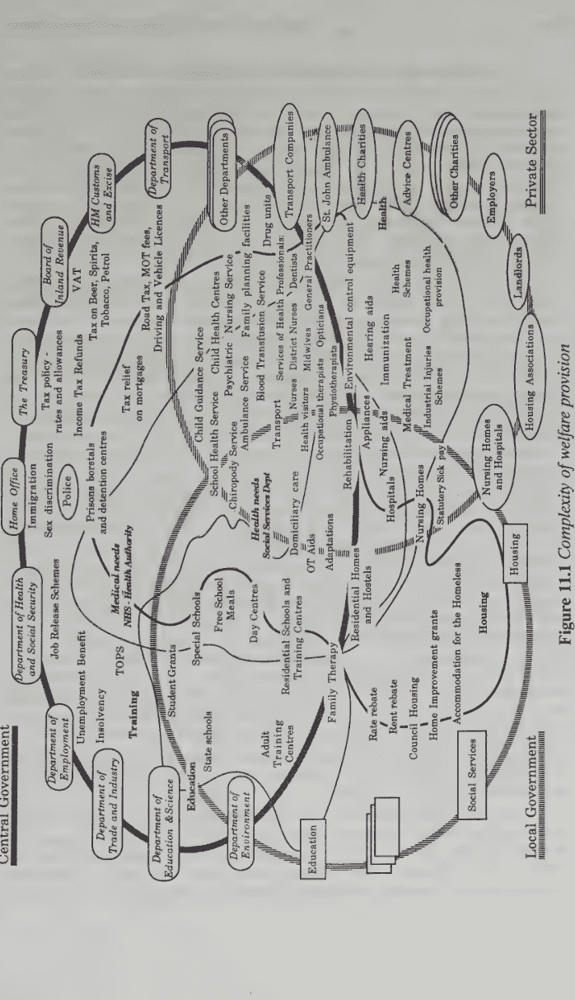
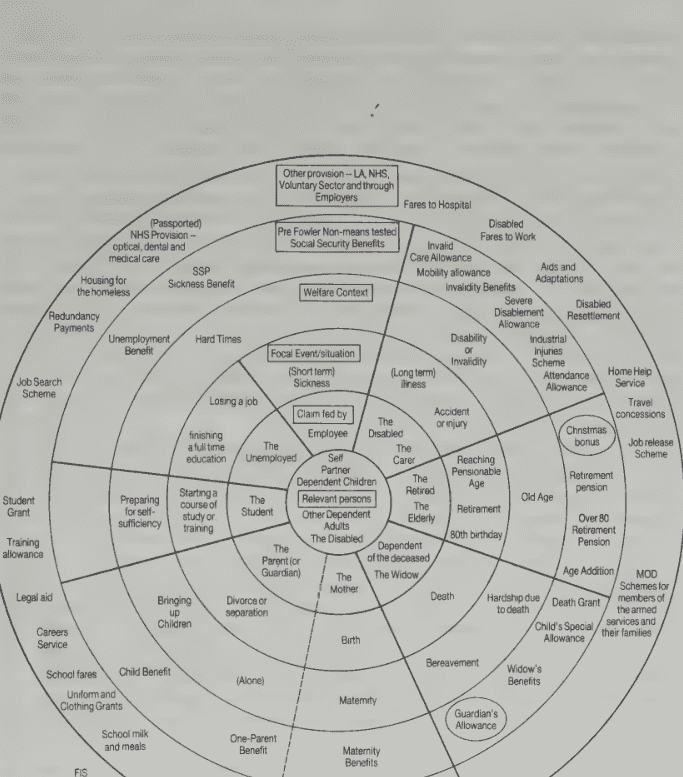
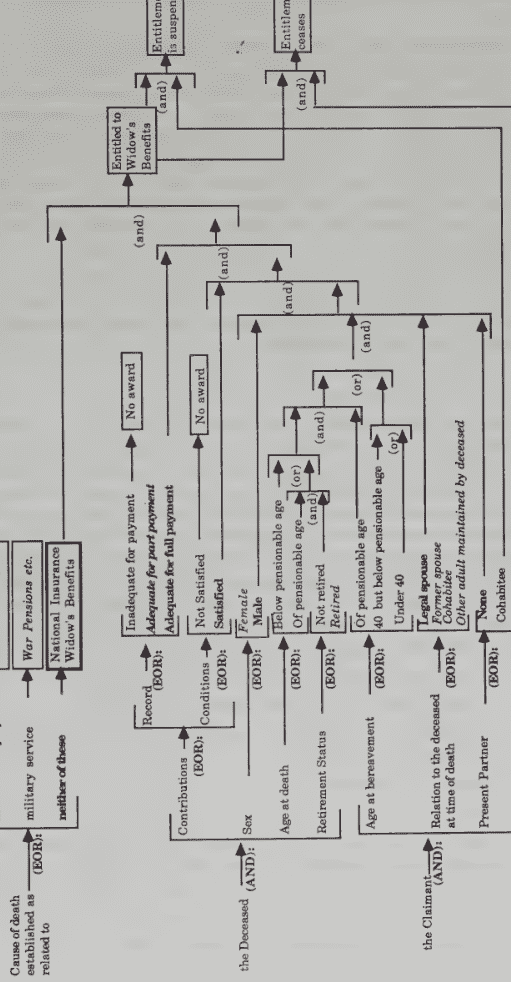
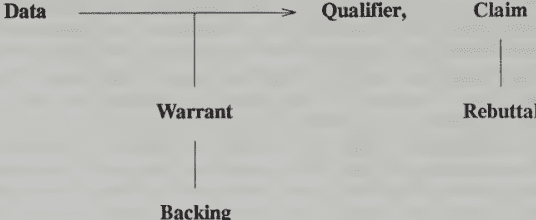
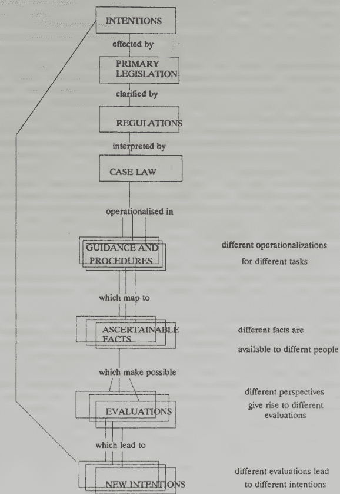
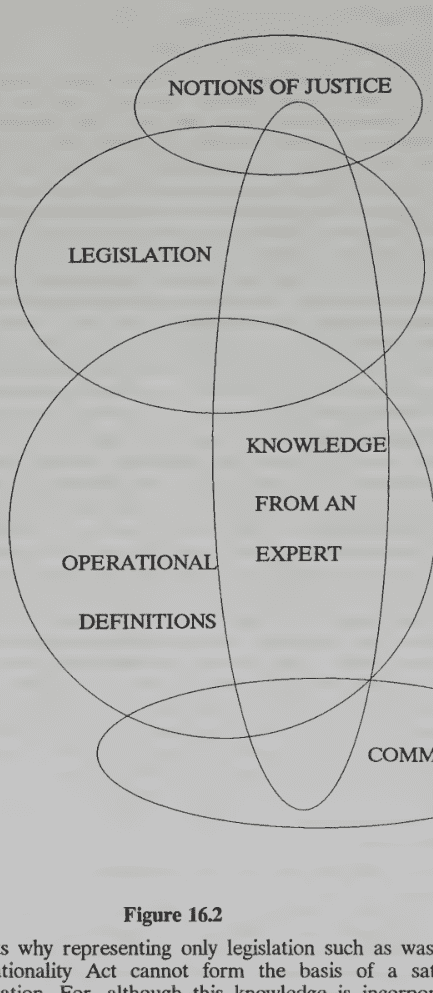

# 知识系统与法律应用，第 36 卷 (APIC)

编辑：

# T.J.M. BENCH-CAPON

英国利物浦大学

计算机科学系

# 前言

## 引言

人工智能本质上是一门实验性科学，应用于法律领域的基于知识系统的子领域也不例外这一通用原则。该领域受到许多显著实验的刺激，如 [McCarty 1977] 中描述的 McCarty TAXMAN、Rissland 的 HYPO [Rissland and Ashley 1977] 以及帝国理工学院的英国国籍法实验 [Sergot 1976]。通过实施方案，我们取得了进展，这些方案有助于澄清底层理念的优缺点，并通过对在工作系统中实现这些理念构想的经验进行反思，我们也获得了进步。当然，有价值的不仅是这些对实验的反思，还有整个社区的反思。本书旨在提供从 Alvey-DHSS 演示项目中在基于知识系统与法律领域进行的一系列相关实验中获得的经验以及一些教训。该项目运行于 1984 年至 1989 年，为开展持续性实验提供了一个难得的机遇。书中的章节代表了许多参与项目人员对项目的反思：他们的结论可能有所不同，但都基于共同的经验。

Alvey-DHSS 演示项目是一个大型演示项目，由英国贸易和工业部的 Alvey 指导部以及英国科学与工程研究委员会支持。项目合作者包括 ICL、Logica、帝国理工学院以及兰卡斯特大学、利物浦大学和萨里大学。此外，卫生和社会保障部（DHSS）指派了若干名员工全职参与该项目。

本书分为四个部分。第一部分包含了理解书中其余内容所需的背景材料。第二部分集中于目标组织内部的任务，该项目研究了支持这些任务的方法。识别出三个可以被基于知识系统（KBS）支持的独特领域，并为这三个领域构建了原型系统。从演示项目中获得的一个重要教训是：所支持任务的性质对支持该任务的系统性质具有全影响：构建一个系统并希望它能支持整个范围的用户是不恰当的。详细理各项任务的独特需求是演示项目的主要成就之一。第三部分详细介绍了构建的系统本身，这些章节也为书中其他章节的观察和一般评论提供了实验依据。最后一部分根据在法律领域构建 KBS 时出现的若干问题进行组织。因此，书中有关于知识分析、知识表示、与此类系统的交互性质、协作工作以及此类系统的社会和组织影响的章节。最后是一个结论性章节，我尝试整合各章节的一些线索，为讨论应用于法律领域的 KBS 产生一个框架。

感谢所有在项目漫长运行期间参与并以各种方式做出贡献的人。。这包括 Alison Adams, Jo Bird, Steve Blackburn, Tim Bond, Simon Booker, Julie Bourwe, Sarah Buckland, Christopher Burton, Alan Bustany, Tony Chandler, Marcus Clarke, Carolyn Lee, Cody Cox, Leo Crossfield, Ann Curry, Jo Dartnell, Sarah Hardy, Sandra Hill, Heather Hopkins, Steve Hopwood, Paul Portman, Howlin Wilson, Paul J.O. Marks, Lil Masterman, Rosemary Mathews, George Matieson, Tony McEnery, Linette Middleton, Alison Mill-Ingen, Hilary Milner, Steve Owianka, Mika Pappas, Chris Penn, Martin Perret, Nicky Perry, Sarah Pett, Ian Pickup, Charlie Portman, Mark Reader, Green Robinson, Peter Robinson, Tom Routen, Marek Sergot, Murray Shanahan, Graham Storrs, Andrew Taylor, Walton Tesdale, Chris Thomas, Steve Timms, Peter Turner, Richard Turner, Julie Weaver, Kelvin Hall van der Werve, Mary Whittaker, David Wolstenholme 和 Graham Young。我还要感谢利物浦大学帮助准备本书的同事们，特别是 Paul Dunne 和 Ken Chan。

# 传记信息

在牛津大学约翰学院学习哲学，并在那里获得了哲学博士学位（D. Phil.）。他在卫生和社会保障部的政策和计算机部门工作了六年，在那里他协助建立了 Alvey DHSS 演示项目。随后他前往伦敦帝国理工学院参与演示项目，并研究应用于立法的逻辑编程。自1987以来，一直是利物浦大学的计算机科学讲。

ELIZABETH S. CORDINGLE 在美国获得物理学学，随后在萨里大学获得社会研究硕士学位。她的研究经验包括对地方当局社会服务部门计算机的研究，并在1984 年 7 月至项目完成期间一直致力于 Alvey DHSS 演示项目。Elizabeth 目前在 BT 研究实验室担任执行工程师。

JUSTIN FORDER 是 Logica Cambridge Ltd 的首席顾问。在 Alvey DHSS 演示项目中，他参与了政策和本地办公室应用，以及工具包的定义和设计。他继续在决策支持中使用从项目中学到的教训。

应用范围从智能分析到安全相关系统的设计。

**DAVID FROHLIC** 于1980年毕业于谢菲尔大学获得心理学学士，并继续攻读技能获取的博士学位。他对人机交互的兴趣让他进入了人机交互领域。从1983年10月起，他曾担任了一年的因素分析顾问（Factors Consultant），随后加入萨萨里大学的 Alvey DHSS 演示项目，担任索赔人信息小组的研究心理学家。在参与该项目的5年里，他参与了多项支持“表单辅助系统”（Forms Helper）和“建议系统”（Advice System）设计的任务，包括人机交互研究、咨询建议的次级分析、基于菜单的自然语言接口实验、对话设计、知识分析以及协作评估。他还担任该大学的副讲师，并在电子与电气工程系开发了一门关于人机交互的课程。在1989年12月离开演示项目后，大卫花费了几个月的出国旅行，随后在惠尔德公司布斯托尔实验室高级信息管理部门担任技术人员。他目前在惠尔德布斯托尔的研究实验室工作。

**NIGEL GILBERT** 是萨萨里大学的社会学教授。他开创了供索赔人使用的计算机福利信息系统，原型于1980年开发，并是1984年 Alvey DHSS 演示项目启动初期的成员之一。他现在领导着萨萨里大学的社会与计算机科学研究小组。他的兴趣包括科学知识社会学、社会流动、人工智能和人机交互。他在这些主题上出版了五本书和大量论文。

**PAUL LUFF** 于1983年获得约克大学计算机科学科学士士学位（荣誉等），从那时一直致力于计算语言学、知识型系统和人机交互的研究。1985年，他加入了萨萨里大学 Alvey DHSS 演示项目的索赔人信息小组，帮助他们设计并实现了两个知识型系统——“表单辅助系统”和“建议系统”的接口与交互组件。最近，他为学术出版社合编了《计算机与对话》一书。目前，他同时参与萨萨里大学和剑桥 EuroPARC 的研究。

## 个人信息

**CHARLIE PORTMAN** 在利物浦大学获得工程学士学位后，于1954加入 Ferranti 计算机部门。他曾担任电路工程师、逻辑设计人员和测试编程员，并在负责 Sirius 项目之前领导过一个鼓机调试团队。他参与了 Ferranti Orion 计算机的工作，并在1963年将第一台此类机器带到了瑞典。后来，他在曼彻斯特的 West Gorton 开始了 1900 系列机器的开发。1972年，他为 ICT 建立并管理了软件部门，该部门负责 1900 执行程序、1900 及早期 2900 型机器的测试程序，以及早期 2900 监视程序。后来在系统工程和高级开发领域的职位使他承担了管理用于 DTI Alvey 指挥部的 Alvey DHSS 大规模项目的任务。目前，Charlie 是 ICT 曼彻斯特战略系统部门的知识与需求采集计划经理，也是 JFIT MAKE 项目的项目经理。

**MAREK SERGOT** 在剑桥大学三立学院学习数学，在于1979年加入伦敦帝国学院计算机系逻辑编程小组之前从事过数学建模工作。他于1985年被任命为讲师。他的研究兴趣集中在利用逻辑进行人工智能和演绎数据库中的知识表示，特别对法律和时间推理中的应用感兴趣。

**GRAHAM STORRS** 是 Logica Cambridge, Ltd. 的高级顾问，该公司是 Logica 全球的研发中心。他与人机交互小组合作，该小组负责智能训练、智能前端以及 HCI 分析与设计方法等领域的项目。他目前的活动包括领导民用航空局项目的一个设计团队（为海洋空交通管制中心开发新前端系统），以及 ASAM 项目（这是一项关于安全关键软件开发工具支持的研究项目）。此前在 Logica 的工作包括 Alvey DHSS 项目、智能辅导系统的开发以及 HCI 咨询。他的背景是人机因素咨询，以及关于 HCI 和人工智能的学术研究。他在萨萨里大学的博士研究属于认知心理学领域。

**ANDREW Taylor** 在兰卡斯特大学和谢菲尔大学学习哲学，并在兰卡斯特大学获得信息系统博士学位。在加入兰卡斯特大学系统系之前，他曾在 ICI 担任管理顾问。他贯穿始终参与了 Alvey DHSS 演示项目的整个周期，并于近期加入了 Linklater Payne。

# 第一部分

## 背景

书中的大部分章节描述了基于 Alvey DHSS 演示项目的工作。本部分的目的是提供该项目所处的背景：因为研究并非孤立进行，它既受到之前工作的影响，也受到当代发展的影响。第一章由 Marek Sergot 编写——他是知识型系统（KBS）和法律领域的著名人物，虽然不是演示项目的完全参与者，但在项目的大部分时间里与其保持着紧密联系——该章节对计算机系统中法律表示的多种方法进行了权威概述。第二章由 Trevor Bench-Capon 撰写，阐述了演示项目提供的机遇；该企业的规模和性质意味着这些机遇与该领域以往任何此类活动所提供的机遇截然不同。

# 第一章

## 计算机程序中的法律表示

### 1.1 引言

有大量关于计算机在法律应用的文献。本章对那些提出或实现了以计算机处理的形式进行法律表示的作品进行了综述。该综述并非仅仅是项目目录；其主要目标是描述和比较各种方法，但也可以被视为一份摘要目录。我选择了一些具有代表性的特定项目或项目组进行详细考虑。对于每个项目，我都给出了基础描述并列出了类似项目的参考文献。除了摘要之外，我还添加了自己的见解。正如 McCarty 指出的，当提到“法律咨询”时，人们最先想到的就是这类系统。这种描述过于简化了。特别是法律的性质在于，我们永远无法确切地判断某个法律概念在特定案件中是否适用。在任何情况下，决定这类问题的不是计算机程序而是法院或其他裁决机构。

尽管有显著的例外，但大多数涉及计算机表示法律的项目都使用了人工智能技术。在这些情况下，人们通常谈论可以对法律进行推理的程序。对法律专家系统的引用也十分常见。在本次综述中，我将避免将某个程序称为专家系统。这个术语现在如此不精确，以至于失去了大部分意义。更糟糕的是，“专家系统”一词带有许多内涵，其中一些在法律这样一个敏感的领域中是不可接受的。我更倾向于谈论表示法律并能够对这些表示进行处理、执行或推理的计算机程序。当我使用“专家系统”一词时，它特指一种方法。

### 1.1.1 计算机程序中的法律表示

本综述描述的许多项目都是 McCarty [1983] 所称“法律分析与规划系统”的示例。在一般意义上，此类系统允许将现实或假设案件的事实在合适的抽象层次上进行表示；它包含了某种形式的法律表示；它的设计目的是“应用”或“匹配”这种表示与给定的事实；然后确定哪些法律概念和关系似乎成立，以及会导致什么样的后果。

在计算机程序中表示法律的想法并不是新观点。例如，Loevinger [1949] 和 Mehl [1958] 就预见到许多目前正在实施和提议的系统。而且，对机械化法律过程部分可能性的推测甚至在此之前早了几个世纪。同样，一些最早的计算机应用也可以被视为法律表示的体现。例如，薪资系统根据税收及相关法律对薪资进行计算并进行扣除。事实上，许多数据处理应用本质上都是（准）法律性的，原因在于

## KBS 在法律领域的应用

这些系统设计用于管理规范组织运行的规则和制度。许多实际的财务和行政系统是可以被指定的，首先是从规则和制度的角度规定，然后是从这些规定转化为信息处理任务的方式进行规定，这一想法是 Ronald Stamper 的 LEGOL 项目背后的基本动力。本章第 1.9 节将介绍 LEGOL 项目。

遵循 Stamper 的观点，第 1.7.5 节将行政数据处理系统归类为包含“法律”表示的程序，其中这种表示并非显性的。诚然，人们公认，一个典型的薪资发放系统不会被大多数评论者归类为“可以对税法进行逻辑推理的法律分析系统”。然而，一个计算应从员工薪资中扣除多少税的程序，与一个判断特定法律概念（如“纳税人”）是否适用于特定个人案例的程序，两者在本质上没有区别。

## 1.2. 调查范围

有一个与本调查直接相关的话题，其历史比计算机或人工智能要长得多。逻辑在法律中的作用，以及法律的逻辑分析和法律推理，一直是法学和法律哲学的核心问题。尽管我没有尝试对该主题的文献进行全面综述，但我包含了一些讨论，因为对法律逻辑分析和法律推理的研究与许多目前关于法律的计算机表示的项目直接相关。此外，任何形式的符号逻辑法律表示在原则上都可以由计算机处理。

计算机的大多数应用都超出了本调查的范围。许多应用与法律表示无关：文字处理、会计、时间成本核算和时间记录、通信系统、法院管理系统等都被排除在本次调查之外。关于法律办公室通用的计算机应用，请参见例如 [Bellord 1983], [Ruoff 1984]。被排除在外的还有那些存储和检索法律文档的计算机系统。如果这是合理的，人们可以区分法律来源（如制定法、法典、规则和制度、案例报告和法律教科书）与法律本身（即法官、律师和其他法律执业人员实际适用的法律）。文档检索系统存储和检索法律来源。相反，本调查关注的是那些试图超越文本本身，去表示和处理法律文件“含义”的系统。关于法律领域文档检索系统的优秀综述，请参阅 [Bing 1984]。

文档检索系统未被纳入调查，但并未被完全忽略。有一部分工作试图通过引入法律的表示来引导检索过程，从而增强文档检索系统的功能。这些工作很大程度上受到了更直接关注法律表示和推理的方法的影响，并反过来影响了这些方法。这项工作涵盖在第 1.14 节。最后，某些项目 P，特别是那些涉及案例法的 P，可以被视为对法律表示进行推理，其本质目的是为了识别相关的法律来源。

还有一小部分研究利用人工智能技术来研究法律推理涉及的认知过程。这部分工作属于本调查的范围。示例请参见 [Kolodner et al. 1985]。

### 1.2.1. 信息来源

据我所知，尚未发表过关于该领域领先项目的详细比较评估，尽管有一些实用的综述和摘要可供。

本文的许多补充参考文献取自 Biagioli 和 Fameli [1987] 汇编的详尽参考文献和摘要集，以及取自 Richard Susskind 博士论文和书籍的参考文献 [Suskind 1986a]。还推荐 Anne Gardner 博士论文 [1984] 中的综述。

[Cook et al. 1981] 提供了早期项目的简要说明，其中六个项目的研究人员总结了他们的工作。同一时期 Thorne McCarty [1983a] 的一篇综合文章描述了若干潜在类型。

1979年，在斯康锡举办的一场关于计算机与法律的会议参加了该领域的大多数研究人员。该会议的论文集提供了对重要项目的描述 [Niblett 1980]。IDG（法律信息学研究所）在佛罗伦萨组织了一系列会议（论文集包括 [Ciiampi 1982], [Martino 1982] 以及 [Martino and Socio 1986]）并出版了 Informatica e Diritto。会议分别在1984 年和1985 年在休斯顿举行。最后，除了定期举办的许多会议和研讨会，还有一个人工智能与法律国际会议系列。第一届在1987 年在波士顿举行，第二届在1989 年在温哥华举行，第三届将在1991 年在牛津举行。这些会议的论文集提供了许多项目的最新说明，这些项目不得不从本调查中省略。

## KBS 在法律领域的应用

## 1.2.2. 调查结构

章节的主要部分由项目和方法的综述组成。每个条目提供的摘要可以在不阅读附件注释的情况下理解。

注释中讨论的问题决定了项目在调查中出现的顺序。注释变得越来越短，因为许多问题已经出现过了。前两个项目的注释最长，因为它们必须介绍任何法律表示尝试的基本问题。无论选择什么顺序情况都是如此。

由于项目不是按时间顺序列出的，下一部分提供了简短的历史概述，以对该领域的范围和发展产生印象。

## 1.3. 历史概述

用于计算机程序表示和处理法律的计算形式可以采取多种形式，包括传统的编程语言。然而，通常与人工智能技术相关。

将人工智能技术应用于法律的首次建议是由 Buchanan（曾参与 DENDRAL 项目）和斯坦福法学院的 Headrick 提出的 [Buchanan and Headrick 1970]。这一时期启动了几个重要且有影响力的项目，其中最为人知且持续久的是 Thorne McCarthy 的 TAXMAN 项目，该项目始于1972 年并仍在持续。McCarthy 的目标主要是理论性的，特别是在他关于 TAXMAN II 的后期工作中。他将美国公司税法作为实验领域。McCarthy 最近的工作是关于法律话语语言的组件、逻辑形式和一组基础概念，这些概念共同构成了一个本质上是实践推理的理论。在本调查中，McCarthy 的工作分两部分介绍：关于 TAXMAN 的早期工作出现在第 1.12 节，而 TAXMAN II 和法律话语在第 1.16 节中描述。

## 计算机程序中的法律表示

根据先前的案例进行推理。Gardner 工作的核心是对那些没有即时答案的法律问题的处理，并试图识别案件中哪些方面是“困难”的，哪些是“容易”的。Gardner 的工作被归在 Meldman 的工作一起，因为它可以被完全视为对该方法的扩展和详述。这两个项目在 1.15 节中描述。


JUDITH 程序 [Popp and Schlink 1975] 处理了《德国民法典》的一部分，也源于这一时期，尽管本研究未对其进行进一步描述。

Ronald Stamper 的 LEGOL 项目也始于 20 世纪 70 代。LEGOL 项目的主要目标是开发一种方法，根据管理组织的规则和制度以及这些制度所产生的信息处理任务，对行政系统进行分析。由于规则和制度的核心作用，加上 Stamper 将立法作为其主要的实验材料来源，LEGOL 可以被恰当地视为对法律（通常是成文法）的计算机表示的调查。LEGOL 出现在 1.9 中。

其他具有影响力的项目包括 Carole Hafner 的 LIRS 系统（一个改进检索系统性能的系统）、Sim Sprowl 的 ABF（一种为法律文件计算机辅助制图设计的语言），以及 CCIPS（民法典信息处理系统，由 Cary Debesson 和 George Ross 对路易斯安纳州民法典部分进行的“科学编纂”尝试）。LIRS 和 CCIPS 出现在 1.13 节。ABF 出现在 1.8.1 节。

至少从 20 世纪 70 年代开始，有两个机构在计算机与法律通用领域非常活跃。它们是奥斯陆大学的挪威计算机与法律研究中心 `NRCCL` 和佛罗伦萨的法律文献学院 `IDG`。文中对所进行的一些项目进行了引用。

本调查还详细描述了另外三个项目。第一个是 Waterman 和 Peterson 关于法律专家系统的工作。第二个是逻辑编程在法律应用中的使用，这由伦敦帝国学院的 Sergot 和 Kowalski 开创，现在在其他地方应用非常广泛（第 1.10 节）。这项工作大约从 1980 年开始持续进行。第三个是 Rissland 和 Ashley 的 HYPO 项目，通常被认为是基于案例推理工作中最密集、最先进的作品（第 1.17 节）。

20 世纪 80 年代项目和提案呈爆炸式增长：数量多到无法列出完整的参考文献列表。

关于计算机应用于法律的大多数文献都涉及法律文件的检索。即使舍弃这一点，各种令人眼花缭的方法依然存在。

不同的项目处理法律的不同方面以及整个法律过程中的各项活动（如立法起草、文件准备、法律管理和通用的法律推理）。项目之间的区别在于它们采用的方法论以及对计算技术的选择。最重要的是，项目在目标和任务上存在差异。一些项目的目标具有极强的实际操作意义。这些项目试图通过任何方便的手段构建计算机程序，为法律的日常实务或管理提供实用的帮助。另一些项目将法律视为应用在其他地方开发的领域（通常是人工智能领域）的理想领域。此外还有一些项目的目标在本质上是理论性的，其首要关注点是阐明法律的本质以及涉及法律推理的过程。

似乎需要某种分类。这考虑了将项目组织成通用类别的几种可能方法，但其目的并不是识别任何特定的分类。其中一种是理想的。本节的真实目的是对所采取的不同方法进行通俗描述，并介绍文献中遇到的概念和术语。这也是开始反复讨论“计算机程序表示法律意味着”的一种手段：这一主题在随后的注释中得到了体现。

一种可能的分类方法是根据给定项目旨在支持整个法律过程中的特定活动来进行。诉讼和法律纠纷的解决（“判案”）只是法律日常实务中的一小部分。其他活动包括立法的制定和起草、其他文件的起草（如合同、遗嘱和各种通知）、日常行政任务（如福利申请的准备和处理）以及一般的咨询提供。该列表并非详尽。并非所有这些任务都需要律师的服务。许多任务将由政府和其他机构的官员、咨询机构的成员承担。按活动进行分类似乎并不合适：虽然我提到的某些项目是为了支持某个特定活动而设计的（Sprowl 的系统有助于法律文件的起草，但大多数并非如此。无论如何，法律分析和规划系统（这是目前提议的最常见的系统类型）可以在实际系统中用于上述提到的任何活动）。

## 1.4.2. 按计算形式分类

对项目的一种显而易见的常见分类是观察其采用的计算形式。然而，计算形式的选择分散了人们对更基础问题的注意力。它强调的是某种特定方法是如何实现的，而不是其目标和基础假设。许多提出的方法可以在不同的计算形式中简单恰当地重新实现。后文提供了一些示例。同样，许多截然不同的方法有时被归为类，仅仅是因为它们是在特定的编程语言中实现的。特别是使用 `PROLOG` 作为实现语言的项目通常被视为同一种方法的实例，尽管它们实际上是不同的。

## 1.4.3. 成文法与判例法的区分

成文法与判例法的区分是一种合理的分类维度。

## 1.4.4. 开放纹理 Open texture

在此，我引入“开放纹理”的概念，因为这个术语在文献中经常遇到，并且是我们要讨论的许多项目关注的核心。

对于任何新案件，我们无法确定确定其结果将会如何。成文法和判例可能提供良好的指南，但法院始终可能做出不同的裁决。我们知道某个法律概念是否适用于法院已经裁决的案件。但我们没有办法确定地判断某个法律概念是否适用于新案件，除非将案件提交给法院。在案件被法院裁决之前，案件的事尚无定论。因此，法律概念是“点点定义的” `pointwise defined`，并被认为具有开放纹理：一个法律概念仅对那些已由相应权限层级的法院裁决的案件具有精确的定义；对于尚未进入法院的案件，该概念没有精确的定义。

法律中模糊和具有裁量权的概念最明显具有开放纹理。但即使是成文法或法典中看似有精确定义的法律概念，也表现出开放纹理。然而，无论这种定义看起来多么精确，法院都可能决定对该成文法采取不同的解释，或者由于某些充分理由决定该成文法不适用于某个新案件。

开放纹理的概念起源于语言哲学，但在法学中，这一概念才变得最有用。法律哲学家哈特 `Hart` 认为法律概念具有不可治愈的开放纹理性 [Hart 1961]。然而，尽管哈特的观点极具说服力且影响非常深远，但并没有得到普遍接受。例如，丁沃克 `Dworkin` [1967] 认为法律中不存在开放纹理，因为任何案件，无论多么抽象，都是通过适当的法律推理和论证过程来裁决的。这些立场在哲学上很有趣，但这场辩论似乎没有实际意义。对于法院在做出决定时应该使用什么过程，并没有争议。在实践中，法律概念是不可治愈的开放纹理的（如果你遵循哈特的观点），或者表现得像是不可治愈的开放纹理一样（假设你遵循丁沃克的观点）。法律中的开放纹理是刻画法律基本不确定性的一种相当标准的方法，只有当案件进入法院并给出定义时，它才会被消除。

## 1.4.5. 法律的固定解释 Fixed interpretations of the law

区分成文法和判例法的项目分类并不理想，部分是因为它可能暗示其中一种在结果上比比上更确定，部分是因为某些项目试图对这两种法律来源进行推理。我认为一种更好的分类方法是区分那些预先构建了对法律来源单一固定解释的系统，以及那些试图在解释原始来源时更具灵活性的系统。

如果我们采用以下简化的模型来描述确定某个法律概念是否适用于给定案件所涉及的内容，这种区别可以变得更加清晰：

1. 识别相关事实。
2. 从相关的法律来源中构建法律规则。
3. 将法律规则应用于相关事实。

当然，这些阶段并不是孤立的，而是不可分地结合在一起的。为了确定哪些是相关事实，我们必须对哪些法律规则是相关的以及我们在哪里可以找到它们有一个初步的想法。此外，我们通常会有兴趣识别那些以特定方式适用于事实的法律规则，例如以最有利于客户利益的方式；一旦确定了合适的规则并准备好应用，这将决定案件中的哪些事实是相关的。

从这个简单模型的角度来看，我们要考虑的大多数项目仍然进一步简化了问题。它们假设“相关的法律来源”已经过识别，并且从它们中构建了法律规则。也就是说，它们整合了一个预先构建的单一、固定法律表示，并集中于将这种固定表示应用于各种事实情况。

诚然，这些系统中的大多数只考虑成文法以及明确书面的规则和条例。如果一个固定表示具有很大的实际价值，那么必须存在某种合理的共识，认为该表示是法律的准确模型。对于基于某些类型成文法的模型，其准确性比基于更具替代解释空间的法律来源更令人信服。

此外，我们要考虑的大多数项目实现了一种基于规则的演绎推理形式，而这些规则通常源自成文法。机械推理的计算技术已经相对已知。虽然应用成文法的规定通常可以看作是演绎（至少在初步阶段），但基于案件的推理要困难得多。基于案件的推理更类似于归纳或逻辑推理而非演绎。基于案件（或具有多种不同解释可能的成文法）的推理，无法通过识别所有相关法律来源并预先决定如何解释和应用它们来获得现实的近似。本质问题在于识别先前的案件并根据新案件的背景解释其裁决的意义，而一个完全消除这一路径的系统将几乎没有价值，或完全没有价值。

需要注意的是，据我所知，没有任何项目尝试过直接对法律来源进行推理。直接对法律来源进行推理需要一个能够理解自然语言的计算机程序，其复杂程度远超可预见的未来能构建的程序的能力。尝试对判例进行推理的项目必须为原始来源设计某种合适的抽象和表示，这种表示要足够灵活，允许将部分解释推迟，并根据需要由系统进行。

## 1.5. 法律专家模型 MODELS OF LEGAL EXPERTISE

本节描述了由哈特和彼特开发的两个系统 `LDS` 和 `SAL`、罗伯特·迈克尔斯的 `TAXADVISOR` 系统，以及菲利普·卡珀和理查德·苏金的潜在损害系统 `Latent Damage System`。它们都是严格意义上法律专家系统的示例。我们将详细讨论哈特和彼特的方法。

## 1.5.1. 哈特和彼特 Waterman and Peterson

法律决策系统 `LDS` 是由哈特和彼特开发的系统，用于解决产品责任案件的裁决问题 [Waterman and Peterson 1980, 1981, 1984; Peterson and Waterman 1985]。给定此类案件，系统会确定被告的责任，然后计算案件价值，即各方都能作为案件公平和解而接受的金额。

`LDS` 中表示的知识既是形式的基于


基于法律权威（立法和判例）以及非正式知识，例如律师和理赔员在实践中使用的策略（例如在证明产品缺陷时）。案件的价值取决于对损失的影响分析（造成了何种类型的损害）；确定被告责任的概率；原告对损害构成的责任百分比；案件的特征（基于律师能力和当事人个人特征等考量）；以及背景（包括原告所提出的诉求策略、时机和诉求类型等元素）。`LDS` 是一个在 `ROSIE` [Waterman et al. 1979] 中实现的基于规则的系统。

`LDS` 与那些寻求进行法律分析的系统不同。`Waterman` 和 `Peterson` 在 `LDS` 中的目标是开发产品责任诉讼中律师和理赔员实际决策过程的（基于规则的）模型。在 `LDS` 中，意图是使用这些模型来研究法律学说变化（对相关法规和判例的解释）对和解策略和实践的影响。为了做到这一点，他们修改规则，并记录其在应用于一组选定的测试案例时对模型运行的影响。进行这种分析是为了提供可能暗示法律学说和实践变化的见解。正如 `Waterman` 和 `Peterson` [1980] 所言，他们的系统经过极少修改即可在产品案件中作为专家顾问。

`Waterman` 和 `Peterson` 作品的特征是他们的系统所采用的多种不同类型的知识。这一特征在他们方法的另一个示例中再次显而易见。

用于石棉诉讼的 `SAL` 系统——旨在协助律师和理赔员评估与石棉暴露相关的案件 [Waterman et al., 1986]。它目前仅限于单一疾病（石棉肺）和一类原告（工作内容是安装石棉隔热层的技术人员）。`SAL` 提供了为了快速达成诉讼和解而支付的金额估计。同样，所采用的知识涉及遭受的损失、被告的责任、原告的责任以及案件的其他特征，如诉讼双方的个人特征和律师的能力。`SAL` 同样实现在 `ROSIE` 中。

### 1.5.2 注释

`Waterman` 和 `Peterson` 的目标是模拟法律在实践中如何被实际应用于特定类型的案件（产品责任）。专家律师的技能和专业知识显然不仅包括阅读法律文件的能力。因此，`Waterman` 和 `Peterson` 的系统不仅代表了相关的法律渊源，还代表了

## 计算机程序中的法律表示

法律是如何被使用的，以及可能影响案件结果的所有其他因素。

除了源自法规和判例法的规则外，`Waterman` 和 `Peterson` 的系统还必须代表公认的实践（例如，在某些类型的案件中，对痛苦和折磨的合理适当补偿通常被认为是所产生医疗费用的三倍）。这种类型的知识不应与判例法混淆。它没有法律权威（不能在法庭上被引用），仅代表对实践中似乎普遍发生情况的经验观察。

这些系统还必须包含一个专家律师如何利用这些法律知识的模型。他们必须代表律师和理赔员在准备此类案件时使用的策略和实践。他们还必须代表（例如）为了建立给定的某一点需要何种证据，并能够估计这些证据证明充分的可能性。这可能取决于主观标准，例如决定原告在多大程度上具有力。

为了准确模拟实践中实际发生的情况，`Waterman` 和 `Peterson` 的系统必须代表各种法律外因素对案件结果的影响。律师会想要估计（如果可能的话则利用）诸如案件中各种事件发生的时间、涉及当事人的人格、律师的能力，以及如果案件进入法庭，可能审理案件的法官的人格和已知偏见。`Bain` [1984] 正在进行一项模拟美国处理特定类型严重犯罪的法官主观决策过程的项目。

我开始对这些项目进行调查并参考 `Waterman` 和 `Peterson` 的工作，是因为它们说明了除了法律本身之外，决定真实案件结果的其他许多考虑因素。大多数其他项目没有涉及达成法律裁决所涉及的所有方面。它们关注整体的某一方面，且仅关注此一点。因此，其他方法本身无法用于确定或预测案件的结果。它们旨在协助分析法律问题。

通常情况下，对 `Waterman` 和 `Peterson` 系统中包含的这类非正式“法律”知识的需求显然源于常识。参考投入到这一主题的海量法学文献是很有启发意义的。`Richard Susskind` [1986a] 发表了关于与计算机表示法律相关的法学材料的详尽且广泛的描述。`Susskind` 在此背景下引用了丹宁勋爵（Lord Denning）：

在图书馆里看书——或者参加教授

## 知识库的法律应用

的讲座——会给你一个模糊且不完整的画面。为了理解法律的本质，你必须看到它在实践中的运作。[The Family Story. Butterworths, London, 1983] `Susskind` 随后又说道（省略了引用）：

另一个表明法律知识不足以解决问题的第二个证据可以从法学著作中得出：在美国现实主义者以及社会法学的著作中。如果说美国现实主义有一个核心主题，那就是法官做出决定并非完全基于法律陈述。根据杰罗·弗兰克（Jerome Frank）以及后来的法学用法，一群被称为“规则怀疑论者”（rule skeptics）的美国现实主义者声称，那些在司法裁决中阐明的所谓法律规则（“纸面规则”、“伪规则”或“接受的规则”或“口头表述的规则”）对于协助律师预测司法裁决毫无帮助。为此，他们认为有必要区分“真实规则”或“潜在规则”，这些规则被认为可以从司法行为的模式中发现。法律人物、规则怀疑论者莱内林（Llewellyn）实际上建议，这些“真实规则”更适合被称为“法庭的实践”，而他认为法律是“官员对争端所做的行为”。虽然规则怀疑论者遭到了广泛且令人信服的批评，但当他们（往往是故意夸大的）主张被剥离并限制在困难案件时，一个剩余的论题现在被理论家和实践者共同认同。该论题是，在就困难法律问题提供建议时，律师必须超越法律陈述，并寻求预测法院裁决。当经常这样做时，总体趋势就会显现，封装这些规律的非正式规则便被投入使用（无疑是无意识的）。一位当代分析法学专家哈里斯（Harris）再次强调了法律科学家承认法律陈述之外的社会现象和社会规则的重要性（但质疑了它们作为法律的地位）。`Susskind` 的另一段文字几乎总结了法律决策过程的两种极端观点：

弗兰克建议我们拒绝公式‘`R x F = D`’，该公式要求我们接受这样一种简化的表示，即法律规则可以由法官应用于案件的事实，从而机械地产生裁决。作为替代，他提供了一个替代公式‘`S x P = D`’（‘`S`’是影响法官的刺激，‘`P`’是其人格）。

弗兰克用这两个公式总结的这两个观点都是极端的。无疑

没有人能想到法律纠纷会通过机械地将法律规则适用于案件的事实来解决。这从常识中、法学文献中，或者通过观察 `Waterman` 和 `Peterson` 在他们的“真实”专家系统中所采用的许多不同类型的知识都是显而易见的。另一种极端观点是，法律案件绝不会通过常规手段解决，或者认为“纸面规则”与法律纠纷的解决无关——这同样从常识或法学文献中显而易见。`Suskind` 的法学探究尤为相关：其中很大一部分致力于建立方程 `x F = D` 在什么情况下能够准确地总结法律决策过程。这一讨论将在下一节再次进行。

## 1.53. TAXADVISOR（税务顾问系统）

`TAXADVISOR` 系统由 `Robert Michaelson` 在他在伊利诺伊大学的博士研究期间构建的 [Michaelson 1982, 1984; Michaelson and Michie 1983]。`TAXADVISOR` 旨在帮助律师为拥有大型遗产（价值超过 175,000 美元）的客户进行规划。该系统在 `EMCYCN` 中实现，收集客户数据并就组织其遗产提出建议和方案。签署人寿保险合同和退休计划、进行财富转移、赠与和购买都是可以改善客户税收状况的事。`TAXADVISOR` 特别关注该问题的战略规划方面，而不是通过分析事实来确定税务结果。据设，任何建议的税收影响将由更常规的程序进行计算。

`TAXADVISOR` 中表示的知识主要来自律师的经验和他们使用的策略，特别是专家在指导他们制定财务计划时所遵循的标准。`Michaelson` 注意，对于适用于所处理的特殊领域的案例，几位执业会计师的验证表明，`TAXADVISOR` 的建议约约三分之二与专家做出的建议相同，而剩下的三分之一虽然不同但仍然是可以接受的规划方案。

`TAXADVISOR` 属于这一节，因为它是另一个示例，该系统侧重于建模，而不是法律本身，而是法律知识在实践中实际上是如何被使用的。

## 1.5.4. Latent Damage System（隐性损害系统）

`Phillip Capper` 和 `Richard Suskind` 实现了一个专家系统，为法律专业人士提供应用英国 1986 年《隐性损害法》（Late Damage Act 1986）的建议。不同的是，该系统是商业出版的，以光盘包的形式发行，并附带一本名为《KBS 法律应用》（Legal Applications of KBS）的手册，描述其开发过程并详细解释了用户可以从系统中获得和期待什么 [Capper and Susskind 1988]。

隐性损害系统解决了疏失法中关于时间的难题，即如果损失或损害是在发生一段时间后才被发现，原告何时可以启动诉讼（因此被称为“隐性”损害）。1986 年《隐性损害法》的通过是为了专门处理这类问题，但如果没有对其所属的侵法、合同和产品责任法的广泛知识，就无法理解它。

在运行和采用计算技术上，`Capper` 和 `Susskind` 的系统更像是一个“文本动画器”或计算机辅助教学（CAI）程序，而不是一个通过对某些显式知识表示进行推理来计算的专家系统。然而，计算细节并不如系统所包含的知识性质重要。

`Capper` 和 `Susskind` 的系统是一个与目前考虑的系统不同类型的法律专家系统。它是一个专家系统，它结合了 `Capper` 对该法及其条款影响的专家分析，并应将其应用于实际问题的解决。它与本节中的其他专家系统的不同在于，它并不试图表示法律实践中实际发生的情况（`Waterman` 和 `Peterson`），也不试图模拟专家提供建议的行为（`Michson`）。

`Capper` 和 `Susskind` 的系统本可以归类为其他方法，特别是下一节描述的法律的算法表示。这两者都包含了如何将某项法律应用于问题 P 的分析，如果系统要具有很大的实际价值，这无疑是专家的分析。但我将 `Capper` 和 `Susskind` 的系统放在这一节，是因为它在法案实际表述的内容之外，还包含了极其广泛的额外法律知识。

## 1.5.5. 提出的问题

大多数法律计算机表示方法将注意力限制在类似于 `R x F = D` 的法律分析形式上。在查看了本节描述的方法后，要提出的主要问题是：忽视“社会刺激”和“个性”而仅表示法律的“纸面规则”是否有任何实际或理论上的益处。在描述了若干具体示例后对该问题进行了探讨。

## 1.6. 法律的算法表示

本节描述了一类系统，它们都通过算法编程语言（通常是 `BASIC`）或形式方法（如流程图）来表示法律的片段，这些形式方法可以直接在类语言中实现。这些系统通常通过向用户展示一系列预设问题来运行。用户给出的答案决定了必须询问哪些问题，直到程序拥有足够的信息来计算并显示“其”分析。

## 1.7. 算法程序

引用的最能代表该方法的示例是 `Robert Hellaway` 实现的一系列处理税收立法各方面的程序。这些程序是 `CORPTAX` [Hellaway 1980]、`CHOOSE` [Hellaway 1981] 和 `SEARCH` [Hellaway 1982]。它们都是在 `BASIC` 中实现的。`Bellord` [1980] 也用 `BASIC` 实现了一个类似的程序，用来表示英国税收立法的一个章节。

像 `Hellaway` 那样的程序也被归类为一种简单的法律分析系统（例如，参见 [McCarty 1983a]）。通常，强调的是该方法的局限性，以便为出于类似目的采用人工智能技术提供某些动力。正如 `Hellaway` 指出的，编写此类程序的困难之处在于对立法进行详细分析，以使其能够转换成所需的格式。作者需要预测所有问题的所有可能答案，以及这些答案之间所有可能的交互，然后为每种答案组合在程序中提供一个显式分支。实际上，`Hellaway` 描述的是构建一个流程图，问题的答案决定了遵循流程图的哪一个分支。

### 1.7.1. 流程图

通过构建流程图来更好地理解复杂法规的意图，这种想法是自然的。在一部主要面向律师的文本中，`Twining` 和 `Miers` [1982] 提出将流程图作为理解和应用复杂法规条款的实用工具。（这一建议出现在 `Twining` 和 `Miers` 书的第一版中，而不是作为参考的第二版。）许多说明性小册和手册使用流程图。而且如果可以通过流程图来表示某项法规的适用，那么通过简单程序将流程图机械化是值得的。这正是 `Hellaway` 和 `Bellord` 所做的。这些程序也是可以在书店和商店购买的。

### 1.7.2. 决策网络

流程图吸引力的一个近期案例是 `DataLex` 项目 [Greenleaf et al. 1987]，其中流程图起着基础性作用。该项目一直在开发一种用于构建法律应用的编程外壳（源自法律专家系统 `LES`）。`LES` 的一个核心模块允许律师构建作者所说的决策网络（decision networks）。这些网络构成了 `LES` 应用的主要部分。由于它们是由用户提供的响应激活的显式连接机制执行的，它们似乎与我所说的流程图完全对应。`LES` 外壳将决策网络转换为 `C` 程序，然后编译成可执行程序。`LES` 外壳中还有其他模块来处理法例和文本检索。法例在 1.7.1 节中进行了简要描述。

### 1.7.3. 评述

`Hellaway` 和 `Bellord` 的程序、`Twining` 和 `Miers` 提议的流程图、`DataLex` 项目使用的决策网络，都是隐式地表示法律条款。某项法规或其他法律通过算法来表示，该算法旨在以特定的、具体的方式适用于给定案件事实。由于流程图与实现它的程序之间的直接对应关系，我将流程图视为一种形式方法，无论它们表达的算法是由人类代理还是计算机“执行”的。关于使用这种类型的形式方法表示法律，有三点需要说明。

几个

# 法律在计算机程序中的表示

下一节将描述使用了基于规则和其他高级编程技术的项目。顺便提一下，`DataLex` 项目的作者恰恰持有相反观点：他们流程图比基于规则的技术具有显著的实际优势，特别是当这些表示需要由律师来构建时 [Greenleaf et al. 1987]。

其次，法律的算法化表示在透明度方面通常非常糟糕。将某项法律应用于给定案件事实的算法，仅规定了使用该法律的一种特定方式。它的结构通常不会重构法律本身的结构。另一种方法是构建法律的显式表示，并单独描述应用法律的程序。同样，更高级的计算形式更适合实现这种分离。

第三点，也是一个很少被提到的点，是为法律的用途设计一种合适的算法。如果观察某项法律，会立刻清楚，该法律的制定有许多种目的。一项成法可能会以或或少精确的术语定义一个法律概念，但它还会包含许多类型的规定，例如描述该法案如何影响其他相关法律、规定违反其条款将遭受的处罚，或为行政管理中所使用的程序列出一般要求。一个像“申请人必须在 1 月 1 日之前提交申请”这样看似简单的陈述可以有许多不同的解读方式。该陈述告诉了申请人有多少时间来准备申请。它有助于管理部门确定是否应该拒绝申请。它甚至可以被律师在关于其他法律领域中“有效主张”或“已提交”含义的论证中使用。

因此，很显然，在没有先确定法律条款的预期意图及其使用者之前，无法开始设计应用法律条款的算法。我不想给人一种印象，认为确定表示法律的计算机程序的预期意图是一个重大的实际问题。在实践中，人们在构建程序（或算法或流程图）时心中会有预期的用途。例如，`Twining` 和 `Miers` 就隐含地假设了这一点。我想在这里说明这一点，是因为这里的问题相当清楚，而不是在讨论更高级、非算法的计算形式时——尽管那里存在相同的问题，但并不显而易见。

## 知识库（KBS）的法律应用

## 1.7.4. 数据处理应用

`Hellawell` 的 `CORPTAX` 这类程序与典型的数据处理应用（如工资单系统）之间没有太大区别。在这两种情况下，分析都涉及构建详细的算法来应用相应的法律：`CORPTAX` 对应的是税法中的章节，而数据处理系统对应的是其他规则和条例（工资单系统也涉及税法）。实现的任务是使用合适的编程语言表达这些算法。在这两种情况下，生成的程序都执行一种算法，该算法将法案条款或一组规章应用于给定案件的事实。在 `CORPTAX` 中，这些事实中的许多是在算法执行过程中通过向用户提问获得的。在典型的数据处理应用中，这些事实通常会预先确定并存储在文件或数据库中。数据处理系统通常用于逐个处理许多案件，可能还需要生成各种文档和文件。但两种类型程序的基本处理本质上是相同的。`Hellawell` 和 `Bellord` 使用 `BASIC` 来表达他们的算法；数据处理系统则使用 `COBOL`。

`Hellawell` 的 `CORPTAX` 以及通过类似手段构建的程序中的许多局限性，可以追溯到使用了不恰的计算形式。更高级的编程技术可以减轻表示相关法律的任务，并通常会提高生成程序的透明度。可以认为，这些替代技术也会改进传统的数据处理系统。数据处理应用可以用其所管理的规章的显式表示来实现，并从一开始就根据这些规章进行分析和规范。正如前面提到的，规则和条例在数据处理中的核心作用是由于 `Stamper` 提出的，并参见第 1.9 节。

## 1.7.5. 局限性

随后的章节描述了通过法律的显式表示构建法律分析程序的项目，这些项目采用了各种计算形式。关注所表示的知识的性质，对于本节讨论的法律算法表示是重要的。

本节描述的所有程序——`Hellawell` 和 `Bellord` 的法律程序、`Twining` 和 `Miers` 建议的流程图以及 `DataLex` 的决策网——都代表了其所依据的法律的单一解读。所有这些例子都假设能够识别法律来源。

前一节强调了除了法律事实之外，可能影响案件结果的因素范围。在原则上，法律的算法表示没有理由不涵盖“刺激”、“人格”因素以及“法律规则”，但在实践中，法律的算法表示很大程度上用于模拟“法律规则”（预先决定的）。

因此，此类程序必然具有局限性。它们无法处理决策过程的每一个方面，并简化了它们所声称的影响。人们可能会立即得出结论，认为此类程序没有实际或理论价值。如果一个法律案件乍看落在某特定法案的范围内，那么迟早将检查该法案的影响，这种检查是考虑其他因素的更广泛分析的一部分。如果法案复杂，那么利用流程图或执行算法可能是这种检查的有用辅助。（这正是 `Twining` 和 `Miers` 在建议流程图有用时考虑的。这一建议出现在书中，书的主题是法律规则不是固定的，必须灵活应用并适当考虑其他考量，以避免荒谬的结论。）固定的法律规则表示可能意味着不需要考虑其他因素。此类程序旨在帮助分析案件，通过暂时忽略可能对结果产生影响的所有其他因素。它们通常是为了独立使用而构建的，但完全可以作为更大表示的一部分，例如 `Michaelsen` 的 `TAXadvisor`，其中一个（已实现的）模块被用于根据更具“专家”属性的部分计算税额。


一个值得考虑的问题是，这些“法律规则”表示是否不仅可以作为法律分析的辅助，而且自主地做出法律决策。

引言中提到，诉讼和法律纠纷的解决仅占每天活动的极小部分。在法律哲学中存在许多不同的流派和

## KBS 在法律领域的应用

法学文献主要由关于法律真实本质和法律推理的论点所占据。然而，大多数日常法律问题是通过应用法兰克的 `R x F = D` 方程解决的，这一事实并未被忽视。Susskind [1986a；另见 1986b] 在他的法学探究中指出，法律哲学家们争论最多的是解决困难法律问题（或应当解决）的过程。法律哲学家感兴趣的是困难的问题，这些问题也构成了法学著作的大部分。但每种法律哲学学派都有一个普遍共识，即简单的案件每天通过简单地将公认的法律规则适用于案情就能解决。Susskind 的研究已经证实了这种共识的存在。如果没有这种共识，无疑令人惊讶。

考虑到这一讨论，数据处理系统以例行和机械的方式应用法律或准法律规定。由于它们能够自主判定案件，因此它们基于一个隐含假设，即所有待处理的案件都将是简单的。很少会将引入计算机薪资系统看作是根据税收及相关法律自动扣除税款和其他付款。这是因为这项任务是平庸且例行的，而且所有案件都是简单的。

这并不意味着法律内部所有例行和平庸的任务都可以以类似的方式实现自动化。法律领域中极少数领域可以假设出现的每一个案件都是简单案件。因此，法律领域中极少数领域是可以接受或可行引入能够自主判定案件的计算机程序的。几乎没有例外，计算机程序只能用于帮助分析法律问题。必须强调的是，我刚才说的每一点，无论使用何种表示法律的计算形式，都适用。

当然，这一切都引出了根本性问题，因为目前并不清楚“容易”和“困难”究竟意味着什么。法学提供的实务指导较少。第 1.15.2 节探讨了计算机程序如何判断给定法律案件是易是难的一些建议启发式方法，该节描述了 Anne Gardner 的工作。

大多数对法律分析程序（无论什么类型）的描述都没有明确说明这些程序所依据的假设或其意图。这导致了偶尔的误解。

### 1.7.6 批评

Philip Leith [1986a] 主张拒绝那些仅代表“纸面规则”的法律“专家系统”。在同一篇论文的修改版本中，他将攻击集中在逻辑编程技术的使用上特别是 [Leith 1986b]。然而，这些批评中的许多也适用于本节描述的方法，因此，Leith 提出的问题在这里也得到了审查。

Leith 的核心观点是，仅基于“纸面规则”建立计算机系统，等同于声称法律问题是通过机械地应用“清晰的法律规则”来解决的。正如 Leith 指出的，此类规则是虚构的：法律决策不仅仅是应用 `R x F = D` 方程，因为法律来源支持不同的解释，并且受到未述例外的影响，且容易受到司法操纵，而且除了规则之外，还有许多其他需要考虑的因素。Leith 得结论是，只考虑“纸面规则”的影响等同于对法律真实本质的根本性误解。

对 Leith 论点的一种解释是，任何仅代表“纸面规则”的系统都将法律简化到了不可接受的程度，以至于该系统在法律分析中几乎没有或毫无价值。这种批评将忽略无论采用了何种计算形式。通过观察常见的法律实践和审查法学文献，无疑已经证明了简化的“纸面规则”表示可以具有合法且有价值的用途，而且在某些情况下 `R x F = D` 是法律运作方式的准确模型。

对 Leith 论点的另一种较弱的解释更具可行性。我们一直在讨论的程序简化了法律决策过程。虽然此类系统的作者可能意识到他们的程序只能处理完整法律分析的一个方面，但这些程序的用户并不一定也意识到了这些局限性。换句话说，存在一种危险，即用户会高估他们从此类程序中获得的分析的价值。当 Twining 和 Miers 展示流程图可以帮助分析一组法律规定时，他们可能设想这样的流程图是由律师为自己的个人使用而构建的。但计算机程序的用户往往不是其作者。

Leith 将他的攻击指向了“专家系统”和逻辑程序。对 Leith 论点的一种解释（可能也是他的本意）是，当一个法律分析程序被其作者或用户标记为“专家系统”，或者当其结论被称为“逻辑推论”时，这种危险会大大增加。如果这是 Leith 的观点，那么他无疑是正确的。虽然计算机程序用户始终存在对其获得的输出过度信任的风险，但对于一个被（比喻地或字面上地）销售为“专家系统”或其结论被宣传为“逻辑推论”的程序，人们更容易被诱导。我曾提到“专家系统”一词带有不可接受的内涵，而这正是一个例子。“逻辑推论”是一个具有精确含义的技术术语，但即使是技术术语也可以被负责任地使用。

我和 Leith 同意的地方在于，他暗示该领域的许多工作描述拒绝承认其方法的局限性，无论这是出于主意，还是由于对法律真实本质的无知。确实有一些发布的产品对准确性缺乏不负责任的关注（法律专家系统，[Susskind 1987] 讨论）。然而，普遍印象是，构建法律表示的项目（无论何种形式）的研究人员意识到他们的系统仅限于解决法律分析的一个方面。大多数较详细的项目描述省略了这些背景材料，可能是因为作者想要报告程序的细节，并假设该领域的其他研究人员具有相同的目标和前提。

Leith 的批评强调了让用户意识到其所用程序局限性的重要性。这始终涉及向用户解释程序可以做什么和不能做什么，以及它设计用于支持哪些法律分析方面。但也意味着，那些能够明确其结论所依据的假设的程序，通常比那些不能明确的程序更受欢迎。在本节描述的法律算法方法中，操纵它们的程序所采用的形式的一个主要缺点是缺乏透明度。它们倾向于将表示隐藏在形式之中。其他的计算形式更适合分离出底层表示并保持其显式。接下来将描述一些使用了这些替代形式的项目。

## 1.8 法律的显式表示

上一节描述的算法方法构建了隐藏在应用程序中的隐式表示。本节给出使用了计算形式的项目示例，这些形式使得法律的显式表示与应用于它的程序分离出来。采用这种形式有两个主要动机：减轻构建表示本身的任务，以及提供一个允许对其表示进行准确性评估并能为其结论提供某种辩护的系统。

本节描述的两种类型的形式是基于规则的

## 计算机程序中的法律表示

各种类型的形式化方法，以及过程化 `PROLOG` 的使用。（我在下文中解释其区别）。语义网络和基于框架的表示也被使用过，尽管频率低得多。在后面的章节给出了一些示例。

## 1.8.1. 基于规则的形式化

法律与其说是一组详细的算法，不如说是一组规则，因此许多构建法律计算机表示的尝试采用了基于规则的形式化方法并不意外。这是一句无害的言论，但存在一个不幸的歧义，导致了一些困惑。

“法律的规则模型”一词在不同语境下有不同的含义。“基于规则的”可以指法律本身，也可以指所选的计算形式化，或者两者兼有。人们可以将法律视为一组“规则”，但用某种非基于规则的计算形式化来表示这些“规则”。Twining 和 Miers 的流程图就是一个例子。同样，人们也可以选择不将法律视为“规则”，但仍为了表示之而采用基于规则的计算形式化。Waterman 和 Peterson 的专家系统可以被视为这方面的例子。

一些评论者陷入了这样的陷阱：即认为为了表示目的而使用基于规则的计算形式化意味着作者属于某种——可能是非常极端的法学流派。对形式化的批评者往往深陷于法学天真的指责中。本节关注基于规则的计算形式化的使用。

有许多使用基于规则的形式化来表示法律的项目，以至于我无法提供一份全面的参考文献列表。我仅选取了一些早期的示例。

Waterman 和 Peterson 在 `ROSIE` 中实现的系统，以及 Michaels 在 `EMYCIN` 中实现的 `TAXADVISOR` 已经在某些部分详细讨论过（第 1.5 节）。

Philip Leith 使用他自己设计的产生系统 [Leith 1983] 构建了 `ELI` [Leith 1982]，这是一个处理英国安全立法部分内容的系统。

Duncan 和 Elizabeth MacRae 实现了一个系统，为税法律师和会计师就《美国国内收税法》中处理奖金和奖项的第 74 条（section 74）提供建议 [MacRae 1985a, 1985b; Macrae and MacRae 1985]。该系统是用 `PRO` 语言实现的。然而，不应将其与使用 `PROLOG` 作为表示语言的项目，或稍后在“将法律表示为逻辑程序”标题下描述的方法混淆。MacRae 系统使用的表示语言是他们自己设计的命题规则语言。`PROLOG` 仅用于实现推理机制。MacRae 兄弟系统的一个重要特征是他们对接口和控制问题的强调。该系统设计用于供已经是该领域专家的人使用。MacRae 兄弟特别关注开发一种接口，使用户能够对系统的执行进行控制，通过将搜索引导离开被认为无关或冗余的区域。

David Gold 和 Richard Susskind 合作了一个跨学科项目（计算与法学），开发出了一种用于表示某些法律的基于规则的语言 [Gold 1987]; Gold and Susskind 1986; 也见 Susskind 1986a)。Gold 和 Susskind 通过一个基于苏格兰离婚法的示例说明了这种语言的用法。[Susskind 1987] 同样描述了许多由他和其他人使用其他规则编程工具构建的特定系统。

另一个被归入这一大类别的系统是 Jim Sprowl 的 `ABF` 处理器 [Sprowl 1979, 1980]；另见 Cook 等人 1981]。该系统设计用于计算机生成法律文件，但 McCarthy [1983a] 指出它也可以用于构建法律分析程序。`ABF` 系统是一种文字处理器，程序员通过 `ABF` 语言指定文本片段以及从用户处获得的数据如何插入到正在生成的文档中。文档规范可以包含由算术算符和关键词（如 `AND`, `IF`, `OR` 和 `NOT`）构建的表达式。`ABF` 处理器在文档生成过程中遇到这些表达式时对其进行评估。但允许程序员在这些表达式中包含自己的术语，他通过 `IF/THEN` 和 `IFF` 表达式来定义这些术语。当 `ABF` 处理器遇到程序员定义的术语时，它会通过定义从结论反向推导到条件，从而评估其真值。由于这些定义可以是任意复杂的，`ABF` 处理器可以用作命题规则的后向链解释器。（尽管我曾多次看到 Sprowl 的 `ABF` 处理器被称为基于规则的系统，但我并不知道它在实践中被用于文档生成以外的任何事情。）

在本调查中还描述了许多其他采用基于规则的形式化来构建法律表示的项目。主要的包括 `LEGOL`、逻辑编程项目、`ESPLEX` 和 Gardner 的博士项目。`TAXMAN` 使用了基于框架的形式化和 Meloused 语义网络。在这两种情况下，系统都可以用规则轻松重构。这些项目没有包含在本节中，因为它们在后面都已更详细地单独描述。

## 计算机程序中的法律表示

编程语言 `PROLOG` 也可以被视为一种基于规则的形式化。我将使用 `PROLOG` 的描述单独分开，是因为我想就此发表一些特定的意见。

## 1.8.2. 过程化 PROLOG

几个项目使用了（过程化的）`PROLOG` 作为语言的表示。Dean Scholzbohm [1985] 编写了一个 `PROLOG` 程序，帮助分析处理《美国国内收税法》第 318(a) 条中关于“股票构造所有权”的规则。David Sherman [1986, 1987] 实现了一个大型 `PROLOG` 程序，模拟加拿大《所得税法》。

本章第 1.10 节致力于了逻辑编程在法律中的应用。为了理解为什么本节的项目被列为一类，有必要理解过程化 `PROLOG` 程序与声明式逻辑程序（后者可以用 `PROLOG` 执行，也可以通过其他方式执行）之间的区别。

编程语言 `PROLOG` 基于逻辑，特别是基于一阶逻辑的一个子集，我将其称为“扩展定义句”；这些是形式为 `APW` 的逻辑蕴，其中 `A` 是原子结论，`W` 是表示结论 `A` 成立的充分条件的一阶逻辑表达式。这类句集具有声明式含义，这种含义与其可能的任何计算用途完全独立。

使用 `PROLOG` 的一种方法是取一组扩展定义句，用 `PROLOG` 语法重写它们，然后作为 `PROLOG` 程序执行结果。但并不是每个 `PROLOG` 程序都是用 `PROLOG` 语法编写的扩展定义句，并不是每个 `PROLOG` 程序都能给出连贯的声明式解读。这是因为 `PROLOG` 包含了许多与逻辑无关的语言特征。使用这些特征的 `PROLOG` 程序只有过程式解读。它不能脱离在机器内部的行为而被独立理解。本节描述的项目使用了 `PROLOG`，不是将其作为执行逻辑表示的声明式表示的方式，而是作为一种独立的过程化编程语言。

Scholzbohm 的程序最清晰地说明了这种过程化的 `PROLOG` 用法。程序通过要求用户提供得出结论所需的事实来运行。程序语句将条件与过程调用混合，以生成所需的对话并指定计算下一步应该如何进行。在这方面，Scholzbohm 的程序与 Hellabell 的 `CORPTAX` 非常相似。Scholzbohm 明确说明了问题的顺序

应当被提问，预测所有可能的答案，并为每个可能的答案指定所遵循的计算分支。通过对这些语句进行 `PROLOG` 执行将产生所需的行为。该程序无法以声明性的方式读取，如果采用不同的执行策略，它将无法正常运行。

Schlohm 在他的程序加入了解释其当前推理逻辑及其最终结论的能力。这些功能通过在计算进行过程中维护推理轨迹来实现。在生成对话时，我们会在需要的地方显式地生成添加到轨迹中的例程。

Schlohm 的程序被编写用于执行一种算法，该算法以一种非常特定的方式应用了《美国国内税法》的规定。它可以非常恰当地与前一节描述的算法方法归为。尽管如此，虽然 Schlohm 的程序没有完全将其法律表示与应用这些法律的程序分开，但该程序在结构上与原始立法具有某些相似之处。识别出程序中表达法律规则的部分是容易的，在这方面，它与前一节的方法有所不同。

Schlohm 对其程序的描述包含了完整的 `PROLOG` 代码列表。某些 `PROLOG` 语句直接对应《美国国内税法》的章节。其他语句如果不包含生成对话和影响程序行为的子句，也可以直接对应。从列表中提取出一组代表《美国国内税法》所选片段的扩展定型子是非常直接的。一旦提取出来，有多种方法可以使用声明式表示。一种方法是使用解释器执行该表示，该解释器会自动生成其所需的实事实请求，并自动构建轨迹来证明其结论。这将是一个与 Schlohm 程序具有相同功能项的系统，但它是基于对《美国国内税法》逻辑的显式、声明式表示，而不是 `PROLOG` 中隐式的、过程化的表示。这种替代方法在第 1.10 节关于逻辑编程表示中有更详细的描述。

虽然 Schlohm 的程序可以与前一节的算法方法归类，但 Sherman 对《加拿大所得税法》的 `PROLOG` 模型可以在经过微调后，包含在声明性逻辑编程表示的章节中。Sherman 设想其程序的用户将在咨询开始之前，在一个补充的 `PROLOG` 数据库中输入其案件的事实。除了偶尔产生输出外，`PROLOG` 语句不包含对对话生成例程的调用。程序不构建推理轨迹。因此，Sherman 的程序依赖 `PROLOG` 额外逻辑特征的程度不如 Schlohm 那么大。尽管如此，Sherman 将他的程序写成在 `PROLOG` 中执行。他依赖于 `PROLOG` 特定的执行策略，并且偶尔使用 `PROLOG` 的额外逻辑特征来获得他想要的程序行为。如果以任何其他方式执行，他的程序将无法正常运行。同样，从提供的列表来看，似乎可以从 Sherman 的程序中提取出逻辑上的声明式表示而不会有太大困难。

## 1.8.3. 注释

本节描述的各种方法利用了相对高层次的计算形式体系，将法律的显式表示与将其应用于法律问题分析的程序和推理机制隔离开。前一节中提出的许多考虑因素也适用于这些替代方法。本节中描述的所有方法和程序都代表了其所依据的法律来源的单一、固定的解释。根据早先提出的论点，本节中的程序同样不打算自主地解决法律问题（在那些允许其用作数据处理系统和用于其他“常规”任务的行政系统的极特殊情况下）。这些高层次形式体系的感知优势在于，它们可以减轻表示法律片段的任务，并且这些生成的表示可以具有相对透明性。这两者都是将表示与应用于它们的程序分离的直接结果。这些点中的许多已经得到了解决，而且在专家系统的文献中也有充分记录。

为了稍微平衡这些观察，我提到了我之前的观点：DataLex 项目的作者反对使用基于规则的形式体系。我们对规则的经验导致了观察：律师实际上试图定义规则，然后根据它们编写规则 [Greenleaf 1987]。

最后，除了 Gold 设计的系统外，到为止描述的所有系统都采用了通用形式体系，这些体系同样适用于法律领域。一个需要考虑的问题是，法律应用是否只有专门为法律设计的体系才能满足。下一节描述了 Ronald Stamper 的 `LEGOL` 项目，该项目开发了一种既基于规则又专门为法律设计的计算机语言。

## KBS 的法律应用

## 1.9. LEGOL 与 NORMA

`LEGOL` 项目是由 Ronald Stamper 在 20 世纪中叶开始在伦敦经济学院进行的 [Stamper 1976, 1977, 1980；另见 Cook 等人 1981]。尽管 `LEGOL` 现在已经结束，但 Stamper（现在位于特文特大学）仍继续这一相同的研究方向，并正在开发一种名为 `NORMA` 的形式体系 [Stamper 1986]。

### 1.9.1. 描述

`LEGOL` 项目的最初动机是为数据处理系统以及更广泛的行政系统开发改进的技巧。许多此类系统基于管理组织的法律和其他法规，旨在将这些规则和法规的要求转换为人类和计算机执行的任务。因此，`LEGOL` 项目的核心关注点是开发能够精确表达这些规则的形式语言。由于 Stamper 将法律作为实验领域，`LEGOL` 和后期关于 `NORMA` 的工作被视为对法律表示技术的研究。

作为其实际产物之一，`LEGOL` 项目开发了语言的多种变体，每种都有解释器，能够表达多种规则。这些语言被各种示例，包括社会安全法、继承法、学位条例、订单处理和税务条例 [Stamper 等 1982]。

`LEGOL` 语言（在其执行变体中）被构想为带有处理时间的特殊算子的扩展关系代数 [Jones 等人 1979]。该语言可以通过执行一组定义了新关系的 `LEGOL` 规则来模拟法律条款的效果。某些语言版本还提供系列传统的程序控制结构：`if-then-else` 分支和迭代 [Jones 1980]。计算通过执行控制结构和评估代数表达式来进行。还提出了许多（未实现的）扩展，以使语言能够处理如目的、权利、义务、判决、特权和责任等概念 [Stamper 1980]。

这些是 `LEGOL` 项目的一些实际产物，但必须强调的是，Stamper 的主要目标主要是理论性的：解决基础语义问题，并开发一种基于此分析和表示法律的方法论。在 `LEGOL` 的情况下，法律片段的表示是

## 计算机程序中的法律表示


受一种“认识论语义模型” [Stamper 1979] 的指导，该模型被用于识别立法中存在的实体、概念和关系。该语义模型旨在确保数据结构与其所代表的内容之间存在合理的对应。基于 Stamper 语义模型的、用于分析 `LEGOL` 应用的问题分析方法论，在 [Stamper et al. 1982] 中进行了描述。

对语义的强调在 Stamper 关于 `NORMA` 的最新著作中继续延续。Stamper 长期以来认为，（谓词）逻辑和其他形式语言语义的经典方法对于法律应用来说是不够的，并主张需要采用替代的意义理论。关于这些论点的总结请参见 [Stamper 1989]。对于 `NORMA`，Stamper 提出的语义学，将所有符号——包括用于表示形式主义的符号——直接与代理、意图和行为的概念联系起来 [Stamper 1986]。

## 1.9.2. 注释

由于 `LEGOL` 法律的可执行版本基于关系代数，因此用逻辑编程术语重新解释 `LEGOL` 规则和控制结构相当为直接 [Sergot 1980]。这种翻译提供了一种使用 `LEGOL` 规则进行计算的替代方法。它使 `LEGOL` 语言不再需要嵌入到算法编程语言中；而且如果像 `PROLOG` 那样反向执行 `LEGOL` 规则，则允许直接表达递归，而原始 `LEGOL` 代数中缺少这一特征。它也意味着一组 `LEGOL` 规则可以用于模拟法律规定影响之外的其他用途。（这类重构让人联想到关系数据库领域的发展。另一种方法是在传递闭包算子中允许递归表达，关系代数现在通常包含这种算子。）

将 `LEGOL` 规则翻译为逻辑编程提供了一种执行这些规则的替代方法，但并没有解决 `LEGOL` 项目中研究的任何根本问题。识别和构建这些规则的方法论，特别是底层的语义模型，才是 Stamper 关于 `LEGOL` 和 `NORMA` 工作的核心关注点。

开发某种系统性方法论来分析和表示立法的动机显而易见，但在这里无法对 Stamper 的语义提议进行详细评论。大多数计算机表示法律的方法很少或根本关注（形式化）语义。在其他人确实涉及语义的范围内——我特别指的是逻辑编程技术的使用，以及 McCarthy 在 `TAXMAN` 和法律话语语言（Language for Legal Discourse）方面的工作——他们仅仅是采用了所采用逻辑形式的标准语义，或者提出了他们传统风格的变体。Stamper 认为这种语义方法是不够的。通过这样做，他质疑了形式语言理论和广义语言哲学中一些最基本的概念。显然，在这里无法进行详细讨论。

## 1.10. 将法律表示为逻辑程序

本节描述了一种通用方法：使用某种方便的符号逻辑形式构建法律的声明式表示，并由自动定理证明器执行这些表示，可能用于各种不同的目的。这种方法与伦敦帝国理工学院的 Sergot 和 Kowalski 联系最为紧密。

### 1.10.1. 通用描述

在这种通用方法中，法律由一组逻辑句子（一个公理理论）建模，这些句子代表了对所选法律来源的特定无歧解释。（“公理”是这些句子的正确术语，但在非正式使用时，它带有非本意的内涵，并可能导致误解；“显式假设”是一个相当准确的非正式替代词）。原则上，同样没有理由认为法律和其他影响法官决定的“刺激”不应该被表示。在实践中，该方法的大多数应用都包含了从成文构建的表示（与大多数其他项目仅关注成文的原因完全相同）。使用自动定理证明器来推导出表示的有用结果，并将其添加到表示中，“应用”到案件的事实上。如果给定案件的事实由补充数据库描述，则可以使用定理证明器来确定案件实实的后果。法律通过演绎被“应用”。这种方法可以用于构建与前几节描述的程序相同能力的系统。下面给出了具体的应用示例。该方法的详细说明见 [Sergot 1985a]。另请参见 [Sergot 1985b; Sergot et al. 1986a; Kowalski and Sergot 1987, 1990]。

从理论上，只要具有自动演绎系统，就可以使用任何形式的符号逻辑作为表示形式。但对于立法中遇到的许多简单规定，最实际、方便的逻辑选择是一阶逻辑的子集，即我之前扩展的定型句（`PROLOG` 编程语言基于的逻辑形式）。回想这些句子是形式为 `A ← W` 的蕴含，其中 `A` 是原子结论，`W` 是任何陈述结论 `A` 成立充分条件的一阶逻辑表达式。Sergot [1985a] 认为，许多类型的立法本质上是定义性的，扩展定型句提供了一种简单且自然的形式化语言，用于精确地表达这些定义。

对于实际应用，实现所需的定理-问题最简单的方法是直接使用 `PROLOG` 执行表示。这仅涉及用 `PROLOG` 语法重写这些句，然后将结果作为 `PROLOG` 程序执行。在帝国理工学院，大多数应用在 `APES` 中实现 [Hammond and Sergot 1984]，`APES` 允许增强形式的 `PROLOG`。`APES` 与 `PROLOG` 一样，从结论反向到条件，并具有相同的固定执行策略。

`APES` 有两种方式“增强”了 `PROLOG`：它构建所有结论的证明，这些证明可以在计算期间或达到最终结论时检查；它还整合了“查询用户”（Query-the-User）的实现，这是逻辑程序输入输出的声明式模型 [Sergot 1983]。`APES` 中的“查询用户”模块会自动为用户被要求的任何缺失信息生成请求，并检查用户提供的答案。更复杂的“查询用户”版本允许用户回答问题，要么是因为他们不知道，要么是因为他们没有提供答案。在这种情况下推导出的结论是有条件的：它们受到仍待决定的条件的限制。所有结论，无论是否有条件限制，都是表示法律的公理以及用户提供的任何信息的逻辑后果。

在像 `APES` 这样的系统中执行法律的声明式表示会得到一个功能与前几节描述的法律分析程序大致相同的程序。事实上，它提供了一种实现扩展功能程序的手段：证明生成机制提供了一种根据原始立法证明所获分析合理性的手段；而推导出条件分析的可能性是法律分析程序通常不提供的特征（但见 11.52 节对 Gardner 系统的描述）。

“查询用户”机制并非所有应用的必要组件。可以特别提到两种替代应用类型。首先，在某些情况下，可以在中间通过补充数据库描述特定案件的事实，而不是在计算过程中需要时请求它们。这产生了一个与典型数据处理应用程序行为对应的系统（以及在 `LEGOL` 中实现的应用）。其次，存在推导出更一般性质结果的可能性，潜在应用于立法草案（在第 11 节讨论）。

### 知识库（KBS）的法律应用

#### 1.10.2. 示例

该方法已应用于多个大型立法片段。最广为人知的例子是 1983 年夏天构建的《1981年英国国籍法案》的表示法 [Sergot et al. 1986a, 1986b]。在 `APES` 中执行时，该表示法可用于确定（例如）根据该法规定某个特定个人是否为英国公民。（鉴于之前的讨论，没有必要补充说明该程序并不能帮助自主判断哪些人是公民。该程序可以帮助分析对该法进行单一解释所产生的影响，但它忽略了在处理真实案件时可能需要考虑的所有其他因素的影响。）这项练习的目的是证明该方法可以应用于实质性的真实法律条文。

其他示例见于一系列硕士（MSc）项目，这些项目涵盖了具有实际规模的立法片段，包括《1971年英国移民法》的一个子集 [Suphamongkhon 1984]、政府资助工业的养老金条例 [Lowes 1984]、房东与租客法 [Stasis 1987]、证券交易所条例 [Lakhani 1988] 以及专利法 [Roberts 1988]。Bill Sharpe [1984, 1985] 描述了对英国法定病假法进行表示的尝试。Hustler [1982] 使用了类似的技术来表示与个人对攻击和殴打罪权利相关的规则。Hustler 的系统在第 1.15.1 节中被提到，该节 Meldman 在帝国学院为 Peter Hammond [1983] 提供咨询的工作使用了 `APES` 系统，解决个人对英国某项社会安全福利的权利判定问题。Hammond 的系统并不典型，因为它寻求表示的不是法律的正式来源，而是该法律领域专家的经验。在这方面，Hammond 的系统可以与 Capper 和 Susskind 的“潜在损害系统”（第 1.5.4 节）归类，尽管它在操作上有所不同，且在表示知识知识深度和范围上并不可比。

另一个在帝国学院构建的示例是基于英国社会安全立法的大部分内容 [Bench-Capon et. 1987]。这项练习专门为了调查在尝试此类大规模表示时会产生的问题。在这里，仅由于源立法的规模和复杂性就引入了额外的困难。在该示例中，法律包含在一个主法案中，并辅以十套条例，经过了重大的修订和修正，并与许多其他法律相互作用。

其他地方的近期项目示例包括：博洛尼亚大学处理环境法的 IRI-Project [Pattaro et al. 1989]，以及印度政府电子部门的一个项目，该项目目前有两个主要应用：一个处理进出口条例 [Bajaj et al. 1989a]，另一个是处理养老金条例 [Bajaj et al. 1989b]。

显然，逻辑编程技术已被几家商业组织采用，大多位于欧洲。我所知知的唯一公开报告是 ENIDATA 的 `PROLEG` 系统 [Andretta et al. 1988]。

#### 1.10.3. 评述

必须将第 1.10.1 节描述的通用方法与过程化 `PROLOG` 的使用进行对比。这里的重点在于构建声明式表示。通过在 `APES` 等系统内核执行这些表示，可以构建出实用程序。这使得程序具有与 1.8.2 节中提到的 Schlohmann 税务顾问相同的功能，但又没有牺牲表示的声明式本质。声明式表示具有重要的实用属性。首先，它允许使用不同的控制策略来执行相同的表示。从数据推导出新结论的推理程序在某些实际应用中更为合适。另一种可能性是提供一个允许专家用户控制其执行的系统，类似于 MacRae（前文提到）实现的混合主动系统。其他可能性在 [Kowalski and Sergot 1990; Bench-Capon et al. 1987] 中简述过。其次，声明式表示意味着程序生成的计算轨迹不仅是轨迹，而且是所得出的任何结论的逻辑证明。[Sergot 1985a] 强调了证明的实用重要性。第三，一个表示可以用于许多不同的目的。特别受人关注且具有巨大潜在意义的是，将法律的声明式表示作为立法草案本身的辅助。这类应用在第 1.11 节中进行了讨论。

在 `PROLOG` 或 `APES` 中执行一组扩展定语句（extended definite clauses）是实现“适用于”真实或假设案件事实的演绎推理的一种简单高效的方法。但由于 `PROLOG`（以及 `APES`）处理子句中否定条件的方式，这种方法仅适用于特定的（定义良好的）情况。`PROLOG`（以及 `APES`）将否定解释为“失败性否定”（negation by failure），即当无法证明 `B`（在有限时间内）时否定不成立。失败性否定具有直观的吸引力且非常高效，但它只有在充分条件实际上也是必要条件的假设下才是合理的。换句话说，它假设“如果”真的意味着“如果”且在任何情况下都等同。[Sergot 1985a] 认为这种对否定的解读（或将“如果”视为“等当且仅当”）是合适的，并且通常符合人们对法律解读的预期。然而，显然在许多情况下，这种对否定的解读是不恰当或不可接受的。在这种情况下，扩展定语句的表达能力不足，`PROLOG`（以及 `APES`）无法提供充分的证明。必须使用更复杂的方法。Kwiatkowski [1989] 提出了其他的处理方法，以补充失败性否定或在其无法使用时替代它。关于其他进展的概述在第 1.10.4 节提供。

1.10.2 节中大多数示例的构建过程，与 Stamper 在 `LEGOL` 和 `NORMA`（第 1.9 节）中寻求开发的系统性方法论形成了直接对比。以《英国国籍法》为例，一种解读和使用其规定的方法将其视为英国公民的定义，但同一法案还有许多其他可能的用途，其中一些与英国公民的概念无关（例如，支持对其他法律文件中“父亲”一词可能含义的论证）。一旦确定了总目标（例如模拟定义英国公民的条件），表示过程将根据法律中定义的任何概念进行。法律中未定义的概念成为表示的原始原子概念。通过这种方式，所有模糊的概念（以及引用其他法律的短语）都变成了用户的责任。如果像 `APES` 等系统中执行表示，用户将被要求判断某个概念在给定情况下是否成立。如果他拒绝回答，系统得出的任何结论将受到未定义条件的限制。

请注意，对于什么应该被视为表示的原始概念，并没有约束也没有指导。如果能设计出某种系统化的分析方法显然会更好，但像 `LEGOL` 这样的项目其方法论尚未达到能为大型立法片段的表示提供大量帮助的水平。这一注释基于实践经验，而不是对 `LEGOL` 或其他提出的方法论有任何理论反对。关于表示中应包含哪些什么类型的原始概念的问题，将在介绍 McCarty 的 `TAXMAN` 时（第 1.12 节）以及第 1.13.4 节中进一步讨论。

逻辑编程技术几乎完全应用于 Sergot [1985a] 所谓的“定义性法律”（definitional law）——这种法律片段要么是法律概念（如“英国公民”）的定义，要么在实际目的上可以被视为定义。这类法律的一个重要简化特征是，理想（应当如此）与现实（事实如此）之间的区别并不存在

对于这些各种扩展的一个动机是，典型文本中的句子特征各不相同。某些法律概念是以或或少精确的术语定义的。另一些则表达了行为准则。还有一些描述了应当如何阅读文本的其他部分，或者说明了对其他地方通用规则的例外和修改。该列表并不是详尽的。显然，尝试进行某种分类是理想的，或许为每种类型开发一种特定的构造或一组构造。 [Bench-Capon et al. 1987] 和 [Routen 1989] 在这方面给出了一些具体的建议。

当进行大规模表示时，对这些扩展的需求变得尤为而易见。例如，仅仅频繁且大量地使用交叉引用就可能导致严重的实际困难。在 [Bench-Capon et al. 1987] 中建议，大规模表示可以从构建一个描述法规结构的初步数据库中获益，该数据库将作为后续构建正式表示过程的辅助工具。Humphreys [1988] 和 Roy-Burman [1988] 进一步发展了这一观点。

在逻辑编程之外，一个密切相关的项目是 `ANAPHORA` 项目 [Studnicki et al. 1982a, 1982b]，其目标是开发一种自动方法来表示立法文本中的各种交叉引用。对立法中常见的常见的句子类型和语言设备进行系统分类，是这项工作的核心组成部分。

除了“定义性法律”和行为准则，还可以区分出“程序性法律”——即为了管理某些其他法律领域而设定的程序。程序性法律的表示关注相对较少。据我所知，唯一专门处理程序性法律的尝试是一个用于模拟日本专利法的面向对象的系统 [Nitta et al. 1986; 另见 Nitta 1985]，以及 Roberts [1988] 对逻辑编程技术在英国相应法律领域应用的调查。

上述提到的大多数语言扩展其动机都源于立法文本中出现的语言设备和其他构造。基础表示语言也可以进行扩展，以为法律应用中频繁出现的概念和模态（modalities）提供直接支持。例如，事件演算 [Kowalski and Sergot 1986] 可以被视为一种专门处理事件、变化和时间的扩展。处理道义逻辑概念（第 1.16.2 节）的扩展是另一个例子。

McCarthy 最近关于法律话语语言的工作（第 1.16.3 节）其目标是在一个集成框架中提供一系列此类特征。下一节描述了该语言的部分，即其直觉逻辑编程核心。

#### 1.10.5. McCarthy 的法律话语语言

本综述的第 1.16.3 节介绍了 McCarthy 法律话语语言的概述。我在这里包含了了它的部分描述，因为它的核心是第 1.10.1 节所总结的通用方法在直觉逻辑上的变体。

McCarthy 认为，应该以直觉逻辑而非经典逻辑作为法律表示形式体系的基础。其动机部分源于倾向于直觉逻辑而非经典逻辑的通常原因，即为了避免经典（实质性）蕴含的悖论，并提供一个能够捕捉我们对“如果”（if）和“不”（not）的直觉理解的形式系统。在这种情况下，McCarthy 还发现直觉逻辑模型特别利于将其语言中其他组件的语义整合到单一框架中。McCarthy 直觉逻辑编程的语义和证明程序在 [McCarthy 1988a, 1988b] 中给出。[McCarthy 1988c] 讨论了该系统中对默认值的处理。

在语法上，McCarthy 的直觉逻辑程序也是一组扩展的定义子句 `A < P W`。当 `W` 是原子子句的合取（或为空）时，McCarthy 的直觉逻辑编程与经典逻辑是一致的。区别在于对条件 `W` 内部发生的蕴含和否定的处理。

法律话语语言远比其直觉逻辑核心要丰富得多。一系列额外的语言特征将支持各种基础常识概念的表示。这些其他组件的简要描述出现在第 1.16.3 节。

`LEX` 项目（下一节）可以被视为第 1.10.1 节中通用方法的另一种变体。

## 1.10. LEX 项目

`LEX` 项目是于廷根大学与海德堡 IBM 科学中心之间的合作研究项目 [Jones 1986; Haft et al. 1987]。该项目开发了两类应用：一种咨询系统，为律师提供法律建议并帮助他们准备案件（即我一直在称的的分析程序）；以及一种智能辅导，一种基于法律知识表示的计算机辅助教学系统。该项目以德国刑法中的交通法法规作为其主要实验领域。

`LEX` 项目强调了其表示的声明性性质，并使用自动定理证明技术在实际应用中执行这些表示。在这方面，该项目与第 1.10.1 节中描述的方法在假设的动机和性质上是一致的。`LEX` 项目开发于对关系型数据库自然语言接口的研究。它与上一节描述的方法的不同之处在于其对自然语言问题的持续关注。它在表示形式和定理证明技术的特定选择上也存在差异。

`LEX` 项目中采用的表示形式是一种基于基于一阶谓词逻辑的语言，带有一些额外的语法特征，其公式是话语表示结构 [Gunther et al. 1986]。这反过来基于 Kamp [1981] 的话语表示理论。`LEX` 提供了一个针对德语的通用解析器，以及一种将解析结果转换为这种表示形式的机制 [Gunther & Lehmann 1984]。与第 1.10.1 节的方法一样，基础推理机制是演绎。但它没有采用基于归结法（resolution）的标准定理求解器，而是采用了基于表格演算（tableau calculus）的定理求解器。这种实现方式使得话语表示结构、一阶公式和 `PROLOG` 谓词被统一处理 [Schunfeld 1985]。在这些方面，`LEX` 项目可以被视为对第 1.10.1 节所描述方法的一种有趣且复杂的变体。

## 1.11. 立法起草


本节关注使用符号逻辑来辅助立法（或其他法律文件）的过程。该主题属于本文的范畴，因为涉及法律的逻辑表示。原则上，任何表示都可以由计算机处理。该主题与逻辑编程技术在法律的应用密切相关，并为这些技术提供了一类潜在的应用。此外，本节描述的 Layman Allen 的对许多关注法律计算机表示的项目产生了重大影响。

我并不是说没有其他可以应用于立法的计算机辅助。例如，已经有很多商业系统用于帮助起草合同和遗嘱等法律文件。但这些系统本质上是文字处理器，只处理法律文件的措辞和外观。它们不存储文件的“内容”或“含义”，因此我将它们排除了在外。（有时会建议根据文件“说了什么”以及“看起来像什么”的表示来建立法律文件生成器。沿着这些路线有一些正在进行的项目，但我不知道有已发表的描述。）

### 1.11.1. Allen 的规范化形式

Layman Allen 的一篇早期论文 [1957] 建议将符号逻辑作为分析和可能简化法律文件结构的实用工具。Allen 现在与他对法律文件规范化形式的建议紧密相关 [Allen 1980, 1982]。Allen 的规范化形式旨在通过消除无意歧义来提高法律文件的精确性，这种歧义不是指模糊词汇的使用（模糊是法律文件中必要且理想的特征），而是偶然的语法歧义。语法歧义的简单例子是像“A and B or C”这样的结构，对于这种表达式预期的加括号方式存在歧义，的

## 计算机程序中的法律表示

在想要表达“当且仅当”（if and only if）时仅使用“if”，在英语习惯用法中，“and”可能表示取或关系而“or”可能表示合取关系，以此类推。例如，Allen 指出了像“unless”（除非）这样明显的连接词可以具有多少不同的含义。

Allen 的规范化形式基于对命题连接词（AND, OR, NOT, IF, IFF）的严谨使用，并包含了许多句法约定（如传统的编号方案）和定义缩进区域的标准方法。其意图并非强迫起草者消除文档中所有的不精确性，而是提供一种表达方法，使其能够精确地表达他想要的内容。

Allen 的规范化形式对法律起草的方式产生了一定影响，特别是美国的一些地区。Gray [1985] 描述了遇到规范化形式法律条文的经历。Allen 以及他们遇到的一的一些实际困难。Saxon [1985] 开发了计算机程序来辅助法律文档的规范化。“规范化”指的是识别文档中的句法歧义、确定可能的含义中的哪一种是意图，并将原始文本转换为仅支持所设含义的形式的过程。

Allen 和 Saxon [1986] 建议根据“霍费尔德概念”（Hoffeldian concepts，权利、义务、特权等）对法律条款进行分析。这些概念通常以此命名，以是对 Hoffeld [1913, 1917] 早期工作的认可。参见第 1.13.4 节关于概念模型的讨论。

## 111.2. 注释

（我所知的）唯一基于 Allen 建议的计算机辅助起草工具是前面提到的规范化辅助工具。这些工具有助于将文档转换为规范化形式，但它们并未试图进一步处理，即处理生成的表示。

规范化辅助工具产生一组表达式，这些表达式可以被视为命题逻辑中法律文档或法案的表示。这种表示可以通过计算机处理，以推导出其有用的结果。正如 Allen 在他的早期论文 [Allen 1957] 中建议的，可以使用计算机程序来简化法律文档的结构，就像我们在电气工程中习惯简化组合电路结构一样。这一建议的自然发展是使用定理证明器来预测立法的效果，并确定其是否可能达到预期目标。人们经常指出，在测试用例库和典型场景中测试修改效果的能力，对于起草或修订立法可能产生巨大收益。但我指的还是推导出更通用的结果，以测试草案是否具有特定的所需属性（例如，所有 16 至 60 岁之间的女性都有权获得某些福利）。在证明定理系统以辅助立法起草方面，似乎没有理论障碍。据我所知，尚未有此类系统在实践中使用。

有一个相关的项目正在研究定理证明方法的使用，但不是为了起草立法，而是为了在起草阶段为政策制定提供帮助 [Bench-Capon 1987]。这项工作直接解决预测立法是否能实现预期目标的问题，或者通过与其他法律的相互作用或由于未预见的社会经济影响，是否会导致非预期且不理想的副作用。这项工作显然非常雄心勃勃，且处于初步阶段。Trevor Bench-Capon 的证明提供了许多真实示例，并展示了如何在此类系统的帮助下处理这些示例。

## 1.12. TAXMAN I

这是一个于 1972 年开始将人工智能技术应用于法律领域的最为人知且持续久的项目。本节描述了 McCarty 在 TAXMAN 上的早期工作，现在称为 TAXMAN I [McCarty 1977, 1980c; Sridharan 1978a; McCarty and Sridharan 1980; 参见 Cook et al. 1981]。关于 TAXMAN II 的后期工作以及 McCarty 最近提出的法律话语语言建议将在第 1.16 节中单独描述。

McCarty 经常将 TAXMAN 系统底层的“深度概念”模型与整合在简单法律分析程序（如 Hellaworld 的 CORTAX 程序）中的表示进行对比。本节探讨了这个问题。TAXMAN II 专门处理“开放纹理”（open textures）的表示以及带有义务概念（义务、许可和禁止）的推理。

### 1.12.1. 描述

McCarty 在 TAXMAN 项目中的主要是理论性的。他将 TAXMAN 描述为“一次将人工智能技术应用于法律推理和法律论证研究的实验”。调查选择的实验领域是美国公司税法。

美国国内税收法将某些公司交易分类为免税重组（B、C 或 D 型）。TAXMAN I 系统的构建是为了表示定义这些重组的法律规则和概念。当给定公司交易的事实用 TAXMAN 形式进行描述时，系统可以应用其定义来确定该交易是否会被归类为免税重组。TAXMAN I 最初实现在 MICRO-PLANNER 中 [Sussman, et al. 1971]。随后 TAXMAN I（以及 TAXMAN II）在 AIMDS 中实现——这是一个基于框架的系统 [Sridharan 1978b, 1980]。

TAXMAN 中的表示从构建底层领域的模型开始。对于公司税法，领域将包含公司、个人、股票、证券、交易等“对象”。每类对象都由一个模板（template）描述：特定的对象将由模板实例表示，这可以被视为描述对象属性（名称、地址等）的方面集合。该领域进一步通过关系系统进行描述，用以表示对象之间可能的关系。法律定义的概念（如“免税重组”）也由模板表示，这个术语旨在暗示在案件分析期间，高层概念的模板是如何与低层描述“匹配”的。

McCarthy [1983a] 将 TAXMAN 领域的结构化表示与像 Hell 的 CORPTAX 程序程序可能提出的非结构化问题进行了对比：TP 和家人是否实际上拥有某个拥有 Redcorp 股份的合伙企业的公司的 50% 或更多股份（按价值计算）？在 CORPTAX（第 1.7.4 节）中，这是一段没有被拆解为组成部分的文本。它与任何提到“股票”、“所有权”或“公司”的其他文本部分没有任何联系。在概念上，McCarthy 认为这意味着 CORPTAX 的底层原语是拥有 Redcorp “股票”的合伙企业的公司的那个“公司”概念。

## 知识库（KBS）在法律领域的应用

对于人工智能系统来说，这是非常困难的。矛盾的是，人工智能系统最易处理的案例往往是那些律师认为最复杂的案例，这些通常涉及商业和公司事务。这其中有一个简单的原因：由于技术上的复杂性，这一概念层级结构顶部的法律规则对于大多数律师来说难以理解，但对于人工智能系统来说这并不是什么障碍。事实上，商业抽象本身就是人工和形式化的系统，它们抽离了现实世界中的大部分内容。

[McCarty 1980b]

当然，McCarty 在此处指的是在计算机程序中表示常识的困难，而且稍后将描述的若干项目似乎也证实了他的分析。重要的是，不要误解了 McCarty 的真实意图。商业和税收的人工世界消除了一些处理现实世界时产生的问题，但它们仍然充满了纹理化的概念，这些概念的（技术性）意义随着新案例的裁决而发生变化和演变。开放纹理化概念（open textured concepts）的表示是 McCarty 关于 TAXMAN II 工作中的一个主轴。

### 1.12.2. 注释

关于 TAXMAN I 系统有两点需要说明：该系统执行的分析的性质；以及 McCarty 对原始概念选择的重要性，以及在该语境下对“深层”（deep）和“结构化”（structured）这两个形容词的使用。

用逻辑术语重构 TAXMAN I 系统是非常直接的。模板实例（Template instances）对应于关于单个对象的断言集合，以及一个面向对象的索引方案，这与现在熟悉的将框架（frames）重构为“断言束”完全一致。参见例如 [Hayes 1979] 和 [Charniak and McDermott 1985]。将框架重构为“断言束”之所以受到批评，因为它忽略了框架的一个基本动机之一，即处理某些概念——刻板印象或“自然类”——而这些概念是无法用充分条件和必要条件来定义的。将 TAXMAN I 模板重构为“断言束”是准确的。试图处理刻板印象和精确定义的概念的尝试，构成了 McCarty 后期关于 TAXMAN II 的特征。

如果执行了这一重构，那么逻辑模板可以被视为“当且仅当”定义。正如 McCarty [1983a] 所指出的，为了识别某个高级概念是否存在，将逻辑模板与案例的框架进行匹配，可以被看作是从定义规则的结论向其条件的逆向推理。TAXMAN 对模板（断言束）的使用对于它所操作的对象来说很方便，但 TAXMAN (TAXMAN I) 采用的推理机制可以被直观地重构为一个逻辑程序。（它也可以按照“事件演算法” [Kowalski and Sergot 1986] 的精神进行重构，该算法会将交易和重组视为原始概念，而不是通过状态之间的转换来间接描述它们）。在这方面，TAXMAN 可能被归类为逻辑编程应用于法律表示的示例（尽管它早于该特定技术）。注意，TAXMAN I 与到为止考虑的所有系统一样，对其依据的法律来源仅表示了一种单一、固定的解释。TAXMAN II 可以被视为消除这一限制的尝试。

TAXMAN 对底层法律领域的“深层”和“结构化”概念模型的重要性更难解释。McCarthy 解决的是人们如何选取作为表示一切基础的原始概念的问题。在公司法领域，一组自然的原始概念将包括“股票”和“公司”等概念，以及它们如何相互关系的某些表示；相比之下，将 TTP 和家族（实际上是拥有 Redcorp“股票”的合伙企业的合伙人占 50% 或更多（按价值计算）的股票）作为一个原始概念似乎是错误的。

为了理解一项法律，显然有必要了解其所属领域的一些知识。程序需要这一点，而且可以论证，对底层领域的显式表示与法律本身的表示同样重要。我认为这就是为什么 McCarthy 强调概念模型的表示性。我认为“深层”和“结构化”在这里被用作相对术语：与 CORPTAX 相比，TAXMAN 的表示是“深层”且“结构化的”。

显然，“深层”表示优于“浅层”表示，但我想对实际情况做一点额外说明。如果考虑第 10.2 节提到的英国国籍法（British Nationality Act）的表示，你会发现未定义的复合词谓（unded predicates）经常出现在表示中。这些“复合词谓”就像 CORPTAX 提出的问题一样（事实上，在 APES 等系统中也会产生这类问题）。这可能表明英国国籍法的底层模型是浅层的。事实并非如此。

在 TAXMAN 的术语中，英国国籍法的概念模型表示了人物、地点和时间等对象，以及“父母”、“出生日期”和“定居”等关系。很容易想象关于某个个体的事实如何作为模板实例在 TAXMAN 中被结合在一起。但正如 [Sergot 1985a] 所言，用更原始的概念来构建如“被遗弃婴儿”这类概念的深层表示是不现实的。很难想象这种概念的表示会是什么样子。在任何情况下，可能该概念在其他地方有精确定义。

当尝试构建某大部分法律文本的表示时，就需要原始（未定义的）复合词谓。在没有任何证据支持的情况下，我猜测McCarthy 能够完全不依赖复合词谓来构建 TAXMAN 法的表示，是因为该系统表示的是一个非常小且关联良好的美国国内税法片段。CORPTAX 生成非结构化问题可能是由于其所代表的法律特征，而不仅仅是因为所采用的计算技术的不足。即使在那些依赖系统获取案例所有事实的系统中，缺乏底层概念模型也会以许多不可接受的方式表现出来（例如生成无意义的对话）。[Sergot 1985a] 详细讨论了这些问题。参见 [Bench-Capon 1989b]。

有几个项目可以与 McCarthy 的 TAXMAN I 分类，因为它们特别强调法律规则应用所在领域的概念模型。其中一些项目对该领域的发展产生了很大影响。示例将在下一节给出。

## 1.13. 概念模型与文档检索

本节描述的两个项目试图引入底层法律领域的概念模型来提高文档检索系统的性能。这两个项目分别是 Carole Hafner 在密歇根大学的博士项目 [Hafner 1978, 1981]；另见 Cook 等人 1981]，以及由 Cary Bessonet 和 George Cross 在路易斯安那法学院开展的 CCLIPS 项目（见下文参考文献）。尽管文档检索系统不在本文综述的范围内，但这两个项目都产生了影响。

# 法律在计算机程序中的表示

法律表示。两者都是 McCarty [1983a] 等人所谓的“概念检索系统”的示例。

概念检索系统的动机是显而易见的。从大型文档数据库中自动检索法律文本是计算机应用于法律的最早实践之一，像 LEXIS 和 WESTLAW 这样的商业系统对许多法律执业者来说已不再陌生。Bing [1984] 对法律文档检索系统编写了一份很好的综述。目前，文档检索系统使用由关键词的布尔逻辑组合指定的文本搜索，但这种技术的局限性已被许多研究人员指出（例如参见 [Bing 1986]）。长期以来已经，基于文档含义和内容的检索要恰当得多。概念检索系统尝试基于特定法律领域的概念模型建立索引，来存储和检索文档。

我在这份简短描述中，还包含了在佛罗伦萨法律文献学院 (IDG) 开展的 ESPLEX 项目。尽管该项目并非专门针对概念检索，但它对底层法律领域的概念模型给予了相当重视。这让我能够对概念模型可能包含的不同内容进行额外的说明。

## 1.131. Hafner

Hafner 在一个系统中演示了概念检索，该系统存储并检索与美国《商典》部分相关的文档 [Hafner 1978, 1981；参见 Cook 等人 1981]。该法律管辖支票和票据等“可票据”。通过对票据中通常发生的情况建立概念模型，Hafner 构建了一个包含约两百个案例和法典两个小节的数据库。概念模型允许即使文档中没有出现查询中指定的任何术语，也能检索检索。例如，对“汇票上的未经授权签名”出现的请求，将检索出一个提到“支票伪造背书”术语的文档。Hafner 最近工作的概述请参见 [Hafner 1987]。

Hafner 的系统说明了概念检索的潜力，但实际的实现仍有待研究和构建。正如 Hafner 指出的，对法律文档进行概念分析涉及海量工作，并构成了主要的实际障碍。此外，Bing [1987] 指出，需要调查这样一个假设：即概念检索真的能提高标准文档检索系统的性能。他已经在奥斯陆的 NRCCL 开始了一项有趣的实验，通过构建一个基于挪威养老金法非常简单且易于构建的领域概念模型的检索系统，来测试概念检索的实际益处。他的想法是根据根据 Allen 的规范化过程（第 11.1.1 节）翻译法律时获得的任何命题。

## 11.3.2. CCLIPS

由 Cary deBessonet 和 George Cross 的 CCLIPS（民法典信息处理系统）项目于 20 世纪 70 年代末启动。目标是对路易斯安州民法典中处理合同法的章节建立概念模型。（路易斯安州是少数几个基于民法而非普通法的法律系的州之一）。项目的主要目的之一是澄清民法典本身的结构。另一个目的是一旦形成概念模型，对概念检索系统的替代设计进行实验。[deBessonet 1980, 1982, 1983, 1984；deBessonet and Cross 1985；Cross and deBessonet 1985a, 1985b]

deBessonet 和 Cross 称为“科学法典化”的概念模型的制定，深受 Allen 的规范化过程的影响。模型中的法律规则本质上以命题规则的形式表示。这些规则反过来用抽象原始对象和抽象原始动作来表达，类似于 Schank 的概念依赖理论 [Schank and Rieger 1974]。其意图是捕捉合同法领域中遇到的对象和动作的“深层”语义结构。表示语言被称为原子化规范形式 (ANF)（在其中构建的表示称为分析法律数据库），以支持法律信息的概念检索，但系统也可以生成推理。案件的事实可以用底层概念模型通过 ANF 语言进行描述，然后将规则应用于此表示，以确定法律后果。

请注意，deBessonet 和 Cross 使用“深层”一词的含义似乎与 McCarthy 在 TAXMAN I 中的含义不同。CCLIPS 中的表示是“深层”的，正如 Schank 对“卖”等动词的表示当它用“所有权的抽象转移”、“物理位置转移”或“身体部位移动”等抽象原始动作表达时是“深层”的一样。

## 1.133. ESPLEX

ESPLEX 系统 [Biagioli 等人 1987] 正在作为立法自动化分析项目的一部分进行开发，该项目自 1981 年以来一直在佛罗伦萨法律文献学院 (IDG) 进行。ESPLEX 结合了使用逻辑表示立法中所体现的规则，以及使用框架和语义网络来对理解立法所需的通用法律概念。该项目的实验领域是与农业租赁有关的法律，属于合同法的一部分。ESPLEX 项目的主要目标是开发一种立法分析方法，该方法考虑了法律规则中包含的不同类型的句子和概念。

该领域的工作自 1981 年以来一直在 IDG 开展。Biagioli 等人 1987。

## 计算机程序中的法律表示

随着实用工具的发展，这些工具通常有助于分析主要受判例法约束的法律问题。


本节描述了两个尝试将规则推理与先例判决相结合的早期项目。这两个项目都是作为博士论文完成的。它们分别是 Jeffrey Meldman 关于攻击和殴打侵权行为的研究 [Meldman 1975, 1977；另见 Cook 等人 1981]，以及 Anne Gardner 对合同法中要约与承诺的处理 [Gardner 1983, 1984, 1985]。正如历史概述中所提到的，它们可以被明智地结合起来。其他研究利用判例进行推理的技术的项目分别在 1.15 和 1.16 中进行了描述。

## 1.15. Meldman

Jeffrey Meldman 在于麻省理工学院（MIT）的博士项目期间，设计了一个系统，用于对涉及攻击和殴打的案件进行“简单类型的法律分析” [Meldman 1975, 1977；另见 Cook 等人 1981]。该分析基于一个由 Prosser 编写的标准侵权法教科书中提取的（微小的）虚构法律来源库——机械法典（Corpus Juris Mechanicum, CJM）。这些来源由“法律学说”集合和一组案件及其判决组成。这两者都以相同的方式（即一种语义网络）进行表示。用户将呈现一个描述某些假设事实的语义网络，系统将确定这些事实在何种程度上“通过三段论属于法律学说”（将其规则应用于事实）或“通过类比接近这些学说”。（Meldman 特意强调，他的系统支持一种非常简化的类比形式。）在此过程中，系统会向用户询问执行分析所需的任何额外事实。然后它将报告其结论，并引用 CJM 中的法律来源作为证明。

Meldman 的系统被设计为由名为 OWL 的系统执行 [Szolovits 等人 1977]，尽管它从未被实现。后来，King [1976] 实现了一个基于 Meldman 设计的程序，他对比类比推理的重视比 Meldman 最初的要多。

Meldman 系统具有三个主要特征：所表示的法律来源的性质、表示形式的选择，以及法律分析的一般方法和对判例法的特定处理。

像 Prosser 的侵权法标准文本在（英国和美国）普通法系统中具有特殊地位。它呈现了作者对某些法律领域的注释和个人分析，因此它只是法律的次要来源；但最终它被广泛引用，并具有了足够的权威性，以至于在其特定领域实际上成为了法律来源。它包含了最重要的判决案件集，并根据作者确定的广泛性原则或规则（或 Meldman 所称的“法律学说”）进行组织。这些通用学说解释了大多数案件的判决；但也引用了一些似乎是例外的案件，以及包含通用学说无法捕捉的异常特征的案件。由于此类文本积累的权威性，其学说可以被视为几乎像立法（尽管它们不像典型的法规那样详细）。Meldman 的机械法典（CJM）重建了这种类型的法律来源，包含了几个通用学说以及一组补充它们的判决案件。（在 CJM 中，所有案件都提供额外的细节，而不是通用学说的例外。）Meldman 系统的工作方式与由判例法补充的法律完全相同。

Meldman的设计使用语义网络来表示来源，并使用“匹配”操作来对手头的新案件进行分析。然而，将这种表示法改写为更熟悉的规则格式是相当直接的。以下描述是基于规则而非原始语义网络的，但它保留了所有本质特征。

Meldman 系统中的一些规则代表了 CJM 的通用学说。当需要对案件事实进行分析时，规则的所有条件都必须满足，通过演绎应用该规则，案件便通过“三段论”属于某一法律学说。这部分处理是标准的。对个别案件的处理则需要更多方法。

对于个别案件，Meldman 的方法是将先决案件的判决视为存在一个详细但仍具通用性的法律规则的证据。这种利用判例法进行推理的推理模型得到了系统的显式支持：先决案件的判决被表示为通用规则，这对应于人们通常所称的案件的“判决理由”（ratio decidendi）。（通常从一个案件中可以提取出几条通用规则：在 Meldman 的系统中，只有一个。）法官很少用明确且精确的术语陈述案件的判决理由；通常，判决理由必须由某些人根据用于证明判决的司法论证进行重建。因此，对于给定案件中意图或曾意图的判决理由，存在严重的怀疑。事实上，关于法律概念含义的争论往往可以简化为对先决案件判决理由应当是什么的争端。在 Meldman 的系统中，表示案件判决的规则是由他显式构建的。

CJM 中每个判决案件的判决理由都以通用法律学说完全相同的方式表示。因此，如果新案件的事实与之前的某个案件的事实相同，那么相应的判决理由就像任何其他规则一样通过演绎（“三段论”）被应用。由于这种情况不太可能发生，Meldman 有一种额外的“类比”机制来处理不完全匹配的案件。

Meldman 的类比机制基于其系统中表示的概念的层级分类。当案件的事实与系统中的规则（表示已建立的法律学说或先决案件的判决理由）的条件不完全匹配时，Meldman 的系统使用其概念分类来提供一种扩展的“匹配”概念。案件中的一个事实被认为与规则“匹配”，当当者都是该层级结构中更一般概念的实例时。因此，“踢”（kick）和“打”（hit）是匹配的，因为它们是更一般的概念“暴力物理接触”的实例。通过这种方式，新案件的事实可以被之前相似案件的判决理由所涵盖。（注意，类比机制也适用于表示通用学说的规则。由于这些规则的条件已经相当抽象，因此类比机制很少被调用。）

Meldman 强调，他的机制仅提供了一种非常简化的类比形式。（事实上，它对应于有时被称为“一阶泛化” [Reynolds 1970]。Ashley [1985] 汇编了人工智能关于类比推理的研究综述，并讨论了这些技术在法律应用中的适用性。另见 [Kedar-Cababelli 1984]。

### KBS 在法律领域的应用

判决理由（ratio decidendi）。正如前面提到的，这是许多法律纠纷的根源，因为案件的判决理由很少被明确陈述。人们可能会认为，从原则上来说，从案件裁决中提取一般规则并不比确定如何解释法律条文规定更困难。但必须明确的是，先例中裁决的意义比法律条文和其他立法中出现的相对精确的陈述更容易产生其他解释。（这也是之所以制定法律条文的原因之一。）

其次，Meldman 承认，他简化的类比形式（“一阶泛化”）对于他的意图来说完全不够。明确这一点至关重要。

判例法允许泛化的空间。如果法律条文提到了“汽车”（car）一词，很难论证“汽车”一词的起草意思是“任何类型的机动”。但是，假设发生了一个案件，一辆汽车被故意撞破窗；如果之后有一辆卡车也被故意驶入导致类似的损害，可以合理地认为应该遵循之前的判决，因为在前一个案件中法官的意图是“任何类型的机动”，尽管他在判决书中明确提到了“汽车”。这是 Meldman 类比机制试图模拟的推理类型，取决于层级结构中的内容——在这个例子中它是有效的。但这种机制太简单了，因此没有用处。在另一个例子中，假设发生了另一个案件，一辆汽车被故意撞破窗。假设一名律师辩称乘客应该赔偿，因为在前一个案件中法官的意思是“汽车的任何占用者”，尽管他特地提到了“司机”。常识表明这种论点不太可能成功；在 Meldman 的系统中，如果乘客和司机都是更通用的概念“占用者”（occupant）的实例，那么这个论点就会成功。当然，这可以通过向存储的判决理由中添加更多细节来避免。但这也不是一个实际的解决方案。我们什么时候应该停止对所存储的案件添加额外的细节呢？

最后，在 Meldman 的系统中，当一个新案件的事实与旧案件的事实完全匹配时，该机制简单的方法是直接应用旧案件的规则。这同样是过度简化。人们总是可以认为不应该遵循先例的裁决，因为新案件具有旧案件中不具备的额外特征。必须强调的是，如果应用于新案件事实的规则源自法律条文，也会出现完全相同的情况。因为也可以通过指出案件中的特殊特征并认为这些特征是无法预见的，来认为法律条文应该有不同的解释。当新案件代表的事实与旧案件的事实相同时时，Meldman 系统的行为完全就像一个……

### 计算机程序中的法律表示

……包含了对法律的单一、固定的解释。Meldman 系统在在这种情况下不太可能产生有用分析的原因，完全是因为提取一般规则或判决理由的困难，以及难以找到某种合理的共识，以证明该规则准确表达了案件在实践中被理解的含义。对于一组法律条文的含义找到某种合理的共识要容易得多（尽管有很多例外）。

在处理法律条文（甚至是非常公认的普通法“学说”）时，可以预测一个新案件有一个确定的答案，并且仍然获得有用的分析（例如，如果条文清晰且详细）。但法律对不同解释的开放性太大，而且任何单个案件的意义都如此取决于背景，以至于认为程序可以产生确定的答案，甚至尝试这样做，都是不切实际的。我认为 Meldman 系统的局限性本质上源于此。在处理判例法和开放纹理（open texture）的其他方法中，一种可辨别的趋势一直是集中于产生可能解决方案的分析，而不是寻找“正确”的答案。作为第一个例子，下一节介绍了 Anne Gardner 处理开放纹理的方法。

## 11.52. Gardner

Anne Gardner 博士项目 [Gardner 1983, 1984, 1985] 的主要目标是直接解决开放纹理的处理，从而利用基于案例的推理（case-based reasoning）来补充法律条文的推理。一个核心特征是她试图构建一个系统，识别案件中哪些部分是“容易”的，哪些部分涉及“困难”法律问题的解决。该系统的实现水平达到了可以分析考试题目的程度。问题领域是合同法，特别是要约（offer）和承诺（acceptance），这个概念主要由判例法定义。考试题的意义在于回答它们所需的分析类型。给定某些假设性状况，候选人被要求不要纠结于琐碎细节，而是要识别出出现的重要法律问题（“争议点”），并讨论它们对案件可能结果的影响。Gardner 在她的程序中试图模拟的这种“争议点识别”（issue spotting）能力。Gardner 的系统实现在 MRS [Genesereth et al. 1984] 中。

在描述 Gardner 的系统时，再次需要将应用相对清晰规则（通常源自法律条文）的部分与专门处理判例法推理的部分分开。除了为技术性法律概念提供定义的“相对清晰的规则”外，Gardner 的系统还包含了表达非技术概念的常识定义的规则（CSK 规则）。

概念可以同时具有技术性定义和非技术性定义：在这种情况下，通常首选技术性定义。

Gardner 工作中与以往方法区别最显著的特征是，她强调大多数法律问题没有单一的“正确”答案（在它们被法院判决之前）。她的系统旨在提供通向替代性结果的各种分析。Gardner 描述了一种机制，该机制的输出是给定案件可以到达的所有解决方案的树。这棵树中的分支由于存在无法择其一的开放纹理概念而引入。观察这种机制的另一种方式是将其视为一个标准的演绎系统，该系统通过定义法律概念的规则进行反向推理来确定法律概念是否成立。该系统并不试图确定涉及开放纹理的概念是否被满足。相反，这些条件变成了最终得出的结论的限制条件。Gardner 的可能解决方案树对应一组条件答案，其中每个答案都由待确定的开放纹理条件进行限制。（产生此类条件答案集合的机制可以通过修改标准的定理证明器简单地实现。或者，Gordon [1989] 建议使用 ATMS [deKlerk 1986] 来实现相同目的。）

在实践中，并不是所有开放纹理概念的出现都是“困难”的（如果都是，那么一切都会变成一个“争议点”，这显然不是）。Gardner 系统的另一个主要部分试图确定开放纹理条件哪些是“困难”的（“争议点”），哪些是“容易”的。为了捕捉“困难”的概念，Gardner 允许一个概念由具有多个竞争定义的几个不同规则定义，每个竞争规则都必须经过尝试。如果系统遇到一个规则的选择会对结果产生影响的条件（规则结论不一致），那么就存在“困难”的法律问题，该条件成为最终结论之一。如果所有竞争规则都一致，则该条件被视为已解决，不再成为最终结论的限制条件。Gardner 建议了若干其他可以用于区分“困难”和“容易”条件的启发式方法。（再次，我对 Gardner 系统的描述简化了原始陈述，但保留了基本特征。）

Gardner 还提议了一种扩展，允许她的系统为解决“困难”问题的不同方式生成相互竞争的论点。为法律结论生成支持和反对的论点也是后续章节描述的几种其他基于案例推理方法的特征之一。

### 计算机程序中的法律表示

## 1.15.3. Meldman 和 Gardner 选择了法律中非常困难的领域作为它们的实验领域。攻击伤害（Assault and battery）以及要约与接受（offer and acceptance）都是对技术细节知识依赖较少、而更需要应用常识的法律领域。正如 McCarty 指出的（第 1.12.1 节），正是所需常识的表示使得这些看似“简单”的法律领域在计算上成为最难处理的领域之一；P 在部分事后回顾时，将攻击伤害和要约与接受作为具体示例，预计它们可能会产生大多数的表示问题。

Gardner 的项目对常识的处理投入了大量精力。她系统中的 CSK 规则就是这种关注的例子，但整个工作在很大程度上受到理解“要约与接受”概念所需的常识的支配。例如，要约与接受中的一个核心问题是，特定的措辞形式是否构成要约，以及特定形式的回复是否意味着接受。一封提到物品价格的信件是否构成了该价格的要约？如果这封信是针对问询的直接回复，是否有区别？通过电报而非信件发送回复是否重要？这些都是 Gardner 在她的项目中解决的一些问题。她投入大量精力设计了一种基于塞尔尔（Searle）言语行为理论的表示方法。在我看来，所有这些分散了她对项目基本目标的注意力，而这些目标是直接通过涉及自然语言理解的困难问题来解决法律推理的某些方面。

其他人也主张生成替代的、条件的解决方案，以解释未决决的开放式概念（open-textured concepts）的存在（参见第 1.10.1 节中关于逻辑编程的技术和 [Sergot 1985a]），但没有人像 Gardner 那样强调这一点。也没有人直接区分过“硬性”问题和“易性”问题。Gardner 的动机本质上是用人工智能的方法来模拟法律推理的某些方面，但这个问题也具有实践考量。如果没有某种区分，所有的开放式概念都是“硬性”的，而且条件分析的树会变得异常繁茂。我认为这是 Gardner 工作中最有趣的部分，我非常遗憾的是，她在工作描述中没有对这部分投入更多关注。

## 1.16. TAXMAN II 与法律话语语言

McCarty 的 TAXMAN 项目在第 1.12 节介绍，该节描述了这项工作的早期阶段（TAXMAN I）。TAXMAN I 系统可以被视为演绎推理规则的实现，这些规则是以底层领域的结构化表示表达的。TAXMAN II 构建在早期工作的基础上。

McCarty 在 TAXMAN II 中一直在追求的两条主要调查线。第一条专门针对开放纹理（open texture）的处理。它提出了一种名为“原型加变形”（prototypes-plus-deformations）的结构，作为 TAXMAN I 中使用的逻辑模板框架的扩展引入。TAXMAN II 的另一部分是开发一个版本的道逻辑（deontic logic，关于义务、许可和禁止的逻辑）。

McCarty 最近的工作是关于一种法律话语语言的组件。这项工作在第 1.16.3 节中描述。

### 1.16.1. 原型加变形

尽管 TAXMAN 的领域很大程度上是公司、股票和交易等对象的人工领域，但这些概念的意义正如法律其他任何领域的概念一样会发生变化。自 20 世纪 70 年代后期以来，McCarty 一直研究开放纹理的处理以及“演化法律概念系统”的表示（当时与 Sridharan 合作）[McCarty 1980c; 另见 Cook et al. 1981]。这项工作的主要目标是理论性的，旨在阐法律推理的本质。这导致 McCarty 和 Sridharan 提出了一个基于名为“原型加变形”结构中的概念表示的“法律辩论计算理论”[McCarty and Sridharan 1981, 1982]。另见 [McCarty 1989b]。

原型加变形结构基于这样一个观点：一个意义随着判例法积累而演变的法律概念，可以用包含三个组件的结构来表示。

- 1. 有一个不变的“核心”，表示该概念成立的必要且充分条件。该组件可以是可选的。
- 2. 有一组示例，每个示例都匹配但并非所有该概念的实例。
- 3. 有一组变换，通过阐述一个示例如何映射到另一个示例来表示这些示例之间的关系。

换句话说，法律问题的解决（即决定一个开放式概念是否适用于新案件的事实）涉及辩论。在原型加变形模型中，为了支持该概念适用于新案件的观点或假设，必须证明如何在原型加变形框架内构建一个连贯的概念表示，使得新案件被包含在内。“一个连贯的表示是指一系列允许的变换将新案件映射到一个该概念已做出决定的案件中。”这一过程可能会产生假设性案件，即该概念是否成立可以达成意见。法律辩论在本质上是对抗性的：将由对手来构建另一个概念表示，在其中新案件有不同的判决，从而更好地解释该概念已做出决定的已知案件。

McCarty 展示了在涉及“应纳税收入”概念的关键案件中，高级法官使用的某些论证如何在该模型中重建 [McCarthy 1980a, 1982; 另见 Brody 1980]。

发现很难理解 McCarty 关于原型变形的建议。尽管给出了一些具体的例子，但原型变形模型仍然模糊，没有足够详细的描述来评估其充分性或预期用途（在我看来）。McCarty 法律辩论模型的部分可以用逻辑术语进行重建，即与概念相关的变换应用于新案件，以生成概念定义的假设，然后测试该假设与已决案件的一致性。这种重建将为 McCarty 所考虑的司法论证提供另一种说明，但不确定这种重建在多大程度上能准确反映 McCarty 的意图。同样（我不清楚）McCarty 是否在暗示所有的法律辩论都可以用原型变形模型进行重建，还是这仅仅是为了解释某些特定的辩论模式。

### 1.16.2. 许可与义务

TAXMAN 公司税收领域法律知识的性质使 McCarty 研究了道概念的表示，特别是关于许可和义务概念的推理。在这些研究过程中，McCarty 提出了一个道逻辑系统 [McCarthy 1983b, 1986]。McCarty 的道逻辑不同寻常之处在于，他考虑了其计算的适用性。

有大量的文献致力于道逻辑，但很少有逻辑处理过计算问题。一个例外是 Belzer 的 3-D 系统 [Loewer and Belzer 1983; Belzer 1986a, 1987]。Belzer 的逻辑也很有趣，因为它为了解决可辩推理（defeasible reasoning，即在获得新信息时可能必须撤回的结论）而设计的。可辩推理本身对于所有人工智能的应用都是一个核心研究问题。关于义务与许可之间关系的趣味性讨论，特别参考了 McCarty 的

# 知识库（KBS）的应用


逻辑由 Jones [1987] 给出。关于道义逻辑及相关逻辑的标准包括 Castaneda [1975]、Hilpenen [1971]、Rescher [1966]、Smith [1976] 和 von Wright [1963] 的著作。近期方法的示例可参见 [Jones and Prin 1985, 1986]。Hohfeld [1913, 1917] 也与此密切相关。

道义逻辑在法律计算机表示中的作用受到的严肃关注相对较少。某些讨论请参见 [See Searle 1985a]、[Bench-Capon 1989b]、[Jones 1989] 以及当然 McCarty 的著作。

从实际问题来看，立法文本中道义模态的出现往往可以忽略或得到充分的近似。但并非总是如此。对于法律的某些部分，必须对道义概念的表示和推理进行充分处理。事实上，可以认为，忽视理想性（应当如何）与实际性（事实如何）之间的区别，并忽视道义推理，就是忽视了立法语言和法律推理中最本质的特征之一。还有一种极端立场值得评述。

由于所有法律都可以被视为一组规范，而且由于立法语言包含了许多道义模态的出现，有时有人建议，为了充分表示法律，某些将道义逻辑纳入法律表示语言的提议似乎假设只有技术性障碍需要克服——即：存在着如何决定哪种特定版本的道义逻辑最合适的问题，以及如何以合理的效率实现该逻辑中自动推理的问题。这些提议并没有质疑道义推理出现在法律推理的何处，或者在对法律进行充分计算机表示时何时需要它。

McCarty 的立场——恰好与我的观点一致——已明确阐。立法中会遇到道义模态，在法律分析和问题解决中确实需要对道义概念进行推理。但在这方面，道义概念并没有特殊的地位：它们只是整系列值得关注的模态和概念中的一个实例。

McCarty 关于其“法律话语语言”（Language for Legal Discourse）的最新工作涵盖了他在道义逻辑方面的工作，并在一个通用框架内处理了其中其他一些概念。这项工作将在下一节介绍。

## 1.16.3. 法律话语语言

McCarty 对法律话语语言的建议整合了他在 TAXMAN 上的工作，并为未来的发展设定了目标。

他非常简洁地提出了基本思想：法律问题领域表示的底层有许多常识类别：空间、时间、质量、动作、许可、义务、因果关系、目的、意图、知识、信仰等。其核心思想是从这些常识类别中选择一小部分（最适用于特定法律应用的类别），然后开发一种知识表示语言，忠实地反映该集合的结构 [McCarty 1989a]。

McCarty 法律话语语言的核心是其直觉逻辑编程语言 [McCarty 1988a, 1988b]，其元素在 1.10.5 节中进行了总结。该核心将扩展，以提供一系列集成的语言结构，以直接支持上述常识类别的表示。作为此类“构建块”的初始集合，McCarty 识别了类型（sorts）和子集、计数项（count terms）和质量项（mass terms）、原型与变形、时间、事件与动作，以及许可与义务 [1989a]。这些组件中的一些已经存在，或可以从 McCarty 早早的工作中整合。其他则是未来发展的主题。

尽管其中某些元素将在短期内出现，但 McCarty 的法律话语语言显然是一个极具野心且长期的研究计划——他所描述的本质上是实用推理完整计算理论的重要部分。

## 1.17. 基于案例的推理（CASE-BASED REASONING）

本节大部分（1.17.2）描述了 HYPO，这是 Edwina Rissland 和 Kevin Ashley 在马萨诸塞大学开展的案例推理项目的一部分。1.17.3 节对基于案例推理的其他工作进行了简要描述，并引用了相关的建议。本综述涵盖的其他基于案例推理的方法出现在 1.14 和 1.15 节。

通过先考虑 HYPO 检索机制的简化版本来解释其运行最为容易。我在 1.17.1 节做了这一点。这允许我展示一种简单且通用的案例存储和检索方案，并引用此类类型的两个特定示例（DataLex 的案例法组件和 SARA 系统）。HYPO 本身在 1.17.2 节中描述。

### 1.17.1. 从示例数据库中检索

处理案例法的一种简单实用的方法是构建一个示例数据库，并带上每个案例的判决。示例要么是典型案例，要么已判决的真实案例。当面临待判决的新案例时，系统将尝试将正在考虑的案例与数据库中的案例进行匹配，提取那些看起来最相似的案例。显然，需要一种合适的抽象上描述案例的方法，以及一种衡量“相似性”的匹配算法。

如果注意力限制在某些特定的开放式概念（open textured concept）上，有时可以列出在判决涉及该概念的案例时考虑的因素列表。数据库中的每个案例都将与这些因素列表一起存储。（该列表必须足够大且灵活，以捕捉所有可能的变化，这其中包含了巨大的潜力。）现在需要一种匹配算法根据这些因素来衡量案例的“相似性”。最简单的建议是为每个因素分配某种权重，以指示示例的哪些特征在决定其案例判决时被认为最相关。在这种方案中，匹配算法计算加权和，得分超过某些阈值的示例被认为是最“相似”的。也可以设计考虑其他因素的更复杂的匹配算法。（进一步讨论参见 [Bench-Capon and Searle 1985]。）

这大致是 DataLex 项目在处理案例法时采用的方法（第 1.7.3 节）。在 DataLex 中，“法律意义的参数”对应于我所说的“因素”，匹配算法基于相似性度量和统计分析（Greenleaf et al. 1987）。

在某些方面，这在 SARA 系统中所采用的方法，尽管 SARA 的功能不是检索相似案例，而是协助分析受自由裁量规则约束的案例。SARA 是在挪威计算机与法律研究中心（NRCCL）作为演示原型开发的。用户将根据会影响其判决的因素描述一个新案例，SARA 将通过与数据库中存储的影响过去判决的因素进行比较，指示每个因素的估算“权重”或重要性 [Bing 1980]。

### 1.17. HYPO

HYPO [Ashley and Rissland 1986, 1987, 1988; Rissland and Ashley 1987; Rissland 1989; Ashley 1987, 1989] 基于 Rissland 早期关于从示例推理的工作 [Rissland and Soloway 1980; Rissland 1983; Rissland, Valcarce & Ashley 1984] 以及论证结构 [Rissland 1984, 1985a, 1985b]。案例研究另见 [Mendelsohn 1989]。

Ashley 和 Rissland 的方法涉及相关法律来源（案例）的检索，以及在构建法律论证时对这些案例的使用。Ashley 和 Rissland 将实际判决留给用户：他们的系统功能是生成辅助判决的论证。HYPO 运行于商业秘密法领域。

Ashley 和 Rissland 的 HYPO 的检索组件是对上一节概述的基本思想的复杂细化。简单方案最严重的局限性是必须用抽象“因素”描述案例：分析案例的主要部分是确定相关因素。为了克服这一局限性，HYPO 维护了一个维度库（dimensions library），其中每个维度最初大致对应于决定案例结果的“因素”之一。此外，HYPO 的每个维度都包含一组条件，规定了维度在给定情况下适用。这些条件是用用于描述案例的事实谓词（factual predicates）表示的。给定用事实谓词描述的案例，HYPO 的案例分析模块就可以确定库中的哪些维度适用于事实。这是通过类似的机制实现的，以提供更详细的分析，HYPO 的案例模块还确定库中哪些维度接近适用事实：HYPO 的每个维度还包含一组规定该维度接近适用的条件。给定一个新案例，案例分析模块构建适用和接近适用事实的维度列表。这个适用和“近失”维度的列表随后与数据库中的案例进行匹配，以提取相似案例。匹配的案例（在格中）从最相关到最不相关进行排序。

这种简化的描述只解释了 HYPO 的检索过程。HYPO 的另一个主要组件使用检索到的案例集来构建法律论证的骨架，其中案例被用来支持或反对新案例的特定判决。该论证的结构由所提取的案例及其相对顺序决定。论证包含了可以被引用为反驳的案例，并提供了可以反驳反驳的引用。论证可能

## KBS 在法律领域的应用

通过引入假设性案例 [Rissland 1984, 1985a] 进一步完善。假设性案例由一组启发式算法生成，这些算法建议论证中可能需要哪种类型的假设性案例，并由存储在每个维度中的另一个组件生成。

## 11.73. 相关研究

在某些方面，HYPO 的基本操作及其动机与 Bench-Capon 和 Sergot [1985] 提出的对“开放纹理”（open texture）的处置方法相似，该方法使用一组冲突规则来生成支持或反对特定决定的论点（这也让人想起第 1.15.3 节描述的 Gardner 的工作）。Bench-Capon 和 Sergot 的提议非常初步，其所能生成的论证结构与 HYPO 产生的论证相比尚逊一筹，但如果能研究用逻辑术语沿着这些路线重构 HYPO，将具有极大的意义（且具有挑战性）。

任何对开放纹理的处置都必须承认法律推理的对抗性本质。本综述中描述的所有提出的开放纹理处理方法都强调了论点的生成。最近有几项提议将未来的研究建立在哲学家的基础上（如 Toulmin 1958, 1972；Toulmin 等 1979）。例如，参见 [Dick 1987] 和 [Marshall 1989]。Perelman 在法学方面的工作也密切相关 [Perelman 1963; Perelman and Olbrechts-Tyteca 1969]。关于处理判例的不同方法，请另参阅 [Branting 1989]。

除了已经描述的项目外，关于使用人工智能技术对论证进行建模的研究似乎（令人惊讶地）非常少。但请参见 [Birnbaum et al. 1980], [McGuire et al. 1981], [Birnbaum 1982] 以及 [Dyer and Flowers 1985]。

# 第 2 章

## DHSS 演示项目的机遇

Trevor Bench-Capon

## 2.1. ALVEY DHSS 演示项目

Alvey-DHSS 演示项目是一个大型项目，由英国贸易工业部 Alvey 局和英国科学与工程研究委员会支持。项目合作伙伴包括 ICL、Logica、帝国理工学院以及兰兰斯特大学、利物浦大学和萨里大学。此外，卫生与社会保障部（DHSS）指派了几名员工全职投入该项目。该项目旨在研究 KBS（知识库系统）技术应用于大型立法机构的潜力，DHSS —— 后来变为社会保障部（DSS） —— 是其中的典型范例，负责英国英国福利金的行政管理。该项目为探索 KBS 在法律中的应用提供了独特的机遇，在本章中，我将总结其中一些独特的机遇，以及它们对项目产生。

### 2.1.1. 项目规模

演示项目区别于以往在该领域内尝试过的任何活动的主要特征是其庞大的规模，体现在持续时间和参与人数上。由于它持续了很长的时间——五年，而此类项目的典型持续时间为二三年——因此在开始开发“最终”演示系统之前，可以进行一段非常实质性的初始探索期。其主要优势在于可以推迟设计承诺。不需要强制采用现有的系统模型（这在需要在更短时间内交付可演示系统的情况下是必要的），这样就可以确定应用需求并将其充分纳入系统设计中。此外，时间跨度意味着有很大的空间来修正某些原始概念：项目过程中各种应用侧重点的转移将在第三部分的相关章节中描述。从参与人数来看，这也是一个非常大的项目：在整个生命周期内大约有六五人参与，在任何给定时间内都有三十或更多人在此工作。这再次与法律 KBS 领域的典型情况（即项目由个人或小团队执行）形成对比。可用资源不仅使得在实施规模和可开发的知识库大小方面更具雄心的构想成为可能，而且小项目不可避免地受到参与者个人技能和想法的塑造，但演示团队观点的多样性和成员组成的变化，意味着特定个人的背景和倾向不再那么处于性。

### 2.1.2. 项目的跨学科性质

项目的人数意味着它不可避免地具有跨学科色彩。然而，项目对跨学科研究的投入比此深得多。在学术合作者中，帝国理工学院和利物浦大学是计算机科学系，但兰兰斯特大学由系统系代表，萨里大学则由社会学系代表。这两个不寻常输入的产生了宝贵的后果：系统系能够对与各种系统的组织和“业务案例”相关的方面做出有效贡献，而社会学家处于独特地位，可以确定索赔用户（一个多样化且难以寻找的群体）的需求，以评估供此类用户使用的系统的有效性。这两组人的技能在较小的项目中可能被视为奢侈，但因此对于引导系统执行其将要完成的任务是至关重要的。此外，团队成员的教育背景异常地广泛，从数学到哲学再到工程一应有。这再次与小团队中可能发现的背景范围形成了良好对比；通常我们会在那里发现计算机科学家和律师之间的合作。团队组成中一个可能令人惊讶的特征是，具有法律背景的成员很少，没有执业律师或学术法学部门参与。这也许被以下事实所抵消：合格律师很少参与社会保障事务：裁决和第一级上诉由非专业人士进行，只有在最高级别的上诉中才会使用合法的法律代表。

## 2.2. 针对各种应用的统一方法

项目规模带来的最大收益可能是，它允许在一个共同项目的框架内开展多个应用领域。在小项目中，不可避免必须关注某个特定领域，因此没有空间去探索组织内可能存在的各种应用之间的关系。这是一个极其重要的实际问题，因为必须承认，任何需要一系列知识库系统的大型组织都会对它们的使用采取协调的方法。虽然小规模的试点和实验系统可以逐个开发，但技术的常规和实际利用要求各种开发工作尽可能协调。演示项目的规模意味着可以考虑整个组织的需求范围。考虑到此，项目通过构建若干个支持组织不同活动领域的应用来运行，以便洞察在实际实现中，如何生产 KBS 以使得组织内的各种系统能够相互支持。这种方法还允许对各种应用进行比较：KBS 与法律方面的一个重要问题是，任务的性质在多大程度上决定了 KBS 的性质。当一个项目只产生一个系统时，很难获得这个问题的答案，但演示团队的成员（其中几人参与了多个应用的生产，或生产了支持多个应用的工具）非常有利于观察任务对系统产生了什么影响。因此，项目能够为考虑应用领域的性质如何影响 KBS 的性质提供合理的依据：即在何处应用必须分化，以及哪些部分是可以共享的。

## DHSS 演示项目的机遇

## 职责范围

演示项目（Demonstrator）的职责范围是探索知识库系统（KBS）技术在大型立法机构工作中的应用潜力。这一职责范围因其广泛性和对实务的关注而引人注目。KBS 与法律领域的多数项目初衷都是为了解决该领域的特定问题，例如 Rissland 和 Ashley [1987] 的 HYPO 项目，该项目试图找到一种基于案例进行推理的方法；或者尝试处理该领域的特定方法，如 Sergot 等人 [1986] 关于《英国国籍法》的工作，该项目试图展示对法律条文片段进行字面碎片化可以做到什么；亦产生一个与特定法律条款相关的系统，如 Capper 和 Susskind [1988] 的潜在领域顾问（Latent Domain Advisor）。相比之下，演示项目没有承诺适用于任何特定的方法或法律领域，而且可以允许自己受对客户组织有用的需求所驱动。这强调了应用程序的目标用户，而这种重点在更以问题为导向的项目中是缺失的，从而确保了产生系统的需求及其在组织中的作用始终处于议程的重点。这导致对不同类型用户所需支持环境性质的清晰概念的发展被高度重视，其成果在第二部分的章节中进行了描述。

## 与客户组织的紧密性

演示项目的另一个重要特征是与客户组织之间存在非常紧密的关系。DHSS（卫生与社会部）从一开始就作为项目不可或缺的一部分参与其中。负责项目的人员主要来自 DHSS 的计算部门：他们的职能不是担任专家，而是代表部门，并在需要提供专业知识或信息时提供组织内合适的人员。这种方法意味着首先，项目在任何方面不受其所提供的专业知识的限制：如果为项目分配了特定的专家，这些专业知识的特定性质可能会导致项目向某个特定方向发展。其次，这意味着专家被“社会化”进项目并对其成功过度投入的危险较小：专家可以始终保持距离，并对项目目标保持健康的怀疑态度。除了领域专家外，项目还可以与管理部门的人员（直到相当高级别））交流并考虑他们的观点。这有助于理解组织需求，从而再次锐化了实务焦点。一个系统要成为一个实务上可行的方案，仅仅在技术上成功是不够的：它还必须在整个组织中发挥有益作用。

## KBS 的法律应用

### 2.5. 应用的规模

构建 KBS 所涉及的大量精力需要放在开发知识库上。当项目较小，且主要重点是系统功能——即 KBS 被操纵和使用的方式时，人们倾向于将知识库保持尽可能小，以符合对项目想法提供合理测试的要求。因此，通常，即使是大型项目，其包含的知识库相较于实际应用中所需的知识库规模来说也是较小的。使用规模受限的知识库的问题在于，构建知识库的过程以及用于操纵它的技术并不一定能扩展到支持实际应用的程度。这一点适用于计算机开发的所有领域：用于构建小型程序的技术在应用于非常大型程序时会变得不从心，因此才有了软件工程的整个专业知识。演示项目的可用资源意味着可以对大型知识库进行严肃尝试——而且，对大规模开发所涉及困难的探索是项目的核心关注点。这导致了对其他项目中问题在软件工程方面的理解。

另一个由于应用规模而产生的软件工程方面是，程序员和设计人员之间有了更清晰的分离，这在较小的项目中是可能的。在小型项目中，通常由一个人产生最初的想法、设计系统并编写代码。结果是这三个阶段往往模糊在一起，它们之间的折中并没有被明确识别。在演示项目中，始终有迫切的需求向团队其他成员传达想法，并在从设计转向实现时，编写一份让实现者（通常是专业程序员而非 AI 研究人员）在实现系统时可以遵循的规格书。当然，在实施过程中对规格书进行了修改，但这些修改仍然需要经过彻底的讨论和记录。结果是对所正在实现的内容有了更清晰的认知，并且代码可以达到工业标准。

### 2.6. 总结

上述章节概述了演示项目提供的优势和机遇，但项目的规模确实产生了一些负面影响。这种规模的项目，特别是当它分布在多个不同地点时，在管理、通信和协调方面会产生巨大的开销。其影响将在第 10 章中讨论。此外，背景、兴趣和焦点的极多样化（这是该项目的主要优势）也意味着对于应该产生的系统没有清晰的、单一的愿景。无论优势的平衡如何，事实仍然是，演示项目提供了一个解决人工智能与法律问题的独特语境。剩余章节代表了这些机遇被掌握的程度。

# 第二部分

## 任务


如果我们考虑与法律相关的人员，可以看到他们正从事各种任务。在整个法律体系中，法官、出庭律师、事务律师及其客户都扮演着不同的角色。在 DHSS 内部，有人员负责制定和论证立法，另一些人在特定案件中适用法律，还有一些人（不一定雇佣于部门）负责运行部门，直到相当高级别的水平。这有助于理解组织需求，再次锐化了实务焦点。对于一个系统要成为一个实务上可行的方案，仅仅在技术上成功是不够的：它必须在整个组织中发挥有益作用。这些人最终处理相同的法律，但表现出不同的技能。因此，问题在于，KBS 在多大程度上影响系统的设计。在一种极端（Sergot 等人 [1986] 所隐含的观点）是，由于这些任务都基于法律，单一法律的形式化就可以支持它们。一个不极端的立场（Bench-Capon 等人 [1987] 所述的）是，支持各个领域的系统将有一个共同的核心，但需要具体的阐述才能有用。在另一个极端，可能会认为，任务之间的差异使得需要完全不同的系统。无疑，所需的支持性质非常不同，这对于知识的呈现及其呈现方式可能会产生深远影响。

在本部分中，因此对法律相关的任务进行了三种讨论，这些任务构成了演示系统的基础。这些任务被认为是通用的，并可以以某种方式适用于任何法律条款。由于所有法律的产生，引发了政策任务，并且希望适用法律的人能够理解它们，以便他们恰地规范行为。第一章由 Andrew Taylor 撰写，他负责确定法官系统和决策制定者系统的需求，讨论了支持环境的性质。这是一个关键任务，因为它是像 DHSS 这样的大型立法机构提供支持的显然领域。描述的环境性质与通常建议作为模型的专家系统显著不同。第二章由 Andrew Taylor 和 Trevor Bench-Capon 撰写，他们在整个项目中密切参与政策应用，并在 DHSS 政策部门工作，描述了支持决策制定者的系统。再次，此类系统要求意味着它必须具有与标准截然不同的属性。第三章由 Nigel Gilbert 撰写，他领导信息系统团队，虽然这些系统可能最接近标准的专家系统，但再次存在重要的差异。对这里解释的三个应用领域的需求的考虑，应该消除认为可以构建一个能够为整个任务范围提供中立支持系统的想法。最后一章由 Trevor Bench-Capon 撰写，回到了不同类型的系统是否可以共享共同知识库的问题。讨论集中在一个小型且简化的示例上，尽管这个例子微不足道，但它服务于指出需要进行分歧的地方。

这些章节的结论表明，法律 KBS 的内涵要复杂得多，比在开始构建之前明确识别系统要引导的任务要重要得多。太经常在实验性系统中，这种实务焦点是缺失的。任务很重要，因为它决定了系统所需的功能，以及可以从系统用户那里获得的信息，这对于呈现的内容以及如何呈现应该产生渗透的影响。

# 第 3 章：裁决人员的支持环境

Andrew Taylor

现有关于知识库系统与法律的研究主要证明，这些工作与特定决策者的支持需求之间存在很大差距。首先，主要重点一直放在支持特定风格或形式推理的系统能力上，而不是一个严肃的运行系统所需要的、高度聚焦且集成的案例化支持环境。在案例推理（case-based reasoning）、法律逻辑建模以及“专家法律知识”表征方面已经取得了重要工作，这些工作最近承认了它们代表了互补的技术，其中任何一种技巧的孤立使用都是不够的。遗憾的是，这些工作通常未能解决如何结合和整合这些各种能力以支持特定的决策任务。其次，这些工作的理论基础集中在法学问题和法律推理的抽象上，而不是源于社会法律研究中产生的那些虽然不那么均衡、更“混乱”，但在务实意义上更相关的问题。

最后，在开发出真实系统的地方，人们倾向于将它们设计用于“非特定”用途，几乎是作为出版书籍的替代方案。然而，这假设了特定用户需求之间的差异要么无关紧要，要么可以通过“附加”功能来解决。

当地办公室的演示原型提供了一个难得的机会来：

- 1. 考虑复杂决策环境的特定需求；特别是通过凸显现有通用或简单能力的局限性。
- 2. 设计一个具有适当交互能力的集成化、高度聚焦的系统。
- 3. 研究此类支持系统复杂的组织和社会方面。

本章试图从这项工作中提取出一些关于开发任何针对裁决人员的支持环境之潜力的通用教训。首先，它将考虑裁决人员支持系统应该实现什么（以及它应该旨在避免什么）。其次，它将对裁决任务所需的何种通用支持得出我们的结论。最后，将考虑一些仍需解决的问题。

## 3.1. 裁决、裁决人员与社会保障

关于福利权利的决策由州务卿任命的官员做出。从历史上看，非缴费性福利的权利决策是由卫生与社会保障部（DHSS）的员工做出的，他们在决策时拥有重大的裁量权，但他们的决定可以向独立的上诉机构提出上诉。自 1980 年以来，所有的权利决定都由裁决官员负责。这些官员名义上根据法律行事，在首席裁决官员的总体监督下，对自己的决定负责。1980 年的改革消除了补充福利系统中大部分的裁量权——尽管系统是复杂的，这使得裁决官员的任务主要变为将法律应用于事实。

裁决官员的任务似乎与其他受法规严格控制的决策过程（例如金融或保险服务）无异。然而，对于我们的工作来说，裁决的特殊特征被证明对于设计相关支持至关重要。

法律裁决的区分特征是，为了使一项决定具有约束力，必须对决策者施加某些程序限制。特别是：

- 1. 他们需要为自己的决定提供合理的论据和理由。
- 2. 他们应该被证明是公正且独立的。
- 3. 他们在解释条件时对剩余裁量权的行使应符合行政法的原则。

为了帮助他们应对法律的复杂性及其应用，裁决官员以《裁决官员指南》（AOG）的形式获得指导意见。虽然他们不受这些指南的约束，但鼓励他们在做出决定时考虑这些。

在实践中，裁决官员的这些理想经常受到质疑。首先，存在 AOG 状态的问题。在大多数情况下，裁决官员很少做出决定，除非他们对指南本身的访问权限有限。因此，指南面临着变成所谓的“准立法”的危险。其次，存在惯例化问题，官员不可避免地演变出解释规则和处理普通案件的标准方法。

官僚行为本质上由惯例决定，因为平均官员无法知道所有规则，也没有时间来确定规则为每项索赔设定的路线。惯例化是官僚制的优点之一，因为它有助于可靠性、连续性、效率和公正性。[Cransston 1985]

然而，这的一个问题是，它可能导致忽视特定案例复杂性的倾向。同样，规则的变化落实到日常实践中可能需要一些时间。

第三，也是主要的限制，维持裁决标准面临着行政和实际的压力。在收入支持领域，有一百多名官员每年评估超过500 万个案件。许多办公室难以留住素质合格的员工。他们接受的培训包括二十六周的初始培训，随后是三周的额外培训，重点是他们作为裁决人员的角色和法律。他们在此之前接受过任何法律培训是不常的。他们必须适用的法律条件数量众多，且在某些领域特别复杂：

《社会保障法》必然是复杂的：因为它们必须涵盖人类活动和需求的整个范围。《条例》是详细的，因为它们必须在许多不同的情况下提供许多不同的福利。[Denning 1986]

除了这些规模问题，还存在由于裁决组织控制产生的问题。裁决官员只会花一部分时间执行这一裁决角色。在其余时间里，他们负责管理当地办公室的经理。在案件负荷压力巨大的情况下，维持这两个角色之间清晰的区分可能是困难的。

这些限制的一个结果是，裁决的质量通常被认为远未达到标准。在首席裁决官员的年度报告中，补充福利裁决决定率引起了监控人员的关注，平均为35%，在某些方面甚至高达 70% [ARCA 1988]。在一个索赔量巨大且迫切需要快速响应这些索赔的环境中，质量问题往往次于有效管理问题。要建立如何提高质量也一直是困难的。

## 3.2. 裁决支持系统的目标

当地办公室演示型的首要目标是展示基于知识的决策支持工具如何协助福利裁决中决策及相关服务的质量（而非成本或速度）。这有几个动机。社会保障部现有的计算机程序直接涉及成本效益和福利处理的行政方面——这凸显了任何并行实验工作都需要解决剩余的质量问题。知识库系统的能力似乎更适用于此类问题。最后，这项工作明确针对支持和增强人类决策过程，而不是取代或削弱它们。

然而，这种对裁决“质量”的承诺并没有让我们在建立系统目标方面走多远。首先，这种承诺隐含地假设我们知道当前实践中哪些是“错误”的以及哪些原因导致了这些错误。因此，我们需要建立裁决中质量的标准和错误的来源。其次，有必要理解实现质量改进的限制条件。

最后，考虑除裁决质量之外的其他互补的、可能存在竞争关系的目标也是重要的。

社会保障法案和条例中法律条件普遍存在的复杂性，对于那些观察社会保障裁决过程并考虑如何提供支持的局外人士来说，既令人生畏，又是混乱的来源。同样，法律“开放式结构”引入的概念不确定性，使得解释特定条件时可能出现巨大的困难。因此，对支持需求的典型构想是提供一个不仅能简化识别和适用适当法律规则，还能对解释特定的开放式条件提供具体案例指导的系统，这并不意外。

遗憾的是，决策背景的观察者往往会形成一种强烈的构想，认为他们认为决策者会发现哪些是有问题且容易出错的，而决策者的实际问题则完全不同。其中的一个原因当然是，决策者接受过培训并积累了经验，克服了初学者的特定问题——它会

例如，将驾驶员的主要问题描述为对换挡操作和普通车辆操控，是愚蠢的，而应该是驾驶员对其他道路使用者行为的感知。因此，调查裁决中的实际问题和错误来源，而不是基于我们自己的假设是至关重要的。

我们识别问题的一种方法是审查社会保障委员的报告，他们除了对提交给他们的特定申诉做出裁决外，还对案件较早裁决的质量进行评论。此外，社会保障部也有其自身的专业领域，即首席裁决官办公室，该办公室每年编写一份关于裁决质量的报告，并对提高质量的方法提出建议。从这些来源可以明显看出，大多数关于质量的投诉与未能考虑有关案件的所有适当证据，以及对原始裁决的解释或理由不足有关。根据这些证据，将支持证据收集以及支持决策的论证和辩护过程纳入范围是恰当的。

因此，我们已经在提高质量方面有了四个子目标：

- 1. 支持规则的识别与应用。
- 2. 支持案件推理、解释和开放性结构（open texture）。
- 3. 支持对相关证据的考量。
- 4. 支持对裁决的解释和辩护。

那么，一个紧迫的问题是确定我们如何在优先级方面在子目标之间进行选择，并确定它们相互冲突的程度。一种简单的方法可能是询问用户，为每个目标开发小型且独立的原型系统，然后逐步增进地推进这些独立系统。我们担心这会导致系统不完善且缺乏集成性。相反，我们采用了一种“整体性”的方法来开发支持环境。在我们开始处理这四个个问题及其相对优先级之前，我们必须认识到，裁决过程中出现的问题的结果不能等同于产生的原因；因此，应用错误的规则可能是由于对条件及其逻辑关系的无知，也可能是由于对案件的误读。未能考虑相关证据可能是由于对需要此类证据或使其具有相关性的条件的无知，以此此类推。因此，有必要考虑裁决官更具体的任务，并识别这些任务哪些被认为是有问题的以及原因何。这种分析及其意义将在本节进一步描述。

仅根据对问题的概念性分析来论证支持需求，是假设了影响裁决质量的因素主要是理性的。然而，实际问题——如裁决案件的可用时间、条件变化的频率以及跟进这些变化的问题、决策过程面临的政治和行政压力，以及某些裁决官经验的缺乏——共同产生了超出决策任务逻辑之外的问题和需求。因此，我们需要考虑决策的整体组织背景，特别是关于其施加的限制，并确立与当前组织状况相关的任何额外事项。这种方法实际上承认了，社会保障裁决的特殊要求不仅不同于法律中的其他决策，也不同于其他的裁决决策（例如，内陆税务官员的裁决）。

遵循这种方法，确定了五个目标：更多细节和解释请参阅 Taylor [1988]。

- 1. 决策质量 —— 通过系统支持法律条件的正确且一致的应用，并试图确保裁决官考虑与案件相关的所有相关信息。
- 2. 培训 —— 通过使用系统，使裁决官变得更加熟练，并对法律条件有更深入的理解。
- 3. 服务水平 —— 通过系统支持论证充分且理由充足的裁决，并向申请人提供更好的解释和信息，同时支持向申诉法庭提交更高质量的申请材料；
- 4. 监控 —— 提供相关设施，使负责指导和支持裁决官决策的人员，或对特定福利申请人数感兴趣的政策制定者能够对决策进行监控；
- 5. 灵活性 —— 展示在实施法规变更的速度和有效性方面的改进潜力，并让当地办公室人员执行这些变更。

我们面临的挑战是在设计中解决所有这些问题。

## 3.3. 支持需求

证明为裁决官支持环境建立恰当目标是一项困难的任务。识别支持需求同样困难。采取的通用方法是识别裁决官执行的任务，确定他们在这些任务的细节方面上发现的问题，然后识别有助于解决这些问题方面且符合实现系统总体目标的支持机制。这是通过对案件和立法的分析，加上对当地办公室人员、培训人员、管理人员，特别是监控和首席裁决官办公室（OCAO）人员的采访实现的。

困难在于，虽然许多人能够为需求分析做出贡献，但用户组织的成员通常无法阐述他们的任务是什么，他们经常不知道自己所面临特定问题的真实性质，并且对技术在支持方面能提供的可能性一无所知。其中一个例子是，一名裁决官认为系统如果让他访问他之前的裁决，将非常有用：“我经常想，几周前有这样一个案件，如果能看看我上次是怎么做的，就能走捷径了。”

针对此类评论，OCAO 的员工担心这会使低质量裁决的延续：“很可能是裁决本身就是错误的，所以我们不会再次沿用。”

从这个意义上说，有人认为任何裁决官对他们的任务、相关问题以及某些支持的恰当性都有错误的观念。如果他们不能纠正（特别是考虑到决策中的高错误率），他们就不能被视为需求的权威或可靠来源。由于其他机构的观点不同，导致了对什么可以算作适当支持的观点分歧，这种情况变得更加困难。因此，有必要就涉及的裁决官提出假设，开发支持系统，然后寻求用户的评估和意见，这些意见将作为对系统本身和对需求理解进行批判的基础。这种分析通过两种方式进行：首先是对来源及其角色的、目的和结构进行相对直接的分析；其次，是通过对裁决官任务进行更困难的详细分析。

### 3.3.1. 来源

裁决官面临四类来源材料以帮助他们做出决策：法律、判例、申请数据和证据，以及官方部门指南。

主要的法律是《1986年社会保障法》和《1987年收入支持（一般条例）》。然而，如果假设为了收入支持（Income Support）的法律来源在范围上是明确定义的是危险的。法律的部分内容与特定案件的具体内容无关，涉及

## 裁决员的支持环境

通过赋予裁决官员权限并定义适当的程序来实现。

收入救助案件的许多具体细节需要参考完全不同的法律：例如，关于资本中附带利益的《1925年信托法》（Trustee Act 1925），以及关于股份渔民的《1975年社会保障（海员福利）法》（Social Security (Mariners Benefits) Act 1975）。在支持裁决官员方面，法律结构也特别重要。法律在很大程度上遵循完成收入救助评估所需的课题：

- 1. 确认申请有效性（即申请是否正确、是否由具有适当申请资格的人提交）。
- 2. 确保符合收入救助的主要资格条件（例如：居住在英国、年龄条件等）。
- 3. 确定所申请家庭的成员以及其中个人成员的角色。
- 4. 评估家庭需求（适用金额）和资源（资本、收入和其他资源）。
- 5. 确定应支付多少收入救助、通过何种方式支付以及从哪个日期开始支付。

对适用金额、资本和收入的评估是大型且复杂的课题，在任何特定案件中可能只有一小部分会被用到。通常，它们是根据适用金额、资本等类型的子集构建的。某些类型的案件会触发通用结构中的特定条件。例如，“自雇人员”或“业务案件”会引发特定的资格问题，即申请人是在基于失业身份提出申请，还是他们实际上正处于可工作状态或仍仍在经营业务；随后对资本的评估则涉及业务资产价值的问题。然而，某些类型的案件则跨越了这一结构。例如，对于处理涉及贸易纠纷的人员的所有课题都适用特殊规则。

裁决官员可以以专员裁决的形式获取判例。这些判决被分为“已报告的”和“未报告的”。所有已报告裁决的副本都会分发给当地办公室，供裁决官员使用。此外有装订版本，按历史顺序排列。社会保障判例在技术语言和专业风格上与其他判例相似。尽管这可能是一种过度简化，但可以将案件分为两类：一种阐述一般原则并因此具有广泛影响的案件，以及对案件事实进行详细考虑并与其他相似案件区分开来的案件。在其他情况下，某个案件可能意义重大，因为它扩展或解释了某些词汇的含义——有时这种解释可能以“规则”的形式出现，用于澄清或说明某个术语；有时则是对某个术语或短语的更一般的讨论。某些判例并不直接涉及申请人的情况特征以及法律规定对他们的适用性，而是涉及裁决官员和部门所遵循的程序，包括得出决定时所用证据的充分性和作用。当然，社会保障裁决也受到其他判例的约束——特别是来自行政法的案件和欧洲法院的裁决。

对于许多关于收入救助裁决的案件，目前由专员进行审理还为时过早，尽管在涉及通用概念时，其他社会保障福利的判例同样适用。许多福利都包含此类通用或密切相关的课题：例如“以夫妻身份共同生活”、“工作能力”、“居住在英国”。通常情况下，裁决官员最频繁使用判例是为了澄清并帮助解释法规中的特定条款。结果，除了某些通用领域（如提供特种培训的“共同生活”案件）外，通常只有极少数案件与裁决相关。因此，裁决官员在许多法律领域被大量相关案件所困扰并不寻常。同样，判例中的通用规则和原则通常被纳入裁决官员的整体指导、培训和支持中。尽管如此，裁决官员仍面临许多常见问题：找不到相关判例、难以确定案件是否仍然适用（或已被其他裁决或法律变更推翻）、不了解自身福利领域之外判例的关联性，以及在利用判例帮助裁决案件方面经验和技能不足。专员裁决的索引为寻找相关判例提供了了帮助。目前有多种不同的索引，有些由培训机构制作，另一些由当地办公室制作。《Negigan 汇编》[Negigan 1986] 制作了一份社会保障裁决索引汇编，节选了判例摘录。现在这仅在有限范围内使用，裁决官员依靠《裁决官员指南》（AOG）来通知他们并提供相关判例的参考。

为裁决官员提供的指导旨在解决在识别和应用相关法律及判例时面临的许多复杂性。指导内容大部分涉及对法规条件进行重新结构化，以便对于某些类型的案件和反复出现的问题，评估过程中的程序性步骤变得更加清晰、更易于理解。同样，它还包含了指向其他相关领域的“指针”（例如，第 2500 段：“在任何情况下，16岁以下的人员无权获得救助；若此类人员有孩子，见 AOG 第26 部分”）。这意味着 AOG 不避免地包含一定量的重复。指导还包含对隐含条件的解释：例如，法律条件的适用范围及其相互关系的内涵，或“常识”规则（例如第 25301 段：“如果符合以下情况，申请人应被视为可工作：1. 没有任何导致申请人不被视为可工作的情况适用于他；”）。同样，对于第 25184 段：“有偿性工作排除范围内的就业终止/中断不适用于自雇人员。”）。

## 裁决员的支持环境


然而，该指导的主要特征之一是它在解释定义模糊的法律条件方面提供的协助。其呈现风格范围很广，从施加限制性解释的准规则，到对应考虑因素的通般讨论，并通常以假设性案件进行说明。`AOG`经常列出不满足条件的情况列表；例如，第26046段：某些缺失（离开家庭；见附录D）的情况应被视为临时性，其中临时缺席的列表包括：
- 伴侣离开寻找工作。
- 伴侣离开照顾生病亲属。
- 伴侣离开一段康复期。
- 家庭被驱逐并分开放置。
然而，重要点在于，该指导仅具有对裁决官员的建议性质，不能被视为定义他们应如何裁决案件。这些因素解释了为什么`AOG`的内容不应转化为知识库系统中的规则。不仅将`AOG`的大部分内容表示为规则是不恰当的，即使可以进行某些适当表示，`AOG`也不具备让系统将其应用于申请人情况所需的地位。
最后，是申请数据本身。其主体部分（至少最初是）位于申请表上。事实上，针对不同的申请理由有不同的申请表。这些包括针对学生、养老金领取者、失业人员和涉及贸易纠纷人员的独立表格。不同表格的优势在于及早收集必要信息，从而减少后续对申请人进行耗时询问的需求。然而，不能假设申请人填写了正确的表格，甚至假设申请的人就是家庭中具有申请资格的成员。同样，在案件进行评估时，

## KBS 在法律中的应用

在许多情况下，可能需要额外信息。有时，这些信息可能可以通过向申请人或其他方发送书面请求的形式来获得。在其他情况下，可能需要进行访谈或访问。信息和证据的状态通常非常重要。除非有理由相信否则，否则假设某些事实是真实的；申请人的陈述被认为是可以接受的。然而在特定情况下，需要对信息进行核实。

### 3.3.2. 任务

将明确规则的应用、算术值的计算与包含解释的方面区分开来是常见的做法。这样做是为了采用一种主要基于执行的视角：如何将这些决策过程计算机化？显而易见，在实践中将硬性案件和简单案件的处理分离开是危险的——至少在案件完成之前，很难确定它属于哪一类。同样，认为某些类型的决策仅涉及“规则推理”，而另一些则仅涉及“基于案例的推理”，也是天真的想法。从人类决策的角度来看，裁决人员的任务更自然地归类为以下几类：识别相关的权利规则、解释案件事实并决定如何应用规则、根据这些事实定义的决策顺序进行推演，以及对整体决策给出理由。这些任务的重要性在于，复杂性源于规则、源于案件事实，特别是这两者的匹配。
在规则方面，存在着数量多得惊人的显性且复杂的规则需要遵守。当规则数量庞大时，通常会出现两种类型的复杂性：规则集中包含晦涩或很少使用的条件，或者规则之间的关系以及它们相互产生的影响非常复杂。领域复杂性可能导致规则被遗忘或无法找到。它还可能导致规则的误用或应用了错误的规则。最后，它可能导致规则之间的相互作用处理不当，例如一条规则覆盖了另一条规则并改变了其应被应用的方式。程序复杂性产生于一个需要经历的过程，该过程本身可能很简单，但涉及复杂的步骤序列。这种复杂性可能是由于许多子程序导致的，这通常会导致内存负载过重。同样，它可能需要多个人员的参与。或者，它可能只是规范不当且难以理解。
原则上，程序复杂性可以通过对相关规则进行有方法且仔细记录的执行来控制。领域复杂性更难解决。特别是，仅仅拥有所有规则是不够的；问题在于找到正确的规则，或者不知道要寻找什么以及如何寻找。领域复杂性问题的情况类似于在大图书馆里寻找一本书，而你不确定它是否存在，不知道它叫什么名字，不知道是谁写的，而且完全不知道如何找到它。但具有意义的是，你知道书书中包含的内容，并且在找到正确的书时能够识别出来。
这些类型的复杂性贯穿整个收入补助评估过程。例如，家庭成员的确定可能涉及关于孩子是否应被视为申请人抚养人的若干问题。首先，需要确定申请人究竟是谁。其次，需要确定谁被认为通常对孩子负有责任。第三，需要考虑孩子目前的居住情况是否意味着对对的正常责任标准暂时不适用。这些问题的答案不仅决定了哪些后续问题可能是相关的，更重要的是决定了这些后续问题应该向谁提问。这些问题答案的关键在于，它们在稍后的评估中需要被回溯，例如在评估抚养人的资产价值时。
在实践中，一个常见的错误来源是未能意识到某些条件发生了变化。这是经验丰富的裁决人员可能更容易犯错的一个方面，他们认为自己熟悉规则，而缺乏经验的裁决人员则会不断参考指南和法律。
然而，目前还不清楚这些完全源于规则本身的问题是否是受过培训或熟练的法律决策者主要或最频繁的问题来源。这类决策者最频繁出现的一类问题是与所谓的“分类问题”有关的。进一步延续之前的类比，这就像是找到了六本似乎都可能相关的书，但不知道哪一本是最好的。分类问题的出现是因为由于有必要将有限的规则解释并应用到各种具体且通常是独一无二的情况。它们可能以多种方式呈现出来：
- 1. 对于案件背后的事实是什么或应该如何描述，可能存在分歧或不确定性。
- 2. 案件可能是某些异常情况的例子，这些显然没有被任何规则覆盖，或者处于规则的边缘，导致对规则是否应该涵盖所裁决的情况产生怀疑。
- 3. 对规则中所使用的词汇所蕴含的含义（如果有的话）产生怀疑，在某些情况下，这可能会由于存在冲突或不令人满意的过去权威解释而加剧。
- 4. 可以被认为多条规则适用于特定的情况，而要确定哪条规则是决定性的可能是困难的。`Twining and Miers 1982`。
明显的解释性问题贯穿整个收入补助评估。
对“共同生活”案件的裁决就是一个明显的例子。在这种情况下，裁决人员没有必要或充分的条件来决定案件的此或彼。相反，有许多需要共同考虑的因素。
`R(G) 2/72`要判定一个寡妇是否作为丈夫的妻子身份同居，需要观察整体情况。需要考虑的重要因素包括住在房子里并习惯性同床、在他与她生活时是孩子的父母、发生性行为以及财务资源的整合。
这些通用原则得到了判法的支持，判法详细考虑了案件事实。
`R(SB) 30/83`申请人在大学假期期间与女友住在租的房屋里。女友在学期间与他分开居住，住在大学附近的一个单间。她领取地方政府的学生学金。专员详细考虑了上述背景下“像夫妻一样共同生活”的含义，并裁定根据1980年资源条例，申请人和女友即使在学期间也是“未婚夫妻”；女友学金应被视为申请人资源的一部分，而单间相关的支出不属于申请人的需求。

## 裁决人员支持环境

在实际环境中，经常听到将案件称为“贸易纠纷案”或“业务案”。这种分类的影响在于能够识别出在案件完成之前需要更审慎考虑的特定问题。采用错误的分类，往好的情况下意味着在追求无关事实上白费了精力，最坏的情况下则可能忽略了案件的相关事实，或应用了不当的条件。虽然社会保障裁决过程的具体细节取决于具体的法律背景——例如当商业客户要求律师事务所识别出其所需的一系列要求和任何额外信息时。因此，有必要考虑这些分类如何构建决策过程中的各项任务，以及如何利用这些分类来整合支持设施。
其次，我们必须关注事实信息与法律条件之间的关系。这种关系以多种不同的方式产生。一方面，有必要选择与案件事实相关的条件；另一方面，条件决定了在做出决定之前需要确定的额外事实。资本条件的评估是这类问题的一个很好的例子。评估资本的一般问题是：为了评估之目的，哪些资本应被予以忽略或计入考虑，如果需要考虑，应赋予其何种价值。文中给出了一些不予考虑的资本示例，包括财产（申请人的主要居所）、个人物品以及某些类型的储蓄。不予考虑的储蓄的一个例子是“预留用于房屋装修的资金”，前提是这些资金持有未超过六个月。遗憾的是，申请人不太可能宣布他们有一笔“预留用于房屋装修且在IS评估中作为不予考虑资本的资金”。他们更有可能会根据自己的“现实世界”类别来描述该金额（例如，从市政会获得的用于修理屋顶的贷款，他们还没有来得使用）。裁决人员的任务是识别出申请人的“现实世界”描述属于法规中所使用的“立法性”描述的范畴。值得注意的是，法律类别是根据“不予考虑”和“不予考虑”资本的类型进行分类的，而现实世界类别则更有可能根据资本类型的更广泛概念进行分类，例如财产与金钱及储蓄的对比，后者又细分为欠付津贴的现金、收到的一次性付款、无法提取的资金等。这两种替代性结构的匹配可能会在描述得非常详细的层面出现。因此，裁决人员在描述现实世界事实的过程中需要支持。
最后，对决定进行正当性说明意味着整个决策过程中必须满足相关要求。这对于通知申请人决定的理由非常重要。对于那些提出上诉且必须重新考虑原始决定的案件，这一点更为重要。当条件引用了如“根据裁决人员认为”或“合理”等术语时，这一点尤为重要。
本节的讨论集中在裁决人员任务中的概念性问题上。然而，在前节中提到，任务的实际、个人和背景因素可能更为重要。然而，这些方面的相关性似乎在于对裁决人员提供支持的形式（而非内容）的一般要求。裁决类似于许多其他类型的决策任务，它涉及由具有不同技能的人员执行，并且必须响应可用信息不同程度的“完整性”。这些因素共同作用，导致了：当我们观察一个决策者处理任何单一案件或话题时，他们将：
- 1. 调用各种知识来源，并对案件尝试多种不同的方法，最后再决定哪种是最佳方案。
- 2. 他们的处理方式与具有不同经验和“记忆”的其他人不同——尽管他们最终可能得到完全相同的答案。
- 3. 下次采取不同的处理方式。
我们的结论是，任何适当支持系统的用户必须能够控制他们处理评估中问题的顺序，并且该系统的使用必须是高效的，不会限制用户去执行不必要的任务。此外，系统必须约束用户不要在违反法规、使用不一致或矛盾的结论、或在未能考虑所有相关信息和条件的情况下尝试完成案件方面犯错。关于这些要求如何具体化并与系统整体目标相协调，将在第7章中进一步讨论。

## 3.4. 待解决的问题与结论

本章试图描述与社会保障裁决支持系统的开发目标和需求相关的问题。然而，仍有一些重要问题尚未解决。这些问题都围绕着一个核心问题展开：“即使我们提供了这一系列集成功能，那么应该如何使用这些各个组件呢？”这个问题既源于对最终系统的精确政策目标的不确定性，也源于该技术的效果和适用范围界限在本质上的不确定性。
目前，关于福利管理的政策决策是基于政治和社会利益的微妙平衡做出的，并结合了对运行裁决过程中所涉及的实际（包括行政和财务）限制的理解和认可。引入支持系统可能会改变实际操作的平衡。对裁决人员提供更具体、更具针对性的建议，对判例法进行更广泛、更详细的考虑，以及对案件中潜在的特殊特征进行考虑，都是可能的，并有助于提高裁决质量。或者，可能决定系统应该更直接地关注提高处理索赔的速度和效率，而较少关注裁决的质量。这一决策并非在质量和财务成本之间的权衡——因为最初没有获得正确结果而导致上诉的额外开支、维护合适资质员工的培训成本，以及发布指导意见方面的支持成本，都是非常巨大的。
在裁决人员的角色和责任方面需要更具体的决策。该系统可以被看作增加了员工的人员；但同样也可能通过要求经验丰富的员工在已经知道决定应该是什么的情况下仍经过冗长的交互，从而减慢他们的决策速度。部门内部已经对于授权裁决人员对某些裁决问题做出决定的水平存在争议。某些问题已被认为可以由低级人员决定。计算机支持的引入增加了重新分配职责的可能性，可能将更高比例的决策分配给低级人员。这不可避免地引发了此类变化的可接受性/意愿性的问题，同时也关于系统设计中建立的假设，以及这些假设是否允许不同的用户使用。系统将为监控决策质量提供额外功能，但监控可能带有过度控制的额外含义。什么种级别的监控是必要、可以或可行的？最后，这对裁决人员的法律独立性会有什么影响？系统是否会限制他们的裁量权，在何种意义上这种限制是可以的（权力应该允许裁决人员在决策中犯错多少程度？）
关于知识库的状态存在类似的问题。这显然涉及知识的正确性和有效性问题。然而，知识正确是不够的——它必须是可证明正确的。这意味着必须有相应的程序来确保它的评估和维护。目前的政策是《裁决人员指南》是公开的。关于引入知识库支持在多大程度上可以被论证
系统是否导致了信息可用性的不平衡？更新条件（实际上实施新政策）的灵活性提升是否会对福利政策的发展方式产生影响？
在建立任何特定政策目标时，面临的问题之一是决策支持系统（DSS）内部存在许多群体，他们对裁决人员的决策有不同的关注点和责任。决策管理工作在地方和地区办公室进行。地区局负责地区和地方组织的行政工作，包括培训、裁决的运营性方面以及行政效率。政策部门负责社会保障体系的整体影响，并确保对政治需求和决定的响应能力；这些部门包括专门负责个人福利的支机构，以及一个负责裁决政策问题的分支机构。最后，首席裁决官办公室负责裁决人员所使用的指导意见，并对法律决定的标准进行监控，以确保系统的法律正确性和公正性。我们无法孤立地考虑这些群体中的某一个，也无法在建立目标和评估标准时，将裁决人员视为首要“用户”。相反，有必要平衡所有的观点及其相应的需求。
系统影响的不确定性问题，只会使这些决策变得更加复杂。同样，知识库的范围、形式和需求必须是这些问题的关注焦点。
选择合适的法律法规所面临的一个问题是其互通性和交叉引用。不存在任何一套法律法规是完全独立于其他法律领域的，因此，对任何一个问题的决策都可能涉及许多迥异法律状况的方面。做出错误选择会有什么后果？如果法律中的重要部分在系统中被遗漏，那么可能会出现特殊情况，即应用了错误的条件，或者裁决人员在理解他们应该做什么时仅有不足以支撑的支持。这当然可能导致错误的决策。如果包含了不适当的法律法规，或以不合适的形式包含，可能会导致裁决人员在法律上出错；另一种情况是，系统可能会让用户陷入乏味且频繁无关的交互中。虽然负责产生当前支持（即已发布的指导意见）的人员已经开发出他们认为适用于评估任务支持的风格，但要使用这些机制还需要开发新的技能。
目前尚不清楚，对系统或其组件的使用和有效性进行实证评估是否有助于解决这些问题。实证测试的问题在于，它依赖于人为排除某些变量的测试环境。我们的问题是，无法预测在使用系统时组织中的哪些因素可能会产生什么影响。实验情境的建立可能完全无法向我们提供关于全运行系统影响的信息。
我们唯一的解决方案是，技术许多方面的不确定性并不是我们应该试图通过设计来消除的。问题的产生在于试图寻找一个能解决所有问题的系统，而实际上需要的是一套利用系统的裁决新流程。基本的困难在于，虽然有能够设计和实施系统的人，但组织流程却很少。也许，项目识别出的危险将被忽视，在不考虑这些问题的情况下就构建系统。
这可能是该项目对知识库法律（KBS）领域其他工作最重要的结论之一。该项目提供了一个独特的机会，来调查裁决复杂支持环境所涉及的实际情况和复杂性。在此过程中，它凸显了 KBS 法律支持工作的局限性，这种工作似乎淡化了或严重低估了所支持任务的细微性和复杂性，或者认为这种细微性不会影响所得系统的成功和实用性。地方办公室的演示员员不断强调，这些因素确实很重要，并且需要细致且实质性的工作才有机会开发出可以接受的系统。如果能将类似的现实主义和对系统影响的关注作为任何法律领域 KBS 开发的重要课题，那将是令人鼓舞的。然而，这的第一步应该是意识到，“法律”由于其复杂且多样的形式，在研究 KBS 应用时可能成为一个危险、模糊且具有误导性、信息不足的标题。

## 裁决人员的支持环境

# 第 4 章

## 法律制定的支持

`Andrew Taylor` 和 `Trevor Bench-Capon`

### 4.1. 引言

为法律领域开发的大多数知识库系统旨在支持将法律应用于特定案件的事实中。它们可能旨在供裁决人员使用，或供案件的一一方使用，或者目标用户未指明，但它们可能将法律视为在案件考虑期间本质上是固定且不变的。然而，法律不是固定的；它们是为了实现某些目标而制定的，如果未能实现这些目标，就会被修订。这为一种不同的法律 KBS 打开了可能，其目标是那些负责决定法律应该是什么样的人。该系统的起源可以追溯到莱曼·艾伦（Layman Allen），他在 `[Allen 1957]` 中提倡在起草和解释法律时使用逻辑来澄清法律。最初，Allen 认为使用逻辑的好处独立于计算机化，但随后他在创建法律逻辑归一化的计算机辅助方面做了大量工作，例如 `[Allen and Saxon 1987]`。此外，随着对产生法律的可执行形式化兴趣的出现，进一步推动了开发一个协助法律制定的系统。在 DHSS 演示器之外，支持通常被认为是通过传统的法律形式化提供的，通过这种形式化可以输入假设案例以提供关于法律可能结果的指导。这种建议在 `[Sergot et al. 1986]` 中提出，是 ESPLEX 项目内某些工作的基础，其概述可以在 `[Biagi et al. 1987]` 中找到。直接以这种方式使用用于应用于法律的专家系统遇到的一些困难在 `[Bench-Capon 1987]` 中得到了解释。这些困难源于为了改变法律而进行推理的一些独特特征，最显著的是考虑的是一类人而不是个人，因此在原则上案例也无法具体到裁决导向系统通常要求的详细程度；而且与裁决系统形成鲜明对比的是，推理没有明确的方向，因此“超过退休年龄的人的特征是什么？”这个问题与“具有这些特征的人是否已到退休年龄？”这个问题一样可能被提出。设计用于回答第二类查询的评估系统可能不支持对第一类问题的回答。
政策支持系统的潜力是重大的：在立法过程的这一阶段，错误的代价——无论是发现后纠正这些错误的有形成本，还是它们可能导致的社会冲突、贫困和不平等的无形成本——都是巨大的，以至于即使微小的改进也会非常有效。在这种背景下产生的问题从人工智能的角度来看也是重大的，而且与典型的法律应用中出现的问题性质完全不同。我们在这里提到了四点：
- 首先，法律形式化的产生和使用问题在这里最为尖锐，因为法律是该系统的主旨的一部分：而裁决导向的系统在必要时可以寻求临时通宜方法，只要系统给出正确答案，这种技术在支持制定的系统中可能极具误导性。其次，这里的问题是自然适用于约束处理而非更简单的规则应用的问题：约束编程正变得日益重要，这个领域可以对其其潜力进行探索。第三，它提供了一个探索在其他人工智能应用领域未遇到的推理风格的机会。第四，政策过程涉及许多任务，在将系统必须提供的各种工具制作成一个可用的系统方面存在重大挑战，特别是一个必须在小组工作环境中使用的系统。因此，该领域对人工智能专家来说具有巨大的意义，同时也具有实践潜力。
在本章中，我们讨论了政策任务的性质，以及支持该任务所需表示的知识类型，指出了 KBS 可以提供支持的一些特定领域，并讨论了能够履行这一角色的 KBS 性质可能是什么。我们将继续讨论一些导致

## KBS 的法律应用

### 4.2. 政策制定者及其职责

英国政府部门的主要职能是就部长及其他政府官员提供建议，涉及政策变化以及制定新立法以实现这些政策目标。这项工作由由高级公务员组成的政策部门执行。其工作核心集中在新政策的制定上——这一过程通常需要多年时间来开发和实施。政策部门还负责向任何可能需要这些信息的其他政府官员或公众对现有政策进行解释。此类查询通常以议会质问的形式出现，通过下议院向部长或政府提出提问。


在描述政策制定者做了什么工作时，所面临的问题之一是对于该过程涉及哪些内容尚没有明确的共识。特别是，存在对政策过程采取“过度理性化”叙述的危险。事实上，政策制定是一个极其复杂的过程，没有起点或终点，其边界也仍然不确定。在某种程度上，一组复杂的力量共同作用产生了所谓的“政策”。为了识别 `KBS` 知识库支持政策的真实潜力，有必要对支持范围设定边界，使其与政策实施的环境以及实际需要支持的概念性任务相匹配。

## 4.2.1. 政策环境

政策制定环境是复杂相互作用的结果，一方面是政策过程中某些结构性的、历史性的、几乎是“客观的”特征，另一方面是政策制定者的文化、个人和“特质性”特征。在结构方面，有四个主要因素。

首先，政策部门本身并不负责决策：所有决策均由政府部长根据政策部门的建议做出。政策工作人员负责编写呈报，列出所有可用方案以及对这些方案的各种评估。其次，政策部门的人员通常是通才型人才，需要对政策和立法的整体有广泛的理解，并在需要时寻求专家统计师、律师或经济顾问的帮助。部分目的是为了保持这种整体性认知，政策工作人员通常会在三到四年后被调动到政策工作的另一个领域。第三，政策开发被视为一个群体决策过程，任何变更建议都需要相关可能受拟议变更影响的政策工作人员参与，这一点在第 14 章中进行了详细讨论。从更广泛的意义上说，它受到政府部门外部利益相关方的意见甚至偏见的影响，这些人员可能会对变革进行游说或抵制。最后，值得注意的是，政策评估的一个大标准是避免“忽视”或未能充分跟踪新政策项的影响——无论是在其物质影响方面，还是仅仅在其引发的论点和反应方面。

此外，注意社会福利政策的某些使其特别复杂的特征可能也有。社会保障福利旨在支持人们可能的所有福利需求。因此，对社会保障政策制定者感兴趣的人群属性范围极广。《社会保障法案》必然是复杂的：因为它们必须在许多不同的情况下提供许多福利。从历史角度看，在履行社会福利原则的承诺、政策的社会和政治预期，以及政策实施的不同方法（特别是在立法法典化方面）发生了多次变化。这使得一系列本就复杂的问题和政策变得更加复杂。

这些结构性特征是理解和支持政策过程复杂性的来源之一；而文化特征可能更为复杂。

英国政府部门政策部门内部文化是英国政策过程中最不寻常、特异且对对外人员来说最令人困惑的特征之一。政策制定者包括高智力背景的人员，他们对想法的创意、相关性和说服力非常自豪，并（有时甚至关注）其演示的形式和质量。他们还包括对技术潜力充满热情的人，以及不愿看到技术引入的人，后者满足于长久良好的传统和程序。

政策制定者的技能本质上是未经教的，是通过接触任务的复杂性以及通过资深政策人员的支持和榜样而获得的。政策任务本身需要协作、创造和分析技能，以适应快速变化的局势。在这样的环境中，风格和工作方法呈现多样化并不令人意外。

在所有情况下，特定部长的要求都是首要任务，政策过程的结果必须满足这些外部预期，以及其他更客观的充分性标准。然而，过程本身具有相当的多样性。这种多样性源于个人政策人员性格的差异。

其他形式多样性源于外部因素。对于某些政策问题，其起点是对若干显而易见（尽管并非预定义的）方案进行评估；对于另一些问题，则是为部长青睐的解决方案制定论点和反论点。此外，政策开发的生命周期意味着在许多情况下，政策问题是以对现有政策进行审查的形式而非开发新政策。这种政策性质的多样性受到执政政府、其任期时间以及当前政治地位等因素的影响。

这些因素可能导致背景的有时转变——即更激进和创新的政策变化影响了福利结构，而对某些人群的政策则通过更保守的清理。

这些差异有助于解释关于何为“典型政策”的不同意见。社会保障政策在 1983-1989 年期间的变化尤为明显——从维持一种具有明显异常的“旧”补充性福利，到对方案的广泛考虑和审查得出的结论，再到目前主要采取防御性的辩护和对收入支持计划的微小调整。

这意味着，政策过程不能被视为一组预设的、具有政策起点或终点、或循环的任务；我们认为，在这种流动的环境中，存在一套一致且统一的过程，这些过程作为政策任务的概念组件，政策人员通过调用和组合它们来实现其特定目的。

## 4.2.2. 政策任务的概念组件

从简单来说，政策过程可以被视为旨在开发或修订立法，以消除异常和不公并/或实现某些政策目标。即使对于这种简单的概念，区分政策制定过程与立法起草也是重要的。政府部门的律师负责起草立法；政策制定者的作用是指定立法应帮助实现的目标，以及实现这些目标的一般手段。从这个角度来看，政策制定的任务可以被视为遵循若干阶段，包括：

- 1. 验证问题是否存在。
- 2. 澄清问题的起源和性质。
- 3. 识别解决问题的方法。
- 4. 阐述候选“方案”。
- 5. 对选项结果的探索以及对影响的评估。
- 6. 对草案法律变更的需求规范。

这种政策观的缺陷（它构成了第 8 章描述的 `DHSS` 演示器早期原型机的基础，并在 [`Bench-Capon 1987`] 中进行了阐述）根本在于其对“问题”及其“解决方案”采取了“目标导向”的视角。在实践中，政策更多地关注论证发展的持续循环，随着政治优先事项的不断变化，且权宜之计被应用于复杂的福利金提供网络中。政策“问题”很少得到根本解决；它们只是被循环利用并得到临时解决，直到在日后的某个日期作为重要关注点再次出现。因此，采用任何假设政策制定过程有开始、中间和结束的模型都是不恰的。相反，我们对政策人员主要关注点和活动的分析得出的结论是：论证的过程是政策的核心。在各种政策活动中，论证的构建、开发和呈现是一个共同的线索或统一的主题。

要理解论证的作用，有必要确定论证是针对谁的、代表谁的利益、政策和论证源自何处，以及解释为何这些问题变得重要的视角，以及对政策工作预期实现的期望——政策工作何时会被认为已得到解决？此外，有必要考虑政策论证的范围和边界、它们的地位以及就当前相关性而言的“通用性”、其背景以及与其他论证和政策领域的关系。

因此，政策论证过程的特征是其灵活性和相对的不确定性。它本质上是一个动态过程，其中此前确定的元素可以被修订或重新定义，它涉及集体论证和辩论，以及它试图持续许多年的问题——这些问题在不同的情况下以不同的特征出现，但仍然代表相同的底层问题。尽管必须做出决策，但底层的政策问题很少得到完全解决。

这种更微妙、动态的政策观点并不会使 `KBS`（知识库系统）支持的概念失效，这种支持能够如早期模型所描述的，协助问题澄清、选项规范、影响评估等过程。这意味着支持系统需要嵌入到更广泛的论证支持能力中。同样，`KBS` 设施的使用可能可能是开放且探索性的，而不是狭义地专注于定义的问题。

因此，我们更广泛的政策过程模型基于三个部分，每个部分涵盖了整个政策过程的不同方面，但它们是动态链接的，并且实际上并行开发。这三个部分是：

- 1. 定义论证背景 —— 政策制定者根据他们目前的情况描述现状，识别主要问题，并可能包括对潜在变更的初步想法。
- 2. 开发详细论证 —— 对第一阶段确定的特定问题和选项进行更详尽的考虑，针对特定案例开发论点和反论点。
- 3. 合理化与承诺 —— 政策制定者评估同事提出的建议、意见和替代方案，并对论证进行修正，使其以他们认为最合适的角度呈现。

这三个部分中的任何一个都可能涉及对特定问题、选项及其影响的引用，且精确程度各不相同。反之，它们在以下方面提出了额外要求：

- 1. 根据先前的政策承诺解释问题或事项，以及任何特定政策目标在决定政策早期走向方面的重要性。
- 2. 通过提供支持所选政策的最强有力论证来提供政策辩护。

## 4.2.3. 政策中使用的知识类型

政策制定者使用的显性知识（即超出通过经验获得的关于政策过程和可接受程序的隐性知识，以及对世界的“常识”）具有多样化和广泛性，很难用任何简单的结构化方式进行表征。然而，通常这些知识涉及以下三个问题：

- 1. 政治目标、优先事项和预期是什么，它们暗示了哪些相关的限制？
- 2. 优先客户群的需求是什么？
- 3. 哪些政策行动是可能/可行的？

与第一项相关的知识集中在现有的和计划中的政治承诺、部长的特定目标和优先事项、财务限制，以及赋予他们优先事项的优先客户群的特征。与此类知识错误相关的错误将导致向部长提交不恰的选项，从而导致政策过程核心目标的失败。所涉及的知识必然延伸到所有政策领域，同时关注所考虑的特定利益和领域。

与第二项相关的知识包括社会经济信息以及对法律条件及其在“现实世界”个体类别中应用的知识。社会经济因素包括来自调查或部门自身的来源统计信息。它们在识别任何政策选项的成本影响方面尤为重要。了解法律条件的知识对于识别和理解潜在的陷阱是必要的，由于法律条件的任何异常或冲突导致本应享受福利的人被排除，同时也有助于理解现有法律规定对特定类型人员的特殊处理。

第三类知识包括：

- 1. 法律框架提供的机制，包括将政策针对高优先级群体的可行性（同时最大限度地减少意外的连锁反应）、在行政结构内实施法律的可行性，以及法律所提供的赋权权力（这些权力定义了国务大臣可以做什么和不能做什么的操作）。
- 2. 行政和操作上的可能性，以及实施政策管理的相关成本，包括批准和承诺资源用于某政策所需的程序知识（例如通过咨询委员会和议会委员会的审批）。
- 3. 确定某些行动效力的因果理论（例如，福利金率提高某一百分比是否会影响该福利金的上调）。

### 知识库在法律领域的应用

与其在特定实例中的应用，不如说其关注点在很大程度上在于法案和法规，而非解释和应用的细节，亦或是上诉委员会专员提供的详尽判例法细节。然而，与这一一般规则相反，政策制定者通常需要理解或预测立法将如何适用，以便评估其影响（例如特定类型的人群是否有权获得惠益），并在法律概念与真实人员属性之间没有明显或清晰对应关系的情况下，对特定需求做出反应。在少数具有潜在意义的实例中，政策制定者需要对某项立法在上诉中将如何被处理做出预测或假设，以便直接评估该立法是否实现了政策意图。或者更直接地说，政策制定者应该能够获取并理解将法律应用于具体案例的人员所使用的指南，以及决定如何适用立法的判例裁决。

最后，政策制定者的分析需要是详尽的，或者说要在考虑政策发展的每一个可能的视角和/或结果方面做到。其原因之一是，即使是极少数普遍性的不公正待遇案例，也可能产生严重的潜在政策影响。同样重要的是，未能限制福利的针对性可能导致巨大的成本支出，数百万英镑可能被错误引导。这意味着，在原则上，政策制定者被期望以高度的完备性考虑政策的所有排列和影响。

根据这些考虑，从政策制定者需要运用的知识范围来看，这项任务是不可能的。然而，认为所有政策人员会作为其日常工作的一部分积极考虑所有这些可能的知识，是不切实际的。这在实践中是完全不可行的，特别是考虑到响应部长请求的时间限制以及他们所承担的普遍性工作负担。事实上，政策是在时间和资源限制内，通过以下方式执行的：

- 1. 个人政策制定者对整体立法条件及其意义掌握“宽而浅”的通用知识，并对他们工作所属的特定领域掌握“窄而深”的专业知识。
- 2. 涉及可能相关的利益的同事的**小组过程**，通过审查建议来识别政策中的连锁反应领域或重叠/不一致之处，从而扩展了所运用的深度知识的范围，以及处理该问题的视角数量。
- 3. 资深高级政策人员的经验和“潜在问题识别”技能，他们可以确定政策的某个特定方面何时值得更深入的分析和调查。

总而言，政策过程并不关注个案的细节及其如何被处理，也不关注法定条件的精确操作化。然而，在实践中，许多问题在政策实施后才被识别出来，因此随后必须进行修订。这种情况的改进似乎取决于所考虑因素的增加，并由此增加政策过程中使用的知识。

## 4.2.4. 潜在收益

支持政策的系统需求以及此类系统的相关收益，最终源于政策过程的预期和优先级，以及政策人员在现有环境中面临的限制。这些预期和优先级源于政策任务的政治性质。政策的一个主要预期是，它应该考虑到所有对特定政策路线产生影响并可能提出反对意见的问题。这并不是说对任何反对意见都有结论性的反驳；而是说政策提议者应该对反对意见做好准备并提供一些回应。另一个是，在解释或证明政策时对避免不一致性有严格要求。因此，系统的潜在收益取决于其识别“未曾想过的”问题以及解释中任何潜在不一致之处的能力。

在消除限制方面，政策过程与更传统的应用领域不同之处在于，其活动规模相对较小。因此，支持政策的潜力并非源于规模因素，而是源于与政策过程复杂性和重要性相关的问题。政策发展的限制被认为源于政策过程四个特征：

- 1. 政策问题的无边界、不确定性和无结构化性质。政策是所谓的“棘手”问题 [`Rittel and Webber 1973`] 的极端例子。此类问题的特定特征包括：存在无形的问题，通常对政策的确切要求构想不清晰。对于问题的性质和来源存在竞争性的构想。必须在信息不足的情况下做出决策。任何选项的影响都是不定的，且为了适应不可见的影响而进行的后续更改可能会导致这些变化与原始哲学之间产生紧张关系。
- 2. 政策任务的内在复杂性。需要考虑的元素多样性（包括所有选项及其影响）在联系方面会迅速变得极其复杂。可能的连锁反应使得管理所有元素变得困难，特别是让任何个人都难以理解所有必要元素。政策的实施必须考虑到所有要求的程序任务，并确保它们按照现实的时间表进行计划。同时，所有这些复杂性使得某项政策对相关的关键人员产生高度依赖。如果人员流失率高，可能会导致问题。
- 3. 相关利益集团的数量。政策需要考虑并在尽可能容纳广泛利益群体的意见和期望。同样，它也依赖其他群体来提供信息和实施政策。缺乏描述问题和选项的共同语言加剧了这一过程。以适合特定受众的适当形式呈现政策是政策人员的主要任务之一。这需要考虑到可能用于反对该政策的主要批评，并可能导致选项的调整。
- 4. 时间跨度。政策在长时间内演变和发展的事实，赋予了检索早期材料并确保当前信息一致性和准确性的额外重要。然而，时间限制意味着对关键事件、考虑过的选项和假设的记录可能被赋予较低优先级，实际记录的信息很少在在政策开发过程中优先级可能会快速变化的事实，会导致在修订和展示新政策时面临显著的时间资源限制。与这些政策的长期发展相比，回答问题和响应部长短期需求所需的资源面临着持续的压力。

面对这些普遍限制，负责评估 `Demonstrator` 原型的委员会成员以及大多数受访的政策人员认为，政策支持的合理性在于其潜力：

- 1. 减少开发政策、特别是修订政策所需的精力。
- 2. 为相关人员提供更快、更清晰、更完整的回应。
- 3. 尽可能地减少疏忽或混淆的发生。

### 立法制定的支持

## 4. 避免“重复造轮子”

## 4.3. 库系统（KBS）支持的可能性

政策支持的通用要求可能在于捕捉开发新政策过程中产生的假设、事实、目标和决策，并对这些信息进行检索和分析，以供后续修订和额外政策使用。 `KBS` 支持政策的特殊潜力在于，系统能够补充这一整体过程，其功能可以识别潜在的问题、困难或不一致之处，并检查假设——通常是从特定行动的定性影响角度进行。

### 4.3.1. 问题验证

政策制定者可以通过多种方式被提醒问题的存在。通常，这是通过通过写给部门的信函、议会提问或媒体文章对系统运行提出的投诉，尽管这也可能源于内部，例如政策制定者自己对现有规定有效性的担忧。然而，本质上，只有当支持该问题的背景被接受时，问题才具有意义。因此，首要任务将是查看这些投诉和担忧是有根据的。假设有人抱怨他们尽管到了退休年龄但没有领取退休养老金。这本身并不是一个问题，因为年龄不是领取退休养老金的唯一条件：个人还必须缴纳相应的缴费并且已经退休。这些投诉者可能没有意识到的条件代表了真实的政策目标，因此，除非这些目标不再重要，否则不存在问题。因此，在给定某类人群的描述以及声称属于该人群的福利的情况下，政策制定者必须找出福利是否真的没有获得，以及未能获得的原因。如果是因为仍然有效的原因导致失败，则问题得到了解决。`KBS`可以通过证明描述所声称的后果确实发生，并提供其发生的原因（在第一层面基于该类群成员的其他特征和相关立法，在第二层面基于这些立法的底层思维和目标）来支持这一活动。

某事被接受为一个问题，取决于对其基础假设的接受（即所描述的事实是准确的；所关注的个体类型确实如所称的那样被对待；问题是政策问题而非，例如，程序错误）以及对优先事项或现有政策的遵循，这些因素使得接受该问题变得恰当或一致。`KBS` 可以协助梳理这些假设。

### KBS 的法律应用

### 4.3.2. 问题澄清

有时真实的问题确实存在，因此存在政策问题；例如，可能有一组人本 intended从某项规定中受益，但在实践中未能从中获益。有必要澄清当前政策的哪些方面是产生关注问题的主要因素。此外，还有必要确立问题的基础——它是否影响了其他政府部门，以及它是一个特定的、局部的问题，还是贯穿整个政策的通用问题的一部分。在福利目标定位错误的示例中，这意味着要确切确定为什么他们形成了预定接收（但未收到）福利的群体，并解释为什么立法未能满足他们的情况。个人投诉者的情况可能大不相同，但会有某些共同因素解释为什么他们会落入这一问题范畴。正是识别这一共同因素，使政策制定者能够精确地看到底是什么正受到立法缺陷的影响，并解释其原因。

有时，问题的产生可能是因为原始立法设计中使用的某些底层理论是不正确的。假设退休养老金没有退休条件，也许因为有一种理论认为如果人们可以领取养老金，他们就不会工作了，或者可能有一种理论认为超过退休年龄的人将无法保留工作。这意味着一些在退休年龄以上全职工作的人将额外能够申请退休养老金。这与此类养老金应仅支付给没有工作的人的目标相冲突，且立法是有缺陷的。鉴于理论与事实（即存在全职工作的退休年龄以上的人）之间的冲突，必须修改该理论。一旦理论被修改或放弃，就很清楚需要一个类似于退休条件的额外条件，以使立法实现其预期目标。

在此阶段，在 `KBS` 内部对立法模型进行探索，有助于识别引起关注的群体特征，从而对该群体产生更精确的描述。对涉及的问题群体的表征越好，对问题机制的理解就越深，对补救措施的搜索就越集中，并希望解决方案也越好。

## 4.4. 问题解释

在考虑问题及其影响后，政策制定者可能会采取一种“解释掉”问题的路线——也许辩称没有其他选择，或者尽管有不理想的后果，由于整体益处，现有政策是必要的。在这种情况下，他们需要以这种方式提交他们对问题和问题的阐述，以强调积极特征并限制对负面方面的担忧。

更广泛地说，政策制定者始终必须清楚地理解为什么现有政策是那样的——原始意图是什么，目标是什么。在这里，我们希望 `KBS` 在根据前一节路线澄清的问题背景下，支持这些论点的构建。当产生精确的描述后，从处于问题根源的立法部分来解释问题以及问题是如何产生的，将变得更加容易。可能涉及两个层面的解释；一个基于立法模型各种组件之间的相互作用，另一个基于这些模型这些特征的合理性，即基于它们提议要实现的目标。

### 4.4.1. 方案生成


如果决定问题需要修订立法，下一步是决定可以采取什么措施解决问题。通常会有几种不同的修订立法方法，以达到问题不再发生的状态。在上面讨论问题验证时提到的示例中，退休条件可以用多种方式表达；任何工作都可能被视为一种取消资格的条件，或者可以对完成的工作进行每小时限制，或者可以根据收入以多种方式减少养老金，例如按比例削减、在某些收入阈值处设置截止点，或按收入的特定比例削减。此时，政策制定者应根据其智力允许范围生成尽可能多的候选方案。重要的是，要让政策制定者考虑了所有可能的选项，而不是简单地采用最直接、最显见的行动方案。即使某些特定方案可行或与现有政策冲突，考虑它们为什么应该被拒绝而不是在不考虑的情况下将其驳回，也是重要的。

用知识库的术语来说，生成方案可能相当于选择要删除、修改或添加的规则，这意味着对目标群体的描述将提供拥有所需特征的充分必要条件。通常这是不可能的，不同的方案将以不同的程度和方式趋于这种理想。使用逻辑模型，为方案生成提供的支持将包括对问题机制的解释，以及确定方案在多大程度上实现了预期结果的方法。如果不足，它将提供对其缺陷的解释。然而，在更具雄心的系统中，可以纳入基于知识的元素。

## KBS 的法律应用

规划需要调用有关决策者可提供的可用方案通用类型的信息，以提供额外支持。

### 4.4.2. 方案评估与方案验证

需要对特定政策方案的接受性根据多项政策目标进行评估——例如，针对优先客户群体的需求，或行政操作的可行性。在分析所选政策的影响和连锁反应时，需要需要格外小心。这种分析理想情况下应该是详尽的，即能够捕捉到与方案相关的所有影响，以便能够制定支持该方案的论点和反对该方案的论点。

在 `KBS`（知识库系统）的框架内，可以通过逻辑模型来探索各种解决方案的后果，从而得出每个方案的优缺点。某些方案必须被拒绝，因为它们的后果与其他目标相冲突。例如，如果一个目标是消除老年人福利金的资产调查（means testing）需求，那么退休条件就不能取决于收入。其他解决方案可能会因为与其他法律的相互作用而产生其他问题。这些连锁反应中的某些可能是细微且难以发现的，因此对它们的识别提供支持是非常必要的。某些方案在成本或行政简易性方面可能优于其他方案。决策者需要权衡所有这些后果，但当然，在权衡之前需要识别出这些后果。

决策者现在将向政府部长提交一份提案，列出能够消除问题的若干变更方案，并根据各种方案的优缺点提出建议。部长将选择其中一个方案，决策者将被要求付诸实施。

### 4.4.3. 方案规范

当决策者决定对某个问题采取什么行动措施时，他们必须将指令传达给具有法律资质的人员，以起草法律变更以实施解决方案。目前，这是用自然语言完成的，可能会产生两种问题。首先，可能是解决方案尚未完全规范，而自然语言的松散允许了这种情况被掩盖。其次，自然语言的歧义可能导致决策者与其起草人之间产生未察觉的误解。来自 `KBS` 输出的自然规范将以良好定义的正式语言形式呈现，这两个困难都将得到缓解。

### 4.4.4. 政策论证

并不意外，一旦某项特定政策被采用，政策人员就负责以最具说服力和最有利的方式呈现它。特定政策具有感知的影响的影响，这些影响在最初的政策制定过程中完全不是考虑范围，但可以加强有利于该政策的论点。向部长、议会和公众展示解决方案，需要的是而非典型 `KBS` 相关的传统的证明追踪风格输出形式。这需要一种与判决系统完全不同的 `KBS`，但将成为为决策者提供支持的至组成部分。

### 4.5. 提供此类支持的 KBS 特性

上一节列出了 `KBS` 可以在政策制定各个阶段为决策者提供价值支持的各种领域。在本节中，我们将讨论对能够提供这种支持的 `KBS` 所提出的需求：通过这样做，此类系统与判决导向系统之间的区别将变得非常清晰。

#### 4.5.1. 关于“类”而非“案例”的推理

当一个案例提交给评估系统时，与案例相关的所有属性原则上至少可以在确定的范围内做出决定。这可能是观察的结果，也可能是基于证据的法律决定的结果。重点在于所有问题都有确定的答案。然而，在考虑政策问题时，不存在完全规范的可能性，因为我们是对一群人进行推理，而不是对个人，而且该类的规范将不可导致某些特征的值处于未确定状态。这里的问题是由于该类的身份对特征施加的约束。确定这一点与执行应用于个人的约束形式化完全不同，并且 `KBS` 的性质上需要相应的差异来支持这种推理。我们认为，这里需要的不是评估系统自然陷入的模型生成方法，而是基于约束的方法。`DHSS` 演示器项目的方法在第 8 章和第 12 章中有更充分的讨论。

#### 4.5.2. 缺乏特定的目标

在构建评估系统时，对于它将帮助解决哪些问题有一个明确的想法。通常，如“退休年龄”之类的法律概念将根据“年龄”等事实谓词来定义。因此，此类系统中的谓词可以分为系统推导的谓词和用户作为事实提供的谓词。这种僵化不适用于支持政策的系统。更有可能需要推导出属于某些法律概念的人必须具备的事实特征，而不是去判断一组给定的事实特征是否足以授予该法律概念的权属。因此，倾向于构建在评估系统中的任务导向，在政策支持型 `KBS` 所使用的表示中应当缺失。

此外，当用户将系统应用于特定问题时，可能没有良好定义的 goal。政策系统的用户不是在提问，而是在探索某种情况的后果。这再次使得作为大多数评估系统基础的咨询模型变得不再合适。

#### 4.5.3. 政策系统功能的整合

如第 4.2.1 节所述，政策过程不是具有定义开始和结束的规定任务集。虽然 `KBS` 可以在政策制定各个阶段为决策者提供价值支持的各种领域，但在本节中，我们将讨论对能够提供这种支持的 `KBS` 所提出的需求：通过这样做，此类系统与判决导向系统之间的区别将变得非常清晰。

### KBS 在法律领域的应用

#### 4.6.4. 政策问题的界定

也许最困难的悬而问题之一是系统如何以及以及聚焦或通用的方式使用。在政策过程的各个阶段，政策制定者可能希望进行粗略、通用的查询，以检查问题的整体结构及其一般影响；或者对政策的所有特定影响进行非常详尽和穷尽的分析。在这两个极端之间是分析深度和广度的所有排列。对于这样的任务，如果系统对任何查询都产生所有可能影响的过度细节，是不可接受的。同样，要求系统用户修改其查询表述以达到所需效果也是不合理的。解决方案可能在于通常说的知识库和查询的“问题结构化”，通过这种方式，政策制定者可以灵活地限制进行推理的知识范围。这种问题结构化如何仍然是一个悬而的问题。

#### 4.7. 结论

在本章中，我们试图描述一个将 `KBS` 技术应用于基于法律领域的新颖领域。我们的讨论坚实地基于第 8 章中描述的各种政策演示系统的开发经验。结论是，此类领域为 `KBS` 带来了新的挑战，任何为支持这类工作开发的 `KBS` 在其结构和风格上将与其他法律领域的领域的 `KBS` 有显著不同。该领域值得追求，因为它提供了探索高智力人士独特且复杂的问题解决行为的机会，而且使用此类系统也具有巨大的潜在收益。这种需求并不局限于政府部门。任何行政组织都涉及政策的制定，尽管过程的细节可能不同，但系统的通用风格和所需的 `KBS` 技术将是可以迁移的。因此，本章的内容不在于提供解决方案，而是为了勾勒一个应用 `KBS` 技术的有趣领域，并对不要采取过于简化的方法提出警告。

# 第 5 章

## 为公众提供支持

Nigel Gilbert

正如本卷其他章节所解释的那样，知识库系统在面向立的组织中引起了极大关注。但对于将此类系统作为资源提供给组织客户的可能性，关注却少得多。项目开发的两个演示系统是原型系统，旨在展示知识库系统如何帮助公众处理与社会保障部（Department of Social Security）的事务：“表单助手”（Forms Helper）和“建议系统”（Advice System）。本章将描述这两个演示系统的目标和设计。然而，首先，回顾为组织的客户或客户构建系统的价值是非常重要的。

### 5.1. 面向客户的知识库系统

设计公众可以成功使用的知识库系统是一项挑战，需要对界面细节给予极大的关注。不能期望公众参加培训课程、阅读手册，甚至对在线帮助过多关注。许多第一次成功使用系统的人，在他们再次来使用时，可能已经忘记了它是如何运作的。因此，为公众设计立即引发了或许是其最极端形式的“易用性”问题。如果可能为这一受众制定出成功的设计技术，那么这些技术可能对其他经验更丰富的用户类群也具有价值，特别是当培训成本高昂时，或者用户没有时间学习如何操作计算机时。

因此，开发供公众使用的系统可以在开发更好的界面方面带来技术回报。也可以带来商业回报。许多组织提供的服务是复杂的，必须适应客户的特殊需求。但客户如何发现提供的服务中哪一种是最好的呢？传统方法是让受过高度培训的销售人员来确定客户的状况并给出建议。然而，这种方法存在问题：维护这些人员非常昂贵。从客户的角度来看，与销售人员打交道可能令人畏惧，并引起对他们可能不是最好的疑虑。从组织的角度来看，通过此类分支进行业务在佣金方面是高成本的。

向客户传播信息方面存在问题的程度并不局限于政府部门。任何行政组织都涉及政策和服务的产生。但收益并非全方面的。这些系统对客户来说也很有价值。这在像 `DSS` 这样的大型组织中表现得明显，未能理解安全系统可能会导致人们处于进一步的不利 [Gilbert, 1985]。

社会保障领域存在问题的程度可以在部分通过领取率（实际申请福利的人数与符合条件的人数之比）来衡量。领取率在政治上是敏感的，并由 `DSS` 频繁且不规律地发布。此外，由于评估该比例分母的困难，某些数据的可靠性可能会受到质疑。尽管如此，很清楚，重要的资产调查（means-tested）福利的领取率远低于 100%。例如，最新数据显示，1985 年，52% 的符合家庭收入补贴条件的人没有收到；住房津贴的相应数字为 22%，补充补助为 16% [DSS, 1989]。家庭收入补贴在 1988 年被家庭信贷（family credit）取代，初步估计显示这项新福利的领取率为 49%。取代 1988 年补充补助的收入支持（Income Support）率尚未公布。相比之下，几乎所有符合非资产调查福利（如国家退休养老金和儿童津贴）条件的人都申领了他们的权利。

领取率低于 100% 是社会政策关注的问题，资产调查福利针对的是最贫困的家庭。因此，那些符合条件但没有领取福利的人，其现有收入低于国家认为的可接受的最低水平。虽然低领取率的影响是大幅减少国家支出（1984 年有 3.1 亿英镑的住房津贴未领取），但依靠低领取率来配给福利是一种非常不公平的程序。与国家官僚机构打交道最困难、状况不稳定且社会支持最少的人往往是那些没有获得福利的人。任何合理的福利政策都不会有意地为这一群体提供比其他状况较好的人更少的经济援助。

因此，知识库系统在帮助他们更廉价、更容易地提供一系列复杂服务方面可以做出贡献。机器可以提供个性化的建议。一旦客户做出选择，系统就可以自动安排服务。例如，在储蓄银行分行中供公众使用的知识库系统可以供意向储蓄者用来选择合适的计划。当客户做出选择后，必要的行政工作由计算机完成。事实上，这种试验已经在美国的一些银行中安装。

### 5.2. 面向社会保障申请人的知识库系统

资产调查福利的金额计算非常复杂，且令人意外的是，申请人对这些规则的掌握程度糟糕。因此，绝大多数人无法在没有帮助的情况下评估自己的资格。确定权利的唯一可靠方法是提交申请，然后等待社会保障部（`DSS`）做出决定。然而，申请过程本身被认为是困难且具有威胁性的，涉及填写冗长的表格，并回答关于申请人个人情况的复杂问题。

已有若干研究对申请人在提交申请过程中所经历的过程进行了研究 [Kerr, 1982], [Corden 1982], [Buckland and Dawson 1989]。Buckley 和 Dawson 认为，福利的获得并非关于是否申请的简单选择结果，而是取决于一系列复杂决策的结果，这些决策取决于申请人所居住家庭的情况以及之前或同时进行的其他申请的背景。他们提出了一个申请过程模型，将申请的“生命周期”划分为五个阶段：构思、准备、评估、结果传输和常规申请。最终申请阶段的实现取决于是否能顺利完成早期的每一个阶段。结果是，要提高领取率，不仅仅是向潜在申请人提供他们可能符合条件的福利信息就够了。这只能在初始的构思阶段提供帮助。在之后的每个阶段都有提供协助。

大量的证据表明，申请人在需要时并没有获得建议和信息。例如，Berthoud [1984] 和 Howe [1985] 的研究强调了 `DSS` 员工未能向申请人提供适当建议的程度。Berthoud 的研究发现，在要求单次付款补助的人中，少于三分之一的人报告他们曾以书面或口头收到过有关此类补助发放规则的任何解释。Howe 对七十五名 `DSS` 地方办公室员工/申请人的访谈表明，访谈主要用于收集信息，而不是传递信息。在这种情况下，申请人转向三个主要的帮助来源 [Dawson et al. 1990]。首先，社会保障部出版了一系列小册，列出了福利的主要特征，并且这些小册最适用于特定的群体。然而，这些小册不可避免地是通俗的，无法提供针对读者自身情况的具体信息。因此，为了保证全面性，这些信息显得非常复杂。其次，志愿者机构（如公民咨询局、福利权利团体和当地社会服务部门）为客户提供个性化的福利建议。然而，这些机构已经负担过重，申请人必须专门去寻求他们的建议。第三，邻居、亲属和朋友可以直接或间接地通过讲述自己的经历来提供信息。然而，当信息提供者对福利发放的规定仅有部分了解时，这种建议可能会产生严重的误导。

### KBS 的法律应用

知识库系统（`KBS`）如何在这种情况下提供帮助？这是位于萨里大学的一个研究小组在 1984 年提出的问题。在接后的五年里，进行了多项调查和实验，最终促成了两个系统的设计、构建和评估：一个是帮助在整个申请过程中提供有关社会保障福利的信息和建议的“建议系统”（Advice System），另一个是帮助填写福利申请表的“表单助手”（Forms Helper）。

## 5.3. 表单助手

#### 5.3.1. 用户需求

申请表目的目的是以一种标准化的、因此是易于管理的方式，管理申请人与组织之间的交易。在社会保障申请表的情况下，这种交易发生在申请人与 `DSS` 之间。该交易旨在从情况完全非标准的申请人处获取标准化信息。表格必须在提交申请之前的很久就设计好，并且必须兼顾所有情况的变化。在实践中，这意味着大多数表格具有分支结构，其中某些问题旨在由部分受访者回答。从组织处理的角度来看，将表单填写者的答案限制在少数选项中是有优势的，从而迫使受访者以立即暗示行政行动的术语进行回答。

表单填写者遇到的许多困难都源于表格的这些方面。例如，如果受访者没有注意到下一个要回答哪一个问题的线索 [Frohlich 1986, 1987]。有限选项的提供要求表单填写者承担一项可能很艰巨的任务，即将他们的情况拟合到所提供的类别中。表单填写者可能无法意识到给出特定答案对组织层面的影响，并发现难以判断诸如所需答案的精确度或他们应该如何在表格上表示答案的方式等问题。例如，如果被问何时离开上一份工作，受访者可能不清楚是否需要离开的确切日期，也不清楚日期是他们最后一次上班的日期还是领取工资的最后一天。

这些问题的进一步加剧了一个事实，即通常认为没有人准备好并可以协助填写社会保障表单（事实上，`DSS` 和公民咨询局都提供协助，但只有极小比例的申请人利用了它，可能是因为这些帮助来源难以触及）。此外，在 `DSS` 表格的情况下，困难变得尤为突出。由于许多福利的复杂性，需要申请人提供大量详细信息，因此申请表非常长（收入支持申请表有二十页），并且通常具有非常复杂的分支结构。

#### 5.3.2. 计算机协助

交互式计算机系统可以帮助许多填表问题，即使它不能完全消除这些。例如，对于通过表单进行路由以仅回答与受访者情况相关的问题，计算机可以根据之前的答案选择问题。其他问题可以隐藏在视线之外。对于理解问题和不同答案含义的问题，计算机可以自动或根据用户请求显示与当前问题相关的解释材料。计算机可以提供示例答案以指示所需的精确度和格式。而且计算机可以对表单填写者给出的答案进行一些初步检查，以确保一致性，并恢复打印表单中如此缺乏的交互性。

“表单助手”的设计旨在展示如何在实践中提供这种对表单填写者的支持。该原型是为 `DSS` 表格构建的，用于支持非常广泛的各种表格。它特别适用于那些像收入支持表一样、供公众填写、且个人仅填写一次或很少填写的、篇幅长且涉及复杂路由的表格。一个作为可能性说明的应用领域是海关和消费税部门。1988 年，欧洲共同体（`EEC`）引入了单一行政文件，所有跨越共同市场边界出口的货物必须随附。该文件是许多小型公司发现填写很困难的表格。“表单助手”可以提供巨大的帮助。另一个相当不同的例子是邮政局。“表单助手”通过包含目前在柜台获得的所有表格的电子副本，可以改进邮政局客户的服务，这样不仅可以随时获得空白表，还能在填写表格方面提供帮助。

在演示中，假设用户群体包括收入补助申请人或代表其办事的个人。假设用户能够操作计算机，具备足够的文化水平来理解简单的英语，并愿意学习如何使用该系统。那些在这些方面都不胜任的人可以寻求朋友或亲属的支持来帮助。这些假设仍然允许了一个非常异质的群体，他们对计算机知识、社会保障知识以及对 Forms Helper（表单助手）的以往经验差异巨大。用户之间的差异通过提供与“最差情况”用户的需求相适应的设施来解决，如果不需要，也可以跳过这些设施。系统提供了足够的个人问题支持，帮助帮助没有社会保障法规和程序知识的用户。对于那些对如何回答有信心的用户，这可以避免这种情况。同样，对于对计算机不熟悉的初次用户，系统在交互的任何点都提供有关如何操作系统的帮助 [Frolich et al. 1983]。

Forms Helper 实现在一台罗孚 1186 个人工作站上 [Gilbert et al. 待出版]。它旨在安置在方便的公共场所，如图书馆、咨询中心或社会保障部（`DSS`）当地办公室，这些地方提供了使用的隐私性。交互开始于用户从提供不同功能的列表中选择他想要填写的特定表单。结果是一个完整或部分完成的表单，可以打印在纸上，也可以以计算机可读的格式存储。

Forms Helper 程序设计为一个“外壳”，可以在其中添加关于任何特定表单的知识，以便为该表单提供支持，无需以任何方式更改表单本身。Forms Helper 新表单的规范包含五个部分：一个指示表单静态外观的数据库，包括所有问题的措辞和位置；一组用于各种支持的帮助文本；一组“路由规则”，用于根据表单布局和用户给出的答案来计算下一个建议问题；一组用于对用户的答案进行一致性检查的规则；以及一个定义可识别日期、数字和金额格式的文法。

#### 5.3.3. 电子表单

知识库系统（`KBS`）的法律应用

121


众所周知的发现是，人们会对交互系统形成概念模型，这些模型被用来解释为什么系统看起来运行正常，并预测控制操作对其产生的影响。这对系统设计具有重要意义，因为它表明，按照一致且熟悉的概念模型运行的系统将比不符合的系统更容易理解和操作。

### 对公众的支持

`Forms Helper` 采用的设计鼓励用户将系统视为一个“电子表单”。其他设计也被考虑过，例如一次显示一个问题，或开发图标界面，但采用电子表单模型有几个优点。表单及其属性的想法对用户来说可能是熟悉的，减少了所需的学习成本。用户会带着必须填写表单的预期而来，因此概念模型将很容易被识别。而且系统的范围从模型中显而易见。例如，用户不太可能期望系统为他们做的事情比向组织提交索赔之外更多事情；他们不会指望系统充当他们的辩护者或顾问。

拥有概念模型对设计者和用户来说都是优势：它提出了一种交互风格，并暗示了屏幕显示对象的的外和属性 [Frohlich and Luff, 1989]。尽管如此，该模型仅是对界面的部分解释。纸质表单的某些属性在设计 `Forms Helper` 时刻意避免了（纸质表单每当要回答的问题不是表单上的下一个问题时，就会包含显式的路由指令）。纸质表单的某些属性即使是理想的，也无法轻易复制（例如用铅笔勾画测试的可能性）。计算机必须具有某些超越纸张可能实现的属性。

例如，`Forms Helper` 通过仅在确定问题对特定用户相关时显示当前“页面”上的问题来控制表单上问题的显示。通常，页面上的第一个问题是一个过滤问题，例如一个询问表单填写者是否租了房屋的问题。如果该问题的回答是定的，关于租赁安排的后续问题将出现在过滤问题下方的页面上。如果回答者不租，这些问题将保持隐藏。随着用户处理表单，页面会不断增加，覆盖之前完成的页面。屏幕侧侧的索引允许用户返回之前访问过的页面以检查或修改他们的答案。

电子表单与纸质表单不同的另一个方式是，“用户”区域开始时仅足够容纳一个普通答案。随着用户输入更多信息，区域会自动扩展，必要时会将后面的问题推开。因此，永远不存在空间不足提供完整答案的问题。

其效果是一个不断增长的表单，只显示与个人用户相关的问题。表单填写者的注意力被系统引导向下一个适当的问题，位于表单的前沿或附近。这种方案在很大程度上解决了许多用户在管理纸质表单时遇到的问题，即在复杂的分支结构中导航的问题。它还允许系统在语境中呈现问题，周围围绕着其他相关问题。这本身就是关于问题意图和适当答案类型的强有力说明。

尽管用户总是被引导至系统认为应该被回答的问题，但他们可以忽略此建议并采取控制权。在这方面，该设计允许“混合启动”，即系统或用户可以根据实际情况控制交互（见第 13 章）。用户通过将光标移回任何之前的问题或向前移动到页面下方任何可见的问题来获得主动权。这给他们留了更改或检查答案，并在第一次通过时省略某些问题的机会。采取主动权带有用户可能会“迷失”的危险，但 `Forms Helper` 通过在用户每次输入答案后将光标返回到下一个相关问题避免了这个问题。

## 5.3.4. 电子帮助与支持

电子表单与其对应物明显不同的一种方式是它提供的帮助和支持。当系统推荐或用户选择有支持信息的问题时，问题旁边会显示一个注释和解释面板。纸质表单上出现的所有注释、说明和解释都移动到了这些面板中，这些面板只在需要时出现。这意味着用户的注意力被引导到电子显示的、相对整洁的表单以及直接相关的材料上。这种效果就像用户在浏览问题时，对问题的重要性所进行的实时评述。

除了与问题相关的材料外，用户还获得请求三种进一步帮助的机会。首先是关于在电子表单上输入答案的机制的程序性帮助。其次，对于许多问题有示例答案。第三，如果用户不确定问题中任何术语的含义，则会有问题的重新表述。所有这些材料在表单填写者回答问题时都是可用的。对于某些问题，还有只有在提供答案后才会出现的进一步帮助。这些额外信息告知用户答案的后果。例如，某些响应意味着表单填写者失去了获得福利的资格，如果用户选择了其中一个，他们会立即收到通知。

有些问题要求的答案具有特定的结构，例如，由日期或金额组成的答案。如果这样的话，对处理组织来说是有优势的。

答案以标准格式呈现。因此，表单助手（`Forms Helper`）包含了“解析”某些类型答案的能力，包括日期、数字和金额总和。这会将用户的答案分解为若干部分，并将其重新组合成标准格式。解析器由语法驱动，该语法允许理解非常广泛的格式（例如，日期可以输入为 1989年3月20日、20/3/89、3/20/89、20-3-89 或其他多种样式）。如果解析器无法理解输入，则会向用户提供标准格式的示例并要求其重新输入答案。

在交互开始时，用户看到一个“训练表单”，旨在帮助学习在电子表单中填写的机制。训练表单从一个解释鼠标使用的部分开始，描述了问题的类型以及如何提供答案（在文本框中输入文字，或在光标位于小正方形复选框时按下鼠标按钮进行“勾选”），并提供了删除错误和回答问题的练习练习。它还解释了如何完成会话，即使是中途完成以获得部分的表单，或者在表单结束时完成。

## 5.4. 建议系统

虽然表单助手旨在帮助申请人在提交申请时提供帮助，但建议系统（`Advice System`）的目标是在整个申领过程中提供支持。它提供了关于申请许多方面的建议和信息，不仅包括资格评估，还包括关于提交申请时需要遵循的程序的信息、关于对不利决定进行申诉可能的建议、关于福利制度和一般社会保障的信息等。像大多数专家系统一样，建议系统可以分为带有关联推理引擎的知识库和用户界面 [Gilbert et al. 1990]。事实上，系统中存在多个知识库。一个包含关于五项主要社会保障福利的信息：儿童津贴、单亲津贴、收入支持、家庭信贷和住房津贴。另一个包含关于 `DSS`（社会保障部）程序的知识 [Gilbert and Jirotka 1990]。另外两个知识库与系统中涉及与用户交互的部分部分相关联。

### 5.4.1. 知识的表示（关于法规和程序的知识）

涉及社会保障法规和程序的知识库在概念上可以分为三个“层次”和四种“类型” [Gilbert 1987b]。案例层（case level）包括针对所考虑用户的特定情况的特定知识；领域层（domain level）包括关于社会保障法规和程序的领域知识；理论层（theory level）涉及关于领域知识的知识，即社会保障系统之所以组织成现在的样子。区分出的四种类型知识是：**分类的**（taxonomic），关于实体及其关系的知识，例如，福利本身以及它们如何相互关联；**形式的**（formal），关于实体属性的分析性知识，主要是关于福利资格判定和评估的规则；**偶然的**（contingent），关于因果和时间关系的综合性知识，在建议系统的案例中，这种知识包含了关于申领和申诉福利程序的知识；**控制的**（control），关于系统本身及其推理的知识，即系统对其所做出的推断的知识。

这三个层次和四种类型可以进行交叉分类，产生十二种类型的知识，这些知识可以通过多种方式进行处理，以对关于社会保障的问题提供全方位的答案。由于某些类型的知识可以用于提供多种答案，因此系统能够提供答案的问题不是十二种，而是十七种不同类型。例如，用户是否有权获得某项特定福利。但如果它还能回答用户为何有权获得这项福利、用户有权获得这项福利、决定资格的法规、这些法规的政策目标、申领该福利需要遵循的程序、该福利属于哪种类型、用户可能符合哪些其他福利等。传统的建议专家系统能够产生这些答案中的几类，但其余的通常不受支持，因为生成这些答案所需的知识要么在系统中缺失，要么被“编译掉”了，导致推理机制和答案生成器无法访问。

### 5.4.2. 建议系统的概念模型

在设计用户界面和与用户的交互过程中，为系统选择合适的概念模型至关重要。我们考虑了多种可能性。由于很难以图形方式表示社会保障中不可避免涉及的复杂且抽象的概念，任何类型的图标或图形界面都被排除了（例如，“收入”、“每周租金”和“负责照顾孩子”）。当然，用户界面必须适合没有经过事先培训的用户。这排除了任何形式的命令驱动界面（因为不能要求用户学习命令语言）。自然语言被认为是与计算机系统（包括基于知识的系统）通信最明显、最易的媒介（例如 [Bogauraev 1985]）。这暗示了一种基于与顾问进行对话或咨询的想法的设计。对话将通过文本而非口头交互进行，但它仍然是一个可识别的对话，具有对话的开场和结束，以及来自系统和用户的问答。

尽管提供自然语言界面有优点，但没有现有的自然语言理解系统能够处理其收到的每一个输入——它们都局限于（相当狭窄的）领域。这意味着用户通常在与系统有效交互之前，必须学会他们可以说什么以及他们应该如何表达。然而，自然语言界面具有强大的表达能力这一巨大优势，失去它是太可惜的。采用的解决方案是提供一个菜单驱动的界面，允许用户用受限的自然语言编写系统能够理解的任何陈述或问题。

用户界面由三部分组成：屏幕左侧的滚动窗口，用于显示所有输入和输出；屏幕右下角的三个按钮；以及屏幕右侧由系统显示内容的区域。菜单允许用户构建其对话侧的陈述。按钮允许用户请求重新表述系统陈述，要求系统对其推理提供理由，并要求立即终止交互（紧急退出）。

与大多数当前的用户界面管理系统（后者将可能性限制在选项网络中的预设路径中）建议系统的交互设计基于“局部管理”的想法。每一条话语（无论是来自系统还是用户）仅受到前一个对话上下文的限制。对下一轮对话的限制是由一组从人类对话分析得出的交互规则实施的。建议系统的这部分将在第9章进行更详细的描述。

由于这种设计，建议系统的用户可以在用户和系统之间来传递主权的对话中通过提问获取广泛的信息。对话允许用户以他们认为最好的方式探索主题，模仿了口语，通常对话通常不是预先计划的，而是“从一件事到另一件事”。其目标是提供一种支持建议给予的系统，尽管对话的内容和结构直接响应参与者的即时话语，但扩展的交互是连贯且累积的，产生了从单个对话回合构建的建议和解释。这一目标是否实现，只能通过用户测试来确定（见第9章）。

## 5.5. 结论

本章审查的两个系统是为决策支持系统（`DSS`）的客户设计的，旨在帮助他们申请社会保障福利。但该软件的构建方式允许它们应用于许多其他领域。这两个系统都由一个“外壳”和一组知识库组成。外壳是不含知识的程序，为系统构建者提供一组资源。它们与针对特定应用（在本例中为社会保障）构建的知识库协同工作。例如，要开发一个提供关于在各种方案之间选择建议的系统，将需要重新构建知识库，但不需要更改程序本身。

因此，这些系统不仅可以被认为是帮助人们申请经过测试的社会保障福利的程序，从更广泛意义上说，也可以被认为是增强客户与大型法律化组织之间机构边界通信的原型系统。这些系统体现了对这类应用至关重要的几个通用原则。首先，两者都支持“混合主动权”（mixed initiative），允许用户和系统根据情况进行适当控制。混合主动权对于客户与组织之间的通信至关重要，因为在这种情况下，双方需要进行谈判。客户带着一系列先设的需求来；组织则带着一些可以提供的服务。系统的目的是支持就客户的需求与组织能提供的内容之间的任何差异达成谈判解决。

客户与组织交换中的谈判元素也是这两个系统所体现的第二个通用原则的基础：它们利用内置的知识，将用户对自身需求的观点翻译成组织的词汇，反之亦然。这在“表单助手”（`Forms Helper`）中表现得最清楚，但建议系统（`Advice System`）也可以被认为是将“福利资格”等对组织有意义的概念翻译成用户有意义的术语表达的特定查询。

系统展示的第三个原则是，用户需要找到系统的概念模型才能有效地使用它。系统在设计时考虑了特定的概念模型，这有助于它们的易用性。这些模型——表单助手的电子表单模型和建议系统的对话模型——基于现有的通信模式，潜在用户预计已经熟悉了这些模式。

这些原则产生于并指导了构建这两个系统所做的设计决策。第9章描述的评估表明，这些原则促进了原型的开发，证明了知识库系统在协助跨组织边界通信方面的有效性。证据是，公众可以使用目前形式的系统来帮助申请社会保障，并且将受到欢迎并流行。然而，这些系统或其后代是否真的被`DSS`采用，不可避免地不仅取决于设计的质量，还取决于尚未做出的政治决策。

## 5.6. 致谢

表单助手和建议系统由 Sarah Buckland、Betsy Cordingley、Leo Crossfield、Shashi Dave、Patrick Dawson、David Frohlich、Nigel Gilbert、David Goodwin、Michael Hardey、Marina Jirot、Kevin Johnstone、Alison Mill-Ingen、Hilary Minor、Paul Luff、Mike Pappas、Nick Perry 和 Peter Robinson 在1984年至1989期间设计构建。

# 第 6 章

# 在多个应用中使用通用知识库

Trevor Bench-Capon

## 6.1. 引言

在本章中，我将讨论与在多个应用之间共享通用知识库（`KB`）相关的考虑因素。我从一个足够小到可以完全理解的示例开始；考虑我们如何在这个有限领域内构建系统，将揭示许多强大的理由，说明即使领域相同，不同应用之间的知识库预计存在巨大的差异。这反过来凸显了在构建知识库时考虑任务的重要性。

## 6.2. 示例

假设我们正在构建三个与伊丽莎白时代英国某个教区的教区救济法相关的系统：协助处理救济申请；为希望申请此类救济的人提供建议；以及一个协助教区制定教区救济政策的系统。相关法律是：

如果任何人向教区的执事（beadle）申请，并根据该执事的意见认为其值得此类救济，则应为其提供教区救济。

法律判例很少，因为没有上诉系统，不满意的人的唯一救济手段是申请强制令状（writ of mandamus）以撤销该决定。

已经提交了两个这样的强制令状申请。在第一个案件中，认为不应向 John Goodbody 支付救济，因为他是一个能够自力更生的健壮流浪汉（“make one's own shift”是一个法官使用的古语短语，意为“自力更生”）。在第二个案件中，Mistress Quickly 获得了救济，她是一位寡妇法官认为在所有人中，寡妇和孤儿是值得救济的。

在这些决定之后，向执事发布了指令，说他们不要向65岁以下健康的男性发放救济，也不向已婚妇女、60岁以下健康的单身妇女或任何14岁以下有健在父母的人发放救济。此外，应该给予寡妇、以及任何持有注册医生开具的不健壮证明的人以及14岁以下没有健在父母的孩子救济。

注意，该指南旨在涵盖法律判例，Quick 案件判决中使用的“孤儿”一词被解释为14岁以下没有健在父母的人。显然需要某些年龄限制，但决定本身在这里没有提供帮助，因此概念的运作化必须通过指南来实现。

我们开始构建一个系统来形式化这些法律。

```prolog
% 如果任何人向教区的执事申请并根据该执事的意见认为其值得此类救济
ProvidedWithParishRelief if
IsBeadle
and
_Person AppliesTo_Someone
and
ThinksDeserving_Person.
```

注意，下划线开项是变量。这种形式化可以转换为执行代码：

```prolog
PF1 ProvidedWithRelief(X):

Beadle(Y),
AppliesTo(Y,X),
ThinksDeserving(X).
```

剩下的示例都给在 Prolog 中。

现在我们可以将这个系统作为执事来评估申请，作为潜在申请人来获取信息。该系统将会有用，但它是有限的；例如，如果有人抱怨他们认为自己应该获得救济但没有得到，这个问题可以很快发现：Joe 不是一个执事。

到目前为止，三个系统共享一个 KB。但我们不太希望用户使用目前的系统。我们至少会提供一个接口。最小接口可能是：

```prolog
I1 GiveReliefTo(X): ProvidedWithRelief(X).
```

用于评估系统，以及

```prolog
I2 CanGetRelief(X): ProvidedWithRelief(X).
```

用于建议系统。我们可能希望包含某种字典类型的信息，以处理评估者与被评估者之间的词汇差异。因此，如果基于的，目标用户的差异将导致知识库的差异。

现在我们可以形式化判例：

```prolog
CL1 ThinksDeserving(X,Y)- KnownDeserving(Y).
CL2 ThinksDeserving(X,Y)-
not(KnownUndeserving(Y)),
LooksDeservingTo(X,Y).
```

```prolog
CL3 KnownDeserving(Y) :- widow(Y).
CL4 KnownDeserving(Y) :- orphan(Y).
CL5 KnownUndeserving(Y):CanMakeOwnShift(Y).
CL6 CanMakeOwnShift(Y):Sturdy(Y),Vagabond(Y).
```

现在我们必须形式化指南。部分内容隐含在法律判例中，部分则不是。这次再次考虑指南，加上从指南作者处获得的额外信息，解释每条指南的理由。理由附在括号中。

不救济：

- NR1 65岁以下健康的男性（理由是这些人可以自力更生；所有健壮的流浪汉属于这一类）

- NR2 已婚妇女（因为她们可以依靠丈夫的支持）

- NR3 60岁以下健康的单身妇女（因为她们可以自力更生或随心结婚）

- NR4 任何14岁以下有健在父母的人（因为他们可以）

政策团队还可以使用该系统回答各种投诉。例如，如果有人抱怨他们认为自己应该获得救济但没有得到，这个问题可以很快发现：Joe 不是一个执事。

使用通用知识库

向其父母寻求支持）

缓解：

- R1 寡妇（Quickly 案例）

- R2 任何持有注册医生开具的身体虚弱证明的人（因为他们无法安排自己的值班）

- R3 14 岁以下没有在世父母的儿童（对“孤儿”的解释）

我们现在可以以一种方式将这些规定形式化，将其挂钩到判例法中。在某些情况下（如 R1），这与我们为判例法提供的相同；在其他情况下，我们必须扩展它，并且可能还需要利用理由中提供的信息。

- G1 能够值班(Y): 男性(Y),年龄(Y,A), A < 65,健康状况(Y,良好).

- G2 能够值班(Y): 女性(Y),年龄(Y,A), A < 60,健康状况(Y,良好).

- G3 孤儿(Y):年龄(Y,A),<14,不是(父母(X),活着(X)).

- G4 值得获得(X,Y):被认为值得(Y)。

- G5 值得获得(X,Y):不是(被认为不值得(Y)), 判定值得(X,Y)。

- G6 被认为不值得(Y):持有身体虚弱证明(Y,C),由(C,P)颁具,注册医生(P).

- G7 被认为不值得(Y):女性(Y),已婚(Y).


- `G8` 被认为不值得(`Y`):年龄(`Y`,`A`),`<14`,父母(`X`),活着(`X`)。

这些条款中的某些（`CL1`, `CL2`, `G4` 和 `G5`）并不是判例法和指南本身可以找到的任何内容的形式化，但为了表示这些内容在案件评估中的用法是必要的。这类内容可以被视为代表任务知识，尽管这项特定任务——解释判例法和指南——可能在多个应用中发挥作用。

现在，可以简单地将此知识库（`KB`）作为两个专家系统的基础，根据需要添加 `I1` 或 `I2`。然而，我们可以做得更多。评估系统只有在提交申请时才会被调用，因此评估系统不需要询问是否已提交。我们可以修改评估系统中的相关条款，但如果我们的目标是共性，我们将希望添加一个确保该目标被满足的条款。

我们可能还想向两个系统添加其他内容。例如，执事和注册医生的列表。到为止，我们一直紧贴某些知识库的目标，但这些系统虽然无用，但并没有它们可能那么有用。

假设我们在数据库中有很多关于人口的记录，格式如下：

- 婚姻：包含姓名、女性、日期字段。
- 出生：包含姓名、性别、日期、父亲和母亲字段。
- 死亡：包含姓名和日期字段。

现在，评估系统将利用这些信息，因为这是获取评估人员无法直接获得的经过验证的信息的一种良好方法。因此，我们希望评估系统包含若干规则，允许我们获取这些信息。

因此，我们添加了一些适当的条款来访问数据库：

| ID | 条款 |
| :--- | :--- |
| `DB1` | `男性(X):出生(X,D,男,F,M).` |
| `DB2` | `女性(X):出生(X,D,女,F,M).` |
| `DB3` | `年龄(X,A):出生(X,D,S,F,M),今年(Y), A 是 Y - D.` |
| `DB4` | `寡妇(X):结婚(X,Y,D),死亡(Y,D),不是(结婚(X,Z,D2),D2>D).` |
| `DB5` | `已婚(X):结婚(X,Y,D),不是(死亡(Y,D2)).` |
| `DB6` | `存活(X):出生(X,D,S,M),不是(死亡(X,D)).` |
| `DB7` | `父母(X,Y):出生(X,D,S,M).` |
| `DB8` | `父母(X,Y):出生(X,D,S,F,X).` |

不太清楚的是，我们是否希望为建议系统也这样做。首先，在向公众提供这些数据方面可能存在实际困难。或者，鉴于此类信息对于申请人来说很容易获得，我们可能更倾向于直接向申请人索要信息，而不是访问远程数据库。如果是上述任何一种情况，评估系统都需要知识库中这部分关于如何使用数据库的知识，而建议系统不需要。在信息存储在几个不同的数据库的情况下， supposed访问这些系统的将需要若干关于“在哪里”的额外知识。各种来源的可靠性甚至可能是一个需要推理的问题。

## 6.2.1. 示例讨论

到为止，我们已经注意到在使用通用知识库时可能遇到困难，但还有许多其他我们需要考虑的事情，这些事情开始指向必要的分歧。

根据指南对判例法进行的形式化带有某种解释性，建议系统所需的解释可能没有充分反映在评估系统所提供的形式化中。因此，建议者可能希望通过鼓励没有父母的 16 岁青少年申请福利，来测试对 Quickly 案例的解释。如果使用目前的系统，这种申请将受到阻碍；因此，我们可能希望在两个系统中拥有这些规则的不同版本。

接下来将注意到，建议系统在提供建议方面没有帮助。一个实用的建议系统需要告诉用户他们在哪里可以找到申请执事的地点，以及他们应该如何提交申请。这些对评估系统来说都是没用的。

这些担忧的一个明确案例是身体虚弱证明。评估系统完全不在乎如何获得此类证明，也不在乎颁发标准。另一方面，申请人会对这些信息感兴趣。因此，医生的地址、医生判断是否应颁发此类证明所采用的标准，甚至关于哪些医生是“软柿子”的信息，对申请人来说都是有价值的。例如，如果获取需要至少缺少肢体，申请人会希望知道这一点以免浪费时间；但这对评估员来说是没有意义的。

此外，建议系统可能想就如何向执事陈述案件提供建议，例如指导他多咳嗽以表示他的健康状况不好。这对评估系统可能很有意义，但建议者不愿让评估人员获得这些信息。此外，建议系统可能想就如何向执事陈述案件提供建议，例如指导他多咳嗽以表示他的健康状况不好。这对评估系统可能很有意义，但建议者不愿让评估人员获得这些信息。此外，建议系统可能想就如何向执事陈述案件工作建议，例如指导他多咳嗽以表示他的健康状况不好。这对评估系统可能很有意义，但建议者不愿让栖人员获得这些信息。

*(注歉，原文中中出现了重复重复重复重复重复重复翻译翻译翻译翻译翻译翻译系统。)*。)*

在我们的应用中，会有共享某些知识的空间，特别是源自法律、判例和指导的知识。然而，不应假设这仅仅是为某一个应用编写然后将其迁移到其他应用的问题。只有在编写时考虑了其他应用将施加的需求，共享才会产生成效。另一方面，许多知识是局部于特定应用的，特别是在需要任务知识的地方（但并非限于此），这些知识可能更难以获取，而且正是使应用程序变得有趣并因此成功的关键。通用知识是所有系统的必要条件（sine qua non），但正是定制化知识赋予了系统意义和效用。

# 第三部分

## 原型

本书贡献的价值在于，它们坚定地植根于在所描述领域中构建系统的经验。作者们既回顾了自己的经验，也展望了他们希望通过这些经验带来的益处。因此，详细说明构建了哪些系统至关重要，而本部分章节的功能就是提供这些信息。

在演示器（Demonstrator）项目开始之前，有一段可行性研究时期，考虑了支持社会保障与福利部（DHSS）知识系统（KBS）的多个领域。在项目初期，成立了五个小组来追求这些领域中的五个。一个小组研究了法律的制定，他们产生了一系列原型，统称为“政策应用”。这系列原型由格拉姆·斯托斯（Graham Storrs）在其中一个章节中进行了描述，他在项目后半部分领导了政策小组。这是一个极具挑战性的应用，因为没有现有的系统可以作为模型。从现实意义上说，这项工作为 KBS 的开辟了一个新领域。

第二个位于萨里大学（University of Surrey）的小组负责研究 KBS 如何支持普通民众。在项目的前半部分，他们开发了一个能够协助申请人填写申请表的系统——这是申领过程中一个必要但通常困难的阶段。在项目的后半部分，他们开发了一个系统，就人们可以申请什么以及如何进行提供建议。

138

章节由尼格尔·吉伯特（Nigel Gilbert）编写，他在整个项目期间一直领导该小组，描述了这两个系统。

其他三个小组正在研究支持负责福利裁决人员的方法。一个小组研究补充津贴（supplementary benefit），选择它是因为与大量规则相关，人们认为这些规则一旦确定，就可以以相对直接的方式应用。因此，这一分支意味着探索与非常庞大的知识库相关的问题。第二个小组关注行动津贴（mobility allowance），特别是对申请人“无法行走或实际上无法行走”这一条件的解读。人们认为这是一种高度依赖判断的裁决，因此这为研究与开放式结构概念（open-textured concepts）应用时相关的问题提供了空间。第三个小组负责研究与与裁决人员培训相关的问题。然而，随着项目的进展，发生了两件事。首先，在项目控制范围之外，补充津贴被一种名为收入支持（income support）的津贴所取代。虽然这两种福利的基本意图是相同的，但需要适应巨大的变化。其次，显而易见，将福利简单地划分为“具有许多易应用规则的津贴”和“具有少数规则但需要高程度专业性来解读的津贴”并不能很好地反映真实情况。所有的法律裁决都包含这两类决策的元素。因此，决定将这两个分支合并为后来的“地方办公室演示器”（Local Office Demonstrator）。这由贾斯汀·福德（Justin Forder）写的章节描述，他从合并发生起就开始领导该小组。培训分支在当时被放弃了：人们认为 KBS 辅导系统会带来自身的问题，这些问题并不适合在演示器项目框架内追求。

最后一章由项目经理查理 own·波特曼（Charlie Portman）编写，描述了运行一个成员来自不同文化且分散在全国各地的大型项目所涉及的一些问题和挑战。鉴于工业界与学术界的合作目前被认为是研究项目的模型，对于任何可能参与此类项目的人来说，他的经验都值得考虑。合作的性质对最终产生的系统类型产生了一定影响，因此意识到这种影响是有有帮助的。

# 第 7 章

## 地方办公室系统

贾斯汀·福德（Justin Forder）和安德鲁·泰勒（Andrew Taylor）

## 7.1. 引言

第 3 章中列出的要求涉及地方办公室演示器（Local Office Demonstrator, `LOD`）。`LOD` 旨在证明基于知识系统和用户界面技术为评估申请的裁决官员提供决策支持的潜力。`LOD` 结合了项目的目标：补充津贴、行动津贴和培训。它为大量的法律法规提供了支持，在许多案例中很难应用。该系统旨在为熟练和不熟练的用户服务。

需求和技术方法的演变占据了项目五年的大部分时间。项目的最后六个月包含了知识库、用户界面方面的“突破”，以及员工的快速评估。即使是现在，我们仍然认为在这个最终原型中采取的方法是有价值的。特别是，它提供了一种各种支持能力的自然且非强制的整合，允许具有不同技能的用户以最符合其需求的方式使用系统。

本章描述了地方办公室演示器的演变和最终形式（`LOD3`），以及在此过程中学的一些教训。后半部分包含了对 `LOD3` 本身的评估。

## 7.2 早期目标

项目建议书确定了在社会保障与福利部工作中使用基于知识系统的潜在益处。项目建议书确定了社会保障与福利部管理中的一个关键问题：目前 `DHSS` 的大多数领域都存在困难，尽管规则存在于大量的法律中并经过仔细规定，但由于这些法律的规模，存在困难；而且许多规则在很多情况下很难应用，在应用时需要判断或解释。

使用基于知识的技术而非传统的数据处理技术，可以解决以下问题：

- 应用并更新大型且复杂的规则库。
- 检查规则应用的一致性和完整性。
- 处理不完整和不确定的信息。
- 处理错误信息。
- 用户刻画（即根据使用系统人员 Nature修改系统的响应）。
- 解释决策是如何得出的。
- 法律变化影响的模型。

部门运营战略的总体目标可以总结为：

- 提高运营效率。
- 提高向公众服务的质量。
- 现代化并改进员工工作。

每个目标都逐一得到了了：

仅以一个 `DHSS` 领域补充津贴为例，员工目前每年处理约 700 万份申请，产生 2800 万份支付单据（大部分手动），并处理 92000 起上诉。使用这些更先进的工具，他们能够提供更高效的服务，例如通过

## KBS 在法律领域的应用

法律法规的变更可以更快速、低成本地纳入。

上述对卫生与社会保障部（`DHSS`）的益处本身也是对申请人的潜在益处，因为申请及其处理可以更高效地进行，并对决策提供更充分的解释。这将提高申请人对 `DHSS` 的满意度，并减少上诉案件的数量。

在项目初期——即新技术的开发和评估——让员工参与进来将让他们尽早产生意识，并允许他们的观点反映在先进技术的应用中。此类技术的使用导致：

- 1. 将知识和判断体现在辅助操作的系统中。
- 2. 改进培训。
- 3. 拓宽工作经验。
- 4. 从枯燥、常规的任务中解放出来。
- 5. 专注于非常规的、更有趣且更有成就感的任务。

## 7.3. 初步调查领域

在项目早期，不同的应用团队分别针对补充津贴和迁移津贴评估领域，处理了“程序性”和“判断性”决策支持。补充津贴评估涉及大量决策，从孤立来看，大多数决策都是显而易见的。困难源于大量相互相关的规则。相比之下，迁移津贴依赖于单一涉及大量人类判断的决策，这需要考虑大量的判例法。第三个团队研究了将计算机辅助培训系统用于 `DHSS` 员工的可能。

补充津贴申请产生了两种主要类型。第一种具有基于表单的界面，显示各种字段（与申请表上的字段对应），供裁决员填写。在此基础上，将完成第二份包含权利详情的表单。关键问题被认为是确定申请表中的哪些字段与申请相关，以便最大限度地减少决策所需传输的信息量。该系统由一组产生规则支撑。这些规则首先经过检查，以确定通过从整体权利进行反向链推理（backward chaining）所披露的哪些字段已知与决策相关。随着表单的填写，相同的规则被用于正向推导（forwards），根据输入的信息得出结论。

该原型实现在一个非常小的规则库上：其问题在于裁决员需要从申请表传输到计算机表单的信息量过多，以及规则在案件应用中缺乏缺乏灵活性。由于这些原因，开发了第二种风格的原型。

第二个原型侧重于完成 `A14`，即裁决员在裁决过程中完成的工作表。对于该系统而言，假设在裁决开始之前，申请表上的信息已供系统使用，同时还有当前记录中存在的关于申请人的其他信息。

该原型围绕 `A14` 工作表的显示构建。评估任务要求此表单上的每个框格都必须完成填写，以便将其用于任务的结构化。

在某些情况下，可以根据申请表上的信息完成框格，但在其他情况下，用户需要根据法律、判例法或裁决员手册中的指导行使判断。原型对表单上的最后一个框（代表所授予的津贴金额）进行反向链推理，突出显示在确定该框之前需要完成的框格。在链的每一步中，用户都会看到完成所考虑特定框格的多种方法：他可以调用系统规则、检查有关该字段的手册或法律部分、检查申请表上的相关字段、浏览相关的过去案例（以涵盖不完整的信息）或简单地自己提供一个值（如果他认为能够根据浏览结果做出判断）。

`A14` 的结构被用来使任务结构化，原型强调了用户在评估过程中使用的来源来源，并在评估的每一步为用户提供这些来源的相关部分。该原型的缺点在于用户界面非常糟糕，并且将发现问题和调用必要指导的责任落在了用户身上。这些缺陷似乎对未来的 KBS 支持样式具有重要影响。

迁移津贴产生了两个处理判断决策不同方面的原型。

一种通过决策树的遍历以图形化方式呈现决策过程。另一种则使用框架（frames）来表示案例；这种表示法被用于匹配过程，以检索与当前案件具有先导性决策相关的作为主题的过去案例。匹配标准与过去案例中的单个“范式”（paradigms）相关，而不是由用户进行全局规定或指定。支持范围非常有限，仅解决对特定判断提供帮助的需求，未能对给定案件中涉及的更广泛问题提供任何帮助。


## 7.4. 地区办公室应用

在项目中期，根据案件目标对进展进行了审查，显然，某些补充津贴决策与迁移津贴决策一样，涉及判断和判例法。实践和概念上的理由促使我们将这两个领域合并为一个地区办公室应用（旨在为 `DHSS` 地区办公室的裁决员提供决策支持），对补充津贴及其计划继任者收入支持进行评估。实践上，资源稀缺且分布不均。概念上，我们在项目前十八个月的分析让我们担心，从用户需求的角度来看分离三个演示是过于简单且本质上是误导的。很明显，试图将困难案件和简单案件的处理分开是危险的——至少在案件完成之前，无法确定它是什么种类型的案件。此外，在传统的知识库系统中编码大量规则并没有明显满足 `DHSS` 员工的任何现有需求——他们更担心识别已知规则中哪一个适用于特定案件、这些规则应如何解释、在安全得出决策之前还需要哪些额外信息。最后，培训是否真的可以与决策分开，事实证明培训对于员工在决策活动期间的发展至关重要，而不是在独立的培训环境中。因此，对培训的重点发生了变化；不再继续研究专门的计算机辅助培训系统，而是调查决策支持系统本身具有培训规则的潜力，这也成为了地区办公室应用的一个方面。

对地区办公室应用需求的初步分析侧重于根据人们发现的困难以及技术能够做什么来尝试建立需要什么样的支持。因此，首要考虑的问题是：用户是谁，他们做什么？结果报告的引言提供了以下统计数据：

地区办公室系统如果投入运行，将需要三组不同的用户。其中两组（我们所说的 `LOII` 用户和 `LOI` 用户）将参与系统的实际操作以执行评估，第三组（`OCAO` 用户）负责知识库的创建、验证和维护。这些用户角色与……密切匹配

# `DHSS` 内部的任务分工情况。

申请人的详情可能由文员助理输入系统。申请人的其他额外信息将从现有数据库中获取。案件评估的任务将由 `LOII` 控制。系统与 `LOII` 将针对案件中的问题性方面进行“协商”和“相互评审”。一旦这些问题得到解决，系统将完成评估中的直观性部分，并提交其结论（根据用户要求的详尽程度），供 `LOII` 评估和批准。目前，进行评估所需的许多决策可以由 `LOI` 执行，然而，一些较复杂或涉及解释性的问题则只能由更高级的 `LOI` 决定。由于这些问题通常需要更高程度的判断，将为 `LOI` 提供额外的功能，特别是在建议类似案例方面，而这些功能是不提供给 `LOII` 用户的。最后，评估必须由一名 `LOI` 授权，该人员不仅需要审查最终评估结果，还需要审查评估过程中做出的任何关键假设或决策。如果申请人提出上诉，当地的案件将由上诉官员（其一直是 `LOI`）准备，并在地区办公室进行检查。系统应为此类上诉提交材料的准备提供支持，特别是能够检索、重新分析并重新呈现原始评估中所涉及的论点。

## 7.5. 设定原型范围

鉴于对需求这种修订和扩展的认知，必须计划一系列范围和雄心逐次递增的原型。与整个系统相比，特定原型的范围可以通过多种方式进行限制：

- 1. 用户子集。
- 2. 任务子集。
- 3. 处理的案件类型子集。
- 4. 处理的案件内问题的子集。
- 5. 预期用户界面功能的子集。

对各种来源材料（法案、条例和裁决官员指南）的初步自顶向下分析揭示了一个共同的底层结构。这种结构被引入《法案》，并在《条例》中详细阐述。该结构也反映在裁决官员指南中，并进一步细化，包含了对法律中术语解释的指导。

我们将该结构视为将有关福利权利以及（如果有权利的话）相应福利金额的整体决策，展开为各个“主题”和“子主题”（等），根据案件的情况，每个主题可能需要或不需要被调查。每个主题或子主题被视为一个可能的任务组件，其相关的规则和指导需要存储在系统的知识库中，以及相应的用户界面组件（表单）。这我们提供了一种强大且灵活控制系统范围的方法，通过暴露任务组件、知识库内容与用户界面需求之间的相关性。补充福利及其继任者收入支持都是“安全网”类福利，确保家庭获得充足的资源来满足其基本需求。因此，这些福利通常被认为定义了“贫困线”。

领福利申请必须在经过批准的表单上提出，且表单必须正确填写。权利的取决于多种条件，其中只有一种条件（对许可资本的限制）涉及资源评估。确定权利不需要对需求进行评估。然而，需求取决于家庭的构成，并且有关于谁被或不被视为家庭成员的规则。家庭中的其他（非家庭）成员也受到关注，因为假设他们会对家庭资源做出贡献。家庭的收入和资本被评估为代表家庭需求的“适用金额”。超过特定阈值（但低于会阻碍其获得权利资格的水平）的资本将转换为等额收入。支付的福利金额为家庭的适用金额减去家庭收入（只要该结果为正）。


这段（简化的）叙述说明了关于个人情况的“现实世界”信息是如何转化为关于应考虑谁以及如何处理的“法律视角”。图 7.1 显示了涉及的“主题”以及它们之间的依赖关系。

## 7.6. 当地办公室演示系统 (LOD)

第一个版本是一个专注于资本评估的原型。其特征如下：

- 1. 对条件的感知。
- 2. 条件的应用。
- 3. 条件的解释。
- 4. 做出决策所需的充分信息。


`LOD1` 为用户展示了一棵“现实世界”类别树（例如：建筑合作社账户、房屋装修补助金），以一系列连接菜单的形式呈现。用户选择他/或她认为对每个项目最合适的描述。一旦用户为资本项目选择了一个类别，系统将提供一个输入表单以填写该项目的相关细节（即系统规则为了处理此类类别中的资本项目而要求的细节）。

`LOD1` 的特定目标是帮助识别和应用规则。每当需要裁决官员的裁量权或判断时（例如说明为什么某项特定用途的补助未被看到，以及这是否被视为“合理”），系统都会记录并要求对其决策提供理由。系统提供了一个“评审”功能，允许随时考虑总资本并调取被忽略的总金额。对于这些金额中的每一个，都可以生成一份详细的说明，列出涉及的单个项目，并对用于分配项目的规则提供通俗易懂的解释。

另一方面，我们也承认 `LOD1` 系统存在一些重要的局限性。特别是：

- 1. 系统仅支持整个评估过程中的一个功能，没有为该阶段的结果提供上下文，也没有识别何时将使用 `LOD1` 的支持。
- 2. 评估中的许多决策涉及不同类型的问题，对支持有不同的要求，例如涉及程序上的复杂性。
- 3. 其他决策会影响资本评估，反之亦然；

例如，区分受养人拥有的资本与申请人或其伴侣拥有的资本是非常重要的，某些类型的收入需要像资本一样被处理。

这些限制促使我们在第二个原型设计中将工作集中在支持案件处理的需求上。

## 7.7. 本地办公室演示器 2 (LOD2)

`LOD2` 的重点应是对新申请进行评估，同时记录足够的评估数据，以便日后添加审查评估和准备上诉提交的功能。评估将从预输入的案件数据开始，并以拒绝申请或由“支付小组”给出支付金额、资助方式和支付开始日期而结束。

评估任务被认为包含以下内容：

- 1. 检查申请是否已妥善提交。
- 2. 识别案件类型及其相关问题。
- 3. 识别在详细评估期间需要注意的“主题”。
- 4. 选择处理这些主题的合理顺序。
- 5. 处理这些主题。
- 6. 合并并总结发现，并完成案件评估。

决策被认为涉及通过将案件的某些特征归入特定的法律类别来选择适当的规则（类似于 `LOD1`），但还包括：

- 1. 对“清晰规则”的（相对）直接应用（即条件不需要解释的规则）。
- 2. 对法律条件的（人工）解释。
- 3. 根据先前的决策结果的一系列程序或决策。

交互应涉及系统的指导、用户的决策以及通过系统决策对简单结果进行处理。用户将识别案件类型及其相关问题。系统内部包含其自身的“分类规则”，这些规则将应用于数据。如果系统的分类规则得出的结论与用户给出的结论不同，系统将要求澄清。用户将在系统的指导下完成对所给案件的详细冲突评估（此处原文为评估）——系统将包含“规划”规则，允许其推荐处理必要主题的顺序。相关的文本或案件相关的指南应在

## 知识库的法律应用

处理需要解释的条件时易于获取；用户必须能够随时更改其对之前输入的意图。系统应帮助用户跟踪整个评估过程——用户对评估结果负责，因此必须理解评估的所有方面，包括由系统执行的部分。如果用户在处理案件的某部分时遇到问题，他们将其标记以引起审查者的注意，以其认为最佳的方式进行处理，并继续评估的其余部分。需要不同的交互风格来支持以下类型：

- 1. 启动系统、选择案件进行处理、可能转到另一个案件，并在处理完案件或一系列案件后关闭系统。
- 2. 处理案件，包括验证案件数据、识别与案件相关的问题、发现并排序相关的评估主题、选择每个主题进行处理、审查整体结果并关闭案件。
- 3. 根据一系列问题的答案做出决策，这些问题可能成组出现在表单中，其中交互中给定阶段的答案有助于确定下一步将问哪些问题，且排序也基于用户希望在交互中看到某些连贯性的需求（我们将这种风格称为“结构化对话”）。
- 4. 分类项目（类似于 `LOD1`），其中为某个项目选择“真实世界”类别会导致系统请求（通过表单或一系列问题）获取确定该项目处理方式所需的详细数据。
- 5. 检索案件相关信息作为对条件解释的指导。
- 6. 检索除 (3)（“结构化对话”）之外的所有这些子任务的文本式交互样式。

一个代表系统的图标展开为一个登录框。成功登录后，用户将看到其案件的菜单。选择一个案件将进入案件处理屏幕，其中包含一个持有案件数据的窗口、一个评估结果窗口、指导和“系统帮助”窗口以及一个工作区域。屏幕侧的图标提供了访问在线立法、指南和程序的权限。

用户可以使用案件数据窗口旁边的按钮浏览案件数据，以访问与申请表部分对应的章节。根据要求，他们可以进入分类阶段，在该阶段，表单允许标记潜在的问题区域。表单上的每个潜在问题区域都有可用指南，并对所选项目添加理由。当用户对自己的输入满意时，可以与系统进行比较；对于潜在问题区域的任何意见分歧在评估继续进行之前由用户解决或给出理由。

然后系统使用分类结果推导出一个需要处理的主题列表，并按照偏好的顺序在菜单中展示它们。

此新主题菜单显示在工作区域中；当用户选择一个主题时，它将接管屏幕的工作区域；当用户暂停或完成该主题的处理时，他们将返回新主题，而刚刚处理的主题将相应移动到“挂起”或“已完成”菜单。完成所有必要的主题后即可访问最终评估显示，包含案件主要结论的字段。允许用户覆盖最终评估中的值，只要给出理由即可。最终评估的授权将引导至“支付小组”，包含金额、日期和福利支付方式。`LOD2` 中完全实现的主题是资本，正如 `LOD1` 中实现的那样。为了演示案件相关指南的检索，分类表单中的某些条件导致了基于流动津贴申请修改的案件检索功能。

虽然 `LOD2` 的实现在整体案件处理中嵌入特定支持方面比 `LOD1` 有了进展，但对于参与其规范和实现的人来说，`LOD2` 令人失望。`LOD2` 支持的交互在许多方面显得不自然且强制：

- 1. 用户被要求经过固定的初步分类阶段，而在实践中，他们的分类往往会随着处理案件的进展而显现。
- 2. “分类”这一总标题实际上涵盖了一系列独立的问题，包括：
    (a) 识别快速解决案件的方法；
    (b) 突出需要特别关注的潜在“问题”；
    (c) 声明具有“普遍”影响的案件特征（例如，申请人涉及贸易纠纷，或是学生）。
    然而，`LOD2` 并没有区分这些。
- 3. 分类的数量和精确程度似乎是“任意”的。
- 4. 支持样式引发了对不同水平用户的影响以及对交互速度要求的担忧。
- 5. 系统需要预输入数据；这引发了对工作人员输入状态的疑问，并可能导致输入大量数据。

总的来说，我们觉得系统存在深层次问题，但尚未触及问题根源。到那时，我们处于项目的最后一年——如果需要进行任何激进的改变，必须快速完成。

## 7.8. 本地办公室演示器 3 (LOD3)

在开发 `LOD2` 期间，设计人员面临着长长的需求列表。尚不清楚某些需求是否可以满足，其他能达到什么程度，或者某些需求是否相互冲突。对需求的字面理解导致了对系统具有许多部分和强模式行为的观点。这加上整个列表令人望畏的性质，导致 `LOD2` 设计和构建采用了一种碎片化的方法。

虽然 `LOD2` 从未完成，且其部分已交付，但它实现了作为“原型”的意图，为“需求所有者”与设计人员之间的讨论提供了具体的依据。它清楚地表明我们走在了错误的路线，并且必须重新考虑我们之前将 `LOD2` 作为“外壳”的想法，在其中扩展领域知识和详细的用户界面以产生 `LOD3`。我们花了一些时间重新评估并优先排序需求。以下列表产生 1988 年 10 月初：

- 1. 全系统需要的：
    (a) 用户输入、系统验证的数据；
    (b) 访问所用法律的解释；
    (c) 在信息不完整的情况下处理申请的能力；
    (d) 系统提示提示应说明为什么需要这些信息；
    (e) 在线可浏览的手册和立法；
    (f) 关于使用系统的在线帮助（例如，输入格式）；
    (g) 支持 `LOD2` 中描述的子任务样式；
    (h) 支持上诉提交（对于审查已完成案件的工作的能力、检索所用法律的解释的能力，可能还具有将标准文本片段与解释和案件数据部分组装到标准文本中的额外能力）。
框架，以及一些文字处理能力，允许对生成的草案进行编辑。
2. 需要提供一些可演示的示例：
- (a) “快速路径”——供经验用户使用系统的快捷方法；
- (b) 主动帮助——系统自发提供的警告或指导；
- (c) 生成对额外信息的请求；
- (d) 支持审查评估结果，包括高亮显示用户否决系统建议的地方；
- (e) 最终评估中的“评论框”，用于标记案件中的任何异常特征。
3. 理想情况下具备的项：
- (a) 支持针对不同技能水平的用户进行定制；
- (b) 对于法律最近变更的“快速路径”进行封锁；
- (c) 在解释中提供多个层级的详细信息；
- (d) 对输入数据的“假定/已告知/已核实”状态进行区分；
- (e) 支持 `OCAO` 和政策监控（选择性检索具有特定特征的案件进行审查）。

在列出此列表后不久的一次会议上，我们意识到我们在放置单个“需求”时犯了一个根本性错误，将这些需求置于设计的简洁性和连贯性之上。我们不再继续尝试满足尽可能多的现有“需求”，而是选择尽可能在一个简单、连贯的系统中捕捉到这些的精神。在几周内，我们就勾勒出了一种完全不同的案件处理方法，并得到了设计者、实施者和需求所有者的认可。

项目经理和利益相关者不愿在最后阶段支持如此剧烈的路线变更，但接受了我们的建议，即这是必要的，可以减少剩余时间内需要完成的工作量，并将产生一个更好的系统。

## 7.9. LOD 最终确定的需求

本地办公室演示器（`LOD`）的设计现在侧于提供一个支持环境，该环境提供一组互补的能力，并将这些能力结合呈现，以满足一组关键原则。这些原则是：

- 1. 用户应对向系统声明的所有决策负责。
- 2. 系统将忠实记录用户的决策，推断用户决策的直接影响，并防止输入不一致的数据。
- 4. 用户将在系统施加的限制内，决定处理问题的顺序。

这些限制将涉及主题和输入数据之间的简单依赖关系（例如，涵盖申请人配偶细节的主题只有在声明申请人有配偶后才能访问）：

- 1. 系统将帮助用户跟踪他们在整个评估中的进度、为什么在那里、他们做了什么以及仍然需要做什么。
- 2. 任何相关的指导对用户来说都可以轻松获得。
- 3. 系统将确保在所有相关问题都经过审查且所有相关决策都做出之前，案件不被视为完成。

因此，控制模型是：系统不应“决定”任何内容，只需提供指导并执行直接的推断和算术。系统所做的是强制裁决官员输入所有所需的证据，并在满足最低可接受标准之前，防止裁决官员完成案件。

交互涉及系统提供障碍或法律限制，裁决官员在标记“完成”之前必须满足这些限制，并向裁决官员提供所有有助于满足这些限制的相关指导。这假设熟练的裁决官员知道如何以最快的方式完成交互，只需输入他们本就必须提供的决策理由。缺乏经验的裁决官员，或处理其知识范围外问题的，将被系统“减慢速度”，并被迫遵循指导和规则的细节。我们相信，通过有效使用系统，将产生预期的培训效果。

## 7.10. LOD3 的设计

`LOD3` 的用户界面几乎是从零开始重新定义的，这是为了（很大程度上成功地）尝试消除在 `LOD2` 用户界面中遇到的问题。这导致了一种设计：“快速路径”、对不同技能水平的用户的支持以及关于哪些数据（如果有）应该预输入的选择，在系统的正常运行模式下都得到了充分考虑，而不需要额外的设施来支持它们。

## 本地办公室系统

案件问题分类/识别的方法也被简化了，并均匀地分布到整个系统中，而不是通过专门的交互“阶段来实现。

新方法允许案件处理以分级的方式展开到细节，并让用户控制每个开发阶段执行操作的顺序。

虽然系统没有直接支持对以前案件的审查和上诉提交的准备，但它记录了这些目的所需的所有决策方面，并可以生成每个案件的打印摘要。案件像 `LOD2` 一样从菜单中选择进行处理。案件可以在评估的任何阶段保存，并在稍后打开进行进一步工作。这允许（例如）一个用户使用输入数据，另外一个用户进行评估，第三个人进行案件审查。

屏幕左侧（图 7.2）用于评估。`LOD2` 的“主题”概念被推广为可在多个细节级别运行——案件被视为顶级主题，在表单上收集有关案件的基本数据。二级主题会自动生成以适应案件，这些主题反过来将执行数据收集和决策的组合，从而产生进一步的子主题。

每个主题都有一个摘要区域，以主题命名并横跨屏幕左侧。随着主题工作的进行，重要的结论将出现在主题的摘要区域中，可能还附有解释性文本。摘要区域下方是“子主题栏”，包含子主题的命名图标（如果有的话）。这些图标会在主题工作指示需要调查它们时适时出现。

子主题栏下方是该主题的“工作区域”——这可能是一个表单，或者一个支持 `LOD1` 提供的类型交互的“分类”窗口，或一个“结构化对话”窗口（下文所述）。

这种安排是嵌套的，以反映主题层次；“案件”主题位于屏幕顶部提示区域的正下方，其子主题将在其工作区域上方打开（这样子主题栏中的图标就保持在视野内）。因此，用户可以始终看到当前主题、同级主题以及当前主题层次分支上所有更高主题的标题、摘要和子主题图标。

从一个主题移动另一个主题涉及将指针移动到相关的主题图标并点击鼠标按钮。只需回到相关位置并输入新值即可更改输入。

| | 案件 | 案件 | |
|---|---|---|---|
| 申请人 - 姓名：Bill NINO-V98S59A 每周收入为 £15 - 受限于收入和资本 | | | |
| 孩 | UE(B1) | 其他收入 | 适用金额 | |
| | | UE (B1) | | |
| Bill 可工作状态 - ? | | | |

# 图 7.2

在任何级别上，在为主题提供所有必要输入且其所有子标题都同样完成之前，该主题都不被视为完成。主题的完成通过其图标和标题栏中的勾号指示——未完成的主题在这些地方有一个问号。

主题摘要中的重要项目可能会传播到父主题的摘要中——随着案件处理的进行，信息将逐渐移动到顶级摘要区域。其目的是通过指向摘要项目并点击鼠标按钮访问解释——一个包含推导出该项目所用规则文本表示的窗口（类似于 `LOD1` 和 `LOD2` 中的解释）将出现在摘要区域的右侧。遗憾的是，没有时间实现此功能。

# 结构化对话交互样式

“结构化对话”交互反映了知识库中的规则结构——一个以待定结论为标题的窗口，其包含了导致结论的条件，并以缩进文本的形式呈现与-或（and-or）树。规则中与变量绑定的实体名称插入在文本表示的适当位置，并用**粗体**显示以与周围文本区分。在已知的情况下，任何条件或结论的真值将以**粗体**显示在它们右侧。任何其真值可以通过系统中的进一步规则确定的条件，都会标记上一个指向它的“展开”图标，点击鼠标按钮会在当前窗口的标题栏上覆盖一个进一步的结构化对话窗口，其结论与被“展开”的条件有关。当处于深度嵌套规则中时，当前窗口上方会显示几层待定结论。

在没有可用规则时，用户可以肯定或否定某个条件的真假。其设计意图还包括通过在特定实体的表单中输入属性值来回答条件。这将为用户提供“视图”的选择——一种基于规则结构，另一种基于数据结构。然而，在 `LOD3` 中，仅实现了一个这种模式的示例。

一些“启用”条件最初在它们下方带有 `...`——满足某个条件会导致 `and...` “展开”，显示所有“已启用”的结构。例如，这用于在对某个实体提出合理问题之前，需要先建立该实体的存在。

启用条件的使用大幅减少了用户的用户的无关条件数量。屏幕右侧（图 7.3）用于在线立法、程序和指导。包括《法案》、《条例》和《裁决官员指南》的文本。这些可以在任何时候（无论是否正在处理案件）在屏幕上“打开”请求的参考材料。请求文档的正文按其纸质版本的格式格式显示在屏幕右侧上方二之二的滚动窗口中，而包含文档内容的窗口占据了下三分之一。目录列表以层级形式缩进呈现；用户可以通过点击其旁边的图标来“折叠”或“展开”目录列表中的项目，并通过点击目录列表中的条目使持有文档正文的滚动窗口跳转到所需项目。

表单上的输入字段以及结构化对话中的命题，可以与其直接链接相关的文本或案件指导——当选择此类字段或命题时，请求指导（使用专用功能键）将在正确位置打开《裁决官员指南》，或者对于案件相关的指导，弹出一个案件单行描述列表；指向其中任何一项并点击鼠标按钮将调出与该案件相关的全文。

# 知识库的法律应用

157

## 在线手册

| 《法案》 | I.S. 条例 | AOS |
| :--- | :--- | :--- |
| 1987 年社会保障（通则）条例 | | |
| 7. 根据《法案》第 28(3) 条的规定，在《社会保障法》意义内，雇主回答中的雇佣工作应被视为就业：<br>(a) 合理预期可以完成的工作；b) 已支付或预期获得支付而进行的工作；以及 (c) 每周受雇时间不少于 24 小时，或因身体残疾无法达到通常可以工作的小时。 | 不需要提供就业机会的人员 | |
| 8.(1) 除适用第 16(1)(a) 条的人员外（在该人员被视为可就业的情况下，即在任何周内被禁止遵守表 1 任何条款的人员，在该周内不需要提供就业机会；<br>(a) 除适用第 16(1)(a) 条的人员外，其不符合表 1 第 5 条以外的任何条款的人员， | | |
| 1987 年社会保障（通则）条例索引 |
| :--- |
| 1987 年收入支持（通则）条例 |
| 第一部分 总则 |
| 第二部分 权利的连续性 |
| 4 暂时离开大英国 |
| 5 不被视为从事有偿工作的人员 |
| 6 不被视为从事任何工作的人员 |
| 7 就业的含义 |
| 8 不需要提供就业机会的人员 |
| 9 被视为可就业的人员 |
| 10 被视为不可就业的人员 |
| 11 教育注册 |
| 13 接受相关教育的人员可能有获得收入支持的情况 |
| 第三部分 家庭成员 |


# 7.11. LOD3 的评估


项目最初计划对决策支持系统（DSS）地方办公室的决策环境和对技术的态度进行研究。这将为最终 LOD 演示器的评估提供背景，可能性的基准。遗憾的是，项目未能进入地方办公室，因此拟议的研究被迫放弃。然而，在后后，对全国六个地方办公室的若干裁决官员进行了采访，并引导和分析了他们对拟议进展的反应。评估中最持续且意义重大的工作是针对各种总部和监控人员进行的，包括政策部门、OACAO、区域主管司处、监控人员、培训人员和中央管理人员。

社会保障部本身于 1989 年初在其普雷斯顿的试点办公室对 LOD3 进行了评估；评估报告得出：

用户对这一概念非常热情，并看到一个有价值的产品正在开发。迹象表明，使用 LOD 系统可能会提高裁决标准，监控安排可以更加有效。

用户看到了 LOD 概念的某些潜力，并建议为进一步开发提供资金，让最终用户参与到开发中。

从我们的角度来看，LOD3 在其目前范围内是非常成功的。它强制用户考虑并使用最新的条件，考虑每个相关点，并妥善记录决策。案件的完整细节、证据和决策理由可以供未来的上诉官员和监控人员参考。该系统还具有为申请人提供更好决策解释的潜力（这本身可能会减少上诉的次数）。

虽然我们还没有时间整合大部分预期的解释功能或对准备上诉提交材料的支持，但在 LOD3 设计中增加此类设施似乎没有出现严重的技术问题。

主题的层级安排允许大型系统的开发而不会让用户措接 overwhelming，且易于用户导航。然而，这有时会导致设计上的困难，因为许多案件处理涉及个人及其情况的矩阵，而该矩阵维度的最佳选择（即独立主题的变化）在系统的不同部分似乎有所不同。

“结构化对话”方面还需要更多工作，因为它尚未支持所有的工具包规则构造。。更广泛地说，在项目结束时可以明显看出，任何基于 LOD 设计的产品除了知识表示语言外，还需要一种人机交互（HCI）定义语言，并且需要工具协助开发者并行构建和维护知识库以及用户界面。

交互中的关键问题之一是我们在为用户提供足够的灵活性以匹配方面的程度。

# 知识库系统在法律领域的应用

自身的技能和支持需求。我们一直在关注如何应对一种指责，即 LOD（法律决策支持）对于缺乏经验的裁决员（AO）或培训模式可能有用，但对于经验丰富的裁决员来说太慢了。遗憾的是，绝不减慢经验裁决员速度的要求实际上与提高决策质量的愿望是不兼容的。如果裁决员没有充分地记录和记录他们的工作，他们将无法在使用 LOD 的情况下更快地做出决策——也就是说，他们做得更快是因为他们在脑海中执行了整个过程，而没有记录他们的想法。

LOD 中耗时的部分与系统的响应时间，或者找到正确的表格进行填写或做出断言所需的时间没有关系。如果是其中任何一点，我们认为它是可以改进的。相反，问题在于信息的录入。这无疑是问题的所在——不应该建立一个与 LOD不同的系统，因为我们所有的工作都表明 LOD 会比其他支持设计更快，而是应该考虑是否要使用系统，因为由于必须记录信息，这无疑会减慢他们的速度。

回想起来，我们认为 LOD3 最意义的方面是它将易于控制和对用户透明的方法与逻辑推理能力以及检索相关法律和指南的能力结合在一起。法律应用中大多数基于决策支持的工作要么基于信息检索，要么基于法律的逻辑编码，要么基于专家知识的程序性支持。这些方法中的每一种单独来看都有其缺点，正如后续章节所述。

## 7.11.1. 信息检索

仅仅基于信息检索的系统往往过于被动——用户在系统发挥作用之前，必须知道自己遇到了问题、问题是什么类型的问题以及该从哪里开始寻找答案。这样的系统在提高决策质量方面并不一定有用。

当人们处理以前未处理过的类型案件时，它可能是很有用的。然而，对于那些人们认为自己知道如何处理案件但实际上错误的案件（例如因为条件最近发生了变化），它将没有帮助。事实上，手册的集中、电子化更新过程意味着决策者在更新手册时注意到某组条件发生变化的可能性将消失。在其他组织中已经例子，获取支持性指南会导致裁决员认为他们知道如何处理案件，但实际上他们并不——他们看的是不恰当的指南。

地方办公室系统

这种系统如果意味着更多人阅读指南，可以说有助于技能的发展，但不会产生我们所寻求的主要利益。在向申诉人提供解释、支持上诉（除了上诉官员将是另一类、可能更频繁的用户）或监控方面，它将无所作为。它可以帮助更快速地向决策者分发指南和条件方面的灵活性提供帮助——但它不会让它变得易读。

## 7.11.2. 法律的逻辑编码

纯粹基于法律逻辑编码的系统反映了对裁决本质的误解——它不仅仅关乎法律规则的正确应用。此类系统中的支持模型基于引导决策者通过预定义的规则网络。DSS（决策支持系统）人员所强调的是，它更多地关注案件的具体事实、证据的权衡以及解释的角色。

接下来的支持模型有两个主要特征。首先，它要求用户主要能够与“真实世界”的描述、对象和属性进行交互，而不是“法律”术语和类别。其次，编码法律的作用应该是约束决策者通过根据案件事实和特定规则对这些事实的适用性来证明他们的决策——相关的规则网络由裁决者选择以证明他们的结论。

## 7.11.3. 经验性程序支持

这种支持试图识别一些通用的程序、策略或任务知识，这些知识可以构建一个系统，该系统识别处理特定案件或主题的“最佳”方法，并像由专家引导一样引导用户。这种建议的问题在于：首先是否可以建立这样一个实用的系统来支持裁决；其次，这样做是否合适。

构建这样的系统假设实际上存在一种通用的案件处理方法，如果应用的话，将比裁决员使用的方法更好。虽然可能与一名裁决员坐在一起解释处理特定案件的最佳方法，但是否可能定义一种应对所有案件的通用程序是怀疑的。这种态度实际上反映在《裁决员指南》（AOG）中。如果可以识别出某些通用解决方案，难道难道没有将它们整合到 AOG 中吗？事实上，AOG 的风格明确且刻意地反对

此类方法（注：此处接上文）。同样，裁决员培训的重点从程序性解决方案转向了对法律的理解。

支持这一观点的理由是，法律规则以及与其应用相关的决策设计是为了适用于一般情况而非特定案件，因此规则解释者/应用者的关键作用是知道在特定案件的特殊事实和证据组合中应该使用哪些规则。没有应该始终遵循的逻辑“通用解决方案”——解决方案是由案件的具体事实决定的，而不是案件的“类型”。如果不是这样，我们可以预计法律本身会提供避免歧义和“解释”所需的更多细节。现在可以争认为，虽然没有适用于所有案件的先验逻辑过程，但确实存在频繁发生的“问题组”，它们关联着普遍适用的“实用”策略。这是一个危险的领域。即使存在适用于 80% 案件的实用策略（尽管令人怀疑），也有必要确保 20% 的例外被清楚地识别并妥善处理，而且没有证据表明这是可能的。这是“法律领域的 KBS”与其他决策环境本质区别的重要方式之一。在其他领域，“最佳适用性”/大多数案件的方法可能是完全可以接受的——例外不足以产生影响。在法律中，例外至关重要，个案也极其重要。

所需的技能是能够将通用规则应用于具体案例的能力。事实证明，给予“标准答案”被认为是学习通用原则的一种非常糟糕的方法。在这些情况下，最佳的学习模型被认为是让个人去应用通用原则，然后对其处理方法给出建设性的意见。

## 7.12. 结论

在经历了长期且有时是痛苦的演变后（在此期间，系统概念曾变得过度复杂，随后又被简化），我们得到了一种设计。该设计具有“清晰的”用户界面、恰当的逻辑规则和推理使用，以及与法律条件解释相关的上下文敏感型指导。我们研究了将专家知识纳入系统的可行性，但被认为是不恰当的。

由此产生的系统在处理案件之前，对从索赔表中需要输入的数据量（最少限制外）不作任何假设。系统的早期版本涉及预先输入所有索赔数据，但这被认为引发了问题。其中一些问题是实际性的，例如信息如何输入、由谁输入；如果处理案件不需要所有数据，这种做法是否效率低下；我们的系统将如何与现有的计算机系统对接？LOD3 允许任何后续的实现，包括从现有计算机系统中获取某些数据，或在授权官员（AO）做出决定之前由资质较低的人员输入某些信息。另一组问题涉及数据状态的问题，即索赔人在填写计算机字段时对已完成表格的某种程度解释。因此，正如 LOD3 所允许的，可能需要特定的决策者对某些数据进行解释和输入。

系统提供了一个清晰的结构，用户可以在其中按照任何意愿顺序处理案件，可能在收集进一步证据时暂停对某个案件的工作，或修订某些早期的决定并重新检查相关问题。每个主题都提供了相应水平的摘要，用户可以精确地看到他们当前正在处理哪些问题。虽然用户可以自由地按照自己的路径处理案件，但系统在处理完最小信息之前不允许完成某个主题，并将继续突出显示需要决定的待办问题。我们认为，这种交互支持了 AO 的独立性，同时也兼顾了 AO 在使用系统时可能带来的不同技能水平。一个熟悉条件和系统的经验丰富的 AO 应该直接进入关键条件并以最短的时间处理它们。相比之下，经验较少的 AO 可能会采取效率较低的路径，但在过程中，他们对自己所适用的法律条件会有更好的理解。

在线指导在整个交互过程中起着主要作用。系统将屏幕整个右侧提供给指导和源文本，以辅助 AO。来源包括《法案》法规和《裁决官员指南》，每种材料都尽可能地对应原始材料进行了索引。系统用户在与系统的交互过程中可以访问源文本的任何部分。更重要的是，当他们参与交互的特定部分时——无论是填写表格还是处理表格上某个特定的相关条件或字段。在某些情况下，指导可能需要自动出现——例如作为警告 AO 的手段，告知此类案件的条件最近通过委员会会决定发生了更改，因此他们应该考虑他们可能不熟悉的最新指导。

## 7.13. 致谢

该项目为我们提供了一个难得的机会，在各种背景的人员帮助下，解决与法律决策支持相关的各种问题。我们感谢 Alvey 指处和合作者的支持，并感谢所有项目成员在开发 LOD3 及其前身版本中所发挥的作用。

# 第 8 章

## 政策系统

Graham Storrs

## 8.1. 引言

### 8.1.1. 本章结构

本章描述了政策应用团队在开发一系列政策支持系统原型以及基于这些原型的一系列公共演示方面的工作。政策应用旨在证明为卫生和社会保障部（DHSS，后变为 DSS）的决策制定者提供基于知识的支持具有可行性。本章不包含关于 Alvey DHSS 大型演示项目的通用材料：它只关注政策应用。将对应用领域进行简要介绍，以便对所涉及的问题和问题提供引导，尽管在第 4 章和第 14 章中可以找到更充分的讨论。我们从政策应用的目标、政策应用团队的结构以及重大事件的时间顺序方面简要回顾了该应用历史。这些材料既为本章其他部分提供了引导，也提供了一个目标和目的框架，在该框架内可以理解政策应用团队生成的各种输出的动机。随后是对项目期间构建的四个原型的描述。本章的实质内容位于描述用于产生和评估各种原型演示器及其相关知识库的方法，以及所执行评估研究的章节。最后，有一个章节描述了额外的实验性工作，其中大部分工作是在项目的最后几个月进行的，用以指示该工作可能发展的某些方向。

### 8.1.2. 政策应用的性质

DSS 内部政策制定的性质已在第 4 章中详细描述。这里需要注意的一点是，政策工作人员并不对政策做出决策；他们只是向部长提出建议。必须由部长做出决定。政策制定的艺术在于能够理解问题和争议、发现所有行动方案、在包括政治、伦理和实践在内的广泛标准对方案进行评估，然后对每个方案提出有力的正反论点。这些是政策系统必须支持的任务。

在早期的原型 P0 和 P1 中，使用了政策过程的六阶段模型。尽管这被证明是过度简化，但它需要按照其他地方描述的方向进行扩展，它为政策原型的基于知识方面提供了更大的动力，并有助于澄清支持政策过程某些方面的系统技术要求。简而言之，在这个模型中，我们识别了活动中的以下六阶段：

- 1. 验证问题的存在性。
- 2. 对问题进行精确表征。
- 3. [可选地] 修改理论。
- 4. 生成候选解决方案。
- 5. 探索解决方案的影响。
- 6. 为法律起草人指定解决方案。

所有这些阶段都为可以提供的 KBS 支持提供了清晰的指南。可以在 [Bench-Capon 1987] 中找到完整的讨论。然而，事实证明这是对整个过程的一种过度限制的观点，施加了过多的结构，没有充分考虑到论证构建等特征，而论证是推进政策问题的媒介。因此，后两个原型吸收了这种更具探索性的政策概念（如第 4 章和第 14 章所述），同时尝试与早期原型支持的更具体的操作进行集成。

## KBS 在法律领域的应用

## 8.2. 政策应用的历史

### 8.2.1. 项目的阶段

Alvey-DHSS 大型演示项目可以被认为分为两个长度相相等的大阶段。第一阶段从 1984 年项目启动到 1986 年 10 月左右，是一个探索和分析时期，其特征是存在许多小团队开发了许多小型原型。这些团队的大部分工作是建立对应用区域的理解，并测试技术和方法的可行性。此外，在基础设施和通用软件方面也进行了一定程度的工作。在社会层面，人们投入了大量精力在大型且广泛的协作中进行团队建设和学习。对于许多个人来说，有大量的知识需要学习，不仅关于应用领域，还包括项目中将使用的工具和技术。此时，包括政策在内的每个应用团队都是相对独立的，并在各自领域内完成了所有的分析、设计和实现。

1986 年 10 月，项目完成了中期审查并发布了结果。简而言之如下：

- 1. 将项目重组为三个“应用”（此前有五个）。
- 2. 在分析、设计和实现之间建立更正式的划分。
- 3. 以“当地办公室”应用为载体，演示“工程化和测量方法”以及构建“大型”知识库。

### 8.2.2. 直至 1987 年7 月的政策应用

除了其他地方列出的项目目标（第 2 章）外，政策应用最初旨在产生（如建议书所述）：

- 1. 政策数据库，涵盖政策的原则、意图、解释、正当性和修订。
- 2. 高级定量模型，用于检查政策变化对财务和组织的影响。

#### 事件发展序列

1984 年夏天举行的一次项目研讨会是政策团队的真正开始。在次会议上，制定了项目前六个月的计划，其中包括对政策功能的初步分析。随后进行了一系列访谈，并由此产生了政策流程的数据流图以及上述概述的政策决策六阶段模型。该分析的另一个有用结果是政策概念的层级结构，旨在展示立法中使用的术语与制定政策目标时使用的术语、以及法律术语操作时使用的术语之间的关系。政策应用的前六个月应被视为试用期，因为是在这段时间内评估了政策作为应用领域的可行性，并决定进一步推进。在政策制定支持工作并行的同时，对适用于此活动的推理机制进行了技术探索，并针对寡妇和残疾人因贫困陷阱导致的特定政策问题进行了探索。在 1984/85 年冬季项目研讨会之后，对寡妇残疾陷阱进行了仿真，并建立了用于一致性检查/评估变化影响的约束模型。当时，基于此仿真和规划组件可行性研究的可行性原型（P0）已经完成。P0 规划功能的添加于 1985 年 10 月完成。随后是一段专注于 P0 功能接口的时期，1986 年底出现了一个新原型 P1，随后是一个改进得得多的版本 (P1v2)，并准备好在 1987 年夏天进行演示。

### 8.2.3. 中期审查的影响

从长远来看，政策应用并没有像其他应用那样受到中期审查的影响。在此之前，它一直是一个连贯且技术上成功的团队，被广泛认为是项目中最有趣和最具挑战性的领域之一。它也很幸运，拥有几个项目中最经验丰富且技术能力最强的成员。此外，直到生产 P1 之前的这段困难都发生在中期审查之后。因此，它通过了审查，在范围和目标方面没有太大变化。然而，政策应用团队的组成在 1986 年 10 月到 1987 年 7 月之间发生了显著变化。这段时期团队缺乏任何有效的管理，进展缓慢。后期（1987 年7 月）项目团队的重组纠正了这一点，但中期审查可以被认为导致了政策应用进展的长期且浪费的中断。

### 8.2.4. 1987 年7 月之后的政策应用

#### 中期审查的目标，

中期审查后，政策应用的目标保持不变。由于当地办公室应用将成为三个应用中的首要任务，并成为大型知识库工作的重点，因此政策应用产生大型知识库甚至完整演示器的要求被取消。相反，人们认为政策应用在提供支持的方法上可以承担更多风险并更具实验性。尽管如此，政策应用团队仍需为 DSS 政策制定者提供一个基于知识支持的信服演示。新的政策应用团队由 Graham Storrs 领导，他于 1985 年 10 月加入团队。自项目开始以来一直领导团队的 Andrew Taylor 离开了组织，而 Justin Foster 在此之前一直是团队的一位重要成员。团队的另一位著名成员 Trevor Bench-Capon 从大约那个时候起，由于他在利物浦大学担任了讲师职位，参与度有所降低。然而，他继续做出了重大且重要的贡献。

#### 事件发展序列

从成立之初，1987 年7 月之后的政策应用团队有三条主活动线：规范并监督 P1（版本 2）演示器的生产，开发需求并设计 P2，以及开发 P3 的需求和设计。P1v2 规范于 1987 年 9 月产出，并在年底前完成构建并供演示。它在 1988 年 2 月的项目研讨会上供演示。P2 功能规范于 1988 年 1 月产出，并于 1988 年 10 月进行了首次公开演示。该系统在 1988 年 7 月接受一位 DSS 政策制定者的审查时，已准备好进行公开演示。P3 功能规范于 1988 年 7 月产出。P3 在 1989 年 4 月的项目结束演示中进行了首次公开演示。然而，DSS 在 1989 年 3 月已经预演过的早期版本。

## 8.3. 原型说明

总共生产了四个演示器：

## 政策系统

- P0（也称为可行性原型）。它演示了使用立法逻辑模型来回答查询以识别政策问题的可行性。在随后的版本中，增加了基于知识的规划组件，以指导政策制定者对法律做出决策。
- P1 它的功能与 P0 基本相同（不带规划器），但具有更复杂的界面。界面基于政策任务模型，并包含了政策文件夹和专用文具等概念。它还引入了法律的公共世界和私人版本的概念。可以存在多个私人世界，以便在同一个政策问题内探索各种选项。查询通过表单和表达式编辑器输入系统。这些和属性编辑器通过从菜单中选择组件来使用。查询结果通过格式化的英语得到了改进。该原型在进一步的版本 P1v2 中得到改进。
- P2 与早期原型相比是一个飞跃，演示了对政策问题进行“结构化”（风格类似于大纲工具或想法处理器）以及通过专门开发的图形表示对政策论证进行编辑的支持。P2 试图展示如何支持政策制定者的整个政策制定过程，并强烈面向部门的工作程序。问题结构化产生了一系列子问题。每个子问题都为政策选项的详细论证提供了背景。这些论证可以由其他政策工作人员评论和开发，然后由原始政策制定者进行审查和评估。随后，一组选定的政策选项可以分组并重新组织成一组连贯的建议，我们称之为合理化过程。P2 被部门广泛演示和评估。在所有情况下，它都很受欢迎。


- P3 该系统试图将基于知识的 P1 功能和 P2 功能结合成一个完整的演示，从政策制定过程的所有阶段（问题结构化、详细论证等），政策工作人员都可以访问法律的逻辑模型以提问或对潜在变化进行“假设如果”探索。政策制定者还可以检索存储的论证，检查法律和其他文本，并对其意见和建议进行文字处理。论证形式得到了增强以允许元论证，推理机制也得到了改进由

## KBS 在法律领域的应用

理论上，涉及多种类型个人个体的调查可以同时进行。针对 P2 的评估，用户界面也进行了多项改进。遗憾的是，P3 的一项主要功能——直接使用论证形式作为查询输入输出的逻辑模型接口——在项目结束前未能实现。其他 P3 功能也已列入规范中，但尚未实现。

## 8.4. 方法

### 8.4.1. 产生高级决策支持软件

项目启动时，知识库系统的开发在很大程度上仍是一门“黑艺术”。也就是说，当时还没有广泛接受的技术能以工程化的衡量方法来生产此类系统。当然，对于大型知识库系统来说，这一点也是如此。同样，在项目初期，还没有用于分析和生产高度交互系统的方法论。在写作此时，我们可以看到此类方法开始浮现——尽管它们还处于非常早期的阶段，没有哪个 P1 被认为是成熟的。因此，我们被迫使用我们认为的最佳实践，并采用和修改现有的软件工程技术。我们很早地选择了原型开发方法，并在项目的前半部分，目标是在初始分析后每六个月产出一个新原型。广而言之，P0 和 P1 原型了知识表示和推理机制，P2 原型了论证支持，P3 原型了逻辑与论证的整合。该项目制定了一些指南，将原型作为一种独立的小型软件开发进行管理，遵循需求和各个级别的设计文档，随后进行实现、测试和评估。事实上，政策应用正是这样进展的。

### 8.4.2. 分析方法与需求规范

对政策功能的早期分析是源自软系统方法论（soft systems methodology）。在制作数据流图方面投入了大量精力。这些工作几乎是在 P0 生产之前完成的。中期评审之后，分析和需求规范的生产继续进行，因为客户需求团队（也称为分析团队）的任务是将需求规范交付给政策应用团队，再由该团队产生设计规范并交付给实现团队。在 P0 之后，对一些资深政策制定者进行了一系列访谈，并对某些政策文件的内容进行了详细分析。这些分析分析产生的需求规范没有使用正式或半正式的表示法，而是严重依赖示例来说明需求。在 P2 需求规范之后，政策没有再产生任何进一步的需求。

### 8.4.3. 设计方法与设计规范

政策应用团队没有使用任何专有的设计方法。编程环境面向对象的特性和工具箱自然适合使用模型-视图-控制器（MVC）风格来表达设计，我们发现实体关系图是模型的一种很有用的表示法。接口和交互风格通过使用 Apple Macintosh 界面作为风格指南来规定，但我们开发环境中屏幕管理工具的限制使我们在某种程度上偏离了实际实现。屏幕布局在规范中仅作为指导绘制。在大多数情况下，设计是在没有遵循特定方法的情况下完成的，并用英文而非正式或半正式的表示法。

### 8.4.4. 软件开发方法

政策原型的软件是在 Xerox 环境下使用 Loops 和 Lisp 编写的。编码是根据模糊的设计进行的，意在将许多低级设计决策留给程序员。我们称这种技术为探索性编程（Exploratory Programming）。实践中，程序员和政策应用团队的成员在实施期间频繁交流，以审查新兴的系统，澄清设计概念，并偶尔根据实现方面的考虑进行设计变更。任何重大的设计变更都会作为设计规范的修订案进行记录。

### 8.4.5. 评估方法

对政策原型的评估相当有限。政策应用团队中一直有两个来自政策背景的成员。他们对设计和知识库构建的投入，以及对原型的持续批判提供了持续的形成性评估（formative evaluation），这对应用非常有益。另一方面，在项目结束之前，对任何原型（P2 除外）都未进行过评估。在项目九个月的延期内，DSS 和兰卡斯特大学对 P3 原型进行了评估。其他原型已进行了公开和内部演示，并收集了相关反馈，但其价值相当较小。对于 P2，系统在一个政策制定者的办公室里安装了几个周。该政策制定者在团队成员的帮助下，使用 P2 影子跟踪了自己的政策制定工作，以感受系统在实践中可能如何运作。其结果发布在 DSS 内部，在系统支持政策制定者任务方面甚至在其可用性方面，都是极其积极的。然而，结果仍然只是一个政策工作人员的意见，此人因其计算机知识和对项目及其目标的良好态度而被特别选出。P3 的评估遵循了类似的模式，但由于难以找到乐意的志愿者和真实的政策问题，导致最终结果非常模糊和不确定。

### 8.4.6. 知识库构建

政策应用的知识库从未打算是完备的，也不一定是对当前法律的准确表示。需求始终是产生一个能够展示原型能力的知识库。在整个项目期间使用了多种来源，这些来源需要多种方法。知识库的内容重要性还未达到开发一种可能确保准确性的底层方法论的程度。

#### 获取、分析与编码

构建知识库的过程可以被分为三个阶段。第一是**获取**（acquisition），由知识工程师从任何合适的来源收集原始数据。下一步是**分析**（analysis），知识工程师获取已收集的知识库的结构和内容，并根据其结构推导出它。这以某种中间知识表示的形式表达。最后，在**编码**（encoding）阶段，知识工程师必须以适当的形式表示法将分析后的知识输入目标系统。

#### 获取与分析

政策知识库的主要来源是相关的法案和规章，尽管对于 P0 也使用了《儿童贫困行动小组（Child Poverty Action Group）手册》。通常，可以很有用地区分领域知识（domain knowledge）和任务知识（task knowledge）。在政策系统中，任务知识被表达为政策系统软件，而显性知识纯粹是领域知识。政策应用团队分析工作的大部分精力在于发现政策制定所需的任务知识。知识库构建者的工作要简单得多，因为领域知识代表的是法律，因此是从术语角度而非现实世界角度的。还需要包含一些少量的现实世界知识，这些在法律中是假设但未显式规定的（例如，男性不能怀孕），

# 174 政策系统

但这并不需要大量的分析。通常情况下，政策知识库非常小，知识库构建者和 DSS（决策支持系统）专家可以通过检查来进行验证和确认。随后通过执行逻辑模型进行进一步测试，以确保得出了所需的推理。

# 编码

为了在政策系统中表示法律而设计的规则或约束语言，旨在供 DSS 政策制定者使用，并由点选风格的编辑器提供支持，以确保无错误且良好耦合。因此，将知识库输入到政策系统最简单的方法是通过政策系统本身。遗憾的是，没有哪个系统都能在规定时间内得到足够充分的发展以实现这一点，我们不得不使用其他工具（TEdit 和 KBB）来构建知识库。

# 关于我们构建知识库经验的说明

关于政策演示中使用的知识库有两个引人注的事实。其一是其中没有一个是大的；事实上，它们都是很小的。另一个是它们每次演示都是从头构建的，既没有重用早期的知识库，也没有重用项目其他地方产生的知识库。当然，这两者是相关的。没有重用早期政策库的一个原因是，在项目进行期间，法律从“补充性福利”转变为“收入支持”，导致了法律的全面变化。P0 演示围绕补充性问题展开，而 P2 和 P3 则关注收入支持。我们曾尝试将 P0 知识库重写为收入支持以便在 P3 中重用，但证明管理起来太困难，最终放弃了该尝试。当然，由于重用其他地方的知识库，直到项目结束时都没有构建出任何此类知识库。在 LOD 及其前身中，再次出现了向收入支持转变的问题。还有一个更严重的问题是，LOD 对知识库结构和内容的要求与政策非常不同。用于演示的领域领域也不同。两个系统中所使用的规则也存在差异，这意味着它们的编写方式不同，对可读性和功能的要求也不同。最后，与这一点相关，政策规则被编写为用作约束，而当地办公室的规则被被用作产生式（productions）而非约束。

政策知识库之所以规模较小，部分是因为我们在构建后期知识库时，未能成功地重用并在早期的基础上进行构建。部分原因也是由于早期原型的性能问题。所有原型中的推理速度意味着，对于演示目的而言，大型且复杂的知识库将导致无法接受的缓慢性能。因此，对于 P1，我们构建了一个仅有十余规则的玩具知识库。P0 具有其定制的推理机制，在约 120 条规则的知识库上运行良好；P3 使用项目的工具包，通过约 70 条规则进行了密集演示（每条规则大致相当于五或六个 Horn 子句）。同样，为了让演示易于理解，也有必要保持知识库较小，以减少查询返回的材料量。在 P1 和 P3 中，我们尝试确保没有一个响应包含超过 10 或 15 个命题。保持知识库较小的压力以及缺乏构建大型知识库的需求，意味着政策应用认为不需要使用当地办公室团队采用的知识构建方法。政策的知识构建倾向于由一两个人在很短的时间内（两到四周）密集完成。事实证明这对 P0 和 P1 是令人满意的，但对 P3 引起了一些问题。P0 和 P1 的知识库构建者是经验丰富的人员，理解逻辑形式、法律和概念建模。P3 知识库的构建者对项目来说是比较新的，没有在知识构建、法律或逻辑方面的先验经验。如果让这些缺乏经验的人员拥有与当地办公室团队相似的方法和工具，即使是构建如此小的知识库也可能大有益处。然而，更有可能是对概念建模、逻辑和知识编码的培训会更有优势。

## 8.5. 额外的实验性进展

### 8.5.1. 实验工作的原因

很清楚，P3 距离我们所想象的政策制定支持范围和水平还有很长的距离。在整个项目期间，我们都在合理范围内将关注的支持范围限制得尽可能窄。特别是，我们排除了关于网络连接、访问外部数据库、统计处理、数值建模以及知识库捕获和维护的工作。相反，我们重点关注理解政策制定过程，并使我们提供的支持尽可能深层。尽管如此，我们在这个较窄的范围内并没有实现所有的预期目标。因此，为了补充分析、设计和构建原型的工作，我们进行了一些少量的推测或实验性工作，我们认为这有机会展示我们如何增强最终演示器的能力。

### 8.5.2. 知识库的英语表达

在 P3 规范中，表达了实现逻辑模型实现英语化输出的愿望。这种愿望源于对可读性的需求，因为目前的输出是符号逻辑形式，因此相对难以读懂。因此，1988 年 7 月，利物浦大学开始研究如何从知识库实现英语化输出。该程序有三个不同的阶段，其中两个已经完成。第一阶段的目标是获取单个三元组（triple）并以英语形式表示它，即一句英语文本。因此，在第一阶段，应该是简单的、一个命题一个句子的对应关系。第二阶段在此项工作的基础上进行了扩展，处理多个命题，但保持一个句子对应一个三元组的关系，以便在相关三元组的输出中引入衔接关系（cohesive ties）。希望通过使用代词等衔接项来实现更自然的文本。第三阶段是拆分任何句子中的多个三元组，使用逻辑连接词和论元形式产生连贯且易读的输出文本。第一阶段规定了知识库以及用于组成知识库的英语子图。在此过程中，还规定了系统的输出语法。因此，系统覆盖范围的充分性问题仅取决于其在语法方面需要涵盖的内容，且仅涵盖这部分。然而，通过使用基于知识的工具来支持输出语法，系统已实现了跨应用程序的可移植性。这些工具（如动词的形态分析器和产生单元）是基于知识且非特定应用程序的。虽然语法是一个限制因素，但整个系统在应用程序之间是相对移植的，因为只有约 1% 是特定应用程序。虽然此阶段的结果可能与将预制文本片段与三元组关联的结果无异，但这种方法将无法扩展到第二、第三阶段。

## KBS 的法律应用

### 8.5.3. 约束与政策目标

这项工作是对 Sadri 和 Kowalski 关于演绎数据库中完整性约束工作的应用，在某种程度上也是其扩展。福利系统的旨在实现许多目标。这些目标可能会随着时间的推移和政府更迭而变化。例如，一个政策目标可能是：如果申请人的收入超过特定金额，则他/她不应获得任何非缴性福利。只要这些目标或目的可以用逻辑形式表示，它们就可以被视为对整个系统的完整性约束。对知识库的更新进行检查，以确保它们与这些政策目标不一致。这为知识库修订的可接受性提供了机器评估。有关该工作的更多信息，请参阅 [Kowalski et al. 1987]。

### 8.5.4. 对知识库修订的支持

这源于为可行性原型完成的政策规划器工作。政策官员的一项重要任务是为已识别的问题开发替代解决方案。原型 3 未提供这方面的支持。目前，已开始开发一种工具，以帮助政策人员寻找能够实现既定目标的编辑方案。这是规则内部的结构，用于生成可能解决方案的树。我们并未尝试评估这些解决方案的适用性，因为这是原型中现有部分的功能。该系统的使用场景是：一旦问题被明确识别，并结合用户一起生成一组可能的解决方案。用户随后将为每个较合理的解决方案创建一个环境。然后可以对这些更改的影响进行实验，以确保其他政策目标没有失效。

### 8.5.5. 论证形式的扩展

项目计划在最后六个月内研究论证形式的扩展，以更好地支持宏观论证（macro-arguments）和元论证（meta-arguments）的构建。预计在将形式化的论证转换为可读英语文本方面也可以取得进展。负责此项工作的研究人员长期患，导致工作未能进行。然而，由 Logica 领导并受英国贸易和工业部部分支持的后续项目正在研究在安全关键软件设计中使用论证，并将研究 Alvey-DHSS 演示器中开发的论证形式的扩展。

## 8.6 DSS 政策制定支持的未来

我们认为，在项目过程中开发的原型已经非常有说服地证明了为 DSS 政策制定者提供此类高级决策支持的可行性。尽管如此，P3 中尚未体现许多可以提供的支持方面，我们已经对此进行了一些、有时甚至是深思考。在最后一节中，在介绍我们对安装的 DSS 政策制定系统的看法之前，我们先考虑一些内容。

### 8.6.1. 如何处理 P3

首先，P3 的功能中有几个章节已规定规范，但由于缺乏编程资源而未实现。可以对 P3 进行进一步开发，增加使用我们论证格式中的论证作为对法律逻辑模型查询的设施。这将使其仍然保持不完整。要完成 P3，需要添加政策过程中缺失的两个阶段：评估和合理化。此外，还有几种应该实现的查询类型（例如，比较和统计）。随后可以添加专为 P3 规范的规则库修订工具，以完成指定的功能。

### 8.6.2. P4

除了上述为了完成 P3 所需的添加内容外，还有一些可以包含的超出 P3 规范的额外功能。我们可能会把具有这些额外功能的系统称为 P4。我们可以将 P4 的额外功能视为 P3 功能的开发或对 P3 的补充。在“开发”类别中，我们可能会有：

- 1. 论证形式的改进。目前，它允许构建微观论证的网络（链）。链和微观论证都被标记，并可以在其他论证中使用，从而允许某种程度的元论证。目前不支持更层级（宏观）论证的构建，微观论证中没有使用限定词，且对微观论证没有类型划分。所有这些都是可能的，并且设想一个充分利用此类特性的支持系统。

- 2. 对评估的支持。在目前的设计中，评估阶段是目前支持最差的部分。如果我们有更完善的论证形式，就可以增加更高程度的自动化。某些类型的论证（例如，权威论证）可以被排为固有有效性比其他论证（例如逻辑论证）更低。论证限定词可以形成排名的基础。附加成本和收益权重也可以支持自动评估，依此类推。

- 3. 对解决方案生成的支持。P0 中的规划器和专为 P3 规范的规则库修订工具都是尝试支持政策制定者选择法律的最佳更改，以实施政策选择。两者都不是理想的解决方案：规划器严重依赖启发式知识，这种知识在本质上难以维护；而规则库修订工具尽管具有通用性，但其功能有限，对于政策制定者来说可能非常难以使用。一种由用户指导支持的规划器的更通用方法可能会提供足够强大的支持形式。

- 4. 英语与逻辑模型的交互。项目已在用受限英语表达知识库和查询结果方面做了一些工作。为了让系统的这部分对政策制定者更易接受和有用，需要更多努力在查询和编辑法律模型时启用英语输入和输出。要正确实现这一点已超出目前的技术水平，但通过让系统的形式对用户来说变得无痛，可能会取得巨大的成就。

- 5. 改进问题结构化的支持。P2 和 P3 仅允许对问题进行严格的层次分解。这对于产生最终的问题结构可能是一种有用的规范（事实上，这是激发 KANT 设计的直觉之一），但在问题结构开发的早期，更松散的格式和更多实验结构的自由可能会很有用。在此阶段还可以包含一些可能很有益的组织和管理功能（例如：传阅列表、子问题的访问权限等）。

除了这些来自 P3“基线”的开发外，P3 在许多领域没有提供任何支持，但我们知道在运行系统中将需要这些支持。特别是，我们可以列出：

- 1. 论证的存储和检索。政策制定者会发现这一设施非常有价值，并可能带来巨大的成本优势。一个假设的 P4 需要解决大量结构化论证的管理问题，这些包含文本、部分逻辑和混合内容。其中部分材料需要维护其与现行法律、过去法律以及知识库过去和当前版本的链接。还需要维护与各种其他文本材料（如报告、委员会决定等）的链接。

- 2. 知识库的承诺和维护过程。

在当前场景下，在政策论证开发完成后，将向部长提交建议并做出决策。政策论证和相关的知识库将提交给法律人员起草为新法律，并最终成为法律。这涉及一系列相关程序，需要对这些程序进行阐述，并将其整合到所提供的支持中。问题在于，一旦公共世界的知识库必须更新以反映变化，那么任何相关的论证也必须随之更新。新法律文本也需要添加到系统中，并将所有三个元素恰当地链接在一起（同时保留与新存储论证相关的任何文本和知识，以备检索）。

- 3. 访问统计及其他数据库。政策制定者的一项主要资源是政府统计部门保留和维护的数据。然而，由于在制定合理查询方面存在的问题，政策制定者往往发现这些材料难以获取。必须在政策制定者对他感兴趣的特定群体的信息需求与数据库中持有的实际数据之间实现转换。通常，诸如家庭收入调查和人口普查之类的调查并不具备满足特定查询的正确信息。然而，确定这一点并不总是易的，因为它依赖于对政策制定者和调查数据中所用术定义的理解，以及对数据性质（例如采样特征、任何已分析的性质）以及数据将如何使用的领会。政策支持系统的子系统，如果既能帮助统计工作，又能帮助政策制定者制定与其可用信息类型和质量相匹配的查询，将产生巨大的收益。

- 4. 支持数值建模的设施。涉及政策方案成本的问题可能极其复杂，涉及数十个相互作用的参数。学术界和政府在社会保障系统的大型数值模型方面投入了大量工作。为了评估方案，直接通过电子方式访问此类模型可能会有益。或许更有用的是通过在 P4 中建立粗略的数值建模能力，并将适当的信息（可能从统计数据库接口获取）引入知识库，从而实现一种“粗略现可用”的建模模式。在项目进行期间，我们对此类设施进行了一些工作，但由于负责该工作的研究人员因病离开，导致工作未完成。这是一个需要重新接手的领域。


### 5. 网络化和小组工作的设施
当前场景涉及整个小组政策工作人员处理任何特定的政策问题，而 `P2` 演示描绘了我们想象的此类此类支持。然而，我们没有建立支持网络化政策制定者的设施，也没有考虑此类环境下政策制定的群体动态。我们甚至没有探索此类小组工作引发的配置管理和访问问题。

### 6. 政策支持系统与很大基于纸质的组织及法律系统的正确整合
需要进行彻底分析，以确定 `P4` 系统的边界及其与组织其他部分以及世界的接口。此类方案所提供的，正是解决纸质系统与电子系统接口这类看似微不足道的问题。

### 7. 可安装政策系统的办公自动化方面
我们在这里是指系统能够处理政策制定者工作中不属于我们希望支持的政策功能主路径的部分。诸如文字处理器、电子表格、数据库、电子邮件、图表编辑器和项目管理工具等工具都应与 `P4` 无缝衔接。理想情况下，它们都应该与 `P4` 集成，至少在数据共享层面。

## 8.6.3. 未来的愿景

人们可以设想，例如在十年后，在进一步开发并实现上述功能后，出现这样一种情况：整个 `DSS` 政策功能都已计算机化，像 `P4` 这样的支持系统已进入常规使用。每个政策分支都将使用强大的网络化桌面计算机。系统将支持完全集成的办公自动化软件，而该软件反过来又与政策支持软件集成。`OCAO`（可能）将成为立法、论证和知识数据库库，但每个政策工作者（及分支）将拥有自己的私有写作和待办问题的本地存储。网络上将提供将文本材料放入数据库的设施，备忘录和报告通常通过电子邮件在分支间流传。网络上还会有将政策工作转换为打印格式的设施，用于制作问卷、提交文件、信等。系统将具有集成的行政支持功能，帮助安排工作、管理小组间政策工作的分配和收集，并过滤和排序电子邮件。每个政策工作者将直接访问统计和政策论证数据库，并可以在屏幕上浏览他们选择的任何法律、法规、专员决定、判例和报告。系统将链接到统计分支、财政部、地区局、首席裁决官办公室、法律分支、运筹分支，以及可能的其他地方：压力集团、其他部门或机构，甚至可能是部长。

## 致谢

本文的早期版本是为 `DHSS` 演示最终报告准备的。作者感谢 Trevor Bench-Capon 和 Tony McEnery 对该版本的贡献，其中部分内容保留在了本文中。

# 第9 章

## 申请人咨询系统

Nigel Gilbert

有两个申请人信息系统：咨询系统（Advice System）和表单助手（Forms Helper）。两个系统旨在展示当前的 `IKBS` 和 `HCI` 技术如何被大型基于法律的组织利用，以协助他们与普通公众交互 [Crossfield and Gilbert 1986]。表单助手的目的是帮助人们填写复杂的申请表。它的设计是为了尽量减少人们在填写传统申请表时遇到的问题。咨询系统旨在向申请人和潜在申请人提供有关其福利资格、应使用的申请程序以及社会保障系统本身的信息。与大多数专家系统不同，它是为未经培训的用户设计的。该系统展示了 `IKBS` 如何为普通公众提供灵活且有用的服务 [Gilbert 1985a, 1985b]。

## 9.1. 共同主题

### 9.1.1. 开发方法

#### 快速原型

该计划书设想开发将通过“快速原型”的方式进行。然而，在1984年，这一想法还没有明确定义，缺乏其他案例来说明什么是快速原型开发。因此，我们在项目初期初花了一些时间进行小规模实验，并对我们所做的工作进行辩论。为了实验目的，我们将快速原型定义为一种放弃了正式设计方法、通过构建和尝试替代方案（通过原型而非编写文档）并使用高度交互的编程工具的开发方法。

很快发现，“快速”是一个不精确且相对的术语。有些人认为为期一年的设计、实现和评估周期是“快速”的；其他人则期望在一个周内完成周期。我们的经验表明，快速原型存在主要的缺点：

- 快速原型的一个动机是据称它允许设计者快速探索设计空间，然后从可能的设计中选择最好的。事实上，尽管我们使用了可能最好的原型环境（`InterDisp-D`），但构建单个原型达到可以评估的程度需要几个月的工作。这意味着主要的设计决策是默认做出的——第一个原型的设计是唯一检查的设计，因此也是被采用的设计。
- 快速设计和构建大型系统是不可能的，因为太庞大了。唯一可行的方法是将系统分解为许多小组模块并构建这些模块的原型。然而，如果大量模块正在快速演变，定义和维护公共接口、整合以及贯穿始终的设计“哲学”的任务将变得非常困难。

虽然我们对“快速原型”本身的价值表示怀疑，但经常与其相对的替代方案——通过形式化方法进行设计——也被认为并不理想。我们正在构建的系统无法无法预测精确的功能。此外，目前用于接口（特别是人机交互）的形式化规范方法非常原始，且大多未经尝试。

#### 结合快速原型与规范

### KBS 在法律领域的应用

在项目过程中，我们进化出了一种开发方法，它似乎避免了快速原型开发和形式化规范的最坏缺点。简而言之，开发周期由以下阶段组成：

- 准备需求说明书。该说明书基于对潜在用户的探索性研究。
- 构建初始原型。该原型体现了设计者关于如何满足需求的初步想法。它可能伴随着实验性子系统，这些系统针对需求的某些方面提供了替代方案。在此阶段，并不尝试使原型变得健壮或高效。
- 根据需求说明书对原型进行评估。这可能导致需求被修订或变得更加精确。此外，可能会与用户对原型进行一些有限的评估（尽管此阶段的评估机会是有限的，因为原型尚未足够健壮以供用户进行测试）。
- 尝试其他方法以在原型似乎短缺的领域进行改进。
- 准备功能说明书。该说明书从原型和随后的实验中抽象出最终系统的功能描述。
- 根据功能说明书实现系统。在实现过程中考虑了健壮性、对功能说明书的遵循性以及效率等问题。
- 使用用户对实现系统进行评估。开发表单助手（Forms Helper）和建议系统（Advice System）都遵循了这一循环。

### 9.1.2. 人机交互

由于建议系统和表单助手需要在没有任何预先培训的情况下成功完成任务，且对于某些用户来说甚至没有接触过计算机，因此设计中的人机交互（`HCI`）方面被认为非常重要。我们对界面和交互设计对于系统成功的重要性认识产生了几个结果：

- 系统的大部分早期设计工作集中在用户与计算机之间的界面。这与例如本地办公室演示器（Local Office Demonstrator）的关注点形成对比，后者侧重于法规表示的问题。
- 很快发现，许多传统的 `HCI` 文献（涉及基于字符的屏幕设计、命令语言的改进以及用户界面管理系统的构建等问题）与我们希望在大高分辨率屏幕上为未经训练的用户提供易用系统的兴趣几乎完全无关。
- 相反，我们开始认为交互设计（即无论如何表示，“对话”的流）至少与界面设计（即屏幕的外观）一样重要，只要尊重关于字体大小等的明显指南即可。
- 结果，由于“从用户向内”设计系统，而不是从所需功能“向外”设计，我们发展了关于系统的推理如何与用户利益相关的观点。特别是，我们开始关注对“用户模型”[Gilbert 1986, 1987a]、“话语”[Gilbert 1987b] [Luff and Frohlich 1988]以及“解释”[Gilbert 1988a] [Frohlich 1989]的理解。

## 9.2. 索赔信息系统团队

与项目的其他团队不同，索赔信息系统（`CIS`）团队始终明确位于一个地方——萨里大学。`CIS` 团队仅有三个成员来自萨里大学，他们留在团队中的时间较短。与从广泛的合作伙伴中招募团队成员相比，这既有利也有缺点。主要优势是每个人都在同一地点可以获得更高的生产力。第二个优势是团队能够利用其在大学的地理位置，与学术界建立良好的联系。主要缺点是，`CIS` 团队在很大程度上被工业伙伴任之不管，他们很少尝试确保挑选出源自团队工作的具有就业价值的项目，并且也较少地影响这些工作使其更符合他们的需求。

## 9.3. 表单助手

### 9.3.1. 表单助手应用的历史

表单助手的工作始于 1984 年 10 月。到 1985 年 6 月，已经构建了一个初始的“概念验证”原型。该原型包含了即在后续版本中进一步开发的大部分核心思想：“电子表单”比喻、系统应向用户推荐下一个要回答的问题的想法，以及系统和用户都不应该对交互拥有持久的控制权的总体理念；相反，应当是“混合主动性”（mixed initiative）。然而，这第一个原型速度太慢，无法使用，因此制作了其主要功能的视频演示。

第二个原型于 1986 年 1 月构建，速度明显更快且更健壮，并用于对少数受试者进行实验，将他们的表现与之前使用纸表单实验的结果进行比较。这些活动的结果在 1986 年秋季促成了表单助手第二个版本详细说明书的编写 [Frohlich and Luff 1986]。`ICL` 的一个团队在 1987 年构建了这个版本。它在 1987 年 Alvey 会议上进行了演示，随后在卫生与社会部（`DHSS`）的监督下，在 `ICL` 人性工程实验室进行的评估中使用。评估建议了相对较小的改进，这些改进被纳入项目结束时演示的最终版本中。

### 9.3.2. 表单助手的目标

表单助手的设计旨在展示计算机如何帮助大众填写复杂的表单，特别是申请收入支持等福利所需的表单。目标用户对计算机的使用经验很少或没有，对确定福利的法规也了解有限。因此，主要的的设计目标是构建一个无需培训即可轻松使用的系统。评估显示，虽然计算机支持填写表单的想法具有潜力，但第一个原型表单助手解决了纸质表单存在的主要问题，即系统的引导引导用户成功完成与其个人情况相关的系列问题，系统对回答问题的帮助和指导是有用的，并且系统避免了无关问题。另一个目标是展示处理“混合主动性”交互的架构表单的效用。最后，设计旨在说明一些可以应用于其他系统的有效交互通用原则 [Frohlich et al. 1985]。

### 9.3.3. 表单助手的开发

#### 定义需求

由于表单助手的主要目标是让申请人更容易填写复杂表单，因此有必要从调查人们填写传统表单时的困难开始。尽管以前在表单设计上投入了大量精力，但对人们填写的方式了解较少。因此对四名失业和四名在业受试者进行了表单行为研究，让他们想象自己失业并申请福利。受试者的口述协议被录制并转录。额外数据来自完成的表单本身以及来自实验者的观察。发现受试者忽略了表单上的大部分文本——只有三分之一的相关问题解释和路由指令被阅读。还发现表单填写者出现了大量的“定向错误”，即偏离了预期的表单路径。大部分错误是因为本应避免的问题。访问这些无关问题的影响似乎破坏了填写者与表单之间的“对话”感 [Frohlich 1986]。

在开发了表单助初始原型后，对纸质表单和表单助手的“电子表单”进行了对比评估。八名受试者被要求填写计算机屏幕上显示的补充福利申请表，同时对他们正在做的事情“出声思考”。与此同时，系统记录了鼠标光标移动和按键点击的时间。结果显示，虽然计算机支持填写表单的想法具有潜力，但第一个原型表单助手解决了纸质表单存在的主要问题，即系统的引导引导用户成功完成与其个人情况相关的系列问题，系统对回答问题的帮助和指导是有用的，并且系统避免了无关问题。然而，用户并未发现系统太慢，而且在某些方面相当笨拙。该研究确定了在构建系统第二个版本之前需要更改设计的领域 [Frohlich 1987]。

#### 复杂人机交互的规范

表单助手原型的评估结果是，我们对第二个演示器的样子和功能方式有了更清晰的认识。这个演示器是由 `ICL` 的团队在曼彻斯特构建的，而设计和评估活动在格特福完成。设计者需要精确地向实现者传达要求，因此我们开始研究复杂人机界面的形式化和半形式化规范方法。已经提出了几种规范方法，但这些

### KBS 的法律应用

其中看起来最有前景的是基于 Foley 和 van Dam [1982] 开发的理念。他们认为人机对话可以在概念、语义、语法和词汇层面进行描述。使用该方案制定了 Forms Helper（表单辅助器）第二个版本的详细规范 [Frohlich and Luff 1989]。该练习是成功的，因为 `ICL` 的实施团队能够在不频繁参考设计人员的情况下，根据规范构建出系统。

### 9.3.4. 评估

Forms Helper 由 `ICL` 布拉克内尔（Bracknell） `HCI` 实验室在 `DSS` 的监督下进行了评估。从当地职业中介机构招募 20 名受试者，要求他们同时完成纸质收入申请表和电子版本，并采用了半组设计：部分受试者先使用 Forms Helper 后填写纸质表，而另一部分人先填写纸质表再尝试使用 Forms Helper。受试者解释了任务，但没有提供任何培训。他们使用 Forms Helper 的过程被录像记录，并对录带进行了分析，以识别他们遇到的任何问题。还对受试者施发了一份简短的态度调查问卷。

研究结果显示，人们对基于计算机的表单理念有很高的接受度 [Ottley et al. 1988]。大多数用户在克服最初的焦虑后，对管理这项技术变得自信，发现系统很容易使用。他们认为电子表比纸质表更容易填写。评估提出了许多细微建议，其中大多数被纳入了最终版本。研究得出，这种类型的系统在合适的环境中可能被普通公众所接受。

`DSS` 还对将 Forms Helper 安装在 `DSS` 当地办事处可能产生的成本和效益进行了内部研究，该设置将仅在办公时间内为客户提供收入补助表单（但不用于申请其他福利）。在对硬件和维护成本做出合理假设的情况下，估计即使是这种对系统的有限使用也能为 `DSS` 节省巨额资金，并提供许多社会保障申请者欢迎的服务。

## 9.4. 建议系统（THE ADVICE SYSTEM）

### 9.4.1. 建议系统的应用历史

建议系统将是第二个构建的申请人信息系统，其设计工作直到 1986 年才开始。然而，在 1985 年初，预判到系统需要明确的用户需求，我们开始对潜在用户进行研究，一直持续到 1987 年。这项研究的结果对于制定需求规范至关重要 [Buckland et al. 1987]。

该需求规范被用作构建原型的基础，并于 1987 年 7 月向项目其他部分进行了演示。随后是一段进一步的研究和设计，最终于 1988 年 7 月发布了一份功能规范 [Robinson et al. 1988]。演示系统由 `ICL` 的实施团队根据该规范构建，并按时在 1989 年 4 月的项目结期演示前完成。然而，该系统运行缓慢，难以与用户进行评估。因此，他们在 1989 年 3 月至 9 月的六个月内着了几乎完全的重新实现。在 1989 年 9 月至 12 月期间进行评估的是第三个版本，并在 [Gilbert 1990] 中进行了描述。

### 9.4.2. 建议系统的目标

大多数专家系统都是为专业人员设计的，这些人员在与系统交互时既具备对该领域的理解，又具备一些计算机知识。特别是，可以假设他们知道系统设计用来做什么，以及其局限性可能在哪里。在为公众使用的设计的系统中，必须尽可能放宽对用户的这些假设。为公众设计的影响包括：用于结构化知识的概念必须是可理解的，或者可以翻译成此类概念；系统应该能够回答用户希望提出的类型的问题，而不仅仅是使用传统技术易于回答的问题；与用户交互的结构应该是令人舒适和自然的。此外，必须使用特殊方法来清晰理解为公众设计的系统的需求，因为没有像更传统的系统那样有一个定义明确且规模较小的用户可以接触。

建议系统的主要目的是提供各种类型的信息以及受过培训的福利工作人员可能提供的此类建议。然而，它并没有重复建议工作人员承担的许多其他角色，例如写信和填写表单、倡导和代表、为客户提供情感支持以及为改变福利制度而活动。它的范围局限于 `DSS` 管理的财务福利（并包含一些增加，如住房津贴，住房津贴由地方当局管理）。它是为英语英语、有识字、并能够使用键盘和鼠标阅读计算机屏幕的用户设计的。他们可能感兴趣代表他们自己使用该系统，或者为不具备这些技能和能力的人使用。虽然目标用户群体中一部分不符合这一描述，但在整体问题背景下，翻译成其他语言以及提供替代输入输出技术（如触摸屏）并不被认为特别具有挑战性，因此没有详细考虑。

由于该系统仅涵盖全社会保障福利范围的一部分，因此决定仅包含那些可能与单亲父母相关的福利。选择这一目标群体是因为申请社会保障福利的单亲父母比例较高。在有受养儿童的家庭中，每七个就有一个是由单亲父母领导的。1986 年，55% 的单亲家庭依赖社会保障，而双亲家庭的这一比例仅为 7%。除了退休人员外，单亲家庭多年来一直是申请福利的人数最多的群体。将演示针对单亲父母意味着某些几类福利（如养老金和残疾津贴）可能会被省略，但该系统仍然能够支持大量用户。

### 9.4.3. 建议系统的开发

#### 需求定义

建议系统的目标用户来自广大公众，因此开展开展项研究以建立一套用户需求似乎是合适的。这项研究被称为“潜在用户研究”，重点关注低收入家庭，因为这些家庭最需要社会保障建议。从英国东南部的内城市、城市和农村地区随机抽取了 50 个收入家庭，采用了复杂的分层抽样设计。更广泛的地理分布可能更理想，但受限于可用资源。该设计确保了样本在重要维度上对整个国家具有代表性。受访者符合以下三个标准中的一个或多个：他们在过去五个月内申请过福利或考虑过申请；他们认为自己符合某项福利的资格；或者他们认为自己处于低收入水平且“难以维持生”。这些家庭接受了两次访谈，访问间隔约为九个月。访谈在分析前进行了录音记录并转录为文字。访谈涵盖的主题包括：近期申请福利的经验以及填写表格的困难；对社会保障系统的了解；来自当地支持网络（朋友和亲属、咨询中心、医疗和辅助医疗专业人员等）的社会保障建议；影响家庭申请意愿的因素；以及计算机的使用经验和对新技术的态度。

这项研究的结果对于定义建议系统（Advice System）潜在用户可能想要关于社会保障和申请的问题范围具有极高的价值 [Gilbert 1987b]。此外，该研究建议开发了“申请过程”这一概念，将其作为理解个人和家庭申请福利意愿的一种方式。以往对这一问题的研究很大程度上局限于关于决定申请的态态度前提的心理学理论；而本研究中考察的“申请过程”还考虑了家庭背景以及之前或随后的申请的影响，提供了一个更复杂且更符合逻辑的模型，来解释为什么人们会申请福利，以及为什么某些精英阶层未能申请 [Buckland and Dawson 1989]。该研究的另一个结论令人宽慰：样本中的大多数受访者欢迎使用一台计算机来帮助他们获取社会保障信息。在59名受访者中，有近一半的人认为他们目前对福利制度了解不足，且目前的信息来源并不充分。59人中的30人表示他们将使用计算机来获取即将提供的福利建议 [Dawson et al. 1990]。


由于决定为了限制演示系统的规模，因此在1988年和1989年进行了一项针对单亲父母情况的进一步研究。在这项研究中，对约50名单亲母亲和父亲进行了访谈，涵盖了他们整个生命周期内的社会经济状况。这些材料有助于理解单亲父母收到的社会收入水平、形式与其应对策略之间的关系。在应对和家庭收入策略的背景下，还探讨了单亲家庭的家庭状况 [Hardey 1989a, 1989b]。在建议系统的开发过程中，从这些研究中获得的对申请人经验的理解对设计做出了重要贡献。

除了接触潜在用户外，我们认为回顾现有提供社会保障建议的安排也是必要的。在项目初期，我们访问了约20家咨询机构，并对咨询人员进行了访谈以了解他们的工作。由于保密要求，尽管有些困难，我们仍对两家咨询机构的工作与其客户之间的访谈进行了录音和转录。此外，我们录音并转录了六组伦敦广播（Radio London）的电话互动节目，节目中咨询人员回答了寻求福利信息的来电者。这些来源为明确系统需求提供了非常有用的基础，并为用户-系统交互的设计提供了灵感 [Crossfield 1986]。

## 知识分析与表示

用于构建建议系统的福利知识主要来自关于规范社会保障系统的法规和程序的公共文件，以及直接从社会保障部（DSS）获取的信息，即主要是关于在官方渠道中找不到的程序细节。这些文件分为三类：“官方”法规和手册（例如《DSS裁决官指南》）、出版的福利福利指南（例如“儿童贫困行动小组”的《国家福利手册》和Ratfelder的《如何申请国家福利》），在进行资格审查和评估分析时，几乎不需要传统类型的“知识提取”，因为系统所需的大部分知识都以书面形式存在 (Cordingley 1987, 1989)。然而，程序性信息的记录较少，因此与DSS员工和专业人员的访谈也是必要的。

对程序性信息的分析包括识别在过程的每个阶段多个福利共同拥有的程序，以查看是否可以分离出一种允许跨福利通用的模式。一种经过资产调查的福利的程序被表示在一个分级程序网络中。然后，该网络针对其他每种福利进行了定制，以允许差异。关于程序分析精细程度的决定，是通过考虑申请人可能想要提出的问题类型以及申请人最常遇到的问题类型决定的。

有关福利法规的知识被分开处理。在开始研究分析社会保障法规的任务后不久，人们发现，尝试将法规直接编码到某些正式规则语言中是一项非常艰的任务的任务此外，直接编码意味着源材料与规则之间的显式链接难以构建。反过来意味着分析无法进行审查和维护。我们尝试的直接表示的第一种替代方案是“图表化中间表示”，这是一种半正式的图形化表示，可以回溯到源材料并向前链接到从其推导出的规则 [Cordingley 1988]。这种方法证明了中间表示的价值，但发现其图形化特征在使用当时的软件时难以操作——例如没有明确的方法来表示法规的某部分被多处引用（例如定义“在英国境内的存在”）。

### 申请人建议系统

因此，图形化表示被放弃，转而采用分级表示（类似于文字处理器的“大纲视图”），并使用`KANT`在节点之间创建超链接。每个节点都包含法规一小部分的半正式英文版本，以及（在叶子节点中）一个用建议系统规则语言编码的规则。从知识库中的规则到这些节点有进一步的链接，从这些节点到已编码知识的索引也有链接。这种方案相比于图形化表示是一个巨大的改进，因为它紧凑得多，更容易准备，并允许在相关项目之间创建链接，尽管它受到了超文本问题的影响，即不熟悉完整结构的用户很容易迷失。

## 交互设计

早期设计建议系统与其用户之间交互的尝试使用了两种方法：一种方法是模拟组件，另一种方法是从电话访谈中导出交互模型。模拟是由团队成员扮演系统角色并交换数据和指令完成的。这两种方法都存在问题：前者对交互的整体风格指导太少；相反，后者过度限制了设计，因为咨询人员的目标通常与系统不同。需要一个能够指导设计选择的整体交互模型。Helper项目确立了将用户与系统之间的交互视为混合主动的价值。我们通过回顾两个与扩展对话相关的领域继续了建议系统的这项研究方向：计算语言学领域关于对话计算模型的工作，以及对话分析社会学对自然对话的研究。

对现有计算技术的评估表明，应用将对话视为计划性或全局管理的技术存在困难，而对对话分析的回顾显示了将对话视为局部管理的优势。

## 界面设计

对可能界面的调查显示，为用户和系统必须表达的概念设计图形化表示是困难的。基于对话建模交互也意味着用户和系统必须通过自然语言言语进行通信。允许用户输入系统尝试理解的言语超出了项目的范围。它不一定为用户提供表达自己的最佳方式。相反，我们需要一种让用户只输入系统可以理解的言语的方法。我们设计了两种满足要求的方案并对一组用户进行了测试。使用第一种机制，用户从菜单中选择主题，产生一个更具体的概念菜单。这个过程一直持续到主题可以表示为句子。用户选择的句子就是他们对对话的贡献。第二种机制允许用户从单词或短语开始构建句子，一直到最后的标点。一旦用户选择了一个短语，就会出现一个包含继续其句子的下一组短语的菜单。这个过程一直持续到用户选择句号或问号。

这些实验的结果指向了一种混合设计，即用户选择主题到某个特定程度，然后选择

### 索赔建议系统

没有生成短语。这些机制中的每一个都有相应的声明式表示；即一个“公共树”，用于描述用户和系统产生的所有言语的内容。这两种声明式表示都必须与知识库中提到的指涉相关。生成可能短语的文本生成器也用于生成完整的系统言语。

### 评估

在编写本文时，一些单亲家长正在实验室条件下使用建议系统，以评估整个系统的可用性。他们有机会探索在自己的情况下可能获得哪些益处。我们鼓励他们在在使用系统时口头对他们正在做的事情进行评论，并将他们与系统的交互记录下来以供日后分析。他们的评论以及试验后立即进行的采访被录音了。此外，更多的学生被提供了一个包含关于一个假设家庭简短故事的“情景”，并被要求使用该系统来找出该家庭符合哪些福利条件。更多细节可以在查阅 [Gilbert 1990] 和 [Gilbert and Jiroka 1990] 中找到。

这些试验的详细结果尚未公布，但对数据的初步分析表明整体设计符合目标。系统的回答被认为是清晰且直接的，用户很欣赏能够随心所欲地提许多问题。一位用户表示系统最棒的一点是“你可以一直问而不会厌烦……你可以针对同一件事查看不同的领域和角度”。负面方面是会话通常很长，经常持续一小时或以上。

总来说，用户倾向于寻求案例级别的答案而非领域或理论层面的答案。通过这种方式，用户能够利用系统相对于信息传单的主要优势：即提供个性化信息。这种态度被一位用户捕捉到了，他说该系统“比翻阅传单要好。它让你直击你想寻找的内容的核心”。这种趋势在单亲家长中尤为明显，他们被允许自由探索系统以获取他们任何类型的答案。在总共提出的29个问题中，21个是寻求案例级答案，7个是领域层级答案，1个是理论层级答案。这些用户主要询问的是非常具体的答案，诸如“我可以获得住房补贴吗？”或“我能获得多少收入支持？”

## 知识库的法律应用

大多数领域层级的答案是术语的定义，用户发现在回答与其主要案例级问题相关的系统问题时，这些定义很有用。除非系统给出负面建议，否则通常不要求理论类型的答案。用户报告说他们信任系统的回答，只有当这意味着他们无法获得预期的福利时才会。

用户信任所提供的建议这一事实并不意味着他们总是对此感到满意。事实上，一个系统回答就已经提供了此类类型问题所需的信息。用户经常在相同或相似的话题上对完全正确的问题产生困表述。这导致了高度交互的对话，用户从多个不同的角度探索一个问题。在会话后的采访中，用户承认对此感到惊讶，因为他们本以为会问一个后续问题，并预期会有更像系统化的对话，即在对他们可能获得的福利进行长篇独白之前，他们会回答长串的问题。几位用户自发地对谈话的“人性化”发表了评论，对“像对话”的说法表示反感。一位用户反映了一种普遍感受，即互动比对话更正式或更像商务，他说“这更像是一场问答面试”。另一人评论道“这比对话好，因为你可以让它闭嘴并插嘴”。

## 其他实验性进展

### 定性分析工具

作为潜在用户研究的一部分，我们对五十个家庭中的每个家庭进行了两次采访录音。这些采访被转录成文字，并从转录中挑选出共同主题。在我们进行深入分析之前，很明显地看出我们用于表单助手程序（Forms Helper）和建议系统的技术也具有协助筛选数百页转录文本的这项枯燥且耗时任务的潜力。因此，“定性分析工具”（或 QAT）应运生，这是一个用于帮助分析任何大型文本材料的程序规范和原型。我们制作了一份用户需求描述和需求规格书，并说服分配了一些资源来构建原型。该原型于1986年4月至12月期间构建，是项目尝试构建具有显著复杂用户界面的系统。它并没有成功，主要是因为当时没有充分认识到构建此类系统的困难性，而且可以提供的功能非常有限。然而，原型的失败对整个项目具有重大意义：由于项目意识到 QAT 不仅具有分析采访转录的潜力，还具有分析法律和法规等文档的潜力，QAT 变成了 `KANT`（第11章）。

### 词汇合并解析器

在用户与建议系统以及表单助手程序的对话中，存在一些要求用户输入日期或金额的时刻。我们决定，应该允许用户以任何合理的格式输入日期和金额，而不是强制他们遵守某些预定义的样式。这意味着这些系统必须整合一个解析器，能够接收多种不同格式的用户输入并将其转换为标准格式。我们的第一次尝试使用了图解析器，但被发现太慢了，解析单个输入需要三到五秒。随后构建了第二个解析器，基于一种名为“词汇合并”（word incorporation）的技术……解析一个日期需要半到一秒，这是一个可以接受的响应时间。该解析器使用了一个语法和字典，用于识别如下输入：`25th dec '86`, `25/12`, `the 25th of December 1967`, `thirty pounds`, `35.00`, `three hundred and sixty five`, `365`, `three hundred and 65`, `and don't know`。

# 第十章 管理大型协作项目

`Charlie Portman`

Alvey-DHSS 大型演示器（Large Demonstrator）在多个意义上都是一个大型项目。它消耗了超过35个人年（在项目生命周期内有115个不同的人参与）。因此，它每个季度都花费大量的资金。它持续了五年，占据了成员生活中的很大部分。它的建立是为了解决一个具有多个层面的大问题，最终编写了大型软件并构建了相当大的知识库。最后，该项目在物理意义上也是巨大的；它跨越了兰卡斯特到格尔福德，以及从利物浦到剑桥，涉及九个站点。

## 10.1. 组织

项目启动之前进行了一项研究，完成了编写正式建议书所需的工作——一份256页紧密打印的文档。建议书概述了项目的结构和工作方法，因此当项目启动时，组织框架已经定义。该框架是在缺乏此类大型跨文化协作项目实际经验的情况下提出的，但从事后来看，它是很合适的，除了设计控制功能外，该功能在项目最初几年可能是不恰当的，因为它似乎暗示从一开始就存在共性。考虑到早期需要进行的探索范围，事实证明这是一种合理的观点。

项目最初组织建立了一个顶层指导小组，该团队由合作机构的高级代表组成，整个项目通过项目经理向这些机构汇报。该团队旨在当项目的“董事会”，为项目提供战略指导。在整个项目周期内，他们每季度召开一次会议，审查进度和计划，并在需要提供方向。项目本身最初有一个单一的应用团队，负责调查六个不同的应用领域；一个集成与支持团队以及一个设计控制团队，每个团队的经理都向项目经理汇报。在该结构的基础上，增加了一个运营委员会，由团队经理、现场代表（如果这些人员与上述不同）以及项目协调员组成。

在项目执行期间，该委员会始终是主要的控制小组，也是各小组之间协调和信息传递的主要手段之一。其职权范围（部分）如下：

- 1. 目的

项目运营委员会（OpsCom）是执行机构，负责控制项目人员的活动，以便通过经指导小组批准的计划来实现项目目标。

- 3. 职责

OpsCom 将负责：

- 批准实现项目目标的团队计划，包括开发与利用计划。
- 批准提交给指导小组的整体计划。
- 根据批准的计划分配资源。
- 正式审查与计划的进度，并对团队提出的应对变化变化的策略达成一致。
- 协调跨项目的行政管理和整体技术管理。
- 代表各个合作者的外部形象。
- 监控项目的外部形象。

在向团队分配人员时，个人兴趣和技能的权重高于地理位置。这这是一项刻意的选择，旨在测试分布式团队工作解决方案中的问题。在项目工作的许多部分，事实证明只要广泛使用各种可用通信方法，这种做法是行的。在其他领域，特别是在最终演示系统的集成期间，远程通信的延迟和不透明性令人难以承受，因此整个团队会聚在一起两到三周来完成任务。这似乎是一个仅靠通信技术无法解决的问题。参与者的即时存在至关重要。

## KBS 的法律应用

其中一个团队几乎完全集中在同一个现场。这使他们拥有了更好的团队内部沟通，但团队间的沟通明显变差。这种差异体现在他们履行承诺的能力上比其他团队更严密，但也体现在缺乏对想法和方法的共同使用。这种差异并非完全是坏的，因为它产生了一些后来对项目非常有用的想法，但另一方面，无疑存在一些工作重复。从最终分析来看，人员的分配方式必须考虑知识状态、待工作定义的清晰度以及可用跨现场通信的性质。对于对一个不太了解的问题进行多元化探索和开发，演示者的分配方法对于在单个现场以最短时间完成一项特定任务是恰当的相比之下，按现场分配工作和责任将会更容易管理。

项目协调员的角色尤为重要。协调员处理维持项目顺畅运行所需的千上万个行政细节；这些包括收集进度报告、更新和发布姓名及地址列表、向 Alvey 申请资金报销，以及组织每年两次的项目研讨会。

后期任命了一位演示与交付物经理，负责计划和组织公共演示，并确保所有其他交付物均已生产。

项目中专门的“中央”管理的存在对于维持其连贯性以及让“外部人员”对正在工作的内容有一个共同观点至关重要。缺乏这一特征的其他演示项目其连贯性要差得多。

似乎任何涉及两个以上现场或约八个人以上人数的项目都能从这种方法中受益，这种方法对于维持共同方向和解决冲突意见是必要的。

## 10.2 文化

管理 Alvey 协作项目与工业项目之间的主要区别在于涉及组织和人员的首要动机。在工业项目中，人员通常来自某一个组织（及其分包商），所有人都认同公司的目标。当然，也也存在次要（发散）目标。在像 DHSS 大型演示器这样的项目中，并没有这种程度的专注度；合作者的首要目标彼此完全不同，且员工倾向于遵循其母机构的指示。为了有效，项目需要将这些（部分）目标与其自身的目标足够地对齐，以使进展成为可能。

在工业或公职背景下，人员倾向于组成小组运行，由领导或经理指导部门活动，并能够在其授权范围限制内投入其所掌握的资源。这种模型不适用于学术合作伙伴，他们更接近于平等的同事，对自己的活动有相当大的个人控制权，“首席研究员”并没有能力直接指导他们的工作。在开始时没有意识到这一点，导致了双方都非常困惑。

任何组织中人员的经验都因人而异，但可以预计经验丰富的资深员工会非常熟悉其组织的文化、动机和运作模式，尽管他们的个人观点可能大不同。在 Alvey 合作中，这种经验并非所有现场共有的，而且对某些推崇的程序、标准和态度的价值和有效性有一些不常见解。有趣的是，工业小组和学术小组内部也并非同质。

Alvey 演示项目不允许进行“研究”或进行“产品开发”。这一限制要求项目在学术方的倾向和经验与工业方的倾向和经验之间走钢丝。

## 10.3 设计控制

演示项目被设立为一个整体，而不是六个独立项目，因为提议者认为方法、源材料和产生的系统组件之间存在巨大的协同效应，因此，如果他们共同工作，利用资金和人力可以完成更多工作。最难建立的想法之一是“设计控制”。它意在开发并采用分析方法、软件设计、接口和可重模块的标准，从项目开始就提高我们实验编程的生产力。这一概念很难推销给所有方，特别是在早期阶段，实验人员声称对标准的了解不足或无法采用，或者推行标准是不恰当的会缓慢或完全抑制他们的工作。这种局面使得设计委员会（DesCom）在项目早期几乎毫无用处。组织上进行了了调整，消除了独立的设计控制团队，取而代之的是设计委员会。后期创建了一个实施团队，负责项目所有的演示软件，吸收了软件设计的这一责任。这些变化在很大程度上是由于由于失败导致的。

## KBS 的法律应用

最初的意图是每个团队使用通项目软件模块来开发他们所负责的应用。虽然讨论过建立一个共同分析团队的想法，但被拒绝了；这可能是一个错误，因为在活动的最后几周内，方法和材料的确出现了共性。既然现在已经积累了经验，本可以比本项目所做的做得更多，以获得协同效益。

## 10.4. 通信

地理上的分离会降低任何项目的凝聚力，这种缺乏可以通过相应地增加其他通信手段（如电话、邮信、电子邮箱、会议、研讨会和个人拜访）来克服。这些增加的成本并不能完全替代共进午餐、复印机旁或咖啡机旁的聚会，以及在酒吧里静静喝杯啤酒的感觉。

上述提到的所有方法在项目中都得到了使用。电话联系很有用，但有时因为被叫方不在其通常所在地而无法使用。某些项目成员非常灵活的工作时间使得这种情况变得更加恶化。公共邮件被用于传输进度报告，但经常发现大量文档传输缓慢且不可靠。

人们投入了大量精力试图建立一个运行、可靠且易于使用的电子邮件系统，因为认为这可以克服上述时差和延迟。遗憾的是，发现对于项目成员来说，频繁登录的要求（例如每天一次）太负担了；另一些人发现该技术不友好，还有人则无法忍受我们遇到的可靠性问题。尽管存在这些问题，项目仍然广泛且成功地利用电子邮件来协调工作并快速发布信息。在 35 成员中，可能大约十名定期用户拥有邮箱并能访问终端设备。

除了电子邮件之外，项目成员还可以从他们的 1108/1186 机器和 Mac 访问一台专系列 39 级 30 机器。3930 提供了项目文档系统，并为每个站点驱动了一台打印机。

指导小组、运营委员会（OpsCom）以及各个小组的会议相当定期举行，地点在伦敦，因为那里是所有人最容易的地方。Medica 在很多情况下非常慷慨地提供场地。此外，还建立了特别兴趣小组并举行了多次会议，涵盖了软件工程、人机交互（HCI）、知识分析以及知识表示与推理等事务。OpsCom 还召开了多次“特别”或特殊会议来讨论重大问题，如演示的目的和性质、Alvey 之后的重组以及重新规划。

其中一组关于演示的特别 OpsCom 会议是利用 BT 的 Conrefision 服务作为实验进行的。这使得北部和南部地点分别在曼彻斯特和伦敦会面，两个小组通过闭路电视进行会谈。这种方法被认为具有成本效益，并且确实为两端节省了一些时间。然而，它被认为还不足以减少面对面的会议，也没有成为常规的通信渠道。


项目研讨会受到几乎所有项目员工的欢迎。它们为员工提供了在非正式场合彼此相见的机会，同时也通过包括项目报告在内的正式业务，让大家了解其他小组的活动情况并讨论问题领域。现场还演示了自上一次研讨会以来开发的系统。还举办了会议以集思广益解决正在遇到的问题，并确定下阶段的计划。

这些活动旨在鼓励社交和工作接触，并为指导小组成员、合作方管理层和监测官提供与项目全体员工见面、听取演示报告和查看准备好的演示的机会。这可能是将项目凝聚在一起并产生和维持团队精神最有效的机制。发现，这些活动应该在远离任何合作方的地点举行，以确保“本地”成员在他们应该与平常遥远的同事社交时，不会因为处理工作或家中的事务而消失。

随着系列的持续，形成了一些传统，如“项目晚宴”和社交下午。成员们将长期珍藏某位同事在伊斯河（Isis）中落水的记忆。随着系列的持续，形成了一些传统。

正式研讨会会议并非没有意外：至少有一次分歧演变成了激烈的争论，另一次预定计划的演讲被即兴演讲所取代。

鼓励各站点之间进行个人访问，以讨论共同感兴趣的话题。然而，似乎许多成员发现这种方式并没有很大的吸引力，这种访问是例外而非常态。

## 10.5. 项目是一个争议的问题

文档也是一个争议的问题。管理层要求建立标准并将文档记录在所有项目成员都可以访问的通用系统中。研究人员辩称工作尚未达到发表水平，否则没人可能感兴趣，或者声称该系统太难用，不支持他们喜欢的文档准备系统。

在项目的五年里，有四百多个 ALVN 和七百份 PDF 被存储在两个系统中，但事实证明该系统对项目管理层比对大多数成员更有用。这部分归于技术问题，部分归于个人态度。早点提供改进质量和培训会有帮助，但无法消除态度问题，因此责任在于管理层不断施压，并确保迅速消除障碍。

## 10.6. 计划

无疑，指导小组要求项目提供一份相当详细的计划，显示项目预计如何花费合作方投入的巨额资金，并在每个季度结束时显示计划的执行情况。制定计划并根据计划进行报告是管理团队的主要活动之一。

项目工作的规划在早期尤为困难，因为当时精力集中在调查用户组织及其问题，并探索知识库（KBS）的现状以及涵盖其能够做和不能做的事情。这些困难不仅适用于这一阶段制定计划的需求，也适用于遵循这些计划的需求。学术伙伴特别感到受到在预定日期交付预定义结果的限制。

随着调查的持续，细节层面的方向发生了变化；然而，我们找到了一种细节程度上的折中方案，使得能够维持一个相当连贯的描述。看来，建议书中的细节本应该少一些，如果在开始阶段提供合适的工具和培训，将会减少但无法消除这些困难。

项目建议书中指定的资源水平从未完全实现，部分是因为开始阶段招聘的人员滞后以及人员变动导致的人流失，另一方面也因为合作者很难持续向其上级说服他们最初的陈述仍然有效。工业伙伴特别需要根据他们不断变化的雄心和承诺，重新向他们推销该项目的价值。这种可用投入的减少减少了可以探索的方案数量，但对最终系统的范围和质量影响微乎其微。

由于大多数工业公司通用的年度财务周期，这个问题很可能在任何长期项目中发生。

## 10.7. 培训

很明显，在项目的非常早期，本应该投入更多精力对整个小组（特别是其领导者）进行许多管理技术以及沟通和演示技巧培训。

员工的能力和倾向在整个项目中差异巨大，许多人如果能及早接触现有技术将受益匪浅，而不是不得不通过试错。团队被要求在半年度研讨会上对其工作进行演示，并且往往派出全体员工，以求让每个人都参与其中。然而，许多演示者发现这是一种折磨，这种缺乏自信加上准备不足，大大降低了演示的价值。我们从供应商处为每个现场至少一名成员购买了 `Interisp-D` 编程正式技术培训，但在项目感兴趣的其他技术领域也是可以提供的。

## 10.8. 演示

在发生的前三年中，演示是项目内部的，尽管一些最初原型在 1985 年和 1986 年在爱丁堡和布莱顿举行的 Alvey 会议上展示过。实质性系统的公开演示首次发生在 1987 年在曼彻斯特举行的 Alvey 会议，以及 1987 年和 1988 年的 CCTA“政府计算”会议和 1988 年的 ITEX 展览上。最后一组公开演示于 1989 年 4 月在伦敦维多利亚的 DTI Kingsgate House 。

演示是一项资源和时间上极其昂贵的活动。准备演示的工作往往被低估，导致有时在活动现场产生尴尬，或事后感到遗憾。

任何未来的项目都应该明确为此类活动编制预算，因为“挤出时间”对其他活动的进展非常不利。一些成员喜欢在会议和展览上展示项目工作，但另一些人认为演示非常无聊，觉得他们被抽离了“真实”工作中。

## 10.9. 外部

Alvey 在项目开始时任命了一名监测官。项目很幸运地与他建立了良好的关系，并在整个项目期间一直保持着这种关系。CCTA 的代表也出现在了指导小组和运营委员会（OpsCom）中。这两位“局外人”提供了有用的影响，在需要时对工作提供指导和批评。他们以及合作机构的高层（特别是卫生与社会部门 DHSS）在获取与相关工作人员的信息和联系方式方面非常有价值。显然，对于资助机构审计其资金支出来说，这是一种有效且不会过于沉重或昂贵的方法。

正如预期的，学术成员更愿意进行演示并在学术期刊上发表论文：有 114 份批准外部出版，其中 13 份是非学术作者的作品。

与媒体的关系很好，项目收到了许多“良好报道”，包括电视纪录片中的一段简短介绍。

虽然项目的公开声明通常受到关注，并被接受为“技术水平”的进步，但来自一位研究人员声称我们的意图是不可能的攻击引起了某种程度不安。我们的结论是，问题在于对意图的误解，而非可行性问题。对项目的某些批评是可以接受的。其中一条来自监测官的意见是：“无论我们在哪里，情况都是这样”。另一条来自大学的意见是：“我们的员工对发表论文比做项目更感兴趣”。

## 10.10. 教训

管理一个像 Alvey 这样的项目需要建立并维护一个共同目标和共同观点，各种意义上的沟通是达成这一共同观点的关键，这在项目早期就非常明确。需要强有力的协调来解决合作伙伴之间的意见分歧。大量的旅行是不可避免的，尽管使用电子邮件以及可能的视频会议可以将其控制在范围内。

对于程序、计划、文档等的需求在开始阶段应该充分开发，尽管随着时间的推移，它们会发生变化。

所有活动都应该编制预算，特别是演示、会议和研讨会的时间成本，否则会被团队视为额外负担。如果不进行计划和控制，最终报告的创建可能会“流产”。

也许，推测如果文化不同，此类项目的可能结果是有趣的。例如，如果是“纯工业化”项目，可能会产生更具实质性的结果，但是以减少对许多问题（特别是与申请人需求以及政策部门的问题）的范围和深度为代价的。想象如果是“纯学术”项目，平衡将会相反，覆盖范围更广但系统不完整。了解 Alvey 项目是否支持这种观点将是。无论何种情况，项目及其赞助者都会失去跨文化交流带来的益处，参与者也会觉得花费的时间趣味趣味。

# 第四部分

## 问题

在任何领域构建知识库都会引发某些问题。此类系统的想法是可以通过操作知识库来执行，这要求对与领域相关的知识进行获取、分析，并以适合执行的形式进行表示。此外，系统必须被使用，这意味着必须提供用户界面，并将系统引入组织以满足其业务需求。在本节中将讨论与这些活动相关的问题。

法律领域具有某些独特特征，这是因为许多似乎纳入知识库的知识是以书面形式存在的。首先是法律本身，包括法规和根据这些法规制定的各种行政法规。然后是针对单个案件的裁决，这些可以作为未来案件的先例。还有对法律的评论，在福利金的情况下，面向公众的书籍解释了法律，存在大量的指南指导裁决者如何适用法律。

这些材料需要经过筛选和组织，以便其能够成为知识库的一部分。Elizabeth Cordingley 深度参与了针对索赔人信息系统的知识分析工作，她的章节描述了那里所采用的方法，并借鉴了同事在处理当地办事处系统方面类似工作的经验。本章节的作用应该是消除任何印象，即认为因为知识存在于书面来源中，在现实规模的领域进行分析过程就是件易事。

一旦确定了要表示的知识，就需要对其进行表示。法律领域已经使用全方位的知识表示范式构建了系统。问题在于，法律领域所需的形式化是否具有任何独特之处。在 Demonstrator 项目的早期，多种知识表示技术以实验性的方式被，以确定所需的需求。在这一实验阶段之后，决定为所有原型使用一种通用的形式化，而这种形式化应具有满足感知需求的若干特征。Justin Ford 和 Trevor Bench-Capon 深度参与了这种形式化的设计，该形式化被称为“项目工具包”（project toolkit），他们的章节阐述了该工具包试图体现的原则，并根据法律领域的特定需求对这些原则进行了合理性证明。

在考虑界面时，应当记住，法律领域的 KBS（知识库系统）通常被认为是支持系统。这意味着系统的用户选择系统时的考虑因素与其使用计算机的能力完全无关。尽管普通用户可能接受一些培训，但这意味着系统需要设计成供计算机技能极少的人使用。当这些系统被设计为向普通公众提供建议时，问题最为突出，因为不能期望这部分用户投入任何时间来学习使用该系统。Paul Luff 和 David Frolich 开发了两个面向普通公众的 Demonstrator 系统，他们的章节描述了这些系统中使用的交互风格（他们将其称为“原生交互”，native interaction），以及为了检查这种风格的优点而进行的大量评估工作的结果。

一个人使用 KBS 的典型场景是一个人独自坐在终端前。这一场景表明，所支持的任务应该是由个人完成的任务。这种模型既适用于裁决支持系统也适用于索赔人信息系统，但并不适用于针对政策制定者的系统。该领域太大，利益相关方也太多样，任务无法由一个孤立工作的个人来完成。政策制定本质上是一种集体活动。在他的章节中，领导政策应用团队的 Graham Storrs 描述了为支持一组以协作方式工作的人员生产 KBS 所涉及的问题。然而，这些问题不仅限于与法律相关的政策制定：协作工作风格可以在任何大型组织的战略层面找到。

本节的最后一章讨论了引入任何形式的计算机技术对组织的影响，这将影响引入该技术的组织的运作以及其中人员的工作惯程。因此，在设计此类系统的过程中，人们需要意识到使用它的影响。Andrew Taylor 主要负责与 DHSS 的联系以及确定组织需求，他讨论了这些问题，并特别提到了 Demonstrator 项目设想的 KBS 类型。

所有这些问题在构建任何知识库系统时都会出现，但根据应用领域和预期用户的不同，它们出现的方式也不相同。希望这些章节中的讨论对那些构建法律 KBS 的人员有特殊帮助，同时也对那些探索其他领域 KBS 的人员具有价值。

# 第 11 章

# 针对知识库系统的文本分析

Elizabeth S. Cordingley

知识工作——知识源的筛选；知识获取、分析、表征和表示；KB 设计以及 KB 开发——是开发建议系统（AS）和当地办事处演示系统（LOD）团队的主要关注点。对他们来说，知识工作被视为一个具有推进技术水平潜力的领域。在开发演示系统的背景下，它本身具有价值。然而，对于开发政策系统的团队来说，特别是在中期评审之后（此时 LOD 成为开发构建大型知识库工程化方法的重点），他们并没有要求开发一个日益全面的知识库。每个政策 KB 的目的至少是为正在演示的原型的某个特定方面提供支持。事实上，考虑到 KB 的支持作用，以及在 1989 年 4 月初项目演示结束前达到的推理速度以及响应查询的需求，小规模、复杂的知识库对于政策系统来说将是适得其反的。因此，本章主要关注 AS 和 LOD 采用的知识工作方法，但在适当的情况下也包含了对政策部分的评论。

前三节概述了关于目标用户及其所需支持的决策对知识工作的影响（第 11.1 节）；领域的性质以及需要涵盖的范围（第 11.2 节）；以及与表示和推理相关的技术考虑（第 11.3 节）。第 11.4 节讨论了团队开展的分析及其对知识库设计的影响。第 11.5 节描述了团队构建知识库的策略，以及团队结构如何影响这些决策。

## 11.1. 目标定位

特别影响知识工作的项目三个目标：

- 产生能够提高组织效率和五个质量的知识决策解决方案。
- 产生能够以一种连贯、智能且富有同理心的方式处理所有用户的多种需求和不同技能的系统。
- 产生体现保护个人权利和系统完整性机制的系统。

对“多种需求和不同技能”的关注导致了为系统选择了三组不同的目标用户：用于政策系统的 D(H)SS ，用于当地办事处演示系统的 D(H)SS 当地员工，以及建议系统（AS）和表单助手（Forms Helper）的 D(H)SS “客户”。每个目标用户组都为系统设计和知识工作带来了特殊挑战。它们影响了知识源的选择，以及从这些源中汲取的知识的结构化和表示。虽然考虑过为这三个系统创建一个具有不同用户界面的单一知识库，但由于几个原因，决定不这样做。其中一个特别有服力的理由是，如果建议系统是由管理福利的组织开发和维护，而不是独立开发并与 D(H)SS 知识库分开，那么它作为一个独立的建议来源可能是不可信的。最终，每个拥有知识库的系统都有自己独立的知识库。

### 11.1.1. D(H)SS 总部员工

政策系统的目标用户是 D(H)SS 政策部门的员工，他们是 D(H)SS 总部员工的典型。政策团队的主要应用需求是设计一个系统，按照政策工作者执行任务的方式来提供支持。它要提供问题结构化、详细论证、评估和合理化支持替代政策方案的论证等。“任务”知识在系统软件中，而不是显式地在知识库中。“领域”知识，关于福利的知识（如福利标准、时间限制和索赔人必须满足的条件），被显式地表示在

## KBS 在法律领域的应用

这些知识库的设计初衷是为了展示其所设计的原型系统的其他方面，而不是作为其本身的一个待演示功能。虽然“任务”知识是由用户组的工作实践驱动的，但“领域”知识（即知识库内容）则源于“展示原型系统的能力”的需求。正如政策团队在最终报告第 8.4.5 节中所述：“用于政策应用的知识库从未打算成为现行法律的完整或必然准确的表述。”

P1 演示仅通过约十条规则就实现了阐明推理机制技术方面的目标。其他知识库则要“庞大”得多：可行性原型（P0）用于演示系统如何识别掉入无效陷阱的人员，其知识库“知道” 15 项福利，并包含引用 112 个属性的 120 条规则；P1 收入支持知识库是 P0 的更新版本，反映了从补充福利到收入支持的变化，约有 150 条规则；P2 没有这种意义上的知识库，而是包含一组设定在问题结构中的论点；而 P3 作为项目结束的演示，其与国家保险信誉相关的知识库包含约 70 条规则和 6 个对象。

这些用户可能会利用该系统来扩展支持其决策的知识库更新/修正，且系统可能需要涵盖各种福利和申请人类型。

## 11.1.2. D(H)SS 本地办公室人员

LOD 的目标用户是 D(H)SS 本地办公室人员。DHSS 的运营策略（该项目与之相当独立）已经包含了为评估补充福利（后来的收入支持）申请的员工提供计算机支持的计划，工作通常由 LOI 级员工承担。

LOD 并不是为了复制这种支持，而是为处理困难决策和承担裁决任务的人（通常是 LOII 级员工）提供决策支持。

主要的担忧之一是，这些用户过去和将来都对他们所做的决策承担个人责任，包括在决策支持系统的帮助下做的决策。这意味着他们需要能够检查案件的工作以及决策依据的信息。为了支持现有程序的演示目的，以用户熟悉的格式呈现这些信息以供检查和处理至关重要。这需要对内部 D(H)SS 内部程序和表格的“知识”。用户还需要能够“评估”系统提供的建议。传统的支持材料，如 D(H)SS 指南以及法庭和专员报告的裁决，需要以熟悉的格式供在线浏览。早期的分析显示，支持文档的格式含有丰富的线索，这些线索在在线表示中的丢失会减少所传递的知识。提供浏览功能也意味着许多支持材料不需要在 LOD 知识库中进行表征分析。因此，对福利领域中更模糊方面的解释被留给了用户而不是知识分析师；这明确了系统应当是提供支持而非做出决策。

由于 D(H)SS 本地办公室人员所做决策的法律依据是与福利相关的法律文件，这些来源构成了 LOD 知识库中显式表征知识的基础。

尽管在多个领域开展了初步工作，但本地办公室应用的侧重点是补充福利和收入支持。因此，其范围被界定为一个深度的福利系统，为困难案件的评估和裁决提供决策支持。

与政策系统的预期用途不同，人们预想这些用户不会维护或增强知识库，尽管他们可能会输入案件信息。与建议系统不同，假设在进行推理之前所有相关的案件信息都是可用的，因此不会出现基于部分信息向用户提供建议的问题。

## 11.1.3. D(H)SS “客户”

对于建议系统（AS），目标用户是 D(H)SS “客户”，即希望获得福利信息和建议、并可能申请一项或多项福利的公众。公众中存在的各种特定计算机技能和通用技能必须被认可并照顾，这导致可能需要与建议系统进行多个层次的交互，并提供多个层次的帮助和解释。分析公众如何概念化他们的需求以及他们了解哪些福利，了解他们常见的误解以及他们认为有用的解释类型。

这种“知识”大部分没有显式表现在建议系统的知识库中，但分析对知识的结构方式以及对象和属性的选择产生了重大影响。

对 AS 潜在用户的早期研究证实了关于个人问题官僚解决方案的社会学研究。研究表明，解决方案（在本例中为申请和福利提供的细节）将用官僚的语言和逻辑——“法律术语”和“DHSS 式”来表达，而问题将用个人的日常概念和推理来表达。

不能假设公众知道或理解 D(H)SS 和议员所使用的组织概念、术语或“逻辑”。表达和推理的差异意味着，最初被认为是构建 AS 知识库基础的来源（如议会法案、条例及其相关附表等法律文件）按其现状并不适用。需要进行“翻译”，这种翻译必须比用简单的词替换更复杂的、晦奥的术语更进一步。

与发布领域知识的适当概念化问题交织在一起的是知识库的审查问题。AS 分析师认真对待“确保保护个人权利的机制”这一项目目标，将其解释为（除其他外）知识库的构建和当前状态应使公众或其代表能够检查它（在正常会话使用之外），并对其质量做出明智的判断。这一目标与开发单一“中间表示”的努力是一致的，这种表示对于所有对知识库质量感兴趣的方都有意义，包括领域专家、用户或其代表、参与系统编码和调试的系统程序员，以及未参与开发但在未来某个时刻可能参与维护或扩展知识库的人员（见下文关于如何使用 KANT 进行此类工作的细节的讨论）。


问题在于翻译应该在系统开发的哪个阶段进行。向公众使用的的世界结构和概念的部分翻译已由 CPAG 手册和 Martin Ralffelder 的《如何申请国家福利》等流行读物的作者完成。AS 团队可能进行的任何此类“翻译”已经在公共领域广泛可用，并且通过多个版本已经存在了一段时间。预计建议提供者和申请人对其广泛使用可能会暴露出错误、不一致之处、缺陷和误解。通过使用，已经对这些“翻译”进行了早期审查。这使得这些来源比用于 LOD 系统的官方 D(H)SS 文档和法律文件更适合 AS 知识库的构建。

建议系统的设计目的是提供关于……的建议

一系列连贯的福利，展示了与其用户相关的福利供给具有显著的覆盖范围。其设计挑战可以描述为：提供覆盖的广度（与 LOD 面临的深度挑战形成对比），展示表示和推断福利之间关系的能力；以及回答各种问题的能力，包括程序性问题（例如，某人申请某项特定福利应该做什么），以及非程序性问题（例如，某人可能符合某项福利的条件，以及他们预计获得多少）。

公众成员并不根据对福利资助或管理具有重要的区别来定义自己的生活，这并不令人意外。

《福利权利快报》第 75 期（第 3 页）报道的一项法庭裁决，涉及为残障人士安装淋浴设备应属于“医疗需求”还是“生活需求”，这在行政上非常重要，因为它将社会保障与国家医疗服务体系（NHS）的区分离开来，但在日常生活中很难确定。

定义社会保障与个人社会服务之间边界的“现金”与“护理”之区别，对于申请人/客户而言并不总是有意义。区分地方政府提供的护理与 NHS 提供的服务的“健康”与“医疗”之区别是另一个在现实生活中难以维持的区别。

目前决定，建议系统（Advice System）知识库的边界应根据与某人群相关的目标案例来设定，而不是根据福利集合，这反映了团队希望让系统由用户驱动而非由组织驱动的关注点。决定将单亲父母作为目标群体，因为他们很容易被界定，并且符合广泛福利的申请条件。

恰好在项目期间，针对残障人士和学生的福利正处于审查中，属于社会保障审查的涵盖范围。目前尚不确定关于这些人的规定是否能在项目结束时的演示中可用，或者它们在到那时是否已已经生效。因此，决定缩小目标案例的范围，使建议系统仅能对“申请人既不是残障人士也不是学生，且根据所使用的单亲父母定义不是退休人员”的案例提供建议。这使得养老金在很大程度上被排除在知识库之外，并且与不设计专门针对残障人士的界面决定一致。它还允许排除关于残障的知识，包括由医疗人员而非卫生与社会事务部（D(H)SS）人员实施的医疗评估。

## 知识库的法律应用

## 11.2. 领域

该项目的整体应用领域是英国社会保障福利。对福利供给、D(H)SS 组织、对裁决员以及管理福利的地方办公室人员的培训、对非 D(H)SS 建议机构中建议者的实践和问题的分析，是由项目初几个月期间申请人信息团队的社会研究人员完成的。此时，预计针对补充福利申请（当时的称呼）和申请人申请的组织和领域分析，将由萨里郡大学 CIS 团队的社会研究人员承担。这项工作以及对经历福利需求和福利供给的公众成员的后续分析表明，使用这种领域定义来界定范围是多么困难。它凸显了设定领域边界的困难，以及在决定使用何种组织原则来结构化领域知识方面的困难。

### 11.2.1. 范围

对于本项目而言，要确定哪些属于英国福利福利尤为困难。项目早期表达的一种观点是，福利福利应该被认为是由遵循福勒审查（Fowler Review）的 D(H)SS 地方办公室人员管理的社会保障福利，因为这是评估员所熟悉的系统。然而，这种观点将具有非常严重的局限性，因为它排除了所有通过地方教育局和地方政府服务部门提供的非社会保障供给。它还排除了由 D(H)SS 通过其他政府部门管理的社会保障福利，例如由就业部管理的失业金，或由地方政府管理的福利。诸如由 D(H)SS 但在中央而非地方实施管理的福利（如儿童津贴）也将被排除在外。

时间边界需要移动到福勒审查之后，以确保演示在项目结束时具有及时性。LOD 和政策的分析师可以使用早期版本的《收入支持条例》（Income Support Regulations）进行早期工作，然而，对于已决定使用公共领域来源的 CIS 团队，对福勒后福利进行的详细分析，必须等到条例公布后。在项目期间开发的所有系统都适应了从福勒前福利到福勒后福利的变化。特别是，补充福利被收入支持（income support）取代，家庭收入补助（FIS）被家庭津贴（family credit）取代。恰好项目结束时，排除过渡安排是不合理的，而且由于没有申请人的历史记录，可以避免对过时福利的引用。

为了让建议系统覆盖连贯的福利包，还需要突破组织和行政边界。众周知，“感知需求”和寻求建议横跨了行政责任和资金来源的边界。尽管这些边界与管理机构有关，因此与申请福利供给的过程有关，但它们并不限制寻求建议。寻求的建议通常是基于寻求者的生活经验，例如“当我达到退休年龄时会发生什么？”或“离婚有什么影响？”

在收集信息的过程中，组织边界也变得模糊，例如，必须由出生证明支持。对于儿童津贴申请，就申请福利的建议而言，可能需要包含关于如何办理出生或获取出生证明副本的详细信息，尽管这些事项并非 D(H)SS 的行政责任。

提供福利供给的机构（包括一些 D(H)SS 地方办公室）意识到边界设定的困难，并在其组织允许的范围内，采取了“全人”方法来处理申请。不受限于某个管理机构的建议者能够作为一个具有说服力的建议系统，在这一方向上走得更远。这些对象必须包含在知识库中，尽管在演示中很少有细节支持这些社会保障对象，特别是因为它被设计为供公众成员在没有其他建议者现场的情况下使用。

### 11.2.2. 结构化知识的组织原则

从领域分析中出现了几种结构化知识的有效方法。第一种基于福利供给结构和交付中隐含的感知逻辑和突显原则。诸如“权利性福利”（as of right）与构成福利供给“安全网”的福利之间的概念对比，在某种程度上解释了为什么申请某些福利相对容易，而申请其他福利则困难。支持缴费型福利（如失业金和法定薪资）的保险原则，解释了为什么这些福利有与申请人缴费记录相关的条件，而其他福利则没有。这种对福利的结构化对于构建解释和为系统结果提供依据很有用。它被用于构建规则，以便为建议系统演示器中的这些“理论层面”的问题提供答案。

另一种结构是基于福利背景以及在潜在申请人生活中发生的焦点事件/情况的概念。图 3（在 11.4.1 节中讨论）代表了尝试将不同的观点结合，这些观点被认为在……可能是

## 知识库在法律领域的应用

设计交互。如果当时追求了这一选项，它可能是图形用户界面的基础。

该领域的另一种知识结构可以基于与组织相关的区别，例如“现金”（cash）与“护理”（care），这有助于定义社会保障的边界（即“现金”提供）；缴费型与非缴费型、资产调查型（means-tested）与非调查型，这些区别清楚地指明了申请人获得每类福利必须满足的资助条件；收入与资本的区分，这种区分被用于构建 LOD（链接开放数据）的知识结构，它划分了计算调查性福利两个主要方面所需的信息。

如前所述，人们曾尝试根据与其用户相关的概念来构建建议系统（Advice System）知识库。这样做是为了便于有意义的审查，并允许对象和属性的名称直接用于系统与用户之间的对话。将组织和行政区别作为组织原则来结构化知识，导致了用户驱动方法的困难。

缴费型福利与非缴费型福利之间的区别在术语上既有组织意义，也有常识意义。D(H)SS 使用“非缴费型”一词是指从国家保险基金支付并由“缴费型福利部门 [Cordingley et al. 1985]”处理的福利，但不基于申请人的缴费记录。从术语的常识意义上来说，非缴费福利是指不需要支付的福利。这包括到目前为止提到的所有福利（即 D(H)SS 所说的非缴费型福利）加上所有由议会支付的福利。对于建议系统内部而言（例如在建议用户去哪一个当地办公室），或者对于处理所有福利的 D(H)SS 办公室以及使用这些福利的人来说（去办公室的哪个部门），在与用户的对话中使用“非缴费”一词是不妥当的。这使得某些知识库区别和名称在 AS 会话期间供用户使用，并使代表公众成员的评估人员对知识库的审查变得困难。

资产调查型福利与非调查型福利的区别对公众来说比之前的区别更清楚，尽管他们自己可能不会用这些术语来表达这种区别。他们意识到，对于某些福利（尤其是收入支持），他们可能提供有关其财务状况的详细信息。但这种预期让许多人根本不敢提出申请。旧的家庭收入支持（FIS）和补充福利（Supp Ben），以及资产调查型福利中的家庭津贴和收入支持因其极低的领取率而臭名昭著。但在一些公众成员心中，与资产调查有关的信息与与缴费型福利缴费记录的信息之间似乎存在混淆。两者都是财务性的且详细的。

## 11.3. 表示与推理

选择使用实体-属性-值（EAV）三元组的面向对象方法、使用框架（frames）来表示类和实例、以及使用约束和规则进行推理（这些在本书第 12 章中进行了详细描述和证明），在此并未进行预演。然而，这些选择对于可以表达的知识以及演示系统如何使用这些知识具有影响。这些影响对于理解项目的知识工作至关重要。

### 11.3.1. 时间

所选的方法并不适合处理时间。例如，“申请日期”可以被表示。时间长度可以从这些日期计算出来，但没有可用的时间推理。表达未来的资格并不简单足以确定，例如，一个“今天”不符合某福利的人在未来将获得资格——前提是时间的流逝，且物质状况的唯一变化是根据可用信息可以预测的类型。

因此，建议系统的开发仅为了确定例如申请人在名义上的“今天”是否符合该福利资格。如果“今天”是符合资格的最后一天，在提供的建议中并没有对此进行说明。关于“今天”的限制是隐含在编译到系统源码中的规则中的，而不是显式规定。

同样，引入时间触发器并不容易，例如提醒系统用户必须在某日期之前提交申请，否则将错过福利的时间限制。然而，可以通过在框架上创建属性来存储预先组合的文本并显示给用户，从而提供时间相关的建议。但这种使用属性来存储硬编码消息的方法，与如果知识库设计者可以使用时间推理所能达到的效果相去甚远。

### 11.3.2. 限制的迁移

另一个导致极大困难的限制是，无法在已知细节较少的情况下创建一个实例，然后让该实例在类层次结构中“迁移”（即成为原始类子类的实例，并随着有关性质的更详细信息的显现，获得一个用于存储与该子类相关的附加属性信息的槽位框架/槽）。出于非常充分的原因（见下文第 12 章），类描述的是实例，即表达了实例可以取的值，但不代表实例，即没有表达实例到底取了哪些值。一旦有了关于类的某个特定实例的信息，就必须创建一个实体。该信息可以存储在框架的某个槽位中。困难在于，信息通常是自愿提供的，例如关于某个特定的人（称此 PERSON 实例为 *Terry*），在不知道 *Terry* 对于福利系统是什么样的人之前，这些信息是未知的的。如果 *Terry* 是成年女性，就需要一整套适用于成年女性的属性槽位，例如该人是否怀孕；如果 *Terry* 是男性，则不需要。

### 11.3.3. 丰富的类结构

最初，使用一个 `PERSON`（人员）类和子类来表示不同类型的人似乎是合理的，例如命名为几个类：`CHILD`、`CHILDDEPENDANT`、`ADULTDEPENDANT`、`ADULTPENDANT` 和 `WIDOW` 等。困难之处在于，`*Terry*` 无法先作为 `PERSON` 类的实例被创建，随后随着更多细节的获而成为例如 `CHILD` 类的实例，随后成为 `DEPENDANT`（抚养者）。一个问题可能是必须等到在系统中创建了确切的什么类型的人。但这需要系统用户知道如何用福利术语对所提到的每一个人进行准确分类。这还需要被提及的人只有一种被正确分类的方式。这两种情况都不存在。

建议系统的任务之一是帮助用户确定某人应该以某种方式或另一种方式分类，例如作为抚养者或非抚养者。而且通常多个类别都适用。`WIDOWS`（寡妇）也可能是 `EXPECTANTMOTHERS`（待产母亲）和/或 `LONEPARENTS`（单亲父母）和/或 `CLAIMANTS`（申请人）和/或 `DISABLED`（残疾人士）。因此，对于 `PERSON` 这样的类无法实现丰富的类结构。

### 11.3.4. 视角

解决问题的另一种方法是使用视角（perspectives）。

在 AS 知识库的版本中，`PERSON` 类有一个名为“perspectives”的属性。表示 `PERSON` 实例的框架上的“perspectives”槽包含了可以应用于该人的“perspectives”集合。这意味着，例如一个人可以被识别为女性、单亲妈妈和儿童福利申请人。使用视角的一个影响是可能会问不当的问题。男性不会被问及自己怀孕。

`PERSON` 类需要某些属性，允许视角与其实例关联。这些被称为触发槽（trigger slots）。一旦有足够的信息填充触发槽（例如给出人的性别），相应的视角（例如“女性”）就会与该人的实例关联，并为该视角创建一个实例，例如 `TerryAsFemale`。女性特有且适用于所有女性的信息将存储在“Female”视角实例的槽位中。AS 知识库是使用视角构建的，后来发现了建议管理器（Advice Manager）在使用视角时存在技术困难，于是采用了处理该问题的第三种方法。

### 11.3.5. 巨大的框架

处理该问题的第三种方法是在项目结束时交付的建议系统所采用的方法。这种解决方案既笨拙又低效，但确实有效。`PERSON` 类被赋予了任何人员的子类所需的所有槽位。这意味着没有需要沿类层次结构向下“迁移”实例，因为没有可以供其“迁移”的层次结构。`PERSON` 类最终拥有了 150 多个属性。新生婴儿的实例带有与与其婚姻状况、子女、离学年龄和职业历史相关的槽位开销。虽然存储可能不是问题，但搜索是。每当有新信息可用时，推理引擎都要检查所有实例的所有槽位的值以进行可能的推断，这降低了性能。

## 11.4. 知识分析与 KB 设计

知识分析在项目中并不是一个定义明确的活动，特别是在早期阶段。然而，在最终报告中，对知识分析和知识编码进行了特征描述。

## KBS 的法律应用

我们将确定知识源内容的本质结构，并以半形式的形式将其表示的过程称为“知识分析”；而将这种半形式的产物在选定的知识表示方案（例如工具包语言）中进行表示的过程称为“知识编码”。

[Alvey DHSS 演示项目 1984—1989 最终报告，第 23 页]

> 大大多数分析师都参与了一系列活动，通常没有对这些活动进行命名或将我们的工作划分到不同的活动类别中。因此，此处使用的“知识分析”概念与我所理解的大型软件开发团队使用该术的方式可能在三个方面有所不同：它是形成性的（formative）而非总结性的（summative）；它通常包含了综合（synthesis）而不只是分析；所考察的知识范围比通常用于知识库开发的范围要广得多。

### 11.4.1. 作为形成性的分析

第一个区别值得注意，因为它可能与具有数学或逻辑等背景的软件开发人员所使用的“分析（analysis）”一词产生混淆。在这些术语的语境下，“分析”是指知识库或需求规范在开发完成后对其产物进行的操作。这种意义上的分析，可能包括对内部一致性、不完整性或歧义进行检查。这种对分析的理解与总结性评估方法的相似之处在于，它们是在产物创建之后进行的。而我在此处使用的意义上的分析发生在此之前。它有助于以相同的方式制定产品，正如同形成性评估会反馈到被评估对象的创建过程中一样。分析师将从未充分消化的材料中寻找模式和缺口，并试图对其进行澄清。这些活动与检查完整性和不一致性的分析师所从事的工作并无二，因此这种区分似乎是不必要的。本项目中开展的分析，以及为系统捕获需求的知识工程师所进行的分析，通常是针对其目的而言比总结性方法所使用的材料更少经过消化的，而且分析技术也尚不成熟。我所指的这种分析与其说是一门科学，不如说是一门艺术。

### 11.4.2. 包含综合的分析

我们的“分析”涉及与该术语字典定义相关的活动——即拆解复杂现象，通过分解、批判性审查、溯源和/或发现一般原则来区分其元素，并对这些活动的结果进行发现、表达、概括。它还包含了知识综合——一种重新组装的过程，这可能涉及选择、整合、（某种程度的激进的）重构、对感知冲突的调和，以及在重新组合时对分析过的材料进行重新表述。分析过程中区分出的元素的简单摘要通常是我们分析的中间产物，而非最终结果。

### 11.4.3. 范围广阔的知识分析

我们的分析活动不仅涉及从我们的源文本中研究材料并将其构建知识库所需的带有属性和规则的元素对象提取出来——这些源文本可能是法律文件、相关主题的书籍，或专门进行的访谈转笔录。它还涉及：

- 1. 研究系统将使用或需要为其提供建议的组织。
- 2. 考虑用户，以发现他们被预期掌握什么知识，以及他们被预期如何持有或引用这些知识。
- 3. 考虑谁将是审查系统依赖的知识的利益方，以及这些知识的何种表示形式对他们以及知识库构建者和维护者都是用的。
- 4. 分析用户将执行并需要支持的任务。
- 5. 理解宏观层面的福利系统（例如，相互相关的福利群体），以及微观层面的福利系统（例如，对资格规则、缴费条件和评估的详细剖析）。
- 6. 理解对员工或公众来说什么是简单直接的，什么是涉及（有时是隐藏的）复杂性或误解。
- 7. 理解在不同来源的知识的状态，例如权威性、时效性、可靠性，以及其在组织内部形式化的程度。
- 8. 理解知识是如何被使用的，包括用于哪些活动、其来源、流向以及监控验证和维护它的机制。
- 9. 理解在法律语言和日常语言之间转换时，何处进行概念替换或改写是合适的。
- 10. 理解用于构建系统的语言和推理设施的需求和局限性——这并不是一项容易的任务，因为这些在项目早期尚未定型，且在项目后期与分析并行开发。
- 11. 理解系统将如何使用不同种类的知识，例如在建议系统中，区分“静态”知识、“动态”知识和“程序性”知识。

每个团队都承担了若干初步分析练习，如果该术语被广义使用，则所有这些都是知识分析。某些分析集中在特定的福利上，包括针对补充福利申请人的单次付款、流动津贴、寡妇福利和儿童津贴。

LOD 团队还开展了组织和任务分析。对独立（非 D(H)SS）建议中心提供的建议服务进行了研究。对两类申请人信息系统的潜在用户进行了研究，即没有知识库的表单助手（Forms Helper）和拥有知识库的建议系统（Advice System）。

### 11.4.4. 建议系统

随着表单助手系统进入开发后期，建议系统（AS）的工作获得了动力：这是一种顺序开发模式，其他团队并没有以明显的方式采用它，每个团队在整个项目期间都在产生单个系统的连续版本。团队中的几乎每个人都承担了知识分析。


负责设计用户-系统的团队成员分析了关于福利的自然发生的对话，这作为他们编写一套独立于领域知识的交互规则的准备工作。我们使用牛津语料库包（OCP）来检查在潜在用户研究中访谈的 50 名公众成员的词汇和词用法。OCP 软件可以创建词列表和词频，或者提供一个单词或短语的所有示例并带有尽可能多的上下文（例如其之前的 15 个单词和之后的 20 个单词）。这种分析输入了与用户对话的建议系统词汇表的开发。

开发规划器的同事们为 D(H)SS 规则开发了相应的规划操作符，并用工具包语言编写了这些规则，添加到非形式知识库中。这些规则的类和属性还通过下文第 5 节描述的 Kant 结构添加到知识库。为规划器开发的规则没有用工具包语言编写，但保持独立并构成了程序性知识库。

非形式知识库的分析、设计和开发是本节剩余部分（11.5）的主题。分析集中在牛津。在早期我是独立工作。后来有两位同事从 D(H)SS 派来与我一起工作了一段时间。

建议系统的知识分析经历了几个阶段。在第一阶段，对整个福利系统进行了检查并以多种方式进行表示。到 1986 年 7 月，对申请福利的过程进行了建模，以显示建议系统可能需要的知识类型；到 1986 年 9 月，对寡妇福利进行了检查，并使用了系统网络语法（例如 Bliss 等人 1983）的修改版来表示其某些特征；到 1987 年 1 月，对儿童福利的深入分析已取得进展，可以设计并实现其资格条件的中间表示，树的后期“叶”节点与申请人可能被询问的信息或存储在知识库中的信息相关。最后，一旦决定系统将为（可能的）申请人为单亲父母的情况提供建议，并确定了一系列适当的福利，便进行了不那么详细的分析，并以类层次结构和工具包语言规则在内的各种形式进行表示。在最后阶段，静态、动态和程序性知识都是分析和表示的对象。

对早期四个练习的简要讨论将提供探索阶段的色彩。后续开发将在下文的 KB 构建章节中讨论。



# 基于知识的系统的文本分析

图 11.1 显示了福利提供的复杂性。有三个部门（用**粗体椭圆**表示）提供福利——中央政府、地方政府和私营部门。这三个部门都参与了教育、健康和住房（用**不规则轮廓**表示），这些都是我们作为用户可能会表达的问题。福利的提供通过“现金”、回扣或津贴、服务和实物提供来实现。诸如由英国通过国家医疗服务体系（NHS）提供的“医疗需求”与通过地方政府社会服务部门提供的“健康需求”之间的区别，很可能导致对该去哪里寻求帮助产生困惑。福利世界是复杂的，正如这里所示，这里还没有包含大多数社会保障福利。

这是图表之一，它清楚地表明建议系统（Advice System）知识库中需要几种类型的知识。关于福利特征的细节——例如，涵盖的期间、在该期间是否支付了款项、福利金是否有最低限制、福利金标准和资格条件——就是我们所谓的“静态”知识。静态知识由知识库输入系统，并仅在维护任务中进行更改，通常是在福利法规或规则发生变化时。

系统将这些知识作为类（及其属性）和规则的层级结构存储。这种知识在与用户的建议会议期间不会改变，并且对所有用户都是相同的。这种知识后来在 Gilbert 关于问答类型的工作中 [Gilbert 1987] 被称为**领域级知识**。理论层级知识（关于为什么福利系统是现在这样的知识）在本文所使用的术语意义上也属于静态知识。与特定个人或索赔相关的细节不能以相同的方式构建到系统中。它对所有用户都是不一样的。必须有某种机制允许用户在建议会议期间输入这些细节。如果与建议系统不同，构建了一个带有存储个人材料的系统，则需要一种机制来从存储器中检索它，或将其读取到系统中，直到用户指示他们想就什么寻求建议。持有这些知识的对象是类的**实例**（instances）。这会在建议会议期间发生变化，因此，“动态知识”似乎是一个合适的标签。

个人特征（即使是人的性别等持续性特征）和历史信息在这一意义上是动态的。在 Gilbert 的方案中，这属于案例级（case-level）信息。

这种与操作相关的程序化知识是识别出的第三种知识。设计决定是让这种知识由规划器（planner）处理，而不是处理动态和静态知识的工具包底层推理引擎。因此，程序化知识被单独分析。然而，最后，大部分知识被表示在“非程序化”知识库中，该知识库以类和规则的形式包含了上述静态和动态知识。

## 申请福利金：画面的一部分

| 个人特征 | | | |

| :--- | :--- | :--- | :--- |

| 历史 | 当前 | | 就业 |

| | 就业状态 | 领取 | 社会保障福利 |

| 居住地/国籍 | 婚姻状况 | 来自于 | 其他福利 |

| 就业记录 | 年龄 | | 其他收入来源 |

| 福利记录 | | | |

| 缴费记录 | | | |

| 性别 | 持续性 | 个人 | 为了一般日常需求 |

| 符合福利申请人资格 | | 医疗需求 | 食物 |

| | | 发现自己 | 健康需求 | 最佳 |

| | 特别满足福利标准 | | 住房需求 | 交通 |

| | | 处于某种状况 | 教育需求 | 服物 |

| 被认定为处于 | | | |

| 有提供的状态 | **感知需求** | | |

| | | **拥有必要的知识/技能** | | |

| | | **未受限制** | | |

| | | **感知效用** | 对于 |

| 等待结束后 | 在适当 | **状况稳定** | 向适当的机构 |

| 接近事件 | 时间 | 提交申请 | 不与某一项重叠 |

| 必要时重新申请 | 提供适当的 | 对于适当的 | 情况 |

| 以可接受的术语 | 信息 | 福利 | - 如果不符合则不失格 |

| 由所需的证据支持 | 关于……的 | | | 符合现状 |

| 成年抚养人 | | 这些人的 | 已去世的亲属 | 自己及其抚养人 |

| 自己 | 被覆盖的人 | 状况是由于 | 福利 | 最佳 |

| | 由支付覆盖 | **如果成功** | 需要照顾 | |

| | 领取福利 | **如果授予** | | |

| 抚养子女 | | | | |

| 失业日/6 天工作制 | 领取福利 | 最多 312 个“链接”天（仅 52 天） | 一年（连续） |

| 两周 | ……期间 | ……期间 | 短期 26 周 |

| 7 天工作制 | 福利涵盖 | ……期间 | 长期 |

| | | 福利是可支付的 | 申请人无权获得 |

| 预付 | | 直到情况改变 | 一次性的 |

| 中间 | 以……方式支付 | （分期支付） | 每日 |

| 后付 | | 频率 | 季度 |

| 支票 | | | | |

| 订单簿 | 由……支付 | | | |

| 直接存款 | | | | 个人状况是由于……的人 |

| 情况的特征 | | | 改变其个人状况 |

| 结束进入完全 | 直到 | 为申请人的 | 不再被覆盖 |

| 申请人改变个人属性 | | | 权利用尽 |

| | （下一个周期） | | | |

| | | | | | | | | |

图 11.2 申请福利的模型

系统和申请过程中的复杂性导致人们寻找一种模型，以一种公众能够理解的方式为这种混乱提供秩序。图 11.3 就是结果。同心圆创建了若干带，用于：

- 1. 情况导致申请福利的人，例如，孩子。
- 2. 实际提交申请的人，例如，负责照顾孩子的人。
- 3. 使申请福利成为可能的中心事件，例如，孩子的出生。
- 4. 福利背景，这是一个从分析中产生的概念，是将福利映射到现实生活的有用方式；例如，抚养孩子。
- 5. 建议生效前的非资产调查社会福利。
- 6. 其他规定。

资产调查福利（“安全网”）是跨越多个福利背景的广泛规定，像吊床上横跨底部，带有双向箭头。

系统语法网络（SGN）是提供任何领域愿景表示方式的图。SGN 由概念节点组成，节点之间以某种方式关联。正直括号 `[` 包含相互排斥的节点（逻辑上的析取，即“互或”）。大括号 `{}` 包含共同发生的节点（逻辑上的交集，即“与”）。

有一个大括号箭头（本图未使用）表示必须多次“通过”节点，对于家庭中的每个孩子通过一次（递归）。还有一个方括号 `[`，用于条件关系，表示如果所有（且）被包含在内的节点都“适用”，那么后续的也适用。

使用这些网络的工作受到我们当时使用的软件无法轻松创建这些符号的限制。这在处理递归大括号箭头以及使大括号足够大包含所需的节点数量时尤其是一个问题。这种困难导致将包含符号标记为 EOR 代表“互或”，将 AND（或“与”）代表交集和条件关系。这些逻辑运算符有时（我认为是错误的）

# 知识库的法律应用



使用的主要参考资料是 CPAG 的两份讲义和 Tolleys。

图中包含福利并非详尽列表，但包含了大部分福利。

BC: PAGESKETCH-1: '86年12月18日

# 图 11.3 英国福利系统概览

这些被称为链接（links），但我将避免在那种意义上使用“链接”一词，将其保留给弧（arc）的概念（在本文的图中用水平线或箭头表示）。在括号上标记其逻辑运算符并没有消除“教导”人们阅读图表的需求，但一旦引入了这些原则，标签就会作为一个持续的提醒，提醒人们容易遗忘的特征——括号的含义。

显而易见，这些图表是表示进入考虑范围信息的有效方法，例如考虑一位寡妇对供缴性工作福利的权利，以及在考虑这些信息时可获得的“结果”。前者来自左侧，经过更详细的概念化，直到这些概念变得适用于做出决策。然后，它们成为条件的各个元素，并使用标记有逻辑运算符的方括号进行分组。最终的“结果”在框中给出，这是我在 SGN 提供的符号基础上添加的符号。我还发现有必要引入一个析取符号，即标记有“或”（or）的后括号。这表示如果节点中的任何一个“适用”，将沿着箭头的路径进行。

路径上的步骤（在大多数图中通常是弧或链接）并没有被显式地分配任何意义。在这个例子中，死因链接（左上角，跟随该节点的箭头）的含义（不同常地）作为节点标签的一部分给出。它的完整读法是“已确认与以下三个情况之一有关”。死者是隐含的，读法为“必须符合以下四个特征”。同样，申请人链接、AND 链接以及供缴链接（在这一版本中应该标记为 AND 而不是 EOR 特别）也是如此。下一层级的链接具有不同的含义。它们可以读作“可以由以下值之一给出”或更简单地读作“是/曾”。下一层级的链接进入条件判断，除了条件本身的含义外，没有其他含义，即“如果……逻辑运算符……那么……”。由于链接具有如此不同的含义，导致后期产生的儿童津贴图上的链接被显式地标记出来。

就链接和节点而言，这些网络是高度异质的：与树完全不同，树的设计是用于单关系关系层次结构。其中一种简单的关系层次结构是分解树，其中连接节点的关系始终是“……的一部分”。另一种是关系为“一种”或“是”的结构。

儿童津贴被选为下一次分析练习，尽管它是一种简单的福利，但它是一项基础福利。其法规中的定义是其他福利中术语定义的基础。此外，就孩子获得儿童津贴而符合特殊身份的人也拥有某些其他福利。

## 供缴性寡妇福利权利的方面

首次尝试使用改进的系统网络方法，作为寡妇福利知识库各方面的中间知识表示。

B. Cording, 1986年9月16日

| 工业福利 | 战争津金等 | 国民保险 | 寡妇福利 |

| :--- | :--- | :--- | :--- |

| 工业伤残 | 军事服务 | 两者均非 | |



图 11.4 适用于寡妇福利的改进后的系统网络

## 用于知识库系统的文本分析

一旦确定申请人可以为一个或多个儿童申请儿童津贴，申请其他福利就变得更加简单了。

实验了几种表示方法，展示了儿童成为儿童津贴申请的“合格儿童”必须满足的三个主要条件。此处包含的一种方法承认了这些小规模试验中出现的事实——人们会带着自己的阅读策略来完成阅读图表的任务，无论这种策略是否合适。因此，该图表的设计是从上到下、从左到右阅读的，正如英语散文一样。逻辑连接符被放在适合阅读的位置。图表的设计确实需要信息设计师或图形艺术家的才能。需要“快速通道”路径，这些已包含在后面的版本中。

中间表示的工作没有继续进行，因为在进行首次初步尝试后，开发知识库的需求很快变得优先优先。

## 11.4.5. 领域词汇表

向公众公布的小册、包括议会法案和法规的法律文件，以及 D(H)SS 内部文件（如提供有关儿童津贴指导和指定程序的文档）被用作样本领域词汇表的来源。建立了一个简单的数据库，字段包括概念的（名称）、它是实体还是属性、如果是属性则由什么实体刻画、术语类型（见下文）、信息来源，以及一个用于注释、解释或定义的自由文本字段。希望这次练习能让人们更好地理解福利体系的词汇，并通过识别相关实体及其属性来标示其结构。术语类型包括：

- 1. 行为（个人；当地办公室；一组）。
- 2. 地址（D(H)SS 部门地址；社会保障局）。
- 3. 行政实体（识别出多种类型，包括财务类的银行账户）。
- 4. 申请人的代理人。
- 5. 裁定/授予。
- 6. 福利（针对护理人员；伤残；离婚妇女；教育；针对有儿童的家庭；资产调查的；NHS；非供缴性产假津贴；组合；护照；在儿童津贴基础上额外支付的；社会保障）。
- 7. 状况变更（各种类型）。
- 8. 儿童，孤父母的。

关于在申请儿童津贴时（在申请后的一周内）孩子是否为合格儿童。框显示了之后适用的条件。框显示了在其他地方给出的特殊管理。

## 儿童

2. 责任/照顾

儿童在英国居住

申请人是……

由父母抚养

申请人是……

由地方当局照顾

申请人是……

16岁

教育来自地方教育局的抚养金

3. 年龄教育状态

图 11.5 儿童条件的中间表示

词汇表增加了我们对福利供应的理解，但没有识别出一个可以作为构建建议系统迫性要求的单一底层结构。

## 知识库的法律应用

工具包的能力（如上述在表示和推理部分所述），事实更具说服力的，通过仔细研究我们作为来源的手册得到的规则

## 11.4.6. 当地办公室

除了在项目早期检查流动津贴等特定福利外，当地办公室演示团队还对补充福利申请进行了组织分析和任务分析，随后分析了与收入支持申请相关的决策任务。

## 组织分析

使用的组织分析方法基于 Peter Checkland 的软系统方法。这种方法考虑了对相关活动的各种观点以及与这些活动相关的知识。它还认为知识是组织交流的一部分，而不是中性的商品。

## 任务分析

任务分析涉及许多不同的元素。分析了当地办公室决策者的显式任务，还分析了任务期间使用的知识。他们产生了一个如何做出决策的底层模型。特别关注了知识的类型及其在决策中的作用。他们使用了：

- 1. 结构化访谈、任务日志记录、问题监控以及对负责绩效人员的结果的分析。访谈人员是由之前的组织分析确定的。
- 2. 对“案例”进行理性重构，包括对决策序列、决策结果、决策辩护和所依据知识的分析。对决策中的“错误”进行分析并尝试解释错误的起源。这需要参考法律决策性质的文本，以及与培训师和监控人员的详细讨论。

## 知识分析

上下文与 LOD 知识库同样重要。团队强烈认为知识来源应该与知识一起被清晰地表示，甚至在系统中将其编码在其中。

用户可以检查它，以查看知识库中的观点是否与自己的观点一致。这种功能在一种环境中特别适用：在这种环境中，知识的状态（例如指导与指令）是决定其权重的因素，而且用户对他们所做的决策承担个人法律责任，即使这些决策是基于计算机系统的支持的。

该团队开展了“广义”分析和“狭义”分析。前者前者是指最初的、基于领域的划分的分析阶段，即识别并处理相互关联的“主题”，例如家庭成员身份以及金额与其相关的主题如资本、收入和适用金额。

LOD 的“领域知识库”是围绕在这一广义分析中识别出的主题进行构建的，该分析由少数几个共享材料的分析师完成。在下文“知识库的开发与构建”章节中详细描述的“狭义分析”，是指在主题内部开展工作的术语。它涉及较多数量的分析师在不同地点开展工作，并定期进行相互检查，直到项目结束时，他们才能聚集在一个地点并共享结构。

## 11.5. 开发和构建知识库所采用的策略

### 11.5.1. 地方办公室演示器

LOD 分析团队的规模及其地理分布促使他们制定独立但协调的工作策略。由于他们关注的是单一福利——收入支持，并对其进行了极其详尽的考虑，这意味着相同的类（classes）和属性名称需要被许多人使用。他们的方法是在工作上进行“水平””划分，让一些相同的分析师在多个层级上工作。第一层是“广义分析”，在其中识别了主题，并将源材料的部分链接到相应的主题上。在这一分析过程中，识别并命名了实体及其属性。这创建了“数据结构”和“主题结构”，它们被作为下一层——“狭义分析”的源材料。

狭义分析侧重于每个主题内部的规则，将其逻辑结构形式化（将每条规则体表示为 AND/OR 树），并向形式化组成命题（即说明关于实体询问了什么或得出了什么的部分）迈出一步；这些命题的措辞直接从源材料中复制（然后在需要时进行编辑，以提供更简洁或不那么依赖上下文的表示，同时保留含义）。用于支持这项工作的工具（KANT）允许将规则及其组成部分链接到源材料中的相关位置；还使用了另一种类型的链接，将那些提供了解释指南的命题链接到源文档中提供该指南的地方……一旦主题之间的链接被识别，主题就可以在很大程度上独立于任何一个主题进行处理。实体/类的选择和命名在主题之间会定期进行协调。

随着每组半形式规则的产生，“狭义分析”通过创建另一组结构来继续进行，这些结构按所涉及的实体类别类以及每个类中位置的非正式类别（如与人/事物要要做的事有关）进行索引，并累积其中所有半形式命题的副本。这些类别中的命题副本被链接回半形式规则中相应的命题。此阶段使用的结构在分析师之间共享；任何人都可以自由地向现有结构中添加内容，但对 [Alvey-DHSS Large Demonstrator 1984–1989 Final Report, p. 25] 结构本身的更改或扩展必须在分析师之间达成一致。

KANT 可以被描述为一种类似超文本的大纲工具，具有若干额外功能，例如记录来源（即哪位分析师在何时创建或更改了结构中的节点），以及在较后的版本中传播风险（即提醒分析师某个节点所依赖的内容已更改，应进行检查以查看当前节点是否仍然有效）。KANT 的设计是为了适应分析师的，这些分析师大多没有或没有编程或使用我们正在使用的 Xerox 机器上的那种结构化编辑器的经验。


规则编码以及在知识库中创建供规则运行的类（及其属性）是作为第三阶段的工作完成的，很大程度上由分析师以外的人承担。执行大部分此类工作的工具是 Xerox 环境中提供的结构化编辑器，或者是知识库构建器（`KBB`）。

## 建议系统

在意识到从分析师向编码员交接时涉及的困难后，在关于详细儿童福利知识工作中获得的教训之一——由于协调人员较少，且我们两人都对从源文件到代码的全范围转换感兴趣——Surrey 团队采取了垂直分工，而不是 LOD 团队使用的水平分工。我们涵盖的福利范围被分为资产调查类和非资产调查类。


我们其中一个人负责一项，另一个人负责另一项。有很多类和属性是共同的，但许多是不同的。

我们将不断增长的类和属性名称列表提供给对方。我们在执行过程中能够解决大多数冲突，并识别出使用相同名称指代不同含义的情况。我们独立地进行分析并开发 `KANT` 结构，然后将工作整合到一个由 Surrey 大学“所有”并位于那里的单一知识库中。由于只有一个集成的知识库，版本控制变得简单了，并且能够实现必要的一致性。

早期的练习表明，开始分析一个领域以寻找实体及其属性会导致创建不必要的（从某种意义上说，它们在规则中从未被引用过）类和/或属性。因此，我们决定从规则生成知识库，以保持知识库尽可能简洁。这种开发风格最大的益处是“规则补丁”（rule patch），这是在 Surrey 运行的一段计算机程序，为 `KANT` 提供新功能。该补丁使我们能够从 `KANT` 编译规则，前提这些规则是用工具包语言编写的并被放入 `KANT` 专门的规则节点中。

当编译器发现知识库中不存在某个类或属性时，我们能够从 `KANT` 创建这些类并添加必要的属性。我们还可以通过 `KBB` 访问知识库，这是查看和编辑类层次结构的有用方法，而属性是一次添加大量类和属性的最简单方法，但也导致了控制问题。使用 `KBB` 规则，可以将类和属性添加到知识库中，而无需有相应的供检查的 `KANT` 节点。使用 `KBB` 是很有诱惑力的，特别是当它比通过 `KANT` 更快时，因此知识库与某些 `KANT` 结构不同步了。在随后的工作中，`KBB` 和 `KANT` 结合在了一起，`KANT` 结构中 `KANT` 结构之外的内容可以认为存在于知识库中。

知识库的检查是建议系统关注的重点，对于 LOD 团队也是如此，但方式不同。我们没有预料公众在使用系统时会检查知识库。我们的关注点是让知识从源文件到编码知识库传递过程中经历的转换可供所有利益方审查——包括代表公众利益、建议工作人员、D(H)SS、系统未来开发者以及维护人员的利益——且与系统使用离开来。为此，我们的 `KANT` 结构包含了我们领域每个部分的多个版本

### 知识库在法律领域中的应用

表示。尽管 LOD 分析师为每个命题和逻辑连接符创建了 `KANT` 节点（通常规则由多个节点表示），但 AS 知识库将整个规则表示在单个节点中。所有节点都有一个标题字段。

在包含规则的节点中，我们对知识的分析和形式化通常生成另外三个字段。形式化程度最低的字段可能包含源自文本的内容、引用（标题和页码）、解释这些知识特性的注释，以及提醒分析师对节点已做出或需要做更改的提示。通常有一个字段包含一种类英语的半形式化规则，该规则旨在忠实地在原始字段中表示该知识。第三个字段包含工具包语言中的规则。

将这三个字段并列放在同一个节点中的点是为了便于检查通过这三个阶段的转换过程。

在项目结束阶段，当 `KANT` 和 `KBB` 的功能合并后，一位 ICL 的同事编写了一个特殊的“补丁”，使得我们的结构在这些节点中也可以拥有第四个字段，该字段包含规则的编译后版本。这意味着我们能够检查实际包含的规则，并将其与发送给编译器的规则进行比较。这使我们能够识别出由于括号放置错误导致编译器忽略了哪些命题。与创建和运行测试示例相比，通过检查检测这些截断的规则要容易得多。

我们开发了一套复杂的 `KANT` 结构系统。它可以作为一种“进度追踪”版本控制工具。它能够显示粒度日益精细的规则，即一个规则中的命题如何由代表原始规则以及所有细化其命题的规则进行阐述。其他结构的设计使得细化规则成为顶层规则的“子节点”。在使用了具有关键技术/法律含义术语的节点与包含这些术语定义的节点之间建立了链接。他们拥有一个高效的词表。它不仅用于解释术语的含义，还作为确保相同含义贯穿始终的检查。

在某些情况下，可以在源材料与使用该材料的节点之间建立链接。我们没有获得许可制作 CPAG 手册的在线版本，因此在首次引入该源的材料时，对相关书籍进行了引用。

可以说，`KANT` 和 `KBB` 提供了极其有用且灵活工具，允许不同工作风格和个人偏好的分析师在我们的知识库的分析和构建中有效协作。我们确实有一个《如何申请国家福利》的在线“`KANT` 化”版本，因此能够在该源材料与用于系统的对应版本之间建立链接。

### 11.6. 结论

进行了多种分析。采取了多种开发知识库的策略。产生的各个领域知识库各有其特色，尽管它们的形式化表达语言是相同的。这种经验的广度是该项目的优势，让我们从中汲取了许多经验。

# 第 12 章

# 法律应用的

# 表示

Trevor Bench-Capon 和 Justin Forder

## 12.1. 引言

在设计知识库系统（包括法律领域的系统）时，知识表示的选择是一项必须做出的至关重要的决策。多年来，若干种知识表示的范式已经成熟确立，并被应用于不同的应用领域并取得了良好效果。事实上，所有这些主要范式已用于法律应用：通过文献检索可以发现基于产生规则的知识库、作为框架和语义网络的各种结构化对象，以及一阶谓词逻辑演算，以及它们的混合体。在所有此类系统中，为通用用途开发的技巧被直接应用于法律领域，其中许多应用在很大程度上可以被看作是成功的。然而，经验表明，这些范式在实践中存在差异，使其特别适用于某些领域和应用风格。在本章中，我们将考虑法律应用对知识表示提出的要求，并讨论这将如何影响处理知识表示任务的方法。首先，我们将考虑应用领域如何通过知识库的生命周期影响知识库。接下来，我们将考虑该领域是否存在某些特征使得现有范式变得不再适用，以及 [Greenleaf 等人 1987] 和 McCarty [1989] 关于法律领域需要特殊目的知识表示技术的主张是否合理。

### 法律应用的知识表示

随后我们将介绍为 DHSS 演示器项目的三个应用而开发的知识表示形式化方法，以说明我们之前的结论，并指出遇到的一些问题以及我们认为必要进一步开展的领域。

## 12.2. 法律知识库的阶段及对

## 知识表示的影响

与任何软件应用一样，知识库都有生命周期，包括系统的构建、系统的测试以及使用、维护和增强阶段。在这些每个阶段中，应用属于法律领域这一事实都将产生重大影响。本节将考虑这种影响。

在构建知识库时，必须考虑关于该领域的可用知识来源以及要表示的知识的性质。在法律领域，一个显著特征是以书面形式存在的大量知识。不仅可能有规定法律条文的立法本身，还可能有裁决者做出的报告、可能是提供律师陈述论点的笔录，以及旨在指导人们学习特定领域法律的注释和教科书。在许多其他领域，我们无法找到对应所有类别的文本。例如，在医学诊断系统领域，我们会找到描述各种疾病症状和治疗的教科书，可能还有病史，但不会有对应立法的内容。因为医学诊断系统最终是关于一个真实的系统（人体），而法律知识库最终是关于一个载入立法的概念性系统。其结果是，在法律应用中，文本本身不需要像在医学诊断应用中那样被严肃对待。法律案件是真实的还是假设的实际上非常重要，以及案件是否作为对法律部分貌观察的依据。同样，法律所规定的内容至关重要，因为关系和概念都源于这些法律。任何用于法律知识表示的形式化方法都需要很好适应这些文本的表示。

当然，存在一些完全没有表示法律或仅在初步阶段表示法律的法律知识库示例：[McCarty 1977] 中描述的 `TAXMAN`，以及 [Rissland and Ashley 1987] 中描述的 `HYPO` 提供了显著的例子。这种现象的解释是，这类系统的动力与大多数法律知识库的考虑因素不同。这些系统旨在模拟律师的推理过程，关注单一法律点如何被处理

### 知识库（KBS）在法律领域的应用

已解决。法律中仅有一个相关的短语。如果我们认为法律知识库的功能是为整个案件的解决提供支持，而非单一的法律点，那么我们认为，这种系统必须包含或至少包含底层法律的某种表示的观点是具有争议的。例如，在[Rissland and Skalak 1989]中描述的 `CABERET` 系统，将基于规则的推理（其将注意力引导至需要考虑的法律点）与类似于 `HYPO` 的基于案例的推理相结合，以支持对这些观点的考虑。

当我们从知识库的构建转向其测试时，我们再次发现法律领域具有一些特殊特征。法律应用中的一个显著区别在于，系统产生的答案并不如得出答案的手段那样重要。该领域几乎所有的工作者都注意到了这一点，特别是关于“解释”角色所起的作用。大多数领域旨在让用户对答案产生某种信任，或者在给出错误答案时协助系统构建者调试知识库。相比之下，在法律专家系统中，得出答案的方法比答案本身更重要，它需要对应潜在成功的法律论点，并提供给用户，以便根据他想要辩护的一方来加强或反驳所提出的观点。法律知识库的用户想知道“如何赢得”这一观点，而不仅仅是他“应该赢得”它。然而，这种条款的力量不仅与解释有关，还影响到知识表示：结论必须在可接受的法律推理上是可证明严谨的；系统中所使用的知识也必须是可证明合理的。这种证明应如何实现？遗憾的是，这无法通过在系统中运行一组测试用例来实现，而只能对知识库本身进行实际审查。这意味着知识库必须以一种能够评估其正确性的专家可以访问的形式存在，并且其结构要与其派源的来源相对应。当然，这种表示通常在法律上将是不可接受的转述：尽管如此，所表示的知识与来源越接近，它就越容易被接受且越易于验证。

由于知识库需要紧随来源并供专家审计，引发了两个主要的后果。首先，语法需要足够的灵活性，以适应法律中可能使用的表达等效陈述的不同方式。使用规范式会通过强制对源形式进行重新排列，从而抑制了可理解性。其次，表示中的陈述必须是真正的声明式的。虽然几乎所有的知识表示范式都将声明性视为目标，但在实践中，例如在产生式规则系统中使用冲突解决策略，意味着无法从上下文中分离知识库的某部分并孤立地考虑其正确性。在许多我们关注表示效果的应用领域中，这意义仅体现在它使得知识库的验证任务变得更加困难。但在法律领域，正确的裁决只是要求内容的一部分，这构成了一个严重的问题。

当我们考虑法律知识库的维护时，这一点得到了进一步加强。在许多其他领域，维护对于法律知识库来说是一个更紧迫的问题。因为，如果我们正在构建一个医疗专家系统，我们可以预期人体的功能保持相当稳定（尽管相关的知识可能会增加，诊断和治疗的时尚也会变化），但法律可以以令人不安的频率进行修订，并且在任何时候对给定地点的新决定都可能改变该特定事项的法律。因此，构建法律知识库时，必须确定那些辨别立法和判例法的部分将会改变。法律的此类更改通常是局部的：在特定的段落或章节中添加或删除单词。理想情况下，知识库的更改也应该是局部的，只有当知识库的结构反映了法律的结构时，才能做到这一点。

最后，我们需要提到系统的使用。因为所表示的知识与来源越接近，过程就越易理解。从知识库的早期开始，法律似乎是一个非常自然的领域，因为上述提到的这些特征（特别是声明性）被认为是区分知识库与现有系统的特点。然而在实践中，这些性质对于现有范式来说往往被夸大了。在构建法律应用时，必须特别重视某种程度的幻灭感和需求。

### 知识库在法律领域的应用

## 12.3 与法律的同构性

在上一节中，我们强调了使所表示的知识与来源对应的必要性。在本节中，我们将探讨这种需求对知识表示的一些影响。

知识库内部应该存在与法律中发现的项相对应的可识别项目。如果在基于规则的范式内工作，理想情况下这意味着类似于使用单一规则来表达每项法规、定义等的内容。同构性的需求要求规则的语法具有足够的表达力，以允许这种对应关系。此外，规则的内部结构应该清晰地映射到其表示上；子句应该按照相同的顺序出现，并通过相同的连接词连接。`PROLOG` 风格的形式化均没有满足上述任何条件——例如，一种如下形式的定义：

```
S1 一个人应该是 P，当且仅当他是 Q 或 R 且 S，S 将由两个 Horn 句表示：
HC1 p(X): q(X).
HC2 p(X): r(X), s(X).
```

暂且忽略 `S1` 中双向条件的一部分是通过该范式内对“失败即否定”的处理来表示的问题（由 Kowalski, 1989 定义），这实际上对原始语句的形式造成了某种扭曲。`HC1` 和 `HC2` 实际上翻译为：

- `S2a` 如果一个人是 `Q`，那么这个人应该是 `P`
- `S2b` 如果一个人是 `R`，那么这个人应该是 `P`
- `S2c` 除非满足 `S2a` 和 `S2b` 中的条件，否则任何人都应该是 `P`

虽然 `S1` 和 `S2` 在逻辑上是等价的，但在选择以 `S1` 而非 `S2` 的形式来表达 `P` 的条件时可能有其动机。此外，`HC1` 或 `HC2` 都无法被合理地孤立地考虑。同构性的几个动机，特别是源于易于表示和审查验证的考量，由于需要转换为范式形式而丢失了。

考虑以下来自[Bench-Capon et al. 1987]的示例，该示例讨论了《权利条件条例》（涉及一种已废除的福利，补充福利）第 6 条的适当表示。该条例规定道：

如果申请人经常且实质性地从事照顾严重残障人士，则不要求其处于可就业状态。

现在可以通过多种方式将其形式化。最简单的方法是纯命题逻辑形式：

```
F1-a-claimant-not-is-required-to-be-available-for-employment
<- he-is-regularly-and-substantially-engaged-in-caring-for-a-severely-disabled-person
```

这对于某些目的可能是充分的，但未能反映出组成命题的任何结构，特别是在本例中，同一个人是这两个命题的主语。因此，我们可以转向使用带有一元谓词的谓词演算表示：

```
F2-is-not-required-to-be-available-for-employment(X)
<- regularly-and-substantially-engaged-in-caring-for-a-severely-disabled-person(X)
```

但这些一元谓词可以进一步分解：

```
F3-is-not-required-to-be-available-for-employment(X)
<- regularly-and-substantially-engaged-in-caring-for(Y,X)
& is-a-severely-disabled-person(Y)
```

甚至可以是

```
F4-is-not-required-to-be-available-for-employment(X)
<- engaged-in-caring(for(Y,X,regularly)
& engaged-in-caring-for(Y,X,substantially)
& is-disabled(Y,severely)
```

决定这些表示法中哪种最好取决于分解的效用。特别是，我们需要知道如果不进行分解，这些部分中会丢失多少内容。如果不太可能丢失大量内容，那么对谓词粒度（grain size）的考量将对知识表示形式的表达能力产生相应的影响。在这里，`F2` 要求我们拥有的不仅是命题逻辑，`F3` 要求我们引用的不仅是一个个体，而 `F4` 要求我们不局限于二元关系。（当然，我们可以只用二元关系来重写 `F4`，但这再次意味着偏离了同构。）虽然已经构建了使用命题逻辑以及允许不超出 `F2` 的准命题逻辑的系统，但我们不能从一开始就说 `F4` 是不恰的，因此在我们的知识表示形式中对此做出规定。

到目前为止，对表示的要求保持在已知形式的范围内。然而，一个特定问题源于法律通常包含对法律条文的明确引用，无论是在同一法案内还是在其他地方。

### 知识的法律应用

这一点在 [Routen 1989] 和 [Routen and Bench-Capon 1990] 中有很好的讨论。英国《1985年住房法》第79条第2款提供了一个具有代表性的例子：

- 79 (2) 第(1)款的效力受限于:-
- (a) 附录1中的例外……
- (b) 第 89(3) 条和第 90(3) 条……以及
- (c) 第 91(2) 条和第 93(2) 条。

可以通过对第79(2)条中提到的每个章节的内容提供显式表示来解决，从而产生一种扁平的形式化，即没有任何交叉引用的形式。这是 [Sergot et al 1986b] 和 [Bench-Capon et al. 1987] 所采取的方法。这减少了与源形式的对应性，并引入了不可避免的冗余。关于在系统构建、验证、维护和使用方面的陷阱，[Routen and Bench-Capon 1990] 中进行了详细讨论。

另一种与现有形式同样兼容的方法是引入谓词来对交叉引用章节的真值进行断言。虽然引入的冗余减少，但这再次导致了偏离源形式的结构，并产生了不理想的影响，即在引用的“远端”产生这种偏差，导致引入新交叉引用的修订将引起非局部变化。我们需要在知识表示形式内部一种机制，允许这种交叉引用显式化。

## 12.4. 现有范式的充分性

到目前为止，我们考虑了利用现有范式构建法律知识库（`KBS`）的方法。然而，也有人认为法律领域存在某些特征需要一种特定于法律领域的表示：例如 [Greenleaf et al. 1987] 和 [McCarty 1989]。Greenleaf 等人的论点基于：表示形式需要很好地适应律师，律师将他们视为此类应用的自然构建者，这意味着表示的形式必须让律师感到自然。McCarthy 的动机则不同：为了超越现有系统取得的有限成功，需要一个深层次的概念模型。因为法律领域表示的底层存在着常识性类别，如时间、行为、信念和许可。在 [McCarty 1989] 中，他提出了这种语言的基本特征，他将其称为“法律话语”（Legal Discourse）。

### 法律应用中的知识表示

这些论点的性质完全不同。第一种是对表示中所用符号标记便利性的诉求：如果人们接受律师应该构建这些系统，并且认为某种特定的表示风格是契合的，那么这个论点就是成立的。然而，它并没有声称现有范式是不充分的，而是认为表示上存在实用优势。McCarthy 的论点更深层，他声称现有范式是不充分的，因为法律很大程度上涉及权利和义务的创造，表示必须是核心，因此需要某种形式的中心化。由于法律领域表示底层存在时间、行为、信念和许可等常识类别，需要深层次的概念模型。在 [McCarty 1989] 中，他提出了这种语言（他称为法律话语，Legal Discourse）的基本特征。


如果申请人经常且实质性地从事照顾严重残障人士，则不要求其处于可就业状态。

现在可以通过多种方式将其形式化。最简单的方法是纯命题逻辑：

```
F1-a-claimant-not-is-required-to-be-available-for-employment
<- he-is-regularly-and-substantially-engaged-in-caring-for-a-severely-disabled-person
```

这对于某些目的可能是充分的，但未能反映出组成命题的任何结构，特别是在本例中，同一个人是这两个命题的主语。因此，我们可以转向使用带有一元谓词的谓词演算表示：

```
F2-is-not-required-to-be-available-for-employment(X)
<- regularly-and-substantially-engaged-in-caring-for-a-severely-disabled-person(X)
```

但这些一元谓词可以进一步分解：

```
F3-is-not-required-to-be-available-for-employment(X)
<- regularly-and-substantially-engaged-in-caring-for(Y,X)
& is-a-severely-disabled-person(Y)
```

甚至可以是

```
F4-is-not-required-to-be-available-for-employment(X)
<- engaged-in-caring(for(Y,X,regularly)
& engaged-in-caring-for(Y,X,substantially)
& is-disabled(Y,severely)
```

决定这些表示法中哪种最好取决于分解的效用。特别是，我们需要知道如果不进行分解，这些部分中会丢失多少内容。如果不太可能丢失大量内容，那么对谓词粒度（`grain size`）的考量将对知识表示形式的表达能力产生相应的影响。在这里，`F2`要求我们拥有的不仅是命题逻辑，`F3`要求我们引用的不仅是一个个体，而`F4`要求我们不局限于二元关系。（当然，我们可以只用二元关系来重写`F4`，但这再次意味着偏离了同构。）虽然已经构建了使用命题逻辑以及允许不超出`F2`的准命题逻辑的系统，但我们不能从一开始就说`F4`是不，因此在我们的知识表示形式中对此做出规定。

到目前为止，对表示的要求保持在已知形式的范围内。然而，一个特定问题源于法律通常包含对法律条文的明确引用，无论是在同一法案内还是在其他地方。

# 知识的法律应用

这一点在 `[Routen 1989]` 和 `[Routen and Bench-Capon 1990]` 中有很好的讨论。英国《1985年住房法》第79条第2款提供了一个具有代表性的例子：

- 79 (2) 第(1)款的效力受限于：
- (a) 附录1中的例外……
- (b) 第 89(3) 条和第 90(3) 条……以及
- (c) 第 91(2) 条和第 93(2) 条。

可以通过对第79(2)条中提到的每个章节的内容提供显式表示来解决，从而产生一种扁平的形式化，即没有任何交叉引用的形式。这是 `[Sergot et al 1986b]` 和 `[Bench-Capon et al. 1987]` 所采取的方法。这减少了与源形式的对应性，并引入了不可避免的冗余。关于在系统构建、验证、维护和使用方面的陷阱，`[Routen and Bench-Capon 1990]` 中进行了详细讨论。

另一种与现有形式同样兼容的方法是引入谓词来对交叉引用章节的真值进行断言。虽然引入的冗余减少，但这再次导致了偏离源形式的结构，并产生了不理想的影响，即在引用的“远端”产生这种偏差，导致引入新交叉引用的修订将引起非局部变化。我们需要在知识表示形式内部一种机制，允许这种交叉引用显式化。

# 12.4. 现有范式的充分性

到目前为止，我们考虑了利用现有范式构建法律知识库（`KBS`）的方法。然而，也有人认为法律领域存在某些特征需要一种特定于法律领域的表示：例如 `[Greenleaf et al. 1987]` 和 `[McCarty 1989]`。`Greenleaf` 等人的论点基于：表示形式需要很好地适应律师，律师将他们视为此类应用的自然构建者，这意味着表示的形式必须让律师感到自然。`McCarthy` 的动机则不同：为了超越现有系统取得的有限成功，需要一个深层次的概念模型。因为法律领域表示的底层存在着常识性类别，如时间、行为、信念和许可。在 `[McCarty 1989]` 中，他提出了这种语言（他称为“法律话语”，`Legal Discourse`）的基本特征。

# 法律应用中的知识表示

这些论点的性质完全不同。第一种是对表示中所用符号标记便利性的诉求：如果人们接受律师应该构建这些系统，并且认为某种特定的表示风格是契合的，那么这个论点就是成立的。然而，它并没有声称现有范式是不充分的，而是认为表示上存在实用优势。`McCarthy` 的论点更深层，他声称现有范式是不充分的，因为法律很大程度上涉及权利和义务的创造，表示必须是核心，因此需要某种形式的中心化。由于法律领域表示底层存在时间、行为、信念和许可等常识类别，需要一个深层次的概念模型。在 `[McCarty 1989]` 中，他提出了这种语言（他称为法律话语，`Legal Discourse`）的基本特征。

# 12.6. 框架的实用性

在上面，我们讨论了框架表示目前并不太适用于法律表示，因为它们对定义的处理不尽人意。尽管框架并没有广泛应用，这种应用可以用 `Ringland` 在 `[Ringland 1988]` 中所谓的“打包”（`bundling`）方面来解释。人们在概念化世界时，发现以具有属性的对象、以及具有特征和不同属性的不同类别的对象来思考是自然的。这种概念深植于我们的概念框架中，正如 `Somers`（例如 `[1963]`）和 `Kiel`（例如 `[1979]`）所示。鉴于这是进行这种划分的自然方式，由于下文所述的缺陷而拒绝此类基于框架式表示的系统，似乎是不明智的。我们需要的是一种不同的框架方法，以避免上述反对，同时保留具有特征属性的不同类型对象的概念。转化为定义（包括立法中找到定义）时，我们发现一种非常常见的形式是“`X` 是一个具有 `P` 的 `Y`”，例如“单身汉是一个未婚的男人”。这种定义显然非常适合框架层级结构，被定义的术语是定义中所用术语的子类，并对其某些属性值有指出的限制。相比之下，请注意，当我们在普通谓词逻辑中表示此类定义时，我们得到：

```
(YX)(bachelor(X) <-> man(X) & unmarried(X)).
```

在这里，定义中两个术语的角色区别丢失了。我们认为这种区别是重要的，并且值得在表示中反映出来，这有时可以通过继承层级结构方便地实现。

## 知识库系统（KBS）的法律应用

# 12.7. 信息不完全性与模糊性

法律领域的另一个特征是，最终必须做出裁决。当案件被提交给有职权的司法审判者时，他不能辩称无知。这意味着他必须根据他所掌握的事实做出决定，尽管他的信息完整且确定的情况很罕见。此外，法律臭名昭著地具有“开放纹理”（`open texture`），即使用的某些术语将是模糊的，其应用只有通过适用适当的决策机制才能得以解决。这些经常被混淆的特征导致一些人认为，该领域的知识表示设施必须包含显式表示这些特性的设施。相反，`[Capon and Seeger 1988]` 和 `[Schildt 1989]` 中提出了相反观点，认为这些主题可以通过使用经典的二值表示来处理，而不是调整表示本身。无论任何表示，都必须能够支持对不完全和开放纹理信息的推理。

# 12.8. ALVEY-DHSS 演示器工具包

`Alvey-DHSS` 大型演示器项目提供了一个探索和开发上述许多想法的机会。在研究了一系列现有范式后，该项目开发了它自己的知识表示和推理工具包，用于以下三项立法（其关注的领域）：

- 1. 支持福利索赔的评估。
- 2. 为潜在福利申请人提供建议。
- 3. 支持福利政策的发展。

该项目提供了一个探索和使用法律知识的独特机会，这三项应用都需要使用一个大型、可维护的知识库，并受到前述节提到的约束。福利立法经常修订，任何实用的系统都必须能够响应此类变化。这使我们强调上述三个特征，即其结构应反映其来源的结构，它应该是模块化的，且组件的含义应该是清晰的（独立于其他组件）。

工具包的知识表示语言是纯声明性的，基于谓词逻辑，并为表示提供了足够的语法灵活性以反映源结构。第一个方面确保了表示中的任何陈述都是无歧义的，并且可以在不引用系统中其他语句的情况下确定。第二个方面允许源语句与表示语句之间存在清晰的对应。这两个方面共同作用，支持验证并便于维护。

上一节结束时的考虑导致了一种混合范式，允许类、实例、规则和约束的表示和使用。实例的属性持有数值或符号值，或其他实例。值可以表示可能性，允许对不完全或模糊的信息进行推理。

工具包由 `[deKleeper 1986]` 的假设维护系统（`ATMS`）支持，这允许应用使用假设来实现其他系统中需要非单调推理的结果。

# 设计

知识表示和推理设施限于那些良好理解且能够以逻辑方式实现的功能。这排除了某些感知的需求，例如对时间进行推理的需求。这些原因既是务实的（因为我们没有看到实现来源不明的设施的优势），也是出于一种信念：通过建立在可靠良好的基础之上，可以对此类设施产生更好的理解，并对如何实现它们获得见解。

# 12.8.2. 类、实例、槽位和值

所有应用都需要能够表示和推理多个个体、它们的属性及其关系。为了支持这一点，工具包提供了一个基于框架的系统。

正如 `Brman` 的观点所示，“框架”通常被用于知识表示，但没有对类/子类和类/实例关系进行精确定义或区分。继承的松散定义允许大量使用默认值来实现各种不精确的目标，这与类的要求是不一致的。遵循上述原则，我们通过类来表示源材料中提到的个体类型定义，根据其属性和这些属性的类型来定义它们。个体由这些类的实例表示。为了表达简洁，类被组织成类/子类晶格，支持严格的继承逻辑解释，如下所示。以这种方式给出不同种个体的定义有助于支持分析与

## KBS 在法律领域的应用


之前讨论的综合性陈述限制了规则或约束中可以表达的有意义的内容。这种类型的类层次结构实现了将对象合理地分解为具有特征属性组的领域类型的目标，并提供了一种良好的语言，在其中可以表达有关该区域的额外信息。此类系统中的类对应于逻辑类型，而不是传统框架系统（frame systems）中的“典型成员”。熟悉 Berman 等人 [1983] 提出的 `KRYPTON` 系统的读者会注意到它与该系统的一些相似之处：事实上，工具包（`Toolkit`）的设计是独立于该系统的，这种相似性源于对这两种形式化语言的共同动机。

此类类通过指定其包含的槽位（`slots`）的名称和类型来定义其实例。这些信息中的某些可能直接包含在类定义中，另一些可能通过从一个或多个子类继承获得。类总是体现比其任何父类都更具体的定义——可以添加槽位但不能删除，且继承的槽位必须具有与父类中给出的相同或更严格（但兼容）的类型。如果一个槽位从多个父类继承，则该类型必须是所继承的槽位版本类型交集的结果（或对此进行进一步限制）。这种继承机制的严格性意味着它代表了真正的必要性，而不是与可取消继承（cancelable inheritance）相关的更模糊的概念。

可用的槽位包括：

- 1. 数值（`Numeric`），类型给出允许的范围。
- 2. 字面量（`Literal`），类型列出一组互斥的值（布尔属性使用取值为 True、False 的字面量槽位表示）。
- 3. 实例值型（`Instance-valued`），类型给出允许的实例类（所命名类的子类的实例在逻辑上也是该命名类的实例，因此也可以存储在槽位中）。

权利主张（`claim assertion`）和建议应用需要在面对关于个人的不完全信息时能够推理。政策应用需要对群体而不是个人进行推理。这两个要求通过允许属性持有可能值的范围并在此基础上进行推理得到了满足。

线性型和数值型槽位中的值代表该槽位所代表的属性的当前值集。这种对槽位值的解释使得能够通过取被拒绝的值相对于槽位类型的补集来处理否定。实例值型槽位中的值分为已知在槽位中的实例名称和已知不在槽位中的实例名称（允许对否定进行适当的、尽管是不完全的）。

## 法律应用的知识表示

属性类型和值的表示方式使得推理在缺乏完整信息的情况下仍可以进行，而不会破坏对否定的经典解释。

所有应用都需要二阶功能（例如允许对家庭成员拥有的资金进行求和）。为了在不要求闭世界假设（`closed-world assumption`）的情况下实现这一点，实例值型槽位还包含基数信息（表示为数值范围），并提供有限的二阶函数集，例如对给定实例值槽位中持有的个体求和某些槽位值。基数信息的提供还允许对否定进行改进处理。

### 12.8.3. 规则与约束

虽然所有应用都需要某种规则语言来关联实例内部或之间的槽位值，但所需的支持性质在不同应用之间有所不同。

逻辑陈述的声明式推理允许对其任何命题得出演绎结论。然而，有时此类陈述的意图是允许得出特定的结论。权利评估和建议应用具有在构建知识库时就可以区分的“输入”和“输出”数据，而在政策应用中，“输入”和“输出”数据的区分取决于所讨论的问题。这种在第 4 章较早提到的区分通过提供“规则”得到了解决，规则具有一个被区别为结论的“头部（head）”命题，以及“约束”，约束赋予其所有命题平等的地位。因此，约束比规则更通用，但在使用规则时已知“输出”槽位的情况下，约束效率更高。

规则体和约束可以具有任意复杂性，允许知识库中的单个规则和约束反映源材料中使用的分解。

规则和约束中的变量根据其被量化的个体类进行类型划分。在经典谓词逻辑中，这种类型划分信息必须以陈述体中额外条件的形式出现，从而丢失了此类条件规则之间宝贵的区分。使用非叶子类对变量进行类型划分允许规则的效果被其子类继承，实现了表达式的简洁性。规则和约束还可以通过名称引用特定实例。约束是由命题、否定命题以及连接词“and”、“or”、“=>”和“<=>”命题构建的良逻辑陈述。

规则有一个单一的“头部”命题（可能被否定），以“if”或“iff”作为其“颈部（neck）”，并由命题、否定命题以及连接词“and”、“or”、“=>”和“<=>”命题构建的良逻辑陈述作为其“体”。使用多种逻辑运算符避免了转换为标准范式的需要，从而允许约束和规则镜像源材料的结构。

上述每个槽位类型都有一个对应的命题类型，用于测试/断言特定值。额外的命题类型允许通过包含算术表达式和二阶函数的等式或不等式将数值槽的值相关联。

推理是数据驱动的（即正向链）。新数据驱动匹配过程，成功的匹配导致激活（`activations`）的生成。这些激活被添加到日程（`agenda`）中；当应用请求时，激活按“最通用优先”的顺序进行调度（可能会产生更多激活），直到没有更多激活为止。

### 12.8.4. 假设推理

应用还需要能够对输入数据做出假设，且不承诺用户会改变主意，并且可以进行“如果怎样？”调查。在政策应用中，假设推理可以扩展到对法律可能变化的相应约束进行调查。

其他人使用“非单调逻辑”来支持诸如默认推理、断言撤回和“如果怎样？”调查等内容。我们则选择使用我们的单调语言配合显式的基于假设的框架进行假设推理（基于 deKiler 的工作）。虽然该框架在逻辑形式上是不可见的，但它允许应用系统探索替代信念的后果并跟踪结论与假设之间的依赖关系。这意味着虽然所有推理在经典意义上都是可靠的，但应用可以在显式假设集的上下文中使用结果，以提供上述功能。

使用 `ATMS` 允许槽位以及实例和规则/约束的存在依赖于外部定义的假设。`ATMS` 自动维护所有派生信息相对于可用假设的状态，并允许在任何（一致的）假设集进行信息检索（一组假设被称为“环境（environment）”）。槽位中的所有信息都可以被检索，从而检查槽位值对不同假设的依赖关系。`ATMS` 维护的依赖信息可以被应用访问允许允许工具包外部构建解释。

对槽位的任何不一致的值赋值都会导致不兼容值共同存在的环境被标记为不一致。在不一致的环境下无法进行任何有效的推理或检索。

260 法律应用的知识表示

## 12.9. 可能的未来工作

在 `DHSS` 演示项目中开发的工具包（`Toolkit`）支持了我们确认为法律应用所需要的许多功能。它并不是对现有知识表示范式的激进背离，而是通过对现有范式的使用施加一种纪律，以强制声明式读取，并避免在违反声明性时可能发生的某些问题。

然而，最初决定只实现我们明确掌握的功能，这不可避免地意味着了表达能力的局限性。本节描述了可以进行以弥补某些缺陷的其他工作方向。

### 12.9.1. 反向链

尽管打算将正向链和反向链结合，但由于将反向链与假设推理相结合时存在困难，导致只实现了前者，因为 `ATMS`（自动术语维护系统）更自然地适用于这种推理风格。反向链有助于将输入数据限制为确定给定结论所需的数据，但如果可能输入假设性的输入数据，且推理被限制在通往目标的路径上（这是反向链系统的常态），那么输入数据中的不一致性（根据定义是假设性的）可能会被忽视。一种特别考虑到反向推理聚焦特性的补救方法，是使用从目标的反向搜索来选择相关的输入数据，并在输入数据时允许正向推理发生。该建议的应用在工具包之外实现了这一策略，这似乎对各种应用来说都是非常有用的扩展。

### 12.9.2. 规则、约束与定义

规则语法的局限性初看是合理的，但在解释和使用中导致了意料之外的问题。虽然约束没有受到这些问题的影响，但当它们用于定义时，它们无法区分被定义的术语与定义中使用的术语。这种区分对于推理机制并不重要，但对于用户界面可能很重要，并且对于知识库的构建者、验证者和维护者来说至关重要。对子句进行注释以显示这些区别的能力将非常有价值。

## 知识库（KBS）的法律应用

### 12.9.3. 规则/约束组件的多重使用

立法通常包含对远程法律文件中较小子结构的交叉引用，例如“符合第 11 条条例第 3 款的人员……”。虽然工具包通常允许以原始法律相同的粒度表示规则或约束，但在这种情况下，我们必须重复交叉引用的材料，或者将包含交叉引用项的结构分解为多个规则。第一方法引入了不希望的冗余，而第二种方法很笨拙，并且需要感知存在（或可能产生）哪些交叉引用。不仅在表示方面需要更多工作，还需要支持高度交叉引用结构维护的工具。

### 12.9.4. 类晶格中的存在性、标识性和迁移

基于框架的系统通常不擅长处理存在状态（例如“玛丽的一些孩子未满 6 岁”）、拥有多个被证明代表同一个个体的表示法（例如“为吉米申请儿童津贴的人员”和“玛丽”），或者在允许在某个个体的类型完全确定之前对其进行表示和推理（例如“那只咬了亨利的动物”）。这些问题都是相关的，并且在允许假设推理时会变得更加复杂。工具包局限于使用固定类个体的“刚性设计器”（rigid designers）。这些都是重要问题，但它们耦合得如此紧，以至于在充分发挥任何一个问题的收益之前，必须解决所有这些问题。

### 12.9.5. 时间推理

所有应用都将从时间推理设施中受益，但我们的工具包没有提供此类设施。我们曾在 [Kowalski and Sergot 1986] 事件演算法的变体上做过工作，使用了显式的持久性假设而非失败即否定，但没有时间来评估其对应用的适用性，或尝试高效地将其机械化。AI 社区对于对时间的恰当处理尚未达成共识；虽然存在有前景的表示法，但推理的控制仍然是一个严重问题。

### 12.9.6. 模态推理

政策应用如果能够进行某种有限的模态推理将非常有价值，这样就可以对状态的期许性以及其真性进行推理，并得出关于“应当是什么”的结论，以及关于“事实是如何”的结论。在其他应用中没有这种需求，因为在那些应用中，用户对法律是什么没有控制权，只负责执行法律。因此，事情的对错与其无关，他必须将“应当为真”的法律视为确实如此，且他不参与任何特定的规范性推理。关于此点的更充分讨论请参见 [Bench-Capon 1989]。目前尚未提供此类设施，但研究如何将其纳入是有价值的。

## 12.10. 结论

在本章中，我们描述了在选择法律知识库知识表示方法时需要考虑的一些特征，并描述了为该目的而产生的形式化。示例形式化在某种程度上证明了本章早期所提观点的合理性，并在某种程度上是这些点的来源。最后，我们想区分两个方面：表达能力和可以称为工程原则的方面，前者关系到可以构建什么，后者关系到应该如何构建。前者决定了在形式化中可以表示什么：例如，工具包的形式化方法在处理时间和模态知识方面是不够完善的。鉴于这种不完善性，仍然可以构建应用，但其功能将受到限制：因此，在政策应用中，所有的模态推理必须由用户执行，尽管他得到了系统非模态推理的支持。系统会告诉他从 P 可以推出 Q，但他必须自己从 Q 的不理想推导出 P 的不理想。法律领域对表示的表达能力确实有一定的要求，而要构建的应用性质取决于这些要求的满足程度。这解释了为什么技术上无歧义的系统可以使用 `ADS` 提供的非常有限的表示法，而退休养老金预测顾问 [Spiegel-Sinclair 1988] 可以被构建，但 McCarthy 雄心勃勃的 `TAXMAN III` 则需要他详尽的法律话语语言。工具包提供的设施处于两者之间，并匹配所支持的应用的雄心。在工程考量方面（涉及如何构建应用而非构建什么），法律领域也提出了要求。我们上面建议这些要求表示法是真正的声明式的，并支持源材料的同构表示。我们相信工具包在这些方面表现良好。

# 第 13 章

# 混合主导交互

Paul Luff 和 David Frohlich

## 13.1. 引言

任何知识型系统的成功都有许多重要的要素。其中许多内容我们已经在本书的其他章节中讨论过。例如，系统的功能应该符合某些目标用户群的需要（第 3 章）。它的知识表示和推理能力使其能够准确、高效地实现这一功能（第 12 章）。它的知识库应该是逻辑连贯且经过严谨的（第 11 章）。人机界面上的交互应该基于某种清晰的交互隐喻（第 5 章），而且开发和维护该系统的成本应该低于其运行带来的收益（第 10 章）。

然而，还有另一个要素，虽然相当难以刻画，但对于使系统变得有用且易用同样重要。这就是系统所支持的交互的动态属性。在许多方面，知识型系统交互动态的动力学是将所有其他要素结合在一起的引擎。最终，用户与一个“虚拟系统”进行交互，该系统的行为超过了其组成部分的总和；这种行为是在持续的交互序列中一点点展开的。如果系统为用户履行了某些功能，它必须通过自发向用户提供特定的信息或对他们执行的活动做出响应来实现。如果它要针对这一功能进行特定的推理，它必须以正确的顺序和形式从用户处获取事实，并在交互的合适位置向他们报告重要结果。如果系统要在界面上投射某种清晰的隐喻，它必须在对用户输入的个体响应实际细节中做到这一点，并以一种对用户及其所属组织而言成本不会过高的速度进行。

本章描述了对知识型系统新形式交互动态设计的一系列探索。具体来说，它报告了在设计可能被称为“混合主导交互”（mixed initiative interaction）的许多发现，在这种交互中，对话的控制由用户和系统共享。这些发现是在设计和评估第 9 章中的申请信息演示器（claimant information Demonstrators）的过程中得出的。与此不同，我们在这里关注表单助手（Forms Helper）和建议系统（Advice System）交互设计理念的演变，并描述了它们对可用性的影响。我们认为，存在许多形式的混合主导交互，它们对交互本身具有复杂的影响，但适当的主导权混合可以显著提高知识型系统的实用性和易用性。

本章从考察混合主导交互的维度开始，并继续利用这些维度描述表单助手两个版本以及建议系统最终版本中所体现的特定主导权混合。本章以对知识型系统设计启示的讨论结束。

## 13.2. 混合主导交互的维度

混合主导交互被认为是人类对话的一个特征，涉及“主导权或控制权从一个参与者向另一个参与者的交替” [Nickerson 1981, p. 55]。在这方面，它不同于完全由审问者控制的审问。它与对话的许多其他属性有关，如双向性、谁控制的显而易见性，以及控制转移和结构的共享规则 [参见 cf. Nickerson 1981]。

双向性（Bidirectionality）指的是信息的双向交换，这使对话与单独演讲区分开来。它要求在对话中至少切换一次发言者和听话者的角色。在一个层面上，主导权可以说是属于当前占据发言者角色的一方，而混合主导则是一种切换角色的共享能力。但在另一个层面上，主导权可能属于管理发言者和听话者角色切换的一方。这种意义上的混合主导涉及无论谁在说话，对任何时刻谁在“控制”地位进行谈判。谁在控制地位的显而易见性是此类谈判的一个重要方面，在任何对话情境下，控制的谈判和交换方式通常会有某种结构。对人类对话结构的观察导致了对控制谈判和交换方式的某种结构的发现。

对混合主导交互的需求日益增加，特别是在对话系统中。一种批评是，现有的对话过度受系统控制，没有让用户参与其中。这种趋势导致了对控制转移某些规则的提出（例如 Sacks 1974），为了使系统更具响应性（例如 Coombs 1980）。

尽管对混合主导交互的认可，目前还没有一套公认的描述主导权的维度，这使得比较变得困难（1987）。为了这一目的，我们提出了一组简单的术语，用于描述在用户和系统之间分配主导权的方式，如下：

- 启动（Starting）
- 整体主导（Overall mixture of initiative）
- 局部主导（Local mixture of initiative）
- 夺（Taking from）
- 赋予（Giving to）
- 被赋予（Given to）
- 停止（Stopping）

这些术语有助于区分谁占据发言者角色。在任何对话情境下，控制的谈判和交换方式通常会有某种结构（例如 Moran 1987）。

按下 `START` 按钮开始。

| 1. 关于您 | | | | |
|---|---|---|---|---|
| n| | 先生 | 小姐 | 女士 | |
| 您的姓氏 | | | | |
| 其他名称 | | | | |
| 地址 | | | | |
| 邮编 | | | | |
| 电话号码 | 出生日期 | 4. 关于您的伴侣 | 5. 金钱与储蓄 | 6. 与您同住的人 | 7. 关于金钱更多信息 | 8. 居住地 | 9. 关于居住地的更多信息 | 10. 拥有住房 | 11. 您的特殊需求 | 12. 您的签名 |
|---|---|---|---|---|---|---|---|---|---|---|---|
| n| 我们应该在白天的什么时候联系您 | | 已婚但配偶目前居住在异地 | 单身 分离 离婚 寡居 | | | | |
| 1. 关于您 | 2. 您的津贴 | 3. 您的上份工作 | 4. 关于您的伴侣 | 5. 金钱与储蓄 | 6. 与您同住的人 | 7. 关于金钱更多信息 | 8. 居住地 | 9. 关于居住地的更多信息 | 10. 拥有住房 | 11. 您的特殊需求 | 12. 您的签名 |
|---|---|---|---|---|---|---|---|---|---|---|---|
| n| | | | | | | | | | | | | |


图 13.1

用户所在的页面、该章节是否已访问以及该章节是否已完成。屏幕左下方有三个按钮，分别用于启动系统、停止系统以及打印纸质表格。

### 启动

用户通过按下 `Start` 按钮启动系统。作为响应，系统向用户推荐了一个需要回答的问题，并将光标移动到答案区域。

### 主动权的整体混合

一旦推荐了问题，用户就不再需要问题。他或她可以使用自己的回合偏离问题，例如查看上一个问题的答案，或者回答另一个不同的问题。这让用户能够从系统手中获得整体的主动权。一旦回答了问题，系统就会推荐下一个相关的问题。问题的选择取决于用户的回答，因此用户可能会在表格上被引导到很远的地方。通过推荐问题，系统引导用户完成表格。用户可以偏离这些建议，但一旦用户回答了问题，系统就会再次进行引导并推荐另一个问题。

### 主动权的局部混合

用户通过将光标移动到下一个答案区域来获得主动权。现在，用户在完成回答之前都处于控制地位。这意味着用户在自己的自己的回合内可以自由地做任何事情。他们可以通过章节面板或翻页器查看或回答表格上的任何其他问题。他们可以开始输入答案，然后决定看另一个问题并开始回答这个新问题。只有当用户输入特殊键时，系统才会获得主动权。设计初意并非让系统在用户的回合内夺取主动权，同样，也不是让用户在系统的回合内夺取主动权。


在交互的某些时刻，系统会在屏幕左上角的区域显示消息。这些消息出现在回答问题之前（回答前帮助）或之后（回答后帮助）。在 Forms Helper 的第一个版本中，电子表单的内容和设计与其纸质版本尽可能保持相似。指令和解释取自帮助区域显示的纸质表格。由于电子媒体附加的功能，还需要一些额外的消息。例如，如果给出某些答案，系统将使用一些规则推断某些情况。由于该表格用于福利津贴的，这些事实主要关于该津贴的资格。这些推断显示在帮助区域中。系统可以以多种方式理解输入的数字、日期和金额。当用户输入系统无法理解的此类文本时，系统会显示消息。

# KBS（知识库）的法律应用

271

停止

在交互的任何时候，用户都可以停止系统（通过按下 Stop 按钮），否则系统将继续推荐要回答的问题，直到所有相关问题都回答完毕。这包括用户跳过的任何问题。在尝试了所有相关问题后，这些问题会被返回。只有当用户回答了所有相关问题时，系统才会停止循环表格。帮助区域会显示一条消息，指示不再需要更多回答。

# 13.3.2. 评估

## 方法

在对纸质表格填写的研究（[Frohlich 1986]）之后，使用 Forms Helper I 进行了一项类似的电子表单填写研究。一组在职和失业人员尝试使用该系统填写一份补充津贴申请表的表单（“B1”）。这是前项研究中使用的表格。要求用户在与系统交互时阅读并进行“大声思考”，并对评论进行录音和观察记录。在交互结束时，还可以生成一份完成表格的纸质版以及一份由系统保存的日志，记录了发生的用户操作和系统操作。所有材料都可以结合起来研究所发生的情况。关于该研究的方法和结果的更多细节请见 [Frohlich 1987]。在接下来的章节中，我们将重点关注与该混合主动权性质相关的发现。

## 启动

为了对 Forms Helper的第一版本进行评估，我们在之前对用户进行了一些培训，由于用户需要选择 Start 按钮，因此很难说用户是如何启动交互的。

# 主动权的整体混合

尽管系统引导交互并向用户推荐问题，但我们发现用户选择了大量问题来回答。用户发起的访问平均为 37.4% [Frohlich 1987]，某些主题启动了半以上的访问。尽管可以通过系统引导完成所有问题，用户发起的访问比例最低为 15%。

用户选择这么多问题的原因之一不是为了回答它们，而是为了查看它们。当纸质表格填写者对某个问题有困难时，他们试图通过阅读后续的问题来理解该问题 [Frohlich 1986]。虽然这种背景是有用的，但它会导致人们“捕捉”与他们无关的问题。经常由于忽略指令，他们看到了应该回答的问题并尝试回答。Forms Helper 第一版本的设计目的是，通过显示表格上的所有问题并跳过无关问题，为用户提供背景但不给出不必要的回答。遗憾的是，系统跳过问题会干扰交互，特别是当这意味着进入新页面时。用户倾向于利用自己的回合查看系统发生了什么。幸运的是，由于系统只推荐相关问题，很难回答一系列无关的问题。系统一直引导用户离开。这在示例所示。该示例显示了捕获的问题用箭头（>> <<）指示。

+   System 您是否作为父母、亲戚或朋友的一家人住在那里？
User 是
System 户主的名字是什么？
User George
System 我们可以帮助您解决诸如新婴儿的衣服、更换旧家具或床用品或搬家费用等问题
您想查看折单吗？n>> 您支付居住地的费用是否涵盖了所有的取暖费用 <<
User 是
System 我们可以帮助您解决诸如新婴儿的衣服、更换旧家具或床用品或搬家费用等问题
您想查看折单吗？n>> 您有任何与您共同租金和账单的共同租户吗？ <<
User 否
System 我们可以帮助您解决诸如新婴儿的衣服、更换旧家具或床用品或搬家费用等问题
您想查看折单吗？n>> 您是否支付食宿或住宿费？ <<
User 是

## KBS 的法律应用

273

用户

系统

你想要一份传单吗？

是的

你或任何要求索赔的人是否怀孕？

DH

在这种情况下，在回答完第二个问题后，系统会向用户推荐位于表单后六页位置的另一个问题。用户返回并尝试回答他在前两个问题附近看到过的问题。在每次回答后，系统都会将他带回同一个问题：即下一个相关问题。这是在任何测试中捕获问题最糟糕的情况。寻找返回无关问题路径的不便性太大，无法一直这样持续很长时间。在纸质上并没有惩罚，因此表单填写者会无限制地继续回答无关的问题。

## 主动权的局部混合

还有三个更局部的原因导致用户发起的访问比例相对较大：第一个是关于“给予回合”的问题，第二个第三第三是关于“接管回合”的问题。

给予（Giving to）与被给予（Given to）。第一个问题发生在用户获得回合但无法将其归还给系统时。这发生于系统推荐了一个问题，而用户决定不立即回答时。如果他们选择了表单上的新章节或查看之前的答案，他们可能会迷失。系统接管回合并推荐问题的唯一方法是用户给予回合。用户通过完成回答来给予回合。这意味着返回并找到推荐的问题是用户的责任。章节面板提供了一些帮助，指示该章节内哪些部分已被访问过，但它对于找到该问题所在的页面没有帮助。一些用户利用了巧妙的方法，将翻页设备与章节菜单结合，以便从远处页面的访问中返回。

接管（Taking from）与被接管（Taken from）。如所述，系统的设计并不是为了从用户那里接管回合。它只能被给予回合。当系统必须在交互过程中向用户提供信息时时，这变成了一个问题。为了让表单看起来不那么混乱，我们设计系统让所有帮助信息都出现在屏幕的左上角；这是一个显著的位置，可以移除问答区域的说明和解释。尽管如此，用户往往会关注屏幕右侧（即他们在那里阅读和回答问题），而错过了系统在左侧提供的陈述。此外，两种帮助都出现在回答之后、下一个问题之前，用户会很困惑这些帮助适用于哪一个问题。图 13.2 显示了这种情况的一个例子：帮助出现在用户的第二个回答之后，且出现在系统的下一个问题之前。

274

# 混合主动交互

## 帮助与解释区域

| 表单 | 系统 |
| :--- | :--- |
| 因为潮湿和房间非常大等原因，你的家里很难暖吗？ | 是的 为什么很难暖？房间非常大且天花板很高 |
| 有人为你出租的房间或房产付费吗？ | 不。ST |
| 你可以在传单 SB17“暖气费用帮助”中找到相关信息。不要计算作为你家庭成员居住的人。 | |

图 13.2：Forms Helper I 中的回答前和回答后帮助。

Forms Helper I 与用户之间回合转让的设计意味着系统没有办法可以中断并接管回合来提供帮助。我们在屏幕上为它预留了位置，但在交互过程中没有留出空间。

尽管我们本意是让 Forms Helper 不要从用户那里接管回合，但界面的设计意味着这可能会发生。大多数使用鼠标的计算机系统都与屏幕有关。“光标”（cursor）标记了特定动作将发生的地方，“光标点”（caret）指示了鼠标按键生效的位置，而“指向”（pointing to）则是按下后输入的字符将出现的地方。我们想要只保留一个。Forms Helper 的“光标”会随着鼠标的移动和输入的字符而移动。一个光标始终显示用户操作发生的位置。我们还预留了按下鼠标按钮的操作（即“点击鼠标”），用于勾选多个答案并确认。选择问题是通过将光标移动到自由文本区域并保持一段时间完成的。这种设计实现了另一种层次的主动权混合，即谁控制光标。当用户用鼠标移动光标时，他或她拥有控制权。当用户输入答案、输入字符或完成回答时，系统拥有控制权。如果用户将光标缓慢移动过文本区域，系统会像用户已选择该问题一样，并将光标移动到框内的第一个输入位置。这可能并不是用户的意图。他可能是指向另一个问题、翻页器或章节面板。对用户来说，光标似乎是从他们那里被夺走了，系统中断了用户的回合。为了重新获得控制权，用户必须再次移动鼠标，一场为了光标的战斗就开始了。用户要么承认失败并完成回答，要么通过将鼠标快速移出答案区域来逃脱。这个问题由于界面上的一个小 Bug 而变得更加严重。有时当用户打字时，光标不在任何答案区域上，导致忽略输入，系统会将其输出到光标移动过的下一个框中。现在，战斗涉及到用户删除不需要的输入，以及试图获得光标的控制权。还要注意，通过移动到另一个答案区域，针对另一个问题的回答前帮助会出现在帮助区域。

## 停止

在交互结束时，系统会返回跳过了若干页的问题，因为这些问题可能散落在整个系统中，系统会在表单中进行大幅移动，导致某些用户迷失方向。事实上，没有用户主动发起结束交互。由于大多数人都能回答问题，他们从未收到“已完成”的消息。相反，系统不断回到那些问题，用户不断跳过，直到最终他们要么被鼓励按下停止按钮，要么被告知可以这样做。

# 13.4. 与 FORMS HELPER 的混合主动交互

## 13.4.1. 界面设计

第二个版本的 Forms Helper 设计旨在解决用户在使用版本时遇到的一些问题，同时保留证明有效的功能。图 13.3 显示了屏幕布局。表单出现在屏幕中间，现在左侧只有一个页面选择设备。章节和页面之间的区别消失了，所有由用户启动页面移动都通过此设备完成。表单上没有翻页设备。同样，答案有两种类型：多项选择和自由文本，但现在帮助分为三种，每种显示在屏幕上的不同位置。关于使用系统的通用帮助出现在屏幕底部的大型区域中。当选择任何问题时，回答前帮助会出现在表单右侧的框中。第三种帮助，即回答后帮助，在回答问题后出现在屏幕中间的框中。进度指示器显示了已回答已知问题的比例。它出现在表单下方、帮助框上方。

## 开始

通过分析用户在使用第一个版本的困难，可以确定引导他们进入第二个版本所需的培训。因此，与第二个版本的交互从一个训练序列开始。总体而言，这个序列由系统引导，并模仿正文风格。用户通过系统引导他们训练表单来学习使用鼠标、寻求帮助和回答问题。回答训练表单上的最后一个问题将显示真实表单的第一页并推荐第一个问题。不需要启动按钮，因为系统通过引入鼠标开始了第一个回合。

## 整体主动权

交互的整体风格在第二个版本中保持不变；用户完成回答以将回合交给系统，系统推荐下一个问题以将回合交还给用户。

## 局部主动权

回合转换的细节发生了变化。用户不再在选择选项（对于选择选项）或输入特殊“继续”键（对于自由文本选项）时切换到新问题，而是通过按下继续键完成两种类型的回答。这旨在让用户明确他们何时将回合交给系统。

# 您的所在地

您在过去 5 年内曾居住在英国吗？

否 [ ]

是 [ ]

- 关于您
- 更多关于您的信息
- 居住公寓
- 与您同住的孩子 (1)
- 与您同住的其他人员 (1)
- 您的居住地

您住在哪里？

您拥有自己的住房或在市政委员会有房贷贷款 [ ]

您向市政委员会或私人房东租房，并提供住宿 [ ]

您与亲近亲属同食同宿 [ ]

已完成页码

# 在此表上申请收入补助

图 13.3

帮助：

如果您住在酒店、客栈、房子或类似的住宿场所，或者您支付了住宿、膳食费用，或者您居住在专门的难民中心，则被视为食宿关系。

勾选方框以获取更多帮助

奖励问题 [ ]

278

# 混合主导交互 (Mixed Initiative Interaction)

展开式交互。回答这些问题中的一个可以导致系统显示一些新问题并推荐第一个，或者引导用户进入另一个问题（通常在另一个页面，且通常是另一个筛选问题）。通过这种方式，交互变得更加动态和流畅，随着用户填写表单而不断增长，并且不再跳过无关问题。

随着表单随用户回答问题而增长，用户想要向前推进将变得更加困难。新的问题和页面可能会出现在用户已经访问过的问题之间。用户在访问了表单后后的页面后可能迷路的问题会更加严重。相反，我们决定限制用户只能在当前所在的页面内向前移动。他们仍然可以查看已访问过的页面上的问题，但不能主动跳转到新页面。只有系统可以这样做。用户可以使用自己的回合返回并更改对筛选问题的答案。在这样的情况下，根据答案的内容，问题可能会出现、消失或重新出现。不过，这是例外情况。用户必须主动更改表单上的答案。我们认为，这比让相关问题永久显示并供所有用户捕获要好。通过这种方式限制用户，可以让他们更难在表单中迷失方向。他们也有一个指南，即他们在表单中到达的页面索引点。随着表单的增长，表单的最后一页总会有相关问题需要回答。此外，用户总有一种方法将回合交给系统：通过选择一个问题并按“继续”键。

在 Forms Helper 的第二个版本中，系统会轮到一次来提供回答后的帮助。这不仅出现在屏幕中间的框中，而且当然，这并不保证用户会阅读框中的信息，用户必须按“继续”才能继续。。至少它在交互中提供了一个放置帮助的地方。

在第二个版本中，不再发生对光标控制权的战斗。一旦用户开始输入答案，他们就可以删除自己的输入，也可以按“继续”键通过。这看起来可能具有限制性，但它减轻了对另一个指向设备的需求。它也明确了交互中“回合”的含义。在 Forms Helper 的第一个版本中，回合是根据每个活动的边界来定义的。系统的回合发生在用户完成回答（通过选择答案或按“继续”键）之后、系统选择问题（通过将光标移动到下一个答案区域）之前；而用户的回合则发生在这一选择之后、用户完成回答之前。对光标的争夺表明边界定义得不够清楚。当用户拥有回合时，系统仍然可以中断并选择问题。新设计清晰地标记了回合的转换。用户总是通过按“继续”键来交出回合。


回合。当他们拥有回合时，他们拥有控制权，系统无法夺走。

停止

Forms Helper II 不再无限循环问题。用户被给予两次回答问题的机会。在第二次跳过问题后，系统将不再推荐它。此外，由于用户在通过最后一页后无法再次在表单中向前推进，系统将推荐一个之前推荐过的问题。与第一个版本不同，没有用户可以跳过的隐藏页面。

Forms Helper 变为更动态的系统意味着在为新系统重新设计表单的电子版本时需要投入更多精力。在选择问题和页面的顺序时，必须考虑到与表单交互的动态性。筛选问题倾向于放置在页面顶部，问题可以在其下方展开。此外，由于某些问题不需要显示，页面的顺序可以比相应的表单更具连贯性。

## 13.4.2. 评估

进行了一项评估以发现 Forms Helper 第二个版本是否被用户接受 (Ottley 1988)。这项评估是在更大的用户样本中进行的，结果总体上是积极的。用户发现该系统易于使用和遵循，对使用它感到自信，并且在填写电脑表单时觉得知道自己在做什么。遗憾的是，这项研究的结果不够详细，无法提供关于用户与 Forms Helper II 交互的信息，因此对于修订后系统的混合主导方面可以描述得较少。

## 13.5. 与建议系统的混合主导交互

### 13.5.1. 设计

### 界面

建议系统（Advice System）是一个基于问题的问答系统。它的交互基于自然对话的组织（参见 [Frohlich and Luff 1989]）。建议系统的典型屏幕显示如图 13.4 所示。屏幕分为两部分。左侧是交互进展中的部分转录。已完成的语句显示在此处。系统和用户的贡献通过不同的字体进行区分。此转录仅记录能够适应屏幕可见区域的过去语句。最旧的语句会滚动到顶部。右侧是用户构建语句的区域。构建语句有两个阶段。首先，用户选择一个要讨论的话题，然后用户在该议题上构建一个语句。主题是从一系列菜单中选择的，菜单中的每个选择比上一个更具体，语句通过短语构建，直到有可能完成整个句子，并带有多种终止符中的其中一个。这种短语选择机制与 Tennant 等人 [1983] 描述的相似。虽然大多数语句可以通过从菜单中选择短语来构建，但也可以在文本框中输入数字、金额和名称。因此，在正在构建的短语中也可能出现文本框。除了主题和短语选项，屏幕右侧还可以选择按钮（这些按钮出现在区域底部）。它们旨在让用户有一种快速方式来表达四种情况：要求解释系统所说的话、询问系统所说内容的原因、要求离开系统以及中断系统。当用户按下这些按钮或使用终止符完成句子时，相应的语句会被添加到屏幕左侧，作为内容的记录。

### 开始

交互的开始基于电话对话的开启，用户扮演拨打者的角色。与 Forms Helper II 不同，用户拥有交互的第一回合。用户召唤系统，系统回复并识别身份。然后用户必须识别自己的身份。随后是一个由系统引导的特殊序列。在 Forms Helper 的第二个版本中，交互的开始是进行培训的地方。对于建议系统，这涉及到帮助用户学习使用主题和短语菜单。首先鼓励用户对自己做一些陈述，然后通过提问来引入对话的首个主题。一旦用户提了这个问题，交互的主体就开始了。

### 整体主导权的混合

与 Forms Helper 相比，建议系统基于用户提问而系统回答的理念。事实上，建议系统依赖于用户的提问。否则，它无法提供建议。这就是为什么有必要用用户的问题来完成起始序列。一旦用户提了这个问题，系统可能立即回答该问题，或者在回答之前，它可能需要反问一系列问题。当系统正尝试回答用户的问题时，它实际上主导了交互。当系统提问时，用户可能回回提另一个问题，也许是为了发现该问题的含义。现在由用户主导交互。

# 要说的话

| 让我问一下 | 关于我我自己 |
|---|---|
| | 关于收入支持 (Income Support) |
| | 关于住房津贴 (Housing Benefit) |
| | 关于家庭积分 (Family Credit) |
| | 关于儿童津贴 (Child Benefit) |
| | 关于单亲父母津贴 (One-Parent Benefit) |
| | 关于一般福利 |
| 为什么？ | 什么？ | 我得走了 |

图 13.4

# 我们的对话

| 你有几个孩子？ |
|------|
| 一个。 |
| 你的孩子叫什么名字？罗伯特 (Robert)。 |
| 罗伯特多大了？1 |
| 你家有几个人，包括你自己？1 |
| 和你住在一起的人叫什么名字？ |

# 混合主权的交互 (Mixed Initiative Interaction)

在建议系统的不同层级交互中存在着主权的混合：用户主动提问，系统接管控制权以寻找答案，随后用户又主动提出另一个问题。

事实上，我们将建议系统的交互限制在三个层次。从技术上讲，系统可以处理任意数量的问题，但我们认为用户可能无法将答案与问题对应起来。如果用户在系统回答另一个问题时提出了第二个问题，且系统无法立即回答（即在不进一步提问的情况下），它会将第二个问题暂留，直到稍后处理。随后，用户将获得再次询问该“暂留”问题的机会。


用户与建议系统之间的交互不仅仅是一系列问答。双方都可以发表陈述。用户可以自愿提供关于自己的事实，而系统可以告知用户在回答问题过程中推断出的事实。用户可以占据话语并发表多条陈述。借用对话分析的术语 [Levinson, 1983]；一个“轮次”（turn）由多个“回合单位”（TCU）组成。每个 TCU 可以是问题、回答或陈述。它们不需要完全关于对话的主题（实质性内容），也可以关于对话本身（元内容）。虽然一个轮次可以由问题、回答和陈述的组合构成，但对哪些组合是有限制的。这些在 [Frohlich and Luff, 出版] 中描述。

### 局部主权的混合

当用户在交互中占据话语权时，他们要么构建一个 TCU 并将轮次交给系统，要么构建一个 TCU 然后尝试继续保持话语权。这两种可能性通过选择不同的话语终止符来指示。提问总是会将轮次交给系统。选择问号作为终止符总是会把轮次让出去。在回答问题或发表陈述时，用户可以选择“...”作为终止符来保持话语权，或者选择句号或“OK?”作为终止符来交出轮次。这些设备（机制）在 [Frohlich and Luff, 在压] 中有进一步解释。系统也有类似的方式传递轮次。如果它需要说更多，它会用“...”来完成话语。如果不需要，它会用句号结束陈述或回答。对于用户，系统提问时会自动交出轮次。当系统以句号或问号结束话语时，用户将获得一个轮次。

## 知识库 (KBS) 的法律应用

用户也可以从系统那里接管轮次。在系统发表一个 TCU 并接以“...”后，一个按钮会显示一段时间。选择此按钮为用户提供了了中断系统并构建一个轮次的机会。同样，系统也可以从用户那里接管轮次。尽管有一个带有“...”的 TCU，系统仍可能中断用户的轮次。这发生在用户的话语出现问题时，例如用户错误地填写了文本框，或者用户发表了矛盾。在这些情况下，系统会启动修复序列来处理问题 (Frohlich and Luff 1989)。

### 停止

如前所述，建议系统依赖用户的提问来继续交互。我们设计了一种鼓励进一步提问的方法，通过设计一系列“预排除”（preclusions）来建议进一步提问的主题 (Frohlich and Luff 1989)。在第一个预排除中，利用主题菜单中的信息，系统询问用户是否想就与上一个相同的话题问另一个问题。如果拒绝，则在第二个预排除中询问用户是否想询问相关主题。该主题要么在菜单上与上一个问题相关，要么根据简单的启发式算法得出。如果这一机会被拒绝，则询问用户是否想就任何话题问另一个问题。如果这第三次机会被拒绝，系统将进入关闭序列，系统和用户互相告别。

预排除序列也是用户获得再次询问暂留问题的地方。与交互开始一样，这些协商新话题的序列和交互的结束都由系统控制。交互也应由用户的提问来完成。建议系统确实提供了另一个结束交互的设备。在大多数时候，右侧屏幕底部有一个标记为“我得走了”的按钮。通过选择该按钮，用户可以启动交互结束。

## 13.5.2. 评估

### 方法

对建议系统进行了小规模评估以衡量其易用性。更多细节可以参阅 [Gilbert and Jirot 1989]。记录了五位单亲父母和20 名本科生在系统交互约一小时时的行为和评论。单亲父母仅被要求探索系统以寻找可能对他们有用或有趣的信息。学生被要求代表一位名为玛姬（Maggie）的虚拟单亲父母发现特定类型的信息。一半的学生被分配寻找玛姬可能获得的津贴资格和评估信息，另一半则被要求获取协助申请津贴的程序性信息。使用了一种名为协作评估的方法，即受访者被鼓励描述与系统交互的体验 [Wright and Monk 1989]。

结束后结束后对用户进行了访谈。用户与评估人员之间的所有对话都被录音，所有用户和系统的操作都被自动记录。

### 开始

在交互开始时，主权的共享方式存在一个主要问题。这与关闭启动序列有关。在初始的召唤-回答和识别序列之后，系统赋予了用户主权让他们“告诉我一些关于你自己和你们的情况”。大多数用户不知道该怎么办。他们开始自愿发表陈述，但不知道何时停止。几位用户在提第一个问题之前，不得不系统地遍历两百个可选的用户语句。

事实上，用户必须向系统提问以获得建议这一事实，在初始阶段并不清楚。用户在使用机器时似乎有一种普遍预期，即在输入大量详细信息之前，将获得一系列津贴的资格描述。一位用户这样表达了这一点：“我以为我必须输入大量信息，然后它会给我一个总结性的回答。”通过赋予权产生这种预期。由于用户无法预测系统何时从他们那里接管主权以提供实用的建议，最好的策略似乎是保持主权以继续输入更多的陈述。

## KBS 在法律领域的应用

长期掌握着对话的主动权。这似乎与以下事实有关：此类领域级查询的答案是由系统在下一轮中提供的。用户在使用一系列领域级问题时，系统会鼓励他们每隔五个问题问一个进一步的问题，如下所示。有趣的是，系统通过预设的结束语（如“您还想问其他关于可用福利的问题吗？”）从用户那里夺取了局部的发言主动权，但将对对话内容的整体控制主动权保留在用户手中。用户本身在四或五个循环后似乎就厌倦了。

(2)

- 用户：低收入单亲父母可以获得哪些福利？(3.4)

- 系统：  收入支持... (10.5)

  住房补贴... (10.5)

  以及家庭信贷... (10.8)

  您还想问其他关于可用福利的问题吗？(92.4)

- 用户：是的 (0.3)

- 系统：请继续。您可能需要等待几秒钟，列表会在屏幕右侧出现。(109.3)

- 用户：获得收入支持的条件是什么？(3.0)

- 系统：要获得收入支持，您必须兼职或不工作，资产低于 6000 英镑，且收入低于特定水平...

控制权的释放通常出现在询问诸如“我可以获得收入支持吗？”之类的案例级问题之后。用户可能会发现从这一点起主动权被夺走了，因为系统开始询问他们关于有关人员的事实。在这些系统引导的对话循环中，用户乐意回答系统的问题，直到遇到一个问题的问题。与表单助手（Forms Helper）上的互动一样，这种遇到会成为偏离当前系统问题的契机。以下类型的插入序列是咨询系统（Advice System）上常见的偏离形式，说明了赋予用户机会从系统手中夺回主动权的价值。通常，这种主动权是在局部行使的，以解决系统语句理解上的困难。

(3)

- 系统：您支付租金有“商业安排”吗？(37.1)

- 用户：什么？(0.6)

- 系统：商业安排是房东或女东为了盈利而建立的正式安排。(35.5)

- 用户：没有

## 主动权的局部混合

夺取。我们刚刚看到用户有时会从系统那里夺取主动权以解决某些局部通信中断。这是通过选择“下一轮发起者”“什么？”或更少见的“为什么？”来实现的。

用户从系统夺取主动权的场合还涉及使用不同的设备。例如，几位用户选择了“让我说话”（Let Me Speak）按钮，在复杂系统答案的不同部分之间进行自选择。这有两种用法：第一种，用户一旦发现上一个问题的答案不是他们想要的类型，就会自选择去问一个不同的问题；第二种，用户自选择提供答案开头产生的信息。这如下方的序列所示，其中一名学生在被系统答案的第一部分说服 Maggie 应该获得某项福利后，自愿提供了 Maggie 并没有获得任何单亲福利的事实。她提供这一信息的预期是“现在它应该告诉我我应该得到一些”。

(4)

- 用户：谁可以获得单亲福利？(3.0)

- 系统：单亲福利是给单亲父母的... (10.3)

- 用户：让我说话... (130.6)

## KBS 在法律领域的应用

我获得的单亲福利金额是每年 0 英镑。

用户还会在回答完上一个系统问题后使用“...”标点符号来保持发言。这最常见的做法是为了提供更多信息，以澄清刚刚说出来的内容。如下文节所示，用户试图表明尽管她在工作，但由于照顾照顾的责任，她的工作只是兼职。

(5)

- 系统：您目前有份有薪工作吗？

- 用户：(5.7) 是的... (8.1) 我无法承担全职工作。

从系统那里夺取主动权并不总是顺畅的。主动权切换过程中的各种问题与对屏幕右侧出现的语句所有权的混淆有关。尽管用户在交互开始时被明确告知右侧的所有语句都代表他们对系统说的话，但他们倾向于将其中一些听认为是系统在对他们说话。

问题的部分在于所用语言的歧义性。用户和系统的对话都是以第一人称表达的，因此双方都称自己为“我”，称对方为“你”。因此，任何诸如“让我告诉你一些事情”之类的语句都可以有两种解读。屏幕右侧的语句特别容易被误解，因为它们只能由系统由用户选择。这导致了系统向用户呈现的歧义语句产生了危险的混淆。一位用户表达这种普遍困惑时说：“我没想到会有两个我”。

将用户的话听成系统的话产生的影响是模糊了当前是谁在发言。这反过来影响了用户可能从系统那里夺取主动权的方式。例如，几位用户试图在系统暂停期间夺取主动权，恰好在垃圾回收（garbage collection）期间按下了鼠标按钮，这导致功能失效。这意味着在垃圾回收期间任何选择某些屏幕选项的鼠标点击都不会被系统记录，因此无法实现相应的功能。

如果用户试图在系统暂停期间点击“让我说话”按钮来夺取主动权，这会对主动权的切换产生相当破坏性的后果。在屏幕选项连续显示的情况下，影响较不严重，但可能存在不理想的后果。例如，几位用户尝试选择他们语句末尾的标点符号，但没有意识到选择失败了，等待了数秒钟系统响应。

最后，系统执行被称为“垃圾回收”的低级操作倾向导致了微主动权（micro-initiative）普遍问题。垃圾回收是由底层软件执行的一种功能，用于“清理”系统的内部状态。它以不规则的时间间隔执行，并可能持续长达一秒的不规则时间。对用户的影响是鼠标失效并显示光标。通常垃圾回收是一种系统不活动的形式，用户必须学会通过光标颜色来识别并避免。

对“让我说话”的另一种解释导致用户将其作为将主动权还给系统的方法；在实践中，选择“让我说话”的效果相反。这种行为的原因更难理解，但可能与一种正确的信念有关，即屏幕右侧的语句在被选择之前并没有被说出来。具体来说，系统暂停起到了鼓励继续已开始回答的作用。

由系统接管。讽刺的是，当用户在第二次尝试修复后试图*保留*主动权时，系统却将其夺走了（见下方的最后一轮）：

(6)

- 用户：我正在为我的儿子/孩子们领取津贴，好吗？(1.5)

- 系统：不……(0.4)

- 我不明白你的意思。请重试。(21.4)

- 用户：我正在为我的孩子领取津贴。(0.7)

- 系统：我还是不懂你的意思。请重试。(28.7)

- 用户：为什么？(0.5)

- 系统：抱歉，我无法回答。(5.4)

- 用户：什么？(0.3)

- 系统：抱歉，我无法回答。(25.66)

- 用户：我正在为我的儿子/孩子们领取津贴……(0.8)

- 系统：我还是不懂你的意思。请重试。

ASLOGELIG

用户需要一段时间的学习来学会如何将主动权交给系统。主要方法涉及在输入结束时从屏幕选择合适的标点符号。这对于一些习惯用回车键或鼠标点击来结束输入的用户来说显而易见。

意外的是，两种非正统方法同样有效。当用户对内容不满意时，他们选择“OK？”符号来结束输入，如序列 (6) 所示。这种情况发生在“不知道”的回答、以及用户认为在语义上不完整的输入语句中。后者的一个例如下，涉及到用户在实际上兼职时不愿说明这一情况。有趣的是，无论系统对用户的“OK？”给出什么回答，都起到了安慰的作用。如果系统在启动修复之前回答“不”，用户会感到释然；如果系统回答“是”，如下例所示，用户的顾虑得到了消除：

(7)

- 用户：我目前有工作，好吗？(1.3)

- 系统：是的……(0.2)

- 你想让我告诉我别的吗？

ASLOGKBPROC

“切换”语句被提供一种让用户在不实际说什么的情况下将主动权还给系统的方法。若干用户通过此选项进入了对话中的某种位置并优雅地逃脱。这通常涉及持有或夺取系统的主动权，以便随后在问题或陈述中找到语句。这是一个例如下：

(8)

- 系统：针对低收入无业人员的补助——(7.9)

- 用户：让我说(29.4)

- [选择问我一些](4.0)

- [撤回问我一些](5.4)

- [选择你的回合](0.5)

- 系统：因为低收入无业人员有权获得支持……

ASLOGCTELIG

从某种意义上说，元问题“什么？”和“为什么？”也可以视为将局部主动权交给系统的方式，通常用于修复某些通信中断。然而，这些已经被讨论过是在系列系统问题和用户回答中从更高层面夺取主动权的方法。这种悖论说明了主动权的复杂性及其在对话交互中的移动，以及单一切换方法所承担的多重功能。

# KBS 的应用

序列 (6) 展示了“什么？”和“为什么？”的两个通用问题。首先，用户永远不知道哪一个最可能产生最满意的系统回答。事实上，有时两个都没有被选中，或者选择了“不知道”的回答作为启动系统修复的通用方式。其次，这些语句仅适用于前一条语句。这意味着当用户想要查询整个之前的对话段落或将两个问题连续应用于系统语句时，它们无法使用。因此在示例 (6) 中，系统将用户的“什么？”应用于系统之前的“抱歉，我无法回答”，而不是其原始的“我还是不懂你的意思。请重试。”

最后，将屏幕右侧某些语句解释为系统语句的问题也影响了主动权的赋予。用户选择屏幕顶部的“让我告诉你一些”主题来让系统告诉他们一些事情。一位用户甚至报告说预计在该操作后会有是/否选项；一个等同于“你想让我告诉你什么吗？”的系统问题。此外，用户延续标记“……”有时也被用于同样的目的。

给予。用户并不总是清楚何时拥有发言主动权。同样，将“让我告诉你一些”选项误解为系统语句，导致某些用户等待系统似乎想说的。当用户未能识别出系统已经完成了供他们选择的以构建当前语句下一部分的或或短语列表的生成时，导致了进一步不必要的等待。这反映了在交互中可以给予用户发言主动权的微观层面。当他们获得构建语句的机会时，必须在他们自己的回合内的一系列微交互中被给予渐进的语句选项。上述问题与何时知道微交互已完成有关。

将主动权给予用户的异常情况发生在对话的转折点。这些设计旨在允许用户撤回当前的问题，并涉及系统定期询问“你想让我继续尝试回答你的问题吗？”用户主要通过两种方式对此做出反应。当系统在系统回答开始之前提问时，他们总是回答“是”，以继续获取答案。当它在长系统回答中间提问时，他们通常回答“否”，认为系统已经到了它想说的终点。在两种情况下，用户对被赋予停止主动权感到惊讶，若干用户试图将这种行为解释为系统对他们“厌烦了”或试图“退出”回答。

# 停止

预结束作为鼓励用户向系统提供更多问题或决定结束对话的方法非常有效。上面的序列 (1) 提供了此类示例。在这些序列中，引导进程的主动权是从对话开始时，通过元系统问题返回给用户的。

## 13.6. 结论

本章旨在展示在设计基于知识的系统时关注交互动态重要性。这些动态的微小变化通常会改变人们使用系统的方式。我们还通过描述用户和系统在交互开始、中间和结束时执行的活动，展示了这些动态过程。特别是，我们从两个层面描述了交互：整体控制层面和局部层面，并考察了局部层面通过轮次交替（giving and taking of turns）可能发生转换的地方。这可能还不够。在“表单助手”（Forms Helper）交互中，系统拥有整体控制权，引导用户从一个问题到下一个问题。在更局部的层面，当用户被赋予轮次时，他们不必回答建议的问题。他们可以偏离建议并回答他们自己选择的问题。同样，当用户回答“建议系统”（Advice System）提出的问题时，用户可以在回答后保留轮次并自愿发表陈述。这两项活动都发生在定义为“用户回合”期间，两者似乎都是从通常的“交互流”中夺取主动权；从系统中“夺取回合”。这可能意味着“混合主动”（mixed initiative）的概念应该进一步完善，或许可以从多个层级主动权的角度来看。

在本章中，我们主要关注控制权如何在用户与两个系统之间进行转换。可以看到其他主动权问题的产生。当交互出现问题时，当用户或系统对对方的回合内容遇到困难时，那么其中一方有责任指出问题的问题的发生，且双方都有责任对其进行纠正，尽管他们并非非要这样做。“表单助手 II”（Forms Helper II）通过在屏幕底部显示消息启动了对用户“错误”的纠正。此时，纠正变成了用户的责任。当用户遇到问题时，如果他们对对方的回合有疑问，也可以向系统请求特殊序列来启动修复。我们还研究了系统或用户如何启动交互的开始、结束和新话题。与其完善“混合主动”的定义，不如考察人们如何利用计算机系统提供的资源来执行这些活动可能更有用。会话分析（Conversation analysis）已经有一套术语来观察人们在对话中相互互动的方式。对话中的轮次夺取已过研究 [Sacks et al. 1974]。对话中的故障修复 [Schegloff et al. 1977]、对话的开启 [Schegloff 1968]、对话的结束以及新话题的协商 [Schegloff and Sacks 1973] 也同样得到了研究。

只有当交互系统的主动权或控制权由用户和系统共同时，这些因素才能被考察。


我们描述了两种尝试做到此的不同类型的系统。考察其他类型计算机系统的混合主动交互性质将非常有趣，特别是那些与此处介绍的不同的系统。哪些因素可以被用来描述不那么“对话化”的混合主动系统仍有待观察；例如轮次同时发生的系统、轮次分布在计算机屏幕上的系统以及轮次出现在不同媒介上的系统。

# 第 14 章

## 群体决策

Graham Storrs

### 14.1. DSS 内部的政策制定 —— 问题的本质

在本章中，我们特别关注政策系统，因为只有在该应用中需要考虑大量的群体工作。

DSS 是一个非常大的组织，拥有约 93,000 名员工，在全英国约 500 个办事处每年处理约 500 万份理赔。在中央政策部门和区域局处，有许多人员代表部长进行政策的监测和制定。在负责制定“收入支持”（income support，一种主要的社会保障福利之一）政策的政策部门中，有多达 300 人参与其中。

政策工作人员的大部分日常工作涉及对政策的解释。有关立法运作方式或立法正当性的查询，源于议会的提问、压力团体、相关个人的提问，或政策部门内部的审查。通常，此类查询

（本文的早早版本已于 1989 年 9 月在伦敦举行的第一届欧洲计算机支持协作会议上发表。）

296

群体决策

涉及感知到的异常或不公正现象。然而，从整体而言，社会保障立法之所以是现在这样，是因为部门的政策。因此，此类查询倾向于引发解释，而不是启动查询者往往所寻求的法律修订。

因此，在收到来自任何来源的查询后，政策工作人员的首要任务是确定是否存在真实的异常。如果没有，则可以发布一份说明。如果有，则必须采取行动确定是否需要纠正措施，如果需要，则采取步骤纠正异常。纠正措施可能涉及现有政策的改变或完善，或对现有立法的修改。


### 14.2. DSS 内部的政策制定 —— 任务的性质

假设一个需要纠正措施的问题已被一个政策制定者“所有”。通常情况下，该问题者将通过审查该问题来开始寻找该问题的可接受解决方案。这通常涉及编写一份“政策审查报告”（policy review paper）。该报告概述了立法的现状、部门的政策、被认为有问题的立法影响、任何其他相关的背景信息（如统计数据、部长的声明、该领域其他审查的发现等），并可能建议并部分评估候选解决方案。它还界定了问题的范围（通过说明包含什么和不包含什么），并为评估候选解决方案提供了标准。

在我们对政策过程的分析中，我们将这一阶段称为“问题结构化”（problem structuring）。问题结构化可能是单项任务，也可能涉及他人，取决于审查的规模和范围。然而，当涉及他人时，他们通常只担任问题所有者信息提供者的角色。在此阶段，偶尔会有会议和正式咨询，以澄清当前政策或寻求解决方案的想法。

原始的审查报告将发给其他几个人。其中一些是所有者的下属，另一些是其他部门或局处的同事。下属的角色是详细阐述审查报告中的论点，建议更详细的解决方案并评估所有候选解决方案。然而，他们有时会对整体问题结构发表意见，并可能提出意味着不同解决方案并影响对现有解决方案评估的新结构。在源头部门之外分发审查报告的主要目的是：

- 警提醒可能受问题影响的其他士；

- 让其他人意识到所提供的解决方案类型，以及与安全立法或其他领域或管理的潜在互动可能揭示的内容；

- 从其他局处有时提供的不同视角，对候选解决方案及其背后的论点寻求评估。

每个收到原始审查报告的人都会进行评论。这可能表现为原件上的边注或简短备忘录，但更有可能是一份完整的、新的审查报告的形式。在收到这些意见后，所有者必须理解、消化、合并并以其他方式利用它们为编写新的审查报告提供信息。如果所有者对问题的陈述、所选解决方案的效力以及支持这些解决方案的案例连贯性（以及拒绝被拒绝解决方案的理由）感到满意，则起一份文件向部长推荐所选解决方案。然而，在达成一套清晰且可支持的解决方案之前，可能还需要进行更多工作。这意味着将第二版本的审查报告发送给一组或另一组下属和同事进行进一步工作。

即使是向部长提交的一套建议，也可能被拒绝或要求各种修改。事实上，这对于早期提交来说是很常的。当发生这种情况时，所有者必须开启一个新的循环：编写审查报告、征求意见并准备一组新的建议。在我们分析的一个特定政策问题上（其涉及收入支持立法的一个非常小部分，被我们认为是该类型的典型，但规模较小、完整且不复杂），总共有二十人参与其中，直到部长对提提出的解决方案表示满意。整个过程从开始到结束花费了两年。许多政策问题需要更长时间来解决，有些处于持续审查中。

### 14.3. 群体工作中的问题

DSS 政策制定的方式有很多有趣的方面，但我们将关注小组如何通合作解决政策问题。首先，我们观察小组自身的一些特殊特征，然后是任务的动态。

298 组决策

#### 14.3.1. 小组

决策者之间小组工作的一个引人注目的特点是，他们往往完全不将自己的任务视为小组工作。事实上，针对特定政策问题召开的会议非常少，且通常只涉及处理该问题的少数个人，因此与小组其他成员的面对面接触非常稀少。个人对任务的认知是：他们被赋予了一个问题去处理，然后就开始工作。他们并非没有意识到任务所属更广泛的组织背景，但倾向于将自己的投入视为个人努力。

处理任何特定问题的群体在空间和时间上可能是广泛分离的。也就是说，在解决问题的过程中，任何特定小组的很少有成员会在同一处于同一个办公室、同一栋大楼，甚至越来越处于同一个城市。DSS（决策支持系统）的员工轮岗政策加剧了这一点，特别是对于那些通常处理政策问题的资深员工，他们会定期在岗位和地区之间进行调动（大约每三年变一次）。这意味着在一个政策问题的生命周期内，小组中的许多个人甚至是所有者都可能已经发生了变化。

#### 14.3.2. 问题

政策问题的另一个引人注目的特征是，没有明显的解决过程。显而易见的是，确定候选解决方案的评估标准与最初寻找候选解决方案本身同样是问题的一部分。当提议的候选解决方案是对政策的改变而非立法的改变时，情况尤为如此。Rittel 和 Webber [1984] 提出了“棘手问题”（wicked problems）一词来理解问题本身，以识别问题的可接受解决方案（关于此类问题的讨论，请另参见 Simon 1984]）。他们所说的战略规划问题看起来与 DSS 处理的政策问题非常相似。引用 Rittel 和 Webber 的话：

> 棘手问题的制定本身就是问题所在！制定问题和构想解决方案（或解决）的过程是完全相同的，因为问题的每项说明都是对所考虑处理方向的说明。(p. 137)

他们还说：

> 理解问题所需的信息取决于个人对解决问题的想法。也就是说：为了以足够详细的细节描述一个棘手问题，人们必须提前对所有可能的解决方案制定一份详尽的清单。(p. 136)

## 知识库的法律应用

显然，这是不可能的，因为潜在解决方案的空间是无限大的。Rittel 和 Webber 认为，当人们解决此类问题时，他们根据“现实判断”来识别可行的解决方案。这似乎相当于通过排除那些被认为“不切实际”的解决方案类型来限制解决方案空间。关于什么是可行解决方案的解决方案的判断必须基于与规划者的目标、权力、资源和信念相关的标准。本质上，这些标准被用于定义对问题可接受的表征类型的约束，从而定义了可能提出的解决方案的类型。违反这些约束的解决方案是不可接受的。

这些问题带来的进一步困难源于工作小组的规模、成员的流动性以及解决问题所需的时间。这两个因素都导致了在信息获取、数量和留存方面的困难。DSS 在解决政策问题期间，在信息的捕捉、组织和检索方面存在严重问题。本质上，唯一可见的信息存在于评审报告和任何引入的外部来源中。相关的遗忘、信息过载、“隧道视野”以及对小组其他成员工作情况的无知等，都是政策制定过程中的潜在危险。

#### 14.3.3. 问题解决动态

DSS 政策功能的组织结构在克服政策问题固有的大部分困难方面运作得很好。特别是将问题解决分配给具有不同组织视角和专业知识的大型个人群体，能够有效地捕捉不同政策与立法不同部分之间大多数潜在的相互作用。遗憾的是，这种代价是过程速度极其缓慢。这反过来引发了上述的信息捕捉、组织和访问问题，而这些问题又需要进一步的关注并进一步减慢处理过程。

确保最终解决方案连贯性的最重要的组织手段之一，是将问题交给单个个人所有。这一过程本质上是该个人在大型专家同事小组的帮助下迈向解决方案的过程。问题的个人所有制确保了每个解决方案的内部连贯性，而问题解决努力的分配有助于确保整个 DSS 政策和立法的一致性。

这种组织方式的缺点主要在于所涉及个人认知能力的限制（没有任何人能预见立法变更对整个社会保障法的影响——只能预见其很一部分），以及小组成员之间通信的性质。

通信作为困难的来源特别有趣。政策工作期间的信息流如图 14.1 所示。该图经过了某种简化，因为所有者的下属可以将工作委托给其下属，或请求下属提供意见，事实上，所有者在分支或局处的同事也是如此。除了电话和罕见的面对面会议外，信息传递的主要媒介是政策评审报告。这些文件通常是大约十五到二十页 A4 单倍行距文本（包括表格），并且通常有一个或多个附件，附件可能比正文大得多。

评审报告和附件通常写得非常好，具有良好、清晰的英语风格和结构良好的论证。然而，不可避免地，它们的信息和论证内容相当密集。此外，决策者在编写政策文件时，严重依赖于他们所运营的政治文化的隐含知识和共同假设——因此，字里行间的含义往往与文字一样多。这对于政策工作人员意味着，每份报告都是非常复杂的通信，在解决问题之前必须对其进行拆解、分析和理解。自然，对于问题所有者来说，这是很多次。产生的每份报告都是大量工作的最终产物。这些工作如果被保留了，就会存在个人政策工作者的个人文件中。这些文件最终会被归档，但在解决期间（或之后），小组很难获取（或者说，档案检索非常困难）。这意味着评审报告中出现的许多论证是不完整的，因为它们所依据的假设、数据等等并没有进入报告，而是留在了个人文件中。这给评审报告的读者增加了额外负担，他们必须在无法完全看到同事推理过程的情况下，判断其同事结论的有效性。

该问题的更极端的表现是，涉及所有者评审报告新问题的反复迭代，意味着小组大多数人始终在使用同事们消化和总结过的意见，而不是原始材料，因此重复工作始终是一个危险，而且没有发现他人错误的机会。事实上，检索过去政策决策（特别是其背后的原因）的问题，非常往往意味着立法的依据及其背后的政策在每次需要时都需要重新构建。


政策分支。这种情况显然是不令人满意的，因为它是另一个延迟来源以及可能导致不一致或不连贯的来源。

### 14.4. 计算机支持小组运作的潜力

在 DHSS 大型演示项目的政策应用范围内，我们确定了若干支持政策制定者工作的方法。其核心重点是扩展个人对信息的获取途径，扩展个人对法律专业知识的获取途径，并改进小组成员之间的想法共享。本章的剩余部分将集中在最后一个领域上。

通过对近五年来政策过程的广泛分析，我们开发了一个政策制定工作模型，涉及以下四个阶段：问题结构化、详细论证、评估和合理化。下文将对这些进行讨论。我们认为 DSS 已经用于政策制定的系统具有许多值得保留的优点。因此，我们设计的支持将与当前的实践紧密结合。不可避免的是，计算机支持的引入将改变人们的工作方式，但我们预计这些变化将全部朝着更紧密的小组合作和更大的凝聚力方向发展。

通常观点是政策小组的每一个人都将有一台网络工作站。他们将共同编写一份政策审查“文件”，该文件实际上是一个复杂的问题结构，定义了若干子问题，每个子问题都有自己的内部结构。政策工作者逐个修改由负责人产生的结构和详细论证，然后由负责人承担将他们的工作整合为对原始“文件”的修订的任务。这一过程像手动操作系统一样反复迭代，直到负责人认为它已经准备好成为提交给部长的一系列建议的基础。

#### 14.4.1. 问题结构化

这部分已经讨论过了。在支持方面，我们可以提供对法律的可执行逻辑模型、存储的法律文本以及存储的政策论点的访问。然而，在目前的组织架构下，问题结构化本质上是一项个人活动。

#### 14.4.2. 详细论证

在这项活动中，负责人（或更有可能是小组中的另一位政策工作者）正在问题结构的一个元素内开发详细的政策论证。这是可以提供最多支持的领域。

除了对法律的可执行逻辑模型、存储的法律文本和存储的政策论点的访问外，我们还提供了一个用于表达论点的标准形式。使用标准论点形式的原理是为了让小组能够在政策制定上有效合作，他们需要一种共同语言和一套他们正在操作的共同对象。

我们使用的论点形式是 Steven Toulmin [1958] 开发的形式的修改版。这是基于这样一个假设：论点的形式可以使用简单的语法来表示。Toulmin 区分了宏观论点（其大小不确定，至少与一段文字一样大）和微观论点（至少与一段文字一样）。对于他设计的用于描述微观论点的形式，以及政策制定者在工作详细论证阶段开发的微观论点，我们对其的创建、操作、存储和检索提供支持。简要回顾一下 Toulmin 设计出这种特定形式的理由将是有益的。

Toulmin 认为，如果我们得出了一个断言（assertion），我们就承诺了一个主张（claim），即如果该主张受到挑战，我们通常会提供事实来支持它。事实本身可能受到挑战，如果是这样，则需要它们自己的支持，以便获得认可并使论证进行。这在主张和支持它的数据之间提供了一个基础且简单的区别。当然，主张仍然可能受到挑战，现在不是基于其事实支持，而是基于我们为什么相信数据支持该主张的问题。挑战所要求的是“规则、原则、推理许可或你所谓的任何东西证明了从数据到主张的这一步。此类正当理由（warrants）可以作为桥梁，并授权我们的论证所承诺的特定步骤”。论点的基本形式如图 14.2 所示。

我们保证依据（warrant）的性质将影响论证赋予主张的力强度。也就是说，我们需要根据我们所使用的保证依据对主张进行限定。还存在例外或反驳的条件，在某些情况下，保证依据的通用性可能不成立。此外，保证依据本身的权威性可能会受到挑战，在这种情况下我们需要以支撑（backing）的形式为其提供显式支持。支撑是对事实的陈述，在我们所处的论论领域，这些事实可以被安全地视为确定或自言易见的。Toulmin 的完整论点形式是：


图 14.2：Toulmin 的基本微观论点形式，现在如图 14.3 所示。



图 14.3：Toulmin 的完整微观论点形式

为了产生计算机可操作的微观论点结构形式，特别是为了确保微观论点可以与逻辑模型整合，我们进行了一些微修改。然而，我们提供的本质上与 Toulmin 的形式相同。

微观论点标准形式给政策工作者带来的主要好处是：

- 论点的组成部分（例如假设的数据、推理保证）要么是明确说明的，要么是明确省略的。在修辞学中——参见 [Dixon 1971]；Perelman 和 Olbrechts [1969]——这将影响论证的力度。特别是它将使论点如何被挑战或反驳变得显而易见。

- 政策工作者可以轻松操作论点，他们可以使用图形编辑器来创建和修改由微观论点复合而成的论点结构。特别是一个工作者产生的特定论点将成为后续工作者实际操作的对象。

- 论点可以被计算机轻松操作。它们可以被存储、索引、检索、检查、根据需要与法律链接、显示并根据需要进行组合和重新组合。

- 正就像有一部所有政策工作者都引用并工作的单一法律体系一样（至少在理论上），也存在一个单一、连贯的论点体系，这些论点开发了该特定法律形式背后的政策。计算机可操作的论点形式使得让这组论点对所有政策工作者可用，作为开发新政策和法律的基准。

#### 14.4.3. 评估和合理化

这两个阶段涉及在每次迭代结束时收集其他人的详细论证，提取建议的方案、支持和反对这些方案的论点，并应用一系列评估“视角”（基于部门的政策目标及其论点）。这将产生一组可能的解决方案，每个方案都应该有一套连贯的论点可用。通过操作这些方案和整体问题结构，负责人将寻求为这些方案开发一套相互一致并满足评估标准的论点。我们称之为合理化。

所选方案的合理化随后成为传递给小组其他部分的新问题结构，或者作为准备给部长的一系列建议的基础。

#### 14.4.4. 基于知识的支持

对于政策制定者的工作来说，理解社会保障法是基础。然而，这种知识的质量和数量根据政策制定者的具体角色而异。高级政策制定者了解其专业领域的法律形式，但不了解细节。他们还需要熟悉相关领域的法律。团队中较初级的成员对法律有更详细的知识。

其范围更为窄。通过这种方式，制定政策所需的知识本身广泛分布在政策小组内部以及小组之间。

可以确定，政策制定者最主要的关注点确实是发现并评估所有可能的变革方案。然而，紧随其后的是另一个担忧，即在某一领域提出的拟议立法变更不应在其他领域产生意想不到且不受欢迎的后果。事实上，政策小组与其他利益相关方（例如外部压力小组）之间的大量互动，很大程度上是为了让立法变更的提案暴露在不断的批判之下，从而避免出现此类问题。

为了帮助检测立法不同部分之间这种不受希望的相互作用，政策系统以一阶逻辑的形式对立法提供了表示。在我们的原型中，我们仅建模了立法的一小部分，但包含了整个社会保障立法以及部分相关立法。此外，还需要添加一些现实世界的知识（例如男性不能怀孕），这些知识在法律、法规或案例中被假设和使用，但并未明确说明。

为了使用这一立法的逻辑模型，政策系统为用户提供了描述他们感兴趣的人群的能力，并可以查询模型关于这些人如何与福利系统进行交互。为此目的有一系列查询。政策制定者还可以使用编辑器修改拟议的立法变更。系统支持立法的公共版本和私有版本概念。公共版本是实际立法的模型。政策制定者对立法变更所做的任何工作都在私有版本中完成的。这些私有版本作为整体问题结构中子问题的版本存在，并与详细的论证紧密结合，使得特定的论证链甚至特定的微论证都能与特定的知识库变更相关联。

### 14.5. 政策系统的评估

要发现以政策演示者为目标的系统是否实现了其目的是极其困难的。这不仅是因为这些系统的目标是模糊的（它们不可避免地是这样），而且由于没有适当的适用性指标可以应用。最终，我们不得不向系统的潜在用户就该问题发表个人意见（或或少程度上受到了对原型的某种经验的影响）。在这个框架内，我们可以改变某些参数。我们可以在开发期间询问用户并利用他们的反馈来指导进一步开发（形成性评估），或者我们可以在完成后询问他们，并将他们的反馈作为对系统的评分或判断（总结性评估）。我们可以在他们与系统的交互体验上具有或不同程度的现实性，改变他们在短时间演示和在正常环境中延长测试之间的暴露时长。我们可以就系统的不同方面要求评估。例如，我们可以询问其所体现的任务模型的有效性，或其可用性，或其作为支持工具的适用性。我们可以改变询问的潜在用户数量，以增加我们对任何回答的信心。最后，我们可以改变我们提供的体验的结构化、正式和详细程度，我们提出的问题以及我们预期的答案。

政策应用团队中一直有两个来自政策背景的成员。他们对设计的投入以及对原型的持续批判提供了持续的形成性评估，这对该应用非常有益。

所有的早期原型都仅通过演示进行评估。然而，在项目的最后三个月里，一个系统被安装在一个政策制定者的办公室里。政策制定者在必要时政策应用团队成员的帮助下，使用原型“影子”他在正在处理当前政策问题时所进行的工作，以感受系统的充分性。他根据一组标准进行判断，这些标准涉及其所体现的政策制定模型的准确性、其对政策制定任务的支持质量，以及其作为软件的可用性。结果已在其他处报告（一份内部 DSS 报告），但它们在所有三组标准上总体非常积极。

尽管如此，尽管有这种良好的评估，但必须记住，评估者对项目及其目标持友好态度，并且具备计算机素养。评估仅仅是这一个人的意见，他对系统的接触还相当有限。然而，结合我们对许多其他政策工作者进行系统演示时所获得的非常积极的反馈，我们有理由认为该系统作为支持工具将受到大欢迎。

我们还寻求了关于 DSS 政策制定者对这种计算机化支持的文化接受程度的一些看法。我们所做的评估和给出的演示已经足以让 DSS 相信政策系统的潜力。该部门现在完成了一项更长时间的（九个月）评估研究，研究再次将系统放置在政策制定者的办公室中，并使用它们跟踪真实的政策制定工作。

这项于 1989 年 12 月完成的研究得出结论，该方法显示出巨大的潜力，但在撰本文时其最终建议尚未知。预计可能会委托进一步的开发。

### 14.6. 结语性


在 DSS 政策功能中，我们遇到了一个相当特殊的小组工作案例。特别奇怪的地方在于，这个“小组”在空间和时间上是广泛分散的。然而，这是一个需要聚集许多具有广泛专业知识和迥异观点的人的问题。DSS 采用此类小组的特定方法本身就是有趣且有效的。

我们为该功能提出的计算机支持尽可能地保留了当前实践的优势。我们必须克服的主要技术困难在于开发一个合适的政策过程模型，以及找到一种可计算机操作且实用的标准语言，用于政策工作者的核心任务——论证的创建和处理。我们目前拥有一个涵盖上述所有类型支持的原型系统，该系统在 1989 年 4 月的项目结束时进行了演示，在该日期之前的三个月内已在 DSS 进行了评估，现在又在 DSS 完成了随后的九个月评估。

# 第 15 章

## 组织与社会影响

### Andrew Taylor

在整个项目中，我们投入了大量精力考虑并试图解决由开发的系统引起的一些重要的组织和社会问题。这项工作不仅关注对潜在用户工作实践各个方面的详细分析，还关注了更通用的问题：

- 1. 组织分析方法对 KBS 的适用性。
- 2. 关于此类系统成本效益论证的问题。
- 3. 预测系统未来影响的可能性。
- 4. 引入此类系统的组织内各种群体和个人的角色。

本章概述了这些系统产生的一系列组织问题，描述了我们在特定项目工作中如何处理这些问题，并评估了可以改进这些问题处理的方法论或规范建议的可能性。

## 15.1. 引言

在 DSS 政策功能中，我们遇到了一个相当特殊的小组工作案例。特别奇怪的地方在于，这个“小组”在空间和时间上是广泛分散的。然而，这是一个需要聚集许多具有广泛专业知识和迥异观点的问题。DSS 采用此类小组的特定方法本身就是有趣且有效的。

无论这是一个

# 310 组织与社会影响

尽管决策是否是合理或理想的（这个问题本身就是项目内部存在争议的话题），但它仍然是工作中一个既定的约束。在整个项目中，负责利用系统的人经常会提问，这些系统能提供什么益处。同样，潜在的终端用户以及对工作表示社会关注的观察者，也经常询问我们系统对决策者的工作实践以及所提供的服务质量可能产生的影响。显然，如果开发的系统不符合任何组织需求，或者不考虑系统运行的背景，那么为其开发“需求”将是毫无意义的。

这些各种持久的预期支持了从事该项目的分析师在考虑系统组织特征时的的特定利益和关切。近年来，此类问题的重要性已得到更广泛的认可，尤其是通过那些没有充分关注此类因素的系统所导致的明显失败。因此，对于开发这些知识库系统的人来说，对能够帮助识别适用应用领域、识别用户需求以及评估系统和知识库的方法论的需求已成为他们关注的主要领域。更广泛地说，人们还呼吁采用一种“知识”的新概念，并对建议的技术角色进行相应的改变。

惊讶的是，我们项目的经验使我们得出结论：对于这些任何一个组织和社会问题，并没有简单的答案或适当的建议。事实上，技术本身并没有什么东西鼓励我们相信它具有某些戏剧性的收益和机遇，反之，它也注定会对工作实践产生不可理想和有害的影响。同样，对于如何实现成功的解决方案，也没有通用的、保证的建议。这在很大程度上取决于许多因素，例如系统的规模及其影响范围、用户的参与程度，以及系统与其现有任务和目标的集成程度。这使得很难从我们的项目工作中得出通用的结论。因此，有解释项目经验在哪些意义上凸显了重要问题。

我们在大规模关注的内部开发应用程序，可能更为了支持特定的定义任务，并以明确的业务目标为导向进行设计。这与例如 Capper 和 Susskin [1989] 的潜伏领域顾问（Latent Domain Adviser）形成了对比，后者规模更小、更通用，且在预期用途方面的定义较模糊。这种对比不应被低估——它的意义不亚于使用电子表格编写、供任何组织内的 PC 使用的通用时间记录系统，与为特定公司构建的完整财务和管理系统之间的区别。这种区别在很大程度上取决于系统对其可能用途的约束程度。例如，我们可以想象一个光谱：一端是最通用的、无约束的系统，但要求用户对系统的结果提供大量的解释和相关性判断；而在另一端是特定的、聚焦的、针对性的系统，它包含了对需要处理的问题以及如何处理的约束。我们关心的与其说是对任何感兴趣的个体的通用能力，不如说是一个组织的特定需求及其决策者的特定角色。

本章刻画了当“人”的问题特别重要时，这些知识库系统（KBS）开发的阶段、项目面临的困难以及使用的一些技术和方法论。它还将考虑一些仍未解决的问题和复杂性，并对解决这些问题所需的未来工作得出一些性结论。

# 15.2. 阶段

组织问题出现在知识库决策支持系统开发的五个关键领域。在不假设这些可以被表征为不同阶段的情况下，它们通常遵循以下一般顺序：

- 1. 机会识别和目标定义。
- 2. 需求开发与修订。
- 3. 知识分析。
- 4. 引入组织（包括“工作设计”、内部营销、培训）。
- 5. 评估、验证与验收、维护以及未来开发。

本节将泛泛考虑每个阶段涉及的内容，以及法律应用中存在的某些特定问题，这些问题在其他领域可能不那么明显，但仍然可能引发问题。

## 15.2.1. 机会识别和目标定义

识别一个合适的、值得开发的系统无疑是最关键的阶段——但似乎它也是处理得最不严谨的阶段。选择不当的危险是巨大的。一方面，系统可能支持对组织几乎没有相关性或重要性的任务——或者人类决策者处理起来没有困难，并且已经在以最具成本效益的方式执行这些任务。另一方面，很容易为系统选择一个任务和角色，而对于该任务来说构建支持系统是不可行的。这可能与技术的局限性有关、“湿乌贼综合征”（damp squid syndrome）——即它无法执行足够的任务来提供帮助，或者知识库所需的知识无法被提取和编码。或者，系统可能产生组织无法控制的不可理想的影响，即“定时炸弹综合征”。

在法律领域，发生此类错误的可能性似乎是巨大的。将立法简单编码为逻辑规则的例子，这些系统对于支持法律决策者来说大多是无关且不适当的，或者它们自身的局限性太大，无法提供任何实质支持。错误很容易被识别，并可以在早期阶段解决——尽管看到开发者盲目地假设只要有人为这些法律编码设计一个合适的界面，就一定可能有某些良好的用途，这确实令人担忧。更严重的危险是低估了法律决策的复杂性，以及干扰多年来建立的微妙组织平衡所产生的影响。同样，通过类比进行推理或识别解决特定法律问题的策略在概念上具有复杂性，即除非所需的知识和应用这些程序的程序已经存在且显式可用，否则认为一个知识工程师（即使是受过法律训练的人）能够提取这些内容至少是野心勃勃的。由于这些原因，我们放弃了将“如何处理评估的专家知识”编码为一种可行方案的想法。来自不当系统产生不可理想后果的危险则更令人担忧。法律问题由于其本质就引发了利益重叠和竞争的问题。在许多方面，法律本身为差异谈判提供了基础。在这样的环境中，错复杂性的出现是不可避免的，而采用任何简化的解释都是极其危险的。答案的一部分必须是将任何系统与现有的监控和控制决策过程的组织程序紧密联系起来。

因此，此阶段需要解决的关键问题包括：

- 1. 关键业务优先级是什么，特别是那些与专业知识和决策相关的优先级？
- 2. 哪些与这些优先级相关的任务（基于对任务、错误、约束、决策性质和所用知识等的分析）看起来“易受”知识库解决方案影响的？
- 3. 系统的潜在业务收益是什么以及

## KBS 在法律领域的应用

对拟议系统进行评估时应应用哪些可行性和评估标准？

4. 系统的组织可行性如何？（基于对所支持的活动范围、系统所处环境、工作设计以及“监控与控制”流程的分析）。
5. 产生一个有用且可行的系统的技术可行性如何？（基于对所需功能复杂性、所需知识的范围和复杂性、可用性标准以及系统适应性的估算）。

在尝试解决这些问题时，项目面临着许多挑战性问题。首先，关于组织目标存在不确定性。显而易见，对于组织目标并没有单一、确定的观点，而是存在多种视角，每种视角都具有其合法性。组织内部实际执行的活动与所述目标之间的对应程度往往微乎其微，或至少是不确定的。组织的长期计划包含了对责任和问责进行根本性变革的建议，这在实际上质疑了任何系统保持相关性的可能性。其次，在识别需要支持的任务以及随后可能的系统的组织可行性方面存在问题。确定不同知识项的精确用途尤为困难。知识的来源和流向是多样化的，并且存在监控、验证和维护知识的机制，这些机制在正式性、影响和普及程度上各不相同。通常，“官方”描述与个人和当地群体的实际做法并不符。

第三，我们认为，在处理这些问题时，所有法律领域的一个重要特征是：法律决策以及实际上是政策制定是在时间限制和风险评估的框架内进行的。可以想象，对某个特定问题可能会在详尽和艰苦的细节上进行研究和考虑，结果只是为了证实对情况的最初评估。技巧在于识别潜在风险所在之处，并以足够的深度处理问题，以便在时间限制内尽可能地消除风险。基于知识的支持系统的巨大潜力之一必须是它们能够改变此类评估的现状，并使其变得更好。

## 15.2.2. 需求的开发与修订

知识支持系统的需求分析似乎往往被认为不是一项执行起来特别困难的事情——毕竟，系统分析师多年一直在对传统系统执行非常相似的任务，为什么这些系统会变得特别困难呢？答案是，之前的系统通常是围绕手动程序构建的，而这些程序的形式和内容并不是决策者特别关注的。相比之下，KBS 试图支持的任务是决策者技能、经验和个性的核心领域。关键问题在于，因此 KBS 的需求定义应该是怎样的，即决定系统旨在解决哪些需求，而且通常更困难的是，谁有权批准需求的通过。问题在于，决策很少是“一件事”，很少只发生在“一个地方”，而且通常由各行具有不同技能、经验水平、责任和方法的人员共同完成。我们如何识别一个“单一”需求？同样，将一个整体任务的组件隔离开，并为这些受支持组件与更广泛的任务集之间重要（通常是动态的）链接提供支持，往往也是危险的 [Brown and Taylor 1990]。

法律应用为需求分析和规范带来了一系列特殊问题——我们认为这些问题是始终存在的，但法律应用无法忽视。这是基于遵循一种所谓的“参与式”（participative approach）系统开发方法的问题。简单来说，系统的需求不能建立在人们*想要*什么的基础上，更不用说他们口上*想要*什么，而必须考虑到他们*必须*做什么，因此他们*需要*什么。遗憾的是，仍然可以找到经验丰富的决策者，他们正违反赋予其权威的条件。更有可能是，他们将无法理解任何支持系统的影响（无论是正面还是负面的）。

结论是，这类系统的需求分析需要考虑决策者任务的性质以及任何支持能力的作用，其深度需要比传统系统更大。特别是，它需要考虑以下问题：

- 1. 系统将支持哪些决策任务，这些任务之间如何相互关联（基于对哪些任务需要最多支持以及需要什么类型的支持、任务之间的相互依赖程度的分析）
- 2. 将支持哪些组织小组和哪些不同“类型”的用户（基于对组织小组和边界、不同用户“画像”的分析）
- 3. 将提供什么样的支持，用户如何获取这些支持（基于对不同支持可能性的评估以及对系统与用户之间任务分配的定义）
- 4. 系统将包含哪些知识，包含多少（基于对用户对知识的各种来源、结构和使用的分析）
- 5. 需求的哪些特征对于系统的成功及其可用性至关重要？

项目的特殊问题集中在对这些问题的多种竞争但同样有效的答案上。这源于以下方面的多样性和多样性：

- 1. 参与活动的用户类型、技能水平、组织小组和边界。
- 2. 决策中的任务以及在每个任务上花费的时间和精力的相对比例；决策环境（包括时间限制、中断等）；“问题”出现的情况以及解决这些问题的机制。
- 3. 知识和信息的来源、其正式程度、其应用方法、知识的感性可靠性和权威性，其对决策的关联性边界和重要性。

结果，任何需求的提案都必须承认，任何关于决策过程和系统角色的单一模型都是不够的。需求声明必须支持多样化的用途和用户。除了这些通用问题外，法律应用在需求开发方面的关键特征对我们来说，是需要承认一个“正确的决策”或“成功的政策”本身作为决策过程的结果是远远够的。同等重要、实际上更重要的是，在决策或政策制定之前，证据、推理和判断必须是明确且论证充分的。事实上，显然在缺乏这种经过证明的诉求的情况下，讨论正确的决策或成功的政策是没有意义的。

## 15.2.3. 知识分析

知识分析通常被认为是更倾向于技术导向的知识工程师而非组织分析师的责任。虽然知识分析的许多方面是这种导向的，但如果认为关于系统中包含的知识范围、其呈现形式和组织，以及维护和更新它的程序的决策，不会产生重大的组织问题，那是天真且危险的。

法律应用中之所以出现特殊问题，是因为各种条件之间的互连性以及状态的差异和

# 组织与社会影响

不同可能的知识源的权威级别。

[Harlow Rawlings 1984] 曾指出，根据规定计算索赔人的收入（而非收入和资本资源）引发了复杂的财产、税收和婚姻法律问题，这些问题更适合由大法官（Chancery judge）处理，而非福利官员或非专业审判庭。虽然有人认为应该将每种重叠都编码到规则中，但即使忽略知识库的维护和一致性问题，界面设计可能导致用户必须面对许多看似互不关联的问题，而这些问题会出乎意料地在他们认为自己熟悉的领域内出现。根据我们自己的经验，存在“危险”三个主要领域是：

- 1. 一旦决定了以规则形式表示法律的，需要表示为规则的法律范围。
- 2. 如何让用户对判例法获得“最佳”访问。
- 3. 对解释相关法律的已发布指南重要性的低估或高估。

如果认为应该将选择可用信息的现有机制扩展到知识库系统（KBS）支持，这显然是不可接受的。当前的决策不可避免地受到可用机制的限制，同时也利用了这些机制。新机制需要新的决策。

因此，组织分析师需要解决的问题包括：

- 1. 不同的知识源有哪些？它们在权威方面如何相互关联？它们的使用方式有何不同？它们在组织内部如何“保持更新”？
- 2. 知识的不同类型有哪些？它们与决策任务是什么关系？在权威和地位方面有什么区别？这对于知识呈现给用户的方式有何影响？
- 3. 要整合到系统的知识结构是什么？这种结构的意义何？它是如何限制必须包含在系统内的知识范围的？
- 4. 我们如何计划和控制构建知识库的过程？我们又如何维护和修订知识库（包括规模化、分布式开发、文档编制）？

法律领域为知识分析带来了特殊问题，这些问题在我们的整个项目中确实显而易见。考虑到最初之所以偏好这些应用领域是因为它们显然避免了知识获取问题，这确实是很讽刺的。在确立不同知识源的精确地位和角色、它们的结构化方式及其原因、不同知识源之间的关系及其用途方面，存在特别的困难。法律领域拥有大量看似显性的知识，这可能看起来令人鼓舞。我们得出结论：这些知识中隐含的假设及其呈现形式，以及应用显性条件所需的知识范围，意味着任何法律知识的选择、表示及随后的呈现周围都围绕着一组异常复杂的问题。

# 知识库系统的法律应用

317

## 15.2.4 组织简介

在为期五年的项目中，特别是在最后十二到十八个月里，投入了大量的时间和精力在社会保障部内部推广项目工作，向大量人员解释我们做了什么以及为什么要这样做，并试图让他们意识到如果他们选择进一步开展这项工作，将面临哪些问题。然而，关于将系统引入组织的大多数问题仍未得到解决。我们估计，至少需要三时间才能满意地解决这些遗留问题。在政策系统中，由于系统的集成必须按照政策制定者自己使用该系统的速度来决定，这一点变得更加恶化了。遗憾的是，在整个知识库社区中，似乎存在一种观点，认为系统一旦产生，人们就会“知道如何处理它们”，并能够将其整合到组织的工作实践中。事实上，由于假设工作设计问题的分析将把系统的主要特征视为“既定”的，角色、职责和组织为了充分利用它，我们需要一种能够考虑系统必须具备哪些特征以满足角色、职责和组织要求的系统。

需要解决的问题通用模型如下：首先是技术本身——它能做什么，为了支持特定类用户需要做什么，它对组织在保持其操作性和有效性有何要求。其次，是系统使用者的角色和职责问题；他们应该如何调整；还需要哪些额外任务（同样针对用户和知识库的创建者/维护者）？第三，是文化接受性问题，包括什么被认为是“良好的实践”，以及关于如何通过系统增强组织所服务的管理和政策决策。

# 组织与社会影响

除了这三点之外，还有持续存在的问题，以及一些纯粹涉及系统引入的问题。这些包括对关键所有者和决策者的系统内部营销（即对系统理念、原则及其设计的承诺的推动和发展）、系统的系统培训（包括知识库的构建和修订），以及功能分阶段引入的问题。

工作设计问题不可避免地会在需求定义阶段提出并包含，但在机会识别阶段。

在此阶段，需要询问的主要问题包括：

- 1. 谁需要作为系统的赞助者、系统能力的评估者以及应该包含哪些特征的裁裁者参与进来？
- 2. 用户和系统之间适当且可接受的任务分配是什么？改进决策和维护新系统需要哪些新任务，包括对系统性能演变的监控和控制要求？
- 3. 应该接受什么样的可用性评估标准以及评估工作环境影响的标准？应该如何应用它们以演化出一个可接受的系统？

虽然项目未能以任何全面的方式解决这些问题，但很明显，将这项技术引入组织的问题在法律领域尤为关键。主要的担忧是，在组织、法律和政治方面，错误的风险是巨大的。决策者的角色及其授权决策的范围对整个组织至关重要，但也处于其直接控制之外，这是少数组织会面临的问题。

利益集团的数量以及各种利益关系之间的对抗性质意味着，所需的知识和支持必须适应特定用户的需求，并对替代观点认同。法律和政策领域还涉及一系列关于决策机密性和责任的问题。谁需要或被允许访问某些信息，哪些决策需要记录以及具有何种程度的证明，允许且恰当提供什么建议，都是系统可能干扰的问题。

裁决支持系统与政策系统在地位和个人自由方面的差异是巨大的

## 知识库（KBS）在法律领域的应用

## 319

可以预见，在其他法律领域也会出现同样极端的差异。特别是法律专业领域在使用技术方面尤为保守；它将其专业知识和经验与权力和神秘感结合在一起；这是一个律师的个人风格、个性和技能占据主导地位的领域。

### 15.2.5. 评估、验证与验收、维护及未来发展

评估和质量保证问题不仅出现在交付的系统上，还出现在确保该系统保持其有效性和相关性的变更中。因此，评估无法真正与维护问题分开。很多时候，“评估”一词被局限于对系统在满足需求规格说明书、是否包含有效知识以及是否提供正确答案、推理和建议方面进行验证（verification）和确认（validation）。这确保了系统“执行了我们想要做的事”；然而，另一个（或许更重要）的问题是，“我们从初开始想做这件事是否是正确的”。在法律应用方面，可以考虑以下四个维度的参数：

- 1. 知识库的法律准确性。
- 2. 系统功能在法律和政治上的恰当性。
- 3. 知识库的组织适用性用实用性。
- 4. 系统对决策所做的质量贡献。


可能会认为，这些质量评估问题实际上超出了 KBS 系统设计者能够期望或实际上被期望完成的范围。当然，人们可能会辩称，系统开发者只能根据具有客观性能标准的清晰规格说明进行工作，因此只能被期望证明交付的系统实际上满足了这些要求。根据我们的经验，这种观点在许多 KBS 开发领域被证明是过度天真的，且从本质上说是站不住脚的。首先，需求规格说明需要与系统用户协商，而不能指望他们理解许多设计决策产生的结果影响。其次，当决策过程本身受到解释、裁量和替代性评估的影响，且任务可以在不破坏决策内在连贯性和逻辑的情况下进行分割时，性能标准就无法预期是“客观”的。

第三，需求和性能标准的范围和细节不可避免地会发生变化——随着时间的推移，有时还会跨越地点和用户发生变化。

## 组织和社会影响

虽然可以定义一个能够建立客观标准的有限功能和知识子集，但在缩小“质量保证”范围的过程中，所得系统的价值会显著（甚至可能是危险地）降低。我们吸到的最重要的教训是：将评估视为一个单一的、离散的事件或检查点（以客观评估系统的接受性）实际上是错误的。任何经过可靠性评估和分析的系统，与放置给人类决策者的系统并无二。

### 技术、方法论和待解决的问题

项目期间利用了多种技术来解决这些广泛的问题。软系统方法论（SSM）[Checkpoint 1980]被作为组织分析的关键部分。其独特优势在于强调多样化的组织视角，同时考虑组织的活动和它们使用的知识，并对决策的监控和评估进行显式考虑。通过这一点，可以确定确切需要支持的地方以及如何提供支持，以及相关的知识验证和维护问题。传统的社会科学技术被用于引导决策过程模型和使用知识的概念。这主要涉及（结构化和非结构化的）信息源访谈，但在较小程度上也包括建构理论和协议分析。任务特别强调培训、监控和指导提供。所有这些技术的基础是理解知识作为动态的、协商的组织通信的一部分，而不是某种可以存储在机器中的中立客观商品。因此，建立了包括每个主要利益集团代表在内的用户委员会。投入了大量精力来选择和培养代表及其同事的兴趣和投入。

然而，到为止，设计成功的最重要的因素是设计团队中的创造力和冲突元素，以及证明所选设计的论证。从本质上说，设计背后的动机需要“卖”给潜在用户。这些人类技能对于质疑解决这些问题的方法的最终相关性非常重要。

## 知识库（KBS）在法律领域的应用

最有效的设计是以自适应和新的方式将用户和系统集成——为新的工作方式开启可能性。为了实现这一点，设计者必须能够理解用户的任务和涉及的技术能力。但他们还需要开发和“推销”解决方案时需要具有创意。这可能包括以有限的方式使用某些方法；也可能取决于模拟和原型设计，以及系统的演进式开发。

然而，这核心取决于设计者在创建高质量设计以及让用户相信系统的价值及其提供的变革机会方面的技能。这一点通过与其他设计任务的比较得到了最好的说明。遗憾的是，通常系统设计模型是与工程（VLSI、控制系统等）或计算机程序设计进行比较。我们试图支持的任务其性质本身鼓励了与建筑师、室内设计师，甚至与律师和政策制定者自己进行不同的比较。因为这些人实际上关注的是为他们的“客户”创建解决方案，以这些客户自己未曾认为可能的方式满足客户的隐性需求。

这种比较有助于解释为什么方法论的想法可能不那么具有建设性。对于建筑师、律师和政策制定者来说，他们任务的方法论想法将是局限，以至于变得荒谬。他们可能乐于使用清单、指南和收集的技巧，但并非所有情况都需要方法论。一旦对支持的需求被设计出来，方法论就是有用的——它们确保了这些需求将按意图实施。因此，需要一种语言来正式表达需求并保证其准确实施。

同样，某些方法论也可以很有帮助，因为项目中留存在某些待解决的关键组织和人类问题，而我们只能以临时和机会性的方式解决这些问题。本章的最后部分考虑了其中一些最重要的问题，并评估了它们对未来发展的影响。对于法律应用中的 KBS 开发，有四个问题特别棘手。第一个涉及系统合理性的性质和所有权，特别是考虑到多个利益集团。第二个涉及用户响应的可靠程度。第三个涉及界定

应用程序、知识库以及关于用户将自行提供哪些知识的相应假设。最后，还有系统可能产生的不确定性这一底层问题及其对设计的影响。

## 所有权与正当性

本文始终强调，为以下问题建立答案至关重要：系统归谁所有？谁应该使用它，目的是什么？谁应该负责对系统中所包含的知识进行授权？谁是该系统受益的目标群体？特别是，对于大型组织中的复杂系统，我们不应期望这些任何一个角色由同一个人或同一个小组承担。同样，我们需要确定系统应该选择哪些目标、哪些成本是可以接受的，以及预期的回报水平是多少。

困难之处在于，绝大多数组织要么宣称或表现出混乱、矛盾且“非理性”的目标。任何机构的政策通常是基于组织、政治和个人利益的微妙平衡而制定的，并结合了对实施这些政策所涉及的实际限制（包括行政和财务限制）的理解和承认。在实践中，存在多个相互竞争的目标，以及多个且经常相互竞争的利益集团。仅仅承认这些多种目标和利益的存在是不够的，也不应认为仅仅在系统设计的讨论中将各种利益汇集在一起就是可以的。认为在这种情况下，每个小组的影响和责任会得到同等的考虑，那是天真的。然而，如此，我们该如何调和这些利益呢？无论多么诱人，仅仅顺从委托小组的意愿都是不可接受的——尤其是因为那些委托系统的人往往没有权限和权力来确保系统的成功。

法律领域的应用特别容易受到这些问题的影响。法律本身的设计旨在关注这些利益重叠的问题，以及权利、协议和妥协的谈判。因此，正如法律不能被视为受某一组利益的影响一样，任何支持法律决策的系统都必须考虑对决策者与受决策影响者之间关系平衡的影响。

## 用户的可靠性

任何系统的设计和评估在很大程度上取决于呈现给用户的对系统的反应。我们面临的问题是，用户所说的并不总是建立立他们对系统需求的可靠依据；他们对系统的要求不能仅从表面来看，我们需要在判断他们的反应究竟告诉了我们关于系统设计的什么信息时保持谨慎。这初看起来可能很奇怪。用户到底为什么要“说真话”呢？

这个问题涉及许多因素。最极端且可能最不利的情况是用户故意怀恶意并阻碍。显然，如果我们处于这种境地，那么在项目设定或评估方面已经发生了根本性的错误。更有可能的情况是：

- 1. 他们出于保护当前工作实践和角色的自身利益而误导；例如，他们可能担心系统对他们工作实践的潜在影响，他们可能害怕自己的技术，并可能暴露我们的局限性，甚至是暴露他们工作的显而易见。
- 2. 他们回答与我们试图问的问题不同；例如，他们可能在代表他人回答，而不是根据他们个人的想法回答；他们可能试图通过对我们想知道的信息做出假设来帮助我们。
- 3. 他们无法准确地表达他们所知道的是什么；例如，他们可能不会以计划、数据、知识和逻辑推理来思考，而这些是系统设计者的构建物，并隐含地构建在系统运行之中；他们的知识可能是“隐性”的，或者是基于无法或不当明确表示的技艺技能。
- 4. 他们自己不知道什么是“真理”或“正确答案”（尽管他们可能认为自己知道），并且在某些情况下，没有人能确切；例如，裁决官会犯错，并对自己的角色和责任有误解（这是一个假定存在“正确”答案的例子）。或者不同的政策制定者以不同的方式执行任务（这不假设存在单一的“正确”方法）。
- 5. 在我们所寻找的意义上并不存在真理——人们不是根据概念、认知或心理模型工作，而只是对孤立情况的特定情境的反应；在极端情况下，真理可能只是观察者的一种构建物。

问题在于，任何系统（尤其是知识库系统 KBS）设计背后的大量分析很大程度上依赖于对用户任务和决策过程的某种设计模型。然而，在某些情况下，有效的模型可能无法识别，或者在极端情况下仅反映了分析师和设计者自己的观念。

## 限制或界定系统和知识库

此前提到，必须对于哪些法律、判例、指导和人类“窍门”或论点应该纳入系统以及以何种方式纳入做出决定。排除某些法律的问题在于，那些省略法律本会产生的情况可能会被错误处理。对于像“本地办公室演示器”（Local Office Demonstrator）之类的系统，范围的限制可以被用户清楚地识别——例如系统不处理“劳动争议”或“学生”案例。然而，对于像“政策演示器”（Policy Demonstrator）之类的系统，其影响就不那么确定——我们无法得知被省略法律的任何影响。相比之下，包含不适当法律的问题不是实务上的（即在创建和维护知识库上花费了不必要且昂贵的精力，或者用户面临着笨重且乏味的交互），而可能是概念上的（即就某些相当晦涩的条件的潜在意义而言误导或困扰了用户）。

判例法的问题可能更为复杂。我们如何避免让大量看似相关的案例导致用户“过载”？

如果我们提供对单个案例的访问，如何可能传达为什么该案例很重要，以及它对用户正在考虑的案例有何相关性？尽管这可能过于简单，但可以区分阐述一般原则并具有广泛影响的案例，与对案件事实进行详细考虑并与其他类似案例区分开来的案例。

一个案例可能是因为它扩展或解释了某些词汇——有时这种解释可能以“规则”的形式澄清或说明一个术语，而在其他时候可能是对一个术语或短语更一般的讨论。因此，某些判例法可能包含可以编码为规则的“知识”，而许多案例则没有。指导意见和“窍门”引发了类似且可能更多的问题。指导意见有些采取声明性规则的形式，有些是程序性的；有些通过示例进行说明和阐述，另一些作为对考虑因素的一般讨论。并非所有指导意见具有相同的地位——其法律依据不同。指导意见的顺序、形式和结构有多重要？如何

## KBS 在法律领域的应用

在提供指导时，特别是当需求频率较低时，多少指导才是恰当的？特定专业诀窍的来源有多重要——在多大程度上必须将这一来源明确化？

- 1. 在规则的解释、事实、案例和论点的意义方面，以及不同知识源的状态方面，我们可以安全地假设用户了解并理解哪些内容？
- 2. 在系统应支持的案例数量和多样性方面，需要什么样的“覆盖率”？我们又该如何明确哪些内容是不受支持的？
- 3. 谁可以决定知识库的内容？他们又如何评估自己在系统范围界（scoping）方面的成功与？

显而易见，回答这些问题的唯一方法是积累经验并以批判性的方式对其进行反思。问题在于，目前我们还没有相关的经验来指导如何在限制知识库的同时而不危及系统的成功。同样地，对批判性反思的需求往往被忽视了。这引出了我们的最后一个问题。

### 系统影响的不确定性

日益明显的是，随着系统的日益先进，其引入后在组织层面和个人工作实践层面可能产生的影响都是不确定的。然而，设计过程往往倾向于假设系统的影响是可以预测和识别的。通常的做法实际上是：对组织建模，对用户的任务和知识项建模，识别出可以由系统执行的任务（或子任务），然后设计系统来复制这些过程，并仔细地链接到现有的手动操作程序网络中。这种方法的根本问题在于，它假设用户的活动既是确定性的又是僵化的，而且假设系统可以在子任务中圆满地复制所需的性能。事实上，用户通常会调整（甚至是倒退）系统以服务于新的组织和个人目标。同样，在人类决策和解释领域，系统的表现往往逊于人类专家，并在交互中产生“不自然”的结果。

答案似乎是为用户设计新任务，通过将系统的特定资产与人类技能相结合来利用系统的特性，而不是徒劳地尝试复制人类的流程。

我们真正关注的是设计在多大程度上应该是闭环且具体的。鉴于用户会希望在不受系统约束的情况下获得支持，并且鉴于他们使用系统的特定方式会各异并具有适应性，不如设计一个让特定交互由用户而非系统决定的环境。

## 结论

本章试图强调在法律应用中引入 KBS 时所产生的组织问题的范围和多样性。

总体结论是，大多数问题仍然悬而未决且在很大程度上未得到解决。对于任何考虑此类开发的组织——特别是那些可能受到系统影响的组织来说，这应该是令人担忧的。遗憾的是，从过去的系统中并没有证据表明，除非出现归因这些问题的失败，否则不会采取什么措施来解决这些问题。对于那些希望预防此类失败的组织，作者建议遵循三个通用原则或考虑因素。

首先，这些系统的引入不能简单地视为由系统设计人员执行分析和开发并交给用户的过程。需要更加强调演示过程、系统引入组织的过程、对系统使用的持续评估，以及根据对其影响的对系统进行定期更改。从原则上说，这似乎与传统的系统开发没有区别。担心在于，由于系统如此接近组织内部人员的核心决策过程，并具有产生实质影响的潜力，需要更持续的努力来监控影响并响应必要的变化。

其次，关于解决这些问题的方法论的相关性和恰当性存在一个一般性问题。在本章较些部分已经论证，方法论必须次于设计技能以及个人的创造力和敏感性。由此推论，这些人理想情况下应该精通组织分析，了解技术的局限并能够向非技术用户解释这些内容，并且彻底熟悉领域的决策过程和实践。这些都是高度专业化的技能，而在系统设计领域很少有此类人才的证据。外部顾问很少有时间对特定环境和组织建立深层次的理解。同样地——不能指望受过培训或执业的律师具备足够的专业知识——这不仅是因为他们缺乏技术和组织视角，还因为他们对自己专业领域之外的实践和程序缺乏通识知识。

所需要的角色实际上是一个“内部顾问”，可以经过专门培养，以桥接用户与技术设计人员之间的鸿沟。然而，很少有组织在培养这样的人。

最后，从社会影响的角度来看，对与这些系统相关的危险保持理性的观点可能是重要的。由于对人类问题考虑不足而导致系统失败的概率是相当大的。而这些系统产生不良社会后果的可能性则更值得怀疑。无疑，当组织刻板印象和管理预期产生远大于影响时，仅仅关注技术本身可能意义不大。组织分析师的目标应该是展示出可行的方案以及做出决策的形成背景，以便决策的政治属性不被隐藏在技术的不可避免性之后。

# 第 16 章

# KBS 应用于法律：讨论框架

Trevor Bench-Capon

## 引言

在最后一章中，我将不再尝试列举 Alvey-DHSS 演示项目的教训，因为这些内容可以在前面的章节中找到，而且由于该项目的每个参与者都会从中获得相当丰富的经验。相反，我想提出一个可以讨论 KBS 在法律领域各种应用的框架；这将有助于从视角上来看演示项目的各种应用，并可以作为与该领域其他工作比较的基础上。

所提的框架以法律领域的特征为起点。这些特征区分了该领域与其他可能应用 KBS 的领域，并联系了该领域中发现的各种不同的应用。这些特征源于包含在 KBS 中的源材料的性质。讨论将从对特定社会保障福利——疾病福利的相当详细观察开始，以便提取这些特征。选择这种福利是因为它是一种重要且具有代表性的缴型福利，有着悠久的历史。关于它以及其他社会保障福利的充分讨论可以在 [Ogus and Barendt 1982] 中找到。虽然聚焦于特定的福利，但这些观点适用于所有社会保障福利，我相信也适用于其他类型的行政法，事实上适用于普通法律。

## 疾病津贴

某些法律（如禁止盗窃和杀人的法律）是如此普遍，以至于人们不禁想象，一直存在此类禁止这些犯罪的法律。事实上，很难想象一个没有禁止这些犯罪法律的社会。然而，这些法律是为了实现重要的社会目标并为了帮助实现这些目标而设立的。这一事实——法律的制定是有原因的，我们需要考虑这种原因以及它是如何塑造法律的——在任何地方都很重要，但立法过程将社会目标转化为行动的能力，在设立津贴的法律案例中表现得尤为清晰。

如果我们考虑所选的疾病津贴例子，会发现自古以来就有某种共识，即社会中较幸运的成员应该帮助那些由于非自身错误而无法为自己的需求提供保障的不那么幸运成员。通常，发达社会中的个人能够自给自足，因为他们有工作并获得（或用术语说赚取”）他们为此所需的资金，或者是拥有此类手段的人的受养者。然而，常见的意外情况会导致人们无法工作来为自己和家属获得必要的资金。特别是，人们变得无法工作（“退休”）、无法找到工作（“就业”），或者生病且无法工作（“疾病”）。当然，不同的社会在不同时期对社会如何应对此类意外采取了不同的观点：一种观点（在《蚂与与蝗》寓言中表达）是人应该在顺境时储蓄，以便度过难关。在英国，多年来对这些意外情况的一直是通过《济贫法》提供的，但这非常基础，而且大多数人想避开救济院肮脏的贫困。因此，在19世纪，工会和互助协会的发展在一定是为了让较富有的工人和技人在在职期间向基金缴费，以针对这些意外情况购买保险，使他们的收入可以通过这些基金得以维持，而不必被迫依赖《济贫法》。然而，这种保障是自愿的且并不普遍，因此许多人仍被迫接受《济贫法》不足的保障。这导致了一种观点，即需要一种国家性的强制性保险计划，以普遍地提供自愿计划成员的福利。最终，这导致了国家保险计划的产生，该计划为包括疾病在内的这些意外情况提供了保障。

因此，当疾病津贴被引入时，政府明确意图为因疾病导致能力受限的通常在职人员提供收入维持。这一意图一直保留，并目前通过《1975年社会保障法》第14条实施：

### KBS的法律应用

- 14(1) 在符合本条规定的情况下，符合下述第(2)款三个条件之一的人员有权：
- (a) 获得失业津贴的
- (b) 就其构成就业中断期间的任何丧失能力日获得疾病津贴。

关于“丧失能力日”这一概念的进一步阐述见第17条：

- 17(1) 出于本法任何关于失业、疾病或伤残津贴的规定目的
- (a) 在符合本法规定的情况下，某一天在涉及某人时不应被视为——
- (i) 涉及失业日的规定
- (ii) 丧失能力日，除非该天他由于某些特定疾病、身体或精神残疾而无法或根据规定视为无法工作。

第14(1)(b)条表达了非常明确的意图：该人应该无法工作，且这种能力丧失应该是其就业的中断。因此，意图是他通常会有来自工作的收入，但应暂时无法实现这种收入。第17(1)(ii)是对此的细微阐述，试图通过对丧失能力更严格的定义来排除装病者，并将证明责任置于申请人身上。因此，它是意图的忠实反映，但其表述非常泛泛，就目前而言，可能太模糊而无法由管理该计划的非专业裁决者。因此，立法在某些方面需要澄清。

澄清有两种方式：通过法规和特定案件的裁决。在第17(1)(ii)中提到了法规，法规可以规定某人被视为无法工作的情况。此类规定是根据第17(2)条做的：

- 17(2) 规定可以
- (a) （根据上述第(1)款）对于为了目的失业、疾病或丧失能力津贴以及产假津贴而被视为或不被视为失业日或丧失能力日做出规定。

这种被称为“授权性立法”，旨在使主事法律中引入的概念更加精确，是津贴立法中一个非常常见的特征。这种划分在某种程度上是为了立法者的方便，因为法规的制定和修订比主事法律更容易，但对于使用主事法律列举宽泛概念并使用法规进行任何可能需要的微调，所实现的概念分离也有其道理之处。以下是根据此权力制定的法规示例。澄清“丧失能力日”概念的法规见于《1983年社会保障（失业、疾病和伤残津贴）条例》。第3(1)条提供了一个某人被视为无法工作的特定情况示例：

- 患有某些特定疾病或身体或精神残疾的人，但仅由于其在病期间做了某些工作而被发现无法工作，则被视为此类丧失能力，前提是该工作是：
- (i) 在医院或类似机构作为患者在医疗监督下进行的工作；或


- (ii) 他未进行但有正当理由进行的工作，
且在这两种情况下，其在该工作周的收入不超过26.00英镑。

规定取消某人获得疾病津贴情况的法规示例：
- 17(1) 根据第97-104条确定的不超过6周的期限，若人符合以下条件，将丧丧失获得疾病或伤残津贴的资格：
- (a) 他因自身过错变得无法工作，但如果丧失能力由于性疾病，或者对于非妻子或与其丈夫的女性由于怀孕，则此取消不适用。

因此我们可以看到法规进入了具体的细节，在某些情况下甚至列出了特定的疾病，并有助于澄清主事法律中的内容。第3(1)条的目的是明确说明，人不应被禁止从事并获得可能有助于康复的治疗性工作的报酬，而第17(1)条的目的是确保人们不会因自己的不当行为获利，同时允许裁决者充分发挥道德判断。

法律澄清的另一种方式是通过特定案件的裁决。当做出决定时，对该决定不利的一方可以上诉。在英国社会保障体系中，第一次上诉是上诉法庭，并有进一步向社会保障专员上诉的权利。专员的决定可能被具有重大意义而予以报道，在这种情况下，它被视为应当遵循的先例。

# 知识库的法律应用

后续案例。在已公布的判决中，我们获得的是法律对特定案件事实的确定性适用，以及在后续案件中应遵循该裁决的建议。当然，没有两个案件是完全相同的，因此在事实是否足够相似以至于适用先例方面，将会有阐释的空间。尽管如此，已公布的判决确实提供了有用的澄清。

作为通过已公布判决可以实现的澄清示例，请考虑与上述引用的第 3(1)(i) 条相关的案例。在 `R(S)3/52` 中（编号系统表示该判决涉及的福利、判决编号和判决年份，因此 `R(S)3/52` 是 1952 年关于疾病的第三个公布判决），我们发现：

C 患有结核病，在一家专门为结核病患者康复治疗而运营的工厂里每周工作半天。他每两个月去医院看一次门诊。判决他是某医院的“患者（尽管不在医院内）”。

争议点在于，考虑到其访问的频率，申请人是否可以被视为医院的患者。鉴于该案件已上诉到这一层级，裁决官员可能认为不是，但委员持有不同意见。该规则在被解释后的精妙之处在 `R(S)5/52` 中得到了进一步体现，该案明确了如果申请人在专家的监督下但未参加其医院即属于失败，这并非如此。另一个通过已公布判决进行澄清的例子是 `R(S)3/52` 的判决——很清楚，参加不必达到那种程度。对于 3(1)(ii) 中“正当理由”的阐释，已经明确医疗原因通常是足够的，而赚取额外资金的简单意图是不够的（`R(S)4/79` 和 `CS 8/79`）。

法规和已公布的判决确实起到澄清首要法律中列出的广泛概念的作用，但即使在如此详细的情况下，裁决员往往难以确定在每个案件中应如何处理。首先，他不是医学专家，因此产生了裁决员如何确定某人患有足以导致其无法工作的“特定疾病或身体或精神能力丧失”，以及他应该接受什么作为满意证据的问题。答案部分可以在《医学证据条例》第 2(1) 条中找到，该条例要求申请人提供丧失能力的证据，方式为“由‘医生’提供的书面陈述形式的证明，或根据任何特定案件的具体情况可能足够的其他方式”。因此，裁决员首先寻找的是医生的声明，通常情况下，裁决员会认为此类声明足以满足条件，而无需考虑法律法规的细节。在缺失此类声明的情况下，案件将变得更加困难，尽管委员的判决已经表明，雇主提供的丧失能力声明是不够的（`R)(S)13/51`），而住院——即使是为了随后的测试结果为阴性的检查——也会产生丧失能力的推定（`R(S)1/58`）。问题在于，裁决员实际可以获得的事实（即申请人在医院里，或他持有医学证明）与法律中要求的事实描述并不匹配。在考虑申请人的缴费记录，或当法律要求他处于特定年龄范围时，也会出现类似的考虑，但可确认的事实是以出生证明或其他证据的形式存在的。因此，存在解释问题，即将法律应用于可发现的事实的问题。

在许多法律领域，解释技能（涉及对法律和相关过去判决的了解，以及对英语的理解和对世界的某种常识性）将是一个人成为该法律领域专家的重要部分。本质上，每一位专家都会将自己的知识操作化，以绘制出他们可以获得的事实地图。不同的专家可能会以不同的方式将其知识操作化，将不同的事实视为相关，并可能根据现有事实得出不同的结论。在疾病津贴案件中，与在社会保障领域一样，这种操作化在某种程度上已经了法典化。首席裁决员办公室编制了一份指导裁决员的手册，其中包含了他们需要部署专业知识的文字版本。即使是这些详细指南也需要一些解释，但这意味着大量的相关知识可以操作化。然而，这不是相关知识显化的唯一方式，还存在其他手册，例如由儿童贫困行动小组（Child Poverty Action Group）出版的福利权利手册，它们也试图以一种可行的方式呈现法律。这些指南被申请人和为申请提供建议的人员（如公民咨询顾问）共同使用。这些指南总结法律的方式与裁决员手册中的方法不同，既是因为使用视角不同（他们关注的是识别潜在的权利，而不是支持权威的法律裁决），也是因为这两个群体所拥有的事实有所不同。作为最后一点的例子，请考虑申请人的年龄问题，这推测是申请人所知的，他的顾问会直接采纳他的话，但需要通过支持性证据建立以满足裁决员；或者申请人的缴费记录案件，裁决员可以通过查询部门记录来明确确定，但必须由申请人及其顾问根据其记忆的工作历史进行估算。正式且普遍适用的指南的存在或许是不寻常的，在许多其他法律领域，存在着专家以非常相似的方式使用的注释和教科书。

裁决员专业知识的另一个组成部分是对程序的了解。除了知道例如需要出生证明来确定申请人的年龄外，他还知道如何获取这些信息：他应该给申请人写信，还是要求原件或复印件等等。这在缴费记录案件中可能表现得最清楚：裁决员知道必须按照指定的表格向部门申请，以及如果申请人的记录令人满意，哪些框将被勾选。在这种情况下，他不需要了解缴费条件是什么——如果满足了条件，他知道必须做什么。他还会了解许多行政程序，以便在接受或拒绝申请时采取正确的行动。因此，裁决员的专业知识将由他可以发现的事实与他必须决定的之间的若干获得的关系，以及帮助他发现事实、解决问题和采取适当行动的若干程序组成。

申请被裁决并支付或扣留资金时，本身就是一个事实，利益相关可以将这些关于法律产生的事实与领取和未领取福利的人联系起来。这提供了评估整个系统运作的机会：制定原始法律的政策制定者可以将法律带来的现状与制定法律的原始目标进行比较，并判断目标是否实现，从而决定是否应该修订法律。

## 16.2.1. 法律源知识模型

通过这一评估要素，我们完成了一个闭环，回到了修订立法的展望，旨在使效果与意图更加贴合，甚至是对原始意图本身的修改。前述讨论中描述的关系可以用图表的形式进行总结，以提供一个法律制定和应用中所涉及的知识类型模型（见图 16.1）。

该模型捕捉了我们在观察疾病津贴时发现的所有元素。在其他情况下，某些层级包含的知识可能比其他层级少：例如，新的福利需要时间来建立一套判例法。此外，不同的法律领域可能对不同类型的知识给予更多或更少的重要性，但我认为这些元素无处不在。最后，人们应该注意到节点（nodes）与使这些知识得以应用的程序弧（arcs）之间的关键区别。

在下一节中，我们将考虑如何使用此类模型来集中讨论基于法律知识系统的讨论。

## 16.2.2. 将模型应用于法律知识系统 (KBS)

给定该模型，我们可以首先将任务分为在单一层级运行的任务以及影响跨级转换的任务。然后，一项任务是发现某项法律的真实含义。在 `[Allen and Saxon 1987]` 中，对法规特定条款可能解释的各种方式进行了很好的讨论，考虑了我们如何解释“除外”（except）、“如果”（if）和“除非”（unless）等词，这些词导致了法律不同的逻辑结构。他们提出的辅助这一解释过程的工具被他们称为“规范化”（normalization），因此完全在法律层级内运行。同样，支持判例法概念检索的工具也运行在该层级内。其他系统支持从一个层级到另一个层级的转换；该领域的许多咨询专家系统都支持将法律概念映射到用户可获得的事实上。此外，考虑到适用于不同类别用户的替代映射的可能性，在给定的层级上可能存在多个系统。

将此应用于书中描述的系统，我们可以看到政策系统旨在支持从意图到法律的转换，而建议和当地办公室系统设计用于支持从法律概念到可确定事实的转换，每个系统都适用于不同的用户群体。

模型显示，法律领域执行着许多可能的任务类型，我们可以根据其支持的任务来刻画一个知识系统（KBS）。更重要的是，考虑到执行任务的层级与执行这些任务所使用的知识之间的对应关系，我们可以开始看到它们内部应该包含什么样的知识。因为通常不同的 KBS 会从不同的层级获取知识；因此，Sergot 等人 `[1986]` 的《英国国籍法》系统中所表示的知识几乎完全来自法律层级，而 Capper 和 Susskind `[1988]` 的《潜在损害顾问》（`Latent Damage Advisor`）中表示的知识则可以在操作层级以及到案件事实的映射中找到。从模型可以看出，意在给定层级内运行的系统需要表示该层级的知识，但不需要表示任何其他层级的知识。因此，Allen 和 Saxon 的规范化系统没有引用法律本身之外的知识，尽管用户在使用系统时需要提供某些判断元素以澄清法律的逻辑结构。相比之下，任何旨在支持层级间转换的系统（例如《潜在损害顾问》）将需要表示转换发生的两个层级之间的知识。《英国国籍法》的表征在设计时没有任何明确的任务支持概念，这是一个特殊情况。



### 图 16.1

《英国国籍法》的表征在设计时没有任何明确的任务支持概念，这是一个特殊情况。模型显示，法律领域执行着许多可能的任务类型，我们可以根据其支持的任务来刻画一个知识系统（KBS）。更重要的是，考虑到执行任务的层级与执行这些任务所使用的知识之间的对应关系，我们可以开始看到它们内部应该包含什么样的知识。因为通常不同的 KBS 会从不同的层级获取知识；因此，Sergot 等人 `[1986]` 的《英国国籍法》系统中所表示的知识几乎完全来自法律层级，而 Capper 和 Susskind `[1988]` 的《潜在损害顾问》中表示的知识则可以在操作层级以及到案件事实的映射中找到。从模型可以看出，意在给定层级内运行的系统需要表示该层级的知识，但不需要表示任何其他层级的知识。因此，Allen 和 Saxon 的规范化系统没有引用法律本身之外的知识，尽管用户在使用系统时需要提供某些判断元素以澄清法律的逻辑结构。相比之下，任何旨在支持层级间转换的系统（例如《潜在损害顾问》）将需要表示转换发生的两个层级之间的知识。《英国国籍法》的表征在设计时没有任何明确的任务支持概念，这是一个特殊情况。


模型显示，法律领域执行着许多可能的任务类型，我们可以根据其支持的任务来刻画一个知识系统（`KBS`）。更重要的是，考虑到执行任务的层级与执行这些任务所使用的知识之间的对应关系，我们可以开始看到它们内部应该包含什么样的知识。因为通常不同的 `KBS` 会从不同的层级获取知识；因此，Sergot 等人 [1986] 的《英国国籍法》系统中所表示的知识几乎完全来自法律层级，而 Capper 和 Susskind [1988] 的《潜在损害顾问》中表示的知识则可以在操作层级以及到案件事实的映射中找到。从模型可以看出，意在给定层级内运行的系统需要表示该层级的知识，但不需要表示任何其他层级的知识。因此，Allen 和 Saxon 的规范化系统没有引用法律本身之外的知识，尽管用户在使用系统时需要提供某些判断元素以澄清法律的逻辑结构。相比之下，任何旨在支持层级间转换的系统（例如《潜在损害顾问》）将需要表示转换发生的两个层级之间的知识。《英国国籍法》的表征在设计时没有任何明确的任务支持概念，这是一个特殊情况。


模型显示，法律领域执行着许多可能的任务类型，我们可以根据其支持的任务来刻画一个知识系统（`KBS`）。更重要的是，考虑到执行任务的层级与执行这些任务所使用的知识之间的对应关系，我们可以开始看到它们内部应该包含什么样的知识。因为通常不同的 `KBS` 会从不同的层级获取知识；因此，Sergot 等人 [1986] 的《英国国籍法》系统中所表示的知识几乎完全来自法律层级，而 Capper 和 Susskind [1988] 的《潜在损害顾问》中表示的知识则可以在操作层级以及到案件事实的映射中找到。从模型可以看出，意在给定层级内运行的系统需要表示该层级的知识，但不需要表示任何其他层级的知识。因此，Allen 和 Saxon 的规范化系统没有引用法律本身之外的知识，尽管用户在使用系统时需要提供某些判断元素以澄清法律的逻辑结构。相比之下，任何旨在支持层级间转换的系统（例如《潜在损害顾问》）将需要表示转换发生的两个层级之间的知识。《英国国籍法》的表征在设计时没有任何明确的任务支持概念，这是一个特殊情况。

### 1948社会保障法

《1948社会保障法》规定，国家养老金的申请只有在达到退休年龄且居住在英国的人才能提出。在这些目的上，退休年龄定义如下：

(a) 对于男性，为65 岁；
(b) 对于女性，为60 岁。

国家养老金支付给任何符合缴费要求的人。缴费要求基于向缴纳保险计划缴纳的年数。如果一个人缴纳了至少10 年缴费，将有权获得国家养老金；如果缴纳了至少35 年缴费，将有权获得全额国家养老金。

国家养老金根据个人缴纳的次数进行计算。国家养老金的金额由政府设定，并每年根据通胀进行调整。

国家养老金在某些情况下可能会减少，例如，如果个人有其他收入或居住在英国。如果个人未能按要求缴费，国家养老金也可能暂停。


国家养老金是许多人退休体系的重要组成部分。它为他们的老年生活提供了基本的收入。然而，它通常不足以提供舒适的退休生活，许多人需要依靠其他的储蓄或投资。



**图 16.2**

解释了为什么仅表示立法（如对《英国国籍法》所做的）不能构成一个满意的裁决系统的基础。因为，尽管这些知识被纳入了专业知识中，并解释了为什么这样一个系统不会完全没用，但专业知识中涉及的内容如此之，除非有这些额外知识的补充，否则它无法指得上充分。事实上，恰是这些额外知识往往使系统变得有用且易用。

对于构建法律领域的知识库系统（KBS），其启示是：我们需要明确我们想要支持的具体任务，这将确定哪些知识对于系统至关重要。将系统扩展到包含更高层次和更低层次的知识，在对表示施加结构和纪律方面会有帮助，但并不一定能提供额外的能力。

从专业知识的角度思考也有助于明确系统的雄心规模。如果我们考虑 [McCarty 1977] 中描述的 TAXMAN 系统，我们看到一个野心勃勃的系统，它想要解决那些本应由最高法院（或英国的上议院）关注的极困难案件。对于这类里程碑式的案件，现有的专业知识无法提供帮助，因为案件与之前遇到过的任何案件都不同。在这里，将需要追溯到基础立法，甚至是追溯到促立法的目标。在极端情况下，可能需要考虑目标本身的有效性，以便应用公平和正义的概念，在这种情况下，我们需要表示所使用的额外的、更高层次的伦理原则。在这些困难案件中，仅有这些是不够的：而是需要专家可能使用的所有知识，以便我们从第一原理开发出适当的操作方案。这解释了麦卡锡在 [McCarty 1989] 中所证实的对“深度概念模型”的渴望。

对于希望构建法律 KBS 的人员来说，其启示有两点：首先，识别 KBS 应该支持的任务非常重要。鉴于可以在其中工作或在它们之间移动的许多层次，这可能并非易事。尽管如此，KBS 成功的至关的一点是它必须做出区分：如果一个旨在支持公众成员的 KBS 需要要决定使用哪些来源，那么它将根本无法工作。任务将决定包含哪些内容，但将表示扩展到必要范围之外以增加结构，或者处理自然正义问题或其他任何问题的能力，可能是理想的。但这种扩展必须是一个自觉的决定：在额外的层次表示知识不可避免地增加任务的复杂性。因此，如果你正在构建一个支持公众顾问的应用程序，从立法开始会比从实际顾问的专业知识开始要困难得多，因为后者的必要知识中很大很大一部分已经经过了预消化和预结构化处理。在维护方面或与另一个应用程序的对应关系方面，可能会有补偿性的收益，但在投入这种更具雄心的方法所带来的额外努力之前，人们应该确信其必要性。

## 16.3. 结论

法律 KBS 领域涵盖了许多非常不同的应用，从涉及梳理某项立法的逻辑结构的应用，到旨在支持特定个人在特定案件中适用法律的工具，再到帮助人们完成申请某项福利所需表格的工具。鉴于与法律相关的众多任务、支持此类任务的多样化方式，以及可以作为法律知识库基础的竞争材料的显而易见，这种多样化的应用并不令人意外。我在本章中尝试做的是描绘各种来源，反之亦然。这意味着，指定人们想要支持的任务可以帮助识别他们需要纳入 KBS 的知识。当然，对于知识来说，好东西永远不会过分（正如培根所说），因此对于法律 KBS 的构建者来说，将其范围比构建一个足够的应用所严格需要的更宽，这始终是开放的。这会带来一些优势：如果包含了立法，可能会增加结构性和可维护性；或许处理更广泛的法律推理或正义观念的能力也可以以某种方式被包含进来。重要的是认识应用程序的需求，并据此对雄心和所表示的知识进行界定（scope-in sense）。在提出本章描述的模型时，我的目标是能够为此类决策提供一种依据。

## 参考文献

Allen, L.E.: (1957) Symbolic logic: A razor-edged tool for drafting and interpreting legal documents, Yale Law Journal 66, 833-879.

Allen, L.E.: (1980) Language, law and logic: Plain legal drafting for the electronic age. Computer Science and Law (Niblett, B., Ed.). Cambridge University Press, New York, 75-100.

Allen, L.E.: (1982) Towards a normalized language to clarify the structure of legal discourse. Deontic Logic, Computational Linguistics and Legal Information Systems (Martino, A.A., Ed.). North-Holland, Amsterdam, 349-407.

Allen, L.E., Saxon, C.S.: (1985) Exploring computer-aided generation of questions for normalizing legal rules. Computing Power and Legal Language (Walter, C., Ed.). Greenwood/Quorum Press, New York, 1988, 243-316.

Allen, L.E., Saxon, C.S.: (1986) Analysis of the logical structure of legal rules by a modernized and formalized version of Hohfeld fundamental legal conceptions. Automated Analysis of Legal Texts (Martino, A.A., Socci, F., Eds.). North-Holland, Amsterdam

Allen, L.E., Saxon, C.S.: (1987) Some problems in designing expert systems to aid legal reasoning. Proc. First International Conference on Artificial Intelligence and Law, Boston, ACM Press, 94-103.

Alvey (1989) Alvey-DHSS Large Demonstrator 1984-1989 Final Report

Andretta, M., Lugaresi, M., Zambon, F., Losano, M., Nannini, N.: (1988) I linguaggi formali applicati alla rappresentazione di testi normativi: il progetto PROLEG. Proc 4th International Conference on Computer Science and Law, Rome.

ARCA (1988) Annual Report of the Chief Adjudication Officer. HMSO.

Ashley, K.D.: (1985) Reasoning by analogy: A survey of selected AI research with implications for legal systems. Computing Power and Legal Language (Walter, C., Ed.). West Publishing, St. Paul, Min.

Ashley, K.D.: (1987) Toward a model of subjective interpretation. PhD thesis, Department of Computer Science, Yale University. TECHNICAL Report 88-01. To be published by MIT.

Ashley, K.D.: (1989) Toward a computational theory of arguing with precedents. Proc. Second International Conference on Artificial Intelligence and Law, Vancouver, ACM Press.

Ashley, K.D., Risland, E.L.: (1986) Modelling legal argument. Automated Analysis of Legal Texts (Martino, A.A., Socci, F., Eds.). North-Holland, Amsterdam, 19-30.

Ashley, K.D., Risland, E.L.: (1987) But, See, Accord: Generating ‘BlueBook’ citations in HYPO. Proc. First International Conference on Artificial Intelligence and Law, Boston, ACM Press, 64-77.

Ashley, K.D., Risland, E.L.: (1988) Waiting on weighting: A symbolic commitment approach. Proc. AAA-88, Minneapolis.

Bain, W.M.: (1984) Toward a model of subjective interpretation. Research 324, Dept. of Computer Science, Yale University.

Bajaj, K.E., Dubash, R.K., Kamble, A.S., Kowalski, R.A., Murthy, B.K.: (1989a) Indian Import Policy and Procedures as a Logic Program. Third International Conference on Logica, Informatica, Diritto (Martino, A.A., Ed.) Istituto per la Documentazione

Bajaj, K.E., Dubash, R.K., Kowalski, R.A.: (1999b) Central government pension rules as a logic program. Knowledge Based Computer Systems (Ramani, S., Chandrasekhar, R., Ananjeyulu, K.S.R., Eds.). Narosa Publishing, New Delhi, 19-28.

## 知识库（KBS）在法律中的应用

- Belzer, M.: (1987) 三维法律推理。第一次人工智能与法律国际会议论文，波士顿，ACM Press, 155-163。
- Bench-Capon, T.J.M.: (1987) 为决策者提供支持：利用逻辑模型制定立法。第一次人工智能与法律国际会议论文，波士顿，ACM Press, 181-189。
- Bench-Capon, T.J.M.: (1988a) 立法的逻辑模型与专家系统。《法律中的专家系统》，（Fiedler, Haat and Tranmuller, 编），Attempto Verlag, 图宾根, 27-41。
- Bench-Capon, T.J.M.: (1988b) 法律专家系统技术的应用：实际性考量。《政府中的 KBS 88》（Duffin, P., 编），在线出版, 205-214。
- Bench-Capon, T.J.M.: (1989a) 反事实条件的表示。人工智能与行为模拟论文，布莱顿（Cohn, A., 编），Pitman, 51-60。
- Bench-Capon, T.J.M.: (1989b) 深度模型、规范性推理与法律专家系统。第二次人工智能与法律国际会议论文，温哥华，ACM Press, 35-47。
- Bench-Capon, T.J., Robinson, G.O., Rowe, T.W., Sergot, M.J.: (1989) 用于法律大规模应用的逻辑编程：补充福利法立法的形式化。第一次人工智能与法律国际会议论文，波士顿, 190-198。
- Bench-Capon, T.J., Sergot, M.J.: (1988) 法律与法律语言中开放式结构的基于规则的表示方法（Walter, C., 编）。Greenwood/Quorum Press, 纽约, 39-60。
- Berthoud, R.: (1984) 补充福利的改革：发现总结，政策研究所，伦敦。
- Biagioli, C., Fameli, E.: (1987) 法律中的专家系统：国际调查与选编文献。《CCAI（认知科学与认识论综合研究期刊）》4, 4。
- Biagioli, C., Mariani, P., Tiscornia, D.: (1987) ESPLEX：表示学生的规则和概念模型。第一次人工智能与法律国际会议论文，波士顿，ACM Press. 240-251。
- Bing, J.: (1980) 法律规范、裁量规则与计算机程序。《计算机科学与法律》（Niblett, B., 编），剑桥大学出版社，纽约. 119-136。
- Bing, J.: (1984) 法律信息检索手册，荷兰荷兰出版社，阿姆斯特丹。
- Bing, J.: (1986) 作为对话伙伴的文本检索系统。《法律、计算机与技术年鉴：第二卷》（Arnold, C., 编）。Butterworths, 伦敦.25-39。
- Bing, J.: (1987) 为“概念搜索”设计文本检索系统。第一次人工智能与法律国际会议论文，波士顿，ACM Press. 43-51。
- Birbaum, L.: (1982) 论证分子：论证结构的函数表示。美国人工智能协会第三届全国会议。
- Birbaum, L., Flowers, M., McGuire, R.: (1980) 通向论证的 AI 模型。第一次人工智能全国会议 313-315。
- Bliss, J., Monk, M., Ogborn, J.M.: (1983) 教育研究的定性数据分析：系统网络使用指南，Croom Helm, 伦敦。
- Bobrow, D.G., and Winograd, T.: (1979) KRL：并非另一种视角，《认知科学》3 (1), 29-42。
- Bogaura, B.: (1985) 协作自然语言界面中的用户建模，见 G. N. Gilbert and C. Heath，《社会行动与人工智能》，Gower, Aldershot。
- Brachman, R.J.: (1985) “我对树撒了谎”或知识表示中的默认值与定义，《AI 杂志》，80-93。
- Brachman, R.J., Fikes, R.E., and Levesque, H.J.: (1983) KRYPTON：术语与断言的整合，见 AAAI-83 论文集，Morgan Kaufmann: 洛斯阿尔托斯, 加州。
- Branting, L.K.: (1989) 法律先例解释的表示与重用。第二次人工智能与法律国际会议论文，温哥华，ACM Press, 103-110。
- Brody, D.A.: (1980) TAXMAN II 框架下的后 Macomer 案例：初步分析。Technical LRP-TR-5,罗格斯大学计算机科学研究实验室，新布 Brunswick, NJ, 1980。
- Browne, J., Taylor, A.: (1990) 不可分性、无能与不可区分性：复杂领域仿真的一些问题。《用户界面开发中的仿真》（Hamilton, I. 编）。Taylor and Francis。
- Buchanan, B.G., Headrick, T.E.: (1970) 关于人工智能与法律推理的一些推测。《斯坦福法学评论》23。
- Buckland, S., Dawson, P.: (1989) 家庭福利申领行为，《社会政策与行政杂志》。
- Buckland, S., Hardey, M.: (1988) 扩展家庭：富裕村庄的低收入家庭，社会与计算机科学研究小组，萨里大学。
- Buckland, S., Cordingley, E.S., Frohlich, D.M., Gilbert, G.N., Luff, P.: (1987) 建议系统的初始需求规范，萨里大学社会与计算机科学研究小组。
- Capper, P.N., Susskind, R.E.: (1988) 潜在损害法——专家系统。Butterworths, 伦敦。
- Castaneda, H.: (1975) 基于法律的系统。
- Cawsey, A.: (1989) 解释性对话。
- Charniak, E., McDermott, D.: (1985) 自动化智能系统。
- Cook, S.: (1984) 基于法律的系统。
- Capper, P.N.: (1988) 思维系统。
- Corden, A.: (1982) 思与系统。
- Coder, S.: (1980) 基于法律的系统。
- Cranston, R.: (1985) 基于法律的系统。
- Crossfield, L.P.: (1987) 法律系统简介。
- Crossfield, L.P.: (1986) 法律系统。
- Dawson, P.: (1990) 法律系统简介。
- Cordland, E.S.: (1987) 基于法律的系统。
- Buckland, S., Cordingley, E.S., Frohlich, D.M., Gilbert, G.N., Luff, P.: (1987) 建议系统的初始规范，萨里大学社会与计算机研究小组。
- Cordland, E.S.: (1987) 基于法律的系统。
- Cordland, E.S.: (1988) 法律系统。


- Cordland, E.S.: (1987) 法律系统。
- Cordland, E.S.: (1987) 法律系统。
- Cordland, E.S.: (1987) 法律系统。
- Cordland, E.S.: (1987) 法律系统。
- Cordland, E.S.: (1987) 法律系统。
- Cordland, E.S.: (1987) 法律系统。
- Cordland, E.S.: (1987) 法律系统。
- Cordland, E.S.: (1987) 法律系统。
- Cordland, E.S.: (1987) 法律系统。
- Cordland, E.S.: (1987) 法律系统。
- Cordland, E.S.: (1987) 法律系统。
- Cordland, E.S.: (1987) 法律系统。
- Cordland, E.S.: (1987) 法律系统。
- Cordland, E.S.: (1987) 法律系统。
- Cordland, E.S.: (1987) 法律系统。
- Cordland, E.S.: (1987) 法律系统。
- Cordland, E.S.: (1987) 法律系统。
- Cordland, E.S.: (1987) 法律系统。
- Cordland, E.S.: (1987) 法律系统。
- Cordland, E.S.: (1987) 法律系统。
- Cordland, E.S.: (1987) 法律系统。
- Cordland, E.S.: (1987) 法律系统。
- Cordland, E.S.: (1987) 法律系统。
- Cordland, E.S.: (1987) 法律系统。
- Cordland, E.S.: (1987) 法律系统。
- Cordland, E.S.: (1987) 法律系统。
- Cordland, E.S.: (1987) 法律系统。
- Cordland, E.S.: (1987) 法律系统。
- Cordland, E.S.: (1987) 法律系统。
- Cordland, E.S.: (1987) 法律系统。
- Cordland, E.S.: (1987) 法律系统。
- Cordland, E.S.: (1987) 法律系统。
- Cordland, E.S.: (1987) 法律系统。
- Cordland, E.S.: (1987) 法律系统。
- Cordland, E.S.: (1987) 法律系统。
- Cordland, E.S.: (1987) 法律系统。
- Cordland, E.S.: (1987) 法律系统。
- Cordland, E.S.: (1987) 法律系统。
- Cordland, E.S.: (1987) 法律系统。
- Cordland, E.S.: (1987) 法律系统。
- Cordland, E.S.: (1987) 法律系统。
- Cordland, E.S.: (1987) 法律系统。
- Cordland, E.S.: (1987) 法律系统。
- Cordland, E.S.: (1987) 法律系统。
- Cordland, E.S.: (1987) 法律系统。
- Cordland, E.S.: (1987) 法律系统。
- Cordland, E.S.: (1987) 法律系统。
- Cordland, E.S.: (1987) 法律系统。
- Cordland, E.S.: (1987) 法律系统。
- Cordland, E.S.: (1987) 法律系统。
- Cordland, E.S.: (1987) 法律系统。
- Cordland, E.S.: (1987) 法律系统。
- Cordland, E.S.: (1987) 法律系统。
- Cordland, E.S.: (1987) 法律系统。
- Cordland, E.S.: (1987) 法律系统。
- Cordland, E.S.: (1987) 法律系统。
- Cordland, E.S.: (1987) 法律系统。
- Cordland, E.S.: (1987) 法律系统。
- Cordland, E.S.: (1987) 法律系统。
- Cordland, E.S.: (1987) 法律系统。
- Cordland, E.S.: (1987) 法律系统。
- Cordland, E.S.: (1987) 法律系统。
- Cordland, E.S.: (1987) 法律系统。
- Cordland, E.S.: (1987) 法律系统。
- Cordland, E.S.: (1987) 法律系统。
- Cordland, E.S.: (1987) 法律系统。
- Cordland, E.S.: (1987) 法律系统。
- Cordland, E.S.: (1987) 法律系统。
- Cordland, E.S.: (1987) 法律系统。
- Cordland, E.S.: (1987) 法律系统。
- Cordland, E.S.: (1987) 法律系统。
- Cordland, E.S.: (1987) 法律系统。
- Cordland, E.S.: (1987) 法律系统。
- Cordland, E.S.: (1987) 法律系统。
- Cordland, E.S.: (1987) 法律系统。
- Cordland, E.S.: (1987) 法律系统。
- Cordland, E.S.: (1987) 法律系统。
- Cordland, E.S.: (1987) 法律系统。
- Cordland, E.S.: (1987) 法律系统。
- Cordland, E.S.: (1987) 法律系统。
- Cordland, E.S.: (1987) 法律系统。
- Cordland, E.S.: (1987) 法律系统。
- Cordland, E.S.: (1987) 法律系统。
- Cordland, E.S.: (1987) 法律系统。
- Cordland, E.S.: (1987) 法律系统。
- Cordland, E.S.: (1987) 法律系统。
- Cordland, E.S.: (1987) 法律系统。
- Cordland, E.S.: (1987) 法律系统。
- Cordland, E.S.: (1987) 法律系统。
- Cordland, E.S.: (1987) 法律系统。
- Cordland, E.S.: (1987) 法律系统。
- Cordland, E.S.: (1987) 法律系统。
- Cordland, E.S.: (1987) 法律系统。
- Cordland, E.S.: (1987) 法律系统。
- Cordland, E.S.: (1987) 法律系统。
- Cordland, E.S.: (1987) 法律系统。
- Cordland, E.S.: (1987) 法律系统。
- Cordland, E.S.: (1987) 法律系统。
- Cordland, E.S.: (1987) 法律系统。
- Cordland, E.S.: (1987) 法律系统。
- Cordland, E.S.: (1987) 法律系统。
- Cordland, E.S.: (1987) 法律系统。
- Cordland, E.S.: (1987) 法律系统。
- Cordland, E.S.: (1987) 法律系统。
- Cordland, E.S.: (1987) 法律系统。
- Cordland, E.S.: (1987) 法律系统。
- Cordland, E.S.: (1987) 法律系统。
- Cordland, E.S.: (1987) 法律系统。
- Cordland, E.S.: (1987) 法律系统。
- Cordland, E.S.: (1987) 法律系统。
- Cordland, E.S.: (1987) 法律系统。
- Cordland, E.S.: (1987) 法律系统。
- Cordland, E.S.: (1987) 法律系统。
- Cordland, E.S.: (1987) 法律系统。
- Cordland, E.S.: (1987) 法律系统。
- Cordland, E.S.: (1987) 法律系统。
- Cordland, E.S.: (1987) 法律系统。
- Cordland, E.S.: (1987) 法律系统。
- Cordland, E.S.: (1987) 法律系统。
- Cordland, E.S.: (1987) 法律系统。
- Cordland, E.S.: (1987) 法律系统。
- Cordland, E.S.: (1987) 法律系统。
- Cordland, E.S.: (1987) 法律系统。
- Cordland, E.S.: (1987) 法律系统。
- Cordland, E.S.: (1987) 法律系统。
- Cordland, E.S.: (1987) 法律系统。
- Cordland, E.S.: (1987) 法律系统。
- Cordland, E.S.: (1987) 法律系统。
- Cordland, E.S.: (1987) 法律系统。
- Cordland, E.S.: (1987) 法律系统。
- Cordland, E.S.: (1987) 法律系统。

## 知识库的法律应用

DSS: (1989) 补充福利、家庭收入补助和住房补贴的领取情况，1985-6，技术备记，分析服务处，社会保障部。
Dworkin, R.: (1967) 规则模型。《芝加哥大学法学》35, 14。
Dyer, M.G, Flowers, M.: (1985) 迈向法律专家自动化。《计算能力与法律推理》(Walter, C., 编) West Publishing Co., St. Paul, Minn., 49-68。
Foley, J.D and van Dam (1982) 交互式计算机图形学基础，Addison-Wesley。
Frohlich, D.M.: (1986) 表单填写行为的组织。《信息设计期刊》5, 45-59。
Frohlich, D.M.: (1987) 电子媒介中表单填写行为的重组，《信息设计期刊》5, 111-128。
Frohlich, D.M., Luff, P.: (1986) 表单帮助手的交互设计，社会与计算机科学研究小组，萨里大学。
Frohlich, D.M.: (1988) 用于涌现的对话对话，第五届 Alvey 解释工作会议集，曼彻斯特。
Frohlich, D.M., Crossfield, L., Gilbert G.N.: (1985) 智能表单填写的需求。《人与计算机：界面设计》(Johnson, P. and Cook, S., 编) Cambridge University Press, 102-117。
Frohlich, D.M., Luff, P.: (1989) 使用 van Dam 界面方法的练习的一些教训，《计算机》4, 121-147。
Frohlich, D.M., Luff, P.: (1989) 情境化习的对话资源，CHI '89 会议论文，ACM SIG-CHI。
Frohlich, D.M., (中出版) 应用对话技术 (Luff, P., Gilbert G.N., and Frohlich, D.M., 编) Academic Press, 伦敦。
Gardner, A.v.D.: (1983) 法律分析程序的设计。美国人工智能协会第四次全国会议论文集。
Gardner, A.v.D.: (1984) 法律推理的人工智能方法。报告 STAN-CS-85-10，斯坦福大学计算机科学系。亦由 Bradford/MIT Press 出版。
Gardner, A.v.D.: (1985) 法律推理人工智能方法概述。《计算能力与法律推理》(Walter, C., 编) West Publishing Co., St. Paul, Minn., 244-274。
Geneseth, M.R., Greiner, R., Grinberg, M.R., Smith, D.E.: (1984) MRS 字典。备录 HP-80-24，斯坦福启发式编程项目，斯坦福。

## 参考文献

Gilbert, G.N.: (1985a) 计算机辅助福利福利，《公告》1, 2-4。
Gilbert, G.N.: (1985b) 大型组织中的决策支持，《数据处理》27, 28-30。
Gilbert, G.N.: (1986) 用户模型：它们会好吗？第一届 Alvey 智能接口工作会议集，Abington。
Gilbert, G.N.: (1987) 问题与问答类型，《专家系统的研究与开发 IV》(Morales, D.S., 编) Cambridge University Press, 162-172。
Gilbert, G.N.: (1987a) 用户的认知和社会模型，《人机交互 - Interact '87》(Bullinger, H-J and Shackel, B., 编) North-Holland. 阿姆斯特丹。
Gilbert, G.N.: (1987b) 问题与问答类型，《专家系统的研究与开发 IV》(Morales, D.S., 编) Cambridge University Press, 162-172。
Gilbert, G.N.: (1987b) 建议、话语与解释，第三届 Alvey 解释工作会议集，萨里大学，94-109。
Gilbert, G.N.: (1988a) 作为过程的解释，第四届 Alvey 解释工作会议集，曼彻斯特大学。
Gilbert, G.N.: (1988) Alvey DHS 演示项目：将 IKBS 应用于社会保障，《人工智能》(Buchberger, E., Goranzon, B., and Nygaard K., 编) 奥陆：Universitetsforget。
Gilbert, G.N., Buckland, S., Frohlich, D.M., Jiroka, M., Luff, P.: (1990) 通过对话提供建议，ECAI '90 会议，斯德哥尔摩。
Gilbert, G.N., Luff, P., Crossfield, L., Frohlich, D.M.: (1990) 程序的性建议规划，即将发表于《计算机交互》。
Gilbert, G.N., Luff, P., Frohlich, D.M.: (中出版) 专家系统的混合主导：表单帮助手，《国际人机研究期刊》。
Gold, D.I.: (1987) 法律专家系统的规范与实现。博士论文。牛津大学。
Gold, D.I., Susskind, R.E.: (1986) 法律专家系统：法理学规范方法。《法律文本自动化分析》(Marino, A.A., Sochi, F., 编) North-Holland, 阿姆斯特丹，625-642。
Gordon, T.F.: (1989) 搜索系统的划分。第二届人工智能与法律会议，温哥华，ACM Press。157-164。
Gray, G.B.: (1985) 规范化的法律制定。《计算能力与法律推理》(Walter, C., 编) West Publishing Co., St. Paul, Minn., 467-493。

## 知识库的法律应用

Greenleaf, G., Mowbray, A., Tyree, A.: (1987) 法律专家系统：DATAL 项目。第一届人工智能会议，波士顿，ACM Press。9-17。
Gunther, F., Lehmann, H.: (1984) 话语结构的自动构建。计算语言学会议，398-401。
Gunther, F., Lehmann, H., Chunfeld, W.: (1986) 知识理论。《研究与开发》30,1-56。
Hafner, C.D.: (1978) 基于法律知识的信息检索系统。博士论文，密歇根大学。亦由 UMI Press 出版。
Hafner, C.D.: (1981) 法律检索系统中的知识。(Oddy, R., Robertson, S., Williams, P., 编) Butterworth，伦敦。
Hafner, C.D.: (1987) 法律的概念性组织。第一届人工智能会议，35-42。
Hafner, J., R.P., Wetter, T.: (1987) 基于自然语言的咨询专家系统：LEX 项目。第一届人工智能会议，波士顿，ACM Press。75-83。
Hammond, P.: (1983) DHSS 规的逻辑表示。82-26，伦敦理工学院计算系。收于《专家系统 1983》。
Hammond, P., Sergot, M.J.: (1983) 基于逻辑的专家系统的 PROLOG 壳。《专家系统 83》：英国计算机学会第三技术会议。
Hammond, P., Sergot, M.J.: (1984) APES 参考手册。Logic Based Ltd，里士满。
Hardy, M.: (1989a) 单亲与家庭，《Allan, G. and Crow, G., 编) Macmillan。
Hardy, M.: (1989b) 单亲家庭及其住房，《邻社区的意义》，瑞典国家建筑学院。
Harlow, C., Rawlings, R.: (1984) 法律与管理，Weidenfeld & Nicolson。
Hart, H.L.A.: (1961) 法律概念。Clarendon Press，牛津。
Hayes, P.J.: (1979) 框架逻辑。《框架与理解》(Metzing, D., 编) Gruyter。
Hellabell, R.: (1980) 法律规划与分析计算机程序：股票赎回。《哥伦比亚法学评论》80, 7, 1363-1398。
Hellabell, R.: (1981) CHOOSE：法律规划与分析计算机程序。《哥伦比亚国际法杂志》19, 339-357。


Hellabell, R.: (1982) SEARCH：法律问题解决计算机程序。《阿克隆法学评论》15, 63-653。

Hilpenen, R.: (1971) 义务逻辑：入门与系统读物。Reidold，多德勒赫特。

Hohfeld, W.N.: (1913) 司法推理中的基本法律概念：I。《耶鲁法学杂志》23。

Hohfeld, W.N.: (1917) 司法推理中的基本法律概念：II。《耶鲁法学杂志》26。

Howe, L.E.A.: (1985) “值得者”与“不值得者”：城市社会保障办公室的实践，《社会政策杂志》14, 49-72。

Humphreys, A.M.: (1988) 法律数据库提案。硕士论文，伦敦理工学院计算系。

Hustler, A.: (1982) 逻辑中的法律编程。报告 CS-82-13，滑铁卢大学计算机科学系。

Jones, A.I.: (1987) 许可与义务之间的关系。第一届人工智能会议集，波士顿，ACM Press。164-169。

Jones, A.I.: (1989) 义务逻辑与法律知识表示。法律专家系统会议集，博洛尼亚，将见于《Ratio Juris》(1990)。

Jones, A.I., Purn, I.: (1985) 理想性、次理想性与义务逻辑。Synthese 65。

Jones, A.I., Purn, I.: (1986) “应当”与“必须”。Synthese 66。

Jones, R.P.: (1986) LEX 项目，IBM科学中心，海德堡与图宾根大学。收于 (Arnold, C., 编)。法律、计算机与技术年鉴：卷2 (Arnold, C., 编) Butterworth。伦敦。

Jones, S.: (1980) 立法中的控制结构。收于《计算机科学与法律》(Niblett, B., 编) Cambridge University Press。纽约。157-169。

Jones, S., Mason, P., Stamper, R.: (1979) LEGOL 2.0：复杂规则的关联规范语言。《信息系统》4, 29-305。

Kamp, H.: (1981) 真理理论与语义表示。《语言研究中的形式方法》(Groenendijk et al., 编) 数学中心丛，阿姆斯特丹。

Kedar-Cabelli, S.: (1984) 基于判例的目的法律推理类比。技术报告 LRP-TR-17，罗格格斯大学计算机科学研究实验室，新布斯克，新泽西州。

## 知识库在法律中的应用

Kerr, S.: (1982) 决定补充养老金：一个临时模型，《社会政策杂志》，第 11 卷，505-517。

Kidd, A.: (1987) 协作问题解决系统，HCI '87 会议，埃克特大学，9月7-11日。

Kiel, F.C.: (1979) 语义与概念发展：一种本体论视角，哈佛大学出版社。

King, J.J.: (1976) 一种法律推理程序的分析与 KRL 实现。未出版。麻省理工。

Kolodner, J., Simpson, R., Sycara-Cykranski, K.: (1985) 问题解决中基于案例推理的模型。第九届国际人工智能会议论文集，284-290。

Koers, A.W., Kracht, D., Smith, M., Smits, J.M., Weusten, M.C.M.: (1989) 法律与税务中的知识库系统，出版社，荷兰德文特。

Kowalski, R.A.: (1989) 用于表示法律的逻辑程序中的否定处理。第二届国际人工智能会议论文集，温哥华，ACM 出版社11-15。

Kowalski, R.A., Sadri, F., Soper, P.: (1987) 演绎数据库中的完整性检查，第13届会议论文集，布莱顿。

Kowalski, R.A., Sergot, M.J.: (1986) 一种基于逻辑的事件演算。《新代计算》4, 1, 67-95。另见知识库管理系统（Thanos, Schmidt, 编）。Springer-Verlag，海德堡。

Kowalski, R.A., Sergot, M.J.: (1990) 逻辑模型在法律问题解决中的应用。《法律、计算机与人工智能》（Narayan, A., Bennun, M., 编）。Ablex 出版。。见于《Ratio Juris》，1990。

Lakhani, H.M.: (1988) 逻辑中的证券交易所监管。硕士论文。伦敦帝国理工学院计算系。

Leith, P.: (1982) ELI：一个专家立法顾问。IEE 机器/机器系统会议。

Leith, P.: (1983) 分层结构化产生规则。《计算机杂志》26。

Leith, P.: (1986a) 清晰的规则与法律专家系统。见《法律文本自动化分析》（Martino, A.A., Socci, F., 编）。North-Holland，阿姆斯特丹，661-680。

Leith, P.: (1986b) 法律逻辑编程中的根本错误。《计算机杂志》29, 3。

Levinson, S.C.: (1983) 语用，剑桥大学出版社，剑桥。

## 参考文献

Loevinger, L.: (1949) 法律计量学：向前的一步。《明尼苏达法评论》33。

Loewer, B., Belzer, M.: (1983) 二元义务脱离。《Synthese》54, 295-319。

Lowes, D.: (1984) 行业辅助：一种逻辑方法。硕士论文。伦敦帝国理工学院计算系。

Luff, P., Frohlich, D.M.: (1988) 对话动力学与对话设计，萨里大学计算机与科学研究小组。

Matthewman, J.: (1986) Tolley 的社会保障与国家福利 1986，克罗登：Tolley 出版有限公司。

McCarthy, L.T.: (1977) 对 TAXMAN 的反思：人工智能与法律推理的实验。《哈佛法学院》90, 837-893。

Mcarthy, L.T.: (1980a) 关于 MAP 形式的一些笔记及其在 Eisner v. Macomer 中的应用。技术报告 LRP-TR-6，罗格斯大学计算机科学实验室，新泽西州新布内克。

Mcarthy, L.T.: (1980b) 对计算机法律顾问的一些要求。技术报告 LRP-TR-8，罗格斯大学计算机科学实验室，新泽西州新布内克。另见于第一届人工智能年度会议论文集。

Mcarthy, L.T.: (1980c) TAXMAN 项目：迈向法律论证的认知理论。《计算机与法律》（Niblett, B., 编）。剑桥大学出版社，纽约。23-43。

Mcarthy, L.T.: (1982) Eisner v. Macomer 的计算理论。《人工智能与法律信息系统》（Ciampi, C., 编）。North-Holland。阿姆斯特丹。

Mcarthy, L.T.: (1983a) 智能法律信息系统：问题与前景。《罗格斯计算机与技术法律杂志》9, 2, 265-294。另见于《数据处理与法律》（Campbell, C., 编）。Sweet and Maxwell，伦敦，125-151。

Mcarthy, L.T.: (1983b) 许可与义务。第八届国际人工智能联合会议论文集。287-294。

Mcarthy, L.T.: (1988a) 子句直觉逻辑。I. 固定点语义。《逻辑编程杂志》5, 1, 1-31。

Mcarthy, L.T.: (1988b) 子句直觉逻辑。II. 表格程序。《逻辑编程杂志》5, 2, 93-132。

Mcarthy, L.T.: (1988c) 非单调逻辑中的直接编程。技术报告 LRP-TR-21，罗格斯大学计算机系，新泽西州新布内克。

Mcarthy, L.T.: (1989a) 法律话语语言。基本特征。第二届国际人工智能会议论文集，温哥华，ACM 出版社，180-189。

Mcarthy, L.T.: (1989b) 原型计算（初步报告）。技术报告 LRP-TR-22，罗格斯大学计算机系，新泽西州新布内克。

Mcarthy, L.T., Sridharan, N.S.: (1980) TAXMAN 中的结构表示。第一部分：模板。技术报告 LRP-TR-4，罗格斯大学科学实验室，新泽西州新布内克。

Mcarthy, L.T., Sridharan, N.S.: (1981) 法律概念的演化结构：第二部分：原型。技术报告 LRP-TR-11，罗格斯大学科学实验室，新泽西州新布内克。

Mcarthy, L.T., Sridharan, N.S.: (1982) 法律论证的计算理论。技术报告 LRP-TR-13，罗格斯大学科学实验室，新泽西州新布内克。

Mcarthy, L.T., Sridharan, N.S., Sangster, B.: (1979) TAXMAN 的实现：人工智能与法律推理的实验。技术报告 LRP-TR-2，罗格斯大学科学实验室，新泽西州新布内克。

McGuire, R., Birnbaum, L., Flowers, M.: (1981) 论证中的机会处理。第七届国际人工智能会议，58-60。

MacRae, C.D.: (1985a) 税务咨询系统中的用户控制。《计算能力与法律推理》（Walter, C., 编）。West 出版公司，明尼苏达。

MacRae, C.D.: (1985b) 使用 IF-THEN 系统进行税务问题解决。《计算能力与法律推理》（Walter, C., 编）。West 出版公司，明尼苏达。

MacRae, C.D., MacRae, E.C.: (1985) 税务研究的专家系统：与知识用户的交互（1985年6月）。见于《法律语言》（Walter, C., 编）。Greenwood/Quorum 出版，纽约，351-376。

Marshall, C.C.: (1989) 法律论证结构的表示。第二届国际人工智能会议论文集，温哥华，ACM 出版社，121-127。

Martino, A.A.(1982) 义务逻辑、计算语言学与法律信息系统。North-Holland，阿姆斯特丹。

Martino, A.A., Socci, F.: (1986) 法律文本自动化分析。North-Holland，阿姆斯特丹。

Mehl, L.: (1958) 法律世界中的尝试：从法律信息的机器处理到“法律机器”。思维过程机械化（国家物理实验室座会议论文集）。

Meldman, J.A.: (1975) 计算机辅助分析的初步研究。MIT 报告 MAC TR-157，麻省理工，马萨诸塞。

Meldman, J.A.: (1977) 计算机辅助法律分析的结构模型。《罗格斯计算机与法律杂志》6, 27-71。

Mendelson, S.: (1989) 刑事案件政府上诉的维数分析。第二届国际人工智能会议论文集，温哥华，ACM 出版社，128-137。

Michaelsen, R.H.: (1982) 个人所得与转移税规划的知识库系统。博士论文。伊利诺伊大学。

Michaelsen, R.H.: (1984) 联邦税务规划的专家系统。《专家系统》1, 2。

Michaelsen, R.H., Michie, D.: (1983) 商业中的专家系统。Datamation。

Moore, R.C.: (1980) 关于知识与行动的推理。技术报告 191，SRI International。

Moore, Swartout, W.R.: (1988) 解释的反应式方法。第四届国际自然语言生成工作论文集。

Moran, T.: (1987) 推进 HCI 的问题。HCI '87 会议论文集。

Negigan: (1986) Negigan 社会安全委员裁决摘要。HMSO。

Niblett, B.: (1980) 计算机科学与法律。剑桥大学出版社，纽约。

Nickerson, R.S.: (1981) 对话的一些特征。人机交互：计算机与人的要素因素（Shackel, B., 编）。Sijhoff and Noordhoff，荷兰。

Nitta, K.: (1985) KRIP：与工业产权相关的法律的知识表示系统。技术报告，信息处理小组，电化学实验室，茨城樱村，日本。

Nitta, K, Nagao, J., Mizutori, T.: (1986) KRIP2：一种程序法的知识表示与推理系统。技术报告，信息处理小组，电化学实验室，茨城樱村，日本。

## 知识库（KBS）的法律应用

Ogus, A.I., Barendt, E.M.: (1982) 社会保障法，Butterworths, 伦敦。

Ottley, S.: (1988) HCI Lab DHSS 演示系统评估 - 最终报告。未发表报告。

Ottley, S., Charsyszyn, S., Rosato, C.: (1988) HCI Lab DHSS 演示系统评估——最终报告，ICL。

Pattaro, E., Casadei, G., Sartor, C.: (1989) 一项环境法的专家系统项目。《法律中的专家系统》论文集。

Perelman, C.: (1963) 正义观念与论证问题。Routledge and Kegan Paul, 伦敦。

Perelman, C., Olbrechts-Tyteca, L.: (1969) 新修辞学：关于论证的论文。圣母大学大学出版社。

Peterson, M.A., Waterman, D.A.: (1985) 评估民事索赔：一种评估产品责任索赔的专家系统方法。《计算能力与法律推理》（Walter, C, 编）。West Publishing Co., 圣保罗，明尼 627-69。

Phillips, J.: (1986) 工作合并解析器，《AISB 季刊》，59, 14-18。

Popp, W.G., Schlink, B.: (1975) JUDITH，一个用于指导律师进行案件推理的计算机程序。《法学计量学》 15, 4, 303-314。

Reichman, R.: (1981) 非正式辩论的建模。《第七届国际人工智能联合会议论文集》，温哥华 19。

Reiter, R.: (1978) 论默认推理，《TINLAP-2 论文集》，伊利诺伊州厄巴纳，210-18。

Rescher, N.: (1966) 命令的逻辑。Routledge and Kegan Paul, 伦敦。

Reynolds, J.C.: (1970) 变换系统与原子智能的代数结构，《智能 5》（Michie, D., 编）爱丁堡大学出版社。

Rissland, G.: (1988) 结构化对象表示，《知识表示方法》（Rissland, G.A. 与 Duce, D.A., 编）Research Press, Lecturesworth. 81-100。

Rissland, E.L.: (1983) 法律推理中的示例：法律假设。《第八届国际人工智能联合会议论文集》，卡尔斯鲁厄。90-93。

Rissland, E.L.: (1984) 学习如何论证：使用假设法。《概念信息处理理论问题首次年度会议论文集》，亚特兰大。

Rissland, E.L.: (1985a) 论证移动与假设法。《计算能力与法律推理》（Walter, C, 编）。West Publishing Co., 圣保罗，明尼。

Rissland, E.L.: (1985b) 无处不在的辩证法。《第六届欧洲人工智能会议论文集》，比萨。

Rissland, E.L.: (1989) 基于最高法院口头辩论的假设维度分析。《第二届国际人工智能与法律会议论文集》，温哥华，ACM Press. 111-120。

Rissland, E.L., Ashley, K.D.: (1987) 用于贸易秘密法的案例系统。《第一届国际人工智能与法律会议论文集》，波士顿，ACM Press. 60-66。

Rissland, E.L., Ashley, K.D.: (1989) HYPO：一种基于先例的法律推理。《计算机科学与法律的最新进展》（Vandenberg, G., 编），Klower。

Rissland, E.L., Skalak D.B.: (1989) 解释法律谓词，《第二届国际人工智能与法律会议论文集》，温哥华。ACM Press。

Rissland, E.L., Soloway, E.M.: (1980) 示例生成系统概述。《首次年度人工智能会议论文集》。

Rissland, E.L., Valcarce, E.M., Ashley, K.D.: (1984) 用示例进行解释与论证。《美国人工智能会议论文集 (AAAI-84)》。

Rittel, H.N.J., Webber, M.M.: (1973) 规划一般理论中的困境，《政策科学》 4，Elsevier, 阿姆斯特丹，155-169。

Rittel, H.W.J., Webber, M.M.: 规划问题是棘手问题。《设计方法论的发展》（Cross, N, 编）Wiley. 135-144。

Roberts, H.: (1988) 程序法的知识表示。帝国理工学院计算系 MSc 硕士论文。

Robinson, P., Luff, P., Jirotk, M., Hardey, M., Gilbert, G.N., Frohlich, D.M., Cordingley, E.S., Buckland, S.: (1988) 建议系统的功能规格书，社会与计算机科学研究小组，萨里大学大学。

Routen, T.: (1989) 分层组织的形式化。《第二届国际人工智能与法律会议论文集》，ACM Press. 242-250。

Routen, T.W., Bench-Capon, T.J.M.: (1990) 分层形式化，即将出版于《国际机器机器期刊》。

Roy-Burman, J.: (1988) 数据库建模与专家系统。MSc 论文。

Ruoff, T.: (1984) 律师与自动化办公室。Sweet and Maxwell, 伦敦。

Sacks, H., Schegloff, E.A., Jefferson G.: (1974) 谈话衔接的组织结构，《语言》，50, 696-735。

Shank, R., Rieger, C.J.: (1974) 自然语言理解逻辑推理，《人工智能》5, 4, 373-412。

Schild, U.J.: (1989) 开放式问题系统。帝国理工学院计算系 PhD 博士论文。Horwood 出版。


## 参考文献

Schegglof, E.A.: (1968) 谈话中的排序，《人类学》。

Schegglof, E.A., Sacks, H.: (1977) 谈话中的关闭，《语言》，8, 289-327。

Schloboland, D.A., Waterman, D.A.: (1985) 内部税法的分析。《计算能力与法律推理》（Walter, C, 编）。West Publishing Co., 圣保罗，明尼 765-815。

Schloboland, D.A., Waterman, D.A.: (1987) 专家系统的解释说明。《第一届国际人工智能与法律会议论文集》，波士顿，ACM Press. 30-32。

Schloboland, D.A., Waterman, D.A.: (1985b) 用于处理税务问题的 Prolog 程序。《计算能力与法律推理》（Walter, C, 编）。West Publishing Co., 圣保罗，明尼。

Simon, H.A.: (1984) 结构化问题的结构。《设计方法论的发展》（Cross, N, 编）Wiley. 145-166。

Smith, J.C.: Deedman, C.: (1987) 专家系统在案例法中的应用。《第一届国际人工智能与法律会议论文集》，波士顿，ACM Press. 84-93。

Smith, J.C.: (1976) 法律义务。多伦多大学出版社。

Sommers, F.: (1964) 类型与本体论，《哲学评论》，73, 522-527。

Spiegel-Sinclair, S.: (1988) DHSS 退休养老金预测与建议系统，《政府中的 KBS》88（Duffin, P., 编）Blenheim On Line, Pinner. 89-106。

Sprowl, J.A.: (1979) 法律推理过程自动化：利用法规和法律起草法律文件的计算机。《美国律师协会杂志》，1, 1-81。

Sprowl, J.A.: (1980) 法律文件的自动化组装。《计算机科学与法律》（Niblett, B., 编）剑桥大学出版社，纽约。195-205。

Sridharan, N.S.: (1978a) 知识的灵活结构：法律概念示例。技术报告 LRP-TR-1，罗格斯大学计算机实验室，新泽斯西州 NJ。

Sridharan, N.S.: (1978b) AIMDS 用户手册，版本2。技术报告 CBM-TR-89，罗格斯大学计算机科学系，新泽斯西州 NJ。

Sridharan, N.S.: (1980) BELIEVER 与 TAX-MAN 之间的某些关系。技术报告 LRP-TR-7，罗格斯大学计算机实验室，新泽斯西州 NJ。

## 知识库在法律中的应用

Stamper, R.: (1976) 法律推理的自动化：问题与展望。LEGOL 项目报告 L6, LSE 系统研究小组, 伦敦政治经济学院伦敦学院, 伦敦。

Stamper, R.: (1977) LEGOL-1 原型系统与语言。《The Computer Journal》20, 2, 102-108。

Stamper, R.: (1979) 走向语义范式。见《Data Base Architecture》(Bracchi, G., Nijssen, G.M., 编)。North-Holland, 阿姆斯特丹。

Stamper, R.: (1980) 计算机法律建模。《Computer Science and Law》(Niblett, B., 编)。剑桥大学出版社，纽约. 45-71。

Stamper, R.: (1986) 基于行为结构的法律非经典逻辑。《Automated Analysis of Legal Texts》(Martino, A.A., Socci, F., 编)。North-Holland, 阿姆斯特丹。

Stamper, R.: (1989) 语义在专家系统和法律推理中的作用。《Proc. Expert Systems in Law》。

Stamper, R., Tagg, C., Mason, P., Cook, S., Marks, J.: (1982) 开发 LEGOL 语义文法。《Artificial Intelligence and Legal Information Systems》(Ciampi, C, E., 编)。North-Holland, 阿姆斯特丹, 357-379。

Stathis, K.: (1987) 一种用于法律应用的基于逻辑的系统。硕士论文。帝国学院计算系, 伦敦。

Studnicki, F., Polanowska, B., Stabra, E., Fall, M., Lachwa, A.: (1982a) 处于开发阶段的 ANAPHORA 研究项目。《Coding Abstracts》(Hajicova, E., 编)。North-Holland, 阿姆斯特丹。

Studnicki, F., Polanowska, B., Stabra, E., Fall, M., Lachwa, A.: (1982b) 自动解决法律文本中交叉引用的语义方法。《Computing in the Humanities》(Bailey, R.W., 编)。North-Holland, 阿姆斯特丹。

Suphamongkhon, K.: (1984) 走向移民立法的专家系统。硕士论文。帝国学院计算系, 伦敦。

Susskind, R.E.: (1986a) 法律中的专家系统：一种法学探究。博士论文, 牛津大学, 1986. 由牛津大学出版社出版。

Susskind, R.E.: (1986b) 法律中的专家系统：一种人工智能与法律推理的法学方法。《The Modern Law Review》49, 168-194。

Susskind, R.E.: (1987) 法律中的专家系统：走出实验室进入市场，《第一届人工智能与法律国际会议论文》，波士顿, ACM 出版社.1-8。

Susskind, R.E.: (1989) 潜数据库系统：一种法学分析。《第二届人工智能与法律国际会议论文》，温哥华. ACM 出版社.23-32。

Sussman, G., Winograd, T., Charniak, E.: (1971) Micro-Planner 参考手册（修订版）。A.I. Memo 203A, 麻省理工学院人工智能实验室, 马萨诸塞州，剑桥。

Szalovits, P., Hawkins, L.B., Martin, W.A.: (1977) OWL 概述，一种知识表示的语言。MIT/LCS/TM-86, 麻省理工学院计算机实验室, 马萨诸塞州，剑桥。

Taylor, A.: (1988) 审判、政策与组织：安全决策的案例，《政府中的 KBS》(Duffin, P. 编) 布伦海, 伦敦, 215-226。

Tennant, H.R., Ross K.M., Thompson C.W.: (1983) 通过基于菜单的自然语言理解实现用的自然语言接口，《Proceedings of CHI '83》。

Toulmin, S.: (1958) 《论证的利用》。剑桥大学出版社。

Toulmin, S.: (1972) 《人类理解：概念的集体使用与演变》。普林斯顿大学出版社。

Toulmin, S., Rieke, R.D., Janik, A.: (1979) 《推理导论》。麦Millan 出版, 纽约。

Twining, W.L., Miers, D.: (1982) 《如何使用规则》(第2版)。Weidenfeld and Nicolson, 伦敦。

von Wright, G.H.: (1963) 《规范与行动》。Routledge and Kegan Paul, 伦敦。

Walter, C.: (编.) (1985) 《计算能力与法律推理》West Publishing Co., 明尼苏达州, 圣保罗市。

Walter, C.: (编.) (1988) 《计算能力与法律语言》Greenwood/Quorum Press, 纽约。

Waterman, D.A., Anderson, R.H., Hayes-Roth, F., Klahr, P., Martins, G., Rosenshein, S.J.: (1979) 实现专家知识的规则系统设计。报告 N-1158-ARPA, 兰德公司, 圣塔莫尼卡, 加利福尼亚州。

Waterman, D.A., Paul, J., Peterson, M.A.: (1986) 用于法律决策的专家系统。《Expert Systems》3, 4, 212-226。

Waterman, D.A., Peterson, M.A.: (1980) 法律知识的规则模型。《第一届年度人工智能国际会议论文》。272-275。

Waterman, D.A., Peterson, M.A.: (1981) 法律决策模型。报告 R2717-ICJ, 民事学院, 兰德公司, 圣塔莫尼卡, 加利福尼亚州。

Waterman, D.A., Peterson, M.A.: (1984) 评估民事诉讼：一种专家系统方法。《Expert Systems》1。

Welfare Rights Bulletin 75, 伦敦: 儿童贫困行动小组。

Wright, P., Monk A.: (1989) 设计评估，《HCI '89 会议论文》， 诺丁汉大学, 345-358。

## 索引

ABF 8, 29

接受问题 319–20

审判官指南 (ADG) 78–9, 85–6, 92, 160–1, 163

审判支持系统 77–94

目标 80–2

资本条件 90

分类问题 89

领域复杂度 88

历史背景 78–80

事实信息与法律条件之间的关系 90

问题 91–4

分类问题 88

解释问题 89

程序复杂性 87–8

需求 82–9

规则 87

素材 83–7

任务 87–91

建议系统 124–7, 183, 189, 97, 266

概念模型 125–6

定义需求 191–

开发 185

评估 196

应用历史 190

交互设计 194

界面设计 195

知识分析 193

知识库 241

知识表示 193–4, 227–36

法规和程序 218

目标 190

主要目的 191

目标用户 214, 216

用户界面 126

性质 208

外部出版 205

阶段 207

团队 186

质性分析工具 197

应用规模 208

项目规模 70

训练 206


# 参考文献

Waterman, D.A., Anderson, R.H., Hayes-Roth, F., Klahr, P., Martins, G., Rosenshein, S.J.: (1979) 实现专家知识的规则系统设计。报告 N-1158-ARPA, 兰德公司, 圣塔莫尼卡, 加利福尼亚州。

Waterman, D.A., Paul, J., Peterson, M.A.: (1986) 用于法律决策的专家系统。《Expert Systems》3, 4, 212-226。

Waterman, D.A., Peterson, M.A.: (1980) 法律知识的规则模型。《第一届年度人工智能国际会议论文》。272-275。

Waterman, D.A., Peterson, M.A.: (1981) 法律决策模型。报告 R2717-ICJ, 民事学院, 兰德公司, 圣塔莫尼卡, 加利福尼亚州。

Waterman, D.A., Peterson, M.A.: (1984) 评估民事诉讼：一种专家系统方法。《Expert Systems》1。

Welfare Rights Bulletin 75, 伦敦: 儿童贫困行动小组。

Wright, P., Monk A.: (1989) 设计评估，《HCI '89 会议论文》， 诺丁汉大学, 345-358。

## 索引

`ABF` 8, 29

接受问题 319–20

审判官指南 (`ADG`) 78–9, 85–6, 92, 160–1, 163

- 审判支持系统 77–94
- 目标 80–2
- 资本条件 90
- 分类问题 89
- 领域复杂度 88
- 历史背景 78–80
- 事实信息与法律条件之间的关系 90
- 问题 91–4
- 分类问题 88
- 解释问题 89
- 程序复杂性 87–8
- 需求 82–9
- 规则 87
- 素材 83–7
- 任务 87–91

建议系统 124–7, 183, 189, 97, 266

- 概念模型 125–6
- 定义需求 191–
- 开发 185
- 评估 196
- 应用历史 190
- 交互设计 194
- 界面设计 195
- 知识分析 193
- 知识库 241
- 知识表示 193–4, 227–36
- 法规和程序 218
- 目标 190
- 主要目的 191
- 目标用户 214, 216
- 用户界面 126
  - 203
  - 性质 208
  - 外部出版 205
  - 阶段 207
  - 团队 186
  - 质性分析工具 197
  - 应用规模 208
  - 项目规模 70
  - 训练 206

# 索引

# 367

垃圾回收 288

政府补助 37

群体决策 295–308

小组工作 297–302

计算机支持 30, 31

另见 政策制定-指导与 KBS 阶段 246–8

后向链 260

类、实例、槽位和值 256–8

定义 252–4

设计 256

未来工作 260

假设推理 259

对形式化的影响 249–51

不完全信息和模糊性 255

规则、约束和定义 258, 260

工具包 255–9

Hohfeldian 概念 44

人机交互 185–6, 188

突出人类问题 321–6

`HYPO` vii, 8, 64, 66–7, 72, 247

1971年移民法案 37

进出口条例 38

1987年收入支持（一般条例） 83

加拿大所得税 30

检索信息 159–60

信息源 6

内部税收法 30, 41

框架的实用性 254

知识结构化、组织原则 220–2

知识工作 213

应用领域 219–22

范围 219–20

目标化 214–18

`KRYP` 257

`IRI-项目` 37

法律文献学院 (`IDG`) 8, 50, 52

房东与租户法案 37

法律话语语言 7, 34, 41–2, 52, 64

1986年潜在损害法 18, 19

潜在损害顾问 72, 310, 338

潜在损害系统 18–19, 37

计算机程序中的法律 3–67

`LDS` (法律决策系统) 14–15

# JUDITH 8

`JURIS` 253

`KANT` 217, 247–4

知识分析 224–40, 315–37

当地办公室演示器 (`LOD`) 239–44

知识库 240–4

建议系统 227–36, 241–4

法律分析 19, 20, 23, 29

法律纠纷 9, 18

法律领域、特征 329

法律规则 13

法律源知识、模型 336

`EGOL` 5, 8, 23, 29, 32–6, 39, 52

`LES` 21

`LEX` 29, 42–3

`LEX` 50

`LIRS` 8, 52

`Lisp` 172

限制或应对 324

知识库构建器 (`KBB`) 241–3

知识库系统 (`KBS`) vii, 69–73, 77, 95

法律框架 329

模型应用 336–42

公共使用 115–28

知识表示 245–63

现有范式的充分性 251–2

以及推论 222–4

诉讼 9

当地办公室演示器 (`LOD`) 139, 174, 213, 324

早期目标 140–1

初始调查领域 141–3

知识分析 239–40

知识库 239–44
* 当地应用 143–4
* 原型 144–5
* 目标用户 215–16
* 当地办公室演示器 1 (`LOD1`) 145–8
* 当地办公室演示器 2 (`LOD2`) 148–51
* 当地办公室演示器 3 (`LOD3`) 151–63
* 设计 153–7
* 评估 157–62
* 专家程序支持 160–2
* 信息检索 159–60
* 法律逻辑编码 160
* 系统摘要需求 162–3
* 逻辑编程 8, 26, 29, 30, 35–43
* 逻辑后果 27
* 法律逻辑规范化 95 143–4
* `LOI` 用户 143–4
* `LOII` 用户 172
* `OWL` 54
* 所有权 322
* 牛津协调协词包 (`OCP`) 227
* 解析器 42–3
* 专利法 37
* 养老条例 37, 38
* 权限 62–3
* 政策论证过程 100
* 政策演示器 324
* 政策开发 97, 103
* 约束 104
* 政策环境 97–9
* 政策制定 45, 97–106
* 概念组件 99–101
* 正确性 111
* 详细论证 303–5
* 问题解释 107
* 问题版本 106
* 知识支持 106–11, 112–3, 305
* 失败的类 110–11
* 问题性质 295–6
* 支持性质 110–11
* 任务性质 296–7
* 选项评估 109
* 潜在收益 104–6
* 问题解决动态学 299–302
* 系统需求 104
* 解决方案版本 109
* 系统评估 306–8
* 知识类型 101–4
* 另见 政策支持
* 政策辩护 110
* 分析方法 171
* 1987年7月之前的 169
* 1987年7月之后的 167–8
* 论形式化 177
* 原型描述 169
* 设计方法 172
* 设计规范 172
* 维护问题 319–20
* 微论证 303–5
* 混合倡议 265–94
* 维度 266–8
* 与建议系统 279–92
* 与 Forms I 268
* 与 Forms II 275–9
* Neligan's Digest 85
* 规范化 43–4, 51
* 挪威计算机法律研究中心 (`NRCCL`)
* 目标定义 311–13
* 义务 62
* `OCAO` 143, 152
* 开放文本 12
* 机会识别 311–13
* 组织问题 309–27
* 突出 321–6
* 社会问题 309–27
* 社会安全，信息提供 116

进一步工作 178–81

1975年社会安全法案 331

未来 181–2

1986年社会安全法案 83
* 应用历史 167–9

知识库构建 173–5

决策 78

知识库修订 77

另见 裁决系统

方法 171–5

应用性质 166

原型 165–82

维护率 117

需求 104, 171

软件 171–2

政策系统，设施 111

1975 84

贫民法 330

社会安全（海员）法

社会安全（失业、疾病和伤残补助）

问题结构化 296, 302

1983年条例 332

程序法 41

软系统形式化 (`SSM`) 320

产品责任 15

特殊用途 40

组织介绍 317–19

法定工资法 37

`PROLEG` 38

法规 10–11, 53–60

`PROLOG` 10, 28–32, 36, 38, 39, 43, 62, 249

证券交易所条例 37

原型-变形结构 61–2

系统化语法网络 (`SGN`) 232

原型 137–8

表格演算 43

`KBS`公共使用 115–28

任务 75–6

`TAXVISOR` 18, 24, 28

`TAXMAN` vii, 7, 34, 39, 40, 246, 341

定性分析工具 (`QAT`) 197–88

质量保证 319

`TAXMAN I` 7, 29, 45–9, 51, 52

`TAXMAN II` 7, 45–9, 52, 60–4

用户查询 36

`TAXMAN III` 263

文本动画器 19

判决 55–8

证明方法 45

需求分析 314

`3DD` 62

需求规范 314

定时炸弹综合征 312

时间限制 313

知识表示中的 255–9

`R × F = D` 方 24–6

风险评估 313

回合宪法单元 (`TCUs`) 282–3

`ROSIE` 15, 28

基于规则的形式化 28–30

美国统一商法 50

用户可靠性 322–4

石棉诉讼系统 (`SAL`) 15

验证问题 319–20

`SARA` 64, 65

`WESTLAW` 50

科学分类 51

搜索 20

词汇合并解析器 198

疾病补助 330

# 387

<!-- 无内容 -->

# 388

# A.P.C. 系列

总编辑：M.J.R

+ 1. 某些商业
+ 2. ……的入门
+ 3. ……的定义
+ 4. 逻辑编程导论*
+ 5. ALGOL 60 实现
+ 6. 计算机字典
+ 7. 操作系统编程*
+ 8. 结构化编程†
+ 9. 操作系统研究
+ 10. ALGOL 60 编译与
+ 11. 编程语言的定义
+ 12. 程序设计原则†
+ 13. 程序演进
+ 14. 软件工程
+ 15. 计算机体系结构：结构化方法
+ 16. 逻辑编程
+ 17. Fortran 优化*
+ 18. 多处理器系统
+ 19. 图形内核系统 (GKS) 简介
+ 20. 分布式计算
+ 21. 逻辑编程导论
+ 22. Lucid：数据流编程语言
+ 23. 编程基础
+ 24. 面向程序员的 Prolog
+ 25. Fortran 优化，修订版
+ 26. PULSE：基于 Ada 的汤姆逊分布式操作系统
+ 27. 程序演进：软件变更的过程
+ 28. 图形内核系统 (GKS) 简介：第二版

根据国际标准修订

29. 布尔网络的复杂性
P.E. Dunne

30. 高级编程方法论
Gianna Cioni 和 Andrzej Salwicki 编

31. 逻辑与计算机科学
P. Odifreddi 编

32. 知识表示：一种人工智能方法
T.J.M. Bench-Capon

33. 集成项目支持环境：Aspect 项目
Alan W. Brown 编

34. 面向对象的语言
G. Masini, A. Napoli, D. Colnet, D. Léonard 和 K. Tombre

35. 规范驱动的编程导论：
数学方法
R. Kubiak, R. Rudziński 和 S. Sokołowski

36. 知识库系统与法律应用
T.J.M. Bench-Capon 编

# APIC 系列 · 36

# 知识库系统

法律应用

人工智能技术的应用和知识库系统的开发已涵盖广泛的领域——从医学到电子电路设计，从航空航天导航到国际象棋。其中最有前景且最实用的领域之一是法律应用。

本书描述了迄今为止在法律领域采用知识库技术开展的最大项目：Alvey-DHSS 演示项目。关于法律知识集表示的权威性性介绍为后续章节奠定了基础，这些章节描述了几个原型以及该项目发展过程中经历的继继实验阶段。最后一部分讨论了合作者从其“KBS与法律应用”项目经验中总结的许多通用教训。这些教训涵盖了知识分析、知识表示、系统交互本质、协作工作以及法律知识库系统的社会和组织影响等。

本书将引起所有关注人工智能与法律的人的。对于构建用于实际的大型知识库（特别是法律和政府应用）的学生和专业人士来说，这也是他们的必读读物。

# 学术出版社 (ACADEMIC PRESS)

Harcourt Brace Jovanovich 出版社

伦敦 · 圣地亚

纽约 · 波士顿

悉尼 · 东京


