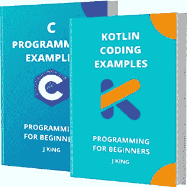
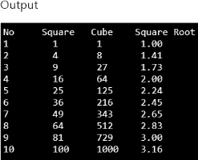

# Kotlin 与 C 编程示例：初学者编程指南





## 目录
- 对两个数进行算术运算的 Kotlin 程序
- 简单计算程序
- 运行时输入数字（整数、浮点数、双精度）的程序
- 寻找三个数中最大的 Kotlin 程序
- 交换两个数字 Kotlin 程序
- 检查数字是偶数还是奇数的 Kotlin 程序
- 打印乘法表的 Kotlin 程序
- 计算并显示学生成绩的程序
- 转换温度的 Kotlin 程序
- 显示斐波那契数列的 Kotlin 程序
- 计算圆面积的 Kotlin 程序
- 计算正方形面积的 Kotlin 程序
- 计算圆柱面积的程序
- 生成 4 位 OTP 的 Kotlin 程序
- 计算五边形面积的 Kotlin 程序
- 寻找质数的 Kotlin 程序
- 进制转二进制的 Kotlin 程序
- 计算两个数和和平均值的 C 程序
- 打印字符 ASCII 值的 C 程序
- 使用 goto 语句打印从 1 到 N 的所有数字 C 程序
- 使用 while 循环打印从 1 到 N 的数字程序
- 打印平方、立方和平方根的程序
- 打印给定数字数表的程序
- 三个数中最大数的程序
- C 语言中的矩形面积程序
- C 程序 - 英制转英寸
- 使用文件处理创建文本文件的程序
- 计算数字阶的 C 程序
- 交换字节中两个位的程序
- 使用四种不同方法交换两个数字的程序
- 年龄计算器（计算年龄的 C 程序）
- 设计数字钟的 C 程序
- 计算复利的程序
- 检查数字是否为完全平方程序
- 程序中不用分号打印消息
- 使用 C 语言的级数程序/示例

# Kotlin 基础程序

## 对两个数进行算术运算的 Kotlin 程序
示例：
输入：
```
a = 13
b = 5
```
输出：
```
a + b = 18
a - b = 8
a * b = 65
a / b = 2
a % b = 3
```

```kotlin
// 程序主入口点
fun main(args: Array<String>) {
    val a = 13
    val b = 5
    val sum = a + b // 加法
    val sub = a - b // 减法
    val muti = a * b // 乘法
    val div = a / b // 除法
    val rem = a % b // 余
    // 在控制台打印
    println("Addition of $a and $b is : $sum")
    println("Subtraction of $a and $b is : $sub")
    println("Multiplication of $a and $b is: $muti")
    println("Division of $a and $b is : $div")
    println("Remainder of $a and $b is : $rem")
}
```
输出：
```
Addition of 13 and 5 is : 18
Subtraction of 13 and 5 is : 8
Multiplication of 13 and 5 is: 65
Division of 13 and 5 is : 2
Remainder of 13 and 5 is : 3
```

### 简单计算程序
用户必须输入 (+, -, *, /, %) 中的任何选择来执行操作。

```kotlin
/**
 * 对两个数进行简单计算的 Kotlin 程序
 * 用户必须输入 ( +, -, *, /, % ) 中的任何选择来执行操作
 */
package com.includehelp.basic
import java.util.*

// 程序主入口点
fun main(args: Array<String>) {
    // 获取输入的输入流
    val reader = Scanner(System.`in`)
    // 输入整数值
    print("Enter Integer Value : ")
    var first = reader.nextInt()
    // 输入整数值
    print("Enter Integer Value : ")
    var second = reader.nextInt()
    // 输入任何字符作为选择
    print("Enter any Action( +, -, /, % ) : ")
    val choice = reader.next()[0]
    try {
        var result = when(choice) {
            '+' -> first + second
            '-' -> first - second
            '*' -> first * second
            '/' -> first / second
            '%' -> first % second
            else -> {
                System.err.println("Not a Valid Operation choice")
                return
            }
        }
        // 打印结果
        println("Result is : $result")
    } catch (E: Exception) {
        System.err.println("Exception : ${E.toString()}")
    }
}
```
输出：
```
RUN 1:
Enter Integer Value : 35
Enter Integer Value : 8
Enter any Action( +, -, /, % ) : %
Result is : 3
RUN 2:
Enter Integer Value : 45
Enter Integer Value : 67
Enter any Action( +, -, /, % ) : /
Result is : 6
```

### 运行时输入数字（整数、浮点数、双精度）的程序
```kotlin
import java.util.*

// 程序主入口点
fun main(args: Array<String>) {
    // 获取输入的输入流
    val reader = Scanner(System.`in`)
    // 输入整数值
    print("Enter Integer Value : ")
    val intValue = reader.nextInt()
    println("Integer Number : $intValue")
    // 输入长型值
    print("Enter Long Value : ")
    val longValue = reader.nextLong()
    println("Long Number : $longValue")
    // 输入浮点值
    print("Enter Float Value : ")
    val floatValue = reader.nextFloat()
    println("Float Number : $floatValue")
    // 输入双精度值
    print("Enter Double Value : ")
    val doubleValue = reader.nextDouble()
    println("Double Number : $doubleValue")
}
```
输出：
```
Run 1:
Enter Integer Value : 123
Integer Number : 123
Enter Long Value : 34355566
Long Number : 34355566
Enter Float Value : 45.34
Float Number : 45.34
Enter Double Value : 456.78
Double Number : 456.78
```

### 寻找三个数中最大的 Kotlin 程序
示例：
输入：
First number: 10
Second number: 20
Third number: 30
输出：
Largest number: 30

```kotlin
package com.includehelp.basic
import java.util.*

// 程序主入口点
fun main(args: Array<String>) {
    // 获取输入的输入流
    val reader = Scanner(System.`in`)
    // 输入整数值
    print("Enter First Value : ")
    var first = reader.nextInt()
    // 输入第二个值
    print("Enter Second Value : ")
    var second = reader.nextInt()
    // 输入第三个值
    print("Enter Third Value : ")
    var third = reader.nextInt()
    // 寻找三个数中最大值的条件
    val largest = if (first > second && first > third) {
        first
    } else if (second > third) {
        second
    } else {
        third
    }
}
```


## 交换两个数字的 Kotlin 程序

### 示例:
输入：
第一个数字：10
第二个数字：20
输出：
第一个数字：20
第二个数字：10

### 程序代码
```kotlin
import java.util.*
// 程序主方法入口点
fun main(arg: Array<String>) {
    // 输入流获取输入
    var reader = Scanner(System.`in`)
    // 输入两个值
    println("Enter First Value : ")
    var first = reader.nextInt();
    println("Enter Second Value : ")
    var second = reader.nextInt();   
    println("Numbers Before Swap : \n first = $first \n second = $second ")
    // 交换数字的代码
    var temp = first
    first=second
    second=temp
    println("Numbers After  Swap : \n first = $first \n second = $second ")
}
```

### 输出
运行 1:
Enter First Value :
45
Enter Second Value :
12
Numbers Before Swap :
first = 45
second = 12
Numbers After  Swap :
first = 12
second = 45

## 检查数字是偶数还是奇数的 Kotlin 程序

### 示例:
输入：
N = 13
输出：
"ODD"
输入：
N = 24
输出：
"EVEN"

### 程序代码
```kotlin
/*
    * 输入整数的 Kotlin 程序
    * 检查数字是偶数还是奇数
*/
import java.util.*
// 程序主方法入口点
fun main(args: Array<String>) {
    // 输入输入的流
    val reader = Scanner(System.`in`)
    // 输入值
    println("Enter Integer Value : ")
    var number = reader.nextInt();
    val str = if(number%2==0) "EVEN" else "ODD"
    println("Number is $str")
}
```

### 输出
运行 1:
Enter Integer Value :
34
Number is EVEN
---
运行 2:
Enter Integer Value :
15
Number is ODD

## 打印乘法表的 Kotlin 程序

### 程序代码
```kotlin
import java.util.*
// 程序主函数入口
fun main(args: Array<String>) {
    val sc = Scanner(System.`in`)
    println("Enter Number: ")
    val num: Int = sc.nextInt()
    // 循环打印给定数字的乘法表
    for (i in 1..10) {
        val result = num * i
        println("$num*$i = $result")
    }
}
```

### 输出
Enter Number:
5
5*1 = 5
5*2 = 10
5*3 = 15
5*4 = 20
5*5 = 25
5*6 = 30
5*7 = 35
5*8 = 40
5*9 = 45
5*10 = 50

## 计算并显示学生成绩的程序

### 规则:
百分比 >= 80 -> A
百分比 >= 60 -> B
百分比 >= 40 -> C
其他 -> D
注：每门科目最高分 100

### 示例:
输入：
English = 98
Physics = 34
Chemistry = 67
Maths = 90
输出：
总分 = 356.0
百分比 = 71.2
等级 = B

### 程序代码
```kotlin
import java.util.*
// 主函数，程序入口点
fun main(args: Array<String>) {
    // 课程科目名称数组
    val subjectName = arrayOf<String>("English","Physics","Maths")
    // 输入流
    val scanner = Scanner(System.`in`)
    // 声明包含分数的数组
    val marksArray = DoubleArray(5)
    // 开始输入分数
    println("Input Marks->")
    for(i in marksArray.indices){
        print("${subjectName[i]} : ")
        marksArray[i] = scanner.nextDouble()
    }
    // 计算所有科目的总分
    val total = marksArray.sum()
    // 计算百分比
    val percentage = marksArray.average()
    // 打印总分和百分比
    println("Total of All subjects Marks : $total")
    println("Percentage : $percentage")
    // 根据百分比确定等级
    when{
        percentage>80 -> println("Grade : A")
        percentage>60 -> println("Grade : B")
        percentage>40 -> println("Grade : C")
        else -> println("Grade : D")
    }
}
```

### 输出
运行 1:
English : 98
Physics : 42
Chemistry : 67
Maths : 90
Total of All subjects Marks : 297
Percentage : 74.25
Grade : B

## 温度转换的 Kotlin 程序

### 示例:
输入：
Fahrenheit = 67
输出：
Celsius = 19.444444444444443

### 程序代码
```kotlin
package com.includehelp
import java.util.*
// 主函数，程序入口点
fun main(args: Array<String>) {
    // 输入流
    val scanner = Scanner(System.`in`)
    // 输入华氏度温度
    print("Enter temperature into Fahrenheit : ")
    val fahrenheit = scanner.nextDouble()
    // 将华氏度转换为摄氏度
    val celsius = (fahrenheit - 32) * 5/9
    // 打印摄氏度
    println("Celsius = $celsius")
}
```

### 输出
将是:
运行 1:
Enter temperature into Fahrenheit : 67
Celsius = 19.444444444444443
---
运行 2:
Enter temperature into Fahrenheit : 78
Celsius = 25.555555555555555

## 显示斐波纳契数列的 Kotlin 程序

### 示例:
输入：
term1 = 0
输出：
term2 = 1
输入：
N = 10
输出：
Fibonacci series: 0

### 程序代码
```kotlin
/**
 * 显示给定次数的斐波纳契数列
 * e.g. 0 1 1 2 3 5 8.... */
import java.util.*
// 程序主函数入口
fun main(args: Array<String>) {
    // 输入流
    val scanner = Scanner(System.`in`)
    // 输入次数
    println("Enter terms : ")
    val n = scanner.nextInt()
    var term1 = 0
    var term2 = 1
    var count = 1
    // 循环打印斐波纳契数列
    while (count <= n){
        print("$term1 ")
        val s = term1+term2
        term1 = term2
        term2 = s
        count++
    }
}
```

### 输出
运行 1:
Enter terms : 10
0 1 1 2 3 5 8 13 21 34 
---
运行 2:
Enter terms : 5
0 1 1 2 3 

## 计算圆面积的 Kotlin 程序

### 示例:
输入：
Radius: 3
输出：
Area of circle : 28.259999999999998

### 程序代码
```kotlin
import java.util.*
// PI 常量值
val PI = 3.14
/* 计算给定半径的圆面积 */
fun getAreaOfCirlce(radius: Double): Double {
    return PI * radius * radius
}
// 主方法入口点
fun main(args: Array<String>){
    val sc = Scanner(System.`in`)
    // 输入半径
    println("Enter Circle Radius : ")
    val radius = sc.nextDouble()
    // 调用函数获取圆面积
    val areaOfCircle = getAreaOfCirlce(radius)
    // 打印圆面积
    println("Area of circle : $areaOfCircle")
}
```

### 输出
运行 1:
Enter Circle Radius : 3
Area of circle : 28.259999999999998
-----
运行 2:
Enter Circle Radius : 8
Area of circle : 200.96

## 计算正方形面积的 Kotlin 程序

### 示例:
输入：
side = 6
输出：
area = 36.0

### 程序代码
```kotlin
import java.util.*
// 主函数，程序入口点
fun main(args: Array<String>) {
    // 输入流
    val scanner = Scanner(System.`in`)
    // 输入正方形边长
    print("Enter Side of Square : ")
    val side = scanner.nextDouble()
    // 计算正方形面积
    val squareArea = side*side
    // 打印面积
    println("Area of Square is : $squareArea")
}
```

### 输出
运行 1:
Enter Side of Square : 6
Area of Square is : 36.0


输入正方形边长：4.5
正方形面积为：20.25

## 计算圆柱面积的程序

示例：
输入：
半径 = 5
高度 = 7
输出：
圆柱表面积：75.39822368615503

### 程序
```kotlin
package com.includehelp
import java.util.*

//主函数，程序入口点
fun main(args: Array<String>) {
    // 输入流
    val scanner = Scanner(System.`in`)
    // 输入半径
    print("输入圆柱半径： ")
    val radius = scanner.nextDouble()
    // 输入高度
    print("输入圆柱高度： ")
    val height = scanner.nextDouble()
    // 圆柱表面积
    val areaCylinder = 2*Math.PI*(radius+height)
    // 打印面积
    println("圆柱表面积为：$areaCylinder")
}
```

输出
运行 1：
输入圆柱半径：5
输入圆柱高度：7
圆柱表面积为：75.39822368615503

运行 2：
输入圆柱半径：29
输入圆柱高度：4
圆柱表面积为：207.34511513692635

## 生成 4 位 OTP 的 Kotlin 程序

### 程序
```kotlin
/**
 * 生成 4 位 OTP 的 Kotlin 程序
 */
/**
 * 生成 4 位 OTP 字符串的函数
 * @return
 */
fun generateOTP(): String {
    val randomPin = (Math.random() * 9000).toInt() + 1000
    return randomPin.toString()
}

// 程序主方法入口点
fun main(args: Array<String>) {
    // 调用函数生成 OTP
    val otp1 = generateOTP()
    // 打印 OTP
    println("OTP : $otp1")
}
```

输出
运行 1：
OTP : 7997
运行 2：
OTP : 7682
运行 3：
OTP : 6934
运行 4：
OTP : 4189

## 计算五边形面积的 Kotlin 程序

计算五边形面积的公式：= (5/2)sa ，其中：
`s` - 五边形的边长
`a` - 五边形的边高

示例：
输入：
side= 5
apothem = 6
输出：
area = 75.0

### 程序
```kotlin
import java.util.*

//主函数，程序入口点
fun main(args: Array<String>) {
    // 输入流
    val scanner = Scanner(System.`in`)
    // 输入边长
    print("输入五边形边长： ")
    val s = scanner.nextDouble()
    // 输入边高
    print("输入五边形边高： ")
    val a = scanner.nextDouble()
    // 五边形面积
    val areaPentagon = (5.0/2.0)*s*a
    // 打印面积
    println("五边形面积为：$areaPentagon")
}
```

输出
运行 1：
输入五边形边长：5
输入五边形边高：6
五边形面积为：75.0

运行 2：
输入五边形边长：8
输入五边形边高：6
五边形面积为：120.0

## 查找质数的 Kotlin 程序

示例：
输入：
start = 1
end = 100
输出：
[2, 3, 5, 7, 11, 13, 17, 19, 23, 29, 31, 37, 41, 43, 47, 53, 59, 61, 67, 71, 73, 79, 83, 89, 97]

### 程序
```kotlin
/**
 * 在给定范围（START 和 END）内查找质数的 Kotlin 程序
 * 质数是一个大于 1 的整数，其因数只有 1 和它本身。
 * 例如 7, 13, 17
 */
import java.util.*

// 检查是否为质数的函数
fun findPrimeNo(number: Long): Boolean {
    if(number < 2) return false
    for (i in 2..number/2) {
        if (number % i == 0L) {
            return false
        }
    }
    return true
}

// 主函数，程序入口
fun main(arg: Array<String>) {
    // 输入流
    val sc = Scanner(System.`in`)
    // 输入范围起始值
    print("输入范围起始： ")
    val start = sc.nextLong()
    // 输入范围结束值
    print("输入范围结束： ")
    val end = sc.nextLong()
    // 声明用于存储的可变列表
    val list: MutableList<Long> = ArrayList()
    // 遍历循环从开始到结束以查找范围内的数字
    for (i in start..end) {
        if (findPrimeNo(i)) {
            list.add(i)
        }
    }
    println("从 $start 到 $end 的质数：$list")
}
```

## 将十进制转换为二进制的 Kotlin 程序

示例：
输入：
start = 1
end = 100
输出：
[2, 3, 5, 7, 11, 13, 17, 19, 23, 29, 31, 37, 41, 43, 47, 53, 59, 61, 67, 71, 73, 79, 83, 89, 97]

| 十进制 | 除以 2 | 余数 |
|---|---|---|
| 12 | 6 | 0 |
| 6 | 3 | 0 |
| 3 | 1 | 1 |
| 1 | 0 | 1 |
| 0 | | |
| 二进制 | | 1100 |

### 程序
```kotlin
import java.util.*

/* 将十进制转换为二进制 */
 */
/* 转换二进制的函数
 * @return
 */
fun generateOTP(decimalNumber): String {
    val randomPin = (Math.random() * 9000).toInt() + 1000
    return randomPin.toString()
}

/* 将十进制转换为二进制 */
 */
/* 转换二进制的函数
 * @return
 */
fun generateOTP(decimalNumber): String {
    val binaryStr = StringBuilder()
    while (decimalNumber > 0) {
        val r = decimalNumber % 2
        binaryStr.append(r)
        decimalNumber /= 2
    }
    return binaryStr.reverse().toString()
}

// 主方法入口点
fun main(arg: Array<String>) {
    // 输入流
    val sc = Scanner(System.`in`)
    // 输入十进制数
    println("输入十进制数：")
    val decimalNumber = sc.nextInt()
    // 打印二进制
    println("二进制为：${generateOTP(decimalNumber)}")
}
```

输出
运行 1：
输入十进制数：12
二进制为：1100

运行 2：
输入十进制数：6
二进制为：110

运行 3：
输入十进制数：3
二进制为：11

运行 4：
输入十进制数：1
二进制为：1

## 计算两个数的和和平均值的 C 程序

## 两个数的和和平均值

### 程序
```c
/* 计算两个数的和和平均值 */
#include <stdio.h>
int main()
{
    int a,b,sum;
    float avg;
    printf("输入第一个数：");
    scanf("%d",&a);
    printf("输入第二个数：");
    scanf("%d",&b);
    sum=a+b;
    avg=(float)(a+b)/2;
    printf("\n%d 和 %d 的和为：%d",a,b,sum);
    printf("\n%d 和 %d 的平均值为：%f",a,b,avg);
    return 0;
}
```

输出
输入第一个数：10
输入第二个数：15
10 和 15 的和为：25
10 和 15 的平均值为：12.500000

## 打印字符的 ASCII 值的 C 程序

### 程序
```c
/* 打印字符的 ASCII 值 */
#include <stdio.h>
int main()
{
    char ch;
    //输入字符
    printf("输入字符：");
    scanf("%c",&ch);
    printf("ASCII 值为：%d\n", ch);
    return 0;
}
```

输出
输入字符：a
ASCII 值为 97

## 使用 goto 语句打印 1 到 N 的数字 C 程序

### 程序
```c
/* 使用 goto 语句打印 1 到 N 的数字 */
#include <stdio.h>
int main()
{
    int count,n;
    //读取 N 的值
    printf("输入 n 的值：");
    scanf("%d",&n);
    //初始化 count 为 1
    count =1;
    start: // 标签
    printf("%d ",count);
    count++;
    if(count<=n)
    goto start;
    return 0;
}
```

输出
输入 n 的值：10
1 2 3 4 5 6 7 8 9 10 

## 使用 while 循环打印 1 到 N 的数字 C 程序

### 程序
```c
/* 使用 while 循环打印 1 到 N 的数字 */
#include <stdio.h>
int main()
{
    int number,n;
    //输入 N 的值
    printf("输入 N 的值：");
    scanf("%d",&n);
    //分配初始值
    //我们想从这里开始打印数字
    number =1;
    while(number <= n) {
        printf("%d ",number);
        number++;
    }
    return 0;
}
```

输出
输入 N 的值：10
1 2 3 4 5 6 7 8 9 10 


## print 语句

```c
printf("Numbers from 1 to %d: \n",n);

//while 循环，将打印数字
//从 1 到 n
while(number <= n)
{
    //打印数字
    printf("%d ",number);
    //循环计数器加 1
    number++;
}
return 0;
}
```

输出
输入 N 的值: 25
从 1 到 25 的数字为：
1 2 3 4 5 6 7 8 9 10 11 12 13 14 15
16 17 18 19 20 21 22 23 24 25

## 打印平方、立方和平方根的程序

### 程序
```c
/*打印 1 到 N 所有数字平方、立方和平方根的 C 程序。*/
#include <stdio.h>
#include <math.h>
int main()
{
    int i,n;
    ��� printf("输入 N 的值: ");
       scanf("%d",&n);
       printf("编号     平方   立方     平方根\n",n);
       for(i=1;i<=n;i++)
    {
              printf("%d \t %ld \t %ld \t %.2f\n",i,(i*i),(i*i*i),sqrt((double)i));
    }
       return 0;
}
```


## 打印指定数字乘表的程序

### 程序
```c
#include<stdio.h>
int main()
{
//声明变量
int count,t,r;
//读取 t 的值
printf("输入数字: ");
scanf("%d",&t);
count=1;
start:
if(count<=10)
{
    // 乘法公式
    r=t*count;
    printf("%d*%d=%d\n",t,count,r);
    count++;
    goto start;
}
return 0;
}
```
输出
输入数字: 10
10*1=10
10*2=20
10*3=30
10*4=40
10*5=50
10*6=60
10*7=70
10*8=80
10*9=90
10*10=100

## 三个数中求最大数的程序

### 程序
```c
/*找出 3 个数中最大值的 C 程序*/
#include <stdio.h>
int main()
{
    int a,b,c;
    int largest;
    printf("输入三个数字（用空格分隔）:");
    scanf("%d%d%d",&a,&b,&c);
    if(a>b && a>c)                    largest=a;
    else if(b>a && b>c)                            largest=b;
    else
             largest=c;
    printf("最大数字是 = %d",largest);
    return 0;
}
```
输出
第一次运行：
输入三个数字（用空格分隔）: 10 20 30
最大数字是 = 30
第二次运行：
输入三个数字（用空格分隔）:10 30 20
最大数字是 = 30
第三次运行：
输入三个数字（用空格分隔）:30 10 20
最大数字是 = 30
第四次运行：
输入三个数字（用空格分隔）:30 30 30
最大数字是 = 30

## C 语言矩形面积程序

### 程序
```c
/*计算矩形面积的 C 程序。*/
#include <stdio.h>
int main()
{
    float l,b,area;
    printf("输入长度的值: ");
    scanf("%f",&l);
    printf("输入宽的值: ");
    scanf("%f",&b);
    area=l*b;
    printf("矩形面积: %f\n",area);
    return 0;
}
```
输出
    输入长度的值: 1.25
    输入宽的值: 3.15
    矩形面积: 3.937500

## C 语言程序 - 英尺转换为英寸

### 程序
```c
#include<stdio.h>
int main()
{
int feet,inches;
printf("输入英尺的值: ");
scanf("%d",&feet);
// 转换为英寸
inches=feet*12;
printf("总英寸为: %d\n",inches);
return 0;
}
```
输出
    输入英尺的值: 15
    总英寸为: 180

## 使用文件处理创建文本文件的程序

### 程序
```c
#include< stdio.h
int main()
{
   ;;指针指针指针
    指针����� char fName[20];
        printf("输入要创建的文件名:");
        scanf("%s",fName);
        /*（打开）一个文件，以“w”模式写入*/
    fp=fopen(fName,"w");
        /*检查文件是否创建*/
    if(fp==NULL)
    {
                printf("文件未创建!!!");
                exit(0); /*退出程序*/
    }
        printf("文件创建成功。");
    return 0;
}
```
输出
    第一次运行：
    输入要创建的文件名: file1.txt
    文件创建成功。
    第二次运行：
    输入要创建的文件名: file1.txt
    文件创建成功。
    第三次运行：
    输入要创建的文件名: file1.txt
    文件未创建!!!

## 计算数字阶乘的 C 程序

阶乘是一个整数，如下所示。
示例：
5 的阶乘是 5*4*3*2*1=120

## 计算阶乘的简单程序
```c
/*计算数字阶乘的 C 程序*/
#include <stdio.h>
int main()
{
    int num,i;
    long int fact;
    printf("输入一个数字: ");
    scanf("%d",&num);
    fact=1;
    for(i=1; i<=num; i++)
{
       fact=fact*i;
}
    printf("%d 的阶乘是 %ld\n",num,fact);
    return 0;
}
```

 定义函数
使用函数：使用函数计算阶乘。
```c
#include <stdio.h>
long factorial(int n) {
    if (n <= 1)
        return 1;
    else
        return n * factorial(n-1);
}

int main()
{
    int num;
    printf("输入一个数字: ");
    scanf("%d",&num);
    printf("%d 的阶乘是 %ld\n", num, factorial(num));
    return 0;
}
```


交换后（第一方法）: A= 200, B= 100

交换后（第二方法）: A= 100, B= 200

交换后（第三方法）: A= 200, B= 100

交换后（第四方法）: A= 100, B= 200

## 年龄计算器（计算年龄的 C 程序）

### 程序

```c
/*年龄计算器（计算年龄的 C 程序）。*/
#include <stdio.h>
#include <time.h>
/*检查给定年份是否为闰年*/
int isLeapYear(int year, int mon)
{
    int flag = 0;
    if (year % 100 == 0)
    {
        if (year % 400 == 0)
        {
            if (mon == 2)
            {
                flag = 1;
            }
        }
    }
    else if (year % 4 == 0)
    {
        if (mon == 2)
        {
            flag = 1;
        }
    }
    return (flag);
}
int main()
{
    int DaysInMon[] = {31, 28, 31, 30, 31, 30, 31, 31, 30, 31, 30, 31};
    int days, month, year;
    char dob[100];
    time_t ts;
    struct tm *ct;
    /*输入出生日期 */
    printf("输入您的出生日期 (DD/MM/YYYY): ");
    scanf("%d/%d/%d",&days,&month, &year);
    /*获取当前日期.*/
    ts = time(NULL);
    ct = localtime(&ts);
    printf("Current Date: %d/%d/%d\n",
           ct->tm_mday, ct->tm_mon + 1, ct->tm_year + 1900);
    days = DaysInMon[month - 1] - days + 1;
    /*闰年检查*/
    if (isLeapYear(year, month))
    {
        days = days + 1;
    }
    /*按天、月、年计算年龄 */
    days = days + ct->tm_mday;
    month = (12 - month) + (ct->tm_mon);
    year = (ct->tm_year + 1900) - year - 1;
    /*检查 2 月是否有 29 日 */
    if (isLeapYear((ct->tm_year + 1900), (ct->tm_mon) + 1))
    {
        if (days >= DaysInMon[ct->tm_mon] + 1)
        {
            days = days - (DaysInMon[ct->tm_mon] + 1);
            month = month + 1;
        }
    }
    else if (days >= DaysInMon[ct->tm_mon])
    {
        days = days - DaysInMon[ct->tm_mon];
        month = month + 1;
    }
    if (month >= 12)
    {
        year = year + 1;
        month = month - 12;
    }
    /*打印年龄 */
    printf("\n 嘿，你今年 %d 岁%d 个月零%d 天。\n", year, month, days);
    return 0;
}
```

## 设计数字钟的 C 程序

### 程序

```c
/*设计数字钟的 C 程序.*/
#include <stdio.h>
#include <time.h> // 用于 sleep() 函数
#include <unistd.h>
#include <stdlib.h>
int main()
{
    time_t ts;
    struct tm *ct;
    while (1)
    {
        ts = time(NULL);
        ct = localtime(&ts);
        printf("\r 时间: %02d:%02d:%02d", ct->tm_hour, ct->tm_min, ct->tm_sec);
        fflush(stdout);
        sleep(1);
    }
    return 0;
}
```
