# Kotlin Multiplatform 教程（第一版）：通过跨平台共享代码更快地构建原生应用


通过跨平台共享代码，更快地构建原生应用

作者：raywenderlich 教程团队

Kevin D. Moore、Carlos Mota 和 Saeed Taheri


要跟随本书进行学习，你需要准备以下内容：

- **Kotlin 1.6.10**：本书通篇使用 Kotlin 1.6.10，以保持与多个其他库版本的兼容性。
- **Android Studio Bumblebee | 2021.1.x**：可在 https://developer.android.com/studio/ 获取。你将使用 Android Studio 来开发本书中的 Android 和桌面应用。
- **Xcode 13.1**：可在 https://developer.apple.com/xcode/ 获取。你需要使用 Xcode 来编译和运行本书中的 iOS 应用。
- **macOS Monterey**：你需要使用 macOS 来编译 iOS 专用代码并运行面向 iOS 的测试。


本书的材料可以从 GitHub 书籍材料仓库中克隆或下载：

- https://github.com/raywenderlich/kmpf-materials/tree/editions/1.0

## 论坛

我们还为本书建立了一个官方论坛：https://forums.raywenderlich.com/c/books/kotlin-multiplatform-by-tutorials。这是一个提问或提交你发现的错误的好地方。

## iii 献词

> “献给我的妻子和家人，感谢他们忍受我总是一头扎在电脑前，让我得以创作和学习。”
> 
> — *Kevin Moore*

> “献给 Beatriz、José 和 Petá，你们是我的指路明灯。献给 Carlos 和 Maria，你们总是为了我的幸福和未来付出一切乃至更多。我衷心而永远地感谢你们。
> 
> 献给 Daniela，感谢你所有的爱、陪伴与支持，感谢你总能在任何境遇中找到光明。
> 
> 献给我所有随时一个电话就能联系到的朋友们。特别感谢 Ricardo 与我进行的所有架构讨论，感谢 Andreia 和 Curto 的温馨晚餐，感谢 Fred 和 Jorge——那些拥抱 Kotlin 的 iOS 开发者。
> 
> 还有你，了不起的读者，欢迎上船！”
> 
> — *Carlos Mota*

> “献给我的妻子 Leila，以及永远不会读到这本书的父亲！他们无条件的爱、耐心和支持，让我有勇气写下这本书。”
> 
> — *Saeed Taheri*


**Kevin Moore** 是本书的作者之一。Kevin 开发 Android 应用已超过 10 年，曾在许多公司任职。他在 https://raywenderlich.com/ 上撰写过多篇文章、书籍和视频。他喜欢开发应用以自娱，也喜欢教别人如何编写 Android 应用。除了编程之外，他还热爱打排球，并在教堂负责音响系统。


**Carlos Mota** 是本书的作者之一。Carlos 是 Android GDE（谷歌开发者专家），你很容易看到他要么在开发使用 Kotlin 编写的 Android 应用，要么在结合 Kotlin Multiplatform 进行开发。他对新技术充满热情，不断尝试完成那些似乎遥不可及的业余项目中最后的 20%。他喜欢通过演讲、教学、写作，或者在最近的酒吧里配着冰啤酒，与他人分享知识。作为 GDG Coimbra 的组织者和 Kotlin 倡导者，他还对旅行、摄影、太空以及偶尔的跑步充满热情。


**Saeed Taheri** 是本书的作者之一。他开发 iOS 应用已有约 10 年，开发 Android 应用约 4 年。他曾在 https://raywenderlich.com 上发表文章。不在电脑前时，他喜欢与家人共度时光，踢足球或看电视转播。


**Godfred Afful** 是本书的技术编辑。他是一名软件工程师，专注于后端和移动应用开发。他热爱艺术、体育、大自然和猴子。


**Jonathan Wong** 是本书的技术编辑。他是 Square 的移动开发者、raywenderlich.com 视频团队成员、pluralsight.com 的作者，并运营着自己的博客和 YouTube 频道 Mobile Under 10。他是阳光明媚的圣地亚哥的一名软件工程师，在那里他从事过移动应用、前端 JavaScript 和服务端开发等各种工作。在不照顾两个孩子、三只猫或五只鸡的时候，他通常会想办法挤出时间好好跑跑步，或喝一杯好咖啡。


**Megan Mallicoat** 是本书的编辑。Megan 是一名编辑，也是大学新闻学讲师。她在传播管理、网页设计和平面设计方面拥有专业经验，但她最热衷的是指出语法和拼写错误。在“空闲时间”，你很可能看到她坐在某种儿童体育训练场的边线上，手里拿着一本书。


**Subhrajyoti Sen** 是本书的终审编辑。Subhrajyoti 是 Android 方向的谷歌开发者专家，也是 KeepTruckin 的 Android 工程师，在那里他开发应用以改善货运行业。在此之前，他从事过改善印度投资者体验的应用开发。他相信开源和社区的力量，并积极回馈。不写代码的时候，你会发现他在狂刷动漫、阅读公共政策，或者玩《Rocket League》。

如果你的目标是利用 Kotlin 在原生应用之间共享代码，那么这本书正是为你准备的。

维护包含重复代码的多个原生应用可能是一个耗时的过程。这种重复还会增加测试工作量，最终拖慢项目进度并增加成本。

你可以使用 Kotlin Multiplatform 在 Android、iOS 和桌面应用之间共享代码，但需要考虑多个因素。你应该能够使用自己选择的框架原生地开发 UI。使用合适的框架可以大幅减少 UI 开发时间，并为你提供灵活的 API。

与此同时，你需要弄清楚 Kotlin Multiplatform 如何与你当前的架构契合，以及如何访问平台特定的 API。选择合适的架构可以让你的应用可测试、可维护且易于开发。

然后，你需要确定应用的哪些层可以迁移到共享模块，以及如何使用不同的库来协助这一迁移。最后，你应该能够发布和共享你的共享模块，以便在多个平台的应用中使用它。

在本书中，每一章都包含关于特定主题的理论和一个简单的实践任务，以帮助你更快学会实现。你将开发三个很棒的应用——每个部分一个。它们各自聚焦于 Kotlin Multiplatform 的重要方面。

要想学习并注意到每个细节，请按顺序阅读各章。不过，这本书面向高级用户，你可能会想跳过某些章节。在这种情况下，请务必从你要前往章节的起始项目继续。起始项目包含某个部分前面各章中已实现的所有步骤。

在学习章节时，你可以立即在 Android Studio 中输入代码。你可以随意摆弄代码，并研究章节中提供的参考资料。有些章节还包含有趣的挑战，让你扩展所学到的主题。

本书分为三个主要部分：

Kotlin Multiplatform 的核心优势之一是你可以跨原生应用共享代码。你可以继续使用原生 UI 工具包（如 Android 的 Jetpack Compose 和 iOS 的 SwiftUI）来开发 UI 层。

在本部分中，你将学习如何添加一个新的 Gradle 模块，从而只需编写一次业务逻辑。你还将学习如何为 Android、iOS 和桌面应用创建原生 UI，同时共享通用模块。

为了有效地跨应用共享代码，有几件事需要牢记：访问平台特定 API、支持现有软件工程实践，以及持久化。

在本部分中，你将学习如何在共享模块中使用 Kotlin 特性访问平台特定 API，以及 Kotlin Multiplatform 如何与你当前的架构契合。你还将了解依赖注入，以及如何利用它来测试共享模块中的功能。最后，你将学习如何使用通用代码库来处理不同平台上的持久化。

网络对大多数现代应用至关重要，它通常涉及使用不同的框架和语言实现类似的逻辑。在底层，它还涉及序列化和并发等概念。幸运的是，Kotlin Multiplatform 为这些需求提供了专门的库。

在本部分中，你将学习如何使用序列化将 JSON 数据解码为 Kotlin 对象。然后，你将学习如何使用一个通用的网络库，借助这种通用序列化从互联网获取数据。为了让网络性能更优，你还将学习如何使用协程在 Kotlin 中进行并发，以及在不同平台上的注意事项。最后，你将学习如何将现有功能抽取为 Kotlin Multiplatform 库，以及发布该库的不同方式。


恭喜！通过阅读这本书，你正在迈出学习如何编写更少代码的第一步。在这三个部分中，你将学习如何使用 Kotlin Multiplatform (KMP) 来设置并编写 iOS、Android 和桌面应用，使用最新的用户界面 (UI) 技术。

在这本书中，你将开发几种不同的应用 —  — 一个时区会议助手、一个用于跟踪待办事项的应用，以及一个显示 raywenderlich.com 所有书籍、文章和视频的应用。

你将学习如何通过在多个平台之间共享业务逻辑来利用 KMP，并在每个平台上创建定制的原生 UI。同时，你还将学习如何为所有的业务逻辑编写测试，使用流行的 JetBrains 库 Ktor 处理网络请求，当然，还会使用 Kotlin Coroutines 处理并发。

本书需要一些移动开发的基础知识，但会为 iOS 和 Android 以及桌面应用的环境搭建提供逐步指导。虽然本书大部分使用 Kotlin，但熟悉 Swift 的 iOS 开发者可以轻松学习 Kotlin。

在本章中，你将了解 Kotlin Multiplatform 以及跨平台框架的历史。章节结束时，你将设置环境、创建新项目，并在 Android 和 iOS 上运行项目。

Kotlin 是一种现代且安全的编程语言。它提供了 null safety，从而防止了多年来困扰开发者的 dreaded null pointer exceptions。Kotlin 还拥有许多创新特性 —  — 如 data classes 和 sealed classes、可以在类之外扩展类的扩展函数、懒加载变量等。

顾名思义，Kotlin Multiplatform 使用 Kotlin 语言并在多个平台上运行。Kotlin 已经在支持 Java Virtual Machine (JVM) 的平台上运行，并使用 Kotlin Native 为不支持 JVM 的平台。Kotlin Native 将 Kotlin 编译为原生字节码，在 Apple 的操作系统、Windows 和 Linux 上原生运行。在 Web 上，KMP 将 Kotlin 编译为 JavaScript 和 HTML。

KMP 支持以下平台：

- Android
- iOS
- macOS
- watchOS
- tvOS
- Windows
- Linux
- Web

这很多平台。像 Web 这样的平台目前仍不够稳定。

# KMP vs. KMM

你使用 KMP 编写使用 Kotlin 的多平台代码。Kotlin Multiplatform Mobile (KMM) 是专门用于跨平台移动开发的 Kotlin 方法。当你谈论仅针对移动设备时，你是在谈论 KMM —  — 但如果你谈论所有平台，包括桌面或 Web，你是在谈论 KMP。

## 跨平台的历史

自 iOS 和 Android 设备并存以来，开发者一直将“一套代码运行于两个平台”的理想视为移动应用开发的圣杯。许多框架尝试实现跨平台开发，包括：

- **PhoneGap**：最早的框架之一，PhoneGap 允许你使用 HTML5、CSS3 和 JavaScript 编写移动应用。已于 2020 年停止维护。
- **Apache Cordova**：PhoneGap 的开源分支。
- **Ionic**：使用 Angular、React 和 Vue UI 框架。
- **Appcelerator Titanium**：基于 JavaScript 的 SDK，支持 iOS、Android、Windows 和 Blackberry。已停止维护，计划于 2022 年 3 月开源。

上述框架通过使用 Web 技术渲染原生控件或看起来像原生的控件。但它们受限于 JavaScript 与原生之间的慢速通信，并且每次原生平台更新都需要相应的更新。

- **Xamarin**：微软拥有的基于 C# 的开发框架，包含 .NET 运行时。该框架编译为 iOS 版本，因此在 iOS 上运行更快，而 Android 则使用即时编译。

- **React Native**：Facebook 的移动框架，基于流行的 React Web 框架。它基于 Web 和 JavaScript，同样存在原生与 Web 之间的慢桥。

- **Flutter**：新秀，可在所有平台运行。其主要优势是几乎可以一次编写所有 UI，部分 UI 需根据平台差异调整（例如桌面和 Web 不需要工具栏）。其缺点是使用 Dart 语言，许多开发者不熟悉；Dart 最近才获得 null safety，且许多包依赖手动的代码生成。

许多基于 Web 的框架逐渐失去人气。Flutter 仍然强劲，但也有人质疑 Dart 的使用。

## Kotlin 的历史

Kotlin 正式发布于 2011 年 7 月。JetBrains 在 2016 年 2 月 15 日发布 1.0 版，并于 2017 年 Google I/O 上宣布为 Android 开发的首选语言。JetBrains 之所以开发 Kotlin，是因为大多数语言缺乏他们所需的特性。如今，JetBrains 将 Kotlin 作为首选语言，正逐步取代 Java。

## 为什么使用 Kotlin？

为什么你应该使用 Kotlin？因为它是少数几种可以同时编译为 JVM 与 native 并用于 iOS、桌面和 Web 的语言。

Kotlin 也非常适合服务器端开发。通过 Ktor 库，网络操作变得轻松。将公共业务逻辑写在一起，确保所有平台行为一致，只需测试一次。它在所有平台上共享同一段代码，降低错误概率并加速开发。每个团队可以根据需要使用尽可能多的共享代码。可以在现有项目中逐步迁移业务逻辑，也可以从零开始编写全部业务逻辑。

iOS 开发者熟悉 Swift，而 Kotlin 与 Swift 非常相似，学习曲线应很小。开发者仍会在 UI 侧使用 Swift，但也可以在业务逻辑上使用 Kotlin。由于 iOS 开发工作仍将大量存在，iOS 开发者将参与开发的所有环节。

# 共享代码的量由团队决定。如果你有现有应用，可以逐步迁移业务逻辑，形成一套可一次测试的共享代码。

KMP 为应用添加的额外体积极小。标准库体积小，只需包含你使用的部分。

**KMM**：KMM 较新，但已非常流行。应用商店中已有大量使用它的应用。许多公司发现，只需一次编写业务逻辑，而无需为 iOS 和 Android 分别实现，能大幅节省团队时间。UI 为原生，开发者更满意，用户也能获得更快的体验。

# ## 什么 KMP 不是

虽然 KMP 提供了 Kotlin 语言，但它不提供 UI。如果想为 Android 创建 UI，你可以使用原生代码或新的 Jetpack Compose UI 框架。iOS 则可以使用 UIKit 或新的 SwiftUI 框架（使用 Swift）。桌面上可以使用 Desktop Compose 或 Java Swing。换句话说，你可以自行选择 UI 的实现方式。许多开发者认为这是优势 —  — UI 始终为原生，避免了 Web 框架那种慢速桥梁通信的问题。

# ## 何时使用 KMP

KMP 和 KMM 的一个优秀特性是你可以根据需求使用全部或部分功能。如果你拥有现有应用，可以使用 KMP 开发新功能或开始用 KMP 替换已有功能。如果你从使用 KMP 处理应用的低层部分开始，你可以在所有平台上复用它。例如，你可以使用 SQLDelight 替换所有数据库代码，只需一套代码。亦或，你可以只写一次业务逻辑，然后在所有平台上复用。若需访问网络 API，也可以一次编写，在所有平台上运行。

# ## 层级

大多数应用包含不同的层级。通常包括网络层、数据库层（如需要）、仓库层（与数据库交互）、业务逻辑层（不总是存在）以及 UI 层。KMP 不提供 UI 层；你将使用原生 UI。

# ### 业务逻辑

如今许多公司拥有 iOS 和 Android 开发团队。每个团队


takes a set of specifications and writes different code to implement those specifications. When testing, each team needs to make sure the logic they’ve implemented works the same as on the other platform. But with two different sets of code, how do they know that all the corner cases work the same way? With one codebase for business logic, both teams can review the code to make sure the logic matches the specifications and know it will work the same for both platforms. With one business logic code base, you can have either both teams work on it together or have one team specialize in writing business logic.

### Database

You can write the database layer using SQLite on mobile and desktop using the SQLDelight library. This library is a multiplatform package designed to run on all these platforms. Imagine having to write this set of code only once. Not only will you write only one set of lower-level SQL database insertions, deletions and updates, but your repository layer only needs to be written once. SQLDelight uses SQL statements to generate code for you. You only need to test once.

### UI

Since KMM doesn’t provide a UI layer, you can use whichever UI system you want. For iOS, developers are turning to **SwiftUI**: a nice, declarative UI toolkit that makes it easy to create beautiful UIs. Now that **Jetpack Compose** has been released as stable, Android developers can use it. Cross-platform desktop UIs have been neglected for quite a while. Swing has been a standard for some time, but it’s old and unmaintained. JetBrains hopes to replace it with **Compose for Desktop**. It uses a lot of Android’s Jetpack Compose underneath, with a layer of desktop code. Currently, there’s an issue with package names with Android using **androidx** and desktop using **org.jetbrains**. JetBrains hope to resolve this in the future.

### Is it Native?

One of the questions most often asked is: Does it use native controls? The answer is yes. Since KMP doesn’t provide any UI layer, all UI is drawn natively. On Android, that can be the built-in View system or the new Jetpack Compose library. On iOS, you can use the built-in native UI or the newer SwiftUI. On the desktop, you can use the older Java Swing or the newer Desktop Compose. For the Mac desktop, you can also use SwiftUI or AppKit. For Android, code is generated as Java class files, while iOS uses LLVM to produce native code and create an Xcode framework library.

### Current state of KMP

At the time of writing, KMP is currently in alpha, but production apps on both the Google and Apple stores already use it. Since there are multiple layers, here’s the current state of the platform as of the writing of this book:

| Component | Status |
|---|---|
| Kotlin/JVM | Stable |
| Kotlin/Native Runtime | Beta |
| KLib binaries | Alpha |
| expect/actual language feature | Beta |
| Multiplatform Gradle plugin | Beta |
| Kotlin/Native interop with C and Objective C | Beta |
| CocoaPods integration | Beta |
| Multiplatform IDE support | Alpha |
| KMM plugin for Android Studio | Experimental |

Fig. 1.1 — KMP Component Status

Since Android apps are built with Kotlin and have been for years, there are no compatibility issues. iOS and macOS apps interact with frameworks built with the KMM system. This will continue to evolve and improve but the feature is still in beta. Desktop apps can use the same shared code as the other platforms but use their own UI.

# Setting up your environment

You can use either IntelliJ or Android Studio to do KMP work. In this book, you’ll use Android Studio because it seems to work better with mobile platforms at the time of writing.

## Download Android Studio

Go to https://developer.android.com/studio and download Android Studio Bumblebee edition or later. Once installed, go to Android Studio’s preferences and then to plugins. Search for **multiplatform** and install the **Kotlin Multiplatform Mobile** plugin:

## Install CocoaPods

CocoaPods is a dependency manager for iOS. Since CocoaPods has been around for a long time, it’s easy to use in Xcode and easy to add dependencies.

Run the following command in Terminal on your Mac:

```
sudo gem install cocoapods
```

The command above installs cocoapods using the default Ruby installation available on macOS.

## Creating your first project

It’s time to create your first project! In Android Studio, open the File menu and choose New ▸ New Project.

In the New Project window, scroll down to the last entry and choose Kotlin Multiplatform App. If you don’t see this, make sure you installed the KMM plugin. Also, make sure to restart Android Studio after installing the plugin. Click Next.

In the next dialog, enter the name **Find Time** and a package name of **com.raywenderlich.findtime** or your own package name. Choose the directory you want to store the project and press **Next**.

# Kotlin Multiplatform keywords

Now that you have the project created, you need to know about two new keywords that were added to the Kotlin language to support KMP: **expect** and **actual**. These let you create functions or variables in the shared module using the **expect** keyword. Those functions or variables aren’t defined in the **commonMain** folder, but are _expected_ in each multiplatform module — like **androidMain** or **iosMain**. If you open the shared folder, you’ll see:

Here, you can see folders for Android, common and iOS. You’ll add the shared classes and code to **commonMain/kotlin**. If you need to write code that is platform specific, you’ll write an **expect** function or variable in the common folder and the **actual** code in both the Android and iOS folders. Open the **commonMain** folder and open **Platform.kt**.

```
package com.raywenderlich.findtime
expect class Platform() {
    val platform: String
}
```


```swift
import SwiftUI
import shared

struct ContentView: View {
    let greet = Greeting().greeting()

    var body: some View {
        Text(greet)
    }
}

struct ContentView_Previews: PreviewProvider {
    static var previews: some View {
        ContentView()
    }
}
```

此文件已为你生成，并由 SwiftUI 编写。你将在后面的章节中学习 SwiftUI 的速成课程。将鼠标悬停在 **greeting()** 上，然后按 **Command-Click**。

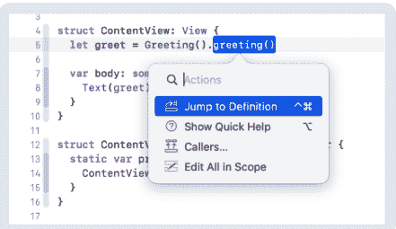

*图 1.12 - Xcode 方法定义*

这将打开 **shared.h** 文件。该文件是用 Objective-C 编写的，但通过它你可以使用 shared 项目中的所有代码。滚动到文件底部，你会看到：

```kotlin
public class Greeting : KotlinBase {
    public init()
    open func greeting() -> String
}

public class Platform : KotlinBase {
    public init()
    open var platform: String { get }
}
```

在 Xcode 中，通过点击 **Play** 或按 **Command-R** 在模拟器中运行该应用。你会看到：

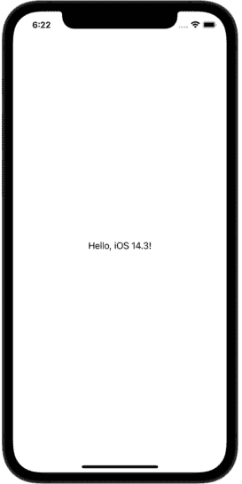

屏幕现在会显示使用 Kotlin 编写的代码，其中包含了设备名称和设备版本。

## 要点

- **KMP** 指的是 Kotlin Multiplatform，而 **KMM** 指的是 Kotlin Multiplatform Mobile。
- **KMP** 有助于编写 **网络、数据库和业务逻辑** 方面的通用代码。
- 你不能将 KMP 用于 UI 工作，而需要使用 **原生框架**。
- 通过使用 **KMM 插件**，可以轻松创建 KMP 项目。

## 接下来去哪里？

在本章中，你已经对 KMP 和 KMM 有了一些了解。

- 如果你想了解更多，请访问 [https://kotlinlang.org/docs/multiplatform.html](https://kotlinlang.org/docs/multiplatform.html)
- 想了解 KMM 的最新动态，请访问 [https://kotlinlang.org/docs/mobile/whats-new-in-kotlin-for-kmm.html](https://kotlinlang.org/docs/mobile/whats-new-in-kotlin-for-kmm.html)。
- 要查看每个平台的当前状态，请访问 [https://kotlinlang.org/docs/mobile/kmm-evolution.html](https://kotlinlang.org/docs/mobile/kmm-evolution.html)。
- 要了解一些使用 KMP 的顶级公司，请访问 [https://medium.com/@touchlab/top-8-mobile-apps-in-2020-built-with-kotlin-multiplatform-3e9fea10e2af](https://medium.com/@touchlab/top-8-mobile-apps-in-2020-built-with-kotlin-multiplatform-3e9fea10e2af) 和 [https://kotlinlang.org/lp/mobile/case-studies/](https://kotlinlang.org/lp/mobile/case-studies/)。

要了解更多关于 Kotlin 的信息：

- raywenderlich.com 学习路径：[https://www.raywenderlich.com/android/paths/learn](https://www.raywenderlich.com/android/paths/learn)
- Kotlinlang 文档：[https://kotlinlang.org/docs/home.html](https://kotlinlang.org/docs/home.html)

在下一章中，你将基于此项目创建 Find Time 项目。

```kotlin
classpath("org.jetbrains.kotlin:kotlin-gradle-plugin:1.5.31")
classpath("com.android.tools.build:gradle:7.0.1")
}
}
```

- 1. **buildscript** 部分描述了获取插件及其版本的位置的所有信息。
- 2. **repositories** 描述了托管这些插件的源。`mavenCentral` 是大多数插件所在的位置，但 Google 和 Gradle 也各有自己的源。
- 3. **dependencies** 描述了你要使用的插件和版本。这里，你使用的是 Kotlin Gradle 插件和 Android Gradle 插件。

接下来是：

```kotlin
// 1
allprojects {
    // 2
    repositories {
        google()
        mavenCentral()
    }
}
```

- 1. **allprojects** 表示以下内容适用于此项目中的所有模块。
- 2. **repositories** 定义了所有模块所需的全部仓库。

最后一部分：

```kotlin
tasks.register("clean", Delete::class) {
    delete(rootProject.buildDir)
}
```

这定义了一个名为 `clean` 的 Gradle 任务。该任务会删除根构建目录。当你需要全新构建时，可以使用它。

现在，打开 **androidApp/build.gradle.kts**。除了 Kotlin 语法不同之外，Android 开发者应该对此很熟悉。它首先定义了 Android 所需的插件：

```kotlin
plugins {
    id("com.android.application")
    kotlin("android")
}
```

Android 需要 application 和 Android Kotlin 插件。下一部分显示了你需要哪些依赖：

```gradle
dependencies {
    // 1
    implementation(project(":shared"))
    // 2
    implementation("com.google.android.material:material:1.4.0")
    implementation("androidx.appcompat:appcompat:1.3.1")

    implementation("androidx.constraintlayout:constraintlayout:2.1.1")
}
```

- 1. Android 依赖于 `shared` 模块（所有共享业务逻辑将位于其中）。
- 2. Android 专用的库（Material Components 和 ConstraintLayout）。

接下来是 Android 专用设置：

```gradle
android {
    // 1
    compileSdk = 31
    defaultConfig {
        // 2
        applicationId = "com.raywenderlich.findtime.android"
        // 3
        minSdk = 21
        targetSdk = 31
        versionCode = 1
        versionName = "1.0"
    }
    // 4
    buildTypes {
        getByName("release") {
            isMinifyEnabled = false
        }
    }
}
```

- 1. **compileSdk** 指定编译时使用的 Android SDK 版本。
- 2. **applicationId** 是 Android 应用的 ID。它在 Google Play 商店中的每个应用都必须是唯一的。
- 3. **minSdk** 指的是你的应用可运行的最低 Android 版本，而 **targetSdk** 指的是你支持的最新 Android 版本。**versionCode** 是你用于在内部区分不同构建的编号，而 **versionName** 是将在 Play 商店中显示的版本。
- 4. 在此处指定调试或发布设置。对于发布版本，这里将 **isMinifyEnabled** 设置为 false，但当你准备发布时，可能希望将其设置为 true。

## 共享构建文件

打开 **shared/build.gradle.kts**。这是 shared 模块的构建脚本。如果你打开 **src** 目录，你会看到 **androidMain**、**commonMain** 和 **iosMain** 目录。这些目录包含 Android 和 iOS 的共享文件，以及所有模块共享的文件。

第一部分是插件：

```kotlin
plugins {
    kotlin("multiplatform")
    kotlin("native.cocoapods")
    id("com.android.library")
}
```

第一个插件用于 KMP，并将此模块定义为多平台模块。下一个插件用于 iOS，引入 CocoaPods。最后一个插件用于 Android，你将使用它来创建供 Android 应用使用的 Android 库。

接下来是 Kotlin 部分。此部分使用上面的多平台插件将此模块配置为 KMP：

```kotlin
kotlin {
    // 1
    android()

    // 2
    iosX64()
    iosArm64()
    iosSimulatorArm64()

    // 3
    cocoapods {
        summary = "Holds Time zone information"
        homepage = "Link to the Shared Module homepage"
        ios.deploymentTarget = "14.1"
        framework {
            baseName = "shared"
        }
        podfile = project.file("../iosApp/Podfile")
    }
    ...
}
```

- 1. 使用 **android()** 方法定义 Android 目标。
- 2. **iosX64** 为 x86_64 平台上的 iOS 模拟器定义目标，而 **iosArm64** 为 ARM64 平台上的 iOS 定义目标。
- 3. 定义构建 CocoaPods Podfile 的详细信息（它将在 iosApp 目录中）。这里的主要内容是 **baseName**，即 **shared**，以及 Podfile 的路径。

接下来，你定义源集。这些源集使用预定义变量：

```kotlin
sourceSets {
    // 1
    val commonMain by getting
    val commonTest by getting {
        dependencies {
            implementation(kotlin("test-common"))
            implementation(kotlin("test-annotations-common"))
        }
    }
    // 2
    val androidMain by getting
    val androidTest by getting {
        dependencies {
            implementation(kotlin("test-junit"))
            implementation("junit:junit:4.13.2")
        }
    }
    // 3
    val iosX64Main by getting
    val iosArm64Main by getting
    val iosSimulatorArm64Main by getting
    val iosMain by creating {
        dependsOn(commonMain)
        iosX64Main.dependsOn(this)
        iosArm64Main.dependsOn(this)
        iosSimulatorArm64Main.dependsOn(this)
    }
}
```

- 1. 定义 commonMain 和测试依赖。目前，commonMain 没有依赖。
- 2. 定义 Android 依赖。
- 3. 定义 iOS 依赖。

稍后你将在该部分中添加依赖。

接下来，你定义 Android 部分：

```kotlin
android {
    compileSdk = 31

    sourceSets["main"].manifest.srcFile("src/androidMain/AndroidManifest.xml")
    defaultConfig {
        minSdk = 21
        targetSdk = 31
    }
}
```

这与 Android 的构建文件类似，只是它仅包含最低限度的配置。


所需信息。

## Kotlin Multiplatform 教程
你还没有修改 UI，但这可以确保 Gradle 文件仍然可用。

## 查找时间

你是否需要与身处不同时区的同事安排会议？这可能会很麻烦。你想安排的时间他们是否醒着？哪些时间适合安排会议？你将要编写一个 Find Time 应用，帮助找到那些最合适的会议时间。为此，你需要编写一些时区逻辑来确定最佳的会面时间。如果你分别编写 iOS 和 Android 应用，就必须将那套业务逻辑编写两次。

### 业务逻辑

KMP 的主要优点之一是你可以在所有平台之间共享业务逻辑。你将在 shared 模块中编写业务逻辑。该模块是一个多平台模块，你可以将它用于 iOS、Android、桌面端和 Web。

打开 `shared/src` 文件夹，然后打开 `androidMain`、`commonMain` 和 `iosMain` 文件夹。你会找到 `Platform` 和 `Greeting` 类。删除这些类，因为你不会用到它们。请注意，在删除调用它们的代码之前，Android 和 iOS 平台都无法运行。Android Studio 会提示它们被使用的位置。点击 **查看用法**。

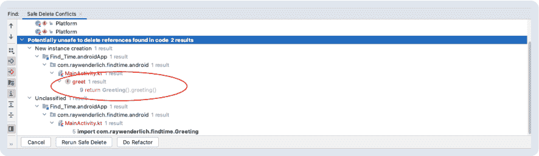

双击 `return Greeting()` 打开 MainActivity。删除 `greet` 函数、import 语句以及下方对它的引用：

```kotlin
import com.raywenderlich.findtime.Greeting
import android.widget.TextView

fun greet(): String {
    return Greeting().greeting()
}
```

再次执行删除操作，你就能毫无问题地删除这些文件了。

## 日期时间计算

你将使用 JetBrains 的 `kotlinx-datetime` 库来辅助日期时间计算。打开 **shared/build.gradle.kts**，找到 `val commonMain`，将其改为：

```kotlin
val commonMain by getting {
    dependencies {
        // 1
        implementation(Deps.JetBrains.datetime)
        // 2
        implementation(Deps.napier)
    }
}
```

这会导入两个库：

1. JetBrains datetime 库。
2. Napier 日志库。

现在执行 Gradle 同步。

## 日期时间库

Kotlin 的 `kotlinx-datetime` 是一个易于使用的多平台库，可帮助进行基于日期和时间的计算。它使用以下几种数据类型：

- `Instant` 表示某个瞬间。
- `Clock` 模拟真实世界的时钟，并提供当前瞬间。
- `LocalDateTime` 表示带时间的日期，但没有关联的时区。
- `LocalDate` 只表示日期。
- `TimeZone` 和 `ZoneOffset` 帮助你在 `Instant` 和 `LocalDateTime` 之间进行转换。
- `Month` 是一个枚举，表示一年中的所有月份。
- `DayOfWeek` 是一个枚举，表示一周中的所有日子。它使用 `MONDAY`、`TUESDAY` 等值，而不是整数。
- `DateTimePeriod` 表示两个瞬间之间的差异。
- `DatePeriod` 是 `DateTimePeriod` 的子类，表示两个 `LocalDate` 实例之间的差异。
- `DateTimeUnit` 提供一组单位，如 `NANOSECOND`、`WEEK`、`CENTURY` 等，你可以用来对 `Instant` 和 `LocalDate` 执行算术运算。

## 时区辅助类

转到 **shared/commonMain/** 中的 **com/raywenderlich/findtime** 包，创建一个名为 **TimeZoneHelper** 的新 Kotlin 接口。添加以下代码：

```kotlin
interface TimeZoneHelper {
    fun getTimeZoneStrings(): List<String>
    fun currentTime(): String
    fun currentTimeZone(): String
    fun hoursFromTimeZone(otherTimeZoneId: String): Double
    fun getTime(timezoneId: String): String
    fun getDate(timezoneId: String): String
    fun search(startHour: Int, endHour: Int, timezoneStrings: List<String>): List<Int>
}
```

这定义了一个包含七个函数的接口。

- 返回时区字符串列表。（这是来自 JetBrains kotlinx-datetime 库的所有时区列表）
- 返回当前格式化时间。
- 返回当前时区 ID。
- 返回与给定时区相差的小时数。
- 返回给定时区的格式化时间。
- 返回给定时区的格式化日期。
- 搜索一个小时列表，该列表从 `startHour` 开始，到 `endHour` 结束，并且位于所有给定的时区字符串中。

创建接口便于测试。本章不涉及测试，但使用接口可以轻松创建模拟的时区辅助对象。现在，创建该接口的一个实例。右键点击 findtime 文件夹，新建一个名为 **TimeZoneHelperImpl** 的 Kotlin 类。这个类将实现该接口。将这个类改为实现 `TimeZoneHelper`，如下所示：

```kotlin
class TimeZoneHelperImpl: TimeZoneHelper {
}
```

你会看到类下方有一条红色下划线，因为你尚未实现这些方法。将光标保持在 `TimeZoneHelperImpl` 上，按下 **Option-Return**，然后选择 **实现成员**。

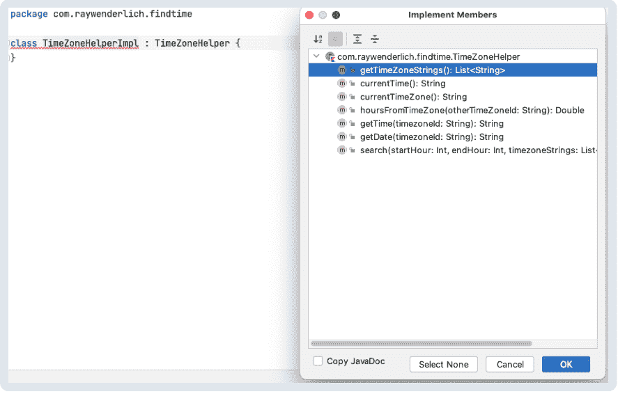

选择全部并点击 **OK**。你会看到许多 TODO。

从 `getTimeZoneStrings` 开始。这听起来可能很难，但 kotlinx-datetime 库让它变得简单。将 TODO 替换为：

```kotlin
return TimeZone.availableZoneIds.sorted()
```

这一行返回可用的时区 ID 并进行排序。`TimeZone` 会显示为红色。将光标放在 `TimeZone` 上，按 **Option-Return** 导入库。你也可以在接下来的章节中使用这一技巧来导入所需的类。

接下来，你需要一个方法来格式化 datetime 的 `LocalDateTime` 类。在类的底部添加以下方法：

```kotlin
fun formatDateTime(dateTime: LocalDateTime): String {
    // 1
    val stringBuilder = StringBuilder()
    // 2
    var hour = dateTime.hour
    val minute = dateTime.minute
    var amPm = " am"
    // 3
    // For 12
    if (hour > 12) {
        amPm = " pm"
        hour -= 12
    }
    // 4
    stringBuilder.append(hour.toString())
```

该方法接收一个时间范围（如 `8..17`）、要检查的给定小时、用户的当前时区，以及你要对照检查的其他时区。

第一次检查验证该小时是否在时间范围内。如果不在，则无效。

现在，将 `// TODO: Add Current Time` 替换为：

```kotlin
// 1
val currentUTCInstant: Instant = Clock.System.now()
// 2
val currentOtherDateTime: LocalDateTime =
    currentUTCInstant.toLocalDateTime(otherTimeZone)
// 3
val otherDateTimeWithHour = LocalDateTime(
    currentOtherDateTime.year,
    currentOtherDateTime.monthNumber,
    currentOtherDateTime.dayOfMonth,
    hour,
    0,
    0,
    0
)
// TODO: Add Conversions
```

1. 使用 datetime 的 `Clock.System.now` 方法获取 UTC 时区的当前瞬间。
2. 使用 `toLocalDateTime`，传入其他时区，将该瞬间转换为另一个时区。
3. 获取具有给定小时的 `LocalDateTime`。（不需要分钟、秒和纳秒）

现在，将 `// TODO: Add Conversions` 替换为：

```kotlin
// 1
val localInstant = otherDateTimeWithHour.toInstant(currentTimeZone)
// 2
val convertedTime = localInstant.toLocalDateTime(otherTimeZone)
Napier.d("Hour $hour in Time Range ${otherTimeZone.id} is ${convertedTime.hour}")
// 3
return convertedTime.hour in timeRange
```

Napier 是日志库，需要导入。将光标放在 `Napier` 上，按下 **Option-Return** 导入该库。

在上面的代码中，你：

1. 将该小时转换为当前时区。
2. 将你所在时区的小时转换为其他时区。
3. 检查它是否在你的时间范围内。

既然你已经有了 `isValid` 方法，`search` 方法就不会那么难了。你只需要遍历所有给定的时区和小时，检查它们是否有效。将 `search` 方法更新为：

```kotlin
// 1
val goodHours = mutableListOf<Int>()
// 2
val timeRange = IntRange(max(0, startHour), min(23, endHour))
// 3
val currentTimeZone = TimeZone.currentSystemDefault()
// 4
for (hour in timeRange) {
    var isGoodHour = false
    // 5
    for (zone in timezoneStrings) {
        val timezone = TimeZone.of(zone)
        // 6
        if (timezone == currentTimeZone) {
            continue
        }
        // 7
        if (!isValid(
                timeRange = timeRange,
                hour = hour,
                currentTimeZone = currentTimeZone,
                otherTimeZone = timezone
            )
        ) {
            Napier.d("Hour $hour is not valid for time range")
            isGoodHour = false
            break
        } else {
            Napier.d("Hour $hour is valid for time range")
            isGoodHour = true
        }
    }
    // 8
    if (isGoodHour) {
        goodHours.add(hour)
    }
}
// 9
return goodHours
```

在这段代码中，你：

1. 创建一个列表，用于返回所有有效的小时。
2. 创建一个从开始小时到结束小时的时间范围。
3. 获取当前时区。
4. 遍历时间范围内的每个小时。
5. 遍历时区列表中的每个时区。


## 6. 如果它与当前时区相同，那么你就知道它是合适的。
## 7. 检查该小时是否有效。
## 8. 如果遍历完每个小时，并且它是一个合适的小时，就将其添加到我们的列表中。
## 9. 返回小时列表。

导入 `min` 和 `max` 方法。现在，你已经为 Time Finder 应用编写好了业务逻辑！Android、iOS、桌面端和 Web 平台都可以共享它。

构建应用以确保它仍然可以编译。你可以再次尝试同时运行 Android 和 iOS。你会看到 iOS 构建失败，并出现如下所示的错误：

图 2.5 - Xcode 构建错误详情

请记住，你已经移除了 `greet` 方法。你会如何修复这个问题？

## 挑战

iOS 应用无法工作了。找出问题的原因，修复错误并让 iOS 应用重新正常工作。

## 要点

- Gradle 是大多数 KMP 项目的构建系统。
- 你用 Kotlin 编写 Gradle 构建文件。
- 你使用 **buildSrc** 模块来定义变量和插件。
- 你在 **shared** 模块中编写业务逻辑。
- **kotlinx-datetime** 库是一个用于处理日期和时间的多平台库。

## 接下来去哪里？

在本章中，你学习了如何使用 **buildSrc** 模块来设置项目，从而更轻松地更改版本。你还学习了如何在 **shared** 模块中处理日期和时间，使其适用于所有平台。

- Gradle：https://gradle.org/
- Kotlinx Datetime：https://github.com/Kotlin/kotlinx-datetime
- buildSrc：https://docs.gradle.org/current/userguide/organizing_gradle_projects.html#:

在下一章中，你将开始为 Find Time 项目构建 UI。

# Kotlin Multiplatform by Tutorials 第 3 章：开发 UI：Android Jetpack Compose

如果你查看 `setContent` 的源码，你会发现它是 `ComponentActivity` 上的一个扩展方法。该方法的最后一个参数就是你的 UI。这个参数的类型是 `@Composable`，这是一个特殊的注解，你需要在所有的 Compose 函数上使用它。一个 Compose 函数大致如下所示：

```
@Composable
fun showName(text: String) {
    Text(text)
}
```

最重要的部分是 `@Composable` 注解。它告诉 JC 这是一个可以绘制在屏幕上的函数。`Composable` 函数不会返回任何值。重要的是，你希望大多数函数都是无状态的。这意味着你将想要显示的数据传入，函数并不存储这些数据。这使得函数绘制得非常快。请参阅本章末尾的**接下来去哪里**一节，以了解更多关于 Compose 的工作原理。

你将开发一个多平台应用，让用户能够选择多个时区，并找出适合所有这些时区所有人的最佳会议时间。第一个屏幕如下所示：

在这里，你会看到本地的时区、时间和日期。其下方是两个不同的时区：纽约和伦敦。你的用户正试图找到这三个地点的共同会议时间。

> **注意**：这仅仅是原始的时区字符串代码。如果你有兴趣，可以挑战自己，将这些字符串代码替换为更具可读性的字符串。

当用户想要添加时区时，他们会点击悬浮操作按钮（FAB），然后会出现一个对话框，让他们选择所有想要的时区：

接下来是搜索屏幕，它允许用户选择一天中的开始和结束时间，并包含一个搜索按钮来显示可用的时间段。

## 主题

你需要学习的首批 Compose 函数之一就是主题。这是你为应用使用的配色方案。在 Android 中，通常会有 style.xml 或 theme.xml 文件，用于指定颜色、字体以及 UI 样式的其他方面。在 Compose 中，你使用主题函数。由于你已包含 Material Compose 库，你可以使用 MaterialTheme 类作为设置颜色、字体和形状的起点。Compose 还能告诉你系统是否正在使用深色主题。首先，在 androidApp 模块中，在与 MainActivity 相同的层级创建一个新包，并将其命名为 theme。

接下来，在该包中创建一个名为 **Colors.kt** 的新文件。添加以下代码：

```
import androidx.compose.ui.graphics.Color

val primaryColor = Color(0xFF1e88e5)
val primaryLightColor = Color(0xFF6ab7ff)
val primaryDarkColor = Color(0xFF005cb2)
val secondaryColor = Color(0xFF26a69a)
val secondaryLightColor = Color(0xFF64d8cb)
val secondaryDarkColor = Color(0xFF00766c)
val primaryTextColor = Color(0xFF000000)
val secondaryTextColor = Color(0xFF000000)
```

这部分定义了一些主色和次色。你可以在左侧边距看到这些颜色。如果你想要不同的配色方案，可以更改它们。接下来，右键单击 theme 目录，创建一个名为 **Typography.kt** 的新 Kotlin 文件。添加以下代码：

```
import androidx.compose.material.Typography
import androidx.compose.ui.graphics.Color
import androidx.compose.ui.text.TextStyle
import androidx.compose.ui.text.font.FontFamily
import androidx.compose.ui text.font.FontWeight
import androidx.compose.ui.unit.sp

// 1
val typography = Typography(
```

## 类型

在进入主屏幕之前，你需要一些将在整个应用中使用的类型。在 ui 文件夹中，创建一个名为 Types.kt 的新文件。添加以下代码：

```
import androidx.compose.runtime.Composable

// 1
typealias OnAddType = (List<String>) -> Unit
// 2
typealias onDismissType = () -> Unit
// 3
typealias composeFun = @Composable () -> Unit
// 4
typealias topBarFun = @Composable (Int) -> Unit

// 5
@Composable
fun emptyComposable() {
}
```

1. 定义一个名为 OnAddType 的别名，它接收一个字符串列表并且不返回任何内容。
2. 定义一个在关闭对话框时使用的别名。
3. 定义一个 Composable 函数。
4. 定义一个接收整数的函数。
5. 定义一个空的 Composable 函数（用作顶部栏的默认变量）。

现在你已经设置好颜色和文本样式，是时候创建你的第一个屏幕了。

## 主屏幕

在 androidApp 模块的 ui 文件夹中，创建一个名为 MainView.kt 的新 Kotlin 文件。你将首先创建一些辅助类和变量。首先，添加你需要的导入语句（这样可以节省一些导入时间）：

```
import androidx.compose.foundation.layout.padding
import androidx.compose.material.BottomNavigation
import androidx.compose.material.BottomNavigationItem
import androidx.compose.material.FloatingActionButton
import androidx.compose.material.Icon
import androidx.compose.material.Scaffold
import androidx.compose.material.icons.Icons
import androidx.compose.material.icons.filled.Add
import androidx.compose.material.icons.filled.Language
import androidx.compose.material.icons.filled.Place
```


```kotlin
import androidx.compose.runtime.Composable
import androidx.compose.runtime.mutableStateOf
import androidx.compose.runtime.remember
import androidx.compose.runtime.snapshots.SnapshotStateList
import androidx.compose.ui.Modifier
import androidx.compose.ui.graphics.vector.ImageVector
import androidx.compose.ui.unit.dp
import com.raywenderlich.findtime.android.theme.AppTheme
```

请注意，你正在导入将要使用的 Material 图标以及一些其他的 Compose 类。

为了跟踪你的两个屏幕，创建一个名为 **Screen** 的新密封类：

```kotlin
sealed class Screen(val title: String) {
  object TimeZonesScreen : Screen("Timezones")
  object FindTimeScreen : Screen("Find Time")
}
```

这里仅定义了两个屏幕：`TimeZonesScreen` 和 `FindTimeScreen`，以及它们的标题。接下来，定义一个类来处理底部导航项：

```kotlin
data class BottomNavigationItem(
  val route: String,
  val icon: ImageVector,
  val iconContentDescription: String
)
```

这里定义了一个路由、该路由的图标以及一个内容描述。接下来，创建一个包含两个项的变量：

```kotlin
val bottomNavigationItems = listOf(
  BottomNavigationItem(
    Screen.TimeZonesScreen.title,
    Icons.Filled.Language,
    "Timezones"
  ),
  BottomNavigationItem(
    Screen.FindTimeScreen.title,
    Icons.Filled.Place,
    "Find Time"
  )
)
```

这里使用了 Material 图标和屏幕类中的标题。现在，创建 `MainView` 可组合函数：

```kotlin
// 1
@Composable
// 2
fun MainView(topBarFun: @Composable () -> Unit = { emptyComposable() }) {
```

```kotlin
}
) {
    // 4
    Icon(
        imageVector = Icons.Default.Add,
        contentDescription = null
    )
}
```

1. 对于第一个页面，创建一个 `FloatingActionButton`。
2. 使用 Compose 的 `Modifier` 函数来添加内边距。
3. 设置点击监听器。将变量设置为显示“添加对话框”屏幕。更改此值将导致屏幕重绘。
4. 为 FAB 使用 `Add` 图标。

## 底部导航

Compose 有一个 `BottomNavigation` 函数，用于创建带有图标的底部栏。在底层，它是一个 Compose `Row` 类，你可以用内容填充它。将 `// TODO: Add bottom bar` 替换为：

```kotlin
// 1
BottomNavigation {
    // 2
    bottomNavigationItems.forEachIndexed { i, bottomNavigationItem ->
        // 3
        BottomNavigationItem(
            // 4
            icon = {
                Icon(
                    bottomNavigationItem.icon,
                    contentDescription =
                        bottomNavigationItem.iconContentDescription
                )
            },
            // 5
            selected = selectedIndex.value == i,
            // 6
            onClick = {
                selectedIndex.value = i
            }
        )
    }
}
```

1. 创建一个 `BottomNavigation` 可组合函数。
2. 使用 `forEachIndexed` 遍历导航项列表中的每个项。
3. 创建一个新的 `BottomNavigationItem`。
4. 将图标字段设置为列表中的图标。
5. 此屏幕是否被选中？只有当 `selectedIndex` 值等于当前索引时才为真。
6. 设置点击监听器。更改 `selectedIndex` 值，屏幕将重绘。

接下来，回到 **MainActivity.kt** 并添加以下导入：

```kotlin
import androidx.compose.material.TopAppBar
import androidx.compose.ui.res.stringResource
import com.raywenderlich.findtime.android.ui.MainView
import io.github.aakira.napier.DebugAntilog
import io.github.aakira.napier.Napier
```

然后，将 `setContent` 替换为：

```kotlin
// 1
Napier.base(DebugAntilog())
setContent {
    // 2
    MainView {
        // 3
        TopAppBar(title = {
            // 4
            when (it) {
                0 -> Text(text = stringResource(R.string.world_clocks))
                else -> Text(text = stringResource(R.string.findmeeting))
            }
        })
    }
}
```

1. 初始化 **Napier** 日志库。（确保包含所需的导入。）
2. 将主内容设置为 `MainView` 可组合函数。
3. 对于 Android，你需要一个顶部应用栏。
4. 当显示第一个屏幕时，标题为 **世界时钟**。否则，显示 **查找会议**。

在设备或模拟器上构建并运行应用。你将看到：

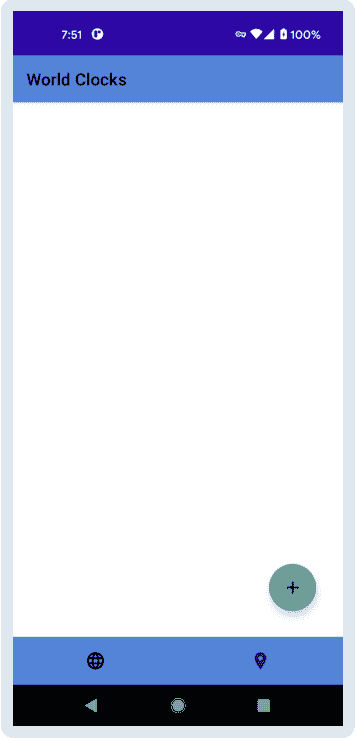

图 3.7 - 世界时钟屏幕的基本结构

现在你有了一个可用的应用，它显示标题栏、浮动操作按钮和底部导航栏。尝试在两个图标之间切换。会发生什么？

## 本地时间卡片

你首先要展示的是用户的本地时区、时间和日期。这将在一个带有蓝色渐变背景的卡片中呈现。

它将看起来像这样：


图 3.8 - 显示本地时区的卡片

在 **ui** 文件夹中，创建一个名为 **LocalTimeCard.kt** 的新 Kotlin 文件。添加以下代码：

```kotlin
import androidx.compose.foundation.BorderStroke
```

1. 使用一个 Box 来显示渐变背景。
2. 创建一个占据整个宽度的 Row。
3. 为卡片的左侧创建一个 Column。

现在你的卡片已经准备好，是时候把它们都组合到一个屏幕中了。在 ui 目录中，创建一个名为 TimeZoneScreen.kt 的新文件。添加导入和一个常量：

```kotlin
import androidx.compose.foundation.background
import androidx.compose.foundation.layout.*
import androidx.compose.foundation.lazy.LazyColumn
import androidx.compose.foundation.lazy.items
import androidx.compose.material.Icon
import androidx.compose.material.icons.Icons
import androidx.compose.material.icons.filled.Delete
import androidx.compose.runtime.*
import androidx.compose.runtime.snapshots.SnapshotStateList
import androidx.compose.ui.Alignment
import androidx.compose.ui.Modifier
import com.raywenderlich.findtime.TimeZoneHelper
import com.raywenderlich.findtime.TimeZoneHelperImpl
import kotlinx.coroutines.delay

const val timeMillis = 1000 * 60L // 1 minute
```

接下来，创建可组合函数：

```kotlin
@Composable
fun TimeZoneScreen(
    currentTimezoneStrings: SnapshotStateList<String>
) {
    // 1
    val timezoneHelper: TimeZoneHelper = TimeZoneHelperImpl()
    // 2
    val listState = rememberLazyListState()
    // 3
    Column(
        modifier = Modifier
            .fillMaxSize()
    ) {
        // TODO: Add Content
    }
}
```

此函数接收一个当前时区列表。它是一个 `SnapshotStateList`，因此该类可以更改这些值，而其他函数将收到更改通知。

1. 创建你的 `TimeZoneHelper` 类的一个实例。
2. 记住稍后将定义的列表的状态。
3. 创建一个占据全宽和全高的垂直 Column。

将 `// TODO: Add Content` 替换为：

```kotlin
// 1
var time by remember { mutableStateOf(timezoneHelper.currentTime()) }
// 2
LaunchedEffect(0) {
    while (true) {
        time = timezoneHelper.currentTime()
        delay(timeMillis) // Every minute
    }
}
// 3
LocalTimeCard(
    city = timezoneHelper.currentTimeZone(),
    time = time, date =
    timezoneHelper.getDate(timezoneHelper.currentTimeZone())
)
Spacer(modifier = Modifier.size(16.dp))

// TODO: Add Timezone items
```

1. 记住当前时间。
2. 使用 Compose 的 `LaunchedEffect`。它只会启动一次，但会持续运行。该方法将每分钟获取更新后的时间。你向 `LaunchedEffect` 传入 `0` 作为参数，这样当 `LaunchedEffect` 重组时，它不会被取消并重新启动。
3. 使用你之前创建的 `LocalTimeCard` 函数。使用 `TimeZoneHelper` 的方法获取当前时区和当前日期。

回到 **MainView**。将 `// TODO: Replace with screens` 替换为以下内容：

```kotlin
when (selectedIndex.value) {
    0 -> TimeZoneScreen(currentTimezoneStrings)
    // 1 -> FindMeetingScreen(currentTimezoneStrings)
}
```

如果索引是 0，显示时区屏幕，否则显示查找会议屏幕。


-   [Find Meeting screen is commented out until you write it.](#)

-   [Build and run the app. It will look like this:](#)

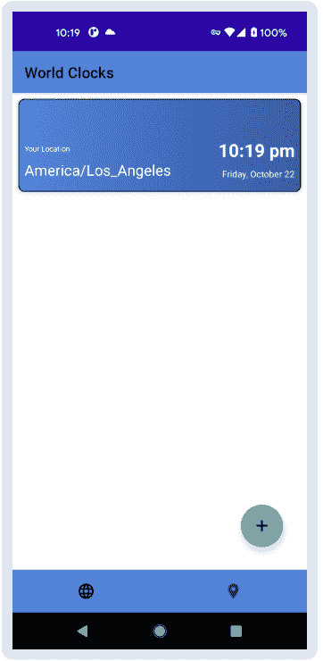

[Fig. 3.9 - World Clocks screen with local time zone](#)

-   [Nicely done! Your app is really starting to take shape.](#)

## Time card

-   [The time card will look like this:](#)

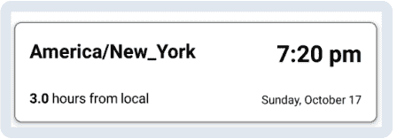

[Fig. 3.10 - Card to display a time zone](#)

-   [In the **ui** folder, create a new Kotlin file named **TimeCard.kt**. Add:](#)

```kotlin
import androidx.compose.foundation.BorderStroke
import androidx.compose.foundation.background
import androidx.compose.foundation.layout.Box
import androidx.compose.foundation.layout.Column
```

```kotlin
.padding(16.dp)
) {
    // 2
    Row(
        modifier = Modifier
            .fillMaxWidth()
    ) {
        // 3
        Column(
            horizontalAlignment = Alignment.Start
        ) {
            // 4
            Text(
                timezone, style = TextStyle(
                    color = Color.Black,
                    fontWeight = FontWeight.Bold,
                    fontSize = 20.sp
                )
            )
            Spacer(modifier = Modifier.weight(1.0f))
            // 5
            Row {
                // 6
                Text(
                    hours.toString(), style = TextStyle(
                        color = Color.Black,
                        fontWeight = FontWeight.Bold,
                        fontSize = 14.sp
                    )
                )
                // 7
                Text(
                    " hours from local", style = TextStyle(
                        color = Color.Black,
                        fontSize = 14.sp
                    )
                )
            }
        }
        Spacer(modifier = Modifier.weight(1.0f))
        // 8
        Column(
            horizontalAlignment = Alignment.End
        ) {
            // 9
            Text(
                time, style = TextStyle(
                    color = Color.Black,
                    fontWeight = FontWeight.Bold,
                    fontSize = 24.sp
                )
            )
            Spacer(modifier = Modifier.weight(1.0f))
            // 10
            Text(
                date, style = TextStyle(
                    color = Color.Black,
                    fontSize = 12.sp
                )
            )
        }
    }
}
}
```

- 1. Use a box to set the background to white.
- 2. Create a row that fills the width.
- 3. Create a column on the left side.
- 4. Show the time zone.
- 5. Create a row underneath the previous one.
- 6. Show the hours in bold.
- 7. Show the text “hours from local.”
- 8. Create a column on the right side.
- 9. Show the time.
- 10. Show the date.

Notice how you’re building up the screen section by section. You can’t quite use these cards yet, as you need a way to add a new time zone. You’ll do this by creating a dialog that will allow the user to pick many time zones to add.

You can add code to use the new time card. The following code will go through the list of current time zone strings, wrap the item in an `AnimatedSwipeDismiss` to allow the user to swipe and delete the card and then use the new time card. Return to **TimezoneScreen** and replace `// TODO: Add Timezone items` with:

```kotlin
// 1
LazyColumn(
    state = listState,
) {
    // 2
    items(currentTimezoneStrings,
        // 3
        key = { timezone ->
            timezone
        }) { timezoneString ->
            // 4
            AnimatedSwipeDismiss(
                item = timezoneString,
                // 5
                background = { _ ->
                    Box(
                        modifier = Modifier
                            .fillMaxSize()
                            .height(50.dp)
                            .background(Color.Red)
                            .padding(
                                start = 20.dp,
                                end = 20.dp
                            )
                    )
```

```kotlin
for (zone in newTimezones) {
    // 3
    if (!currentTimezoneStrings.contains(zone)) {
        currentTimezoneStrings.add(zone)
    }
},
onDismiss = {
    // 4
    showAddDialog.value = false
},
)
}
```

- 1. If your variable to show the dialog is true, call the `AddTimeZoneDialog` composable.
- 2. Your `onAdd` lambda will receive a list of new time zones.
- 3. If your current list doesn’t already contain the time zone, add it to your list.
- 4. Set the show variable back to false.

Build and run the app again. Click the FAB. You’ll see the dialog as follows:

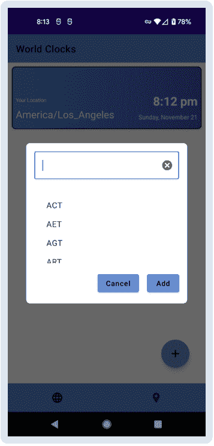

Fig. 3.11 - Time zone search is functional

Search for a time zone and select it. Hit the clear button, search for another time zone, and select it. Finally, press the add button. If you selected Los Angeles and New York, you would see something like:

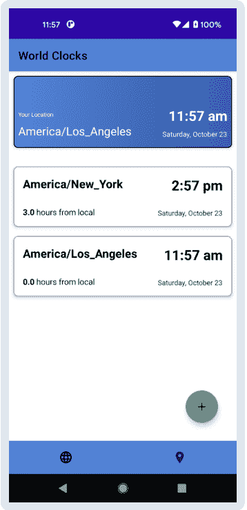

Fig. 3.12 - List of selected time zones

## Find Meeting Time screen

Now that you have the Time Zone screen finished, it’s time to write the Find Meeting Time screen. This screen will allow the user to choose the hour range they want to meet, select the time zones to search against and perform a search that will bring up a dialog with the list of hours found.

Since a composable is made up of many parts, you’ll use the included number picker composable that will look like this:

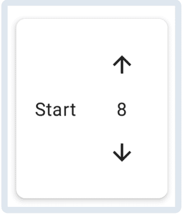

Fig. 3.13 - Time chooser UI component

This has a text field on the left, an up arrow, a number and a down arrow. You’ll use this for both the start and end hours.

### Number time card

In the **ui** folder, create a new file named **NumberTimeCard.kt**. This will display a card with the label and number picker. Add:

```kotlin
import androidx.compose.foundation.BorderStroke
import androidx.compose.foundation.layout.Row
import androidx.compose.foundation.layout.Spacer
import androidx.compose.foundation.layout.padding
import androidx.compose.foundation.layout.size
import androidx.compose.foundation.shape.RoundedCornerShape
import androidx.compose.material.Card
import androidx.compose.material.MaterialTheme
import androidx.compose.material.Text
import androidx.compose.runtime.Composable
import androidx.compose.runtime.MutableState
import androidx.compose.ui.Alignment
import androidx.compose.ui.Modifier
import androidx.compose.ui.graphics.Color
import androidx.compose.ui.unit.dp

// 1
@Composable
fun NumberTimeCard(label: String, hour: MutableState<Int>) {
    // 2
    Card(
        shape = RoundedCornerShape(8.dp),
        border = BorderStroke(1.dp, Color.White),
        elevation = 4.dp,
    ) {
        // 3
        Row(
            modifier = Modifier
                .padding(16.dp)
        ) {
            // 4
            Text(
                modifier = Modifier
                    .align(Alignment.CenterVertically),
                text = label,
                style = MaterialTheme.typography.body1
            )
            Spacer(modifier = Modifier.size(16.dp))
            // 5
            NumberPicker(hour = hour, range = IntRange(0, 23),
                onStateChanged = {
                    hour.value = it
                }
            )
        }
    }
}
```

- 1. Create a composable that will take a label and an hour.
- 2. Wrap it in a card.
- 3. Use a row to lay out the items horizontally.
- 4. Center the label.
- 5. Use `NumberPicker` to show the hour with up/down arrows.

This creates a card with a text field on the left and a number picker on the right.

### Creating the Find Meeting Time screen

Now you can put together the Find Meeting Time screen. In the **ui** folder, create a new file named **FindMeetingScreen.kt**. Add:

```kotlin
import androidx.compose.foundation.layout.Column
import androidx.compose.foundation.layout.PaddingValues
import androidx.compose.foundation.layout.Row
import androidx.compose.foundation.layout.Spacer
import androidx.compose.foundation.layout.fillMaxSize
import androidx.compose.foundation.layout.fillMaxWidth
import androidx.compose.foundation.layout.padding
import androidx.compose.foundation.layout.size
import androidx.compose.foundation.layout.wrapContentWidth
import androidx.compose.foundation.lazy.LazyColumn
import androidx.compose.foundation.lazy.itemsIndexed
import androidx.compose.foundation.lazy.rememberLazyListState
import androidx.compose.runtime.Composable
import androidx.compose.runtime.mutableStateOf
import androidx.compose.runtime.remember
import androidx.compose.runtime.snapshots.SnapshotStateList
import androidx.compose.runtime.snapshots.SnapshotStateMap
import androidx.compose.ui.Alignment
```


-   在 Android 中，你可以使用传统的 XML 布局或新的 Jetpack Compose 框架来创建 UI。
+   
+   - Jetpack Compose 由 composable functions 组成。

## Where to go from here?

要了解更多关于 Jetpack Compose 的信息，请查看以下资源：

+   • 书籍：https://www.raywenderlich.com/books/jetpack-compose-by- tutorials
+   
+   • 官方网站：https://developer.android.com/jetpack/compose
+   
+   • 视频课程：https://www.raywenderlich.com/21959310-jetpack-compose/

Congratulations! You’ve written a Jetpack Compose app that uses a shared library for the business logic. The next chapter will show you how to create the iOS app.

As you learned in the last chapter, KMP does not provide a framework for developing UI. You’ll need to use a different framework for each platform. In this chapter, you’ll learn about writing the UI for iOS with SwiftUI. SwiftUI is a declarative UI toolkit which works on iOS, macOS, watchOS and tvOS. This won’t be an extensive discussion on SwiftUI, but it will teach you the basics.

Open the starter project from this chapter. It has a few extra files. This chapter assumes you’re working on a Mac with the Xcode app from Apple. If you’re not on a Mac, feel free to skip this chapter. If you don’t have Xcode, you can open any Swift files in Android Studio.

Xcode is Apple’s IDE for iOS, iPadOS, watchOS, macOS and tvOS development. In this chapter, you can edit your Swift files in either Xcode or Android Studio. Android Studio has a good editor, but Xcode has the ability to preview your SwiftUI Views for you. The choice of the IDE is up to you and this section will walk you through using both the IDEs.

Open the starter project in Android Studio and select the iOS configuration. You might see a red x in the icon.

Select Edit Configurations... from the drop-down menu. You’ll see:


## Xcode

启动 Xcode，然后打开本章入门项目下的 **iosApp** 目录。你不需要选择 xcodeproj 或 xcworkspace 文件。点击 **Open**。

项目打开后，你会在左侧看到两个 iosApp 文件夹：

在 iOS 上，如果你使用 UIKit 进行开发，通常会使用 storyboard 或直接在代码中创建 UI 来设计界面。这些 storyboard 底层是复杂的 XML 文件。虽然 Xcode 的布局编辑器很不错，但设计并连接到代码仍然需要不少工作。SwiftUI 是一种完全用代码编写的声明式 UI 系统。没有布局或 storyboard。它使用起来更简单，并且允许通过较小的视图实现大量代码复用。Xcode 提供预览功能，因此你可以构建小组件并在编辑器旁边查看它们。

# 了解 SwiftUI

使用 KMM 插件创建项目会生成两个 Swift 文件：**ContentView.swift** 和 **iOSApp.swift**。这两个文件就像一个“Hello World”应用。它们在屏幕中央显示一个带有“Hello”字样的文本字段。该插件还添加了几个文件以简化开发。

## App

打开 **iOSApp.swift**：

SwiftUI 应用的入口点是结构体上方标有 `@main` 属性的结构体。这个结构体通常实现 `App` 协议。`App` 协议要求你创建一个名为 `body` 的变量，该变量返回一个 `Scene`。`Scene` 是视图层级中根视图的容器。`WindowGroup` 是一种 `Scene`，也是视图的容器。在 iOS 上，它只包含一个窗口，但在 macOS 和 iPadOS 上，它可以包含多个窗口。由于它只是一个单一表达式，因此不需要 return。这些文件的名称都没有特殊含义——唯一重要的是告诉编译器从哪里启动应用，而你通过 `@main` 标记来实现这一点。

由于 `iOSApp` 不能描述应用的功能，请在左侧边栏中选择该文件并按 **Return** 键，将其重命名为 `TimezoneApp`。输入 `TimezoneApp` 并再次按回车。接下来，将 `struct iOSApp: App` 改为 `struct TimezoneApp: App`。

接下来，在 `var body` 之前添加以下代码，以更改标签栏的颜色。

你还可以在 Android Studio 中运行该应用。在 Android Studio 中，确保从配置菜单中选择 iOSApp：

然后，按下 **Run** 按钮：

打开 **ContentView.swift**。删除 `Text("Hello")`。在结构体中添加以下代码作为第一行：

```swift
@StateObject private var timezoneItems = TimezoneItems()
```

与 Jetpack Compose（JC）中的 `remember` 类似，`StateObject` 会创建一个仅创建一次的可观察对象。每次视图重绘时，它都会复用现有对象。其他对象可以监听变化，SwiftUI 将更新这些对象。如果你打开 **TimezoneItems.swift** 文件，你会看到它是一个 `ObservableObject`，**发布**了时区列表和选定时区列表。它还会异步地从 `shared` 库获取时区列表。

## TabView

`TabView` 是 SwiftUI 中与 Jetpack Compose 的 `BottomNavigation` 等价的组件。你可以使用它在屏幕底部显示标签栏，并让用户在不同应用视图之间切换。

回到 **ContentView.swift**，将 `body` 定义如下：

```swift
var body: some View {
    // 1
    TabView {
        // 2
        TimezoneView()
            // 3
            .tabItem {
                Label("Time Zones", systemImage: "network")
            }
        // 4
//        FindMeeting()
//            .tabItem {
//                Label("Find Meeting", systemImage: "clock")
//            }
    }
    .accentColor(Color.white)
    // 5
    .environmentObject(timezoneItems)
}
```

+   1. 创建一个 SwiftUI `TabView`。
+   2. 第一个标签将是 `TimezoneView`，你接下来将创建它。
+   3. 应用带有系统网络图标和 **时区** 字样的 `tabItem`。
+   4. 第二个标签将是 `FindMeeting` 视图，你还没有创建它。（目前已被注释掉。）
+   5. 将 `timezoneItems` 对象设置为 `environmentObject`。

有几种方法可以在不同视图之间传递对象。这里，你通过环境对象（Environment Object）传递 `timezoneItems`。该对象的使用者（即任何子视图）将声明一个 `@EnvironmentObject` 变量来接收该对象。

## 时区视图

在 iosApp 文件夹中右键单击，然后选择 New File...

接下来，选择 SwiftUI 文件并点击 Next：

然后，将其保存为 TimezoneView.swift：

在文件内部，首先添加 shared 库的导入：

```swift
import shared
```

在 **struct TimezoneView** 内部添加以下变量：

```swift
// 1
@EnvironmentObject private var timezoneItems: TimezoneItems
// 2
private var timezoneHelper = TimezoneHelperImpl()
// 3
@State private var currentDate = Date()
// 4
let timer = Timer.publish(every: 1000, on: .main, in: .common).autoconnect()
// 5
@State private var showTimezoneDialog = false
```

+   1. 这是从 `ContentView` 传入的 `timezoneItems` 对象。
+   2. 创建 `timezoneHelper` 的实例。
+   3. 获取当前日期。
+   4. 创建一个每秒更新一次的计时器。
+   5. 控制是否显示时区对话框的状态变量。

`@State` 用于简单的结构体类型，其状态在重绘之间保存。任何 `@State` 属性包装器都意味着当前视图拥有这些数据。SwiftUI 会跟踪 `@State` 变量的变化，并在其值改变时重绘视图。

`@StateObject` 用于类。由于 SwiftUI 视图是 `struct`，所以你大多会看到 `@State` 的使用。

将 `Text("Hello, World")` 替换为以下代码：

```swift
// 1
NavigationView {
    // 2
    VStack {
        // 3
        TimeCard(timezone: timezoneHelper.currentTimeZone(),
                 time: DateFormatter.short.string(from: currentDate),
                 date: DateFormatter.long.string(from: currentDate))
        Spacer()
        // TODO: Add List
    } // VStack
    // 4
    .onReceive(timer) { input in
        currentDate = input
    }
    .navigationTitle("World Clocks")
    // TODO: Add toolbar
} // NavigationView
```

+   1. `NavigationView` 允许你显示带有标题的新屏幕，并会为视图添加动画。
+   2. `VStack` 是一个垂直堆栈。它基本上等同于 JC 中的 **Column**。
+   3. 调用 `TimeCard` 类，以精美的卡片格式显示时区。使用来自 `Utils` 类的 `short` 和 `long` `DateFormatter` 扩展。
+   4. 使用你的计时器。每次计时器变化时，更新日期，然后更新其他元素。

如果你查看 **Utils.swift** 文件，你会看到 `short` 和 `long` `DateFormatter` 扩展字段的定义。现在运行一下应用。效果如下：

## 时区列表

接下来，将 `// TODO: Add List` 替换为：

```swift
// 1
List {
    // 2
    ForEach(Array(timezoneItems.selectedTimezones), id: \.self) {
        timezone in
        // 3
        NumberTimeCard(timezone: timezone,
                       time: timezoneHelper.getTime(timezoneId:
        timezone),
                       hours: "\(timezoneHelper.hoursFromTimeZone(otherTimeZoneId: timezone)) hours from local",
                       date: timezoneHelper.getDate(timezoneId:
        timezone))
            .withListModifier()
    } // ForEach
    // 4
    .onDelete(perform: deleteItems)
} // List
// 5
.listStyle(.plain)
Spacer()
```

+   1. 创建一个条目 `List`。
+   2. 创建一个选定时区数组，并为每个时区创建一张卡片。
+   3. 以精美的时区卡片显示时区。使用自定义列表修饰符来移除行分隔线和内边距。（参见 **ListModifier.swift**。）
+   4. 添加滑动删除的功能。你稍后将定义 `deleteItems` 方法。
+   5. 将列表样式设置为 plain。

`ForEach` 是一种特殊的 SwiftUI 视图结构体，与普通的 `forEach()` 函数不同，它可以作为 `View` 返回。

接下来，将 `// TODO: Add toolbar` 替换为以下代码：

```swift
// 1
.toolbar {
    // 2
    ToolbarItem(placement: .navigationBarTrailing) {
        // 3
        Button(action: {
            showTimezoneDialog = true
        }) {
            Image(systemName: "plus")
```


尝试搜索您喜欢的时区，选择时区后再搜索。

当您搜索纽约时，以下是您将看到的内容：


完成后，点击 **Dismiss** 按钮。

这是与纽约和里斯本一起的效果：


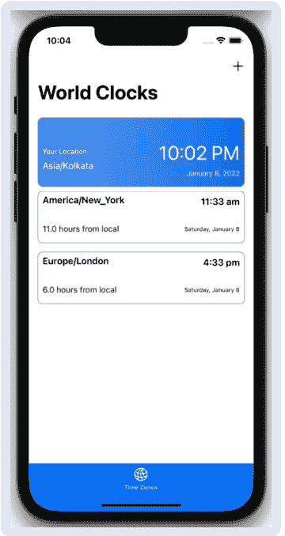

图 4.18 - 选定的时区

如果您想删除一个时区，只需向左滑动：

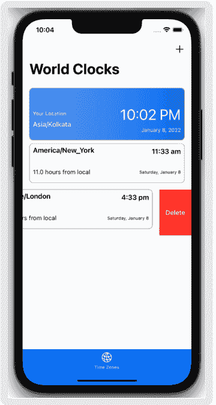

图 4.19 - 删除选定的时区

## 小时表

您将想要显示可供会议的小时。您可以通过显示小时列表来实现，这里是一个弹窗样式的视图。这是一个简单的视图，包含一个小时列表和一个关闭按钮。在 iOSApp 文件夹中创建一个新的 SwiftUI 视图文件，名为 **HourSheet.swift**。删除 `Text` 视图，然后在视图的最开始添加以下两个变量：

```swift
@Binding var hours: [Int]
@Environment(\.presentationMode) var presentationMode
```

第一个变量是调用者将传入的小时数组。第二个变量是 `showHoursDialog` 的 `Boolean` 值。通过将其设置为 false 来隐藏弹窗。在 `body` 内部添加以下代码：

```swift
// 1
NavigationView {
    // 2
    VStack {
        // 3
        List {
            // 4
            ForEach(hours, id: \.self) { hour in
                Text("\(hour)")
            }
        } // List
    } // VStack
    .navigationTitle("Found Meeting Hours")
    // 5
    .toolbar {
        ToolbarItem(placement: .navigationBarTrailing) {
            Button(action: {
                presentationMode.wrappedValue.dismiss()
            }) {
                Text("Dismiss")
                    .frame(alignment: .trailing)
                    .foregroundColor(.black)
            }
        } // ToolbarItem
    } // toolbar
} // NavigationView
```

+   1. 使用 `NavigationView` 显示工具栏。
+   2. 使用 `VStack` 显示标题。
+   3. 使用 `List` 显示每个小时。
+   4. 使用 `ForEach` 视图显示每个小时的文本视图。
+   5. 显示包含关闭按钮的工具栏。

[PAGE 98]

这将为每个小时创建一个列表并以 `Text` 视图显示。要使预览工作，请修改 `HourSheet()` 构造器中的 `HourSheet_Previews` 内容：

```
HourSheet(hours: .constant([8, 9, 10]))
```

## 查找会议

下一个界面是查找会议的界面。这是您可以选择想要查找会议的小时，然后找出所有人都有空闲时间的小时的界面。创建一个新的 SwiftUI 视图文件，名为 **FindMeeting.swift**。

首先，添加 `shared` 的导入：

```
import shared
```

然后，删除 `Text("Hello, World")`，添加以下变量：

```
 // 1
 @EnvironmentObject private var timezoneItems: TimezoneItems
 // 2
 private var timezoneHelper = TimeZoneHelperImpl()
 // 3
 @State private var meetingHours: [Int] = []
 @State private var showHoursDialog = false
 // 4
 @State private var startDate = Calendar.current.date(bySettingHour: 8, minute: 0, second: 0, of: Date())!
 @State private var endDate = Calendar.current.date(bySettingHour: 17, minute: 0, second: 0, of: Date())!
```

+   1. 创建 `timezoneItems` 环境变量。此变量将来自 **ContentView**。
+   2. 创建 `TimeZoneHelperImpl` 类的实例。
+   3. 一个用于所有可以会面的小时数组。
+   4. 开始和结束日期，分别为早上 8 点和下午 5 点。

这为您提供了所有需要的变量。现在可以开始工作 `body` 部分。在 `body` 内部添加以下代码：

```
NavigationView {
    VStack {
        Spacer()
            .frame(height: 8)
        // TODO: Add Form
    } // VStack
    .navigationTitle("Find Meeting Time")
    // TODO: Add sheet
}
```

[PAGE 99]

这将是一个垂直栈，包含导航视图，带有标题和标题周围的间距。现在，添加包含两个部分的表单：一个时间范围，包含开始和结束时间选择器，以及选定的时区列表。将 TODO: Add Form 替换为：

```
```
Form {
    Section(header: Text("Time Range")) {
        // 1
        DatePicker("Start Time", selection: $startDate,
        displayedComponents: .hourAndMinute)
        // 2
        DatePicker("End Time", selection: $endDate,
        displayedComponents: .hourAndMinute)
    }
    Section(header: Text("Time Zones")) {
        // 3
        ForEach(Array(timezoneItems.selectedTimezones), id: \\.self) {
            timezone in
            HStack {
                Text(timezone)
                Spacer()
            }
        }
    }
} // Form
// TODO: Add Button
```

+   1. 开始时间选择器。
+   2. 结束时间选择器。
+   3. 选定时区的列表。

现在，接下来是执行时区计算的按钮。它将调用共享库的搜索方法。将 // TODO: Add Button 替换为：

```
```
Spacer()
Button(action: {
    // 1
    meetingHours.removeAll()
    // 2
    let startHour = Calendar.current.component(.hour, from: startDate)
    let endHour = Calendar.current.component(.hour, from: endDate)
    // 3
    let hours = timezoneHelper.search(
    startHour: Int32(startHour),
    endHour: Int32(endHour),
    timezoneStrings: Array(timezoneItems.selectedTimezones))
    // 4
    let hourInts = hours.map { kotinHour in
    Int(truncating: kotinHour)
    }
})
```
```

+   1. 清除任何之前的值。
+   2. 获取开始和结束小时。
+   3. 调用共享库的搜索方法，将小时转换为 Int32。
+   4. 将返回的小时转换为 Swift Int。

注意，这里存在一些转换。您需要将 Swift Int 转换为 32 位 Int 以适配 Kotlin，然后在从共享库获取值后，将其转换回 Swift Int。现在，按钮设置了 `showHoursDialog` 标志以显示小时弹窗。您需要使用 `sheet` 来显示该弹窗。将 `// TODO: Add sheet` 替换为：

```
.sheet(isPresented: $showHoursDialog) {
    HourSheet(hours: $meetingHours)
}
```

您几乎完成了。最后，您需要在 TabView 中添加 Find Meeting 选项卡。

返回 ContentView 并取消注释 FindMeeting 部分。

构建并运行应用。尝试添加多个时区。进入 FindMeeting 页面，点击搜索按钮，看看是否有小时显示。如果出现问题且没有小时显示，先从一个时区开始，逐步增加时区数量。很有可能没有兼容的小时。尝试将结束时间增加到 17 或 19，以扩大时间范围。以下是洛杉矶和纽约时区之间的小时示例：

[PAGE 101]

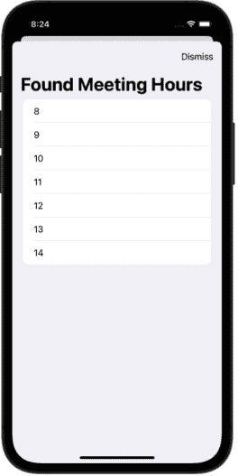

图 4.20 - 找到的会议小时屏幕

恭喜！您现在拥有两个 Android 和 iOS 应用，可以向您的朋友展示。

## 关键点

+   - SwiftUI 是一种用于 Apple 平台创建 UI 的新声明式方式。
+   - 您可以使用 Xcode 或 Android Studio 开发 SwiftUI 代码。
+   - 使用 `@State`、`@StateObject`、`@ObservedObject` 和 `@EnvironmentObject` 来保存状态。
+   - 使用 `VStack`、`HStack`、`NavigationView` 和 `Text` 等 SwiftUI 视图构建您的 UI。
+   - 使用 `List` 视图显示许多项目。
+   - `ForEach` 可以返回视图，您可以在 `List` 以及其他视图中使用它。
+   - 使用 `sheet` 和 `fullScreenCover` 显示类似弹窗的界面。
+   - 使用 `Int32` 转换整数以适配 Kotlin。
+   - 使用 `Int` 转换 Kotlin 整数为 Swift 整数。

## 往后如何？

要了解：

Xcode: [https://developer.apple.com/xcode/](https://developer.apple.com/xcode/)


SwiftUI:

- [SwiftUI 入门手册](https://www.raywenderlich.com/books/swiftui-apprentice)
- 官方 SwiftUI 文档：
  https://developer.apple.com/documentation/swiftui/
- 由 raywenderlich.com 提供的 SwiftUI 视频课程库：
  https://www.raywenderlich.com/library?q=swiftui&domain_ids%5B%5D=1&content_types%5B%5D=collection
- [@StateObject 文档](https://developer.apple.com/documentation/swiftui/stateobject)

Congratulations! You’ve written a SwiftUI app that uses a shared library for the business logic. Now that you have both the Android and the iOS apps written, the next chapter will show you how to create a macOS app.

# 5 Developing UI: Compose Multiplatform

Written by Kevin D Moore

If you come from a mobile background, it’s exciting to know that you can build desktop apps with the knowledge you gained from learning Jetpack Compose (JC). JetBrains, the maker of the technology behind Android Studio and IntelliJ, have worked with Google to create Compose Multiplatform (CM). This uses some of the same code from Jetpack Compose but extends it to be used for multiple platforms. This chapter will focus on the desktop, but CM will work on the web as well.

## Getting to know Compose Multiplatform

CM uses the Java Virtual Machine (JVM) under the hood so that you can still use the older **Swing** technology if you want. It uses the **Skia** graphics library that allows hardware acceleration (like JC). Apps built with CM can run on macOS, Windows and Linux.

## Differences in desktop

Unlike mobile, the desktop has features like menus, multiple windows and system notifications. Menus can have shortcuts and windows will have different sizes and positions on the screen. The desktop doesn’t usually use app bars like mobile apps. You’ll usually use menus to handle actions.

## Creating a desktop app

To create a desktop app, you’re going to do several things:

1. Create a desktop module.
2. Create a shared UI module.
3. Move most of the Android code to the shared UI module.
4. Create some wrappers so that Android and desktop can have unique functionality.

## Updating Gradle files

To start, you’ll need to update a few of your current Gradle files. Open the starter project in Android Studio and open the main **build.gradle.kts**. Under **allprojects** and at the end of **repositories** add:

```kotlin
maven("https://maven.pkg.jetbrains.space/public/p/compose/dev")
```

This adds the repository for the Compose Multiplatform library. Open the **shared build.gradle.kts** file and add the following after **kotlin -> android()**:

```kotlin
jvm("desktop") {
    compilations.all {
        kotlinOptions.jvmTarget = "11"
    }
}
```

The code above creates a new JVM target with the name **desktop** and sets the JDK version to 11.

### Desktop module

There isn’t an easy way to create a desktop module, except by hand. At the time of writing, JetBrains is working to improve this but it isn’t that hard to do manually. Right-click the top-level folder in the project window and choose **New ▸ Directory**:

*Fig. 5.1 - Creating a New Directory*

Name the directory **desktop**. Next, right-click on the **desktop** folder and choose **New ▸ File**. Name the file **build.gradle.kts**. This build file is similar to the **shared** module’s build file. Add the following:

```kotlin
import org.jetbrains.compose.compose
import org.jetbrains.compose.desktop.application.dsl.TargetFormat

// 1
plugins {
    kotlin("multiplatform")
    id(composePlugin) version Versions.desktop_compose_plugin
}

// 2
group = "com.raywenderlich.findtime"
```

### Shared UI

You created the Android Compose files earlier. You put a lot of work into those files. You could duplicate those files for the desktop, but why not share them? That’s the idea behind the **shared-ui** module. You’ll move the Android files over and make a few modifications to allow them to be used for both Android and the desktop.

From the project window, right-click on the top-level folder and choose New ▸ Directory. Name the directory **shared-ui**. Next, right-click on the shared-ui folder and choose New ▸ File. Name the file **build.gradle.kts**. Add the following:

```kotlin
import org.jetbrains.compose.compose

plugins {
    kotlin(multplatform)
    id(androidLib)
    id(composePlugin) version Versions.desktop_compose_plugin
}

android {
    // TODO: Add Android Info
}

kotlin {
    // TODO: Add Desktop Info
}
```

This adds the multiplatform, Android and Compose plugins. Now replace // TODO: Add Android Info with:

```
compileSdk = Versions.compile_sdk
sourceSets["main"].manifest.srcFile("src/androidMain/AndroidManifest.xml")
defaultConfig {
    minSdk = Versions.min_sdk
    targetSdk = Versions.target_sdk
}
buildTypes {
    getByName("release") {
    isMinifyEnabled = false
    }
}
```

This is the minimum info needed for Android. For the desktop, replace // TODO: Add Desktop Info with:

```
// 1
android()
// 2
jvm("desktop") {
    compilations.all {
        kotlinOptions.jvmTarget = "11"
    }
}
sourceSets {
    // 3
    val commonMain by getting {
    dependencies {
        implementation(project(":shared"))
    }
}
```

### 5. Bring in the compose libraries. (Pre-defined variables.)
### 6. Import your shared libraries. Leave **shared-ui** commented out until you create it.

There’s a lot here, but the desktop Gradle setup is a bit more complex. This sets up the libraries needed for the desktop module.

Replace `// TODO: Add Compose Desktop` with:

```
compose.desktop {
    application {
        mainClass = "MainKt"
        nativeDistributions {
            targetFormats(TargetFormat.Dmg, TargetFormat.Msi,
            TargetFormat.Deb)
            packageName = "FindTime"
            macOS {
                bundleID = "com.raywenderlich.findtime"
            }
        }
    }
}
```

### Configuration for Compose desktop.
### Define an application.
### Set the main class. You’ll create a **Main.kt** file in a bit.
### Set up packaging information for when you’re ready to ship.

Click **Sync Now** from the top right portion of the window. Open **settings.gradle.kts** from the root directory and add the new project at the end of the file:

```kotlin
include(":desktop")
```

Do another sync.

Next, right-click on the **desktop** folder and choose **New ▸ Directory**. Use **src/jvmMain/kotlin**. This will create three folders: **src**, **jvmMain**, and **kotlin** under that. Next, right-click on the **kotlin** folder and choose **New ▸ Kotlin Class/File**. Type **Main** and choose file.

Replace the contents of the file with the following code:

```kotlin
import androidx.compose.foundation.layout.fillMaxSize
import androidx.compose.material.Surface
import androidx.compose.ui.Modifier
import androidx.compose.ui.window.Window
import androidx.compose.ui.window.application
import androidx.compose.ui.window.rememberWindowState

// 1
fun main() {
    // 2
    application {
        // 3
        val windowState = rememberWindowState()

        // 4
        Window(
            onCloseRequest = ::exitApplication,
            state = windowState,
            title = "TimeZone"
        ) {
            // 5
            Surface(modifier = Modifier.fillMaxSize()) {
                // TODO: Add Theme
                // TODO: Add MainView
            }
        }
    }
}
```

### Entry point to the application. Just like in Kotlin or Java programs, the starting function is **main**.
### Create a new application.
### Remember the current default window state. Change this if you want the window positioned in a different position or size.
### Create a new window with the window state. If the user closes the window, exit the application.
### Set up a `Surface`.

Other than the commented TODOs, this is the extent of the desktop code. The next task is to create a **shared-ui** module where you will move the compose files.

### Shared UI

You created the Android Compose files earlier. You put a lot of work into those files. You could duplicate those files for the desktop, but why not share them? That’s the idea behind the **shared-ui** module. You’ll move the Android files over and make a few modifications to allow them to be used for both Android and the desktop.

[PAGE 108]

From the project window, right-click on the top-level folder and choose New ▸ Directory. Name the directory **shared-ui**. Next, right-click on the shared-ui folder and choose New ▸ File. Name the file **build.gradle.kts**. Add the following:

```kotlin
import org.jetbrains.compose.compose

plugins {
    kotlin(multplatform)
    id(androidLib)
    id(composePlugin) version Versions.desktop_compose_plugin
}

android {
    // TODO: Add Android Info
}

kotlin {
    // TODO: Add Desktop Info
}
```

This adds the multiplatform, Android and Compose plugins. Now replace // TODO: Add Android Info with:

```
compileSdk = Versions.compile_sdk
sourceSets["main"].manifest.srcFile("src/androidMain/AndroidManifest.xml")
defaultConfig {
    minSdk = Versions.min_sdk
    targetSdk = Versions.target_sdk
}
buildTypes {
    getByName("release") {
    isMinifyEnabled = false
    }
}
```

This is the minimum info needed for Android. For the desktop, replace // TODO: Add Desktop Info with:

```
// 1
android()
// 2
jvm("desktop") {
    compilations.all {
        kotlinOptions.jvmTarget = "11"
    }
}
sourceSets {
    // 3
    val commonMain by getting {
    dependencies {
        implementation(project(":shared"))
    }
}
```


## AddTimeZoneDialog

从 `shared-ui` 模块的 `commonMain/kotlin/com/raywenderlich/compose/ui` 文件夹中打开 `AddTimeZoneDialog.kt`。你会看到以下导入语句报错：

```kotlin
import androidx.compose.ui.res.stringResource
import androidx.compose.ui.window.Dialog
import com.raywenderlich.findtime.android.R
```

这三个导入在 `shared-ui` 模块中不存在。删除它们。在导入之后添加：

```kotlin
@Composable
expect fun AddTimeDialogWrapper(onDismiss: onDismissType, content: @Composable () -> Unit)
```

这是一个使用 KMM 的 `expect` 关键字的 Composable 函数。这意味着该模块使用的每个目标平台都需要实现这个函数。现在，用以下代码修改 `AddTimeZoneDialog` 函数的签名以及到第一个 `Column` 之前的代码：

```kotlin
fun AddTimeZoneDialog(
    onAdd: OnAddType,
    onDismiss: onDismissType
) {
    val timezoneHelper: TimeZoneHelper = TimeZoneHelperImpl()

    AddTimeDialogWrapper(onDismiss) {
}
```

这只是使用 `AddTimeDialogWrapper` 函数来包装现有代码。`AddTimeDialogWrapper` 函数将处理平台特定的代码。Android 和桌面端会以不同的方式处理对话框。转到该函数的末尾，添加一个结尾的 `}`。

使用 Desktop Compose 时的一个问题是资源处理。这超出了本章的范围。现在，只需将字符串资源改为硬编码字符串。将：

```kotlin
stringResource(id = R.string.cancel)
```

改为：

```kotlin
"Cancel"
```

将：

```kotlin
stringResource(id = R.string.add)
```

改为：

```kotlin
"Add"
```

在 `shared-ui/src/androidMain/kotlin/com/raywenderlich/compose/ui` 文件夹中，右键单击并创建一个名为 `AddTimeDialogWrapper.kt` 的新 Kotlin 文件。这将是实现 `commonMain` 中定义的 `expect` 的 Android 版本。添加：

```kotlin
import androidx.compose.runtime.Composable
import androidx.compose.ui.window.Dialog
import com.raywenderlich.compose.ui.onDismissType

@Composable
actual fun AddTimeDialogWrapper(onDismiss: onDismissType, content: @Composable () -> Unit) {
    Dialog(
    onDismissRequest = onDismiss) {
    content()
    }
}
```

这会创建一个接受关闭回调函数和对话框内容的函数。需要它的原因是 `Dialog` 是 JC 特有的，而不属于 CM。确保添加文件时，它属于 `com.raywenderlich.compose.ui` 包（如果还不是的话）。右键单击 `desktopMain/kotlin/com/raywenderlich/compose/ui` 并创建相同的类 `AddTimeDialogWrapper.kt`。添加：

```kotlin
import androidx.compose.runtime.Composable
import androidx.compose.ui.Alignment
import androidx.compose.ui.unit.Dp
import androidx.compose.ui.unit.DpSize
import androidx.compose.ui.unit.dp
import androidx.compose.ui.window.Dialog
import androidx.compose.ui.window.DialogState
import androidx.compose.ui.window.WindowPosition
import androidx.compose.ui.window.rememberDialogState
```

```kotlin
@Composable
actual fun AddTimeDialogWrapper(onDismiss: onDismissType, content:
@Composable () -> Unit) {
    Dialog(onCloseRequest = { onDismiss() },
        state = rememberDialogState(
            position = WindowPosition(Alignment.Center),
        ),
        title = "Add Timezones",
        content = {
            content()
        })
}
```

这个类类似，你可能会问为什么需要创建这个包装器。它们都引用了 `import androidx.compose.ui.window.Dialog`。但如果按住 Command 点击这些导入，你会看到它们指向两个不同的文件。CM 插件会对包进行一些替换，使两个库能协同工作，但某些代码必须不同，`Dialog` 就是这样一个例子。这里的 `Dialog` 接受一个关闭回调、状态、标题和内容。幸运的是，代码量不多。大部分 Compose 代码都在 **AddTimeZoneDialog** 中。

## MeetingDialog

与 `AddTimeZoneDialog` 非常相似，你需要修改 `MeetingDialog`。打开 `MeetingDialog.kt` 并删除显示为红色的导入。添加另一个包装器：

```kotlin
@Composable
expect fun MeetingDialogWrapper(onDismiss: onDismissType, content:
@Composable () -> Unit)
```

这与其他对话框包装器一样。现在用以下代码修改 `MeetingDialog` 方法直到 `Column`：

```kotlin
fun MeetingDialog(
    hours: List<Int>,
    onDismiss: onDismissType
) {

    MeetingDialogWrapper(onDismiss) {
```

这为对话框添加了一个包装器。确保像之前一样添加一个结尾的 `}`。

将：

```kotlin
stringResource(id = R.string.done)
```

改为：

```kotlin
"Done"
```

在 `src/androidMain/kotlin/com/raywenderlich/compose/ui` 文件夹中，右键单击并创建一个名为 `MeetingDialogWrapper.kt` 的新 Kotlin 文件。这将是实现 `commonMain` 中定义的 `expect` 的 Android 版本。添加：

```kotlin
import androidx.compose.runtime.Composable
import androidx.compose.ui.window.Dialog

@Composable
actual fun MeetingDialogWrapper(onDismiss: onDismissType, content:
    @Composable () -> Unit) {
    Dialog(
    onDismissRequest = onDismiss) {
    content()
    }
}
```

这会创建一个接受关闭回调函数和对话框内容的函数。右键单击 `desktopMain/kotlin/com/raywenderlich/compose/ui` 并创建相同的 `MeetingDialogWrapper.kt` 类。添加：

```kotlin
import androidx.compose.runtime.Composable
import androidx.compose.ui.unit.Dp
import androidx.compose.ui.unit.DpSize
import androidx.compose.ui.window.Dialog
import androidx.compose.ui.window.rememberDialogState

@Composable
actual fun MeetingDialogWrapper(onDismiss: onDismissType, content:
    @Composable () -> Unit) {
    Dialog(
    onCloseRequest = { onDismiss() }, title = "Meetings",
    state = rememberDialogState(),
    content = {
    content()
    })
}
```

这添加了一个关闭处理器、标题“Meetings”、对话框状态和内容。

要运行新的桌面应用，你需要创建一个新的配置。从

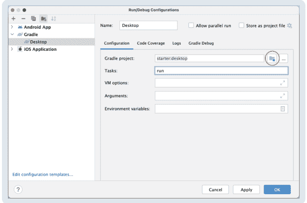

运行桌面应用：


等等，这是什么？

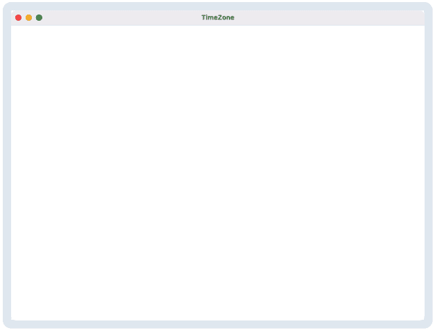

好消息是应用运行了。坏消息是没有任何内容。你知道为什么吗？没错——你从未在 `Main.kt` 中添加任何内容。回到桌面模块中的 `Main.kt`。在 `Surface` 内部，添加：

```kotlin
AppTheme {
    MainView()
}
```

这会显示错误。有什么想法吗？看一看 **desktop/build.gradle.kts** 文件。看起来你需要取消注释 **shared-ui** 项目。你需要停止运行桌面应用才能执行其他 Gradle 任务。点击红色停止按钮，取消注释 **shared-ui** 项目并重新同步 Gradle。

现在，在 `Main.kt` 中添加缺失的导入，然后重新运行应用。

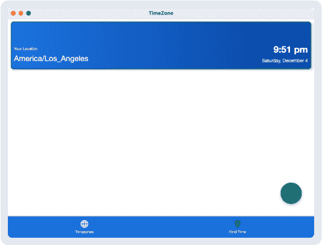

图 5.7 - 桌面时区屏幕

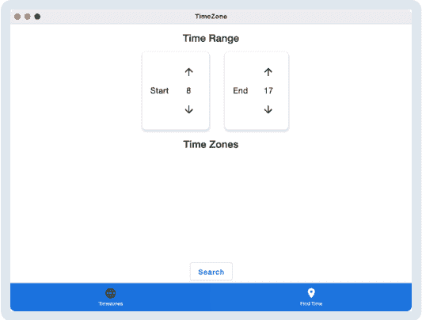

图 5.8 - 桌面时间段屏幕

> **注意：** 窗口背景可能因你的计算机是否使用深色主题而有所不同。

构建并运行桌面应用。你会看到按钮不再被裁剪：

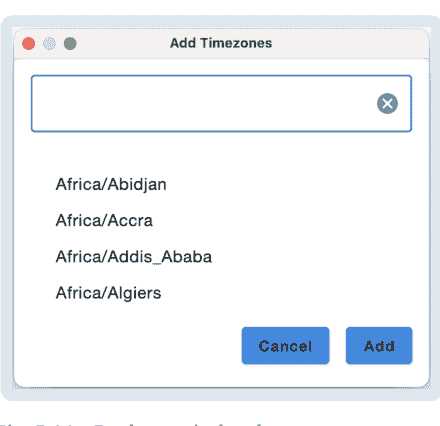

## Windows

你的应用可以有单个窗口或多个窗口。如果只有一个窗口，可以使用 `singleWindowApplication` 而不是 `application`。对于多个窗口，需要为每个窗口调用 `Window` 函数。

在桌面模块中打开 `Main.kt`。在 `fun main()` 之前，添加：

```kotlin
data class WindowInfo(val windowName: String, val windowState: WindowState)
@OptIn(ExperimentalComposeUiApi::class)
```

添加所需的导入。`WindowInfo` 类仅保存窗口名称和窗口状态。

删除 `val windowState = rememberWindowState()`，然后添加：

```kotlin
var initialized by remember { mutableStateOf(false) }
var windowCount by remember { mutableStateOf(1) }
val windowList = remember { SnapshotStateList<WindowInfo>() }
// Add initial window
if (!initialized) {
    windowList.add(WindowInfo("Timezone-${windowCount}",
        rememberWindowState()))
    initialized = true
}
```

添加所需的导入，如 `import androidx.compose.runtime.*`。该代码


above creates three variables：

+   1. A one-time initialized flag.
+   2. The number of windows open (starting at one).
+   3. The list of windows.

Then, it adds the first window entry (only once). This will be the first window to show up.

Replace the Window function with：

```
// 1
windowList.forEachIndexed { i, window ->
    Window(
    onCloseRequest = {
    // 2
    windowList.removeAt(i)
    },
    state = windowList[i].windowState,
    // 3
    title = windowList[i].windowName
    )
```

+   1. For each WindowInfo class in your list, create a new window.
+   2. When the window is closed, remove it from the list.
+   3. Set the title to the name from the WindowInfo class.

Then, add an ending } at the end of application . With the above code, you can now have multiple windows of your desktop application. You’ll see this in action in the next section.

## Menus

If you look at the menu bar on macOS, you’ll notice that your app doesn’t have any menus as a regular app would：

[PAGE 120]

<!-- no content -->

[PAGE 121]

```
```kotlin
)
}
Menu("Edit", mnemonic = 'E') {
    Item(
        "Cut", onClick = { }, shortcut = KeyShortcut(
            Key.X, ctrl = true
        )
    )
    Item(
        "Copy", onClick = { }, shortcut = KeyShortcut(
            Key.C, ctrl = true
        )
    )
    Item("Paste", onClick = { }, shortcut = KeyShortcut(Key.V,
        ctrl = true))
    }
}
```
```

+   1. Create a MenuBar to hold all of your menus.
+   2. Create a new menu named **File**.
+   3. Create a menu item named **New**.
+   4. Increment the window count and add a new `WindowInfo` class to the list. This will cause the function to execute again.
+   5. Close the current window by removing it from the list.
+   6. Add a separator.
+   7. Add the exit menu. This clears the window list, which will cause the app to close.

Add any needed imports. Most of these menus don’t do anything. The File menu item will increment the window count, the close menu will remove the window from the window list and the exit menu will clear the list (causing the app to quit). Run the app. Here’s what you’ll see：

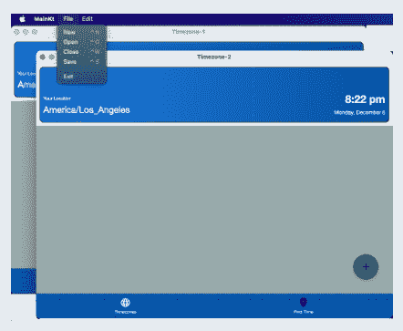

Fig. 5.13 - Desktop multiple windows

Try creating new windows and closing them. See what happens when you close

[PAGE 122]

the last window.

When writing your app, you may want to create your own menu file that handles menus. It could create a different menu system based on application state.

## Distribution

When you’re finally satisfied with your app, you’ll want to distribute it to your users. The first step is to package it up into a distributable file. There isn’t cross- compilation support available at the moment, so the formats can only be built using your current machine.

> **Note**: At the time of writing, macOS distribution builds required Java 15 or greater. On M1 MacBook pros, you’ll find that the Azul Arm-based JVM distribution works well and is easy to install. There are many third-party packages out there. Do a Google search to find one that’s easy to install for your machine.

To create a **dmg** installer for the Mac, you need to run the **package** Gradle task. You can run it from Android Studio：

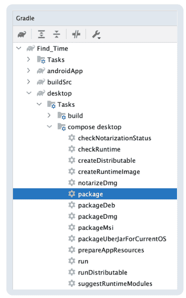

Or, run the following from the command line (in the project directory):

```
```
./gradlew :desktop:package
```
```

[PAGE 123]

This will create the package in the
./desktop/build/compose/binaries/main/dmg folder. Open it and you’ll see
your app. You can double-click the app to run it or drag it into your Applications
folder.

Here’s what your final app will look like：

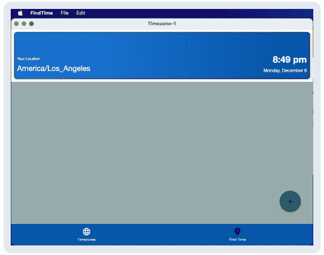

On Windows, the process is almost the same. Make sure you build the desktop
package from Android Studio and then from the command line type：

```
.\\.gradlew.bat :desktop:package
```

Or, run the package task from the **compose desktop** task folder. Once this
finishes, you’ll find the **FindTime-1.0.0.msi** file in the
desktop/build/compose/binaries/main/msi folder。

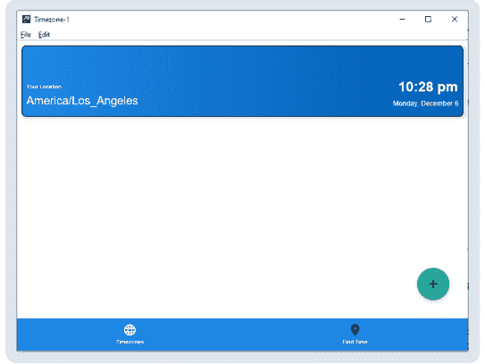

Fig. 5.16 - Desktop app running on Windows from packaged distribution

[PAGE 124]

While moving all the UI code was great for the desktop, it broke the Android app. But, you can fix that. First, you need to update the **build.gradle.kts** file in the **androidMain** module. Add the **shared-ui** library after the **shared** library：

```
implementation(project(":shared-ui"))
```

Run a Gradle sync. In the **shared-ui** project, add a new **AndroidManifest.xml** file in the **src/androidMain** folder. Then, add：

```
<?xml version="1.0" encoding="utf-8"?>
<manifest package="com.raywenderlich.findtime.shared_ui" />
```

Run the Android app to make sure it still works.

Congratulations! You were able to leverage your knowledge of Jetpack Compose to create your app on a whole new platform. If you have access to Windows, this will work there too.

## Key points

- **Compose Multiplatform** is a framework that uses most of the **Jetpack Compose** framework for displaying UIs.
- **Compose Multiplatform** works on Android, macOS, Windows and Linux desktops and the web.
- Desktop apps can have multiple windows.
- Desktop apps can use a menu system.
- Android can use **Compose Multiplatform** as well.

## Where to go from here?

Desktop Compose：

- Official site: https://www.jetbrains.com/lp/compose-mpp/
- Github Repository: https://github.com/jetbrains/compose-jb

Azul JVMs: https://www.azul.com/downloads/


## 创建 Common 模块的 Platform 类

打开 **Platform.kt**，在 **commonMain** 文件夹中。将 `expect` 类定义替换为以下内容：

```kotlin
expect class Platform() {
    val osName: String
    val osVersion: String

    val deviceModel: String
    val cpuType: String

    val screen: ScreenInfo?

    fun logSystemInfo()
}

expect class ScreenInfo() {
    val width: Int
    val height: Int
    val density: Int
}
```

通过编写这段代码，你向 KMP 承诺会提供这些信息。如上所示，这里没有任何实现。你只定义需要的内容，就像定义 `interface` 或 `protocol` 一样。

> **注意**：你使用了 Kotlin 的构造函数简写语法 `Platform()`，这意味着 KMP 现在期望你在项目中为构造函数、属性和方法提供实现。

你可能会惊讶于没有把 `Platform` 或 `ScreenInfo` 定义为 `data class`，因为它们看起来像是典型的数据持有类。

原因是 `data class` 在 Kotlin 中会自动生成一些实现。因此，这里不能使用 `data class`，因为 `expect` 类不应该有实现。

你也不能在 `expect class` 内部定义嵌套类。因此，你把 `ScreenInfo` 类放在 `Platform` 定义之外。你也可以新建一个文件。把它们放在同一个文件里同样可行。

在代码行号区，点击带有字母 **A** 的黄色菱形，这将让你跳转到项目中实际实现的平台文件。

# _Kotlin Multiplatform by Tutorials_ _第 6 章：连接平台特定 API_

如果文件尚未放在相应位置，或者你尚未实现实际定义，可以在 **expect** 类名上点击 **Alt+Enter**，Android Studio 会帮助你完成。

## 在 Android 上实现 Platform

打开 **Platform.kt**，位于 **androidMain** 文件夹中。

你会看到 Android Studio 已经在提醒你完成这个承诺。毕竟 KMP 仍在起步阶段，像幼儿一样！

将整个类定义替换为以下代码块：

+   5. 通过 `Build` 的 `SUPPORTED_ABIS` 属性可以获取设备的 CPU 类型。由于在某些旧版本的 Android 中结果可能为 `null`，因此提供默认值。
+   
+   6. 初始化一个 `ScreenInfo` 实例并将其赋值给 `screen` 属性。由于你在期望文件中声明该属性为可空，所以必须显式指定类型，否则类型会是非空的。而且，你在期望文件中承诺该属性可为空，应当遵守承诺。关于其可空的原因在实现桌面部分会说明白。
+   
+   7. 像 `interface` 一样，这里提供函数实现。目前，你将使用 Android 的 `Log` 类把所有属性输出到控制台。确保导入 `android.util.Log`。你可以安全地展开可空的 `screen` 属性，因为你在前面已经用非空值初始化了它。
+   
+   8. 你为 `ScreenInfo` 以及其默认构造函数提供了实际实现。
+   
+   9. 获取屏幕属性时，需要 `DisplayMetrics` 对象。可以使用下面的代码块获取。这里可以有额外的属性或方法。请确保导入 `android.content.res.Resources`。
+   
+   0. 使用之前定义的 `metrics` 属性获取屏幕宽、高和密度。导入 `kotlin.math.round` 以使用 `round` 函数。

接下来，你将实现 iOS 特定的代码。

## 在 iOS 上实现 Platform

当你在实际文件中时，可以点击带有字母 **E** 的黄色菱形，跳转到期望定义。在 **Platform.kt**（androidMain 文件夹中）内，点击黄色图标返回到 **common** 目录中的文件。从那里，点击 **A** 图标跳转到 iOS **actual** 文件。

你要添加的代码基本与之前相同，但这次会调用 iOS 框架，如 `UIKit`、`Foundation` 和 `CoreGraphics` 来获取所需信息。

将实际实现替换为以下代码块：

```kotlin
actual class Platform actual constructor() {
    // ...
}

actual class ScreenInfo actual constructor() {
    //7
    actual val width =
CGRectGetWidth(UIScreen.mainScreen.nativeBounds).toInt()
    actual val height =
CGRectGetHeight(UIScreen.mainScreen.nativeBounds).toInt()
    actual val density = UIScreen.mainScreen.scale.toInt()
}
```

+   1. `UIKit` 中有一个名为 `UIDevice` 的类，你可以通过它查询当前设备的信息。这里，你询问界面 idiom 以区分 iOS 与 iPadOS。`UIUserInterfaceIdiom` 枚举还有其他情况，为了简化，你在 else 块中使用 Kotlin/Native `Platform` 类获取信息。
+   2. 你可以使用 `UIDevice` 获取操作系统版本。
+   3. 这可能是本书中最笨拙的代码块。但别担心：KMP 通常不会如此复杂，它只是展示事情可能有多糟糕。Objective‑C 的核心是 C。有些老旧 API 可以追溯到 1990 年代。由于它们低层且使用频率不高，Apple 从未为它们提供更友好的接口。其中一个是 C 结构体 `utsname`。Unix 爱好者，欢呼吧！这里，你通过 Kotlin/Native 调用 C 函数。有多疯狂！在下面的代码块中，你使用 `memScoped` 块和 `alloc()` 函数分配内存，然后把指针传给 `uname` 函数，它填充操作系统信息。随后，你把包含机器名称的 C 字符串转换为 `NSString`，再自动转换为 Kotlin `String`。完成了！ sigh
+   4. 获取 CPU 类型时，你可以再次查询 C 代码，或者如这里，直接使用 Kotlin/Native `Platform` 类。
+   
+   5. 你初始化了一个 `ScreenInfo` 实例并将其赋值给 `screen` 属性。和 Android 实现一样，请显式写出类型。
+   
+   6. 函数实现：`MODULES/Platform/Platform.cpp`


## 在桌面端实现 Platform

打开 **desktopMain** 文件夹中的 **Platform.kt**。

用以下代码块替换实际的实现：

```
actual class Platform actual constructor() {
    //1
    actual val osName = System.getProperty("os.name") ?: "Desktop"

    //2
    actual val osVersion = System.getProperty("os.version") ?: "---"

    //3
    actual val deviceModel = "Desktop"

    //4
    actual val cpuType = System.getProperty("os.arch") ?: "---"

    //5
    actual val screen: ScreenInfo? = null

    //6
    actual fun logSystemInfo() {
        print("($osName; $osVersion; $deviceModel; $cpuType)")
    }
}

actual class ScreenInfo actual constructor() {
    //7
    actual val width = 0
    actual val height = 0
    actual val density = 0
}
```

## 共享更多代码

你可能已经注意到，`logSystemInfo` 方法实际上反复使用了相同的字符串。为了避免这种代码重复，你可以借助 Kotlin 扩展函数。

打开 commonMain 文件夹中的 Platform.kt。如你所知，你无法在这里定义的属性或函数中添加实现，但没人说你不能使用 Kotlin 扩展函数。

在文件末尾添加以下代码：

```
val Platform.deviceInfo: String
    get() {
        var result = "($osName; $osVersion; $deviceModel; "
        screen?.let {
            result += "${it.width}x${it.height}@${it.density}x; "
        }
        result += "$cpuType"
        return result
    }
```

现在回到各平台的实际文件，在 `logSystemInfo` 函数中使用这个属性。

在 androidMain 的 Platform.kt 中：

```
actual fun logSystemInfo() {
    Log.d("Platform", deviceInfo)
}
```

在 iosMain 的 Platform.kt 中：

```
actual fun logSystemInfo() {
    NSLog(deviceInfo)
}
```

在 desktopMain 的 Platform.kt 中：

```
actual fun logSystemInfo() {
    print(deviceInfo)
}
```

## 更新用户界面

现在 Platform 类已经就绪，你在共享模块中的工作也完成了。KMP 会负责创建框架和库，你可以将它们用于每个需要说明的平台。这些内容在接下来的章节中也会对你有帮助。下面是它的样子：

### Android

你将在 androidApp 模块中完成所有任务。应用的基本结构已经为你准备好了。一些重要的文件需要解释，这些文件在接下来的章节中也会对你有帮助。下面是它的样子：

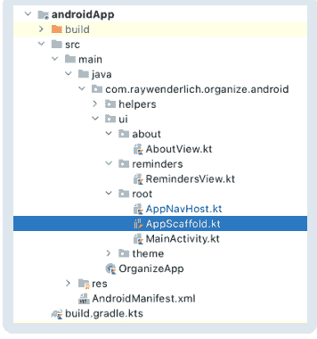

在根文件夹中，有 AppScaffold.kt 和 AppNavHost.kt。这两个文件设置了应用的屏幕，并让它们之间的导航按预期工作。如果你感兴趣的话，不妨看一看。

应用有两个主屏幕：RemindersView（目前只显示简单的“Hello World”）和 AboutView（你将在本章中设置它）。打开它吧。

在这里，ContentView 是所有重要操作发生的地方。用以下代码片段替换其实现：

```
@Composable
private fun ContentView() {
    val items = makeItems()

    LazyColumn(
    modifier = Modifier.fillMaxSize(),
    ) {
    }
```

```
```kotlin
items(items) { row ->
    RowView(title = row.first, subtitle = row.second)
}
}
```

```

这里，你从 `makeItems` 函数中获取想要显示的项，并将它们放入 `LazyColumn`（基本上就是一个列表视图）。从 **Compose** 库导入 `Modifier`、`LazyColumn` 和 `fillMaxSize`。为 `items` 方法添加以下导入：

```
```kotlin
import androidx.compose.foundation.lazy.items
```

```

你很快就会实现 `RowView`。

在 `ContentView` 下方添加 `makeItems`：

```
```kotlin
private fun makeItems(): List<Pair<String, String>> {
    //1
    val platform = Platform()

    //2
    val items = mutableListOf(
        Pair("Operating System", "${platform.osName} ${platform.osVersion}"),
        Pair("Device", platform.deviceModel),
        Pair("CPU", platform.cpuType)
    )

    //3
    platform.screen?.let {
        val max = max(it.width, it.height)
        val min = min(it.width, it.height)

        items.add(Pair("Display", "${max}x${min} @${it.density}x"))
    }

    return items
}
```

+   1. 首先，你初始化了一个之前创建的 `Platform` 类的实例。
+   2. 接下来，你创建了包含标题和来自 `platform` 信息的成对数据，并将它们存储在一个可变列表中。
+   3. 尽管你知道 `screen` 属性在 Android 上不会是 null，但在面对可空属性时，稳妥总比后悔好。

从 `kotlin.math` 导入 `max` 和 `min`。作为这个应用的最后一个部分，添加 `RowView` 可组合函数，如下所示：

```
```kotlin
@Composable
```
```


```kotlin
private fun RowView(
    title: String,
    subtitle: String,
) {
    Column(modifier = Modifier.fillMaxWidth()) {
        Column(Modifier.padding(8.dp)) {
            Text(
                text = title,
                style = MaterialTheme.typography.caption,
                color = Color.Gray,
            )
            Text(
                text = subtitle,
                style = MaterialTheme.typography.body1,
            )
        }
        Divider()
    }
}
```

这是一个简单的垂直文本堆栈，用于显示标题和副标题。你可以使用预定义的 Material 排版值来优化显示效果。它们类似于 iOS 动态字体（Dynamic Type）功能中的预定义文本样式。

至此，你本章的 Android 之旅就结束了。构建并运行这个应用，看看结果吧。

点击 i 按钮查看设备属性。

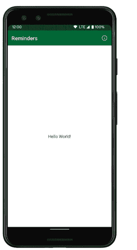

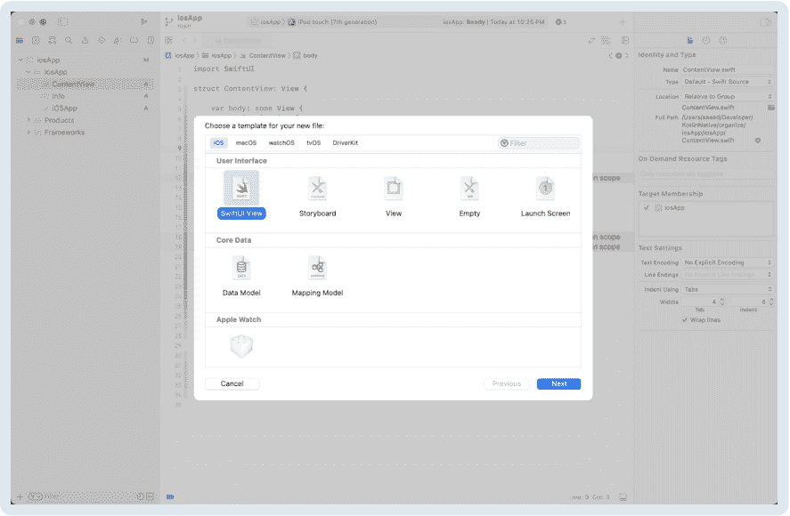

首先，在文件顶部导入共享模块：

```kotlin
import shared
```

这是 KMP 为你创建的框架。如果它报告找不到该模块的错误，别担心。构建项目就能解决这个问题。

其次，添加一个内部结构体来保存你要展示的数据：

```swift
private struct RowItem: Hashable {
    let title: String
    let subtitle: String
}
```

遵循 `Hashable` 协议对于 SwiftUI 中的 `ForEach` 结构来说是必需的。

第三，在 `AboutListView` 结构体内部，添加一个属性来持有你将要从 `Platform` 类中展示的条目的引用。

```swift
private let items: [RowItem] = {
    //1
    let platform = Platform()

    //2
    var result: [RowItem] = [
        .init(
            title: "Operating System",
```
```

Organize：你又回到了久经考验的复制粘贴！

桌面应用的设置与 Android 应用略有不同，尽管它们都使用 Jetpack Compose。一个区别是，在桌面应用中你不使用 Jetpack Navigation Component。此外，你会在新窗口中打开“关于设备”页面，以更符合桌面端的惯例。

除了“关于”页面在设计上的一些细微差别，比如用 Row 而不是 Column 展示每条数据，代码基本相同。这些代码已经在入门项目中为你准备好了。打开 `AboutView.kt`，找到 `//2` 和 `//3`，并取消它们下方代码的注释。

运行桌面应用有多种方式。你可以打开侧边 Gradle 菜单中的 desktopApp ▸ compose desktop，然后点击运行。

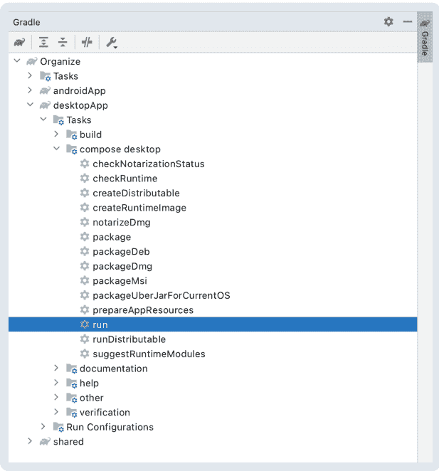

应用运行起来，看上去和 Android 应用非常相似。

## 挑战

这里有一个挑战，让你练习所学的内容。答案总是包含在本章的材料中，所以不用着急，慢慢来。

### 挑战：创建一个通用的 Logger

你可以在你的 expect/actual 实现中调用其他 expect 函数。你应当记得，`Platform` 类中有一个 `logSystemInfo` 函数，它在各自的平台上使用了 `NSLog` 和 `Log`。把这些调用重构到一个名为 `Logger` 的新类中。作为额外加分项，你可以在实现中添加日志级别。

## 要点

- 你可以使用 expect/actual 机制通过 Kotlin 调用每个平台的原生库。
- Expect 实体的行为非常类似于 `interface` 或 `protocol`。
- 在 Apple 平台上，Kotlin 使用 Objective-C 进行互操作。
- 你可以通过 Kotlin 扩展函数为 expect 实体添加共享实现。

# 7 应用架构

在上一章中，你开始创建 Organize 应用。然而，你还没有真正进入组织功能的部分。在本章中，你将为实现一个可维护且可扩展的应用打下基础。

任何玩过乐高积木的人，都曾尝试过把所有积木一块块叠起来，搭出尽可能高的塔。虽然这种做法在特定场景下可能奏效，但你的塔哪怕遇到最轻微的风也会倒塌。

这就是为什么建筑师和土木工程师绝不会这样建造楼房或塔。他们会进行周密规划，以确保自己的作品能稳定存在数十年。软件世界也是如此。

如果你还记得刚开始学编程的日子，那你很可能把程序的所有代码都写在一个文件里。在需要添加更多功能或解决问题之前，这样做确实很酷。

虽然“软件架构”这个词在业内相对较新，但软件工程师从 20 世纪 80 年代中期就开始应用其基本原理了。

## 设计模式

软件架构这个大主题下包含许多子主题。其中之一是架构风格——也就是所谓的软件设计模式。这个话题非常重要，以至于许多人用“软件设计模式”来指代软件架构本身。

根据你编程时间的长短，你可能听说过或使用过其中一些模式，比如整洁架构、模型-视图-视图模型（MVVM）、模型-视图-控制器（MVC）和模型-视图-演示者（MVP）。

在使用 KMP 时，你可以自由选择任何你认为适合你的应用的设计模式。

如果你有 iOS 背景，并且对 MVC 驾轻就熟，KMP 也会接纳你。如果你主要是 Android 开发者，并且遵循 Google 关于使用 MVVM 的建议，你同样会感到得心应手。

没有最好或最坏的做法。

接下来，你会看到一些许多开发者都在使用的设计模式的介绍。

### 模型-视图-控制器（MVC）

MVC 模式的历史可以追溯到 20 世纪 70 年代。开发者通常使用 MVC 来构建桌面和 Web 应用中的图形用户界面。

在移动领域，苹果在 2008 年推出 iPhone SDK 时让 MVC 成为主流。如果你在 SwiftUI 之前做过 iOS 开发，你可能会注意到其中一个基础组件就是 `UIViewController`。苹果对这套模式的重视程度不言自明。

在 Google 对 Android 开发模式和架构提出明确主张之前的许多年里，开发者使用的是模型-视图-演示者，即 **MVP**，它是 MVC 的一种近似变体。

在 MVC 中，你将代码划分为三个独立的阵营：

- **模型：** 该模式的核心组件。它完全独立于 UI，负责处理应用的逻辑和规则。
- **视图：** 信息的任何表示形式，例如列表、网格等。这一部分通常依赖于平台和框架。在 iOS 上你可以使用 UIKit 和 SwiftUI，在 Android 上可以使用 Views 或 Jetpack Compose。
- **控制器：** 接收输入并将其转换为模型或视图的命令。它还会从模型接收反馈，并将变更反映到视图上。在某种程度上，它是该模式中无所不知的角色。

下图展示了不同部分之间的关系：

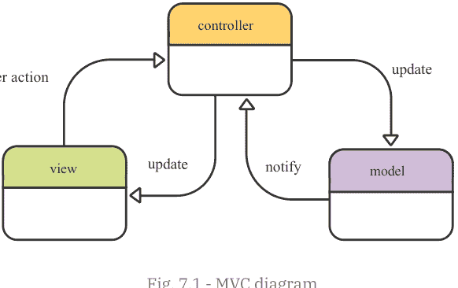

### 模型-视图-视图模型（MVVM）

顾名思义，MVVM 非常适合带有视图或用户界面的应用。由于绑定（binding）的概念在该模式中非常突出，有些人也称之为模型-视图-绑定器（Model-View-Binder）。

它比 MVC 要新得多。微软工程师之一 John Gossman 于 2005 年在他的博客中提出了 MVVM。微软在 .NET 框架中采用 MVVM，并使这一模式广受欢迎。

Google 在 2017 年的 Google I/O 大会上引入了架构组件。这是 Google 第一次决定为 Android 应用开发推荐一种设计模式。多年来，Google 还围绕 MVVM 概念引入了不同的工具和组件。如今，MVVM 已成为大多数 Android 开发者开发应用时的首选。

MVVM 的组成部分如下：

- **模型：** 它与 MVC 中的模型层非常相似。它代表应用的数据和规则。
- **视图：** 与 MVC 中同名的组件非常相似。它展示模型，接收用户的输入，并通过视图与 ViewModel 之间的连接将输入的处理转发给 ViewModel。人们通常称这种连接为绑定（Binding）。
- **ViewModel：** ViewModel 基本上是模型中数据的状态。它公开一些公共方法和属性，View 订阅这些方法和属性，并自动接收变化。人们称这种机制为数据绑定（Data Binding），或简称为绑定（Binding）。

Android 开发者对使用 LiveData（或最近的 Kotlin Flow 或 StateFlow）作为 ViewModel 内部的绑定器并不陌生。

在苹果推出 Combine 框架和 SwiftUI，作为响应式编程和声明式 UI 的第一方解决方案之后，iOS 开发者开始越来越多地使用 MVVM 设计模式和绑定机制。

### 整洁架构

2012 年，Robert C. Martin（也就是 Uncle Bob）在他的博客上发表了一篇文章，详细解释了他基于六边形架构、洋葱架构等模式提出的一种新设计模式。

整洁架构的学习曲线更陡峭，因为它有更多

组件。然而，由于它的可扩展性以及处理软件开发中各种问题的能力，它在专业人士中非常受欢迎——尤其是当他们想要创建大型应用程序时。

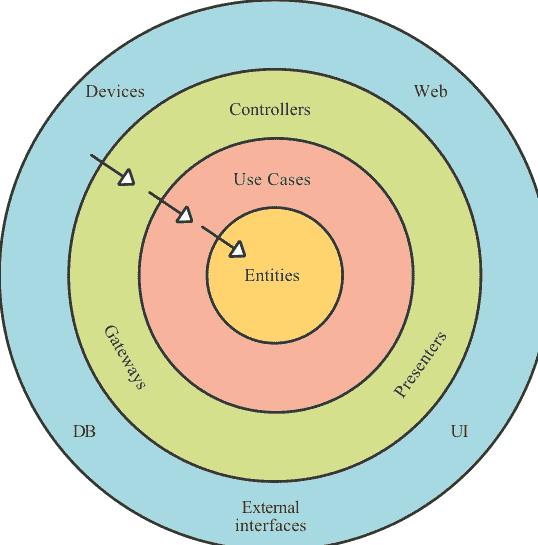

上面的圆圈代表了应用程序中软件的不同层级。关于此图，有两条原则需要牢记：

- 1. 最里面的圆最抽象，最外面的圆最具体。这被称为**抽象原则**。抽象原则规定内层圆应包含业务逻辑，外层圆应包含实现细节。换句话说，离中心越近，对特定平台的依赖就越少。
- 2. 整洁架构的另一条原则是**依赖规则**。这条规则规定每个圆只能依赖于最近的内层圆——这正是让架构运转起来的关键。这使基于整洁架构的代码相当解耦，因此也易于测试。

整洁架构的基本组件如下，从外层圆向内层圆解释：

- **表示层与框架层**：最外层通常包含特定于平台的框架和工具。使用 SwiftUI 制作界面？就是这里。使用 Room 作为数据库？它也属于这里。这一层的代码通常无法在平台之间共享。
- **控制器或表示器**：这一层相当于你在 MVC 中的 Controller 或 MVVM 中的 ViewModel。它们接收来自外层的数据，并将其传递给下一层。你可以将 MVVM 和 MVC 与整洁架构结合使用。这也是一件好事，因为你的控制器或 ViewModel 的职责会减少。
- **用例或交互器**：这一层定义了用户可以触发的操作。前一层的对象可以访问用例，并且只能调用已定义的交互。在整洁架构的原始定义中，这一层是你放置业务逻辑的地方。由于你可以自由地添加自己的层，你也可以将这一职责委托给更内层的部分。
- **实体**：所有数据源的抽象定义。它可以包含一些业务逻辑。

在创建 Organize 应用时，你将使用 MVVM 设计模式。你可以自由选择任何你更喜欢的设计模式用于你的应用程序。

## 共享业务逻辑

当你尽量减少重复编写的代码时，KMP 的优势就显现出来了。在上一章中，你为“关于设备”页面编写了两次逻辑。这些代码完全可以放在共享模块中，所有平台都能加以利用。

## 创建 ViewModel

在 Android Studio 中打开入门项目。它基本上是上一章的最终项目。

在 shared 模块中 commonMain 文件夹的 presentation 目录下，创建一个新文件并将其命名为 `BaseViewModel.kt`。

用这行代码填充文件：

```
expect abstract class BaseViewModel()
```

你对该行代码很熟悉。不过，这次它定义的是一个抽象类，我们应用中的所有 ViewModel 都将继承它。接下来，你将在三个平台上实现该类的具体实现。

将光标放在类名的中间，按 Alt+Enter。Android Studio 将帮助你创建所有需要的 actual 文件。重复此过程，直到类名下方表示文件缺失错误的红线消失。

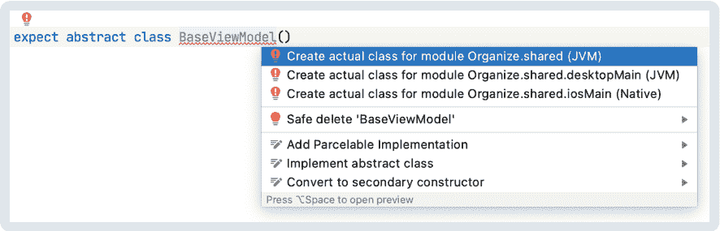

图 7.3 - 在 expect 类名上按 Alt+Enter

> **注意：** 如果 Android Studio 未能自动为你创建所需的 actual 文件，请不要担心。在缺失平台文件夹中的同一包内，创建一个同名文件即可。

打开 **BaseViewModel.kt** 的 Android 版本，并将内容替换为这行代码：

```
actual abstract class BaseViewModel : ViewModel()
```

不要忘记导入所需的包：

```
import androidx.lifecycle.ViewModel
```

在 Android 上，ViewModel 应继承 *Lifecycle* 版本的 `ViewModel`，以便它们能够适应设备上的配置变更。

如果这对 iOS 开发者来说有点困惑，这里做一个简短的解释：

在 Android 上，当配置发生变化时——例如设备旋转、用户更改系统级主题或语言区域——系统会重新创建所有视图组件。然而，系统会在内存中保留从 AndroidX 的 Lifecycle 包继承的 ViewModel 的同一实例。因此，你可以将视图数据保存在 ViewModel 中，并将其应用到新创建的视图组件上，用户不会察觉到任何变化。

对于 iOS 和桌面端，你不需要继承任何东西。Android Studio 为这些平台生成的 actual 文件已经足够了。它们看起来像这样：

```
actual abstract class BaseViewModel actual constructor()
```

## 创建 AboutViewModel

既然你有了一个基础的 viewmodel，是时候创建具体的版本了。首先在 commonMain 文件夹的 presentation 目录下创建一个名为 `AboutViewModel.kt` 的文件。

定义该类并使其继承你之前创建的 BaseViewModel。

```
class AboutViewModel: BaseViewModel() {
    }
```

在类内部，创建一个 Platform 类的实例，并按 Alt + Enter 导入它。

```
private val platform = Platform()
```

在 AboutViewModel 类内部定义一个数据类，用于保存“关于”页面每一行显示的数据：

```
data class RowItem(
    val title: String,
    val subtitle: String,
)
```

接下来，创建一个生成“关于”页面项的函数。你在上一章中为每个平台编写了相同的逻辑三次。稍后你会将它们全部移除。

```
private fun makeRowItems(platform: Platform): List<RowItem> {
    val rowItems = mutableListOf(
        RowItem("Operating System", "${platform.osName} ${platform.osVersion}"),
        RowItem("Device", platform.deviceModel),
        RowItem("CPU", platform.cpuType),
    )
    platform.screen?.let {
        rowItems.add(
            RowItem(
                "Display",
                "${max(it.width, it.height)} × ${min(it.width, it.height)} @${it.density}x"
            ),
        )
    }
    return rowItems
}
```

最后，创建一个实例属性来存储该函数的结果，以避免重新创建数据。毕竟，这些数据永远不会改变，而是相对静态的。

```
val items: List<RowItem> = makeRowItems(platform)
```

这将是 ViewModel 的公共 API。

## 在视图层中使用 AboutViewModel

### Android

打开 androidApp 模块中的 AboutView.kt。

移除 `makeItems()` 方法，因为类似实现现在已存在于 AboutViewModel 中。

接下来，编辑 AboutView 方法的定义，以考虑 viewmodel：

```
@Composable
fun AboutView(
    viewModel: AboutViewModel = AboutViewModel(),
    onUpButtonClick: () -> Unit
) {}
```

现在为 `viewModel` 参数提供一个默认值。在后面的章节中，你将向代码中引入依赖注入并改进这种实例化方式。

之后，更新 ContentView 方法如下：

```
@Composable
private fun ContentView(items: List<AboutViewModel.RowItem>) {
    LazyColumn(
        modifier = Modifier.fillMaxSize(),
    ) {
        items(items) { row ->
            RowView(title = row.title, subtitle = row.subtitle)
        }
    }
}
```

你将把该函数渲染所需的 items 作为参数注入。你还移除了现在不必要的 `makeItems` 方法调用。

现在 `ContentView` 方法需要一个参数，回到 AboutView 的实现中传递 items。将 ContentView() 替换为：

```
ContentView(items = viewModel.items)
```

构建并运行 Android 应用。它和之前一样工作，但这次使用了 viewmodel。

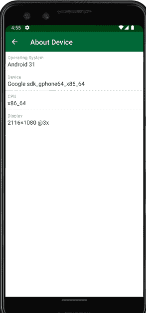

### iOS

打开 Xcode 项目并切换到 AboutView.swift。

在文件顶部，确保通过添加这行代码来导入共享模块：

```
import shared
```

接下来，在 AboutView 结构体内部，为 viewmodel 添加一个属性：

```
@StateObject private var viewModel = AboutViewModel()
```

你用 `@StateObject` 指令来注解该属性，以便让 SwiftUI 创建


-   你需要在 `commonMain` 目录下的 `shared` 模块中创建一个新的 `data` 目录，然后创建一个名为 `RemindersRepository.kt` 的文件。
-   在 `RemindersRepository.kt` 文件中，添加以下代码来声明 `Reminder` 数据模型：

```
data class Reminder(
    val id: String,
    val title: String,
    val isCompleted: Boolean = false,
)
```

-   在 `RemindersRepository.kt` 文件中，添加以下代码来创建 `RemindersRepository` 类并添加 `createReminder` 方法：

```
class RemindersRepository {
    private val _reminders: MutableList<Reminder> = mutableListOf()

    fun createReminder(title: String) {
        val trimmed = title.trim()
        if (trimmed.isNotEmpty()) {
            val newReminder = Reminder(
                id = UUID().toString(),
                title = trimmed,
                isCompleted = false
            )
            _reminders.add(newReminder)
        }
    }

    fun markReminder(id: String, isCompleted: Boolean) {
        val index = _reminders.indexOfFirst { it.id == id }
        if (index != -1) {
            _reminders[index] = _reminders[index].copy(isCompleted = isCompleted)
        }
    }

    val reminders: List<Reminder>
        get() = _reminders
}
```

-   在 `commonMain` 目录下的 `presentation` 目录中，创建一个新的文件 `RemindersViewModel.kt`，并添加以下代码：

```
class RemindersViewModel : BaseViewModel() {
    private val repository = RemindersRepository()

    private val reminders: List<Reminder>
        get() = repository.reminders

    var onRemindersUpdated: ((List<Reminder>) -> Unit)? = null
        set(value) {
            field = value
            onRemindersUpdated?.invoke(reminders)
        }

    fun createReminder(title: String) {
        if (title.trim().isNotEmpty()) {
            repository.createReminder(title = title)
        }
    }

    fun markReminder(id: String, isCompleted: Boolean) {
        repository.markReminder(id = id, isCompleted = isCompleted)
        onRemindersUpdated?.invoke(reminders)
    }
}
```

-   打开 `androidApp` 模块中的 `RemindersView.kt` 文件，修改 `RemindersView` 函数签名以接受 `viewModel` 参数，并将 `viewModel` 传递给 `ContentView`：

```
@Composable
fun RemindersView(
    viewModel: RemindersViewModel = RemindersViewModel(),
    onAboutButtonClick: () -> Unit,
) {
    Column {
        Toolbar(onAboutButtonClick = onAboutButtonClick)
        ContentView(viewModel = viewModel)
    }
}

@Composable
private fun ContentView(viewModel: RemindersViewModel) {
    // 这里需要实现 ContentView 的具体内容，使用 viewModel.reminders 来获取提醒列表
}
```


添加一个变量用于记住提醒事项的状态。每当此状态发生变化时，Jetpack Compose 会重新渲染或重组该函数。

```kotlin
var reminders by remember {
    mutableStateOf(listOf<Reminder>(), policy = neverEqualPolicy())
}
```

在上面的代码中，by 是一种委托语法。这样做会将 get() 和 set() 方法委托给 remember 方法。添加以下导入以解决 IDE 警告：

```kotlin
import androidx.compose.runtime.getValue
import androidx.compose.runtime.setValue
```

为了将 viewModel 中 reminders 的底层更改连接到此函数，请在 reminders 初始化之后添加以下代码行：

```kotlin
viewModel.onRemindersUpdated = {
    reminders = it
}
```

每当 viewModel 调用 onRemindersUpdated lambda 时，你都会将 reminders 列表的新值设置到 reminders 状态变量中。这使组件对更改做出响应。你在上一步中设置的策略将确保无论新旧值是否相等，重组始终会发生。

接下来，创建一个 LazyColumn 以列表形式显示提醒事项：

```kotlin
LazyColumn(modifier = Modifier.fillMaxSize()) {
    //1
    items(items = reminders) { item ->

    //2
    val onItemClick = {
    viewModel.markReminder(id = item.id, isCompleted = !item.isCompleted)
    }

    //3
    ReminderItem(
    title = item.title,
    isCompleted = item.isCompleted,
    modifier = Modifier
    .fillMaxWidth()
    .clickable(enabled = true, onClick = onItemClick)
    .padding(horizontal = 16.dp, vertical = 4.dp)
    )
}
```

## 在 iOS 上更新视图

为了实现数据绑定的响应式特性，SwiftUI 在很大程度上依赖于 Combine 框架。你可能已经使用过 `@State` 来注解值类型数据。如果你使用 `@ObservableObject` 或 `@StateObject` 连接到外部引用模型数据（就像你在 AboutViewModel 中所做的那样），SwiftUI 就可以利用 Published 属性来自动更新视图。

然而，使用 RemindersViewModel 有一个问题。由于你在 KMP 共享模块中定义了 viewModel，因此你无法在那里使用 Combine，因为 Combine 仅适用于 Swift。

解决这个问题的一种方法是在 viewModel 周围创建一个包装器，并暴露一个可供 SwiftUI 使用的已发布属性。

打开 iosApp.xcodeproj，按 Command-N 创建一个新的 Swift 文件。将其命名为 RemindersViewModelWrapper.swift，并放在 Reminders 目录中。

将以下代码添加到该文件中：


```swift
withAnimation {
    viewModelWrapper.viewModel.markReminder(
        id: item.id,
        isCompleted: !item.isCompleted
    )
}

//7
Section {
    NewReminderTextField(text: $textFieldValue) {
        withAnimation {
            viewModelWrapper.viewModel.createReminder(title: textFieldValue)
            textFieldValue = ""
        }
    }
    .navigationTitle("Reminders")
}
```

- 1. 使用 `@StateObject` 注解，你可以创建上一步中包装器的一个实例。
- 2. 使用 `@State` 注解，你可以创建一个属性来保存文本字段的文本值。你甚至在 Jetpack Compose 中使用了相同的变量名。
- 3. SwiftUI 中的 `List` 相当于 Jetpack Compose 中的 `LazyColumn`。
- 4. 如果 `reminders` 属性包含值，你可以创建一个带有提醒事项的分区。
- 5. 对于第一个分区列表中的每一行，你使用起始项目中 `ReminderItem` 的一个实例。
- 6. 当用户点击每一行时，你调用 `viewModel` 将提醒事项标记为已完成，或反之亦然。`withAnimation` 函数使过渡看起来更流畅。
- 7. 这个分区用于创建一个文本字段来添加新项目。你将它绑定到 `textFieldValue` 属性。

## 更新桌面端视图

由于桌面应用使用的是 Jetpack Compose，你可以直接将 **androidApp** 模块中的 **RemindersView.kt** 中的代码复制粘贴到 **desktopApp** 模块中的同一文件中。

> **注意**：你可能会在代码中看到错误，提示 Android Studio 无法访问 `androidx.lifecycle.ViewModel`，而该类型是 `com.raywenderlich.organize.presentation.RemindersViewModel` 的超类型。你可以放心地忽略此错误，因为应用将成功构建并运行。这似乎是 Android Studio 上 KMM 插件的一个 bug。

完成上述操作后，构建并运行桌面应用。


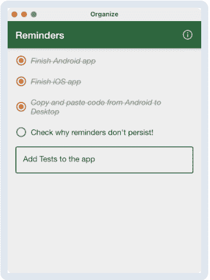

图 7.9 - iOS 上 Reminders 应用的首页

需要提及的一点是，每当你重新启动应用或导航到另一个页面再返回时，应用都会忘记你的提醒事项。这是因为你将提醒事项存储在仓库内的一个属性中。在后续章节中，当你集成数据库时，你将解决这个问题。

在最终项目中，有一些改进键盘支持的细节——例如焦点切换。为简洁起见，这些内容未包含在本章中。

## 共享测试和 UI

通过共享业务逻辑，你将每个平台需要编写的代码减少到了各自对应的 UI 代码。

在下一章中，你将向项目添加测试。由于所有业务逻辑现在都位于同一个地方，你将编写一套测试。因此，你会编写更少的测试代码——这意味着你正在暗自欣喜！

你可能觉得在 Android 和桌面端之间复制粘贴代码有点奇怪。而且，你可能在想一种方法来共享这些非常相似的代码。既然你一直在这两个平台使用 Jetpack Compose，那么有几种方法可以共享这些代码。你将在**附录 3** 中了解更多关于其中一种方法的内容。

需要注意的一点是，共享 UI 代码并不总是一个好决策，原因如下：

- 你可能已经注意到，桌面应用在美学上看起来有点奇怪。它遵循 Material Design 指南，而这在桌面上并不是一种典型的方法。它看起来也不像 Windows 或 macOS 上的其他原生应用。许多人宁愿坚持使用每个平台的原生 UI 工具包，也不愿使用 Jetpack Compose——后者在底层使用的是 Java Swing。就此而言，许多开发人员不会使用你在本书中看到的方法来创建桌面应用。如果你不这样做，你就不会在桌面端使用 Jetpack Compose，因此也不会在 Android 和桌面端之间有代码可以共享。

- 每个平台都有其差异。桌面应用通常需要与 Android 应用不同的设计。例如，它不需要大型触摸目标，没有多点触控，输入方式主要是鼠标和键盘而不是触摸，等等。如果你想为每个平台创建出色的应用，你需要考虑这些因素。

所有这些解释同样适用于 UI 测试。如果你以某种方式共享 UI 代码，你就可以拥有共享的 UI 测试。如果不这样做，你就需要为每个平台分别创建 UI 测试。

## 挑战

这里有一个挑战，看看你是否掌握了本章内容。解决方案就在本章的材料中等着你。

### 挑战：将页面标题移入 ViewModel

由于 ViewModel 负责让一切为视图展示做好准备，你可以让 ViewModel 为它们各自的视图提供页面标题。这样，你就可以将另一处代码重复转移到共享平台，并防止页面标题错误或拼写错误。

## 要点

- 你可以使用任何你认为适合 Kotlin Multiplatform 的设计模式。
- 你熟悉了 MVC、MVVM 和 Clean Architecture 的主要概念。
- 使用 Kotlin Multiplatform 在平台之间共享数据模型、ViewModel 和仓库非常直接。
- 你可以使用 Kotlin Multiplatform 共享业务逻辑测试。
- 尽管共享平台之间的 UI 是可能的，但这并不总是一个最佳决策。


-   [这里] —  — 那是让你想拖延的软件开发阶段，无论你多么清楚它的重要性。

无论你喜欢与否，拥有良好的测试集 —  — 包括自动化和手动测试 —  — 能确保你的软件质量。使用 Kotlin Multiplatform 时，你拥有足够的工具来编写测试。因此，如果你这次想让它搁置，你必须想出另一个借口。

在 KMP 环境中测试你的代码遵循你已经熟悉的相同模式。你在 **common** 模块中测试代码。你可能还需要使用 **expect/actual** 机制。基于此，设置依赖关系的结构与非测试代码相同。

从入门项目中打开 **shared** 模块内的 **build.gradle.kts** 文件。在 **sourceSets** 块中，在 `val commonMain` 之后添加一个 **commonTest** source set，具体如下：

```
val commonTest by getting {
    dependencies {
        implementation(kotlin("test-common"))
        implementation(kotlin("test-annotations-common"))
    }
}
```

你正在添加来自 **kotlin.test** 库的两个模块。该库提供标记测试函数的注解以及用于断言的实用函数 —  — 与所使用的测试框架无关。名称中的 **common** 表明这些内容可用于你的跨平台公共代码。完成 Gradle 同步。

如上所述，你的测试代码位于 **commonTest** 目录中。通过右键 **shared** 模块内的 **src** 文件夹，选择 **New ▸ Directory**，在其 sibling 目录下创建它，与 **commonMain** 同级。开始输入 **commonTest** 时，Android Studio 会提供自动补全，选择 **commonTest/kotlin**。

# Kotlin Multiplatform by Tutorials 第 8 章：测试


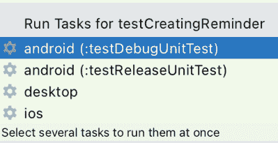

> 注：虽然不是必须，但将测试文件与主代码保持相同的包结构是良好实践。如果想实现这一点，在上一步中输入 **commonTest/kotlin/com/raywenderlich/organize/presentation**，或手动创建嵌套目录。

接下来，在你刚才创建的目录中创建名为 `RemindersViewModelTest` 的类。顾名思义，该类包含所有与 `RemindersViewModel` 相关的测试。

现在，是时候创建第一个测试函数了。在新建的类中添加以下内容：

```
@Test
fun testCreatingReminder() {
}
```

你稍后再实现函数体。需要注意的是，`@Test` 注解来自你之前添加的 **kotlin.test** 库。如果 Android Studio 未能自动导入所需包，请手动添加：`import kotlin.test.Test`。

添加带 `@Test` 注解的函数后，Android Studio 会在代码左侧显示运行按钮，方便你直接运行测试。

# Kotlin Multiplatform by Tutorials 第 8 章：测试


你可以通过点击这些按钮、在终端中输入命令，或按以下键盘快捷键运行测试：Mac 上的 <b>Control-Shift-R</b>，Windows 或 Linux 上的 <b>Control-Shift-F10</b>。


选择 <b>android (:testDebugUnitTest)</b> 以在 Debug 模式下运行测试。

恭喜！你成功运行了第一个测试……或者真的如此？

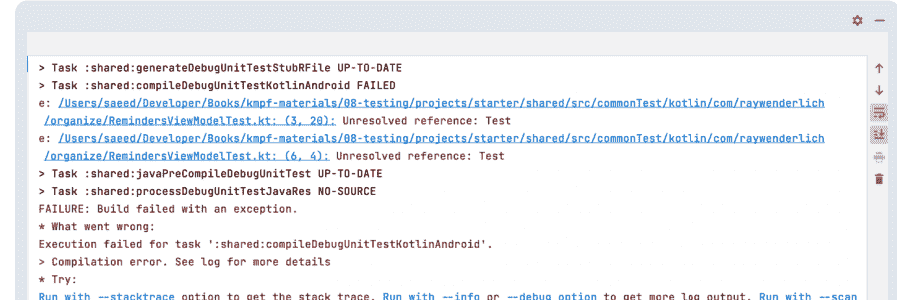

仔细观察日志，你会发现编译器无法解析对 <o>Test</o> 的引用。原因如下：

如前所述，<o>kotlin.test</o> 库仅独立提供测试注解，与所使用的测试库无关。当你请求在 Android 平台运行测试时，系统需要在该平台找到一个测试库来运行你的测试。由于你未为 JVM 目标定义任何测试库，系统无法解析注解，导致测试失败。因此，下一步是为应用目标添加测试库。

### Android

在你之前创建的目录中，于 **androidTest** 目录下创建 **PlatformTest.kt** 文件，并按以下内容更新：

```
actual class PlatformTest {
    private val platform = Platform()

    @Test
    actual fun testOperatingSystemName() {
        assertEquals(
            expected = "Android",
            actual = platform.osName,
            message = "The OS name should be Android."
        )
    }
}
```

相当直接，不是吗？你断言操作系统名称应为 “Android”。

### iOS

```
actual class PlatformTest {
    private val platform = Platform()

    @Test
    actual fun testOperatingSystemName() {
        assertTrue(
            actual = platform.osName.equals("iOS", ignoreCase = true)
                || platform.osName == "iPadOS",
            message = "The OS name should either be iOS or iPadOS."
        )
    }
}
```

你检查操作系统名称是否为 **iOS** 或 **iPadOS**。

## Desktop

```
actual class PlatformTest {
    private val platform = Platform()
}
```


你可以安全地删除 _iosAppUITestsLaunchTests.swift_。打开 **iosAppUITests.swift** 并删除类的所有内容。你将在这里编写几个测试函数。

首先，在测试类中将应用实例作为属性存储。

```
private let app = XCUIApplication()
```

其次，重写 `setUp` 函数。系统会在运行每个测试前调用该方法。它类似于在 Kotlin 中使用 `annotation` `@BeforeTest` 标记测试函数。

```
override func setUp() {
    continueAfterFailure = false
    app.launch()
}
```

此函数在出现错误时阻止测试继续运行，然后启动应用，以便你可以运行测试。

接下来，编写一个测试函数来检查 **About** 按钮是否存在。

```
func testAboutButtonExistence() {
    XCTAssert(app.buttons["About"].exists)
}
```

Xcode 测试框架中的断言函数通常以 `XCTAssert` 开头。这是最简单的用法，需要一个布尔参数。查询应用中的所有按钮，并查找标题为 **About** 的按钮。

> **注意**：Xcode 测试函数必须以 `test...` 开头，否则 Xcode 无法识别它们为测试函数，也就不会运行它们。

### Android UI Testing with Jetpack Compose

对 Compose 布局的测试与基于 View 的 UI 测试不同。基于 View 的 UI 工具包定义了 View 的属性，例如它占据的矩形区域、属性等。在 Compose 中，某些 composable 可能会向层级结构中发出 UI。因此，你需要一种新的匹配 UI 元素的机制。

幸运的是，Jetpack Compose 的创建者预见了这一点，并提供了必要的工具来测试布局。

打开 androidApp 模块中的 build.gradle.kts，在 dependencies 块中添加以下内容：

```
androidTestImplementation(
    "androidx.compose.ui:ui-test-junit4:${rootProject.extra["composeVersion"]}")
debugImplementation(
    "androidx.compose.ui:ui-test-junit4:${rootProject.extra["composeVersion"]}")
```

在 `android` 块的 `defaultConfig` 部分，添加以下内容以指示系统如何运行测试：

```
testInstrumentationRunner = "androidx.test.runner.AndroidJUnitRunner"
```

现在同步项目。接下来，创建包和文件。在 src 目录下，创建这些嵌套文件夹：

androidTest/java/com/raywenderlich/organize/android/

你将复制主目录的相同包结构。

接下来，创建一个名为 AppUITest.kt 的 Kotlin 文件，并定义一个同名的类：

```
class AppUITest {
    @get:Rule
    val composeTestRule = createAndroidComposeRule<MainActivity>()
}
```

添加一个类型为 `AndroidComposeTestRule` 的属性。`createAndroidComposeRule` 为你提供的活动创建测试规则。它会启动该活动，以便你可以运行测试。

你要编写的第一个测试是检查 **About** 按钮是否存在。如你记得，该按钮位于应用的右上角，并带有一个 i 图标。你可以通过一种称为 Semantics 的机制来匹配该元素。Semantics 为 UI 提供意义——无论是简单的按钮还是一组 composables。Semantics 框架主要用于无障碍设置，但测试可以利用其关于 UI 层级的信息。

你通过 Modifier 向 composables 添加 semantics。

打开 RemindersView.kt，在 Toolbar composable 的 IconButton 上添加 semantics 修饰符。IconButton 将：

1. 使用你定义的 semantics 查找 **About** 按钮，并模拟点击操作。
2. 检查屏幕上是否有包含 **About Device** 内容的文本。About 页面标题为 **About Device**，只有在该页面显示时才会出现。这种做法并不理想，因为如果你为应用本地化，测试会失败。使用 semantics 始终是更好的选择。
3. 如果你为按钮设置了 content description（如工具栏中的 **Up Button**），你可以直接使用它而无需设置和查询 semantics。你可以查找按钮并执行点击操作。
4. 关闭 **About** 页面后，应用应回到 **Reminders** 页面。检查页面标题以确认情况。

运行测试，它将通过。

### Desktop UI Testing

由于 Android 和 Desktop 的 UI 代码本质上相同，测试也会非常相似。但设置略有不同。 starter project 已经为你提供了相应的代码。需要考虑的差异包括：

- 测试依赖不同。此外，使用 JUnit 测试 Desktop Compose 布局的库处于实验阶段，你需要选择加入才能使用它。查看 **desktopApp** 模块中的 **build.gradle.kts**。

```
named("jvmTest") {
    dependencies {
        @OptIn(org.jetbrains.compose.ExperimentalComposeLibrary::class)
        implementation(compose.uiTestJUnit4)
        implementation(compose.desktop.currentOs)
    }
}
```

- 许多断言函数尚未实现。例如，assertIsDisplayed() 在 Desktop 上没有实现。你可以改用 assertExists()。

- 由于 Desktop 上没有 Activity 来托管你的测试，你需要自己搭建基础。打开 desktopApp 模块中的 AppUITest.kt。主要有两个区别：首先，你需要使用更通用的 createComposeRule() 来创建测试规则；其次，有一个 setUp 方法在所有测试之前运行。这里，你将发射一个类似于应用的 composable 供测试使用。主要区别在于不存在窗口。

```
@Before
fun setUp() {
    composeTestRule.setContent {
    var screenState by remember { mutableStateOf(Screen.Reminders) }
    }

    when (screenState) {
    Screen.Reminders ->
    RemindersView(
    onAboutButtonClick = { screenState = Screen.AboutDevice }
    )
    Screen.AboutDevice -> AboutView()
    }
}
```

- 由于没有窗口，第二个测试函数的实现如下：

```
@Test
fun testOpeningAboutPage() {
    //1
    composeTestRule
    .onNodeWithText("Reminders")
    .assertExists()

    //2
    composeTestRule
    .onNodeWithContentDescription("aboutButton")
    .performClick()

    //3
    composeTestRule.waitForIdle()
}
```


## Kotlin Multiplatform 教程 第 8 章：测试

新建一个测试函数，并将光标放在空函数体中。

```swift
func testOpeningAndClosingAboutPage() {
    // 将光标放在这里
}
```

页面底部会出现一个**记录**按钮。点击它。应用将在模拟器上运行，Xcode 会把你在应用中的任何操作转换为代码。

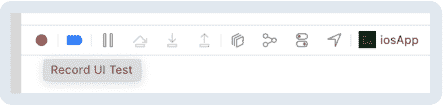

图 8.11 - Xcode UI 测试记录按钮

按顺序执行以下操作：

1. 点击**关于**按钮。
2. 当**关于**页面出现后，点击**完成**按钮。
3. 使用与开始记录时相同的按钮停止记录。

查看测试函数。Xcode 已经为你添加了代码，大致如下：

```swift
func testOpeningAndClosingAboutPage() {
    let app = XCUIApplication()
    app.toolbars["Toolbar"].buttons["aboutButton"].tap()
    app.navigationBars["About Device"].buttons["Done"].tap()
}
```

如果你所要做的就这些，那么已经可以了！否则，这为编写测试提供了一个起点。你还可以从这个功能中学习如何查找屏幕上的元素并与之交互。

另外需要注意的一点是，如果你设置了 `accessibilityIdentifier`，Xcode 会自动使用它；如果没有，它会使用静态标题来查询元素。始终在元素上设置此修饰符是一个很好的实践。

话虽如此，你可以从 Xcode 的自动测试记录系统中获得启发，并编写如下测试函数：

```swift
func testOpeningAndClosingAboutPage() {
    // 1
    app.buttons["aboutButton"].tap()

    // 2
    let aboutPageTitle = app.staticTexts["About Device"]
    XCTAssertTrue(aboutPageTitle.exists)

    // 3
    app.navigationBars["About Device"].buttons["Done"].tap()

    // 4
    let remindersPageTitle = app.staticTexts["Reminders"]
    XCTAssertTrue(remindersPageTitle.exists)
}
```

1. 模拟应用启动时点击“关于”按钮。
2. 检查屏幕上是否存在内容为“About Device”的文本。“关于”页面具有此标题，并且只有当该页面在屏幕上时它才会出现。
3. 在应用的某个导航栏中找到标题为“About Device”的“完成”按钮，并尝试点击它。
4. 当你关闭“关于”页面后，应用应回到“提醒”页面。检查页面标题是否如此。

将光标放在 `iosAppUITests` 类的名称中间，然后按 Command-U，运行该类中的所有测试。

浏览 Xcode 控制台中的结果，或者查看代码边栏和测试导航器中的绿色勾选标记，然后尽情欢呼吧！

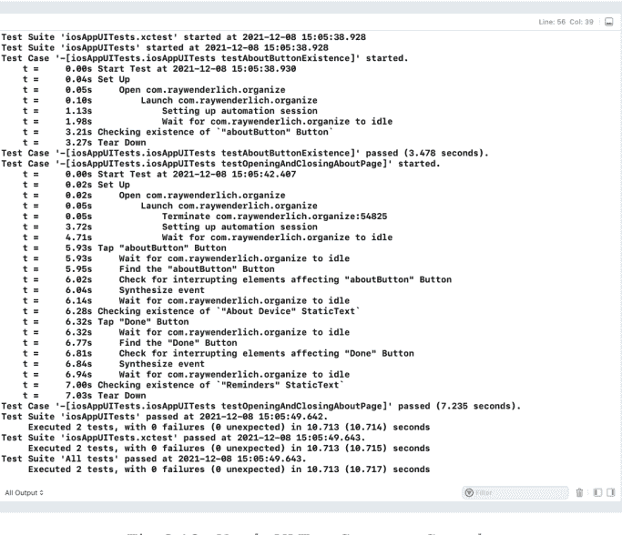

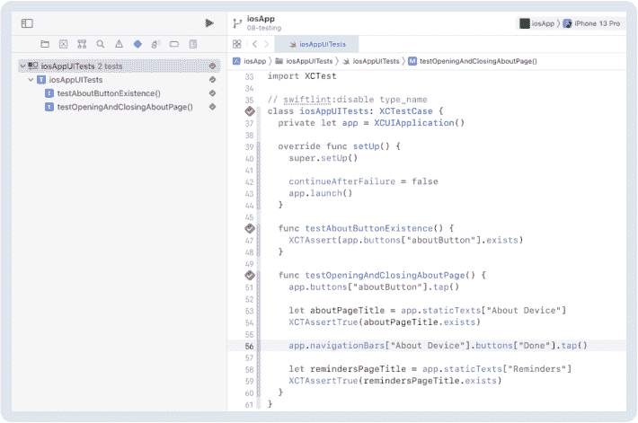

图 8.13 - Xcode UI 测试成功 - 边栏

## 挑战

这里有一个挑战，看看你是否已经掌握了要点。解决方案在本章的材料中。

### 挑战：为 RemindersRepository 编写测试

深入到应用架构的更底层，拥有一个万无一失的仓库是至关重要的。毕竟，仓库是 **Organize** 中 viewModel 的支柱。尽管目前看起来可能很简单，与 viewModel 类似，但在后续将数据库连接到仓库时，你就会看到这些测试将发挥多么重要的作用。

基于上述说明，请尝试为 `RemindersRepository` 创建一个测试套件。

## 关键点

- KMP 将帮助你编写更少的测试代码，就像它帮助你编写更少的业务逻辑代码一样。
- 你可以为公共代码以及平台特定代码编写测试——全部使用 Kotlin。
- 有必要为每个平台声明对测试库的依赖。KMP 将通过提供的环境运行你的测试——例如在 JVM 上使用 JUnit。
- 在测试代码中使用 expect/actual 机制是可行的。
- 对于 UI 测试，你需要参考每个平台提供的解决方案：使用 Jetpack Compose 创建的 UI 使用 Jetpack Compose Tests，使用 UIKit 或 SwiftUI 创建的 UI 使用 XCTest。

## 接下来去哪里？

本章仅仅触及了测试的皮毛。它没有讨论 mock 和 stub，并且尽量避免使用第三方库。不过，有几个库值得一提：

- **Kotest**：一个多平台 Kotlin 测试库，提供扩展断言和对属性测试的支持。它可以为边界情况和随机值生成值。
- **Turbine**：一个面向 Kotlin Flow 测试的小型多平台库。本章没有讨论协程和 Flow。然而，如果你想要测试它们，可以看看 Turbine，因为 `kotlinx-coroutines-test` 库尚不支持 Kotlin/Native。
- **MockK**：这是 Kotlin 中最著名的 mock 库。虽然有多平台版本可用，但它不支持 iOS。

如果你想更全面地了解测试，网上有很多优秀资源，例如视频教程和文章，以及 raywenderlich.com 的这两本书：

- Android 测试驱动开发教程
- iOS 测试驱动开发教程

# 9 依赖注入

作者：Saeed Taheri

撇开单细胞生物不谈，世界上几乎万物都依赖其他实体才能运作。无论是自然界中的事物还是人类创造的事物，通常都需要多个部分组合才能形成一个可工作的实例。

想象一下汽车工厂的装配线。他们不会在装配线上制造发动机和轮子。汽车制造商将许多零部件外包给其他公司。最后，他们把所有部件带到装配线上，将每个部件_注入_到正在制造的车体中，一辆崭新的汽车就出现了。汽车_依赖_于其他对象。软件世界也是如此。

如果你要将 `Car` 建模为一个类，它的依赖项之一就是 `Engine`。汽车对象不应该负责创建发动机。你应该将发动机从外部注入到装配线中——用编程术语来说，就是构造函数或初始化器。

## 依赖注入的优势

依赖注入（Dependency Injection，简称 DI）有许多优势。

- **可维护性：** DI 让你的代码易于维护。如果你的类是松散耦合的，与那些不遵循单一职责原则的复杂类相比，你可以更容易地发现错误，并更快地解决可能的问题。
- **可复用性：** 回到汽车工厂的例子，你可以为工厂制造的许多汽车复用相同的车轮模型。松散耦合的代码可以让你以不同的方式复用代码的许多部分。
- **易于重构：** 在应用的生命周期中，可能会有需要更改代码库的时候。类之间的耦合越少，这个过程就越容易。想象一下，如果你想换新的头灯，却需要更换发动机！
- **可测试性：** 一切都归结为代码的松散耦合。如果每个对象都是自包含的，你就可以独立于其他对象测试其功能。没有人会喜欢一辆雨刷坏了发动机就不工作的汽车！这样，每个负责各自模块的团队都可以测试自己的产品，然后将其交给其他团队。

你需要逐个打开这些文件，并提供一个 `RemindersRepository` 的实例。如果仓库本身有依赖项呢？如果那些依赖项还有自己的依赖项呢？这是一个你不想陷入的无底洞！

你可以自己提供所有依赖项，没有人能阻止你这样做。不夸张地说，iOS 开发者通常会完成所有这些工作，并自己编写所有样板代码，因为没有一个广受欢迎且被一致认可的库或方法论。

然而，在 Android 领域，有一些库通过自动化创建和提供依赖项的过程来解决这个问题。它们分为两类：

- 静态解决方案，在编译时生成依赖图。
- 在运行时连接依赖项的解决方案。

第一类中最著名的库是 Dagger。最近，Google 推出了 Hilt，它构建在 Dagger 的基础之上。Google 在其应用架构建议中将 Hilt 作为推荐方案。

问题在于，Dagger 和 Hilt 都不适用于 KMP。因此，你可以采用的方法是手动 DI，或者使用第二类中最著名的库：Koin。

许多人会称像 Koin 这样在运行时解析依赖项的库为服务定位器。那些偏爱静态 DI 库的人如果听到你称 Koin 为 DI 库，可能会严肃地提出异议。不过，在这里你可以随意称呼它。

## 设置 Koin

设置 Koin 的方式与你在前几章中设置其他多平台库类似——一个共享部分和一些用于各平台的特定库。

打开项目的 `build.gradle.kts`，为 Koin 版本添加一个顶级常量。在撰写本文时，Koin 的最新版本是 3.1.5。

```kotlin
val koinVersion by extra("3.1.5")
```

接下来，打开共享模块的 `build.gradle.kts`。

为 commonMain 源集添加依赖项，如下所示：


-   [费曼学习法](https://wiki.example.org/feynmans_learning_method)的灵感源于诺贝尔物理奖获得者**Richard Feynman**。

1. 运用费曼技巧，你只需花上`20 min`就能深入理解知识点，而且记忆深刻，*难以遗忘*。

```
if (condVar > someVal) {console.log("xxx")}
```


最后，打开 **RemindersViewModelWrapper.swift** 并按如下方式初始化 `viewModel`：

```
let viewModel: RemindersViewModel = Koin.instance.get()
```

构建并运行。应用将和之前一样运行。

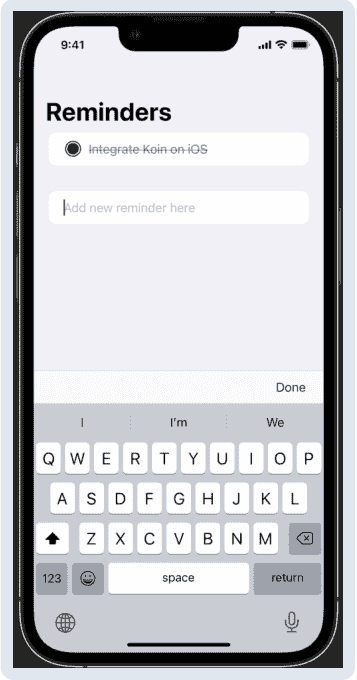

图 9.3 - 集成 Koin 后的 iOS 应用。

## 桌面端

这是所有平台中最简单的。首先，打开 **Main.kt** 并添加对 **Koin** 对象的引用。在 `main` 函数中初始化它。

```kotlin
lateinit var koin: Koin

fun main() {
    koin = initKoin().koin

    return application { // ... }
}
```

接下来，在 **desktopApp** 模块中打开 **RemindersView.kt**，并按如下方式更改 `RemindersView` 可组合函数定义：

```kotlin
@Composable
fun RemindersView(
    viewModel: RemindersViewModel = koin.get(),
    onAboutButtonClick: () -> Unit,
) {
    // ...
}
```

使用你创建的 `koin` 实例，并利用 `get()` 函数。

构建并运行——尽情享受吧！

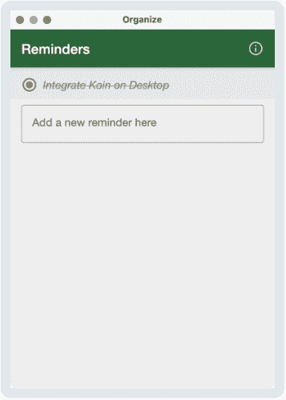

图 9.4 - 集成 Koin 后的桌面应用。

## 更新 AboutViewModel

你现在已经熟悉这个过程了，是时候更新 `AboutViewModel` 以使用 DI 了。放下书本，看看自己是否能独立完成。

你应该这样做：

从 **commonMain/presentation** 目录打开 **AboutViewModel.kt**，并将 `platform` 定义移动到构造函数中，如下所示：

```kotlin
class AboutViewModel(
    platform: Platform
) : BaseViewModel() {
    // ...
}
```

接下来，在 **commonMain** 目录中打开 **KoinCommon.kt**，并向 `viewModels` 模块添加另一个 `factory` 块。

```kotlin
val viewModels = module {
    factory { RemindersViewModel(get()) }
    factory { AboutViewModel(get()) }
}
```

向 Koin 声明如何解析 `AboutViewModel` 类的依赖，其类型为 `Platform`。在 `Modules` 对象内部创建一个名为 `core` 的常量来持有这个依赖以及其他一些依赖，这些依赖将在后面的章节中介绍。

```kotlin
object Modules {
    val core = module {
        factory { Platform() }
    }
    // ...
}
```

最后但同样重要的是，在此文件中，更新 `initKoin` 的定义以接受你定义的新模块：

```kotlin
fun initKoin(
    appModule: Module = module { },
    coreModule: Module = Modules.core,
    repositoriesModule: Module = Modules.repositories,
    viewModelsModule: Module = Modules.viewModels,
) : KoinApplication = startKoin {
    modules(
        appModule,
        coreModule,
        repositoriesModule,
        viewModelsModule,
    )
}
```

为了遵循通常的做法，接下来你将按顺序更新各平台的代码。

### Android

在 **androidApp** 模块中打开 **AndroidView.kt**，并将 **AboutView** 可组合定义更改为：

```kotlin
fun AboutView(
    viewModel: AboutViewModel = getViewModel(),
    onUpButtonClick: () -> Unit
) { // ...
}
```

你再次使用了 Koin Android 库中的 `getViewModel()` 方法。

最后，为 Android 应用打开 **OrganizeApp.kt**，并同样为 `AboutViewModel` 声明模块：

```kotlin
initKoin(
    viewModelsModule = module {
        viewModel {
            RemindersViewModel(get())
        }
        viewModel {
            AboutViewModel(get())
        }
    }
)
```

构建并运行应用，确保一切仍按预期工作。

### iOS

这非常简单。打开 **AboutView.swift**，并按如下方式更改 `viewModel` 的定义：

```swift
@StateObject private var viewModel: AboutViewModel = Koin.instance.get()
```

就是这样！构建并运行 iOS 应用。打开 About 页面以确保 DI 正常工作。

### 桌面端

这也是小菜一碟。在 **desktopApp** 模块中打开 **AboutView.kt**，并更改 `AboutView` 可组合函数定义：

```kotlin
fun AboutView(
    viewModel: AboutViewModel = koin.get(),
) {
    ContentView(items = viewModel.items)
}
```

至此，在所有三个应用中的 viewModels 中集成 Koin 就完成了。

构建并运行，确认应用行为与之前一致。

## 测试

由于你在本章中所做的更改，你在前一章编写的测试将无法再编译。幸运的是，只需几个简单的步骤就能让这些测试通过。在此过程中，你还会学到一些测试代码的技巧。

### 检查 Koin 集成

如你所知，Koin 在运行时解析依赖图。值得检查一下它能否解析你所声明的模块提供的所有依赖。

在 **commonTest** 目录中，创建一个名为 **DITest.kt** 的文件，作为 **PlatformTest.kt** 的同级文件。

创建一个名为 `DITest` 的类，并在其中添加这个测试函数：

```kotlin
class DITest {
    @Test
    fun testAllModules() {
        koinApplication {
            modules(
                Modules.viewModels,
            )
        }.checkModules()
    }
}
```

在这里，你正在创建 `KoinApplication` 的实例并提供模块列表。目前，添加 `viewModels` 模块。`checkModules()` 是一个执行你之前读到的集成检查的函数。它验证所有定义的依赖，启动所有模块，然后检查定义能否运行。

运行测试并查看结果。

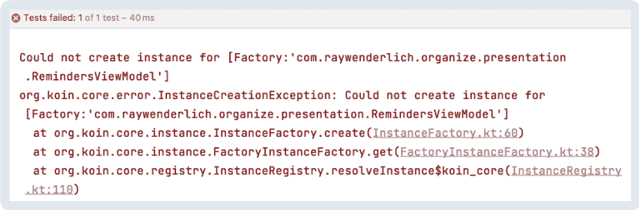

*图 9.5 - Koin checkModules 测试失败*

测试失败了，原因很明显。只提供 `viewModels` 模块，Koin 无法创建 `RemindersViewModel` 或 `AboutViewModel` 的实例。要解决这个问题，只需在上面的测试函数中的模块列表中添加 Modules.repositories 和 Modules.core。因此，你传递的模块将是这些：

```kotlin
modules(
    Modules.core,
    Modules.repositories,
    Modules.viewModels,
)
```

再次运行测试，它将成功通过。

> **注意**：该测试只在桌面端和 iOS 上通过。它在 Android 上失败。原因在于 `ScreenInfo` 的创建过程。如果你查看该类的实际 Android 实现，你会看到它调用了 `Resources.getSystem()`。在运行测试时，由于单元测试期间 Android 系统不可用，此调用会失败。解决此问题需要模拟 `Resources` 类，这超出了本章的范围。

好公民不会乱扔垃圾，优秀的开发者在测试 Koin 时也不会。每当你创建 `KoinApplication` 实例或调用 `startKoin` 时，请确保在不再需要后停止它。如你所知，一个合适的做法是创建一个带有 `@AfterTest` 注解的函数。

将这个函数添加到 `DiTest` 类中，它使用 Koin 提供的 `stopKoin` 方法来执行清理。

```kotlin
@AfterTest
fun tearDown() {
    stopKoin()
}
```

### 更新 RemindersViewModelTest

打开 RemindersViewModelTest.kt。有一个 `lateinit` 属性持有对 `RemindersViewModel` 实例的引用。在 `setup` 方法中，你像这样初始化此属性：

```kotlin
viewModel = RemindersViewModel(RemindersRepository())
```

哎呀！没人再喜欢这样了。最好召唤 Koin 来完成这项工作！

你需要采取一些步骤将 Koin 集成到测试中。

首先，让 `RemindersViewModelTest` 遵循 `KoinTest`。这种遵循将使测试类成为 `KoinComponent`。`KoinComponent` 接口在这里是为了帮助你使用一些特殊关键字直接从 Koin 中检索实例。

接下来，让 `RemindersViewModelTest` 继承 `KoinTest`，并将 `viewModel` 属性定义更改为：

```kotlin
class RemindersViewModelTest : KoinTest {
    private val viewModel: RemindersViewModel by inject()

    //...
}
```

Kotlin 中的 `by` 关键字将属性访问器的实现委托给另一个对象。通过使用 `by inject()`，Koin 将从依赖图中懒加载地检索你的实例。`inject()` 函数是 `KoinTest` 的一个扩展。

最后一步是在测试之前初始化 Koin，并在测试之后停止它——就像你测试 Koin 完整性时那样。

在测试类中实现这两个函数：

```kotlin
@BeforeTest
fun setup() {
    initKoin()
}

@AfterTest
fun tearDown() {
    stopKoin()
}
```

在 `setup` 方法中，你不再需要自己初始化 `viewModel` 属性。你只需调用 `initKoin` 方法，也就是你在应用程序启动时调用的方法。它为模块提供了默认值。`tearDown` 函数与 `DITest` 类中的完全相同。

为 `RemindersViewModelTest` 类运行测试，它们将会像以前一样通过。

## 关键要点

类应遵循单一职责原则，不应创建自己的依赖。


## 接下来去哪里？

在本章中，你对 Koin 和依赖注入有了基本的了解。在下一章中，你将再次回到 DI，学习一种将平台特定的依赖注入类的新方法。

想更深入地了解 Koin，最好的来源可能就是[官方文档](official documentation)，它相当简洁、不言自明，同时涵盖了众多场景。

如本章所述，还有其他 DI 库。然而，这些库要么不适用于 Multiplatform 场景，要么没有 Koin 那样出名。

如果你的目标不是 Multiplatform，你可以在 Android 上查阅 **Hilt** 和 **Dagger**。在 iOS 世界中，并没有一个首选的库。不过，**Resolver** 近来获得了一些关注。

特别是在测试方面，Koin 也为你提供了一种模拟或桩接不同对象的方式。

# 10 数据持久化

作者：Saeed Taheri

Organize 应用面临的一个大问题是，它不会记住你添加的任何内容。一旦你关闭应用或停止调试器，每个 TODO 项目都会永久消失。

这个问题的原因是它将所有内容都存储在内存中，而且——令人惊讶的是——计算机内存，或者更准确地说是 RAM，可能会让人想起小丑鱼多莉！

如果应用将数据存储在非易失性存储上，它们就可以持久化数据。这种存储类型的例子有 HDD（硬盘驱动器）、SSD（固态硬盘）和闪存存储。

撇开计算机工作的细节不谈，从更高层面看，你主要通过三种不同的机制持久化数据：

- 1. 键值存储
- 2. 数据库
- 3. 文件系统

在本章中，你将学习前两种选项，它们比直接使用文件系统更加结构化、更直接。

持久化数据时最常见的用例之一是将信息以字典或映射风格存储。

你可能听说过 Android 上的 SharedPreferences 或 iOS 上的 UserDefaults。正如这两个名称所暗示的，人们主要用它们来存储用户偏好和设置。

由于使用这些类的设置过程是平台特定的，你可以使用经典好用的 expect/actual 机制在每个平台上创建一个用于访问键值存储的单一接口。虽然你完全知道如何手动完成这项工作，但这需要编写大量样板代码。

幸运的是，有一个名为 Multiplatform Settings 的库为你完成了大部分繁重的工作。

在本章的这一部分，你将利用 **Multiplatform Settings** 库来存储首次打开 **Organize** 应用中某个特定页面的时间。

# ## 设置 Multiplatform Settings

有两种方式设置该库。

一种方式是传入每个平台存储机制的实例——例如 Android 的 `SharedPreferences`、iOS 的 `UserDefaults`，或者 JVM 或桌面端的类似实现。这样，你可以随意定制这些实例。例如，除了使用 `PreferenceManager.getDefaultSharedPreferences()` 创建的实例外，你还可以使用另一个 `SharedPreferences` 实例；或者除了 `UserDefaults.standard` 之外，再传入一个 iOS 的容器。

另一种方式是使用 _无参数_ 模块。使用这种方式，你可以更快、更轻松地完成设置，但牺牲了可定制性。出于教学目的，这里将使用较长的设置方式。

打开 **shared** 模块中的 **build.gradle.kts**，并为 **commonMain** 源集添加此依赖：

```
implementation("com.russhwolf:multiplatform-settings:${rootProject.extra["settingsVersion"]}")
```

`settingsVersion` 在项目的 **build.gradle.kts** 中可用。

接下来，打开 **androidApp** 模块的 **build.gradle.kts**，并将相同的一行添加到其依赖中。

确保同步 Gradle。

然后，打开 **shared** 模块中 **commonMain** 里的 **KoinCommon.kt**，并在文件中为平台模块添加一个 `expect` 常量：

```
expect val platformModule: Module
```

既然这已经是习以为常的事，你应该在所有平台上为该模块提供 actual 实现。不过，在此之前，请确保在 `initKoin` 函数中启动 Koin 时传入该模块。

```
startKoin {
    modules(
        appModule,
        coreModule,
        repositoriesModule,
        viewModelsModule,
        platformModule, // Don't forget to add this module
    )
}
```

### Android

仍在 **shared** 模块中，打开 **androidMain** 中的 **KoinAndroid.kt**，并添加以下代码块：

```
actual val platformModule = module {
    single<Settings> {
        AndroidSettings(get())
    }
}
```

确保从 `com.rushwolf.settings.Settings` 包导入 `Settings`。

`AndroidSettings` 是 `Settings` 在 Android 上的实现。

你使用 Koin 的 `single` 关键字，因此它会以单例形式提供此依赖。

`AndroidSettings` 的构造函数需要 `SharedPreferences` 实例。你要求 Koin 在运行时获取该依赖。别担心！为了防止崩溃，你很快就会提供该依赖。

打开 **androidApp** 模块中的 **OrganizeApp.kt**。你可能还记得，`initKoin` 函数有一个名为 `appModule` 的参数。现在是时候使用它了。

将以下代码块传入 `appModule` 参数：

```
module {
    //1
    single<Context> { this@OrganizeApp }

    //2
    single<SharedPreferences> {
        get<Context>().getSharedPreferences(
            "OrganizeApp",
            Context.MODE_PRIVATE
        )
    }
}
```

上面的代码是如何工作的：

+   1. 设置 `SharedPreferences` 需要 Android `Context` 实例。

+   2. 你使用 `get()` 函数获取 `Context` 实例，并创建一个名为 **OrganizeApp** 的私有 `SharedPreferences`。

### iOS

打开 **iosMain** 中的 **KoinIOS.kt**，并添加 `platformModule` 常量的 actual 实现：

```
actual val platformModule = module { }
```

一个空模块就能让编译器安静下来。

你通过 `KoinIOS` 对象上的 `initialize` 方法在 iOS 上初始化 Koin。你可以向该方法添加一个参数，以便注入 `UserDefaults` 实例——或者用 Objective-C 的术语来说，`NSUserDefaults`。

进行以下修改：

```
fun initialize(
    userDefaults: NSUserDefaults,
): KoinApplication = initKoin(
    appModule = module {
        single<Settings> {
            AppleSettings(userDefaults)
        }
    }
)
```

> **注意：** 在搭载 Apple 芯片的 Mac 设备上，你可能会发现 Android Studio 无法导入 `AppleSettings` 和 `NSUserDefaults` 的包。请确保存在这些导入指令：

```
import com.russhwolf.settings.AppleSettings
import platform.Foundation.NSUserDefaults
```

这与 Android 端类似，但你使用的是 `AppleSettings`，它是 `Settings` 在 Apple 平台上的实现。`AppleSettings` 的构造函数需要 `UserDefaults` 实例。

接下来，在 Xcode 中打开起始项目，并进入 **Koin.swift**。在 `Koin` 类中，修改 `start` 中初始化 `KoinIOS` 的那一行，以适配你对 `initialize` 所做的更改：


打开 **AboutViewModel.kt**，在 `AboutViewModel` 的定义中添加一个类型为 `Settings` 的构造函数参数。

```kotlin
class AboutViewModel(
    platform: Platform,
    settings: Settings,
) : BaseViewModel() {
    // ...
}
```

添加一个属性，用于存储此页面首次打开时的格式化时间戳：

```kotlin
val firstOpening: String
```

接下来，添加 `init` 代码块以初始化该属性，如下所示：

```kotlin
init {
    //1
    val timestampKey = "FIRST_OPENING_TIMESTAMP"

    //2
    val savedValue = settings.getLongOrNull(timestampKey)

    //3
    firstOpening = if (savedValue == null) {
        val time = Clock.System.now().epochSeconds - 1
        settings.putLong(timestampKey, time)

        DateFormatter.formatEpoch(time)
    } else {
        DateFormatter.formatEpoch(savedValue)
    }
}
```

1.  这是你用来在 `settings` 中存储时间戳的键。
2.  你使用该键获取 `Long` 值。
3.  如果获取到的值为 `null`，你使用 **kotlinx-datetime** 库中的 `Clock` 对象获取当前时间，并将其存储在 `settings` 中。如果该值不为 `null`，则使用 `savedValue`。无论哪种情况，你都会格式化保存的日期，并将面向用户的字符串存储在属性中。本章材料中已经提供了 `DateFormatter` 对象。

现在，是时候在 UI 中显示这个值了。

### Android

首先，打开 **OrganizeApp.kt**，更新 viewModel 块中 `AboutViewModel` 的创建，以处理其构造函数中新增的参数。

```kotlin
viewModel {
    AboutViewModel(get(), get())
}
```

对 KoinCommon.kt 中的 factory 也进行同样的操作：

```kotlin
factory { AboutViewModel(get(), get()) }
```

接下来，打开 androidApp 模块中的 AboutView.kt。修改 ContentView 组合函数，使其接受一个 footer（页脚），然后在行项目底部显示它：

```kotlin
@Composable
private fun ContentView(
    items: List<AboutViewModel.RowItem>,
    footer: String?,
) {
    LazyColumn(
        modifier = Modifier
            .fillMaxSize()
            .semantics { contentDescription = "aboutView" },
    ) {
        items(items) { row ->
            RowView(title = row.title, subtitle = row.subtitle)
        }
        footer?.let {
            item {
                Text(
                    text = it,
                    style = MaterialTheme.typography.caption,
                    textAlign = TextAlign.Center,
                    modifier = Modifier
                        .fillMaxWidth()
                        .padding(8.dp),
                )
            }
        }
    }
}
```

这段代码相当直接。虽然看起来有点长，但大部分是样式和已存在的内容。

最后，更新你使用 ContentView 的 AboutView 组合函数。

```kotlin
@Composable
fun AboutView(
    viewModel: AboutViewModel = getViewModel(),
    onUpButtonClick: () -> Unit
) {
    Column {
        Toolbar(onUpButtonClick = onUpButtonClick)
        ContentView(
            items = viewModel.items,
            footer = "This page was first opened:\n${viewModel.firstOpening}"
        )
    }
}
```

构建并运行。点击 i 按钮打开 **About Device** 页面。

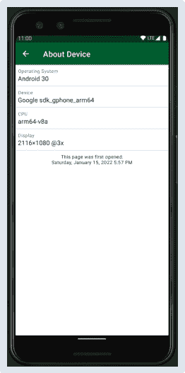

打开 iosApp.xcodeproj 并转到 AboutListView.swift。首先，像在 Android 对应文件中那样，为 footer 添加一个属性：

```swift
let footer: String
```

接下来，更新 body 计算属性，以便在 Section 中显示 footer。

```swift
var body: some View {
    List {
        Section(
            footer: Text(footer)
                .font(.caption2)
                .foregroundColor(.secondary)
        ) {
            ForEach(items, id: \.self) { item in
                // ...
            }
        }
    }
}
```

在同一个文件中，更新 `AboutListView_Previews` 结构体中的 `previews`，以消除 Xcode 的抱怨。

```swift
static var previews: some View {
    AboutListView(
        items: [AboutViewModel.RowItem(title: "Title", subtitle: "Subtitle")],
        footer: "Section Footer"
    )
}
```

接下来，打开 **AboutView.swift**，更新 `AboutListView` 的使用以处理 `footer`。

```swift
AboutListView(
    items: viewModel.items,
    footer: "This page was first opened on \(viewModel.firstOpening)"
)
```

构建并运行应用。点击底部工具栏中的 **About** 按钮打开 **About Device** 页面。

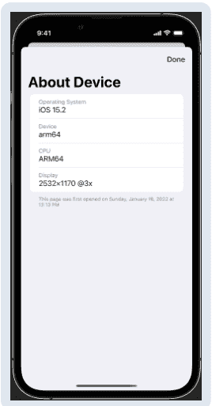

图 10.2 - iOS 上的 About 页面

## Desktop

打开 desktopApp 模块中的 AboutView.kt。修改 ContentView 组合函数，使其接受一个 footer（页脚），然后在行项目底部显示它。这与 androidApp 模块中 ContentView 的定义相同。你可以回顾上面的实现。

最后，像这样更新 AboutView 组合函数：

```kotlin
@Composable
fun AboutView(viewModel: AboutViewModel = koin.get()) {
    ContentView(
        items = viewModel.items,
        footer = "This page was first opened:\n${viewModel.firstOpening}"
    )
}
```

构建并运行，然后查看 **About Device** 窗口。

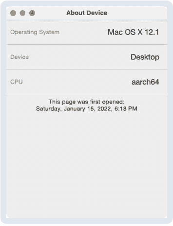

这就是将 Multiplatform Settings 库集成到 Organize 中的全部内容。

数据库是数据的组织化集合。每当你处理一组结构化的数据，且需要以某种特定方式访问它们时，使用数据库比直接摆弄文件系统是更好的选择。

尽管数据库有多种类型和模型，但诸如 SQLite 这样的关系型数据库在移动开发者中一直最受欢迎。

例如，Core Data（一个用于在 iOS 上管理对象图的框架）就使用 SQLite 作为其持久化存储。

```kotlin
val iosMain by creating {
    dependencies {
        implementation("com.squareup.sqldelight:native-driver:${rootProject.extra["sqlDelightVersion"]}")
    }
    // ...
}
```

```kotlin
val desktopMain by getting {
    dependencies {
        implementation("com.squareup.sqldelight:sqlite-driver:${rootProject.extra["sqlDelightVersion"]}")
    }
    // ...
}
```

确保同步 Gradle。

## 数据库助手

为了让执行数据库操作更简便，一个好的实践是创建一个通用接口，抽象你所使用的数据库。在应用的生命周期内，你可能会出于某种原因需要切换底层数据库。

如果 SQLDelight 或其他任何第三方库的使用没有遍布整个应用，你就可以在一个单一的地方替换它，而无需改动其他任何地方。

打开 **commonMain** 目录下 **data** 文件夹中的 **DatabaseHelper.kt**，并按如下方式定义该类：

```kotlin
class DatabaseHelper(
    sqlDriver: SqlDriver,
) {
}
```

它接受一个 `SqlDriver` 实例，你将在每个平台上通过 Koin 注入它。正如你之前读到的，运行 SQL 语句需要一个驱动。

接下来，创建一个属性来持有 `OrganizeDb` 的引用。Gradle 插件会根据你在 **build.gradle.kts** 中先前定义的内容生成该类。

```kotlin
private val dbRef: OrganizeDb = OrganizeDb(sqlDriver)
```

如果 Android Studio 无法解析 OrganizeDb，请先尝试构建一次项目，以便触发代码生成。

添加一个从数据库获取所有提醒的方法：

```kotlin
fun fetchAllItems(): List<ReminderDb> =
    dbRef.tableQueries
        .selectAll()
        .executeAsList()
```

使用 OrganizeDb 上的 tableQueries 属性，它包含了你定义的所有 SQL 语句。因为你将其中一个语句命名为 selectAll，所以这里也使用相同的命名。然后，调用 executeAsList 以列表形式获取结果。

接下来，添加一个向数据库插入新提醒的方法：

```kotlin
fun insertReminder(id: String, title: String) {
    dbRef.tableQueries.insertReminder(id, title)
}
```

最后，添加一个更新每条提醒的 isCompleted 状态的方法：

```kotlin
fun updateIsCompleted(id: String, isCompleted: Boolean) {
    dbRef.tableQueries
        .updateIsCompleted(isCompleted.toLong(), id)
}
```

你还可以添加一个扩展函数，用于以 Boolean 类型返回每条提醒的 isCompleted 状态。这会在后面帮到你。请将它添加到类外部：

```kotlin
fun ReminderDb.isCompleted(): Boolean =
    this.isCompleted != 0L
```

### 在应用中使用数据库

你应将创建的 DatabaseHelper 类的实例注入到任何想使用数据库的地方。从架构的角度来看，仓库（repository）是这样做的一个绝佳位置。

打开 RemindersRepository.kt，并完全按如下方式修改该类：

```kotlin
//1
class RemindersRepository(
    private val databaseHelper: DatabaseHelper
) {
```


## 添加对删除提醒的支持

数据库有四种基本操作：创建、读取、更新和删除，即 **CRUD**。在 Organize 中，你已经使用了其中三种操作。实现仅剩的那一种——删除——是一个很好的挑战选择。

## 挑战：添加对删除提醒的支持


添加一个功能，让用户能够单独删除提醒。对于 UI 部分，你可以利用 Android 和 iOS 的滑动手势。在桌面上，可以使用用户右键单击任何提醒时弹出的上下文菜单。

+   设备上持久化数据的三大主要方式：键值存储、数据库和直接操作文件系统。

+   多平台设置是一个库，简化了在字典样式中存储小数据的过程。

+   你可以使用数据库来存储结构化数据并以特定方式访问它们。

+   SQLDelight 是一种基于关系的数据库，它会根据你编写的 SQL 语句生成类型安全的 Kotlin API。在 KMP 中使用时，它在底层使用 SQLite。

+   当你想要更改数据库 schema 时，迁移数据库是一个精细且重要的步骤。

+   SQLDelight 有一个扩展库，让你可以使用 Kotlin Flows 观察数据库的变化。

这一章很长，但仍有大量内容需要涵盖。

以下是一些建议，供你在想要进一步学习时参考：

+   熟悉 SQL 可以让你编写更高效的查询。

+   查阅 SQLDelight 文档（此处可访问），可以让你更深入地探索其功能。

+   测试是开发的重要环节。如前所述，你可以在测试中使用内存数据库。Multiplatform Settings 和 SQLDelight 都提供了测试相关的工具，你可以利用它们。

# 11 Serialization

作者：Carlos Mota

完成书的前两个章节，做得很好。现在你已经熟悉 Kotlin Multiplatform，拥有所有需要迎接本章挑战的准备。

在这里，你将开始开发一个新应用，名为 **learn**。该应用基于上一章学习的概念，并引入了新的概念：序列化、网络以及如何处理并发。

**learn** 使用 raywenderlich.com 的 RSS 源来显示 Android、iOS、Unity 和 Flutter 的最新教程。你可以将它们添加到“稍后阅读”列表，与朋友分享，搜索特定关键词，或者浏览团队发布的所有内容。它的外观和风格与 raywenderlich.com 网站一致。

## 序列化的必要性

你的应用可以向第三方（远程服务器或设备上的另一个应用）发送或接收数据。序列化是将数据转换为发送前的正确格式的过程，而反序列化则是将接收到的数据转换回特定对象的过程。

有多种序列化格式，例如 JSON 或字节流。你将在第 12 章“网络”中，在介绍网络请求时了解更多。

Android 使用此概念在活动、服务或接收器之间（同一应用内或第三方应用之间）共享数据。与其使用 `Serializable` 发送自定义类型的数据不同，系统要求你实现 `Parcelable` 来发送这些对象。

## 项目概览

为了在本节的代码示例中进行跟随，请下载 **starter** 项目并打开 **11-serialization/projects/starter** 在 Android Studio 中。

> **注意**：本项目使用 Jetpack Compose 1.2.0-alpha01 和 Multiplatform。

Compose 1.1.0 与 Kotlin 1.6.10 兼容。要成功构建并运行该应用，请使用 Android Studio Bumblebee 2021.1.1 Patch 2 或更高版本。

**Starter** 包含你将构建的应用的骨架，**final** 则供你完成后对比代码。

在项目同步后，你将看到以下子文件夹和重要文件：

```
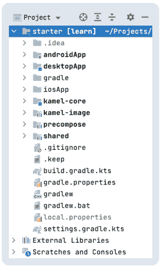
Fig. 11.1 - 项目视图层次结构
```

下一节将详细说明项目树层次结构。文件夹名称直观明了，对应其适用的平台或功能本身。你可以跳过这一节，直接前往 **Application features** 章节。

## Android 应用

Android 应用位于 **androidApp**，包含 Gradle 配置文件、应用源码和资源。其结构与你习惯的 Android 应用相同，你可以像往常一样使用任何库或组件：

+   - **components**：通用的 **Composable** 函数，代表特定功能，并在不同界面中复用。

+   - **ui**：包含所有 UI。子包对应具体界面（bookmark、home、latest 或 search），导航栏（main），应用设计系统（theme）或工具类（util）。

+   - **RWApplication.kt**：初始化 **SQLDelight** 所需的 **Context** 的 **Application** 类。

## 桌面应用

桌面应用与 Android 应用类似。代码基本复制自 Android 项目，仅做了少量修改——主要是针对不适用于 **JVM target** 的库：

+   - **Kamel**：图片加载库。

+   - **precompose**：社区库，让你在桌面应用中使用 **Jetpack Lifecycle**、**ViewModel**、**LiveData** 和 **Navigation**。

虽然这些库可通过上述链接获取，但它们未更新到最新的 Kotlin 或 Compose 版本，因此在此项目中已包含。你可以在附录 C 中找到更多信息。

要运行桌面应用，在项目根目录的命令行中输入：

```
./gradlew desktopApp:run
```

运行完成后，一个新窗口会打开，显示应用。你会看到类似以下界面：

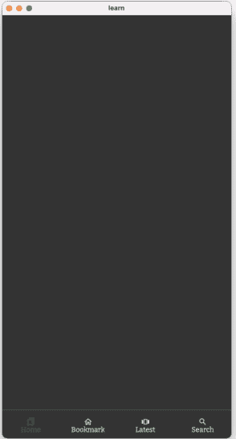

Fig. 11.4 - 桌面 starter 项目运行，显示空白屏幕，无数据。

> **注意**：使用鼠标调整窗口大小。

## 共享模块

该模块包含 **learn** 的全部业务逻辑，是跨 Android、iOS 和桌面平台的多平台代码。

你将在该模块中找到：

+   - **androidMain**：Android 平台的特定代码定义。

+   - **androidTest**：用于上述平台特定代码的测试。

+   - **commonMain**：包含所有平台共享的业务逻辑。

+   - **commonTest**：包含所有非平台特定的测试，用于验证业务逻辑是否按预期工作。

+   - **iosMain**：iOS 平台的特定代码定义。

+   - **iostest**：用于上述平台特定代码的测试。

打开共享模块时，你会在 **commonMain** 中看到两个内容：

+   • **kotlin**：业务逻辑所在的位置。

+   • **sqldelight**：包含 SQLDelight 用于创建应用数据库的 SQL 文件，以及对应的 CRUD 方法，用于与数据库交互。

该模块遵循清晰架构（clean architecture）原则，按功能将文件分组。打开 **kotlin** 目录，你会看到：

+   • **data**：共享模块的网络层。负责从 RW 源获取数据并定义每个 RSS 条目的数据模型。

+   • **domain**：负责反序列化响应并创建可以被 UI 使用的 feed 列表。将数据保存到数据库，并定义在新数据可用时的回调。

+   • **platform**：声明哪些功能需要在每个平台上实现。这里使用 **expect** 关键字，定义平台特定的实现。

+   • **presentation**：连接 UI 与应用逻辑的桥梁。

+   • **ServiceLocator**：一个单例对象，提供访问应用内不同模块的入口，同时负责初始化所有所需的 Presenter。

在下一节，你将看到实现所有必填功能后，**learn** 的最终样子。

在开始编写代码前，先了解应用概念及其功能：


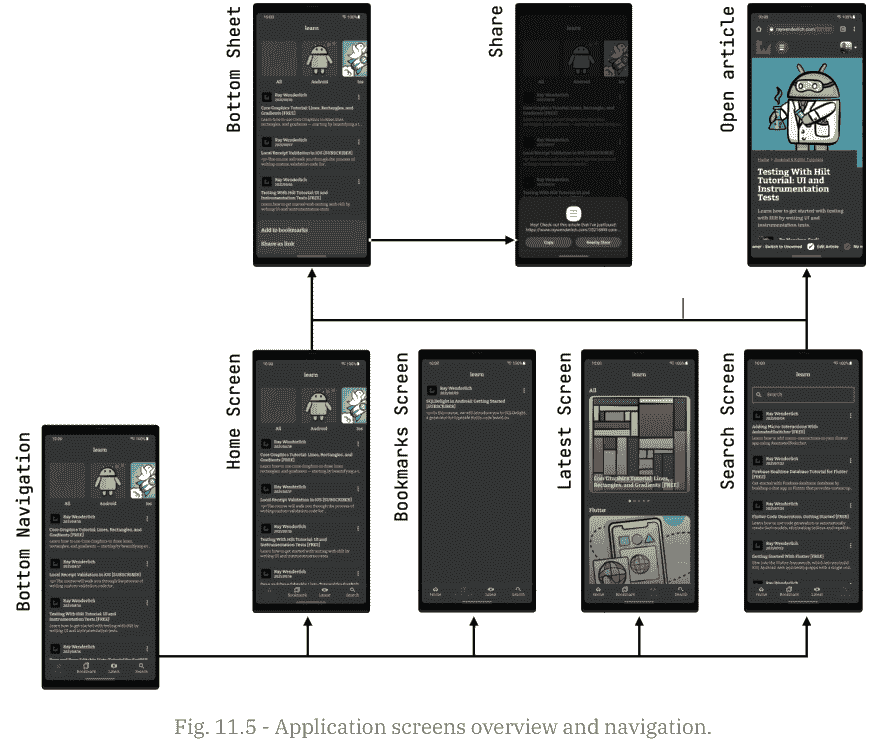

不要担心每个屏幕上的细节。在接下来的章节中，你将有机会更仔细地查看它们。

**learn** 有四个不同的屏幕，你可以从应用的底部栏中导航到：

## 主页

这是应用的默认屏幕。它显示一个包含所有 raywenderlich.com 主题的横向列表，以及一个最新已发布文章的列表。

这些主题充当筛选器。点击任意项目会将用户重定向到**最新**屏幕，在那里他们可以看到最近编写、阅读或分享的文章，然后将它们**添加**到书签列表，或在阅读完毕后将其移除。

要打开一篇文章，请点击卡片。你将被自动重定向到浏览器，在那里你可以访问并阅读它。如果你改为点击卡片内的三个点，应用将显示一个底部弹窗。从那里，你可以将其添加到稍后阅读列表（可在**书签**屏幕中找到），或发送给朋友，以便他们能及时了解最新文章。

## 书签

此屏幕显示你已保存的所有文章。列表变得越来越大？挑一篇并开始阅读。之后，你可以通过点击卡片上的三个点并选择**从书签中移除**来将其从此列表中移除。

## 最新

这里以更具图形化的界面展示最新文章的板块和封面。你可以水平滚动查看其内容，或垂直滚动以在不同主题之间切换。

## 搜索

这里有很多你可以浏览的内容。你可以通过特定关键字进行筛选，最终找到你一直在寻找的那篇文章。

现在你已经熟悉了这个应用和项目，是时候开始学习如何实现这些功能了。

## 为你的 Gradle 配置添加序列化

Kotlin 在语言层面并不直接支持序列化和反序列化。你需要要么从头实现一切，要么使用已经提供该支持的库。此外，由于你在为多平台开发，请务必记住，**commonMain** 中不能有 Java 代码。否则，项目将无法编译。它需要用 Kotlin 编写，才能在你所针对的不同平台上运行：Android、Native 和 JVM。

不，不需要实现此支持。**kotlinx.serialization** 已提供该支持，这是一个由 JetBrains 创建和维护的库。

> **注意：** 要了解更多关于 **kotlinx.serialization** 的信息，请参阅官方[文档](https://)。  
> 或者，深入研究其[官方仓库](https://)中提供的源代码。

是时候将这个库导入应用了。打开 Android Studio，等待项目完成同步。在项目根文件夹中，有一个 **build.gradle.kts** 文件；打开它，并添加以下 `classpath`：

```kotlin
classpath("org.jetbrains.kotlin:kotlin-serialization:1.6.10")
```

通过此声明，构建系统就知道应在何处搜索和获取序列化库。

现在，打开 **shared** 内的 **build.gradle.kts** 文件，并通过在 `plugins` 代码块中添加以下代码来加载序列化插件：

```kotlin
kotlin("plugin.serialization")
```

进行同步并等待此过程完成。准备就绪后，系统将加载该库并将其添加到项目中。

项目中有四个不同的 **build.gradle.kts** 文件：

- **build.gradle.kts**：该文件位于项目根文件夹中，同时配置 Android 应用和共享模块。它包含将从中下载依赖项的仓库。
- **shared/build.gradle.kts**：这是共享模块配置文件。它包含将要使用的插件、库以及你将要针对的平台。
- **androidApp/build.gradle.kts**：Android 应用的配置文件。它定义了一组用于编译项目的参数，即 SDK 版本、依赖项和编译标志。
- **desktopApp/build.gradle.kts**：这是桌面应用的配置文件。它定义了与 Android 的 **build.gradle.kts** 文件相同的配置。

## 不同的序列化格式

**kotlinx.serialization** 开箱即用地支持一系列序列化格式：

- **JSON**：一种轻量级、人类可读的数据交换格式。**learn** 使用它从本地文件加载 RW RSS 订阅源链接，随后对服务器接收到的数据进行反序列化（**kotlinx-serialization-json**）。
- **Protocol buffers**：一种用于序列化结构化数据的跨平台机制（**kotlinx-serialization-protobuf**）。
- **CBOR**：一种二进制数据序列化格式（**kotlinx-serialization-cbor**）。
- **Properties**：一种键值文件，用于保存 Java 相关技术中应用程序的配置参数。在 Android 开发中，你有一个名为 **gradle.properties** 的文件，其中包含在编译时配置 Gradle 守护进程/应用的属性（**kotlinx-serialization-properties**）。
- **HOCON**：JSON 的一个超集，更便于人类阅读，通常用于配置文件（kotlinx-serialization-hocon）。

> **注意**：还有两个由社区维护的库，分别用于 YAML 和 Apache Avro。

除了 kotlinx-serialization-json 之外，所有这些库仍处于实验阶段。虽然它们看起来都很健壮，并且在一些应用中得到使用，但值得一提的是，API 在未来的版本中可能会发生（急剧的）变化——这意味着你最终可能需要对它的使用进行重构。

在本书的范围内，你只需要添加 kotlinx-serialization-json。转到 shared，打开 build.gradle.kts 文件并查找 commonMain 字段。项目中已经有一组依赖项。在此列表的末尾，添加：

> implementation("org.jetbrains.kotlinx:kotlinx-serialization-json:1.3.2")

同步项目，现在你就可以使用 JSON 格式的序列化功能了。

### 创建自定义序列化器

如果你的对象使用了自定义类型，可能没有可用的序列化器。你需要创建自己的序列化器，否则序列化/反序列化将无法工作。

shared 模块中的 RWContent.kt 数据类就是一个很好的例子。platform 字段的类型是 PLATFORM，这是一个枚举，用于识别文章属于哪个板块。

如果你不创建自定义序列化器，kotlinx-serialization-json 将无法识别 “All”、“Android”、“iOS”、“Unity” 或 “Flutter” 这些关键字分别指什么。这是因为 JSON 中的属性类型是 String，而它应该是 PLATFORM。需要实现一个自定义序列化器/反序列化器来提供此支持。

在 shared 模块内的 commonMain 包中，转到 data 文件夹并创建一个 RWSerializer.kt 文件。

首先添加 findByKey 方法：

```kotlin
private fun findByKey(key: String, default: PLATFORM = PLATFORM.ALL): PLATFORM {
    return PLATFORM.values().find { it.value == key } ?: default
}
```

该方法将接收一个 `key`，并返回枚举 `PLATFORM` 中的对应值。

现在你已经添加了映射函数，请创建 `RWSerializer` 对象。在同一个文件中，添加：

```kotlin
//1
@OptIn(ExperimentalSerializationApi::class)
//2
@Serializer(forClass = PLATFORM::class)
//3
object RWSerializer : KSerializer<PLATFORM> {

    //4
    override val descriptor: SerialDescriptor =
        PrimitiveSerialDescriptor("PLATFORM", PrimitiveKind.STRING)

    //5
    override fun serialize(encoder: Encoder, value: PLATFORM) {
        encoder.encodeString(value.value)
    }

    //6
    override fun deserialize(decoder: Decoder): PLATFORM {
        return try {
            val key = decoder.decodeString()
            findByKey(key)
        } catch (e: IllegalArgumentException) {
            PLATFORM.ALL
        }
    }
}
```

下面逐步说明此逻辑：

1. 序列化 API 仍处于实验阶段。每次使用它时，Android Studio 都会自动在其调用下方加下划线，要求使用 `OptIn` 或 `Require` 注解。显示此错误是为了通知开发者此 API 未来可能会发生变化。在这个项目中，你将使用 `OptIn`，以免在每次调用该类时都添加新注解。

2. 将 `RWSerializer` 关联到一个特定类。在这种情况下，它对应于枚举 `PLATFORM`。

3. 你需要扩展 `KSerializer` 类，并定义将要被序列化/反序列化的对象类型。

4. 有必要定义 `PrimitiveSerialDescriptor`，其中包含类名 — `PLATFORM` — 以及应如何读取参数。在这种情况下，它将从 `String` 中读取。


## 序列化/反序列化新数据

导航到 **commonMain/presentation** 内的 **FeedPresenter.kt**，你会看到一个 **RW_CONTENT** 属性。该 JSON 包含了构建应用主屏幕顶部水平列表所需的全部信息。它的结构具有以下属性：

- **platform**：rawwonderlich.com 文章所覆盖的不同平台：Android、iOS、Unity 和 Flutter。还有第五个值——all。一旦设置，就会移除该过滤器并显示所有已发布内容。
- **url**：包含应从中获取文章的 RSS 源 URL。
- **image**：与所选 `platform` 对应的封面图片。

这三个属性已经映射到位于 **data/model** 内的数据类 **RWContent.kt** 中。打开该文件，并在其声明顶部添加：

```
@Parcelize
@Serializable
```

`RWContent` 数据类使用了 `@Serializable`，因此在解码 **RW_CONTENT** 属性时，它会轻松生成一个 **RWContent** 列表，将 JSON 字符串上的属性映射到数据类的字段中。

一切定义好后，导航到 **presentation** 包内的 **FeedPresenter.kt** 文件，首先向类中添加：

```
private val json = Json { ignoreUnknownKeys = true }
```

## Serializable 与 Parcelable 对比

Java 在 **java.io** 包中有一个 `Serializable` 接口。它使用反射来读取对象中的字段，这是一个缓慢的过程，通常会创建许多临时对象，影响应用的内存占用。

另一方面，`Parcelable` 是 Android 平台对应的 `Serializable` 方案，它要求声明所有对象类型。这使得它更快，因为无需使用反射来理解对象类型。

有人可能会说 `Parcelable` 实现起来更复杂。这在几年前确实如此，因为当时需要重写几个方法，并根据对象字段创建读写方法。但现在你不必再这样做，因为 **kotlin-parcelize** 插件会自动生成这些代码。因此，这里唯一需要做的就是向类顶部添加一个注解——`@Parcelize`——并继承 `Parcelable`。

## 在 KMP 中实现 Parcelize

`Parcelable` 和 `Parcelize` 是一组 Android 平台特有的类。共享模块包含应用的业务逻辑及其数据模型，这些模型在多个平台上使用。由于这段代码需要平台特定，你需要使用在第一章“引言”中已经用过的 **expect** 和 **actual** 关键字来声明它。

`Parcelize` 是一个名为 **kotlin-parcelize** 的插件的一部分，该插件包含 `Parcelable` 代码生成器。在为此类编写 Android 声明之前，你需要先将其添加到 **shared** 模块的 **build.gradle.kts** 文件中。打开该文件，并在 `plugin` 部分添加：

```
id("kotlin-parcelize")
```

同步项目并添加这个新依赖。

要将数据类设置为 **Parcelable**，需要将 `@Parcelize` 注解添加到类声明顶部，然后继承 `Parcelable` 生成器。代码应类似于：

```
import kotlinx.parcelize.Parcelize

@Parcelize
data class RWEntry(val id: String, val entry: String): Parcelable
```

然而，由于这段平台特定代码不应存在于 **commonMain** 中，你需要将此行为定义在平台层——此处即 **androidMain**。

## 为 Android 目标定义 expect/actual

一般来说，平台特定类的名称以

```
remove these messages by adding the compiler argument: `-opt-in=kotlin.RequiresOptIn`.
```

打开 **shared build.gradle.kts** 文件，并在文件末尾添加以下代码：

```
kotlin.sourceSets.all {
    languageSettings.optIn("kotlin.RequiresOptIn")
}
```

根据你使用的数据类，你可能需要为其他注解创建 **expect/actual** 类。其中一个例子是 `@RawValue`，它与自定义类型的默认序列化器一起使用。你可以遵循在 **Parcelize** 上使用的相同方法来实现同样的目标：

```
@OptIn(ExperimentalMultiplatform::class)
@OptionalExpectation
@Target(AnnotationTarget.TYPE)
@Retention(AnnotationRetention.BINARY)
expect annotation class RawValue()
```

定义了期望声明后，转到 **androidMain**，创建相应的 **actual** 实现。它应位于你在 **commonMain** 中添加的文件所在的同一目录中。

导航到 **platform** 目录，创建对应的 **PlatformParcelable.kt** 文件。打开它并添加：

```
package com.raywenderlich.learn.platform

actual typealias Parcelable = android.os.Parcelable
actual typealias Parcelize = kotlinx.android.parcel.Parcelize
```

由于 `Parcelable` 和 `Parcelize` 已经存在于 Android 平台上，因此无需创建它们。相反，使用 `typealias` 在期望类和实际类之间创建引用链接。换句话说，就像直接调用 **android.os.Parcelable** 或 **kotlinx.android.parcel.Parcelize** 一样。

> **注意：** 类型别名不会创建新的数据类型，而是创建到现有类型的链接。更多关于 Kotlin **typealias** 的信息，请直接参阅[官方文档](...)。

## 处理不支持 Parcelize 的目标

既然你已经在 common 和 Android 上实现了 **Parcelize**，如果查看已添加的 `actual` 字段，你会看到红色下划线，这意味着有问题。这是因为应用还面向其他缺少 `actual` 实现的平台。

转到 `iosMain` 文件夹，在 `platform` 目录内，创建对应的 **PlatformParcelable.kt** 文件。

> **注意**：按下 Alt + Enter，Android Studio 会自动建议为其余平台创建文件。按 OK 生成这些文件。

打开 **PlatformParcelable.kt** 并添加：

> package com.raywenderlich.learn.platform
> 
> actual interface Parcelable

就是这样！iOS 没有对应的 **Parcelable** 接口，因此定义一个空声明。由于没有任何声明，编译器会自动移除注解和类。生成的框架不包含对 `Parcelize` 和 `Parcelable` 的任何引用。

将相同的文件添加到 **desktopMain/platform**。

这是预期行为，因为这是 Android 平台独有的特定功能。

## 向现有类添加 Parcelize

一切设置完成后，转到 **commonMain** 并搜索 **RWContent** 和 **RWEntry** 数据类。它们位于 **data/model** 包内。

在每个文件中，将 `@Parcelize` 注解添加到类声明上方，并继承 `Parcelable`：

RWContent.kt 文件将如下所示：

> @Parcelize
> @Serializable
> data class RWContent(
>     val platform: PLATFORM,
>     val url: String,
>     val image: String
> ) : Parcelable


而且，**RWEntry.kt** 将会像这样：

```kotlin
@Parcelize
data class RWEntry(
  val id: String = "",
  val link: String = "",
  val title: String = "",
  val summary: String = "",
  val updated: String = "",
  val imageUrl: String = "",
  val platform: PLATFORM = PLATFORM.ALL,
  val bookmarked: Boolean = false
) : Parcelable
```

现在，你可以开始毫无问题地将此对象跨不同的 Activity 发送了。

## 测试

测试能够验证你编写的假设，并为所有未来的更改提供重要的安全网。

### 测试序列化

要测试代码，你需要转到 **shared** 模块，右键点击 **src** 文件夹，然后选择 **新建 ▸ 目录**。在下拉菜单中，选择 **commonTest/kotlin**。在这里，创建一个 **SerializationTests.kt** 类：

```kotlin
class SerializationTests { }
```

你需要创建编码和解码测试，以验证一切按预期工作。先编写编码器。将以下方法添加到类中：

```kotlin
@Test
fun testEncodePlatformAll() {
  val data = RWContent(
    platform = PLATFORM.ALL,
    url = "https://www.raywenderlich.com/feed.xml",
    image = "https://assets.carolus.raywenderlich.com/assets/razeware_460-308933a0bda63e3e327123cab8002c0383a714cd35a10ade9bae9ca20b1f438b.png"
  )

  val decoded = Json.encodeToString(RWContent.serializer(), data)

  val content = "{\"platform\":\"all\",\"url\":\"https://www.raywenderlich.com/feed.xml\",\"image\":\"https://assets.carolus.raywenderlich.com/assets/razeware_460-308933a0bda63e3e327123cab8002c0383a714cd35a10ade9bae9ca20b1f438b.png\"}"
    assertEquals(content, decoded)
}
```

在这里，你正在验证你的 JSON 序列化是否能够将 **RWContent** 对象 `data` 编码为字符串。此属性对应 **learn** 中的 **all** 部分。如果序列化器工作正常，`encodeToString` 的结果需要与 `content` 相同，否则测试将失败。点击函数左侧的绿色箭头运行测试，并选择 **android (testDebugUnitTest)**。你会看到测试通过。

现在，要测试反序列化是否正确，添加以下方法：

```kotlin
@Test
fun testDecodePlatformAll() {
    val data = "{\"platform\":\"all\",\"url\":\"https://www.raywenderlich.com/feed.xml\",\"image\":\"https://assets.carolus.raywenderlich.com/assets/razeware_460-308933a0bda63e3e327123cab8002c0383a714cd35a10ade9bae9ca20b1f438b.png\"}"

    val decoded = Json.decodeFromString(RWContent.serializer(), data)
    val content = RWContent(
        platform = PLATFORM.ALL,
        url = "https://www.raywenderlich.com/feed.xml",
        image = "https://assets.carolus.raywenderlich.com/assets/razeware_460-308933a0bda63e3e327123cab8002c0383a714cd35a10ade9bae9ca20b1f438b.png"
    )

    assertEquals(content, decoded)
}
```

本质上，你做的是相反的。从 JSON 响应开始，你需要调用 `decodeFromString`，以便 **kotlinx.serialization** 构建你的 **RWContent** 对象 `decoded`，然后将其与你期望的对象 `content` 进行比较。如果内容相同，测试就会成功通过。运行测试，确认它通过。

### 测试自定义序列化

要测试你的自定义 **RWSerializer**，首先需要定义：

```kotlin
private val serializers = serializersModuleOf(PLATFORM::class,
RWSerializer)
```

这个 `serializers` 属性包含你编码和解码数据所需的 **serializer**。

首先创建一个编码测试：

```kotlin
@Test
fun testEncodeCustomPlatformAll() {
    val data = PLATFORM.ALL

    val encoded = Json.encodeToString(serializers.serializer(), data)
    val expectedString = "\"all\""
    assertEquals(expectedString, encoded)
}
```

当你收到响应时，响应体是一个 JSON 格式的字符串响应：

```json
{
  "platform":"all",
  "url":"https://www.raywenderlich.com/feed.xml",
  "image":"https://assets.carolus.raywenderlich.com/assets/razeware_460-308933a0bda63e3e327123cab8002c0383a714cd35a10ade9bae9ca20b1f438b.png"
}
```

要测试 **RWSerializer** 是否在上述测试中正确工作，请检查将 `PLATFORM.ALL` 属性编码为字符串后，结果是否对应于 JSON 响应 `"all"`。

如果是，`assertEquals` 函数将返回 true，否则测试将失败。

现在，添加解码器测试：

```kotlin
@Test
fun testDecodeCustomPlatformAll() {
    val data = PLATFORM.ALL

    val decoded = Json.decodeFromString<PLATFORM>(data.value)
    assertEquals(decoded, data)
}
```

在这里，你做的正相反。从 `data.value` 返回的字符串 “all” 中，你希望得到对应的 `PLATFORM` 枚举值。为此，你调用 `decodeFromString` 并确认返回的对象是否是你所期望的。

## 挑战

以下是一些挑战，供你练习本章学到的知识。如果遇到困难，请查看本章材料中的解决方案。

### 挑战1：加载 RSS 源

你目前正在从 **FeedPresenter.kt** 中的 **RW_CONTENT** 属性加载不同的部分。在本挑战中，你将：

- 创建一个 **RW_ALL_FEED** 属性，其中包含来自 **RW_CONTENT** 的某个 feed URL 的 RSS 源内容。
- 在共享模块中读取此属性并解析其内容，以便所有应用都能使用。
- 在 **androidApp** 和 **desktopApp** 中，打开 **ui/home** 中的 **FeedViewModel.kt** 文件，并用此新数据填充 **items**。
- 在 **iOSApp** 中，打开 **extensions** 中的 **FeedClient**，并在 **fetchFeeds** 函数中添加新的源。

### 挑战2：为你的实现添加测试

既然你已经实现了这个新功能，你需要添加测试来确保你的实现是正确的。不要忘记测试 JSON 文件中某些属性不可用，或者属性数量多于 **RWEntry.kt** 中可用属性的场景。

> **注意：** 你应该能够读取包含待序列化内容的 JSON 字符串，并在之后访问该对象。

## 关键点

- 在本地和远程应用程序之间交换数据时，传输的内容需要根据是发送还是接收分别进行序列化和反序列化。
- **kotlinx.serialization** 是一个支持序列化的多平台库。它允许对 **JSON, Protocol buffers, CBOR, Properties, HOCON, YAML** 和 **Apache Avro** 进行序列化/反序列化。
- 你可以通过为自定义类型实现序列化/反序列化器，然后将其与该类关联来创建自定义序列化器。
- 你可以使用带 **actual** 的 **typealiases** 在平台层面自动将类声明链接到现有类。

## 接下来去哪？

如需了解使用 **Parcelize** 的其他实际示例，请阅读 Kotlin Android Extensions 一文。

下一章将从你在本章实现的功能开始，但除了仅在本地加载数据之外，你还将从网络获取数据。

# 12 网络
**作者：Carlos Mota**

从互联网获取数据是大多数移动应用的核心功能之一。在上一章中，你学习了如何在本地序列化和反序列化 JSON 数据。现在，你将学习如何发出多个网络请求并处理它们的响应以更新 UI。

到本章结束时，你将知道如何：

- 使用 Ktor 发出网络请求。
- 解析网络响应。
- 测试你的网络实现。

## 对通用网络库的需求

根据你要开发的平台，你可能已经熟悉 Retrofit (Android)、Alamofire (iOS) 或 Unirest (桌面端)。

遗憾的是，这些库是特定于平台的，并且不是用 Kotlin 编写的。

> **注意：** 在 Kotlin Multiplatform 中，你只能使用用 Kotlin 编写的库。如果一个库导入了以其他语言开发的其他库，那么它将无法在 Multiplatform 项目（或模块）中使用。

开发者需要一个新的库——一个能够提供与上述库相同功能，但专为 Multiplatform 应用构建的库。基于这个需求，Ktor 被创建了。

## 使用 Ktor

Ktor 是一个开源库，由 JetBrains（以及社区）创建和维护。它既可以用于客户端应用，也可以用于服务器端应用。

它完全用 Kotlin 编写，并使用协程进行异步调用。在接下来的章节中，你将看到在你的应用中使用它有多么容易。

> **注意：** 在[官方网站](...)上查找有关 Ktor 的更多信息。


## 添加 Ktor

打开 **shared** 模块中的 **build.gradle.kts**。在 `commonMain` 的 `dependencies` 部分末尾添加以下依赖：

```kotlin
implementation("io.ktor:ktor-client-core:2.0.0-beta-1")
implementation("io.ktor:ktor-client-serialization:2.0.0-beta-1")
```

这里你添加了 Ktor 核心库以及序列化库，Ktor 将使用它来解析响应并将数据转换为应用可以处理的对象。

Ktor 根据项目编译的目标平台提供不同的 HTTP 客户端引擎。尽管桌面端不需要特定库，但由于你还面向 Android 和 iOS，因此需要在 `androidMain` 和 `iosMain` 中分别添加以下内容：

```kotlin
implementation("io.ktor:ktor-client-android:2.0.0-beta-1")
```

```kotlin
implementation("io.ktor:ktor-client-ios:2.0.0-beta-1")

implementation("org.jetbrains.kotlinx:kotlinx-coroutines-core:1.6.0-native-mt") {
    version {
        strictly("1.6.0-native-mt")
    }
}
```

查看 iOS 的实现，你会看到还设置了特定版本的 `kotlinx-coroutines`。这是必需的，因为 Ktor 捆绑的协程版本仅支持单线程使用。你可以在第 13 章“并发”中了解更多相关信息。

Kotlin 1.6.10 的推荐版本是使用 `1.6.0-native-mt`。

> **注意：** 你需要将此版本添加到 `iOSMain` 的 dependencies 部分，而不是 `commonMain`，因为该限制与 iOS 相关。

点击 **Sync Now** 进行同步，并等待 Android Studio 获取和导入这些新库。

## 使用 Ktor 连接到 API

为了**构建学习应用**，你需要发出三个不同的请求：

+   - 特定主题的 RSS 订阅源。
+   - 文章网页。
+   - 你的 Gravatar 账户。

第一个请求的数据位于 **shared** 模块中的 **FeedPresenter.kt** 文件中的 `RW_CONTENT` 属性中。它可以是以下之一：

+   - [全部](#)
+   - [Android](#)
+   - [iOS](#)
+   - [游戏技术](#)
+   - [Flutter](#)

每个请求都会加载该类别发布的最新 20 篇文章。

第二个请求对应于 `RWEntry` 的 `link` 字段。由于 RSS 条目不包含文章图片的 URL，你需要从 raywenderlich.com 手动获取它。

最后，向 [Gravatar](#) 发出最后一个请求，该服务允许你定义一个可在外部网站使用的在线个人资料。例如，你在 raywenderlich.com 上的图片就是从该服务检索的。

### 如何发出网络请求

打开 **shared/src/commonMain** 模块中的 **data** 文件夹，创建一个名为 **FeedAPI.kt** 的新文件。添加以下代码：

```kotlin
//1
public const val GRAVATAR_URL = "https://en.gravatar.com/"
public const val GRAVATAR_RESPONSE_FORMAT = ".json"

//2
@ThreadLocal
public object FeedAPI {

  //3
  private val client: HttpClient = HttpClient()

  //4
  public suspend fun fetchRWEntry(feedUrl: String): HttpResponse =
    client.get(feedUrl)

  //5
  public suspend fun fetchMyGravatar(hash: String): HttpResponse =
```

当提示导入时，使用以下导入：

```kotlin
import io.ktor.client.HttpClient
import io.ktor.client.request.get
import io.ktor.client.statement.HttpResponse
import kotlin.native.concurrent.ThreadLocal
```

在上述代码中：

+   1. 常量 `fetchMyGravatar` 将使用其进行请求：URL 和响应格式。
+   
+   2. 此注解仅对 iOS（Kotlin/Native）有效。在 Android 和桌面端都会被忽略。使用 `@ThreadLocal`，`FeedAPI` 不会在尝试访问它的其他线程之间共享。相反，会创建一份新副本。这保证了对象不会被冻结。更多相关信息请参阅第 13 章“并发”。
+   
+   3. 初始化你将用于发出请求的 `HttpClient`。
+   
+   4. 此函数接收特定主题的订阅源 URL，发出请求并通过 `HttpResponse` 将其作为响应返回。在此对象中，你可以获取有关响应状态码、响应正文等的其他信息。
+   
+   5. 最后，你将访问 Gravatar 以检索有关你个人资料的信息。

你正在**学习**中发出 **GET** 请求。Ktor 还提供其他 HTTP 方法：**POST、PUT、DELETE、HEAD、OPTION** 和 **PATCH**。

> **注意：** 如果仔细观察这些函数，你会发现它们是使用 `suspend` 关键字声明的。使用它是为了让当前线程在等待响应时不会被阻塞。你将在第 13 章“并发”中了解更多相关信息。

你已经发出了请求，现在该处理响应了。

### 插件

Ktor 内置了一组默认禁用的插件。例如，**ContentNegotiation** 允许你反序列化响应，而 **Logging** 记录所有进行的通信。你将在本章后面看到两者的示例。

这些插件拦截所有发出的请求和响应，然后根据其用途进行处理。

### 解析网络响应

要反序列化 JSON 响应，你需要添加两个新的库。打开 **build.gradle.kts** 文件，在 **commonMain/dependencies** 部分添加：

```kotlin
implementation("io.ktor:ktor-client-content-negotiation:2.0.0-beta-1")
implementation("io.ktor:ktor-serialization-kotlinx-json:2.0.0-beta-1")
```

同步项目。

在 **FeedAPI** 中，你有两个返回 `HttpResponse` 的函数：

+   - `fetchRWEntry` 访问 raywenderlich.com 的 XML 订阅源。由于目前没有直接的方式从 Ktor 或 JetBrains 的官方库支持其序列化，你将使用社区提供的库：KorIO。
+   - `fetchMyGravatar` 设置为接收包含有关你 Gravatar 账户信息的 JSON 响应。

你将从 `fetchMyGravatar` 开始。由于它是 JSON，你可以为 `json` 安装 `ContentNegotiation`，这样此函数的响应将是反序列化后的对象。为此，更新 `client` 的初始化：

```kotlin
private val client: HttpClient = HttpClient {

  install(ContentNegotiation) {
    json(nonStrictJson)
  }
}
```

Ktor 现在将使用 `json` 来反序列化响应体。此外，你还需要定义 `nonStrictJson` 属性。在 `HttpClient` 之前声明它：

```kotlin
private val nonStrictJson = Json { isLenient = true; ignoreUnknownKeys = true }
```

当提示导入时，添加：

```kotlin
import io.ktor.client.plugins.ContentNegotiation
import io.ktor.serialization.kotlinx.json.json
import kotlinx.serialization.json.Json
```

+   1. 所有网络请求和响应。
+   2. 这是你将用于记录所有网络通信的日志记录器类。使用 `DEFAULT` 会退回到调用 `println` 函数。
+   3. 这指定了需要记录的数据。

不同的日志级别类型包括：

+   - `LogLevel.ALL`：记录所有内容。重要的是，使用此日志级别时，如果你上传一个大文件，其所有内容都将被打印。这最终可能导致缓冲区溢出错误并使应用崩溃。不要忘记覆盖此情况。
+   - `LogLevel.HEADERS`：记录请求和响应头。
+   - `LogLevel.BODY`：设置此级别后，只打印响应体。
+   - `LogLevel.INFO`：记录请求的 URL 和将要使用的方法。对于响应，这意味着记录其状态、方法和“来自”字段。
+   - `LogLevel.NONE`：不记录任何内容。作为一种安全机制，如果你正在构建生产环境的应用，你应该选择此级别。否则，你可能会面临风险，即有人只需将设备连接到计算机并打开 **Logcat**，就能访问你的网络日志。

此外，你可以定义自定义日志记录器类。为此，请转到 **shared** 模块中的 **data** 文件夹，创建一个 **HttpClientLogger.kt** 文件，内容如下：

```kotlin
import com.rawenderrlich.learn.platform.Logger

private const val TAG = "HttpClientLogger"

public object HttpClientLogger :
io.ktor.client.plugins.logging.Logger {

    override fun log(message: String) {
        Logger.d(TAG, message)
    }
}
```

这里你继承了 Ktor 的 `Logger`，并更改了应该用于记录请求和响应的记录器。你通过重写 `log` 函数来实现。你不再使用默认的记录器，而是使用在 **shared** 中定义的应用 `Logger`。

现在，返回到 **FeedAPI.kt**，更新之前添加的 `install` 调用，改为使用：

```kotlin
logger = HttpClientLogger
```


## 5. 如果请求成功，它会携带接收到的数据调用 `onSuccess` 表达式。否则，将触发 `onFailure`，并发送一个空的 `GravatarEntry`。

最后，是时候更新各个应用程序了。

转到 **androidApp**，在 **ui/home** 文件夹内的 **FeedViewModel.kt** 文件中，更新现有的 `fetchMyGravatar` 以调用之前定义的入口点：

```kotlin
fun fetchMyGravatar() {
    Logger.d(TAG, "fetchMyGravatar")
    presenter.fetchMyGravatar(this)
}
```

当 Gravatar 个人资料可用时，它会触发 `onMyGravatarData`。更新它以将该数据设置到 `_profile` 属性上：

```kotlin
override fun onMyGravatarData(item: GravatarEntry) {
    Logger.d(TAG, "onMyGravatarData | item=$item")
    viewModelScope.launch {
        _profile.value = item
    }
}
```

现在一切就绪，构建并运行 Android 应用。

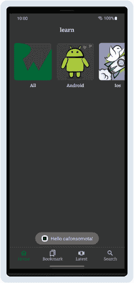

图 12.3 - Android 应用中的 Toast

要在桌面应用中实现相同的功能，请打开位于 **desktopApp** 模块 **ui/home** 文件夹中的 **FeedViewModel.kt** 文件。与你在 Android 中添加的内容类似，将现有的 `fetchMyGravatar` 函数更新为：

```kotlin
fun fetchMyGravatar() {
    Logger.d(TAG, "fetchMyGravatar")
    presenter.fetchMyGravatar(this)
}
```

为了发出相应的请求，并在数据可用时更新 `onMyGravatarData` 以通知 UI，请将 `onMyGravatarData` 方法更新为以下内容：

```kotlin
override fun onMyGravatarData(item: GravatarEntry) {
    Logger.d(TAG, "onMyGravatarData | item=$item")
    viewModelScope.launch {
        profile.value = item
    }
}
```

最后，使用以下命令编译并运行你的应用：

```shell
./gradlew desktopApp:run
```

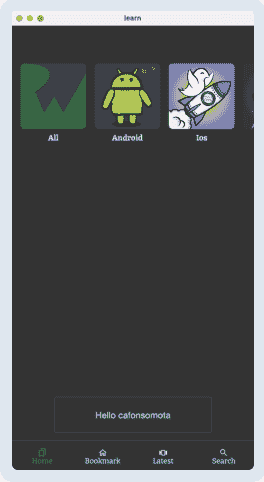

*图 12.4 - 桌面应用中的 Toast*

切换到 Xcode，导航到 **extensions** 文件夹。在这里，打开 **FeedClient.swift** 类并找到 `fetchProfile` 函数。在将 `completion` 赋值给 `handlerProfile` 之前，添加以下代码来获取 Gravatar 个人资料：

[PAGE 266]

```kotlin
feedPresenter.fetchMyGravatar(cb: self)
```

构建并运行你的 iOS 应用。

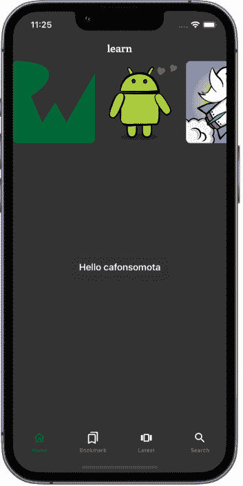

图 12.5 - iOS 应用中的 Toast

## 与 raywenderlich.com RSS 源交互

现在你已经从 Gravatar 接收到了信息，是时候获取 RSS 源了。再次打开 **shared/domain** 中的 **GetFeedData.kt** 文件，并在 `invokeGetMyGravatar` 上方添加以下内容：

```kotlin
//3
public suspend fun invokeFetchRWEntry(
    platform: PLATFORM,
    feedUrl: String,
    onSuccess: (List<RWEntry>) -> Unit,
    onFailure: (Exception) -> Unit
) {
    try {
        //2
        val result = FeedAPI.fetchRWEntry(feedUrl)

        Logger.d(TAG, "invokeFetchRWEntry | feedUrl=$feedUrl")
        //3
        val xml = Xml.parse(result.bodyAsText())
```
```

[PAGE 267]

```kotlin
val feed = mutableListOf<RWEntry>()
for (node in xml.allNodeChildren) {
    val parsed = parseNode(platform, node)

    if (parsed != null) {
        feed += parsed
    }
}

//4
coroutineScope {
    onSuccess(feed)
}
} catch (e: Exception) {
    Logger.e(TAG, "Unable to fetch feed:$feedUrl. Error: $e")
    //5
    coroutineScope {
        onFailure(e)
    }
}
```

下面是对此逻辑的逐步分解：

+   1. 该函数接收一个 `PLATFORM` 枚举值，该值对应于 raywenderlich.com 上的不同文章区域之一：all（全部）、Android、iOS、Unity 和 Flutter。这用于让 UI 能够按特定类型进行过滤。
+   
+   2. `result` 保存从 `fetchRWEntry` 返回的 `HttpResponse`。这里发送的参数是请求应发送到的 URL。
+   
+   3. 由于 Ktor 不直接支持 XML 序列化，你需要使用第三方库。在这种情况下，由于它很流行，你将使用 **Korio**。它将解析 XML 的所有节点，并返回一个 **RWEntry** 列表。
+   
+   4. 如果一切正常直到下一个代码块，此函数最终会将 `feed` 发送给 `onSuccess` 表达式。
+   
+   5. 相反，如果出现任何问题，则会触发 `onFailure`。

现在是时候在层次结构中移动，打开 **shared** 中 **presentation** 层上的 **FeedPresenter.kt** 文件。在实现请求后，你需要添加一个 UI 可以调用的入口点。

为此，在 `fetchMyGravatar` 上方添加以下函数：

```kotlin
//1
public fun fetchAllFeeds(cb: FeedData) {
    Logger.d(TAG, "fetchAllFeeds")

    //2
```
```

[PAGE 268]

```kotlin
for (feed in content) {
    fetchFeed(feed.platform, feed.url, cb)

}

private fun fetchFeed(platform: PLATFORM, feedUrl: String, cb: FeedData) {
    MainScope().launch {
        //3
        feed.invokeFetchRWEntry(
            platform = platform,
            feedUrl = feedUrl,
            //4
            onSuccess = { cb.onNewDataAvailable(it, platform, null) },
            onFailure = { cb.onNewDataAvailable(emptyList(), platform, it) }
        )
    }
}
```

以下是逻辑分解：

+   1. `cb` 用于在新数据可用时通知 UI。
+   
+   2. `content` 对应于 `RW_CONTENT` 属性的反序列化。它应该包含五种不同的平台类型：all（全部）、Android、iOS、Unity 和 Flutter，每种类型都有自己的 feed URL。你将全部获取它们。
+   
+   3. `invokeFetchRWEntry` 将调用 `GetFeedData`，后者随后调用 `FeedAPI` 并发送网络请求。
+   
+   4. 最后，`onSuccess` 和 `onFailure` 表达式会携带响应数据调用 `cb` 函数。如果操作成功，则发送接收到的 `RWEntry` 列表，否则发送一个空列表。

至此，你已经完成了网络请求的业务（shared）逻辑。现在是时候将其连接到 Android、桌面和 iOS 应用了。从 Android 开始，打开 **FeedViewModel.kt** 文件，找到 `fetchAllFeeds` 函数，并在函数内部添加以下代码：

```kotlin
presenter.fetchAllFeeds(this)
```

这将触发你之前定义的网络请求。向下滚动此文件，你将看到 `onNewDataAvailable` 的实现。使用以下代码块更新它，以便 `items` 属性可以被更新：

```
override fun onNewDataAvailable(items: List<RWEntry>, platform: PLATFORM, exception: Exception?) {
    Logger.d(TAG, "onNewDataAvailable | platform=$platform items=${items.size}")
    viewModelScope.launch {
        _items[platform] = items
```
```

[PAGE 269]

```
}
}
```

这很重要，因为 **MainActivity.kt** 正在观察 `items` 上的所有变化。打开这个类，你会看到 `items` 包含填充应用屏幕所需的数据。

构建并运行 Android 应用。你会看到类似这样的屏幕：

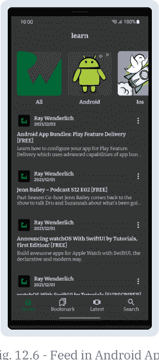

导航到 **desktopApp** 项目并添加相同的逻辑。在 **FeedViewModel.kt** 上，找到 `fetchAllFeeds` 函数并添加：

```
presenter.fetchAllFeeds(this)
```

**Main.kt** 调用此函数来获取所有可用的 feed。当它们准备好后，`onNewDataAvailable` 将携带所有 items 被调用。将此函数更新为：

```
override fun onNewDataAvailable(newItems: List<RWEntry>, platform: PLATFORM, exception: Exception?) {
    Logger.d(TAG, "onNewDataAvailable | platform=$platform items=${items.size}")
    viewModelScope.launch {
        _items[platform] = items
    }
}
```

现在桌面应用已就绪，在

[PAGE 270]

Android Studio 终端中输入编译并运行命令：

```bash
./gradlew desktopApp:run
```

你会看到一个类似这样的应用：

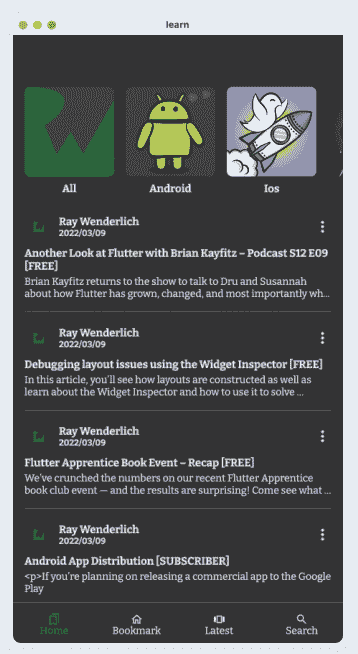

图 12.7 - 桌面应用中的 Feed

最后，更新 iOS 应用。打开 **extensions** 文件夹中的 **FeedClient** 文件，并查找 `fetchFeeds`。在这里，在将 `completion` 赋值给 `handler` 之前，添加：

```swift
feedPresenter.fetchAllFeeds(cb: self)
```

就是这样！构建并运行应用，然后查看团队最近发布了哪些文章。


对应的应用名称：

> public const val APP_NAME: String = "learn"

由于该值在两个平台上都应保持一致，你将使用它作为 header request 的值。

现在，如果你想为通过 Ktor 发出的所有请求添加这个 header，需要在 **FeedAPI.kt** 文件中定位 `client`。在覆盖 `install` 之前，添加：

> defaultRequest {
>     header(X_APP_NAME, APP_NAME)
> }

直接调用 `defaultRequest` 相当于：

> install(DefaultRequest)

换句话说，就像你为日志设置一样，你正在为每个请求设置默认配置。在此情况下，你正在添加一个 `X_APP_NAME` 头。

现在，在三个应用上编译应用。通过打开 Logcat（Android）、终端（桌面）和 Xcode 控制台（iOS），确认日志信息中已发送此新 header。


共享模块。

首先，在 commonMain 目录下的 platform 文件夹中创建 PlatformMediaFile.kt 文件：

```kotlin
public expect class MediaFile

public expect fun MediaFile.toByteArray(): ByteArray
```

在此，你定义了用于表示文件的类以及 `toByteArray` 函数。在平台级别，MediaFile 类和对应的 toByteArray 函数将在此处定义。

基于此，转到 androidMain 目录下的 platform 文件夹，创建对应的实际文件 — PlatformMediaFile.kt：

```kotlin
public actual typealias MediaFile = MediaUri

public actual fun MediaFile.toByteArray(): ByteArray = contentResolver.openInputStream(uri)?.use {
    it.readBytes()
} ?: throw IllegalStateException("Couldn't open inputStream $uri")
```

在此，你定义 MediaFile 为 MediaUri 的别名。每次访问 MediaFile 时，调用的属性和函数都是 MediaUri 类中的。该类目前尚未存在，需要创建，因为在 Android 上获取文件的 ByteArray 需要通过 activity 环境中的 contentResolver 调用 openInputStream。

在 data/model 目录下，创建 MediaUri.kt 文件并添加：

```kotlin
public data class MediaUri(public val uri: Uri, public val contentResolver: ContentResolver)
```

contentResolver 属性是 toByteArray 中用于调用 openInputStream 的，从而获取文件内容。

接下来，是时候定义 iOS 实现了。在 iosMain 目录下的 platform 包中创建 PlatformMediaFile.kt 文件并添加：

```kotlin
public actual typealias MediaFile = UIImage

public actual fun MediaFile.toByteArray(): ByteArray {
    return UIImageJPEGRepresentation(this, compressionQuality = 1.0)?.toByteArray()
        ?: emptyArray<Byte>().toByteArray()
}
```

在此，MediaFile 表示为 UIImage。用于上传的 ByteArray 通过调用 UIImageJPEGRepresentation 获取。

有了这些实现，你现在可以访问文件内容并进行上传。虽然超出了本章范围，但展示一个在 Ktor 级别如何使用它是有价值的。

想象你已选择一张图片进行上传。假设你的服务器支持 multipart 请求，你可以编写类似的函数：

```kotlin
//1
public suspend fun uploadAvatar(data: MediaFile): HttpResponse {
    //2
    return client.post(UPLOAD_AVATAR_URL) {
        //3
        body = MultiPartFormDataContent(
            formData {
                appendInput("filedata", Headers.build {
                    //4
                    append(HttpHeaders.ContentType, "application/octet-stream")
                }) {
                    //5
                    buildPacket { writeFully(data.toByteArray()) }
                }
            }
        )
    }
}
```

以下是该过程的说明：

1. 你需要接收包含图片引用的 `MediaFile` 对象。该对象的关键部分是 `toByteArray` 函数，它在第 5 步中被使用。
2. 此示例中的 `client` 与之前使用的相同，无需安装额外插件或设置配置。
3. 由于文件将通过 multipart 请求发送，请求的 `body` 必须包含此信息。
4. 大多数服务器要求请求包含文件的内容类型 — 此处为 `application/octet-stream`。
5. 取决于文件总大小，可能需要发送多个部分。虽然结果总是字节数组，但根据应用运行的平台，`toByteArray` 会调用不同的函数。

> **注意**：根据你想要发送的文件类型和服务器要求，可能需要实现不同的方法。更多信息请参阅 Ktor 官方文档。

要为 Ktor 编写测试，需要创建 HttpClient 的 mock 对象，然后测试可以接收的不同响应。

在此之前，需要在 shared/build.gradle.kts 文件中，于 commonTest 中添加以下依赖：

```kotlin
implementation(kotlin("test-junit"))
implementation("junit:junit:4.13.2")
implementation("io.ktor:ktor-client-mock:2.0.0-beta-1")
```

等待项目同步完成。

同步后，打开 commonTest，在 shared 目录下创建 NetworkTests 类。所有网络测试都将在此处。

在类声明后，添加以下代码来 mock 一些对象：

```kotlin
private val profile = GravatarProfile(
    entry = listOf(
        GravatarEntry(
            id = "1000",
            hash = "1000",
            preferredUsername = "Ray Wenderlich",
            thumbnailUrl = "https://avatars.githubusercontent.com/u/4722515?s=200&v=4"
        )
    )
)
```

这将是你在模拟网络请求时期望接收的 GravatarProfile。

接下来，需要 mock HttpClient。在上述代码下方添加：

```kotlin
private val nonStrictJson = Json { isLenient = true; ignoreUnknownKeys = true }

private fun getHttpClient(): HttpClient {
    //1
    return HttpClient(MockEngine) {
```

```kotlin
public fun testFetchMyGravatar() = runTest {
    val client = getHttpClient()
    assertEquals(profile, client.request("$GRAVATAR_URL${profile.entry[0].hash}$GRAVATAR_RESPONSE_FORMAT").body())
}
```

如果接收到的响应与 mock 的 `profile` 对象相同，测试通过；否则失败。

运行测试时，右键点击 **NetworkTests** 类名称，选择“Run ‘NetworkTests’”，或在文件打开时，点击绿色箭头并选择 **android (:testDebugUnitTest)**。

## 挑战

以下是本章练习题，帮助你巩固所学知识：

### 挑战：在请求头中发送你的包名

你已学习如何在请求头中定义 header。在之前的示例中，你发送的是应用名称作为值。如果你想发送包名（Android）或 Bundle ID（iOS），或 Desktop 的应用名称呢？

> **注意**：此逻辑应在共享模块中实现。


# 13 并发

*作者：Carlos Mota*

随着应用变得越来越复杂，并发是你需要处理的一个基本主题。**learn** 会向网络发出多个请求——这些请求必须异步完成，以确保它们不会影响 UI。

> **注意：** 本章延续你在第 12 章“网络”中开始的项目。或者，你可以使用本章的入门项目。

本章你将完成以下内容：

- 你将学习什么是协程以及如何实现它们。
- 你将启用新的 Kotlin/Native 内存模型。

## 结构化并发的必要性

结构化并发允许在 UI 线程之外执行多个计算，以保持应用尽可能响应迅速。它与并发的区别在于，任务只能在父作用域内运行，父作用域不能在其所有子任务完成之前结束。


为了提高性能，这三个任务在同一个线程中运行，但彼此并发。它们被分成独立运行的更小片段。

近来，随着 **kotlinx.coroutines** 在 Android 和 **async/await** 在 iOS 上的发布，结构化并发变得非常流行——主要是因为现在运行异步操作变得非常容易。

## 不同的并发解决方案

有一组为 Kotlin Multiplatform 构建的库支持并发：

- **kotlinx.coroutines**：最流行的一个，主要是因为它在 Android 开发者中的广泛使用以及 JetBrains 和 Google 的推荐。它很轻量，允许在单个线程中运行多个协程，并支持异常处理和取消。
- **Reaktive**：使用 **Observable** 模式的响应式扩展实现。
- **CoroutineWorker**：支持多线程协程。

在本章中，你将学习如何使用 **kotlinx.coroutines**。剧透警告：你之前已经用过协程了。;]

如果你已经熟悉协程，可以跳过接下来几节，直接阅读“iOS 中的结构化并发”，或直接阅读“使用 kotlinx.coroutines”，以了解 **learn** 的后续开发。

## 理解 kotlinx.coroutines

**Ktor** 使用协程来发出网络请求，而不会阻塞 UI 线程，所以你在上一章已经不知不觉地使用过它们了。

打开 **shared/commonMain/presentation** 中的 **FeedPresenter.kt** 文件，搜索 `fetchAllFeeds` 和 `fetchFeed`。在第一个函数中，你会看到：

```kotlin
for (feed in content) {
  fetchFeed(feed.platform, feed.url)
}
```

如果你没有在 `fetchFeed` 中使用协程，这些指令将按顺序运行。换句话说，应用只有在 `fetchFeed` 返回后才会迭代到下一项，这会延迟应用启动。

## 挂起函数

**挂起函数**是协程的核心。顾名思义，它们允许你暂停协程并在稍后恢复它，而不会阻塞主线程。

网络请求是 **挂起函数** 的用例之一。打开 **shared/commonMain/data** 中的 **FeedAPI.kt** 文件，查看函数声明：

```
public suspend fun fetchRWEntry(feedUrl: String): HttpResponse =
client.get(feedUrl)

public suspend fun fetchMyGravatar(hash: String): GravatarProfile =
  client.get("$GRAVATAR_URL$hash$GRAVATAR_RESPONSE_FORMAT") {
    header(X_APP_NAME, APP_NAME)
  }.body()
```

它们都是 **挂起函数**。由于响应可能需要一些时间，应用不能阻塞并等待这些函数中的任何一个返回。

这张图定义了触发调用 `fetchRWEntry` 的流程。


图 13.2 - 显示使用协程进行网络请求的不同步骤的示意图。

所有平台的入口点都是 **shared/commonMain/presentation/FeedPresenter.kt** 中的 `fetchAllFeeds` 函数。一旦被调用，它会遍历所有 RSS 源，并对其每个 URL 调用 `fetchFeed`：

[PAGE 284]

- 这是一个可能阻塞 UI 的重操作。为了避免这种情况，你将异步执行它。通过调用 `launch` 创建一个协程。
- 一旦启动，它就会调用 **shared/commonMain/domain/GetFeedData.kt** 中的 `invokeFetchRWEntry`。一个 **挂起函数** 调用 **FeedAPI** 来发出请求。
- 该函数在发出请求后挂起，并等待响应或连接超时。
- 这在一个单独的线程中完成，因此 UI 不会被阻塞。
- 一旦有响应，`fetchRWEntry` 就会恢复并返回到 `invokeFetchRWEntry`，现在它可以反序列化收到的信息。
- 当此过程完成时，`onSuccess` 或 `onFailure` 函数会执行——取决于结果——UI 会收到更新。由于你使用 `MainScope` 来 `launch` 协程，这意味着它将在 UI 线程上运行。你将在下一节中详细了解这一点。

一个关键点是，你只能从另一个 **挂起函数** 或在一个协程内调用 **挂起函数**。

## 协程作用域和上下文

回到 **shared/commonMain/presentation** 中的 **FeedPresenter.kt**，搜索 `fetchFeed` 函数：

```
private fun fetchFeed(platform: PLATFORM, feedUrl: String, cb: FeedData) {
    MainScope().launch {
        // Call to invokeFetchRWEntry
    }
}
```

你已经知道 `launch` 会创建一个新的协程，但 `MainScope` 是什么？**协程作用域**是协程将要运行的地方——在这种情况下，它将是主线程。

如果你打开 `MainScope` 的源代码：

```
public fun MainScope(): CoroutineScope =
ContextScope(SupervisorJob() + Dispatchers.Main)
```

你可以看到它的 `ContextScope` 是通过以下方式构建的：

- `SupervisorJob`：当你创建一个协程时，它会返回一个与其实例对应的 `Job`。这允许你取消或了解更多

[PAGE 285]

其当前状态：

- isActive：如果它当前正在运行。
- isCompleted：如果它所有的工作以及它的子任务都已结束。此外，当当前 Job 被取消——或失败——它的值将为 true。
- isCancelled：当当前任务被取消或失败时。

SupervisorJob 和 Job 之间的区别在于它们有不同的策略。在第一种策略中，子任务独立运行——如果一个失败，其他子任务不会受到影响——而在第二种策略中，如果父任务失败，其所有子任务都将被取消。

- Dispatchers：定义协程应在哪个线程上运行：

- Default：使用共享线程池。
- Main：根据当前运行的平台有不同的行为。在 JVM 和 Android 上，Main 对应 UI 线程，并且只应用于更新 UI 的操作。在 Native 上，它与 Default 调度器相同。
- Unconfined：没有任何关联的线程策略。不切换到任何特定线程。
- IO：应该用于长时间运行和繁重的任务，因为它是共享线程池，针对此类操作进行了优化。目前不适用于 iOS。

创建协程时，你必须定义它应该在哪个调度器上运行，但你可以随时在执行过程中通过调用 withContext 并将前置的 Dispatcher 作为参数来切换上下文。

在 FeedPresenter.kt 的 fetchMyGravatar 函数中，你在主线程中运行协程，虽然唯一需要运行的部分是 onSuccess 和 onFailure 调用。你可以更新现有函数，使用 Default 线程进行网络请求，并在数据可用时切换到 Main 线程，以便更新 UI：

```
public fun fetchMyGravatar(cb: FeedData) {
    //1
    CoroutineScope(Dispatchers.Default).launch {
    //2
    val profile = feed.invokeGetMyGravatar(
        hash = md5(GRAVATAR_EMAIL)
    )

    //3
    withContext(Dispatchers.Main) {
}
```


## 使用 kotlinx.coroutines

是时候更新所学内容了。在上一章中，你学会了如何在 Multiplatform 中实现网络层。为此，你添加了 Ktor 库，并编写了逻辑来获取 raywenderlich.com 的 RSS 订阅源、解析其响应，进而更新 UI。

然而，有一个小细节留到了本节：Ktor 是基于


## 在 iOS 中排查 kotlinx.coroutines 的问题

随着你继续在本书之外探索 Multiplatform，你可能会遇到这样的错误：

```
Uncaught Kotlin exception:
kotlin.native.concurrent.InvalidMutabilityException: mutation attempt of frozen
```

这个 `InvalidMutabilityException` 意味着你正在访问一个属于另一个线程的对象，而当前线程无法访问它。请确认你使用的是 **Dispatchers.Main** 或之前创建的 **ioDispatcher** 来访问该对象。

如果你仍然遇到问题：

+   - 删除项目根目录下的 **build** 文件夹。
+   - 删除项目根目录下 **shared** 目录中的 **build** 文件夹。

## 冻结状态

在某些情况下，你可能会需要在运行 iOS 应用时冻结对象，以避免出现上述错误。一旦对对象调用了 `freeze()`，它就变为不可变的。换句话说，它无法再被更改——这使它能够在不同线程之间共享。

使用 **kotlinx.coroutines** 库的另一个好处是，在最新版本中，该逻辑已经内置到库中，因此你无需在自身侧做任何操作。

## 使用 kotlinx.coroutines

在应用中，前往**最新**（latest）屏幕。你会看到一些文章被分到不同的分区中，你可以滑动并打开它们，但这些文章都没有图片。是时候改变这一情况了！

## 创建挂起函数

首先，打开 **shared** 模块中 **data/commonMain** 里的 **FeedAPI.kt** 文件。在 `fetchRWEntry` 之后，添加：

```
public suspend fun fetchImageUrlFromLink(link: String):
HttpResponse = client.get(link) {
    header(HttpHeaders.Accept, "text/html")
}
```

这个 `fetchImageUrlFromLink` 函数接收文章链接，并将页面源代码作为 `HttpResponse` 返回。它需要被设置为 `suspend`，这样当前线程在等待服务器响应时不会被阻塞。

> **注意：** 你需要在请求中设置 `Accept` 请求头，否则服务器将返回 406（不可接受）。

接下来，打开 **shared/commonMain/domain** 中的 **GetFeedData.kt** 文件，并在类中添加以下方法：

```
public suspend fun invokeFetchImageUrlFromLink(
    link: String,
    //2
    onSuccess: (String) -> Unit,
    onFailure: (Exception) -> Unit
) {
    try {

        //3
        val result = FeedAPI.fetchImageUrlFromLink(link)
        //4
        val url = parsePage(result.bodyAsText())

        //5
        coroutineScope {
            onSuccess(url)
        }
    } catch (e: Exception) {
        coroutineScope {
            onFailure(e)
        }
    }
}
```

下面逐步解析该逻辑：

+   1. `invokeFetchImageUrlFromLink` 被设置为 `suspend`，因为它将调用 `FeedAPI` 来获取页面源代码。
+   
+   2. `onSuccess` 和 `onFailure` 函数定义了该函数的行为取决于能否成功获取文章图片。
+   
+   3. `FeedAPI` 使用 **Ktor HttpClient** 发起网络请求。
+   
+   4. 由于没有 API 来获取图片的 URL，你需要解析 HTML 代码并查找特定的图片标签。这会和网络请求一样是一个较重的任务，因此该逻辑需要从协程中调用。
+   
+   5. `coroutineScope` 会创建一个新的协程，使用其父作用域根据操作成功与否运行 `onSuccess` 或 `onFailure` 函数。

在接下来的部分中，你会看到创建和启动协程的不同方法。虽然这两种方式都是有效的，但它们向 UI 暴露的 API 有所不同。

> **注意：** 对于这些情况，一个好的经验法则是让所有将要使用 **shared** 模块的团队来共同决定哪一种方式让他们感觉更舒适。这对于刚接触 Kotlin 的 iOS 程序员尤为重要，因为他们可能会在适应新语言时感到不知所措。与你的 shared 模块交互应该类似于 iOS 上已有的任何其他库。

## 使用 launch 创建协程

现在你已经实现了请求和解析数据的功能，接下来只需要再创建一个协程，然后就可以... 启动了。:]

打开 **commonMain/presentation** 中的 **FeedPresenter.kt** 文件。在 **shared** 模块的 `fetchMyGravatar(cb: FeedData)` 函数之前，添加：

```
public fun fetchLinkImage(platform: PLATFORM, id: String, link: String, cb: FeedData) {
    scope.launch {
        feed.invokeFetchImageUrlFromLink(
            link,
            onSuccess = { cb.onNewImageUrlAvailable(id, it, platform, null) },
            onFailure = { cb.onNewImageUrlAvailable(id, "", platform, it) }
        )
    }
}
```

正如你在本章中所读到的，实现协程还有其他方式。在这种方法中，你使用了在 UI 层面定义的 `FeedData` 监听器。当 `invokeFetchImageUrlFrom` 完成后，它将调用 `onSuccess` 或 `onFailure` 函数，进而通过 `onNewImageUrlAvailable` 回调将新数据或异常（若出错时）传回 UI。

现在，将你应用的 UI 连接到此新函数。

在 **androidApp** 和 **desktopApp** 中，修改是类似的。在这两个项目中，前往 **ui/home**，打开 **FeedViewModel.kt** 文件，并更新 `onNewImageUrlAvailable` 回调为：

```
override fun onNewImageUrlAvailable(id: String, url: String, platform: PLATFORM, exception: Exception?) {
    viewModelScope.launch {
        Logger.d(TAG, "onNewImageUrlAvailable | platform=$platform |
```
```

[PAGE 300]

编译并运行三个平台的应用，然后导航到“最新”（latest）屏幕。


根据你使用的 Android Studio 版本，它可能会建议你用以下方式替换先前的实现：

```
public suspend fun fetchLinkImage(link: String): String {
    return withContext(scope.coroutineContext) {
        feed.invokeFetchImageUrlFromLink(
            link
        )
    }
}
```

两种方法产生的结果相似，但它们在底层实现上有很大不同。

你可以从 **domain/cb** 目录中的 **FeedData.kt** 接口中移除 `onNewImageUrlAvailable`。

打开 **GetFeedData.kt** 并将 `invokeFetchImageUrlFromLink` 更新为以下内容：

```
public suspend fun invokeFetchImageUrlFromLink(
    link: String
): String {
    return try {

        val result = FeedAPI.fetchImageUrlFromLink(link)
        parsePage(result.bodyAsText())

    } catch (e: Exception) {
        ""
    }
}
```


```kotlin
list[index] = item.copy(imageUrl = url)
_items[platform] = list
}
}
```

这是包含 `onNewImageUrlAvailable` 的代码，以及对 `presenter.fetchLinkImage` 的调用。由于你不再使用该回调，可以将其移除。

-   对于 **iOSApp**，你还需要更新位于 **extensions** 文件夹内的 **FeedClient.swift** 文件。首先更新 `FeedHandlerImage`，它不再需要接收全部参数：

```swift
public typealias FeedHandlerImage = (_ url: String) -> Void
```

将 `fetchLinkImage` 更新为：

```swift
@MainActor
public func fetchLinkImage(_ link: String, completion: @escaping
FeedHandlerImage) {
    Task {
        do {
            let result = try await feedPresenter.fetchLinkImage(link:
link)
            completion(result)
        } catch {
            Logger().e(tag: TAG, message: "Unable to fetch article image
link")
        }
    }
}
```

由于你现在正在从 Swift 访问一个**挂起函数**，因此必须使用 **await** 来等待结果可用。`@MainActor` 注解保证了 `Task` 在 UI 线程上运行。否则，你可能会遇到 `InvalidMutabilityException`。

现在，从文件底部的 `FeedClient` 扩展中移除 `onNewImageUrlAvailable`，因为这个回调已经不存在了。

由于此函数需要声明为 `@MainActor`，并且 `id`、`platform` 和 `cb` 不再需要，你必须更新 **iOSApp** 根目录下 **RWEntryViewModel.swift** 中的 `fetchFeedsWithPreview`：

```swift
@MainActor
func fetchFeedsWithPreview() {
    for platform in self.items.keys {
        guard let items = self.items[platform] else { continue }
```


图 13.10 - 桌面端 App：浏览最新文章


图 13.11 - iOS App：浏览最新文章

## 新的 Kotlin/Native 内存模型

在本书中，你已经看到了几个需要为 iOS 创建特定实现的场景：

-   **@ThreadLocal**：在对象中使用此注解可确保它不会被其他试图访问它的线程共享。相反，会创建一个新的副本，从而保证对象不会被冻结（参见第 12 章“网络”中的“使用 Ktor 连接 API”）。

```swift
func fetchFeeds() {
    FeedClient.shared.fetchFeeds { platform, items in
        Logger().d(tag: TAG, message: "fetchFeeds: \(items.count) items | platform: \(platform)")
        DispatchQueue.main.async {
            self.items[platform] = items
        }
    }
}
```

运行你的 iOS App。在应用中导航，确认一切正常。


图 13.12 - iOS App：浏览最新文章

## 挑战

这里有一个挑战，让你练习本章所学的内容。如果你在任何时候遇到困难，可以查看本章材料中的解决方案。

## 挑战：从共享模块获取文章图片

不要从 UI 请求文章图片，而是将此逻辑移到共享模块中。

记住，你不需要顺序执行此逻辑——你可以启动多个协程来获取并解析响应，从而使此操作更快。

这些请求应该并行运行。

## 要点

-   **挂起函数**只能从另一个**挂起函数**或协程中调用。
-   你可以使用 `launch` 或 `async` 来创建并启动协程。
-   协程可以从 **Main**、**IO** 或 **Default** 线程池启动线程。
-   新的 Kotlin/Native 内存模型支持你在 iOS 上运行多个线程。

## 接下来去哪里？

你已经学会了如何使用协程实现异步请求，以及如何处理并发。如果你想更深入地学习这一主题，可以阅读 [Kotlin 协程教程](#) 一书，你可以在其中更详细地了解 Android 中的协程、通道和 Flow。还有 [并发编程教程](#)（专注于 Swift 中的多线程），以及 [Swift 现代并发编程](#)（教你使用 **async/await** 语法的全新并发模型）。

在下一章中，你将学习如何迁移功能以支持 Kotlin Multiplatform，并发布你的库，以便以后在项目中复用它们。

# 14 创建你的 KMP 库

作者：Carlos Mota

在前面的章节中，你已经为 Android、iOS 和桌面端构建了 **learn**。所有这些应用都会获取 raywenderlich.com 的 RSS 订阅源，并展示有关 Android、iOS、Flutter 和 Unity 的最新文章。你可以搜索特定主题，或将文章保存到本地以便稍后阅读。在应用的开发过程中，你已经使用了：

-   序列化
-   网络
-   数据库
-   并发

并且，在这一过程中，你还构建了可以在其他项目中复用的额外工具：

-   Logger
-   Dispatchers

在本章中，你将学习如何创建并发布一个库，以便在本书中开发的其他应用中复用——并在下一个应用中使用。:]

## 将现有功能迁移到 Multiplatform

在本书中，你学习了如何开发一个已经跨平台共享库的项目。但是，你可能希望将现有应用迁移到 Kotlin Multiplatform。

在本节中，你将看到像在浏览器中打开网站链接这样简单的功能如何轻松地迁移到 KMP。

### 了解如何在不同的平台打开链接

在 **learn** 中，当你点击文章时，会打开一个网页——无论是在 Android、iOS 还是桌面端。这三种平台上的行为相似，但实现方式完全不同。

在 Android 中，会显示一个提示，以便你可以选择应该使用哪个应用发送 Intent。或者，如果你已经设置了一个默认应用，它会自动打开并加载你点击的文章。androidApp/ui 中的 MainActivity.kt 定义了此函数：

```
private fun openEntry(url: String) {
  val intent = Intent(Intent.ACTION_VIEW)
  intent.data = Uri.parse(url)
  startActivity(intent)
}
```

由于任何人都可能在设备上安装多个应用，因此定义哪些应用能够接收此 intent 非常重要。在此场景中，你寻找的是能够打开 URL 的应用。为了避免打开错误的应用，Android 允许你定义一些参数，系统会使用这些参数在所有已安装应用中进行筛选，并选择最符合你的 Intent 的那个。首先，它会检查那些在其 AndroidManifest.xml 中定义了 ACTION_VIEW 属性的应用，然后再检查那些能够解析 URI 的应用。

iOS 采用了不同的方法。要打开 URL，你只需使用环境中的 OpenURLAction。从 iosApp 模块打开 LatestView.swift，滚动到 Section 结构体：

```
@Environment(\.openURL) var openURL
```

var openURL 允许你发送一个 URL，该 URL 将打开设备上的默认浏览器：

```
openURL(URL(string: "\(item.link)")!)
```

当用户点击其中一篇文章时，应用会根据该条目的链接创建一个 URL，并使用它调用 openURL 以在浏览器中打开该链接。

desktopApp 使用了另一种方法。Desktop 有一个 browser 函数，你可以用它来启动计算机上的默认浏览器。打开 desktopApp 模块中的 Main.kt，滚动到该文件末尾：

```
fun openEntry(url: String) {
  try {
    val desktop = Desktop.getDesktop()
    desktop.browse(URI.create(url))
  } catch(e: Exception) {
    Logger.e(TAG, "Unable to open url. Reason: ${e.stackTrace}")
  }
}
```

`getDesktop` 调用返回一个 `Desktop` 实例，其中包含其上下文以及一些函数，让你可以访问计算机的某些功能——例如打开和编辑文件、浏览器、邮件、打印等等。在这里，你使用 `browse` 以你点击的条目中的 `url` 打开默认浏览器。

`try`...`catch` 代码块是必要的——根据文档，在某些平台上，桌面 API 可能不可用。这可能会导致意外行为。采用这种方法可以保证在最坏的情况下，即使应用无法打开链接，它也不会崩溃。

> **注意：** 或者，你也可以使用 `isDesktopSupported` 来检查桌面 API 是否可用。无论如何，请小心，因为调用 `browse` 可能会触发 `IOException`。

既然你已经熟悉了这三个平台如何打开 URL，是时候将此逻辑迁移到 KMP 了。

## 添加新模块

首先要决定的是，你是想将此逻辑迁移到现有的 **shared** 模块，还是创建一个新模块。由于添加新库也需要你迁移代码，因此你选择了这个更完整的解决方案。

第一步是添加一个新的 **KMM 模块**。转到 **File ▸ New ▸ New Module...**，然后选择列表底部的 **Kotlin Multiplatform Shared Module** 模板。在这里，定义：

-   **模块名称：** shared-action
-   **包名：** com.raywenderlich.learn.action
-   **iOS 框架分发方式：** XCFramework

单击 **Finish** 并等待项目同步。之后，如果你查看 Android Studio 的 **Project** 选项卡，就会看到新增了一个 **shared-action** 模块。

打开项目根文件夹中的 **settings.gradle.kts** 文件。确认 **shared-action** 现在是 **learn** 的一部分：

```kotlin
include(":shared-action")
```


Android Studio 的 Kotlin Multiplatform Mobile 模板只生成 Android 和 iOS 目标，因此你需要手动添加桌面平台。

在 **shared-action** 模块中，打开 **build.gradle.kts** 文件。在 `kotlin` 部分中，在 `listOf` iOS 目标之后，添加：

```kotlin
jvm("desktop")
```

现在，转到 `sourceSets`，并在底部添加 `desktopMain` 变量：

```kotlin
val desktopMain by getting
```

同步项目并等待此操作完成。

你仍然需要在 **shared-action** 模块中添加 **desktopMain** 文件夹。一个简单的实现方法是右键点击 **src**，然后选择 **新建 ▸ 目录**。你会看到一个带有几个文件夹建议的新窗口。搜索“desktop”并选择 **desktopMain/kotlin**。

现在你只缺包结构。你可以通过右键点击 **desktopMain/kotlin** 轻松创建此目录。这一次，选择 **新建 ▸ 软件包**。在这个新窗口中，输入：**com.raywenderlich.learn.action**。你还可以移除 Android Studio 在 **androidMain**、**commonMain** 和 **iosMain** 文件夹中生成的 **Platform.kt** 和 **Greeting.kt** 文件。就是这样！你的项目结构将如下所示：

[PAGE 313]


图 14.1 - 项目结构

根据你在 Android Studio 的 **项目** 选项卡中选择的视图类型，你可能会看到不同的树状结构。要看到相同的结构，请选择顶部的 **项目** 选项。


图 14.2 - Android Studio 项目视图

## 配置 Android 库以发布

要发布 Android 库，你需要对 **shared-action** 模块的 **build.gradle.kts** 文件中 `kotlin` 部分里的 `android()` 目标定义进行更新，改为：

[PAGE 314]

```kotlin
android {
    publishLibraryVariants("release", "debug")
}
```

如果你不定义 Android 发布其库，你的项目将默认使用为桌面创建的库。这是可能的，因为 JVM 支持 Android。然而，这样行不通，因为两个平台上的平台特定代码完全不同。

## 配置多平台 Swift 包

你有多种生成库的方式。由于 Apple 有自己的包管理器——Swift Package Manager——并且现在许多库都通过它提供，本章你将使用它。

然而，没有官方插件可以从 KMM 项目生成 Swift Package。因此，你需要使用[多平台 Swift 包](#)插件。在 **starter** 项目中，你有一个包含此库更新版本的 **plugins** 文件夹。打开 **settings.gradle.kts** 文件将其包含到项目中：

```
includeBuild("plugins/multiplatform-swiftpackage-m1_support")
```

> **注意：** 此定制版插件支持 Apple M1 架构，并在内部使用 KMM **XCFramework** 函数来生成 Frameworks。

同步项目。现在，打开 **shared-action** 中的 **build.gradle.kts**，并在 `plugins` 部分添加：

```
id("com.chromaticnoise.multiplatform-swiftpackage-m1-support")
```

你可以定义一些参数来配置你的 Swift 包。为此，在 `kotlin` 部分之前添加：

```kotlin
//1
multiplatformSwiftPackage {
    //2
    xcframeworkName("SharedAction")
    //3
    swiftToolsVersion("5.3")
    //4
    targetPlatforms {
        iOS { v("13") }
```

[PAGE 315]

```kotlin
}
//5
outPutDirectory(File(projectDir, "sharedaction"))
}
```

以下是具体说明：

+   1. 此函数允许你配置生成的 Swift 包。
+   
+   2. 你可以通过设置 `xcframeworkName` 为生成的框架定义特定名称。否则，它将默认使用模块的名称。
+   
+   3. 顾名思义，它对应生成的包所需的 Swift 工具版本。
+   
+   4. `targetPlatforms` 定义框架应支持的平台和操作系统版本。在这种情况下，它将在所有版本为 13 或更高的 iOS 设备和模拟器上工作。
+   
+   5. 默认情况下，**swiftpackage** 是 Swift 包的输出文件夹。你可以通过 `outputDirectory` 参数定义不同的位置和名称。

此插件允许你生成可在 **iosApp** 上使用的 Swift Package Manager Manifest 和 XCFramework。

为了让 Framework 生成为“SharedAction”，你还需要设置 `XCFramework` 名称及其 `baseName`。转到 iOS 目标部分并更新：

```kotlin
val xcf = XCFramework("SharedAction")
listOf(
    iosX64(),
    iosArm64(),
    iosSimulatorArm64()
).forEach {
    it.binaries.framework {
        baseName = "SharedAction"
        xcf.add(this)
    }
}
```

同步项目。打开终端，在项目根文件夹中运行：

```shell
./gradlew shared-action:createSwiftPackage
```

你应该会看到：

[PAGE 316]

查看 **shared-action** 文件夹。你会看到一个新的 **sharedaction** 目录，其中只包含一个文件：**Package.swift**。由于项目不包含任何代码，因此没有生成 **XCFrameworks**。

在 **shared-action/commonMain** 中创建一个 **PlatformAction.kt** 文件，并再次执行 `createSwiftPackage` 命令。执行完毕后，返回 **sharedaction** 文件夹。你现在有了适用于 **arm64** 和 **arm64_x86_‑_64** 模拟器的 **XCFrameworks**。

就是这样！你的模块已准备好生成 Swift 包。

你也可以在 **shared** 模块上进行相同的更新。类似于你在 **shared-action** 上的操作，打开 **shared/build.gradle.kts** 文件并添加 `plugin`：

```
id("com.chromaticnoise.multiplatform-swiftpackage-m1-support")
```

然后是其配置：

```
multiplatformSwiftPackage {
    xcframeworkName("SharedKit")
    swiftToolsVersion("5.3")
    targetPlatforms {
    iOS { v("13") }
}
```

上述命令只允许你为 **shared-action** 模块生成 Swift 包。如果你想为两个共享模块生成，只需不添加库名作为前缀即可：

```
./gradlew createSwiftPackage
```

既然你已经配置好了一切，是时候将代码从应用 UI 移到 Multiplatform 了。由于 **shared-action** 模块将处理打开链接的用户操作，请在你于 **commonMain** 内创建的 **PlatformAction.kt** 中添加：

```
public expect object Action {
```

[PAGE 317]

```kotlin
public fun openLink(url: String)
}
```

这是 UI 将调用的对象。

或者，你可以直接定义 `openLink` 函数，而不将其添加到 `object` 中：

```
public expect fun openLink(url: String)
```

你可以直接从 **androidApp** 和 **desktopApp** 调用此函数，因为你是直接引用它的。然而，从 **iosApp** 访问时，你需要通过以下方式：

```
PlatformActionKt.openLink(url: "\\(item.link)")
```

由于没有定义类，编译器在生成框架时会创建一个类，并使用类名加上文件扩展名作为其名称。虽然你可以定义不同的名称，但总会带有 **kt** 前缀——这不是最讨喜的名称，尤其是当你试图说服 iOS 团队采用用 Kotlin 编写的共享模块时。:-)

Android Studio 会提示自动生成缺失的文件。现在先忽略它。在某些 IDE 版本中，此功能不能按预期工作，最终会在错误的目录中创建文件。为避免任何意外错误，你将手动添加所有这些文件。

为 **androidMain**、**iosMain** 和 **desktopMain** 创建一个 **PlatformAction.kt** 文件。它们应该位于每种平台相同的目录中：**com.raywenderlich.learn.action**。

定义一个空的 `actual` 函数：

```
public actual object Action {

  public actual fun openLink(url: String) {}
}
```

为不同目标实现 `openLink` 函数：

+   - **androidApp**：打开 **MainActivity.kt** 文件，滚动直到看到 `openEntry` 函数。将其内容复制并粘贴到你在 **shared-action/androidMain** 中创建的 `openLink` 函数中：

```
public actual fun openLink(url: String) {
```


## 添加新库到项目

在发布库之前，重要的是要说明你可以以两种不同方式在你的应用中包含它：

### 添加为新依赖

在 **shared** 的同一级别，你需要在 Android 和桌面 **build.gradle.kts** 文件中包含它，并在 iOS 应用项目中添加它。

在 **androidApp** 和 **desktopApp** 的 **build.gradle.kts** 文件中，在 `dependencies` 部分，`shared` 实现之后，添加：

```
implementation(project(":shared-action"))
```

同步项目。

对于 iOS，你需要先用 **Xcode** 打开项目。记住，你应该加载 **iosApp.xcworkspace** 文件。

为了简化过程，请按照以下步骤操作：

1. 打开 **Project** 文件，点击顶部的 **General** 选项卡。
2. 向下滚动到 **Frameworks, Libraries, and Embedded Content**，在 **SharedKit.xcframework** 下方点击加号。
3. 一个新窗口将打开，让你选择框架。点击 **Add Other...** 然后 **Add Files...**
4. 导航到 **./shared-action/sharedaction/**，选择 **SharedAction.xcframework** 并点击 **Open**。

目前，**shared** 仍通过 **Run Script** 中的 `embedAndSignAppleFrameworkForXcode` 命令被添加。你也可以选择将其删除并手动添加，按照上述步骤操作。

你的 Xcode 项目将包含以下两个框架：

*Fig. 14.4 - XCode project view*

### 在共享模块中包含

现有的 **shared** 模块导入该库，并使其功能对所有使用它的应用可用。

这一步很简单 —  — 在这种情况下，你只需在 **shared** 模块的 **build.gradle.kts** 文件中，`commonMain` `dependencies` 部分添加 **shared-action** 作为实现：

```
implementation(project(":shared-action"))
```

为了实现更严格的关注点分离，你将遵循第一个选项来 **learn**。

### 更新你的应用以使用新库

随着新库在所有平台上可用，现在是用 **shared-action** 的 `openLink` 函数替换现有逻辑的时机。

在 **androidApp**，打开 **MainActivity.kt** 文件，并更新 `openEntry` 函数：

```
private fun openEntry(url: String) {
    activityContext = this
    openLink(url)
}
```

这里设置的 `activityContext` 将用于从 **shared-action** 中打开新 Activity。

此外，请记得移除以下导入：

```
import android.net.Uri
```

下一个需要更新的文件是 **Main.kt**，位于 **desktopApp** 项目中。当调用 **MainScreen** Composable 时，更新 `onOpenEntry` 调用：

```
onOpenEntry = { openLink(it) },
```

通过此操作，你将使用 **shared-action** 的函数在默认浏览器中打开文章。现在，你可以在文件末尾删除 `openEntry`，并移除现在不再需要的导入：

```
import java.awt.Desktop
import java.net.URI
import java.net.URISyntaxException
```

要更新 iOS 应用，切换到 Xcode，并在以下文件中进行相同的更新：

- **RWEntryRow.swift**
- **LatestView.swift**

移除 `openURL` 声明：

```
@Environment(\.openURL) var openURL
```

在迭代 `items` 时，将 `Button` 的 `action` 从 `openURL` 更改为：

```
Action().openLink(url: "\(item.link)")
```

请记得导入共享-action 框架：

```
import SharedAction
```

并移除 `url` 变量，因为它已不再需要。


-   [使用费曼学习法](https://wiki.example.org/feynmans_learning_method)的灵感源于诺贝尔物理奖获得者**Richard Feynman**。

1. 运用费曼技巧，你只需花上`20 min`就能深入理解知识点，而且记忆深刻，*难以遗忘*。

```
if (condVar > someVal) {console.log("xxx")}
```


之前，你定义了发布库的 URL。现在，你正在向 Gradle 在下载项目依赖时应查找的仓库列表中添加内容。

> **注意**：要使用你在 **gradle.properties** 中定义的凭据，你需要让这个 `maven` 仓库声明在 JetBrains 的仓库之上。否则，你会遇到与缺少凭据相关的错误。这是因为 maven 仓库的多次声明所致。Gradle 会自动将添加的 maven 仓库与 **gradle.properties** 中的凭据进行匹配，因此第一个仓库对应 `mavenUsername/mavenPassword`，第二个对应 `maven2Username/maven2Password`，以此类推。

就是这样！项目已经准备好了。编译并运行两个应用：Android 和桌面端。


接下来，点击 +，然后点击底部下拉菜单中的 **Add Package Dependency**。此时会打开一个新窗口，你可以在右上角输入你的仓库 URL。根据其可见性，Xcode 可能会要求你提供 GitHub 凭据。

你会看到类似这样的屏幕：


图 14.14 - Xcode 从自定义 URL 添加 Swift 包

在 **Add to Project** 下拉菜单中，选择 **iosApp**，然后点击 **Add Package**。Xcode 将下载你的库。

如果一切按预期工作，你会看到第二个提示，询问你是否确认添加 **SharedAction** 包：


图 14.15 - Xcode 添加 Swift 包：确认

点击 **Add Package**。当此操作结束时，你可以看到 **SharedAction** 框架已添加到项目中。

编译并运行应用。这里有新的文章供你阅读！


图 14.16 – iOS 应用：浏览最新文章

## 挑战

以下是一些挑战，帮助你练习本章所学内容。如果在任何地方遇到困难，请查看本章材料中的解决方案。

### 挑战 1：创建一个日志记录器

所有应用和 **shared** 模块都使用定义在 **shared/PlatformLogger.kt** 中的 **Logger** 类。这是一个简单的日志记录器，它调用：

- Android 上的 **android.util.Log**。
- 桌面端上的 **println**。
- iOS 上的 **platform.Foundation.NSLog**。

在第一个挑战中，创建并发布一个新的库 —— **shared-logger** —— 它应包含适用于所有三个平台（Android、桌面端和 iOS）的 **PlatformLogger.kt** 实现。

### 挑战 2：集成日志记录器库

在本书中，你创建了三个不同的应用：

- **Find time**，一个时区助手，在第 1 部分中。
- **Organize**，一个多平台 TODO 应用，在第 2 部分中。
- **learn**，一个用于 raywenderlich.com 文章的 RSS 阅读器，在第 3 部分中。

它们各自都有一个定制版本的日志记录器。第二个挑战是在所有三个应用中使用你在第一个挑战中创建的库。别忘了在业务逻辑和 UI 层面都进行更改。

### 挑战 3：在 shared-action 模块中使用日志记录器库

在本章开始时，你成功地将打开链接的功能迁移到了 Kotlin Multiplatform，并创建了 **shared-action** 模块。

当时没有日志记录器类，所以你使用了 `println` 函数作为模块日志记录器。现在有了新创建的 **shared-logger**，是时候更新 **shared-action** 并使用你的新库了。

## 关键点

- 如果你想迁移到 KMP 的功能包含任何平台特定代码，你需要为你的库将针对的所有平台编写这些特定逻辑。
- 你可以在项目中拥有多个 KMP 库，甚至一个 KMP 库也可以包含另一个 KMP 库。
- 要为 Android 和桌面端发布库，你可以将其发布到本地，或发布到同时支持这两种平台（.jar 和 .aar）的远程包仓库。在本书中，你已经了解了如何使用 JitPack。
- 对于 iOS，你需要创建一个 Swift 包来共享你的库。Apple 要求这些框架需要通过 Git 仓库提供，该仓库可以是本地的，也可以是远程的。

## 接下来去哪里？

恭喜！你已经完成了本书的最后一章。在本书中，你学习了如何创建三个面向 Android、iOS 和桌面端的应用！

你从熟悉 Jetpack Compose 和 Swift UI 进行 UI 开发开始，然后转向使用 Kotlin Multiplatform 在这三个平台之间共享应用的业务逻辑。你现在可以从头开始创建一个应用并应用所有这些新概念，或者将你已经编写的应用迁移到 KMP。

恭喜！经过漫长的旅程，你学到了关于 Kotlin Multiplatform 的许多重要知识，以及如何利用它在原生应用之间共享代码。你还学习了如何使用最新的 UI 工具包在 iOS 和 Android 上开发 UI。现在，你可以将所学应用到下一个应用中，或者开始迁移当前应用中的功能，从而节省开发时间。

请记住，在完成《Kotlin Multiplatform by Tutorials》之后，如果你想进一步加深对 Kotlin 和 Android 应用开发的理解，我们建议你阅读《Jetpack Compose by Tutorials》和《SwiftUI Apprentice》。这两本书都可以在我们的在线商店中找到：

- [ ] https://www.raywenderlich.com/books/jetpack-compose-by-tutorials
- [ ] https://www.raywenderlich.com/books/swiftui-apprentice

如果你在阅读本书过程中有任何问题或评论，请访问我们的论坛 https://forums.raywenderlich.com，并查找本书的特定论坛类别。

再次感谢你购买本书。你的持续支持是我们在 raywenderlich.com 所做书籍、教程、视频和其他内容得以实现的原因。我们真心感谢！

> – Kotlin Multiplatform by Tutorials 团队

# 附录 A：Kotlin：Swift 开发者入门指南

作者：Carlos Mota

Kotlin 是由 JetBrains 开发的一种语言，当 Google 宣布从那时起他们所有的 Android 库都将不再用 Java 编写时，Kotlin 获得了广泛的人气和采用。它变得非常流行，在撰写本文时，估计全球超过 60% 的 Android 开发者都在使用它。

如果你打开其官方网站，你会立即看到现代、简洁、安全、强大、可互操作（与 Java 用于 Android 开发）以及结构化并发等描述。所有这些关键词都是开发者在任何编程语言中寻求的功能，而 Kotlin 具备所有这些功能。

更重要的是，Kotlin 不仅适用于 Android。它还支持 Web 前端、服务器端，以及——你在本书中工作的重点——Multiplatform。

## Kotlin 和 Swift：比较两种语言

两种语言之间的语法非常相似。如果你是 Swift 开发者，你可以轻松地用 Kotlin 编程。本附录将向你展示如何开始。

本附录中显示的示例是 learn 中的代码片段。该项目的最终版本可在材料仓库中找到。

## 基础知识

在本节中，你将学习 Kotlin 的基础知识——或者用 Swift 开发者熟悉的话说，它的基础。:]

Android Studio 的一个好处是，在大多数情况下，如果你缺少导入或对变量使用了错误的类型，它会自动警告你并建议修复。

> 注意：每当 Android Studio 在你的代码下划线或显示提示框时，你可以按 Alt-Enter 自动接受其建议。

Kotlin 文件的扩展名是 .kt。Multiplatform 项目的树形层次结构通常遵循 Android 的包命名约定——你有三个文件夹级别。在 learn 中，它是 com/raywenderlich/learn，它们通常对应：

- com，域名
- raywenderlich，公司名称
- learn，应用名称

由于包名是唯一的——你不能在 Google Play Store 上有两个相同包名的应用——这种约定保证了不同公司的应用之间不会发生冲突。

每当你声明一个新类或对象时，你必须定义包声明。这应该是新文件的第一条指令。或者，如果你有版权头，则在版权头之后。

如果你打开 shared 模块中 presentation 文件夹内的 FeedPresenter.kt，你可以看到导入是：

> package com.raywenderlich.learn.presentation

在这种情况下，presentation 是这个类所在的子文件夹。包定义应与相同的树形层次结构对应——否则，你可能会导入错误的文件。

在 Swift 中没有需要添加的包声明。

通常，当缺少导入时，Android Studio 会显示一个包含一个或多个建议的提示，所以你不应该有任何问题。无论如何，如果你想手动添加一个，你需要在包声明之后添加它：

> import com.raywenderlich.learn.data.model.GravatarEntry

这与 Swift 不同。无需添加类——你只需要导入将要使用的框架。


-   [与 Swift 类似，你可以添加三种注释类型：]

-   **Line**，只需在想注释的代码或文本前加 `//`。在此示例中，`Logger` 不会被执行：

  ```kotlin
  public fun fetchMyGravatar(cb: FeedData) {
      //Logger.d(TAG, "fetchMyGravatar")

      //Update the current listener with the new one.
      listener = cb
      fetchMyGravatar()
  }
  ```

-   **Block**，需要用 `/* */` 包裹你的代码或文本。这也用于在文件开头添加版权信息：

  ```kotlin
  /*
   * Copyright (c) 2021 Razeware LLC
   *
   */
  ```

-   **KDoc**，对应于将为你的项目生成的文档。你可以使用 `@property`、`@param`、`@return`、`@constructor` 等标签来提供关于函数的更多信息：

  ```kotlin
  /**
   * 此方法用于获取你的 Gravatar 个人资料。

   * @property cb, the callback used to notify the UI that the
   * profile was successfully fetched or not.
   */
  public fun fetchMyGravatar(cb: FeedData) {
      //Your code goes here
  }
  ```

> **Note:** Swift 中对应的 KDoc 版本是 [Jazzy](https://github.com/realm/jazzy)。

### Variables

-   **val**，对应 Swift 的 **let**。它是只读（不可变）变量，只能在声明时设置一次。例如，`scope` 在声明时被初始化为特定值，且在应用运行期间 never 改变：

  ```kotlin
  private val scope = PresenterCoroutineScope(defaultDispatcher)
  ```

-   **var** 与 Swift 中的同名关键字相同。它是可变变量，可以多次赋值。例如，`listener` 的初始值为 `null`，当 UI 发起新请求时，它会被更新为新的回调引用：

  ```kotlin
  private var listener: FeedData? = null
  ```

  在 Swift 中，上述声明是：

  ```swift
  private var listener: FeedData? = nil
  ```

-   两种语言都支持可选值。唯一区别在于 Kotlin 使用 `null`，而 Swift 使用 `nil` 表示值的缺失。

### Lazy initialization

-   Kotlin 通过 `lazy` 关键字支持 lazy 初始化。该变量必须是不可变的，即必须声明为 `val`。

-   该变量的值只有在首次访问时才会被计算。仅在不需要立即使用该变量且它执行耗时操作时，才应将变量声明为 lazy。

-   打开 **FeedPresenter.kt** 文件（位于 **shared/presentation** 目录），查找 `content` 声明：

  ```kotlin
  val content: List<RWContent> by lazy {
    json.decodeFromString(RW_CONTENT)
  }
  ```

-   可以看到它是 `lazy` 定义的。这样可以在应用启动时延迟解码 `RW_CONTENT`，避免在启动时进行不必要的处理。

-   如果你的应用启动耗时较长，使用此方式可以让应用初始化更快、更流畅。值只有在调用 `content` 时才会被计算。

### Late initialization

-   你可以在应用需要时才延迟变量的初始化。为此，需要将变量声明为 `lateinit`，并且不能将其声明为不可变或为 `null`。

### Nullability

-   Kotlin 最著名的特性之一是其 nullability。理想情况下，不再出现 **NullPointerExceptions**（由引用对象为 null 触发的异常）。这里的“ideally”是必要的，因为开发者最终有决定权，可以随时违背语言建议。

-   要声明一个变量可以为 null，需要使用 `?` 运算符。

-   可以看到 `listener` 的类型是 `FeedData?`，但其值可能为 `null`。如果在 `fetchAllFeeds` 方法中，`Logger` 调用之前添加：

  ```kotlin
  listener.onMyGravatarData(GravatarEntry())
  ```

  这会传递一个空的 `GravatarEntry`，因为该参数不能为 null。此时会出现红色下划线提示：

  > Only safe (?.) or non-null asserted (!!.) calls are allowed on a nullable receiver of type `FeedData?`

  由于该变量可能为 null，不能在没有检查的情况下直接调用其方法。有两种处理方式：

  1. 明确告知编译器该值一定不为 null，使用 `!!` 运算符：

     ```kotlin
     listener!!.onMyGravatarData(GravatarEntry())
     ```

     这违背了语言规范，通常不推荐使用。

     对应的 Swift 写法是直接使用 `!`。

  2. 仅在值不为 null 时调用方法。由于 `listener` 是可变的，不能简单地使用 `if` 判断是否为 null（因为可能被其他线程修改）。解决方案是使用 `?` 运算符：

     ```kotlin
     listener?.onMyGravatarData(GravatarEntry())
     ```

  还有一种可能性是：在首次声明时让 `listener` 不为可选类型：

  > 不要让 `listener` 成为可选类型。:]

  此外，还可以使用 `?.let { ... }` 来验证变量不为 null 时才执行括号内的代码：

  ```kotlin
  listener?.let {
      it.onMyGravatarData(GravatarEntry())
  }
  ```

  这里的 `it` 对应 `listener`。

  在 Swift 中可以这样写：

  ```swift
  if let listener = listener {
      listener.onMyGravatarData(GravatarEntry())
  }
  ```

### String interpolation

-   通过字符串插值，可以轻松将字符串和变量拼接。在 `fetchAllFeeds` 方法中，你会遍历 `content` 并调用 `fetchFeed`，传入平台和 feed URL。在该代码块之前添加：

  ```kotlin
  Logger.d(TAG, "Fetching feed: ${feed.platform}")
  ```

  为了打印 `feed.platform` 的值，需要在变量后加括号以执行其属性访问。

-   如果不加括号，而是写成：

  ```kotlin
  Logger.d(TAG, "Fetching feed: $feed.platform")
  ```

  编译后查看 Logcat 会发现日志显示的是 `feed` 对象的引用以及 “.platform”，而不是实际的平台名称。

### Type inference

-   如果声明变量并赋值，可以省略类型，Kotlin 会自动推断。观察 **FeedPresenter.kt** 中的变量声明，可以看到 `json` 使用了类型推断，而 `content` 没有。

-   尝试去掉 `content` 声明中的类型：

  ```kotlin
  val content: List<RWContent> by lazy {
    json.decodeFromString(RW_CONTENT)
  }
  ```

  Android Studio 会立即下划线该表达式，错误信息为：

  > Not enough information to infer type variable T

  原因是 `decodeFromString` 无法确定返回的具体对象类型。当在变量声明中指定类型时，`decodeFromString` 可以据此确定返回的对象。如果想在变量声明中使用类型推断，可以在函数调用上直接指定类型：

  ```kotlin
  val content by lazy {
      json.decodeFromString<List<RWContent>>(RW_CONTENT)
  }
  ```

### Type checks

-   两种语言都使用 `is` 来检查对象是否为特定类型。

### Cast

-   类型转换在两种语言中相似，只需使用 `as` 关键字后跟目标类型。

### Converting between different types

-   可以通过调用 `.to<>()` 方法轻松转换基本类型：

  ```kotlin
  // 将 String 转换为 Integer
  "raywenderlich".toInt()

  // 将 String 转换为 Long
  "raywenderlich".toLong()

  // 将 String 转换为 Float
  "raywenderlich".toFloat()

  // 将 Int 转换为 String
  42.toString()

  // 将 Int 转换为 Long
  42.toLong()

  // 将 Int 转换为 Float
  42.toFloat()
  ```


如果你在处理自定义对象，你总是可以为它创建一个扩展函数。

### 扩展函数

顾名思义，扩展函数允许你为现有类添加额外的行为。假设你想添加一个方法，该方法需要对所有 **String** 对象可用，并在被调用时返回 “Ray Wenderlich”：

```kotlin
fun String.toRW(): String {
    return "Ray Wenderlich"
}
```

就是这样。你使用想要扩展的类型，后跟方法名。现在，这个函数对所有 **String** 对象都可用。

你可以尝试在 **FeedPresenter.kt** 中为一个 **String** 变量（例如 `RW_CONTENT`）添加上述函数和一条新的日志：

```kotlin
init {
    Logger.d(TAG, "content=${RW_CONTENT.toRW()}")
}
```

你可以在 Logcat 中确认，该调用的输出将类似于：

```
FeedPresenter | content=Ray Wenderlich
```

### 比较对象

你可以通过使用 `===` 按引用比较对象，或通过 `==` 按内容比较对象。

### 控制流

尽管这两种语言的语法非常相似，但你会发现 Kotlin 为你提供了可以使用的强大表达式。

### if… else

这种条件检查在两种语言中都很相似。如果你打开 **GetFeedData.kt**，你会看到不同的函数使用了 **if… else**。

`invokeFetchRWEntry` 只会在 `parsed` 不为空时添加该 `parsed` 对象：

```kotlin
if (parsed != null) {
    feed += parsed
}
```

此外，当它是一条单独的指令时，你不需要添加花括号。

或者，你也可以直接这样写：

```kotlin
if (parsed != null)
    feed += parsed
```

甚至还可以内联：

```kotlin
if (parsed != null) feed += parsed
```

### switch

它在 Kotlin 中并不存在。你可以改用与之类似的 `when`。

### when

`when` 是一种支持多种不同表达式的条件表达式。你可以在 **androidApp** 的 **components** 文件夹中的 **ImagePreview.kt** 文件里看到它的使用示例：

```kotlin
when (painter.state) {
    is ImagePainter.State.Loading -> {
        AddImagePreviewEmpty(modifier)
    }
    is ImagePainter.State.Error -> {
        AddImagePreviewError(modifier)
    }
    else -> {
        // Do nothing
    }
}
```

在这种情况下，你正在检查从互联网下载的图像的当前 `state`，并根据其值是 `Loading` 还是 `Error` 来添加不同的可组合项。

由于所有这些表达式都是单行的，你可以省略花括号。

### for

回到 **shared** 模块中的 **FeedPresenter.kt** 文件。你可以在 `fetchAllFeeds` 中找到 `for` 循环：

```kotlin
for (feed in content) {
    fetchFeed(feed.platform, feed.url)
}
```

在这里，你正在遍历 `content` 中的所有值。从列表的第一个元素开始，每次迭代你都会获得一个不同的元素，你可以通过 `feed` 访问它。

此外，还有其他方式可以编写相同的 `for` 循环：

```kotlin
for (index in content.indices) {
    val feed = content[index]
    fetchFeed(feed.platform, feed.url)
}
```

它使用 `index` 遍历所有元素。或者，你也可以通过以下方式直接获取 `index` 和 `feed`：

```kotlin
for ((index, feed) in content.withIndex()) {
    fetchFeed(feed.platform, feed.url)
}
```

或者，你甚至可以通过以下方式获取 `feed`：

```kotlin
for (index in 0..content.size) {
    val feed = content[index]
    fetchFeed(feed.platform, feed.url)
}
```

这些都是遍历 `content` 中所有元素列表以获得相同结果的可能方式。

### while

`while` 和 `do...while` 循环与 Swift 类似。你只需要添加应该结束循环的条件，以及在条件未满足时应运行的代码。

```kotlin
while (condition) {
    //Do something
}

do {
    //Something
} while (condition)
```

两者之间的区别与 Swift 中相同：如果 `while` 的条件为 false，代码块将永远不会运行，而 `do`...`while` 会运行一次。

这在 Swift 中类似于 `while` 和 `repeat-while` 循环：

```kotlin
while condition {
    //Do something
}

repeat {
    //Something
} while condition
```

### 三元运算符

它在 Kotlin 中并不存在。这是已经讨论了好几年的事情，结果总是一样的：你可以通过使用内联的 **if... else** 条件来实现同样的解决方案。

### 集合

Kotlin 支持不同类型的集合：数组、列表和映射。它们默认是不可变的，但你可以通过使用 **mutableList** 和 **mutableMap** 来使用对应的可变版本。

虽然在 Swift 中，如果你用 **let**（不可变）或 **var**（可变）声明列表或字典，就可以改变其可变性，但这在 Kotlin 中并不适用。如上所述，对于不可变变量，你有 **list** 和 **map**；对于可变变量，则有 **mutableList** 和 **mutableMap**。

### 列表

你可以通过调用 `listOf` 并添加项目作为参数，在 Kotlin 中轻松地从源集合创建一个列表。你可以在 **androidApp/main** 文件夹中的 **MainScreen.kt** 文件里看到这样一个示例：

```kotlin
val bottomNavigationItems = listOf(
    BottomNavigationScreens.Home,
    BottomNavigationScreens.Bookmark,
    BottomNavigationScreens.Latest,
    BottomNavigationScreens.Search
)
```

在这种情况下，这是导航栏中的项目列表。

假设你想向此列表添加新项目。你不能。没有 add 或

### 映射（Swift 字典）

与你之前看到的示例类似，你可以使用 `mapOf` 函数创建映射。它接收一个 `Pair` 对象，你可以添加或移除它。

修改前面的示例，创建一个以索引为键、以屏幕为值的映射：

```swift
val bottomNavigationItems = mapOf(
  0 to BottomNavigationScreens.Home,
  1 to BottomNavigationScreens.Bookmark,
  2 to BottomNavigationScreens.Latest,
  3 to BottomNavigationScreens.Search
)
```

你可以通过键获取映射中的任何值：

```swift
// Returns BottomNavigationScreens.HOME
bottomNavigationItems[0]

// Returns BottomNavigationScreens.HOME
bottomNavigationItems.get(0)
```

或者，你可以创建一个可变映射：

```swift
val bottomNavigationItems = mutableMapOf(
  0 to BottomNavigationScreens.Home,
  1 to BottomNavigationScreens.Bookmark,
  2 to BottomNavigationScreens.Latest,
  3 to BottomNavigationScreens.Search
)
```

或者通过转换为 `toMutableMap`：

```swift
val bottomNavigationItems = mapOf(
  0 to BottomNavigationScreens.Home,
  1 to BottomNavigationScreens.Bookmark,
  2 to BottomNavigationScreens.Latest,
  3 to BottomNavigationScreens.Search
).toMutableMap()
```

映射等价于 Swift 的字典。

## 额外功能

所有这些集合还提供了一组函数，使你能够轻松地迭代和过滤对象。以下是你可能会在日常使用的一些函数的简短列表：

```kotlin
data class RWContent(
    val platform: PLATFORM,
    val url: String,
    val image: String
)
```

然而，与普通类相比，它们有几个不同之处：你不能继承数据类，也不能将其定义为抽象类。

### 密封类

如果你将一个类或接口定义为密封的，那么你就不能在它的包之外扩展它。这对于控制哪些内容可以被继承、哪些不能特别有用。打开 androidApp 中 ui/main 目录下的 BottomNavigationScreens.kt 文件：

```kotlin
sealed class BottomNavigationScreens(
    val route: String,
    @StringRes val stringResId: Int,
    @DrawableRes val drawResId: Int
)
```

如果你试图在项目中的任何其他类中扩展此类，你将看到类似以下的错误：

> 密封类或接口的继承者声明在包 com.raywenderlich.learn.ui.home 中，但它必须在声明基类的包 com.raywenderlich.learn.ui.main 中

要创建此密封类的对象：

```kotlin
object Home : BottomNavigationScreens("Home",
    R.string.navigation_home, R.drawable.ic_home)
object Search : BottomNavigationScreens("Search",
    R.string.navigation_search, R.drawable.ic_search)
```

在这种情况下，它们代表导航标签。

虽然 Swift 中不存在密封类，但你可以使用枚举（enum）创建类似的概念：

```kotlin
enum BottomNavigationScreens {
    struct Content {
    let route: String
    let stringResId: Int
    let drawResId: Int
    }
}
```


There’s no `@StringRes` or `@DrawableRes`, since these annotations are Android-specific.

Additionally, to create the corresponding objects, you can do something similar to:

```kotlin
enum BottomNavigationScreens {
  ...

  case home(route: String, stringResId: Int, drawResId: Int)

  case search(route: String, stringResId: Int, drawResId: Int)
}
```

### Default arguments

Kotlin allows you to define default arguments for class properties or function arguments. For instance, you can define the default value for `platform` to always be `PLATFORM.ALL`. With this, you don’t necessarily need to define the `platform` value when creating a `RWContent` object. In these scenarios, the system will use the default one.

```kotlin
data class RWContent(
  val platform: PLATFORM = PLATFORM.ALL,
  val url: String,
  val image: String = ""
)
```

And to create this object:

```kotlin
val content = RWContent(
  url = "https://www.raywenderlich.com"
)
```

Now, if you print its content:

```kotlin
// > ALL
Logger.d(TAG, "platform=${content.platform}")
// > https://www.raywenderlich.com
Logger.d(TAG, "url=${content.url}")
// > ""
Logger.d(TAG, "image=${content.image}")
```

### Singletons

To create a singleton in Kotlin, you need to use the keyword `object`. The **ServiceLocator.kt** file — since it deals with object initialization — is one such example:

```kotlin
public object ServiceLocator
```

This guarantees that at all times, you’ll only have one reference to `ServiceLocator` throughout the scope of your app.

### Interfaces

Interfaces are similar to Swift protocols. They define a set of functions that any class or variable that uses them needs to declare.

Open **FeedData.kt** from **domain/cb** in the shared module:

```kotlin
public interface FeedData {

    public fun onNewDataAvailable(item: List<RWEntry>, platform: PLATFORM, e: Exception?)

    public fun onNewImageUrlAvailable(id: String, url: String, platform: PLATFORM, e: Exception?)

    public fun onMyGravatarData(item: GravatarEntry)
}
```

`FeedData` defines three different functions that will be called when there’s a network response. They’re declared on **FeedViewModel.kt** (inside **androidMain/home**) and used to notify the UI that there are new data available.

### Functions

Kotlin supports different types of functions:

### (non-line) functions

These functions are the ones that are more common to find in any source base. They’re quite similar to Swift `func`, but in Kotlin, this keyword loses a letter because it’s `fun`.:]

You can see different examples of functions in **FeedPresenter.kt**:

```kotlin
public fun fetchAllFeeds(cb: FeedData) {

    listener = cb
}
```

A function can also return an object. If you open **FeedAPI.kt** and look at `fetchRWEntry`, you can see that it’s returning a `HttpResponse` object. Moreover, since there’s only one instruction, you don’t need to add brackets and the return can be written on the same line. You just need to add the `=` sign:

```kotlin
public suspend fun fetchRWEntry(feedUrl: String): HttpResponse =
client.get(feedUrl)
```

### Lambda expressions

Lambda expressions allow you to execute specific code blocks as functions. They can receive parameters and even return a specific type of object. You can see two of them on `fetchFeed`: `onSuccess` and `onFailure` parameters on **FeedPresenter.kt**.

```kotlin
private fun fetchFeed(platform: PLATFORM, feedUrl: String) {
    GlobalScope.apply {
        MainScope().launch {
            feed.invokeFetchRWEntry(
                platform = platform,
                feedUrl = feedUrl,
                onSuccess = { listener?.onNewDataAvailable(it, platform, null) },
                onFailure = { listener?.onNewDataAvailable(emptyList(), platform, it) }
            )
        }
    }
}
```

Both of these expressions receive an `it` parameter. In the first case, it’s a list of `RWEntry`, and in the second it’s an `Exception`. Alternatively, you could define this expression like the following to better identify what `it` really is:

```kotlin
onSuccess = { list ->
    listener?.onNewDataAvailable(list, platform, null)
}
```

### Higher-order functions

Higher-order functions support receiving a function as an argument.

A good example of this type of function is the `onSuccess` and `onFailure`

[PAGE 359]

You can find a comparison table between both languages in the [materials repository](materials repository).

## Where to go from here?

Are you looking to write code in Kotlin without the IDE just to test its power? JetBrains has the [Kotlin Playground](Kotlin Playground) that allows you to test some basic functions.

If you want to learn more about both languages, you’ve got the [Kotlin](Kotlin) and [Swift](Swift) Apprentice books that teach you everything you need to know about both languages in detail.

[PAGE 361]

# # Appendix B: Debugging Your Shared Code From Xcode

Written by Carlos Mota

Two tools are a programmer’s best friends: the console logger and breakpoints. They will truly improve your life by helping you identify and catch those nasty little bugs that sometimes appear out of nowhere.

You’ve used the logger throughout this book. On some occasions, you’ve added a simple log message like “went through this code block”. On other occasions, you’ve printed all the variables in a method. Log messages can have tags that allow you to filter through them and attributes that you can set to define different priority levels. This can help you easily understand where something went wrong.

Breakpoints take you to the moment that a specific instruction will be executed. You can see all the steps that lead to this stop and all that will succeed. Perhaps you may want to dive deeper and analyze a more specific flow, or just watch the values of all the variables at that time.

Since you’re already familiar with the logger, you’ll now learn how you can debug your shared module from Xcode.

# ## Debugging the shared module

Both Android Studio and Xcode have great debugging capabilities. The native code is simple to debug on both IDEs. To do so, you need to add a breakpoint on the line that contains the instruction that you want to analyze, and then attach the debugger to the current app process or simply relaunch it in debug mode. For both options, the app halts before executing that instruction.

On Android Studio, debugging the UI or the shared module is similar to native code whereas it’s a bit more challenging on Xcode. Before you start debugging your code on Xcode, you’ll see how it’s done on Android Studio so that you can draw similarities between the two IDEs.

# ## Debugging in Android Studio

The steps required to debug the shared module are the exact steps described earlier — but instead of adding a breakpoint on the Android app, you need to add it on the **shared** module.

[PAGE 362]


Fig. B.1 - Android Studio Debugger Window

Before reaching a breakpoint, the app halts. You’ll see a screen similar to the one in the image. Here’s a step-by-step description of what you can do in debug mode:

+   1. Relaunches the app in debug mode.
+   2. Attaches the debugger to the app, without relaunching it.
+   3. Line breakpoint. Identifies where the app should suspend. This instruction will only be executed if you continue the debug process.
+   4. If you want to resume the app, you can click on this green arrow. The app will halt again at the next breakpoint.
+   5. Stops the app.
+   6. Shows the list of breakpoints that you’ve set.
+   7. Mutes breakpoints. While enabled, the app won’t suspend on any breakpoint.
+   8. Step over this instruction. Allows you to navigate to the next instruction inside the same scope.
+   9. Step into. Shows you the next method that’s going to be invoked. It doesn’t need to be at the same level as this line of code if the next instruction is a call to another class. This is contrary to step over, which would jump to the next instruction inside the same method.
+   0. Force step into the next instruction. This action is similar to the previous one. The difference is that if the next method that’s going to be invoked is

from a third-party library. It navigates into that specific call if you have its source code or shows you the generated stubs if you don’t. Step into would probably skip it and halt only on your next instruction.

+   1. Step out from the current instruction. The rest of the code will execute, and the debugger will halt again when the method that was suspended executes.
+   2. Add a new watch. With this option, you can inspect any property or run any method that’s available on the current running scope.
+   3. The list of watchers. When the app halts, a list of variables that you can analyze is immediately shown. All the watchers that you add in the previous point will also be displayed here.

And that’s it! You can find the final project of the book in this appendix materials. Open it in Android Studio, add a breakpoint and run the app in debug mode. Try out the actions that you have available, follow a network request and inspect its response — and have fun. :]

## Debugging in Xcode

As you can see, debugging the shared module from Android Studio is simple. If you want to do the same thing in Xcode, it’s more...challenging. :]

If you want to debug the iOS UI, it uses the process you’re already familiar with. You just need to set a breakpoint, and the next time the app goes through that instruction it will halt.

But if you want to debug the shared module, it will take you a couple more steps. First, you’ll need to install the Kotlin Native Xcode Support plugin. You can find it on Touchlab GitHub repository or in the materials section of this appendix.

> **Note:** The last version of this plugin is from December 2020. Although Touchlab is currently providing support to the newest Xcode versions, there’s no guarantee, for now, that it will support future versions. Moreover, there are a couple of people reporting issues with Xcode 13.1 — although at the time of this writing, everything is working without any issue on that specific version.

## Installing the Kotlin Native Xcode Support plugin

To install the plugin, you need to first close Xcode. Then, open the command line and go to the repository root folder. There, enter:

```
```
sh
./setup.sh
```
```

[PAGE 364]

Here’s what you’ll see in the console:

```
```
text
Creating new Kotlin plugin
Creating new Kotlin language spec
```
```

This indicates you’ve installed the plugin successfully.

> > **Note:** According to the plugin documentation, if you’re using Xcode 11, you need to change the path to the **xcode11** directory and run instead:

```
```
```
sh
./setup-xcode11.sh
```
```

The next time you open Xcode, you’ll see the following prompt:

> > **Note:** The “Kotlin.ideplugin” code bundle is not provided by Apple. Loading code not provided by Apple can have a negative effect on the safety and stability of Xcode or related tools.

Every time you install a third-party plugin, you’ll see a similar notification. Since Apple didn’t release or validate it, they cannot guarantee its behavior.

Until there’s direct support on the IDE, you need to use this plugin — so click on **Load Bundle**. When this process ends, open the **project** from materials.

Compile and install the app to guarantee that everything is working as expected. Before running the app, don’t forget to generate the shared framework by executing the following code:

```
```
sh
./gradlew createSwiftPackage
```
```

Now that you have the project up and running, on the left side panel of Xcode, below the **Pods** folder, right-click on the empty area and select “New Group”. This will add a new folder to the project. Rename it to **Shared**.

You’re going to add the source code of the **shared** module that your iOS app uses. Once again, right-click over the newly added **Shared** folder and select “Add Files…”.

A new window will open. Navigate backward to the **shared** module, and in this folder select the **commonMain** and **iosMain** directories. Select the option **Create folder references for any added folder** to avoid copying those files to

[PAGE 365]

the project.

Your screen will be similar to this one:


The Kotlin classes now have syntax highlight, which makes it easier to read the code. Open FeedPresenter.kt and identify the method’s visibility, strings, for cycle, nullability, etc.

Time to test the debugging. In this file, add a breakpoint on the call to fetchFeed inside the for cycle of fetchAllFeeds .

Note: To add a breakpoint on Xcode, you just need to click on the line number. Here, it can have two different states: disabled if it has a transparency and enabled in case it doesn’t. To remove a breakpoint, click on it and drag it to the right.

Compile and run the app.

[PAGE 366]


Fig. B.3 - Xcode Halt At a Breakpoint

Xcode suspends your app just before running this instruction.

## Debugging your iOS app

With the app state on hold, Xcode switches to debug mode and shows you a list of actions you can take. As you can see, they’re similar to the ones that Android Studio offers:


Fig. B.4 - Xcode Debugger Window

+   1. This action compiles and runs the application.
+   2. As soon as you add a breakpoint, the next time that line is about to be executed, the app will automatically halt. You don’t necessarily need to relaunch or attach the debugger.
+   3. By dragging this action up, you can move the app execution to a previous line.
+   4. This action allows you to disable all breakpoints.

[PAGE 367]

5. When the app reaches a breakpoint, it suspends. No more code will be executed without a user action. This one allows the app to resume and continue until it finds another breakpoint.

6. Step over. You can go to the next instruction without needing to add another breakpoint.

7. With the step into action, you can access the method that’s going to be invoked.

8. Step out from the current execution. The app will continue to run until this method returns.

9. By right-clicking in this area, you can select “Add Expression...” and the instruction that you want to monitor will be displayed in this list.

As you can see, the Kotlin Native Xcode Support Plugin is a great tool to debug your business logic from Xcode.


There isn’t an option to uninstall a plugin directly from Xcode. The best solution is to close the IDE and go directly to the directory where they’re installed:

```
~/Library/Developer/Xcode/Plug-ins/
```

Remove the ones that are no longer needed. In this case, it’s the Kotlin.ideplugin.


Well done! Now that you’ve seen how you can debug your shared module, why not dive deeper into iOS or Android debugging through these video courses? Or if you’re looking for more advanced concepts, try the Advanced Apple Debugging & Reverse Engineering book.

In the next appendix, you can learn how to reuse your UI between Android and desktop. Now that you know how to share your business logic, see how you can also share your Compose UI.

See you there. :]

[PAGE 368]

# # Appendix C: Sharing Your Compose UI Between Android & Desktop

Written by Carlos Mota

Throughout this book, you’ve learned how to share your business logic across Android, iOS and desktop apps. What if you could go a step further and also share your Compose UI?

That’s right — along with Kotlin Multiplatform, you now have **Compose Multiplatform**, which allows you to share your Compose UI with Android and desktop apps.

> **Note:** This appendix uses **learn**, the project you built in chapters 11 through 14.

# ## Updating your project structure

To follow along with the code examples throughout this appendix, download the **Starter** project and open **17-appendix-c-sharing-your-compose-ui-between-android-and-desktop/projects/starter** with Android Studio.

**Starter** is the final version of **learn** from Chapter 14, without the iOS app and its platform-specific code. It contains the base of the project that you’ll build here, and **Final** gives you something to compare your code with when you’re done.

To share your UI, you’ll need to create a new Kotlin Multiplatform module. This is required because different platforms have different specifications — which means you’ll need to write some platform-specific code. This is similar to what you’ve done throughout this book.

Start by creating a new KMM library. You can easily do this by clicking the Android Studio status bar **File**, followed by **New** and **New Module**.

Then, select **Kotlin Multiplatform Shared Module** and set:

+   - **Module Name:** shared-ui
+   - **Package Name:** com.raywenderlich.learn.ui
+   - **iOS framework distribution:** Regular framework


Click **Finish** and wait for the project to synchronize.

As you can see, there’s a new **shared-ui** module in **learn**. Open the **settings.gradle.kts** file to confirm that it was added to your project.

Android Studio only has direct support for KMM (Kotlin Multiplatform Mobile). So, when you try to add a new module, and you’re targeting other platforms — like desktop apps — you’ll need to manually add these targets.

Open **shared-ui** and rename the **iosMain** folder to **desktopMain**.

Now, open the **shared-ui build.gradle.kts** and remove all the iOS references. Starting from the beginning of this file:

1. Moving towards the `kotlin` section, remove all the iOS targets:

```kotlin
listOf(
    iosX64(),
    iosArm64(),
    iosSimulatorArm64()
).forEach {
    it.binaries.framework {
        baseName = "shared-ui"
    }
}
```

2. Now on `sourceSets` delete all the `iOS*Main` and `iOS*Test` fields:

```kotlin
val iosX64Main by getting
val iosArm64Main by getting
val iosSimulatorArm64Main by getting
val iosMain by creating {
    dependsOn(commonMain)
    iosX64Main.dependsOn(this)
    iosArm64Main.dependsOn(this)
    iosSimulatorArm64Main.dependsOn(this)
}
val iosX64Test by getting
val iosArm64Test by getting
val iosSimulatorArm64Test by getting
val iosTest by creating {
    dependsOn(commonTest)
    iosX64Test.dependsOn(this)
    iosArm64Test.dependsOn(this)
    iosSimulatorArm64Test.dependsOn(this)
}
```

Now that there are no more iOS references, return to the `kotlin` section and under the `android()` target add:

```kotlin
jvm("desktop")
```

This is required — otherwise, you would only generate the **shared-ui** library for Android.

Finally, on the `sourceSets` configuration, add the `desktopMain` property to the bottom:

```kotlin
val desktopMain by getting
```

Synchronize the project. After it finishes, look at the project structure. It should be similar to this one:


*Fig. C.1 - Project view hierarchy*

When generating a KMM library, Android Studio also adds a **Platform.kt** file inside all folders and a **Greetings.kt** inside **commonMain**. You can remove these four files. They’re just placeholders, and they won’t be used in this appendix.

## Sharing your UI code

Although the code of both platforms is quite similar, the Android app uses libraries that are platform-specific. Since the UI needs to be supported on both, there are a couple of changes you’ll need to make.

Typically, the most common scenario is that you have an Android app built with Compose that you want to port to desktop. So, you’ll start by moving the UI from **androidApp** to **shared-ui**. In the end, you’ll remove the classes that are no longer needed from **desktopApp**.

[PAGE 371]

<!-- no content -->

[PAGE 372]

Looking at the androidApp source folder, there are only two classes:
MainActivity.kt and RWApplication. All the other UI classes are now in shared-ui.

It’s time to move the resources files. Start by creating a res folder inside shared-ui/androidMain:

1. Right-click androidMain.
2. Select New Directory.
3. When prompted, select res from the list of Gradle Source Sets.

Similar to the androidApp/res, this folder will contain all the app resources that are platform-specific. Although you can move all the files inside res folder to this new location, there are a couple of ones that don’t necessarily need to be shared, since they are Android-specific:

- ic_launcher_background.xml, the app icon background.
- colors.xml, colors used for XML attributes.
- themes.xml, defines the window background.

Move all the folders except values inside androidApp/res to shared-ui.

With your code and its resources moved to a different module, you need to import it to the androidApp. Otherwise, MainActivity won’t be able to resolve its imports.

Open build.gradle.kts from androidApp and in the dependencies section, below shared add:

```
implementation(project(":shared-ui"))
```

Synchronize and wait for this operation to finish.

Once done, open MainActivity.kt. All the imports should now be resolved. Nevertheless, the view models still need to be addressed. Because they’re Android-specific, you need to use an external library to support them when targeting Multiplatform. You can read more about this in the “Use LiveData and ViewModel” section of this chapter.

## Compose Multiplatform

Jetpack Compose was initially introduced for Android as the new UI toolkit where one could finally leave the XML declarations and the findViewById calls

behind and shift towards a new paradigm – declarative UI. It’s a more concise and modern approach – decoupled from API versions, it empowers you to create apps faster.

> **Note:** You can learn more about Jetpack Compose for Android in Chapter 3, Developing UI, and by reading the Jetpack Compose by Tutorials from raywenderlich.com.

If you look at the [official documentation](https://developer.android.com/jetpack/compose) for Jetpack Compose, you can see that, at the time of writing, it’s *composed* of seven libraries:

- **compose.animation**: Animations that you can easily use.
- **compose.material**: The material design system to use on components.
- **compose.material3**: The newest version of material design.
- **compose.foundation**: Contains the basic building Composables – Column, Text, Image, and so on.
- **compose.ui**: Handles input management, drawing and layouts.
- **compose.runtime**: It’s platform-agnostic, which means that it doesn’t know what Android or UI are. It can be seen as a tree-management solution.
- **compose.compiler**: Transforms the `@Composable` into UI.

They can be structured into the following high-level diagram:


In this image, you can see that Jetpack Compose can be spliced into the:

- Compose UI Toolkit, which is platform-specific.
- Compose Plugins, which contains the Compose runtime and compiler.

By changing the Compose UI Toolkit, you can use Compose on other platforms.

With the <u>Compose Multplatform</u>, JetBrains provided this exact support. It allows using Compose both for desktop and web. In this book, you’ve seen how to develop an app for the first platform and run it on macOS, Windows and Linux.

The desktop app is already using Compose for desktop through the JetBrains Compose plugin. To make Android and desktop share the same UI, the <u>shared- ui</u> module needs to use the same one, instead of the Android version you’re using in the <u>androidApp</u>.

This is required because there’s currently a limitation between both Android and Multplatform Compose frameworks. Google and JetBrains launch libraries updates at different times. This means that one of the Compose UI Toolkits might be using a version that may not be compatible with the other one. Since you’re sharing UIs between different applications, you need to guarantee that everything works. You can track the progress of this <u>issue</u> on Google’s IssueTracker.

It’s worth mentioning that to keep everything stable, the <u>org.jetbrains.compose</u> plugin replaces the <u>androidx.compose.*</u> artifacts with the ones from JetBrains. This is a temporary <u>solution</u> to deal with these different versions.

Open the <u>BookmarkContent.kt</u> file from <u>shared-ui</u>. Here you’ll see that the imports to <u>androidx.compose*</u> are not being resolved.

You need to add the Compose Multiplatform plugin and its libraries to solve this. Open the <u>build.gradle.kts</u> file from <u>shared-ui</u> and import JetBrain’s Compose. In the <u>plugins</u> section, before <u>com.android.library</u>, add:

```
id("org.jetbrains.compose") version "1.1.0"
```

Now add the Compose libraries the project is using. Scroll down to `sourceSets`, and inside `commonMain` section add:

```
dependencies {
    api(compose.foundation)
    api(compose.material)
    api(compose.runtime)
    api(compose.ui)
}
```

It will look like this when you’re done:

```
val commonMain by getting {
    dependencies {
        api(compose.foundation)
        api(compose.material)
        api(compose.runtime)
        api(compose.ui)
    }
}
```

Synchronize the project and navigate back to **BookmarkContent.kt** file.

Fewer imports, colored red, mean the project could now resolve its Compose dependencies.

## Updating your shared UI dependencies

Now that **shared-ui** contains your app UI, it’s time to add the missing libraries. Open the **build.gradle.kts** file from this module and look for `commonMain/dependencies`. Update it to include:

```
api(project(":shared"))
api("org.jetbrains.kotlinx:kotlinx-datetime:0.3.2")
```

When prompted, click to synchronize the project so it connects to both libraries.

## Using third-party libraries

Although Compose Multiplatform is taking its first steps, the community is following closely, releasing libraries that help make the bridge between Android and desktop apps.


-   [在 Android 应用中，你使用 Coil 来加载图片。不幸的是，它目前不支持多平台，因此你需要将此逻辑迁移到新的库：Kamel。Kamel 使用 Ktor（你可以在第 12 章“网络”中阅读更多关于该库的信息）来加载媒体。此 API 与 Coil 类似，因此你不需要做太多更改。]

Open the build.gradle.kts file from shared-ui and in the commonMain/dependencies section, add Kamel:

```
api(project(":kamel-image"))
```

Here, you’re using a local version of Kamel, since the current one doesn’t support the latest version of Ktor.

Synchronize the project.

In the shared-ui/components directory, open ImagePreview.kt. This file contains the logic required to fetch an image from the network and handles the request state: success, loading, and error.

The AddImagePreview Composable first checks if the url is empty. If it isn’t, it will create a request to download the image.

Kamel doesn’t deal with the request directly in lazyPainterResource, so you can remove this logic. Update the else clause to:

```
else {
    Box {
    //1
    when (val resource = lazyPainterResource(url)) {
    //2
    is Resource.Loading -> {
    Logger.d(TAG, "Loading image from uri=$url")
    AddImagePreviewEmpty(modifier)
    }
    //3
    is Resource.Success -> {
    Logger.d(TAG, "Loading successful image from uri=$url")

    KamelImage(
    resource = resource,
    contentScale = ContentScale.Crop,
    contentDescription = "Image preview",
    modifier = modifier,
    crossfade = true
    )
    }
    }
}
```

```
kotlin
// ...
is Resource.Failure -> {
    Logger.d(TAG, "Loading failed image from uri=$url.\nReason=${resource.exception}")

    AddImagePreviewEmpty(modifier)
}
}
}
}
```

Here’s a step-by-step breakdown of this logic:

+   1. `lazyPainterResource` is part of the Kamel library, and it’s similar to the `request` that you had before. It returns the current state of the request via `Resource.*` which can either be `Loading`, `Success`, or `Failure`.
+   
+   2. Handling the state of a request, in case it’s `loading`, this means that the operation is ongoing. Visually, it will show an image placeholder that contains the app’s logo.
+   
+   3. If the image is available, the result is a `success`. An `Image` Composable is added with the received file.
+   
+   4. On the contrary, if the result is a `failure`, you’ll display an empty preview.

With the image-fetching API migrated to Kamel, don’t forget to remove all the Coil imports along with the `OptIn` annotation at the beginning of the file. Scroll to the top of **ImagePreview.kt** and remove:

```
import androidx.compose.ui.platform.LocalContext
import coil.annotation.ExperimentalCoilApi
import coil.compose.ImagePainter
import coil.compose.rememberImagePainter
import coil.request.ImageRequest

@OptIn(ExperimentalCoilApi::class)
```

**Using LiveData and ViewModels**

**learn** was built using **LiveData** and **ViewModels** that are available in Android through the **runtime-livedata** library. Since it contains Android-specific code, it won’t be possible to use the same library in the desktop app.

Fortunately, there’s a strong community around Kotlin Multiplatform and Compose that tries to reduce the gap between Android and desktop and creates libraries that you can use on both platforms. One of these libraries is **PreCompose**. It was written by [Tlaster](https://github.com/Tlaster) and supports the Android Jetpack Lifecycle, ViewModel, LiveData and Navigation components in Multiplatform.

Since at the time of this writing, the version on GitHub is still using an older version of Compose Multiplatform instead of importing the published library, **learn** contains the source code of the project with a couple of changes — all the plugins/libraries are now using the latest versions.

Now that you’re familiar with **precompose**, open the **build.gradle.kts** file from the **shared-ui** module, and after the `api(project())` includes, add:

```
api(project(":precompose"))
```

Synchronize your project. Once this operation ends, you’ll need to update your app **ViewModels**. Open the **BookmarkViewModel.kt** file on the **shared-ui** module, and remove the imports that you no longer need:

```
import androidx.lifecycle.ViewModel
import androidx.lifecycle.viewModelScope
import com.raywenderlich.learn.ui.utils.SingleLiveEvent
```

To import `ViewModel()` and the `viewModelScope`, you’ll need to add the **precompose** version of both classes:

```
import moe.tlaster.precompose.viewmodel.ViewModel
import moe.tlaster.precompose.viewmodel.viewModelScope
```

The **LiveData** class from this library is slightly different from the Android one. Remove the `_items` variable, and update the `items` declaration to:

```
val items: MutableState<List<RWEntry>> =
mutableStateOf(emptyList())
```

This also requires that you change its usages. Update `onNewBookmarksList` to set the `items` value:

```
items.value = bookmarks
```

Now, open **FeedViewModel.kt**. You’ll need to make similar changes.

Remove the imports to Android libraries:

```
import androidx.lifecycle.ViewModel
import androidx.lifecycle.viewModelScope
```

And add the ones from **precompose** for `ViewModel()` and `viewModelScope`:

```
import moe.tlaster.precompose.viewmodel.ViewModel
import moe.tlaster.precompose.viewmodel.viewModelScope
```

Finally, remove the `_profile` declaration and replace `profile` with:

```
val profile: MutableState<GravatarEntry> =
mutableStateOf(GravatarEntry())
```

And update its usage on `onMyGravatarData` to:

```
profile.value = item
```

And replace the import:

```
import androidx.lifecycle.MutableLiveData
```

With:

```
import androidx.compose.runtime.MutableState
import androidx.compose.runtime.mutableStateOf
```

With both view models updated, navigate to the **androidApp** and open the **MainActivity.kt** file. Here, look for their declaration and update it to:

```
private lateinit var bookmarkViewModel: BookmarkViewModel
private lateinit var feedViewModel: FeedViewModel
```

There’s no support to call `by viewModel()` on **precompose**. Instead, you need to initialize them inside a Composable function. This is why they’re set as `lateinit`. Inside `setContent`, add:

```
feedViewModel = viewModel {
    FeedViewModel()
}

bookmarkViewModel = viewModel {
    BookmarkViewModel()
}
```

When prompted, add:

```
import moe.tlaster.precompose.ui.viewModel
```

**Main Bottom Bar**

Open the **main/MainBottomBar.kt** file and replace the type of the `NavHostController` to `Navigator`. You need to make this change on `MainBottomBar` and `AppBottomNavigation`.

Scroll down to where `BottomNavigationItem` is defined and look for `onClick`. Update this function with the new navigation from **Navigator**. Replace the current implementation with:

```
if (!isSelected) {
    selectedIndex.value = index
    navController.navigate(screen.route)
}
```

You don’t need to set additional configurations.

Once that’s done, don’t forget to remove the imports:

```
import androidx.navigation.NavGraph.Companion.findStartDestination
import androidx.navigation.NavHostController
```

Now that you’ve updated **MainBottomBar**, you’ll need to make similar changes on **MainContent.kt**. Open this file, and once again replace the `NavHostController` type on the different functions with `Navigator`.

On `MainScreenNavigationConfigurations`, you also need to import the `NavHost` from **precompose**, replace `startDestination` with `initialRoute` and the `composable` call with `scene`.

Finally, remove the `androidx.*` imports:

```
import androidx.navigation.NavHostController
import androidx.navigation.compose.NavHost
import androidx.navigation.compose.composable
```

**Main Screen**

Finally remove the import:

```
navController.enableOnBackPressed(false)
```

Which is currently not supported.

And, remove:

```
import
```


## 将仅限 JVM 的库迁移到 Android

Android 应用使用的 Accompanist 库目前仅为该平台生成。幸运的是，社区再次提供了支持桌面的版本。该版本由用户 Syer10 移植，你可以在他的 GitHub 仓库中找到。

最新版本现在同时支持 Android 和 JVM，因此你可以轻松地将它添加到 Learn 中，并在两个平台之间共享。打开 `shared-ui/build.gradle.kts`，并在 `commonMain/dependencies` 中添加：

```kotlin
api("ca.gosyer:accompanist-pager:0.20.1")
api("ca.gosyer:accompanist-pager-indicators:0.20.1")
```

同步项目。

虽然你可以在 Android 中使用 Google 的版本，在桌面端使用 Syer10 的版本，但由于你在两个平台之间共享 UI，因此需要在两个平台使用同一个版本。

为了实现此支持，两个库的 `build.gradle.kts` 文件都已更新，添加了 Android 目标：

```groovy
plugins {
    //1
    kotlin("multiplatform")
    id("org.jetbrains.compose") version "1.1.0"
    //2
    id("com.android.library")
}

kotlin {
    //3
    android {
        publishLibraryVariants("release", "debug")
    }

    //4
    jvm("desktop") {
        testRuns["test"].executionTask.configure {
            useJUnitPlatform()
        }
    }

    //5
    sourceSets {
    }
}
```

- 5.由于你要为多个平台构建，因此项目正在使用的库需要添加到 `commonMain` 的 `dependencies` 中。虽然其中一个库来自 Android，但由于它不是平台特定的，因此你无需在其他属性中定义任何其他库。
- 6.将用于生成 Android 构建的配置。
- 7.`commonMain` 中的 `resources` 目录将存放应用的 `fonts` 和 `strings`，因此你需要将其位置添加到 `sourceSets` 的类路径中。

### 处理资源

这两个平台处理资源的方式截然不同。Android 在构建时生成一个 `R` 类，该类引用 `res` 文件夹下的所有文件：drawables、strings、colors 等。虽然这让你可以轻松访问应用程序资源文件，但它无法在另一个平台上工作。

### 加载本地图片

要加载本地图片，你需要在 Kotlin Multiplatform 中编写此逻辑。这是必要的，因为 Android 使用 `R` 类来引用图片，而桌面端使用图片在 `resources` 文件夹中的路径。

还值得一提的是，这两个平台对图片使用不同的格式。Android 使用矢量 drawable，而桌面端使用 PNG。考虑到这一点，你不会直接共享这些资源。它们需要放在各自平台特定的文件夹中。

在 Android 方面，你已经从 `androidApp/res` 复制了所有需要的资源。然而，对于桌面端，它们仍然在 `desktopApp` 中。

首先在 `shared-ui/desktopMain` 内创建一个 `resources` 目录。你可以通过右键单击此文件夹，然后选择 `New ▸ Directory ▸ resources` 来轻松创建它。然后，将 `images` 文件夹从 `desktopApp/resources` 移动到这个新创建的文件夹中。

将所有图片放到正确的文件夹后，你需要创建一个类来引用它们。在 `commonMain/theme` 中，创建 `Icons.kt` 并添加：

```kotlin
@Composable
public expect fun icBrand(): Painter

@Composable
public expect fun icLauncher(): Painter

@Composable
public expect fun icMore(): Painter

@Composable
public expect fun icHome(): Painter

@Composable
public expect fun icBookmark(): Painter

@Composable
public expect fun icLatest(): Painter

@Composable
public expect fun icSearch(): Painter
```

这些函数代表应用当前使用的所有图片。完成 **expect** 声明后，你现在需要在 **androidMain** 和 **desktopMain** 中编写 **actual** 实现。从第一个开始，在与 **commonMain** 中创建的路径相同的位置创建一个 **Icons.kt**（你需要创建 **theme** 包）：

**androidMain/kotlin/com/raywenderlich/shared/ui/theme/Icons.kt**

并添加：

```kotlin
@Composable
public actual fun icBrand(): Painter =
    painterResource(R.drawable.ic_brand)

@Composable
public actual fun icLauncher(): Painter =
    painterResource(R.mipmap.ic_launcher)

@Composable
public actual fun icMore(): Painter =
    painterResource(R.drawable.ic_more)

@Composable
public actual fun icHome(): Painter =
    painterResource(R.drawable.ic_home)

@Composable
public actual fun icBookmark(): Painter =
    painterResource(R.drawable.ic_bookmarks)

@Composable
public actual fun icLatest(): Painter =
    painterResource(R.drawable.ic_latest)

@Composable
public actual fun icSearch(): Painter =
    painterResource(R.drawable.ic_search)
```

这些函数中的每一个都将访问生成的 **R** 类，并获取相应的 drawable 或 mipmap 引用。

现在，你需要为 **desktopMain** 做同样的事情。创建相同的 **Icons.kt** 文件，但这次放在

**desktopMain/kotlin/com/raywenderlich/shared/ui/theme/**（你需要同样创建 **theme** 包）。

然后，添加：

```kotlin
@Composable
public actual fun icBrand(): Painter =
    painterResource("images/razeware.png")

@Composable
public actual fun icLauncher(): Painter =
    painterResource("images/ic_launcher.png")

@Composable
public actual fun icMore(): Painter =
    painterResource("images/ic_more.png")

@Composable
public actual fun icHome(): Painter =
    painterResource("images/ic_home.png")

@Composable
public actual fun icBookmark(): Painter =
    painterResource("images/ic_bookmarks.png")

@Composable
public actual fun icLatest(): Painter =
    painterResource("images/ic_latest.png")

@Composable
public actual fun icSearch(): Painter =
    painterResource("images/ic_search.png")
```

虽然你在两个平台都使用了 `painterResource`，但它们是不同的函数。一个来自 **PainterResources.android.kt**，另一个来自 **PainterResources.desktop.kt**。

现在所有资源都已通过相应的函数正确标识，你需要进行相当多的更新，以将当前对 **R** 类的调用替换为这个新的实现。

按字母顺序开始，你需要在 **commonMain** 文件中进行以下更改：

**common/EntryContent** 在 `AddEntryContent` Composable 中，将对 `R.mipmap.ic_launcher` 的调用替换为：

```kotlin
val icon = icLauncher()
```

之后，在访问 `R.drawable.ic_more` 时，将其替换为：

```kotlin
val icon = icMore()
```

并删除导入：

```kotlin
import androidx.compose.ui.res.painterResource
```

**components/ImagePreview** 在 `AddImagePreviewEmpty` Composable 中，将对 `R.drawable.ic_brand` 的调用替换为：

```kotlin
val icon = icBrand()
```

然后删除导入：

```kotlin
import androidx.compose.ui.res.painterResource
```

**main/BottomNavigationScreens** 你需要对此类进行一些更改。它不能再接收 `@DrawableRes`，而是需要设置为 `@Composable`。这是必需的，因为所有通过 `painterResource` 引用图片的函数都是 Composable，而这些函数只能从另一个 Composable 函数中调用。

将 `drawResId` 参数替换为：

```kotlin
val icon: @Composable () -> Unit
```

由于现在接收的是 `@Composable`，你需要替换此文件中声明的对象：

```kotlin
object Home : BottomNavigationScreens(
    route = "Home",
    stringResId = R.string.navigation_home,
    icon = {
        Icon(
            painter = icHome(),
            contentDescription = R.string.navigation_home
        )
    }
)

object Bookmark : BottomNavigationScreens(
    route = "Bookmark",
    stringResId = R.string.navigation_bookmark,
    icon = {
        Icon(
            painter = icBookmark(),
            contentDescription = R.string.navigation_bookmark
        )
    }
)

object Latest : BottomNavigationScreens(
  route = "Latest",
  stringResId = R.string.navigation_latest,
  icon = {
    Icon(
      painter = icLatest(),
      contentDescription = R.string.navigation_latest
    )
  }
)

object Search : BottomNavigationScreens(
  route = "Search",
  stringResId = R.string.navigation_search,
  icon = {
    Icon(
      painter = icSearch(),
      contentDescription = R.string.navigation_search
    )
  }
)
```

你还可以删除此导入：

```kotlin
import androidx.annotation.DrawableRes
```

并添加：

```kotlin
import androidx.compose.material.Icon
import com.raywenderlich.learn.ui.theme.icBookmark
import com.raywenderlich.learn.ui.theme.icHome
import com.raywenderlich.learn.ui.theme.icLatest
import com.raywenderlich.learn.ui.theme.icSearch
```

这里仍然有一些与应用字符串相关的错误。你将在本附录的“共享字符串”部分看到如何详细更新此逻辑。


search/SearchContent 中，在 AddSearchField 可组合项里，将 `leadingIcon` 中对 `painterResource` 的调用替换为：

```
val icon = icSearch()
```

并删除 import：

```
import androidx.compose.ui.res.painterResource
```

全部完成！再继续几个部分，你的应用 UI 就可以完全共享了。

## 使用自定义字体

两个应用都需要使用 Bitter 字体。之前，你已经将所有文件夹从 `androidApp/res` 移动到了 `commonMain/resources`。打开后，你会看到一组 `bitter_*.ttf`，它们代表你的文本可以使用的字体。

与你在上一节中所做的类似，你需要创建一个 Multiplatform 函数来加载它们。

首先，在 shared-ui 模块的 `commonMain/theme` 中创建一个 `Font.kt` 文件。该类将包含函数声明：

```
@Composable
expect fun Font(name: String, res: String, weight: FontWeight,
style: FontStyle): Font
```

字体可以通过 Android 上的 R 类或桌面上的路径来引用。`res` 参数表示这一点。`weight` 和 `style` 对应其属性，当然，`name` 对应其名称。

打开 `androidMain/theme`，并创建相应的 `Font.kt` 文件，包含以下 actual 实现：

```
@Composable
actual fun Font(name: String, res: String, weight: FontWeight,
style: FontStyle): Font {
    val context = LocalContext.current
    val id = context.resources.getIdentifier(res, "font",
    context.packageName)
    return Font(id, weight, style)
}
```

在使用这些新的排版更新所有 Text 可组合项之前，你需要从 `Type.kt` 中移除对 R 类的引用。打开此文件并删除：

```
import androidx.compose.ui.text.font.Font
import androidx.compose.ui.text.font.FontFamily
import com.raywenderlich.learn.android.R

private val BitterFontFamily = FontFamily(
    Font(R.font.bitter_bold, FontWeight.Bold),
    Font(R.font.bitter_extrabold, FontWeight.ExtraBold),
    Font(R.font.bitter_light, FontWeight.Light),
    Font(R.font.bitter_regular),
    Font(R.font.bitter_semibold, FontWeight.SemiBold),
)
```

现在不再有 `BitterFontFamily`，你需要从所有 `fontFamily` 属性中移除这个调用。之后，你需要手动更新所有 Text 样式，因为无法从 Typography 引用你在上面创建的字体。

从 `commonMain/ui` 按字母顺序开始，导航到：

- common/EmptyContent：在 Text 声明中，将 `fontFamily` 参数设置为：

```
fontFamily = Fonts.BitterFontFamily(),
```

- common/EntryContent：在 AddEntryContent 可组合项中，找到四处 Text 用法并添加：

```
fontFamily = Fonts.BitterFontFamily(),
```

- home/HomeContent：滚动到此文件末尾，在 Text 上添加：

```
fontFamily = Fonts.BitterFontFamily(),
```

- home/HomeSheetContent：搜索两处 Text 调用并添加：

```
fontFamily = Fonts.BitterFontFamily(),
```

- latest/LatestContent：在 AddNewPage 和 AddNewPageEntry 的 Text 声明上设置 `fontFamily`：

```
fontFamily = Fonts.BitterFontFamily(),
```

对应的 Resources.kt 文件，内容如下：

```
actual fun getString(resId: StringResource): String {
    return StringDesc.Resource(resId).toString(appContext)
}
```

`appContext` 对应应用程序的 Context，它已在 `PlatformDatabase.kt` 文件中声明，并在 `RWApplication.kt` 中设置。

在 `desktopMain/ui/utils` 中，创建剩余的 `Resources.kt` 文件并添加：

```
actual fun getString(resId: StringResource): String {
    return StringDesc.Resource(resId).localized()
}
```

实现定义完成后，你需要遍历所有类并更新对 R 类的引用。它们将不再访问 `R.string.*`，而是调用你刚刚创建的 `getString` 函数。

从 `commonMain/ui` 按字母顺序开始，导航到：

- bookmark/BookmarkContent：在 BookmarkContent 可组合项中，将 `stringResource` 调用更新为：

```
text = getString(MR.strings.empty_screen_bookmarks)
```

并删除 imports：

```
import androidx.compose.ui.res.stringResource
import com.raywenderlich.learn.android.R
```

- common/EntryContent.kt：找到所有对 `stringResource` 的调用，并按顺序将它们更新为等效的 `getString()`。从顶部开始，将 `description` 值更新为：

```
val description = getString(MR.strings.description_feed_icon)
```

接下来，将引用 `app_ray_wenderlich` 的地方替换为：

```
text = getString(MR.strings.app_ray_wenderlich),
```

最后，将访问 `description_more` 的地方改为：

```
val description = getString(MR.strings.description_more)
```

components/ImagePreview.kt：你只需做一处修改。滚动到 AddImagePreviewEmpty，并将访问 R 类的 `description` 属性更新为：

```
val description = getString(MR.strings.description_preview_error)
```

并删除现在不再使用的 imports：

```
import androidx.compose.ui.res.stringResource
import com.raywenderlich.learn.android.R
```

home/HomeSheetContent.kt：查找对 R 类的访问。第一处是用于决定显示哪个文本的 `if` 条件结果。将此代码块替换为：

```
val text = if (item.value.bookmarked) {
    getString(MR.strings.action_remove_bookmarks)
} else {
    getString(MR.strings.action_add_bookmarks)
}
```

此更新之后，`text` 属性的类型为 String，因此你可以从下面的 Text 可组合项中移除对 `stringResource` 的调用：

```
text = text
```

在文件末尾，还有另一处对 R 的引用。将此调用替换为：

```
text = getString(MR.strings.action_share_link),
```

并删除以下 imports：

```
import androidx.compose.ui.res.stringResource
import com.raywenderlich.learn.android.R
```

latest/LatestContent.kt：在 LatestContent 可组合项中，更新字符串

AddEmptyScreen(getString(MR.strings.empty_screen_loading))

像往常一样，删除不必要的 imports：

```
import androidx.compose.ui.res.stringResource
import com.raywenderlich.learn.android.R
```

main/BottomNavigationScreens.kt：`@StringRes` 是 Android 平台特有的字符串引用。由于你要将这个类与桌面应用共享，你需要将此参数更新为通用类型 — String。将 `stringResId` 改为：

```
val title: String,
```

为此，你需要更新此类中声明的所有对象。

对于 home 对象，分别将 `stringResId` 和 `contentDescription` 更新为：

```
title = getString(MR.strings.navigation_home),
contentDescription = getString(MR.strings.navigation_home)
```

bookmark 对象同理：

```
title = getString(MR.strings.navigation_bookmark),
contentDescription = getString(MR.strings.navigation_bookmark)
```

latest 对象同样：

```
title = getString(MR.strings.navigation_latest),
contentDescription = getString(MR.strings.navigation_latest)
```

最后，对于 search：

```
title = getString(MR.strings.navigation_search),
contentDescription = getString(MR.strings.navigation_search)
```

删除现在不再需要的 imports：

```
import androidx.annotation.StringRes
import com.raywenderlich.learn.android.R
```

main/MainBottomBar.kt：通过之前的更改，你需要更新 MainBottomBar 中的 BottomNavigationItem。将 `stringResource` 调用替换为：

```
text = screen.title,
```

并删除其 import：

```
import androidx.compose.ui.res.stringResource
```

main/MainTopAppBar.kt：将 `stringResource` 调用替换为：

```
text = getString(MR.strings.app_name),
```

并删除 imports：

```
import androidx.compose.ui.res.stringResource
import com.raywenderlich.learn.android.R
```

search/SearchContent.kt：这是最后一个需要更新的文件！滚动到 AddSearchField，找到两处对 `stringResource` 的调用。第一处是你定义 placeholder 的位置，需要更新为：

```
text = getString(MR.strings.search_hint),
```

第二处用于 `leadingIcon`，你需要将 `description` 改为：

```
val description = getString(MR.strings.description_search)
```

而且，像往常一样，删除 imports：


```
import androidx.compose.ui.res.stringResource
import com.raywenderlich.learn.android.R
```

## 还缺什么？

完成所有这些更改后，你几乎就要完成了。打开 **desktopApp** 项目，然后：

- 删除 **ui** 和 **components**，但保留 **Toast.kt** 文件。
- 将 **fonts** 文件夹从 resources 移动到 **commonMain/desktopMain/resources**。
- 打开 **Utils.kt** 类，并移除特定于 Android 的 `SuppressLint` 注解。

你只应保留 **Main.kt**，它是应用的入口点。

将 `MainScreen` 的调用更新为：

```
MainScreen(
  feeds = items,
  bookmarks = bookmarks,
  onUpdateBookmark = { updateBookmark(it) },
  onShareAsLink = {},
  onOpenEntry = { openLink(it) }
)
```

现在，打开其 **build.gradle.kts**，并包含你在本附录中创建的 **shared-ui** 依赖。为了避免不必要的实现，你可以用以下内容替换此部分中的所有库：

```
implementation(project(":shared"))
implementation(project(":shared-ui"))
implementation(project(":shared-action"))
implementation(compose.desktop.currentOs)
```

对 **androidApp** 执行相同操作。打开其 **build.gradle.kts**，并将 `dependencies` 部分替换为：

```
dependencies {
  implementation(project(":shared"))
  implementation(project(":shared-ui"))
  implementation(project(":shared-action"))

  implementation("com.google.android.material:material:1.5.0")
}
```

[第 399 页]

同步你的项目，然后——终于——编译并运行你的桌面端和 Android 应用。你会看到类似下面的界面：


## 接下来该去哪里？

恭喜！你刚刚完成了《Kotlin Multiplatform by Tutorials》的学习。多么精彩的一段旅程！通过本书，你学会了如何在不同平台（Android、iOS 和桌面端）之间共享应用的业务逻辑。既然你已经掌握了 KMP，也许你有兴趣进一步了解 Jetpack Compose 和 SwiftUI。这些书籍是完美的起点！
