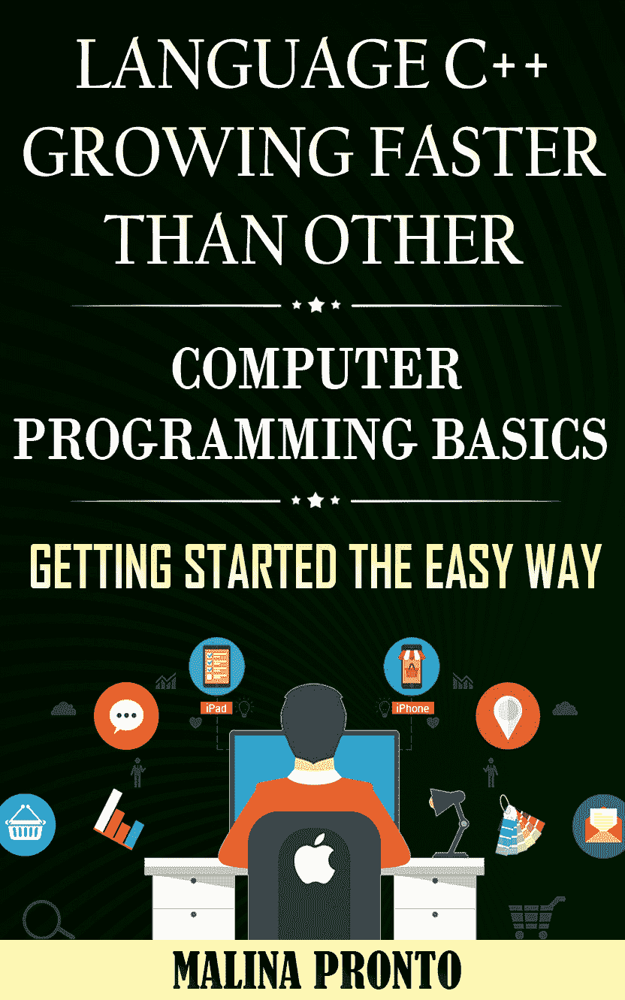

# C++ 语言增长超过其他语言：计算机编程基础——轻松上手指南



计算机编程是设计和编写计算机程序的过程。作为一种技能组合，它包含了许多不同的任务和技术，但我们的教程并不打算向你展示所有内容。相反，它们的目的是提供基础的、实用的技能，帮助你理解并编写反映你在世界中所看到的和使用的属性的代码。

## 你想要了解

我们的编程教程假设你完全没有任何编程经验。然而，它们确实要求你对计算机和网络浏览器的使用有基本的了解。例如，你应该习惯于下载和打开文件，并使用文本编辑软件。如果你对这些技能没有信心，可以考虑先花些时间学习这些教程：

- 计算机基础
- 互联网基础

只要你对这些基础了于胸，就应该准备好开始学习编程了。

## 这些教程将涵盖的内容

这些教程专门针对一种特定的编程：Web 开发。当你访问网站时，无论你使用的是笔记本电脑、智能手机还是任何设备，你实际上都在看代码，这些代码可能是由互联网开发者编写的，并且你的浏览器正在解释这些代码，以便你在屏幕上看到你看到的内容。这些教程将向你展示如何开始编写 Web 开发中使用的三种常用代码，这些代码共同构成了你每天看到的典型网站：`HTML`、`CSS` 和 `JavaScript`。

## 网站的组成部分

想象你访问的每个网站都可能是一个人。每个人在外观、行为和说话方式上都是不同的，但它们通常由等同的基础部分组成。

### HTML

如果你将一个网站想象成个人，那么你会认为 `HTML` 是它的骨架。`HTML` 是你在网页上看到的几乎所有内容的核心。虽然它本身看起来没什么什么，但它构成了基石，所有其他部分都建立在其之上。一个特别简单的网站的 `HTML` 可能看起来像这样：

```html
<!DOCTYPE html>
<html>
<head>
<title>一个极其简单的网站</title>
</head>
<body>
<p>这是一个极其简单的网站。</p>
</body>
</html>
```

## C++ 语言比其他语言增长更快

`C++` 编程语言已经存在了很长一段时间，这表明它已经积积了大量的遗留代码。但这种语言的持续流行不仅仅是因为开发者试图维护旧的应用程序和平台；正如 TIOBE 指数的最新更新所表明的，`C++` 正在积极增长。具体而言，`C++` 在过去的 12 个月中增长了 1.48%，达到（根据 TIOBE 的估计）7.11% 的市场份额。这看起来可能不是爆炸式的增长，但它击败了列表上的每一种“大”语言，包括一直流行的 `Python`（它在过去一年中增长了 0.59%）。虽然 `C++` 目前在 TIOBE 总排名中位第四，但 `C` 排名第一（占比 15.95%），已经超过了 `Java`（占比 13.48%）。

`C++` 强劲表现背后的原因是什么？这是一个棒的问题，但伴随排名的注释表明最近的一些更新与此有关：“我认为新的 C++20 标准可能是导致这一现象的原因之一。特别是新的模块功能，它正在取代极其糟糕的 `include` 机制。C++ 以积极的态势优于诸如 `R` (+1.33%) 和 `C#` (+1.18%) 等其他语言。”

为了获得其排名，TIOBE 利用了来自多个聚合器和搜索引擎的数据，包括 Google、Wikipedia、YouTube 和 Amazon。一种语言要进入排名，必须是图灵完备的，拥有自己的 Wikipedia 词条，并在 Google 上搜索“programming”时获得至少 5,000 次点击。这种方法多年来吸引了一批批评者，他们认为排名与其说是衡量这些语言的“热度”，不如说是实际使用量。无论如何，`Python` 和 `C++` 这样的“大”语言倾向于保持在高排名，而较小的语言往往会经历排名的剧烈波动。

`C++` 起源于“带类的 C”，但在过去的几十年里，它已经成功地远离了 C 语言。如果你正在学习这种语言，它还有详尽的文档（你将购买官方标准）以及许多教程和课程。

# 计算机编程入门简单上手方法

计算机病毒是由计算机必须执行的一系列指令构的。这些指令可能包含存储这些指令所需的其他重要数据。因此，编程方法涉及指令的定义，以及数据的定义。为了让计算机返回数据，你必须熟悉编程基础，以及关于数据的三个基本要素：

1. 需要执行的指令。
2. 执行这些指令的顺序。
3. 执行指令所需的数据。

编程的第一阶段基本上涉及纸面处理。在这个阶段，你甚至不需要使用计算机，然而，如果你使用文字处理系统，你就可以将工作写到计算机文件中而不是纸上。你会尝试这样做，这样在你开始指示电脑执行之前，你就能清楚、更具体地发现你想让计算机执行什么。

请记住，计算机将完全按照给出的指令执行。它不能理解你想要什么；它只会执行你想让它尝试做的事。因此，在你的程序进入计算机之前，你想要尝试几个步骤，包括：

- **定义问题**：在指示计算机尝试这样做之前，你希望先熟悉它。你想清楚地告诉计算机它必须完成什么，或者通过它执行的所有活动得到。
- **识别答案**：如果你已经知道计算机将产生什么结果，你应该深入检查你拥有的知识，并确定你所需的知识。你还需要定义逻辑过程、方程和其他方法，以便你处理原始输入文件并你想实现的最终结果。
- **映射答案**：编程的阶段必须按照正确的顺序排列。不要忘记动作的顺序对于动作本身同样重要。在将答案组织成正确的顺序时，你将在考虑各种选择。当你完成问题定义以及设计和映射答案后，下一个任务就是开始用一种或几种计算机语言编写程序代码。

# 编程概述

在继续之前，你首先想要选择你想要使用的可能语言，这也是因为考虑到特定的计算机平台。通常，计算机语言针对各种类型的任务进行了优化。因此，首先选择最适合所需任务的语言是非常关重要的。事实上，学习编程基础是任何一个准程序员为了武装自己而采取的积极举措，特别是如果他想在在该领域追求职业生涯。

热门编程语言：`C` 占据主导地位，但排名第三的 `Python` 在每月编程语言指数中由于整个格局的细粒度波动，正在追赶 `Java`。其最新指数还将细粒度的变化也识别为长期趋势。软件质量保证公司每月发布其热门编程语言指数，以详细说明不断演变的格局中的变化。最近发布了其 10 月份的最新更新指数。它使用一系列指标，包括在 Amazon、YouTube、Wikipedia、Bing、Google、Yahoo 和百度上的搜索，来确定排名。总体而言，自 9 月份报告以来，前 10 名没有发生位置移动，尽管存在细粒度的数据波动和长期变化需要注意。

## 热门编程语言：10 月份指数

在最新指数中，`C` 仍位居第一，评分为 `16.95%`，代表比 2019 年 10 月增长了 `0.77%`。`C` 继续保持上个月的最高地位，上个月该编程语言的评分为 `15.95%`。在 2019 年 10 月，`C` 排名第二，与指数一致。

`Java` 在最新排名中位列第二，评分为 `12.56%`。总体而言，`Java` 自去年 10 月以来发生了 `4.32%` 的负增长；这是前 50 名中最重要的波动（负向或正向）。`Python` 仍位第三，评分为 `11.28%`。该指数指出这通常是 `Python` 自 2001 年来的最高排名。`Python` 自去年 10 月以来记录了 `2.19%` 的正增长；是前 50 名中记录的最大增长。按顺序，`C++`、`C#`、`Visual Basic` 和 `JavaScript` 剩余的前七名。

`C++`、`C#`、`Visual Basic` 和 `JavaScript` 在 2019 年 10 月的评分中处于相同的顺序。排名第八的编程语言 `PHP` 比 2019 年 10 月的排名上升了一位。最新排名中排名第九的语言 `R` 自 2019 年 10 月以来飙升了六位。按顺序，`PHP`、`R` 和 `SQL` 完成了剩余的前十名。

## 跨越数十年的长期变化

使用 12 个月的年度平均值，也提供了有关几十年来位置变化的信息，说明了排名的长期波动。基于这些平均值，某些编程语言在近 30 年里一直位居最高位，而另一些在最近几十年中激增。

编程语言 `C` 在 2020 年、2015 年、2010 年、2005 年、2000 年、1995 年和 1985 年排名第一或第二，与这些滚动年度平均值一致。有趣的是，`Java` 在 1995 年排名第 29，在 2000 年跃升至第三，然后在 2005 年升至第二，使用这些年度平均值。`Python` 在 1995 年排名第 15，在 2000 年下降到 21，并在 2005 年飙升至第六，与滚动年度平均值一致。

## 在 6 小时内学习 6 种语言编程，花费少于 35

在过去，如果你懂一些 `HTML` 可能还有一点 `Java`，就会称自己为程序员。虽然这些语言仍在在使用，但编程世界已经变得更加多语言化。在当今的就业市场上成为一名程序员，你希望精通所有主要的方言。好消息是，编程语言不像口语语言。你在这核心命令上花费的时间越长，你就会变得越“流利”，前提是你有一个合适的老师。因此，“完整一小时编码者包”（Complete One Hour Coder Bundle）对于坐在办公桌前的知识丰富的程序员来说是下一个非常棒的东西。

这套在线课程可能是对六种最流行的语言进行的一种旋风之旅。它是从网页设计到系统工程等一切领域职业的良好开始，而且每个课程只需要一小时。以下是你将学到的：

- `C++`：这种极其多功能的语言兼容面向对象的编程，使其成为几乎任何高质量软件开发的理想选择。
- `CSS`：如果你正在考虑网页设计行业，熟悉级联样式表（Cascading Style Sheets）可能是必不可少的。没有更好的方法了，可以让你你的网站看起来完全像你想要的样子，并让你的更改在各个页面之间保持一致。
- `HTML`：如果你打算从事任何高质量的网络编码工作，熟悉术语是一项要求，这门基础课程将为你提供制作第一个网站所需的所有内容。
- `Java`：几乎用于任何地方和各种硬件，这门入门课程侧重于移动开发。网络应用、移动游戏等都以 `JavaScript` 为基础。该程序包中的课程将带你在一小时内轻松地从第一行代码过渡到复杂的循环和数组。
- `Python`：这种可读性最高的语言之一也是最强大的语言之一。`Python` 应用于从简单应用到深度学习算法的各个领域，你将在这个速成课程中看到。如果你是一个喜欢通过实践来发现问题的自学型人才，真的没有比这个包更好的起点了。PCMag 的读者可以以 34.99 美元获得整个一小时编码包，比原价优惠 97%。

# C++ 编程基础

`C++` 可能是一种通用编程语言，并在如今广泛使用。它是命令式的、面向对象的并具有泛型特性。然而，要精通任何编程语言，必须先理解该语言的基础。因此，以下是 `C++` 的基础，它们将帮助你入门：

## C++ 基础语法和第一个程序

学习 `C++` 编程通常简化为在文本编辑器中编写程序并以正确的扩展名保存（`.CPP`、`.C`、`.CP`），然后使用编译器或在线 IDE 编译程序。

## C++ 基础输入输出

`C++` 自带库，为我们提供了某些执行输入输出的方法。在 `C++` 中，输入输出是在字节序列中或更常称为流中执行的。两个关键字 `count` 和 `cin` 经常用于获取输入和打印输出。这两个是 `C++` 中获取输入输出的最基本方法。

## C++ 注释

良好的文档是程序员的良好习惯。它使程序更具可读性，更容易发现错误。良好的文档的一个重要部分是注释。在编程中，注释可能是计算机程序文本文件中的程序员可读的解释注释。这些语句不会被编译器和解释器执行。

## C++ 数据类型和修饰符

所有变量在声明时使用数据类型来限制存储的种类。因此，我们可以说数据类型是告诉变量它可以存储什么知识。每当在 `C++` 中定义变量时，编译器都会为该变量分配一些内存。每个数据类型都需要特定的内存。

## C++ 中的未初始化变量

“让 `C++` 保持活力的因素之一是零开销原则：你不需要，就不需要付费。”——斯特拉斯谷（Stroustrup）。初始化栈变量的开销是昂贵的，因为它阻碍了执行速度，因此这些变量可能包含不确定值。在代码中使用原始数据类型变量之前对其进行初始化被认为是一种最佳实践。

## C++ 中的未定义行为

如果用户在 `C/C++` 环境中开始学习，并且不清楚“未定义行为”的概念，那么将来可能会带来很多问题，例如在调试他人的代码时，追溯到未定义错误的根源可能变得非常困难。

## C++ 中的变量与类型

变量可能是赋予内存位置的名称。它是程序运行期间基本的存储单元。变量中存储的值在程序执行过程中经常会发生。变量仅仅是赋予内存位置的一个名称，对变量进行的所有操作都会影响该内存位置。在 `C++` 中，所有变量在使用之前必须先声明。

### C++ 中的变量作用域

通常，作用域是根据某物的使用范围定义的。在编程中，变量的作用域也是根据该变量可以被访问、声明或使用的程序代码范围来定义的。变量的作用域主要分为两种：局部变量和全局变量。

## C++ 中的常量与字面量

正如名称所示，常量是在 `C++` 编程语言中赋值给某些变量或值，这些值一旦被定义就无法修改。它们在程序运行期间是固定值。通常有各种类型的常量，如整数、浮点、八进制、十六进制、字符常量等。每个常量都有一定的范围。大到无法放入 `int` 的整数将被视为 `long`。现在有多种范围，从无符号（`unsigned`）到有符号（`signed`）位。在有符号位下，`int` 的范围从 `-128` 到 `+127`，在无符号位下，范围从 `0` 到 `255`。字面量也是常量，这两个术语在 `C++` 中互换使用。

### C++ 中的字面量类型

在本文中，我们将分析 `C++` 提供的各种字面量。赋值给每个常量变量是通过字面量提到的。通常，常量和字面量这两个术语是通用的。例如，`const int = 5;`，可能是一个常量表达式，因此值 `5` 被称为常量整数字面量。

## C++ 中的访问修饰符

访问修饰符用于实现面向对象编程中的一项关键特性，即数据隐藏。类中的访问修饰符或访问限定符用于设置类成员的可访问性。也就是说，它对类成员施加某些限制，使其无法被外部函数直接访问。

## C++ 中的存储作用类

存储类用于描述变量/函数的特征。这些特征基本上包括作用域、可见性和生命周期，这些特征帮助我们在程序运行期间追踪特定变量的存在情况。

## C++ 中的运算符

运算符是任何编程语言的灵感来源。因此，如果没有运算符的使用，`C/C++` 编程语言的功能就是完整的。我们将运算符定义为帮助我们对操作数执行特定数学和逻辑计算的符号。换句话说，我们可以说运算符操作着操作数。

## C++ 中的循环

当我们需要重复执行语句块时，编程中的循环就会派上用场。例如：假设我们想打印 10 次“Hello World”。这可以通过两种实现：迭代方法和使用循环。

## C++ 中的决策

在现实世界中，我们经常面临做出决策并支持这些决策、决定下一步该做什么的情况。编程中也会出现类似的情况，我们想要做出决策并支持这些决策，从而执行随后的代码块。编程语言中的决策语句决定了程序执行流的方向。

## C++ 中的前向声明

它指的是在标识符、变量、函数、类等在使用之前，对其语法或签名进行提前声明（在程序的后续部分完成）。在 `C++` 中，前向声明通常用于类。在这种情况下，类在使用之前预先定义，以便它可以被之前定义的其他类调用和使用。

## C++ 中的错误

错误是用户执行的非法操作，会导致程序运行异常。编程错误通常在程序编译或执行之前往往无法被检测到。许多错误会阻止程序的编译或执行。因此，在编译和执行之前应该消除错误。

# 你可以用于创建程序的计算机编程基础语言

想要了解编程以及用于制作程序的语言的个人，必须首先通晓基础知识。编程中使用的语言应该是你的首要考虑因素之一。在创建程序之前，简单了解各种类型和层次的编程语言至关重要。这些包括：

## 1. 机器级语言

我们都知道计算机通过位和字节运行，它读取并理解二进制数字 0 和 1。虽然你可以自由使用任何喜欢的语言编写程序，但在实现之前，它必须转换为 0 和 1 的语言。这意味着你需要编写一个程序，或者将你编写的程序转换为机器语言。这通常不是一项容易的任务。对于你想要执行的每一个指令，记忆一段扩展的 0 和 1 序列几乎是不可能的。是的，在高级语言出现之前，用于制作编程代码的语言是机器级语言。

## 2. 汇编语言

这种编程语言仅比低级或机器级语言高一级。这通常是为什么使用此类语言创建程序并不容易的原因，尽管产生的编程代码相当易于理解。直到现在，许多嵌入式技术程序是用编程语言创建的。负责将汇编程序转换为机器级程序的程序被称为汇编器。

## 3. 高级语言

这些计算机语言对人类来说更容易理解。它包含了清晰的语句。

用于创建每条指令。属于这一类别的语言有不同的用途。有些语言是为 Web 设计的；有些用于桌面应用程序，而另一些则可以同时完成这两项任务。

但需要记住的一是，高级语言计算机并不容易理解。这通常就是解释器或编译器发挥重要作用的地方。这些程序将编程代码转换为机器可以理解的语言形式。

除了这三个基础层级的语言之外，另一代编程语言正在设计中。这通常被称为第四代语言，旨在为那些具有极少或没有编程经验的人们设计。

这类语言的开发者希望这些没有经验的编程人员能够自己学会如何组织自己的代码。这通常也是像 `Java` 这样的高级语言已经配备这些系统的原因。这些系统让个人能够在编写编程代码时，而不需要去背诵每一个函数。

请记住，无论你想学习哪种编程语言，你都需要对基础知识有正确的理解。如果你不熟悉编程语言的基础，你还没有准备好用该特定语言编写程序。建议你直接参加计算机课程，这样你就能准备好学习编程的基础知识了。

MALINA PRONTO
