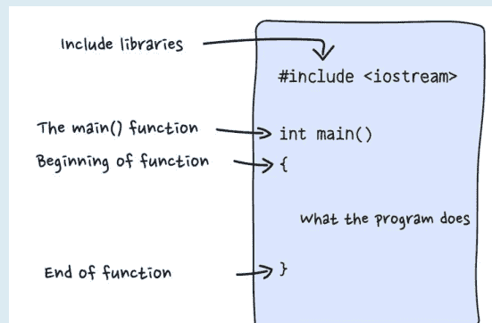
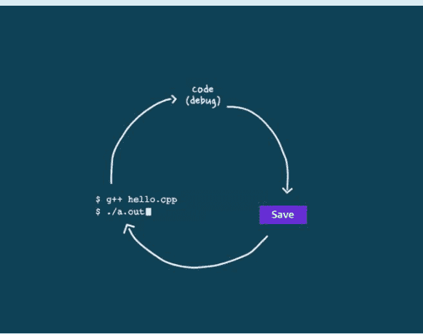
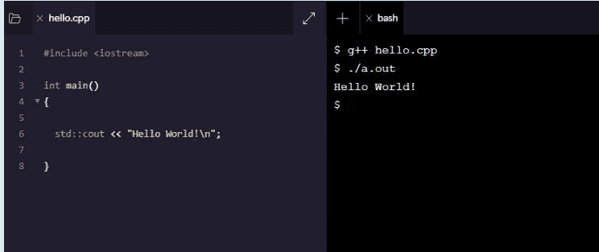
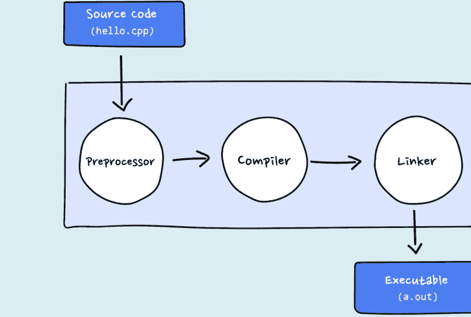
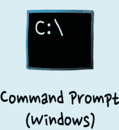

# C++ 初学者指南

奉真主名，仁慈慈悯主

唯有真主是胜者

“唯有真主是胜者”

学习世界上最强大的编程语言之一，成为一名摇滚明星开发者。

## 作者

- 18. 关于作者 106

本书献给我的灵魂伴 Miso。

## 前言

### 为什么要学习 C++？

40年前，一位名为 Bjarne Stroustrup 的博士生在研究 C 编程语言，C 语言在当时和现在都因其灵性和底层功能而备受推崇。他并不知道，自己创造了一种新语言，而这种语言现在被应用于：

- 操作系统
- Web 浏览器
- 微控制器
- 视频游戏
- 以及其他地方！

### 核心获得的技能

本课程将从基础编程概念开始，然后深入探讨更高级的 C++ 主题。你将构建从哈利·波特的“分类帽”到可以过滤文本的程序的所有内容！

## C++ 简介

C++（读作 C plus plus）由 Bjarne Stroustrup 在贝尔实验室于 1979 年开发，是 C 语言的扩展。C++ 为 C 语言添加了许多新功能，也许最好被看作是 C 的超集，尽管严格来说并非完全如此（因为 C99 引入了一些 C++ 中不存在的特性）。C++ 闻名于世主要是因为其面向对象编程，因为它是一门面向对象的语言。正如名称所示，C++ 衍生自 C 语言；Bjarne 的目标是将面向对象编程引入 C 语言，这是一种因其可移植性和底层功能而备受推崇的语言。至于什么是对象以及它与传统编程方法的区别，我们将在第 8 章（基础面向对象编程）中介绍。


C++ 在 1998 年由 ISO 委员会标准化（这意味着 ISO 委员会批准了一份描述 C++ 语言的文档，以帮助所有编译器都遵循相同的标准）。2003 年发布了一个小更新（称为 `C++03`）。

从那时起 C++ 语言经历了三次重大更新（`C++11`、`C++14` 和 `C++17`，分别于 2011 年、2014 年和 2017 年批准），每次更新都增加了额外的功能。特别是 `C++11`，增加了许多额外功能。

为什么要学习 C++？

- 它运行速度快
- 它具有可移植性
- 它被广泛使用
- 它拥有庞大的社区

它是学习计算机底层工作原理的极佳语言。通过理解内存管理和指针，你将更深入地理解软件是如何运行的。

C++ 应用于许多行业，包括：

- 游戏开发
- 操作系统
- 嵌入式系统
- 高频交易
- 浏览器

如果你正在寻找软件工程领域的职业，C++ 是一个绝佳的起点。

## Hello World!

C++ 是区分大小大小的。这意味着 `cout` 和 `COUNT` 被视为不同的标识符。

```cpp
#include <iostream>

int main() {
    std::cout << "Hello World!";
    return 0;
}
```

让我们逐行分析这段代码：

- `#include <iostream>`：这是一个预处理器指令，告诉编译器包含 `iostream` 库，该库允许输入和输出操作。
- `int main() { ... }`：这是每个 C++ 程序的入口。程序从 `main` 函数开始执行。
- `std::cout << "Hello World!";`：这一行向控制台打印字符串 "Hello World!"。`cout` 是标准输出流，`<<` 是插入运算符。
- `return 0;`：这一行向操作系统返回值 0，表示程序成功执行完毕。

要运行此程序，你需要一个 C++ 编译器（如 `g++`）。你可以使用以下命令编译代码：

```bash
g++ hello.cpp -o hello
```

然后，你可以通过以下命令运行程序：

```bash
./hello
```

输出应该是：

Hello World!

### 1.1) 输出

太棒了！我们刚刚让你的第一个程序运行了。

C++ 和大多数编程语言一样，是按行运行的，从上到下。下面是一个 C++ 程序的结构：



大括号之间的内容就是我们现在要关注的。

`std::cout << "Hello World\n";`

- `std::cout` 是“字符输出流”。读音为 "see-out"。
- `<<` 是紧跟其后的一个运算符。
- `"Hello World\n"` 是这里要输出的内容。你需要在文本周围加上双引号。`\n` 是一个表示换行的特殊字符。
- `;` 是标点符号，告诉计算机你已经到了语句的结尾。它类似于句子中的句号。

### 1.2) 模式

我们通过以下代码学习了如何输出一行文本：

```cpp
std::cout << "Hello\n";
```

它将输出：

Hello

我们也可以通过添加更多的 `std::cout` 语句来输出多行：

```cpp
std::cout << "Hello\n";
std::cout << "Goodbye\n";
```

这将输出：

Hello

Goodbye

现在让我们利用目前为止学到的知识来完成一个编码挑战吧！

```cpp
#include <iostream>
int main() {
    std::cout << "Hello\n";
    std::cout << "Goodbye\n";
}
```

1. 不要在输出中显示那两行，而是编辑代码，使我们在终端中输出以下模式：

完全按照所示。

```cpp
#include <iostream>

int main() {
    std::cout << "1\n";
    std::cout << "2 3\n";
    std::cout << "4 5 6\n";
    std::cout << "7 8 9 10\n";
}
```

### 复习

在本节课程中，你学习了：

- C++ 是一种通用的编程语言。
- C++ 按行运行的，从上到下。
- `std::cout` 是你向终端输出内容的方式。

`std::cout << "Good luck!\n";`

### 1.3) 编译与执行

代码 → 保存 → 编译 → 执行

C++ 是一种编译型语言。这意味着，要让一个 C++ 程序运行，你必须先将其从人类可读的形式翻译成机器“理解”的内容。这种翻译是由一个称为编译器的程序完成的。

当你用 C++ 编程时，开发过程中主要会经历 4 个阶段：

1. 代码 — 编写程序
2. 保存 — 保存程序
3. 编译 — 通过终端编译
4. 执行 — 通过终端执行



并重复（如果需要，调试错误）。

注意：到目前为止，我们一直在为你完成这些魔法操作；步骤 2、3、4 都是通过简单点击“运行”按钮完成的。

让我们尝试使用终端进行编译和执行。

#### 1.3.1) 编译与执行

**编译：** 计算机只能理解机器码。**编译器**可以将我们写的 C++ 程序翻译成机器码。要编译一个文件，你需要在终端中输入 **`g++`** 后跟文件名。

```bash
g++ hello.cpp
```

编译器随后将翻译 C++ 程序 `hello.cpp` 并创建一个名为 `a.out` 的机器码文件。

**执行：** 要执行这个新的机器码文件，你只需要在终端中输入 `./` 和机器码文件名为即可：

```bash
./a.out
```

可执行文件将被加载到计算机内存中，计算机的 CPU（中央处理单元）会一次一条指令地执行程序。



#### 1.3.2) 编译与执行（命名可执行文件）

**编译：** 有时我们在编译时想给输出文件指定一个特定的名称。要这样做，命令略有不同。我们仍然需要在终端中编写 **`g++`** 和文件名。之后，使用 **`-o`** 然后你想要给可执行文件的名称：

```bash
g++ hello.cpp -o hello
```

编译器随后将翻译 C++ 程序 `hello.cpp` 并创建一个名为 `hello` 的机器码文件。

**执行：** 要执行这个新的机器码文件，你只需要在终端中输入 `./` 和机器码文件名为即可：

```bash
./hello
```

可执行文件将被加载到计算机内存中，计算机的 CPU 将一次一条指令地执行程序。

```cpp
#include <iostream>

int main() {
    std::cout << "Hello World!\n";
}
```

```bash
g++ hello.cpp -o hello
./hello
```

### 1.4) 注释

编程通常是协作性的。当我们几小时后回到代码前时，我们的代码可能会迅速变得难以理解！由于这些原因，在代码中为自己或其他开发者留下注释通常是有用的。

当我们编写 C++ 程序时，我们可以在代码中留下注释，编译器会忽略这些内容。

C++ 中有两种类型的注释：

- 单行注释使用双斜杠开头：

```cpp
std::cout << "hi"; // 这是一个单行注释
```

- 多行注释使用 `/*` 开始并用 `*/` 结束：

```cpp
/* 这是一个
多行注释 */
std::cout << "hi";
```

### 复习

恭喜！在本节课程中，你学习了：

- 使用终端进行编译和执行。

```bash
g++ hello.cpp -o hello
hello
```

- 单行注释使用 `//`
- 多行注释使用 `/* */`

### 1.5) 流程

C++ 是一种编译型语言。这意味着，要让一个程序运行，你必须先将其从人类可读的形式翻译成机器“理解”的内容。这种翻译是由一个称为编译器的程序完成的。

你读取和编写的是源代码（通常是 C++ 语言），而计算机执行的是可执行文件。

通常 C++ 源文件带有后缀：

- `.cpp`（例如 `hello.cpp`）或
- `.h`（例如 `std_lib.h`）。



### 编译：

```bash
g++ hello.cpp -o hello
```

编译器将 C++ 程序翻译成机器码，并将其存储在磁盘上，文件扩展名为 `.o`（例如 `hello.o`）。链接器随后将目标代码与程序可能使用的标准库连接，并创建一个可执行映像，通常保存在磁盘上，文件名没有后缀（例如 `hello`）。

### 执行：

```bash
./hello
```

可执行文件从磁盘加载到内存，计算机的 CPU（中央处理单元）一次一条指令地执行程序。

### 在本地运行 Hello World：

在 Mac 上，它被称为终端（Terminal）。在 Windows 上，它被称为命令提示符（Command Prompt）。




# 2) 变量

## 2.1 变量简介

“Hello World!”程序只是向屏幕输出。它不读取任何内容，不进行任何计算，也不允许用户输入。这不好玩！

真正的程序往往根据用户提供的某些输入来产生结果，而不是一直输出相同的内容。

为了从键盘读取内容，我们首先需要在计算机内存中找一个地方存储数据。这就是变量大显身场。

变量仅仅是计算机内存中某部分的名称，该部分被用来存储、检索和使用数据。

在本节课程中，我们将学习一些基础的数据类型：

- `int`：整数
- `double`：双浮点数
- `char`：单个字符
- `string`：字符序列
- `bool`：布尔值（真/假）

每个变量都有一个类型，代表你可以在其中存储的信息类型。它告诉编译器为该变量分配多少内存，并定义了你可以对变量做什么。

### 2.1.1) 第一步：声明变量

在 C++ 中，每个变量在使用之前都必须先声明！

假设我们正在开发一个游戏，想要记录一个从 0 到 10 的玩家得分。我们需要一个变量！

在使用变量之前，我们必须对其进行声明（或创建）。要声明一个变量，我们需要提供两个点：

- 1. 变量的类型。
- 2. 变量的名字。

所以，要声明一个名为 `score` 的整数变量，我们需要写：

| 类型 | 用法 | 示例 |
|---|---|---|
| `int` | 整数 | 0, 420 |
| `double` | 浮点数 | 3.14, 200.0 |
| `char` | 字符 | 'a' |
| `string` | 序列 | "Hello World!" "Codeacademy" |
| `bool` | 布尔值 | true, false |

```cpp
int score;
```

- `int` 是变量的类型。
- `score` 是变量的名字。
- `;` 是我们结束语句的方式。

在 C++ 中，变量名仅由大小写字母、数字和/或下划线组成。

注意：C++ 是一门**强类型**语言。如果你尝试给整数赋值一个小数，你将会得到意想不到的结果、警告或错误。

### 2.1.2) 第二步：初始化变量

声明变量后，我们就可以给它赋值了！

假设我们声明了一个名为 **`score`** 的 **`int`** 变量，为了将其设置为 0，我们可以直接写：

```cpp
score = 0;
```

- `score` 是变量的名字。
- `=` 表示赋值。
- `0` 是你想要存储在变量内部的值。

注意：在 C++ 中，单个等号 `=` 并不表示“等于”。它表示“赋值”。在上面的代码中，我们正在将变量 `score` 赋值为 0。

### 2.1.3) 结合第一步和第二步

我们可以在一个初始化语句中同时完成变量的声明和赋值。

假设我们有以下两行代码：

```cpp
// Declare a variable
int score;
// Initialize a variable
score = 0;
```

我们可以将这两行合并为一行代码：

```cpp
int score = 0;
```

这意味着我们正在声明一个名为 `score` 的整数并将其设置为 0。

```cpp
int score = 0;
declaration
initialization
```

注意：我们只需要声明一次变量！而且强烈建议在之后使用变量之前对其初始化。

## 2.2) 算术运算符

计算机在计算方面非常惊人。现在我们已经声明了变量，让我们使用算术运算符来计算一些吧！

这里是一些算术运算符：

- 加法 (`+`)
- 减法 (`-`)
- 乘法 (`*`)
- 除法 (`/`)
- 取模 (`%`）（执行除法并给出余数）

例如：

```cpp
int score = 0;
// score 现在是 0

score = 4 + 2;
// 现在是 6

score = 4 - 2;
// 现在是 2

score = 4 * 2;
// 现在是 8

score = 4 / 2;
// 现在是 2

score = 5 % 2;
// 现在是 1
```

注意：可以使用括号指定运算顺序。例如，在 `score = 5 * (4 + 3)` 中使用括号会将 `score` 设置为 5 * 7，而不是 20 + 3。

## 2.3) 链式调用

现在我们已经输出了变量，并且使用了多个 `cout` 输出内容。让我们再次仔细观察 `cout`。

如果我们有以下代码：

```cpp
int age = 28;

std::cout << "Hello, I am ";
std::cout << age;
std::cout << " years old\n";
```

它将输出：

Hello, I am 28 years old

注意我们在 "Hello, I am 中使用了引号，但在 age 中没有。

- 当我们需要字面量字符串时使用引号。
- 当我们引用某个名称的值（如变量）时不使用引号。

那么现在，可以在行内编写 `cout` 语句吗？

可以！你可以使用多个 `<<` 运算符来连接你想输出的内容。

对于上面的代码，你也可以这样写：

```cpp
int age = 28;

std::cout << "Hello, I am " << age << " years old\n";
```

这被称为链式调用（chaining）。

## 2.4) 用户输入

正如我们在引言中提到的，另一种给变量赋值的方法是通过用户输入。很多时候，我们希望用户为程序输入信息。

我们有 `cout` 用于输出，还有一个名为 `cin` 的东西用于输入！

```cpp
std::cout << "Enter your password: ";
std::cin >> password;
```

`cin` 指的是标准输入流（读作 "see-in"），用于字符输入。变量的第二个操作数是存储输入的地方。


## 2.5) 挑战：温度转换

现在我们学习了变量，让我们来写一个将华氏度转换为摄氏度的程序。

```cpp
#include <iostream>
using namespace std;

int main() {
    double f, c;

    cout << "Enter temperature in Fahrenheit: ";
    cin >> f;

    c = (f - 32) / 1.8;

    cout << "The temperature in Celsius is " << c << endl;

    return 0;
}
```

## 4.3) 关系运算符

关系运算符用于比较两个值，并根据比较结果返回真（true）或假（false）：

- `==` 等于
- `!=` 不等于
- `>` 大于
- `<` 小于
- `>=` 大于等于
- `<=` 小于

```cpp
if (a > 10) {
  // 表示大于
}
```

## 4.4) else 子句

可以在 `if` 语句中添加 `else` 子句。


- 如果条件求值为真，则执行 `if` 部分的代码。

- 如果条件求值为假，则执行 `else` 部分的代码。

```cpp
if (year == 1991) {
  // 如果为真，则运行此处
} else {
  // 如果为假，则运行此处
}
```

## 4.5) switch 语句

`switch` 语句提供了一种检查表达式与各种情况（cases）是否匹配的方法。如果匹配，则开始执行其内的代码。可以使用 `break` 关键字来终止一个 `case`。如果没有匹配到任何 `case`，则执行 `default`。

```cpp
switch (grade) {
  case 9:
    std::cout << "Freshman\n";
    break;
  case 10:
    std::cout << "Sophomore\n";
    break;
  case 11:
    std::cout << "Junior\n";
    break;
  case 12:
    std::cout << "Senior\n";
    break;
  default:
    std::cout << "Invalid\n";
    break;
}
```

## 4.6) else if 语句

可以在 `if` 和 `else` 之间添加一个或多个 `else if` 语句，以提供额外的检查条件。

```cpp
if (apple > 8) {
  // 此处某些代码
} else if (apple > 6) {
  // 此处某些代码
} else {
  // 此处某些代码
}
```

## 4.7) 逻辑运算符

逻辑运算符可以组合两个不同的条件。

- `&&` 要求两者都为真（与）

- `||` 要求其中一个为真（或）

- `!` 取反结果（非）

```cpp
if (coffee > 0 && donut > 1) {
  // 如果两者都真，则运行代码
}
if (coffee > 0 || donut > 1) {
  // 如果其中一个为真，则运行代码
}
if (! tired) {
  // 如果 tired 为假，则运行代码
}
```

## 复习

恭喜你！👏

这里是一些核心概念：

- `if` 语句检查条件，如果该条件求值为真，将执行相应的任务。

- `if` / `else` 语句进行二元决策，并根据提供的条件执行不同的代码块。

- 我们可以使用 `else if` 语句添加更多条件。

- 关系运算符（包括 `<`, `>`, `<=`, `>=`, `==` 和 `!=`）可以比较两个值。

- `switch` 语句可以简化编写多个 `else if` 语句的过程。`break` 关键字可以停止 `switch` 语句中对剩余 `case` 的检查和执行。

# 5) 循环

## 5.1) while 语句

- 只要条件为真，`while` 循环就会重复执行内部的代码块。一旦条件变为假，程序将退出循环。

- 注意，`while` 循环可能永远不会运行。如果初始条件为假，则将跳过代码块。

- `while` 循环看起来和 `if` 语句非常相似。和 `if` 语句一样，如果条件为真，它就会执行内部的代码。然而，区别在于，只要条件为真，`while` 循环就会不断地执行其内部的代码。

以下是 `while` 循环的样子：

```cpp
while (condition) {
  statements
}
```

- 换句话说，它不是在某事为真时执行，而是在某事为真时一直执行。

```cpp
while (guess != 8) {
  std::cout << "Wrong guess, try again";
  std::cin >> guess;
}
```

- 在此示例，只要 `guess` 不等于 8，程序就会一直要求用户输入新数字。一旦用户输入 8，程序将退出 `while` 循环，然后继续向下运行。

### 示例：

- 在 `guess.cpp` 中，我们有一个程序要求用户猜一个 1-10 之间的数字，答案是 8。

- 现在，我们不再仅仅让用户回答一次，让我们添加一个 `while` 循环，让他们最多可以回答 50 次！

```cpp
while (guess != 8 && tries < 50) {
  std::cout << "Wrong guess, try again";
  std::cin >> guess;
  tries++;
}
```

- `&&` 符号表示“与”，它将两个条件合并为一个。

- 在这个 `while` 循环中，只要 `guess` 不等于 8 且尝试次数 `tries` 小于 50，我们就再次要求用户输入数字。然后我们使用 `++` 运算符将 `tries` 加 1。

- 最后一个我们已经手手教你过了，所以让我们自己试一下吧。

作为迭代的一个例子，我们拥有第一个运行在存储程序型计算机上的程序（EDSAC）。它由 David Wheeler 在 1948 年 5 月 6 日于剑桥大学计算机实验室编写并运行的，用于计算并打印如下的简单平方列表：

| 索引 (Index) | 平方 (Square) |
|---|---|
| 0 | 0 |
| 1 | 1 |
| 2 | 4 |
| 3 | 9 |
| 4 | 16 |
| 5 | 25 |
| 6 | 36 |
| 7 | 49 |
| 8 | 64 |
| 9 | 81 |

注：此处原文表格内容不全，已根据逻辑补全或保持对应关系。

# 7) 错误

## 7.1 Bug 简介

“首次发现 bug 的实际案例。”

据传说，1947年9月9日，计算机科学家格蕾丝·霍珀（Grace Hopper）在哈佛 Mark II 计算机的日志中发现了一只蛾，并报告了世界上第一个字面上的计算机 bug。然而，“bug”一词在技术错误方面的含义，至少可以追溯到1878 年的托马斯·爱迪生（Thomas Edison）。

在你的编程之旅中，你注定会遇到无数的红色错误。有人甚至说调试占据了开发时间的 75% 以上。但让程序员成功的并不是避免错误，而是知道如何找到解决方案。

在 C++ 中，有许多不同的错误分类方法，但它们可以归纳为四类：

- 编译时错误（Compile-time errors）：由编译器发现的错误。

- 链接时错误（Link-time errors）：链接器在尝试将对象文件组合成可执行程序时发现的错误。

- 运行时错误（Run-time errors）：在运行中的程序通过检查发现的错误。

- 逻辑错误（Logic errors）：程序员在寻找错误结果产生时发现的错误。

## 7.2 编译时错误

当我们编写 C++ 程序时，编译器是由于防范错误的第一道防线。

编译时错误有两种类型：

- 语法错误（Syntax errors）：当我们违反 C++ 语法规则时发生的错误。

- 类型错误（Type errors）：当声明的类型之间存在不匹配时发生的错误。

常见的语法错误包括：

- 缺少分号；

- 缺少右括号 `)`、右中括号 `]` 或右大括号 `}`

常见的类型错误包括：

- 忘记声明变量

- 将值存储到错误的类型中

这里有一个编译错误信息的示例：

```
$ g++ example.cpp
example.cpp: In function 'int main()'
example.cpp:5:11: error: invalid conversion from 'const char *
* ' to 'int' [-fpermissive]
int x = "hello";
~~~~
```

编译器会告诉我们在哪里（行号）遇到了棘手，以及它对错误原因的最佳猜测。

### 7.3) 链接时错误

有时代码可以顺利编译，但仍然会有提示信息，因为程序需要某些无法找到的函数或库。这被称为链接时错误。

随着程序变大，将程序分成不同的文件是一个良好的做法。在编译这些文件后，链接器获取这些独立的对象文件并将它们合并成单个的可执行文件。链接时错误是链接器在尝试将对象文件组合成可执行文件时发现的。

常见的链接时错误：

- 使用从未定义的函数（稍后会详细介绍）

- 写成 `Main()` 而不是 `main()`

这里有一个链接错误信息的示例：

```
$ g++ example.cpp
/usr/lib/gcc/x86_64-linux-gnu/7/...../../x86_64-linux
Scrt1.o: In function `start'
(.text+0x20): undefined reference to `main`
collect2: error: ld returned 1 exit status
```

这些错误更难发现，但记住，Google 是你的朋友！在这里，一个好的 Google 搜索应该是：“C%20%20 undefined reference to main”。

### 7.4) 运行时错误

如果程序没有编译时错误也没有链接时错误，它就能运行。这时好戏就开始了。

在成功编译后，程序执行期间（运行时）发生的错误被称为运行时错误。当一个没有编译时错误和链接时错误的程序请求计算机执行某些计算机无法可靠执行的操作时，就会发生运行时错误。

它发生在我们输入 `./` 执行命令之后：

`./a.out`

常见的运行时错误有：

- 除以零，也称为除法错误。这类错误很难发现，因为编译器不会指向发生错误的那行。

- 尝试打开一个不存在的文件

在程序编译时，编译器没有办法获知此类错误的错误。

这里有一个运行时错误信息的示例：

```
$ g++ example.cpp
$ ./a.out
Floating point exception (core dumped)
```

### 7.5) 逻辑错误

一旦我们消除了编译时错误、链接时错误和运行时错误，程序就可以运行。但有时程序会产生错误的输出。这些在程序执行期间发生的错误被称为逻辑错误。

常见的逻辑错误有：

- 使用错误的运算符（例如，用 `+` 代替 `-`）

- 循环中的差一错误（Off-by-one errors）

- 错误的条件逻辑

# 8) 向量 (VECTORS)

## 8.1 向量简介

向量是一个可以增长大小的元素序列。我们熟悉 `int` 和 `double` 等数据类型，但我们如何存储一个集合呢？在 C++ 中，我们使用 `vector` 库。要使用向量，我们需要在代码顶部包含头文件：

```cpp
#include <vector>
```

向量是一个可以在运行时更改大小的动态数组。它是 C++ 中最有用的工具之一。

## 8.2) 创建向量

要创建一个向量，我们使用 `std` 命名空间。语法如下：

```cpp
std::vector<int> calories;
```

我们还可以在同一行初始化带有值的向量：

```cpp
std::vector<int> calories = {10, 20, 30};
```

## 8.3) 初始化向量

初始化向量的另一种方法是设置大小。假设我们要创建一个包含两个元素的向量。然而，我们还不知道想要添加什么值：

```cpp
std::vector<double> location(2);
```

在这里，我们使用括号创建一个 `double` 向量并将初始大小设置为二。元素将被默认初始化。

## 8.4) 索引 (Index)

现在我们有了向量，我们如何访问单个元素呢？这就是索引发挥用场的地方。索引指的是元素在有序列表中的位置。向量是基于零索引的，这意味着第一个元素的索引为 0，第二个索引为 1，以此此类推。

例如，假设我们有一个包含所有元音的 `char` 向量：

```cpp
std::vector<char> vowels = {'a', 'e', 'i', 'o'};
```

我们可以使用方括号访问元素：

```cpp
char first = vowels[0]; // 返回 'a'
```

- 索引 0 字符是 'a'。

- 索引 1 字符是 'e'。

- 索引 2 字符是 'i'。

- 索引 3 字符是 'o'。

- 索引 4 字符是 'u'。

我们可以输出每个元素：

```
std::cout << vowels[0] << "a";
std::cout << vowels[1] << "e";
std::cout << vowels[2] << "i";
std::cout << vowels[3] << "o";
std::cout << vowels[4] << "u";
```

使用 `vector[index]` 符号，即在 `vector` 名称后加上方括号，并在括号内填写元素的数字。

这将输出：

| a |
| e |
| o |
| u |

## 8.5) 添加和删除元素

通常，我们从一个空 `vector` 或特定长度的 `vector` 开始。当我们读取或计算所需的数据时，可以根据需要扩展 `vector`。

`.push_back()`

要向 `vector` 的“末尾”或结尾添加新元素，我们可以使用 `.push_back()` 函数。

例如，假设我们有一个包含三个核苷酸字母代码的 `vector` `dna`：

```cpp
std::vector<std::string> dna = {"ATG", "ACG"};
```

它看起来像这样：

| ATG | ACG |
| 0 | 1 |

我们可以使用 `.push_back()` 添加元素：

```
dna.push_back("ATG");
dna.push_back("CTG");
```

现在 `dna` 看起来像这样：

| ATG | ACG | GTG | CTG |
| 0 | 1 | 2 | 3 |

`.pop_back()`

你也可以使用 `.pop_back()` 从 `vector` 的“末尾”删除元素。

```
dna.pop_back();
```

注意括号内没有任何内容。

现在 `vector` 看起来像这样：

| ATG | ACG | GTG |
| 0 | 1 | 2 |

因为 `CTG` 被删除了！

注意：如果你用过其他语言编程，请注意在 C++ 中 `.pop_back()` 没有返回值。

## 8.6) .size

`<std::vector>` 不仅存储元素；还存储 `vector` 的大小：


`.size()` 函数返回 `vector` 中元素的数量。

例如，假设我们有一个包含 Sonny 购物列表的 `std::string` `vector`：

`grocery = {"Hot Pepper Jam", "Dragon Fruit", "Brussel Sprouts"};`

它看起来应该像这样：

| Hot Pepper Jam | Dragon Fruit | Brussel Sprouts |
|---|---|---|
| 0 | 1 | 2 |

- 索引 0 字符串是 "Hot Pepper Jam"

- 索引 1 字符串是 "Dragon Fruit"

- 索引 2 字符串是 "Brussel Sprouts"

```cpp
std::cout << grocery.size() << "\n";
```

注意括号内没有任何内容。

## 8.7) 操作

那么，当你想要更改 `vector` 中的每个值时，会发生什么？

你可以使用 `for` 循环！

例如，假设我们有一个像这样的 `int` `vector`：

| 10 | 20 | 30 |
|---|---|---|
| 0 | 1 | 2 |

你可以写一个从 0 迭代到 `vector.size()` 的 `for` 循环。酷的地方在于：你可以将 `for` 循环的计数器作为索引！哇。

```cpp
for (int i = 0; i < vector.size(); i++) {
vector[i] = vector[i] + 10;
}
```

这将 `vector` 更改为：

| 20 | 30 | 40 |
|---|---|---|
| 0 | 1 | 2 |

在这里我们将 `i` 从 0 增加到 `vector.size()`（即3）。在迭代过程中，我们在位置 `i` 的元素上增加了 10：

- 当 `i = 0` 时，我们为 `vector[0]` 增加了 10

- 当 `i = 1` 时，我们为 `vector[1]` 增加了 10

- 当 `i = 2` 时，我们为 `vector[2]` 增加了 10

## 复习

恭喜！你已经学习了如何在 C++ 中存储数据组。以下是我们学到的一些内容：

- `Vector` 是可以通过索引访问的元素序列。

- `std::vector<int> even = {2, 4, 6, 8, 10};`

- `vector` 的第一个索引是 0。

- `vector` 自带的一些函数：

    - `.push_back()`

    - `.pop_back()`

    - `.size()`

- 我们可以使用 `for` 循环遍历 `vector`。

# 9) 数组

就像 `vector` 一，数组是 C++ 中用于存储顺序集合的数据结构。与 `vector` 不同，它的大小不能更改。

在同一个结构中存储多个相关信息在编写 C++ 程序时非常有用。一种方法是使用 `vector`：

```cpp
std::vector<int> favoriteNums = {7, 9, 15, 16};
std::cout << favoriteNums[2]; // 输出：15
```

`Vector` 是处理信息的现代方法。但 C++ 也继承了来自其父语言 C 的更底层的结构，即数组。C++ 中的数组与 `vector` 相似，它们都允许我们存储信息组。

## 9.1) 数组 vs Vector

如果你过去用过 C++ `vector`，你可能想知道它们与数组之间的具体区别是什么，以及应该何时使用哪一个。如前所述，数组具有固定大小，这意味着一旦创建，就无法添加或删除元素。它们是底层数据结构且非常僵化。通过数组，你无法添加或删除元素；只能修改现有元素。

`Vector` 源于数组。在 C++ 早期，开发者获取了这些基础数组并编写代码使它们更加灵活和强大。因此，你可以将 `vector` 视为超级数组！可以对其添加和删除元素，还可以访问它们当前的大小。

## 9.2) 创建数组

创建数组时，你需要记住两个信息：

1. 你想在里面存储的数据类型。


## 2. 你希望它包含多少项（它的大小）

我们可以像创建普通变量一样创建数组，指定数据类型、赋予描述性名称并指定大小：

```cpp
int favoriteNums[4];
```

在很多情况下，你在创建数组后不知道需要放入什么数据，但如果你提前知道数组的内容，可以初始化：

```cpp
// 这个数组的大小也为 4，但这种情况下我们不需要显式指定
```

### 9.3) 数组索引

就像 `vector` 一样，数组中的每个元素都分配了一个从零开始的特定索引。要访问或修改数组中的元素，只需通过其索引引用它并进行操作。

```cpp
char vowels[] = {'a', 'e', 'i', 'o', 'u'};
// 索引：0 1 2 3 4
std::cout << vowels[0]; // 输出：a
vowels[0] = 'r';
std::cout << vowels[0]; // 输出：r
```

在这种情况下，我们初始化了一个包含所有元音的 `char` 数组，然后打印了数组索引 `0` 的第一个元素。然后我们通过赋值新值 `r` 修改了索引 `0` 的元素，并在下方打印。

# 10) 函数

## 10.1 函数的作用

作为程序员，你会发现自己在程序中反复使用相同的代码块。在这种情况下，你可以转向函数。

函数也称为方法或过程，是一组共同完成任务的命名代码语句，有点像工厂机器。

```
make_sandwich()
```

在代码中使用函数有很多棒的理由：

- 单行代码就可以触发所有代码，而不需要一一大行。
- 你可以构建 DRY（不要重复自己）代码，重用你已经写过的代码。
- 函数有助于让你的代码变得灵活且*模块化*，这意味着你可以更容易按任务对代码进行分组。

嗯，事实上，`main()` 是你已经使用过的函数！随着学习函数如何工作，你对它会有更多了解。

## 10.2 内置函数

在学习如何创建函数之前，让我们先过一些内置函数……

C++ 包含了许多作为标准库一部分已经创建好的函数。但我们如何访问这宝隐藏的有用函数呢？通过包含像 `<cmath>` 这样的头文件访问各种函数。

你可能在不知道的情况下已经用过几个函数了！使用以下头文件：

```cpp
#include <cmath>
```

我们获得了调用 `sqrt()` 来计算任何数字平方根的能力。

等等，“调用” `sqrt()`？

调用函数是让函数采取行动的方式。要调用基础函数，我们只需要函数名后跟一对括号，如 `sqrt(9)`。例如：

```cpp
std::cout << sqrt(9) << "\n";
// 将输出 3
```

## 10.3) 声明与定义

通常，内置函数不足以应对广泛的编程挑战。但别担心：你也可以编写自己的函数！

C++ 函数由两个部分组成：

- 声明：这包括函数的名称、返回类型以及任何参数（如果函数将接受输入值，即参数）。
- 定义：也称为函数体，它包含了函数应该执行的指令。

这是整体的整体结构：

```
return_type function_name(any, parameters, you, have) {
  // 此处为代码块
  return output_if_there_is_any;
}
```

这在实际代码中看起来可能是这样的：

```
void make_sandwich() {
  std::cout << "bread";
  std::cout << "egg";
  std::cout << "cheese";
  std::cout << "avocado";
  std::cout << "bread";
}
```

`#include <iostream>`

声明 `{ void make_sandwich() {` 左大括号

```
std::cout << "bread";
std::cout << "avocado";
std::cout << "egg";
std::cout << "cheese";
std::cout << "bread";
```

定义

`} `丢失右大括号

`int main() {`

```
make_sandwich();
```

`#include <iostream`

声明 `{ void make_sandwich() {`

```
std::cout << "bread";
std::cout << "avocado";
std::cout << "egg";
std::cout << "cheese";
std::cout << "bread";
```

定义

`int main() {`

```
make_sandwich(); // 调用
```

参数

`#include <iostream`

`void make_sandwich() {` 输出:

```
std::cout << "bread";
std::cout << "avocado";
std::cout << "egg";
std::cout << "cheese";
std::cout << "bread";
```

`int main() {`

```
make_sandwich();
```

`#include <iostream`

`void make_sandwich() {` 输出:

bread

```
std::cout << "bread";
std::cout << "avocado";
std::cout << "egg";
std::cout << "cheese";
std::cout << "bread";
```

`int main() {`

```
make_sandwich();
```

`#include <iostream`

`void make_sandwich() {` 输出:

bread avocado

```
std::cout << "bread";
std::cout << "avocado";
std::cout << "egg";
std::cout << "cheese";
std::cout << "bread";
```

`int main() {`

```
make_sandwich();
```

`#include <iostream`

`void make_sandwich() {` 输出:

bread avocado egg

```
std::cout << "bread";
std::cout << "avocado";
std::cout << "egg";
std::cout << "cheese";
std::cout << "bread";
```

`int main() {`

```
make_sandwich();
```

## 10.4) Void — 不可回头之处

让我们构建一个既没有输入也没有输出的简单函数。我们可以做到这一点吗？

`void` 修饰符添加到函数声明中、函数名之前。`void` 函数（也称为子程序）没有返回值，使其非常适合你只想向终端打印某些内容的情况。

例如：

```cpp
#include <iostream>

void make_sandwich() {
    std::cout << "bread\n";
    std::cout << "avocado\n";
    std::cout << "egg\n";
    std::cout << "cheese\n";
    std::cout << "bread\n";
}

int main() {
    make_sandwich();
}
```

```cpp
void animal_chat() {
    std::string fav;
    std::cout << "What's your favorite animal?\n";
    std::cin >> fav;
    std::cout << "Do you have a " << fav << "?n";
    std::cin >> fav;

    if (fav == "yes") {
        std::cout << "How lucky!\n";
    } else {
        std::cout << "That's bad.\n";
    }
}
```

上面的程序是为了捕获响应并将其传递到终端，而不是返回值。

## 10.5) 返回类型 — 超越 Void

当你想要函数返回某些内容并传回程序的其余部分时，C++ 已经涵盖了。就像有许多变量类型一样，函数也有许多返回类型。

函数可以返回大多数数据类型，包括 `double`、`int`、`char`、`string` 和 `vector`。

```cpp
std::string always_blue() {
    return "bluefn";
}
```

注意：`return` 语句是函数执行的最后一行代码。例如：

```cpp
std::string always_blue() {
    return "bluefn";
    std::cout << "Returned!";
}
```

最后一行不会执行，因为已经返回了。所以“Returned!”不会被打印。

## 10.6 返回值的工作原理

当函数具有除 `void` 以外的类型时，函数有两个新要求：

- 必须从函数返回值。
- 返回值必须与函数的类型一致。

返回值在哪里？

返回值会被传回函数的调用者。例如：

```cpp
std::string feed_cat() {
  return "message";
}
```

`int main() {`

  `std::string message = feed_cat();`

  `std::cout << message;`

`}`

## 10.7) 处理多个参数

当你想要向函数传递多个值时，可以在括号中列出它们，并用逗号隔开。

```cpp
void print_info(std::string name, int age) {
    std::cout << "Name: " << name << ", Age: " << age << "\n";
}

int main() {
    print_info("Alice", 30);
    print_info("Bob", 25);
}
```

## 10.8) 按值传递与引用传递

在 C++ 中，当你向函数传递参数时，会创建该值的副本。这意味着函数内部的更改不会影响原始变量。然而，如果你通过引用传递，函数可以修改原始变量。

```cpp
void increment(int &num) {
    num++;
}

int main() {
    int x = 5;
    increment(x);
    std::cout << x; // 输出 6
}
```

由于 `animal` 只在 `favorite_animal()` 内部定义且没有返回，因此程序的其余部分无法访问它。

# 11) 多文件与头文件

## 11.2) 多文件程序

程序的增长非常迅速。通过几个函数，你可以在 `main()` 上方声明函数，然后像这样在 `main()` 下方定义函数：

```cpp
#include <iostream>

// 顶部声明：
void eat();

int main() {
    eat();
}

// 底部定义：
void eat() {
    std::cout << "nom nom nom\n";
}
```

但当你的代码变长时，这种做法并不是理想的；在多个 `.cpp` 文件中使用同一个函数是常见操作。

为了让代码更整洁、更具模块化，你可以将函数定义移动到另一个专门的 `.cpp` 文件（例如 `my_functions.cpp`），在 `main()` 上方留下一声明列表。

但是文件和函数一样，是有作用域的。那么 `main()` 程序是如何知道函数定义的呢？

在你的程序编译之前，它会将你在编译语句中列出的任何文件链接成一个单一的可执行文件：

```bash
g++ main.cpp my_functions.cpp
```

搞定！你的程序知道函数定义了。

## 11.3) 自己自己编写头文件

如果你的程序不断增长，你可能在看到 `main()` 之前需要滚动大量的声明。这看起来不是处理问题的最佳方法。而且，你不想为不同的文件反复反复地声明相同的函数——那样修改起来将极其乏味！

嗯，你可以将那些函数声明全部移动到头头文件中——通常与包含所有函数定义的文件同名——扩展名为 `.hpp` 或 `.h`。例如，如果你的函数定义在 `my_functions.cpp` 中，那么对应的头文件就是 `my_functions.hpp` 或 `my_functions.h`。

那么，你如何将头文件中的所有内容引入另一个文件的作用域呢？你只是像处理第二个 `.cpp` 文件那样，直接在编译语句中链接头文件吗？

事实证明，使用头文件，你只需要在 `main.cpp` 的最顶部添加 `#include "my_functions.hpp"`：

```cpp
#include "my_functions.hpp"
```

砰！这一行代码将 `my_functions.hpp` 中的所有内容全部粘贴进来。现在，你可以访问存储在头文件中所有的函数声明了。

## 11.4) 如何让函数内联

一旦你进入 C++ 开发的世界，你可能会遇到“内联函数”（inline functions）这个术语，它具有两种含义。内联函数是一个函数定义，通常在头文件中，并带有所示的 `inline` 修饰：

```cpp
inline
void eat() {
    std::cout << "nom nom\n";
}
```

使用 `inline` 允许编译器将函数体插入到调用函数的地方，这有时有助于提高执行速度（有时也会阻碍执行速度）。如果你确实使用了，我们建议测试它对程序执行速度的影响。底线是，`inline` 是你可能会遇到、但可能永远不会使用的东西。

然而，你有时也会听到所谓的“内联函数”，指的是仅仅是成员函数（即类内部的函数——我们稍后会解释类），由于函数体非常短，所以它们在头文件中单行内完成了定义和声明：

```cpp
// cookie_functions.hpp
// Cookie::eat() 属于 Cookie 类：
void Cookie::eat() { std::cout << "nom nom\n"; }
```

请注意，如果你在头文件中内联函数，**始终**应该添加 `inline` 关键字（除非你处理的是成员函数，它们会自动为你处理内联）。

## 11.5) 默认参数

如果你在 C++ 中为函数添加了参数，那么调用该函数时就需要一个参数。这里的“需要”意味着什么？嗯，你会得到一个错误。但如果 10 次中有 9 次你都使用同一个输入值呢？反复输入相同的值会非常麻烦。

为了让你的代码在在这种情况下更加灵活，你可以在函数声明中添加默认参数。默认参数在函数声明和定义时被分配给参数：

```cpp
// 声明
void intro(std::string name, std::string lang = "C++");
// 定义
void intro(std::string name, std::string lang) {
    std::cout << "Hi " << name << " " << lang;
}
```

等等，我注意到原始 OCR 文本在定义部分被截断/损坏。根据标准的 C++ 模式，我恢复了默认参数的逻辑。

## 11.6) 函数重载！

如果你想要一个函数接受不同类型怎么办？或者你想让一个函数的参数是可选的怎么办？

在一个名为“重载”（overloading）的过程中，你可以给多个函数起相同的名称。C++ 根据所提供的参数来决定调用哪一个。

```cpp
void print_data(int i) {
    std::cout << i << "\n";
}
void print_data(double d) {
    std::cout << d << "\n";
}
void print_data(std::string s) {
    std::cout << s << "\n";
}
```

重载允许你对概念上相似的操作使用相同的函数名，使代码更具读性。

## 11.7) 函数模板

重载可能很枯燥。想象你想创建一个可以处理 `int`、`float`、`double` 的新函数。你需要反复重新定义相同的函数体吗？

感谢不需要！当两个函数具有相同的函数体时（如 `print_data()` 所示），有一个更整洁的解决方案可以使用：模板（templates）。

模板是一种 C++ 工具，允许程序员将数据类型作为参数。

## 11.8) 如何构建函数模板

那么我们如何实现模板呢？与普通函数不同，模板完全在头文件中创建。

模板让我们在调用函数时选择类型。我们选择的类型可以应用于返回值、参数类型或两者兼有。

以下是我们如何为 `print_data()` 构建模板，使得参数类型变得灵活：

```cpp
<typename T>
void print_data(T item) {
    std::cout << " " << item << " " << item << "\n";
    std::cout << item << item << item << " " << item << item << "\n";
}
```

我们可以为 `int`、`char`、`std::string` 或 `double` 调用该函数：

```cpp
print_data(2);
// 输出：
// 2 2
// 222 222
print_data('A');
// 输出：
//  A A 
// AAA AA
print_data(4);
// 输出：
// 4 4
// 444 444
```


注意：使用模板会减慢程序的编译时间，但会加快执行时间。

## 复习

你已经学了很多东西！现在你对函数和文件的作用域工作原理有所了解，以及如何让函数适应不同的用例变得更加灵活：

- 作用域（scope）是访问某个元素的代码区域。
  - 全局作用域变量随处可访问。
  - 在函数内部创建的变量具有局部作用域，无法在函数外部访问。
- C++ 函数通常拆分以使代码更具模块化：
  - 定义在头文件中。
  - 定义在另一个 `.cpp` 文件中。
- 具有多个 `.cpp` 文件的程序在编译时需要链接：

```cpp
g++ main.cpp fns.cpp
```

- 头文件必须包含在带有 `main()` 函数的文件中：

```cpp
#include "fns.hpp"
```

- 你可以使用 `inline` 关键字定义内联函数，这可能会也可能不会提高执行速度。
- 可以在函数声明中添加默认参数，这样就可以在不包含这些参数的情况下调用函数。
- 你可以对 C++ 函数进行重载，使其能够处理不同类型的输入并返回不同的类型。
- 函数模板允许函数对不同类型的参数具有相同的行为。

# 12) 类与对象

## 12.1) 什么是类和对象？

编写程序最好的用处之一是能够轻松地处理和跟踪不同的数据。数据是你编写的大多数程序背后的动力。程序员不断地解析字符串、进行加减法、计数、传递不同的数据，而所有主要应用程序能够以组织化和结构化的方式处理数据是极其重要的。

默认情况下，大多数编程语言允许你存储和跟踪三种不同类型的数据（文本、数字和布尔值）。通过这三类数据类型，我们可以表示所有类型的信息，例如用文本表示人的姓名，用布尔值表示某人是否为器官捐赠者，用数字表示物品的价格，能够跟踪这样的简单数据片段是非常棒的。但当我们需要处理更复杂的数据时会发生什么？我们可以用字符串表示名称，用数字表示价格，但如果我们想表示更复杂的东西，比如现实世界中的一个实体怎么办？

让我们假设一种情况，想象我们正在为一所学校编写程序，并想要跟踪当前就读的学生。现在，我们不再用字符串跟踪名称或用数字跟踪价格，而是想要能够跟踪“学生”。问题是，我们没有用于“学生”的数据类型。语言中并没有像字符串、数字或布尔值那样的内置的学生数据类型。此外，我们可能还想定义围绕学生的一些功能，例如让学校管理员能够标记某个学生缺席或更改他们的成绩。

随着我们编写越来越多复杂的程序（如这个这所学校的程序），我们将希望能够跟踪和建模更复杂的数据片段，因此我们需要更复杂的数据类型来解决这个问题。我们可以使用面向对象的编程语言，这是一种允许开发者创建自定义数据类型的语言。

所以，即使语言默认没有提供学生数据类型，开发者也可以创建学生数据类型，然后像使用普通的字符串、数字或布尔值一样使用它；因此，如果我们使用面向对象的编程语言来编写学生程序，我们可以通过创建一个自定义的学生数据类型来轻松地跟踪所有学生。

那么，这到底是如何运作的呢？我们如何创建自己的学生数据类型？第一步是创建一个学生类（student-class）。在面向对象编程中，类是新数据类型的规范；它本质上是一个蓝图，告诉编程语言新数据类型是由什么组成的。在我们的学生类中，我们可以通过创建一个学生类来定义构成学生的属性和功能。类的属性是单个字符串、数字或布尔值，定义了我们建模的实体的属性。

在这种情况下，学生可能有一个名称属性（是一个字符串），一个 GPA 属性（是一个数字属性），或者大一、大二、大三、大四也可以是一个字符串，然后可能它还有一个奖学金布尔值（scholarship Boolean），这决定了学生是否拥有奖学金。所以你可以看到我们可以定义学生的所有这些不同属性，这些属性本身可以是字符串或布尔值。

除了属性之外，我们还可以围绕学生定义功能。例如，我们可能会在学生类内部创建一个 `hasHonours` 函数，它将使用学生的 GPA 来判断他们是否符合荣誉标准；因此如果学生的 GPA 大于 3.5，我们就说他们获得了荣誉。我们还创建了一个 `giveScholarship` 函数，它会将 `hasScholarship` 设置为 `true`，给学生提供奖学金。

因此，类可以拥有这些属性，而这些函数本质上构成了数据类型，并允许我们定义学生在程序中长什么样。当我们创建一个类时，我们告诉语言这个新数据类型看起来什么样以及它是做什么的；我们在这里所做的仅仅是告诉语言这个新数据类型长什么样以及它做什么。当我们创建一个类时，我们告诉语言这个新数据类型看起来什么样以及它做什么；我们在这里所做的仅仅是告诉语言这个新数据类型长什么样以及它做什么。对象是类的实例（就像 age 是 `int` 的实例一样）。类仅仅是蓝图。它定义了新数据类型看起来什么样。类和对象的酷之处在于，一旦我们定义了类，我们就可以创建它的多个实例。面向对象编程非常棒，因为它允许我们建模现实世界的实体。

## 12.2) 使用 C++ 变得类

到目前为止，我们使用了多种数据类型，包括 `int`、`double`、`std::string` 和 `bool`。当我们处理 `int` 或 `std::string` 时，我们可以创建具有特定属性的变量。例如：

```cpp
int age = 33;
age++; // age 现在是 34
```
但当你想要为其他东西创建一个“类型”时会发生什么？你可以自己创建！Bjarne Stroustrup 开发 C++ 是因为他想为 C 语言添加名为“类”的功能。C++ 类是一个用户定义的类型。

类作为对象的蓝图，而对象是类的实例（就像 age 是 `int` 的实例一样）。对象从它的类获得特征和行为。

我们可以在头文件中创建一个空的 C++ 类：

```cpp
class City {
}; // 注意分号
```
冷知识：C++ 的原始名称是“带类的 C”。

## 12.3) 类成员

一个空类是非常没用的。类的设计是为了将信息和功能结合在一起——是时候往里面加东西了！

类的组件被称为类成员（class members）。就像你可以使用 `.length()` 获取字符串的长度一样，你可以使用点运算符（`object.class_member`）访问类成员。

类成员有两种类型：
- 属性（Attributes），也称为成员数据（member data），由实例的信息组成。
- 方法（Methods），也称为成员函数（member functions），是你可以在实例上使用的函数。我们在方法名称之前使用前缀来与普通函数区分开。

我们可以像这样在类中将属性和方法封装起来：

```cpp
class City {
// 属性
int population;
```
```cpp
// 我们稍后会解释 'public'
public:
//方法
void add_resident() {
    population++;
}
;
```

除非我们有一个几乎是空的类，否则将函数的声明和定义分开是常见做法。我们在类内部声明方法（在头文件中），然后在类外部定义这些方法（在同名的 `.cpp` 文件中）。

我们该如何在类外部定义方法呢？我们可以通过在在方法名之前使用 `ClassName::` 来指示它所属的类，如下所示：

```cpp
int City::get_population() {
    return population;
}
```

与普通函数不同，我们需要在定义方法的 `.cpp` 文件中包含该头文件。

注意：如果我们想在类外部定义一个方法，就必须在类内部声明它。

## 12.4) 创建对象

现在你已经有了一个类，让我们来创建一些对象吧！为了复习你的记忆，对象是类的实例，它封装了与该数据相关的数据和功能。

要创建（实例化）一个对象，我们可以这样做：

```cpp
City accra;
```

我们可以像这样给对象的属性赋值（注意，这些必须是你类中定义的属性）：

```cpp
accra.population = 2270000;
```

稍后，我们可以使用我们添加到 City 类中的方法来访问这些信息（如果它在类的公共部分）：

```cpp
accra.get_population();
```

## 12.5) 访问控制：公有和私有

让我们回到那个 `public` 关键字。它是干什么的？

默认情况下，类中的所有内容都是私有的（private），这意味着类成员被限制在类的作用域内。这更容易更容易防止数据被意外修改，并抽象掉了所有细微的细节。如果你尝试访问私有类成员，将得到一个错误：

`error: 'population' is a private member of 'City'`

但有时你需要访问类成员，为了这一点，有了 `public`。你可以使用它来让以下的所有内容在类外部均可访问：

```cpp
class City {
    int population;
    public: // 以下内容是公共的
    void add_resident() {
        population++;
    }
};
```

还有一个 `private` 访问修饰符，当你希望 `public` 以下的内容对类私有时：

```cpp
class City {
    int population;
    public:
    void add_resident() {
        population++;
    }
    private: // 这些内容是私有的
    bool is_capital;
};
```

## 12.6) 构造函数

有没有办法在对象创建时就给它提供一些数据？我们很高兴你这么问！

构造函数是一种特殊的方法，让你决定类的类的对象是如何创建的。它与类名相同且没有返回类型。当你想要实例化具有特定属性的对象时，构造函数大显身手。

如果我们确保每个 `City` 在创建时都有名称和人口，可以使用参数和成员初始化列表将属性初始化为传入的值：

```cpp
// city.hpp
#include "city.hpp"
class City {
    std::string name;
    int population;
public:
    City(std::string new_name, int new_pop);
};
```
```cpp
// city.cpp
City::City(std::string new_name, int new_pop)
    // 成员初始化为传入的值
    : name(new_name), population(new_pop) {};
```

你也可以这样写定义：

```cpp
City::City(std::string new_name, int new_pop) {
    name = new_name;
    population = new_pop;
}
```

然而，成员初始化列表允许你在创建每个成员时直接对其初始化。

要实例化一个带有属性的对象，你可以这样做：

```cpp
// main() 内部
City ankara("Ankara", 5445000);
```

现在我们有了一个名为 `ankara` 的 `City`，具有如下属性：
- `ankara.name` 设置为 "Ankara"。
- `ankara.population` 设置为 5445000。

## 12.7) 析构函数

到为止，你学习了如何创建和使用对象。但对象的生命周期还有一部分我们需要介绍：如何销毁它们！哈哈。

这听起来远没那么邪恶；对象销毁实际上关于清理和防止内存泄漏。析构函数是一个处理对象销毁的特殊方法。和构造函数一样，它与类名相同且没有返回类型，但前面有一个 `~` 运算符且不接受参数：

```cpp
City::~City() {
 // 任何最后的清理
}
```

在内部，你添加任何在对象销毁之前需要发生的家务工作。你通常不需要调用析构函数；析构会在以下任何场景下自动调用：
- 对象离开作用域。
- 对象被显式删除。
- 程序结束时。

## 复习

太棒了！你学习了 C++ 类和对象的基础知识：
- 类是用户定义的类型。
- 对象是类的实例。
- 类成员是类内部的数据属性和函数。
- 从类中创建新对象被称为实例化。
- 类成员可以被指定为私有（private）或公有（public）——它们默认是私有的。
- 你可以创建一个构造函数来实例化对象。

# 13) 为什么要面向对象编程？

到为止，你学习了如何创建和使用对象。但对象的生命周期还有一部分我们需要介绍：如何销毁它们！哈哈。

这听起来远没那么邪恶；对象销毁实际上关于清理和防止内存泄漏。析构函数是一个处理对象销毁的特殊方法。和构造函数一样，它与类名相同且没有返回类型，但前面有一个 `~` 运算符且不接受参数：

```cpp
City::~City() {
 // 任何最后的清理
}
```

在内部，你添加任何在对象销毁之前需要发生的家务工作。你通常不需要调用析构函数；析构会在以下任何场景下自动调用：
- 对象离开作用域。
- 对象被显式删除。
- 程序结束时。

## 复习

太棒了！你学习了 C++ 类和对象的基础知识：
- 类是用户定义的类型。
- 对象是类的实例。
- 类成员是类内部的数据属性和函数。
- 从类中创建新对象被称为实例化。
- 类成员可以被指定为私有（private）或公有（public）——它们默认是私有的。
- 你可以创建一个构造函数来实例化对象。

# 14) 引用和指针

## 14.1 引言

计算机内存是字节的序列。我们可以从 0 到最后对其进行编号。每个数字被称为地址，代表内存中的一个位置。

我们放入内存的每个东西都有地址。例如，当我们声明并初始化一个 `int` 变量 `power`：

```cpp
int power = 9000;
```
这将在某处为变量留出 `int` 大小的内存并将 9000 放入其中。但某处在哪里？它有什么用？

在本节中，我们将通过学习以下内容回答这些问题：
- 引用
- 指针

这些是 C++ 最强大的功能之一；它们允许程序员直接操作内存——最关键且稀缺的资源——来优化性能。

然而，引用和指针有时被认为是 C++ 最复杂和困难的功能之一。

所以让我们开始吧。

## 14.2) 引用

在 C++ 中，引用变量是其他东西的别名，即现有变量的另一个名称。

所以，假设让 `sonny` 成为 `songqiao` 的引用。你可以通过 `sonny` 或 `songqiao` 指这个人。

让我们通过这段代码看看如何这样做。假设我们已经有一个名为 `songqiao` 的 `int` 变量，我们可以在声明中使用 `&` 符号为其创建一个别名：

```cpp
int &sonny = songqiao;
```

所以在这里，我们让 `sonny` 成为 `songqiao` 的引用。

现在当我们对 `sonny` 进行任何更改（加 1，减 2 等），`songqiao` 也会改变。

关于引用的两点注意：
- 1. 我们对引用的任何操作也会作用于原始变量。
- 2. 别名不能更改为其他别名。

## 14.3 引用传递

那么，引用的良好用例是什么呢？让我们来看一下。

之前，当我们向函数传递参数时，我们使用普通变量，这被称为*值传递*。但由于传入函数的变量超出了作用域，我们无法修改参数的值。

*引用传递*（Pass-by-reference）是指使用引用将参数传递给函数。当调用函数时，函数可以使用传入的引用来修改参数的值。

这允许我们：
- 修改函数参数的值。
- 出于性能考虑，避免创建变量/对象的拷贝。

下面的代码展示了引用传递的示例。在调用函数时，引用参数用实际参数进行初始化：

```cpp
void swap_num(int &i, int &j) {
    int temp = i;
    i = j;
    j = temp;
}
int main() {
    int a = 100;
    int b = 200;
    swap_num(a, b);
    std::cout << "A is " << a << "\n";
    std::cout << "B is " << b << "\n";
}
```

注意 `int &i` 和 `int &j` 是函数 `swap_num()` 的参数。

当调用 `swap_num()` 时，变量 `a` 和 `b` 的值会被修改，因为它们是通过引用传递的。输出将是：

| A is 200 |
| B is 100 |

假设我们在这里没有使用引用传递，而是在 `swap_num()` 函数中简单使用参数 `int i` 和 `int j`，那么 `i` 和 `j` 会交换，但 `a` 和 `b` 不会被修改。

那么输出将是：

| A is 100 |
| B is 200 |

重申一下，使用引用作为参数允许我们修改参数的值。这在很多情况下非常有用。

## 14.4 带 const 的引用传递

记得 `const` 吗？`const` 关键字告诉编译器我们不会改变某些内容。

例如，在下面的代码中，我们告诉编译器 `double` 类型变量 `pi` 在整个程序过程中将保持为 3.14：

```cpp
double const pi = 3.14;
```

如果我们尝试更改 `pi`，编译器将抛出错误。

有时，我们在函数参数中使用 `const`；这是当我们确定想要写一个函数，其中参数在函数内部不会改变时使用的。这里有一个例子：

```cpp
int triple(int const i) {
  return i * 3;
}
```

在这个示例中，我们没有修改 `i`。如果在函数 `triple()` 内部更改了 `i` 的值，会导致编译错误。

为了给不修改参数值的函数节省计算开销，我们可以更进一步，使用 `const` 引用：

```cpp
int triple(int const &i) {
    return i * 3;
}
```


这将确保相同的结果：参数不会被改变。然而，将 `i` 设为参数的引用可以节省创建参数拷贝的计算开销。

## 14.5 指针

在 C++ 中，指针与其他变量基本相同，可以存储一段数据。与存储值（如 `int`、`double`、`char`）的普通变量不同，指针存储的是内存地址。

虽然引用是起源于 C++ 的较新机制，但我们建议尽可能避免指针；通常引用就能解决问题。但在现实中你会看到很多指针，特别是在旧项目中，它们的使用方式与引用非常相似。

指针在使用之前必须声明，就像普通变量一样。它们在语法上通过 `*` 来区分，因此 `int*` 表示“指向 int 的指针”，`double*` 表示“指向 double 的指针”。

```cpp
int* number;

double* decimal;

char* character;
```

假设我们有一个变量 `gum`：

```cpp
int gum = 8;
```

我们可以通过以下方式创建它的指针：

```cpp
int* ptr = &gum;
```

- `int*` 使成为指针而不是普通变量。
- `ptr` 是指针名。
- `&gum` 是变量的地址。

现在 `ptr` 拥有 `gum` 的内存地址。注意：`*` 周围的空格并不重要，但最佳实践是将其放在数据类型之后。

```cpp
int* number;

int *number;

int * number;
```

## 14.6 解引用

现在我们学习了指针是什么以及如何创建它，但有一种方法可以获取变量所指向的值。星号 `*` 是跟在指针变量之前的解引用运算符。

```cpp
int blah = *ptr;
```

`*` 符号的双重含义初看起来很复杂，所以请记住：

- 当 `*` 用于声明时，它是创建一个指针。
- 当 `*` 不用于声明时，它是解引用运算符。

## 14.7 空指针

当我们像这样声明指针时，它的内容没有被初始化，这是危险的！但如果我们不知道它指向哪里，可以使用空指针。

- `nullptr` 是 C++11 引入的新关键字，表示空指针。
- 我们可以这样使用 `nullptr`：

```cpp
int ptr = nullptr;
```

注意：在旧的 C/C++ 中为此使用 `NULL`。`nullptr` 是 `NULL` 的现代替代品。

## 复习

恭喜！你正式完成了。

在本节中，你学习了：

- 引用
- 引用传递
- 带 `const` 的引用传递
- 内存地址以及如何访问它们
- 指针
- 指针解引用
- `nullptr`

```cpp
// 引用

int &reference = original;

// 指针

int* pointer = &original;
```

# 16 内存分配

到目前看到的每个变量都是局部变量。局部变量在函数结束时超出作用域。但有时这不是我们想要的。这就是堆（free store）的作用。堆是长生存变量的内存。

## 16.1 手动内存管理

为了避免内存浪费，你可以在运行时使用 C++ 中的 `new` 和 `delete` 运算符动态分配任何内存。

```cpp
int main() {

  // 内存分配

  ptr = new int[num];

  ...

  // 释放内存

  delete ptr;

}
```

`new` 运算符：

```cpp
ptr = new int[num];
```

`delete` 运算符：

```cpp
delete ptr;
```

如果你用 `new` 创建了某些东西，最终必须删除它。如果东西没有被删除，会导致内存泄漏。

## 16.2 三规则

三规则是 C++ 中的一条法则，它称如果类定义了以下任意一个特殊函数，它就应该定义所有三个：

- 析构函数
- 拷贝构造函数
- 赋值运算符

## 16.3 五规则

随着 C++11 的出现了一个新规则：五规则。它在三规则的基础上增加了两个特殊函数：

- 析构函数
- 拷贝构造函数
- 赋值运算符
- 移动构造函数
- 移动赋值运算符

可以看出，手动内存管理是困难且过时的。与其使用 `new` 和 `delete`，标准库中的某些东西会让生活变得简单得多。

## 16.4 标准库智能指针

智能指针是 C++ 在 20 世纪 90 年代流行的抽象数据类型。它在模拟指针的同时提供了额外的功能，如自动内存管理。

在标准库中，我们有：

- `unique_ptr`：一种所有并管理另一个对象的智能指针，并在 `unique_ptr` 超出作用域时释放它。
- `shared_ptr`：一种通过指针保留对象所有权的智能指针。多个 `shared_ptr` 对象可以拥有同一个对象。

| 下一页 |
| 卡住了 |

# 关于作者

Ahmad Ibrahim 是和你们大多数人一样的学生。他在 The Educators School Bhara Kahu Campus-I (A Project of Beacon House) 完成小学，在 KIPS COLLEGE ISLAMABAD G-9/MARKAZ 完成中学。他学习的是计算机科学高中（ICS）。从小学起他就非常迷恋计算机科学，并尝试从知名机构/组织学习许多认证。他在 Cybrary 获得了 IT 和网络安全导论的证书，并从 Google Garage by Google 获得了数字营销基础考试证书。到目前他一直在学习编程。他在美国哈佛大学修了 CS50x 课程。他还获得了思科网络学院® 网络安全课程认证。此外，他目前正在完成 Google Inc. 的 IT 支持专业认证。在 COVID-19 大疫情期间，他决定为初学者写一本关于 C++ 的书，开始并继续对 C++ 编程语言的学习，并将他目前为止学到的所有内容整合到书中。作者说：“我从不同的平台获得了多个网络安全证书。我随时准备好学习新知识并继续前进，绝不停在一个地方。我的力量是真主，我的灵魂伴侣。我随时准备迎接新挑战并追求卓越。因为我我相信成功和失败是塑造我们目标的最佳方式。由于灵魂伴侣对我的信任以及我的努力，我希望在一切中都能获得回报。”
