# 一天学会 C++ 并精通它：实用分步进阶指南，快速学习编程

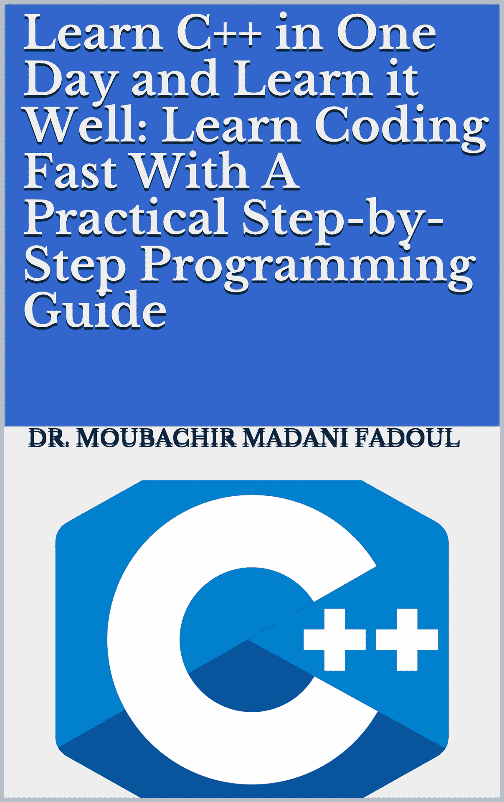

## 关于作者

### DR. MOUBACHIR MADANI FADOUL 的其他书籍

# 第 1 章 C++ 简介

## 1.1 为什么使用 C++

`C++` 是世界上广泛流行的编程语言之一。`C++` 可于当今操作系统、嵌入式系统和图形用户界面。`C++` 是一种面向对象的编程语言，允许代码复用，为程序提供清晰的结构并降低开发成本。`C++` 具有移植性，可用于开发适应多个平台的应用程序。`C++` 方便且易学！由于 `C++` 类似于 `Java` 和 `C#`，程序员很容易切换到 `C++` 或反之。

## 1.2 C++ 入门

本分步教程将教你 `C++` 的基础知识。不需要任何编程经验。在开始使用 `C++` 之前需要两件事：有很多编译器和文本编辑器供选择。在本分步教程书中，将使用 IDE。

### C++ 安装 IDE

“IDE（集成开发环境）”用于编译和编辑代码。流行的 IDE 包括：`Eclipse`、`Visual Studio` 和 `Blocks`。它们都是免费的，可以用于调试和编辑 `C++` 代码。

### C++ 快速上手

打开 `Codeblocks` 并转到 `File > New > Empty File`。编写以下 `C++` 代码并将文件保存为 `myfirstprogram.cpp`。如果你不理解上面的代码，不要担心——细节将在后面的章节中讨论。它在 `Codeblocks` 中看起来应该是这样：

然后，转到 `Build > Build and Run` 来执行（运行）程序。下面显示了结果：恭喜！现在你编写并执行了你的第一个 `C++` 程序。

## 1.3 C++ 语法

以下代码被拆分以便更好地理解：

### 省略命名空间

某些 `C++` 程序可以在不需要标准命名空间的情况下执行。省略 `namespace std` 行改为 `std` 关键字，后面跟用于某些对象的 `::` 运算符：

## 1.4 C++ 输出（打印文本）

`cout` 运算符用于打印文本/输出值：可以添加多个 `cout` 对象。但请注意，输出末尾无法插入新行：

## 1.5 换行

可以通过使用 `\n` 字符插入换行：注意：可以通过两个连续的 `\n` 字符创建一个空行：也可以使用 `endl` 操作符插入新行：

## 1.6 C++ 注释

为了使 `C++` 代码更具可读性和解释性，使用了注释。它还可以在测试其他代码时防止执行。注释可以使用多行或单行。“单行注释”用两个正斜杠（`//`）表示。编译器将忽略 `//` 和行尾之间的任何文本（不执行）。在此示例中，在代码之前使用了单行注释：

## 1.7 C++ 多行注释

多行注释以 `/*` 开始，以 `*/` 结束。编译器将忽略 `/*` 和 `*/` 之间的任何文本：

## 1.8 C++ 变量

为了存储数据值，可以使用变量作为容器。`C++` 中有不同变量（用不同的关键字定义），例如：

### 声明（创建）变量

可以创建一个变量；必须指定类型并赋值：以下示例是创建了一个应该存储数字的变量：变量也可以在不赋值的情况下声明，稍后分配值：注意，给现有变量分配新值将覆盖之前的值：

#### 其他类型

不同数据类型形式的演示：

## 1.9 显示变量

要显示变量，使用 `cout` 对象结合 `<<` 运算符。要结合变量和文本，请用 `<<` 运算符将它们分开：

### 将变量相加

`+` 运算符可以将一个变量加到另一个变量：

## 1.10 C++ 标识符

所有 `C++` 变量都有唯一名称标识。这些唯一名称被称为标识符。标识符可以是具描述性的名称（`sum`、`age`、`totalVolume`）或短名称（如 `x` 和 `y`）。注意：为了创建可维护且理解的代码，建议使用描述性名称：构造变量名称（唯一标识符）可以概括为：

## 1.11 C++ 常数

出于安全考虑，如果你使用 `const` 关键字，你和其他人都无法覆盖现有的变量值，“常量”意味着“不可更改且只读的”：当你有可能改变的值时，最好声明变量为常量：

## 1.12 C++ 用户输入

从之前的章节，我们已经学到 `cout` 用于打印（输出）值。现在获取用户输入，我们使用 `cin`。通过提取运算符（`>>`），`cin` 是一个从键盘读取数据的预定义变量。下面的示例允许用户输入一个数字，存储在变量 `x` 中。然后打印 `x` 的值：

### 创建简单的计算器

此示例允许用户输入两个数字。然后我们计算（相加）这两个数字，打印和：

## 1.13 C++ 数据类型

如变量部分所示，`C++` 中的变量必须是指定的数据类型：

### 基本数据类型

数据类型决定了信息的类型和大小：

## 1.14 C++ 数值数据类型

使用 `int` 存储整数（如 1000 或 35），当需要浮点数时使用 `double` 或 `float`，例如 44.43 或 89.65。

### 科学计数

要表示 10 的次方，使用 `e`：

## 1.15 C++ 布尔数据类型

“`bool` 关键字”声明布尔数据类型，只能取 `false` 或 `true` 值。如果返回值，`false = 0`，`true = 1`。

## 1.16 字符类型

使用单个字符存储字符类型。单引号围绕字符，如 `'A'` 或 `'c'`：

## 1.17 字符串类型

字符序列（文本）存储在 `string` 类型中。这不是内置类型，但它的行为像基本函数。双引号围绕字符串值：在源代码中包含额外的头文件，以使用字符串，需要 `<string>` 库：

## 1.18 运算符

运算符对值和变量执行操作。下面的示例使用了 `+` 运算符将两个值相加：如上面的示例所示，尽管 `+` 运算符经常用于将两个值相加，它也可以结合一个值和一个变量，或者一个变量和另一个变量：

## 1.19 用户输入字符串

提取运算符在 `cin` 上使用了 `>>` 来显示用户输入的字符串：空间在 `cin` 中（制表符、空白字符等）被视为终止字符，这意味着即使你输入了许多单词，它也只能显示单个单词：从上面的示例可以看出，程序预期打印 `"John Doe"`，但它只打印了 `"John"`。

使用 `getline()` 函数来读取多行文本，当满足指定条件时，例如：

# 第 2 章 条件与控制语句

## 2.1 条件与 `if` 语句

在 `C++` 中，使用 `if` 语句来执行不同的操作。如果条件为真，则执行相应的代码块：

## 2.2 `if` 语句

当条件为真时执行代码块，使用 `if` 语句。当满足特定条件时，它会执行：

### 示例说明

语句 1 在循环开始前 (`int i = 0`) 设置了一个变量。

语句 2 定义了循环运行的条件 (`i` 必须小于 5)。循环将重新开始。如果条件为真，则继续；如果为假，循环终止。

语句 3 在每次循环代码块执行后增加一个值 (`i++`)。

## 2.3 `else` 语句

当条件为假时执行代码块，使用 `else` 语句。

### 示例说明

上面的示例在 `time > 18` 时，屏幕会打印“晚上好”。如果时间小于 18 (`time < 18`)，程序会打印“白天好”。

## 2.4 `switch` 语句

为了在多个代码块中选择一个执行，使用 `switch` 语句。在示例中使用星期几数字来计算星期几：

## 2.5 `break` 关键字

当遇到 `break` 关键字时，`C++` 会跳出 `switch` 块。这会停止块的代码执行。如果找到了匹配项，工作完成，不再需要继续测试。

## 2.6 `default` 关键字

如果没有匹配项，则通过 `default` 关键字指定运行某些代码：

## 2.7 `for` 循环

当你确切知道要循环代码块的次数时，使用 `for` 循环代替 `while` 循环：

## 2.8 `break`

`break` 语句在本分步教程书的早期章节中已经使用过。它可以跳出 `switch` 语句。`break` 语句也可以跳出循环。当 `i` 等于 4 时，此示例跳出循环：

## 2.9 `continue`

当指定的条件发生时，`continue` 语句会中断循环中的当前迭代，并继续循环的下一次迭代。此示例跳过了值 4：

## 2.10 数组

为了在一个变量中存储多个值，可以使用数组，而不是为每个值声明单独的变量。通过声明数组来定义变量类型，指定数组名称后跟方括号，并分配要存储元素的数量：

为了包含一个四个字符串的数组，声明了一个变量。要向其中插入值，可以使用数组字面量——将值放在逗号分隔的列表中，并放在大括号内：

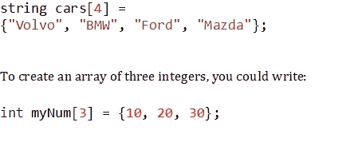

### 访问数组元素

通过引用索引号，你可以访问数组元素。在此语句中访问 `cars` 中第一个元素的值：

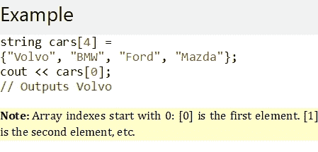

### 修改数组元素

通过引用索引号可以更改特定元素的值：

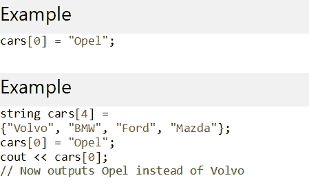

### 创建引用

引用变量是现有变量的“引用”，使用 `&` 运算符创建：

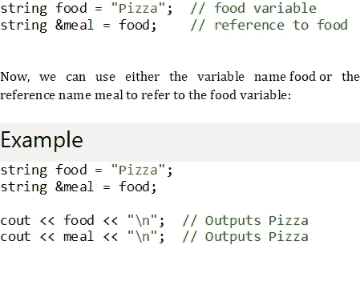

### 创建指针

从上一章中，你已经学了使用 `&` 运算符获取变量的“内存地址”：

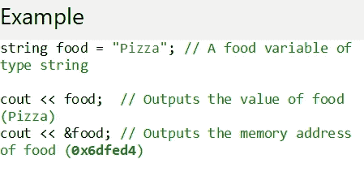

要将内存地址存储为其值，可以使用指针。指针变量用 `*` 运算符创建，并指向相同数据类型（如 `int` 或 `string`）。将你正在操作的变量地址分配给指针：

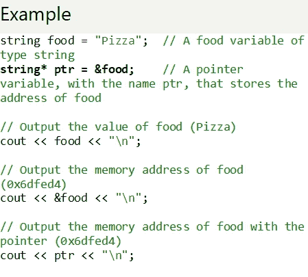

#### 示例解释

使用星号 `*` (`string* ptr`) 创建一个名为“ptr”的指针变量，它指向一个“string”变量。注意指针的类型必须与你正在操作的变量类型匹配。要存储名为 `food` 的变量的内存地址，使用 `&` 运算符并将其分配给指针。现在，`ptr` 保存了 `food` 的地址的值。

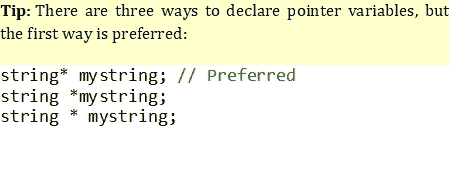

# 第 3 章 函数

只有在调用时才运行的代码块定义为函数。在函数中，你可以传递数据，称为参数。函数执行某些任务，并且必然是为了代码复用：定义一次代码，使用多次。

## 创建函数

`C++` 中提供了一些预定义的函数，例如执行代码的 `main()`。但也可以创建自己的函数来执行某些操作。要创建（通常称为声明）函数，请指定函数名，后面跟上括号 `()`：

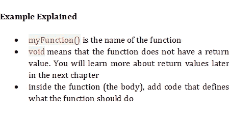

## 3.1 调用函数

声明的函数被“保存以备后用”，并在被调用时以后执行。声明的函数不会立即执行。调用函数可以通过编写函数名后跟两个括号 `()` 和一个分号来实现；在接下来的示例中，调用时 `myFunction()` 用于打印文本（该动作）：

## 3.2 函数的声明与定义

一个 `C++` 函数由两部分组成：

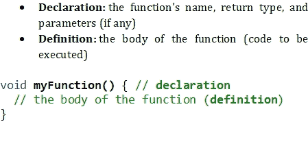

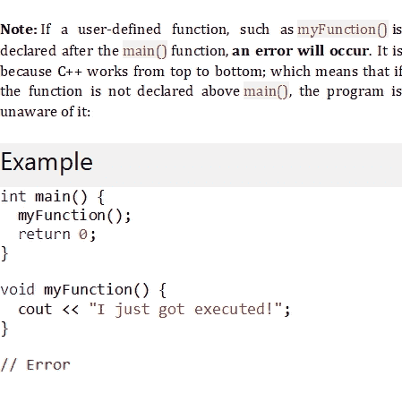

然而，为了代码优化，函数的声明和定义是可以分开的。你经常会看到 `C++` 程序将函数定义在 `main()` 之下，将函数声明在 `main()` 之上。这使得代码更易读、组织更好：

## 3.3 参数

信息以参数的形式输入到函数中。在函数内部，参数充当变量。在函数名后的括号内可以指定参数。如果你想添加尽可能多的参数，只需用逗号分隔它们：

在接下来的示例中，函数接受一个名为 `fname` 的 `string` 作为参数。当调用函数时，会传递一个名字，它在函数内部被定义为“打印全名”：

## 3.4 返回值

在示例中使用的 `void` 关键字指定函数不能返回值。如果你想让函数返回值，尝试使用数据类型（如 `int`、`string` 等）代替 `void`，并在函数内部使用 `return` 关键字：

结果也存储在变量中：

## 3.5 函数重载

函数重载允许多个函数具有相同的名称但不同的参数：

以下示例有两个不同类型数字的函数：

重载一个函数比定义两个执行相同功能的函数更好。下面的示例重载了 `plusFunc` 函数，使其适用于 `double` 和 `int`：

# 第 4 章 面向对象编程

## 什么是 OOP？

“OOP 代表面向对象编程”。过程化编程是对数据执行操作或编写过程，而面向对象编程是创建同时包含函数和数据的对象。“面向对象编程”相比“过程化编程”具有许多优势：

## 4.1 什么是类和对象？

对象和类是面向对象编程的两个主要方面。下面的图说明了对象和类的区别：

另一个示例：

因此，“类是对象的模板，而对象是类的实例”。在创建了各个对象后，各个对象继承类中所有的函数和变量。下一节将介绍更多关于对象和类的知识。

## 4.2 类/对象

`C++` 是一种“面向对象的编程语言”。`C++` 中的一切都与对象、类以及其方法和属性相关。例如：在生活中，自行车是一个“对象”。自行车具有重量和颜色等属性，以及行驶和刹车等方法。方法和属性基本上是类相关的函数和变量。这些通常被称为“类成员”。类是程序中定义的数据类型，作为对象的构造函数或“蓝图”。

## 4.3 创建类

使用 `class` 关键字创建类：

### 示例解释

## 4.4 创建对象

对象是从类创建的。名为 `MyClass` 的类已经创建，所以现在通过这种方式创建对象。通过指定类名后跟对象名。在对象上使用点语法 `.` 访问类（`myString` 和 `myNum`）：

以下示例在类内部定义了一个函数并命名为 `myMethod`：

在类外部定义函数可以通过指定类名后跟作用域运算符 `::` 以及函数名来实现：

## 4.5 封装

“封装”的思想是确保敏感数据对用户隐藏。通过将类变量/属性声明为 `private`（无法从类外部访问）。提供公开的 `get` 和 `set` 方法有助于修改私有成员。

## 4.6 访问私有成员

使用公开的 `get` 和 `set` 方法访问私有属性：

示例中，`salary` 属性设置为 `private` 并限制访问。公开的 `setSalary()` 方法接收参数 `s` 并将其分配给 `salary` 属性（`salary = s`）。私有 `salary` 属性的值由公开的 `getSalary()` 方法返回。在 `main()` 中我们创建了 `Employee` 类的对象。现在使用 `setSalary()` 方法将私有属性设置为 `50000`。然后我们在对象上调用 `getSalary()` 方法返回值：

## 4.7 继承

在 `C++` 中可以从一个类继承方法和属性。“继承概念”分为两类：

使用 `:` 符号继承类。下面的示例显示 `Vehicle` 类（父类），`Car` 类（子类）继承了方法和属性：

# 第 5 章 文件

处理文件时我们使用 `fstream` 库。要使用 `fstream` 库，需要包含 `<fstream>` 和标准的 `<iostream>`：

## 5.1 创建并写入文件

使用 `fstream` 或 `ofstream` 对象创建文件并指定文件名。使用插入运算符 `<<` 写入文件：

## 5.2 读取文件

要读取文件，使用 `ifstream` 或 `fstream` 对象以及文件名：

## 5.3 异常

执行 `C++` 代码可能会遇到不同的错误：程序员编写的代码错误、输入错误导致的错误或其他不可预见的情况。如果出现错误，`C++` 会正常停止并生成错误消息。这种技术的术语是：“`C++` 将抛出一个异常（错误）”。

### `try` 和 `catch`

在 `C++` 中，有三个异常处理关键字：`try`、`throw` 和 `catch`：

### 示例解释

# 第 6 章 结论

## 关于作者

**Description: pic**

MOUBACHIR MADANI FADOUL 博士是一位在电子工程领域拥有 5 年经验的技术创业者。精通创业和研究的各个方面。在研究和分析方面有深厚教育的远见型产品开发者。有效的沟通者和激励者，识别并利用团队成员的资产来实现组织目标。一个坚定的乐观主义者，相信没有失败，只有反馈。

了解更多关于 MOUBACHIR 的信息：<https://goo.gl/oqNJoJ>

- [MOUBACHIR MADANI 博士的其他书籍](https://amzn.to/303K8q)
- [无线路由器的终秘密：如何选择能够增强 Wi-Fi 信号并增加网络能力的路由器](https://www.amazon.com/dp/B08CDYV8W2/ref=sr_1_1?dchild=1&qid=1594051547&refinements=p_27%3AD.+MOUBACHIR+MADANI+FADOUL&s=books&sr=1_1&text=DR.+MOUBACHIR+MADANI+FADOUL)
- [如何构建价值百万美元的应用](https://www.amazon.co.uk/dp/B08CFSGJ78)
- [机器人手术：人工智能的现代方法](https://www.amazon.com/dp/B08CRJ9GC1)
- [Python：学习 Python 编程的终极入门指南，分步教学](https://www.amazon.com/dp/B08CTHR9)
- [为什么用 LyX 而不是 Microsoft Word 或 LaTeX：专业化的教程](https://www.amazon.com/dp/B08CY32T3B)
- [算法简介：算法的奥秘](https://www.amazon.com/dp/B08D1ZFHJK)
- [一天学会 Java 并学好：通过实践示例快速学习编码](https://www.amazon.com/dp/B08D6F83XP)

电气与电子电子书：<https://bit.ly/3dSHPXh>
