# 
C 语言入门指南


# 关于本教程

C语言是一种通用的、过程式的、命令式的计算机编程语言，由丹尼斯·里奇于1972年在贝尔电话实验室开发，用于编写UNIX操作系统。

C语言是使用最广泛的计算机语言。它与Java编程语言一样广受欢迎，在现代软件程序员中同样流行且使用广泛，两者在受欢迎程度排名中始终位居前列。

# 受众

本教程面向需要从零开始了解C编程语言的软件程序员。本教程将使您充分理解C编程语言，从而能够将自身提升到更高的专业水平。

# 前提条件

在开始本教程之前，您应对计算机编程术语有基本的了解。对任何编程语言的基本了解都将帮助您理解C编程概念，并快速进入学习轨道。


# 1. 概述

C 是一种通用的高级语言，最初由丹尼斯·M·里奇（Dennis M. Ritchie）在贝尔实验室开发，用于编写 UNIX 操作系统。C 语言于 1972 年首次在 DEC PDP-11 计算机上实现。

1978 年，布莱恩·克尼汉（Brian Kernighan）和丹尼斯·里奇（Dennis Ritchie）编写了第一份公开的 C 语言描述，即现在所称的 K&R 标准。

UNIX 操作系统、C 编译器以及几乎所有 UNIX 应用程序都是用 C 语言编写的。如今，C 语言已成为广泛使用的专业语言，原因如下：

- 易于学习
- 结构化语言
- 能生成高效的程序
- 能处理底层活动
- 可在多种计算机平台上编译

## C 语言事实

- C 语言是为了编写名为 UNIX 的操作系统而发明的。
- C 语言是 20 世纪 70 年代初引入的 B 语言的继任者。
- 该语言于 1988 年由美国国家标准协会（ANSI）正式标准化。
- UNIX 操作系统完全用 C 语言编写。
- 如今，C 语言是最广泛使用和流行的系统编程语言。
- 大多数最先进的软件都是用 C 语言实现的。
- 当今最流行的 Linux 操作系统和关系数据库管理系统 MySQL 都是用 C 语言编写的。

## 为什么使用 C？

C 语言最初用于系统开发工作，特别是构成操作系统的程序。C 语言之所以被采用为系统开发语言，是因为它生成的代码运行速度几乎与汇编语言编写的代码一样快。C 语言的一些用途示例包括：

- 操作系统
- 语言编译器
- 汇编器
- 文本编辑器
- 打印假脱机程序
- 网络驱动程序
- 现代程序
- 数据库
- 语言解释器
- 实用程序


## C 语言程序

一个 C 程序可以短至 3 行，长至数百万行，它应写入一个或多个扩展名为“.c”的文本文件中，例如 _hello.c_。你可以使用“vi”、“vim”或任何其他文本编辑器将 C 程序写入文件。

本教程假定你知道如何编辑文本文件，以及如何在程序文件中编写源代码。

# 2. 环境设置

## 在线尝试选项

实际上，你无需搭建自己的环境即可开始学习 C 编程语言。原因很简单，我们已经在线搭建了 C 编程环境，因此你可以在学习理论知识的同时，在线编译并运行所有可用的示例。这能让你对所阅读的内容充满信心，并可通过不同选项检查结果。你可以随意修改任何示例并在线运行。

使用我们在 [http://www.compileonline.com/](http://www.compileonline.com/) 提供的在线编译器选项，尝试以下示例。

```c
#include <stdio.h>

int main()
{
    /* my first program in C */
    printf("Hello, World! \n");
    return 0;
}
```

对于本教程中的大多数示例，你会在我们网站代码部分的右上角找到**尝试一下**选项，点击即可进入在线编译器。所以请好好利用它，享受学习过程吧。

## 本地环境设置

如果你想为 C 编程语言搭建环境，你的计算机上需要具备以下两种软件工具：（a）文本编辑器 和（b）C 编译器。

## 文本编辑器

文本编辑器用于输入你的程序。一些编辑器的示例包括 Windows 记事本、OS Edit 命令、Brief、Epsilon、EMACS 以及 vim 或 vi。


不同操作系统上文本编辑器的名称和版本可能有所不同。例如，Windows上会使用记事本，而vim或vi可用于Windows以及Linux或UNIX。

使用编辑器创建的文件称为源文件，它们包含程序源代码。C程序的源文件通常以扩展名**.c**命名。

在开始编程之前，请确保你已准备好一个文本编辑器，并且你有足够的经验来编写计算机程序、将其保存到文件中、编译并最终执行它。

## C 编译器

写在源文件中的源代码是程序的人类可读源码。它需要被“编译”成机器语言，以便你的CPU能够按照给定的指令实际执行程序。

编译器将源代码编译成最终的可执行程序。最常用且免费可用的编译器是GNU C/C++编译器，如果你拥有相应的操作系统，你也可以使用HP或Solaris的编译器。

下一节将解释如何在各种操作系统上安装GNU C/C++编译器。我们一直将C/C++放在一起提，因为GNU gcc编译器同时适用于C和C++编程语言。

### 在 UNIX/Linux 上安装

如果你使用的是**Linux**或**UNIX**，请在命令行中输入以下命令来检查系统是否已安装GCC：

```shell
$ gcc -v
```

如果你的机器上安装了GNU编译器，它应该会输出类似下面的信息：

```
Using built-in specs.

Target: i386-redhat-linux

Configured with: ../configure --prefix=/usr .......

Thread model: posix

gcc version 4.1.2 20080704 (Red Hat 4.1.2-46)
```

如果GCC未安装，那么你需要根据 http://gcc.gnu.org/install/ 上提供的详细说明自行安装。

本教程基于Linux编写，所有给出的示例都在Linux系统的Cent OS版本上编译过。

### 在 Mac OS 上安装

如果你使用Mac OS X，获取GCC最简单的方法是从Apple网站下载Xcode开发环境，并按照简单的安装说明操作。一旦你设置好Xcode，就可以使用GNU编译器来编译C/C++。

Xcode目前可在 developer.apple.com/technologies/tools/ 获取。

### 在 Windows 上安装

要在Windows上安装GCC，你需要安装MinGW。要安装MinGW，请访问MinGW主页 www.mingw.org，并转到MinGW下载页面的链接。下载最新版本的MinGW安装程序，其名称应为 MinGW-\<version>.exe。

在安装MinGW时，至少必须安装gcc-core、gcc-g++、binutils和MinGW运行时，但你可能希望安装更多组件。

将MinGW安装目录下的bin子目录添加到你的**PATH**环境变量中，这样你就可以在命令行中通过它们的简单名称来指定这些工具。

安装完成后，你将能够在Windows命令行中运行gcc、g++、ar、ranlib、dlltool以及其他几个GNU工具。

# 3. 程序结构

在我们学习C编程语言的基本构件之前，让我们先看一个最基本的C程序结构，以便在后续章节中作为参考。

## Hello World 示例

C程序基本上由以下部分组成：

- 预处理命令
- 函数
- 变量
- 语句和表达式
- 注释

让我们看一个打印“Hello World”的简单代码：

```c
#include <stdio.h>

int main()
{
    /* my first program in C */
    printf("Hello, World! \n");

    return 0;
}
```

让我们看一下上述程序的各个部分：

- 1. 程序的第一行`#include <stdio.h>`是一个预处理命令，它告诉C编译器在实际编译之前包含stdio.h文件。
- 2. 下一行`int main()`是主函数，程序执行从这里开始。
- 3. 下一行`/* ... */`将被编译器忽略，它被用来在程序中添加附加注释。因此这样的行在程序中称为注释。

注释不能嵌套，并且也不会出现在字符串或字符字面量中。

C标识符是用于标识变量、函数或任何其他用户定义项的名称。标识符以字母A到Z、a到z或下划线'_'开头，后跟零个或多个字母、下划线和数字（0到9）。

C语言不允许在标识符中使用@、$和%等标点字符。C语言是一种**区分大小写**的编程语言。因此，_Manpower_ 和 _manpower_ 在C中是两个不同的标识符。以下是一些可接受标识符的示例：

\begin{tabular}{ccccc}
mohd & zara & abc & move_name & a_123 \\
myname50 & _temp & j & a23b9 & retVal \\
\end{tabular}

以下列表显示了C语言中的保留字。这些保留字不能用作常量、变量或任何其他标识符名称。

\begin{tabular}{cccc}
auto & else & long & switch \\
break & enum & register & typedef \\
case & extern & return & union \\
char & float & short & unsigned \\
const & for & signed & void \\
continue & goto & sizeof & volatile \\
default & if & static & while \\
do & int & struct & _Packed \\
double & & & \\
\end{tabular}

## C 编程

| 类型 | 存储大小 | 值范围 |
|---|---|---|
| char | 1 字节 | -128 到 127 或 0 到 255 |
| unsigned char | 1 字节 | 0 到 255 |
| signed char | 1 字节 | -128 到 127 |
| int | 2 或 4 字节 | -32,768 到 32,767 或 -2,147,483,648 到 2,147,483,647 |
| unsigned int | 2 或 4 字节 | 0 到 65,535 或 0 到 4,294,967,295 |
| short | 2 字节 | -32,768 到 32,767 |
| unsigned short | 2 字节 | 0 到 65,535 |
| long | 4 字节 | -2,147,483,648 到 2,147,483,647 |
| unsigned long | 4 字节 | 0 到 4,294,967,295 |

要获取特定平台上某个类型或变量的确切大小，可以使用**sizeof**运算符。表达式*sizeof(type)*以字节为单位返回对象或类型的存储大小。下面是一个在任何机器上获取int类型大小的示例：

```c
#include <stdio.h>

#include <limits.h>

int main()
{
    printf("Storage size for int : %d \\n", sizeof(int));
}

```

当你编译并执行上述程序时，在Linux上会产生以下结果：

```
Storage size for int : 4
```

## 浮点类型

下表提供了标准浮点类型的存储大小、值范围及其精度的详细信息：

| 类型 | 存储大小 | 值范围 | 精度 |
|---|---|---|---|
| float | 4 字节 | 1.2E-38 到 3.4E+38 | 6 位小数 |
| double | 8 字节 | 2.3E-308 到 1.7E+308 | 15 位小数 |
| long double | 10 字节 | 3.4E-4932 到 1.1E+4932 | 19 位小数 |

头文件float.h定义了宏，允许你在程序中使用这些值以及有关实数二进制表示的其他详细信息。以下示例打印了float类型占用的存储空间及其范围值：

```c
#include <stdio.h>

#include <float.h>

int main()
{
    printf("Storage size for float : %d \n", sizeof(float));
    printf("Minimum float positive value: %E\n", FLT_MIN );
    printf("Maximum float positive value: %E\n", FLT_MAX );
    printf("Precision value: %d\n", FLT_DIG );

    return 0;
}
```


## 变量声明

变量声明向编译器保证，存在一个具有给定类型和名称的变量，从而使编译器可以在无需了解该变量完整细节的情况下继续进行后续编译。变量声明仅在编译时具有意义；编译器在链接程序时需要实际的变量定义。

当您使用多个文件，并且在一个文件中定义了变量（该文件在程序链接时可用）时，变量声明非常有用。您可以使用关键字 **extern** 在任何位置声明变量。虽然您可以在 C 程序中多次声明一个变量，但它只能在一个文件、一个函数或一个代码块中定义一次。

### 示例

请尝试以下示例，其中变量已在顶部声明，但已在主函数内部定义和初始化：

## C 编程

```c
#include <stdio.h>

// Variable declaration:
extern int a, b;
extern int c;
extern float f;

int main ()
{
    /* variable definition: */
    int a, b;
    int c;
    float f;

    /* actual initialization */
    a = 10;
    b = 20;

    c = a + b;
    printf("value of c : %d \n", c);

    f = 70.0/3.0;
    printf("value of f : %f \n", f);

    return 0;
}
```

当上述代码被编译并执行时，会产生以下结果：

```
value of c : 30

value of f : 23.333334
```

同样的概念也适用于函数声明：在声明函数时提供函数名，而函数的实际定义可以放在任何其他位置。例如：

[第26页]

```
// function declaration
int func();

int main()
{
    // function call
    int i = func();
}

// function definition
int func()
{
    return 0;
}
```

## C 语言中的左值和右值

C 中有两种表达式：

+   lvalue：引用内存位置的表达式称为“左值”表达式。左值可以出现在赋值的左侧或右侧。
+   rvalue：术语 rvalue 指的是存储在内存中某个地址的数据值。右值是不能被赋值的表达式，这意味着右值可以出现在赋值的右侧，但不能出现在左侧。

变量是左值，因此可以出现在赋值的左侧。数字字面量是右值，因此不能被赋值，也不能出现在左侧。请看下面的有效和无效语句：

int g = 20;    // valid statement
10 = 20;    // invalid statement; would generate compile-time error


# 7. 常量和字面量

常量指的是程序在其执行期间不能改变的固定值。这些固定值也称为**字面量**。

常量可以是任何基本数据类型，如*整数常量*、*浮点常量*、*字符常量*或*字符串字面量*。还有枚举常量。

常量的处理方式与普通变量类似，只是它们的值在定义后不能被修改。

## 整数字面量

整数字面量可以是十进制、八进制或十六进制常量。前缀指定基数：0x 或 0X 表示十六进制，0 表示八进制，没有前缀表示十进制。

整数字面量还可以有一个后缀，该后缀是 U 和 L 的组合，分别表示 unsigned 和 long。后缀可以大写或小写，并且可以按任意顺序排列。

以下是一些整数字面量的示例：

```
212       /* Legal */
215u      /* Legal */
0xFeeL    /* Legal */
078       /* Illegal: 8 is not an octal digit */
0320U     /* Illegal: cannot repeat a suffix */
```

下面是各种类型整数字面量的其他示例：

```
85        /* decimal */
0213      /* octal */
0x4b      /* hexadecimal */
30        /* int */
30u       /* unsigned int */
30l       /* long */
30ul      /* unsigned long */
```

[第28页]

## 浮点字面量

浮点字面量由整数部分、小数点、小数部分和指数部分组成。您可以使用十进制形式或指数形式来表示浮点字面量。

在表示十进制形式时，必须包含小数点、指数或两者；在表示指数形式时，必须包含整数部分、小数部分或两者。有符号指数由 e 或 E 引入。

以下是一些浮点字面量的示例：

```
3.14159       /* Legal */
314159E-5L    /* Legal */
510E          /* Illegal: incomplete exponent */
210f          /* Illegal: no decimal or exponent */
.e55          /* Illegal: missing integer or fraction */
```

## 字符常量

字符字面量用单引号括起来，例如，'x' 可以存储在 **char** 类型的简单变量中。

字符字面量可以是普通字符（例如 'x'）、转义序列（例如 '\t'）或通用字符（例如 '\u02C0'）。

C 中有一些字符在带有反斜杠时表示特殊含义，例如换行符（\n）或制表符（\t）。下面列出了此类转义序列代码：

| 转义序列 | 含义 |
|---|---|
| `\\` | `\` 字符 |
| `\'` | `'` 字符 |
| `\"` | `"` 字符 |
| `\?` | `?` 字符 |
| `\a` | 警报或响铃 |

[第29页]

| 转义序列 | 含义 |
|---|---|
| `\b` | 退格 |
| `\f` | 换页 |
| `\n` | 换行 |
| `\r` | 回车 |
| `\t` | 水平制表 |
| `\v` | 垂直制表 |
| `\ooo` | 一到三位八进制数 |
| `\xhh...` | 一个或多个数字的十六进制数 |

下面是一个展示几个转义序列字符的示例：

```c
#include <stdio.h>

int main()
{
    printf("Hello\tWorld\n\n");

    return 0;
}
```

当上述代码被编译并执行时，会产生以下结果：

```text
Hello   World
```

## 字符串字面量

字符串字面量或常量用双引号 "" 括起来。字符串包含与字符字面量类似的字符：普通字符、转义序列和通用字符。

[第30页]

您可以使用字符串字面量并用空白字符分隔它们，从而将长行拆分为多行。

以下是一些字符串字面量的示例。所有三种形式都是相同的字符串。

```c
"hello, dear"

"hello, \\

dear"

"hello, " "d" "ear"
```

## 定义常量

在 C 中有两种简单的方法来定义常量：

+   - 使用 **#define** 预处理器
+   - 使用 **const** 关键字

### #define 预处理器

下面给出使用 #define 预处理器定义常量的形式：

```c
#define identifier value
```

下面的示例对此进行了详细说明：

```c
#include <stdio.h>

#define LENGTH 10
#define WIDTH 5
#define NEWLINE '\n'

int main()
{
    int area;

    area = LENGTH * WIDTH;
```


## C 语言编程

```c
printf("value of area : %d", area);
printf("%c", NEWLINE);
return 0;
}
```

当上述代码被编译和执行时，它会产生以下结果：

```text
value of area : 50
```

### const 关键字

你可以使用 const 前缀来声明具有特定类型的常量，如下所示：

```c
const type variable = value;
```

下面的示例详细说明了这一点：

```c
#include <stdio.h>

int main()
{
    const int LENGTH = 10;
    const int WIDTH = 5;
    const char NEWLINE = '\n';
    int area;

    area = LENGTH * WIDTH;
    printf("value of area : %d", area);
    printf("%c", NEWLINE);

    return 0;
}
```

当上述代码被编译和执行时，它会产生以下结果：

```text
value of area : 50
```

请注意，用大写字母定义常量是一种良好的编程习惯。


# 8. 存储类

存储类定义了 C 程序中变量和/或函数的作用域（可见性）和生命周期。它们位于所修饰类型的前面。在 C 程序中有四种不同的存储类：

- auto
- register
- static
- extern

## auto 存储类

**auto** 存储类是所有局部变量的默认存储类。

```c
{
    int mount;
    auto int month;
}
```

上面的示例在同一存储类中定义了两个变量。“auto” 只能用于函数内部，即局部变量。

## register 存储类

**register** 存储类用于定义应存储在寄存器中而不是 RAM 中的局部变量。这意味着该变量的大小最大等于寄存器大小（通常是一个字），并且不能对其应用一元 “&” 运算符（因为它没有内存位置）。

```c
{
    register int miles;
}
```

register 应该只用于需要快速访问的变量，例如计数器。还需要注意的是，定义 “register” 并不意味着该变量一定会被存储在寄存器中。它意味着该变量可能根据硬件和实现的限制被存储在寄存器中。

## static 存储类

static 存储类指示编译器在程序的整个生命周期内保持局部变量的存在，而不是在每次进入和离开作用域时创建和销毁它。因此，将局部变量设为 static 可以使它们在函数调用之间保持其值。

static 修饰符也可以应用于全局变量。当这样做时，它会使该变量的作用域限制在声明它的文件内。

在 C 编程中，当 static 用于类数据成员时，它会使该成员只有一个副本，由其类的所有对象共享。

```c
#include <stdio.h>

/* 函数声明 */
void func(void);

static int count = 5;    /* 全局变量 */

main()
{
    while(count--)
    {
        func();
    }
    return 0;
}
/* 函数定义 */
void func( void )
{
    static int i = 5;    /* 局部静态变量 */
    i++;
    printf("i is %d and count is %d\n", i, count);
}
```

当上述代码被编译和执行时，它会产生以下结果：

```text
i is 6 and count is 4
i is 7 and count is 3
i is 8 and count is 2
i is 9 and count is 1
i is 10 and count is 0
```

## extern 存储类

**extern** 存储类用于提供对所有程序文件可见的全局变量的引用。当你使用 “extern” 时，变量不能被初始化，但它会将变量名指向一个先前已经定义的存储位置。

当你拥有多个文件，并且定义了一个全局变量或函数，这些变量或函数也会在其他文件中使用时，*extern* 将在另一个文件中用于提供已定义变量或函数的引用。为了便于理解，*extern* 用于在另一个文件中声明全局变量或函数。

extern 修饰符最常用于两个或多个文件共享相同的全局变量或函数时，如下所述。

### 第一个文件：main.c

```c
#include <stdio.h>

int count;

extern void write_extern();

main()
{
    count = 5;

    write_extern();
}
```

### 第二个文件：support.c

```c
#include <stdio.h>

extern int count;

void write_extern(void)
{
    printf("count is %d\n", count);
}
```

这里，*extern* 被用于在第二个文件中声明 *count*，而它的定义在第一个文件 main.c 中。现在，按如下方式编译这两个文件：

```bash
$gcc main.c support.c
```

它将生成可执行程序 **a.out**。当这个程序被执行时，它会产生以下结果：

```text
5
```

# 9. 运算符

运算符是一个符号，它告诉编译器执行特定的数学或逻辑功能。C 语言内置了丰富的运算符，并提供以下类型的运算符：

- 算术运算符
- 关系运算符
- 逻辑运算符
- 位运算符
- 赋值运算符
- 杂项运算符

在本章中，我们将逐一介绍每种运算符的工作方式。

## 算术运算符

下表显示了 C 语言支持的所有算术运算符。假设变量 **A** 持有 10，变量 **B** 持有 20，则：

| 运算符 | 描述 | 示例 |
|---|---|---|
| + | 两个操作数相加。 | A + B = 30 |
| - | 从第一个操作数中减去第二个操作数。 | A - B = -10 |
| * | 两个操作数相乘。 | A * B = 200 |
| / | 分子除以分母。 | B / A = 2 |
| % | 模运算符，整数除法后的余数。 | B % A = 0 |
| ++ | 自增运算符，将整数值增加 1。 | A++ = 11 |

```text
Line 2 - Value of c is 11
Line 3 - Value of c is 210
Line 4 - Value of c is 2
Line 5 - Value of c is 1
Line 6 - Value of c is 21
Line 7 - Value of c is 22
```

## 关系运算符

下表显示了 C 支持的所有关系运算符。假设变量 **A** 持有 10，变量 **B** 持有 20，则：

| 运算符 | 描述 | 示例 |
|---|---|---|
| `==` | 检查两个操作数的值是否相等。如果相等，则条件为真。 | `(A == B)` 不为真。 |
| `!=` | 检查两个操作数的值是否相等。如果值不相等，则条件为真。 | `(A != B)` 为真。 |
| `>` | 检查左操作数的值是否大于右操作数的值。如果是，则条件为真。 | `(A > B)` 不为真。 |
| `<` | 检查左操作数的值是否小于右操作数的值。如果是，则条件为真。 | `(A < B)` 为真。 |
| `>=` | 检查左操作数的值是否大于或等于右操作数的值。如果是，则条件为真。 | `(A >= B)` 不为真。 |
| `<=` | 检查左操作数的值是否小于或等于右操作数的值。如果是，则条件为真。 | `(A <= B)` 为真。 |

### 示例

尝试以下示例来理解 C 中所有可用的关系运算符：

```c
#include <stdio.h>

main()
{
    int a = 21;
    int b = 10;
    int c ;

    if( a == b )
    {
        printf("Line 1 - a is equal to b\n");
    }
    else
    {
        printf("Line 1 - a is not equal to b\n");
    }
    if ( a < b )
    {
        printf("Line 2 - a is less than b\n");
    }
    else
    {
        printf("Line 2 - a is not less than b\n");
    }
    if ( a > b )
    {
        printf("Line 3 - a is greater than b\n");
    }
    else
    {
        printf("Line 3 - a is not greater than b\n");
    }
    /* 让我们改变 a 和 b 的值 */
    a = 5;
    b = 20;
    if ( a <= b )
    {
        printf("Line 4 - a is either less than or equal to b\n");
    }
    if ( b >= a )
    {
        printf("Line 5 - b is either greater than or equal to a\n");
    }
}
```

当你编译并执行上述程序时，它会产生以下结果：

```text
Line 1 - a is not equal to b
Line 2 - a is not less than b
Line 3 - a is greater than b
Line 4 - a is either less than or equal to b
Line 5 - b is either greater than or equal to a
```


## 逻辑运算符

下表显示了 C 语言支持的所有逻辑运算符。假设变量 A 持有 1，变量 B 持有 0，则：

| 运算符 | 描述 | 示例 |
|---|---|---|
| `&&` | 称为逻辑与运算符。如果两个操作数都非零，则条件为真。 | `(A && B)` 为假。 |
| `\|\|` | 称为逻辑或运算符。如果两个操作数中任何一个非零，则条件为真。 | `(A \|\| B)` 为真。 |


## C 编程

```c
{ 
    printf("Line 3 - Condition is not true\n"); 
}
if ( ! (a && b) )
{
    printf("Line 4 - Condition is true\n");
}
}
```

编译并执行上述程序后，将产生以下结果：

```text
Line 1 - Condition is true
Line 2 - Condition is true
Line 3 - Condition is not true
Line 4 - Condition is true
```

## 按位运算符

按位运算符作用于位，并逐位执行操作。&、| 和 ^ 的真值表如下：

| p | q | p & q | p \| q | p ^ q |
|---|---|---|---|---|
| 0 | 0 | 0 | 0 | 0 |
| 0 | 1 | 0 | 1 | 1 |
| 1 | 1 | 1 | 1 | 0 |
| 1 | 0 | 0 | 1 | 1 |

假设 A = 60，B = 13；它们的二进制格式如下：

```text
A = 0011 1100
B = 0000 1101

A&B = 0000 1100
A|B = 0011 1101
A^B = 0011 0001
~A = 1100 0011
```

下表列出了 C 支持的按位运算符。假设变量 `A` 为 60，变量 `B` 为 13，则：

| 运算符 | 描述 | 示例 |
|---|---|---|
| & | 二进制与运算符，如果对应位在两个操作数中均为 1，则将该位复制到结果中。 | (A & B) = 12，即 0000 1100 |
| \| | 二进制或运算符，如果对应位在任一操作数中为 1，则将该位复制到结果中。 | (A \| B) = 61，即 0011 1101 |
| ^ | 二进制异或运算符，如果对应位在两个操作数中仅一个为 1，则将该位复制到结果中。 | (A ^ B) = 49，即 0011 0001 |
| ~ | 二进制反码（按位取反）运算符是一元运算符，具有“翻转”位的效果。 | (~A) = -61，即 1100 0011 的二进制补码形式。 |
| << | 二进制左移运算符。左操作数的值按右操作数指定的位数向左移动。 | A << 2 = 240，即 1111 0000 |
| >> | 二进制右移运算符。左操作数的值按右操作数指定的位数向右移动。 | A >> 2 = 15，即 0000 1111 |

### 示例

尝试以下示例，以了解 C 中所有可用的按位运算符：

```c
#include <stdio.h>

main()
{
```


```c
    unsigned int a = 60;    /* 60 = 0011 1100 */
    unsigned int b = 13;    /* 13 = 0000 1101 */
    int c = 0;

    c = a & b;    /* 12 = 0000 1100 */
    printf("Line 1 - Value of c is %d\n", c );

    c = a | b;    /* 61 = 0011 1101 */
    printf("Line 2 - Value of c is %d\n", c );

    c = a ^ b;    /* 49 = 0011 0001 */
    printf("Line 3 - Value of c is %d\n", c );

    c = ~a;    /* -61 = 1100 0011 */
    printf("Line 4 - Value of c is %d\n", c );

    c = a << 2;    /* 240 = 1111 0000 */
    printf("Line 5 - Value of c is %d\n", c );

    c = a >> 2;    /* 15 = 0000 1111 */
    printf("Line 6 - Value of c is %d\n", c );
}
```

编译并执行上述程序后，将产生以下结果：

```text
Line 1 - Value of c is 12
Line 2 - Value of c is 61
Line 3 - Value of c is 49
Line 4 - Value of c is -61
Line 5 - Value of c is 240
Line 6 - Value of c is 15
```

## 赋值运算符

下表列出了 C 语言支持的赋值运算符：

| 运算符 | 描述 | 示例 |
|---|---|---|
| `=` | 简单赋值运算符。将右侧操作数的值赋给左侧操作数。 | `C = A + B` 将把 `A + B` 的值赋给 `C` |
| `+=` | 加并赋值运算符。将右操作数与左操作数相加，并将结果赋给左操作数。 | `C += A` 等价于 `C = C + A` |
| `-=` | 减并赋值运算符。从左操作数中减去右操作数，并将结果赋给左操作数。 | `C -= A` 等价于 `C = C - A` |
| `*=` | 乘并赋值运算符。将右操作数与左操作数相乘，并将结果赋给左操作数。 | `C *= A` 等价于 `C = C * A` |
| `/=` | 除并赋值运算符。将左操作数除以右操作数，并将结果赋给左操作数。 | `C /= A` 等价于 `C = C / A` |
| `%=` | 取模并赋值运算符。使用两个操作数取模，并将结果赋给左操作数。 | `C %= A` 等价于 `C = C % A` |
| `<<=` | 左移并赋值运算符。 | `C <<= 2` 等价于 `C = C << 2` |
| `>>=` | 右移并赋值运算符。 | `C >>= 2` 等价于 `C = C >> 2` |
| `&=` | 按位与并赋值运算符。 | `C &= 2` 等价于 `C = C & 2` |
| `^=` | 按位异或并赋值运算符。 | `C ^= 2` 等价于 `C = C ^ 2` |
| `\|=` | 按位或并赋值运算符。 | `C \|= 2` 等价于 `C = C \| 2` |

### 示例

尝试以下示例，以了解 C 中所有可用的赋值运算符：

```c
#include <stdio.h>

main()
{
    int a = 21;
    int c ;

    c = a;
    printf("Line 1 - = Operator Example, Value of c = %d\n", c );

    c += a;
    printf("Line 2 - += Operator Example, Value of c = %d\n", c );

    c -= a;
    printf("Line 3 - -= Operator Example, Value of c = %d\n", c );

    c *= a;
    printf("Line 4 - *= Operator Example, Value of c = %d\n", c );

    c /= a;
    printf("Line 5 - /= Operator Example, Value of c = %d\n", c );

    c = 200;
    c %= a;
    printf("Line 6 - %= Operator Example, Value of c = %d\n", c );

    c <<= 2;
    printf("Line 7 - <<= Operator Example, Value of c = %d\n", c );

    c >>= 2;
    printf("Line 8 - >>= Operator Example, Value of c = %d\n", c );

    c &= 2;
    printf("Line 9 - &= Operator Example, Value of c = %d\n", c );

    c ^= 2;
    printf("Line 10 - ^= Operator Example, Value of c = %d\n", c );

    c |= 2;
    printf("Line 11 - |= Operator Example, Value of c = %d\n", c );
}
```

编译并执行上述程序后，将产生以下结果：

```text
Line 1 - =  Operator Example, Value of c = 21
Line 2 - += Operator Example, Value of c = 42
Line 3 - -= Operator Example, Value of c = 21
Line 4 - *= Operator Example, Value of c = 441
Line 5 - /= Operator Example, Value of c = 21
Line 6 - %= Operator Example, Value of c = 11
Line 7 - <<= Operator Example, Value of c = 44
Line 8 - >>= Operator Example, Value of c = 11
Line 9 - &= Operator Example, Value of c = 2
Line 10 - ^= Operator Example, Value of c = 0
Line 11 - |= Operator Example, Value of c = 2
```

## 杂项运算符 → sizeof 与三元运算符

除了上面讨论的运算符之外，C 语言还支持一些其他重要的运算符，包括 **sizeof** 和 **? :**。

| 运算符 | 描述 | 示例 |
|---|---|---|
| `sizeof()` | 返回变量的大小。 | `sizeof(a)`，其中 a 为整数，将返回 4。 |
| `&` | 返回变量的地址。 | `&a;` 返回变量的实际地址。 |
| `*` | 指向变量的指针。 | `*a;` |
| `? :` | 条件表达式。 | 如果条件为真 ? 则取值 X : 否则取值 Y |

### 示例

尝试以下示例，以了解 C 中所有可用的杂项运算符：

```c
#include <stdio.h>

main()
{
    int a = 4;
    short b;
    double c;
    int* ptr;

    /* example of sizeof operator */
    printf("Line 1 - Size of variable a = %d\n", sizeof(a) );
    printf("Line 2 - Size of variable b = %d\n", sizeof(b) );
    printf("Line 3 - Size of variable c = %d\n", sizeof(c) );

    /* example of & and * operators */
    ptr = &a;    /* 'ptr' now contains the address of 'a'*/
    printf("value of a is %d\n", a);
    printf("*ptr is %d.\n", *ptr);

    /* example of ternary operator */
    a = 10;
    b = (a == 1) ? 20: 30;
    printf( "Value of b is %d\n", b );

    b = (a == 10) ? 20: 30;
    printf( "Value of b is %d\n", b );
}
```

编译并执行上述程序后，将产生以下结果：

```text
value of a is 4

*ptr is 4.

Value of b is 30

Value of b is 20
```

## C 语言中的运算符优先级

运算符优先级决定表达式中各项的分组方式，并决定表达式的求值方式。某些运算符的优先级高于其他运算符；例如，乘法运算符的优先级高于加法运算符。

例如，`x = 7 + 3 * 2;` 中，x 被赋值为 13，而不是 20，因为运算符 `*` 的优先级高于 `+`，所以先计算 `3*2`，然后再将结果与 7 相加。


这里，具有最高优先级的运算符位于表格顶部，最低优先级的运算符位于底部。在表达式中，优先级较高的运算符会先被求值。

| 类别 | 运算符 | 结合性 |
|---|---|---|
| 后缀 | `() [] -> . ++ --` | 从左到右 |
| 一元 | `+ - ! ~ ++ -- (type)* & sizeof` | 从右到左 |
| 乘法 | `* / %` | 从左到右 |
| 加法 | `+ -` | 从左到右 |
| 移位 | `<< >>` | 从左到右 |
| 关系 | `< <= > >=` | 从左到右 |
| 相等 | `== !=` | 从左到右 |
| 按位与 | `&` | 从左到右 |
| 按位异或 | `^` | 从左到右 |
| 按位或 | `\|` | 从左到右 |
| 逻辑与 | `&&` | 从左到右 |
| 逻辑或 | `\|\|` | 从左到右 |
| 条件 | `?:` | 从右到左 |
| 赋值 | `= += -= *= /= %= >>= <<= &= ^= \|=` | 从右到左 |
| 逗号 | `,` | 从左到右 |

### 示例

```c
#include <stdio.h>

main()
{
int a = 20;
int b = 10;
int c = 15;
int d = 5;
int e;

e = (a + b) * c / d;    // ( 30 * 15 ) / 5
printf("Value of (a + b) * c / d is : %d\n", e );

e = ((a + b) * c) / d;   // (30 * 15 ) / 5
printf("Value of ((a + b) * c) / d is : %d\n", e );

e = (a + b) * (c / d);   // (30) * (15/5)
printf("Value of (a + b) * (c / d) is : %d\n", e );

e = a + (b * c) / d;    // 20 + (150/5)
printf("Value of a + (b * c) / d is : %d\n", e );

return 0;
}
```

当您编译并执行上述程序时，它会产生以下结果：

> Value of (a + b) * c / d is : 90
> Value of ((a + b) * c) / d is : 90
> Value of (a + b) * (c / d) is : 90
> Value of a + (b * c) / d is : 50

# 10. 决策制定

决策制定结构要求程序员指定一个或多个由程序评估或测试的条件，以及一条或多条在条件判定为真时执行的语句，并可选地在条件判定为假时执行的其他语句。

下面展示的是大多数编程语言中典型的决策制定结构的一般形式：

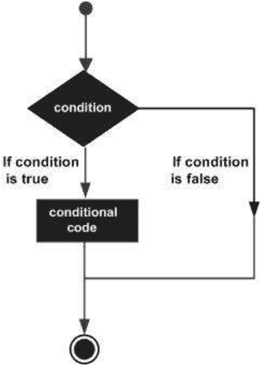

C 编程语言将任何**非零**和**非空**值视为**真**，如果它是**零**或**空**，则视为**假**值。

C 编程语言提供以下类型的决策制定语句。

| 语句 | 描述 |
|---|---|
| if 语句 | **if 语句**由一个布尔表达式后跟一条或多条语句组成。 |
| if...else 语句 | **if 语句**后面可以跟一个可选的**else 语句**，当条件（布尔表达式）为假时执行。 |
| 嵌套 if 语句 | 您可以在另一个 if 或 else if 语句中使用一个 if 或 else if 语句。 |
| switch 语句 | switch 语句允许一个变量与一组值进行相等性测试。 |
| 嵌套 switch 语句 | 您可以在另一个 switch 语句中使用一个 switch 语句。 |

## if 语句

if 语句由一个布尔表达式后跟一条或多条语句组成。

#### 语法

C 编程语言中 `if` 语句的语法是：

```c
if(boolean_expression)
{

    /* statement(s) will execute if the boolean expression is true */

}
```

如果布尔表达式求值为真，则 `if` 语句内部的代码块将被执行。如果布尔表达式求值为假，则 `if` 语句结束（右花括号之后）后的第一组代码将被执行。

C 编程语言将任何非零和非空值视为真，如果它是零或空，则视为假值。

#### 流程图


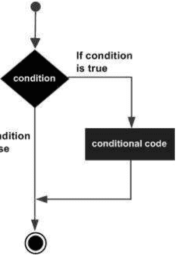

### 示例

```c
#include <stdio.h>

int main ()
{
    /* local variable definition */
    int a = 10;

    /* check the boolean condition using if statement */
    if( a < 20 )
    {
        /* if condition is true then print the following */
        printf("a is less than 20\n" );
    }
    printf("value of a is : %d\n", a);

    return 0;
}
```

当上述代码被编译并执行时，它产生以下结果：

```text
a is less than 20
value of a is : 10
```

## if...else 语句

**if** 语句后面可以跟一个可选的 **else** 语句，当布尔表达式为假时执行。

#### 语法

C 编程语言中 **if...else** 语句的语法是：

```c
if(boolean_expression)
{
    /* statement(s) will execute if the boolean expression is true */
}
else
{
    /* statement(s) will execute if the boolean expression is false */
}
```

如果布尔表达式求值为**真**，则执行 **if 块**，否则执行 **else 块**。

C 编程语言将任何**非零**和**非空**值视为**真**，如果它是**零**或**空**，则视为**假**值。

#### 流程图

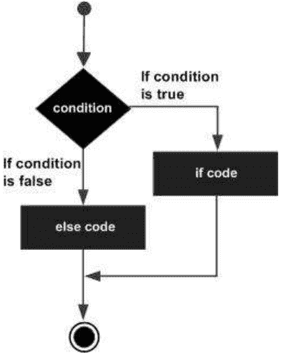

## if...else if...else 语句

- 一旦某个 else if 成功，其余的 else if 或 else 将不再进行测试。

#### 语法

C 编程语言中 **if...else if...else** 语句的语法是：

```c
if(boolean_expression 1)
{
    /* Executes when the boolean expression 1 is true */
}
else if( boolean_expression 2)
{
    /* Executes when the boolean expression 2 is true */
}
else if( boolean_expression 3)
{
    /* Executes when the boolean expression 3 is true */
}
else
{
    /* executes when the none of the above condition is true */
}
```

### 示例

```c
#include <stdio.h>

int main ()
{
    /* local variable definition */
    int a = 100;

    /* check the boolean condition */
    if( a == 10 )
    {
        /* if condition is true then print the following */
        printf("Value of a is 10\n");
    }
    else if( a == 20 )
    {
        /* if else if condition is true */
        printf("Value of a is 20\n");
    }
    else if( a == 30 )
    {
        /* if else if condition is true  */
        printf("Value of a is 30\n");
    }
    else
    {
        /* if none of the conditions is true */
        printf("None of the values is matching\n");
    }
    printf("Exact value of a is: %d\n", a );

    return 0;
}
```

当上述代码被编译并执行时，它产生以下结果：

```text
None of the values is matching
Exact value of a is: 100
```

## 嵌套 if 语句

在 C 编程中，**嵌套** if-else 语句始终是合法的，这意味着您可以在另一个 if 或 else if 语句中使用一个 if 或 else if 语句。

#### 语法

**嵌套 if** 语句的语法如下：

```c
if( boolean_expression 1)
{
    /* Executes when the boolean expression 1 is true */
    if(boolean_expression 2)
    {
        /* Executes when the boolean expression 2 is true */
    }
}
```

您可以以与嵌套 *if* 语句类似的方式嵌套 **else if...else**。

### 示例

```c
#include <stdio.h>

int main ()
{
    /* local variable definition */
    int a = 100;
    int b = 200;

    /* check the boolean condition */
    if( a == 100 )
    {
        /* if condition is true then check the following */
        if( b == 200 )
        {
            /* if condition is true then print the following */
            printf("Value of a is 100 and b is 200\n" );
        }
    }
    printf("Exact value of a is : %d\n", a );
    printf("Exact value of b is : %d\n", b );

    return 0;
}
```

当上述代码被编译并执行时，它产生以下结果：

```text
Value of a is 100 and b is 200
Exact value of a is : 100
Exact value of b is : 200
```

## switch 语句

**switch** 语句允许一个变量与一组值进行相等性测试。每个值称为一个 case，被测试的变量会对每个 **switch case** 进行检查。

#### 语法

C 编程语言中 **switch** 语句的语法如下：

```c
switch(expression){
    case constant-expression :
        statement(s);
        break; /* optional */

    case constant-expression :
        statement(s);
        break; /* optional */

    /* you can have any number of case statements */
    default : /* Optional */
        statement(s);
}
```

以下规则适用于 **switch** 语句：

- 用于 **switch** 语句的 **表达式** 必须具有整型或枚举类型，或者是一个类类型，且该类具有到整型或枚举类型的单一转换函数。
- 在 switch 中可以有任意数量的 case 语句。每个 case 后跟要比较的值和一个冒号。
- case 的 **常量表达式** 必须与 switch 中的变量具有相同的数据类型，并且必须是常量或字面量。
- 当被测试的变量等于某个 case 时，该 case 之后的语句将一直执行到遇到 **break** 语句。
- 当遇到 **break** 语句时，switch 终止，控制流将跳转到 switch 语句之后的下一行。


- 并非每个 `case` 都必须包含 **break**。如果没有 **break**，控制流将 *穿透*（fall through）到后续的 `case`，直到遇到 break 为止。
- **switch** 语句可以有一个可选的 **default** 分支，它必须出现在 switch 的末尾。当所有 `case` 都不匹配时，可以使用 default 分支来执行相应任务。default 分支中不需要 **break**。

#### 流程图

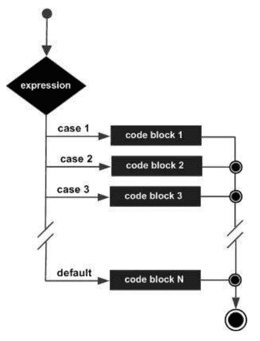

### 示例

```c
#include <stdio.h>

int main ()
{
    /* 局部变量定义 */
    char grade = 'B';

    switch(grade)
    {
    case 'A' :
        printf("Excellent!\n" );
        break;
    case 'B' :
    case 'C' :
        printf("Well done\n" );
        break;
    case 'D' :
        printf("You passed\n" );
        break;
    case 'F' :
        printf("Better try again\n" );
        break;
    default :
        printf("Invalid grade\n" );
    }
    printf("Your grade is %c\n", grade );

    return 0;
}
```

当上面的代码被编译和执行时，它会产生以下结果：

```text
Well done

Your grade is B
```

## 嵌套 switch 语句

将一个 switch 作为外部 switch 语句序列的一部分是可能的。即使内部和外部 switch 的 case 常量包含相同的值，也不会产生冲突。

#### 语法

**嵌套 switch** 语句的语法如下：

```c
switch(ch1) {
    case 'A':
        printf("This A is part of outer switch");
        switch(ch2) {
            case 'A':
                printf("This A is part of inner switch");
                break;
            case 'B': /* 分支代码 */
        }
        break;
    case 'B': /* 分支代码 */
}
```

### 示例

```c
#include <stdio.h>

int main ()
{
    /* 局部变量定义 */
    int a = 100;
    int b = 200;

    switch(a) {
        case 100:
            printf("This is part of outer switch\n", a );
            switch(b) {
                case 200:
                    printf("This is part of inner switch\n", a );
            }
    }
    printf("Exact value of a is : %d\n", a );
    printf("Exact value of b is : %d\n", b );

    return 0;
}
```

当上面的代码被编译和执行时，它会产生以下结果：


This is part of outer switch
This is part of inner switch
Exact value of a is : 100
Exact value of b is : 200

## ? : 运算符

我们在前一章中已经介绍了**条件运算符 ? :**，它可以用来替代 **if...else** 语句。它的一般形式如下：

```
Exp1 ? Exp2 : Exp3;
```

其中 Exp1、Exp2 和 Exp3 是表达式。注意冒号的使用和位置。

? 表达式的值是这样确定的：

1. 对 Exp1 进行求值。如果它为真，则对 Exp2 求值，并使其成为整个 ? 表达式的值。
2. 如果 Exp1 为假，则对 Exp3 求值，并将其值作为表达式的值。

# 11. 循环

你可能会遇到需要多次执行一段代码的情况。通常情况下，语句是按顺序执行的：函数中的第一条语句先执行，接着是第二条，以此类推。

编程语言提供了各种控制结构，允许实现更复杂的执行路径。

循环语句允许我们多次执行一条语句或一组语句。下面是大多数编程语言中循环语句的一般形式：

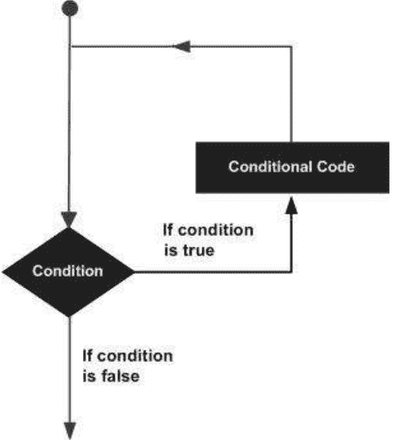

C 编程语言提供了以下类型的循环来处理循环需求。

| 循环类型 | 描述 |
|---|---|
| while 循环 | 当给定条件为真时，重复执行一条语句或一组语句。它在执行循环体之前测试条件。 |
| for 循环 | 多次执行一系列语句，并简化管理循环变量的代码。 |

这里需要重点注意的是，while 循环可能根本不会执行。当条件被测试且结果为假时，循环体将被跳过，while 循环之后的第一条语句将被执行。

```c
#include <stdio.h>

int main ()
{
    /* 局部变量定义 */
    int a = 10;

    /* while 循环执行 */
    while( a < 20 )
    {
        printf("value of a: %d\n", a);
        a++;
    }
}
```

4. 现在再次对条件进行求值。如果条件为真，则循环执行并重复此过程（循环体，然后增量步骤，然后再条件）。当条件变为假后，`for` 循环终止。

#### 流程图

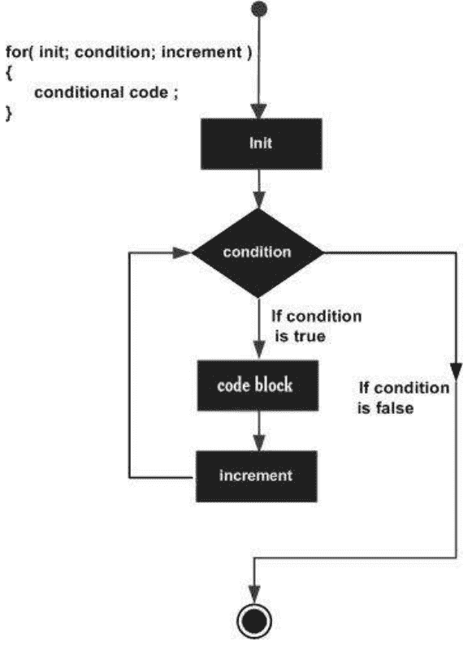

### 示例

```c
#include <stdio.h>

int main ()
{
    /* for 循环执行 */
    for( int a = 10; a < 20; a = a + 1 )
    {
        printf("value of a: %d\n", a);
    }

    return 0;
}
```

当上面的代码被编译和执行时，它会产生以下结果：

```text
value of a: 10

value of a: 11

value of a: 12

value of a: 13

value of a: 14

value of a: 15

value of a: 16

value of a: 17

value of a: 18

value of a: 19
```

## do...while 循环

与 **for** 和 **while** 循环在循环顶部测试循环条件不同，C 编程中的 **do...while** 循环在循环底部检查其条件。

**do...while** 循环与 while 循环类似，不同之处在于它保证至少执行一次。

#### 语法

C 编程语言中 **do...while** 循环的语法是：

```c
do
{
    statement(s);

}while( condition );
```

注意，条件表达式出现在循环的末尾，因此循环中的语句在条件被测试之前先执行一次。

如果条件为真，控制流跳回到 do，并再次执行循环中的语句。此过程重复，直到给定条件变为假。

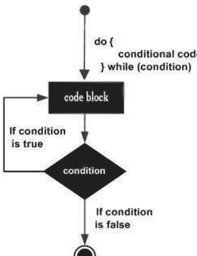

```c
#include <stdio.h>

int main ()
{
    /* 局部变量定义 */
    int a = 10;

    /* do 循环执行 */
    do
    {
    printf("value of a: %d\n", a);
    a = a + 1;
    }while( a < 20 );

    return 0;
}
```

当上面的代码被编译和执行时，它会产生以下结果：

```text
value of a: 10

value of a: 11

value of a: 12

value of a: 13

value of a: 14

value of a: 15

value of a: 16

value of a: 17

value of a: 18

value of a: 19
```

## 嵌套循环

C 编程允许在一个循环内部使用另一个循环。以下部分展示了一些示例来说明这个概念。

#### 语法

C 中**嵌套 for 循环**语句的语法如下：

```c
for ( init; condition; increment )
{
    for ( init; condition; increment )
    {
        statement(s);
    }
    statement(s);
}
```

C 编程语言中**嵌套 while 循环**语句的语法如下：

```c
while(condition)
{
    while(condition)
    {
        statement(s);
    }
    statement(s);
}
```

C 编程语言中**嵌套 do...while 循环**语句的语法如下：

```c
do
{
    statement(s);
    do
    {
        statement(s);
    }while( condition );
}while( condition );
```

关于循环嵌套的最后一点说明是，你可以在任何其他类型的循环中放置任何类型的循环。例如，一个 `for` 循环可以放在 `while` 循环内，反之亦然。

### 示例

下面的程序使用嵌套的 for 循环来找出 2 到 100 之间的素数：

```c
#include <stdio.h>

int main ()
{
    /* 局部变量定义 */
    int i, j;

    for(i=2; i<100; i++) {
        for (j=2; j <= (i/j); j++)
            if(!(i%j)) break;          // 如果找到因子，则不是素数
        if(j > (i/j)) printf("%d is prime\n", i);
    }
    return 0;
}
```

当上面的代码被编译和执行时，它会产生以下结果：

```text
2 is prime

3 is prime

5 is prime

7 is prime

11 is prime

13 is prime

17 is prime

19 is prime

23 is prime

29 is prime

31 is prime

37 is prime

41 is prime

43 is prime

47 is prime

53 is prime

59 is prime

61 is prime

67 is prime

71 is prime

73 is prime

79 is prime

83 is prime

89 is prime

97 is prime
```

## 循环控制语句

循环控制语句会改变执行的正常顺序。当执行离开某个作用域时，该作用域中创建的所有自动对象都会被销毁。

C 支持以下控制语句。


### break 语句

在 C 语言中，**break** 语句具有以下两种用法：

- 当 **break** 语句出现在循环内部时，循环会立即终止，程序控制在循环之后的下一条语句继续执行。
- 它可以用于终止 **switch** 语句中的一个 case（在下一章节中介绍）。

如果你在嵌套循环中使用 break 语句，它会停止最内层循环的执行，并开始执行 break 语句之后的下一条语句。

#### 语法

C 语言中 **break** 语句的语法如下：

```c
break;
```

#### 流程图

# C 语言

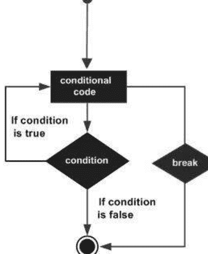

```c
#include <stdio.h>

int main ()
{
    /* 定义局部变量 */
    int a = 10;

    /* 循环执行 */
    while( a < 20 )
    {
        printf("value of a: %d\n", a);
        a++;
        if( a > 15)
        {
            /* 使用 break 语句终止循环 */
            break;
        }
    }
}
```

当上述代码编译并执行后，它会产生以下输出：

```
value of a: 10

value of a: 11

value of a: 12

value of a: 13

value of a: 14

value of a: 15
```

### 继续语句

C 语言中的 **continue** 语句的作用与 **break** 语句相似，但它并不强制终止循环，而是强制执行下一次循环的迭代，跳过循环体中剩余的代码。

对于 **for** 循环，**continue** 语句会导致循环的条件检查和增量部分执行。对于 **while** 和 **do...while** 循环，**continue** 语句会使程序控制跳转到条件表达式。

#### 语法

C 语言中 **continue** 语句的语法如下：

```c
continue;
```

#### 流程图

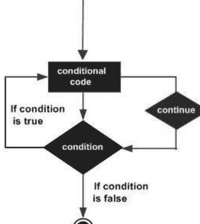

```c
#include <stdio.h>

int main ()
{
    /* 定义局部变量 */
    int a = 10;

    /* do 循环执行 */
    do
    {
        if( a == 15)
        {
            /* 跳过本次迭代 */
            a = a + 1;
            continue;
        }
        printf("value of a: %d\n", a);
        a++;
    } while( a < 20 );
}
```

当上述代码编译并执行后，它会产生以下输出：

```
value of a: 10
value of a: 11
value of a: 12
value of a: 13
value of a: 14
value of a: 16
value of a: 17
value of a: 18
value of a: 19
```

### goto 语句

C 语言中的 **goto** 语句提供了一个从当前位置无条件跳转到同一函数中标记（label）的语句。

**注意**：在任何编程语言中，使用 goto 语句都被强烈 discouraged，因为它会使程序的控制流难以追踪，导致程序难以理解和修改。任何使用 goto 的程序都可以重写以避免使用 goto。

#### 语法

**goto** 语句的语法如下：

```
goto label;

..
.

label: statement;
```

其中 label 可以是除 C 关键字之外的任意纯文本，并且可以在 goto 语句的上方或下方的任何位置定义。


### 示例

```c
#include <stdio.h>

int main ()
{
    /* 定义局部变量 */
    int a = 10;

    /* do 循环执行 */
    LOOP: do
    {
        if( a == 15)
        {
            /* 跳过本次迭代 */
            a = a + 1;
            goto LOOP;
        }
        printf("value of a: %d\n", a);
        a++;

    }while( a < 20 );
}
```

```c
return 0;
}
```

当上述代码编译并执行后，它会产生以下输出：

```
value of a: 10

value of a: 11

value of a: 12

value of a: 13

value of a: 14

value of a: 16

value of a: 17

value of a: 18

value of a: 19
```

## 无限循环

当循环条件永远不会为假时，循环会变成无限循环。传统上 **for** 循环用于此目的。由于构成 **for** 循环的三个表达式（初始化、条件、增量）中，条件表达式是可选的，你可以通过留空条件表达式来创建无限循环。

```c
#include <stdio.h>

int main ()
{
    for( ; ; )
    {
        printf("This loop will run forever.\\n");
    }

    return 0;
}
```

当条件表达式缺失时，它被视为真。你可以在 for 循环中使用初始化和增量表达式，但 C 语言程序员更常用 for(;;) 来表示无限循环。

**注意**：可以通过按下 Ctrl + C 键来终止无限循环。

## 函数参数

如果函数需要使用参数，它必须声明接受参数值的变量。这些变量被称为函数的**形式参数**。

形式参数在函数内部行为如其他局部变量，在函数进入时创建，在函数退出时销毁。

在调用函数时，参数可以以两种方式传递：

| 传递方式 | 描述 |
|---|---|
| 传值调用 | 此方法将实际参数的值复制到函数的形式参数中。因此，在函数内部对参数的修改不会影响原始参数。 |
| 传址调用 | 此方法将参数的地址复制到形式参数中。在函数内部，通过该地址访问实际参数，这意味着对形式参数的修改会影响原始参数。 |

## 传址调用

**传址调用** 方法会将参数的地址复制到形式参数。在函数内部，通过该地址访问实际参数，这意味着对形式参数的修改会影响传入的参数。

要通过引用传递值，需要像传递普通值一样将指针传递给函数。因此，你需要在函数声明中将参数声明为指针类型，如下面的 **swap()** 函数，它交换两个整数变量的值，这些变量是通过参数传递的。

```
void swap(int *x, int *y)

{

    int temp;

    temp = *x;    /* 保存地址 x 中的值 */

    *x = *y;      /* 将 y 的值赋给 x */

    *y = temp;    /* 将 temp 赋给 y */
}
```

我们现在通过传址调用函数 swap() 来演示：

```c
#include <stdio.h>

/* 函数声明 */
void swap(int *x, int *y);

int main ()
{
    /* 定义局部变量 */
    int a = 100;
    int b = 200;

    printf("Before swap, value of a : %d\n", a );
    printf("Before swap, value of b : %d\n", b );

    /* 调用函数交换值，&a 表示 a 的地址，&b 表示 b 的地址 */
    swap(&a, &b);

    printf("After swap, value of a : %d\n", a );
    printf("After swap, value of b : %d\n", b );

    return 0;
}
```

让我们把上面的代码放在同一个 C 文件中，编译并执行，得到以下结果：

```
Before swap, value of a :100
Before swap, value of b :200
After swap, value of a :100
After swap, value of b :200
```


```text
After swap, value of a : 200
After swap, value of b : 100
```

这表明改变也反映到了函数外部，这与按值调用不同，按值调用时改变不会反映到函数外部。

默认情况下，C 使用**按值调用**来传递参数。通常，这意味着函数内部的代码不能修改用于调用函数的参数。

## 全局变量

全局变量定义在函数外部，通常位于程序的顶部。全局变量在程序的整个生命周期内保持其值，并且可以在为程序定义的任何函数内部访问。

全局变量可以被任何函数访问。也就是说，全局变量在声明之后可以在整个程序中使用。下面的程序演示了如何在程序中使用全局变量。

```c
#include <stdio.h>

/* global variable declaration */
int g;

int main ()
{
    /* local variable declaration */
    int a, b;

    /* actual initialization */
    a = 10;
    b = 20;
    g = a + b;

    printf ("value of a = %d, b = %d and g = %d\n", a, b, g);

    return 0;
}
```

程序中的局部变量和全局变量可以同名，但函数内部局部变量的值将优先。下面是一个示例：

```c
#include <stdio.h>

/* global variable declaration */
int g = 20;
```

```c
}

/* function to add two integers */
int sum(int a, int b)
{
    printf ("value of a in sum() = %d\n", a);
    printf ("value of b in sum() = %d\n", b);

    return a + b;
}
```

当上述代码被编译并执行时，会产生以下结果：

```text
value of a in main() = 10
value of a in sum() = 10
value of b in sum() = 20
value of c in main() = 30
```

## 初始化局部变量和全局变量

定义局部变量时，系统不会对其进行初始化，你必须自己初始化。全局变量在定义时由系统自动初始化，如下所示：

| 数据类型 | 默认初始值 |
| --- | --- |
| int | 0 |
| char | '\0' |
| float | 0 |
| double | 0 |
| 指针 | NULL |

正确初始化变量是一种良好的编程习惯，否则你的程序可能会产生意外结果，因为未初始化的变量会使用其内存位置中已有的垃圾值。


# 14. 数组

数组是一种数据结构，可以存储固定大小的、相同类型元素的顺序集合。数组用于存储数据集合，但通常将数组视为相同类型变量的集合更有用。

不必声明单个变量（如 number0、number1、...、number99），你可以声明一个数组变量（如 numbers），并使用 numbers[0]、numbers[1]、...、numbers[99] 来表示各个变量。数组中的特定元素通过索引访问。

所有数组都由连续的内存位置组成。最低地址对应第一个元素，最高地址对应最后一个元素。

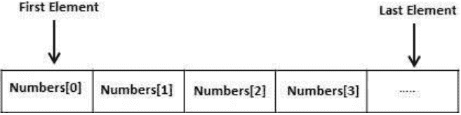

## 声明数组

要在 C 中声明数组，程序员需要指定元素的类型以及数组所需的元素数量，如下所示：

```c
type arrayName [ arraySize ];
```

这被称为*一维数组*。**arraySize** 必须是大于零的整数常量，**type** 可以是任何有效的 C 数据类型。例如，要声明一个名为 **balance** 的 10 元素 double 类型数组，请使用以下语句：

```c
double balance[10];
```

这里，*balance* 是一个变量数组，足以容纳最多 10 个 double 数字。

## 初始化数组

在 C 中，你可以逐个初始化数组，也可以使用单个语句初始化，如下所示：

```c
double balance[5] = {1000.0, 2.0, 3.4, 7.0, 50.0};
```

```c
}

/* output each array element's value */
for (j = 0; j < 10; j++ )
{
    printf("Element[%d] = %d\n", j, n[j] );
}

return 0;
}
```

当上述代码被编译并执行时，会产生以下结果：

```text
Element[0] = 100
Element[1] = 101
Element[2] = 102
Element[3] = 103
Element[4] = 104
Element[5] = 105
Element[6] = 106
Element[7] = 107
Element[8] = 108
Element[9] = 109
```

## 数组详解

数组在 C 中很重要，需要更多关注。以下与数组相关的重要概念应该为 C 程序员所清楚：

| 概念 | 描述 |
| --- | --- |
| 多维数组 | C 支持多维数组。多维数组的最简单形式是二维数组。 |
| 向函数传递数组 | 你可以通过指定不带索引的数组名称，将数组指针传递给函数。 |

## 初始化二维数组

多维数组可以通过为每一行指定括号内的值来初始化。下面是一个有 3 行、每行有 4 列的数组。

```c
int a[3][4] = {

 {0, 1, 2, 3},   /* initializers for row indexed by 0 */

 {4, 5, 6, 7},   /* initializers for row indexed by 1 */

 {8, 9, 10, 11}  /* initializers for row indexed by 2 */

};
```

指示目标行的嵌套花括号是可选的。以下初始化与前面的示例等效：

```c
int a[3][4] = {0,1,2,3,4,5,6,7,8,9,10,11};
```

## 访问二维数组元素

二维数组中的元素通过使用下标（即数组的行索引和列索引）来访问。例如：

```c
int val = a[2][3];
```

上述语句将获取数组第 3 行中的第 4 个元素。你可以在上图中验证。让我们检查以下程序，其中我们使用了一个嵌套循环来处理二维数组：

```c
#include <stdio.h>

int main ()
{
    /* an array with 5 rows and 2 columns */
    int a[5][2] = { {0,0}, {1,2}, {2,4}, {3,6},{4,8}};
    int i, j;

    /* output each array element's value */
    for ( i = 0; i < 5; i++ )
    {
        for ( j = 0; j < 2; j++ )
        {
            printf("a[%d][%d] = %d\n", i,j, a[i][j] );
        }
    }
    return 0;
}
```

当上述代码被编译并执行时，会产生以下结果：

```text
a[0][0] = 0
a[0][1] = 0
a[1][0] = 1
a[1][1] = 2
a[2][0] = 2
a[2][1] = 4
a[3][0] = 3
a[3][1] = 6
a[4][0] = 4
a[4][1] = 8
```

如上所述，你可以使用任意维数的数组，尽管你创建的大多数数组可能是一维或二维的。

## 向函数传递数组

如果要在函数中将一维数组作为参数传递，必须以下列三种方式之一声明形式参数，并且所有三种声明方法都会产生类似的结果，因为每种方法都告诉编译器将要接收一个整型指针。类似地，你可以将多维数组作为形式参数传递。

### 方式一

形式参数作为指针：

```c
void myFunction(int *param)
{
```


### 方式二

形式参数作为指定大小的数组：

```c
void myFunction(int param[10])
{
 .
 .
 .
}
```

### 方式三

形式参数作为未指定大小的数组：

```c
void myFunction(int param[])
{
 .
 .
 .
}
```

### 示例

现在，考虑以下函数，它接受一个数组作为参数以及另一个参数，并根据传递的参数返回通过数组传递的数字的平均值，如下所示：

```c
double getAverage(int arr[], int size)
{
 int i;
 double avg;
 double sum;

 for (i = 0; i < size; ++i)
 {
 sum += arr[i];
 }

 avg = sum / size;
```


# 15. POINTERS

Pointers in C are easy and fun to learn. Some C programming tasks are performed more easily with pointers, and other tasks, such as dynamic memory allocation, cannot be performed without using pointers. So it becomes necessary to learn pointers to become a perfect C programmer. Let's start learning them in simple and easy steps.

As you know, every variable is a memory location and every memory location has its address defined which can be accessed using ampersand (&) operator, which denotes an address in memory. Consider the following example, which prints the address of the variables defined:

```c
#include <stdio.h>

int main ()
{
    int var1;
    char var2[10];

    printf("Address of var1 variable: %x\n", &var1 );
    printf("Address of var2 variable: %x\n", &var2 );

    return 0;
}
```

When the above code is compiled and executed, it produces the following result:

```
Address of var1 variable: bff5a400

Address of var2 variable: bff5a3f6
```

## What are Pointers?

A **pointer** is a variable whose value is the address of another variable, i.e., direct address of the memory location. Like any variable or constant, you must declare a pointer before using it to store any variable address. The general form of a pointer variable declaration is:


[PAGE 110]

<!-- no content -->

[PAGE 111]

```
```c
/* access the value using the pointer */
printf("Value of *ip variable: %d\n", *ip );

return 0;
}
```

When the above code is compiled and executed, it produces the following result:

```
Address of var variable: bffd8b3c

Address stored in ip variable: bffd8b3c

Value of *ip variable: 20
```
```

## NULL Pointers

It is always a good practice to assign a NULL value to a pointer variable in case you do not have an exact address to be assigned. This is done at the time of variable declaration. A pointer that is assigned NULL is called a **null pointer**.

The NULL pointer is a constant with a value of zero defined in several standard libraries. Consider the following program:

```c
#include <stdio.h>

int main ()
{
    int *ptr = NULL;

    printf("The value of ptr is : %X\n", ptr );

    return 0;
}
```

When the above code is compiled and executed, it produces the following result:

```
The value of ptr is 0
```

In most of the operating systems, programs are not permitted to access memory at address 0 because that memory is reserved by the operating system. However, the memory address 0 has special significance; it signals that the pointer is not intended to point to an accessible memory location. But by convention, if a pointer contains the null (zero) value, it is assumed to point to nothing.

[PAGE 112]

To check for a null pointer, you can use an `if` statement as follows:

```
if(ptr)    /\* succeeds if p is not null \*/
if(!ptr)    /\* succeeds if p is null \*/
```

## Pointers in Detail

Pointers have many but easy concepts and they are very important to C programming. The following important pointer concepts should be clear to any C programmer:

\begin{tabular}{cc}
**Concept** & **Description** \\
Pointer arithmetic & There are four arithmetic operators that can be used in pointers: ++, --, +, - \\
Array of pointers & You can define arrays to hold a number of pointers. \\
Pointer to pointer & C allows you to have pointer on a pointer and so on. \\
Passing pointers to functions in C & Passing an argument by reference or by address enable the passed argument to be changed in the calling function by the called function. \\
Return pointer from functions in C & C allows a function to return a pointer to the local variable, static variable, and dynamically allocated memory as well. \\
\end{tabular}

## Pointer Arithmetic

A pointer in C is an address, which is a numeric value. Therefore, you can perform arithmetic operations on a pointer just as you can on a numeric value. There are four arithmetic operators that can be used on pointers: ++, --, +, and -

To understand pointer arithmetic, let us consider that ptr is an integer pointer which points to the address 1000. Assuming 32-bit integers, let us perform the following arithmetic operation on the pointer:


[PAGE 113]

```
```c
ptr++
```
```

After the above operation, the **ptr** will point to the location 1004 because each time ptr is incremented, it will point to the next integer location which is 4 bytes next to the current location. This operation will move the pointer to the next memory location without impacting the actual value at the memory location. If **ptr** points to a character whose address is 1000, then the above operation will point to the location 1001 because the next character will be available at 1001.

## Incrementing a Pointer

We prefer using a pointer in our program instead of an array because the variable pointer can be incremented, unlike the array name which cannot be incremented because it is a constant pointer. The following program increments the variable pointer to access each succeeding element of the array:

```
```c
#include <stdio.h>

const int MAX = 3;

int main ()
{
    int var[] = {10, 100, 200};
    int i, *ptr;

    /* let us have array address in pointer */
    ptr = var;
    for ( i = 0; i < MAX; i++)
    {
        printf("Address of var[%d] = %x\n", i, ptr );
        printf("Value of var[%d] = %d\n", i, *ptr );

        /* move to the next location */
        ptr++;
    }
    return 0;
}
```
```


当上述代码被编译并执行时，会产生以下结果：

```text
Address of var[0] = bf882b30
Value of var[0] = 10
Address of var[1] = bf882b34
Value of var[1] = 100
Address of var[2] = bf882b38
Value of var[2] = 200
```

## 递减指针

递减指针时也是如此，指针的值会按其数据类型所占的字节数减少，如下所示：

```c
#include <stdio.h>

const int MAX = 3;

int main ()
{
    int var[] = {10, 100, 200};
    int i, *ptr;

    /* let us have array address in pointer */
    ptr = &var[MAX-1];
    for ( i = MAX; i > 0; i--)
    {
        printf("Address of var[%d] = %x\n", i, ptr );
        printf("Value of var[%d] = %d\n", i, *ptr );

        /* move to the previous location */
        ptr--;
    }
    return 0;
}
```

当上述代码被编译并执行时，会产生以下结果：

```text
Address of var[3] = bfedbcd8
Value of var[3] = 200
Address of var[2] = bfedbcd4
Value of var[2] = 100
Address of var[1] = bfedbcd0
Value of var[1] = 10
```

## 指针比较

指针可以使用关系运算符进行比较，例如 ==、< 和 >。如果 p1 和 p2 指向彼此相关的变量，例如同一数组中的元素，那么 p1 和 p2 就可以进行有意义的比较。

下面的程序修改了前面的示例——通过递增指针变量，只要它指向的地址小于或等于数组最后一个元素的地址（即 &var[MAX - 1]）：

```c
#include <stdio.h>

const int MAX = 3;

int main ()
{
    int var[] = {10, 100, 200};
    int i, *ptr;

    /* let us have address of the first element in pointer */
    ptr = var;
    i = 0;
    while ( ptr <= &var[MAX - 1] )
    {

        printf("Address of var[%d] = %x\n", i, ptr );
        printf("Value of var[%d] = %d\n", i, *ptr );

        /* point to the next location */
        ptr++;
        i++;
    }
    return 0;
}
```

当上述代码被编译并执行时，会产生以下结果：

```text
Address of var[0] = bfdbcb20
Value of var[0] = 10
Address of var[1] = bfdbcb24
Value of var[1] = 100
Address of var[2] = bfdbcb28
Value of var[2] = 200
```

在我们理解指针数组的概念之前，先来看一个使用包含 3 个整数的数组的示例：

```c
#include <stdio.h>

const int MAX = 3;

int main ()
{
    int var[] = {10, 100, 200};
    int i;

    for (i = 0; i < MAX; i++)
    {
        printf("Value of var[%d] = %d\n", i, var[i] );
    }
    return 0;
}
```

当上述代码被编译并执行时，会产生以下结果：

```text
Value of var[0] = 10
Value of var[1] = 100
Value of var[2] = 200
```

有时我们可能需要维护一个数组，该数组可以存储指向 int、char 或任何其他可用数据类型的指针。下面是指向整数的指针数组的声明：

```c
int *ptr[MAX];
```

它将 **ptr** 声明为包含 MAX 个整数指针的数组。因此，ptr 中的每个元素都保存着一个指向 int 值的指针。下面的示例使用了三个整数，它们存储在一个指针数组中，如下所示：

```c
#include <stdio.h>

const int MAX = 3;

int main ()
{
    int var[] = {10, 100, 200};
    int i, *ptr[MAX];

    for ( i = 0; i < MAX; i++)
    {
        ptr[i] = &var[i]; /* assign the address of integer. */
    }

    for ( i = 0; i < MAX; i++)
    {
        printf("Value of var[%d] = %d\n", i, *ptr[i] );
    }
    return 0;
}
```

当上述代码被编译并执行时，会产生以下结果：

```text
Value of var[0] = 10
Value of var[1] = 100
Value of var[2] = 200
```

你也可以使用字符指针数组来存储字符串列表，如下所示：

```c
#include <stdio.h>

const int MAX = 4;

int main ()
{
    char *names[] = {
                    "Zara Ali",
                    "Hina Ali",
                    "Nuha Ali",
                    "Sara Ali",
                };
    int i = 0;

    for ( i = 0; i < MAX; i++)
    {
        printf("Value of names[%d] = %s\n", i, names[i] );
    }
    return 0;
}
```

当上述代码被编译并执行时，会产生以下结果：

```text
Value of names[0] = Zara Ali
Value of names[1] = Hina Ali
Value of names[2] = Nuha Ali
Value of names[3] = Sara Ali
```

## 指向指针的指针

指向指针的指针是一种多级间接寻址形式，或者说是指针链。通常，指针包含一个变量的地址。当我们定义一个指向指针的指针时，第一个指针包含第二个指针的地址，而第二个指针则指向包含实际值的位置，如下所示。

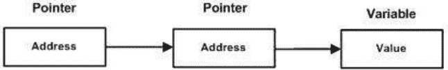

作为指向指针的指针的变量必须这样声明。做法是在其名称前额外放置一个星号。例如，下面的声明声明了一个指向 int 类型的指针的指针：

```c
int **var;
```

当一个目标值被指向指针的指针间接指向时，访问该值需要对星号运算符应用两次，如下面的示例所示：

```c
#include <stdio.h>

int main ()
{
    int  var;
    int *ptr;
    int **pptr;

    var = 3000;

    /* take the address of var */
    ptr = &var;

    /* take the address of ptr using address of operator & */
    pptr = &ptr;

    /* take the value using pptr */
    printf("Value of var = %d\n", var );
    printf("Value available at *ptr = %d\n", *ptr );
    printf("Value available at **pptr = %d\n", **pptr);

    return 0;
}
```

当上述代码被编译并执行时，会产生以下结果：

```text
Value of var = 3000
Value available at *ptr = 3000
Value available at **pptr = 3000
```

## 向函数传递指针

C 语言允许将指针传递给函数。要做到这一点，只需将函数参数声明为指针类型。

下面是一个简单的示例，我们将一个指向 unsigned long 的指针传递给函数，并在函数内部修改该值，这个修改会反映回调用函数中：

```c
#include <stdio.h>
#include <time.h>

void getSeconds(unsigned long *par);

int main ()
{
    unsigned long sec;

    getSeconds( &sec );

    /* print the actual value */
    printf("Number of seconds: %ld\n", sec );

    return 0;
}

void getSeconds(unsigned long *par)
{
    /* get the current number of seconds */
    *par = time( NULL );
    return;
}
```


当上述代码被编译并执行时，会产生以下结果：

```text
Number of seconds: 1294450468
```

一个能够接受指针的函数，也可以接受数组，如下面的示例所示：

```c
#include <stdio.h>

/* function declaration */
double getAverage(int *arr, int size);

int main ()
{
    /* an int array with 5 elements */
    int balance[5] = {1000, 2, 3, 17, 50};
    double avg;

    /* pass pointer to the array as an argument */
    avg = getAverage( balance, 5 ) ;

    /* output the returned value */
    printf("Average value is: %f\n", avg );

    return 0;
}

double getAverage(int *arr, int size)
{
    int i, sum = 0;
    double avg;

    for (i = 0; i < size; ++i)
    {
        sum += arr[i];
    }

    avg = (double)sum / size;

    return avg;
}
```


当上述代码一起编译并执行时，会产生以下结果：

```text
Average value is: 214.400000
```

## 从函数返回指针

在上一章中，我们已经了解了 C 语言如何允许函数返回数组。类似地，C 语言也允许函数返回指针。要做到这一点，你需要像下面的示例那样声明一个返回指针的函数：

```c
int * myFunction()
{
    .
    .
    .
}
```

需要记住的第二点是，在函数外部返回局部变量的地址并不是一个好主意，因此你必须将局部变量定义为静态变量（static）。

现在，考虑下面的函数，它将生成 10 个随机数，并使用一个表示指针的数组名（即第一个数组元素的地址）来返回这些随机数。

```c
#include <stdio.h>
#include <time.h>

/* function to generate and return random numbers. */
int * getRandom( )
{
    static int r[10];
    int i;
}
```


结构体是用来表示记录的一种用户定义的数据类型，可以组合不同种类的数据项。

## 定义结构体

使用 **struct** 语句来定义结构体。结构体语句定义了一个新的数据类型，可以包含多个成员。结构体语句的格式如下：

```c
struct [结构体标签]
{
    成员定义;
    成员定义;
    ...
    成员定义;
} [一个或多个结构体变量];
```

结构体标签是可选的，结构体定义结束后（在最后一个分号之前）可以指定一个或多个结构体变量，但这不是必须的。下面是定义 **Books** 结构体的方式：

```c
struct Books
{
    char  title[50];
    char  author[50];
    char  subject[100];
    int book_id;
} book;
```

## 访问结构体成员

使用 **.**（点）运算符来访问结构体成员，格式为 `结构体变量名.成员名`。下面的示例展示了如何在程序中使用结构体：

```c
#include <stdio.h>
#include <string.h>

struct Books
{
    char title[50];
    char author[50];
    char subject[100];
    int book_id;
};

int main( )
{
    struct Books Book1;    /* 声明 Book1 类型的结构体变量 */
    struct Books Book2;    /* 声明 Book2 类型的结构体变量 */

    /* 设置 Book1 的属性 */
    strcpy( Book1.title, "C Programming");
    strcpy( Book1.author, "Nuha Ali");
    strcpy( Book1.subject, "C Programming Tutorial");
    Book1.book_id = 6495407;

    /* 设置 Book2 的属性 */
    strcpy( Book2.title, "Telecom Billing");
    strcpy( Book2.author, "Zara Ali");
    strcpy( Book2.subject, "Telecom Billing Tutorial");
    Book2.book_id = 6495700;

    /* 打印 Book1 信息 */
    printf( "Book 1 title : %s\n", Book1.title);
    printf( "Book 1 author : %s\n", Book1.author);
    printf( "Book 1 subject : %s\n", Book1.subject);
    printf( "Book 1 book_id : %d\n", Book1.book_id);

    /* 打印 Book2 信息 */
    printf( "Book 2 title : %s\n", Book2.title);
    printf( "Book 2 author : %s\n", Book2.author);
    printf( "Book 2 subject : %s\n", Book2.subject);
    printf( "Book 2 book_id : %d\n", Book2.book_id);

    return 0;
}
```

运行上述代码会得到如下输出：

```text
Book 1 title : C Programming
Book 1 author : Nuha Ali
Book 1 subject : C Programming Tutorial
Book 1 book_id : 6495407
Book 2 title : Telecom Billing
Book 2 author : Zara Ali
Book 2 subject : Telecom Billing Tutorial
Book 2 book_id : 6495700
```

## 将结构体作为函数参数

结构体可以像其他变量或指针一样作为函数参数传递。

```c
#include <stdio.h>
#include <string.h>

struct Books
{
    char title[50];
    char author[50];
    char subject[100];
    int book_id;
};

void printBook( struct Books book );

int main( )
{
    struct Books Book1;
    struct Books Book2;

    /* 设置 Book1 的属性 */
    strcpy( Book1.title, "C Programming");
    strcpy( Book1.author, "Nuha Ali");
    strcpy( Book1.subject, "C Programming Tutorial");
    Book1.book_id = 6495407;

    /* 设置 Book2 的属性 */
    strcpy( Book2.title, "Telecom Billing");
    strcpy( Book2.author, "Zara Ali");
    strcpy( Book2.subject, "Telecom Billing Tutorial");
    Book2.book_id = 6495700;

    /* 打印 Book1 信息 */
    printBook( Book1 );

    /* 打印 Book2 信息 */
    printBook( Book2 );

    return 0;
}

void printBook( struct Books book )
{
    printf( "Book title : %s\n", book.title);
    printf( "Book author : %s\n", book.author);
    printf( "Book subject : %s\n", book.subject);
    printf( "Book book_id : %d\n", book.book_id);
}
```

运行上述代码会得到如下结果：

```text
Book title : C Programming
Book author : Nuha Ali
Book subject : C Programming Tutorial
Book book_id : 6495407
Book title : Telecom Billing
Book author : Zara Ali
Book subject : Telecom Billing Tutorial
Book book_id : 6495700
```

## 指向结构体的指针

可以像定义其他变量的指针一样定义指向结构体的指针：

```c
struct Books *struct_pointer;
```

随后可以使用 `&` 运算符获取结构体变量的地址并赋值给指针：

```c
struct_pointer = &Book1;
```

通过结构体指针访问成员需要使用 `->` 运算符：

```c
struct_pointer->title;
```

下面的示例展示了如何使用结构体指针重写前面的例子：

```c
#include <stdio.h>


#include <string.h>

struct Books
{
    char title[50];
    char author[50];
    char subject[100];
    int book_id;
};

void printBook( struct Books *book );
int main( )
{
    struct Books Book1;    /\* Declare Book1 of type Book * /
    struct Books Book2;    /\* Declare Book2 of type Book * /

    /\* book 1 specification * /
    strcpy( Book1.title, "C Programming");
    strcpy( Book1.author, "Nuha Ali");
    strcpy( Book1.subject, "C Programming Tutorial");
    Book1.book_id = 6495407;

    /\* book 2 specification * /
    strcpy( Book2.title, "Telecom Billing");
    strcpy( Book2.author, "Zara Ali");
    strcpy( Book2.subject, "Telecom Billing Tutorial");
    Book2.book_id = 6495700;

    /\* print Book1 info by passing address of Book1 * /
    printBook( &Book1 );

    /\* print Book2 info by passing address of Book2 * /
    printBook( &Book2 );
}

return 0;
}

void printBook( struct Books *book )
{
    printf( "Book title : %s\n", book->title);
    printf( "Book author : %s\n", book->author);
    printf( "Book subject : %s\n", book->subject);
    printf( "Book book_id : %d\n", book->book_id);
}

## 位域

位域允许在结构体中紧凑地存储数据。当内存或数据存储空间非常有限时，这一点尤其有用。典型的例子包括：

- 将多个对象打包到一个机器字中，例如，1 位标志可以被压缩。
- 读取外部文件格式——可以读取非标准文件格式，例如 9 位整数。

C 语言允许我们在结构体定义中，通过在变量后面加上 :位长度 来实现这一点。例如：

```c
struct packed_struct {
    unsigned int f1:1;
    unsigned int f2:1;
    unsigned int f3:1;
    unsigned int f4:1;
};
```

[PAGE 135]

unsigned int type:4;
unsigned int my_int:9;
} pack;

这里，packed_struct 包含 6 个成员：四个 1 位标志 f1..f3、一个 4 位类型和一个 9 位 my_int。

在字段的最大长度小于或等于计算机整数字长的情况下，C 语言会自动将上述位字段尽可能地紧凑打包。如果情况并非如此，那么某些编译器可能允许字段的内存重叠，而其他编译器则会将下一个字段存储到下一个字中。

[PAGE 136]

# # 18. 联合

**联合**是 C 语言中一种特殊的数据类型，它允许在同一内存位置存储不同的数据类型。你可以定义一个包含多个成员的联合，但在任意给定时刻，只能有一个成员包含值。联合提供了一种在多个用途中有效利用同一内存位置的方式。

# ## 定义联合

要定义联合，你必须使用 **union** 语句，其方式与定义结构体时相同。union 语句为你的程序定义了一个包含多个成员的新数据类型。union 语句的格式如下：

```
union [union tag]
{
    member definition;
    member definition;
    ...
    member definition;
} [one or more union variables];
```

**union 标签**是可选的，每个成员定义都是普通的变量定义，例如 int i; 或 float f; 或任何其他有效的变量定义。在联合定义的末尾、最后一个分号之前，你可以指定一个或多个联合变量，但这是可选的。下面是你如何定义一个名为 Data 的联合类型，其包含三个成员 i、f 和 str：

```
union Data
{
    int i;
    float f;
    char str[20];
} data;
```

现在，**Data** 类型的变量可以存储整数、浮点数或字符串。这意味着一个单一变量（即同一内存位置）可以用来存储多种类型的数据。你可以根据需求在联合中使用任何内置的或用户自定义的数据类型。

联合所占用的内存大小将足以容纳联合中最大的成员。例如，在上述示例中，Data 类型将占用 20 字节的内存空间，因为这是字符字符串所能占用的最大空间。下面的示例显示了上述联合所占用的总内存大小：

```
#include <stdio.h>
#include <string.h>

union Data
{
    int i;
    float f;
    char str[20];
};

int main( )
{
    union Data data;

    printf("Memory size occupied by data : %d\n", sizeof(data));

    return 0;
}
```

当上面的代码被编译并执行时，它产生以下结果：

```
Memory size occupied by data : 20
```

## 访问联合成员

要访问联合的任何成员，我们使用成员访问运算符 (.)。成员访问运算符是一个句点，位于联合变量名和我们希望访问的联合成员之间。你可以使用关键字 union 来定义联合类型的变量。下面的示例展示了如何在程序中使用联合：

```
#include <stdio.h>
```


[PAGE 138]

<!-- no content -->

[PAGE 139]

# # C 语言编程

```
#include <string.h>

union Data
{
    int i;
    float f;
    char str[20];
};

int main( )
{
    union Data data;

    data.i = 10;
    printf("data.i : %d\n", data.i);

    data.f = 220.5;
    printf("data.f : %f\n", data.f);

    strcpy(data.str, "C Programming");
    printf("data.str : %s\n", data.str);

    return 0;
}
```

当上面的代码被编译并执行时，它产生以下结果：

```
data.i : 10
data.f : 220.500000
data.str : C Programming
```

这里，所有成员都很好地打印了出来，因为一次只使用一个成员。


[PAGE 140]

# 19. 位域

假设你的 C 程序中包含多个 TRUE/FALSE 变量，它们被分组在一个名为 status 的结构体中，如下所示：

```
```
struct
{
    unsigned int widthValidated;
    unsigned int heightValidated;
}
status;
```
```

这个结构体需要 8 字节的内存空间，但实际上，我们将要在每个变量中存储 0 或 1。C 语言提供了在这种情况更好地利用内存空间的方法。

如果你在结构体中使用这样的变量，那么你可以定义变量的宽度，告诉 C 编译器你只会使用这些数目的字节。例如，上述结构体可以重写如下：

```
```
struct
{
    unsigned int widthValidated : 1;
    unsigned int heightValidated : 1;
}
status;
```
```

上述结构体用于 status 变量需要 4 字节的内存空间，但只有 2 位将用于存储这些值。

如果你使用多达 32 个变量，每个变量宽度为 1 位，那么 status 结构体仍然会使用 4 字节。然而，一旦你有了 33 个变量，它将分配下一个内存槽，并开始使用 8 字节。让我们检查以下示例以理解该概念：

```
```
#include <stdio.h>
#include <string.h>
/* define simple structure */
struct
{
    unsigned int widthValidated;
```
```


[PAGE 141]

```c
unsigned int heightValidated;
} status1;

/* define a structure with bit fields */
struct
{
    unsigned int widthValidated : 1;
    unsigned int heightValidated : 1;
} status2;

int main( )
{
    printf( "Memory size occupied by status1 : %d\n", sizeof(status1));
    printf( "Memory size occupied by status2 : %d\n", sizeof(status2));

    return 0;
}
```

当上面的代码被编译并执行时，它产生以下结果：

```text
Memory size occupied by status1 : 8
Memory size occupied by status2 : 4
```

## 位域声明

位域在结构体中的声明形式如下：

```c
struct
{
    type [member_name] : width ;
};
```

下表描述了位域的变量元素：

| 元素 | 描述 |
|---|---|
| 类型 | 整数类型，决定位域的值如何 |


# 20. TYPEDEF

C 编程语言提供了一个名为 **typedef** 的关键字，你可以用它为某个类型赋予一个新名称。以下是一个示例，为一字节数字定义术语 **BYTE**：

```
typedef unsigned char BYTE;
```

在此类型定义之后，标识符 BYTE 可以用作类型 `unsigned char` 的缩写，例如：

```
BYTE b1, b2;
```

按照惯例，这些定义使用大写字母，以提醒用户该类型名实际上是一种符号缩写，但你也可以使用小写字母，如下所示：

```
typedef unsigned char byte;
```

你也可以使用 **typedef** 为你自定义的数据类型命名。例如，你可以将 typedef 与结构体结合使用来定义一个新的数据类型，然后直接使用该数据类型定义结构体变量，如下所示：

```
#include <stdio.h>
#include <string.h>

typedef struct Books
{
    char title[50];
    char author[50];
    char subject[100];
    int book_id;
} Book;

int main( )
{
    Book book;

    strcpy( book.title, "C Programming");
}
```

当以上代码被编译并执行时，会产生以下结果：

```
Book  title : C Programming
Book  author : Nuha Ali
Book  subject : C Programming Tutorial
Book  book_id : 6495407
```

## typedef vs #define

**#define** 是一个 C 指令，它也可以像 **typedef** 一样用于为各种数据类型定义别名，但有如下区别：

-   **typedef** 仅限于为类型赋予符号名称，而 **#define** 也可以用于为数值定义别名，例如，你可以将 1 定义为 ONE 等。
-   **typedef** 的解释由编译器执行，而 **#define** 语句由预处理器处理。

下面的示例展示了如何在程序中使用 #define：

```
#include <stdio.h>

#define TRUE  1

#define FALSE 0

int main( )
{
    printf( "Value of TRUE : %d\n", TRUE);
}
```

```
printf( "Value of FALSE : %d\n", FALSE);

return 0;
}
```

当以上代码被编译并执行时，会产生以下结果：

```
Value of TRUE : 1

Value of FALSE : 0
```

当我们说到“输入”时，意思是向程序提供一些数据。输入可以通过文件或命令行给出。C 编程提供了一组内置函数，用于读取给定的输入，并根据要求将其提供给程序。

当我们说到“输出”时，意思是把一些数据显示在屏幕、打印机或任何文件中。C 编程提供了一组内置函数，用于将数据输出到计算机屏幕，也可以将其保存到文本或二进制文件中。

## 标准文件

C 编程将所有设备都视为文件。因此，诸如显示器之类的设备与文件一样被处理，并且当一个程序执行时，会自动打开以下三个文件，以提供对键盘和屏幕的访问。

\begin{tabular}{ccc}
**标准文件** & **文件指针** & **设备** \\
标准输入 & stdin & 键盘 \\
标准输出 & stdout & 屏幕 \\
标准错误 & stderr & 你的屏幕 \\
\end{tabular}

文件指针是访问文件以进行读写的途径。本节解释如何从屏幕读取值以及如何在屏幕上打印结果。

## getchar() 和 putchar() 函数

int getchar(void) 函数从屏幕读取下一个可用字符，并将其作为整数返回。该函数一次只读取一个字符。如果你想从屏幕读取多个字符，可以在循环中使用此方法。

int putchar(int c) 函数将传入的字符显示在屏幕上，并返回同样的字符。该函数一次只输出一个字符。如果你想在屏幕上显示多个字符，可以在循环中使用此方法。请查看以下示例：

```
#include <stdio.h>

int main( )
{
    int c;

    printf( "Enter a value :");
    c = getchar( );

    printf( "\nYou entered: ");
    putchar( c );

    return 0;
}
```

当以上代码被编译并执行时，它会等待你输入一些文本。当你输入文本并按下回车键后，程序会继续执行，并且只读取一个字符，然后将其显示如下：

```
Enter a value : this is test
You entered: t
```

## gets() 和 puts() 函数

**char *gets(char *s)** 函数从 **stdin** 读取一行到由 *s* 指向的缓冲区，直到遇到终止换行符或 EOF（文件结束符）。

**int puts(const char *s)** 函数将字符串's'和一个尾随换行符写入 **stdout**。

```
#include <stdio.h>

int main( )
{
    char str[100];

    printf( "Enter a value :");
    gets( str );

    printf( "\nYou entered: ");
}
```

当以上代码被编译并执行时，它会等待你输入一些文本。当你输入文本并按下回车键后，程序会继续执行，读取整行直到末尾，并将其显示如下：

## scanf() 和 printf() 函数

int scanf(const char *format, ...) 函数从标准输入流 stdin 读取输入，并根据提供的格式扫描该输入。

int printf(const char *format, ...) 函数将输出写入标准输出流 stdout，并根据提供的格式生成输出。

格式可以是一个简单的常量字符串，但你可以指定 %s、%d、%c、%f 等，分别用于打印或读取字符串、整数、字符或浮点数。还有许多其他格式选项可以根据需要使用。现在让我们看一个简单的例子来更好地理解这些概念：

```
#include <stdio.h>
int main( )
{
char str[100];
int i;
printf("Enter a value :");
scanf("%s %d", str, &i);
printf("\nYou entered: %s %d ", str, i);
return 0;
}
```

当以上代码被编译并执行时，它会等待你输入一些文本。当你输入文本并按下回车键后，程序会继续执行，读取输入并将其显示如下：

```
$. /a.out

Enter a value : seven 7

You entered: seven 7
```

这里需要注意的是，scanf() 期望的输入格式与你提供的 %s 和 %d 一致，这意味着你必须提供有效的输入，例如“string integer”。如果你提供“string string”或“integer integer”，则会被认为是错误的输入。其次，在读取字符串时，scanf() 一旦遇到空格就会停止读取，因此“this is test”对于 scanf() 来说是三个字符串。


| Mode | 描述 |
| --- | --- |
| `a+` | 以读写模式打开文本文件。如果文件不存在则创建文件。读取从文件开头开始，但写入只能追加。 |

If you are going to handle binary files, then you will use the following access modes instead of the above-mentioned ones:

```text
"rb", "wb", "ab", "rb+", "r+b", "wb+", "w+b", "ab+", "a+b"
```

## Closing a File

To close a file, use the fclose() function. The prototype of this function is:

```c
int fclose( FILE *fp );
```

The **fclose()** function returns zero on success, or **EOF** if there is an error in closing the file. This function actually flushes any data still pending in the buffer to the file, closes the file, and releases any memory used for the file. The EOF is a constant defined in the header file **stdio.h**.

There are various functions provided by C standard library to read and write a file, character by character, or in the form of a fixed length string.

## Writing a File

Following is the simplest function to write individual characters to a stream:

```c
int fputc( int c, FILE *fp );
```

The function **fputc()** writes the character value of the argument c to the output stream referenced by fp. It returns the written character on success, otherwise **EOF** if there is an error. You can use the following functions to write a null-terminated string to a stream:

```c
int fputs( const char *s, FILE *fp );
```

The function **fputs()** writes the string s to the output stream referenced by fp. It returns a non-negative value on success, otherwise **EOF** is returned in case of any error. You can use **int fprintf(FILE *fp,const char *format, ...)** function as well to write a string into a file. Try the following example.

Make sure you have **/tmp** directory available. If it is not, then before proceeding, you must create this directory on your machine.

```c
#include <stdio.h>

main()
{
    FILE *fp;

    fp = fopen("/tmp/test.txt", "w+");
    fprintf(fp, "This is testing for fprintf...\n");
    fputs("This is testing for fputs...\n", fp);
    fclose(fp);
}
```

When the above code is compiled and executed, it creates a new file **test.txt** in the **/tmp** directory and writes two lines using two different functions. Let us read this file in the next section.

## Reading a File

Given below is the simplest function to read a single character from a file:

```c
int fgetc( FILE * fp );
```

The **fgetc()** function reads a character from the input file referenced by fp. The return value is the character read, or in case of any error, it returns **EOF**. The following function allows to read a string from a stream:

```c
char *fgets( char *buf, int n, FILE *fp );
```

The function **fgets()** reads up to **n - 1** characters from the input stream referenced by fp. It copies the read string into the buffer **buf**, appending a **null** character to terminate the string.

If this function encounters a newline character '\n' or the end of the file EOF before they have read the maximum number of characters, then it returns only the characters read up to that point including the new line character. You can also use **int fscanf(FILE *fp, const char *format, ...)** function to read strings from a file, but it stops reading after encountering the first space character.

```c
#include <stdio.h>

main()
{
    FILE *fp;
    char buff[255];

    fp = fopen("/tmp/test.txt", "r");
    fscanf(fp, "%s", buff);
    printf("1 : %s\n", buff );

    fgets(buff, 255, (FILE*)fp);
    printf("2: %s\n", buff );

    fgets(buff, 255, (FILE*)fp);
    printf("3: %s\n", buff );
    fclose(fp);

}
```

When the above code is compiled and executed, it reads the file created in the previous section and produces the following result:

```
1 : This

2: is testing for fprintf...

3: This is testing for fputs...
```

Let's see a little more in detail about what happened here. First, **fscanf()** reads just **This** because after that, it encountered a space, second call is for **fgets()** which reads the remaining line till it encountered end of line. Finally, the last call **fgets()** reads the second line completely.

## Binary I/O Functions

There are two functions that can be used for binary input and output:

```c
size_t fread(void *ptr, size_t size_of_elements,
             size_t number_of_elements, FILE *a_file);

size_t fwrite(const void *ptr, size_t size_of_elements,
              size_t number_of_elements, FILE *a_file);
```

Both of these functions should be used to read or write blocks of memory - usually arrays or structures.

# 23. PREPROCESSORS

The **C Preprocessor** is not a part of the compiler, but is a separate step in the compilation process. In simple terms, a C Preprocessor is just a text substitution tool and it instructs the compiler to do required preprocessing before the actual compilation. We'll refer to the C Preprocessor as CPP.

All preprocessor commands begin with a hash symbol (#). It must be the first nonblank character, and for readability, a preprocessor directive should begin in the first column. The following section lists down all the important preprocessor directives:

| Directive | Description |
| --- | --- |
| `#define` | Substitutes a preprocessor macro. |
| `#include` | Inserts a particular header from another file. |
| `#undef` | Undefines a preprocessor macro. |
| `#ifdef` | Returns true if this macro is defined. |
| `#ifndef` | Returns true if this macro is not defined. |
| `#if` | Tests if a compile time condition is true. |
| `#else` | The alternative for `#if`. |
| `#elif` | `#else` and `#if` in one statement. |
| `#endif` | Ends preprocessor conditional. |
| `#error` | Prints error message on stderr. |
| `#pragma` | Issues special commands to the compiler, using a standardized method. |

## Preprocessors Examples

Analyze the following examples to understand various directives.

```c
#define MAX_ARRAY_LENGTH 20
```

This directive tells the CPP to replace instances of MAX_ARRAY_LENGTH with 20. Use #define for constants to increase readability.

```c
#include <stdio.h>

#include "myheader.h"
```

These directives tell the CPP to get stdio.h from **System Libraries** and add the text to the current source file. The next line tells CPP to get **myheader.h** from the local directory and add the content to the current source file.

```c
#undef FILE_SIZE

#define FILE_SIZE 42
```

It tells the CPP to undefine existing FILE_SIZE and define it as 42.

```c
#ifndef MESSAGE
    #define MESSAGE "You wish!"

#endif
```

It tells the CPP to define MESSAGE only if MESSAGE isn't already defined.

```c
#ifdef DEBUG
    /* Your debugging statements here */

#endif
```

It tells the CPP to process the statements enclosed if DEBUG is defined. This is useful if you pass the **-DDEBUG** flag to the gcc compiler at the time of compilation. This will define DEBUG, so you can turn debugging on and off on-the-fly during compilation.

## Predefined Macros

ANSI C defines a number of macros. Although each one is available for use in programming, the predefined macros should not be directly modified.

| Macro | Description |
| --- | --- |
| `__DATE__` | The current date as a character literal in "MMM DD YYYY" format. |
| `__TIME__` | The current time as a character literal in "HH:MM:SS" format. |
| `__FILE__` | This contains the current filename as a string literal. |
| `__LINE__` | This contains the current line number as a decimal constant. |
| `__STDC__` | Defined as 1 when the compiler compiles with the ANSI standard. |

Let's try the following example:

```c
#include <stdio.h>

main()
{
    printf("File :%s\n", __FILE__ );
    printf("Date :%s\n", __DATE__ );
    printf("Time :%s\n", __TIME__ );
    printf("Line :%d\n", __LINE__ );
    printf("ANSI :%d\n", __STDC__ );
}
```

When the above code in a file test.c is compiled and executed, it produces the following result:

```
File :test.c
Date :Jun 2 2012
Time :03:36:24
Line :8
ANSI :1
```


## Preprocessor Operators

C 预处理器提供以下运算符来帮助创建宏：

### 宏延续（\）运算符

宏通常局限于单行。宏延续运算符（\）用于延长过长的单行宏。例如：

```c
#define  message_for(a, b)  \
    printf(#a " and " #b ": We love you!\n")
```

### 字符串化（#）运算符

在宏定义中，字符串化或井号（#）运算符将宏参数转换为字符串常量。该运算符仅可在指定参数列表的宏中使用。例如：

```c
#include <stdio.h>

#define  message_for(a, b)  \
    printf(#a " and " #b ": We love you!\n")

int main(void)
{
    message_for(Carole, Debra);
    return 0;
}
```

编译并执行上述代码后，输出为：

```text
Carole and Debra: We love you!
```

### 令牌粘接（##）运算符

在宏定义中，令牌粘接运算符（##）将两个参数组合。它允许宏定义中的两个独立令牌在宏展开时合并为一个令牌。例如：

```c
#include <stdio.h>

#define tokenpaster(n) printf ("token" #n " = %d", token##n)

int main(void)
{
    int token34 = 40;

    tokenpaster(34);
    return 0;
}
```

编译并执行后，输出为：

```text
token34 = 40
```

这是因为预处理器的实际输出如下：

```c
printf ("token34 = %d", token34);
```

本例展示了将 `token##n` 连接为 `token34`，同时使用了 **字符串化** 和 **令牌粘接**。

### 定义（defined）运算符

`defined` 运算符用于在常量表达式中判断标识符是否已通过 `#define` 定义。若标识符已定义，结果为真（非零）；否则为假（零）。用法如下：

```c
#include <stdio.h>

#if !defined (MESSAGE)
    #define MESSAGE "You wish!"
#endif

int main(void)
{
    printf("Here is the message: %s\n", MESSAGE);
    return 0;
}
```

编译并执行后，输出为：

```text
Here is the message: You wish!
```

### 参数化宏

CPP 的强大之处在于可以通过参数化宏模拟函数。例如，用宏实现对数的平方：

```c
int square(int x) {

    return x * x;

}
```

可以改写为：

```c
#define square(x) ((x) * (x))
```

宏参数必须在使用前通过 `#define` 定义。参数列表放在宏名后的括号内，宏名与左括号之间**不能有空格**。例如：

```c
#include <stdio.h>

#define MAX(x,y) ((x) > (y) ? (x) : (y))

int main(void)
{
    printf("Max between 20 and 10 is %d\n", MAX(10, 20));
    return 0;
}
```

运行后输出：

```text
Max between 20 and 10 is 20
```

头文件是带有 **.h** 扩展名的文件，包含 C 函数声明和宏定义，用于多个源文件共享。分为两类：程序员编写的头文件和编译器自带的头文件。

使用头文件的方式是通过预处理器指令 **#include** 包含，如包含 **stdio.h** 所示。包含头文件等同于复制其内容，但这样做容易出错且不佳，尤其是在多个源文件的项目中。

C/C++ 程序的常见做法是将常量、宏、全局变量和函数原型放在头文件中，并在需要的地方 `#include` 该头文件。

### Include 语法

用户和系统头文件均通过 **#include** 指令包含，有两种形式：

```c
#include <file>
```

用于系统头文件，编译器在标准目录中查找 `file`。可使用 `-I` 选项预定义查找路径。

```c
#include "file"
```

用于用户自定义头文件，编译器在当前文件所在目录查找 `file`。同样可通过 `-I` 选项预定义路径。

### Include 操作

`#include` 指令使预处理器在继续处理当前源文件前，先读取指定文件的内容。预处理器输出包含原文件已生成的内容、被包含文件的内容以及 `#include` 之后的文本。

例如，若 `header.h` 为：

```c
char *test (void);
```

而 `program.c` 包含：

```c
int x;

#include "header.h"

int main (void)
{
    puts (test ());
}
```

编译器实际看到的等价于：

```c
int x;
char *test (void);

int main (void)
{
    puts (test ());
}
```

### Once-Only Headers（防重复包含）

若头文件被多次包含，会导致重复编译错误。标准做法是使用 **#ifndef** 保护器：

```c
#ifndef HEADER_FILE
#define HEADER_FILE

the entire header file

#endif
```

这种结构常被称为 **#ifndef 包装**。第二次包含时，`HEADER_FILE` 已定义，条件为假，预处理器跳过文件内容，避免重复。

### Computed Includes（计算包含）

有时需根据条件选择不同头文件，例如为不同操作系统选择相应的配置头文件。使用条件编译时会写成：

```c
#if SYSTEM_1

    # include "system_1.h"

#elif SYSTEM_2

    # include "system_2.h"

#elif SYSTEM_3

    ...

#endif
```

但条件过多会显得繁琐。预处理器提供 **计算包含** 功能，使用宏作为 `#include` 的参数：

```c
#define SYSTEM_H "system_1.h"

...

#include SYSTEM_H
```

在编译时，`SYSTEM_H` 会被展开为 `"system_1.h"`，预处理器按此路径查找文件。该宏可在 Makefile 中通过 `-D` 选项定义。

# 25. TYPE CASTING

类型强制转换（type casting）用于将变量从一种数据类型转换为另一种类型。例如，将 `long` 值存入 `int` 变量时，可将 `long` 强制转换为 `int`。使用 **cast operator** 显式转换语法如下：

```c
(type_name) expression
```

下例展示强制转换使整数除法转为浮点运算：

```c
#include <stdio.h>

main()
{
    int sum = 17, count = 5;
    double mean;

    mean = (double) sum / count;
    printf("Value of mean : %f\n", mean );
}
```

运行后输出：

```text
Value of mean : 3.400000
```

注意：cast operator 的优先级高于除法，因此 `sum` 先转为 `double` 再参与除法运算，结果为 `double`。

类型转换可由编译器自动完成（隐式），也可通过 **cast operator** 显式指定。编程最佳实践是：在需要显式类型转换时使用 cast operator。


对于赋值运算符以及逻辑运算符 && 和 ||，不执行通常的算术转换。让我们通过以下示例来理解这个概念：

```c
#include <stdio.h>

main()
{
    int i = 17;
    char c = 'c'; /* ascii value is 99 */
    float sum;

    sum = i + c;
    printf("Value of sum : %f\n", sum );
}
```

## C 语言编程

当上述代码被编译并执行时，会产生以下结果：

```
Value of sum : 116.000000
```

这里很容易理解，首先 c 被转换为整数，但由于最终值是 double 类型，因此适用通常的算术转换，编译器将 i 和 c 转换为 ‘float’，然后将它们相加，得到 ‘float’ 结果。

# 26. 错误处理

因此，C 语言编程并不直接提供错误处理支持，但作为一种系统编程语言，它通过返回值的形式在较低层次上为你提供访问。大多数 C 函数甚至 Unix 函数调用在发生任何错误时都会返回 -1 或 NULL，并设置一个错误代码 **errno**。它被设置为一个全局变量，表示在任何函数调用期间发生了错误。你可以在 <error.h> 头文件中找到各种错误代码的定义。

因此，C 程序员可以检查返回值，并根据返回值采取适当的操作。在初始化程序时将 errno 设置为 0 是一种良好的实践。0 值表示程序中没有任何错误。

## errno、perror() 和 strerror()

C 语言提供了 **perror()** 和 **strerror()** 函数，可用于显示与 **errno** 关联的文本消息。

+   - **perror()** 函数显示你传递给它的字符串，后跟一个冒号、一个空格，然后是当前 errno 值的文本表示形式。
+   - **strerror()** 函数返回一个指向当前 errno 值文本表示形式的指针。

让我们尝试模拟一个错误条件，尝试打开一个不存在的文件。这里我使用这两个函数来演示用法，但你可以使用一种或多种方式打印错误。第二个重要注意事项是，你应该使用 **stderr** 文件流来输出所有错误。

```c
#include <stdio.h>

#include <errno.h>

#include <string.h>


extern int errno ;


int main ()
{
    FILE * pf;
    int errnum;
    pf = fopen ("unexist.txt", "rb");
```

## 程序退出状态

通常的做法是，在程序成功操作后退出时，使用 EXIT_SUCCESS 值作为退出状态。这里，EXIT_SUCCESS 是一个宏，定义为 0。

如果你的程序中存在错误条件并准备退出，那么你应该使用 EXIT_FAILURE 状态退出，它被定义为 -1。因此，让我们将上述程序编写如下：

```c
#include <stdio.h>

#include <stdlib.h>

main()
{
    int dividend = 20;

    int divisor = 5;
    int quotient;

    if( divisor == 0){
        fprintf(stderr, "Division by zero! Exiting...\n");
        exit(EXIT_FAILURE);
    }

    quotient = dividend / divisor;
    fprintf(stderr, "Value of quotient : %d\n", quotient );

    exit(EXIT_SUCCESS);
}
```

当上述代码被编译并执行时，会产生以下结果：

```
Value of quotient : 4
```

# 27. 递归

递归是以自相似的方式重复项的过程。在编程语言中，如果程序允许你在同一个函数内部调用该函数，则称为函数的递归调用。

```c
void recursion()
{
    recursion();    /\* function calls itself */
}

int main()
{
    recursion();
}
```

C 语言支持递归，即函数调用自身。但在使用递归时，程序员需要小心地定义函数的退出条件，否则它将进入无限循环。

递归函数对于解决许多数学问题非常有用，例如计算一个数的阶乘、生成斐波那契数列等。

以下示例使用递归函数计算给定数字的阶乘：

```c
#include <stdio.h>

int factorial(unsigned int i)
{
    if(i <= 1)
    {
        return 1;
    }
    return i * factorial(i - 1);
}
```


## 斐波那契数列

以下示例使用递归函数为给定数字生成斐波那契数列：

```c
#include <stdio.h>

int fibonacci(int i)
{
    if(i == 0)
    {
        return 0;
    }
    if(i == 1)
    {
        return 1;
    }
    return fibonacci(i-1) + fibonacci(i-2);
}

int main()
{
    int i;
    for (i = 0; i < 10; i++)
    {
        printf("%d\t% n", fibonacci(i));
    }
```

当上述代码被编译并执行时，会产生以下结果：

```
0 1 1 2 3 5 8 13 21 34
```

# 28. 可变参数

有时候，你可能会遇到这样一种情况：希望有一个函数，它可以接受可变数量的参数（即参数），而不是预定义数量的参数。C 语言为这种情况提供了一种解决方案，你可以根据需求定义一个能够接受可变数量参数的函数。以下示例展示了这样一个函数的定义。

```c
int func(int, ...)
{
    .
    .
    .
}

int main()
{
    func(1, 2, 3);
    func(1, 2, 3, 4);
}
```

需要注意的是，函数 **func()** 的最后一个参数是省略号，即三个点（**...**），而紧挨在省略号之前的一个参数始终是 **int**，它表示传递的可变参数总数。要使用这样的功能，你需要使用 **stdarg.h** 头文件，它提供了实现可变参数功能的函数和宏，并按照以下步骤操作：

+   1. 定义一个函数，其最后一个参数为省略号，且紧挨省略号之前的参数始终是 **int**，它表示参数的数量。
+   2. 在函数定义中创建一个 **va_list** 类型的变量。该类型在 stdarg.h 头文件中定义。
+   3. 使用 **int** 参数和 **va_start** 宏将 **va_list** 变量初始化为参数列表。宏 va_start 在 stdarg.h 头文件中定义。
+   4. 使用 **va_arg** 宏和 **va_list** 变量访问参数列表中的每一项。

5. 使用宏 va_end 来清理分配给 va_list 变量的内存。

现在让我们按照上述步骤，编写一个简单的函数，它能够接受可变数量的参数并返回它们的平均值：

```c
#include <stdio.h>
#include <stdarg.h>

double average(int num, ...)
{
    va_list valist;
    double sum = 0.0;
    int i;

    /* initialize valist for num number of arguments */
    va_start(valist, num);

    /* access all the arguments assigned to valist */
    for (i = 0; i < num; i++)
    {
    sum += va_arg(valist, int);
    }

    /* clean memory reserved for valist */
    va_end(valist);

    return sum/num;
}

int main()
{
    printf("Average of 2, 3, 4, 5 = %f\n", average(4, 2,3,4,5));
    printf("Average of 5, 10, 15 = %f\n", average(3, 5,10,15));
}
```

当上述代码被编译并执行时，会产生以下结果。需要注意的是，函数 **average()** 被调用了两次，每次的第一个参数表示传递的可变参数总数。只有省略号用于传递可变数量的参数。

> Average of 2, 3, 4, 5 = 3.500000
> Average of 5, 10, 15 = 10.000000


# 29. 内存管理

本章讲解 C 语言中的动态内存管理。C 语言提供了几个用于内存分配和管理的函数。这些函数可以在 **<stdlib.h>** 头文件中找到。

| 序号 | 函数和描述 |
|------|--------------------------|
| 1 | **void *calloc(int num, int size);**<br>该函数分配一个由 **num 个元素**组成的数组，每个元素的大小（以字节为单位）为 **size**。 |
| 2 | **void free(void *address);**<br>该函数释放由 address 指定的内存块。 |
| 3 | **void *malloc(int num);**<br>该函数分配一个 **num** 字节的数组，但不初始化它们。 |
| 4 | **void *realloc(void *address, int newsize);**<br>该函数重新分配内存，将其扩展到 **newsize**。 |

## 动态分配内存

编程时，如果你知道数组的大小，那么定义数组就很容易。例如，要存储一个人的姓名，最多可以有 100 个字符，因此你可以定义如下：

```c
char name[100];
```

但假设你并不知道需要存储的文本长度，例如，你想存储关于某个主题的详细描述。这时，我们需要定义一个字符指针，而不预先定义需要多少内存，之后根据需求分配内存，如下例所示：

```c
#include <stdio.h>
#include <stdlib.h>
#include <string.h>

int main()
{
    char name[100];
    char *description;

    strcpy(name, "Zara Ali");

    /* allocate memory dynamically */
    description = malloc( 200 * sizeof(char) );
    if( description == NULL )
    {
        fprintf(stderr, "Error - unable to allocate required memory\n");
    }
    else
    {
        strcpy( description, "Zara ali a DPS student in class 10th");
    }
    printf("Name = %s\n", name );
    printf("Description: %s\n", description );
}
```

当上述代码被编译并执行时，会产生以下结果。

```text
Name = Zara Ali
Description: Zara ali a DPS student in class 10th
```

同样的程序也可以使用 **calloc();** 编写，唯一需要做的就是用 calloc 替换 malloc，如下：

```c
calloc(200, sizeof(char));
```

因此，你拥有完全的控制权，在分配内存时可以传入任意大小值，这与数组不同，数组一旦定义了大小，就无法更改。

# 30. 命令行参数

在运行 C 程序时，可以从命令行向程序传递一些值。这些值被称为命令行参数，它们通常对你的程序很重要，尤其是当你希望从外部控制程序，而不是将这些值硬编码在代码中时。

命令行参数通过 main() 函数的参数进行处理，其中 argc 指传递的参数个数，argv[] 是一个指针数组，指向传递给程序的每个参数。下面是一个简单示例，它检查命令行是否提供了任何参数，并相应地采取行动：

```c
#include <stdio.h>

int main( int argc, char *argv[] )
{
    if( argc == 2 )
    {
    printf("The argument supplied is %s\n", argv[1]);
    }
    else if( argc > 2 )
    {
    printf("Too many arguments supplied.\n");
    }
    else
    {
    printf("One argument expected.\n");
    }
}
```

当上述代码在编译并执行时带有一个参数，会产生以下结果。

```text
$ ./a.out testing
The argument supplied is testing
```


当上述代码在编译并执行时带有两个参数，会产生以下结果。

```text
$ ./a.out testing1 testing2
Too many arguments supplied.
```

当上述代码在编译并执行时不传递任何参数，会产生以下结果。

```text
$ ./a.out
One argument expected
```

需要注意的是，**argv[0]** 保存程序本身的名称，**argv[1]** 是指向第一个命令行参数的指针，argv[n] 是最后一个参数。如果没有提供参数，argc 将为 1；如果传递一个参数，则 **argc** 被设为 2。

你传递的所有命令行参数以空格分隔，但如果参数本身包含空格，则可以将这些参数放在双引号 "" 或单引号 '' 中传递。让我们再次改写上面的示例，其中我们将打印程序名称，并通过双引号传递一个命令行参数：

```c
#include <stdio.h>

int main( int argc, char *argv[] )
{
    printf("Program name %s\n", argv[0]);

    if( argc == 2 )
    {
        printf("The argument supplied is %s\n", argv[1]);
    }
    else if( argc > 2 )
    {
        printf("Too many arguments supplied.\n");
    }
    else
    {
        printf("One argument expected.\n");
    }
}
```

当上述代码在编译并执行时带有一个参数，该参数包含空格但位于双引号内，会产生以下结果。

```text
$ ./a.out "testing1 testing2"

Program name ./a.out
The argument supplied is testing1 testing2
```

